# JavaScript 高级项目指南

https://archive.org/details/javascriptprofes0000hatc

03 04 05 06 07 08 10 9 8 7 6 5 4 3 2 1

# 献 Elaine

—PH

# 致 Melissa, Genna, George 和 Jackson

—J.G.

# 致谢

Paul Hatcher 感谢 John Gosner 让这一切成为可能，感谢 Stacy Hiquet 让我们保持正轨，感谢 Michelle Jones 确保我们的技术材料是正确的，感谢 Estelle Manticas 将这一切整合在一起。

John Gosner 感谢他的合作者 Paul Hatcher 的专业精神以及对正确完成工作的意愿。Paul，与你合作真是太棒了！让我们尽快再次合作！John 还想特别感谢 Estelle Manticas 在保持项目正轨方面付出的努力，并且没有失去她的幽默感，也没有忘记“现实世界”有时会阻碍截止日期的达成（至少会持续几天）。同样感谢 Stacy Hiquet 继续提供极佳的写作机会。

# 关于作者

Paul Hatcher 目前就读于印第安纳大学普渡大学印第波利斯分校，正在攻读计算机科学。他很早就开始进入 IT 领域，在 Web 及其他平台的应用程序开发方面拥有丰富经验。

John W. Gosney 目前印第安纳大学牙科学院的技术服务总监。他曾在出版和制药行业担任应用程序开发人员、技术作家和培训顾问。John 在 IT 领域的各个方面都有大量著作，从市场分析和预测到应用程序开发者的指南。此外，他还是印第安纳大学文理学院的兼职教师。

John 喜欢与家人度过时光，为他喜欢的球队（Pacers, Colts 和 Boilermakers）加油，并进一步提升他在流行文化领域的专家声誉。

John 于 1992 年在普渡大学获得技术写作和心理生物学学士学位。1996 年在巴特勒大学获得英语硕士学位。John 喜欢和家人待待处。

- 4 JavaScript 函数 ................................................................................................ 103
    - 单维与多维数组 . . . . . . . . . . . . . . . 74
- 继承与多态 ........................................ 164
- 总结 ................................................................................................................................. . ................. . 241
- 更改选择列表和其他表单输入属性 .....................................................................................................................
- 在数据输入期间处理事件 .................................................................................................................................... . . 255
  ....................................................................................................................................................... 289

# 第 10 章 处理网络浏览器、屏幕分辨率和色彩深度的差异 . . . . . . . . . . . 297

- 使用 Try-Catch 块 . . . . . . . . . . . . . . . . . 350

# 第 14 章 项目概览：介绍中心公园学校 . . . . . . . . . . . 363

- JavaScript 功能：中心公园网站的特殊功能. . . . . . . . . . . . 367
- 总结 . . . . . . . . . . . . . . . . . . . . . . . . . . . 375
- 回顾：在线测试工具. . . . . . . . . . . . . . . . . . . . 522
- Customize.html . . . . . . . . . . . . . . . . . . . . . . . . 557
- 总结 . . . . . . . . . . . . . . . . . . . . . . . . . . . . 566

## 索引 . . . . . . . . . . . . . . . . . . . . . . . . 567

# 引言

如果你购买了这本书（或者你正站在书店里考虑购买它），你可能已经决定开始将 JavaScript 集成到你的 Web 项目中——或者你至少对用它构建的多方面应用感兴趣。尽管如此，这本书并不是面向初学者的“基础教程”，而是对真实世界项目的更高级的探索，它将向你展示如何在实际应用中实现 JavaScript。本书从大多数其他教程结束的地方开始——向你展示如何整合各项功能。

# 本书的目标是什么

尽管这本书分为两个部分，但它有几个特定的目标。这些目标包括：

- 介绍 JavaScript 的基础。从编程基础到与团队协作，从学习 JavaScript 安全到为你提供技巧，第一部分（第 1-13 章）将奠定基础。
- 教授良好的编程实践。正如我们提到的，如果你掌握了基础知识，就可以快速学习并应用它们。
- 开发一个“真实世界”的 JavaScript 启用网站。书的第二部分将你置于 Center Park 学校的设计师角色。

# 项目案例研究是什么

在第二部分中，你将面对 Center Park 学校项目，要求为这所学校构建一个功能齐全且特性丰富的网站。通过该项目，你将：

- 解决网站更大的设计问题……
- 构建基础的开发技能。

## 第一部分 JavaScript 基础

## 第 1 章 JavaScript 编程精英

JavaScript 由网景通信（Netscape Communications）和太阳系统公司设计，是一种轻量级编程语言，你可以用它为页面添加动态效果。HTML（超文本标记语言）只能描述网页元素（文本、表单、超链接和表格）的外观——它无法规定这些元素的行为。通过在网页中嵌入 JavaScript 脚本，你（作为程序员）对网页的行为拥有了更多的控制权。

像 JavaScript 这样的脚本语言为网页提供了强大得多的处理能力。JavaScript 允许网页与访问者以及页面来源的 Web 服务器进行交互。JavaScript 的一个常见用途是表单验证，即在提交之前检查表单的过程，以验证其是否包含了所有必需信息以及格式是否正确。HTML 本身允许访问者从服务器获取表单、填写所需信息并将表单发送回服务器进行处理。遗憾的是，如果用户输入了无效数据，必须重复整个过程，直到输入有效数据为止。由于 JavaScript 在客户端浏览器中执行，因此可以在用户填写完表单后或在发送回服务器之前进行验证。这节省了客户端和服务器的大量时间。

当你阅读本书、学习项目并自定义我将展示的代码时，请记住 JavaScript 是一种设计在浏览器中运行的脚本语言。基于此，JavaScript 不能用来创建独立程序，就像 HTML 不能用来创建独立程序一样。JavaScript 和 HTML 都需要 Web 浏览器执行。更准确地说，需要一个 JavaScript 解释器来理解和运行 JavaScript 程序。JavaScript 解释器预装在今天几乎所有的主流 Web 浏览器中（包括 Netscape 和 Internet Explorer）。这意味着客户端在使用带有嵌入 JavaScript 的网站之前，不需要在他们的计算机上安装任何其他程序。

与当今许多常见的编程语言（如 C、C++、Visual Basic 和 Java）不同，你编写 JavaScript 应用不需要任何特殊的开发环境。你可以使用创建网页时使用的同一个文本编辑器。要在现有的网页中插入脚本，你只需要将 JavaScript 代码封装在脚本标签 `<script>...</script>` 之间。这将告诉 Web 浏览器执行该代码，而不是尝试显示它。例如，这里有一个可以显示经典的 Hello World!! 的简单网页：

```html
<html>
<head>
<title>JavaScript Professional Projects - "Hello World!!" Example</title>
</head>
<body>
<center>
<font size=6>JavaScript Professional Projects</font><br>
<font size=4>Chapter 1: "Hello World!!" Example</font>
</center>
<br><p>你不仅可以像往一样在网页上显示文本，还可以使用 JavaScript 内置的 `document.write()` 函数来显示动态信息，例如当前日期和时间。</p>
<script language="JavaScript">
<!--
document.write("Your current date and time is: " + new Date().toString() + "<br>");
// -->
</script>
<br><p>你还可以使用 JavaScript 重复显示普通的 HTML 元素。这里是一个例子：</p>
<script language="JavaScript">
<!--
for(i = 0; i < 5; i++) {
    document.write("Hello World!!<br>");
}
// -->
</script>
<br><br><p>正如你所看到的，JavaScript 巨大的力量。</p>
</body>
</html>
```

封装在脚本标签中的语句被浏览器视为可执行代码。为脚本标签指定语言属性的值是非常重要的——JavaScript 不是唯一可以嵌入网页的脚本语言。此外，在脚本标签内包含 HTML 注释标签也是良好的习惯，以兼容不支持 JavaScript 的旧版浏览器。

### JavaScript 基础

在示例中使用的所有命令将在后续章节中详细解释。要运行示例，请将 HTML 代码输入到文本编辑器（如 Windows 的记事本、Unix 的 VI 或 Mac 的 AppleScript）中并保存为 `HelloWorld.html`。在浏览器中打开该文件将显示图 1.1 所示的页面。

**图 1.1** 显示简单 JavaScript 能力的页面。

当 JavaScript 代码嵌入 HTML 网页中时，浏览器将像往常一样读取并显示 HTML。当浏览器遇到脚本标签时，它将解释 JavaScript 代码。JavaScript 代码可以在页面加载时、页面显示的整个期间、页面卸载时或通过程序员指定的事件执行。请记住，解释发生在客户端，并且在网页从服务器完全下载之后。这既有其优点和缺点。由于 JavaScript 运行在客户端计算机上，它无法访问位于其源服务器上的资源——最显著的是数据库。然而，JavaScript 的运行速度比其他直接与服务器通信的服务器端语言快得多。当与浏览器的文档对象模型（DOM）结合使用时，JavaScript 可以产生复杂的动态 HTML 效果以及动画和音效。

### 词法定义

语言的词法定义是指用于编写该语言语句的单词。在 JavaScript 的情况下，词法定义在很大程度上借鉴了 C、C++ 和 Java 等语言。这些语言以及 JavaScript 有三种基本类型的语句或“单词”，构成了语言：赋值语句、选择语句和迭代语句。

赋值语句构成了程序源大部分。这种语句包括变量声明、类定义和用户定义函数。选择语句提供了一种程序中选择两个或多个执行路径的方法。迭代语句提供让代码块连续执行零或多次的方法。赋值语句在本章稍后介绍，选择和重复语句将在第 2 章“选择与重复语句”中介绍。

除了指定构成语言的单词，语言的词法定义还规定了程序员如何命名变量以及字面量必须符合的格式。在 JavaScript 中，命名变量的标识符必须遵循若干规则；我将在下一节解释这些规则。JavaScript 中的字面量由字符串和数字组成。字符串始终包含在引号（单引号 `'` 或双引号 `"`）中，而数字不是。

### JavaScript 标识符

你编写的大多数 JavaScript 语句都会从客户端 Web 浏览器或其源服务器请求数据。为了让数据有用，你需要一个地方存储它。为了方便存储数据，JavaScript 允许你声明变量来存储和符号化地使用数据。每个用名称或标识符声明的变量都允许引用数据。JavaScript 中可能使用的标识符示例有 `counter`、`userName` 和 `listItem97`。

创建标识符时，你应该记住以下非常重要的准则：

- 标识符的第一个字符必须是 ASCII 字母、下划线 (`_`) 或美元符号 (`$`)。
- 标识符不能以数字开头。
- 标识符不能完全由 JavaScript 关键字组成。JavaScript 关键字的完整列表可以在本章后部分找到。
- JavaScript 是一种大小写敏感语言，因此，例如 `casetest`、`caseTest` 和 `CaseTest` 可以同时使用，因为解释器认为它们是不同的标识符。

标识符不仅用于命名变量，还用于标识用户定义的函数和类。仔细选择标识符名称将提高可读性并有助于未来的代码维护。请参表 1.1 标识符及其描述的短列表。

| 表格 1.1 错误的与良好的标识符 |
| :--- | :--- | :--- |
| **错误的标识符** | **原因** | **良好的标识符** |
| `7th_element` | 以数字开头。 | `element_7` |
| `@address` | 不以 `_`、`$` 或字母开头。 | `address` |
| `in` | 是 JavaScript 保留字。 | `Input` |

以下是一个简单的示例，演示了变量声明和 JavaScript 的大小写敏感：

```html
<head>
<title>JavaScript 专业项目 - 标识符与字面量</title>
<script language="JavaScript">
<!--
var casetest = "Once upon a time";
var CaseTest = 42;
var caseTest = new Date();
// -->
</script>
</head>
<body>
<center>
<font size="6">JavaScript 专业项目</font><br>
<font size="4">第一章：标识符与字面量</font>
</center>
<br><br>
<p>
<code>casetest</code> 的值是：<b>
<script language="JavaScript">
<!--
document.write( casetest );
// -->
</script>
</b>。它在声明时被初始化为该字符串字面量。

<code>CaseTest</code> 的值是：<b>
<script language="JavaScript">
<!--
document.write( CaseTest );
// -->
</script>
</b>。它在声明时被初始化为该数字字面量。

<code>caseTest</code> 的值是：<b>
<script language="JavaScript">
<!--
document.write( caseTest );
// -->
</script>
</b>。它完全没有用字面量初始化。相反，它被声明为一个日期对象。
</p>
</body>
</html>
```

在这个示例中，声明了三个变量——`casetest`、`CaseTest` 和 `caseTest`（注意它们的大小写不同），并且每个变量都分配了不同的值。`casetest` 被分配了一个字符串值，`CaseTest` 被分配了一个整数值，而 `caseTest` 则被声明为 `Date` 对象。在页面正文中，按顺序使用了每个变量，以展示 JavaScript 大小写敏感设计的无歧性。

### JavaScript 字面量

字面量是直接输入程序源代码的数据。字面量的一些示例包括 `42`、`3.14` 和 `"Once upon a time"`。字面量通常用于初始化变量的值。例如，如果一个循环使用计数器，它的声明可能如下：`var counter = 0;`。名字 `counter` 是一个标识符也是变量名，而 `0` 是一个字面量，也是 `counter` 的初始值。字面量可以将变量初始化为数字、布尔值或字符串值。

### 保留关键字

JavaScript 与几乎所有的编程语言一样，有一组保留关键字列表，这些词由语言本身直接使用，因此不能用作变量名。关键字或词法单元构成了语言的词法定义。JavaScript 保留关键字的完整列表如下：

```
abstract boolean break byte case catch
char class const continue debugger default
delete do double else enum export
extends false final finally float for
function goto if implements import in
instanceof int interface long native new
null package private protected public return
short static switch synchronized this throw
throws transient try typeof var
void while with
```

保留关键字列表构成了 JavaScript 语言的词汇。通过各种方式组合这些词，实现了该语言的威力。

虽然通过给保留关键字使用不同的大小写可以将它们作为标识符，但强烈不建议这样做，因为会阻碍可读性，正如下面的示例所示：

```javascript
var Var = 9 >= 7;
var True = false;
var If = Var && True;
if(If) {
    document.write("This is very confusing.");
}
```

显然，使用任何形式的关键字都可能导致无法访问的代码。

## 注释

注释是每种编程语言中都非常有用的功能。添加注释允许你源代码的未来读者理解你在编写代码时的想法。

JavaScript 中有两种类型的注释：块注释和行注释。块注释以 `/*` 符号开始，以 `*/` 结束。这两个符号之间的所有文本都将被浏览器的解释器忽略。当你需要留存较长的注释（例如程序头文件或用户定义函数的描述）时，块注释非常有用。行注释以 `//` 符号为开头，没有结束符号。行注释在下一个换行符处结束，用于描述变量的使用、在函数内部留下关于程序流程的快速备注以及用于调试目的。

以下是一个展示了两种类型注释的示例：

```html
<html>
<head>
  <title>JavaScript 专业项目 - 注释</title>
<script language="JavaScript">
<!--
/*
  这是一个块注释。你应该将这些注释
  放在你编写的每个函数之前，以便让读者
  了解该函数的作用。

  这种类型的注释中的所有文本都会被
  解释器忽略 - 包括 JavaScript 命令！
*/
function prototype() {
  // 这是一个单行注释
  // 这些注释用于解释函数
  // 内部的关键步骤。
}
//-->
</script>
</head>
<body>
<center>
<font size=6>JavaScript 专业项目</font><br>
<font size=4>第一章：注释</font>
</center>
</body>
</html>
```

在编码过程中，养成在整个程序中使用注释的习惯是一个好主意。使用注释的结果将是一个看起来专业且易于维护的源程序。

## 空格和换行符

浏览器在解释期间会忽略所有的空格——包括普通空格、制表符和换行符。规则的唯一例外是字面量中的空格。空格的使用纯粹出于美学考虑，尽管空格对程序的执行没有直接影响，但它仍然非常重要。格式良好的源文件将极大提高程序的可读性，并使维护工作不再那么繁琐。

以下是一个没有空格的代码示例：

```html
<head>
<title>JavaScript 专业项目 - 空格和换行符</title>
</head>
<body>
<center>
<font size=6>JavaScript 专业项目</font><br>
<font size=4>第一章：空格和换行符</font>
</center>
</center>
<br><br>
格式不佳的函数可能难以阅读和调试。这是一个格式不佳的函数示例：<br><code>function f1(var1,var2,var3){answer = 0; for (i = 0; i < 10; i = i + 1){answer = answer + var1;answer *= var2;answer--;}}return(answer-var3);</code>

这个函数可以工作，但并不美观。编写相同函数的更好方法是这样的：<br><code>function f2( var1, var2, var3 ) {var answer = 0; for (i = 0; i < 10; i = i + 1 ) {answer = answer + var1; answer = answer * var2;answer--;}} return(answer - var3);}</code>
</p>
</body>
</html>
```

在程序的生命周期内，它会被不断更改和更新。大多数情况下你或其他人需要回到编写的代码进行调试、重写或添加。如果原始代码充分利用了空间，这将更容易且高效。

## 可选分号

与 C、C++ 和 Java 等语言不同，JavaScript 某些行结尾的分号不是必须的。JavaScript 中的分号更多地用于分离而非终止。正因如此，你不会在单行代码的末尾放置分号。然而，当同一个代码块中存在两个或多个连续的 JavaScript 语句时（例如函数内部），分号是必须的。在这种情况下，通常的做法是在前一行代码的末尾放置分号。

此示例演示了分号需要和不需要的一些地方：

```html
<html>
<head>
<title>JavaScript 专业项目 - 注释</title>
<script language="JavaScript">
<!--
/*
这个函数演示了一个不需要分号的示例。
*/
function sayHello() {
    alert("Hello visitor!")
}

/*
此函数演示了一个需要使用分号的示例。
*/
function getDate() {
    var today = new Date();
    return( today );
}
// -->
</script>
</head>
<body onLoad="JavaScript: sayHello()">
<center>
<font size=6>JavaScript 专业级项目</font><br>
<font size=4>第1章：可选分号</font>
</center>
<br><br>
<p>今日的日期是
<script language="JavaScript">
<!--
    document.write(getDate());
    // -->
</script>
. 祝你有愉快的一天！
</body>
</html>
```

尽管分号并不总是需要的，但养成使用分号的习惯是一个好主意。这样做可以避免以后出现复杂问题。如果你在页面上添加内容，并在添加新行之前忘记在旧代码行末尾放置分号，结果将是一些令人困惑的错误信息。

## 数据类型

数据类型是数据的表示方式。例如，如果你看到字符 `123`，你很可能认为它们是一个数字，事实也确实如此。你可能没有想过，这三个字符也可以是一个字符串 `"123"`。对这三个字符的两种思考方式都是正确的，但有时一种方法比另一种更有优势。例如，在算术操作中，你可能需要担心字符串表示。另一方面，字符 `123` 的字符串表示比数字表示更容易打印到屏幕上。这就是为特定任务选择正确原始数据类型的示例。

原始类型不是语言数据类型集合中唯一的一组。包括 JavaScript 在内的许多语言还拥有一组抽象数据类型。在 JavaScript 的案例中，抽象数据类型通常是对象。最容易理解的方式是，它们是存储在一个地方的原始数据类型的集合。你将在第 5 章中看到，对象有许多作为其定义部分的属性。这些属性通常是原始类型的实例。除了原始数据集合外，对象还可以拥有作为其定义部分的函数。

### 原始类型

由于 JavaScript 是一种解释型语言，因此它具有松散类型的额外优势。这具体意味着，变量不需要隐式地声明为 JavaScript 内置类型之一。相反，可以使用一种字面量类型（数字、字符串或布尔值）声明变量，并作为其中一种使用。JavaScript 编程语言中有三种原始类型：数字、字符串和布尔值。

数字原始类型用于执行算术操作，如加、减、乘、除。任何未出现在引号之间的数字或浮点数字面量都被视为数字。

字符串原始类型用于处理文本。字符串代表任何零或多个字符的序列，这些字符被严格被视为文本——也就是说，不能对它们执行任何数学运算。

布尔值原始类型用于逻辑操作，可以取两个值之一：`true` 或 `false`。

表 1.2 列出了 JavaScript 语言中的每种原始数据类型，以及每种类型的几个示例。

这三种数据类型构成了你在使用 JavaScript 时遇到的大部分数据。

| 表 1.2 原始数据类型 |
| :--- | :--- |
| **数据类型** | **示例** |
| 数字 (Number) | `57`, `3.14`, `1001` |
| 字符串 (String) | `"Hello"`, `'a string'`, `'2001'` |
| 布尔值 (Boolean) | `true`, `false` |

### 抽象数据类型

JavaScript 的抽象数据类型非常有用。抽象数据类型包括对象、数组和函数。

对象代表一组数据和函数，它们共同工作以执行一个相关任务。JavaScript 最强大的特征之一是它的基于对象的方法。所有抽象数据类型，包括字符串、数组和函数都是对象。这种方法使得对象非常高效且易用。虽然字符串和数组在 JavaScript 中被视为对象，但它们的行为比通用对象稍微专门化，这就是为什么它们在各自的章节（第 3 章）中介绍。对象将在第 5 章“面向对象的 JavaScript”中深入介绍。

数组有助于以逻辑方式存储同类数据。关于数组的更多信息，请参阅第 3 章“JavaScript 数组与字符串”。

函数是一段可执行代码，编写一次，但从程序的不同部分反复调用。函数在第 4 章“JavaScript 函数”中介绍。

### 特殊数据类型

JavaScript 编程语言中有三种内置特殊数据类型。`null`、`undefined` 和 `NaN` 在表 1.3 中进行了解释。

| 表 1.3 特殊数据类型 |
| :--- | :--- |
| **数据类型** | **描述** |
| `null` | 将此值赋予变量，表示不存在任何值。 |
| `undefined` | 将此值赋予变量，表示它之前未被定义。 |
| `NaN` | “不是数字”，用于表示一个数字变量实际上不是合法的数字。 |

以下是一个演示如何生成每种特殊数据类型的示例：

```html
<html>
<head>
<title>JavaScript 专业级项目 - 特殊数据类型</title>
<script language="JavaScript">
<!--
var myNumber;
var myDate = new Date();
delete(myDate);
myDate = null;
// -->
</script>
</head>
<body onload="javascript: sayHello()">
<center>
<font size=6>JavaScript 专业级项目</font><br>
<font size=4>第1章：特殊数据类型</font>
</center>
<br><br>
<p>变量 'myNumber' 当前的值为：<b>
<script language="JavaScript">
document.write(myNumber);
// -->
</script>
</b>因为它还没有定义。<br>
变量 'myNumber' 现在正在被赋值值 'text'。<br>
变量 'myNumber' 当前 <b>
<script language="JavaScript">
<!-- -->
document.write( isNaN(myNumber) ? "is not" : "is" );
// -->
</script>
</b>是一个数字！<br></b>
对象 'myDate' 当前的值为：<b>
<script language="JavaScript">
<!-- -->
document.write( myDate );
// -->
</script>
</b>因为它被删除了！</b></p>
</body>
</html>
```

## 变量

变量是任何语言中非常重要的部分。如果不能声明变量，创建有用程序的能力将受到严重限制。变量是存储随程序运行可能改变的数据的地方。每个变量都有两个部分：标识符和值。变量可以包含从访问次数到名称的任何内容。变量的第二个也是最重要的部分是它的值，它在声明后可能会改变。所有变量在初始化后值都为 `undefined`。

### 变量声明

你编写的大多数 JavaScript 语句都会让浏览器对数据进行某些处理。这些数据可能来自网站访问者在表单元素中输入的信息，也可能由浏览器从名为 cookie 的特殊文件中保存并加载，或者可能由程序本身生成。无论数据是如何接收的，它极可能被存储在一个命名的内存位置中，正如你所知的，这被称为变量。只有当你留出存储数据的空间时，这个过程才能发生。

声明变量包含四个部分：

1. 首先是关键字 `var`。
2. `var` 后面紧跟着你想要为变量使用的名称。该名称必须是一个合法的标识符。
3. 变量名后面是一个等号 (`=`)。
4. 等号后面是一个你希望变量包含的值的字面量。

以下是变量声明的语法：

```
var <identifier> = <literal>
```

这将使 `<identifier>` 成为变量名并将 `<literal>` 为变量的初始值。等号和字面量是可选的，但我强烈建议初始化你的变量，以免它们在程序启动时包含值 `undefined`。

### 变量作用域

变量的作用域决定了它在程序的范围内可以使用。JavaScript 使用静态作用域，这意味着如果你在函数外部声明变量，它们可以在整个程序中使用。然而，在函数内部声明的变量只能在函数体内使用。

以下是一个演示 JavaScript 静态变量作用域的示例：

```html
<html>
<head>
  <title>JavaScript 专业项目 - 变量作用域</title>
  <script language="JavaScript">
<!--
    var number = 10;

    function func1() {
        return( number );
    }

    function func2() {
        var number = 35;
        return(number );
    }

    function func3() {
        var number = 35;
        return(func1() );
    }
// -->
</script>
</head>
<body>
<center>
<font size=6>JavaScript 专业项目</font><br>
<font size=4>第 1 章: 变量作用域</font>
</center>
<br><br>
<p>
func1 返回的值是 <b>
<script language="JavaScript">
<!--
  document.write( func1() );
-->
</script>
</b>。 func1 使用了全局变量 'number'。<br><br>

func2 返回的值是 <b>
<script language="JavaScript">
<!--
document.write(func2());
-->
</script>
</b>。 func2 使用了局部变量 'number'。<br><br>

func3 返回的值是 <b>
<script language="JavaScript">
<!--
document.write(func3());
-->
</script>
</b>。 func3 声明了一个局部变量 'number'，但随后使用了 func1 的返回值——即全局的 'number'。</p>
</body>
</html>
```

这个示例演示了当存在同名的局部和全局变量时可能出现的一种特殊情况。在示例中，声明了一个全局变量 `number` 并为其赋值为值 `10`。该变量由函数 `func1` 返回并显示在页面上。然而，在 `func2` 中，声明了另一个名为 `number` 的局部变量并将其赋值为 `35`。当函数 `func2` 中的返回语句返回 `number` 时，它不再是那个全局值。局部变量临时覆盖了全局变量。一旦结束第二个函数，所有对 `number` 的其他引用将恢复为像之前一样的全局值 `10`。这意味着第二个函数中的变量 `number` 仅具有作用域，并临时替换了同名的全局变量。

当调用函数 `func3` 时，它创建了一个名为 `number` 的局部变量，但调用了函数 `func1`。由于 `func1` 使用了全局变量，它向 `func3` 返回值，该值随后返回并显示在页面上。这说明局部变量只能在创建它们的局部上下文中使用。

### 垃圾回收

在任何允许动态创建新对象的编程语言中（例如使用 JavaScript 中的 `new` 运算符），必须有某种方法来释放对象不再需要的内存。如果没有这种能力，你的程序将继续消耗越来越多的内存，直到内存耗尽且程序崩溃。这被称为内存泄漏。在 C 和 C++ 中，垃圾回收（释放内存的过程）是手动的。程序员必须手动对创建的对象使用 `delete` 运算符。在 Java 中，回收是自动的。Java 虚拟机可以检测对象何时不再需要，并自动回收该对象使用的内存。

幸运的是，JavaScript 效法 Java 并具有自动垃圾回收机制。在 Internet Explorer 3.0 及更高版本、Navigator 4.0 及更高版本中，垃圾回收的实现是完美的，你不需要理解细节。遗憾的是，在早期版本的 Navigator 中，垃圾回收存在一些问题，必须采取某些步骤来避免任何错误或崩溃。垃圾回收将在第 5 章“面向对象的 JavaScript”中介绍。

## 运算符

变量只有在可以被操作时对程序员才有意义。JavaScript 有内置运算符可用于操作变量。JavaScript 运算符是可以用于给变量赋值或对值执行操作的符号和关键字。

### 算术运算符

有几种对数字执行算术运算的运算符。JavaScript 有两种运算符：一元和二元。

某些赋值运算符会在给左侧赋新值之前先对右侧表达式执行算术运算。例如，表达式 `counter += 2;` 会将 `counter` 加 2，并将新值保存回 `counter`。

递增和递减一元运算符会分别增加或减少它们所使用的变量 1，然后将新值赋给原始变量。这些运算符通常用于循环计数器，将在第 2 章“选择与重复语句”中讨论。否定一元运算符会改变变量或表达式的符号。

每个二元运算符的作用完全如你预期的那样——执行基础数学运算。模运算符仅对整数有效，并返回整数除法的余数。

#### 1.5 算术运算符

| 符号 | 描述 | 示例 |
| :--- | :--- | :--- |
| `=` | 赋值运算符 赋值给 | `variable = expression` |
| `+=` | 加到 | `variable += expression` |
| `-=` | 减去 | `variable -= expression` |
| `*=` | 乘以 | `variable *= expression` |
| `/=` | 除以 | `variable /= expression` |
| | **一元运算符** | |
| `++` | 递增 | `++variable` or `variable++` |
| `--` | 递减 | `--variable` or `variable--` |
| `-` | 否定 | `-expression` |
| | **二元运算符** | |
| `+` | 加法（重载） | `expression + expression` |
| `-` | 减法 | `expression - expression` |
| `*` | 乘法 | `expression * expression` |
| `/` | 除法 | `expression / expression` |
| `%` | 模 | `expression % expression` |

以下示例演示了每个一元运算符的使用：

```html
<html>
<head>
  <title>JavaScript 专业项目 - 算术运算符</title>
  <script language="JavaScript">
<!--
    var number = 10;
    // -->
  </script>
</head>
<body>
<center>
<font size=6>JavaScript 专业项目</font><br>
<font size=4>第 1 章：算术运算符</font>
</center>
<br><br>
<h3>一元运算符 (++, -- and -)</h3>
'number' 的原始值是 <b>
<script language="JavaScript">
<!--
document.write( number );
// -->
</script>
</b>

'number++' 的值是 <b>
<script language="JavaScript">
<!--
document.write( number++ );
// -->
</script>
</b>，但在操作完成后，'number' 的值是 <b>
<script language="JavaScript">
<!--
document.write( number );
// -->
</script>
</b>

'++number' 的值是 <b>
<script language="JavaScript">
<!--
document.write( ++number );
// -->
</script>
</b>，在操作完成后，'number' 的值是 <b>
<script language="JavaScript">
<!--
  document.write( number);
  // -->
</script>
</b>。'-number' 的值是 <b>
<script language="JavaScript">
<!--
  document.write( -number);
  // -->
</script>
</b>。

<h3>二元运算符 (+, -, *, / and %)</h3>
'number + 12' 的值是 <b>
<script language="JavaScript">
<!--
  document.write(number + 12);
  // -->
</script>
</b>。

'number - 9' 的值是 <b>
<script language="JavaScript">
<!--
  document.write(number - 9);
  // -->
</script>
</b>。

'number * 33' 的值是 <b>
<script language="JavaScript">
<!--
  document.write(number * 33);
  // -->
</script>
</b>。

'number / 2' 的值是 <b>
<script language="JavaScript">
<!--
document.write(number / 2);
// -->
</script>
</b>。

'number % 7' 的值是 <b>
<script language="JavaScript">
<!--
document.write( number % 7);
// -->
</script>
</b>。

你会注意到加法运算符被标记为重载的。这意味着同一个符号可以用多种方式使用。以加号为例，它可以用于将两个数字相加，也可以将一个字符串与另一个字符串拼接——这些是完全不同的操作。

### 关系运算符

关系运算符主要用于选择语句，因为它们产生布尔结果——真（`true`）或假（`false`）。以下是在 `if/else if` 语句中使用关系运算符的示例：

```javascript
var var1 = 99;
var var2 = -12;

if( var1 == var2 ) {
  // 这个关系是虚假的
}
else if( var1 > var2 ) {
  // 这个关系符号是真的
}
else if( var1 < var2 ) {
  // 这个关系是虚假的
}
```

关系运算符及其名称列在表 1.6 中。

| 符号 | 描述 |
| :--- | :--- |
| `==` | 等于 |
| `!=` | 不等于 |
| `>` | 大于 |
| `>=` | 大于等于 |
| `<` | 小于 |
| `<=` | 小于等于 |

在执行涉及关系运算符的复杂操作时，可以将语句拆分为它们对应的部分。例如，如果你正在编写代码利用 `var1` 和 `var2` 是否相等的这一，你可以这样做如下：

```javascript
var areEqual = var1 == var2;

if ( areEqual ) {
  // 如果 var1 等于 var2 则执行的语句
} else {
  // 如果 var1 不等于 var2 则执行的语句
}
```

这允许你利用 `var1` 是否等于 `var2` 的事实，而不需要重复进行求值。这种方法会减少程序运行所需的时间，但可能会让程序更难读。

### 位运算符和逻辑运算符

有很多位运算符，可以让你轻松地更改数值变量的位值。位运算符可以是一元的也可以是二元的，并且它们总是产生一个数值。逻辑运算符与上一节提到的关系运算符配合使用。位运算符可能有点难以理解，但一旦你掌握了它们，就会非常有用。表 1.7 列出了每个位运算符和逻辑运算符的符号和名称。

#### 表 1.7 位运算符和逻辑运算符

| 符号 | 描述 |
| :--- | :--- |
| `&` | 位与 |
| `|` | 位或 |
| `^` | 位异或 |
| `~` | 位取反 |
| `<<` | 左移 |
| `>>` | 右移 |
| `>>>` | 无符号右移 |
| `&&` | 逻辑与 |
| `||` | 逻辑或 |
| `!` | 逻辑非 |

逻辑运算符最常用于选择语句，将在下一章解释。位运算符对于数学运算非常有用。使用位运算符通常比乘以或除以 2 的次方快。

#### 位运算符示例

由于位运算符通过示例解释效果最好，我包含了一个详细的示例：

```html
<html>
<head>
  <title>JavaScript 专业项目 - 移位运算符</title>
<script language="JavaScript">
<!---
function toBinary( n ) {
  var answer = "";
  while( n != 0 ) {
    answer = Math.abs(n % 2) + answer;
    n = n / 2;
  }
  if(answer.length == 0 ) answer = "0";
  return( answer );
}
// -->
</script>
</head>
<body>
<center>
<font size=6>JavaScript 专业项目</font><br>
<font size=4>第 1 章：移位运算符</font>
</center>
<br><br>
<p>
<table>
<tr>
<th>十进制</th>
<th>二进制</th>
</tr>
<tr><td>17</td><td>10001</td></tr>
<tr><td>18</td><td>10010</td></tr>
<tr><td>19</td><td>10011</td></tr>
<tr><td>20</td><td>10100</td></tr>
<tr><td>21</td><td>10101</td></tr>
<tr><td>22</td><td>10110</td></tr>
<tr><td>23</td><td>10111</td></tr>
<tr><td>24</td><td>11000</td></tr>
<tr><td>25</td><td>11001</td></tr>
<tr><td>26</td><td>11010</td></tr>
<tr><td>27</td><td>11011</td></tr>
<tr><td>28</td><td>11100</td></tr>
<tr><td>29</td><td>11101</td></tr>
<tr><td>30</td><td>11110</td></tr>
<tr><td>31</td><td>11111</td></tr>
</table>
</p>
</body>
</html>
```

```javascript
document.write("-" + toBinary( 42 ) + " = " + toBinary( ~42 );
// -->
</script>
<td></td>
</tr>
<tr>
<td>&nbsp;</td>
<td width="33%">&nbsp;</td>
<td width="34%">&nbsp;</td>
</tr>
<tr>
<td>左移运算符</td>
<td width="33%">117 << 1 =
  <script language="JavaScript">
  <!--
    document.write( 117 << 1 );
  // -->
  </script>
</td>
<td width="34%">
  <script language="JavaScript">
  <!--
    document.write( toBinary( 117 ) + " << 1 = " + toBinary( 117 << 1 ) );
  // -->
  </script>
</td>
</tr>
<tr>
<td>&nbsp;</td>
<td width="33%">42 << 3 =
  <script language="JavaScript">
  <!--
    document.write( 42 << 3 );
  // -->
  </script>
</td>
<td width="34%">
  <script language="JavaScript">
  <!--
    document.write(toBinary( 42 ) + " << 3 = " + toBinary( 42 << 3 ) );
  // -->
  </script>
</td>
</tr>
<tr>
<td>&nbsp;</td>
<td width="33%">&nbsp;</td>
<td width="34%">&nbsp;</td>
</tr>
<tr>
<td>右移运算符</td>
<td width="33%">117 >> 1 =
<script language="JavaScript">
<!--
document.write( 117 >> 1 );
// -->
</script>
</td>
<td width="34%">
<script language="JavaScript">
<!--
document.write(toBinary( 117 ) + " >> 1 = " + toBinary( 117 >> 1 ) );
// -->
</script>
</td>
</tr>
<tr>
<td>&nbsp;</td>
<td width="33%">42 >> 3 =
<script language="JavaScript">
<!--
document.write( 42 >> 3 );
// -->
</script>
</td>
<td width="34%">
<script language="JavaScript">
<!--
document.write(toBinary( 42 ) + " >> 3 = " + toBinary( 42 >> 3 ) );
// -->
</script>
</td>
</tr>
</table>
</body>
</html>
```

此示例演示了每个位运算符的使用（无符号右移运算符 `[>>>]` 除外），该运算符的行为与普通的右移运算符 `[>>]` 相同。我鼓励你修改此示例并发现位运算符的真正威力。

### 逻辑运算符

与位运算符相比，逻辑运算符相对简单。表 1.8 到 1.10 显示了你在使用逻辑运算符时会遇到的每种组合。

#### 表 1.8 逻辑与

| | | | |
| :--- | :--- | :--- | :--- |
| `True` | `&&` | `True` | `True` |
| `True` | `&&` | `False` | `False` |
| `False` | `&&` | `False` | `False` |

#### 表 1.9 逻辑或

| | | | |
| :--- | :--- | :--- | :--- |
| `True` | `||` | `True` | `True` |
| `False` | `||` | `True` | `True` |
| `True` | `||` | `False` | `True` |
| `False` | `||` | `False` | `False` |

#### 表 1.10 逻辑非

| | |
| :--- | :--- |
| `!True` | `False` |
| `!False` | `True` |

只有当两个操作数都评估为 `true` 时，`AND` 运算符才返回 `true`；`OR` 运算符在任一操作数评估为 `true` 时返回 `true`；`NOT` 运算符返回其单个操作数的反值。

逻辑运算符最常用的用法是配合选择语句。这里有一个你可能会遇到的一些情况的简单示例。

```javascript
if(true && false ) {
    // 这些语句永远不会执行
}

if(true || false ) {
    // 这些语句将始终执行
}

if(!false ) {
    // 这些语句将始终执行
}
```

在第一个语句中，`true && false` 将始终导致 `false` 值，正如你在表 1.8 中所示。这意味着 `if` 块内部的语句永远没有机会运行。另一方面，`true || false` 和 `!false` 将始终被评估为 `true`。这意味着这些 `if` 块内部的语句将始终运行。

### 杂项运算符

JavaScript 中还有许多其他有用的运算符，不属于上述章节，但包含在 JavaScript 中。所有它们都列在表 1.11 中。

#### 表 1.11 杂项运算符

| 符号 | 描述 |
| :--- | :--- |
| `?:` | 三元条件运算符。 |
| `delete` | 用于删除对象并释放其内存。 |
| `new` | 用于创建用户定义对象的实例。 |
| `this` | 用于引用当前对象。 |
| `typeof` | 返回未评估操作数的类型。 |
| `void` | 评估表达式但不返回结果。 |
| `+` | 字符串拼接运算符。 |

三元运算符与下一章涵盖的 `if/else` 结构密切相关。该运算符接受三个操作数。第一个操作数是条件，第二个操作数是条件评估为 `true` 时的整个表达式的值，第三个操作数是条件评估为 `false` 时的整个表达式的值。例如，输出语句

```javascript
document.write(new Date().getHours() < 12 ? "Good morning" : "Good afternoon" );
```

包含一个条件表达式（它在一天的前 12 小时内评估为 `true`（如果 `new Date().getHours() < 12 == true`），在一天中的后 12 小时内评估为 `false`（如果 `new Date().getHours() < 12 == false`））。这整个语句可以用来替换以下 `if/else` 结构：

```javascript
if(new Date().getHours() < 12 ) {
  document.write("Good morning");
} else {
  document.write("Good afternoon");
}
```

该运算符的优先级较低，因此将整个语句包裹在括号中，以避免意外的结果，正如选择语句在执行时评估运算符的那样。

#### `void` 运算符

`void` 运算符用于评估表达式而不返回任何值。使用 `void` 运算符最流行的方法是在链接中。例如：`<a href="javascript:void(some command)"></a>`

#### `+` 运算符

`+` 运算符是一个重载运算符。这意味着它可以根据操作数执行多种操作。当 `+` 的操作数都是数字时，它们相加。如果一个或两个操作数都是字符串，它们会被拼接。在两种情况下，`+` 运算符都是左相关的。

## 总结

JavaScript 是一种嵌入网页的客户端编程语言，为静态网页添加动态效果。JavaScript 在语法和功能上很大程度上继承自 Java。

# 第 2 章 选择与循环语句

本章介绍了 JavaScript 语言中两个最重要的特性：选择语句和重复语句。通常，程序中的语句是顺序执行的。在执行过程中将控制转移到另一个代码部分是非常常用的，这种转移可能只是几行代码（如循环所示），也可能是完全不同的代码块，这就是选择语句的功能。为了实现这一点，JavaScript 语言包含了几种改变程序流的语句。选择语句和重复语句被称为控制结构。

### 选择语句

选择语句是 JavaScript 中的决策控制结构；它们用于在替代方案之间进行选择。如果程序无论运行时的条件如何都执行相同的事情，那么它将完全没有用。选择语句很容易在英语和 JavaScript 之间翻译。

### 使用 `if` 和 `if-else` 语句

选择语句是 JavaScript 中基本的决策语句。`if` 结构是 JavaScript 语言中最基本的选择语句。`if` 语句的语法如下：

```javascript
if( <condition> ){ <statements> }
```

语句中的条件部分可以是返回布尔值的任何语句或关系运算符。括号内的语句仅在条件评估为 `True` 时执行。正如我之前提到的，选择语句很容易与英语语句相互翻译。以下语句：

> 如果 `theVar` 大于 2，将 `theVar` 等于 1。

确定变量 `theVar` 是否大于 2。如果是，则给它赋值 1。这句英语句子可以字面上地翻译成以下 JavaScript 语句：

```javascript
if( theVar > 2 ) {
  theVar = 1;
}
```

如果你试图创建一个行交替颜色的表格，这个示例将有一个实际用途。完整的函数可能是：

```html
<html>
<head>
<title>JavaScript 专业项目 - 选择语句 - if/else</title>
<script language="JavaScript">
<!--
  var rowNumber = 1;
  function getColor() {
    var color;
    if( rowNumber > 2 ) {
      rowNumber = 1;
    }
    if( rowNumber == 1 ) {
      color = "gray";
    } else {
      color = "white";
    }
    rowNumber++;
    return( color );
  }
// -->
</script>
</head>
<body>
<center>
<font size="6">JavaScript 专业项目</font><br>
<font size="4">第 2 章：选择语句 - if/else</font>
</center>
<br><br>
<table width="85%" border="1">
<script language="JavaScript">
<!--
document.write("<tr bgcolor=" + getColor() + ">");
// -->
</script>
<td>&nbsp;</td>
<td>&nbsp;</td>
</tr>
<script language="JavaScript">
<!--
  document.write("<tr bgcolor='" + getColor() + "'>");
  // -->
</script>
<td>&nbsp;</td>
<td>&nbsp;</td>
</tr>
<script language="JavaScript">
<!--
  document.write("<tr bgcolor='" + getColor() + "'>");
  // -->
</script>
<td>&nbsp;</td>
<td>&nbsp;</td>
</tr>
<script language="JavaScript">
<!--
  document.write("<tr bgcolor='" + getColor() + "'>");
  // -->
</script>
<td>&nbsp;</td>
<td>&nbsp;</td>
</tr>
<script language="JavaScript">
<!--
  document.write("<tr bgcolor='" + getColor() + "'>");
  // -->
</script>
<td>&nbsp;</td>
<td>&nbsp;</td>
</tr>
</table>
<p>
</p>
</body>
</html>
```

这段简单的代码创建了一个两列五行的表格。奇数行的背景颜色为“灰色”（gray），偶数行的背景颜色为“白色”（white）。如果你在表格中显示大量数据，这种交替行颜色的技术将非常有用，因为它可以让单行更容易区分。

你会注意到在函数中有一个普通的 `if` 语句，就像原始示例一样，但后面跟着一个带有 `else` 的 `if`。`else` 块中的语句仅在前面的 `if` 条件被判断为假时才会执行。在前面的示例中，当 `rowNumber` 等于 1 时运行 `if` 语句，在所有其他情况下都会运行 `else` 语句。`if/else` 结构的语法如下：

```javascript
if(<condition>) { <statements> }
else{<statements>}
```

然而，`if` 语句并没有此结束。如果你有很多需要检查的条件，并且只想为每个条件运行一个代码块，你可能会编写像下面的代码，根据给的分打印成绩字母：

```javascript
if( n >= 90 ) {
    document.write( "A" );
}
else {
    if( n >= 80 ) {
        document.write( "B" );
    }
    else {
        if( n >= 70 ) {
            document.write( "C" );
        }
        else {
            if( n >= 60 ) {
                document.write("D" );
            }
            else {
                document.write("F" );
            }
        }
    }
}
```

如果 `n` 大于或等于 90，那么前四个条件将被求值为真，但只会显示字母 A。在第一个条件被求值为真后，紧随其后的 `else` 是检查多个条件的一种完全合法的方法。然而，这会导致深层缩进，使其难以阅读。许多程序员更倾向于将上述的 `if` 结构写为：

```javascript
if( n >= 90 ) {
    document.write("A" );
}
else if( n >= 80 ) {
    document.write("B" );
}
else if( n >= 70 ) {
    document.write("C" );
}
else if( n >= 60 ) {
    document.write("D" );
}
else {
    document.write("F" );
}
```

两种形式的行为完全相同。平均而言，第一种形式中的嵌套 `if/else` 语句运行速度比第二种形式中的系列 `if/else` 语句更快。为了提高程序的运行效率，请优先测试那些更有可能求真的条件；这样做会导致结构更早退出。

`if/else if/else` 结构的完整语法如下：

```javascript
if( <condition> ){ <statements> }
else if( <condition> ){ <statements> }
...
else{ <statements> }
```

为了避免源文件中出现额外的字符（这会增加下载时间），在 `if` 结构中可以省略单个语句周围的大括号。上述示例中的第二种形式可以重写为：

```javascript
if( n >= 90 )
    document.write( "A" );
else if( n >= 80 )
    document.write( "B" );
else if( n >= 70 )
    document.write( "C" );
else if( n >= 60 )
    document.write( "D" );
else
    document.write( "F" );
```

### 使用三元运算符代替语句

正如我在第 1 章中提到的，三元运算符可以替换简单的 `if/else` 结构。在交替行颜色的示例中，`if/else` 结构：

```javascript
if( rowNumber == 1 ) {
  color = "gray";
}
else {
  color = "white";
}
```

可以用单行代码替换：

```javascript
color = ( rowNumber == 1 ? "gray" : "white" );
```

使用取模运算符可以进一步简化。正如你在第 1 章中学到的，取模运算符 `%` 返回整数除法的余数。考虑到这一点，整个函数可以重写为单行函数：

```javascript
var rowNumber = 0;
function getColor() {
  return( rowNumber++ % 2 == 0 ? "gray" : "white" );
}
```

### 使用 `switch` 语句

`switch` 语句是 JavaScript 支持的另一种选择结构。虽然可以在任何情况下将 `switch` 语句替换为 `if/else if/else` 语句，但它们并不是互等的——你不能将所有的 `if/else if/else` 语句替换为 `switch` 语句。这意味着 `switch` 结构稍微弱一些，但同样有用。`switch` 语句主要用于将包含原始值的变量与少量值进行比较。

偶尔，算法会将单个变量与一组不同的值进行比较，并根据变量的值执行不同的命令。这方面的例子如下：

```javascript
if( n == 0 ) {
    document.write("zero");
}
else if( n == 12 ) {
    document.write("One dozen");
}
else if( n == 13 ) {
    document.write("Baker's dozen");
}
else {
    document.write("Some number");
}
```

这检查了 `n` 的三个不同值，但对于测试三个简单值来说，这种方法相当冗长。另一种方法是使用 `switch` 语句：

```javascript
switch( n ) {
    case 0:
        document.write("zero");
        break;
    case 12:
        document.write("One dozen");
        break;
    case 13:
        document.write("Baker's dozen");
        break;
    default:
        document.write("Some number");
        break;
}
```

`switch` 结构由一系列 `case` 标签和一个可选的 `default` 情况组成。每个 `case` 包含一个或多个语句，后跟一个可选的 `break` 语句。`switch` 语句的完整语法如下：

```javascript
switch (<variable>) {
  case <possible value>:
    <statements>
    break;
  case <possible value>:
    <statements>
    break;
  ...
  default:
    <statements>
    break;
}
```

如果 `switch` 语句和 `if/else if/else` 结构都适用于某种情况，那么使用 `switch` 语句并没有优势。根据经验，当你将一个值列表与单个变量进行比较时，请使用 `switch` 语句；在所有其他情况下使用 `if/else if/else` 结构。

让我们扩展一下之前提供的交替行颜色示例。如果你想在表格中使用两种以上的颜色，那么这将是 `switch` 语句的绝佳时机。这里是一个例子：


# JavaScript Professional Projects - Selection Statements - switch

## 示例代码

```html
<head>
  <title>JavaScript Professional Projects - Selection Statements - switch</title>
  <script language="JavaScript">
  <!--
    var rowNumber = 0;
    function getColor() {
      var color;
      switch( rowNumber ) {
        case 0:
          color = "gray";
          break;
        case 1:
          color = "white";
          break;
        case 2:
          color = "blue";
          break;
        case 3:
          color = "green";
          break;
        case 4:
          color = "red";
          break;
      }
      rowNumber = ( rowNumber + 1 ) % 5;
      return( color );
    }
  // -->
  </script>
</head>
<body>
  <center>
    <font size=6>JavaScript Professional Projects</font><br>
    <font size=4>Chapter 2: Selection Statements - switch</font>
  </center>
  <br><br>
  <p>
    <table width="85%" border="1">
      <script language="JavaScript">
      <!--
      document.write("<tr bgcolor='" + getColor() + "'>");
      // -->
      </script>
      <td>&nbsp;</td>
      <td>&nbsp;</td>
      </tr>
      <script language="JavaScript">
      <!--
      document.write("<tr bgcolor='" + getColor() + "'>");
      // -->
      </script>
      <td>&nbsp;</td>
      <td>&nbsp;</td>
      </tr>
      <script language="JavaScript">
      <!--
      document.write("<tr bgcolor='" + getColor() + "'>");
      // -->
      </script>
      <td>&nbsp;</td>
      <td>&nbsp;</td>
      </tr>
      <script language="JavaScript">
      <!--
      document.write("<tr bgcolor='" + getColor() + "'>");
      // -->
      </script>
      <td>&nbsp;</td>
      <td>&nbsp;</td>
      </tr>
      <script language="JavaScript">
      <!--
      document.write("<tr bgcolor='" + getColor() + "'>");
      // -->
      </script>
      <td>&nbsp;</td>
      <td>&nbsp;</td>
      </tr>
    </table>
  </p>
</body>
</html>
```

这个示例的功能与上一个示例相同，不同在于它允许你在五种不同的颜色之间切换，而不是两种。

`switch` 语句作为逻辑选择的另一个例子是确定数字的序词（postscript）。例如：1st, 2nd, 3rd, 4th，依此类推。如果你正在设计一个显示每月每一天数字的日历，这可能会很有用。目前，这里有一个稍微简单一点例子：

```html
<html>
<head>
  <title>JavaScript Professional Projects - Selection Statements - switch</title>
  <script language="JavaScript">
  <!--
    function getEnding( number ) {
      switch( number % 10 ) {
        case 0:
        case 4:
        case 5:
        case 6:
        case 7:
        case 8:
        case 9:
          return "th";
        case 1:
          return "st";
        case 2:
          return "nd";
        case 3:
          return "rd";
      }
    }
  // -->
  </script>
</head>
```

# 选择与循环语句

（注：提供的第 80-82 页 OCR 文本包含了重复且碎片的代码。根据前几页的上下文，该逻辑描述了一个使用上面定义的 `getColor` 函数的表格生成脚本。）

## 选择与重复语句

### 第 2 章 61

#### JavaScript 专业项目：第 2 章：重复语句 - while

```html
<p><table width="85%" border="1"><script language="JavaScript">
<!--
var n = 1;
while(n <= 5) {
  document.write("<tr><td>" + "This is row #" + n + "</td></tr>");
  n++;
} // --
</script></table></p>
```

主体中的 `while` 循环只要变量 `n` 小于或等于五就会一直运行，每次循环时 `n` 递增。循环总共运行五次，每次在表格中创建一个新行。循环体中的最后一行 `n++` 非常重要。如果缺少这一行，条件将永远不会评估为假，导致循环无限运行——即死循环。你可以通过电脑变慢以及网页在浏览器中永不显示来判断是否写了死循环。停止死循环的唯一方法是关闭浏览器；如果无法关闭浏览器，在 Windows 中按下 `Alt + F4` 或在 Mac OS 中按下 `Command + Option + Escape`。

之前提供的交替行颜色示例是 `while` 循环的极佳候选。

```html
<html>
<head>
  <title>JavaScript Professional Projects - Alternating row</title>
  <script language="JavaScript">
  <!--
    var rowNumber = 1;
    function getColor() {
      var color;
      switch( lineNumber ) {
        case 0:
          color = "gray";
          break;
        case 1:
          color = "white";
          break;
        case 2:
          color = "blue";
          break;
        case 3:
          color = "green";
          break;
        case 4:
          color = "red";
          break;
      }
      rowNumber = ( lineNumber + 1 ) % 5;
      return( color );
    }
  // -->
  </script>
</head>
```

### 选择与重复语句

#### 第 2 章

```html
</head>
<body>
  <center>
    <font size=6>JavaScript 专业项目</font><br>
    <font size=4>第 2 章：交替行背景颜色</font>
  </center>
  <br><br>
  <p>
    <table width="85%" border="1">
      <script language="JavaScript">
      <!--
        var n = 1;
        while (n <= 15 ) {
          document.write("<tr bgcolor=" + getColor() + ">");
          document.write("<td>Row number " + n + "</td></tr>");
          n++;
        }
        // --
      // -->
      </script>
    </table>
  </p>
</body>
</html>
```

使用 `while` 循环不仅让网页在下载所需的体量上变小了很多，而且变得更加灵活。如果你想要行数更多或更少的表格，只需更改 `while` 循环中的条件即可。如果你想在页面加载之前知道需要多少行，这特别有用。请看以下代码片段，这是一个动态行数的简单示例：

```javascript
var n = 1;
var totalRows = Math.random() * 20 + 1;
```

# JavaScript 基础

```javascript
while( n <= totalRows ) {
  document.write("<tr bgcolor='" + getColor() + "'>");
  document.write("<td>Row number " + n + "</td></tr>");
  n++;
}
```

如果你用这段代码片段替换上述示例中的脚本，将得到一个随机生成的行数——范围在 1 到 21 之间。

### 使用 do-while

`do-while` 语句与普通的 `while` 语句非常相似。`while` 循环中的条件在执行循环体之前进行测试，这意味着循环可能不运行。`do-while` 循环的区别在于条件是在循环运行之后进行测试的。这确保了循环在达到条件之前至少运行一次。以下是 `do-while` 语句的语法：

```javascript
do {
  <statements>
}
while( <condition> );
```

语法上的一个重要区别是 `do-while` 语句以分号结尾，而 `while` 语句没有。`do-while` 循环末尾的分号是为了将 `while` 部分与下一行代码隔离开，并使源代码更易读。

### 使用 for

`for` 循环比 `while` 循环稍微复杂，因为它接受三个操作数并可以创建/更新变量。`while` 循环可以做到 `for` 循环能做的一切。同样，`for` 循环能做的一切 `while` 循环也可以实现。在 `for` 或 `while` 循环之间选择完全取决于程序员，因为使用其中一个而不是另一个并没有内在的优势。`for` 循环的语法如下：

```javascript
for( <declaration> ; <condition> ; <increment> ) {
  <statements>
}
```

`for` 循环的声明部分是你声明和初始化循环控制变量的地方。`for` 循环的条件部分与 `while` 循环的条件部分相同，它会导致循环运行直到评估为假。`for` 循环的增量部分是更新控制变量的地方。`for` 头部三个部分都是可选的，但分号必须始终存在。与 `while` 循环和 `if` 语句一样，当且仅当循环体内只有一个语句时，大括号是可选的。

`for` 语句各部分的执行顺序对程序的行为非常重要。当进入循环时，首先执行语句的声明部分，然后检查条件。如果条件评估为真，则运行循环体并执行增量部分。再次检查条件，如果评估为真，则分别执行循环体和增量部分。整个过程持续持续到条件评估为假。

为了说明在 `for` 和 `while` 循环之间切换的便利性，这里是交替行颜色示例：

```html
<html>
<head>
  <title>JavaScript Professional Projects - Alternating row</title>
  <script language="JavaScript">
  <!--
    var rowNumber = 1;
    function getColor() {
      var color;
      switch( lineNumber ) {
        case 0:
          color = "gray";
          break;
        case 1:
          color = "white";
          break;
        case 2:
          color = "blue";
          break;
        case 3:
          color = "green";
          break;
        case 4:
          color = "red";
          break;
      }
      rowNumber = ( lineNumber + 1 ) % 5;
      return( color );
    }
  // -->
  </script>
</head>
<body>
  <center>
    <font size=6>JavaScript 专业项目</font><br>
    <font size=4>第 2 章：交替行背景颜色</font>
  </center>
  <br><br>
  <p>
    <table width="85%" border="1">
      <script language="JavaScript">
      <!--
        var n = 1;
        while (n <= 15 ) {
          document.write("<tr bgcolor=" + getColor() + ">");
          document.write("<td>Row number " + n + "</td></tr>");
          n++;
        }
        // --
      // -->
      </script>
    </table>
  </p>
</body>
</html>
```

```html
<html>
<head>
  <title>JavaScript 专业项目 - 重复语句 - for-in</title>
  <script language="JavaScript">
  <!--
    var daysArray = new Array("Sunday", "Monday", "Tuesday", "Wednesday", "Thursday", "Friday", "Saturday" );
  // -->
  </script>
</head>
<body>
  <center>
    <font size="6">JavaScript 专业项目</font><br>
    <font size="4">第2章: 重复语句 - for-in</font>
  </center>
  <br><br>
  <p>
    <script language="JavaScript">
    <!--
      for(day in daysArray) {
        document.write(daysArray[day] + "<br>");
      }
    // -->
    </script>
  </p>
</body>
</html>
```

### 选择与重复语句

在这个示例中，`daysArray` 是一个存储星期几的数组。Web页面主体中的 `for-in` 循环遍历数组中的每个元素，并打印数组元素的值。使用 `for-in` 循环遍历数组的一个优势是，不需要知道数组的大小。这允许你编写更快速、更高效的代码。

`for-in` 循环将在第3章“数组与字符串”以及第5章“面向对象的JavaScript”中进行深入介绍。

### break 和 continue 语句

有时，有必要在循环内部改变循环的执行流。例如，如果在遍历表单中的所有元素时遇到错误数据，`break` 命令将允许提前退出循环。可能会使用 `break` 命令的情况是：当循环正在计算一个整数数组之和时，遇到了一个非数字元素。

```javascript
var total = 0;
for(number in theArray) {
  if (!isNaN( theArray[number] )) {
    total += theArray[number];
  } else {
    break;
  }
}
```

一旦循环遇到一个不是数字的数组元素（因此无法加到总和中），循环就会终止。如果数组中的所有元素都是数字，循环将成功地遍历整个数组，并将每个元素相加到总和中。

处理错误数组元素的另一种方法是简单跳过每个非数字元素。`continue` 命令告诉循环结构跳出当前循环，但像一切正常一样继续。上面的示例可以重写为：

```javascript
var total = 0;
for( number in theArray ) {
  if(!isNaN(theArray[number]) ) {
    total += theArray[number];
  } else {
    continue;
  }
}
```

这段程序段将找到数组中所有数字之和，忽略任何非数字的内容。

`break` 和 `continue` 命令通常用于在循环处理数据时进行错误检查和错误恢复。

### 优化循环

由于程序运行的大部分时间都被执行重复语句占据，因此人们投入了大量精力使它们尽可能高效。通过减少循环内部指令的数量，可以大大提高程序的总运行时间，即使这些指令仅仅是移动到了循环结构之外。

优化循环有两种技术：代码平移（code motion）和强度削减（reduction in strength）。这些技术是非常高级的概念，通常在关于编写编译器的书中进行讨论。你可以将本节视为可选读读物。相反，如果你想了解比这里呈现的更多，我推荐 V. Alfred Aho 编写的《编译器：原理、技术与工具》（Compilers: Principles, Techniques and Tools）。

你可以减少循环耗时并提高程序运行速度的最简单方法之一是将常量指令移动到循环之外。最简单的方法是识别循环体内不改变循环次数的语句，例如声明和比较。为了理解这个过程，请看这个坏循环的示例：

```javascript
var i = 0;
var limit = 57;
while( i <= limit - 2 ) {
  var pi = 3.14;
  if( new Date().getDay() > 0 )
    document.write( pi * i + "<br>" );
  i++;
}
```

这个循环有三个改进的地方。首先，数量限制 `- 2` 不需要每次循环时都求值。其次，变量 `pi` 在整个程序过程中不会改变，因此它可以移动到循环之外。最后，`if` 语句创建一个新的 `Date` 对象，获取值并与字面量进行比较——这不需要每次循环都执行。相同程序的更好版本是：

```javascript
var i = 0;
var limit = 57;
var pi = 3.14;
var t = limit - 2;
var show = new Date().getDay() > 0;
while(i <= t ) {
  if( show )
    document.write( pi * i + "<br>" );
  i++;
}
```

这三个改变可能不会显著改变你程序的运行时间，但如果将所有优化都应用于你的每个循环，你将看到差异——特别是在较慢的电脑上。

另一种优化类型强度削减可能并不明显。用更简单的操作替换复杂操作，你的循环对程序运行时间产生意想不到的效果。这里是一个适合强度削减的示例程序段：

```javascript
for( i = 0 ; i < 100 ; i++ ) {
  document.write( "2^" + i + " = " + Math.pow( 2, i ) + "<br>" );
}
```

这个相当直接的循环计算并显示了前50个2的次方。特别是 `Math.pow()` 语句在时间上非常昂贵。调用这个昂贵方法50次的替代方案是使用左移运算符 (`<<`)。以下是使用强度削减重写的相同代码段：

```javascript
for( i = 0; i < 100; i++) {
  document.write("2^" + i + "* = " + ( 1 << i) + "<br>");
}
```

## 总结

# 第3章：数组与字符串

数组和字符串是JavaScript中最常用的两种对象。数组用于存储数据集合，以便可以通过索引访问每个元素。你已经在之前的章节中见过字符串了。任何被单引号或双引号包围的术语都被视为字面量。

## JavaScript 数组

如果你有100个想要跟踪的名字，你会怎么办？一种解决方案是为每个名字创建一个单独的变量。这样做，如果你想在你的网页上显示每个名字，你就必须为每个变量编写单独的输出语句。这个过程不仅冗长且低效，还会让你的程序规模比需要的大得多。更好的解决方案是在数组中跟踪所有名字。然后，当你想要输出它们时，可以遍历数组并使用相同的输出语句。

### 单维数组和多维数组

最常用的数组类型是单维数组，它包含以某种方式相关的数字或字符串列表。例如，你可能使用数组来存储你的网页访问者想要从图书馆借阅的书的ISBN。同样，你可能想跟踪每本书的标题，以便之后显示列表。这两个都是数组的有效用途。声明数组的语法如下：

```javascript
var <identifier> = new Array(<size>);
```
或
```javascript
var <identifier> = new Array(<element>, <element>, ... );
```

声明数组的第一种方法仅使用大小作为操作数。这将创建一个所需大小的空数组。声明数组的第二方法是提供想要包含在数组中的逗号分隔元素列表数组的大小取决于提供的元素数量。以下是一个声明、填充和输出数组的示例：

```html
<html>
<head>
  <title>JavaScript 专业项目 - 数组</title>
  <script language="JavaScript">
  <!--
    var arraySize = 100;
    var theArray = new Array(arraySize);
    for (i = 0; i < arraySize; i++) {
      theArray[i] = parseInt( Math.random() * 100 );
    }
  // -->
  </script>
</head>
<body>
  <center>
    <font size=6>JavaScript 专业项目</font><br>
    <font size=4>第 3 章：数组</font>
  </center>
  <br>
  <p>
    <table>
      <script language="JavaScript">
      <!--
        for( i = 0 ; i < arraySize ; i++ ) {
          if( i % 10 == 0 ) document.write("<tr>");
          document.write("<td>");
          document.write( theArray[i] );
          document.write("</td>");
          if( i % 10 == 9 ) document.write("</tr>");
        }
      //-->
      </script>
    </table>
  </p>
</body>
</html>
```

此示例创建了一个大小为 `arraySize` 的一维数组，该大小被声明为 100。数组填充了从 0 到 99 的随机整数。这样，在网页正文中，数组的每个元素都显示在一个 10 × 10 的表格中。这个示例展示了一个重要的点：保留一个存储所需数组大小的变量始终是一个好主意。这会让遍历数组变得更容易，因为你已经知道数组有多大。这种技术还将让更新代码变得更简单。如果在上一个示例中直接使用了字面量 100 来声明数组，那么你可能会在循环数组时也倾向于使用字面量 100。如果你决定更改数组的大小，这以后就会产生问题。你不仅需要更改字面量，还需要找到其他其他使用 100 作为数组长度的地方并对其进行修改。通过声明一个变量来跟踪数组长度，你只需要在一个地方更改它的值，即可在整个页面中生效。

遗憾的是，一维数组并不总是能为你将遇到的每个问题提供足够的功能。如果你决定不仅要跟踪 ISBN 码，还要跟踪网页访问者想要借阅书籍的标题、作者和出版者，你可以采取两种方法。你可以创建四个并行数组——一个存储 ISBN，第二个存储标题，第三个存储作者姓名，第四个存储书籍出版者的名称。这种方法行得通，但之后可能会导致混淆。跟踪所有信息的更好方法是使用二维维数组。

```html
<html>
<head>
  <title>JavaScript 专业项目 - 多维数组</title>
  <script language="JavaScript">
  <!--
    var numBooks = 5;
    var bookInfo = new Array(numBooks);
    bookInfo[0] = new Array( 4 );
    bookInfo[0][0] = "0-201-10088-6";
    bookInfo[0][1] = "Compilers - Principles, Techniques, and Tools";
    bookInfo[0][2] = "Alfred A. Aho etc.";
    bookInfo[0][3] = "Addison-Wesley Publishing Company";
    bookInfo[1] = new Array( 4 );
    bookInfo[1][0] = "0-201-89685-0";
    bookInfo[1][1] = "The Art of Computer Programming Vol.3";
    bookInfo[1][2] = "Donald E. Knuth";
    bookInfo[1][3] = "Addison-Wesley";
    bookInfo[2] = new Array( 4 );
    bookInfo[2][0] = "0-13-899394-7";
    bookInfo[2][1] = "Java - How to Program";
    bookInfo[2][2] = "Deitel & Deitel";
    bookInfo[2][3] = "Prentice Hall";
    bookInfo[3] = new Array( 4 );
    bookInfo[3][0] = "0-7645-4003-3";
    bookInfo[3][1] = "HTML & Web Publishing Secrets";
    bookInfo[3][2] = "Jim Heid";
    bookInfo[3][3] = "IDG Books Worldwide, Inc.";
    bookInfo[4] = new Array( 4 );
    bookInfo[4][0] = "0-13-091013-9";
    bookInfo[4][1] = "Assembly Language for Intel-Based Computers";
    bookInfo[4][2] = "Kip R. Irvine";
    bookInfo[4][3] = "Prentice Hall";
  // --
  </script>
</head>
<body>
  <center>
    <font size=6>JavaScript 专业项目</font><br>
    <font size=4>第 3 章：多维数组 </font>
  </center>
  <br>
  <p>
    <table border="1" cellpadding="2" cellspacing="1">
      <tr>
        <td><b>ISBN</b></td>
        <td><b>标题</b></td>
        <td><b>作者</b></td>
        <td><b>出版者</b></td>
      </tr>
      <script language="JavaScript">
      <!--
        for( i = 0; i < numBooks; i++ ) {
          document.write("<tr>");
          document.write("<td>" + bookInfo[i][0] + "</td>");
          document.write("<td>" + bookInfo[i][1] + "</td>");
          document.write("<td>" + bookInfo[i][2] + "</td>");
          document.write("<td>" + bookInfo[i][3] + "</td>");
          document.write("</tr>");
        }
      // -->
      </script>
    </table>
  </p>
</body>
</html>
```

此示例本质上使用数组数组来存储每本书的所有信息。第一个数组声明创建了多维数组的第一维。之后，第一个数组中的每个元素（代表每本书）都被初始化为另一个大小为 4 的数组。二维数组中的每个元素将存储该书籍的信息。数组可以拥有的维数的限制仅仅程序运行的内存。

### 数组中的元素

轻松访问数组中的任何元素是使用数组最大的优点之一。你只需要指定索引即可获取或设置数组中任何元素的值。例如，如声明的数组 `var theArray = new Array("January","February","March","April");` 长度为 4。字符串 "January" 的索引为 0，“February”的索引为 1，“March”的索引为 2，“April”的索引为 3。记住 JavaScript 中的数组采用零索引系统。在上数组中，引用索引为 4 的元素会导致程序出现错误。任何数组的最大索引将是其长度减 1。要在程序中引用数组的元素，只需在数组名后的方括号内放入索引：

```javascript
document.write(theArray[0] + " * is the first month" + "of the year.<br>");
document.write(theArray[1] + " * is the second month" + "of the year.<br>");
document.write(theArray[2] + " * is the third month" + "of the year.<br>");
document.write(theArray[3] + " * is the fourth month" + "of the year.<br>");
```

| ISBN | 标题 | 作者 | 出版者 |
| :--- | :--- | :--- | :--- |
| 0-201-10088-6 | Compilers - Principles, Techniques, and Tools | Alfred A. Aho等. | Addison-Wesley Publishing Company |
| 0-201-89685-0 | The Art of Computer Programming Vol.3 | Donald E. Knuth | Addison-Wesley |
| 0-13-899394-7 | Java - How to Program | Deitel & Deitel | Prentice Hall |
| 0-7645-4003-3 | HTML & Web Publishing Secrets | Jim Heid | IDG Books Worldwide, Inc. |
| 0-13-091013-9 | Assembly Language for Intel-Based Computers | Kip R. Irvine | Prentice Hall |

再次，两种方法都能实现相同的结果。

### 数组特定属性和方法

正如你所记得的，我在第 1 章中提到过，数组无非特殊的对象。和所有对象一样，数组有许多属性，而且 Array 对象内置了许多方法，使得对数组的操作变得简单得多。

#### 数组属性

以下子章节包含了 Array 对象属性的描述。

##### length

`length` 属性是 Array 中分配的元素空间总数。如果数组构造函数指定了大小，该属性将反映该数量，即使每个元素中没有存储数据。

##### prototype

`prototype` 属性是 Array 对象的静态属性。使用 `prototype` 属性为当前文档中的 Array 对象分配新的属性和方法。

要向 Array 对象添加一个额外的方法，你只需要编写相应的函数：

```javascript
function print() {
  for( index = 0 ; index < this.length ; index++ ) {
    document.write(this[index] + "<br>");
  }
}
```

然后，只需将其添加到静态 Array 对象的 `prototype` 属性中：

```javascript
Array.prototype.print = print;
```

然后，当创建一个 Array 对象的新实例时，它将拥有一个新方法 `print`：

```javascript
var theDays = new Array("Sun", "Mon", "Tues", "Wed", "Thurs", "Fri", "Sat" );
theDays.print();
```

## JavaScript 基础知识

当调用 `print` 方法时，数组中的每个元素将在 Web 页面上独行打印。

#### 数组方法

Array 对象定义中包含了一些非常实用的方法。以下子章节命名并描述了这些方法。

##### concat(array2)

`concat(array2)` 方法将当前数组与参数指定的数组合并。

以下是使用 `concat()` 方法的示例：

```javascript
var myArray3 = myArray1.concat(myArray);
```

数组实例 `myArray` 现在将包含 `myArray` 中的所有元素，紧接着是 `myArray2`。两个原始数组都不会发生任何方式改变。

##### join (delimiter)

`join(delimiter)` 方法返回一个字符串，其中数组中的每个元素由 `delimiter` 分隔。

以下是 `join()` 方法的示例：

```javascript
var myArray = new Array( "Yesterday", "Today", "Tomorrow" );
document.write(myArray.join(",") + "<br> ");
```

该代码段的输出将是：

> Yesterday,Today,Tomorrow.

##### pop()

`pop()` 方法移除数组中的最后一个元素并返回其值；数组的大小减一。

以下是 `pop()` 方法的示例：

```javascript
var myArray = new Array( "Yesterday", "Today", "Tomorrow" );
for(i = 0; i < myArray.length; i++) {
  document.write(myArray[i] + ", " );
}
myArray.pop();
for( i = 0 ; i < myArray.length ; i++ ) {
  document.write(myArray[i] + " *", " ");
}
```

该代码段的输出将是原始数组：
Yesterday, Today, Tomorrow
随后是修改后的数组：
Yesterday, Today
原始数组的长度现在等于二。

##### push (value)

`push()` 方法将值附加到数组末尾；数组的大小增加一。

以下是 `push()` 方法的示例：

```javascript
var myArray = new Array( "Yesterday", "Today" );
for( i = 0 ; i < myArray.length; i++ ) {
  document.write(myArray[i] + " *", " ");
}
myArray.push( "Tomorrow" );
for( i = 0 ; i < myArray.length; i++ ) {
  document.write(myArray[i] + " *", " ");
}
```

该代码段的输出将是原始数组：
Yesterday, Today
随后是修改后的数组：
Yesterday, Today, Tomorrow
原始数组的长度现在等于三。

##### reverse()

`reverse()` 方法反转数组元素的顺序，并返回一个带有反转元素的新数组。在执行此方法后，原始数组的顺序发生了改变。

以下是 `reverse()` 方法的示例：

```javascript
var myArray = new Array("Yesterday", "Today", "Tomorrow");
for(var i = 0; i < myArray.length; i++) {
  document.write(myArray[i] + ", " );
}
myArray.reverse();
for(var i = 0; i < myArray.length; i++) {
  document.write(myArray[i] + ", " );
}
```

该代码段的输出将是原始数组：
Yesterday, Today, Tomorrow
随后是修改后的数组：
Tomorrow, Today, Yesterday
原始数组的长度没有改变。

##### shift()

`shift()` 方法移除数组中的第一个元素并返回其值；数组的大小减一。

以下是 `shift()` 方法的示例：

```javascript
var myArray = new Array("Yesterday", "Today", "Tomorrow");
for(var i = 0; i < myArray.length; i++) {
  document.write(myArray[i] + ", " );
}
myArray.shift();
for(var i = 0; i < myArray.length; i++) {
  document.write(myArray[i] + ", " );
}
```

该代码段的输出将是原始数组：
Yesterday, Today, Tomorrow
随后是修改后的数组：
Today, Tomorrow
原始数组的长度现在等于二。

##### slice(startIndex, endIndex)

`slice(startIndex, endIndex)` 方法返回一个从 `startIndex` 开始到 `endIndex` 之前的数组子集。如果省略了 `endIndex`，则切片到数组末尾。

以下是 `slice()` 方法的示例：

```javascript
var myArray = new Array("Yesterday", "Today", "Tomorrow", "Thursday", "Friday");
var subset = myArray.slice(1, 4);
```

该代码段的输出将是：
Today, Tomorrow, Thursday

##### sort (function)

`sort(function)` 方法根据比较函数对数组元素进行排序。如果没有提供函数，元素将默认作为字符串排序。

以下是 `sort()` 方法的示例：

```javascript
var myArray = new Array(10, 5, 20, 1);
function compare(a, b) {
  return a - b;
}
myArray.sort(compare);
```

该代码段的输出将是：
1, 5, 10, 20

##### splice(method)

`splice()` 方法从数组中删除、替换或添加元素。它返回一个包含被移除元素的数组。

以下是使用 `splice()` 方法的示例：

```javascript
var myArray = new Array("Apple", "Banana", "Cherry");
var removed = myArray.splice(1, 1, "Date");
```

该代码段的输出将是：
removed: ["Banana"]
myArray: ["Apple", "Date", "Cherry"]

### 使用数组

Array 对象的内置方法非常适合作为动态数据结构使用。Array 对象的 `push()`、`pop()`、`shift()` 和 `unshift()` 方法共同用于模拟常见的动态数据结构，例如链表（计算机科学中最常用的数据结构）、栈和队列。将数组作为栈使用：使用 `push()` 方法向数组插入元素，使用 `pop()` 方法从数组中移除元素。将数组作为队列使用：仅使用 `push()` 和 `shift()` 方法从数组中插入和移除元素。链表可以使用数组方法的任何插入/删除方法，并且允许使用数组索引。

默认数组对象缺少了一些为了让 `array()` 实例易于作为链表使用的功能——特别是 `insertAt()` 和 `removeAt()` 方法。得益于 `prototype` 属性，这个问题可以很容易解决。这两个函数的设计都非常简单：

```javascript
function insertAt( index, value ) {
  var part1 = this.slice( 0, index );
  var part2 = this.slice( index );
  part1.push( value );
  return(part1.concat(part2) );
}
Array.prototype.insertAt = insertAt;
```

该方法将允许你在数组范围内的任何位置插入元素。`removeAt()` 函数同样简单：

```javascript
function removeAt( index ) {
  var part1 = this.slice( 0, index );
  var part2 = this.slice( index );
  part1.pop();
  return(part1.concat(part2) );
}
Array.prototype.removeAt = removeAt;
```

这两个新方法都允许你使数组成为功能完整的链表。以下是这两个方法使用的简要示例：

```html
<html>
<head>
  <title>JavaScript Professional Projects - Using Arrays</title>
  <script language="JavaScript">
  <!--
    function insertAt( index, value ) {
      var part1 = this.slice( 0, index );
      var part2 = this.slice( index );
      part1.push( value );
      return( part1.concat( part2 ) );
    }
    Array.prototype.insertAt = insertAt;

    function removeAt( index ) {
      var part1 = this.slice( 0, index );
      var part2 = this.slice( index );
      part1.pop();
      return( part1.concat( part2 ) );
    }
    Array.prototype.removeAt = removeAt;
  // ---->
  </script>
</head>
<body>
  <center>
    <font size=6>JavaScript Professional Projects</font><br>
    <font size=4>第3章：使用数组</font>
  </center>
  <br><br>
  <p>
    <b>之前：</b><br>
    <script language="JavaScript">
    <!--
      var numbers = new Array( 8888, 3561, 0, 4133, 5555, 62, 1 );
      document.write( numbers.join( "<br>" ) );
    // ---->
    </script>
    <br><br>
    <b>之后：</b><br>
    <script language="JavaScript">
    <!--
      numbers = numbers.removeAt( 5 );
      numbers = numbers.insertAt( 2, 666 );
      document.write(numbers.join("<br>" ) );
    // --
    </script>
  </p>
</body>
</html>
```

在程序中使用链表的能力将为组织、排序和操作数据打开许多大门。使用动态数据结构（如链表）将减少程序运行所需的内存量，但也会增加其复杂性。

## 字符串

字符串是 JavaScript 语言中最常用的对象。前几章和本章中的示例几乎使用了所有的字符串。最常见的字符串已用于 `document.write` 语句中。在语句 `document.write("Hello World!!")` 中，字符序列 "Hello World!!" 被视为字符串字面量。然而，这不是创建字符串的唯一方法。你可以使用 `new` 操作符隐式地创建一个 String 对象。String 对象表示任何零或多个字符的序列，这些字符被视为严格的文本——即不能对它们进行数学运算。就像 Array 对象一样，String 对象配备了大量的内置方法，用于处理普通的字符串操作。声明字符串的两种方式如下：

```javascript
var <identifier> = "someString";
```
以及
```javascript
var <identifier> = new String("someString");
```

### 使用字符串

上面节中第一种声明字符串的方法将产生字符串字面量。第二种方法将创建一个 String 对象实例。字面量和对象在功能上是相同的。向 Java Applet 传递参数通常需要使用字符串而不是字面量。

正如我在第1章中提到的，加号是一个重载运算符。它可以对两个数字执行加法运算，也可以将两个字符串拼接在一起。这有时有点棘手。看下面的示例来了解为什么：

```html
<html>
<head>
  <title>JavaScript Professional Projects - 字符串</title>
</head>
<body>
  <center>
    <font size=6>JavaScript Professional Projects</font><br>
    <font size=4>第3章：字符串</font>
  </center>
  <br><br>
  <p>
    命令：<br>
    <code>&nbsp;&nbsp;&nbsp;<b>document.write("The sum of 123 + 89 is " + 123 + 89 + ".*");</b></code>
    <br>产生了以下输出：<br>
    <code>&nbsp;&nbsp;&nbsp;<b><script language="JavaScript"><!-- document.write("The sum of 123 + 89 is " + 123 + 89 + ".*"); // --></script></b></code><br><br>
    这不是你预期的结果吗？
    <hr>
    命令：<br>
    <code>&nbsp;&nbsp;&nbsp;<b>document.write("The sum of 123 and 89 is " + (123 + 89) + ".");</b></code>
    <br>然而，产生了这个输出：<br>
    <code>&nbsp;&nbsp;&nbsp;<b><script language="JavaScript"><!-- document.write("The sum of 123 and 89 is " + (123 + 89) + "."); // --></script></b></code>
    现在这就对了了！
  </p>
</body>
</html>
```

语句 `document.write("The sum of 123 and 89 is " + (123 + 89) + ".");` 意味着解释器需要括号在拼接之前执行加法运算。如果没有括号，它将从左到右计算，先将字符串与第一个数字拼接，然后将结果与第二个数字拼接。

# 数组与字符串 第3章 95页

### charAt(index)

`charAt(index)` 方法返回字符串中指定索引位置的字符。

以下是使用 `charAt()` 方法的示例：

```javascript
var myString = "Hello World!!";
document.write( myString.charAt( 1 ) + "<br>" );
document.write( myString.charAt( 6 ) + "<br>" );
document.write( myString.charAt( 12 ) + "<br>" );
```

该代码段的输出将是：
e, W, !

### charCodeAt(index)

`charCodeAt(index)` 方法返回从参数传递的从零开始索引位置的单个字符的 Unicode 值。

以下是 `charCodeAt()` 方法的示例：

```javascript
var myString = 'Hello World!!';
document.write( myString.charCodeAt( 1 ) + "<br>" );
document.write( myString.charCodeAt( 6 ) + "<br>" );
document.write( myString.charCodeAt( 12 ) + "<br>" );
```

该代码段的输出将是：
101, 87, 33

### concat(string2)

`concat(string2)` 方法将 `string2` 追加到原始字符串的末尾。此方法与字符串连接运算符 `+` 相同。

### fixed()

`fixed()` 方法创建一个字符串，其显示效果类似于嵌入在 `<TT>` 标签中。

以下是 `fixed()` 方法的示例：

```javascript
var myString = 'Fixed text';
document.write( myString.fixed() ) ;
```

此代码相当于 HTML 标签 `<TT>Fixed text</TT>`

### fontcolor(color)

`fontcolor()` 方法创建一个字符串，其显示效果类似于嵌入在 `<FONT>` 标签中，并将参数赋值给字体属性 COLOR。

以下是使用 `fontcolor()` 方法的示例：

```javascript
var myString = "Colored text";
document.write(myString.fontcolor("blue" ));
```

此代码相当于 HTML 标签 `<FONT COLOR="blue">Colored text</FONT>`

### fontsize(size)

`fontsize(size)` 方法创建一个字符串，其显示效果类似于嵌入在 `<FONT>` 标签中，并将参数赋值给字体属性 SIZE。

以下是使用 `fontsize()` 方法的示例：

```javascript
var myString = "Resized text";
document.write(myString.fontsize( 4 ));
```

此代码相当于 HTML 标签 `<FONT SIZE=4>Resized text</FONT>`

### fromCharCode(num1, num2, ..., numN)

`fromCharCode(num1,num2, ..., numN)` 方法是一个静态 String 方法，创建一个包含一个或多个字符的字符串，这些字符的 Unicode 值作为参数传递。

以下是 `fromCharCode()` 方法的示例：

```javascript
document.write(String.fromCharCode( 101, 87, 33 ) + "<br>" );
```

将产生三个字符作为输出：
eW!

### indexOf(searchString, startIndex)

`indexOf(searchString, startIndex)` 方法返回字符串中从 `startIndex` 开始的 `searchString` 第一次出现的位置索引。第二个参数是可选的，默认值为零。

以下是使用 `indexOf()` 方法的示例：

```javascript
var myString = 'How many chucks could a woodchuck chuck?';
document.write( myString.indexOf( "chuck" ) + "<br>" );
document.write( myString.indexOf( "chuck", 10 ) + "<br>" );
```

该代码段的输出将是：
9 和 28

### italics()

`italics()` 方法创建一个字符串，其显示效果类似于嵌入在 `<I>` 标签中。

以下是使用 `italics()` 方法的示例：

```javascript
var myString = 'Italicized text';
document.write( myString.italics() );
```

此代码相当于 HTML 标签 `<I>Italicized text</I>`

### lastIndexOf(searchString, startIndex)

`lastIndexOf(searchString, startIndex)` 方法与 `String.indexOf` 方法类似，但是从字符串末尾而不是开头开始搜索。第二个参数是可选的，默认值为字符串中的最后一个字符。

以下是使用 `lastIndexOf()` 方法的示例：

```javascript
var myString = 'How much wood would a woodchuck chuck?';
document.write( myString.lastIndexOf( "chuck" ) + "<br>" );
document.write( myString.lastIndexOf( "chuck", 10 ) + "<br>" );
```

该代码段的输出将是：
34 和 9

### link(url)

`link(url)` 方法创建一个字符串，其显示效果类似于嵌入在 `<A>` 标签中，并将参数赋值给锚点属性 HREF。

## JavaScript 基础

以下是 `link()` 方法的示例：

```javascript
var myString = 'Linked text';
document.write(myString.link( "someURL" ));
```

此代码相当于 HTML 标签 `<A HREF="someURL">Linked text</A>`

### match(regex)

`match(regex)` 方法返回符合作为参数传递的正则表达式所设标准的字符串数组。

### replace(regex, newString)

`replace(regex, newString)` 方法返回替换后的新字符串。

### search(regex)

`search(regex)` 方法返回正则表达式与字符串之间第一个匹配项的索引。如果没有找到匹配项，则返回 -1。

### slice(startIndex, endIndex)

`slice(startIndex, endIndex)` 方法返回从 `startIndex` 开始到 `endIndex` 之前的字符串部分。如果省略了 `endIndex`，则到字符串的末尾。

### substring(startIndex, endIndex)

`substring(startIndex, endIndex)` 方法返回从 `startIndex` 开始到 `endIndex` 之前的字符串部分。如果省略了 `endIndex`，则到字符串的末尾。

## 总结

希望你现在已经明白了数组和字符串为什么如此有用。在 JavaScript 解释器中，它们都被视为对象，但它们在某些方面与其它对象不同之处。数组用于以有意义的方式存储相似的数据。数组是唯一使用中括号运算符 (`[]`) 来引用元素的对象。字符串可以以字面量形式表示（例如 "Hello World!!"），也可以以对象的形式表示，每个对象都有许多可以使用的属性和方法。

# 第 4 章：函数

函数是由一个或多个脚本语句组成的集合，可以在程序生命周期内的任何点运行。JavaScript 的真正威力在于它赋予你编写和使用自定义函数的能力。函数允许你编写非常紧凑、易于理解且可复用的代码。如果没有函数，你只能编写非常简单且冗长的程序。在第 3 章中，我展示了许多函数示例，但没有对其工作原理进行过多解释。在本章中，你将探索并将我解释自定义函数的每一个方面，以及 JavaScript 的内置函数（或顶层函数）。

## 定义函数

声明函数与声明任何其他类型的数据都是一样的。其语法如下：

```javascript
function <identifier>( parameter list ) {
  <statements>
}
```

`function` 关键字后面是一个标识符，即函数的名称。标识符后面是一个圆括号括起来的逗号分隔参数列表。函数体由大括号包裹，可以包含任何合法的 JavaScript 语句。与 `if` 和 `for` 语句不同，函数体的大括号是必须的。以下是你在之前的章节中见过的函数示例：

```javascript
function getColor() {
  var color;
  if( rowNumber > 2 )
    rowNumber = 1;
  if( rowNumber == 1 )
    color = 'gray';
  else
    color = 'white';
  rowNumber++;
  return(color);
}
```

这个名为 `getColor` 的函数接受零参数。它在体内执行了多次计算并返回一个颜色名称。该函数中的 `return` 语句在许多函数是通用的。当执行到 `return` 语句时，函数退出并将作为返回参数的值传回给调用函数的程序部分。如果函数体内没有包含 `return` 语句，一旦函数体内的最后一个语句执行完毕，执行就会返回到调用语句。例如，以下语句：`document.write({ getColor() });` 将打印字符串 "gray" 或 "white"，取决于函数体内执行的计算结果。在另一个之前的示例中：

```javascript
function toBinary( n ) {
  var answer = "";
  while( n != 0 ) {
    answer = Math.abs(n % 2) + answer;
    n = parseInt(n / 2);
  }
  if ( answer.length == 0 ) answer = "0";
  return( answer);
}
```

`toBinary()` 函数接受一个参数，它假设该参数是一个整数，并返回该数字的二进制表示。在接下来的最后一个示例中：

```javascript
function insertAt( index, value ) {
  var part1 = this.slice( 0, index );
  var part2 = this.slice( index );
  part1.push( value );
  return(part1.concat(part2 ) );
}
```

`insertAt()` 函数接受两个参数。它假设第一个参数是整数，第二个参数可以是任何 JavaScript 值。此函数将指定的值插入到现有的数组（`this`）中并返回结果。

正如你可以看到的，函数可以承担各种角色并执行海量的操作。

### 递归函数

递归函数在计算机科学中被频繁使用。递归函数是指在执行其体内语句的过程中会调用自身的函数。递归函数背后的逻辑通常非常复杂，但函数本身通常相当简单。

记住，任何用递归算法编写的函数也可以用顺序函数来实现。然而，使用递归函数代替顺序函数是有衡的。递归函数往往更快且需要的代码更少，但它们需要更复杂的逻辑以及更多的内存来运行。以下是一个字符串二分排序程序的示例：

```html
<html>
<head>
  <title>JavaScript Professional Projects - Recursive Functions</title>
</head>
<script language="JavaScript">
<!--
  var months = new Array("January", "February", "March", "April", "June", "July", "August", "September", "October", "November", "December");

  function display() {
    for( i = 0 ; i < this.length; i++ ) {
      document.write(this[i] + "<br>" );
    }
  }
  Array.prototype.display = display;

  function sort( s ) {
    if( s.length == 1 ) return;
    else {
      var a = new Array(parseInt( s.length / 2 ) );
      var b = new Array(s.length - a.length);
      for(i = 0; i < a.length; i++ ) a[i] = s[i];
      for(i = 0; i < b.length; i++ ) b[i] = s[i+a.length];
      sort(a);
      sort(b);
      var ai = 0, bi = 0, i = 0;
      while( ai < a.length || bi < b.length ) {
        if( bi >= b.length ) s[i++] = a[ai++];
        else if( ai >= a.length ) s[i++] = b[bi++];
        else if( a[ai].compareTo( b[bi] ) <= 0 ) s[i++] = a[ai++];
        else if( a[ai].compareTo( b[bi] ) > 0 ) s[i++] = b[bi++];
      }
    }
  }
</script>
```

该函数有两个重要部分：基础情况（base case）和实际函数体。此示例中的基础情况是：

```javascript
if( s.length == 1 ) return;
```

每个递归函数必须有一个基础情况。在这个二分排序函数中，基础情况是数组长度等于 1 时。你可能会好奇这是如何发生的——稍后将进行解释。

递归函数的第二部分，即函数体（位于 `else` 块内部），它将数组分为大致相等的两部分，将数组半部分作为参数调用自身，并按字母顺序将数组半部分重新插入回原始数组中。

在设计递归算法时，将它们看作循环是有帮助的。就像循环一样，你的递归函数有时可能会变成无限循环。递归基础情况类似于重复结构中的条件语句——它必须始终为过程提供一种结束方式。在很多情况下，递归基础情况就像上面的示例一样简单，不提供额外功能，仅包含返回语句。

## 调用函数

使用函数时最重要的一点是知道如何让它们工作。在 Web 页面的任何地方都可以对函数进行调用或执行。函数调用成功只需要满足三个条件。首先，该函数必须在程序中之前定义。其次，必须向其传递正确的参数数量。最后，必须存在正确的对象——你不能在没有字符串对象的情况下调用字符串对象的 `split` 函数。（对于某些函数，最后一条规定并不适用，你很快就会看到。）

使用以下语法调用函数：

```javascript
function name(parameter list);
```

调用函数时，始终在函数名后紧跟一个包含可选参数列表的括号。如果函数返回一个值，可以将其设置为变量的值，如下：

```javascript
var binaryString = toBinary( 789 );
```

该语句（使用上述的 `toBinary()` 函数）将导致变量 `binaryString` 的值值为 "1100010101"。

## JavaScript 顶层函数

有很多顶层函数（也称为全局函数），可以在 JavaScript 程序的任何地方使用。以下小节描述了这些函数。

### escape(string)

顶层函数 `escape()` 对字符串参数进行编码，使其具有可移植性。如果字符串可以跨任何网络传输到任何识别 ASCII 字符的计算机，则该字符串被认为是可移植的。

在编码过程中，所有 ASCII 值大于 69 的字符都会被转换为十六进制转义序列。

以下是 `escape()` 的示例：

```javascript
var myString = "!#$%&&";
document.write( escape( myString ) );
```

此代码段的输出将是：
`%21%23%24%25%5E%26.`

### eval(string)

顶层函数 `eval()` 评估并（在可能）执行作为参数传递的包含 JavaScript 代码的字符串。`eval` 函数也可以用于求值数学表达式。

以下是 `eval()` 函数的示例：

```javascript
document.write( eval( '( 9 + 5 ) * 2' ) );
```

此代码段的输出将是：
28.

### isFinite(number)

顶层函数 `isFinite()` 确定一个数字是否是有限的，因此是否是一个合法的数字。如果参数是合法的数字，函数返回 `true`；否则，返回 `false`。

以下是 `isFinite()` 函数的示例：

```javascript
document.write( isFinite( 1001 ) );
```

此代码段的输出将是：
true

### isNaN(string)

顶层函数 `isNaN()` 确定作为参数传递的字符串是否不是数字。如果字符串不是数字，函数返回 `true`；否则，返回 `false`。

以下是 `isNaN()` 函数的示例：

```javascript
document.write( isNaN( " Hello World!" ) + " " );
document.write( isNaN( 42 ) );
```

此代码段的输出将是：
true, false.

### number(object)

顶层函数 `number()` 尝试将对象转换为其数值表示。如果函数成功，则返回数值；否则，返回该值。

### parseInt(string)

顶层函数 `parseInt()` 尝试将字符串转换为整数。数字必须位于字符串的开始处才能成功。任何非数字字符都会被忽略。如果函数成功，则返回整数；否则，返回 NaN。

### parseFloat(string)

顶层函数 `parseFloat()` 尝试将字符串转换为浮点数。数字必须位于字符串的开始处才能成功。任何非数字字符都会被忽略。如果函数成功，则返回浮点值；否则，返回 NaN。

### string(object)

顶层函数 `string()` 将对象转换为其字符串表示。以下是 `string()` 函数的示例：

```javascript
var myBool = new Boolean( 0 );
document.write( string( myBool ) );
```

此代码段的输出将是：
false

### taint()

顶层函数 `taint()` 已弃用。这意味着它在技术上仍然是语言的一部分，但不应再使用。

### unescape()

顶层函数 `unescape()` 执行与顶层函数 `escape` 相反的操作。`unescape` 函数搜索十六进制转义序列并将其替换为等效字符。

以下是 `unescape()` 函数的示例：

```javascript
var myString = "%21%23%24%25%5e%26";
document.write( unescape( myString ) );
```

此代码段的输出将是：
!$%%^&

### untaint()

顶层函数 `untaint()` 已弃用。

> **提示**
> 记住，JavaScript 的顶层函数不需要在程序的任何地方定义即可使用它们。

## 函数作用域

`parent.<frame name>.<function name>( <parameter list>);`

不在非本地函数名前加上帧名会导致解释器认为函数未定义并产生错误。

## 函数作为数据

由于函数被 JavaScript 解释器视为对象，因此它可以被赋值为变量的值。你以前见过内置 JavaScript 对象（如 Array 和 String 对象）的示例，扩展了它们的功能。以下示例看起来很熟悉；它已经出现过几次：

```javascript
function display() {
  for( i = 0 ; i < this.length ; i++ ) {
    document.write(this[i] + "<br>");
  }
}
Array.prototype.display = display;
```

此函数扩展了定义该函数的窗口内任何地方声明的 Array 对象的功能。现在可以像该对象类型的其他内置方法一样使用这个新对象的方法了。

```javascript
var myArray = new Array( 12, 42, 1001, 10 );
myArray.display();
```

将产生以下输出：
12
42
1001
10

如你所见，将函数作为数据使用是一个巨大的优势。使用函数可以缩短程序的长度，并使其更容易易读。

## 函数特定属性

由于函数本质上是对象，因此它们有几个内置属性，这些属性对于获取函数的信息非常有用。

### arguments

`arguments` 属性返回一个数组，其中包含传递给每个每个的值，并按照传递的顺序排列。

以下是使用 `arguments` 属性的示例：

```javascript
function myFunction( param0, param1, param2 ) {
  for( i = 0 ; i < myFunction.arguments.length ; i++ ) {
    document.write(myFunction.arguments[i] + "<br>" );
  }
}
```

此代码段的输出将是传递 `myFunction` 函数的每个参数的值。

### arity

`arity` 属性返回一个整数，其值为函数定义的参数个数。

以下是使用 `arity` 属性的示例：

```javascript
function myFunction( param0, param1, param2 ) {
  for( i = 0 ; i < myFunction.arity ; i++ ) {
    document.write(myFunction.arguments[i] + "<br>" );
  }
}
```

此代码段的输出将是传递 `myFunction` 函数的每个参数的值。

### caller

`caller` 属性返回调用当前函数的函数引用。

以下是使用 `caller` 属性的示例：

```javascript
function myFunction() {
    if (myFunction.caller == someFunction ) {
        <statements>
    }
}
```

### length

`length` 属性返回一个整数，其值为函数定义的参数个数。（Netscape Navigator 总是返回零——请参见之前介绍的 `arity` 属性章节。）

以下是使用 `length` 属性的示例：

```javascript
function myFunction( param0, param1, param2 ) {
    for( i = 0; i < myFunction.length; i++ ) {
        document.write( myFunction.arguments[i] + "<br>" );
    }
}
```

此代码段的输出将是传递 `myFunction` 函数的每个参数的值。

### prototype

`prototype` 属性是函数对象的静态属性。使用 `prototype` 属性为当前文档的函数对象分配新的属性和方法。

要向函数对象添加额外的方法，你只需要编写相应的打印函数：

```javascript
function print() {
    document.write("Parameters: " + this.arity + " Caller: " + this.caller + " String value: " + this.toString() + "<br>*");
}
```

然后，只需简单地将其添加到静态函数对象的 `prototype` 属性中：

```javascript
Function.prototype.print = print;
```

然后，每当创建函数对象的新实例时，它都将拥有一个新方法 `print()`：

```javascript
function myFunction( param0, param1, param2 ) {
  ...
}
myFunction.print();
```

当调用 `print()` 方法时，将输出函数的信息。

## 函数方法

以下子节中介绍的方法是每个对象的一部分，包括函数对象。

### toString()

`toString()` 方法将函数的值作为字符串对象返回。此方法通常没有用，因为 JavaScript 解释器在输出所有对象之前会将其转换为字符串表示。

以下是使用 `toString()` 方法的示例：

```javascript
function myFunction() { ... }
document.write( myFunction.toString() );
```

最后一条语句等同于 `document.write( myFunction );`。它们都输出函数对象的字符串表示。

### valueOf()

`valueOf()` 函数返回函数对象的引用。

以下是使用 `valueOf()` 方法的示例：

```javascript
var funcRef = someFunction.valueOf();
```

这将将 `funcRef` 的值设置为 `someFunction` 函数的引用。

## 示例函数

以下子节描述并解释了在 JavaScript 中编写并在本书中使用的有用自定义函数。

### 交替表格行颜色

以下函数可以用于创建具有交替行色的 HTML 表格（默认颜色为白色和灰色）：

```javascript
var rowNumber = 1;
function getColor() {
  var color;
  if( rowNumber > 2 ) {
    rowNumber = 1;
  }
  // ... 后续逻辑
}
```


# JavaScript 函数示例

## 交替行颜色函数

```javascript
if (rowNumber == 1) color = 'gray';
else color = "white";
rowNumber++;
return color;
```

如果你想在表格中显示大量数据，这个函数将非常有用。

以下是使用 `getColor()` 函数的示例，展示了创建一个具有交替行色的 HTML 表格是多么简单：

```html
<html>
<head>
<title>JavaScript Professional Projects - Function Example</title>
<script language="JavaScript">
var rowNumber = 1;
function getColor() {
  var color;
  if (rowNumber > 2) {
    rowNumber = 1;
  }
  if (rowNumber == 1) color = 'gray';
  else color = "white";
  rowNumber++;
  return color;
}
</script>
</head>
<body>
<table>
  <!-- Table rows would go here -->
</table>
</body>
</html>
```

如果你想在表格中显示大量数据，这个函数将非常有用。

## 确定后缀

以下简单函数将为任何数字返回正确的后缀：

```javascript
function getEnding(number) {
  switch (number % 10) {
    case 1: return "st";
    case 2: return "nd";
    case 3: return "rd";
    default: return "th";
  }
}
```

# JAVASCRIPT 基础

```html
<body>After:</body><br>
<script language="JavaScript">
numbers = numbers.removeAt(5);
numbers = numbers.insertAt(2, 666);
document.write(numbers.join("<br>"));
</script>
</p>
<body>
</html>
```

## 比较字符串

此函数字典比较两个字符串，并返回一个指定哪个字符串在字母顺序上应该排前面的值。

```javascript
function compareTo(s) {
  var len1 = this.length;
  var len2 = s.length;
  var n = (len1 < len2 ? len1 : len2);
  for (i = 0; i < n; i++) {
    var a = this.charCodeAt(i);
    var b = s.charCodeAt(i);
    if (a != b) {
      return (a - b);
    }
  }
  return (len1 - len2);
}
String.prototype.compareTo = compareTo;
```

比较是基于字符串中每个字符的 Unicode 值。如果两个字符串中存在差异，则会生成一个显示差异的返回值。如果函数返回小于零的值和大于零的值，则表示这种情况在字母顺序上发生在 's' 之前。

## 字符串的二分排序

`sort()` 函数递归地对字符串数组按字母顺序进行排序。它大量使用了上述的 `compareTo()` 函数。

```javascript
function sort(s) {
  if (s.length == 1) return;
  else {
    var a = new Array(parseInt(s.length / 2));
    var b = new Array(s.length - a.length);
    for (i = 0; i < a.length; i++) a[i] = s[i];
    for (i = 0; i < b.length; i++) b[i] = s[i + a.length];
    sort(a);
    sort(b);
    var ai = 0, bi = 0, i = 0;
    while (ai < a.length || bi < b.length) {
      if (bi >= b.length) s[i++] = a[ai++];
      else if (ai >= a.length) s[i++] = b[bi++];
      else if (a[ai].compareTo(b[bi]) <= 0) s[i++] = a[ai++];
      else if (a[ai].compareTo(b[bi]) > 0) s[i++] = b[bi++];
    }
  }
}
```

这是一个非常有用的函数，不仅用于排序字符串，还用于排序列表元素中的项。

以下是使用该函数配合字符串数组的示例：

```html
<head>
<title>JavaScript 专业项目 - 示例函数</title>
<script language="JavaScript">
var months = new Array("January", "February", "March",
  "April", "June", "July",
  "August", "September", "October",
  "November", "December");
function display() {
  for (i = 0; i < this.length; i++) {
    document.write(this[i] + "<br>");
  }
}
Array.prototype.display = display;
function sort(s) {
  if (s.length == 1) return;
  else {
    var a = new Array(parseInt(s.length / 2));
    var b = new Array(s.length - a.length);
    for (i = 0; i < a.length; i++) a[i] = s[i];
    for (i = 0; i < b.length; i++) b[i] = s[i + a.length];
    sort(a); sort(b);
    var ai = 0, bi = 0, i = 0;
    while (ai < a.length && bi < b.length) {
      if (a[ai] < b[bi]) s[i] = a[ai];
      else if (ai >= a.length) s[i++] = b[bi++];
      else if (a[ai].compareTo(b[bi]) <= 0) s[i++] = a[ai++];
      else if (a[ai].compareTo(b[bi]) > 0) s[i++] = b[bi++];
    }
  }
}
function compareTo(s) {
  var len1 = this.length;
  var len2 = s.length;
  var n = (len1 < len2 ? len1 : len2);
  for (i = 0; i < n; i++) {
    var a = this.charCodeAt(i);
    var b = s.charCodeAt(i);
    if (a != b) {
      return (a - b);
    }
  }
  return (len1 - len2);
}
String.prototype.compareTo = compareTo;
</script>
</head>
<body>
<table border="1" cellspacing="2" cellpadding="2">
<tr>
<td width="50"><b>未排序</b></td>
<td width="50"><b>已排序</b></td>
</tr>
<tr>
<td>
<script language="JavaScript">months.display();</script>
</td>
<td>
<script language="JavaScript">sort(months);</script>
</td>
</tr>
</table>
```

# JAVASCRIPT 基础

## 排序选择框

`sortSelect()` 函数使用之前定义的 `compareTo()` 函数对 HTML 选择框的内容进行排序。

```javascript
function sortSelect(select) {
  var a = new Array();
  for (i = 0; i < select.length; i++) {
    a[a.length] = new Option(
      select[i].text,
      select[i].value,
      select[i].defaultSelected,
      select[i].selected
    );
  }
  a = a.sort(
    function(s, t) {
      return (s.text.compareTo(t.text));
    }
  );
  for (i = 0; i < a.length; i++) {
    select.options[i] = new Option(a[i].text,
      a[i].value,
      a[i].defaultSelected,
      a[i].selected
    );
  }
}
```

## 交换选择框中的项

`swapSelect()` 函数将选中的项从一个选择框移动到另一个，然后使用 `sortSelect()` 函数对两个列表进行排序。

```javascript
function swapSelect(fromSelect, toSelect) {
  var toSelectLength = toSelect.options.length;
  while (fromSelect.selectedIndex > -1) {
    var index = fromSelect.selectedIndex;
    toSelect.options[toSelectLength] = new Option(
      fromSelect.options[index].text
    );
    toSelect.options[toSelectLength].value =
      fromSelect.options[index].value;
    fromSelect.options[index] = null;
    toSelectLength++;
  }
  sortSelect(fromSelect);
  sortSelect(toSelect);
}
```

这里是使用 `swapSelect()` 和 `sortSelect()` 函数的示例：

```html
<html>
<head>
  <title>JavaScript 专业项目 - 表单操作</title>
  <style type="text/css">
  .sameSize { width: 125; }
  </style>
  <script language="JavaScript">
  var months = new Array("January", "February", "March",
    "April", "May", "June", "July",
    "August", "September", "October",
    "November", "December");
  function swapSelect(fromSelect, toSelect) {
    var toSelectLength = toSelect.options.length;
    while (fromSelect.selectedIndex > -1) {
      var index = fromSelect.selectedIndex;
      toSelect.options[toSelectLength] = new Option(
        fromSelect.options[index].text
      );
      toSelect.options[toSelectLength].value =
        fromSelect.options[index].value;
      fromSelect.options[index] = null;
      toSelectLength++;
    }
    sortSelect(fromSelect);
    sortSelect(toSelect);
  }
  function compareTo(s) {
    var len1 = this.length;
    var len2 = s.length;
    var n = (len1 < len2 ? len1 : len2);
    for (i = 0; i < n; i++) {
      var a = this.charCodeAt(i);
      var b = s.charCodeAt(i);
      if (a != b) {
        return (a - b);
      }
    }
    return (len1 - len2);
  }
  String.prototype.compareTo = compareTo;
  function sortSelect(select) {
    var a = new Array();
    for (i = 0; i < select.length; i++) {
      a[a.length] = new Option(
        select[i].text,
        select[i].value,
        select[i].defaultSelected,
        select[i].selected
      );
    }
    a = a.sort(
      function(s, t) {
        return (s.text.compareTo(t.text));
      }
    );
    for (i = 0; i < a.length; i++) {
      select.options[i] = new Option(a[i].text,
        a[i].value,
        a[i].defaultSelected,
        a[i].selected
      );
    }
  }
  </script>
</head>
<body>
<center>
<font size=6>JavaScript 专业项目</font><br>
<font size=4>第 8 章：表单操作</font>
</center>
<br><br><br>
<form name="Form">
<table cellspacing="6">
<tr>
<td>
<select size="12" name="ListA" multiple width="125">
<script language="JavaScript">
for (i = 0; i < months.length; i++) {
  document.write("<option>" + months[i] + "</option>");
}
sortSelect(document.theForm.ListA);
</script>
</select>
</td>
<td>
<input type="button" value="====&gt;" onclick="JavaScript: swapSelect(document.theForm.ListA, document.theForm.ListB);">
<br><br>
<input type="button" value="&lt;=====" onclick="JavaScript: swapSelect(document.theForm.ListB, document.theForm.ListA);">
</td>
<td>
<select size="12" name="ListB" multiple width="125"></select>
<script language="JavaScript">
if (navigator.appName != "Netscape") {
  document.theForm.ListA.style.width = 125;
  document.theForm.ListB.style.width = 125;
}
</script>
</td>
</tr>
</table>
</form>
</body>
</html>
```

## 向选择框插入选项

`insertOption()` 函数向现有的 HTML 选择框中插入一个额外的选项，然后使用 `sortSelect()` 函数对选择框的内容进行排序。该函数使用了之前定义的 `sortSelect()` 函数。

```javascript
function insertOption(select, text) {
  select.options[select.options.length] =
    new Option(text, text, false, false);
  sortSelect(select);
}
```

下面是用 `insertOption()` 和 `sortSelect()` 函数的示例：

```html
<html>
<head>
  <title>JavaScript 专业项目 - 动态表单</title>
<style type="text/css">
.sameSize { width: 125; }
</style>
<script language="JavaScript">
function insertOption(select, text) {
  select.options[select.options.length] =
    new Option(text, text, false, false);
  sortSelect(select);
}
function compareTo(s) {
  var len1 = this.length;
  var len2 = s.length;
  var n = (len1 < len2 ? len1 : len2);
  for (i = 0; i < n; i++) {
    var a = this.toUpperCase().charCodeAt(i);
    var b = s.toUpperCase().charCodeAt(i);
    if (a != b) {
      return (a - b);
    }
  }
  return (len1 - len2);
}
String.prototype.compareTo = compareTo;
function sortSelect(select) {
  var a = new Array();
  for (i = 0; i < select.options.length; i++) {
    a[a.length] = new Option(select.options[i].text,
      select.options[i].value,
      select.options[i].defaultSelected,
      select.options[i].selected);
  }
  a = a.sort(
    function(s, t) {
      return (s.text.compareTo(t.text));
    }
  );
  for (i = 0; i < a.length; i++) {
    select.options[i] = new Option(a[i].text,
      a[i].value,
      a[i].defaultSelected,
      a[i].selected);
  }
}
</script>
</head>
<body>
<center>
<font size=6>JavaScript 专业项目</font><br>
<font size=4>第 8 章: 动态表单</font>
</center>
<br><br><br>
<form name="theForm" onSubmit="return false;">
<table cellpadding="3">
<tr>
<td valign="bottom">
<input type="text" name="theText" size="20">
&nbsp;&nbsp;&nbsp;
<input type="button" value="插入" onclick="JavaScript:
insertOption(document.theForm.theSelect, document.theForm.theText.value);
document.theForm.theText.value = '';">
</td>
<td>
&nbsp;&nbsp;&nbsp;&nbsp;&nbsp;&nbsp;
<select size="10" name="theSelect" class="sameSize" width="125"></select>
</td>
</tr>
</table>
</form>
</body>
</html>
```

## 将表单数据保存到 Cookie 文件

`saveForm()` 函数将表单的所有内容保存到 Cookie 文件，以便稍后重新加载。

```javascript
function saveForm(form) {
  for (i = 0; i < form.elements.length; i++)
    with (form.elements[i])
      if (type != "submit" && type != "button" && name != "reset")
        document.cookie = form.name + "*" + name + "=" + value;
}
```

## 获取 Cookie 值

`getCookieValue()` 函数在 Cookie 文件中搜索指定名称的 name=value 键值对，并返回对应的值。

```javascript
function getCookieValue(name) {
  var c = document.cookie;
  var begin = c.indexOf(name);
  if (begin < 0) return ("*");
  begin = name.length + 1;
  var end = c.indexOf("*", begin);
  if (end == -1) end = c.length;
  return (c.slice(begin, end));
}
```

## 从 Cookie 文件加载表单数据

`loadForm()` 函数是 `saveForm()` 函数的反向操作；它加载之前存储在 Cookie 文件中的表单数据。该函数使用了上面介绍 `getCookieValue()` 函数。

```javascript
function loadForm(form) {
  for (i = 0; i < form.elements.length; i++) {
    with (form.elements[i]) {
      if (type != "submit" && type != "button" && type != "reset")
        value = getCookieValue(form.name + "." + name);
    }
  }
}
```

下面是使用 `saveForm()` 的示例：

```html
<html>
<head>
<title>JavaScript 专业项目 - 读取 Cookie</title>
<script language="JavaScript">
var now = new Date();
now.setMonth(now.getMonth() + 1);
document.cookie = "expires=" + now.toGMTString();
function saveForm(form) {
  for (i = 0; i < form.elements.length; i++) {
    with (form.elements[i]) {
      if (type != "submit" && type != "button" && type != "reset")
        document.cookie = form.name + "." + name + "=" + value;
    }
  }
}
function loadForm(form) {
  for (i = 0; i < form.elements.length; i++) {
    with (form.elements[i]) {
      if (type != "submit" && type != "button" && type != "reset")
        value = getCookieValue(form.name + "." + name);
    }
  }
}
function getCookieValue(index) {
  var c = document.cookie;
  var begin = c.indexOf(index + "=") + index.length + 1;
  var end = c.indexOf(";", begin);
  if (end == -1) end = c.length;
  return (c.slice(begin, end));
}
</script>
</head>
<body onload="loadForm(document.mailingForm)">
<center>
<font size=6>JavaScript 专业项目</font><br>
<font size=4>第 11 章: 读取 Cookie</font>
</center>
<br><br><br>
<table cellspacing="4" cellpadding="4" width="65%">
<tr>
<td>
<form name="mailingForm" onsubmit="saveForm(this)">
  <b><font size="5">邮寄地址</font></b><br>
  <b>姓，名：</b><br>
  <input type="text" name="firstLine" size="36">
  <b>街道/地址：</b><br>
  <input type="text" name="secondLine" size="36">
  <b>城市, 州, 邮政编码：</b><br>
  <input type="text" name="thirdLine" size="36">
  <input type="submit" value="提交">
</form>
</td>
</tr>
</table>
</body>
</html>
```

## 总结

函数是让（编程语言）变得真正强大的原因。通过定义函数的能力，你可以在单处执行复杂的操作。此外，使用函数可以使你的程序更短、更易读，并让你更高效地复用代码。

# 第 5 章

使用 JavaScript 这种面向对象的语言的优点有很多。通常情况下，使用面向对象的方法更容易解决问题，因为问题被分成了多个子问题，每个子问题都由一个单独的对象来解决。

## 封装、继承与多态

封装意味着让对象的内部原理对程序员不可见。这并不是一个缺点，反而是一个优点。当用于执行操作的代码被隐藏时，对象的作者可以随时更改它，而不影响所有使用该对象的程序。例如，`Array` 对象包含一个 `sort()` 方法，用于对数组元素进行排序。假设该方法是使用缓慢的线性算法编写的。如果 `Array` 对象的设计以后切换到第 4 章介绍的更快的二分算法，他只需替换旧算法即可。

继承是面向对象编程最重要的方面之一。继承允许程序复用已有的类型，而无需从头开始。例如，让我们观察 `Array` 对象。如果你想要链表的功能，但没有 `Array` 原型或不想使用它，你可以创建一个继承 `Array` 的 `List` 类。新的 `List` 类将拥有原始 `Array` 类的所有功能，然后你可以在此添加更多功能。

多态是面向对象语言中最复杂的概念。这种思想的基础是：每个类都应该处理不同的数据类型。例如，如果你写了一个具有 `draw()` 方法的 `Shape` 类，然后创建了两个实现了 `draw()` 方法的类 `Square` 和 `Circle`，调用任何类（无论是 `Square` 还是 `Circle` 对象）的 `draw()` 方法都应该执行绘制相应形状的操作。

## 对象属性

对象不仅仅是另一种数据类型。对象的实例具有作为其定义的方法和属性。对象属性可以是三种原始数据类型的任意一种，也可以是抽象数据类型（例如另一个对象）。对象属性通常是对象方法内部使用的变量，也可以是整个页面可见的全局变量。

向对象添加属性的语法是：

```javascript
<object name>.<property name> = <property value>;
```

对象的名称后紧跟一个点，然后是属性名称。此时，对象的属性可以像任何其他变量一样——向内存赋值值或从内存中读取值。下面是一个简单的示例来说明我的意思：

```javascript
var myCar = new Car();
myCar.year = 2005;
```

在这种情况下，类型为 `Car` 的对象实例 `myCar` 拥有一个名为 `year` 的属性，该属性被赋值为值 `2005`。对象的属性是一个局部变量，可以在不同的对象实例之间变化。

## 对象方法

用户定义对象的真正威力在于你可以为它们编写自定义方法。对象的方法可以执行普通函数可以执行任何操作，甚至更多。事实上，方法的声明与函数的声明完全相同（这在第 4 章中讨论过）。方法的用途非常广泛，从将对象的内容显示在屏幕上到对一组本地属性和参数执行复杂的数学运算无不包。原生 JavaScript 对象有一个名为 `prototype` 的属性，通过它你可以分配自定义方法和属性。你已经在第 3 章和第 4 章中看到了几个自定义方法的示例；请参阅这些章节了解如何向原生对象添加自定义方法和属性的描述。

链表在计算机科学中的用在之前的章节中已经提到，但并没有给出链表的实际定义。以下是一个封装了原生 `Array` 类的 JavaScript 链表示例。此示例演示了两个重要的概念：如何创建自定义对象以及如何进行封装。

```html
<html>
<head>
<title>JavaScript Professional Projects - Linked Lists</title>
<script language="JavaScript">
function pop() {
  return (this.data.pop());
}
function push(value) {
  this.data.push(value);
}
function insertAt(index, value) {
  var part1 = this.data.slice(0, index);
  var part2 = this.data.slice(index);
  part1.push(value);
  this.data = part1.concat(part2);
}
function removeAt(index) {
  var part1 = this.data.slice(0, index);
  var part2 = this.data.slice(index);
  part1.pop();
  this.data = part1.concat(part2);
}
function size() {
  return (this.data.length);
}
function display() {
  document.write("<table border=1 cellpadding=5 cellspacing=2 width=50%" +
    "<tr>" +
    "<td>" +
    "<b>Linked List - Size = " +
    this.size() + "</b>" +
    "</td>" +
    "</tr>" +
    "<td>"
  );
  if (this.size() == 0) document.write("No data");
  document.write(this.data.join("</td></tr><tr><td>"));
  document.write("</td></tr></table>");
}
function List() {
  this.data = new Array(0);
  this.pop = pop;
  this.push = push;
  this.size = size;
  this.display = display;
  this.insertAt = insertAt;
  this.removeAt = removeAt;
}
</script>
</head>
<body>
<center>
<font size=6>JavaScript Professional Projects</font><br>
<font size=4>Chapter 5: Linked Lists </font>
</center>
<br><br>
<script language='JavaScript'>
var linkedList = new List();
linkedList.display();
document.write("<br><br>");
for (i = 0; i < 5; i++) {
  linkedList.push(Math.random());
}
linkedList.display();
document.write("<br><br>");
for (i = 0; i < 5; i++) {
  linkedList.insertAt(3, Math.random());
}
linkedList.display();
</script>
</body>
</html>
```

在这个示例中，用户定义的类 `List` 封装了原生类 `Array`。新类包含一个类型为 `Array` 的属性。用户定义的方法通过调用其内置函数使用了该 `Array` 属性。这一切都在后台进行，新类的用户并不知道，也不需要知道它具体是如何实现的。

`List` 类的 `pop()` 和 `push()` 方法分别调用 `Array` 对象数据 `data` 的内置方法，以从列表中插入或删除项：

```javascript
function pop() {
  return (this.data.pop());
}
function push(value) {
  this.data.push(value);
}
```

`insertAt()` 和 `removeAt()` 方法在之前的章节中已经过讨论。它们可以在列表的任何位置插入或删除值。即使是这些在 `Array` 对象中没有对应方法的方法，也大量使用了 `Array` 对象的内置方法。`size()` 和 `display()` 方法为使用列表创建了快捷方式，否则这个示例将变得长得多。`size()` 方法简单地返回列表 `data` 属性的大小。`display()` 方法在 HTML 表格中整洁地显示列表的所有内容。

还有其他非常简单的动态数据类型可以用类似的方式创建。栈（Stack）本质上是一个只能从顶部添加和删除值的链表。`Stack` 类的实现将是：

```javascript
function pop() {
  return (this.data.pop());
}
function push(value) {
  this.data.push(value);
}
function size() {
  return (this.data.length);
}
function display() {
  document.write("<table border=1 cellpadding=5 cellspacing=2 width=50%" +
    "<tr>" +
    "<td>" +
    "<b>Linked List - Size = " +
    this.size() + "</b>" +
    "</td>" +
    "</tr>" +
    "<td>"
  );
}
```

## 面向对象的 JavaScript

自 1970 年 1 月 1 日的小的小。负值表示该时间之前的日期，正值表示该时间之后的日期。以下是创建 Date 对象的几种不同方法：

```javascript
var now = new Date();
var nowDate = new Date("month dd, yyyy, hh:mm:ss");
var nowDate = new Date("month dd, yyyy");
var nowDate = new Date(yy, mm, dd, hh, mm, ss);
var nowDate = new Date(yy, mm, dd);
var nowDate = new Date(milliseconds);
```

第一方法 `var now = new Date()` 创建当前日期和时间的快照，而后续方法则创建一个带有指定日期和时间的 Date 对象。

## Date 属性

有一个 Date 属性：`prototype`。`prototype` 是 Date 对象的静态属性。使用 `prototype` 属性为当前文档中的 Date 对象分配新的属性和方法。

## Date 方法

Date 对象有许多非常有用的方法来操作 Date 对象的值。以下是每个方法的完整列表和描述。

- **getDate()** 返回一个表示 Date 对象月份的整数值。值范围在 1 到 31 之间。
- **getDay()** 返回一个表示 Date 对象星期几的整数。值范围在 0 到 6 之间——星期日=0，星期六=6。
- **getFullYear()** 返回一个表示 Date 对象年份的整数。Netscape Navigator 不返回负值，但 Internet Explorer 会。
- **getHours()** 返回一个表示 Date 对象小时的整数值。值范围在 0 到 23 之间。
- **getMilliseconds()** 返回 Date 对象的毫秒值。
- **getMinutes()** 返回一个表示 Date 对象分钟的整数值。值范围在 0 到 59。
- **getMonth()** 返回一个表示 Date 对象月份的整数值。值范围在 0 到 11。
- **getSeconds()** 返回一个表示 Date 对象秒的整数值。值范围在 0 到 59。
- **getTime()** 返回一个整数，表示 Date 对象指定的自 1970 年 1 月 1 日以来的毫秒数。
- **getTimezoneOffset()** 返回 GMT 与客户端时钟之间的差异分钟数。GMT 西侧的区域返回正值，而 GMT 东侧的区域返回负值。返回值范围在 -720 到 720 之间。
- **getUTCDate()** 返回浏览器内部存储的 UTC 时间的日期，范围在 1 到 31 之间。
- **getUTCDay()** 返回浏览器内部存储的 UTC 时间的星期几，范围在 0 到 6 之间 – 星期日=0，星期六=6。
- **getUTCFullYear()** 返回浏览器内部存储的 UTC 时间的年份。
- **getUTCHours()** 返回浏览器内部存储的 UTC 时间的小时值，范围在 0 到 23 之间。
- **getUTCMilliseconds()** 返回浏览器内部存储的 UTC 时间的毫秒值，范围在 0 到 999 之间。
- **getUTCMinutes()** 返回浏览器内部存储的 UTC 时间的分钟值，范围在 0 到 59 之间。
- **getUTCMonth()** 返回浏览器内部存储的 UTC 时间的月份，范围在 0 到 11 之间。
- **getUTCSeconds()** 返回浏览器内部存储的 UTC 时间的秒值，范围在 0 到 59 之间。
- **getYear()** 返回一个整数，指定 1900 年到 1999 年间 Date 对象年份的最后两位，范围在 0 到 99。对于年份在 2000 年之后的 Date 对象，此方法标识为 `getFullYear()` 方法。
- **parse(dateString)** 一个静态方法，返回自 1970 年 1 月 1 日到 `dateString` 参数中指定日期的毫秒数。
- **setDate(date)** 设置原始 Date 对象的日期（几号）。操作数必须在 1 到 31 范围内。
- **setFullYear(year)** 设置原始 Date 对象的年份值。
- **setHours(hour)** 设置原始 Date 对象的小时值。操作数必须在 0 到 23 范围内。
- **setMilliseconds(millInt)** 设置原始 Date 对象的毫秒值。操作数必须在 0 到 999 范围内。
- **setMinutes(minInt)** 设置原始 Date 对象的分钟值。操作数必须在 0 到 59 范围内。
- **setMonth(monthInt)** 设置原始 Date 对象的月份值。操作数必须在 0 到 11 范围内。
- **setSeconds(secInt)** 设置原始 Date 对象的秒值。操作数必须在 0 到 59 范围内。
- **setTime(timeInt)** 设置 Date 对象为自 1970 年 1 月 1 日以来的毫秒数。
- **setUTCDate(dateInt)** 设置浏览器内部存储的 UTC 时间的日期，范围在 1 到 31 之间。
- **setUTCFullYear(year)** 设置浏览器内部存储的 UTC 时间的年份。
- **setUTCHours(hour)** 设置浏览器内部存储的 UTC 时间的小时值，范围在 0 到 23 之间。
- **setUTCMilliseconds(milli)** 设置浏览器内部存储的 UTC 时间的毫秒值，范围在 0 到 999 之间。
- **setUTCMinutes(min)** 设置浏览器内部存储的 UTC 时间的分钟值，范围在 0 到 59 之间。
- **setUTCMonth(month)** 设置浏览器内部存储的 UTC 时间的月份，范围在 0 到 11 之间。
- **setUTCSeconds(sec)** 设置浏览器内部存储的 UTC 时间的秒值，范围在 0 到 59 之间。
- **setYear(year)** 设置原始 Date 对象的年份值。

## 文档对象 (Document)

Document 对象提供了对页面上 HTML 元素的访问。Document 对象作为每个 HTML 元素的父元素。每个窗口都有一个唯一的 Document 对象。

## Document 属性

- **alinkColor** 获取并设置页面上活动链接的默认颜色。
- **anchors** 一个包含页面内所有锚点（anchor）的数组。按如下方式使用此属性：`document.anchors["anchorID"]`
- **applets** 一个包含页面内所有 applet 的数组。按如下方式使用此属性：`document.applets["appletID"]`
- **bgColor** 获取并设置文档的背景颜色。
- **cookies** 返回页面可见且未过期 cookie 的报告。按如下方式使用此属性：`document.cookies=<expression>`
- **domain** 获取或设置页面来源的域名。
- **embeds** 一个包含页面内所有嵌入标签（embed）的数组。按如下方式使用此属性：`document.embeds["embedID"]`
- **fgColor** 获取或设置文档的前景颜色。
- **forms** 一个包含页面内所有表单的数组。按如下方式使用此属性：`document.forms["formID"]`
- **images** 一个包含页面内所有图像的数组。按如下方式使用此属性：`document.images["imageID"]`
- **lastModified** 返回页面最后修改的日期。
- **linkColor** 获取或设置页面上链接的默认颜色。
- **links** 一个包含页面内所有链接的数组。按如下方式使用此属性：`document.links["linkID"]`
- **plugins** 包含页面内所有插件的数组。按以下方式使用此属性：`document.plugins["pluginID"]`。`plugins` 属性仅供 Netscape Navigator 使用。
- **referrer** 返回引用你当前页面的 URL。
- **title** 返回页面的标题。
- **URL** 返回页面的完整 URL。
- **vlinkColor** 获取或设置页面上所有访问链接的默认颜色。

## Document 方法

Document 对象具有许多方法，适用于对整个 Web 页面执行操作。以下是方法列表及其描述：

- **captureEvent(event)** 指令文档捕获并处理特定类型的所有事件。
- **close()** 关闭之前通过 `document.open()` 打开的输出流，并将缓冲区刷新到屏幕。
- **getSelection()** 返回文档上选中文本的内容。仅限 Netscape。
- **handleEvent(event)** 调用该事件类型的处理程序。
- **open(mimeType, replace)** 打开一个流以捕获来自 `document.write()` 和 `document.writeln()` 方法的输出。
- **releaseEvent(event)** 指令文档指定的事件类型将在事件层次结构中进一步被捕获。
- **write(string)** 将指定的字符串写入文档。
- **writeln(string)** 将指定的字符串写入文档，并在后跟一个换行符。

## Document 事件处理器

对于所有 Web 页面元素，Document 对象都有许多你可以用来捕获和使用的事件处理器。此处列出并描述了每个事件处理器。

- **onClick** 捕获文档的鼠标点击事件。语法：`document.onclick = "statements"`
- **onDblClick** 捕获文档的双击事件。语法：`document.ondblclick = "statements"`
- **onKeyDown** 捕获文档的按键按下事件。语法：`document.onkeydown = "statements"`
- **onKeyPress** 捕获文档的按键按下事件。语法：`document.onkeypress = "statements"`
- **onKeyUp** 捕获按键释放事件。语法：`document.onkeyup = "statements"`
- **onMouseDown** 捕获文档的鼠标按下事件。语法：`document.onmousedown = "statements"`
- **onMouseUp** 捕获文档的鼠标释放事件。语法：`document.onmouseup = "statements"`

## 事件对象

每当 Web 页面用户按下键或点击鼠标按钮时，都会创建一个事件对象。事件对象可以被处理器捕获并处理。

## 事件属性

每个事件对象都有多个属性，你可以用它们识别事件的来源和类型。以下是属性完整列表及其描述。

- **data** 返回一个包含所有释放对象 URL 字符串的数组。仅限 Netscape。
- **height** 包含事件元素的窗口或框架的高度。仅限 Netscape。
- **layerX/layerY** 事件对象 x/y 属性的别名。仅限 Netscape。
- **modifiers** 捕获文档的鼠标点击。仅限 Netscape。语法：`document.onclick = "statements"`
- **pageX/pageY** 这些属性返回事件发生时光标相对于页面的位置。仅限 Netscape。
- **screenX/screenY** 这些属性返回事件发生时光标相对于屏幕的位置。仅限 Netscape。
- **target** 此属性包含原始发送到事件的对象的引用。仅限 Netscape。
- **type** 此属性返回包含事件类型的字符串，如点击、按键等。
- **which** 此属性返回被按下的鼠标按钮或按键。对于鼠标，此值 1 = 左键，2 = 中键，3 = 右键。对于按键，此属性是按键的 ASCII 值。仅限 Netscape。
- **width** 包含事件元素的窗口或框架的宽度。仅限 Netscape。
- **x/y** 事件发生时光标相对于初始化事件图层的水平/垂直位置（像素为单位）。

## Math 对象

Math 对象由几个静态方法组成，用于执行没有运算符的数学运算。

## Math 属性

Math 对象具有许多实用的属性。Math 对象的大部分属性是你可能在数学公式中使用的常量。

- **E** 自然常数：2.718281828459045
- **LN2** 2 的自然对数：0.6931471805599453
- **LN10** 10 的自然对数：2.302585092994046
- **LOG2E** 以 2 为底的对数：1.4426950408889634
- **LOG10E** 以 10 为底的对数：0.4342944819032518
- **PI** 3.141592653589793
- **SQRT2** 2 的平方根：1.4142135623730951

## Math 方法

Math 对象具有许多静态方法，适用于数学计算。以下是方法列表及其描述：

```javascript
Math.<method>(arguments);
```

- **abs(number)** 返回数字的绝对值。
- **acos(number)** 返回数字的反余弦。
- **asin(number)** 返回数字的反正弦。
- **atan(number)** 返回数字的反正切。
- **atan2(x, y)** 返回两个坐标的反正切。
- **ceil(number)** 返回大于或等于数字的最小整数。
- **cos(number)** 返回数字的余弦。
- **exp(number)** 返回 e 的 number 次方。
- **floor(number)** 返回小于或等于数字的最大整数。
- **max(n1, n2)** 返回两个参数中的较大值。
- **min(n1, n2)** 返回两个参数中的较小值。
- **pow(n1, n2)** 返回第一个参数的第二个参数的幂。
- **random()** 返回一个 0 到 1 之间的随机数。
- **round(number)** 将小数舍入到最近的整数。
- **sin(number)** 返回数字的正弦。
- **sqrt(number)** 返回数字的平方根。
- **tan(number)** 返回数字的正切。

## Number 对象

Number 对象表示数值数据，可以是整数或浮点数。

## Number 属性

Number 对象包含几个常用于比较的常量。

- **MAX_VALUE** JavaScript 可以拥有的最大数值：1.7976931348623157e+308
- **MIN_VALUE** JavaScript 可以拥有的最小正数值：5e-324
- **NaN** 代表“不是数字”，一个不是有效数值结果的值。
- **NEGATIVE_INFINITY** 小于 MIN_VALUE 的值。
- **POSITIVE_INFINITY** 大于 MAX_VALUE 的值。
- **prototype** Number 对象的静态属性。使用 `prototype` 属性为 Number 对象分配新方法。

## 窗口属性

Window 对象中包含的属性可以标识浏览器窗口的状态。其中许多属性是只读的，但另一些可以被修改。

- **closed** 此属性用于判断窗口是否关闭。如果窗口已关闭，则该属性为 true；否则为 false。此属性是只读的。
- **defaultStatus** 此属性用于更改状态栏中使用的消息。
- **document** 窗口内包含的 Document 对象引用。此属性是只读的。
- **frames** 此属性是一个包含窗口中所有命名帧的数组。此属性是只读的。
- **history** 窗口 History 对象的引用。此属性是只读的。
- **innerHeight/innerWidth** 显示区域的尺寸（像素）。仅限 Netscape 浏览器。此属性是只读的。
- **length** 与 `window.frames.length` 代表的值相同，即窗口中帧的数量。此属性是只读的。
- **location** 窗口的 URL。
- **locationbar** 此属性引用用户输入 URL 的浏览器区域。`locationbar.visible` 布尔属性将显示/隐藏浏览器的这部分。仅限 Netscape 浏览器。
- **menubar** 此属性引用包含菜单的浏览器区域。设置 `menubar.visible` 布尔属性将显示/隐藏浏览器的这部分。仅限 Netscape 浏览器。
- **name** 此属性用于获取或设置窗口名称。
- **opener** 此属性引用打开当前窗口的窗口。你可以使用 `window.opener.close()` 关闭打开当前窗口的窗口。此属性是只读的。
- **outerHeight/outerWidth** 整个窗口的尺寸（像素）。
- **pageXOffset/pageYOffset** 窗口左上角相对于桌面的坐标。
- **parent** 此属性引用当前窗口的父窗口。包含当前帧的父窗口或窗口。此属性是只读的。
- **personalbar** 此属性引用包含用户自定义链接的浏览器区域。设置 `personalbar.visible` 布尔属性将显示/隐藏浏览器的这部分。
- **scrollbars** 此属性引用窗口的垂直和水平滚动条。设置 `scrollbars.visible` 布尔属性将显示/隐藏浏览器的这部分。
- **status** 此属性设置当前窗口状态栏中的消息。
- **statusbar** 此属性引用窗口的状态栏部分。设置 `statusbar.visible` 布尔属性将显示/隐藏浏览器的这部分。
- **toolbar** 此属性引用窗口的工具栏部分。设置 `toolbar.visible` 布尔属性将显示/隐藏浏览器的这部分。

## 窗口方法

Window 对象包含几个静态方法，可以在无需创建 Window 对象实例的情况下直接调用。要调用以下方法之一，请使用以下语法：

```javascript
Window.<method name>(arguments);
// 或
<method name>(arguments);
```

- **alert(string)** 打开一个带有指定消息的警告框。
- **back()** 此方法的功能与点击浏览器上的后退按钮相同。
- **blur()** 此方法移除 Window 对象的焦点。
- **captureEvent(eventType)** 此方法使窗口捕获所有指定类型的事件。
- **clearInterval(intervalID)** 此方法取消之前通过 `setInterval()` 方法设置的超时。
- **clearTimeout(timeoutID)** 此方法取消之前通过 `setTimeout()` 方法设置的超时。
- **close()** 用于关闭之前通过 `open()` 方法打开的窗口。
- **confirm(string)** 此方法打开一个带有指定消息的两个按钮的确认框：点击 OK 返回 true，点击 Cancel 返回 false。
- **disableExternalCapture()** 此方法禁用之前通过 `enableExternalCapture()` 方法设置的事件捕获。
- **enableExternalCapture()** 此方法允许窗口捕获从不同服务器加载的文档中发生的事件。
- **find(string, caseSensitive, backward)** 打开浏览器的查找框。第一个参数是要搜索的字符串，后两个是布尔值。所有三个参数都是可选的，但如果你指定了 caseSensitive 或 backward，则必须为另一个提供值。
- **focus()** 此方法使窗口获得焦点。
- **forward()** 此方法的功能与点击浏览器上的前进按钮相同。
- **handleEvent(eventID)** 此方法调用指定事件的处理器。
- **home()** 此方法的功能与点击浏览器上的主页按钮相同。
- **moveBy(horizontal, vertical)** 此方法将窗口从当前位置移动指定的像素数。
- **moveTo(xPos, yPos)** 此方法将窗口移动到屏幕上指定的 x,y 位置。
- **open(URL, name, features)** 此方法打开一个带有指定 URL、名称和特征的新窗口。特征包括目录、高度、位置、菜单栏、可调整大小、滚动条、状态、工具栏和宽度，每个特征都可以赋值 yes 或 no。

示例：

```javascript
window.open("http://www.somewhere.com",
  "myWindow", "width=400, height=400",
  "resizable=no");
```

- **print()** 此方法打开浏览器的打印对话框。
- **prompt(message, default)** 此方法打开一个带有指定消息和可选答案的提示框。
- **releaseEvents(eventType)** 此方法在层级结构下方释放指定类型的事件。
- **resizeBy(horizontal, vertical)** 此方法在水平和垂直方向上调整窗口大小。
- **scrollBy(horizontal, vertical)** 此方法滚动窗口内容。x,y 位置变为可见区域的左上角。
- **scrollTo(xPos, yPos)** 此方法将窗口滚动到指定的 x,y 位置。
- **setInterval(expression/function, milliseconds)** 此方法用于按间隔执行表达式。
- **setTimeout(expression/function, milliseconds)** 此方法用于在延迟后执行一次表达式。
- **stop()** 此方法的功能与点击浏览器上的停止按钮相同。

## 窗口事件处理器

Window 对象包含几个事件处理器，可以捕获浏览器上的任何事件。以下是它们的名称和描述。

- **onBlur** 此事件处理器在失去焦点事件时执行指定的 JavaScript 代码：`window.onblur = "JavaScript Statements"`
- **onDragDrop** 此事件处理器在拖放事件发生时执行指定的 JavaScript 代码：`window.ondragdrop = "JavaScript Statements"`
- **onError** 此事件处理器在错误发生时执行指定的 JavaScript 代码：`window.onerror = "JavaScript Statements"`
- **onFocus** 此事件处理器在获得焦点事件时执行指定的 JavaScript 代码：`window.onfocus = "JavaScript Statements"`
- **onLoad** 此事件处理器在加载事件发生时执行指定的 JavaScript 代码：`window.onload = "JavaScript Statements"`
- **onMove** 此事件处理器在移动事件发生时执行指定的 JavaScript 代码：`window.onmove = "JavaScript Statements"`
- **onResize** 此事件处理器在调整大小事件发生时执行指定的 JavaScript 代码：`window.onresize = "JavaScript Statements"`

这些类是为了方便程序员而创建的。我鼓励你尽可能使用它们，以避免重复造轮子，并让你所有的 Web 应用程序以类似的方式运行。

## 继承与多态

正如章节开头提到的，继承允许程序重用现有的对象类型，而无需从头重写其功能。例如，让我们检查一下 `Array` 对象类型。如果你需要链表的功能，但没有 `Array.prototype` 属性或不想使用它，你可以创建一个扩展 `Array` 类的新类 `List`。新的 `List` 类将拥有原始 `Array` 类的所有功能，但你可以自动向其中添加更多功能。

JavaScript 中的继承与其他语言略有不同。以下是许多计算机科学课程中使用的经典示例：

```javascript
Employee.prototype = new Person();
Employee.prototype.constructor = Employee;
Employee.superclass = Person.prototype;

// Employee constructor
function Employee() {
  ...
}
```

在这个示例中，`Employee` 类继承了 `Person` 类。`Person` 被视为超类，而 `Employee` 被视为子类。在第一行中，`Employee` 类的 `prototype` 属性被赋值为 `Person` 类的一个实例。这为 `Employee` 实例提供了 `Person` 类的所有功能。遗憾的是，这条语句覆盖了 `Employee` 类的构造函数，第二行是为了确保在创建 `Employee` 对象时执行正确的构造函数。第三行提供了一种 JavaScript 解释器理解类层次的方法，通过指定哪个类是子类，哪个类是超类。

从超类继承属性和方法时，可能会出现某个时刻，你需要执行某些函数，但不知道正在处理的对象的具体类型。一个经典案例是形状示例。首先，声明一个超类 `Shape`。`Shape` 有一个方法 `paint()`。随后，创建了 `Shape` 的子类 `Circle` 和 `Square`。这两个子类都从 `Shape` 类继承了 `paint()` 方法，但它们都进行了覆盖以为其数据提供特定支持。`Circle.paint()` 方法提供了在屏幕上绘制圆形的方法，而 `Square.paint()` 提供了绘制正方形的代码。如果你要绘制所有的形状，可以将它们存储在如下数组中：

```javascript
var shapeArray = new Array(n);
shapeArray[0] = new Circle();
shapeArray[1] = new Square();
...
```

在代码后续部分，如果你想将此形状数组绘制到屏幕上，但没有记录存储它们的顺序，你就不需要担心。超类 `Shape` 拥有方法 `paint()`，子类也将拥有该方法。只要你知道你的数组充满了某种类型的 `Shape` 对象，你就可以调用 `paint()` 并让执行绘制子类实际形状的相应操作。这导致方法在多个子类中以不同的方式实现，以提供类特定的功能。这被称为多态。

## 总结

一个面向对象的语言需要具备三个工具：封装、继承和多态。JavaScript 包含这三个工具，使其成为一种面向对象的语言。JavaScript 为程序员提供了许多内置（或原生）对象。每个对象通常拥有一组属性和方法。属性无非存储在对象中的变量。属性可以是原始数据类型，也可以是另一个对象的实例。方法是与对象本身关联的函数。通常，你需要在调用其方法之前创建该对象的实例，但也有某些对象（如 `Window` 和 `Document`）具有可以随时调用的静态方法。有一个名为 `constructor` 的特殊方法，用于实例化每个方法的实例。

# 第 6 章

## JavaScript 事件与计时器

JavaScript 为静态 Web 页面带来的最有用功能之一是生成、捕获和使用各种事件的能力。这些事件——从按键到鼠标移动——为以前只能梦想的 Web 页面带来了动态性。

JavaScript 中的事件可以分为两组。第一组由自动事件组成，例如 `onBeforeUnload`、`onError`、`onload` 和 `onUnload` 等。另一组包含由用户驱动的事件，例如 `onClick`、`onDblClick`、`onHelp`、`onKeyDown` 和 `onMouseOver`。

## JavaScript 基础事件

本节涵盖了自动发生的 JavaScript 事件，称为基础事件。基础事件是在没有任何用户输入的情况下发生的事件。诸如 `onload` 和 `onunload` 等事件对于每次 Web 页面加载或卸载时运行脚本非常有用，因为它们是由浏览器生成的，并保证在可预测的时间运行。以下是浏览器在使用 Web 页面期间某些时刻生成的基础事件列表。

- **onAfterUpdate** 当从数据绑定文档到数据源的数据传输完成更新触发此事件。仅限 Internet Explorer。
- **onBeforeUnload** 在页面卸载之前触发此事件。仅限 Internet Explorer。
- **onBeforeUpdate** 在从数据绑定文档到数据源的数据传输开始更新之前触发此事件。仅限 Internet Explorer。
- **onDataAvailable** 当 Applet 等对象的异步数据到达时，定期触发此事件。仅限 Internet Explorer。
- **onDataSetChanged** 当作为 applet 的对象的数据源内容更改或初始数据可用时触发此事件。仅限 Internet Explorer。
- **onDataSetComplete** 当数据源的所有数据都对 applet 等对象可用时触发此事件。仅限 Internet Explorer。
- **onError** 当脚本或外部数据发生错误时触发此事件。
- **onErrorUpdate** 在从数据绑定文档到源的数据传输过程中发生错误时触发此事件。仅限 Internet Explorer。
- **onFilterChange** 当过滤器更改元素状态或过渡完成时触发此事件。仅限 Internet Explorer。
- **onFinish** 在 MARQUEE 循环结束时触发此事件。仅限 Internet Explorer。
- **onload** 当文档或外部对象完成下载到浏览器时触发此事件。
- **onReadyStateChange** 当对象的状态改变时触发此事件。仅限 Internet Explorer。
- **onStart** 在 MARQUEE 循环开始时触发此事件。仅限 Internet Explorer。
- **onUnload** 当文档即将卸载时触发此事件。

这里列出的基础事件都在没有访问者输入的情况下发生，并且通常在访问者不知道它们正在发生的情况下。

## 基础示例

以下是一个非常基础的示例，演示了上一节列出的三个基础事件的使用：

```html
<html>
<head>
  <title>JavaScript Professional Projects - Basic Events</title>
</head>
<body
  onbeforeunload="JavaScript: alert('onBeforeUnload event');"
  onload="JavaScript: alert('onLoad event');"
  onunload="JavaScript: alert('onUnload event');">
<center>
  <font size=6>JavaScript Professional Projects</font><br>
  <font size=4>第 3 章：基础事件</font>
</center>
<br><br><br>
<a href="http://www.yahoo.com/">Some other page.</a>
</body>
</html>
```

此示例将三个事件绑定到文档的 `<body>` 标签上（事件绑定将在本章稍后部分讨论）。只要页面在浏览器中可见，`onload` 事件就会触发并显示带有 `onload event` 文本的对话框。如果你切换到不同的 Web 页面，`onBeforeUnload` 事件将立即触发并显示另一个带有 `onBeforeUnload` 文本的对话框。在原始文档被新文档替换之前，`onunload` 事件会被触发，显示消息 `onunload`。虽然这对于说明目的有用，但极大地简化了这些事件的实用性。在接下来的章节中，你将看到几个这些事件具有实际用途的实例。

使用这些基础 JavaScript 事件赋予你力量，但也留下了滥用的空间。许多声誉不佳的网站尝试使用与以下非常相似的代码将访问者困在他们的网站内：

```html
<body
onbeforeunload="JavaScript: local=window.location;"
onunload="JavaScript: window.location=local;">
</body>
```

此示例将防止网站访问者离开当前正在使用的页面。即使是“前进”和“后退”按钮也不会允许访问者移动到不同的页面。不用说，这对您的网站访问者来说是非常讨厌的。

## JavaScript 用户创建事件

访问者访问网站时的几乎每一个操作都会生成一个事件——从点击鼠标到在网页上选择文本。这允许您将 JavaScript 作为一种事件驱动的语言。由于上一节介绍的基本事件会自动运行，因此它们可以被视为顺序事件。本节介绍的事件仅由于用户在网站上的某些操作而发生。所有用户创建事件的名称和描述如下：

- **onAbort** 当用户中断向浏览器传输数据或通过按下停止按钮时，触发此事件。
- **onBlur** 当元素失去焦点时触发此事件，可能是因为用户点击了元素范围之外或按了 Tab 键。
- **onBounce** 当 MARQUEE 元素的内容到达页面边缘时，触发此事件。
- **onChange** 当元素内容改变后失去焦点时，触发此事件。一个示例是更改表单上文本字段的内容然后点击提交按钮。
- **onClick** 当用户按下并释放鼠标按钮或相应的键盘时，触发此事件。
- **onDblClick** 当用户双击鼠标按钮时，触发此事件。
- **onDragDrop** 当用户将桌面图标拖入浏览器窗口时，触发此事件。
- **onDragStart** 当用户开始选择页面上的元素时，触发此事件。
- **onFocus** 当元素获得焦点时，触发此事件。
- **onHelp** 当用户按下 F1 键或从浏览器窗口选择“帮助”时，触发此事件。
- **onKeyDown** 当用户开始按下键盘上的键时，触发此事件。
- **onKeyPress** 当用户按下并释放键盘上的键时，触发此事件。
- **onKeyUp** 当用户释放键盘上的键时，触发此事件。
- **onMouseDown** 当用户开始按下鼠标按钮时，触发此事件。
- **onMouseMove** 当用户移动鼠标光标时，触发此事件。
- **onMouseOut** 当用户将鼠标光标移出浏览器或元素边界时，触发此事件。
- **onMouseOver** 当用户将鼠标光标置于元素上方时，触发此事件。
- **onMouseUp** 当用户释放鼠标按钮时，触发此事件。
- **onMove** 当用户移动浏览器窗口时，触发此事件。
- **onReset** 当用户点击重置按钮时，触发此事件。
- **onResize** 当用户调整浏览器窗口大小时，触发此事件。
- **onRowEnter** 当数据绑定对象中的当前行数据发生变化时，触发此事件。
- **onRowExit** 当数据绑定对象中的当前行数据即将发生变化时，触发此事件。
- **onScroll** 当用户调整元素的滚动条时，触发此事件。
- **onSelect** 当用户在 INPUT 或 TEXTAREA 元素中选择文本时，触发此事件。
- **onSelectStart** 当用户开始选择元素时，触发此事件。
- **onSubmit** 当用户点击表单上的提交按钮时，触发此事件。

## 用户创建事件示例

查看下面的示例，它捕获了两个常用的事件。此示例同时捕获了按键和鼠标按钮事件。


# JavaScript 专业项目 - 用户创建事件

## 示例 1：基本事件触发

```html
<html>
<head>
<title>JavaScript Professional Projects - User Created Events</title>
</head>
<body keydown="JavaScript: alert( 'Key Down' );" mousedown="JavaScript: alert( 'Mouse Down' );">
<center>
<font size="6">JavaScript Professional Projects</font><br>
<font size="4">Chapter 3: User Created Events</font>
</center>
</body>
</html>
```

每当该网页的用户点击鼠标或输入按键时，就会创建一个警告框，告知事件类型。

***

## 示例 2：数字计算器

下面的示例执行了你对一个简单计算器所预期的所有操作。它演示了某些用户定义事件的使用：

```html
<html>
<head>
<title>Numeric Calculator</title>
<style type="text/css">
<!--
    input { font-family: monospace; }
-->
</style>
<script language="JavaScript">
<!--
    window.onerror = handleError;

function handleError() {
    document.CalcForm.Display.value = "Error";
}

function append( c ) {
    document.CalcForm.Display.value = document.CalcForm.Display.value + c;
}

function calculate( expression ) {
    var answer = eval( expression );
    if ( answer != undefined ) {
        return( answer );
    } else {
        return("Error" );
    }
}
// -->
</script>
</head>
<body>
<center>
<font size=6>JavaScript Professional Projects</font><br>
<font size=4>Chapter 6: User Created Events</font>
</center>
<br><br>
<form name="CalcForm">
<table style="border-collapse: collapse" bordercolor="#111111" cellpadding="2" border="1">
<tr>
<td colspan="4"><center>
<input name="Display" size="30">
</center></td>
</tr>
<tr>
<td bgcolor="#FFFFFF">
<input type="button" value="7" onclick="javascript: append( '7' );">
</td>
</tr>
<tr>
<td bgcolor="#FFFFFF">
<input type="button" value="8" onclick="javascript: append( '8' );">
</td>
</tr>
<tr>
<td borderColor="#FFFFFF">
<input type="button" value=" 9" onclick="javascript: append(' 9 ');">
</td>
<td align="right" borderColor="#FFFFFF">
<input type="button" value=" + " onclick="javascript: append('+ ');">
</td>
</tr>
<tr>
<td borderColor="#FFFFFF">
<input type="button" value=" 4" onclick="javascript: append(' 4 ');">
</td>
<td borderColor="#FFFFFF">
<input type="button" value=" 5" onclick="javascript: append(' 5 ');">
</td>
<td borderColor="#FFFFFF">
<input type="button" value=" 6" onclick="javascript: append(' 6 ');">
</td>
<td align="right" borderColor="#FFFFFF">
<input type="button" value=" . " onclick="javascript: append('. ');">
</td>
</tr>
<tr>
<td borderColor="#FFFFFF">
<input type="button" value=" 1" onclick="javascript: append(' 1 ');">
</td>
<td borderColor="#FFFFFF">
<input type="button" value=" 2" onclick="javascript: append(' 2 ');">
</td>
<td borderColor="#FFFFFF">
<input type="button" value="3" onclick="javascript: append(' 3 ');">
</td>
<td align="right" borderColor="#FFFFFF">
<input type="button" value=" *" onclick="javascript: append('* ');">
</td>
</tr>
<tr>
<td borderColor="#FFFFFF">
<input type="button" value="0" onclick="javascript: append('0 ');">
</td>
<td borderColor="#FFFFFF">
<input type="button" value="- -" onclick="javascript: append('-'); ');">
</td>
<td borderColor="#FFFFFF">
<input type="button" value="/" onclick="javascript: append('/'); ');">
</td>
<td align="right" borderColor="#FFFFFF">
<input type="button" value="+ +" onclick="javascript: append('+ ');">
</td>
</tr>
<tr>
<td borderColor="#FFFFFF">
<input type="button" value="(" onclick="javascript: append('(' ');">
</td>
<td borderColor="#FFFFFF">
<input type="button" value=")" onclick="javascript: append(') ');">
</td>
<td borderColor="#FFFFFF">
<input type="button" value=". ." onclick="javascript: append('. ');">
</td>
<td align="right" borderColor="#FFFFFF">
<input type="button" value="C C" onclick="javascript: document.CalcForm.Display.value='';">
</td>
</tr>
</table>
</form>
</body>
</html>
```

# JAVASCRIPT 事件与计时器

## 修饰键检测

第6章 177

```javascript
<script language="JavaScript">
<!--
var isNav = navigator.appName == "Netscape";

function getModifiers( event ) {
    var alt = ( isNav ? event.modifiers & Event.ALT_MASK : window.event.altKey );
    var ctr = ( isNav ? event.modifiers & Event.CONTROL_MASK : window.event.ctrlKey );
    var sft = ( isNav ? event.modifiers & Event.SHIFT_MASK : window.event.shiftKey );

    setColor("key1", ( alt ? "gray" : "white" ) );
    setColor("key2", ( ctr ? "gray" : "white" ) );
    setColor("key3", ( sft ? "gray" : "white" ) );

    function setColor(object, color) {
        var obj = eval("document." + ( !isNav ? "all." : "*" ) + object + ( !isNav ? ".style" : "" ) );

        if(isNav) {
            obj.bgColor = color;
        } else {
            obj.backgroundColor = color;
        }
    }
}
// -->
</script>
</head>
<body>
<center>
<font size="6">JavaScript 专业项目</font><br>
<font size="4">第6章：修饰键</font>
</center>
<br><br>
<table border="1" cellpadding="0" cellspacing="0" width="50%">
  <tr>
    <td width="75%" colspan="3">
      <b><font face="Courier" size="5">修饰键:</font></b>
    </td>
  </tr>
  <tr>
    <td width="80" height="20" align="center" id="key1" class="modKeys">
      <font face="Courier" size="5">Alt</font>
    </td>
  </tr>
  <tr>
    <td width="80" height="20" align="center" id="key2" class="modKeys">
      <font face="Courier" size="5">Control</font>
    </td>
  </tr>
  <tr>
    <td width="80" height="20" align="center" id="key3" class="modKeys">
      <font face="Courier" size="5">Shift</font>
    </td>
  </tr>
</table>
<p>
<font size="4">在按住一个或多个修饰键时，点击 <a href="JavaScript: void(0);" onMouseDown="JavaScript: getModifiers( event );">这里</a> 即可查看你正在使用哪些键。</font>
</p>
</body>
</html>
```

正如你所见到的，每个浏览器的事件模型都是不同的。Internet Explorer 浏览器的实现相当直观——你通过 `window.event` 属性获取代表修饰键状态的布尔值，紧接着是该修饰键本身。然而，在 Netscape 中，你需要使用位运算符 (`&`) 来获取相同的信息。

## 获取修饰键标志

以下是如何从事件中获取所有修饰键标志的示例：

```javascript
var altPressed = event.modifiers & Event.ALT_MASK;
var ctrlPressed = event.modifiers & Event.CONTROL_MASK;
var shiftPressed = event.modifiers & Event.SHIFT_MASK;
var metaPressed = event.modifiers & Event.META_MASK;
```

在为两种类型的浏览器进行设计时，记住这些差异是非常重要的。

## 将事件绑定到元素

有两种方法可以将事件绑定到元素以供使用：通过标签属性，或将事件处理器赋值给对象属性。作为标签属性的事件处理器是你最常用的事件处理器类型。作为标签属性的事件处理器对于捕获 HTML 元素生成的事件有用。作为对象属性的事件处理器仅用于内置的 JavaScript `window` 和 `document` 对象等。

### 作为标签属性的事件处理器

将事件绑定到元素最常见且最简单的方法是通过元素的标签属性。本章之前的示例大多使用了这种类型的事件绑定。在计算器示例中，等号键 (=) 具有以下事件绑定：

```html
<input type="button" value="*" onclick="JavaScript: document.CalcForm.Display.value=calculate(document.CalcForm.Display.value);">
```

这意味着每当按下此按钮 (`onClick`) 时，分配给 `onClick` 参数的代码就会执行。

指定你正在使用的语言是非常重要的，这样解释器才知道如何执行代码。你通过在脚本代码前加上 `"JavaScript:"` 来实现这一点。

在使用事件时，`this` 关键字再次起作用。在下面的示例中，它引用的是事件处理器所在的元素——`input` 标签：

```html
<html>
<head>
<title>JavaScript 专业项目 - 通过标签属性绑定事件</title>
<script language="JavaScript">
<!--
function upper( field ) {
    field.value = field.value.toUpperCase();
}
// -->
</script>
</head>
<body>
<center>
<font size=6>JavaScript 专业项目</font><br>
<font size=4>第6章：通过标签属性绑定事件</font>
</center>
<br><br>
<form>
<b>输入: </b><input type="text" size="20" onkeyup="JavaScript: upper(this);">
</form>
</body>
</html>
```

此示例利用了 `onKeyUp`，通过传递自身的引用来将文本内容转换为大写。

### 作为对象属性的事件处理器

在 Navigator 3 及更高版本中，有另一种绑定事件的方法——将其绑定到对象属性。对于 Navigator 支持的每个事件，只需将其赋值给适当的对象即可，就像处理任何其他类型的对象一样。这种技术避开了旧浏览器在事件属性上存在的问题。

使用属性作为事件处理器的一个很大优势是，处理器函数的返回值通常可以修改默认操作。在旧浏览器中，标签属性是不被识别的。这种方法的缺点是无法向事件处理器传递参数。

```html
<html>
<head>
<title>JavaScript 专业项目 - 绑定事件</title>
<script language="JavaScript">
<!--
function load() {
    alert("OnLoad");
}

function unload() {
    alert("Onload");
}

window.onload = load;
window.onunload = unload;
// -->
</script>
</head>
<body>
<center>
<font size="6">JavaScript 专业项目</font><br>
<font size="4">第6章：绑定事件</font>
</center>
<br><br>
<a href="http://www.yahoo.com/">其他页面。</a>
</body>
</html>
```

### 事件处理器的返回值

```html
<html>
<head>
<title>JavaScript 专业项目 - 处理器返回值</title>
<script language="JavaScript">
<!--
function changeColor( color ) {
    document.bgColor = color;
    return( false);
}
// -->
</script>
</head>
<body>
<center>
<font size="6">JavaScript 专业项目</font><br>
<font size="4">第6章：处理器返回值</font>
</center>
<br><br>
事件处理器总会在 HTML 命令执行之前被调用。在上面的示例中，链接 `href="unknown_page.html"` 并不存在，但这并不重要。因为事件处理器返回了 `false` 值，Web 页面将其解释为错误并且完全不跟随该链接。这个技巧在验证表单时变得特别有用：
只有当事件处理器函数 `validate()`（该函数会检查每个表单元素的有效性）返回真值时，此表单才会提交。

## 事件传播

理解事件通过对象层级结构的传播非常重要。如果为某个没有事件处理器的特定对象触发了事件，该事件会去向哪里？遗憾的是，很多事情一样，Netscape 和 Internet Explorer 之间的事件传播不同。Netscape 使用自上而下的事件传播技术，事件从文档级别开始，并在到达源的过程中经过每一层 HTML 代码。事件可以在这些层的任何一层被捕获。Internet Explorer 使用的是与 Netscape 完全相反的事件传播方法。在 Internet Explorer 中，事件从源开始并通过不同的 HTML 层向上冒泡。就像 Netscape 一样，事件可以在这些层的任何一层被捕获并处理。

### Netscape Navigator 事件传播

当在 Netscape 浏览器中触发事件时，事件会在到达事件目标元素之前，遍历对象层级结构中的每个对象——`window`、`document`、`layer`。在没有相反指令的情况下，这些对象简单地将事件沿层级向下传递。如果你希望在这些对象的任何一层捕获事件，则需要对任何 `window`、`document` 或 `layer` 对象使用 `captureEvent()` 方法。

`captureEvent()` 方法需要一个参数来告知要捕获的关联事件类型。该参数可以是 `Event` 对象的几个静态属性之一：

```
Event.ABORT | Event.BLUR | Event.CHANGE | Event.CLICK
Event.DBLCLICK | Event.DRAGDROP | Event.ERROR | Event.FOCUS
Event.KEYDOWN | Event.KEYPRESS | Event.KEYUP | Event.LOAD
Event.MOUSEDOWN | Event.MOUSEMOVE | Event.MOUSEOUT | Event.MOUSEOVER
Event.MOUSEUP | Event.MOVE | Event.RESET | Event.RESIZE
Event.SCROLL | Event.SELECT | Event.SUBMIT | Event.UNLOAD
```

你可以使用位运算符 (`|`) 在一次调用 `captureEvent()` 方法时指定多个要捕获的事件类型。例如，如果你想捕获几个鼠标事件，可以使用以下 `captureEvent()` 方法的调用：

```
captureEvent( Event.MOUSEDOWN | Event.MOUSEUP | Event.CLICK | Event.MOUSEOVER | Event.MOUSEOUT );
```

在指定要捕获的事件后，你仍然需要为每个事件编写处理器函数。你通过设置对象的处理器属性来告诉对象哪个处理器函数对应哪个事件，如下：

```
document.mouseover = imageRollOver;
document.mouseout = imageRollBack;
```

当事件处理器函数被调用时，它会自动将事件对象作为参数传递给它。该函数随后可以查询有关事件的信息，例如鼠标当时所在的位置、使用了哪些修饰键，以及事件的预定目标是什么。

```javascript
function imageRollOver( event ) {
    // <statements>
}

function imageRollBack( event ) {
    // <statements>
}
```

Navigator 事件支持以下 Navigator 特有的属性：

- **Data** 返回一个包含任何掉落对象 URL 的字符串数组。仅限 Netscape。
- **layerX/layerY** 事件对象的 `x`/`y` 属性的同义词。
- **Modifiers** 捕获文档的鼠标点击。语法为：`document.onclick='<statements>'`
- **pageX/pageY** 这些属性返回事件发生时光标相对于页面的位置。
- **screenX/screenY** 这些属性返回事件发生时光标相对于屏幕的位置。
- **target** 此属性包含最初发送给事件对象的引用。
- **Type** 此属性返回一个包含按了哪个鼠标按钮或键的字符串。对于鼠标，1 = 左键，2 = 中键，3 = 右键。对于键，该属性是键的 ASCII 值。

某些事件在每个属性中可能没有信息；是否具有信息取决于它们是什么类型的事件。为了确保顶层对象（`window`、`document` 和 `layer`）的事件处理器在页面加载时立即工作，将捕获它们的代码放在对象的 `onload` 事件处理器中是一个好主意，如下：

```
document.onload = loading;
```

```javascript
function loading( event ) {
    document.onclick = clicked;
    document.ondblclick = dblClicked;
}

function clicked( event ) {
    // <statements>
}

function dblClicked( event ) {
    // <statements>
}
```

这将确保在任何该类型的事件发生之前，事件处理器已经设置完毕。在捕获事件后，通常需要将事件发送到不同的对象进行处理。实现这一点有两种独立的方法。`window` 和 `document` 对象的 `routeEvent()` 方法允许事件传输到其预期目标。`routeEvent()` 方法要求将事件对象作为参数传递给事件处理器函数。另一种将事件传递到不同对象的方法是通过对象的 `handleEvent()` 方法。每个具有事件处理能力的对象都有 `handleEvent()` 方法。`handleEvent()` 方法接收一个参数，即传递给事件处理器的事件对象。

### Internet Explorer 冒泡

Internet Explorer 处理事件的方式与 Netscape 相反。事件从根（目标）通过元素层次向上冒泡，每一层都有机会捕获事件。事件冒泡在 Internet Explorer 中是自动的，大多数情况下你不需要担心它。但是，如果你需要关闭此功能，可以使用以下命令：

```
window.event.cancelBubble = true;
```

此语句可以取消层级结构任何地方的任何给定事件。

## 拖放

原生应用程序中提供的一种非常常见的功能是拖放。在 Web 页面中执行拖放操作要复杂得多。这个示例将帮助你理解 Internet Explorer 的事件传播。

```html
<html>
<head>
<title>JavaScript Professional Projects - Drag and Drop</title>
<style type="text/css">
<!--
#imageA{ position: absolute; left: 450; top = 250; z-index: 1; }
#imageB{ position: absolute; left: 10; top = 150; z-index: 0; }
-->
</style>
<script language="JavaScript">
<!--
var clicked;

function onLoad() {
    document.onmousedown = mouseDown;
}

function mouseDown() {
    if( clicked == null ) {
        if( clicked = getClickedImage( event ) ) {
            document.onmousemove = mouseMove;
            clicked.style.zIndex += 2;
        }
    } else {
        document.onmousemove = null;
        clicked = null;
    }
}

function mouseMove() {
    with( clicked.style ) {
        positionImage( clicked, window.event.x, window.event.y );
    }
}

function getClickedImage( event ) {
    var obj = window.event.srcElement.parentElement;
    if( obj.tagName == "DIV" ) {
        return(window.event.srcElement.parentElement );
    } else {
        return( null );
    }
}

function positionImage( image, xPos, yPos ) {
    image.style.left = xPos;
    image.style.top = yPos;
}
// -- -->
</script>
</head>
<body onLoad="JavaScript: onLoad();">
<center>
<font size=6>JavaScript 专业项目</font>
<font size=4>第6章：拖拽与放置</font>
</center>
<br><br>
点击图片以移动它。再次点击释放它。<br><br>
<div id="imageB">

</div>
<div id="imageA">

</div>
</body>
</html>
```

在这个示例中，所有事件都转发到 Web 页面的文档对象。从那里，使用鼠标事件在屏幕上移动两幅图像之一。遗憾的是，由于 Netscape 无法直接访问 HTML 元素，此示例仅在 Internet Explorer 浏览器中有效。

# JavaScript 计时器

JavaScript 的一个非常强大的特性是可以在执行操作之前设置延迟。例如，如果用户正在参加一项在线测试，并要求其在规定时间内完成，你可以使用 JavaScript 计时器在他们接近分配时间结束时提醒他们。

下面这个非常简单的示例演示了两个独立计时器的使用：

```html
<html>
<head>
<title>JavaScript 专业项目 - 计时器</title>
<script language="JavaScript">
<!--
var timeout1, timeout2;

function onLoad() {
    var command = 'alert("你只剩 10 秒时间了！");';
    timeout1 = window.setTimeout(command, 20000);
    timeout2 = window.setTimeout("timesUp();", 30000);
}

function timesUp() {
    alert("时间到了!");
    document.theForm.theButton.disabled = true;
}

function checkAnswer() {
    window.clearTimeout(timeout1);
    window.clearTimeout(timeout2);
    if (document.form.theAnswer.value == "3x2+10x") {
        alert("回答正确!");
    } else {
        alert("抱歉，正确答案是：3x2+10x");
    }
}
// ----> 
</script>
</head>
<body onload="JavaScript: onload();">
<center>
<font size="6">JavaScript 专业项目</font><br>
<font size="4">第8章：计时器</font>
</center>
<br><br><br>你有 30 秒时间来回答以下问题： <br><br>
<form name="theForm" onSubmit="JavaScript:checkAnswer();">
以下函数的导数：
<font face="Courier">x<sup>3</sup>+5x<sup>2</sup>+9</font> ？
<input type="text" name="theAnswer" size="20"><br><br>
<input type="submit" value="Submit" name="theButton">
</form>
</body>
</html>
```

# 第一部分 JavaScript 基础

第一个计时器：

```javascript
var command = "alert(' 你只剩 10 秒时间了!');";
timeout1 = window.setTimeout( command, 20000 );
```

设置为在页面加载 20 秒（20,000 毫秒）后触发。它通过 alert 对话框警告用户他们只有 10 秒时间完成测试。

在第一个 alert 对话框关闭十秒后，第二个计时器：

```javascript
timeout2 = window.setTimeout("timesUp()", 30000 );
```

触发并禁用表单上的提交按钮。第一个计时器运行单行 JavaScript 代码，该代码作为参数给出。第二个计时器调用一个函数；这被称为函数回调。`window` 对象的方法 `setTimeout()` 返回一个超时对象的句柄，该句柄可用于提前取消超时。如果用户在计时器运行结束后提交答案，则对 `window.clearTimeout()` 的单独调用：

```javascript
window.clearTimeout( timeout1 );
window.clearTimeout( timeout2 );
```

将取消计时器。如果没有包含这两个方法调用，用户在提交表单后仍然会收到超时消息。

需要注意的是，在 Internet Explorer 中，当弹出 alert 对话框时，所有计时器都会暂停。如果用户决定不关闭此对话框，他可以使用需要的时间（加上十秒）来完成测试。大多数用户并不知道这一点——尤其是当没有运行的时钟显示时——但必须考虑。

有时在屏幕上显示时钟是有用的，这样用户就知道了过了多少时间。使用 JavaScript 实现这一点非常简单：

```html
<html>
<head>
<title>JavaScript 专业项目 - 计时器</title>
<script language="JavaScript">
<!--
var timeout, currentTime = 30;

function adjustTime() {
    window.defaultStatus = "剩余时间:" + (currentTime < 10 ? "0" : "") + currentTime;

    if ( currentTime == 10 ) {
        alert("你只剩 10 秒时间了!");
    } else if(currentTime == 0 ) {
        alert("时间到了!");
        document.theForm.theButton.disabled = true;
        return;
    }

    currentTime = currentTime - 1;
    timeout = window.setTimeout("adjustTime();", 1000 );
}

function checkAnswer() {
    if (document.theForm.theAnswer.value == "3x2+10x") {
        alert("回答正确!");
    } else {
        alert("抱歉，正确答案是：3x2+10x");
    }
}
// -->
</script>
</head>
<body onload="JavaScript:adjustTime();">
<center>
<font size=6>JavaScript 专业项目</font><br>
<font size=4>第8章：计时器</font>
</center>
<br><br><br>你有 30 秒时间来回答以下问题： <br><br>
<form name="theForm" onSubmit="JavaScript:checkAnswer();">
以下函数的导数：
<font face="Courier">x<sup>3</sup>+5x<sup>2</sup>+9</font> ？
<input type="text" name="theAnswer" size="20"><br><br>
<input type="submit" value="Submit" name="theButton">
</form>
</body>
</html>
```

此示例的功能与之前的示例相同，但它在窗口状态栏中显示了一个计时器，计算回答所需的剩余时间。

在屏幕上显示当前时间可能很有帮助，这样 Web 的用户就可以知道正确的时间。这在执行时间敏感的任务时非常有用。

以下是在浏览器中显示本地机器时钟的方法：

```html
<html>
<head>
<title>JavaScript 专业项目 - 计时器与时间</title>
<script language="JavaScript">
<!--
function displayTime() {
    var now = new Date();
    var h = now.getHours();
    var m = now.getMinutes();
    var s = now.getSeconds();

    with(document.form) {
        hours.value = h % 12;
        minutes.value = (m < 10 ? "0" : "") + m;
        seconds.value = (s < 10 ? "0" : "") + s;
        range.value = (h >= 12 ? "PM" : "AM");
    }

    window.setTimeout("displayTime();", 1000);
}
// -->
</script>
</head>
<body onLoad="JavaScript: displayTime();">
<center>
<font size=6>JavaScript 专业项目</font><br>
<font size=4>第8章：计时器与时间</font>
</center>
<br><br><br><br>
<form name="theForm">
<table>
<tr>
<td><input name="hours" size="2"></td>
<td><b><font size="5">:</font></b></td>
<td><input name="minutes" size="2"></td>
<td><b><font size="5">:</font></b></td>
<td><input name="seconds" size="2"></td>
<td><input name="range" size="2"></td>
</tr>
</table>
</form>
</body>
</html>
```

当然，你会向服务器查询时间并在浏览器中显示。

## 创建单次触发计时器

上面的测试示例使用了只执行一次的计时器。这种计时器被称为**单次触发计时器**。要创建单次触发计时器，你可以使用以下语法：

```javascript
window.setTimeout("statement", millisecondDelay);
```

该方法将导致作为第一个参数的语句或语句（必须包含在引号内）在指定的延迟后执行。

## 创建多次触发计时器

创建多次触发计时器与创建单次触发计时器一样简单。唯一的区别在于，作为第一个参数传递的语句之一需要包含另一个 `setTimeout()` 调用，或者对一个包含 `setTimeout()` 调用的函数调用。在上面的示例中，以下函数：

```javascript
function displayTime() {
    // ...
    window.setTimeout("displayTime();", 1000 );
}
```

在页面加载时调用，并包含以下语句：

```javascript
window.setTimeout("displayTime();", 1000 );
```

这创建了一个指向相同函数的回调。此过程会在页面显示期间持续循环。

## 总结

Web 页面加载期间发生的一切都会创建一个事件。这些事件大部分可以被捕获和使用。Netscape 和 Internet Explorer 的事件传播机制大不相同。Netscape 使用自上而下的传播技术，而 Internet Explorer 则使用冒泡效应来传播事件。计时器用于创建一次性或循环性事件。

# 第 7 章 文档对象模型 (DOM)

文档对象（不要与 JavaScript 对象混淆）是可脚本实体，你可以使用它们为你的 Web 页面添加动态效果。Web 页面上的每个 HTML 元素都有一个对应的文档对象。正如你之前看到的，对象由其属性、方法和事件处理器组成。在处理文档对象模型 (DOM) 中的对象时，最大的问题之一是每个浏览器将 HTML 标签转换为文档对象的方式各不相同。在 JavaScript 的当前状态，存在无数不同的对象，每个对象在特定的浏览器或操作系统中的支持程度也不相同。

本章的第一部分将向你展示 DOM 中许多非常有用的对象（完整列表超出了本章和本书的范围）。这绝不是 DOM 部分的 HTML 元素的完整列表。被遗漏的许多元素既不非常有用，行为也与列出的元素并不明显相同。

在本章的第二部分，我将解释与 DOM 相关的用途和问题。

## DOM HTML 元素

在本章的第一部分，我将尝试尽可能向你呈现尽可能多的 DOM 对象。正如我之前提到的，这绝不是构成 DOM 的对象的完整列表。我列出的对象是 DOM 中一些非常有用的，或者与 DOM 中其他对象具有相似的功能。如果你想要更完整的 DOM 对象列表，我鼓励你访问万维网联盟的网站 `http://www.w3.org/DOM`。

### 常用 DOM 属性

这些属性、方法和集合代表了文档对象模型中所有对象的公约数。DOM 中的几乎所有对象在不同程度上都支持这些属性、方法和集合。Netscape 不支持以下任何属性、方法或集合：

- **className** 此属性用于将元素与类类名分组的样式规则集关联。设置此属性可以为一次调整许多元素属性提供快捷方式。
- **document** 此属性是对包含当前元素的文档对象的引用。
- **id** 当前元素的唯一标识符。此属性用于组装指向元素的引用。如果文档中多个元素包含相同的 id，则会创建一个数组来存放它们。
- **innerHTML** 此属性引用当前元素开始标签和结束标签之间的所有文本和 HTML 标签。此属性只有在页面完全加载后才能被更改。许多版本的 Macintosh Internet Explorer 不支持此属性。
- **innerText** 此属性引用当前元素开始标签和结束标签之间的所有文本。此属性只有在页面完全加载后才能被更改。许多版本的 Macintosh Internet Explorer 不支持此属性。
- **isEditText** 一个布尔值，表示当前元素是否用于创建 `TextRange`。只有 `BODY`、`BUTTON`、`INPUT` 和 `TEXTAREA` 元素具有 `TextRange`。你可以通过 `createContext()` 方法创建一个 `TextRange`。
- **lang** 元素参数和属性值使用的语言。
- **language** 在元素内使用的脚本语言，例如 `"JavaScript"` 或 `"VBScript"`。
- **offsetHeight, offsetWidth** 这些属性代表元素的高度和宽度。在 Windows 版 Internet Explorer 中，计算这些值时会考虑外边距、边框和其他内边距。这些浏览器在计算此属性时计算了两次内边距。如果没有使用内边距，`offsetHeight` 和 `offsetWidth` 在 Windows 和 Macintosh 平台上都是准确的。
- **offsetLeft, offsetTop** 这些属性代表当前元素相对于其父元素的左偏移和顶偏移。Internet Explorer 在不同操作系统上实现这些属性的方式非常不可靠。
- **offsetParent** 此属性是对当前元素父元素的引用，用于生成坐标系。对于大多数元素，这是 `BODY` 对象。
- **outerHTML** 包含当前元素开始和结束标签在内的所有文本和 HTML 标签。此属性只有在页面完全加载后才能被更改。许多版本的 Macintosh Internet Explorer 不支持 `outerHTML`。
- **outerText** 当前元素的所有文本但不包括 HTML 标签。此属性只有在页面完全加载后才能被更改。许多版本的 Macintosh Internet Explorer 不支持 `outerText`。
- **parentElement** 此属性是对当前元素父元素的引用。
- **parentTextEdit** 此属性是对允许创建 `TextRange` 对象的下一个外层 HTML 元素的引用。
- **sourceIndex** 此属性是该元素在 `document.all` 集合中的零基索引。
- **style** 此属性允许读取和写入样式属性。
- **tagName** 此属性是全大写的标签名。
- **title** Internet Explorer 将此属性的值渲染为元素的工具提示。

### 常用 DOM 方法

像所有对象一样，DOM 中的对象有许多内置方法，你可以使用它们来修改对象的行为或外观：

- **click()** 模拟用户对元素进行鼠标点击。
- **contains(element)** 确定当前元素是否包含指定的元素。
- **getAttribute(attributeName, caseSensitive)** 返回所请求属性的值。`caseSensitive` 是一个布尔值，决定属性的大小写敏感是否重要。
- **insertAdjacentHTML(where, html)** 在当前元素的 `BeforeBegin`、`AfterBegin`、`BeforeEnd` 或 `AfterEnd` 插入 HTML（或文本）。
- **insertAdjacentText(where, text)** 在当前元素的 `BeforeBegin`、`AfterBegin`、`BeforeEnd` 或 `AfterEnd` 插入给定的文本。如果文本包含 HTML 标签，它们将以字面形式输出。
- **removeAttribute(attributeName, caseSensitive)** 从当前元素中删除所需的属性。`caseSensitive` 是一个布尔值，决定属性的大小写敏感是否重要。
- **scrollIntoView(showTop)** 滚动包含当前元素的文档，使元素进入视野并显示在顶部。
- **setAttribute(attributeName, value, caseSensitive)** 在当前元素中设置带有指定值的命名属性。`caseSensitive` 是一个布尔值，决定属性的大小写敏感是否重要。

### 常用 DOM 集合

以下集合也是 DOM 中每个对象定义的一部分：

- **All[]** 一个包含当前元素内所有 HTML 元素的数组。
- **children[]** 一个包含当前元素内所有第一级 HTML 元素的数组。文档中所有将当前元素视为父元素的元素都包含在此集合中。
- **filters[]** 一个包含当前元素包含的所有过滤对象的数组。

## `<A>` 对象

每个 `<A>` 对象无论是锚点、链接还是两者，都是文档对象 `link[]` 和 `anchor[]` 集合的成员。Internet Explorer 还允许作为 `document.all()` 集合的成员引用对象。

### `<A>` 属性

以下每个属性都受 `<A>` 对象支持，DOM 中每个对象的通用属性也是如此：

- **accessKey** 单个键盘字符，可以将焦点带到元素上，或者在锚点标签的情况下跳转链接。
- **dataField** 远程数据源列的区分大小写的标识符。必须设置 `dataSource` 属性。
- **dataSrc** 与元素关联的数据源的区分大小写的标识符。
- **hash** URL 中井号 (`#`) 符号之后的部分，指向文档中的锚点对象。
- **host** 链接指定的目标文档的主机名。可选，主机名后面可以跟冒号和端口号。
- **hostname** 链接指定的目标文档的主机名。
- **href** 分配给元素 `HREF` 属性的 URL。
- **Methods** 此属性可以根据其目标更改锚点标签的外观，但 Internet Explorer 似乎没有对这些信息进行任何处理。
- **mimeType** 以纯英文形式返回目标文档的 MIME 类型，例如：`JPEG Image`。
- **name** 此属性是赋值给锚点 `NAME` 属性的值。
- **nameProp** 仅返回标签 `HREF` 属性指定的 URL 的文件名。
- **pathname** 仅返回标签 `HREF` 属性指定的 URL 的路径名，包括开头的正斜杠。
- **port** 链接指定的目标文档主机的端口号。
- **protocol** 元素 `HREF` 属性使用的协议。例如：`http`; `file`; `ftp`; 或 `mailto`。
- **protocolLong** 元素 `HREF` 属性所用协议的详细描述。
- **recordNumer** 一个整数，指定在数据集中创建该元素的记录索引。
- **rel** 此属性目前没有任何作用。
- **rev** 此属性目前没有任何作用。
- **search** URL 中以问号开头的部分。
- **tabindex** 此属性指示该元素在文档标签顺序中的位置。
- **target** 点击此项后接收新 URL 的窗口或框架的名称。`self` 是默认值，但也可以是以下值之一：`parent`, `top`, 或 `blank`。
- **urn** 作为统一资源名称（URN）的目标文档。

### `<A>` 方法

以下每个方法都受 `<A>` 对象支持，正如 DOM 中每个对象的通用方法也受支持的一样。

- **blur()** 移除当前元素的焦点并触发 `onBlur` 事件。
- **focus()** 将焦点赋予当前元素。

### `<A>` 事件处理器

表 7.1 列出了 `<A>` 对象可以捕获的事件。第一列列出事件名称，接下来两列列出支持该事件的早期浏览器版本。

#### 表 7.1 `<A>` 事件处理器

| 事件处理器 | Netscape | Internet Explorer |
| --- | --- | --- |
| onblur | | 4 |
| onclick | 2 | 3 |
| ondblclick | 4 | 4 |
| onfocus | | 4 |
| onhelp | | 4 |
| onkeydown | | 4 |
| onkeypress | | 4 |
| onkeyup | | 4 |
| onmousedown | 4 | 4 |
| onmousemove | | 4 |
| onmouseout | 3 | 4 |
| onmouseover | 2 | 3 |
| onmouseup | 4 | 4 |
| onselectstart | | 4 |

## `<ACRONYM>`, `<CITE>`, `<CODE>`, `<DFN>`, `<EM>`, `<KBD>`, `<SAMP>`, `<STRONG>`, 和 `<VAR>` 对象

这些 HTML 元素都支持表 7.2 中列出的事件处理器，以及它们的通用属性和方法。

#### 表 7.2 事件处理器

| 事件处理器 | Netscape | Internet Explorer |
|---|---|---|
| onblur | | 4 |
| onclick | | 4 |
| ondblclick | | 4 |
| onfocus | | 4 |
| onhelp | | 4 |
| onkeydown | | 4 |
| onkeypress | | 4 |
| onkeyup | | 4 |
| onmousedown | | 4 |
| mousemove | | 4 |
| mouseout | | 4 |
| mouseover | | 4 |
| mouseup | | 4 |
| onselectstart | | 4 |

## `<APPLET>` 对象

每个 `<APPLET>` 对象都可以通过文档对象直接引用，例如 `document.<appletName>`。

### `<APPLET>` 属性

以下每个属性都受 `<APPLET>` 对象支持，正如 DOM 中每个对象的通用属性也受支持的一样：

- **accessKey** 单个键盘字符，可以将焦点带入元素或像锚点标签一样跟随链接。通常需要由浏览器或操作系统指定的访问键。
- **align** 此属性定义元素在其容器元素中的对齐方式。
- **altHTML** 如果 applet 加载失败时显示的 HTML 消息。
- **code** 此属性包含 Java applet 类文件的名称。
- **codeBase** 此属性包含查找 Java applet 目录的路径。
- **dataField** 远程数据源列的区分大小写的标识符。还必须设置 `dataSource` 属性。
- **dataSource** 与元素关联的数据源的区分大小写的标识符。
- **width, height** applet 的大小。
- **hspace, vspace** applet 周围水平和垂直的像素数。
- **name** 此属性持有 applet 的唯一标识符。
- **src** 此属性持有 Java 类文件的 URL。
- **tabIndex** 此属性指示该元素在文档标签顺序中的位置。

### `<APPLET>` 方法

以下每个方法都受 `<APPLET>` 对象支持，正如 DOM 中每个对象的通用方法也受支持的一样。

- **blur()** 移除当前元素的焦点并触发 `onBlur` 事件。
- **focus()** 将焦点赋予当前元素。

### `<APPLET>` 事件处理器

表 7.3 列出了 `<APPLET>` 对象可以捕获的事件。第一列列出事件名称，接下来两列列出支持该事件的早期浏览器版本。

#### 表 7.3 `<APPLET>` 事件处理器

| 事件处理器 | Netscape | Internet Explorer |
| --- | --- | --- |
| afterward | | 4 |
| onbeforeupdate | | 4 |
| onblur | | 4 |
| onclick | | 3 |
| ondataavailable | | 4 |
| onatasetchanged | | 4 |
| onatasetcomplete | | 4 |
| onblclick | | 4 |
| onerrorupdate | | 4 |
| onfocus | | 4 |
| onhelp | | 4 |
| onkeydown | | 4 |
| onkeypress | | 4 |
| onkeyup | | 4 |
| onload | | 4 |
| onmousedown | | 4 |
| onmousemove | | 4 |
| mousemouseout | | 3 |
| mouseover | | 4 |
| mouseup | | 4 |
| onreadystatechange | | 4 |
| onresize | | 4 |
| onrowenter | | 4 |
| onrowexit | | 4 |

## `<AREA>` 对象

`<AREA>` 对象用于创建可点击的映射。Internet Explorer 和 Netscape 都认为 `<AREA>` 对象是文档对象 `link[]` 数组的一部分。

### `<AREA>` 属性

以下每个属性都受 `<AREA>` 对象支持，正如 DOM 中每个对象的通用属性也受支持的一样：

- **alt** 此属性的值作为元素的工具提示文本显示。
- **areas** 按源代码顺序排序的 `<AREA>` 元素集合。
- **coords** 逗号分隔的坐标字符串，定义了区域的轮廓。
- **hash** URL 中紧随井号 (`#`) 之后的值，引用文档中的锚点对象。
- **host** 链接指定的目标文档的主机名。主机名后可以接冒号和端口号。
- **hostname** 链接指定的目标文档的主机名。
- **href** 分配给元素 `HREF` 属性的 URL。

### `<AREA>` 方法

以下每个方法都受 `<AREA>` 对象支持，正如 DOM 中每个对象的通用方法也受支持的一样：

- **blur()** 移除当前元素的焦点并触发 `onBlur` 事件。
- **focus()** 将焦点赋予当前元素。

### `<AREA>` 事件处理器

表 7.4 列出了 `<AREA>` 对象可以捕获的事件。第一列列出事件名称，接下来两列列出支持该事件的早期浏览器版本。

#### 表 7.4 `<AREA>` 事件处理器

| 事件处理器 | Netscape | Internet Explorer |
|---|---|---|
| onatasetchanged | | 4 |
| onatasetcomplete | | 4 |
| ondblclick | | 4 |
| onerrorupdate | | 4 |
| onfocus | | 4 |
| onhelp | | 4 |
| onkeydown | | 4 |
| onkeypress | | 4 |
| onkeyup | | 4 |
| onload | | 4 |
| onmousedown | | 4 |
| onmousemove | | 4 |
| onmouseout | 3 | 4 |
| onmouseover | 3 | 3 |
| onmouseup | | 4 |
| onreadystatechange | | 4 |
| onresize | | 4 |
| onrowenter | | 4 |
| onrowexit | | 4 |

## `<B>`, `<BIG>`, `<I>`, `<S>`, `<SMALL>`, `<STRIKE>`, `<TT>`, 和 `<U>` 对象

这些 HTML 元素都支持表 7.5 中列出的事件处理器，以及它们的通用属性和方法。

#### 表 7.5 事件处理器

| 事件处理器 | Netscape | Internet Explorer |
|---|---|---|
| onclick | | 4 |
| ondblclick | | 4 |
| ondragstart | | 4 |
| onfilterchange | | 4 |
| onhelp | | 4 |
| onkeydown | | 4 |
| onkeypress | | 4 |
| onkeyup | | 4 |
| onmousedown | | 4 |
| onmousemove | | 4 |
| onmouseout | | 4 |
| onmouseover | | 4 |
| onmouseup | | 4 |
| onselectstart | | 4 |

## `<BGSOUND>` 对象

`<BGSOUND>` 对象不属于任何集合，但你仍然可以在 Internet Explorer 中通过 `document.all.<id>` 引用它。该对象的 `innerHTML` 和 `innerText` 属性并不适用，因为它没有闭合标签。

### `<BGSOUND>` 属性

`<BGSOUND>` 对象支持以下每个属性，DOM 中每个对象通用的属性也是如此：

- **balance** 平衡。此值代表音频在左右扬声器之间的分配情况。此属性无法通过代码设置。该属性包含一个介于 -10,000 到 10,000 之间的值。负值意味着更多声音流向左扬声器，正值意味着更多声音流向右扬声器。
- **loop** 播放声音的次数。值为 -1 表示声音无限循环。
- **src** 要播放的音频文件的 URL。
- **volume** 正在播放的声音的音量。值为 0 表示最大音量。-1 到 -10,000 的负值小于最大音量。

### `<BGSOUND>` 方法

`blur()` 方法用于移除当前元素的焦点并触发 `onBlur` 事件，`<BGSOUND>` 对象支持该方法，DOM 中每个对象通用的方法也是如此。

## `<BODY>` 对象

`<BODY>` 对象与 `document` 对象不同，在 `<BODY>` 对象中，`document` 仅指向该元素及其嵌套元素。你可以在 Internet Explorer 中通过 `document.body` 快捷方式引用 `<BODY>` 对象。

### `<BODY>` 属性

`<BODY>` 对象支持以下每个属性，DOM 中每个对象通用的属性也是如此：

- **accessKey** 访问键。单个键盘字符，可以将焦点带到元素上（如锚点标签所示）或跟随链接。通常需要一个由浏览器或操作系统指定的访问键。
- **aLink** 链接在被点击时变为的颜色。
- **background** 文档背景图片的 URL。
- **bgColor** 文档的背景颜色。
- **bgProperties** 此属性决定背景图像是滚动还是固定。`bgProperties` 可以取两个值之一：`scroll`（滚动）或 `fixed`（固定）。
- **bottomMargin** 下外边距。指定文档底部与浏览器底部滚动条之间的像素数。
- **clientHeight, clientWidth** 文档内容的大小。
- **clientLeft, clientTop** 浏览器显示区域左上角的偏移量。
- **marginLeft** 左外边距。指定文档左侧与浏览器左侧之间的像素数。
- **link** 未访问过的超文本链接的颜色。
- **noWrap** 不换行。一个布尔值，告诉浏览器是否需要换行。如果此属性设置为 `true`，文档将不会换行。
- **recordNumber** 返回一个表示生成元素记录的整数。
- **rightMargin** 右外边距。指定文档右侧与浏览器侧滚动条之间的像素数。
- **scroll** 滚动。一个布尔值，告诉浏览器是否显示滚动条。
- **scrollHeight, scrollWidth** 这两个属性代表可能未被滚动条覆盖的元素可见区域。它们具有歧义——微软对其在 Internet Explorer 中的实现描述与 Netscape 的实现方式不一致。因此，除非必要，否则不使用这些属性。
- **scrollLeft, scrollTop** 由于用户滚动而在文档顶部或左侧隐藏的像素数。
- **text** 文档文本的默认颜色。
- **topMargin** 上外边距。指定文档顶部与浏览器顶部之间的像素数。
- **vLink** 最近访问过的超文本链接的颜色。

### `<BODY>` 方法

`createTextRange()` 方法根据当前元素的源代码创建一个 `TextRange` 对象，`<BODY>` 对象支持该方法，DOM 中每个对象通用的方法也是如此。

### `<BODY>` 事件处理器

表 7.6 列出了 `<BODY>` 对象可以捕获的事件。第一列是事件名称，后两列是支持该事件的最早浏览器版本。

#### 表 7.6 `<BODY>` 事件处理器

| 事件处理器 | Netscape | Internet Explorer |
| --- | --- | --- |
| onafterupdate | | 4 |
| onbeforeunload | | 4 |
| onbeforeupdate | | 4 |
| onblur | 3 | 4 |
| onclick | | 4 |
| ondblclick | | 4 |
| ondragrop | 4 | |
| onfocus | 3 | 4 |
| onhelp | | 4 |
| onkeydown | | 4 |
| onkeypress | | 4 |
| onkeyup | | 4 |
| onload | 2 | 3 |
| onmousedown | | 4 |
| onmousemove | | 4 |
| onmouseout | | 4 |
| onmouseover | | 3 |
| onmouseup | | 4 |
| onmove | 4 | |
| onresize | 4 | |
| onrowenter | | 4 |
| onrowexit | | 4 |
| onscroll | | 4 |
| onselect | | 4 |
| onselectstart | | 4 |
| onunload | 2 | 3 |

## `<DIV>` 对象

在 Internet Explorer 中可以通过 `document.all.<id>` 引用 `<DIV>` 对象。在 Internet Explorer 4.x Windows 版本中，除非 `<DIV>` 对象的 `position` 属性设置为 `absolute`，否则 `client` 和 `scroll` 属性不可用。

### `<DIV>` 属性

`<DIV>` 对象支持以下每个属性，DOM 中每个对象通用的属性也是如此：

- **align** `DIV` 标签内元素的水平对齐方式。此属性可以取三个值之一：`center`（居中）、`left`（左对齐）或 `right`（右对齐）。
- **clientHeight, clientWidth** 元素内容的大小。
- **dataField** 将远程数据源列关联到 `DIV` 元素的内容。
- **formatAs** 告诉浏览器如何解释来自远程数据源的数据。此属性可以取两个值之一：`text`（文本）或 `HTML`。
- **dataSrc** 将远程数据源绑定到元素。此属性包含远程 ODBC 源的名称，例如 Oracle 或 SQL 数据库。
- **scrollTop, scrollWidth** 这两个属性代表可能未被滚动条覆盖的元素可见区域。它们具有歧义——微软对其在 Internet Explorer 中的实现描述与 Netscape 的实现方式不一致。因此，除非必要，否则不使用这些属性。
- **scrollLeft, scrollTop** 由于用户滚动而在文档顶部或左侧隐藏的像素数。

### `<DIV>` 方法

`<DIV>` 对象支持以下每个方法，DOM 中每个对象通用的方法也是如此：

- **blur()** 移除当前元素的焦点并触发 `onBlur` 事件。
- **focus()** 给当前元素焦点。

### `<DIV>` 事件处理器

表 7.7 列出了 `<DIV>` 对象可以捕获的事件。第一列是事件名称，后两列是支持该事件的最早浏览器版本。

#### 表 7.7 `<DIV>` 事件处理器

| 事件处理器 | Netscape | Internet Explorer |
|---|---|--|
| onafterupdate | | 4 |
| onbeforeupdate | | 4 |
| onblur | 3 | 4 |
| onclick | | 4 |
| ondblclick | | 4 |
| ondragstart | 4 | |
| onfocus | 3 | 4 |
| onhelp | | 4 |
| onkeydown | | 4 |
| onkeypress | | 4 |
| onkeyup | | 4 |
| onload | 2 | 3 |
| onmousedown | | 4 |
| onmousemove | | 4 |
| onmouseout | | 4 |
| onmouseover | | 3 |
| onmouseup | | 4 |
| onmove | 4 | |
| onresize | 4 | |
| onrowenter | | 4 |
| onrowexit | | 4 |
| onscroll | | 4 |
| onselect | | 4 |
| onselectstart | | 4 |

## `` 属性

以下每个属性受 `` 对象支持，正如 DOM 中每个对象的共同属性一样：

- **align** 指定图像相对于其环绕文本的对齐方式。此属性可以有九个值之一：`absbottom`, `absmiddle`, `baseline`, `bottom`, `right`, `left`, `none`, `texttop`, 或 `top`。
- **alt** 当图像加载失败或正在下载时显示的文本。
- **border** 图像框的厚度，单位为像素。
- **complete** 一个布尔值，用于确定图像是否已完全下载。
- **dataField** 将远程数据源列名与 `DIV` 元素的内容关联起来。
- **dataSrc** 用于将远程数据源绑定到元素上。此属性将包含远程 ODBC 源的名称，例如 Oracle 或 SQL 数据库。
- **dynsrc** 通过 `IMG` 元素播放的视频片段的 URL。
- **height, width** 图像在浏览器中显示时的尺寸。
- **href** 要显示的的图像的 URL。与 `src` 属性相同。
- **hspace, vspace** 图像的水平和垂直内边距。
- **isMap** 用于确定图像是否使用了服务器端图像映射。
- **loop** 使用 `dynsrc` 属性指定的视频循环次数。值 -1 表示视频将无限循环。
- **lowsrc** 当 `src` 属性指定的图像加载时间较长时，将显示的低分辨率图像的 URL。
- **name** 用于通过脚本引用图像的标识符。
- **protocol** 此属性似乎无法正常工作。它没有返回值 `file`，而是返回 `File Protocol`。
- **readyState** 返回图像下载过程的当前状态。当此属性发生变化时，会触发 `onStateChange` 事件。
- **useMap** 指向用于在图像上创建热点和链接的 `MAP` 元素的 URL。
- **x, y** 图像相对于文档的坐标。仅限于 Netscape。

### `` 方法

以下每个方法受 `` 对象支持，正如 DOM 中每个对象的共同方法一样：

- **blur()** 移除当前元素的焦点并触发 `onBlur` 事件。
- **focus()** 将焦点赋予当前元素。

### `` 事件处理器

表 7.8 列出了 `` 对象可以捕获的事件。第一列列出事件名称，后两列列出支持该事件的早期浏览器版本。

#### 表 7.8 `` 事件处理器

| 事件处理器 | Netscape | Internet Explorer |
| --- | --- | --- |
| onabort | 3 | 4 |
| onafterupdate | | 4 |
| onbeforeupdate | | 4 |
| onblur | 3 | 4 |
| onclick | | 4 |
| ondblclick | | 4 |
| ondragstart | | 4 |
| onerror | 3 | 4 |
| onfocus | 3 | 4 |
| onhelp | | 4 |
| onkeydown | | 4 |
| onkeypress | | 4 |
| onkeyup | | 4 |
| onload | 2 | 3 |
| onmousedown | | 4 |
| onmousemove | | 4 |
| onmouseout | | 4 |
| onmouseover | | 3 |
| onmouseup | | 4 |
| onresize | | 4 |
| onrowrowenter | | 4 |
| onrowexit | | 4 |
| onscroll | | 4 |
| onselectstart | | 4 |

## `<OBJECT>` 对象

使用 `<OBJECT>` 是将外部数据嵌入 Web 页面的更新方式。在 Internet Explorer 中，你可以使用 `document.all.<id>` 来引用 `<OBJECT>` 对象。

### `<OBJECT>` 属性

以下每个属性受 `<OBJECT>` 对象支持，正如 DOM 中每个对象的共同属性一样：

- **accessKey** 单个键盘字符，可以将焦点带到元素，或者在锚点标签的情况下跳转到链接。通常需要一个由浏览器或操作系统确定的访问键。
- **align** 指定图像相对于其环绕文本的对齐方式。此属性可以有九个值之一：`absbottom`, `absmiddle`, `baseline`, `bottom`, `right`, `left`, `none`, `texttop`, 或 `top`。
- **altHTML** 当对象加载失败时显示的备用 HTML。
- **classid** 对象实现的 URL。
- **code** Java `.class` 文件的名称。
- **codeBase** 此属性包含查找 Java applet 目录的路径。
- **codeType** 由对象的 `classid` 属性引用的对象的 MIME 类型。所有常见 MIME 类型列表可以在此处找到：`ftp/ftp.si.edu/in-notes/assignments/media-types/`
- **data** 包含对象数据文件的 URL。
- **dataField** 远程数据源列的区分大小写的标识符。必须同时设置 `dataSrc`。
- **dataSrc** 与元素关联的数据源的区分大小写的标识符。
- **form** 包含当前对象元素的 `FORM` 元素的引用（如果存在的话）。
- **width, height** applet 元素的尺寸。
- **hspace, vspace** 环绕 applet 的水平和垂直方向像素数。
- **name** 此属性告知对象的唯一标识符。
- **object** 此属性告诉解释器获取 HTML 对象元素的属性，而不是内部 JavaScript 对象的属性。
- **readyState** 返回对象内容下载过程的当前状态。当此属性发生变化时，会触发 `onReadyChangeEvent` 事件。
- **tabIndex** 此属性指示哪个元素位于文档的制表符顺序中。
- **type** 对象的外部数据的 MIME 类型。

### `<OBJECT>` 事件处理器

表 7.9 列出了 `<OBJECT>` 对象可以捕获的事件。第一列列出事件名称，后两列列出支持该事件的早期浏览器版本。

#### 表 7.9 `<OBJECT>` 事件处理器

| 事件处理器 | Netscape | Internet Explorer |
| --- | --- | --- |
| onafterupdate | | 4 |
| onbeforeupdate | | 4 |
| onblur | 3 | 4 |
| onclick | | 4 |
| ondblclick | | 4 |
| ondragstart | | 4 |
| onhelp | | 4 |
| onkeydown | | 4 |
| onkeypress | | 4 |
| onkeyup | | 4 |
| onmousedown | | 4 |
| onmousemove | | 4 |
| onmouseout | | 4 |
| onmouseover | | 3 |
| onmouseup | | 4 |
| onreadystatechange | | 4 |
| onresize | | 4 |
| onrowenter | | 4 |
| onrowexit | | 4 |
| onselectstart | | 4 |

## `<SELECT>` 对象

`<SELECT>` 是包含 `OPTION` 元素的表单元素。在 Internet Explorer 的 Macintosh 版本中没有 `innerHTML` 和 `innerText` 属性。`<SELECT>` 对象可以通过两种方式引用：`document.<formName>.elementName` 或 `document.form[i].element`。

### `<SELECT>` 属性

以下每个属性受 `<SELECT>` 对象支持，正如 DOM 中每个对象的共同属性一样：

- **accessKey** 单个键盘字符，可以将焦点带到元素，或者在锚点标签的情况下跳转到链接。通常需要一个由浏览器或操作系统确定的访问键。
- **dataFld** 远程数据源列的区分大小写的标识符。必须同时设置 `dataSrc`。
- **dataSource** 与元素关联的数据源的区分大小写的标识符。
- **disabled** 表示元素是否禁用的布尔标志。如果将此属性设置为 `true`，则不会产生任何事件，其 GUI 表示将显示为灰色。
- **form** 包含当前选择元素的 `FORM` 元素的引用（如果存在的话）。
- **length** `select` 对象内部嵌套的 `option` 对象数量。
- **multiple** 决定此 `select` 对象是否可以多选的标志。
- **name** 此属性持有对象的唯一标识符。
- **options[]** 包含通过 `select` 对象获取的所有 `Option` 对象的数组。
- **recordNumber** 代表生成元素的集中记录的整数。
- **selectedIndex** `select` 对象中第一个被选中的 `option`。
- **tabIndex** 此属性指示元素在文档制表符顺序中的位置。
- **type** 元素的类型。此属性可以有许多值之一：`button`, `checkbox`, `file`, `image`, `password`, `radio`, `reset`, `select-multiple`, `select-one`, `submit`, `text`, `textarea`。
- **value** 此属性是 `select` 对象中被选中的 `Option` 对象的值。

### `<SELECT>` 方法

`<SELECT>` 对象支持以下方法，DOM 中每个对象都通用的方法也同样支持：

- **blur()** 从当前元素中移除焦点并触发 `onBlur` 事件。
- **focus()** 将焦点赋予当前元素。

### `<SELECT>` 事件处理器

表 7.10 列出了 `<SELECT>` 对象可以捕获的事件。第一列列出事件名称，后两列列出了支持该事件的早期浏览器版本。

#### 表 7.10 `<SELECT>` 事件处理器

| 事件处理器 | Netscape | Internet Explorer |
|---|---|---|
| onafterupdate | | 4 |
| onbeforeupdate | | 4 |
| onblur | 3 | 4 |
| onchange | 2 | 3 |
| onclick | | 4 |
| ondblclick | | 4 |
| ondragstart | | 4 |
| onfocus | 2 | 3 |
| onhelp | | 4 |
| onkeydown | | 4 |
| onkeypress | | 4 |
| onkeyup | | 4 |
| onmousedown | | 4 |
| onmousemove | | 4 |
| onmouseout | | 4 |
| onmouseover | | 3 |
| onmouseup | | 4 |
| onrowenter | | 4 |
| onrowexit | | 4 |
| onselectstart | | 4 |


## `<TEXTAREA>` 对象

`<TEXTAREA>` 对象是一个表单元素，允许用户输入多行文本提交到服务器。在 Macintosh 版本的 Internet Explorer 4 中，该对象的 `innerHTML` 属性不可用。`<TEXTAREA>` 对象可以通过两种方式之一进行引用：`document.<formName>.<elementName>` 或 `document.form[i].element[i]`。

## `<TEXTAREA>` 选项

`<TEXTAREA>` 对象支持以下属性，DOM 中每个对象都通用的属性也同样支持：

- **`accessKey`**: 单个键盘字符，用于将焦点带到元素，或者在锚点标签的情况下用于跳转链接。通常需要一个由浏览器或操作系统确定的访问键。
- **`clientHeight`**, **`clientWidth`**: 文档内容的大小。
- **`clientLeft`**, **`clientTop`**: 距离浏览器区域左上角的偏移量。
- **`cols`**: 文本区域可编辑区域的宽度。此值代表文本区域一行可以容纳的等宽字符数。
- **`dataField`**: 远程数据源列的区分大小写的标识符。还必须设置 `dataSource` 属性。
- **`dataSrc`**: 与元素关联的数据源的区分大小写的标识符。
- **`defaultValue`**: 页面首次加载时显示在文本区域内的默认文本。
- **`disabled`**: 一个布尔标记，表示元素是否被禁用。如果将此属性设为 `true`，则该元素将不会产生任何事件，且其 GUI 表现将显示为灰色。
- **`form`**: 对包含当前对象元素的 `FORM` 元素的引用（如果存在）。
- **`name`**: 此属性持有 Select 对象的唯一标识符。
- **`readonly`**: 标记，表示文本区域内的文本是否可以被更改。
- **`rows`**: 文本区域的行数。
- **`scrollHeight`**, **`scrollWidth`**: 这两个属性代表元素的可见区域，该区域可能被滚动条部分覆盖。这些属性是歧义的——在 Internet Explorer 中的实现方式与 Netscape 中的实现方式并不一致。因此，除非必要，否则不应使用这些属性。
- **`scrollLeft`**, **`scrollTop`**: 由于用户滚动而隐藏在文档顶部或左侧的像素数。
- **`tabIndex`**: 此属性指示元素在文档标签顺序中的位置。
- **`type`**: 元素的类型。此属性可以是许多值之一：`button`, `checkbox`, `file`, `hidden`, `image`, `password`, `radio`, `reset`, `select-multiple`, `select-one`, `submit`, `text`, 或 `textarea`。
- **`value`**: 此属性是 Select 对象内被选中 Option 对象的值。
- **`wrap`**: 文本区域提交到服务器的换行类型。此属性可以是三个值之一：`physical`（物理）、`off`（关闭）或 `virtual`（虚拟）。

## `<TEXTAREA>` 方法

`<TEXTAREA>` 对象支持以下方法，DOM 中每个对象都通用的方法也同样支持：

- **`blur()`**: 从当前元素中移除焦点并触发 `onBlur` 事件。
- **`createTextRange()`**: 从当前元素的源代码创建一个 `TextRange` 对象。
- **`focus()`**: 将焦点赋予当前元素。
- **`handleEvent(event)`**: 指示对象处理给定的事件。
- **`select()`**: 选择文本区域内的所有文本。

## `<TEXTAREA>` 事件处理器

表 7.11 列出了 `<TEXTAREA>` 对象可以捕获的事件。第一列列出事件名称，后两列列出了支持该事件的早期浏览器版本。

| 事件处理器 | Netscape | Internet Explorer |
| --- | --- | --- |
| `onafterupdate` | | 4 |
| `onbeforeupdate` | | 4 |
| `onblur` | 3 | 4 |
| `onchange` | 2 | 3 |
| `onclick` | | 4 |
| `ondblclick` | | 4 |
| `ondragstart` | | 4 |
| `onfocus` | 2 | 3 |
| `onhelp` | | 4 |
| `onkeydown` | | 4 |
| `onkeypress` | | 4 |
| `onkeyup` | | 4 |
| `onmousedown` | | 4 |
| `onmousemove` | | 4 |
| `onmouseout` | | 4 |
| `onmouseover` | | 3 |
| `onmouseup` | | 4 |
| `onresize` | | 4 |
| `onrowenter` | | 4 |
| `onrowexit` | | 4 |
| `onscroll` | | 3 |
| `onselect` | 2 | 3 |
| `onselectstart` | | 4 |

## 使用 DOM

文档对象模型（DOM）的用法几乎没有限制。DOM 包含了从简单的鼠标悬停图片旋转到复杂的鼠标悬停菜单的一切。我不会尝试用枯燥正式的方式介绍使用 DOM 的各个方面，而是展示几个示例，并解释编写它们时出现的问题和冲突。

## 鼠标悬停图片旋转

DOM 最常用的示例是流行的鼠标悬停图片旋转。以下是实现方法的部分示例：

```html

```

当元素首次加载时，显示 `image1.jpg`。当用户将鼠标光标移动到元素上时，图片变为 `image2.jpg`。当用户将鼠标光标移出图片时，再次显示原始的 `image1.jpg`。这个简单的示例可以扩展到包含 `onmousedown` 事件，如下：

```html

```

这不仅可以在用户将鼠标光标移入或移出图片时为其提供视觉反馈，还可以在他点击图片时创建一个有趣的效果——特别是当图片用作链接时。

## 鼠标悬停菜单

鼠标悬停菜单是一个非常流行的功能，在许多 Web 应用程序中取得了巨大成功。鼠标悬停菜单是指任何应用程序菜单栏上常见的文件、编辑、查看、帮助等菜单。

与上面的图片滚动示例相比，这个鼠标悬停菜单要复杂得多。由于 Netscape 浏览器的限制，此示例只能在 Internet Explorer 中轻松实现。然而，所使用的技术可以在两个浏览器中使用。

创建鼠标悬停菜单的第一步是创建一个可以在文档任何位置对 HTML 元素进行定位的函数：

```javascript
function openMenuAbsolute(element, xPos, yPos) {
  element.style.left = xPos;
  element.style.top = yPos;
}
```

`openMenuAbsolute` 函数将元素置在文档指定的坐标处。一旦建立了该函数，你就可以开始创建菜单栏。为了简单起见，它将模拟 Internet Explorer 的菜单栏，但不具备其功能。用于制作实际菜单栏的 HTML 代码如下：

```html
<center>
  <table border="1" width="75%">
    <tr>
      <td width="17%"></td>
      <td width="17%">文件</td>
      <td width="17%">编辑</td>
      <td width="17%">查看</td>
      <td width="17%">收藏</td>
      <td width="17%">工具</td>
      <td width="17%">帮助</td>
    </tr>
  </table>
</center>
```

每个菜单的事件处理程序将在稍后填充。

既然菜单栏已经创建，必须设计实际的菜单。菜单将分两部分创建：第一部分是菜单继承的样式表类，第二部分是实际的菜单元素。

### 样式表类

```css
.menu {
    visibility: hidden;
    position: absolute;
    padding: 4px;
    background-color: #D0D0D0;
    border-style: solid;
    border-width: 2px;
    border-color: black;
    font-family: "Courier New";
    font-size: 10pt;
    left: -1000px; top: -1000px;
}
```

该样式表名为 `menu`，并设置了其对象的几个重要方面。首先，菜单对象最初将是隐藏的。它们还将被绝对定位在坐标 `-1000, -1000`——这是必要的，因为当绝对定位的元素被隐藏时，它们仍然会导致浏览器需要创建滚动条。其他属性只是外观属性。

### 菜单元素

HTML `DIV` 标签非常适合这个示例。以下是完整编写的 File（文件）菜单：

```html
<div class="menu" id="File" style="width: 235px;" level="0">
    <a href="javascript:void(0);" onmouseover="openMenuAbsolute(document.all.File_New, document.all.File.offsetLeft + document.all.File.clientWidth - 1, document.all.File.offsetTop);">New</a><br>
    <a href="javascript:void(0);" onmouseover="hideLevel(1);">Open...</a><br>
    <a href="javascript:void(0);" onmouseover="hideLevel(1);">Edit with Microsoft Front Page</a><br>
    <a href="javascript:void(0);" onmouseover="hideLevel(1);">Save</a><br>
    <a href="javascript:void(0);" onmouseover="hideLevel(1);">Save as...</a><br>
    <hr>
    <a href="javascript:void(0);" onmouseover="hideLevel(1);">Print...</a><br>
    <hr>
    <a href="javascript:void(0);" onmouseover="openMenuAbsolute(document.all.File_Send, document.all.File.clientWidth - 1, document.all.File.offsetTop + 125);">Send</a><br>
    <a href="javascript:void(0);" onmouseover="hideLevel(1);">Import and Export...</a><br>
    <hr>
    <a href="javascript:void(0);" onmouseover="hideLevel(1);">Properties</a><br>
    <a href="javascript:void(0);" onmouseover="hideLevel(1);">Close</a><br>
</div>
```

两点使得这个 `DIV` 元素很有趣。第一个是它有一个新的属性名 `level`，其值为 `0`。使用此属性是为了确保同一时间没有相同 `level` 值的菜单同时打开。其次，菜单中的每个项目都有一个 `onmouseover` 事件处理程序。大多数事件处理程序调用了 `hideLevel()` 函数，该函数将在稍后解释。然而，New（新建）和 Send（发送）菜单调用了之前解释过的 `openMenuAbsolute()` 函数。

注意，在你的 Internet Explorer 菜单上，New 和 Send 分别会打开一个子菜单。我们在这里创建的 HTML 菜单也将执行相同的操作。不过，首先需要一种方法来隐藏那些不应该显示的菜单。下面的函数正是为此设计的：

```javascript
function hideLevel(level) {
  // 获取文档上所有的 <DIV> 标签
  var divTags = document.all.tags("div");
  // 遍历 <DIV> 标签数组
  for (var i = 0; i < divTags.length; i++) {
    // 如果 <DIV> 是菜单且其 level 大于或等于 'level'，则隐藏它
    if (divTags[i].className == "menu" && divTags[i].level >= level) {
      // 隐藏菜单
      divTags[i].style.visibility = "hidden";
      // 即使菜单被隐藏，它仍然可能导致滚动条正常定位
      // 所以我将菜单移出屏幕
      divTags[i].style.left = "-1000px";
      divTags[i].style.top = "-1000px";
    }
  }
}
```

`hideLevel()` 函数获取一个包含页面上每个 `DIV` 元素引用的数组，遍历数组中的每个元素检查它是否为菜单，如果 `level` 大于指定值，则将其隐藏。

为了让此示例完全正常运行，需要一个相对于另一个 HTML 元素打开菜单的函数。以下是该函数的一种可能的实现方式：

```javascript
function openMenuRelative(divMenu, parent, position) {
  var xPos = 0, yPos = 0;
  // 因为菜单有边框，所以减去 4 (2 * 像素边框宽度)
  if (position == "TOP")
    yPos = 0 - divMenu.clientHeight - 4;
  else if (position == "BOTTOM")
    yPos = parent.clientHeight;
  // 因为菜单有边框，所以减去 4 (2 * 像素边框宽度)
  else if (position == "LEFT")
    xPos = 0 - divMenu.clientWidth - 4;
  else if (position == "RIGHT")
    xPos = parent.clientWidth;

  do {
    // 出某些原因 <CENTER> 标签会搞乱 x,y 坐标，所以我忽略了它们
    if (parent.tagName != "CENTER") {
      xPos += parent.offsetLeft;
      yPos += parent.offsetTop;
      // 任何带有边框的元素的边框宽度都已考虑元素的实际尺寸
      // 执行这部分代码将使覆盖边框
      if (parent.border != null) {
        xPos -= parent.border * 2;
        yPos -= parent.border * 2;
      }
    }
    // 移动到下一个高级元素
    parent = parent.parentElement;
  } while (parent != null);

  // 使用相对 x,y 坐标打开菜单
  openMenuAbsolute(divMenu, xPos, yPos);
}
```

该函数接收一个用作菜单的 `DIV` 元素、菜单相对于其打开的元素以及打开菜单的相对位置。最后一个参数可以是四个值之一——`"BOTTOM"`、`"TOP"`、`"LEFT"` 或 `"RIGHT"`。此示例仅使用 `"BOTTOM"` 位置。

完成这个鼠标悬停菜单示例剩下的工作是创建一个包含所有给定函数和菜单的页面。为了节省空间，此示例仅包含前三个 Internet Explorer 菜单。

### 完整页面示例

```html
<html>
<head>
  <title>JavaScript 专业项目 - 第 7 章：鼠标悬停菜单</title>
  <style type="text/css">
    .menu {
      visibility: hidden;
      position: absolute;
      padding: 4px;
      background-color: #D0D0D0;
      border-style: solid;
      border-width: 2px;
      border-color: black;
      font-family: "Courier New";
      font-size: 10pt;
      left: -1000px; top: -1000px;
    }
  </style>
  <script language="JavaScript">
  <!--
    function openMenuAbsolute(element, xPos, yPos) {
      element.style.left = xPos;
      element.style.top = yPos;
    }

    function hideLevel(level) {
      var divTags = document.all.tags("div");
      for (var i = 0; i < divTags.length; i++) {
        if (divTags[i].className == "menu" && divTags[i].level >= level) {
          divTags[i].style.visibility = "hidden";
          divTags[i].style.left = "-1000px";
          divTags[i].style.top = "-1000px";
        }
      }
    }

    function openMenuRelative(divMenu, parent, position) {
      var xPos = 0, yPos = 0;
      if (position == "TOP") yPos = 0 - divMenu.clientHeight - 4;
      else if (position == "BOTTOM") yPos = parent.clientHeight;
      else if (position == "LEFT") xPos = 0 - divMenu.clientWidth - 4;
      else if (position == "RIGHT") xPos = parent.clientWidth;

      do {
        if (parent.tagName != "CENTER") {
          xPos += parent.offsetLeft;
          yPos += parent.offsetTop;
          if (parent.border != null) {
            xPos -= parent.border * 2;
            yPos -= parent.border * 2;
          }
        }
        parent = parent.parentElement;
      } while (parent != null);

      openMenuAbsolute(divMenu, xPos, yPos);
    }
  // -->
  </script>
</head>

<body onmouseup="hideLevel(0);" onresize="hideLevel(0);">
  <center>
    <font size="6">JavaScript 专业项目</font><br>
    <font size="4">第 7 章：鼠标悬停菜单</font>
    <br><br><br><br>

    <table border="1" width="75%">
      <tr>
        <td width="17%">
          <a onmouseover="openMenuRelative(document.all.File, this.parentElement, 'BOTTOM');">文件</a>
        </td>
        <td width="17%">
          <a onmouseover="openMenuRelative(document.all.Edit, this.parentElement, 'BOTTOM');">编辑</a>
        </td>
        <td width="17%">
          <a onmouseover="openMenuRelative(document.all.View, this.parentElement, 'BOTTOM');">视图</a>
        </td>
        <td width="17%"><a>收藏</a></td>
        <td width="17%"><a>工具</a></td>
        <td width="17%"><a>帮助</a></td>
      </tr>
    </table>
  </center>

  <div class="menu" id="File" style="width: 235px;" level="0">
    <a href="javascript:void(0);" onmouseover="openMenuAbsolute(document.all.File_New, document.all.File.offsetLeft + document.all.File.clientWidth - 1, document.all.File.offsetTop);">新建</a><br>
    <a href="javascript:void(0);" onmouseover="hideLevel(1);">打开...</a><br>
    <a href="javascript:void(0);" onmouseover="hideLevel(1);">使用 Microsoft Front Page 编辑</a><br>
    <a href="javascript:void(0);" onmouseover="hideLevel(1);">保存</a><br>
    <a href="javascript:void(0);" onmouseover="hideLevel(1);">另存为...</a><br>
    <hr>
    <a href="javascript:void(0);" onmouseover="hideLevel(1);">打印...</a><br>
    <hr>
    <a href="javascript:void(0);" onmouseover="openMenuAbsolute(document.all.File_Send, document.all.File.offsetLeft + document.all.File.clientWidth - 1, document.all.File.offsetTop + 125);">发送</a><br>
    <a href="javascript:void(0);" onmouseover="hideLevel(1);">导入和导出...</a><br>
    <hr>
    <a href="javascript:void(0);" onmouseover="hideLevel(1);">属性</a><br>
    <a href="javascript:void(0);" onmouseover="hideLevel(1);">关闭</a><br>
  </div>

  <div class="menu" id="Edit" style="width: 185px;" level="0">
    <a href="javascript:void(0);" onmouseover="hideLevel(1);">剪切</a><br>
    <a href="javascript:void(0);" onmouseover="hideLevel(1);">复制</a><br>
    <a href="javascript:void(0);" onmouseover="hideLevel(1);">粘贴</a><br>
    <hr>
    <a href="javascript:void(0);" onmouseover="hideLevel(1);">全选...</a><br>
    <hr>
    <a href="javascript:void(0);" onmouseover="hideLevel(1);">查找（在本页内）</a><br>
  </div>

  <div class="menu" id="View" style="width: 155px;" level="0">
    <a href="javascript:void(0);" onmouseover="openMenuAbsolute(document.all.View_Toolbars, document.all.View.offsetLeft + document.all.View.clientWidth - 1, document.all.View.offsetTop);">工具栏</a><br>
    <input type="checkbox" name="C1" value="ON"><font color="#0000FF" size="2">状态栏</font><br>
    <a href="javascript:void(0);" onmouseover="openMenuAbsolute(document.all.View_ExplorerBar, document.all.View.offsetLeft + document.all.View.clientWidth - 1, document.all.View.offsetTop + 43);">资源管理器栏</a><br>
    <a href="javascript:void(0);" onmouseover="openMenuAbsolute(document.all.View_GoTo, document.all.View.offsetLeft + document.all.View.clientWidth - 1, document.all.View.offsetTop + 70);">转到</a><br>
    <a href="javascript:void(0);" onmouseover="hideLevel(1);">停止</a><br>
    <a href="javascript:void(0);" onmouseover="hideLevel(1);">刷新</a><br>
    <hr>
    <a href="javascript:void(0);" onmouseover="hideLevel(1);">文本大小</a><br>
    <a href="javascript:void(0);" onmouseover="hideLevel(1);">编码</a><br>
    <hr>
    <a href="javascript:void(0);" onmouseover="hideLevel(1);">源代码</a><br>
    <a href="javascript:void(0);" onmouseover="hideLevel(1);">脚本调试器</a><br>
    <a href="javascript:void(0);" onmouseover="hideLevel(1);">全屏</a>
  </div>

  <div class="menu" id="File_New" style="width: 115px;" level="1">
    <a href="javascript:void(0);" onmouseover="hideLevel(2);">窗口</a><br>
    <hr>
    <a href="javascript:void(0);" onmouseover="hideLevel(2);">消息</a><br>
    <a href="javascript:void(0);" onmouseover="hideLevel(2);">发布</a><br>
    <a href="javascript:void(0);" onmouseover="hideLevel(2);">联系人</a><br>
    <a href="javascript:void(0);" onmouseover="hideLevel(2);">网络电话</a><br>
  </div>

  <div class="menu" id="File_Send" style="width: 150px;" level="1">
    <a href="javascript:void(0);" onmouseover="hideLevel(2);">通过电子邮件发送页面</a><br>
    <a href="javascript:void(0);" onmouseover="hideLevel(2);">通过电子邮件发送链接</a><br>
    <a href="javascript:void(0);" onmouseover="hideLevel(2);">创建桌面快捷方式</a><br>
  </div>

  <div class="menu" id="View_Toolbars" style="width: 150px;" level="1">
    <a href="javascript:void(0);" onmouseover="hideLevel(2);">标准按钮</a><br>
    <a href="javascript:void(0);" onmouseover="hideLevel(2);">地址栏</a><br>
    <a href="javascript:void(0);" onmouseover="hideLevel(2);">链接</a><br>
    <a href="javascript:void(0);" onmouseover="hideLevel(2);">单选框</a><br>
    <hr>
    <a href="javascript:void(0);" onmouseover="hideLevel(2);">自定义</a>
  </div>

  <div class="menu" id="View_ExplorerBar" style="width: 150px;" level="1">
    <a href="javascript:void(0);" onmouseover="hideLevel(2);">搜索</a><br>
    <a href="javascript:void(0);" onmouseover="hideLevel(2);">收藏夹</a><br>
    <a href="javascript:void(0);" onmouseover="hideLevel(2);">历史</a><br>
    <a href="javascript:void(0);" onmouseover="hideLevel(2);">文件夹</a><br>
    <hr>
    <a href="javascript:void(0);" onmouseover="hideLevel(2);">今日贴士</a><br>
    <a href="javascript:void(0);" onmouseover="hideLevel(2);">讨论</a>
  </div>

  <div class="menu" id="View_GoTo" style="width: 150px;" level="1">
    <a href="javascript:void(0);" onmouseover="hideLevel(2);">返回</a><br>
    <a href="javascript:void(0);" onmouseover="hideLevel(2);">前进</a><br>
    <a href="javascript:void(0);" onmouseover="hideLevel(2);">首页</a>
  </div>
</body>
</html>
```

## 更改选择列表和其他表单输入属性

JavaScript 为你的 Web 页面带来的非常有用的功能之一是可以操作表单中已存在的数据。例如，如果你正在创建一个表单，用于调查网站访问者对在该站的体验，你可能会包含类似“在本站上哪些产品最让你感兴趣？请选择所有适用项”之类，然后列出你网站上销售的所有产品。你可以将每个产品列为一个复选框，并要求访问者点击他们感兴趣的每个项目。遗憾的是，如果你有十多个产品，这可能会变得非常乏味。另一种替代方案是将每个项目放在表单的选择框（select box）中，允许用户选择他们感兴趣的每个项目。当然，如果你使用了这种方法，你会希望以有序的方式呈现列表，以便回答问题尽可能简单。在 JavaScript 出现之前，如果不硬编码列表顺序，这几乎是不可能的。有了 JavaScript，你现在可以按任何顺序向选择框中添加项目，稍后再考虑排序。

此示例在表单中有两个选择框。第一个选择框包含一年中每个月的名称，第二个选择框是空的。两个按钮允许你将项目从第一个选择框移动到第二个选择框。在每次移动后，两个选择框都会进行排序。

```html
<html>
<head>
  <title>JavaScript 专业项目 - 表单操作</title>
  <style type="text/css">
    .sameSize { width: 125px; }
  </style>
  <script language="JavaScript">
  <!--
    var months = new Array("January", "February", "March", "April", "May", "June", "July", "August", "September", "October", "November", "December");

    function swapSelects(fromSelect, toSelect) {
      var toSelectLength = toSelect.options.length;
      while (fromSelect.selectedIndex > -1) {
        var index = fromSelect.selectedIndex;
        toSelect.options[toSelectLength] = new Option(fromSelect.options[index].text);
        toSelect.options[toSelectLength].value = fromSelect.options[index].value;
        fromSelect.options[index] = null;
        toSelectLength++;
      }
      sortSelect(fromSelect);
      sortSelect(toSelect);
    }

    function compareTo(s) {
      var len1 = this.length;
      var len2 = s.length;
      var n = (len1 < len2 ? len1 : len2);
      for (var i = 0; i < n; i++) {
        var a = this.charCodeAt(i);
        var b = s.charCodeAt(i);
        if (a != b) {
          return (a - b);
        }
      }
      return (len1 - len2);
    }
    String.prototype.compareTo = compareTo;

    function sortSelect(select) {
      var a = new Array();
      for (var i = 0; i < select.options.length; i++) {
        a[a.length] = new Option(select.options[i].text, select.options[i].value, select.options[i].defaultSelected, select.options[i].selected);
      }
      a = a.sort(function(s, t) {
        return s.text.compareTo(t.text);
      });
      for (var i = 0; i < a.length; i++) {
        select.options[i] = new Option(a[i].text, a[i].value, a[i].defaultSelected, a[i].selected);
      }
    }
  // -->
  </script>
</head>
<body>
  <center>
    <font size="6">JavaScript 专业项目</font><br>
    <font size="4">第 8 章：表单操作</font>
  </center>
  <br><br><br><br>
  <form name="theForm">
    <table cellspacing="6">
      <tr>
        <td>
          <select size="12" name="ListA" multiple class="sameSize">
            <script language="JavaScript">
            <!--
              for (var i = 0; i < months.length; i++) {
                document.write("<option>" + months[i] + "</option>");
              }
              sortSelect(document.theForm.ListA);
            // -->
            </script>
          </select>
        </td>
        <td>
          <input type="button" value="====>" onclick="swapSelects(document.theForm.ListA, document.theForm.ListB);"><br><br>
          <input type="button" value="<====" onclick="swapSelects(document.theForm.ListB, document.theForm.ListA);">
        </td>
        <td>
          <select size="12" name="ListB" multiple class="sameSize"></select>
          <script language="JavaScript">
          <!--
            if (navigator.appName != "Netscape") {
              document.theForm.ListA.style.width = "125px";
              document.theForm.ListB.style.width = "125px";
            }
          // -->
          </script>
        </td>
      </tr>
    </table>
  </form>
</body>
</html>
```

这个小示例包含了两个非常有用的代码段。第一个函数 `swapSelects()`：

```javascript
function swapSelects(fromSelect, toSelect) {
  var toSelectLength = toSelect.options.length;
  while (fromSelect.selectedIndex > -1) {
    var index = fromSelect.selectedIndex;
    toSelect.options[toSelectLength] = new Option(fromSelect.options[index].text);
    toSelect.options[toSelectLength].value = fromSelect.options[index].value;
    fromSelect.options[index] = null;
    toSelectLength++;
    sortSelect(fromSelect);
    sortSelect(toSelect);
  }
}
```

将从 `fromSelect` 中的所有被选中元素放入 `toSelect` 中。在 `swapSelects()` 函数结束时，两个选择框都会通过以下函数 `sortSelect()` 进行排序：

```javascript
function sortSelect(select) {
  var a = new Array();
  for (var i = 0; i < select.options.length; i++) {
    a[a.length] = new Option(select.options[i].text, select.options[i].value, select.options[i].defaultSelected, select.options[i].selected);
  }
  a = a.sort(function(s, t) {
    return s.text.compareTo(t.text);
  });
  for (var i = 0; i < a.length; i++) {
    select.options[i] = new Option(a[i].text, a[i].value, a[i].defaultSelected, a[i].selected);
  }
}
```

## 向选择框插入新项目

向单个选择框中插入新项目也是非常有用的，特别是在构建任何形式的动态列表时。这是一个基础示例，它从文本框获取用户输入并将其插入选择框中：

```html
<html>
<head>
  <title>JavaScript 专业项目 - 动态表单</title>
  <style type="text/css">
    .sameSize { width: 125px; }
  </style>
  <script language="JavaScript">
  <!--
    function insertOption(select, text) {
      select.options[select.options.length] = new Option(text, text, false, false);
      sortSelect(select);
    }

    function compareTo(s) {
      var len1 = this.length;
      var len2 = s.length;
      var n = (len1 < len2 ? len1 : len2);
      for (var i = 0; i < n; i++) {
        var a = this.charCodeAt(i);
        var b = s.toUpperCase().charCodeAt(i);
        if (a != b) {
          return (a - b);
        }
      }
      return (len1 - len2);
    }
    String.prototype.compareTo = compareTo;

    function sortSelect(select) {
      var a = new Array();
      for (var i = 0; i < select.options.length; i++) {
        a[a.length] = new Option(select.options[i].text, select.options[i].value, select.options[i].defaultSelected, select.options[i].selected);
      }
      a = a.sort(function(s, t) {
        return s.text.compareTo(t.text);
      });
      for (var i = 0; i < a.length; i++) {
        select.options[i] = new Option(a[i].text, a[i].value, a[i].defaultSelected, a[i].selected);
      }
    }
  // -->
  </script>
</head>
<body>
  <center>
    <font size="6">JavaScript 专业项目</font><br>
    <font size="4">第 8 章：动态表单</font>
  </center>
  <br><br><br><br>
  <form name="theForm" onsubmit="return false;">
    <table cellpadding="3">
      <tr>
        <td valign="bottom">
          <input type="text" name="theText" size="20">
          &nbsp;&nbsp;&nbsp;
          <input type="button" value="Insert" onclick="insertOption(document.theForm.theSelect, document.theForm.theText.value); document.theForm.theText.value = '';">
        </td>
        <td>
          &nbsp;&nbsp;&nbsp;&nbsp;&nbsp;&nbsp;
          <select size="10" name="theSelect" class="sameSize"></select>
        </td>
      </tr>
    </table>
  </form>
</body>
</html>
```

如上所示，文本框中的内容可以通过文本框的 `value` 属性来访问。

## 表单的处理与验证

所有元素都具有此属性，但在某些元素上它并不总是直观的。例如对于选择框，`value` 属性是被选中的第一个选项的值。当然，所有选项都有 `value` 属性，但你必须遍历选择框的选项才能访问它们。按钮的 `value` 属性是按钮上显示的文本。

## 数据输入期间的事件处理

表单设计者的目标应该是让用户填写表单时尽可能简单。用户在填写表单时采取的每一个动作都会创建一个事件。有时，这些事件（例如按钮点击和键盘事件）可以用来帮助用户完成表单，而其他事件（如鼠标移动事件）通常无法用于填写表单。在表单中妥善使用事件可以减少用户输入的字数，从而让他们在网站上的体验更加轻松、愉快。

以下示例在用户请求时，会自动从“邮寄地址”填充表单的“账单地址”部分：

```html
<html>
<head>
  <title>JavaScript 专业项目 - 表单操作</title>
  <script language="JavaScript">
  <!--
    function copyForm() {
      document.billingForm.firstLine.value = document.mailingForm.firstLine.value;
      document.billingForm.secondLine.value = document.mailingForm.secondLine.value;
      document.billingForm.thirdLine.value = document.mailingForm.thirdLine.value;
    }
  // -->
  </script>
</head>
<body>
  <center>
    <font size="6">JavaScript 专业项目</font><br>
    <font size="4">第 8 章：表单操作</font>
  </center>
  <br><br><br><br>
  <table cellspacing="4" cellpadding="4" width="65%">
    <tr>
      <td>
        <form name="mailingForm">
          <b><font size="5">邮寄地址<br></font></b><br>
          <b>姓，名：</b><br>
          <input type="text" name="firstLine" size="36"><br>
          <b>街道/地址：</b><br>
          <input type="text" name="secondLine" size="36"><br>
          <b>城市，州，邮编：</b><br>
          <input type="text" name="thirdLine" size="36">
        </form>
      </td>
      <td>
        <form name="billingForm">
          <b><font size="5">账单地址<br></font></b><br>
          <input type="checkbox" onclick="copyForm();" value="ON">与邮寄地址相同？<br>
          <br>
          <b>姓，名：</b><br>
          <input type="text" name="firstLine" size="36"><br>
          <b>街道/地址：</b><br>
          <input type="text" name="secondLine" size="36"><br>
          <b>城市，州，邮编：</b><br>
          <input type="text" name="thirdLine" size="36">
        </form>
      </td>
    </tr>
  </table>
</body>
</html>
```

这个非常简单的示例将填写表单所需的时间缩短了一半。表单中经常一起使用两种事件：`onclick` 事件和 `onsubmit` 事件。重置事件应该清除表单中的所有元素，以便用户可以从头开始填写。`onsubmit` 事件处理程序通常用于表单验证。

## 重置事件

表单的重置功能非常容易实现。如果用户犯了错（例如输入了错误的地址），他们将不想回到每个字段删除之前的输入。重置按钮应该将表单重置为页面首次加载时的状态。

以下示例清除了表单中所有非按钮元素的 `value` 属性值：

```html
<html>
<head>
  <title>JavaScript 专业项目 - 表单事件</title>
  <script language="JavaScript">
  <!--
    function resetForm(form) {
      for (var i = 0; i < form.elements.length; i++) {
        with (form.elements[i]) {
          if (type != "button" && type != "reset" && type != "submit") {
            form.elements[i].value = "";
          }
        }
      }
    }
  // -->
  </script>
</head>
<body>
  <center>
    <font size="6">JavaScript 专业项目</font><br>
    <font size="4">第 8 章：表单事件</font>
  </center>
  <br><br><br>
  <table cellspacing="4" cellpadding="4" width="65%">
    <tr>
      <td>
        <form name="mailingForm" onreset="resetForm(this);">
          <b><font size="5">邮寄地址</font></b><br>
          <br>
          <b>姓，名：</b><br>
          <input type="text" name="firstName" size="36"><br>
          <b>街道/地址：</b><br>
          <input type="text" name="secondLine" size="36"><br>
          <b>城市，州，邮编：</b><br>
          <input type="text" name="thirdLine" size="36">&nbsp;&nbsp;
          <input type="reset" value="Reset" name="B1">
        </form>
      </td>
    </tr>
  </table>
</body>
</html>
```

此示例循环遍历表单中的每个字段，如果该字段不是按钮，则清除输入到该字段的数据。

## 提交事件

表单验证是稍微复杂一点的重置事件方式。表单验证发生在访问者向表单输入数据之后提交到服务器之前。表单验证的功能是确保所有表单字段都有数据，并且输入到表单的数据是正确的。

这是一个简单的示例，用于在提交之前检查是否已表单输入了数据：

```html
<html>
<head>
  <title>JavaScript 专业项目 - 表单事件</title>
  <script language="JavaScript">
  <!--
    function validate() {
      if (isNaN(document.theForm.theText.value)) {
        alert("请输入数字！");
        document.theForm.theText.value = "";
        return false;
      } else return true;
    }
  // -->
  </script>
</head>
<body>
  <center>
    <font size="6">JavaScript 专业项目</font><br>
    <font size="4">第 8 章：表单事件</font>
  </center>
  <br><br><br><br>
  <form name="theForm" onsubmit="return validate();">
    输入数字<br>
    <input type="text" name="theText" size="20">&nbsp;&nbsp;&nbsp;
    <input type="submit" value="Insert">
  </form>
</body>
</html>
```

## 选择事件

此示例将页面重定向到下拉框中选择的位置。尽管有许多更好的方法可以实现相同的功能（例如，使用普通的锚点标签或使用 HTML），但这种技术非常流行。然而，该示例有效地演示了如何使用选择事件。

```html
<html>
<head>
  <title>JavaScript 专业项目 - 表单事件</title>
</head>
<body>
  <center>
    <font size="6">JavaScript 专业项目</font><br>
    <font size="4">第 8 章：表单事件</font>
  </center>
  <br><br><br><br>
  <form name="theForm">
    选择要使用的搜索引擎：&nbsp;
    <select size="1" name="Menu" onchange="window.location=this.options[this.options.selectedIndex].value;">
      <option value="http://www.google.com/">Google</option>
      <option value="http://www.yahoo.com/">Yahoo</option>
      <option value="http://www.dogpile.com/">Dogpile</option>
      <option value="http://www.altavista.com/">Altavista</option>
    </select>
  </form>
</body>
</html>
```

## 提交前的表单验证

我们终于来到了被认为是使用 JavaScript 的最大的优势之一：在将表单发送到原始服务器之前对其进行验证的能力。这个主题在整书中一直被提到，但到目前为止还没有进行解释。

表单验证过去发生在服务器端，在客户端输入了所有必要数据并按下提交按钮之后。如果客户端输入的某些数据格式错误或简单地缺失，服务器必须将所有数据发回给客户端，并要求使用正确的信息重新提交表单。由于传输速度缓慢，这个过程过去是漫长且单调的，但随着 JavaScript 的引入，所有表单数据的验证都可以在客户端计算机上完成，不需要服务器的任何输入。

表单验证通常执行两个功能。首先，必须检查表单，以确保在每个要求的表单项中输入了数据。其次，必须检查输入数据的格式和值是否正确。第一部分通常微不足道——只需遍历表单中的每个字段并检查数据。表单验证中最精力的是第二部分。你到目前所学的所有知识都将在验证过程中发挥作用。

现在 Web 上最常见的表单类型用于获取在线交易的账单信息。这是一个此类表单的示例，仅包含一个基本的验证函数：

### 基础验证（标志变量法）

```html
<html>
<head>
  <title>JavaScript 专业项目 - 表单验证</title>
  <script language="JavaScript">
  <!--
    function validate() {
      var good = true;
      with (document.theForm) {
        if (names.value == "" || names.value.indexOf(", ") < 1) {
          alert("Please provide your first and last name separated by a comma.");
          good = false;
        }
        if (address.value == "") {
          alert("Please provide an address.");
          good = false;
        }
        if (city.value == "") {
          alert("Please provide a city.");
          good = false;
        }
        if (state.value == "") {
          alert("Please provide a state.");
          good = false;
        }
        if (zip.value == "" || isNaN(zip.value) || zip.value.length != 5) {
          alert("Please provide a zip in the format #####.");
          good = false;
        }
      }
      return good;
    }
  // -->
  </script>
</head>
<body>
  <center>
    <font size="6">JavaScript 专业项目</font><br>
    <font size="4">第 8 章：表单验证</font>
  </center>
  <br><br><br><br>
  <table cellspacing="4" cellpadding="4" width="65%">
    <tr>
      <td>
        <form name="theForm" onsubmit="return validate();">
          <font size="5"><b>邮寄地址</b></font><br>
          <br>
          <b>姓，名：</b><br>
          <input type="text" name="names" size="36"><br>
          <b>街道/地址：</b><br>
          <input type="text" name="address" size="36"><br>
          <b>城市：</b><br>
          <input type="text" name="city" size="36"><br>
          <b>州：</b><br>
          <input type="text" name="state" size="36"><br>
          <b>邮政编码：</b><br>
          <input type="text" name="zip" size="36">&nbsp;&nbsp;
          <input type="submit" value="Submit">
        </form>
      </td>
    </tr>
  </table>
</body>
</html>
```

此示例通过检查每个表单元素的值来确保其符合预期的信息类型，从而执行非常基础的表单验证。此验证函数的一个缺点和令人恼火的功能是，它为页面中发生的每个错误创建一个错误消息。如果用户不小心点击了提交按钮而此表单长得多，他或她将花费接下来的几分钟反复点击警告对话框的 OK 按钮。

### 使用异常处理

幸运的是，有一种比这更好的错误报告方法：

```html
<html>
<head>
  <title>JavaScript 专业项目 - 表单验证</title>
  <script language="JavaScript">
  <!--
    function validate() {
      try {
        with (document.theForm) {
          if (names.value == "" || names.value.indexOf(", ") < 1) {
            throw "Please provide your first and last name separated by a comma.";
          }
          if (address.value == "") {
            throw "Please provide an address.";
          }
          if (city.value == "") {
            throw "Please provide a city.";
          }
          if (state.value == "") {
            throw "Please provide a state.";
          }
          if (zip.value == "" || isNaN(zip.value) || zip.value.length != 5) {
            throw "Please provide a zip in the format #####.";
          }
        }
      } catch (error) {
        alert(error);
        return false;
      }
      return true;
    }
  // -->
  </script>
</head>
<body>
  <center>
    <font size="6">JavaScript 专业项目</font><br>
    <font size="4">第 8 章：表单验证</font>
  </center>
  <br><br><br><br>
  <table cellspacing="4" cellpadding="4" width="65%">
    <tr>
      <td>
        <form name="theForm" onsubmit="return validate();">
          <font size="5"><b>邮寄地址</b></font><br>
          <br>
          <b>姓，名：</b><br>
          <input type="text" name="names" size="36"><br>
          <b>街道/地址：</b><br>
          <input type="text" name="address" size="36"><br>
          <b>城市：</b><br>
          <input type="text" name="city" size="36"><br>
          <b>州：</b><br>
          <input type="text" name="state" size="36"><br>
          <b>邮政编码：</b><br>
          <input type="text" name="zip" size="36">&nbsp;&nbsp;
          <input type="submit" value="Submit">
        </form>
      </td>
    </tr>
  </table>
</body>
</html>
```

与之前的示例使用标志变量不同，此示例使用 JavaScript 内置的错误捕获功能来确保一次显示一条错误消息。不幸的是，这意味着在很长一段时间内用户必须反复点击提交按钮来修复每个错误。虽然这比获得连串的消息要好，但仍然不是最好的方法。幸运的是，有一种方法可以为每个错误提供信息，而无需向用户展示多个警告框或强制其反复点击提交按钮。

### 就地显示错误消息

```html
<html>
<head>
  <title>JavaScript 专业项目 - 表单验证</title>
  <style type="text/css">
    .message { position: absolute; visibility: hidden; color: red; }
  </style>
  <script language="JavaScript">
  <!--
    function validate() {
      var good = true;
      with (document.theForm) {
        // 姓名验证
        var flag = names.value == "" || names.value.indexOf(", ") < 1;
        with (document.all.namesMessage.style) {
          position = flag ? "relative" : "absolute";
          visibility = flag ? "visible" : "hidden";
        }
        if (flag) good = false;

        // 地址验证
        flag = address.value == "";
        with (document.all.addressMessage.style) {
          position = flag ? "relative" : "absolute";
          visibility = flag ? "visible" : "hidden";
        }
        if (flag) good = false;

        // 城市验证
        flag = city.value == "";
        with (document.all.cityMessage.style) {
          position = flag ? "relative" : "absolute";
          visibility = flag ? "visible" : "hidden";
        }
        if (flag) good = false;

        // 州验证
        flag = state.value == "";
        with (document.all.stateMessage.style) {
          position = flag ? "relative" : "absolute";
          visibility = flag ? "visible" : "hidden";
        }
        if (flag) good = false;

        // 邮编验证
        flag = zip.value == "" || isNaN(zip.value) || zip.value.length != 5;
        with (document.all.zipMessage.style) {
          position = flag ? "relative" : "absolute";
          visibility = flag ? "visible" : "hidden";
        }
        if (flag) good = false;
      }
      return good;
    }
  // -->
  </script>
</head>
<body>
  <center>
    <font size="6">JavaScript 专业项目</font><br>
    <font size="4">第 8 章：表单验证</font>
  </center>
  <br><br><br>
  <table cellspacing="4" cellpadding="4" width="65%">
    <tr>
      <td>
        <form name="theForm" onsubmit="return validate();">
          <b><font size="5">邮寄地址</font></b><br>
          <b>姓，名：</b><br>
          <div id="namesMessage" class="message">请提供您的并用逗号隔开的姓和名。</div>
          <input type="text" name="names" size="36"><br>
          <b>街道/地址：</b><br>
          <div id="addressMessage" class="message">请提供地址。</div>
          <input type="text" name="address" size="36"><br>
          <b>城市：</b><br>
          <div id="cityMessage" class="message">请提供城市。</div>
          <input type="text" name="city" size="36"><br>
          <b>州：</b><br>
          <div id="stateMessage" class="message">请提供州。</div>
          <input type="text" name="state" size="36"><br>
          <b>邮政编码：</b><br>
          <div id="zipMessage" class="message">请提供格式为 ##### 的邮政编码。</div>
          <input type="text" name="zip" size="36">&nbsp;&nbsp;
          <input type="submit" value="提交">
        </form>
      </td>
    </tr>
  </table>
</body>
</html>
```

此示例在每个表单字段的上方隐藏了包含错误消息的 `DIV` 元素。如果用户尝试提交错误数据，则对于每个包含错误数据的表单字段，相应的 `DIV` 元素将显示出来。这种技术不仅为每个错误提供了反馈，而且处理方式正确。这种方法的缺点是它只在内网等受控环境之外有效，你可能希望使用上述替代方案之一来报告上述错误。

为了充分演示这一概念，上面的示例实际上比需要的要长。`validate()` 函数可以写成如下（针对 Netscape 和 IE 的兼容版本）：

```javascript
function validate() {
  var good = true;
  if (navigator.appName == "Netscape") {
    with (document.theForm) {
      if (!good = !(names.value == "" || names.value.indexOf(",") < 1)) {
        alert("请提供您的并用逗号隔开的姓和名.");
      } else if (!good = !(address.value == "")) {
        alert("请提供地址.");
      } else if (!good = !(city.value == "")) {
        alert("请提供城市.");
      } else if (!good = !(state.value == "")) {
        alert("请提供州.");
      } else if (!good = !(zip.value == "" || isNaN(zip.value) || zip.value.length != 5)) {
        alert("请提供格式为 ##### 的邮政编码.");
      }
    }
  } else {
    with (document.theForm) {
      var flag = names.value == "" || names.value.indexOf(",") < 1;
      with (document.all.namesMessage.style) {
        position = flag ? "relative" : "absolute";
        visibility = flag ? "visible" : "hidden";
      }
      if (!flag) good = false;

      flag = address.value == "";
      with (document.all.addressMessage.style) {
        position = flag ? "relative" : "absolute";
        visibility = flag ? "visible" : "hidden";
      }
      if (!flag) good = false;

      flag = city.value == "";
      with (document.all.cityMessage.style) {
        position = flag ? "relative" : "absolute";
        visibility = flag ? "visible" : "hidden";
      }
      if (!flag) good = false;

      flag = state.value == "";
      with (document.all.stateMessage.style) {
        position = flag ? "relative" : "absolute";
        visibility = flag ? "visible" : "hidden";
      }
      if (!flag) good = false;

      flag = zip.value == "" || isNaN(zip.value) || zip.value.length != 5;
      with (document.all.zipMessage.style) {
        position = flag ? "relative" : "absolute";
        visibility = flag ? "visible" : "hidden";
      }
      if (!flag) good = false;
    }
  }
  return good;
}
```

这个示例是上一个示例的短得多（尽管更难读）的版本。如果你担心页面的下载时间，请使用第二个版本而不是第一个，因为它将需要下载的字符数从 1627 减少到 1410。

验证表单的方法太多，在本书有限的空间内无法全部介绍。我鼓励你访问使用表单的专业网站，以寻找新的、更好的表单验证技术。

## 启用和禁用表单字段

你可能在某个时刻发现需要禁用表单字段。禁用字段最常见的时间是在表单提交之后用户视图改变之前。此时禁用提交按钮将使用户无法两次提交相同的信息。在 Internet Explorer 中实现启用和禁用表单是一项简单的事。这是一个示例：

```html
<html>
<head>
  <title>JavaScript 专业项目 - 表单验证</title>
  <script language="JavaScript">
  <!--
    // 此处代码待续...
  // -->
  </script>
</head>
<body>
  <!-- 表单内容 -->
</body>
</html>
```


## JavaScript 核心基础

```html
<table cellspacing="4" cellpadding="4" width="65%">
<tr>
  <td>
    <form name="theForm" onsubmit="JavaScript: disable(this.Button); return(this.Button.disabled);">
      <b><font size="5">邮寄地址</font></b><br>
      <br>
      <b>姓，名:</b><br>
      <input type="text" name="names" size="36"><br>
      <b>街道/地址:</b><br>
      <input type="text" name="address" size="36"><br>
      <b>城市:</b><br>
      <input type="text" name="city" size="36"><br>
      <b>州/省:</b><br>
      <input type="text" name="state" size="36"><br>
      <b>邮政编码:</b><br>
      <input type="text" name="zip" size="36">&nbsp;&nbsp;
      <input type="submit" value="提交" name="theButton">
    </form>
  </td>
</tr>
</table>
```

此示例代码检查了按钮元素的 `disabled` 属性，并判断表单是否应该提交：

```javascript
return( !this.Button.disabled );
```

按钮并不是利用 `disabled` 属性的表单元素。你可以禁用表单中的任何视觉字段，包括所有的输入和选择字段。

## 总结

处理表单是设计高效网站非常重要的部分。JavaScript 通过提供许多直接与表单字段交互的事件和对象，让你的工作变得更容易。表单验证曾是一个冗长且枯燥的函数，但在引入 JavaScript 之后，它变得简单许多。JavaScript 表单验证的强大在于它能够在客户端计算机上进行验证。在书中高效利用这些技术将使表单验证变得简单且实用。

## 第 9 章：窗口与框架

JavaScript 拥有的独特特性是能够在不同窗口和框架之间进行通信。这些通信可以以函数调用的形式——即改变独立窗口或框架的外观和感受、甚至是执行提交的语句。在不同窗口和框架之间通信的能力允许你在窗口关闭后保留数据，或者打开一个帮助用户填写表单的新窗口。

使用其他窗口的数据是一件简单的事。一旦你获得了句柄（由 `window.open()` 方法返回），你就可以像使用 JavaScript 语言中的其他对象一样使用它。在本章中，你将学习如何创建新窗口并使用移动和调整大小功能修改它们的外观、访问子窗口的数据、访问父窗口的数据以及在框架之间共享数据。

### 创建、调整大小、移动和关闭窗口

在能够自信在不同窗口之间共享信息之前，你需要掌握的第一种技术是如何实用地创建一个新窗口。坦率地说，`window` 类包含了一个相对简单的创建窗口的方法。`open()` 方法允许你通过一次调用创建一个自定义窗口。以下是调用 `open()` 的语法：

```javascript
window.open(<url>, <name>, <features> );
```

所有三个参数都是字符串值。第一个参数是要加载到新窗口的 URL。第二个参数用于在代码后部分引用该窗口，与窗口的外观无关。最后一个参数是可选的，是一个由逗号分隔的特性列表，用于改变新窗口的外观和感受。表 9.1 列出了并描述了可以应用于你打开的窗口的特性。

#### 表 9.1 窗口特性

| 特性 | 平台 | 描述 |
| :--- | :--- | :--- |
| alwaysLowered | 仅 Netscape | 设置为 yes 时，新窗口将始终浮在其他窗口下方 |
| alwaysRaised | 仅 Netscape | 设置为 yes 时，新窗口将始终浮在其他窗口上方 |
| channelmode | 仅 IE | 设置为 yes 时，新窗口将以通道模式显示 |
| dependent | 仅 Netscape | 设置为 yes 时，新窗口是原始窗口的子窗口。父窗口关闭时新窗口也会关闭，且不会出现在任务栏中 |
| directories | 通用 | 设置为 yes 时，新窗口具有标准的目录按钮 |
| fullscreen | 仅 IE | 设置为 yes 时，新窗口将以全屏模式显示 |
| height | 通用 | 指定新窗口的高度 |
| hotkeys | 仅 Netscape | 设置为 yes 时，在没有菜单栏的窗口中，除了安全和退出快捷键外，所有快捷键都被禁用 |
| innerHeight | 仅 Netscape | 指定新窗口的内部高度。内部高度是内部文档的高度。 |
| innerWidth | 仅 Netscape | 指定新窗口的内部宽度。内部宽度是内部文档的宽度。 |
| left | 仅 IE | 指定屏幕左侧的像素偏移量 |
| location | 通用 | 设置为 yes 时，在新浏览器中创建一个标准的位置字段。 |
| menubar | 通用 | 设置为 yes 时，在新浏览器中创建一个包含文件、视图、帮助等的标准菜单栏。 |
| outerHeight | 仅 Netscape | 指定新窗口的外部高度 |
| outerWidth | 仅 Netscape | 指定新窗口的外部宽度 |
| resizable | 通用 | 设置为 yes 时，新窗口允许用户调整其大小 |
| screenX | 仅 Netscape | 指定屏幕水平方向的像素偏移量 |
| screenY | 仅 Netscape | 指定屏幕垂直方向的像素偏移量 |
| scrollbars | 通用 | 设置为 yes 时，在新窗口上显示标准滚动条 |
| status | 通用 | 设置为 yes 时，将在浏览器底部创建标准状态栏 |
| titlebar | 仅 Netscape | 设置为 yes 时，新窗口将具有标准的标题栏 |
| toolbar | 通用 | 设置为 yes 时，新窗口将具有前进、后退、首页等标准工具栏 |
| top | 仅 IE | 指定距离屏幕顶部的像素偏移量 |
| width | 通用 | 指定新窗口的宽度 |
| z-lock | 仅 Netscape | 设置为 yes 时，新窗口在获得焦点时不允许位于其他窗口之上 |

以下是使用表 9.1 中列出的若干种特性的示例：

```javascript
window.open("http://google.com/", "search",
  "height=300,width=350,toolbar=yes" );
```

该语句将打开一个显示 Google 搜索的独立窗口。新窗口将是 300x350 像素并包含一个工具栏，除此之外不再有其他内容。`open` 方法还会返回新创建窗口的句柄，你可以用它与新窗口进行通信。正如下一小节所述，你可以调整指向新窗口的句柄的大小并移动它。

### 调整大小和移动窗口

虽然在实际 Web 应用中这不是操作窗口的最重要技术，但当你想要对新窗口的大小和位置进行绝对控制时，调整新创建窗口的大小非常有用。

要调整窗口大小，请使用两个内置窗口方法之一：`resizeBy()` 或 `resizeTo()`。`resizeBy()` 的语法如下：

```javascript
<window handle>.resizeBy( dx, dy );
```

而 `resizeTo()` 方法的语法如下：

```javascript
<window handle>.resizeTo( outerWidth, outerHeight );
```

`resizeTo()` 方法可能更有用，因为你不需要跟踪窗口当前的大小，两种方法都非常直观。

这里是使用 `resizeBy()` 方法的示例：

```javascript
myWindow = window.open("http://google.com/", "search",
  "height=300,width=350,toolbar=yes" );

myWindow.resizeBy( 25, 50 );
```

在此示例结束后，新窗口的宽度为 375，高度为 350。

使用 `resizeTo()` 方法同样简单；这里是一个示例：

```javascript
myWindow = window.open("http://google.com/", "search",
  "height=300,width=350,toolbar=yes" );

myWindow.resizeTo( 375, 350 );
```

在此示例结束后，新窗口的宽度再次为 375，高度为 350。

记住，每个窗口都有自己的句柄——即使是父窗口也是如此。没有句柄，你就无法更改它的外观效果，也无法使用它与其他窗口进行通信。你可以使用自引用来引用代码所在的窗口句柄。例如：

```javascript
self.resizeTo(375, 350);
```

此语句将调整当前窗口的大小。`self` 引用可以用于任何窗口外观方法，如 `resizeTo()` 和 `moveBy()`。

你可以以调整大小相同的方式移动窗口。以下是窗口类中两个移动方法的语法：

```javascript
<window handle>.moveBy( dx, dy );
```

和

```javascript
<window handle>.moveTo( xPos, yPos );
```

这两个方法与上述提到的 `resize` 方法具有一一对应的关系。第一种方法 `moveBy()` 将窗口从其屏幕上的当前位置移动一段距离。`moveTo()` 方法将窗口移动到客户端屏幕上的特定点。

### 关闭窗口

一旦你创建了窗口，你当然可以关闭它。再次，你使用窗口对象的内置 `close()` 方法。

以下是 `close()` 方法的语法：

```javascript
<window handle>.close();
```

再次，这里有一个简单的示例：

```javascript
myWindow = window.open("http://google.com/", "search", "height=300,width=350,toolbar=yes" );

myWindow.close();
```

此示例将打开一个新窗口，然后立即将其关闭。

```html
<html>
<head>
<title>
JavaScript 专业项目 - 创建、移动、调整大小和关闭窗口
</title>
</head>
<body>
<center>
<font size=6>JavaScript 专业项目</font><br>
<font size=4>第 9 章：创建、移动、调整大小和关闭窗口</font>
</center>
<br><br><br><br>
<p>点击此按钮打开一个独立的窗口；</p>
<form>
<input type="button" value="Open" onClick="JavaScript: window.open(window.location,'_blank');">
</form>
<p>点击按钮关闭此窗口：</p>
<form>
<input type="button" value="Close" onClick="JavaScript: self.close();">
</form>
</body>
</html>
```

此示例打开了一个包含两个按钮的窗口。点击第一个按钮时，会打开一个包含相同文档的新窗口。当点击第二个按钮时，当前窗口将被关闭。

### 使用 Popup 对象

弹出窗口是一种特殊的重叠窗口对象，用于对话框、消息框和其他临时窗口。弹出窗口对于创建菜单或高级工具提示文本非常有用，因为它们可以随意显示和隐藏。它们可以在 Web 页面上自定义并移动，这使其成为显示提示、注释或上下文菜单的理想选择。弹出对象唯一的限制是它们必须一直留在创建它们的文档上。换句话说，它们不能存在于父窗口之外。

#### Popup 属性

Popup 对象定义中包含两个属性。

- `document`：指向此 Popup 对象中包含的文档的引用。
- `isOpen`：一个布尔值，表示 Popup 当前是否已打开。

#### Popup 方法

以下两个方法是 Popup 对象定义的一部分。

- `hide()`：隐藏一个可见的 Popup 对象。
- `show(xPos, yPos, width, height, obj)`：在指定的 x,y 位置以及指定的宽度和高度显示一个隐藏的 Popup 对象。如果包含了 `obj` 参数，它是位置相对于相对于的对象。如果没有包含 `obj` 参数，Popup 将相对于桌面进行定位。

你可以通过使用窗口类中的内置方法 `createPopup()` 创建 Popup 对象。以下是 `createPopup()` 方法的语法：

```javascript
var myPopup = window.createPopup();
```

此语句将返回一个 Popup 对象，你可以像使用任何其他窗口一样使用它。Popup 的 document 对象最初是空的，但你可以使用 `document.body.innerHTML` 属性向其添加 HTML。以下是该操作的示例：

```html
<html>
<head>
<title>JavaScript 专业项目 - 使用弹出窗口</title>
<script language="JavaScript">
<!--
var thePopup = window.createPopup();
with( thePopup.document.body )
{
  bgColor = "lightgreen";
  innerHTML = "<center>" +
    "<font size=6>JavaScript 专业 " +
    "项目</font><br>" +
    "<font size=4>第 9 章：弹出窗口</font>" +
    "</center>";
}
// -->
</script>
</head>
<body>
<center>
  <font size=6>JavaScript 专业项目</font><br>
  <font size=4>第 9 章：使用弹出窗口</font>
</center>
<br><br><br><br>
<p>点击此按钮显示弹出窗口；</p>
<form>
  <input type="button" value="Show" onclick="JavaScript: thePopup.show(150, 150, 450, 350 );">
</form>
<p>点击按钮隐藏弹出窗口：</p>
<form>
  <input type="button" value="Hide" onclick="JavaScript: thePopup.hide();">
</form>
</body>
</html>
```

此示例在按下按钮时创建一个弹出窗口，在按下另一个按钮时隐藏它。

### 处理 Frame、Frameset 和 Iframe 对象

Frame（框架）是窗口的一个部分。Frames 通常成组出现，并都包含在一个 frameset 对象中。每个 frame 对浏览器来说都被视为一个独立的窗口，每个框架中都可以加载不同的 HTML 文档。iframe 是出现在页面其他部分自然流中的框架。iframe 也可以具有与页面其他部分完全不同的 HTML 文档。

在编写代码时，可以将 frames 和 iframe 视为独立的窗口。当然，这可能会导致一些混乱，因为虽然 Web 页面可以有多个 frames 和 iframe，但从技术上讲它们都包含在同一个窗口中。以下是在 Internet Explorer 中引用 frame ID 的语法：

```javascript
WindowHandle.all.frameID
```

`windowhandle` 是包含该框架的窗口句柄。此值可以是上述从 `window.open()` 返回的值之一，可以是 `parent` 或 `top`（`parent` 和 `top` 属性将在本章稍后部分讨论）。

引用 iframe 比引用 frames 稍微简单，因为对于它包含的窗口没有歧义。以下是 Internet Explorer 的语法：

```javascript
Document.all.frameID
```

Netscape 浏览器不允许你通过这种方式直接访问 frames。然而，你在两个浏览器中通过 `frames[]` 集合访问 frames。以下是操作的语法：

```javascript
windowHandle.frames[i]
```

这种技术提供了跨平台的兼容性，但没有提供 Internet Explorer 提供的控制。

### 理解 Parent 和 Top Frames 的区别

窗口 `parent` 是定义 frameset 的窗口引用。当你需要访问另一个框架中的函数、变量或元素时，使用 `parent` 引用。例如：

```javascript
parent.frames[].document[0].theTextArea = "New Text";
```

如果你有几个嵌套在内部的框架，你可以使用 `parent` 属性：

```javascript
parent.frames[0];
```

另一方面，窗口属性 `top` 始终指向框架的窗口对象。包含在框架中的脚本可以通过引用 `top` 属性访问加载在顶部的变量和函数。

### 在窗口和框架之间访问代码

由于 JavaScript 允许程序员创建额外的窗口和框架，它还必须提供从窗口或框架层次结构中的任何点访问变量和函数的方法。以下三个部分描述了如何访问子窗口或父窗口上的数据，以及如何访问框架上的数据。

#### 在子窗口上访问变量和函数

父窗口访问子窗口上的变量和代码非常简单。当你使用 `window.open()` 方法时，会返回一个句柄，允许你访问新创建的窗口。该句柄用于许多任务，包括调整大小、移动、关闭和访问新窗口上的数据。

以下是在子窗口上访问变量和函数的语法：

```javascript
windowHandle.variableName;
```

子窗口函数访问语法如下：

```javascript
windowHandle.functionName( <parameter list>);
```

为了说明这一概念的简单性，这里有一个简短的示例：

```html
<html>
<head>
<title>JavaScript 专业项目 - 访问其他窗口的数据</title>
</head>
<body>
<center>
<font size=6>JavaScript 专业项目</font><br>
<font size=4>第 9 章：访问其他窗口的数据</font><br>
</center>
<br><br><br><br>
另一个页面上 'theVariable' 的值是 <b>
<script language="JavaScript">
<!--
var otherPage = window.open("other.html", "other" );
document.write(otherPage.theVariable );
// -->
</script>
</b>。
</body>
</html>
```

这里是组成 "other.html" 的代码：

```html
<html>
<head>
<script language="JavaScript">
<!--
var theVariable = 42;
// -->
</script>
</head>
<body>
<code>
在此窗口中，'theVariable' 的值是 <b>
<script language="JavaScript">
<!--
document.write( theVariable);
// -->
</script>
</b>
</code>
</body>
</html>
```

如你所见，访问子窗口的数据非常简单。

#### 在父窗口上访问变量和函数

从子窗口访问父窗口的数据同样简单。`window.opener` 属性指向创建子窗口的窗口的指针。上面的示例可以重写为：

```html
<html>
<head>
<title>JavaScript 专业项目 - 访问其他窗口的数据</title>
<script language="JavaScript">
<!--
var theVariable = 42;
// -->
</script>
</head>
<body>
<center>
<font size="6">JavaScript 专业项目</font><br>
<font size="4">第 9 章：访问其他窗口的数据</font>
</center>
<br><br><br><br>
此页面上 'theVariable' 的值是 <b>
<script language="JavaScript">
<!--
var otherPage = window.open("other.html", "other" );
document.write( theVariable );
// -->
</script>
</b>
</body>
</html>
```

这里是组成 "other.html" 的代码：

```html
<html>
<head>
</head>
<body>
<code>
父窗口上 'theVariable' 的值是 <b>
<script language="JavaScript">
<!--
document.write( opener.theVariable );
// -->
</script>
</b>
</code>
</body>
</html>
```

#### 在框架上访问变量和函数

可以通过引用 `document.frames[]` 集合中的正确框架来访问框架上的数据。以下是这样操作的语法：

```javascript
parent.frames[i].<variableName>
```

框架访问语法如下：

```javascript
parent.frames[i].<functionName>( <parameter list> );
```

在处理框架时，一个非常有用的操作是更改框架内显示的文档。浏览器将每个框架视为一个窗口，你可以通过更改其 `location` 属性的值来更改框架中显示的文档。以下是该操作的语法：

```javascript
parent.frames[i].location = "new URL";
```

或者

```javascript
parent.frameID.location = "new URL"; (仅限 IE)
```

记住，在父窗口或框架尝试访问窗口或框架上的数据时，数据可能尚未完全加载。为了防止过早访问数据并避免尴尬的 JavaScript 错误，你可以采取两种行动之一。一种行动是在子窗口或框架中创建一个标记变量，指示其中包含的数据是否就绪。以下是一个部分示例以作说明：

```html
<html>
<head>
<script language="JavaScript">
<!--
var loaded = false;
// -->
</script>
</head>
<body onload="JavaScript: loaded = true;">
...
</body>
</html>
```

检查上述示例中的 `loaded` 变量将指示子窗口上的数据是否已完全加载。

确保子窗口已完成加载的第二种方法是使用回调函数。这里是另一个简单的示例以作演示：

```html
<html>
<head>
</head>
<body onload="JavaScript: opener.childLoaded();">
...
</body>
</html>
```

此示例将在子窗口上所有数据加载完成后，立即在打开它的那个窗口上调用 `childLoaded()` 函数。

## 总结

在 JavaScript 引入之前，Web 页面在创建和与其他窗口通信的能力是有限的。随着 JavaScript 的引入，Web 页面可以访问内置函数，允许程序员创建、修改并与其他窗口通信。这种能力允许程序员向访问者显示更多数据，帮助访问者填写表单，并创建更高效的 Web 页面。

## 第 10 章：处理 Web 浏览器：差异与共同点

任何技术领域的人都知道，不同公司制造的产品之间存在许多差异——即使这些产品本应该执行相同的功能。这种现象的完美例子是 Internet Explorer 和 Netscape 之间的差异。为 Internet Explorer 编写和测试的页面在 Netscape 中看起来可能完全不符合预期，反之亦然。只有一小部分功能由这两个浏览器以相同的方式实现。但在设计 Web 页面时，不仅浏览器本身存在差异，而且它们还有不同的版本，这会影响页面的显示方式。你可能会放弃创建专业页面的想法，但不要放弃——本章将教你如何避免跨浏览器页面时的陷阱。

### 从旧版浏览器中隐藏脚本

从不支持脚本的浏览器隐藏脚本是创建 JavaScript 页面最基本的步骤之一。Netscape 1 和 Internet Explorer 2 不支持 JavaScript，遇到它时会表现异常。这种技术在书中一直被使用，形式如下：

```html
<script language="JavaScript">
<!--
  JavaScript 
// -->
</script>
```

将脚本封装在 HTML 注释标记中防止不支持 JavaScript 的浏览器将其解释为语句。

HTML `NOSCRIPT` 标签在用户的浏览器不支持脚本时也非常有用。在 `NOSCRIPT` 标签内可以放置合适的 HTML 信息。以下是使用 `NOSCRIPT` 标签的示例：

```html
<html>
<head>
<title>JavaScript 专业项目 - 从旧版浏览器中隐藏脚本</title>
</head>
<body>
<center>
<font size=6>JavaScript 专业项目</font><br>
<font size=4>第 10 章：从旧版浏览器中隐藏脚本</font>
</center>
<br><br><br><br>
<script language="JavaScript">
<!--
document.write("恭喜，您的浏览器支持 JavaScript!");
// -->
</script>
<noscript>
抱歉，您的浏览器不支持脚本。<br>
请下载新浏览器或为您的浏览器启用脚本。
</noscript>
</body>
</html>
```

`NOSCRIPT` 标签不需要紧跟 `SCRIPT` 标签——它们可以放置在页面的任何位置。在编写 JavaScript 页面时，始终使用 `NOSCRIPT` 标签是一个好习惯，这样用户就能意识到浏览器可能出现的任何问题。

### 创建多浏览器兼容的 Web 页面

为了以它们期望的方式处理，理解浏览器之间的差异很重要。首先，你需要知道你的 Web 页面运行在哪个浏览器中。要获取运行当前 Web 页面的浏览器信息，请使用内置的 `navigator` 对象。

#### Navigator 属性

有几个可以在 Web 页面使用的 Navigator 属性。以下是每个属性的名称和描述：

- `appCodeName`：该属性是一个包含浏览器代码名称的字符串，Netscape 为 "Netscape"，Internet Explorer 为 "Microsoft Internet Explorer"。
- `appVersion`：此属性是一个字符串，包含了浏览器版本以及如语言和兼容性等其他有用信息。
- `language`：此属性包含浏览器所用语言的两个字母的缩写。仅限 Netscape。
- `mimeTypes[]`：此属性是一个数组，包含了客户端支持的所有 MIME 类型。仅限 Netscape。
- `platform`：此属性是一个字符串，包含了编译浏览器的目标平台——对于 32 位 Windows 操作系统显示为“Win32”。
- `plugins[]`：此属性是一个数组，包含了已在客户端上安装的所有插件。仅限 Netscape。
- `userAgent`：此属性是一个字符串，包含了浏览器的代号和版本。此值会被发送到源服务器以识别客户端。

#### Navigator 方法

除了 Navigator 特有的属性外，还有几个 Navigator 特有的方法。以下是它们的名称和描述列表：

- `javaEnabled()`：此方法确定客户端是否启用了 Java。如果启用了 Java，则该方法返回 true；否则返回 false。
- `plugins.refresh()`：此方法使新安装的插件可用，并在 plugins 数组中填充新的插件名称。仅限 Netscape。
- `preference(name,value)`：此方法允许签名脚本获取和设置某些 Netscape 偏好。如果省略第二个参数，则该方法将返回指定偏好的值；否则，它将设置该值。仅限 Netscape。
- `taintEnabled()`：如果启用污染（tainting），则返回 true，否则返回 false。

### 处理浏览器间的事件模型差异

当事件在 Netscape 浏览器中触发时，事件会通过对象层次结构中的每个对象（window、document、layer），最后到达作为事件目标的元素上。在没有相反指令的情况下，这些对象简单地将事件沿层次结构向下传递。如果你想捕获 window、document 或 layer 对象中的事件，必须使用 `captureEvents()` 方法。

你可以使用位运算符或 (`|`) 来指定由 `captureEvents()` 方法捕获的多个事件。例如，如果你想捕获鼠标事件的状态，可以使用以下 `captureEvents()` 方法调用：

```javascript
captureEvents( Event.MOUSEDOWN | Event.MOUSEUP | Event.CLICK |
Event.MOUSEOVER | Event.MOUSEOUT );
```

在指定了要捕获的事件后，你仍然需要为每个事件编写处理函数。你通过设置对象的事件处理属性来告诉对象哪个处理函数对应哪个事件：

```javascript
document.onmouseover = imageRollOver;
document.onmouseout = imageRollBack;
```

当事件处理函数被调用时，事件对象会自动作为参数传递给它。该函数随后可以查询有关事件的信息，例如鼠标在当时所在的位置、使用了哪些修饰键，以及事件的预期目标是什么。

```javascript
function imageRollOver( event )
{
  <statements>
}

function imageRollBack( event )
{
  <statements>
}
```

某些事件在每个属性中可能没有信息。为了确保 window、document 和 layer 的事件处理程序在页面加载时立即工作，最好的做法是将捕获它们的代码放在该对象的 `onload` 事件处理程序中：

```javascript
document.onload = loading;

function loading( event )
{
  document.onclick = clicked;
  document.ondblclick = dblClicked;
}

function clicked( event )
{
  <statements>
}

function dblClicked( event )
{
  <statements>
}
```

这将确保在任何该类型的事件发生之前，事件处理程序已经设置完毕。

在捕获事件后，通常需要将事件发送到不同的对象进行处理。有两种方法可以。window 和 document 对象的 `routeEvent()` 方法允许事件传输到其预期目标。`routeEvent()` 方法要求事件作为参数传递给事件处理函数。另一种将事件传递到不同对象的方法是通过对象的 `handleEvent()` 方法。每个具有事件处理能力的对象都有 `handleEvent()` 方法。`handleEvent()` 方法接受一个参数，即传递给事件处理函数的事件。

在页面代码执行的某段时间，可能需要释放之前被捕获的事件。Navigator 层次结构中的顶层对象具有 `releaseEvents()` 方法，它可以关闭该对象的事件捕获。与 `captureEvents()` 方法一样，`releaseEvents()` 方法需要一个参数来指定要释放哪些事件。

Internet Explorer 处理事件的方式与 Netscape 相反。Internet Explorer 中的事件从根元素（事件的目标）通过元素层次结构向上冒泡。元素层次结构与 Netscape 的对象层次结构不同之处在于它是由 HTML 元素而不是 JavaScript 对象组成的。例如，在以下 HTML 文档中：

```html
<HTML>
<BODY>
<FORM>
<INPUT TYPE="text">
</FORM>
</BODY>
</HTML>
```

用户向文本框输入内容或点击它时生成的任何事件，如果不在文本框本身处捕获，将沿元素层次结构向上传递。事件可能会经过 INPUT 元素，如果没有合适的事件处理器，事件将通过 FORM 和 BODY 元素传播，每个元素都将有机会捕获它。

事件冒泡在 Internet Explorer 中是原子的，在大多数情况下，你不需要担心它。有时有必要关闭此功能。例如，如果你在 Web 页面的 document 对象上使用 `onClick` 事件处理程序，同时捕获表单中特定按钮的 `onClick` 事件，你不希望由没有事件处理程序的按钮引起的 `onClick` 传播到 document 对象。如果你需要关闭此功能，可以使用以下命令：

```javascript
window.event.cancelBubble = true;
```

此语句可用于取消元素层次结构中的任何给定的事件。一次只能有一个事件通过层次结构冒泡，因此此命令可以按事件为基础进行使用。

以下是一个结合使用冒泡事件和非冒泡事件的部分示例：

```javascript
var isNav = navigator.appName == "Netscape";

function onLoad() {
    if( isNav ) {
        captureEvents( Event.MOUSEDOWN | Event.MOUSEUP );
    }
    document.onmousedown = mouseDown;
    document.onmouseup = mouseUp;
}

function mouseDown() {
    if( isNav ) {
        captureEvents( Event.MOUSEMOVE );
    }
    document.onmousemove = mouseMove;
}

function mouseMove() {
    ...
}

function mouseUp() {
    if( isNav ) {
        releaseEvents( Event.MOUSEMOVE );
    }
    document.onmousemove = null;
}
```

你可以看到，处理两种类型的事件传播并不困难。

### 处理屏幕分辨率问题

当你尝试创建一个通用的 Web 页面时，浏览器差异只是你遇到的问题一半。浏览器运行的环境、操作系统和分辨率（仅举例）也会产生问题。幸运的是，有一个内置的 JavaScript 对象 `Screen` 可以帮助你。`Screen` 对象包含了关于显示屏幕尺寸和色彩深度的信息。

#### 屏幕属性

`Screen` 中内置了几个属性以便你更多地使用它。以下是它们的完整列表以及每个的描述：

- `availHeight`：此属性返回以像素为单位的屏幕高度。会自动减去操作系统界面任何组件（如 Windows 任务栏）的高度。
- `availWidth`：此属性返回以像素为单位的屏幕宽度。会自动减去操作系统界面任何组件（如 Windows 任务栏）的宽度。
- `colorDepth`：此属性表示颜色表的色彩深度（如果在使用的话）。如果没有使用表，此属性返回 `Screen.pixelDepth` 属性。
- `height`：此属性返回以像素为单位的屏幕高度。
- `pixelDepth`：此属性返回以每像素位为单位的显示器色彩分辨率。
- `width`：此属性返回以像素为单位的屏幕宽度。

尽管可以使用 `Screen` 对象返回客户端屏幕的信息，但告知用户他们并非在理想条件下查看你的 Web 并不是好主意。作为程序员，你有责任让你的 Web 页面尽可能适用于各种屏幕变体。

#### 使用不同的屏幕设置

将你的所有内容置到页面上相对容易，因为 HTML 有内置功能可用于创建适应任何分辨率的内容。确保页面所有内容在任何屏幕分辨率下都能适应的最佳方法是将整个内容封装在一个表格（可以有或没有边框）中，并将其宽度属性设置为 600 像素。

```html
<html>
<head>
<title>JavaScript Professional Projects - Containing Content</title>
</head>
<body>
<table width="600">
  <tr>
    <td>
      <center>
        <font size="6">JavaScript Professional Projects</font><br>
        <font size="4">第10章：包含内容</font>
      </center>
      <br><br>
      <code>
If you place all your page's content into a table that has a defined width of 600 pixels, it will all fit into a browser that is being used under any screen resolution & it will look exactly the same under any of the many screen resolutions.
      </code>
    </td>
  </tr>
</table>
</body>
</html>
```

由于最小的屏幕分辨率为 640×480 像素，因此您的网页将适应在任何许多屏幕分辨率下运行的任何浏览器。不仅是您的所有内容都能显示在页面上，而且在任何情况下它们看起来都完全相同。使用这种技术的唯一负面影响是用户在未最大化的窗口中查看您的网页时。如果是这种情况，页面的部分内容将被隐藏，用户必须使用滚动条来查看。坦率地说，凭借您对窗口和滚动对象的了解，这种副作用是可以很容易避免的。方法如下：

```html
<head>
<title>JavaScript Professional Projects - Resizing Small Windows</title>
<script language="JavaScript">
<!--
function onload() {
  self.moveTo(0, 0);
  self.resizeTo(screen.availWidth, screen.availHeight);
}
// -->
</script>
</head>
<body onload="JavaScript:onload();">
<table width="600">
  <tr>
    <td>
      <center>
        <font size=6>JavaScript Professional Projects</font><br>
        <font size=4>第10章：调整小窗口 </font>
      </center>
      <br><br><br>
      <code>
If you place all your page's content into a table that has a defined width of 600 pixels, it will all fit into a browser that is being used under any screen resolution & it will look exactly the same under any of the many screen resolutions.
      </code>
    </td>
  </tr>
</table>
</body>
</html>
```

此示例在加载时立即调整窗口大小，以确保它足够大能够包含所有水平内容而无需滚动条。大多数用户会因为窗口被不必要地调整而感到恼火，因此在上面的 `onload()` 函数中添加一个检查是一个好主意，这样窗口只在需要显示所有内容时才会调整大小：

```javascript
function onload()
{
    if( self.innerWidth < 600 )
    {
        self.moveTo( 0, 0 );
        self.resizeTo( screen.availWidth, screen.availHeight );
    }
}
```

作为最后的手段，如果用户使用的屏幕分辨率您认为内容或图像无法容纳，您可以始终向用户显示一条消息。这里是修改后的 `onload()` 函数：

```javascript
function onload()
{
    if( self.innerWidth < 600 )
    {
        self.moveTo( 0, 0 );
        self.resizeTo( screen.availWidth, screen.availHeight );
    }
    if( self.innerWidth < 600 )
    {
        alert( "This Web page was designed to be viewed a" + 
"screen resolution of 640x480 or larger." );
    }
}
```

此函数尝试调整窗口大小，但如果仍然不够大，则显示一条消息来解释问题。

在为不同的屏幕分辨率编写网页时需要的另一个重要点是，图像在较小的分辨率下会看起来更大。幸运的是，HTML `` 标签的 `width` 和 `height` 属性允许您动态设置图像的大小。这里是一个根据屏幕动态调整大小的典型图像标签：

```html

```

该语句结合以下两个函数使用：

```javascript
function getWidth( width )
{
  return( width * screen.width / 1024 );
}

function getHeight( height )
{
  return( height * screen.height / 768 );
}
```

将动态调整图像大小，使其在任何屏幕分辨率下看起来都一样。这两个函数——`getWidth()` 和 `getHeight()`——假设图像是为 1024×768 的屏幕分辨率设计的，您可以通过更改返回语句中的分辨率宽度和高度来更改它。

### 处理屏幕色彩深度问题

就像屏幕分辨率一样，网页可能会以几种不同的色彩深度查看。色彩分辨率简单来说用于显示您的页面内容的颜色数量。表 10.1 列出了一些常见的色彩深度。

#### 表 10.1 常见色彩深度

| 位深 | 颜色深度名称 | 颜色数量 |
| :--- | :--- | :--- |
| 1 bit | 黑白 | 2 种颜色 |
| 4 bit | 灰度 | 16 种颜色 |
| 8 bit | 256色 | 256 种颜色 |
| 16 bit | 高色 | 65,536 种颜色 |
| 24 bit | 真色 | 16,777,216 种颜色 |
| 32 bit | 真色 | 16,777,216 种颜色 |

#### 表 10.2 颜色常量

| 颜色名称 | 十六进制值 |
| :--- | :--- |
| 青色 (Aqua) | #00FFFF |
| 黑色 (Black) | #000000 |
| 蓝色 (Blue) | #0000FF |
| 品红 (Fuchsia) | #FF00FF |
| 灰色 (Gray) | #808080 |
| 绿色 (Green) | #008000 |
| 柠檬绿 (Lime) | #00FF00 |
| 栗色 (Maroon) | #800000 |
| 海军蓝 (Navy) | #000080 |
| 橄榄绿 (Olive) | #808000 |
| 紫色 (Purple) | #800080 |
| 红色 (Red) | #FF0000 |
| 银色 (Silver) | #C0C0C0 |
| 青蓝色 (Teal) | #008080 |
| 白色 (White) | #FFFFFF |
| 黄色 (Yellow) | #FFFF00 |

## 总结

网页运行的条件非常多样。作为程序员，您需要尽可能考虑到这些情况，以便将信息传递给尽可能多的人。在网页运行环境中遇到的三个主要差异是：不同的浏览器、不同的屏幕分辨率以及许多位深。幸运的是，有非常简单的方法来克服这些障碍中的每一个。

## 第 11 章：作为 Cookie 的客户端数据

对于许多原生编译的程序，你有能力在运行这些程序的计算机上读取、写入和更改文件。原生编译的程序几乎可以访问你硬盘上任何位置的任何文件。这通常不是问题，因为这些类型的程序通常由知名软件公司的专业人士编写，这些公司的声誉很重要。但对于 Web 页面并非如此。任何拥有互联网访问权限和简单文本编辑器的人都有创建潜在危险或破坏性程序的能力。毫无防备的 Web 浏览者可能会访问由恶意分子设计的网站，并导致其硬盘上的所有信息被完全损坏。更糟糕的是，创建网站的人可能会从访问者那里窃取敏感信息并对其不利。

出于这个原因，大多数用于 Web 页面的编程语言（包括 JavaScript）都不允许你使用存储在客户端机器的文件。Web 页面访问者使用的浏览器内置了严格的规则，以防止上述噩梦。有一种可以务实访问的持久性数据，那就是使用 Cookie。

### JavaScript 与 Cookies

Cookie 在最简单的形式下是一个文本文件。Cookies 可以识别用户、存储关于 Web 访问者的个人信息，或者根据用户的偏好修改 Web 页面的外观和感受。这些信息可以在后续访问你的 Web 页面时，用访问者自己的语言欢迎他们、自动填写表单，或恢复他们之前在此处的访问。与其他类型的文件相比，Cookies 也非常容易存储和读取。与其他类型的文件不同，Cookie 文件的大小有一个限制为 4 千字节或 4096 个字符。

由于通过 Web 页面读写文件是非常危险的操作，浏览器会处理读取和写入 Cookie 文件所需的所有低级 I/O。这样做的好处有两个：首先，通用的 Web 服务器不需要担心可能损坏其计算机的恶意代码。其次，程序员不必担心创建文件流的复杂性——读取和写入数据，然后在 I/O 完成后记得关闭文件流。若要向 Cookie 文件写入字符串，你只需要为 `document.cookie` 参数赋值即可。浏览器将完成其余工作。

这是一个从表单字段向 Cookie 文件写入一个值的示例：

```html
<html>
<head>
<title>JavaScript Professional Projects - Writing Cookies</title>
<script language="JavaScript">
<!--
var now = new Date();
now.setMonth(now.getMonth() + 1);
document.cookie = "expires=" + now.toGMTString();
// -->
</script>
</head>
<body>
<center>
<font size=6>JavaScript Professional Projects</font><br>
<font size=4>第 11 章：写入 Cookies</font>
</center>
<br><br>
<form onSubmit="JavaScript: document.cookie = this.Name.value;">
请告诉你的名字：
<input type="text" name="Name" size="20">
<input type="submit" value="Ok">
</form>
</body>
</html>
```

这会将 `document` 对象的 `cookie` 参数设置为文本框中的值。赋值给此参数的值可以是任何形式的。当你想要在 Cookie 文件中存储一个或多个项目时，使用分隔符（如逗号或分号）是一个好主意，这样可以通过 `String` 对象的 `split()` 方法访问每个项目。以下是这样操作的示例：

```html
<html>
<head>
<title>JavaScript Professional Projects - Writing Cookies</title>
<script language="JavaScript">
<!--
var now = new Date();
now.setMonth(now.getMonth() + 1);
document.cookie = "expires=" + now.toGMTString();

function getFormData(form ) {
  var answer = "";
  answer += form.Name.value + ",";
  answer += form.Age.value + ",";
  answer += form.Color.value;
  return( answer );
}
// -->
</script>
</head>
<body>
<center>
  <font size=6>JavaScript Professional Projects</font><br>
  <font size=4>第 11 章：写入 Cookies</font>
</center>
<br><br><br><br>
<form onSubmit="JavaScript: document.cookie = getFormData(this);">
  请告诉你的名字：
  <input type="text" name="Name" size="20"><br>
  你多大了：
  <input type="text" name="Age" size="10"><br>
  你最喜欢的颜色是什么：
  <input type="text" name="Color" size="10"><br>
  <input type="submit" value="Ok">
</form>
</body>
</html>
```

此示例从每个表单字段获取值并将其存储在 Cookie 文件中。逗号分隔了每个字段值，以便在下次页面加载时可以轻松地拆分。

将值的名称与值本身一起存储通常是个好主意。如果在此页面加载之前未知值的数量和顺序，这将会非常有用。例如，之前的示例可以重写为：

```html
<html>
<head>
<title>JavaScript Professional Projects - Writing Cookies</title>
<script language="JavaScript">
<!--
var now = new Date();
now.setMonth(now.getMonth() + 1);
document.cookie = "expires=" + now.toGMTString();

function getFormData(form ) {
  for(i = 0; i < form.elements.length; i++) {
    if(form.elements[i].type != "text" && form.elements[i].type != "submit") {
      document.cookie = form.elements[i].name + "=" + form.elements[i].value + ";";
    }
  }
}
// -->
</script>
</head>
<body>
<center>
<font size=6>JavaScript Professional Projects</font><br>
<font size=4>第 11 章：写入 Cookies</font>
</center>
<form onSubmit="JavaScript: getFormData(this);">
请告诉你的名字：
<input type="text" name="Name" size="20"><br>
你多大了：
<input type="text" name="Age" size="10"><br>
你最喜欢的颜色是什么：
<input type="text" name="Color" size="10"><br>
<input type="submit" value="Ok">
</form>
</body>
</html>
```

### 读取 Cookies

如果访问者之前输入过他的名字，这将显示一条欢迎消息；否则，页面将按常显示。只有当你在 Cookie 文件中存储单个值时，这才有用。遗憾的是，单个值对于一个良好的 Web 网站来说并不总是够的。

由于 `document.cookie` 参数本质上是一个字符串，因此读取 cookies 是非常简单的。如果 Cookie 文件中只有一个值，那么检索它相对容易：

```html
<html>
<head>
<title>JavaScript Professional Projects - Reading Cookies</title>
<script language="JavaScript">
<!--
var now = new Date();
now.setMonth(now.getMonth() + 1);
document.cookie = "expires=" + now.toGMTString();

function getName() {
  if (document.cookie != "") {
    document.write("<font size='5'>欢迎回来 " + document.cookie + "</font>");
  }
}
// -->
</script>
</head>
<body>
<center>
<font size=6>JavaScript Professional Projects</font><br>
<font size=4>第 11 章：读取 Cookies</font></center>
<br><br><br>
<script language="JavaScript">
<!--
getName();
// -->
</script>
<form onSubmit="JavaScript: document.cookie = this.Name.value;">
请告诉你的名字：
<input type="text" name="Name" size="20">
<input type="submit" value="Ok">
</form>
</body>
</html>
```

```javascript
function getFormData( form ) {
  var answer = "";
  answer += form.Name.value + ",";
  answer += form.Age.value + ",";
  answer += form.Color.value;
  return( answer );
}

function getCookieValue( index ) {
  var value = document.cookie.split(",")[index];
  return(value == undefined ? "" : value);
}
```

```html
<head>
<script language="JavaScript">
<!--
var now = new Date();
now.setMonth(now.getMonth() + 1);
document.cookie = "expires=" + now.toGMTString();
// -->
</script>
</head>
<body>
<center><font size=6>JavaScript 专业项目</font><br><font size=4>第 11 章：读取 Cookie</font></center>
<br><br>
<form name="theForm" onSubmit="JavaScript:document.cookie = getFormData( this);">
请告诉您的姓名：
<input type="text" name="Name" size="20"><br>
您多大了：
<input type="text" name="Age" size="10"><br>
您最喜欢的颜色是：
<input type="text" name="Color" size="10"><br>
<input type="submit" value="Ok" /><p></p>
</form>
<script language="JavaScript">
<!--
document.theForm.Name.value = getCookieValue( 0 );
document.theForm.Age.value = getCookieValue( 1 );
document.theForm.Color.value = getCookieValue( 2 );
// -->
</script>
</body>
</html>
```

此示例演示了如何将 cookie 字符串拆分为各个部分。通过使用 `String` 类的 `split()` 方法，可以将之前存储的值分解为数组，然后你可以以任何合适的方式使用该数组。上面的示例在丢弃数组之前只使用了极短的时间。这减少了所需的代码量——从而缩短了下载时间——但会让程序在下载后运行速度变慢。

这种方法的唯一缺点是 cookie 文件中的每个值必须按照其输入的相同顺序读回。如果你正在与团队创建一个页面，这可能会变成一个麻烦。然而，有一种在 cookie 文件中存储值的方法，可以让你以任何顺序存储和检索它们，那就是通过“键值对”的形式存储你需要的信息。因此，与其在逗号分隔的列表中存储数据，之前的示例完全可以这样存储表单数据：

```javascript
function getFormData( form ) {
  document.cookie = "Name=" + form.Name.value;
  document.cookie = "Age=" + form.Age.value;
  document.cookie = "Color=" + form.Color.value;
}
```

正如你所料的，这在从 cookie 文件读回数据时会产生额外的复杂度。之前的页面可以使用这种技术重写如下：

```html
<head>
<title>JavaScript 专业项目 - 读取 Cookie</title>
<script language="JavaScript">
<!--
var now = new Date();
now.setMonth(now.getMonth() + 1);
document.cookie = "expires=" + now.toGMTString();

function getFormData( form ) {
  document.cookie = "Name=" + form.Name.value;
  document.cookie = "Age=" + form.Age.value;
  document.cookie = "Color=" + form.Color.value;
}

function getCookieValue( name ) {
  var c = document.cookie;
  var begin = c.indexOf( name );
  if(begin < 0) return "";
  begin += name.length + 1;
  var end = c.indexOf(";", begin);
  if(end == -1) end = c.length;
  return(c.slice(begin, end));
}
// -->
</script>
</head>
<center>
<font size="6">JavaScript 专业项目</font><br>
<font size="4">第 11 章：读取 Cookie</font>
</center>
<br><br><br><br>
<form name="theForm" onSubmit="JavaScript: document.cookie = getFormData( this );">
  请告诉您的姓名：
  <input type="text" name="Name" size="20"><br>
  您多大了：
  <input type="text" name="Age" size="10"><br>
  您最喜欢的颜色是：
  <input type="text" name="Color" size="10"><br>
  <input type="submit" value="Ok" /> <p>
</form>
<script language="JavaScript">
<!--
document.theForm.Name.value = getCookieValue( "Name" );
document.theForm.Age.value = getCookieValue( "Age" );
document.theForm.Color.value = getCookieValue( "Color" );
// -->
</script>
</body>
</html>
```

这种技术允许你以任何顺序写入和读取 cookie 值，而无需解析整个 cookie 文件。如果你只需要记住一或两条信息，通常这样做工作量比其价值要大，但如果你需要保存大量数据（例如整个表单的内容），它就会让事情变得简单得多。

在 cookie 文件中保存表单数据对访问者有益的一个例子是，当访问者输入运费或账单信息时。这个过程对于访问者来说可能是漫长且重复的，但如果 Web 页面能够记住他在页面之间的信息，就可以显著缩短过程。下面的示例是一个实际上能够记住访问者上次输入的地址并自动填充表单的表单，它改编自第 8 章“表单”中的介绍示例：

```html
<html>
<head>
<title>JavaScript 专业项目 - 读取 Cookie</title>
<script language="JavaScript">
<!--
var now = new Date();
now.setMonth(now.getMonth() + 1);
document.cookie = "expires=" + now.toGMTString();

function saveForm( form ) {
  for( i = 0; i < form.elements.length; i++ ) {
    with( form.elements[i] ) {
      if( type != "submit" && type != "button" && type != "reset" )
        document.cookie = name + "=" + value;
    }
  }
}

function loadForm( form ) {
  for( i = 0; i < form.elements.length; i++ ) {
    with( form.elements[i] ) {
      if( type != "submit" && type != "button" && type != "reset" )
        value = getCookieValue( name );
    }
  }
}

function getCookieValue( name ) {
  var c = document.cookie;
  var begin = c.indexOf(name + "=") + name.length + 1;
  var end = c.indexOf(";", begin);
  if( end == -1) end = c.length;
  return(c.slice(begin, end));
}
// -->
</script>
</head>
<body onLoad="JavaScript: loadForm( document.mailingForm );">
<center>
  <font size="6">JavaScript 专业项目</font><br>
  <font size="4">第 11 章：读取 Cookie</font>
</center>
<br><br><br><br>
<table cellspacing="4" cellpadding="4" width="65%">
  <tr>
    <td>
      <form name="mailingForm" onSubmit="JavaScript: saveForm( this );">
        <b><font size="5">邮寄地址</font></b><br>
        <b>姓，名：</b><br>
        <input type="text" name="firstLine" size="36"><br>
        <b>街道地址：</b><br>
        <input type="text" name="secondLine" size="36"><br>
        <b>城市，州，邮政编码：</b><br>
        <input type="text" name="thirdLine" size="36"><br>&nbsp;&nbsp;
        <input type="submit" value="提交">
      </form>
    </td>
  </tr>
</table>
</body>
</html>
```

因为示例中的数据可能包含逗号，因此使用了 `=` 符号作为键值对之间的分隔符。这种简单的应用让访问者的体验变得更加愉快，从而使他们再次使用您的网站。

### 使用 Cookie

除了自动填充访问者的表单外，cookie 文件还有许多用途。它的一些用途包括访问计数、记住用户特定的细节（如颜色方案和语言偏好）、网站的个性化等。所有这些数据以及更多内容都可以存储在一个 cookie 文件中，以便在以后可以地访问、更新和应用。合理使用 cookie 文件会让访问您网站的客人感到宾至如归。

使用 cookie 文件的一种非常流行的方法是统计特定人员访问网站的次数。虽然这个示例在 Web 设计方面没有用，但它说明了如何修改 cookie 文件中已存在的值：

```html
<html>
<head>
<title>JavaScript 专业项目 - 使用 Cookie</title>
<script language="JavaScript">
<!--
var now = new Date();
now.setMonth(now.getMonth() + 1);
document.cookie = "expires=" + now.toGMTString();

function getCookieValue( name ) {
  var c = document.cookie;
  var begin = c.indexOf(name );
  if(begin < 0) return("");
  begin += name.length + 1;
  var end = c.indexOf(";", begin);
  if(end == -1) end = c.length;
  return(c.slice(begin, end));
}

function updateVisitCount() {
  var count = getCookieValue("visits");
  if(count == "") {
    document.cookie = "visits=" + 1;
  } else {
    document.cookie = "visits=" + (parseInt(count)+1);
  }
}
// -->
</script>
</head>
<body onLoad="JavaScript: updateVisitCount();">
<center>
<font size="6">JavaScript 专业项目</font><br>
<font size="4">第11章：使用 Cookies</font>
</center>
<br><br><br>
欢迎，你已访问此网站
<script language="JavaScript">
<!--
var count = getCookieValue("visits");
document.write(count == "" ? "0" : count);
// -->
</script>
次！
</body>
</html>
```

如你所见，更改 cookie 文件中的值唯一需要做的就是再次向 cookie 文件分配 `name=value` 对。

cookie 文件中必须经常替换的一个重要变量是 `expires` 变量。这个 cookie 变量存储了客户端计算机删除 cookie 文件的日期。`expires` 的值应该是 `Date` 类的 `toGMTString()` 方法返回的格式。你可能注意到了以下三行：

```javascript
var now = new Date();
now.setMonth(now.getMonth() + 1 );
document.cookie = "expires=" + now.toGMTString();
```

在示例中可以看到。它们告诉客户端计算机在当前日期一个月后删除 cookie 文件。每当有人访问带有该代码的网站时，`expires` 变量就会更新。当客户端一个月内没有访问该网站时，该 cookie 文件将被设置为当前浏览器日期，或者被删除。如果 `expires` 的值被设置为当前浏览器日期之前的日期，则 cookie 文件将在访问者关闭浏览器时被删除。`path` 变量如果已设置，将限制 cookie 文件为仅限 Web 服务器上给定路径内的页面。同样，如果设置了 `domain` 变量，将限制 cookie 文件的访问仅限给定域内的页面。

允许用户自定义网站的配色方案是 cookie 文件的另一个流行用途。例如，用户可能出于某些原因不喜欢你网页上使用的各种颜色，并希望对其进行更改。

这是一个如何根据访问者的颜色偏好（以及其他等）自定义你网站的简单示例：

```html
<html>
<head>
<title>JavaScript 专业项目 - 使用 Cookies</title>
<script language="JavaScript">
<!--
var now = new Date();
now.setMonth(now.getMonth() + 1 );
document.cookie = "expires=" + now.toGMTString();

function saveForm( form ) {
  for(i = 0 ; i < form.elements.length ; i++ ) {
    if(form.elements[i].value != "" && form.elements[i].name != "") {
      document.cookie = form.name + "." + form.elements[i].name + "=" + form.elements[i].value;
    }
  }
}

function loadForm( form ) {
  for( i = 0 ; i < form.elements.length ; i++ ) {
    if( form.elements[i].name != "" ) {
      form.elements[i].value = getCookieValue(form.name + "." + form.elements[i].name);
    }
  }
}

function getCookieValue( name ) {
  var c = document.cookie;
  var begin = c.indexOf( name );
  if( begin < 0 ) return("");
  begin += name.length + 1;
  var end = c.indexOf(";", begin );
  if( end == -1 ) end = c.length;
  return(c.slice(begin, end));
}

function updateVisitCount() {
  var count = getCookieValue("visits");
  if( count == "" ) {
    document.cookie = "visits=" + 1;
  } else {
    document.cookie = "visits=" + (parseInt(count)+1);
  }
}

function setCustoms() {
  var bg = getCookieValue("custom.bgColor" );
  var fg = getCookieValue("custom.fgColor" );
  if (bg != "") document.bgColor = bg;
  if (fg != "") document.fgColor = fg;
}
// -->
</script>
</head>
</html>
```


# JavaScript 专业项目

## 第 11 章：使用 Cookies

欢迎，你已访问此网站 `<script>` 次！

此示例使用了 cookies 执行了三种不同的操作。第一个仅仅是计算一个人访问该页面的次数。第二个是自动用不仅是一个、而是两个表单填充访问者之前输入过的信息。第三种操作是上述 cookie 文件允许的自定义页面的背景颜色和前景色。

以下函数将数据存储在 cookie 文件中，在本例中，是访问者的邮寄地址：

```javascript
function setCustoms()
{
    var bg = getCookie("custom.bgColor");
    var fg = getCookie("custom.fgColor");
    if (bg != "**") document.bgColor = bg;
    if (fg != "**") document.fgColor = fg;
}
```

从 cookie 文件中读取（该文件之前已从表单保存），并相应地更改页面颜色。你会注意到在表单名后加上一个点和字段名用作 `name=value` 对的名称。这是为了区分不同表单中的元素。在这个示例中这并不是真的必要的，因为没有元素具有相同的名称，但当你以后学习使用单个 cookie 文件处理多个 Web 页面时，这可能会很有用。

cookies 的一个非常有特性是 Web 页面可以共享它们存储的数据。例如，如果一个 Web 页面在其中存储了数据。

### 客户端数据作为 COOKIES

```javascript
var now = new Date();
setMonth(now.getMonth() + 1);
document.cookie = "expires=" + now.toGMTString();

function getCookie(name) {
    var c = document.cookie;
    var begin = c.indexOf(" " + name);
    if (begin < 0) return ('');
    begin += name.length + 1;
    var end = c.indexOf(";", begin);
    if (end == -1) end = c.length;
    return (c.slice(begin, end));
}
```

这是您输入的邮件地址。<br>请检查以确保其正确性。

```html
<table border="1" cellspacing="5" cellpadding="5">
<tr>
<td>
<b>
<script language="JavaScript">
<!--
document.write(getCookie("mailingForm.firstLine") + "<br>");
document.write(getCookie("mailingForm.secondLine") + "<br>");
document.write(getCookie("mailingForm.thirdLine"));
// -->
</script>
</b>
&nbsp;
</td>
</tr>
</table>
```

Display.html 可以读取并显示数据，但 cookie 文件 Display.html 中没有内容是它无法使用其中的数据。你可以通过设置 cookie 中的路径（`path`）和域名（`domain`）值来限制对 cookie 文件中数据的访问。这些值默认为 Web 页面所在的目录或域名。这意味着只有相同目录/域名或更深层次的页面才能查看创建该页面的 cookie。

## 理解 Cookie 的局限性

Cookie 文件本身有两个根本性的限制。首先，它的长度只能为 4 千字节（或 4096 个字符）。这大约等于一页文本（12 点衬线字体）包括空格在内的字符数。其次，括号 `()` 和等号 `=` 是 cookie 文件中的保留字符，不应出现在 `name=value` 键对的名称或值中。

另一个 cookie 局限性涉及浏览器本身：浏览器内的设置可能不允许你的 Web 页面创建 cookie。要判断客户端浏览器是否启用了 cookie 非常简单——只需设置一个 cookie 并尝试读回它。如果你无法读回在 cookie 文件中设置的值，说明未启用 cookie。

以下是如何检查客户端浏览器是否启用了 cookie 的示例：

```html
<html>
<head>
<title>
JavaScript 专业项目 - 使用 Cookie
</title>
<script language="JavaScript">
<!--
function cookiesEnabled() {
    document.cookie = "Enabled=True";
    return (getCookieValue("Enabled") == "True");
}

function getCookieValue(name) {
    var c = document.cookie;
    var begin = c.indexOf(name);
    if (begin < 0) return ("*");
    begin += name.length + 1;
    var end = c.indexOf(":*", begin);
    if (end == -1) end = c.length;
    return c.slice(begin, end);
}
// -->
</script>
</head>
<body>
<center>
<font size=6>JavaScript 专业项目</font><br>
<font size=4>第 11 章：检测 Cookie 是否启用</font></center>
<br><br><br>
<script language="JavaScript">
<!--
if (cookiesEnabled()) {
    document.write("<b>恭喜，你的浏览器中已启用 cookie。</b>");
} else {
    document.write("<b>抱歉，你的浏览器中未启用 cookie。</b>");
}
// -->
</script>
</body>
</html>
```

在发现客户端没有启用 cookie 后，你可以将他重定向到一个不使用 cookie 的页面，或者指示他如何启用 cookie。

## 总结

使用 cookie 文件非常简单，而且通常非常有益。Cookie 可以以许多不同的方式存储和检索。你存储在 cookie 文件中的数据可以用来记住访问者是谁、他的偏好是什么，并自动为他填写冗长的表单。正确使用 cookie 可以让你的网站成为一个舒适且受欢迎的地方。

# 第 12 章：保护 JavaScript

与许多常见的软件系统一样，JavaScript 也有安全问题历史。这些问题许多可能允许心怀不轨的人从访问者那里窃取敏感信息。安全漏洞的数量和类型在浏览器和操作系统版本之间各异。大多数 JavaScript 安全漏洞已被发现并修复，但新的漏洞不断被发现。要查看当前的漏洞列表，请查看你的浏览器和操作系统的 Web 页面。作为网站作者，你有责任关注你所创建的应用程序中已知漏洞的最新状态。

## 签名脚本

在第 11 章中，我解释了 JavaScript 请求并不提供直接访问客户端计算机文件的功能。如果你尝试从客户端计算机上传文件到服务器，这可能是一个很难逾越的障碍。坦率地说，文件上传是签名脚本提供的许多功能增强之一。签名脚本是经过特殊封装的脚本，经过验证和签名证明是正确且无威胁的。这些脚本在客户端计算机上拥有额外的权限，允许程序员执行许多他原本无法执行的事情。

随着 Netscape 4.0 的引入，实施了一种新的安全模型，该模型允许数字签名的脚本绕过之前设置的某些限制。签名脚本可以向访问者请求扩展权限，并在访问者的许可下访问受限数据。签名脚本通过 `LiveConnect` 请求这些权限，`LiveConnect` 允许 JavaScript 与 Java Capabilities API 通信。安全模型允许 JavaScript 访问 Java 中的某些类，以便在扩展其功能的同时保持客户端的安全性。

数字签名是原始文件的指纹。签名脚本可以向访问者请求扩展权限，并在访问者的许可下访问受限数据。签名脚本通过 `LiveConnect` 请求这些权限，`LiveConnect` 允许你的 JavaScript 与 Java Capabilities API 通信。安全模型允许 JavaScript 访问 Java 中的某些类，以便在扩展其功能的同时保持客户端的安全性。

你可以在 Windows 脚本文件中使用 Netscape 签名工具。以下是 Netscape 网站提供的一个脚本示例：

```
REM Expand the jar file into a new directory
unzip -qq myjar.jar -d signjar
del myjar.jar
rem Sign everything in the new directory and recompress
signtool -k MySignCert -Z myjar.jar sigindir
```

该脚本会解压包含脚本文件的 JAR 文件，对其进行签名，然后将其重新封装回 JAR 文件。

这里介绍的 Netscape 签名工具的方面只是该工具所能功能的一小部分。我建议你访问 Netscape 关于其签名工具的文档：`http://developer.netscape.com/docs/cms/41/adm_guide/app_sign.htm`。

## 使用已签名的脚本

所有经过签名的内联脚本、事件处理程序脚本或 JavaScript 文件都需要一个 `SCRIPT` 标签的 `ARCHIVE` 属性，该属性的值应为包含数字签名脚本的 JAR 文件名。

要对内联脚本进行签名，你可以使用以下语法：

```html
<script archive="MySignedArchive.jar" ID="a">
<!--
...
// ---->
</script>
```

要从已签名的 JavaScript 文件导入功能，你可以使用以下语法：

```html
<script archive="MySignedArchive.jar" src="MyScriptFile.js"></script>
```

事件处理程序不需要直接指定 `archive` 属性，但它们应该始终跟在一个带有该属性的 script 标签之后。例如：

```html
<script archive="MySignedArchive.jar" ID="a">
<!--
...
// ---->
</script>
<form onSubmit="JavaScript: formSubmit();" ID="b">
...
</form>
```

除非你使用了多个存档文件，否则你只需要在第一个 script 标签中指定属性值。例如：

```html
<script archive="MySignedArchive.jar" ID="a">
<!--
  document.write("This is a signed script.");
// -->
</script>
<script ID="b">
<!--
  document.write("This is also a signed script.");
// -->
</script>
```

每个已签名的内联脚本和事件处理脚本都需要在 JAR 文件中的一个 ID 对应签名。每个 ID 在每个 JAR 文件中都是唯一的——两个 script 标签不能使用同一个 JAR 文件并具有相同的 ID。另一方面，使用不同 JAR 文件的两个 script 标签可以使用相同的 ID。

## 使用扩展权限

在已签名脚本内部有许多非常强大的功能，或称为“权限”（privileges），你可以利用这些功能在通常无法访问的区域执行许多操作。首先，你必须请求这些权限。每个扩展权限需要一行来请求。以下是一个请求名为 `UniversalSendMail` 权限的示例：

```javascript
netscape.security.PrivilegeManager.enablePrivilege("UniversalSendMail")
```

这行代码允许脚本作者代表访问者发送电子邮件。

你可以从浏览器请求多种权限。表 12.1 列出并描述了其中一些权限。

### 表 12.1 Netscape 签名脚本权限

| 权限名称 | 描述 |
| --- | --- |
| UniversalBrowserRead | 允许从浏览器读取特权数据 |
| UniversalBrowserWrite | 允许修改浏览器中的特权数据。 |
| UniversalBrowserAccess | 允许从浏览器读取和修改特权数据。 |
| UniversalFileReader | 允许脚本读取存储硬盘或其他连接到计算机的存储媒体上的任何文件。 |
| UniversalPreferencesRead | 允许脚本使用 `navigator.preference` 方法读取偏好。 |
| UniversalPreferencesWrite | 允许脚本使用 `navigator.preference` 方法设置偏好。 |
| UniversalSendMail | 允许程序以用户的名义发送邮件。 |

这是你可以请求的特权或目标的部分列表。完整列表请参阅 `http://developer.netscape.com/docs/manuals/signedobj/targets/index.html`。

## 需要权限的 JavaScript 功能

JavaScript 语言的许多功能除非是已签名脚本的一部分，否则可能无法使用。表 12.2 列出了已签名脚本提供的功能以及你使用这些功能所需的权限。

### 表 12.2 特权功能

| 功能 | 权限 |
| --- | --- |
| 设置文件上传组件 | UniversalFileReader |
| 将表提交到 mailto 或 news: URL | UniversalSendMail |
| 使用 about:blank 以外的 about: URL | UniversalBrowserRead |
| 设置事件对象的任何属性 | UniversalBrowserWrite |
| 从 DragDrop 事件获取数据属性的值 | UniversalBrowserRead |
| 获取 history 对象的任何属性的值 | UniversalBrowserRead |
| 使用 preference 方法从 navigator 对象获取或设置偏好值 | UniversalPreferencesRead |

`window` 对象的许多函数（如将文件写入硬盘）都需要 `UniversalBrowserWrite`。

## 总结

与任何软件技术一样，JavaScript 偶尔会出现问题。有时，问题会以安全漏洞的形式出现并且必须修复。跟进你的 Web 页面可能出现的安全问题是你的责任。为了尽量减少对 JavaScript 安全漏洞的滥用，所有危险操作（如读写硬盘）已被移除。有时，需要使用某些从语言中移除的功能。为了使用这些功能，Netscape Navigator 允许程序员对脚本进行签名。已签名脚本向访问者请求额外权利以完成其任务。

# 第 13 章：处理错误和调试脚本

无论你计划得多么周，或者你有多少远见，这是不可避免的：在某个时刻你会遇到错误。当程序员尝试对不支持的对象使用方法、尝试使用未初始化的对象变量或仅仅犯了拼写错误时，就会发生错误。在任何程序中实际上都会发生成百上千种错误，而且对错误生成的信息的解释通常有多种方法。学习错误发生在何时以及如何需要相当的技巧和耐心。幸运的是，大多数现代浏览器都内置了调试器，帮助你发现并修复代码中的错误。本章将讨论错误消息的基本结构，并介绍解决你不可避免遇到的错误的许多步骤。

## 在 Netscape Navigator 中显示错误

当在 Netscape Navigator 打开的页面遇到 JavaScript 错误时，消息会显示在浏览器的状态栏。消息“JavaScript Error: Type ‘javascript:’ into Location for details”仅在页面加载时可见。

页面加载后，消息会被状态“done”取代。遗憾的是，由于错误消息消失得非常快，这意味着当你从本地机器查看页面时，你往往不会注意到是否有错误。如果你认为你的某个页面可能发生了错误，请在位置栏（紧挨着 Go 按钮右侧）输入 `javascript:` 以调出 JavaScript Communicator 控制台。

一旦打开了 Communicator 控制台，你会发现它是一个非常有用的工具。它不仅会为你提供代码中发生的每个错误的详细信息，还可以让你手动执行 JavaScript 语句。如果你需要检查变量的值或关闭运行异常的窗口，手动执行 JavaScript 语句可能会很有帮助。任何有效的 JavaScript 语句都可以在 Communicator 控制台中运行。

定位 Web 页面错误的另一种方法——特别是如果不是你的页面——是查看 Web 页面本身的源代码。在 Netscape 中，打开 View（查看）菜单并选择 Page Source（页面源代码）。这将打开一个包含当前页面文本源的窗口。

## 在 Internet Explorer 中显示错误

当 Internet Explorer 发生错误时，它比在 Netscape 中要明显得多。当页面发生任何错误时，浏览器状态栏的左下角会出现一个小黄色警告图标。

双击此图标将弹出 Internet Explorer 版本的错误显示窗口：虽然没有 Netscape 那么友好，但此窗口会告诉你发生了什么类型的错误，以及发生在源文件的具体位置。

如果状态栏在代码中设置为不可见，或者因为客户的要求，你需要将其重新设置为可见。要做到这一点，打开 Internet Explorer 的“视图”（View）菜单并选择“状态栏”（Status Bar）。

与 Netscape 一样，你可以查看在 Internet Explorer 中浏览的网页源代码。一旦页面完全加载，你可以打开“视图”菜单并选择“源代码”（Select Source），这将打开一个带有页面完整源代码的记事本窗口。

## 理解错误消息

现在你已经知道如何显示错误消息了，你可能好奇这些消息的含义。计算机行业的人过去经常拿错误消息开玩笑，因为这些消息通常（有时仍然如此）简短、令人困惑，而且往往完全没有用。早期的程序员遇到一个像“Error #3810482”的错误并不罕见，它完全不包含任何有用的错误信息。自错误消息首次出现以来，它们已变得更加复杂和有用，但有时仍然会让人感到困惑。

JavaScript 错误消息通常包含三部分。你会发现这些图显示了导致错误的文件名 `C:\Error.html`；检测到错误的行数 `22`；以及实际错误消息 `myObject is not defined`。

每个错误消息的第一部分是导致错误的文件路径，只有在你使用多页网站时它有用。如果你正在构建一个具有多个框架或在页面之间运行函数的站点，此错误信息会将你对错误原因的搜索缩小到特定的页面。

每个错误消息的第二部分是检测到错误的行号。遗憾的是，导致错误的行和检测到错误的行之间存在着巨大差异。在目前为止的运行示例中，行号是有帮助的，因为第 22 行是我在变量实际定义之前使用对象 `myObject` 的那一行。情况并非总是如此。错误消息给出错误行号的一个例外是你忘记用引号括起字符串了。解释器通常不会捕获缺失引号的一行的错误——它会在 Web 页面的下一个 `<script>` 块中捕获。根据经验，问题中的错误通常发生在错误消息中给出的行号上或该行之前的不久。

每个错误的最后部分是定义所发生错误类型的消息。此错误消息通常是自言自明的，但如果你不熟悉 JavaScript 语言的每一个方面，偶尔可能会感到困惑。如果消息很有帮助，就去修复错误。如果消息令人困惑，不用担心——错误消息的前两部分通常提供足够修复错误的信息。

调试并不是一项简单的任务。没有人能在第一次就写出完美的程序，这使得调试成为了一项实用且必须的技能。

如果你遇到一个难以修复的错误，请尝试这些简单的步骤来开始：

- 一次只修复一个错误。很多时候，多个错误是由文档之前的某个单一错误引起的。修复第一个错误通常会解决随后的后续错误。
- 寻求帮助。很有可能你所在领域的其他人已经遇到过你正在处理的错误。如果是这样，他们通常非常愿意帮助你解决问题。如果你在独立进行项目，请使用互联网寻找帮助。在互联网上搜索特定的错误消息通常可以在讨论板块和在线数据库中提供大量的可能解决方案。
- 要有耐心。有些错误只需要时间来弄清楚。如果你发现了一个特别困难的 bug 并且已经努力很久但无果，请把它留到以后。你完全可以处理项目的其他部分或休息一下。新的视角可能就是所需要的。

## 使用 Try-Catch 块

当程序段很有可能引起错误时，你可能希望将该段代码封装在 `try-catch` 块中。`try-catch` 块将尝试执行大括号之间的所有代码。如果块中的代码引起错误，`try-catch` 块将捕获该错误，并允许你优雅地向用户报告错误或完全抑制它。

这里是 `try-catch` 块的语法：

```javascript
try { statements } catch (identifier) { statements }
```

`try` 块中的语句将像往常一样顺序执行。一旦产生错误，执行将重定向到 `catch` 块，在那里处理错误。执行 `catch` 块后，执行继续执行 `catch` 块之后的语句。这里有一些伪代码来演示：

```javascript
try {
    // no error.
    // no error.
    // an error! control is passed to the catch block here.
    // this will never execute.
}
catch (exception) {
    // error handling code is run here.
}
// execution continues from here.
```

通常情况下，让访客知道错误发生的时间并不是好主意——没有人想访问一个产生错误的网站。通过使用 `try-catch` 块，你可以确保你的 Web 访客永远不知道错误何时发生。

```html
<html>
<head>
  <title>
    JavaScript Professional Projects - Handling Errors
  </title>
</head>
<body>
  <center>
    <font size="6">JavaScript Professional Projects</font><br>
    <font size="4">第 13 章：处理错误</font>
  </center>
  <br><br><br>
  此页面包含一个被 try-catch 块捕获的 JavaScript 错误。
  <script language="JavaScript">
  <!--
  try {
    document.write(myObject.toString());
  }
  catch (e) {
  }
  // -->
  </script>
</body>
</html>
```

此示例抑制了本章之前使用的示例错误。在调试你的 Web 页面并保持其运行时，`try-catch` 块也非常有用。

以下示例在 `average()` 函数中没有提供错误检查：

```html
<html>
<head>
<title>
JavaScript Professional Projects - Handling Errors
</title>
<script language="JavaScript">
<!--
varArray = new Array(10, 99, 75, 42, 56, 2, 87, 15);

function displayArray(a) {
    for (i = 0; i < a.length; i++) {
        document.write("<b>" + a[i] + "</b>" + ", ");
        if (i != a.length - 1) document.write(", ");
    }
}

function average(a) {
    var total = 0;
    for (i = 0; i < a.length; i) {
        total += a[i];
    }
    return (total / a.length);
}
// -->
</script>
</head>
<body>
<center>
<font size="6">JavaScript Professional Projects</font><br>
<font size="4">第 13 章：处理错误</font>
</center>
<br><br>
<br><br>
数组的平均值
<script language="JavaScript">
<!--
    displayArray(theArray);
    // -->
</script>
是<b><script language="JavaScript">
<!--
    document.write(average(theArray));
    // -->
</script></body>.
</html>
```

乍一看，这种情况似乎并不那么糟糕，但想象一下传递给函数的是字符串数组而不是数字数组会发生什么。`average()` 函数将返回值 `NaN`，如果你需要知道数组的平均值，这完全没有帮助。如果数组长度为 0（这是一个更可能发生），情况也是如此。坦率地说，有一种方法可以处理这两种可能性。这里是上一个示例的修改版本：

```html
<html>
<head>
<title>
JavaScript Professional Projects - Handling Errors
</title>
<script language="JavaScript">
<!--
var theArray = new Array(10, 99, 75, 42, 56, 2, 87, 15);

function displayArray(a) {
    for (i = 0; i < a.length; i++) {
        document.write("<b>" + a[i] + "</b>" + ", ");
        if (i != a.length - 1) document.write(", ");
    }
}

function average(a) {
    if (a.length == 0) throw("Divide by zero error.");
    var total = 0;
    for (i = 0; i < a.length; i++) {
        if (isNaN(a[i])) throw("Number array expected.");
        total += a[i];
    }
    return (total / a.length);
}
// -->
</script>
</head>
<body>
<center>
<font size="6">JavaScript 专业项目</font><br>
<font size="4">第 13 章：错误处理</font>
</center>
<br><br><br>
数组的平均值
<script language="JavaScript">
<!--
    displayArray(theArray);
    // -->
</script>
<b><script language="JavaScript">
<!--
    try {
        document.write(average(theArray));
    }
    catch (e) {
        document.write("ERROR: " + e);
    }
    // -->
</script></body>
</html>
```

修改后的 `average()` 函数在计算数组平均值之前，会检查是否存在两个条件。第一个条件是数组中必须包含某些元素。如果数组为空，则会抛出一个错误信息为 "Divide by zero error."（除以零错误）的新异常。我之所以选择这个错误信息，是因为函数的最后一行将 `total` 除以数组的长度，而空数组的长度为零。该函数在计算平均值之前要求的第二个条件是数组中的每个元素都必须是数字。这个条件会在 `for` 循环的每次迭代中进行检查。如果某个元素不是数字，就会抛出 "Number array expected."（预期数字数组）的错误信息。

创建和抛出错误只是防止错误到达客户端所需工作的一半。每当你使用 `average()` 函数时，都必须将其放在 `try-catch` 块中以捕获可能的错误。在上例中，函数调用被放置在以下 `try-catch` 块中：

```javascript
try {
    document.write(average(theArray));
}
catch (e) {
    document.write("ERROR: " + e);
}
```

这个 `try-catch` 块捕获 `average()` 函数可能产生的任何错误。如果没有产生错误——使用了一个长度非零的数字数组——程序将返回数组的值并打印到屏幕上。如果产生了错误，`try-catch` 块会捕获它并显示在屏幕上，而不是显示 `average()` 函数的结果。如果你不想每次使用函数时都将调用放在 `try-catch` 块中，也可以按照如下方式编写 `average()` 函数：

```javascript
function average(a) {
    var total = 0;
    try {
        if (a.length == 0) throw("Divide by zero error.");
        for (i = 0; i < a.length; i++) {
            if (isNaN(a[i])) throw("Number array expected.");
            total += a[i];
        }
    } catch (e) {
        return (e);
    }
    return (total / a.length);
}
```

此版本的函数执行方式与之前的完全相同，不同之处是你不再需要将函数调用放在 `try-catch` 块中了。这种方法的唯一缺点是，你再无法控制当 `average()` 函数发生错误时会发生什么，因为这些逻辑已经编码在函数内部了。

## 利用 onError() 方法

第 6 章中没有讨论过的事件处理器是 `onError()` 事件处理器。`onError()` 事件处理器可以像你整个 Web 页面的全局 `try-catch` 块一样，捕获任何发生的错误。这里有一个简单的演示示例：

```html
<html>
<head>
<title>
  JavaScript 专业项目 - OnError 方法
</title>
<script language="JavaScript">
<!--
function errorHandler() {
    alert("An error occured.");
}
window.onerror = errorHandler;
// -->
</script>
</head>
<body>
<center>
<font size=6>JavaScript 专业项目</font><br>
<font size=4>第 13 章：OnError 方法</font>
</center>
<br><br>
<br><br>
此页面包含一个 JavaScript 错误，它被 OnError 事件处理器捕获。
<script language="JavaScript">
<!--
document.write(myObject.toString());
// -->
</script>
</body>
</html>
```

此示例使用窗口对象的 `onError` 事件处理器来捕获页面中发生的所有错误。该示例使用 `alert` 对话框告诉用户发生了错误，但正如我之前提到的，告诉用户错误通常不是一个好主意。错误本身很烦人，再加上 `alert` 对话框也很烦人，可能会让访问者不再访问你的网站。如果你完全没有预料到错误的发生，直接忽略它通常比用 `alert` 对话框轰炸访问者要好。

如果你只担心代码中某部分的错误，`onError` 事件处理器也很有用。你可以将事件处理器 `onError="JavaScript: null;"` 放置在一个外层标签中，它将阻止其中发生的所有错误。

## 调试的有限步骤

调试是一门科学。你根据之前的实验提出假设，然后对该假设做出支持或反对的预测。接下来，你运行程序并为其提供新的和假设的输入；然后观察其输出，最后证实或反驳你的原始假设。以下是解决程序编写过程中不可避免产生的 Bug 所遵循的简短步骤。

> 真正的第一步是从根本上不写有 Bug 的代码。这似乎是显而易见的，但考虑这一点很重要。当一个优秀的棋手下棋时，他会不断思考至少五步。对于 16 个不同的棋子，那可能涉及超过百万种不同的移动。当然，棋手不需要分析每一种可能的移动，因为他知道其中很多都是坏棋。经验丰富的玩家似乎甚至看不出坏棋。同样的原理也适用于你随着经验的增加，你导致 Bug 的错误会越来越少。最终，你甚至不再考虑初级程序员会犯的常见错误——编写无 Bug 的代码将成为你的本能。

遇到 Bug 时要做的第一件事是尽可能多地了解它的信息。为此，JavaScript 解释器是你最有用的资源。完整阅读错误信息；它会准确地告诉你问题在哪里。如果你不理解错误信息，你的第二资源是互联网。与小学不同，在计算机行业中查找答案并不作弊。

在获取尽可能多关于错误的信息后，下一个逻辑步骤是在源代码中修复它。如果是简单的 Bug，直接上手即可。如果你发现自己陷入了一个棘手的 Bug 泥潭，可能考虑在对其进行大幅更改之前备份源文件。

调试的最后一步是测试你的更改。如果一切运行正常，那么太好了，你完成了。否则，回到第一步重新开始。如果你不了解程序是如何工作的，你就无法修复它。JavaScript 解释器会帮助你收集数据，但它不能为你解释数据，当然不能解决问题。只有你能这样做。

## 总结

调试是一门科学。没有人天生就是调试高手；这需要多年的练习才能真正精通。这并不意味着你完全具备修复自己代码中 Bug 的能力。你只需要一点练习、直觉性的研究和大量的耐心，就能解决你遇到的任何 Bug。

# 第二部分：应用你的技能——Center Park 学校项目

## 第 14 章：项目概览——介绍中心公园学校

现在你已经掌握了 JavaScript 的基础知识，是时候把你的新知识付诸实践了。为了展示 JavaScript 更具趣味（也更实用）的应用，我们将围绕一个名为“中心公园”（Center Park）的虚构中学来构建项目章节。为了跟上教育技术的发展潮流，并为学生、教师和家长提供价值且易于获取的信息，学校管理层决定为学校开发一个网站。由于你享誉盛的 JavaScript 编码技能，你被邀请领导中心公园新站的开发工作。

因此，本章将作为项目的介绍，并“预览”本部分的各个章节（每个章节将重点介绍学校网站的一个不同功能视角）。

准备好看到你新的编程技能大显身手了吗？请继续往下看！

## 规划中心公园网站

作为一名优秀的 Web 设计师，你要求中心公园管理人员提供的第一件事是所需功能列表、截止日期和预算。他们已经列出了所需功能；现在你的任务是通过 JavaScript 设计出具有你所需功能的网站。

以下是功能列表：

- **动态日历。** 学生希望能够“一目了然”地查看作业，并能够以周和月为单位进行查看；此外，学年运行的重要日期（开始/结束日期、假期、会议等）需要通过网站进行交流。网站将需要几个动态日历，以便网站用户可以在他们需要的时间和他们想要的方式（按周、按月）定位信息。
- **测试和调查功能。** 学校管理人员最近访问了另一个学区的兄弟学校，对那里的在线测试留下了深刻印象。事实证明，作为继续教育中高级学生的评估方法非常有用，而且（通过对代码的简单修改）也可以通过在线调查收集信息的手段。中心公园的管理人员希望他们的网站也能拥有这样的功能。
- **在线商店。** 在所有涉及教育的事务中，筹款对于确保学校的重要计划和倡议免受当地、州和联邦立法机构无处不在的红笔监控至关重要。中心公园的管理人员要求网站配备某种在线商店，可以在全天任何时候订购各种筹款物品。为了进一步方便这个在线商店，管理人员还要求在网站上包含基础财务计算器，以便访问者和成员进行快速计算。
- **安全的成员专属访问。** 网站的许多功能虽然对公众开放（例如在线商店），但需要仅供当前学生和教师的安全访问。为了确保被视为机密的信息保持机密性，你需要利用 JavaScript 编码的安全功能。
- **轮播横幅广告。** 并不意外的是，学校内的几个组织（例如运动队、乐队和各种学生俱乐部）都要求在网站上留出广告空间，以便访问者了解他们的活动。几个轮播横幅广告将提供网站特定部分的链接，因此在广告中实现超链接功能是至关重要的。
- **粗体、吸引人的外观。** 最后，所有上述功能以及网站的整体外观和感受必须尽可能赏心悦目。为此，网站还将包含各种动态 HTML (DHTML) 效果，包括首页上的高亮导航按钮。

正如你从这个列表中看到的，完成后的网站将包含一些相当先进的 JavaScript 功能。然而，虽然功能将非常先进，但通过 JavaScript 的力量以及它为原本静态且无趣的 Web 页面带来的变化，可以相对容易实现。

## 不要忘记规划！

虽然此书不是关于通用的网站或 IT 规划，但规划是一个值得在此处提到的关键话题。

无论你的 Web 项目规模有多大——从一个个人主页到像中心公园学校这样的网站——规划都是绝对的需要。在规划任何 Web 项目时，请务必考虑（即使是以最浅显的方式）以下问题：

- **需要执行的工作。** 与之前所示的符号列表不同，这种高层概念规划定义了项目的主要功能，以及由谁来执行/协调/实施/管理并最终对最终项目负责。
- **特殊供应商需求。** 已经部署了哪些现有的电子系统，以及/或现有的或即将实现的硬件/软件必须与网站协同工作？你是否在使用特殊产品或其他专有技术（例如微软平台：ActiveX 控件），这些技术对完成后网站的功能访问方式有严重影响？
- **设计与文档。** 如果项目进行到一半你被俗说的“公交车撞到”（或者在不那么剧烈的情况下，被叫去参加另一个项目？）怎么办？接你的人能否接手你的工作以完成项目？为了确保答案是肯定的，你应该在每一步都仔细地记录你的代码和通用网站设计。良好的代码文档不仅能帮助你的继任者，而且当你需要回去排除故障或修复不可避免的“意外事故”时，它是无价的。
- **培训。** 虽然你所有的代码和网站功能对你来说完全合理，但对你的用户来说可能完全不同。上述文档将有助于这一点，你还应该考虑一些培训课程（以及书面培训文档），确保你的终端用户和负责管理网站的人都能理解你的思路，并知道如何充分利用你的编程天赋。
- **范围蔓延。** 避免可怕的范围蔓延——允许你的项目偏离你没有计划的方向——是必须的。很可能，你将受到两件永远不够的事物的限制：时间和金钱。尽管如此，请仔细规划并坚持你的计划！

## JavaScript 功能：中心公园网站的特殊特性

虽然我们将在后续章节中讨论中心公园网站的每个功能组件，但我们想现在介绍这些组件，以便你对最终项目的样子心中有条底。在下面的每个部分中，我们将交叉引用构建特定功能组件时所讨论特定 JavaScript 编码基础的章节。

> **提示**
> 我们按照中心公园功能组件在后续章节中出现的顺序列出了每个中心公园功能组件。例如，日历功能将在第 15 章“创建 JavaScript 日历”中介绍。

### 功能需求：JavaScript 日历

一个问题被提出：有人知道现在几点吗？另一个似乎总是需要问的问题是：“今天几号？”面对现实吧：在今天这个匆忙的世界里，时间从我们指缝流逝。尽管如此，能够快速确定不仅是今天的日期，还有未来的日期，对于任何类型的规划都是至关重要的。这种功能在网站上通常具有高度重要，因为访问者需要提前几天、几周或几年安排活动或查看计划活动。

对于中心公园网站，日历功能是一个重要元素。从允许访问者查看学校的计划活动，到允许教师将教案提供给学生，日历是必不可少的。

### 功能需求：在线测试和调查

许多学校（尤其是中学和大学水平）正在转向在线测试，作为一种方便、高效的评估学生进步的方法。中心公园的管理人员在追求技术领先地位的同时，要求他们新网站中也包含这个在线测试组件。

除了在线测试部分，你会发现——通过相对简单的代码修改——测试功能可以转换为调查问卷。这对于任何网站都有明显的意义，但对于中心公园学校网站，学校管理员可以使用调查问卷来收集家长反馈，向整个社区征集捐款——以此类推。

### 功能需求：创建在线购物车

啊，学校烘焙销售活动……没有它教育将是何方？但如果你能通过技术的奇迹将莱莉夫人著名的苹果酥派拿出来卖出去呢？在线购物车允许访问者查看待售商品，并看到他们已添加到在线购物车的商品累计总费用。

### 功能需求：“会员专属”安全/密码保护

中心公园网站上展示的所有信息并非都面向公众。事实上，如家庭地址和电话号码等敏感信息，以及预算和其他行政信息，可能不应让所有人访问。幸运的是，你的 JavaScript 编码技能将允许你满足网站的安全功能需求。

### 功能需求：轮播横幅广告

无疑，你在浏览网页时被它们困扰过。但当轮播横幅广告包含在私人领地或内网中时，它们可以发挥非常有用的作用。

鉴于空间始终是有限的——而且通常有几个人/组织在竞争这些空间——轮播横幅广告可能正是 Web 设计医生所需要的良方。通过将功能设计（即能够将它们链接到你网站的其他部分）与引人注目的设计相结合，轮播横幅广告可以实现多种目的。

当对中心公园的学生进行了一项调查，询问他们希望在网站上看到哪些功能需求时，一个非常常见的回答是他们希望看到关于各种学生团体活动的广告。在与学校管理员的规划会议上，你（明确）建议轮播横幅广告是这一请求的完美答案，因为：

- 横幅广告充分利用了屏幕空间。如果你在网页上为每个组织都留出空间，会导致一个非常繁忙（可能无法阅读）的页面。然而，通过使用轮播横幅广告，只需一小部分屏幕空间，就能成功让每个人获得公平的曝光机会。此外，轮播广告可能为组织带来更高的价值，因为在它显示期间，该广告面临来自任何其他广告的竞争。
- 每个广告将以类似的方式设计。学校管理员希望公平对待每个小组，而横幅广告强制各小组按照相同的规格（如尺寸）工作，从而确保没有哪个小组获得的注意力比其他任何小组多。
- 横幅广告允许感兴趣的用户“点击获取更多信息”。由于广告带有超链接，它们可以侧重于快速、引人眼目的策略（即良好的图形设计）。一旦访问者的注意力被吸引，他或她就可以点击广告，跳转到包含更多关于所广告活动/功能信息的页面。
- 轮播横幅广告易于管理。广告的小组在特定的截止日期前提交广告；网站管理员只需将其加载到队列中，设置特定选项（如顺序和每个广告在屏幕上显示的时间），然后就搞定了。

### 功能需求：动态 HTML (DHTML) 效果

网站可以充斥信息，但让我们面对现实吧——Web 是一种多媒体媒介：如果它看起来不好，它的力量就消失了。中心公园的管理员意识到了这一点，并希望网站尽可能引人注目（但不令人反感）。此外，他们访问过其他网站，知道良好的设计也可以增强功能。

良好设计的一个例子是页面上加粗的导航按钮。注意，菜单为网站增添了视觉美感，同时也提供了真实的功能。

## 总结

本章介绍了并预览了用于构建网站的所有 JavaScript 功能。在接下来的每个章节中，你将顺序编写这些功能，因此当你完成后，应该能够了解不同的 JavaScript 功能是如何相互构建以完成一个强大、功能完备的网站的。

# 第 15 章：创建 JavaScript 日历

任何年龄的学生都是出名的缺乏组织性。回想一下，例如你高中的卧室，或者大学期间的宿舍。很可能，“整洁有序”并不是一个一眼就能想起来的描述。虽然杂乱的桌子通常是忙碌和专注的人的标志，但如果你在需要时找不到想要的东西，这些品质很快就会付诸东流！

中心公园学校的管理员在尝试组织并向各种受众（包括学生、导师和家长）发布学校信息时，面临着同样的概念问题。在中心公园，任何时候都会发生多个活动，从家长会会议到体育赛事，学校管理员希望确保他们的网站能够组织并整齐地呈现所有信息，让每个人知道发生了什么情况并据此计划。

然而，除了普通信息外，学校教职员工特别对使用新网站作为组织学生工作的机制感兴趣，包括作业布置以及测试。他们设想了“学生特定化”的日历，这样当个人登录网站时，他们就能看到自己的自定义时间表。这样一来，“但是，我不知道作业的截止日期是那时！”这种老借口就不再成立了（如果这种借口曾经存在过的话！）。

听了所有这些请求后，你——作为一名 JavaScript 开发者——很快意识到动态日历可以解决许多此类问题。除了其他良好的信息传递功能（如轮播横幅广告）外，日历还将承担两个至关重要的功能：展示信息以及最重要的——组织信息。

本章将介绍两种类型的在线日历。第一类型是你可能已经在电子邮件客户端中使用过的日历。第二类型日历则可以帮助你填充表单字段。这两种日历都易于实现、易于使用，并且会让你的网站更具吸引力对用户更友好。正如你将看到的，它们都完美地融入了中央公园网站的整体设计中。

## 用于调度的永久日历

你在本章中实现的第一个类型日历是永久日历，它通常用于调度活动。这种日历与你电子邮件客户端中的日历或挂在墙上的日历密切相关。在实现你的日历时，你应该考虑良好的在线日历的三个基本特征。良好的在线日历第一个特征是用户友好且高效的显示。第二个特征是更改显示月份的能力，而在线日历的最后一个重要特征是允许日历与关键数据交互，以便检索和显示信息。这些每个方面都将在本文中详细解释。

## 显示日历

创建在线日历最困难的部分可能是创建用户界面。坦率地说，JavaScript 包含了许多帮助你完成这项任务的函数，而 HTML 包含了让你显示日历的所有元素。我将引导你创建一个在 HTML 表格中显示当前月份天数的日历。我将展示代码并进行详细解释。为了体验我在整个章节中对日历所做的更改，我鼓励你将每个示例保存为单独的文件。例如，这个示例命名为 `Static_Calendar.html`。

```html
<html>
<head>
<title>Calendar</title>
<script language="JavaScript">
<!--
var now = new Date();
var month = new Date(fixYear(now.getFullYear()), now.getMonth(), 1);
var months = new Array("January", "February", "March", "April",
"May", "June", "July", "August", "September",
"October", "November", "December");

function fixYear(year) {
    return (year < 1000 ? year + 1900 : year);
}

function getNumberDays(d) {
    switch (d.getMonth() + 1) {
        case 1: case 3: case 5: case 7:
        case 8: case 10: case 12:
            return (31);
        case 4: case 6: case 9: case 11:
            return (30);
        case 2:
            return (28 + (d.getFullYear() % 4 == 0 ? 1 : 0));
    }
}
// -->
</script>
</head>
<body>
<table border="1" cellpadding="2" width="75%">
<tr>
<td colspan="7" align="center">
<font size="6"><b>
<script language="JavaScript">
<!--
document.write(months[month.getMonth()] + " " + fixYear(month.getFullYear()));
// -->
</script>
</b></font>
&nbsp;</td>
</tr>
<tr>
<td width="14%"><b><i>Sunday</i></b></td>
<td width="14%"><b><i>Monday</i></b></td>
<td width="14%"><b><i>Tuesday</i></b></td>
<td width="14%"><b><i>Wednesday</i></b></td>
<td width="14%"><b><i>Thursday</i></b></td>
<td width="14%"><b><i>Friday</i></b></td>
<td width="14%"><b><i>Saturday</i></b></td>
</tr>
<tr>
<script language="JavaScript">
<!--
var startDay = month.getDay();
for (i = 0; i < startDay; i++) {
    document.write("<td></td>");
}
var numDays = getNumberDays(month);
for (i = 0; i < numDays; i++) {
    if ((i + startDay + 1) % 7 == 1) {
        document.write("</td></tr><tr>");
    }
    document.write("<td height='75' valign='top'><b>" + (i+1) + "</b></td>");
}
// -->
</script>
</tr>
</table>
</body>
</html>
```

此示例显示了一个非常简单、非常朴素的日历。这个示例有两个基本部分：函数和表格。

此示例中的函数乍看似乎并非绝对必要，但请相信它们是必要的。由于千禧漏洞的一个遗留问题，某些浏览器仍然仅以两位数字存储 JavaScript `Date` 对象的年份。`fixYear()` 函数修正了这个错误并允许日历能够正确显示。第二个函数 `getNumberDays()` 执行了一些你可能认为 JavaScript `Date` 对象的一部分的功能，但它并不是。该函数接受 `Date` 对象作为参数，并返回 `Date` 对象月份字段所指定月份的天数。该值稍后将使用，在构建日历显示时，确保显示正确的天数。

日历示例的第二个基本部分是表格本身。我将引导你完成为了正确显示日历而必须的每个逻辑步骤。

首先，你需要两个不同的标题行，一个用于月份名称，另一个用于星期名称。这部分非常直接。月份名称是从之前定义的月份数组生成的。星期名称只是硬编码在网页中的。

后续部分更为复杂。并不是每个月份都从星期日开始，所以你需要找到某种填充方式来对齐。坦率地说，JavaScript `Date` 对象会告诉你落在星期几，如果你将 `Date` 对象设置为月份的第一天（正如我在示例中所示），你就可以轻松地找到需要填充多少天，以便日历正确显示。

由于月份开头最多只有六天，你不需要担心表格开启额外的行。对于每个需要填充的天，只需写入空表格单元格。

显示日历的最后部分是添加月份。由于你已经知道是从正确的星期开始，你只需要添加日期即可。这段代码段与众不同之处在于，你必须考虑行的开始和结束。每当你的计数器（在此例中为 `i`）达到 1 或星期日时，只需在添加下一天之前简单地写一个结束行标签和一个起始行标签即可。

## 旋转日历

如果一个日历只显示一个月——即使是当前月份——它也用处不大。人们通常需要提前几个月或数年安排活动。根据我目前为止介绍的设置，添加一个旋转日历或移动到另一个月份或年份的功能是非常简单的事情。

在之前的示例中，整个日历依赖于一个变量，即 `month` 日期对象。如果你想显示不同的月份或年份，只需要修改你的变量。当然，如果你正在编写程序，这很容易做到，但你真正想做的是允许用户更改显示。添加此功能有两种方法：第一种使用 URL 参数，将在后续介绍；第二种使用 Cookie，将在本章稍后部分介绍。

为了让日历能够旋转，需要修改代码中的两个地方。第一个地方是在 `script` 标签中，以便从 URL 中获取新参数并修改 `month` 变量。程序中需要修改的第二个地方是在 `body` 中，以便添加链接将参数添加到 URL 中并允许日历旋转。

添加用于旋转日历的链接并不是易事。你需要四个链接，两个用于月份旋转，两个用于年份旋转。每组链接中的其中一个将向前旋转，另一个将向后旋转。以下是实现正确链接旋转的源代码：

```html
<table cellpadding="2" width="75%">
<tr>
<td>
<script language="JavaScript">
<!--
var y = fixYear(month.getFullYear());
var m = fixMonth(month.getMonth() - 1);
document.write("<a href=" + getLocation() + "?year=" + y + "&month=" + m + ">" + months[m] + "</a>");
// -->
</script>
</td>
<td rowspan="2">
<center><font size="6"><b>
<script language="JavaScript">
<!--
document.write(months[month.getMonth()] + " " + fixYear(month.getFullYear()));
// -->
</script>
</b></font></center>
</td>
<td align="right">
<script language="JavaScript">
<!--
var y = fixYear(month.getFullYear());
var m = fixMonth(month.getMonth() + 1);
document.write("<a href=" + getLocation() + "?year=" + y + "&month=" + m + ">" + months[m] + "</a>");
// -->
</script>
</td>
</tr>
<tr>
<td>
<script language="JavaScript">
<!--
var y = fixYear(month.getFullYear() - 1);
var m = fixMonth(month.getMonth());
document.write("<a href=" + getLocation() + "?year=" + y + "&month=" + m + ">" + months[m] + "</a>");
// -->
</script>
</td>
<td align="right">
<script language="JavaScript">
<!--
var y = fixYear(month.getFullYear() + 1);
var m = fixMonth(month.getMonth());
document.write("<a href=" + getLocation() + "?year=" + y + "&month=" + m + ">" + months[m] + "</a>");
// -->
</script>
</td>
</tr>
</table>
```

为了防止表格变得过于拥挤，我将旋转链接与月份标题一起放在一个没有边框的单独表格中。四个链接中的每一个都遵循相同的基本模式：

```javascript
<script language="JavaScript">
<!--
var y = fixYear(month.getFullYear() + <change>);
var m = fixMonth(month.getMonth() + <change>);
document.write("<a href=" + getLocation() + "?year=" + y + "&month=" + m + ">" + months[m] + "</a>");
// -->
</script>
```

每个链接根据当前的年份或月份生成一个年份值和一个月份值。每个值的修改取决于旋转是针对月份还是年份，或者旋转是向前还是向后。在生成每个新值后，会将带有所需参数的锚点标签写入文档。为了清晰起见，这里有一个将月份向后旋转一个月的实际示例：

```javascript
<script language="JavaScript">
<!--
var y = fixYear(month.getFullYear());
var m = fixMonth(month.getMonth() - 1);
document.write("<a href=" + getLocation() + "?year=" + y + "&month=" + m + ">" + months[m] + "</a>");
// -->
</script>
```

你会注意到在示例中年份值没有被修改。这是因为一次只能旋转一个值（以便准确跟踪当前日期）。在这种情况下，月份变量的 `<change>` 值是 -1。

为了显示更改后的日历，你需要一种方法从 URL 字符串提取参数并修改 `month` 变量。此更改与之前的相比非常短。

```javascript
var urlquery = location.href.split("?");
if (urlquery[1]) {
    var params = urlquery[1].split("&");
    var y = (params[0] ? params[0].split("=")[1] : fixYear(now.getFullYear()));
    var m = (params[1] ? params[1].split("=")[1] : fixMonth(now.getMonth()));
    month = new Date(y, m, 1);
}
```

这段代码段位于变量 `month` 定义之后。虽然代码看起来相当复杂，但它执行的功能相当简单。如果 URL 字符串中存在月份和日期旋转的参数，它将将其应用于 `month` 变量。如果没有参数，`month` 变量将不受影响，并将显示当前的月份和年份。

这是一个旋转日历的完整工作示例；其文件名为 `Rotating_Calendar.html`：

```html
<head>
<title>Calendar</title>
<script language="JavaScript">
<!--
var now = new Date();
var month = new Date(fixYear(now.getFullYear()), now.getMonth(), 1);
var months = new Array("January", "February", "March", "April",
"May", "June", "July", "August", "September",
"October", "November", "December");
var urlquery = location.href.split("?");
if (urlquery[1]) {
    var params = urlquery[1].split("&");
    var y = (params[0] ? params[0].split("=")[1] : fixYear(now.getFullYear()));
    var m = (params[1] ? params[1].split("=")[1] : fixMonth(now.getMonth()));
    month = new Date(y, m, 1);
}

function getLocation() {
    return (location.href.split("?")[0]);
}

function fixYear(year) {
    return (year < 1000 ? year + 1900 : year);
}

function fixMonth(month) {
    return (month < 0 ? month + 12 : (month > 11 ? month - 12 : month));
}

function getNumberDays(d) {
    switch (d.getMonth() + 1) {
        case 1: case 3: case 5: case 7:
        case 8: case 10: case 12:
            return (31);
        case 4: case 6: case 9: case 11:
            return (30);
        case 2:
            return (28 + (d.getFullYear() % 4 == 0 ? 1 : 0));
    }
}

function getEnding(number) {
    if (number > 10 && number < 20) return ("th");
    switch (number % 10) {
        case 0: case 4: case 5:
        case 6: case 7: case 8:
        case 9:
            return ("th");
        case 1:
            return ("st");
        case 2:
            return ("nd");
        case 3:
            return ("rd");
    }
}
// -->
</script>
</head>
<body>
<table border="1" cellpadding="2" width="75%">
<tr>
<td width="14%"><b><i>日</i></b></td>
<td width="14%"><b><i>周一</i></b></td>
<td width="14%"><b><i>周二</i></b></td>
<td width="14%"><b><i>周三</i></b></td>
<td width="14%"><b><i>周四</i></b></td>
<td width="14%"><b><i>周五</i></b></td>
<td width="14%"><b><i>周六</i></b></td>
</tr>
<script language="JavaScript">
<!--
var startDay = month.getDay();
for (i = 0; i < startDay; i++) {
    document.write("<td></td>");
}
var numDays = getNumberDays(month);
for (i = 0; i < numDays; i++) {
    if ((i + startDay + 1) % 7 == 1) {
        document.write("</tr><tr>");
    }
    document.write("<td height='75' valign='top'>" + (i+1) + getEnding(i + 1) + "</td>");
}
// -->
</script>
</tr>
</table>
</body>
</html>
```

有一个还没有介绍过的函数，你可能觉得有用也可能没用，就是 `getEnding()` 函数。它的代码如下：

```javascript
function getEnding(number) {
    if (number > 10 && number < 20) return ("th");
    switch (number % 10) {
        case 0: case 4: case 5:
        case 6: case 7: case 8:
        case 9:
            return ("th");
        case 1:
            return ("st");
        case 2:
            return ("nd");
        case 3:
            return ("rd");
    }
}
```


# 创建一个 JavaScript 日历

这是一个非常简单的函数，用于返回数字的后缀。例如，如果传入 `21`，该函数将返回 `st`；如果传入 `53`，则返回 `rd`。这样，你就能得到 `21st` 或 `53rd`。

## 获取和设置日历事件

由于 JavaScript 缺乏文件 I/O 功能，并且无法与服务器通信以从数据库请求数据，因此日历事件的获取和设置无法仅使用 JavaScript 实现。需要使用服务器端语言（如 ASP 或 ASP.NET）来查询数据库指定月份的事件。以下是一个使用 ASP 从服务器端数据库加载数据的非常简单示例：

```asp
<% LANGUAGE=VBScript %>

<%
    Dim Database_Connection
    Set Database_Connection = Server.CreateObject("ADODB.Connection")
    Database_Connection.Open("DRIVER={SQL Server};" &
    "SERVER=MyServer;DATABASE=MyDatabase" )
%>
```

## 创建一个 JAVASCRIPT 日历

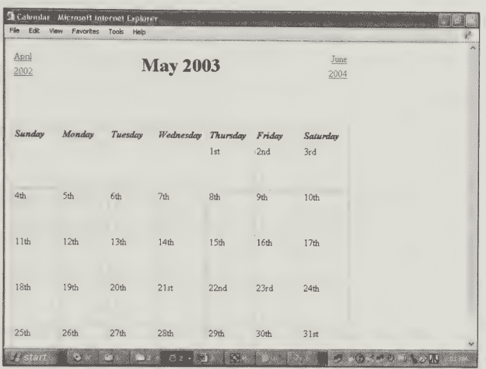

**图 15.2** 一个增强型的日历，具有更具吸引力的日期命名（注意日期中添加了 "st" 和 "rd"），以及跳转到上一年或上个月的按钮。

```asp
<%
Dim SQL_Statement
Dim Record_Set
SQL_Statement = "Select * FROM Calendar_Events_Table"
Set Record_Set = Database_Connection.Execute( SQL_Statement )
%>
```

```html
<html>
<head>
<title>日历示例</title>
<script language="JavaScript">
<!--
// 其他 JavaScript 函数
var tasks = new Array(<% While NOT Record_Set.EOF %><%=Response.write("Record_Set("task"), ") %><% Wend %>);
</script>
</head>
```

```html
<body>
<!-- 在此处放置日历 -->
</body>
</html>
```

JavaScript 可以显示所提供的信息。为了简单起见，我将假设服务器端语言生成的数据是以 JavaScript 数组的形式存在的，且数组名为 `tasks`。如果是这样，显示信息就是件易事。

```html
<table border="1" cellpadding="2" width="75%">
<tr>
<td width="14%"><b><i>日</i></b></td>
<td width="14%"><b><i>周一</i></b></td>
<td width="14%"><b><i>周二</i></b></td>
<td width="14%"><b><i>周三</i></b></td>
<td width="14%"><b><i>周四</i></b></td>
<td width="14%"><b><i>周五</i></b></td>
<td width="14%"><b><i>周六</i></b></td>
</tr>
```

```javascript
<script language="JavaScript">
<!--
  var startDay = month.getDay();
  for( i = 0 ; i < startDay ; i++) {
    document.write("<td></td>");
  }
  var numDays = getNumberDays( month);
  for(i = 0 ; i < numDays ; i++) {
    if(( i + startDay + 1 ) % 7 == 1 ) {
      document.write("</tr><tr>");
    }
    document.write("<td height='75' valign='top'>" + (i+1) + getEnding(i + 1) + "</td>");
    if (tasks[i+1]) {
      document.write("<td height='75' valign='top'>" + (i+1) + getEnding(i + 1) + "</td>");
    } else if (fixYear( now.getFullYear() ) == fixYear( month.getFullYear() ) &&
               now.getMonth() == month.getMonth() && now.getDate() == i + 1) {
      document.write("<td height='75' valign='top'>" + (i+1) + getEnding(i + 1) + "</td>");
    }
  }
// -->
</script>
</tr>
</table>
```

## 创建 JAVASCRIPT 日历

此示例通过填充任务来填充日历事件，如果任务存在，则将其写入当前单元格。通过几行 `if` 语句可以轻松标记当前日期的单元格。这是一个完整的示例，它使用了日历并显示相应的任务，文件名为 `Calendar.html`：

```html
<html>
<head>
<title>日历</title>
<script language="JavaScript">
<!--
```

```javascript
var now = new Date();
var months = Array("January", "2月", "3月", "4月", "5月", "6月", "7月", "8月", "9月", "10月", "11月", "12月");
```

```javascript
var yString = "year";
var mString = "month";
var y = now.getFullYear();
var m = now.getMonth();
```

```javascript
function getCookie( name ) {
  var c = document.cookie;
  if (c.length != 0) {
    var c = c.split("; ");
    for (var i = 0; i < c.length; i++) {
      var s = c[i];
      if (s.indexOf(name + "=") == 0) {
        return s.substring(name.length + 1);
      }
    }
  }
  return "";
}
```

```javascript
function fixYear( year ) {
  var left = year % 100;
  if (left < 100) return year + 1900;
  return year;
}
```

```javascript
if ( (i + startDay + 1) % 7 == 1 ) {
  document.write("</tr><tr>");
}
```

```javascript
<script language="JavaScript">
<!--
  var startDay = month.getDay();
  for( i = 0 ; i < startDay ; i++) {
    document.write("<td></td>");
  }
  var numDays = getNumberDays( month);
  for(i = 0 ; i < numDays ; i++) {
    if(( i + startDay + 1 ) % 7 == 1 ) {
      document.write("</tr><tr>");
    }
    document.write("<td height='75' valign='top'>" + (i+1) + getEnding(i + 1) + "</td>");
    if (tasks[i+1]) {
      document.write("<td height='75' valign='top'>" + (i+1) + getEnding(i + 1) + "</td>");
    } else if (fixYear( now.getFullYear() ) == fixYear( month.getFullYear() ) &&
               now.getMonth() == month.getMonth() && now.getDate() == i + 1) {
      document.write("<td height='75' valign='top'>" + (i+1) + getEnding(i + 1) + "</td>");
    }
  }
// -->
</script>
</tr>
</table>
```

# 创建一个 JavaScript 日历

```javascript
var numDays = getNumDays( month );
for( i = 0; i < numDays ; i++ ) {
  if( ( i + startDay + 1 ) % 7 == 1 ) {
    document.write( "</tr><tr>" );
  }
  document.write( "<td height='75' valign='top'>" );
  if( fixYear(now.getFullYear()) == fixYear(month.getFullYear()) &&
      now.getMonth() == month.getMonth() && now.getDate() == i + 1 ) {
    document.write( "<a borderColor='red'>" );
  }
  document.write( "<td>"+(i+1)+getEnding(i+1)+"<br>" );
  if( tasks[i+1] ) {
    document.write( tasks[i+1]);
  }
  document.write( "</td>" );
}
// -->
</script>
</tr>
</table>
```

```html
<table width="75%">
<tr>
<td>
  <script language="JavaScript">
  <!--
    document.write( "<a href=" + document.location + " " );
    document.write( "onclick='JavaScript; document.cookie='month" + fixMonth(m-1) + "\';" );
    document.write( months[fixMonth(m-1)] + "</a>" );
  // -->
  </script>
</td>
<td align="right">
  <script language="JavaScript">
  <!--
    document.write( "<a href=" + document.location + " " );
    document.write( "onclick='JavaScript; document.cookie='month" + fixMonth(m+1) + "';" );
    document.write( months[fixMonth(m+1)] + "</a>" );
  // -->
  </script>
</td>
</tr>
</table>
```

这个示例是运行中的 Center Park 网站的一部分，它是用户登录网站后立即看到的屏幕（将在后面的章节中详细说明）。

上一个示例中一个值得注意的部分是它使用了 cookie 而不是通过 URL 字符串传递月份和年份参数。页面底部的两个链接允许用户切换日历。URL 是这两个链接的 Basic 格式：

```javascript
<script language="JavaScript">
<!--
document.write( "<a href=" + document.location + " " );
document.write( "onclick='JavaScript: document.cookie='month=' + fixMonth(m-1) + '\';" );
document.write( months[fixMonth(m-1)] + "</a>" );
// -->
</script>
```

虽然与之前通过 URL 字符串传递参数的方法不同，但功能是完全相同的。从 cookie 文件中提取参数的代码如下：

```javascript
var yString = getCookie("year");
var mString = getCookie("month");
var y = fixYear(yString ? parseInt(yString) : now.getFullYear());
var m = fixMonth(mString ? parseInt(mString) : now.getMonth());
var month = new Date(y, m, 1)
```

这种方法与之前从 URL 字符串中提取参数的方法几乎相同。两种方法的效果同样好，取决于你选择哪一种最适合你的网站。

* 参见图 15.3 查看更增强的日历。

# 创建一个 JavaScript 日历

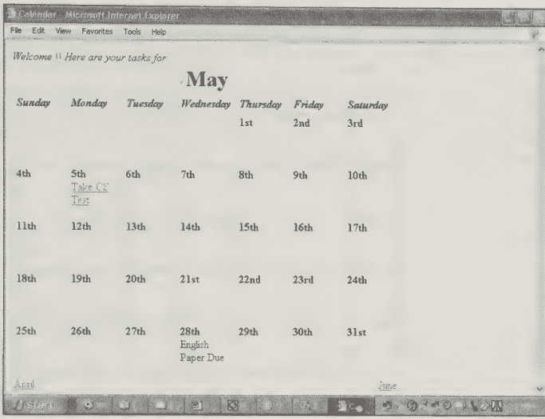

**图 15.3** 现在日历包含一个指向学生测试的超链接，底部有上个月和下个月的导航按钮，今天的日期用红色突出（在此图中，日期为 5/24）。

## 用于表单填充的弹出日历

弹出日历是网站上完全不同类型的日历。虽然它与永久日历非常不同，但创建它的大部分代码与你用于该日历的代码几乎完全相同。

以下是在线弹出日历与永久日历的不同之处：

- 弹出日历在它自己的窗口中显示。
- 用户选择日期后，弹出窗口关闭并填充父窗口中的一个字段。
- 日历中无法显示事件。

和永久日历一样，显示和切换是弹出日历的两个基本功能。幸运的是，对于这种类型的日历，获取和设置事件并不是问题。不过，这次你必须担心日历和其父窗口之间的窗口间通信。

## 显示弹出日历

当我上面写“显示”时，我的意思是创建表格并用日历数据填充。使用父窗口弹出日历将在“窗口间通信”部分中讨论。

日历显示现在对你来说应该很熟悉，因此我将为你提供日历的源码并解释弹出日历极少数不同的特征。此文件名为 `Simple_Popup_Calendar.html`：

```html
<html>
<head>
<title>日期选择器</title>
<style type="text/css">
<!--
.mono { font-family: monospace; }
-->
</style>
<script language="JavaScript">
<!--
var now = new Date();
var month = new Date(fixYear(now.getFullYear()), now.getMonth(), 1);
var months = new Array("January", "February", "March", "April", "May", "June", "July", "August", "September", "October", "November", "December");

function fixYear( year ) {
  return(year < 1000 ? year + 1900 : year);
}

function fixMonth( month ) {
  return(month < 0 ? month + 12 : (month > 11 ? month - 12 : month));
}

function getNumberDays( d ) {
  switch( d.getMonth() + 1 ) {
    case 1: case 3: case 5: case 7:
    case 8: case 10: case 12:
      return( 31 );
    case 4: case 6: case 9: case 11:
      return( 30 );
    case 2:
      return( 28 + (d.getFullYear() % 4 == 0 ? 1 : 0) );
  }
}

function getEnding( number ) {
  if( number > 10 && number < 20 ) return("th");
  switch( number % 10 ) {
    case 0: case 4: case 5:
    case 6: case 7: case 8:
    case 9:
      return("th");
    case 1:
      return("st");
    case 2:
      return("nd");
    case 3:
      return("rd");
  }
}

function onSelect() {
}
// -->
</script>
</head>
```

```html
<body>
<form name="theForm">
<table border="1" width="75%" style="border-collapse: collapse">
<tr>
<td align="left" colspan="2">&nbsp;</td>
<td colspan="3">
<center>
<script language="JavaScript">
<!--
document.write(months[fixMonth(month.getMonth())] + " * " + fixYear(month.getFullYear()));
// -->
</script>
</center>
</td>
<td align="right" colspan="2">&nbsp;</td>
</tr>
<tr>
<td width="14%"><b>Sun</b></td>
<td width="14%"><b>Mon</b></td>
<td width="14%"><b>Tue</b></td>
<td width="14%"><b>Wed</b></td>
<td width="14%"><b>Thu</b></td>
<td width="14%"><b>Fri</b></td>
<td width="14%"><b>Sat</b></td>
</tr>
<tr>
<script language="JavaScript">
<!--
var startDay = month.getDay();
for( i = 0; i < startDay; i++ ) {
  document.write("<td></td>");
}
var numDays = getNumberDays( month );
for( i = 1 ; i < numDays + 1 ; i++) {
  if(( i + startDay ) % 7 == 1 ) {
    document.write("</tr><tr>");
  }
  document.write(
    "<td><center>" + "<input type='button' " +
    "onclick='JavaScript: document.theForm.date.value=" +
    fixMonth(month.getMonth() + 1) + "/" + i + "/" +
    fixYear(month.getFullYear()) + " + onSelect();' " +
    "value=" + (i < 10 ? " " : " ") + i + getEnding( i ) + " " +
    "class='mono'" + "</center></td>");
}
// -->
</script>
</tr>
</table>
<input type="hidden" name="date">
</form>
</body>
```

## 切换弹出日历

为了允许日历进行切换，代码中有两个地方需要修改。第一个地方是在 `<script>` 标签中，以便从 URL 中获取新参数并修改月份变量。第二个需要修改程序的地方是在 `<body>` 中，以便添加链接将参数添加到 URL 中并允许日历进行切换。我会先讨论第二部分，这样你就知道第一部分在处理什么了。

这一次，我将添加文本字段，以便用户可以只需输入他们想要查看的月份和日期。这只会修改日历的第一行。以下是修改后的代码：

```html
<tr>
<td align="left" colspan=2>
  <b>Month:</b>
  <input type="text" name="Month" size="5">
  <script language="JavaScript">
  <!--
  document.theForm.Month.value = fixMonth( month.getMonth() + 1 );
  // -->
  </script>
</td>
<td colspan=3>
<center>
  <b><script language="JavaScript">
  <!--
  document.write( months[fixMonth(month.getMonth())] + " " + fixYear( month.getFullYear()) );
  // -->
  </script></b><br>
  <input type="submit" value="Submit">
</center>
</td>
<td align="right" colspan=2>
  <b>Year:</b>
  <input type="text" name="Year" size="5">
  <script language="JavaScript">
  <!--
  document.theForm.Year.value = fixYear( month.getFullYear() );
  // -->
  </script>
</td>
</tr>
```

行的第一个单元格包含一个月份的文本字段，第三个单元格包含一个年份的文本字段。这两个字段都由“月份”标题下方的提交按钮控制。日历中显示的月份和年份是每个文本字段的默认值。

当点击提交按钮时，页面将刷新并更改日历。由于表单字段的名为 Month 和 Year，我在永久日历中使用的精确代码可以用于从 URL 字符串中检索它们：

```javascript
var urlquery = location.href.split("?");
if (urlquery[1]) {
    var params = urlquery[1].split("&");
    var m = (params[0]) ? params[0].split("=")[1] : fixMonth(now.getMonth());
    var y = (params[1]) ? params[1].split("=")[1] : fixYear(now.getFullYear());
    month = new Date(y, m, 1);
}
```

修改 `month` 变量将像以前一样更改日历表格中显示的内容。

以下是旋转弹出日历的完整源代码；此代码示例的文件名为 `Rotating_Popup_Calendar.html`：

```html
<html>
<head>
<title>日期选择器</title>
<style type="text/css">
<!--
.mono{ font-family: monospace; }
-->
</style>
<script language="JavaScript">
<!--
var now = new Date();
var month = new Date(fixYear(now.getFullYear()), now.getMonth(), 1 );
var months = new Array("January", "February", "March", "April",
    "May", "June", "July", "August", "September",
    "October", "November", "December");

var urlquery = location.href.split("?");
if(urlquery[1]){
  var params = urlquery[1].split("&");
  var m = (params[0] ? params[0].split("=")[1] : 1) - fixMonth(now.getMonth());
  var y = (params[1] ? params[1].split("=")[1] : fixYear(now.getFullYear()));
  var month = new Date(y, m, 1);
}

function fixYear( year ) {
  return(year < 1000 ? year + 1900 : year );
}

function fixMonth( month ) {
  return(month < 0 ? month + 12 : (month > 11 ? month - 12 : month));
}

function getNumberDays( d ) {
  switch (d.getMonth() + 1) {
    case 1: case 3: case 5: case 7:
    case 8: case 10: case 12:
      return(31);
    case 4: case 6: case 9: case 11:
      return(30);
    case 2:
      return(28 + ( d.getFullYear() % 4 == 0 ? 1 : 0));
  }
}

function getEnding( number ) {
  if( number > 10 && number < 20 ) return("th" );
  switch( number % 10 ) {
    case 0: case 4: case 5:
    case 6: case 7: case 8:
    case 9:
        return("th" );
    case 1:
        return("st" );
    case 2:
        return("nd" );
    case 3:
        return("rd" );
  }
}

function onSelect() {
}
// -->
</script>
</head>
```

```html
<body>
<form name="theForm">
<table border="1" width="75%" style="border-collapse: collapse">
<tr>
    <td align="left" colspan=2>
    <b>Month:</b>
    <input type="text" name="Month" size="5">
    <script language="JavaScript">
<!--
    document.theForm.Month.value = fixMonth( month.getMonth() + 1 );
// -->
</script>
</td>
<td colspan="3">
<center>
<b><script language="JavaScript">
<!--
document.write( months[fixMonth(month.getMonth())] + " * " + fixYear( month.getFullYear()) );
// -->
</script></b><br>
<input type="submit" value="Submit">
</center>
</td>
<td align="right" colspan="2">
<b>Year:</b>
<input type="text" name="Year" size="5">
<script language="JavaScript">
<!--
document.theForm.Year.value = fixYear( month.getFullYear() );
// -->
</script>
</td>
</tr>
<tr>
<td width="14%"><b><i>Sun</i></b></td>
<td width="14%"><b><i>Mon</i></b></td>
<td width="14%"><b><i>Tue</i></b></td>
<td width="14%"><b><i>Wed</i></b></td>
<td width="14%"><b><i>Thu</i></b></td>
<td width="14%"><b><i>Fri</i></b></td>
<td width="14%"><b><i>Sat</i></b></td>
</tr>
<tr>
<script language="JavaScript">
<!--
var startDay = month.getDay();
for(i = 0; i < startDay ; i++) {
  document.write( "<td></td>" );
}
var numDays = getNumberDays( month );
for( i = 1; i < numDays + 1; i++) {
  if( ( i + startDay ) % 7 == 1 ) {
    document.write("</tr><tr>");
  }
  document.write(
    "<td><center><input type='button' " +
    "onclick='JavaScript: document.theForm.date.value=" +
    fixMonth( month.getMonth() + 1 ) + "/" + i + "/" +
    fixYear( month.getFullYear()) + "; onSelect();' " +
    "value='" + ( i < 10 ? " " : " ") + i + getEnding( i ) + "' " +
    "class='mono'" + "</center></td>");
}
// -->
</script>
</tr>
</table>
<input type="hidden" name="date">
</form>
</body>
</html>
```

## 窗口间通信

现在弹出日历已经设计好了，剩下的就是创建它并让它自动填充字段。这些字段之一需要用户提供日期。由于日期可以用许多方式表示，而且由于解析所有方式非常困难，因此创建一个用户填充的方法是一个好主意，这也是弹出日历的唯一目的。有两个函数可以自动填充字段。下面的 `openDatePicker()` 函数将创建弹出窗口并显示：

```javascript
var dateElement;
function openDatePicker( target ) {
  dateElement = target;
  var isSize = "width=380,height=255";
  var navSize = "width=480,height=295";
  var isNav = navigator.appName == "Netscape";
  window.open("PopupCalendar.html", "calendar",
    "menubar=no,resizable=no,scrollbars=no,status=yes,toolbar=no," +
    (isNav ? navSize : isSize));
}
```

`openDatePicker()` 的唯一参数是用户从弹出日历选择日期后将放置日值的字段。第二个函数是：

```javascript
function setState( date ) {
  dateElement.value = date;
}
```

你可能注意到 `setState()` 函数从未从页面被调用。这有很好的理由——它是在用户选择日期后从弹出日历调用的。在之前的示例中，弹出窗口的 `onSelect()` 函数是空的。如果你将空函数替换为：

```javascript
function onSelect() {
  window.opener.setState(document.theForm.date.value);
  self.close();
}
```

* 不仅完善了弹出日历的功能，而且允许弹出日历与其父窗口进行通信。当用户在弹出日历上选择日期时，日历会将选定的日期临时存储在一个隐藏字段中并调用 `onSelect()` 函数。`onSelect()` 函数会带有所选日期值调用其父窗口上的 `setState` 函数，然后关闭弹出日历。一旦在父窗口上调用了 `setState()` 函数，日期就已经选择完毕且弹出日历也已关闭，因此剩下的唯一工作就是表单中的用户。

以下是弹出日历的完整源代码。为了与本章中的示例配合，它应该被放在名为 `PopupCalendar.html` 的文件中。图 15.4 展示了这一过程。

```html
<html>
<head>
<title>Date Chooser</title>
<style type="text/css">
<!--
.mono{ font-family: monospace; }
-->
</style>
<script language="JavaScript">
<!--
var now = new Date();
var month = new Date(fixYear(now.getFullYear()), now.getMonth(), 1 );
var months = new Array( "January", "February", "March", "April", "May", "June", "July", "August", "September", "October", "November", "December" );
var urlquery = location.href.split("?");
if(urlquery[1]) {
  var params = urlquery[1].split("&");
  var m = (params[0] ? params[0].split("=")[1] : fixMonth(now.getMonth())) - 1;
  var y = (params[1] ? params[1].split("=")[1] : fixYear(now.getFullYear()));
  var month = new Date(y, m, 1);
}

function fixYear( year ) {
  return( year < 1000 ? year + 1900 : year );
}

function fixMonth( month ) {
  return( month < 0 ? month + 12 : (month > 11 ? month - 12 : month) );
}

function getNumberDays( d ) {
  switch( d.getMonth() + 1 ) {
    case 1: case 3: case 5: case 7:
    case 8: case 10: case 12:
      return( 31 );
    case 4: case 6: case 9: case 11:
      return( 30 );
    case 2:
      return( 28 + ( d.getFullYear() % 4 == 0 ? 1 : 0 ) );
  }
}

function getEnding( number ) {
  if( number > 10 && number < 20 ) return("th");
  switch( number % 10 ) {
    case 0: case 4: case 5:
    case 6: case 7: case 8:
    case 9:
      return("th");
    case 1:
      return("st");
    case 2:
      return("nd");
    case 3:
      return("rd");
  }
}

function onSelect() {
  window.opener.setState(document.theForm.date.value);
  self.close();
}
// -->
</script>
</head>
```

```html
<body>
<form name="theForm">
<table border="1" width="75%" style="border-collapse:collapse">
<tr>
  <td align="left" colspan="2">
    <b>月份：</b><br>
    <input type="text" name="Month" size="5">
    <script language="JavaScript">
    <!--
    document.theForm.Month.value = fixMonth( month.getMonth() + 1 );
    // -->
    </script>
  </td>
  <td colspan="3">
    <center>
      <b><script language="JavaScript">
      <!--
      document.write( months[fixMonth( month.getMonth() )] + " * " + fixYear( month.getFullYear() );
      // -->
      </script></b><br>
      <input type="submit" value="提交">
    </center>
  </td>
  <td align="right" colspan=2>
    <b>年份：</b>
    <input type="text" name="Year" size="5">
    <script language="JavaScript">
    <!--
    document.theForm.Year.value = fixYear( month.getFullYear() );
    // -->
    </script>
  </td>
</tr>
<tr>
<td width="14%"><b><i>日</i></b></td>
<td width="14%"><b><i>一</i></b></td>
<td width="14%"><b><i>二</i></b></td>
<td width="14%"><b><i>三</i></b></td>
<td width="14%"><b><i>四</i></b></td>
<td width="14%"><b><i>五</i></b></td>
<td width="14%"><b><i>六</i></b></td>
</tr>
<script language="JavaScript">
<!--
  var startDay = month.getDay();
  for(i = 0 ; i < startDay ; i++) {
    document.write("<td></td>");
  }
  var numDays = getNumberDays( month );
  for(i = 1 ; i < numDays + 1 ; i++) {
    if( ( i + startDay ) % 7 == 1 ) {
      document.write("</tr><tr><center> ");
    }
    document.write(
      "<td><center><input type='button' " +
      "onclick='JavaScript: document.theForm.date.value=" +
      fixMonth( month.getMonth() + 1 ) + "/" + i + "/" +
      fixYear( month.getFullYear()) + "; onSelect();' " +
      "value='" + (i < 10 ? "0" : "") + i + getEnding( i ) + "' " +
      "class='mono'" + "</center></td>");
  }
// -->
</script>
</tr>
</table>
<input type="hidden" name="date">
</form>
</body>
</html>
```

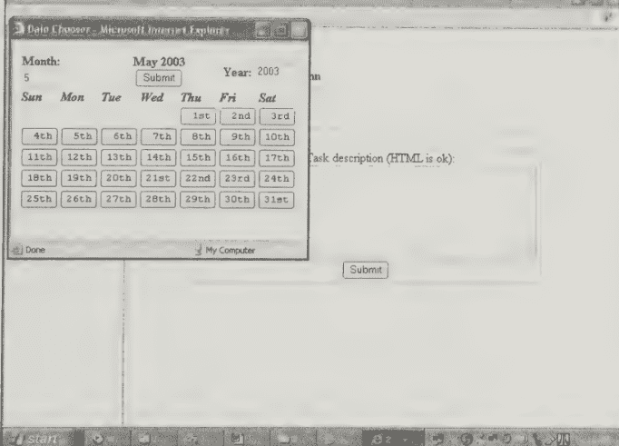

**图 15.4** 通过这种方式使用弹出日历，你可以让用户有一种简单且准确的方法来选择特定日期。注意，这种弹出功能可以应用于其他表单函数。

## 总结

日历可以为你的网站增加大量的功能性，无论是在信息的组织还是呈现方面。对于 Center Park 项目，显而易见的是，设计良好的日历具有多大的功能性，能够满足不同群体（学生、教师和家长）的组织需求。当你继续构建 Center Park 网站时，你将看到日历功能如何与 JavaScript 的其他组件集成，例如——学生在登录网站后，将看到一个列出他们特定任务和事件的自定义日历。如果你计划得当，日历可以成为个性化网络体验的中心启动点，网站构建的所有主要信息方面都基于日历上呈现的内容，无论这些内容是否特定。

# 第 16 章

## 创建在线测试或问卷

在本章中，我将带你介绍如何为虚拟的学校 Center Park 创建一个在线测试。由于测试和问卷非常相似，我们不会做一个单独的示例。问卷与测试的唯一区别在于，问卷没有评分部分。测试的评分部分将在本章的后半部分介绍。

具体来说：
在线测试或问卷的具体益处是什么

**家长。** 大多数家长都希望参与孩子的教育，但课后 PTA 会议或其他晚间/周末的活动可能会干扰（非常）忙碌的日程安排。再次，利用 Web 的“24/7/365” 访问功能，家长可以根据自己的空闲和方便的时间与学校进行互动，使他们能够在不亲身参加活动和会议的情况下保持参与度。

**教师。** 通过将考试发布在网络上——特别是在日历中——教师可以确保重要测试何时进行。人们发现在线表单比填写纸质表格更容易。

因此，在线测试/问卷组件对 Center Park 受众的每个部分都有益。

- **学生。** 利用该网站进行测试的能力让学生能够按照自己的节奏学习。例如，教师可能会在整个学期设置“浮动的考试日期”，这样学生需要参加考试，但更符合典型的函授课程，即他们按照自己的节奏学习，然后——当他们准备好时——参加考试。

## 创建测试

创建在线测试的测试部分（与评分部分相对）非常简单。利用你在第 8 章中学到的知识，你应该能够构建表单并在提交前对其进行验证。以下是我稍后解释的示例的完整源代码：

```html
<html>
<head>
<title>Center Park - 计算机科学测试</title>
<script language="JavaScript">
<!--
  function validate( form ) {
    for(i = 0; i < form.elements.length ; i++ ) {
      with(form.elements[i]) {
        if( type == "text" && value == "" ) {
          alert("请回答所有问题。" );
          return( false );
        }
      }
    }
    return( true );
  }
// -->
</script>
</head>
<body>
<b><font size="5">计算机科学 101 - 期中测试</font></b>
<br><br>
<font face="Courier">
所有问题均为**必填**。
在回答之前，请*仔细*阅读题目。
不要在任何一个问题上花费太多时间。
你有 30 分钟来完成测试。祝你好运！
</font>
<br><br>
<form name="TestForm" action="Grade.html" onSubmit="return validate( this );">
<table width="100%" cellpadding="2" cellspacing="2">
<tr>
<td>1)</td>
<td>
<font face="Courier">
假设算术运算符之间没有优先级。假设所有运算符都具有左结合性，那么表达式 5-3*4/2+6 的值是多少？
</font>
</td>
</tr>
<tr>
<td>答案</td>
<td><input type="text" name="Q1" size="20"></td>
</tr>
<tr><td>&nbsp;</td><td>&nbsp;</td></tr>
<tr>
<td>2)</td>
<td>
<font face="Courier">
所有的 JavaScript 函数必须嵌套在哪个 HTML 标签中，即：HTML, BODY, TABLE？
</font>
</td>
</tr>
<tr>
<td>答案</td>
<td><input type="text" name="Q2" size="20"></td>
</tr>
<tr><td>&nbsp;</td><td>&nbsp;</td></tr>
<tr>
<td>3)</td>
<td>
<font face="Courier">
用户在 Web 页面上选择文本或 HTML 元素后，会触发什么事件？
</font>
</td>
</tr>
<tr>
<td>答案</td>
<td><input type="text" name="Q3" size="20"></td>
</tr>
<tr><td>&nbsp;</td><td>&nbsp;</td></tr>
<tr>
<td>4)</td>
<td>
<font face="Courier">
JavaScript 使用什么类型的变量作用域？
</font>
</td>
</tr>
<tr>
<td>答案</td>
<td><input type="text" name="Q4" size="20"></td>
</tr>
<tr><td>&nbsp;</td><td>&nbsp;</td></tr>
<tr>
<td>5)</td>
<td>
<font face="Courier">
使用哪种关系运算符来确定两个相同类型的变量是否不相等？
</font>
</td>
</tr>
<tr>
<td>答案</td>
<td><input type="text" name="Q5" size="20"></td>
</tr>
</table>
<br>
<input type="submit" value="提交" name="B1">
</form>
<script language="JavaScript">
<!--
window.setTimeout("document.TestForm.B1.disabled=true", 1000 * 60 * 30 );
// -->
</script>
</body>
</html>
```

图 16.1 显示了此代码的运行情况。请注意，每个问题都必须回答，否则测试者将弹出一个警告窗口，如图 16.2 所示。

这个示例的任何方面对你来说都不应该陌生。表单包含五个问题，每个问题都有一个文本表单字段，用户应其中提供答案。在表单提交之前，`validate()` 函数：

```javascript
function validate( form ) {
  for ( i = 0 ; i < form.elements.length ; i++) {
    with (form.elements[i]) {
      if ( type == "text" && value == "" ) {
        alert("请回答所有问题.");
        return (false);
      }
    }
  }
  return (true);
}
```

它检查每个答案字段以确保已提供答案。如果回答了问题，则警报会告诉测试者显示问题，且表单不会提交。如果所有问题都已回答，表单将提交到名为 `Grade.html` 的独立页面。第二个页面的功能将在章的后半部分进行解释。你可能在其他页面上没见过的限制是时间限制。最后一个脚本：

```javascript
<script language="JavaScript">
<!--
  window.setTimeout("document.TestForm.B1.disabled=true", 1000 * 60 * 30 );
// -->
</script>
```

禁用了提交按钮，在加载 30 分钟后停止。

## 评分测试

由于我们考虑了在 URL 字符串中查找 name=value 对的问题，通过 URL 字符串将给定的答案与正确答案进行比较并生成评分。以下是 `Grade.html` 页面的完整源代码：

```javascript
function getFormValue( name ) {
  var c = location.href.split("?")[1];
  var begin = c.indexOf( name );
  if( begin < 0 ) return("");
  begin += name.length + 1;
  var end = c.indexOf("&", begin );
  if( end == -1 ) end = c.length;
  return(unescape( c.slice(begin, end )));
}
```

这种方法将表单提交到另一个名为 `Grade.html` 的页面时是有效的。JavaScript 非常适合这种功能——我们可以自动评分。

```html
<html>
<head>
<title>Center Park - Test Grader</title>
<script language="JavaScript">
<!--
var total = 0, correct = 0;
// -->
</script>
</head>
<body>
<b><font size="5">计算机科学 101 - 期中测试</font></b>
<br><br>
<font face="Courier">
所有问题均为**必填**。
在回答之前，请*仔细*阅读题目。
不要在任何一个问题上花费太多时间。
你有 30 分钟来完成测试。祝你好运！
</font>
<br><br>
<form>
<table width="100%" cellpadding="2" cellspacing="2">
<tr>
<td>1)</td>
<td>
<font face="Courier">
假设算术运算符之间没有优先级。假设所有运算符都具有左结合性，那么表达式 5-3*4/2+6 的值是多少？
</font>
</td>
</tr>
<tr>
<td>答案</td>
<td>
<input type="text" name="Q1" size="20">
<script language="JavaScript">
<!--
if(parseInt(getFormValue("Q1")) == 10) {
  document.write("<font color='red'><b>CORRECT!</b></font> ");
  correct++;
} else {
  document.write( "<font color='red'><b>错误</b></font> " + "你的回答是: " + getFormValue("Q1") );
}
total++;
// -->
</script>
</td>
</tr>
<tr><td>&nbsp;</td><td>&nbsp;</td></tr>
<tr>
<td>2)</td>
<td>
<font face="Courier">
所有的 JavaScript 函数必须嵌套在哪个 HTML 标签中（即：HTML, BODY, TABLE?）
</font>
</td>
</tr>
<tr>
<td>答案</td>
<td><b>SCRIPT</b>
<script language="JavaScript">
<!--
if(getFormValue("Q2").toUpperCase() == "SCRIPT") {
  document.write( "<font color='red'><b>正确!</b></font>" );
  correct++;
} else {
  document.write( "<font color='red'><b>错误</b></font> " + "你的回答是: " + getFormValue("Q2") );
}
total++;
// -->
</script></td>
</tr>
<tr><td>&nbsp;</td><td>&nbsp;</td></tr>
<tr>
<td>3)</td>
<td>
<font face="Courier">
用户在 Web 上选择文本或 HTML 元素后，会触发什么事件？
</font>
</td>
</tr>
<tr>
<td>答案</td>
<td><b>OnSelect</b>
<script language="JavaScript">
<!--
  if (getFormValue("Q3").toUpperCase() == "ONSELECT") {
    document.write( "<font color='red'><b>正确!</b></font>" );
    correct++;
  } else {
    document.write( "<font color='red'><b>错误</b></font> " + "你的回答是: " + getFormValue("Q3") );
  }
  total++;
// -->
</script></td>
</tr>
</table>
</form>
</body>
</html>
```


# 创建在线测试或调查卷 第 16 章 433

```html
<tr>
<td>4)</td>
<td>
<font face="Courier">
  JavaScript 使用什么类型的变量作用域？
</font>
</td>
</tr>
<tr>
<td>答案</td>
<td><b>Static (静态)</b>&nbsp;&nbsp;&nbsp;&nbsp;
  <script language="JavaScript">
<!--
  if (getFormValue("Q4").toUpperCase() == "STATIC") 
  {
    document.write("<font color='red'><b>正确!</b></font>");
    correct++
  }
  else {
    document.write("<font color='red'><b>错误</b></font>" +
    "你的回答是: " + getFormValue("Q4") );
    total++;
  }
// -->
</script>
</td>
</tr>
<tr><td>&nbsp;</td><td>&nbsp;</td><td></td></tr>
<tr>
<td>5)</td>
<td>
<font face="Courier">
    使用哪种关系运算符来确定两个相同
    类型的变量互不相等？
</font>
</td>
</tr>
<tr>
<td>答案</td>
<td><b>!=</b>&nbsp;&nbsp;&nbsp;&nbsp;&nbsp;&nbsp;
  <script language="JavaScript">
<!--
  if (getFormValue("Q5") == "!=")  
  {
    document.write("<font color='red'><b>正确!</b></font>");
    correct++
  }
  else {
    document.write("<font color='red'><b>错误</b></font> " +
    "你的回答是: " + getFormValue("Q5") );
  }
  total++;
// -->
</script>
</td>
</tr>
</table>
</form>
```

<br><br>
```javascript
<script language="JavaScript">
<!---
document.write("<font color='red'><b>你对了 " + correct +
  " 道，共计 " + total +
  " 道。你的得分是 " +
  (correct/total*100) + "%</b></font>");
// -->
</script>
</body>
</html>
```

## 总结

在线测试和调查卷在教育的各个阶段正变得无处不在。它们为老师和学生提供的便利和自由（正如我们在这里讨论的，也包括家长）为学校网站带来了新层面的功能。此外，通过将测试在线化，教师可以包含其他支持信息，以便学生能够参考图形、地图或其他图片来回答特定的问题。对于 Center Park 网站，管理员希望跟上技术领域新兴的教育趋势，并允许他们的在线测试组件针对特定学生进行定制，这样当学生登录网站时，他们看到的测试链接是与其课程表和课程特定的。此外，学校管理员希望 JavaScript 代码是易于配置的，以便测试可以快速转换为在线调查卷，以收集关键反馈。本章演示的代码应该允许实现所有这些功能需求。

## 第 17 章

尽管有学校烘焙义卖，但人们在提到 K-12 学校时，通常并不会考虑到电子商务。事实上，传统的烘焙义卖或节日募款是大多数学校通常赖以为特殊活动筹集资金的手段。

Center Park 学校在设计和实现其网站之前（强调“曾”这个词）也并不不同。但学校管理员从早期阶段就知道，他们想利用他们社区慷慨（且精通技术）的特性，这样在同一个句子中描述“Center Park 学校”和“电子商务”就不会是名不实当。

事实上，在网站设计会议的早期，你就告诉管理员们，一个功能良好的在线测试系统是可行的。

## 创建客户端购物车

```javascript
if ( end == -1 ) end = c.length;
return(c.slice(begin, end ) );
}
```

解析我们专有项目格式的问题将在下一节中处理。一旦你确定了项目格式并编写了向 cookie 购物车添加物品的函数，创建在线商店的其余代码就变得简单了。这里是我们为 Center Park 项目开发的一个完整示例（图 17.1 展示了该代码）：

```html
<html>
<title>Center Park - 商店</title>
<script language="JavaScript">
<!--
function addItem(name, price) {
  var i = 1;
  for( ; getCookieValue("item " + i) != "*"; i++ );
  document.cookie = "item " + i + "*=" + name + "," + price;
  document.cookie = "items=" + i;
}

function getCookieValue(name) {
  var c = document.cookie;
  var begin = c.indexOf(name);
  if(begin < 0 ) return("*");
  begin += name.length + 1;
  var end = c.indexOf("", begin);
  if(end == -1 ) end = c.length;
  return(c.slice(begin, end ) );
}
// -->
</script>
</head>
<body>
<b><font size="6">Center Park 学校商店 -</font></b>
<font size="4">满足你所有的学校文具需求</font><br><br>
<form>
<table border="2" width="100%">
<tr>
<td>学校帽子 - 均码设计，正面有学校校徽。</td>
<td>$9.99</td><td align="center">
<input type="button" value="Add"
onclick="JavaScript:addItem('School Hat - One size fits ' + '. all school emblem on front.', 9.99);">
</td>
</tr>
<tr>
<td>学校 T 恤 - 小号、中号、大号，正面有学校校徽。</td>
<td>$19.99</td><td align="center">
<input type="button" value="Add"
onclick="JavaScript:addItem('School T-Shirt - ' + 'Small-Medium-Large school emblem on front.', 19.99);">
</td>
</tr>
<tr>
<td>足球赛季票 - 全赛季观看野性猫队的比赛。</td>
<td>$12.99</td><td align="center">
<input type="button" value="Add"
onclick="JavaScript:addItem('Football Season Tickets - ' + 'Watch the Bobcats all season long.', 12.99);">
</td>
</tr>
<tr><td colspan="3" align="center">
<input type="button" value="View Cart"
onclick="JavaScript: document.location='ViewCart.html';">
&nbsp;&nbsp;&nbsp;&nbsp;
<input type="button" value="Check Out*"
onclick="JavaScript: document.location='Checkout.html';">
</td>
<td></td></tr>
</table>
</form>
</body>
</html>
```

**图 17.1** 注意在线商店的主要功能，它整齐且简单地呈现了这些：待售商品清晰可见，选择机制显而易见（“添加”按钮），整个订单流程通过“查看购物车”（View Cart）和“结账”（Check Out）按钮来表示。

这个在线商店提供了你可以在任何在线学校商店中找到三个物品。每个物品旁边的按钮允许购物者通过调用 `addItem()` 函数将物品添加到购物车。此外，页面底部的两个按钮允许购物者查看购物车内容并在购物完成后结账。这两个按钮的功能将在接下来的部分中讨论。

## 查看购物车内容

在线购物购物车功能中有一个不是必须但通常是预期的一部分：查看内容内容。然而，在实现此功能之前，你需要弄清楚如何从 cookie 文件提取物品数据。如果你使用的是上一节介绍的 cookie 项目格式，以下两个函数将有效：

```javascript
function getItemName( item ) {
  var c = getCookieValue( item );
  if( c ) {
    return( c.split( ",")[0] );
  }
  else return( "" );
}
```

```javascript
function getItemPrice( item ) {
  var c = getCookieValue( item );
  if( c ) {
    return( c.split( ",")[1] );
  }
  else return( "" );
}
```

这两个函数完全相同，除了第一个获取物品的描述，第二个获取物品的费用。在从 cookie 中获取 `name=value` 对的值部分后，这两个函数使用逗号作为分隔符将其分割，返回数组中的第一个或第二个物品。在你写完这两个函数后，显示购物车内容就变成了使用 `for` 循环的练习：

```html
<html>
<head>
<title>Center Park - 查看购物车</title>
<script language="JavaScript">
<!--
  function getCookieValue( name ) {
    var c = document.cookie;
    var begin = c.indexOf( name );
    if (begin < 0) return("*");
    begin += name.length + 1;
    var end = c.indexOf("", begin);
    if (end == -1) end = c.length;
    return(c.slice(begin, end));
  }

  function getItemName( item ) {
    var c = getCookieValue(item);
    if ( c ) {
      return(c.split(",",")[0]);
    } else return("*");
  }

  function getItemPrice( item ) {
    var c = getCookieValue(item);
    if ( c ) {
      return(c.split(",",")[1]);
    } else return("*");
  }
// -- -->
</script>
</head>
<body>
<font size="6">Center Park 学校商店 -</font></br>
<font size="4">满足你所有的学校文具需求</font><br><br>
<form>
<table width="100%" border="2">
<script language="JavaScript">
<!--
for ( i = 1 ; i <= parseInt(getCookieValue("items")); i++) {
  document.write("<tr><td>" + "item" + i + "</td><td>");
  document.write("$ " + getItemPrice("item" + i) + ")");
  document.write("</td></tr>");
}
// -->
</script>
</table>
</form>
</body>
</html>
```

有时购物者可能会改变购买物品的主意，由于他们可能并不喜欢“看中即买”的政策，因此提供一种从购物车中移除物品的方法是一个好主意。对于任何实用的功能，这个问题最好通过函数来解决。这里有一个正是你需要的函数：

```javascript
function removeItem( name ) {
  document.cookie = name + "=";
  document.location = document.location;
}
```

并不是从 cookie 文件中移除物品的痕迹，该函数删除了 cookie 中的描述和价格。由于物品已完全从购物车中移除，因此在显示购物车时需要额外的检查，以防显示空物品：

```javascript
if (getItemName("item" + i) != "" && getItemPrice("item" + i) != "") {
  document.write("<tr><td>");
  document.write(getItemName("item" + i) + "</td><td>");
  document.write("$ " + getItemPrice("item" + i) + ")");
  document.write("</td></tr>");
}
```

```javascript
for(i = 1; i <= parseInt(getCookieValue("items")); i++) {
  if(getItemName("item" + i) != "*" &&
  getItemPrice("item" + i) != undefined) {
    document.write("<tr><td>" + i + "</td><td>");
    document.write(getItemName("item" + i) + "</td><td>");
    document.write("$" + getItemPrice("item" + i) + "</td><td align='center'><td>");
    document.write("<input type='button' value='Remove " + 
  onclick="JavaScript: removeItem("item" + i + "");") >");
    document.write("</td></tr>");
  }
}
```

```html
<tr colspan="3" align="center">
  <input type="button" value="Keep Shopping"
  onclick="JavaScript: document.location='Store.html';">
  &nbsp;&nbsp;&nbsp;&nbsp;
  <input type="button" value="Check Out"
  onclick="JavaScript: document.location='Checkout.html';">
</tr>
</table>
</form>
</body>
</html>
```

## 结账与购买

在线购物车最重要的部分之一就是结账页面。毕竟，如果没有这个页面，所有其他部分都毫无意义。在线商店的结账和购买部分列出了购物车中的物品及其价格，并在列表末尾提供费用的实时汇总。我确定你熟悉这种 Web 页面，所以让我们从一个完整的运行示例开始：

```html
<html>
<head>
  <title>Center Park - 商店结账</title>
  <script language="JavaScript">
  <!--
    var total = 0;

    function getCookieValue( name ) {
      var c = document.cookie;
      var begin = c.indexOf( name );
      if(begin < 0 ) return("");
      begin += name.length + 1;
      var end = c.indexOf(";", begin);
      if( end == -1 ) end = c.length;
      return(c.slice(begin, end ) );
    }

    function getItemName( item ) {
      var c = getCookieValue( item );
      if( c ) {
        return(c.split(",",")[0] );
      }
      else return("");
    }

    function getItemPrice( item ) {
      var c = getCookieValue( item );
      if( c ) {
        return(c.split(",",")[1] );
      }
      else return("");
    }

    function fixTotal( n ) {
      n *= 100;
      var good = parseInt( n );
      while( good < n ) good += 1;
      return (good / 100);
    }
  // -->
  </script>
</head>
<body>
<b><font size="6">Center Park 学校商店</font></b><br>
<font size="4">满足您所有的学校用品需求</font><br><br>
<form>
<table width="100%" border="2">
<script language="JavaScript">
<!--
for( i = 1; i <= parseInt( getCookieValue("items") ); i++ ) {
    if( getItemName("item" + i) != "" &&
        getItemPrice("item" + i) != undefined ) {
        document.write("<tr><td>" + "item" + i + "</td><td>");
        document.write(getItemName("item" + i) + "</td><td>");
        document.write(getItemPrice("item" + i) + "</td><td>");
        document.write("</td></tr>");
    }
    total += parseFloat(getItemPrice("item" + i));
}
// -->
</script>
<tr>
<td><b>总计</b></td>
<td>$ 
  <script language="JavaScript">
  <!--
    document.write( fixTotal( total ) );
  // -->
  </script>
  &nbsp;</td>
</tr>
</table>
</form>
</body>
</html>
```

现在你应该对这个示例的大部分内容都很熟悉了。这两个函数 `getItemName()` 和 `getItemPrice()` 从 Cookie 文件中检索单个物品信息，并使用 `for` 循环将它们放入表格。

```javascript
for (i = 1 ; i <= parseInt(getCookieValue("items") ) ; i++) {
  if (getItemName("item" + i) != "" &&
      getItemPrice("item" + i) != undefined) {
    document.write("<tr><td>" + i + "</td><td>");
    document.write(getItemName("item" + i) + "</td><td>");
    document.write(getItemPrice("item" + i) + "</td><td>");
    document.write("</td></tr>");
  }
}
total += parseFloat( getItemPrice("item" + i ) );
```

表格的最后一行包含物品价格的实时总计，它是在显示的同时通过以下语句计算的：

`total += parseFloat( getItemPrice("item" + i ) );`

变量 `total` 在页面头部声明并设置为 0。在购物车中的每个物品显示后，`total` 的值显示在表格末尾，如下所示：

```html
<tr>
<td><b>总计</b></td>
<td>$
<script language="JavaScript">
<!----
  document.write( fixTotal( total ) );
-->
</script>
&nbsp;</td>
</tr>
</table>
```

此页面上本应包含某项内容，但由于其超出了本示例的范围而被省略了，那就是一个供购物者填写收货和账单地址的表单（包括一个表单验证函数）。如需完整且可示例，请参考第 8 章。

## 总结

在线商店和“电子商务”是各种规模 Web 网站的可行补充，而不仅仅是大型公司或主要的在线零售商。事实上，这里为 Center Park 学校提供的相对简单的示例掩盖了一个相当复杂的过程，因为它允许访问者浏览待售物品、将其添加到购物车，然后显示所有所选物品的总费用。然而，需要记住的关键问题是，尽管此功能在技术上并不十分复杂，但使在线商店取得成功所需的底层业务流程和程序对于网站管理员来说，可能会变得非常复杂且负担重。确保适当的库存和处理在线账单是本书范围之外的任务，这需要对组织如何运作进行严肃的反思（这远超出了 Web 网站的“技术性”问题）。然而，向访问者展示一组物品、允许选择并展示总费用是一项强大的功能！

## 第 18 章

## 设置仅限会员的密码保护网站

JavaScript 安全的问题在于它既不安全也不是 JavaScript 的一部分。许多仅使用 HTML 和 JavaScript（即不使用服务器端语言或原生程序）创建安全网站的解决方案在互联网上流传，但很少真正实现了其目标。

幸运的是，存在一种非常简单的解决方案，它仅使用基本的 JavaScript 命令即可创建一个非常安全的页面或网站。本章将向你展示这种 JavaScript 安全问题的简单解决方案。它还将介绍许多其他解决方案，以便你完全了解与安全网站相关的问题。

安全性与 Center Park 学校有什么关系？在……背景下，“安全性”意味着确保只有授权人员可以访问，而且一旦他们登录网站，向他们展示只有他们才能看到的信息。在这种背景下，“只有他们可以看到”并不是意味着他们被不公平地阻止完全访问，而是向他们展示的信息是根据他们的特定兴趣定制的（对于学生来说，就是与其特定课程相关的信息）。你会从第 15 章和对日期的讨论中记得，Center Park 网站的一个关键功能需求能够为使用网站的用户组织并整齐地展示信息。通过额外包含一个安全的登录，这增加了定制所展示信息的能力，并且总的来说，使网站变得更易于使用。

## 简单密码检查

使用 JavaScript 对网站进行密码保护的最简单技术是简单地请求密码、验证密码，如果密码正确则允许访问者通过。下面的示例演示了这种技术，并在图 18.1 中所示。该示例的文件名为 `Bad_Checking.html`。

```html
<html>
<head>
<title>密码保护网站</title>
<script language="JavaScript">
<!--
function verifyPassword( word ) {
  return ( word == "sesame" );
}
// -->
</script>
</head>
<body>
<form action="Continue.html" onSubmit="JavaScript: return(verifyPassword(this.password.value));">
请输入您的密码：&nbsp;
<input type="text" name="password" size="20"><br>
<input type="submit" value="Submit">
</form>
</body>
</html>
```

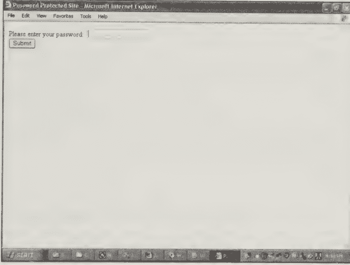

**图 18.1** 一个简单的（但并不安全的）受密码保护的网站。

乍一看，这似乎是创建一个安全网站的一种可行方案。一旦访问者点击提交（Submit）按钮，表单就会对给定的密码进行验证。如果密码正确，表单将提交到 Continue.html；如果密码错误，则什么都不会发生。遗憾的是，这个计划中有一个巨大的漏洞——访问者想要进入你的网站，他们只需要查看页面的源代码！由于浏览器本身可能会阻止普通上网用户进入你的网站，问题变得更加严重了（实际上，他们不会是普通的；他们必须是从未见过电脑的人，更不用说浏览网页了！），所以，问题不在于如何创建一个受密码保护的网站，而是如何防止访问者查看源代码。

## 在表单页面中隐藏密码

有一种方法可以防止人们查看页面的源代码。如果你将密码验证页面放置在一个表单页面内部，只需点击“文件”（File）->“查看源代码”（View Source），就会显示框架（frames）页面的源代码，而不是验证页面的源代码。这样的网站可能采取以下形式。注意，图 18.2 看起来和 18.1 一样，但实际上它正在利用框架来“隐藏”密码信息。此示例的文件名为 `Frames_Password.html`：

框架页面：

```html
<html>
<head>
<title>
受密码保护的网站
</title>
</head>
<frames cols="0,*" target="main">
<frame name="contents" src="Authenticate.html">
<frame name="main" src="Authenticate.html">
<noframes>
<body>
<p>此页面使用了框架，但您的浏览器不支持它们。</p>
</body>
</noframes>
</frames>
</html>
```

`Authenticate.html`：

```html
<html>
<head>
<title>
受密码保护的网站
</title>
<script lang="JavaScript">
<!----
  function verifyPassword( word ) {
    return( word == "sesame");
  }
-->
</script>
</head>
<body>
<form action="Continue.html" onSubmit="JavaScript: return(verifyPassword(this.password.value));">
请输入您的密码：&nbsp;
<input type="text" name="password" size="20"><br>
<input type="submit" value="Submit">
</form>
</body>
</html>
```

太棒了，现在网站访问者无法通过点击“文件”菜单并选择“查看源代码”来查看验证页面的源代码。但还有另一个问题。坚定的访问者仍然可以在浏览器中右键点击验证页面，并从右键菜单中选择“查看源代码”，从而发现密码是什么。图 18.3 显示了框架页面的源代码，乍一看，它起到了作用（没有密码信息）。但图 18.4 是 `authenticate.html` 页面的源代码，通过在网页内部右键点击即可轻松访问。再次，你的安全性很容易被破解。

现在，问题不在于如何隐藏源代码，而在于如何抑制右键菜单事件。幸运的是，这是可能的。

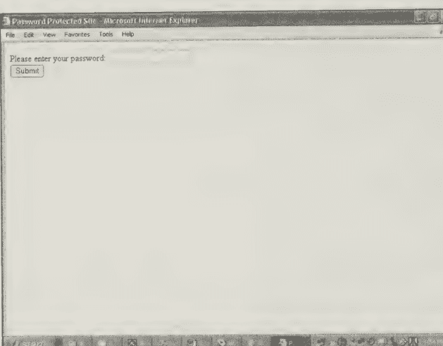

**图 18.2** 看起来和图 18.1 一样，但实际上在利用框架试图为网站提供更高的安全性。

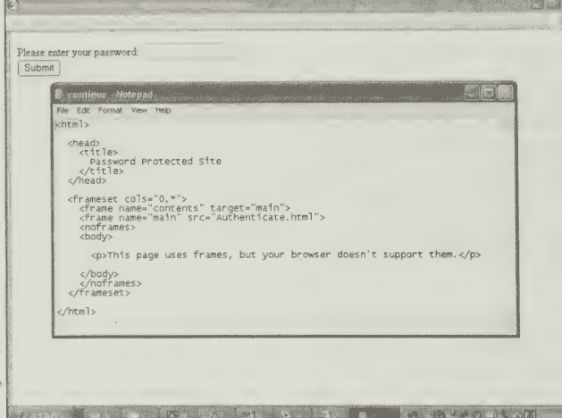

**图 18.3** 成功！通过使用框架实现了安全性。

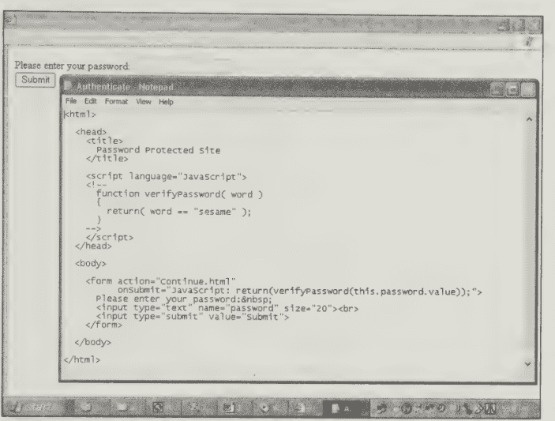

**图 18.4** 失败！仅仅通过查看 `authenticate.html` 页面的源代码，安全性很容易被破坏。

## 抑制网页的右键菜单

抑制网页的右键菜单需要一些工作。你必须捕获整个页面的每一个鼠标事件，区分菜单点击和普通鼠标点击，然后要求浏览器不要显示右键菜单。整个过程可能如下：

```javascript
<script language="JavaScript">
<!--
function clickIE4() {
  if (event.button==2) {
    return( false);
  }
}

function clickNS4(e) {
  if (document.layers && document.getElementById && !document.all) {
    if (e.which == 2 || e.which == 3) {
      return(false);
    }
  }
}

if( document.layers ) {
  document.captureEvents( Event.MOUSEDOWN );
  document.onmousedown = clickNS4;
} else if(document.all && !document.getElementById) {
  document.onmousedown = clickIE4;
}

document.oncontextmenu = new Function("return ( false);");
// --
</script>
```

将此效果应用于网页只需将上述代码粘贴到页面的 `<head>` 部分中即可。

这是新的改进型验证页面，它应该放在上面提供的框架页面中，名为 `No_Context_Password.html`：

```html
<html>
<head>
<title>
受密码保护的网站
</title>
<script language="JavaScript">
<!--
function clickIE4() {
  if( event.button==2 ) {
    return( false );
  }
}

function clickNS4(e) {
  if (document.layers && document.getElementById && !document.all ) {
    if( e.which == 2 || e.which == 3 ) {
      return( false );
    }
  }
}

if( document.layers ) {
  document.captureEvents( Event.MOUSEDOWN );
  document.onmousedown = clickNS4;
} else if(document.all && !document.getElementById) {
  document.onmousedown = clickIE4;
}

document.oncontextmenu = new Function("return ( false);");

function verifyPassword( word ) {
  return( word == "sesame" );
}
// -->
</script>
</head>
<body>
<form action="Continue.html" onSubmit="JavaScript: return(verifyPassword(this.password.value));">
    请输入您的密码：&nbsp;
<input type="text" name="password" size="20"><br>
<input type="submit" value="Submit">
</form>
</body>
</html>
```

## JavaScript 安全性问题

网页在显示到浏览器之前总是会被下载到客户端计算机。这意味着，如果 Web 浏览器允许访问者查看网站的源代码，访问者要做的只需要查看其临时 Internet 文件夹中的源代码，你所有的努力都将是徒劳。

可以告诉浏览器在显示之前不要下载网页到文件。这将缓解密码存储在每个客户端临时文件夹中的问题。我不会提供这种方法的示例，因为这是一个非常复杂的过程，例如，如果一个客户足够专注，他可能会下载或创建一个内存搜索器，在浏览器的内存某处找到密码。虽然这种情况不太可能，但是可以实现的，正如图 18.4 所示。

图 18.5 显示了我几个小时内编写的一个程序，它在不到一秒内找到了内存中的密码。这引出了 JavaScript 安全性的根本问题——密码总是被发送到客户端计算机。无论你如何尝试，一旦密码到了客户端计算机上，你就永远无法完全保护该密码。如果你尝试加密密码，加密算法也会存储在客户端，并对其进行逆向工程。如果你将给定的密码存储在 cookie 文件中并使用第二个页面进行验证，客户端仍然会接收第二个页面的源代码。

但请放心，仅仅使用 JavaScript 创建安全网站有一种非常简单的方法。

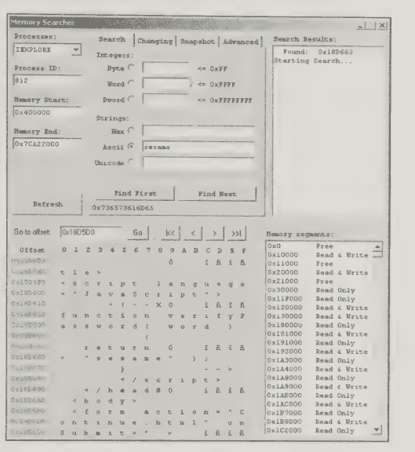

**图 18.5** 将 JavaScript 描述为安全的潜在误导。

## 受密码保护的站点

如果你考虑过使用第二个 Web 页面在初始页面从访问者处接收密码后进行验证，那么你已经非常接近答案了：如果不是使用第二个页面来验证密码，而是将第二个页面的名称作为密码呢？如果是这样的话，密码在验证之前不需要在任何时候发送给客户端。事实上，如果访问者输入了错误的密码，他们看到的将是 404 - 未找到页面的错误。

我说话得有点太快了，所以让我提供一个例子来说明我的观点，该文件名为 `Protected_Page.html`：

```html
<html>
<head>
<title>
受密码保护的站点
</title>
<script language="JavaScript">
<!--
function verifyPassword( word ) {
    document.location = word + ".html"
}
// -->
</script>
</head>
<body>
<form onSubmit="JavaScript:verifyPassword(this.password.value);">
请输入您的密码:&nbsp;
<input type="text" name="password" size="20"><br>
<input type="submit" value="提交">
</form>
</body>
</html>
```

我删除了无意义的源码抑制函数，并将 `verifyPassword()` 函数替换为：

```javascript
function verifyPassword( word ) {
    document.location = word + ".html"
}
```

如果你想象另一个时刻，我网站的密码是一个非常不寻常，例如 `y7v2xu89`，我创建了一个名为 `y7v2xu89.html` 的 Web 页面，并将其与我的认证页面放在同一个目录下，那么我的网站将因为秘密密码而安全。如果我网站的访问者输入正确的密码，他将被带到一个真实的页面，通过该页面可以访问我网站的所有受保护内容。如果他输入了无效密码，除了那个 404 错误之外，他什么也看不见。

由于安全是 Center Park 学校网站项目中的一个大问题，我决定实现这种密码保护技术。首先，这是登录页面，我网站的访问者将在那里输入用户名和密码；其文件名为 `Login.html`。

```html
<html>
<head>
<title>
Center Park 主页 - 登录
</title>
<script language="JavaScript">
<!---
 function login( form ) {
  // 将学生姓名存储在 cookie 文件中稍后参考
  document.cookie = "username=" + form.username.value;
  // 确保密码正确
  document.location = form.password.value + ".html";
}

 function getCookieValue( name ) {
  var c = document.cookie;
  var begin = c.indexOf( name )
  if ( begin < 0 ) return "";
  begin += name.length + 1;
  var end = c.indexOf(";", begin );
  if ( end == -1 ) end = c.length;
  return c.slice( begin, end );
}

 function setCustoms() {
  var bg = getCookieValue("bgColor" );
  var fg = getCookieValue("fgColor" );
  if ( bg != "" ) document.bgColor = bg;
  if ( fg != "" ) document.fgColor = fg;
}
//-->
</script>
</head>
<body onload="JavaScript: setCustoms();"> 
<center>
<font size=6><b>
欢迎来到 Center Park 主页
</b></font>
</center>
<br><br>
要访问此站点的内容，请使用您的学生用户名和提供给您的密码进行登录：
<br><br><br>
<form name="JavaScript" onSubmit="Login(this); return(false);">
<center>
<table border="2" cellpadding="2" width="250">
<tr>
<td colspan="2">登录</td>
</tr>
<tr>
<td>用户名：</td>
<td align="right"><input name="username" size="10"></td>
</tr>
<tr>
<td>密码：</td>
<td align="right"><input name="password" size="10"></td>
</tr>
<tr>
<td colspan="2">
<p align="center"><input type="submit" value="提交"></p>
</tr>
</table>
</center>
</form>
<script language="JavaScript">
<!--
document.login.username.value = getCookieValue("username" );
// -->
</script>
</body>
</html>
```

现在，使用我在之前的示例中使用的相同密码，这里是访问者在输入正确密码时将看到的页面。这个例子是 Center Park 项目中的 `y7v2xu89.html`：

```html
<html>
<head>
<title></title>
<script language="JavaScript">
<!--
var now = new Date();
var months = new Array("January", "February", "March", "April", "May", "June", "July", "August", "September", "November", "December");

var yString = getCookie("year");
var mString = getCookie("month");
var y = yString ? parseInt(yString) : now.getFullYear();
var m = mString ? parseInt(mString) : now.getMonth();
var month = new Date(y, m, 1);

function getCookie( name ) {
  var c = document.cookie;
  var begin = c.indexOf( name );
  if ( begin < 0 ) return "";
  begin += name.length + 1;
  var end = c.indexOf(";", begin);
  if ( end == -1 ) end = c.length;
  return c.slice( begin, end );
}

function fixYear( year ) {
  return( year < 1000 ? year + 1900 : year );
}

function fixMonth( month ) {
  return( month < 0 ? month + 12 : (month > 11 ? 12 : month) );
}

function getNumberOfDays(d ) {
  switch (d.getMonth() + 1) {
    case 1: case 3: case 5: case 7:
    case 8: case 10: case 12:
      return(31);
    case 4: case 6: case 9: case 11:
      return(30);
    case 2:
      return(28 + ( d.getFullYear() % 4 == 0 ? 1 : 0 ) );
  }
}

function getEnding( number ) {
  if (number > 10 && number < 20 ) return( "th" );
  switch ( number % 10 ) {
    case 0: case 4: case 5:
    case 6: case 7: case 8:
    case 9:
      return( "th" );
    case 1:
      return( "st" );
    case 2:
      return( "nd" );
    case 3:
      return( "rd" );
  }
}

// 这些应该从服务器端语言（如 ASP）中加载
var tasks = new Array(30);
tasks[5] = "<a href='Test.html'>Take CS Test";
tasks[28] = "English Paper Due:";

function setCustoms() {
    var bg = getCookie("bgColor");
    var fg = getCookie("fgColor");
    if ( bg != "" ) document.bgColor = bg;
    if ( fg != "") document.fg = fg;
}
//-->
</script>
</head>
<body onload="JavaScript; setCustoms(); document.cookie='loggedin=true';">
<i>欢迎</i><i><b>
<script language="JavaScript">
<!--
    document.write( getCookie("username") ) + "</b>" );
// -->
</script>
<i>这里是您在以下时间段的任务：</i></i>

<table width="75%">
<tr><td align="center">
    <font size="6"><b>
    <script language="JavaScript">
    <!--
        document.write( months[m] );
        // -->
    </script>
    </font>
</td></tr>

<table border="1" cellpadding="2" width="75%">
<tr>
<td width="14"><b>周日</b></td>
<td width="14"><b>周一</b></td>
<td width="14"><b>周二</b></td>
<td width="14"><b>周三</b></td>
<td width="14"><b>周四</b></td>
<td width="14"><b>周五</b></td>
<td width="14"><b>周六</b></td>
</tr>
<tr>
<td></td><td></td><td></td><td></td><td></td><td></td><td></td>
</tr>
<tr>
<td></td><td></td><td></td><td></td><td></td><td></td><td></td>
</tr>
<tr>
<td></td><td></td><td></td><td></td><td></td><td></td><td></td>
</tr>
<tr>
<td></td><td></td><td></td><td></td><td></td><td></td><td></td>
</tr>
<tr>
<td></td><td></td><td></td><td></td><td></td><td></td><td></td>
</tr>
<tr>
<td></td><td></td><td></td><td></td><td></td><td></td><td></td>
</tr>
<tr>
<td></td><td></td><td></td><td></td><td></td><td></td><td></td>
</tr>
<script language="JavaScript">
<!--
  var startDay = month.getDay();
  for(i = 0 ; i < startDay ; i++) {
    document.write("<td></td>");
  }

  var numDays = getNumberOfDays(month);
  for(i = 0 ; i < numDays; i++) {
    if( ( i + startDay ) % 7 == 1) {
      document.write("</tr><tr><td>");
    }
    if(fixYear(now.getFullYear()) == fixYear(month.getFullYear()) &&
    now.getMonth() == month.getMonth() && now.getDate() == i + 1)
      document.write(" borderColor='red'");
    document.write("<b>" + (i+1) + "</b>" + getEnding(i+1));
    document.write("<br>");
    if(tasks[i+1]) {
      document.write(tasks[i+1]);
    }
    document.write("</td>");
  }
  document.write("</tr></tr>");
//-->
</script>
</table>
</body>
</html>
```

我的工作尚未完成。然而，你会注意到，一旦页面加载，cookie 文件中就会设置一个记住用户已登录的值。为了让我的网站完全安全，我需要在每个带有敏感数据的页面中检查该值。这里是 Center Page 网站的另一个真实页面，它正执行此操作。该 Web 页面名为 `AddTask.html`：

```html
<html>
<head>
<title>Center Park - 添加任务</title>
<script language="JavaScript">
<!--
  if (getCookieValue("loggedin") != "true") {
    document.location = "Main.html";
  }

  var dateElement;
  function openDatePicker (target) {
    dateElement = target;
    var ieSize = "width=380,height=255";
    var navSize = "width=480,height=295";
    var isNav = navigator.appName == "Netscape"
    window.open("PopupCalendar.html", "calendar",
      "menubar=no,resizable=no,scrollbars=no, " +
      "status=yes,toolbar=no",
      + (isNav ? navSize : ieSize));
  }

  function setState (date) {
    dateElement.value = date;
  }

  function getCookie(name) {
    var c = document.cookie;
    var begin = c.indexOf(name);
    if(begin < 0) return "";
    begin += name.length + 1;
    var end = c.indexOf(";", begin);
    if(end == -1) end = c.length;
    return(c.slice(begin, end));
  }

  function setCustoms() {
    var bg = getCookieValue("bgColor");
    var fg = getCookieValue("fgColor");
    if ( bg != "" ) document.bgColor = bg;
    if ( fg != "" ) document.fgColor = fg;
  }
// -->
</script>
</head>
<body onload="JavaScript: setCustoms();">
<br><br>
<i>Center Park 任务调度器用于/</i><b>
<script language="JavaScript">
<!--
document.write( getCookieValue("username" ) );
// -->
</script>
</b>
<br><br><br><br>
<form name="taskForm" onSubmit="JavaScript: return ( false );">
<center>
<table border="1" width="75%">
<tr>
<td width="100%" colspan="2"><b>调度任务/</b></td>
</tr>
<tr>
<td width="50%">
&nbsp;
任务日期:
<input type="text" name="date" size="10">
<input type="button" value="..."
onclick="JavaScript: openDatePicker(document.taskForm.date);">
</td>
</tr>
<tr>
<td width="50%">
任务描述（可以使用 HTML）:<br>
<textarea rows="7" cols="35"></textarea>
</td>
</tr>
<tr>
<td align="center" colspan="2">
<input type="submit" value="Submit" name="B1">
</td>
</tr>
</table>
</center>
</form>
</body>
</html>
```

第一个执行的脚本命令是：

```javascript
if (getCookie("loggedin") != "true") {
  document.location = "Main.html";
}
```

它检查登录 cookie 值，如果用户未登录，则将访问者重定向到主页。这可以防止某些直接找到网站的 URL 并像其他人一样创建任务。最后，我仅使用 JavaScript 就创建了一个安全的、受密码保护的网站！

## 总结

本章展示了 JavaScript 的安全性并不非常安全。虽然可以通过将你的脚本与 HTML 结合来提供某些安全性（例如，在框架内“隐藏”你的密码信息），但这些技术充其量说是可疑的，并且可以被具有中等技术水平的人轻易破解。此外，可以快速编写或下载应用程序（见图 18.5），它们可以在几秒钟内定位“安全”的密码信息。最好的方法是将 JavaScript 安全性视为通向更安全解决方案的过渡步骤。例如，利用服务器端安全——不将任何敏感密码信息传递或存储在客户端计算机上，这是更好的选择。尽管如此，如本章所示，有通过 JavaScript 保护网站的相对安全的方法。然而，这应该仅对于不过于敏感的信息（即不是银行账户密码！），并且应该再次被视为一种威慑，而不是阻止访问的完美方法。

## 第 19 章

## 创建超链接关联符

如果你具有处理 Web 页面的经验，你可能会注意到浏览器空间似乎永远不够。有了所有这些表格、图像、框架和文本，几乎没有空间留给你维持网站运行可能赖以的广告。在设计 Center Park 网站时，想象有十多个学生组织找你要求在网站主页获得空间。显然，你无法满足所有人的——至少不能同时满足。


## 为网页每次加载时显示不同的广告

你幸运的是，Internet Explorer 允许 Web 页通过使用 `innerHTML` 属性动态更改内容。你立即开始设计一种方法，在每次页面加载时轮换不同的文本广告。你可以看到下面的代码列表是如何体现在图 19.1 和 19.2 中的，因为这两个图之间的公告是不同的。

> **注意**
> 正如此处所述，此示例仅在 Internet Explorer 中使用。

```html
<html>
<head>
<title>Center Park 首页 - 主页</title>
<script language="JavaScript">
<!--
var ads = new Array("来观看 Center Park 野猫队的比赛吧！ <br>在 Union 大厦领取你的 * 日程。",
"加入 6 月 12-14 日的 June Bug 节吧！* " + "我们那里见。",
"7 月 3 日是首届年度收养怪客日！" + "<br>他们也是人。友善收养一个怪客吧.");

function getAd() {
  var ad = parseInt(Math.random() * ads.length);
  return(ads[ad]);
}

function rotateAd() {
  document.all.adCell.innerHTML = getAd();
}

function getCookieValue( name ) {
    var c = document.cookie;
    var begin = c.indexOf( name );
    if( begin < 0 ) return("");
    begin += name.length + 1;
    var end = c.indexOf("", begin);
    if(end == -1 ) end = c.length;
    return(c.slice(begin, end));
}

function setCustoms() {
    var bg = getCookieValue("bgColor" );
    var fg = getCookieValue("fgColor" );
    if( bg != "" ) document.bgColor = bg;
    if( fg != "" ) document.fgColor = fg;
}
//-->
</script>
</head>
<body onLoad="JavaScript: setCustoms(); rotateAd();">
<center>
    <font color="red" size="6"><b>
    Center Park 首页
    </b></font>
</center>
<br><br>
<table width="100%">
    <tr>
        <td id="adCell" width="50%">
        </td>
        <td width="50%">
            <a href="login.html">登录</a><br>
            <a href="store.html">商店</a><br>
            <a href="customize.html">自定义</a>
        </td>
    </tr>
    <tr>
        <td width="100%" colspan="2">
            <hr>
            <font face="Courier" size="5">***学校新闻 ***</font> <br>
            <br>
            <b>7 月 4 日</b> - 购物场的烟花&nbsp;<br>
            与 Center Park 的教职、员工和学生一起享受假期吧。<br>
            <br>
            <b>7 月 3 日</b> - 首届年度收养怪客日！&nbsp;<br>
            他们也是人。<br>
            <br>
            <b>6 月 12 日</b> - June Bug 节开始。<br>
        </td>
    </tr>
</table>
</body>
</html>
```

每当它加载时，此页面将从预定义的广告列表中随机选择一个广告并将其显示在表格中。

## 创建带链接的广告轮器

在研究了 Center Park 的学生如何使用他们的网站后，你决定每个广告都没有获得足够的关注，你需要为文本创建超链接以便他们直接跳转到页面。通过使用 `window` 对象的 `setTimeout()` 函数，你可以设置广告变化的频率。


**图 19.1** 在这个图中我们看到了广告的切换。


**图 19.2** 在这个图中我们看到了不同的广告内容。

```javascript
function setCustoms() {
    var bg = getCookieValue("bgColor");
    var fg = getCookieValue("fgColor");
    if(bg != " ") document.bgColor = bg;
    if(fg != " ") document.fgColor = fg;
}
// -->
</script>
</head>
<body onload="JavaScript: setCustoms(); rotateAd();">
<center>
<font color="red" size="6"><b>
Center Park 首页
</b></font></center>
<br>
<table width="100%">
<tr>
<td id="adCell" width="50%">
</td>
<td width="50%">
<a href="login.html">登录</a><br>
<a href="store.html">商店</a><br>
<a href="customize.html">自定义</a>
</td>
</tr>
<tr>
<td width="100%" colspan="2">
<hr>
<font face="Courier" size="5">*** 学校新闻 ***</font> <br>
<b>7月4日</b> - 商场有烟花！&nbsp;
欢迎与 Center Park 的教职员工、工作人员和学生一起享受这个假期。<br>
<br>
<b>7月3日</b> - 第一届年度“领养书呆者日”&nbsp;他们也是人。<br><br>
<b>6月12日</b> - 蝉虫节开始。
</td>
</tr>
</table>
</body>
</html>
```

如你所见，在图 19.3 所示，这些广告不仅会轮换，而且带有链接。这在充分利用有限的屏幕空间时非常有用（在完成的 Center Park 网站中将会看到）：换句话说，多个小组和组织可以在同一个空间内投放广告（每隔几秒切换一次广告），并且每个广告都链接到该小组的特定页面；或者如果访问者想获取更多信息，他们可以点击链接页面来获取。

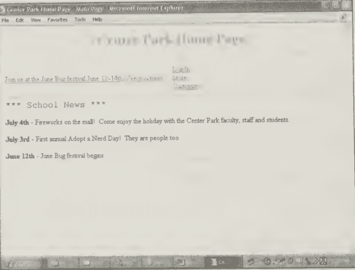

**图 19.3** 为轮播广告添加链接是进一步利用有限屏幕空间的好方法。

该网站不仅每次加载时都会显示不同的带链接广告，而且在延迟十秒后自动切换广告。JavaScript 语句 `window.setTimeout('rotateAd()', 10000);` 通过调用 `rotateAd()` 函数创建一个定时器，以便在十秒后轮换广告，然后该函数又会再次调用相同的语句。从技术上讲，这是一个无限循环，但由于每次迭代之间有十秒的延迟，它是可以接受的。

## 创建自动更改的链接图片广告

一旦学生们看到你能够做的事情，他们就会立即向你发送图片形式的广告，以替换他们那些没有吸引力的文本广告。将文本广告替换为图片是一项非常简单的任务。由于 HTML 元素的 `innerHTML` 字段允许你替换任何 HTML，你只需要在文本所在的地方放置图片标签即可。这里有一个这样的示例：

```html
<head>
<title>Center Park 首页 - 主页</title>
<script language="JavaScript">
<!--
var ads = new Array("<a href=\"Bobcats.html\">" + 
    "" + 
    "</a>", 
    "<a href='JuneBug.html'>" + 
    "" + 
    "</a>");

function getAd() {
  var ad = parseInt( Math.random() * ads.length );
  return(ads[ad]);
}

function rotateAd() {
  document.all.adCell.innerHTML = getAd();
  window.setTimeout("rotateAd()", 10000 );
}

function getCookieValue( name ) {
  var c = document.cookie;
  var begin = c.indexOf(name );
  if(begin < 0) return("*");
  begin += name.length + 1;
  var end = c.indexOf("", begin );
  if(end != -1) end = c.length;
  return(c.slice( begin, end ));

function setCustoms() {
  var bg = getCookieValue("bgColor");
  var fg = getCookieValue("fgColor");
  if (bg == "*") document.bgColor = bg;
  if (fg == "*") document.fgColor = fg;
}
// -->
</script>
</head>
<body onload="JavaScript: setCustoms(); rotateAd();">
<center><font color="red" size="6"><b>
Center Park 首页
</b></font></center>
<br><br>
<table width="100%">
<tr>
<td id="adCell" width="50%">
</td>
<td width="50%">
<a href="login.html">登录</a><br>
<a href="store.html">商店</a><br>
<a href="customize.html">自定义</a>
</td>
</tr>
<tr>
<td width="100%" colspan="2">
<hr>
<font face="Courier" size="5">*** 学校新闻 ***</font> <br>
<b>7月4日</b> - 商场有烟花！&nbsp;
欢迎与 Center Park 的教职员工、工作人员和学生一起享受这个假期。<br>
<b>7月3日</b> - 第一届年度“领养书呆者日”！&nbsp;
他们也是人。<br>
<b>6月12日</b> - 蝉虫节开始。
</td>
</tr>
</table>
</body>
</html>
```

最后，你有了一个学生完全想要的广告轮器（见图 19.4）。广告不仅由图片组成，而且还带有链接。现在，如果这种技术是平台无关的就好了。


**图 19.4** 轮播图片广告可以带来新的紧迫感。

## 平台无关

之前的示例问题在于它们只在 Internet Explorer 中工作。坦率地说，这种绕过方法比之前的示例稍微复杂一些。在以下示例中，页面加载时替换 HTML 标签值：

```html
<html>
<head>
<title>Center Park 首页 - 主页</title>
<script language="JavaScript">
<!--
    var ads = new Array( );
    ads[0] = "<a href=\"Bobcats.html\">" + "" + "</a>";
    ads[1] = "<a href='JuneBug.html'>" + "" + "</a>";

    function getAd() {
        var ad = parseInt( Math.random() * ads.length );
        return(ads[ad]);
    }

    function rotateAd() {
        document.all.adCell.innerHTML = getAd();
        window.setTimeout("rotateAd()", 10000);
    }

    function getCookieValue( name ) {
        var c = document.cookie;
        var begin = c.indexOf( name );
        if( begin < 0 ) return("*");
        begin += name.length + 1;
        var end = c.indexOf("", begin);
        if( end != -1 ) end = c.length;
        return(c.slice(begin, end));
    }

    function setCustoms() {
        var bg = getCookieValue("bgColor");
        var fg = getCookieValue("fgColor");
        if( bg == "*" ) document.bgColor = bg;
        if( fg == "*" ) document.fgColor = fg;
    }
// -->
</script>
</head>
<body onload="JavaScript: setCustoms(); rotateAd();">
<center>
<font color="red" size="6"><b>
  Center Park 首页
</b></font></center>
</body>
</html>
```


# 第 20 章：使用 JavaScript 创建动态 (HTML) 效果

到目前为止，这些章节一直侧重于扩展 Center Park 网站的功能。到目前，你已经设计并实现了一个登录页面、商店、在线测试以及两种不同的日历——这是这类优秀网站所需的所有内容。本章将不会重点关注新功能的设计和实现，而是关注网站视觉效果的改进。大多数专业网站都有某种类型的动态内容，也称为“视觉点”。虽然网站的完全功能并不需要视觉点，但它能让网站更具吸引力，并吸引访问者再次回来。

遗憾的是，网站上的大多数动态效果在创建和完善上花费大量时间。目前没有简单的方法来添加网站访问者所预期的视觉点。因此，本章将只关注两种类型的动态内容：鼠标悬停图像旋转和整个网站的自定义配色方案。

Center Park 学校的管理人员非常明确，他们不想要一个过于“花哨”的网站，但同时希望它仍然具有视觉吸引力。在几次场合，他们使用了旧的“功能优于形式”的设计阶段，也就是说他们希望网站的功能处于首位。但他们希望网站易于访问、允许终端用户自定义，并向不同的受众（父母、教师、学生）提供信息。在与管理小组的早期会议中，你可以告诉他们通过一些非常直接的视觉效果，你可以实现所有这些功能需求，同时让网站看起来很好。这个目标就是本章介绍信息的重点。

## 鼠标悬停图像旋转

鼠标悬停图像旋转可能是 Web 上最常见的动态效果。由于其简单性，有许多实现这种效果的方法。对于我们的 Center Park Web 项目，你将简单使用 `IMG` 标签的内置鼠标事件处理器，但我将展示实现效果的其他方法。

我编写了下面的示例，它使用简单的文本链接，以演示仅通过添加这种简单效果就能产生的显著改进。我们稍后将其与鼠标悬停链接进行比较。图 20.1 展示了这样一个非常基础的 Web 页面。

```html
<html>
<head>
<base target="main">
</head>
<body>
<font color="red" size="4"><b>
Center Park<br>
</b></font>
<table width="100%">
<tr><td>
<a href="Main.html" target="main">
Home
</a>
</td></tr>
<tr><td>
<a href="Login.html" target="main">
Login
</a>
</td></tr>
<tr><td>
<a href="Store.html" target="main">
Store
</a>
</td></tr>
<tr><td>
<a href="Customize.html" target="main">
Customize
</a>
</td></tr>
</table>
</body>
</html>
```

注意，这个示例完全没有任何 JavaScript。我将这个 Web 页面放置在以下框架页的左侧框架中：

```html
<html>
<head>
  <title>Center Park Home Page</title>
</head>
<frameset cols="150,*">
  <frame name="contents" target="main" src="MenuBar.html" scrolling="no" noresize>
  <frame name="main" src="Main.html" scrolling="auto" noresize>
<noframes>
<body>
  <p>此页面使用了框架，但您的浏览器不支持框架。</p>
</body>
</noframes>
</frameset>
</html>
```

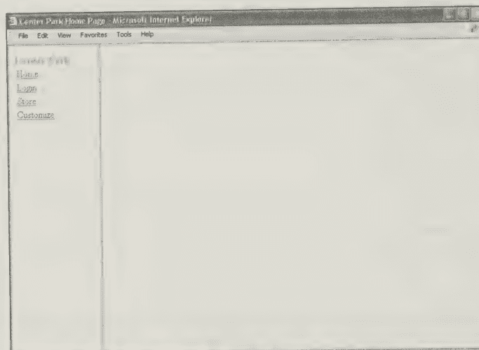

**图 20.1** 一个典型的（无聊的？）基于框架的 Web 页面，突出了常用的导航框架（左侧框架），其中放置了链接，点击后会在主内容框架（右侧框架）中打开信息。

正如图 20.1 所示，这个 Web 页面确实非常简单。任何具有 HTML 基本知识的人都可以在大约一小时内设计并构建这个页面。世界上真的有数百万个网站看起来和这个几乎完全一样。换句话说，它们是无味的。

增加趣味性的一种简单方法是将文本链接替换为图像链接，如下。注意在图 20.2 中，文本链接现在是图形链接。

```html
<html>
<head>
  <base target="main">
</head>
<body>
<font color="red" size="4"><b>
Center Park<br>
</b></font>
<table width="100%">
<tr>
<td>
  <a href="Main.html">
  
  </a>
</td></tr>
<tr><td>
  <a href="Login.html" target="main">
  
  </a>
</td></tr>
<tr><td>
  <a href="Store.html" target="main">
  
  </a>
</td></tr>
<tr><td>
  <a href="Customize.html" target="main">
  
  </a>
</td></tr>
</table>
</body>
</html>
```

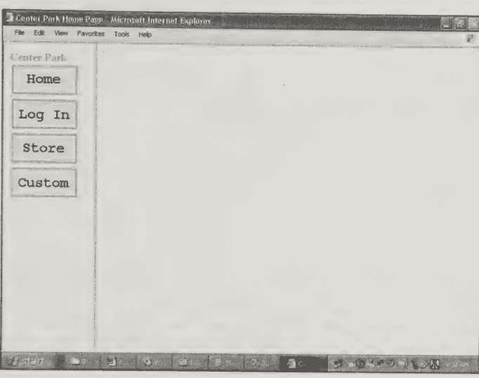

**图 20.2** 纯文本链接现在已经通过一些简单的图形进行了“润色”。

虽然这个网站要变得有趣得多，但它仍然不够花哨，无法以任何方式脱颖而出。我真正需要让我的网站领先的是一些动态效果。我想在鼠标悬停在图像上时让图像发生细微变化。为了实现这一点，我将使用 `onMouseOver` 和 `onMouseOut` 事件处理器。当光标移动到图像上时，我将其替换为略有不同的图像；当光标离开图像时，我将其恢复到原始状态。以下是这样做的模板：

```html

```

如果我将此模板应用于 Center Park 菜单栏中的图像，它看起来会像图 20.3。注意在图中，鼠标正悬停在登录按钮上，导致它（通过 `onMouseOver` 图像事件）改变颜色并显示高亮状态。

以下是使其看起来那样的完整源代码：

```html
<head>
<base target="main">
</head>
<body>
<font color="red" size="4"><b>
Center Park<br>
</b></font>
<table width="100%">
<tr><td>
<a href="Main.html" target="main">

</a>
</td></tr>
<tr><td>
<a href="Login.html" target="main">

</a>
</td></tr>
<tr><td>
<a href="Store.html" target="main">

</a>
</td></tr>
<tr><td>
<a href="Customize.html" target="main">

</a>
</td></tr>
</table>
</body>
</html>
```

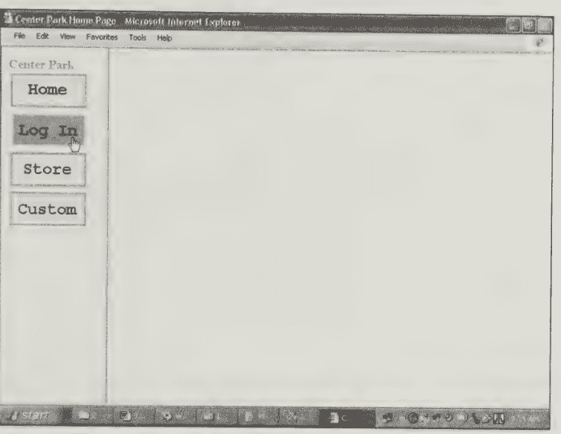

**图 20.3** `onMouseOver` 图像可以突出特定功能，并为你的 Web 设计带来更具视觉吸引力的品质。

最后，我终于有了一个既美观又实用的网站。当然，这是创建悬停效果的唯一方法。它可能不是最好的方法，但它是最简单的。如果你有大量的按钮，或者你想将 `onMouseDown` 事件与另一个图像结合，很快就会发现这需要大量的代码。代码越多，下载时间就越长，因此我将介绍另一种你认为比硬编码每个图像更有用的替代方案。我之前提到过，每个功能都需要一个同样优秀的函数，悬停事件也不例外。这些要求看起来可能很困难，但通过文档对象模型（DOM）的帮助，实际上并不困难。首先我将展示一个运行的示例，然后详细解释它。

```html
<html>
<head>
<base target="main">
<script language="JavaScript">
<!--
function change( image, event ) {
    image.src = image.name + event + ".bmp";
}
// -->
</script>
</head>
<body>
<font color="red" size="4"><b>
Center Park<br>
</b></font>
<table width="100%">
<tr>
<td>
<a href="Main.html" target="main">

</a>
</td>
</tr>
<tr>
<td>
<a href="Login.html" target="main">

</a>
</td>
</tr>
<tr>
<td>
<a href="Store.html" target="main">

</a>
</td>
</tr>
<tr>
<td>
<a href="Customize.html" target="main">

</a>
</td>
</tr>
</table>
</body>
</html>
```

所有的图像事件都由单个函数 `change()` 处理：

```javascript
function change( image, event ) {
  image.src = image.name + event + ".bmp";
}
```

该函数接收两个参数。第一个参数是创建事件的图像的指针。第二个参数是指定事件类型的整数。我为 `onMouseDown` 事件选择了值 `3`，为 `onMouseOver` 事件选择了值 `2`，为 `onMouseOut` 事件选择了值 `1`。对于每个按钮，你需要为每个事件类型创建一个单独的图像。此值在 `change()` 函数中使用，以确保在元素上显示正确的图像。为了使用此函数，图像元素要求的格式如下：

```html

```

这种方法比之前的方法稍微易读一些，并且可以减少大量图像的下载时间。然而，两种技术在功能上是完全相同的。使用哪种完全取决于你。

## 自定义配色方案

你可以添加到几乎任何网站上的一个微不足道但在视觉上令人悦目的动态功能是自定义配色方案。通过在 cookie 文件中存储自定义颜色值，你可以为加载的任何页面设置这些颜色。这个功能最早在第 11 章中介绍，但我将对其进行详细阐述，使其成为一个功能完整的动态 HTML 元素。

为任何网站实现自定义配色方案的第一部分是创建一个可以在 cookie 文件中设置颜色变量的页面。因为这项任务很容易完成，而且在之前的章节中已经解释过，我将直接向你展示一个工作代码示例。图 20.4 显示了简单的用户界面，它允许网站访问者能够根据自己的喜好“自定义”配色方案。

```html
<html>
<head>
<title>
Center Park - 自定义化
</title>
<script language="JavaScript">
<!--
function saveCustoms( form ) {
  document.cookie = "bgColor=" + form.bgColor.value;
  document.cookie = "fgColor=" + form.fgColor.value;
}
// -->
</script>
</head>
<body>
<form onSubmit="JavaScript:saveCustoms( this );">
<table>
<tr>
<td>
<b><font size="5">自定义 <br>
网站颜色:<br></font></b>
</td>
</tr>
<tr>
<td>
<b>&nbsp;背景颜色：&nbsp;&nbsp;&nbsp; </b>
</td>
<td>
<input type="text" name="bgColor" size="15">
</td>
</tr>
<tr>
<td>
<b>前景色颜色：</b>
</td>
<td>
<input type="text" name="fgColor" size="15">
</td>
<td>
<input type="submit" value="提交">
</td>
</tr>
</table>
</form>
</body>
</html>
```

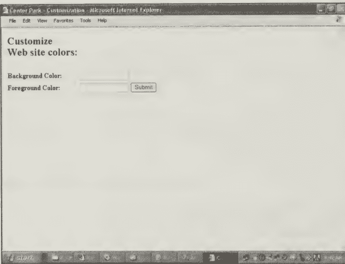

**图 20.4** 即使是像这样简单的用户自定义选项，也能为你的网站带来真正的个性化感，鼓励用户产生更强的归属感（翻译：他们将更倾向于返回你的网站）。

这是存储自定义配色方案所需的最少代码。一个简单的函数 `saveCustoms()`：

```javascript
function saveCustoms( form ) {
  document.cookie = "bgColor=" + form.bgColor.value;
  document.cookie = "fgColor=" + form.fgColor.value;
}
```

当按下表单上的提交按钮时会调用该函数，并将自定义颜色变量存储在 cookie 文件中。从那时起，任何有权访问 cookie 文件并具有相应代码来检索自定义颜色变量的页面，都可以拥有访问者所希望配色方案。

加载自定义颜色变量的代码同样简单。只需要从 cookie 文件中读取变量并相应地设置文档字段。图 20.5 通过将背景设置为黑色并将前景色设置为白色，说明了这一功能。

```html
<html>
<head>
<title>
Center Park - 自定义化
</title>
<script language="JavaScript">
<!--
function saveCustoms( form ) {
  document.cookie = "bgColor=" + form.bgColor.value;
  document.cookie = "fgColor=" + form.fgColor.value;
}

function getCookieValue( name ) {
  var c = document.cookie;
  var begin = c.indexOf( name );
  if( begin < 0 ) return( "" );
  begin += name.length + 1;
  var end = c.indexOf(";", begin );
  if( end == -1 ) end = c.length;
  return( c.slice( begin, end ) );
}

function setCustoms() {
    var bg = getCookieValue("bgColor");
    var fg = getCookieValue("fgColor");
    if( bg != "" ) document.bgColor = bg;
    if( fg != "" ) document.fgColor = fg;
}
// -->
</script>
</head>
<body onload="JavaScript:setCustoms();">
<form onSubmit="JavaScript:saveCustoms( this );">
<table>
<tr>
<td>
<b><font size="5">自定义 <br>
网站颜色:<br></font></b>
</td>
</tr>
<tr>
<td>
<b>&nbsp;背景颜色：&nbsp;&nbsp;&nbsp; </b>
</td>
<td>
<input type="text" name="bgColor" size="15">
</td>
</tr>
<tr>
<td>
<b>前景色颜色：</b>
</td>
<td>
<input type="text" name="fgColor" size="15">
</td>
<td>
<input type="submit" value="提交">
</td>
</tr>
</table>
</form>
</body>
</html>
```

这个稍微修改过的示例不仅保存了颜色，而且下次页面加载时加载了它们。`setCustoms()` 函数：

```javascript
function setCustoms() {
  var bg = getCookieValue("bgColor");
  var fg = getCookieValue("fgColor");
  if(bg != "") document.bgColor = bg;
  if( fg != "" ) document.fgColor = fg;
}
```

从 `body` 标签的 `onload` 处理程序调用，从 cookie 文件读取颜色变量并将其应用于文档字段。图 20.6 利用了以下代码，但使用上面指定的配色方案显示（在本例中，黑色背景和白色前景）。

```html
<html>
<head>
<title>Center Park 主页 - 主页</title>
<script language="JavaScript">
<!--
function getAd() {
  var ad = "ad";
  ad += parseInt(Math.random() * 2) + 1;
  return(ad + ".jpg");
}

function rotateAd() {
  with( document ) {
    for(i = 0; i < images.length; i++) {
      if (images[i].name == "adImage") {
        images[i].alt = images[i].src = getAd();
      }
    }
  }
  window.setTimeout("rotateAd()", 10000);
}

function getCookieValue( name ) {
  var c = document.cookie;
  var begin = c.indexOf( name );
  if( begin < 0 ) return( "" );
  begin += name.length + 1;
  var end = c.indexOf(";", begin);
  if( end == -1 ) end = c.length;
  return( c.slice( begin, end ) );
}

function setCustoms() {
  var bg = getCookieValue("bgColor");
  var fg = getCookieValue("fgColor");
  if( bg != "" ) document.bgColor = bg;
  if( fg != "" ) document.fgColor = fg;
}
// -->
</script>
</head>
<body onload="JavaScript: setCustoms(); rotateAd();">
<center>
<font color="red" size="6">
<b>
Center Park Home Page
</b></font></center>
<br><br>
<table width="100%">
<tr>
<td width="50%">

</td>
<td width="50%">
<a href="login.html">登录</a><br>
<a href="store.html">商店</a><br>
<a href="customize.html">自定义</a>
</td>
</tr>
<tr>
<td width="100%" colspan="2">
<hr>
<font face="Courier" size="5">*** 校园新闻 ***</font><br>
<b>7月4日</b> - 商场有烟花秀！来和 Center Park 的教职员工和学生们一起享受假期吧。<br>
<b>7月3日</b> - 第一届年度“领养书呆日”！他们也是人啊。<br>
<b>6月12日</b> - 六月虫子节开始。
</td>
</tr>
</table>
</body>
</html>
```

此示例是本章之前介绍的框架页面的默认内容。它利用了 `setCustoms()` 函数来应用用户所需的配色方案。Center Park 网站的所有页面都同样配备了用于应用用户所需配色方案的配置。

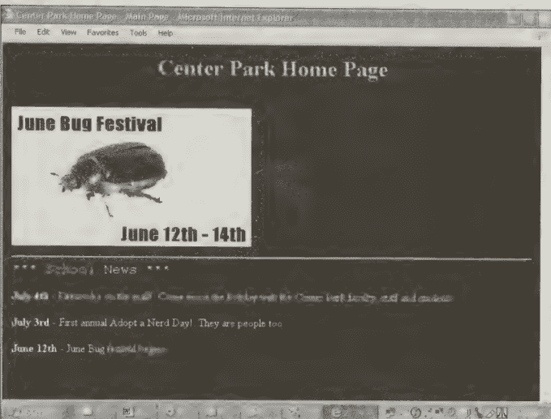

**图 20.6** 虽然对某些人来说可能并不好看，但这种自定义配色方案可能正是其他人喜欢的。

## 总结

让你的 Web 访问者能够自定义显示设置，并提供更具视觉吸引力的体验，会让他们在网站上花费的时间更加愉快。通过一些 JavaScript 和 DHTML 效果，你可以相对容易地实现这两个目标。此外，通过利用 cookies，你可以将许多效果集成到整个网站中，例如，如果在某个页面上设置了自定义配色方案，它可以应用到整个网站。虽然表单在 Web 这种动态、图形丰富的媒介中应该保持功能正常，但这并不意味着你的网站必须是平庸或“无趣”的。事实上，正如本章所示，通过利用简单的图形结合一些基础 HTML（例如框架），你可以实现一个既美观，又能以易于访问、组织良好的格式传递所有所需信息的网站。


# 第 21 章：项目总结——CENTER PARK 网站功能概览

现在你已经单独看了 Center Park 网站每个独立构建的功能，你现在应该将整个网站视为一个完成的实体。在最后一章中，你将：

- 查看整个 Center Park 网站的运行情况，包括对其中展示的所有功能进行自顶向下的演示。
- 探索各个代码组件（如之前的项目章节中所述的），查看它们如何与网站的其他部分协同工作。
- 作为受聘构建网站的顾问，确定网站的变更控制和长期管理需求；记住，任何设计（无论是使用 JavaScript 还是其他）中的一个关键问题都是考虑最终用户——即客户——将如何利用你构建在网站中的所有功能。在这方面，我们从易用性的角度审查 Center Park 网站，并确定它是否满足第 14 章中设定的所有需求。

## Center Park 网站的 JavaScript 特有功能

正如你在过去几章节中看到的，Center Park 网站具有几项 JavaScript 特有功能，使其优于普通的“静态”Web 网站。具体来说，正如你在过去几章节中看到的，这些特性如下：

> **注意**
>
> 以下列表最初出现在第 14 章，该章节是 Center Park 作业的“预览”章节。我们再次列出此列表，以便你可以作为一个“复习检查清单”，用于了解描述的功能在 Center Park 网站中实际上是如何实现的。然后，本章中的各个标题将更详细地讨论每个功能组件。

- **动态日历**。学生们要求能够“一目了然”地查看他们的作业，并能够以周和月为单位查看；此外，学年运行的日期（开始/结束日期、假期、会议等）需要通过网站进行传达。网站将需要几个日历，以便网站用户能够以他们想要的方式和频率（按周、按月）找到他们想要的信息。
- **测试和调查功能**。学校的管理员最近访问了另一个学区的兄弟学校，看到该学校进行在线测试令他们印象深刻。这已被证明是进修教育中高级学生评估的一种非常有效的方法，而且（通过对代码进行简单的修改）是通过在线调查收集信息的手段。Center Park 的管理员希望他们的网站也能拥有这样的功能。
- **在线商店**。在所有与教育相关的事务中，募捐是学校重要的计划和倡议，确保学校无处不在的“红笔”评审能够持续进行……一个可以随时放置募捐物品的在线商店。
- **安全的成员专属访问**。网站的许多功能虽然对公众开放（例如商店），但需要当前学生和教职员工进行安全访问。为了确保被视为机密的信息保持机密性，你将需要利用安全功能。
- **轮播横幅广告**。不意外的是，学校内的几个机构都要求在网站上获得广告空间，以便访问者了解他们的活动。几个轮播横幅广告将提供指向网站特定部分的链接，在广告内建立超链接将是至关重要的。
- **大胆、吸引的外观**。最后，上述所有功能以及网站的整体外观都将尽可能美观。为了实现这一目标，网站还将包含各种动态（DHTML）效果。

在本章的每个章节中，将对功能进行审查；然而，重点是确定项目目标（即所需的功能）是否已实现，并确定未来可能需要哪些功能。

> **注意**
>
> 本总结章节的写法就像是一场“项目后回顾”。当你阅读时，请想象自己处于 JavaScript 开发人员的角色（在读完这本书后你已经是了！），与 Center Park 的管理员会面。那么，在这种客户会议中，你的工作是“推销”你的工作（即最终产品如何满足了他们的前期需求），同时保持开放的态度倾听（并记录）可能的未来变更。

## 审查：网站首页

在完成的网站中，首先审查的是网站首页。图 21.1 和 21.2 显示了该页面，并突出了网站中内置的旋转横幅功能。

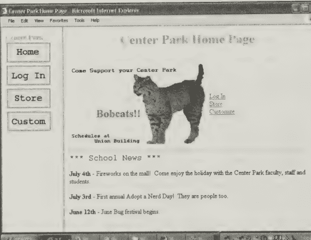

**图 21.1** Center Park 首页，突出显示了旋转横幅功能。

### 满足的需求：网站首页

首页满足了初始项目请求中设定的许多功能需求：

- 旋转横幅图形（在此情况下，突出显示如图 21.1 所示的“支持你的 Bobcats”信息，以及如图 21.2 所示的“六月虫子节”广告）有助于解决“屏幕空间”问题，通过让每个广告显示几秒钟，允许多个广告共享相同空间，每个广告都能获得“播放时间”。注意，旋转的图形数量没有限制；此外，您可以在每个图中包含超链接，这样如果正在宣传的特定小组/活动有自己的网站，就可以在旋转广告中提供该网站的链接。
- 如图 21.3 所示，导航按钮通过在鼠标悬停时改变颜色来利用 DHTML 效果。请注意，这些链接呈现的功能也在右侧框架中呈现。为什么要这样做？如果用户由于某种方式离开了网站框架（并丢失了左侧框架中提供的导航按钮），他们仍然可以访问网站的所有功能。

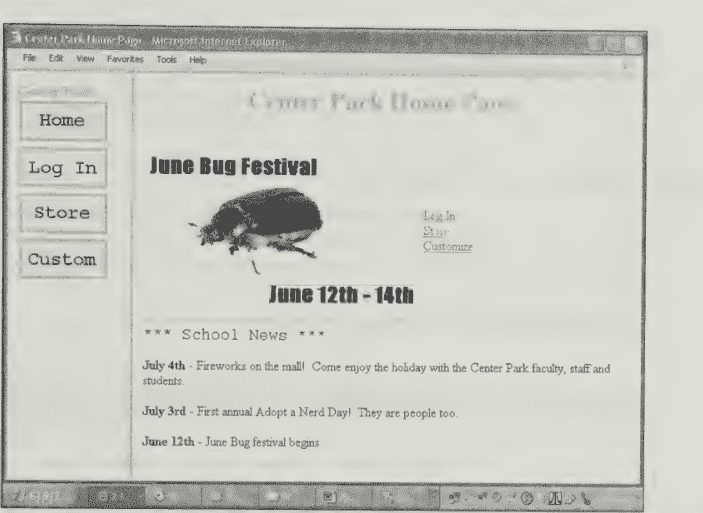

**图 21.2** 现在正在显示不同的图形。同样注意，屏幕左侧的导航按钮在右框架中以超链接的形式重复。

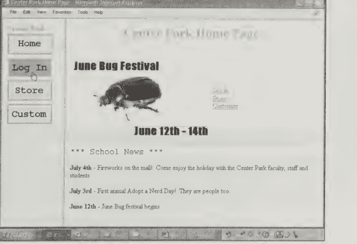

**图 21.3** 当您将鼠标指针移动到每个导航按钮时，它会改变颜色以表示处于激活状态并准备好选择。

虽然这可以说是一个简单的设计（仅用于说明目的；在“现实世界”中，你可能会被要求为设计增添更多美感），但从功能的角度来看，它运行良好——所有主要的网站功能都是可用的，并且通过底部链接提供的名称可以易地找到和理解。

## 审查：登录功能

由于网站无处不在的安全忧虑，各种规模的组织都在寻求保护特定内容的安全性。有时，组织会形成“内网”（相对于外网或互联网站点），以使信息仅对员工或其他授权人员可用。

Center Park 网站也不例外。在这种情况下，点击安全的“登录”按钮将向用户显示用户名和密码登录界面，如图 21.4 所示。

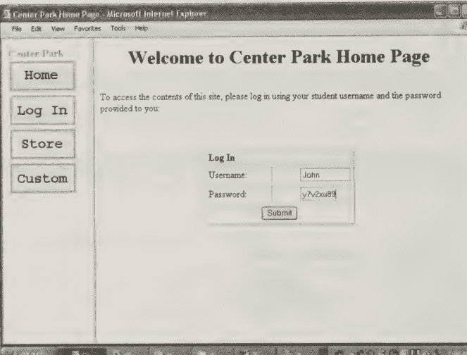

**图 21.4** 登录功能允许用户访问 Center Park 网站内的私人或其他安全内容。

### 满足的需求：登录功能

JavaScript 没有很多内置的安全功能，这种“安全”登录正说明了这一点。页面确实具有一些基本属性，在现实情况下，你可以以更健壮的方式开发它们：

- 密码字段可以更改为普通的表单密码字段，其中输入的字符将被遮盖并仅用星号表示（这仍然是非常基础的安全，但它可以防止，例如，有人在你输入密码时从背后窥视获取你的密码）。
- 如果这是一个生产网站，每个用户都需要特定的用户名和密码；然而，即使在这个基础示例中，你也可以看到通过用户名和密码锁定未经授权的访问来实现固有的安全性。

## 审查：任务日历

一旦用户登录网站（通过图 21.4 所示的用户名和密码），他们将看到他们自定义的任务和事件日历，如图 21.5 所示。

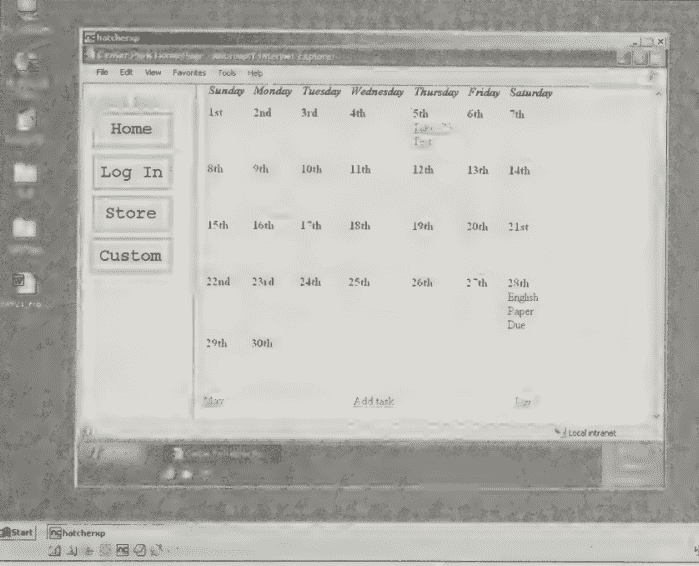

**图 21.5** “自定义日历”，在用户成功登录 Center Park 网站后展示给用户。

即使在最基础的形式下，日历功能也是 JavaScript 功能的宝库。接下来的小节描述了此代码如何满足网站定义的许多需求。

### 满足的需求：任务日历

Center Park 管理员希望他们的网站为所有类型的用户（教师、学生和家长）提供一种简单方便的方式来与 Center Park 学校保持密切联系。

话虽如此，任务日历符合了这些许多功能需求：

- 如图 21.5 所示，日历默认显示当前月份。
- 当前日期被突出显示。
- 日历提供了导航按钮，用于向后切换月份。
- 通过“添加任务”链接添加任务的能力。
- 一旦在日期选择器中选择了日期，它就会放入任务日期字段中。
- 还可以输入任务描述。

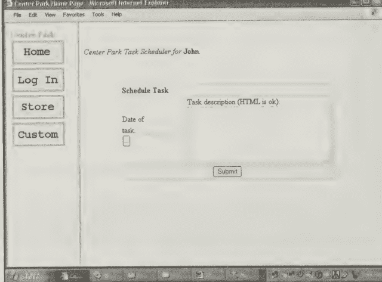

**图 21.6** 一旦在日期选择器中选择了日期，它就会放入任务日期字段中。

要添加任务，用户将遵循以下步骤：

1. 首先，用户将点击图 21.5 所示的“添加任务”。这将显示计划任务屏幕。
2. 此时，要做的第一件事是如图 21.6 所示选择任务日期。
3. 一旦在日期选择器中选择了日期，它会自动插入初始表单中，如图 21.7 所示。注意在这种情况下，输入了以下 HTML：`<a href="http://www.centerparkschool.edu/tests/1.html">Click here to take the exam.</a>`，这样当任务被放置在 5/30/2003 时，它将是一个超链接。
4. 一旦输入日期和任务描述，用户点击提交按钮，任务就会进入他的日历。

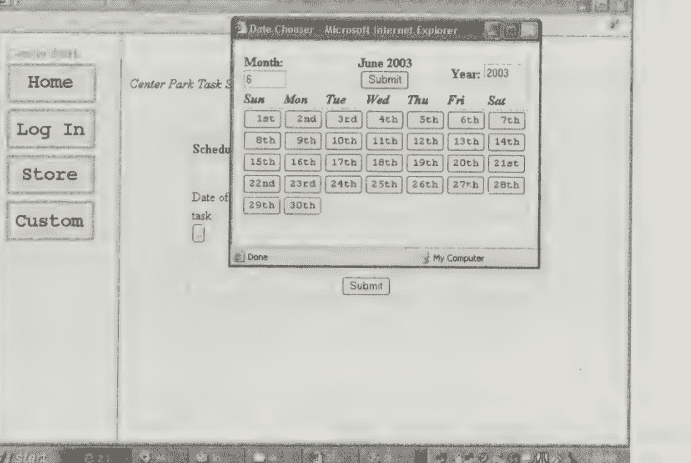

**图 21.7** 日期选择器弹出窗口允许用户为他们的任务选择日期。注意可以更改日期月份，因此任务可以分配到任何日期，而不仅仅是当前月份。

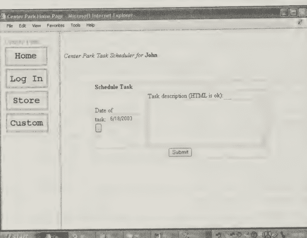

**图 21.8** 一旦在日期选择器中选择了日期，它就会放入任务日期字段中。

> **提示**
>
> 为什么要使用弹出日历来让用户选择日期？首先，这为用户提供了一种易于查找精确日期的方法，无论是对于当前月份还是过去/未来的月份。此外，通过让他们从弹出日历中选择日期，你确保了日期格式是以统一、精确的方式输入的：换句话说，这防止了 2003 年 5 月 30 日被输入为 `5/30/003`、`5/30/2003` 或 `5.30.2003` 等。这种统一的日期选择方法确保了数据在你的代码中以相同的方式处理，并防止以无法识别的方式输入数据格式时出现潜在错误。

## 审查：在线测试工具

虽然 Center Park 管理员对转向纯在线测试环境保留意见，但他们有兴趣在新网站中使用此功能。

如果你回看图 21.5，你可以看到在 5 月 5 日有一个名为“参加 CS 测试”的任务。如果你点击此链接，将看到在线测试组件的预览，如图 21.9 所示。

> **功能性，确实有……但仅用于“演示目的”**
>
> 本章展示的 Center Park 网站代码虽然具有功能性，但仅用于演示目的。
>
> 你可能会问这有什么问题？当用户点击提交按钮时，在任务日历（以及本章稍后演示的在线商店中）输入的数据并不会真正去往任何地方。为什么会这样？答案很简单：数据无处可去；具体来说，它没有一个可以插入的数据库。
>
> 将数据库集成到你的网站可能是一项复杂的任务，这取决于你想要展示的功能类型。然而，你会很快发现，如果你想超越最基础的功能，就需要这种功能支持。遗憾的是，数据库集成超出了本书的涉及范围，因为本书完全基于 JavaScript；此外，还有许多不同的编程方法可以将数据库集成到你的网站中。
>
> 尽管如此，Center Park 网站的许多高级功能仅仅是如果该网站集成了数据库后可能实现的潜在功能的演示。

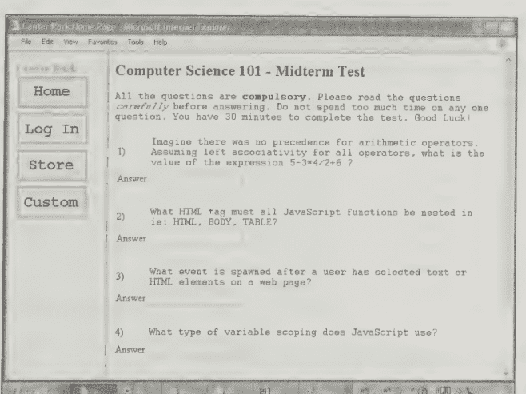

**图 21.9** 一个通过 JavaScript 实现的五道题在线测试示例！

### 需求已满足：在线测试计算机科学测试

图 21.9 演示了一个简单的五道题计算机测试。用户会看到答案字段，在屏幕底部（图 21.9 中未显示）有一个“提交”按钮，供他们在回答完所有问题后点击。请注意，如果他们没有在每个答案字段中输入内容，他们将看到一个警告提示（这里有更多 JavaScript 功能……），如图 21.10 所示。

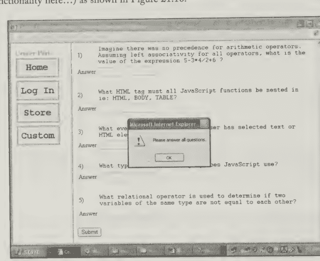

**图 21.10** 所有字段必须输入内容，否则将出现此错误消息。

当每个问题都回答完毕并点击提交按钮后，考者的分数将立即返回，并显示答案的对错，如图 21.11 所示。

如上所述，虽然核心功能已经在这里，但理想情况下你需要某种类型的后端数据库来记录分数以及存储问题和答案。目前，问题和答案被硬编码在展示在线测试的实际网页中。虽然这对于“演示目的”来说是好的，但从安全角度或存储每次测试结果的角度来看，这可能不是最佳解决方案。

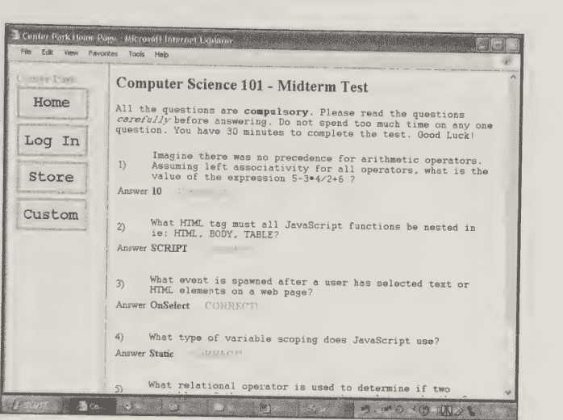

**图 21.11** 通过网站测试功能的 JavaScript 功能，可以对提交的答案进行即时分析。

## 复习：可自定义的网站

JavaScript 可以与 HTML 结合使用，产生一些整洁且实用的效果。网站导航按钮就是其中一个例子；然而，一个更好的例子是网站如何允许访问者设置前景颜色和背景颜色。

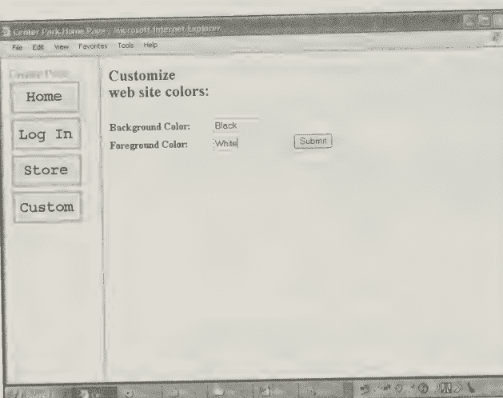

**图 21.12** 用户可以自定义外观。

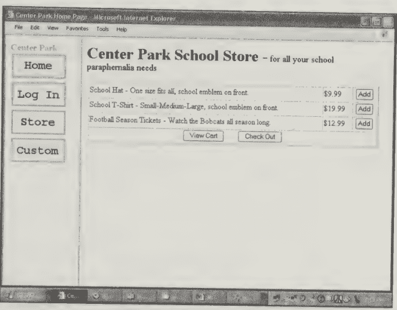

**图 21.13** 自定义功能的一个简单示例。

### 需求已满足：可自定义功能

如图 21.12 所示，用户可以选择网站的前景颜色和背景颜色。图 21.13 演示了选择黑色作为背景、白色作为前景如何改变 Center Park 网站的外观。

虽然这又是一个简单的例子，但它暗示了通过 JavaScript 实现网页自定义功能的各种可能性。此外，赋予用户这种控制权是良好的客户关系管理，并表明你——作为设计师和/或管理员——有兴趣满足客户的特定需求和兴趣。

## 复习：Center Park 在线商店

Center Park 学校管理人员提出的最后一项需求功能是建立某种基础在线商店，以便访问者可以购买学校商品（因此，再次可能减少对所有烘焙销售的需求）。图 21.14 至 21.16 演示了在线商店的基础功能。

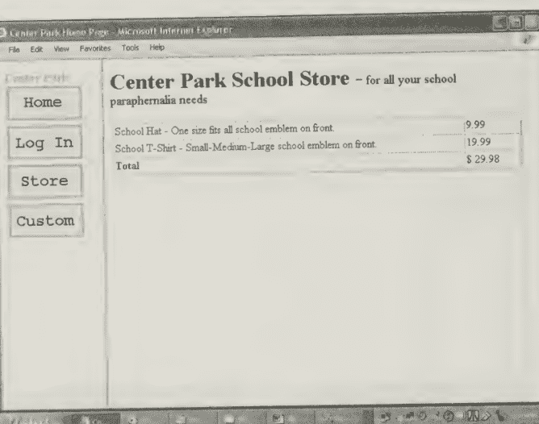

**图 21.14** 在线商店的基础功能。


**图 21.15** 购物者体验。


**图 21.16** 结账流程。

## 核心代码清单

### 主页

```javascript
<!---
function getAd() {
  var ad = "ad";
  ad += parseInt(Math.random() * 2 ) + 1;
  return(ad + ".jpg");
}

function rotateAd() {
  with(document ) {
    for (i = 0 ; i < images.length; i++) {
      if (images[i].name == "adImage") {
        images[i].alt = images[i].src = getAd();
      }
    }
    window.setTimeout("rotateAd()", 10000);
  }
}
function getCookieValue( name ) {
  var c = document.cookie;
  var begin = c.indexOf(name);
  if(begin < 0 ) return("");
  begin += name.length + 1;
  var end = c.indexOf(";", begin);
  if(end == -1 ) end = c.length;
  return(c.slice(begin, end));
}

function setCustoms() {
  var bg = getCookieValue("bgColor");
  var fg = getCookieValue("fgColor");
  if ( bg != "" ) document.bgColor = bg;
  if ( fg != "" ) document.fgColor = fg;
}
// -->
</script>
</head>
```

```html
<body onload="JavaScript: setCustoms(); rotateAd();">
<center>
<font color="red" size="6"><b>
Center Park 首页
</b></font></center>
<br><br>
<table width="100%">
<tr>
<td width="50%">

</td>
<td width="50%">
<a href="login.html">登录</a><br>
<a href="store.html">商店</a><br>
<a href="customize.html">自定义</a>
</td>
</tr>
<tr>
<td width="100%" colspan="2">
<hr>
<font face="Courier" size="5">***学校新闻 ***</font><br>
<b>7月4日</b> - 商场有烟花秀！来和 Center Park 的教职员工和学生们一起享受假期吧。<br>
<b>7月3日</b> - 第一届年度的“领养极客日”！他们也是人。<br>
<b>6月12日</b> - 六月虫子节开始。
</td>
</tr>
</table>
</body>
</html>
```

### 登录页面

此代码代表登录页面，用户通过完成该页面来访问他们的个性化任务日历：

```html
<html>
<head>
<title>
Center Park 首页 - 登录
</title>
<script language="JavaScript">
<!---
function Login( form ) {
  // 将学生姓名存储在 cookie 文件中以供稍后参考
  document.cookie = "username=" + form.username.value;
  // 确保密码正确
  document.location = form.password.value + ".html";
}

function getCookieValue( name ) {
  var c = document.cookie;
  var begin = c.indexOf(name );
  if(begin < 0) return ("");
  begin += name.length + 1;
  var end = c.indexOf(";", begin );
  if(end == -1) end = c.length;
  return(c.slice(begin, end ));
}

function setCustoms() {
  var bg = getCookieValue("bgColor");
  var fg = getCookieValue("fgColor");
  if(bg != "") document.bgColor = bg;
  if(fg != "") document.fgColor = fg;
}
// -->
</script>
</head>
<body onload="JavaScript:setCustoms();">
<center><font size=6><b>欢迎来到 Center Park 首页</b></font></center><br><br>
要访问本站的内容，请使用您的学生用户名和提供的密码进行登录：
<br><br><br>
<form name="login" onSubmit="JavaScript:Login(this); return(false);" >
<center>
<table border="2" cellpadding="2" width="250">
<tr>
<td colspan="2"><b>登录</b></td>
</tr>
<tr>
<td>用户名：</td>
<td align="right"><input name="username" size="10"></td>
</tr>
<tr>
<td>密码：</td>
<td align="right"><input name="password" size="10"></td>
</tr>
<tr>
<td colspan="2">
<p align="center"><input type="submit" value="提交"></p></td>
</tr>
</table>
</center>
</form>
<script language="JavaScript">
<!--
  document.login.username.value = getCookieValue("username" );
// -->
</script>
</body>
</html>
```

### 任务日历页面

出于说明之目的，此页面的被命名为登录屏幕中需要输入的密码（用户名并不重要）。再次强调，这显然不是最安全的设计（委婉地说！）但它是特意创建的，以确保你理解信息如何在页面与页面之间传递。

```html
<html>
<head>
<title></title>
<script language="JavaScript">
<!--
  var now = new Date();
  var months = new Array("January", "February", "March", "April",
  "May", "June", "July", "August", "September",
  "October", "November", "December" );
  var yString = getCookieValue("year" );
  var mString = getCookieValue("month" );
  var y = yString ? parseInt(yString) : now.getFullYear();
  var m = mString ? parseInt(mString) : now.getMonth();
  var month = new Date(y, m, 1);

  function getCookieValue( name ) {
    var c = document.cookie;
    var begin = c.indexOf( name );
    if(begin < 0 ) return ( "" );
    begin += name.length + 1;
    var end = c.indexOf(";", begin );
    if(end == -1 ) end = c.length;
    return(c.slice(begin, end ) );
  }

  function fixYear( year ) {
    return( year < 1000 ? year + 1900 : year );
  }

  function fixMonth( month ) {
    return( month < 0 ? month + 12 : month > 11 ? month - 12 : month );
  }

  function getNumberDays( d ) {
    switch(d.getMonth() + 1) {
      case 1: case 3: case 5: case 7:
      case 8: case 10: case 12:
        return( 31 );
      case 4: case 6: case 9: case 11:
        return( 30 );
      case 2:
        return( 28 + (d.getYear() % 4 == 0 ? 1 : 0) );
    }
  }

  function getEnding( number ) {
    if( number > 10 && number < 20 ) return( "th" );
    switch( number % 10 ) {
      case 0: case 4: case 5:
      case 6: case 7: case 8:
      case 9:
        return( "th" );
      case 1:
        return( "st" );
      case 2:
        return( "nd" );
      case 3:
        return( "rd" );
    }
  }

  var tasks = new Array();

  function setCustoms() {
    var bg = getCookieValue("bgColor");
    var fg = getCookieValue("fgColor");
    if(bg != "") document.bgColor = bg;
    if(fg != "") document.fgColor = fg;
  }
// -->
</script>
</head>
<body onload="JavaScript:setCustoms();">
<center><font size=6><b>欢迎来到 Center Park 首页</b></font></center><br><br>
<table width="75%">
<tr>
<td align="center"><font size="6"><b>[月份]</b></font></center>
</tr>
</table>
<table border="1" cellpadding="2" width="75%">
<tr>
<td width="14"><b>周日</b></td>
<td width="14"><b>周一</b></td>
<td width="14"><b>周二</b></td>
<td width="14"><b>周三</b></td>
<td width="14"><b>周四</b></td>
<td width="14"><b>周五</b></td>
<td width="14"><b>周六</b></td>
</tr>
<script language="JavaScript">
<!--
var startDay = month.getDay();
for( i = 0 ; i < startDay ; i++ ) {
  document.write("<td></td>");
}
var numDays = getNumberDays( month );
for( i = 0 ; i < numDays ; i++ ) {
  if( (i + startDay) % 7 == 0 ) {
    document.write("<tr>");
  }
  document.write("<td height='75' valign='top'>");
  if (fixYear(now.getFullYear()) == fixYear(month.getFullYear()) &&
      now.getMonth() == month.getMonth() && now.getDate() == i + 1) {
    document.write(" style='border: 2px solid red;'");
  }
  document.write(">" + (i+1) + getEnding(i + 1) + "<br>" );
  if( tasks[i+1] ) document.write( tasks[i+1] );
  document.write("</td>" );
  if( (i + startDay + 1) % 7 == 0 ) {
    document.write("</tr>");
  }
}
// -->
</script>
</tr>
</table>
<table width="75%">
<tr>
<td>
<script language="JavaScript">
<!--
document.write("<a href='" + document.location + "'");
document.write("onclick=\"JavaScript: document.cookie='month=" +
fixMonth(m-1) + "';\"");
document.write(">" + months[fixMonth(m-1)] + "</a>" );
// -->
</script>
</td>
<td align="center">
<a href="AddTask.html">添加任务</a>
</td>
<td align="right">
<script language="JavaScript">
<!--
document.write("<a href='" + document.location + "'");
document.write("onclick=\"JavaScript: document.cookie='month=" +
fixMonth(m+1) + "';\"");
document.write(">" + months[fixMonth(m+1)] + "</a>" );
// -->
</script>
</td>
</tr>
</table>
</body>
</html>
```

### AddTask.html

以下页面展示了用户向其个人日历添加任务的功能：

```html
<html>
<head>
  <title>Center Park - 添加任务</title>
  <script language="JavaScript">
<!--
  if (getCookieValue("loggedin") != "true") document.location = "Main.html";
  var dateElement;
  function openDatePicker( target ) {
    dateElement = target;
    var ieSize = "width=380,height=255";
    var navSize = "width=480,height=295";
    var isNav = navigator.appName == "Netscape";
    window.open("PopupCalendar.html", "calendar",
      "menubar=no,resizable=no,scrollbars=no,status=yes,toolbar=no," + ( isNav ? navSize : ieSize ));
  }
  function setState( date ) {
    dateElement.value = date;
  }
  function getCookieValue( name ) {
    var c = document.cookie;
    var begin = c.indexOf( name );
    if( begin < 0 ) return("");
    begin += name.length + 1;
    var end = c.indexOf(";", begin);
    if( end == -1 ) end = c.length;
    return(c.slice(begin, end));
  }
  function setCustoms() {
    var bg = getCookieValue("bgColor" );
    var fg = getCookieValue("fgColor" );
    if( bg != "" ) document.bgColor = bg;
    if( fg != "" ) document.fgColor = fg;
  }
// -->
</script>
</head>
<body onLoad="JavaScript: setCustoms();">
<br>
<br>
```


# Center Park 任务调度器

```html
<script language="JavaScript">
<!--
document.write( getCookieValue("username" ) );
// -->
</script>
</body>
```

```html
<form name="taskForm" onSubmit="JavaScript: return ( false );">
<center>
<table border="1" width="75%">
<tr>
<td width="100%" colspan="2"><b>安排任务</b></td>
</tr>
<tr>
<td width="50%">
任务日期&nbsp;
<input type="text" name="date" size="10">
<input type="button" value="..." onclick="JavaScript:openDatePicker(document.taskForm.date);" />
</td>
<td width="50%">
任务描述（可以使用HTML）：<br>
<textarea rows="7" cols="35"></textarea>
</td>
</tr>
<tr>
<td align="center" colspan="2">
<input type="submit" value="提交" name="B1">
</td>
</tr>
</table>
</center>
</form>
</body>
</html>
```

## PopUpCalendar.html

以下代码允许弹出式日历出现，以便用户可以选择特定日期来安排任务：

```html
<html>
<head>
<title>日期选择器</title>
<style type="text/css">
<!--
.mono { font-family: monospace; }
-->
</style>
<script language="JavaScript">
// 代码片段开始
```

# 项目总结：CENTER PARK 网站功能概览 第21章 543

```javascript
<!---
var now = new Date();
var month = new Date(now.fixYear(now.getFullYear()), now.getMonth(), 1 );
var months = new Array("January", "February", "March", "April",
"May", "June", "July", "August", "September",
"October", "November", "December");

var urlquery = location.href.split("??");
if(urlquery[1]) {
  var params = urlquery[1].split("&");
  var m = ( params[0] ? params[0].split("=")[1] : 1 : fixMonth(now.getMonth()) );
  var y = ( params[1] ? params[1].split("=")[1] : fixYear(now.getFullYear()) ) );
  month = new Date(y, m, 1);
}

function fixYear( year ) {
  return( year < 1000 ? year + 1900 : year );
}

function fixMonth( month ) {
  return( month < 0 ? month + 12 : ( month > 11 ? month - 12 : month ) );
}

function getNumberDays( d ) {
  switch(d.getMonth() + 1) {
    case 1: case 3: case 5: case 7:
    case 8: case 10: case 12:
      return( 31 );
    case 4: case 6: case 9: case 11:
      return( 30 );
    case 2:
      return( 28 + ( d.getYear % 4 == 0 ? 1 : 0 ) );
  }
}
```

# 544 第二部分 CENTER PARK 学校项目

```javascript
}

function getEnding( number )
{
  if( number > 10 && number < 20 ) return("th");

  switch( number % 10 ) {
    case 0: case 4: case 5:
    case 6: case 7: case 8:
    case 9:
      return("th");
    case 1:
      return("st");
    case 2:
      return("nd");
    case 3:
      return("rd");
  }
}

function onSelect()
{
  window.opener.setDate(document.date.value);
  self.close();
}

function getCookieValue( name )
{
  var c = document.cookie;
  var begin = c.indexOf(name);
  if( begin < 0 ) return(" ");
  begin += name.length + 1;
  var end = c.indexOf(";",
  if( end == -1 ) end = c.length;
  return(c.slice(begin, end));
}
# 项目总结：CENTER PARK 网站功能概览 第21章 545

function setCustoms() {

  var bg = getCookieValue("bgColor");

  var fg = getCookieValue("fgColor");

  if ( bg != "" ) document.bgColor = bg;

  if ( fg != "" ) document.fgColor = fg;

} // -->

</script>
```

```html
<body onLoad="JavaScript:setCustoms();">

<form name="theForm">
<table border="1" width="75%" style="border-collapse: collapse">
<tr>
<td align="left" colspan="2">
<b>月份：</b>
<input type="text" name="Month" size="5">
<script language="JavaScript">
<!--
document.theForm.Month.value = fixMonth( month.getMonth() + 1 );
</script>
</td>
<td colspan="3">
<center>
<b><script language="JavaScript">
<!--
document.write( months[month.getMonth()] + " " + fixYear(month.getFullYear()) );
</script></b><br>
<input type="submit" value="提交">
</center>
</td>
<td align="right" colspan="2">
<b>年份：</b>
</tr>
</table>

<input type="text" name="Year" size="5">

<script language="JavaScript">
<!--
document.form.Year.value = fixYear(month.getMonth());
// --
</script>

</td>
<tr>
<td width="14%"><b>Sun</b></td>
<td width="14%"><b>Mon</b></td>
<td width="14%"><b>Tue</b></td>
<td width="14%"><b>Wed</b></td>
<td width="14%"><b>Thu</b></td>
<td width="14%"><b>Fri</b></td>
<td width="14%"><b>Sat</b></td>
</tr>
```

```javascript
<script language="JavaScript">
<!--
var startDay = month.getMonth();
for(i = 0 ; i < startDay ; i++) {
  document.write("<td>");
}

var numDays = getNumberDays(month);
for(i = 1; i < numDays + 1 ; i++) {
  if( (i + startDay) % 7 == 1 ) {
    document.write("</td><tr>");
  }
  document.write("<td><center>
  <input type=\"button\" value=\"*\" onclick=\"JavaScript: document.form.date.value = '" + fixMonth( month.getMonth() + 1 ) + "/" + i + "/" + fixYear(month.getMonth()) + "' onSelect='';\" + ( i < 10 ? \" \" : \"\") + i + getEnding( i ) + \" class='mono'>\" +
</center></td>");
}
// -->
</script>

</table>
<input type="hidden" name="date">
</form>
</body>
</html>
```

## Test.html

以下代码展示在线测试：

```html
<html>
<head>
<title>Center Park - 计算机科学测试</title>
<script language="JavaScript">
<!-- -->
if( getCookieValue("loggedin") != "true") 
document.location = "Main.html";

function validate( form )
{
  for( i = 0; i < form.elements.length ; i++ )
  {
    with(form.elements[i])
    {
      if( type == "text" && value == "" )
      {
        alert("请回答所有问题。" );
        return( false );
      }
    }
  }
return( true);
}

function getCookieValue( name )
{
  var c = document.cookie;
  var begin = c.indexOf(name);
  if(begin < 0) return(" ");
  begin += name.length + 1;
  var end = c.indexOf("", begin);
  if(end == -1) end = c.length;
  return(c.slice(begin, end));
}

function setCustoms()
{
  var bg = getCookieValue("bgColor");
  var fg = getCookieValue("fgColor");
  if(bg == "") document.bgColor = bg;
  if(fg == "") document.fgColor = fg;
}
// -->
</script>
</head>

<body onload="JavaScript:setCustoms();">

<font size="5">计算机科学 101 - 期中考试</font> </body>

<br><br>

<font face="Courier">

题目均为**必答题**。
在回答之前请*仔细*阅读题目。
不要在某一个问题上花费过多时间。

你有 30 分钟完成测试。祝你好运！</font>

```

```html
<br><br>

<form name="TestForm" action="Grade.html" onSubmit="JavaScript: return( validate( this ) );">

<table width="100%" cellpadding="2" cellspacing="2">

<tr>

<td>1)</td>

<td>

<font face="Courier">

假设运算符没有优先级。假设所有运算符都从左开始结合，表达式 5-3*4/2+6 的值是多少？

</font>

</td>

</tr>

<tr>

<td>答案：</td>

<td><input type="text" name="Q1" size="20"></td>

</tr>

<tr><td>&nbsp;</td><td>&nbsp;</td></tr>

<tr>

<td>2)</td>

<td>

<font face="Courier">

所有的函数必须嵌套在哪个 HTML 标签中？即：HTML、BODY 还是 TABLE？

</font>

</td>

</tr>

<tr>

<td>答案：</td>

<td><input type="text" name="Q2" size="20"></td>

</tr>

<tr><td>&nbsp;</td><td>&nbsp;</td></tr>

<tr>

<td>3)</td>

```

# CENTER PARK 学校项目

| 问题 | 答案 |
| :--- | :--- |
| 3) 当用户在网页上选择文本或 HTML 元素后，会触发什么事件？ | |
| 4) JavaScript 使用哪种类型的变量作用域？ | |
| 5) 使用哪种关系运算符来判断两个相同类型的变量是否不相等？ | |

<br>
<input type="submit" value="Submit" name="SubmitButton">
</form>

<script language="JavaScript">
<!--
window.setTimeout("document.TestForm.SubmitButton.enabled=false", 1000 * 60 * 30);
//-->
</script>

</body>
</html>

## Grade.html

测试提交后，将通过以下页面进行“评分”：

```html
<html>
<head>
<title>Center Park - 考试评分器</title>
<script language="JavaScript">
<!--
var total = 0, correct = 0;

function getFormValue(name ) {
var c = location.href.split("?")[1];
var begin = c.indexOf( name );
if(begin < 0 ) return("");
begin += name.length + 1;
var end = c.indexOf("&", begin);
if(end == -1 ) end = c.length;
return( unescape( c.slice( begin, end ) );

function getCookieValue( name )
{
  var c = document.cookie;
  var begin = c.indexOf(name);
  if (begin < 0 ) return("*");
  begin += name.length + 1;
  var end = c.indexOf(":*", begin);
  if(end == -1 ) end = c.length;
  return(c.slice( begin, end ) );
}

function setCustoms()
{
  var bg = getCookieValue("bgColor" );
  var fg = getCookieValue("fgColor" );
  if (bg != "*") document.bgColor = bg;
  if (fg != "*") document.Color = fg;
}
//--
</script>
</head>

<body onload="JavaScript:setCustoms();">

<b><font size="5">计算机科学 101 - 期中考试</font> </b><br><br>

<font face="Courier">
<b>必做题</b><br>
所有问题在回答前都必须*仔细地*阅读。
请仔细阅读题目，不要在某一个问题上花费过多时间。
你有 30 分钟时间完成测试。祝你好运！
</font>

# 项目总结：CENTER PARK 网站功能概览 第21章 553页

<br><br>

```html
<form>
<table width="100%" cellpadding="2" cellspacing="2">
  <tr>
    <td>1)</td>
    <td>
      <font face="Courier">
        假设算术运算符之间没有优先级。假设所有运算符都采用从左到右结合，那么表达式 5-3*4/2+6 的值是多少？
      </font>
    </td>
  </tr>
  <tr>
    <td>答案</td>
    <td><b>10</b>
      <script language="JavaScript">
        <!--
        if( parseInt(getFormValue("Q1")) == 10 ) {
          document.write("<font color='red'><b>正确!</b></font>");
          correct++;
        }
        else {
          document.write("<font color='red'><b>错误</b></font> 你的回答是: " + getFormValue("Q1") );
          total++;
        }
        <!-- -->
      </script>
    </td>
  </tr>
  <tr><td></td></tr>
  <tr>
    <td>2)</td>
    <td>
      <font face="Courier">JavaScript 函数必须嵌套在什么 HTML 标签中（例如：HTML, BODY, TABLE）？</font>
    </td>
  </tr>
  <tr>
    <td>答案</td>
    <td><b>SCRIPT</b>
      <script language="JavaScript">
        <!--
        if (getFormValue("Q2").toUpperCase() == 'SCRIPT' ) {
          document.write("<font color='red'><b>正确!</b></font>");
          correct++;
        } else {
          document.write("<font color='red'><b>错误</b></font> 你的回答是: " + getFormValue("Q2") );
          total++;
        }
        // -->
      </script>
    </td>
  </tr>
  <tr><td></td></tr>
  <tr>
    <td>3)</td>
    <td>
      <font face="Courier">当用户在页面上选择文本或 HTML 元素后，会触发什么事件？</font>
    </td>
  </tr>
  <tr>
    <td>答案</td>
    <td><b>Select</b>
      <script language="JavaScript">
        <!--
        if(getFormValue("Q3").toUpperCase() == "SELECT") {
          document.write("<font color='red'><b>正确!</b></font>");
          correct++;
        }
        else {
          document.write("<font color='red'><b>错误</b></font> 你的回答是: " + getFormValue("Q3") );
          total++;
        }
        // -->
      </script>
    </td>
  </tr>
  <tr><td></td></tr>
  <tr>
    <td>4)</td>
    <td>
      <font face="Courier">JavaScript 使用哪种类型的变量作用域？</font>
    </td>
  </tr>
  <tr>
    <td>答案</td>
    <td><b>Static</b>
      <script language="JavaScript">
        <!--
        if(getFormValue("Q4").toUpperCase() == "STATIC") {
          document.write("<font color='red'><b>正确!</b></font>");
          correct++;
        }
        else {
          document.write("<font color='red'><b>错误</b></font> 你的回答是: " + getFormValue("Q4") );
          total++;
        }
        // -->
      </script>
    </td>
  </tr>
  <tr><td></td></tr>
  <tr>
    <td>5)</td>
    <td>
      <font face="Courier">使用哪种关系运算符来判断两个相同类型的变量是否不相等？</font>
    </td>
  </tr>
  <tr>
    <td>答案</td>
    <td><b>!=
      <script language="JavaScript">
        <!--
        if( getFormValue("Q5") == "!=" ) {
          document.write("<font color='red'><b>正确!</b></font>");
          correct++
        }
        else {
          document.write("<font color='red'><b>错误</b></font> 你的回答是: " + getFormValue("Q5") ) );
          total++;
        }
        // -->
      </script>
    </td>
  </tr>
</table>
</form>
<br><br>
<script language="JavaScript">
<!--
document.write("<font color='red'><b>你在这 " + total + " 道题中答对了 " + correct + " 道。你的得分是 " + (correct/total*100) + "%</b></font>");
// -->
</script>
</body>
</html>
```

## Customize.html

以下页面允许用户自定义 Center Park 网站的前景颜色和背景颜色：

```html
<html>
<head>
<title>Center Park - 个性化定制</title>
<script language="JavaScript">
<!--
function saveCustoms( form )
{
document.cookie = "bgColor=" + form.bgColor.value;
document.cookie = "fgColor=" + form.fgColor.value;
}

function getCookieValue( name )
{
var c = document.cookie;
var begin = c.indexOf(name );
if( begin < 0 ) return("*");
begin += name.length + 1;
var end = c.indexOf("", begin);
if (end == -1) end = c.length;
return(c.slice(begin, end));
}

function setCustoms() {
  var bg = getCookieValue("bgColor" );
  var fg = getCookieValue("fgColor" );
  if (bg != "*") document.bgColor = bg;
  if (fg != "*") document.fgColor = fg;
}
// --
</script>
</head>

<body onload="JavaScript: setCustoms();">

<form onsubmit="JavaScript: saveCustoms( this );">

<table>
  <tr>
    <td><b><font size="5">自定义 <br>网站颜色:<br><br></font></b></td>
  </tr>
  <tr>
    <td>背景颜色:&nbsp;&nbsp; </td>
    <td><input type="text" name="bgColor" size="15"></td>
  </tr>
  <tr>
    <td><b>前景颜色:</b></td>
    <td><input type="text" name="fgColor" size="15"></td>
    <td>&nbsp;<input type="submit" value="Submit"></td>
  </tr>
</table>

</form>
</body>
</html>
```

# 项目总结：CENTER PARK 网站功能概览 第21章 559页

## Store.html

网站商店的主页，以下展示了可用商品以及将它们加入购物车的功能：

```html
<html>
<head>
<title>Center Park - 商店</title>
<script language="JavaScript">
<!--
function addItem(name, price ) {
var i = 1;
for( getCookieValue("item" + i) != " \*"; i++ );
document.cookie = "item" + i + "=" + name + "," + price;
document.cookie = "items=" + i;
}

function getCookieValue( name ) {
var c = document.cookie;
var begin = c.indexOf( name );
if( begin < 0 ) return(" \*");
begin += name.length + 1;
var end = c.indexOf(";", begin );
if( end == -1 ) end = c.length;
return(c.slice(begin, end ) );
}

function setCustoms() {
var bg = getCookieValue("bgColor" );
var fg = getCookieValue("fg" );
if( bg != " \*") document.bgColor = bg;
if( fg != " \*") document.fgColor = fg;
}
// -->
</script>
</head>
<body onload="JavaScript: setCustoms();">
<b><font size="6">Center Park商店 -</font></b>
<font size="4">满足您所有的学校用品需求</font><br><br>

<form>
<table border="2" width="100%">
  <tr>
    <td>学校帽 - 均码设计，正前有校徽。</td>
    <td align="center">$9.99</td>
    <td align="center"><input type="button" value="加入" onclick="JavaScript: addItem('School Hat - One size fits all school emblem on front.', 9.99 );"></td>
  </tr>
  <tr>
    <td>学校T恤 - 小号-中号-大号，正前有校徽。</td>
    <td align="center">$19.99</td>
    <td align="center"><input type="button" value="加入" onclick="JavaScript: addItem('School T-Shirt - Small-Medium-Large school emblem on front.', 19.99 );"></td>
  </tr>
  <tr>
    <td>足球赛季票 - 整个赛季观看鲍勃猫队的比赛。</td>
    <td align="center">$12.99</td>
    <td align="center"><input type="button" value="加入" onclick="JavaScript: addItem('Football Season Tickets - Watch the Bobcats all season long.', 12.99 );"></td>
  </tr>
  <tr>
    <td colspan="3" align="center">
      <input type="button" value="查看购物车" onclick="JavaScript: document.location='ViewCart.html';">
      &nbsp;&nbsp;&nbsp;
      <input type="button" value="结算" onclick="JavaScript: document.location='CheckOut.html';">
    </td>
  </tr>
</table>
</form>
</body>
</html>
```

## 查看购物车 ViewCart.html

以下页面显示了访问者已选择并放入其购物车的物品：

```html
<html>
<head>
<title>Center Park - 查看购物车</title>
<script language="JavaScript">
<!--
function removeItem( name )
{
  document.cookie = name + "=";
  document.location = document.location;
}

function getCookieValue( name )
{
  var c = document.cookie;
  var begin = c.indexOf( name );
  if(begin < 0 ) return("");
  begin += name.length + 1;
  var end = c.indexOf(";", begin);
  if(end == -1 ) end = c.length;
  return(c.slice(begin, end ) );
}

function getItem( item )
{
```

# 562 第二部分 CENTER PARK 学校项目

```javascript
var c = getCookieValue( item );
if( c )
{
    return( c.split(",")[0] );
}
else return("");
}
```

```javascript
function getItemPrice( item )
{
    var c = getCookieValue( item );
if( c )
{
    return( c.split(",")[1] );
}
else return("");
}
```

```javascript
function setCustoms()
{
    var bg = getCookieValue("bgColor" );
    var fg = getCookieValue("fgColor" );
    if( bg == "" ) document.bgColor = bg;
    if( fg != "" ) document.Color = fg;
}
// -->
</script>
</head>
<body onLoad="JavaScript: setCustoms();">

<b><font size="6">Center Park 学校商店 -</font></b>
<font size="4">满足您所有的学校用品需求</font><br><br>

<form>
<table width="100%" border="2">
```

```javascript
<script language="JavaScript">
<!--
for( i = 1; i <= parseInt( getCookieValue("items" ) ); i++ )
```

# 项目总结：CENTER PARK 网站功能概览 第21章 563

```javascript
{
  if(getItemName("item" + i) != "" && getItemPrice("item" + i) != undefined ) {
    document.write("<<tr><td>");
    document.write(getItemName("item" + i) + "</td><td>");
    document.write("$" + getItemPrice("item" + i) + "</td><td align='center'>");
    document.write("<input type='button' value='移除' onclick='JavaScript: removeItem(\"item\" + i + \" \")');</</td>>");
    document.write("</tr>");
  }
}
//--
</script>
<tr colspan="3" align="center">
  <input type="button" value="继续购物" onclick="JavaScript:document.location='Store.html';">
  &nbsp;&nbsp;&nbsp;
  <input type="button" value="结算" onclick="JavaScript:document.location='Checkout.html';">
</tr>
</table>
</form>
</body>
</html>
```

## 结算 Checkout.html

最后，以下页面将显示当前购物车中的所有物品，以及所有物品的总价格：

```html
<html>
<head>
<title>Center Park - 商店结算</title>
<script language="JavaScript">
```

```javascript
<!--
var total = 0;

function getCookieValue( name )
{
    var c = document.cookie;
    var begin = c.indexOf(name);
    if (begin < 0) return "";
    begin += name.length + 1;
    var end = c.indexOf(":*", begin);
    if (end == -1) end = c.length;
    return( c.slice(begin, end) );
}

function getItemName( item )
{
    var c = getCookieValue(item);
    if( c )
    {
        return( c.split(",")[0] );
    }
    else return("");
}

function getItemPrice( item )
{
    var c = getCookieValue(item);
    if( c )
    {
        return( c.split(",")[1] );
    }
    else return("");
}

function fixTotal( n )
{
    n *= 100;
    var good = parseInt( n );
```

# 项目总结：CENTER PARK 网站功能概览 第21章 565

```javascript
while( good )
{
  return( good / 100 );
}

function setCustoms()
{
  var bg = getCookieValue("bgColor" );
  var fg = getCookieValue("fgColor" );
  if( bg == "" ) document.bgColor = bg;
  if( fg != "" ) document.Color = fg;
}
// -->
</script>
</head>
<body onLoad="JavaScript: setCustoms();">

<b><font size="6">Center Park商店 -</font></b>
<font size="4">满足您所有的学校用品需求</font><br><br>

<form>
<table width="100%" border="2">
```

```javascript
<script language="JavaScript">
<!--
for( i = 1; i <= parseInt( getCookieValue("items" ) ); i++ )
{
  if(getItemName("item" + i) != "" && getItemPrice("item" + i) != undefined ) {
    document.write("<<tr><td>");
    document.write(getItemName("item" + i) + "</td><td>");
    document.write("$" + getItemPrice("item" + i) + "</td><td align='center'>");
    document.write("<input type='button' value='移除' onclick='JavaScript: removeItem(\"item\" + i + \" \")');</</td>>");
    document.write("</tr>");
  }
}
//--
</script>
<tr colspan="3" align="center">
  <input type="button" value="继续购物" onclick="JavaScript:document.location='Store.html';">
  &nbsp;&nbsp;&nbsp;
  <input type="button" value="结算" onclick="JavaScript:document.location='Checkout.html';">
</tr>
</table>
</form>
</body>
</html>
```

## 总结

Center Park 网站非常灵活，满足学生的需求。通过遵循第一部分的 JavaScript，你应该能够将其整洁且高效地实现到自己的项目中。编码愉快！

## 索引

### 符号

- `[]` 引用操作符, 74-78, 102
- `=` 赋值运算符, 7-9
- `/*` 注释符号, 11
- `//` 注释符号, 11
- `{}` 函数声明, 104
- `;` 分号, 14

### A

- `<A>` 对象, 202
  - 事件处理器, 204
  - 函数, 203
  - 属性, 202-203
- `<APPLET>` 对象, 206
  - 事件处理器, 206-207
  - 函数, 206
  - 属性, 205-206
- 小程序, 字符串, 90
- `ARCHIVE` 属性, 340-341
- `<AREA>` 对象
  - 事件处理器, 208-209
  - 函数, 208
  - 属性, 207
- `arguments` 属性 (函数), 116
- 算术运算符, 24-28
- `arity` 属性 (函数), 116
- 数组
  - `[]` 引用操作符, 74-78, 102
  - cookies, 318-319
  - 声明, 74-78
  - 定义的, 73
  - 动态数据结构, 87
  - 元素, 78-81
  - 错误处理, 352-256
  - 函数
    - `concat()`, 82
    - `insertAt()`, 88-90
    - `join()`, 82
    - `pop()`, 82-83, 87
    - `print()`, 81-82
    - `push()`, 83, 87
    - `removeAt()`, 88-90
    - `reverse()`, 84
    - `shift()`, 84, 85-87
    - `unshift()`, 87
  - 索引, 78-81
  - 链列表, 87-90
  - 循环
    - `for`, 79-80
    - `for-in`, 80
    - 嵌套, 80
    - 多维, 76-78
  - 属性
    - `length`, 81
    - 原型, 81-82
  - 队列, 87
  - 引用, 78-81
  - 单维, 74-76
  - 栈, 87
  - 二维, 76-78
- 赋值运算符, 7-9, 21-26
- 赋值语句, 7
- 属性
  - `ARCHIVE`, 340-341
  - 事件处理器, 179-184
  - 自动事件, 168-170
  - 自动表单回复, 428-434
  - 自动表单提交, 428-434
- `blink()` 函数, 94
- `<BODY>` 对象
  - 事件处理器, 211-212
  - 函数, 211
  - 属性, 210-211
- `bold()` 函数, 94
- 布尔数据类型, 16-17
- `Boolean` 对象, 150
- 布尔逻辑运算符, 28-29
- 大括号 `()`, 函数声明, 104
- `break` 语句, 52-53, 59-70
- 浏览器。参见 Web 浏览器
- 冒泡, 186-187
- 按钮。另见事件
- 日历, 402-405
  - 导航, 375, 494-502, 516
  - 值, 255

### C

- 日历
  - 日期后缀, 56-59
  - 链接代码, 384-392, 400
  - 加载数据代码, 392-401
  - 永久
    - 代码, 378-381, 540-542
    - 显示, 378-384
    - 事件, 392-401
    - 功能, 367, 519-522
    - 函数, 381-382
  - 日期高亮, 395
  - 链接, 384-392, 400
  - 概述, 378
  - 旋转, 384-392, 400
  - 表格, 382-384
  - 弹出式日历
    - 按钮, 402-405
    - 代码, 402-419, 542-547
- CSS, 402-405
  - 显示, 402-405
  - 表单字段, 411-419
  - 功能, 367, 519-522
  - 概述, 401
  - 父子窗口, 411-419
  - 旋转, 405-411
  - 尺寸, 402-405
- 数据库查询代码, 392-401
- 回调，函数, 192
- 调用者属性, 函数, 117
- 调用函数, 111
- `captureEvent()` 函数, 184-186, 300-303
- 变量大小写敏感, 7-9
- Center Park 网站。另请参见程序
- 代码
  - 颜色, 557-558
  - 评分, 551-557
  - 首页, 530-533
  - 菜单栏, 529-530
  - 密码, 533-540
  - 永久日历, 540-542
  - 弹出式日历, 542-547
  - 旋转广告, 530-532
  - 安全, 533-540
  - 购物车, 559-566
  - 测试, 547-557
- 特性, 364-375, 514-515
- 功能
  - 颜色, 375, 516, 524-525
  - 首页, 516-518
  - 密码, 371-373, 518-519
  - 永久日历, 367, 519-522
  - 弹出式日历, 367, 519-522
  - 旋转广告, 373-374, 516
  - 安全, 371-373, 518-519
  - 购物车, 371, 325-328
  - 测试, 367-371, 522-524
- `change()` 函数, 502
- `charAt()` 函数, 94-95
- `charCode()` 函数, 95
- 检查密码, 456-457
- 结算（购物车）, 448-452
- `<CITE>` 对象, 204-205
- 类。参见对象
- 代码。参见 Center Park 网站；程序
  - 广告, 530-533
  - 块, 11-12-14
- 日历
  - 链接, 384-392, 400
  - 加载数据, 392-401
  - 永久, 378-381, 540-542
  - 弹出式, 402-419, 542-547
  - 数据库查询, 392-401
  - 代码 (HTML), 557-558
  - 注释, 11-12
- 表单
  - 处理, 428-434, 551-557
  - 测试, 423-428, 547-557
  - 验证, 426-427
  - 首页, 530-533
  - 换行, 12-14
  - 菜单, 529-530
  - 动作（循环）, 70-77
  - 密码, 533-540
  - 安全, 533-540
  - 分号 `;`, 14-15
  - 购物车, 559-566
  - 结算, 448-452
  - 创建, 439-442
  - 显示, 443-448
- `<CODE>` 对象, 204-205
- 集合 (DOM), 202
- 颜色
  - 深度, 308-310
  - Cookie, 326-330
  - 代码, 557-558
  - 功能, 375, 516, 524-525
  - 加载, 505-511
  - 保存, 502-505
  - 过期, 326
  - 隐藏, 326
  - 命名, 334
  - 读取, 316-323, 330-344
  - 安全, 311, 326, 473-476
- 购物车
  - 结算, 448-452
  - 注释, 439
  - 创建, 438-442
  - 删除, 445-448
  - 显示, 443-448
  - 屏幕, 308-310
  - 表格
  - 函数, 119-121
  - 行, 43-47, 50-56, 65-67
  - 网页页, 308-310
- 注释
  - 块, 11-12-14
  - 行, 11-12
  - 概述, 11-12
- `compareTo()` 函数, 105-110
- 比较字符串, 124-125
- `concat()` 函数, 82
- 字符串, 95
- 拼接字符串, 40-41
- 条件语句。参见 if
- 构造函数, 149
- 上下文, 461-464
- 继续语句, 69-70
- 控制结构, 43
- 转换字符串，数字, 20
- Cookie
  - 数组, 318-319
  - 颜色, 326-330
  - 尺寸, 334
  - 计数器, 324-330
  - 创建对象, 143-149
  - 跨平台兼容性。参见 浏览器
- CSS, 弹出式日历, 402-405
- 客户管理 (CRM), 438
- 数据
  - 函数, 115-116
  - 加载, 392-401
  - 存储, 439
- 数据结构。参见数组
- 数据类型
  - 抽象。参见对象
  - `NaN`, 17-19
  - `null`, 17-19
  - 原始类型
  - 布尔, 16-17
  - 显示
  - 数字, 16-17
  - 日历
  - 概述, 16-17
  - 永久, 378-384
  - 字符串, 16-17
  - 弹出式, 402-405
  - `undefined`, 17-19
  - 购物车项目, 443-448
  - 变量, 17-19
- `<DIV>` 对象
  - 数据库查询, 392-401
  - 事件处理器, 213-214, 227-229
  - 函数, 213
- `Date` 对象, 150-151
  - 函数, 213, 153
  - `mouseOver` 事件, 227-229
  - 属性, 151, 213
- 日期
- `Document` 对象, 154
  - 高亮, 395
  - 事件处理器, 155-156
  - 后缀, 56-59
  - 函数, 155
- `dblClicked` 函数, 186
- 属性, 154-155
- 调试，错误处理, 358-359
- DOM (文档对象模型)。参见 HTML
- 声明
  - `<A>` 对象, 202
  - 数组, 74-78
  - 事件处理器, 204
  - 函数, 104-105, 203
  - 字符串, 90
  - 属性, 202-203
  - 变量, 7-9, 21
- `<ACRONYM>` 对象, 204-205
- 递减。参见循环
- `<APPLET>` 对象
  - 定义函数, 104-105
  - 事件处理器, 206-207
  - 定义（词法），
    - 函数, 206
  - 删除运算符, 40
  - 属性, 205-206
  - 删除购物车项目, 445-448
- `<AREA>` 对象
  - `dequeue()` 函数, 148
  - 事件处理器, 208-209
  - 设计，网站, 366
  - 函数, 208
- `<DFN>` 对象, 204-255
  - 属性, 207-208

### HTML

- 按钮，导航, 375, 494-502, 516
- `<B>` 对象, 209-210
- 颜色
- `<BGSOUND>` 对象, 209-210
- 代码, 557-558
- `<BODY>` 对象
  - 事件处理器, 211-212
  - 函数, 211
  - 属性, 210-211
  - 功能, 375, 516, 524-525
  - 加载, 505-511
  - 保存, 502-505

### DOM (文档对象模型)（续）

- `<DIV>` 对象
  - 事件处理器, 213-214, 227-229
  - 函数, 213
- `<EM>` 对象, 204-205
- `<EMBED>` 对象, 214-215
- `<I>` 对象, 209-210
- `` 对象, 217
- `<KBD>` 对象, 204-205
- `Navigator`, 300-303
- `<OBJECT>` 对象, 219
  - 属性, 180-182
- `<S>` 对象, 209-210
- `<SAMP>` 对象, 204-205
- `<SELECT>` 对象, 221
- `<SMALL>` 对象, 209-210
- `<STRIKE>` 对象, 209-210
- `<STRONG>` 对象, 204-205
- `<TEXTAREA>` 对象, 223-224
- `<TT>` 对象, 209-210
- `<U>` 对象, 209-210
- `<VAR>` 对象, 204-205
- `Window`, 163
  - `onError()` 函数, 356-358
  - , 167
- 传播
  - 冒泡, 186-187
  - 拖放, 187-189
  - Internet Explorer, 186-189
  - Netscape Navigator, 184-186
  - 概述, 184
  - 属性
    - Netscape Navigator, 185
    - 值, 182-184
    - 定时器, 190-197
    - 测试, 428
    - 用户定义, 170-176
  - 浏览器, 178-179, 299-303
- 过期 Cookie, 326
- 鼠标
  - `<DIV>`, 227-229
  - 图像, 224-225, 375, 494-502, 516
  - 安全, 461-464
- 对象
  - `<A>`, 204
  - `<ACRONYM>`, 204-205
  - `<APPLET>`, 206-207
  - `<AREA>`, 208-209
  - `<B>`, 209-210
  - `<BIG>`, 209-210
  - `<BODY>`, 211-212
  - `<CITE>`, 204-205
  - `<CODE>`, 204-205
  - `<DFN>`, 204-235

### F

- 特性，Center Park 网站，364-375, 514-515
- 字段，275-278
- 弹出式日历。参见弹出式日历
- 值，312-316
- 文件，JAR，340-341
- `fixed()` 函数，95
- `fixYear()` 函数，381
- `fontcolor()` 函数，96
- `fontsize()` 函数，96
- `for` 循环，64-67
- 数组，79-80
- 购物车，443-445, 451
- `for-in` 循环，67-69, 145-146
- 数组，80
- 格式化程序，12-15
- 表单
- 饼
- 数组，318-319
- 颜色，326-330
- 计数器，324-330
- 过期，326
- 隐藏，326
- 命名，334
- 密码，473-476
- 读取，316-323, 330-334
- 安全，311, 326
- 尺寸，334
- Web 浏览器，334-336
- ，312-316
- 动态，244-246
- 事件处理，255
- 账单地址，255-262, 321-323, 452
- `onReset`，257-259
- `onSubmit`，259-260
- 选择框，262-262
- `value` 属性，255
- 字段，275-278
- 值，312-316
- 加载，137-140
- 概述，243
- 密码
- 检查，456-457
- 右键菜单，461-464
- 饼，473-476
- 隐藏，458-461
- 鼠标事件，461-464
- 成功，464-476
- 弹出式日历。参见弹出式日历
- 属性，246-265
- 回复，自动，428-434
- 重置，257-259
- 保存，137
- 选择框，246-255, 260-262
- 排序，251-252
- 交换，250-251
- 提交，259-260
- 自动，428-434
- 调查卷
- 代码，423-428, 547-557
- 功能性，367-371, 522-524
- 概述，421-422
- 处理，428-434, 551-557
- 定器，428
- 验证，426-427
- Web 浏览器，428
- 测试
- 代码，423-428, 547-557
- 功能性，367-371, 522-524
- 评分，428-434, 551-557
- 概述，421-422
- 定器，428
- 验证，426-427
- Web 浏览器，428
- 文本框，252-255
- 验证，262-275
- 概述，3
- 购物车，452
- 帧
- 按钮，导航，375, 494-502, 516
- 函数，294-295
- 概述，281, 288-289
- 父级，289-290
- 顶部，289-290
- 变量，294-295
- `FromCharCode()` 函数，96
- 函数调用，111, 281
- 功能性
- 广告，373-374, 516
- 日历
- 永久的，367, 519-522
- 弹出，367, 519-522
- 颜色（HTML），375, 516, 524-525
- 表单（测试），367-371, 522-524
- 首页，516-518
- 密码，371-373, 518-519
- 安全，371-373, 518-519
- 购物车，371, 525-528
- 函数
- `addItem()`,439, 442
- 数组
- `concat()`,82
- `insertAt()`,88-90
- `join()`,82
- `pop()`,82-83, 87
- `print()`,81-82
- `push()`,83, 87
- `removeAt()`,88-90
- `reverse()`,84
- `shift()`,84-85, 87
- `slice()`,85
- `sort()`,85-87
- `unshift()`,87
- 大括号 `{}`,104
- 日历，永久的，381-382
- 回调，192
- 调用，111, 281
- `captureEvent()`,184-186, 300-303
- `change()`,502
- `clicked()`,186
- `close()`,285-286
- `compareTo()`,105-110
- 字符串，124-125, 128-129
- `concat()`,82
- Cookie，值，137
- 数据，115-116
- `dblClicked()`,186
- 声明，104-105
- 已定义，103
- 定义，104-105
- `dequeue()`,148
- 禁用，275-278
- `display()`,105-110
- 对象，144-147
- DOM，201-202
- `enqueue()`,148
- 错误处理，352-356
- 转义，111
- `eval()`,112
- 事件，181-182
- `captureEvent()`,184-186, 300-303
- `clicked()`,186
- `dblClicked()`,186
- `handleEvent()`,186, 302-303
- `imageRollback()`,185
- `imageRollover()`,185
- `loading()`,186
- `releaseEvents()`,186, 302-303
- `routeEvent()`,186, 302-303
- `fixYear()`,381
- 表单
- 加载，137-140
- 保存，137
- 函数（续）
- 帧，294-295
- `getColor()`,104, 119-121
- `getCookieValue()`,137, 318-323, 428-434, 439-440
- `getEnding()`,121-122, 392
- 日期，56-58
- `getFormData()`,317-321
- `getGMTString()`,326
- `getHeight()`,308
- `getItemName()`,443, 451
- `getItemPrice()`,443, 451
- `getNumberOfDays()`,381-382
- `getWidth()`,308
- 全局，111-114
- `handleEvent()`,186, 302-303
- `hide()`,286-288
- `hideLevel()`,229-230
- HTML
- 插入，133-136
- 排序，128-133
- 交换，129-133
- `imageRollback()`,185
- `imageRollover()`,185
- `insertAt()`,105, 122-124
- 数组，88-90
- 对象，144-146
- `insertOptions()`,133-136
- `isFinite()`,112
- `isNaN()`,20
- 字符串，112
- `join()`,82
- 链接列表，122-124
- `List()`,145, 149
- `loadForm()`,137-140, 321-323
- 加载，186
- `moveBy()`,284-285
- `moveTo()`,284-285
- `number()`,112-113
- `isFinite()`,112
- `number()`,112-113
- `parseInt()`,113-114
- 后缀，121-122
- 对象，115-116, 143-149
- `<A>`,203
- `<ACYM>`,204-205
- `<APPLET>`,206
- `<AREA>`,208
- `<B>`,209-210
- `<BIG>`,209-210
- `<BODY>`,211
- `Boolean`，150
- `<C>`,204
- `<CODE>`,204-205
- `Date`,151-153
- `dequeue()`,148
- `enqueue()`,148
- `<DFN>`,204-205
- `display()`,144-147
- `<DIV>`,213
- `<EM>`,204-205
- `<EMBED>`,215
- `<I>`,209-210
- `insertAt()`,144-146
- ``,216
- `<KBD>`,204-205
- `Math`,157-158
- `Navigator`,300
- `Number`,158
- `Object`,159
- `pop()`,143-146
- `push()`,144-146
- `Queue()`,149
- `<S>`,209-210
- `<SELECT>`,221
- `size()`,144-147
- `<SMALL>`,209-210
- `Stack()`,148
- `<STRIKE>`,209-210
- `<STRONG>`,204-205
- `<TEXTAREA>`,223
- `<TT>`,209-210
- `<U>`,204
- `<VAR>`,204-205
- `Window`,161-162
- `onload()`,307
- `onSelect()`,414-415
- `open()`,282-284
- `openDatePicker()`,414
- `openMenuAbsolute()`,225
- `openMenuRelative()`,230-232
- `parseFloat()`,20
- 字符串,113
- `parseInt()`,20
- 数字，113-114
- 字符串,113-114
- `pop()`
- 数组，82-83, 87
- 对象，143-146
- `push()`,144-146
- `Queue()`,149
- 递归。参见循环
- `leaseEvents()`,186, 302-303
- `removeAt()`,122-124
- 数组，80-90
- `removeItem()`,445-448
- `reverse()`,84
- `resizeBy()`,284-285
- `resizeTo()`,284-285
- `rotateAd()`,480-485
- `routeEvent()`,186, 302-303
- `saveCustoms()`,502-505
- `saveForm()`,137, 321-323
- `scope`，115
- `setCustoms()`,330, 505-511
- `setDate()`,414-415
- `setTimeout()`,190-197, 480-485
- `shift()`,84-85, 87
- `show()`,286-288
- `size()`,144-147
- `slice()`,85
- `sort()`,105-110
- `sortSelect()`,251-252
- 数组，85-87
- 字符串，125-128
- HTML 框，129-136
- `sortSelect()`,128-129
- `Stack()`,148
- `string()`,114
- `split()`,99
- `strike()`,99-100
- `string()`,114
- `sub()`,100
- `substr()`,100
- `substring()`,100
- `sup()`,101
- `toLowerCase()`,101
- `toUpperCase()`,101
- `swapsElements()`,250-251
- HTML 框，129-133
- 表格颜色，119-121
- `taint()`,114
- `toBinary()`,105
- 顶级，111-114
- `tostring()`,148
- `unescape()`,114
- `unshift()`,87
- `untaint()`,114
- `updateVisitCount()`,324
- 用户定义，104-105
- `validate()`,262-275
- `valueOf()`,114
- `verify()`,466
- 窗口，290-93

### G

- 垃圾回收，23-24
- `getColor()`,104, 119-121
- `getCookieValue()`,137, 318-323, 428-434, 439-440
- `getEnding()`,121-122, 392
- `getFormData()`,317-321
- `getGMTString()`,326
- `getHeight()`,308
- `getItemName()`,443, 451
- `getItemPrice()`,443, 451
- `getNumberOfDays()`,381-382
- `getWidth()`,308
- 全局函数，111-114
- `handleEvent()`,186, 302-303
- `hide()`,286-288
- `hideLevel()`,229-230

### H

- `handleEvent()`,186, 302-303
- 处理窗口，281
- 处理事件。参见事件
- `hide()`,286-288
- `hideLevel()`,229-230
- 隐藏
- Cookie，326
- 错误处理，351-352
- 密码，458-461

### I

- 递增。参见循环
- 窗口，298-299
- 索引，78-81
- `indexOf()` 函数，96-97
- 高亮日期，395
- 无限循环，61
- 无限函数，111
- `if` 语句，44-50
- 事件处理器，186-189
- `if-else` 语句，44-50
- 事件处理器，186-189
- `irames`
- 实例化函数，111
- 概述，288-299
- 标识符，变量，7-9, 19
- 定器，480-485
- 三元运算符，40
- 错误处理，348-349
- `if-else` 语句，44-50
- 事件处理器，186-189
- 拖放，187-189
- 购物车，448-452
- 购买，448-452

### J

- JAR 文件, 340-341
- Java applet, 90
- `join()` 函数, 82

### K

- `<KBD>` 对象, 204-205
- 关键字, 10-11
- 键盘快捷键, 176-179

### L

- `lastOf()` 函数, 97
- 内存泄漏, 23-24
- `length` 属性
    - 数组, 81
    - 函数, 117
    - 字符串, 93
- 词法 (lexemes), 10-11
- 词法定义, 7
- 行。参见代码
- `link()` 函数, 97-98
- 链表
    - 数组, 87-90
    - 函数, 122-124
    - 对象, 143-149
- 链接
    - 日历, 384-392, 400
    - 旋转广告, 480-485
    - 网页, 260-262
- `List()` 函数, 145, 149
- 链式列表。参见链表
- 字面量
    - 字符串, 73, 90-93
    - 变量, 10
- `load()` 函数, 321-323
- `loadForm()` 函数, 137-140
- 加载
    - 颜色, 505-511
    - 数据, 392-401
    - 表单，函数, 137-140
    - `loading()` 函数, 186
- 局部变量, 21-23
- 逻辑运算符, 29-30, 38-39
- 登录。参见安全
- 循环
    - `break` 语句, 69-70
    - 代码移动, 70-72
    - `do-while`, 64
    - `for`, 64-67
    - 数组, 79-80
    - 购物车, 443-445, 451
    - `for-in`, 67-69, 145-146
        - 数组, 80
    - 无限循环, 61, 110
    - 迭代语句定义, 7
    - 嵌套, 80
    - 优化, 70-72
    - 递归函数, 105-110
    - 强度还原, 70-72
    - 重复语句, 63, 60-70
    - 一元运算符, 24-28
    - `while`, 60-64

### M

- 管理 Web浏览器, 299-303
- `match()` 函数, 98
- `Math` 对象, 157
    - 函数, 157-158
    - 属性, 157
- 数学运算符, 29-38
- 内存泄漏, 23-24
- 菜单
    - 代码, 529-530
    - 上下文，安全, 461-464
    - 鼠标悬停, 225-240
- 消息，错误处理
    - Internet Explorer, 348-349
    - Netscape Navigator, 346-347
    - 读取, 349-350
- 方法。参见函数
- 修饰键（事件）, 176-179
- 模运算运算符, 24
- 鼠标事件。参见事件
- `moveBy()` 函数, 284-285
- `moveTo()` 函数, 284-285
- 移动窗口, 284-285
- 多维数组, 76-78

### N

- 命名
    - Cookie, 334
    - 变量, 19
- `NaN` 数据类型, 17-19
- 导航按钮, 375, 494-502, 516
- `Navigator` 对象
    - 事件处理器, 300-303
    - 函数, 300
    - 属性, 299-303
    - 嵌套循环, 80
    - Netscape Navigator。另见 Web 浏览器
- 广告, 488-490
- 错误处理, 346-347
- 事件
    - 处理器, 184-186
    - 属性, 185
- Netscape Scouting Tool, 338-340
- `new` 运算符, 40, 90
- `<NOSCRIPT>` 对象, 298-299
- `null` 数据类型, 17-19
- `Number` 对象, 158
- `number()` 函数, 112-113
- 数字
    - 数据类型, 16-17
    - `isFinite()`, 112
    - `number()`, 112-113
    - `parseInt()`, 113-114
    - 后缀, 121-122
    - 字符串，转换, 20

### O

- `Object` 对象, 158-159
    - 函数, 159
    - 属性, 159
- `<OBJECT>` 对象
    - 事件处理器, 219
    - 属性, 218
- 面向对象编程。参见 OOP
- 对象。另见 OOP
- `<A>`, 202
    - 事件处理器, 204
    - 函数, 203
    - 属性, 202-203
- `<ACRONYM>`, 204-205
- `<APPLET>`
    - 事件处理器, 206-207
    - 函数, 206
    - 属性, 205-206
- `<AREA>`
    - 事件处理器, 208-209
    - 函数, 208
    - 属性, 207-208
- `<B>`, 209-210
- `<BIG>`, 209-210
- `<BODY>`
    - 事件处理器, 211-212
    - 函数, 211
    - 属性, 210
- `Boolean`, 150
- `<CITE>`, 204-205
- `<CODE>`, 204-205
- `Date`, 150-151
- 链表, 143-149
    - 函数, 151-153
- `Math`, 157
    - 函数, 157-158
    - 属性, 157
- `<DIV>`, 204
    - 事件处理器, 213-214, 227-229
    - 事件处理, 300-303
    - 函数, 300
    - `onMouseOver` 事件, 227-229
    - 属性, 299-300
- `<NOSCRIPT>`, 298-299
- `Number`, 158
    - 事件处理器, 155-156
    - 函数, 155
    - 属性, 154-155
- `Object`, 158
    - 函数, 159
    - 属性, 159
- `<EM>`, 204-205
- `<EMBED>`, 214-215
    - 事件处理器, 219
    - 属性, 218
- `Event`, 156
    - 事件处理器, 156
    - 态性, 164-165
- `Popup`, 286-288
    - 属性, 156-157
    - `dequeue()`, 148
    - `enqueue()`, 148
    - `display()`, 144-147
    - `insertAt()`, 144-146
    - `List()`, 143, 149
        - 属性, 159, 304-308
    - `pop()`, 143, 46
    - `push()`, 144, 46
    - `ImageQueue()`, 144, 147
    - `removeAt()`, 144, 46
    - `size()`, 144, 47
    - `Stack()`, 148
    - 对象, 143-149
        - 继承, 164-165
        - 属性, 142-143
    - OOP (面向对象编程).
    - 封装, 142
    - 继承, 142
    - 概述, 141-142
    - 多态性, 142
    - `open()` 函数, 228-284


- `openDatePicker()` 函数, 414
- `openMenu()` 函数, 225
- `openMenu()` 函数, 230-232

### 运算符
- 算术, 24-28
- 数组 (`[`), 74-78
- 赋值 (`==`), 7-9, 21-26
- 二进制, 24-28
- 位运算, 29-38
- 布尔型, 28-29
- 删除, 40
- 逻辑, 29-30, 38-39
- 数学, 24-38
- 模运算, 24
- `new`, 40, 90
- 概述, 24
- 关系, 28-29
- 字符串拼接, 40-41
- 三元运算符, 40-51
- `this`, 40
- `typeof`, 20, 40
- 一元, 24-28
- 优化循环, 70-72
- 载载运算符, 228

## P
- 参数，窗口, 282-284
- 父子窗口, 289-290
- 弹出日历, 411-419
- `parseFloat()` 函数, 20, 113
- `parseInt()` 函数, 20
- 数字, 113-114
- 密码, 456-457
- 检查, 533-540
- 功能性, 371-373, 518-519
- 隐藏, 458-461
- 代码, 378-381, 540
- 显示, 378-384
- 事件, 392-401
- 函数, 381-382
- 高亮日期, 395
- 链接, 384-392
- 购物车, 438
- 指针, 164-165
- 多态性, 164-165
- `pop()` 函数
  - 数组, 82-83
  - 对象, 143, 146
- 弹出日历, 402-405
- CSS, 402-405
- 显示, 402-405
- 表单字段, 411-419
- 功能性, 367, 519-522
- 概述, 401
- 父子窗口, 411-419
- 旋转, 405-411
- 大小, 402-405
- `Popup` 对象, 286-288
- 弹出窗口, 286-288
- 原生类型, 16-17
- `print()` 函数, 81-82
- 特权
- 脚本, 341-343
- 站点, 342
- 调查, 428-434, 551-557
- 程序。另见 Center Park站点
- 颜色, 326-330
- Cookie
  - 计数器, 324-330
  - 读取, 346-323, 330-334
  - Web 浏览器, 334-336
  - 写入, 312-316
- 动态表单, 244-246
  - 格式, 12-15
- 表单
  - 账单地址, 255-262
  - Cookie, 321-323
  - 字段, 275-278, 312-316
  - 选择框, 246-255
  - 验证, 262-275
  - 鼠标悬停图像, 224-225
  - 鼠标悬停菜单, 225-240
  - 计时器, 190-197
- 项目，Center Park。另见 Center Park站点
- 传播，事件
  - 冒泡, 186-187
  - 拖放, 187-189
  - Internet Explorer, 186-189
  - Netscape Navigator, 184-186
  - 概述, 184

### 属性
- 数组
  - `length`, 81
  - 原型, 81-82
- DOM, 200-201
- 事件 (Netscape Navigator), 185
- 表单, 246-255
- 函数
  - 参数, 116
  - 奇偶, 116
  - 全部, 117
  - `length`, 117
  - 原型, 117-118
- 对象, 142-143
- `<A>`, 202-203
- `<ACRONYM>`, 204-205
- `<APPLET>`, 205-206
- `<AREA>`, 207-208
- `<B>`, 209-210
- `<BSOUND>`, 210
- `<BIG>`, 209-210
- `<BODY>`, 210-211
- `<TEXTAREA>`
  - 事件处理器, 223-224
  - 函数, 223
  - 属性, 222-223
- `<TT>`, 209-210
- `<U>`, 209-210
- `<VAR>`, 204-205
- Window, 159
  - 事件处理器, 163
  - 函数, 161-162
  - 属性, 160-161
- `onError()` 函数, 356-358
- 在线表单。参见表单
- 在线购物车。参见购物车
- 在线商店。参见购物车
- 在线调查。参见调查
- 在线测试。参见测试
- `onLoad()` 函数, 307
- `MouseOver` 事件处理器, 227-229
- `onReset` 事件, 257-259
- `onSelect()` 函数, 414-415
- `onSubmit` 函数, 259-260

## Q
- 查询数据库, 392-401
- `Queue()` 函数, 149
- 队列
  - 数组, 148
  - 对象, 148-149
- 引号，字符串, 73

## R
- 读取
  - Cookie, 316-323, 330-334
  - 错误处理消息, 349-350
- 递归函数，另见循环, 105-110
- 强度还原，循环, 70-72
- 引用数组, 78-81
- 关系运算符, 28-29
- `releaseEvents()` 函数, 186, 302-303
- `removeAt()` 函数, 122-90
  - 数组, 88-90
  - 对象, 144, 146
- `removeItem()` 函数, 345-448
- 重复语句，43, 60-70。另见循环
- `replace()` 函数, 98
- 自动回复, 428-434
- 保留关键字, 10-11
- 重置表单, 257-259
- `resizeBy()` 函数, 284-285
- `resizeTo()` 函数, 284-285
- 分辨率, 304-308
- `return` 语句, 59
- 返回值（事件处理器）, 182-184
- `reverse()` 函数, 84
- `rotateAd()` 函数, 480-485

### 旋转
- 广告
  - 代码, 530-533
  - 功能, 373-374, 516
  - 图像, 485-487
  - 链接, 480-485
  - Netscape Navigator, 488-490
  - 文本, 478-480
  - 定时器, 480-485
- 日历
  - 永久日历, 384-392, 400
  - 弹出日历, 405-411
- 图像
  - 事件处理器, 498-500
  - 鼠标悬停 (mouse-over), 375, 494-502, 516
- `routeEvent()` 函数, 186, 302-303

### 行 (表格)
- 颜色, 43-47, 50-56, 61, 65-67
- 动态, 61-62

### 脚本
- 嵌入, 4-6
- 隐藏, 298-299
- 签名
  - Netscape Signing Tool, 338-340
  - 权限, 341-343
  - 安全性, 338-341
- `search()` 函数, 98

### 安全
- ARCHIVE 属性, 340-341
- 客户端, 311
- 代码, 533-540
- 饼 (cook), 311, 326
- 表单, 311
- 功能, 371-373, 518-519
- JAR 文件, 340-341
- 概述, 337, 455-456

### 密码
- 检查, 456-457
- 右键菜单, 461-464
- cookies, 473-476
- 隐藏, 458-461
- 鼠标事件, 461-464
- 成功, 464-476

### 脚本
- Netscape Signing Tool, 338-340
- 私有 (priv), 341-343
- 签名, 338-341
- 网站, 464-476

### 选择框 (表单), 246-255, 260-262
- `insertOptions()` 函数, 133-136
- `sortSelect()` 函数, 128-136, 251-252
- `swapSelects()` 函数, 129-133, 250-251
- value, 255

## S
- `<S>` 对象, 209-210
- `<SMP>` 对象, 204-205
- `saveCustoms()` 函数, 502-505
- `saveForm()` 函数, 137, 321-323
- 保存
  - 颜色, 502-505
  - 表单, 137
- 范围
  - 函数, 115
  - 变量, 21-23
- 分数，测试。参见评分 (grading)
- `Screen` 对象, 159, 304-308
- 屏幕
  - 颜色, 308-310
  - 分辨率, 304-308
  - 尺寸, 304-308
- `<SCRIPT>` 对象, 4-6, 298-299, 340-341
- `<SELECT>` 对象
  - 事件处理器, 221
  - 函数, 221
  - 属性, 220
- 选择, 7, 43-60
- 分号 (`;`), 代码块, 14-15
- 顺序执行函数, 105
- `setCustom()` 函数, 330, 505-511
- `setDate()` 函数, 414-415
- `setTimeout()` 函数, 190-197, 480-485
- `shift()` 函数, 84-85, 87
- 收货地址。参见 购物车 (shopping cart)

### 购物车
- 地址, 452
- 代码, 559-566
- cookies
  - 结账, 448-452
  - 逗号, 439
  - 创建, 438-442
  - 删除, 445-448
  - 显示, 443-448
  - `for` 循环, 443-445, 451
  - 功能, 371, 525-528
  - `if` 语句, 444-448
- 项目
  - 添加, 438-442
  - 逗号, 439
  - 数据存储, 439
  - 删除, 445-448
  - 显示, 443-448
  - 购买, 448-452
  - 总计, 439
- 概述, 437-438
- 指针, 438
- 验证, 452
- `show()` 函数, 286-288

### 签名脚本
- Netscape Signing Tool, 338-340
- 权限, 341-343
- 安全性, 338

### 一维数组, 74-76
- 尺寸
  - cookies, 334
  - 弹出日历, 402-405
  - 屏幕, 304-308
  - 窗口, 284-285
- `size()` 函数, 144, 146-147
- `slice()` 函数
  - 数组, 85
  - 字符串, 98
- `small()` 函数, 98-99
- `<SMALL>` 对象, 209-210
- `sort()` 函数, 105-110
  - 数组, 857
  - 字符串, 125-128
- 排序
  - 选择框, 128-136, 251-252

### 字符串
- 二进制, 105-128
- 函数, 125-128
- `sortSelect()` 函数, 251-252
- HTML 选择框, 129-131
- 字符串, 128-129
- 空格, 12-14
- 特殊数据类型, 17-19
- `split()` 函数, 99
- `Stack()` 函数, 148

### 栈
- 数组, 87
- 对象, 147-148

### 语句
- 赋值, 7
- `break`, 52-53, 59, 69-70
- `continue`, 69-70
- 控制结构, 43
- `if` (条件判断), 44-50
- 购物车, 445-448
- 三元运算符, 40

### 语句（续上）
- `if-else if`, 44-50
- 迭代的，定义的, 7
- 重复, 43, 60-70。参见循环 (loops)
- `return`, 59
- 选择, 7, 43-60
- `switch`, 51-60

### 真/假
- 布尔数据类型, 16-27
- `Boolean` 对象, 150
- 布尔运算符, 28-29
- 逻辑运算符, 29-30, 38-39
- 存储（在线）。参见购物车 (shopping cart)
- 存储购物车数据, 439
- `strike()` 函数, 99-100
- `<STRIKE>` 对象, 209-210
- `string()` 函数, 114

### 字符串
- 比较, 124-125
- 转换 (ating), 40-41
- 声明, 90
- 定义, 73
- 函数
  - `anchor()`, 93
  - `big()`, 94
  - `blink()`, 94
  - `bold()`, 94
  - `charAt()`, 94-95
  - `charCode()`, 95
  - `compareTo()`, 124-125, 128
  - `concat()`, 95
  - `escape()`, 111
  - `eval()`, 112
  - `fixed()`, 95
  - `fontcolor()`, 96
  - `fontsize()`, 96
  - `fromCharCode()`, 96
  - `indexOf()`, 96-97
  - `NaN()`, 112
  - `italics()`, 97
  - `lastIndexOf()`, 97
  - `link()`, 97-98
  - `match()`, 98
- `parseFloat()`, 113
- `parseInt()`, 113-114
- `replace()`, 98
- `search()`, 98
- `slice()`, 98
- `small()`, 98-99
- `sort()`, 125-128
- `sortSelect()`, 128-129
- `split()`, 99
- `strike()`, 99-100
- `string()`, 114
- `sub()`, 100
- `substr()`, 100
- `substring()`, 100
- `sup()`, 101
- `toLowerCase()`, 101
- `toUpperCase()`, 101
- Java applets, 90
- 长度 (`length`), 93
- 字面量 (literals), 73, 90
- `new` 运算符, 90
- 数字 (numbers)，转换, 20
- 对象 (objects), 90-93
- 视图 (view), 16-17
- 属性 (properties), 93
- 原型 (prototype), 93
- 旋转广告, 478-480
- 引号 (quotes), 73
- 排序
  - 二进制, 105-110
  - 函数, 125-128
- `<STRONG>` 对象, 204-205
- 结构 (structures), 43
- `sub()` 函数, 100
- 提交 (submitting), 259-260, 428-434

### 索引 589
- `substr()` 函数, 100
- `substring()` 函数, 100

### 后缀
- 日期 (calendar dates), 56-59
- 数字 (numbers), 121-122
- `sup()` 函数, 101

### 调查 (surveys)
- 代码, 423-428, 547-557
- 功能, 367-371, 522-524
- 概述, 421-422
- 处理, 428-434, 551-557
- 定时器, 428
- 验证 (validating), 226-427
- Web 浏览器, 428
- 交换选择框, 129-133, 250-251
- `swapSelect()` 函数, 129-133, 250-251
- `switch` 语句, 51-60

### `<TEXTAREA>` 对象
- 事件处理器, 223-224
- 函数, 223
- 属性, 222-223

### 定时器
- 事件, 190-197, 428
- 程序, 190-197
- 旋转广告, 480-485
- 验证, 428
- `this` 运算符, 40
- `to()` 函数, 105
- `toLowerCase()` 函数, 101
- `top` 帧, 289-290
- 层函数, 111-114
- `string()` 函数, 118
- 总计购物车项目, 439
- `toUpperCase()` 函数, 101

### 故障排除
- 无限循环, 61
- 内存泄漏, 23-24

### 真/假语句
- 布尔数据类型, 16-17
- `Boolean` 对象, 150
- 布尔运算符, 28-29
- 逻辑运算符, 29-30, 38-39
- `try-catch` 块（错误处理）, 350-356
- `<TT>` 对象, 209-210
- 二维数组, 76-78
- `typeof` 运算符, 20, 40
- 类型, 20

## T
- 表格
  - 颜色, 119-121
  - 永久日历, 382-384
  - 行
    - 颜色, 43-47, 50-56, 61, 65-67
    - 动态, 61
- 标签。参见 DOM
- `taint()` 函数, 114
- 三元运算符, 40, 50-51

### 验证
- 代码, 367-371, 423-428, 522-524, 547-557
- 功能, 367-371, 522-524
- 概述, 421-422
- 处理, 428-434, 551-557
- 定时器, 428
- 验证, 226-427
- Web 浏览器, 428
- 文本。参见字符串 (strings)
- 文本框 (表单), 252-255

## U
- `<U>` 对象, 209-210
- 一元运算符。参见循环 (loops)
- 未定义类型, 17-19
- `unescape()` 函数, 114
- `unshift()` 函数, 数组, 87
- `taint()` 函数, 114

## W-Z
- `updateVisitCount()` 函数, 324
- 用户定义事件, 170-176
- 用户定义函数, 104-105
- Web 浏览器。参见 Internet Explorer; Netscape Navigator
  - cookies, 334-336
  - 事件, 178-179
  - 处理, 299-303
  - 管理, 299-303
  - 脚本, 298-299
  - 定时器, 428
  - 窗口, 282-284

## V
- `validate()` 函数, 262-275, 426-427
- 验证表单, 262-275
- 定义, 3
- 购物车, 452
- 验证, 426-427
- value 属性 (表单), 255
- `valueOf()` 函数, 119
- 值
  - cookies (函数), 137
  - 字段, 312-316
  - 返回（事件处理器), 182-184
  - 变量, 19-20
- `<VAR>` 对象, 204-205

### 变量
- 大写敏感性, 7-9
- cookies, 21
- 特殊数据类型, 17-19
- 声明, 7-9, 21
- 帧, 294-295
- 垃圾回收, 23-24
- 全局, 21-23
- 标识符, 7-9, 19
- 字面量, 10
- 局部, 21-23
- 内存泄漏, 23-24
- 命名, 19
- 范围, 21-23
- 类型, 20
- 值, 19-20
- 窗口, 290-293
- `verifyPassword()` 函数, 466
- VeriSign 网站, 338
- `void` 运算符, 40
- 空格, 12-14
- `Window` 对象, 159
- `while` 循环, 64
- `write()` 函数, 90-93
- 写入 cookies, 312-316

---

# 专业主题面向专业程序员

Premier Press 项目系列为中级和高级程序员提供应对真实世界任务的操作指南。每本书都包含几个针对特定编程概念并基于真实情况的项目。通过本书开发技能，并修改项目以适应你的专业需求。


# OS 编程项目
1-931841-28-4

# 动态 Web 表单项目
1-931841-13-6

# Microsoft VBA 专业项目
1-931841-55-1

# EE 专业项目
1-931841-22-5

# Microsoft Visual Basic .NET 专业项目
1-931841-29-2

# Microsoft ADO.NET 专业项目
1-931841-54-3

# Microsoft Visual C++ .NET 专业项目
1-931841-31-4

# Microsoft ASP.NET 专业项目
1-931841-21-7

# PHP 专业项目
1-931841-53-5

# Microsoft C# 专业项目
1-931841-30-6

# XML Web Services 专业项目
1-931841-36-5

# Microsoft .NET Framework 专业项目
1-931841-24-1

Premier Press A Division of Course Technology
www.premierpress.com
立即致电订购！1-800.842.9636

## 担心您的网络安全吗？
## 我们也是如此。

通过 Premier Press 网络系列丛，用实用的方法应对今日的安全忧虑。该系列旨在提高网络管理员处理其职责的效率，每本书都充满了基于真实情况的示例和练习的概念。

来自 Premier Press 的网络系列。从各个角度涵盖安全问题。

- 管理与保护 Apache Server 1-9200-003-7
- 构建虚拟专用网络 1-31841-81-0
- Cisco 安全 1-31841-84-5
- 灾难恢复计划 1-31841-98-5
- 蓝牙入门 1-93841-83-7
- 网络安全与防火墙 1-93841-97-7
- Java 安全 1-93841-85-3
- Linux 安全 1-93841-99-9
- Microsoft .NET Framework 1-93841-82-9
- Microsoft Windows 2000 安全 1-93841-86-1
- Solaris 9 安全 1-59200-005-3
- Web 安全基础 1-59200-006-1

Premier Press，Course Technology 部门，www.premierbooks.com
订购热线 1.800.842.3636

## 需要计算机书籍吗？
## 我们为您提供！

## 尝试一下 Premier Press 系列...
- 在一个周末内®
- 快速且易上手®
- 网络
- 针对初学者
- 快速且易上手®
- Web 开发
- 管理员指南
- 游戏开发
- 专业项目

## 国家大学
图书馆 圣地亚哥
还书日期

| | | | | |
|---|---|---|---|---|
| | | | | |
| | | | | |
| | | | | |
| | | | | |
| | | | | |
| | | | | |
| | | | | |
| | | | | |
| | | | | |
| | | | | |
| | | | | |
| | | | | |
| | | | | |
| | | | | |
| | | | | |
| | | | | |

QA 76.73 .J38 H38 2003
Hatcher, Paul.
JavaScript 专业项目
DEMCO

# JavaScript 专业项目

《JavaScript™ 专业项目》是您开启 JavaScript 力量的关键。

探索一个先进的真实的项目，在开发学校网站的过程中，该项目将提供你将 JavaScript 实施到应用中所需的工具。在整书中，你将开发出修改项目以适应你真实世界专业需求的技能。

精通 JavaScript 核心知识：通过学习基础技术（包括面向对象编程的核心要素）开启你的 JavaScript 之旅。你将培养必要的技能，将软件应用程序的基本操作整合起来，为你的组织构建一个实用且可行的网站。作者在为你提供坚实基础的基础上，涵盖了 JavaScript 安全功能，并提供了调试技巧和窍门。你将处理特定的 JavaScript 功能，包括函数、事件和定时器，并学习如何操作文档对象模型 (DOM)。

## 应用你的知识

在扮演设计顾问角色的同时，通过开发学校网站来利用你的新技能组合。在识别客户的主要功能需求后，你将开发一个富含 JavaScript 的复杂运行网站，从而获得宝贵的真实经验。集成表单处理、会员专属访问、动态日历并构建在线商店。你将能够测试在书中第一部分中学到的技能。

## 提升你的设计技能

你将学习如何将功能与引人注的设计特征（如旋转横幅广告）相结合。你还将学习如何将这些广告链接到其他页面以获取更多信息。在整个项目中，你将增强为网站开发具有吸引力且易于使用的功能的技能。

获取方式

书中示例的所有源代码，以及文中项目的示例版本，均可在 `http://www.premierpressbooks.com/downloads.asp` 处获取。

| Premier Press | ISBN 1-59200-013-4 |
|---|---|
| P | Course Technology 部门 |
| Press | www.premierpressbooks.com |
| | 用户级别：中级到高级 |
| | 类别：编程 |
| | 美元 $49.99 加元 $77.95 |
