# JavaScript 编程入门指南


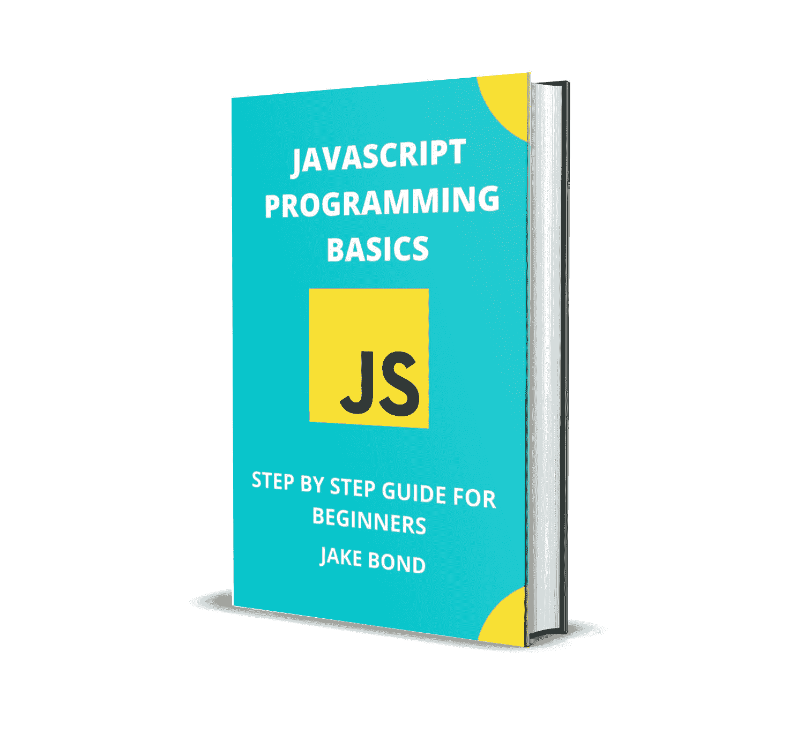


## JavaScript 教程
这节 JavaScript 课程让初学者和专家都能轻松学习 JavaScript。

### 什么是 JavaScript 以及它是如何工作的？
JavaScript 是一种用于计算机的动态编程语言。它是一种轻量级跨平台的基于对象的脚本语言。

借助 JavaScript，我们可以让网站更具活力和吸引力。

Netscape 员工 Brendan Eich 在 1995 年设计了它。它是一种用于创建交互式网站的编程语言。它最常见的用途包括：
* 客户端验证。
* 动态下拉菜单。
* 显示当前日期和时间。
* 在将数据传输到服务器之前，验证 HTML 表单中的用户输入。
* 创建无需连接服务器即可响应用户输入的表单。
* 打开和关闭新窗口或框架（frames）。
* 使用弹出窗口和对话框显示信息（例如：警告对话框、确认对话框或提示对话框）。
* 创建短小但完整的客户端程序。
* 时钟和其他计时器。
* 移动设备的游戏和应用开发。

## JavaScript 的特性
* JavaScript 是一种基于对象的脚本语言。
* 该语言区分大小写。
* 它非常轻量。
* 在 JavaScript 中，每条语句后面必须跟一个分号（`;`）。

## JavaScript 的优势
* JavaScript 是一种解释型脚本语言。不需要编译器，因为没有编译过程。JavaScript 由浏览器作为 HTML 标签进行解释。
* JavaScript 是一种简单的编程语言。对任何人来说都非常容易学习。它用于创建动态且吸引人的网站。
* 因为 JavaScript 运行在客户端，它降低了网站服务器的负载。
* 它包含了可以在网页中使用的条件检查、循环和分支功能。
* 对于终端用户来说，JavaScript 是相对快的。他们不需要等待页面加载即可查看是否漏掉了某些内容。
* 现在网页具有更多功能。为了给网站访问者提供更多功能，我们可以使用 JavaScript 引入拖放组件和滑块。

## JavaScript 

### 欢迎学习 JavaScript
```html
<script>
  document.write("Hello JavaScript by TutorialandExample");
</script>
```
**输出：**
Welcome to JavaScript
Hello JavaScript by TutorialandExample

### JavaScript 示例
```html
<!DOCTYPE html>
<html>
<body>
  <h2>Welcome to JavaScript</h2>
  <script>
    document.write("Hello Friends");
  </script>
</body>
</html>
```
**输出：**
Welcome to JavaScript（注：此处原文为英文，保持输出）
Hello Friends

可以通过在代码中使用 `<script>...</script>` 包含 JavaScript 语句来实现 JavaScript。

```html
<!DOCTYPE html>
<html>
<body>
  <script type="text/javascript">
    document.write("Hello World");
  </script>
</body>
</html>
```
**输出：**
Hello World

在 JavaScript 中，代码可以写在三个地方：
1. 在 HTML 的 `<body>`...`</body>` 标签之间。
2. 在 HTML 的 `<head>`...`</head>` 标签之间。
3. 在 `.js` 文件中（外部 JavaScript）。

#### 举例说明（写在 body 标签之间的代码）
在下例示例中，`<body>` 标签包含了 JavaScript 代码。
```html
<!DOCTYPE html>
<html>
<body>
  <script type="text/javascript">
    alert("Hello world");
  </script>
</body>
</html>
```

#### 示例 2（在 head 标签之间的代码）
我们将在下例的 `()` 中创建函数 `msg`。在 JavaScript 中，你必须在函数名后编写函数体来定义函数。要调用函数，我们必须先创建一个事件。在这种情况下，我们正在使用单击事件来调用 `msg()` 函数。
```html
<!DOCTYPE html>
<html>
<head>
  <script type="text/javascript">
    function msg() {
      alert("Hello world");
    }
  </script>
</head>
<body>
  <p>Welcome to Javascript</p>
  <form>
    <input type="button" onclick="msg()">
  </form>
</body>
</html>
```

### 外部 JavaScript 文件
我们可以创建一个包含在 HTML 中的的 JavaScript 文件。由于单个文件可以在多个页面中使用，因此它允许代码复用并提高网页性能。该文件必须具有 `.js` 扩展名。

**示例：**
```html
<!DOCTYPE html>
<html>
<head>
  <script type="text/javascript" src="message.js"></script>
</head>
<body>
  <p>Hello world</p>
  <form>
    <input type="button" onclick="msg()">
  </form>
</body>
</html>
```

## JavaScript 注释
JavaScript 中的注释用于描述代码，例如警告或建议，以便用户理解代码。

### 类型
1. 单行注释
2. 多行注释

#### 单行注释
双斜杠 `//` 用于表示单行注释。在程序运行时，双斜杠到行尾之间的任何文本都将被忽略。

**在语句之前添加的示例：**
```html
<!DOCTYPE html>
<html>
<body>
  <script>
    // 单行注释
    document.write("hello world");
  </script>
</body>
</html>
```

**在语句之后添加的示例：**
```html
<!DOCTYPE html>
<html>
<body>
  <script>
    var a=10;
    var b=20;
    var c=a+b; // a 和 b 的和
    document.write(c);
  </script>
</body>
</html>
```
**输出：** 30

#### 多行注释
单行和多行注释都可以通过多行注释实现。跨行的注释以 `/*` 开始，以 `*/` 结束。JavaScript 会忽略其中的文本。

**示例：**
```html
<!DOCTYPE html>
<html>
<body>
  <script>
    /* 这是多行注释。它不会被显示 */
    document.write("Example of JavaScript line comment");
  </script>
</body>
</html>
```

## JavaScript 变量
值（`"Ram"`）和表达式（`x+y`）存储在变量中。在使用之前必须先声明变量。声明变量使用 `var` 关键字，如下：`var name;`。

变量有两种类型：
1. 局部变量
2. 全局变量

### 局部变量
它定义在函数或块内部。
**示例：**
```javascript
<script>
  function() {
    var x=10; // 局部变量
  }
</script>
```

### 全局变量
它具有全局作用域，意味着可以在 JavaScript 代码的任何地方定义。在函数外部声明变量。
**示例：**
```html
<!DOCTYPE html>
<html>
<body>
  <script>
    var data =200; // 全局变量
    function a() {
      document.writeln(data);
    }
    function b() {
      document.writeln(data);
    }
    a(); // 调用 JavaScript 函数
    b();
  </script>
</body>
</html>
```

### 在 JavaScript 中于函数内部声明全局变量
要在函数内部声明 JavaScript 全局变量，我们必须使用 `window` 对象。
**示例：**
```javascript
<script>
  function a() {
    window.value=90;
  }
</script>
```


```javascript
window.value=50; //使用 window 对象声明全局变量

}

function b(){

  alert(window.value);//从其他函数访问全局变量

}

a();

b();

</script>

</body>

</html
```

# JavaScript 数据类型

有多种数据类型来存储各种类型的值。在 JavaScript 中，有两种数据类型。

1. 原始数据类型（Primitive data types）。
2. 非原始数据类型。

由于 JavaScript 是一种动态类型语言，我们不需要定义变量的类型，因为 JavaScript 引擎动态地使用它。在这种情况下，使用 `var` 指定数据类型。它可以存储任何类型的值，包括数字、字符串和对象。

#### 示例

```javascript
var a=Ram; //String
var b=20; //Number
var x= {FirstName:'Ram', lastName:'Doe'}; //Object
```

## JavaScript - 原始数据类型

在 JavaScript 中，有五不同的原始数据类型。

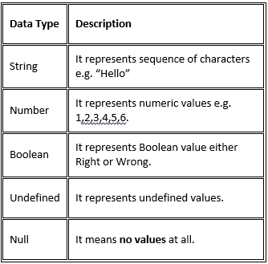

## JavaScript 非原始数据类型

有 3 种非原始数据类型如下：

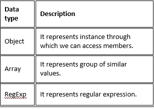

# JavaScript 运算符

运算符是 JavaScript 中用于对操作数执行操作的符号。简单来说`3+2` 等于 `5`。这里的操作数是 `3` 和 `2`，运算符是 `+`。

JavaScript 运算符如下：

1. 算术运算符。
2. 比较（关系）运算符。
3. 位运算运算符。
4. 逻辑运算符。
5. 赋值运算符。
6. 特殊运算符。

### 算术运算符

我们在算术运算符中对操作数采用算术运算。

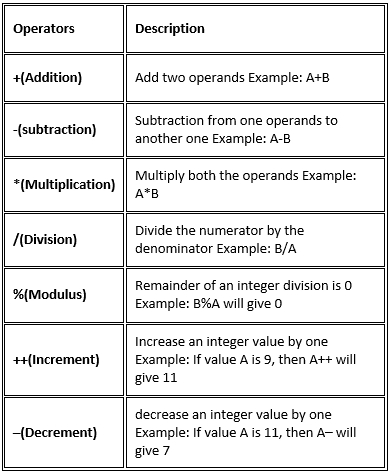

### 比较运算符

在比较运算符中，比较两个操作数 `A` 和 `B`。

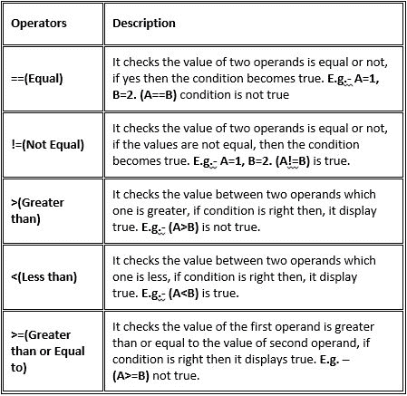

### 赋值运算符

JavaScript 支持以下赋值运算符。

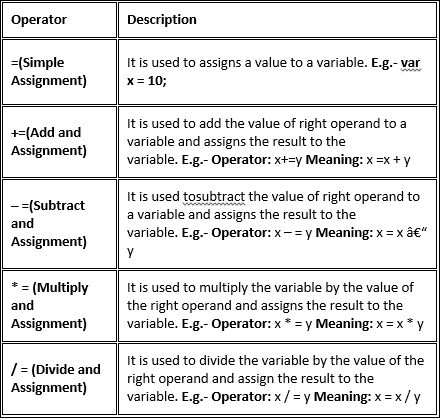

### 位运算运算符

JavaScript 支持以下位运算符：

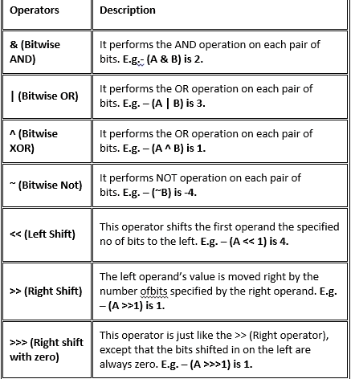

### 逻辑运算符

布尔值通常与逻辑运算符配合使用。以下是逻辑运算符-

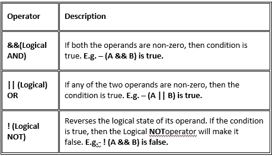

# JavaScript If Else

JavaScript 中的条件语句用于根据标准执行不同的活动。在 JavaScript 中，有三种语句。

1. `if` 语句。
2. `if else` 语句。
3. `if else if` 语句。

## if 语句

如果条件为真或假，在 JavaScript 中使用 `if` 语句运行函数。

```javascript
if (condition){
  // 待评估的内容
}
```

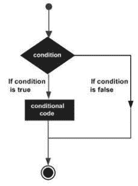

**示例：**

```html
<!DOCTYPE html>
<html>
<body>
<script>
var x=50;
if(x>30){
  document.write("value of x is greater than 30");
}
</script>
</body>
</html>
```
**输出**
Value of x is greater than 30

### if else 语句

如果任一条件为真或假（此处不满足时），则使用 `if else` 语句。

#### 语法
```javascript
if(condition)
{
  // 语句组
}
else
{
  // 语句组
}
```
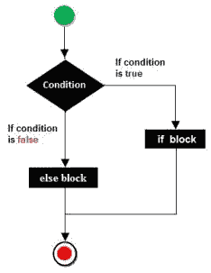

**示例**
```html
<!DOCTYPE html>
<html>
<body>
<script>
var x=20;
if(x%2==0){
  document.write("x is even number");
}
else{
  document.write("a is odd number")
}
</script>
</body>
</html>
```
**输出**
X is even number

### if else if

它仅仅查看内容以检查在许多表达式中该表达式是否为真。`else if` 是 `if else` 语句的更复杂版本。

#### 语法
```javascript
If (condition1)
{
  // 如果条件 1 为真，则执行语句
}
else if (condition 2)
{
  // 如果条件 2 为真，则执行语句
}
else if (condition 3)
{
  // 如果条件 3 为真，则执行语句
}
else
{
  // 如果没有条件为真，则执行语句
}
```

**示例**
```html
<!DOCTYPE html>
<html>
<body>
<script>
var x=50;
if(x==10){
  document.write("x is equal to 10");
}
else if(x==50){
  document.write("x is equal to 50");
}
else if(x==30){
  document.write("x is equal to 30");
}
else{
  document.write("a is not equal to 10, 50 or 30");
}
</script>
</body>
</html>
```
**输出**
x is equal to 50

# JavaScript 语句

在 JavaScript 中，`switch` 语句用于在多个条件下执行单个代码。它与 `else if` 语句相同，但比 `if..else..if` 语句更容易记忆。


#### 语法
```javascript
switch (expression)
{
  case 1: statement(s)
  break;
  case 2: statement(s)
  break;
  case n: statement(s)
  break;
  default: statements(s)
}
```
注意：在 `switch-case` 语句中，`break` 语句非常重要。

**示例**
```html
<!DOCTYPE html>
<html>
<body>
<script>
var grade='B';
var result;
switch(grade){
  case 'A':
    result="A Grade";
  break;
  case 'B':
    result="B Grade";
  break;
  case 'C':
    result="C Grade";
  break;
  default:
    result="No Grade";
}
document.write(result);
</script>
</body>
</html>
```
**输出**
B Grade

# JavaScript 循环

由于重复的方法形成了一个圈，因此重复语句被称为循环。在某些情况下，我们使用语句来减少行数。这在数组中最常见。在 JavaScript 中，有三种循环的形式：

1. `while` 循环
2. `for` 循环
3. `do-while` 循环

### while 循环

代码在 `while` 循环中执行，直到表达式为真。如果迭代次数未知，则应该使用它。

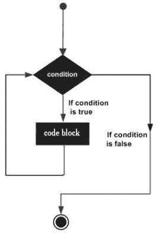

#### 语法
```javascript
while(condition){
  // 如果表达式为真，则执行语句
}
```

**示例**
```html
<!DOCTYPE html>
<html>
<body>
<script>
var i=1;
while (i<=10) {
  document.write(i+"<br/>");
  i++;
}
</script>
</body>
</html>
```
**输出**
1
2
3
4
5
6
7
8
9
10

### For 循环

在 `for` 循环中初始化变量、检查条件，然后增加或减少值。它运行固定的的一段时间。

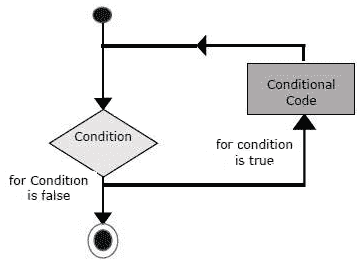

#### 语法
```javascript
for (initialization; condition; increment)
{
  // 待执行的代码
}
```

**示例**
```html
<!DOCTYPE html>
<html>
<body>
<script>
for (i=1; i<=12; i++) {
  document.write(i +"<br/>")
}
</script>
</body>
</html>
```
**输出**
1
2
3
4
5
6
7
8
9
10
11
12

### do while 循环

当 `while` 循环无限执行项目时，`do while` 循环只执行一次代码，无论条件为真为假。当我们我们需要重复语句块至少一次时，使用 `do-while`。

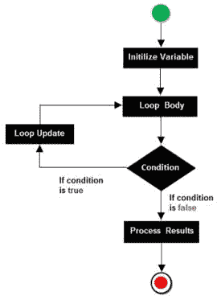

#### 语法
```javascript
do{
  // 待执行的代码
  // 增加/减小
}
while (condition);
```

**示例**
```html
<!DOCTYPE html>
<html>
<body>
<script>
var i=11;
do{
  document.write(i +"<br/>");
  i++;
}while (i<=15);
</script>
</body>
</html>
```
**输出**
11
12
13
14
15

# JavaScript 函数

在 `<script>.....</script>` 标签内定义新函数是 JavaScript 的一个重要功能。`function` 关键字用于在 JavaScript 中声明函数。


为了重用代码，我们多次调用 JavaScript 方法。

## 优点 - JavaScript 函数

1. **代码可重用性**：我们多次使用相同的方法来节省时间和代码量。
2. **更少的代码**：得益于此，应用程序得到了压缩。当我们执行常规任务时，不需要编写大量的代码。

#### 语法

```javascript
function functionName(parameter or not)
{
  statements
}
```

#### 示例

```html
<!DOCTYPE html>
<html>
<body>
<script>
function msg() {
  alert("Hello! world");
}
</script>
<input type="button" onclick="msg()" value="click here"/>
</body>
</html>
```

#### 输出
Hello world!（你好，世界！）

## 带参数的函数

通过传递参数来调用函数。

```html
<!DOCTYPE html>
<html>
<body>
<script>
function getcube(number) {
  alert(number*number*number);
}
</script>
<form>
  <input type="button" value="click" onclick="getcube(3)"/>
</form>
</body>
</html>
```

#### 输出
27

#### 示例

```html
<!DOCTYPE html>
<html>
<body>
<script>
function getname() {
  name=prompt("Enter the Name");
  alert("Welcome Mr/Mrs " + name);
}
</script>
</body>
<form>
  <input type="button" value="Click" onclick="getname()"/>
</form>
</html>
```

## 带返回值的函数

调用返回值的函数，并在程序中使用它。

```html
<!DOCTYPE html>
<html>
<body>
<script>
function getInfo() {
  return "Hello Raj! How are you?";
}
</script>
<script>
  document.write(getInfo());
</script>
</body>
</html>
```

#### 输出
Hello Raj! How are you?（你好，Raj！你你好吗？）

## Function() 构造函数

函数语句不仅仅用于定义函数；它还可以使用 `Function()` 构造函数和 `new` 运算符来动态定义函数。

#### 语法

```javascript
var variename = new Function(Arg1, Arg2..., "Function Body");
```

#### 示例

```html
<!DOCTYPE html>
<html>
<head>
<script>
var func = new Function("a", "b", "return a+b");
function secondFunction() {
  var result;
  result = func(50,50);
  document.write(result);
}
</script>
</head>
<body>
  <p>点击按钮调用函数</p>
  <form>
    <input type="button" onclick="secondFunction()" value="Call Function">
  </form>
</body>
</html>
```

## 函数字面量 (Function Literals)

函数字面量的概念（构造函数的另一种另一种方式）在 JavaScript 1.2 中引入。它是一个定义无名函数的表达式。函数字面量的语法与函数语句相似，不同之处在于它被用作表达式而不是语句，并且不需要函数名。

#### 语法

```javascript
var variename = function(Argument List){
  Function Body
};
```

#### 示例

```html
<!DOCTYPE html>
<html>
<head>
<script>
var func = function(a,b){return a+b};
function secondFunction() {
  var result;
  result = func(10,20);
  document.write(result);
}
</script>
</head>
<body>
  <p>点击按钮调用函数</p>
  <form>
    <input type="button" onclick="secondFunction()" value="Call Function">
  </form>
  <p>在函数内部使用不同的参数并尝试一下吧...</p>
</body>
</html>
```

## JavaScript 对象 (Javascript Object)

对象是一个包含状态和行为的实体。JavaScript 是一种关注对象的脚本语言。虽然 JavaScript 是基于模板而非基于类的，但它允许我们直接创建对象。

### 语法 - 添加属性 - 添加对象

```javascript
objectName.objectProperty = propertyValue;
```

我们使用 `write()` 方法来记录对象，以便在文档上写入任何内容。`Document.write("Hello world")`

#### 示例
以下示例展示了如何 创建一个对象。

```html
<!DOCTYPE html>
<html>
<head>
<title>用户定义对象</title>
<script type="text/javascript">
  var book = new Object(); // 创建了对象
  book.subject = "5 points someone"; // 将属性赋值给对象
  book.author = "ChetanBhagat";
</script>
</head>
<body>
<script type="text/javascript">
  document.write("Book Name is : " + book.subject + "<br>");
  document.write("Book Author is : " + book.author + "<br>");
</script>
</body>
</html>
```

#### 输出
Book Name is : 5 points someone
Book Author is : ChetanBhagat

## 对象的方法 (Methods of an Object)

#### 示例

```html
<!DOCTYPE html>
<html>
<head>
<title>用户定义对象</title>
<script type="text/javascript">
// 定义一个作为方法的函数
function addPrice(amount){
  this.price = amount;
}
function book(title,author){
  this.title = title;
  this.author = author;
  this.addPrice = addPrice; // 将该方法赋值为属性。
}
</script>
</head>
<body>
<script type="text/javascript">
  var myBook = book("Points Someone","ChetanBhagat");
  myBook.addPrice(150);
  document.write("Book Title is: " + myBook.title + "<br>");
  document.write("Book Author is : " + myBook.author + "<br>");
  document.write("Book Price is : " + myBook.price + "<br>");
</script>
</body>
</html>
```

#### 输出
Book Title is:  Points Someone
Book Author is : ChetanBhagat
Book Price is : 150

## JavaScript 数组 (Javascript array)

数组用于在单个单元或内存区域表示元素集合。进入数组的每个元素都存储在数组中，索引从零开始。我们可以通过索引来存储数据。在 JavaScript 中，我们必须使用 `new` 关键字声明数组。我们使用 `new Array(n)`。数组中的槽位由 `n` 表示。

#### 语法
```javascript
array = new array(n);
```
注意：当我们在 JavaScript 中指定大小构建数组时，我们会构建大小为零的对象。

#### 示例

```html
<!DOCTYPE html>
<html>
<body>
<script>
  var i;
  var emp = new Array();
  emp[0] = "Ajay";
  emp[1] = "Abhay";
  emp[2] = "Arun";
  emp[3] = "Shipra";
  for (i=0; i<emp.length; i++) {
    document.write(emp[i] + "<br>");
  }
</script>
</body>
</html>
```

#### 输出
Ajay
Abhay
Arun
Shipra

#### 示例

```html
<!DOCTYPE html>
<html>
<head>
<script type="text/javascript">
function array() {
  num = new Array(5);
  num[0] = 10;
  num[1] = 20;
  num[2] = 30;
  num[3] = 40;
  num[4] = 50;
  sum = 0;
  for (i=0; i<num.length; i++) {
    sum = sum + num[i];
  }
  alert(sum);
}
</script>
</head>
<body>
  <input type="button" onclick="array()" value="click here">
</body>
</html>
```

## JavaScript 字符串 (Javascript String)

String 对象用于处理字符字符串。它是用于存储和处理文本的工具。

在 JavaScript 中，有两种方法创建字符串：

1. 字符串字面量。


## 2. 使用 new 关键字。

### 字符串字面量
字符串字面量是通过双引号创建的。

#### 语法
```javascript
var stringname="string value";
```

#### 示例
```html
<!DOCTYPE html>
<html>
<body>
<script>
var str="Hello String Literal";
document.write(str);
</script>
</body>
</html>
```
#### 输出
`Hello String Literal`

### 使用 new 关键字
#### 语法
```javascript
var stringname=new String("new keyword")
```

#### 示例
```html
<!DOCTYPE html>
<html>
<body>
<script>
var stringname=new String("Hello String");
document.write(stringname);
</script>
</body>
</html>
```
#### 输出
`Hello String`

### 字符串属性
这里列出了字符串对象的属性列表及其描述。

1. `constructor`。
2. `length`。
3. `prototype`。

**构造函数 (Constructor)**– 它它为你提供一个指向最初创建该对象的字符串函数的引用。

#### 语法
```javascript
string.constructor
```

**长度 (Length)** - 返回字符串中的字符数。

#### 语法
```javascript
string.length
```

**原型 (Prototype)**– 它允许向任何对象添加属性和方法（如 Number、Boolean、string 和数据等）。这是一个大多数对象都可以访问的全局属性。

#### 语法
```javascript
object.prototype.name = value
```

### JavaScript 字符串中还可以可用方法：
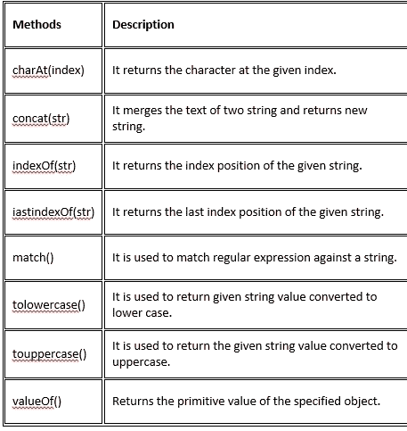

#### charAt()
这是一个从指定索引处获取字符的方法。

#### 示例
```html
<!DOCTYPE html>
<html>
<body>
<script>
var str = new String( "Hello" );
document.writeln("str.charAt(0) is: " + str.charAt(0));
document.writeln("<br />str.charAt(1) is: " + str.charAt(1));
document.writeln("<br />str.charAt(2) is: " + str.charAt(2));
document.writeln("<br />str.charAt(3) is: " + str.charAt(3));
document.writeln("<br />str.charAt(4) is: " + str.charAt(4));
</script>
</body>
</html>
```

#### concat(str)
该方法在合并两个或多个字符串后返回一个新字符串。

#### 示例
```html
<!DOCTYPE html>
<html>
<body>
<script>
var x="Hello";
var y="World";
var z=x+y;
document.write(z);
</script>
</body>
</html>
```

#### 这里是 concat(str) 的另一个示例
```html
<!DOCTYPE html>
<html>
<body>
<script>
var a = new String( "Hello" );
var b = new String( "Friends" );
var c = a.concat( b );
document.write("Concatenated String : " + c);
</script>
</body>
</html>
```

#### indexOf(str)
字符串索引 - `indexOf(str)` 方法返回给定字符串的索引位置。

#### 示例
```html
<!DOCTYPE html>
<html>
<body>
<script>
var x="Tutorial provide by tutorialandexample";
var y=x.indexOf("by");
document.write(y);
</script>
</body>
</html>
```

#### lastIndexOf(str)
字符串 `lastIndexOf(str)` 方法返回字符串的最后一个索引点。

#### 示例
```html
<!DOCTYPE html>
<html>
<body>
<script>
var x="Tutorial provide by tutorialExamole";
var y=x.lastIndexOf("by");
document.write(n);
</script>
</body>
</html>
```

#### match()
#### 示例
```html
<!DOCTYPE html>
<html>
<body>
<script>
var str = "To more detail, see Chapter 2.5.4.1";
var re = /(chapter \d+(\.\d)*)/i;
var find = str.match( re );
document.write(find );
</script>
</body>
</html>
```

#### toLowerCase()
将指定的字符串转换为小写字母。

#### 示例
```html
<!DOCTYPE html>
<html>
<body>
<script>
var x="HELLO WORLD";
var y=x.toLowerCase();
document.write(y);
</script>
</body>
</html>
```

#### toUpperCase()
将指定的字符串转换为大写字母。

#### 示例
```html
<!DOCTYPE html>
<html>
<body>
<script>
var x="hello world";
var y=x.toUpperCase();
document.write(y);
</script>
</body>
</html>
```

#### valueOf()
它返回字符串对象的原始值。

#### 示例
```html
<!DOCTYPE html>
<html>
<body>
<script>
var str = new String("Hello world");
document.write(str.valueOf( ));
</script>
</body>
</html>
```

