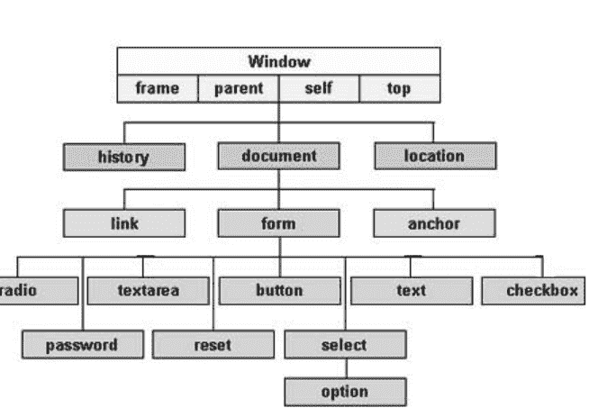

# 零基础学者 Javascript 编程入门指南


# 引言

首先，祝贺你花时间阅读我的 JavaScript 指南。我的目的是引导你了解 JavaScript 的内部机制。我希望你确切学习 JavaScript 是什么、它是如何工作的，以及所有部分是如何组合在一起的，同时详细介绍与 JavaScript 配合使用的 HTML 元素。

JavaScript 是一种非常轻量的语言，容易学习。它是 Brendan Eich 在 1995 年于 Netscape（第一个网络浏览器的所有者）期间设计的。JavaScript 是一种网页编程语言，用于使用 Java applet、图像和插件等组件创建网站和网页。JavaScript 是一种开源且跨平台的语言，你会发现所有现代网站都将其作为核心编程语言。

为了帮助你，我包含了一些示例供你尝试——这是学习知识最好的方法，我希望它对你有所帮助。书中还穿插了若干练习，这些只是针对特定章节的示例，我没有为这些练习提供答案。它们仅仅是你练习的一种，我敦促你再次查看它们，直到你充满信心为止。这些不仅是为了测试你对主题的了解，还为了测试你是否学会了编写代码的正确方法。在书的最后，你会找到一个供你尝试的 JavaScript 模拟测试，附带答案。

如果你准备好学习 JavaScript 了，让我们开始吧。

**感谢** - www.homeandlearn.co.uk 为部分代码提供的帮助。我想送给你一本**免费**的电子书作为给你的礼物，只需查看下方链接即可。无任何条件。 :)（如果你找不到确认邮件，请查看垃圾邮件）https://forms.aweber.com/form/50/1386326750.htm

作为对你下载这本书的简单“感谢”，此链接将让你免费访问一项专属服务，该服务将在亚马逊畅销榜发布新品、打折或进行免费促销时向你发送通知。如果你是一个对节省大量钱感兴趣的人，只需点击上面的免费电子书链接即可。

作为额外奖励……我邀请你加入我的专属**小组**。你将成为编程与技术专家/爱好者的社区的一员。这样做的好处是，你可以**免费**访问我在市场上最新、最畅销的书籍！

我有一本新书即将出版，你一定不想错过！

通过点击下方链接加入我的专属小组……

https://forms.aweber.com/form/00/29817100.htm


现在加入！

# 第一部分：设置你的环境

在开始编写任何 JavaScript 之前，你将需要一些东西——文本编辑器和一个包含 Web 开发工具的良好浏览器。为此，我们将使用 Chrome 浏览器，并查看一个名为 Brackets 的文本编辑器。

## Chrome

学习 JavaScript 最重要的事情之一是控制台，包括如何设置。Chrome 拥有内置的控制台，这非常适合输入你的脚本——它是免费的。

1. 打开你正在使用的网络浏览器并输入 google.com/Chrome
2. 下载并安装 Chrome
3. 打开 Chrome，寻找右上角的选项圆图标——点击它，你将看到更多选项
4. 选择“更多工具”，然后选择“开发者工具”
5. 现在选择“控制台”，控制台就会加载。你应该能看到符号 `>` ——这是你的命令提示符，你的所有代码都将在这里。

现在你可以开始使用 Chrome 中的控制台了，请花时间探索；学习

## 快捷键

有一个打开控制台的快捷键：

- 下载并安装 Chrome
- 在地址栏中输入 `about:blank`，将加载一个空白页面

## 入门

现在你已经设置好了控制台，你可以在命令提示符处输入 `console.log()`——这将让你登录。现在是开始探索并学习 JavaScript 到底是什么时候了，正如我之前提到的，你会在书中发现很多示例来帮助你，所以请使用它们并学习。一些实用的提示——你可以点击“保留日志”（Preserve Log）按钮保留你输入的任何内容，如果你想保存工作，可以在控制台任何地方点击右键并选择“另存为”。

现在让我们看看编辑器。你可以选择任何你喜欢的，但我推荐 Brackets。

## Brackets

Brackets 是开源的，专为 Web 开发设计。它是使用 JavaScript 构建的，是最好的编辑器，提供了许多实用的工具和帮助，让你更轻松、更有效地学习编码。

1. 打开你的浏览器并输入 http://brackets.io/
2. 下载对应你操作系统（Linux、Windows 或 Mac）的版本

当你第一次打开 Brackets 时，你会看到一个名为“入门”的项目。屏幕上的指令将向你展示如何使用 Brackets 的功能。打开文件夹非常简单——点击“文件 > 打开文件夹”。你将在屏幕左侧的文件树中看到它。这是你的项目文件夹，它有一些与之相关的设置。要在不同的项目之间切换，只需点击根文件夹名称，或者你可以从操作系统中将相关文件夹拖入 Brackets，它就会打开。


- 而不是显示标签页中的文件，而是显示“工作文件”列表。点击树中的文件将允许你查看文件，但它不会进入“工作文件”。对文件进行的任何更改将自动放入“工作文件”列表中，无需先保存。开始时，使用单个编辑器将在窗口中显示，你可以点击“视图”然后选择“水平分屏”或“垂直分屏”，以便看到两个编辑器。主视图现在会显示两个文件，你可以同时查看它们。窗口非常聪明，对于每个项目它都会记住布局。打开项目将显示它。关闭视图并回到单个标签页，只需点击“视图”然后点击“关闭分屏”。这不会关闭任何打开的文件。

以下是需要的文本：

```<!DOCTYPE html>
<html>
<head>
<title>第一个脚本</title>
</head>
<body>


## 第 2 部分：浏览器

### 你的第一个 JavaScript

打开文本编辑器并输入以下内容：

<!DOCTYPE html>
<html>
<head>
<title>第一个脚本</title>
</head>
<body>
</html>
```

这里我们有网页的开头——`HEAD` 标签和 `TITLE` 区域。将其另存为 `first_script.html`。注意——如果你使用记事本作为编辑器，选择“另存为”所有类型，否则你将只有一个 HTML 文件。

接下来，我们将添加一些标签，在 `BODY` 标签之间输入：`<script language="javascript">alert("Hello World")</script>`

始终在起始和结束的 `<SCRIPT>` 标签之间添加脚本。`SCRIPT` 标签的一个属性是 `LANGUAGE`，它告诉浏览器脚本语言——在这种情况下，是 JavaScript。注意，JavaScript 被包含在双引号中。这并不是绝对必要的，你甚至可以跳过 `LANGUAGE` 属性，如下：

`<script>`
```html
alert("Hello World")
</script>
```

```html
<!DOCTYPE html>
<html>
<head>
<title>第一个脚本</title>
</head>
<body>
</body>
</html>
```

如果代码工作，如下：

```html
<!DOCTYPE html>
<html>
<head>
<title>第一个脚本</title>
</head>
<body>
    <script language="javascript">
        alert("Hello world")
    </script>
</body>
</html>
```

注意，如果在 `/script>` 标签的开始处漏掉斜杠，代码将无法工作。在所有的 HTML 标签中，`SCRIPT` 标签可以小写，如下：

`<script>
alert("Hello World")
</script>`

另一个注意——`SCRIPT` 标签本身不区分大小写，但 JavaScript 区分。我们写的代码是一行，显示一个弹出框，显示“Hello, World”。尝试一下。确保你保存了，然后使用 Windows 资源管理器或 Mac 的 Finder 转到 HTML 文件所在的位置。双击文件在浏览器中运行它。将 alert 行改为：

```html
Alert("Hello World")
```

注意，alert 现在是以大写字母 ‘A’ 开头的。保存并在浏览器中加载页面，你会发现窗口不再显示。改回小写 ‘a’，保存并重新加载，窗口就会出现。

Alert 框向用户显示信息。在括号之间输入你想让用户看到的文本，确保它在引号内——使用单引号或双引号，不要组合。

## 确认 (Confirm) 和提示 (Prompt)

你也可以拥有确认和提示框——确认框将给你一个“确定”和一个“取消”按钮，这些通常与 IF 语句一起使用，以确定点击了哪个按钮。稍后介绍更多 IF 语句，但获取确认框只需输入：

```javascript
confirm("OK or Cancel?")
```

再次，文本必须插入引号之间。

提示框用于你需要用户输入内容。这是提示框的代码：

```javascript
prompt("喜欢的动物?", "Cat")
```

注意括号之间有两个部分——首先是标题，然后是默认文本。用户将在对话框中输入文本，当他们按下“确定”按钮时，你会获得输入的文本并对其进行处理——稍后查看 IF 语句会了解更多。对于这两个框，必须使用小写字母。

接下来，我们将查看 JavaScript 标签的位置。

## JavaScript 标签位置

有三个地方可以插入 `SCRIPT` 标签：
- 在两个 `BODY` 标签之间
- 在两个 `HEAD` 标签之间
- 在 `HEAD` 部分作为外部文件的链接

有些 `SCRIPT` 标签应该放在 `BODY` 部分的末尾，如下：

```html
<!DOCTYPE html>
<html>
<head>
<title>第一个脚本</title>
</head>
<body>
HTML 放在这里。JavaScript 放在 HTML 之后
<script language="Javascript">
confirm("OK or Cancel?")
</script>
</body>
</html>
```

我们之所以这样做是因为网页会在会在任何脚本被读取之前加载——如果标签在 `HEAD` 部分，脚本会在 CSS 或 HTML 元素加载之前被解析。

大多数情况下，将脚本标签放置在 `HEAD` 部分更好，如下：

```html
<!DOCTYPE html>
<html>
<head>
</head>
<body>
</body>
</html>
```

```html
<title>第一个脚本</title> <script language="Javascript">
confirm("OK or cancel?")
```

```text
文件 编辑 格式 视图 帮助
<!DOCTYPE html>
<html>
<head>
<title>第一个脚本</title>
<script language="javascript">
confirm("OK or cancel?")
</script>
</head>
<body></body>
</html>
```

## 练习

将 `SCRIPT` 标签移动到 `HEAD` 部分，并确保其后的引用部分是正确的；否则，代码将无法运行。

## 外部文件

每个浏览器都拆分为不同的部分或对象，可以通过 JavaScript 进行访问。整体而言，这些对象被称为 BOM 或浏览器对象模型（Browser Object Model），顶部是 Window 对象。该对象代表整个浏览器——菜单、工具栏、整个页面及其包含的内容。

在 Window 对象之下，你会发现许多不同的对象，允许你执行其他任务，例如：
- **window.document**：让你访问所有的 HTML 元素
- **window.history**：允许你访问历史信息。它的用途有限，因为你无法看到过哪些页面，只能看到历史页面数量。如果你想，可以访问的其他方法还有 `history.forward()`、`history.back()` 和 `history.go()`。
- **window.innerHeight**：提供关于页面可用空间的信息
- **window.screen**：提供关于宽度和高度的信息，它们是两个不同的东西。你可能会混淆屏幕和宽度，让我们通过示例向你展示这一点；创建一个在 `HEAD` 部分放置 `SCRIPT` 标签的 HTML 页面，然后添加以下代码：

`<!DOCTYPE html><html><head><title>窗口对象</title><script language="javascript">alert(window.innerHeight)</script></head></body></html>`


window.screen.height) 现在我们正在使用屏幕对象的高度值，请保存并刷新。

- * window.navigator – 这一个用于获取浏览器信息。

Navigator 对象还会向你展示许多其他可以使用的对象，例如：`window.navigator.cookieEnabled`。将此内容插入圆括号中以显示警告框（alert box），它将告知你浏览器中是否启用了 cookie。我们通常会将其放在一个 IF 语句内部——如果答案是 YES，则浏览器上设置了 cookie；如果是 NO，则要求用户启用 cookie。

你还可以使用的其他 navigator 对象还包括：
appName
appVersion
language
platform
userAgent
尝试在警告框中使用这些内容，并观察每个属性的作用。

- * window.location – 此对象允许你执行一些相当高级的操作，但主要，我们使用它将用户重定向到另一个页面。我们像这样使用代码：`window.location = "http://www.homeandlearn.co.uk/";` 在 = 符号之后，你输入想要让访问者重定向到的网站名称，并确保该名称被插入引号之间，并在语句末尾使用分号。虽然在这里并不需要，但你应该始终使用分号来分隔代码行。

本节到此，接下来我们将查看 Window 方法。



## 第 3 部分：Window 方法

## Window 方法与事件

回到 Window 对象，它还有方法（Methods），这些是执行特定操作的代码块。回想我们在上一章使用的三个框——Alert（警告）、Confirm（确认）和 Prompt（提示）。这些都是方法，如果非常具体地说，我们会写的是：`window.alert("Alert Message")` 以及 `window.confirm("OK or Cancel")`。然而，Window 对象也被称为全局对象，这意味着不需要 `window.` 这种点符号——你只需要输入在那之后的内容即可。不过，至少在你刚开始时，应该包含 window 部分，因为这会让你的代码清晰得多。

其他一些常见的 window 方法是：
window.clearInterval
window.setInterval
window.setTimeout
window.close
window.open
window.print

前四个用于设置和操作计时器，这些对于动画非常有用。Close 和 Open 的作用正如同其名——关闭和打开窗口，而 Print 方法将调出打印对话框。我们将更地查看 window.open 方法。

有时，从当前所在的窗口打开一个新窗口非常有用的。这些新窗口通常在点击网页上的超链接时打开，你可能在网站加载时也会有一个打开的窗口——这些被称为弹出窗口（popups），对于网站访问者来说相当烦人。

以下代码展示了点击特定超链接时如何打开新窗口。如果你还没有理解这段代码，不要担心，它对现在来说有点复杂。我想向你展示这个是因为它使用了你以后会学到的东西——函数（function），它在点击链接时被调用。

```
<!DOCTYPE HTML>
<HTML>
<HEAD>
<TITLE>Window open method</TITLE>
<SCRIPT LANGUAGE = "Javascript">
function eAdd() {
    var mswindow = window.open("popup.html", "Popup", "toolbar=no,width=500,height=300");
}
</SCRIPT>
</HEAD>
<BODY>
<a href="#" onclick="eAdd()">Link Text Here</a>
</BODY>
</HTML>
```

注意，在 open 的括号之间，有三个内容：
window.open("popup.html", "PopUp", "toolbar=no,width=500,height=300");
 
● 你想在新窗口中显示的页面
● 窗口名称
● 窗口配置选项

配置有三个选项——设置工具栏为、宽度，然后是窗口的高度。所有这些选项都必须放在引号内，且选项与值之间不能有空格。每个选项之间用逗号分隔。

## Window 事件

在上一节中，我们使用超链接来打开新窗口，该超链接被放置在 BODY 标签之间，使用的文本是：`<a href="#" onclick="eAdd()">Link Text Here</a>`。`onclick` 被称为事件（event），在 BODY 标签之间有很多有很多对象可能会使用此事件。示例包括图像、按钮、下拉列表、复选框等。然而，其思想是每当该事件发生时，就调用一段代码。

你可以可以使用许多不同的事件，大多数都是自言自懂的：
- onChange
- onclick
- onkeydown
- onkeypress
- onkeyup
- onload
- onmousedown
- onmousemove
- onmouseout
- onmouseover
- onmouseup
- onscroll
- onselect
- onsubmit
- onUnload 你会在整本书中遇到许多此类，我们会在遇到它们时进行解释。接下来，我们将查看 Document，最重要的 window 对象之一。

## 文档对象模型 - DOM

Document 是另一个可以被操作的 Window 对象。它是一个非常强大的对象，引用网页上可能存在的每一个元素。这意味着 JavaScript 可用于访问、修改和添加新的 HTML 元素。然而，这是高级内容，所以我们将查看最实用的一个 - `document.write`。

### document.write

此方法可能用于在网页上插入文本，尝试这个：
- 创建一个新的 HTML 页面
- 将其保存为 write.html
- 在 HTML 中插入此标题：`<h1>The write method</h1>`
- 将其放入 Body 部分
- 在 SCRIPT 标签中输入：`document.write(window.height);`

你的页面看起来如下：

```html
<!DOCTYPE HTML>
<HTML>
<HEAD>
<TITLE>Window open method</TITLE>
<SCRIPT LANGUAGE = "Javascript">
document.write(window.height);
</SCRIPT>
</HEAD>
<BODY>
<a href="#" onclick="eAdd()">Link Text Here</a>
</BODY>
</HTML>
```

现在保存并在浏览器中打开它。注意，而不是使用警告框，我们现在将屏幕高度写入页面。

img/9eea564bbfc4aaeafb2fb611128dae4e_28_0

从 BODY 剪切 JavaScript 部分并粘贴到 HEAD，保存然后刷新页面。现在你的屏幕高度在顶部，这是因为 HEAD 部分总是首先执行。然而，浏览器不会等待页面加载，它会执行 HEAD 代码。

现在将代码放回 BODY 并修改为：`document.write("Height=" + window.height);` 我们在这里得到的内容被称为拼接（concatenation）。这意味着我们将两个字符串连接在一起。注意，代码被放在引号之间，在 + 之后我们输入了屏幕代码。+ 符号在这种语境下，字面意思是“加在一起”。你可以根据需要频繁使用，例如：`document.write("SH=" + window.height + "SW=" + window.width);` SH 代表屏幕高度，SW 是屏幕宽度，但注意加号处的空格和逗号。如果你没弄对这些，你的代码将无法工作。

HTML 标签可以配合拼接使用。假设你想跨行显示内容；你会使用 BR 标签，就像这样：`document.write("SH=" + window.height + "<BR>" + "SW=" + window.width);` 注意 BR 被封装在引号中，对于任何使用 write 方法插入的 HTML，都必须使用这些。

你可以根据需要多次使用 document.write 方法。查看以下示例；SCRIPT 标签已移动到 HEAD 部分——一次在 H1 行中，一次 document.write 使用了两次——在它下方添加了文本。

```html
<!DOCTYPE HTML>
<html>
<HEAD>
<TITLE>The Write Method</TITLE>
<SCRIPT LANGUAGE = "Javascript">
document.write("<h1>The write method</h1>");
document.write("Height-" + window.screen.height);
</SCRIPT>
</HEAD>
<BODY></BODY>
</html>
```

在接下来的节中，我们将学习变量以及许多许多构成代码的其他概念。


## 第 4 ：编程基础

这是一个非常长的章节，因此在进入下一部分之前，请确保你理解了每一个部分

## 变量

无论你使用哪种编程语言，变量都是完全一样的。本质上，它们是用于以后检索而放置物品的存储。将它们想象成小盒子；你在纸上写下重要的信息并将其储存在盒子里。给盒子起一个与内容相关的名称，这样在你需要时就可以轻松地提取这些信息。

在 JavaScript 中设置变量时，以 `var` 开始，后面跟着一个空格，然后是变量名。你可以给它命名为任何名称，但必须遵循命名规则：

- 变量名中不能有空格
- 变量名不能以数字开头
- 名称只能包含字母、数字、下划线 (_) 和美元符号 ($)

有效的名称包括：

- number2
- my_phone_number
- $familyName

无效的名称包括：

- 2number
- my phone number
- "familyNameName"

 建议，不要用数字开头任何变量，不要在其中包含空格，也不要使用引号。

要在变量中存储信息，我们使用 `=` 符号。你可以在里面存储各种类型，数字、布尔值和文本字符串。这些都被称为原始数据类型，但你也可以在变量中存储对象，例如我们之前遇到的 Document、Navigator 和 Window 对象。

让我们动手实践一下。

首先，创建一个全新的网页，并在 HEAD 部分添加 JavaScript 标签，在 JavaScript 标签之间设置这三个变量及其对应值：

```javascript
var number1 = 25;
var true_or_false = true;
var firstName = 'Johnny';
```

所以，我们现在有了三个变量，它们都以 `var` 关键字开头。第一个存储了一个数值 25，第二个存储了布尔值 true，第三个存储了文本值 'Johnny'。注意，前两个不需要引号，但任何文本字符串必须包含在单引号或双引号中。

接下来，添加这些行：

```javascript
document.write(number1 + "<BR>");
document.write(true_or_false + "<BR>");
document.write(firstName + "<BR>");
```

我们使用了 `document.write`，以便我们可以访问变量的值。BR 只是确保每个变量都单独打印一行。你的代码看起来应该是这样：

```html
<!DOCTYPE HTML> 
<html>
<HEAD>
<TITLE>variables</TITLE>
<SCRIPT LANGUAGE="Javascript">
var number1 = 25;
true_or_false = true;
firstName = 'Johnny';
document.write(number1 + "<BR>");
document.write(true_or_false + "<BR>");
document.write(firstName + "<BR>");
</script>
</HEAD>
<BODY>
</BODY>
</html>
```

确保每一行都以分号结尾，并且在 `var` 和变量名之间有一个空格。在 `=` 符号两侧不需要插入空格，但这有助于让你的代码更易读。

保存工作然后加载网页。你应该能看到这个：

25
true
Johnny

所以，我们在这里做了什么？我们在三个不同的变量中存储了三个不同的值，为了检索这些值，我们只使用了变量名。

你也可以使用拼接将变量名连接起来，如下所示：

```javascript
document.write("The variable contains a value of: " + number1 + "<BR>");
```

在这里，我们将文本 "The variable contains a value of " 与名为 number1 的变量连接在一起。我们使用 `+` 符号来进行拼接。你自己试一下。使用 `document.write` 代码让它看起来像：

```javascript
document.write("The variable contains a value of: " + number1 + "<BR>");
document.write("Is it true or false? " + true_or_false + "<BR>");
document.write("What is your first name? " + firstName + "<BR>");
```

确保 `+` 符号和引号位于正确位置，否则将无法运行。单引号和双引号一样好，确保你结尾使用的引号与开头相同。

保存并加载网页 – 你应该看到：
The variable contains a value of: 25.
Is it true or false?
What is your first name?
Johnny

## 变量赋值

当我们设置变量时，我们是这样做的：

```javascript
var number1 = 25;
```

但不需要在同一行中向变量存储值；你可以分两行：

```javascript
var number1;
number1 = 25;
```

第 1 行创建了名为 number1 的变量，但内部没有存储任何值。第 2 行是存储值的地方 – 注意我们这次没有使用 `var`。这只在你设置变量时需要，而不是设置值时。

你也可以给变量分配不同的值，如下所示：

```javascript
var number1;
number1 = 25;
number1 = 150;
```

因为 JavaScript 是一种顺序语言，代码从上到下一行一行执行。我们在这里做的是给变量分配为 25 的值，然后在变量中存储了另一个新数字。当存储一个新值时，旧值会被移除，因此名为 number1 的变量将变为 150。

## 数学运算符

在下一节中，我们将使用数学运算符来执行加、减、乘、除。这些是这些符号：

- `+`: 加法
- `-`: 减法
- 星号 `*`: 乘法
- 斜杠 `/`: 除法
- 百分号 `%`: 取模

让我们动手实践一下。

首先，创建一个全新的网页，并在 HEAD 部分添加 JavaScript 标签，在 JavaScript 标签之间设置这三个变量及其对应值：

```javascript
var number1 = 25;
var true_or_false = true;
var firstName = 'Johnny';
```

所以，我们现在有了三个变量，它们都以 `var` 关键字开头。第一个存储了一个数值 25，第二个存储了布尔值 true，第三个存储了文本值 'Johnny'。注意，前两个不需要引号，但任何文本字符串必须包含在单引号或双引号中。

接下来，添加这些行：

```javascript
document.write(number1 + "<BR>");
document.write(true_or_false + "<BR>");
document.write(firstName + "<BR>");
```

我们使用了 `document.write`，以便我们可以访问变量的值。BR 只是确保每个变量都单独打印一行。你的代码看起来应该是这样：

```html
<!DOCTYPE HTML> 
<html>
<HEAD>
<TITLE>variables</TITLE>
<SCRIPT LANGUAGE="Javascript">
var number1 = 25;
true_or_false = true;
firstName = 'Johnny';
document.write(number1 + "<BR>");
document.write(true_or_false + "<BR>");
document.write(firstName + "<BR>");
</script>
</HEAD>
<BODY>
</BODY>
</html>
```

确保每一行都以分号结尾，并且在 `var` 和变量名之间有一个空格。在 `=` 符号两侧不需要插入空格，但这有助于让你的代码更易读。

保存工作然后加载网页。你应该能看到这个：

25
true
Johnny

所以，我们在这里做了什么？我们在三个不同的变量中存储了三个不同的值，为了检索这些值，我们只使用了变量名。

你也可以使用拼接将变量名连接起来，如下所示：

```javascript
document.write("The variable contains a value of: " + number1 + "<BR>");
```

在这里，我们将文本 "The variable contains a value of " 与名为 number1 的变量连接在一起。我们使用 `+` 符号来进行拼接。你自己试一下。使用 `document.write` 代码让它看起来像：

```javascript
document.write("The variable contains a value of: " + number1 + "<BR>");
document.write("Is it true or false? " + true_or_false + "<BR>");
document.write("What is your first name? " + firstName + "<BR>");
```

确保 `+` 符号和引号位于正确位置，否则将无法运行。单引号和双引号一样好，确保你结尾使用的引号与开头相同。

保存并加载网页 – 你应该看到：
The variable contains a value of: 25.
Is it true or false?
What is your first name?
Johnny


## 运算符优先级

如果你需要，可以使用两个以上的数字，也可以混合使用数字和变量。修改你代码中的 `total` 行，使其看起来如下所示：

```
total = number1 + number2 / 2;
```

这次，我们使用了除法符号，并在行尾加了 2。你认为结果会是什么？如果你认为 JavaScript 会先将两个数字相加除以 2，那是可以理解的，但它不会这样做。要告诉 JavaScript 你想做什么，你需要使用括号。如果你想在除法之前进行加法，请这样写你的代码：

```
total = ( number1 + number2 ) / 2;
```

JavaScript 现在将执行括号内的加法，并将结果除以 2。相反，如果你想让第二个数字除以 2 然后加到第一个数字上，你只需要像这样改变括号：

```
total = number1 + ( number2 / 2 );
```

我们之所以这样做是因为运算符优先级。这意味着我们决定了哪些数学符号先被执行。看这段代码：

```
var result = 4 + 9 * 7
```

`*` 或乘法运算符的优先级高于加法 (+)，因为 9 和 7 在一起，JavaScript 想要将这两个数相乘得到 63，然后加 4 得到 67。要覆盖优先级，你需要使用括号，所以如果你想先将 4 和 9 相加乘以 7，你应该这样做：

```
var result = (4 + 9) * 7
```

现在结果是 91 —— (4 + 9 等于 13，乘以 7 得到 91)。

乘法和除法被同等，它们的优先级都高于减法和加法，而这两者的优先级也是相等的。让我们让这更清楚一点：

```
var result = 32 - 16 / 8
```

除法的优先级高于减法，所以 JavaScript 先用 16 除以 8 得到 2，然后从 32 中减去该数得到 30 的结果。现在，如果你加上括号：

```javascript
var result = (32 - 16) / 8;
```

这次，JavaScript 看到括号并先进行该计算，所以 32 – 16 得到结果 16，然后除以 8 得到 2。

取这个算式：

```javascript
var result = 32 - 16 + 8;
```

记住，减法和加法的优先级相同，所以这个算式从左到右计算，答案是 24。然而，加上括号后，我们得到了不同的答案：

```javascript
var result = 32 - (16 + 8);
```

在这个算式中，括号之间的计算先完成，得到结果 24，然后从 32 中减去它，得到 8 的结果。

使用运算符时要非常小心，因为你可能得不到想要的结果！

我们还没有讨论过取模运算符（modulus operator）。如果你不知道什么是模，它就是一个数除以另一个数时的余数。例如，通常情况下如果你将 41 除以 10，你会得到 4.1 的答案 —— 10 可以除 41 4 次，余数为 1。取模保留 1 并丢弃其余部分，为什么呢？因为取模可以告诉你一个数是偶数还是奇数。将一个数除以 2 —— 如果有余数，该数就是奇数。看看这段代码：

```javascript
var result = 41 % 2;

if (result == 1) {
    document.write("Odd number");
}
else {
    document.write("Even number");
}
```

我们还没有讲解 IF 语句，尽管如此，你仍然应该能弄明白这里发生了什么。我们用取模运算符测试了一个数字，然后说 IF 如果模的值为 1，则写入 "Odd number"，ELSE，则写入 "Even number"。

接下来，我们将学习条件逻辑。

## 条件逻辑

早些你学过 JavaScript 是顺序的，这意味着它按照编写的顺序执行代码。有时，你可能不想执行每一行代码，并且希望能够控制你的程序工作方式。

实现这一点的一种方法是使用条件逻辑，这就是 IF 语句用用场的地方。条件逻辑关于如果指定条件满足或不满足会发生什么。

## IF 语句

IF 语句是控制代码流的理想选择。IF 语句只评估真（True）或假（False），它们看起来像：`if ( condition_to_test) {` ... `} `。

基本上，一个 if 语句由小写字母单词 'if' 组成，后面跟着一对圆括号内的条件。该条件会被评估以判断它是否为真。如果是，则大括号之间的代码将被执行。如果条件为假，则该代码将被忽略。看下面的示例：`var first_name = "Johnny";`

```javascript
if ( first_name == "Johnny" ) {
    document.write( "First Name is Johnny " + first_name );
}
```

这段代码的第一行是在名为 first_name 的变量中存储一个 "Johnny" 的文本字符串。然后我们有一个 IF 语句和一个需要为真的条件。


```javascript
}
else {

}
```

尝试这个示例：

```javascript
<SCRIPT LANGUAGE="Javascript"> var first_name = "Ginny"; if (first_name == "Johnny") {
document.write("First IF " + first_name);
} else if (first_name == "Sammy") document.write("Second IF " + first_name); else if (first_name == "Lenny") document.write("Third IF " + first_name); else
document.write("ELSE PART " + first_name);
}
</SCRIPT>
```

现在，第一行给 `first_name` 变量赋值了值“Ginny”，所以你应该能够推算出执行了哪些内容。

尝试这个练习：

## 练习

将“Ginny”更改为“Johnny”，然后更改为“Sammy”，最后改为“Lenny”，看看每次会打印出什么。现在，将 Sammy 中的大写 S 改为小写 s，变成 sammy —— 这会打印出什么？

## 嵌套 IF 语句

如果你愿意，可以嵌套 IF 语句。假设你想测试一个变量以找到它的值，但你同时也想对它进行其他操作。你可以像这样写：if (x > 1) {

```javascript
if (x == 2) {

} else if (x == 3) {

}}
```

在这段代码中，我们测试了名为 x 的变量，以检查它是否大于 1，但我们还想进一步缩小范围。如果它大于 1，将执行一个嵌套的 IF ... ELSE 语句，该语句将更仔细地检查变量 x。

为了为了充分利用 IF 语句，你需要比较运算符，这是下部分的主题。

## 比较运算符

到目前为止，我们的 IF 语句一直在检查条件是否评估为真或假，并使用了双等号 `==`。你还可以使用一些其他运算符，这些被称为比较运算符。这些是常用的运算符，且它们都会评估为真或假：

- != 不等于
- 大于
- < 小于
- >= 大于等于
- <= 小于等于
- === 相同且变量类型相同

让我们通过更改 JavaScript 标签之间的代码来尝试它们，或者如果你愿意也可以创建一个新页面：<SCRIPT LANGUAGE="Javascript">

```javascript
var over_twentyone = true;
if (over_twentyone != true) {
document.write("You're not old enough!");
}
```

```javascript
else {
document.write("Congratulations - you are old enough!"); }
</SCRIPT>
```

这段脚本执行的是给名为 `over_twentyone` 的变量赋值为 `true`。我们正在使用 IF ... ELSE 语句来查看变量中的内容，因此圆括号之间的内容是：`over_twentyone != true`

意思是“如果 over_twentyone 不等于 true”，所以如果变量不具备我们所需的值，就会发生其他情况。然而，它的值是 `true`，因此 JavaScript 将跳转到语句的 `ELSE` 部分。这会在浏览器上显示“Congratulations – you are old enough!”的文本。

保存并测试你的工作，然后将 `over_twentyone = true` 改为 `over_twentyone = false`。保存代码并再次运行 —— 你将看到显示“You're not old enough!”的消息。

尝试一下这个脚本：

```javascript
<SCRIPT LANGUAGE="Javascript">
var available_width = window.innerWidth;
```

```javascript
if ( available_width > 800 ) {
  document.write("Show large image");
}
else {
  document.write("Show small image");
}
</SCRIPT>
```

第一行是给浏览器提供可用的内部宽度（Inner Width），我们想看到它是多少。在 IF 语句中，我们使用了大于比较运算符（>`）来检查名为 `available_width` 的变量值是否超过了 800 像素。如果值大于 800，条件将评估为真并显示较大的图像；如果为假，则显示小图像。

## 练习

缩小你的浏览器窗口并刷新看看发生了什么。如果你将宽度缩小到 800 以下，你应该发现 `ELSE` 部分被执行了。

## 练习

将 `>`（大于）改为 `<`（小于），然后更改 `document.write` 消息使它们是正确的。现在发生了什么？

最后一个要讨论的运算符是 `===` 符号。它们被称为恒等运算符（identity operator），当我们想要检查变量的相等性以及它是否属于相同变量类型时使用它。看这个例子：`var identity = 27;`

```javascript
if (identity == 27) {
  document.write("variable is the number 27");
} else if (identity == 27) {
  document.write("variable is the text 27");
}
```

当你运行它时，初始的 IF 语句应该评估为真，这意味着变量确实包含值 27 并且它是一个数字类型。然而，如果你将第一行改为：`var identity = "27";`

正由于我们将 27 放在了引号内，我们把它变成了一个文本字符串，所以当我们再次运行代码时，`ELSE` 部分现在将评估为真，而第一部分将评估为假。

`===` 符号提供的精度比 `==` 符号高得多。不过，你不用过于担心这个；除非绝对必要，否则我们将继续使用 `==` 符号。

在下一部分，我们将研究逻辑运算符。

## 逻辑运算符

逻辑运算符允许你组合多个条件。需要了解的主要运算符有：

- && 与（AND）
- || 或（OR）
- ! 非（NOT）

让我们看看它们是如何工作的：

```html
<!DOCTYPE html>
<html>
<head>
<title>Logical Operators</title>
</head>
<body>
<script type="javascript">
var is_sunny = true;
var is_weekend = false;

if (is_sunny && is_weekend) {
  document.write("Have a sunny weekend!");
} else if (is_sunny || is_weekend) {
  document.write("It is either sunny or it's the weekend.");
} else {
  document.write("It is just a regular weekday.");
}
</script>
</body>
</html>
```

## 练习

创建一个使用逻辑运算符根据年龄和居住地情况检查用户是否有投票权的脚本。


## 非逻辑运算符 (NOT Operator)

在上面，你看到了如何使用简写方法来检查真值：
`if ( cookies_enabled && javascript_enabled )`

这意味着你不需要输入 `cookies_enabled == true`。之所以可以这样做是因为 Javascript 默认会检查布尔变量是否具有真值。如果你想检查是否存在假值，可以使用非逻辑（NOT）运算符，它仅仅是一个感叹号 (!)。请看这个例子：
`if (!cookies_enabled)`

注意，名为 `cookies_enabled` 的变量现在前面有一个非逻辑运算符。Javascript 默认会检查真值，而通过在等式中布尔值前面加上非逻辑运算符，你是在说“如果**非**真”。显然，如果某件事不是真的，那么它就必须是假的。所以，如果你在寻找一种更快速的方法来检查假值类型，在布尔变量前面加一个感叹号。

非逻辑运算符最常用的用途之一是布尔值在真假之间进行切换，我们这样做这样做：
`bool_value = !bool_value;`

在 `=` 符号的右侧，非逻辑运算符会翻转值。一旦值被翻转，Javascript 将将结果放在 `=` 符号左侧的变量中。这与你在右侧看到的变量完全相同；`bool_value` 将与它之前的值相反。简单来说，这意味着如果变量 `bool_value` 的值之前是真的，那么它现在就是假的。同样，如果它最初是假的，现在它就会变成真的。尝试这段代码来查看它的运行效果：

```javascript
var bool_value = true;
document.write(bool_value + "<BR>");
bool_value = !bool_value;
document.write(bool_value);
```

你应该会看到先输出 true，然后是输出 false。现在将第一行改为 false 而不是 true，并再次运行脚本。现在顺序应该是反过来的——先是 false，然后是 true。

如果你没有完全理解布尔值翻转，也不要担心。这并不重要，我只是想为你演示一下。

接下来，我们将查看 switch 语句。

## Switch 语句 (Switch Statements)

有时，你会发现你必须对变量检查多个值，因此对于这种情况，你可以使用多个 `IF ... ELSE` 语句，这会让你的代码看起来有点杂乱，或者你可以使用 `Switch` 语句。看这个例子：`var age = 16;`

```javascript
switch (age) {
case 16:
  document.write("under 18"); break;
case 24:
  document.write("over 18"); break;
default:
  document.write("can't tell");
}
```

我们在这里做的是设置了一个名为 `age` 的变量，并在其中存储了一个值——值为 16。`switch` 语句会查看该值是什么。如果发现 `age` 的值确实是 16，将执行代码。使用 `break` 关键字是为了退出 `switch` 语句——如果你省略了它，Javascript 将继续向下执行语句，并假设所有其他 case 均为真。这意味着所有其他的代码 case 都会被执行。如果没有 case 适用，我们可以添加一个 `default`。

仔细观察 switch 的语法。注意我们 `switch` 单词使用小写，后面跟着一组圆括号。在这些括号内部，你将输入要测试的变量名或条件。这会被求值为真或假，并取决于哪个 case 匹配。Javascript 会检查 case 列表并尝试找到匹配项。如果找到，则执行代码。如果找不到匹配项，Javascript 将执行 `default` 选项。注意大括号和冒号的位置。整个语句有一组大括号，每个 case 后面都有一个冒号。

话虽如此，`switch` 语句在 JavaScript 中并不非常有用，因为你无法轻松测试一个值的范围（如果可以的话）。例如，如果你想检查年龄范围，你想检查类似 16 到 24 岁或 25 到 60 岁之间的范围。`switch` 语句不允许你这样做，因此你需要为每个年龄编写一个 case，这可能会累积很多 case。它们在某些情况下是有用的，所以你确实需要了解。

## 编程循环 (Programming Loops)

有一种所有编程语言中通用的工具——循环。通常，程序从上到下执行，每行代码按顺序处理。如果你想向上而不是向下，你就会使用循环。这些循环是反复执行一次或多行代码的极好方法。你可能这样做有几个原因，但看下一个例子：`var total = 11 + 12 + 13 + 14 + 15 + 16 + 17 + 18 + 19 + 20;` 这所有代码只是加了 11 到 20 的数字，如果你只想加 10 个数字，这很容易。如果你有 100 个数字要加呢？甚至是 10007 个？如果你愿意，你可以全部写出来，但这将花费长时间，而且看起来并不好看。

循环的起始值是我们添加到变量 `start_value` 的数字。结束条件是当 `start_value` 的值不再大于我们添加的值。我们通过增加变量 `start_value` 来从一个值变为另一个值。

编写循环最常用的方法是 `for` 循环，如下所示：

```html
<!DOCTYPE html>
<html>
<head>
<title>For Loops</title>
</head>
<body>
<script>
var answer = 0;
var end_value = 20;
for (start_value = 1; start_value < end_value; start_value++) {
  answer = answer + start_value;
}
document.write("answer=" + answer);
</script>
</body>
</html>
```
（注：提供的 OCR 文本在后期页面包含大量的重复和破碎片段；我已根据可用的技术内容重新构建了逻辑流。）


answer start_value 3 3 3

记住，右侧的计算先进行，结果存储在左侧。第四次循环后，值将变为：answer start_value 6 6 4

循环每执行一次，start_value 的值就会增加 1 – 我们离正确答案又近了一了！这里是循环的第五次：

answer answer start_value = 10

最后一行只是将答案写出来。为了更清楚地看到这里发生了什么，请在循环的大括号中添加以下 `document.write`：answer = answer + start_value;
document.write("answer= " + answer + " start value = " + start_value + " \n<BR>");
现在，当你运行代码时，你应该在浏览器中看到这些：
answer= 1 start value = 1
answer= 3 start value = 2
answer= 6 start value = 3
answer= 10 start value = 4
answer= 15 start value = 5
answer= 21 start value = 6
answer= 28 start value = 7
answer= 36 start value = 8
answer= 45 start value = 9
answer= 55 start value = 10

当我们结束时，在循环了 10 次并每次相加后，我们应该得到 55 的答案。

## 练习题

- 使用 `for` 循环打印数字 1 到 20。
- 使用 `for` 循环打印 1 到 20 之间的奇数。你需要使用模运算运算符以及 `IF` 语句。循环看起来应该像这样：for (start_value; start_value < end_value; start_value++) {

```javascript
if () {
    document.write("answer= " + start_value + "<BR>");
}
}
```

在大括号之间填写什么取决于你！

## 常见的结束值

循环的另一个常见结束值是获取某个项的长度，例如一个文本字符串，或者数组长度 – 下一节将介绍更多数组的内容。查看下面的示例了解我们如何使用 `length`：var start_value = 1;

```javascript
var some_string = "ABCDEFGH";
for ( start_value; start_value < some_string.length; start_value++ ) {

}
```

`length` 方法可以用于所有字符串，它会告诉你文本字符串中字符的数量。只要 `start_value` 的值小于 `some_string` 字符串的长度，我们就会继续循环，但当值超过字符串长度时，循环就会结束。

不用太担心这些，因为当我们遇到它们时，我会向你解释。

## while 循环

`while` 循环中的 `while` 始终以小写的 w 开头，这是你学习的另一个很棒工具。`while` 循环的形式如下：

```javascript
while ( condition_to_test ) {
}
```

我们没有使用 'for' 单词，而是使用 ‘while’。后面是一个空格，然后是一圆括号。在这些括号中，我们有一个想要测试的条件，它将求值为 `true` 或 `false`。只要条件求值为 `true`，循环就会继续进行。当它求值为 `false` 时，循环将停止。查看下面的示例：

```javascript
var counter = 1;
var answer = 0;
while (counter < 11) {
    answer = answer + counter;
    counter++;
}
document.write("answer= " + answer);
```

我们这里有两个变量，一个名为 `counter`，一个名为 `answer`，就像之前的示例中一样。在圆括号中，我们有：

counter < 11

循环每次执行时，都会求值为 `true` 或 `false`。它的意思是：“当 `counter` 小于 11 时进行循环”。

为了执行代码，你需要一组大括号，这就是我们在大括号内部执行的内容：

```javascript
answer = answer + counter;
counter++;
```

同样，我们正在相加从 1 到 10 的数字，和之前做的一样。然而，这一次，我们想要加上名为 `answer` 的变量和 `counter` 的变量所包含的值。`counter` 变量每次循环都必须移动 1，否则我们就会陷入无限循环，即永远不会结束的循环。第 2 行将增加该变量：

counter++;

在循环的第二次执行中，变量 `counter` 的值为 2，由于它小于 11，循环将继续继续。当它达到 11 时，圆括号内的条件将求值为 `false`，循环结束。

`while` 循环比 `for` 循环更容易上手，你使用哪一个完全取决于情况。不过，学习两者，它们对你很有帮助。尝试一下这些练习：

## 练习题

- 使用 `while` 循环相加 1 到 20 的数字。

## 练习题

- 使用 `while` 循环打印 1 到 20 之间的偶数。你需要模运算和一个 `IF` 语句。

在下一节中，我们将学习数组。

## 第 5 节：数组和函数

## 数组

JavaScript 中的普通变量只存储一个数据，但如果你想在同一个名称下存储更多数据，就会使用数组。有几种方法可以设置数组，但目前最简单的方法是这种：var my_array = [10, 20, 30]; 数组可以存储不同类型的数据，如数字、布尔值或字符串。注意数组的索引从 0 开始，如果数组有三个元素，它们的索引分别为 0, 1, 2。你可以通过索引来访问数组中的项，例如 `my_array[0]` 获取 10，`my_array[1]` 获取 20，`my_array[2]` 获取 30。

你可以使用以下方式来创建一个数组：

```javascript
var my_array = [10, 20, 30];
```

或者使用 `new` 关键字：

```javascript
var my_array = new Array();
```

还可以使用 `push` 方法向数组添加新项：

```javascript
var my_array = [];
my_array.push(10);
my_array.push(20);
my_array.push(30);
```

数组是功能强大的工具，允许你组织和处理数据。在接下来的章节中，我们将深入探讨数组的各种操作。


```javascript
Array(3);
```

这段代码的意思是我们想要设置一个具有三个位置的数组，如果你不想添加位置数量，你也没有强制这么做。然而，当你为每个位置赋值时，你必须添加索引位置，如下所示：
var my_array = new Array( );
my_array[0] = 10;
my_array[1] = "ten";
my_array[2] = true; 顶行代码是设置一个名为 `my_array` 的数组。接下来的三行分别为数组中的每个位置赋值，这就是我们从现在开始设置数组时将要使用的方法。

## 数组与循环

通常情况下，你会将数组和循环结合使用，原因是因为数组索引位置是数字，可以替换为循环变量。尝试以下代码查看它是如何运作的：

```javascript
var counter = 0;
var lottery_numbers = new Array();

while ( counter < 49 ) {
lottery_numbers[counter] = counter + 1;
document.write(lottery_numbers[counter] + "<BR>");
counter++;

}
```

这个脚本使用 `while` 循环为 `lottery_numbers` 数组赋值。这个循环会持续运行，重复执行这一行：`lottery_numbers[counter] = counter + 1;`

我们没有使用索引位置并逐个编写每一个（例如 `lottery_numbers[0]`、`lottery_numbers[1]` 等），而是用 `counter` 变量替换了索引数字。我们之所以能这样做是因为 `counter` 会随着每次循环改变，而 JavaScript 已经感知到 `counter` 中的内容；因此，它可以被用作索引。在 `=` 符号之后，我们可以将 `counter` 变量的值（加 1）分配给数组的每个位置。

使用数组还可以做很多很多事情，你以后还会再次遇到它们。现在，我们需要继续讨论函数。

## 函数

目前，我们使用的脚本被设置为在页面在浏览器加载时立即运行，但这并不是必要的。也许更好的方法是将 JavaScript 代码放入一个函数中。这些无非是可以被调用的额外代码段。事实上，除非你调用特定的函数，否则它将什么都不做。让我们来看看它们是如何工作的。

一个不包含任何代码的函数看起来如下：`function myFunction() {`

`function` 单词（小写 f）后面跟着一个空格。然后添加你为函数选择的名称。这些与变量非常相似，它们可以是任何内容，但不能以数字开头，名称中不能有空格，并且应该只包含数字、字母、下划线和符号。

后面是一组圆括号，在其中我们将添加被称为“参数”的内容。我们稍后会讨论这些，接下来的是一组大括号，那是你的代码所在的地方。你不需要将函数分散在几行中，如果你想的话可以这样做：`myFunction() { alert("My Function"); };`

然而，为了清晰和可读性，将函数分行写更好。

创建一个新页面，并在你的 `<script>` 标签之间输入以下代码：
`function myFunction() {`

`alert("My Function");`

`}`

你的代码看起来应该像：
<!DOCTYPE HTML>

```html
<HTML>
<HEAD>
<TITLE>-A Simple Function</TITLE> <SCRIPT LANGUAGE = "Javascript"
function myFunction() {
alert("my Function");
</SCRIPT>
</HEAD>
<BODY>
</BODY>
</html>
```

保存你的代码并将页面加载到网页浏览器中。如果没有发生任何事情，说明你对了，因为大括号之间的代码不会显示。为什么呢？因为我们没有调用那个函数——记住，当函数没有被调用时，它什么都不会做。

调用函数有几种方法，其中一种方法是通过 `onLoad` —— 浏览器窗口的一个事件。在脚本的 `BODY` 部分添加此代码：`<BODY onLoad = "myFunction()">`。在 `onload` 之后有一个 `=` 符号，在此之后，我们是创建的函数名称——这就是我们想要调用的函数。最好将此函数名放在一组双引号或单引号之间，因为某些浏览器如果没有这些引号，就不会做出反应。你还需要一组圆括号。

保存更改并将页面加载到浏览器；你现在应该会在屏幕上看到一个警报框——这告诉你该函数现在已经被调用了。

## 调用其他函数的函数

函数调用另一个函数也是可能的。你并不想要一个完成所有任务的巨型函数，所以最好的方法是拥有几个执行特定任务的小型函数。假设你有一个函数，每当按钮被点击时它就会从表单中提取值。你随后就可以使用更多的函数来检查，例如检查邮箱框以查看输入的电子邮件是否有效，或者检查复选框是否已正确勾选。我想表达的是，对于你以及任何阅读你代码的人来说，将代码拆分成更小、更容易管理的区块（每个区块执行一个特定任务）要容易得多。

看看这个简单的例子——一个函数正在调用另一个函数：
```html
<!DOCTYPE HTML> 
<html> 
<HEAD>
<TITLE>A simple Function</TITLE> 
<SCRIPT LANGUAGE = "Javascript"
function myFunction() {
    secondFunction();
}

function secondFunction() {
    alert("my second Function");
}
</SCRIPT>
</HEAD>
<BODY onload = "myFunction()"
</BODY>
</HTML>
```

我们在之前写的代码中添加了另一个函数——就是它：`function secondFunction() {`
`alert("My Second Function");`

`}`

函数大括号之间的代码只是一个警报框。让我们来看第一个函数：`function myFunction() {`

```javascript
function myFunction() {
    secondFunction();
}
```

现在我们在第一个函数中没有了警报框，但我们拥有的是这个：`secondFunction();`

所以，当你想要调用一个函数时，你只需输入函数的名称，加上圆括号，然后以分号结束。

你自己试一试。当你把页面加载到浏览器时，首先发生的是 `BODY` 中的 `onLoad` 调用。这将激活 `myFunction`，当它执行时，它将随后调用 `secondFunction`。

## 返回值

有时你可能希望从这些函数获取某些反馈。假设你正在检查一个电子邮件地址以查看是否有任何错误；你想要代码的结果——它是否有效？或者可能你有一个复选框要求用户同意你网站的条款和条件——同样，你想要返回一个结果。这种值我们称为“返回值”，它可以是一个数值、一个布尔值、文本字符串，甚至是一个对象。然而，将只有一个返回值。让我们编辑 `secondFunction` 使它返回一个值：
```javascript
function secondFunction() {
    var alertString = "My Return Value";
    return alertString;
}
```

在这个示例中，我们创建了一个名为 `alertString` 的变量。我们将此值设置为一个文本字符串，内容为 "My Return Value"，并且为了从函数获取该值，我们使用这一行：`return alertString;`

要检索一个值，你只需要输入单词 `return` 并在后面跟着一个空格。接下来是你想要的变量名或值。在我们的情况下，我们使用了变量名 `alertString`。

我们需要对 `firstFunction` 进行更改，以便我们可以访问返回值。看看这个：
```javascript
function myFunction() {
    var retVal = secondFunction();
    alert(retVal);
}
```

这段代码的关键部分是：`var retVal = secondFunction();`

我们仍然有一个函数调用，但将其放在了 `=` 符号的右侧。记得单个 `=` 符号是赋值运算符，我们为左侧的变量赋值。我们分配给这个变量的值将是 `secondFunction` 的值。所以记住，为了获取函数返回的值，我们需要将其赋值给一个


位于 = 号左侧的变量。
接下来，我们来看函数参数。

## 函数参数 (Function Arguments)

值可以被传递给函数，这些值被称为参数。参数放置在与函数配套的圆括号内。如果有多个值需要传递，只需确保它们之间用逗号隔开即可。看下这个示例，这是一段展示如何使用参数的新代码：myFunction()

```javascript
var cookiesEnabled = window.navigator.cookieEnabled;
var retVal = secondFunction(cookiesEnabled);
alert(retVal);

function secondFunction(cookiesEnabled) {
  var alertString;
  if(cookiesEnabled == true) {
    alertString = "Cookies Enabled";
  } else {
    alertString = "Cookies Not Enabled";
  }
  return alertString;
}
```

因此，在这个函数中，我们定义了一个名为 `cookiesEnabled` 的新变量：`var cookiesEnabled = window.navigator.cookieEnabled;`。我们想要查看用户是否在浏览器中开启了 Cookie，所以我们的第二行代码是：`retVal = secondFunction(cookiesEnabled);`。

在函数调用的圆括号之间，我们输入了新变量 `cookiesEnabled`。这将根据用户浏览器的设置评估为 true 或 false。通过在函数调用括号中输入变量名，我们设置了一个参数，但你也可以使用值（如文本字符串、数字或布尔值）以及变量名。

所以，`cookiesEnabled` 的值将被传递给 `secondFunction`，但请看我们现在是如何布局 `secondFunction` 的：`function secondFunction(cookiesEnabled) { }`。

注意，在 `secondFunction` 的圆括号之间我们也有一个变量名，与我们在 `myFunction` 中使用的变量相同。它们不需要是同一个；你可以使用任何喜欢的名称，例如：`retVal = secondFunction(cookiesEnabled);` `function secondFunction(cookiesEnabled) { }`。

结果将是相同的；无论调用函数中的变量内容是什么，它都会被传递给被调用的函数。你可以这样做：`var retVal = secondFunction(true);`。

现在调用被赋予了一个 `true` 的值，并硬编码在括号之间，这意味着 `true` 的值将被放入变量中。我们在 `secondFunction` 中使用的代码创建了一个 IF 语句来检查 `cookiesEnabled` 评估为 true 还是 false。然后，它将返回一个字符串。如果你愿意，可以让代码更简单，如下所示：

```javascript
function secondFunction(cookiesEnabled) {
  if (cookiesEnabled == true) {
    return "Cookies Enabled";
  } else {
    return "Cookies Not Enabled";
  }
}
```

这一次，我们省略了变量 `alertString`，相反地，我们现在有两个 `return` 语句：第一个用于 IF 部分，第二个用于 ELSE 部分。JavaScript 将 `return` 关键字视为一个信号——一旦执行了 `return` 行，JavaScript 就会跳出函数，且不会执行随其后的任何代码。向函数传递多个值是可行的。看下面的代码，其中 `secondFunction` 已经设置好，并将参数放置在括号之间：`function secondFunction(cookiesEnabled, isOnline)`。

每个参数之间都用逗号隔开。现在当我们需要调用函数时，可以使用这两个参数：`var cookiesEnabled = window.navigator.cookieEnabled; var isOnline = true; retVal = secondFunction(cookiesEnabled, isOnline); alert(retVal);`。

参数是以这种方式传递的：`var retVal = secondFunction(cookiesEnabled, isOnline);`。然而，在 JavaScript 中，没有必要传递相同数量的参数。如果你愿意，可以省略括号之间的两个参数，JavaScript 不产生任何错误。这个示例也是有效的：`var retVal = secondFunction();`。

## 变量作用域 (Variable Scope)

所有变量，无论你使用哪种编程语言，都有作用域，这涉及到该变量在何处可见可见。任何在函数内部使用 `var` 关键字声明的变量在函数外部都是不可见的。看这段代码：

```javascript
function myFunction() {
  var alertString = "ALERT!!!";
}
```

我们的第一个函数在花括号内部设置了一个变量，命名为 `alertString`。注意我们使用了 `var` 关键字来设置它。我们的第二个函数使用 `alert` 尝试访问该函数，但代码将无法运行。相反，你会看到一条显示“alertString is not defined”的错误消息。无法运行的原因是因为那个特定的变量（名为 `alertString` 的变量）是 `myFunction` 的局部变量。这是因为是在函数内部使用 `var` 关键字设置的，第二个函数无法看到它。

为了改变这一点，我们可以将变量设为全局变量。要做到这一点，只需在函数外部声明变量，如下：

```javascript
var alertString = "ALERT!!!";
function myFunction() {
  alert(alertString);
}
```

现在变量已经在函数外部声明，代码现在可以运行了。实现此点的另一种方法是直接省略 `var` 关键字。然而，JavaScript 的作用域可能有点复杂，特别是考虑到原型（prototypes）和闭包（closure）时。所以，为了不让你深陷信息的海洋中，我们就不提了——毕竟这是给初学者的。你只需要记住，当你在函数内部声明变量时，必须小心——如果你使用 `var` 关键字，该变量无法在函数外部使用。

完成本节，我们将查看一段在实际场景中使用函数代码。看下面的代码，在 BODY 部分设置了按钮和文本框。我们希望用户在框中输入内容，这样当点击按钮时如果框为空，就会向用户显示错误消息。这是代码：

```html
<!DOCTYPE html>
<html>
<head>
  <title>文本框检查</title>
  <script language="javascript">
    function validate() {
      var textbox_value = document.getElementById("Name").value;
      if (textbox_value == "") {
        var error = "<span style=\"color:red\">Required</span>";
        document.getElementById("message").innerHTML = error;
        return false;
      } else {
        document.getElementById("message").innerHTML = "First Name";
      }
    }
  </script>
</head>
<body>
  <p id="message">First Name</p>
  <input type="text" size="25" id="Name">
  <input type="button" value="SUBMIT" onclick="validate()">
</body>
</html>
```

这段代码的作用是在 HTML 中设置文本。段落标签的 ID 为 `message`，可以配合 `document.getElementById` 一起使用。你注意到点符号后面有一个 `innerHTML` 部分吗？这允许你设置 HTML 中的文本，而 `inner` 部分指的就是 `<P>` 标签之间的内容：

```
<P ID="message">First Name</P>
```

这里是 "First Name"（名字），它将被 `=` 之后的新文本所替换。在这种情况下，该文本将是名为 `error` 的变量的值。

`ELSE` 的作用是将 `innerHTML` 设置为‘First Name’；这并不是真正需要的，但我们纯粹是为了测试包含了它。

我们也不真的需要 `return false` 这一行，但如果你的表单数据要发送到某处，你就会用到它。这会取消发送，给用户再次尝试的机会。

## 练习

尝试自己运行上面的代码。通过输入代码你可以练习如何设置 JavaScript 和 HTML。点击按钮应该显示红色的新文本，所以输入一些文本并再次点击按钮——现在你应该能看到“First Name”出现。

对于本书来说，目前关于函数的这些信息已经了。然而，你应该意识到你可以用它们做更多事情，例如创建函数表达式和自执行函数。目前不要担心这些，因为它们会在中级到高级 JavaScript 中介绍。

## 第 6 节：字符串操作

## 字符串 - 改变大小写

在 JavaScript 编程生涯中，最大的部分之一就是文本字符串的操作。为了给你提供帮助，JavaScript 已经有了许多内置方法供你使用，我们将在本节查看这些方法。然而，在继续之前，我希望你创建一个全新的页面，其中包含一对放在 `HEAD` 部分的 `SCRIPT` 标签。

## 改变大小写

有时，你可能想更改文本字符串的大小写。为了这一点，有两个内置方法可以选择——`toUpperCase` 和 `toLowerCase`。两者都是显而易懂的且简单易。在你的 `SCRIPT` 标签之间输入以下文本：

```
<SCRIPT LANGUAGE = "Javascript">
 postcode = "sr2 4jh"
var new_postcode = postcode.toUpperCase();
document.write(new_postcode);
</SCRIPT>
```

在第一行中，你可以我们设置了一个名为 `postcode` 的新变量。现在，让我们看看这个值来自表单上的一个文本框。你需要确保 `postcode` 中的所有字母都是大写的，为了做到这一点，你可以使用 `toUpperCase` 来转换它们。做法如下：
`var new_postcode = postcode.toUpperCase();`

在 `=` 符号的右侧，你输入想要转换的变量名。然后是一个点，后面跟着方法名，即 `toUpperCase`。紧接着是一组圆括号，该行代码如往常一样以分号结束。

看等号 符号的左侧。你发现一个新变量了吗？当转换发生时，新值将进入这个我们命名为 `new_postcode` 的变量中。我们将这个新值存储在一个全新的变量中是有充分理由的——JavaScript字符串是我们所说的**不可变的**（immutable）。这意味着没有任何内容可以被更改，字符串中的任何字符都不能以任何方式修改。JavaScript 会产生一个新的字符串，并保持原始字符串不变。

在代码末尾添加一个新的 `document.write`，并在第一个 `document.write` 中也添加一个 `BR` 标签：

```
document.write(new_postcode + "<BR>");
```

```
document.write( postcode );
```

保存你的代码并在浏览器中运行。你应该能看到 `new_postcode` 为 `SR2 5JH`，而原始未触动的 `postcode` 为 `sr2 4jh`。

尽管如此，你也可以这样做：

```
var postcode = "sr2 4jh";
postcode = postcode.toUpperCase();
```

然而，你在这里做的是在 `=` 符号右侧创建一个新字符串，然后将其存储在名为 `postcode` 的变量中。

## 练习

将代码第1行的变量 `postcode` 修改为 `SR2 4JH`。现在使用 `toLowerCase` 将其转换。

接下来，我们将查看另一个名为 `indexOf` 的字符串方法。

## 字符串 - indexOf

该方法用于让你知道文本字符串是否存在特定的字符，例如电子邮件地址中包含的 @。它不会做的是找到所有出现的地方，它只返回找到的第一个的位置。如果没有找到该字符，它返回 -1。

要使用 `indexOf`，你需要在圆括号中提供你要寻找的字符。例如：

```javascript
var email = "user@example.com";
var position = email.indexOf("@");
```

如果找到了字符，`position` 将持有第一次出现的位置索引。如果没有找到，`position` 将是 -1。这对于检查子字符串是否存在于字符串之中很有用。

## 字符串 - charAt

之前，我们看过了 `charAt` 如何返回特定位置的字符。要使用 `charAt`，你需要在圆括号中提供索引数字。例如：

```javascript
var text = "Hello";
var firstLetter = text.charAt(0);
```

在这种情况下，`firstLetter` 将是 "H"。如果索引超出了字符串的范围，`charAt` 返回一个空字符串。

## 字符串 - substr

你可能想从字符串中提取字符。例如，你可以从电子邮件地址中获取最后 4 个字符，以查看它是否以 .com 结尾。为了实现这一点，我们使用字符串方法 `substr`。

为了让 `substr` 方法工作，圆括号中至少要有一个字符。这个数字是你希望搜索开始的位置。如果你愿意，也可以添加另一个数字，并用逗号分隔，但这不是强制性的。如果你包含了第二个数字，JavaScript 将获取从起始位置到该末尾的所有字符。

看看这个代码示例：

```javascript
var email = "meme@meme.com";
var ending = email.substr(0, 4);
```

在这里，我们从指定的电子邮件地址中获取 4 个字符，并且从位置 0（第一个字符）开始搜索。如果你省略逗号和第二个数字但保留 0，`substr` 方法将返回整个电子邮件地址的值。

如果你想从字符串末尾开始获取，可以使用负数。例如，-4 意味着从字符串末尾获取最后 4 个字符。看这个示例：

```javascript
var email = "meme@meme.com";
var ending = email.substr(-4);
```

这将为你获取最后的 4 个字符，在这种情况下它们是 .com。


```javascript
var counter = 0;
var i;
for ( i=0; i < at_sign.length; i++) {
  var char = at_sign.substr(i, 1);
  if (char == "@") {
    counter++;
  }
}
document.write("number of times @ appears is: " + counter);
```

该电子邮件地址被设置为包含 4 个 @ 符号。然后我们设置了两个变量——一个计数器 `counter`，另一个循环变量名为 `i`。所有的字符串都包含一个名为 `length` 的属性——即字符串中的字符数量。这就是 `for` 循环中第一行的具体样子：

我们继续循环，直到变量 `i` 不小于存储在变量 `sign` 中的电子邮件地址长度。每次循环都会将变量 `i` 的值加 1，我们在编写 `substr` 方法时可以使用这个值：

```javascript

在第一次循环中，`i` 的值为 0，因此 `substr` 读取的是 `substr(0,1)`。这告诉 JavaScript 从第一个字符开始并获取 1 个字符。在下一次循环中，变量将包含值 1，`substr` 读取的是 `substr(1,1)`。它将从第2 个字符开始并获取 1 个字符。以此类推，每次循环都使用 `substr` 获取单个字符。`IF` 语句将继续检查字符是否使用 @ 符号——如果是，则将 `counter` 增加 1。

所以，如果你需要检查字符串中的所有字符，你需要使用 `substr` 方法。

最后，我们将查看 `Split` 和 `Join`。

## 字符串 - Split 和 Join

最后，如果你想拆分一个文本字符串，可以使用 `split` 方法。在方法的圆括号内，你可以包含一个分隔符（delimiter），但这是可选的。分隔符指示了拆分后的字符串每个部分将如何分离，它可以是逗号、分号、空格等。如果你使用分隔符，必须在引号之间指定，并且当字符串被拆分时，它会变成一个数组。这里有一个示例：

```javascript
var email = "meme@email_1.com,him@email_2.com,her@email_3.com";
var email_array = email.split(';');
```

第一行仅仅是一个电子邮件地址列表，每个都用逗号分隔。在下一行，我们使用了 `split` 方法。现在看等号后面的内容：

```javascript
email.split(',');
```

我们正在做的是拆分 `email` 变量。插入到带有逗号圆括号内的是一对中间有逗号的引号。`Split` 会搜索字符串以寻找逗号，并将逗号之前的任何内容放入数组的一个位置中。一旦完成，我们将得到一个名为 `email_array` 的数组。看这个打印每个电子邮件地址的 `for` 循环：

```javascript
var i=0; for ( i=0; i < email_array.length; i++) {
  document.write(email_array[i] + "<BR>");
}
```

只要变量 `i` 小于数组的长度，循环就会一直运行。

## Join 方法

文本字符串可以使用 `join` 方法连接在一起。假设我们想用连字符而不是逗号来分隔电子邮件地址；我们可以这样做：

```javascript
var email = "meme@email_1.com,him@email_2.com,her@email_3.com";
var email_array = email.split(',');
var new_string = email_array.join('-');
document.write(new_string);
```

第1行和第2行与之前相同但在第3行：

```javascript
var new_string = email_array.join('-');
```

`join` 方法也使用了带有分隔符的圆括号，在这种情况下是连字符。现在，`email_array` 的所有位置都将用连字符连接起来。

再次，`join` 方法使用一对内部带有分隔符的圆括号。`email_array` 中的每个位置现在都将用连字符连接在一起。

若想让字符串之间没有空格，只需省略分隔符，只留引号即可。

要正确掌握字符串方法需要大量的技巧，但你确实需要学习它们。所以，通过这两个练习来练习一下。

## 练习 - split

这些书的标题中包含了数字：

- Catch 22
- Slaughterhouse 5
- Fahrenheit 451

编写代码仅打印数字。使用循环、数组和 `split` 来想出一个解决方案。

## 练习 - substr

如果用户使用 iPad 访问你的网站，你可能会在用户代理（user agent）中看到以下或类似的内容：

"Mozilla/5.0(iPad); CPU OS 5_0_1 like Mac OS X"

编写代码从字符串中提取 Mac OS 和 iPad。使用两个 `substr` 实例，然后使用 `document.write` 在单行打印结果。

## 第7节：JavaScript 如何与 HTML 和 CSS 协作

编程类似于解谜。在人类语言中，这个谜题可能是完美地翻译成句子；而在编程中，这个谜题可能是让你的网页呈现出特定的样式，或者让页面对象移动，例如。

当网页设计师被要求按照指定的方式布局和设计网页时，设计师必须获取主意并将其拆分成更小的部分，然后每个部分都必须转换为计算机可以理解的内容——这意味着所有指令必须按照正确的顺序排列。

## 概述

HTML 用于构建网站结构，我们使用 CSS 来：

- CSS 控制布局、格式和整体呈现
- JavaScript 控制不同元素的行为

让我们详细查看其中的每一项，以便你理解它们是如何工作的。

## HTML

HTML 是网站的核心，无论它有多复杂或涉及多少技术。它是任何网页设计师都应该学习的至关重要的技能之一，也是创建内容的正确起点。HTML 意味着超文本标记语言。“标记”部分意味着 HTML 仅仅是一种使用另一种语言来执行函数的语言；它使用标签（tags）来识别内容。这样想：取一个典型的文章并标记页面内容。你可能会有一个标题、一个副标题、正文以及底几张图片。

标记语言（如 HTML）的工作方式相同，只是它们不是使用文本来标记章节，而是使用代码。具体来说，它使用 HTML 标签，这些也称为元素（elements）。标签的命名非常直观——标题标签、图片标签、段落标签等。

每个网站都有许多标签，每个标签指示页面上的内容类型。内容被封装在相关的标签中。例如，你现在阅读的所有内容都是段落的一部分。如果你在编写这个网页，段落将从段落标签开始 - `<p>`。尖括号表示标签，字母告诉计算机这是一个段落而不是其他内容类型。

当标签被打开时，其后的内容被认为包含在标签内，直到标签关闭。当段落结束时，你有一个关闭标签 `</p>`。这看起来和开启标签一样，只是多了一个斜杠。看这个示例：

```html
<p>这是一个段落。</p>
```

通过 HTML，你可以添加标题、制作列表、控制换行、格式化段落、强调文本、插入图片、构建表格、控制样式、创建特殊字符以及等等。


如果说 HTML 构建了网站的结构，那么 CSS 就是负责样式的。颜色、精美的字体、背景和动画都归功于 CSS。它决定了整体基调，这使得 CSS 变得非常强大，是任何网页设计师都需要学习的一项极其强大的工具。CSS 还让网站能够适应不同尺寸的屏幕和所有类型的设备。

虽然我无法向你展示 CSS 能做到什么，但我可以要求你发挥想象力。我想让你想象一个网页——首先是纯 HTML，其次是使用 CSS 和 HTML 且带有大量色彩、花哨的文本以及精美的背景图片。

在只有 HTML 的页面上，你将拥有所有内容，但没有样式，只有纯文本。而看起来那个那个拥有文本和所有的样式，如果你能想象出来的话，这就是它们之间的区别。

简单来说，CSS 不过是一系列用于给标签分配属性的规则——这些规则可以指定给单个或多个标签、整份文档或多个文档。我们之所以有 CSS，是因为随着文本字体和不同颜色的演变，设计师们一直在努力让 HTML 完全适应这些变化。

在 HTML 开发时，它并没有被设计成一种显示物理格式信息的方法。它仅被设计为一种构建网页文档内容的方法，比如段落相对于标题。因为 HTML 无法跟上设计中的所有新功能，CSS 最终于 1996 年被。从那时起，我们可以从 HTML 文档中移除所有格式，并将其单独存储在 CSS 文件中。

CSS 代表 Cascading Style Sheets（级联样式表），“style sheet”一词是指实际文档。所有的网络浏览器都有它们自己的默认样式表，因此每个网站至少都会使用其中一个——这很可能是用户访问网站时通过的浏览器的默认，无论设计师是否进行了添加或更改。

“级联”一词主要体在这里：大多数网页设计师和开发者都从一个带有默认样式的样式表开始，这些样式将使用自定义 CSS 覆盖任何其他浏览器默认设置。想象一下瀑布，水向下流，在流下的过程中击中所有的石头。它影响的只有它流向的最后一块石头，CSS 也是一样——定义的最后一个样式表会告诉浏览器重要的指令。

## JavaScript

在所有语言中，JavaScript 是最复杂的，第一个测试版本直到 1995 年才发布。如今，所有现代浏览器都包含了对 JavaScript 的支持，今天互联网上的几乎每个网站都使用它来实现复杂且强大的功能。

简而言之，它是一种编程语言，允许开发者设计具有交互性的网站。如果你在任何网页上看到动态行为，那么很大可能是归功于 JavaScript，这是一种增强了浏览器默认行为和控制控制的语言。

JavaScript 的一个简单示例就是你在屏幕上看到的任何弹出框。当你最后在表单中输入某些信息，并在屏幕上弹出一个确认框时；它上面可能有几个按钮，也许是“确定”和“取消”。都是归功于 JavaScript 的。正如你从书中已经涵盖的内容中所知，你可以在代码中使用 `IF ... ELSE` 语句，告诉计算机如果用户点击框上的某一个按钮就做某事，如果点击了另一个按钮就做另一件事。

想象一个你可以滚动到侧边栏底部的网站。这被称为滑动式行动召唤（slide-call-in-to-action），JavaScript 也负责这一点。你还可以使用 JavaScript 来检查表单、创建安全密码、特效以及交互式游戏。它被用于构建手机应用程序，以及创建基于服务器的应用程序。通过只需在 `HEADER` 或 `BODY` 中包含代码片段，就可以很容易将 JavaScript 添加到 HTML 文档中。

老实说，学习任何语言编程最难的部分实际上是开始。一旦你开始，一旦你学会了所有基础知识，你会发现转向高级编程要容易得多。

JavaScript 模拟测试。以下大部分问题都涵盖了你已经在书中涵盖的内容，而其中几个只是常识。如果你觉得你还没有准备好回答这些问题，请不要犹豫，回去重读这本书并再次学习。与书中的练习不同，我将为你提供这些问题的答案。

当你准备好时，找个舒服并开始吧。

## 问题 1

关于 JavaScript 的功能，以下哪些描述是正确的？

- 1. JavaScript 设计用于创建以网络为中心的应用
- 2. JavaScript 是一种解释型的轻量级编程语言
- 3. JavaScript 与 java 集成并与其互补
- 4. 以上全部

## 问题 2

JavaScript 被放置在以下哪一个 HTML 元素中？

- 1. `<script>`
- 2. `<js>`
- 3. `<javascript>`
- 4. `<scripting>`

## 问题 3

以下哪一个是插入 JavaScript 的正确位置？

- 1. `<BODY>` 部分
- 2. `<HEAD>` 部分
- 3. `<BODY>` 和 `<HEAD>` 部分

## 问题 4

当你想要引用名为 "xxx.js" 的外部脚本时，以下哪项是正确的语法？

- 1. `<script name="xxx.js">`
- 2. `<script src="xxx.js">`
- 3. `<script href="xxx.js">`

## 问题 5

任何外部 JavaScript 文件都应该包含一个 `<script>` 标签

- 1. 正确
- 2. 错误

## 问题 6

你会如何将“Hello World”写入你的屏幕？

- 1. `alert("Hello World")`
- 2. `msg("Hello World")`
- 3. `write("Hello World")`

## 问题 7

如何启动 WHILE 循环？

- 1. `while (i <= 10)`
- 2. `while 10)`
- 3. `while (i++)`

## 问题 8

以下哪些描述是 JavaScript 支持的函数类型？

- 1. 匿名函数
- 2. 命名函数
- 3. 两者都是
- 4. 以上都不是

## 问题 9

关于回调，以下哪些描述是正确的？

- 1. 某些回调是事件，当特定状态触发时发生
- 2. 回调仅仅是作为参数传递给方法的简单函数
- 3. 两者都是
- 4. 以上都不是

## 问题 10

哪种内置方法用于返回数字的字符串表示？

- 1. `toString()`
- 2. `valueOf()`
- 3. `toNumber()`
- 4. 以上都不是

## 问题 11

以下 Boolean 对象函数会返回包含 Boolean 对象的字符串？

- 1. `valueOf()`
- 2. `toString()`
- 3. 
- 4. 以上都不是

## 问题 12

以下哪些 String 对象函数会返回字符串中两个索引之间的字符？

- 1. `slice()`
- 2. `substr()`
- 3. `split()`
- 4. `substring()`

## 问题 13

以下哪些字符串函数会在放置于 `<big>` 标签时创建一个大字符串？

- 1. `big()`
- 2. `anchor()`
- 3. `italics()`
- 4. `blink()`

## 问题 14

以下哪些字符串函数会让字符串在位于 `<sup>` 标签时显示为上标？

- 1. `small()`
- 2. `sub()`
- 3. `strike()`
- 4. `sup()`

## 问题 15

以下哪些数组函数会在数组所有元素都满足指定的函数时返回真？

- 1. `every()`
- 2. `concat()`
- 3. `some()`
- 4. `push()`

## 问题 16

以下哪些数组函数会从右向左同时将一个函数应用于两个两个值，将其还原为一个值？

- 1. `push()`
- 2. `pop()`
- 3. `reduceRight()`
- 4. `reduce()`

## 问题 17

JavaScript 是大小敏感的

- 1. 正确
- 2. 错误

## 问题 18

匿名函数可以作为参数传递给另一个函数

- 1. 正确
- 2. 错误

## 问题 19

以下哪种变量只能在定义它的函数内部可见？

- 1. 局部变量
- 2. 全局变量
- 3. 两者都是
- 4. 以上都不是

## 问题 20

以下哪个内置方法会对数组元素进行排序？

- 1. `changeOrder(order)`
- 2. `sort()`
- 3. `order()`
- 4. 以上都不是

## 问题 21

以下哪些字符串对象函数会让字符串在位于 `<small>` 标签时显示为更小的字体？

- 1. `small()`
- 2. `link()`
- 3. `sub()`
- 4. `sup()`

## 问题 22


哪个数组对象函数会反转数组元素的顺序？

- 1. push()
- 2. reduce()
- 3. reverse()
- 4. reduceRight()

## 结论

再次，我想感谢你花时间阅读我的指南。我希望你现在对 JavaScript 及其运行机制有了更好的理解。学习它真的并不难；最困难的部分是开始学习。所以，只要你有足够的耐心和时间，并且愿意专注于你正在做的事情，你很快就能像专业人士一样编写 JavaScript 了。

一旦你掌握了基础知识，就可以转向更高级的 JavaScript 话题和概念了——在你确定自己完全理解了书中的所有内容之前，请不要这样做。你有许多途径可以探索——能够为你提供你所需的帮助的论坛、进阶教育网站以及大量的教程（其中有些是免费的，有些是付费的）。而且不要忘记，互联网是有用信息的宝库，请利用它来促进你的学习。

请务必利用书中的示例。在你自己的 JavaScript 环境中尝试它们，并利用它们来学习 JavaScript 的各种元素是如何工作的。练习题也是你练习所学知识的好方法，完全是为了让你自己放心。

JavaScript 是一种有趣的语言，考虑到它主要用于 Web 开发，你可以用它创作一些真正惊艳的作品。最好的学习方法就是投入其中并尝试——尽管多尝试！

祝你的旅程顺利！

我想送你一本免费的电子书作为我的礼物，只需查看下方链接即可。无任何条件。 :)（如果你找不到确认邮件，请尝试查看垃圾邮件箱）https://forms.aweber.com/form/50/1386326750.htm 这仅仅是对你下载此书的“感谢”，此链接将让你能够免费访问一项专属服务，该服务会在亚马逊畅销书发布、打折或进行免费促销时向你发送通知。如果你是一个对节省**大量**金钱感兴趣的人，只需点击上面的免费电子书链接即可。

作为一个额外奖励……我想邀请你加入我的专属群组。你将成为编程与技术专家/爱好社区的一员。

这额外的好处是，你将免费阅读我在市场上最新、最畅销的书籍！

我有一本新书即将出版，你一定不想错过！

通过点击下方链接加入我的专属群组……

https://forms.aweber.com/form/00/29817100.htm 现在加入

## JavaScript 模拟测试答案

这些是 JavaScript 模拟测试中问题的答案：

问题 1
答案 – 4. 以上所有

问题 2
答案 – 1. <script>

问题 3
答案 – 3. <BODY> 和 <HEAD> 部分都是正确的

问题 4
答案 – 2. <script src="xxx.js">

问题 5
答案 – 2. False。不是必须的

问题 6
答案 – 3. alert("Hello World");

问题 7
答案 – 2. while (i <= 10)

问题 8
答案 – 3. 这两个都是

问题 9
答案 – 3. 以上都正确

问题 10
答案 – 1. toString()

问题 11
答案 – 2. toString()

问题 12
答案 – 4. substring()

问题 13
答案 – 1. big()

问题 14
答案 – 4. sup()

问题 15
答案 – 1. every()

问题 16
答案 – 3. reduceRight()

问题 17
答案 – 1. True

## 问题 18
答案 – 1. True

## 问题 19
答案 – 1. 局部变量

问题 20
答案 – 2. sort()

## 问题 21
答案 – 1. small()

问题 22
答案 – 3. reverse()

