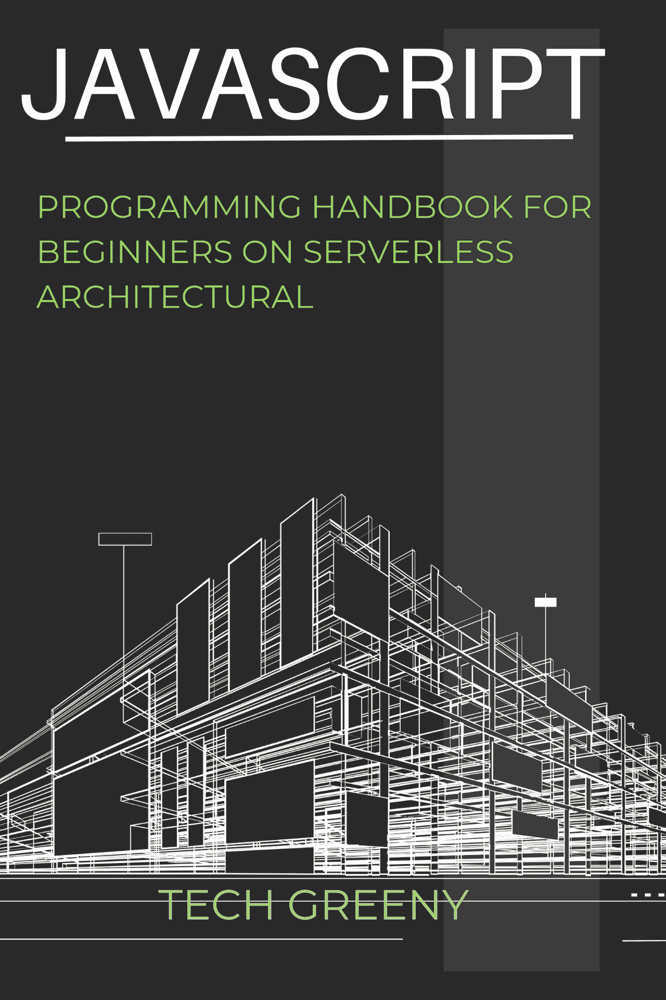

# 无服务器工程 JavaScript 编程初学者指南

# 免责声明

本书《面向机器学习的 Java 编程手册》的内容仅供教育和参考之用。我们尽力确保所提供信息的准确性和完整性，但作者、出版者和贡献者对于书中描述的信息、代码示例或技术的准确性、可靠性、适用性或完整性不作任何明示或暗示的声明或保证。

建议读者根据自己的判断和风险自担使用这些信息。作者、出版者和贡献者对于因使用、依赖或无法使用书中信息而引起的任何直接、间接、偶然、后果性或惩罚性损害概不承担责任。

此外，机器学习是一个快速发展的领域，虽然本书旨在为基于 Java 的机器学习提供坚实的基础，但读者应持续关注最新的研究、工具和最佳实践。本书不能替代专业的指导或咨询，特别是在处理复杂的机器学习应用或系统时。

书中包含特定的软件工具或库并不意味着予以认可，鼓励读者探索可能更符合其特定需求的其他资源和工具。在启动重大项目或做出与机器学习的关键决策时，请务必咨询多个来源并考虑专业建议。

# 第 1 章：JavaScript 与无服务器架构简介

## 引言

在不断演变的技术格局中，两项关键运动极大地改变了开发者构建和部署应用程序的方式：JavaScript 作为一种多功能编程语言的崛起，以及云计算中无服务器架构的出现。本章将对这两者进行全面介绍，探索它们的起源、演变以及它们为何在现代软件开发领域至关重要。

## 第 1 节：JavaScript 的演变

### 历史背景

JavaScript 由 Brendan Eich 于 1995 年创建，最初是一种用于增强网页的简单脚本语言，但现在已成为一种能够驱动复杂应用的强大语言。本节将追溯 JavaScript 从其 humble 起点到目前作为 Web 开发骨干的成长历程。

### 今天的 JavaScript
如今，JavaScript 在软件开发中无处不在，从前端用户界面到后端服务器，甚至于移动应用开发。该语言的异步能力、事件驱动的特性以及通过 `ECMAScript` 标准等更新带来的社区驱动增强，巩固了其作为开发者基础工具的地位。

### 关键特性与优势
- **异步编程**：使用回调、`promises` 和 `async/await` 处理异步代码。
- **灵活性**：运行在任何浏览器、服务器或设备上。
- **社区与生态系统**：庞大的开发社区以及广泛的框架和库，如 `React`、`Angular` 和 `Node.js`。

## 第 2 节：无服务器架构简介

### 2.1 什么是无服务器计算？
无服务器计算是指一种云计算执行模型，由云服务提供商动态管理服务器的分配和配置。本节将定义无服务器计算，并讨论其组件，如函数即服务 (`FaaS`) 和后端即服务 (`BaaS`)。

### 2.2 无服务器架构的优势
- **成本效益**：成本仅基于应用程序实际消耗的资源量。
- **可扩展性**：无需管理服务器即可实现自动伸缩。
- **开发者效率**：更快的部署和简化的操作。

### 2.3 常见误区与挑战
- **无状态性**：在无状态计算容器中管理状态面临的挑战。
- **延迟与冷启动**：`FaaS` 中由于冷启动导致的潜在延迟问题。
- **供应商锁定**：对特定云提供商及其技术的依赖。

## 第 3 节：为什么在无服务器环境中选择 JavaScript？

### 3.1 与事件驱动架构的天然契合
JavaScript 在处理异步操作方面的固有能力使其成为无服务器架构核心——事件驱动模型的理想选择。

### 3.2 与 JSON 和 Web API 的集成
对 `JSON` 的原生支持以及与 `RESTful APIs` 和现代网络协议的无缝集成，增强了 JavaScript 在无服务器应用中的适用性，因为在这些应用中与各种 Web 服务交互是常态。

### 3.3 JavaScript 在无服务器环境中的示例
- 使用 `Node.js` 利用 `AWS Lambda`。
- 使用 JavaScript 构建 `Azure Functions`。
- 在 `Google Cloud Functions` 上部署部署微服务。

## 第 4 节：JavaScript 与无服务器的未来

### 4.1 地平线上的创新
探索 JavaScript（如新的 `ECMAScript` 特性）和无服务器技术未来的最新进展，这些进展有望进一步提升性能、安全性和开发者体验。

### 4.2 挑战与机遇
随着这两项技术的日益成熟，它们面临着安全疑虑、改进的状态管理以及减少供应商锁定等挑战。本节将深入探讨克服这些挑战如何为构建更健壮、高效且可扩展的应用程序开启新的机遇。

### 4.3 总结
总结 JavaScript 与无服务器计算之间的协同关系，强调这种组合非常适合满足现代应用开发的需求，并展望了开发者如何利用这些技术构建创新的解决方案。

本大纲为深入探索 JavaScript 和无服务器计算（serverless computing）奠定了基础，提供了后续章节将在此基础上构建的基础。每个章节都旨在让读者对技术格局和实际应用都有全面的理解，为后续章节中更高级的主题建立坚实的基础。

## 第 2 章：搭建你的开发环境

## 引言
建立有效的开发环境对于任何开发者来说都是至关重要的，特别是在使用 JavaScript 和无服务器架构时。本章重点关注使用 JavaScript 在无服务器环境中启动开发所需的本质工具、集成开发环境（IDEs）和配置。它还涵盖了与 AWS、Azure 和 Google Cloud 等流行云提供商的初步设置工作，确保开发者能够快速上手项目。

### 第一节节：JavaScript 开发的核心工具

### JavaScript 开发工具
- `Node.js`：理解它在后端 JavaScript 执行中的作用。
- `NPM` (Node 包管理器)：学习如何管理库和依赖项。
- `Webpack`/`Babel`：探索这些用于现代 JavaScript 代码进行打包和转译的工具，以实现跨环境兼容。

### 集成开发环境 (IDEs)
- `Visual Studio Code` (VS Code)：增强 JavaScript 编码的功能，如智能感应（IntelliSense）、调试和扩展。
- `WebStorm`：这种针对 JavaScript 的 IDE 在无服务器开发中的优势。
- `Atom`：可定制性及其为 JavaScript 开发者定制的插件生态系统。

### 版本控制系统
- `Git`：介绍用于版本控制的 `Git`，包括基础命令和工作流。
- `GitHub`/GitLab`：在团队环境中使用在线仓库进行协作、代码共享和版本控制。

## 第二节：配置无服务器环境

### 2.1 选择云提供商
- AWS、`Azure` 和 `Google Cloud` 概览：它们无服务器产品的关键特性和差异。
- 注册和导航仪表板：开始使用每个提供商的初始步骤。

### 2.2 设置无服务器框架
- `Serverless Framework`：如何设置和使用该框架来高效地部署无服务器应用。
- `AWS SAM` (无服务器应用模型)：为 `AWS Lambda` 设置和使用 `AWS SAM` 的细节。
- `Azure Functions Core Tools` 和 `Google Cloud Functions Framework`：在 Azure 和 Google Cloud 上进行本地开发和部署的工具。

### 2.3 核心 SDK 和 API
- `AWS SDK for JavaScript`：在你的无服务器应用中集成 AWS 服务。
- `Azure SDK for JavaScript`：在代码中处理 Azure 资源。
- `Google Cloud SDK for Node.js`：在无服务器中使用 Google Cloud 服务。

## 第三节：本地开发与测试

### 3.1 搭建本地开发服务器
- 使用 `localstack` 模拟 AWS 环境：如何在本地机器上模拟 AWS 服务。
- `Azure Functions Local Development`：在本地设置和调试 Azure Functions。
- `Google Functions Emulator`：在本地机器上模拟 Google Cloud Functions 的工具和实践。

### 3.2 测试工具与策略
- `Mocha` 和 `Chai`：为无服务器 JavaScript 应用设置这些测试框架。
- `Jest`：使用 `Jest` 进行前端和无服务器后端测试的优势。
- `Postman` 和 `Insomnia`：API 测试工具以及如何与无服务器架构集成。

### 3.3 持续集成与部署工具
- `Jenkins` 和 `GitHub Actions`：配置用于自动化测试和部署的 CI/CD 管道。
- `Travis CI` 和 `CircleCI`：持续集成服务的比较和设置指南。

## 第四节：开发设置的最佳实践

### 4.1 项目与代码组织
- 项目结构：在无服务器项目中组织文件和目录的最佳实践。
- 环境变量：如何管理和保护特定环境的配置。

### 4.2 依赖管理
- 无服务器项目中的依赖处理：管理无服务器部署中 `node_modules` 的技巧。
- `package-lock.json` 和 `yarn.lock`：理解它们的作用以及如何有效地使用它们。

### 4.3 版本控制与备份
- 语义化版本：为你的无服务器应用实施语义化。
- 代码与配置备份：备份云配置和代码库的策略。

建立健壮的开发环境是无服务器架构的基础步骤。本章提供了选择工具、配置环境以及实施简化开发和部署实践的全面指南。通过这些准备，开发者可以确保他们的项目具有扩展性、可维护性，并准备好应对无服务器计算动态的需求。

此详细的设置旨在让开发者平滑过渡到使用 JavaScript 开发无服务器应用，从一开始就配备正确的工具和最佳实践。

## 第 3 章：理解无服务器计算

## 引言
无服务器计算代表了应用托管和扩展方式的范式转变，提供了一种提高效率和降低运维复杂度的方法。本章将揭开无服务器计算的神秘纱，解释其核心组件、运行机制以及它与传统的基于服务器的架构的区别。在本章结束，开发者将对该架构的原理、优势和潜在陷有一个全面的理解。

## 第一节：无服务器计算的核心概念

### 定义与基础
- 什么是无服务器计算？：对无服务器计算的详细解释，强调它不仅仅涉及计算服务。
- 关键特性：事件驱动、无状态计算容器，可自动管理服务器的生命周期和扩展。

### 无服务器架构的组件
- 函数即服务 (`FaaS`)：深入探索运行在无状态计算容器中由事件触发的函数。
- 后端即服务 (`BaaS`)：理解自动化后端操作和数据库管理的托管后端服务。

### 无服务器是如何运作的
- 无服务器函数的生命周期：从部署到执行，详细说明云提供商执行的过程和生命周期管理。
- 事件源与触发器：可以触发无服务器函数的事件类型，例如 HTTP 请求、文件上传或计划事件。

## 第二节：无服务器架构的优势

### 2.1 成本效益
- 按需付费模型：仅为消耗的计算时间付费，而不为空闲服务器时间付费。
- 降低运维成本：无服务器如何减少对系统管理和其他运维角的需求。

### 2.2 增强的扩展性
- 自动扩展：无服务器函数如何根据需求自动扩展而无需人工干预。
- 处理高流量：无服务器处理意外流量激增的示例。

### 2.3 提高开发者生产力
- 专注于代码而非基础设施：开发者可以专注于编写代码而不是管理服务器和基础设施。
- 更快的部署与更新：部署和更新函数的速度和敏捷性。

## 第三节：与传统架构的比较

### 3.1 传统 vs 无服务器架构
- 服务器管理：与无服务器模型相比，传统服务器管理的义务和开销。
- 资源分配与利用：无服务器环境中资源利用率的提升。

### 3.2 适合无服务器的场景
- 微服务：在微服务架构中使用无服务器的优势。
- 实时文件与数据处理：无服务器如何在需要即时处理的场景中表现。

### 3.3 局限性与挑战
- 冷启动：无服务器函数从休眠状态启动时引入的延迟。

# 调试与监控挑战
无 less 应用在追踪和调试方面的复杂性。

## 第 4 节：实施无 less 解决方案

### 4.1 选择合适的提供商和工具
- **评估云提供商**：在选择用于无 less 解决方案的云提供商时需要考虑的因素。
- **重要工具与集成**：增强无 less 应用开发、部署和监控的工具。

### 4.2 迁移策略
- **迁移到无 less**：从传统架构向无 less 架构过渡的逐步引导指南。
- **混合方法**：将无 less 与传统托管相结合，以平衡遗留系统与新开发项目。

### 4.3 无 less 架构中的最佳实践
- **故障设计（Designing for Failure）**：设计健壮且具有韧性的无 less 应用的策略。
- **安全性考量**：无 less 应用安全最佳实践，侧重于 `IAM` 角色和策略管理。

本章探讨了无 less 计算的基础方面，强调了它的优势、运营模型和实际实现。对于开发者来说，理解这些概念对于有效利用无 less 技术构建可扩展、具有成本效益且高效的应用至关重要。讨论不仅澄清了运营和经济优势，还针对克服这些挑战提出了应对策略，为开发者成功部署无 less 应用做好准备。

通过对无 less 计算的机制、优势和挑战的详细检查，本章为开发者提供了所需的知识，使其能够对项目中采用无 less 架构做出明智决策。

# 第 4 章：用于无 less 函数的 JavaScript

## 引言
JavaScript 的灵活性和广泛采用使其成为开发无 less 应用的流行选择。本章深入探讨了开发者如何在无 less 环境中有效利用 JavaScript，重点关注使用 JavaScript 编写、调试和部署无 less 函数的最佳实践、常见模式和高级技术。

## 第 1 节：使用 JavaScript 编写无 less 函数

### 无 less 函数基础
- **无 less 函数的结构**：JavaScript 无 less 函数的组件和典型架构。
- **事件处理器**：编写响应于不同类型事件（HTTP 请求、文件上传、数据库更改）的函数。

### 异步 JavaScript 与无 less
- **处理异步性**：在无 less 函数中使用 `promises` 和 `async/await` 来高效处理异步操作。
- **最佳实践**：管理异步代码的技术，以避免像地狱（callback hell）之常见的陷阱。

### 状态管理
- **有状态操作中的挑战**：理解无 less 中状态管理的局限性以及如何克服它们。
- **使用外部存储**：集成外部数据库或存储服务的策略，以便跨函数调用维护状态。

## 第 2 节：开发与调试无 less JavaScript

### 2.1 本地开发环境
- **本地测试工具**：搭建模拟云无 less 环境的本地开发环境，例如 `AWS SAM Local` 或 `Azure Functions Core Tools`。
- **模拟事件与触发器**：如何在部署前本地创建并测试事件驱动的行为。

### 2.2 调试技术
- **调试无 less 应用**：调试无 less 函数的工具和策略，包括集成日志和特定云的工具。
- **常见错误与故障排除**：识别并解决无 less JavaScript 应用中频繁出现的问题，例如冷启动和超时。

### 2.3 单元测试与集成测试
- **编写可测试代码**：编写可测试无 less 函数的原则。
- **测试框架与工具**：利用 `Jest` 或 `Mocha` 等框架对无 less 函数进行单元和集成测试。

## 第 3 节：部署与维护

### 3.1 部署最佳实践
- **自动化流水线**：使用 `GitHub Actions` 或 `Jenkins` 等工具为无 less 应用设置 `CI/CD` 流线。
- **版本控制与回滚**：管理部署并维护函数的多个版本以确保稳定性。

### 3.2 监控与性能优化
- **监控工具**：使用云提供商工具和第三方服务监控无 less 应用的健康和性能。
- **性能指标**：无 less 应用监控的关键指标以及如何解读它们。

### 3.3 维护无 less 应用
- **定期更新与依赖管理**：保持依赖项更新并确保无 less 环境的安全。
- **成本优化**：降低运行无 less 函数成本的策略，包括高效编码实践以及选择合适的内存和超时设置。

## 第 4 节：用于无 less 的高级 JavaScript 技术

### 4.1 使用现代 JavaScript 特性
- **ES6 及以后**：利用新的 JavaScript 特性编写更简洁、更高效的代码。
- **转换器与填充程序（Polyfills）**：使用 `Babel` 等工具确保跨不同无 less 平台的兼容性。

### 4.2 无 less JavaScript 的设计模式
- **单例、工厂函数等**：在无 less 应用中特别实用的设计模式，用于管理资源和功能。
- **事件驱动架构**：构建充分利用无 less 事件驱动特性的应用程序。

### 4.3 可扩展性与韧性
- **扩展 JavaScript 无 less 函数**：确保无 less 函数能够高效处理不断增长的负载的技术。
- **故障设计**：实现重试机制和回退策略，以优雅的方式处理潜在的失败。

本章提供了在无 less 范式中使用 JavaScript 的详尽指南，涵盖了从基础函数设置到高级编码技术的所有内容。通过理解如何在 JavaScript 中有效编写、调试、部署和维护无 less 函数，开发者可以构建满足现代软件需求的可扩展、高效且健壮的无 less 应用。

通过研究基础实践和高级技术，本章为开发者配备了所需的知识和工具，以充分发挥 JavaScript 在无 less 计算环境中的潜力。

## 第 5 章：与 API 网关协作

## 引言
API 网关在无 less 架构中起着关键作用，作为客户端请求访问各种服务的入口。本章侧重于理解无 less 背景下的 API 网关、它们如何与 JavaScript 无 less 函数集成，以及在无 less 环境中构建、部署和保护 API 的最佳实践。

## 第 1 节：API 网关在无 less 架构中的角色

### API 网关简介
- **定义与目的**：探索 API 网关及其在管理入站 API 请求并将其路由到相应的无 less 函数方面的功能。
- **优势**：可扩展性、安全性增强以及 API 版本管理。

### API 网关如何工作
- **请求路由**：根据 HTTP 方法、资源 URI 等标准将客户端请求路由到正确无 less 函数的机制。
- **转换与聚合**：网关如何修改请求和响应、聚合来自多个源的数据并处理同步和异步通信。

## 第 2 节：使用 JavaScript 配置 API 网关

### 2.1 设置 API 网关
- **流行平台**：在 `AWS (API Gateway)`、`Azure (API Management)` 和 `Google Cloud (API Gateway)` 上设置 API 网关的详细过程。
- **与无 less 函数集成**：将 JavaScript 无 less 函数与 API 网关连接的逐步指南。

### 2.2 自定义 API 行为

-自定义授权器：直接在网关内部实现身份验证和授权逻辑，或使用外部服务。

-速率限制与限流：配置这些功能以管理负载并防止 API 滥用。

## 第 3 节：在无服务器设置中构建 API

### 3.1 API 设计最佳实践

RESTful 原则：应用 REST 指南设计直观且标准的 API。

GraphQL API：在更复杂的场景（包括动态数据检索）中，使用 GraphQL 替代 REST 的益处。

### 3.2 开发与部署

开发工具与框架：利用 `Swagger` 或 `Postman` 等工具进行 API 设计和测试。

部署策略：在无服务器环境中部署 API 的最佳实践，包括版本控制和阶段环境。

## 第 4 节：无服务器 API 的安全与管理

### 4.1 API 安全性

身份验证机制：在无服务器 API 中实现 `OAuth`、`JWT` 和其他安全协议。

加密与合规性：确保数据保护并遵守 `GDPR` 和 `HIPAA` 等法规。

### 4.2 监控与日志记录

分析与监控工具：利用云服务和第三方解决方案提供的工具监控 API 使用情况和性能。

日志记录最佳实践：对 API 请求和响应进行有效日志记录的策略，以便于故障排除和优化 API。

### 4.3 API 生命周期管理

生命周期管理：管理无服务器 API 从创建、部署到退役整个生命周期的技术。

API 文档：维护最新文档的重要性，以及如何使用 `Swagger` 等工具实现此过程。

API 网关是无服务器架构的基础组件，在用户和后端服务之间提供了稳健的接口。本章探讨了使用 `JavaScript` 在无服务器环境中有效管理和部署 API 所需的技术设置、最佳实践和安全考虑。通过这些见解，开发者可以确保他们的 API 具有扩展性、安全性，并与无服务器后端高效集成。

* *

通过对无服务器计算背景下的 API 网关进行详细探讨，本章为开发者提供了必要的工具和知识，以优化 API 的交付和管理，从而提升无服务器应用的整体功能和用户体验。

## 第 6 章：无服务器架构中的数据管理

## 引言

有效的数据管理对于任何应用程序的成功至关重要，包括构建在无服务器架构上的应用。本章重点关注无服务器环境中管理数据的策略和技术，探索了如何使用 `JavaScript` 与数据库交互、处理数据一致性并确保数据安全。

## 第 1 节：无服务器应用的数据库选项

### 数据库类型

关系型数据库：在无服务器环境中使用 `PostgreSQL` 或 `MySQL` 等 SQL 数据库的优势与挑战。

NoSQL 数据库：`MongoDB`、`DynamoDB` 或 `Google Firestore` 等 NoSQL 数据库如何适配无服务器架构。

### 选择合适的数据库

考虑因素：扩展性、数据一致性、运维开销和特定的应用需求。

案例研究：无服务器设置中最适合关系型与 NoSQL 数据库的用例示例。

## 第 2 节：集成数据库到无服务器函数

### 2.1 连接数据库

连接管理：在无状态无服务器函数中管理数据库连接的最佳实践，包括处理冷启动和连接池。

使用 SDK 和 API：关于使用 `JavaScript` 为 `AWS DynamoDB`、`Azure Cosmos DB` 和 `Google Firestore` 使用数据库 `SDKs` 和 `APIs` 的详细指南。

### 2.2 执行 CRUD 操作

CRUD 基础：在无服务器函数中使用 `JavaScript` 实现创建、读取、更新和删除操作。

优化：优化数据库交互以降低延迟和增加吞吐量的技术。

## 第 3 节：数据一致性与事务管理

### 3.1 确保数据一致性

无服务器挑战：讨论在分布式、事件驱动环境中维护数据一致性的挑战。

策略：如最终一致性、分布式事务以及使用 `saga patterns` 管理一致性的技术。

### 3.2 事务管理

处理事务：在无服务器架构中实现事务，特别是使用关系型数据库时。

最佳实践：确保多次函数执行之间的数据完整性和一致性。

## 第 4 节：数据安全与合规

### 4.1 安全最佳实践

静态加密与传输中加密：使用 `JavaScript` 实现加密以保护敏感数据。

访问控制：管理身份验证和授权机制以控制对数据的访问。

### 4.2 合规性与数据治理

法规合规：确保无服务器应用符合 `GDPR`、`HIPAA` 等其他法规。

数据审计与监控：监控数据访问和使用的工具与实践，以维持合规性和安全性。

## 第 5 节：高级数据管理技术

### 5.1 缓存策略

使用缓存：使用 `Redis` 等内存缓存或分布式缓存提高无服务器应用性能的益处。

缓存失效：维护缓存准确性和一致性的策略。

### 5.2 数据流与实时处理

流处理：利用 `AWS Kinesis`、`Azure Event Hubs` 或 `Google Pub/Sub` 等工具进行实时处理。

集成无服务器函数：使用无服务器函数处理流的最佳实践。

无服务器架构中的数据管理面临着独特的挑战与机遇。本章提供了在无服务器环境中管理数据的工具、技术和最佳实践概述。通过利用正确的数据库、确保数据一致性并维护强大的安全实践，开发者可以构建无服务器应用。

## 第 7 章：集成第三方服务

## 引言

第三方服务的集成是开发现代无服务器应用的关键方面。它允许开发者扩展功能、利用外部 `APIs` 并通过利用现成服务缩短开发时间。本章探索了如何使用 `JavaScript` 将第三方服务有效集成到无服务器应用中，涵盖身份验证、支付、分析等。

## 第 1 节：第三方集成概述

### 使用第三方服务的益处

效率与速度：无需从零开始构建即可快速添加功能。

专业性与可靠性：利用经过行业测试的服务以确保可靠性和性能。

成本效益：减少与内部开发和维护相关的成本。

### 第三方服务类型

身份验证服务（例如 `Auth0`、`Firebase Authentication`）。

支付网关（例如 `Stripe`、`PayPal`）。

通信与消息服务（例如 `Twilio`、`SendGrid`）。

## 第 2 节：身份验证与授权

### 2.1 集成身份验证服务

使用 OAuth 提供者：如何使用 `JavaScript` 将 `OAuth` 集成到无服务器函数中，以实现稳健的身份验证。

自定义身份验证流：使用 `Auth0` 或 `Firebase` 等第三方服务构建自定义身份验证工作流。

### 2.2 授权技术

基于角色的访问控制 (RBAC)：使用第三方服务实现 `RBAC` 以管理用户权限。

# API 网关集成：配置 API 网关使用第三方身份验证令牌来访问无服务器函数。

## 第 3 ：支付处理集成

### 3.1 选择支付网关

考虑因素：费用、支持的支付方式、集成易用性以及地理可用性。

热门网关比较：`Stripe`、`PayPal`、`Square` 以及如何使用 `JavaScript` 将它们集成到无服务器环境中。

### 3.2 实施支付解决方案

安全处理支付：确保支付过程中的安全性，包括数据加密和符合 `PCI DSS`。

创建无缝的用户体验：将支付网关集成到用户流程中的最佳实践，且不会破坏用户体验。

## 第 4 ：高级集成

### 4.1 与分析和监控服务集成

如 `Google Analytics` 和 `New Relic` 等工具：如何集成这些服务以监控应用程序性能和用户交互。

自定义指标和日志：从无服务器函数向第三方监控工具发送自定义指标，以获得更深层次的洞解。

### 4.2 使用 AI 和机器学习服务

利用 `AWS Rekognition`、`Google AI` 或 `Azure AI`：集成这些服务以实现高级功能，如图像识别、自然语言处理或预测分析。

无服务器机器人和智能代理：使用第三方 AI 服务创建以自然方式与用户交互的机器人。

## 第 5：第三方集成的最佳实践

### 5.1 管理 API 密钥和敏感数据

凭据安全：使用环境变量和密钥管理工具安全地管理 API 密钥和其他敏感信息的策略。

合规性考虑：确保第三方服务的集成符合 `GDPR` 等数据保护法规。

### 5.2 错误处理与可靠性

优雅地处理失败：管理服务中断或故障的技术以维持应用程序的可用性。

回退策略：在第三方服务故障时实施备用程序和替代工作流。

集成第三方服务可以显著增强无服务器应用程序的功能和性能。本章提供了关于如何使用 `JavaScript` 有效将各种第三方服务纳入无服务器应用程序的详尽指南。通过理解集成点、安全考虑和最佳实践，开发者可以放地扩展他们的无服务器架构，创建更健壮、功能更丰富的应用程序。

***

凭借提供的见解，开发者已能够处理复杂的集成，这些集成可以转化其无服务器应用程序的能力，确保它们提供强大、高效且可扩展的解决方案。

## 第 8 章：无服务器 JavaScript 应用程序的安全实践

引言

考虑到无服务器计算的分布式特性和对第三方服务的依赖，安全性是其首要考虑的问题。本章关注无服务器应用程序面临的特定安全挑战（特别是用 `JavaScript` 编写的应用程序），并提供了降低这些风险的策略和最佳实践，以确保健壮、安全的部署。

## 第 1 节：理解无服务器环境中的安全

### 无服务器独特的安全考虑因素

攻击面：无服务器的本质增加了攻击者潜在入口点的数量。

依赖风险：对第三方服务和库的过度依赖可能会引入漏洞。

隔离与多租户担忧：与其他租户共享物理资源的无服务器函数可能会带来隔离风险。

### 常见漏洞

注入缺陷：可能影响无服务器函数的 `SQL`、`NoSQL` 和命令注入。

不安全的 API：与安全性不足的 API 相关的风险，包括未经授权访问。

## 第 2 节：实施安全实践

### 2.1 安全编码实践

输入验证：确保所有输入都经过验证，以防止 `XSS` 和注入攻击。

最小权限访问：为函数实现最小权限级别，以限制潜在损害。

### 2.2 处理依赖

依赖管理：对 `npm` 包进行定期更新和审计。

使用安全库：选择维护良好且受认可的库。

## 第 3 节：身份验证与授权策略

### 3.1 实施健壮的身份验证

`JWT` 和 `OAuth`：使用 JSON Web Tokens 和 `OAuth` 进行安全身份验证。

自定义身份验证：为特定需求创建自定义的身份验证机制。

### 3.2 细粒度授权

基于角色的访问控制 (`RBAC`)：实现 `RBAC` 以根据用户角色控制访问。

基于属性的访问控制 (`ABAC`)：根据属性和环境条件进行更细粒度的控制。

## 第 4 节：数据安全与合规

### 4.1 加密技术

静态加密和传输加密：确保使用强标准加密敏感数据。

密钥管理：使用 `AWS KMS` 等托管服务管理加密密钥。

### 4.2 合规性与数据治理

法规合规：确保符合 `GDPR`、`HIPAA` 和 `PCI-DSS` 等数据保护法规。

数据保护影响评估 (`DPIA`)：对无服务器应用程序进行 `DPIA` 以识别并降低风险。

## 第 5 节：监控与事件响应

### 5.1 安全监控

实时监控工具：利用工具实时监控无服务器应用程序，以检测并响应安全事件。

日志与审计：实施全面的日志记录以跟踪访问和更改，这对于安全和合规至关重要。

### 5.2 制定事件响应计划

事件响应协议：建立快速处理安全漏洞的协议。

无服务器环境中的取证：在无服务器架构中进行取证分析的挑战和策略。

本章概述了无服务器 JavaScript 应用程序的基本安全实践，解决了独特的挑战，并为开发者提供了全面保护其应用程序的可操作策略。通过实施这些安全措施，开发者可以保护无服务器应用程序免受常见威胁，并确保符合法规要求，从而增强无服务器解决方案的信任和可靠性。

## 第 9 章：测试无服务器 JavaScript 应用程序

引言

测试是开发健壮无服务器应用程序的关键方面。考虑到无服务器架构的事件驱动和分布式特性，传统的测试方法通常需要调整。本章探讨了测试无服务器 JavaScript 应用程序的特定挑战和方法，提供了单元、集成和端到端测试策略的全面指南。

## 第 1 节：无服务器环境中的测试挑战

### 独特的测试需求

事件驱动的复杂性：在测试中处理各种事件输入和外部触发器的复杂性。

无状态与并发：测试无状态且可能在不同条件下并发运行的函数。

### 测试范围与覆盖率

覆盖率指标：确定无服务器架构中什么构成足够的测试覆盖。

# 测试用例设计：设计能够充分反映 serverless 应用事件驱动和动态特性的用例。

## 第 2 节：Serverless 函数单元测试

### 2.1 编写可测试代码
- **模块化**：设计小型、自包含且易于测试的函数。
- **依赖注入**：在 serverless 函数中注入依赖的技术，便于进行模拟（mocking）和存桩（stubbing）。

### 2.2 单元测试框架与工具
- **Jest**：利用 `Jest` 进行测试，因为它支持异步测试用例和模拟能力。
- **Mocha and Chai**：利用这些工具进行更具自定义性的测试设置，包括服务器端逻辑。

## 第 3 节：集成测试与端到端测试

### 3.1 集成测试策略
- **模拟外部服务**：使用 `Sinon` 或 `serverless-mock` 等工具模拟外部 API 调用和其他服务。
- **工作流测试**：测试多个 serverless 函数的集成情况，确保工作流按预期执行。

### 3.2 端到端测试
- **自动化测试套件**：使用 `Cypress` 或 `Selenium` 等框架实现端到端自动化测试。
- **API 测试**：对 serverless API 进行全面测试的策略，包括安全和性能方面。

## 第 4 节：性能测试

### 4.1 负载测试
- **负载模拟**：模拟 serverless 应用不同级别负载的工具和策略，以测试其扩展性和韧性。
- **处理冷启动**：测试冷启动如何影响 serverless 函数的性能，以及如何缓解其影响。

### 4.2 压力与浸泡测试
- **压力测试**：确定 serverless 应用在极端条件下的极限。
- **浸泡测试**：确保 serverless 应用能够在较长时间内处理预期的持续负载。

## 第 5 节：安全性测试

### 5.1 安全测试用例
- **注入攻击**：测试 SQL 注入、命令注入等漏洞。
- **授权缺陷**：确保授权检查是稳健的且无法被绕过。

### 5.2 渗透测试
- **聘请伦理黑客**：使用伦理黑客测试 serverless 应用的安全性。
- **自动化安全工具**：利用自动化工具定期扫描 serverless 基础设施中的漏洞。

## 第 6 节：Serverless 应用测试的最佳实践

### 6.1 持续测试
- **与 CI/CD 流水线集成**：确保测试是持续集成和部署过程中不可或缺的一部分。
- **测试自动化**：尽可能使测试过程自动化，以确保频繁且一致的测试。

### 6.2 在生产环境中进行测试
- **金丝发布**：将更改逐步部署给一小部分用户，以便在真实世界中进行测试。
- **功能标记**：使用功能标记动态管理应用程序的哪些部分暴露给用户进行测试。

本章概述了确保 serverless JavaScript 应用可靠性和健壮性所必要的测试范式。通过采用所描述的方法，开发者可以有效应对 serverless 架构的独特挑战，确保其应用程序在所有条件下都能获得最佳性能。

***

在针对 serverless 计算细微差的测试策略方面拥有坚实基础后，能够能够交付高质量、可靠的 serverless 应用，满足现代软件环境的动态需求。

## 第 10 章：部署与版本控制

## 引言
有效的部署和健壮的版本控制对于维护 serverless JavaScript 应用的健康和扩展性至关重要。本章介绍了部署 serverless 应用、管理其版本以及确保持续集成和交付的策略。它为开发者高效管理部署流水线和版本控制系统提供了蓝图。

## 第 1 节：Serverless 应用的部署策略

### 部署模型
- **蓝绿部署**：通过运行两个相同的生产环境来减少停机时间和风险的技术。
- **金丝雀部署**：在全量发布之前，将更改逐步推给小小比例的用户。

### 部署中的自动化
- **使用 CI/CD 流水线**：建立自动化流水线，处理 serverless 应用的构建、测试和部署阶段。
- **工具与服务**：利用 `Jenkins`、`GitHub Actions` 和 `AWS CodePipeline` 等工具来促成持续部署。

## 第 2 节：Serverless 环境中的版本控制

### 2.1 版本控制的重要性
- **跟踪更改**：版本控制对于跟踪 serverless 应用的更改至关重要，有助于调试和开发。
- **协作开发**：支持多个开发者在同一项目上工作而不会产生冲突。

### 2.2 版本控制的最佳实践
- **分支策略**：实施有效的分支策略，如 `GitFlow` 或基于主干的开发，以管理功能、修复和发布。
- **提交规范**：提交的指南，包括编写有意义的提交信息以及频繁提交以准确记录更改。

## 第 3 节：管理 Serverless 应用配置

### 3.1 配置管理
- **环境变量**：使用环境变量来管理应用程序配置，并将敏感数据排除在代码库之外。
- **配置即代码**：使用工具和策略将配置设置视为可以进行版本化和审计的代码。

### 3.2 处理密钥
- **密钥管理**：管理 API 密钥和数据库凭据等密钥的最佳实践，使用 `AWS Secrets Manager`、`Azure Key Vault` 或 `HashiCorp Vault` 等工具。

## 第 4 节：持续集成与持续交付 (CI/CD)

### 4.1 为 Serverless 设置 CI/CD
- **CI/CD 流水线配置**：配置为 serverless 开发定制的流水线的步骤，包括构建、测试和部署阶段。
- **与 Serverless 框架集成**：如何将 `Serverless Framework` 或 `AWS SAM` 等 serverless 框架与 CI/CD 工具集成。

### 4.2 CI/CD 流水线中的测试
- **自动化测试**：在 CI/CD 流水线中实现单元、集成和端到端测试。
- **质量门**：在流水线中设置质量门，确保只有符合所有标准的代码被部署。

## 第 5 节：回滚策略与灾难恢复

### 5.1 实现回滚能力
- **自动回滚**：发生严重错误时自动回滚部署的技术。
- **手动回滚程序**：必要时手动恢复到先前状态的步骤。

### 5.2 灾难恢复规划
- **灾难恢复策略**：开发从灾难性故障中恢复的策略，包括数据备份和多区域部署。
- **测试恢复程序**：定期测试恢复程序以确保其有效且最新。

本章提供了部署 serverless JavaScript 应用并高效管理版本。通过实施这些策略，开发者可以确保其 serverless 应用不仅健壮且可扩展，而且具有韧性和可维护性。这些实践对于交付能够良好响应用户和市场动态需求的 serverless 应用至关重要。

监控和优化无服务器（serverless）应用程序的性能对于保持效率和用户满意度至关重要。本章深入探讨监控无服务器 JavaScript 应用的策略以及调优其性能的最佳实践。它涵盖了确保应用程序在无服务器环境中高效且优化运行所需的工具和技术。

## 第 1 节：无服务器应用监控要素

### 监控的重要性
- **可见性与透明度**：理解为何需要全面的监控，以维护无服务器环境中的操作可见性。
- **主动解决问题**：有效的监控如何帮助在问题影响用户之前识别并解决它们。

### 监控工具与服务
- **云原生解决方案**：探索 `AWS CloudWatch`、`Azure Monitor` 和 `Google Cloud Monitoring` 提供的工具。
- **第三方工具**：评估用于无服务器应用的流行的第三方监控工具，如 `Datadog`、`New Relic` 和 `Splunk`。

## 第 2 节：关键性能指标 (KPIs)

### 2.1 识别相关 KPI
- **延迟与响应时间**：跟踪无服务器函数的响应时间，确保其符合用户预期。
- **错误率和成功率**：监控错误率和执行成功率，以衡量应用的健康状况。

### 2.2 资源利用率
- **内存使用**：监控内存消耗，以优化函数分配和成本。
- **调用指标**：跟踪函数调用的频率和模式，以更好地理解需求和扩展需求。

## 第 3 节：性能优化技术

### 3.1 减少延迟
- **最小化冷启动**：减少冷启动影响的策略，例如保持函数热启动或使用 `provisioned concurrency`。
- **优化函数代码**：编写高效 JavaScript 代码的技巧，使其执行迅速并节约使用资源。

### 3.2 管理依赖项
- **优化包大小**：减小部署包大小以提高加载时间的技术。
- **选择性函数部署**：仅部署应用的必要部分，以最小化延迟和开销。

## 第 4 节：扩展与负载均衡

### 4.1 自动伸缩策略
- **理解自动扩展**：无服务器平台如何根据需求自动扩展函数，以及控制此行为的设置。
- **自定义扩展策略**：配置自定义扩展策略，以有效处理可预测的负载波动。

### 4.2 负载均衡考虑
- **分发请求**：高效将传入请求分发到无服务器函数的方法，以优化性能和资源利用。
- **处理状态和会话数据**：在无状态环境中管理状态的策略，例如使用外部存储或缓存解决方案。

## 第 5 节：持续性能改进的最佳实践

### 5.1 持续分析与测试
- **性能剖析**：定期对函数性能进行分析，以识别瓶颈和潜在优化点。
- **负载和压力测试**：定期进行负载测试和压力测试，确保应用程序能够处理预期和峰值负载。

### 5.2 迭代改进与反馈循环
- **反馈机制**：实施机制以收集和分析与应用性能相关的反馈。
- **对指标的敏捷响应**：利用性能数据对应用程序进行敏捷改进，持续增强性能和用户体验。

监控和性能调优是无服务器应用成功的不可缺的一部分。本章概述了确保无服务器 JavaScript 应用优化运行所需的工具、策略和最佳实践。通过实施这些措施，开发者可以实现高性能、可扩展性和可靠性，最终带来更好的用户满意度并降低运营成本。

掌握了这些知识，开发者已准备好处理无服务器计算的动态特性，确保应用程序既健壮又能对现代用户的需求做出响应。

# 第 12 章：可扩展性可靠性

## 引言
可扩展性和可靠性是无服务器应用最重要的两个特性之一，特别是在处理波动负载和维护高可用性时。本章探索了如何增强无服务器 JavaScript 应用的扩展性和可靠性，涵盖了策略、最佳实践和潜在挑战。

## 第 1 节：理解无服务器的可扩展性

### 扩展性原理
- **自动扩展**：无服务器平台如何根据需求自动调整计算资源。
- **水平扩展 vs. 垂直扩展**：无服务器背景下水平扩展（增加更多函数）和垂直扩展（增加每个函数的资源）的区别和应用。

### 限制与约束
- **提供商限制**：无服务器提供商实施的常见扩展限制以及如何管理这些限制。
- **设计考虑**：影响扩展性的架构和设计模式，例如事件驱动设计和微服务架构。

## 第 2 节：确保高可靠性

### 2.1 针对故障的设计
- **容错性**：构建即使在组件故障也能继续运行的无服务器应用。
- **冗余与备份策略**：在关键组件中实现冗余，并实施数据持久化的备份策略。

### 2.2 优雅处理故障
- **错误处理与重试机制**：在无服务器函数中管理错误和设计重试机制的策略。
- **故障转移与灾难恢复**：规划并实施故障转移机制和灾难恢复计划，以确保连续运行。

## 第 3 节：可靠部署的最佳实践

### 3.1 依赖管理
- **管理外部依赖**：最小化外部依赖以减少故障点并缩短响应时间。
- **松耦合**：设计松耦合的函数和服务端，以增强可扩展性和可靠性。

### 3.2 性能优化
- **优化代码执行**：编写高效 JavaScript 代码的技术，以最大化性能并最小化资源消耗。
- **资源分配**：优化资源分配设置（如 `memory` 和 `timeout`）以平衡性能与成本。

## 第 4 节：负载测试与性能监控

### 4.1 负载测试
- **模拟变化负载**：模拟不同负载场景以测试无服务器应用扩展良好程度的技术。
- **工具与框架**：使用 `Apache JMeter`、`Artillery` 或 `AWS Lambda Load Testing` 等工具进行有效的负载测试。

### 4.2 持续监控
- **实时监控解决方案**：实施实时监控工具跟踪应用性能并快速响应问题。
- **分析与报告**：利用分析了解使用模式和性能趋势，为进一步的扩展改进提供参考。

## 第 5 节：处理高流量和峰值

### 5.1 应对流量激增
- **主动扩展**：针对已知高流量事件进行主动扩展的策略。
- **限流与速率限制**：实施限流和速率限制来管理并缓解意外的流量激增。

### 5.2 针对峰值性能优化
- **缓存实现**：利用缓存策略减少峰值期间后端服务的负载。
- **数据库扩展技术**：在高需求场景下有效扩展数据库的特定策略。

本章概述了增强无服务器 JavaScript 应用扩展性和可靠性所需的策略和实践。通过采用这些方法，开发者可以确保应用程序足够健壮以应对变化的负载，并具有足够的韧性来承受并从故障中恢复，从而提供一致且可靠的用户体验。

凭借本章提供的见解，开发者将能够更好地准备好设计并实现无 less 应用程序，这些应用不仅具有扩展性和可靠性，而且能够在现代云计算动态且严苛的环境中蓬勃发展。

## 第 13 章：现实应用与案例研究

## 引言
通过现实案例理解无服务器计算的实际应用，可以对其能力和优势提供极具价值的洞。本章探讨了无 less JavaScript 架构在不同行业成功实施的各种案例，重点介绍了与这些部署相关的策略、挑战和成果。

## 第 1 节：各行业无 less 应用概览

### 媒体与娱乐
- **流媒体服务**：利用无 less 函数处理高量的动态内容分发和用户个性化。
- **事件驱动的内容管理**：实现无 less 架构以进行实时媒体处理和分发。

### 电子商务
- **订单处理系统**：使用无 less 函数动态管理订单输入、处理和库存管理。
- **客户交互与参与**：使用无 less 技术通过个性化推荐和实时通信来增强客户互动。

### 金融服务
- **欺诈检测系统**：利用无 less 技术通过模式识别和机器学习进行实时欺诈检测。
- **支付处理**：使用无 less 架构实现可扩展、安全的支付处理系统。

## 第 2 节：案例研究

### 2.1 案例研究 1：高流量电子商务网站
- **挑战**：处理销售活动期间变化的高流量负载。
- **解决方案**：实施无 less 架构，以根据需求峰值自动扩展。
- **结果**：改进了对峰值负载的处理，减少了停机时间并节省了基础设施成本。

### 2.2 案例研究 2：媒体公司的内容分发平台
- **挑战**：需要一种可扩展的解决方案在全球范围内管理和分发大型媒体文件。
- **解决方案**：利用与 `CDN` 集成的无 less 函数实现高效内容分发。
- **结果**：增强了全球覆盖范围，降低了延迟和运营成本。

### 2.3 案例研究 3：金融机构的实时欺诈检测
- **挑战**：实时检测并响应欺诈交易。
- **解决方案**：无 less 机器学习模型在交易发生时对其进行处理。
- **结果**：提高了检测率，加快了响应速度，并增强了客户信任。

## 第 3 节：经验总结与最佳实践

### 3.1 部署中的关键教训
- **扩展性与成本效益**：关于无 less 如何使组织轻松扩展并降低成本的见解。
- **灵活性与部署速度**：无 less 架构的敏捷性和快速部署能力的优势。

### 3.2 从现实应用中得出的最佳实践
- **架构考量**：通过模块化和解耦来设计无 less 应用程序的重要性，以增强可维护性和扩展性。
- **安全性与合规性**：强调在无 less 部署中对健壮安全实践和合规策略的需求。

## 第 4 节：未来方向与创新

### 4.1 新兴趋势
- **无 less 与 IoT**：无 less 计算与 `IoT` 的集成，以高效处理来自数百万台设备的数据。
- **AI 与机器学习增强**：利用无 less 架构部署 AI 驱动的解决方案，而无需管理复杂基础设施的开销。

### 4.2 对无 less 计算的预测
- **行业采用**：预测由于成本、扩展性和开发者生产力的优势，更多部门的采用率将增加。
- **技术进步**：预计无 less 平台将改进，例如缩短冷启动时间和增强对有状态应用的支持。

本章通过详细的案例研究和分析，说明了无 less 计算在各行业中的变革性影响。这些现实应用证明了无 less 架构的通用性和效率，为读者提供了成功实施提供了可操作的见解和经过验证的策略。

***

通过这些实用示例，开发者和决策者可以更好地理解无 less 计算在变革业务运营和推动各自领域创新方面的潜力。

## 第 14 章：未来趋势与进展

## 引言
随着无 less 计算的持续演进，对于开发者和企业而言，走在未来趋势和进展之前至关重要。本章探索了无 less 架构的新兴趋势、技术的潜在进展，以及这些变化可能如何影响软件开发的未来格局，特别是对于 JavaScript 而言。

## 第 1 节：无 less 计算的演进趋势

### 企业采用率增加
- **从实验到核心策略的转变**：企业如何将无 less 从边缘项目转变为核心 IT 战略。
- **与遗留系统的集成**：将无 less 计算与现有企业系统集成的挑战和策略。

### 增强的开发者工具与生态系统
- **本地开发环境的改进**：在本地机器上更准确模拟无 less 环境的工具。
- **更丰富的框架和 SDK**：开发更全面的框架和 SDK 以支持复杂的无 less 应用开发。

## 第 2 节：技术进展

### 2.1 函数即服务 (FaaS) 的进步
- **性能提升**：缩短冷启动时间并增加执行速度。
- **扩展的运行时支持**：对各种编程语言和自定义运行时提供更广泛的支持。

### 2.2 有状态无 less 解决方案
- **在无 less 中处理状态**：允许在传统的无状态无 less 环境中更易地进行状态管理的创新。
- **有状态函数的用例**：这些进展如何扩展适用于无 less 架构的应用程序类型。

## 第 3 节：无 less 与新兴技术

### 3.1 无 less 与人工智能
- **AI 驱动的自动化**：使用无 less 计算部署 AI 模型，这些模型可以随需求扩展，而无需专用基础设施。
- **机器学习模型服务**：无 less 架构如何简化机器学习模型的部署和扩展。

### 3.2 无 less 与物联网 (IoT)
- **IoT 数据处理**：利用无 less 函数高效处理和分析来自数百万个 `IoT` 设备的数据。
- **实时分析**：无 less 架构促进了边缘的实时数据处理和决策制定。

## 第 4 节：挑战与解决方案

### 4.1 安全挑战
- **新的安全威胁**：无无 less 计算的新兴安全威胁以及缓解这些威胁的策略。
- **增强的安全协议**：专为无 less 环境设计的新安全协议和工具。

### 4.2 供应商锁定与互操作性
- **缓解供应商锁定**：促进无 less 应用程序在不同云平台之间具有更可移植性的策略和工具。
- **标准与开源倡议**：致力于无 less 技术标准化，以确保互操作性并为开发者提供选择自由。

## 第 5 节：为未来做

### 5.1 保持技能更新
- **持续学习**：紧跟无 less 计算中新工具、语言和架构模式的重要性。
- **社区参与**：通过论坛、会议和协作项目参与无 less 社区，以共享知识并向同行学习。

### 5.2 战略规划与创新

# 商业模式创新
组织如何利用无服务器架构对其商业模式和服务产品提供进行创新。

# 长期 IT 规划
将无服务器计算纳入长期战略 IT 规划中，以实现其效益最大化。

本章对塑造无服务器计算未来的趋势和进展提供了前瞻性的视角。通过理解这些发展，开发者和企业可以做好充分准备，充分利用无服务器计算将带来的机遇，确保他们始终走在技术和业务创新的前沿。

***

在掌握了未来趋势和潜在技术进步的知识后，读者将能够更好地应对无服务器计算的未来，推动其软件项目和业务策略的增长与创新。

