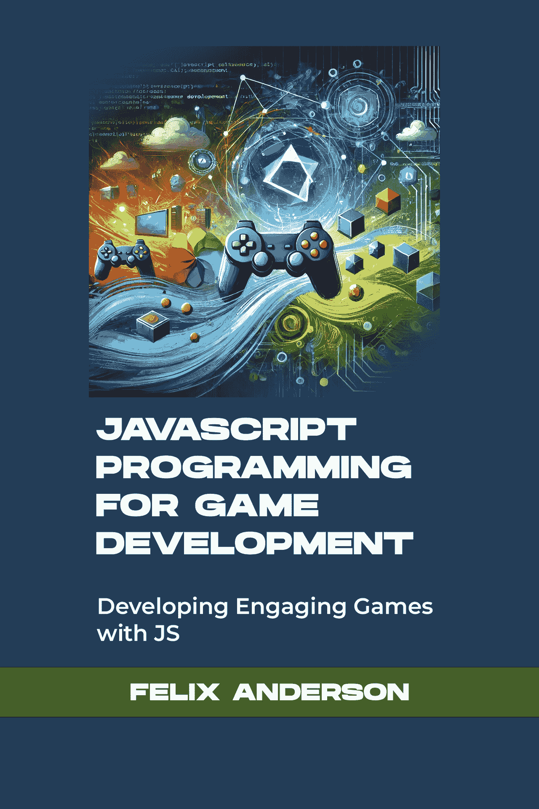

# 游戏开发 JavaScript 编程：使用 JS 开发引人入胜的游戏



## 附录

- 游戏术语表
- JavaScript 开发者推荐资源
- 额外练习与微型项目

# 第一章：JavaScript 游戏开发简介

多年来游戏开发发生了巨大的演变，从简单的文本游戏扩展到复杂的、视觉沉浸式的体验。随着 Web 的兴起，JavaScript 已成为浏览器游戏的主导力量，使得开发此类游戏成为可能。本章将为 JavaScript 游戏开发奠定基础，从 JavaScript 如何在游戏开发中应用、为什么选择它，以及开发者所需的必备工具和库开始。

## 1.1 理解 JavaScript 游戏开发

游戏开发是设计、构建和优化交互式体验的过程。无论是简单的益智游戏还是复杂的在线游戏，所有游戏都遵循一套结构化的开发流程，包括规划、编码、测试和部署。JavaScript 在此过程中起着重要作用，特别是对于那些易于访问的浏览器游戏。

### 游戏开发的基础

每个游戏都由多个核心组件组成，共同构建可玩体验：

- **游戏循环**：游戏的核心，负责更新游戏逻辑和渲染图形。
- **用户输入**：处理键盘、鼠标或游戏控制器输入以控制游戏机制。
- **渲染引擎**：在屏幕上绘制游戏元素，可以使用 `HTML5 Canvas`、`WebGL` 或第三方库。
- **物理引擎**：模拟现实物理，包括重力、碰撞和移动。
- **音频与音乐**：通过背景音乐、音效和音频提示增强游戏体验。
- **人工智能 (AI)**：为非玩家角色 (NPC) 和游戏实体定义行为。
- **网络（针对多人游戏）**：管理玩家之间跨互联网的实时交互。

### JavaScript 在游戏开发中的作用

JavaScript 已成为游戏开发的主要语言之一，对于浏览器游戏尤其如此。它允许开发者在无需安装额外软件的情况下创建完全交互的浏览器体验。JavaScript 游戏可以在任何现代浏览器中运行，具有极高的可用性。

使用 JavaScript 进行游戏开发主要有两种方法：

1. **使用 HTML5 Canvas API**：`Canvas API` 允许开发者在 HTML 页面中绘制图形、制作动画并管理游戏状态。
2. **利用游戏框架与库**：如 `Phaser.js` 和 `Three.js` 等框架提供了预构建的游戏引擎，简化了开发并提升了性能。

通过理解这些基本概念，开发者可以构建各种游戏，从简单的 2D 平台游戏到复杂的 3D 多人体验。

## 1.2 为什么用 JavaScript 开发游戏？

JavaScript 是 Web 开发中最广泛使用的编程语言之一，它的能力也扩展到了游戏开发。有几个非常有力的理由使 JavaScript 是游戏开发的卓越选择。

### 1. 跨平台兼容

JavaScript 的最大优势之一是可以在几乎任何带有网络浏览器的设备上运行。与需要安装或原生应用的传统游戏平台不同，JavaScript 游戏无需下载即可立即运行，使其能够接触广泛受众。

- 基于浏览器的游戏：玩家可以通过简单的 URL 访问游戏。
- 移动兼容性：JavaScript 游戏可以针对移动浏览器进行优化，允许用户在手机和平板上玩游戏。
- 桌面支持：JavaScript 游戏可以在任何操作系统上运行，无需安装专用软件。

### 2. 快速开发与原型制作

JavaScript 以灵活性和开发周期快而闻名，是快速制作游戏想法原型的理想选择。许多独立开发者和小工作室在投入全规模开发之前，使用 JavaScript 来构建和测试游戏概念。

- 易于学习的语法：JavaScript 的语法直观且对初学者友好。
- 快速迭代：开发者可以立即测试更改，无需重新编译代码。
- 丰富的生态系统：JavaScript 拥有庞大的库和框架生态系统，可以加速开发。

### 3. 大型开发者社区

JavaScript 拥有世界上最大的开发者社区之一，确保了丰富的资源、教程和论坛来帮助新手和经验丰富的游戏开发者。无论是 Stack Overflow、`GitHub` 还是专门的游戏开发社区，开发者都可以为几乎任何问题找到支持和解决方案。

- 开源项目：许多 JavaScript 游戏开发项目是开源的，允许开发者贡献和学习。
- 完善的文档：文档良好的框架和 `APIs` 简化了学习过程。

### 4. 广泛的库支持

JavaScript 提供了专为游戏开发设计的广泛库和框架，显著减少了构建游戏所需的时间精力。一些最流行的游戏开发框架包括：

- `Phaser.js`：强大的 2D 游戏开发框架。
- `Three.js`：广泛用于创建 3D Web 基础游戏的库。
- `Babylon.js`：用于 `WebGL` 应用的高性能 3D 游戏引擎。

这些库处理物理模拟、渲染和资产管理等复杂任务，允许开发者专注于游戏玩法机制。

### 5. 与 Web 技术的集成

JavaScript 与其他 Web 技术无缝集成，允许开发者通过附加功能增强游戏，例如：

- 用于多人游戏的 `WebSockets`：实现实时多人交互。
- 用于 3D 图形的 `WebGL`：允许在浏览器中渲染复杂的 3D 场景。
- 用于 2D 渲染的 `Canvas API`：为 2D 游戏提供强大的图形能力。

由于 JavaScript 与 `HTML` 和 `CSS` 工作良好，开发者可以构建丰富的游戏界面和菜单，而不需要单独的游戏引擎。

### 6. 高性价比的游戏开发

JavaScript 是一种开源语言，这意味着开发者不需要为昂贵的许可证或专有游戏引擎付费。许多 JavaScript 游戏开发工具都是免费的，是独立开发者和初创公司的理想选择。

凭借这些优势，JavaScript 已确立其作为开发 Web 游戏领先技术的地位。

## 1.3 JavaScript 游戏开发必备工具和库

游戏开发需要工具和库的结合，以协助游戏的设计、编码、测试和部署。以下是每个 JavaScript 游戏开发者都应该熟悉的必备工具和框架。

### 开发环境和编辑器

为了高效编写 JavaScript 代码，开发者需要一个合适的代码编辑器或集成开发环境 (IDE)。一些流行的选择包括：

| 编辑器/IDE | 特性 |
| :--- | :--- |
| Visual Studio Code | 轻量、可扩展、优秀的调试工具 |
| Sublime Text | 快速、可定制、并支持多个插件 |
| WebStorm | 高级 JavaScript 支持，带有智能代码补全 |
| Brackets | 专注于 Web 开发，是 HTML5 游戏项目的理想选择 |

### JavaScript 游戏框架和库

框架通过提供预构建的功能简化了游戏开发过程。以下是 JavaScript 中最广泛使用的游戏开发库：

#### 1. `Phaser.js`

- 最适合 2D 游戏开发。
- 提供内置物理引擎。
- 支持精灵动画、声音和输入处理。
- 街机风格游戏的理想选择。

#### 2. `Three.js`

- 一个使用 `WebGL` 创建 3D 图形的强大库。
- 处理 3D 渲染、光照和着色。
- 用于构建沉浸式 3D 游戏。

#### 3. `Babylon.js`

- 一个针对 `WebGL` 优化的完整 3D 游戏引擎。
- 提供物理模拟、`PBR`（基于物理的渲染）和动画工具。
- 适用于高性能 3D 浏览器游戏。

#### 4. `PixiJS`

- 用于 2D 游戏的高性能渲染引擎。
- 由于 GPU 加速，比 `Canvas API` 更快。
- 经常用于交互应用和动画。

### 图形和资产创建工具

游戏开发还需要用于设计角色、环境和动画的工具。一些流行的资产创建工具包括：

| 工具 | 用途 |
| :--- | :--- |
| Adobe Photoshop | 创建和编辑精灵和纹理 |
| Aseprite | 像素画和精灵动画 |
| Tiled | 关卡设计和地图 |
| Blender | 3D 建模和动画 |

### 测试和调试工具

为了确保运行流畅，JavaScript 游戏必须经过有效的测试和调试。一些基本的调试工具包括：

- `Chrome DevTools`：提供实时调试和性能分析。
- `Lighthouse`：帮助分析和优化游戏性能。
- `WebGL Inspector`：调试基于 `WebGL` 的应用。

通过利用这些工具和库，开发者可以简化 JavaScript 游戏开发过程，并高效地创建吸引人的高质量游戏。

本介绍为 JavaScript 游戏开发奠定了基础。后续章节将深入探讨创建交互式游戏机制、处理用户输入、渲染图形以及开发完整的基于 JavaScript 的游戏。

## 1.4 设置开发环境

在深入 JavaScript 游戏开发之前，建立一个稳健且高效的开发环境至关重要。配置良好的环境可以确保流畅的编码、调试和测试，让开发者专注于构建高质量的游戏。本节涵盖了创建 JavaScript 游戏开发设置所需的工具和配置。

### 选择代码编辑器或 IDE

| 编辑器/IDE | 特性 |
| :--- | :--- |
| Visual Studio Code (VS Code) | 轻量、高度可定制、大量扩展、内置 Git 集成、JavaScript 调试工具 |
| WebStorm | 智能 JavaScript 支持、内置调试器、支持 Node.js、HTML 和 CSS |
| Sublime Text | 快速、轻量级、通过插件自定义、支持多种编程语言 |
| Brackets | 专注于 Web 开发，提供用于实时编辑的实时预览功能 |
| Atom | 开源、可定制、集成 GitHub、强大的插件生态系统 |

### 推荐初学者的 IDE

对于大多数开发者来说，`Visual Studio Code` (`VS Code`) 是最佳选择，因为它具有灵活性、强大的扩展性，以及内置的 JavaScript 调试工具。

### 安装 Node.js 和 npm

虽然基于浏览器的游戏不需要 `Node.js`，但它对于管理 JavaScript 库和依赖非常有益。`npm`（Node 包管理器）允许开发者高效地安装、更新和管理游戏开发库。

#### 安装 Node.js 和 npm 的步骤

1. 从官方网站下载 `Node.js`：`https://nodejs.org`
2. 在系统上安装它（安装过程中包含 `npm`）。
3. 打开终端并检查安装情况：

```sh
node -v
npm -v
```

4. 如果安装成功，终端将显示已安装的 `Node.js` 和 `npm` 版本。

#### 为什么在游戏开发中使用 npm？

- 简化 JavaScript 游戏框架（例如 `Phaser.js`、`Three.js`）的安装
- 帮助管理项目依赖
- 提供对数以千计开源 JavaScript 库的访问

### 设置本地开发服务器

本地服务器对于测试 JavaScript 游戏非常有用，特别是处理图像、声音和脚本等外部资源时。

| 方法 | 命令 |
| :--- | :--- |
| 使用 Python | `python -m http.server 8000` (Python 3) |
| 使用 Node.js | 使用 `npm install -g http-server` 安装 `http-server`，然后运行 `http-server` |
| 使用 Live Server (VS Code 扩展) | 安装 "Live Server" 扩展并点击 "Go Live" |

在 `VS Code` 中使用 `Live Server` 是初学者最简单的选择，因为它在修改游戏文件时提供实时更新。

### 设置基础游戏项目结构

良好的文件组织对于管理大型游戏项目至关重要。JavaScript 游戏的推荐目录结构如下：

```bash
/my-game-project
│── /assets           # 存储图像、声音和其他媒体文件
│── /scripts          # JavaScript 文件（游戏逻辑、引擎、UI）
│── /styles           # 用于样式的 CSS 文件（如果需要）
│── index.html        # 游戏主入口
│── game.js           # 主 JavaScript 文件
│── package.json      # npm 配置（如果使用 npm）
```

这种结构有助于保持资源、脚本和样式的有序，便于随着开发的进行来扩展游戏。

### 设置 Git 进行版本控制

版本控制对于游戏开发至关重要，允许开发者跟踪更改、与他人协作并在必要时恢复到之前的版本。

#### 基础 Git 设置

1. 从 `https://git-scm.com/` 安装 `Git`
2. 在项目文件夹中初始化 `Git` 仓库：

```sh
git init
```

3. 添加文件并提交更改：

```sh
git add .
git commit -m "Initial commit"
```

4. 将项目推送到 GitHub 或其他仓库托管服务以便备份和协作。

使用 `Git` 确保开发者可以维护版本控制并避免意外丢失游戏进度。

到此，JavaScript 游戏开发的环境搭建已完成。接下来，我们将探索 `HTML5 Canvas API`，这是在 JavaScript 中渲染游戏图形的关键技术。

## 1.5 HTML5 Canvas API 简介

`HTML5 Canvas API` 是一个强大的图形渲染工具，允许开发者使用 JavaScript 直接在网页上绘制、制作动画和操作图像。由于其灵活性、高性能以及对像素的直接控制，它被广泛应用于 2D 游戏开发中。

### 什么是 HTML5 Canvas API？

`Canvas API` 提供了一个画布表面（`canvas` 元素），开发者可以使用 JavaScript 编程地渲染图形、动画和游戏元素。

#### HTML5 Canvas 的基本结构

要使用 `Canvas API`，开发者需要向 HTML 文件添加 `<canvas>` 元素并使用 JavaScript 对其进行操作。

##### 示例：设置 Canvas

```html
<!DOCTYPE html>
<html lang="en">
<head>
<meta charset="UTF-8">
<meta name="viewport" content="width=device-width, initial-scale=1.0">
<title>Canvas Example</title>
</head>
<body>
<canvas id="gameCanvas" width="800" height="600"></canvas>
<script src="game.js"></script>
</body>
</html>
```

##### 在 Canvas 上绘制的 JavaScript 代码

```js
const canvas = document.getElementById("gameCanvas");
const ctx = canvas.getContext("2d");
// 绘制一个红色矩形
ctx.fillStyle = "red";
ctx.fillRect(50, 50, 200, 100);
```

这段代码初始化了一个 `canvas` 并在上面绘制了一个红色矩形。

### 游戏开发的 Canvas API 方法

`Canvas API` 提供了多种用于绘制形状、处理图像和动画元素的方法。

#### 1. 绘制基础形状

| 方法 | 说明 |
| :--- | :--- |
| `fillRect(x, y, width, height)` | 绘制填充矩形 |
| `strokeRect(x, y, width, height)` | 绘制轮廓矩形 |
| `clearRect(x, y, width, height)` | 清除画布的特定区域 |

##### 示例：绘制多个形状

```js
ctx.fillStyle = "blue";
ctx.fillRect(100, 100, 150, 75);
ctx.strokeStyle = "black";
ctx.strokeRect(300, 200, 100, 50);
```

#### 2. 绘制圆和线

| 方法 |
| :--- |
| `beginPath()` |
| `arc(x, y, radius, startAngle, endAngle)` |
| `stroke()` |
| `fill()` |

##### 示例：绘制圆形

```js
ctx.beginPath();
ctx.arc(200, 200, 50, 0, Math.PI * 2);
ctx.fillStyle = "green";
ctx.fill();
```

#### 3. 将图像添加到 Canvas 中

为了通过精灵和背景增强游戏，可以将图像绘制在画布上。

##### 示例：加载和绘制图像

```js
const img = new Image();
img.src = "character.png"; // 替换为实际图像路径
img.onload = function() {
ctx.drawImage(img, 100, 100, 50, 50);
};
```

#### 4. 处理动画

为了创建流畅的游戏动画，开发者使用 `requestAnimationFrame()` 函数高效地更新游戏循环。

##### 示例：简单动画

```js
let x = 0;
function animate() {
ctx.clearRect(0, 0, canvas.width, canvas.height);
ctx.fillRect(x, 100, 50, 50);
x += 2; // 移动矩形
requestAnimationFrame(animate);
}
animate();
```

此函数持续更新矩形的位置，从而创建动画。

通过掌握 `HTML5 Canvas API`，开发者可以创建具有流畅动画、交互元素和高性能渲染的动态 2D 游戏。下一章将介绍游戏物理和移动，为构建交互式游戏机制奠定基础。

# 第 2 章

# 游戏开发中的关键 JavaScript 概念

JavaScript 是构建交互式浏览器游戏的基础。虽然游戏引擎和库简化了开发的许多方面，但坚实理解 JavaScript 的核心概念对于创建高效、可扩展且可维护的游戏至关重要。本章将涵盖游戏开发中的基础 JavaScript 语法、最佳实践，以及变量、数据类型和作用域的正确使用。

## 2.1 JavaScript 语法和最佳实践

JavaScript 是一种动态类型的高级编程语言，遵循 ECMAScript 规范。它被广泛用于 Web 开发，但其灵活性和能力扩展到了游戏开发，特别是基于浏览器和移动游戏。

### JavaScript 语法

在深入游戏开发之前，了解 JavaScript 的核心语法是关键的。

#### 1. 变量声明

变量存储游戏数据，如玩家得分、对象位置和游戏状态。

```js
let playerName = "John";  // 声明变量 Modern 方式
const gravity = 9.8;     // 不变的常量值
```

```js
var oldSyntax = 10; // 旧语法，避免使用 `var`
```

#### 2. 数据类型

JavaScript 支持数种对游戏逻辑至关重要的数据类型：

```js
let score = 0;             // 数字
let isGameOver = false;   // 布尔
let playerName = "Hero";  // 字符串
let position = { x: 10, y: 20 }; // 对象
let enemies = ["Goblin", "Dragon"]; // 数组
```

#### 3. 条件语句

游戏逻辑通常需要条件，例如检查玩家是否获胜：

```js
if (score >= 100) {
  console.log("你赢了!");
} else {
  console.log("继续游戏！");
}
```

#### 4. 循环

循环在游戏开发中常用于更新对象位置、检查碰撞或渲染动画。

```js
for (let i = 0; i < 10; i++) {
  console.log("循环迭代:", i);
}
```

### 游戏开发中 JavaScript 的最佳实践

使用最佳实践可以确保代码更整洁、高效且易于维护。

#### 1. 使用 `const` 和 `let` 代替 `var`

`var` 关键字具有函数作用域，可能会导致意外行为。对于不可变值优先使用 `const`，对于可能变化的变量使用 `let`。

```js
const GRAVITY = 9.8; // 常量使用 const
let playerSpeed = 5; // 变化的值使用 let
```

#### 2. 将代码组织成函数

函数可以提高代码的可读性和复用性。

```js
function movePlayer(x, y) {
  console.log(`玩家移动到 (${x}, ${y})`);
}
movePlayer(10, 20);
```

#### 3. 使用面向对象编程 (OOP)

使用对象和类组织代码使得管理游戏实体更容易。

```js
class Player {
  constructor(name, health) {
    this.name = name;
    this.health = health;
  }
  takeDamage(amount) {
    this.health -= amount;
    console.log(`${this.name} 受到了 ${amount} 点伤害。`);
  }
}
let hero = new Player("Knight", 100);
hero.takeDamage(10);
```

#### 4. 避免全局变量

使用过多的全局变量会导致冲突。相反，将变量封装在对象或函数内部。

```js
const gameState = {
  score: 0,
  level: 1
};
function increaseScore(amount) {
  gameState.score += amount;
}
```

#### 5. 明智地使用注释

注释有助于记录代码，但不应过度使用。

```js
// 将玩家移动到新位置
function movePlayer(x, y) {
  console.log(`将玩家移动到 (${x}, ${y})`);
}
```

### JavaScript 游戏中的错误处理

错误处理确保游戏不会意外崩溃。

#### Try-Catch 块

用于捕获错误并防止破坏游戏的问题。

```js
try {
  let gameData = JSON.parse('{"score":10}');
  console.log(gameData.score);
} catch (error) {
  console.log("加载游戏数据出错:", error);
}
```

#### 使用 console.log() 调试

`console.log()` 函数有助于跟踪游戏值。

```js
console.log("玩家位置:", player.x, player.y);
```

通过遵循这些最佳实践，JavaScript 游戏代码将更易维护、调试并为更复杂的项目进行扩展。

## 2.2 变量、数据类型和作用域

变量是 JavaScript 编程的基础。它们存储和处理游戏数据，例如玩家位置、得分、生命值和游戏状态。

### JavaScript 中的变量类型

JavaScript 提供了三种声明变量的方式：

| 关键字 | 作用域 | 重新赋值 | 提升 |
| :--- | :--- | :--- | :--- |
| `var` | 函数 | 是 | 是 (不推荐) |
| `let` | 块级 | 是 | 否 |
| `const` | 块级 | 否 | 否 |

#### 使用 let 和 const

建议使用 `let` 和 `const` 代替 `var`，因为它们对变量作用域提供了更好的控制。

```js
let score = 0; // 可以更改
const maxLives = 3; // 不能重新赋值
```

### 游戏开发中的 JavaScript 数据类型

理解 JavaScript 数据类型对游戏逻辑至关重要。

#### 1. 原始数据类型

| 数据类型 | 示例 |
| :--- | :--- |
| Number (数字) | `let score = 100;` |
| String (字符串) | `let playerName = "Warrior";` |
| Boolean (布尔) | `let isGameOver = false;` |
| Undefined (未定义) | `let nextLevel;` |
| Null (空) | `let enemy = null;` |

#### 2. 复杂数据类型

| 数据类型 | 示例 |
| :--- | :--- |
| Object (对象) | `let player = { name: "Hero", health: 100 };` |
| Array (数组) | `let enemies = ["Goblin", "Orc", "Dragon"];` |
| Function (函数) | `function jump() { console.log("Jump!"); }` |

### JavaScript 中的作用域

作用域决定了变量在程序何范围内可以被访问。

#### 1. 全局作用域

在函数外部声明的变量可以在任何地方访问。

```js
let gameName = "Dungeon Quest"; // 全局变量
function startGame() {
  console.log("欢迎来到", gameName);
}
startGame();
```

#### 2. 局部作用域 (函数作用域)

在函数内部声明的变量仅在该函数内部可用。

```js
function increaseScore() {
  let points = 10; // 局部变量
  console.log("得分增加了", points);
}
increaseScore();
// console.log(points); // 错误：points 未定义
```

#### 3. 块级作用域 (let 和 const)

在 `{}` 内部使用 `let` 或 `const` 声明的变量具有块作用域。

```js
if (true) {
  let health = 100;
  console.log("块内的生命值:", health);
}
// console.log(health); // 错误：health 未定义
```

#### 4. 作为局部变量的函数参数

函数参数类似于局部变量。

```js
function updateHealth(player, damage) {
  player.health -= damage;
}
let hero = { name: "Knight", health: 100 };
updateHealth(hero, 20);
console.log(hero.health); // 输出: 80
```

### 游戏开发中的数组和对象

数组和对象对于管理游戏数据至关重要。

#### 1. 数组（元素列表）

```js
let enemies = ["Goblin", "Troll", "Dragon"];
console.log(enemies[0]); // 输出: Goblin
```

#### 2. 对象（游戏实体）

```js
let player = {
  name: "Archer",
  health: 100,
  attackPower: 20
};
console.log(player.name); // 输出: Archer
```

理解 JavaScript 语法、最佳实践、变量、数据类型和作用域对游戏开发至关重要。这些概念构成了处理游戏状态、交互和整体游戏逻辑的基础。在下一节中，我们将探索函数、循环和条件，它们将进一步增强 JavaScript 游戏的交互性。

## 2.3 游戏开发中的函数、循环和条件语句

在 JavaScript 游戏开发中，`函数`、`循环`和`条件语句`在管理游戏逻辑、控制游戏流程和优化性能方面起着关键作用。函数允许开发者将游戏机制拆分为可复用的代码块，循环处理渲染游戏对象等重复任务，而条件语句允许游戏中进行决策。

### 游戏开发中的函数

函数是在调用时执行特定任务的可复用代码块。它们提高了代码组织，使得复杂的游戏逻辑更容易调试和扩展。

#### 函数的声明和调用

使用 `function` 关键字或箭头语法 (`=>`) 定义函数。

##### 函数示例

```js
function startGame() {
  console.log("游戏开始!");
}
startGame(); // 调用函数
```

##### 带参数的函数

函数可以接受参数以执行动态操作。

```js
function movePlayer(x, y) {
  console.log(`玩家移动到位置 (${x}, ${y})`);
}
movePlayer(10, 20);
```

##### 函数的返回值

函数可以返回用于游戏计算的数值。

```js
function calculateDamage(attackPower) {
  return attackPower * 2;
}
let damage = calculateDamage(5);
console.log("造成伤害:", damage); // 输出: 造成伤害: 10
```

#### 在游戏开发中使用函数

函数有助于管理各种游戏机制，例如移动、生命值更新和事件处理。

##### 示例：更新玩家生命值

```js
function updateHealth(player, damage) {
  player.health -= damage;
  if (player.health <= 0) {
    console.log(`${player.name} 被击败了.`);
  }
}
```

```js
let hero = { name: "Warrior", health: 100 };

updateHealth(hero, 30); // Hero takes damage

console.log(hero.health); // Output: 70
```

##### 示例：处理游戏事件

```js
function onKeyPress(event) {
  if (event.key === "ArrowUp") {
    console.log("Player jumps");
  }
}

document.addEventListener("keydown", onKeyPress);
```

### JavaScript 游戏开发中的循环

循环允许开发者多次执行代码，这对于渲染对象、更新位置和处理动画等游戏机制至关重要。

#### 循环类型

| 循环类型 | 描述 | 示例 |
| :--- | :--- | :--- |
| for 循环 | 迭代固定次数 | `for (let i = 0; i < 10; i++) { console.log(i); }` |
| while 循环 | 只要条件为真就运行 | `while (player.health > 0) { console.log("Fighting!"); }` |
| do...while 循环 | 在检查条件前至少执行一次 | `do { console.log("Attack!"); } while (enemy.health > 0);` |

#### 在游戏开发中使用循环

循环有助于高效地管理游戏对象。

##### 示例：渲染多个敌人

```js
let enemies = ["Goblin", "Orc", "Troll"];

for (let i = 0; i < enemies.length; i++) {
  console.log(`Enemy ${i + 1}: ${enemies[i]}`);
}
```

##### 示例：制作移动对象的动画

```js
let position = 0;

function moveCharacter() {
  position += 5;
  console.log(`Character moved to ${position}px`);
  if (position < 100) {
    requestAnimationFrame(moveCharacter);
  }
}

moveCharacter();
```

### 游戏开发中的条件语句

条件语句允许游戏根据玩家操作、游戏事件或环境条件做出决策。

#### 基础 if-else 语句

```js
let score = 50;
if (score >= 100) {
  console.log("You win!");
} else {
  console.log("Keep playing!");
}
```

#### 使用 switch 处理游戏状态

`switch` 语句有助于管理多个游戏状态。

```js
let gameState = "playing";
switch (gameState) {
  case "playing":
    console.log("Game is running...");
    break;
  case "paused":
    console.log("Game is paused.");
    break;
  case "gameOver":
    console.log("Game Over!");
    break;
  default:
    console.log("Unknown state.");
}
```

#### 示例：检查游戏中的碰撞

```js
function checkCollision(player, enemy) {
  if (player.x === enemy.x && player.y === enemy.y) {
    console.log("Collision detected!");
  }
}
```

通过掌握函数、循环和条件语句，开发者可以构建结构化且交互式的游戏逻辑。

## 2.4 JavaScript 游戏开发中的面向对象编程 (OOP)

面向对象编程 (OOP) 是一种将代码结构为可用对象的编程范式。这种方法对游戏开发非常有益，允许开发者高效地为玩家、敌人和物品等游戏实体建模。

### 核心 OOP 概念

| 概念 | 描述 | 示例 |
| :--- | :--- | :--- |
| 对象 (Objects) | 属性和方法的容器 | `let player = { name: "Hero", health: 100 };` |
| 类 (Classes) | 创建对象的模板 | `class Player { constructor(name) { this.name = name; } }` |
| 继承 (Inheritance) | 允许一个类继承另一个类 | `class Enemy extends Character {}` |
| 封装 (Encapsulation) | 限制对某些属性的访问 | `class Player { #health = 100; }` |
| 多态 (Polymorphism) | 允许不同对象共享相同方法 | 不同类中的 `attack()` |

### 在 JavaScript 中创建对象

对象将相关的属性和函数组合。

#### 使用对象字面量

```js
let player = {
  name: "Knight",
  health: 100,
  attack: function () {
    console.log(`${this.name} attacks!`);
  }
};

player.attack();
```

### JavaScript 游戏开发中的类

类为创建具有共享属性和方法的对象提供了蓝图。

#### 定义类

```js
class Player {
  constructor(name, health) {
    this.name = name;
    this.health = health;
  }
  attack() {
    console.log(`${this.name} attacks!`);
  }
}

let hero = new Player("Warrior", 100);
hero.attack();
```

#### 使用继承创建游戏实体

继承允许对象共享行为。

```js
class Character {
  constructor(name, health) {
    this.name = name;
    this.health = health;
  }
  takeDamage(amount) {
    this.health -= amount;
    console.log(`${this.name} takes ${amount} damage.`);
  }
}

class Enemy extends Character {
  constructor(name, health, type) {
    super(name, health);
    this.type = type;
  }
  attack() {
    console.log(`${this.name} the ${this.type} attacks!`);
  }
}

let goblin = new Enemy("Goblin", 50, "Monster");
goblin.attack();
goblin.takeDamage(10);
```

#### 封装与私有属性

封装限制了对某些属性的访问。

```js
class Player {
  #health = 100; // 私有属性
  takeDamage(amount) {
    this.#health -= amount;
    console.log(`Health is now ${this.#health}`);
  }
}

let warrior = new Player();
warrior.takeDamage(20);
// console.log(warrior.#health); // 错误：无法访问私有字段
```

#### 游戏开发中的多态

多态允许不同的类实现相同的方法。

```js
class Character {
  attack() {
    console.log("Character attacks!");
  }
}

class Warrior extends Character {
  attack() {
    console.log("Warrior slashes with a sword!");
  }
}

class Mage extends Character {
  attack() {
    console.log("Mage casts a fireball!");
  }
}

let hero1 = new Warrior();
let hero2 = new Mage();
hero1.attack(); // Warrior slashes with a sword!
hero2.attack(); // Mage casts a fireball!
```

JavaScript 游戏开发中的 OOP 提高了组织性、可扩展性和代码重用性。通过使用对象和类，开发者可以高效地管理玩家、敌人、武器和关卡等游戏元素。下一节将探索事件驱动编程和用户输入处理，这是制作交互游戏的关键方面。

## 2.5 JavaScript 游戏开发中的事件驱动编程和用户输入处理

交互性是游戏开发的基本方面。玩家必须能够控制角色、触发动作并与游戏元素交互。JavaScript 是一种事件驱动语言，意味着它对键盘按下、鼠标点击和触摸手势等事件做出响应。本节将涵盖 JavaScript 中的事件驱动编程，重点关注用于控制游戏机制的用户输入处理。

### 理解 JavaScript 中的事件驱动编程

JavaScript 的设计用于处理异步事件，这意味着动作可以独立于主游戏循环而发生。在游戏中，这些事件包括：

- 按键（移动、攻击、跳跃）
- 鼠标点击（射击、选择对象）
- 触摸手势（移动端交互）
- 游戏手柄输入（控制器支持）

#### 事件驱动编程的工作原理

JavaScript 使用事件监听器来检测并响应用户交互。

```js
document.addEventListener("keydown", function(event) {
  console.log("Key pressed:", event.key);
});
```

#### 游戏开发中的事件类型

| 事件类型 | 描述 | 示例 |
| :--- | :--- | :--- |
| keydown | 按键按下时触发 | `document.addEventListener("keydown", movePlayer);` |
| keyup | 按键释放时触发 | `document.addEventListener("keyup", stopPlayer);` |
| mousedown | 鼠标按键按下时触发 | `document.addEventListener("mousedown", shoot);` |
| mouseup | 鼠标按键释放时触发 | `document.addEventListener("mouseup", stopShooting);` |
| mousemove | 鼠标移动时触发 | `document.addEventListener("mousemove", trackCursor);` |
| touchstart | 触摸事件开始时触发（移动端） | `document.addEventListener("touchstart", jump);` |

### 在游戏中处理键盘输入

#### 检测按键按下

要检测玩家何时按下按键，我们使用 `keydown` 事件。

#### 使用多个按键处理移动

更好的方法是存储激活按键并相应地更新移动。

```js
let keys = {};

document.addEventListener("keydown", function(event) {
  keys[event.key] = true;
});

document.addEventListener("keyup", function(event) {
  keys[event.key] = false;
});

function updatePlayerMovement() {
  if (keys["ArrowLeft"]) {
    console.log("Moving left");
  }
  if (keys["ArrowRight"]) {
    console.log("Moving right");
  }
  requestAnimationFrame(updatePlayerMovement);
}

updatePlayerMovement();
```

### 在游戏中处理鼠标输入

鼠标输入用于瞄准、射击、点击 UI 元素以及选择游戏对象。

#### 检测鼠标点击

```js
document.addEventListener("mousedown", function(event) {
  console.log(`Mouse clicked at (${event.clientX}, ${event.clientY})`);
});
```

#### 追踪鼠标移动

```js
document.addEventListener("mousemove", function(event) {
  console.log(`Mouse moved to (${event.clientX}, ${event.clientY})`);
});
```

#### 创建射击机制

```js
document.addEventListener("click", function(event) {
  let bullet = { x: event.clientX, y: event.clientY };
  console.log("Bullet fired at", bullet);
});
```

### 为移动端游戏处理触摸输入

在支持触摸的设备上，我们将 `mousedown` 和 `mousemove` 替换为 `touchstart` 和 `touchmove`。

#### 检测轻击

```js
document.addEventListener("touchstart", function(event) {
  console.log("Screen touched at", event.touches[0].clientX, event.touches[0].clientY);
});
```

#### 处理滑动（左、右、上、下）

```js
let startX, startY;

document.addEventListener("touchstart", function(event) {
  startX = event.touches[0].clientX;
  startY = event.touches[0].clientY;
});

document.addEventListener("touchend", function(event) {
  let endX = event.changedTouches[0].clientX;
  let endY = event.changedTouches[0].clientY;
  let diffX = endX - startX;
  let diffY = endY - startY;

  if (Math.abs(diffX) > Math.abs(diffY)) {
    if (diffX > 0) {
      console.log("Swipe Right");
    } else {
      console.log("Swipe Left");
    }
  } else {
    if (diffY > 0) {
      console.log("Swipe Down");
    } else {
      console.log("Swipe Up");
    }
  }
});
```

### 处理手柄输入

许多现代浏览器使用 `Gamepad API` 支持游戏控制器。

#### 检测控制器连接

```js
window.addEventListener("gamepadconnected", function(event) {
  console.log("Gamepad connected:", event.gamepad.id);
});
```

#### 检查按键按下

```js
function checkGamepadInput() {
  let gamepads = navigator.getGamepads();
  if (gamepads[0]) {
    if (gamepads[0].buttons[0].pressed) {
      console.log("Jump button pressed!");
    }
  }
  requestAnimationFrame(checkGamepadInput);
}

checkGamepadInput();
```

## 2.6 为游戏元素操作 DOM

文档对象模型 (DOM) 允许开发者动态地创建和修改游戏 UI 元素。在 JavaScript 游戏中，DOM 用于 HUD（平视显示）、菜单、计分板和 UI 控制。

### 动态修改元素

#### 创建游戏 HUD（得分、生命值、计时器）

```html
<div id="gameUI">
  <p>Score: <span id="score">0</span></p>
  <p>Health: <span id="health">100</span></p>
</div>
```

```js
let score = 0;
document.getElementById("score").textContent = score;
```

#### 更新玩家生命值

```js
function updateHealth(value) {
  document.getElementById("health").textContent = value;
}
updateHealth(80);
```

### 创建并移除游戏元素

#### 动态添加敌人

```js
let enemy = document.createElement("div");
enemy.classList.add("enemy");
document.body.appendChild(enemy);
```

#### 移除元素（销毁敌人）

```js
document.body.removeChild(enemy);
```

### 使用 CSS 和 JavaScript 制作游戏元素

CSS 可用于 UI 组件。

```css
@keyframes fadeIn {
  from { opacity: 0; }
  to { opacity: 1; }
}
#gameUI {
  animation: fadeIn 1s ease-in-out;
}
```

JavaScript 也可以使用 `setInterval()` 或 `requestAnimationFrame()` 来处理动画。

```js
let position = 0;
function moveEnemy() {
  position += 2;
  enemy.style.left = position + "px";
  if (position < window.innerWidth) {
    requestAnimationFrame(moveEnemy);
  }
}
moveEnemy();
```

### 处理 UI 事件（按钮和菜单）

#### 创建开始按钮

```html
<button id="startButton">Start Game</button>
```

```js
document.getElementById("startButton").addEventListener("click", function() {
  console.log("Game Started!");
});
```

#### 暂停和恢复游戏

```js
let isPaused = false;
document.addEventListener("keydown", function(event) {
  if (event.key === "Escape") {
    isPaused = !isPaused;
    console.log(isPaused ? "Game Paused" : "Game Resumed");
  }
});
```

事件驱动编程和 DOM 操作是 JavaScript 游戏开发的基础。理解如何处理键盘、鼠标、触摸和手柄输入可以确保无缝的玩家交互。同时，修改和动画 DOM 元素可以创建动态 UI、计分板和 HUD，从而营造精良的游戏体验。

在下一章中，我们将探索管理用于 2D 游戏开发的 HTML5 Canvas API，我们将从处理用户输入转变为高效地渲染游戏图形。

# 第 3 章

# 用于 2D 游戏的 HTML5 Canvas API

HTML5 Canvas API 是 JavaScript 游戏开发中提供的强大的工具之一。它允许开发者直接在浏览器中创建高性能、交互式的 2D 游戏，而无需依赖第三方插件。与传统的 DOM 元素不同，Canvas API 提供了直接的像素操作，使其成为渲染游戏对象、处理动画和管理实时图形的理想选择。

在本章中，我们将探索 Canvas API 的基础知识，包括如何绘制形状和对象。

## 3.1 什么是 Canvas API？

Canvas API 是 HTML5 的一项功能，允许 JavaScript 开发者在网页上绘制和操作图形。它提供了一个空白表面（画布），开发者可以在其中渲染 2D 图像。

### 主要特性

- 直接像素操作：与传统的 DOM 元素不同，画布在像素级运行，能够精确的图形控制。
- 性能导向：画布经过了硬件加速，非常适合快速移动的图形。
- 动画能力：允许开发者使用 `requestAnimationFrame()` 创建流畅动画。
- 支持图像和文本：开发者可以绘制图像、文本和复杂的视觉元素。
- 事件处理：配合事件监听器工作以检测玩家输入。

### 设置 Canvas 元素

要使用 Canvas API，我们首先需要在 HTML 文档中创建一个 `<canvas>` 元素。

#### 基本 HTML Canvas 设置

```html
<!DOCTYPE html>
<html lang="en">
<head>
  <meta charset="UTF-8">
  <meta name="viewport" content="width=device-width, initial-scale=1.0">
  <title>Canvas Example</title>
</head>
<body>
  <canvas id="gameCanvas" width="800" height="600"></canvas>
  <script src="game.js"></script>
</body>
</html>
```

### 使用 JavaScript 获取 Canvas

为了在画布上绘图，我们需要使用 JavaScript 获取其绘图上下文。

```js
// 选择 canvas 元素
const canvas = document.getElementById("gameCanvas");

// 获取 2D 渲染上下文
const ctx = canvas.getContext("2d");
```

### 清除画布

要移除旧的绘图（这对动画很有用），请使用：

```js
ctx.clearRect(0, 0, canvas.width, canvas.height);
```

这会清除整个画布区域，确保只渲染更新后的图形。

## 3.2 在画布上绘制形状和对象

`Canvas API` 允许开发者使用 `JavaScript` 绘制矩形、圆形、直线和其他形状。这些基础形状是游戏角色、障碍物、平台和背景元素的构建块。

### 绘制矩形

`fillRect()` 和 `strokeRect()` 方法用于绘制矩形。

#### 填充矩形

```js
ctx.fillStyle = "blue";  // 设置填充颜色
ctx.fillRect(50, 50, 200, 100);  // 绘制填充矩形 (x, y, 宽, 高)
```

#### 绘制描边矩形

```js
ctx.strokeStyle = "red";  // 设置描边颜色
ctx.lineWidth = 5;  // 设置边界粗细
ctx.strokeRect(300, 100, 150, 75);  // 绘制描边矩形
```

#### 清除矩形

要清除画布的一部分：

```js
ctx.clearRect(100, 50, 50, 50);  // 清除画布的一个区域
```

### 绘制圆形和圆弧

圆形是在 `beginPath()` 块中使用 `arc()` 方法绘制的。

#### 绘制圆形

```js
ctx.beginPath();
ctx.arc(200, 200, 50, 0, Math.PI * 2); // x, y, 半径, 起角度, 结束角度
ctx.fillStyle = "green";
ctx.fill();  // 填充圆形
```

#### 绘制半圆

```js
ctx.beginPath();
ctx.arc(300, 300, 50, 0, Math.PI);  // 半圆
ctx.strokeStyle = "black";
ctx.stroke();
```

### 绘制直线

直线使用 `moveTo()` 和 `lineTo()` 方法绘制。

#### 绘制直线

```js
ctx.beginPath();
ctx.moveTo(100, 100);  // 起点
ctx.lineTo(300, 300);  // 终点
ctx.strokeStyle = "purple";
ctx.lineWidth = 4;
ctx.stroke();
```

### 绘制三角形

通过使用 `moveTo()` 和 `lineTo()` 方法连接三个点来绘制三角形。

```js
ctx.beginPath();
ctx.moveTo(150, 100);  // 顶点
ctx.lineTo(100, 200);  // 左下
ctx.lineTo(200, 200);  // 右下
ctx.closePath();  // 闭合形状
ctx.fillStyle = "orange";
ctx.fill();  // 填充三角形
```

### 组合形状创建游戏对象

通过组合多个形状，我们可以创建基础的游戏精灵。

#### 示例：绘制一个简单的玩家角色

```js
function drawPlayer(x, y) {
ctx.fillStyle = "blue";
ctx.fillRect(x, y, 40, 60);  // 身体
ctx.fillStyle = "black";
ctx.beginPath();
ctx.arc(x + 20, y - 10, 15, 0, Math.PI * 2);  // 头
ctx.fill();
}
drawPlayer(100, 300);
```

此函数可以用于在不同位置渲染玩家。

### 在画布上制作动画

动画通过在 `requestAnimationFrame()` 循环中不断更新对象的位置来创建。

#### 示例：移动球

```js
let x = 50;
let speed = 2;
function animate() {
ctx.clearRect(0, 0, canvas.width, canvas.height);  // 清除上一帧
ctx.beginPath();
ctx.arc(x, 200, 20, 0, Math.PI * 2);
ctx.fillStyle = "red";
ctx.fill();
x += speed;  // 移动对象
requestAnimationFrame(animate);
}
animate();
```

### 2D 游戏中的实际应用

本节涵盖的形状和绘图方法构成了各种游戏元素的基础：

| 游戏元素 | 画布形状 |
| :--- | :--- |
| 玩家角色 | 矩形 + 圆形 |
| 平台 | 矩形 |
| 子弹 | 小圆 |
| 敌人 | 圆形和矩形的组合 |
| 障碍物 | 直线和三角形 |

通过掌握 `Canvas API`，开发者可以仅使用 `JavaScript` 创建复杂的交互式游戏。

`HTML5 Canvas API` 为 2D 游戏渲染形状、对象和动画提供了一种强大的方法。通过理解如何绘制矩形、圆形、直线和其他对象，开发者可以构建交互式游戏所需的图形组件。

在下一节中，我们将探索如何应用颜色、渐变和图案来增强游戏视觉效果并创建更具吸引力的环境。

## 3.3 在 Canvas API 中应用颜色、渐变和图案

游戏开发中最重要的方面之一是视觉美学。在 `Canvas API` 中，开发者可以应用纯色、渐变和图案来增强游戏对象、背景和 UI 元素。这些技术有助于创建视觉吸引力的环境，保持玩家的参与度。

### 在 Canvas API 中使用纯色

默认情况下，画布上绘制的形状没有颜色，除非显式地使用 `fillStyle` 或 `strokeStyle` 属性进行设置。

#### 设置填充颜色

`fillStyle` 属性定义形状的内部颜色。

```js
ctx.fillStyle = "blue"; // 设置填充颜色
ctx.fillRect(50, 50, 150, 100); // 绘制填充矩形
```

#### 设置描边颜色

`strokeStyle` 属性定义形状的边界颜色。

```js
ctx.strokeStyle = "red"; // 设置描边颜色
ctx.lineWidth = 5; // 设置边界粗细
ctx.strokeRect(200, 50, 150, 100); // 绘制描边矩形
```

### 在 Canvas API 中创建渐变

渐变是平滑的颜色过渡，为游戏图形增添深度和质感。

#### 1. 线性渐变

线性渐变沿直线创建颜色过渡。

```js
let gradient = ctx.createLinearGradient(50, 50, 200, 50);
gradient.addColorStop(0, "red");
gradient.addColorStop(1, "yellow");
ctx.fillStyle = gradient;
ctx.fillRect(50, 50, 200, 100);
```

- `createLinearGradient(x1, y1, x2, y2)` : 在两点之间创建渐变。
- `addColorStop(position, color)` : 指定 0（开始）到 1（结束）之间的渐变停止点。

#### 2. 径向渐变

径向渐变创建圆形的颜色过渡。

```js
let radialGradient = ctx.createRadialGradient(150, 150, 10, 150, 150, 100);
radialGradient.addColorStop(0, "white");
radialGradient.addColorStop(1, "blue");
ctx.fillStyle = radialGradient;
ctx.beginPath();
ctx.arc(150, 150, 100, 0, Math.PI * 2);
ctx.fill();
```

### 在 Canvas API 中应用图案

图案是基于图像的纹理，可填充形状。

#### 使用图像图案

```js
let img = new Image();
img.src = "brick.png"; // 替换为实际图像路径
img.onload = function () {
let pattern = ctx.createPattern(img, "repeat"); // 创建重复图案
ctx.fillStyle = pattern;
ctx.fillRect(0, 0, 400, 300);
};
```

图案选项：

- `"repeat"` – 水平和垂直平铺图像。
- `"repeat-x"` – 水平平铺图像。
- `"repeat-y"` – 垂直平铺图像。
- `"no-repeat"` – 绘制一次图像不重复。

#### 将图案应用到游戏对象

- 平台中的砖墙
- RPG 中的草地或土壤纹理
- 棋盘游戏中的棋格图案

通过组合颜色、渐变和图案，开发者可以创建视觉丰富的游戏环境。

## 3.4 在 Canvas 中制作动画

动画是游戏的核心，通过快速连续绘制帧来创造运动的错觉。`Canvas API` 结合 `requestAnimationFrame()` 提供了高性能的动画能力。

### 基础动画循环

使用 `requestAnimationFrame()` 创建平滑的动画循环。

```js
function animate() {
  ctx.clearRect(0, 0, canvas.width, canvas.height); // 清除画布
  // 绘制游戏对象
  // 更新游戏状态
  requestAnimationFrame(animate); // 请求下一帧
}
animate();
```

### 简单对象动画

#### 示例：弹跳球

```js
let x = 50;
let y = 50;
let speedX = 3;
let speedY = 2;
let radius = 20;

function animateBall() {
  ctx.clearRect(0, 0, canvas.width, canvas.height);
  ctx.beginPath();
  ctx.arc(x, y, radius, 0, Math.PI * 2);
  ctx.fillStyle = "red";
  ctx.fill();

  // 更新位置
  x += speedX;
  y += speedY;

  // 边界检测
  if (x + radius > canvas.width || x - radius < 0) speedX *= -1;
  if (y + radius > canvas.height || y - radius < 0) speedY *= -1;

  requestAnimationFrame(animateBall);
}

animateBall();
```

### 角色移动动画

#### 按键时更新玩家位置

```js
let player = { x: 100, y: 250, speed: 5 };

document.addEventListener("keydown", function (event) {
  if (event.key === "ArrowRight") player.x += player.speed;
  if (event.key === "ArrowLeft") player.x -= player.speed;
});

function animatePlayer() {
  ctx.clearRect(0, 0, canvas.width, canvas.height);
  ctx.fillStyle = "blue";
  ctx.fillRect(player.x, player.y, 50, 50); // 绘制角色
  requestAnimationFrame(animatePlayer);
}

animatePlayer();
```

### 平滑的帧动画

我们不是按固定步长更新位置，而是使用基于帧的运动来实现平滑动画。

```js
let lastTime = 0;
function smoothAnimation(timestamp) {
  let deltaTime = timestamp - lastTime;
  lastTime = timestamp;
  ctx.clearRect(0, 0, canvas.width, canvas.height);
  // 使用 deltaTime 调整移动速度
  let movement = (deltaTime / 16) * 5; // 归一化速度
  player.x += movement;
  ctx.fillStyle = "blue";
  ctx.fillRect(player.x, player.y, 50, 50);
  requestAnimationFrame(smoothAnimation);
}

requestAnimationFrame(smoothAnimation);
```

### 基于帧精灵动画

精灵动画涉及每隔一段时间显示图像的不同帧。

#### 使用精灵帧图

```js
let sprite = new Image();
sprite.src = "character_spritesheet.png"; // 加载帧图
let frameIndex = 0;
let frameWidth = 64; // 单帧宽度
let frameHeight = 64;
function animateSprite() {
  ctx.clearRect(0, 0, canvas.width, canvas.height);
  ctx.drawImage(sprite, frameIndex * frameWidth, 0, frameWidth, frameHeight, 100, 100, frameWidth, frameHeight);
  frameIndex = (frameIndex + 1) % 4; // 循环帧（假设有 4 帧）
  setTimeout(() => requestAnimationFrame(animateSprite), 100);
}

sprite.onload = function () {
  animateSprite();
};
```

### 高级动画技术

| 技术 | 描述 | 示例用法 |
| :--- | :--- | :--- |
| 缓动 (Easing) | 逐渐减慢或加速动画 | 平滑的玩家移动 |
| 视差滚动 (Parallax Scrolling) | 背景以不同速度移动以创建深度感 | 横版卷轴平台游戏 |
| 补间动画 (Tweening) | 随时间对值进行插值 | 角色过渡 |

#### 示例：视差滚动

```js
let backgroundX = 0;
function animateBackground() {
  ctx.clearRect(0, 0, canvas.width, canvas.height);
  backgroundX -= 1; // 背景向左移动
  ctx.drawImage(backgroundImage, backgroundX, 0);
  requestAnimationFrame(animateBackground);
}

animateBackground();
```

### 循环优化

为了确保动画平滑：

- 使用 `requestAnimationFrame()` 代替 `setInterval()`
- 优化碰撞检测以避免卡顿
- 最小化未更改区域的重绘
- 使用精灵帧图代替多张图像

通过掌握颜色、渐变、图案和动画，开发者可以创建具有视觉吸引力且流畅的游戏体验。下一节将介绍碰撞检测技术，这对于处理游戏中物体之间的交互至关重要。

## 3.5 在 2D 游戏中处理碰撞检测

碰撞检测是游戏开发的一个基础。它决定了物体何时发生交互、碰撞或重叠，从而触发重要的游戏机制，例如：

- 玩家击中敌人（造成伤害）
- 收集物品（金币、强化道具）
- 检测边界（防止移动出屏幕）
- 物理交互（物体反弹或停止）

使用 `Canvas API` 在 2D JavaScript 游戏中有多种方法处理碰撞检测。

### 2D 游戏中的碰撞检测类型

碰撞检测方法取决于游戏对象的形状和大小。

#### 1. 轴对齐边界框 (AABB) 碰撞

- 用于矩形物体。
- 根据 `x`、`y`、`width` 和 `height` 检查两个矩形是否重叠。

##### AABB 碰撞检测函数

```js
function isColliding(rect1, rect2) {
  return (
    rect1.x < rect2.x + rect2.width &&
    rect1.x + rect1.width > rect2.x &&
    rect1.y < rect2.y + rect2.height &&
    rect1.y + rect1.height > rect2.y
  );
}
```

##### 示例：检测玩家与敌人之间的碰撞

```js
let player = { x: 50, y: 50, width: 50, height: 50 };
let enemy = { x: 100, y: 100, width: 50, height: 50 };
if (isColliding(player, enemy)) {
  console.log("检测到碰撞！玩家受到伤害。");
}
```

#### 2. 圆形碰撞检测

对于圆形物体（例如子弹），我们使用距离公式。

##### 圆形碰撞公式

当两个圆心之间的距离小于半径之和时，发生碰撞。

```js
function isCircleCollision(circle1, circle2) {
  let dx = circle1.x - circle2.x;
  let dy = circle1.y - circle2.y;
  let distance = Math.sqrt(dx * dx + dy * dy);
  return distance < (circle1.radius + circle2.radius);
}
```

#### 3. 像素级碰撞

像素级检测检查实际像素重叠而非边界框。这种方法更精确但计算开销大，通常用于节奏较慢的游戏。

### 碰撞响应（碰撞后会发生什么？）

一旦发生碰撞，我们必须决定处理什么。

#### 示例：玩家碰到敌人

```js
if (isColliding(player, enemy)) {
  player.health -= 10; // 减少玩家生命
  console.log("玩家受到伤害！");
}
```

#### 示例：球反弹墙

```js
if (ball.x + ball.radius > canvas.width || ball.x - ball.radius < 0) {
  ball.speedX *= -1; // 反转水平方向
}
```

## 3.6 添加文本、UI 元素和 HUD 设计

抬头显示（HUD）提供重要的游戏信息，例如：

- 玩家生命值
- 分数
- 计时
- 等级信息

JavaScript 的 `Canvas` 允许动态文本渲染和 UI 管理。

### 在 Canvas 上渲染文本

使用 `fillText()` 和 `strokeText()` 方法绘制文本。

#### 文本渲染

```js
ctx.font = "30px Arial";
ctx.fillStyle = "white";
ctx.fillText("分数: 100", 20, 40);
```

- `ctx.font = "大小 字体"` -> 设置字体样式。
- `ctx.fillStyle` -> 定义文本颜色。
- `ctx.fillText(text, x, y)` -> 在 (x, y) 处绘制填充文本。

#### 描边文本

```js
ctx.strokeStyle = "black";
ctx.lineWidth = 2;
ctx.strokeText("游戏结束!", 200, 300);
```

### 创建分数显示

分数计数器会在玩家得分时动态更新。

#### 示例：显示和更新分数

```js
let score = 0;
function drawScore() {
  ctx.fillStyle = "white";
  ctx.font = "20px Arial";
  ctx.fillText("分数: " + score, 20, 40);
}
```

#### 在游戏循环中更新分数

```js
function gameLoop() {
  ctx.clearRect(0, 0, canvas.width, canvas.height); // 清屏
  drawScore(); // 绘制分数
  requestAnimationFrame(gameLoop);
}

gameLoop();
```

要增加分数，可以在事件内部修改它：

```js
document.addEventListener("keydown", function (event) {
  if (event.key === " ") {
    score += 10; // 按下空格键增加分数
  }
});
```

### 添加血条

血条在视觉上表示玩家的健康值。

#### 示例：绘制血条

```js
function drawHealthBar(x, y, width, height, health) {
  ctx.fillStyle = "red";
  ctx.fillRect(x, y, width, height); // 绘制空条
  ctx.fillStyle = "green";
  ctx.fillRect(x, y, width * (health / 100), height); // 按比例填充血量
}

let playerHealth = 80; // 示例健康值
drawHealthBar(20, 60, 200, 20, playerHealth);
```

#### 动态更新血条

```js
function updateHealth(damage) {
  playerHealth -= damage;
  drawHealthBar(20, 60, 200, 20, playerHealth);
}
```

### 创建计时器 UI

计时器用于倒计时、速挑战和关卡进度。

#### 示例：创建倒计时计时器

```js
let timeLeft = 60;
function drawTimer() {
  ctx.fillStyle = "white";
  ctx.font = "20px Arial";
  ctx.fillText("Time: " + timeLeft, 20, 80);
}

function updateTimer() {
  if (timeLeft > 0) {
    timeLeft--;
  } else {
    console.log("时间到了!");
  }
}

setInterval(updateTimer, 1000); // 每秒减少一次时间
```

### 设计简单的游戏菜单

菜单帮助玩家开始游戏、暂停或重启游戏。

#### 示例：创建开始按钮

```html
<button id="startGame">开始游戏</button>
```

```js
document.getElementById("startGame").addEventListener("click", function () {
  console.log("游戏开始!");
});
```

### HUD 放置最佳实践

为了设计一个清晰且易于使用的 HUD，请遵循以下最佳实践：

- **保持元素位置一致**：将 UI 元素放在可预测的位置（例如：左上角显示分数，右上角显示血量）。
- **使用易读的字体**：选择在背景上清晰且可见的字体。
- **增强文字背景对比度**：使用轮廓或阴影让文字脱颖而出。

示例：

```js
ctx.shadowColor = "black";
ctx.shadowBlur = 4;
ctx.fillText("Score: 100", 20, 40);
```

碰撞检测确保了真实的物体交互，而文本渲染和 HUD 设计提供了关键的游戏信息。

通过掌握这些概念，开发者可以创建引人入胜的交互式 JavaScript 游戏。

下一节将涵盖游戏物理移动，包括重力、速度和物体加速度，为游戏角色和物体带来动态效果。

# 第 4 章

# 游戏物理与移动

物理是游戏开发中的关键部分，提供了真实感和沉浸感。在 JavaScript 游戏中，物理控制着移动、重力、摩擦、碰撞和加速度，确保物体行为自然。

本章将探索游戏物理基础，并在基于 JavaScript 的 2D 游戏中实现重力、摩擦力，以及速度与加速度机制。

## 4.1 理解游戏物理基础

游戏物理是指控制物体在游戏世界中移动和交互的数学原理。在 2D JavaScript 游戏中，物理被用于模拟真实世界的行为，如：

- **重力**（将物体向下拉）
- **摩擦力**（减慢移动）
- **速度与加速度**（随时间的速度和运动）
- **碰撞响应**（碰撞后的反弹、停止或滑动）

JavaScript 游戏物理通常使用以下方式实现：

1. 使用 JavaScript 的 `requestAnimationFrame()` 进行手动计算
2. 使用物理库如 `Matter.js`、`Box2D` 或 `Planck.js`

### 关键游戏物理术语

| 术语 | 定义 |
| :--- | :--- |
| 质量 (Mass) | 物体的质量（2D 游戏并不总是需要）。 |
| 速度 (Velocity) | 物体的速度和方向。 |
| 加速度 (Acceleration) | 速度随时间的变化率。 |


| 重力 (Gravity) | 作用于物体上的恒向下力。 |
| 摩擦力 | 降低移动的阻力。 |
| 碰撞检测 | 检查物体是否相互接触。 |

***

## 4.2 在游戏中实现重力和摩擦力

### 在 JavaScript 中模拟重力

重力是向下拉动物体的力。在游戏中，它通过不断增加物体的垂直速度（y 轴）来实现。

#### 基础重力公式

```
velocityY += gravity;
positionY += velocityY;
```

- `velocityY` 因为重力而随时间增加。
- `positionY` 根据速度更新。

### 示例：对掉落物体应用重力

```js
const canvas = document.getElementById("gameCanvas");
const ctx = canvas.getContext("2d");
let player = {
  x: 100,
  y: 50,
  width: 50,
  height: 50,
  velocityY: 0, // 垂直速度
  gravity: 0.5, // 模拟重力值
  jumpStrength: -10, // 跳跃时的向上力
  onGround: false
};

function update() {
  ctx.clearRect(0, 0, canvas.width, canvas.height); // 清除画布
  // 应用重力
  if (!player.onGround) {
    player.velocityY += player.gravity;
  }
  player.y += player.velocityY;
  // 碰撞地面
  if (player.y + player.height >= canvas.height) {
    player.y = canvas.height - player.height; // 设置位置到地面
    player.velocityY = 0;
    player.onGround = true;
  }
  // 绘制玩家
  ctx.fillStyle = "blue";
  ctx.fillRect(player.x, player.y, player.width, player.height);
  requestAnimationFrame(update);
}

update();
```

- 玩家自然地掉落直到碰到地面。
- 重力仅在玩家处于空中时应用。

### 跳跃机制

为了允许跳跃，我们在玩家按下按键时设置一个负速度。

```js
document.addEventListener("keydown", function(event) {
  if (event.key === " " && player.onGround) {
    player.velocityY = player.jumpStrength;
    player.onGround = false; // 现在在空中
  }
});
```

现在，当玩家按下空格键时，他们会向上。

### 摩擦力：减慢移动

摩擦力是物体移动的阻力。它应用于水平移动以模拟自然停止。

#### 基础摩擦力公式

```
velocityX *= friction;
```

- 摩擦力随时间逐渐减少速度。

### 示例：实现摩擦力

```js
let player = {
  x: 50,
  y: 250,
  width: 50,
  height: 50,
  velocityX: 5, // 水平速度
  friction: 0.9 // 减速
};

function update() {
  ctx.clearRect(0, 0, canvas.width, canvas.height);
  // 应用摩擦力
  player.velocityX *= player.friction;
  player.x += player.velocityX;
  // 绘制玩家
  ctx.fillStyle = "red";
  ctx.fillRect(player.x, player.y, player.width, player.height);
  requestAnimationFrame(update);
}

update();
```

现在，当移动停止时，玩家会逐渐减慢而不是立即停止。

## 4.3 速度与加速度机制

### 什么是速度？

速度决定物体在特定方向上移动的快慢。它在每一帧中实时更新。

### 基础速度公式

```
position += velocity;
```

- `velocityX` 控制水平移动。
- `velocityY` 控制垂直移动。

### 示例：使用速度移动物体

```js
let ball = { x: 50, y: 50, velocityX: 2, velocityY: 3 };
function update() {
  ctx.clearRect(0, 0, canvas.width, canvas.height);
  // 根据速度更新位置
  ball.x += ball.velocityX;
  ball.y += ball.velocityY;
  ctx.fillStyle = "green";
  ctx.beginPath();
  ctx.arc(ball.x, ball.y, 20, 0, Math.PI * 2);
  ctx.fill();
  requestAnimationFrame(update);
}

update();
```

- 因为 `velocityX` 和 `velocityY` 都更新位置，球沿对角线移动。

### 什么是加速度？

加速度随时间逐渐增加物体的速度。

### 基础加速度公式

```
velocity += acceleration;
```

- 加速度用于移动的逐渐启动，例如跑步或汽车加速。

### 示例：实现加速度

```js
let car = { x: 50, velocityX: 0, acceleration: 0.2, maxSpeed: 5 };
function update() {
  ctx.clearRect(0, 0, canvas.width, canvas.height);
  if (car.velocityX < car.maxSpeed) {
    car.velocityX += car.acceleration;
  }
  car.x += car.velocityX;
  ctx.fillStyle = "orange";
  ctx.fillRect(car.x, 100, 50, 30);
  requestAnimationFrame(update);
}

update();
```

- 汽车逐渐加速，而不是以全速启动。

## 结合速度、加速度和摩擦

这三种机制可以结合起来实现真实的移动。

```js
let player = {
  x: 50,
  velocityX: 0,
  acceleration: 0.5,
  friction: 0.9,
  maxSpeed: 5
};

document.addEventListener("keydown", function(event) {
  if (event.key === "ArrowRight") {
    if (player.velocityX < player.maxSpeed) {
      player.velocityX += player.acceleration;
    }
  }
});

function update() {
  ctx.clearRect(0, 0, canvas.width, canvas.height);
  // 在没有输入时应用摩擦力减速
  player.velocityX *= player.friction;
  player.x += player.velocityX;
  ctx.fillStyle = "blue";
  ctx.fillRect(player.x, 100, 50, 50);
  requestAnimationFrame(update);
}
update();
```

- 按下右箭头键加速移动。
- 在没有输入时，摩擦力会减慢移动。

在本节中，我们探索了重力、摩擦力、速度和加速度，它们是 JavaScript 游戏移动的基础。

### 核心要点

✔ 重力将物体向下拉
✔ 摩擦力随时间推移减慢物体
✔ 速度控制速度和方向
✔ 加速度逐渐增加速度

在接一节中，我们将探索处理物体碰撞和反弹物理，为基于 JavaScript 的游戏添加更多真实感。

# 4.4 处理物体碰撞和反弹效果

碰撞检测和响应对于交互式物理游戏至关重要。无论是检测玩家撞击墙壁、敌人与弹药碰撞，还是球从表面上反弹，准确的碰撞处理都能确保流畅的移动和真实的反应。

在本节中，我们将探索：

- 碰撞检测方法
- 碰撞响应（反弹、停止或滑动）
- 基于物理的反弹效果

## 2D 游戏中的物体碰撞类型

### 1. 轴对齐边界框 (AABB) 碰撞检测

这是检查两个矩形物体是否重叠的最常用且有效的方法。

#### AABB 碰撞检测函数

```js
function isColliding(rect1, rect2) {
  return (
    rect1.x < rect2.x + rect2.width &&
    rect1.x + rect1.width > rect2.x &&
    rect1.y < rect2.y + rect2.height &&
    rect1.y + rect1.height > rect2.y
  );
}
```

#### 示例：检测玩家与障碍之间的碰撞

```js
let player = { x: 50, y: 50, width: 50, height: 50 };
let obstacle = { x: 100, y: 100, width: 50, height: 50 };
if (isColliding(player, obstacle)) {
  console.log("检测到碰撞！停止移动。");
}
```

### 2. 基于圆的碰撞检测

对于球或弹药等圆形物体，我们检查两个圆之间的距离是否小于半径之和。

#### 圆形碰撞检测函数

```js
function isCircleColliding(circle1, circle2) {
  let dx = circle1.x - circle2.x;
  let dy = circle1.y - circle2.y;
  let distance = Math.sqrt(dx * dx + dy * dy);
  return distance < circle1.radius + circle2.radius;
}
```

#### 示例：检测球的碰撞

```js
let ball1 = { x: 100, y: 100, radius: 20 };
let ball2 = { x: 130, y: 130, radius: 20 };
if (isCircleColliding(ball1, ball2)) {
  console.log("球碰撞了！");
}
```

## 处理反弹效果

当物体碰撞并根据物理原理反转方向时，就会发生反弹效果。

### 基础反弹公式

```
velocity *= -1;
```

- 当撞击墙壁或另一个物体时，速度会反转。

#### 示例：球从墙壁反弹

```js
let ball = { x: 100, y: 100, radius: 20, velocityX: 3, velocityY: 3 };
function update() {
  ctx.clearRect(0, 0, canvas.width, canvas.height);
  // 更新位置
  ball.x += ball.velocityX;
  ball.y += ball.velocityY;
  // 与墙碰撞（反弹效果）
  if (ball.x + ball.radius > canvas.width || ball.x - ball.radius < 0) {
    ball.velocityX *= -1; // 反转 X 方向
  }
  if (ball.y + ball.radius > canvas.height || ball.y - ball.radius < 0) {
    ball.velocityY *= -1; // 反转 Y 方向
  }
  // 绘制球
  ctx.fillStyle = "red";
  ctx.beginPath();
  ctx.arc(ball.x, ball.y, ball.radius, 0, Math.PI * 2);
  ctx.fill();
  requestAnimationFrame(update);
}
update();
```

- 球从屏幕边缘反弹，并在碰撞时反转方向。

### 在反弹时增加能量损失

在现实物理中，物体在反弹时会损失能量。

#### 应用能量损失

```
velocity *= -bounceFactor;
```

- `bounceFactor` 是 0（不反弹）到 1（完美反弹）之间的一个值。

#### 示例：球随时间丢失能量

```js
let ball = { x: 100, y: 100, radius: 20, velocityY: 5, gravity: 0.5, bounceFactor: 0.7 };
function update() {
  ctx.clearRect(0, 0, canvas.width, canvas.height);
  // 应用重力
  ball.velocityY += ball.gravity;
  ball.y += ball.velocityY;
  // 从地面反弹
  if (ball.y + ball.radius > canvas.height) {
    ball.y = canvas.height - ball.radius;
    ball.velocityY *= -ball.bounceFactor; // 反转并损失能量
  }
  // 绘制球
  ctx.fillStyle = "blue";
  ctx.beginPath();
  ctx.arc(ball.x, ball.y, ball.radius, 0, Math.PI * 2);
  ctx.fill();
  requestAnimationFrame(update);
}
update();
```

- 球反弹了多次，但逐渐停止。

# 4.5 实现跳跃机制和平台物理

跳跃是许多平台类游戏中的关键移动机制。良好的跳跃机制可以确保玩家移动流畅且响应灵敏。

### 理解跳跃机制

### 跳跃公式

```
velocityY = jumpStrength;
```

- 跳跃强度决定了玩家跳的高度。
- 重力在跳跃后将玩家拉回。

### 示例：为玩家添加跳跃

```js
let player = { x: 100, y: 250, width: 50, height: 50, velocityY: 0, gravity: 0.5, jumpStrength: -10, onGround: false };
document.addEventListener("keydown", function(event) {
  if (event.key === " " && player.onGround) {
    player.velocityY = player.jumpStrength;
    player.onGround = false;
  }
});

function update() {
  ctx.clearRect(0, 0, canvas.width, canvas.height);
  // 应用重力
  if (!player.onGround) {
    player.velocityY += player.gravity;
  }
  player.y += player.velocityY;
  // 与地面碰撞
  if (player.y + player.height >= canvas.height) {
    player.y = canvas.height - player.height;
    player.velocityY = 0;
    player.onGround = true;
  }
  // 绘制玩家
  ctx.fillStyle = "green";
  ctx.fillRect(player.x, player.y, player.width, player.height);
  requestAnimationFrame(update);
}
update();
```

- 按下空格键时跳跃。
- 重力将玩家拉回。

### 实现平台碰撞

对于平台游戏，玩家应该能够站在悬空平台上。

#### 示例：与平台的碰撞检测

```js
let platform = { x: 100, y: 200, width: 200, height: 20 };
function checkPlatformCollision() {
  if (
    player.y + player.height >= platform.y &&
    player.y + player.height - player.velocityY <= platform.y &&
    player.x + player.width > platform.x &&
    player.x < platform.x + platform.width
  ) {
    player.y = platform.y - player.height; // 落在平台上
    player.velocityY = 0;
    player.onGround = true;
  }
}
```

- 玩家落在平台上而不是掉落。

## 添加双跳跃机制

双跳跃允许在空中进行第二次跳跃。

```js
let jumpCount = 0;
let maxJumps = 2;
document.addEventListener("keydown", function(event) {
  if (event.key === " " && jumpCount < maxJumps) {
    player.velocityY = player.jumpStrength;
    player.onGround = false;
    jumpCount++;
  }
});

function checkGroundCollision() {
  if (player.y + player.height >= canvas.height) {
    player.y = canvas.height - player.height;
    player.velocityY = 0;
    jumpCount = 0;
    player.onGround = true;
  }
}
```

- 玩家在触地之前可以跳跃两次。

在本节中，我们涵盖了：

✔ 碰撞检测（AABB、圆形、基于像素）
✔ 弹跳机制（速度反转、能量损失）
✔ 跳跃物理（单次跳跃、双击跃）
✔ 平台交互（站在表面上）

通过掌握这些机制，开发者可以在基于 JavaScript 的平台跳跃游戏中创建流畅且真实的移动效果。

在下一节中，我们将探索如何高效地管理游戏循环、处理帧更新并为 JavaScript 游戏优化性能。

# 第 5 章：管理游戏状态与循环

游戏开发中最基础的方面之一是管理游戏状态和实现高效的游戏循环。游戏循环确保游戏持续更新、处理物理和动画，并平滑地渲染所有内容。

在本章中，我们将探索：

- 游戏循环的工作原理
- 如何高效地更新和渲染帧
- 如何管理如菜单（Menu）、播放（Play）、暂停（Pause）和游戏结束（Over）等状态

## 5.1 理解游戏循环

`gameLoop` 是保持游戏运行的核心结构。它持续地执行以下步骤：

1. 处理用户输入（例如：键盘、鼠标、触摸）
2. 更新游戏逻辑（例如：移动物体、检测碰撞）
3. 渲染图形（例如：绘制角色、UI、背景）
4. 以固定的帧率重复该过程

### 游戏循环如何工作

大多数游戏使用循环来控制更新和渲染的流程，确保游戏随时间推移。一个简单的游戏循环如下：

```javascript
function gameLoop() {
    processInput(); // 处理键盘/鼠标输入
    update(); // 更新游戏逻辑
    render(); // 绘制图形
    requestAnimationFrame(gameLoop); // 调用下一帧
}
```

- `requestAnimationFrame()` 持续调用 `gameLoop()`。
- 游戏以每秒 60 帧（FPS）的速度，取决于硬件能力。

### 为什么使用 `requestAnimationFrame()`

现代 JavaScript 游戏使用 `requestAnimationFrame()` 而不是 `setInterval()` 是：

- 它与浏览器的刷新率同步
- 它通过减少不必要的计算来提高性能
- 当游戏不可见时，它会减少 CPU 和 GPU 的使用

示例对比：

```javascript
// 坏：setInterval 持续运行，即使标签页未激活
setInterval(gameLoop, 16); // 每 16ms 运行一次 (~60FPS)

// 好：requestAnimationFrame 仅在需要运行时
function loop() {
    requestAnimationFrame(loop);
}
```

### 游戏循环中的固定步长与变量步长

某些游戏将物理更新与渲染分开处理，以确保跨设备移动的一致性。

#### 固定步长（稳定的物理效果）

```javascript
let lastTime = 0;
const timeStep = 1000 / 60; // 每秒更新 60 次
function gameLoop(timestamp) {
    let deltaTime = timestamp - lastTime;
    while (deltaTime >= timeStep) {
        update(); // 固定更新
        deltaTime -= timeStep;
    }
    render();
    lastTime = timestamp;
    requestAnimationFrame(gameLoop);
}
```

- 该方法防止帧率下降影响物理计算。

## 5.2 高效地更新和渲染帧

为了确保流畅的性能，我们必须高效地更新游戏对象并渲染图形。

#### 优化 JavaScript 游戏的更新

每一帧，游戏必须更新所有对象，包括：

- 玩家移动
- 敌人 AI 行为
- 物理计算（重力、碰撞）
- 游戏逻辑（评分、计时器）

#### 示例：更新玩家位置

```javascript
let player = { x: 100, y: 250, speed: 5 };
function update() {
    if (keys["ArrowRight"]) player.x += player.speed;
    if (keys["ArrowLeft"]) player.x -= player.speed;
}
```

- 玩家只在按下键时才更新。
- 避免玩家空闲时进行不必要的计算。

### JavaScript 游戏中的高效渲染

渲染应该经过优化以尽量减少性能问题。

#### 1. 在绘制前清除画布

在渲染下一帧之前，始终清除上一帧。

```javascript
ctx.clearRect(0, 0, canvas.width, canvas.height);
```

- 防止视觉拖尾并确保运动平滑。

#### 2. 使用离屏渲染优化性能

与其每帧都重绘一切，不如使用离屏画布处理背景。

```javascript
let bufferCanvas = document.createElement("canvas");
let bufferCtx = bufferCanvas.getContext("2d");
bufferCtx.drawImage(backgroundImage, 0, 0); // 绘制一次
ctx.drawImage(bufferCanvas, 0, 0); // 渲染背景
```

- 背景只绘制一次，减少了处理时间。

#### 处理帧率独立

并非所有设备的运行速度都相同，因此我们必须根据经过的时间调整移动。

#### 示例：基于时间的移动

```javascript
let lastTime = performance.now();
function gameLoop(currentTime) {
    let deltaTime = (currentTime - lastTime) / 1000; // 转换为秒
    player.x += player.speed * deltaTime; // 根据时间调整移动
    lastTime = currentTime;
    requestAnimationFrame(gameLoop);
}
```

- 该方法即使在较慢的设备上也能保持移动一致。

## 5.3 管理游戏状态（菜单、播放、暂停、游戏结束）

大多数游戏有多个状态，例如：

1. 菜单 (Menu) – 显示启动屏幕
2. 播放 (Play) – 活跃的游戏状态
3. 暂停 (Pause) – 停止更新但保持渲染 UI
4. 游戏结束 (Game Over) – 当玩家失败时显示结果

### 实现游戏状态管理器

状态管理器跟踪游戏的哪个部分当前活跃。

#### 示例：使用状态变量

```javascript
let gameState = "menu"; // 可能的状态：menu, playing, paused, gameOver
function update() {
    if (gameState === "playing") {
        // 此处编写游戏逻辑
    }
}

function render() {
    ctx.clearRect(0, 0, canvas.width, canvas.height);
    if (gameState === "menu") {
        ctx.fillText("Press Enter to Start", 200, 200);
    } else if (gameState === "playing") {
        ctx.fillText("Game Running...", 200, 200);
    } else if (gameState === "paused") {
        ctx.fillText("Game Paused", 200, 200);
    } else if (gameState === "gameOver") {
        ctx.fillText("Game Over", 200, 200);
    }
}
```

- 游戏根据 `gameState` 更新并渲染不同的屏幕。

### 切换切换

玩家需要一种切换状态的方法（例如，按 Enter 启动）。

#### 示例：处理状态转换

```javascript
document.addEventListener("keydown", function(event) {
    if (event.key === "Enter" && gameState === "menu") {
        gameState = "playing";
    } else if (event.key === "Escape" && gameState === "playing") {
        gameState = "paused";
    } else if (event.key === "Escape" && gameState === "paused") {
        gameState = "playing";
    }
});
```

- `Enter` 从菜单开始游戏。
- `Escape` 在播放和暂停之间切换。

### 暂停游戏

暂停时，游戏不应更新移动，但应该仍然渲染 UI。

#### 示例：暂停屏幕

```javascript
function render() {
    if (gameState === "paused") {
        ctx.fillStyle = "rgba(0, 0, 0, 0.5)"; // 透明叠加层
        ctx.fillRect(0, 0, canvas.width, canvas.height);
        ctx.fillStyle = "white";
        ctx.fillText("Game Paused", 200, 200);
    }
}
```

- 这在保持游戏屏幕可见的同时防止更新。

### 游戏结束状态

当玩家失败时，我们切换到游戏结束状态。

#### 示例：触发游戏结束

```javascript
function checkGameOver() {
    if (player.health <= 0) {
        gameState = "gameOver";
    }
}
```

#### 重新游戏

```javascript
document.addEventListener("keydown", function(event) {
    if (event.key === "r" && gameState === "gameOver") {
        restartGame();
    }
});
```

- 按 "R" 重新游戏。

在本节中，我们探索了：✔ 游戏循环的工作原理及更新优化 ✔ 高效渲染与帧率无关性 ✔ 管理游戏状态（菜单、游戏、暂停、游戏结束）

通过高效地管理更新和状态，我们确保游戏运行流畅，并在不同屏幕之间进行无缝切换。

在下一节中，我们将探索优化游戏性能和调试技术，以提高效率。

# 5.4 使用 requestAnimationFrame 优化性能

优化性能对于确保 JavaScript 游戏在各种设备（从高端 PC 到低功耗移动设备）上流畅运行至关重要。`requestAnimationFrame` 方法是实现高效渲染、减少 CPU 占用以及使游戏更新与浏览器刷新率同步的关键工具。

## 为什么 requestAnimationFrame 是最佳选择

在 HTML5 出现之前，JavaScript 开发人员依赖 `setTimeout()` 和 `setInterval()` 进行游戏循环。然而，这些方法存在严重的性能问题，包括：

- 帧率不稳定
- 不必要的 CPU 占用（即使游戏标签页处于非活动状态）
- 低端设备上的动画卡顿

`requestAnimationFrame()` 方法通过以下方式解决了这些问题：✔ 将游戏循环与显示刷新率（通常为 60 FPS）同步
✔ 在游戏标签页非活动状态时暂停，节省 CPU 和电量
✔ 更流畅的动画和优化的渲染

### 使用 requestAnimationFrame 的基础游戏循环

```js
function gameLoop() {
  update(); // 更新游戏逻辑
  render(); // 绘制图形
  requestAnimationFrame(gameLoop); // 调度下一帧
}

gameLoop();
```

这种方法确保了流畅的渲染和高效的性能。

## requestAnimationFrame 与其他方法的对比

| 方法 | 说明 | 问题 |
| :--- | :--- | :--- |
| `setInterval(gameLoop, 16)` | 每 16ms 运行一次 (~60 FPS) | 可能与显示刷新率不同 |
| `setTimeout(gameLoop, 16)` | 与 `setInterval` 类似，但会随时间漂移 | 不适合连续更新 |
| `requestAnimationFrame(gameLoop)` | 通知浏览器以最佳帧率更新 | 最佳性能与流畅的动画 |

***

### 用于卡顿补偿的跳帧

某些设备难以维持 60 FPS，导致移动卡顿。为了解决这个问题，我们使用了基于时间的移动。

#### 基于时间的移动示例

```js
let lastTime = performance.now();

function gameLoop(currentTime) {
  let deltaTime = (currentTime - lastTime) / 1000; // 转换为秒
  lastTime = currentTime;
  update(deltaTime); // 使用 deltaTime 进行移动
  render();
  requestAnimationFrame(gameLoop);
}

requestAnimationFrame(gameLoop);
```

- 无论帧率如何，物体每秒移动相同的距离。

#### 根据帧时间调整移动

```js
let player = { x: 0, speed: 100 }; // 每秒 100 像素
function update(deltaTime) {
  player.x += player.speed * deltaTime; // 根据差异时间调整移动
}
```

这确保了跨设备的游戏体验的一致性。

### 减少不必要的绘制调用 (Draw Calls)

每帧重绘所有内容会浪费 CPU/GPU 功率。我们可以通过以下方式优化渲染：✔ 只更新移动物体 ✔ 使用离屏画布处理静态背景 ✔ 一次批量渲染多个物体

#### 示例：仅在需要时重绘

```js
let lastPlayerX = player.x;
function update() {
  if (player.x !== lastPlayerX) {
    render(); // 只在玩家移动时重绘
    lastPlayerX = player.x;
  }
  requestAnimationFrame(update);
}

update();
```

这防止了不必要的重绘，提升了性能。

## 5.5 调试游戏逻辑和性能问题

即使经过良好优化的游戏也可能出现 Bug、运行缓慢或意外行为。调试对于修复逻辑错误、优化性能以及确保游戏流畅至关重要。

### 1. 使用控制台调试

JavaScript 控制台（`console.log()`）是在运行时检查值的最简单方法。

#### 示例：检查玩家位置

```js
console.log("Player X:", player.x);
console.log("Player Velocity:", player.velocityX);
```

- 如果物体没有移动，检查 `velocityX` 是否更新正确。

### 2. 调试碰撞

常见的碰撞检测问题：

- 物体穿过墙壁
- 碰撞检测触发过晚
- 物体卡在彼此内部

#### 示例：碰撞边界可视化

```js
ctx.strokeStyle = "red";
ctx.strokeRect(player.x, player.y, player.width, player.height);
```

- 在物体周围绘制红色框，以检查碰撞箱（hitboxes）是否对齐。

### 3. 使用 performance.now() 测量速度

要找到性能瓶颈，请使用 `performance.now()`。

#### 示例：检查函数耗时

```js
let start = performance.now();
update(); // 运行更新逻辑
let end = performance.now();
console.log("Update time:", end - start, "ms");
```

- 如果更新时间超过 16ms，游戏帧率可能会低于 60 FPS。

### 4. 使用 Chrome DevTools 识别卡顿源

现代浏览器提供了分析工具来检测性能问题。

#### 在 Chrome 中分析游戏性能的步骤：

1. 打开 Chrome 工具（右键点击 > 检查 > Performance 标签）
2. 点击“录制”并运行游戏几秒钟。
3. 检查时间轴是否存在高 CPU 占用或掉帧。
4. 识别瓶颈（例如：昂贵的碰撞检查、过多的绘制调用）。

### 5. 避免内存泄漏

当对象没有从内存中正确移除时就会发生内存泄漏，导致卡顿和崩溃。

#### 示例：正确移除对象

```js
let bullets = [];
function shoot() {
  bullets.push({ x: player.x, y: player.y });
}
// 移除屏外的子弹
function update() {
  bullets = bullets.filter(bullet => bullet.x < canvas.width);
}
```

- 这移除了旧子弹，防止了内存堆积。

### 6. 调试游戏循环和状态

如果游戏在状态（如播放、暂停、游戏结束）之间没有正确切换，请检查状态逻辑。

#### 示例：确保状态切换

```js
if (gameState === "playing" && player.health <= 0) {
  gameState = "gameOver"; // 确保状态切换
}
```

- 始终记录状态切换以跟踪意外行为：

```js
console.log("State changed to:", gameState);
```

### 7. 防止 CPU 过载

某些游戏每帧意外执行过多计算，导致卡顿。

#### 示例：限制昂贵操作

```js
let collisionCheckFrame = 0;
function update() {
  if (collisionCheckFrame % 5 === 0) {
    checkCollisions(); // 每 5 帧检查一次
  }
  collisionCheckFrame++;
}
```

这减少了 80% 的碰撞检测开销。

### 8. 处理移动设备上的缓慢

如果游戏在手机上卡顿但在桌面上运行良好：

- 减少绘制调用（`fillRect()`, `drawImage()`）
- 降低每秒物理计算量
- 使用 `canvas.toDataURL()` 将静态背景转换为更快的图片

游戏开发中最关键的方面之一是处理用户输入。玩家必须控制角色、触发动作、与环境交互并无缝地导航游戏界面。JavaScript 提供了多种处理用户输入的方法，包括键盘事件、鼠标交互、触摸手势和游戏手柄输入。

在本章中，我们将重点关注：

- 捕获用于玩家移动的键盘事件
- 实现用于游戏元素的鼠标交互，如瞄准、点击和物体选择

## 6.1 捕获用于玩家移动的键盘事件

键盘输入在许多 2D 和 3D 游戏中都是至关重要的，它允许玩家移动角色、控制车辆、触发攻击并与物体交互。在 JavaScript 中，我们可以监听键事件并使用它们来更新游戏状态。

### 理解键盘事件

JavaScript 提供了三种主要的键盘事件：

| 事件类型 | 描述 |
| :--- | :--- |
| `keydown` | 当按键被按下时触发 |
| `keyup` | 当按键松开时触发 |
| `keypress` | （已弃用）类似于 `keydown`，但无法检测非字符键 |

我们主要使用 `keydown` 来检测按键按下，使用 `keyup` 来停止移动。

### 监听键盘输入

为了检测玩家何时按下按键，我们使用 `addEventListener()` 方法。

#### 示例：检测按键按下

```js
document.addEventListener("keydown", function(event) {
  console.log("Key Pressed:", event.key);
});
```

如果你按下 `ArrowRight` 键，控制台会记录记录：

```text
Key Pressed: ArrowRight
```

### 使用方向键控制玩家移动

大多数游戏使用方向键或 WASD 键进行移动。

#### 示例：让玩家向左向右移动

```js
let player = { x: 100, y: 250, speed: 5 };
let keys = {};

document.addEventListener("keydown", function(event) {
  keys[event.key] = true; // 存储激活键
});

document.addEventListener("keyup", function(event) {
  keys[event.key] = false; // 松开时移除键
});

function update() {
  if (keys["ArrowRight"]) player.x += player.speed;
  if (keys["ArrowLeft"]) player.x -= player.speed;
  render();
  requestAnimationFrame(update);
}

function render() {
  ctx.clearRect(0, 0, canvas.width, canvas.height);
  ctx.fillStyle = "blue";
  ctx.fillRect(player.x, player.y, 50, 50);
}

update();
```

- 按住 `ArrowRight` 玩家将向右移动。
- 松开按键停止移动。

### 添加跳跃机制

为了实现跳跃，当玩家按下跳跃键（`Space`）时，我们在 Y 方向上应用速度。

#### 示例：添加跳跃动作

```js
player.velocityY = 0;
player.gravity = 0.5;
player.jumpStrength = -10;
player.onGround = false;

document.addEventListener("keydown", function(event) {
  if (event.key === " " && player.onGround) {
    player.velocityY = player.jumpStrength;
    player.onGround = false;
  }
});

function update() {
  player.velocityY += player.gravity;
  player.y += player.velocityY;
  // 检查地面碰撞
  if (player.y + 50 >= canvas.height) {
    player.y = canvas.height - 50;
    player.velocityY = 0;
    player.onGround = true;
  }
  render();
  requestAnimationFrame(update);
}
```

- 按下 `Space` 让玩家跳跃。
- 重力将玩家拉回地面。

### 使用长按实现平滑移动

我们不是在松开按键时立即停止，而是应用逐渐的减速来实现平滑移动。

#### 示例：平滑玩家移动

```js
player.velocityX = 0;
player.acceleration = 0.2;
player.friction = 0.9;

function update() {
  if (keys["ArrowRight"]) {
    player.velocityX += player.acceleration;
  } else if (keys["ArrowLeft"]) {
    player.velocityX -= player.acceleration;
  }
  // 应用摩擦
  player.velocityX *= player.friction;
  player.x += player.velocityX;
  render();
  requestAnimationFrame(update);
}
```

- 玩家会加速而不是瞬间移动。
- 当松开按键时，摩擦力会平滑地减慢玩家。

## 6.2 在 JavaScript 游戏中实现鼠标交互

鼠标交互对于瞄准、点击、拖动物体和控制菜单非常重要。在 JavaScript 中，我们捕获鼠标事件来跟踪位置、点击和移动。

### 理解鼠标事件

| 事件类型 | 描述 |
| :--- | :--- |
| `mousedown` | 当鼠标按钮被按下时触发 |
| `mouseup` | 当鼠标按钮被松开时触发 |
| `mousemove` | 当鼠标移动时触发 |
| `click` | 当发生完整点击（按下+松开）时触发 |
| `dblclick` | 当鼠标被双击时触发 |

***

### 检测鼠标点击

为了检测玩家何时点击，我们监听 `mousedown` 或 `click` 事件。

#### 示例：检测鼠标点击

```js
document.addEventListener("click", function(event) {
  console.log("Mouse clicked at:", event.clientX, event.clientY);
});
```

- 点击会记录光标位置（用于射击机制很有用）。

### 使用鼠标拖拽移动物体

为了允许玩家点击并拖动物体，我们跟踪 `mousedown`、`mousemove` 和 `mouseup`。

#### 示例：用鼠标拖动方框

```js
let dragging = false;
let box = { x: 100, y: 100, width: 50, height: 50 };

document.addEventListener("mousedown", function(event) {
  if (event.clientX > box.x && event.clientX < box.x + box.width &&
      event.clientY > box.y && event.clientY < box.y + box.height) {
    dragging = true;
  }
});

document.addEventListener("mousemove", function(event) {
  if (dragging) {
    box.x = event.clientX - box.width / 2;
    box.y = event.clientY - box.height / 2;
  }
});

document.addEventListener("mouseup", function() {
  dragging = false;
});

function update() {
  ctx.clearRect(0, 0, canvas.width, canvas.height);
  ctx.fillStyle = "red";
  ctx.fillRect(box.x, box.y, box.width, box.height);
  requestAnimationFrame(update);
}

update();
```

- 在方框内点击允许拖拽。
- 松开鼠标停止拖拽。

### 使用鼠标点击的射击机制

在射击游戏中，点击会朝鼠标指针方向发射子弹。

#### 示例：向鼠标指针射击

```js
let bullets = [];
document.addEventListener("click", function(event) {
  let bullet = { x: 200, y: 300, targetX: event.clientX, targetY: event.clientY };
  bullets.push(bullet);
});

function update() {
  ctx.clearRect(0, 0, canvas.width, canvas.height);
  // 绘制并移动子弹
  bullets.forEach(bullet => {
    bullet.x += (bullet.targetX - bullet.x) * 0.1;
    bullet.y += (bullet.targetY - bullet.y) * 0.1;
    ctx.fillStyle = "yellow";
    ctx.fillRect(bullet.x, bullet.y, 5, 5);
  });
  requestAnimationFrame(update);
}

update();
```

- 点击会朝光标方向发射子弹。

在本节中，我们探索了：

- 用于移动和动作的键盘输入
- 实现平滑玩家移动和跳跃
- 处理鼠标点击、拖拽和射击机制

通过结合键盘和鼠标交互，开发者可以创建完全交互的游戏。

在下一节中，我们将探索为移动游戏处理触摸手势。

## 6.3 为移动游戏添加触摸支持

随着移动游戏的日益普及，实现触摸控制至关重要。智能手机和平板上的许多游戏依赖滑动手势、点击和多点交互，而不是传统的键盘和鼠标输入。

在本节中，我们将涵盖：

- 触摸事件处理
- 实现虚拟按钮
- 添加用于移动的滑动轨迹
- 处理多点交互

### JavaScript 中的触摸事件

与桌面游戏使用键盘和鼠标不同，移动设备使用触摸交互，通过以下 JavaScript 触摸事件进行捕获：

| 事件类型 | 描述 |
| :--- | :--- |
| `touchstart` | 当手指触摸屏幕时触发 |
| `touchmove` | 当手指在屏幕上移动时触发 |
| `touchend` | 当触摸松开时触发 |
| `touchcancel` | 当触摸被中断时触发（例如，通过系统警报） |

注意：除非显式处理，否则触摸事件不会触发鼠标事件（如 `click`）。

### 检测触摸事件

为了捕获触摸交互，我们使用了事件监听器。

#### 示例：检测屏幕上的点击

```js
document.addEventListener("touchstart", function(event) {
  let touch = event.touches[0]; // 获取第一个触摸点
  console.log("Touched at:", touch.clientX, touch.clientY);
});
```

- 当用户点击屏幕时，它会记录 X 和 Y 坐标。

### 为移动端控制实现虚拟按钮

由于移动设备缺乏物理按钮，我们创建了用于移动和操作的虚拟屏幕按钮。

#### 示例：创建虚拟摇杆按钮

```html
<button id="leftButton">Left</button>
<button id="rightButton">Right</button>
<button id="jumpButton">Jump</button>
```

```js
document.getElementById("leftButton").addEventListener("touchstart", function() {
  player.x -= player.speed;
});

document.getElementById("rightButton").addEventListener("touchstart", function() {
  player.x += player.speed;
});

document.getElementById("jumpButton").addEventListener("touchstart", function() {
  if (player.onGround) {
    player.velocityY = player.jumpStrength;
    player.onGround = false;
  }
});
```

- 触摸“Left”向左移动，“Right”向右移动，“Jump”让玩家跳跃。

### 添加用于移动的滑动手势

滑动通常用于平台跳类和无尽跑类游戏中控制移动。

#### 示例：检测滑动

```js
let startX, startY, endX, endY;

document.addEventListener("touchstart", function(event) {
  startX = event.touches[0].clientX;
  startY = event.touches[0].clientY;
});

document.addEventListener("touchend", function(event) {
  endX = event.changedTouches[0].clientX;
  endY = event.changedTouches[0].clientY;
  let diffX = endX - startX;
  let diffY = endY - startY;
  if (Math.abs(diffX) > Math.abs(diffY)) {
    if (diffX > 0) {
      console.log("Swipe Right"); // 向右
      player.x += player.speed;
    } else {
      console.log("Swipe Left"); // 向左
      player.x -= player.speed;
    }
  } else {
    if (diffY < 0) {
      console.log("Swipe Up"); // 跳跃
      if (player.onGround) {
        player.velocityY = player.jumpStrength;
        player.onGround = false;
      }
    }
  }
});
```

- 向左/右滑动移动玩家。
- 向上滑动玩家跳跃。

### 处理多触摸输入

某些游戏需要多个触摸来同时执行移动和跳跃等操作。

#### 示例：检测多触摸

```js
document.addEventListener("touchstart", function(event) {
  if (event.touches.length === 2) {
    console.log("Two fingers detected!");
  }
});
```

- 如果两个手指触摸屏幕，游戏将识别出特殊输入（例如，激活强化道具）。

## 6.4 针对基于控制器的游戏支持 Gamepad

许多现代浏览器游戏现在都使用 `Gamepad API` 支持游戏控制器（例如 PlayStation、Xbox 和 Nintendo 控制器）。这允许玩家使用物理控制器而不是键盘或触摸屏。

### 理解 Gamepad API

`Gamepad API` 提供了访问控制器上的按钮、触发器和模拟摇杆的方法。

| 特性 | 示例 |
| :--- | :--- |
| 按钮 | `gamepad.buttons[0].pressed` (检测按钮按下) |
| 模拟摇杆 | `gamepad.axes[0]` (读取摇杆移动) |
| 触发器 | `gamepad.buttons[6].value` (检测触发器压力) |

### 检测已连接的控制器

我们首先检查是否连接了游戏控制器。

#### 示例：检测 Gamepad 连接

```js
window.addEventListener("gamepadconnected", function(event) {
  console.log("Gamepad connected:", event.gamepad.id);
});
```

- 当控制器插入时，它的名称将出现在控制台中。

### 读取 Gamepad 按钮按下

根据型号不同，Gamepad 的按钮索引从 0 到 15。

#### 示例：检测按钮按下

```js
function checkGamepadInput() {
  let gamepads = navigator.getGamepads();
  if (gamepads[0]) {
    if (gamepads[0].buttons[0].pressed) {
      console.log("Button A pressed!");
    }
    if (gamepads[0].buttons[1].pressed) {
      console.log("Button B pressed!");
    }
  }
  requestAnimationFrame(checkGamepadInput);
}
checkGamepadInput();
```

- 在控制器上按下“A”或“B”会记录该操作。

### 使用模拟摇杆移动

控制器有两个模拟摇杆，可以提供平滑的移动。

| 摇杆 | 轴索引 |
| :--- | :--- |
| 左摇杆 (X 轴) | `gamepad.axes[0]` |
| 左摇杆 (Y 轴) | `gamepad.axes[1]` |
| 右摇杆 (X 轴) | `gamepad.axes[2]` |
| 右摇杆 (Y 轴) | `gamepad.axes[3]` |

#### 示例：使用模拟摇杆移动玩家

```js
function updateGamepadMovement() {
  let gamepads = navigator.getGamepads();
  if (gamepads[0]) {
    let moveX = gamepads[0].axes[0]; // 左摇杆 X 轴
    let moveY = gamepads[0].axes[1]; // 左摇杆 Y 轴
    player.x += moveX * player.speed;
    player.y += moveY * player.speed;
  }
  requestAnimationFrame(updateGamepadMovement);
}
updateGamepadMovement();
```

- 左摇杆控制玩家。

### 将 Gamepad 输入与其他控制结合

大多数游戏允许同时使用多种输入方法。

#### 示例：同时支持键盘和 Gamepad

```js
function updateControls() {
  let gamepads = navigator.getGamepads();
  if (gamepads[0]) {
    if (gamepads[0].buttons[0].pressed) player.jump();
  }
  if (keys["ArrowRight"]) player.x += player.speed;
  if (keys["ArrowLeft"]) player.x -= player.speed;
}
```

- 同时支持 gamepad 和键盘。

### 震动反馈（控制器抖动）

某些控制器支持震动反馈以增加真实感。

#### 示例：碰撞时震动

```js
if (gamepads[0].vibrationActuator) {
  gamepads[0].vibrationActuator.playEffect("dual-rumble", {
    startDelay: 0,
    duration: 500,
    weakMagnitude: 1.0,
    strongMagnitude: 1.0
  });
}
```

- 当玩家被击时触发震动。

```javascript
document.addEventListener("keydown", function(event) {
  if (event.key === "m") { // 按 "M" 切换音乐
    if (isMusicPlaying) {
      bgMusic.pause();
    } else {
      bgMusic.play();
    }
    isMusicPlaying = !isMusicPlaying;
  }
});
```

- 按下 "M" 切换背景音乐的开启和关闭。

### 音乐的淡入淡出

平滑地过渡音乐可以增强沉浸感，例如在游戏结束界面期间淡出。

#### 示例：淡出背景音乐

```js
function fadeOutMusic() {
  let fadeInterval = setInterval(function() {
    if (bgMusic.volume > 0.1) {
      bgMusic.volume -= 0.1;
    } else {
      bgMusic.pause();
      clearInterval(fadeInterval);
    }
  }, 200); // 每 200ms 减小体积
}
```

- 这会逐渐减小音量而不是突然停止。

#### 示例：淡入音乐

```js
function fadeInMusic() {
  bgMusic.volume = 0;
  bgMusic.play();
  let fadeInterval = setInterval(function() {
    if (bgMusic.volume < 0.5) {
      bgMusic.volume += 0.1;
    } else {
      clearInterval(fadeInterval);
    }
  }, 200);
}
```

- 这在开始新关卡时逐渐增加音量。

#### 为不同的游戏状态切换音乐

游戏的不同部分（菜单、游戏、Boss 战）可能需要不同的背景音乐。

#### 示例：根据游戏状态切换音乐

```js
function changeMusic(newTrack) {
  bgMusic.pause();
  bgMusic = new Audio(newTrack);
  bgMusic.loop = true;
  bgMusic.volume = 0.5;
  bgMusic.play();
}
// 进入新关卡时切换轨道
changeMusic("level2-music.mp3");
```

- 暂停当前音乐并为不同的游戏阶段开始新轨道。

### 优化背景音乐

为了减少延迟并提高性能，请考虑：

- ✔ 预加载音乐文件以避免延迟
- ✔ 使用 `.ogg` 文件（比 `.mp3` 更小、高质的替代方案）
- ✔ 避免多个音乐文件同时播放

## 7.2 为游戏动作播放音效

音效为玩家的操作提供即时反馈，让游戏世界感觉更有响应性。示例包括：

- 玩家跳跃时的跳跃声
- 敌人被击败时的爆炸声
- 收集硬币时的物品获取声

### 播放音效

要播放音效，我们使用 `Audio` API。

#### 示例：播放跳跃声

```js
function playSoundEffect(file) {
  let sound = new Audio(file);
  sound.volume = 0.8; // 调整音量
  sound.play();
}
document.addEventListener("keydown", function(event) {
  if (event.key === " ") { // 空格键触发跳跃
    playSoundEffect("jump.wav");
  }
});
```

- 每按下空格键，都会播放跳跃声。

### 预加载音效

为了避免播放声音时出现延迟，请将其预加载到内存中。

#### 示例：预加载声音

```js
let jumpSound = new Audio("jump.wav");
let attackSound = new Audio("attack.wav");
function playJumpSound() {
  jumpSound.currentTime = 0; // 重置到开始
  jumpSound.play();
}
```

- 预加载可以防止第一次播放声音时出现微小延迟。

### 同时播放多个声音

某些声音（如枪声或脚步声）需要在不停止之前的声音的情况下多次播放。

#### 示例：允许声音重叠

```js
function playOverlapSound(file) {
  let sound = new Audio(file);
  sound.play();
}
document.addEventListener("click", function() {
  playOverlapSound("gunshot.wav");
});
```

- 每次点击都会触发一个新声音，而不是停止上一个。

### 控制音量和静音音效

玩家可能想要调整音效音量或将其静音。

#### 示例：调整音量

```js
let soundEffectsVolume = 0.5;
function playSoundEffect(file) {
  let sound = new Audio(file);
  sound.volume = soundEffectsVolume;
  sound.play();
}
document.addEventListener("keydown", function(event) {
  if (event.key === "+") { //增加音量
    soundEffectsVolume = Math.min(soundEffectsVolume + 0.1, 1);
  } else if (event.key === "-") { // 减少音量
    soundEffectsVolume = Math.max(soundEffectsVolume - 0.1, 0);
  }
});
```

- 按 `+` 增加音量，按 `-` 减少。

### 使用空间 (3D) 音实现方向性效果

一些高级游戏使用空间音频模拟 3D 音频（例如，随着玩家靠近，脚步声会变大）。

#### 示例：使用 Web Audio API 实现位置声音

```js
let audioCtx = new (window.AudioContext || window.webkitAudioContext)();
let soundSource = audioCtx.createBufferSource();
let panner = audioCtx.createPanner();
soundSource.connect(panner);
panner.connect(audioCtx.destination);
panner.positionX.value = 
```

## 4. 防止声音重叠

有时，快速连续多次播放音效（例如：快速射击）会导致声音重叠。这可以通过重用单个音频对象来避免。

### 示例：防止声音重叠

```js
let attackSound = new Audio("attack.wav");

function playAttackSound() {
  if (!attackSound.paused) {
    attackSound.currentTime = 0; // 如果声音正在播放，则重新开始
  }
  attackSound.play();
}
```

- 这确保了声音不会重叠，而是平滑地重启。

## 5. 暂停和恢复背景音乐

某些游戏状态（例如：暂停游戏）需要停止和恢复背景音乐。

### 示例：暂停和恢复音乐

```js
document.addEventListener("keydown", function(event) {
  if (event.key === "p") { // 按 "P" 暂停/恢复音乐
    if (!bgMusic.paused) {
      bgMusic.pause();
    } else {
      bgMusic.play();
    }
  }
});
```

- 按下 "P" 暂停或恢复背景音乐。

## 7.4 使用音频精灵（Audio Sprites）进行高效音频管理

音频精灵是一个包含不同时间间隔多个音效的单个音频文件。我们使用单个文件，并根据开始和结束时间播放特定的部分。

这种方法减少了服务器请求次数，提高了性能并减少了内存占用。

## 1. 理解音频精灵

与其使用单独的文件：

```scss
jump.wav (0:00 - 0:01)
shoot.wav (0:01 - 0:02)
explosion.wav (0:02 - 0:03)
```

我们将它们合并成一个文件：

```less
audio-sprite.mp3 (0:00 - 0:03) 包含所有声音
```

## 2. 从音频精灵播放声音

JavaScript 的 Web Audio API 允许我们播放音频文件的特定部分。

### 示例：使用音频精灵

```js
let audioSprite = new Audio("audio-sprite.mp3");
const soundClips = {
  jump: { start: 0, duration: 1 },
  shoot: { start: 1, duration: 1 },
  explosion: { start: 2, duration: 1 }
};

function playAudioSprite(soundName) {
  let sound = soundClips[soundName];
  audioSprite.currentTime = sound.start;
  audioSprite.play();
  setTimeout(() => {
    audioSprite.pause();
  }, sound.duration * 1000);
}

document.addEventListener("keydown", function(event) {
  if (event.key === "j") playAudioSprite("jump");
  if (event.key === "s") playAudioSprite("shoot");
  if (event.key === "e") playAudioSprite("explosion");
});
```

- 按下 "J""S" 或 "E" 会从单个文件中播放不同的声音。
- 在特定持续时间后暂停声音，防止播放文件的剩余部分。

## 3. 为什么要使用音频精灵？

| 益处 | 描述 |
| :--- | :--- |
| 减少 HTTP 请求 | 与其加载 10+ 个音频文件，只需请求一个文件。 |
| 优化性能 | 更快的加载速度，适用于基于 Web 的游戏。 |
| 内存高效 | 避免多个音频对象消耗内存。 |
| 预加载更快 | 在网速较慢的移动设备上运行良好。 |

## 4. 生成音频精灵

要创建音频精灵，可以使用 Audacity 等免费工具或 Howler.js 等在线工具。

1. 将多个音效合并为单个 `.mp3` 文件。
2. 记录每个声音的时间戳（开始时间和持续时间）。
3. 使用 JavaScript 提取并播放单个声音。

## 5. 使用 Howler.js 轻松管理音频精灵

Howler.js 是一个用于轻松管理音频精灵的强大库。

### 示例：使用 Howler.js

```js
let sound = new Howl({
  src: ["audio-sprite.mp3"],
  sprite: {
    jump: [0, 1000], // 0ms 到 1000ms
    shoot: [1000, 1000], // 1000ms 到 2000ms
    explosion: [2000, 1000] // 2000ms 到 3000ms
  }
});
// 播放精灵中的声音
sound.play("jump");
```

- 与手动方法相比，简化了音频精灵的使用。

在本节中，我们探索了：

✔ 管理背景音乐和音效播放
✔ 创建全局音量和静音控制
✔ 防止声音重叠并优化音频性能
✔ 使用音频精灵进行高效声音管理

通过实现优化的声音播放和音频精灵，JavaScript 游戏加载更快、性能更好，并创造出更沉浸的体验。

在下一章中，我们将探索敌人 AI 和行为机制的设计，使游戏世界更加动态和吸引人。

# 第 8 章：创建精灵和动画

动画是游戏开发的关键部分，让角色、敌人和对象活跃。开发者不再使用静态图像，而是使用精灵（Sprites）和精灵图（Sprite Sheets）来创建流畅、高效的动画。

在本章中，我们将涵盖：

- 什么是精灵和精灵图
- 如何使用帧动画制作游戏对象动画
- 在 JavaScript 游戏中高效地实现动画

## 8.1 理解精灵和精灵图

### 什么是精灵？

精灵是游戏中的 2D 图像或动画。精灵可以代表：

- 玩家角色
- 敌人
- 物品和可收集物
- 爆炸和效果
- 背景元素

游戏不再每帧重绘图像，而是使用精灵来提高性能和效率。

### 什么是精灵图？

精灵图是包含多个动画帧的单张图像，以网格形式排列。

| 精灵图示例（每行 3 帧） |
| --- |

### 为什么要使用精灵图？

| 优势 | 描述 |
| :--- | :--- |
| 提高性能 | 减少图像加载次数，使渲染更快。 |
| 流畅动画 | 允许逐帧播放动画。 |
| 优化内存使用 | 与每帧使用单独图像相比，消耗内存更少。 |

### 精灵图如何工作

精灵图被分为多个帧，每一帧代表动画的一个步阶。

例如，一个具有 4 帧的精灵图：

```
| 帧 1 | 帧 2 | 帧 3 | 帧 4 |
```

- 游戏快速切换帧，创造运动的错觉。
- 通常，动画以每秒 10-30 帧（FPS）的速度运行。

## 8.2 实现帧动画

帧动画意味着按照固定的间隔显示精灵图上的不同帧。JavaScript 的 Canvas API 允许我们提取并显示单独帧。

### 第 1 步加载精灵图

首先，我们将精灵图加载到游戏中。

```js
let spriteSheet = new Image();
spriteSheet.src = "character-sprite.png"; // 替换为实际文件路径
```

- `Image` 对象将精灵图加载到内存中。

### 第 2 步绘制单帧

我们使用 `drawImage()` 从精灵图中提取特定的帧。

```js
ctx.drawImage(spriteSheet,
  frameX * frameWidth, frameY * frameHeight, // 源 X, Y, 宽, 高
  frameWidth, frameHeight, // 裁剪宽度和高度
  player.x, player.y, frameWidth, frameHeight); // 在画布上的位置
```

- `frameX` 和 `frameY` 定义了要显示的帧。
- `frameWidth` 和 `frameHeight` 定义了每帧的大小。

### 第 3 步循环帧以制作动画

为了制作精灵动画，我们按照固定的间隔更改帧索引。

#### 示例：简单精灵动画

```js
let frameX = 0;
let frameY = 0;
let frameWidth = 64;
let frameHeight = 64;
let totalFrames = 4;
let animationSpeed = 10; // 控制动画循环的速度
let frameCounter = 0;

function animateSprite() {
  ctx.clearRect(0, 0, canvas.width, canvas.height);
  // 绘制当前帧
  ctx.drawImage(spriteSheet,
    frameX * frameWidth, frameY * frameHeight,
    frameWidth, frameHeight,
    100, 100, frameWidth, frameHeight
  );

  // 更新帧计数器
  frameCounter++;
  if (frameCounter >= animationSpeed) {
    frameX = (frameX + 1) % totalFrames; // 循环帧
    frameCounter = 0;
  }
  requestAnimationFrame(animateSprite);
}

animateSprite();
```

- `frameX` 循环帧以制作动画。
- 每隔 `animationSpeed` 帧，就会显示下一帧。

### 第 4 步制作玩家移动动画

我们修改帧行 (`frameY`) 来选择不同的动画动作。

| 动画 | 行 (Y 索引) |
| :--- | :--- |
| 待机 | 0 |
| 行走 | 1 |
| 跳跃 | 2 |

#### 示例：根据移动切换动画

```js
document.addEventListener("keydown", function(event) {
  if (event.key === "ArrowRight") {
    frameY = 1; // 行走动画
    player.x += player.speed;
  }
  if (event.key === " ") {
    frameY = 2; // 跳跃动画
    player.velocityY = -10;
  }
});
```

- 按下“右方向键”切换到行走动画。
- 按下“空格”切换到跳跃动画。

### 步骤 5 添加平滑帧过渡

为了防止动画重置过快，我们使用帧计时器。

#### 示例：更平滑的动画计时


```js
let lastTime = 0;

function updateAnimation(timestamp) {
  let deltaTime = timestamp - lastTime;
  if (deltaTime > 100) { // 每 100ms 切换帧
    frameX = (frameX + 1) % totalFrames;
    lastTime = timestamp;
  }
  ctx.clearRect(0, 0, canvas.width, canvas.height);
  ctx.drawImage(spriteSheet, frameX * frameWidth, frameY * frameHeight,
    frameWidth, frameHeight, 100, 100, frameWidth, frameHeight);
  requestAnimationFrame(updateAnimation);
}
requestAnimationFrame(updateAnimation);
```

- 确保动画在不同设备上一致运行。

## Sprite 动画的高级技术

### 1. 使用面向对象的方法进行动画

一种更具扩展性的动画方法是使用对象。

#### 示例：创建一个动画精灵类

```js
class AnimatedSprite {
  constructor(image, x, y, width, height, frames, speed) {
    this.image = image;
    this.x = x;
    this.y = y;
    this.width = width;
    this.height = height;
    this.frames = frames;
    this.speed = speed;
    this.currentFrame = 0;
    this.frameCounter = 0;
  }
  draw(ctx) {
    ctx.drawImage(this.image,
      this.currentFrame * this.width, 0,
      this.width, this.height,
      this.x, this.y, this.width, this.height);
  }
  update() {
    this.frameCounter++;
    if (this.frameCounter >= this.speed) {
      this.currentFrame = (this.currentFrame + 1) % this.frames;
      this.frameCounter = 0;
    }
  }
}
let playerSprite = new AnimatedSprite(spriteSheet, 100, 100, 64, 64, 4, 10);
function gameLoop() {
  ctx.clearRect(0, 0, canvas.width, canvas.height);
  playerSprite.update();
  playerSprite.draw(ctx);
  requestAnimationFrame(gameLoop);
}
gameLoop();
```

- 将动画逻辑封装在可重用的对象中。

### 2. 使用库实现更好的动画

对于复杂的动画，`PixiJS`、`Phaser` 或 `Three.js` 等 JavaScript 库可以简化这一过程。

#### 示例：使用 PixiJS 进行 Sprite 动画

```js
let app = new PIXI.Application({ width: 800, height: 600 });
document.body.appendChild(app.view);
let texture = PIXI.Texture.from("character-sprite.png");
let frames = [];
for (let i = 0; i < 4; i++) {
  let frame = new PIXI.Texture(texture.baseTexture, new PIXI.Rectangle(i * 64, 0, 64, 64));
  frames.push(frame);
}
let player = new PIXI.AnimatedSprite(frames);
player.animationSpeed = 0.1;
player.play();
app.stage.addChild(player);
```

- `PixiJS` 自动处理帧处理并提升了性能。

在本章中，我们涵盖了：

- 什么是精灵 (`sprites`) 和精灵图 (`sprite sheets`)
- 如何使用基于帧的动画制作角色
- 优化动画以获得平滑的游戏体验

通过正确实现精灵和动画，JavaScript 游戏会变得动态、精致且引人入胜。

在下一章中，我们将探索构建敌人行为和移动模式的 AI，让游戏更具互动性。

## 8.3 创建角色和敌人动画

在大多数游戏中，角色和敌人会动态地移动、攻击和交互。为了让这些动作感觉真实且吸引人，我们使用了具有良好帧过渡的 Sprite 动画。

本节涵盖：

- 为角色的移动和动作制作动画
- 创建不同行为的敌人动画
- 处理 AI 驱动的 Sprite 动画

### 1. 角色动画：行走、跳跃和攻击

每个角色动画由多个帧组成，按顺序显示以创建运动效果。

| 动画 | 帧数 | 精灵图中的行 |
| :--- | :--- | :--- |
| 待机 | 4 | 0 |
| 行走 | 6 | 1 |
| 跳跃 | 3 | 2 |
| 攻击 | 5 | 3 |

### 步骤 1：设置精灵图

我们定义了一个精灵图，其中不同的行代表不同的动画。

```js
let characterSprite = new Image();
characterSprite.src = "character-sprite.png"; // 替换为实际路径
```

### 步骤 2：实现角色动画系统

我们创建了一个动画对象来动态处理不同的动作。

#### 示例：角色动画对象

```js
let player = {
  x: 100,
  y: 250,
  frameX: 0,
  frameY: 0, // 精灵图中的行
  frameCount: [4, 6, 3, 5], // 每个动画的帧数
  speed: 5,
  action: "idle",
};
function drawCharacter() {
  ctx.drawImage(characterSprite,
    player.frameX * 64, player.frameY * 64,
    64, 64,
    player.x, player.y, 64, 64);
}
function updateCharacterAnimation() {
  player.frameX = (player.frameX + 1) % player.frameCount[player.frameY];
}
setInterval(updateCharacterAnimation, 100); // 每 100ms 更新一次
```

- 每个动作都有自己的帧数。
- 帧过渡在固定间隔内发生（每帧 100ms）。

### 步骤 3 根据动作切换动画

我们根据玩家输入动态更新动画。

#### 示例：根据移动切换动画

```js
document.addEventListener("keydown", function(event) {
  if (event.key === "ArrowRight") {
    player.x += player.speed;
    player.frameY = 1; // 行走动画
  }
  if (event.key === " ") {
    player.frameY = 2; // 跳跃动画
  }
  if (event.key === "a") {
    player.frameY = 3; // 攻击动画
  }
});
```

- 右方向键触发行走动画。
- 空格键切换到跳跃动画。
- 按下“A”激活攻击动画。

### 2. 敌人动画：待机、追逐和攻击

敌人应该像玩家角色一样具有不同的动画状态。

| 敌人状态 | 帧数 | Sprite 行 |
| :--- | :--- | :--- |
| 待机 | 3 | 0 |
| 追逐 | 5 | 1 |
| 攻击 | 4 | 2 |

#### 示例：敌人动画对象

```js
let enemy = {
  x: 400,
  y: 250,
  frameX: 0,
  frameY: 0, // 精灵图中的行
  speed: 2,
  action: "idle",
};
function drawEnemy() {
  ctx.drawImage(characterSprite,
    enemy.frameX * 64, enemy.frameY * 64,
    64, 64,
    enemy.x, enemy.y, 64, 64);
}
function updateEnemyAnimation() {
  enemy.frameX = (enemy.frameX + 1) % 4;
}
setInterval(updateEnemyAnimation, 120);
```

- 待机状态使用第 0 行。
- 追逐动画（向玩家移动）使用第 1 行。

### 步骤 4 根据 AI 行为切换敌人动画

```js
function updateEnemyAI() {
  let distance = Math.abs(player.x - enemy.x);
  if (distance < 200) {
    enemy.frameY = 1; // 切换到追逐动画
    enemy.x -= enemy.speed; // 向玩家移动
  }
  if (distance < 50) {
    enemy.frameY = 2; // 攻击动画
  }
}
setInterval(updateEnemyAI, 100);
```

- 如果玩家靠近，敌人开始追逐。
- 如果玩家非常近，敌人攻击。

## 8.4 添加平滑过渡和效果

当动画在状态之间平滑混合时，看起来更真实。

本节涵盖：

- 在动画之间添加平滑过渡
- 创建运动模糊和视觉效果
- 使用缓动实现自然移动

### 1. 使用补间 (Tweening) 实现平滑过渡

我们不是立即切换动画，而是使用补间（渐进变化）。

#### 示例：平滑动画过渡

```js
let currentAnimation = "idle";
let nextAnimation = "walking";
let transitionSpeed = 0.05;
let animationProgress = 0;

function smoothTransition() {
  if (currentAnimation !== nextAnimation) {
    animationProgress += transitionSpeed;
    if (animationProgress >= 1) {
      currentAnimation = nextAnimation;
      animationProgress = 0;
    }
  }
}
```

- 逐渐混合动画，而不是直接切换。

### 2. 为快速移动创建运动模糊

运动模糊让快速移动看起来更自然。

#### 示例：应用运动模糊

```js
ctx.globalAlpha = 0.8; // 让之前的帧略微可见
ctx.drawImage(characterSprite, frameX * 64, frameY * 64, 64, 64, x, y, 64, 64);
ctx.globalAlpha = 1; // 重置透明度
```

- 减少快速移动时的生硬过渡感。

### 3. 添加特殊特效（发光、淡出、粒子效果）

#### 示例：为角色添加发光效果

```js
ctx.shadowColor = "yellow";
ctx.shadowBlur = 10;
ctx.drawImage(characterSprite, frameX * 64, frameY * 64, 64, 64, x, y, 64, 64);
ctx.shadowBlur = 0; // 绘制后重置阴影
```

- 适用于道具、魔法效果或突出特殊角色。

### 4. 实现淡出效果

淡出用于受伤的敌人、幽灵或消失效果。

#### 示例：淡出敌人

```js
let enemyOpacity = 1;
function fadeOutEnemy() {
  enemyOpacity -= 0.05;
  if (enemyOpacity <= 0) {
    enemy.isDead = true;
  }
}
ctx.globalAlpha = enemyOpacity;
ctx.drawImage(enemySprite, frameX * 64, frameY * 64, 64, 64, enemy.x, enemy.y, 64, 64);
ctx.globalAlpha = 1;
```

- 在移除敌人之前平滑降低其可见度。

### 5. 使用缓动实现自然运动

缓动函数让动画更加流畅且自然。

#### 示例：平滑加速（淡入效果）

```js
let velocity = 0;
let acceleration = 0.2;
function updateVelocity() {
  velocity += acceleration;
  player.x += velocity;
}
```

- 移动不是直接跳到最大速度，而是从缓慢开始并加速。

#### 示例：平滑减速（淡出效果）

```js
velocity *= 0.9; // 随时间逐渐降低速度
```

- 在松开按键时创建一个自然的停止动作。

在本节中，我们涵盖了：

- 动态地制作角色和敌人动画
- 根据移动和 AI 行为切换动画
- 添加平滑过渡、运动模糊和特效以增强真实感

通过实现平滑的动画和过渡，JavaScript 游戏会显得精致、动态且具有沉浸感。

在下一章中，我们将探索处理基于物理的交互，以实现真实的移动和物体交互。

# 第 9 章：构建一个简单的 2D 平台游戏

平台游戏是最受欢迎的游戏类型之一。它们涉及由玩家控制的角色在包含障碍物、平台和敌人的关卡中穿梭。《超级马里奥兄弟》、《空洞骑士》和《蔚蓝》等游戏都是设计良好的平台游戏的典范。

在本章中，我们将：

- 规划并设计游戏概念
- 创建一个包含平台和关卡的 2D 游戏世界
- 实现玩家控制和物理系统（跳跃、重力和移动）

## 9.1 规划与设计游戏概念

在开始编码之前，我们需要定义 2D 平台游戏的概念。

### 1. 核心机制

2D 平台游戏通常包括：

- 玩家移动（左、右、跳跃）
- 重力和跳跃机制
- 平台和地形
- 敌人和陷阱
- 可收集物品（金币、道具等）
- 目标（出口门、旗帜或 Boss 战）

### 2. 选择主题

主题赋予游戏视觉和玩法上的身份。

| 主题 | 背景 | 示例游戏 |
| :--- | :--- | :--- |
| 奇幻 | 魔法城堡、地下城 | 空洞骑士 |
| 科幻 | 空间站、未来城市 | 洛洛洛人 |
| 丛林冒险 | 森林、洞穴、寺庙 | 大金刚王国 |
| 古典复古 | 像素风、横向卷轴 | 超级马里奥兄弟 |

在本教程中，我们将构建一个设定在森林世界中的基础冒险平台游戏。

### 3. 游戏关卡结构

平台游戏通过关卡推进，难度逐渐增加。

| 关卡 | 特性 |
| :--- | :--- |
| 第一关 | 简单的平台、易于跳跃 |
| 第二关 | 移动平台、引入敌人 |
| 第三关 | 坑洞、尖刺、可收集物品 |
| 第四关 | Boss 战或最终挑战 |

每个关卡都应该有一个明确的目标（到达出口、击败敌人、收集物品）。

## 9.2 创建游戏世界和关卡

游戏世界由滚动背景、平台和障碍物组成。

### 1. 设置画布

首先，我们创建一个 HTML5 画布来渲染游戏世界。

```html
<canvas id="gameCanvas" width="800" height="400"></canvas>
<script src="game.js"></script>
```

- `canvas` 是绘制所有元素（玩家、平台、敌人）的地方。
- JavaScript 文件 `game.js` 包含游戏逻辑。

### 2. 绘制背景和地面

我们首先创建一个滚动背景和供玩家使用的地面。

#### 示例：设置背景

```js
let canvas = document.getElementById("gameCanvas");
let ctx = canvas.getContext("2d");
let bgImage = new Image();
bgImage.src = "background.png";
let groundHeight = 50;

function drawBackground() {
  ctx.clearRect(0, 0, canvas.width, canvas.height);
  ctx.drawImage(bgImage, 0, 0);
  ctx.fillStyle = "green";
  ctx.fillRect(0, canvas.height - groundHeight, canvas.width, groundHeight);
}

function update() {
  drawBackground();
  requestAnimationFrame(update);
}
update();
```

- 首先绘制背景图像。
- 一个实绿色矩形代表地面。

### 3. 创建平台

平台是玩家可以跳跃的浮动对象。

#### 示例：平台对象

```js
let platforms = [
  { x: 100, y: 300, width: 100, height: 20 },
  { x: 250, y: 250, width: 150, height: 20 },
  { x: 400, y: 200, width: 120, height: 20 }
];

function drawPlatforms() {
  ctx.fillStyle = "brown";
  platforms.forEach(platform => {
    ctx.fillRect(platform.x, platform.y, platform.width, platform.height);
  });
}
```

- 平台存储在数组中。
- 游戏遍历数组并绘制每一个平台。

### 4. 添加可收集物品

金币和道具是可选的。

#### 示例：收集对象

```js
let coins = [
  { x: 150, y: 280, collected: false },
  { x: 300, y: 230, collected: false }
];

function drawCoins() {
  ctx.fillStyle = "yellow";
  coins.forEach(coin => {
    if (!coin.collected) {
      ctx.beginPath();
      ctx.arc(coin.x, coin.y, 5, 0, Math.PI * 2);
      ctx.fill();
    }
  });
}
```

- 绘制未被收集的金币。
- 一旦被收集，它们就会消失。

## 9.3 实现玩家控制和物理系统

玩家必须能够移动、跳跃并与环境交互。

### 1. 创建玩家对象

```js
let player = {
  x: 50,
  y: canvas.height - groundHeight - 40,
  width: 30,
  height: 40,
  speed: 5,
  velocityY: 0,
  gravity: 0.5,
  jumpStrength: -10,
  onGround: false
};

function drawPlayer() {
  ctx.fillStyle = "blue";
  ctx.fillRect(player.x, player.y, player.width, player.height);
}
```

- 玩家由一个蓝色矩形表示。
- 初始化了重力和跳跃机制。

### 2. 处理移动（左、右和跳跃）

```js
let keys = {};

document.addEventListener("keydown", function(event) {
  keys[event.key] = true;
});

document.addEventListener("keyup", function(event) {
  keys[event.key] = false;
});

function updatePlayer() {
  // 左右移动
  if (keys["ArrowRight"]) player.x += player.speed;
  if (keys["ArrowLeft"]) player.x -= player.speed;

  // 跳跃
  if (keys[" "]) {
    if (player.onGround) {
      player.velocityY = player.jumpStrength;
      player.onGround = false;
    }
  }

  // 应用重力
  player.velocityY += player.gravity;
  player.y += player.velocityY;

  // 与地面碰撞
  if (player.y + player.height >= canvas.height - groundHeight) {
    player.y = canvas.height - groundHeight - player.height;
    player.velocityY = 0;
    player.onGround = true;
  }
}
```

- 左右方向键可以移动玩家。
- 空格键触发跳跃。
- 重力将玩家向下拉。

### 3. 实现平台碰撞

```js
function checkPlatformCollision() {
  platforms.forEach(platform => {
    if (player.y + player.height >= platform.y &&
    player.y + player.height - player.velocityY <= platform.y &&
    player.x + player.width > platform.x &&
    player.x < platform.x + platform.width) {
      player.y = platform.y - player.height;
      player.velocityY = 0;
      player.onGround = true;
    }
  });
}
```

- 防止玩家掉落穿过平台。

### 4. 更新游戏循环

```js
function update() {
  ctx.clearRect(0, 0, canvas.width, canvas.height);
  drawBackground();
  drawPlatforms();
  drawCoins();
  updatePlayer();
  checkPlatformCollision();
  drawPlayer();
  requestAnimationFrame(update);
}
update();
```

- 游戏会持续更新并重绘世界。

在这一节中，我们构建了 2D 平台游戏的基础，包括：

- ✔ 游戏世界设置（背景、地面、平台）
- ✔ 玩家移动与物理效果（重力、跳跃、碰撞）
- ✔ 可收集物品和关卡元素

在下一节中，我们将添加敌人、危险以及更多交互以增强挑战性和游戏性。

### 9.4 添加敌人、障碍和 AI 移动

为了让游戏更具挑战性和吸引力，我们需要引入：

- ✔ 会移动并追逐玩家的敌人
- ✔ 诸如尖刺、岩浆或移动平台等障碍物
- ✔ 用于敌人移动和攻击的基础 AI 行为

## 1. 创建敌人对象

敌人在平台上左右移动或追逐玩家。

### 步骤 1：定义敌人属性

```js
let enemies = [
  { x: 300, y: 250, width: 30, height: 40, speed: 2, direction: 1 },
  { x: 500, y: 200, width: 30, height: 40, speed: 1.5, direction: 1 }
];
function drawEnemies() {
  ctx.fillStyle = "red";
  enemies.forEach(enemy => {
    ctx.fillRect(enemy.x, enemy.y, enemy.width, enemy.height);
  });
}
```

- 每个敌人都在平台上移动。
- 它们被用红色矩形表示。

### 2. 实现基础敌人移动（巡逻）

敌人应该在固定路径上往返移动。

#### 示例：巡逻 AI

```js
function updateEnemies() {
  enemies.forEach(enemy => {
    enemy.x += enemy.speed * enemy.direction;
    // 当碰到屏幕边界或限制时改变方向
    if (enemy.x <= 200 || enemy.x >= 600) {
      enemy.direction *= -1;
    }
  });
}
```

- 敌人左右移动。
- 它们在到达边界时反转方向。

### 3. 实现敌人 AI（追逐玩家）

某些敌人应该检测玩家并追逐他们。

#### 示例：AI 追逐玩家

```js
function chasePlayer(enemy) {
  let distance = player.x - enemy.x;
  if (Math.abs(distance) < 150) { // 仅在 150px 内时追逐
    enemy.direction = distance > 0 ? 1 : -1;
    enemy.x += enemy.speed * enemy.direction;
  }
}
```

- 如果玩家在附近，敌人会向他们移动。

#### 在游戏循环中更新敌人 AI

```js
function updateEnemies() {
  enemies.forEach(enemy => {
    chasePlayer(enemy);
  });
}
```

- 现在，某些敌人会主动跟随玩家。

## 4. 添加障碍物（尖刺、岩浆、移动平台）

### 步骤 1：创建障碍物

```js
let obstacles = [
  { x: 200, y: 350, width: 50, height: 10, type: "spike" },
  { x: 400, y: 320, width: 60, height: 20, type: "lava" }
];
function drawObstacles() {
  obstacles.forEach(obstacle => {
    ctx.fillStyle = obstacle.type === "spike" ? "gray" : "orange";
    ctx.fillRect(obstacle.x, obstacle.y, obstacle.width, obstacle.height);
  });
}
```

- 尖刺是灰色的。
- 岩浆是橙色的。

### 步骤 2：检查玩家与障碍物的碰撞

```js
function checkObstacleCollisions() {
  obstacles.forEach(obstacle => {
    if (player.x + player.width > obstacle.x &&
    player.x < obstacle.x + obstacle.width &&
    player.y + player.height > obstacle.y) {
      player.health -= 1; // 接触时减少血量
    }
  });
}
```

- 触摸障碍物会减少玩家血量。

### 5. 添加移动平台

上下移动或左右移动的平台增加了多样性。

```js
let movingPlatforms = [
  { x: 300, y: 280, width: 100, height: 10, speed: 2, direction: 1 }
];
function updateMovingPlatforms() {
  movingPlatforms.forEach(platform => {
    platform.x += platform.speed * platform.direction;
    if (platform.x <= 200 || platform.x >= 600) {
      platform.direction *= -1;
    }
  });
}
```

- 平台在移动。
- 它们在到达限制时反转。

### 6. 更新游戏循环

```js
function update() {
  ctx.clearRect(0, 0, canvas.width, canvas.height);
  drawBackground();
  drawPlatforms();
  drawCoins();
  drawObstacles();
  drawEnemies();
  drawPlayer();
  updatePlayer();
  updateEnemies();
  updateMovingPlatforms();
  requestAnimationFrame(update);
}
update();
```

- 平台在移动。
- 障碍物被持续绘制。

## 9.5 评分系统、血量和胜利条件

为了让游戏更具挑战性和吸引力，我们需要引入：

- 评分系统
- 血量机制（玩家受到伤害）
- 胜利条件（到达出口）

### 1. 实现评分系统

玩家通过收集硬币获得积分。

#### 步骤 1：跟踪分数

```js
let score = 0;
function drawScore() {
  ctx.fillStyle = "white";
  ctx.fillText("Score: " + score, 20, 30);
}
```

#### 步骤 2：收集硬币

```js
function checkCollection() {
  coins.forEach(coin => {
    if (player.x + player.width > coin.x &&
    player.x < coin.x + 10 &&
    player.y + player.height > coin.y) {
      coin.collected = true;
      score += 10;
    }
  });
}
```

- 每枚硬币增加 10 分。

## 2. 实现玩家血量

触摸障碍物时会减少血量。

### 步骤 1：添加血量系统

```js
player.health = 3;
function drawHealth() {
  ctx.fillStyle = "red";
  ctx.fillText("Health: " + player.health, 20, 50);
}
```

### 步骤 2：受到伤害

```js
function checkCollision() {
  enemies.forEach(enemy => {
    if (player.x + player.width > enemy.x &&
    player.x < enemy.x + enemy.width &&
    player.y + player.height > enemy.y) {
      player.health -= 1;
    }
  });
}
```

- 玩家碰到敌人会减少血量。

### 3. 添加胜利/失败条件

当玩家到达目标或失去血量时游戏结束。

#### 步骤 1：添加目标

```js
let goal = { x: 750, y: 320, width: 40, height: 40 };
function drawGoal() {
  ctx.fillStyle = "gold";
  ctx.fillRect(goal.x, goal.y, goal.width, goal.height);
}
```

#### 步骤 2：检查游戏结束

```js
function checkWinOrLose() {
  if (player.health <= 0) {
    alert("Game Over!");
    location.reload();
  }
  if (player.x + player.width > goal.x &&
  player.y + player.height > goal.y) {
    alert("You Win! Score: " + score);
    location.reload();
  }
}
```

- 碰到目标会赢得游戏。
- 血量归零则玩家失败。

# 第 10 章：游戏经济与进度系统

游戏经济通过引入收集品、奖励和升级来增强玩家的参与度。金币和积分为玩家探索、冒险和制定策略提供了激励。升级允许玩家自定义能力或解锁新功能。

在本节中，我们将实现：✔ 金币和积分系统 ✔ 道具和道具购买 ✔ 玩家升级（例如：移动更快、跳跃得更高）

## 1. 实现金币和积分系统

金币作为游戏内货币，可以用于升级、解锁关卡或评分。

```js
let coins = [
  { x: 150, y: 280, collected: false },
  { x: 300, y: 230, collected: false },
  { x: 500, y: 200, collected: false }
];

function drawCoins() {
  ctx.fillStyle = "yellow";
  coins.forEach(coin => {
    if (!coin.collected) {
      ctx.beginPath();
      ctx.arc(coin.x, coin.y, 5, 0, Math.PI * 2);
      ctx.fill();
    }
  });
}
```

- 金币存储在数组中。
- 未收集的金币会绘制在屏幕上。

### 步骤 2：收集金币

当玩家碰到金币时，他们应该收集它并获得积分。

```js
let score = 0;
function checkCoinCollection() {
  coins.forEach(coin => {
    if (!coin.collected &&
      player.x + player.width > coin.x &&
      player.x < coin.x + 10 &&
      player.y + player.height > coin.y) {
      coin.collected = true;
      score += 10; // Increase score
    }
  });
}
```

- 金币在收集后会消失。
- 玩家每获得一个金币得分增加 10 分。

### 步骤 3：显示得分

```js
function drawScore() {
  ctx.fillStyle = "white";
  ctx.font = "20px Arial";
  ctx.fillText("Score: " + score, 20, 30);
}
```

- 在屏幕上持续更新玩家的得分。

## 2. 实现道具和道具购买

道具为玩家提供临时或永久的增强，例如额外的速度、双倍跳跃或无敌。

### 步骤 1：创建道具对象

```js
let powerUps = [
  { x: 250, y: 250, type: "speed", collected: false }
];

function drawPowerUps() {
  ctx.fillStyle = "blue";
  powerUps.forEach(powerUp => {
    if (!powerUp.collected) {
      ctx.fillRect(powerUp.x, powerUp.y, 15, 15);
    }
  });
}
```

- 道具以蓝色方块的形式显示。

### 步骤 2：收集道具

```js
function checkPowerUpCollection() {
  powerUps.forEach(powerUp => {
    if (!powerUp.collected &&
      player.x + player.width > powerUp.x &&
      player.x < powerUp.x + 15 &&
      player.y + player.height > powerUp.y) {
      powerUp.collected = true;
      if (powerUp.type === "speed") {
        player.speed += 2; // Increase speed
        setTimeout(() => player.speed -= 2, 5000); // Reset after 5s
      }
    }
  });
}
```

- 收集后玩家速度增加 5 秒。

## 3. 实现简单的升级系统

玩家可以使用收集的金币购买升级。

### 步骤 1：创建升级商店

```html
<button onclick="buyUpgrade('speed')">增加速度 (花费: 50)</button>
<button onclick="buyUpgrade('jump')">增加跳跃高度 (花费: 50)</button>
```

### 步骤 2：使用金币购买升级

```js
let upgrades = { speed: false, jump: false };
function buyUpgrade(type) {
  if (score >= 50) { // Requires 50 points
    score -= 50;
    upgrades[type] = true;
    if (type === "speed") player.speed += 2;
    if (type === "jump") player.jumpStrength -= 2;
  }
}
```

- 玩家可以使用积分来改进移动或跳跃高度。

### 更新游戏循环

```js
function update() {
  ctx.clearRect(0, 0, canvas.width, canvas.height);
  drawBackground();
  drawPlatforms();
  drawCoins();
  drawPowerUps();
  drawPlayer();
  drawScore();
  updatePlayer();
  checkCoinCollection();
  checkPowerUpCollection();
  requestAnimationFrame(update);
}
update();
```

- 金币、道具和升级现在已完全可用。

## 10.4 使用 Local Storage 保存和加载游戏进度

保存玩家进度可以确保他们能够从离开的地方继续。我们使用 `Local Storage`，它允许 JavaScript 在浏览器中存储数据。

### 1. 保存游戏数据

我们保存了：✔ 玩家得分 ✔ 收集的金币和道具 ✔ 购买的升级

```js
function saveGame() {
  let gameData = {
    score: score,
  };
  // Logic to save gameData to localStorage
}
```

### 2. 加载游戏数据

当游戏开始时，我们检查是否有已保存的数据。

```js
function loadGame() {
  let savedData = localStorage.getItem("gameSave");
  if (savedData) {
    let gameData = JSON.parse(savedData);
    // Logic to apply gameData to player
  }
}
```

### 3. 重置和删除存档

```js
function resetGame() {
  localStorage.removeItem("gameSave");
  location.reload();
}
```

### 4. 添加保存/加载按钮

```html
<button onclick="saveGame()">保存游戏</button>
<button onclick="resetGame()">重置游戏</button>
```

### 5. 更新游戏循环包含保存功能

```js
setInterval(saveGame, 10000); // 每 10 秒自动保存一次
```

# 第 11 章：多人游戏与网络编程

多人游戏允许玩家实时连接、竞争和协作。JavaScript 结合 WebSockets 可实现低延迟通信，使其成为基于浏览器的多人游戏的理想选择。

在本章中，我们将探索：✔ 理解 WebSockets 和实时通信 ✔ 为多人游戏设置 WebSocket 服务器 ✔ 处理多人同步和游戏事件 ✔ 创建一个简单的多人游戏（实时赛车游戏）

## 11.1 理解 WebSockets 和实时通信

WebSockets 在客户端（浏览器）和服务器之间提供全双工通信通道。与 HTTP 请求不同，WebSockets 保持持久连接，从而实现即时数据交换。

### 为什么要在游戏中使用 WebSockets？

✔ 低延迟：无需重复的 HTTP 握手。

✔ 实时更新：立即同步玩家位置、分数和事件。

✔ 可扩展性：服务器负载管理：高效处理数千个连接。

## 11.2 为多人游戏设置 WebSocket 服务器

我们现在将使用 `Node.js` 和 `Socket.io` 建立一个 WebSocket 服务器。

### 1. 安装依赖

首先，安装 `Node.js` 和 `Socket.io`（用于实时通信）。

#### 步骤 1：创建新项目

```sh
mkdir multiplayer-game
cd multiplayer-game
npm init -y
```

#### 步骤 2：安装所需的包

```sh
npm install express socket.io
```

- `Express`: 创建 HTTP 服务器。
- `Socket.io`: 处理 WebSocket 连接。

### 2. 设置 WebSocket 服务器

创建一个新文件 `server.js` 并添加以下代码：

```js
const express = require("express");
const http = require("http");
const { Server } = require("socket.io");

const app = express();
const server = http.createServer(app);
const io = new Server(server);

app.use(express.static("public")); // 托管客户端文件

io.on("connection", (socket) => {
    console.log("A player connected:", socket.id);
    // 向所有客户端广播新玩家
    socket.broadcast.emit("newPlayer", { id: socket.id });
    // 处理玩家移动
    socket.on("move", (data) => {
        io.emit("playerMoved", { id: socket.id, x: data.x, y: data.y });
    });
    // 处理断开
    socket.on("disconnect", () => {
        io.emit("playerDisconnected", { id: socket.id });
        console.log("Player disconnected:", socket.id);
    });
});

server.listen(3000, () => {
    console.log("Server running on http://localhost:3000");
});
```

- 创建一个监听玩家连接的 WebSocket 服务器。
- 广播新玩家和移动更新。
- 优雅地处理玩家断开。

### 3. 创建客户端连接

现在，创建一个 `public/index.html` 文件。

```html
<!DOCTYPE html>
<html lang="en">
<head>
    <meta charset="UTF-8">
    <meta name="viewport" content="width=device-width, initial-scale=1.0">
    <title>Multiplayer Game</title>
    <script src="/socket.io/socket.io.js"></script>
    <script defer src="game.js"></script>
    <style>
        canvas { background: #000; display: block; margin: auto; }
    </style>
</head>
<body>
    <canvas id="gameCanvas" width="800" height="400"></canvas>
</body>
</html>
```

- 加载 `Socket.io` 客户端脚本。
- 包含一个用于渲染游戏的 `<canvas>` 标签。

### 4. 在客户端处理玩家移动

创建一个新文件 `public/game.js`。

```js
const socket = io();
const canvas = document.getElementById("gameCanvas");
const ctx = canvas.getContext("2d");
let players = {};

socket.on("newPlayer", (data) => {
    players[data.id] = { x: Math.random() * canvas.width, y: Math.random() * canvas.height };
});

socket.on("playerMoved", (data) => {
    if (players[data.id]) {
        players[data.id].x = data.x;
        players[data.id].y = data.y;
    }
});

socket.on("playerDisconnected", (data) => {
    delete players[data.id]; // 移除断开玩家
});

// 玩家控制
let player = { x: 100, y: 100, speed: 5 };
document.addEventListener("keydown", (event) => {
    if (event.key === "ArrowRight") player.x += player.speed;
    if (event.key === "ArrowLeft") player.x -= player.speed;
    if (event.key === "ArrowUp") player.y -= player.speed;
    if (event.key === "ArrowDown") player.y += player.speed;
    socket.emit("move", { x: player.x, y: player.y });
});

// 渲染玩家
function draw() {
    ctx.clearRect(0, 0, canvas.width, canvas.height);
    // 绘制所有玩家
    for (let id in players) {
        ctx.fillStyle = id === socket.id ? "blue" : "red";
        ctx.fillRect(players[id].x, players[id].y, 20, 20);
    }
    requestAnimationFrame(draw);
}
draw();
```

### 5. 运行多人游戏

运行游戏：

```sh
node server.js
```

然后在多个浏览器标签页中打开 `http://localhost:3000`。每个标签页代表一个不同的玩家！

## 6. 处理玩家延迟（插值）

为了平滑玩家移动，使用插值。

```js
let lastUpdateTime = Date.now();
function interpolatePlayers() {
    let now = Date.now();
    let deltaTime = (now - lastUpdateTime) / 1000; // 转换为秒
    for (let id in players) {
        players[id].x += (players[id].targetX - players[id].x) * deltaTime * 5;
        players[id].y += (players[id].targetY - players[id].y) * deltaTime * 5;
    }
    lastUpdateTime = now;
}
setInterval(interpolatePlayers, 50);
```

- 平滑位置更新以补偿网络延迟。

## 7. 防止作弊

由于玩家向服务器发送移动数据，他们可能会手动修改自己的位置（例如，瞬移）。为了防止这一点：

✔ 在服务器上验证移动情况。

✔ 使用权威服务器来处理物理逻辑。

✔ 实现作弊检测（例如，瞬移检查、速度限制）。

在本节中，我们构建了：

✔ 用于实时玩家交互的 WebSocket 服务器。

✔ 用于同步玩家移动的客户端系统。

✔ 多人游戏的基础网络原理。

这为更高级的多人游戏功能（如战斗机制、聊天系统和游戏房间）奠定了基础。

在下一节中，我们将实现玩家之间的碰撞检测和交互操作，以使多人游戏体验更具互动性！

# 11.3 处理多人同步和游戏事件

在多人游戏中，同步确保所有玩家看到相同的游戏状态。由于玩家连接的位置、速度和延迟不同，我们必须优化数据传输以减少延迟。

在本节中，我们将涵盖：

✔ 如何同步玩家移动。

✔ 管理游戏事件（例如：碰撞、得分、道具）。

✔ 处理延迟和补偿。

## 1. 理解多人同步

在实时游戏中，移动需要广播给其他人。

同步中出现的问题：

- `延迟`：玩家可能会延迟响应。
- `不同步`：玩家看到不同的游戏状态。
- `作弊风险`：如果没有验证，玩家可能会发送错误的位置更新。

## 2. 服务器-客户端同步模型

### 同步的方法

| 方法 | 说明 | 适用场景 |
| :--- | :--- | :--- |
| 客户端权威 | 客户端发送移动数据，服务器进行更新。 | 低延迟游戏。 |
| 服务器权威 | 服务器计算所有移动和物理。客户端仅显示更新。 | 竞技性游戏（如 FPS、赛车）。 |

对于休闲多人游戏，混合方法最好：

- 客户端预测移动。
- 服务器修正任何不一致。

## 3. 同步玩家移动

每当玩家移动时，客户端向服务器发送移动更新。

### 步骤 1：从客户端发射移动

```js
document.addEventListener("keydown", function(event) {
    let moveData = { x: player.x, y: player.y };
    if (event.key === "ArrowRight") moveData.x += player.speed;
    if (event.key === "ArrowLeft") moveData.x -= player.speed;
    if (event.key === "ArrowUp") moveData.y -= player.speed;
    if (event.key === "ArrowDown") moveData.y += player.speed;
    socket.emit("move", moveData);
});
```

### 步骤 2：在服务器上处理移动

服务器验证并广播移动更新。

```js
io.on("connection", (socket) => {
    console.log("Player connected:", socket.id);
    socket.on("move", (data) => {
        if (isValidMove(data.x, data.y)) {
            io.emit("playerMoved", { id: socket.id, x: data.x, y: data.y });
        }
    });
});
```

- 在广播前确保移动是有效的。
- 防止瞬移或不现实的移动。

### 步骤 3：更新其他玩家的位置

```js
socket.on("playerMoved", (data) => {
    if (players[data.id]) {
        players[data.id].x = data.x;
        players[data.id].y = data.y;
    }
});
```

- 每个客户端在接收到新数据时更新其他玩家的位置。

## 4. 处理游戏事件（碰撞、道具、计分）

多人游戏需要实时的事件同步，包括：✔ 碰撞（玩家与物体、敌人或其他玩家） ✔ 道具（例如，加速、武器） ✔ 计分和游戏进度更新

### 步骤 1：处理玩家碰撞

```js
function checkCollision(player) {
  obstacles.forEach(obstacle => {
    if (player.x + player.width > obstacle.x &&
    player.x < obstacle.x + obstacle.width &&
    player.y + player.height > obstacle.y) {
      socket.emit("collision", { id: player.id });
    }
  });
}
```

- 检测玩家何时与障碍物发生碰撞。
- 将碰撞事件发送到服务器。

### 步骤 2：同步道具

```js
socket.on("powerUpCollected", (data) => {
  if (powerUps[data.id]) {
    powerUps[data.id].collected = true;
  }
});
```

- 当玩家收集道具时，该道具会在所有玩家面前都会消失。

### 步骤 3：在多人游戏中更新分值

```js
socket.on("updateScore", (data) => {
  if (players[data.id]) {
    players[data.id].score = data.score;
  }
});
```

- 确保所有玩家的分数保持同步。

# 11.4 创建一个简单的多人游戏（实时赛车游戏）

现在，我们将使用 WebSockets 构建一个实时多人赛车游戏。

## 1. 设置游戏世界

每个玩家将控制一辆汽车，向终点线冲刺。

### 步骤 1：定义赛道和终点

```js
let finishLine = { x: 750, y: 300, width: 50, height: 100 };
let track = [ { x: 0, y: 350, width: 800, height: 50 } ];
```

- 玩家必须到达终点才能赢得。

## 2. 处理玩家移动

当按下键时，每辆汽车都会向前移动。

```js
document.addEventListener("keydown", function(event) {
  if (event.key === "ArrowUp") {
    player.y -= player.speed;
    socket.emit("move", { id: player.id, y: player.y });
  }
});
```

- 玩家向上移动（朝终点线）。

## 3. 检查胜利者

服务器检测玩家何时到达终点线。

```js
socket.on("move", (data) => {
  if (data.y <= finishLine.y) {
    io.emit("gameOver", { winner: data.id });
  }
});
```

- 第一个到达终点线的玩家获胜。

## 4. 显示胜利者

当玩家获胜时，所有玩家都会看到胜利者公告。

```js
socket.on("gameOver", (data) => {
  alert("Player " + data.winner + " wins!");
});
```

## 5. 运行多人赛车游戏

启动游戏：

```sh
node server.js
```

在多个浏览器标签页中打开 `http://localhost:3000` 来查看比赛过程！

## 6. 改进赛车游戏

- 添加检查点以跟踪进度。
- 使用加速（道具）让比赛更加精彩。
- 在比赛开始前包含倒计时计时器。

在本章中，我们构建了：✔ 基于 WebSocket 的多人系统 ✔ 实时移动同步 ✔ 碰撞处理、计分和道具交互 ✔ 一个简单的多人赛车游戏

通过扩展这些概念，你可以构建大逃杀游戏、在线射击游戏和多人平台游戏！

在下一章中，我们将探索将多人游戏部署到网络上以便全球访问！

# 第 12 章：游戏框架与库

JavaScript 提供了各种游戏开发框架和库，每种都为不同类型的游戏而设计。有些针对 2D 平台游戏进行了优化，而另一些则是为 3D 世界和物理模拟构建的。

在本章中，我们将探索：✔ 比较流行的 JavaScript 游戏框架（Phaser, Three.js, Babylon.js） ✔ 为不同类型的游戏选择合适的框架

## 12.1 比较 JavaScript 游戏框架 (Phaser, Three.js, Babylon.js)

JavaScript 框架通过提供图形渲染、物理、动画、输入处理和资产管理的内置工具，简化了游戏开发。

### 1. Phaser (2D 游戏开发)

`Phaser.js` 是一个强大的 2D 游戏框架，以其快速的性能、物理集成和丰富的动画支持而闻名。它广泛用于平台游戏、街机游戏和益智游戏。

#### 关键特性

✔ 场景管理（加载、切换和管理游戏屏幕）

✔ 物理引擎（用于真实物理的 Arcade, Matter.js）

✔ 动画支持（基于帧图的动画）

✔ 简单的资产管理（加载图像、声音和瓦片地图）

#### 示例：基础 Phaser 游戏

```js
const config = {
  type: Phaser.AUTO,
  width: 800,
  height: 600,
  physics: { default: "arcade" },
  scene: { preload, create, update }
};
const game = new Phaser.Game(config);
function preload() {
  this.load.image("player", "player.png");
}
function create() {
  this.player = this.physics.add.sprite(400, 300, "player");
}
function update() {
  this.player.x += 1; // Move 玩家右
}
```

- 这初始化了一个带有移动玩家的简单游戏。

#### 最适合场景

✔ 2D 平台游戏（超级马里奥风格的游戏） ✔ 俯视角 RPG ✔ 街机游戏和益智游戏

#### 优点与缺点

| 优点 | 缺点 |
| :--- | :--- |
| 易于学习 | 不适用于 3D 游戏 |
| 针对性能进行了优化 | 移动优化有限 |
| 大型社区和文档 | 缺乏高级物理（与 Matter.js 相比） |

### 2. Three.js (3D 游戏开发)

`Three.js` 是一个流行的 3D 图形库，能够在浏览器中渲染 3D 模型、物理和 WebGL 图形。它被用于沉浸式 3D 游戏、VR 体验和模拟。

#### 关键特性

✔ WebGL 驱动的 3D 渲染

✔ 支持物理、光照、阴影和反射

✔ 与 3D 模型 (GLTF, OBJ, FBX) 协作

✔ VR & AR 支持

#### 示例：渲染一个 3D 立方体

```js
const scene = new THREE.Scene();
const camera = new THREE.PerspectiveCamera(75, window.innerWidth / window.innerHeight, 0.1, 1000);
const renderer = new THREE.WebGLRenderer();
renderer.setSize(window.innerWidth, window.innerHeight);
document.body.appendChild(renderer.domElement);
const geometry = new THREE.BoxGeometry();
const material = new THREE.MeshBasicMaterial({ color: 0x00ff00 });
const cube = new THREE.Mesh(geometry, material);
scene.add(cube);
camera.position.z = 5;
function animate() {
  requestAnimationFrame(animate);
  cube.rotation.x += 0.01;
  cube.rotation.y += 0.01;
  renderer.render(scene, camera);
}
animate();
```

- 在浏览器中创建一个旋转的 3D 立方体。

#### 最适合场景

✔ 3D 游戏（第一人称射击游戏、赛车游戏、开放世界游戏） ✔ 虚拟现实 (VR) 和增强现实 (AR) ✔ 3D 可视化

#### 优点与缺点

| 优点 | 缺点 |
| :--- | :--- |
| 高性能 WebGL 渲染 | 学习曲线较陡 |
| 与现代 3D 资产兼容 | 需要更多设置 |
| 开发和文档活跃 | 缺乏内置物理（需要 Ammo.js 或 Cannon.js） |

### 3. Babylon.js (3D 游戏引擎)

`Babylon.js` 是一个为真实的 3D 游戏、物理和 WebXR (VR & AR) 构建的完整游戏引擎。

#### 关键特性

✔ 支持 WebGL, WebGPU 和高级着色器

✔ 内置物理和粒子系统

✔ 与 Three.js 相比，更容易管理场景

#### 示例：在 Babylon.js 中创建 3D 场景

```js
const canvas = document.getElementById("renderCanvas");
const engine = new BABYLON.Engine(canvas, true);
const scene = new BABYLON.Scene(engine);
const camera = new BABYLON.ArcRotateCamera("Camera", 0, 1, 10, BABYLON.Vector3.Zero(), scene);
camera.attachControl(canvas, true);
const light = new BABYLON.HemisphericLight("light", new BABYLON.Vector3(1, 1, 0), scene);
const sphere = BABYLON.MeshBuilder.CreateSphere("sphere", { diameter: 2 }, scene);
engine.runRenderLoop(() => scene.render());
```

- 创建了一个带有球体和光的简单 3D 场景。

#### 最适合场景

✔ 带有物理和动画的复杂 3D 游戏 ✔ VR 和 AR 应用 ✔ 高性能 WebGL 应用

#### 优点与缺点

| 优点 | 缺点 |
| :--- | :--- |
| 功能全游戏引擎 | 文件较大 |
| 简单的物理与光照集成 | 比 Three.js 消耗更多资源 |
| 支持 WebXR 和 VR | 流行程度低于 Three.js |

## 12.2 为你的游戏选择合适的框架

选择合适的框架取决于游戏类型、性能需求以及开发复杂度。

### 1. 在 Phaser、Three.js 和 Babylon.js 之间进行选择

| 需求 | 最优框架 |
| :--- | :--- |
| 2D 平台游戏与街机游戏 | `Phaser.js` |
| 3D 图形、数据可视化 | `Three.js` |
| 复杂 3D 游戏与 VR 支持 | `Babylon.js` |

### 2. 基于游戏复杂度进行决策

| 游戏复杂度 | 最优框架 |
| :--- | :--- |
| 简单 2D 游戏（飞飞的小鸟、俄罗斯方块） | `Phaser.js` |
| 中等复杂度 3D 游戏（赛车、第一人称射击） | `Three.js` |
| 带有物理和 AI 的大型 3D 游戏 | `Babylon.js` |

### 3. 性能考虑

| 性能需求 | 最优选择 |
| :--- | :--- |
| 高性能渲染 | `Three.js` |
| 最快的 2D 渲染 | `Phaser.js` |
| 针对 VR & AR 优化 | `Babylon.js` |

### 4. 开发速度 vs. 自定义性

| 因素 | 最优选择 |
| :--- | :--- |
| 最容易学习和使用 | `Phaser.js` |
| 自定义程度最高 | `Three.js` |
| 功能最丰富 | `Babylon.js` |

### 5. 推荐用场景

| 游戏类型 | 推荐框架 |
| :--- | :--- |
| 2D 平台游戏（例如：马里奥风格游戏） | `Phaser.js` |
| 俯视角 RPG（例如：塞尔达风格游戏） | `Phaser.js` |
| 3D FPS 第一人称射击游戏 | `Three.js` 或 `Babylon.js` |
| 多人赛车游戏 | `Three.js` |
| VR 冒险游戏 | `Babylon.js` |

在本章中，我们探索了：用于 2D 游戏开发的 `Phaser.js`、用于 3D 渲染和可视化的 `Three.js`、用于高级 3D 游戏开发和 VR 的 `Babylon.js`，以及如何根据游戏需求选择最佳框架。

通过选择正确的框架，开发者可以优化性能、简化开发并构建吸引人的 JavaScript 游戏。

# 12.3 2D 游戏开发的 Phaser.js 简介

`Phaser.js` 是一个流行的开源 JavaScript 游戏框架，用于构建 2D 游戏。它广泛用于创建平台游戏、益智游戏、RPG 和街机风格游戏。

### 1. 为什么要使用 Phaser.js？

- ✔ 易于学习和使用
- ✔ 针对 2D 游戏性能进行了优化
- ✔ 内置物理引擎（`Arcade`、`Matter.js`）
- ✔ 支持精灵动画、音频、瓦片地图和碰撞检测
- ✔ 非常适合浏览器和移动游戏

## 2. 设置 Phaser.js

### 步骤 1：在 HTML 文件中引入 Phaser

你可以下载 `Phaser` 或使用 CDN 链接。

#### CDN 链接（推荐）

```html
<script src="https://cdn.jsdelivr.net/npm/phaser@3.55.2/dist/phaser.min.js"></script>
```

### 步骤 2：创建 Phaser 游戏实例

```js
const config = {
  type: Phaser.AUTO,
  width: 800,
  height: 600,
  physics: {
    default: 'arcade',
    arcade: { gravity: { y: 300 }, debug: false }
  },
  scene: { preload, create, update }
};

const game = new Phaser.Game(config);
```

- `Phaser.AUTO` 会检测是否使用 WebGL 或 Canvas。
- `arcade` 物理开启了重力和碰撞等物理效果。
- `scene` 属性定义了游戏逻辑。

## 3. 在 Phaser.js 中创建一个简单的游戏

现在，让我们创建一个基础的平台游戏。

### 步骤 1：加载资源（`preload` 函数）

```js
function preload() {
  this.load.image("background", "background.png");
  this.load.image("player", "player.png");
  this.load.image("platform", "platform.png");
}
```

- 加载游戏背景、玩家和平台的图像。

### 步骤 2：创建游戏对象（`create` 函数）

```js
function create() {
  this.add.image(400, 300, "background"); // 添加背景
  this.platforms = this.physics.add.staticGroup();
  this.platforms.create(400, 500, "platform");
  this.player = this.physics.add.sprite(400, 300, "player");
  this.player.setCollideWorldBounds(true);
  this.physics.add.collider(this.player, this.platforms);
}
```

- 创建一个静态平台。
- 添加带有物理和碰撞处理的玩家。

### 步骤 3：处理玩家移动（`update` 函数）

```js
function update() {
  const cursors = this.input.keyboard.createCursorKeys();
  if (cursors.left.isDown) {
    this.player.setVelocityX(-160);
  } else if (cursors.right.isDown) {
    this.player.setVelocityX(160);
  } else {
    this.player.setVelocityX(0);
  }

  if (cursors.up.isDown && this.player.body.blocked.down) {
    this.player.setVelocityY(-300);
  }
}
```

- 左/右方向键水平移动玩家。
- 上方向键在玩家着地时使其跳跃。

在本节中，我们介绍了：✔ 设置 `Phaser.js` 进行 2D 游戏开发 ✔ 创建一个简单的平台游戏 ✔ 处理玩家移动和物理

通过 `Phaser.js`，开发者可以快速构建功能丰富的 2D 游戏，而无需从头开始编写引擎代码。

在下一节中，我们将探索 `Three.js` 以进行 3D 游戏开发！


# 12.2 为你的游戏选择合适的框架

选择合适的框架取决于游戏类型、性能需求以及开发复杂度。

### 1. 在 Phaser、Three.js 和 Babylon.js 之间进行选择

| 需求 | 最优框架 |
| :--- | :--- |
| 2D 平台游戏与街机游戏 | `Phaser.js` |
| 3D 图形、数据可视化 | `Three.js` |
| 复杂 3D 游戏与 VR 支持 | `Babylon.js` |

### 2. 基于游戏复杂度进行决策

| 游戏复杂度 | 最优框架 |
| :--- | :--- |
| 简单 2D 游戏（飞飞的小鸟、俄罗斯块） | `Phaser.js` |
| 中等复杂度 3D 游戏（赛车、第一人称射击） | `Three.js` |
| 带有物理和 AI 的大型 3D 游戏 | `Babylon.js` |

### 3. 性能考虑

| 性能需求 | 最优选择 |
| :--- | :--- |
| 高性能渲染 | `Three.js` |
| 最快的 2D 渲染 | `Phaser.js` |
| 针对 VR & AR 优化 | `Babylon.js` |

### 4. 开发速度 vs. 自定义性

| 因素 | 最优选择 |
| :--- | :--- |
| 最容易学习和使用 | `Phaser.js` |
| 自定义程度最高 | `Three.js` |
| 功能最丰富 | `Babylon.js` |

### 5. 推荐用场景

| 游戏类型 | 推荐框架 |
| :--- | :--- |
| 2D 平台游戏（例如：马里奥风格游戏） | `Phaser.js` |
| 俯视角 RPG（例如：塞尔达风格游戏） | `Phaser.js` |
| 3D FPS 第一人称射击 | `Three.js` 或 `Babylon.js` |
| 多人赛车游戏 | `Three.js` |
| VR 冒险游戏 | `Babylon.js` |

在本章中，我们探索了：用于 2D 游戏开发的 `Phaser.js`、用于 3D 渲染和可视化的 `Three.js`、用于高级 3D 游戏开发和 VR 的 `Babylon.js`，以及如何根据游戏需求选择最佳框架。

通过选择正确的框架，开发者可以优化性能、简化开发并构建吸引人的 JavaScript 游戏。

# 12.3 2D 游戏开发的 Phaser.js 简介

`Phaser.js` 是一个流行的开源 JavaScript 游戏框架，用于构建 2D 游戏。它被广泛用于创建平台游戏、益智游戏、RPG 和街机风格游戏。

### 1. 为什么要使用 Phaser.js？

- ✔ 易于学习和使用
- ✔ 针对 2D 游戏性能进行了优化
- ✔ 内置物理引擎（`Arcade`、`Matter.js`）
- ✔ 支持精灵动画、音频、瓦片地图和碰撞检测
- ✔ 非常适合浏览器和移动游戏

## 2. 设置 Phaser.js

### 第 1 步：在 HTML 文件中引入 Phaser

你可以下载 Phaser 或使用 CDN 链接。

#### CDN 链接（推荐）

```html
<script src="https://cdn.jsdelivr.net/npm/phaser@3.55.2/dist/phaser.min.js"></script>
```

### 第 2 步：创建 Phaser 游戏实例

```js
const config = {
  type: Phaser.AUTO,
  width: 800,
  height: 600,
  physics: {
    default: 'arcade',
    arcade: { gravity: { y: 300 }, debug: false }
  },
  scene: { preload, create, update }
};

const game = new Phaser.Game(config);
```

- `Phaser.AUTO` 会检测是否使用 WebGL 或 Canvas。
- `arcade` 物理开启了重力和碰撞等物理效果。
- `scene` 属性定义了游戏逻辑。

## 3. 在 Phaser.js 中创建一个简单的游戏

现在，让我们创建一个基础的平台游戏。

### 第 1 步：加载资源（`preload` 函数）

```js
function preload() {
  this.load.image("background", "background.png");
  this.load.image("player", "player.png");
  this.load.image("platform", "platform.png");
}
```

- 加载游戏背景、玩家和平台的图像。

### 第 2 步：创建游戏对象（`create` 函数）

```js
function create() {
  this.add.image(400, 300, "background"); // 添加背景
  this.platforms = this.physics.add.staticGroup();
  this.platforms.create(400, 500, "platform");
  this.player = this.physics.add.sprite(400, 300, "player");
  this.player.setCollideWorldBounds(true);
  this.physics.add.collider(this.player, this.platforms);
}
```

- 创建一个静态平台。
- 添加带有物理和碰撞处理的玩家。

### 第 3 步：处理玩家移动（`update` 函数）

```js
function update() {
  const cursors = this.input.keyboard.createCursorKeys();
  if (cursors.left.isDown) {
    this.player.setVelocityX(-160);
  } else if (cursors.right.isDown) {
    this.player.setVelocityX(160);
  } else {
    this.player.setVelocityX(0);
  }

  if (cursors.up.isDown && this.player.body.blocked.down) {
    this.player.setVelocityY(-300);
  } else {
    this.player.setVelocityY(0);
  }
}
```

# 第 13 章

# 使用 Three.js 创建 3D 游戏

`Three.js` 是一个强大的 JavaScript 库，能够在浏览器中进行 3D 游戏开发。它构建在 `WebGL` 之上，允许开发者创建交互式 3D 环境、基于物理的游戏机制以及高性能图形。

在本章中，我们将：

✔ 理解 `WebGL` 和 `Three.js` 的基础知识
✔ 使用 `Three.js` 设置基础 3D 场景
✔ 添加光照、摄像和对象以创建一个动态游戏世界

## 13.1 WebGL 和 Three.js 简介

### 1. 什么是 WebGL？

`WebGL`（Web 图形库）是一种用于在浏览器中渲染 3D 图形的低级 API。它允许开发者在不需要外部插件的情况下创建交互式 3D 应用。

- 直接在浏览器中运行
- 使用 GPU 加速以实现高性能
- 基于 `OpenGL ES`，这是一种流行的图形标准

### 2. 为什么使用 Three.js 而不是原生 WebGL？

编写原生 `WebGL` 代码可能复杂且耗时，需要对着色器、缓冲区和低级渲染技术的知识。

`Three.js` 通过处理以下内容简化了 3D 开发：

- 场景创建和对象管理
- 光照和材质
- 摄像头和透视处理
- 3D 模型加载（`GLTF`、`FBX`、`OBJ` 等）

### 3. 安装 Three.js

你可以使用 CDN 或 `npm` 安装 `Three.js`。

#### CDN 方法（推荐初学者使用）

```html
<script src="https://cdnjs.cloudflare.com/ajax/libs/three.js/r128/three.min.js"></script>
```

#### NPM 安装（针对高级用户）

```sh
npm install three
```

## 13.2 使用 Three.js 设置 3D 场景

一个 `Three.js` 场景包含：

- 一个 `Scene`（场景）：存放所有对象的容器
- 一个 `Camera`（摄像头）：定义玩家对 3D 世界的视角
- 一个 `Renderer`（渲染器）：在屏幕上绘制所有内容

### 1. 初始化 Three.js 场景

创建一个 HTML 文件并引入 `Three.js` CDN。

```html
<!DOCTYPE html>
<html lang="en">
<head>
<meta charset="UTF-8">
<meta name="viewport" content="width=device-width, initial-scale=1.0">
<title>Three.js 的 3D 游戏</title>
<style>
body { margin: 0; overflow: hidden; }
canvas { display: block; }
</style>
</head>
<body>
<script src="https://cdnjs.cloudflare.com/ajax/libs/three.js/r128/three.min.js"></script>
<script src="game.js"></script>
</body>
</html>
```

### 2. 创建基础 3D 场景 (game.js)

```js
// 创建一个场景
const scene = new THREE.Scene();

// 创建一个摄像头
const camera = new THREE.PerspectiveCamera(75, window.innerWidth / window.innerHeight, 0.1, 1000);
camera.position.z = 5;

// 创建一个渲染器
const renderer = new THREE.WebGLRenderer();
renderer.setSize(window.innerWidth, window.innerHeight);
document.body.appendChild(renderer.domElement);
```

- 创建一个 3D 世界（`scene`）。
- 添加一个透视摄像头以实现深度感知。
- 创建一个渲染器，将图形输出到屏幕上。

### 3. 添加 3D 对象

我们可以向场景中添加一个简单的立方体。

```js
// 创建一个立方体
const geometry = new THREE.BoxGeometry();
const material = new THREE.MeshBasicMaterial({ color: 0x00ff00 });
const cube = new THREE.Mesh(geometry, material);

// 将立方体添加到场景
scene.add(cube);
```

- 使用 `BoxGeometry` 创建一个绿色立方体。
- `MeshBasicMaterial` 定义了它的颜色。
- 将立方体添加到场景。

### 4. 立方体动画

为了让立方体持续旋转，我们使用了游戏循环。

```js
function animate() {
  requestAnimationFrame(animate);
  // 旋转立方体
  cube.rotation.x += 0.01;
  cube.rotation.y += 0.01;
  renderer.render(scene, camera);
}
animate();
```

- `requestAnimationFrame(animate)` 确保动画流畅。
- 在每一帧更新立方体的旋转角度。

### 5. 调整窗口大小

如果窗口调整大小，我们应该更新渲染器。

```js
window.addEventListener("resize", () => {
  camera.aspect = window.innerWidth / window.innerHeight;
  camera.updateProjectionMatrix();
  renderer.setSize(window.innerWidth, window.innerHeight);
});
```

## 13.3 添加光照、摄像头和对象

为了让我们的 3D 场景更加真实，我们需要：

- 光照
- 摄像头设置
- 交互元素

### 1. 添加光照

没有光照，3D 对象看起来会是平面的。

#### 示例：添加平行射光

```js
const light = new THREE.DirectionalLight(0xffffff, 1);
light.position.set(5, 5, 5);
scene.add(light);
```

- `DirectionalLight` 模拟阳光。

#### 示例：添加环境光

```js
const ambientLight = new THREE.AmbientLight(0x404040);
scene.add(ambientLight);
```

- `AmbientLight` 提供整体亮度。

### 2. 使用摄像头 (OrbitControls)

默认情况下，摄像头是固定的。我们可以使用 `OrbitControls` 添加摄像头控制。

#### 第 1 步：安装 OrbitControls（针对 NPM）

```sh
npm install three/examples/jsm/controls/OrbitControls.js
```

#### 第 2 步：添加摄像头控制

```js
const controls = new THREE.OrbitControls(camera, renderer.domElement);
controls.enableDamping = true;
```

- 允许用户自由移动摄像头。

### 3. 添加地面和天空

为了让场景感觉更真实，我们添加地面和天空。

#### 示例：添加地面

```js
const groundGeometry = new THREE.PlaneGeometry(20, 20);
const groundMaterial = new THREE.MeshStandardMaterial({ color: 0x22bb22 });
const ground = new THREE.Mesh(groundGeometry, groundMaterial);
ground.rotation.x = -Math.PI / 2;
scene.add(ground);
```

- 创建一个绿色地面。
- 将其绕 X 轴旋转。

#### 示例：添加天空

```js
const loader = new THREE.TextureLoader();
const skyTexture = loader.load("sky.jpg");
scene.background = skyTexture;
```

- 加载天空贴图。

### 4. 添加多个对象

让我们创建一个包含多个对象的简单环境。

```js
function createTree(x, z) {
  const trunkGeometry = new THREE.CylinderGeometry(0.2, 0.2, 1);
  const trunkMaterial = new THREE.MeshStandardMaterial({ color: 0x8B4513 });
  const trunk = new THREE.Mesh(trunkGeometry, trunkMaterial);

  const leavesGeometry = new THREE.SphereGeometry(0.5);
  const leavesMaterial = new THREE.MeshStandardMaterial({ color: 0x22bb22 });
  const leaves = new THREE.Mesh(leavesGeometry, leavesMaterial);

  trunk.position.set(x, 0.5, z);
  leaves.position.set(x, 1, z);

  scene.add(trunk, leaves);
}

createTree(2, 2);
createTree(-2, -3);
```

- 使用圆柱和球体创建树。
- 将它们放置在不同的位置。

## 13.4 在 3D 环境中实现物理

在真实的 3D 游戏中，对象应该对重力、碰撞和力做出响应。`Three.js` 不包含内置物理引擎，因此我们集成了外部库如 `Cannon.js` 或 `Ammo.js` 来实现物理效果。

### 1. 选择物理引擎

| 物理引擎 | 最佳场景 |
| :--- | :--- |
| `Cannon.js` | 简单的刚体物理（物体下落、碰撞） |
| `Ammo.js` | 更高级的物理效果（软体、关节、布娃娃效果） |
| `Oimo.js` | 适用于手机游戏的轻量化物理引擎 |

在本教程中，我们将使用 `Cannon.js`，因为它轻量级且易于集成。

### 2. 为物理效果设置 Cannon.js

#### 第 1 步：安装 Cannon.js

如果使用 `npm`：

```sh
npm install cannon-es
```

如果使用 CDN 方式，请包含：

```html
<script src="https://cdnjs.cloudflare.com/ajax/libs/cannon-es/0.19.0/cannon-es.min.js"></script>
```

#### 第 2 步：初始化物理世界

在 `game.js` 中，我们创建一个带有重力的 `Cannon.js` 物理世界。

```js
import * as CANNON from 'cannon-es';

// 创建物理世界
const physicsWorld = new CANNON.World();
physicsWorld.gravity.set(0, -9.8, 0); // 应用重力
```

- 这设置了一个物体向下落的物理模拟环境。

#### 第 3 步：创建支持物理的地面

在 Three.js 中，我们使用 `Mesh` 对象，但在 `Cannon.js` 中，我们使用 `Bodies`。

```js
const groundBody = new CANNON.Body({
  mass: 0, // 静态地面（不移动）
  shape: new CANNON.Plane(),
  position: new CANNON.Vec3(0, 0, 0),
});
physicsWorld.addBody(groundBody);
```

- 地面保持在原位置。

为了与 Three.js 对齐：

```js
const groundGeometry = new THREE.PlaneGeometry(20, 20);
const groundMaterial = new THREE.MeshStandardMaterial({ color: 0x228B22 });
const groundMesh = new THREE.Mesh(groundGeometry, groundMaterial);
groundMesh.rotation.x = -Math.PI / 2;
scene.add(groundMesh);
```

- 现在，Three.js 的地面和物理体对齐了。

#### 第 4 步：添加支持物理的玩家

我们为玩家创建一个物理体。

```js
const playerBody = new CANNON.Body({
  mass: 5,
  shape: new CANNON.Sphere(0.5),
  position: new CANNON.Vec3(0, 3, 0), // 从地面上方开始
});
physicsWorld.addBody(playerBody);
```

以及它的 Three.js 形式：

```js
const playerMesh = new THREE.Mesh(
  new THREE.SphereGeometry(0.5),
  new THREE.MeshStandardMaterial({ color: 0x0000ff })
);
scene.add(playerMesh);
```

#### 第 5 步：更新物理世界

我们每帧更新一次物理模拟。

```js
function updatePhysics() {
  physicsWorld.step(1 / 60); // 推进物理模拟
  // 将 Three.js 对象与 Cannon.js 物理同步
  playerMesh.position.copy(playerBody.position);
}

// 更新循环
function animate() {
  requestAnimationFrame(animate);
  updatePhysics();
  renderer.render(scene, camera);
}
animate();
```

- 现在玩家由于重力作用开始下落。

#### 第 6 步：实现碰撞

我们检测物体之间的碰撞。

```js
playerBody.addEventListener("collide", (event) => {
  console.log("玩家与以下碰撞:", event.body);
});
```

- 现在，我们可以检测玩家何时撞击地面或障碍物。

#### 第 7 步：添加玩家控制

为了移动玩家，我们应用力。

```js
document.addEventListener("keydown", (event) => {
  if (event.key === "ArrowRight") {
    playerBody.velocity.x = 5;
  }
  if (event.key === "ArrowLeft") {
    playerBody.velocity.x = -5;
  }
  if (event.key === "ArrowUp") {
    playerBody.velocity.z = 5;
  }
  if (event.key === "ArrowDown") {
    playerBody.velocity.z = -5;
  }
});
```

- 现在按下按键可以移动玩家。

# 13.5 构建交互式 3D 游戏

通过物理效果，我们现在创建交互式游戏。

## 1. 收集品

我们添加可收集的项目。

```js
const coins = [];
for (let i = 0; i < 5; i++) {
  let coinBody = new CANNON.Body({
    mass: 0,
    shape: new CANNON.Sphere(0.3),
    position: new CANNON.Vec3(Math.random() * 8 - 4, 0, Math.random() * 8 - 4),
  });
  physicsWorld.addBody(coinBody);
  let coinMesh = new THREE.Mesh(
    new THREE.SphereGeometry(0.3),
    new THREE.MeshStandardMaterial({ color: 0xffff00 })
  );
  scene.add(coinMesh);
  coins.push({ body: coinBody, mesh: coinMesh });
}
```

- 在随机位置创建多个硬币。

### 2. 检测硬币收集

当玩家碰到硬币时，它会消失。

```js
function checkCoinCollection() {
  coins.forEach((coin, index) => {
    let distance = playerBody.position.distanceTo(coin.body.position);
    if (distance < 0.5) {
      physicsWorld.remove(coin.body);
      scene.remove(coin.mesh);
      coins.splice(index, 1);
      console.log("硬币收集!");
    }
  });
}
```

- 硬币在玩家碰到时消失。

## 3. 添加障碍物

为了增加难度，我们引入移动的障碍物。

```js
const obstacles = [];
for (let i = 0; i < 3; i++) {
  let obstacleBody = new CANNON.Body({
    mass: 1,
    shape: new CANNON.Box(new CANNON.Vec3(0.5, 0.5, 0.5)),
    position: new CANNON.Vec3(Math.random() * 8 - 4, 3, Math.random() * 8 - 4),
  });
  physicsWorld.addBody(obstacleBody);
  let obstacleMesh = new THREE.Mesh(
    new THREE.BoxGeometry(1, 1, 1),
    new THREE.MeshStandardMaterial({ color: 0xff0000 })
  );
  scene.add(obstacleMesh);
  obstacles.push({ body: obstacleBody, mesh: obstacleMesh });
}
```

- 障碍物由于重力作用下落。

## 4. 创建终点

玩家到达目标区域时获胜。

```js
const finishLine = new THREE.Mesh(
  new THREE.BoxGeometry(2, 0.2, 2),
  new THREE.MeshStandardMaterial({ color: 0x00ff00 })
);
finishLine.position.set(0, 0.1, -8);
scene.add(finishLine);
```

检查玩家是否到达了它：

```js
function checkWinCondition() {
  if (playerBody.position.z < -7.5) {
    alert("你赢了!");
    location.reload();
  }
}
```

- 当玩家进入终点区域时，游戏结束。

# 第 14 章

# 发布与变现 JavaScript 游戏

构建游戏只是开始。要让玩家玩到你的游戏，你需要部署它。本章涵盖了将 JavaScript 游戏打包为 Web、桌面和移动应用，将其托管在线，以及变现策略。

## 14.1 将游戏打包为 Web、桌面和移动应用

### 1. 为 Web 部署优化游戏

在部署之前，请优化你的游戏以获得更好的性能。

#### 1. 压缩 JavaScript 文件

使用 `Terser` 或 `UglifyJS` 压缩 JavaScript：

```sh
npm install -g terser
terser game.js -o game.min.js
```

#### 2. 优化游戏资源

- 压缩图片（`.jpg`, `.png`, `.webp`）以缩短加载时间。

#### 3. 确保移动端兼容

为手机玩家添加响应式设计：

```css
canvas {
  width: 100%;
  height: auto;
}
```

#### 4. 在不同浏览器中测试

- 使用 `Chrome DevTools`、`Firefox DevTools` 或 `Safari Debugger` 来确保兼容性。

### 2. 将游戏打包为桌面应用 (Electron.js)

要将 JavaScript 游戏打包为 Windows、macOS 或 Linux 桌面应用，请使用 `Electron.js`。

#### 步骤 1：安装 Electron

```sh
npm install -g electron
```

#### 步骤 2：创建 `index.js` 文件

```js
const { app, BrowserWindow } = require("electron");
app.whenReady().then(() => {
  let win = new BrowserWindow({
    width: 800,
    height: 600,
    webPreferences: { nodeIntegration: true }
  });
  win.loadFile("index.html"); // 加载游戏文件
});
```

#### 步骤 3：打包游戏

```sh
npm install --save-dev electron-packager
electron-packager . MyGame --platform=win32 --arch=x64
```

- 这将创建一个独立的桌面可执行文件（Windows 为 `.exe`，macOS 为 `.app`）。

### 3. 打包为移动应用 (使用 Cordova)

要将 JavaScript 游戏转换为 Android 或 iOS 应用，请使用 `Apache Cordova`。

#### 步骤 1：安装 Cordova

```sh
npm install -g cordova
```

#### 步骤 2：创建 Cordova 项目

```sh
cordova create mygame
cd mygame
cordova platform add android
```

#### 步骤 3：添加你的游戏文件

将 Cordova 项目中的 `www` 文件夹替换为你的游戏文件。

#### 步骤 4：在 Android 上构建并运行

```sh
cordova build android
cordova emulate android
```

- 游戏现在可以作为 Android 应用运行了。

### 4. 打包为渐进式 Web 应用 (PWA)

`PWA`（渐进式 Web 应用）允许玩家像应用一样在设备上安装游戏。

#### 步骤 1：创建清单文件 (`manifest.json`)

```json
{
  "name": "我的游戏",
  "short_name": "游戏",
  "start_url": "index.html",
  "display": "fullscreen",
  "icons": [{
    "src": "icon.png",
    "sizes": "192x192",
    "type": "image/png"
  }]
}
```

#### 步骤 2：注册 Service Worker (`service-worker.js`)

```js
self.addEventListener("install", (event) => {
  event.waitUntil(
    caches.open("game-cache").then((cache) => {
      return cache.addAll(["index.html", "game.js"]);
    })
  );
});
self.addEventListener("fetch", (event) => {
  event.respondWith(
    caches.match(event.request).then((response) => response || fetch(event.request))
  );
});
```

#### 步骤 3：注册 Service Worker

在 `index.html` 中添加以下内容：

```js
if ("serviceWorker" in navigator) {
  navigator.serviceWorker.register("service-worker.js");
}
```

- 游戏现在可以像应用一样在手机和桌面上安装了。

## 14.2 使用 GitHub Pages、Netlify 或 Firebase 在线托管游戏

一旦游戏打包完成，必须将其托管在网上以便玩家访问。

### 1. 托管在 GitHub Pages 上（免费且简单）

GitHub Pages 是在线部署游戏最快的方式。

#### 步骤 1：将你的游戏推送到 GitHub

```sh
git init
git add .
git commit -m "Initial commit"
git branch -M main
git remote add origin https://github.com/YOUR_USERNAME/YOUR_GAME.git
git push -u origin main
```

#### 步骤 2：启用 GitHub Pages

1. 转到你的 GitHub 仓库 → `Settings`。
2. 滚动到 `Pages` 并将 `Branch` 设置为 `main`。

你的游戏现在已上线地址为：

```
https://your-username.github.io/your-game/
```

### 2. 托管在 Netlify 上（针对更大的游戏）

Netlify 为较大的游戏提供了更好的性能。

#### 步骤 1：安装 Netlify CLI

```sh
npm install -g netlify-cli
```

#### 步骤 2：部署你的游戏

```sh
netlify deploy --dir=./mygame
```

- Netlify 为游戏生成一个公共 URL。

### 3. 托管在 Firebase 上（针对多人游戏）

Firebase 特别适合实时多人游戏。

#### 步骤 1：安装 Firebase CLI

```sh
npm install -g firebase-tools
firebase login
```

#### 步骤 2：初始化 Firebase Hosting

```sh
firebase init
```

- 选择 "Hosting" 并选择一个项目。

#### 步骤 3：部署你的游戏

```sh
firebase deploy
```

- 游戏现在已发布在 Firebase 服务器上。

## 最终部署对比

| 托管服务 | 适合场景 | 成本 |
| :--- | :--- | :--- |
| GitHub Pages | 小型浏览器游戏 | 免费 |
| Netlify | 较大的游戏 | 免费 |
| Firebase | 多人游戏 | 免费 |

## 14.3 发布到应用商店（Google Play、Apple App Store、Steam）

### 1. 发布到 Google Play Store

1. 使用 `Cordova` 或 `Capacitor` 构建签名的 Android App Bundle (`.aab`)。
2. 在 Google Play Console 创建开发者账号（一次性 $25 费用）。
3. 上传 `.aab` 文件，填写商品详情，并提交审核。

### 2. 发布到 Apple App Store

1. 使用 `Cordova` 或 `Capacitor` 构建 iOS 项目 (`.xcworkspace`)。
2. 在 Xcode 中打开项目，配置签名和证书。
3. 注册 Apple Developer Program（每年 $99）。
4. 通过 `Transporter` 或 Xcode 上传构建版本，提交审核。

### 3. 发布到 Steam

1. 注册 Steamworks 开发者账号（$100 可退还费用）。
2. 使用 `Electron.js` 打包桌面版本。
3. 通过 Steamworks SDK 上传构建版本，设置价格和商店页面。
4. 适用于付费游戏和应用内购买。需要严格的质量检查。

## 3. 发布为渐进式 Web 应用 (PWA)

PWA 非常出色，因为玩家可以直接从浏览器中安装它们。

### 发布 PWA 的步骤

1. 确保你的游戏适用于移动端。
2. 添加 Web 应用清单文件 (`manifest.json`)。
3. 部署在 `GitHub Pages`、`Firebase` 或 `Netlify` 上。
4. 通过社交媒体、游戏论坛和广告进行推广。

- 无需应用商店费用。即时更新且离线播放。

## 14.4 变现策略（广告、应用内购买、付费模式）

一旦你的游戏发布，下一步就是变现。以下是从你的 JavaScript 游戏中获得收入的最有效方法。

## 1. 广告（适用于免费游戏）

广告是免费游戏变现最简单的方法。玩家观看广告，你根据每次查看或点击获得收益。

| 广告网络 | 适用场景 | 收益模式 |
| :--- | :--- | :--- |
| Google AdSense | Web 游戏 | CPC (按点击付费) |
| AdMob | 移动游戏 | CPM (按千次展示付费) |
| Unity Ads | 移动端与桌面 | 激励视频广告 |

### 如何在 Web 游戏中添加 Google AdSense

1. 在 Google AdSense 注册。
2. 复制 AdSense JavaScript 代码并将其粘贴到你的游戏中。

示例广告代码：

```html
<script async src="https://pagead2.googlesyndication.com/pagead/js/adsbygoogle.js"></script>
<ins class="adsbygoogle"
style="display:block"
data-ad-client="ca-pub-XXXX"
data-ad-slot="XXXX"
data-ad-format="auto"></ins>
<script>
(adsbygoogle = window.adsbygoogle || []).push({});
</script>
```

- 非常适合免费玩的游戏。支持移动端和桌面端。

## 2. 应用内购买 (IAP)

玩家可以购买虚拟物品，例如：

- ✔ 额外生命值
- ✔ 道具强化
- ✔ 皮肤和服装
- ✔ 关卡解锁

### 如何添加应用内购买 (Google Play & iOS)

1. 设置 Google Play 结算功能或 Apple 应用内购买。
2. 将结算库添加到你的游戏中。

用于 IAP 的 Cordova 示例：

```sh
cordova plugin add cc.fovea.cordova.purchase
```

3. 创建一个游戏内商店 UI。

- 适用于移动游戏。收益比广告高。

## 3. 付费模式（出售游戏）

与其使用广告，你可以向玩家收取费用。

| 平台 | 最佳价格范围 |
| :--- | :--- |
| Steam | $4.99 - $19.99 |
| Google Play | $0.99 - $9.99 |
| Apple App Store | $0.99 - $14.99 |

### 如何在 Steam 上出售游戏

1. 设置一个固定价格（$4.99, $9.99 等）。
2. 提供免费试玩版以吸引玩家。
3. 在 Steam 促销活动期间运行折扣。

- 适用于高质量的独立游戏。每单销售收益高于广告或应用内购买。

## 4. 订阅制模式

某些游戏为独占内容提供每月会员服务。

示例：Xbox Game Pass / Apple Arcade，堡垒之夜荣耀通行证（基于赛季的内容）。

### 如何实现订阅

1. 为支持者设置 Patreon 或 Ko-Fi 页面。
2. 提供独家特权（早期访问、皮肤、额外关卡）。
3. 使用 `Stripe` 或 `PayPal` 进行支付。

- 适用于多人和在线游戏。获得稳定的循环收入。

## 最终变现策略对比

| 变现方法 | 适用场景 | 收益潜力 |
| :--- | :--- | :--- |
| 广告 (AdMob, AdSense) | 免费休闲游戏 | 低-中 |
| 应用内购买 (IAP) | 移动与 RPG 游戏 | 中-高 |
| 付费模式 (付费游戏) | 高质量独立游戏 | 中-高 |
| 订阅 (会员) | 多人与在线服务游戏 | 高 |

在本章中，我们涵盖了：

- 在网络平台和应用商店发布游戏
- 变现策略（广告、应用内购买、付费销售、订阅）
- 设置支付和广告以产生收入

通过应用这些策略，你的 JavaScript 游戏无论是通过广告、销售还是微交易，都可以产生被动收入。

在下一章中，我们将关注游戏优化技术，以提高性能、减少延迟并创建流畅的玩家体验！

# 第 15 章

# JavaScript 游戏的优化与调试

游戏优化对于确保顺畅的游戏体验至关重要，特别是对于基于 JavaScript 的浏览器游戏。如果没有适当的优化，游戏会受到延迟、内存泄漏和帧率下降的影响，导致游戏体验很糟糕。

在本章中，我们将涵盖：

- 用于流畅运行的性能优化技术
- 减少浏览器游戏的延迟和内存占用

## 15.1 确保流畅运行的性能优化技术

经过良好的游戏以每秒 60 帧 (FPS) 的速度运行，确保动画流畅且响应迅速。为了实现这一点，我们需要优化渲染、物理、资源管理和游戏循环。

## 1. 使用高效的渲染技术

### A. 使用 requestAnimationFrame 代替 setInterval

`setInterval()` 没有针对流畅渲染进行优化，因为它没有与浏览器的刷新率同步。

#### 错误示例 (使用 setInterval)

```js
setInterval(() => {
  updateGame();
  renderGame();
}, 16);
```

- `setInterval()` 独立于屏幕刷新率运行，导致卡顿。

#### 正确示例 (使用 requestAnimationFrame)

```js
function gameLoop() {
  updateGame();
  renderGame();
  requestAnimationFrame(gameLoop);
}
requestAnimationFrame(gameLoop);
```

- `requestAnimationFrame()` 与浏览器的刷新率同步，确保动画更流畅。

### B. 使用 Offscreen Canvas 渲染重型图形

在绘制背景或静态图像时，使用离屏 canvas 以防止不必要的重绘。

#### 示例：使用 Offscreen Canvas

```js
const offscreenCanvas = document.createElement("canvas");
const offscreenCtx = offscreenCanvas.getContext("2d");
offscreenCanvas.width = 800;
offscreenCanvas.height = 600;
offscreenCtx.fillStyle = "green";
offscreenCtx.fillRect(0, 0, offscreenCanvas.width, offscreenCanvas.height);
function drawBackground(ctx) {
  ctx.drawImage(offscreenCanvas, 0, 0);
}
```

- 通过预渲染元素减少 CPU 和 GPU 的占用。

### C. 限制 DOM 操作（对于基于 DOM 的游戏）

使用 HTML 元素（例如 `<div>`, ``）而不是 Canvas/WebGL 的游戏应该减少 DOM 更新。

#### 错误示例 (在循环中更新 DOM)

```js
for (let i = 0; i < 100; i++) {
  let enemy = document.createElement("div");
  enemy.classList.add("enemy");
  document.body.appendChild(enemy);
}
```

- 重复添加元素会导致性能问题。

#### 正确示例 (批量更新)

```js
let fragment = document.createDocumentFragment();
for (let i = 0; i < 100; i++) {
  let enemy = document.createElement("div");
  enemy.classList.add("enemy");
  fragment.appendChild(enemy);
}
document.body.appendChild(fragment);
```

- 批量处理可以减少重流和重绘，提高性能。

## 2. 优化游戏物理和碰撞

### A. 使用空间分区进行碰撞检测

与其检查所有对象之间的相互关系（这很慢），不如使用空间分区（例如四叉树）。

#### 示例：基于网格的碰撞检测

```js
const gridSize = 50;
const grid = {};
function addToGrid(object) {
  let key = `${Math.floor(object.x / gridSize)},${Math.floor(object.y / gridSize)}`;
  if (!grid[key]) grid[key] = [];
  grid[key].push(object);
}
function getNearbyObjects(object) {
  let key = `${Math.floor(object.x / gridSize)},${Math.floor(object.y / gridSize)}`;
  return grid[key] || [];
}
```

- 只检查附近的对象，而不是所有的游戏对象。

### B. 高效使用物理库

对于物理类游戏，减少不必要的物理计算。

#### 优化 Cannon.js 物理世界

```js
physicsWorld.broadphase = new CANNON.SAPBroadphase(physicsWorld);
physicsWorld.solver.iterations = 10;
physicsWorld.gravity.set(0, -9.8, 0);
```

- 使用 SAP 广阶段进行高效碰撞检测。
- 减少求解器迭代以获得更好的性能。

## 3. 高效管理游戏资源

### A. 优化图像和纹理加载

- 使用压缩后的图像 (`.webp`, `.png`) 代替 `.jpg`。
- 异步加载图像以防止阻塞主线程。

#### 示例：懒加载图像

```js
const image = new Image();
image.src = "sprite.webp";
image.onload = () => {
  ctx.drawImage(image, 0, 0);
};
```

### B. 使用精灵集（Sprite Sheets）代替多个图像

不要为动画加载单独的图片，使用精灵集。

#### 示例：使用精灵集

```js
const spriteSheet = new Image();
spriteSheet.src = "player-spritesheet.png";
function drawSprite(frameX, frameY, width, height, x, y) {
  ctx.drawImage(spriteSheet, frameX * width, frameY * height, width, height, x, y, width, height);
}
```

- 通过减少纹理切换来提高性能。

### C. 压缩和合并 JavaScript 文件

使用 `Webpack` 或 `Rollup` 进行打包。

#### 使用 Terser 压缩 JavaScript

```sh
npx terser game.js -o game.min.js
```

- 减小 JavaScript 文件体积，提高加载速度。

# 15.2 减少浏览器游戏中的延迟和内存占用

内存泄漏会导致游戏随时间推移变慢。为了防止这种情况，请优化内存使用并清理未使用对象。

## 1. 防止内存泄漏

### A. 移除未使用的游戏对象

当不再需要时，应从内存中删除对象。

#### 错误示例（未移除对象）

```js
function createEnemy() {
  let enemy = document.createElement("div");
  enemy.classList.add("enemy");
  document.body.appendChild(enemy);
}
```

- 敌人即使离开游戏后仍然留在内存中。

#### 良好示例（从 DOM 中移除对象）

```js
function removeEnemy(enemy) {
  enemy.remove();
}
```

- 在不再需要时删除对象。

### B. 移除元素时清除事件监听器

如果对象使用了事件监听器，请在删除前移除它们。

#### 示例：移除事件监听器

```js
function removeButton(button) {
  button.removeEventListener("click", handleClick);
  button.remove();
}
```

- 防止由残留事件监听器引起的内存泄漏。

## 2. 减少垃圾回收暂停

垃圾回收（GC）会导致突然掉帧。通过以下方式减少 GC 暂停：复用对象而不是创建新对象；使用类型数组（`Float32Array`）获得更好的性能；在循环内部避免不必要的变量分配。

#### 示例：对象池

不要重复创建新对象，而是复用现有对象。

```js
const enemyPool = [];
function getEnemy() {
  return enemyPool.length > 0 ? enemyPool.pop() : createNewEnemy();
}
function releaseEnemy(enemy) {
  enemyPool.push(enemy);
}
```

- 复用对象而非不断分配新内存。

## 3. 使用 Web Workers 进行后台处理

密集计算（如 AI 或路径规划）应在 Web Workers 中运行。

#### 示例：在 Web Worker 中运行物理

```js
const worker = new Worker("physics-worker.js");
worker.postMessage({ type: "updatePhysics", data: gameState });
worker.onmessage = (event) => {
  updateGame(event.data);
};
```

- 防止阻塞主线程，确保游戏运行流畅。

在本章中，我们涵盖了：渲染优化（使用 `requestAnimationFrame`、离屏画布、精灵集）、通过物理优化和内存管理减少延迟、防止内存泄漏以及提高垃圾回收效率。

通过实现这些优化，你的 JavaScript 游戏将运行得更快，占用内存更少，并提供更好的玩家体验。

在下一章中，我们将重点关注高级调试技术，以高效地识别和修复性能问题！

# 15.3 调试 JavaScript 游戏错误和修复 Bug

调试是游戏开发的重要组成部分。Bug 可能会导致游戏崩溃、机制损坏、性能问题或意外行为。识别并修复错误可以提高游戏的稳定性和可玩性。

在本节中，我们将涵盖：常见的 JavaScript 游戏错误及如何调试它们；使用浏览器开发者工具进行调试；调试物理、碰撞和动画问题。

## 1. 使用浏览器开发者工具进行调试

### A. 打开开发者控制台 (Chrome DevTools)

在 Chrome 中打开开发者控制台：

1. 在游戏页面上右键点击 → 检查 (Inspect) → 控制台 (Console)
2. 使用 `Ctrl + Shift + I` (Windows/Linux) 或 `Cmd + Option + I` (Mac)

`Console` 标签页有助于查找错误，而 `Performance` 标签页可以识别延迟源。

### B. 使用 console.log() 进行调试

最简单的调试方法是 `console.log()`。

#### 示例：调试玩家移动问题

```js
document.addEventListener("keydown", (event) => {
  console.log("Key pressed:", event.key); // 检查按了哪个键
});
```

- 帮助验证输入事件是否正常工作。

### C. 在 Chrome DevTools 中使用断点

断点会暂停代码的执行，允许你检查变量和函数调用。

#### 如何设置断点

1. 打开 Chrome DevTools (`F12` → Sources (源) 标签页)。
2. 找到你的 `game.js` 文件。
3. 点击行号设置断点。

### D. 使用 debugger; 进行手动调试

在代码中放置 `debugger;` 会自动暂停执行。

#### 示例：在发生碰撞时暂停执行

```js
if (player.collidesWith(enemy)) {
  debugger; // 停止执行以供检查
}
```

## 2. 常见的 JavaScript 游戏 Bug 及修复

### A. 玩家移动不工作

**原因**：事件监听器未绑定、错误的按键代码或物理体未更新。

**修复**：验证 `keydown` 事件并确保物理体同步。

```js
document.addEventListener("keydown", (event) => {
  if (event.key === "ArrowRight") playerBody.velocity.x = 5;
});
```

### B. 碰撞检测失败

**原因**：碰撞形状不匹配、物理世界步进缺失或对象未添加到物理世界。

**修复**：确保 `physicsWorld.step()` 每帧调用且形状匹配。

```js
physicsWorld.step(1 / 60);
playerMesh.position.copy(playerBody.position);
```

### C. 游戏随时间变慢（内存泄漏）

**原因**：未移除的对象、事件监听器或未清理的数组。

**修复**：使用对象池并在销毁时清理引用。

```js
enemyPool.push(enemy); // 复用而非创建新对象
```

### D. 动画卡顿或不同步

**原因**：使用 `setInterval` 代替 `requestAnimationFrame` 或阻塞主线程。

**修复**：切换到 `requestAnimationFrame` 并将繁重计算移至 Web Workers。

```js
function animate() {
  requestAnimationFrame(animate);
  updateGame();
  renderGame();
}
animate();
```

## 3. 调试物理和碰撞问题

### A. 启用物理调试渲染

大多数物理引擎（`Cannon.js`、`Ammo.js`）支持调试绘制。

```js
const debugRenderer = new CANNON.DebugRenderer(physicsWorld);
debugRenderer.render(scene); // 显示物理形状
```

- 有助于可视化碰撞体与网格的对比。

### B. 记录碰撞事件

```js
playerBody.addEventListener("collide", (event) => {
  console.log("碰撞对象:", event.body.id, "接触法线:", event.contact.ni);
});
```

- 识别错误的碰撞或缺失的碰撞。

## 4. 性能分析

### A. 使用 Chrome Performance 标签页

1. 打开 DevTools → Performance。
2. 点击 Record（录制），玩游戏 10 秒，然后停止。
3. 查找长任务（红色三角形）、掉帧和内存峰值。

### B. 监控 FPS 和内存

```js
let lastTime = performance.now();
let frames = 0;
function measureFPS() {
  frames++;
  let now = performance.now();
  if (now - lastTime >= 1000) {
    console.log("FPS:", frames);
    frames = 0;
    lastTime = now;
  }
  requestAnimationFrame(measureFPS);
}
measureFPS();
```

- 实时跟踪 FPS。

在本节中，我们涵盖了：

- 使用浏览器开发者工具进行调试
- 修复常见的游戏 Bug（移动、碰撞、内存泄漏）
- 调试物理和性能问题

通过应用这些技术，你可以高效地识别和解决游戏中的错误。

在下一章中，我们将探索游戏平衡和用户体验改进，以提高玩家留存率！

# 15.4 游戏平衡与用户体验改进

一个平衡良好的游戏能让玩家保持投入而不感到沮丧。糟糕的平衡会导致玩家因难度飙升、机制不公平或缺乏反馈而弃坑。

在本节中，我们将涵盖：调整难度以获得更好的玩家留存；增强用户体验 (UX) 的视觉/音频反馈；A/B 测试不同的游戏版本。

## 1. 平衡游戏难度

不平衡的游戏要么太简单（无聊），要么太难（令人挫败）。

### A. 动态调整难度

随着玩家的进展，让敌人变得更快或更聪明。

#### 示例：动态增加敌人速度

```js
let difficultyMultiplier = 1.0;

function updateEnemySpeed() {
  enemies.forEach(enemy => {
    enemy.speed *= difficultyMultiplier;
  });
}

// 每 30 秒增加难度
setInterval(() => {
  difficultyMultiplier += 0.1;
  updateEnemySpeed();
}, 30000);
```

- 逐渐增加游戏的挑战性，而不会让玩家感到压力。

### B. 调整玩家生命值和伤害

如果玩家死得太快，增加生命回复或减少敌人伤害。

```js
if (player.health < 100) {
  player.health += 1; // 随时间缓慢恢复
}
```

## 2. 提升用户体验 (UX)

良好的用户体验会让游戏更有趣味且更直观。

### A. 添加视觉反馈

- 敌人被攻击时的击中效果。
- UI 动画（平滑过渡而非瞬时跳转）。

#### 示例：添加伤害闪烁效果

```js
function takeDamage() {
  playerMesh.material.color.set(0xff0000);
  setTimeout(() => playerMesh.material.color.set(0xffffff), 200);
}
```

- 让玩家更容易察觉伤害。

### B. 使用音效提供更好的反馈

音效提示帮助玩家理解正在发生什么。

#### 示例：添加跳跃音

```js
const jumpSound = new Audio("jump.wav");
document.addEventListener("keydown", (event) => {
  if (event.key === " ") {
    jumpSound.play();
  }
});
```

- 增强玩家的沉浸感。

### C. 实现平滑的游戏结束界面

不要直接结束游戏，添加一个淡出效果。

```js
function gameOver() {
  document.getElementById("game-over-screen").style.opacity = "1";
}
```

```css
#game-over-screen {
  position: absolute;
  top: 0;
  left: 0;
  width: 100%;
  height: 100%;
  background: black;
  opacity: 0;
  transition: opacity 2s;
}
```

- 平滑的过渡提升了玩家体验。

## 3. A/B 测试不同的游戏版本

A/B 测试有助于比较不同的游戏机制。

- 创建关卡的两个版本（一个简单，一个困难）。
- 观察玩家更偏好哪一个版本。

在本章中，我们涵盖了：

- 调试常见的 JavaScript 游戏错误
- 使用浏览器工具识别问题
- 平衡游戏以获得更好的玩家体验
- 通过动画、声音和 UI 效果改进手感

通过应用这些技术，你的游戏将变得更加流畅、平衡且更具吸引力。

在下一章中，我们将探索如何添加多人功能以实现实时在线游戏！

# 第 16 章

# 最终项目 - 构建一个完整的游戏

现在我们已经掌握了 JavaScript 游戏开发的基础知识，是时候通过从零开始构建功能完备的游戏来整合一切知识了。本章将引导你规划、设计并实现一个具有优化机制、物理效果、AI 和交互性的完整游戏。

## 16.1 规划与设计最终游戏

在开始编码之前，我们需要定义游戏概念、机制和目标。

### 1. 选择游戏类型

对于此项目，我们将使用 `Phaser.js` 构建一个 2D 平台游戏。该游戏将具备：

- 一个可以跑步和跳跃的主角
- 敌人和障碍物
- 可收集物品（硬币、强化道具）
- 多个关卡
- 评分系统

#### 为什么选择 2D 平台游戏？

- 广受欢迎且对新手友好
- 允许基于物理的移动
- 结合了各种游戏机制（跳跃、敌人 AI、强化道具）

### 2. 定义游戏机制

| 特性 | 描述 |
| :--- | :--- |
| 玩家移动 | 使用方向键向左、右移动并跳跃 |
| 重力和碰撞 | 玩家受重力影响，可以落在平台上 |
| 敌人 | 敌人在平台上巡逻，并追逐玩家 |
| 可收集物品 | 硬币和强化道具增加分数或提供能力 |
| 关卡进度 | 玩家必须到达出口才能进入下一关 |
| 游戏结束条件 | 如果玩家掉出地图或失去所有生命值 |

### 3. 创建游戏流程图

#### 游戏流程

1. 主菜单 → 开始游戏
2. 第 1 关开始 → 玩家移动、收集物品、避开敌人
3. 到达出口 → 加载下一关
4. 如果生命值 = 0 → 游戏结束界面

流程图有助于可视化游戏进度。

```text
[开始] → [主菜单] -> [玩第 1 关] -> [关卡完成?]
           |                    |
     否 (重试)              是 → [下一关] -> [是最终关?]
                                      |              |
                                      否 (下一关)     是 → [你赢了!]
```

### 4. 设计游戏世界

游戏世界由：

- 玩家可以跳跃的平台
- 左右巡逻的敌人
- 随移动滚动的背景组成

## 16.2 实现核心机制和功能

现在我们将开始使用 `Phaser.js`。

### 1. 设置游戏环境

```html
<!DOCTYPE html>
<html lang="en">
<head>
  <meta charset="UTF-8">
  <meta name="viewport" content="width=device-width, initial-scale=1.0">
  <title>最终项目</title>
  <style>
    body { margin: 0; }
  </style>
</head>
<body>
  <script src="game.js"></script>
</body>
</html>
```

### 2. 创建游戏配置

```js
const config = {
  type: Phaser.AUTO,
  width: 800,
  height: 600,
  physics: {
    default: 'arcade',
    arcade: { gravity: { y: 300 }, debug: false }
  },
  scene: { preload, create, update }
};

const game = new Phaser.Game(config);
```

### 3. 加载资源

```js
function preload() {
  this.load.image("background", "background.png");
  this.load.image("platform", "platform.png");
  this.load.image("player", "player.png");
  this.load.image("enemy", "enemy.png");
  this.load.image("coin", "coin.png");
}
```

### 4. 创建游戏世界

```js
function create() {
  this.add.image(400, 300, "background");

  // 平台
  this.platforms = this.physics.add.staticGroup();
  this.platforms.create(400, 500, "platform");
  this.platforms.create(600, 400, "platform");
  this.platforms.create(200, 300, "platform");

  // 玩家
  this.player = this.physics.add.sprite(100, 400, "player");
  this.player.setCollideWorldBounds(true);

  // 与平台的碰撞
  this.physics.add.collider(this.player, this.platforms);
}
```

### 5. 添加玩家控制

```js
function update() {
  const cursors = this.input.keyboard.createCursorKeys();
  if (cursors.left.isDown) {
    this.player.setVelocityX(-160);
  } else if (cursors.right.isDown) {
    this.player.setVelocityX(160);
  } else {
    this.player.setVelocityX(0);
  }

  if (cursors.up.isDown && this.player.body.touching.down) {
    this.player.setVelocityY(-330);
  }
}
```

### 6. 添加敌人

```js
this.enemies = this.physics.add.group();

function createEnemy(x, y) {
  let enemy = this.enemies.create(x, y, "enemy");
  enemy.setVelocityX(100);
  enemy.setCollideWorldBounds(true);
  enemy.setBounce(1);
}

createEnemy.call(this, 500, 400);
createEnemy.call(this, 300, 300);

this.physics.add.collider(this.enemies, this.platforms);
this.physics.add.collider(this.player, this.enemies, playerHit, null, this);
```

#### 敌人 AI - 左右巡逻

```js
this.enemies.children.iterate((enemy) => {
  if (enemy.body.blocked.right) enemy.setVelocityX(-100);
  if (enemy.body.blocked.left) enemy.setVelocityX(100);
});
```

#### 处理玩家与敌人碰撞

```js
function playerHit(player, enemy) {
  player.setTint(0xff0000); // 红色闪烁
  player.setVelocityY(-200); // 后退效果
}
```

- 敌人来回移动。
- 玩家被击时会变红。

### 7. 添加可收集金币

```js
this.coins = this.physics.add.group({
  key: "coin",
  repeat: 5,
  setXY: { x: 150, y: 250, stepX: 150 }
});

this.physics.add.collider(this.coins, this.platforms);

this.physics.add.overlap(this.player, this.coins, collectCoin, null, this);

function collectCoin(player, coin) {
  coin.disableBody(true, true);
}
```

- 玩家收集金币增加分数。

### 8. 实现关卡进度

```js
this.exit = this.physics.add.sprite(700, 350, "exit");

this.physics.add.collider(this.player, this.exit, nextLevel, null, this);

function nextLevel(player, exit) {
  alert("关卡完成!");
  this.scene.restart();
}
```

- 玩家到达出口即可完成关卡。

在本节中，我们：

✔ 规划了游戏结构
✔ 实现了玩家移动、敌人和可收集物品
✔ 添加了关卡进度和碰撞检测

在下一节中，我们将完善游戏，添加音效、动画、UI 元素，并优化游戏体验以达到专业水平！

# 16.3 设计用户界面和增强用户体验

用户界面 (UI) 和用户体验 (UX) 对于让游戏变得吸引人、直观且易于享受起关键的作用。良好的 UI 可以改进导航，提供必要信息并让游戏在视觉上更有吸引力。

在本节中，我们将添加：

- 主菜单和暂停界面
- 用于血量、分数和关卡信息的抬头显示器 (HUD)
- 视觉效果和声音反馈

## 1. 添加主菜单

在游戏开始之前，我们显示一个带有开始按钮的菜单屏幕。

### A. 创建菜单场景

修改 `game.js` 以包含菜单场景。

```js
class MenuScene extends Phaser.Scene {
  constructor() {
    super({ key: "MenuScene" });
  }
  preload() {
    this.load.image("menuBackground", "menu-bg.png");
    this.load.image("startButton", "start-btn.png");
  }
  create() {
    this.add.image(400, 300, "menuBackground");
    let startButton = this.add.image(400, 350, "startButton").setInteractive();
    startButton.on("pointerdown", () => {
      this.scene.start("GameScene");
    });
  }
}
```

- 显示背景和开始按钮。点击时，游戏开始。

### B. 更新游戏配置

现在，在主游戏场景之前注册 `MenuScene`。

```js
const config = {
  type: Phaser.AUTO,
  width: 800,
  height: 600,
  physics: {
    default: "arcade",
    arcade: { gravity: { y: 300 }, debug: false }
  },
  scene: [MenuScene, GameScene]
};
const game = new Phaser.Game(config);
```

- 确保菜单先加载。

## 2. 添加 HUD (抬头显示器)

HUD 将显示分数、血量和关卡编号。

### A. 显示分数和血量

修改 `GameScene` 中的 `create` 函数。

```js
this.score = 0;
this.health = 3;
this.scoreText = this.add.text(16, 16, "Score: 0", { fontSize: "20px", fill: "#fff" });
this.healthText = this.add.text(16, 40, "Health: 3", { fontSize: "20px", fill: "#fff" });
```

- 用于分数和血量更新文本 UI。

### B. 更新 HUD

修改 `collectCoin` 函数。


```js
function collectCoin(player, coin) {
  coin.disableBody(true, true);
  this.score += 10;
  this.scoreText.setText("Score: " + this.score);
}
```

✔ 实时更新分数。

修改 `playerHit` 函数。

```js
function playerHit(player, enemy) {
  this.health -= 1;
  this.healthText.setText("Health: " + this.health);
  if (this.health <= 0) {
    this.scene.start("GameOverScene");
  }
}
```

当血量达到 0 时，游戏结束。

## 3. 添加暂停界面

为了暂停游戏，我们检测玩家按下 "P"键。

```js
this.input.keyboard.on("keydown-P", () => {
  this.scene.pause();
  this.scene.launch("PauseScene");
});
```

### 创建暂停场景

```js
class PauseScene extends Phaser.Scene {
  constructor() {
    super({ key: "PauseScene" });
  }
  create() {
    let resumeButton = this.add.text(300, 250, "Resume", { fontSize: "30px", fill: "#fff" }).setInteractive();
    resumeButton.on("pointerdown", () => {
      this.scene.stop();
      this.scene.resume("GameScene");
    });
  }
}
```

允许玩家暂停和恢复游戏。

## 4. 添加声音和视觉效果

### A. 加载音效

在 `preload` 函数中：

```js
this.load.audio("jumpSound", "jump.wav");
this.load.audio("coinSound", "coin.wav");
this.load.audio("hitSound", "hit.wav");
```

### B. 在动作时播放声音

修改函数以播放声音。

```js
function collectCoin(player, coin) {
  coin.disableBody(true, true);
  this.sound.play("coinSound");
}
```

在收集金币时提供音频反馈。

### C. 添加粒子效果

当玩家跳跃时，我们创建一个尘土效果。

```js
this.jumpParticles = this.add.particles("dust").createEmitter({
  x: this.player.x,
  y: this.player.y + 20,
  speed: { min: -50, max: 50 },
  scale: { start: 1, end: 0 },
  lifespan: 300,
  active: false
});

function playerJump() {
  this.player.setVelocityY(-330);
  this.jumpParticles.start();
}
```

粒子让跳跃感觉更有动态感。

# 16.4 完善并部署游戏

一旦游戏完成并优化，就是时候将其部署到在线了。

## 1. 创建游戏结束场景

当玩家失去所有血量时，他们会看到游戏结束屏幕。

```js
class GameOverScene extends Phaser.Scene {
  constructor() {
    super({ key: "GameOverScene" });
  }
  create() {
    this.add.text(300, 250, "Game Over", { fontSize: "40px", fill: "#fff" });
    let restartButton = this.add.text(300, 350, "Restart", { fontSize: "30px", fill: "#fff" }).setInteractive();
    restartButton.on("pointerdown", () => {
      this.scene.start("GameScene");
    });
  }
}
```

玩家在失败后可以重新开始。

## 2. 为 Web 打包

### A. 压缩 JavaScript 以加速

使用 `Terser` 减小文件大小。

```
npx terser game.js -o game.js
```

### B 托管

1. 将游戏文件推送到 GitHub

2. 进入 Settings → Pages

3. 将源设置为 main 分支

你的游戏现在位于：

```
https://your-username.github.io/your-game/
```

### C. 在 Netlify 上部署（免费托管）

1. 在 Netlify 注册

2. 拖放你的游戏文件夹

3. 立即上线

Netlify 提供快速托管和自定义域名支持。

## 3. 导出为桌面应用

要创建 Windows/macOS 应用，使用 `Electron.js`。

安装 `Electron`

```
npm install -g electron
```

1. 创建 Electron 主文件 (`main.js`)

```js
const { app, BrowserWindow } = require("electron");

app.whenReady().then(() => {
  let win = new BrowserWindow({ width: 800, height: 600 });
  win.loadFile("index.html");
});
```

2. 以桌面应用形式运行游戏

```
electron .
```

现在游戏作为桌面应用程序运行。

## 4. 将游戏提交到在线平台

### A. 发布到 Itch.io

1. 在 Itch.io 创建账户

2. 上传你的 `.zip` 文件

3. 将游戏设为公开

4. 将链接分享给玩家

非常适合独立开发者。

在本章中，我们：

- 设计了菜单、HUD 和暂停界面

- 通过声音、动画和效果增强了用户体验

- 完善了游戏并将其部署在线

随着游戏现在已完成并在全球范围内可用，我们成功构建了一个功能完备、经过润色的 JavaScript 游戏。
