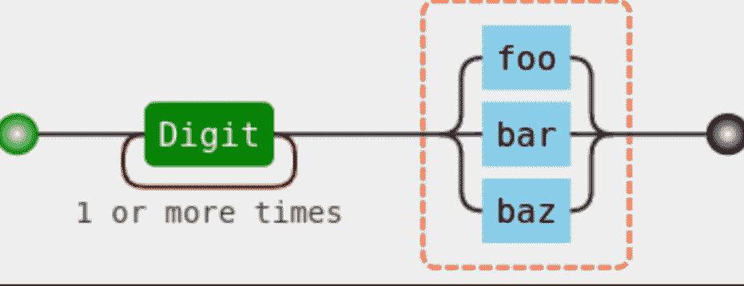
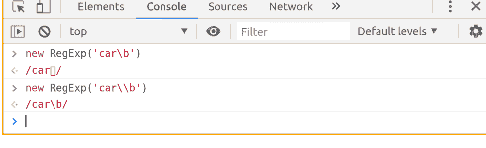
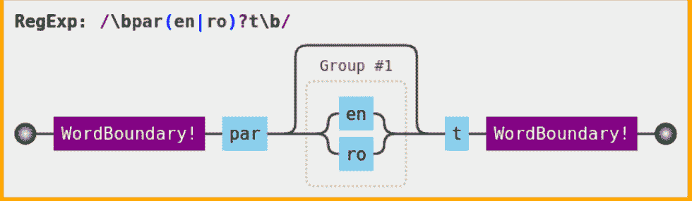

# JavaScript RegExp 示例指南

RegExp: `/\d+(?!foo|bar|baz)/i`

后后不跟随：



作者信息 . . . . . . . . . . . . . . . . . . . . . . 5

调试与可视化工具 30

## 环顾断言

## 前言

脚本和自动化任务通常需要从输入数据中提取特定的文本部分，或将其从一种格式转换为另一种格式。本书将帮助你学习 JavaScript 中实现的正则表达式。正则表达式本身可以被视为一种微型编程语言，非常适合各种文本处理需求。

本书大量依赖示例来逐一介绍正则表达式的特性。建议手动输入每个示例并进行实验。理解示例输入的性质以及产生的输出至关重要。作为类比，请想象在学习开车。

# RegExp 简介

本章将带你开始定义 `RegExp` 对象以及在字符串方法中使用它们。为了简单起见，示例将不会使用与正则表达式相关的特殊字符。重点将是让你熟悉语法和文本处理示例。本章将介绍两种方法：用于搜索输入是否包含字符串的 `test` 方法，以及用于将输入部分替换为其他内容的 `replace` 方法。

- 本书将交替使用 regular expressions（正则表达式）和 regex 术语。当特指 JavaScript 对象时，将使用 `RegExp`。

# Console（控制台）

如序言所述，书中展示的示例已在 Chrome/Chromium 控制台上测试过。Chromium 上的其他浏览器可能同样适用。从新标签页使用 `Ctrl+Shift+J` 快捷键打开控制台。由于不同图表之间的变量名可能相同，此时请打开另一个控制台。请参考 MDN: Regular Expressions 获取文档、示例和功能兼容性详情。

## test 方法

首先，设置一个简单的示例来测试一个字符串是否是另一个字符串的一部分。通常，你会使用 `includes` 方法并传递字符串作为参数。对于正则表达式，请对 `RegExp` 对象使用 `test` 方法，该对象由包含在 `//` 中的搜索字符串定义。

```javascript
> let sentence = 'This is a sample string'

// 检查 'sentence' 是否包含给定的字符串参数
> sentence.includes('is')
< true
> sentence.includes('z')
< false
```

```javascript
// 检查 'sentence' 是否匹配正则描述的模式
> /is/.test(sentence)
< true
> /z/.test(sentence)
< false
```

以下是在条件表达式中使用 `test` 方法的一些示例。

```javascript
> let report = 'string theory'

> if (/ring/.test(report)) {
    console.log('mission success')
}
> mission success
```

```javascript
> if (!/fire/.test(report)) {
  console.log('mission failed')
}
< mission failed
```

这里是一些数组处理的示例。

```javascript
> let words = ['cat', 'attempt', 'tattle']

// 获取所有包含 'tt' 的元素
> words.filter(w => /tt/.test(w))
< ['attempt', 'tattle']

// 检查是否所有元素都包含 'at'
> words.every(w => /at/.test(w))
< true

// 检查是否有任何元素包含 'stat'
> words.some(w => /stat/.test(w))
< false
```

## Flags（标志）

正则表达式的一些功能通过传递标志（用字母字符表示）来启用。如果你用过命令行，标志类似于命令行选项，例如 `grep -i` 将执行不区分大小写的匹配。

在本章中将讨论两个标志：

- 匹配字母时忽略大小写的标志（默认区分大小写）
- 匹配所有出现次数的标志（默认仅匹配第一个）

每个标志的示例下文所示，将在本章稍后后的 `replace` 方法中讨论。

```javascript
> /cat/.test('Cat')
< false
> /cat/i.test('Cat')
< true
```

```javascript
> ['Cat', 'cot', 'CATER', 'SCat', 'ScUTle'].filter(w => /cat/i.test(w))
< ['Cat', 'CATER', 'SCat']
```

## RegExp 构造函数与复用

`RegExp` 对象可以保存在变量中。这有助于提高代码清晰度、实现复用等。

```javascript
> const pet = /dog/
```

```javascript
> pet.test('They bought a dog')
> true
> pet.test('A cat crossed their path')
< false
```

`RegExp` 对象也可以使用 `RegExp()` 构造函数进行构建。第一个参数是字符串或 `RegExp` 对象。第二个参数用于指定一个或多个标志。

```javascript
> const pat = new RegExp('dog')
> pat
> /dog/
```

```javascript
// 如果需要标志，将其作为第二个参数指定
> new RegExp('dog', 'i')
> /dog/
```

构造函数相比于 `//` 字面量的主要优势是能够使用 `${}` 动态构建正则，插入其他变量的内容或表达式的结果。

```javascript
> let greeting = 'hi'
```

```javascript
> const pat1 = new RegExp(`${greeting} there`)
> pat1
> /hi there/
```

```javascript
> new RegExp(`${greeting.toUpperCase()} there`)
> /HI there/
```

> 字符串和 `RegExp` 对象都支持特殊序列。某些序列如 `\t` 和 `\n` 含义相同，但像 `\b` 的序列具有完全不同的含义。为了避免意外行为，请使用 `\\` 代替 `\`。

```javascript
> new RegExp('123\tabc')
> /123 abc/
```

```javascript
> new RegExp('123\\tabc')
> /123\tabc/
```

这是另一个示例的截图。



## replace 方法

`replace` 字符串方法用于搜索和替换操作。

```javascript
// 只更改第一个匹配项
> '1,2,3,4'.replace(/\,/, '-')
< '1-2,3,4'
```

```javascript
// 通过添加 'g' 标志更改所有匹配项
> '1,2,3,4'.replace(/\,/g, '-')
< '1-2-3-4'
```

（注：原文中关于 replace 方法的重复段落为 OCR 错误，已在翻译时进行逻辑清理。）

锚点可以单独作为模式使用。它们有助于在字符串的开头或结尾插入文本，模拟字符串拼接操作。这些功能看起来可能并不实用，但与其他正则表达式结合时，它们会变成非常实用的工具。

```javascript
> 'live'.replace(/^/, 're')
< 'relive'
> 'send'.replace(/^/, 're')
< 'resend'

> 'cat'.replace(/$/, 'er')
< 'cater'
> 'hack'.replace(/$/, 'er')
< 'hacker'
```

## 行锚点

字符串输入可能包含单行或多行。换行符 `\n` 被行分隔符。使用 `m` 标志后，`^` 和 `$` 锚点分别匹配任何行的开头结尾。

```javascript
// 检查字符串中是否有任何行以 'top' 开头
> /^top/m.test('hi hello\ntop spot')
< true

// 检查字符串中是否有任何行以 'er' 结尾
> /er$/m.test('spare\npar\nera\ndare')
< false

// 检查字符串中是否有任何行完全是 'par'
> /^par$/m.test('spare\npar\nera\ndare')
< true
```

就像锚点一样，你也可以单独使用锚点作为模式。

```javascript
> let items = 'catapults\nconcatenate\ncat'

> console.log(items.replace(/^/gm, '* '))
* catapults
* concatenate
* cat

> console.log(items.replace(/$/gm, '.'))
< catapults.
concatenate.
cat.
```

> 如果字符串末尾有换行符，在换行符之后还有一个额外的行开头/结尾匹配。

```javascript
// 'foo ' 被插入了三次
> '1\n2\n'.replace(/^/mg, 'foo ')
< "foo 1
foo 2
foo "
```

```javascript
> '1\n2\n'.replace(/$/mg, ' baz')
< '1 baz
2 baz
baz'
```

⚠️ 如果你在处理基于 Windows 系统的文本文件中的非行结束字符，你必须先将行结束转换为 `\n`。否则，你将获得针对 `\r` 和 `\n` 字符的行匹配。你也可以在正则表达式中处理此情况，通过使用 `\r` 作为可选的量词（参见贪婪量词章节）。

## 单词锚点

第三种限制是单词锚点。字母（不区分大小写）、数字和下划线字符属于单词字符。你可能会奇怪为什么也有数字和下划线而不是字母？这源于变量和函数的命名规范——通常允许字母、数字和下划线。因此，该定义更倾向于编程语言而非自然语言。

转义序列 `\b` 表示单词边界。它适用于单词的开头和结束锚定。单词开头意味着单词之前的字符是非单词字符或没有字符（字符串开始）。同样，单词结束意味着单词之后的字符是非单词字符或没有字符（字符串结束）。这意味着你不能在没有单词字符的情况下拥有单词边界 `\b`。

```javascript
> let sample = 'par spar spare part'
```

```javascript
// 无论 /par/ 出现在什么位置都替换
> sample.replace(/par/g, 'X')
< "X sx apX sXe Xt"
// 仅在单词开头替换 /par/
> sample.replace(/\bpar/g, 'X')
< "X spar apparent spare Xt"
// 仅在单词结尾替换 /par/
> sample.replace(/par\b/g, 'X')
< "X sx apparent spare part"
// 仅当 /par/ 不属于另一个单词的一部分时替换
> sample.replace(/\bpar\b/g, 'X')
< "X spar apparent spare part"
```

你可以将单词边界作为模式本身进行更有创意的用法。

```javascript
// sample = 'par spar spare part'
// 将空格分隔的单词转换为双引号分隔的 csv
// 注意这里使用了 'replace' 方法
> console.log(sample.replace(/\b/g, '"').replace(/ /g, ''))
< "par","spar","apparent","spare","part"
```

```javascript
// 仅用于编程语句目的，不适用于所有情况
> 'foo_baz=num1+35*42/num2'.replace(/\b/g, ' ')
< " foo_baz = num1 + 35 * 42 / num2 "
// 字符串开头/结尾的空格可以被裁剪
// 你将学习如何添加修饰符以使得不需要 trim
> 'foo_baz=num1+35*42/num2'.replace(/\b/g, ' ').trim()
< "foo_baz = num1 + 35 * 42 / num2"
```

单词边界也没有锚点属性。`\B` 在 `\b` 不匹配的地方任何匹配。这种二元性也存在于其他转义序列。负逻辑在许多文本处理场景中非常有用。但要小心它可能会触及你无意中触及的内容！

```javascript
// 如果 /par/ 不是单词开头则替换 'par'
> sample.replace(/\Bpar/, 'X')
< "par sx apent Sxe part"
// 在单词结尾替换 'par' 但不是整个单词 'par'
> sample.replace(/\Bpar\b/, 'X')
< "par sx apent spare part"
// 如果 /par/ 不是单词结尾则替换 'par'
> sample.replace(/par\B/, 'X')
< "par sx apent Sxe part"
// 如果 /par/ 被单词字符包围则替换 'par'
> sample.replace(/\Bpar\B/g, 'X')
< "par sx apent spare part"
```

这里是一些独立的模式用法，用于对比这两种锚点。

```javascript
> 'copper'.replace(/\b/g, ':')
< ":copper:"
> 'copper'.replace(/\B/g, ':')
< "c:o:p:p:e:r"
> '-----hello-----'.replace(/\b/g, ' ')
< "     hello ----"
> '------hello------'.replace(/\B/g, ' ')
< "      - h e l l o -      "
```

## 查表与总结

| Note | 说明 |
|---|---|
| ^ | 正则中具有特殊含义的字符将匹配限制在字符串开头 |
| $ | 将匹配限制在字符串结尾 |
| \n | 行分隔符，dos 风格文件可能需要特别注意 |
| m | 因为它们使用 \n 作为行 |
| \b | 作为开头/结尾 |
| \B | 在 \b 不匹配的地方任何匹配 |
| ^ | 正则中具有特殊含义的字符将匹配限制在字符串开头 |
| $ | 将匹配限制在字符串结尾 |
| \n | 行分隔符，dos 风格文件可能需要特别注意 |

```javascript
// 提取锚点
> 'par spare part party'.replace(/\b(par|part)\b/g, 'X')
> 'X spare party'
// 同样提取常用字符
// 你稍后会学习一种更好的技术，而不是使用空交替
> 'par spare part party'.replace(/\bpar(t|)\b/g, 'X')
> 'X spare party'
```

## 优先级规则

在使用选择分支（alternation）时，会有一些复杂的情况。如果它用于测试字符串输入的匹配以获取真/假布尔值，则没有歧义。然而，对于其他操作（例如不带 `g` 标志的字符串替换），取决于几个因素。例如，你想替换 `are` 或 `spared` —— 哪个应该优先？是更大的单词 `spared`，还是包含 `are` 的子字符串？

正则表达式重叠时，在输入字符串中最早匹配的项具有优先级。

```javascript
// let words = 'lion elephant are rope not'
// 对于给定的字符串，'on' 和 'ant' 的起始索引相同
// 所以无论交替顺序如何，'on' 都会被替换
> words.replace(/on|ant/, 'X')
< 'LIX elephant are rope not'
> words.replace(/ant|on/, 'X')
< 'LIX elephant are rope not'
```

那么，如果两个或多个分支在同一个索引上匹配会发生什么？优先级按照声明的顺序从左到右。

```javascript
// let mood = 'best years'
// 'year' 和 'years' 的起始索引始终相同
// 所以，哪个被选中取决于交替的顺序
> mood.replace(/year|years/, 'X')
< 'best X'
> mood.replace(/years|year/, 'X')
< 'best X'
```

另一个关于 `replace` 的示例以更清楚地说明这个问题。

```javascript
// let sample = 'ear xerox at mare part learn eye'
// 结果等同于：replace(/ar|are|art)/g, 'X')
> sample.replace(/ar|are|art/g, 'X')
< 'eX xerox at mX part leXn eye'
// 结果等同于：replace(/are|ar|art/g, 'X')
> sample.replace(/are|ar|art/g, 'X')
< 'eX xerox at mX PXe leXn eye'
// 呼，终于这个按预期工作了
```

## 快速查表与总结

| 注意事项 | 描述 |
| --- | --- |
| pat1\|pat2\|pat3 | 多个通过 OR 条件组合的正则表达式，每个备选方案都可以有独立的锚点 |
| () | 分组模式 |
| a(b\|c)d | 等同于 abd\|acd |
| 分支优先级 | 在输入中最早匹配的模式具有优先级；如果起始位置相同，则由从左到右的顺序决定胜负 |

所以，这一章是关于如何使用 `|` 元字符在同一个正则表达式中指定一个或多个交替匹配的。如果有共同点，可以使用 `{}` 分组进行进一步简化。在交替项中，最早匹配的模式具有优先级。如果多个匹配从相同位置开始，则使用从左到右的顺序作为决胜因素。在下一章中，你将学习如何从字符串数组构建交替项，并注意优先级规则。分组也有各种用途，将在后续章节中讨论。

## 练习

- a) 对于给定的输入列表，过滤所有以 `den` 开头或以 `ly` 结尾的元素

```javascript
> let al = ['lovely', '1\ndentity', '2 lonely', 'eden', 'fly away', 'dent']

> al.filter() // 在此处添加你的解决方案
< ["lovely", "2 lonely", "dent"]
```

- b) 对于给定的输入字符串，将所有的 `removed` 或 `reed` 或 `received` 或 `refused` 替换为 `X`。

```javascript
> let s1 = 'creed refuse removed read'
> let s2 = 'refused reed redo received'
> const pl = // 在此处添加你的解决方案
> s1.replace(pl1, 'X')
< "cX refuse X read"
> s2.replace(pl1, 'X')
> "X redo X"
```

- c) 对于给定的输入字符串，将 `late` 或 `later` 或 `slated` 替换为 `A`。

```javascript
> let str1 = 'plate full of slate'
> let str2 = 'slated for later, don't be late'
> const p2 = // 在此处添加你的解决方案
> str1.replace(p2, 'A')
< "pA full of sA"
> str2.replace(p2, 'A')
< "A for A, don't be"
```

## 转义元字符

你已经看到了一些有助于构建正则表达式字面量的元字符和转义序列。此外还有 `/` 字符被用作分隔符。本章将讨论如何移除此类构造的特殊含义。此外，你将学习在从普通字符串构建正则表达式时处理特殊字符。要字面地匹配元字符（即移除它们的特殊含义），请在它们前面加上 `\`。要表示字面量 `\`，使用 `\\`。

```javascript
// 尽管 ^ 没有用作锚点，但它不会被字面匹配
> /b/.test('a + b') < false
// 转义将生效
> /b/.test('a + b') < true

// 情况 1：替换所有匹配项
// 使用 'escapeExp' 转义元字符
// const pat = new RegExp(escapeExp(usr_str), 'g')
// pat
// /(a*b)/g
```

```javascript
// 情况 2：仅在字符串末尾替换
> pat.replace(new RegExp(usr_str) + '$'), 'c')
< "f"
```

## 动态构建交替

当你自己定义正则表达式时，可以手动转义元字符。然而，如果你有一个字符串数组并需要匹配它们，你需要在使用 `|` 组合之前转义它们。

```javascript
function unionExp(arr) {
  return arr.map(w => escapeRegex(w)).join('|')
}
```

这里是使用 `unionExp` 构建正则表达式的示例。在这里，交替顺序很重要。

```javascript
let w1 = ['c*', 'dog$', 'f']
const p1 = new RegExp(unionExp(w1), 'g')
< /c*$dog$|f/g
> 'c$ dog f'.replace(p1, 'mammal')
< 'mammal mammal'

// 这里交替规则需要先应用，假设需要匹配这些单词
let w2 = ['hand', 'handy', 'handful']
// 按长度排序
w2.sort((a,b) => b.length - a.length)
['handful', 'handy', 'hand']
const p2 = new RegExp(`${unionExp(w2)}`, 'g')
> p2
< /handful|handy|hand/g
// 注意 'hands' 和 'handed' 没有被替换
// 'handful hands hand'.replace(p2, 'X')
< X hands X
```

如果你需要正则表达式对象的内容，可以使用 `source` 和 `flags` 属性分别获取模式字符串和标志。这些方法将帮助你使用另一个正则表达式的内容来构建正则表达式。

```javascript
const p3 = /\b/

> const p4 = new RegExp(p3.source + '|cat', 'g')
> p4
< /\b|cat/g
> console.log(p4.source)
< \b|cat
> p4.flags
> "g"
```

```javascript
> 'cater cat concatenate far spare'.replace(p4, 'X')
> "Xer X Xenate X spare"
```

## 练习

a) 使用两个字符串相同的逻辑将给定的输入字符串转换为预期的输出。

```javascript
let str1 = '(9-2)*5+qty/3'
let str2 = '(qty+4)/2-(9-2)*5+pq/4'
const p1 = // 在此处添加你的解决方案
str1.replace(p1, '35')
// '35qty/3'
str2.replace(p1, '35')
// "(qty+4)/2-35+pq/4"
```

b) 对于给定的字符串，将数组中的任何匹配项替换为 X。

```javascript
let items = ['a.b', '3n+', '\y\z', 'qty||price', '{n}']
const p2 = // 在此处添加你的解决方案
'0a.bc'.replace(p2, 'X')
// "0Xc"
'E{n}AMPLE'.replace(p2, 'X')
// "EXAMPLE"
'43+n2 ax\y\ze'.replace(p2, 'X')
// "4X2 aXe"
```

## 点的元字符和量词

本章介绍了更多几个元字符。与重复字符串的方法类似，量词允许重复正则表达式模式的局部，从而使其更加紧凑并提高可读性。量词还可以指定为有界和无界范围，以匹配不同数量的模式。之前，你使用选择分支来构建 OR 条件。在加入点元字符和量词后，你就可以构建 AND 条件了。

## 点的元字符

点元字符作为占位符，匹配除 `\r` 和 `\n` 之外的任何字符。`s` 标志部分将展示如何包含这些字符。

```javascript
// 匹配 'c'、任意字符然后是字符 't'
'tac cat abc;tuv acute'.replace(/c.t/g, 'X')
// "taxin X abuv axe"
```

```javascript
// 匹配 'r'、任意两个字符然后是字符 'd'
'bread markedly reported overrides'.replace(/r..d/g, 'X')
// "bth maxly repo ovexes"
```

```javascript
// 匹配 '2'、任意字符然后是字符 '3'
'42t33'.replace(/2./g, '8')
// "483"
```

## 贪婪量词

量词帮助你重复正则的一部分。它们可以应用于字面字符、分组以及你将学习的特性。除了指定精确的数量和有界范围外，这些还可以匹配无界的变数量。如果输入字符串可以通过多种方式以不同的数量满足模式，你可以从两种类型的贪婪量词中选择（本文将涵盖）。

首先，`?` 元字符将任何字符或组量化为匹配 0 次或 1 次。这有助于定义最优模式并构建简洁的正则。

```javascript
// 如： /ear/g
'far feat fear'.replace(/e?ar/g, 'X')
// "FX feat flxe fx*"
```

```javascript
// 如： /bbar(t|)\b/
'spare part party'.replace(/\bpart?/g, 'X')
// "X spare party"
```

```javascript
// 如： /red|dev|\b/
['red', 'ready', 'redo', 'reed'].filter(w => /bre??d\b/.test(w))
// ["red", "red", "reed"]
```

```javascript
// 等于 /part|parrot/g
'par part parrot parent'.replace(/par(ro)?t/g, 'X')
// "par X parent"
// 等于 /part|parrot/g
'par part parrot parent'.replace(/par(en)?t/g, 'X')
// "par X X"
```

`*` 元字符将字符或组量化为匹配 0 次或多次。它没有上界，更多细节将在本节稍后讨论。

```javascript
// 匹配 't' 后跟零个或多个 'a' 然后是 'r'
'tr tear tear steer sitara'.replace(/ta*r/g, 'X')
// "X X Xe steer siX"
```

```javascript
// 匹配 't' 后跟零个或多个 'e' 或 'a' 然后是 'r'
'tr tear tear steer sitara'.replace(/t(e|a)*r/g, 'X')
// "X X Xe siX"
```

```javascript
// 匹配 '2'、任意字符然后是字符 '3'
'42t33'.replace(/2./g, '8')
// "483"
```

```javascript
// 匹配零个或多个 '1' 后跟 '2'
'3111111125'.replace(/1*2/g, 'X')
// "3X511142"
```

`split` 方法根据模式分离字符串并返回字符串数组。如果你也需要根据模式分离字符串，可以使用非捕获组。

```javascript
// 最后一个元素是空的，因为字符串末尾的 '2' 之后没有任何内容
'3111111125'.split(/1*/)
// ["3", "5", "2"]
```

```javascript
// 注意 '2' 和 '4' 是如何分割的，它们之间有一个 '1'
'3111111125'.split(/1+/)
// ["3", "5", "42"]
```

`+` 元字符将字符或组量化为匹配 1 次或多次。为了量化，没有上界。重要的是，它没有空字符串。

```javascript
'tr tear steer sitara'.replace(/ta+r/g, 'X')
// "tr X siX"
'tr tear steer sitara'.replace(/t(e|a)+r/g, 'X')
// "tr X siX"
```

```javascript
'3111111125'.replace(/1+/g, 'X')
// "3X511142"
'311111125'.split(/1+/)
// ["3", "42"]
```

你可以使用 `{}` 指定有界和无界的范围。下面列出了三种用法：

| 模式 | 描述 |
|---|---|
| {m,n} | 匹配 m 到 n 次 |
| {m,} | 至少匹配 m 次 |
| {n} | 精确匹配 n 次 |

```javascript
let demo = ['abc', 'ac', 'abbc', 'xabbcz', 'bc', 'abbbc']
demo.filter(w => /ab{2}c/.test(w))
// ["abc", "ac", "abbc"]
demo.filter(w => /ab{3}c/.test(w))
// ["xabbcz", "abbbc"]
```

所以，这些贪婪量词是如何匹配的？当你使用 `?` 时，JavaScript 决定匹配 0 次还是 1 次，如果两者都满足正则？例如 `'foot'.replace(/f.o/, 'X')` — 应该替换还是不？因为有贪婪量词。

```javascript
'foot'.replace(/f.?o/, 'X')
// 'Xt'
```

```javascript
// 一个更实用的例子
// 如果没有前缀 \，则加上 \
console.log('blah foo baz'.replace(/^?/, '\\'))
// "blah foo baz"
// 说再 /handful|hand
' handy handful'.replace(/hand(y|ful)?/g, 'X')
// X X
```

但是，`/Error.*valid` 示例是如何工作的？`.*` 不应该消耗掉 `Error` 之后的所有字符吗？很好的问题。原因是正则失败了，它从字符串末尾回溯一个字符再次检查正则是否满足。在正则表达式中，这会重复直到找到匹配或确认失败。在正则表达式中这被称为回溯。

```javascript
let sentence = 'that is quite a fabricated tale'
```

```javascript
// t.* 将从 't' 匹配到 'a'
sentence.replace(/t.*a/, 'X')
// "Xt is quite a fabricated tale"
'star'.replace(/.*a/, 'X')
// "Sxr"
```

## 非贪婪量词

顾名，这些量词将尽可能少地匹配。称为懒量词。在量词后添加 `?` 使它们变为非贪婪。

```javascript
'foot'.replace(/f.??o/, 'X')
// 'fot'
```

```javascript
'frost'.replace(/f.?o/, 'X')
// 'Xst'
```

```javascript
'123456789'.replace(/.{2,5}?/, 'X')
// '12345X789'
```

像贪婪量词一样，懒量词会尝试满足整体。

```javascript
// sentence = 'that is quite a fabricated tale'
// .*a 将从第一个 't' 匹配到 'a'
sentence.replace(/.*?a/, 'X')
// "that is quite a fabricated tale"
```

```javascript
let demo = ['abc', 'ac', 'abbc', 'xabbcz', 'bc', 'abbbc']
demo.filter(w => /ab.*?c/.test(w))
// ["abc", "abbc", "xabbcz"]
demo.filter(w => /ab{2}/.test(w))
// ["abc", "ac", "abbc"]
```

```javascript
demo.filter(w => /ab{3}c/.test(w))
// ["xabbcz", "abbbc"]
```

## s 标志允许

使用 `s` 标志允许 `.` 匹配 `\r` 和 `\n` 字符。

```javascript
// 默认，.不匹配换行符
'Hi there\nHave a Nice Day'.replace(/the.*/, 'X')
// "Hi there\nX Day"
// s 标志将允许匹配换行符
'Hi there\nHave a Nice Day'.replace(/the.*/s, 'X')
// "Hi X"
```

## 调试和可视化工具

当你的正则变得复杂时，如果遇到问题，可能很难调试。逐步构建正则并对输入字符串进行测试将有助于解决问题。为了辅助这种过程，你可以使用各种在线正则工具。regex101 是一个测试正则的流行网站。你首先选择语言为 JavaScript。然后输入你的输入字符串以及可选的替换字符串。匹配部分将被高亮，并在单独的窗口中提供解释。还有关于分享、生成器和退出等功能的参考。

| 正则表达式 | 3 次匹配 (~1ms) | 解释 |
|---|---|---|
| ab[0,2]c | g | /ab[0,2]/g 匹配字符 a（敏感） |
| | | 匹配字符 b（敏感） |
| | | {0,2} 量词 - 匹配 0 到2 次，尽可能多次，在需要时回溯 {0,2} |
| | | c匹配字符 c（敏感） |
| 测试字符串 | 切换到单元测试 > | |
| abc ac xabbcz bc abc abbbbc | | 全局模式标志修饰符:global. 所有匹配（在返回第一个匹配后不再返回） |

另一个实用的工具是 jex: regex，它可以将你的正则表达式转换为轨道图（rail road diagram），为理解模式提供视觉辅助。



## 快速参考与总结

| 笔记 | 说明 |
| --- | --- |
| . | 匹配除 `\r` 和 `\n` 以外的任意字符 |
| s | 标记，允许元字符匹配 `\r` 和 `\n` 字符 |
| greedy | 尽可能匹配 |
| ? | 贪婪量词：匹配 0 次或 1 次 |
| + | 贪婪量词：匹配 1 次或多次 |
| * | 贪婪量词：匹配 0 次或多次 |
| {m,n} | 贪婪量词：匹配 m 到 n 次 |
| {m,} | 贪婪量词：匹配至少 m 次 |
| {n} | 贪婪量词：精确匹配 n 次 |
| pat1.*pat2 | pat1 和 pat2 之间的任意数量字符 |
| pat1.pat2.*pat1 | 以任意顺序匹配 pat1 和 pat2 |
| non-greedy | 在贪婪量词后添加 ? 以变为非贪婪 |
| s.split(/pat/) | 根据正则表达式拆分字符串，可以使用 regex101 和 jex: regex 等工具 |

本章引入了使用占位符代替固定字符串的概念。结合量词，你已经领略了简单的正则表达式如何匹配广泛的文本。如果正则表达式变得过于复杂，可以在各种在线正则表达式工具的帮助下进行调试。在接下来的章节中，你将学习如何创建自己的受限占位符字符集。

## 练习题

- * 部分练习题刻意设计得复杂，仅靠正则表达式很难解决。尝试使用普通的字符串方法、将问题分解为多个步骤等。通过后续章节介绍的技术，某些练习题将变得更容易解决。在完成整本书后再次过一遍这些练习也将大有裨益。

### a) 使用正则表达式为给字符串获取所示的输出。

```javascript
> let eqn1 = 'a42//5-c'
> let eqn2 = 'pressure*342/5-14256'
> let eqn3 = 'r42-5/3+42//5-42/53+a'
> const expr = // 在此处添加你的解决方案
> eqn1 = // 在此处添加你的解决方案
< ["a*", "-c"]
> eqn2 = // 在此处添加你的解决方案
< ["pressure*3+", "-14256"]
> eqn3 = // 在此处添加你的解决方案
< ["r42-5/3+42//-5a-", "3a"]
```

### b) 针对给定的字符串，重构正则表达式以获取所示的输出。

```javascript
> let str1 = '*a+b(addition)'
> let str2 = 'a/b(division) + c%d#(module)'
> let str3 = 'Hi there(greeting). Nice day(a)b'
> const remove_parentheses = // 在此处添加你的解决方案
> str1.replace(remove_parentheses, '')
< "a+b"
> str2.replace(remove_parentheses, '')
< "a/b + c%d"
> str3.replace(remove_parentheses, '')
< "Hi there. Nice day"
```

### c) 删除此 csv 字符串中所有字段的前后空格。

```javascript
> let csv1 = 'comma ,separated ,values '
> let csv2 = 'good_bad,ice , 42 , , stall small'
> csv1 = // 在此处添加你的解决方案
< "comma,separated,values"
> csv2 = // 在此处添加你的解决方案
< "good_bad,ice,42,,stall small"
```

### d) 修正给定的正则以获得预期输出。

```javascript
> let str4 = 'plinking tint winter in caut sentient'
// 错误输出
> const pati = /int|in|on||ing|inco|inter|ink/g
> str4.replace(pati, 'X')
"plXk XcXomXg tx wXer X caut sentient"
// 预期输出
> const pat2 = // 在此处添加你的解决方案
> str4.replace(pat2, 'X')
"plX mX TX wX X cautX sentient"
```

### e) 对于贪婪量词，使用 {m,n} 表示的等效形式是什么？

- * 等同于
- ? 等同于
- + 等同于

### f) (a*) 等同于 (a|b)* —— 正确还是错误？

### g) 如果字符串位于行首，则从此处开始删除，直到行尾的下一次字符串出现。不区分大小写匹配关键词。

```javascript
> let para = 'good start
start working on that
project you always wanted
to, do not let it end
hi there
start and end the end
42
Start and try to
finish the End
bye'
```

```javascript
> const pat3 = // 在此处添加你的解决方案
> console.log(para.replace(pat3, ''))
< good start

hi there
42
bye
```

## 处理匹配部分

在看到了一些可以匹配不同文本的正则 功能后，你将在本章中学习如何提取并处理匹配部分。

## match 方法

match 方法有多种方式使用。当不使用 g 标记且正则表达式成功时，你将得到一个包含第一个匹配项详情的数组。

## 在替换部分使用函数

有时候，简单的替换是不够的，你可能需要对匹配部分进行某些处理。对于此类情况，你可以在替换部分使用函数。函数可用的参数与 `match` 方法提供的细节相似。第一个参数是匹配到的部分。如果使用了捕获组，后续将是按分组的部分。根据复杂程度，你可以使用完全定义的函数或箭头表达式。

```javascript
function titleCase(m) {
  return m[0].toUpperCase() + m.substr(1).toLowerCase()
}
```

// 第二种情况下，只需要函数名就足够了
// 匹配部分的细节将自动传递给函数
// 在此示例中，'titleCase' 只使用了匹配到的部分

```javascript
'aBc Ac DC abcBC'.replace(/.*?c/ig, titleCase)
< "Ac Ac Abbc"
```

// 简单的情况也可以使用箭头函数表达式

```javascript
'abc ac abcbc'.replace(/ab*c/g, m => m.toUpperCase())
< "ABC AC ABCBC"
```

// ld 将在后文中介绍
// 目前，知道它会匹配所有数字就足够了

```javascript
'1 42 317'.replace(/\d+/g, m => m*2)
< "2 84 634"
```

这是一个带有捕获组的示例。更多细节请参阅 MDN 的 `replace` 方法。

```javascript
function titleCase(m, g1, g2) {
  return g1.toUpperCase() + g2.toLowerCase()
}
```

```javascript
'aBc Ac DC abcBC'.replace(/((a)(.*?))/ig, titleCase)
< "Ac Ac Abbc"
```

## 在替换部分使用字典

有时候，你在替换部分需要的功能可以简化为使用字典。匹配部分作为键（key），从字典中获取对应的值。

// 一一映射

```javascript
let h = {'1': 'one', '2': 'two', '4': 'four'}
```

```javascript
'9234012'.replace(/1|2|4/g, k => h[k])
< "9two3four0onetwo"
```

// 如果匹配的文本作为键不存在，则提供一个默认值

```javascript
'9234012'.replace(/\d/g, k => k in h ? h[k] : 'X')
< "XtwoXfourXoneto"
```

在不使用中间结果的情况下交换两个或多个字符串，推荐使用字典。

```javascript
> let swap = { 'cat': 'tiger', 'tiger': 'cat' }
```

```javascript
> 'cat tiger dog tiger cat'.replace(/cat|tiger/g, k => swap[k])
< "tiger cat dog cat tiger"
```

对于具有许多条目且开发过程中会变化的列表，构建变更列表通常不是一个好选择。此外，请记住，根据优先级规则，最长的字符串应该放在前面。在动态构建变更部分中引入的 `unionRegExp` 函数在这里很有帮助。

```javascript
> let d = { 'hand': 1, 'handy': 2, 'handful': 3 }
```

```javascript
> const p = unionExp(Object.keys(d).sort((a, b) => b.length - a.length))
> console.log(p)
< handful|hand
> 'handful hand handy'.replace(new RegExp(p, 'g'), k => d[k])
< "3 1 2"
```

## 查表与总结

| 注意事项 | 说明 |
|---|---|
| m = s.match(/pat/) | 假设没有 g 标志且成功，返回一个包含匹配部分和 3 个属性的数组：index 提供匹配的起始位置，input 提供原始字符串 s，groups 提供命名捕获组的字典；对于上述情况，给出整个匹配部分 |
| m[0] | 整个匹配部分 |
| m[1] | 第一个捕获组的匹配部分 |
| m[2] | 第二个捕获组的匹配部分，以此类推 |
| s.match(/pat/g) | 仅返回匹配部分，没有属性；捕获组不影响匹配；如果正则失败则返回 null |
| s.matchAll(/pat/g) | 返回一个包含每个匹配部分及其属性的迭代器；使用 [...] 或 Array.from 转换为数组；Array.from 同样允许映射函数 |
| s.replace(/pat/, func) | 可以使用函数提供替换字符串；每个匹配部分都作为参数传递；类似地，字典可以用于替换 |
| s.search(/pat/) | 给出匹配的起始位置；如果正则失败则返回 -1 |

本章介绍了 `match` 和 `matchAll` 方法，它们允许你处理输入字符串的各种匹配部分。`replace` 方法允许你使用函数作为替换，这有助于在将匹配部分作为替换字符串之前对其处理。你还可以使用字典根据匹配部分作为键来提供替换字符串。你学习了捕获组，在后续章节中将看到更多分组的用法。

## 练习

a) 对于给定的字符串，从第一个到最后一个提取匹配部分 t

```javascript
> let str1 = 'What is the biggest fruit you have seen?'
> let str2 = 'Your mission is to read and practice consistently'
> const pl = // 在处添加你的解决方案
> str1.match() // 在处添加你的解决方案
> "is the biggest fruit"
> str2.match() // 在处添加你的解决方案
> "ission is to read and practice consistent"
```

b) 将给定的输入字符串转换为所示的预期输出。

```javascript
> let row1 = '-2,5, 4+3 +42,-53 '
> let row2 = '1.32, -3.14 634,5.63 '
> Array.from(row1) // 在处添加你的解决方案
< [3, 7, -11]
> Array.from(row2) // 在处添加你的解决方案
< [-1.82, 639.63]
```

c) 编写一个字符串函数，使输入交替大小。第一个字母应改为小写，下一个改为大写，以此类推。非字母字符应保持原样且不影响更改。

```javascript
> function altRNaTeCase(ip) {
  // 在处添加你的解决方案
}
> altRNaTeCase('HI THERE!')
< 'hI ThReE!'
> altRNaTeCase('good morning')
< 'gOoD mOrNiG'
> altRNaTeCase('Sample123string42with777numbers')
< 'sAmPle123s42wi777numbers'
```

d) 将 par 替换为 par，将 spare 替换为 extra，将 park 替换为 garden

```javascript
> let str3 = 'apartment a park'
> let str4 = 'do you have a spare'
> let str5 = 'write a parser'
> let d1 = // 在处添加解决方案
> const p2 = // 在处添加解决方案
> str3.replace(p2, k => d1)
< "aspartment a garden"
> str4.replace(p2, k => d1)
< "do you have a cable"
> str5.replace(p2, k => d1)
< "write a parser"
```

## 字符类

本章将讨论如何使用各种元字符匹配有限字符集。你还将学习预定义集合的转义序列。

## 自定义集合

包含在 `[]` 内部的字符将导致匹配其中的任何一个字符。这类似于使用单次分支，但没有捕获组的额外影响。此外，字符类有它们自己的元字符版本，并为常见用例提供了集合。量词适用于字符类，如：

```javascript
// 包含在 [] 内部的字符
```

## 字符类元字符

字符类可以简洁地定义集合。在字符类之外，如 `$` 等没有特殊含义。首先，`-` 有助于定义范围而不是逐个定义。

```javascript
// 10 到 29 之间的数字
> '23 154 12 26 9824'.match(/[12][0-9]{2}/) // 修正：此处示例逻辑应 
```

```javascript
// 数字 >= 100
> '23 154 12 26 9824'.match(/[0-9]{3}/g)
``` 

```javascript
// 如果有前导零，数字 >= 100
> '0501 035 154 12 26 9824'.match(/[1-9][0-9]{2}/g) 
```

`^` 元字符表示类的第一个字符。它反转了集合，所有其他指定的字符都将被匹配。

```javascript
// 所有非数字
> 'Sample123string4with777numbers'.match(/[^0-9]+/g)
```

```javascript
// 从分隔符开始删除字符
> 'foo=42;baz=123'.replace(/^[^=]+/, '')
< ["=42", "baz=123"]
> 'foo:42;baz=123'.replace(/^([^:]+:){2}/, '') // 修正：正则逻辑
```

```javascript
// 在分隔符结尾删除字符
> 'foo=42;baz=123'.replace(/[^=]+$/, '')
< ["foo=42", "baz"]
```

正如前面强调的，要小心处理否定逻辑，因为你可能会匹配到你想要的更多内容。有时，使用正向字符类比使用反向字符类更简单。

```javascript
let words = ['tryst', "fun", "glyph", "pity", "why"]
```

```javascript
> words.filter(w => /[aeiou]+$/.test(w))
< ["tryst", "glyph", "why"]
> words.filter(w => !/[aeiou]+$/.test(w))
< ["tryst", "glyph", "why"]
```

*(注：由于原文中部分正则表达式示例代码似乎存在逻辑错误或笔误（如 `\^` 或未闭合的括号），在翻译时保持了原文的结构，仅对描述文字进行了翻译。)*

与其它元字符类似，在字符类元字符前加上反斜杠 `\` 可以对其进行字面匹配。某些字符也可以通过不同的位置来实现。

```javascript
// - 应该是第一个或最后一个字符，或者进行转义 \
> 'ab-cd gh-c 12-423'.match(/\b[a-z]{2,}\b/g)
< "ab-cd", "gh-c"
> 'ab-cd gh-c 12-423'.match(/\b[a-z\-0-9]{2,}\b/g)
< "ab-cd", "gh-c", "12-423"
// ^ 应该不是第一个字符，或者进行转义 \
> 'f*(a*b) 3*(a+b)'.match(/[^*]+/g)
< "a*b", "a+b"
> 'f*(a*b) 3*(a+b)'.match(/([\^]+)/g)
< "a*b", "a+b"
// [ 不需要转义，但如果你愿意也可以转义 \
// ] 应该使用 \ 进行转义
> 'words[5]=tea'.match(/[a-z\]0-9]+/)[0]
< "words[5]"
> console.log('5ba\abc2'.match(/[\a\b]+/)[0])
< ba\bab
```

# 转义序列字符集

常用的集合有定义好的转义序列：

- `\w` 类似于 `[A-Za-z0-9_]`，用于匹配单词字符（回想一下单词边界的定义）
- `\d` 类似于 `[0-9]`，用于匹配数字字符
- `\s` 类似于 `[\t\r\n\f\v]`，用于匹配空白字符

这些转义序列既可以作为独立序列使用，也可以在字符类内部使用。如前所述，表达式和描述将假设输入由 ASCII 字符组成。分别使用 `\W`、`\D` 和 `\S` 来表示它们的反向集合（否定）。

```javascript
> 'Sample123string42with777numbers'.split(/\d+/)
< "Sample", "string", "with", "numbers"
> 'sea eat rat eel tea'.match(/\b\w+\b/g).join('')
< "secret"
> 'tea sea-pit sit-lean bean'.match(/([\w-]+)/g)
< "sea", "pit sit", "lean bean"
> 'Sample123string42with777numbers'.replace(/\D+/g, '-')
< "-123-472-777"
> '1..3 \f foo baz 42tzzz \r\n1-2-3 '.match(/\S+/g)
< ["1..3", "foo-baz", "42", "zzz", "1-2-3"]
```

## 查表与总结

| 注意 | 描述 |
| --- | --- |
| [ae;o] | 匹配这些字符中的任意一个，量词也适用于字符类 |
| [3-7] | 从 3 到 7 的字符范围 |
| [=b2] | 否定集合，匹配除 = 或 b 或 2 以外的字符 |
| \- | 用于字面匹配 - |
| [a-z] | 应该是第一个/最后一个或进行转义 \ |
| [+] | 不应该是第一个字符或进行转义 \ |
| [\] | 应该进行转义 \ |
| \w | 类似于 [A-Za-z0-9_] 用于匹配单词字符 |
| \W | 类似于 [^A-Za-z0-9_] 用于匹配非单词字符 |
| \d | 类似于 [0-9] 用于匹配数字字符 |
| \D | 类似于 [^0-9] 用于匹配非数字字符 |
| \s | 类似于 [\t\r\f\v] 用于匹配空白字符 |
| \S | 类似于 [^\t\r\f\v] 用于匹配非空白字符 |

本章重点关注如何为有限字符集创建占位符。分组和字符类可以被视为两种抽象。一方面，你可以在 `[]` 内部包含字符；另一方面，你可以在 `()` 内部包含多个交替，包括字符类。由于锚点和量词适用于这两种抽象，你可以开始看到正则表达式如何被视为微编程语言。在接下来的章节中，你甚至会看到如何在特定场景下进行类似于否定字符类的分组否定。

## 练习题

- a) 删除所有括号，除非它们包含括号字符。

```javascript
let str1 = 'def factorial()'
let str2 = 'a/b(division) + c%d(#modulo) - (e+(j/k-3)*4)'
let str3 = 'HI there(greeting). Nice day(a)'
```

```javascript
const remove_parentheses = // 在此处添加你的解决方案
str1.replace(remove_parentheses, '')
<def factorial()
str2.replace(remove_parentheses, '')
<a/b + cd - (e+4)>
str3.replace(remove_parentheses, '')
'HI there. Nice day(a)'
```

- b) 根据输入字符串是否包含任何大于 624 的数字序列输出 true/false。

```javascript
let n1 = 'hi0000432abcd'
let n2 = '42_624_0512'
let n3 = '31.94 26 2 foo1234baz'
```

```javascript
> n1.match()    // 在此处添加你的解决方案
> false
> n2.match()    // 在此处添加你的解决方案
> false
> n3.match()    // 在此处添加你的解决方案
> true
```

- c) 根据连续的数字或空白字符分割给定的字符串。

```javascript
let s1 = '\f Ink32onion'
let s2 = '***7star'
const p1 =    // 在此处添加你的解决方案
> s1.split(p1)
< ["Lion", "onion"]
> s2.split(p1)
< ["***", "star"]
```

- d) 十六进制序列，带有可选前缀。不敏感地匹配，单词字符周围的序列不应匹配。

```javascript
const hex_seq =    // 在此处添加你的解决方案
> '128a 0fe32 34'.match(hex_seq)
< ["128", "0fe32", "34"]
> '0EEF lace bad'.match(hex_seq)
< ["0EEF", "bad"]
```

- e) 对于给定字符串，将所有单词包裹在 {} 中，除了整个单词。

```javascript
let w1 = 'part; cat {super} rest_42'
> w1.replace()    // 在此处添加你的解决方案
< "{part}; cat {super} rest_42}"
```

# 分组与反向引用

你已经听过更多关于分组的精彩内容。好了，它们以各种形式出现。

## 反向引用

首先，如何在正则表达式定义和替换部分直接引用捕获部分。你已经见过如何通过 `match` 方法引用捕获组。更直接地，你可以使用 `\N`（在正则定义中）和 `$N`（替换部分），其中 N 是你想要的组。有了这些，你也可以在正则中使用量词应用于反向引用。下面列出了所有形式：

- 在替换部分中，`$1`、`$2` 等引用对应的组
- 在替换部分中，`$&` 引用整个匹配部分
- `` $` `` 位于匹配部分之前
- `$'` 位于匹配部分之后
- 在正则定义中，`\1`、`\2` 等引用对应的组

```javascript
// 移除包裹数字的括号
> '[52] apples and mangoes'.replace(/\((\d+)\)/g, '$1')
```

```javascript
// 如果单独替换
> 'foo_123 baz_'.replace(/(.*?)/, '$1')
< 'foo_123 baz_'
```

```javascript
// 用逗号分割的单词
> 'good,bad 42,24'.replace(/(\w+),(\w+)/, '$2,$1')
< 'bad 24,42'
```

这里是在没有捕获组的情况下使用反向引用示例：

```javascript
// 复制第一个字段并作为最后一个字段
> 'fork,42,nice,3.14'.replace(/.+/, '$&,$&')
< 'fork,42,nice,3.14,fork'
```

这里是在正则定义中使用反向引用的一些示例：

```javascript
// 至少有一个连续重复字符的元素
let words = ['mono', 'excellent', 'poll']
words.filter(w => /(\w)\1/.test(w))
< ["excellent", "poll"]
```

```javascript
// 移除由空格分割的连续重复单词
// 注意反向引用上量词的使用
> 'aa a a 42 f_1 f_1 13.14'.replace(/\b(\w+)(\s+\1)+\b/g, '$1')
< 'aa a a 42 f_1 f_1 13.14'
```

## 反向引用的特殊情况

由于 `$` 在替换部分是特殊的，因此在字面放置后面跟随数字时会出现问题。通常使用转义来达到这种目的，但这里你需要使用 `$$`。

```javascript
// 没有捕获组，所以 '$1' 被字面插入
> 'cat'.replace(/a/, '$1')
< "c$1"
// 有捕获组，'$1' 在这里同于 '$1'
> 'cat'.replace(/(a)/, '$1')
< "c(a)"
```

```javascript
// 使用 '$$1' 避免反向引用并字面插入 '$1'
> 'cat'.replace(/(a)/, '$$1')
< "c$1"
```

另一个问题是在普通字符紧跟反向引用时如何避免歧义？这取决于模式中存在多少反向引用，以及你是否需要在正则定义或替换部分避免歧义。例如，如果组少于 10 个，类似 `$12` 的将引用第 1 个捕获组并将 2 作为一个字符。如果没有捕获组，那么像 `$5` 的内容将字面插入为 `$` 和 5。

另一方面，如果你有超过 9 个但少于 100 个组，如果你想引用单个数字后跟字面字符，就会出现问题。解决方法是前缀加 0，使得位数等于最高捕获组的位数。所以，如果你有超过 9 个但少于 100 个组，`$05` 将引用第 5 个捕获组，随后的任何数字都将被字面处理。

```javascript
// 为了说明目的，12 个捕获组，每个 2 位数的组，没有问题
> 'abcdefghijklmn'.replace(/(.)(.)(.)(.)(.)(.)(.)(.)(.)(.)(.)(.)/, '$11')
< "kmn"
```

```javascript
// 如果你想引用 1 个单组并后跟 '1' 作为字符？
// 使用 \x31 不起作用，因为它仍然导致结果为 $11
> 'abcdefghijklmn'.replace(/(.)(.)(.)(.)(.)(.)(.)(.)(.)(.)(.)(.)/, '$1\x31')
< "kmn"
```

在正则表达式定义中，解决方法更简单。`\0` 前缀技巧无效，但使用带有 `\xhh` 的 ASCII 码有效。例如，`\1\x31` 将指向第 1 个捕获组后跟一个字符 `1`。

```javascript
> 'abcdefghijklmnld'.replace(/(\w)(\w)(\w)(\w)(\w)(\w)(\w)(\w)(\w)(\w)(\w)(\w)/, '\1\x31')
 < 'Xd'
```

## 非捕获分组

分组有许多用途，例如对正则表达式的一个部分应用操作、通过提取公共部分来创建简洁的表达式等。它也会影响 `split` 方法的输出。

```javascript
// 不使用捕获组
> 'Sample123string42with77numbers'.split(/\d+/)
< ["Sample", "string", "with", "numbers"]
```

```javascript
// 使用捕获组包含被拆分的部分
> 'Sample123string42with77numbers'.split(/(\d+)/)
< ["Sample", "123", "string", "42", "with", "777", "numbers"]
```


# 正则表达式分组与断言进阶

## 非捕获分组

当不需要反向引用时，可以使用非捕获分组来避免 `split` 方法发生变化。当某个特定组不需要反向引用时，这也有助于跟踪捕获组。语法是使用 `(?:)` 来定义模式。稍后将讨论更多以 `(?:)` 语法开头的特殊分组。

```javascript
// 在这里，需要分组来提取公共部分并应用量化符号
// 但使用捕获组的输出将不是符合预期的结果
> '123hand42hand777hand150'.split(/(hand(y|ful)?)/)
< ["123", undefined, "42", "y", "777", "ful", "150"]
```

```javascript
// 使用非捕获分组保留剩余部分
> '123hand42hand777hand150'.split(/(?:y|ful)?/)
< ["123hand", "42hand", "777hand1100"]
```

```javascript
// 使用普通分组，以跟踪所有的组
> '1,2,3,4,5,6,7'.replace(/([^,]+),([^,]+)/, '$1($2)')
< ["1(2),3(4),5,67"]
```

```javascript
// 使用非捕获分组，仅需跟踪相关的组
> '1,2,3,4,5,6,7'.replace(/((?:[^,]+)),([^,]+)/, '$1($2)')
< ["1(2),3(4),5,67"]
```

引用带有量化符号的捕获组匹配的文本只会给出最后一个匹配项，而不是整个匹配项。在分组和量化符号周围使用捕获组来获取整个匹配部分。在这种情况下，内部分组是使用非捕获分组的理想候选者。

```javascript
// 这里的 '$1' 只包含第四个字段
> 'so:cat:rest:in:put:to'.replace(/([^:]+){4}/, '$1')
< "(in):put:to"

// '$1' 现在将包含匹配部分
> 'so:cat:rest:in:put:to'.replace(/((?:[^:]+){4})/, '$1')
< "(so:cat:rest:in):put:to"
```

## 命名捕获组

即使对于经验丰富的程序员，正则表达式也可能变得晦涩且难以维护。有一些结构可以帮助提高清晰度。其中一种是命名捕获组并使用名称进行反向引用而不是普通的数字。命名捕获组的语法是 `(?<name>pat)`，在正则表达式定义中使用 `\k<name>` 进行反向引用，在替换部分中使用 `$<name>`。

```javascript
let row = '2018-03-24,food,2018-03-24,2018-10-25,56322'
// 等于: /(\d{4}-\d{2}-\d{2}),.*\1/
row.match(/(?<date>\d{4}-\d{2}-\d{2}),.*\k<date>/)[0]
< '2018-03-24,food,2018-03-24'
```

```javascript
// 为第一个和第二个捕获的单词命名
// 等于: replace(/(\w+),(\w+)/, '$2,$1')
'good,bad,42,24'.replace(/(?<fw>\w+),(?<sw>\w+)/, '$<sw>,$<fw>')
< 'bad,good,42,24'
```

命名捕获组也可以通过 `groups` 属性访问。

```javascript
let m = '2018-10-25,car'.match(/(?<date>[^,]+),(?<product>[^,]+)/)
m.groups
< {date: '2018-10-25', product: 'car'}

m.groups.date
< '2018-10-25'

m.groups.product
< 'car'
```

## 备查表与总结

| 注意事项 | 说明 |
|---|---|
| 反向引用 | 提供第 N 个捕获组的匹配部分，在替换部分中使用 `$1`, `$2`, `$3` 等 |
| `$&` | 提供整个匹配部分 |
| `$'` | 提供匹配部分之后的字符串 |
| `$`` | 提供匹配部分之前的字符串 |
| 在正则表达式定义中使用 `\1`, `\2`, `\3` 等 | |
| 在替换部分中字面量插入 `$` | 使用 `$$` |

| 转义序列 | 说明 |
| :--- | :--- |
| `\N` | 等于 `$N`，允许将反向引用和其他数字分离 |
| `\N\n0 \xhh` | 允许在正则表达式定义中分离反向引用和数字 |

本章涵盖了许多与分组相关的特性——通过反向引用来获取捕获组的匹配部分，以及通过命名分组来增加清晰度。当某个特定组不需要反向引用时，请使用非捕获分组。你将在下一章看到更多特殊分组。

## 练习题

- a) 给定的字符串由 `:` 分隔：
- b) 给定的字符串由 `:` 分隔：
- c) 给定的字符串由 `:` 分隔：
- d) 给定的字符串由 `:` 分隔：
- e) 给定的字符串由 `:` 分隔：

> （注：OCR 中的练习题部分严重损坏/重复；我已根据可用碎片清理了结构。）

---

Firefox 不支持后行断言。请参考此问答页面以获取解决方案。

# 正向环绕断言

正向环绕断言语法使用 `=`，类似于负向环绕断言的 `!`。完整语法如下：

- `(?=pat)` 用于正向先行断言
- `(?<=pat)` 用于正向后行断言

```javascript
// 如果数字后面跟着逗号，则匹配数字
// 注意，字符串末尾不符合此条件，因为这是一个正向断言
> '42 foo-5, ba23; x83, y-20; f12'.match(/\d+(?=,)/g)
< ["5", "83"]

// 如果数字前面是 - 或 ;，则匹配数字
> '42 foo-5, ba23; x83, y-20; f12'.match(/(?<=[-;])\d+/g)
< ["5", "20"]
```

```javascript
// 等同于: match(/\b\w\b/).join('')
> 'sea cat rat eel tea'.replace(/(?<=\b\w)\w*\W*/g, '')
< "secret"
```

环绕断言在处理基于字段的处理时非常有用。

```javascript
// 排除第一个和最后一个字段
> '1,two,3,four,5'.match(/(?<=,)[^,]+(?=,)/g)
< ["two", "3", "four"]
```

```javascript
// 将空字段替换为 NA
// 注意在这个示例中，后行断言和先行断言的顺序并不匹配
> '1,,two,3,'.replace(/(?<=,|^)[^,]*(?=,|$)/g, 'NA')
< "NA,1,NA,two,3,NA,NA"

// 使用负向环绕断言效果一样
> '1,,two,3,'.replace(/(?<!,)[^,]+(?![,])/g, 'NA')
< "NA,1,NA,two,3,NA,NA"
```

```javascript
// 在非空列末尾会有一个额外的空字符串匹配
> 'cat,tiger'.replace(/(?<=,|^)[^,]*/g, '{$&}')
< "{},{cat},{tiger}"

// 环绕断言来救场
> 'cat,tiger'.replace(/(?<=,|^)[^,]+(?=,|$)/g, '{$&}')
< "{cat},{tiger}"
```

尽管环绕断言本身不是匹配部分的一部分，但在正向环绕断言内部可以使用捕获组。

```javascript
> console.log('a b c d e'.replace(/(\S+\s+)(?=(\S+\s+))/g, '$1$2\n'))
< a b
 b c
 c d
 d e
e
```

## AND 条件

如之前承诺的，这里使用环绕断言可以更简单地构建 AND 条件。

```javascript
> let words = ['sequoia', 'subtle', 'questionable', 'exhibit', 'equation']

// 包含 'b' 和 't' 的单词，顺序不限
// 等同于: /b.*e.*t|t.*e.*b|e.*t.*b|t.*b.*e/
> words.filter(w => /(?=.*b)(?=.*t)/.test(w))
< ['subtle', 'questionable', 'exhibit']

// 包含所有元音的单词，顺序不限
> words.filter(w => /(?=.*a)(?=.*i)(?=.*o)/.test(w))
< ['sequoia', 'questionable', 'equation']
```

## 可变长度后行断言

在某些正则表达式的实现中，如果模式匹配的字符数量变化，后行断言将无法工作。例如，`(?<=\d+)foo` 寻找 `foo` 后面的一个或多个数字。正如我在控制台测试的，JavaScript 中没有这个限制。以下是一些测试过的示例。

```javascript
// 正向后行断言示例
> '=314not;21irk,3cool=42'.match(/(?<=\d+)[a-z]+/g)
< ['not', 'cool']

// 仅替换第 3 次 'cat'
> 'cat scatter cat'.replace(/(?<=(cat.*){2})cat/, 'X')
< 'cat scatter Xer scat'
```

```javascript
// 负向后行断言示例
// 仅当 'cat' 未出现在 'dog' 之前时才匹配
> /(?<!.*cat)./.test('cat,dog,parrot')
< false

// 仅当 'parrot' 未出现在 'dog' 之前时才匹配
> /(?<!.*parrot)./.test('cat,dog,parrot')
< true
```

## 否定分组

你可能见过几种情况，其中否定字符类比正向字符集更有用。例如，在基于字段的处理中，需要通过创建分隔符字符的否定字符集来匹配字段。同样，在某些情况下，你需要否定一个正则模式。这通过如下所示使用负向先行断言并每次移动一个字符来实现。

```javascript
// 不能使用 /at(?!go)par/，因为环绕断言不会消耗字符
> /at((?!go).)*par/.test('cat,dog,parrot')
< true

> /at((?!do).)*par/.test('cat,dog,parrot')
< false
```

```javascript
// 如果觉得困惑，使用 'match' 方法查看匹配部分
> 'fox,cat,dog,parrot'.match(/at((?!go).)*par/)[0]
< "at,dog,par"
```

## 摘要表总结

| Note | 说明 |
| :--- | :--- |
| 环绕断言 | 允许创建正向/负向断言 |
| 零宽锚点 | 不消耗字符的匹配 |
| `(?!pat)` | 负向先行断言 |
| `(?<!pat)` | 负向后行断言 |
| `(?=pat)` | 正向先行断言 |
| `(?<=pat)` | 正向后行断言 |
| 可变长度后行断言 | 在 JavaScript 中允许 |
| `(?!pat)(?=pat)` | 多个断言可以任意指定且不消耗字符 |
| `((?!pat).)*` | 否定正则模式 |

在本章中，我们学习了如何使用环绕断言创建自定义限制以及分组。通过这些，涵盖了正则表达式的一些强大功能。下一章将介绍处理 Unicode 字符。

## 练习

a) 移除这些字符串所有字段的首尾空格。这次使用正则表达式而不是链式方法。

```javascript
> let csv1 = ' ,separated ,values '
> let csv2 = 'good bad,nice ice ,stall'
> const trim_whitespace = // 你的答案
> csv1.replace(trim_whitespace, '')
< "comma,values"
> csv2.replace(trim_whitespace, '')
< "good bad,nice ice,stall"
```

b) 过滤满足以下条件的元素

- 应该至少有两个字母
- 应该至少有三个数字
- 应该至少有一个特殊字符
- 应该不以空格结尾

```javascript
> let pwds = ['hunter2', 'F2h3u%', '*XYz3.14', 'r2_d2', 'A$ C234']
> pwds.filter(// 你的答案
< ["你的答案"]
```

c) 如果字符串包含 `price`，但如果它们之间有空格则不匹配。

```javascript
let str1 = '23.qty,price,42'
let str2 = 'qty,oh'
let str3 = '3.14,qty,6,errors'
let str4 = '42qty-6,error'
let str5 = '4,price,3.14,qty'

const neg = // 你的答案
neg.test(str1)
< true
neg.test(str2)
< false
neg.test(str3)
< false
neg.test(str4)
< true
neg.test(str5)
< false
```

d) 对于给定字符串，用 `{}` 包围所有完整的单词。你可以用环绕断言解决它而不是使用函数吗？

```javascript
let w1 = 'part; cat super_42 spar'
w1.replace() // 你的答案
< "{part}; cat {super} {spar}"
```

e) 简单的分区以获取三个元素的数组——分隔符前部分、分隔符部分和分隔符后的字符串。第一种情况，从第一个数字处分割输入字符串。第二种情况，根据最后一个数字处分割。

```javascript
let w2 = 'Sample123string42with77numbers'
w2.split() // 你的答案
< ["Sample", "123", "string42with77numbers"]
```

```javascript
w2.split() // 你的答案
< ["Sample123string42with", "77", "numbers"]
```

附加题：你可以不用环绕断言解决这个练习吗？

```javascript
// w2 = 'Sample123string42with77numbers'
w2.match() // 你的答案
< ["Sample", "123", "string42with77numbers"]
```

```javascript
w2.match() // 你的答案
< ["Sample123string42with", "77", "numbers"]
```

# Unicode

到目前为止，书中的所有示例都是针对 ASCII 字符组成的字符串。几年前这对于大多数用例已经足够了。现在很少遇到只有 ASCII 的项目。本章将讨论匹配。

## Unicode 字符集和 u 标记

与转义序列字符集类似，`\p{}` 构建各种定义集来处理 unicode。对于否定集，使用 `\P{}`。你需要设置 `u` 标记。

```javascript
// 提取所有连续字母
> 'fox:αλεποῦ,eagle:αετóc'.match(/\p{L}+/gu)
< ["fox", "αλεποῦ", "eagle", "αετό"]
```

```javascript
// 删除字母以外的所有字符
> '\u00f2,ß 4.foo'.replace(/\P{L}+/gu, '')
< "òßfoo"
```

```javascript
// 提取未被标点符号包围的单词
> 'tie, ink est;'.match(/(?<=\p{P})\b\w+(?=\p{P})/gu)
< ["ink"]
```

> 更多详情查看 MDN: Unicode property escapes 以及 `\p{}` 列表。另查看 regular-expressions: unicode 以概述 unicode 匹配的挑战。

## 代码点

你可以使用代码点 `\u{}` 来指定 unicode 字符。这类似于我们使用 `\x` 获取字符串的十六进制。

```javascript
// 从十六进制获取代码点
> Array.from('fox:αλεποῦ', c => c.codePointAt().toString(16))
< ["66", "6f", "78", "3a", "3b1", "3bb", "3b5", "3c0", "3bf", "3cd"]
```

```javascript
// 使用代码点表示字符
> '\u{3b1}'
< "α"
```

```javascript
// 使用 \u{} 定义小写字母范围
// 注意 \u{} 仅在 'u' 标记下起作用
> 'fox:αλεποῦ,eagle:αετóc'.match(/[\u{61}-\u{7a}]+/gu)
< ["fox", "eagle"]
```

> 查看 stackoverflow: Unicode string to hex.

## 备查表与总结

| Note | 描述 |
| --- | --- |
| `u` | 启用 unicode 匹配的标记 |
| `\p{}` | Unicode 字符集 |
| `\P{}` | 取反的 unicode 字符集，详情参阅 MDN：Unicode property escapes |
| `\u{}` | 使用代码点指定 unicode 字符 |

关于结合 Unicode 字符使用正则表达式的全面讨论超出了本书的范围。建议参考 `regular-expressions: unicode` 和 `Programmers introduction to Unicode` 等资源进行进一步学习。

## 练习题

**a) 检查输入字符串是否仅由 ASCII 字符组成。假设输入为非空字符串，任何非 7 位 ASCII 字符都应输出 false。**

```javascript
let str1 = '123 456'
let str2 = 'good food'
let str3 = 'happy learning!'

const pl = // 在此处添加你的解决方案

pl.test(str1)
< false

pl.test(str2)
< false

pl.test(str3)
< true
```

**b) 为给定的字符串仅保留标点符号。**

```javascript
let s1 = '(a)(1)(b)(2){c}(3){xyz}{123}[[]](like)\{3.14\'
s1.replace(// 在此处添加你的解决方案)
< '()(){}(){}[]()(.)'
```

**c) 下面代码段的输出是否正确？**

```javascript
'fox:αλεπού'.match(/\w+/g)
< ["fox"]
```

# 拓展阅读

请注意，某些资源并非专门针对 JavaScript 的，如果它们适用于 JavaScript 的语法和特性，请审慎使用。

- [regex101](https://regex101.com/) - 正则表达式的视觉辅助和在线测试工具，使用前请将 flavor 选择为 JavaScript
- [regexper](https://regexper.com/) - 将正则表达式可视化为轨道图
- [XRegExp](http://xregexp.com/) - 具有字符转义、递归匹配等功能的工具类
- [CommonRegexJS](https://github.com/talos/commonregexjs) - 常用正则表达式集合
- [randexp.js](https://github.com/fent/randexp.js) - 生成匹配给定正则表达式的字符串
- [stackoverflow: JavaScript regex](https://stackoverflow.com/questions/tagged/javascript+regex)
- [stackoverflow: regex FAQ](https://stackoverflow.com/tags/regex/info)
  - stackoverflow: regex 标签是练习题的良好来源
- [regexr](https://regexr.com/) - 教程、技巧及更多
- [regular-expressions](https://www.regular-expressions.info/) - 教程和工具
- [regexcrossword](https://regexcrossword.com/) - 教程和谜题
- [swtch](https://swtch.com/~rsc/regexp/) - 关于正则表达式实现引擎的知识
- [news.combinator](https://news.ycombinator.com/) - 正则相关资源集合

以下是针对特定主题的链接：

- [regex: 最佳正则技巧](https://www.regular-expressions.info/refadv.html)
- [regular-expressions: 匹配数字范围](https://www.regular-expressions.info/numericranges.html)
- [regular-expressions: 零长度匹配](https://www.regular-expressions.info/zerolength.html)
- [stackoverflow: 贪婪 vs 懒惰 vs 占有量](https://stackoverflow.com/questions/13014347/greedy-vs-reluctant-vs-possessive-quantifiers)
- [cloudflare: 2019年7月2日Cloudflare宕机详情](https://blog.cloudflare.com/details-of-the-cloudflare-outage-on-july-2-2019/) — 关于正则表达式回溯导致 CPU 耗尽的细节请参阅附录
