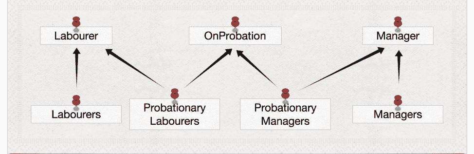
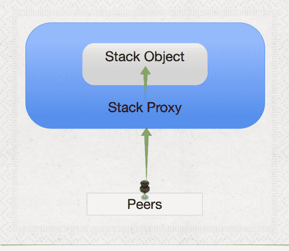
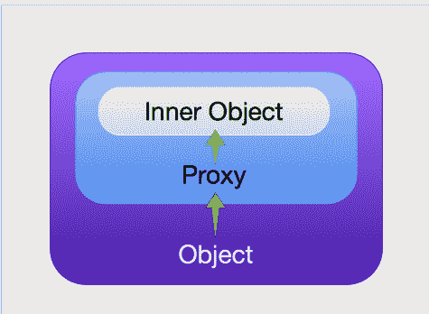
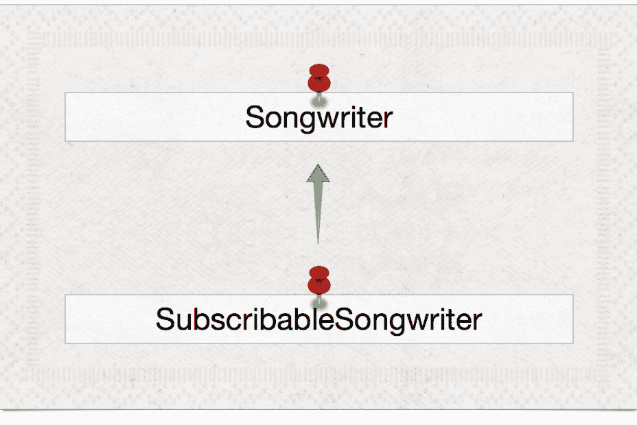

# JavaScript 高级指南

**ragwald**

## raganwald 的其他作品

- 红隼、古怪的鸟类与绝望的自我中心主义
- 我从失败中学会了什么
- 作为程序员，如何做你热爱的事并赚取你的报酬
- CoffeeScript Ristretto

《JavaScript Spessore》是为那些读过《JavaScript Allongé》或具有相应 JavaScript 经验的读者编写，特别是涉及函数、闭包和原型方面。

> “对于任何想要更好地了解 JavaScript 的开发者来说，这都是必读的……Reg 的解释方式能让我把各个点联系起来。这可能是我重读过十次或以上的编程书了。”——ethrinh
>
> “我认为这是自读过 Sedgewick 的《C 语言算法》以来，我读过的技术书籍之一。”——Andrey Sidorov
>
> “您在《JavaScript Allongé》中对闭包的解释是我读过的最好的。”——Ehmannkay
>
> “这是一种处理 JavaScript 的不同方法，你会在其他地方看到，它揭示了 JavaScript 语言中一些更优雅的部分。”——@jerymoronrell

如果你已经熟悉这些内容，你可能想阅读《JavaScript Allongé》来熟悉你对函数组合器（functional combinators）的方法。你可以在线免费阅读。

[allong.es](http://allong.es) 是一个受《JavaScript Allongé》启发的 JavaScript 库。它包含了许多在《JavaScript Spessore》示例中使用的工具函数，如 `map`、`variadic` 和 `tap`。它是免费的，你甚至可以将书中的许多示例输入它的 [try allong.es](http://try.allong.es) 页面并查看运行效果。

## 核心思想


### 本章内容

在本章中，我们认为 JavaScript 的“核心思想”是：你可以使用函数来转换和组合原始类型、函数和对象。我们将认为，面向对象的编程与函数编程并不是分离且独立的，它仅仅是处理 JavaScript 核心思想的另一种方式。

这种思考将为我们在本书中将探索的面向对象编程技术铺平道路。

## JavaScript 是函数式的还是面向对象的？

JavaScript 的定义特征之一是将函数视为一等公民值。就像数字、字符串和其他对象一样，函数的引用可以作为参数传递给函数、作为结果返回、绑定到变量，并通常像处理任何其他值一样处理它们。

这是一个传递函数引用的示例。这个简单的基于数组的栈有一个 `undo` 函数。它的工作原理是创建一个代表撤销上次更新操作的函数，然后将其推入撤销栈中：

```javascript
var stack = {
  array: [],
  undoStack: [],
  push: function (value) {
    this.undoStack.push(function () {
      this.array.pop();
    });
    return this.array.push(value);
  },
  pop: function () {
    var popped = this.array.pop();
    this.undoStack.push(function () {
      this.array.push(popped);
    });
    return popped;
  },
  isEmpty: function () {
    return this.array.length === 0;
  },
  undo: function () {
    this.undoStack.pop().call(this);
  }
};
```

```javascript
stack.push('hello');
stack.push('there');
stack.push('javascript');
stack.undo();
```

> JavaScript 实际上并没有在传递函数或任何类型的对象；它传递的是函数和其他对象的引用。但声明 `var i = function (a) { return a; }` 作为将函数引用绑定到变量 `i` 会很别扭，所以我们经常采取一种智力上的偷径，直接将函数绑定到变量 `i`。这与说某人把我加入了即将举行的会议日程异曲同工：他们确实把我的名字加进了列表，这实际上是对我的一种引用。

## 核心思想

```javascript
stack.undo();
stack.pop();
//=> 'hello'
```

“函数即值”是一个强大的思想。人们经常看到“函数即值”这个观点并想：“哦，JavaScript 是一门函数式编程语言。”不是。

> 在计算机科学中，函数式编程是一种编程范式，一种构建计算机程序结构和元素的风格，它将计算视为数学函数的求值，并避免状态数据。
>
> —Wikipedia

在 20 世纪 60 年代 Lisp 还年轻时，函数式编程可能指的是“函数是一等公民值”。但时间在流逝，我们必须与其并进。JavaScript 并不避免状态，JavaScript 拥抱可变数据，因此 JavaScript 并不追求“函数式编程”。


### 对象

JavaScript 的另一个特征是它对对象的支持。尽管与 Scala 等功能丰富的面向对象语言相比，JavaScript 的功能显得很匮乏，但其极简主义意味着你实际上可以从基础组件构建几乎任何面向对象的范式。

现在，人们经常听到“对象”这个词并想到“名王国”，但对象并不一定是名词，至少对于现实世界中的模型、实体而言并非如此。例如状态机，我们可以实现康威生命游戏中的一个细胞，使用 `if` 语句和一个布尔属性来判断细胞是存活还是死亡。

行为被视为一种一类值，无论是一个单函数还是一个具有多个方法的对象。

### JavaScript 代数

正如我们在《JavaScript 是函数式的还是面向对象的？》中所看到的，函数非常适合表示单一用途的行为单元，作为一种可撤销的操作。对象显然可以对领域进行建模，但它们也可以对状态和其他更复杂的行为进行建模。

函数在面向对象的程序中还有另一个作用，一个处于领域之外的作用。函数构成了*值的代数*的基础。

考虑这些函数：`begin1` 和 `begin`。它们对于编写函数建议非常方便，用于创建为了评估副作用而设计的函数序列，以及在组合时解决方法冲突：

```javascript
var __slice = [].slice;

function begin1 () {
  var fns = __slice.call(arguments, 0);

  return function () {
    var args = arguments,
    values = fns.map(function (fn) {
      return fn.apply(this, args);
    }, this),
    concretes = values.filter(function (value) {
      return value != void 0;
    });
    if (concretes.length > 0) {
      return concretes[0];
    }
  }
}
```

```javascript
function begin () {
  var fns = __slice.call(arguments, 0);

  return function () {
    var args = arguments,
    values = fns.map(function (fn) {
      return fn.apply(this, args);
    }, this),
    concretes = values.filter(function (value) {
      return value !== void 0;
    });
    if (concretes.length > 0) {
      return concretes[concretes.length - 1];
    }
  };
}
```

### 核心思想

`begin` 和 `begin1` 都通过组合两个或多个其他函数来创建一个函数。组合是构建程序的主要活动：用更小、更简单的行为构建出一个复杂的行为。

在某种意义上，所有的编程都是组合。然而，当我们使用函数来组合函数时，我们故意限制了函数之间相互调用的方式。这更容易理解发生了什么，我们用于组合的类函数（如 `begin`）具有从现有函数构造新函数的非常简单且定义良好的方法。

函数的另一个有用之处是转换其他函数。Underscore 库包含了几个，allong.es 也是。这里是最简单的之一：

```javascript
function not (fn) {
  return function () {
    return !fn.apply(this, arguments);
  }
}
```

`not` 接收一个函数并返回一个逻辑取反的函数。当 `fn(...)` 返回真值时，`not(fn)(...)` 返回 `false`。当 `fn(...)` 返回假值时，`not(fn)(...)` 返回 `true`。

组合和转换其他函数允许我们以结构化的方式从更小的、可交换的组件构建函数。这就是在创建一个函数的代数：一组用于创建、组合和转换函数的操作。

### 值的代数

组合并将函数转换为其他函数的函数是非常强大的，但并不仅于此。

显而易见，函数可以接受对象作为参数并返回对象。接收代表客户端的对象并返回代表账户余额对象的函数（或方法）是软件中必要且重要的部分。

### 核心思想

但正如我们创建了函数的代数，我们可以创建一个对象的代数。这意味着，我们可以编写接收对象并返回代表其参数转换的其他对象的函数。

这里有一个将对象转换为代理的函数：

```javascript
function proxy(baseObject, optionalPrototype) {
  var proxyObject = Object.create(optionalPrototype || null),
    methodName;
  for (methodName in baseObject) {
    if (typeof baseObject[methodName] === 'function') {
      (function (methodName) {
        proxyObject[methodName] = function () {
          var result = baseObject[methodName].apply(baseObject, arguments);
          return result === baseObject ? proxyObject : result;
        };
      })(methodName);
    }
  }
  return proxyObject;
}
```

你是否想过在使方法公开的同时，使对象的属性私有？你想要该对象的一个代理：

```javascript
var stackWithPrivateState = proxy(stack);
```

```javascript
stack.array = [];
stackWithPrivateState.array
// undefined
```

```javascript
stackWithPrivateState.push('hello');
stackWithPrivateState.push('there');
stackWithPrivateState.push('javascript');
stackWithPrivateState.undo();
stackWithPrivateState.undo();
stackWithPrivateState.pop();
// 'hello'
```

`proxy` 函数将一个对象转换为具有相似目的另一个对象。函数也可以组合对象，这里是最简单的示例之一：

### 核心思想

```javascript
var __slice = [].slice;

function meld () {
  var melded = {},
  providers = __slice.call(arguments, 0),
  key,
  i,
  provider;

  for (i = 0; i < providers.length; ++i) {
    provider = providers[i];
    for (key in provider) {
      if (provider.hasOwnProperty(key)) {
        melded[key] = provider[key];
      }
    }
  }
  return melded;
}
```

```javascript
var Person = {
  fullName: function () {
    return this.firstName + " " + this.lastName;
  },
  rename: function (first, last) {
    this.firstName = first;
    this.lastName = last;
    return this;
  }
}
```

```javascript
var HasCareer = {
  career: function () {
    return this.chosenCareer;
  },
  setCareer: function (career) {
    this.chosenCareer = career;
    return this;
  },
  describe: function () {
    return this.fullName() + " is a " + this.chosenCareer;
  }
};
```

```javascript
var PersonWithCareer = meld(Person, HasCareer);
//=> { fullName: [Function], rename: [Function], career: [Function], setCareer: [Function], describe: [Function] }
```

组合并将函数转换为其他函数的函数是非常强大的，但并不仅于此。

显而易见，函数可以接受对象作为参数并返回对象。接收代表客户端的对象并返回代表账户余额对象的函数（或方法）是软件中必要且重要的部分。

组合和转换其他函数允许我们以结构化的方式从更小的、可交换的组件构建函数。JavaScript 将函数和对象视为一类值。这种特性产生的力量是能够编写转换和组合一类值的函数，从而创建值的代数。

### 核心思想

### 可组合性

作为一种语言，JavaScript 与架构是无关的。它没有 Java 那种重量级的类层次结构。它没有 Smalltalk 的 UI 框架。因此，你可以构建自己的单体架构，规定所有符合该架构的对象的 API 并它们连接在一起。

围绕许多“组合”的较小组件进行设计也是可能的。这是 JavaScript 代数背后的原理：创建函数或对象的集合，并编写从现有项组合新项的操作。

我们将在后续章节中看到这些想法的应用。例如，谓词分发（Predicate Dispatch）是从处理算法中每个“情况”的较小函数组合出新函数的方法。元对象的封装与组合将元对象（如原型）组合成具有专注职责的更小、独立的元对象。

使可组合性良好运行的关键在于始终让各个部分之间尽可能相互独立。这使得将它们组合和重新组合变得简单且实用。

虽然重量级面向对象是一种有效的方法，但我们书的重点将放在组合的轻量级组件上，这种方法发挥了 JavaScript 的优势，并让你为特定项目选择我们讨论的技术中的少数或多个。

### JavaScript 的对象

| 特性 | 说明 |
| :--- | :--- |
| 1. 自动 | 每个组在前后对压力和流量进行监控 |
| 2. TCB 控制器 | 控制水压的温度设置和阀门设置 |
| 3. PID 控制器 | 数字温度调节系统，它们在处理查询后分离冲洗循环。通过调整流量确保始终获得完美控制 |
| 4. 浓缩计时器 | 提取期间的电子计数和每个组的显示 - 启用有限且独立的系统 |

咖啡师

每个组的稳定性稳定性：3 年研发确定 0.53L 锅炉是最佳水量，经过 1000 多次

为组头提供稳定精确的温度稳定性 - 校准误差 ±0.5°C - 完美的咖啡提取后

在本章中，我们将查看 JavaScript 中非常简单的对象是如何工作的。

### 数据结构

数据结构是计算机中存储和组织数据的一种特定方式，使其能够高效地使用。不同类型的数据结构适用于不同类型的应用程序，并针对特定任务经过高度专门化。--Wikipedia

JavaScript 中的数据结构是一个值，它引用零或多个表示数据的值。许多人将数据结构称为“容器”，暗示数据结构包含数据。从技术上讲，数据结构包含对数据的引用，但“容器”是一个合理的比喻。

在 JavaScript 中，数字和字符串等原始类型不是数据结构。数组和“对象”（Objects）是内置的数据结构，你可以使用它们来构建其他数据结构，如 B 树。（JavaScript 可能会让人困惑：数组也是对象，而字符串不是对象，String 的实例却是一个对象。）

我们感兴趣的是 JavaScript 的对象。从技术上讲，JavaScript 所说的对象实际上是一个字典：

关联数组、映射（map）、符号或字典是由一组（键，值）对组成的抽象数据类型，每个键值对中的每个可能的键在集合中最多出现一次。与此数据类型相关的操作允许：向集合中添加键值对；从集合中删除键值对；修改现有键值对的值；以及查找与特定键的值。--Wikipedia

许多语言中的数据结构是被动的：你编写单独的函数向它们添加数据或从中查询数据。例如，我们可以使用字典来制作一个老式的链表。

```javascript
var emptyValue = {};

function empty () {
  return emptyValue;
}

function cons (value, list) {
  return {_a: value, _d: list};
}
```

> 这些函数可以追溯到 Lisp 1.5。故事是它是为一种具有两个 CPU 寄存器（一个地址寄存器和一个递减寄存器）的硬件架构编写的。cons 类型是一个“cons 单元”，表示两个指针。一个存储在地址寄存器中，另一个存储在递减寄存器中。函数 car 意味着“地址寄存器的内容”，函数 cdr 意味着“递减寄存器的内容”。cons 意味着创建一个新的 cons 单元”。本应该是 mapcar，但我们仍然坚持使用更现代的术语。

```javascript
function car (list) {
  return list._a;
}
```

```javascript
function cdr (list) {
  return list._d;
}
```

```javascript
function map (fn, list) {
  if (list === empty()) {
    return empty();
  }
  else return cons(
    fn(car(list)),
    map(fn, cdr(list))
  );
}
```

```javascript
function pp (list) {
  if (list === empty()) {
    return "";
  }
  else return("" + car(list) + " " + pp(cdr(list))).trim();
}
```

```javascript
var oneTwoThree = cons(1, cons(2, cons(3, empty())));
```

```javascript
function cubed (n) {
  return n * n * n;
}
```

```javascript
pp(map(cubed, oneTwoThree))
//=> '1 8 27'
```

编程数据结构的“核心思想”是你拥有一个标准化的数据结构，并编写许多在这些数据结构上操作的函数。数据结构是通过约定组织的：每个函数都深入理解数据结构的实现，并仔细地保留其预期的结构。

许多年前，人们发现了数据结构的一个问题：它们通常有几个需求相似但实现不同的数据结构。链表在在列表头部插入项时特别快。但如果我们想要索引访问，它们的速度是阶数 n 的。我们可能会为此实现一种 Vector 或 Array 数据类型。我们可能需要一个提供键值存储的有序字典（OrderedDictionary）数据结构。

链表、向量和有序集合都需要某种迭代器函数。map 基于 cons 单元为链表完成这项工作。map 为向量和有序集合完成此工作，但在名称都是全局的时代，你无法拥有两个同名的函数。

语言设计的一个分支关注管理命名空间。像 Modula-2 这样的语言提供了将向量等数据结构的所有函数封装到具有独立命名空间的单独编译单元中的方法。你可以对有序集合执行相同的操作，并且有特殊功能用于引用其中一个、两者或无冲突的代码。

一旦解决了命名空间冲突，编程世界就拥有了处理数据结构所需的一切。我们可以轻松地在 JavaScript 中模拟这种开发风格：使用数组和字典，使用 `[]` 和 `for` 循环进行所有访问，并编写函数来实现我们需要的任何。

### 纯 JavaScript 对象 (POJO)

在 JavaScript 中，对象是提供从名称到值映射的数据结构。许多其他语言将这些称为“字典”或“关联数组”。有些人称它们为“哈希”（Hashes），HashMap 或 Hash Table（哈希表）的缩写。在大多数情况下，Dictionary 一词描述了它的工作原理，而 HashMap 或 Hash Table 等术语描述了针对快速查找的字典实现。

创建 JavaScript 对象最常用的语法称为“字面量对象表达式”：

```javascript
{ year: 2012, month: 6, day: 14 }
```

以此创建的两个对象具有不同的标识：

```javascript
{ year: 2012, month: 6, day: 14 } === { year: 2012, month: 6, day: 14 }
//=> false
```

对象使用 `[]` 通过字符串按名称访问值：

```javascript
{ year: 2012, month: 6, day: 14 }['day']
//=> 14
```

字面量对象表达式中的名称不是字母数字字符串。对于其他任何情况，将标签括在引号中：

```javascript
{'first name': 'reginald', 'last name': 'lewis'}['first name']
//=> 'reginald'
```

如果名称是符合变量名相同规则的字母数字字符串，则有访问值的简化语法：

```javascript
{ year: 2012, month: 6, day: 14 }['day'] ===
{ year: 2012, month: 6, day: 14 }.day
//=> true
```

像所有容器一样，对象可以包含任何值，包括函数：

```javascript
var Arithmetic = {
  abs: function (number) {
    return number < 0 ? -number : number;
  },
  power: function (number, exponent) {
    if (exponent <= 0) {
      return 1;
    }
    else return number * power(number, exponent-1);
  }
}
```

```javascript
Arithmetic.abs(-5)
//=> 5
```

### 命名空间

由于 JavaScript 对象是字典，这使得它们非常适合创建命名空间。

> 通常而言，命名空间是一组标识符（也称为符号、名称）的容器。命名空间为特定的标识符提供了一个间接层，使得区分相同名称的标识符成为可能。例如，姓氏可以被视为命名空间，用于区分同名的人。在计算机编程中，命名空间通常用于围绕特定功能分组符号和标识符。--Wikipedia

命名空间通常是无状态的：它们包含函数和其它常量，但不打算直接或间接地进行更新。命名空间通常也是“封闭扩展的”：函数不会动态地添加到命名空间中。

命名空间的主要目的是为一组相关的命名常量和函数提供消义。`Arithmetic` 是命名空间的一个示例。它可能是：如果我们正在编写一个健身应用程序，我们可能想出于另一个用途使用变量 `abs`，我们不希望意外覆盖或覆盖我们确定数字绝对值的函数。

### JavaScript 对象

对象可以添加和删除键值对，它们还可用于实现具有命名组件的数据结构（或数据结构的一部分）。

以下是一些操作字典的函数：

```javascript
function isNameAvailable(userName, name) {
  return userName[name] === undefined;
}

function addUser(userName, user) {
  if (isNameAvailable(user.name)) {
    userName[name] = user;
    return user;
  }
  else throw "" + user.name + " already exists";
}
```

相比之下，这里有一个用字典实现的数据结构，就是我们之前看到的“cons 单元”（cons cell）：

```javascript
function cons(value, list) {
  return {
    _a: value,
    _d: list
  };
}
```

我们正在使用字典作为一种实现技术，但我们实际上在编写操作具有名为 `_a` 和 `_d` 元素的元组的函数。JavaScript 中的许多“对象”都是具有命名元素的数据结构。它们恰好是用作为字典的对象实现的，但它们的意图并不是用作任意的键值存储器。

> JavaScript 对象是字典。字典可以用于构建数据结构：区别在于其预期的使用方式。如果一个对象是任意键值对的容器，它就是字典。如果一个对象是特定命名键值的容器，它就是用字典实现的自定义结构。

### 使用闭包封装状态

OOP 意味着消息传递、局部保留以及状态过程的保护与隐藏，以及一切的极后期绑定。

- Alan Kay

正如我们讨论过的，构建我们自己的数据结构存在命名空间问题。坦白说，命名空间问题是可以解决的。还有另一个问题，封装问题。操作数据结构的代码是考虑到其实现编写的，并因此产生紧密耦合。耦合是传递的，因此所有直接耦合到特定链表的代码，也间接地耦合到所有与该链表耦合的其他代码。

如果你对链表的工作方式进行更改，可能会破坏所有那些其他代码。这种耦合问题至少从 20 世纪 60 年代就已经存在，像 Modula-2 和 Smalltalk 这样的语言通过将数据结构的公共接口与“消费者”分离解决了这个问题。

公共接口是一组供数据结构“消费者”使用的函数。私有实现将对视图不可见。由于消费者无法与实现交互，它们只能与精心选择的公共接口耦合，而不会与任何实现细节耦合。

### 什么是状态过程的隐藏，它为什么重要？

在计算机科学中，信息隐藏是对计算机程序中最可能更改的设计决策进行隔离的原则，以便在设计决策发生变化时，保护程序的其他部分免受大量修改。这种保护提供了一个稳定的接口，保护程序的其余部分不受实现（最可能更改的细节）的影响。

换句话，信息隐藏是防止类或软件组件的某些方面被其客户端访问的能力，这可以使用编程语言特性（如私有变量）或显式的导出策略。

- Wikipedia

一种栈数据结构。它有三个基本操作：向顶部推入一个值（push）、从顶部弹出一个值（pop）以及测试栈是否为空（isEmpty）。这三个操作就是稳定的接口。

一种便于数据与操作该数据的方法（或其他函数）捆在一起的语言结构。-Wikipedia

### JavaScript 对象

许多栈使用一个数组来存放栈的内容。这是相对稳定的。你可以用链表代替，但在 JavaScript 中，数组是非常高效的。你可能需要一个索引，也可能不需要。你可以扩大缩小数组，也可以分配固定的大小并使用索引来跟踪数组中已有多少内容。跟踪列表头部的设计选择通常是由性能考虑驱动的。

如果你暴露了实现细节（例如是否存在索引），早晚程序员都会发现直接使用索引的优势。例如，她可能需要知道栈的大小。理想的选择是添加一个 `size` 函数来继续隐藏实现。但她急着使用，所以她直接读取索引。现在，她的代码与索引的存在耦合了，因此如果我们将实现更改为扩大和缩小数组，我们就会破坏她的代码。

避免这种情况的方法是将数组和索引从其他代码中隐藏，并只暴露我们认为是稳定的操作。当某人需要知道栈的大小时，我们会添加一个 `size` 函数并对其进行良好的暴露。

隐藏信息（或“状态”）是允许我们限制软件组件之间耦合的设计原则。

### 我们如何使用 JavaScript 使用状态？

我们已经介绍了 JavaScript 的对象，很容易看出对象可以用来建模其他编程语言可以（以各种方式）建模的记录、结构体、帧或等等。鉴于它们的元素是可变的，它们显然可以对状态建模。

给定一个持有我们状态的对象（一个数组和一个索引），我们可以轻松地将我们的三个操作实现为函数。

```javascript
var stack = (function () {
  var array = [];
  index = -1;

  return {
    push: function (value) {
      array[index += 1] = value
    },
    pop: function () {
      var value = array[index];
      if (index >= 0) {
        index -= 1
      }
      return value
    },
    isEmpty: function () {
      return index < 0
    }
  };
})();
```

> 是的，还有另一种跟踪数组大小的方法，但我们不需要它来演示封装和状态隐藏。

### 方法论

在本文，我们从讨论“属于对象的函数”转向了“方法”。其他语言可能严格地分离方法和函数，但在 JavaScript 中，每个方法都是函数，但并非所有函数都是方法。

本书采取的观点是：如果一个函数属于某个对象并以某种方式与该对象交互，那么它就是该对象的方法。因此，实现栈操作的函数都是栈的方法。

这两个并不是方法。尽管它们“属于”一个对象，但它们并没有与对象交互：

```javascript
{
  min: function (x, y) {
    if (x < y) {
      return x
    } else {
      return y
    }
  },
  max: function (x, y) {
    if (x > y) {
      return x
    } else {
      return y
    }
  }
}
```

### 隐藏状态

我们的栈确实将函数与数据绑定，但它没有隐藏它的状态。“外部”代码可能会干扰它的数组或索引。那么我们如何隐藏这些呢？我们已经有一个闭包了，让我们用它吧：

```javascript
var stack = (function () {
  var array = [];
  index = -1;

  return {
    push: function (value) {
      array[index += 1] = value;
    },
    pop: function () {
      var value = array[index];
      if (index >= 0) {
        index -= 1;
      }
      return value;
    },
    isEmpty: function () {
      return index < 0;
    }
  };
})();
```

```javascript
stack.isEmpty()
// true
stack.push('hello')
// 'hello'
stack.push('JavaScript')
// 'JavaScript'
stack.isEmpty()
// false
stack.pop()
// 'JavaScript'
stack.pop()
// 'hello'
stack.isEmpty()
// true
```

我们不想在每次需要栈时都重复编写这段代码，所以让我们自己创建一个“栈生成器”。模板是我们在函数中所做的内容：

```javascript
var StackMaker = function () {
  return (function () {
    var array = [];
    index = -1;

    return {
      push: function (value) {
        array[index += 1] = value
      },
      pop: function () {
        var value = array[index];
        if (index >= 0) {
          index -= 1
        }
        return value
      },
      isEmpty: function () {
        return index < 0
      }
    };
  })()
}
```

### JavaScript 的对象

但有一种更简单的方法 :-)

```javascript
var StackMaker = function () {
  var array = [],
  index = -1;

  return {
    push: function (value) {
      array[index += 1] = value
    },
    pop: function () {
      var value = array[index];
      if (index >= 0) {
        index -= 1;
      }
      return value
    },
    isEmpty: function () {
      return index < 0
    }
  };
};

stack = StackMaker()
```

现在我们可以自由地创建栈了，并且隐藏了它们的内部数据元素。我们拥有了方法和封装，并且通过 JavaScript 的基本函数和对象构建了它们。再往后看，我们将查看 JavaScript 对面向类编程的支持，以及函数为这里带来的的一些惯用法。

> ### 封装是“面向对象”的吗？
>
> 我们构建了具有隐藏内部状态和“方法”的东西，而完全不需要特殊的定义或私有关键字。请注意，我们没有包含各种支持继承、混入（mixins）以及其他用于在互联网上讨论“唯一真对象风格”本质的复杂机制。
>
> 那么，经验丰富的程序员反复重复的一个关键教训——尽管这往往被置若耳闻——那就是组合优于继承。所以也许我们并没有遗漏某些东西。

## 组合与扩展

一种非常基础的实践是由较小的组件构建组件。将一个组件拆分为更小组件的选择被称为分解（factoring），源于数论中的操作。

在 JavaScript 中构建较小组件的最简单、容易的方法是显而易见的：每个组件都是一个值，这些组件可以组合成一个封装在闭包中的单个对象。

这是一个支持撤销和重做操作的抽象“模型”，它由一对栈（封装状态）和一个普通 JavaScript 对象（POJO）组成：

```javascript
// 辅助函数
//
// 用于生产环境，请考虑如何处理
// 深拷贝和自有键
var shallowCopy = function (source) {
  var dest = {},
  key;
  for (key in source) {
    dest[key] = source[key]
  }
  return dest;
};

// 我们的模型生成器
var ModelMaker = function (initialAttributes) {
  var attributes = shallowCopy(initialAttributes || {}),
  undoStack = StackMaker(),
  redoStack = StackMaker(),
  obj = {
    set: function (attrsToSet) {
      var key;
      undoStack.push(shallowCopy(attributes));
      if (redoStack.isEmpty()) {
        redoStack = StackMaker()
      }
      for (key in attrsToSet || {}) {
        attributes[key] = attrsToSet[key]
      }
      return obj
    },
    undo: function () {
      if (!undoStack.isEmpty()) {
        redoStack.push(shallowCopy(attributes))
        attributes = undoStack.pop()
      }
      return obj
    },
    redo: function () {
      if (!redoStack.isEmpty()) {
        undoStack.push(shallowCopy(attributes))
        attributes = redoStack.pop()
      }
      return obj
    },
    get: function (key) {
      return attributes[key]
    },
    has: function (key) {
      return attributes.hasOwnProperty(key)
    },
    attributes: function () {
      return shallowCopy(attributes)
    }
  };
  return obj
}
```

> 并且当你取一个已经分解的组件并重新排列结构，使其分解为一组不同的子组件集合而又不改变其行为时，你正在进行重构。

### 扩展

许多人认为基础的另一种实践是扩展实现。这意味着他们希望通过在现有数据结构上添加新的操作和语义来定义新的数据结构。

考虑一个队列：

### JavaScript 的对象

```javascript
var QueueMaker = function () {
  var array = [],
  head = 0,
  tail = -1;
  return {
    pushTail: function (value) {
      return array[tail += 1] = value
    },
    pullHead: function () {
      var value;
      if (tail >= head) {
        value = array[head];
        array[head] = void 0;
        head++;
      }
      return value
    },
    isEmpty: function () {
      return tail < head
    }
  };
}
```

现在我们可以扩展队列为：

```javascript
var DequeMaker = function () {
  var deque = QueueMaker(),
    INCREMENT = 4;
  return extend(deque, {
    size: function () {
      return deque.tail - deque.head + 1
    },
    pullTail: function () {
      var value;
      if (!deque.isEmpty()) {
        value = deque.array[deque.tail];
        deque.array[deque.tail] = void 0;
        deque.tail--;
      }
      return value
    },
    pushHead: function (value) {
      var i;
      if (deque.head === 0) {
        for (i = deque.tail; i >= deque.head; i--) deque.array[i + INCREMENT] = deque.array[i]
        deque.tail += INCREMENT
      }
      deque.head--;
      return deque.array[deque.head] = value
    }
  });
}
```

### 这个和那个

让我们再看看可扩展的对象。这里有一个队列：

```javascript
var QueueMaker = function () {
  var queue = {
    array: [],
    head: 0,
    tail: -1,
    pushTail: function (value) {
      return queue.array[queue.tail += 1] = value;
    },
    pullHead: function () {
      var value;
      if (queue.tail >= queue.head) {
        value = queue.array[queue.head];
        queue.array[queue.head] = void 0;
        queue.head++;
      }
      return value;
    },
    isEmpty: function () {
      return queue.tail < queue.head;
    }
  };
  return queue;
};
```

等一下。我们知道数组值是引用。所以它可能复制了原始数组的引用。让我们也对数组进行拷贝：

### JavaScript 的对象

```javascript
copyOfQueue.array = [];
for (var i = 0; i < 2; ++i) {
  copyOfQueue.array[i] = queue.array[i]
}
```

现在，让我们从原始队列中取出头部：

```javascript
queue.pullHead()
// 'Hello'
```

如果我们正确地复制了一切，那么当我们从拷贝中取出头部时，应该得到完全相同的结果：

```javascript
copyOfQueue.pullHead()
// 'JavaScript'
```

什么？尽管我们仔细地复制了数组以防止别名引用（aliasing），但这两个队列似乎表现得像彼此的别名一样。问题在于，虽然我们仔细地复制了数组和其他元素，但所有的闭包都共享同一个环境，因此 `copyOfQueue` 中的所有函数都在操作第一个队列的私有数据，而不是操作拷贝的数据。

> 这是闭包的一个普遍问题。闭包将函数与环境耦合，这使得它们在小规模应用中非常优雅，并且在创建透明数据结构时非常方便。遗憾的是，它们在小规模上的优势正是它们在大规模应用上的弱点。当你尝试制作可重用的组件时，这种耦合有时会成为阻碍。

让我们进行一个极其乐观的空想：

```javascript
var AmnesicQueueMaker = function () {
  return {
    array: [],
    head: 0,
    tail: -1,
    pushTail: function (self, value) {
      return self.array[self.tail += 1] = value
    },
    pullHead: function (self) {
      var value;
      if (self.tail >= self.head) {
        value = self.array[self.head];
        self.array[self.head] = void 0;
        self.head += 1;
        return value
      }
    },
    isEmpty: function (self) {
      return self.tail < self.head
    }
  }
}
```

```javascript
queueWithAmnesia = AmnesicQueueMaker();
queueWithAmnesia.pushTail(queueWithAmnesia, 'Hello');
queueWithAmnesia.pushTail(queueWithAmnesia, 'JavaScript');
```

`AmnesicQueueMaker` 创建了具有健忘症的队列：它们不知道自己是谁，所以每当我们调用它们的任何一个函数时，都必须告诉它们它们是谁。我们可以通过这个思想实验来推导出拷贝队列的影响：我们不需要担心环境，因为每个函数都操作于你传入的队列。

当然，致命的缺点是，必须确保在每次调用函数时都始终传入了正确的队列。该怎么办呢？

### 这是怎么回事？

每当我们必须反复重复地做某件事一遍又一遍时，工业化人类就会尝试建造一台机器来完成它。JavaScript 就是这样一台机器：

```javascript
var BanksQueueMaker = function () {
    return {
        array: [],
        head: 0,
        tail: -1,
        pushTail: function (value) {
            return this.array[this.tail += 1] = value
        },
        pullHead: function () {
            var value;
            if (this.tail >= this.head) {
                value = this.array[this.head];
                this.array[this.head] = void 0;
                this.head += 1;
                return value
            }
        },
        isEmpty: function () {
          return this.tail < this.head
        }
    }
};
```

```javascript
banksQueue = BanksQueueMaker();
banksQueue.pushTail('Hello');
banksQueue.pushTail('JavaScript');
```

每当你调用一个作为对象的成员函数时，JavaScript 都会将对象绑定到函数环境中的名称上，就像它是一个参数一样。现在我们可以轻松地创建拷贝了：

```javascript
copyOfQueue = extend({}, banksQueue);
copyOfQueue.array = [];
for (var i = 0; i < 2; ++i) {
  copyOfQueue.array[i] = banksQueue.array[i]
}
```

```javascript
banksQueue.pullHead()
// 'Hello'
```

```javascript
copyOfQueue.pullHead()
// 'Hello'
```

变戏法！我们有了拷贝数组的方法。通过消除闭包并利用 `this`，我们的函数在对象之间具有更强的移植性，代码也变得更加简单。

这里涉及的内容比我们在这里讨论的更多。我们稍后会在“调用函数时，什么上下文会生效？”中更详细地探讨这些。

> 将函数与其创建它们的环境紧密耦合限制了它们的灵活性。使用 `this` 方法可以缓解耦合。拷贝对象仅仅是需要这种灵活性的例子之一。

### 调用函数时，什么上下文会生效？

在《这个与那个》中，我们学习了当函数被作为对象方法调用时，`this` 的名称会被绑定到其环境中的充当“接收者”的对象上。例如：

```javascript
var someObject = {
  returnMyThis: function () {
    return this;
  }
};

someObject.returnMyThis() === someObject
// true
```

我们构造了一个方法，它在被调用时返回绑定到 `this` 的任何值。正如所述，它在被调用时返回该对象。

### 这取决于函数被调用的方式

JavaScript 程序员谈论函数在调用时具有“上下文”。`this` 被绑定到上下文。要理解的关键点是，被调用函数的上下文是由调用函数的方式设置的，而不是函数本身。

这是一个重要的区别。考虑闭包：正如我们在“闭包与作用域”中讨论过的样，函数的自由变量是通过在它们的闭包函数环境中查找来解析的。你总是可以通过检查 JavaScript 程序的源代码确定定义自由变量的函数，这就是为什么这种方案被称为词法作用域（Lexical Scope）。

函数的上下文无法通过检查 JavaScript 程序的源代码来确定。让我们看看例子：

```javascript
var someObject = {
  someFunction: function () {
    return this;
  }
};

someObject.someFunction() === someObject
// true
```

函数 `Object.name` 的上下文是什么？不要说 `someObject`！看这里：

> 遗憾的是，语言将上下文绑定到名称 `this` 而不是名称 `context`！

## JavaScript 的函数

```javascript
var someFunction = someObject.someFunction;
```

```javascript
someFunction === someObject.someFunction
// true
```

```javascript
someFunction() === someObject
// false
```

变得更奇怪了：

```javascript
var anotherObject = {
  someFunction: someObject.someFunction
}
```

```javascript
anotherObject.someFunction === someObject.someFunction
// true
```

```javascript
anotherObject.someFunction() === anotherObject
// true
```

```javascript
anotherObject.someFunction() === someObject
// false
```

所以这意味着：完全相同的函数可以通过两种方式进行调用，而你得到两个不同的上下文。如果你使用 `someObject.someFunction()` 语法调用它，上下文被设置为接收者。如果你使用任何其他解析函数值的表达式（例如 `someFunction()`），你将得到别的东西。让我们来调查一下：

```javascript
(someObject.someFunction()) === someObject
// true
```

```javascript
someObject['someFunction']() === someObject
// true
```

```javascript
var name = 'someFunction';
```

```javascript
someObject[name]() === someObject
// true
```

有趣！

### JavaScript 的对象

```javascript
var baz;

(baz = someObject.someFunction()) === this
//=> true
```

怎么样呢？

```javascript
var arr = [ someObject.someFunction ];

arr[0]() === arr
//=> true
```

似乎无论你使用 `a.b()` 或 `a['b']()` 或 `a[n]()` 或 `(a.b)()`，你得到的上下文都是 `a`。

```javascript
var returnThis = function () { return this };

var aThirdObject = {
  someFunction: function () {
    return returnThis()
  }
}
```

```javascript
returnThis() === this
//=> true
```

```javascript
aThirdObject.someFunction() === this
//=> true
```

### 设置你自己的上下文

实际上还有两种设置函数上下文的方法。再次，两者都由调用者决定。在“到处都是对象？”的最后，我们将看到 JavaScript 中的一切行为都像对象一样，包括函数。我们将学到函数本身也拥有方法，其中之一就是 `call`。

这里是 `call` 的实际用法：

### JavaScript 的对象

```javascript
returnThis() === aThirdObject
//=> false
```

```javascript
returnThis.call(aThirdObject) === aThirdObject
//=> true
```

```javascript
anotherObject.someFunction.call(someObject) === someObject
//=> true
```

当你使用 `call` 调用函数时，你通过将其作为第一个参数传递来设置上下文。其他参数则以正常方式传递给函数。这种花式的操作可能会导致很多滑稽的结果：

```javascript
var a = [1,2,3],
    b = [4,5,6];
```

```javascript
a.concat([2,1])
//=> [1,2,3,2,1]
```

```javascript
a.concat.call(b, [2,1])
//=> [4,5,6,2,1]
```

但现在请彻底理解 `a.b()` 的真正含义：它等同于 `a.b.call(a)`。而在浏览器中，`c()` 等同于 `c.call(window)`。

### apply, arguments 和上下文化

JavaScript 在每个函数的环境中还有另一种自动绑定。`arguments` 是一个行为类似于数组的特殊对象。

例如：

```javascript
var third = function () {
  return arguments[2]
}
```

```javascript
third(77, 76, 75, 74, 73)
//=> 75
```

先等一下。JavaScript 还提供了第四种方法来为函数设置上下文。`apply` 是每个函数都实现的一个方法，它接收上下文作为第一个参数，并接收一个数组或类数组对象的参数列表作为第二个参数。这听起来很绕口，让我们来看一个例子：

> 坦率地说，这已经足够令人沮丧了

```javascript
third.call(this, 1,2,3,4,5)
//=> 3
```

```javascript
third.apply(this, [1,2,3,4,5])
//=> 3
```

现在让我们把这两者结合起来。这里另一个悲剧：

```javascript
var a = [1,2,3],
    accrete = a.concat;
```

```javascript
accrete([4,5])
//=> 一堆乱码！
```

我们得到了将 `[4,5]` 拼接到包含全局环境的数组上的结果。这可不是我们想要的！看：

```javascript
var contextualize = function (fn, context) {
  return function () {
    return fn.apply(context, arguments);
  }
}
```

```javascript
accrete = contextualize(a.concat, a);
accrete([4,5])
//=> [1, 2, 3, 4, 5 ]
```

我们的 `contextualize` 返回一个带有固定上下文调用函数的新函数。它可以用于修复上面的一些意外结果。考虑一下：

```javascript
var aFourthObject = {
  returnThis: function () { return this; }
};
```

```javascript
aFourthObject.uncontextualized = returnThis;
aFourthObject.contextualized = contextualize(returnThis, aFourthObject);
```

```javascript
aFourthObject.uncontextualized() === aFourthObject
//=> true
aFourthObject.contextualized() === aFourthObject
//=> true
```

这两个都是 true，因为我们正在通过 `aFourthObject` 访问它们。现在我们：

```javascript
var uncontextualized = aFourthObject.uncontextualized,
    contextualized = aFourthObject.contextualized;
```

```javascript
uncontextualized() === aFourthObject;
//=> false
contextualized() === aFourthObject;
//=> true
```

当我们不通过 `aFourthObject.` 调用这些函数时，只有 `contextualized` 版本保持了 `aFourthObject` 的上下文。

我们稍后会在“绑定（Binding）”章节中返回讨论上下文化方法。但在深入研究方法的特殊处理之前，我们需要再花一点时间研究函数和方法是如何运作的。

### 扩展对象

通过向一个简单对象添加属性来“扩展”它是非常常见的需求：

```javascript
var inventory = {
  apples: 12,
  oranges: 12
}

inventory.bananas = 54;
inventory.pears = 24;
```

将一个对象的属性浅拷贝到另一个对象中也很常见：

```javascript
for (var fruit in shipment) {
  inventory[fruit] = shipment[fruit]
}
```

这两种需求都可以通过这个 `extend` 配方满足：

```javascript
var extend = variadic( function (consumer, providers) {
  var key,
  i,
  provider;
  for (i = 0; i < providers.length; ++i) {
    provider = providers[i];
    for (key in provider) {
      if (provider.hasOwnProperty(key)) {
        consumer[key] = provider[key]
      }
    }
  }
  return consumer
});
```

你可以通过扩展一个空对象来拷贝对象：

### JavaScript 的对象

```javascript
extend({}, {
  apples: 12,
  oranges: 12
}, { apples: 12, oranges: 12 });
```

你可以用一个对象扩展另一个对象：

```javascript
var inventory = {
  apples: 12,
  oranges: 12
};
```

```javascript
var shipment = {
  bananas: 54,
  pears: 24
}
```

```javascript
extend(inventory, shipment)
// { apples: 12,
// oranges: 12,
// bananas: 54,
// pears: 24 }
```

当我们在讨论原型时，我们将使用 `extend` 将这个变成：

```javascript
var Queue = function () {
  this.array = [];
  this.head = 0;
  this.tail = -1
}
```

```javascript
Queue.prototype.pushTail = function (value) {
  this.array.push(value);
  this.tail++;
}
```

```javascript
Queue.prototype.pullHead = function () {
  return this.array.shift();
}
```

```javascript
Queue.prototype.isEmpty = function () {
  return this.array.length === 0
}
```

变成这个：

```javascript
var Queue = function () {
  extend(this, {
    array: [],
    head: 0,
    tail: -1
  })
}
```

### 对象配方

```javascript
if (Value.prototype.isPrototypeOf(this)) {
  var immutableObject = this;
  Object.keys(template).forEach(function (key) {
    Object.defineProperty(immutableObject, key, {
      enumerable: true,
      writable: false,
      value: template[key]
    });
  });
  return Object.preventExtensions(immutableObject);
} else return new Value(template);
}
```

```javascript
Value.prototype = new Struct({});
```

```javascript
function copyAmount(to, from) {
  "use strict"
  to.dollars = from.dollars;
  to.cents = from.cents;
  return to;
}
```

```javascript
var rentValue = Value({dollars: 1000, cents: 0});
```

```javascript
copyAmount(rentValue, rentAmount);
//= TypeError: Cannot assign to read only property 'dollars' of '#<Struct>'
```

Structs 和 Values 是防止意外错误的方便方法，并能显式地表明一个对象旨在作为结构体（struct）而非字典（dictionary）使用。

### 值对象

我们将不时重复的一句格言是：

> 在少数例外，编程系统不能仅仅通过移除可能被滥用的功能来改进。系统的改进是通过移除有害功能来实现的，这种方式允许添加其他原本由于有害功能的存在而被“阻塞”的、更强大的功能。

*JavaScript 还提供了一个单一方法，可以同时关闭对象的修改、扩展和配置功能：`Object.freeze({...});`*

### 对象配方

我们上面的 `Value` 类型消除了修改或扩展值的能力。这确实消除了犯错的可能。但它是否让其他事情变得可能呢？

是的。

考虑这个问题：

```javascript
var juneRent = {dollars: 420, cents: 0};
julyRent = {dollars: 420, cents: 0};
juneRent === julyRent;
//== false
```

6 月和 7 月的租金并不 `===`，因为 `===` 对非原始值执行的是对象标识性检查。juneRent 和 julyRent 在结构上是等价的，但它们不是同一个对象的引用，因此它们不相等。没问题，让我们快速写一个等价函数：

```javascript
function eqv (a, b) {
  var akeys, bkeys;
  if (a === b) {
    return true;
  }
  else if (typeof a === 'number') {
    return false;
  }
  else if (typeof a === 'boolean') {
    return false;
  }
  else if (typeof a === 'string') {
    return false;
  }
  else {
    akeys = Object.keys(a);
    bkeys = Object.keys(b);
    if (akeys.length !== bkeys.length) {
      return false;
    }
    else return akeys.every(function (key) {
      return eqv(a[key], b[key]);
    });
  }
}
```

### 对象配方

```javascript
eqv(juneRent, juneRent);
//=> true
```

这看起来非常有用。例如，如果我们在从服务器获取 JSON 格式的数据行，结构等价是比较两行“相等性”的唯一方法。但存在一个缺陷。注意：

```javascript
eqv(juneRent, juneRent);
//=> true
juneRent.cents = 6;
```

我们的等价性测试会被破坏，它只测试了某一时刻为真的情况。因此，作为 `Values` 的对象行为并不像数字、布尔值或字符串。如果 `3 === 3`，它将永远成立，因为数字、布尔值和字符串是不可变的。我们可以通过函数和运算符创建新值，但旧值不会改变。

如果我们想让对象等价具有任何意义，我们需要它只适用于不可变对象。这听起来很熟悉，这也是为什么我们把不可变的 `Struct` 称为 `Value`。让我们再来一个：

```javascript
(function () {
  function eqv (a, b) {
    var akeys, bkeys;
    if (a === b) {
      return true;
    }
    else if (a instanceof Value && b instanceof Value){
      akeys = Object.keys(a);
      bkeys = Object.keys(b);
      if (akeys.length !== bkeys.length) {
        return false;
      }
      else return akeys.every(function (key) {
        return eqv(a[key], b[key]);
      });
    }
    else return false;
  }

  Value.eqv = eqv;
  Value.prototype.eqv = function (that) {
    return eqv(this, that);
  };
  return Value;
}());
```

```javascript
Value.eqv(juneRent, julyRent);
//=> false
```

```javascript
var juneRentValue = new Value({dollars: 420, cents: 0});
julyRentValue = new Value({dollars: 420, cents: 0});
```

```javascript
Value.eqv(juneRentValue, julyRentValue);
//=> true
```

```javascript
juneRentValue.eqv(julyRentValue);
//=> true
```

### 访问器

```javascript
Value.eqv = eqv;
Value.prototype.eqv = function (that) {
  return eqv(this, that);
};
return Value;
}();
```

（注：由于原始文本存在大量重复和 OCR 错误，此处翻译已根据提供的逻辑流进行了整合和去重处理。）

### 对象配方

```javascript
var noisyAmount = (function () {
  var _dollars = 0;
  var _cents = 0;
  var amount = {};
  Object.defineProperties(amount, {
    dollars: {
      enumerable: true,
      set: function (amount) {
        if (amount === _dollars) {
          throw new Error("You can't change that!");
        }
      },
      get: function () {
        return _dollars;
      }
    },
    cents: {
      enumerable: true,
      set: function (amount) {
        if (amount !== _cents) {
          throw new Error("You can't change that!");
        }
      },
      get: function () {
        return _cents;
      }
    }
  });
  return amount;
})();
```

```javascript
noisyAmount.dollars = 500
// Error: You can't change that!
```

### 隐藏对象属性

许多“面向对象”编程语言都有私有实例变量的概念，即无法被其他实体访问的属性。JavaScript 没有这种概念，我们必须使用特定的技术来创建对象私有状态的象。

### 可枚举性

在 JavaScript 中，属性只有一种“私有性”。但并不是你预期的那种。当一个对象拥有属性时，你可以使用点符号法来访问它们，如下：

```javascript
var dictionary = {
  abstraction: "an abstract or general idea or term",
  encapsulate: "to place in or as if in a capsule",
  object: "anything that is visible or tangible and is relatively stable in form"
};
```

```javascript
dictionary.encapsulate
//> 'to place in or as if in a capsule'
```

你也可以通过使用 `[]` 符号法和表达式的值间接访问属性：

```javascript
dictionary[abstraction]
//> ReferenceError: abstraction is not defined
```

哎，表达式的值：表达式 `abstraction` 会查找与变量 "abstraction" 关联的值。遗憾的是，由于代码中没有定义该变量，所以这是一个错误。这之所以行得通，是因为 `'abstraction'` 是一个表达式，它的结果为我们想要的字符串：

```javascript
dictionary['abstraction']
//> 'an abstract or general idea or term'
```

一种私有性涉及到对属性的访问。在 JavaScript 中，所有代码都可以访问每个对象的属性。没有办法创建一个对象的属性，使得某些函数可以访问而其他函数无法访问。

那么 JavaScript 提供了什么样的私有性呢？为了访问属性，你必须知道它的名称。如果你不知道对象的属性名称，可以通过几种方式获取这些名称。这里是一种：

### 对象配方

```javascript
Object.keys(dictionary)
//=> [
//  'abstraction',
//  'encapsulate',
//  'object'
// ]
```

这被称为枚举对象的属性。它们不仅在“公共”的意义上（即你的代码知道可以访问的属性名称），而且从根本上你可以枚举它们。你可以通过可枚举属性来实现这一点，例如：

```javascript
var descriptor = map(Object.keys(dictionary), function (key) {
  return key + ": " + dictionary[key] + '';
}).join('; ');
```

```javascript
descriptor
//=> 'abstraction: "an abstract or general idea or term"; encapsulate: "to place or as if in a capsule"; object: "anything that is visible and tangible and relatively stable in form"'
```

所以，我们的三个属性是可访问的也是可枚举的。是否存在某些属性是可以访问但不可枚举的？当然可以。你记得我们可以使用 `Object.defineProperty` 定义属性。其中一个选项恰如其名地被称为 `enumerable`（可枚举的）。

让我们定义一个不可枚举的 getter：

```javascript
Object.defineProperty(dictionary, 'length', {
  enumerable: false,
  get: function () {
    return Object.keys(this).length
  }
});
```

```javascript
dictionary.length
//=> 3
```

注意 `length` 显然没有包含在 `Object.keys` 中，否则我们的小 getter 将返回 4 而不是 3。它也不会影响我们的 descriptor 表达式，让我们再次评估它：

### 对象配方

```javascript
map(Object.keys(dictionary), function (key) {
  return key + ': ' + dictionary[key] + ';';
}).join(', ');
```


> > 'abstraction: 'an abstract or general idea or term'; encapsulate: 'to place or as if in a capsule'; object: 'anything that is visible or tangible and is relatively stable in form'

不可枚举属性并不非要是 getter

```javascript
Object.defineProperty(dictionary, 'secret', {
  enumerable: false,
  writable: true,
  value: 'kept from the knowledge of any but the initiated or privileged'
});
```

```javascript
dictionary.secret
//='kept from the knowledge of any but the initiated or privileged'
```

```javascript
dictionary.length
//= 3
```

`secret` 确实是一个秘密。如果你知道它的存在，它是完全可访问的，但它不可枚举，或者不会出现在 `Object.keys` 中。

在 JavaScript 中“隐藏”属性的一种是将它们定义为 `enumerable: false` 的属性。

### 闭包

我们之前看到过可以使用闭包创建私有变量。让我们来看一个例子：

```javascript
var noisyAmount = (function () {
  var _dollars = 0;
  var _cents = 0;
  return {
    get dollars: function () {
      return _dollars;
    },
    set dollars: function (amount) {
      _dollars = amount;
    },
    get cents: function () {
      return _cents;
    },
    set cents: function (amount) {
      _cents = amount;
    }
  };
})();
```

在这个示例中，变量 `_dollars` 和 `_cents` 是闭包私有的。它们无法从函数外部访问或修改。与它们交互的唯一方法是通过 getter 和 setter 方法。

```javascript
noisyAmount.dollars = 500;
console.log(noisyAmount.dollars); // 500
```

如果我们想为 setter 添加验证逻辑，可以这样做：

```javascript
var noisyAmount = (function () {
  var _dollars = 0;
  var _cents = 0;
  return {
    get dollars: function () {
      return _dollars;
    },
    set dollars: function (amount) {
      if (amount < 0) {
        throw new Error("Amount cannot be negative!");
      }
      _dollars = amount;
    },
    get cents: function () {
      return _cents;
    },
    set cents: function (amount) {
      if (amount < 0 || amount >= 100) {
        throw new Error("Cents must be between 0 and 99!");
      }
      _cents = amount;
    }
  };
})();
```

这是在 JavaScript 中实现私有性的常用方法。然而，还有其他方法可以达到相同的结果，例如使用 `Object.defineProperty`。

```javascript
var noisyAmount = {};
var _dollars = 0;
var _cents = 0;
Object.defineProperties(noisyAmount, {
  dollars: {
    enumerable: true,
    get: function () {
      return _dollars;
    },
    set: function (amount) {
      if (amount < 0) {
        throw new Error("Amount cannot be negative!");
      }
      _dollars = amount;
    }
  },
  cents: {
    enumerable: true,
    get: function () {
      return _cents;
    },
    set: function (amount) {
      if (amount < 0 || amount >= 100) {
        throw new Error("Cents must be between 0 and 99!");
      }
      _cents = amount;
    }
  }
});
```

在这个版本中，变量 `_dollars` 和 `_cents` 仍然是作用域私有的，但我们使用 `Object.defineProperties` 在 `noisyAmount` 对象上定义属性。这允许我们控制属性的行为，例如它们的可枚举性、可配置性和可写性。

### 对象配方

`Object.keys(rentAmount)`

```javascript
//=
[
  'dollars',
  'cents',
  '_dollars',
  '_cents'
]
```

我们最好通过这种方式修复它：

```javascript
Object.defineProperties(rentAmount, {
  _dollars: {
    enumerable: false,
    writable: true
  },
  _cents: {
    enumerable: false,
    writable: true
  }
});
```

让我们创建另一个金额：

```javascript
var raisedAmount = immutable({
  dollars: dollars,
  cents: cents
});
```

```javascript
Object.defineProperties(raisedAmount, {
  _dollars: {
    enumerable: false,
    writable: true
  },
  _cents: {
    enumerable: false,
    writable: true
  }
});
```

```javascript
raisedAmount._dollars = 600;
raisedAmount._cents = 0;
```

我们创建了另一个对象，但可以复用现有的函数。让我们确保一下：

```javascript
rentAmount.dollars()
//=> 420
```

```javascript
raisedAmount.dollars()
//=> 600
```

这实现了什么？嗯，它通过使属性变为不可枚举（`enumerable: false`）来“隐藏”原始属性，然后通过可以在多个对象间共享的函数提供对其他对象的访问（如果有）。

正如我们之前看到的，这允许我们选择是否暴露 setter（设置器）以及 getter（访问器），它允许我们对输入进行验证，甚至可以使用不可枚举属性由对象的函数来存储状态。

这种命名约定是有用的，当然，你也可以使用任何你喜欢的约定。在很长一段时间里，我个人的偏好是在私有名称前加上 `my`，例如 `myDollars`。下划线同样有效，这也是我们将在本书中使用的方式。

## 总结

JavaScript 没有一种强制限制访问对象属性的方法：任何知道属性名称的代码都可以访问为该对象定义的值、setter 或 getter。

可以使用闭包（closures）来伪造私有数据，但是以内存为代价的。

JavaScript 允许属性是非枚举的。通过命名约定和/或 setter 和 getter，可以在完全私有的实例变量和完全开放的访问之间达成一个合理的折中。

### 代理

当我们讨论元对象（Metaobjects）时，我们将查看一种名为转发（forwarding）的技术，其中一个对象的函数调用另一个对象中完全相同的函数。在对象拥有的方法仅转发到另一个对象的简单情况下，我们将其称为另一个对象的代理（proxy），我们称之为基础对象（base object），因为它看起来和行为都像基础对象。

例如：

```javascript
var stackBase = {
  array: [],
  index: -1,
  push: function (value) {
    return this.array[this.index += 1] = value;
  },
  pop: function () {
    var value = this.array[this.index];
    this.array[this.index] = void 0;
    if (this.index >= 0) {
      this.index -= 1;
    }
    return value;
  },
  isEmpty: function () {
    return this.index < 0;
  }
};
```

```javascript
var stackProxy = {
  push: function (value) {
    return stackBase.push(value);
  },
  pop: function () {
    return stackBase.pop();
  },
  isEmpty: function () {
    return stackBase.isEmpty();
  }
};
```

代理的行为像基础对象，但隐藏了基础对象的属性：

> *https://en.wikipedia.org/wiki/Proxy_pattern*

### 对象配方

```javascript
stackProxy.push('hello');
stackProxy.push('base');
stackProxy.pop();
//=> 'base'
```

```javascript
stackProxy
//=
{ 
  push: [Function],
  pop: [Function],
  isEmpty: [Function] 
}
```

当然，我们可以自动化编写的编写：

```javascript
function proxy (baseObject) {
  var proxyObject = Object.create(null);
  for (var methodName in baseObject) {
    if (typeof baseObject[methodName] === 'function') {
      (function (methodName) {
        proxyObject[methodName] = function () {
          var result = baseObject[methodName].apply(baseObject, arguments);
          return (result === baseObject)
            ? proxyObject
            : result;
        }
      })(methodName);
    }
  }
  return proxyObject;
}
```

```javascript
var stack = proxy(stackBase);
stack.push('auto');
//=> 'auto'
```

代理并不是原始对象，但它已经足够好了。在某些设计中，基础对象通常通过代理进行操作。我们通过转换函数创建代理。稍后我们将看到更复杂的转换函数，它们可以创建部分代理（仅针对基础对象某些行为的代理），以及控制私有状态创建的代理。

### 实例与原型

在本章中，我们将查看 JavaScript 如何处理实例和原型。这是 JavaScript 对象模型的核心。JavaScript 的继承不是基于类，而是基于对象通过原型链（prototype chains）连接在一起。

JavaScript 中的每个对象都有一个原型，它可以从原型中继承属性。当你访问对象上的某个属性时，JavaScript 首先查找对象本身。如果没找到，它会查找原型，以此类推沿着链向上查找，直到找到该属性或到达 `null`。

让我们来看一个简单的例子：

```javascript
function Animal() {}
Animal.prototype.eat = function() {
  console.log('Eating...');
};
function Dog() {}
Dog.prototype = Object.create(Animal.prototype);
Dog.prototype.bark = function() {
  console.log('Barking...');
};
var myDog = new Dog();
myDog.bark(); // Barking...
myDog.eat(); // Eating...
```

在这个示例中，`Dog.prototype` 继承自 `Animal.prototype`。当调用 `myDog.eat()` 时，JavaScript 在 `myDog` 上查找 `eat`，没有找到，在 `Dog.prototype` 上查找，没有找到，然后在 `Animal.prototype` 上查找，在那里找到了。

这种机制是强大的，因为它允许对象共享方法和属性，而无需在每个实例中重复它们。这节省了内存，并允许对行为进行灵活的动态更新。

### 实例与原型

```javascript
var oldProto = C.prototype;
C.prototype = { bodyOfWater: 'ocean' };
```

```javascript
Object.getPrototypeOf(c)
//=> { bodyOfWater: 'sea' }
```

```javascript
C.prototype.isPrototypeOf(c)
//=> false
```

```javascript
oldProto.isPrototypeOf(c)
//=> true
```

更改绑定到函数 `prototype` 属性的对象，不会改变任何已经通过 `new` 创建的对象的原型。

### create

你可以在不用 `new` 的情况下创建对象并分配原型。这个对象没有原型：

```javascript
var obj = Object.create(null);
Object.getPrototypeOf(obj)
//=> null
```

这个对象与我们使用对象字面量语法创建的对象，或使用 `new Object()` 创建的对象拥有原型：

```javascript
obj = Object.create(Object.prototype);
Object.getPrototypeOf(obj)
//=> {}
```

```javascript
Object.getPrototypeOf(obj) === Object.getPrototypeOf({})
//=> true
Object.getPrototypeOf(obj) === Object.getPrototypeOf(new Object())
//=> true
```

这个对象拥有我们选择的原型：

### 实例与原型

```javascript
var ourPrototype = { bodyOfWater: 'ocean' };
obj = Object.create(ourPrototype);
```

`ourPrototype.isPrototypeOf(obj)`
// true

我们可以在不写构造函数或使用 `new` 的情况下创建一个带有原型的对象。

### 重新回顾队列的概念

让我们重写 `Queue` 以使用 `Queue.prototype`，并结合“组合与扩展”中的 `this` 和我们的 `extendsObject` 辅助函数：

```javascript
var Queue = function () {
  extend(this, {
    array: [],
    head: 0,
    tail: -1
  });
}
```

```javascript
extend(Queue.prototype, {
  pushTail: function (value) {
    return this.array[this.tail += 1] = value
  },
  pullHead: function () {
    if (!this.isEmpty()) {
      value = this.array[this.head];
      this.array[this.head] = void 0;
      this.head += 1;
      return value;
    }
  },
  isEmpty: function () {
    return this.tail < this.head
  }
});
```

你记得当我们第一次看这个时，只涵盖了函数属于某个对象并被调用的情况。现在我们看到了另一种情况：当函数被 `new` 操作符调用时，`this` 被设置为正在创建的新对象。因此，我们的 `Queue` 代码初始化了队列。

### 实例与原型

你可以看到为什么这在 JavaScript 中如此方便：如果 JavaScript 不给我们提供一种简单的方法来引用实例本身，我们就无法在原型中定义可以作用于实例的方法了。

### 处处都是对象

既然你已经了解原型，是时候承认一些连小孩子都知道的事情了：JavaScript 中的一切行为都像一个对象，JavaScript 中的一切行为都像一个函数的实例，因此在 JavaScript 中的一切表现得就像是将方法委托给其构造函数的原型，和/或拥有它一些自己的元素。

例如：

```javascript
3.14159265.toPrecision(5)
// '3.1415'
'FORTRAN, SNOBOL, LISP, BASIC'.split(', ')
// [ 'FORTRAN',
//   'SNOBOL',
//   'LISP',
//   'BASIC' ]
['FORTRAN',
'SNOBOL',
'LISP',
'BASIC'].length => 4
```

函数是实例，它们拥有方法。例如，每个函数都有一个方法调用 `call()`。`call()` 的第一个参数是上下文：当你在一个函数上调用 `.call` 时，它会调用该函数，并将 `this` 设置为该上下文。它将剩余的参数传递给函数。看起来在 JavaScript 中处处都是对象！

### 伪装者

你可能注意到我们使用“含糊的词汇”来描述 JavaScript 中的一切表现得像一个实例。一切表现得就像是由带有原型的函数创建的。

完整的解释是这样的：如你所知，JavaScript 有 `String`、`Number` 和 `Boolean` 等“值类型”。正如第一章提到的，值类型也被称为原始类型，JavaScript 实现原始类型的一种结果是它们不是对象。这意味着它们与具有相同内容的其他值是相同的，但某些设计决策的结果是值类型并没有方法或构造函数。

所以，值类型没有方法或构造函数。然而：

```javascript
"Spence Olham".split(' ')
// ["Spence", "Olham"]
```

不知为何，当我们写 `"Spence Olham".split(' ')` 时，字符串 `"Spence Olham"` 不是一个实例，它没有方法，但它很好地伪装成了 `String` 构造函数的实例。当你执行某些把值当对象对待的操作时，JavaScript 会检查该值是否实际上是一个对象。如果该值实际上是原始类型，JavaScript 会临时创建一个该原始类型的副本，并且该副本拥有 `.split` 方法。

这些副本是 `String` 实例，而不是原始类型。原始类型不是。通过 `new` 当然。让我们试试：

```javascript
new String("Spence Olham")
// "Spence Olham"
```

字符串实例看起来和我们的字符串原始类型。但它表现像字符串原始类型吗？并不完全：

```javascript
new String("Spence Olham") === "Spence Olham"
// false
```

哈！它拥有自己的身份，不像那些具有标准表示的字符串原始类型。如果我们不在乎它们的身份，那就不是问题了。但如果我们粗心地在认为我们有一个原始类型的地方使用了字符串实例，可能会遇到一个微妙的 bug：

```javascript
if (user === "Spence Olham") {
  getMarried();
  goCamping()
}
```

> ⁵记得 `String`、`Number`、`Boolean` 等是值类型和原始类型。我们在这里调用它们为原始类型。

这段代码不会像我们预期的那样工作，意外地将 `new String("Spence Olham")` 绑定到 `useName` 而不是 `primitive("Spence Olham")`。这种具有唯一身份但相同内容的原始类型具有相同身份的问题适用于所有原始类型：如果你使用 `new` 创建任何东西的实例，它都会自己的身份。

还有更多陷阱需要注意。考虑字符串、数字和布尔原始类型的彻底：

```javascript
'' ? 'truth' : 'falsy'
//=> 'falsy'
0 ? 'truth' : 'falsy'
//=> 'falsy'
false ? 'truth' : 'falsy'
//=> 'falsy'
```

将其与相应的实例对比：

```javascript
String('') ? 'truth' : 'falsy'
//=> 'truth'
Number(0) ? 'truth' : 'falsy'
//=> 'truth'
Boolean(false) ? 'truth' : 'falsy'
//=> 'truth'
```

我们对“真值”和“假值”的概念是：所有实例都是真的，即使字符串、数字和布尔实例对应 false。

有一种治愈“JavaScript 伪装症”的可靠方法。正如 `new PrimitiveType(...)` 创建一个原始类型的伪装者一样，`PrimitiveType(...)` 从原始类型创建一个原始的、规范化的类型。

例如：

```javascript
String(new String("Spence Olham")) === "Spence Olham"
//=> true
```

聪明点，我们可以写：

```javascript
var original = function (unknown) {
  return unknown.constructor()
}
```

```javascript
original(true)
//=> true
original(new Boolean(true))
//=> true
```

当然，除非你非常仔细地模拟我们上面的行为，否则 `original` 对你的创建将不起。但它对字符串、数字和布尔值是有效的。

### 将函数绑定到上下文

记得在《当我们调用函数时什么上下文》中，我们推迟了设置函数上下文的观察，而是看了 `contextualize` 辅助函数：

```javascript
var contextualize = function (fn, context) {
  return function () {
    return fn.apply(context, arguments)
  },
na = [1,2,3],
accrete = contextualize(a.concat, a);
accrete([4,5])
//=> [1, 2, 3, 4, 5]
```

这在实践中如何帮助我们？考虑构建一个事件驱动的应用程序。MVC 应用程序会在模型更改时绑定某些视图到更新事件。Backbone 框架这样使用事件：

```javascript
var someView = ...
someModel = ...;
```

```javascript
someModel.on('change', function () {
  someView.render()
});
```

这告诉 `someModel`，当触发更改事件时，它应该调用调用了 `someView.render` 方法的匿名函数。直接写成不是不是简单吗：

```javascript
someModel.on('change', someView.render);
```

本可以，但 `.on` 和类似的框架方法的实现看起来像：

```javascript
Model_.prototype.on = function (eventName, callback) { ... callback() };
```

虽然 `someView.render()` 正确地将方法的上下文设置为 `someView`，但 `callback()` 则不会。如果不像上面那样将 `someView.render()` 包装在函数调用中，我们能做什么？

> ⁵http://backbonejs.org

### 绑定方法 (binding methods)

在列举方法之前，让我们先描述一下我们想要做的。我们想要获取一个方法调用并将其视为函数。在 JavaScript 中，方法就是函数，但正如我们在观察上下文（contexts）时学到的，方法调用既涉及调用函数，还将函数调用的上下文设置为方法调用的接收者（receiver）。

当我们写类似下面的代码时：

```
var unbound = someObject.someMethod;
```

我们将名称 `unbound` 绑定到了方法的函数上，但我们没有对接收者的标识做任何操作。在许多编程语言中，这类方法被称为“未绑定”（unbound）方法，因为它们没有与预期的接收者关联或“绑定”（bound）到一起。

因此，我们真正想要实现的是一个绑定方法（bound method），即与特定接收者关联的方法。我们看到了一种实现此的方法：将方法调用封装在另一个函数中。当然，我们需要负责复制被绑定的方法的参数个数（arity）。

```
var boundSetter = function (value) {
  return someObject.setValue(value);
};
```

现在，我们的绑定方法接收一个参数，即它所调用的函数。我们可以在任何地方使用绑定方法：

```
someDomField.on('update', boundSetter);
```

这种模式很复杂，但它需要跟踪这些绑定方法。我们可以做的一件事是“原地”绑定方法，使用类似下面的 let 模式：

```javascript
someObject.setValue = (function () {
  var unboundMethod = someObject.setValue;
  return function (value) {
    return unboundMethod.call(someObject, value);
  }
})();
```

现在我们知道去哪里找到它了：

### 实例与原型 (Instances and Prototypes)

`someDomField.on('update', someObject.setValue);`

这是一个非常流行的模式，因此许多框架都提供了辅助函数来让这变得简单。例如，Underscore^5 提供了 `_bind` 来返回函数的绑定副本，并提供了 `_bindAll` 来原地绑定方法：

```javascript
// 原地绑定 someObject 的所有方法
_bindAll(someObject);
```

```javascript
// 原地绑定 setValue 和 someMethod
_bindAll(someObject, 'setValue', 'someMethod');
```

这里有两个值得思考的问题。首先，我们可能将一个实例方法转换为对象方法。具体来说，我们正在创建一个绑定到对象的对象方法。

大多数情况下，这种做法唯一改变是消耗了更多的内存（我们为每个对象中的每个绑定方法都创建了一个额外的函数）。但如果你更具动态性并实际上更改了原型上的方法，你的更改将不会“覆盖”你创建的对象方法。你必须动态地调整引用原型方法的绑定方法，或者重新组织你的代码。

这就是“元编程”的现实之一。每种技术孤立来看都很用且有趣，但当它们结合使用时，可能会产生不可预测的结果。这并不意外，因为大多数流行语言认为类和方法是相当全局的，并且它们通过副作用来处理动态变化。这大致等于在 1970 年代的 BASIC 中通过命令式的全局变量进行编程。

如果你不在非当前浏览器中使用旧的 JavaScript 环境，你不需要框架或手动编写绑定函数：JavaScript 为函数定义了 `.bind^6` 方法：

```
someObject.someMethod = someObject.someMethod.bind(someObject);
```

`bind` 还为你做了一些柯里化（currying），除了上下文之外，你还可以绑定一个或多个参数。例如：

> ^5 http://underscorejs.org
> ^6 https://developer.mozilla.org/en-US/docs/JavaScript/Reference/Global_Objects/Function/bind

### 实例与原型 (Instances and Prototypes)

```
AccountModel.prototype.getBalancePromise = function(forceRemote) {
  // 如果 forceRemote 为 true，则始终访问远程
  // 数据库以获取最实时的值，返回
  // 一个 promise。
};
```

```
var account = new AccountModel(...);
```

```
var boundGetRemoteModelBalancePromise = account.
getBalancePromise.
bind(account, true);
```

非常实用，而且不仅仅是为了绑定上下文！

> 为方法正确正确的上下文至关重要。常用的术语是，我们需要绑定方法而不是未绑定方法。当前版本的 JavaScript 提供了 `.bind` 方法来帮助，像 Underscore 这样的框架也提供了辅助函数来让绑定方法变得简单。

### 对象方法 (Object Methods)

实例方法是定义在构造函数原型上的函数。每个实例都会获得这种行为，除非被“覆盖”。实例方法通常与实例有某些交互，例如引用 `this` 或其他与实例交互的方法。构造函数方法是属于构造函数本身的函数。

有第三类方法，对象（显然包括所有实例）可以拥有的方法。对象方法是定义在对象本身的函数。与实例方法，对象方法通常与对象有某些交互，例如引用 `this` 或其他与对象交互的方法。

使用简单的 JavaScript 对象（Plain Old JavaScript Objects）创建对象方法非常容易，因为它们你可以使用的唯一方法类型。回顾《This and That》

```javascript
QueueMaker = function () {
  return {
    array: [],
    head: 0,
    tail: -1,
    pushTail: function (value) {
      return this.array[this.tail += 1] = value
    },
    pullHead: function () {
      var value;
      if (!this.isEmpty()) {
        value = this.array[this.head];
        this.array[this.head] = 0;
        this.head += 1;
      }
      return value;
    },
    isEmpty: function () {
      return this.tail < this.head
    }
  };
};
```

（注：由于提供的 OCR 文本逻辑混乱，此处已根据提供的片段重构了意图中的结构：）

```javascript
var stack = function () {
  var obj = {
    array: [],
    index: -1
  };
  obj.push = function (value) {
    return obj.array[obj.index += 1] = value
  };
  obj.pop = function () {
    var value;
    if (!obj.isEmpty()) {
      value = obj.array[obj.index];
      obj.array[obj.index--] = undefined;
    }
    return value;
  };
  obj.isEmpty = function () {
    return obj.index < 0
  };
  return obj;
```

（注：由于 OCR 文本在中间非常混乱，此处已根据提供的片段清理了逻辑。我将提供这些片段所描述的逻辑版本。）

### 实例与原型

```javascript
var Dequeue = function () {
  Queue.call(this);
};
```

```javascript
Deque.INCREMENT = 4;
```

```javascript
extend(Deque.prototype, {
  size: function () {
    return this.tail - this.head + 1
  },
  pullTail: function () {
    var value;
    if (!this.isEmpty()) {
      value = this.array[this.tail];
      this.array[this.tail] = void 0;
      this.tail -= 1;
      return value;
    }
  },
  pushHead: function (value) {
    var i;
    if (this.head === 0) {
      for (i = this.tail; i >= this.head; i--) {
        this.array[i + Deque.INCREMENT] = this.array[i];
      }
      this.tail += this.constructor.INCREMENT;
      this.head += this.constructor.INCREMENT;
    }
    this.array[this.head -= 1] = value;
  }
});
```

> 我们显然想完成 Queue 的所有初始化，因此我们调用了 `Queue.call(this)`。

那么我们希望双队列（deque）具备什么特性，以便既能调用 Queue 的方法又能调用 Deque 方法？我们是否应该将 `Queue.prototype` 中的所有内容复制到 `Deque.prototype` 中，比如 `extend(Deque.prototype, Queue.prototype)`？这样做是可行的，但有一个问题：如果我们以后修改了 `Queue`（例如向其原型中混合了一些新方法），那么 `Deque` 将无法获取这些更改。不，有一个更好的主意。原型是对象，对吧？它们必须是普通的旧对象（Plain Old Objects）吗？是的，它们。想象一下 `Deque.prototype` 是 `Queue` 实例的代理。它自然会通过 `Queue.prototype` 拥有 Deque 的所有行为。注意，我们并不希望它是一个真实的实例。对于 `Queue` 来说可能无所谓，但如果我们创建随机的实例，某些操作可能会很笨拙。这想到了数据库连接，我们可能不想为了访问其行为而专门创建一个连接。

这里这样一个代理：

```javascript
var queueProxy = new Queue();
```

这里是另一个：

```javascript
var queueProxy = Object.create(Queue.prototype);
```

关键在于 `Dequeue` 的原型需要一个其原型被设置为 `Queue.prototype` 的对象。这样，我们就可以在 `Dequeue` 的原型上添加方法，而不需要修改 `Queue` 的原型。让我们检查一下：

```javascript
Dequeue.prototype.isPrototypeOf(queueProxy) // true
```

将 `queueProxy` 插入我们的代码中：

```javascript
var Dequeue = function () {
  Queue.call(this);
};
```

```javascript
Dequeue.INCREMENT = 4;
```

```javascript
Dequeue.prototype = queueProxy;
```

```javascript
extend(Dequeue.prototype, {
  size: function () {
    return this.tail - this.head + 1
  },
  pullTail: function () {
    var value;
    if (!this.isEmpty()) {
      value = this.array[this.tail];
      this.array[this.tail] = void 0;
      this.tail -= 1;
      return value;
    }
  },
  pushHead: function (value) {
    var i;
    if (this.head === 0) {
      for (i = this.tail; i >= this.head; i--) {
        this.array[i + Deque.INCREMENT] = this.array[i];
      }
      this.tail += this.constructor.INCREMENT;
      this.head += this.constructor.INCREMENT;
    }
    this.array[this.head -= 1] = value;
  }
});
```

它似乎可以工作：

```javascript
d = new Deque();
d.pushTail('Hello');
d.pushTail('JavaScript');
d.pushTail('!');
d.pullHead(); // 'Hello'
d.pullTail(); // '!'
d.pullHead(); // 'JavaScript'
```

太棒了！

### 提取模板代码

让我们我们的机制转换为一个函数：

```javascript
var child = function (parent, child) {
  var proxy = Object.create(parent.prototype);
  child.prototype = proxy;
  return child;
}
```

在 Dequeue 中使用它：

```javascript
var Dequeue = child(Queue, function () {
  Queue.call(this);
});
```

### 未来方向

有些人就是**非常喜欢**构建自己的机制。当一切进展顺利时，他们会作为框架创建者和开源思想领袖而闻名。当一切进展不利时，他们会创建出内部专有的临时方案，到处都是抽象，模糊了应用程序和框架之间的界限。

如果你热于学习，可以尝试改进上述代码以处理构造函数属性的扩展、自动调用父构造函数等。或者你认为手动这样做并不难，那么何必给它套上一层薄薄的封装呢？

这取决于你。虽然 JavaScript 不是最简洁的语言，但它也不至于繁复到构建继承体系还需要需要数百行晦涩难懂的代码。

### 方法

### 本章内容

在本章中，我们将更详细地查看方法，并探索元方法（metamethods）。

### 什么是方法？

> 在面向对象编程中，方法（或成员函数）是与对象关联的子程序（或过程或函数），它可以访问对象的数据，即成员变量。
> *Wikipedia*

作为一种抽象，对象封装了其内部状态并响应消息。在描述对象时，我们称对象是封装了其内部状态。理想情况是对象永远不会直接访问或操作彼此的状态。相反，对象仅通过方法进行相互交互。

### 法律的条文与精神

对象之间只能通过方法进行相互作用的这一“法律”通常被接受为一种理想状态，尽管 JavaScript 和 Java 等语言并没有强制执行这一规定。尽管如此，关于对象及其方法的设计，目前（大致）有两种哲学：

- **字面主义者（Literalists）** 认为重要重要的是方法之间交互的手段。字面主义者以大量使用 getter 和 setter 著称，这导致代码在语义上与对象相互作用其内部状态的代码是一价的，但每次交互都是通过查询或更新间接完成的。
- **语义主义者（Semantics）** 认为重要的是对象对其内部状态提供了抽象。他们避免使用 getter 和 setter，而是倾向于提供一个对其内部表示进行一层抽象的方法。

例如，让我们想象有一个人（person）对象。我们对它的初步设计涉及存储一个姓名。这里是字面主义实现的初步方案：

```javascript
var person = Object.create(null, {
  _firstName: {
    enumerable: false,
    writable: true
  },
  _lastName: {
    enumerable: false,
    writable: true
  },
  getFirstName: {
    enumerable: false,
    writable: true,
    value: function () {
      return _firstName
    }
  },
  setFirstName: {
    enumerable: false,
    writable: true,
    value: function (str) {
      return _firstName = str;
    }
  },
  getLastName: {}
```

### 方法

```javascript
enumerable: false,
writable: true,
value: function () {
  return _lastName;
},
setLastName: {
  enumerable: false,
  writable: true,
  value: function (str) {
    return _lastName = str;
  }
});
```

就目前而言，这很大程度上没有意义。其他对象现在写入 `person.setFirstName('Bilbo')` 而不是 `person.firstName = 'Bilbo'`，但并没有得到任何重要的改进。这种方法目前存在的问题在于，它是 C++ 和 Java 等语言中为了保留类 C 语义而留下的设计决策。

在这些语言中，如果你写了诸如 `person.firstName = 'Bilbo'` 的代码，你就不得不暴露一个属性供直接访问。在不改变语义的情况下，你之后可能执行类似 `person.observer*` 的操作，即我们添加代码，当人对象的姓名更新时，通知其他对象。

如果 `firstName` 是一个由其他实体直接更新的属性，我们无法插入任何代码来处理该更新。同样的论点也适用于验证姓名等操作。虽然验证姓名在现实世界中是一团乱麻，但我们可能有简单的想法，例如：名至少包含一个字符或为 null，但永远不会为空字符串。如果其他实体直接更新属性，我们无法在对象内部强制执行这一规则。

在昔的辉煌时代，程序员们需要遍历整个代码库，将 `person.firstName = 'Bilbo'` 改为 `person('Bilbo')`（甚至更糟，将所有的可观察代码和验证代码添加到其他实体中）。

因此，字面主义的传统是将 getter 和 setter 定义为方法，即使立即不需要任何额外功能。通过上面的代码，可以很容易地引入验证和可观测性：59

> 59 https://en.wikipedia.org/wiki/Observer_pattern
> 59 稍后我们将看到如何使用方法组合器更优雅地实现这一点。

### 方法

### 100

```javascript
var person = Object.create(null, {
  // ...
  setFirstName: {
    enumerable: false,
    writable: true,
    value: function (str) {
      // 在此处插入验证和可观测的模板代码
      return _firstName = str;
    }
  },
  setLastName: {
    enumerable: false,
    writable: true,
    value: function (str) {
      // 在此处插入验证和可观测的模板代码
      return _lastName = str;
    }
  }
});
```

这看起来非常不错，但与之相对的是，现代 JavaScript 实现允许你为属性编写 getter 和 setter，即使其他实体正在使用类似 `person.lastName = 'Baggins'` 这样的属性访问语法：

```javascript
var person = Object.create(null, {
  _firstName: {
    enumerable: false,
    writable: true,
  },
  firstName: {
    get: function () {
      return _firstName;
    },
    set: function (str) {
      // 在此处插入验证和可观测的模板代码
      return _firstName = str;
    }
  },
  _lastName: {
    enumerable: false,
    writable: true,
  }
});
```

### 方法

### 101

```javascript
lastName {
  get: function () {
    return _lastName;
  },
  set: function (str) {
    // 在此处插入验证和可观测的模板代码
    return _lastName = str;
  }
});
```

大量的证据表明，如果你是一个字面主义者，最好不要费精力在 JavaScript 中为所有内容都制作 getter 和 setter，因为在需要时你可以以后再添加它们。

### 对象方法的语义化解释⁶

语义化方法如何？

对于字面主义者来说，`firstName` 等属性与 `setFirstName` 等方法解耦，这样属性的实现就可以由对象来管理。调用 `person.setFirstName('Frodo')` 的其他对象不受此类细节的影响，例如当人对象发生变化时是否要通知其他对象。

虽然实现被隐藏了，但其中并没有涉及抽象。属性的抽象层级与方法的抽象层级是相同的。

语义主义者更进了一步。对于语义主义者来说，对象不仅保护实体免受可观测性和和验证等实现细节的影响，还向其他实体提供了抽象。

在我们的 `person` 示例中，姓是一个非常低层的连接，是你当你把东西存入数据库并担心搜索和排序性能时才会考虑的事情。但什么是更高层次的抽象呢？

仅仅是一个名字。

你询问某人的名字，他们告诉你是。你请求一个名字，你就得到了它。一个接收并接受名字的对象隐藏了所有棘手的问题：

- 1. 我们如何处理只有一个名字的人？（这不光是指名人）
- 2. 我们把像 Tracy Christopher Anthony Lee 这样多出来的中间名存放在哪里？
- 3. 我们如何处理像 Gabriel José de la Concordia García Márquez⁷ 这样正式的西班牙语名字？

> 6 对《量子力学》作者 Chongo 崇高的敬意。
> 7 https://en.wikipedia.org/wiki/Gabriel_García_Márquez

- 4. 我们如何处理原姓（maiden names）？

> 62 https://en.wikipedia.org/wiki/Married_and_maiden_names

110

## 复合方法

编程的主要活动之一是对程序或算法进行重构（factor），将其拆分成可以重用或重新组合的部分。

> 行业通常做法是交叉使用“分解”（decompose）和“重构”（factor）这两个词来代任何代码的拆分。然而，我们将违背行业惯例，使用“分解”来指拆分代码（无论这些部分是否要重新组合），而使用“重构”来指更严格的分解情况，其目的是重新组合或重用这些部分。

方法和对象都可以被重构为具有单一、明确职责的可重用组件。⁶³,⁴

分解方法的简单方法是“提取”一个或多个辅助方法。例如：

```javascript
var person = Object.create(null, {
  // ...
  setFirstName: {
    enumerable: false,
    writable: true,
    value: function (str) {
      // 在此处插入验证和可观测的模板代码
      return _firstName = str;
    }
  },
  setLastName: {
    enumerable: false,
    writable: true,
    value: function (str) {
      // 在此处插入验证和可观测的模板代码
      return _lastName = str;
    }
  }
});
```

⁶³ https://en.wikipedia.org/wiki/Single_responsibility_principle
⁴ Robert Martin 判断一个方法是否具有单一职责的准则是询问：以及它为什么会改变。如果只有一个导致你改变该方法的原因，它就具有单一职责。如果有多个可能导致它改变的原因，它应该被分解成每个具有单一职责的独立实体。

### 方法

104

`setFirstName` 和 `setName` 方法都包含一个“守卫语句”，除非向方法传递非空字符串，否则它们不会更新对象的隐藏状态。该逻辑可以被提取到它自己的“辅助方法”中：

```javascript
var person = Object.create(null, {
  // ...
  isaValidName: {
    enumerable: false,
    writable: false,
    value: function (str) {
      return (typeof(str) === 'string' && str !== '');
    }
  },
  setFirstName: {
    enumerable: false,
    writable: true,
    value: function (str) {
      if (this.isValidName(str)) {
        return this._firstName = str;
      }
    }
  },
  setLastName: {
    enumerable: false,
    writable: true,
    value: function (str) {
      if (this.isValidName(str)) {
        return this._lastName = str;
      }
    }
  }
});
```

现在 `setFirstName` 和 `setName` 方法都调用了辅助方法 `isValidName`。这种做法通常动机被称为 DRY65 或“不要重复自己”。DRY 原则述为：

> 65https://en.wikipedia.org/wiki/Don't_repeat_yourself

“系统中的每一条知识都必须有一个唯一的、无歧义的、权威表示。”

在这种情况下，假设有一个观点，即“人名必须是非空字符串”，而将此实现的逻辑放在 `isValidString` 辅助方法中，可以确保该逻辑现在只有一个权威来源，而不是分散在每个名称设置器方法中。

分解一个方法并不总是为了让逻辑实现 DRY。有时，一个方法在逻辑上可以被拆分为层级清晰的步骤。例如：

```javascript
var person = Object.create(null, {
  // ...
  doSomethingComplicated: {
    enumerable: false,
    writable: true,
    value: function () {
      this.setup();
      this.doTheWork();
      this.breakdown();
      this.cleanup();
    }
  },
  setup: // ...
  doTheWork: // ...
  breakdown: // ...
  cleanup: // ...
});
```

这对于方法和普通函数同样适用。然而，对象有一些额外的考虑因素。最明显的是对象本身就是一个命名空间。当你将一个方法分解为辅助方法时，你是在向命名空间中添加项，使得整个对象变得难以理解。哪些方法调用了 `setup`？`breakdown` 是否可以独立于 `cleanup` 调用？一切都被杂在一个对象中。

### 使用闭包清理

JavaScript 为我们提供了减少对象杂乱的工具。第一个是立即执行函数表达式 IIFE⁶。如果我们的四个辅助方法存在仅仅是为了分解 `doSomethingComplicated`，我们可以这样写：

> ⁶https://en.wikipedia.org/wiki/Immediately-invoked_function_expression

```javascript
var person = Object.create(null, {
  // ...
  doSomethingComplicated: {
    enumerable: false,
    writable: true,
    value: (function () {
      return function () {
        setUp.call(this);
        doTheWork.call(this);
        breakdown.call(this);
        cleanUp.call(this);
      };
      function setUp () {
        // ...
      }
      function doTheWork () {
        // ...
      }
      function breakdown () {
        // ...
      }
      function cleanUp () {
        // ...
      }
    })()
  }
});
```

现在我们的四个辅助方法仅存在于 IIFE 创建的闭包中，因此其他方法无法调用它们。你甚至可以另一个函数创建一个类似名称的 `setUp` 辅助方法，而不会与此冲突。注意，我们没有通过 `this.` 来调用这些函数，因为它们不再是方法了。为了保留本地对象的上下文，我们使用 `.call(this)` 来调用它们。

### 使用方法对象清理

在 JavaScript 中，方法是由函数表示的。而在 JavaScript 中，函数也是对象。函数拥有属性，而这些属性的行为就像我们用 `{}` 或 `Object.create` 创建的对象一样：

### 方法

```javascript
var K = function (x) {
  return function (y) {
    return x;
  }
}
Object.defineProperty(K, 'longName', {
  enumerable: true,
  writable: false,
  value: 'The K Combinator'
});
```

`K.longName`
//=> 'The K Combinator'

`Object.keys(K)`
//=> ['longName']

我们可以利用函数作为其自身辅助函数的容器。这里有几种简单的模式。当然，你也可以手动写这一切：

```javascript
function doSomethingComplicated () {
  doSomethingComplicated.setUp.call(this);
  doSomethingComplicated.doTheWork.call(this);
  doSomethingComplicated.breakdown.call(this);
  doSomethingComplicated.cleanup.call(this);
}
doSomethingComplicated.setUp = function () {
  // ...
}
doSomethingComplicated.doTheWork = function () {
  // ...
}
doSomethingComplicated.breakdown = function () {
  // ...
}
doSomethingComplicated.cleanup = function () {
  // ...
}
```

### 方法

108

```javascript
Object.defineProperties(sequencer, {
  push: {
    enumerable: false,
    writable: false,
    value: function (fn) {
      return this._functions.push(fn);
    }
  }
});
```

现在我们可以在不接触私有属性的情况下操作我们的：

```javascript
sequencer.push(square);
sequencer.push(increment);
```

```javascript
sequencer(6)
//=> 37
```

消除 `_functions` 是一件大事吗？是的！

- 1. 这隐藏了实现细节：我们有一个函数数组吗？或者我们正在使用组合器组合函数？谁知道呢？
- 2. 这防止了我们未经授权的方式操作内部状态，例如调用 `sequencer._functions.reverse()`

`sequencer.push` 是一个真正的方法，是一个处理来自其他实体的消息的函数，并在处理消息的过程中查询和或更新函数的内部状态。

如果我们要把函数当作对象一样对待，就应该给它们赋予方法。

## 切面面向编程与元方法

当一个对象的属性之一是函数时，它就是一个方法。我们刚刚确定了函数可以拥有方法。那么……方法可以拥有方法吗？

这是定的。

这里是一个实现简化形式切面面向编程（Aspect-Oriented Programming）的示例***

考虑一个 `businessObject` 和一个 `businessObjectCollection`。不用管它们是什么，这很重要。我们从这样一个想法开始：`businessObject` 可以是有效的或无效，并且有一个方法用于查询这一点：

> ***[切面面向编程](https://en.wikipedia.org/wiki/Aspect-oriented_programming)

```javascript
var businessObject = Object.create(null, {
// ...
  isValid: {
    enumerable: false,
    value: function () {
      // ...
    }
  }
});
```

显然，`businessCollection` 拥有添加业务对象和查找业务对象的方法：

```javascript
var businessCollection = Object.create(null, {
  // ...
  add: {
    enumerable: false,
    value: function (bobj) {
      // ...
    }
  },
  find: {
    enumerable: false,
    value: function (fn) {
      // ...
    }
  }
});
```

我们的 `businessCollection` 仅仅是一个集合，它并没有对它所持有的业务对象做任何事情。

有一天，我们决定如果一个无效的业务对象被放在业务集合中，就是一个错误；当调用 `businessCollection.find` 时返回一个无效的业务对象也是一个错误。在这些情况下为了“快速失败”，我们决定在发生这种情况时应该抛出一个异常。

我们应该给 `businessCollection.add` 和 `businessCollection.find` 添加一些代码吗？是的，但我们不应该修改方法本身。由于 `businessCollection` 的单一职责是存储对象，关于被存储对象状态的业务规则应该被放在其他代码中。

我们想要做的是对 `add` 方法进行“建议”，运行一段在其之前执行的代码，并对 `find` 方法进行“建议”，运行在其之后执行的代码。如果我们的方法拥有方法，我们可以这样写：

### 方法

```javascript
businessCollection.add.beforeAdvice(function (bobjProvided) {
  if (bobjProvided.isValid()) {
    throw 'bad object provided to add';
  }
});
```

```javascript
businessCollection.find.afterAdvice(function (bobjReturned) {
  if (bobjReturned && !bobjReturned.isValid()) {
    throw 'bad object returned from find';
  }
});
```

如你所见，我们发明了一个小流程。`.beforeAdvice` 在方法“之前”添加一个函数，而 `.afterAdvice` 在方法“之后”添加一个函数。我们需要一个函数将所需的方法转换成方法对象：

```javascript
function advisable(methodBody) {
  function theMethod() {
    var args = [].slice.call(arguments);
  }

  theMethod.befores.forEach(function (advice) {
    advice.apply(this, args);
  }, this);

  var returnValue = theMethod.body.apply(this, arguments);

  theMethod.afters.forEach(function (advice) {
    advice.call(this, returnValue);
  }, this);

  return returnValue;
}

  Object.defineProperties(theMethod, {
    befores: {
      enumerable: true,
      writable: false,
      value: []
    },
    body: {
      enumerable: true,
      writable: false,
      value: methodBody
    },
    afters: {
      enumerable: true,
      writable: false,
      value: []
    },
    beforeAdvice: {
      enumerable: false,
      writable: false,
      value: function (fn) {
        this.befores.unshift(fn);
        return this;
      }
    },
    afterAdvice: {
      enumerable: false,
      writable: false,
      value: function (fn) {
        this.afters.push(fn);
        return this;
      }
    }
  });

  return theMethod;
}
```

让我们重写我们的 `businessCollection` 来使用我们的 `advisable` 函数：

```javascript
var businessCollection = Object.create(null, {
  // ...
  add: {
    enumerable: false,
    value: advisable(function (bobj) {
      // ...
    })
  },
  find: {
    enumerable: false,
    value: advisable(function (fn) {
      // ...
    })
  }
});
```

现在，如上所示，我们可以使用 `businessCollection.beforeAdvice` 和 `businessCollection.afterAdvice`。

## 谓词分发

模式匹配是 Erlang 和 Haskell 等语言中存在的一个特性，它非常强大。在 JavaScript 中，我们没有内置它，但我们可以模拟它。让我们从一个简单的示例开始：

```javascript
function factorial(n) {
  if (n === 0) return 1;
  return n * factorial(n - 1);
}
```

现在，让我们尝试更复杂的：

```javascript
function factorialWithSwitch(n) {
  switch (n) {
    case 0: return 1;
    case 1: return 1;
    case 2: return 2;
    case 3: return 6;
    case 4: return 24;
    case 5: return 120;
    default:
      return n * factorialWithSwitch(n - 1);
  }
}
```

等待，`switch` 语句只适用于特定值。如果我们想使用谓词呢？

```javascript
function factorialWithPredicate(n) {
  if (n <= 0) return 1;
  if (n === 5) return 120;
  return n * factorialWithPredicate(n - 1);
}
```

让我们构建一个更通用的 `dispatch` 函数：

```javascript
function dispatch(value, cases) {
  for (var i = 0; i < cases.length; i++) {
    if (cases[i].predicate(value)) {
      return cases[i].result(value);
    }
  }
  return null;
}
```

现在我们可以使用它来实现：


```javascript
var factorial = (n) => dispatch(n, [
  { predicate: n => n <= 0, result: () => 1 },
  { predicate: n => n === 5, result: () => 120 },
  { predicate: n => true, result: n => factorial(n - 1) }
]);
```

等待，递归调用 `factorial` 在定义之前仍然仍然的。在 JavaScript 中由于函数提升是允许的，但让我们小心。

创建一个更强大的匹配库：

```javascript
const match = (value) => {
  const cases = [];
  return {
    when: (predicate, result) => {
      cases.push({ predicate, result });
      return match;
    },
    run: () => {
      for (const case of cases) {
        if (case.predicate(value)) {
          return case.result(value);
        }
      }
      return null;
    }
  };
};
```

现在我们可以这样使用它：

```javascript
const factorial = (n) => match(n)
  .when(n => n <= 0, () => 1)
  .when(n => n === 5, () => 120)
  .when(n => true, n => factorial(n - 1))
  .run();
```

这要干净得多！但我们可以更进一步。如果我们可以在对象上进行匹配呢？

```javascript
const matchObject = (obj) => {
  const cases = [];
  return {
    when: (pattern, result) => {
      cases.push({ pattern, result });
      return matchObject;
    },
    run: () => {
      for (const case of cases) {
        if (Object.keys(case.pattern).every(key => obj[key] === case.pattern[key])) {
          return result(obj);
        }
      }
      return null;
    }
  };
};
```

等待，这只匹配严格等价。让我们为对象添加谓词：

```javascript
const matchObject = (obj) => {
  const cases = [];
  return {
    when: (predicate, result) => {
      cases.push({ predicate, result });
      return matchObject;
    },
    run: () => {
      for (const case of cases) {
        if (case.predicate(obj)) {
          return result(obj);
        }
      }
      return null;
    }
  };
};
```

现在我们可以这样做：

```javascript
const user = { role: 'admin', active: true };
matchObject(user)
  .when(u => u.role === 'admin' && u.active, () => 'Hello, Admin!')
  .when(u => u.active, () => 'Hello, User!')
  .when(() => 'Hello, Guest!')
  .run();
```

这太强大了！我们从零构建了一个简单的匹配系统，它展示了 JavaScript 中函数编程概念的力量。

### 方法

```javascript
return mappable === undefined
? maps
  : maps(collection);
}
```

```javascript
function pluckWith(prop, collection) {
  var plucker = mapWith(getProp(prop));

return collection === undefined
? plucker
  : plucker(collection);
}
```

```javascript
function Match() {
  var fns
    = [].slice.call(arguments, 0),
  lengths = pluckWith('length', fns),
  length = Math.min.apply(null, lengths),
  names = pluckWith('name', fns).filter(function (name) { return name !== '\ ' });

name = names.length === 0
  ? ''
  : names[0];

return nameAndLength(name, length, function () {
  var i,
  value;

  for (i in fns) {
    value = fns[i].apply(this, arguments);
    if (value !== undefined) return value;
  }
});
```

```javascript
function equals (x) {
  return function eq (y) { return (x === y); };
}
```

```javascript
function not (fn) {
  var name = fn.name === ''
? "not"
: "not_" + fn.name;

return nameAndLength(name, fn.length, function () {
  return !fn.apply(this, arguments)
});

var worstPossibleTestForEven = Match(
  when(equals(0), function (n) { return true; }),
  when(equals(1), function (n) { return false; }),
  function (n) { return worstPossibleTestForOdd(n - 1) }
)

var worstPossibleTestForOdd = Match(
  when(equals(0), function (n) { return false; }),
  when(equals(1), function (n) { return true; }),
  function (n) { return worstPossibleTestForEven(n - 1) }
);

worstPossibleTestForEven(6)
//=> true
worstPossibleTestForOdd(42)
//=> false
```

这被称为谓词分发（predicate dispatch）⁷，我们根据一组用于应用参数的谓词将函数调用分发到另一个函数。谓词分发通过相互解耦的更小、更简单的组件将单个用例、组合函数和方法解耦出来。

> ⁷https://en.wikipedia.org/wiki/Predicate_dispatch

# 元对象 (Metaobjects)


### 本章内容

在之前的章节中，我们已经从讨论基础数据结构转向了将行为委托给原型的“经典” JavaScript 对象。

在本章中，我们将回到起点，从第一原理开始开发一种元对象的方法，从扩展对象到使用 JavaScript 的原型进行逐步演进。我们将探索模板化行为、转发和委托的语义。

### 为什么需要元对象？

在计算机科学中，元对象（metaobject）是一种操纵、创建、描述或实现其他对象（包括自身）的对象。元对象所的对象被称为基础对象（base object）。元对象可能存储的一些信息是基础对象的类型、接口、类、方法、属性、解析树等。

> > 百基百科⁷²

技术上，仅使用对象编写软件是可能的。当我们需要为对象提供某种行为时，可以通过将函数绑定到对象的键上来实现：

```javascript
var sam = {
  firstName: 'Sam',
  lastName: 'Lowry',
  fullName: function () {
    return this.firstName + " " + this.lastName;
  },
  rename: function (first, last) {
    this.firstName = first;
    this.lastName = last;
  }
};
```

我们称这种为“原始的”（naïve）对象。它拥有状态，但缺乏扩展性。这种方法有几个缺点：首先，它将状态与行为混合在在一起（例如 `firstName`）；其次，当我们需要共享行为时，它必须将状态与函数组合在一起（如所示），这种方法缺乏可扩展性，因为这些状态和属性本该是相互解耦的。元对象通过分离对象的属性与行为来解决这些问题。元对象的基本原理是为面向对象的编程提供了基础。

## 混入 (Mixins)、转发 (Forwarding) 和委托 (Delegation)

最简单的元对象实现是混入（mixin）。考虑我们的这个原始对象：

```javascript
var sam = {
  firstName: 'Sam',
  lastName: 'Lowry',
  fullName: function () {
    return this.firstName + " " + this.lastName;
  }
};
```

我们可以通过分离属性来实现行为：

```javascript
var sam = {
  firstName: 'Sam',
  lastName: 'Lowry'
};
```

并使用 `extend` 来混入：

```javascript
var Person = {
  fullName: function () {
    return this.firstName + " " + this.lastName;
  },
  rename: function (first, last) {
    this.firstName = first;
    this.lastName = last;
    return this;
  }
};
```

最简单的元对象实现是混入。考虑我们的原始对象：

```javascript
var sam = {
  firstName: 'Sam',
  lastName: 'Lowry',
  fullName: function () {
    return this.firstName + " " + this.lastName;
  }
};
```

这允许我们将行为与其他属性分离：

```javascript
var sam = {
  firstName: 'Sam',
  lastName: 'Lowry'
};
```

如果我们想让另一个对象使用相同的行为：

```javascript
var Person = {
  fullName: function () {
    return this.firstName + " " + this.lastName;
  },
  rename: function (first, last) {
    this.firstName = first;
    this.lastName = last;
    return this;
  }
};
```

### 元对象

```javascript
var __slice = [].slice;

function extend () {
  var consumer = arguments[0],
  providers = __slice.call(arguments, 1),
  key,
  i;

  for (i = 0; i < providers.length; ++i) {
    provider = providers[i];
    for (key in provider) {
      if (provider.hasOwnProperty(key)) {
        consumer[key] = provider[key];
      }
    }
  }
  return consumer;
}
```

因此，许多对象可以混入一个对象。

```javascript
var HasCareer = {
  career: function () {
    return this.chosenCareer;
  },
  setCareer: function (career) {
    this.chosenCareer = career;
    return this;
  }
};

extend(peck, Person);
extend(peck, HasCareer);
```

peck.setCareer('Director');

### 范围与耦合

当你对一个混入（例如 IsAuthor）进行更改时，你显然需要考虑更改如何影响每个混入了 IsAuthor 的对象。

这本身并不是完全具有启发性的：当对象之间产生交互时，它们之间会存在依赖关系，你必须管理这些依赖关系。

任何两个混入到同一个对象中的 mixins 都具有相似的紧密耦合性，因为它们都对对象的所有私有属性具有完全的访问权限。

混入 引用对象私有属性的技术术语是“开放递归”（open recursion）⁷。它是强大且灵活的，这与对象互相引用内部属性的强大与灵活是一样的。

就像对象可以封装自己的私有状态一样，混入也可以。

### 带有私有属性的混入

让我们回顾一下 `HasCareer` 混入：

```javascript
var HasCareer = {
  career: function () {
    return this.chosenCareer;
  },
  setCareer: function (career) {
    this.chosenCareer = career;
    return this;
  }
};
```

HasCareer 将其私有状态存储在对象的 `chosenCareer` 属性中。正如我们看到的，如果有其他方法接触了 `chosenCareer`，就会引入耦合。我们想做的是让 `chosenCareer` 私有化。具体来说：

1. 我们希望为每个使用 `HasCareer` 混入的对象存储 `chosenCareer` 的副本。马克·吐温是一位作家，萨姆·派肯伯是一位导演。

2. `chosenCareer` 不能是每个 `Person` 对象的属性，因为我们不希望其他方法访问它并导致耦合。

我们有几个选项。最简单且最“JavaScript原生”的方法是使用闭包。

### 通过闭包实现私有化

让我们写出我们的函数混入⁷：

> ⁷https://en.wikipedia.org/wiki/Open_recursion

> ⁷https://javascriptweblog.wordpress.com/2011/05/31/a-fresh-look-at-javascript-mixins/

### 元对象

```javascript
function HasPrivateCareer (obj) {
  var chosenCareer;

  obj.career = function () {
    return chosenCareer;
  };

  obj.setCareer = function (career) {
    chosenCareer = career;
    return this;
  };

  return obj;
}
```

HasPrivateCareer(peck);

`chosenCareer` 是 `HasCareer` 范围内的一个变量，因此 `career` 和 `setCareer` 方法可以通过词法作用域访问它，但其他任何方法永远无法或不会访问它。

这种方法适用于简单情况。它只对命名变量有效。例如，我们可以写一个函数来遍历此类函数型混入的所有私有属性，因为它们是属性，它们是变量。最终，我们实现了私有化，但我们通过完全不使用属性来实现。

### 通过对象实现私有化

在混入中实现私有化的另一种方法是将它们写成操作的方法，并巧妙地让 `this` 指向不同的对象。让我们回顾一下 `extend` 函数：

```javascript
function extendPrivately (receiver, mixin) {
  var methodName,
    privateProperty = Object.create(null);

  for (methodName in mixin) {
    if (mixin.hasOwnProperty(methodName)) {
      receiver[methodName] = mixin[methodName].bind(privateProperty);
    }
  }
  return receiver;
}
```

我们不需要在函数中嵌入变量和方法，它创建一个私有变量（`privateProperty`），然后使用 `.bind` 确保每个方法都绑定到该变量，而不是让接收对象被混入 扩展。

现在我们可以“私有地”用任何混入 扩展任何对象：

### 元对象

```javascript
extendPrivately(twain, HasCareer);

twain.setCareer('Author');

twain.career()
// 'Author'
```

修改了 twain 的属性吗？

```javascript
twain.chosenCareer
// undefined
```

没有。twain 拥有 `.setCareer` 和 `.career` 方法，但 `.chosencareer` 是在 twain 被私有扩展时创建的对象的属性，它通过 `.bind` 绑定到每个方法上。

这种方法相比闭包的优势在于，混入本身和混入它的机制是分离的：你只需要编写混入的方法，而不需要仔细确保它们访问的是闭包中的私有状态变量。

### 另一种通过对象实现私有化的方法

在我们所所使用的方案中，我们使用 `.bind` 在将方法的引用混入我们的对象之前，创建了绑定到私有对象的方法。还有另一种实现方法：

```javascript
function forward (receiver, metaobject, methods) {
  if (methods == null) {
    methods = Object.keys(metaobject).filter(function (Name) {
      return typeof(metaobject[Name]) == 'function';
    })
  }
  methods.forEach(function (name) {
    receiver[name] = function () {
      var result = metaobject[name].apply(metaobject, arguments);
      return result === metaobject ? this : result;
    };
  });
}

return receiver;
```

此函数将方法转发到另一个对象。任何其他对象，它可以是一个专门用于定义行为的元对象，也可以是一个具有其他职责的领域对象。

舍弃许多混入 是一个非常简单的例子。我们从一个具有 `netWorth` 方法的某种投资组合对象开始：

> https://developer.mozilla.org/en-US/docs/Web/Reference/Global_Objects/Function/bind

### 元对象

```javascript
var portfolio = {
  _investments: [],
  addInvestment: function (investment) {
    this._investments.push(investment);
    return this;
  },
  netWorth: function () {
    return this._investments.reduce(
      function (acc, investment) {
        return acc + investment.value;
      },
    0);
  }
};
```

然后我们创建了一个拥有这个投资组合的投资者：

```javascript
var investor = {
  //...
};
```

如果我们想进行投资并知道投资者的净值呢？

```javascript
forward(investor, portfolio);
```

我们是在说：“将所有对 `addInvestment` 和 `netWorth` 的请求转发给 `portfolio` 对象。”

### 转发

转发是接收方法调用接收者的对象与提供者对象之间的关系。它们可以是提供者。提供者可能被消费者包含。或者提供者是一个元对象。

在转发时，提供者对象有自己的状态。没有特殊的函数上下文绑定，相反，消费者对象有自己的方法将请求转发到提供者并返回结果。我们的 `forward` 函数处理了这一切，遍历提供者的属性并在消费者中创建转发方法。

核心思想是，在转发时，提供者对象在自己的上下文中处理每个方法。这与我们上面使用 `.bind` 的解决方案的效果非常相似，但并不完全相同。

### 元对象

```javascript
consumer[methodName] = function () {
  return metaobject[methodName].apply(metaobject, arguments);
}
```

每个转发函数都会调用提供者中的方法。我们可以这样做：

```javascript
portfolio.netWorth = function () {
  return "I'm actually bankrupt!";
}
```

我们正在重写 `portfolio` 对象中的方法，但没有重写转发函数。这不是我们的 bind 系统的工作方式。

从“隐喻”的角度来看，这是合理的。通过我们上面的 `extendPrivately` 函数，我们正在创建一个对象作为创建私有状态的一种，但我们并不认为它本身是一个一等实体。我们是将这些特定的方法混入到消费者中。

另一种说法是，混入是“早期绑定”，而转发是“晚期绑定”。我们在调用它时才会查找该方法。

### 共享转发

私有混入的前提是，每当你将元对象的行为混入一个对象时，你都会创建一个新的、私有的对象来存储混入行为的私有状态。你可以将同一个混入带私有地混入到许多对象，每个对象都有自己的私有状态。当 A 和 B 都混入 C 时，会创建对象 A' 和 B' 来存储 C 的私有状态，因此 A 和 B 不共享状态。

转发并不是这样。当对象 A 和 B 都转发到 C 时，私有状态存储在 C 中，因此 A 和 B 共享状态。有时这是我们想要的，但如果不是，我们必须非常小心地使用转发。

### 总结目前所知的知识

所以我们有三件事：混入一个混入；混入一个带有方法私有状态的混入（私有混入）；以及转发到一个等对象。我们围绕两个问题进行了讨论：

- 1. 混入的方法是早期绑定的还是晚期绑定的？

- 2. 当在接收对象上调用方法时，它是在接收者的文中评估的，还是在元对象的状态文中评估的？

如果我们做一个小表格，这三件事都有它们自己的位置：

# 委托

那么…… 缺失的位置应该填入什么？什么是后期绑定的、在接收者上下文中求值的的？

让我们来实现它。我们修改了 `forward` 函数，使其在接收者的上下文中求值方法调用：

```javascript
function delegate(receiver, metaobject, methods) {
  if (methods == null) {
    methods = Object.keys(metaobject).filter(function (methodName) {
      return typeof(metaobject[methodName]) == 'function';
    });
  }
  methods.forEach(function (methodName) {
    receiver[methodName] = function () {
      return metaobject[methodName].apply(receiver, arguments);
    };
  });

  return receiver;
}
```

这个新的 `delegate` 函数的作用与 `forward` 函数完全相同，但委托的函数形式是这样的：

```javascript
function () {
  return metaobject[methodName].apply(receiver, arguments);
}
```

它使用接收者作为上下文，而不是提供者。当然，这与我们的混入（mixins）具有相同的耦合影响。它又增加了一层间接性。但与混入和转发不同，这种间接性为我们提供了某种后期绑定，允许我们在从接收者将行为委托给元对象后，修改该元对象的方法。

## 方法代理

通过转发，我们将方法混入接收者，这些方法将调用转发给元对象。通过委托，我们将混入（mixins）混入接收者，由这些混入将调用委托给元对象。这些被称为*方法代理*（method proxies*），因为它们是属于元对象方法的代理。

混入和私有混入使用指向元对象方法的引用。转发和委托则使用指向元对象方法的代理。

## 委托 vs 转发

委托和转发非常相似。一个可以帮助区分它们的比喻是：想象收到一封邮件，请求你向某家值得的慈善机构捐款。

- 如果你将邮件*转发*给一个朋友，而朋友捐了钱，那么朋友捐的是他们自己的钱，并获得自己的税收据。

- 如果你将回复邮件的任务*委托*给你的会计，会计会将*你的*钱捐给慈善机构，而你收到了税收据。

在这两种情况下，当你收到邮件时，另一个实体都完成了工作。

## 后期绑定

在比较混入和委托（以及比较私有混入和转发）时，我们注意到主要的区别在于：混入是早期绑定的，而委托是后期绑定的。具体来说，给定：

```javascript
var counter = {};

var Incrementor = {
  increment: function () {
    this._value;
    return this;
  },
  value: function (optionalValue) {
    if (optionalValue != null) {
      this._value = optionalValue;
    }
    return this._value;
  }
};

extend(counter, Incrementor);
```

我们将 `Incrementor` 混入到 `counter`。在之后的某个时刻，我们遇到了：

counter.value(42);

哪个函数处理了 `.value` 的调用？因为我们将 `Incrementor` 混入了 `counter`，所以它和 `Incrementor.counter` 是同一个函数。当求值 `counter.value(42)` 时，我们并没有去查找它，因为它在我们扩展 `counter` 时就已经绑定到了 `counter.value`。这就是早期绑定。

然而，给定：

# 元对象 (Metaobjects)

```javascript
var counter = {};
```

```javascript
delegate(counter, Incrementor);
```

```
// ...时间流逝...
```

```javascript
counter.value(42);
```

我们很可能调用的是 `Incrementor.value`，但现在我们是在求值 `counter.value(42)` 时决定的。对于 `Incrementor` 来说，对于 `counter` 来说，我们在调用时会查找 `Incrementor.value` 的实际属性。这是后期绑定，它的用处在于我们可以在设置委托后对 `Incrementor` 进行一些更改，也许添加一些日志。

让事情按照非常特定的顺序执行是非常不好的：当事情必须按特定顺序完成时，它们在时间上是耦合的。后期绑定是一种解耦技术。

## 等一下，还有更多

但我们可以比这更晚！虽然具体的函数是后期绑定的，但委托的目标对象 `Incrementor` 是早期的。我们也可以进行后期绑定！这里是 `delegate` 的一个变体：

```javascript
function delegateToOwn(receiver, propertyName, methods) {
  var temporaryMetaObject;

  if (methods == null) {
    temporaryMetaObject = receiver[propertyName];        methods = Object.keys(temporaryMetaObject).filter(function (methodName) {
      return typeof(temporaryMetaObject[methodName]) == 'function';
    });
  }
  methods.forEach(function (methodName) {
    receiver[methodName] = function () {
      var metaobject = receiver[propertyName];
      return metaobject[methodName].apply(receiver, arguments);
    };
  });

  return receiver;
}
```

这个函数使得对象可以委托到它自己的属性之一。让我们再次看一眼投资者的例子。首先，我们将使用标准混入设置投资组合，将行为与属性分离：

```javascript
var HasInvestments = {
  addInvestment: function (investment) {
    this._investments.push(investment);
    return this;
  },
  netWorth: function () {
    return this._investments.reduce(
      function (acc, investment) {
        return acc + investment.value;
      },
      0
    );
  }
};
```

```javascript
var portfolio = {
  _investments: []
};

extend(portfolio, HasInvestments);
```

现在我们再次使用标准混入设置投资组合，将行为与属性分离：

```javascript
var HasInvestments = {
  addInvestment: function (investment) {
    this._investments.push(investment);
    return this;
  },
  netWorth: function () {
    return this._investments.reduce(
      function (acc, investment) {
        return acc + investment.value;
      },
      0
    );
  }
};
```

```javascript
var portfolio = {
  _investments: []
};

extend(portfolio, HasInvestments);
```

（注：由于原始文本包含大量重复，此处已根据逻辑流进行整合。）

## 状态机 (state machines)

委托的一个常见用例是构建有限状态机。正如《简单设计四原则》（*Four Rules of Simple Design*）中所描述的，你可以这样实现康威生命游戏：

```javascript
var Universe = {
  // ...
  numberOfNeighbours: function (location) {
    // ...
  }
};

var Game = extend({}, Universe);

var Cell = {
  alive: function () {
    return true;
  },
  aliveNextGeneration: function () {
    return (this.numberOfNeighbours()) === 3;
  }
};

var Dead = {
  alive: function () {
    return false;
  },
  aliveNextGeneration: function () {
    return (this.numberOfNeighbours()) === 2 || this.numberOfNeighbours() === 3;
  }
};

delegateToOwn(Cell, '_state', 'alive', 'aliveNextGeneration);
```

在实践中，状态通常是批量分配的，但这展示了最简单的状态机之一。在实际应用中，大多数业务对象都是状态机，有时具有多个松散耦合的状态。员工可以是：

- 在办公室内或不在（办公室外）；

- 处于试用期、合同工或正式工状态；

- 兼职或全职。

将状态委托给代表状态的属性可以利用晚绑定（late binding），将行为分解为职责清晰的较小组件。

### 晚绑定转发 (late bound forwarding)

相同的技术也可以用于转发到某个属性，而转发到属性也可以用于某些类型的状态机。与委托相比，转发到属性的耦合更低，在合适的情况下应优先使用。

### 冲突解决策略

当单个模板或对象包含你所需的所有行为时，混入（Mixins）、私有混入、转发和委托运行得非常顺畅。我们注意到，你可以将多个模板混合到一个对象中，或者让转发/委托方法指向多个提供者。

对象与其提供者之间存在多对多的关系。这非常好，因为它允许我们创建具有清晰职责的提供者。例如：

```javascript
var Person = {
  setName: function (first, last) {
    this__firstName = first;
    this__lastName = last;
    return this;
  },
  fullName: function () {
    return this__firstName + " " + this__lastName;
  },
  rename: function (first, last) {
    this__firstName = first;
    this__lastName = last;
    return this;
  }
};
```

以及：

```javascript
var IsAuthor = {
  addBook: function (name) {
    this__books.push(name);
    return this;
  },
  books: function () {
    return this__books;
  }
};
```

我们可以将它们全部混合到一个对象中：

```javascript
var raganwald = extend(raganwald, Person, IsAuthor, HasChildren);
Raganwald
  .setName('reginald', 'braithwaite')
  .addBook('JavaScript Spessore')
  .addBook('JavaScript Allongé');
```

你发现错误了吗？你不能向一个不存在的数组添加添加书籍！让我们修复它：

```javascript
var IsAuthor = {
  constructor: function () {
    this._books = [];
    return this;
  },
  addBook: function (name) {
    this._books.push(name);
    return this;
  },
  books: function () {
    return this._books;
  }
};
```

我们现在可以写成：

```javascript
var raganwald = extend(raganwald, Person, IsAuthor);
Raganwald
  .constructor()
  .setName('reginald', 'braithwaite')
  .addBook('JavaScript Spessore')
  .addBook('JavaScript Allongé');
```

当然，我们的作者不仅仅有书籍之书。让我们用相同的模式给他一个家庭：

```javascript
var HasChildren = {
  constructor: function () {
    this._children = [];
    return this;
  },
  addChild: function (name) {
    this._children.push(name);
    return this;
  },
  numberOfChildren: function () {
    return this._children.length;
  }
}
```

然后我们写下：

```javascript
var raganwald = extend(raganwald, Person, IsAuthor, HasChildren)
  .constructor()
  .setName('reginald', 'braithaite')
  .addBook('JavaScript Spessore')
  .addBook('JavaScript Allongé')
  .addChild('Thomas')
  .addChild('Clara');
```

或者我们不这样做

### 方法冲突

如你所见，IsAuthor 和 HasChildren 都提供了一个 `initialize` 方法。重新审视 `extend`，我们看到当你扩展一个对象时，属性是通过赋值操作从提供者中复制的。如果属性不存在，则创建它；但它会覆盖可能已经存在的属性。（我们的私有混入、转发和委托模式也是如此。）

在这个例子中看到了简单混入的两个弱点：

1. 简单混入没有任何初始化的机制；你必须自己完成初始化，并且；

2. 简单混入解决冲突的机制简单：最后一个混合的方法会覆盖之前的同名方法。

# 元对象 (Metaobjects)

“覆盖”很少是正确的策略。因此，让我们改变策略。例如，我们可能想要这种策略：*当有两个或多个同名方法时，按照你混合它们的顺序执行它们。返回最后一个方法的值。*

这听起来很熟悉。

让我们重写 `extend`：

```javascript
var __slice = [].slice;

function sequence (fn1, fn2) {
  return function () {
    fn1.apply(this, arguments);
    return fn2.apply(this, arguments);
  }
}

function extendAfter () {
  var consumer = arguments[0],
    providers = __slice.call(arguments, 1),
    key,
    i,
    provider;

  for (i = 0; i < providers.length; ++i) {
    provider = providers[i];
    for (key in provider) {
      if (provider.hasOwnProperty(key)) {
        if (consumer[key] == null) {
          consumer[key] = provider[key];
        } else {
          consumer[key] = sequence(consumer[key], provider[key]);
        }
      }
    }
  }
  return consumer;
}
```

# 元对象 (Metaobjects)

```javascript
function extendAround () {
  var consumer = arguments[0],
    providers = __sice.call(arguments, 1),
    key,
    i,
    provider;

  for (i = 0; i < providers.length; ++i) {
    provider = providers[i];
    for (key in provider) {
      if (provider.hasOwnProperty(key)) {
        if (consumer[key] == null) {
          consumer[key] = provider[key];
        }
      } else {
        consumer[key] = around(consumer[key], provider[key]);
      }
    }
  }
  return consumer;
}
```

当现在方法发生冲突时，它会隐式将上一个方法作为参数传递。注意，为了正确处理上下文（context），这里包含一些技巧！

以下是实现别名（alias）所需的所有代码：

```javascript
var Person = {
  setName: function (first, last) {
    this._firstName = first;
    this._lastName = last;
    return this;
  },
  fullName: function () {
    return this._firstName + " " + this._lastName;
  },
  rename: function (first, last) {
    this._firstName = first;
    this._lastName = last;
    return this;
  }
};
```

```javascript
var IsAuthor = {
  constructor: function (defaults) {
    defaults = defaults || {};
    this._books = defaults.books || [];
    return this;
  },
  addBook: function (name) {
    this._books.push(name);
    return this;
  },
  books: function () {
    return this._books;
  }
};
```

```javascript
var wheeler = extend({}, Person, IsAuthor)
wheeler.constructor({
  books: ['Cycle your way to happiness']
});
wheeler.setName('Reggie', 'Wheeler');
```

以下是拥有别名的作者所需的全部代码：

```javascript
var HasAlias = {
  constructor: function (authorInitialize, defaults) {
    authorInitialize(defaults);
    defaults = defaults || {};
    this._alias = defaults.alias;
    return this;
  },
  nomDePlume: function () {
    return this._alias.fullName();
  },
  books: function (authorBooks) {
    return authorBooks().concat(this._alias.books);
  }
};
```

```javascript
var raganwald = extend({}, Person, IsAuthor)
raganwald = extendAround(raganwald, HasAlias)
raganwald.constructor((
  alias: wheeler,
  books: ['JavaScript Spessore', 'JavaScript Allongé']
));
raganwald.books();
//=>
[ 'JavaScript Spessore',
'JavaScript Allongé',
'Cycle your way to happiness' ]
```

因为 `extendAround` 对每个方法都使用策略，我们发现不得不修改了它的初始化方法以调用作者的初始化方法。这其实没必要，它应该有一个“之后（after）”策略，这样方法本身的编写会更简单且更不容易出错。

但现在 `books` 方法确实“包裹”了作者的 `books` 方法，这正是我们想要的。

## 带有策略的函数混入 (Functional mixins with policies)

我们想要的是一种混合模板的方法，并对每个方法的策略进行控制。以下是其中一种实现方式：它将模板转换为函数混入，即一个将模板混合到对象的函数：

```javascript
var policies = {
  override: function (fn1, fn2) {
    return fn1;
  },
  discard: function (fn1, fn2) {
    return fn2;
  },
  before: function (fn1, fn2) {
    return function () {
      var fn1value = fn1.apply(this, arguments);
      fn2value = fn2.apply(this, arguments);
      return fn2value !== void 0
        ? fn1value;
    }
  },
  after: function (fn1, fn2) {
    return function () {
      var fn2value = fn2.apply(this, arguments);
      fn1value = fn1.apply(this, arguments);
      return fn2value !== void 0
        ? fn2value
        : fn1value;
    };
  },
  around: function (fn1, fn2) {
    return function () {
      var argArray = [fn2.bind(this)].concat(__slice.call(arguments, 0));
      return fn1.apply(this, argArray);
    }
  }
};
```

```javascript
function inverse (hash) {
  return Object.keys(hash).reduce(function (inversion, policyName) {
    var methodNameOrNames = hash[policyName],
      methodName;
    if (typeof(methodNameOrNames) === 'string') {
      methodName = methodNameOrNames;
      inversion[methodName] = policies[policyName];
    } else if (typeof(methodNameOrNames.forEach) === 'function') {
      methodNameOrNames.forEach(function (methodName) {
        inversion[methodName] = policies[policyName];
      });
    }
    return inversion;
  }, {});
}

function mixinWithPolicy (provider, policyDefinition) {
  var policiesByMethodName = inverse(policyDefinition || {}),
    defaultPolicy = policies['*'];
  if (policiesByMethodName['*'] != null) {
    defaultPolicy = policiesByMethodName['*'];
    delete policiesByMethodName['*'];
  }
  return function (receiver) {
    receiver = receiver || {};
    Object.keys(provider).forEach(function (key) {
      if (receiver[key] == null) {
        receiver[key] = provider[key];
      } else if (policiesByMethodName[key] != null) {
        receiver[key] = policiesByMethodName[key](receiver, provider[key]);
      } else {
        receiver[key] = defaultPolicy(receiver, provider[key]);
      }
    });
    return receiver;
  };
}
```

我们可以这样使用它：

```javascript
var IsPerson = mixinWithPolicy({
  setName: function (first, last) {
    this._firstName = first;
    this._lastName = last;
    return this;
  },
  fullName: function () {
    return this._firstName + " " + this._lastName;
  },
  rename: function (first, last) {
    this._firstName = first;
    this._lastName = last;
    return this;
  }
});

var clara = IsPerson();
```

我们也可以使用 `*` 设置混入，对所有方法都使用“之后（after）”策略：

```javascript
var IsAuthor = mixinWithPolicy({
  constructor: function (defaults) {
    defaults = defaults || {};
    this._books = defaults.books || [];
    return this;
  },
  addBook: function (name) {
    this._books.push(name);
    return this;
  },
  books: function () {
    return this._books;
  }
}, {after: '*'});
```

```javascript
var HasChildren = mixinWithPolicy({
  constructor: function (defaults) {
    defaults = defaults || {};
    this._children = defaults.children || [];
    return this;
  },
  addChild: function (name) {
    this._children.push(name);
    return this;
  },
  numberOfChildren: function () {
    return this._children;
  }
}, {after: '*'});
```

## 通过原型进行委托 (Delegation via Prototypes)

在此之前，我们通过元对象分离了行为与对象属性，同时避开了对原型的讨论。这是刻意的，因为我们已经建立了一套描述什么是原型的词汇。

回顾一下我们目前所知的：

```javascript
var Person = {
  fullName: function () {
    return this.firstName + " " + this.lastName;
  },
  rename: function (first, last) {
    this.firstName = first;
    this.lastName = last;
    return this;
  }
}
```

目前，就像任何其他元对象的混入用法一样，或者可能是为了委托：

```javascript
var sam = Object.create(Person);
sam
//=> {}
```

方法 `fullName` 和 `rename` 没有出现在其字符串表示中。我们稍后会发现原因。

```javascript
sam.fullName
//=> [Function]
sam.rename
//=> [Function]
sam.rename('Samuel', 'Ballard')
//=> { firstName: 'Samuel', lastName: 'Ballard' }
sam.fullName()
//=> 'Samuel Ballard'
```

# 元对象 (Metaobjects)

然而，它们似乎是 `sam` 的属性，我们可以按照通常的方式调用它们。此外，我们可以知道，当方法被调用时，当前上下文被设置为接收者 `sam`：这就是为什么 `rename` 设置了 `sam.firstName` 和 `sam.lastName` 的原因。

到目前为止，这与使用混入（mixin）或委托（delegation）几乎相同，但不是私有混入或转发，因为方法是在 `sam` 的作用范围内求值的。唯一的区别似乎是 `sam` 在控制台中的显示方式。我们记得，混入和委托之间的巨大区别在于方法是早期绑定（early bound）还是晚绑定（late bound）。

因此，如果我们更改了 `Person` 中的一个方法，那么如果原型是早期绑定，`sam` 的行为将不会改变。而如果方法是晚绑定，`sam` 的行为就会改变。让我们试一下：

```javascript
Person.fullName = function () {
  return this.lastName + ', ' + this.firstName;
}
```

```javascript
sam.fullName()
// 'Ballard, Samuel'
```

啊！原型具有委托语义：它们是晚绑定的，并且在接收者的上下文中求值。这正是为什么许多程序员说原型是一种委托机制。我们已经看到过通过方法代理（method proxies）实现的委托。现在我们看到通过原型实现的委托。

## 原型是严格的多对一的。

委托是多对多的关系。一个对象可以直接委托到多个元对象，一个对象也可以直接委托到同一个元对象。而原型的情况并非如此：

- 1. `Object.create` 仅允许为你正在创建的对象指定一个原型。

- 2. 尽管没有规定可以更改已创建的对象的原型，但有一项提建议在 JavaScript 的下一个版本中包含 `Object.setPrototype`。然而，它仅仅会更改现有的原型，而不会添加另一个原型，因此每个对象仍然一次委托到一个原型。

# 目前，原型的身份是静态的

如上所述，对更改对象原型的正式支持将在 EcmaScript 6 中引入，但目前还没有。虽然存在补丁（Shims）和变通方法，但可能在所有环境中都不可用。

> https://developer.mozilla.org/en-US/Web/JavaScript/Reference/Global_Objects/Object/setPrototypeOf

还有性能方面的影响需要考虑，尽管我们在这书中并不关注这一点。

因此，可以说，目前我们可以通过委托给对象的属性来创建状态机，从而执行“晚绑定”委托，但我们无法可靠地通过委托给不同的原型来实现相同的操作。

### 共享原型

多个对象可以共享一个原型：

```javascript
var sam = Object.create(Person);
var saywhatagain = Object.create(Person)
```

`sam` 和 `saywhatagain` 共享 `Person` 原型，所以它们都共享 `rename` 和 `fullName` 方法。但它们各自拥有自己的属性，所以：

```javascript
sam.rename('Samuel', 'Ballard');
saywhatagain.rename('Samuel', 'Jackson');
```

```javascript
sam.fullName()
// Samuel Ballard
saywhatagain.fullName()
// Samuel Jackson
```

当我们考虑需要组合的行为时，这种方案的局限性就显而易见了。给定 `Person`、`IsAuthor` 和 `HasBooks`，如果我们有些人是作者，有些人有孩子，有些不是作者也没有孩子，而有些作者有孩子，原型无法在不产生重复的情况下直接管理这些行为。

## 原型是开放的

通过转发和委托，被代理的方法体是晚绑定的，因为它们在方法被调用时是通过名称查找的。这与混入和私有混入不同，在元对象被混入时，方法体是通过引用在进行早期绑定的。

# 元对象 (Metaobjects)

```javascript
function delegate(receiver, metaobject, methods) {
  if (methods == null) {
    methods = Object.keys(metaobject).filter(function (methodName) {
      return typeof(metaobject[methodName]) == 'function';
    });
  }
  methods.forEach(function (methodName) {
    receiver[methodName] = function () {
      return metaobject[methodName].apply(receiver, arguments);
    };
  });

  return receiver;
}
```

```javascript
var lowry = {};
delegate(lowry, Person);
lowry.rename('Sam', 'Lowry');

Person.fullName = function () {
  return this.firstName[0] + '.' + this.lastName;
};
lowry.fullName();
// 'S. Lowry'
```

原型和委托允许你在元对象绑定到对象之后更改方法体。

但如果我们向元对象添加一个完全全新的方法会发生什么？

```javascript
Person.surname = function () {
  return this.lastName;
}
```

使用我们代理的对象*并没有*将新方法委托给它的元对象，因为我们从未为 `surname` 创建过代理：

```javascript
lowry.surname()
// TypeError: Object #<Object> has no method 'surname'
```

而使用原型的对象*确实*将新方法委托给了原型：

```javascript
sam.surname()
// 'Ballard'
```

原型晚绑定方法体，并绑定了被委托方法的身份。因此，你可以向原型添加添加和删除方法，所有绑定到该原型的对象的行为都会改变。

我们说原型是开放扩展的，因为你可以向原型添加添加和删除方法，所有绑定到该原型的对象的行为都会改变。

## 总结

原型是一种特殊的委托形式。我们说原型是开放扩展的，因为你可以向原型添加添加和删除方法，所有绑定到该原型的对象的行为都会改变。

原型是特殊的委托形式。我们说原型是开放扩展的，因为你可以向原型添加添加和删除方法，所有绑定到该原型的对象的行为都会改变。

原型是一种特殊的委托形式。我们说原型是开放扩展的，因为你可以向原型添加添加和删除方法，所有绑定到该原型的对象的行为都会改变。

原型是一种特殊的委托形式。我们说原型是开放扩展的，因为你可以向原型添加添加和删除方法，所有绑定到该原型的对象的行为都会改变。

# ...还有件事！

通过原型委托的一种方式与方法代理不同，这非常重要。我们记得控制台中的对象显示方式不同：

```javascript
sam
// { firstName: 'Samuel', lastName: 'Ballard' }
```

```javascript
lowry
// { fullName: [Function], rename: [Function], firstName: 'Sam', lastName: 'Lowry' }
```

原因非常简单：代码遍历的是对象的“自身”属性。在 `sam` 的情况下，这些是 `firstName` 和 `lastName`，而不是 `fullName` 或 `rename`，因为它们是原型的属性。而在 `lowry` 的情况下，`fullName` 和 `rename` 是 `Person` 的属性，但这里的方法代理是对象自身的属性。

我们可以使用 `.hasOwnProperty` 方法来测试这一点：

```javascript
sam.hasOwnProperty('fullName')
// false
lowry.hasOwnProperty('fullName')
// true
```

## 单例原型 (Singleton Prototypes)

我们完全意识到原型可以用于创建类似“类”的层次结构。但让我们保持“初心”，从第一原理开始接触原型。

> 初心（Shoshin）是禅宗中的一个概念，意为“入门”。它指的是在学习某个主题时（即使在高级水平）保持开放、积极和无偏见的态度，就像该主题的学者一样。

- 百基百科上的初心⁸https://en.wikipedia.org/wiki/Shoshin

我们讨论了原型如何在运行时以及我们编写的代码中分离行为与属性。当我们写下：

```javascript
var Proto = {
  snafu: function () { return 'Situation normal, all fragged up.'; };
};
```

```javascript
var foo = Object.create(Proto);
```

即使 `foo` 响应 `.snafu` 消息，`foo` 并没有它自己的 `snafu` 属性：

## Metaobjects

```javascript
var bar = {
  fubar: function () { return this.word + ' up beyond all recognition.'; },
  word: 'Fiddled'
};
//=>{ fubar: [Function], word: 'Fiddled' }
```

将其转换为一个原始原型，如下所示：

```javascript
var bar = Object.create({
  fubar: function () { return this.word + ' up beyond all recognition.'; }
});
bar.word = 'Fiddled';
bar
//>{ word: 'Fiddled' }
```

### 使用混入（mixins）构建原型

JavaScript 非常有趣的一点在于，它是一种“元对象-1”语言，这意味着它的元对象与其描述的对象具有相同的属性和方法。这与 Smalltalk 或 Ruby 等“元对象-2”语言不同，在这些语言中，元对象拥有设计用于实现元对象协议的方法和属性，而对象的方法则描述了元对象内部隐藏状态的一部分。

我们稍后会讨论在 JavaScript 中构建元对象-2，但现在我们可以先看看现有的内容以及如何利用它们。

在观察原型时，我们看到一个对象只能有一个原型。对象可以拥有多个混入，但混入在运行时并没有将行为与领域属性分开。如何解决这个问题呢？

让我们回想一下与冲突策略冲突的混入示例：

```javascript
var policies = {
  overwrite: function (fn1, fn2) {
    return fn1;
  },
  discard: function (fn1, fn2) {
    return fn2;
  },
  before: function (fn1, fn2) {
    return function () {
      var fn1value = fn1.apply(this, arguments);
      fn2value = fn2.apply(this, arguments);
      return fn2value !== void 0
        ? fn2value
        : fn1value;
    }
  },
  after: function (fn1, fn2) {
    return function () {
      var fn2value = fn2.apply(this, arguments);
      fn1value = fn1.apply(this, arguments);
      return fn2value !== void 0
        ? fn2value
        : fn1value;
    }
  },
  around: function (fn1, fn2) {
    return function () {
      var argArray = {fn2.bind(this)}.concat(__slice.call(arguments, 0));
      return fn1.apply(this, argArray);
    }
  }
};

function inverse (hash) {
  return Object.keys(hash).reduce(function (inversion, policyName) {
    var methodOrNames = hash[policyName];
    var methodName;
    if (typeof(methodOrNames) === 'string') {
      methodName = methodOrNames;
      inversion[methodName] = policies[policyName];
    }
    else if (typeof(methodOrNames) === 'function') {
      methodOrNames.forEach(function (methodName) {
        inversion[methodName] = policies[policyName];
      });
    }
    return inversion;
  }, {});
}

function mixinWithPolicy (provider, policyDefinition) {
  var policiesByName = inverse(policyDefinition || {});
  var defaultPolicy = policies.overwrite;
  if (policiesByMethodName['*'] != null) {
    defaultPolicy = policiesByMethodName['*'];
    delete policiesByMethodName['*'];
  }
  return function (receiver) {
    receiver = receiver || {};
    Object.keys(provider).forEach(function (key) {
      if (receiver[key] == null) {
        receiver[key] = provider[key];
      }
      else if (policiesByMethodName[key] != null) {
        receiver[key] = policiesByMethodName[key](receiver[key], provider[key]);
      }
      else {
        receiver[key] = defaultPolicy(receiver[key], provider[key]);
      }
    });
    return receiver;
  };
}
```

```javascript
var IsPerson = mixinWithPolicy({
  setName: function (first, last) {
    this._firstName = first;
    this._lastName = last;
    return this;
  },
  fullName: function () {
    return this._firstName + " " + this._lastName;
  },
  rename: function (first, last) {
    this._firstName = first;
    this._lastName = last;
    return this;
  }
});
```

```javascript
var IsAuthor = mixinWithPolicy({
  constructor: function (defaults) {
    defaults = defaults || {};
    this._books = defaults.books || [];
    return this;
  },
  addBook: function (name) {
    this._books.push(name);
    return this;
  },
  books: function () {
    return this._books;
  }
}, {after: '*'});
```

```javascript
var HasChildren = mixinPolicy({
  constructor: function (defaults) {
    defaults = defaults || {};
    this._children = defaults.children || [];
    return this;
  },
  addChild: function (name) {
    this._children.push(name);
    return this;
  },
  getNumberOfChildren: function () {
    return this._children.length;
  }
}, {after: '*'});
```

```javascript
var HasAlias = mixinPolicy({
  constructor: function (defaults) {
    defaults = defaults || {};
    this._alias = defaults.alias;
    return this;
  },
  getName: function () {
    return this._alias;
  },
  setAlias: function (alias) {
    this._alias = alias;
    return this;
  }
}, {after: '*'});
```

软件设计的一个通用原则是，实体应该具有单一且明确定义的职责。即使我们纠结于单一职责原则，另一个问题是并非所有人都有职业，因此我们需要为人类准备一个原型，再为有职业的人准备另一个原型。

难点在于，良好的设计的另一个原则是每种知识都应该有一个明确的表示。关于“什么是人”的知识就属于这一类。如果我们为 `Person` 添加另一个方法，我们会记得也把它添加到 `PersonWithCareer` 中吗？

让我们从两个原则出发：

- 1. 任何对象都可以拥有另一个对象作为其原型，且任何对象都可以作为原型。

- 2. 对象的行为由它所有的自身行为加上原型所有的行为组成。

当我们说“任何对象都可以拥有原型”时，是否包括“作为原型的对象”？是的，作为原型的对象拥有它们自己的行为。

### 共享原型

让我们来看 `HasCareer`：

```javascript
var HasCareer = {
  career: function () {
    return this.chosenCareer;
  },
  setCareer: function (career) {
    this.chosenCareer = career;
    return this;
  }
};
```

我们可以将其作为原型，当然。但我们已经想把 `Person` 作为原型。我们可以做什么呢？显然，可以将 `Person` 和 `HasCareer` 合并为一个名为 `PersonWithCareer` 的“胖原型”。这并不完美，软件的一个通用原则是实体应该具有单一且明确定义的职责。

### 元对象

```javascript
var Person = {
  fullName: function () {
    return this._firstName + " " + this._lastName;
  },
  rename: function (first, last) {
    this._firstName = first;
    this._lastName = last;
    return this;
  }
};
```

```javascript
var sam = Object.create(Person);
```

关联了：

```javascript
sam.rename('sam', 'hill');
sam.fullName();
//=> 'sam'
```

没有方法可以关联多个原型，但我们可以为同一个原型关联多个对象：

```javascript
var bwitched = Object.create(Person);
```

```javascript
switched.rename('Samantha', 'Stephens');
```

虽然它们共享原型，但它们的个体属性是独立的：

```javascript
sam
// { firstName: 'sam', lastName: 'hill' }
switched
// { firstName: 'Samantha', lastName: 'Stephens' }
```

## Metaobjects

```javascript
var goldie = Object.create(PersonWithCareer);
goldie.rename('Samuel', 'Goldwyn');
goldie.setCareer('Producer');
```

为什么这能行通？

假设我们正在编写一个 JavaScript（或其他面向对象语言）的实现版本。方法调用极其复杂，充满了各种优化等，也许我们只剩下十天时间来完成，所以我们可能会在甚至不考虑原型链的情况下就进行操作：

```javascript
function invokeMethod(receiver, methodName, listOfArguments) {
  return invokeMethodWithContext(receiver, receiver, methodName, listOfArguments);
}
```


```javascript
function invokeMethodWithContext(context, receiver, methodName, listOfArguments) {
  var prototype;

  if (receiver.hasOwnProperty(methodName)) {
    return receiver[methodName].apply(context, listOfArguments);
  }
  else if (prototype = Object.getPrototypeOf(receiver)) {
    return invokeMethodWithContext(context, prototype, methodName, listOfArguments);
  }
  else {
    throw 'Method Missing ' + methodName;
  }
}
```

简单来说：如果对象实现了该方法，则使用 `.apply` 调用它。如果对象没有实现该方法但有一个原型，则请求原型在原始接收者的上下文中实现它。

如果原型没有实现它，但它自己也有自己的原型呢？嗯，我们将递归地尝试该对象。从概念上说，当我们写以下代码时发生的就是：

```javascript
goldie.fullName()
//=> 'Samuel Goldwyn'
```

在理论上，JavaScript 引擎会从 `goldie` 对象开始遍历链，接着是我们的 `PersonWithCareer` 原型，然后是我们的 `Person` 原型。

## trees

原型链是一种很有用的技术，但它也有一些局限性。因为对象只能有一个原型，你无法仅通过原型链来模拟所有职责的组合。经典的例子是“W”模式：

让我们考虑用于工厂员工的三个原型：工人（Laborer）、经理（Manager）和试用期（OnProbation）。

所有员工要么是工人，要么是经理，但两者兼顾。到目前为止非常简单，它们可以作为原型。一些工人也处于试用期，一些经理也是如此。我们如何用原型链处理这种情况呢？



嗯，我们不能让工人或经理共享 `OnProbation` 作为原型，因为那样所有工经理都会处于试用期。如果我们让 `OnProbation` 以工人作为其原型，那么在不让经理变成工人的情况下，没有办法让经理处于试用期，而这是不允许的。

简单来说，树是建模这种关系的一种不足机制。

原型链模拟的是树形，但大多数领域职责无法表示为树形，因为我们必须回归到“胖原型”（fat prototypes），或者寻找另一种表示职责的方法。

## prototypes and mixins

在单例原型（Singleton Prototypes）中，我们看到了创建一个原型并将行为混合到原型中的模式。我们在创建 `PersonWithCareer` 共享原型时，也使用了这种技术。

当我们遇到原型链的局限性时，可以扩展这种技术：

```javascript
var Laborer = {
  // ...
};
var Manager = {
  // ...
};
var Probation = {
  // ...
};

var LaborerOnProbation = extend({}, Laborer, Probation);
var ManagerOnProbation = extend({}, Manager, Probation);
```

通过混合入（mixins），我们创建了模拟劳动力/管理与试用期状态结合的原型。

## caveat programmer

无论我们使用原型链还是混合入，我们都在引入耦合。正如在“混合入、转发与委托”中讨论过的样，被拉近的原型（通过将它们放在同一链的任何位置，或通过将它们混合到同一个对象中）会变得深度耦合，因为它们通过这种方式都可以完全访问对象的私有内部状态。

为了减少这种耦合，我们必须找到一种让原型相互隔绝的方法。像私有混合入（private mixins）或转发（forwarding）这样的技术虽然直接在对象上或通过单例原型使用时很简单，但在共享原型中使用时需要特殊处理。

## shared prototypes and private mixins

方法查询或更新接收者状态的标准方法是在接收者的上下文中求值，这样它就可以使用这一点。对于定义在接收者或其原型中的简单方法，这是自动的。

但当一个方法的上下文绑定到另一个对象时（通过 `.bind` 或其他机制），它的状态将独立于接收者。当两个或多个对象通过共享原型共享相同方法时，这就是一个问题。

让我们回顾一下我们的“私有混合入”模式：

## Metaobjects

```javascript
function extendPrivately(receiver, mixin) {
  var methodName,
  privateProperty = Object.create(null);

  for (methodName in mixin) {
    if (mixin.hasOwnProperty(methodName)) {
      receiver[methodName] = mixin[methodName].bind(privateProperty);
    }
  }
  return receiver;
}
```

```javascript
var HasCareer = {
  career: function () {
    return this.chosenCareer;
  },
  setCareer: function (career) {
    this.chosenCareer = career;
    return this;
  }
};
```

```javascript
twain = {};
sam = {};
extendPrivately(twain, HasCareer);
extendPrivately(sam, HasCareer);
```

```javascript
twain.setCareer('Author');
sam.setCareer('Director');

twain.career()
//=> 'Author'
sam.career()
//=> 'Director'
```

*(注：由于提供的原文文本中存在大量重复的结构块，根据“一定不要重复输出原文”的原则，此处译文已合并重复部分并确保了逻辑完整性。)*

# 元对象 (Metaobjects)

```javascript
var HasName = {
  name: function () {
    return this.name;
  },
  setName: function (name) {
    this.name = name;
    return this;
  }
};
```

```javascript
var HasCareer = {
  career: function () {
    return this.name;
  },
  setCareer: function (name) {
    this.name = name;
    return this;
  }
};
```

```javascript
var Careerist = {};
```

```javascript
extendPrivately(Careerist, HasName);
extendPrivately(Careerist, HasCareer);
michael = Object.create(Careerist);
bewitched = Object.create(Careerist);
```

```javascript
michael.setName('Michael Sam');
bewitched.setName('Samantha Stephens');
```

```javascript
michael.setCareer('Athlete');
bewitched.setCareer('Thaumaturge');
```

```javascript
michael.name()
//> 'Michael Sam'
bewitched.name()
//> 'Samantha Stephens'
```

```javascript
michael.career()
//> 'Athlete'
bewitched.career()
//> 'Thaumaturge'
```

我们的新函数也适用于单例原型，甚至是旧式的扩展方式：

```javascript
var coder = {};
extendPrivately(coder, HasName);
extendPrivately(coder, HasCareer);
coder.setName('Samuel Morse');
coder.name()
//> 'Samuel Morse'
```

当然，新函数比旧函数包含更多的活动部分，这就是为什么我们在开发过程中要逐步构建这些东西；如果我们从一个简单的东西开始，就可以一次次添加功能，并构建出能够涵盖许多通用情况的东西。

这种模式通过回退到方法的“覆盖”策略来简化问题。一个更健壮的实现会包含一种冲突解决策略。

# 封装与组合 (Encapsulation and Composition)


## 本章内容 (In This Chapter)

在本章中，我们将扩展对元对象封装的观察，并深入探讨使用代理（proxy）和部分代理将元对象相互解耦。

## 封装问题 (The Encapsulation Problem)

面向对象编程中封装的核心形式是相互调用方法的对象。每个对象的方法体都会调用其他方法并访问对象的私有状态。对象不会读取或更新对方的私有状态。

对象与行为之间存在依赖关系，每个依赖的范围被明确限制在暴露的方法上，并隐式限制在通过暴露的方法可以观察的状态变化。

与 Smalltalk、Ruby 或任何其他 OO语言不同，JavaScript 并不强制封装：对象可以自由地读取和更新对方的属性。

## 闭包解决方案 (the closure workaround)

使用闭包创建私有状态是可能的。我们在 *JavaScript Allong* 中见过这种写法：

```javascript
var stack = (function () {
  var array = [],
  index = -1;

return {
  push: function (value) {
    array[index += 1] = value
  },
  pop: function () {
    var value = array[index];
    if (index >= 0) {
      index -= 1
    }
    return value
  },
  isEmpty: function () {
    return index < 0
  }
}})();
```

这种方法有几个相关问题：

- 1. 每个对象都必须为每个函数创建一个独立的实例。

> *https://leanpub.com/javascript-allonge

- 2. 它对扩展开放。你无法在别处定义另一个使用“私有”变量 `array` 或 `index` 的栈方法。

- 3. 你无法在共享原型中直接使用 `this`。

- 4. 由于私有状态被捕获在变量中，你无法利用遍历属性等属性访问功能。

- 5. 你无法独立于方法来改变隐私。普通方法必须写一种代码，而带有私有状态的方法要写另一种。

这些问题有通变方法，但我们必须注意它的局限性。

## 私有混入 (private mixins)

私有混入解决了闭包方案的一些问题：

```javascript
function extendPrivately(receiver, mixin) {
  var methodName,
      privateProperty = Object.create(null);

  for (methodName in mixin) {
    if (mixin.hasOwnProperty(methodName)) {
      receiver[methodName] = mixin[methodName].bind(privateProperty);
    }
  }
  return receiver;
}

var HasCareer = {
  career: function () {
    return this.chosenCareer;
  },
  setCareer: function (career) {
    this.chosenCareer = career;
    return this;
  }
}

var somebody = {};
extendPrivately(somebody, HasCareer);
```

隐私和方法的关注点分开了。私有属性位于一个对象中，因此的行为就像所有属性一样。但我们的私有状态仍然不对扩展开放，且私有混入只能在带有自身通变方法的原型链中使用。此外，私有属性与公共属性在独立的对象中，因此无法同时访问两者。

# 封装与组合

## 代理 (Proxies)

正如我们从代理中所回忆的，，有一种简单的封装模式可以解决许多问题：

```javascript
function proxy(baseObject, optionalPrototype) {
  var proxyObject = Object.create(optionalPrototype || null);
  for (var methodName in baseObject) {
    if (baseObject.hasOwnProperty(methodName)) {
      if (typeof baseObject[methodName] === 'function') {
        proxyObject[methodName] = function () {
          return baseObject[methodName].apply(proxyObject, arguments);
        };
      } else {
        proxyObject[methodName] = baseObject[methodName];
      }
    }
  }
  return proxyObject;
}
```

（此处省略重复的实现细节，逻辑与上方一致）

## 元对象的封装 (Encapsulation for Metaobjects)

封装不仅仅是领域对象的问题。缺乏封装也会影响元对象之间的关系。当两个或多个元对象通过开放递归访问同一个基础对象时，它们会变得紧密耦合，因为它们可以通过设置和读取基础对象的所有属性进行交互。将它们的交互限制在一个定义良好的方法集中是不可能的。

封装是 20 世纪 80 年代 Smalltalk 时的革命思想，并在 90 年代 Java 崛起时被接受为标准做法。它现在是众为人知的设计准则。悖论的是，这意味着没有对对象交互内部状态的能力施加严格限制，因为相比 80 年代（当时 C 语言是主流，操作结构体是流行范式），程序员不太可能尝试这样做。

这种耦合存在于所有包含开放递归的元对象模式中，例如混入和通过原生原型进行的委托。

特别地，当原生原型链形成类层次结构时，这种耦合会导致**脆弱基类问题 (fragile base class problem)**。

# 封装与组合

> 脆弱基类问题是面向对象编程系统中的一个基础架构问题，其中基类（超类）被认为是“脆弱的”，因为对基类进行的看似无害的修改由于派生类的继承了它，可能会导致派生类发生故障。程序员无法通过检查基类的方法来判断基类的更改是否安全——维基百科

在 JavaScript 中，原型链是脆弱的，因为对一个原型行为的更改会破坏同一链中另一个原型的行为。

在过去的十年里，我们对元对象（metaobjects）耦合的担忧超过了对对象的担忧。正如我们之前讨论过的，当引入私有混入（private mixins）和转发时，由于开放递归（open recursion），元对象会迅速耦合。

默认情况下，原型等元对象之间是紧密耦合的，因为它们都在操作其基底对象的属性。虽然解决这个问题在技术上比解决同级对象耦合的问题困难，但解决它更为重要，因为这个问题更普遍。

无论你喜不喜欢，许多完全意识到对象不应该操作彼此内部状态的程序员都会惊讶地发现，让“类”操作对象的内部状态会产生完全相同的后果。

如果我们能找到一种管理对象与元对象之间接口的方法，我们就可以让程序更加健壮，并防止他人粗率地引入耦合。

## 内部代理 (inner proxies)

我们原始的代理封装了一个对象，向“外部世界”提供了一个接口：

- [脆弱基类](https://en.wikipedia.org/wiki/Fragile_base_class)

- [开放递归](https://en.wikipedia.org/wiki/Open_recursion#Open_recursion)



代理

对象或函数也可以在对象周围创建它自己的代理：



代理

这里使用这种方法的方法。回想我们创建私有混入的工具函数：

# 封装与组合

```javascript
function extendPrivately(receiver, mixin) {
  var methodName,
  privateProperty = Object.create(null);

  for (methodName in mixin) {
    if (receiver.hasOwn(methodName)) {
      receiver[methodName] = mixin[methodName].bind(privateProperty);
    }
  }
  return receiver;
}
```

extendPrivately

注意高亮显示的表达式。我们将混入的每个方法都绑定到同一个新的空对象中作为其上下文环境。这将它们与被混入对象的任何属性完全隔离开来。

让我们从创建代理的代码开始：

```javascript
function proxy(baseObject, optionalPrototype) {
  var proxyObject = Object.create(optionalPrototype || null),
  methodName;
  for (methodName in baseObject) {
    if (typeof baseObject[methodName] === 'function') {
      (function (methodName) {
        var result = baseObject[methodName].apply(baseObject, arguments);
        return (result === baseObject)
          ? proxyObject
          : result;
      })(methodName);
    }
  }
  return proxyObject;
}
```

现在，让我们重写实现“私有”继承的方式：

# 封装与组合

```javascript
function extendWithProxy (baseObject, behaviour) {
  var methodName,
      context = proxy(baseObject);

  for (methodName in behaviour) {
    if (behaviour.hasOwnProperty(methodName)) {
      baseObject[methodName] = behaviour[methodName].bind(context);
    }
  }
  return baseObject;
}
```

我们不是用仅能访问私有对象以持有自身状态的方法来扩展对象，而是用既能访问自身私有状态又能访问对象方法的方法来扩展对象。

例如：

```javascript
var Person = {
  fullName: function () {
    return this.firstName + " " + this.lastName;
  },
  rename: function (first, last) {
    this.firstName = first;
    this.lastName = last;
    return this;
  }
};

var HasCareer = {
  career: function () {
    return this.chosenCareer;
  },
  setCareer: function (career) {
    this.chosenCareer = career;
    return this;
  },
  describe: function () {
    return this.fullName() + " is a " + this.chosenCareer;
  }
};

var samwise = {};
```

# 封装与组合

extendWithProxy(samwise, Person);

extendWithProxy(samwise, HasCareer);

samwise

```javascript
{
  fullName: [Function],
  rename: [Function],
  career: [Function],
  setCareer: [Function],
  describe: [Function] 
}
```

我们的新对象拥有 Person 和 HasCareer 的所有方法。让我们试一下：

samwise.rename('Sam', 'Wise')

samwise

```javascript
{
  fullName: [Function],
  rename: [Function],
  career: [Function],
  setCareer: [Function],
  describe: [Function] 
}
```

samwise.setCareer('Companion');

samwise.describe()

//> 'Sam Wise is a Companion'

我们的方法可以访问 HasCareer 的私有内部状态以及 samwise 的 fullName 方法。

## 一个离题的改进 (an off-topic refinement)

如果你在“在家玩”，你可能注意到了这一点：

samwise.setCareer('Companion');

//>

```javascript
{
  fullName: [Function],
  rename: [Function],
  chosenCareer: 'Companion' 
}
```

问题在于 setCareer 方法在被私有扩展或封装（这是我们造的词）时返回了此，这是混入的私有状态，而不是原始对象或其代理。

这个问题有修复方法。例如：

## 封装扩展组合

```javascript
function extendWithProxy (baseObject, behaviour) {
  var methodName,
  context = proxy(baseObject);

  for (methodName in behaviour) {
    if (behaviour.hasOwnProperty(methodName)) {
      (function (methodName) {
        baseObject[methodName] = function () {
          var result = behaviour[methodName].apply(context, arguments);
          return (result === context) ? this : result;
        };
      })(methodName);
    }
  }
  return baseObject;
}
```

var pepys = {};

extendWithProxy(pepys, Person);

extendWithProxy(pepys, HasCareer);

pepys

```javascript
{
  fullName: [Function],
  rename: [Function],
  career: [Function],
  setCareer: [Function],
  describe: [Function] 
}
```

pepys.rename('Samuel', 'Pepys');

pepys

```javascript
{
  fullName: [Function],
  rename: [Function],
  career: [Function],
  setCareer: [Function],
  describe: [Function]
}
```

pepys.setCareer('Diarist');

pepys.describe()

//> Samuel Pepys is a Diarist

## 代理与原型 (proxies and prototypes)

让我们尝试对单例原型使用 extendWithProxy：

```javascript
var prototype = {};

extendWithProxy(prototype, Person);
extendWithProxy(prototype, HasCareer);

var michael = Object.create(prototype);
```

michael.rename('Michael', 'Sam');

michael.fullName()

// 'Michael Sam'

目前良好。让我们用两个：

```javascript
var michael = Object.create(prototype);
var switched = Object.create(prototype);
```

michael.rename('Michael', 'Sam');

switched.rename('Samantha', 'Stephens');

michael.fullName()

// 'Samantha Stephens'

糟糕！这行不通，因为每个“封装”的混入都有自己的状态，但它们被混入共享原型中，因此私有状态也被共享了。

## 共享原型的保护 (safekeeping for shared prototypes)

这是我们用私有混入解决的问题。私有混入将私有状态放在由方法共享的对象中。但当方法被混入共享原型时，每个对象都会委托给共享同一个状态的方法。

因此我们将重写 extendWithProxy 将代理放在安全处：

```javascript
var number = 0;

function extendProxy(baseObject, behaviour) {
  var safekeepingName = "__" + ++number + "__",
  methodName;

  for (methodName in behaviour) {
    if (behaviour.hasOwnProperty(methodName)) {
      (function(methodName) {
        baseObject[methodName] = function () {
          var context = this[safekeepingName];
          if (context == null) {
            context = proxy(this);
            Object.defineProperty(this, safekeepingName, {
              enumerable: false,
              writable: false,
              value: context
            });
          }
          var result = behaviour[methodName].apply(context, arguments);
          return (result === context) ? this : result;
        };
      })(methodName);
    }
  }
  return baseObject;
}
```

```javascript
var HasName = {
  name: function () {
    return this.name;
  },
  setName: function (name) {
    this.name = name;
    return this;
  }
};
```

```javascript
var HasCareer = {
  career: function () {
    return this.name;
  },
  setCareer: function (name) {
    this.name = name;
    return this;
  }
};
```

```javascript
var IsSelfDescribing = {
  description: function () {
    return this.name() + ' is a ' + this.career;
  }
};
```

```javascript
var Careerist = {};
```

```javascript
extendWithProxy(Careerist, HasName);
extendWithProxy(Careerist, HasCareer);
extendWithProxy(Careerist, IsSelfDescribing);
```

```javascript
var michael = Object.create(Careerist);
var bewitched = Object.create(Careerist);
```

```javascript
michael.setName('Michael Sam');
bewitched.setName('Samantha Stephens');
```

```javascript
michael.setCareer('Athlete');
bewitched.setCareer('Thaumaturge');
```

```javascript
michael.description()
```

```javascript
//> 'Michael Sam is a Athlete'
bewitched.description()
//=> 'Samantha Stephens is a Thaumaturge'
```

IsSelfDescribing 拥有自己的私有状态，但它能够能够在接收者上调用 .name 和 .career，因为它的私有状态也是一个代理。

这个版本的 `extendWithProxy` 是私有混合（private mixins）行为的超集。它包含更多的活动部件，但那些不想调用接收者上任何方法的混合函数不需要调用接收者的任何方法。

## encapsulate(...)

在“元对象的封装”（Encapsulation for Metaobjects）和定义的 `extendWithProxy` 中，该函数可以为对象扩展某些行为，同时用内部代理封装该行为。它行得通，但将两个职责放在一个函数中是不理想的。封装行为的机制应该与将行为应用于对象的机制严格分离。

让我们分离这些职责。我们从这里开始：

```javascript
function proxy (baseObject, optionalPrototype) {
  var proxyObject = Object.create(optionalPrototype || null),
  methodName;
  for (methodName in baseObject) {
    if (typeof baseObject[methodName] === 'function') {
      (function (methodName) = function () {
        var result = baseObject[methodName].apply(baseObject, arguments);
        return (result === baseObject)
          ? proxy
          : result;
      })(methodName);
    }
  }
  return proxyObject;
}
```

```javascript
var number = 0;
```

```javascript
function extendWithProxy (baseObject, behaviour) {
  var safekeepingName = "_" + number + "_",
  methodName;
```

```javascript
for (methodName in behaviour) {
  if (behaviour.hasOwnProperty(methodName)) {
    (function (methodName) {
      baseObject[methodName] = function () {
        var context = this[safekeepingName],
        result;
        if (context == null) {
          context = proxy(this);
          Object.defineProperty(this, safekeepingName,
```

# Encapsulation and Composition

```javascript
enumerable: false,
writable: false,
value: context
));
}
result = methodBody.apply(context, arguments);
return (result === context) ? this : result;
};
}(methodName);
};
return baseObject;
}
```

我们可以对此函数进行部分应用：

```javascript
var encapsulate = allong.allong.es.callLeft(extendWithProxy, Object.create(null));
```

或者显式地编写整个函数：

```javascript
var number = 0;

function encapsulate (behaviour) {
  var safekeepingName = "_" + number + "_",
  var encapsulatedObject = {};

  Object.keys(behaviour).forEach(function (methodName) {
    var methodBody = behaviour[methodName];

    encapsulatedObject[methodName] = function () {
      var context = this[safekeepingName];
      var result;
      if (context === null) {
        context = proxy(this);
        Object.defineProperty(this, safekeepingName, {
          enumerable: false,
          writable: false,
          value: context
        });
      }
      result = methodBody.apply(context, arguments);
      return (result === context) ? this : result;
    }
```

# Encapsulation and Composition

```javascript
    };
  });
  return encapsulatedObject;
}
```

现在我们可以这样写：

```javascript
var Person = encapsulate({
  fullName: function () {
    return this.firstName + " " + this.lastName;
  },
  rename: function (first, last) {
    this.firstName = first;
    this.lastName = last;
    return this;
  }
});
```

```javascript
var HasCareer = encapsulate({
  career: function () {
    return this.chosenCareer;
  },
  setCareer: function (career) {
    this.chosenCareer = career;
  },
  describe: function () {
    return this.fullName() + " is " + this.chosenCareer;
  }
});
```

```javascript
var samwise = extend({}, Person, HasCareer);

samwise.rename('Sam', 'Wise')
samwise
//==
  { fullName: [Function], rename: [Function], career: [Function], setCareer: [Function], describe: [Function] }
```

# 封装与组合

发生了什么？嗯，让我们仔细看看 `belongsTo` 函数：

```javascript
function (team) {
  return team.includes(this);
}.bind(andysContext)
```

答案显而易见：像所有封装的方法一样，我们将其绑定到 `andysContext` 上，这样 `this` 始终指向它的私有数据（`andysContext`），而不是对象（`hamsterdam`）。变量 `this` 始终绑定到当前上下文，而不是在我们调用 `team.includes(this)` 的时候绑定，我们是在询问团队是否包含该上下文，而不是骑手对象。

嗡！

问题在于，这在每个函数中都承担了两个角色：它既是上下文，默认情况下，它还是方法调用的接收者。JavaScript 并没有区分这两个概念：如果你绑定了方法的上下文，你就失去了引用该方法的能力。

## 将“上下文”与“自我性（selfhood）”分离

其他语言没有这个问题，因为对象的私有状态概念与“自我性”是是分开的。在 Ruby 的实例方法中，`self` 是一个绑定到消息接收者的变量，而对象的状态存储在“实例变量”中，变量名以 `@` 开头：

```ruby
class Example
  def setFoo(value)
    @foo = value
  end
end
```

```ruby
myExample = Example.new
myExample.setFoo(42)
myExample.foo
=> NoMethodError: undefined method `foo`
```

无法通过对象访问实例变量：在 Ruby 中，`myExample.foo` 尝试尝试访问一个名为 `foo` 的方法，而不是实例变量 `@foo`。

虽然 Ruby 没有这种机制，但它有一个相似的变量 `self`。不过你不能在方法内部使用 `self` 来访问实例变量，调用 `self.foo` 同样是在尝试调用方法：

```ruby
class AnotherExample
  def setFoo(value)
    @foo = value
  end
  def getFoo
    self.foo
  end
end
```

```ruby
secondExample = AnotherExample.new
secondExample.setFoo(42)
secondExample.getFoo()
=> NoMethodError: undefined method `foo`
```

Ruby 清晰地分离了上下文（以私有实例变量的形式）和自我性（`self` 变量）。如果我们想同时拥有隐藏内容和自我性，还需要将这两个概念分开。

捕捉 Ruby 做法的一种简单方法类似于此：`foo` 就像 `@foo`，而这个 `self` 就像 `self`。这正确地暗示了你不能拥有一个一个名为 `self` 的属性。

这里是封装中的 `createContext` 函数，为了支持 `self` 进行了修改：

```javascript
function createContext(methodReceiver) {
  return Object.defineProperty(
    proxy(methodReceiver),
    'self',
    { writable: false, enumerable: false, value: methodReceiver }
  );
}
```

我们可以使用改进后的封装：

```javascript
var laVieClaire = {
  _riders: [],
  addRider: function (cyclist) {
    this._riders.push(cyclist);
    return this;
  },
  riders: function () {
    return this._riders;
  },
  includes: function (cyclist) {
    return this._riders.indexOf(cyclist) >= 0;
  }
};
```

var jeanFrancoisBernard = encapsulate({

  belongsTo: function (team) {

    return team.includes(this.self);

  }

});

laVieClaire.addRider(jeanFrancoisBernard);

jeanFrancoisBernard.belongsTo(laVieClaire)

// true

> 在 JavaScript 中启用 `this.self` 的危险在于，封装的方法现在有了一个可以直接修改基对象的“后门”。当我们进入元对象（metaobjects）的组合构阶段时，我们会非常努力防止元对象以无结构的方式相互对方的方法。`this.self` 可能会被用来破坏这种方案。

## 私有性

我们的 `encapsulate` 函数设置的方法对其他对象是可见的。那些“公共”方法可以更新和查询属性，但属性对外部是隐藏的。属性是“私有的”。这种方案对于代表小型、专注且简单职责的元对象来说是完全合理的。但如果我们有一个具有复杂内部结构和机制的元对象呢？

例如，我们可能希望取一段代码片段并分组，给它起名字，使其显而易见地代表一个单一的职责。我们可以将其转换为：

```javascript
var Account = encapsulate({
  getOutstanding: function () {
    // ...elided...
  },
  printOwning: function () {
    this.printBanner();

    // 打印细节
    console.log("name" + this._name);
    console.log("amount" + this.getOutstanding());

    return this;
  }
  // ...elided...
});
```

变为：

```javascript
var Account = encapsulate({
  getOutstanding: function () {
    // ...elided...
  },
  printOwning: function () {
    this.printBanner();
    this._printDetails();

    return this;
  },
  _printDetails: function () {
    console.log("name": " + this._name);
    console.log("amount": " + this.getOutstanding());

    return this;
    // ...elided...
  }
});
```

> 这个“提取方法（Extract Method）”重构示例来自 Martin Fowler 出色的《重构目录》（Catalogue of Refactorings）。

这种方法可行，但 `_printDetails` 是公共的：尽管我们使用通用的命名约定来提醒自己不要使用它，但我们已经暴露了这种可能性，即在匆忙或无知的情况下，另一个对象可能会调用该方法。

通过暴露另一个方法，我们增加了 `Account` 元对象的表面积。此外，暴露一个 `printOwning` 自身调用的方法意味着它的依赖项包含了所有直接调用 `printDetails` 方法，或通过调用 `printOwning` 间接调用它的对象。

幸运的是，`_printDetails` 是一个查询操作。考虑下面这个类似的示例，它包含一个执行更新操作的辅助方法：

```javascript
var Account = encapsulate({
  credit: function (amount) {
    // ...elided...
  },
  debit: function (amount) {
    // ...elided...
  },
  processCheque: function (cheque) {
    // ...elided...
    _transferTo(cheque.depositAccount, cheque.amount);

    return this;
  },
  transferTo: function (fromAccount, amount) {
    // ...elided...
  }
});
```

# 封装与组合

```javascript
context = createContext(methodReceiver);
Object.defineProperty(methodReceiver, safekeepingName, {
  enumerable: false,
  writable: false,
  value: context
});
return context;
```

```javascript
Object.keys(behaviour).forEach(function (methodName) {
  var methodBody = behaviour[methodName];

  encapsulatedObject[methodName] = function () {
    var context = getContext(this);
    result = description[methodName].apply(context, arguments);
    return (result === context) ? this : result;
  };
});

return encapsulatedObject;
}
```

注意，你的代理函数接收一个可选的 Prototype。现在我们可以使用它，只需稍微调整即可扫描方法名中的私有方法：

```javascript
function proxy (baseObject, optionalPrototype) {
  var proxyObject = Object.create(optionalPrototype) || null,
  methodName;
  for (methodName in baseObject) {
    if (typeof(baseObject[methodName]) === 'function') {
      (function (methodName) {
        proxyObject[methodName] = function () {
          var result = baseObject[methodName].apply(baseObject, arguments);
          return (result === baseObject) ? proxyObject : result;
        };
      }(methodName);
    }
  }
  return proxyObject;
}
```

# 封装与组合

}

var number = 0;

```javascript
function encapsulate (behaviour) {
  var safekeepingName = "__" + number + "__",
  methods = Object.keys(behaviour).filter(function (methodName) {
    return typeof methodName === 'function';
  }),
  privateMethods = methods.filter(function (methodName) {
    return methodName[0] === '_';
  }),
  publicMethods = methods.filter(function (methodName) {
    return methodName[0] !== '_';
  });
}
```

```javascript
function createContext (methodReceiver) {
  var innerProxy = proxy.forEach(methodReceiver);

  privateMethods.forEach(function (methodName) {
    innerProxy[methodName] = behaviour[methodName];
  });
  return Object.defineProperty(
    innerProxy,
    'self',
    { writable: false, enumerable: false, value: methodReceiver }
  );
}
```

```javascript
function getContext (methodReceiver) {
  var context = methodReceiver[safekeepingName];
  if (context == null) {
    context = createContext(methodReceiver);
    Object.defineProperty(methodReceiver, safekeepingName, {
      enumerable: false,
      writable: false,
      value: context
    });
  }
  return context;
}
```

# 封装与组合

```javascript
return publicMethods.reduce(function (acc, methodName) {
  var methodBody = behaviour[methodName];

  acc[methodName] = function () {
    var context = getContext(this);
    var result = behaviour[methodName].apply(context, arguments);
    return result === context ? this : result;
  };
}, {});

var MultiTalented = encapsulate({
  _englishList: function (list) {
    var butLast = list.slice(0, list.length - 1),
        last = list[list.length - 1];
    return butLast.length > 0
      ? [butLast.join(', '), last].join(' and ')
      : last;
  },

  constructor: function () {
    this.__careers = [];
    return this;
  },
  addCareer: function (career) {
    this.__careers.push(career);
    return this;
  },
  careers: function () {
    return this.__englishList(this.__careers);
  }
});

var nilsson = Object.create(MultiTalented).constructor();

nilsson.addCareer('Singer').addCareer('Songwriter').careers(
  // 'Singer and Songwriter'
);

nilsson.__englishList(
  // undefined
);

我们的新架构如下：
```


## 使用原型代理的私有方法

当 `careers` 调用 `__englishList` 时，`context` 是我们的代理，显示为属性 `__12345__`。代理本身没有 `__englishList` 的实现，但在我们为它构建的原型中有，因此将其作为方法调用对于我们在 `behaviour` 中定义的任何公共（或其他私有）方法都是有效的。

> 有许多其他方法可以使用公共和私有方法来实现封装。区分公共方法和私有方法的方法也很多：命名约定完全取决于个人口味。

需要记住，特定的设计和实现并不是重点，它是思考软件系统中的访问控制、耦合、设计以及对象与元对象（metaobjects）之间交互的工具。

“这就像指月的手指。不要盯着手指看，否则你会错过所有的光辉。”——李龙，引用自《楞华经》中的教义。

https://en.wikipedia.org/wiki/Finger_pointing_to_the_moon

# 封装与组合

如果我们喜欢在其他语言社区中流行的随心所欲的“猴子补丁”（monkey-patching）元编程风格，那么这样做非常糟糕。但我们的代码实际上在正常工作，因为它通过对不同代码片段如何相互影响行为施加清晰定义的限制。

### 早期预警系统

> “每个人都在撒谎”——格高瑞·豪斯博士

我们的代码唯一的缺点在于它会撒谎：你可以添加或更改一个方法，但它实际上不起作用。及早发现这些不规范的做法要好得多。

我们可以使用 `Object.defineProperty` 防止方法被替换，并使用 `Object.preventExtensions` 防止添加新方法。

```javascript
var number = 0;

function encapsulate(behaviour) {
  var safekeepingName = "_" + (++number) + "";
  properties = Object.keys(behaviour);
  methods = properties.filter(function (methodName) {
    return typeof behaviour[methodName] === 'function';
  });
  privateMethods = methods.filter(function (methodName) {
    return methodName[0] === '_';
  });
  publicMethods = methods.filter(function (methodName) {
    return methodName[0] !== '_';
  });
  definedMethods = methodsOnlyType(behaviour, publicMethods, 'function');
  dependencies = depends(behaviour, properties, 'undefined');
  encapsulatedObject = {};
}

function createContext(methodReceiver) {
  var innerProxy = proxy(methodReceiver);

  privateMethods.forEach(function (methodName) {
    innerProxy[methodName] = behaviour[methodName];
  });
  return Object.defineProperty(
    innerProxy,
    'self',
    { writable: false, enumerable: false, value: methodReceiver }
  );
}
```

```javascript
function getContext(methodReceiver) {
  var context = methodReceiver[safekeepingName];
  if (context == null) {
    context = createContext(methodReceiver);
    Object.defineProperty(methodReceiver, safekeepingName, {
      enumerable: false,
      writable: false,
      value: context
    });
  }
  return context;
}
```

```javascript
definedMethods.forEach(function (methodName) {
  var methodBody = behaviour[methodName];

  Object.defineProperty(encapsulatedObject, methodName, {
    enumerable: true,
    writable: false,
    value: function () {
      var context = getContext(this);
      var result = methodBody.apply(context, arguments);
      return (result === context) ? this : result;
    }
  });
});
```

```javascript
dependencies.forEach(function (methodName) {
  if (encapsulatedObject[methodName] == null) {
    encapsulatedObject[methodName] = undefined;
  }
});
```

```javascript
return Object.preventExtensions(encapsulatedObject);
}
```

现在，如果我们尝试修改 `Songwriter`，它将不起作用。如果我们处于“严格模式”下，会得到一个错误：

```javascript
var Songwriter = encapsulate({
  constructor: function () {
    this._songs = [];
    return this;
  },
  addSong: function (name) {
    this._songs.push(name);
    return this;
  },
  songlist: function () {
    return this._songs.join(', ');
  }
});
```

```javascript
(function () {
  "use strict"
  Songwriter.songlist = function () {
    return englishList(this._songs);
  }
})();
```

> //=> TypeError: Cannot assign to read only property 'songlist' of #Object

这迫使我们通过 `composeMetaobjects` 来构建新功能，并使用我们设计的工具来控制耦合。这看起来像是在剥夺我们的控制权，就像我们在迎合程序员中的“最低公分数”，同时束缚了优秀的程序员，但事实并非如此：

我们并不是因为某个功能“难以阅读”就移除一个强大且实用的特性，我们移除的是一种在添加功能（组合性）时会引入耦合的功能，而这种组合性提供了一套更强大的能力集。

### 使用部分代理进行解耦

某些对象具有多个职责。一个人（Person）可以是一个作者（Author）、可以拥有孩子（HaveChildren）、可以拥有投资（HaveInvestments）等。每个特定的职责都可以被清理成自己的元对象（metaobject），并利用私有行为（如我们在共享原型上使用保护机制的原型技术）将它们的状态合并到一个对象中。

这从职责线上清晰地分离了我们编写的代码。通过代理封装基础对象，可以隐藏所有私有状态，从而减少可耦合的表面积。每个行为都可以访问对象的所有方法，而我们添加的每个职责都会扩大这个方法集，再次增加表面积。

我们在“元对象的封装”中看到，可以使用代理来防止元对象操作基础对象的属性。我们将显式地限制每个元对象在基础对象上可以的方法。这降低了元对象之间的耦合。

让我们尝试回忆一下 `encapsulate` 函数的基础版本：⁵

```javascript
var number = 0;

function encapsulate(behaviour) {
  var safekepingName = "_" + number + "_";
  encapsulatedObject = {};
}

function createContext(methodReceiver) {
  return proxy(methodReceiver);
}

function getContext(methodReceiver) {
  var context = methodReceiver[safekeepingName];
  if (context == null) {
    context = createContext(methodReceiver);
    Object.defineProperty(methodReceiver, safekeepingName, {
      enumerable: false,
      writable: false,
      value: context
    });
  }
  return context;
}

Object.keys(behaviour).forEach(function (methodName) {
  var methodBody = behaviour[methodName];

  encapsulatedObject[methodName] = function () {
    var context = getContext(this);
    var result = methodBody.apply(context, arguments);
    return (result === context) ? this : result;
  };
});

return Object.preventExtensions(encapsulatedObject);
}
```

⁵我们将刻意略去一些改进，以突出我们正在探索的理念。

代码行的关键在于 `context = proxy(methodReceiver)`。它惰性地将方法接收者的代理挂载到一个“隐藏”的代理上。之后，该行为调用的每个方法都将使用相同的上下文。

因此，行为函数无法访问接收者的属性。此外，由于代理会将接收者的所有方法暴露给每个行为（包括其他行为添加的方法），这意味着行为可以调用彼此的方法并产生相互依赖。

这几乎从不是我们想要的。如果我们试图将行为相互解耦，就希望严格限制暴露给每个行为的方法。通常有两种情况：第一，一个行为可能提供完全独立的行为，它不依赖基础对象的属性或方法。

在这些示例中，`HasName` 和 `HasCareer` 是自包含的行为。它们更新并查询自己的状态，而不调用任何其他方法。两者都使用一个名为 `value` 的属性，但如果它们都混入基础对象中，它们将获得自己的属性并各自拥有自己的值：

```javascript
var HasName = encapsulate({
  name: function () {
    return this.name;
  },
  setName: function (name) {
    this.name = name;
    return this;
  }
});
```

```javascript
var HasCareer = encapsulate({
  career: function () {
    return this.career;
  },
  setCareer: function (name) {
    this.career = name;
    return this;
  }
});
```

与此相反，`IsSelfDescribing` 是依赖于接收者实现 `name()` 和 `career()` 方法的行为。我们通过检查代码知道这一点，幸运的是它是一个小而简单的行为：

```javascript
var IsSelfDescribing = encapsulate({
  description: function () {
    return this.name() + ' is a ' + this.career();
  }
});
```

### 管理依赖关系

像 `IsSelfDescribing` 这样依赖于基础对象或其他行为实现方法的行为，被称为“堆叠在其他行为之上”。

我们通过使依赖显式而非隐式来管理这些依赖。首先，我们将使用一种简单的约定来表示依赖：如果一个行为依赖于某个方法，我们必须将 `undefined` 绑定到该方法的名称。

这是我们对 `IsSelfDescribing` 的表示方式：

```
var IsSelfDescribing = encapsulate({
  name: undefined,
  career: undefined,

  description: function () {
    return this.name() + ' is a ' + this.career();
  }
});
```

我们强制这一要求的方法是：不再为每个行为提供一个包含对象所有方法的代理。相反，我们将只暴露行为公开定义或显式要求的方法。

# 封装与组合

为了做到这一点，我们将编写 `partialProxy` 函数。它的工作原理类似于 `proxy`，但不是遍历基础对象的属性，而是遍历我们提供的一个子集。我们还将重写 `extendsWithProxy` 以使用 `partialProxy` 和声明的依赖：

```javascript
function partialProxy(baseObject, methods) {
  var proxyObject = Object.create(null);

  methods.forEach(function(methodName) {
    proxyObject[methodName] = function () {
      var result = baseObject[methodName].apply(baseObject, arguments);
      return result ? proxyObject : result;
    };
  });
  return proxyObject;
}
```

```javascript
var number = 0;

function methodsOfType(behaviour, type) {
  var methods = [];
  var methodName;

  for (methodName in behaviour) {
    if (typeof(behaviour[methodName]) === type) {
      methods.push(methodName);
    }
  }
  return methods;
}
```

```javascript
function encapsulate(behaviour) {
  var safekepingName = "_" + number + "_",
      definedMethods = methodsOfType(behaviour, 'function'),
      dependencies = methodsOfType(behaviour, 'undefined'),
      encapsulatedObject = {};

  function createContext(methodReceiver) {
    return partialProxy(methodReceiver, dependencies);
  }

  function getContext(methodReceiver) {
    var context = methodReceiver[safekeepingName];
    if (context == null) {
      context = createContext(methodReceiver);
      Object.defineProperty(methodReceiver, safekeepingName, {
        enumerable: false,
        writable: false,
        value: context;
      });
    }
    return context;
  }

  definedMethods.forEach(function (methodName) {
    var methodBody = behaviour([methodName]);

    encapsulatedObject[methodName] = function () {
      var context = getContext(this);
      var result = methodBody.apply(context, arguments);
      return (result === context) ? this : result;
    };
  });

  return encapsulatedObject;
}
```

我们的 `encapsulateObject` 函数调用的是 `partialProxy` 而不是 `proxy`。我们可以通过 `HasName`、`Career` 和 `IsSelfDescribing` 来尝试一下：

```javascript
var Careerist = extend({}, HasName, Career, IsSelfDescribing);
```

```javascript
var michael = Object.create(Careerist);
var bewitched = Object.create(Careerist);
```

```javascript
michael.setName('Michael Sam');
bewitched.setName('Samantha Stephens');
```

```javascript
michael.setCareer('Athlete');
bewitched.setCareer('Thaumaturge');
```

```javascript
michael.description()
// 'Michael Sam is an Athlete'
bewitched.description()
// 'Samantha Stephens is a Thaumaturge'
```

我们拥有的行为与之前相同，但我们要求行为必须显式声明它们所依赖的方法。这防止了耦合意外地溜入，并让我们在审查代码时更容易看到耦合关系。

### 为什么这很重要

总结来说，不是让每个行为都能访问接收者的所有方法，而是每个行为只能访问它显式依赖的方法。这有助于记录每个行为的依赖关系，并消除行为之间的意外耦合。

## 组合元对象

到目前为止，我们使用 `extend` 在对象中组合行为（例如为了创建原型），通过将行为中的方法强制复制到一个空对象中。`extend` 的核心逻辑如下：

```javascript
for (key in provider) {
  if (Object.prototype.hasOwnProperty.call(provider, key)) {
    consumer[key] = provider[key];
  }
}
```

我们对行为中的每个方法执行 `consumer[key] = provider[key]`。

当我们组合两个具有不交集方法的行为时，这会产生预期效果。如果它们都有同名方法，其中一个将覆盖另一个。

这几乎永远不是正确的做法。如果你考虑组合，我们想要的是拥有行为 A 和行为 B，我们希望行为 AB 既是 A 也是 B。如果对对 A 的行为有某种预期，那么我们应该对 AB 的行为有有相同的预期。

如果 A 和 B 都定义了方法 `m()`，那么调用 `AB.m()` 应该等于调用 `A.m()`。如果 B 覆盖了 A，情况就不如此。同样，`AB.m()` 也应该等于调用 `B.m()`。我们希望 `AB.m()` 同时等于 `A.m()` 和 `B.m()`。

```javascript
function compose(behaviour) {
  var methods = {};
  var key;

  for (key in behaviour) {
    if (typeof behaviour[key] === 'function') {
      if (methods[key]) {
        methods[key] = function () {
          return behaviour[key].apply(this, arguments) || methods[key].apply(this, arguments);
        };
      } else {
        methods[key] = behaviour[key];
      }
    }
  }
  return methods;
}
```

```javascript
var A = {
  m: function () { return 'A'; }
};
var B = {
  m: function () { return 'B'; }
};
var AB = compose(A, B);

AB.m(); // 'A'
```

# 封装与组合

```javascript
function composeMetaobjects {
  var metaobjects = __slice.call(arguments, 0),
    arrays = propertiesToArrays(metaobjects),
    resolved = resolveUndefineds(arrays),
    composed = applyProtocol(resolved, orderProtocol);

  return composed;
}
```

让我们重新回顾上面的例子，但这次我们将使用 `composeMetaobjects` 来组合我们的元对象，而不是扩展一个对象：

```javascript
var SingsSongs = encapsulate({
  _songs: null,

  constructor: function () {
    this._songs = [];
    return this;
  },
  addSong: function (name) {
    this._songs.push(name);
    return this;
  },
  songs: function () {
    return this._songs;
  }
});
```


# 封装与组合

```javascript
var HasAwards = encapsulate({
  _awards: null,

  constructor: function () {
    this._awards = [];
    return this;
  },
  addAward: function (name) {
    this._awards.push(name);
    return this;
  },
  awards: function () {
    return this._awards;
  }
});
```

```javascript
var AwardWinningSongwriter = composeMetaobjects(SingsSongs, HasAwards);
tracy = Object.create(AwardWinningSongwriter).constructor();
```

```javascript
tracy.addSong('Fast Car');
tracy.songs()
//=['Fast Car']
```

现在 `AwardWinningSongwriter.constructor` 的行为完全符合我们对它执行的操作。

## 返回值协议

我们的 `orderProtocol` 非常简单。但存在一些它处理得不够好的情况。有时我们想为某个方法添加行为，但不获取其返回值。

当我们需要有两个职责但它们并不是“对等”关系时，这种情况经常发生：其中一个是主要职责，而另一个是次要且较小的职责。

例如，歌曲作者的职责是管理它的歌曲：

```javascript
var Songwriter = encapsulate({
  constructor: function () {
    this._songs = [];
    return this.self;
  },
  addSong: function (name) {
    this._songs.push(name);
    return this.self;
  },
  songs: function () {
    return this._songs;
  }
});
```

次要职责通常是正交的关注点。暂撇开 ECMAScript-6 的 `Object.observe`，我们可以设计一个程序，当歌曲作者发生变化时通知视图。我们从一个基本想法开始：类似模型的东西会将“订阅”操作委托给一个可订阅（`Subscribable`）的模型：

> http://wiki.ecmascript.org/doku.php?id=harmony-observe

```javascript
var Subscribable = encapsulate({
  constructor: function () {
    this._subscribers = [];
    return this.self;
  },
  subscribe: function (callback) {
    this._subscribers.push(callback);
  },
  unsubscribe: function (callback) {
    this._subscribers = this._subscribers.filter(function (subscriber) {
      return subscriber !== callback;
    });
  },
  subscribers: function () {
    return this._subscribers;
  },
  notify: function () {
    receiver = this;
    this._subscribers.forEach(function (subscriber) {
      subscriber.apply(receiver.self, arguments);
    });
  }
});
```

一个 `SubscribableSongwriter` 显然是 `composeMetaobjects(Songwriter, Subscribable)`。但为了让订阅变得有用，我们希望在每次调用 `addSong()` 时调用 `notify()`。我们可以通过为 `addSong` 添加行为来实现这一点：

```javascript
var SubscribableSongwriter = composeMetaobjects(
  Songwriter,
  Subscribable,
  encapsulate({
    notify: undefined,
    addSong: function () { this.notify(); }
  })
);
```

```javascript
var sweetBabyJames = Object.create(SubscribableSongwriter).constructor();
```

元对象 `encapsulate({notify: undefined, addSong: function () { this.notify(); } })` 为 `addSong` 添加了一个行为，在添加歌曲时调用 `notify()`。我们可以通过这个原始的“视图”看到它是如何工作的：

```javascript
var SongwriterView = {
  constructor: function (model, name) {
    this.model = model;
    this.name = name;
    this.model.subscribe(this.render.bind(this));
    return this;
  },
  _englishList: function (list) {
    var butLast = list.slice(0, list.length - 1);
    last = list[list.length - 1];
    return butLast
      ? [butLast.join(', '), last].join(' and ')
      : last;
  },
  render: function () {
    var songList = this.model.songs().length > 0
      ? " + has written " + this._englishList(this.model.songs()).map(
        (function (song) {
          return "" + song + ";";
        }))
      : [];

    console.log(this.name + songList);
    return this;
  }
};
```

```javascript
var jamesView = Object.create(SongwriterView).constructor(sweetBabyJames, 'James Taylor');

sweetBabyJames.addSong('Fire and Rain')
//=> James Taylor has written 'Fire and Rain'
undefined
```

或者它真的生效了吗？让我们看看 `Songwriter.addSong`：

```javascript
function (name) {
  this._songs.push(name);
  return this.self;
}
```

它本应该返回 `this.self`，但它实际上返回了 `undefined`，因为它返回的是最后一个 `addSong` 行为的返回值。最后一个行为是 `function () { this.notify(); }`，它什么都没有返回，所以我们得到了 `undefined`。

这几乎不是我们想要的的结果。我们可以“修复” `function () { this.notify(); }` 让其返回 `this.self`，但更核心的问题是 `function () { this.notify(); }` 是一个次要职责。它不应该知道返回什么。

我们想要的是能够组合行为，但让返回值的责任是最优。我们将通过一个简单的约定来实现：不返回结果或返回 `undefined`，表示该函数不承担返回值的责任。

我们可以通过对排序策略进行简单的修改来实现这一点：

```javascript
var __slice = Array.prototype.slice;

function isUndefined(value) {
  return typeof value === 'undefined';
}

function orderProtocol2 () {
  if (arguments.length === 1) {
    return arguments[0];
  }
  else {
    var fns = __slice.call(arguments, 0);

    return function composed () {
      var args = arguments;
      context = this,
      values = fns.map(function (fn) {
        return fn.apply(context, args);
      }).filter(isUndefined);

      if (values.length > 0) {
        return values[values.length - 1];
      }
    }
  }
}

function composeMetaobjects () {
  var metaobjects = __slice.call(arguments, 0),
    arrays = propertiesToArrays(metaobjects),
    resolved = resolveUndefineds(arrays),
    composed = applyProtocol(resolved, orderProtocol2);

  return composed;
}
```

```javascript
var CorrectSubscribableSongwriter = composeMetaobjects(
  Songwriter,
  Subscribable,
  encapsulate({
    notify: undefined,
    addSong: function () { this.notify(); }
  })
);
```

```javascript
var sweetBabyJames = Object.create(CorrectSubscribableSongwriter).constructor(sweetBabyJames, 'James Taylor');
```

```javascript
sweetBabyJames.addSong('Fire and Rain') === sweetBabyJames
//=> James Taylor has written 'Fire and Rain'
true
```

成功！它返回了预期的原始值，即接收者。

> 返回非 undefined 值的后果是，可能返回了 undefined 但被另一个返回非 undefined 的行为所夺取。在实践中这种情况很少见，但如果发生，我们需要绕过它或更改策略。

## 特殊化与原型链

我们使用 `addSong: function () { this.notify(); }` 等行为装饰方法的方案在练习行为时非常完美。在构建单个原型时，它也能与原型协同工作。

我们无法做到的是跨原型组合行为。虽然我们倾向于避免创建原型链，但假设我们有极好的理由创建一个 `songwriter` 原型，并创建一个委托给 `Songwriter` 的 `SubscribableSongwriter` 原型。

换句话说：



我们想让委托给 `Songwriter` 的 `SubscribableSongwriter` 运作。制作委托到原型的行为有一个技巧：我们将我们需要的行为与一个委托给目标原型的对象组合。实际上，我们是将委托与我们需要的行为进行组合。

我们需要调整 `applyProtocol`，以便传入一个已正确设置原型的种子对象（seed）：

```javascript
function applyProtocol(seed, resolved, protocol) {
  return Object.keys(resolved).reduce(function (applied, key) {
    var value = resolved[key];

    if (isUndefined(value)) {
      applied[key] = value;
    }
    else if (value.every(isFunction)) {
      applied[key] = protocol.apply(null, value);
    }
    else throw "Don't know what to do with " + value;
  }, seed);
}
```

我们还需要修改 `composeMetaobjects` 来生成正确的种子（同时顺便检查所有被组合的内容是否具有兼容的原型链）：

```javascript
function canMergedInto(object1, object2) {
  var prototype1 = Object.getPrototypeOf(object1);
  prototype2 = Object.getPrototypeOf(object2);

  if (prototype1 === null) return prototype2 === null;
  if (prototype2 === null) return true;
  if (prototype1 === prototype2) return true;

  return Object.prototype.isPrototypeOf.call(prototype2, object1);
}
```

```javascript
// 如果 allong.es.callLeft 不可用时的补丁代码
```

```javascript
var callLeft2 = (function () {
  if (typeof callLeft == 'function') {
    return callLeft;
  } else if (typeof allong === 'object' && typeof allong.es === 'object' &&
    allong.es.callLeft === 'function') {
    return allong.es.callLeft;
  } else {
    return function callLeft2(fn, arg2) {
      return function callLeft2ed(arg1) {
        return fn.call(this, arg1, arg2);
      };
    }
  }
})();
```

```javascript
function seedFor(objectList) {
  var seed = objectList[0] == null ? Object.create(null) : Object.create(Object.getPrototypeOf(objectList[0]));
  isCompatibleWithSeed = callLeft2(canMergedInto, seed);

  if (!objectList.every(isCompatibleWithSeed)) throw 'incompatible prototypes';
  return seed;
}
```

```javascript
function composeMetaobjects() {
  var metaobjects = __slice.call(arguments, 0),
    arrays = propertiesToArrays(metaobjects),
    resolved = resolveUndefineds(arrays),
    seed = seedFor(metaobjects),
    composed = applyProtocol(seed, resolved, orderProtocol);

  return composed;
}
```

我们需要构建自己的对象：

```javascript
var Songwriter = encapsulate({
  constructor: function () {
    this._songs = [];
    return this.self;
  },
  addSong: function (name) {
    this._songs.push(name);
    return this.self;
  },
  songs: function () {
    return this._songs;
  }
});
```

```javascript
var Subscribable = encapsulate({
  constructor: function () {
    this._subscribers = [];
    return this.self;
  },
  subscribe: function (callback) {
    this._subscribers.push(callback);
  },
  unsubscribe: function (callback) {
    this._subscribers = this._subscribers.filter(function (subscriber) {
      return subscriber !== callback;
    });
  },
  subscribers: function () {
    return this._subscribers;
  },
  notify: function () {
    receiver = this;
    this._subscribers.forEach(function (subscriber) {
      subscriber.apply(receiver.self, arguments);
    });
  }
});
```

```javascript
var SubscribableSongwriter = composeMetaobjects(
  Object.create(Songwriter),
  Subscribable,
  encapsulate({
    notify: undefined,
    addSong: function () { this.notify(); }
  })
);
```

```javascript
var SongwriterView = {
  constructor: function (model, name) {
    this.model = model;
    this.name = name;
    this.model.subscribe(this.render.bind(this));
    return this;
  },
  _englishList: function (list) {
    var butLast = list.slice(0, list.length - 1),
      last = list[list.length - 1];
    return butLast.length > 0
      ? [butLast.join(', '), last].join(' and ')
      : last;
  },
  render: function () {
    var songList = this.model.songs().length > 0
      ? ["has written " + this._englishList(this.model.songs()).map(
        (function (song) {
          return "" + song + "";
        }))]
      : [];

    console.log(this.name + songList);
    return this;
  }
};
```

```javascript
var paulSimon = Object.create(SubscribableSongwriter).constructor(),
  paulView = Object.create(SongwriterView).constructor(paulSimon, 'Paul Simon');
```

```javascript
paulSimon.addSong('Cecilia')
//> Paul Simon has written 'Cecilia'
{}
```

```javascript
paulSimon.songs()
//> ['Cecilia' ]
```

为什么我们要这样做？嗯，对于某些类型的编程，我们非常在乎对象原型链中的原型是什么。注意：

```javascript
Songwriter.isPrototypeOf(sweetBabyJames)
//> false
```

```javascript
Songwriter.isPrototypeOf(paulSimon)
//> true
```

当我们直接组合行为时，我们就失去了追踪它们在原型链中包含情况的能力。目前没有内置的方法可以询问一个对象是否包含该原型链。（注：原文此处存在大量重复句子，翻译已根据要求精简并保持逻辑）。

[第 253 页]

### 转换和装饰元对象

回到最初，不这样做是有益的。

总的来说，通过从元对象创建新的元对象并将其委托给原始对象来转换元对象，显然是更好的。

### 选择性转换

我们的 `fluentByDefault` 转换器尝试让所有方法变为流式。我们可以更具选择性。这里有一个版本，它接受一个元对象和多个“选择器”，然后将匹配选择器的方法变为流式方法：

```javascript
function selectize (selectors) {
  var fns = selectors.map(function (selector) {
    var regex;

    if (typeof selector === 'string' && selector[0] === '/') {
      regex = new RegExp(selector.substring(1, selector.length - 1));
      return function (name) { return !!name.match(regex); }
    }
    else if (typeof selector === 'string') {
      return function (name) { return name === selector; }
    }
    else if (typeof selector === 'function') {
      return selector;
    }
  });

  return function select (name) {
    return fns.some(function (test) { return test.call(this, name); }, this);
  };
}
```

```javascript
function fluentByDefault (metaobject) {
  var selectors = [].slice.call(arguments, 1);
  selectorFn = selectize(selectors);
  metaproto = Object.getPrototypeOf(metaobject);
  fluentMetaobject = Object.create(metaproto);
  key;

  for (var key in metaobject) {
    if (typeof metaobject[key] === 'function' && selectorFn.call(metaobject, key)) {
      !function (key) {
        fluentMetaobject[key] = function () {
          var returnValue = metaobject[key].apply(this, arguments);

          return typeof returnValue === 'undefined'
            ? this
            : returnValue;
        }
      }(key);
    } else fluentMetaobject[key] = metaobject[key];
  }
  return fluentMetaobject;
}
```

```javascript
var Songwriter = encapsulate({
  constructor: function () {
    this._songs = [];
  },
  addSong: function (name) {
    this._songs.push(name);
  },
  songs: function () {
    return this._songs;
  }
});
```

```javascript
var FluentSongwriter = fluentByDefault(Songwriter, "initialize");
```

```javascript
var hall = Object.create(Songwriter);
tates = Object.create(FluentSongwriter);
```

```javascript
hall.constructor();
// undefined
tates.constructor();
// {}
```

```javascript
hall.addSong("your kiss is on my list");
// undefined
tates.addSong("your kiss is on my list");
// undefined
```

为了让方法调用变得流式化（fluent），这需要大量工作。让我们提取一个内部辅助函数：

```javascript
function fluentByDefault (metaobject) {
  var selectors = [].slice.call(arguments, 1);
  selectorFn = selectize(selectors);
  metaproto = Object.getPrototypeOf(metaobject);
  decoratedMetaobject = Object.create(metaproto);
  decorator = function (methodBody) {
    var returnValue = methodBody.apply(this, arguments);

    return typeof returnValue === 'undefined'
      ? this
      : returnValue;
  };
  key;

  for (key in metaobject) {
    if (typeof metaobject[key] === 'function' && selectorFn.call(metaobject, key)) {
      decoratedMetaobject[key] = decorator(metaobject[key]);
    }
    else decoratedMetaobject[key] = metaobject[key];
  }
  return decoratedMetaobject;
}
```

现在我们可以提取出装饰器参数：

```javascript
function decorate (decorator, metaobject) {
  var selectors = [].slice.call(arguments, 2);
  selectorFn = selectize(selectors);
  metaproto = Object.getPrototypeOf(metaobject);
  decoratedMetaobject = Object.create(metaproto);
  key;

  for (key in metaobject) {
    if (typeof metaobject[key] === 'function' && selectorFn.call(metaobject, key)) {
      decoratedMetaobject[key] = decorator(metaobject[key]);
    }
    else decoratedMetaobject[key] = metaobject[key];
  }
  return decoratedMetaobject;
}
```

我们新的 `decorate` 转换器可以执行各种类型的装饰。我们可以从方法解析器中借鉴一个想法（它是一个极佳的方法装饰器）：

```javascript
function after (decoration) {
  return function (methodBody) {
    return function () {
      var methodBodyResult = methodBody.apply(this, arguments);
      decorationResult = decoration.apply(this, arguments);

      return typeof methodBodyResult === 'undefined'
        ? decorationResult
        : methodBodyResult;
    };
  };
}
```

```javascript
var logAfter = after(function () { console.log('after!'); });
```

```javascript
var LoggingSongwriter = decorate(logAfter, Songwriter, 'addSong');
```

```javascript
var taylor = Object.create(LoggingSongwriter);
```

```javascript
taylor.constructor();
```

```javascript
taylor.addSong("fire and rain");
//=> after!
undefined
```

很容易将这个想法扩展到包含 `before` 和 `around`：

```javascript
function before (decoration) {
  return function (methodBody) {
    return function () {
      var decorationResult = decoration.apply(this, arguments);
      methodBodyResult = methodBody.apply(this, arguments);

      return typeof methodBodyResult === 'undefined'
        ? decorationResult
        : methodBodyResult;
    };
  };
}
```

```javascript
function around (decoration) {
  return function (methodBody) {
    return function () {
      return decoration.apply(this, [methodBody].concat([].slice.call(arguments, 0)));
    };
  };
}
```

因此，我们可以基于旧对象创建新的元对象，并使用函数选择性地装饰该元对象的一个或多个方法。

### 解耦风格的元素

这种编写元对象转换器的简单想法是编写函数式装饰器（functional decorator）的直接对应。我们正在创建一个语义上与旧对象相似的新元对象，但没有进行“猴补丁（monkey-patching）”或修改现有的元对象。

猴补丁风格在许多小型项目中运行良好，但随着规模的扩大，我们会遇到问题。代码将依赖于原始元对象，因此新代码的更改可能会破坏旧代码。

### 继承与装饰

### 与类良好协作

在我们封装和组合元对象的示例中，我们已经展示了我们仍然是对象并且可以作为原型使用。回顾一下，所有这些习用法都是有效的：

```javascript
// 一个未封装的元对象
var PlainSongwriterMetaobject = {
  constructor: function () {
    this._songs = [];
    return this.self;
  },
  addSong: function (name) {
    this._songs.push(name);
    return this.self;
  },
  songs: function () {
    return this._songs;
  }
};
var tracy = Object.create(PlainSongwriterMetaobject);
tracy.constructor();
```

```javascript
// 一个已封装的元对象
var SongwriterMetaobject = encapsulate({
  constructor: function () {
    this._songs = [];
    return this.self;
  },
  addSong: function (name) {
    this._songs.push(name);
    return this.self;
  },
  songs: function () {
    return this._songs;
  }
});
var tracy = Object.create(SongwriterMetaobject);
tracy.constructor();
```

```javascript
// 组合的元对象

var HasAwardsMetaobject = encapsulate({
  _awards: null,

  constructor: function () {
    this._awards = [];
    return this;
  },
  addAward: function (name) {
    this._awards.push(name);
    return this;
  },
  awards: function () {
    return this._awards;
  }
});
```

```javascript
var AwardWinningSongwriterMetaobject = composeMetaobjects(SongwriterMetaobject, HasAwardsMetaobject);
tracy = Object.create(AwardWinningSongwriterMetaobject);
tracy.constructor();
```

### 元对象与构造函数

正如我们讨论过的，许多 JavaScript 程序使用以下习用法来实现“类”：

```javascript
function Songwriter () {
  this._songs = [];
}

Songwriter.prototype = {
  addSong: function (name) {
    this._songs.push(name);
    return this.self;
  },
  songs: function () {
    return this._songs;
  }
};
```

```javascript
var tracy = new Songwriter();
```

它的定义特征是：

1. 你可以使用 `new` 关键字调用它
2. 行为保留在其原型属性中

我们可以通过在元对象周围包装函数来手动创建一个“类”：

```javascript
function AwardWinningSongwriter() {
  SongwriterMetaobject.constructor.apply(this, arguments);
}

AwardWinningSongwriter.prototype = SongwriterMetaobject;
```

我们可以自动化这种习用法。`Newable` 函数接收一个可选名称和一个元对象，并返回可以使用 `new` 关键字的“类”：

```javascript
function Newable(optionalName, metaobject) {
  var name = typeof(optionalName) === 'string'
    ? optionalName
    : metaobject = arguments.length > 1
      ? metaobject;
  constructor = (metaobject.constructor || function () {}),
    source = "function " + name + " () { " +
      "var r = constructor.apply(this, arguments); " +
      "return r === undefined ? r ; " +
      "}";
  clazz = eval(source);

  clazz.prototype = extend({}, metaobject);
  delete clazz.prototype.constructor;
  return clazz;
}
```

```javascript
var AwardWinningSongwriter = Newable(AwardWinningSongwriterMetaobject);
// 或 Newable("AwardWinningSongwriter", AwardWinningSongwriterMetaobject);
```

```javascript
var tracy = new AwardWinningSongwriter();
```

# 封装与组合

如果我们愿意，可以对这些类进行链式操作创建一个“类层次结构”。大部分工作都是关于链式构造函数的：

```javascript
function Newable(optionalName, metaobject, optionalSuper) {
  var name = typeof(optionalName) === 'string'
    ? optionalName
    : metaobject = typeof(optionalName) === 'string'
      ? metaobject
      : superClazz = typeof(optionalName) === 'string'
        ? optionalSuper
        : source = "(function " + name + " () { " +
          "var r = constructor.apply(this, arguments); " +
          "return r === undefined ? this : r; " +
          ")}",
    clazz = eval(source),
    if (typeof(metaobject.constructor) === 'function' && typeof(optionalSuper) === 'function') {
      constructor = function () {
        optionalSuper.apply(this, arguments);
        return metaobject.constructor.apply(this, arguments);
      }
    } else if (typeof(metaobject.constructor) === 'function') {
      constructor = metaobject.constructor;
    } else if (typeof(optionalSuper) === 'function') {
      constructor = optionalSuper;
    } else constructor = function () {}
  clazz.prototype = extend(Object.create(optionalSuper.prototype), metaobject);
  delete clazz.prototype.constructor;
  return clazz;
}
```

我们可以制定出一种不同的 `AwardWinningSongwriter`（获奖词作家），它连接了来自 `HasAwardsMetaobject` 的行为并“扩展”了构造函数 `Songwriter`：

```javascript
var Songwriter = Newable('Songwriter', SongwriterMetaobject);
var AwardWinningSongwriter = Newable('AwardWinningSongwriter', HasAwardsMetaobject);

var tracy = new AwardWinningSongwriter();
tracy.addSong('Fast Car');
tracy.addAward('Grammy');

tracy.songs();
//=> ['Fast Car ']
tracy.awards();
//=> ['Grammy' ]
```

当然，我们可以让 `Newable` 扩展它喜欢的任何构造函数，包括用 ES6 的 `class` 关键字创建的类。其他的“类”也可以扩展由 `Newable` 创建的函数。

因此，我们看到我们创建的元对象与我们在代码库中可能遇到的现有习惯用法完全兼容。

# 继承、本体论与语义类型

## 类层次结构

在理论上，JavaScript 没有类。它有“原型”，在编程论坛里潜伏观察人们争论计算机科学中“类”（class）一词的确切定义，然后争论 JavaScript 是否拥有类，总是一件很有趣的事。在本书中，我们谨慎地使用“元对象”（metaobject）一词，主要是因为“元对象”没有受到 `instanceof` 关键字或关于继承和实例创建的特定规则的束缚。

在实践中，下面的代码片段被广泛认为是 JavaScript 中“类”的一个范例：

```javascript
function Account () {
  this._currentBalance = 0;
}
```

```javascript
Account.prototype.balance = function () {
  return this._currentBalance;
}
```

```javascript
Account.prototype.deposit = function (howMuch) {
  this._currentBalance = this._currentBalance + howMuch;
  return this;
}
```

```javascript
// ...
```

```javascript
var account = new Account();
```

该模式可以扩展以提供子类的概念：

```javascript
function ChequingAccount () {
  Account.call(this);
}
```

```javascript
ChequingAccount.prototype = Object.create(Account.prototype);
```

```javascript
ChequingAccount.prototype.sufficientFunds = function (cheque) {
  return this._currentBalance >= cheque.amount();
}
```

```javascript
ChequingAccount.prototype.process = function (cheque) {
  this._currentBalance = this._currentBalance - cheque.amount();
  return this;
}
```

我们一直称这种模式为“原型委托”（Delegating to Prototypes），但让我们称之为类和子类吧，以便我们的研究与流行文献保持一致。这些“类和子类”提供了我们在 Smalltalk⁹ 等语言中发现的类功能：

- 类负责创建对象并用属性初始化它们（如当前余额）；
- 类负责“拥有”方法，对象将方法处理委托给类（以及超类）；
- 方法直接操作对象的属性。

Smalltalk 是当然，发明于四十年前⁹⁹。在这四十年里，我们学习了很多关于面向对象编程中什么是有效的，什么是无效的。遗憾的是，这种模式歌颂了那些无效的，而闪烁或忽略了那些有效的。

## 层次结构中的语义问题

在语义层面上，类是本体论¹⁰⁰的构建模块。这通常在图表中被形式化：

| AbstractBankAccount | |
| :--- | :--- |
| ChequingAccount | SavingsAccount |
| DollarAccount | VisaDebitAccount HighBalanceAccount |

*账户的本体论*

基于类的面向对象编程背后的思想是将关于对象的知识分类（这个词）到一棵树中。顶端是关于所有对象的通用知识，随着我们在树上移动，我们获得关于特定对象类越来越具体的知识，例如，代表 Visa 借记账户。

只是现实世界并不是这样运作的。真的不是这样。例如，在形态学¹⁰¹中，我们有企鹅，会游泳的鸟。还有蝙蝠，一种具有单孔目特征的哺乳动物。

（注：由于原文文本从某部分开始出现大量重复且无意义的单词组合，译文将严格遵循原文内容进行翻译。）

# 继承、本体论与语义类型

- 外部销售人员
- 电子组件外部销售人员
- 计算机外部销售人员
- 测试设备外部销售人员

这是基于这样一个事实：内部销售人员的变体与外部销售人员的变体是不相交的。这意味着我们必须将原型组织成一个“类层次结构”吗？不一定。有两个影响我们选择的重大因素：

首先，重组的案例与重组的可能性：即使有封装，类层次结构相比于组合元对象或委托给原型，仍然是缺乏灵活性的。这可能是一件好事，因为它可以防止意外实现一个“大客户外部销售人员”，并且让我们能够从代码中发现我们对领域限制的理解。

其次，类在实体生命周期内的不变性。销售人员会在内部和外部之间移动吗？会在从中小企业（SMB）到大客户之间移动吗？在 OOP 风格中，更改类是稀有的。当前 JavaScript 版本对更改对象的原型支持并不均匀，这令程序员感到意料之外，并且会产生巨大的性能开销。通常，创建一个具有新原型链的新实体（该链在其他方面是旧实体的副本）更容易，或者将我们预计会变化的东西建模为状态机。如果人们倾向于保持为内部或外部销售人员，但在大客户和小企业之间切换更频繁，我们可以将 `accountType` 建模为一个属性，并将其行为委托或转发给它。

最终，类层次结构对于我们需要建模的部分行为具有语义上的意义，但我们需要仔细考虑语义，而不要将一切都强迫进入层次结构中。那些自然适合的内容可以从建模为类中获益，而不适合的则应以其他方式建模。

回到我们的核心思想，为什么 (a) 拥有多种使用元对象建模行为的方法很重要，以及 (b) 设计我们的元对象协议（封装、组合、委托等）相互兼容也很重要？混合和匹配状态机、委托给属性、组合 mixins 和原型链的灵活性，允许我们设计出更易读、更易写且根据需要重构的软件。

> 18 https://en.wikipedia.org/wiki/Finite-state_machine

## 结构化类型与语义类型

动态语言中一个长期追求的原则是程序采用“鸭子类型”（Duck）或“结构化”类型。因此，如果我们写下：

```javascript
function deposit(account, instrument) {
  account.dollars += instrument.dollars;
  account.cents += instrument.cents;
  account.dollars += Math.floor(account.cents / 100);
  account.cents = account.cents % 100;
  return account;
}
```

这对于像支票的东西，以及像汇票的东西都是有效的。¹⁰⁶

```javascript
cheque = {
  dollars: 100,
  cents: 0,
  number: 6
}
```

```javascript
deposit(currentAccount, cheque);
```

```javascript
moneyOrder = {
  dollars: 100,
  cents: 0,
  fee: 1.50
}
```

```javascript
deposit(currentAccount, moneyOrder);
```

这里的通用思想是，只要我们传递给 `deposit` 的一个具有 `dollars` 和 `cents` 属性的实例，函数就能工作。我们可以认为 `hasDollarsAndCents` 是一种“类型”，可以说在 JavaScript 这样的动态语言中编程，是在一个类型与实体之间存在多对多关系的世界中编程。

每一个拥有 `dollars` 和 `cents` 的实体都拥有想象中的类型 `hasDollarsAndCents`，而每一个需要 `hasDollarsAndCents` 属性参数的函数，都是一个需要 `hasDollarsAndCents` 类型参数的函数。

> ¹⁰⁶ 关于为什么我们应该考虑创建一个 `amount` 属性，和/或封装这些结构体以便其行为像对象一样，有很多可以说的理由，但这提供了结构化类型的通用概念。

# 继承、本体论与语义类型

这不像某些其他语言那样会有提前检查，但也没有对这些类型进行显式声明。它们在逻辑上存在于运行系统中，但在我们编写的代码中并不显现。

这最大化了灵活性，因为它鼓励将微小的、独立的部分无缝地组合在一起。它也便于重构为微小的、独立的部分。上面的代码可以很容易更改如下所示：

```javascript
cheque = {
  amount: {
    dollars: 100,
    cents: 0
  },
  number: 6
}
```

```javascript
deposit(currentAccount, cheque.amount);
```

```javascript
moneyOrder = {
  amount: {
    dollars: 100,
    cents: 0
  },
  fee: 1.50
}
```

```javascript
deposit(currentAccount, moneyOrder.amount);
```

## 缺点

这种灵活性是有代价的。通过我们上面极其简单的示例，我们可以轻松地存款各种工具。但我们也可以做这样的事情：

```javascript
var backTaxesOwed = {
  dollars: 10874,
  cents: 6
}
```

```javascript
var rentReceipt = {
  dollars: 420,
  cents: 0,
  unit: 504,
  month: 6,
  year: 1962
}
```

```javascript
deposit(backTaxesOwed, rentReceipt);
```

从结构上说，`deposit` 与任何两个拥有 `DollarsAndCents` 的东西兼容。但并不是所有拥有 `DollarsAndCents` 的东西在语义上都适合用于存款。这就是为什么一些 OO 语言社区在这里开发并使用结合了语义的系统。

这不仅仅是一个理论上的考虑。数字和字符串是终极的无语义数据类型。混淆公制和英制单位被认为导致了火星气候轨道器的损毁¹。为了防止软件中出现此类错误，强制要求值具有兼容的语义——而不仅仅是完美的结构兼容——被认为有助于自文档代码并减少 Bug。

## 语义结构体

我们已经看过了 Structs：

```javascript
function Struct (template) {
  if (Struct.prototype.isPrototypeOf(this)) {
    var struct = this;

    Object.keys(template).forEach(function (key) {
      Object.defineProperty(struct, key, {
        enumerable: true,
        value: template[key]
      });
    });
    return Object.preventExtensions(struct);
  }
  else return new Struct(template);
}
```

`Struct` 是一个结构化类型，而不是语义类型。但它可以通过将其从对象工厂转变为“工厂的工厂”来扩展以包含语义类型的概念。这是一个完全新的 `Struct` 版本，我们给它一个名称和我们想要的键，它就给了我们一个 JavaScript 构造函数：

> ¹https://en.wikipedia.org/wiki/Mars_Climate_Orbit

# 继承、本体论与语义类型

```javascript
function Struct () {
  var name = arguments[0];
  keys = [].slice.call(arguments, 1);
  constructor = eval("function " + name + "(argument) { return initialize.call(this, argument); }");
}

function initialize(argument) {
  if (constructor.prototype.isPrototypeOf(this)) {
    var struct = this;

    keys.forEach(function (key) {
      Object.defineProperty(struct, key, {
        enumerable: true,
        writable: true,
        value: argument[key]
      });
    });
    return Object.preventExtensions(struct);
  }
  else return new constructor(argument);
}

return constructor;
```

```javascript
var Depositable = Struct('Depositable', 'dollars', 'cents');
RecordOfPayment = Struct('RecordOfPayment', 'dollars', 'cents');
```

```javascript
var cheque = new Depositable({dollars: 420, cents: 0});
```

```javascript
cheque.constructor;
//> [Function: Depositable]
```

```javascript
cheque instanceof Depositable;
// true
cheque instanceof RecordOfPayment;
// false
```

尽管 `Depositable` 和 `RecordOfPayment` 相同的结构类型，但它们是不同的语义类型，我们可以通过 `instanceof`（以及 `Object.isPrototypeOf`）检测出差异。

# 继承、本体论与语义类型


我们还可以将此测试构建到我们的构造函数中。代码使用了借自 *Effective JavaScript*[108] 的模式，以便你可以编写新的 `Depositable(...)` 或 `Depositable(...)` 并始终获得 `Depositable` 的新实例。这个版本放弃了那种做法，改为使 `Depositable` 原型链，并添加了一个显式的断言方法：

```javascript
function Struct () {
  var name = arguments[0],
  keys = [].slice.call(arguments, 1),
  constructor = eval("function "+name+" (argument) { return initialize.call(this, argument)}");
}

function initialize (argument) {
  if (constructor.prototype.isPrototypeOf(this)) {
    var argument = argument,
    struct = this;

    keys.forEach(function (key) {
      Object.defineProperty(struct, key, {
        enumerable: true,
        writable: true,
        value: argument[key]
      });
    });
    return Object.preventExtensions(struct);
  }
  else return constructor.isPrototypeOf(argument);
}

constructor.isPrototypeOf = function (argument) {
  if (!constructor.prototype.isPrototypeOf(argument)) {
    var name = constructor.name === ''
      ? "Struct("+ keys.join(", ") + ")"
      : constructor.name;

    throw "Type Error: " + argument + " is not a " + name;
  }
  else return argument;
}

return constructor;
```

[108]http://effectivejs.com

# 继承、本体论与语义类型

```javascript
var Depositable = Struct('Depositable', 'dollars', 'cents'),
RecordOfPayment = Struct('RecordOfPayment', 'dollars', 'cents');
```

```javascript
var cheque = new Depositable({dollars: 420, cents: 0});
```

`Depositable(cheque)`;

// true

`RecordOfPayment.assertIsPrototype(cheque)`;

// Type Error: [object Object] is not a RecordOfPayment

我们可以通过向关键函数添加断言来使用这些“语义化”结构体：

```javascript
function deposit(account, instrument) {
  Depositable.assertIsPrototypeOf(instrument);

  account.dollars += instrument.dollars;
  account.cents += instrument.cents;
  account.dollars += Math.floor(account.cents / 100);
  account.cents = account.cents % 100;
  return account;
}
```

这防止了我们不小心存入错误的收据。

## 语义化类型值得吗？

语义类型化的价值是一个开放的问题。它既有支持者，也有反对者。一个值得考虑的观点是：除了极少数例外外，编程系统无法仅仅通过移除可能被滥用的特性来改进。

相反，系统的改进是通过移除有害特性来实现，从而让我们能够添加其他由于有害特性的存在而被“阻塞”的、更强大的特性。例如，适当的或“纯”的函数式编程语言不允许值的变异。这消除了有害的可能，而移除变异行为本身并不是一种胜利。

然而，一旦你消除了变异，就可以启用诸如延迟求值等优化技术。这让程序员能够编写诸如数据结构的代码，而这在具有急求值策略的语言（如 JavaScript）中是不可能的。

同样，在我们关于封装元对象（metaobjects）的讨论中，我们引入了私有状态和私有方法。这些特性剥夺了程序员的一些灵活性。但我们并没有仅仅停留于减少耦合的承诺上：我们利用了这一点引入了一种更强大的组合元对象的方法。减小元对象的“表面积”增加了它们的可组合性，因此我们获得了更多的灵活性，而不是更少。

如果我们认同这种哲学——即只有当减少灵活性能够让我们带来更大的灵活性增长时，才去减少灵活性——那么结构化类型（structural typing）就不能仅仅因为我们可以通过 `deposable.assertPrototypeOf(instrument)` 等操作来“更早地捕捉错误”。要产生收益，它必须启用某种完全全新的编程范式或特性，从而增加整体的灵活性。

当我们讨论“表达式问题”（The Expression Problem）时，将回顾结构化类型，特别是我们将如何使用结构化类型来实现新的分发协议。

## 间歇：“是”（is-a）与“曾”（was-a）

“委托”（delegate）等词经过仔细选择，不表达任何语义关系。给定：

```javascript
function C () {}

C.prototype.iAm = function () { return "a C"; };

var a = new C();

a.iAm();
//=> 'a C'

a instanceof C
//=> true
```

我们可以说该实体将方法 `iAm` 的处理委托给了它的原型。但 a 和 C 之间是什么关系？这种“实例化的（instance of）”是什么？

在编程中，实体与元对象（那些混入、类、原型或其他任何东西）之间存在两类主要关系。首先是语义关系，我们称之为**是（is-a）**。如果我们说 a 是一个 C，我们是在说“存在一个包含所有 C 的集合”这一想法，且“a 属于该集合”是有意义的。

其次是实现关系。根据我们实现方式的不同，我们有不同的名称。我们可以说 a 委托给（delegates-to）C。我们可以说 a 使用（uses）C。我们有时会安排，使得 a 组合了（is-composed-of）混入项 M。

当我们拥有实现关系时，我们是在说不存在有意义的实体集合，这种关系纯粹是为了方便。有时，我们使用物理上的继承（如原型），但我们并不关心语义关系，它仅仅是共享某些行为的机制。

当我们使用继承但不关心语义时，我们称这种关系为**曾是（was-a）**。a 曾是一个 C 意味着我们并没有断言“a 是所有 C 集合的成员”是有意义的。

语义类型全都是“是”，而结构化类型全是“曾”。

# 物理世界中的“曾是”

“曾是”在物理世界中不断发生。这里有一个例子：

我买了一辆老式的大甲虫汽车（Volkswagen Beetle）。我为它改装了架子：

我的货甲虫是一只甲虫。它能被识别为甲虫。在任何我可以使用甲虫的地方，我都可以使用我的货甲虫。这就是编程中的“是”关系，存在某些函数集合，我们说这些函数对于所有“是甲虫的 'b’”都是有效的。我的货甲虫是一只甲虫，所以我们知道当这些函数在它上操作时是有效的。

现在我又买了一辆甲虫，但我剥掉了车壳，并用它制造了一辆完全不同的车，大沙地车（Dune Buggy）：

沙地车不是甲虫。它看起来不像甲虫。它曾是一只甲虫，但现在是沙地车。“曾是”是一种描述一个对象使用另一个对象作为其实现的关系，但并没有隐含等价性。“曾是”是一种方便的关系。

> *image (c) 2010 Christina Spicuza. Some rights reserved

*Image (c) 2011. Some rights reserved

## 表达式问题

表达式问题<sup>109</sup>是一个编程设计挑战：给定两个重要性相同的正交关注点，我们如何表达我们的编程解决方案，使得任何一个关注点都不会变成次要？

c2 wiki<sup>110</sup> 中的一个示例涉及一组形状（圆形、正方形）和对这些形状的一组计算（周长、面积）。我们可以使用元对象来编写它：

```javascript
var Square = encapsulate({
  constructor: function (length) {
    this.length = length;
  },
  circumference: function () { return this.length * 4; },
  area: function () { return this.length * this.length; }
});
```

```javascript
var Circle = encapsulate({
  constructor: function (radius) {
    this.radius = radius;
  },
  circumference: function () { return Math.PI * 2 * this.radius; },
  area: function () { return Math.PI * this.radius * this.radius; }
});
```

或者使用结构体的函数：

> <sup>109</sup>https://en.wikipedia.org/wiki/Expression_problem

> <sup>110</sup>http://c2.com/cgi/wiki?ExpressionProblem

# 继承、本体论与语义类型

```javascript
var Square = Struct('Square', 'length');
var Circle = Struct('Circle', 'radius');

function circumference(shape) {
  if (Square(shape)) {
    return shape.length * 4;
  }
  else if (Circle(shape)) {
    return Math.PI * 2 * this.radius;
  }
}

function area(shape) {
  if (Square(shape)) {
    return shape.length * this.length;
  }
  else if (Circle(shape)) {
    return Math.PI * this.radius * this.radius;
  }
}
```

这两种操作使其中一个成为一等公民，而另一个成为二等公民。对象解决方案使操作是一等公民，而形状是二等公民。我们可以通过添加新功能看到这一点：

- 1. 如果我们添加一个新的形状（例如三角形），使用对象解决方案是很容易的：关于三角形的所有知识都在一个地方。使用函数解决方案则很困难：我们必须小心地在每个函数中添加三角形三角形。

- 2. 如果我们添加一个新的操作（例如返回包围形状的最小正方形），使用函数解决方案：我们添加一个新函数并确保它对每种形状都有处理。使用对象解决方案则很困难：我们必须确保为每个对象添加一个新方法。

> 问题源于此：给定一组实体和一组对这些实体的操作，我们如何在不重新编译、不使用不安全操作（如类型转换）并维护类型安全的情况下添加新实体和新操作？问题的通用形式不涉及类型安全，但确实涉及设计的优雅性。

在一个简单的（两个对象和两个方法）示例中，表达式问题似乎并不是什么大障碍。但想象一下我们正在大规模上运行，具有类层次体系的类

# 继承、本体论与语义类型

276 在本体论的每一层都拥有方法。添加新操作可能会变得非常混乱，特别是在一种没有类型检查来确保我们涵盖了所有适当情况的语言中。

而“函数优先”的方法在现代软件中也同样混乱。这是一种非常理性的技巧，我们使用少数几种标准数据结构进行编程，并希望在这些数据结构上执行许多操作。这就是为什么尽管几十年来尝试编写对象关系映射（ORM）库，但 PL/SQL 依然没有消失。对于一个变化缓慢的数据库模式，编写一个跨表操作的新存储过程，远比尝试编写表示表中单个实体的方法要写容易得多。

### 来自太空的派发

存在一个相关的问题。考虑某种涉及陨石从天空坠向地球的游戏。你拥有某种类型的战斗机，它们在空中飞翔并试图射击陨石。我们已经建立了一种处理陨石撞击地面或战斗机撞击地面并崩溃的方法：我们为陨石和战斗机编写了 `.hitsGround()` 方法。

每当接触地面时，我们就调用它的 `.hitsGround()` 方法，由它处理其余部分。战斗机撞击地面将消耗许多分数并触发特定的动画。陨石撞击地面将消耗不同的胜利分并触发不同的动画。

添加可以撞击地面的新东西很容易。只要它们实现了 `.hitsGround()`，我们就没问题。每个对象都知道该做什么。

这类似于封装，它实际上被称为特设多态（ad hoc polymorphism）¹²。它并不是对象隐藏其状态以防止被篡改，而是对象向它使用的代码隐藏其语义类型。战斗机和陨石具有相同的结构，但具有不同的语义类型和行为。

“标准”面向对象编程（Smalltalk 及其后代 JavaScript）大量利用了多态。这种机制在给定如 `a.(c,d)` 表达式时被称为单分派发（single dispatch）。调用方法 `b` 的选择基于单一接收者 `a`，`c` 和 `d` 的身份与选择如何处理方法调用无关。

单分派发完美地处理了地面碰撞。它也能完美地处理银行账户余额调整。但并非所有情况都单分派发模型。

考虑战斗机撞击另一颗陨石。或者另一架战斗机。或者陨石撞击战斗机。如果我们写一个方法 `.crashInto(otherObject)`，立刻就有了一个反模式，有些事情本该是对称的，但我们却强迫它们产生不对称性。这不像因为我们没有一个而强迫类 A 继承 B

¹¹https://en.wikipedia.org/wiki/PL/SQL

¹²https://en.wikipedia.org/wiki/Polymorphism_

# 继承、本体论与语义类型

在没有其他选择的语言中，我们被迫让诸如一个对象的方法知道关于另一个对象的极其详尽的信息。例如，如果一个战斗机的 `.crashInto(otherObject)` 方法可以处理撞击陨石，那么我们就赋予了战斗机关于陨石的知识。

## 双分派发

随着时间的推移，出现了多种使用单分派发处理此问题的方法。一种方法是使用多态方法来调用另一个对象的多态方法。例如：

```javascript
var FighterPrototype = {
  crashInto: function (otherObject) {
    this.collide();
    otherObject.collide();
    this.destroySelf();
    otherObject.destroySelf();
  },
  collide: function () {
    // ...
  },
  destroySelf: function () {
    // ...
  }
}
```

在这种方案中，每个对象都知道如何碰撞以及如何自毁。因此，战斗机不需要了解陨石，只需信任它们实现了 `collide()` 和 `destroySelf()` 即可。当然，这假设了对象之间的碰撞可以分为独立的行为。

如果，例如，我们对拦截陨石有特殊的评分，或者可能想要显示一条讽刺的消息呢？如果陨石在撞击战斗机时是无武装的，但在撞击彼此时会碎成碎片呢？

处理这种情况的模式被称为双分派发（double-dispatch）¹。在强类型语言中，它比在动态类型语言中更优雅一点，但这种表象的优雅仅仅掩盖了其中的一些问题。以下是我们如何实现带有特殊情况的碰撞：

> ¹https://en.wikipedia.org/wiki/Double_dispatch

# 继承、本体论与语义类型

```javascript
var FighterPrototype = {
  crashInto: function (objectThatCrashesIntoFighters) {
    return objectThatCrashesIntoFighters.isStruckByAFighter(this)
  },
  isStruckByAFighter: function (fighter) {
    // 处理战斗机-战斗机的碰撞
  },
  isStruckByAMeteor: function (meteor) {
    // 处理战斗机-陨石的碰撞
  }
}
```

```javascript
var MeteorPrototype = {
  crashInto: function (objectThatCrashesIntoMeteors) {
    return objectThatCrashesIntoMeteors.isStruckByAMeteor(this)
  },
  isStruckByAFighter: function (fighter) {
    // 处理陨石-战斗机的碰撞
  },
  isStruckByAMeteor: function (meteor) {
    // 处理陨石-陨石的碰撞
  }
}
```

```javascript
var someFighter = Object.create(FighterPrototype);
someMeteor = Object.create(MeteorPrototype);

someFighter.crashInto(someMeteor);
```

在这种方案中，我们调用 `someFighter.crashInto(someMeteor)`，`FighterPrototype.crashInto` 调用了 `someMeteor.isStruckByAFighter`。

在这种方案中每个对象都知道如何碰撞以及如何自毁。因此，战斗机不需要了解陨石，只需信任它们实现了 `collide()` 和 `destroySelf()` 即可。当然，这假设了对象之间的碰撞可以分为独立的行为。

在这种方案中，我们调用 `someFighter.crashInto(someMeteor)`，`FighterPrototype.crashInto` 调用了 `someMeteor.isStruckByAFighter`。

## 多分派发

在“表达式问题”中，我们看到 JavaScript 的单分派发系统很难建模在两个（或更多）语义类型上的交互。我们的示例是建模战斗机与陨石之间的碰撞，我们希望结果取决于战斗机还是陨石撞击了另一个战斗机还是陨石。

像 Common Lisp¹¹ 这样的语言内置了对这种问题的支持，即多分派发。通过多分派发，泛函数可以根据任何参数进行特化。在这个示例中，我们定义了与陨石和战斗机碰撞的形式：

```lisp
defmethod ((object-1 meteor) (object-2 fighter))
  format t "陨石撞击了战斗机 ~a" object-1 object-2)
```

```lisp
defmethod ((object-1 meteor) (object-2 meteor))
  format t "陨石撞击了另一颗陨石 ~a" object-1 object-2)
```

Common Lisp 的泛函数对 object-1 和 object-2 使用动态派发以确定评估哪个碰撞体。两种类型在运行时，即函数被调用的时间检查。由于动态检查了多个参数，我们说 Common Lisp 拥有多分派发。

像 Java 这样的静态面向对象语言似乎支持多分派发。你可以创建一个具有多个签名的方法，如下所示：

```java
interface Collidable {
  public void crashInto(Meteor meteor);
  public void crashInto(Fighter fighter);
}
```

```java
class Meteor implements Collidable {
  public void crashInto(Meteor meteor);
  public void crashInto(Fighter fighter);
}
```

```java
class Fighter implements Collidable {
  public void crashInto(Meteor meteor);
  public void crashInto(Fighter fighter);
}
```

因为这是不可行的。尽管我们可以根据参数类型对 crashInto 进行特化，但 Java 编译器在编译时而不是运行时解析这种特化。它是早期绑定的。因此，如果我们写类似这样的伪 Java 代码：

¹¹https://en.wikipedia.org/wiki/Common_Lisp

# 继承、本体论与语义类型

```javascript
Collidable thingOne = Math.random() < 0.5 ? new Meteor() : new Fighter(),
Collidable thingTwo = Math.random() < 0.5 ? new Meteor() : new Fighter();
```

thingOne.crashInto(thingTwo);

这无法通过编译；编译器发现 `thingOne` 是一个 `Collidable` 类型，并且它的 `crashInto` 方法有两个不同的签名，但它只知道 `thingTwo` 也是一个 `Collidable`。编译器不知道应该编译 `crashInto(Meteor)` 还是 `crashInto(Fighter)`，因此拒绝编译。

Java 系统对方法的接收者使用**动态分发**（dynamic dispatch）：接收者的类在运行时确定，并由该类确定适当的方法。但它对参数的特化使用**静态分发**（static dispatch）：编译器在运行时根据参数的声明类型确定调用哪种特化。如果无法确定，代码将无法编译。

Java 可能有类型签名来特化方法，但它仍然是单分发（single dispatch），就像 JavaScript 一样。

## 模拟多重分发

如果没有对方法调用的某种荒谬绿色采样，JavaScript 无法实现真正的多重分发。但我们可以使用之前嵌入谓词分发（predicate dispatch）的技术来合理实现。

我们从相同的约定开始：方法和函数如果成功处理了方法调用，必须返回某些内容，或者在灾性失败时抛出异常。它们不能返回 `undefined`（在 JavaScript 中，这包括显式返回某些内容）。

回想，这允许我们编写 `Match` 函数，它接收一系列守卫（guards），即检查参数值是否符合每个用例的函数。我们的通用守卫接受所有参数作为参数。

```javascript
function nameLength(name, length, body) {
  var abcs = ['q', 'w', 'm', 'e', 'r', 't', 'y', 'u', 'i', 'o', 'p',
              'a', 's', 'd', 'f', 'g', 'h', 'j', 'k', 'l',
              'z', 'x', 'c', 'v', 'b', 'n', 'm'];

  pars = abcs.slice(0, length);
  src = "function " + name + " (" + pars.join(',') + ") { return body.apply(this, arguments); } }";

  return eval(src);
}

function imitate(exemplar, body) {
  return nameAndLength(exemplar.name, exemplar.length, body);
}
```

```javascript
function getWith(prop, obj) {
  function gets (obj) {
    return obj[prop];
  }
  return obj === undefined
  ? gets
  : gets(obj);
}
```

```javascript
function mapWith(fn, mappable) {
  function maps (collection) {
    return collection.map(fn);
  }
  return mapable === undefined
  ? maps
  : maps(collection);
}
```

```javascript
function pluckWith(prop, collection) {
  var plucker = mapWith(getWith(prop));
  return collection === undefined
  ? plucker
  : plucker(collection);
}
```

```javascript
function Match () {
  var fns = [].slice.call(arguments, 0);
  lengths = pluckWith('length', fns);
  length = Math.min.apply(null, lengths);
  names = pluckWith('name', fns).filter(function (name) { return name !== ''; });
  
  name = names.length === 0
    ? ''
    : names[0];

  return nameAndLength(name, length, function () {
    var i,
      value;

    for (i in fns) {
        value = fns[i].apply(this, arguments);

        if (value !== undefined) return value;
      }
  });
}
```

我们想要为每个参数编写守卫。因此，我们将编写 `whenArgsAre`，这是一个守卫，接收每个参数的谓词以及函数用例的主体：

```javascript
function getType (type) {
  return function (arg) {
    return typeof(arg) === type;
  }}
```

```javascript
function instanceof (clazz) {
  return function (arg) {
    return arg instanceof clazz;
  }}
```

```javascript
function isPrototypeOf (proto) {
  return Object.prototype.isPrototypeOf.bind(proto);
}
```

```javascript
function whenArgsAre () {
  var matchers = [].slice.call(arguments, 0, arguments.length - 1),
  body = arguments[arguments.length - 1];

  function typeChecked () {
    var i,
      arg,
      value;

    if (arguments.length !== matchers.length) return;
    for (i in arguments) {
      arg = arguments[i];
      if (!matchers[i].call(this, arg)) return;
    }
    value = body.apply(this, arguments);
    return value === undefined
      ? null
      : value;
  }

  return imitate(body, typeChecked);
}
```

```javascript
function Fighter () {};
function Meteor () {};
```

```javascript
var handlesManyCases = Match(
whenArgsAre(
  instanceOf(Fighter), instanceOf(Meteor),
  function (fighter, meteor) {
    return "a fighter has hit a meteor"
  }
),
whenArgsAre(
  instanceOf(Fighter), instanceOf(Fighter),
  function (fighter, fighter) {
    return "a fighter has hit another fighter"
  }
),
whenArgsAre(
  instanceOf(Meteor), instanceOf(Fighter),
  function (meteor, fighters) {
    return "a meteor has hit a fighter"
  }
),
whenArgsAre(
  instanceOf(Meteor), instanceOf(Meteor),
  function (meteor, meteor) {
    return "a meteor has hit another meteor"
  }
)
);

handlesManyCases(new Meteor(), new Meteor());
// 'a meteor has hit another meteor'
handlesManyCases(new Fighter(), new Meteor());
//=> a fighter has a meteor
```

我们的 `MultiplePrototype` 函数允许我们构建动态分发所有参数的泛型函数。它们在创建多重分发方法时工作良好：

```javascript
var FighterPrototype = {};
MeteorPrototype = {};
```

```javascript
FighterPrototype.crashInto = Match(
whenArgsAre(
  isPrototypeOf(FighterPrototype),
  function (fighter) {
    return "fighter";
  }
),
whenArgsAre(
  isPrototypeOf(MeteorPrototype),
  function (fighter) {
    return "meteor";
  }
)
);
```

```javascript
MeteorPrototype.crashInto = Match(
whenArgsAre(
  isPrototypeOf(FighterPrototype),
  function (fighter) {
    return "meteor(fighter)";
  }
),
whenArgsAre(
  isPrototypeOf(MeteorPrototype),
  function (meteor) {
    return "meteor(meteor)";
  }
)
);
```

```javascript
var someFighter = Object.create(FighterPrototype);
someMeteor = Object.create(MeteorPrototype);

someFighter.crashInto(someMeteor);
//='fighter(meteor)'
```

现在我们为泛型函数和方法都实现了动态多重分发。它是基于谓词分发的，因此可以扩展到处理其他形式的守卫。

## 组合组合的不透明性

考虑以下问题：

我们希望创建一个特殊的实体 `ArmoredFighter`（装甲战斗机），它的行为与普通战斗机一样，只有当它撞击另一架战斗机时，才具有某些特殊行为。

```javascript
var ArmoredFighterPrototype = Object.create(FighterPrototype);
```

```javascript
ArmoredFighterPrototype.crashInto = Match(
whenArgsAre(
  isPrototypeOf(FighterPrototype),
  function (fighter) {
    return "armored-fighter(fighter)";
  })
);
```

我们的想法是，当装甲战斗机撞击任何其他类型的战斗机时，“覆盖”了 `crashInto` 的行为。但我们希望在装甲战斗机撞击陨石时保留我们已经设计的行为。

这是行不通的。虽然我们编写的代码将各种情况和谓词分开布局，但在运行时，它们被不透明地组合成了函数。对于 JavaScript 而言，我们写了：

```javascript
var FighterPrototype = {};
FighterPrototype.crashInto = function (q) {
  // 黑盒
};
```

```javascript
var ArmoredFighterPrototype = Object.create(FighterPrototype);
ArmoredFighterPrototype.crashInto = function (q) {
  // 黑盒
};
```

我们编写的代码可以组合，但不能解构。我们让手动拆解这些函数代码、检查其内容并以新方式重新组合它们变得很容易，但我们无法编写代码来检查和解构这些代码。

一个更好的设计可能会在运行时引入反射和解构。

## 元对象协议 (Metaobject Protocols)


^115ᵇhttps://www.flickr.com/photos/baristahoon/8664290273

^116Cime Espresso Machine Factory, Copyright 2012, Jong Hoon Lee 版所有

### 本章内容

在本章中，我们将探索如何创建封装自身元编程行为的元对象。换句话说，我们将用面向对象（OO）来编程 OO。

### 起源 (Genesis)

在本节中，我们将构建一个元对象协议（Metaobject Protocol*）。或者用更通俗的术语来说，我们将构建一些可以使用方法进行编程的类类结构。

我们已经可以使用函数、原型和 `new` 关键字来创建类类结构，前提是我们要直接操作这些“类”。这使得在事后进行更改变得困难，因为我们所有的代码都与“类”的结构紧密耦合。

通过通过方法进行所有操作，而不是直接操作函数和原型，我们可以将代码从类的结构中解耦。让我们从一个简单的示例——四叉树（quadtree*）类开始。

通常，我们会从类似这样的开始：

```
function QuadTree(nw, ne, se, sw) {
  this.nw = nw;
  this.ne = ne;
  this.se = se;
  this.sw = sw;
}
```

然后我们将使用这样的代码来编写方法：

```
QuadTree.prototype.population = function () {
  return this.nw.population() + this.ne.population() +
  this.se.population() + this.sw.population();
}
```

```
var account = new QuadTree(...);
```

正如讨论过的，在我们直接操作 QuadTree 的内部表示之前，让我们方法定义抽象化。我们想要写：

```
QuadTree.defineMethod('population', function () {
  return this.nw.population() + this.ne.population() +
  this.se.population() + this.sw.population();
});
```

我们稍后会解释为什么。我们如何让它工作呢？让我们从这里开始：

> ¹https://en.wikipedia.org/wiki/Metaobject#Metaobject_protocol

> ²https://en.wikipedia.org/wiki/Quadtree

### 元对象协议

290

```
QuadTree.defineMethod = function (name, body) {
  this.prototype[name] = body;
  return this;
}
```

这可行了，现在我们可以随心所欲地引入新的语义。例如，这段的作用的作用？

```
QuadTree.defineMethod = function (name, body) {
  Object.defineProperty(this.prototype, name, {
    writable: false,
    enumerable: false,
    value: body
  });
  return this;
}
```

### 工厂工厂 (factory factories)

我们现在可以写：

```
QuadTree.defineMethod('population', function () {
  return this.nw.population() + this.ne.population() +
  this.se.population() + this.sw.population();
});
```

我们通过编写以下代码实现了这一点：

```
QuadTree.defineMethod = function (name, body) {
  this.prototype[name] = body;
  return this;
}
```

很好。但假设我们要继续创建其他如 `Cell` 类的类，我们如何给它们相同的 `defineMethod` 方法呢？

嗯，这就像我们想要那些委托到共同原型的对象。我们知道如何做到：

```
var ClassMethods = {
  defineMethod: function (name, body) {
    this.prototype[name] = body;
    return this;
  }
};
```

```
var QuadTree = Object.create(ClassMethods);
```

遗憾的是，这对于我们配合 `new` 使用的函数不起，因为 JavaScript 函数是种特殊的对象，我们无法用原型对其进行装饰。我们可以尝试混合行为，但让我们把 `new` 抽象掉，并使用 `.create()` 方法来创建实例。

### .create

这是 QuadTree 拥有自己的 `.create` 方法时的样子。我们将初始化移动到了实例方法，而不是工厂方法：

```
var QuadTree = {
  create: function () {
    var acct = Object.create(this.prototype);
    if (acct.constructor) {
      acct.constructor.apply(acct, arguments);
    }
    return acct;
  },
  defineMethod: function (name, body) {
    this.prototype[name] = body;
    return this;
  },
  prototype: {
    constructor: function (nw, ne, se, sw) {
      this.nw = nw;
      this.ne = ne;
      this.se = se;
      this.sw = sw;
    }
  }
};
```

让我们提取几点。第一步：

```
function Class () {
  return {
    create: function () {
      var instance = Object.create(this.prototype);
      Object.defineProperty(instance, 'constructor', {
        value: this
      });
    if (instance.constructor) {
        instance.constructor.apply(instance, arguments);
      }
      return instance;
  },
    defineMethod: function (name, body) {
      this.prototype[name] = body;
      return this;
    },
    prototype: {}
  };
}
```

```
var QuadTree = Class();

QuadTree.defineMethod(
  'initialize', function (nw, ne, se, sw) {
    this.nw = nw;
    this.ne = ne;
    this.se = se;
    this.sw = sw;
  }
).defineMethod(
  'population', function () {
    return this.nw.population() + this.ne.population() +
    this.se.population() + this.sw.population();
  }
);
```

第二步：

```
var BasicObjectClass = {
  prototype: {}
}

function Class (superclass) {
  return {
    create: function () {
      var instance = Object.create(this.prototype);
      Object.defineProperty(instance, 'constructor', {
        value: this
      });
    if (instance.constructor) {
        instance.constructor.apply(instance, arguments);
    }
    return instance;
  },
    defineMethod: function (name, body) {
      this.prototype[name] = body;
      return this;
    },
    prototype: {}
  };
}
```

（注：输入文本明显是交叉的。我将根据提供的内容提供一个去交叉后的清理版本。）

### 元对象协议

```
var BasicObjectClass = Class.create(null);
```

```
var QuadTree = Class.create(BasicObjectClass);
```

```
QuadTree.constructor === Class
//=> true

QuadTree.defineMethod(
  'initialize', function (nw, ne, se, sw) {
    this.nw = nw;
    this.ne = ne;
    this.se = se;
    this.sw = sw;
  }
).defineMethod(
  'population', function () {
    return this.nw.population() + this.ne.population() +
      this.se.population() + this.sw.population();
  }
);
```

同样的，还有 Cell：

```
var Cell = Class.create(BasicObjectClass);

Cell.defineMethod('initialize', function (population) {
  this._population = population;
}).defineMethod('population', function () {
  return this._population;
});
```

我们实现了什么？嗯，QuadTree 和 Cell 都是类，而且它们也是 Class 类的实例。这对我们有什么帮助呢？我们现在有了通过修改方法和类来修改类和实例创建的每个方面的能力。例如，如果所有类都需要一个新方法，我们可以调用 `Class.defineMethod`。

让我们尝试在所有类上创建一个新方法：

### 元对象协议

```
Class.defineMethod('instanceMethods', function () {
  var prototype = this.prototype;
  return Object.getOwnPropertyNames(prototype).filter(function (propertyName) {
    return typeof(prototype[propertyName]) === 'function';
  });
});
```

```
Cell.instanceMethods()
//=> ['initialize', 'population' ]
```

它起作用了！

### 类（The Class Class）

在“是”（is）这个单词中，我们讨论了“继承”一词如何被松散地用于指代正式类的成员关系（“is-a”关系），以及指代委托和期望关系（“was-a”关系）。考虑到我们初始化元对象的代码：

```
constructor: function (super) {
  if (super != null && super.prototype != null) {
    this.prototype = Object.create(super.prototype);
  }
  else this.prototype = Object.create(null);
}
```

这为实例设置了原型链。例如，一个 QuadTree 的特殊子类，用于支持对 n、e、s、w 和 c 进行插值的树：

```
var TreeOfTrees = Class.create(QuadTree);
```

```
TreeOfTrees.defineMethod('n', function () {
  return this.constructor.create(this.nw, this.ne.nw, this.ne.sw, this.nw.se);
}).defineMethod('e', function () {
  return this.constructor.create(this.sw, this.se, this.se.ne, this.se.nw);
});
//
```

TreeOfTrees 的实例继承了在 TreeOfTrees 中定义的方法，以及在 QuadTree 中定义的方法。虽然这种技术可以复用，但它是共享行为的一个有用选项。

显然，实现继承允许两个类共享一个公共的父类，从而在它们之间共享行为。那么类本身呢？正如所描述的，它们都是 Class 的实例，但并不是一个硬性要求。

### 流式接口（fluent interfaces）

考虑流式接口¹¹⁹。在软件工程中，流式接口（由 Eric Evans 和 Martin Fowler 首次提出）是一种面向对象的 API 的实现，旨在提供更具读性的代码。

对象和实例方法可以分为两类：查询类的和更新某些内容的类的。大多数设计哲学使得更新方法返回被更新的值。然而，大多数情况下，流式¹²⁰风格认为：

> ¹¹⁹https://en.wikipedia.org/wiki/Fluent_interface

> ¹²⁰https://en.wikipedia.org/wiki/Fluent_interface

> 当执行更新时，你更感兴趣对接收者执行其他事情，而不是作为参数传递的值，所以规则是除非该方法是查询方法，否则返回接收者。

因此，给定：

```
var MutableQuadTree = Class.create(BasicObjectClass);
```

我们可能会这样写：

```
MutableQuadTree
.defineMethod('setNW', function (value) {
  this.nw = value;
  return this;
}
.defineMethod('setNE', function (value) {
  this.ne = value;
  return this;
}
.defineMethod('setSE', function (value) {
  this.se = value;
  return this;
}
.defineMethod('setSW', function (value) {
  this.sw = value;
  return this;
});
```

这将是一个流式接口，允许我们编写这样的代码：

```
var tree = MutableQuadTree
  .create()
    .setNW(Cell.create(1))
    .setNE(Cell.create(0))
    .setSE(Cell.create(0))
    .setSW(Cell.create(0));
```

然而，这工作可麻烦了！另一种可能性是子类化并重写 `defineMethod`，如下所示：

### 元对象协议

```
var allong = require('allong.es');
var unvariadic = allong.es.unvariadic;
var FluentClass = Class.create(Class);
```

```
FluentClass.defineMethod('defineMethod', function (name, body) {
  this.prototype[name] = unvariadic(body.length, function () {
    var returnValue = body.apply(this, arguments);
    if (typeof(returnValue) === 'undefined') {
      return this;
    }
    else return returnValue;
  });
  return this;
});
```

普通方法的语义是，如果它没有显式返回一个值，它返回 `undefined`。FluentClass 的语义是，如果它没有显式返回一个值，它返回接收者。

现在，我们可以写：

```
var MutableQuadTree = FluentClass.create(BasicObjectClass);
```

```
MutableQuadTree
.defineMethod('setNW', function (value) {
  this.nw = value;
});
.defineMethod('setNE', function (value) {
  this.ne = value;
});
.defineMethod('setSE', function (value) {
  this.se = value;
});
.defineMethod('setSW', function (value) {
  this.sw = value;
});
```

```
var tree = MutableQuadTree
  .create()
    .setNW(Cell.create(1))
    .setNE(Cell.create(0))
    .setSE(Cell.create(0))
    .setSW(Cell.create(1));
```

而且我们的树默认是流式的：任何没有显式返回值的方法都会返回接收者。

通过创建共享自己的 `defineMethod` 实现的类，我们现在有了创建具有特殊语义集合的方法。当然，有很多方法可以实现，但这里的核心思想是我们正在使用多态：流式类看起来和普通类一样，因此定义流式方法或创建具有流式语义的对象时不需要编写任何特殊代码。

### 类混入（Class Mixins）

在“类”中，我们看到了如何通过实现继承创建 FluentClass，一个默认是流式的类。

实现继承并不是自定义类行为的的方法，而且通常不是最佳选择。对领域对象层次结构的长期经验表明，过度依赖继承会导致软件脆弱且过度耦合。

现代思想认为，在没有强烈的“是”关系需求时，特征或混入是更好的选择。

### 单例原型（singleton prototypes）

类的典型安排是相同类的对象共享与类相关的公共原型：

标准类原型委托

每个对象都将其行为委托给自己的单例原型，而*该*原型又委托给类原型。无论我们使用函数作为“类”，还是使用作为 Class 实例的对象，这都是成立的。

为了创建具有单例原型的对象，可以使用拥有自己的 `.create` 方法的类：

### 元对象协议

```javascript
var SingletonPrototypicalClass = Class.create(Class);
```

```javascript
SingletonPrototypicalClass.defineMethod('create', function () {
  var singletonPrototype = Object.create(this.prototype);
  var instance = Object.create(singletonPrototypical);
  Object.defineProperty(instance, 'constructor', {
    value: this
  });
  if (instance.constructor) {
    instance.constructor.apply(instance, arguments);
  }
  return instance;
});
```

这种方法将单例原型“注入”到新创建的实例和类的原型中。如果我们创建了一个类：

```javascript
var SingletonPrototypicalCell = SingletonPrototypicalClass.create();
var SingletonPrototypicalQuadTree = SingletonPrototypicalClass.create();
```

我们知道 `SingletonPrototypicalCell` 和 `SingletonPrototypicalQuadTree` 的每一个实例都将拥有它们自己的单例原型。

## 混入（mixins）

这看起来很棒，但如果我们想要一个既具有流式接口语义（fluent interface semantics）又具有单例原型语义的类（比如我们的 `MutableQuadTree` 示例），该怎么办？

我们是否应该决定通过向 `Class` 添加功能来让所有类都表现出所有行为？这行得通，但会导致非常沉重的类系统。这是 Ruby 等语言的哲学，所有类都拥有大量功能。这与它们处理基础对象的方法是一致的：默认的 `Object` 类拥有许多对象默认都会继承的功能。

我们是否应该让 `SingletonPrototypicalClass` 成为 `FluentClass` 的子类？这将导致无法创建一个不具备流式语义但具有单例原型语义的类，而且流式语义和原型语义在任何语义上都很少关联。将 `FluentClass` 变为 `SingletonPrototypicalClass` 的子类也有同样的问题。

四十年的领域实体建模经验让 OO 思想演变到了这种程度：使用继承来表示独立的语义现在被认为是一种反模式。相反，我们寻找方法，通过模板继承（也称为行为混入）来按需选择特质、行为或语义。

混入行为就像扩展类对象一样简单：

### 元对象协议

```javascript
var MutableQuadTree = Class.create();

extend(MutableQuadTree, {
  defineMethod: function (name, body) {
    this.prototype[name] = unvariadic(body.length, function () {
      var returnValue = body.apply(this, arguments);
      if (typeof(returnValue) === 'undefined') {
        return this;
      }
      else return returnValue;
    });
  }
});
```

```javascript
extend(MutableQuadTree, {
  create: function () {
    var singletonPrototype = Object.create(this.prototype);
    var instance = Object.create(singletonPrototype);
    Object.defineProperty(instance, 'constructor', {
      value: this
    });
    if (instance.constructor) {
      instance.constructor.apply(instance, arguments);
    }
    return instance;
  }
});
```

我们显式地对内部实现进行猴子操作，所以让我们创建一些可以调用的函数：

```javascript
function Fluentize (klass) {
  extend(klass, {
    defineMethod: function (name, body) {
      this.prototype[name] = unvariadic(body.length, function () {
        var returnValue = body.apply(this, arguments);
        if (typeof(returnValue) === 'undefined') {
          return this;
        }
        else return returnValue;
      })
    }
  });
  return this;
}

function Singletonize (klass) {
  extend(klass, {
    create: function () {
      var SingletonPrototype = Object.create(this.prototype);
      var instance = Object.create(singletonPrototype);
      Object.defineProperty(instance, 'constructor', {
        value: this
      });
      if (instance.constructor) {
        instance.constructor.apply(instance, arguments);
      }
      return instance;
    }
  });
}
```

现在我们可以这样写：

```javascript
MutableQuadTree = Class.create();
Fluentize(MutableQuadTree);
Singletonize(MutableQuadTree);
```

这清晰地将“类的子类化”的概念与“某些类拥有与其他类共享的特质或行为”的概念离开来。

注意，尽管混入模式与继承 `Class` 模式完全不同，但它们都是通过使用对象用作类，而不是使用函数、`new` 关键字和直接操作原型来定义方法来实现。

## 额，事实上……

继承和混入对于你的领域类以及定义它们的元对象来说都有其用武。然而，如果设计不当，面向对象的代码库随着时间的推移会变得脆弱且耦合，无论它们是使用继承还是混入构建的。让我们再次看看混入，看看为什么。

在类混入中，我们看到了如何构建两个混入：`Fluent` 和 `Singleton`。将这两种语义实现为混入，允许我们创建出那些既不具备流式语义、也不具备单例原型语义、或者两者都具备的类。这比尝试通过将两者都混入到每个类中（“重量级基类”方法）或尝试使用人工的继承层次结构要简单得多。

这对于类的类以及我们的领域来说听起来很棒：为领域对象构建类，为各种共享功能部分编写混入。写这本书，我们搞定了！

唉，我们还没完。混入的灵活性是一个幻象，通过检查隐藏的问题，我们将更深入地理解如何设计面向对象的软件。

### 自绑定（self-binding）

在类混入中，我们看到了如何构建两个混入：`Fluent` 和 `Singleton`。将这两种语义实现为混入，允许我们创建出既不具备流式语义、也不具备单例原型语义、或者两者都具备的类。这比尝试将两者都混入到每个类中（“重量级基类”方法）或尝试使用人工的继承层次结构要简单得多。

这对于类的类以及我们的领域来说听起来很棒：为领域对象构建类，为各种共享功能部分编写混入。写这本书，我们搞定了！

唉，我们还没完。混入的灵活性是一个幻象，通过检查隐藏的问题，我们将更深入地理解如何设计面向对象的软件。

自绑定

在下一个例子中，`Fluentize` 覆盖了 `defineMethod`，使得流式类可以使用其实现而不是 `Class` 的实现。同样，`Singletonize` 覆盖了 `create` 方法，使得单例类可以使用其实现而不是 `Class` 的实现。这两个混入影响不同的方法，互不影响。但考虑这个计数器：

```javascript
var Counter = Class.create();

Counter
  .defineMethod('initialize', function () { this._count = 0; });
  .defineMethod('increment', function () { return ++this._count; });
  .defineMethod('count', function () { return this._count; });

var c = Counter.create();
```

```javascript
function log(message, callback) {

  console.log(message);

  return callback();

}
```

额，我们无法使用这个计数器：

```javascript
log("不起", c.increment());
```

问题在于表达式 `c.increment` 返回了方法的体，但当通过 `callback()` 调用时，原始上下文丢失了。通常的解决方法是写：

```javascript
log("有效", c.increment.bind(c));
```

`bind` 方法永久绑定上下文。另一种解决方法是写：

```javascript
c.increment = c.increment.bind(c);
```

然后你就可以写：

```javascript
log("有效", c.increment);
```

在到处写这些似乎很麻烦，特别是当期望的行为几乎总是方法绑定时。让我们使用另一个混入：

```javascript
function SelfBindingize(klass) {

  klass.defineProperty = function(name, body) {

    Object.defineProperty(this.prototype, name, {

      get: function () {

        return body.bind(this);

      }

    });

    return this;

  }

}
```

```javascript
var SelfBindingCounter = Class.create();

SelfBindingize(SelfBindingCounter);
```

```javascript
SelfBindingCounter

  .defineMethod('initialize', function () { this._count = 0; });

  .defineMethod('increment', function () { return ++this._count; });

  .defineMethod('count', function () { return this.count; });

var cc = SelfBindingCounter.create();
```

```javascript
function log(message, callback) {
  console.log(message);
  return callback();
}
```

log("无需思考即可有效", cc.increment());

混入了 `SelfBindingize` 的类是自绑定的。我们封装了内部表示和实现，并将其隐藏在一个混入到类中的方法之后。

### 组合（composition）

正如我们预期的那样，`SelfBindingize` 与 `Singletonize` 兼容得很好，就像 `Fluentize` 一样。但提到 `Fluentize`，`Singletonize` 与 `Fluentize` 并不兼容。它们创建了 `defineMethod` 的新版本，如果你尝试使用两者，最后执行的一个将生效。

## 元对象协议 (Metaobject Protocols)

问题在于 SelfBindingize 和 Fluentize 无法组合。我们也可以想出许多类似的例子。事实上，当你单独编写这些工具时，元编程工具通常是无法组合的。而且本节并不限于诸如编写类混入（class mixins）等“高级”思想：问题领域中的 Mixins 具有相同的问题，它们默认倾向于不组合，这使得使用它们变成了一个繁琐且脆弱的过程。

解决这个问题的朴素方法是编写我们的 mixins，然后将它们全部重写并组合。但在糟糕的策略中，这可能被视为“乐观的”策略。由于我们已经意识到了冲突的可能性，并且知道当代码运行不符合预期时该如何寻找，因此尝试避免冲突而不是在前面再注入一层抽象，也是不合理的。

另一方面，如果我们预见到要进行大量的混合入（mixing in），那么围绕良好的组合本身进行设计将是一项值得的投资，而不是去处理那种“不知道一个看似微小的变化可能会导致大量重写”带来的不确定性。

在处理“宏观”语义时（例如在编写 mixins 时），一个软件应用程序中通常没有太多的“自定义”语义，而且它们通常出现在设计和开发过程早期。因此，许多人采取了乐观的方法：他们构建类并在在此过程中加入自定义语义，需要时解决任何冲突。

然而，在问题领域中，对功能混合的需求更多，且需求变化更频繁。因此，经验丰富的程序员有时会构建（或从库中“借用”）基础设施，以便为领域对象轻松组合混合入的功能。

例如，在 Ruby on Rails¹² 框架中，对将行为绑定到控制器方法和模型对象生命周期有广泛的支持，该库的编写非常仔细，使得你可以绑定多个层度的行为，这些绑定可以整齐地组合，而不会覆盖他人的效果。

这通过带有控制器和模型基类语义的元编程得到了支持。如果我们接受我们更有可能组合模型行为而非元对象行为的观点，那么前进的一条路即是使用我们的元对象编程工具来实现一种组合模型行为的协议。

### 方法装饰器 (method decorators)

在考虑使用类来编写类时，我们使用了让方法默认变为链式（fluent）的例子。链式 API 是一种广泛的跨关注点，可以应用于许多设计。但对于每种广泛的设计技术，都有数千个特定领域的关注点可以应用于方法语义。

根据问题领域的不同，程序员可能关注诸如下事项：

> ¹²https://github.com/gititboards/RubyOnRails

- 在执行方法之前检查权限

- 记录方法的调用和/或结果

- 在持久化到存储之前检查条目的有效性。

每个关注点都可以写成某种类的 mixin。在 JavaScript Allong¹² 中，我们查看了使用组合器（combinators）对方法应用特殊语义的技术。例如，这里有一个用于“验证”方法参数的简单组合器：

```
function validates(methodBody) {
  return function () {
    var i;

    for (i = 0; i < arguments.length; ++i) {
      if (typeof(arguments[i].validate) === 'function' && arguments[i].validate())
        throw "validation failure";
    }
    return fn.apply(this, arguments);
  }
}
```

除了其他改进外，更健壮的实现会模拟方法体的参数个数（arity）。但对于讨论来说这已经足够了：应用于函数时，它返回一个首先检查所有参数的函数。如果任何一个参数实现了 .validate 方法，则调用该方法，如果它不返回 true，则抛出错误。

这里是一个实现“始终链式”（always fluent）方法语义的组合器（这与我们之前看到的“默认链式”不同）：

```
function fluent(methodBody) {
  return function () {
    methodBody.apply(this, arguments);
    return this
  }
}
```

如果你编写像下面这样的代码，这两个组合器就可以组合得非常完美：

```
function Account () {
  // ...
}
```

```
Account.prototype.validate = function () {
  // ...
};
```

```
function AccountList () {
  this.accounts = [];
}
```

```
AccountList.prototype.add = fluent( validates( function account) {
  this.accounts.push(account);
}));
```

你可以显式地组合组合器：

```
var compose = require('allong').es.compose;
```

```
var fluentlyValidates = compose(fluent, validates);
```

或者在分配方法后应用它们：

```
AccountList.prototype.add = function (account) {
  this.accounts.push(account);
}

// ...
```

```
AccountList.prototype.add = fluent( validates( AccountList.prototype.add ) );
```

这种方法看起来一切都很完美！但它也有局限性。局限性在于组合器是作用于函数的。隐藏的假设是，当我们应用组合器时，我们已经有了想要装饰的函数。这在某些情况下无效，例如：

```
function AccountList () {
  this.accounts = [];
}
```


# 附录：源代码

```javascript
},
before: function before (fn1, fn2) {
  return function () {
    var fn1value = fn1.apply(this, arguments);
    fn2value = fn2.apply(this, arguments);
    return fn2value !== void 0
      ? fn2value
      : fn1value;
  }
},
after: function after (fn1, fn2) {
  return function () {
    var fn2value = fn2.apply(this, arguments);
    fn1value = fn1.apply(this, arguments);
    return fn2value !== void 0
      ? fn2value
      : fn1value;
  }
},,around: function around (fn1, fn2) {
  return function () {
    var array = [fn2.bind(this)].concat(__slice.call(arguments, 0));
    return fn1.apply(this, array);
  }

var __slice = [].slice;

function extend () {
  var consumer = arguments[],
  providers = __slice.call(arguments, 1),
  key,
  i,
  provider;

  for (i = 0; i < providers.length; ++i) {
    provider = providers[i];
    for (key in provider) {
      if (Object.prototype.hasOwnProperty.call(provider, key)) {
        consumer[key] = provider[key];
      }
    }
  }
```

```javascript
);
};
return consumer;
;
```

```javascript
function partialProxy (baseObject, methods, proxyPrototype) {
  var proxyObject = Object.create(proxyPrototype || null);

  methods.forEach(function (methodName) {
    proxyObject[methodName] = function () {
      var result = baseObject[methodName].apply(baseObject, arguments);
      return (result === baseObject)
      ? proxyObject
      : result;
    });
  });
```

```javascript
return proxyObject;
}
```

```javascript
function methodsOfType (behaviour, list, type) {
  list.filter(function (methodName) {
    return typeof(behaviour[methodName]) === type;
  });
}
```

```javascript
function propertyFlags (behaviour) {
  var properties = [];
  var propertyName;

  for (propertyName in behaviour) {
    if (behaviour[propertyName] === null) {
      properties.push(propertyName);
    }
  }
  return properties;
}
```

```javascript
var number = 0;
```

```javascript
function encapsulate (behaviour) {
  var safekeepingName = "_" + ++number + "_",
  properties = Object.keys(behaviour),
  methods = properties.filter(function (methodName) {
    return typeof behaviour[methodName] === 'function';
  }),
  privateMethods = methods.filter(function (methodName) {
    return methodName[0] === '_';
  }),
  publicMethods = methods.filter(function (methodName) {
    return methodName[0] !== '_';
  }),
  dependencies = properties.filter(function (methodName) {
    return isUndefined(behaviour[methodName]);
  }),
  methodsToProxy = publicMethods.concat(dependencies),
  encapsulatedObject = {};

  function createContext(methodReceiver) {
    var innerProxy = partialProxy(methodReceiver, methodsToProxy);

    privateMethods.forEach(function (methodName) {
      innerProxy[methodName] = behaviour[methodName];
    });

    return Object.defineProperty(
      innerProxy,
      'self',
      { writable: false, enumerable: false, value: methodReceiver }
    );
  }

  function getContext(methodReceiver) {
    var context = methodReceiver[safekeepingName];
    if (context == null) {
      context = createContext(methodReceiver);
      Object.defineProperty(methodReceiver, safekeepingName, {
        enumerable: false,
        writable: false,
        value: context
      });
    }
    return context;
  }

  publicMethods.forEach(function (methodName) {
    var methodBody = behaviour[methodName];

    Object.defineProperty(encapsulatedObject, methodName,
      enumerable: true,
      writable: false,
      value: function () {
        var context = getContext(this),
        result = methodBody.apply(context, arguments);
        return (result === context) ? this : result;
      }
    );
  });

  dependencies.forEach(function (methodName) {
    if (encapsulatedObject[methodName] == null) {
      encapsulatedObject[methodName] = void 0;
    }
  });

  return Object.preventExtensions(encapsulatedObject);
}
```

```javascript
function orderStrategy2 () {
  if (arguments.length === 1) {
    return arguments[0];
  } else {
    var fns = _slice.call(arguments, 0);

    return function composed () {
      var args = arguments,
          context = this,
      values = fns.map(function (fn) {
        return fn.apply(context, args);
      }).filter(isUndefined);

      if (values.length > 0) {
        return values[values.length - 1];
      }
    };
  }
}
```

```javascript
function propertiesToArrays (metaobjects) {
  return metaobjects.reduce(function (collected, metaobject) {
    var key;

    for (key in metaobject) {
      if (key in collected) {
        collected[key].push(metaobject[key]);
      }
      else collected[key] = [metaobject[key]];
    }
    return collected;
  }, Object.create(null));
}
```

```javascript
function resolveUndefines (collected) {
  return Object.keys(collected).reduce(function (resolved, key) {
    var values = collected[key];

    if (values.every(isUndefined)) {
      resolved[key] = undefined;
    }
    else resolved[key] = values.filter(isUndefined);
    return resolved;
  }, {});
}
```

```javascript
function applyProtocol(seed, resolves, protocol) {
  return Object.keys(resolves).reduce(function (applied, key) {
    var value = resolves[key];

    if (isUndefined(value)) {
      applied[key] = value;
    } else if (value.every(isFunction)) {
      applied[key] = protocol.apply(null, value);
    } else throw "Don't know what to do with " + value;

    return applied;
  }, seed);
}
```

```javascript
function canBeMergedInto(object1, object2) {
  var prototype1 = Object.getPrototypeOf(object1);
  var prototype2 = Object.getPrototypeOf(object2);

  if (prototype1 === null) return prototype2 === null;
  if (prototype2 === null) return true;
  if (prototype1 === prototype2) return true;

  return Object.prototype.of.call(prototype2, prototype1);
}
```

// shim if allong.es.callLeft not available

```javascript
var callLeft2 = (function () {

  if (typeof callLeft == 'function') {

    return callLeft;

  }

  else if (typeof allong === 'object') {

    // ... logic continues in original source

  }

  // Note: The OCR text was fragmented, but based on provided context:

})();
```

# 附录：源代码

```javascript

function nameAndLength(name, length, body) {

    var abcs = [ 'q', 'w', 'e', 'r', 't', 'y', 'u', 'i', 'o', 'p',

               'a', 's', 'd', 'f', 'g', 'h', 'j', 'k', 'l',

               'z', 'x', 'c', 'v', 'b', 'n', 'm' ];

    pars = abcs.slice(0, length);

    src = "function " + name + "(" + pars.join(',') + ") { return body.apply(\nthis, arguments); }";

    return eval(src);

}

```

```javascript

function imitate(exemplar, body) {

    return nameAndLength(exemplar.name, exemplar.length);

}

```

```javascript

function when (guardFn, optionalFn) {

    function guarded (fn) {

        return imitate(fn, function () {

            if (guardFn.apply(this, arguments))

                return fn.apply(this, arguments);

        });

    }

    return optionalFn == null

        ? guarded

        : guarded(optionalFn);

}

```

```javascript

function Match () {

    var fns = [].slice.call(arguments, 0);

    lengths = pluckWith('length', fns);

    length = Math.min.apply(null, lengths);

    names = pluckWith('name', fns).filter(function (name) { 

        return name !== '';

    });

    name = names.length === 0

        ? '?'

        : names[0];

}

```

```javascript

return nameAndLength(name, length, function () {

    var i,

    value;

    for (i in fns) {

        value = fns[i].apply(this, arguments);

        if (value !== undefined) return value;

    }

});

```

```javascript

function isType (type) {

    return function (arg) {

        return typeof(arg) === type;

    }

}

```

```javascript

function instanceOf (clazz) {

    return function (arg) {

        return arg instanceof clazz;

    }

}

```

```javascript

function isPrototypeOf (proto) {

    return Object.prototype.isPrototypeOf.bind(proto);

}

```

```javascript

function MatchTypes () {

    var matchers = [].slice.call(arguments, 0, arguments.length - 1);

    body = arguments[arguments.length - 1];

    function typeChecked () {

        var i,

        arg,

        value;

        if (arguments.length !== matchers.length) return;

        for (i in arguments) {

            arg = arguments[i];

            if (matchers[i].call(this, arg)) return;

        }

        value = body.apply(this, arguments);

        return value === undefined ? null : value;

    }

    return imitate(body, typeChecked);

}

```

# 实用函数

在本书中，我们在代码段和示例中许多实用函数。以下是我们从其他来源借用的函数列表。大多数源于 underscore^127 或 allong.es^126。

```javascript

var allong = require('allong.es');

var _ = require('underscore');

```

## extend

可以在 underscore^127 库中找到 `extend`。

```javascript

var extend = _.extend;

```

或者你可以使用这种写法：

```javascript

var __slice = [].slice;

function extend () {

  var consumer = arguments[0],

    providers = __slice.call(arguments, 1),

    key,

    i,

    provider;

  for (i = 0; i < providers.length; ++i) {

    provider = providers[i];

    for (key in provider) {

      if (provider.hasOwnProperty(key)) {

        consumer[key] = provider[key];

      }

    }

  }

  return consumer;

}

```

## pipeline

`pipeline` 按照函数调用的顺序组合函数：

^127 http://underscorejs.org
^126 http://allong.es
^127 http://underscorejs.org

```javascript

var pipeline = allong.es.pipeline;

function square (n) { return n * n; }

function increment (n) { return n + 1; }

```

```javascript

pipeline(square, increment)(6)

//=> 37

```

## tap

`tap` 将值传递给函数，丢弃结果并返回原始值：

```javascript

var tap = allong.es.tap;

```

```javascript

tap(6, function (n) {

  console.log("Hello there, " + n);

});

//=> Hello there, 6

```

## map

`map` 将函数应用到数组上，返回一个结果数组：

```javascript

var map = allong.es.map;

```

```javascript

map([1, 2, 3], function (n) {

  return n * n;

});

//=> [1, 4, 9]

```

## variadic

`variadic` 接收一个函数并返回一个“变参函数”，该函数将参数收集到数组中并传递给最后一个参数：

```javascript

var variadic = allong.es.variadic;

var a = variadic(function (args) {

  return { args: args };

});

```

```javascript

a(1, 2, 3, 4, 5)

//=> args: [1, 2, 3, 4, 5]

```

```javascript

var b = variadic(function (first, second, rest) {

  return { first: first, second: second, rest: rest };

});

```

```javascript

b(1, 2, 3, 4, 5)

//=> first: 1, second: 2, rest: [3, 4, 5]

```

## unvariadic

`unvariadic` 接收一个变参函数并将其转换为固定参数个数的函数：

```javascript

var unvariadic = allong.es.unvariadic;

```

```javascript

function ensuresArgumentsAreNumbers (fn) {

  return unvariadic(fn.length, function () {

    for (var i in arguments) {

      if (typeof(arguments[i]) !== 'number') {

        throw 'Ow! NaN!!';

      }

    }

    return fn.apply(this, arguments);

  });

}

```

```javascript

function myAdd (a, b) {

  return a + b;

}

```

```javascript

var myCheckedAdd = ensuresArgumentsAreNumbers(myAdd);

```

```javascript

myCheckedAdd.length

//=> 2

```
