# JavaScript 逐步入门指南 第二版

## 开发与开发编辑：Russell Jones

制作编辑：Holly Bauer

制作服务：Online Training Solutions, Inc.

技术评审：Michael Bazarewsky

索引：Potomac Indexing, Inc.

封面：Karen Montgomery

插图：Robert Romano

# 4 变量与数据类型操作

- JavaScript 中的数据类型
- 数字操作
- 字符串操作
- 布尔值
- `null`
- `undefined`
- 对象
- 数组
- 定义和使用变量
- 声明变量
- 变量类型
- 变量作用域
- `Date` 对象
- 使用 `RegEx` 对象
- 正则表达式的语法
- 引用与垃圾回收
- 类型转换
- 数字转换
- 字符串转换
- 布尔转换

# 5 运算符与表达式的使用

- 认识运算符
- 加法运算符
- 乘法运算符
- 位运算符
- 相等运算符
- 关系运算符
- `in` 运算符
- `instanceof` 运算符
- 使用 `delete` 运算符
- 使用 `typeof` 运算符返回变量类型
- `void` 运算符
- 赋值运算符
- 逗号运算符
- 练习

# 第二部分 应用 JavaScript

## 6 使用条件语句和循环控制流程

- If（以及如何使用）
- 语句语法
- Internet Explorer 中的 `prompt()` 函数
- 复合条件
- 使用 `if` 和 `else` 语句
- 使用三元条件运算符
- 使用 `switch` 进行测试
- 使用 `while` 循环
- `while` 语句
- `do..while` 语句
- 使用 `for` 循环
- `for` 循环
- `for...in` 循环
- `for...each...in` 循环
- 使用条件验证表单
- 练习

## 7 函数操作

- 函数里包含什么？
- 函数参数
- 复习变量作用域
- 返回值
- 关于调用函数的更多信息

# 8 JavaScript 中的对象

- 面向开发
- 对象
- 属性
- 方法
- 类
- 创建对象
- 为对象添加属性
- 为对象添加方法
- 进一步了解数组
- `length` 属性
- 数组方法
- 利用内置对象
- 全局对象
- 练习

# 9 浏览器对象模型

- 浏览器简介
- 浏览器层次结构
- 事件
- 自我意识
- 获取服务器信息
- 使用 `navigator` 对象
- `location` 对象
- `history` 对象
- 练习

# 第三部分 将 JavaScript 集成到 DOM

## 10 文档对象模型

- 文档对象模型定义
- DOM Level 0：遗留 DOM
- DOM Level 1 和 2
- HTML 集合
- 处理兄弟节点
- 处理属性
- 查看属性
- 设置属性
- 创建元素
- 添加文本
- 添加元素并设置 ID
- 删除元素
- 练习

## 11 JavaScript 事件与浏览器

- 理解窗口事件
- 事件模型
- 通用事件处理程序
- 检测访问者信息
- `userAgent` 属性简述
- 功能测试
- 防止 JavaScript 在旧版浏览器中运行
- 其他 `navigator` 属性和方法
- 打开、关闭和缩放窗口
- 窗口打开的最佳实践
- 打开标签页：不需要 JavaScript？
- 缩放和移动窗口
- 定时器
- 练习

## 12 创建和使用 Cookie

- 理解 Cookie
- 使用 JavaScript 创建 Cookie
- 查看简单的 Cookie
- 设置 Cookie 的过期日期
- 设置 Cookie 路径

# 13 在 JavaScript 中处理图像

## 处理图像悬停效果 (Rollovers)

### 简单的悬停效果

### 现代悬停效果

### 加载图像

## 处理幻灯片

### 创建幻灯片

### 向后移动

## 处理图像映射 (Image Maps)

### 练习

# 14 在 Web 表单中使用 JavaScript

## JavaScript 与 Web 表单

### 获取表单数据

### 处理表单信息

### 处理选择框 (Select Boxes)

### 处理复选框 (Check Boxes)

### 处理单选按钮 (Radio Buttons)

### 验证表单数据

### 破解 JavaScript 验证

### 验证文本字段

### 练习

# 15 JavaScript 与 CSS

## 什么是 CSS?

### 使用属性和选择器

### 应用 CSS

### JavaScript 与 CSS 之间的关系

### 通过 ID 设置元素样式

### 通过类型设置元素样式

### 使用 JavaScript 设置 CSS 类

### 使用 JavaScript 获取元素样式

### 使用 JavaScript 修改样式表

# 16 JavaScript 错误处理

## 介绍两种处理错误的方法

### 使用 `try/catch`

### 以及 `Finally`

## 使用 `onerror` 事件

### 将 `onerror` 绑定到 `window` 对象

### 忽略错误

### 将 `onerror` 绑定到 `image` 对象

### 练习

# 第四部分 AJAX 与服务器端集成

# 17 JavaScript 与 XML

## 在 JavaScript 中使用 XML

### 查看示例 XML 文档

### 使用 JavaScript 加载 XML 文档

### 处理来自 Excel 2007 的 XML 数据

### 展望未来

### 练习

# 18 JavaScript 应用

## JavaScript 应用的组件

### 三大要素：显示、行为、数据

### JavaScript 与 Web 接口

# 19 浅析 AJAX

## AJAX 简介

### `XMLHttpRequest` 对象

### 实例化 `XMLHttpRequest` 对象

### 发送 AJAX 请求

### 处理 AJAX 响应

### 处理 XML 响应

### 处理 JSON

# 20 深入了解 AJAX

- 使用 XML 和 CSS 创建 HTML 表格
- 使用 CSS 为表格设置样式
- 使用 JavaScript 修改样式属性
- 创建动态下拉框
- 通过 AJAX 接受用户输入

### 练习

# 第五部分 jQuery

# 21 JavaScript 库与框架简介

- 理解编程库

### 定义你自己的 JavaScript 库

### 查看流行的 JavaScript 库和框架

### jQuery

### Yahoo 用户界面 (YUI)

### MooTools

### 其他库

### 练习

# 22 jQuery 入门

- jQuery 入门

### 使用 jQuery

### jQuery 下载

### 引入 jQuery

### jQuery 语法

### 将 jQuery 连接到加载事件

### 选择器

### 通过 ID 选择元素

### 通过类选择元素

### 通过类型选择元素

### 通过层级选择元素

### 通过位置选择元素

### 修改文本和 HTML

### 插入元素

### 回调函数

### 事件

### 绑定与解绑

### 鼠标事件与悬停

### 更多处理器

### AJAX 与 jQuery

### AJAX 错误与超时

### 向服务器发送数据

### 其他重要选项

### 更多 jQuery

### 练习

# 23 jQuery 效果与插件

## 增强可用性的核心功能

### 原生效果

### jQuery UI

### 使用 jQuery UI

### 拖放

### 手风琴 (Accordion)

### 更多 jQuery UI

### 练习

### 附录

### 索引

# 致谢

每当我写一本书时，我都会陷入一种徒劳的尝试中，感谢每一个帮助这本书成为可能的人。起初，我想我应该感谢每个人以及他们各自的家人，以防我再也写不了书了。但现在我已经写了几本书，其中有些甚至还写了两次，感谢每个人似乎变得有些紧迫了。这并不是说人们需要的感谢比我对我自己所做的要少——恰恰相反。我不可避免地总是会忘记感谢某人，尽管他们可能不会感到冒犯（谁在乎呢，这是一本技术书），我仍然觉得很过意。

当我坐在这里写这些致谢时，我想感谢一些人。一如既往，这些感谢没有特定的顺序，而且列表是不完整的。显然，感谢 Rebecca、Jakob 以及我的家人，他们支持我在短时间内完成书所需的每天 16 到 20 小时的工作。感谢 O'Reilly 的 Russell Jones 的编辑和鼓励，也感谢 Studio B 的 Neil Skind。感谢 Chris Tuescher、John Hein、Jeremy Guthrie、Jim Lee、Andy Berkam、Dan Noah、Justin Hoerter 和 Mark Little，感谢所有觉得必须买一本的人。（如果每个人都这样，我都会拿到一本电话簿了）。当我在寻找要感谢的人时，我也应该感谢 Jason、Kelly、John 和 Jeff 以及网页团队和我的同事。

感谢 Bob 帮助我选择写作时的音乐。感谢 Tim Oliva 和 John Eckendorf。在多个周六的早上，我一边听广播一边写书，这让周六早上的工作变得不那么痛苦。感谢 Partners 的 Tim 和 Rob，以及 Dunn Dunn 和 Dave Marie。感谢 Jeff Curry 为我的办公室装了一扇门。

还要感谢对本书第一版发送反馈的读者。这有助于塑造本书第二版中重点介绍的某些领域。

在重读这些致谢后，我意识到我本应该使用首名来感谢每个人。这样就能提供一种合理的推诿余地：“是的，当我感谢 John 时，我真的指的是你，而不是另一个。”我想我还有过承诺要感谢的某人，我不记得是谁了，但也同样感谢你。

## JavaScript 逐步教程（第二版）

自 2007 年编写《JavaScript 逐步教程》第一版以来，发生了许多变化。底层 JavaScript 规范接受了重大更新；Microsoft Windows Internet Explorer 8——以及现在是 9（在我写这本书时它即将发布）；JavaScript 开发的 Firefox 已经成熟并现在无处不在；除了 Internet Explorer 和 Firefox 之外的浏览器，如 Safari、Chrome 和移动浏览器变得更加流行。

本《JavaScript 逐步教程》第二版建立在第一版的基础之上。JavaScript 语言的底层架构基本保持相同，但它已变得无处不在，在短短三年内发生了巨大的变化。考虑到这一点，本书的布局和涵盖范围也基本保持相同，但有两个显著的不同：本版更加强调 JavaScript 事件处理，并包含了一个涵盖 JavaScript 库的全新章节。具体来说，本书专注于 jQuery，它可以帮助简化 JavaScript 开发，特别是在大型项目中。

在整本书中，你会发现针对 JavaScript 最新版本新功能的重点介绍和补充。此外，书中使用的示例在多个浏览器中经过了更严格的审查，以反映当今网络格局的现实。来自第一版的读者反馈反映在内容中，并成为添加 jQuery 和强调事件处理的动力。

第一版的引言仍然具有相关性和适用性，因此我将其包含。

JavaScript 是 Web 应用开发不可或缺的语言，无论你是在为网页添加交互性，还是创建一个完整的应用程序。如果没有 JavaScript，今天的网络将是另一番景象。

JavaScript 是一种基于标准的语言，具有正式规范；然而，正如任何开发者告诉你的那样，几乎每个浏览器对该规范的解释都不同，这使得开发者的工作更加困难。幸运的是，大多数浏览器对 JavaScript 核心功能的支持和解释正趋于一致。

# 引言

本书的第一部分将探讨 JavaScript 并帮助你开始开发 JavaScript 应用程序。你不需要任何特定的 JavaScript 开发工具，因此你会看到如何在 Microsoft Visual Studio、Eclipse 和记事本（或任何文本编辑器）中创建 JavaScript 文件。接下来，本书将探讨 JavaScript 的核心语言和函数，然后探索 JavaScript 与浏览器之间的关系。最后，你将看到 AJAX 的演示以及如何构建动态搜索表单。

本书的最后一部分重点介绍了 JavaScript 框架和库，特别关注 jQuery 和 jQuery UI。

# 谁应该读这本书？

这本书是为初级 JavaScript 程序员准备的——对学习现代 JavaScript 编程基础感兴趣：语言语法、它如何在浏览器中工作、常见的跨浏览器问题是什么，以及如何利用 AJAX 和如 jQuery 这样的第三方库来为你的网页添加交互性的人。

# 本书的特点和约定

本书将带你一步步学习 JavaScript 语言。从书的开始遵循每个示例和练习将对你获得有关 JavaScript 的知识提供最大的益处。

| 约定 | 意义 |
| --- | --- |
| 列表 | 逐步练习由以 1 开头的程序列表表示。 |
| 参见 | 这些段落将你指向有关某个主题的其他来源。 |
| 提示/注意 | 重要提示提供了特定主题的额外有用信息。 |
| 内联代码 | 内联代码（即出现在段落中的代码）以斜体字体显示。 |
| 代码块 | 代码块以不同的字体显示。 |

## 随带内容

随书附的可下载配套内容包含了书中所有示例和练习的重要源代码。下载由按章节划分的项目和文件组成——每个章节一个目录。每个章节目录包含该章节使用的逐步练习。

由于 JavaScript 通常依赖于周围的网页，逐步练习的源代码在目录中进行了拆分。这让你能够复制并粘贴重复的 HTML，并专注于输入 JavaScript。

每个章节目录还包含一个 `CompletedCode` 子目录，其中包含整个示例。你可以打开 `CompletedCode` 文件夹中的文件，查看章节中所示的示例。

## 下载随带内容

书中的大多数章节都包含练习，让你互动地尝试你在正文中学习的新材料。所有的示例项目和文件都可以从微软出版合作伙伴 O'Reilly Media 网站上的目录页面下载。

`http://oreilly.com/catalog/9780735645523/`

点击该页面上的 Companion Content 链接。找到并下载文件 `9780735645523-files.zip`。将该文件解压到本地驱动器的文件夹中。

## 最低系统要求

该代码可以在许多平台上运行，包括 Microsoft Windows、Linux 和 Mac。

- 处理器：Pentium 133 兆赫兹 (MHz) 或更高。（任何能够运行支持 JavaScript 的网络浏览器的计算机。）
- 内存：64 兆字节 (MB) RAM 或任何可以运行支持 JavaScript 的网络浏览器的计算机内存。
- 硬盘：2 MB 空闲硬盘磁盘空间。
- 操作系统：Windows 98SE 或更高版本、大多数 Linux 发行版，以及各个 Mac OS X 版本。
- 显示器：分辨率为 640x480 或更高，色深为 16 位或更高。
- 软件：任何能够运行 JavaScript 的网络浏览器。推荐使用 Internet Explorer 6 或更高版本、Mozilla Firefox 2.0 或更高版本、Safari 2 或更高版本、Opera 9 以及 Konqueror 3.5.2 或更高版本。

## 获取帮助

我们已尽全力确保本书及其配套内容的准确性。如果您遇到问题，请联系后续章节列出的相应来源以获取帮助和协助。

## 获取关于本书及配套内容的帮助

如果您对本书或其配套内容有疑问或担心，请访问以下网站搜索在线 Microsoft Press 知识库，该知识库提供了针对已知错误或书籍修正的支持信息：

`www.microsoft.com/mspress/support/search.asp`

如果您在在线知识库中没有找到答案，请将您的意见或问题发送至 Microsoft Learning 技术支持。

# 第一部分 JavaScript 是什么？JavaScript 的位置、原因及实现

- 第 1 章：JavaScript 比你想象的要多
- 第 2 章：使用 JavaScript 开发
- 第 3 章：JavaScript 语法与语句
- 第 4 章：处理变量与数据类型
- 第 5 章：使用运算符和表达式

## 第 1 章

### JavaScript 比你想象的要多

阅读本章后，你将能够：

- 理解 JavaScript 的历史。
- 识别 JavaScript 程序的组成部分。
- 使用 `javascript` 伪协议。
- 理解 JavaScript 在网页中的位置。
- 理解 JavaScript 可以做什么和不能做什么。
- 理解与 JavaScript 相关的最新标准的一些变化。

### JavaScript 简史

JavaScript 并不是 Java。在消除这一误解后，你就可以转向更宏大、更重要的学习，例如如何制作下拉菜单。说正经的，JavaScript 是称为 ECMAScript 的规范的一种实现。你将在本章后部分学习更多关于 ECMAScript 的知识。

JavaScript 从何而来？你可能并不了解 JavaScript 丰富且传奇色彩的历史——你可能也并不在乎。如果是这样，你可能会想直接跳到下一章开始编写 JavaScript 代码。当然，这样做将是一个错误——你会错过本章后面所有的精彩信息。而且，了解一点 JavaScript 的历史对于理解这种语言在当今各种环境中是如何被实现的至关重要。

JavaScript 最初由 Brendan Eich 在 1995-1996 年间在 Netscape 开发。那时，这种语言被称为 LiveScript。对于一个新语言来说，这是一个很棒的名字——故事本可以到此结束。然而，由于一个遗憾的决定，营销人员采纳了他们的意见，语言被重命名为 JavaScript。混乱随之而来。

Java 需要插件加载到网络浏览器中，这减慢了浏览过程，并给访问者带来了麻烦，同时也导致了无障碍问题。直到最近，JavaScript 才开始与这种负面的 Java 关联脱离。

JavaScript 不是一种编译语言，这让它看起来和感觉像一种缺乏力量的语言。但程序员们现在逐渐意识到 JavaScript 在全球 Web 上模拟和创建交互性方面的优势和用处。在意识到这一点之前，程序员们仅使用简单的超文本标记语言 (HTML) 开发了许多网站。

与 JavaScript 类似，每个浏览器对 DOM 的解释方式都不同，这让 JavaScript 程序员的工作变得更加有趣。Internet Explorer 4.0 和之前的 Netscape 均包含了对早期 DOM 的支持，被称为 Level 0。如果你使用 Level 0 DOM，你完全可以确定在所有浏览器以及之后出现的所有浏览器中都能找到对 DOM 的支持。

Microsoft Internet Explorer 5.0 和 5.5 包含了对 Level 1 DOM 的部分支持，而 Microsoft Internet Explorer 6.0 及更高版本包含了对 Level 2 DOM 的部分支持。最新版本的 Firefox、Safari 和 Opera 均支持 Level 2 DOM。Safari 提供了 Webkit 渲染引擎的表示。Webkit 渲染引擎被用作 iPhone、iPad 以及基于 Android 的设备的浏览器基础。

如果说学习 JavaScript 标准和相关的 DOM 标准时你应该汲取的一条教训，那就是要特别注意你所编写的代码（这并不意外吧！）以及实现这些代码的语法。如果你不这样做，JavaScript 可能会遭遇惨痛的失败，并阻止你的页面在特定的浏览器中渲染。第 10 章“文档对象模型”将更详细地涵盖 DOM。

> 提示。W3C 有一个应用程序可以测试你的浏览器对各种 DOM 层次级的支持情况。该应用程序可以在 `http://www.w3.org/2003/02/dom-support.html` 找到。

# JavaScript 程序中包含什么？

一个 JavaScript 程序由令牌（tokens）、操作符和标识符形成的语句组成，这些元素按照 JavaScript 解释器能够理解的顺序排列在一起，而解释器包含在大多数网页浏览器中。这句话听起来很绕口，但对于任何编写过几乎任何其他语言的人来说，这些语句并不复杂。一个语句可能是：

```javascript
var smallNumber = 4;
```

在那个语句中，一个令牌（或保留字——`var`）后面跟着其他的令牌，例如标识符（`smallNumber`）、操作符（`=`）和一个字面量（`4`）。（你将在书的其余部分学到更多关于这些元素的知识。）该语句的目的是设置变量。

# 使用 javascript 伪协议和函数

1. 打开 Internet Explorer 或 Firefox 网页浏览器。
2. 在地址栏中输入以下代码并按回车键：

```javascript
javascript: alert('Hello World');
```

在你按下回车键后，你会看到一个类似这样的对话框：

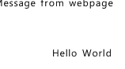

恭喜！你刚刚编写了你的第一个（尽管并不好用）JavaScript 代码。然而，通过这段小代码，包含了两个你在 JavaScript 编程实践中可能会使用的重要项目：浏览器中的 `javascript` 伪协议标识符，更重要的是 `alert` 函数。你将在后面的章节中更详细地检查这些项目；目前，只要你已经学会了你未来可能要用到的所有内容就足够了！

JavaScript 还是*事件驱动的*，这意味着它可以响应某些特定事件或“发生的事情”，例如鼠标点击或表单字段内的文本更改。将 JavaScript 连接到事件是 JavaScript 许多常见用处的核心。在第 11 章中，你将看到如何使用 JavaScript 响应事件。

# JavaScript 在你的网页中的放置

如果你要学习 HTML，你现在需要知道关于它的只有它使用方括号包裹的一对匹配标签来界定网页中的元素。闭合标签以斜杠（/）开头。元素可以相互嵌套。JavaScript 位于网页中 `<head>` 和/或 `<body>` 标签内的 `<script>` 标签中，例如所示：

```html
<html>
<head>
<script></script>
</head>
<body>
</body>
</html>
```

放置在 `<body>` 标签内的 JavaScript 会在浏览器遇到它时执行它，这在你需要使用 JavaScript 函数向文档写入内容时很有帮助，如下（函数调用用粗体显示）：

```html
<head>
<title>一个网页标题</title>
<script type="text/javascript">
// JavaScript 代码写在这里
</script>
</head>
<body>
<script type="text/javascript">
document.write("Hello ");
document.write(" world");
</script>
</body>
</html>
```

由于浏览器加载 JavaScript 的方式，目前在 HTML 中放置 JavaScript 的最佳实践是将 `<script>` 标签放置在 `<body>` 元素的末尾，而不是在 `<head>` 元素中。这样做有助于确保如果浏览器在加载 JavaScript 文件期间阻塞了输入，页面内容仍能加载。

当你在可扩展超标记语言 (XHTML) 页面上使用 JavaScript 时，小于字符 (`<`) 和和符号字符 (`&`) 被解释为 XML，这可能会给 JavaScript 带来问题。为了解决这个问题，在 XHTML 中使用以下语法：

```xml
<script type="text/javascript">
<![CDATA[
// JavaScript 代码写在这里
]]>
</script>
```

不符合 XHTML 标准的浏览器会正确解释 CDATA section。你可以通过将 CDATA section 放置在 JavaScript 注释中来解决该问题——即两个正斜杠（`//`）开头的单行或多行，如下：

```html
<script type="text/javascript">
// <![CDATA[
// JavaScript 代码写在这里
// ]]>
</script>
```

## 文档类型

如果你一直在为 Web 编程，你可能熟悉文档类型（Document Types），你最重要的任务之一是在页面顶部包含文档类型定义，简称 DTD，以便浏览器知道遵循哪些规则。HTML 4.01 的 DTD 示例如下：

```html
<!DOCTYPE HTML PUBLIC "-//W3C//DTD HTML 4.01//EN" "http://www.w3.org/TR/html4/strict.dtd">
```

如果你使用的是 XHTML 1.0，则 DTD 如下：

```xml
<!DOCTYPE html PUBLIC "-//W3C//DTD XHTML 1.0 Transitional//EN" "http://www.w3.org/TR/xhtml1/DTD/xhtml1-transitional.dtd">
```

HTML5 使用了更简单的 DTD：

```html
<!DOCTYPE html>
```

如果你未能声明 DTD，浏览器将使用一种称为怪异模式（Quirks Mode）的模式来解释页面，这意味着文档看起来可能与你的意图不符，特别是通过不同的浏览器查看时。确保 HTML 样式表（也称为 CSS）和 JavaScript 符合标准是重要的，这样文档才能被尽可能的观众看到。HTML 和 CSS 验证将在本书第 15 章“JavaScript 和 CSS”中进行讨论。W3C 提供了一个在线验证器 `http://validator.w3.org/`，你可以用它验证任何公开的内容。

# JavaScript 可以做什么

JavaScript 很大程度上是一种补充语言，这意味着通常不会没有 HTML 等语言辅助的情况下编写应用程序。某些 Adobe 产品支持 JavaScript，但 JavaScript 主要用于 Web 相关编程。

JavaScript 还是 AJAX 缩写（异步 JavaScript 和 XML）中的 J，这是 Web 2.0 现象的宠儿。尽管如此，JavaScript 正在为今天的访问者提供、甚至是要求的交互式体验。

JavaScript 可以在客户端执行许多任务。通过创建下拉菜单、转换页面文本、向页面添加动态元素以及帮助表单输入，为网站添加必要的交互。

在学习 JavaScript 可以做什么（这是本书的重点）之前，你还需要了解 JavaScript 不能做什么，但请注意这些讨论都不是完全的。

# JavaScript 不能做什么

许多 JavaScript 无法执行的操作是 JavaScript 使用在某种程度上局限于浏览器环境的结果。本节检查了一些 JavaScript 无法执行的任务，以及一些不应该执行的任务。

# JavaScript 无法强制作用于客户端

JavaScript 依赖另一个接口或宿主程序来实现功能。该宿主程序通常是客户端的浏览器，也称为用户代理。因为 JavaScript 是一种客户端语言，它只能做客户端允许它做的事。

有些人仍在使用不支持 JavaScript 的旧浏览器。另一些人由于辅助程序、文本阅读器和辅助浏览体验的插件软件而无法支持 JavaScript 的许多高级功能。有些人可能因为可以而选择禁用 JavaScript，出于安全考虑（无论感知还是真实）；或者因为 JavaScript 因弹出广告等某些骚扰而具有的负名声。

从另一个角度来考虑这个问题可能会有所帮助。当你构建一个从微软 Internet 信息服务 (IIS) 6.0 提供的服务的 Web 应用程序时，你可以假设该应用程序在任何地方 IIS 6.0 服务器上都能运行良好。同样，当你为 Apache 2 构建一个应用程序时，你完全可以确定它会在其他 Apache 2 实例上运行。然而，对于 JavaScript，你不能做同样的假设。当你编写了一个在你的桌面电脑上运行良好的程序时，你无法保证它在其他人的电脑上也能运行。一旦你的程序被发送到客户端，你就无法控制它的运行方式。

## JavaScript 无法保证数据安全

由于 JavaScript 完全在客户端运行，开发者必须放手不管。正如你所预期的那样，放弃对程序的控制会产生严重的影响。一旦程序位于客户端的计算机上，客户端可以在将数据发送到服务器之前对数据进行许多操作。与任何其他编程一样，你永远不应该信任来自客户端的任何数据。即使你使用 JavaScript 函数来验证表单内容，也必须在输入到达服务器时再次进行验证。禁用了 JavaScript 的客户端可能会通过 Web 表单发回垃圾数据。如果你过于相信你的客户端 JavaScript 函数已经检查了数据以确保其有效，你可能会发现无效数据返回到了服务器，导致不可预见且可能危险的后果。

**重要：** 请记住，访问者的计算机上可以禁用 JavaScript。你不能依靠一些小花招来获得成功，例如使用 JavaScript 禁用右键点击或防止访问者查看源代码，你不应该将其用作安全措施。

## JavaScript 无法跨域

JavaScript 开发者还必须意识到同源策略（Same-Origin Policy），该策略规定运行在一个域内的脚本无法访问来自另一个 Internet 域的属性，也无法影响来自另一个域的脚本和数据。例如，可以使用 JavaScript 打开一个新的浏览器窗口，但该窗口的内容在某种程度上受到调用脚本的限制。当我的网站（braingia.org）上的页面包含 JavaScript 时，该页面无法访问从不同域（如其他域）执行的任何 JavaScript。我将在第 19 章“AJAX 初体验”中讨论一些跨域请求的变通和更完整的方法。目前，请记住 JavaScript 限于在你自己的浏览器窗口中执行任务。

## JavaScript 不负责服务器

在开发如 Visual Basic .NET 或 PHP（PHP 是一个递归缩写，代表 PHP: Hypertext Preprocessor）等服务器端代码时，你可以相当确定服务器将实现某些功能，例如与数据库通信或提供 Web 应用程序所需的模块。JavaScript 无法访问服务器端变量。例如，JavaScript 无法访问位于服务器上的数据库。JavaScript 代码限于运行脚本的平台内部的内容，该平台通常是浏览器。

如果你熟悉服务器端编程，你思维中需要的另一个转变点是：对于 JavaScript，你必须在许多不同的客户端上测试代码，以了解特定客户端的能力。当你编写服务器端代码时，如果服务器没有实现某个功能，你会立即知道，因为服务器端脚本在测试时会失败。撇开那些不听话的管理员不谈，后端服务器代码的实现不应该随意更改，因此你更容易知道你哪些可以写、哪些不能写。但你无法预判旨在运行在客户端的 JavaScript 代码，因为这些客户端完全不受你控制。

## 使用 JavaScript 的技巧

良好的设计取决于多个因素，但实际上，到底是什么没有被考虑进去才算好呢？网站的某个访问者可能会认为该网站是颜色和文本的丑陋杂烩，就像把这些元素放进袋子里摇晃，直到它们掉落在页面上一样；而下一个访问者可能喜欢这种设计和配色方案。

由于你正在读这本书，我假设你正在寻找关于 JavaScript 的帮助来增强你的网站。我也假设你希望使用这种编程语言来帮助人们使用你的网站，并让你的网站看起来更好、感觉更好、运行得更好。

网站的设计不是也永远不会是一个完全客观的过程。某些信息强调功能重于形式。当用户访问网站时，他或她通常想要获取信息或执行任务。你的网站越易于浏览，用户就越可能转向另一个浏览体验更好的网站。

动画和闪烁的部分会来去，但留存的是那些以专业、易于获取的方式呈现基本信息的网站。使用最新的动画软件或 Web 技术会让我想起 HTML `<blink>` 标签的时代。对于那些从未见过它实际效果的人来说，`<blink>` 标签会导致其中的文本在屏幕上消失并重新出现。几乎所有的 Web 开发者似乎都讨厌 `<blink>` 标签及其对网页的影响。这些开发者明智的做法是记住，今天网页上令人兴奋的功能或特效在明天就会变得过时。成功的网站坚持基础工作，并仅在内容需要时才使用这类元素。

使用像网站地图、`alt` 标签和简单导航等元素，并且在访问网站主要内容时不需要特殊软件或插件。我经常访问一个网站，却因为需要某个插件或最新版本的播放器（而我恰好没有）而无法访问。

## 关于 JavaScript 和本书的说明

本书涵盖了根据 ECMA 标准定义的 JavaScript，版本从早期版本一直到最新的第 5 版本。在某些章节中，我强调了与 JavaScript 和 .NET 相关的信息。对于仅限 JavaScript 的额外参考，我推荐以下网站：

```
JavaScript (Windows Script Technologies) http://msdn.microsoft.com/en-us/library/hbc2t98.aspx
```

# 网站应该支持哪些浏览器？

向下兼容性长期以来一直是 Web 开发者的一个问题。选择要支持的浏览器版本是在使用新浏览器中的最新可用功能与旧版浏览器所需的兼容功能之间进行权衡。对于你应该在 Web 上应该支持哪些浏览器，并没有一个硬性执行的规则，所以答案是：视情况而定。

你的决定取决于你想对网站做些什么，以及你是否更看重使用旧版硬件和软件的人的访问，还是更看重后期浏览器中提供的额外功能。有些浏览器由于太老旧而根本无法被支持，因为它们无法正确渲染 CSS，更不用说 JavaScript 了。支持多个浏览器版本的关键在于在这些浏览器内部进行测试。

从微软获取 MSDN 账户将让你可以使用旧产品，包括 Internet Explorer 的旧版本，这样你就可以看到你的网站对 Internet Explorer 4.0 访问的反应。额外的资源是应用程序兼容 PC 镜像（Application Compatibility PC images），可以从微软免费获取。这些允许你使用限时的 Microsoft Windows 浏览器，例如 Internet Explorer 6.0 和 Windows Internet Explorer 7。更多信息请访问：`http://www.microsoft.com/downloads/details.aspx?FamilyId=21ABB90-958F-4864-B5F1-73DOA413C8EF&display=en`。

许多设计和 JavaScript 函数不需要新版本的 Web 浏览器。然而，正如解释过的，验证你的网站在各种浏览器中正确渲染总是一个好主意。访问 `http://browsers.evolt.org/` 可以查看许多历史版本的存档。

# ECMAScript 第 5 版的新特性

当第 5 版本在 2009 年引入时，ECMA262 标准进行了多项增强。本节回顾了其中一些增强和变化。这些变化中的大多数与旧版 Web 浏览器不向下兼容。然而，随着新版 Web 浏览器的发布，ECMAScript 262 版本 5 引入的变化将开始出现，并在跨浏览器 Web 应用中使用。

## 新的数组方法

ECMA-262 版本 5 为数组引入了几个新方法。这些方法包括一个用于遍历数组元素的 `forEach` 方法、一个 `map` 方法、一个 `filter` 方法，以及其他确定索引和缩小数组大小的方法。第 8 章“JavaScript 中的对象”检查了数组，并对这些新方法进行了一些讨论。

## 对象属性的新控制

第 8 章中讨论的对象属性具有更高的灵活性。ECMA-262 版本 5 引入了 `get` 和 `set` 函数，它们分别在获取属性或分配值时被调用。你可以通过 `writable`（可写）、`configurable`（可配置）和 `enumerable`（可枚举）属性来控制对属性的访问。例如，一个属性可能有一个值，你可以将其配置为非自有（non-own），这意味着该属性在对象迭代时不会被返回。考虑这段代码：

```javascript
{ value: "testvalue", enumerable: false }
```

如果通过 `for` 循环传递，该值将不会被返回。如果这种语法还不完全理解，请不要气馁。随后的章节将详细检查对象的创建和迭代。

## 新的 JSON 对象

## ECMA-262 对 Date 对象的更改

ECMA-262 版本 5 为 Date 对象增加了新方法，用于解析和生成 ISO 格式的日期。`toISOString()` 方法生成 ISO-8601 格式的输出。

## 严格模式（Strict Mode）

# 第 2 章 使用 JavaScript 开发

## Visual Studio 2010 专业版

在首次开始使用该应用程序之前，你需要指定你所从事的开发活动类型，例如 Visual Basic 或 Visual C#。这些信息将用于为适用于你活动的设计的开发环境应用一组预定义的设置集合。

你可以随时选择使用不同的设置集合。从“工具”菜单中，选择“导入和导出设置”，然后点击“重置所有设置”。

## 选择你的默认环境设置：

- 通用开发设置
- 项目管理设置
- Visual Basic 开发设置
- Visual C# 开发设置
- Visual C++ 开发设置
- Visual F# 开发设置
- Web 开发
- Web 开发（仅限代码）

说明：

请从设置列表中选择其中一个集合。

图 2-1 选择开发环境样式。

如果你正在使用“通用开发设置”集合，那么你的 Visual Studio 环境将与图 2-2 所示的相似。

Visual Studio - 专业版

文件 编辑 帮助 工具 视图 窗口

Visual Studio-专业版 获取标准通知和官方图层新闻

文件 到 通用 通用 V... Office/电话

Web 新! 西部俱乐部 200

街 位于位置 Visual 到

主 选项

 Web 无: 201

完好 不在 Mm A

(ITD)

Recani Proj

Galing Amvd


你可以通过从“工具”菜单中选择“导入和导出设置”来更改 Visual Studio 2010，使其使用“Web 开发设置”集合，这将打开“导入和导出设置”向导。如图 2-3 所示，选择“重置所有设置”，然后点击“下一步”。

> 注意：并不要求更改开发环境设置，但本书假设你在 Visual Studio 2010 中选择了“Web 开发设置”。

导入和导出设置向导

## 欢迎使用导入和导出设置向导

你可以使用此向导导入或导出特定类别的设置，或者将环境重置为默认设置集合之一。

你想做什么？

### 导出选定的环境设置

设置将保存到文件中，以便稍后可以在任何机器上随时导入。

### 导入选定的环境设置

从文件导入设置并将其应用到环境中。

- 重置所有设置

将所有环境设置重置为默认设置集合之一。

下一步 > | 取消

图 2-3 准备将 Visual Studio 2010 中的设置更改为 Web 开发设置。

向导的“当前设置”页面（如图 2-4 所示）将出现。如果你有想要保存的设置，请选择“是，保存我的当前设置”。否则，选择“否，仅重置设置，覆盖我的当前设置”。点击“下一步”继续。

向导的“选择默认设置集合”页面（如图 2-5 所示）将出现。选择“Web 开发”设置，然后点击“完成”。

通过“Web 开发设置”，你可以快速访问与网站开发相关的常用任务，不仅涉及 ASP.NET，还涉及 JavaScript、HTML 和 CSS——这些是 Web 的核心语言。有关 Visual Studio 2010 设置的更多信息，请访问 `http://msdn.microsoft.com/en-us/library/zbhkhl/67.aspx`。

```
Im SPAM Bp off SettingW=3
```


在离开之前，你想要保存当前设置吗？

- 是，保存我的当前设置

设置文件名：

`CurrentSettings-2010-06-26-Vssettings`

存储我的设置到：

`Users\Documents\Visual Studio2010` 浏览...

否，仅重置设置，覆盖我的当前设置

< 上一步 | 取消

图 2-4 通过保存当前设置，你可以保留你为环境指定的任何自定义设置。

导入和导出设置向导

选择默认设置集合

你想重置哪个设置集合？

| 通用开发设置 | 优化环境 |
| :--- | :--- |
| 项目管理设置 | 为开发提供 |
| Visual Basic 开发设置 | 各种类型的开发 |
| Visual C# 开发设置 | 选项 |
| Visual C++ 开发设置 | 无论使用 |
| Visual F# 开发设置 | 语言 |
| Web 开发 | 选项 |
| Web 开发（仅限代码） | |

| 2010 中的 JavaScript 项目 |
| :--- |
| 2010 中的 JavaScript 项目 |


# 第 2 章 使用 JavaScript 开发

在 Visual Studio 2010 中，通过从“工具”菜单中选择“导入和导出设置”来更改 Visual Studio 2010，使其使用“Web 开发设置”集合，这将打开“导入和导出设置”向导。如图 2-3 所示，选择“重置所有设置”，然后点击“下一步”。

> **注意**：并不要求更改开发环境设置，但本书假设你在 Visual Studio 2010 中选择了“Web 开发设置”。

## 导入和导出设置向导

### 欢迎使用导入和导出设置向导

你可以使用此向导导入或导出特定类别的设置，或者将环境重置为默认设置集合之一。

你想做什么？

#### 导出选定的环境设置

设置将保存到文件中，以便稍后可以在任何机器上随时导入。

#### 导入选定的环境设置

从文件导入设置并将其应用到环境中。

#### 重置所有设置

将所有环境设置重置为默认设置集合之一。


向导的“当前设置”页面（如图 2-4 所示）将出现。如果你有想要保存的设置，请选择“是，保存我的当前设置”。否则，选择“否，仅重置设置，覆盖我的当前设置”。点击“下一步”继续。


向导的“选择默认设置集合”页面（如图 2-5 所示）将出现。选择“Web 开发”设置，然后点击“完成”。

### 选择默认设置集合

你想重置哪个设置集合？

| 设置集合 | 说明 |
| :--- | :--- |
| 通用开发设置 | 优化环境 |
| 项目管理设置 | 为开发提供 |
| Visual Basic 开发设置 | 各种类型的开发 |
| Visual C# 开发设置 | 选项 |
| Visual C++ 开发设置 | 无论使用 |
| Visual F# 开发设置 | 语言 |
| Web 开发 | 选项 |
| Web 开发（仅限代码） | |
| 2010 中的 JavaScript 项目 | |


通过“Web 开发设置”，你可以快速访问与网站开发相关的常用任务，不仅涉及 `ASP.NET`，还涉及 `JavaScript`、`HTML` 和 `CSS`——这些是 Web 的核心语言。有关 Visual Studio 2010 设置的更多信息，请访问 `http://msdn.microsoft.com/en-us/library/zbhkhl/67.aspx`。

```
Im SPAM Bp off SettingW=3
```


# 第 2 章 使用 JavaScript 开发 21

## Visual Studio 2010 专业版

在首次开始使用该应用程序之前，你需要指定你所从事的开发活动类型，例如 Visual Basic 或 Visual C#。这些信息将用于为适用于你活动的设计的开发环境应用一组预定义的设置集合。

你可以随时选择使用不同的设置集合。从“工具”菜单中，选择“导入和导出设置”，然后点击“重置所有设置”。

## 选择你的默认环境设置：

- 通用开发设置
- 项目管理设置
- Visual Basic 开发设置
- Visual C# 开发设置
- Visual C++ 开发设置
- Visual F 开发设置
- Web 开发
- Web 开发（仅限代码）

说明：

请从设置列表中选择其中一个集合。

图 2-1 选择开发环境样式。

如果你正在使用“通用开发设置”集合，那么你的 Visual Studio 环境将与图 2-2 所示的相似。

Visual Studio - 专业版

文件 编辑 帮助 工具 视图 窗口

Visual Studio-专业版 获取标准通知和官方图层新闻

文件 到 通用 通用 V... Office/电话

Web 新! 西部俱乐部 200

街 位于位置 Visual 到

主 选项

 Web 无: 201

完好 不在 Mm A

(ITD)

Recani Proj

Galing Amvd


45 第一部分 Java 是什么？JavaScript 的位置、为什么以及怎么

你可以通过从“工具”菜单中选择“导入和导出设置”来更改 Visual Studio 2010，使其使用“Web 开发设置”集合，这将打开“导入和导出设置”向导。如图 2-3 所示，选择“重置所有设置”，然后点击“下一步”。

注意：并不要求更改开发环境设置，但本书假设你在 Visual Studio 2010 中选择了“Web 开发设置”。

导入和导出设置向导

## 欢迎使用导入和导出设置向导

你可以使用此向导导入或导出特定类别的设置，或者将环境重置为默认设置集合之一。

你想做什么？

### 导出选定的环境设置

设置将保存到文件中，以便稍后可以在任何机器上随时导入。

### 导入选定的环境设置

从文件导入设置并将其应用到环境中。

- 重置所有设置

将所有环境设置重置为默认设置集合之一。

下一步 > | 取消

图 2-3 准备将 Visual Studio 2010 中的设置更改为 Web 开发设置。

向导的“当前设置”页面（如图 2-4 所示）将出现。如果你有想要保存的设置，请选择“是，保存我的当前设置”。否则，选择“否，仅重置设置，覆盖我的当前设置”。点击“下一步”继续。

向导的“选择默认设置集合”页面（如图 2-5 所示）将出现。选择“Web 开发”设置，然后点击“完成”。

# 第 2 章 使用 JavaScript 开发 23

通过“Web 开发设置”，你可以快速访问与网站开发相关的常用任务，不仅涉及 ASP.NET，还涉及 JavaScript、HTML 和 CSS——这些是 Web的核心语言。有关 Visual Studio 2010 设置的更多信息，请访问 http://msdn.microsoft.com/en-us/library/zbhkhl/67.aspx。

```
Im SPAM Bp off SettingW=3
```


在离开之前，你想要保存当前设置吗？

- 是，保存我的当前设置

设置文件名：

CurrentSettings-2010-06-26-Vssettings

存储我的设置到：

Users\Documents\Visual Studio2010 浏览...

否，仅重置设置，覆盖我的当前设置

< 上一步 | 取消

图 2-4 通过保存当前设置，你可以保留你为环境指定的任何自定义设置。

导入和导出设置向导

选择默认设置集合

你想重置哪个设置集合？

| 通用开发设置 | 优化环境 |
| :--- | :--- |
| 项目管理设置 | 为开发提供 |
| Visual Basic 开发设置 | 各种类型的开发 |
| Visual C# 开发设置 | 选项 |
| Visual C++ 开发设置 | 无论使用 |
| Visual F 开发设置 | 语言 |
| Web 开发 | 选项 |
| Web 开发（仅限代码） | |

| 2010 中的 JavaScript 项目 |
| 2010 中的 JavaScript 项目 |

在 Visual Studio 2010 中，通过从“工具”菜单中选择“导入和导出设置”来更改 Visual Studio 2010，使其使用“Web 开发设置”集合，这将打开“导入和导出设置”向导。如图 2-3 所示，选择“重置所有设置”，然后点击“下一步”。

注意：并不要求更改开发环境设置，但本书假设你在 Visual Studio 2010 中选择了“Web 开发设置”。

导入和导出设置向导

## 欢迎使用导入和导出设置向导

你可以使用此向导导入或导出特定类别的设置，或者将环境重置为默认设置集合之一。

你想做什么？

### 导出选定的环境设置

设置将保存到文件中，以便稍后可以在任何机器上随时导入。

### 导入选定的环境设置

从文件导入设置并将其应用到环境中。

- 重置所有设置

将所有环境设置重置为默认设置集合之一。

下一步 > | 取消

图 2-3 准备将 Visual Studio 2010 中的设置更改为 Web 开发设置。

向导的“当前设置”页面（如图 2-4 所示）将出现。如果你有想要保存的设置，请选择“是，保存我的当前设置”。否则，选择“否，仅重置设置，覆盖我的当前设置”。点击“下一步”继续。

向导的“选择默认设置集合”页面（如图 2-5 所示）将出现。选择“Web 开发”设置，然后点击“完成”。

# 第 2 章 使用 JavaScript 开发 23

通过“Web 开发设置”，你可以快速访问与网站开发相关的常用任务，不仅涉及 ASP.NET，还涉及 JavaScript、HTML 和 CSS——这些是 Web的核心语言。有关 Visual Studio 2010 设置的更多信息，请访问 http://msdn.microsoft.com/en-us/library/zbhkhl/67.aspx。

```
Im SPAM Bp off SettingW=3
```


在离开之前，你想要保存当前设置吗？

- 是，保存我的当前设置

设置文件名：

CurrentSettings-2010-06-26-Vssettings

存储我的设置到：

Users\Documents\Visual Studio2010 浏览...

否，仅重置设置，覆盖我的当前设置

< 上一步 | 取消

图 2-4 通过保存当前设置，你可以保留你为环境指定的任何自定义设置。

# 51 第一部分 Java 是什么？JavaScript 的在哪里、为什么以及怎么做

注意：你可以通过其他方式声明脚本为 JavaScript，但你在这里看到的方法是支持最广泛的。

接下来，脚本声明了一个函数 `yetAnotherAlert`，它接受一个参数 `textToAlert`，如下所示：

```javascript
function yetAnotherAlert(textToAlert) {
```

该函数有一个任务：在浏览器窗口中弹出一个警告框，显示作为函数参数提供的任何文本，下一行代码就实现了这一点：

```javascript
alert(textToAlert);
```

函数的结束由右大括号（`}`）界定。脚本的下一行使用带引号的字符串参数调用了该函数。

```javascript
yetAnotherAlert("This is Chapter 2");
```

有了这个脚本，你就准备好在 Visual Studio 中开发 JavaScript 了。在庆祝之前，请考虑跟我一起，学习如何使用外部文件来存储你的 JavaScript 代码。

## 在 Visual Studio 2010 中使用外部 JavaScript 文件

JavaScript 不需要完全包含在网站的 HTML 文件中。相反，你可以利用 `<script>` 标签的 `src` 属性。标签内的属性有助于进一步定义元素或提供更具体的细节。例如，`<form>` 元素有一个属性定义了在提交表单时应该发生什么操作。使用 `<script>` 标签的 `src` 属性，你可以定义外部 JavaScript 文件的位置。网页浏览器在加载网页时会渲染指定文件中包含的 JavaScript。使用外部 JavaScript 文件意味着你可以在一个地方维护常用的 JavaScript，而不是在每个单独的页面中维护——这将为你节省大量工作。

到此时，你应该有了一个可以运行的网页（使用 Visual Studio 构建），它可以显示警告框，这要归于某些巧妙的 JavaScript。你在上一节中开发的网页在页面 `<head>` 标签部分包含 JavaScript 代码。在本节中，

## 第 2 章 使用 JavaScript 开发

### 使用 Visual Studio 2010 为 JavaScript 创建 myfirstpage

1. 如果 `myfirstpage.html` 文件没有打开，请进入 Visual Studio 并从“文件”菜单中选择“打开项目”来打开它。选择你保存 `myfirstpage.html` 文件的项目（可在配套内容可用）并打开文件。你的环境看起来应该像上一个示例中第 6 步的环境。

2. 通过从“文件”菜单中选择“新建文件”来创建一个存放 JavaScript 代码的新文件。出现“添加新建项”对话框。在模板列表中，选择“JavaScript 文件”并将名称更改为 `myscript.js`，如下屏所示，然后点击“添加”。注意，你的文件标题取决于你 Visual Studio 的安装情况。你可以在第 2 章的示例代码中找到这个名为 `myscript.js` 的源文件。

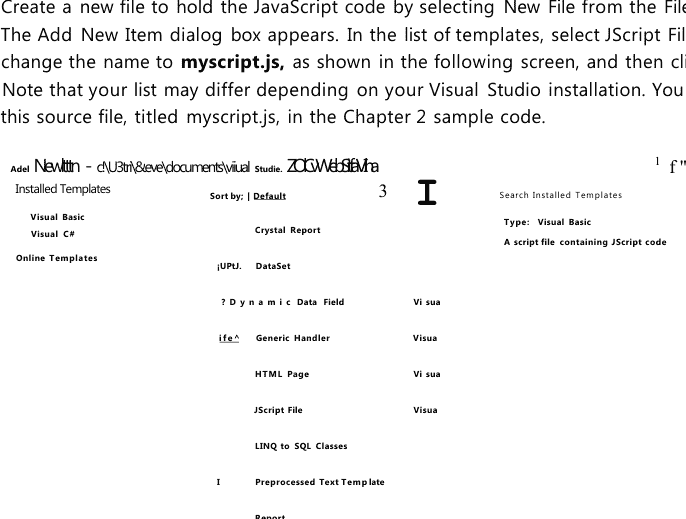

3. 一个空的 JavaScript (JScript) 文件被打开并添加到你的 Web 项目中。你应该看到一个新 `myscript.js` 文件的标签和另一个 `myfirstpage.html` 文件的标签，如下屏所示。如果 `myfirstpage.html` 文件没有在标签页中打开，请在解决方案管理器中双击它来打开。

## 第一部分 Java 是什么？JavaScript 的在哪里、为什么以及怎么做

- 列表？JavaWhatIsEverything

- 编辑 视图 帮助 转 调试 数据 工具 文本 窗口 帮助

- +--JAST.-> A 0; J 96e__-j 3 A.

> 如果你

- AddJS

- Angular

- Spring

- Angular

- RxJS

- myproject-info

- withRouter

- withRouter

什么让 JS 保持

单元是我们看到的。

构建: 到目录

从 src/ 构建

从 dist 构建到 dist/

注意：JavaScript 和 JS 的口语化表达是 js，但你并不需要使用它。我在前面的步骤 2 中选择使用 JScript 类型的文件，是因为这种文件类型会自动选择正确的文件扩展名。你完全可以同样在“新建项”对话框中选择“文本”，并将文件命名为 .js 扩展名。

4. 点击 `myscript.tab` 标签使其激活，并高亮 JavaScript 代码。保持`<script>` 和 `</script>` 标签完整，不要高亮它们。你现在不需要这些标签，但你很快会再次回到这个主题。你也可以在配套内容的第 2 章示例代码中找到这个名为 `myscript.tab` 的页面。

5. 通过从“编辑”菜单中选择“复制”，将高亮的代码复制到剪贴板。

6. 点击 `myscript.js` 标签，将光标移动到第一行下方，并从“编辑”菜单中选择“粘贴”。复制的代码粘贴在光标位置。更改 `yetAnotherAlert` 函数参数的文本，使其内容如下：“This is the Second”

通过从“文件”菜单中选择“保存”来保存 `myscript.file`。文件看起来应该像这样

| 文件 | 编辑 | 视图 | 生成 | 调试 | 数据 | 工具 | 文本 | 窗口 | 帮助 |
|---|---|---|---|---|---|---|---|---|---|
| | Ctrl+Z | Ctrl+Y | | | | Ctrl+A | | | |

7. 已

```javascript
function yetAnotherAlert(text) {
  alert(text);
}
yetAnotherAlert('This is the Second example.js');
```

```javascript
var M = -q *;
/* skip2V */
var i = D-R;
var j = i+1;
var k = j;
while ()
```

注意：JavaScript 和 JS 的口语化表达是 js，但你并不需要使用它。我在前面的步骤 2 中选择使用 JScript 类型的文件，是因为这种文件类型会自动选择正确的文件扩展名。你完全可以同样在“新建项”对话框中选择“文本”，并将文件命名为 .js 扩展名。

4. 点击 `myscript.tab` 标签使其激活，并高亮 JavaScript 代码。保持`<script>` 和 `</script>` 标签完整，不要高亮它们。你现在不需要这些标签，但你很快会再次回到这个主题。你也可以在配套内容的第 2 章示例代码中找到这个名为 `myscript.tab` 的页面。

5. 通过从“编辑”菜单中选择“复制”，将高亮的代码复制到剪贴板。

6. 点击 `myscript.js` 标签，将光标移动到第一行下方，并从“编辑”菜单中选择“粘贴”。复制的代码粘贴在光标位置。更改 `yetAnotherAlert` 函数参数的文本，使其内容如下：“This is the Second”

通过从“文件”菜单中选择“保存”来保存 `myscript.file`。文件看起来应该像这样

| 文件 | 编辑 | 视图 | 生成 | 调试 | 数据 | 工具 | 文本 | 窗口 | 帮助 |
|---|---|---|---|---|---|---|---|---|---|
| | Ctrl+Z | Ctrl+Y | | | | Ctrl+A | | | |

7. 已

```javascript
function yetAnotherAlert(text) {
  alert(text);
}
yetAnotherAlert('This is the Second example.js');
```

```javascript
var M = -q *;
/* skip2V */
var i = D-R;
var j = i+1;
var k = j;
while ()
```

注意：JavaScript 和 JS 的口语化表达是 js，但你并不需要使用它。我在前面的步骤 2 中选择使用 JScript 类型的文件，是因为这种文件类型会自动选择正确的文件扩展名。你完全可以同样在“新建项”对话框中选择“文本”，并将文件命名为 .js 扩展名。

（由于原始文本中存在大量重复，此处已根据要求去重，仅翻译核心逻辑部分）

## 第一部分 Java 是什么？JavaScript 的在哪里、为什么以及怎么做

```html
<!DOCTYPE html PUBLIC "-//W3C//DTD HTML 1.0 Transitional//EN" "http://www.w3.org/TR/html1-transitional.dtd">
<html xmlns="http://www.w3.org/1999/xhtml">
<head>
  <title>My Page</title>
  <script type="text/javascript" src="myscript.js"></script>
</head>
<body>

</body>
</html>
```

11. 保存 `myfirstpage.html`。

12. 通过从“调试”菜单中选择“不调试启动”在浏览器中查看页面。如果浏览器窗口没有打开，将会打开。结果应该是一个带有“This is the Second”文本的警告框。

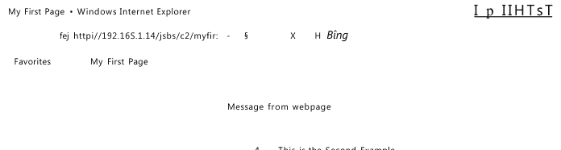

13. 点击 OK 关闭警告对话框。查看源代码查看差异。注意 script 标签现在包含了对外部文件的引用。

## 在 Eclipse 中编写 JavaScript

另一个 Web 开发者（以及使用其他语言的开发者）流行的 IDE 是 Eclipse。使用 Eclipse 的开发者可以安装不同的框架来协助特定的开发任务。例如，开发者可以使用 Web Tools Platform 或 PHP (PHP 预处理器) 开发工具来创建一个简化许多任务的环境。对潜在 Eclipse 项目的讨论超出了本书的范围，但我将讨论如何使用基础 Eclipse 项目开发 JavaScript。

如果你想在 Eclipse 中开发 JavaScript，请花点下载软件，并在必要时下载 Java 运行环境。详细信息和下载位置可以从 Eclipse 网站 (http://www.eclipse.org) 获取。在本书的范围内，我假设你从未使用过 Eclipse 并且第一次学习。然而，本节不包括安装 Eclipse 的教程。我建议你阅读 Eclipse 自带的文档以及 Eclipse 网站上的文档以获取最新信息。

## 使用 Eclipse 创建你的第一个 Web（和 JavaScript）项目

1. 从“文件”菜单选择“新建”，然后选择“JavaScript”，创建一个新项目。出现“新建 JavaScript 项目”对话框。在项目名称框中输入 Chapter2 并点击“完成”。

# 第一部分 Java 是什么？JavaScript 的在哪里、为什么以及如何

## 新的 JavaScript 项目

### 创建 JavaScript 项目

在工作区或外部位置中创建一个 JavaScript 项目。

- 项目名称：Chapter

- 在工作区中创建新项目

- 从现有源创建项目

(C:\Steve\Workspace\Chapter)

浏览..

### Web 页面支持

包含 ECMA 3 浏览器库

使用 Window 作为默认 SuperType

### 项目布局

使用项目文件夹作为 JavaScript 全局上下文的根目录- 创建一个独立的根文件夹

配置默认..

### 工作集

将项目添加到工作集

< 上一步 下一步 > 完成

2. Chapter2 文件夹在资源生成器（Explorer）中打开，但没有列出文件，如图所示。

| javascript |
| :--- |
| 大纲视图 |
| 大纲不可用。 |

# 第 2 章 使用 JavaScript 进行开发 35

### 创建你的第一个页面

右键点击 Chapter2 文件夹，点击“新建”，然后点击“文件”。“新建文件”对话框打开。在“文件名”文本框中输入 myfirstpage.htm，如下屏所示，并点击“完成”。你可以在 Chapter 2 示例代码中找到名为 eclipse_myfirstpage.htm 的文件。如果你想使用此文件，请将其重命名为 myfirstpage.htm 以供后续使用。

JS+ 新文件

文件

创建一个新文件资源，

输入或选择父目录

Chapter?

IS Chapter?

文件名: myfirstpage.htm

高级

j

I 完成 取消

点击“完成”后，Eclipse 会在自己的内置浏览器中打开该页面。然而，你想编辑页面而不是查看它，请在项目资源管理器中右键点击 myfirstpage.htm 并点击“打开”。该页面将直接在 Eclipse 的编辑器中打开，如下所示：

```
* Nextoc' Chapter')*myfirstpage.htm edit
```

| 项目 |
| :--- |
| firstpage.html |
| Chapter |
| 1-firstpage.html |
| 2 myfirstpage.html |

# 第一部分 Java 是什么？JavaScript 的在哪里、为什么以及如何

## 5. 最后，是时候写代码了！在编辑器中，输入以下代码：

```html
<!DOCTYPE type PUBLIC "//W3C//DTD HTML1.0 Transitional//EN" "http://www.w3.org/TR/html1/DTD/HTML-transi-non.dtd">
<html xmlns="http://www.w3.org/1999/xhtml">
<head>
  <title>My First Page</title>
  <script type="text/javascript">

function yetAnotherAlert(textToAlert) {
  alert(textToAlert);
}
yetAnotherAlert("This is Chapter 2");
</script>
</head>
<body>

</</html>>
```

就本示例而言，如果你不想使用 DOCTYPE 声明，可以跳过它，直接从顶部的 `<html>` 标签开始。在本书之外的真实世界开发中，你绝对希望声明 DOCTYPE。请参阅第 1 章获取更多关于为什么这很重要的信息。

## 6. 从文件菜单保存。完成后的脚本和页面应该类似于这里：

```html
<!DOCTYPE html>
<html>
<head>
  <meta charset="UTF-8">
  
  <title>My First Page</title>
  <script type="text/javascript">
function yetAnotherAlert(textToAlert) {
  alert(textToAlert);
}
yetAnotherAlert("This is Chapter 2");
</script>
</head>
<body>

</</html>
```

警窗不可见

# 第 2 章 使用 JavaScript 进行开发 37

查看页面，在项目资源管理器中右键点击文件，选择“打开方式”，然后点击“Web 浏览器”。你将通过 Eclipse 浏览器本地查看该文件，你应该看到一个带有警窗的页面，类似于图 2-7 所示。

或者，你可以通过计算机上不同的 Web 浏览器查看文件，例如系统的默认 Web 浏览器。要这样做，浏览到文件（例如，文件位于 C:\Users\Steve\workspace\Chapter2folder），并双击文件。

> 如果你使用 Windows Internet Explorer，根据浏览器的安全级别，你可能会收到关于查看阻止内容的警报。http://windows.microsoft.com/en-US/Windows/Internet-Explorer-Information-bar-frequently-asked-questions 中的支持文章提供了有关此功能以及如何禁用它的更多信息

```javascript
/* * = (E + F) *
  b <* = (D - C) *
  c <* = (G - H) *
  d <* = 0
  e < = (I + J) *
  f <* = (K - L) *
  g <* = (M - N) *
  h <* = (O + P) *
  i <* = (Q - R) *
  j <* = (S + T) *
  k <* = (U - V) *
  l <* = (W + X) *
  m <* = (Y - Z) *
  n <* = (a + b) *
  o <* = (c - d) *
  p <* = (e + f) *
  q <* = (g - h) *
  r <* = (i + j) *
```

警窗不可见

图 2-7 查看文件

```
<script type="text/javascript">
```

function yetAnotherAlert(textToAlert) {

```
alert(textToAlert);
```

函数由大括号界定：

```javascript
}
```

脚本随后调用带有引号字符串的函数，如下：

```javascript
yetAnotherAlert("This is Chapter 2");
```

在这个简要示例中，你看到了如何使用 Eclipse 代码。下一节将介绍如何将 JavaScript 放入外部文件。

## 在 Eclipse 中使用外部文件

当你读到这里时，你应该已经有一个显示警窗的运行网页。你在上一节中开发的网页 JavaScript 位于 `<head>` 标签内。在本节中，我将描述如何将 JavaScript 放入外部文件，然后从你的 HTML 页面引用该代码。

### 为 JavaScript 创建外部文件

1. 如果 myfirstpage.htm 代码不在 Eclipse 中，请打开它（你可以在正文中找到）。选择保存 myfirstpage.htm 文件的项目，通过右键点击文件、选择“打开方式”，然后点击“编辑器”在编辑器中打开文件。

2. 通过从文件菜单选择“新建”并在“文件”创建一个存放 JavaScript 代码的新文件。“新建文件”对话框打开。在“文件名”文本框中输入 myscript.js，如下所示，并点击“完成”。

| 新文件 | |
| :--- | :--- |
| 文件 | 创建一个新文件资源， |
输入或选择父目录
Chapter?
IS Chapter?
文件名: myscript.js
高级
I 完成 取消

3. Eclipse 为你的项目添加了一个新的空 JavaScript 文件。如果该文件没有打开，请在项目资源管理器中右键点击 myscript.js 文件，选择“打开方式”，然后点击“文本编辑器”。现在你应该看到 myscript.js 和 myfirstpage.html 文件的标签。

4. 点击 myfirstpage.html 标签激活它，并选中你之前编写的 JavaScript 代码。确保真正的 JavaScript 标签 `<script>` 和 `</script>` 保持完整，不要删除它们（你现在不需要它们，但很快后会回到这个主题）。

5. 通过从编辑菜单选择“复制”将高亮的代码复制到剪贴板。

63 第一部分 Java 是什么？JavaScript 的在哪里、为什么以及如何

```javascript
function yetAnotherAlert(textToAlert) {
  alert(textToAlert);
  yetAnotherAlert("This is the Second Example.");
}
```

7. 从“文件”菜单中选择保存 `myscript.js`。文件内容应该与此处所示相似：


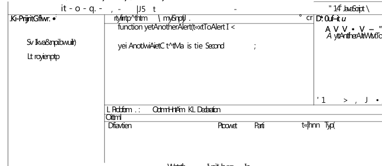

8. 既然名为 `myscript.js` 的文件中包含了 JavaScript 代码（你保存它了吧？），你可以安全地删除 `myfirstpage.html` 文件中的代码。只需删除代码，保留 `script` 标签，如下：

```html
<script type="text/javascript">
</script>
```

9. 在起始 `<script>` 标签中添加 `src` 属性：

```html
<script type="text/javascript" src="myscript.js">
</script>
```

10. 如果需要，为了让代码更整洁，可以删除多余的回车符将代码放在同一行，如下：

```html
<script type="text/javascript" src="myscript.js"></script>
```

现在 `myfirstpage.html` 的全部内容应为：

```html
<!DOCTYPE html PUBLIC "-//W3C//DTD HTML 1.0 Transitional//EN" "http://www.w3.org/TR/html1/DTD/html1-transi.dtd">
<html xmlns="http://www.w3.org/1999/xhtml">
<head>
<title>My First Page</title>
<script type="text/javascript" src="myscript.js"></script>
</head>
<body>
</body>
</html>
```

11. 保存 `myfirstpage.htm`。

12. 在项目资源管理器中右键点击 `myfirstpage.htm`，指向“打开方式”，然后点击“浏览器”，在网络浏览器中查看该页面。页面保存在本地，浏览器窗口将打开该页面。结果应该是一个显示文本为“This is the Second Example.”的警告框。它看起来像：

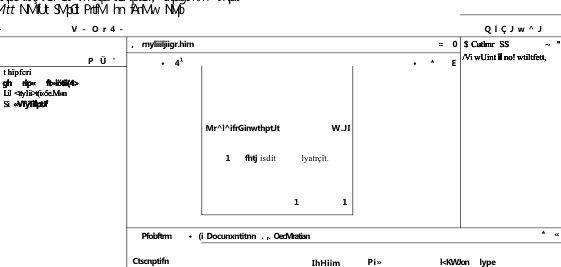

关于使用 Eclipse 进行 JavaScript 开发的入门教程到此结束。尽管如此，其中还有很多内容，我建议访问 Eclipse 网站获取更多关于使用 Eclipse 平台开发的信息。

## 不使用 IDE 编写 JavaScript

你可以轻松放弃 IDE，而采用更简单的 JavaScript 开发方法。任何文本编辑器（如 Notepad 或 Vim）都能很好地用于 JavaScript 开发。不过，我不建议使用 Microsoft Word 等文字处理器进行 JavaScript 开发，因为它们会在生成的文件中留下残留，从而可能对生成的网站造成破坏。

## 使用记事本完成你的第一个 Web（以及 JavaScript）项目

本章涵盖了使用记事本创建网页的概述。

```html
<!DOCTYPE HTML PUBLIC "//W3C//DTD HTML 4.01//EN"
"http://www.w3.org/TR/html4/strict.dtd">
<html>
<head>
<title>My First Page</title>
<script type="text/javascript">

function yetAnotherAlert(textToAlert) {
  alert(textToAlert);
}
yetAnotherAlert("This is Chapter 2");

</script>
</head>
<body>
</body>
</html>
```

就本示例而言，如果你不想输入 DOCTYPE 声明，可以跳过它，直接从顶部的 `<html>` 标签开始。在本书之外的实际开发，你绝对需要声明一个 DOCTYPE。请参考第3章更多关于为什么这重要的信息。

2. 从“文件”菜单中选择“另存为”。会出现一个“另存为”对话框。遗憾的是，除非使用双引号，否则记事本默认会向文件名添加 .txt 扩展名。因此，请确保在文件名周围加上双引号——例如，“myfirstpage.htm”。如果你省略了 .txt 扩展并将文件保存为“myfirstpage.htm.txt”，下面的图片显示了在文件名周围使用双引号的示例。请务必注意你保存此文档的位置。


3. 要查看页面，请使用你选择的浏览器访问你保存文件的位置。（如果如上一页屏幕所示，你将其保存在桌面上。）

8. 保存 `myfirstpage.htm`。

9. 在网络浏览器中查看该页面。如下屏所示的结果，应该是一个显示文本为“This is the Second Example.”的警告框。

这本关于不使用 IDE 进行 JavaScript 开发的入门指南完成了。虽然这个示例使用了记事本，但其他几个编辑器可能更适合基础开发，包括上述的 Vim 和来自 Helio Soft Solutions 的 Textpad，它们都比记事本更强大。

## 调试 JavaScript

调试 JavaScript 可能会是一种令人不安的经历，尤其是在更复杂的应用程序中。某些工具（如 Venkman (http://www.mozilla.org/projects/venkman/)）可以协助 JavaScript 调试，但调试 JavaScript 的主要工具是网络浏览器。主流网络浏览器都包含一些 JavaScript 调试功能。在你应该考虑使用的程序中，有 Firefox 的一个强大的插件。Firebug 可以在 http://www.firebug.com 获取。

发现 Firebug 对于 Web 开发几乎是不可或缺的，特别是使用 JavaScript 和 AJAX 进行开发。该软件允许你检查网页的所有元素，并实时查看 AJAX 调用的结果以及 CSS，这使得调试变得容易得多。图 2-8 显示了 Firebug 在我的网站主页上运行的示例。

```javascript
function sayHello() {
  alert("Hello World!");
}

// Steve Suehring 官方网站
// Gant Work Software Ranks, Writings, and Projects Client
```

图 2-8 Firebug 是 Web 开发者工具箱中的重要工具。

我建议使用 Firebug 来开发和调试 JavaScript。在调试 JavaScript 时，我发现 `alert()` 函数非常好用。恰当的 `alert()` 函数可以向你显示变量包含的值以及你的脚本当前正在做什么。当然，因为 `alert()` 会导致对话框打开，如果你在循环中放置了 `alert()`，然后错误地导致该循环无限重复而不退出，你会发现你需要以不干净的方式退出浏览器，可能需要使用任务管理器。

### 练习

1. 创建一个网页并命名为 `myscriptpage.html`。在页面的 `<body>` 部分创建一个 JavaScript 脚本，让脚本显示一个带有你名字的 `alert()` 对话框。尝试在至少两个不同的浏览器中运行。

2. 编辑你在练习 1 中创建的网页，在页面的 `<head>` 部分创建一个函数，并将你目前在 `<body>` 脚本中的 `alert()` 对话框移动到你的新函数中。从现有的 `<body>` 脚本调用该新函数。

3. 将练习 2 中创建的函数移动到外部 JavaScript 文件中，并在网页中链接或调用此文件。

## 第 3 章 JavaScript 语法与语句

阅读完本章后，你将能够：

- 理解 JavaScript 编程语言的基本规则。
- 将 JavaScript 正确放置在网页中。
- 识别 JavaScript 语句。
- 识别 JavaScript 中的保留字。

### 杂项说明

书的其余部分将更深入地研究 JavaScript 的特定方面以及它们如何与特定任务相关。然而，你必须先走后跑，因此在更深入学习 JavaScript 之前，你应该先学习它的一些词法结构——即语言的规则，也称为语法规则。

### 大小写敏感

JavaScript 是大小写敏感的。在命名变量和使用语言关键字时，必须意识到这一点。名为 `remote` 的变量与名为 `Remote` 或 `REMOTE` 的变量是不相同的。同样，循环控制关键字 `while` 是完全有效的，但将其命名为 `WHILE` 或 `While` 将导致错误。

关键字是小写的，但变量可以是任何你喜欢的大小写混合。只要你在大小写上保持一致，你就可以创建任何你想要的组合。例如，在 JavaScript 中，所有这些示例都是完全合法的变量名：

```
buttonOne
txt1
```

第 4 章提供了关于变量及其命名规范的更多信息。目前，请记住在 JavaScript 中编写变量名时，必须注意大小写。

### 空格

在大多数情况下，JavaScript 会忽略空白符，即 JavaScript 语句之间的空格。你可以使用任何数量的空格、缩进或任何你偏好的编码标准来提高 JavaScript 的可读性。然而，这条规则也有例外。某些关键字（如 `return`）当它们单独占一行时，可能会被 JavaScript 解释器误解。你将在本章稍后看到这个问题的示例。

提高程序的可读性是包含空白的充分理由。考虑以下代码示例。它包含了最少的空白和缩进。

```javascript
function cubeme(incomingNum) {
  if (incomingNum == 1) {
    return "What are you doing?";
  } else {
    return Math.pow(incomingNum,3);
  }
}

var theNum = 2;
var finalNum = cubeme(theNum);
if (!isNaN(finalNum)) {
  alert("You should know that 1 to any power is 1!");
} else {
  alert("When cubed, " + theNum + " is " + finalNum);
}
```

考虑带有缩进的相同代码。（你可以在第 3 章的示例代码中找到名为 `example.txt` 的代码）

```javascript
function cubeme(incomingNum) {
  if (incomingNum == 1) {
    return "What are you doing?";
  } else {
    return Math.pow(incomingNum,3);
  }
}

var theNum = 2;
var finalNum = cubeme(theNum);
if (!isNaN(finalNum)) {
  alert("You should know that 1 to any power is 1!");
} else {
  alert("When cubed, " + theNum + " is " + finalNum);
}
```

### 换行符

换行符与空白甚至 JavaScript 中的分号密切相关，它们有时被称为回车符。在官方的 ECMA-262 标准中被称为“行终止符”（Line Terminators），这些字符将一行代码与另一行代码隔开。与分号一样，换行符的位置至关重要。正如你在上一节的示例中看到的，在错误的位置放置换行符可能会导致意外的行为或错误。

换行符最常用的用途是将单独的代码行分开以提高可读性。你也可以通过换行符分隔特别长的代码来提高其可读性。然而，在这样做时，请注意像前面提到的 `return` 语句所说明的问题，额外的换行符可能会对代码的含义产生非预期影响。

### 正确放置 JavaScript

JavaScript 可以放置在超文本标记语言（HTML）页面的几个位置：在 `<head></head>` 部分，或者在 `<body></body>` 标签之间。传统上，JavaScript 最常见的位置是页面顶部附近的 `<head>` 和 `</head>` 标签之间。然而，将 `<script>` 语句块放在 `<body>` 部分正变得越来越常见。务必声明你正在使用的脚本类型。虽然可以使用其他类型的脚本，但由于这是一本 JavaScript 书，我将在 `<script>` 标签内声明以下内容：

```html
<script type="text/javascript">
</script>
```

使用 JavaScript 时需要注意重要问题与声明为扩展超文本标记语言（XHTML）的页面有关。在这些页面中，`<script>` 标签必须声明在 CDATA 区域内；否则，XHTML 会尝试将 `<script>` 标签视为另一个 XML 标签，区域内的代码可能无法按照你的预期工作。因此，使用的 JavaScript 应该如下声明：

```html
<script type="text/javascript">
//<![CDATA[
  // JavaScript 代码在这里
//]]>
</script>
```

当你将实际的 JavaScript 代码放在单独的文件中（你可能会在第 2 章“开发 JavaScript”中发现这样做更好），你完全不需要使用这个丑陋的 CDATA 区域。你可能会发现在单独的文件（通常以 `.js` 文件扩展名命名）中编写 JavaScript，然后在页面中链接脚本是理想的。但这里提醒你如何使用 `<script>` 标签的 `src` 属性链接到文件：

```html
<script type="text/javascript" src="myscript.js"></script>
```

将 JavaScript 放置在外部文件中有几个优点，包括：

- 代码与标记分离：将 JavaScript 代码保持在单独的文件中使 HTML 更容易维护，并保留 HTML 的结构，而无需为 XHTML 使用 CDATA 区域。
- 更易维护：将 JavaScript 作为一个单独的文件，你可以更改该文件而不必触碰网站上的另一个文件。
- 缓存：使用单独的文件存放 JavaScript 允许网页浏览器缓存该文件，从而提高用户加载网页的速度。

### JavaScript 语句

与其他语言中的程序一样，JavaScript 程序由组合在一起的语句组成，这些导致 JavaScript 解释器执行一个或多个操作。与其他语言中的语句一样，JavaScript 语句可以是简单或复合。本节将简要检查 JavaScript 语句的形式，假设你已经在之前的章节中看到了几个示例，并且将在整书中看到更多示例。

#### 语句中包含什么？

以下是 JavaScript 基本语句的一些示例：

```javascript
var x = 4;
var y = x + 4;
alert("Hello");
```

#### JavaScript 语句的两种类型

JavaScript 语句有两种基本形式：简单和复合。我不会花很多时间讨论语句，因为你并不真的需要了解它们。然而，你应该知道简单语句和复合语句之间的区别。简单语句正如你预期的那样——它是简单的，如下：

```javascript
x = 4;
```

复合语句结合了多级逻辑。像这里的 `if/then/else` 决策语句提供了一个很好的例子：

```javascript
if (something == 1) {
    // 此处是代码
} else {
    // 此处是其他代码
}
```

### JavaScript 中的保留字

JavaScript 中的某些词是保留的（reserved），这意味着你不能在程序中使用它们用作变量、标识符或常量名，因为这样做会导致代码产生意外的结果，例如错误。例如，你已经在之前的示例中看过了保留字 `var`。使用 `var` 来执行声明变量之外的任何操作都可能导致错误或其他意外行为，取决于浏览器。考虑这条语句：

不要这样做！

```javascript
var var = 4;
```

此代码示例不会向浏览器产生直接错误，但它也不会按预期工作，当变量的值不符合你的预期时可能会导致困惑。

#### 保留字列表

| break | delete | if | this | while |
| :--- | :--- | :--- | :--- | :--- |
| case | do | in | throw | with |
| catch | else | instanceof | try | |
| continue | | finally | new | typeof |
| debugger | for | return | var | |
| default | | function | switch | void |

其他词（下述列表所示）是为未来使用而保留的，因此不应在你的程序中使用：

| class | enum | super |
| :--- | :--- | :--- |
| const | export | import |
| interface | private | public |
| let | yield | |

### 函数快速概览

函数是 JavaScript 中可重用的代码块。它们允许你将逻辑封装起来，在需要时调用。函数的定义使用 `function` 关键字。

## 第 4 章 变量与数据类型操作

读完本章后，你将能够：

- 理解 JavaScript 中使用的原始数据类型。
- 使用与数据类型相关的函数。
- 创建变量。
- 定义对象和数组。
- 理解变量的作用域。
- 使用 Firebug 调试 JavaScript。

### JavaScript 中的数据类型

语言的数据类型描述了在该语言内可以使用的基本元素。你可能已经熟悉其他语言（如 C）中的数据类型，例如字符串或整数。根据你所问的对象，JavaScript 定义了三到六种数据类型。（答案很大程度上取决于对数据类型的定义）。你经常处理所有这些数据类型，比其他的更多。

本章讨论的 JavaScript 六种数据类型如下：

- 数字 (Numbers)
- 字符串 (Strings)
- 布尔值 (Booleans)
- 空 (Null)
- 未定义 (Undefined)
- 对象 (Objects)

此外，JavaScript 还有几种引用数据类型，包括数组 (Array)、日期 (Date) 和正则表达式 (RegExp)。Date 和 RegExp 类型在本章中讨论，Array 类型将在第 8 章讨论。

### 数字操作

JavaScript 中的数字正如你预期的那样：就是数字。然而，对于熟悉 C 等其他语言数据类型的程序员来说，可能会让他们惊讶的是，整数和浮点数没有特殊或单独类型。这些在 JavaScript 中都是完全有效的数字：

```javascript
51.50
```

最后一个例子 `0x` 是一个十六进制数。十六进制和八进制数在 JavaScript 中都是有效的，你会发现 JavaScript 允许使用这些数字格式进行数学运算而不感到意外。尝试以下练习。

#### 使用 JavaScript 进行十六进制数学运算

1. 使用 Microsoft Visual Studio、Eclipse 或另一个编辑器，编辑配套内容中第 04 章示例文件夹下的 `example.htm` 文件。
2. 在网页中，将 TODO 注释替换为此处显示的代码（新代码可以在配套代码的 `example.txt` 文件找到）：

```html
<!DOCTYPE HTML PUBLIC "//W3C//DTD HTML 4.01//EN"
"http://www.w3.org/TR/html4/strict.dtd">
<head>
<title>Hexadecimal Numbers</title>
<script type="text/javascript">
var h = 0x10;
var i = 0x2;
var j = h * i;
alert(j);
</script>
</head>
<body>
</body>
</html>
```

3. 在浏览器中查看网页。你应该看到一个类似的对话框，显示消息：32。

传递给变量 `var j = h * i;` 输出为 32。

### 数字函数

JavaScript 拥有用于处理数字的内置函数（以及对象）。一个常用函数是 `isNaN`。NaN 是“不是数字”（Not a Number）的缩写，代表一个非法数字。你使用 `isNaN` 来确定数字是否符合 ECMA-262 标准。例如，数字除以零将是一个非法数字。

#### 测试 NaN 函数

1. 打开浏览器（如 Internet Explorer 或 Firefox）。
2. 在地址栏中输入以下内容（见 `isNaN.txt`）：

```javascript
javascript:alert(isNaN("4"));
```

你会收到一个 `false` 的提示。该函数从表达式返回 `false`，因为 4 是数字。记住这个函数的含义：“4 不是数字吗？”嗯，4 是数字，所以结果是 `false`。

现在考虑这个例子：

1. 打开浏览器（如 Internet Explorer 或 Firefox）。
2. 在地址栏中输入：

```javascript
javascript:alert(isNaN("four"));
```

你会收到一个 `true` 的提示。`isNaN` 函数经常用于验证输入，以判断某个表单变量是以数字还是文本输入的。

### 数字常量

JavaScript 中还有其他数字常量，其中一些在表 4-1 中描述。这些常量在你的 JavaScript 编程中可能有用也可能没用，但如果你需要，它们就在。

| 常量 | 说明 |
| --- | --- |
| Infinity | 代表无穷 |
| Number.MAX_VALUE | JavaScript 能表示的最大数字 |
| Number.MIN_VALUE | JavaScript 能表示的最小数字 |
| Number.NEGATIVE_INFINITY | 代表负无穷 |
| Number.POSITIVE_INFINITY | 正无穷 |

### Math 对象

`Math` 对象是一个用于处理 JavaScript 数字的特殊内置对象，它有许多对 JavaScript 程序员有用的属性，包括返回 pi 值、平方根、伪随机数和绝对值的属性。某些属性是值属性，意味着它们返回一个值，而其他则是函数并根据传入的参数返回值。考虑下面这个 `Math.PI` 值属性的示例：

```javascript
javascript:alert(Math.PI);
```

结果如图 4-1 所示：3.141592653589793。

#### 点符号法 (Dot Notation)

点符号法之所以得名，是因为使用单个句号（点）来访问对象的成员。单个点（.）在元素之间创建了一个易于视觉的分隔符。例如，为了访问一个你可能称为“变量 room 的长度”的属性，你需要编写 `room.length`。点操作符在许多编程语言中的用法非常相似。

Math 对象的其他几个属性可能对你的程序有所帮助。其中一些作为对象上的函数或方法使用，其中几个列在表 4-2 中。你可以在 ECMA-262 规范中获取 Math 对象的完整属性列表：http://www.ecma-international.org/publications/files/ECMA-ST/Ecma-262.pdf。

### 表 4-2 选择 Math 对象的属性

| 属性 | 定义 |
|---|---|
| Math.random() | 返回一个伪随机数 |
| Math.abs(x) | 返回 x 的绝对值 |
| Math.pow(x,y) | 返回 x 的 y 次方 |
| Math.round(x) | 将 x 四舍五入到最接近的整数值 |

### 字符串操作

字符串是 JavaScript 中提供的另一种基本数据类型。它们由引号包裹的一个或多个字符组成。以下示例是字符串：

"Hello world"
"This is an string"

前一个列表中的最后一个示例需要一些解释。字符串被单引号或双引号包围。用单引号包含的字符串可以包含双引号。同样，用双引号包含的字符串（如你在前面的示例中看到的）可以包含单引号。所以基本上，如果字符串被一种类型的引号包围，你可以在内部使用另一种类型的引号。

#### 转义引号 (Escaping Quotation Marks)

如果你在字符串内部和包裹字符串时使用相同类型的引号，则必须对引号进行*转义*，以确保它们不会被 JavaScript 引擎解释。在这些示例中，单个反斜杠字符（\）用于转义引号：

- `'I\'m using quotation marks both outside and within this example. They\'re neat.'`
- `"This is an alert of using \"double quotes\" within a string that's enclosed with \"double quotes\" too."`

#### 其他转义字符

JavaScript 允许使用特定的转义序列表示字符串内部的其他字符。表 4-3 显示了这些转义序列。

### 表 4-3 JavaScript 中的转义序列

| 转义字符 | 序列值 |
|---|---|
| \b | 退格 |
| \t | 制表符 |
| \n | 换行 |
| \v | 垂直制表符 |
| \f | 分页 |
| \r | 回车 |
| \\ | 字面反斜杠 |

这里是一些转义序列生效的示例。（让我先对继续使用 `alert()` 函数表示歉意。我承诺很快就会采用更复杂的输出方式。）

#### 使用转义序列

1. 打开你的浏览器，例如 Internet Explorer 或 Firefox。
2. 在地址栏中输入以下内容（在配套的 `escapesquences.txt` 文件中也可以找到）：

```javascript
javascript: alert("hello\t\t\nhello\ngoodbye");
```

来自网页的消息：

hello		hello
goodbye

这个相当刻意的示例展示了转义序列的作用。在代码中，`alert` 显示了两个单词 "hello"，它们被两个制表符包围（由转义序列 `\t` 表示），随后是一个换行符（由其转义序列 `\n` 表示），最后是单词 "goodbye"。

### 字符串方法和属性

JavaScript 定义了几个用于处理字符串的属性和方法。这些属性和方法使用点符号法（“.”）进行访问，这在本章的前面已经解释过，并且对许多程序员来说非常熟悉。

注意：正如我在书中描述 JavaScript 的某些元素一样，我只涵盖了 ECMA-262 规范中可用的字符串属性和方法。更多信息请参阅 ECMA 规范。

字符串对象上的 `length` 属性给出字符串的长度，不包括引号。可以直接在字符串字面量上调用 `length` 属性，如下例所示：

```javascript
alert("This is a string".length);
```

然而，在变量上调用 `length` 属性更为常见，如下：

```javascript
var x = "This is a string";
alert(x.length);
```

这两个示例给出了相同的结果，你可以通过接下来的示例看到。

#### 获取字符串的长度

结果是一个显示 17 的对话框。

3. 现在尝试在地址栏中输入这段代码：

```javascript
javascript:var x = "This is a string"; alert(x.length);
```

结果是一个显示 17 的对话框，与上一个示例相同。

`substring` 方法返回从第一个参数到（但不包括）第二个参数的字符，如下例所示：

```javascript
alert(x.substring(0,3));
```

接下来的代码将返回字符串 `x` 的前五个字符。例如：

```javascript
var x = "Steve Suehring";
alert(x.substring(0,5));
```

结果是一个显示有字符串 "Steve" 的消息框。

#### 奇数索引 (Odd Indexing)

`substring` 方法使用的索引有点奇怪——至少我认为是这样的。第一个字符由整数 0 表示。`substring` 方法返回从第一个参数到（但不包括）第二个参数的字符。

一些常用的字符串方法除了 `slice`、`concat`、`toUpperCase`、`toLowerCase`，以及模式匹配方法 `match`、`search` 和 `replace` 外，我将简要讨论这些。

### 对象

和函数一样，对象也足够特殊，足以拥有它们自己的章节（确切地说是第 8 章）。但我在这里仍然讨论对象，是因为 JavaScript 是一种基于对象的语言，而不是一种完全的面向对象的语言。JavaScript 实现了一些类似于面向对象的功能，对于 JavaScript 的大多数基本用法，你并不会注意到这种区别。

对象是属性的集合，每个属性都包含一个原始值。这些属性——你可以把它们称为键——允许访问这些值。存储在属性中的每个值可以是一个值、另一个对象，甚至是你自己的对象。在 JavaScript 中，你可以使用几个内置对象。

对象是用花括号创建的，因此以下代码创建了一个名为 `myObject` 的空对象：

```javascript
var gameObject = {};
```

这是一个包含若干个属性的对象：

```javascript
var dvdCatalog = {
  "identifier": "1",
  "name": "Coho Vineyard"
}
```

前面的代码示例创建了一个对象 `dvdCatalog`，它包含了两个属性：一个称为 `identifier`，另一个称为 `name`。每个属性中包含的值分别是 1 和 "Coho Vineyard"。你可以这样访问 `dvdCatalog` 的属性名：

```javascript
alert(dvdCatalog.name);
```

这是一个更完整的对象示例，你也可以在文件 `object.txt` 的示例代码中找到：

```javascript
// 使用花括号创建一个新对象
var star = {};

// 为四颗星的每一颗创建一个命名对象
star["Polaris"] = new Object();
star["Deneb"] = new Object();
star["Vega"] = new Object();
```

### 数组

你已经在上一个示例中看到了如何创建一个命名的对象。你也可以使用通过数字索引值访问的未命名对象。这些是传统的数组，许多语言的程序员对都很熟悉。你刚刚看到了几个对象，每个对象都以恒星命名。以下代码创建了一个相同对象的数组。这段代码可以在书中名为 `stararray.txt` 的示例代码文件中找到。

```javascript
var star = new Array();
star[0] = "Polaris";
star[1] = "Deneb";
star[2] = "Vega";
star[3] = "Altair";
```

同样的代码也可以这样写，使用方括号表示的隐式数组构造函数：

```javascript
var star = ["Polaris", "Deneb", "Vega", "Altair"];
```

数组可以包含嵌套值，就像这个示例，它将恒星名称与它所在的星座结合在一起：

```javascript
var star = [["Polaris", "Ursa Minor"],["Deneb", "Cygnus"],["Vega", "Lyra"],["Altair", "Aquila"]];
```

最后，虽然不常见，但你可以带参数调用 `Array` 构造函数：

```javascript
var star = new Array("Polaris", "Deneb", "Vega", "Altair");
```

> 注意：带有单个数字参数调用 `Array` 构造函数设置的是数组的长度，而不是第一个元素的值（这是你可能预期的）。

新的 ECMA-262 版本 5 规范添加了几个用于遍历和处理数组的新方法。数组（包括遍历和处理它们的方法）将在第 8 章进行更详细的介绍。

### 定义和使用变量

#### 声明变量

变量在 JavaScript 中用 `var` 关键字声明。你可以在本书的配套内容 `variablenaming.txt` 文件中找到示例。以下是所有有效的变量声明：

```javascript
var x;
var myVar;
var counter;
```

变量名可以包含大写和小写字母以及数字，但不能以数字开头。变量不能包含空格或其他标点符号，下划线字符（_）除外。（但在实践中，我没有在 JavaScript 变量中见过很多下划线）。以下变量名是无效的：

```javascript
var 1stCounter;
var new-variable;
var new.variable;
var var;
```

看看前面的示例。另外三个变量名之所以无效，是因为它们使用了完全无效的字符（或者在该位置无效）。

你可以在同一行代码中声明多个变量，如下：

```javascript
var x, y, zeta;
```

这些也可以在同一行进行初始化：

```javascript
var x = 1, y = "hello", zeta = 14;
```

#### 变量类型

JavaScript 中的变量不是强类型的。没有必要预先声明变量将持有整数、浮点数还是字符串。你还可以通过简单的重新赋值来更改变量所持有的数据类型。考虑这个示例，变量 `x` 首先持有一个整数，然后通过另一个赋值，它发生了变化。

#### 变量作用域

变量的作用域是指访问其值的位置。当变量在函数外部使用时，它们是全局作用域。全局作用域变量可以在整个 JavaScript 程序中访问。在网页（或你可能想到的文档）上下文中，你可以在范围内访问并使用全局变量。

定义在函数内部的变量仅作用限于该函数。这意味着这些变量的值无法在函数外部访问。函数参数也局部作用于函数。

以下是作用域的实际示例，你也可以在 `scope.txt` 文件的代码中找到：

```html
<script type="text/javascript">
var aNewVariable = "I'm Global";

function doSomething(incomingBits) {
  alert(aNewVariable);
  alert(incomingBits);
}

doSomething("An argument");
</script>
```

代码定义了两个变量：一个全局变量 `aNewVariable`；一个名为 `incomingBits` 的变量，它是 `doSomething` 函数局部的。这两个变量都被传递给 `doSomething` 函数内部各自的 `alert()` 函数。当调用 `doSomething` 函数时，两个变量的内容都被成功发送并显示在屏幕上。

这里有一个更复杂的示例供你尝试。

#### 查看变量作用域

1. 使用 Visual Studio、Eclipse 或其他编辑器编辑 04 文件夹中的 `scoping.htm` 文件。
2. 在页面中，将 TODO 注释替换为加粗文本。

### 安装 Firebug

下一个过程需要使用 Firefox 浏览器。作为 Web 开发者，我假设你已经安装了 Firefox（参见第 1 章，“JavaScript 比你想象的要强大”）。如果你还没有 Firefox，请从 http://www.mozilla.com/firefox/ 下载。

本过程将引导你如何在 Firefox 中安装 Firebug。虽然 Internet Explorer 有脚本调试器，你也可以使用 Microsoft 脚本调试器，但 Firebug 要强大和灵活得多。

1. 安装 Firebug 后，是时候通过访问 http://www.getfirebug.com/ 为此任务获取 Firebug 插件了。进入网站后，点击安装链接。（如果你是第一次安装 Firefox，可能会收到 Firefox 阻止网站安装软件的警告。新版本的 Firefox 不显示此警告）
2. 当你点击安装链接时，会打开软件安装对话框。点击“立即安装”。
3. 附加项对话框会打开，Firebug 插件正在下载。在重启 Firefox 后安装将完成，因此在插件下载完成后点击“重启 Firefox”。
4. Firefox 关闭并重新打开，显示出已安装的插件。如果打开了插件对话框，请将其关闭。恭喜你！Firebug 安装完成。注意 Firefox 浏览器窗口右下角的一个小图标。点击此图标打开 Firebug 控制台。
5. Firebug 目前被禁用了，但别担心——后续步骤将引导你如何启用和使用它。你可以随时通过仅对此网站或所有网站启用 Firebug 来进行实验。

安装好 Firebug 后，你可以解决之前在作用域示例中遇到的问题，即预期的四个警报框中只显示了三个。

### 使用 Firebug 故障排除

1. 打开 Firefox 并选择本章之前创建的 `scoping.htm` 示例。JavaScript 代码再次像以前一样执行，显示三个警报。关闭所有三个警报。你会发现 Firefox 中加载了一个空白页面。
2. 点击 Firefox 浏览器窗口右下角的 Firebug 图标打开 Firebug。
3. 点击 Script（脚本）选项卡打开 Script 面板，并注意它是禁用的。你希望启用 Console（控制台）面板以便获取错误提示。激活 Console 面板时，Script 面板也会激活，因此请启用 Console 面板。点击 Console 选项卡，点击 Console 旁边的箭头/三角形，然后点击 Enabled（启用）。你可以看到 JavaScript 调试器也被激活了。
4. 在同时启用 Console 和 Script 面板的情况下，点击 Firefox 工具栏上的 Reload（重载）按钮或从 View（视图）菜单选择 Reload。页面重新加载，JavaScript 再次执行。三个警报再次显示。
5. 如果 Console 面板没有打开，点击 Firefox 中的 Console 选项卡以显示错误，错误是变量 `incomingBits` 未定义。窗口还显示了问题发生的行号。但请注意，由于文档解析方式，你原始代码中的行号并不总是准确的。无论如何，你都可以看到 `incomingBits` 在网页的 `<body>` 标签内未被定义，因为它的作用域限于 `doingSomething()` 函数。

这一过程不仅利用了对 Firefox 的使用，还利用了变量局部和全局作用域的影响。Firefox 是 JavaScript（以及网页）调试不可或缺的一部分。我邀请你花时间在任何网站上使用 Firefox，看看 JavaScript、CSS 和 HTML 是如何交互的。

在此过程中，修复方法是定义变量 `incomingBits`，使其在函数调用的作用域内实例化。这行新代码后续位于随附组件中第 4 文件夹下的 `scoping-fixed.html` 文件。由于该变量仅作为函数定义的一部分被定义，因此在函数作用域之外不存在。

```html
<!DOCTYPE HTML PUBLIC "-//W3C//DTD HTML 4.0//EN"
"http://www.w3.org/TR/html4/strict.dtd">
<html>
<head>
  <title>Scoping Example</title>
  <script type="text/javascript">
  var aVariable = "is global";

  function doingSomething(incomingBits) {
    alert("Global variable within the function: " + aVariable);
    alert("Local variable within the function: " + incomingBits);
    alert('Global var outside the function: ' + aVariable);
    alert('Local var outside the function: ' + incomingBits);
  }
</script>
</head>
<body>
</body>
</html>
```

你可以在第 7 章“函数”中找到更多关于函数的信息。

### Date 对象

Date 对象包含了许多在 JavaScript 中处理日期非常有用的方法——事实上，对于初学者书籍来说，它展示了一些你可能会整合到项目中的示例。

JavaScript Date 对象的一个遗憾之处是，其方法的实现很大取决于浏览器和操作系统。例如，考虑这段代码来返回调整后的当前时间：

```javascript
var myDate = new Date();
alert(myDate.toLocaleString());
```

在 Internet Explorer 中调用时，结果是 6 月 16 日。解决应用程序中这些以及其他实现差异的唯一方法是进行跨浏览器和跨平台测试。这样做会增加应用周期，但在开发期间发现并修复问题可能比在用户在生产环境中发现后再修复成本更低。

虽然接下来的步骤用到了一些在后续章节才会介绍的内容，但既然你现在正在研究 `Date` 对象，现在是学习如何在网页上写入日期和时间的好时机——这是一个非常常用的操作。

#### 向网页写入日期和时间

1. 使用 Visual Studio、Eclipse 或编辑器，编辑 `writingthedate.htm` 文件，在配套内容中添加示例文件夹。
2. 在页面中，添加此处所示的代码：

```html
<!DOCTYPE HTML PUBLIC "//W3C//DTD HTML 4.01//EN"
"http://www.w3.org/TR/html4/strict.dtd">
<html>
<head>
  <title>the date</title>
</head>
<body>
  <p id="datefield">&nbsp;</p>
  <script type="text/javascript">
  var myDate = new Date();
  var dateString = myDate.toLocaleDateString() + " " + myDate.toLocaleTimeString();
  var dateloc = document.getElementById("datefield");
  dateloc.innerHTML = "Hello - Page Rendered on " + dateString;
  </script>
</body>
</html>
```

3. 保存并在网页浏览器中查看，你将看到类似这样的页面（你看到的日期将从此处所示）。

与 `Date` 对象相关的 JavaScript 代码相当简单。它利用了你已经过的 `toLocaleDateString()` 方法，以及它的兄弟方法 `toLocaleTimeString()`，后者返回本地时间。这两个方法通过一个空格连接在一起，并放入 `dateString` 变量中，如下：

```javascript
var dateString = myDate.toLocaleDateString() + " " + myDate.toLocaleTimeString();
```

代码其余部分是将 `dateString` 变量的内容写入网页。关于 JavaScript 这一方面的更多信息，请参考第 10 章“文档对象模型”。

#### 向未来的某个特定日期进行倒计时

1. 使用 Visual Studio、Eclipse 或编辑器，编辑 Chapter04 示例文件文件夹中的 `countdown.htm` 文件，你可以在配套内容中找到它。
2. 在页面中添加此处所示的代码：

```html
<!DOCTYPE HTML PUBLIC "//W3C//DTD HTML 4.0//EN"
"http://www.w3.org/TR/html4/strict.dtd">
<html>
<head>
<title>the date</title>
</head>
<body>
<p id="datefield">&nbsp;</p>
<script type="text/javascript">
var date = new Date();
var then = new Date();
// 2012年1月1日
then.setFullYear(2012,0,1);
var diff = then.getTime() - date.getTime();
diff = Math.floor(diff / (1000 * 60 * 60 * 24));
var dateloc = document.getElementById("datefield");
dateloc.innerHTML = "There are " + diff + " days until 1/1/2012";
</script>
</body>
</html>
```

3. 保存页面并在网页浏览器中查看。根据你电脑日期的不同，所代表的天数会有所不同，但页面的大致外观应该如下。

> 提示：在使用 JavaScript 日期进行显示以外的任何用途时要务必小心。因为日期取决于访问者的时间，在准确时间可能重要的情况下，不要依赖它们，例如，在订单处理系统中。

你刚刚的练习用到了一些 `Math` 和 `Date` 对象的额外函数，即 `floor()` 和 `getTime()`。虽然这本书涵盖了大量内容，但它并不是完整的 JavaScript 语言参考书。要获取此类及更多信息，请参考 ECMA-262 标准，地址为 http://www.ecma-international.org/publications/standards/Ecma-262.htm。

下一个步骤将展示如何计算（或者粗略估计）网页在浏览器中加载所需的时间。下一个步骤并不是准确的，因为它没有考虑到加载和渲染图像（或多媒体项目）所需的时间，这些是网页文本外部的。部分内容会在脚本运行结束后才加载。我在几个网站上见过一个计算日期的小部件，你可能会觉得它有用。

#### 计算渲染时间

1. 使用 Visual Studio、Eclipse 或编辑器，编辑 Chapter04 示例文件文件夹中的 `render.htm` 文件，你可以在配套内容中找到它。
2. 在页面中添加此处所示的代码：

```html
<!DOCTYPE html PUBLIC "//W3C//DTD HTML 1.0 Transitional//EN"
"http://www.w3.org/TR/html1/DTD/html1-transitional.dtd">
<html lang="en">
<head>
</head>
<body>
<p id="dateField">&nbsp;</p>
<script type="text/javascript">
var bottom = new Date();
var diff = (bottom.getTime() - now())/1000;
var finaltime = diff.toFixed(0);
var dateLoc = document.getElementById("dateField");
dateLoc.innerHTML = "Page rendered in " + finaltime + " seconds.";
</script>
</body>
</html>
```

3. 保存页面并在网页浏览器中查看。根据你的电脑、Web 服务器和网络连接的速度，你可能会收到一个显示页面加载仅需 0 秒的页面。
4. 如果你的页面像我的一样耗时 0 秒，你可以在页面中引入延迟以便进行测试（我绝不建议在上线网站上这样做）。

### Date 对象的常用方法

```javascript
javascript: var myDate = new Date(); alert(myDate.toLocaleDateString());
javascript: var myDate = new Date(); alert(myDate.toLocaleString());
javascript: var myDate = new Date(); alert(myDate.toDateString());
javascript: var myDate = new Date(); alert(myDate.toLocaleTimeString());
javascript: var myDate = new Date(); alert(myDate.toString());
javascript: var myDate = new Date(); alert(myDate.toTimeString());
javascript: var myDate = new Date(); alert(myDate.toISOString());
javascript: var myDate = new Date(); alert(myDate.toUTCString());
```

你也可以不创建 `myDate` 变量的情况下编写这些代码示例，如下：

```javascript
javascript: alert(new Date().toLocaleDateString());
```

### 使用 RegExp 对象

正则表达式用于匹配和处理字符串的语法。如果你用过 Microsoft Windows 的命令提示符或 Linux/Unix 的 shell，你可能尝试通过使用星号（`*` 字符）匹配所有文件来查找文件，例如：

```bash
dir *
dir *.txt
```


如果你使用过像星号这样的通配符，你就已经使用了类似于正则表达式的元素。事实上，星号也是正则表达式中使用的字符。

正则表达式通过 JavaScript 中的 `RegExp` 对象和正则表达式字面量，提供了一种处理文本或数字字符串的强大方法。ECMA-262 的正则表达式实现很大程度上借鉴了 Perl 5 正则表达式解析器。这里是一个匹配单词 JavaScript 的正则表达式：

```javascript
var myRegex = /JavaScript/;
```

---

## 正则表达式的语法

由于字符串解析的原因，正则表达式的语法非常简洁（某些人认为是晦涩的）。不要让“简洁”让你远离正则表达式，因为这种语法蕴含着力量。例如，下面的正则表达式查找数字并执行替换，通过分组来重构整个互联网协议（IP）地址块（格式为 192.168.0/24）。这个示例的作用与我们讨论的话题无关，只是为了展示一个更复杂的正则表达式示例。（如果你非要问的话，它是防火墙上一个用于解析亚太网络信息中心（APNIC）网络列表的 Perl 脚本的一部分）。

```javascript
s/((0-9]+)\.((0-9]+)\.((0-9]+)/$1.$2.$3;
```

可以使用 String 对象的 `replace` 方法在 JavaScript 中编写正则表达式，如下：

```javascript
var theIP = '192.168.0/24';
alert(theIP.replace(/((0-9]+)\.((0-9]+)\.((0-9]+)/, "$1.$2.$3"));
```

正则表达式语法包含了几个具有特殊含义的字符，包括将匹配锚定在字符串开头或结尾的字符、通配符和分组字符等。表 4-6 显示了一些特殊字符。

### 表 4-6 JavaScript 正则表达式中的常用字符

| 字符 | 说明 |
|---|---|
| ^ | 在输入的开头设置锚点。 |
| $ | 在输入结尾设置锚点。 |
| . | 匹配任意字符。 |
| \* | 匹配上一个字符零次或多次。将其视为一个通配符。 |
| + | 匹配上一个字符一次或多次。 |
| ? | 匹配上一个字符零次或一次。 |
| ( | 将匹配内容放在括号内形成组，稍后可以使用。 |
| {n,} | 匹配上一个字符至少 n 次。 |
| {n,m} | 匹配上一个字符 n 次但不超过 m 次。 |
| [] | 定义一个字符类以匹配括号内包含的任意字符。该字符可以使用 0-9 等范围来匹配任何数字，或使用 a-z 来匹配任何字母。 |

### 表 4-7 JavaScript 正则表达式中的常用字符序列

| 字符 | 匹配 |
|---|---|
| \b | 单词边界。 |
| \B | 非单词边界。 |
| \c | 与另一个字符结合使用时的控制字符。例如，\cA 是 Control-A 的转义序列。 |
| \d | 数字。 |
| \D | 非数字。 |
| \n | 换行符。 |
| \r | 回车。 |
| \s | 单个空白字符，如空格或制表符。 |
| \S | 单个非空白字符。 |
| \t | 制表符。 |
| \w | 任意字母数字字符、数字或字母。 |
| \W | 任意非字母数字字符。 |

除了表 4-7 中的字符外，你还可以使用两个修饰符 `/i/` 和 `/g/` 来指定正则表达式以不区分大小写的方式解析，以及正则表达式匹配在第一次匹配后继续，这有时被称为*全局的*或*贪婪的*（因此用字母 g）。

`RegExp` 对象有自己的方法，包括 `exec` 和 `test`，后者对字符串测试正则表达式，并根据正则表达式是否匹配该字符串返回 `true` 或 `false`。然而，在处理正则表达式时，使用 String 类型的原生方法，如 `match`，...

---

## 正则表达式示例

```javascript
var emailAddr = "suehring@braingia.com";
var myRegex = /.com$/;
var replaceWith = ".net";
var result = emailAddr.replace(myRegex, replaceWith);
alert(result); // 返回 suehring@braingia.net
```

如果模式不匹配，则将原始字符串放入 `result` 变量中；如果匹配，则返回新值。

注意：你可以使用几个特殊字符来帮助替换。有关这些方法的更多信息，请参阅 ECMA-262 规范。

随后的章节将展示一些与正则表达式相关的字符串示例。你可以随时将本章作为正则表达式中使用的特殊字符的参考。

---

# 引用与垃圾回收

某些类型的变量或其包含的值是原始类型（primitive），而另一些是引用类型（reference types）。这乍一看对你来说可能意义不大——你甚至可能认为自己永远不会关心这一点。但当你第一次遇到刚刚复制的变量出现异行为时，你会改变主意的。

首先，进行一些解释：对象、数组和函数作为引用类型操作，而布尔值（Booleans）、null 和 undefined（未定义）被称为原始类型。根据 ECMA-262 规范，原始类型以数字（Numbers）和字符串（Strings）的形式存在，但字符串与此讨论无关。

当数字被复制时，行为正如你预期的：原始值和副本都获得相同的值。然而，如果你更改了原始值，副本不受影响。这里有一个示例：

```javascript
// 将 myNum 的值设置为 20。
var myNum = 20;

// 创建新变量 anotherNum，并将 myNum 的内容复制到它。
// 现在 anotherNum 和 myNum 都是 20。
var anotherNum = myNum;

// 将 myNum 的值改为 1000。
myNum = 1000;

// 显示两个变量的内容。
```

将该示例与引用类型的变量类型进行对比，如下例所示：

```javascript
// 在名为 myNumbers 的变量中创建一个包含三个数字的数组。
var myNumbers = [20, 21, 22];

// 在新创建的名为 copyNumbers 的变量中创建 myNumbers 的副本。
var copyNumbers = myNumbers;

// 将 myNumbers 的第一个索引值改为整数 1000。
myNumbers[0] = 1000;

// 报警：两个都
alert(myNumbers);
alert(copyNumbers);
```

在这种情况下，因为数组是引用类型，所以两个报警都显示 `1000,21,22`，尽管代码中只直接更改了 `myNumbers`。这个黄金时代的教训是，要意识到对象、数组和函数变量是引用类型，因此对原始值的任何更改都会影响所有副本。

松散地与这段关于原始类型和引用类型之间差异的讨论相关的，是垃圾回收（garbage collection）的主题。垃圾回收是指程序销毁未使用的变量；解释器释放内存供重用。当变量在程序中不再被使用时，解释器会释放内存供重用。如果你使用 Java 虚拟机或 .NET 通用语言运行时（CLR），它也会为你执行此操作。

JavaScript 中这种自动释放内存与 C++ 等其他语言处理未使用变量的方式不同。在那些语言中，程序员必须手动执行垃圾回收任务。这就是你对垃圾回收真正需要了解的所有。

---

# 学习类型转换

在结束关于数据类型和变量的讨论之前，你应该了解一些类型转换，或者在数据类型之间转换。JavaScript 通常会为你执行隐式转换，但在许多情况下，你可以显式地强制转换（cast）或将变量从一种类型转换为另一种。

## 数字转换

你已经看到过两种数字格式之间的转换，十六进制到十进制，

```javascript
// 将值为 100 的字符串转换为 myNumString
var myNumString = String(100);
```

## 字符串转换

就像你可以将数字转换为字符串一样，你也可以将字符串转换为数字。你通过将字符串转换为数字来实现这一点。（你可以在配套内容 stringconversion.txt 中找到此示例。）

```javascript
var myNumString = "100";
var myNum = Number(myNumString);
```

## 字符串转换（隐式）

当这些字符串用于数值上下文中时，JavaScript 会自动将字符串转换为数字。然而，在实践中，我对这种隐式转换的运气参差不齐，所以每当我想使用数字时，通常都会将其转换为数字。那样的坏处是你必须执行一些额外的代码，但这样做比听任于 JavaScript 解释器带来的固有不确定性要好。

## 布尔转换

布尔值在用于数值上下文中时会自动转换为数字。`true` 的值变为 1，`false` 的值变为 0。在字符串上下文中，`true` 变成 "true"，`false` 变成 "false"。如果你需要显式将数字或字符串转换为布尔值，则存在 `Boolean()` 函数。

### 练习

1. 三个变量——一个数字和两个字符串。数字应该是 120，字符串应该是 "5150" 和 "Two Hundred Thirty"。
2. 创建一个包含三个数字和两个字符串或单词的新数组。
3. 使用 `alert()` 显示 947+53 的结果。
4. 使用 `alert()` 显示 947-53 的结果。
5. 使用 `alert()` 显示 947*53 的结果。

---

# 第 5 章 使用运算符和表达式

在阅读本章后，你将能够：

- 理解 JavaScript 中可用的运算符。
- 使用 JavaScript 运算符执行数学运算、相等测试和赋值。

## 运算符

ECMA-262 规范定义了各种形式的运算符。这些包括：

- 加法运算符
- 乘运算符
- 位运算符
- 相等运算符
- 关系运算符
- 一元运算符
- 赋值运算符

运算符可以用于字面量（如 10），也可以用于变量和其他对象。

## 加法运算符

加法运算符术语包括加法和减法运算符，这听起来实际上是个误称。但正如我的小学数学老师提醒我的那样，减法只是负数的加法。正如你可能猜到的，加法和减法的运算符分别是 `+` 和 `-`。这里是它们使用的示例。

加法运算符根据所加值的类型以不同的方式运行。当加两个字符串时：

```javascript
var aNum = 947;
var aStr = "Rush";
anotherNum = 53;
var aStrNum = "53";

result1 = aNum + aStr; // result1 将是字符串 "947Rush"
var result2 = aNum + anotherNum; // result2 将是数字 1000
var result3 = aNum + aStrNum; // result3 将是 94753;
```

正如第 4 章“处理变量和数据类型”中讨论过的，在许多情况下，你可以显式地更改或将一种类型转换为另一种。看看上一个示例中的 `result3` 变量。你希望 `result3` 保存数学表达式 947+43 的结果。但由于第二个值（由 `aStrNum` 表示）是字符串，表达式会拼接这两个值，而不是以数学方式相加。然而，使用 `Number` 函数可以将 `aStrNum` 转换为数字，这样你就可以在数学表达式（如加法）中使用它。这里是修正的相关代码，实现你想要的功能：

```javascript
var aNum = 947;
var aStrNum = Number('43');
var result3 = aNum + aStrNum; // result3 将是 990;
```

## 乘运算符

像加法运算符一样，乘运算符的行为正如你预期的那样；它们执行乘法和除法。乘法运算符 (`*`) 乘以两个数字。这里有一个乘法示例及其输出：

```javascript
javascript: alert(2 * 2);
```

乘法运算符包括取模运算符，它用百分号 (%) 标识。取模运算符产生两个数字相除后的余数。例如，4 除以 3 的取模是 1，如下代码所示。

注意：这些示例可以在辅助内容的文件 `multiplicative.txt` 中找到。

```javascript
javascript:alert(4 % 3);
```

结果显示在此：

来自网页的消息
1
OK

## 位运算符

位运算符包括与（AND）、或（OR）、异或（XOR）、非（NOT）、左移、右移、带符号右移和零填充右移。每个运算符由一个或多个字符表示，如表 5-1 所示。

### 表 5-1 位运算符

| 运算符 | 含义 |
| --- | --- |
| & | 与 (AND) |
| \| | 或 (OR) |
| ^ | 异或 (XOR) |
| ~ | 非 (NOT) |
| << | 左移 |
| >> | 符号右移 |
| >>> | 零填充右移 |

## 相等运算符

你使用相等运算符来测试两个表达式是相同还是不同。这些运算符始终返回布尔类型：`true` 或 `false`。表 5-2 列出了 JavaScript 的相等运算符。

### 表 5-2 相等运算符

| 运算符 | 含义 |
| --- | --- |
| == | 等于 |
| != | 不等于 |
| === | 使用更严格方法的相等 |
| !== | 使用更严格方法的不相等 |

从表 5-2 可以看出，你可以通过两种不同的方法来测试相等性。这些方法的区别在于它们的严格程度——即它们在判断两个值是否真正相等时所要求的相等程度。两者中较严格的由三连等号（`===`）表示，它不仅要求表达式的值相等，还要求类型必须完全相同。严格测试将确定值为 "42" 的字符串不等于值为 42 的数字，而较不严格的测试则会认为它们是相等的。接下来的示例有助于理解这一点。

### 测试相等运算符

1. 使用 Microsoft Visual Studio、Eclipse 或编辑器，编辑 `content` 文件夹中第 05 章示例文件中的 `equality.htm` 文件。
2. 在网页中，将 TODO 注释替换为此处所示的代码。（此代码可以在 `equality.txt` 中找到）。

```html
<!DOCTYPE HTML PUBLIC "-//W3C//DTD HTML 4.01//EN" "http://www.w3.org/TR/html4/strict.dtd">
<html>
<head>
  <title>Equality test</title>
  <script type="text/javascript">
  var x = 42;
  var y = "42";
  if (x == y) {
```

3. 将网络浏览器指向新创建的页面。代码非常直观。它定义了两个变量 x 和 y。变量 x 被设置为数值 42，而 y 被设置为字符串值 "42"（注意双引号）。接下来是简单的相等性测试，使用 `==`。这种类型的相等性只测量值，而忽略变量类型是否相同。代码块根据结果调用相应的 `alert()` 函数。你应该会收到类似这样的提示：

x is equal to y with a simple test

4. 修改相等测试以使用严格测试。要做到这一点，首先将相等测试更改为使用两个相等测试中较严格的（即 `===`），然后将 alert 读取 `strict` 而不是 `simple`。完整代码应该如下（更改的行以粗体显示，并位于辅助内容中的 `equality2.txt` 文件中）：

```html
<!DOCTYPE HTML PUBLIC "-//W3C//DTD HTML 4.01//EN" "http://www.w3.org/TR/html4/strict.dtd">
<html>
<head>
<title>Equality</title>
<script type="text/javascript">
var x = 42;
var y = "42";
if (x === y) {
  alert("x is equal to y with a strict test.");
} else {
  alert("x is not equal to y");
}
</script>
</head>
<body>
</body>
</html>
```

5. 再次将网络浏览器指向该页面。相等测试现在使用了严格的。

来自网页的消息
x is not equal to y
OK

## 关系运算符

关系运算符测试表达式之间是大于还是小于，或者一个值是否在列表中或是某个类型的实例。表 5-3 列出了 JavaScript 中的关系运算符。

### 表 5-3 关系运算符

| 运算符 | 含义 |
|---|---|
| > | 大于 |
| < | 小于 |
| >= | 大于等于 |
| <= | 小于等于 |
| in | 在表达式或对象内部 |
| instanceof | 是对象的实例 |

你可能熟悉表 5-3 中的前四个关系运算符，但这里有一些示例。看看下面的代码，你可以在辅助内容的 `relational.txt` 文件中找到：

```javascript
if (3 < 4) {
    // do something
}
```

整数 3 永远小于 4，因此这段代码永远为 true，代码块的内容会执行。类似地，代码测试变量 x 是否小于 y：

```javascript
if (x < y) {
```

## in 运算符

`in` 运算符通常用于判断给定的属性是否包含对象内部。注意 `in` 运算符搜索的是属性的存在，而不是属性的值。因此，以下代码（你可以在辅助内容的 `in.txt` 文件中找到）可以工作，因为属性 "star" 在 `myObj` 对象中：

```javascript
var myObj = {
  star: "Algol",
  constellation: "Perseus"
}

if ("star" in myObj) {
  alert("There is a property in this object");
}
```

## instanceof 运算符

`instanceof` 运算符测试对象是否是特定类的实例。`instanceof` 运算符通常用于测试对象是否由特定的构造函数创建。`instanceof` 运算符通过检查继承链查看对象是否包含构造函数的原型。如果对象是构造函数的实例，`instanceof` 运算符返回 `true`，否则返回 `false`。`instanceof` 运算符不用于字符串、数字和布尔等原始类型。`instanceof` 运算符用于对象、数组和函数。`instanceof` 运算符是检查 JavaScript 对象类型的有用工具。它经常用于条件语句中，以确保在对其进行操作之前它是预期的类型。

```javascript
if (myDate instanceof Date) {
  // do something
}
```

## 一元运算符

一元运算符作用于单个操作数。表 5-4 列出了一元运算符。

### 表 5-4 一元运算符

| 运算符 | 含义 |
|---|---|
| delete | 删除属性 |
| void | 返回 undefined |
| typeof | 返回数据类型 |
| ++ | 增加数字 |
| -- | 减少数字 |
| + | 转换为数字 |
| ~ | 位非 |
| ! | 逻辑非 |

## 递增减

你分别使用 `++` 和 `--` 运算符来增加和减少数字，如下代码所示（你可以在 `incrementing.txt` 中找到）：

```javascript
var aNum = 4;
aNum++;
aNum--;
```

运算符相对于其作用的操作数的位置决定了代码返回的值。当附加在变量之后（称为后置），如第二个示例所示，运算符返回增加（或减少）之前的值。当位于之前（前置），如最后一个示例所示，运算符返回增加之后的值。

```javascript
var aNum = 4;
var y = ++aNum; // y 现在的值是 5，aNum 也是
```

在实践中，使用后置增运算符的频率高于前置增运算符，因为它是循环结构中方便的计数器。你将在第 6 章“通过条件和循环控制流程”中学习 JavaScript 中的循环。

## 使用加号转换为数字

加号 (`+`) 被认为应该将一个值转换为数字。在实践中，我发现它有些不可靠——至少在生产代码中使用并不可靠。当我需要将某些内容转换为数字时，会显式地使用 `Number` 函数。不过，你可以使用加号作为一元运算符尝试转换，如下：

```javascript
var x = +"43";
```

这段代码导致 JavaScript 将字符串 "43" 转换为数字，并将数值 43 存储在变量 x 中。

## 使用减号创建负数

可能并不令人意外，当你在数字前面使用减号 (`-`) 时，该数字会被转换为对应的负数，如下代码所示（也位于 `creating.txt` 文件中）：

```javascript
var y = "754";
var neg = -y;
alert(neg);
```

## 使用位非和逻辑非取反

波浪号 (`~`) 是位非，叹号 (`!`) 是逻辑非。这些运算符取反它们的操作数。对于位非，其位反结果给出-

---

## 使用 delete 运算符

`delete` 运算符接收对象的属性或数组的索引并将其删除，或者使其变为 `undefined`（未定义）。这是一个使用数组的简单示例：

```javascript
var myArray = ['The RCMP', 'The Police', 'State Patrol'];
delete myArray[0]; // 现在 myArray 只包含 'The Police' 和 'State Patrol'
```

前面的代码清除了数组 `myArray`，然后迅速删除了第一个索引处的值。`delete` 操作符也适用于对象，正如接下来的示例所示。

### 在对象中使用 delete 运算符

1. 使用 Visual Studio、Eclipse 或其他编辑器，编辑配套内容中第 05 章示例文件中的 `deleteop.htm` 文件。
2. 创建基础页的内容，稍后步骤中将在该页面使用 `delete` 运算符。在页面中，将 TO DO 注释替换为下面的代码。（该代码也可以在配套内容中的 `deleteop.txt` 文件中找到。）

```html
<!DOCTYPE HTML PUBLIC "-//W3C//DTD HTML 4.01//EN" "http://www.w3.org/TR/html4/strict.dtd">
<html>
<head>
  <title>The Delete Operator</title>
  <script type="text/javascript">
  var star = {};
  star['Polaris'] = new Object();
  star['Mizar'] = new Object();
  star['Aldebaran'] = new Object();
  star['Rigel'] = new Object();
  star['Polaris'].constellation = 'Ursa Minor';
  star['Mizar'].constellation = 'Ursa Major';
  star['Aldebaran'].constellation = 'Taurus';
  star['Rigel'].constellation = 'Orion';
  </script>
</head>
<body id="main">
<script type="text/javascript">
for (starName in star) {
  var para = document.createElement('p');
  para.id = starName;
  para.appendChild(document.createTextNode(starName) + ": " + star[starName].constellation);
  document.getElementsByTagName("body")[0].appendChild(para);
}
</script>
</body>
</html>
```

在代码的 `<head>` 部分，你创建了一个空的星体对象和几个额外的星体对象，每个命名为 `star["starname"]`。`constellation` 属性的值为该星所在的星座。在代码的 `<body>` 部分，执行了一个 `for` 循环来遍历 `star` 对象中的每个星体。此代码使用了文档对象模型（DOM），在第 10 章“文档对象模型”中会有介绍。现在，不要过于担心 `for` 循环内部代码在做什么。

保存文件并在浏览器中查看。输出显示在此：

Polaris: Ursa Minor
Mizar: Ursa Major
Aldebaran: Taurus
Rigel: Orion

4. 在代码中的 `for` 循环上方添加 `delete` 运算符，以移除 Polaris 的星座属性。代码（可在配套内容中的 `deleteop2.txt` 文件中找到）所示：

```html
<!DOCTYPE HTML PUBLIC "-//W3C//DTD HTML 4.01//EN" "http://www.w3.org/TR/html4/strict.dtd">
<html>
<head>
<script>
star["Polaris"] = new Object();
star["Mizar"] = new Object();
star["Aldebaran"] = new Object();
star["Rigel"] = new Object();
star["Polaris"].constellation = "Ursa Minor";
star["Mizar"].constellation = "Ursa Major";
star["Aldebaran"].constellation = "Taurus";
star["Rigel"].constellation = "Orion";
</script>
</head>
<body id="main">
<script type="text/javascript">
delete star["Polaris"].constellation;
for (starName in star) {
  var para = document.createElement('p');
  para.id = starName;
  para.appendChild(document.createTextNode(starName) + ": " + star[starName].constellation);
  document.getElementsByTagName("body")[0].appendChild(para);
}
</script>
</body>
</html>
```

注意在 body 的 `<script>` 标签中添加的 `delete` 运算符（如加粗所示）。

5. 保存文件并在浏览器中查看。输出如下：

Polaris: undefined
Mizar: Ursa Major
Aldebaran: Taurus

`delete` 运算符会导致 Polaris 的星座变为 `undefined`。你也可以这样删除整个 Polaris 对象：

```javascript
delete star["Polaris"];
```

## 使用 typeof 运算符返回变量类型

正如你预期的，`typeof` 运算符返回操作数的类型。使用 `typeof` 你可以判断一个给定的变量是否为字符串或布尔值；或者该变量是否为特定对象或函数。考虑以下代码：

```javascript
var star = {};
if (typeof(star) == "object") {
  alert("star is an object");
}
```

如果评估的是数字，`typeof` 返回 "number"；如果是字符串，返回 "string"；（正如从示例所示）如果是对象，返回 "object"。当你使用属性时，JavaScript 智能地假设你想知道属性的类型，而不是对象的类型，因此它返回属性值的类型。这里借用了本章之前的代码示例。

### 使用 typeof 运算符

1. 使用 Visual Studio、Eclipse 或其他编辑器，编辑配套内容中第 05 章示例文件中的 `typeof.htm` 文件。
2. 在网页中，添加下面的代码（可在配套内容中的 `typeof.txt` 文件中找到）：

```html
<!DOCTYPE HTML PUBLIC "-//W3C//DTD HTML 4.01//EN" "http://www.w3.org/TR/html4/strict.dtd">
<html>
<head>
  <title>The typeof Operator</title>
  <script type="text/javascript">
  var star = {};
  </script>
</head>
<body id="main">
<script type="text/javascript">
star["Polaris"] = new Object();
```

注意 `void` 运算符，更具体地说，在 `href` 中使用 javascript 伪协议通常是不建议的。

## void 运算符

如果你检查过任何 JavaScript 源代码，很可能见过 `void` 运算符。`void` 运算符在评估其参数后返回 `undefined`。这意味着 `void` 运算符允许 Web 开发者调用函数而不在浏览器中显示结果。以下示例展示了 `void` 运算符的使用：

```javascript
void(window.open());
```

---

## 赋值运算符

赋值运算符用于将值赋给变量。最基本的赋值运算符是 `=`。此外，还有复合赋值运算符，如 `+=`、`-=`、`*=`、`/=` 和 `%=`。这些运算符将运算与赋值结合在一起。例如，`x += 5` 等同于 `x = x + 5`。

在使用复合加赋值运算符后，下一个 alert 将是：

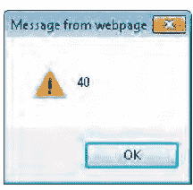

## 节省字节的重要性（又称代码压缩/Minification）

节省字节对于每一位 JavaScript 程序员来说都是一个重要课题。节省字节是指通过简写方式进行编程，使得生成的 JavaScript 程序（或任何其他语言）消耗更少的内存和带宽。你越能利用特性（如复合赋值语句）来节省字节，程序的运行效果就越好。

字节越少，意味着用户下载的脚本越小。要量化你可以节省多少字节，或者这种节省对你有多大帮助是非常困难的。有些程序员可能认为这种效果微乎其微——对于较小的脚本这可能是事实，尤其是因为用户越来越多地拥有宽带或更快的连接。但对于较大的脚本，智能简写带来的积极影响可能是真实的，特别是当这些脚本必须通过拨号连接或慢速连接下载时。

通过下载节省字节的一种常用方法是 JavaScript 的代码压缩（minification）。代码压缩是指从活动或生产网站的 JavaScript 文件中删除所有非必要元素。非必要元素不仅包括注释，还包括空格和换行。生成的压缩文件在引入某些空格和换行符之前是相当不可读的。

## 逗号运算符

逗号运算符分隔表达式并按顺序执行它们。通常，逗号运算符

### 练习

1. 使用加法运算符 (`+`) 向屏幕发送三个 `alert()` 对话框（可以使用三个独立的程序）。第一个 alert 应该加两个数字。第二个应该加数字和一个字符串。第三个应该加两个字符串。所有内容都由变量表示。
2. 使用后置递增运算符 (`++`) 增加存储在变量中的数字。在增加之前、增加期间和增加之后显示变量的值。使用前置递增运算符增加数字，并使用 `alert` 在增加之前、期间和之后显示其结果。
3. 使用 `typeof` 运算符检查你在练习 1 中创建的变量的类型。
4. 正确或错误：一元运算符在 JavaScript 中并不经常出现。
5. 正确或错误：尽可能节省字节（尽可能使用 JavaScript 简写）总是比使用返回和缩进要好，后者会减慢页面加载。

---

# 第二部分 应用 JavaScript

## 第 6 章 使用条件和循环控制流

在读完本章后，你将能够：

- 理解 JavaScript 中不同类型的条件语句。
- 使用 `else if` 条件语句来控制代码执行。
- 使用 `switch` 语句。
- 理解 JavaScript 中不同类型的循环控制结构。
- 使用 `while` 循环和 `do...while` 循环重复执行代码。
- 使用不同类型的 `for` 循环来遍历值范围。

## If（以及如何）

`if` 语句评估一个表达式，并根据结果决定程序中执行哪些代码。复杂语句可以根据多个条件控制执行哪些代码。如果你在互联网上预订过机票，你就一定知道如何做决策了。例如，你可能想进行一次快速的周末游，在给票定价时，你会说：“如果票价低于 $350，我就订机票，否则我就找另一个度假胜地。”假设我想出去倒垃圾，如果天气预报昨晚有风，垃圾可能会被吹到邻居的草坪上，但如果我等到第二天早上，我可能会错过垃圾车。（第三种选择是告诉我的妻子出去倒垃圾是一个巨大的帮助，但这在过去从未起过。）

虽然 JavaScript 不会帮助你做出这些生活中的决策，但它可以通过做出这类决策来提供极大帮助——也就是说，它可以根据变量是否包含特定值或表单字段是否填写正确来控制程序的行为。本节回顾了 JavaScript 中 `if` 语句的语法。

```javascript
if (some condition) {
    // 在此处做一些事情
}
```

注意：`if` 语句有时被称为 conditional（条件）。在本章及其他章节中交替使用这些术语，以便你熟悉这两个术语。但不要将 `if conditional`（整个 `if` 语句）与 `condition`（条件）混淆，后者是 `if` 语句评估的布尔表达式。

`if` 语句检查条件的有效性和真假，以决定条件体内部（大括号内）的代码是否执行。当布尔表达式被评估为 `true` 时，会导致 `if` 语句执行条件中的代码（你可以在条件中对表达式取反，以便在表达式评估为 `false` 时运行代码）。回想第 5 章“使用运算符和表达式”中的布尔运算符和一元运算符。这是一个例子：

```javascript
if (! some condition) {
    // 在此处做一些事情
}
```

在这种情况下，条件以取反运算符开头，这意味着条件需要评估为 `false`，条件体内部的代码才会执行。

本章前面提到的真实航空公司成本示例在伪代码中可能像这样：

```javascript
if (flightCost < 350) {
    bookFlight();
}
```

如果票价低于 $350，条件体内的代码执行。在本章稍后的部分，我将展示如何使用 `else` 语句来执行其他代码。

```javascript
var x = 4;
var y = 3;

// 相等测试
if (x == y) {
  // 做一些事情
}
```

由于 x (4) 不等于 y (3)，条件体内的代码不会执行。这里有一个关系运算符的示例：

```javascript
var x = 4;
var y = 3;

// 关系测试
if (x > y) {
  // 做一些事情
}
```

在这种情况下，由于 x (4) 大于 y (3)，条件中的代码会执行。

```javascript
if (forecast == "windy") {
    takeOut();
}
```

## Internet 中的 prompt 函数

随着 Internet Explorer 7 的引入，`prompt()` 函数不再默认启用。如果你尝试在 Internet Explorer 中使用 `prompt()`，你会收到类似图 6-1 的安全警告。

> 此网站使用脚本窗口获取信息。如果你信任此网站，点击此处允许脚本...

你可以通过点击信息栏（如图 6-1 所示）并选择允许脚本，或者通过更改设置来可靠地解决这个问题。你可以在 Internet Explorer 中更改设置，例如，通过从工具菜单选择 Internet 选项，点击安全选项卡，点击自定义级别，并在脚本设置中启用“允许网站提示信息”选项。

然而，你不能依靠访问者对其进行相同的设置。因此，`prompt()` 函数不再像 Internet Explorer 7 引入之前那样有用。有些程序员可能认为 `prompt()` 函数很烦人（它确实有其优点，禁用它对增强安全的提升有限）。但有时为了测试目的它是有用的，例如下面的示例。

### 关于程序流的决策

1. 使用 Visual Studio、Eclipse 或其他编辑器编辑 Chapter06 示例文件夹中的 `ifexample.htm` 文件，该文件可以在内容中找到。
2. 在页面中，将 TODO 注释替换为以下代码（此代码也位于内容中的 `ifexample.txt` 文件中）：

```html
<!DOCTYPE HTML PUBLIC "-//W3C//DTD HTML 4.01//EN" "http://www.w3.org/TR/html4/strict.dtd">
<html>
<head>
<title>If 示例</title>
</head>
<body>
<script type="text/javascript">
var inputNum = prompt("请输入一个小于 100 的数字:");
if (inputNum > 99) {
  alert("那个数字，" + inputNum + " 不小于 100。");
}
</script>
<p>这是第 6 章的一个示例。</p>
</body>
</html>
```

当你查看该页面时，你会看到一个要求输入小于 100 数字的提示。Explorer 通常会在对话框的文本框中填入 `undefined`。输入一个数字并点击 OK。我输入了 5，你可以看到这里：

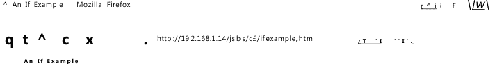

点击 OK。你会看到一个类似于这里的页面：

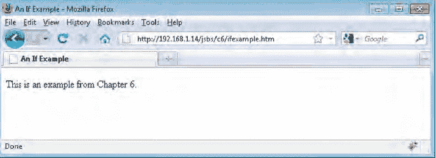

在浏览器中刷新页面，这次在出现提示时，输入一个大于 100 的数字。你将收到如下警报框：

该数字 1150 不小于 100。

`<body>` 标签内的 `<script>` 标签的第一行建立了一个变量 `inputNum`，然后将其赋值为 `prompt()` 函数的结果：

```javascript
var inputNum = prompt("Please enter a number below 100:");
```

接下来的几行使用一个 `if` 语句来检查 `inputNum` 变量中的值。如果值大于 99，则显示警报框：

```javascript
if (inputNum > 99) {
  alert("That number, " + inputNum + " is not below 100.");
}
```

这个示例在许多方面都需要改进，随后的示例将展示如何改进代码，利用你已经学到的知识，并使用在本章稍后学到的一些新技术。

## 复合条件

很多时候，你需要在同一个 `if` 语句中测试多个条件。考虑一下之前的示例。假设你想让访问者输入一个 51 到 99 之间（包含边界）的数字。你可以像这样将这些测试组合在一个 `if` 语句中：

```javascript
if ((inputNum < 51) || (inputNum > 99)) {
  alert("That number, " + inputNum + " is not between 50 and 100.");
}
```

你也可以在写这个 `if` 语句时省略第一行的额外括号；但我发现添加它们可以提高可读性。

你可以在列表 6-1 中看到之前示例的代码，其中用粗体形式显示了复合 `if` 语句。（你可以在配套内容的 `listing6-1.htm` 中找到这部分代码）。

### 列表 6-1 一个复合 `if` 语句

```html
<!DOCTYPE HTML PUBLIC "-//W3C//DTD HTML 4.01//EN" "http://www.w3.org/TR/html4/strict.dtd">
<html>
<head>
<title>An Example</title>
</head>
<body>
<script type="text/javascript">
var inputNum = prompt("Please enter a number between 50 and 100:");
if ((inputNum < 51) || (inputNum > 99)) {
  alert("That number " + inputNum + " is not between 50 and 100.");
}
</script>
<p>这是来自第 6 章的一个示例。</p>
</body>
</html>
```

列表 6-1 中的语句使用了逻辑或（OR）运算符，其含义是：“如果 inputNum 大于 99 或小于 51，则执行此操作。”

考虑我们在本章大部分内容中使用的示例。如果你输入一个大于 99 或小于 51 的数字，你会收到一个警报。但如果输入根本不是一个数字呢？如果你输入了单词 `boo` 呢？你不会收到警报，因为所使用的条件仅判断变量是否高于或低于数字。

因此，代码应该检查变量中包含的值是否为数字。你可以通过 `isNaN` 函数的帮助以及嵌套判断来实现，如下：

```javascript
if (isNaN(inputNum) || ((inputNum > 99) || (inputNum < 51))) {
  alert("That number " + inputNum + " is not between 50 and 100.");
}
```

该条件语句用于评估 `inputNum` 变量中的值是否为数字。如果这个初始检查为真（用户没有输入数字），则不会进行后续处理，从而防止语句的其余部分被评估。如果用户输入了数字，`isNaN` 检查失败，`if` 语句就会对数字范围进行检查，这些检查被嵌套在括号中，创建了它们自己的条件集。当输入值为 `boo` 时，运行结果如图 6-3 所示。

该数字 boo 不在 50 到 100 之间。

完整代码在列表 6-2 中（位于配套内容的 `listing6-2.htm` 文件中）。嵌套条件用粗体显示。

### 列表 6-2 一个嵌套 `if` 语句

```html
<!DOCTYPE html PUBLIC "-//W3C//DTD HTML 4.01//EN" "http://www.w3.org/TR/html4/strict.dtd">
<html>
<head>
<title>An Example</title>
</head>
<body>
  <script type="text/javascript">
    var inputNum = prompt("Please enter a number between 50 and 100:");
    if (isNaN(inputNum) || ((inputNum > 99) || (inputNum < 51))) {
      alert("That number " + inputNum + " is not between 50 and 100.");
    }
  </script>
</body>
</html>
```

## 使用 if 和 else

到目前为止示例的下一个问题是，图 6-3 中的警报框总是指示了数字。你真正需要的是处理不是数字的情况。大多数编程语言都有 `if/else` 结构，但它们的使用方式有所不同。

## Else if

正如你可以使用 `else if` 和 `else` 测试多个条件一样，你也可以（有时）使用多层条件。例如，你可以测试某个条件，成功后执行额外的条件。这是一个利用 `match()` 函数和正则表达式的示例。关于正则表达式的更多信息，请参见第 4 章“变量与数据类型”。

### 使用多层条件和正则表达式

1. 打开编辑器——如果你遵循了本章之前的步骤——打开你更新的文件 `ifexample.html`（位于组件中）。

该文件应该包含以下代码。（如果你没有遵循之前的示例，只需创建一个空文件，粘贴以下代码，然后进行下一步）。

```html
<!DOCTYPE HTML PUBLIC "-//W3C//DTD HTML 4.01//EN" "http://www.w3.org/TR/html4/strict.dtd">
<html>
<head>
<title>An Example If</title>
</head>
<body>
<script type="text/javascript">
var inputNum = prompt("Please enter a number below 100:");
if (inputNum > 99) {
  alert("That number, " + inputNum + " is not below 100.");
}
</script>
<p>这是来自第 6 章的一个示例。</p>
</body>
</html>
```

2. 以不同的名称保存文件。
3. 在新保存的文件中，输入以下代码。注意，我将来自之前示例的更改也包含在：

```html
<!DOCTYPE HTML PUBLIC "-//W3C//DTD HTML 4.01//EN" "http://www.w3.org/TR/html4/strict.dtd">
<html>
<head>
<title>An Example If</title>
</head>
<body>
<script type="text/javascript">
var inputNum = prompt("请输入 50 到 100 之间的数字:");
if (isNaN(inputNum)) {
    if (inputNum.match(/one|two|three|four|five|six|seven|eight|nine|ten/)) {
        alert("虽然这是一个数字，但对我来说它并不是真正的数字。");
    } else {
        alert(inputNum + "看起来不像一个数字。");
    }
} else if ((inputNum > 99) || (inputNum < 51)) {
    alert(inputNum + " 不在 50 到 100 之间。");
}
</script>
<p>这是来自第 6 章的一个示例。</p>
</body>
</html>
```

4. 测试所有这些条件。首先在浏览器中访问该页面。系统会提示你输入一个数字。对于第一次测试，按照如下所示输入单词 "four"：

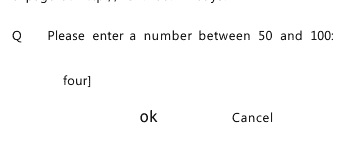

5. 点击 OK。第一个条件匹配，然后它检查输入。输入内容匹配字符串 "four"，导致出现此对话框：

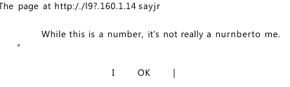

6. 点击 OK 关闭对话框。重新加载页面。现在输入短语 "pizza"：
7. 点击 OK。与之前加载页面一样，第一个条件 (`isNaN()`) 匹配了。然而，由于内部测试不匹配短语 pizza，嵌套 `if` 的 `else` 条件将通过匹配，导致出现此对话框：

pizza 看起来不像一个数字。

8. 点击 OK 关闭对话框，再次重新加载页面。这次，在文本框中输入数字 4，如下所示：

请输入 50 到 100 之间的数字

9. 点击 OK。现在第一个条件失败了，因为数字 4 确实是一个数字。因此，评估了 `else` 条件。因为数字 4 小于 51 且不大于 99，`else` 条件匹配并显示此警报：

该数字 4 不在 50 到 100 之间。

10. 良好的测试规范要求你也测试一个大于 99 的数字。尽管这样做。准备好后，只需点击 OK 关闭对话框并再次加载页面。这次，输入数字 64，如下：

请输入 50 到 100 之间的数字

11. 当你点击 OK 时，不会收到任何警报，因为数字 64 处于 50 到 100 之间，所以它不匹配任何测试条件。

在这个过程中以及之前的过程中我解释了你正在审查的代码，但没有解释嵌套 `if` 中的正则表达式。那条语句是：

```javascript
if (inputNum.match(/one|two|three|four|five|six|seven|eight|nine|ten/)) {
```

`match()` 函数接受输入变量的（或属性）。管道字符 `|` 接受一个正则表达式作为其参数。在这种情况下，参数是：

```javascript
/one|two|three|four|five|six|seven|eight|nine|ten/
```

该表达式用两个正斜杠 (`/`) 隔开，两端各一个。之后，正则表达式查找字符串 one, two, three, four, five, six, seven, eight, 或 ten 中的任何一个。每个字符串之间的管道字符 `|` 表示逻辑上的“或”（OR），这意味着该正则表达式将匹配这些字符串中的任何一个，但不会超过一个。

有趣的是，尽管这个正则表达式非常简单，但它也有很大的缺陷。为了让这个正则表达式更好，它需要标记（或锚定）匹配字符串的开头和结尾。按照目前的写法，字符串 sixty 也会被匹配，就像单词 six 现在被匹配的一样。

我的意图并不是展示一个完美的正则表达式，而是为了让你接触到它们，以便当你需要处理它们时，你不会尖叫着逃！

## 使用三元运算符

另一种条件构造样式被称为三元运算符（ternary conditional）。这种条件使用问号 (`?`) 运算符来创建 `if/else` 结构。三元条件表达式的基本结构非常简单：

```javascript
(name == "Steve") ? "Hello Steve" : "Hello Unknown Person";
```

这条语句可以读为：“如果 name 是 Steve，那么为 'Hello Steve'，否则为 'Hello Unknown Person'。”

```javascript
var greeting = (name == "steve") ? "Hello Steve" : "Hello Unknown Person";
```

这段代码将变量 `greeting` 设置为三元测试结果的值。如果变量 `name` 的值是 "steve"，则 `greeting` 变量获得字符串值 "Hello Steve"；否则，`greeting` 变量获得字符串值 "Hello Unknown Person"。这里是传统 `if/else` 形式的相同代码：

```javascript
if (name == "steve") {
  var greeting = "Hello Steve";
} else {
  var greeting = "Hello Unknown Person";
}
alert(greeting);
```

如果你以前没见过，三元构造有时会让人困惑。如果你觉得坚持传统的 `if/else` 语法有助于提高程序的可读性，这不可耻。

## 使用 switch 进行测试

`switch` 语句是测试变量值并执行相应代码的一种简单有效的方法。虽然可以使用 `if/else` 语句来完成任务，但在这种情况下 `switch` 语句更有用。考虑一个根据用户选择的语言执行特定代码的网站示例。在此练习中，假设用户通过表单选择了语言。如果该网站需要为多种语言执行代码，我们可以使用一组巨大的 `if/else`。假设变量 `languageChoice` 的值为所选语言，代码如下：

```javascript
if (languageChoice == "en") {
  // 语言是英语，执行英语代码。
} else if (languageChoice == "de") {
```

这种代码在只有少数语言时运行良好，但想象一下有 20 种语言的情况。如果为每个条件添加更多代码，它很快就会变成迷宫。以下是 `switch` 中的相同代码（可以在配套文件的 `switches.txt` 中找到）：

```javascript
switch(languageChoice) {
  case "en":
    // 语言是英语，执行英语代码，
    break;
  case "de":
    // 语言是德语，执行德语代码，
    break;
  case "pt":
    // 语言是葡萄牙语，执行葡萄牙语代码，
    break;
  default:
    // 未选择语言，使用瑞典语。
}
// switch 语句之外的代码
```

`switch` 语句查找每个语言 `case`，然后执行该 `case` 的代码。`break` 语句指示找到匹配 `case` 后执行代码的结束。`break` 语句导致代码执行完全跳出 `switch` 语句，并继续执行 `switch` 大括号之后的代码。

例如，如果变量 `languageChoice` 为 `de` 且缺少 `break` 语句，德语代码将被执行，但 `switch` 语句将继续执行代码，直到遇到 `break` 语句或到达 `switch` 语句结束。你总是在 `switch` 语句的每个 `case` 中使用 `break` 语句。然而，`switch` 语句的优雅之处在多个 `case` 应执行相同代码时显而易见。考虑一个访问者选择他所在的国家或地区的示例。在这样的网站上，来自美国、澳大利亚和英国的访问者可能希望页面以英语显示，尽管这三个国家的人对许多单词的拼写（和发音）不同。以下是此 `switch` 语句示例（也在配套文件的 `switches.txt` 文件中）：

```javascript
switch(countryChoice) {
  case "US":
  case "Australia":
  case "UK":
    // 语言是英语，执行英语代码，
    break;
  default:
    // 未选择区域，使用瑞典语。
}
// 回到循环外部的代码
```

注意：正如我来自蒙特利尔的朋友们指出的那样，正如我建议的那样，来自任何国家的访问者都可以选择网站支持的另一种语言，例如法语。在本示例中忽略该功能，但在设计您的网站时请考虑到它。

如果访问者选择澳大利亚作为她的国家，则将匹配澳大利亚的情况，执行英语代码。得益于 `break` 语句，JavaScript 将跳出 `switch` 语句并执行 `switch` 语句后的第一行代码。

## 使用 while 循环

`while` 语句创建一个循环，只要某个条件为真，代码就会一直执行。本节将检查 `while` 语句和相关的 `do...while` 语句。

### while 语句

循环执行大括号内的代码，直到满足条件。这里有一个示例（该代码位于辅助内容中的 `while.txt` 文件中）：

```javascript
var count = 0;
while (count < 10) {
  // 在这里执行某些操作。
  // 多行也是可以的。
  // 不要忘记增加计数器：
  count++;
}
```

始终记住 `while` 循环的两个重要方面，此处列出并将逐一讨论：

- 根据所测试变量的初始值或条件，`while` 语句包含的代码可能永远不会执行。
- `while` 语句测试的条件必须在循环内部更改。

在 JavaScript 中，`do...while` 循环无论初始条件如何，都会执行一次代码。`do...while` 循环将在本章的稍后部分进行讨论。

### 修改条件

如前所述，示例中 `while` 语句的评估会检查变量以查看它是否小于 10。如果 `count` 小于 10，则执行 `while` 循环内部的代码。

`while` 循环内部的代码行中有一行使用 `++` 一元运算符递增了 `count` 变量，如下：

```javascript
count++;
```

当 `while` 语句中的代码执行完毕后，将重复评估。如果不递增 `count` 变量，`count` 将始终小于 10，这样你就会陷入一个死循环——这不是你想要的。

> 提示：当你使用通用计数器变量时（如我在示例中那样做），只要你在 `while` 语句的大括号内或 `while` 语句测试中递增变量，在哪里并不重要。这里有一个示例：`while (i++ < 10)`。关于后置运算符的更多信息请参见第 5 章。

这个故事的道理是确保你递增或更改 `while` 语句中评估的任何条件。

### do...while 语句

与 `while` 不同，`do...while` 语句至少执行一次大括号包含的代码。`while` 语句读起来像：“只要满足条件，运行此代码。”相反，`do...while` 语句读起来像：“在满足条件时执行（运行）此代码。”考虑一下（位于辅助内容中的 `dowhile.html` 文件中）：

```html
<!DOCTYPE HTML PUBLIC "-//W3C//DTD HTML 4.01//EN" "http://www.w3.org/TR/html4/strict.dtd">
<html>
<body>
<script>
var count = 0;
do {
  alert("我的计数是 " + count);
  count++;
} while (count < 3);
</script>
</body>
</html>
```

当这段代码执行时，会出现三个对话框。在第一次运行期间，`count` 变量值为 0，因为该变量仍设置为初始值，对话框指示了这一点，如图 6-4 所示。

来自网页的消息
我的计数是 0
确定

图 6-4 第一次执行期间 count 为 0。

运行一次后，`count` 变量被增加。当评估 `while` 语句时，`count` 仍然小于 3，因此再次执行代码，产生如图 6-5 所示的对话框。

来自网页的消息
我的计数是 1
确定

图 6-5 运行时，count 增加了计数器并显示下一次执行的结果。

同样的过程再次发生。`count` 变量被增加，并评估 `while` 条件。`count` 的值仍然小于 3，因此大括号内的代码再次运行，显示另一个类似于图 6-6 的对话框。

来自网页的消息
我的计数是 2
确定

图 6-6 再次运行后 count 变量的值。

尝试 `while` 和 `do...while` 语句，直到你熟悉它们之间的差异。

## 使用 for 循环

`for` 循环的使用方式与 `while` 循环相同，即执行代码若干次。`for` 循环在 JavaScript 中有两个“兄弟”：`for...in` 循环和 `for...each...in` 循环。本节将检查这两种循环类型。

### for 循环

你使用 `for` 循环创建一个循环，其中条件以紧凑的形式初始化、评估和更改。这里有一个示例：

```javascript
for (var count = 0; count < 10; count++) {
  // 在此处执行代码
}
```

一个语句在括号中有三个子句。第一个子句设置初始表达式，如前面的示例所示，此处也是：

```javascript
var count = 0;
```

`for` 语句的下一个子句指定测试表达式，表示为：

```javascript
count < 10;
```

`for` 语句的最后一个子句指定增量表达式，表示为：

```javascript
count++
```

注意：`for` 循环中的最后一个表达式不需要分号。这里有一个你可以尝试的示例：

### 使用 for 循环

1. 使用 Visual Studio、Eclipse 或另一个编辑器编辑第 06 章示例文件中的 `forloop.htm` 文件，你可以在辅助内容找到找到。
2. 在页面中，将 `TO DO` 注释替换为以下代码（代码位于辅助内容中的 `forloop.txt` 文件）：

```html
<!DOCTYPE HTML PUBLIC "-//W3C//DTD HTML 4.01//EN" "http://www.w3.org/TR/html4/strict.dtd">
<html>
<head>
<title>for 循环示例</title>
</head>
<body>
<script type="text/javascript">
for (var count = 0; count < 10; count++) {
  // 在此处执行代码
}
</script>
</body>
</html>
```

### for...in 循环

`for...in` 循环遍历对象的属性。这里有一个示例（位于辅助内容的 `forin.txt` 文件中）：

```javascript
var star = new Object();
star.name = "Polaris";
star.type = "Double/Cepheid";
star.constellation = "Ursa Minor";

for (var starProp in star) {
  alert(starProp + " = " + star[starProp]);
}
```

正如示例代码所示，变量 `starProp` 接收的是属性的名称，而将 `starProp` 作为星对象的索引则返回该属性的值。

提示：你有时会看到使用 `for...in` 循环来遍历数组，其方式与你在上一节中看到的使用方式非常相似。然而，使用 `for...in` 遍历数组可能会产生参差不齐的结果。这种方法明显的问题之一是 `for...in` 循环不会按任何特定顺序返回属性。这种行为可能会带来麻烦，特别是当你用 JavaScript 向网页上写入文本时！这里的重点是，当你想要遍历简单数组时，请使用 `for` 循环而不是 `for...in` 循环。

### for...each...in 循环

`for...in` 结构返回属性的名称，而 `each...in` 循环返回的是属性的值。语法上基本相同，但增加了 `each` 单词：

```javascript
for each (var starValue in star) {
  alert(starValue + " is in the object.");
}
```

将早期示例中的 `for...in` 代码替换为 `for...each...in` 循环后，得到如下代码。新代码以粗体显示。更新后的文件位于配套文本的 `foreach.htm` 文件中：

```html
<!DOCTYPE HTML PUBLIC "-//W3C//DTD HTML 4.01//EN" "http://www.w3.org/TR/html4/strict.dtd">
<html>
<head>
<title>For Each In Loop Example</title>
</head>
<body>
<script type="text/javascript">
var star = new Object();
star.name = "Polaris";
star.type = "Double/Cepheid";
star.constellation = "Ursa Minor";
for each (var starValue in star) {
  alert(starValue + " is in the star object.");
}
</script>
</body>
</html>
```

当你在 Internet Explorer 中查看该页面时，将看到一个错误（可能只是一个空白屏幕）。然而，在 Firefox 3.0 中查看页面会显示正确的行为。图 6-7 显示了三个对话框结果之一。

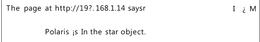

## 使用条件验证表单

在本章前面，你使用了 `prompt()` 函数获取用户输入。使用 `prompt()` 函数并不常见，而且正越来越少，因为 Internet Explorer 7 阻止了它。本节将介绍在 JavaScript 中使用 Web 表单。第 14 章“在 Web 表单中使用 JavaScript”将专门介绍这一主题。

使用 `if...else` 验证输入是一项常见任务，让我们来完成它吧。

### 使用条件语句验证输入

1. 打开 Visual Studio、Eclipse 或编辑器并创建一个新网页。将其命名为 `formexample.html`。
2. 在页面中输入以下标记，并添加以粗体显示的代码，替换 `TO DO` 内容（你可以在说明附的 `formexample.txt` 中找到新代码）：

```html
<!DOCTYPE HTML PUBLIC "-//W3C//DTD HTML 4.01//EN" "http://www.w3.org/TR/html4/strict.dtd">
<html>
<head>
<title>Your Basic Form</title>
<script type="text/javascript">
function alertName() {
  var name = document.forms[0].name.value;
  if (name == "steve") {
    alert("Hello Steve. Welcome to Machine");
  } else if (name == "nancy") {
    alert("Hello Tim.");
  } else {
    alert("Hello " + name);
  }
  return true;
}
</script>
</head>
<body>
<form id="myForm" action="#" onsubmit="return alertName();">
```

3. 保存页面并在网页浏览器中查看。你应该能看到这样的页面：

Username: [Submit Query]

4. 在表单中输入名称 `steve`（不带引号），确保使用小写字母。点击 `Submit Query`，你会收到一个这样的对话框：

Message from webpage
Hello Steve. Welcome to Machine
OK

5. 点击 OK，现在输入名称 `nancy`，同样不带引号且全小写。当你点击 `Submit Query` 时，你会收到一个这样的对话框：

Message from webpage
Hello Tim.
OK

6. 点击 OK 关闭对话框。输入名称并点击 `Submit Query`。你收到一个这样的对话框：

Message from webpage
Hello [name]
OK

---

# 第 7 章 函数操作

读完本章后，你将能够：

- 理解函数的用途。
- 定义自己的函数。
- 调用函数并接收数据。
- 理解一些内置函数。

## 什么是函数？

JavaScript 函数是一组可以调用的语句，可以是命名的也可以是匿名的。函数用 `function` 关键字定义，通常跟着函数名以及包含可选参数的括号。使用大括号包围要作为函数执行的语句。

提示：重要的是，当定义函数时（你可以参考前面的函数定义），代码并不会执行，直到函数被调用或触发。你将在本章后面学习如何调用函数。

## 参数

在函数定义的括号内放置参数。这里有一个使用参数的简要示例：

```javascript
function myFunction(argument1, argument2, .... argumentN) {
```

这里有两个参数的示例：

```javascript
function myFunction(val1, val2) {
// 执行某些操作
}
```

调用该函数非常简单：

```javascript
myFunction(val1, val2);
```

JavaScript（ECMA-262 规范）与其他语言的区别之一是，在 JavaScript 中，你不需要指定传递给函数的参数数量，传入的数量也不需要与函数定义中的数量匹配。调用时，函数会获得一个对象（作用类似于数组）`arguments` 包含了传入函数的参数，当你不知道传入了多少参数时非常有用。这里是这种工作方式的示例（你可以在配套内容的 `functionbasics.txt` 文件中找到此代码）：

```javascript
function myFunction() {
  var firstArg = arguments[0];
  var secondArg = arguments[1];
}
```

更好的做法是你可以获取 `arguments` 对象的长度并遍历每个参数。

这是一个更完整的示例，展示了简单使用 `arguments` 对象的结果（在 `functionexample.htm` 文件中）：

```html
<!DOCTYPE HTML PUBLIC "-//W3C//DTD HTML 4.01//EN" "http://www.w3.org/TR/html4/strict.dtd">
<html>
<head>
  <title>Arguments Array</title>
</head>
<body>
  <script type="text/javascript">
  function myFunction() {
    var firstArg = arguments[0];
    var secondArg = arguments[1];
    alert("firstArg is: " + firstArg);
    alert("secondArg is: " + secondArg);
  }
  myFunction("hello","world");
  </script>
</body>
</html>
```

当代码执行时，它会显示两个警告框，如图 7-1 和 7-2 所示。

来自网页的消息
firstArg is: hello
OK

图 7-1 在函数内部使用 `arguments` 对象来访问第一个参数。

来自网页的消息
secondArg is: world
OK

图 7-2 在函数内部使用 `arguments` 对象来访问第二个参数。

## 重新回顾变量作用域

函数参数通常是变量名，不应该与调用函数时使用的变量同名。我特意用“不应该”而不是“不要”，是因为你可以在函数内部变量和函数调用处的变量中使用相同的名称，但正如你将学到的，这可能会导致混淆的代码和混淆的作用域。

第 4 章“处理数据类型”包含一个关于变量作用域的章节，其中包含一个处理函数内部和外部作用域的练习。第 4 章中一个变量作用域示例的相关代码（在配套内容的 `scoping_revisit.txt` 文件中重复）如下：

```html
<head>
<title>Scoping Example</title>
<script type="text/javascript">
var aVariable = "global";
function doSomething(incomingBits) {
  alert("Global variable within the function: " + aVariable);
  alert("Local variable within the function: " + incomingBits);
}
</script>
</head>
<body>
<script type="text/javascript">
doSomething("is a local variable");
alert("Global variable outside the function: " + aVariable);
alert("Local var outside the function: " + incomingBits);
</script>
</body>
</html>
```

这个示例展示了你如何从函数内部和外部全局或局部地声明变量。然而，该示例在逻辑上保持了变量的分离，因为它没有使用相同的变量名并改变变量的值。这里有一个使用相同变量名可能会引起混淆的示例。我发现多年前编写的代码即使不引入奇怪的作用域问题也已经足够混淆了，所以尽量避免编写这样的代码：

```javascript
result = 0;
function addNumbers() {
  result = 4 + 8;
}
addNumbers();
```

你可能已经发现了这段代码的问题。处处都缺少了 `var` 关键字。尽管代码在函数外部显式地初始化 `result` 变量为 0，但该变量通过调用 `addNumbers()` 函数被修改了。在这一轮中，`result` 变量被修改为 12，即函数内部 4 和 8 相加的结果。

如果你在 `result` 初始化之后立即添加一个 `alert` 来显示结果变量，警告将显示 0。如果你在调用 `addNumbers()` 函数之后再添加一个 `alert` 来显示结果变量，结果将显示 12。留你在练习中在正确的位置添加这些 `alert`。

上述内容的结论是，当你为函数内部和外部的变量使用不同的名称时，情况会更简单，并且始终使用 `var` 关键字来初始化变量。函数中的代码可能有也可能没有返回值。正如你将在下一节中看到的，该返回值会被传回调用者。

## 返回值

当函数执行完代码时，可以使用 `return` 关键字向调用者返回一个值。请看列表 7-1（在配套内容的 `listing7-1.txt` 文件中）。

### 列表 7-1 一个简单的返回值示例

```javascript
function multiplyNums(x) {
  return x * 2;
}

var theNumber = 10;
var result = multiplyNums(theNumber);
alert(result);
```

列表 7-1 创建了一个名为 `multiplyNums` 的函数，其预期的输入值将赋值给变量 `x`。该函数执行一个任务：它返回其参数乘以 2 的结果，如下：

```javascript
function multiplyNums(x) {
  return x * 2;
}
```

代码随后创建了一个名为 `theNumber` 的变量，如下：

```javascript
var theNumber = 10;
```

运行时，代码会产生一个对话框，如图 7-3 所示。

来自网页的消息
20
OK

图 7-3 此警告显示了函数内部任何地方的返回值，而不是在末尾。使用 `return` 在条件语句中或循环之后放置 `return` 是常见的，如下所示（你可以在配套内容的 `more_returnexamples.txt` 文件中找到它）：

```javascript
function myFunction(x) {
  if (x == 1) {
    return true;
  } else {
    return false;
  }
}
```


不过，请注意放置 `return` 语句的位置，因为当函数执行到 `return` 语句时，函数会立即返回，将不再执行之后的任何代码。对于像这样的代码（你可以在配套内容的 `merorereturnexamples.txt` 文件中找到）：

```javascript
function myFunction() {
  var count = 0;
  return;
  var result = 10;
}
```

这段代码永远不会到达 `result` 的初始化。

## 关于调用函数的更多内容

带参数调用函数，或者省略括号调用函数，会导致返回函数名本身，而不是函数应该返回的结果。这里有一个示例。列表 7-2（你可以在配套内容中找到）展示了一些调用函数的 Basic 代码。

```html
<!DOCTYPE HTML PUBLIC "-//W3C//DTD HTML 1.0 Transitional//EN" "http://www.w3.org/TR/html1-trans.dtd">
<html xmlns="http://www.w3.org/1999/xhtml">
<head>
  <title>Fruit 7-2</title>
  <script type="text/javascript">
  function orderFruit() {
    var total = 0;
    // 调用另一个函数下单
    return total;
  }
  </script>
</head>
<body>
  <script type="text/javascript">
    var result = orderFruit();
    alert("Total is " + result);
  </script>
</body>
</html>
```

执行时，这段代码调用了 `orderFruit` 函数。`orderFruit` 函数调用另一个函数（未显示）来下单。结果被计算并传回调用者。代码运行正常，并产生如图 7-4 所示的对话框。

来自网页的消息 S3

总数是 0

对代码进行细微修改——具体来说是去掉函数调用括号——会改变整个结果：

```javascript
var result = orderFruit;
```

结果如图 7-5 所示。


图 7-5 不带括号调用 `orderFruit` 可能不是你想要的结果。

## 匿名函数（函数字面量）

到目前为止看到的函数都是正式定义的。然而，JavaScript 并不要求以这种方式定义函数。例如，使用函数字面量——也称为匿名函数——函数被定义并绑定到一个变量，如

```javascript
var divNums = function(firstNum, secondNum) { return firstNum / secondNum; };
```

你可以使用 `javascript:` 伪协议轻松测试此功能。在浏览器的地址栏中输入代码。

```javascript
javascript:var divNums = function(firstNum, secondNum) { return firstNum / secondNum }; alert(divNums(8,2));
```

匿名函数经常用于面向对象的 JavaScript 以及作为事件处理程序。你将在第 8 章“JavaScript 中的对象”以及后续章节中看到这种用法的示例。

## 闭包

在 JavaScript 中，嵌套函数可以访问外部函数的变量。闭包指的是在函数正常执行上下文之外存在的变量。闭包经常在无意中创建，如果处理不当，可能会在 Windows Internet Explorer 中导致内存泄漏问题。然而，闭包是 JavaScript 中强大（且高级）的领域之一。

这里有一个闭包的示例：

```javascript
function myFunction() {
  var myNum = 10;
  function showNum() {
    alert(myNum);
  }
  return showNum;
}
var callFunc = myFunction;
myFunction();
```

在这个示例中，`showNum` 函数可以访问在外部函数（`myFunction`）中创建的变量 `myNum`。变量 `callFunc` 在全局上下文中，包含了对 `showNum` 函数的引用。当创建 `callFunc` 变量时，它立即就可以访问 `myNum` 变量。

闭包可以模拟对象内部的私有方法，并有用途，例如在事件处理程序中。闭包是 JavaScript 中最强大和先进的概念之一，不适合在入门书中详细讨论。你可以在 http://msdn.microsoft.com/en-us/script/ie/ff69676.aspx 以及互联网其他地方找到更多关于闭包的信息。

## 方法

理解方法的最简单方式是：它们是作为对象的一部分定义的函数。这是一种过于简单的说法，但目前足够了。你可以使用点运算符（`.`）来访问对象的方法。内置对象，如 `Math`、`Date` 和 `String` 对象，都拥有你在书中见过（或将看到）的方法。诸如 `alert()` 这样的函数实际上只是 `window` 对象的方法，可以写成 `window.alert`。

注意：在书的大部分内容，我交替使用*方法*（method）和函数这两个词。我将继续这样做，以便你更好地理解，对于大多数用户来说，这两者之间的界限是模糊的。当函数以面向对象的方式使用时，使用*方法*一词通常更清晰。当它没有直接以内置面向对象的方式使用时——例如，你使用 `alert()` 函数的方式——使用函数一词是可以接受的。

## 定义自己的函数 vs. 使用内置函数

正如你在整本书中所看到的，JavaScript 拥有许多内置函数或方法。除了使用这些内置函数外，你经常会发现自己正在定义自己的函数。除了简单的脚本外，大多数脚本都会涉及你自己的函数。

在某些情况下，你可能会定义一个函数，随后发现 JavaScript 已经有一个相同目的的同样良好的内置函数。如果你发现一个 JavaScript 内置函数执行与你自己的函数相同的任务，那么使用 JavaScript 函数通常是更好的主意。

## 观察对话框函数

到目前，你已经熟悉 JavaScript 中的 `alert()` 函数，在之前的章节中你看到了它的很多示例。你还学习了 `alert()` 函数只是 `window` 对象的一个方法。本节将介绍 JavaScript 中 `alert()` 函数的日常用法，以及 `window` 对象的两个相关函数。

> 信息：`window` 对象足够重要，会在第 9 章“浏览器对象模型”中获得关注。该章节讨论了 `window` 对象的许多方法。

尽管 `window` 对象有几个方法，但现在我想强调这三个（我称它们为函数）：`alert()`、`confirm()` 和 `prompt()`。因为你已经在书中看到太多的 `alert()` 对话框了，我不会在这里再包含一个了（以后再感谢我吧）。第 6 章“使用条件和循环控制流程”讨论了 `prompt()` 的使用。

# 第 7 章 使用函数

图 7-6 `confirm()` JavaScript 函数提供了一个用于确认用户操作的对话框。

当你点击 OK 时，`confirm()` 返回 true。当你点击取消时，`confirm()` 返回 false。

与 `alert()` 类似，`confirm()` 也会阻塞执行，直到用户做出选择。这在需要用户确认时非常有用。例如，在删除文件之前询问用户“你确定要删除吗？”。

### 练习

- 1. 定义一个接收一个数值参数的函数，增加该参数的值然后将其返回给调用者。在页面的 `<body>` 内部调用该函数并在屏幕上显示结果。
- 2. 定义一个接受两个数值参数的函数。如果第一个参数的值大于第二个参数，向访问者显示警报。如果第一个参数的值小于或等于第二个参数，则返回两个参数的和。
- 3. 在函数代码中添加合适的 `alert()` 函数，以便你可以在函数调用前后看到 `result` 变量中的值。代码如下：

```javascript
function addNumbers() {
  var firstNum = 4;
  var secondNum = 8;
  var result = firstNum + secondNum;
  return result;
}
var result = addNumbers();
```

- 4. 创建一个包含七个字符串值的数组，初始化为这些星的名称：北极星（Polaris）、毕宿五星（Aldebaran）、天户座（Deneb）、大斗七星（Dubhe）和御夫座（Regulus）。创建另一个包含七个字符串值的数组，初始化为这些星所在的星座名称：小熊座（Ursa Minor）、金牛座（Taurus）、天鹅座（Cygnus）、鹰座（Aquila）、天琴座（Lyra）、大熊座（Ursa Major）和狮子座（Leo）。接下来，创建一个接受单个字符串参数的函数。在函数内部，遍历第一个数组搜索该星。当找到该星时，返回第二个数组中对应索引包含的值。换句话说，返回该星对应的星座名称。在页面的 `<body>` 内部，使用 `prompt` 从访问者获取星的名称，然后使用该输入调用函数。不要忘记包含在未找到星时执行的代码。在屏幕上显示结果。

# 第 8 章 JavaScript 中的对象

读完本章后，你将能够：

- 理解 JavaScript 中的对象，包括对象属性、对象方法和类。
- 创建对象。
- 为对象定义属性和方法。
- 理解 JavaScript 中的数组。
- 使用多种数组方法。

## 面向对象开发

对于面向对象编程概念的新手或需要复习的人，请继续阅读。如果你已经熟悉了面向对象编程，请直接跳到“创建对象”部分。

编程范式描述了一种解决你遇到的问题的方法论。存在超过 25 种不同的编程范式，其中一些在实际程序中可能很难找到。你可能听过其他范式，甚至在不知情的情况下用过它们。这些范式包括函数式编程、事件驱动编程、面向组件编程和结构化编程。

编程范式随时演变。面向对象编程已经存在多年，短期内不会消失。这一部分能做的只是给你提供该主题的概述，但你需要熟悉面向对象的技术和术语，以便能够应对 JavaScript 程序员通常使用的子集。

## 对象

对象存在于现实世界，也存在于虚拟甚至有时是超现实的世界中。

## 属性

对象拥有属性——定义为它们的特征。回到现实世界，一个球有一个颜色属性——可能是红色、白色或多颜色的。它还有一个尺寸属性——可能像棒球一样小，或者像篮球一样大，又或者完全是其他东西。这些属性可能如下所示：

```javascript
ball.color
ball.size
```

## 方法

就像对象可以拥有属性一样，它们也可以拥有方法。方法定义了对象的行为。球可能有一个 `roll` 方法，用于计算球将滚多远。理论上，并不是所有对象都有方法，也不是所有对象都有属性，尽管在实践中大多数对象至少有一个方法或一个属性。

记住第 7 章“处理函数”中的，方法是属于对象的函数。使用函数字面量定义 `roll` 方法的定义所示：

```javascript
ball.roll = function() {
  var distance = this.size * this.forceApplied;
}
```

> 这是什么？
> `roll` 示例使用了一个新奇的东西——关键字 `this`，它指向当前函数或属性所属的对象。在对象的语境下，该关键字指的是调用对象。`this` 关键字可以在函数调用中设置对象的属性。

`this` 关键字对于想要验证 Web 表单的 JavaScript 开发者来说是一个福音，验证表单的内容你将在第 14 章“使用 JavaScript 配合 Web 表单”中学习到它。

## 类

考虑我在前面的章节中使用的恒星示例。列表 8-1（位于配套内容中的 `Listing 8-1.txt` 文件中）显示了构建一个包含 14 颗重要恒星信息的完整网页需要的内容。

# 列表 8-1 组装恒星对象。

```javascript
var star = {};

'Polaris' = new Object;
'Mizar' = new Object;
'Aldebaran' = new Object;
'Rigel' = new Object;
'Castor' = new Object;
'Albireo' = new Object;
'Acru' = new Object;
'Procyon' = new Object;
'Sirius' = new Object;
'Rigil Kentaurus' = new Object;
'Deneb' = new Object;
'Vega' = new Object;
'Altair' = new Object;
'Polaris'.constellation = "Ursa Minor";
'Mizar'.constellation = "Ursa Major";
'Aldebaran'.constellation = "Taurus";
'Rigel'.constellation = "Orion";
'Castor'.constellation = "Gemini";
'Albireo'.constellation = "Cygnus";
'Acru'.constellation = "Crux";
'Gamma'.constellation = "Corona Borealis";
'Procyon'.constellation = "Canis Minor";
'Sirius'.constellation = "Canis Major";
'Rigil Kentaurus'.constellation = "Centaurus";
'Deneb'.constellation = "Cygnus";
'Vega'.constellation = "Lyra";
'Altair'.constellation = "Aqua";
'Polaris'.type = "Double/Cepheid";
'Mizar'.type = "Spectroscopic";
'Aldebaran'.type = "Variable";
'Rigel'.type = "Supergiant with Companion";
'Castor'.type = "Multiple/Spectroscopic";
'Albireo'.type = "Double";
```

# 第二部分 应用 JavaScript

```javascript
star["Altair"].type = "White Dwarf";
star["Polaris"].spectralClass = "F7";
star["Mizar"].spectralClass = "A V";
star["Aldebaran"].spectralClass = "K5 III";
star["Rigel"].spectralClass = "B8 Ia";
star["Castor"].spectralClass = "B9";
star["Albireo"].spectralClass = "F5";
star["Sirius"].spectralClass = "A1 V";
```

*(注：由于原文文本在后部分出现了截断和重复混乱，此处翻译根据您提供的文本片段进行了对应处理，保持了代码块的完整性)*

## 为对象添加属性

创建对象后，你就可以开始为它分配属性和方法。如果你只有一个星体对象，可以直接向它分配属性，如下：

```javascript
star.name = "Polaris";
star.constellation = "Ursa Minor";
```

当你需要创建多个相关的对象时，可以按照上一节所示的示例高效地分配属性。

## 显示对象的属性

通过 `for...in` 循环，你可以遍历对象中的每个属性。尝试一下。

### 遍历对象属性

- 1. 使用 Microsoft Visual Studio、Eclipse 或另一个编辑器，编辑 `proploop.htm` 文件，该文件可以在配套内容的 `Chapter08` 示例文件夹中找到。
- 2. 在相应位置，将 `TO` 文档替换为此处所示的 `for` 循环（你可以在配套资料的 `proploop.txt` 文件中找到这段代码）：

```html
<!DOCTYPE HTML PUBLIC "//W3C//DTD HTML 4.01//EN"
http://www.w3.org/TR/html4/strict/ct.dtd">
<html>
<head>
<title>eProperties</title>
</head>
<body>
<script type="text/javascript">
var star = {};

function Star(constellation, type, speed, ass, magnitude) {
  this.constellation = constellation;
  this.type = type;
  this.spectralClass = specclass;
  this.mag = magnitude;
}

star["Polaris"] = new Star("Ursa Minor", "Double/Cepheid", "F7", 2.0);
star["Mizar"] = new Star("Ursa Major", "Spectroscopic Binary", "A1 V", 2.3);
star["Aldebaran"] = new Star("Taurus", "Irregular Variable", "K5 III", 0.85);
star["Rigel"] = new Star("Orion", "Supergiant with Companion", "B8 Ia", 0.12);
</script>
</body>
</html>
```

```javascript
star["Altair"] = new Star("Aquila", "White Dwarf", "A7 V", 0.77);

<script>
</head>
<body>
<script type="text/javascript">
for (var propt in star) {
  alert(propt);
}
</script>
</body>
</html>
```

- 3. 在网络浏览器中查看此页面。你会看到 `star` 对象中的每个星体都弹出一个 `alert()` 对话框，总共 14 个。（是的，这需要了很多点击。非常抱歉。）这是你看到的对话框类型示例：

来自网页的消息
Polaris

这个逐步演进的练习建立在之前使用伪类定义对象属性的示例之上。在这种情况下，通过以下代码创建了一个星体对象：

```javascript
var star = {};
```

然后，通过调用创建新星体对象（使用伪类），为该对象分配了几个具有独立星体名称的属性：

```javascript
star["Polaris"] = new Star("Ursa Minor", "Double/Cepheid", "F7", 2.0);
```

随后，原始星体对象的每个属性（在本例中为每个星体的名称）通过 `for...in` 循环在代码的 `<body>` 中被列出：

```javascript
for (var propt in star) {
  alert(propt);
}
```

## 查找属性

有时你并不想或不需要遍历每个属性。有时你只想知道某个属性是否已存在于对象。你可以使用 `in` 运算符来测试该属性，如下伪代码所示：

```javascript
if (property in object) {
  // 在此处执行某些操作
}
```

列表 8-3 显示了一个更完整的示例（可在配套代码的 `Listing8-3.txt` 文件中找到）。它检查 `star` 对象中是否存在名为 "Polaris" 的星名，如果找到，则为它添加一个新属性。

列表 8-3 查找属性，

```javascript
var star = {};

function Star(const, type, speed, magnitude) {
  this.constellation = const;
  this.type = type;
  this.specialClass = specclass;
  this.magnitude = magnitude;
}

star["Polaris"] = new Star("Ursa Minor", "Double/Cepheid", "F7", 2.0);
star["Mizar"] = new Star("Ursa Major", "Spectroscopic Binary", "A1 V", 2.3);
star["Aldebaran"] = new Star("Taurus", "Irregular Variable", "K5 III", 0.85);
star["Rigel"] = new Star("Orion", "Supergiant with Companion", "B8a", 0.12);
star["Cactor"] = new Star("Cancer", "Spectroscopic", "A1 V", 1.58);
star["Albioreo"] = new Star("Cygnus", "Double", "K3 III", 3.1);
star["Crux"] = new Star("Crux", "Double", "B8 IV", 0.8);
star["Gemma"] = new Star("Corona Borealis", "Eclipsing Binary", "AO V", 2.23);
star["Canis"] = new Star("Canis Major", "Double", "A2 IV", 1.46);
star["Sirius"] = new Star("Canis Major", "Double", "A2 IV", 1.46);
```

## 数组操作示例

```javascript
var star = ["Polaris", "Deneb", "Vega", "Altair"];
var news = ["Aldebaran", "Rigel"];
morestars = star.concat(news);
var moreLength = morestars.length;
for (var i = 0; i < moreLength; i++) {
  alert(morestars[i]);
}
```

```html
<script>
<head>
<body
</head>
</</html>
```

5. 保存并在网页浏览器中查看该页面。你会收到六个 `alert()` 对话框（抱歉！），每个星星对应一个，就像下面这个针对 Aldebaran 的对话框：

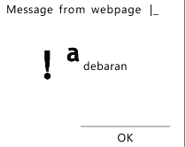

### 使用 join 进行连接和合并

`join()` 方法将数组的元素转换为一个连接后的字符串。此方法与 `concat()` 方法不同，`concat()` 会合并数组并返回新数组，而它不会执行任何类型转换。代码如下：

```javascript
var star = ["Polaris", "Deneb", "Vega", "Altair"];
var StringVar = star.join();
```

变量 `StringVar` 包含 Polaris、Deneb、Vega、Altair，如图 8-1 所示。

网页上的消息：

+ 1. Polaris, Deneb, Vega, Altair

```javascript
var star = ["Polaris", "Deneb", "Vega", "Altair"];
starString = star.join("*");
```

结果将是 Polaris*Deneb*Vega*Altair，如图 8-2 所示。

网页上的消息：

+ 1 Polaris*Deneb*Vega*Altair

OK

**图 8-2 使用不同的分隔符进行连接。**

提示：`join()` 方法是一种查看数组内容的快速方法，无需创建整个循环结构。

### 使用 push 和 pop 添加和删除元素

`concat()` 返回新合并的数组，而 `push()` 和 `pop()` 用于添加和删除元素。`push()` 方法返回新数组的长度，`pop()` 返回被删除的元素。`push()` 和 `pop()` 方法在数组末尾操作，如下面的代码以及配套内容中的 `evenmorearrays.txt` 文件所示：

```javascript
var star = ["Polaris", "Deneb", "Vega", "Altair"];
star.push("Aldebaran");
```

在包含五个元素的 star 对象中运行上述代码：Polaris、Deneb、Vega、Altair 和 Aldebaran。

`pop()` 移除最后一个元素并返回被删除的元素：

```javascript
var star = ["Polaris", "Deneb", "Vega", "Altair"];
removedElement = star.pop();
```

变量 `removedElement` 包含字符串 "Altair"，因为那是数组的最后一个元素。数组的长度也缩短（或减少）了 1。

### 使用 shift 和 unshift 添加和删除元素

`shift()` 和 `unshift()` 方法在数组开头操作。

星数组为：

`["Aldebaran", "Polaris", "Deneb", "Vega", "Altair"]`

使用 `shift()` 从数组开头删除一个元素。注意 `shift()` 返回被删除的元素，就像 `pop()` 一样：

```javascript
var star = ["Polaris", "Deneb", "Vega", "Altair"];
removedElement = star.shift();
```

星数组现在包含：

`["Deneb", "Vega", "Altair"]`

### 使用 slice() 返回数组部分

当你需要返回数组特定部分时，`slice()` 方法非常有用，但你必须小心，除非你创建了数组的副本，否则 `slice()` 会改变数组。例如，以下代码返回并将 "Vega,Altair" 放入 `curStars`，因为 Vega 和 Altair 是第三和第四元素（记住数组从零开始计数）。

```javascript
var star = ["Polaris", "Deneb", "Vega", "Altair"];
curStars = star.slice(2, 4);
```

### 使用 sort

有时排序数组元素是有帮助的。看这段代码：

```javascript
var star = ["Polaris", "Deneb", "Vega", "Altair"];
sortedStars = star.sort();
```

结果如图 8-3 所示，你可以看到星数组元素是按字母顺序排序的，尽管它们给出的顺序并不是如此。注意原始数组和 `sortedStars` 都包含排序后的列表。

## 第 8 章 JavaScript 中的对象

注意不要 `sort()` 方法排序数字。考虑这段代码：

```javascript
var nums = [11, 54, 22, 111];
var sortedNums = nums.sort();
```

你可能期望 `sortedNums` 变量包含 11, 22, 111, 54，但它实际上按字母顺序排序，如图 8-4 所示。

网页上的消息：

``

**图 8-4 尝试使用 sort() 排序数字是无效的。**

### 遍历数组

JavaScript 中有两种方法可以遍历数组元素。书中主要的浏览器方法是循环，这里是其语法的快速回顾：

```javascript
var candies = ["chocolate", "licorice"];
for (var i = 0; i < candies.length; i++) {
  alert(candies[i]);
}
```

在 ECMA-262 版本 5 中引入了 `forEach()` 方法，除 Internet Explorer 8 及更早版本外的所有浏览器都支持它，它可以遍历数组元素：

```javascript
var candies = ["chocolate", "licorice"];
candies.forEach(function(candy) {
  alert(candy);
});
```

注意使用 `forEach()` 方法（以及方法），因为它们并没有广泛支持。

### 表 8-1 数组对象的方法

| 方法 | 描述 |
| :--- | :--- |
| reverse() | 反转元素的顺序。 |
| map() | 对每个数组项执行函数并返回一个数组。 |
| indexOf() | 返回参数首次出现的索引。 |
| lastIndexOf() | 返回参数在数组中的最后一个索引。 |
| every() | 当函数返回 true 时，对每个数组项执行函数。 |
| filter() | 对每个数组项执行函数，并返回仅函数返回 true 的项。 |
| some() | 当函数返回 false 时，对每个数组项执行函数。 |
| splice() | 从数组中插入或删除元素。返回一个包含删除项的数组。 |

### 利用内置对象

JavaScript 语言提供了几个有用对象来辅助 JavaScript 程序常用的任务。你已经见过其中一些，例如 `Date`、`Number` 和 `Math` 对象，它们在第 4 章中介绍过。

### 全局对象

JavaScript 有一个全局对象，包含了已讨论的方法，例如 `NaN()`。另一个常用的全局对象方法 `encodeURI()`、`encodeURIComponent()` 和 `eval()` 在本节中讨论。

### 使 URI 安全

`encodeURI()` 方法接收一个统一资源标识符 (URI)，其中包含给定 URI 不允许的字符，并对其进行编码以便使用。前面的 URI 包含空格——这在 HTTP URI 中是不允许的——因此 URI 需要编码。

```javascript
alert(encodeURI("http://www.example.org/with spaces.htm"));
```

图 8-5 显示了结果。

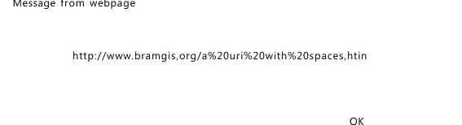

**图 8-5 使用 encodeURI 方法在 JavaScript 中正确编码 URI。**

`encodeURI()` 方法作用于图 8-5 所示的整个 URI，而 `encodeURIComponent()` 方法仅作用于 URI 的部分，例如所示示例的部分。`encodeURI()` 和 `encodeURIComponent` 方法分别有相应的对应方法 `decodeURI()` 和 `decodeURIComponent()`。

### 使用 eval() 方法

`eval()` 方法是你在 JavaScript 中可以使用的最强大且最危险的方法之一。`eval()` 方法接收单个参数，该参数由 JavaScript 环境解释并执行，例如：

```javascript
eval("alert hello world");
```

`eval()` 方法执行 alert 代码的方式就像直接执行该代码一样。通常，你在异步 JavaScript 和 XML (AJAX) 调用期间使用 `eval()` 方法，但这样做会带来安全问题，因为 AJAX 调用返回的代码就像普通代码一样被执行，而该代码可能是恶意的。

## 练习题

- 1. 创建一个循环遍历四个星星的数组，在这里显示每个星星的 `alert()` 对话框。

```javascript
var star = ['Polaris', 'Deneb', 'Vega', 'Altair'];
```

- 2. 创建一个对象来持有你喜欢的歌曲。这些对象应该包含艺术家、长度和标题，每个歌曲对应一个。

- 3. 本章的第一步练习使用了一个列表来填充这些对象，我们展示了：

```javascript
function Star(constellation, type, spectralClass, magnitude) {
  this.constellation = constellation;
  this.type = type;
  this.spectralClass = spectralClass;
  this.mag = magnitude;
}

star['Polaris'] = new Star('Ursa Minor', 'Spectroscopic Binary', 'F7 V', 2.3);
star['Mizar'] = new Star('Ursa Major', 'Spectroscopic Binary', 'A1 V', 2.3);
star['Aldebaran'] = new Star('Taurus', 'Variable', 'E3 III', 0.5-0.1);
star['Rigel'] = new Star('Orion', 'Supergiant', 'BB Ia', 0.12);
star['Castor'] = new Star('Gemini', 'Multiple/Spectroscopic', 'A1 V', 1.58);
star['Albireo'] = new Star('Cygnus', 'Double', 'K3 III', 3.1);
star['Accruz'] = new Star('Crux', 'Double', 'B1 IV', 0.8);
star['Gemma'] = new Star('Corona Borealis', 'Eclipsing Binary', 'AO V', 2.23);
star['Procyon'] = new Star('Canis Minor', 'Double', 'F5 IV', 0.38);
star['Sirius'] = new Star('Canis Major', 'Double', 'A1 V', 1.46);
star['Rigel Kent'] = new Star('Centaurus', 'Double', 'G2 II', -0.01);
star['Deneb'] = new Star('Cygnus', 'Supergiant', 'A2 Ia', 1.25);
star['Vega'] = new Star('Lyra', 'White Dwarf', 'A0 V', 0.03);
star['Altair'] = new Star('Aquila', 'White Dwarf', 'A7 V', 0.77);
```

代码接着使用一个 for 循环遍历每一个星对象，并显示星星的名字，如下：

```javascript
for (var prop in star) {
  alert(prop);
}
```

你的任务是显示一个包含所有星星名字的单一对话框，而不是为每个星星显示一个对话框。

# 第 9 章 浏览器对象模型 (Browser Object Model)

在读完本章后，你将能够：

- 理解作为窗口对象一部分的不同对象。
- 使用 `navigator` 对象查看访问者浏览器的属性。
- 获取访问者屏幕的信息，包括可用的高度和宽度。
- 使用 JavaScript 检测浏览器中是否启用了 Java。
- 解析浏览器发送的查询字符串。

## 介绍浏览器

在本书的这一章节之前，你主要是在抽象层面回顾 JavaScript。本章开始介绍你如何在现实世界中应用 JavaScript。

我觉得写这些有点傻，但它们很重要，所以我还是要说一下：浏览器是 JavaScript 编程的核心。像 Rhino (http://www.mozilla.org/rhino/) 这样的项目想要改变这一点，但理解浏览器提供的环境，对于编写在多个平台、多个浏览器上良好运行的 JavaScript 代码至关重要。本节将向你介绍浏览器对象模型。

## 浏览器层次结构

浏览器对象模型创建了一个树形的对象层次结构，其中许多对象为 JavaScript 程序员提供了属性和方法。浏览器本身由一个对象表示，称为 `window` 对象。`window` 对象是几个子对象的父对象：

- document
- frames
- history

`window` 对象的子对象 `document` 是特殊的，因为它有多个子对象甚至孙子对象。图 9-1 展示了 `window` 对象、其子对象以及它们在浏览器层次结构中的位置。

Lekatire Location, Location - Mozilla Firefox

文件 编辑 视图 历史 书签 帮助。

```
* http://www.braingia.org/location.html
```

[ 位置, 位置, 位置

hash:

host: www.braingia.org

hostname: www.braingia.org

href: http://www.braingia.org/location.html

pathname: location.html

port:

protocol: http:

search:

reload: function reload() { [native code] }

replace: function replace() { [native code] }

assign: function assign() { [native code] }

Done

```

图 9-1. `window` 对象及其子对象。

我将在单独的章节中讨论 `document` 对象——第 10 章“文档对象模型”。在本章的剩余部分中，你将学习 `window` 对象的其他子对象。

### 事件

事件在第 1 章“JavaScript 比你想象的要强大得多”中简要描述过。你在 JavaScript 编程的许多领域都会用到事件，处理 Web 表单时更是如此。事件在动作发生时被触发。这些动作可以由用户触发（例如点击按钮或链接，或将鼠标移入或离开区域），也可以通过程序触发。

## 自我

`window` 对象是一个全局对象，代表浏览器中当前打开的窗口。`window` 对象具有多个属性、方法和子对象。你已经使用过其中一些方法，例如 `alert()` 和 `prompt()`。由于 `window` 对象是全局对象，因此你不需要在它的属性和方法前加上 `window.` 前缀。相反，你可以直接调用它们，正如你已经在调用 `alert()` 方法的示例看到的那样。

`window` 对象的直接后代不需要 `window` 前缀，但当你处理 `window` 对象直接后代以外的对象时，需要在它们前面加上 `window` 对象。例如，`document` 对象是 `window` 对象的直接后代，因此不需要 `window` 前缀，但 `document` 对象的后代则需要，如下例所示：

```javascript
alert("something"); // 注意没有前缀
```

`window` 对象还拥有属性和方法。其中 `self` 属性指向 `window` 对象（这给了我本节标题的灵感）。表 9-1 列出了 `window` 对象的一些常用属性。你将在全书的示例中检查其中的许多这些属性。

### 表 9-1 `window` 对象的选定属性

| 属性 | 描述 |
| --- | --- |
| closed | 当窗口关闭时设置为 true |
| defaultStatus | 用于设置浏览器状态栏中默认显示的文本 |
| name | 窗口首次打开时的名称 |
| opener | 指向创建该窗口的窗口引用 |
| parent | 经常配合 frames 使用，指向创建特定窗口的窗口或比 frame 高级一级的窗口 |
| status | 经常用于在访问者悬停在作为链接元素上时设置状态栏中的文本 |
| top | 指向最高或最顶部的父窗口 |

表 9-2 和表 9-3 描述了 `window` 对象的一些方法。你将在本书的剩余部分中看到如何使用其中许多方法的示例。

### 表 9-2 `window` 对象的选定方法

| 方法 | 描述 |
| --- | --- |
| addEventListener | 跨浏览器（Windows Internet Explorer 除外）事件处理器方法。更多信息请见第 11 章。 |
| attachEvent | Internet Explorer 中的 `addEventListener` 版本。更多信息请见第 11 章。 |
| blur | 将键盘输入焦点从浏览器窗口移开。 |
| focus | 将键盘输入焦点改为浏览器窗口。 |
| close | 关闭浏览器窗口。 |
| detachEventListener | Internet Explorer 中的 `removeEventListener` 版本。 |
| removeEventListener | 跨浏览器（Internet Explorer 除外）事件处理器移除方法。 |
| open | 打开窗口。 |
| print | 触发浏览器的打印函数；行为就像有人点击了浏览器中的“打印”一样。 |

`window` 对象的某些方法处理移动和调整窗口大小，描述在表 9-3 中。

### 表 9-3 用于移动和调整大小的 `window` 对象的选定方法

| 方法 | 描述 |
| --- | --- |
| moveBy | 用于将窗口移动到相对位置 |
| moveTo | 用于将窗口移动到特定位置 |
| resizeBy | 用于通过相对量更改窗口大小 |
| resizeTo | 用于将窗口大小更改为特定尺寸 |

定时器出现在某些 JavaScript 应用中，并在第 11 章中讨论。与定时器相关的 `window` 对象方法如下：

- clearInterval()
- clearTimeout()
- setInterval()
- setTimeout()

本章其余部分将详细介绍 `window` 的直接子对象。

## 获取屏幕信息

`screen` 对象提供了一种获取访问者屏幕信息的方法。你可能需要这些信息来确定显示哪些图像或页面的大小。无论你是否使用 `screen` 对象，都需要创建一个良好的基于 CSS 设计（CSS 代表层叠样式表），以优雅地处理各种尺寸的屏幕。

注意：你经常将 `window` 的子对象视为 `window` 的属性——例如 `screen` 属性而不是 `screen` 对象。

`screen` 对象的可用属性如下：

- availHeight
- availWidth
- height
- width

你可能好奇 `availHeight` 和 `availWidth` 属性与 `height` 和 `width` 属性之间的差异。`availHeight` 和 `availWidth` 属性返回的是减去其他控件（如 Microsoft Windows 中的任务栏）占用空间后的可用高度和宽度（没开玩笑！）。`height` 和 `width` 属性返回的是总高度和宽度。这通过示例可能会更容易理解。

### 确定访问者的屏幕高度和宽度

1. 使用 Microsoft Visual Studio、Eclipse 或其他编辑器，打开第 09 章示例文件夹中的 `screen.htm` 文件。
2. 在页面中，此处显示的代码（你可以在配套内容的 `screen.txt` 文件中找到它）：

```html
<!DOCTYPE HTML PUBLIC "//W3C//DTD HTML 4.01//EN"
"http://www.w3.org/TR/html4/stri_ct.dtd">
<html>
<head>
<body>
<p>Screen 1-1</p>
</body>
</html>
```

```javascript
<script type="text/javascript">
alert("Available Height: " + screen.availHeight);
alert("Total Height: " + screen.height);
alert("Available Width: " + screen.availWidth);
alert("Total Width: " + screen.width);
</script>
```

```html
<body>
</html>
```

5. 保存并在网页浏览器中查看该页面。你会收到四个 alert 对话框，对应于每个被调用的属性。这里显示的示例截图反映了 1024 x 768 像素的显示。

来自网页的消息

可用高度: 731

确定

来自网页的消息

总高度: 771

确定

来自网页的消息

可用宽度: 1184

# 第 10 章 文档对象模型 187

如你从这些截图中所示，总宽度和总高度分别为 1184 像素和 771 像素。注意，可用宽度仍然保持为 1184，而由于任务栏的存在，可用高度从 771 减少到 731。

## 使用 navigator 对象

`navigator` 对象提供了几个属性，有助于检测访问者浏览器的各种元素和环境环境。JavaScript 可以执行的最流行的操作之一是检测访问者正在使用哪种浏览器。（好吧，本节不是关于这个的——但可以是。请查看侧边栏的“浏览器检测的问题”获取更多信息。）

### 浏览器检测的问题

长期以来，网站使用 `navigator` 对象来检测访问者正在使用哪种浏览器。（在互联网领域，这是一个很长一段时间了——可能是几年，也可能短至几个月，取决于你所说的技术。）浏览器检测是为了执行针对特定浏览器的 JavaScript 代码。虽然简单的浏览器检测有其用处，但某些设计良好的网站将这种技术作为寻找使用特定浏览器的访问者的手段。

他们不知道，浏览器发送的信息可以很容易被伪造。Firefox 的 User Agent Switcher 插件就是更改此类信息的一种方法，从而使得使用 `navigator` 对象的检测变得无效。

> 提示：我在书中之前说过过，现在还会说一遍（可能以后还会重复）：永远不要依赖来自访问者浏览器发送到你网站的任何信息。始终进行验证。仅仅因为浏览器是 Internet Explorer 就断定它是不够的。第 11 章展示了一种更好的方法，用于检测哪个浏览器能够处理你网站上的 JavaScript。

当你使用 `navigator` 对象来检测访问者的浏览器时，你会遇到另一个问题，因为有太多的浏览器。Web 开发人员可能会花费太多时间来跟踪哪些浏览器可能支持某些函数，并尝试在代码中考虑所有这些浏览器。navigator 并不是无可救的

## 查看 navigator 对象

- 1. 使用 Visual Studio、Eclipse 或其他编辑器，编辑配套内容中 Chapter09 示例文件夹中的 `naviprops.htm` 文件。
- 2. 在页面中，将 TODO 注释替换为此处所示代码（此代码位于配套内容中的 `navigator.txt` 文件中）：

```html
<!DOCTYPE HTML PUBLIC "//W3C//DTD HTML 4.01//EN"
"http://www.w3.org/TR/html41/strict.dtd">
<html>
<head>
<title>The navigator</title>
</head>
<body>
<script type="text/javascript">
var body = document.getElementsByTagName("body")[0];
for (var prop in navigator) {
var elem = document.createElement("p");
var text = document.createTextNode(prop + ": " + navigator[prop]);
elem.appendChild(text);
body.appendChild(elem);
}
</script>
</body>
</html>
```

- 3. 在你选择的浏览器中保存并查看页面。如果你选择了 Firefox，你将看到类似这样的页面：

| navigator 对象 | Mozilla Firefox | | |
|---|---|---|---|
| 文件 | 编辑 | 视图 | 历史 | 书签 | 工具 | |
| C | | | http://127.0.0.1/js/naviprop5.html | |
| navigator 对象 | | | | | | | 7 |

appCodes: Mozilla.
appVersion: (US)
language:
mimeTypes: [object MimeTypeArray]
platform: 
userAgent: Win32; rv:10

# 第 9 章 浏览器对象模型 189

4. 如果你选择 Internet Explorer，页面看起来将类似于此；但是，请注意可用属性的差异：

| Navigator 对象 - Windows Internet Explorer | | | | | | |
|---|---|---|---|---|---|---|
| v | http://192.168.1.14:8080/index.html | | 收藏 | | | |
| navigator 对象 | | | 页面 | 工具 | |

appCode: Mozilla
appName: Microsoft Internet Explorer
appVersion: 0
cpuClass: x86
platform: Win32
plugins: [object HTMLCollection]
userProfile: null
systemLanguage: en-us
userLanguage: en-us
Done Internet |

我无法强迫自己在这个练习中使用另一个 alert 框，我必须使用一些我尚未介绍过的函数。不过，永远——这个示例中的元素在第 9 章中介绍过。该函数的代码使用文档对象模型（DOM）在网页内创建超文本标记语言（HTML）元素。使用 for 循环来遍历 navigator 对象的每个属性：

```javascript
function showProps() {
  var body = document.getElementsByTagName('body')[0];
  for (var prop in navigator) {
    var elem = document.createElement('p');
    var text = document.createTextNode(prop + ': ' + navigator[prop]);
    elem.appendChild(text);
    body.appendChild(elem);
  }
}
```

# 190 第二部分 应用 JavaScript

## 使用 navigator 对象检测 Java

如果你的网站使用了 JavaScript，你可以使用 `navigator` 对象来检查 Java 是否启用。

- 1. 使用 Visual Studio、Eclipse 或其他编辑器，编辑配套 9 文件夹中的 `test.htm` 文件。
- 2. 在页面中，将 TODO 注释替换为此处所示代码（此代码位于配套内容中）：

```html
<!DOCTYPE HTML PUBLIC "//W3C//DTD HTML 4.01//EN"
"http://www.w3.org/TR/html41/strict.dtd">
<html>
<head>
<title>Java Test</title>
</head>
<body>
<script type="text/javascript">
if (navigator.javaEnabled()) {
  alert("Java is enabled");
} else {
  alert("Java is not enabled");
}
</script>
</head>
<body>
</html>
```

- 3. 保存并在 Internet Explorer 中查看页面。默认情况下，Internet Explorer 启用了 Java，你会看到这样的警对话框：
- 4. 切换到 Firefox，如果它可用了。

## location 对象

`location` 对象提供了对当前加载的统一资源标识符（URI）的访问，包括查询字符串、使用的协议和其他组件的信息。例如，URI 可能是：

http://www.brainia.org/location.html

如果网页包含 JavaScript 代码，输出将如图 9-2 所示：

| location 对象 - Mozilla Firefox | |
|---|---|
| 文件 | 编辑 | 视图 | 历史 | 书签 | 工具 |
| location, location, location | |
| hash: |
| host: brainia.org |
| hostname: brainia.org |
| href: http://brainia.org/location.html |
| pathname: /location.html |
| port: |
| protocol: http: |
| search: |
| reload: function ([native code]) |
| replace: function ([native code]) |
| assign: function ([native code]) |

## 第 10 章 文档对象模型 (DOM)

### I 区域、位置、位置-Windows Internet Explorer
http://192.168.1.14/jsbs/c9.html

| 收藏？ | 插入、位置、位... | 编辑 | 页面* | 安全* | 工具 |
|---|---|---|---|---|---|---|
| hostname: 192.168.1.14 | | | | | | | |
| href: "http://192.168.1.14/jsbs/c9-location.htm" | | | | | | | |
| host: 192.168.1.14 | | | | | | | |
| hash: | | | | | | | |
| port: | | | | | | | |
| pathname: /jsbs/c9-location.htm | | | | | | | |
| protocol: http: | | | | | | | |
| 完成 | Internet | 保护模式：开启 | | 100% | | |

- 4. 通过添加一些查询参数/值对来修改你用于调用该页面的 URI。例如，我本地环境使用的 URI 是 http://192.168.1.14/jsbs/c9/location.htm。（你的环境和你提供文件的位置可能与此不同）。我将修改 URL 并添加两个参数：name-Steve 和 country-US。你可以随意更改 name 参数的值以输入其他内容，并将 country 的值更改为你所在的国家（如果你不是来自美国**话**）。在这里，你选择的值并不那么重要——重要的是你使用了多一个参数/值对。这里是你最终的 URI：http://localhost:1627/Chapter9/location.htm?name=Steve&country=US。

- 5. 当你使用新添加的参数加载页面时，`search` 属性有一个值，如下所示：

# 第二部分 应用 JavaScript

### 区域、位置-Windows Internet Explorer
```

| (Q=x+y=1) http://192.168.1.14/jsbs/c9/location | | | | |

```

| 收藏？ | 区域、位置 | 编辑 | | 页面 | 安全 | 工具 |

```

hostname: 192.168.1.14

href="http://192.168.1.14/jsbs/c9/location1.htm?name=Steve&country=US"

host: 192.168.1.14

hash:

port:

pathname="/jsbs/c9/location1.htm"

search="?name=Steve&country=US"

protocol: http

```

- 6. 再次打开 location1.htm 文件，并将其保存为 location2.htm。

- 7. 修改 location2.htm 中的代码，使其检查 `search` 属性，如下所示（更改部分以**粗体**形式显示，并位于配套内容中的 `location2.txt` 文件中）：

```html
<!DOCTYPE HTML PUBLIC "//W3C//HTML 4.01//EN"
"http://www.w3.org/TR/html4/strict.dtd">
<html>
<head>
<title>Location, Location</title>
</head>
<body>
<script type="text/javascript">
var body = document.getElementsByTagName("body")[0];
for (var i=0; i<location.length; i++) {
var elem = document.createElement("p");
var text = document.createTextNode(": " + location[i]);
elem.appendChild(text);
body.appendChild(elem);
}
if (location.search) {
```

```javascript
elem.appendChild(text);
body.appendChild(elem);
}
</script>
</body>
</html>
```

- 8. 通过将浏览器指向 location2.html?name=Steve&country=US 来执行此代码（根据需要像之前一样修改 name 和 country，除非你的名字确实是 Steve 且居住在美国）。你现在会收到一个页面，它列出了你之前看到的普通属性，还列出了（在底部附近）从查询字符串解析出的参数/值对，如下所示：

| Location, Location: Location-Windows Internet Explorer | | | |
|---|---|---|---|
| 收藏 | Location, Location | 页面 | 安全 | 工具 |
| hostname: 192.168.1.14 | | |
| href: http://192.168.1.114/jsbs/location2.html?name=Steve&country=US | | |
| host: 192.168.1.14 | | | |
| hash: | | | |
| port: | | | |
| pathname: /jsbs/c9/location2.html | | | |
| search: ?name=Steve&country=US | | | |
| protocol: http | | | |
| name: Steve | | | |
| country: US | | | |
| 完成 | Internet | 保护模式：开启 | 100% |

- 9. 然而，注意第一个参数 `name` 包含了查询字符串中的问号 (?) ，这并不是你想要的。你可以通过多种方法解决这个问题。最简单的方法之一是使用 `substring` 方法。`substring` 方法返回指定处的字符串。在这种情况下，`location.search` 的第一个字符（索引为 0 处）是问号，因此使用 `substring(1)` 来解决此问题。代码如下（更改部分以**粗体**显示并在配套内容中的 `location2.txt` 文件中）：

```html
<!DOCTYPE HTML PUBLIC "//W3C//HTML 4.01//EN"
"http://www.w3.org/TR/html4/strict.dtd">
<html>
<head>
<title>Location, Location</title>
</head>
<body>
<script type="text/javascript">
var body = document.getElementsByTagName("body")[0];
for (var i=0; i<location.length; i++) {
var elem = document.createElement("p");
var text = document.createTextNode(": " + location[i]);
elem.appendChild(text);
body.appendChild(elem);
}
if (location.search) {
var queryString = location.search.substring(1);
var splits = queryString.split("&");
for (var i = 0; i < splits.length; i++) {
var elem = document.createElement("p");
var text = document.createTextNode(": " + location[i] + " = " + splits[i]);
elem.appendChild(text);
body.appendChild(elem);
}
</script>
</body>
</html>
```

- 10. 通过将浏览器指向 location2.html?name=Steve&country=US 来执行此代码（根据需要像之前一样修改 name 和 country，除非你的名字确实是 Steve 且居住在美国）。你现在会收到一个页面，它列出了你之前看到的普通属性，还列出了（在底部附近）从查询字符串解析出的参数/值对，如下所示：

| Location, Location: Location-Windows Internet Explorer | | | | |

|---|---|---|---|

| 收藏 | Location, Location | 页面 | 安全 | 工具 |

| hostname: 192.168.1.14 | | | | |

| href: http://192.168.1.114/jsbs/location2.html?name=Steve&country=US | | | | |

| host: 192.168.1.14 | | | | |

| hash: | | | | |

| port: | | | | |

| pathname: /jsbs/c9/location2.html | | | | |

| search: ?name=Steve&country=US | | | | |

| protocol: http | | | | |

| name: Steve | | | | |

| country: US | | | | |

| 完成 | Internet | 保护模式：开启 | 100% |

注意，第一个参数 `name` 包含了查询字符串中的问号 (?) ，这并不是你想要的。你可以通过多种方法解决这个问题。最简单的方法之一是使用 `substring` 方法。`substring` 方法返回指定处的字符串。在这种情况下，`location.search` 的第一个字符（索引为 0 处）是问号，因此使用 `substring(1)` 来解决此问题。代码如下（更改部分以**粗体**显示并在配套内容中的 `location2.txt` 文件中）：

```html
<!DOCTYPE HTML PUBLIC "//W3C//HTML 4.01//EN"
"http://www.w3.org/TR/html4/strict.dtd">
<html>
<head>
<title>Location, Location</title>
</head>
<body>
<script type="text/javascript">
var body = document.getElementsByTagName("body")[0];
for (var i=0; i<location.length; i++) {
var elem = document.createElement("p");
var text = document.createTextNode(": " + location[i]);
elem.appendChild(text);
body.appendChild(elem);
}
if (location.search) {
var queryString = location.search.substring(1);
var splits = queryString.split("&");
for (var i = 0; i < splits.length; i++) {
var elem = document.createElement("p");
var text = document.createTextNode(": " + location[i] + " = " + splits[i]);
elem.appendChild(text);
body.appendChild(elem);
}
</script>
</body>
</html>
```


# 第 10 章 文档对象模型

## 文档对象模型定义

文档对象模型（DOM）提供了一种访问和更改超文本标记语言 (HTML) 文档内容的方法。DOM 是世界网联盟 (W3C) 定义的标准。大多数互联网浏览器以各种形式实现了 DOM，且成功程度不相同。

与许多其他标准一样（特别是与 Web 编程相关的标准），DOM 多年来一直在演变。它有三项规范，在 DOM 术语中被称为“级别”（levels），第四项规范也在此途中。

DOM 的功能远比本章甚至整本书所能传达的强大，它包含的内容远比我尝试涵盖的得多。你可以将 DOM 不仅用于 JavaScript 编程。本书侧重于你如何使用 JavaScript 来访问和操作 DOM。

当在本章中（以及全书中）提到 DOM 时，我强调的是它如何与当前任务相关，而不是它与更广泛的相关概念或 DOM 可能实现的功能的关系。例如，本书的重点在于 DOM 如何将 HTML 文档表示为树形。DOM 对 HTML 和可扩展标记语言 (XML) 都是这样做的，但由于这是一本关于 JavaScript 的书，最重要的是你理解 DOM 与 HTML 的关系。

> **注意** 本章中的示例使用了 `<body>` 内联事件处理器，例如直接附加到 `<body>` 标签上的 `onload` 事件，以及附加到各种 HTML 标签上的 `onclick` 事件处理器。使用内联事件处理器不是最佳实践，此处仅用于说明目的。第 11 章“JavaScript 事件与浏览器”介绍了向 HTML 附加事件的更好方法。

## DOM Level 0：遗留 DOM

DOM Level 0 是在 DOM 的其他正式规范之前实现的。在 DOM Level 1 规范确定之后，之前与文档脚本相关的技术被编纂成规范（尽管并非真的通过遗留的 DOM Level 0 以任何正式方式实现）。今天，每个主流浏览器都支持 DOM Level 0 组件以实现向下兼容。你可希望你在 1998 年编写的所有脚本崩溃！

DOM 0 集中于获取元素的访问权限，但它也包含了对链接和图像的访问权限。第 14 章“结合 Web 使用 JavaScript”涵盖了表单以及你如何通过 DOM 访问它们。与其花时间在 DOM Level 0 的示例上，我将重点放在 DOM Level 1 和 Level 2 上，因为你在编写 JavaScript 时更有可能使用这些级别。

## DOM Level 1 和 Level 2

W3C 在 1998 年将 DOM Level 1 作为规范引入。与遗留 DOM 类似，Level 1 被所有主流浏览器以各种形式支持。DOM Level 2 于 2000 年正式发布。不同浏览器对 Level 2 DOM 的支持差异更大。坦率地说，对所有 DOM 级别的支持都随浏览器和版本的不同而异。

版本 9 之前的 Internet Explorer 版本声称支持 DOM，但它们的实现方式与其他浏览器不同。因此，你需要意识到在 JavaScript 代码中正在使用或尝试使用的 DOM 特性或函数可能在 Internet Explorer 中无法工作，或者只在 Internet Explorer 中有效而在其他任何地方都不有效（而且，不，这是不可接受的）。Windows Internet Explorer 9 是向正确方向迈出的一步，但你需要意识到这些差异。

## 作为树的 DOM

DOM 将 HTML 文档表示为树。例如，考虑列表 10-1 所示的简单 HTML。

### 列表 10-1 一个简单的 HTML 文档

```html
<html>
<head>
  <title>Hello World</title>
</head>
<body>
  <p>Here's some text.</p>
  <p>Here's more text.</p>
  <p>Link to <a href="http://www.w3.org">W3</a></p>
</body>
</html>
```

图 10-1 显示了列表 10-1 中的 HTML 在树中的表示。

许多 HTML 元素具有属性，例如列表 10-1 所示的 `<a>` 元素的 `href` 属性。你可以使用 DOM 获取并设置这些属性，正如本章后面将所示。

在操作 DOM 时，你应该意识到检索元素、设置元素及其项目以及删除元素之间的区别。操作元素的方法反映了这种区别。

## 操作节点

树结构中的元素有时被称为“节点”（nodes）或“节点对象”（node objects）。例如，图 10-1 所示的结构，`<body>` 节点有三个子节点都是 `<p>` 元素，其中一个 `<p>` 元素拥有它自己的子节点，即一个 `<a>` 元素。`<body>` 被称为 `<p>` 节点的父节点。任何给定节点下的节点都是该节点的“后代”（descendants）。图 10-1 中的三个 `<p>` 节点由于处于同一层级被称为“兄弟”（siblings）。

正如你使用方法操作 DOM 元素一样，你还使用方法操作反映父子关系和兄弟关系的节点。例如，你可以使用本章后面所示的 `appendChild()` 等方法将节点添加到现有的父节点。

## 检索元素

检索文档元素是使用 JavaScript 编程时使用 DOM 的基本方式。本节将检查用于检索元素的两种主要方法：`getElementById()` 和 `getElementsByTagName()`。

### 通过 ID 检索元素

`getElementById()` 方法是 DOM 的一个核心方法。它检索 HTML 文档中的指定元素并返回其引用。要检索一个元素，它必须具有 `id` 属性。例如，你可以修改列表 10-1 中的 HTML，为 `<a>` 元素添加 `id` 属性，如下加粗所示：

```html
<a id="w3link" href="http://www.w3.org">W3</a>
```

现在 `<a>` 元素已经有一个 id，你可以使用 `getElementById()` 方法来检索它，如下：

```javascript
var al = document.getElementById("w3link");
```

ID 为 `w3link` 的元素的引用将被放在 JavaScript 变量 `al` 中。

所有 HTML 元素都支持 id 属性，这使得它们都可以通过 JavaScript 获取。在这个示例中，`<p>` 元素获取了 ID，使得它们可以使用 `getElementById` 方法进行检索。看下这段代码：

```html
<html>
<head>
<title>Hello World</title>
</head>
<body>
  <p id="sometext">Here's some text.</p>
  <p id="moretext">Here's more text.</p>
  <p id="link">Link to the <a id="w3-link" href="http://www.w3.org">W3C</a></p>
</body>
</html>
```

你可以以相同的方法检索 `<p>` 元素：

```javascript
var pi = document.getElementById("sometext");
var p2 = document.getElementById("moretext");
var plink = document.getElementById("link");
```

但在检索这些元素后，你可以对它们做什么呢？对于像 `<a>` 这样的元素，你可以通过获取 `href` 属性的值来访问它们的属性，正如本示例所示。你可以在配套代码 `getelement.html` 文件中找到它。

```html
<html>
<head>
<title>Get By Id</title>
<script type="text/javascript">
function checkhref() {
  var al = document.getElementById("w3-link");
  alert(al.href);
}
</script>
</head>
<body onload="checkhref()">
<p id="sometext">Here's some text.</p>
<p id="moretext">Here's more text.</p>
<p id="link">Link to the <a id="w3-link" href="http://www.w3.org">W3C</a></p>
</body>
</html>
```

图 10-2 借助 `getElementById()` 获取的属性。

在本章的后面部分，你将看到如何更改元素和属性。

### 关于 innerHTML 属性的说明

更改元素文本的一种方法是使用 `innerHTML` 属性。`innerHTML` 属性能够快速、简单地访问诸如 `<p>` 元素等元素的文本。该属性通常运行良好——事实上，效果非常好，尽管在很长一段时间里，它在许多 Web 编程圈子里并不受欢迎，但我发现很难在本节中完全跳过它。我不会跳过的。

`innerHTML` 的问题在于它没有被 W3C 正式定义为标准，因此它并不在所有浏览器中都能像其他指定的 DOM 对象那样得到支持。然而，`innerHTML` 将成为 HTML 5.0 规范的一部分，而且考虑到实际 DOM 规范的实现有时具有不可预测性，`innerHTML` 仍然很有价值。主流浏览器都支持 `innerHTML`——而且支持得相当一致。

看下这个，你可以在 `inner.html` 文件中找到代码：

```html
<!DOCTYPE html PUBLIC "-//W3C//DTD HTML 4.01//EN" 
"http://www.w3.org/TR/html4/strict.dtd">
<html>
<head>
  <title>Get Id</title>
  <script type="text/javascript">
  function changeText() {
    var pi = document.getElementById("sometext");
    alert(pi.innerHTML);
    pi.innerHTML = "Changed Text";
  }
  </script>
</head>
<body onload="changeText()">
<p id="sometext">Here's some text.</p>
<p id="moretext">Here's more text.</p>
<p id="link">Link to the <a id="w3-link" href="http://www.w3.org">W3C</a></p>
</body>
</html>
```

`changeText` 函数检索 ID 为 `sometext` 的元素，并使用这段代码将其引用存放在变量 `pi` 中：

```javascript
var pi = document.getElementById('sometext');
```

接下来，它调用 `innerHTML` 属性，将结果发送到 alert 对话框。

注意不仅是 alert 对话框，还有背景窗口中第一行的文本：当用户点击 OK 时，alert 对话框消失，执行下一行 JavaScript 代码，使用 `innerHTML` 属性将第一个 `<p>` 元素的文本更改为 "Changed Text"。

### 通过标签名检索

当你只需要检索一个或少数几个元素时，`getElementById()` 方法运行良好；当你需要一次检索多个元素时，你可能会发现 `getElementsByTagName()` 方法更合适。

`getElementsByTagName()` 方法以数组或列表格式返回指定标签的所有元素。例如，要检索文档中所有的 `` 标签，你可以写下以下代码：

```javascript
var images = document.getElementsByTagName("img");
```

然后你可以通过循环遍历这些元素来检查存储在 `images` 中的 `` 元素的属性。

这是一个修改表格的示例。这段代码在用户点击 "Click To Change Colors" 链接时更改表格内每个元素的背景颜色。你可以在配套代码的 `bytagname.html` 文件中找到这段代码：

```html
<!DOCTYPE HTML PUBLIC "-//W3C//DTD HTML 4.01//EN"
"http://www.w3.org/TR/html4/strict.dtd">
<html>
<head>
<title>Tag Name</title>
<script type="text/javascript">
function changeColors() {
  var all = document.getElementsByTagName("td");
  var length = all.length;
  for (var i = 0; i < length; i++) {
    all[i].style.backgroundColor = "blue";
  }
}
</script>
</head>
<body>
<table id="myfile" border="1">
<tr><td id="left0">Left</td><td id="right0">Right</td></tr>
<tr><td id="left1">Left</td><td id="right1">Right</td></tr>
<tr><td id="left2">Left</td><td id="right2">Right</td></tr>
</table>
<a href="#" onclick="return changeColors();">Click to Change Colors</a>
</body>
</html>
```

图 10-3 使用 `getElementsByTagName()` 格式化表格中的元素。点击链接会导致元素更改背景颜色，你可以在图 10-4 中看到。

## 获取属性

你可以使用 `getAttribute()` 方法获取元素的属性值。例如，要获取 `<a>` 元素的 `href` 属性：

```javascript
var link = document.getElementById("w3-link");
var href = link.getAttribute("href");
```

## 设置属性

你已经看到 `getAttribute()` 方法如何获取属性中的值。你也可以使用 `setAttribute` 方法来设置属性。

`setAttribute` 方法接受两个参数：你想要更改的属性以及该属性预期的值。以下是一个更改 `href` 属性值的示例，你也可以在配套代码的 `setattr.html` 文件中找到：

```html
<!DOCTYPE HTML PUBLIC "-//W3C//DTD HTML 4.01//EN"
"http://www.w3.org/TR/html4/strict.dtd">
<html>
<head>
  <title>设置属性</title>
</head>
<body>
  <a href="http://www.brainia.org" id="braingialink">Steve Suehrung's Web Site</a>
  <script type="text/javascript">
    var a = document.getElementById('braingialink');
    alert(a.getAttribute('href'));
    a.setAttribute('href', "http://www.microsoft.com");
    alert(a.getAttribute('href'));
  </script>
</body>
</html>
```

当你在浏览器中查看此页面时，你会看到一个 `alert()` 对话框，显示 `href` 属性的当前值，如图 10-5 所示。

图 10-5 href 属性的初始值。当对话框关闭时，`setAttribute` 方法执行，`href` 属性发生了变化。

`setAttribute` 方法在 Internet Explorer 8.0 之前工作并不稳定，因此设置属性的一种可靠方法是使用点符号来访问元素的属性。例如，你可以在下面的代码中使用相同的方法设置 `href`：

```javascript
a.href = "http://www.brainia.org";
```

如果你的网页应用程序不支持早期版本的 Internet Explorer，则使用 `setAttribute` 和 `getAttribute()` 方法更好。此外，你可以使用 `removeAttribute` 方法从元素中删除属性。

## 创建元素

你不限于与页面上已有的元素交互。你可以使用 DOM 向文档添加元素。本节将检查实现这一点的方法。

### 添加文本

在基础的情况下，文档的 `createElement()` 方法在文档中创建或添加元素。示例代码如下：

```javascript
var element = document.createElement("p");
```

变量 `element` 现在指向这个新元素。要让该元素可见，你需要将元素附加到文档中——但如果 `<p>` 元素没有文本怎么办？`appendChild()` 方法结合 `createTextNode()` 方法也可以帮助，如下所示：

```javascript
element.appendChild(document.createTextNode("Hello World"));
```

在文档 body 之后，你可以随时使用目前为止看到的几行代码。这是网页上下文下的代码。你可以在配套代码的 `create.html` 中找到此示例。

```html
<!DOCTYPE HTML PUBLIC "-//W3C//DTD HTML 4.0//EN"
"http://www.w3.org/TR/html4/strict.dtd">
<html>
<head>
  <title>创建</title>
</head>
<body>
  <script type="text/javascript">
    var element = document.createElement("p");
    document.body.appendChild(element);
    element.appendChild(document.createTextNode("Hello World"));
  </script>
</body>
</html>
```

在浏览器中查看时，结果是一个包含 Hello World 文本的简单 `<p>` 元素，如图 10-7 所示。

### 添加元素并设置 ID

之前的示例展示了如何添加元素。通常你还想为该元素设置一些属性，例如 ID。这段代码扩展了之前的示例以添加 `id` 属性（你可以在配套代码的 `create.html` 中找到此代码）：

```html
<!DOCTYPE HTML PUBLIC "-//W3C//DTD HTML 4.0//EN"
"http://www.w3.org/TR/html4/strict.dtd">
<html>
<head>
  <title>创建</title>
</head>
<body>
  <script type="text/javascript">
    var element = document.createElement("p");
    element.setAttribute("id","element");
    document.body.appendChild(element);
    element.appendChild(document.createTextNode("Hello World"));
  </script>
</body>
</html>
```

## 删除元素

你可以使用 `removeChild()` 方法从文档中移除节点。回想上一节添加元素的代码。通过添加几个 `<p>` 元素扩展该代码可以简化你的工作：

```html
<!DOCTYPE HTML PUBLIC "-//W3C//DTD HTML 4.01//EN"
"http://www.w3.org/TR/html4/strict.dtd">
<html>
<head>
  <title>创建</title>
</head>
<body>
  <script type="text/javascript">
    for (var i = 0; i < 3; i++) {
      var element = document.createElement("p");
      element.setAttribute("id","element" + i);
      document.body.appendChild(element);
      element.appendChild(document.createTextNode("Hello World, I am Element " + i));
    }
  </script>
</body>
</html>
```

在网页浏览器中查看时，文档会创建一个类似于图 10-8 的页面。

图 10-8 使用 `for` 循环和 DOM 创建并添加三个元素。

你可以添加几行代码来移除任何新创建的元素。使用 `removeChild` 可以移除文档中的任何元素，而不仅仅是你创建的元素。新增的两行代码是：

```javascript
var removeElement = document.getElementById('element1');
document.body.removeChild(removeElement);
```

图 10-9 显示了结果。`for` 循环仍然创建了三个元素，但上方代码立即删除了中间的一个。

图 10-9 使用 `removeChild` 从文档中删除元素。

### 练习

1. 创建一个包含段落文本的文档，该段落由你使用 DOM 创建并追加。在这一段落之后紧接着创建一个链接，该链接指向到你任选的网站，同样使用 DOM。确保所有元素都具有 `id` 属性。
2. 创建一个包含你喜欢的任何元素的文档，或者使用一个元素中包含 `id` 属性的 HTML 文档。获取其中两个元素，对它们进行修改，并将它们放回文档。你所做的更改类型取决于你选择的元素类型。例如，如果你选择一个 `<a>` 元素，可能会更改 `href`；如果你选择一个 `<p>` 元素，可能会更改文本。
3. 使用 DOM 创建一个包含至少两列和两行表格的文档。在表格单元格中添加一些文本。

# 第 11 章 JavaScript 事件与浏览器

## 理解 Window 事件

在前面的章节中，你已经见过几次事件处理，用以响应用户操作或文档事件。为了复习，`Window` 对象的事件包括 `mouseover` 和 `mouseout`，以及 `load` 和 `click`。这些事件在所有浏览器中都具有很好的标准性，但其他事件和事件处理并不那么容易实现。本节将探索以及你如何在 JavaScript 编程中使用它们。

## 事件模型

理解事件的第一个挑战是理解两种不同的模型：在 9 之前的 Windows Internet Explorer 版本所使用的模型，以及由世界维网联盟（W3C）定义的模型。一个较旧的模型——文档对象模型（DOM）——包含了你在前面章节中看到的事件。（你在第 1 章“JavaScript 比你想象的要多”中学习了一些关于 DOM 0 的知识）。DOM 0 是跨浏览器兼容性最好的模型，并被所有支持 JavaScript 的浏览器支持。在讨论中，我将对 DOM 0 事件模型进行简要概述，然后探索竞争性的 W3C 和 Internet Explorer 模型。

### 表 11-1 DOM 0 事件

| 事件名称 | 描述 |
| :--- | :--- |
| onblur | 元素失去焦点（即它没有被用户选中）。 |
| onchange | 元素发生了变化（例如，用户在文本框中输入了）或失去焦点。 |
| onclick | 鼠标点击了元素。 |
| ondblclick | 鼠标双击了元素。 |
| onfocus | 元素获得了焦点。 |
| onkeydown | 在元素拥有焦点时，按下了键盘键（相对于释放）。 |
| onkeypress | 在元素拥有焦点时，释放了键盘键。 |
| onkeyup | 在元素拥有焦点时，释放了键盘键。 |
| onload | 元素已加载（文档、框架集或图像）。 |
| onmousedown | 按下了鼠标按键。 |
| onmousemove | 鼠标正在移动。 |
| onmouseleave | 鼠标移动到元素之外或移开元素。 |
| onmouseover | 鼠标悬停在元素上。 |
| onmouseup | 释放了鼠标按键。 |
| onreset | 表单被重置，例如用户按下重置按钮时。 |
| onresize | 窗口大小发生了变化。 |
| onselect | 元素的文本被选中。 |
| onsubmit | 表单被提交。 |
| onunload | 文档或框架集被卸载。 |

## 更新的事件模型：W3C 和 Internet Explorer

W3C 规范化了一个允许强大的事件处理的事件模型，几乎所有主流浏览器的后续版本都支持它，早期的 Internet Explorer 除外。

当一个注册的事件被触发时，该事件函数会被调用。然而，事件发生的位置是它们之间的一个重要区别。

为了理解这种差异，想象一个包含 `<body>` 元素和 `body` 中另一个元素的文档，例如一个 ``。如果访问者将鼠标移动到图像上，是否应该触发 `onmouseover`？

W3C 模型支持两种形式的事件：捕获（Capture）和冒泡（Bubbling）。在事件捕获期间，搜索从顶层向下到特定的元素。在事件冒泡期间，搜索从元素向上到 `<body>`。早期的 Internet Explorer 仅使用冒泡（你很快就会学习到），而 W3C 模型使用 `addEventListener` 方法来注册事件。

`addEventListener` 方法的结构如下：

```javascript
addEventListener(event, function, capture)
```

`capture` 参数是一个布尔值，`true` 表示事件应该向下捕获，`false` 表示事件应该使用冒泡。这里有一个 `addEventListener` 用于 `submit` 按钮的典型调用：

```javascript
element.addEventListener("submit", myFunction, true);
```

要使用冒泡注册相同的事件，你写道：

```javascript
element.addEventListener("submit", myFunction, false);
```

早期的 Internet Explorer 模型使用 `attachEvent` 方法：

```javascript
window.attachEvent("onsubmit", myFunction);
```

你可能注意到了添加事件处理程序的事件名称上的细微差异——`submit`，相对于 DOM 0 模型中的 `onsubmit`。DOM 2 中的许多事件更改了名称。表 11-2 显示了若干 DOM 0 事件及其对应的 W3C DOM 2 名称。注意 DOM 2 事件简单地删除了事件名称中的“on”。（早期的 Internet Explorer 模型使用 DOM 0 名称）。

### 表 11-2 DOM 0 和 DOM 2 事件

| DOM 0 事件 | DOM 2 事件 |
| :--- | :--- |
| onblur | blur |
| onfocus | focus |
| onchange | change |
| onmouseover | mouseover |
| onmouseout | mouseout |
| onmousemove | mousemove |
| onmousedown | mousedown |
| onmouseup | mouseup |
| onclick | click |
| ondblclick | dblclick |
| onkeydown | keydown |
| onkeyup | keyup |
| onkeypress | keypress |
| onsubmit | submit |
| onload | load |
| onunload | unload |

W3C 和早期的 Internet Explorer 模型都包含了移除事件监听器的方法。在 W3C 模型中，方法是 `removeEventListener`，它三个参数与 `addEventListener` 相同：

```javascript
removeEventListener(event, function, capture)
```

早期的 Internet Explorer 模型为此目的使用 `detachEvent`。

## 通用事件处理程序

为你需要处理的每个事件快速添加事件监听器可能会变得繁琐。相反，可以为此目的使用一个通用事件处理程序，这样你就可以抽象跨浏览器不兼容性。列表 11-1 显示了一个通用事件处理程序。你可以在配套内容的第 11 章文件夹下的 `ehandler.js` 文件中找到这段代码。

### 列表 11-1 通用事件处理程序

```javascript
var EHandler = {};
if (document.addEventListener) {
  EHandler.add = function(element, eType, eFunc) {
    if (eType == "load") {
      if (typeof window.onload == "function") {
        var existingOnload = window.onload;
        window.onload = function() {
          existingOnload();
          eFunc();
        }
      }
      window.onload = eFunc;
    } else {
      element.addEventListener(eType, eFunc, false);
    }
  };
  EHandler.remove = function(element, eType, eFunc) {
    element.removeEventListener(eType, eFunc, false);
  };
} else if (document.attachEvent) {
  EHandler.add = function(element, eType, eFunc) {
    if (eType == "load") {
      if (typeof window.onload == "function") {
        var existingOnload = window.onload;
        window.onload = function() {
          existingOnload();
          eFunc();
        }
      }
      window.onload = eFunc;
    } else {
      element.attachEvent("on" + eType, eFunc);
    }
  };
  EHandler.remove = function(element, eType, eFunc) {
    element.detachEvent("on" + eType, eFunc);
  };
}
```

这个通用事件处理程序创建一个名为 `EHandler` 的对象（event handler 的缩写），然后为其添加两个方法：`add()` 和 `remove()`，这两个方法在 W3C 和早期的 Internet Explorer 模型中均可用。每个模型中的 `add` 方法确定事件类型是否为 `load` 事件，这意味着该函数需要在页面加载时执行。如果是需要，`add` 处理程序需要确定是否已经定义了任何现有的 `onload` 函数。如果已定义，处理程序必须将 `onload` 函数设置为与新定义的函数一起运行。

为了本章及本书的其余部分，我希望你将此文件保存为名为 `ehandler.js` 的外部 JavaScript 文件，并将该文件添加到任何需要事件处理器的 JavaScript 文件中。如前提到的，你可以这样添加外部 JavaScript 文件：

```html
<script type="text/javascript" src="ehandler.js"></script>
```

Windows Internet Explorer 可能使用 W3C 兼容模型；随着新版本的浏览器版本在市场上变得越来越流行，`attachEvent` 很快就会被取代。然而，支持早期版本浏览器的网站在未来几年内仍将需要使用旧的微软模型。

你可以改进这个事件处理程序，使其更适合你在构建更强大的 JavaScript 应用时可能遇到的情况。（你可以在 John Resig 的网站上找到此主题的更多信息：http://ejohn.org/blog/flexible-javascript-events/）然而，更好的解决方案是使用 JavaScript 框架或库（例如 jQuery）来进一步抽象事件模型。

> **信息** 将从第 19 章“浅谈 AJAX”开始更深入地讨论 jQuery 和其他 JavaScript 框架。目前，本节介绍的简单事件处理程序仅作为书中的示例。对于更高级的 JavaScript 编程事件，我建议你使用 jQuery 等库，而不是这里显示的简单事件处理程序。

本章的其余部分将应用你学关于事件的知识，以及第 9 章“浏览器对象模型”中的浏览器对象模型知识；第 10 章“文档对象模型”；以及书籍第一部分“JavaScript 是什么？JavaScript 的哪里、为什么和怎么”中的语法。

## 特性检测

特性检测（有时被称为对象检测）尝试判断浏览器是否支持某个功能。你不需要测试所有支持 JavaScript 的 DOM 0 模型，因为它们对 JavaScript 的支持非常好。

`typeof` 是实现特性检测的主要机制。通常情况下，你如下使用该运算符：

```javascript
if (typeof featureName != "undefined") {
  // 使用该功能
}
```

为了测试 `getElementById` 方法是否存在，你可以使用以下代码：

```javascript
if (typeof document.getElementById != "undefined") {
  alert("支持 getById");
} else {
  alert("不支持 getById");
}
```

你可能会跳过 `typeof`，并看到如下示例：

```javascript
if (document.getElementById) { ... }
```

遗憾的是，这种方法不如 `typeof` 可靠。问题在于当省略 `typeof` 时它可能会返回 `false`，导致测试失败；换句话说，看起来浏览器不支持。

另一种完成此任务且看起来更整洁的方法是使用三元运算符在代码早期设置一个标记，如下：

```javascript
// 测试是否存在 getById，并将结果赋值给 getElem
var getElem = (typeof document.getElementById == "function") ? true : false;

// 现在你可以测试 getElem
if (getElem) {
    // 我们知道支持 getById，
    // 所以让我们使用它。
}
```

## 让 JavaScript 远离旧浏览器

作为 Web 程序员，你面临的问题之一是处理旧浏览器的存在。编写在旧浏览器中仍能良好显示外观的网页变得越来越困难。什么是旧浏览器？向询问三个不同的网页设计师，你可能会得到三个答案。对我来说，旧浏览器是指超过三年的浏览器，尽管我更倾向于两年而不是三年。

根据这个定义，Firefox 1.0 是一个旧浏览器，尽管大多数网页显示正常，且你编写的所有 JavaScript 代码在那个版本的 Firefox 中都可能完美运行。我建议你选择一个最小浏览器级别——并针对该目标进行设计，同时考虑到最小级别越晚，排除的访问者就越多。目标是在之间取得平衡。

## `<noscript>` 标签

位于 `<script>` 和 `<noscript>` 标签对之间的任何内容只有在页面检测到不支持 JavaScript 支持时才会显示。这里有一个示例：

```html
<noscript>
  <p>网页需要 JavaScript 支持</p>
</noscript>
```

当访问者在没有 JavaScript 的情况下浏览网页时，他们会看到 `<noscript>` 和 `<script>` 标签对之间的内容。在这个示例中，他们将看到“此网页需要 JavaScript”的文字。请注意，使用 `<noscript>` 不会停止文档部分的执行或解析，因此页面中的其他 HTML 仍然会显示，但使用它为你提供了一个良好的降级处理机会，可以通过提供纯文本页面或站点地图链接。

我建议尽量减少对 `<noscript>` 的使用，并仅在 JavaScript 对功能具有绝对必要的应用程序中使用它，而不是在 JavaScript 仅提供某些方面（如鼠标悬停效果）的应用中使用。你可以很容易过度使用 JavaScript 或错误地使用它，从而阻碍而非增强用户体验。没有什么比让访问者访问你的网站，却因为某些不必要的 JavaScript 组件导致其浏览器崩溃、锁定或无响应更糟糕。

> **提示** 记住，访问者可能没有 JavaScript 能力有几个正当理由，其中最重要的一点是他们可能在使用无障碍/辅助浏览器或文本阅读器。你应该努力让你的网站支持文本功能，并提供站点地图以提高易用性。

> **注意** 请谨慎使用 `navigator` 对象。有时结果可能并不完全准确。更糟糕的是，当访问者的浏览器不支持 JavaScript 时，`navigator` 对象可能是不可用的。例如，依赖 `navigator` 对象的属性来实现页面的功能绝对是一个问题！

## 打开、关闭和调整窗口大小

JavaScript 最受诟病的用法之一是其打开、关闭和调整浏览器窗口的能力。在响应 `onload` 事件或作为其一部分时打开浏览器窗口的行为，是互联网广告商经常使用（现在仍在使用）的烦人操作之一。Mozilla Firefox、Opera 等浏览器赋予了用户默认阻止所有骚扰的能力，且不会牺牲易用性。带有 Service Pack 2 的 Windows Internet Explorer 6.0 及更高版本也具有该能力。

我还没有设置过任何实际上能增强网站易用性的侵入性自动弹出窗口。如果你认为你的网站需要一个能够打开新窗口的组件，我建议在创建该组件之前重新考虑导航设计。这不仅你的访问者会感谢你的网站简化了导航并变得更加直观，而且你的网站运行得更好，因为它对可能被禁用的 JavaScript 的依赖会更少。

尽管有这些烦人的窗口，你的访问者有时可能希望响应鼠标点击等事件打开新窗口。例如，点击链接可能会打开一个小窗口，允许访问者从菜单中选择选项，或者显示有关各种选项的帮助文本。

`window` 对象包含几个有助于打开、关闭和调整浏览器窗口的方法。正如你所猜想的，`open` 方法用于打开新的浏览器窗口。`open()` 方法的语法为：

```javascript
window.open(url, name, features);
```

`url` 参数是一个表示要加载的统一资源定位符（URL）的字符串。如果此参数为空，浏览器将打开默认的 `about:blank` 页面。`name` 参数是一个表示要打开窗口名称的字符串。如果有同名的窗口——那么该同名窗口将打开新窗口。

### 表 11-3 window 对象中 open() 方法用到的一些特性

| 特性 | 描述 |
| :--- | :--- |
| directories | 决定在新窗口中是否显示个人工具栏或书签栏。在 Firefox 中可由用户配置。 |
| height | 新窗口的高度（像素为单位）。 |
| left | 新窗口距离屏幕左边缘的距离（像素为单位）。 |
| location | 决定是否显示地址栏。这在 Internet Explorer 7 及更高版本中始终显示，在 Firefox 中可以更改为始终显示，因此此选项正变得过时。 |
| menubar | 决定是否显示菜单栏。 |
| resizable | 决定访问者是否可以调整窗口大小。Firefox 始终允许窗口调整大小以满足可访问性（以及通用友好性）。 |
| scrollbars | 决定是否显示滚动条。 |
| status | 决定在新窗口中是否显示状态栏。在 Firefox 中可由用户配置。 |
| toolbar | 决定在新窗口中是否出现工具栏。 |
| top | 新窗口距离屏幕顶部的距离（像素为单位）。 |
| width | 新窗口的宽度（像素为单位）。 |

某些浏览器使用控制项来决定表 11-3 中的选项是否产生影响。例如，在 Internet Explorer 或 Firefox 中，尝试从新窗口中隐藏地址栏是无效的（取决于用户如何配置 Firefox）。

`window` 对象的 `close()` 方法没有参数。要使用 `close()`，只需调用它即可：

```javascript
window.close();
```

此方法并不总是可靠地工作，所以你永远不要假设窗口已经成功关闭。最好的情况下，你只能希望它有效。

## 窗口打开最佳实践

尽管你可以通过比窗口更多的代码打开新窗口，除非特殊情况，否则我不建议这样做。

## 调整窗口大小和移动

JavaScript 也支持调整浏览器窗口。然而，Firefox 等浏览器包含防止 JavaScript 调整大小的选项。由于安全原因，强烈建议不要使用 JavaScript 调整大小。第 9 章包含一个“获取屏幕信息”部分，显示了窗口屏幕对象的属性，包括 `availHeight` 和 `availWidth`。这些属性用于协助更改浏览器的大小。与调整和移动窗口的其他有用属性和方法列在表 11-4 中。

### 表 11-4 与移动和调整窗口相关的属性和方法

| 属性/方法 | 描述 |
| :--- | :--- |
| moveBy(x,y) | 按 x 和 y 像素移动窗口。 |
| moveTo(x,y) | 将窗口移动到指定的 x 和 y 坐标。 |
| resizeBy(x,y) | 按 x 和 y 像素调整窗口大小。 |
| resizeTo(x,y) | 将窗口调整为指定的 x 和 y 大小。 |

## 定时器

JavaScript 包含了名为定时器的函数（正如你可能猜到的那样），用于对事件计时或按给定间隔延迟执行代码。

涉及 JavaScript 定时器的四个全局函数：

- `setTimeout`
- `clearTimeout`
- `setInterval`
- `clearInterval`

在最基础的层，设置计时器的两个计时相关函数——`setTimeout()` 和 `setInterval()` 接收两个参数：要调用或执行的函数以及间隔时间。使用 `setTimeout()`，指定的函数会在定时器过期时被调用。使用 `setInterval()`，每当计时间隔通过时，指定的函数就会调用一次。这些函数返回一个标识符，你可以使用配套的 `clearTimeout()` 和 `clearInterval()` 来清除或停止定时器。

计时相关函数的运行单位是毫秒而不是秒。在使用这些函数时请记住这一点。最糟糕的过于设置一个为1的间隔，期望它每秒执行一次，结果却发现它每秒尝试执行 1,000 次。

- 一秒等于 1,000 毫秒。

列表 11-2（位于配套内容的 `list11-2.html` 文件）展示了 `setTimeout()` 函数的一个示例，用于在3秒后显示警框。

### 列表 11-2 `setTimeout()` 示例

```html
<!DOCTYPE HTML PUBLIC "-//W3C//DTD HTML 4.01//EN"
"http://www.w3.org/TR/html4/strict.dtd">
<html>
<head>
<title>timer</title>
<script type="text/javascript" src="ehandler.js"></script>
</head>
<body id="mainBody">
<p>Hello world!</p>
<script type="text/javascript">
function sendAlert() {
  alert("Hello!");
}
function startTimer() {
  var timerID = setTimeout(sendAlert, 3000);
}
var mainBody = document.getElementById("mainBody");
EHandler.add(mainBody, "load", function() { startTimer(); });
</script>
</body>
</html>
```

`timerID` 变量包含一个指向 `setTimeout()` 函数调用的内部资源。你可以使用这个 `timerID` 变量来取消计时器，如下：

```javascript
clearTimeout(timerID);
```

`setTimeout()` 函数可以接受原始 JavaScript 代码而不是函数调用；然而，使用函数调用是推荐的方法。在某些浏览器中，选择原始 JavaScript 代码而不是函数调用可能会导致 JavaScript 错误。

### 练习

1. 创建一个网页，其中包含一个通过 DOM 0 内联事件连接到链接的 `onclick` 事件处理器。该事件处理器应该显示一个提示“您点击这里”的警框。
2. 创建练习 1 中创建的网页，使用 `ehandler.js`（位于配套内容）中所示较新的事件处理样式，并将相同的点击/`onclick` 事件连接起来以显示练习 1 中创建的警框。
3. 创建一个带有指向 http://www.microsoft.com 链接的网页。让链接在新标签页中打开。

# 第 12 章 创建和使用 Cookies

## 理解 Cookies

超文本传输协议（HTTP）cookies 是客户端（通常是浏览器）和服务器之间往返的数据位。它们被用于跟踪从应用程序状态（例如你在应用程序中的位置）、会话信息、关于你的访问的信息（例如用户 ID，尽管有很多理由说明你不应该在 cookie 中存储用户 ID 或任何其他个人信息）。

RFC 2965 详细描述了 HTTP cookies——可能比你现在想知道的还要多。你可以在此处查看 RFC：http://www.rfc-editor.org/cgi-bin/rfcdoctype.pl?loc=RFC&letsgo=2965&type=ftp&file_format=txt。

## Cookies 与隐私

尽管可能存在与 cookie 相关的所有隐私问题，但它们本身是非常无害的。最好的情况下，它们只在访问者打开浏览器期间存在于随机存存储器（RAM）中。最坏的情况下，它们以文本文件的形式存在访问者的硬盘上。

Cookies 不会引发隐私问题，除非涉及存储在其中的信息。是的，确实没有任何阻止网站运营者在 cookie 中存储不该存在的数据，但网站运营者也可以将这些数据存储在不安全的数据库中。

Cookie 通常只是一个文本文件——这是对其最简单方便的理解方式。一个 cookie 可以包含几个不同的元素，但本质上它是一组名称/值对，其中许多由站点运营者或开发者设置，并且是可选的。

当访问者访问我的网站 http://www.brainia.org/ 并点击博客链接时，他们的计算机上可能会产生一个 cookie。cookie 的内容可能如下所示：

```
Name: cookie4b-log
Content: sess_id02934235
Domain: www.brainia.org
Path: /
Send For: Any type of connection
Expires: Never
```

浏览器将 cookie 存储在访问者的计算机上，直到 cookie 过期，在这种情况下它是永不过期的。当访问者返回站点时，访问者的浏览器会将 cookie 发送到服务器。服务器就可以知道该访问者之前来过，并且服务器可以使用某些个性化设置。Cookies 的功能之一是它们只发送到域。要在 cookie 中指定属性，你必须将属性连接到 cookie。过期日期的格式是重要的。为了让 cookie 正确格式化，你需要几个不同的 JavaScript 函数。在接下来的练习中，你练习创建一个带有过期日的 cookie。

## 使用 JavaScript 创建 Cookies

你可以使用 `document.cookie` 属性。本节将讨论如何创建 cookies 并将其发送到浏览器。

### 查看一个简单的 Cookie

之前的示例创建了一个带有名称/值对的 cookie，如下：

```javascript
var cookieName = "cookie";
var cookieVal = "testvalue";
var myCookie = cookieName + "=" + cookieVal;
document.cookie = myCookie;
```

当你通过 JavaScript 设置 cookie 时，cookie 会被追加到其中。假设你允许 cookies，浏览器就会存储它。当你开始学习 cookies 时，这个过程将变得更有意义。

| 名称/值对 | 描述 |
| :--- | :--- |
| Name | cookie 的标识符。 |
| Value | 存储在 cookie 中的数据。 |

### 设置 cookie 的过期日期

本质上，代码看起来如下：

```
testcookie=testvalue;
```

要添加过期日，你需要添加 `expires` 属性，这样 cookie 变为：

```
testcookie=testvalue; expires=Sat, 12 Mar 2011 17:51:50 GMT;
```

添加过期日只需将过期日期连接到 cookie 的末尾。

### 为 cookie 添加过期日

1. 使用 Microsoft Visual Studio、Eclipse 或其他编辑器编辑文件 `cookie-expire.htm`。

```html
<!DOCTYPE HTML PUBLIC "-//W3C//DTD HTML 4.01//EN"
"http://www.w3.org/TR/html4/strict.dtd">
<html>
<head>
<title>Hello Cookie</title>
<script type="text/javascript">
var cookieName = "testcookie";
var cookieVal = "value";
var myCookie = cookieName + "=" + cookieVal;
document.cookie = myCookie;
</script>
</head>
<body>
<p>Hello</p>
</body>
</html>
```

3. 将此页面部署到服务器并在 Web 浏览器中查看。你应该会收到类似所示的提示：

确认设置 cookie
网站 192.168.1.14 想要设置一个 cookie。
对此网站的所有 cookie 都使用我的 cookie
| 显示详情 | 允许 | 会话期间允许 | 拒绝 |
| :--- | :--- | :--- | :--- |

在 Firefox 中点击“拒绝”以确保此 cookie 不被浏览器保存。如果你不小心接受了 cookie，请关闭浏览器并重新打开。由于这是一个会话 cookie（session cookie），它会在你关闭浏览器时关闭。恭喜你——你已经使用 JavaScript 代码向浏览器发送了一个 cookie！

4. 修改代码以添加日期的行。这段代码应该出现在 `myCookie` 变量声明之前，如下：

```javascript
var date = new Date();
date.setTime(date.getTime() + 604800000);
var expireDate = date.toUTCString();
```

5. 修改 `myCookie` 变量声明以包含过期元素：

```javascript
var myCookie = cookieName + "=" + cookieVal + ";expires=" + expireDate;
```

6. 现在整个代码应该看起来如下所示（添加的行使用了**粗体**）：

```html
<!DOCTYPE HTML PUBLIC "-//W3C//DTD HTML 4.01//EN"
"http://www.w3.org/TR/html4/strict.dtd">
<html>
<head>
<title>Hello Cookie</title>
<script type="text/javascript">
var cookieName = "testcookie";
var cookieVal = "testvalue";
var date = new Date();
date.setTime(date.getTime() + 604800000);
var expireDate = date.toUTCString();
var myCookie = cookieName + "=" + cookieVal + ";expires=" + expireDate;
document.cookie = myCookie;
</script>
</head>
<body>
<p>Hello</p>
</body>
</html>
```

7. 当在浏览器中查看时，页面上的 JavaScript 代码会向浏览器发送一个 cookie，其过期日期恰好为你访问时间的一周后。你看到的对话框如下屏所示。如有必要，点击“显示详情”按钮展开对话框，使其如下所示：

```
Name: testcookie
Content: testvalue
Value: 192.168.1.114
Path: /jsbs/ch12/
Send For: Any type of connection
Expires: 2010年7月12日星期一 下午06:22:22
```

在此练习中，添加或修改了四行代码，允许 cookie 拥有过期日期，而不是仅存在于活动浏览器窗口期间。前三行设置了日期，创建一个新日期并将其放入 `date` 变量中。后续代码使用 `setTime` 方法设置日期。`setTime` 方法的参数是一个调用 `getTime` 的表达式。`getTime` 获取自 1970年1月1日以来的当前日期毫秒数。`getTime` 返回的值代表当前日期，因此为了让 cookie 在未来的某个时间点过期（在本例中为一周），你计算出一周的秒数（精确为 604800 秒）并将其乘以 1,000，将毫秒转换为数字（604,800,000），以对应 `getTime` 返回的值。然后，你可以借助日期对象的 `toUTCString` 方法将此数字转换为格林尼治标准时间（GMT）字符串。

最后，代码将 `expires` 属性附加到 cookie 中。最终结果如下：

```
testcookie=testvalue; expires=Mon, 12 Jul 2010 23:22:22 GMT
```

## 设置 Cookie 路径

在目前为止所示的示例中，在我的测试机器上，当 HTTP 请求的路径匹配 `/jsbs/ch12/` 时，浏览器会将 cookie 发送到服务器，因为服务器是我为我的环境提供页面的地方。此路径在其他情况下可能会有所不同，例如在你的环境中或你的测试机器上。你可以通过在设置 cookie 时添加另一个选项来更改此路径。更常见的场景是将路径设置为正斜杠（`/`），这样 cookie 就可以适用于来自源域名的所有请求。

与 `expires` 选项类似，设置路径涉及向 cookie 附加一个名称/值对。这里是一个与本章到为止类似的示例，它包含了之前添加的用于指定过期日期的代码以及新的路径（在配套内容的 `cookie-path.htm` 文件中以**粗体**显示）：

```html
<!DOCTYPE HTML PUBLIC "-//W3C//DTD HTML 4.01//EN"
"http://www.w3.org/TR/html4/strict.dtd">
<html>
<head>
  <title>Cookie</title>
  <script type="text/javascript">
    var cookieName = "testcookie";
    var cookieVal = "testvalue";
    var date = new Date();
    date.setTime(date.getTime() + 604800000);
    var expireDate = date.toUTCString();
    var path = "/";
    var myCookie = cookieName + "=" + cookieVal + ";expires=" + expireDate + ";path=" + path;
    document.cookie = myCookie;
  </script>
</head>
<body>
  <p>Hello</p>
</body>
</html>
```

前面的代码为路径功能添加了一行并更改了 `myCookie` 的定义，使用这段新代码，生成的 cookie 看起来如下：

```
testcookie=testvalue;expires=Mon, 12 Jul 2010 23:22:22 GMT;path=/
```

## 设置 Cookie 域名

到目前为止的示例尚未使用 `domain` 属性；`domain` 默认设置为向浏览器发送 cookie 的主机和服务器。在这些示例中，域名设为 `www.example.org`。然而，许多网站（包括 `example.org`）有多个主机。例如，可能有一个完全独立的、名为 `images.example.org` 的服务器，它仅为 `example.org` 页面上的图片提供服务。如果只需将域名设置为 `example.org`，以便相同的 cookie 就能在整个域名范围内共享，这将非常方便。

如果你认为为 cookie 设置域名就像设置路径一样，那么你是对的。在 cookie 中添加 `domain` 选项会将域名设置为特定的值。这里有一个集成了路径、过期日期以及现在域名的网页示例。指定域名并将其附加到 `myCookie` 变量的新代码以**粗体**显示（位于配套内容的 `cookie-domain.html` 文件中）：

```html
<!DOCTYPE HTML PUBLIC "-//W3C//DTD HTML 4.01//EN"
"http://www.w3.org/TR/html4/strict.dtd">
<html>
<head>
<title>Hello Cookie</title>
<script type="text/javascript">
  var cookieName = "testcookie";
  var cookieVal = "testvalue";
  var date = new Date();
  date.setTime(date.getTime() + 604800000);
  var expireDate = date.toUTCString();
  var path = "/";
  var domain = "example.org";
  var myCookie = cookieName + "=" + cookieVal + ";expires=" + expireDate + ";path=" + path + ";domain=" + domain;
  document.cookie = myCookie;
</script>
</head>
<body>
<p>Hello</p>
</body>
</html>
```

当你在浏览器中查看页面时，会出现图 12-3 所示的对话框。

> **提示** 就像你可以让域名变得不具体（如本例所示），你也可以使其更具体，从而创建可能仅被 `images.example.org` 或 `others.example.org` 读取的 cookie。然而，你不能设置一个位于 cookie 服务之外的域名。例如，对于来自 `example.org` 的 cookie，你不能将域名值改为 `microsoft.com`。浏览器将直接忽略它。

## 使用安全 Cookie

在 cookie 中设置 `secure` 标志表示该 cookie 仅在连接 SSL（例如 HTTPS 连接）时才会发送。

在整个章节中使用的 `myCookie` 变量中添加 `secure` 标志的代码如下：

```javascript
var myCookie = cookieName + "=" + cookieVal + ";expires=" + expireDate + ";path=" + path + ";domain=" + domain + ";secure";
```

## 使用 JavaScript 读取 Cookie

现在你已经了解了访问网页时向浏览器发送 cookie 的代码。当浏览器随后访问其路径与客户端计算机存储的 cookie 匹配的页面时，浏览器会随请求发送任何匹配的 cookie。当页面传递给浏览器时，JavaScript 代码就可以访问 cookie。

使用 JavaScript 读取 cookie 涉及从 `document.cookie` 对象获取 cookie 并将其拆分为多个部分。你可以使用 `document.cookie` 的 `split` 方法处理，因为 cookie 是用分号分隔的，类似于上一节描述的 cookie 属性的分隔方式。这是一个示例：

```javascript
var inCookies = document.cookie.split("; ");
```

有了这段 JavaScript 代码，所有的 cookie 都将被拆分并等待访问。借助 `for` 循环，你可以遍历该域名下的所有 cookie 以查找每个 cookie 的名称和数据，如下。（注意，此代码不检查 cookie 名称和 cookie 数据以外的任何 cookie 属性。）

```javascript
var cookieLength = inCookies.length;
for (var c = 0; c < cookieLength; c++) {
  alert(inCookies[c]);
}
```

这段代码（可在 `readcookie.htm` 中找到）将该域的可用 Cookie 读取到名为 `inCookies` 的变量中。Cookie 以分号分隔符进行分割。例如，通过我对该网站的正常使用以及本章中的示例，为 `brainia.org` 域设置了几个 Cookie。你可以使用前面的代码读取该网域的所有 Cookie。图 12-5 和图 12-6 显示了其中两个警框。

图 12-5 循环读取的第一个 Cookie。
图 12-6 循环读取的第二个 Cookie。

使用 `for` 循环，你可以根据等号 (`=`) 分割 Cookie，从而进一步将 Cookie 名称与 Cookie 数据分离，如下代码所示：

```javascript
var inCookies = document.cookie.split("; ");
var cookieLength = inCookies.length;
for (var c = 0; c < cookieLength; c++) {
  var pairs = inCookies[c].split("=");
  var cookieName = pairs[0];
  var cookieVal = pairs[1];
}
```

图 12-7 分割名称/值对以设置 Cookie 名称和 Cookie 数据。

## 移除 Cookie


无论是通过 JavaScript 还是任何其他方法，都没有内置方法来移除或删除 Cookie。要移除 Cookie，只需清除其值并将其过期日期设置为过去的时间。

之前的一个示例使用了这段代码来创建并设置 Cookie：

```javascript
var cookieName = "testcookie";
var cookieVal = "testvalue";
var date = new Date();
date.setTime(date.getTime() - 604800000);
var expireDate = date.toUTCString();
var path = "/";
var domain = "domain=braingia.org";
var myCookie = cookieName + "=" + cookieVal + ";expires=" + expireDate + "; path=" + domain;
document.cookie = myCookie;
```

你可以通过将过期日期设置为过去的某个时间来删除 Cookie。注意，这些组件（如名称、路径和域）必须匹配，Cookie 才能被设置为过去过期。否则，你将用一个在过去过期的新 Cookie 覆盖现有的 Cookie，如下：

```javascript
var cookieName = "testcookie";
var cookieVal = "";
var date = new Date();
date.setTime(date.getTime() - 60);
var expireDate = date.toUTCString();
var path = "/";
var domain = "domain=braingia.org";
var myCookie = cookieName + "=" + cookieVal + ";expires=" + expireDate + "; path=" + domain;
document.cookie = myCookie;
```

## 练习题

1. 创建一个向浏览器发送 Cookie 的网页。将过期日期提前一天。通过查看 Cookie 被设置或存储在计算机上的状态，来验证 JavaScript 代码是否已将 Cookie 发送到浏览器。你可以完成此练习的第二部分：使用 JavaScript 或查看计算机上的 Cookie。

2. 创建一个向浏览器发送 Cookie 的网页，将 Cookie 的过期日期提前一周，并设置 `secure` 标志。此页面可以是为练习 1 创建的同一个页面，但确保给 Cookie 起一个不同的名称，以便你创建了两个独立的 Cookie，每个练习一个。此外，确保为本次练习中的 Cookie 启用 `secure` 标志，而不是练习 1 中的 Cookie。

3. 创建一个尝试读取带有 `secure` 标志的 Cookie 的网页。你收到了该 Cookie 吗？如果没有，你需要什么才能接收到它？

4. 创建一个读取你在练习 1 中创建的 Cookie 的网页。使用 `for` 循环和条件判断，当循环中找到名称正确的 Cookie 时显示 `alert()` 对话框。不要为任何其他 Cookie 显示 `alert()` 对话框。

## 第 13 章：在 JavaScript 中处理图像

在阅读本章后，你将能够：

- 理解使用 JavaScript 创建悬停效果的新旧方法。
- 使用 JavaScript 预加载图像。
- 创建图像幻灯片。
- 使用 JavaScript 增强地图。

### 使用 JavaScript 处理图像悬停

图像悬停是指当鼠标悬停在图像上时更改图像以提供视觉反馈。尽管这种技术已被基于样式表的解决方案大部分取代，但你仍然可以从中获益。

#### 简单悬停

在 `img` 标签中使用 `mouseover` 和 `onmouseout` 事件：

```html

```

当鼠标悬在图形上时，图像将变为 `box2.png`，如下代码所示：

```javascript
function mouseOver() {
  document.getElementById("home").src = "box2.png";
}
function mouseOut() {
  document.getElementById("home").src = "box1.png";
}
```

#### 现代悬停

使用 JavaScript 创建悬停的方法是使用文档对象模型（DOM）（窗口的 `onload` 事件在第 11 章“JavaScript 事件与浏览器”中介绍过）。使用 DOM 时，当页面调用 `onload` 事件，加载处理程序会调用 JavaScript 函数，为文档中的所有图像填充 `mouseover` 和 `mouseout` 事件。

尽管我在“现代悬停”中使用了 DOM，并且它确实实现了非侵入式脚本的目标，但可能有些繁琐。它在不同浏览器和平台之间的兼容性可能较低。我的实用主义倾向告诉我，刚刚展示的示例是可以接受的，特别是当网页只有几个图形时，但我觉得如果教你使用它，就是在教授一种糟糕的做法。因此，我由你来选择哪种方法。如果你有许多需要悬停效果的图形，你会发现第二种更现代的方法（即使用通用函数处理悬停事件）更容易维护。

以下方法显示在列表 13-1 中（参见示例代码中的 `Listing13-1.txt`）。

**列表 13-1：一种处理悬停的方法**

```javascript
function rollover() {
  var images = document.getElementsByTagName("img");
  var imgLength = images.length;
  for (var i = 0; i < imgLength; i++) {
    images[i].mouseover = mouseOver;
    images[i].mouseout = mouseOut;
  }
}
```

这段代码结合 `onload` 事件处理器，创建了一个简单的鼠标悬停效果。通过使用第 11 章创建的代码（`handler.js`）中的 `EHandler` 事件对象，你可以将 `onload` 事件添加到 `<body>` 标签上。首先，包含以下 `EHandler` 脚本：

```html
<script type="text/javascript" src="handler.js"></script>
```

接下来，在响应 `onload` 事件时会调用 `rollover` 函数。同样，你使用 `EHandler` 对象的 `add` 方法来设置它。将以下代码添加到 HTML 的末尾：

```html
<script type="text/javascript">
var bodyEl = document.getElementsByTagName('body')[0];
Handler.add(bodyEl, function() { rollover(this); });
</script>
```

尽管功能与之前的示例相同，但列表 13-1 中的代码移植性并不很好。（很快你就会改进这一点。）以下是对列表 13-1 代码的解释。

该函数使用文档对象的 `getElementsByTagName()` 方法检索所有 `` 元素，并将它们放入一个名为 `images` 的变量中。接下来，代码通过 `length` 属性获取 `images` 变量包含的元素数量，并将结果存储在 `imgLength` 变量中。代码使用 `imgLength` 的值遍历所有图像。在循环内部，它将 `mouseover` 和 `mouseout` 事件设置为相应的函数，在这段代码中这些函数被称为 `mouseOver()` 和 `fadeOut()`。

到目前为止，代码具有非常好的移植性，尽管它并没有反映最佳实践。由于 `mouseOver` 和 `mouseout` 事件处理器的引入，代码变得糟糕了一些，因为 `src` 属性被硬编码为文件名 `box1.png` 和 `box2.png`。如果你只有一个图像及其相应的悬停效果（如本示例所示），这样做很好。然而，如果你有一整页图像（这在现实世界更常见），这段代码就会失效。此外，当 `this` 关键字从另一个与事件处理相关的函数中调用时，它的表现很奇怪。因此，脚本需要改进。

此示例代码展示了实现悬停的基本原理。遍历图像（或通过 ID 检索它们），并将它们的 `mouseover` 和 `mouseout` 事件设置为特定的函数，这些函数反过来应该将 `src` 属性设置为该事件要使用的图像名称。现在轮到你来让该函数更具移植性，以便你将来可以使用。

### 创建悬停效果

1. 使用 Microsoft Studio、Eclipse 或编辑器，编辑配套内容 `Chapter3\rollover sample` 文件夹下的 `rollover.htm` 文件。该文件夹包含六张图像：`home_default.png`、`home_over.png`、`about_default.png`、`about_over.png`、`blog_default.png` 和 `blog_over.png`。包含 `_default` 的文件名是初始显示的图像；包含 `_over` 的文件名是悬停图像。

2. 在网页中，将此处粗体代码加入 `rollover.txt`（替换 TODO 注释）：

```html
<!DOCTYPE HTML PUBLIC "//W3C//DTD HTML 4.01//EN"
"http://www.w3.org/TR/html4/dtd">
<html>
<head>
<title>Rollover</title>
<script type="text/javascript" src="handler.js"></script>
<script type="text/javascript">
function rollover() {
  var images = document.getElementsByTagName("img");
  var length = images.length;
  for (var i = 0; i < length; i++) {
    EHandler.add(images[i], "mouseover", function() {
      return function () {
        images[i].src = images[i].id + "_over.png";
      }
    });
    Hi();
    EHandler.add(images[i], "mouseout", function() {
      images[i].src = images[i].id + "_default.png";
    });
    Hi();
  }
}
</script>
</head>
<body>
  </p>
  </p>
  </p>
  <script type="text/javascript">
  var bodyEl = document.getElementsByTagName("body")[0];
  EHandler.add(bodyEl, "load", function() { rollover(); });
  </script>
</body></html>
```

4. 逐个将鼠标悬停在按钮上。每个图像应该变为对应的悬停图像。当鼠标悬停在 Blog 图形上时，屏幕显示如下：

```javascript
function rollover() {
  var images = document.getElementsByTagName("img");
  var imgLength = images.length;
  for (var i = 0; i < imgLength; i++) {
    EHandler.add(images[i], "mouseover", function(i) {
      return function() {
        images[i].src = images[i].id + "_over.png";
      };
    });
    EHandler.add(images[i], "mouseout", function(i) {
      return function() {
        images[i].src = images[i].id + "_default.png";
      };
    });
  }
}
```

再次，示例使用了第 11 章开发的 `EHandler` 事件注册脚本，通过调用 `EHandler.add()` 方法为每个图像注册 `mouseover` 和 `mouseout` 事件。用于注册事件的函数相当复杂，因为 Internet Explorer 在处理事件时对关键字 `this` 的处理方式存在问题。

在 Firefox 等其他浏览器中，该关键字指向实际元素。在 Internet Explorer 中，在它通过循环之前，它不会注册事件。此示例与列表 13-1 的不同之处在于，它使用正则表达式来匹配 ID 是否包含 `rollover` 单词。

### 第三部分：将 JavaScript 集成到设计中

**注意：** 当然，你可以直接在 `match` 方法中使用正则表达式来检查属性是否包含该单词。如果是，则设置悬停动作；否则直接返回。示例中显示的悬停效果收集了四张图像，其中三张具有行为。在这个示例中，重要问题是命名规范必须匹配。

## 预加载图像

你可能在开始学习上一节的悬停（rollover）示例时注意到一个问题。当悬停图像第一次加载时，可能需要一秒钟的时间。这种延迟是因为图像在浏览器中显示之前必须通过 Web 服务器加载。

这并不是一个大问题；在使用快速网络时，它更多是一种烦恼。然而，对于那些使用慢速拨号连接的用户来说，这种延迟是明显的。幸运的是，你可以使用 JavaScript 预加载图像。预加载将图像存储在浏览器缓存中，这样当用户将鼠标移动到图像上时，它们几乎瞬间可用。

预加载的基本原理创建一个图像对象，然后对想要预加载的图像调用 `src` 方法。在使用 `src` 方法后，你对该对象做了什么？JavaScript 会异步加载图像，因此在图像加载时，脚本继续执行。

预加载的异步特性当你处理多个图像时具有重要意义：必须为每个需要预加载的图像创建一个新的图像对象。如果你有一组悬停图像（通常如此），每幅图像都需要自己的对象和 `src` 方法调用。

悬停代码的最终包含了预加载。示例 13-2 显示了悬停脚本，以及在 HTML 页面中的预加载元素。这段代码包含在 `preload` 文件夹的示例文件中。

**示例 13-2：预加载与悬停**

```html
<!DOCTYPE HTML PUBLIC "-//W3C//DTD HTML 4.01//EN" "http://www.w3.org/TR/html4/strict.dtd">
<html>
<head>
<title>Rollover title</title>
<script type="text/javascript" src="handler.js"></script>
<script type="text/javascript">
function rollover() {
  var images = document.getElementsByTagName("img");
  var imgLength = images.length;
  for (var i = 0; i < imgLength; i++) {
    EHandler.add(images[i], "mouseover", function(i) {
      return function() {
        images[i].src = images[i].id + "_over.png";
      };
    });
    EHandler.add(images[i], "mouseout", function(i) {
      return function() {
        images[i].src = images[i].id + "_default.png";
      };
    });
  }
}
</script>
</head>
<body>


<script type="text/javascript">
var bodyEl = document.getElementsByTagName("body")[0];
EventHandler.add(bodyEl, "load", function() { rollover(); });
</script>
</body>
</html>
```

回顾一下，代码使用图像标签命名来构建图像名称，因此在本章早期同步 `id` 属性与 JavaScript 代码的警告消失了。

## 使用幻灯片

你可以使用 JavaScript 创建“幻灯片”效果，在浏览器窗口中用一张图像替换另一幅图像。本章的目的是构建一个由用户控制的幻灯片——即用户通过点击按钮向前向后移动来控制图像变化，而不是定时幻灯片（后者由应用程序在特定间隔自动切换图像）。

大多数幻灯片的设计都相当简单，尽管我承认见过一些过于复杂的方案。我要解释的示例 13-3 显示了幻灯片的第一个版本，仅具有前进功能。

**示例 13-3：基础（不完整）的幻灯片**

```html
<!DOCTYPE html PUBLIC "-//W3C//DTD HTML 4.01//EN">
<html>
<head>
  <title>Slideshow</title>
  <script type="text/javascript" src="handler.js"></script>
  <script type="text/javascript">
    var images = ['home_default.png', 'about_default.png', 'blog_default.png', 'logo.png'];
    var imgO = document.getElementById('slideimage');
    var imgname = imgO.name.split("_");
    var index = imgname[1];
    if (index == images.length - 1) {
      index = 0;
    } else {
      index++;
    }
    imgO.src = images[index];
    imgO.name = "image_" + index;
  </script>
</head>
<body>
  
  <form name="slidehowform">
    <input type="button" id="nextbtn" value="Next">
  </form>
  <script type="text/javascript">
    var nextBtn = document.getElementById('nextbtn');
    EventHandler.add(nextBtn, "click", function() { nextImage(); });
  </script>
</body>
</html>
```

回顾一下，代码使用图像标签命名来构建图像名称，因此在本章早期同步 `id` 属性与 JavaScript 代码的警告消失了。

### 向后移动

你可能认为添加一个按钮来实现幻灯片的向后遍历只需复制粘贴你创建的代码并稍作修改来实现切换按钮的功能。在大多数情况下，你是正确的。然而，考虑从第一张图像向后移动的特殊情况。处理这种情况使得使用切换按钮变得更具挑战性。

这个练习使用了你在本章之前的练习和示例中看到的一些图形。它们可能会让幻灯片变得无聊，你可以自由替换为你的任何其他图像。我没有出于特殊原因选择四张图像，所以欢迎使用更多。但是，请确保至少使用三张图像，以便充分测试 JavaScript 的后退和前进功能。

### 创建切换按钮

- 使用 Visual Studio、Eclipse 或其他编辑器编辑 `Chapter3/slideshow` 文件夹中的 `slideshow.htm` 文件，该文件可以在配套内容找到。

- 在该页面中，将 `slideshow.txt` 中的 `TODO` 命令替换为此处显示的粗体代码：

```html
<!DOCTYPE HTML PUBLIC "-//W3C//DTD HTML 4.01//EN">
<html>
<head>
<title>Slideshow</title>
<script type="text/javascript" src="handler.js"></script>
<script type="text/javascript">
var images = ['home_default.png', 'about_default.png', 'blog_default.png', 'logo.png'];
function nextImage() {
  var img = document.getElementById("slideimage");
  var index = img.name.split("_")[1];
  if (index == images.length - 1) {
    index = 0;
  } else {
    index++;
  }
  img.src = images[index];
  img.name = "image_" + index;
}
function prevImage() {
  var img = document.getElementById("slideimage");
  var index = img.name.split("_")[1];
  if (index == 0) {
    index = images.length - 1;
  } else {
    index--;
  }
  img.src = images[index];
  img.name = "image_" + index;
}
</script>
</head>
<body>
    
    <form name="slideform">
        <input type="button" id="prevbtn" value="Previous">
        <input type="button" id="nextbtn" value="Next">
    </form>
    <script type="text/javascript">
        var prevBtn = document.getElementById("prevbtn");
        var nextBtn = document.getElementById("nextbtn");
        Handler.addEventListener(nextBtn, "click", function() { nextImage(); });
        Handler.addEventListener(prevBtn, "click", function() { prevImage(); });
    </script>
</body>
</html>
```

3. 在网络浏览器中查看该页面。你应该能看到类似这样的页面。

4. 点击“下一个”（Next）滚动所有图像。注意，当幻灯片到达末尾时，它会回到第一张图像。

5. 现在修改代码以添加一个“上一个”（Previous）按钮（新代码用粗体显示）：

```javascript
function prevImage() {
  var img = document.getElementById("slideimage");
  var imgname = img.name.split("_");
  var index = imgname[1];
  if (index == 0) {
    index = images.length - 1;
  } else {
    index--;
  }
  img.src = images[index];
  img.name = "image_" + index;
}
```

```html
<input type="button" id="prevbtn" value="Previous">
```

```html
<script type="text/javascript">
    var prevBtn = document.getElementById("prevbtn");
    var nextBtn = document.getElementById("nextbtn");
    Handler.addEventListener(nextBtn, "click", function() { nextImage(); });
    Handler.addEventListener(prevBtn, "click", function() { prevImage(); });
</script>
```

6. 再次在浏览器中查看页面。你看到有一个“上一个”（Previous）按钮了。

7. 通过任意组合使用这两个按钮，在幻灯片中向后或向前移动，以测试页面功能。

此练习的代码在 HTML 中添加了一个用于“上一个”功能的新按钮：

```html
<input type="button" id="prevbtn" value="Previous">
```

此外，JavaScript 添加了一个名为 `prevImage()` 的新函数，用于向后切换图像：

```javascript
function prevImage() {
  var img = document.getElementById("slideimage");
  var imgname = img.name.split("_");
  var index = imgname[1];
  if (index == 0) {
    index = images.length - 1;
  } else {
    index--;
  }
  img.src = images[index];
  img.name = "image_" + index;
}
```

该代码与 `nextImage()` 函数非常相似，区别在于条件判断。如果索引为 0，则幻灯片处于第一张图像，因此函数需要循环回到最后一张图像。否则，代码将向后移动一个索引，显示上一张图像。

## 使用图像映射

图像映射是定义了特定区域的图像，这些区域按特定方式运行，例如链接到另一个文档。图像映射经常用于地图，以选择访问者所在的国家或地区。随着层叠样式表（CSS）的出现，它们在菜单中的用法有所减少。

遗憾的是，我的绘画水平远不足以画一张地球地图。相反，我创建了一个极度失调的比例，代表了夏季北纬 44.52 度、西经 -89.58 度向北方向的一小片夜空。该图形包含在本章的示例代码中（在配套内容中），并名为 `nightsky_map_default.gif`。在图 13-4 所示的插图中包含了四个星座：小熊座、御夫座、龙座和仙后座。

我将此图形制成一张地图，这样当访问者点击任何一个星座时，他们就会进入该星座的维基百科页面。

### 列表 13-4：图像映射代码

```html
<!DOCTYPE HTML PUBLIC "//W3C//DTD HTML 4.01//EN"
"http://www.w3.org/TR/html4/strict.dtd">
<html>
<head>
    <title>夜空</title>
    <script type="text/javascript"></script>
</head>
<body>
    
    <map name="sky">
        <area coords="119,180,264,228" alt="小熊座" shape="RECT" href="http://en.wikipedia.org/wiki/Ursa_Minor">
        <area coords="66,68,193,170" alt="龙座" shape="RECT" href="http://en.wikipedia.org/wiki/Draco">
        <area coords="98,173,312,256" alt="龙座" shape="RECT" href="http://en.wikipedia.org/wiki/Draco">
        <area coords="118,249,374,328" alt="龙座" shape="RECT" href="http://en.wikipedia.org/wiki/Draco">
        <area coords="201,297,285,371" alt="御夫座" shape="RECT" href="http://en.wikipedia.org/wiki/Cepheus">
        <area coords="333,294,389,404" alt="仙后座" shape="RECT" href="http://en.wikipedia.org/wiki/Cassiopeia">
    </map>
</body>
</html>
```

此代码使用坐标创建了一个简单的图像映射，为每个星座定义了矩形。这种 `<area>` 标签本身是功能性的，但你可以通过 JavaScript 增强它。例如：

### 列表 13-5：带有 JavaScript 功能的图像映射

```html
<!DOCTYPE HTML PUBLIC "//W3C//DTD HTML 4.01//EN"
"http://www.w3.org/TR/html4/strict.dtd">
<html>
<head>
    <title>夜空</title>
    <script type="text/javascript" src="handler.js"></script>
    <script type="text/javascript">
    function loadConst() {
        var areas = document.getElementsByTagName("area");
        var length = areas.length;
        for (var i = 0; i < length; i++) {
            Handler.add(areas[i], "mouseover", function() {
                document.getElementById("nightsky").src = "nightsky_map_" + areas[i].id + ".gif";
            });
            Handler.add(areas[i], "mouseout", function() {
                document.getElementById("nightsky").src = "nightsky_map_default.gif";
            });
        }
    }
    loadConst();
    </script>
</head>
<body>
    
    <map id="sky">
        <area id="ursaminor" coords="119,180,264,228" alt="小熊座" shape="RECT">
        <area id="draco1" coords="66,68,193,170" alt="龙座" shape="RECT" href="http://en.wikipedia.org/wiki/Draco">
        <area id="draco2" coords="368,175,516,242" alt="龙座" shape="RECT" href="http://en.wikipedia.org/wiki/Draco">
        <area id="draco3" coords="118,294,374,328" alt="龙座" shape="RECT" href="http://en.wikipedia.org/wiki/Draco">
        <area id="cepheus" coords="47,298,271,316" alt="御夫座" shape="RECT">
        <area id="cassiopeia" coords="334,295,389,204" alt="仙后座" shape="RECT">
    </map>
</body>
</html>
```

当你在网络浏览器中查看页面时，当你将鼠标悬在每个星座上，星座的轮廓就会出现，如图 13-5 所示。增强图像映射的 JavaScript 实际上是你在本章早期看到的鼠标悬停（rollover）代码的变体，尽管获取的是 `<area>` 元素而不是 `` 元素：

```javascript
var areas = document.getElementsByTagName("area");
```

（图 13-5：为图像映射添加 JavaScript 以实现悬停效果。）

该脚本的一个明显改进是预加载图像映射中的所有悬停图像，我们将在本章后的练习中介绍这一点。

### 练习

1. 创建一个预加载的悬停图像，确保将 JavaScript 函数与 HTML 分离。
2. 使用本章中的图像映射示例（或使用自定义的图像映射），预加载图像映射中使用的所有图像，这样当访问者移动到地图的不同区域时，就不需要下载它们了。

## 第 14 章：在 Web 表单中使用 JavaScript

阅读本章后，你将能够：

- 理解如何使用 JavaScript 验证 Web 表单的输入。
- 单选按钮、选择框和复选框的操作，包括获取它们的值和设置其状态。
- 通过 `alert()` 对话框和文档内内联方式提供基于验证的反馈。
- 理解 JavaScript 表单验证的局限性，并查看验证错误的示例。

### JavaScript 与 Web 表单

JavaScript 已经用于 Web 表单很长时间了——通常用于在将表单发送到服务器之前，快速验证用户是否正确填写了表单字段，这一过程被称为客户端验证。在 JavaScript 出现之前，浏览器必须将表单及其所有内容发送到服务器以确保所有必填字段都已填写，这一过程被称为服务器端验证。

> **重要**：使用 JavaScript 时，你必须执行服务器端验证，以防用户禁用了 JavaScript 或刻意进行恶意操作。

还记得你在前面的章节中检查过的、用于说明简单示例的 `alert()` 函数吗？它又回来了。`alert()` 函数通常用于在表单验证期间提供用户反馈，尽管较新的技术使用文档对象模型（DOM）来显示更友好的反馈。

带有基本表单的网页看起来可能如图 14-1 所示。

当用户提交此表单时，后台的 JavaScript 代码会检查 Name 框是否已填写。如果填写正确（例如名称为“Steve”），页面将显示输入的名称，如图 14-2 所示。

如果用户未在 Name 文本框中输入任何数据，脚本将显示 `alert()` 对话框指示该字段为必填项，如图 14-3 所示。

执行所有这些操作的代码可以在配套内容的 `formvalid.html` 文件中找到。该文件包含了此处所示的超文本标记语言（HTML）：

```html
<!DOCTYPE HTML PUBLIC "//W3C//DTD HTML 4.01//EN" "http://www.w3.org/TR/html4/strict.dtd">
<html>
<head>
  <title>A Basic Example</title>
  <script type="text/javascript" src="handler.js"></script>
  <script type="text/javascript">
  function formValidEventObj(event) {
    if (document.forms[0].name.value.length == 0) {
      alert("Name is required.");
      if (event.preventDefault) {
        event.preventDefault();
      }
      return false;
    } else {
      alert("Hello " + document.forms[0].name.value);
      return true;
    }
  }
  </script>
</head>
<body>
  <p>A Basic Example</p>
  <form action="#">
    <p><label for="textfield">Name (Required):</label><input id="textfield" name="name" type="text" /></p>
    <p><input id="submitbutton" type="submit" /></p>
  </form>
  <script type="text/javascript">
  var formEl = document.getElementsByTagName("form")[0];
  Handler.add(formEl, "submit", function(eventObj) { formValidEventObj(eventObj); });
  </script>
</body>
</html>
```

### 使用选择框

选择框（`<select>` 元素）允许用户从预定义列表中选择一个或多个选项。例如，以下代码生成了一个如图 14-4 所示的选择框。

```html
<select id="starselect" name="startype">
  <option value="ursamajor">大熊座</option>
  <option value="ursaminor">小熊座</option>
</select>
```

当用户选择一个选项时，选择框的值会被设为所选特定选项的值。对于此示例，名为 `startype` 的选择框在其 `value` 属性中存储访问者选择的任何内容。你可以按照以下方式访问该属性：

```javascript
document.forms["starform"].startype.value
```

对于这个特定的示例，你需要将事件处理器连接到选择框的更改（`change`）事件上，你可以借助第 11 章开发的 `EHandler` 脚本来实现。每当选择框中的选择发生变化（例如用户使用下拉菜单选择一个选项时），更改事件就会触发一个函数。页面通过列表 14-1 中的代码附加了 `<select>` 框，该代码被添加到网页的 `<body>` 部分。

> **注意**：不要忘记在 `<head>` 元素中添加指向 `EHandler` 脚本的链接。请参见第 11 章。

**列表 14-1：使用第 11 章的 EHandler 脚本为 `<select>` 元素附加更改事件**

```javascript
<script type="text/javascript">
var sel = document.getElementById("starselect");
EHandler.add(sel, "change", function() { displayValue(); });
</script>
```

此代码使用 `EHandler.add()` 方法向 `<select>` 元素的更改事件添加了一个函数，该代码随后获取了 `<select>` 元素的 ID `starselect`。在这种情况下，添加到更改事件中的函数是一个名为 `displayValue()` 的自定义函数，如列表 14-2 所示。

**列表 14-2：当表单更改事件触发时调用的函数**

```javascript
function displayValue() {
  var selected = document.forms["starform"].startype.value;
  alert("You selected " + selected);
}
```

这段 JavaScript 代码简单地显示了从下拉菜单中选择的值。例如，从下拉菜单中选择小熊座会导致图 14-5 中的 `alert()` 对话框显示。

**注意**：此示例的完成代码位于 `sel.htm` 文件中，该文件包含在第 14 章的配套代码中。

也可以使用 JavaScript 和 DOM 来选择选项。在具有多个输入内容的表单中，程序化选择选项是常见的，在这些情况下，选择一个选项会自动清除其他选项。

在接下来的练习中，你将构建一个披萨公司可能用于订餐的 Web 表单。该公司只制作几种特殊披萨：一种是蔬菜；一种是多种肉类；另一种是夏威夷风格，配有火腿和菠萝。公司希望帮助披萨制作师跟踪订购的披萨类型。按钮预设了披萨上的主要配料。

### 使用 JavaScript 选择选项

1. 使用 Microsoft Visual Studio、Eclipse 或其他编辑器，编辑第 4 章示例文件文件夹（位于配套内容）中的 `pizza.htm` 文件。

2. 在页面中，此处以粗体字体显示的代码（位于配套内容 `pizza.txt` 中）：

```html
<!DOCTYPE HTML PUBLIC "//W3C//DTD HTML 4.01//EN"
"http://www.w3.org/TR/HTML4/strict.dtd">
<html>
<head>
  <title>Pizza</title>
  <script type="text/javascript" src="handler.js"></script>
  <script type="text/javascript">
  function fill_pizzatype(pizzatype) {
    if (pizzatype.value == "Veggie Special") {
      document.forms["pizzaform"].topping.value = "veggie";
    } else if (pizzatype.value == "Meat Special") {
      document.forms["pizzaform"].topping.value = "meat";
    } else if (pizzatype.value == "Hawaiian") {
      document.forms["pizzaform"].topping.value = "hamandpineapple";
    }
  }
  </script>
</head>
<body>
  <form id="pizzaform" action="#">
    <input id="vegbutton" type="button" name="veggiespecial" value="Veggie Special">
    <input id="meatbutton" type="button" name="meatspecial" value="Meat Special">
    <input id="hawbutton" type="button" name="hawaiian" value="Hawaiian">
    <select id="topping" name="topping">
      <option value="veggie">Veggie</option>
      <option value="meat">Meat</option>
      <option value="hamandpineapple">Ham & Pineapple</option>
    </select>
  </form>
  <script type="text/javascript">
  var vegEl = document.getElementById("vegbutton");
  var meatEl = document.getElementById("meatbutton");
  var hawEl = document.getElementById("hawbutton");
  EventHandler.add(vegEl, "click", function() { fill_pizzatype(vegEl); });
  EventHandler.add(meatEl, "click", function() { fill_pizzatype(meatEl); });
  EventHandler.add(hawEl, "click", function() { fill_pizzatype(hawEl); });
  </script>
</body>
</html>
```

3. 用网络浏览器查看该页面。你会看到类似的内容。

4. 选择其中一个按钮。（注意，选择框随之发生了变化。）

事件的核心是 `fill_pizzatype` 函数，它检查传入的变量值：

```javascript
function fill_pizzatype(pizzatype) {
  if (pizzatype.value == "Veggie Special") {
      document.forms["pizzaform"].topping.value = "veggie";
  } else if (pizzatype.value == "Meat Special") {
      document.forms["pizzaform"].topping.value = "meat";
  } else if (pizzatype.value == "Hawaiian") {
      document.forms["pizzaform"].topping.value = "hamandpineapple";
  }
}
```

### 使用复选框

之前的示例显示了选择框，你在本章的前面也看到了文本框。另一种类型的框——复选框——允许用户选择多个项目。披萨订购系统中，当订餐员选择三种披萨之一时，“主配料”选择框会发生变化以反映披萨的主要成分。然而，允许更大的灵活性（即更多种披萨类型）会更好。

图 14-6 显示了一个新的披萨制作表单。订餐员现在可以从各种成分中进行选择，任意组合。

页面的核心是 `prepPizza` 函数，它首先收集表单 `pizzaform` 中包含的复选框数量。这些选择框通过名称属性 `topping_check` 组在一起，如下：

```javascript
var checkboxes = document.forms["pizzaform"].topping_check.length;
```

如果复选框的 `checked` 属性确实被设置了，脚本将创建一个新的 `<p>` 元素并将其放入文档。结果就是你在图 14-7 中看到的页面。（你在第 10 章“文档对象模型”中看过了如何创建和添加元素的示例。）

请记住这个示例，因为章节末尾的练习之一要求你将其与某种功能相结合，即当用户按下按钮时自动选择配料，就像你之前看到的选择框那样。

`Prep Pizza`（制作披萨）按钮使用第 11 章的 `Handler.add()` 方法绑定了点击事件。

### 使用单选按钮

单选按钮也创建一组选项，但与复选框不同，在任何给定时间，组内只能选择一个单选按钮。在披萨餐厅的示例中，访问者可以使用单选按钮来选择披萨的饼底类型——薄底、深盘或普通。由于披萨只能有一种饼底，因此使用单选按钮进行这种选择是合理的。添加单选按钮来选择饼底类型将产生一个如图 14-8 所示的页面。

添加这些单选按钮以及用于存放它们的简单表格的 HTML 如下（同样在配套内容的 `radiobuttonhtml.txt` 文件中）：

```html
<table>
  <tr>
    <td>配料</td>
    <td>饼底</td>
  </tr>
  <tr>
    <td><input type="checkbox" id="topping1" value="Sausage" name="topping_check">香肠</td>
    <td><input type="radio" name="crust" value="Regular" checked="checked" id="radio1">普通</td>
  </tr>
  <tr>
    <td><input type="checkbox" id="topping2" value="Pepperoni" name="topping_check">意大利腊肠</td>
    <td><input type="radio" name="crust" value="Deep Dish" id="radio2">深盘</td>
  </tr>
  <tr>
    <td><input type="checkbox" id="topping3" value="Ham" name="topping_check">火腿</td>
    <td><input type="radio" name="crust" value="Thin" id="radio3">薄底</td>
  </tr>
  <tr>
    <td><input type="checkbox" id="topping4" value="Green Peppers" name="topping_check">青椒</td>
  </tr>
  <tr>
    <td><input type="checkbox" id="topping5" value="Mushrooms" name="topping_check">蘑菇</td>
  </tr>
  <tr>
    <td><input type="checkbox" id="topping6" value="Onions" name="topping_check">洋葱</td>
  </tr>
  <tr>
    <td><input type="checkbox" id="topping7" value="Pineapple" name="topping_check">菠萝</td>
  </tr>
</table>
```

处理单选按钮的代码与你看到的复选框代码相似。主要的区别是它们共享相同的名称。

```javascript
var crustType = document.forms["pizzaform"].crust;
var crustLength = crustType.length;
for (var c = 0; c < crustLength; c++) {
  if (crustType[c].checked) {
    var newElement = document.createElement("p");
    newElement.setAttribute("id", "newelement" + c);
    document.body.appendChild(newElement);
    newElement.appendChild(document.createTextNode(crustType[c].value));
  }
}
```

### 数据预验证

JavaScript 经常用于验证给定的表单是否已填写。你之前看过这方面的示例，当你没有在字段中输入任何内容时，就会弹出一个警告框。JavaScript 擅长预验证数据。然而，JavaScript 在实际验证数据方面表现不佳。你永远不应该假设到达服务器的数据是有效的。

结论是，可以使用 JavaScript 进行预验证。预验证是一种简单的健全检查，当你的代码发现问题时，提供快速反馈可能很有帮助。但你必须在用户提交输入后在服务器端对所有输入进行实际验证。

#### 破解 JavaScript 验证

本节将探讨使用 JavaScript 进行预验证的一些方法，但为了设定这一讨论，我首先说明了将 JavaScript 作为网站唯一验证器的危险。本节使用服务器端程序创建一个具有三个的目录订单系统。在浏览器中查看时，页面如图 14-9 所示。

```html
<!DOCTYPE HTML PUBLIC "//W3C//HTML 4.01//EN"
"http://www.w3.org/TR/html4/strict.dtd">
<html>
<head>
<title>目录示例</title>
</head>
<body>
<form name="catalogform" id="catalogform" action="catalog.php" method="POST">
<p>来自 Steve Suehring 草坪的草叶</p>

<p>描述：Steve 不擅长维护草坪，他的草坪上没多少草。数量极其有限。</p>
<p>价格：每根 $100.00</p>
<p>订购数量（每个家庭限 3 根）：<input type="text" name="quantity"></p>
<input type="submit" value="Place Order">
</form>
<script type="text/javascript">
function formValid(event) {
  if (document.forms["catalogform"]["quantity"].value > 3) {
    alert("每个家庭限购 3 根");
    if (event.preventDefault) {
      event.preventDefault();
    }
    return false;
  } else {
    return true;
  }
}
var form = document.getElementsByTagName("form")[0];
Handler.add(form, "submit", function(eventObj) { formValid(eventObj); });
</script>
</body>
</html>
```

**注意**：你对此验证可以做的另一项改进是，确保访问者也不会尝试订购少于一根草叶！

如果我的浏览器中启用了 JavaScript，用户尝试订购三根或更少的草叶是可以接受的，然而，图 14-10 中处理请求并返回订单状态的服务器端脚本。

如果用户返回页面，且在仍启用 JavaScript 的情况下，并尝试订购四根草叶，他会看到一个像图 14-11 所示的 `alert()` 对话框。

到目前为止，一切顺利。现在设想我在我的浏览器中禁用了 JavaScript。当我进入订单表单时，页面没有明显变化，所以页面看起来像图 14-9 所示。然而，我现在可以订购 1500 根。只需在数量中输入 1500 并点击“Place Order”，服务器端 Web 表单就会高兴地接收并处理该订单，如图 14-12 所示。

由于服务器端不存在验证，这是无效的，但订单被处理了。

在某些情况下，网站实际上允许访问者在订购过程中更改物品价格，并且从不忙于验证该输入——因为“没人会那样做”。好吧，人们以前这样做过，而且以后还会这样做——如果你不阻止他们的话。

你可能想尝试通过要求所有访问者在下订单之前必须在浏览器中启用 JavaScript 来尝试解决问题——但这行不通。你可以尝试查出是否启用了 JavaScript，但你永远无法 100% 确定。

解决此问题的唯一正确方法是在服务器端验证并强制规则。后端脚本应该检查数量限制的业务规则。这样做在大多数情况下不是问题，但只要发生一次——我就得在外面为我的客户挖出 1500 根草来。

这一节展示了通过简单关闭浏览器中的 JavaScript 绕过验证是多么容易。下一节将展示如何使用 JavaScript 进行预验证。JavaScript 应该仅用于预验证，而永远不要作为输入有效的唯一手段。

#### 验证文本字段

在本章的开头，你看到了一个如何验证文本字段的示例。如果字段未填写，就会出现 `alert()` 对话框。在这一节中，你看到如何在字段旁边提供反馈，而不是使用 `alert()` 对话框。

这是实现此点的代码（你可以在辅助文件 `catalog.html` 中找到）：

```html
<!DOCTYPE HTML PUBLIC "-//W3C//DTD HTML 4.01//EN"
"http://www.w3.org/TR/html4/strict.dtd">
<html>
<head>
<title>Catalog</title>
<script type="text/javascript" src="handler.js"></script>
<script type="text/javascript">
function formValid(event) {
  if (document.forms["catalogform"]["quantity"].value > 3) {
    var submit = document.forms["catalogform"]["submit"];
    var quantityEl = document.getElementById("quantity");
    var error1 = document.createElement("span");
    error1.id = "error";
    error1.style.color = "red";
    error1.appendChild(document.createTextNode(" 每个家庭限购 3 根"));
    quantityEl.parentNode.insertBefore(error1, quantityEl.nextSibling);
    if (event.preventDefault) {
      event.preventDefault();
    }
    return false;
  } else {
    return true;
  }
}
</script>
</head>
<body>
<form name="catalogform" action="catalog.php" method="POST">
<p>来自 Steve Suehring 草坪的草叶</p>

<p id="description">Steve 不擅长维护草坪，他的草坪上没多少草。数量极其有限。</p>
<p id="price">每根 $0.10</p>
<p id="quantity">订购数量（每个家庭限 3 根）：<input type="text" name="quantity"/></p>
<p><input id="submit" type="submit" value="Place Order"/></p>
</form>
<script type="text/javascript">
var form1 = document.getElementsByTagName("form")[0];
Handler.add(form1, "submit", function(eventObj) { if(!formValid(eventObj)) eventObj.preventDefault(); });
</script>
</body>
</html>
```

**注意**：你对此验证可以做的另一项改进是，确保访问者也不会尝试订购少于一根草叶！

## 第 15 章：JavaScript 和 CSS

阅读本章后，你将能够：

- 理解层叠样式表 (CSS) 的基础。
- 理解 JavaScript 和 CSS 之间的关系。
- 使用 JavaScript 修改单个元素的样式。
- 使用 JavaScript 修改一组元素的样式。
- 使用 JavaScript 使用 CSS 在 Web 表单上提供视觉反馈。

### 什么是 CSS？

使用 CSS，你可以指定网页的外观和感受：你可以对页面元素应用颜色、字体和布局。

图 15-1 显示了一个基础网页。它相当无聊——至少布局是这样的。

图 15-2 与图 15-1 相同的网页，应用了 CSS 样式。

### 属性与选择器

CSS 的基本结构是列出一个 CSS 属性，后跟冒号，然后是该属性的值，例如：

`property: value`

`style` 属性是你可以设置的许多不同属性之一。在图 15-2 中，`font-weight` 样式属性将第二行更改为了粗体。你可以在万维网联盟 (W3C) 网站 http://www.w3.org/TR/CSS21/propidx.html 上找到属性及其接受值的完整列表。

你可以根据元素类型（如 `<p>`、`<html>`、`<a>` 等）对一组元素应用 CSS 属性，也可以通过指定元素的类或 `id` 属性值对单个元素应用属性。这些分组统称为选择器。

选择器告诉 CSS 指定的属性和值应该应用到哪个元素或哪些元素。带有选择器的 CSS 语句的基本结构如下：

```
selector { property: value; }
```

例如，对文档中所有 `<p>` 元素应用 Arial 字体的代码所示（参见示例代码中的配套内容文件 `ex1.css`）：

```css
p { font-family: Arial; }
```

此处原文描述了文档内任何 `<p>` 元素的显示。例如，文档可能包含许多 `<p>` 元素，但你只想给某些 `<p>` 元素设置粗体。通过使用带有适当 CSS 的类属性，你可以为属于特定样式的 `<p>` 元素赋值。例如，要为所有类名为 `boldParagraphs` 的元素应用粗字体，你可以这样写 CSS：

```css
.boldParagraphs { font-weight: bold; }
```

注意，类选择器以句号开头。粗体样式随后被应用于任何包含 `boldParagraphs` 值类属性的 HTML 元素：

```html
class="boldParagraphs"
```

这是一个完整的标签：

```html
<p class="boldParagraphs">这将是粗体文本。</p>
```

你可以通过 `id` 属性获得更细粒度的控制，它允许你通过特定的 ID 选择特定元素并对其应用样式，正如图 15-2 示例所示的那样。文本 *JavaScript Step by Step* 是 Steve Suehring 著、微软出版社出版的书，而文本 *本书强调了在不同浏览器的多个平台上运行的基于标准的 JavaScript* 均包含在 `<p>` 元素中。然而，第一句被赋予了 `tagline` 的 ID，这允许它通过 CSS 赋予粗字体。

这里是超文本标记语言 (HTML)：

```html
<p id="tagline">JavaScript Step by Step is a book by Steve Suehring, published by Microsoft Press.</p>
```

以及 CSS（在配套内容中的 `ex2.css` 文件中）：

```css
#tagline { font-weight: bold; }
```

注意，ID 选择器以井号 (`#`) 开头。

### 应用 CSS

有多种方法使用 CSS 为文档应用样式。你可以：


到目前为止，最好的方法是使用外部 CSS 文件——就像 JavaScript 的最佳实践是使用外部 JavaScript 文件一样。使用 CSS 促进了重用性并极大便于网站的持续维护。假设你管理一个拥有数百个页面的网站，你的老板打电话告诉你公司设计现在需要更改页眉的字体。如果网站使用公共 CSS 文件，更改是快速而容易的，你只需要修改单个文件即可完成更改。如果 CSS 包含在每个文档中，更改将非常耗时。

CSS 的内容远比 JavaScript 书籍实际能涵盖得多。如果你对 CSS 不熟悉并想获得更多信息，可以在微软网站的“CSS 概览与教程”页面（http://microsoft.com/en-us/library/ms531212.aspx）找到更多信息。

### JavaScript 与 CSS 之间的关系

你可以使用 JavaScript 通过文档对象模型 (DOM) 2 操作许多文档元素（你之前在第 11 章“JavaScript 事件与浏览器”中遇到过）。使用 DOM，你可以通过标签名或 ID 获取元素，并设置该元素的样式属性。

例如，图 15-1 中的标题文本包含在 `<h1>` 元素中。如果你给该 `<h1>` 元素赋予一个描述性的 ID（例如 `heading`），你可以使用 JavaScript 的 `getElementById()` 方法获取它。然后你使用元素的 `style` 属性来获取样式对象，这是一个更改样式使用不同字体的示例。

```javascript
var heading = document.getElementById("heading");
heading.style.fontFamily = "arial";
```

### 通过 ID 设置元素样式

正如你看到的，使用 `getElementById` 和 `style` 对象来设置元素是通过其名称单独更改样式的简单且有效的方法，该名称通常与 CSS 属性相同。

| CSS 属性 | JavaScript 属性 |
| --- | --- |
| background | backgroundAttachment |
| background-color | backgroundColor |
| background-image | backgroundImage |
| background-repeat | backgroundRepeat |
| border | border |
| border-color | borderColor |
| color | color |
| font-family | fontFamily |
| font-size | fontSize |
| font-weight | fontWeight |
| height | height |
| left | left |
| list-style | listStyle |
| list-style-image | listStyle |
| margin | margin |
| margin-bottom | marginBottom |
| margin-left | marginLeft |
| margin-right | marginRight |
| margin-top | paddingTop |
| padding | padding |
| padding-bottom | paddingBottom |
| padding-left | paddingLeft |
| padding-right | paddingRight |
| padding-top | paddingTop |
| position | position |
| float | float |
| text-align | textAlign |
| top | top |
| visibility | visibility |

## 使用 CSS 和 JavaScript 进行验证

1. 使用 Visual Studio、Eclipse 或或其他编辑器编辑 `form.html`，将 TODO 注释替换为以下内容：（此处省略 HTML 代码块）
2. 在保存 `form.html` 的文件夹中创建一个 JavaScript 文件。将新的 JavaScript 文件命名为 `form.js`。
3. 在 `form.js` 中放置以下代码。如果你喜欢，可以将 city 验证为非 Stevens Point 的内容：

```javascript
function checkValid(eventObj) {
    var city = document.getElementById("city");
    if (city.value !== "Stevens Point") {
        event.returnValue = false;
        return false;
    } else {
        return true;
    }
}
```

4. 重新打开 `form.html` 并修改它以添加对外部 JavaScript 的引用，并为文档添加 *submit* 事件。form.html 文件应该如下（加粗显示更改）：（此处省略 HTML 代码块）
5. 在浏览器中查看页面。页面应该像这样：（此处省略表格）
6. 在浏览器中重新加载 `form.html`。在 City 文本框中输入 **test** 并点击提交。你应该立即看到 City 标签变为粗体，并在 div 周围出现边框。
7. 将 City 文本框的输入更改为 **Stevens Point**（或你在第 5 步使用的值）并点击提交。背景发生了变化，且字段为空。这是因为表单继续沿其提交路径运行（在这种情况下表单没有执行任何操作）。

示例中使用的代码是书中早期代码的变体，并增加了外部 JavaScript 文件来执行验证并通过 CSS 提供反馈。外部 JavaScript 文件内部是验证代码首先获取

## 将 JavaScript 集成到设计中

这种方法的问题在于，元素的 CSS 样式现在被设置在了 JavaScript 代码中。当将标记、样式和行为分离时，维护起来会容易得多。你可以通过使用元素选择器设置样式，或者通过在 CSS 中创建一个通用的错误类，然后使用 JavaScript 代码应用该错误类来改进此示例。接下来的章节将逐一检查这些方法。

## 按类型设置元素样式

虽然通过 ID 设置元素样式是 JavaScript 中更改样式的常用方法，但你可能发现有必要对特定类型的所有元素设置属性。

回想本章稍早显示的截图，特别是图 15-2。列表 15-1 显示了该页面的 HTML。

列表 15-1 图 15-2 的 HTML。

```html
<!DOCTYPE HTML PUBLIC "//W3C//DTD HTML 4.01//EN"
<html xmlns="http://www.w3.org/TR/html4/strict/ct.dtd">
<head>
  <title>JavaScript Step by Step</title>
  <style>
    h1 { font-family: arial; }
    #tagline { font-weight: bold; }
  </style>
</head>
<body>
  <h1 id="heading">JavaScript Step by Step</h1>
  <p id="tagline">JavaScript Step by Step is a book by Steve Suehring,
  published by Microsoft Press.</p>
  <p>The code emphasizes standards-based JavaScript that works on multiple
  platforms through different browsers.</p>
</body>
</html>
```

注意列表 15-1 中的两个 `<p>` 元素。第一个 `<p>` 元素应用了样式，即 **font-weight: bold**。你可以使用 JavaScript 为所有 `<p>` 元素应用额外的样式。考虑列表 15-2 中的代码，它添加了一些 JavaScript 代码（以**粗体**显示）来更改 `<p>` 元素的字体族。

列表 15-2 使用 JavaScript 加上 HTML PUBLIC //W3C//DTD HTML 4.01//EN 来更改元素样式。

```html
<!DOCTYPE HTML PUBLIC "//W3C//DTD HTML 4.01//EN"
"http://www.w3.org/TR/html4/strict.dtd">
<html>
<head>
  <title>JavaScript Step by Step</title>
  <style type="text/css">
    h1 { font-family: arial; }
    #tagline { font-weight: bold; }
  </style>
</head>
<body>
  <h1 id="tagline">JavaScript Step by Step</h1>
  <p>The JavaScript Step by Step is a book by Steve Suehring, published by Microsoft Press.</p>
  <p>standards-based JavaScript that works on multiple platforms through different browsers.</p>
  <script type="text/javascript">
    var pElements = document.getElementsByTagName("p");
    for (var i=0; i < pElements.length; i++) {
      pElements[i].style.fontFamily = "arial";
    }
  </script>
</body>
</html>
```

在 Web 浏览器中查看时，页面显示两个 `<p>` 元素都是 Arial 字体，这在示例中与你在整本书中已经见过的函数是一样的。首先，它使用 DOM 的 `getElementsByTagName()` 方法获取 `<p>` 元素并将其存储在名为 `pElements` 的变量中。然后，它使用 `for` 循环遍历 `pElements` 列表，将每个元素的 `style.fontFamily` 属性更改为 Arial。

## JavaScript 详解

《JavaScript Step by Step》是 Steve Suehring 的一本书，由 Microsoft Press 出版。

该书强调了通过不同浏览器在多个平台上运行的标准 JavaScript。

### 使用 JavaScript 设置 CSS 类

为了符合内容、标记与样式（CSS）以及行为编码（JavaScript）分离的开发指南，更改元素样式的长久之法是在 CSS 标记中创建一个类，然后在需要时使用 JavaScript 应用该类，而不是使用 JavaScript 更改 `font-weight` 和 `size` 等特定属性。本节展示了如何为元素添加和移除 CSS 类。

回想你如何创建一个 CSS 类：

```css
.className {
  font-weight: bold;
  border: 1px solid black;
}
```

你可以通过 `className` 属性使用 JavaScript 应用该类，如下：

```javascript
var taglineElement = document.getElementById("tagline"); //获取 tagline 元素
taglineElement.className += "errorClass";
```

注意此代码中 `+=` 运算符的使用。该运算符会将类添加到元素所属的任何现有类中，而不是覆盖类。

```javascript
var tagName = document.getElementById('tagline'); //获取 tagline 元素
tagName.className = tagName.className.replace(/\errorClass\b/,'');
```

此示例借助正则表达式从 `LineElement` 的 `className` 属性中删除了 `errorClass` 名称。正则表达式查找单词边界 (`\b`)，紧接着是字符串 `errorClass`，然后是另一个单词边界 (`\b`)。它将任何匹配项替换为空字符串。

### 使用 JavaScript 获取元素样式

应用到元素的现有样式也可以通过 JavaScript 获取；然而，Internet Explorer和其他浏览器之间获取样式的方法有所不同。对于符合 W3C 标准浏览器，你使用 `getComputedStyle` 方法获取样式；对于 Internet Explorer，你使用 `currentStyle` 属性。列表 15-3 显示了获取元素计算颜色的示例。在此示例中，heading 是：

```html
<h1 style="font-family: arial; color: #000FF;" id="heading">JavaScript Step by Step</h1>
```

列表 15-3 使用 JavaScript 获取颜色属性。

```javascript
var heading = document.getElementById('heading');
if (typeof heading == "undefined") {
  var curStyle = heading.currentStyle;
} else if (typeof window.getComputedStyle == "undefined") {
  var curStyle = document.defaultView.getComputedStyle(heading,null);
}
alert(curStyle);
```

当通过 浏览器查看时，你会看到一个 `alert()` 对话框，如图 15-4 所示。`getComputedStyle` 方法接受两个参数：要获取的元素和一个伪元素。大多数情况下你只需要元素本身，因此如示例所示将第二个设置为 `null`。

图 15-4 元素的当前样式

注意对于相同的代码，Firefox 返回 `rgb(0, 0, 255)` 表示颜色值。

### 使用 JavaScript 修改样式表

本章之前的示例展示了如何通过 `style` 对象处理单个样式元素。你可能会发现你想修改元素或元素的整个样式——也就是说，修改应用于元素或类的样式表。遗憾的是，这并不之前所示操作文档样式的方法那么简单。

第一个障碍是确定访问者的浏览器是否支持获取现有样式。这通过检查 `document.styleSheets` 属性来实现：

```javascript
if (typeof document.styleSheets !== "undefined") {
  // 浏览器支持获取样式表。
}
```

`document.styleSheets` 数组包含应用于文档的样式，按应用顺序列出。这意味着文档中链接的外部样式表是按照它们在文档中顺序设置的，从索引 0 开始。考虑以下代码：

```html
<link rel="stylesheet" href="ex1.css" type="text/css" />
<link rel="stylesheet" href="ex2.css" type="text/css" />
```

这些样式表的索引为 `document.styleSheets[0]` 和 `document.styleSheets[j]`。因此，知道样式表在文档中的顺序是

## 第 15 章 JavaScript 与 CSS 309

Internet Explorer 使用 `rules` 数组检索由样式表应用的规则，而符合 W3C 标准的浏览器则使用 `cssRules` 数组检索规则。就像在事件模型中你必须针对浏览器之间的差异编写代码一样，在处理样式检索时，你也必须考虑这些浏览器之间的差异。假设你有如下所示规则：

```css
hi { font-family: arial; }
```

列表 15-4 展示了从文档中检索第一个样式表的示例。

```javascript
if (typeof document.styleSheets != "undefined") {
  var styleRules;
  if (typeof document.styleSheets[0].rules != "undefined") {
    styleRules = document.styleSheets[0].rules;
  } else {
    styleRules = document.styleSheets[0].cssRules;
  }
}
```

以下代码结合列表 15-4可以将 CSS 中每个指定元素的字体更改为不同的字体：

```javascript
styleRules[].fontFamily = "courier";
```

将样式表中的所有选择器更改为一种设置并不常见。通常遍历样式表以找到特定的选择器更有用，如列表 15-5 所示。

### 列表 15-5 遍历样式表以查找 h1 选择器。

```javascript
for (var i = 0; i < styleRules.length; i++) {
  if (styleRules[i].textContent.toLowerCase() == "hi") {
    styleRules[i].style.fontFamily = "courier";
  }
}
```

这是一个该功能的更完整示例。假设在此示例中有一个名为 `excl.css` 的简单外部 CSS 样式。

### 列表 15-6 通过样式表数组更改元素样式。

```html
<!DOCTYPE HTML PUBLIC "-//W3C//DTD HTML 4.01//EN"
"http://www.w3.org/TR/html4/strict.dtd">
<head>
  <title>JavaScript Step by Step</title>
  <link rel="stylesheet" href="ex1.css" type="text/css" />
  <link rel="stylesheet" href="ex2.css" type="text/css" />
  <script type="text/javascript">
    if (typeof document.stylesheets != "undefined") {
      var styleres;
      if (typeof document.stylesheets[0].rules != "undefined") {
        styleres = document.stylesheets[0].rules;
      } else {
        styleres = document.stylesheets[0].cssRules;
      }
      for (var i = 0; i < styleres.length; i++) {
        if (styleres[i].selectorText.toLowerCase() == "hi") {
          styleres[i].style.fontFamily = "courier";
        }
      }
    }
  </script>
</head>
<body>
  <h1>JavaScript Step by Step</h1>
  <p id="tagline">JavaScript Step by Step 是 Steve Sneuhring 编写的书，由 Microsoft Press 出版。</p>
  <p>该书强调了基于标准的 JavaScript，它可以通过不同的浏览器在多个平台上运行。</p>
</body>
</html>
```

在 Web 浏览器中查看时，页面显示了一个使用 Courier 字体样式的标题。该文本是使用列表 15-6 中 `for` 循环内的 JavaScript 更改的。你可以在图 15-5 中看到结果。

JavaScript Step by Step

JavaScript Step by Step 是 Steve Sneuhring 编写的书，由 Microsoft Press 出版。

该书强调了基于标准的 JavaScript，它可以通过不同的浏览器在多个平台上运行。

图 15-5 使用样式表数组访问选择器。

### 练习

- 1. 创建一个使用样式表的基础 HTML 文档，可以是文档内部，也可以通过外部文件。确保页面至少有两个 `<p>` 元素和一个 `<html>` 元素。为每个元素赋予 ID 属性。
- 2. 使用 JavaScript 修改一个 `<p>` 元素的样式，将其颜色更改为蓝色。
- 3. 使用 JavaScript 修改所有 `<p>` 元素的样式，将它们的可见性更改为隐藏（请参考表 15-1 获取可见性属性的帮助）。
- 4. 使用 JavaScript 获取 `<p>` 元素的当前可见性样式，并使用对话框显示当前的可见性设置。

## 第 16 章

JavaScript 错误处理

读完本章后，你将能够：

- 理解使用 JavaScript 方法进行错误处理：`try/catch` 和 `onerror`。
- 使用 `try/catch` 语句处理错误。
- 使用 `try/catch/finally` 语句。
- 处理窗口和图像对象的 `onerror` 事件。

## 介绍处理错误的两种方法

本章探讨了 JavaScript 中处理错误条件的两种主要内置方法：`try/catch` 和 `onerror`。许多其他语言（包括 Microsoft Visual Basic .NET 和 Microsoft Visual C#）也包含了 `try/catch` 来帮助你捕获和处理错误情况。`onerror` 事件允许你在遇到错误时执行操作。

### 使用 try/catch

`try/catch` 的 `try` 部分封装了块。当代码执行时，任何异常都会被 `catch` 块捕获。

```javascript
try {
  // 执行某些代码
} catch(errorObject) {
  // 错误在这里
}
```

## 在 Web 表单中使用 try/catch

- 1. 使用 Visual Studio 或任何其他编辑器，在配套内容中找到 `number.html` 文件。
- 2. 在网页中，将 TODO 语句替换为以下代码（你可以在配套内容中找到它）：

```html
<!DOCTYPE HTML PUBLIC "-//W3C//DTD HTML 4.01//EN"
"http://www.w3.org/TR/html4/strict.dtd">
<html
<head>
```

```html
<form name="formexample" id="formexample" action="">
<div id="citydiv">输入 1 到 100 之间的数字：<input id="num" name="num"> <span id="feedback"></</span></div>
<div><input type="submit" value="x"></div>
</form>
```

```javascript
<script type="text/javascript">
var formEl = document.getElementsByTagName('form')[0];
formEl.add('submit', function(eventObj) { checkValid(eventObj); });
</script>
<body>

- 3. 创建一个名为 `number.js` 的 JavaScript 源文件。（此文件在配套配套内容中。）
- 4. 将第 15 章的错误处理代码转换为 `try/catch` 错误，并匹配此表单的内容。第 15 章的代码并不真正需要 `try/catch` 语句，但通过重构它， `try/catch` 展示了如何使用该语句。在 `number.js` 文件中，输入以下代码。（尽管许多代码可以压缩成单个语句；我写成语句是因为你将在练习中扩展代码。）

```javascript

function checkValid(eventObj) {

  var numField = document.forms[0]["num"];

  if (isNaN(numField.value)) {

    throw numField;

  }

  else if (numField.value > 100) {

    throw numField;

  }

  else if (numField.value < 1) {

    throw numField;

  }

  return true;

}

catch(errorObj) {

  errorObj.style.background = "#FF0000";

  if (eventObj.preventDefault) {

    eventObj.preventDefault();

  } else {

    window.event.returnValue = false;

  }

  return false;

}

```


## 339 第三部分 将 JavaScript 集成到设计

| Try/Catch - Windows Internet 浏览器 | | |
|---|---|---|
| 收藏夹 | http://192.168... | Brig P |
| 收藏夹 Try/Catch | | 页面 - 安全 - |

输入一个 1 到 100 之间的数字：

[提交查询]

| 已完成 | Internet 1 保护模式：开启 | 100% |

6. 测试新 try/catch 子句的功能。在字段中输入一个大于 100 的数字（例如 350）并点击提交查询。你应该能看到类似这样的页面：

| Try/Catch - Windows Internet 浏览器 | | |
|---|---|---|
| 收藏夹 | http://192.168... | Brig P |
| 收藏夹 Try/Catch | | 页面 - 安全 - |

输入一个 1 到 100 之间的数字：

[提交查询]

| 已完成 | Internet 1 保护模式：开启 | 100% |

7. 输入短语而不是数字，再次点击提交查询。该字段应保持红色。

8. 在字段中输入一个小于 1 的数字（例如 -2），再次点击提交查询。该字段保持保持红色。

9. 在字段中使用数字 50，再次点击提交查询。这次，表单成功提交，结果是一个空白表单。

10. 修改 `number.js` 文件以添加一些文本反馈。最终的 `number.js` 文件应该如下：

```javascript

function checkValid(eventObj) {

else if (numField.value > 100) {

    var err = new Error('It's greater than 100', numfield);

    throw err;

}

else if (numField.value < 1) {

    var err = new Error('It's less than 1', numfield);

    throw err;

}

return true;

}

catch(errorObject) {

    var error = document.createTextNode(errorObject.textNode[0]);

    var feedback = document.getElementById('feedback');

    var span = document.createElement('span');

    span.appendChild(error);

    span.style.color = "#FF0000";

    span.style.fontWeight = "bold";

    span.setAttribute("id", "feedback");

    var parent = feedback.parentNode;

    var newNode = parent.replaceChild(span, feedback);

    errorObject[1].style.background = "#FF0000";

    if (event) {

        event.preventDefault();

} else {

    window.event.returnValue = false;

}

return false;

}

```

11. 刷新浏览器以显示新版本的 JavaScript 正在执行。与你第一次加载页面相比，你不会注意到任何肉可见的变化。

12. 在表单中输入 350 并点击提交查询。你将看到类似下面的页面，表单字段旁边会有文本反馈：

| Try/Catch | Windows Internet 浏览器 | | |
|---|---|---|---|
| © | http://192.168... | ** | A Bing P - |
| | Try/Catch | | 页面 - 安全 - |

输入一个 1 到 100 之间的数字：It's greater than 100

```javascript

[SubmitQuery();]

```

## 318 第部分 将 JavaScript 集成到设计

13. 在表单中输入 **-1**，再次点击提交查询。你看到这个页面：

| Try/Catch | Windows Internet 浏览器 | | |
|---|---|---|---|
| | http://192.168... | | Brig | |
| 收藏夹 | Try/Catch | | 页面 - 安全 - |

**输入一个 1 到 100 之间的数字：**
It's less than 1


14. 在表单中输入一个文本短语，再次点击提交查询。你看到如下页面：

| Try/Catch • Windows Internet 浏览器 | | |
|---|---|---|
| ^ / * | http://192.168... | | |
| • 收藏夹 | Try/Catch | | 页面 - 安全 - |

**输入一个 1 到 100 之间的数字：**
It's not a number

[提交查询]


15. 在表单中输入一个 1 到 100 之间的有效数字（例如 50），并点击查询。表单无错误地提交。

此练习使用了早期章节中解释的一些方法来创建一个新元素并将其放置在文档中以提供反馈。练习的第一部分允许用户输入名称，而此表单请求特定的数字范围；通过这种方式，表单演示了反馈的多个条件。每个条件都会抛出一个错误，并以 `numField` 对象作为其错误对象。在 `catch` 语句中，`errorObject` 的背景颜色变为红色，函数返回 `false`

## 第 16 章 JavaScript 错误处理 317

```javascript

try {

  var numField = document.forms[0]["num"];

  if (isNaN(numField.value)) {

    var err = new Error('It's not a number', numField);

    throw err;

  }

  else if (numField.value > 100) {

    var err = new Error('It's greater than 100', numField);

    throw err;

  }

  else if (numField.value < 1) {

    var err = new Error('It's less than 1', numField);

    throw err;

  }

  else {

    return true;

  }

}

catch(errorObject) {

    var errorText = document.createTextNode(errorObject);

    var feedback = document.getElementById("feedback");

    var span = document.createElement("span");

    feedback.appendChild(errorText);

    span.style.color = "#FF0000";

    span.style.fontWeight = "bold";

    span.setAttribute("id", "feedback");

    var parent = feedback.parentNode;

    var newChild = parent.replaceChild(span, feedback);

    errorObject.style.background = "#FF0000";

    if (eventObj) {

      eventObj.preventDefault();

    } else {

      window.event.returnValue = false;

    }

    return false;

}

```

## 第 16 章 JavaScript 错误处理 319

`catch` 语句在此练习中承担了多项职责。首先，它获取将向用户提供反馈的 `span` 元素：

```javascript

var feedback = document.getElementById('feedback');

```

接下来，它使用 `errorObject` 的文本创建一个新的文本节点：

```javascript

var errorText = document.createTextNode(errorObject);

```

它创建一个稍会被放入文档的 `span` 元素。这个 `span` 元素在代码中被称为 `span`（错误文本扩展），被样式化为红色粗体字体以便脱颖显示。这个新的 `span` 元素被赋予一个 ID `feedback`，与现有元素相同：

```javascript

var span = document.createElement('span');

span.appendChild(errorText);

span.style.color = "red";

span.style.fontWeight = "bold";

span.setAttribute('id', 'feedback');

```

代码获取反馈对象的父节点，因此它可以在父节点上使用 `replaceChild()` 方法用新的 `span` 元素替换旧的 `span` 元素，如下：

```javascript

var parent = feedback.parentNode;

```

代码的最后几行在之前的章节中看到的阻止了默认行为，导致浏览器留在当前页面而不是提交表单：

```javascript

if (eventObj) {

  eventObj.preventDefault();

} else {

  window.event.returnValue = false;

}

return false;

```

在示例中使用的 `switch` 语句允许你处理多个异常。例如，考虑以下代码：

```javascript

if (isNaN(numField.value)) {

  throw "NotANumber";

}

else if (numField.value > 100) {

  throw "GreaterThan100";

}

```

`catch` 块如下：

```javascript

catch(errorObject) {

  if (errorObject == "NotANumber") {

    // 处理 NaN

  }

  if (errorObject == "GreaterThan100") {

    // 处理 > 100

  }

  if (errorObject == "LessThan") {

    // 处理 < 1

  }

}

```

### 以及 Finally

JavaScript 中一个可选的补充语句 `finally` 与 `try/catch` 配合使用。`finally` 语句包含无论 `try` 语句成功还是 `catch` 处理器都会执行的代码。通常，你使用 `finally` 块来确保某些代码（如清理代码）执行。

列表 16-2（配套内容中的 `listing-6.txt` 文件）显示了本章节之前看到的 `checkValid()` 函数，但增加了 `finally` 语句：

列表 16-2 在 `checkValid` 函数上添加 `finally` 语句。

```javascript

function checkValid(eventObj) {

  try {

    var numField = document.forms[0]["num"];

    if (isNaN(numField.value)) {

      var err = new Error('It's not a number', numField);

      throw err;

    } else if (numField.value > 100) {

      var err = new Error('It's greater than 100', numField);

      throw err;

    } else if (numField.value < 1) {

      var err = new Error('It's less than 1', numField);

      throw err;

    }

    return true;

  }

  catch(errorObject) {

    var errorText = document.createTextNode(errorObject);

    var feedback = document.getElementById("feedback");

    var span = document.createElement("span");

    feedback.appendChild(errorText);

    span.style.color = "#FF0000";

    span.style.fontWeight = "bold";

    span.setAttribute("id", "feedback");

    var parent = feedback.parentNode;

    var newChild = parent.replaceChild(span, feedback);

    errorObject.style.background = "#FF0000";

    return false;

  } finally {

    // 在此处编写清理代码

  }

}

```


## 使用 onerror 事件

你可能会在程序中使用 `onerror` 事件来处理错误事件和条件，但现在程序员使用它的频率大大降低，因为他们可以使用不那么侵入性的方式处理错误。`onerror` 事件可以绑定到 window 和 image 对象上。

##为 window 对象绑定 onerror

要使用 `onerror` 事件，需要为其分配一个函数，该函数每当发生 JavaScript 错误时就会被调用。在开发过程中，`onerror` 事件很有帮助，尽管像 Firebug 等工具的使用减少了它的需求。

你可以像这样将 `onerror` 事件绑定到 window 对象：

```javascript

window.onerror = myErrorHandler;

```

`myErrorHandler` 指向处理错误情况的用户定义函数。JavaScript 解释器会自动向错误处理程序发送三个参数：

-   错误的文本描述
-   发生错误的统一资源定位符 (URL)
-   发生错误的代码行号

当错误处理函数返回 `true` 时，JavaScript 将不会自己处理该错误；它假设错误已经由错误处理程序处理了。

列表 16-3（位于 listing6-3.htm 配套文本中）显示了 JavaScript 和用户定义处理程序的示例。

列表 16-3 window 对象中 onerror 的使用示例。

```html

<!DOCTYPE html PUBLIC "-//W3C//DTD HTML 4.01//EN" "http://www.w3.org/TR/html4/strict.dtd">

<html>

<head>

<title>onerror</title>

</head>

<body>

<div id="myd">Hi!</</div>

<script>

window.onload = init;

window.onerror = errorHandler;

// ... functions continues ...

</script>

</body>

</html>

```

当你在将列表 16-3 中的代码加载到 浏览器时，你会看到一个类似于图 16-1 所示的警报对话框。

来自网页的消息
```

Object expected on line 10

OK

```

图 16-1 使用 window 对象 onerror 事件的错误处理程序。

列表 16-3 在窗口加载时，在 `init()` 函数中包含了一个故意定义的未定义函数。当 JavaScript 解释器发现该未定义函数时会抛出错误，由于将一个名为 `errorHandler` 的用户定义函数赋值给了错误事件，该用户定义函数就会被调用。`errorHandler` 函数显示 `alert()` 对话框并返回 `true`，以便不再进一步的错误处理。`alert()` 对话框显示了参数数组的第一和第三个索引（`arguments[0]` 和 `arguments[2]`）。参数数组包含了早些发送给错误处理程序的三个参数：错误消息、URL 和错误行号。

## 避免侵入式处理事件

列表 16-3 中的示例通过 `alert()` 对话框以一种相当侵入的方式处理了 JavaScript 错误。尽可能在后台处理错误比使用 alert 对话框是更好的做法。如果页面有很多很多错误，使用 alert 对话框会让访问者感到非常厌烦，因为他们必须点击每一个对话框。

### 忽略错误

与其用额外的错误处理代码来处理错误，你可以选择完全忽略它们。你只需通过从错误处理程序返回 *true* 即可实现。每当错误处理函数返回 *true* 时，浏览器的行为就像错误已被处理了一样。因此，通过返回 *true*，你本质上是在告诉解释器忽略该错误。

看看列表 16-4 中的代码。它与列表 16-3 中的代码相似；然而，在列表 16-4 中，`errorHandler` 函数返回 *true*（以粗体显示）。这意味着当 `undefinedSomething` 函数导致错误时，该错误会被静默忽略。你可以在 Listing16-4.htm 文件的配套内容中找到列表 16-4 的代码。

列表 16-4 静默忽略错误的代码。

```html

<!DOCTYPE HTML PUBLIC "W3C//DTD HTML 4.01//EN" "http://www.w3.org/TR/html4/strict.dtd">

<html>

<head>

  <title>onerror test</title>

</head>

<body>

  <div id="mydiv"><h1>Hello</h1></div>

</div>

<script type="text/javascript">

  function init() {

    doSomething();

  }

  function errorHandler() {

    return true; // 粗体

  }

  window.onload = init;

  window.onerror = errorHandler;

</script>

</body>

</html>

```

你可以使用安装了 Firefox 的 Firefox 来观察这种行为。首先，原样加载列表 16-4 中的代码。你不会看到任何记录的错误。然后，注释掉 `errorHandler` 函数内的 *return true* 语句，使其看起来像这样：

```javascript

function errorHandler() {

  // placeholder-1-rip

```

##为 image 对象绑定 onerror

你也可以为 image 对象绑定 `onerror` 事件。当内联放置在 `` 标签中时，你可以使用这些处理程序来处理未找到的图片。例如，图 16-3 显示了一个缺失图片的页面。

列表 16-5 缺失图片的页面。

```html

<!DOCTYPE HTML PUBLIC "-//W3C//DTD HTML 4.01//EN" "http://www.w3.org/TR/html4/strict.dtd">

<html>

<head>

<title>onerror</title>

</head>

<body>

<div id="mydiv"></div>


</html>

```

现在考虑带有内联 `onerror` 处理器的代码。`onerror` 处理程序将 `img` 元素重定向到存在的图片。在这种情况下，图片的内容并不重要；重点是，通过这样使用 `onerror` 处理程序可以帮助防止常见的“图片未找到”出现在你的网页中。列表 16-6 显示了该图片的处理程序。

```html

<!DOCTYPE HTML PUBLIC "-//W3C//DTD HTML 4.01//EN" "http://www.w3.org/TR/html4/strict.dtd">

<html>

<head>

<title>onerror</title>

</head>

<body>

<div id="mydiv"></div>


</body>

</html>

```

当你将此页面加载到浏览器时，页面将找不到 `notfound.png` 图片；然而，作为替代，浏览器会获取并显示名为 `logo.png` 的图片，如图 16-4 所示。

图 16-4 多亏于 onerror 处理程序，缺失的图片已被替换。

## 练习题

- 使用绑定到 window 对象的 `onerror` 事件处理程序来处理函数未定义的错误。注意，你可以使用列表 16-3 中的代码作为新代码的基础，但错误处理程序应该以比使用 `alert()` 更友好的方式展示错误。
- 构建一个 Web 表单并使用 `try/catch` 块捕获文本框输入的城市不是“斯德哥尔摩”的情况；提供错误的视觉反馈。
- 构建一个 Web 表单并使用 `try/catch/finally` 块捕获数字大于100的情况。确保访问者无论输入什么（无论有效还是无效），每次使用表单时都会收到感谢。


## 第 17 章
## JavaScript 与 XML

阅读完本章后，你将能够：

- 检查使用 JavaScript 操作可扩展标记语言（XML）文档的函数。
- 将 XML 文档显示为超文本标记语言（HTML）表格。
- 使用 JavaScript 查看 Microsoft Office Excel 2007 XML 表格。

## 在 JavaScript 中使用 XML

XML 是一种几乎完全由用户定义的标签组成的语言。由于用户定义的标签使得 XML 具有极高的定制性，因此 它经常用作数据交换的文件格式。对于 JavaScript 程序员来说，一个重要的考虑因素是，XML 是 AJAX（异步 JavaScript 和 XML）缩写中的 X。AJAX 已成为创建交互式 Web 应用的一种非常流行的方法。你将在接下来两个章节中学习更多关于 AJAX 的知识：第 19 章“探点 AJAX”和第 20 章“深入 AJAX”。

XML 是由世界网联盟（W3C）定义的开放标准，目前处于第四版。本节将简要介绍与 JavaScript 相关的 XML。你可以在 XML 工作组网站 http://www.w3.org/XML/Core/ 或微软网站 http://msdn.microsoft.com/xml/ 上找到关于 XML 的更多信息。

## 查看一个示例 XML 文档

XML 文档由文档结构内的元素组成。这些元素有自己的语法规则，包括它们需要起始标签和结束标签。对于 Web 程序员来说，文档的外观（在文本标签中定义）是熟悉的。这里是一个 XML 文档示例，也由配套内容的 Chapter7 文件夹中的 `books.xml` 文件提供：

```xml

<books>

<xml version="1.0"?>

<publisher>9780735624498/Microsoft Press</publisher>

<book>

</book>

```

文档的整体结构需要满足某些标准才能被称为良好文档（well-formed document）。如示例所示，每个元素都有自己的起始标签，随后跟着一个对应的结束标签。元素还可以相互嵌套。这些规则中的许多与 HTML 规则相似。

XML 文档还可以包含属性，因此以下是一个有效的：

```xml

<xml version="1.0"?>

<book title="JavaScript Step by Step" author="Steve Suehring" isbn="9780735624498"

publisher="Microsoft Press" />

```

### 使用 JavaScript 加载 XML 文档

你可以使用 JavaScript 加载和操作 XML 文档。本节将介绍这些操作。

### 导入文档

你可以使用两种方法之一导入 XML 文档，取决于你支持的浏览器。对于较新的浏览器（包括 Chrome、Firefox 和更高版本的 Windows Internet Explorer），你使用 `XMLHttpRequest` 对象，而旧版本的 Internet Explorer 使用 `ActiveX` 对象。以下代码以跨浏览器的方式加载 `books.xml` 文档：

```javascript

if (window.XMLHttpRequest) {

  var httpObj = new XMLHttpRequest();

} else {

  var httpObj = new ActiveXObject("Microsoft.XMLHTTP");

}

httpObj.open("GET", "books.xml", false);

httpObj.send();

var xmlDocument = httpObj.responseXML;

```

## 显示文档

通常，XML 数据以表格或电子表格格式可视化效果。图 17-1 显示了 Excel 2007 中的 `books.xml` 文件。

图 17-1 一个 XML 文件有助于在浏览器中表示图 17-1 所示的数据。在很大程度上，使用 JavaScript 显示 XML 数据需要一些关于文档对象模型（DOM）的知识，但不需要加载文档本身所需的特殊函数或方法（你已经学习过了）。

下一个示例创建了一个名为 `displayData()` 的函数，它以表格形式显示信息。

## readyState 属性

本书的早期版本使用 `readyState` 属性来确定 XML 文档何时加载。`readyState` 属性是一个整数，持有五个值之一，表示正在处理的文档请求当前的状态。表 17-1 显示了 *readyState* 的值及相应的描述。

| 值 | 描述 |
|---|---|
| 0 | 未初始化。尚未调用 Open。 |
| 1 | 已打开。已初始化但尚未发送。 |
| 2 | 已发送。请求已发送。 |
| 3 | 接收中。正在积极接收响应。 |
| 4 | 已加载。已完全接收响应。 |

你将在第 18 章“JavaScript 应用”中学习更多关于 *readyState* 属性和 *onreadystatechange* 事件的知识。

显示 XML 文档中的节点和子节点需要遍历文档的节点并构建输出文档。下一个函数将展示了如何通过遍历层级 XML 文档并在 HTML 表格中显示该文档的数据。此代码继续了已经显示的示例，其中定义了变量 *xml-table*。创建了 *Document* 并加载了名为 `books.xml` 的 XML 文档。

```javascript

function displayData(xmlDocument) {

  var xmlI = document.getElementsByTagName("book");

  var table = document.createElement("table");

  table.border = "1";

  var tbody = document.createElement("tbody");

  // 将 body 添加到表格

  table.appendChild(tbody);

  // 创建表格

  for (var i = 0; i < xmlI.length; i++) {

    var row = document.createElement("tr");

    // 创建行单元格

    for (var j = 0; j < xmlI[i].childNodes.length; j++) {

      // 如果类型不是 1，则跳过

      if (xmlI[i].childNodes[j].nodeType != 1) {

        continue;

      }

      var td = document.createElement("td");

      td.innerHTML = xmlI[i].childNodes[j].nodeValue;

      row.appendChild(td);

    }

    tbody.appendChild(row);

  }

  document.getElementById("xmldata").appendChild(table);

}

function getXML() {

    if (window.XMLHttpRequest) {

        var httpObj = new XMLHttpRequest();

    } else {

        var httpObj = new ActiveXObject("Microsoft.XMLHTTP");

    }

    httpObj.open("GET", "books.xml",false);

    httpObj.send();

    var xmlBody = httpObj.responseXML;

    displayData(xmlBody);

}

var mainBody = document.getElementById("mainBody");

addHandler(mainBody, "load", getXML);

```

```html

<!DOCTYPE HTML PUBLIC "-//W3C//DTD HTML 4.0//EN" "http://www.w3.org/TR/html4/loose.dtd">

<html>

<head>

<title>books</title>

<script type="text/javascript" src="handler.js"></script>

</head>

<body id="mainBody">

<div id="xmldata"></div>

</body>

</html>

```


```

// Skip it if the type is not 1

if (xmlEl[i].childNodes[j].nodeType != 1) {

  continue;

}

```

nodeType 1 代表一个 XML 元素（Element）。如果循环中当前检查的节点类型不是元素，代码将移动到文档的后续部分。

你可能会在图 17-2 的显示中注意到一个问题，即不存在列标题。添加列标题需要添加一些代码。接下来的步骤展示了如何操作。

## 从 XML 文档添加列标题

- 1. 使用 Microsoft Visual Studio、Eclipse 或编辑器，编辑第 7 章示例文件文件夹中的 `books.htm` 文件，该文件可以在配套内容中找到。（在此步骤的此时，通过网络浏览器查看时，`books.htm` 应该类似于图 17-2）。
- 2. 在 `books.htm` 中，将以下**粗体**代码添加到 `displayData` 方法中（位于配套内容的 `books.txt` 中），并替换 `TODO` 注释：

```html

<!DOCTYPE HTML PUBLIC "//W3C//DTD HTML 4.01//EN" "http://www.w3.org/TR/html4/">

<html>

<head><title>Books</title>

<script type="text/javascript" src="handler.js"></script>

</head>

<body id="mainBody">

<div id="xmldata/x"></div>

<script type="text/javascript">

var str = ct.dtd();

</script>

</body></html

function displayData(xmlDocument) {

  var xmlEl = xmlDocument.getElementsByTagName("book");

  var table = document.createElement("table");

  table.border = "1";

  var tbody = document.createElement("tbody");

  // Append the body to the table

  table.appendChild(tbody);

  var row = document.createElement("tr");

  for (colHead = 0; colHead < xmlEl[0].childNodes.length; colHead++) {

    if (xmlEl[0].childNodes[colHead].nodeType != 1) {

```

```javascript

tbody.appendChild(row);

// Create table row

for (i = 0; i < xmlI.length; i++) {

    var row = document.createElement("tr");

    // Create the td elements

    for (j = 0; j < xmlI[i].childNodes.length; j++) {

        // Skip if the type is not 1

        if (xmlI[i].childNodes[j].nodeType != 1) {

            continue;

        }

        var td = document.createElement("td");

        td.textContent = xmlI[i].childNodes[j].firstChild.nodeValue;

        row.appendChild(td);

    }

    tbody.appendChild(row);

}

table.appendChild(row);

document.getElementById("xmldata").appendChild(table);

```

```javascript

function getXML() {

  if (window.XMLHttpRequest) {

    var httpObj = new XMLHttpRequest();

  } else {

    var httpObj = new ActiveX("Microsoft.XMLHTTP");

  }

  httpObj.open("GET", "books.xml", false);

  httpObj.send();

  var xmlDocument = httpObj.responseXML;

  displayData(xmlDocument);

}

```

```javascript

var mainBody = document.getElementById("mainBody");

Handler.add(mainBody, "load", function() { getXML(); });

```

```html

<script>

</body></html>

```

## 3. 在网络浏览器中查看页面。它看起来应该是这样的：

| IE 浏览器-Internet Explorer | I | | | • £p | |
|---|---|---|---|---|
| | http://192.168... | vi | Bing | fi |
| 收藏 | Books. | ATE3 * | Ot Page* | Safety |

| title | 作者 | isbn | 出版商 |
|---|---|---|---|
| MySQL Bible | Steve Suering | 9780765495328* | Wiley Publishing Inc. |
| JavaScript Step by Step | Steve Suehring | 9780735624495 | Microsoft Press |

^ Internet 保护模式：开启 * *i100%

## 使用 Excel 2007 处理 XML 数据

Excel 2007 具有若干功能，使得处理 XML 数据变得非常容易。Excel 既可以导入也可以导出 XML 数据。事实上，从 Excel 导出数据时，Excel 不会向 XML 文档添加任何专有内容。以下是从 Excel 2007 导出的 `books.xml` 文件内容（包含在配套内容的 `newbooks.xml` 中）：

```xml

<xml version="1.0" encoding="UTF-8" standalone="yes"?>

<books xmlns:xsi="http://www.w3.org/2001/XMLSchema-instance">

  <book>

    <title>MySQL Bible</title>

    <author>Steve Suehring</author>

    <isbn>9780765495328</isbn>

    <publisher>Wiley Publishing Inc.</publisher>

  </book>

  <book>

    <title>JavaScript Step by Step</title>

    <author>Steve Suehring</author>

    <isbn>9780735624495</isbn>

    <publisher>Microsoft Press</publisher>

  </book>

</books>

```

由于 Excel 2007 对 XML 非常友好，在本章中已经过的 `displayData` 函数无需修改即可处理从 Excel 导出的数据。

## 展望

尽管 XML 确实是 AJAX 中的 X，但 AJAX 远不止于。AJAX 可以处理 XML 以外的数据类型，在第 19 章中，你将在此章介绍的基础的基础上进一步学习 AJAX。

在第 20 章中，你将研究 JavaScript、AJAX 和层样式表（CSS），以便展示通过 JavaScript 获取的数据。

### 练习

- 1. 使用本章中的表格练习代码，在点击链接后显示表格，而不是在页面加载时显示。
- 2. 使用本章中的表格练习代码显示表格，但使用 DOM 交替行颜色，使得每隔一行就有灰色背景。提示：`#aabbba` 是这种灰色的十六进制表示。


## 第 18 章 JavaScript 应用 343

D: .D-Mgy\Windows\System32\g'
3 - Singbom(h3)

+F(|t| |3fl) P-
- EJ W softry Test*

i t MTN_hinal

# bing
地图

获取路线

商家、地址或地标
商家、地址或地标


从更多 Bing 地图获取

+   * riffusa At
* 将搜索结果固定到

WACIE 44b (RYVS+)

NAVKU UBN (INOCAD)

okuaama

准备就绪
立即试用 -

MiB AU QA SC

ms:

a - 5 -mWRortftw w i lÌ U
W m de
- 表单 *

| ITEM* PRDWrIn rieter | | | Memno | fa |
| --- | | | | |

> 图 18-1 Bing 地图界面使用 JavaScript 提供了良好的交互性。

用户可以像与桌面应用程序交互一样，拖动地图显示。地图由不同分辨率的瓦片组成。当用户拖动地图时，浏览器会向 Virtual Earth Web 服务器发送多个 HTTP 请求，请求额外的瓦片，浏览器随后快速显示这些瓦片。

搜索引擎还使用了类似于 Google 等其他搜索引擎的预输入搜索（type-ahead search）。如果你在 http://www.bing.com 的主框中开始输入，浏览器会立即向服务器发送 HTTP 请求以查找相似搜索，如图 18-2 所示。

# microsoft (javascript)


microsoft javascript
microsoft javascript 免费调试器
microsoft javascript 调试器
microsoft javascript 更新

mpmnop leak rieter.trtr

Bing 搜索引擎的所有这些元素都使用了 JavaScript。无数其他网页界面也依赖 JavaScript，通过控制页的行为层来增强用户体验。本书的其余部分将带你走向使用 JavaScript 构建此类应用的道路。第 19 章“AJAX 初探”和第 20 章“深入浅 AJAX”将展示如何使用 JavaScript 构建简单的预输入搜索界面。它们还介绍了 AJAX，并展示了处理数据以构建应用程序的示例。第 21 章“JavaScript 库和框架简介”和第 22 章“jQuery 简介”介绍了 JavaScript 库，重点介绍了 jQuery，你可以使用它来简化许多与编写复杂的 JavaScript 应用相关的任务。

# 第 19 章

# AJAX 初探

读完本章后，你将能够：

- 理解异步 JavaScript 和 XML (AJAX) 编程范式的基础知识。
- 理解同步和异步 AJAX 调用的区别。
- 使用 AJAX 获取数据。
- 使用 AJAX 结合超文本传输协议 (HTTP) 方法从服务器获取响应。

## AJAX 简介

AJAX 描述了一种结合 JavaScript 和 Web 服务器的编程范式。开发者使用 AJAX 创建高度交互的 Web 应用，例如 Microsoft Virtual Earth。

没有 AJAX，Web 可能会让访问者等待，直到从 Web 服务器收集响应。基于 AJAX 的应用程序会在访问者使用程序时，在后台（异步）从 浏览器向 Web 服务器发送请求。这使得应用程序对用户感觉更加灵敏。

在 AJAX 应用程序中，JavaScript 处理请求并向用户呈现数据。当与级联样式 (CSS) 和良好的布局相结合时，AJAX 应用提供了卓越的可用性和只有 Web 应用才有的移植性。

尽管某些 AJAX 应用看起来很复杂，但发送请求和处理响应的实际过程并不复杂。本章将探索你如何使用一个基础 AJAX 对象：XMLHttpRequest 来发送请求并接收响应。

AJAX 的核心概念之一是调用服务器端应用程序来返回数据。在本章中，我将简要介绍如何使用 ASP.NET 和 PHP 创建此类应用程序。（PHP 是 PHP Hypertext Preprocessor 的递归缩写。）如果你需要更多此类标题，请参阅《Microsoft ASP.NET 3.5 Step By Step》(Microsoft Press, 2008)。对于其他人员，请参阅 http://www.microsoft.com/mspreset 以获取更多信息。

如果你正在使用其他技术（如 LAMP 堆栈：Linux, MySQL, Perl/PHP/Python）开发服务器端应用程序，那么在网上搜索教程可能是快速上手该平台进行开发最简单的方法。《Learning Perl》(O'Reilly, 2005) 一书是学习该语言基础知识的绝佳资源。

- 注意：如果你喜欢我的写作风格，我写过《Beginning Perl Web Development》(Apress, 2005)，书中侧重于使用 Perl 处理 Web 应用。

PHP 的主网站 (http://www.php.net) 是获取 PHP 信息的良好起点；对于 Python，请查看 (http://www.python.org)。

### XMLHttpRequest 对象

XMLHttpRequest 对象是构建 AJAX 应用的核心。尽管 JavaScript 的实现各异，但 ECMAScript 和 Web 联盟 (W3C) 已对其许多方面进行了标准化。（此处省略重复文本）

自 Windows Internet Explorer 7 发布以来，你就可以像所有主要浏览器一样使用 XMLHttpRequest 对象。（此处省略重复文本）

##发送 AJAX 请求

有了新创建 XMLHttpRequest 对象，你可以向服务器发送请求并获取响应。要发送请求，你使用 `open` 和 `send` 方法的组合。

发送 AJAX 请求有两种完全不同的方式：同步和异步。以同步方式发送时，请求代码只需等待响应——这一过程被称为阻塞。因此，对于同步请求，请求代码将阻塞……（此处省略重复文本）。对于异步请求，请求代码不会阻塞；调用者随后可以检查请求状态以发现请求何时完成。

在发送请求之前，你必须构建它。为了做到，你使用 `open` 方法。请求对象已检索到名为 `requestObj` 的变量中，对 `readyAJAX` 函数的典型异步调用和 `open` 方法可能如下：

```

var url = "http://www.brainging.org/getdata.php";

requestObj.open("GET", url, true);

```

相同的同步方式看起来所示：

```

var url = "http://www.brainging.org/getdata.php";

requestObj.open("GET", url, false);

```

你实际上通过 `send` 方法如下发送请求：

```

requestObj.send();

```

注意：如果随请求发送的参数具有任何特殊字符（例如空格或其他由 URI RFC 保的字符），你必须先使用 % 转义这些字符。


## 500字以内读懂 Web 的工作原理

超文本传输协议（HTTP）是 Web 的语言。HTTP 目前由 RFC 2616 定义，它描述了一种通过客户端请求和服务器响应来交换信息的协议。

来自客户端（如 浏览器）的请求包含一组特定的标头，这些标头定义了用于检索的方法、要检索的对象以及将使用的协议版本。其他标头包含 Web 服务器主机名、浏览器语言以及客户端要求的与请求相关的其他信息。

这是一个基础的 HTTP 1.1 请求，仅显示了这些标头中最重要的部分：

```

GET /HTTP/1.1

Host: www.braining.org

```

该请求指定使用 GET 方法通过 HTTP 1.1 版本检索位于 `/`（根目录）位置的文档。第二行通常称为 Host 头部，URL 为 http://www.braining.org。此头部告诉 Web 服务器正在请求的是哪一个服务器。请求中可以使用几种不同的方法；最常见的是 GET、POST 和 HEAD。客户端和服务器还将 HTTP Cookie 作为头部的一部分进行交换。Cookie 会在请求中发送，另一些可能在响应中接收。

当 http://www.braining.org 的 Web 服务器接收到此类请求时，Web 服务器会发送响应头部，指示它如何处理该请求。在这种情况下，服务器发送的响应头部如下：

```

HTTP/1.1 200 OK

Date: Sat, 13 Mar 2011 00:34:03 GMT

Server: Apache/2.3.3 (Debian GNU) Modperl/1.29 PHP/4.3.10-22

Transfer-Encoding: chunked

Content-Type: text/html; charset=ISO-8859-1

```

请求的文档位于头部之后。第一个指示响应的状态。在示例中，响应为 200，这等同于 OK。其他常见的响应包括 404（表示未找到请求文档）、302（表示重定向）和 500（表示发生服务器错误）。

### 处理 AJAX 响应

当请求同步同步发送时，处理响应会更容易，因为脚本的执行会在等待响应时停止。`requestObj` 变量提供了处理响应的有用方法，包括访问从服务器发送的状态码和状态文本。无论请求是同步还是异步的，你都应该评估状态码以确保响应成功（通常由状态码 200 表明）。

`responseText` 方法包含从 Web 服务器接收到的响应文本。

例如，假设服务器响应返回两个数字之和。调用应用程序相数字 2 和 56 如下所示：

```

http://www.brainia.org/addtwo.php?num1=2&num2=56

```

以下是同步调用和获取响应的示例：

```

requestObj.open("GET","http://www.brainia.org/addtwo.php?num1=2&num2=56",false);

requestObj.send();

if (requestObj.status == 200) {

  alert(requestObj.responseText);

} else {

  alert(requestObj.statusText);

}

```

在这个示例中，`requestObj` 是使用你之前看到的 `readyAJQ` 函数创建的。随后的代码可以使用 `open` 方法配合 GET 请求获取指定的 URL (http://www.brainia.org/addtwo.php?num1=2&num2=56)。请求是同步发送的，因为 `open` 方法的最后一个参数是 `false`。后续代码调用了 `send` 方法，它实际上将响应发送到 Web 服务器。

当客户端从 Web 服务器接收响应时，它调用 `status` 方法来检查状态值。如果代码为 200，表示成功，代码将显示 `responseText`，它包含了来自服务器的响应。如果响应状态是 200 的其他值，代码将显示状态文本。

处理异步响应要复杂一些。当请求以异步发送时，脚本执行会继续。因此，无法预测脚本何时会收到已接收的通知。要了解响应状态，你可以使用

### 表 19-1 readyState 属性的值

| 数值 | 描述 |
|---|---|
| 0 | 未初始化。已打开但尚未被调用。 |
| 1 | 已打开。已初始化但尚未发送。 |
| 2 | 已发送。请求已发送。 |
| 3 | 接收中。正在积极接收响应。 |
| 4 | 已加载。已完全接收响应。 |

就实际用途而言，对 JavaScript 和 AJAX 程序员来说，唯一重要的状态是状态 4——已加载（Loaded）。尝试处理 `readyState` 值不为 4 的响应会导致错误。

你通常使用匿名函数来处理异步 AJAX 的 `onreadystatechange` 事件。该函数检查 `readyState` 属性是否已达到 4，然后调用以确保状态为 200（表示成功）。代码遵循此格式：

```

requestObj.onreadystatechange = function() {

  if (requestObj.readyState == 4) {

    alert(requestObj.responseText);

  } else {

    alert(requestObj.statusText);

  }

}

```

在本次练习中，同源策略要求请求只能发送到脚本加载地相同域内的服务器。由于同源策略，服务器端程序需要与调用它的页面位于同一域内。

## IV AJAX 与服务器端集成

例如，在最基础的情况下，如果在 Active Server Pages (ASP) 中实现，服务器端程序可能如下：

```asp

<%

dim isbn


# 第 19 章 AJAX 的触及

## 使用 XMLHttpRequest 发送和接收

- 创建你的服务器端程序，使其在接收到之前显示的 `isbn` 参数时返回书名。你可以使用任一语言来实现。
- 使用 Visual Studio、Eclipse 或编辑器编辑第 9 章示例文件夹（在配套内容）中的 `isbn.htm` 文件。
- 保存并在浏览器中查看页面。你应该收到一个如下所示的提示框：

> 来自网页的消息
>
> 1 JavaScript by Step

```html
<!DOCTYPE html>
<html>
<head>
</head>
<body>
<div id="data"></div>
<script type="text/javascript">
function readyAJO() {
  try {
    return new XMLHttpRequest;
  } catch (e) {
    try {
      return new ActiveXObject("Msxml2.XMLHttpRequest");
    } catch (e) {
      try {
        return new ActiveXObject("Microsoft.XMLHttpRequest");
      } catch (e) {
        return "A newer browser is needed.";
      }
    }
  }
}

var requestObj = readyAJO();
var url = "http://www.brainia.org/isbn.php?isbn=778035624498";
requestObj.open("GET", url, true);
requestObj.send();
requestObj.onreadystatechange = function() {
  if (requestObj.readyState == 4) {
    if (requestObj.status == 200) {
      alert(requestObj.responseText);
    } else {
      alert(requestObj.statusText);
    }
  }
}
</script>
</body>
</html>
```

## 处理 XML 响应

你目前看到的 AJAX 示例都使用了纯超文本标记语言（HTML）和来自 Web 服务器的文本响应，因此你可以使用 `XMLHttpRequest` 对象的 `responseText` 来检索它们。然而，服务器应用程序也可以返回 XML 响应，你可以使用 `responseXML` 方法对其进行自然处理。

在本章的开头，标题为“用 500 字以内描述 Web 工作原理”的侧边栏讨论了一个 Web 服务器响应示例。该服务器响应包含此 Content-Type 头部：

```text
Content-Type: text/html; charset=iso-8859-1
```

要使用 `responseXML` 方法检索响应，Web 服务器需要发送类似 `text/xml` 或 `application/xml` 的 Content-Type，如下所示：

```text
Content-Type: application/xml
```

当 `XMLHttpRequest` 对象接收到原生 XML 作为响应时，你可以使用文档对象模型（DOM）方法来处理响应。

`responseXML` 在历史上一直有些诡异，取决于浏览器和操作系统，使用它可能会导致意料之外的行为。此外，`responseXML` 的支持程度不如其他 JavaScript 方法那样广泛。使用 `responseXML` 意味着将本章中看到的 `XMLHttpRequest` 技术与第 17 章描述的 XML 解析技术结合。例如，考虑此 XML 文档（称其为 `book.xml`）：

```xml
<?xml version="1.0" encoding="ISO-8859-1"?>
<book>
  <title>JavaScript Step by Step</title>
  <isbn>978073624488</isbn>
</book>
```

将 `XMLHttpRequest` 对象与 XML 解析结合会得到以下代码，它会从 `book.xml` 文档中检索并显示 ISBN：

```javascript
var requestObj = new XMLHttpRequest();
var url = "http://www.braing.org/book.xml";
requestObj.open("GET", url, false);
requestObj.send();
if (requestObj.status == 200) {
  var xmlDocument = requestObj.responseXML;
  var isbnElements = xmlDocument.getElementsByTagName("isbn");
  var isbnValue = isbnElements[0].childNodes[0].nodeValue;
  alert(isbnValue);
}
```

当请求成功完成时，`requestObj.responseXML` 包含了请求的 XML 文档（`book.xml`）。`xmlDocument.getElementsByTagName("isbn")` 检索文档中的 `<isbn>` 标签数组。该文档中只有一个此类标签；`[0]` 标识了第一个。代码中的 `.childNodes[0]` 部分从该 `<isbn>` 中检索第一个子节点。在这种情况下，它是文本节点，其中包含了 ISBN 数字。最后，代码中的 `.nodeValue` 部分检索该文本节点的值，即 ISBN 本身，前面的代码通过 `alert` 调用显示了它。

## 使用 JSON

JavaScript 对象表示法（JSON）是一种以原生 JavaScript 对象和数组形式传递数据的方法，而不是在 XML（或 HTML）响应中编码数据。JSON 是从服务器到客户端传递数据更高效的方式。使用 DOM 解析 XML 更加复杂，因此速度较慢，而 JSON 编码的数据则直接在 JavaScript 中完成。

回想本章早些示例中的 `book.xml` 文档。同样的数据在 JSON 中看起来如下：

```json
{
  "title": "JavaScript Step by Step",
  "isbn": "9780735624998"
}
```

与 XML 相比，使用 JSON 检索单个元素稍微简单。使用 JavaScript 的 `eval()` 函数来解析 JSON 格式的响应。例如，这里是检索并显示书名的代码：

```javascript
var requestObj = readyAJAX();
var url = "http://www.braing.org/json.php";
requestObj.open("GET", url, true);
requestObj.send("");
requestObj.onreadystatechange = function() {
  if (requestObj.readyState == 4) {
    if (requestObj.status == 200) {
      var xmlDocument = eval('(' + requestObj.responseText + ')');
      alert(xmlDocument.title);
    } else {
      alert(requestObj.status);
    }
  }
};
```

使用 jQuery 等 JavaScript 框架可以减轻许多此类担忧，加入到 ECMA-262 版本 5 中的原生 JSON 也是如此。你将在第 22 章“jQuery 简介”中学习如何使用 jQuery 以及如何使用它来处理 JSON。

## 处理头部

HTTP HEAD 方法返回服务器的响应头部，而不是像 GET 方法那样返回头部和正文。HEAD 方法对于确定给定资源是否已更新或更改有时很有帮助。

一个经常发送的头部是 `Expires`，它指示客户端何时应该请求文档的刷新副本，而不是从客户端缓存中读取。对于 `Expires` 头部，HEAD 方法是查看和解析该头部的有效方法，因为 HEAD 方法只检索响应头部，而不是请求资源的整个正文。

要仅从服务器请求响应头部，可以使用 HEAD 请求或 GET 或 POST 等任何其他类型的请求，使用 `XMLHttpRequest` 对象的 `getAllResponseHeaders()` 方法，如下：

```javascript
requestObj.getAllResponseHeaders();
```

例如，列表 19-2 显示了如何从你网站的默认副本中检索响应头部。

**列表 19-2：检索头部。**

```html
<!DOCTYPE html PUBLIC "-//W3C//DTD HTML 4.01//EN" "http://www.w3.org/TR/html4/strict.dtd">
<html>
<head>
<title>Response Headers</title>
</head>
<body>
<div id="datax"></div>
<script type="text/javascript">
function readyAJAX() {
  try {
    return new XMLHttpRequest();
  } catch (e) {
    try {
      return new ActiveXObject("Msxml2.XMLHttpRequest");
    } catch (e) {
      try {
        return new ActiveXObject("Microsoft.XMLHTTP");
      } catch (e) {
        return "A new browser is needed.";
      }
    }
  }
}

var requestObj = readyAJAX();
var url = "http://www.braing.org/json/";
requestObj.open("GET", url, true);
requestObj.onreadystatechange = function() {
  if (requestObj.readyState == 4) {
    if (requestObj.status == 200) {
      alert(requestObj.getAllResponseHeaders());
    } else {
      alert(requestObj.status);
    }
  }
};
requestObj.send();
</script>
</body>
</html>
```

> **排错**：在本章之前遇到的同源策略适用于 HEAD 方法。当尝试运行时遇到错误时，我将 `url` 变量改为域名。

## 使用 POST 方法

到目前，你看到的示例使用 GET 和 HEAD 方法从服务器检索数据。要通过 HTTP 提交查询，使用 POST 方法。POST 方法相比 GET 方法有两个优势。首先，通过 POST 请求发送的参数包含在请求正文中而不是 URL 中，因此不容易被试图进入你应用程序的普通观察者看到。其次，POST 方法的使用要复杂一些。

```javascript
requestObj.setRequestHeader(header, value);
```

例如，为了像对于 POST 请求那样为表单设置 `Content-Type` 头部，你可以写：

```javascript
requestObj.setRequestHeader("Content-type", "application/x-www-form-urlencoded");
```

当你使用 GET 方法发送 AJAX 请求时，URL 包含了参数或键值对，如下：

```text
http://www.braing.org/isbn.php?isbn=978073562498
```

在前面的示例中，`isbn` 参数的值为 `978073562498`。然而，处理 POST 请求时，URL 只包含请求的文档或资源——不包含任何参数。因此，你必须将参数作为 `send()` 方法的一部分发送。

列表 19-3 展示了一个使用 POST 方法的 AJAX 请求。它使用了两个参数。

```html
<!DOCTYPE html PUBLIC "-//W3C//DTD HTML 4.01//EN" "http://www.w3.org/TR/html4/strict.dtd">
<html>
<head>
<title>Post</title>
</head>
<body>
<div id="midata"></div>
<script type="text/javascript">
function readyAJAX() {
  try {
    return new XMLHttpRequest();
  } catch (e) {
    try {
      return new ActiveXObject("Msxml2.XMLHttpRequest");
    } catch (e) {
      try {
        return new ActiveXObject("Microsoft.XMLHTTP");
      } catch (e) {
        return "A new browser is needed.";
      }
    }
  }
}
</script>
</body>
</html>
```

**构造 POST 请求：**

```javascript
var requestObj = readyAJAX();
var url = "http://www.braing.org/isbn.php";
var params = "isbn=978073562498";
requestObj.open("POST", url, true);
requestObj.setRequestHeader("Content-type", "application/x-www-form-urlencoded");
requestObj.onreadystatechange = function() {
  if (requestObj.readyState == 4) {
    if (requestObj.status == 200) {
      alert(requestObj.responseText);
    } else {
      alert(requestObj.status);
    }
  }
};
requestObj.send(params);
```

```javascript
var requestObj = readyAJAX();
var url = "http://www.brainia.org/books/javascriptscripts/post.php";
var params = "num1=0&num2=2";
requestObj.open("POST", url, true);
requestObj.setRequestHeader("Content-type", "application/x-www-form-urlencoded");
requestObj.send(params);
requestObj.onreadystatechange = function() {
  if (requestObj.readyState == 4) {
    if (requestObj.status == 200) {
      alert(requestObj.responseText);
    } else {
      alert(requestObj.status);
    }
  }
};
```

列表 19-3 创建了两个放入名为 `params` 变量中的参数：

```javascript
var params = "num1=2&num2=2";
```

在构建请求对象 (`requestObj`) 后，参数作为参数传递给 `send()` 方法：

```javascript
requestObj.send(params);
```

## 案例研究：实时搜索与更新

有很多使用 JavaScript 进行自动完成（或预测性）搜索的示例，例如第 18 章“JavaScript 应用”所示。其中一个示例是一个表单，用于搜索通过垃圾邮件过滤器白名单或黑名单的电子邮件地址。

白名单/黑名单搜索使用 AJAX 导入 XML 文件，并根据管理员的输入提供结果。你可以轻松地调整此应用程序以提供实时搜索结果或实时书签。第 20 章“深入学习 AJAX”使用了第 18 章中该应用程序的一部分创建一个实时搜索表单，下一节介绍了该应用程序的变体，用于使用 XML 创建实时可搜索的书签源。

书签应用程序如图 19-1 所示。为了演示，它只显示了 3 个书签，但该应用程序处理 3 个或 300 个书签的工作原理是相同的，且提供几个演示用的书签更容易。

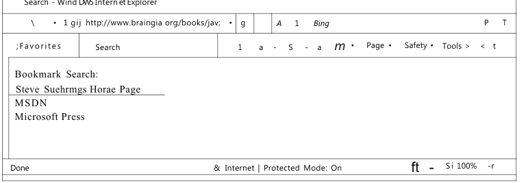

**图 19-1** 实时书签应用的视图。

搜索框的工作原理是在用户向文本框输入内容时，缩小已查看的书签列表。例如，在文本框中输入字母 m，会立即更改页面，使其仅显示以字母 m 开头的书签，如图 19-2 所示。

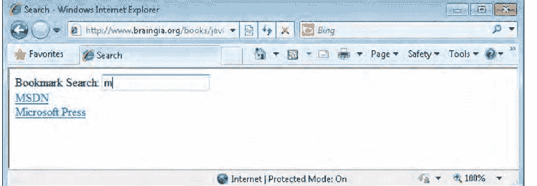

**图 19-2** 输入字母 m 将显示的书签缩小为以 m 开头的书签。

继续输入——例如，输入 i 以缩小字符为 mi——将继续缩小可用的书签，如图 19-3 所示。

当用户删除文本框中的文字时，书签页面将恢复到默认状态（如图 19-1 所示）。

```xml
<?xml version="1.0" encoding="UTF-8" standalone="yes"?>
<bookmarks xmlns:xsi="http://www.w3.org/2001/XMLSchema-instance">
  <bookmark>
    <title>Steve Suehring's Home Page</title>
    <url>http://www.brainia.org/</url>
  </bookmark>
  <bookmark>
    <title>MSDN</title>
    <url>http://msdn.microsoft.com/</url>
  </bookmark>
  <bookmark>
    <title>Microsoft Press</title>
    <url>http://www.microsoft.com/msprocess</url>
  </bookmark>
</bookmarks>
```

这里是该应用程序的 XML（参见配套内容中的 `bookmark.xml` 文件）：

该应用程序及其网页显示在此以及在 `bookmark.html` 文件中（位于配套内容）：

```html
<!DOCTYPE HTML PUBLIC "-//W3C//DTD HTML 4.0//EN" "http://www.w3.org/TR/html4/strict.dtd">
<html>
<head>
<title>Search</title>
</head>
<body>
<div id="data"></div>
<script type="text/javascript">
function textSearch() {
    var textName = document.getElementById("textfield");
    var dataNode = document.getElementById("data");
    while (dataNode.hasChildNodes()) {
        dataNode.removeChild(dataNode.firstChild);
    }
    setName(textName.value);
}

function readyAJAX() {
    try {
        return new XMLHttpRequest();
    } catch (e) {
        try {
            return new ActiveXObject("MSXML.XMLHTTP");
        } catch (e) {
            return new ActiveXObject("Microsoft.XMLHTTP");
        }
    }
    return "A newer browser is needed.";
}

function listName(text) {
    var xmlEl = AJAXResponse.getElementsByTagName("bookmark");
    // ... 基于文本的逻辑
}

var anchor = document.createElement("a");
var xmlData = document.createTextNode(xmlEl[i].childNodes[j].nodeValue);
var urls = xmlEl[i].getElementsByTagName("url");
anchor.setAttribute("href", urls[0].firstChild.nodeValue);
anchor.appendChild(xmlData);
div.appendChild(anchor);
}
}
document.getElementById("data").appendChild(div);
</script>
</body>
</html>
```

### 练习

1. 本章涵盖的 HTTP 请求方法中，哪种最安全？为什么？
2. 描述使用 HTML、XML 和 JSON 进行 `XMLHttpRequest` 请求/响应之间的差异。
3. 编写一个服务器端程序，返回该程序接收到的参数的两个数字之和。使用异步 `XMLHttpRequest` 对象调用该程序。

# 第 20 章 深入理解 AJAX

读完本章后，你将能够：

- 理解异步 JavaScript 和 XML（AJAX）与级联样式表（CSS）如何配合使用。
- 了解更多关于文档对象模型（DOM）、AJAX 和 CSS 之间的关系。
- 使用基于 AJAX 的技术创建并美化带有可扩展标记语言（XML）数据的 HTML 表格。
- 使用 CSS 创建一个 AJAX 下的文本框。

在上一章中，你学习了如何使用 `XMLHttpRequest` 对象来发送、接收和处理请求，并最终如何创建一个 AJAX 应用。在本章中，你将看到如何使用 CSS 显示通过 AJAX 获取的数据。

JavaScript 和 CSS 之间的关系在第 15 章“JavaScript 与 CSS”中介绍过。在该章中，你学习了如何使用 JavaScript 程序地更改文档样式。在第 17 章“JavaScript 与 XML”中，你学习了如何将 XML 数据显示为 HTML 表格。在第 19 章“接触 AJAX”中，你看到了如何使用一些 CSS 和 DOM 创建一个实时的、可搜索的书签网页。本章将展示你如何借助 CSS 和 JavaScript 的帮助，美化第 17 章中的表格，并扩展第 19 章的书签应用。

在此过程中，我希望传达出 AJAX 相对容易使用。使用 `XMLHttpRequest` 获取和解析信息是简单的部分——关键在于你如何处理这些数据。这就是为什么 CSS 和 DOM 关键的原因！AJAX 是将书中学到的所有 JavaScript 汇聚在一起以创建大型应用的地方。

## 使用 XML 和 CSS 创建 HTML 表格

第 17 章展示了一个示例，它获取了 XML 并将其数据作为图 20-1 所示 HTML 表格的一部分。下一步是创建在其中定义的表格。

### 使用 XMLHttpRequest 获取并显示 XML 数据

1. 使用你在第 17 章创建的 `books.xml` 文件，或者（如果你没有创建或保存该文件）创建一个名为 `books.xml` 的新文件并附带相应内容。将此文件放置在与下一步中将创建的 HTML 文件相同的同一个 Web 服务器上。

```xml
<books>
  <book>
    <title>JavaScript Step by Step</title>
    <author>Steve Suehring</author>
    <isbn>9780735624498</isbn>
    <publisher>Microsoft</publisher>
  </book>
  <book>
    <title>MySQL Bible</title>
    <author>Steve Suehring</author>
    <isbn>9780764549328</isbn>
    <publisher>Wiley Publishing Inc.</publisher>
  </book>
</books>
```

2. 使用 Microsoft Visual Studio、Eclipse 或其他编辑器编辑 `ajaxbooks.htm` 文件：

```html
<!DOCTYPE HTML PUBLIC "-//W3C//DTD HTML 4.01//EN" "http://www.w3.org/TR/html4/strict.dtd">
<html>
<head>
<title>Books</title>
</head>
<body>
<div id="midata"></div>
<script type="text/javascript">
function readyAJAX() {
  try {
    return new XMLHttpRequest();
  } catch (e) {
    try {
      return new ActiveXObject("Msxml2.XMLHttpRequest");
    } catch (e) {
      try {
        return new ActiveXObject("Microsoft.XMLHttpRequest");
      } catch (e) {
        return "A new browser is needed.";
      }
    }
  }
}

var request = readyAJAX();
var url = "http://192.168.1.14/js/books.xml";
request.open("GET", url, true);
request.send();
var AJAXResponse;
request.onreadystatechange = function() {
  if (request.readyState == 4) {
    if (request.status == 200) {
      AJAXResponse = request.responseXML;
      displayData(AJAXResponse);
    } else {
      alert(request.status);
    }
  }
};

function displayData(response) {
  var xmlEl = response.getElementsByTagName("book");
  var table = document.createElement("table");
  table.border = "1";
  var tbody = document.createElement("tbody");
  for (var i = 0; i < xmlEl.length; i++) {
    var row = document.createElement("tr");
    for (var j = 0; j < xmlEl[i].childNodes.length; j++) {
      if (xmlEl[i].childNodes[j].nodeType != 1) {
        continue;
      }
      var td = document.createElement("td");
      var xmlData = document.createTextNode(xmlEl[i].childNodes[j].firstChild.nodeValue);
      td.appendChild(xmlData);
      row.appendChild(td);
    }
    tbody.appendChild(row);
  }
  table.appendChild(tbody);
  document.getElementById("midata").appendChild(table);
}
</script>
</body>
</html>
```

4. 在 Web 浏览器中查看页面。你会看到如下页面：

| title | author | isbn | publisher |
| :--- | :--- | :--- | :--- |
| JavaScript Step by Step | Steve Suehring | 9780735624498 | Microsoft |
| MySQL Bible | Steve Suehring | 9780764549328 | Wiley Publishing Inc. |

## AJAX 与服务器集成

对表格显示的大多数更改将在这些循环中完成。在进行更改时高亮显示这些更改。

另一个你想更改字体的项目。（我自己一直很偏爱 Arial 字体。）你使用 JavaScript 中的 `fontFamily` 样式来实现这一点。此更改必须在每个循环中进行，以便用 Arial 字体设置表格中的所有文本。添加该代码后，行现在看起来像这样（两个新行已高亮显示）：

```javascript
for (var colHead = 0; colHead < xmlEl[0].childNodes.length; colHead++) {
  if (xmlEl[0].childNodes[colHead].nodeType != 1) {
    continue;
  }
  var tableHead = document.createElement("th");
  var colName = document.createTextNode(xmlEl[0].childNodes[colHead].nodeName);
  tableHead.style.fontFamily = "Arial";
  tableHead.appendChild(colName);
  row.appendChild(tableHead);
}
tbody.appendChild(row);

for (var i = 0; i < xmlEl.length; i++) {
  var row = document.createElement("tr");
  for (var j = 0; j < xmlEl[i].childNodes.length; j++) {
    if (xmlEl[i].childNodes[j].nodeType != 1) {
      continue;
    }
    var td = document.createElement("td");
    var xmlData = document.createTextNode(xmlEl[i].childNodes[j].firstChild.nodeValue);
    td.style.fontFamily = "Arial";
    td.appendChild(xmlData);
    row.appendChild(td);
  }
  tbody.appendChild(row);
}
```

这些更改的结果加上移除边框，得到了一个类似于图 20-2 所示的表格。

| 标题 | 作者 | ISBN | 出版社 |
| :--- | :--- | :--- | :--- |
| JavaScript Step by Step | Steve Suehring | 9780735624498 | Microsoft |
| MySQL Bible | Steve Suehring | 9780764549328 | Wiley Publishing Inc. |

图 20-2 使用 CSS 开始设置样式。

某些颜色无疑有助于提高表格的可读性，特别是当显示几行甚至几百行数据时。交替颜色使得每隔一行颜色略有深浅，并将表头更改为完全不同的颜色，可能也有助于可读性。以下是添加背景样式属性后两个循环的样子。更改的部分已高亮显示。

```javascript
for (var colHead = 0; colHead < xmlEl[0].childNodes.length; colHead++) {
  if (xmlEl[0].childNodes[colHead].nodeType == 1) {
    var tableHead = document.createElement("th");
    var colName = document.createTextNode(xmlEl[0].childNodes[colHead].nodeName);
    tableHead.style.fontFamily = "Arial";
    tableHead.style.backgroundColor = "#aaaaaa";
    tableHead.appendChild(colName);
    row.appendChild(tableHead);
  }
}
table.appendChild(tbody);

for (var i = 0; i < xmlEl.length; i++) {
  var row = document.createElement("tr");
  for (var j = 0; j < xmlEl[i].childNodes.length; j++) {
    if (xmlEl[i].childNodes[j].nodeType != 1) {
      continue;
    }
    var td = document.createElement("td");
    var xmlData = document.createTextNode(xmlEl[i].childNodes[j].firstChild.nodeValue);
    td.style.fontFamily = "Arial";
    if (i % 2 == 0) {
      td.style.backgroundColor = "#eeeeee";
    }
    td.appendChild(xmlData);
    row.appendChild(td);
  }
  tbody.appendChild(row);
}
```

此代码使用取模运算符 (`%`) 为表格数据中的每隔一行设置浅灰色阴影。此表格中只有两行，所以只有第二行获得了灰色阴影。图 20-3 显示了添加颜色后的结果。你可以在本书第 20 章示例代码的 `CompletedCode` 目录中找到页面的完成版本。

## 创建动态下拉框

你可以使用第 19 章所示的书签应用程序变体，为任何类型的文本列表数据创建一个动态下拉框。这有时被称为“输入时建议”（suggest-as-type）下拉框，因为当用户输入时，用户界面会在文本下显示常用值，使使用户更容易完成输入。Google Suggest 就是此类应用之一。

该原理的另一种实现是在访问者在输入时显示常用项目（如美国州）的下拉框。这种变体的关键在于数据集。

以下是该应用的演示。使用 `XMLHttpRequest` 对象，应用程序获取了 50 个州的列表。当用户输入字母 `w` 时，应用程序获取所有以该字母开头的州，如图 20-4 所示。

图 20-4 获取以字母开头的州。

```javascript
var requestObj = new XMLHttpRequest();
var url = "http://你的服务器地址/statelist.php";
requestObj.open("GET", url, true);
requestObj.send();
var AJAXResponse;
requestObj.onreadystatechange = function() {
    if (requestObj.readyState == 4) {
        if (requestObj.status == 200) {
            AJAXResponse = requestObj.responseText;
        } else {
            alert(requestObj.statusText);
        }
    }
}

var textEl = document.getElementById("name");
Handler.add(textEl, "keyup", function() { textSearch(this); });
```

你已经在这本书的其他地方看到过列表 20-1 中的大部分代码了，但我在这里再次简要地为你解释一下它们。

该代码通过调用一个基于服务器的外部文件 `statelist.php` 来获取州列表。该文件返回一个短小的、逗号分隔的州列表，如下：

```text
Alabama,Alaska,Arizona,California,Colorado,Delaware,Florida,Georgia...
```

该文件根据逗号分隔符分割此列表，并将名称放入一个名为 `nameList` 的数组中，例如：

```javascript
var nameList = AJAXResponse.split(",");
```

代码中对你在最后两章中看到的应用程序进行了一些扩展，用于创建带有 CSS 样式的小型可点击下拉框。这些就是你在第 19 章中看到的 `listName()` 函数中的内容。代码对这些 HTML DIV 应用了事件监听器和 CSS 样式。

```javascript
if (existDiv) {
  if (nameList[i].match(nameRegExp)) {
    var display = document.getElementById("data");
    var newDiv = document.createElement("div");
    if (window.attachEvent) {
      newDiv.attachEvent("onclick", function(e) {
        document.forms["nameform"].textvalue = e.srcElement.firstChild.nodeValue;
      });
      newDiv.attachEvent("mouseover", function(e) {
        e.srcElement.style.background = "#FFFF00";
      });
      newDiv.attachEvent("mouseout", function(e) {
        e.srcElement.style.background = "#ababab";
      });
    } else {
      newDiv.addEventListener("click", function () {
        document.forms["nameform"].textvalue = this.firstChild.nodeValue;
      }, false);
      newDiv.addEventListener("mouseover", function () {
        this.style.background = "#FFFF00";
      }, false);
      newDiv.addEventListener("mouseout", function () {
        this.style.background = "#ababab";
      }, false);
    }
    newDiv.innerHTML = nameList[i];
    newDiv.style.background = "#ababab";
    newDiv.style.color = "#000000";
    newDiv.style.border = "solid 1px";
    newDiv.style.display = "block";
    newDiv.style.width = "175px";
    display.appendChild(newDiv);
  }
}
```

## 接收用户输入与 AJAX

开发 AJAX 应用的下一个逻辑步骤是接收用户输入并对这些输入进行处理。构建 AJAX 应用的核心在于提供一个基于用户操作的高度活跃的应用程序。遗憾的是，为了证明这个主题的价值，我将需要深入研究处理这些输入的服务器端应用程序的创建，而这超出了本书主要关注 JavaScript 的初级书籍的范围。如果运气好，我将再写一本关于中级 JavaScript 或构建 JavaScript 应用程序的书，展示 AJAX 的 JavaScript 和服务器端部分。

# 第 21 章 JavaScript 库与框架

阅读本章后，你将能够：

- 理解 JavaScript 库和框架。
- 理解如何定义你自己的库。
- 理解第三方库和框架的作用。

### 理解库

在编程术语中，*库*是提供功能的代码分组。通常，库由一个或多个文件组成。许多流行的 JavaScript 库和框架是为了让复杂的任务变得简单。Web 开发者花费大量时间让页面在浏览器中保持一致。

### 定义你的库

在定义和使用自己的库时，要注意不要与 ECMA-262 规范中的保留字冲突。此外，如果你使用外部库或框架如 jQuery 或 YUI，你需要确保你的库...

### 创建库

1. 使用 Studio、Eclipse 或你喜爱的任何编辑器打开 `library.js` 文件。
2. 在 `library.js` 中添加以下代码（替换 TODO 注释）创建命名空间，然后添加一个函数：

```javascript
var MyLibrary = {
  sendAlert: function(msg) {
    alert(msg);
  }
};
```

3. 保存文件并关闭。
4. 打开 `librarypage.html` 文件。在 `librarypage.html` 中添加以下代码（替换 TODO 注释）：

```html
<!DOCTYPE HTML PUBLIC "-//W3C//DTD HTML 4.01//EN" "http://www.w3.org/TR/html4/strict.dtd">
<html>
<head>
<title>示例示例</title>
<script type="text/javascript" src="library.js"></script>
</head>
<body>
<script type="text/javascript">
  MyLibrary.sendAlert("hello, this is the message");
</script>
</body>
</html>
```

5. 在网络浏览器中加载 `librarypage.html`。你应该收到这样的警告框：

### 故障排除

如果你没有收到如所示的警告框，请确保你正确指定了库文件的路径。上述 `librarypage.html` 示例假设 JavaScript 文件 `library.js` 与该 HTML 文件位于同一目录下。

### 练习

1. 创建一个使用 jQuery 的表单处理程序。
2. 创建一个使用 YUI 的表单处理程序。
3. 创建一个使用你自己的库的表单处理程序。
4. 创建一个使用 AJAX 获取数据的页面。

### Yahoo! 用户界面

Yahoo! 用户界面 (YUI) 提供了 JavaScript 和层叠样式表 (CSS)。

### MooTools

MooTools 是一个非常小且高度优化的 JavaScript 库。MooTools 与 YUI 和 jQuery 的不同在于，它专注于优化 JavaScript 处理，而 YUI 和 jQuery 则侧重于效果、CSS 和直接的用户体验交互。这绝对并不是说 MooTools 没有效果——MooTools 也提供了许多你在 YUI 和 jQuery 中发现的相同效果（例如手风琴组件和滑块）。MooTools 推荐给中高级 JavaScript 程序员使用，并可以从 `http://mootools.net/` 获取。

### 其他库

JavaScript 还有许多其他可用库和框架——多到在书中无法涵盖，甚至无法提及。作为一个起点，请参阅 `http://en.wikipedia.org/wiki/Comparison_of_JavaScript_frameworks` 以了解更多关于 JavaScript 框架的信息。

# 练习题

1. 检查本章中显示的每个库和框架。你认为哪一个对于新的 JavaScript 程序员来说最容易学习？为什么？
2. 使用外部 JavaScript 文件创建自己的 JavaScript 库。将其包含在 HTML 页面中并调用。

# 第 22 章 jQuery 简介

读完本章后，你将能够：

- 了解如何在 HTML 中引入 jQuery。
- 理解重要的 jQuery 概念和语法。
- 在你的网页中使用 jQuery。

## jQuery 入门指南

jQuery 是一个流行且易用的 JavaScript 框架。jQuery 让困难的 JavaScript 任务变得简单，通常通过消除跨浏览器 JavaScript 的烦恼来实现。

整个 jQuery 库仅由单个 JavaScript 文件组成，这简化了在你的 JavaScript 中引入它。jQuery 语法也很容易学习；它使用了简单的命名空间和一致的功能。配合 jQuery 用户界面 (UI) 插件（在第 23 章“jQuery 效果与插件”中介绍）使用，你可以创建强大且交互性 Web 应用程序。

本章提供了 jQuery 的介绍，包括如何下载以及如何在 JavaScript 中使用它。

### 使用 jQuery

你可以从 `http://www.jquery.com/` 获取 jQuery。在本节中，你将看到如何下载 jQuery 并将其集成到网页中。

## 两种 jQuery 下载

在 jQuery 首页上，有两个下载选项：生产版本和开发版本。除非你计划开发 jQuery 插件，或者需要查看 jQuery 的内部实现，否则你应该下载并使用压缩后的版本。注意，在几乎所有使用 jQuery 的场景中，本地下载文件比使用 CDN 版本更快且更可靠。例如，如果你使用 CDN 托管的版本且 CDN 服务器出现任何问题，你的网站将无法工作！然而，对于本章中的开发任务，将 jQuery 下载到本地或通过 CDN 连接是可以的。

### 引入 jQuery

你以引入其他 JavaScript 文件相同的方式在网页中引入 jQuery——即使用 `<script>` 标签。考虑列表 22-1 中的代码。

**列表 22-1** 在网页中引入 jQuery。

```html
<!DOCTYPE HTML PUBLIC "-//W3C//DTD HTML 4.0//EN" "http://www.w3.org/TR/html4/strict.dtd">
<html>
<head>
<title>Adding jQuery</title>
<script type="text/javascript" src="jquery-1.4.3.min.js"></script>
</head>
<body>
</body>
</html>
```

现在你已经从 CDN 引用了 jQuery 或查看了如何在文件中引入 jQuery 的示例，现在是时候学习 jQuery 语法了。重要的版本 1.4.3 是最新的。然而，当你读到这里时，版本可能已经不同，所以你需要适当更改 `src` 属性。

## 表 22-1 jQuery 选择器

| 语法 | 描述 |
| :--- | :--- |
| `$("a")` | 文档中所有的 `<a>` 元素。 |
| `$(document)` | 整个文档，经常用于本章后面显示的 `ready` 函数。 |
| `$("#elementID")` | 由 `elementID` 标识的元素。 |
| `$(".className")` | 具有 `className` 的元素。 |

在本章中你会看到更多选择器和相关函数。和 JavaScript 代码一样，jQuery 语句以分号结尾。注意在 jQuery 中可以使用单引号或双引号。例如，这些语句都是有效的：

```javascript
$("a")
$('.className')
```

当你看到真实世界中的 jQuery 使用示例（尽管书中没有这部分），单引号和双引号都是使用的。在本章中使用两者混合；然而，在实际编程中，最好选择一种风格并保持一致。

### 连接 jQuery 到加载事件

使用 jQuery 的最常用方法之一是在页面加载（或 `onload` 事件）期间连接到元素。本章详细讨论了这些事件和函数。

在本章中显示的示例中，你通过 `ready()` 函数处理文档元素。

你可以通过以下方式使用 jQuery 访问该元素：

```javascript
$(".specialClass")
```


请记住，你访问的可能不是单个元素；类选择器会访问所有应用了指定类的元素。换句话说，如果页面上有多个元素应用了 "specialClass" 类，jQuery 将使用 `$$(".specialClass")` 访问它们的所有元素。稍后在处理遍历每个获取到的元素的函数时，你将看到更多内容。

## 按类型选择元素

你也可以使用选择器按类型访问元素，例如所有的 `<div>` 元素、所有的 `<a>` 元素等。例如，你可以通过以下方式访问文档中的所有 `<div>` 元素：

```
$("div")
```

同样地，要访问所有的 `<a>` 元素，你将写如下代码：

```
$("a")
```

使用类型选择器可以访问页面上指定类型的所有元素。与类选择器一样，类型选择器也可以返回多个元素。

## 按层级结构选择元素

如所述，你可以根据元素相对于页面上其它元素的相对位置来选择元素。例如，要选择所有 `<div>` 元素内部的 `<a>` 元素，使用以下语法：

```
$("div a")
```

你也可以做得更具体。例如，如果你想要所有紧跟在特定 `div` 后的锚点，可以将类型选择器与 ID 选择器语法结合。考虑此 HTML：

```html
<div id="leftNav">
<a href="link1.html">Link 1</a>
<a href="link2.html">Link 2</a>
</div>
```

```javascript
$("div > p")
```

此语法产生所有作为 `div` 的直接后代的 `<p>` 元素，但不包括任何位于选中 `<p>` 元素内部的 `<p>` 元素。

你还可以使用 `:nth-child()` 选择器选择集合中的第 n 个元素。此示例选择了第三个子元素：

```javascript
$("p:nth-child(3)")
```

还存在其他层级选择器。你可以在 jQuery 选择器文档 http://api.jquery.com/category/selectors/ 中找到更多内容。

## 按位置选择元素

如你所见，jQuery 中的选择器是贪婪的。例如，`$(a)` 语法选择所有锚点标签。jQuery 提供了多种方法来选择组内的特定元素。其中一种方法是使用 `first` 和 `last` 选择器。以下代码选择了页面中的第一个 `<p>`：

```javascript
$("p:first")
```

同样地，最后一个元素的选择方式如下：

```javascript
$("p:last")
```

你也可以通过直接位置选择元素。作为另一个示例，考虑这个：

```html
<p>First</p>
<p>Second</p>
<p>Third</p>
```

要选择 `<p>` 元素，使用此语法：

```javascript
$("p:eq(i)")
```

注意，这种类型的选择器数组索引从 0 开始，因此第一个元素是 0，第二个是 1，依此类推。使用这种语法有点危险，因为它取决于元素在层级结构中的位置。如果另一个 `<p>` 标签

最后，一组有用的位置选择器是 `even` 和 `odd`，它们选择集合中的每隔元素。

```javascript
$("p:even")
```

`even` 和 `odd` 选择器在处理表格数据时非常有用。列表 22-2 显示了一个使用 `odd` 选择器来区分表格交替行色的示例。注意：列表 22-2 代码使用了两个尚未正式引入的功能：用户定义函数和 `asm` 函数。现在不用担心这些，我们将在本章节后面详细检查这些项目。

## 列表 22-2 表格数据与 jQuery

```html
<!DOCTYPE HTML PUBLIC "-//W3C//DTD HTML 4.0//EN" "http://www.w3.org/TR/html4/strict">
<html>
<head>
<title>Table Test</title>
<script type="text/javascript" src="jquery-1.4.2.min.js"></script>
</head>
<body>
<table>
<tr>
<td>Row 1 Column 1 of the table</td>
<td>Row 1 Column 2 of the table</td>
</tr>
<tr>
<td>Row 2 Column 1 of the table</td>
<td>Row 2 Column 2 of the table</td>
</tr>
<tr>
<td>Row 3 Column 1 of the table</td>
<td>Row 3 Column 2 of the table</td>
</tr>
<tr>
<td>Row 4 Column 1 of the table</td>
<td>Row 4 Column 2 of the table</td>
</tr>
<tr>
<td>Row 5 Column 1 of the table</td>
<td>Row 5 Column 2 of the table</td>
</tr>
</table>
</body>
</html>
```

```javascript
<script type="text/javascript">
$(document).ready(function() {
  $('tr.odd').css("background-color", "#abacab");
});
</script>
</body>
</html>
```

这段代码的主要部分包含在 HTML body 内的 JavaScript 部分：

```javascript
$(document).ready(function() {
  $('tr.odd').css("background-color", "#abacab");
});
```

代码使用 `$(document).ready()` 函数配合 `:odd` 选择器将 `background-color` 设置为十六进制 #abacab——一种浅灰色。图 22-1 显示了输出的示例。

| Favorites | [8] http://192.1 | g | it | A | H | Bing | p |
|---|---|---|---|---|---|---|---|
| Favorites 1 0 ie Suggested Sites * | g | Web Slice Gallery * | | | | | |
| ig Table Test Windows Internet Exp | | | | | | | |
| * * | | - E - | J | # | Page * | Safety * | |
| Row 1 Column 1 of the table | Row 1 Column 2 of the table | | | | | | |
| Row 2 Column 1 of the table | Row 2 Column 2 of the table | | | | | | |
| Row 3 Column 1 of the table | Row 3 Column 2 of the table | | | | | | |
| Row 4 Column 1 of the table | Row 4 Column 2 of the table | | | | | | |
| Row 5 Column 1 of the table | Row 5 Column 2 of the table | | | | | | |
| Row 6 Column 1 of the table | Row 6 Column 2 of the table | | | | | | |
| ^ Internet | Protected Mode On | | fi | -100% | . | | |

图 22-1 借助 jQuery 着色的表格。

你已经看到了一些常见的位置选择器，但还有许多位置选择器

## 按属性选择元素

前面的代码是从你已经看到的类选择器中进行选择，jQuery 允许你选择仅包含属性的元素或包含带有特定值属性的元素。例如，要选择所有具有 `alt` 属性的元素，你将写如下代码：

```
$('img[alt]')
```

仅选择 `alt` 属性设置为特定值的图像如下：

```
$('img[alt="alternate text"]')
```

只有当 `alt` 文本为 "alternate text" 时，jQuery 才会选择图像。注意此示例中单引号和双引号的交替使用，而 alt 选择器的包裹。注意的是，这种类型的选择器期望精确匹配。在此示例中，alt 属性需要是 "alternate text"。它的任何变体，如 "alternate text 2"，都不会匹配。

jQuery 包含了不需要精确匹配的通配符选择器。考虑表 22-2。

### 表 22-2 属性匹配

| 语法 | 描述 |
| --- | --- |
| attribute*=value | 选择属性包含字符串的元素 |
| attribute~=value | 选择属性包含完整单词的元素 |

## 选择表单元素

jQuery 包含了与 Web 表单相关的原生选择器。表 22-3 列出了这些选择器中的一些，其中一些将在本章剩余部分中使用。

### 表 22-3 表单相关选择器

| 选择器 | 描述 |
| --- | --- |
| :input | 选择所有选中的元素，如复选框 |
| :name | 选择具有 name 的元素 |
| :radio | 选择页面上的所有输入元素 |
| :password | 选择单选按钮输入 |
| :reset | 选择所有重置类型的输入 |
| :selected | 选择当前选中的元素 |
| :text | 选择所有文本类型的输入 |

## 更多选择器

jQuery 中有很多选择器，例如选择所有隐藏元素 (:hidden) 或可见元素 (:visible) 的选择器，以及已启用元素、禁用元素等。请访问 http://api.jquery.com/category/selectors/ 获取完整且最新的 jQuery 选择器列表。

> 提示：与其设计复杂且脆弱的选择器语法来获取特定元素，不如参考 jQuery 选择器参考 (http://api.jquery.com/category/selectors/) 查看是否已经解决了选择器问题。

# 函数

到为止，你看到了许多使用 jQuery 选择元素的示例，但只有少数示例展示了在选择这些元素后可以对它们做什么。jQuery 使用

## 遍历 DOM

使用 JavaScript 以及现在是 jQuery 进行 Web 编程的本质通常需要循环或遍历多个元素——例如，`each()` 函数接收一个选定的元素列表并对其中的每个元素进行迭代，在循环列表时执行某些操作（或不执行操作）。jQuery 包含许多用于循环和迭代的函数。这个过程在 jQuery 术语中被称为“遍历”（traversing）。你可以在 http://api.jquery.com/category/traversing/ 找到更多关于遍历相关函数的信息。

在使用遍历函数时，你必须始终配合用户定义的包装函数以及 `$(this)` 选择器来使用。就像面向对象编程中的 `this` 关键字一样，`$(this)` 指向当前对象——在这种情况下，就是当前正在被遍历的项目。

这里提供一个示例可能会很有用。以下 HTML 构建了一个虚拟排球联赛的积分榜页面：

```html
<!DOCTYPE HTML PUBLIC "//W3C//DTD HTML 4.0//EN" "http://www.w3.org/TR/html4/strict.dtd">
<html>
<head>
<title>Iteration Test</title>
<script type="text/javascript" src="jquery-1.4.2.min.js"></script>
</head>
<body>
<table>
<tr>
<th>Team Name</th>
<th>W-L Record</th>
<th>Win Percentage</th>
</tr>
<tr>
<td>Team 1</td>
<td>12-8</td>
<td class="percentage">.600</td>
</tr>
<tr>
<td>Team 5</td>
<td>11-9</td>
<td class="percentage">.550</td>
</tr>
<tr>
<td>Team 4</td>
<td>10-10</td>
<td class="percentage">.500</td>
</tr>
<tr>
<td>Team 3</td>
<td>20-18</td>
<td class="percentage">.100</td>
</tr>
</table>
<script type="text/javascript">
$(document).ready(function() {
  $('tr:odd()').css("background-color", "abacab");
});
</script>
</body>
</html>
```

当在网页浏览器中查看时，该页面看起来如图 22-2 所示。

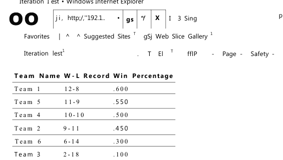

图 22-2 虚拟排球联赛的积分。

此示例说明了所有包含 `percentage` 类的元素——该类应用于表格中“胜率”列的单元格。对于任何胜率达到或超过 .500 的团队（意味着他们赢得了至少一半的比赛），此示例会对他们的字段字段应用粗体字体。你可以通过以下 jQuery 代码来实现这一点，将代码添加在其他 jQuery 代码的下方。

```javascript
$('.percentage').each(function() {
  if ($(this).text() >= .5) {
    $(this).css("font-weight", "bold");
  }
});
```

此代码使用选择器来收集所有应用了 `percentage` 类的元素。然后它使用 jQuery 中的 `each()` 函数访问这些元素中的每一个。在 `each()` 函数内部，用户定义的函数执行一个条件判断，以确定 `percentage` 类中的值是否大于或等于 5。如果是，代码将调用 `css()` 函数为该元素添加一个设置为 `bold` 的 `font-weight` 属性。将此代码添加到页面后，结果看起来如列表 22-3 所示。

## 列表 22-3 为排球联赛页面添加 jQuery

```html
<!DOCTYPE html PUBLIC "//W3C//DTD HTML 4.1//EN" "http://www.w3.org/TR/html4/strict">
<head>
<title>Test</title>
<script type="text/javascript" src="jquery-1.4.2.min.js"></script>
</head>
<body>
<table>
<tr>
<th>Team Name</th>
<th>W-L Record</th>
<th>Win Percentage</th>
</tr>
<tr>
<td>Team 1</td>
<td>12-8</td>
<td class="percentage">.600</td>
</tr>
<tr>
<td>Team 5</td>
<td>11-9</td>
<td class="percentage">.550</td>
</tr>
<tr>
<td>Team 4</td>
<td>10-10</td>
<td class="percentage">.500</td>
</tr>
<tr>
<td>Team 2</td>
<td>9-11</td>
<td class="percentage">.450</td>
</tr>
<tr>
<td>Team 6</td>
<td>6-14</td>
<td class="percentage">.300</td>
</tr>
<tr>
<td>Team 3</td>
<td>2-38</td>
<td class="percentage">.300</td>
</tr>
</table>
<script type="text/javascript">
$(document).ready(function() {
  $('tr:odd()').css("background-color", "#abacac");
  $('.percentage').each(function() {
    if ($(this).text() >= .5) {
      $(this).css("font-weight", "bold");
    }
  });
});
</script>
</body>
</html>
```

当你在浏览器中查看此页面时，你会发现“胜率”列现在对那些赢了至少一半比赛的团队加了粗体，如图 22-3 所示。

| Iteration Test - Windows Internet Explorer | | |
| :--- | :--- | :--- |
| http://192.1 | g X 1 Bing | P |
| ^ Favorites IE Suggested Sites - jgi Wet Slice Gallery | | |
| *Iteration Test - S53 IBS ^ Page Safety | | |
| Team 1 | | .600 |
| Team 5 | 33-9 | .550 |
| Team 4 | 30-30 | .500 |
| Team 2 | 9-33 | .450 |
| Team 6 | 6-34 | .300 |
| Team 3 | 2-38 | .300 |
| Team Name | W-L Record | Win Percentage |
| :--- | :--- | :--- |
| Internet | Protected Mode: On | |

图 22-3 在 jQuery 的帮助下，“胜率”列现在显示为粗体。

查看图 22-3 的输出，你会发现如果将粗体字体权重应用于整个表格行，而不仅仅是“胜率”列，效果会更好。这样做似乎很困难，因为逻辑上讲，当应用测试以查找胜率时，代码已经过了该表格行。坦率地说，jQuery 有一种

```javascript
$('.percentage').each(function() {
  if ($(this).text() >= .5) {
    $(this).parent().css('font-weight', 'bold');
  }
});
```

当将此代码添加到代码 22 时，结果类似于图 22-4 所示。

| Iteration Test - Windows Internet Explorer | L s J I ^ | | |
| :--- | :--- | :--- | :--- |
| http://192.1 | g X 1 Bing | P | |
| ^ Favorites IE Suggested Sites - jgi Wet Slice Gallery | | | |
| *Iteration Test - Page Safety | | | |
| Team Name W-L Record Win Percentage | | | |
| Team 1 | | .600 |
| Team 5 | 33-9 | .550 |
| Team 4 | 30-30 | .500 |
| Team 2 | 9-33 | .450 |
| Team 6 | 6-34 | .300 |
| Team 3 | 2-38 | .300 |
| Internet | Protected Mode: On | |

图 22-4 应用于表格行。

## 通过 CSS 设置样式，而不是直接更改属性

有多种方法可以使用 jQuery 来处理 CSS 类，包括 `.hasClass()`、`.addClass()`、`.removeClass()` 和 `.toggle()`。更多关于使用这些和其他函数处理类的信息，请参见 http://api.jquery.com/category/css/。

## 处理属性

## 更改文本和 HTML

`.html()` 获取或更改选定元素内的整个 HTML。例如，考虑以下 HTML：

```html
<div id="myDiv">Here is a div, it's quite nice</div>
```

这是你的 jQuery 代码：

```javascript
$("#myDiv").html("<span class=\"redStyle\">This is the new content of the div</span>");
```

```html
<div id="myDiv">Here is a div, it's quite nice</div>
$('#myDiv').text("this is the new content of the div");
```

在前面的示例中，只有文本内容发生了变化；代码并没有添加 `<span>` 或应用样式。

### 插入元素

你可以轻松地使用 jQuery 向页面添加元素。用于此操作的两个主要函数是 `after()` 和 `before()` 函数。正如它们的名称所示，它们分别在所选元素的之后或之前添加元素。

例如，让我们再次看一遍：

```html
<div id="myDiv">Here is a div, it's quite nice</div>
```

这里是对应的 jQuery 代码，它在它之前插入了另一个 `<div>`：

```javascript
$('#myDiv').before("<div>This is a new div</div>");
```

`after()` 函数的工作方式类似：

```javascript
$('#myDiv').after("<div>This is a new myDiv</div>");
```

运行后，包含此代码的页面将有三个 `<div>` 元素：

```html
<div>This is a new div</div>
<div id="myDiv">Here is a div, it's quite nice</div>
<div>This is a new div, it appears after myDiv</div>
```

所示的示例插入了额外的 `<div>` 元素——但当然，你可以在这些函数中使用任何有效的元素。

### 回调函数

有时，你需要在另一个函数或函数的某个部分完成后运行一个函数，这被称为*回调函数*（callback function）。回调函数在其父函数执行完毕后执行。jQuery 大量地使用回调函数，特别是在 AJAX 中。你在使用 `each()` 函数进行迭代时已经看到过一个回调函数的示例了。

关于回调函数的更多信息，请参阅……

## 事件

你现在已经看到了几个选择器的示例，并浅浅接触了 jQuery 函数的皮毛。你对 jQuery 初步了解的最后一部分涉及事件处理。与你在 JavaScript 中已经知道的事件一样，jQuery 允许你的程序响应鼠标点击、表单提交、按键输入等操作。与 JavaScript 不同，jQuery 中的跨浏览器事件处理在跨浏览器环境中表现极佳。这在事件处理中尤为如此，它节省了你研究每个浏览器如何响应某些函数的烦恼。

## 绑定与取消绑定

`.bind()` 函数将事件处理器连接到事件上，例如鼠标点击：

```javascript
bind(event, data, handler)
```

在此实例中，`event` 是你想要响应的事件。`data` 是一个可选对象，包含传递给事件处理器的数据，`handler` 是你在响应此事件时运行的函数。

例如：

```html
<a href="link.html" id="mylink">A link</a>
$("#mylink").bind("click", function() {
  alert("clicked the link");
});
```

这段代码的结果是在捕获到锚点标签的点击后，页面显示一个警框。注意此示例在调用 `bind()` 时没有使用可选的 `data` 参数。

你可以使用 `.bind()` 函数绑定以下事件：

- beforeunload
- blur
- change
- click
- hover
- keydown
- keypress
- keyup
- load
- mouseout
- mouseover
- mouseup
- resize
- scroll

在之前的章节中，你使用第 11 节“JavaScript 事件与浏览器”中开发的 `handler.js` 脚本来捕获事件。`handler.js` 脚本提供了一个某种跨浏览器能力的通用事件处理器。这本质上就是 jQuery 的 `bind()` 函数所做的。区别在于 jQuery 的 `bind()` 函数在跨浏览器事件处理方面优秀得多，并且比 `handler.js` 脚本强大得多。

尽管你可以使用 `bind()` 进行事件处理，但 jQuery 还提供了工作方式与 `bind()` 相同的快捷函数。与其编写 `.bind("click", function())`，你只需编写 `.click(function())`，你可以将之前的 `bind()` 示例重写为：

```javascript
$("#mylink").click(function() {
  alert('clicked the link');
});
```

你不仅可以响应点击链接等事件，还可以触发它们。例如，考虑列表 22-5 中的代码：

### 列表 22-5 响应事件

```html
<!DOCTYPE HTML PUBLIC "//W3C//DTD HTML 4.01//EN"
"http://www.w3.org/TR/html4/strict/ct.dtd">
<html>
<head>
  <title>Trigger Test</title>
  <script type="text/javascript" src="jquery-1.4.2.min.js"></script>
</head>
<body>
  <div id="myDiv">
    Here is some text.<br>
    It goes inside this div<br>
    <a id="braingLink" href="http://www.w3.org">Steve</a>
  </div>
  <p>
  <script type="text/javascript">
  $(document).ready(function() {
    $("#braingLink").click(function() {
      alert('hello');
      return true;
    });
    $("#myDiv").click(function() {
      $("#braingLink").click();
    });
  });
  </script>
</body>
</html>
```

当此页面加载到网页浏览器时，点击 `<div>` 内的任何地方都会触发锚点本身的点击事件。要停止响应事件，你可以使用 `unbind()` 函数来取消绑定，它接受两个参数：

```javascript
unbind(event, handler)
```

`event` 是你想要取消绑定的事件。`handler` 是你想要移除的事件处理函数。

jQuery 还包含一个名为 `getJSON()` 的函数，它执行与其它 AJAX 相关函数相同的本质功能，但它专门用于处理来自服务器的 JSON 编码数据。`getJSON()` 函数等同于调用 `$.ajax()` 函数并带有额外的参数 `dataType: "json"`。

例如，假设返回了如下的 JSON 编码数据。以下是几个州的名称列表：

- "Wisconsin", "California", "Colorado", "Illinois", "Minnesota", "Oregon", "Washington", "New York", "New Jersey", "Alabama", "Tennessee", "Iowa", "Michigan"

在使用返回的 JSON 编码数据的情况下，在本地服务器上调用文件 `json.php`。`$.ajax()` 函数获取数据并在成功后调用名为 `showStates` 的函数：

```javascript
$.ajax({
  type: 'GET',
  url: 'json.php',
  dataType: 'json',
  success: showStates
});
```

`showStates` 函数创建一个列表并将其添加到表单的 `<select>` 下拉框中。

## 使用 jQuery 使用 AJAX

为了完成这个步进式练习，你需要在与本次练习中使用的文件相同的目录下准备一个名为 `json.php` 的文件（ajax.php 文件包含本书的配套内容中）。与之前章节关于 AJAX 的示例一样，`json.php` 文件必须与发起 AJAX 请求的文件位于同一域下。

1. 编辑文件，使用你的代码编辑器放置加粗显示的代码（包含在本书的配套内容中）。

2. 在文件中，放置加粗显示的代码（在配套内容的 ajax.txt 中），替换原有内容：

```html
<!DOCTYPE HTML PUBLIC "//W3C//DTD HTML 4.01//EN" "http://www.w3.org/TR/html4/strict.dtd">
<html>
<head>
<title>AJAX Test</title>
</head>
<body>
<div id="states"></div>
<script type="text/javascript">
$(document).ready(function() {
  $.ajax({
    type: "GET",
    url: "json.php",
    dataType: "json",
    success: showStates
  });
});

function showStates(data, status) {
  $.each(data, function(item) {
    $("#states").append("<div>" + data[item] + "</div>");
  });
});
</script>
</body>
</html>
```

3. 保存文件并在网页浏览器中查看。你会看到一个州列表，如下所示：

| AJAX Test | Windows Internet Explorer | IE |
|---|---|---|
| ip http://192.168.1. | | X | Binding |
| 'states' | 58 AJAX Test | | Page |
| Wisconsin | | | |
| California | | | |
| Colorado | | | |
| Illinois | | | |
| Minnesota | | | |
| Oregon | | | |
| Washington | | | |
| New York | | | |
| New Jersey | | | |
| Nevada | | | |

### AJAX 错误与超时

`$.ajax()` 函数允许你优雅地处理错误和超时。除了成功处理程序，你还可以通过 `error` 参数指定错误处理程序。`error` 参数的值通常是一个回调函数。这是一个示例，新添加的错误参数已加粗显示：

```javascript
$.ajax({
  type: 'GET',
  url: 'json.php',
  dataType: 'json',
  success: successFunction,
  error: errorFunction
});
```

用于错误处理的回调函数（上一个代码示例中的 `errorFunction`）接收三个参数：XMLHttpRequest 对象、代表所遇错误的字符串，以及在发生异常时产生的异常对象。因此，错误处理程序应该接受这三个参数，然后对结果进行处理。此示例显示了一个警报（alert）：

```javascript
function myFunction(xhr, statusMessage, exceptionObj) {
  alert('An error was encountered ' + statusMessage);
}
```

你可能发现有为 AJAX 请求设置超时。可以通过默认的 `$.ajaxSetup()` 设置通用的 AJAX 超时值，也可以使用 `timeout` 参数为任何单独调用指定超时值。这是一个示例：

```javascript
$.ajax({
  type: 'GET',
  url: 'json.php',
  dataType: 'json',
  success: successFunction,
  error: errorFunction,
  timeout: 5000
});
```

重要的是意识到超时是以毫秒为单位的。因此，示例将超时设置为 5 秒。

你可以将数据格式化为用连接符号分隔的键值对（key1=value1&key2=value2）或映射对（key1:value, key2:value）。此示例使用了 key=value 选项，也称为查询字符串选项。

此示例调用了一个名为 `statefull.php` 的服务器端程序，它根据两个字母的州缩写返回该州的全名。

```javascript
$.ajax({
  type: 'POST',
  url: 'statefull.php',
  dataType: 'json',
  success: successFunction,
  data: 'state=WI'
});
```

### 其他重要选项

`$.ajax()` 有许多选项。你已经见过其中许多，但我想强调两个：

- **async**: `async` 选项默认为 true，它告知浏览器是否应该等待响应。
- **cache**: `cache` 设置默认为 true，控制响应是否被缓存。

### 练习

1. 编辑文件，使用你的代码编辑器放置加粗显示的代码（包含在本书的配套内容中）。
2. 在文件中，放置加粗显示的代码（在配套内容的 ajax.txt 中），替换原有内容。
3. 保存文件并在网页浏览器中查看。

## 第 23 章 jQuery 效果与插件

### 列表 23-2 使用 jQuery 改进的隐藏元素

```html
<!DOCTYPE HTML PUBLIC "//W3C//DTD HTML 4.0//EN"
"http://www.w3.org/TR/html4/strict.dtd">
<html>
<head>
<title>Header</title>
<script type="text/javascript" src="jquery-1.4.2.min.js"></script>
<style type="text/css">
.removeBtn {
  color: #0000cc; /* 注意：原始代码为 #0000，可能是蓝色的拼写错误 */
}
</style>
</head>
<body>
<ul>
  <li id="option1">选项 1 <span class="removeBtn" id="remove1">(x)</span></li>
  <li id="option2">选项 2 <span class="removeBtn" id="remove2">(x)</span></li>
  <li id="option3">选项 3 <span class="removeBtn" id="remove3">(x)</span></li>
  <li id="option4">选项 4 <span class="removeBtn" id="remove4">(x)</span></li>
</ul>
<script type="text/javascript">
$(document).ready(function() {
  $('.removeBtn').each(function (elem) {
    $(this).click(function() {
      $(this).parent().hide();
    });
  });
});
</script>
</body>
</html>
```

列表 23-2 代码中唯一的变化位于 JavaScript 内部：

```javascript
$('.removeBtn').each(function() {
  $(this).click(function() {
    $(this).parent().hide();
  });
});
```

这段 JavaScript 对每个带有 `removeBtn` 类的元素应用了一个函数，该函数设置了

所有函数，`.show()`、`.hide()` 和 `.toggle()` 都接受两个参数：一个持续时间（duration）和一个回调函数。在列表 23-1 和 23-2 的代码中，当元素隐藏时，它是瞬间消失的。在 `.hide()` 函数中添加持续时间会导致元素按指定的速率消失。或者，使用 jQuery 中的其他函数时，你可以指定毫秒持续时间。你也可以使用字符串 "fast" 和 "slow"，它们分别代表 200 毫秒和 600 毫秒。

回调函数在显示或隐藏元素完成后执行操作。回调的一个用途是在隐藏元素后显示“撤销”按钮，使用户重新显示他们刚刚隐藏的元素。

## 添加持续时间

1. 使用 Microsoft Visual Studio、Eclipse 或文本编辑器打开 `duration.html` 文件，你可以在此本书的配套内容的第 23 章文件夹中找到它。

2. 在文件 `HTML. PUBLIC "-//W3C//DTD HTML 4.0//EN"` 之后添加以下**粗体**代码：

```html
<!DOCTYPE HTML PUBLIC "-//W3C//DTD HTML 4.0//EN"
"http://www.w3.org/TR/html4/strict.dtd">
<head>
<title>hide</title>
<script type="text/javascript" src="jquery-1.4.2.min.js"></script>
<style type="text/css">
.removeBtn {
  color: #0000cc;
}
</style>
</head>
<body>
<ul>
  <li id="option1">选项 1 <span class="removeBtn" id="remove1">(x)</span></li>
  <li id="option2">选项 2 <span class="removeBtn" id="remove2">(x)</span></li>
  <li id="option3">选项 3 <span class="removeBtn" id="remove3">(x)</span></li>
  <li id="option4">选项 4 <span class="removeBtn" id="remove4">(x)</span></li>
</ul>
<script type="text/javascript">
$(document).ready(function() {
  $('.removeBtn').each(function(element) {
    $(this).click(function() {
      $(this).parent().hide("slow");
    });
  });
});
</script>
</body>
</html>
```

3. 保存文件并在网页浏览器中查看页面。你会看到类似这样的页面：

```text
& Midi - Windows Internet Explorer
| | H | is g | |
|---|---|---|------|
| 0 | U | http://192... | g | γ X | ; Bing | p r |
| Favorites | Hide | fil | 0 | Ö T Page* |
| Option 1 (x) |
| Option 2 (x) |
| Option 3 (fx) |
| Option 4 (x) |
| (t)² Internet | 保护模式：开启 100% -r |
```

4. 现在点击任何元素旁边的 (x)。该元素从页面上消失，你会看到类似这样的页面：

```text
Hide Windows Internet Explorer | 1 ~ I B 1 i M
|---|---|---|---|---| p r |
| http://192... | 1 | γ A | I Bing B |
| Favorites | Hide | S | : t B | J tm * | Page-
| * 选项 1 (x) |
| * 选项 2 (x) |
| * 选项 4 (x) |
| Internet | 保护模式：开启 100% = = |
```

5. 如果你使用带有调试器的浏览器（如 Firebug），可以右键点击元素并选择“检查”，查看显示属性已设置为 none。

## 淡入与淡出

给 `.show()`、`.hide()` 和 `.toggle()` 函数添加持续时间会改变它们的透明度，直到它们可见或隐藏。通过 `.fadeIn()` 和 `.fadeOut()` 函数可以使用类似的功能。

## 滑动效果

另一种设置显示属性为 none 的方法是通过 `.slideUp()` 和 `.slideDown()` 函数。这些函数创建一个滑动效果，使元素在消失之前或出现之前移动。

将本章之前看到的基础代码改为 `.slideUp()` 替换 hide：

```javascript
$('.removeBtn').each(function() {
  $(this).click(function() {
    $(this).parent().slideUp();
  });
});
```

## jQuery 拖放

jQuery UI 包含了拖放和就落的功能，分别称为 `.draggable()` 和 `.droppable()`。调用 `.draggable()` 允许用户移动元素。

### 列表 23-3 `draggable()` 函数的应用

```html
<!DOCTYPE HTML PUBLIC "-//W3C//DTD HTML 4.0//EN"
"http://www.w3.org/TR/html4/strict.dtd">
<html>
<head>
<title>Drag-Drop</title>
<script type="text/javascript" src="jquery-1.4.2.min.js"></script>
<script type="text/javascript" src="jquery-ui-1.8.4.custom.min.js"></script>
<style type="text/css">
  #container {
    border: solid 1px black;
    padding: 3px;
  }
</style>
</head>
<body>
  <div id="container">
    <span>拖动我</span>
  </div>
<script type="text/javascript">
$(document).ready(function() {
  $('#container').draggable();
});
</script>
</body>
</html>
```

```javascript
$('#targetContainer').droppable({
  drop: function(event, ui) {
    alert('Dropped Element: ' + ui.draggable.text());
  }
});
```

```html
</script>
</body>
</html>
```

这段代码的关键在于在 ID 为 `targetContainer` 的 `<div>` 元素上设置了 `.droppable()` 函数。

```javascript
$('#targetContainer').droppable({
  drop: function(event, ui) {
    alert('Dropped Element: ' + ui.draggable.text());
  }
});
```

`.droppable()` 函数处理多个事件，使你能够在项目被拖动到可放置元素上方（over）、移出可放置元素之外（out）、当元素被放置在其中时（drop，如示例所示）以及当有效的拖放元素被拾起或松开时（activate 和 deactivate）做出响应。请访问 http://jquery.com/demos/droppable/ 查看这些事件的示例。

### 手风琴 (Accordion)

使用 jQuery UI 可以创建一个手风琴效果，即选项看起来是在相互折叠和展开。让手风琴正常工作的关键是使用格式良好的 HTML，并采用适合手风琴形式的布局。手风琴的良好候选是一组相似的项目或选项。

### 列表 23-5 jQuery 手风琴

```html
<!DOCTYPE html PUBLIC "//W3C//DTD HTML 4.01//EN" "http://www.w3.org/TR/html4/strict.dtd">
<html>
<head>
  <title>Accordion</title>
  <script type="text/javascript" src="jquery-1.4.2.min.js"></script>
  <script type="text/javascript" src="jquery-ui-1.8.4.custom.js"></script>
  <style type="text/css">
  #container {
    border: solid 1px black;
    padding: 3px;
  }
  .optionHead {
    border: solid 1px black;
    background-color: #ababab;
  }
  .optionDiv {
    border-bottom: dotted 1px black;
  }
  </style>
</head>
<body>
  <div id="container">
    <h3 class="optionHead">选项 1</h3>
    <div class="optionDiv" id="option1">
      <p>选项 1 的文本</p>
    </div>
    <h3 class="optionHead">选项 2</h3>
    <div class="optionDiv" id="option2">
      <p>选项 2 的文本</p>
    </div>
    <h3 class="optionHead">选项 3</h3>
    <div class="optionDiv" id="option3">
      <p>选项 3 的文本</p>
    </div>
  </div>
  <script type="text/javascript">
  $(document).ready(function() {
    $('#container').accordion();
  });
  </script>
</body>
</html>
```

将列表 23-5 中的代码加载到 浏览器中，将得到一个与图 23-1 所示类似的页面。

| 手风琴 - Windows Internet 浏览器 | | 1 | j s I M M |
|---|---|---|---|---|
| . | http://192.. | ^ t X ! ... Bing | fi | T |
| r 收藏 ^ 手风琴 | Si | J SB | 页- |
| 选项 1 |
| 选项 1 的文本 |
| 选项 2 |
| 选项 3 |
| © 网上 | 保护模式：开 T 100% T |

图 23-1 一个基础的 jQuery 手风琴。

当使用 jQuery 手风琴时，你会发现第一个选项在页面加载时总是展开的。根据布局的需要和手风琴的使用方式，你可能会发现需要在页面加载时展开不同的选项，或者在加载时让所有手风琴都折叠。`accordion()` 函数包含了几个控制其行为的选项。当 `active` 选项与 `collapsible` 设置为 `true` 配合使用时，会让手风琴从折叠状态启动或选择某个选项。

在接下来的分步练习中，你将在网页内使用手风琴并为手风琴设置默认状态。

# 为手风琴设置默认状态

1. 使用 Microsoft Visual Studio 等编辑器打开 `accordion.html` 文件或

```html
<!DOCTYPE HTML "//W3C//DTD HTML 4.01//EN"
"http://www.w3.org/TR/html4/strict.dtd">
<html>
<head>
<title>手风琴开启</title>
<script type="text/javascript" src="jquery-1.4.2.min.js"></script>
<script type="text/javascript" src="jquery-ui-1.8.4.custom.js"></script>
<style type="text/css">
#container {
  border: solid 1px black;
  padding: 3px;
}
.optionHead {
  border: solid 1px black;
  background-color: #ababab;
}
.optionDiv {
  border-bottom: dotted 1px black;
}
</style>
</head>
<body>
<div id="container">
<h3 class="optionHead">选项 1</h3>
<div class="optionDiv" id="option1">
<p>选项 1 的文本</p>
</div>
<h3 class="optionHead">选项 2</h3>
<div class="optionDiv" id="option2">
<p>选项 2 的文本</p>
</div>
<h3 class="optionHead">选项 3</h3>
<div class="optionDiv" id="option3">
<p>选项 3 的文本</p>
</div>
</div>
<script type="text/javascript">
$('#container').accordion({
  collapsible: true,
  active: false
});
</script>
</body>
</html>
```

3. 保存文件并在浏览器中查看页面。注意手风琴是以折叠形式启动的，如下所示：

| 手风琴 | Windows\Internet 浏览器 | | >= | H |
|---|---|---|---|---|
| je j http://192:1... | r | g | a | | | p |
| 收藏 | 手风琴 | | fi - EB T | fl | | |
| # 选项 1 |
| # 选项 2 |
| # 选项 3 |

4. 将 `active` 选项改为 `2` 而不是 `false`。代码应该像这样：

```javascript
$('#container').accordion({
  collapsible: true,
  active: 2
});
```

5. 在浏览器中重新加载页面。注意屏幕上的第三个选项是展开的。这是因为索引从 0 开始，因此第一个选项（屏幕上显示的“选项 1”）实际上是索引 0。

访问 http://jquery.com/demos/accordion/ 了解更多关于手风琴组件可用选项和事件的信息。

### jQuery UI

jQuery UI 还有许多更多内容，位于章节中的一部分

## 附录 练习答案

```html
<head>
  <title>我的第二个页面</title>
  <script type="text/javascript" src="3.js"></script>
</head>
<body>
  <script type="text/javascript">
  callAlert();
  </script>
  <p>我的第二个页面</p>
</body>
</html>
```

### 第 3 章

1. 有效语句是 a, b, c 和 d。唯一的无效语句是 e，因为它将保留字 `case` 作为变量名。
2. 并不是所有的 JavaScript 语句在末尾都需要分号。事实上，分号通常是可选的。
3. `orderTotal` 变量在向访问者提示他们订购了每种物品的数量后发生了更改，但在函数返回值之前已经更改了。这里的教训是，你必须小心不要在无意中改变变量的值或内容。访问者期望订购某个数量，但代码在告诉访问者他们订了多少之后，显然地改变了该数量！

### 第 4 章

1. 变量声明：
```javascript
var first = 120;
var second = "5150";
var third = "Two Hundred Thirty";
```

2. 数组（你的值可能会不同，但数据类型和语法是重点）：
```javascript
var newArray = new Array(10, 20, 30, "first string", "second string");
```

3. 转义字符串：

### 第 5 章

1. 告框（你的值可能会不同，但数据类型和语法是重点）：
```javascript
var num1 = 1;
var num2 = 1;
var num3 = 19;
var fourth = "84";
var name = "Jakob";
var name2 = "Edward";
alert(num1 + num2);
alert(num3 + fourth);
alert(name + name2);
```

2. 后置：
```javascript
var theNum = 1;
alert(theNum);
alert(theNum++);
alert(++theNum);
```

前置：
```javascript
var theNum = 1;
alert(theNum);
alert(++theNum);
alert(--theNum);
```

3. 代码：
```javascript
var num1 = 1;
var num2 = 1;
var num3 = 19;
var fourth = "84";
var name = "Jakob";
var name2 = "Edward";
alert(typeof num1);
alert(typeof num2);
alert(typeof num3);
alert(typeof fourth);
alert(typeof name);
alert(typeof name2);
```

这应该产生三个告框，第一个后面跟着单词 `number`，另外三个后面跟着单词 `string`。

### 第 6 章

1. 将下述代码中的 `YOUR NAME` 替换为适当的内容：
```javascript
var inputName = prompt("Please enter your name:");
switch (inputName) {
  case "YOUR NAME" + inputName:
    alert("Welcome ");
    break;
  case "Steve":
    alert("Go Away");
    break;
  default:
    alert("Please Come Back Later " + inputName);
}
```

2. 代码如下：
```javascript
var temp = prompt("Please enter the current temperature");
if (temp > 100) 
  alert("Please cool down");
else if (temp < 20) 
  alert("Better warm up");
```
注意，如果温度在 20 到 100 之间，提供一个默认操作会是一个好主意！

3. 这个练习实际上无法按照指定完成。因为三元运算符期望一个单一的测试条件，而练习 2 要求两个条件，因此无法使用三元运算符来完成完全相同的任务。以下代码在温度小于或等于 100 时告框提示访问者降温：
```javascript
var temp = prompt("Please enter the current temperature");
temp > 100 ? alert("Please cool down") : alert("Better warm up");
```

4. 代码如下：
```javascript
for (var i = 1; i < 101; i++) {
  if (i == 99) {
    alert("The number is " + i);
  }
}
```
注意，因为练习中调用的变量 `bean count` 值为 1。注意变量在循环内的后置自增的位置。你也可以使用 `i += 1;`，但后使用后置运算符。

### 第 7 章

1. 注意，这段代码使用了 `isNaN()` 函数来检查输入是否为数字。这是一种最佳实践，并不总是显而易见的。实现最终返回值的另一种方法是使用 `return theNumber++;`

```html
<head>
<title>Chapter 7 Exercise</title>
<script type="text/javascript">
function incrementNum(theNumber) {
  if (isNaN(theNumber)) {
    alert("Sorry, " + theNumber + " isn't a number.");
    return null;
  }
  return theNumber + 1;
}
</script>
</head>
<body>
  <script type="text/javascript">
  alert(incrementNum(3));
  </script>
</body>
```

2. 代码如下：
```javascript
function addNums(firstNum, secondNum) {
  if (isNaN(firstNum) || isNaN(secondNum)) {
    alert("Sorry, both arguments must be numbers.");
    return null;
  } else if (firstNum > secondNum) {
    alert(firstNum + " is greater than " + secondNum);
  } else {
    return firstNum + secondNum;
  }
}
```

3. 代码如下：
```javascript
function addNumbers() {
  var firstNum = 4;
  var secondNum = 8;
  var result = firstNum + secondNum;
  return result;
}
var result = 0;
alert(result);
result = addNumbers();
alert(result);
```

4. 代码如下：
```html
<head>
<title>Chapter 7 Exercise</title>
<script type="text/javascript">
var stars = ["Polaris", "Aldebaran", "Vega", "Dubhe", "Regulus"];
var cells = ["Ursa Minor", "Taurus", "Cygnus", "Lyra", "Aquila", "Ursa Major"];

function searchStars(star) {
  var starLength = stars.length;
  for (var i = 0; i < starLength; i++) {
    if (stars[i] == star) {
      return cells[i];
    }
  }
  return "Not Found.";
}
</script>
</head>
<body>
  <script type="text/javascript">
  var inputStar = prompt("Enter star name: ");
  alert(searchStars(inputStar));
  </script>
</body>
</html>
```

### 第 8 章

1. 代码如下：
```javascript
var stars = ["Polaris", "Aldebaran", "Vega", "Dubhe", "Regulus"];
var cells = ["Ursa Minor", "Taurus", "Cygnus", "Lyra", "Aquila", "Ursa Major"];
```

2. 代码如下：
```javascript
song1 = "First Artist";
song2 = "Second Artist";
song3 = "Third Artist";
```

3. 假设使用练习中的代码，这段代码将所有名称合并为一个长字符串：
```javascript
var names = new Array();
for (prompt in star) {
  if (names == "") {
    names += prompt;
  } else {
    names += "," + prompt;
  }
}
alert(names);
```

使用逗号分隔名称的代码看起来如下：
```javascript
var names = new Array();
for (prompt in star) {
  if (names == "") {
    names += prompt;
  } else {
    names += "," + prompt;
  }
}
alert(names);
```

### 第 9 章

1. 代码如下：
```javascript
if (screen.availHeight < 768) {
  alert("Available Height: " + screen.availHeight);
}
if (screen.availWidth < 1024) {
  alert("Available Width: " + screen.availWidth);
}
```

2. 这里是完整的代码，包含了练习中的代码。注意使用 `unescape()` 函数来移除国名中的 URL 编码 `%20`（空格）。这是因为练习中指定的国名“Great Britain”在 GET 请求中必须经过编码。

```html
<body>
  <script type="text/javascript">
  var body = document.getElementsByTagName("body")[0];
  for (var prop in location) {
    var el = document.createElement("p");
    var text = document.createTextNode(prop + " : " + location[prop]);
    el.appendChild(text);
    body.appendChild(el);
  }

  if (location.search) {
    var querystring = location.search.substring(1);
    var splits = querystring.split('&');
    for (var i = 0; i < splits.length; i++) {
      var splitpair = splits[i].split('=');
      var el = document.createElement("p");
      var text = document.createTextNode(splitpair[0] + " : " + splitpair[1]);
      if (splitpair[0] == "country") {
        switch (splitpair[1]) {
          case "Brazil":
            alert("Obrigado");
            break;
          case "Great Britain":
            alert("Thank You");
            break;
        }
      }
      el.appendChild(text);
      body.appendChild(el);
    }
  }
  </script>
</body>
</html>
```

3. 这个练习在练习答案中没有答案。你可以安装 User Agent Switcher 插件来完成这个练习。

### 第 10 章

1. 代码如下：
```javascript
var newElement = document.createElement("p");
newElement.setAttribute("id","newelement");
document.body.appendChild(newElement);
newElement.appendChild(document.createTextNode("This is a paragraph, albeit a short"));
```

2. 这里是代码：
```javascript
// create the initial elements (if you use an existing HTML file, you won't
need to do this)
var newelement = document.createElement("p");
newelement.setAttribute("id", "element");
document.body.appendChild(newelement);
newelement.appendChild(document.createTextNode("This is a paragraph, albeit a
short one."));
var anchor = document.createElement("a");
anchor.setAttribute("id", "element");
anchor.setAttribute("href", "http://www.braingia.org/");
document.body.appendChild(document.createTextNode("Click Here"));

// make the change
var elementg = document.createElement("p");
elementg.firstChild.nodeValue = "This is the new text.";
var neighbor = document.createElement("a");
neighbor.setAttribute("href", "http://www.microsoft.com/");
```

3. 这里是代码：
```html
<head>
<title>第 10 章练习</title>
</head>
<body>
<div id="table"></div>
<script type="text/javascript">
var table = document.createElement("table");
table.border = "1";
var body = document.createElement("tbody");

// Append the body to the table
table.appendChild(body);
var row = document.createElement("tr");

// Create table row
for (i = 0; i < 5; i++) {
  var row = document.createElement("tr");
  // Create the row/td elements
  for (j = 0; j < 3; j++) {
    // Insert the actual text/data from the XML document,
    td = document.createElement("td");
    var data = document.createTextNode("Hello - I'm Row " + i + ", Column " + j);
    td.appendChild(data);
    row.appendChild(td);
  }
  body.appendChild(row);
}
document.getElementById("table").appendChild(table);
</script>
</body>
</html>
```

### 第 11 章

1. 这里是代码：
```html
<!DOCTYPE HTML PUBLIC "-//W3C//DTD HTML 4.01//EN"
"http://www.w3.org/TR/html4/strict/ct.dtd">
<html>
<head>
<title>OnClick</title>
<script type="text/javascript">
function handleClick() {
  alert("You Clicked Here;");
  return false;
}
</script>
</head>
<body>
<p><a href="#" onclick="return handleClick();">点击这里</a></p>
</body>
</html>
```

2. 这里是代码：
```html
<!DOCTYPE HTML PUBLIC "-//W3C//DTD HTML 4.01//EN"
"http://www.w3.org/TR/html4/strict/ct.dtd">
<html>
<head>
<title>OnClick</title>
<script type="text/javascript" src="handler.js"></script>
<script type="text/javascript">
function handleClick() {
  alert("You Clicked Here;");
  return false;
}
</script>
</head>
<body>
<p><a href="#" id="clickMe">点击这里</a></p>
<script type="text/javascript">
var alink = document.getElementById("clickMe");
Handler.addEventListener(alink, "click", function () { handleClick(); });
</script>
</body>
</html>
```

3. 此练习需要 JavaScript。HTML 部分如下所示：
```html
<!DOCTYPE TYPE PUBLIC "//W3C//DTD HTML 4.0//EN" "http://www.microsoft.com" id="mslink">前往微软
<a href=""></a>
<body>
</body>
</html>
```

### 第 12 章

1. 本章某处示例的变体：
```html
<!DOCTYPE TYPE PUBLIC "//W3C//DTD HTML 4.01//EN"
"http://www.w3.org/TR/HTML4/str_ct.dtd">
<html>
<head>
<title>Hello Cookie</title>
<script type="text/javascript">
var cookieName = "cookie";
var cookieVal = "value";
var date = new Date();
date.setTime(date.getTime()+86400000); // 一天，毫秒
var expires = date.toUTCString();
var myCookie = cookieName + "=" + cookieVal + ";expires=" + expires;
document.cookie = myCookie;
</script>
</head>
<body>
<p>Hello</p>
</body>
</html>
```

2. 此代码与练习 1 中的代码基本相同，更改的行已**粗体**显示：


# 附录练习答案

## 第 13 章

- 1. 参考第 13-2 行。
- 2. 参考第 13-2 行。

## 第 14 章

- 1. 参考“带有复选框”部分。
- 2. 参考示例。

## 444 附录练习答案

```html
<form id="pizzaform" action="#">
<P>
<input type="checkbox" id="veggiespecial" name="veggiespecial" value="Veggie Special" />
<input type="button" id="meatspecial" name="meatspecial" value="Meat, Special" />
<input type="button" id="hawaiian" name="hawaiian" value="Hawaiian" />

<table>
  <tr>
    <td>配料</td>
    <td>深度</td>
    <td>深度</td>
    <td>尺寸</td>
  </tr>
  <tr>
    <td><input type="checkbox" id="sausage" value="Sausage" />香肠</td>
    <td><input type="radio" name="crust" value="Regular" checked="checked" id="radiol" />普通款</td>
    <td><input type="radio" name="size" value="Small" checked="checked" id="radiosizer" />小号</td>
  </tr>
  <tr>
    <td><input type="checkbox" id="pepperoni" value="Pepperoni" name="toppingck" />意大利腊肠</td>
    <td><input type="radio" name="crust" value="Deep Dish" id="radio2" />深底饼</td>
    <td><input type="radio" name="size" value="Medium" id="radios2" />中号</td>
  </tr>
  <tr>
    <td><input type="checkbox" id="ham" value="Ham" name="toppingck" />火腿</td>
    <td><input type="radio" name="crust" value="Thin" id="radio3" />薄底</td>
    <td><input type="radio" name="size" value="Large" id="radios3" />大号</td>
  </tr>
  <tr>
    <td><input type="checkbox" id="peppers" value="Green Peppers" name="toppingck" />青甜椒</td>
    <td></td>
    <td></td>
  </tr>
  <tr>
    <td><input type="checkbox" id="mushrooms" value="Mushrooms" name="toppingck" />蘑菇</td>
    <td></td>
    <td></td>
  </tr>
  <tr>
    <td><input type="checkbox" id="onions" value="Onions" name="toppingck" />洋葱</td>
    <td></td>
    <td></td>
  </tr>
  <tr>
    <td><input type="checkbox" id="pineapple" value="Pineapple" name="toppingck" />菠萝</td>
    <td></td>
    <td></td>
  </tr>
</table>
```

## 445 附录练习答案

在页面 `<body></body>` 内部的 JavaScript 部分添加处理程序：

```javascript
var veggieBtn = document.getElementById("veggiespecial");
EHandler.add(veggieBtn, "click", function() { flip("veggiespecial"); });
var meatBtn = document.getElementById("meatspecial");
EHandler.add(meatBtn, "click", function() { flip("meatspecial"); });
var hawaiiBtn = document.getElementById("hawaispecial");
EHandler.add(hawaiiBtn, "click", function() { flip("hawaiian"); });
```

## 第 15 章

- 1. 这是一个示例：正确完成此练习有许多方法：

```html
<!DOCTYPE HTML PUBLIC "-//W3C//DTD HTML 4.01//EN"
"http://www.w3.org/TR/html4/strict.dtd">
<html>
<head>
<title>CSS</title>
<link href="exercisel.css" rel="stylesheet" type="text/css">
</head>
<body>
<h1 id="hilelement">标题</h1>
<p id="firstelement">第一个元素。</p>
<p id="secondelement">第二个元素。</p>
</body>
</html>
```

以下是样式表 `exercisel.css`：

```css
#hilelement {
background-color: #abacab;
}

#firstelement {
color: red;
}

#secondelement {
color: blue;
}
```

- 2. 这段代码更改了名为 `firstelement` 的元素，使其字体变为蓝色：

```javascript
<script type="text/javascript">
var element1 = document.getElementById("firstelement");
for (var i = 0; i < pelLength; i++) {
elements[i].style.visibility = "hidden";
}
</script>
```

- 4. 这段代码在脚本设置可见性之前和之后显示了可见性设置。运行代码时，注意在属性设置之前 alert 框是空的。

```javascript
<script type="javascript">
var elements = document.getElementsByTagName("p");
var pelLength = elements.length;
for (var i = 0; i < pelLength; i++) {
alert(elements[i].style.visibility = "hidden");
elements[i].style.visibility = "hidden";
}
</script>
```

## 446 附录练习答案

## 第 16 章

- 1. 第 16 章中的 16-13 提供了此练习的解决方案。

- 2. alert（警告框）提供了视觉反馈，在之前显示的第 15 章练习 5 的解决方案中，可以使用新元素来寻找提供更好视觉反馈的方法。这里是该问题的基本解决方案：

```html
<!DOCTYPE HTML PUBLIC "-//W3C//DTD HTML 4.01//EN"
"http://www.w3.org/TR/html4/strict.dtd">
<html>
<head>
<title>Try-Catch</title>
<script type="javascript">
</script>
</head>
<body>
<form name="formexample" action="#">
<div id="city">输入城市：<input id="city" name="city"></div>
<input id="submit" type="submit"></div>
</form>
<script type="javascript">
function checkValid() {
try {
var cityField = document.forms[0]["city"];
if (cityField.value != "") {
function init() {
var cityField = document.forms[0]["city"];
if (cityField.value != "") {
function init() {
var cityField = document.forms[0]["city"];
if (cityField.value != "") {
function init() {
var cityField = document.forms[0]["city"];
```

- 3. 实现此练习的一种方法是使用 `handler.js` 包含了脚本：

```html
<!DOCTYPE HTML PUBLIC "-//W3C//DTD HTML 4.01//EN"
"http://www.w3.org/TR/html4/strict.dtd">
<html>
<head>
<title>Try-Catch</title>
<script type="javascript">
</script>
</head>
<body>
<form name="formexample" action="#">
<div id="city">输入城市：<input id="city" name="city"></div>
<input id="submit" type="submit"></div>
</form>
<script type="javascript">
function checkValid() {
try {
var cityField = document.forms[0]["city"];
if (cityField.value != "") {
function init() {
var cityField = document.forms[0]["city"];
if (cityField.value != "") {
function init() {
var cityField = document.forms[0]["city"];
```

## 第 17 章

- 1. 此解决方案需要 `books.htm` 和 `books.xml` 文件，加粗显示的内容：

```html
<!DOCTYPE HTML PUBLIC "-//W3C//DTD HTML 4.01//EN"
"http://www.w3.org/TR/html4/strict.dtd">
<html>
<head>
<title>Books</title>
<script type="javascript" src="handler.js"></script>
</head>
<body>
<div id="xmldata"></div>
```

## 450 附录练习题答案

```javascript
var row = document.createElement("tr");
```

```javascript
for (colHead = 0; colHead < xmlEl[0].childNodes.length; colHead++) {
    if (xmlEl[0].childNodes[colHead].nodeType != 1) {
        continue;
    }
    var tableHead = document.createElement("th");
    var colName = document.createTextNode(xmlEl[0].childNodes[colHead].nodeName);
    tableHead.appendChild(colName);
    row.appendChild(tableHead);
}
tbody.appendChild(row);
```

```javascript
// 创建表格行
for (var i = 0; i < xmlEl.length; i++) {
    var row = document.createElement("tr");
    for (var j = 0; j < xmlEl[i].childNodes.length; j++) {
        // 如果类型不是 1 则跳过
        if (xmlEl[i].childNodes[j].nodeType != 1) {
            continue;
        }
```

```javascript
// 从 XML 文档中插入实际文本/数据
var td = document.createElement("td");
var xmlData = document.createTextNode(xmlEl[i].childNodes[j].firstChild);
td.appendChild(xmlData);
row.appendChild(td);
}
```

```javascript
nodeValue);
tbody.appendChild(row);
var tableanchor = document.createElement("a");
tableanchorText = document.createTextNode("Hide Table");
tableanchor.setAttribute("id", "hideTable");
tableanchor.setAttribute("href", "#");
tableanchor.appendChild(tableanchorText);
if (typeof window.addEventListener != "undefined") {
    tableanchor.addEventListener("click",hideTable,false);
} else {
    tableanchor.attachEvent("onclick",hideTable);
}
document.getElementById("xmldata").appendChild(tableanchor);
document.getElementById("xmldata").appendChild(table);
```

```javascript
function getXMLO() {
  tablelink.style.display = "none";
  if (typeof document.implementation.createDocument != "undefined") {
    var docObj = document.implementation.createDocument("", "", null);
    docObj.onload = displayData;
  } else if (window.ActiveXObject) {
    var docObj = new ActiveX("Microsoft.XMLDOM");
    docObj.onereadystate = function () {
      if (docObj.readyState == 4) displayData()
    };
  }
  docObj.load("books.xml");
}

var tablelink = document.getElementById("displaytable");
Handler.add("tablelink", "click", function() { getXMLO(); }); });
```

## 451 附录练习题答案

2. 该解决方案也需要 books.xml 文件。大部分代码与第 17 章中最终的 books.html 代码相同，不同部分已用**粗体**表示：

```html
<!DOCTYPE HTML PUBLIC "//W3C//DTD HTML 4.01/EN"
"http://www.w3.org/TR/html4/strict.dtd">
<html>
<head>
  <title>Books</title>
</head>
<body>
  <div id="xmldata"></div>
  <script type="text/javascript">
window.onload = getXMLO;

function displayData() {
  var xMLE = docObj.getElementsByTagName("book");
  var table = document.createElement("table");
  table.border = "1";

  var tbody = document.createElement("tbody");
  // 将 body 添加到表格
```

## 452 附录练习题答案

```javascript
var colName = document.createTextNodeNode(xmlEl[0].childNodes[colHead].nodeName);
tableHead.appendChild(colName);
row.appendChild(tableHead);
}
tbody.appendChild(row);
```

```javascript
// 创建表格行
for (i = 0; i < xmlEl.length; i++) {
  var row = document.createElement("tr");
  // 创建行/td 元素
  for (j = 0; j < xmlEl[i].childNodes.length; j++) {
    // 如果类型不是 1 则跳过
    if (xmlEl[i].childNodes[j].nodeType != 1) {
      continue;
    }
    // 从 XML 文档中插入实际文本/数据
    var td = document.createElement("td");
    if (i % 2) {
      td.style.background = "faabaaa";
    }
    var xmlData = document.createTextNode(xmlEl[i].childNodes[j].firstChild);
    td.appendChild(xmlData);
    row.appendChild(td);
  }
  tbody.appendChild(row);
}
```

```javascript
nodeValue;
}
```

```javascript
document.getElementById("xmid").appendChild(table);
}
```javascript

function getXML() {

if (typeof document.implementation.createDocument != "undefined") {

  var docObj = document.implementation.createDocument("", "", null);

  docObj.onload = displayData;

} else if (window.ActiveXObject) {

  var docObj = new ActiveX("Microsoft.XMLDOM");

  docObj.onreadystatechange = function () {

    if (docObj.readyState == 4) displayData()

  };

}

```

```javascript

docObj.load("books.xml");

```

## 第 18 章

## 第 19 章

- 1. 超文本传输协议 (HTTP) 方法在第 18 章中讨论过。
- 2. 安全套层 (SSL) 方法在第 19 章中讨论过。
- 3. 可扩展标记语言 (XML) 响应在第 19 章中讨论过。
- 4. JavaScript 对象表示 (JSON) 响应在第 19 章中讨论过。

```html

<!DOCTYPE HTML PUBLIC "//W3C//DTD HTML 4.01/EN"

"http://www.w3.org/TR/html4/strict.dtd">

<html>

<head>

  <title>Async</title>

</head>

<body>

<div id="sidata"></div>

<script type="text/javascript">

function getXML() {

  try {

    return new XMLHttpRequest();

  } catch (e) {

    try {

      return new ActiveX("XMLHTTP");

    }

  }

}

```

## 454 附录练习题答案

```javascript

requestObj.open("GET", true);

requestObj.onreadystatechange = function() {

  if (requestObj.readyState == 4) {

    if (requestObj.status == 200) {

      alert(requestObj.responseText);

    } else {

      alert(requestObj.status);

    }

  }

};

```
</script>
</body>
</html>
```

```php
<?php

$StateAbbrev = trim($_POST['state']);
if ($StateAbbrev == "WI") {
  print json_encode("Wisconsin");
}
?>
```

## 附录 练习题答案

3. 以下是 HTML、JavaScript 和 jQuery，用于根据 AJAX 调用生成输出：

```html
<!DOCTYPE HTML PUBLIC "//W3C//DTD HTML 4.01//EN"
 "http://www.w3.org/TR/html4/strict.dtd">
<html>
<head>
<title>AJAX Data Test</title>
</head>
<body>
<div id="state">
</div>
<script type="text/javascript">
$(document).ready(function() {
ajax({
type: "POST",
url: "stateful.php",
dataType: "json",
success: showStateFull,
data: "state=WI"
});

function showStateFull(data,status) {
$('#state').text(data);
}
</script>
</body>
</html>
```

## 第 23 章

- 1. 你可以通过多种方式添加显示所有选项的功能。此示例添加了一个具有 id 为 `showAll` 的锚点元素。该 ID 与 jQuery /JavaScript 代码中的一个函数绑定。该函数遍历每个 `option` 元素，如果某个 `option` 的 `display` 属性设置为 `none`，代码将对该项执行 `show()` 函数。另一种（也可以说是更好的）方案是在最初执行 `hide()` 函数时，为 `<li>` 元素添加一个名为 `hidden` 的类。这样，查找隐藏的元素将变得简单得多，因为你可以搜索任何 `<li>` 元素

```html
<head>
<title>Hi de</title>
<script type="text/javascript" src="Query-1.4.2.min.js"></script>
<style type="text/css">
.removeBtm {
color: #0000CC;
}
</style>
</head>
<ul>
<li id="option1">Option 1 <span class="removeBtm" id="remove1">(x)</span></span></li>
<li id="option2">Option 2 <span class="removeBtm" id="remove2">(x)</span></span></li>
<li id="option3">Option 3 <span class="removeBtm" id="remove3">(x)</span></span></li>
<li id="option4">Option 4 <span class="removeBtm" id="remove4">(x)</span></span></li>
</ul>
<a href="" id="showAll">Show All</a>
<script type="text/javascript">
$(document).ready(function() {
  $('.removeBtm').each(function(elem) {
    $(this).click(function() {
      $(this).parent().hide();
    });
  });
$('#showAll').click(function() {
    $('.removeBtm').each(function(elem) {
      if ($(this).parent().attr("display") == "none") {
        $(this).parent().show();
      }
    });
  });
});
</script>
</body>
</html>
```

2. 这项练习题的关键在于 jQuery 的 `.ajax` 函数中使用 `async` 选项。如果不使用 `async`，`.accordion` 往往会在 AJAX 接收并处理折叠面板选项之前触发。此代码示例使用 JSON 调用来获取第 22 章使用的状态列表。然后将此列表放入折叠面板中。代码在 `.ajax()` 调用中将 `async` 设置为 `false`，然后对...进行了一些处理

```html
<script type="text/javascript" src="jquery-1.4.2.min.js"></script>
<script type="text/javascript" src="js/jquery-ui-1.8.4.custom.min.js"></script>
<style type="text/css">
#container {
  width: 350px;
  height: 700px;
  border: solid 2px black;
  padding: 3px;
}
.optionHead {
  border: solid 1px black;
  background-color: #abacab;
}
.optionDiv {
  border-bottom: dotted 1px black;
}
</style>
</head>
<body>
<div id="container">
</div>
<script type="text/javascript">
$(document).ready(function() {
  $.ajax({
    type: "GET",
    url: "json.php",
    dataType: "json",
    success: showStates(data,status),
    async: false
  });

function showStates(data,status) {
  $.each(data, function(item) {
    $('#container').append(
      "<h3 class=\"optionHead\">" + 
      data[item] + 
      "</h3>" + 
      "<div class=\"optionDiv\">" + 
      "Option text goes here</div>"
    );
  });
}

$('#container').accordion({
  collapsible: true,
  active: false
});
```

### 索引

## 符号

（注：索引部分由于大量术语且内容截断，未做完整翻译）

# C

- `clearInterval` 方法 461
- `blur` 事件, 226
- `blur` 事件 (jQuery), 405
- `blur` 事件方法, 301
- `body` 标签
  - JavaScript 使用位置, 7-8
- 书签，访问浏览器, 359
- 布尔数据类型
  - 关于, 71
  - 作为原始类型, 96
- 捕获/冒泡事件, 225
  - 转换, 98
- `border` 语句, 301
- `break` 语句，使用, 133
- 浏览器检测, 4, 228-231
- 浏览器对象模型 (Browser Object Model)
  - 关于, 181-182
- DOM (文档对象模型)
  - 关于, 1, 53
  - 作为树, 205-206
  - 在 jQuery 中的可用性, 390
  - 创建元素, 217-219
  - 显示 XML, 333
  - 元素区别, 204
  - HTML 集合, 和 212
  - 表单缩进, 275
  - 层级 (0, 1, 2). 204, 223-226
  - 处理原生 XML, 354
  - 获取元素, 216-207
  - 通过名称或 ID 获取元素, 300-304
  - 设置属性, 216
  - 使用简单的图像加载器, 023-255
  - 特定对象, 208
  - 在 jQuery 中遍历, 398-404
  - 与其他现代阅读器配合工作
    - 事件, 225-261
    - 查看属性, 211-215
    - 与节点工作, 206
    - 与兄弟节点工作, 212
- Web 表单中的事件, 182
- `history` 对象, 198-199
- `location` 对象
  - 关于, 151-152
  - 查看, 192-198
- `navigator` 对象
  - 查看, 188-190
  - 浏览器检测的问题, 187
  - 使用其检测, 190-191
- `screen` 对象, 185-187
- `cpfindex`, 183
- 计算日期, 87
- jQuery 中的回调函数, 404, 412-413, 418
- 捕获/冒泡事件参数, 225
- 插入符 (`*`) 字符
  - 作为位运算符, 101
  - 在正则表达式中, 92
- 回车符, 53
- 级联样式表 (CSS)
  - 关于, 297
  - 结合 AJAX, 365
  - `applyjs`, 299-300
  - DOCTYPE 元素和, 9
  - 图像加载器和, 231
  - 其他浏览器, 231
  - JavaScript 开发选项, 19
  - 修改样式, 308-311
  - 与 JavaScript 的关系
    - 通过 ID 设置元素, 300-304
    - 获取元素样式, 307-308
    - 设置类, 306-307
    - 在 jQuery 中设置属性, 415
    - 通过 ID 设置元素样式, 300-304
    - 通过类型设置元素样式, 304-306
  - 结构用于, 298
  - 样化的下拉断开, 378-379
  - 使用设置 HTML 表格, 299-300
  - 使用属性和选择, 298-300
  - 使用 jQuery 使用 CSS 样式类, 403
- 区分大小写
  - 变量名, 74
  - 语法规则, 49-50
- CDATA 区域
  - 将页面声明为 HTML, 8, 53-304
- CDN (内容分发网络), 378-388
  - 在 jQuery 中更改, 402-403
  - `changehandler` 函数, 212
- `change` 事件, 226
- `change` 事件 (jQuery), 405
- `createTextNode` 函数, 209
- 字符
  - 关于，正则表达式, 92
  - 字符 (`/`)
    - 在注释中, 55
  - 正则表达式中的字符序列, 93-94
- Web 表单中的复选框, 284-288
- 子节点, 206
- `childNodes` 属性, 212

# D

- `clearTimeout` 函数, 236-237
- `Timeout` 方法, 184
- `click` event(), 226-294
- `click` 事件 (jQuery), 405
- clients
  - 强制 JavaScript 对象, 10-11
  - testing-parser-cobording, 12
- `closed` 属性, 183
- `close()` 方法, 184, 234
- 其中的斜杠, 7
- `clover`, 155
- `colorDepth` 属性, 185
- 属性, 301
- 从 XML 文档添加标题, 337-339
- 逗号运算符, 114
- 注释
  - 多行注释 (`/* */`), 开始和结束, 51
  - 单行注释 (`//`)
    - 语法规则, 51
- 兼容性, 15
- 复合赋值语言，JavaScript 作为, 113-114
- 复合值，简单语句, 55
- 拼接
  - 数组, 172-177
  - `concat()` 方法
  - 字符串, 75
  - 与字符串, 210
- 条件语句。另见
  - `do`, `while` 语句, 135
  - `if else` 语句, 126-127
  - `if`, `else if` 语句, 134
  - 分号, 52
  - 三元运算符, 131-134
  - 使用 `switch` 语句测试, 132-134
  - 在多层级中使用, 128-131
  - 在内部使用返回值, 125
  - 验证, 143-145
  - `while` 语句, 134-135
- `confirm` 函数, 161
- 常量，数字, 65
- 内容分发网络 (CDN),
  - jQuery, 378-388
  - 启用提示, 241-242
  - 隐私和, 239-240
  - 使用 JavaScript 读取, 248-250
  - 移除, 250
  - 在域中设置, 246-247
  - 设置过期日期, 241-244
  - 路径作为, 245-246
  - 简单, 241
  - 使用工作, 227-242
  - `createElement()` 方法, 217
- `createTextNode()` 方法, 218
- 创建元素, 217-219
- jQuery 中的跨浏览器事件处理, 405, 406
- `querySelector`, JavaScript, 11
- CSS (创建样式表)
  - 结合 AJAX, 345
  - 关于, 297
  - 应用, 299-300
  - DOCTYPE 声明和, 9
  - 概述, 251
  - 在旧浏览器中, 231
  - 修改样式表, 308-311
  - 与 JavaScript 的关系
    - 通过 ID 设置元素, 300-304
    - 获取元素样式, 307-308
    - 设置类, 306-307
    - 在 jQuery 中设置属性, 415
    - 通过 ID 设置元素样式, 300-304
    - 通过类型设置元素样式, 304-306
  - 结构用于, 298
  - 样化的下拉断, 378-379
  - 样化的 HTML 表格, 371-374
  - 使用属性和选择器, 298-300
  - 使用 jQuery 使用 CSS 样式类, 403
- 区分大小写
  - 变量名, 74
  - 语法规则, 49-50
- CDATA 区域
  - 将页面声明为 HTML, 8, 53-304
- CDN (内容分发网络), 378-388
  - 在 jQuery 中更改, 402-403
- `changehandler` 函数, 212
- `change` 事件, 226
- `change` 事件 (jQuery), 405
- `createTextNode` 函数, 209
- 字符
  - 关于，正则表达式, 92
  - 字符 (`/`)
    - 在注释中, 55
  - 正则表达式中的字符序列, 93-94
- Web 表单中的复选框, 284-288
- 子节点, 206
- `childNodes` 属性, 212

# E

- `Eclipse` 续 192-198
- 查看 `location` 对象, 198-200
- 遍历对象属性, 168-169
- 使用 `confirm(y)` 获取输入, 157-161
- 执行十六进制数学, 362
- 获取属性, 212-215
- 使用 JavaScript 选择选项, 282
- 发送和接收数据，`XMLHttpRequest`, 352-353
- 测试相等运算符，测试 JavaScript 代码, 202
- 使用 CSS 和 JavaScript 进行验证, 302
- 在 jQuery 中处理, 405-406
- `querySelector`, JavaScript, 11
- 可扩展标记语言 (XML)。参阅 XML (可扩展标记语言)
- 外部 JavaScript 文件，使用：
  - 使用 eclipse: 38-41
  - 使用 Notepad, 44-46
  - 使用 Visio 2010, 28-32
- `fadeIn` function (jQuery): 419
- `fadeOut` function (jQuery): 419
- `fadeTo` function (jQuery): 419
- `feature` 参数: 231
- `feature testing`: 230-231
- `feedback`, providing, 293-295
- `filter` 方法: 198
- `finally` statement, 321-322
- Firebase (iOS) 扩展插件
  - 安装, 70-79
  - 使用 JavaScript, 47
- 打开窗口的最佳实践: 235
- 阻塞事件, 233
- `features` 参数: 237
- `for each` 循环在: 141-142
- Date 方法的实现, 82
- DOM 标准的解释, 66
- JavaScript 与浏览器顺序, 231
- 查看 `navigator` 对象, 188-189
- 获取字符串的长度, 234
- 窗口移动时隐藏位置, 234
- 移除 cookies, 200
- 使用 JavaScript 调整窗口大小, 236
- 对 ECMA-262 标准的支持, 5
- `setJSON` (`isNaN`) 函数, 64
- 注入后的 Alert, 187
- 使用转义序列, 67-68
- 将 Firebase 扩展插件到 JavaScript, 46
- 使用 JavaScript 避免协议和函数, 7-8
- 在中使用 `XMLHttpRequest` 对象, 332
- 访客浏览器检测, 229
- `firstChild` 属性, 213
- `flag` 对象, 288
- `float` 属性, 301
- `focus` 事件, 226
- `focus` 事件 (jQuery), 405
- `focusin` 事件 (jQuery), 405
- `focus()` 方法, 184

## 大于等于 (`>=`) 运算符

- `for` 方法, 177
- 表单信息
  - 处理复选框, 284-288
  - 处理单选按钮, 267-289
  - 处理选择框, 279-293
- 表单相关选择器 (jQuery), 397
- Forms. Set 工作表单
  - `forms` 对象, 子 id: 182
  - `formValidate()` 函数, 278
- `for` 语句
  - 语句中的, 137-138
  - 循环构造函数中的分号, 54
- 将代码名与数据分离, 249-250
- `forward()` 方法, 198
- 正斜杠 (`/`) 定界正则表达式, 131
- 释放内存, 57
- 强调函数优表单, 13
- 函数
  - 关于, 56, 147
  - 引用类型, 96
  - 浏览器兼容性, 56
  - 闭包与, 155
  - 定义方法, 75
  - Query, 397-405
  - `Math` 对象, 66
  - 方法与, 155-164
  - 传参数, 148-149
  - 返回值, 151-152
  - 语法规则, 49
  - 语法规则, 147
  - 用户定义
    - 定义, 153-156
    - 与 JavaScript 放置, 57-58
    - 在内部使用严格模式, 59
  - 验证输入以确定是数字还是文本, 65

## G

- 垃圾回收, 97
- 通用开发设置集 (JS), 21-22
- 通用事件处理器, 227-228
- `getAllResponseHeader` 函数, 356
- `getAttributes` 方法, 23-214
- `getComputedStyle` 方法, 307
- `getElementById` 方法, 206-207, 210-212, 213-214, 215
- `getElementsByTagName` 方法, 210-211, 278
- `get()` 函数 (jQuery), 409

## `hasClass()` 方法 (jQuery)

- `hasClass()` (jQuery), 403
- `HEAD()` 方法, 348, 359
- `head` 标签
  - 在其内部放置 JavaScript, 7-8
  - 从将其 JavaScript 放入外部文件, 38-41
- `height` (新窗口) 函数 `open(method)`, 234
- `height` 属性, 301
- 十进制数, 62-63
- "Hello World" 程序, 7
- 隐藏类型, 71
- `hidden` 函数 (jQuery), 415-418
- `history` 对象, 392, 398-399
- HTTP 中的 Host header, 408
- `hover` 事件 (jQuery), 405
- `ref` 属性, 206, 207, 212, 216
- HTML 集合
  - `document` 锚, 212
  - `document` 表单, 212
  - `document` 链接, 212
  - `href()` (函数), 403-404
  - HTML (文本标记语言), 371-374
    - 在其中放置 JavaScript 的实践, 8
    - `blink` 标签, 13
    - cookies, 349
    - DOCTYPE 声明, 9
    - DOM 标准, 5. 另见 DOM (对象模型)
    - 关于, 203
    - 插入旧元素, 231-232
    - JavaScript 开发选项, 19
    - 在其放置 JavaScript, 35, 36
    - 良好的, 13
    - HTML 表格, 63
      - 使用 XML 创建, 367-371
      - 使用 CSS, 371-372
    - HTTP-HEAD: 参阅 `HEAD()` 方法
    - HTTP (文本传输协议)
      - 作为交换信息的协议, 349
      - cookies
        - 关于, 239-240
        - 内容, 240
        - 仅, `innerHTML`/fn 为 941
    - `id`, 206
    - JavaScript 语句的一部分, 54
    - IDEs (集成开发环境), 11
    - JavaScript 开发选项, 19
    - Internet Explorer
      - 浏览器, 参阅浏览器
      - 387-388
      - 增强可用性的功能, 41
      - 添加 fade 和 fade out, 419
      - 添加滑动函数, 420-421
      - 隐藏元素, 415-416, 418
      - 使用 `alone()`, 415-418
      - 使用 `toggle()`, 417
      - 回, 402-412
      - 更改文本和 HTML, 403-404
      - 插入元素, 404
      - 遍历 DOM, 398
      - 处理属性, 403
      - 通过 class 选择元素, 392
      - 层级结构, 392-393
      - 位置, 395
      - 类型, 392
      - 字符串, 389-397
      - 将数据发送到服务器, 412
      - jQuery 函数, 388
      - jQuery UI
      - 折风效果, 拖放函数, 421-423
      - 非行信息, 427
      - 使用, 420
    - JScript (JavaScript) 文件
      - 关于, 3-6, 213-233
      - 应用组件, 341-344
      - 基于对象的语言, 72
      - Web 接口, 143-146
      - 局限性, 10-12
      - Java 中的负数表达式, 3-4
      - 组的部分, 6
      - 注意语法规则, 6
      - 放置在 HTML 中, 52
      - 放置在网页中, 7-9
      - 特定的参数数量, 148
      - 验证, 289-293
      - 更改名称, 29

## `keydown` 事件

- `keydown` 事件, 226
- `keydown` 事件 (jQuery), 405
- `keypress` 事件, 226
- `keypress` 事件 (jQuery), 405
- `keyup` 事件处理器, 363-364
- `keyup` 事件 (jQuery), 405
- 预留, 55-56
- `return`, 分行显示, 50
- 语法规则, 49
- `var`, 变量声明的要求, 59, 74
- `lastChild`, 213
- `lastindex()` 方法, 178
- 左箭头 (`<<`) 作为位运算符, 101
- `left` 属性, 5
- `left` (屏幕边缘/功能 (`open`)) 方法), 234
- 字符串, 389-397
- 将数据发送到服务器, 412
- jQuery 函数, 388
- jQuery UI
- 折风效果, 拖放函数, 421-423
- 非行信息, 427
- 使用, 420

## JSON (JavaScript 对象表示)

- AJAX, 409-414
- Date 方法的实现, 82
- DOM 标准的解释, 66
- JavaScript 与浏览器顺序, 231
- 查看 `navigator` 对象, 188-189
- 获取字符串的长度, 234
- 窗口移动时隐藏位置, 234
- 移除 cookies, 200
- 使用 JavaScript 调整窗口大小, 236
- 对 ECMA-262 标准的支持, 5
- `setJSON` (`isNaN`) 函数, 64
- 注入后的 Alert, 187
- 使用转义序列, 67-68
- 将 Firebase 扩展插件到 JavaScript, 46
- 使用 JavaScript 避免协议和函数, 7-8
- 在中使用 `XMLHttpRequest` 对象, 332
- 访客浏览器检测, 229
- `firstChild` 属性, 213
- `flag` 对象, 288
- `float` 属性, 301
- `focus` 事件, 226
- `focus` 事件 (jQuery), 405
- `focusin` 事件 (jQuery), 405
- `focus()` 方法, 184

## 大于等于 (`>=`) 运算符

- `for` 方法, 177
- 表单信息
  - 处理复选框, 284-288
  - 处理单选按钮, 267-289
  - 处理选择框, 279-293
- 表单相关选择器 (jQuery), 397
- Forms. Set 工作表单
  - `forms` 对象, 子 id: 182
  - `formValidate()` 函数, 278
- `for` 语句
  - 语句中的, 137-138
  - 循环构造函数中的分号, 54
- 将代码名与数据分离, 249-250
- `forward()` 方法, 198
- 正斜杠 (`/`) 定界正则表达式, 131
- 释放内存, 57
- 强调函数优表单, 13
- 函数
  - 关于, 56, 147
  - 引用类型, 96
  - 浏览器兼容性, 56
  - 闭包与, 155
  - 定义方法, 75
  - Query, 397-405
  - `Math` 对象, 66
  - 方法与, 155-164
  - 传参数, 148-149
  - 返回值, 151-152
  - 语法规则, 49
  - 语法规则, 147
  - 用户定义
    - 定义, 153-156
    - 与 JavaScript 放置, 57-58
    - 在内部使用严格模式, 59
  - 验证输入以确定是数字还是文本, 65

## G

- 垃圾回收, 97
- 通用开发设置集 (JS), 21-22
- 通用事件处理器, 227-228
- `getAllResponseHeader` 函数, 356
- `getAttributes` 方法, 23-214
- `getComputedStyle` 方法, 307
- `getElementById` 方法, 206-207, 210-212, 213-214, 215
- `getElementsByTagName` 方法, 210-211, 278
- `get()` 函数 (jQuery), 409

## `hasClass()` 方法 (jQuery)

- `hasClass()` (jQuery), 403
- `HEAD()` 方法, 348, 359
- `head` 标签
  - 在其内部放置 JavaScript, 7-8
  - 从将其 JavaScript 放入外部文件, 38-41
- `height` (新窗口) 函数 `open(method)`, 234
- `height` 属性, 301
- 十进制数, 62-63
- "Hello World" 程序, 7
- 隐藏类型, 71
- `hidden` 函数 (jQuery), 415-418
- `history` 对象, 392, 398-399
- HTTP 中的 Host header, 408
- `hover` 事件 (jQuery), 405
- `ref` 属性, 206, 207, 212, 216
- HTML 集合
  - `document` 锚, 212
  - `document` 表单, 212
  - `document` 链接, 212
  - `href()` (函数), 403-404
  - HTML (文本标记语言), 371-374
    - 在其中放置 JavaScript 的实践, 8
    - `blink` 标签, 13
    - cookies, 349
    - DOCTYPE 声明, 9
    - DOM 标准, 5. 另见 DOM (对象模型)
    - 关于, 203
    - 插入旧元素, 231-232
    - JavaScript 开发选项, 19
    - 在其放置 JavaScript, 35, 36
    - 良好的, 13
    - HTML 表格, 63
      - 使用 XML 创建, 367-371
      - 使用 CSS, 371-372
    - HTTP-HEAD: 参阅 `HEAD()` 方法
    - HTTP (文本传输协议)
      - 作为交换信息的协议, 349
      - cookies
        - 关于, 239-240
        - 内容, 240
        - 仅, `innerHTML`/fn 为 941
    - `id`, 206
    - JavaScript 语句的一部分, 54
    - IDEs (集成开发环境), 11
    - JavaScript 开发选项, 19
    - Internet Explorer
      - 浏览器, 参阅浏览器
      - 387-388
      - 增强可用性的功能, 41
      - 添加 fade 和 fade out, 419
      - 添加滑动函数, 420-421
      - 隐藏元素, 415-416, 418
      - 使用 `alone()`, 415-418
      - 使用 `toggle()`, 417
      - 回, 402-412
      - 更改文本和 HTML, 403-404
      - 插入元素, 404
      - 遍历 DOM, 398
      - 处理属性, 403
      - 通过 class 选择元素, 392
      - 层级结构, 392-393
      - 位置, 395
      - 类型, 392
      - 字符串, 389-397
      - 将数据发送到服务器, 412
      - jQuery 函数, 388
      - jQuery UI
      - 折风效果, 拖放函数, 421-423
      - 非行信息, 427
      - 使用, 420
    - JScript (JavaScript) 文件
      - 关于, 3-6, 213-233
      - 应用组件, 341-344
      - 基于对象的语言, 72
      - Web 接口, 143-146
      - 局限性, 10-12
      - Java 中的负数表达式, 3-4
      - 组的部分, 6
      - 注意语法规则, 6
      - 放置在 HTML 中, 52
      - 放置在网页中, 7-9
      - 特定的参数数量, 148
      - 验证, 289-293
      - 更改名称, 29

## `keydown` 事件

- `keydown` 事件, 226
- `keydown` 事件 (jQuery), 405
- `keypress` 事件, 226
- `keypress` 事件 (jQuery), 405
- `keyup` 事件处理器, 363-364
- `keyup` 事件 (jQuery), 405
- 预留, 55-56
- `return`, 分行显示, 50
- 语法规则, 49
- `var`, 变量声明的要求, 59, 74
- `lastChild`, 213
- `lastindex()` 方法, 178
- 左箭头 (`<<`) 作为位运算符, 101
- `left` 属性, 5
- `left` (屏幕边缘/功能 (`open`)) 方法), 234

# 记本 (Notepad)

- 测试 `NaN()`, 64-65
- 使用转义序列, 67-68
- 使用 JavaScript 伪协议, 7-8
- 使用 `HTTPREQUEST` 对象, 332-346
- Microsoft Internet Explorer, 9, 以及 265
- Microsoft 信息服务 (IIS), 6-10
- Microsoft Office Word, 使用 JavaScript, 41
- Microsoft 脚本调试器, 78
- Microsoft Basic Scripting Edition, 242-244
- Microsoft Visual Studio
    - 从 XML 添加列标题, 257-262
    - 在复制时添加过期日期, 173-175
    - 在查询中添加时长, 418-419
    - 添加带有控件的元素, 173-175
    - 统计要绘制的项目, 86-87
    - 计算渲染时间, 87-89
    - 创建库, 384-385
    - 创建可移动对象, 257-262
    - 创建上一步按钮, 269-270
    - 确定范围和宽度, 185-188
    - `OCTYPE` , 9
    - 检查变量, 76-77
    - JavaScript 开发选项, 19-21
    - 查看对象, 192-198
    - 查看 `navigator` 对象, 188-190
    - 遍历属性
    - 使用控件获取输入, 158-169
    - 执行十六进制数学运算, 62-63
    - 获取元素属性, 213-215
    - 使用 JavaScript 选择选项, 282-284
    - 使用...发送和接收
    - `XMLHTTPRequest`, 352-359
    - 使用 CSS 和 JavaScript 进行表单验证, 302-304
    - 使用 `delete` 运算符, 108-111
    - 使用 `delete` 查询, 390-391
    - 使用 `for...in`, 140-141
    - 数组中使用 `for` 循环, 138-140
    - 使用 `if` 语句确定程序流, 222-124
    - 在 Web 表单中使用 `try/catch`, 314-321
    - 使用类型转换运算符, 111-112
    - 使用 `XMLHTTPRequest` 获取并显示 XML 数据, 368-370
    - 使用条件语句确保输入有效, 143-145
    - 在网页上写入日期和时间, 85-86
- Microsoft Visual Studio 2010
    - 打开记事本, 41
- Microsoft Windows XP
    - 通知, 114
    - 减号 (`-`) 运算符 (,), 106, 107
    - 减法运算符, 99
    - 常量 `MIN_VALUE`, 65
    - 取模运算运算符, (101), 374
- 备忘录库 (Memo Libraries), 386
- 向下事件 (`movedown` event), 226
- 移动事件 (jQuery), 405-408
- 鼠标经过事件 (`moveover` event), 271-408
- 鼠标经过事件 (`moveover` event), 226
- `moveBy` 方法, 184,236
- 构建了 Mozilla Firefox。Firefox
    - 多行注释 (`/* */`), 结束与合并
    - 多级控件, 128-131
- 乘法运算符 (`*`), 100-101
- 乘法运算符, 100-101
- 音乐，带背景, 14

# N

- `name` 属性, 183
- 导航工具，使用简单方法设计网站, 13
- 导航对象 (`navigation object`)
    - 浏览器检测, 187, 228-232
    - 子级, 18
    - 查看, 188-190
    - 使用进行删除, 190-191
    - 验证使用, 232
- 常量 `NEGATIVE_INFINITY`, 65
- 负数，使用减号创建, 107
- 包含数组, 73
- 九 (`nine`)
    - 嵌套, 155
    - 网页元素, 7
- Netscape
    - JavaScript 和旧版浏览器, 231
    - 对 ECMA-262 标准的支持, 4
- 新 JavaScript 打印对话框 (Eclipse), 33-39

## NOT 运算符（位运算）

## 正则表达式 (Reg Exp)

- NOT 运算符（位运算）, 101
- `null`:
    - 作为原始类型, 96
    - 数据类型, 71
    - 数字
        - 输出, 62-63
        - 作为原始类型, 96
        - 转换, 97
        - 转换为，使用加号, 107
        - 创建负，使用减号, 107
        - 递减, 106
        - 确定, 63
        - 递增, 106-107
        - `Math` 对象的属性, 65-66
        - 数值常量, 65
- 语法, 92-97
- 使用:
    - 91
    - 使用，`delete` 运算符, 108-111
    - 在数组中使用, 73
- Office Word，使用它编辑 JavaScript, 41
- `onblur` 事件, 224
- `onchange` 事件, 224
- `onclick` 事件, 199, 204, 224
- `ondblclick` 事件, 224
- `mouseover` 事件, 322-327
- `onfocus` 事件, 224
- `onkeydown` 事件, 224
- `onkeyup` 事件, 355
- `onload` 事件, 204, 212, 224, 233
- `onload()` 函数, 228
- `load` 事件, 224
- `mousemove` 事件, 224
- `mouseenter` 事件, 224, 253, 255-256
- `mouseleave` 事件, 224, 225, 253, 256
- `reset` 事件, 224
- `onselect` 事件, 224
- `unload` 事件, 224

## O

- 面向对象 JavaScript
    - 其中的异步函数, 154
    - 面向对象开发，类, 164-167
- 对象:
    - 添加方法, 171
    - 添加属性, 168
    - 创建, 167
    - 显示属性, 168
    - 查看属性, 170
    - 参数, 149-150
    - 引用类型, 96
    - 构建, 155, 178-179
    - 数据类型, 72
    - 未来的日期计数, 86-87
    - 浏览器提供的方法, 82-11
    - 全局, 178
    - 写入日期和时间网页, 85-86
    - HTML 集合, 212
- 第一类-`opener` 属性, 183
    - 打开浏览器标签, 235-236
    - `open` 方法, 231-234
    - `open()` 方法, 184, 233-234, 350
    - 阻塞 `onload` 事件, 233
- 运算符
    - 加法运算符, 99-100
    - JavaScript 语句部分, 54
    - 位运算, 101, 113
    - 等于, 102-104
    - 乘法运算符, 100-101
    - 比例运算符, 108-109
    - 三元运算符, 231
    - 一元运算符, 106

## `resize` 事件 (jQuery)

- CSS, 301
- JavaScript, 301
- 数组, 172-49
- 查看, 170
- `Math` 对象的, 66
- 对象, 164
- 显示, 168
- `readyState` 属性, 334, 351
- 屏幕对象, 385
- 窗口对象, 383-1
- 伪协议类, 164, 166-167
- 伪协议标识符
    - 浏览器地址栏中的, 19
    - 随机数, 65, 66
    - `push`, 175
    - 填充属性, 301
    - `parent()` 函数, 401-402
- 括号()
    - 正则表达式中的字符, 92
    - 使用空调用函数, 152-153
    - 父节点, 213
    - 父属性, 183
- 解析
    - 区分大小的正则表达式, 93
    - 浏览器发送的字符串, 195
    - 字符串, 92
    - `{`动数据类型, 71
    - 百分语法, 89
    - 取模对象, 101
    - perl, 配合 Web 应用, 346
    - 连字符 (`Processor`), 开发中的, 12
    - (`|`) 作为位运算符, 101
    - 放置函数中的返回值, 152
    - 语法规则, 53-95
    - 用户定义的, 57-58
    - 加号 (`+`) 运算符, 106-107
    - 位置属性, 101
    - `pop()` 方法, 223
    - 弹出窗口, 231
    - 提交代码, 106-107
    - `POST()` 方法, 348, 349, 357-359
    - `pow()` 函数, 66
    - 前缀文本, 103
    - 预加载图像, 262-264
    - 添加到元素, 172
    - 漂亮值, 266-269
    - 原始类型, 96
    - `print()` 方法, 184
    - 私有的, 223
    - 私有 Cookie, 247-248
    - Cookie 和, 239
- 项目资源管理器 (Eclipse), 35-36
- 项目
    - 创建项目, 33-39

## R

- 问号, 7
- 正则表达式中的字符, 92
- `if` 构造中的运算符, 131
- 兼容模式回退到 9
- 兼容模式网站, 9
- Web 中的单选按钮, 287
- `random()` 函数, 66
- 比例运算, 185-188
- `readyAX` 函数, 350
- `ready()` 函数, 228
- 引用类型, 96
- `RegExp`
    - 语法, 92-97
    - 使用:
        - 91
        - 使用，`delete` 运算符, 108-111
        - 在数组中使用, 73
- Office Word，使用它编辑 JavaScript, 41
- `onblur` 事件, 224
- `onchange` 事件, 224
- `onclick` 事件, 199, 204, 224
- `ondblclick` 事件, 224
- `mouseover` 事件, 322-327
- `onfocus` 事件, 224
- `onkeydown` 事件, 224
- `onkeyup` 事件, 355
- `onload` 事件, 204, 212, 224, 233
- `onload()` 函数, 228
- `load` 事件, 224
- `mousemove` 事件, 224
- `mouseenter` 事件, 224, 253, 255-256
- `mouseleave` 事件, 224, 225, 253, 256
- `reset` 事件, 224
- `onselect` 事件, 224
- `unload` 事件, 224
- 正则表达式
    - 语法, 92
- 使用正斜杠 (`/`), 13
- `removeChild` 方法, 219
- `reload` 方法, 220
- `responseText` 方法, 350
- `responseXML` 方法, 354
- 获取元素, 213
- 按 ID 获取, 206-207
- 按标签名 获取, 210
- 与...分离, 52
- 包含在字符串中的, 66
- 站点, 13
- 简单关系, 212
- 简单语句与复合语句, 55
- 单行注释 (`//`), 51
- 单引号 (`'`),
- 转义, 67
- `inQuery()` 方法, 389
- 除法运算, 100
- `slice` 方法, 70, 176
- `slideDown()` 函数 (jQuery), 420
- 幻灯片, 263-265
- 向后移动, 266-270
- `slideUp()` 函数 (jQuery), 420-421

## S

- 用于 ECMAScript 标准, 253
- WebKit 渲染引擎中的, 6
- 同源策略, 151-157
- 保存另为对话框: 42
- 屏幕对象
    - 子级, 182
    - 属性的, 185
- 脚本调试器, 78
    - 添加 `src` 属性到, 31.40
    - 声明为 JavaScript, 37
- 故障排除 473
- 星号 (`*`)
- 测试
- 正则表达式中的字符, 92
- 等于运算符, 102–103
- `StringVariables`, 274
- 多浏览器, 15
- `startTimeFunction`, 237
- 99 以上的数字, 12
- 语句，以及条件语句
- 服务端编程, 12
- 定义, 54
- 带有 `WebSocket` API 的网络浏览器, 6
- 中的函数, 57
- 使用 `switch` 语句，多浏览器, 5
- 缩进, 50
- `text(method)`, 132–134
- 换行符, 53
- `text-align` 属性, 301
- 中的分号, 51
- 用于编写 JavaScript 的文本编辑器, 192
- 简单 vs, 55
- Newscape
- 空空格, 50
- 文本字段，验证, 293–295
- 状态功能 (`打开`), 234
- `text(query)`, 403
- 状态属性, 18
- 文本读取器及示例, 13
- `stepForeground(iteration)`, 226
- `textSearchfunction`, 364
- 严格模式, 15
- `this` 关键字, 164
- `String` 对象, 15
- 字符作为二进制运算符, 101
- 字符串
- 运算符层, 106, 107
- 98, 66
- `timerIDval`, 238
- 正则表达式, 95
- 返回的计时器, 184, 236–238
- 方法和属性, 68–69
- 滴
- 92
- 将秒转换为毫秒, 237
- `stylefloat` 属性, 301
- 定义函数, 247
- 样式表数组, 308–311
- 设计方法, 12–14
- 修改, 222
- 中的 `for...in` 循环, 141
- 提交事件, 226
- 在处理 cookie 时, 240
- `submit(event)`, 294
- 方法, 175
- `substring(event)`, 405
- 设置 cookie 时, 242
- `substring(method)`, 67, 70, 196
- jQuery 中的 `on document(ready)`, 390
- `substr(method)`, 70
- 访问者可能没有 JavaScript 的反应,
- `substring` 操作 (1), 99
- 能力, 21
- 类型的 `as-get-type-drop-down`, 374–379
- 依赖浏览器信息, 187
- `switch` 语句, 112–134
- cookie 的并集, 247
- 语法
- 使用 `confirm(function)` 获取用户输入, 157
- 大小敏感性, 49–50, 74
- 使用 `date`, 87
- 注释, 51
- 使用 Markup Validator, 9
- 用于函数, 147
- 验证 jQuery, 294
- `for(method)`, 77
- `toggleClassClass(method)`, 403
- `forEach(names)`, 74
- `toggleEvent(query)`, 409
- `if/else` 结构, 123
- `if` 语句, 119–123
- `toggleFocus(query)`, 417–418
- `toSOString(method)`, 17
- `Query`, 307, 388–389
- JavaScript 语句的 `toLocale`, 54


# 索引

- `键`, 42
- `toLocale(toLowerCase(method))`, 70
- `换行符`, 53
- `toLocaleUpperCase(method)`, 70
- `toLowerCase(method)`, 70
- `正则表达式`, 92–97
- `toFixedQuery`, 100, 107
- `放置 JavaScript`, 53–54
- `分号`, 52
- `空格`, 50
- `true/False 值`
- `布尔值`, 71
- `捕获/冒泡事件参数`, 225
- `类型运算符 (unary)`, 106, 111–113, 230

# U

- `关于`, 106
- `转换为数字`, 107
- `创建负数`, 107
- `删除`, 106, 185–191
- `递增和递减`, 106–107
- `取反`, 107
- `卸载事件`, 111–113
- `void`, 112
- `unbind() (jQuery)`, 407
- `原始类型`, 96
- `未定义类型`
- `下划线字符 (_)`
- `在变量中`, 74
- `未处理的事件`, 226
- `卸载事件 (jQuery)`, 405
- `shift() 方法`, 3-15
- `URLs (统一资源标识符)`
- `创建站点`, 178–179
- `通过访问者历史向后移动`
- `使用 location object`, 191–192
- `userAgentProperty`, 228–229
- `User Agent (Firefox 插件)`, 187
- `用户定义函数`
  - `定义`, 153–154
  - `放置 JavaScript`, 57–58
  - `使用 user 和 AJAX`, 397

# V

- `val() (jQuery)`, 403
- `验证`
  - `测试`, 293–295
  - `验证网页`, 9
  - `黑客 JavaScript`, 289–293
- `有效数字的确定`, 63
- `变量名`
  - `标记`, 174
  - `命名语法规则`, 74
  - `测试 switch 语句`, 132
  - `故障排除`, 80
  - `类型`, 74
- `使用 alert() 函数`
  - `显示其中的值`, 74
- `var 关键字`
  - `变量声明的要求`, 59
- `VBScript`, 4
- `验证，调试 JavaScript`, 46
- `使用 Vim 开发 JavaScript`, 19
- `浏览器信息`, 178–228
  - `通过历史向前向后移动`
  - `的`, 198
  - `屏幕和宽度`, 185
  - `在 Visual .NET 中开发`, 12
  - `Visual Studio，验证`, 293
- `从列标题添加`, 337
- `document`, 307–339
- `在 (jQuery) 中添加时长`, 41
- `带内容的元素`, 173
- `为 cookie 添加过期日期`, 240–244
- `计算渲染时间`, 87
- `倒计时`, 86
- `创建库`, 384–385
- `创建便携`, 256–269
- `创建屏幕和宽度`, 185
- `范围`, 76
- `查看 location object`, 191–192
- `查看邻接对象`, 181
- `循环对象属性`, 168
- `与 conf(function) 匹配`, 157
- `执行方法`, 62–63
- `使用获取元素`, 282–284
- `发送和接收`, 187
- `XMLHttpRequest`, 352–355
- `测试等于运算符`, 102–103
- `使用 for 验证`, 293–304
- `使用 for 语句`, 108–105
- `jQuery 中的 document (ready)`, 390
- `使用 for 循环`, 141–142
- `使用 if 语句`, 123–125
- `使用 for 数组`, 138–140
- `74`
- `toSOString(method)`, 17

## 故障排除 473

- `星号 (*)`
- `测试`
- `正则表达式中的字符`, 92
- `等于运算符`, 102–103
- `StringVariables`, 274
- `多浏览器`, 15
- `startTimeFunction`, 237
- `99 以上的数字`, 12
- `语句，以及条件语句`
- `服务端编程`, 12
- `定义`, 54
- `带有 WebSocket API 的网络浏览器`, 6
- `中的函数`, 57
- `使用 switch 语句，多浏览器`, 5
- `缩进`, 50
- `text(method)`, 132–134
- `换行符`, 53
- `text-align 属性`, 301
- `中的分号`, 51
- `用于编写 JavaScript 的文本编辑器`, 192
- `简单 vs`, 55
- `Newscape`
- `空格`, 50
- `文本字段，验证`, 293–295
- `状态功能 (打开)`, 234
- `text(query)`, 403
- `状态属性`, 18
- `文本读取器及示例`, 13
- `stepForeground(iteration)`, 226
- `textSearchfunction`, 364
- `严格模式`, 15
- `this 关键字`, 164
- `String 对象`, 15
- `字符作为二进制运算符`, 101
- `字符串`
- `运算符层`, 106, 107
- `98, 66`
- `timerIDval`, 238
- `正则表达式`, 95
- `返回的计时器`, 184, 236–238
- `方法和属性`, 68–69
- `滴`
- `92`
- `将秒转换为毫秒`, 237
- `stylefloat 属性`, 301
- `定义函数`, 247
- `样式表数组`, 308–311
- `设计方法`, 12–14
- `修改`, 222
- `中的 for...in 循环`, 141
- `提交事件`, 226
- `在处理 cookie 时`, 240
- `submit(event)`, 294
- `方法`, 175
- `substring(event)`, 405
- `设置 cookie 时`, 242
- `substring(method)`, 67, 70, 196
- `jQuery 中的 on document(ready)`, 390
- `substr(method)`, 70
- `访问者可能没有 JavaScript 的反应`
- `substring 操作 (1)`, 99
- `能力`, 21
- `类型的 as-get-type-drop-down`, 374–379
- `依赖浏览器信息`, 187
- `switch 语句`, 112–134
- `cookie 的并集`, 247
- `语法`
- `使用 confirm(function) 获取用户输入`, 157
- `大小敏感性`, 49–50, 74
- `使用 date`, 87
- `注释`, 51
- `使用 Markup Validator`, 9
- `用于函数`, 147
- `验证 jQuery`, 294
- `for(method)`, 77
- `toggleClassClass(method)`, 403
- `forEach(names)`, 74
- `toggleEvent(query)`, 409
- `if/else 结构`, 123
- `if 语句`, 119–123
- `toggleFocus(query)`, 417–418
- `toSOString(method)`, 17
- `Query`, 307, 388–389
- `JavaScript 语句的 toLocale`, 54
- `键`, 42
- `toLocale(toLowerCase(method))`, 70
- `换行符`, 53
- `toLocaleUpperCase(method)`, 70
- `toLowerCase(method)`, 70
- `正则表达式`, 92–97
- `toFixedQuery`, 100, 107
- `放置 JavaScript`, 53–54
- `分号`, 52
- `空格`, 50
- `true/False 值`
- `布尔值`, 71
- `捕获/冒泡事件参数`, 225
- `类型运算符 (unary)`, 106, 111–113, 230

# U

- `关于`, 106
- `转换为数字`, 107
- `创建负数`, 107
- `删除`, 106, 185–191
- `递增和递减`, 106–107
- `取反`, 107
- `卸载事件`, 111–113
- `void`, 112
- `unbind() (jQuery)`, 407
- `原始类型`, 96
- `未定义类型`
- `下划线字符 (_)`
- `在变量中`, 74
- `未处理的事件`, 226
- `卸载事件 (jQuery)`, 405
- `shift() 方法`, 3-15
- `URLs (统一资源标识符)`
- `创建站点`, 178–179
- `通过访问者历史向后移动`
- `使用 location object`, 191–192
- `userAgentProperty`, 228–229
- `User Agent (Firefox 插件)`, 187
- `用户定义函数`
  - `定义`, 153–154
  - `放置 JavaScript`, 57–58
  - `使用 user 和 AJAX`, 397

# V

- `val() (jQuery)`, 403
- `验证`
  - `测试`, 293–295
  - `验证网页`, 9
  - `黑客 JavaScript`, 289–293
- `有效数字的确定`, 63
- `变量名`
  - `标记`, 174
  - `命名语法规则`, 74
  - `测试 switch 语句`, 132
  - `故障排除`, 80
  - `类型`, 74
- `使用 alert() 函数`
  - `显示其中的值`, 74
- `var 关键字`
  - `变量声明的要求`, 59
- `VBScript`, 4
- `验证，调试 JavaScript`, 46
- `使用 Vim 开发 JavaScript`, 19
- `浏览器信息`, 178–228
  - `通过历史向前向后移动`
  - `的`, 198
  - `屏幕和宽度`, 185
  - `在 Visual .NET 中开发`, 12
  - `Visual Studio，验证`, 293
- `从列标题添加`, 337
- `document`, 307–339
- `在 (jQuery) 中添加时长`, 41
- `带内容的元素`, 173
- `为 cookie 添加过期日期`, 240–244
- `计算渲染时间`, 87
- `倒计时`, 86
- `创建库`, 384–385
- `创建便携`, 256–269
- `创建屏幕和宽度`, 185
- `范围`, 76
- `查看 location object`, 191–192
- `查看邻接对象`, 181
- `循环对象属性`, 168
- `与 conf(function) 匹配`, 157
- `执行方法`, 62–63
- `使用获取元素`, 282–284
- `发送和接收`, 187
- `XMLHttpRequest`, 352–355
- `测试等于运算符`, 102–103
- `使用 for 验证`, 293–304
- `使用 for 语句`, 108–105
- `jQuery 中的 document (ready)`, 390
- `使用 for 循环`, 141–142
- `使用 if 语句`, 123–125
- `使用 for 数组`, 138–140
- `74`
- `toSOString(method)`, 17
