# JavaScript 逐步入门指南


## 编辑

---

| | 致 Chris | |
| | -- | -- |
| | --Steve Suehring | |

# 关于补充文件的说明

本书的补充文件和示例可以在 [`examples.oreilly.com/0790145302243-files/`](http://examples.oreilly.com/0790145302243-files/) 找到。请使用标准的桌面网络浏览器访问这些文件，因为它们可能无法在所有的电子阅读器设备上进行访问。

书中引用的所有代码文件或示例都可以在线获取。对于附带光盘的纸质书，在可能的情况下，我们发布了所有 CD/DVD 内容。请注意，尽管我们通过免费下载提供了尽可能媒体内容，但我们有时受许可限制的限制。请将任何问题或疑虑发送至 booktech@oreilly.com。

# 致谢

每当我写一本书时，都会陷入一种徒劳的尝试中，试图感谢每一个帮助这本书成为可能的人。我最初认为我应该感谢每个人及其各自的家人，以防我再也不写书了。但现在我已经写了几本书，其中有些还写了两次，感谢每个人的紧迫感似乎减轻了。并不是人们需要更少的感谢，或者我这一切都是自己完成的——远非如此。但我不可避免地总是忘记感谢某人，尽管他们可能不会生气（谁在乎呢，这只是一本技术书），我仍然觉得很过意。

尽管坐在这里写这些致谢时，我仍然想感谢一些人。像既往一样，这没有特定的顺序，列表是不完整的。显然，感谢 Rebecca、Jakob 和我的家人，他们支持我在短时间内完成书籍所需的每天 16 到 20 小时工作。感谢 O'Reilly 的 Russell Jones 在整个过程中的编辑和鼓励，感谢 Studio B 的 Neil Salkind。感谢 Chris Tuescher、John Hein、Jeremy Guthrie、Jim Leu、Andy Berkvam、Dan Noah、Justin Hoerter 和 Mark Little。所有这些人都告诉我，当我在书中感谢他们时，他们觉得有义务买一本。（如果对每个人都有效，我就去买电话簿了。）当我在寻找要感谢的人时，我也应该感谢 Jason、Kelly、John 和 Jeff 以及网页团队和我所有的同事。

感谢兄弟 Bob 帮助我选择写作时的音乐。感谢 Jim Oliva 和 John Eckendorf。多个周六早晨是在边听广播边写作的，这让周六上午的工作没那么痛苦。感谢 Partners 的 Tim 和 Rob，Pat Dunn 和 Dave Marie。感谢 Jeff Currier 为我的办公室装了一扇门。

感谢向第一版发送反馈的读者。这有助于形成某些领域。

在重读这些致谢后，我意识到我本应该用名字感谢每个人。那样可以提供一种合理的否认性：“是的，当我感谢 John 时，我真的指的是你，而不是另一个。”我想我还有另一个承诺过要感谢的人，但我不记得是谁了，但也同样感谢你。

# 介绍 JavaScript 循序渐进，第二版

自 2007 年编写第一版《JavaScript 循序渐进》以来，发生了许多变化。底层 JavaScript 规范接受了重大更新；微软发布了 Windows Internet Explorer 8——现在是 9（在我写这些文字时它即将发布）；JavaScript 开发框架已经成熟并现在无处不在；除了 Internet Explorer 和 Firefox 之外的浏览器，如 Safari、Chrome 和移动浏览器变得更加流行。

这第二版《JavaScript 循序渐进》建立在第一版的基础之上。JavaScript 语言的底层架构很大程度上是相同的，但它的使用已变得普及，在过去的三年里巨大增长。考虑到这一点，本书的布局和涵盖范围也很大程度上保持相同，但有两个显著的例外：此版更加强调 JavaScript 事件处理，并包含了一个涵盖 JavaScript 库的全新章节。具体来说，本书重点关注 `jQuery`，它可以帮助简化 JavaScript 开发，特别是在大型项目中。

在整书中，你将发现针对最新版本 JavaScript 新功能的亮点和补充。此外，书中使用的示例在多个浏览器中经过了更严格的审查，以反映今天网络格局的现实。来自第一版的读者反馈反映在内容中，这也是添加 jQuery 和强调事件处理的动力。

第一版的引言仍然具有相关性和适用性，因此我将其包含在这里。

JavaScript 是 Web 应用开发不可或缺的语言，无论你是为网页添加交互性还是创建一个整个应用程序。没有 JavaScript，今天的网络将是另一个样子。

JavaScript 是一种基于标准的语言，具有正式的规范；然而，正如任何 Web 开发者告诉你的的一样，几乎每个网络浏览器对该规范的解释都不同，这使得 Web 开发者的工作变得更加困难。幸运的是，大多数浏览器在对 JavaScript 核心功能的支持和解释上趋于一致。

本书提供了 JavaScript 的入门介绍，包括其的一些核心函数以及较新的特性和范式，例如异步 JavaScript 和 XML（AJAX）。当今的 Web 用户依赖于许多不同的平台和浏览器来查看网页内容。这一事实贯穿于书中各个部分的开发，因此你将看到多个浏览器的截图，并看到书中侧重于基于标准而非专有的 JavaScript 开发。

书的第一部分探讨了 JavaScript，并帮助你开始开发 JavaScript 应用程序。你不需要任何特定的工具就可以进行 JavaScript 开发，因此你将看到如何在 `Microsoft Visual Studio`、`Eclipse` 中，甚至在 `Notepad`（或任何文本编辑器）中创建 JavaScript 文件。接下来的，书籍将探讨 JavaScript 的核心语言和函数，随后探索 JavaScript 与 Web 浏览器之间的关系。最后，你将看到 AJAX 的演示，并学习如何构建动态搜索表单。

书的最后一部分重点介绍了 JavaScript 框架和库，特别关注了 `jQuery` 和 `jQuery UI`。

# 谁应该读这本书？

本书面向初级 JavaScript 程序员————即那些对学习现代 JavaScript 编程基础感兴趣的人：语言语法、它在浏览器中如何工作、常见的跨浏览器问题是什么，以及如何利用 AJAX 和如 `jQuery` 等第三方库为你的网页添加交互性。

# 本书的特点和约定

本书将一步步带你完成学习 JavaScript 编程语言的过程。从书的开始开始遵循每个示例和练习，将获得最大的收益，帮助你获取关于 JavaScript 编程语言的知识。

如果你已经对 JavaScript 有了一定的了解，可能会想跳过本书的第一章。然而，第 1 章 详细介绍了 JavaScript 的一些背景历史以及本书的一些底层假设，这两者都可能有助于为后续内容的讨论建立框架。第 2 章 向你展示了如何开始使用 JavaScript 编程。如果你已经熟悉 Web 开发，你可能已经有了一个 Web 开发程序，因此你可能也想跳过 第 2 章。尽管如此，你应该熟悉在 [第 2 章] 中创建 JavaScript 程序的模式。

书中包含目录，可以帮助你快速定位特定章节。每个章节都包含其所涵盖材料的详细列表。

此外，你还可以下载书中显示的许多示例的源代码。

| 约定 | 含义 |
| --- | --- |
| 列表 | 逐步练习由从 1 开始步骤的程序化列表表示。 |
| 另请参考 | 这些段落引导你查看特定主题的其他信息源。 |
| 提示/备注/重要 | 提示和备注包含了对特定主题可能有帮助的额外信息。 |
| `内联代码` | 内联代码——即出现在段落中的代码——用斜体字体显示。 |
| `代码块` | 代码块使用不同的字体显示以突出代码。 |

# 随附内容包含什么

书中附带的可下载随附内容包含了书中显示的所有示例和练习的重要源代码。下载内容包含按章节划分的项目和文件——每个章节一个目录。每个章节目录都包含该章节中使用的逐步练习。

由于 JavaScript 通常依赖于周围的网页，因此逐步练习的源代码已经在目录进行了拆分。这使得你能够复制粘贴大部分重复的 HTML，并将精力集中在输入示例中的 JavaScript。

每个章节目录还包含一个 `CompletedCode` 子目录，其中包含整个示例。你可以打开 `CompletedCode` 文件夹中的文件，查看章节中布局的示例。

## 下载随附内容

书中的大多数章节都包含练习，让你交互式地尝试正文中学习的新材料。所有示例项目和文件都可以从 Microsoft 出版合作伙伴 O'Reilly Media 网站上的书籍目录页面下载，地址为：

*   [`oreilly.com/catalog/9780735645523/`](http://oreilly.com/catalog/9780735645523/)

点击该页面上的 Companion Content（随附内容）链接。找到并下载文件 `9780735645523-files.zip`。将该文件解压到本地驱动器的文件夹中。

## 最低系统要求

代码可以在许多平台上运行，包括 Microsoft Windows、Linux 和 Mac。

*   **处理器**。奔腾 133 赫兹 (MHz) 或更高。（任何能够运行支持 JavaScript 浏览器的计算机。）
*   **内存**。64 兆字节 (MB) RAM 或任何足以能够运行支持 JavaScript 浏览器的计算机内存。
*   **硬盘**。2 MB 空闲硬盘空间。
*   **操作系统**。Windows 98SE 或更高版本，大多数 Linux 发行版，以及 Mac OS X 版本。
*   **显示器**。具有 640×480 或更高的分辨率和 16 位或更高的色深。
*   **软件**。任何能够运行 JavaScript 的 Web 浏览器。Internet Explorer 6 或更高版本、Mozilla Firefox 2.0 或更高版本、Safari 2 或更高版本、Opera 9 以及推荐 Konqueror 3.5。

## 获取帮助

我们尽力确保本书和随附内容的准确性。如果你遇到问题，请联系后续章节列出的相应来源寻求帮助。

## 获取本书和随附内容的帮助

如果你对本书或其随附内容有疑问或疑虑，请先在 Microsoft 知识库中搜索有关书中已知错误或修正的支持信息，网址如下：

*   [`www.microsoft.com/mspress/support/search.asp`](http://www.microsoft.com/mspress/support/search.asp)

如果你在在线知识库中没有找到答案，请向微软学习技术支持发送你的评论或问题：

*   mspinput@microsoft.com

# 第一部分 JavaWhat? JavaScript 的在哪里、为什么和如何

# 第 1 章 JavaScript 比你想象的要多得多

**阅读本章后，你将能够**

*   理解 JavaScript 的历史。
*   识别 JavaScript 程序的组成部分。
*   使用 `javascript` 伪协议。
*   理解 JavaScript 在网页中的位置。
*   理解 JavaScript 可以做什么和不能做什么。
*   理解与 JavaScript 最新标准的一些更改。

## JavaScript 简史

JavaScript 不是 Java。好了！有了这个澄清，你就可以继续学习更大、更重要的内容，例如如何制作酷的下拉菜单。正经地说，JavaScript 是一个名为 `ECMAScript` 的规范的一种实现。你将在本章晚些部分学习更多关于 `ECMAScript` 的知识。

`JavaScript` 来自哪里？你可能并不了解 `JavaScript` 丰富且充满传奇色彩的历史——而且你可能并不那么在乎它。如果是这样的话，你可能想直接跳到下一章开始编写 `JavaScript` 代码。当然，这样做将是一个错误——你将会错过本章后面跟随的所有精彩信息。而且，了解一些 `JavaScript` 的历史，对于理解这种语言在如今的各种环境中是如何实现的至关重要。

`JavaScript` 最初由 Brendan Eich 在 1995 年至 1996 年间于 `Netscape` 开发。那时，这种语言被称为 `LiveScript`。对于一个新语言来说，这是一个很棒的名字——故事本可以到此结束了。然而，由于一个遗憾的决定，营销人员采纳了意见，该语言被重命名为 `JavaScript`。混乱随之而来的。你会发现，`Java` 是当时令人兴奋的新语言，有人决定尝试通过利用 `Java` 的热度来借此获利。结果，`JavaScript` 发现自己与 `Java` 语言联系在一起。这对 `JavaScript` 来说是一个劣势，因为 `Java` 虽然在频繁使用的方面很受欢迎，但因其名声相当糟糕而不受欢迎——开发者在网站中使用 `Java` 来展示数据或添加无用的增强功能（例如恼人的滚动文字）。用户体验受到了损害，因为 `Java` 需要一个插件才能加载到网页浏览器中，这减慢了浏览过程，并给访问者带来了困扰以及导致了无障碍问题。直到最近几年，`JavaScript` 才开始从这种负面的 `Java` 关联中脱离。

`JavaScript` 不是一种编译型语言，这使其看起来和感觉起来像一种缺乏力量的语言。但新接触 `JavaScript` 的程序员很快就意识到它在万维网上模拟和创建交互性方面的优势和用处。在意识到这一点之前，程序员仅使用简单的超文本标记语言（`HTML`）和图形开发许多网站，而这些图形通常缺乏视觉吸引力，也缺乏与网站内容交互的能力。

早期的 `JavaScript` 侧重于客户端表单验证以及处理网页上的图像，以向访问者提供原始但有帮助的交互和反馈。当网站访问者填写表单时，`JavaScript` 会立即验证网页表单的内容，而不是向服务器进行往返请求。特别是在宽带尚未普及之前的日子里，防止与服务器往返是帮助应用程序看起来更快、更响应的极佳方法——而且现在依然如此。

### 进入 Internet Explorer 3.0

随着 1996 年 `Microsoft Internet Explorer 3.0` 的发布，`Microsoft` 包含了对核心 `JavaScript` 支持（在 `Internet Explorer` 中被称为 `JScript`），以及对另一种脚本语言 `Microsoft Visual Basic, Scripting Edition`（简称 `VBScript`）的支持。尽管 `JavaScript` 和 `JScript` 相似，但它们的实现并不完全相同。因此，人们开发了方法来检测网站访问者在使用哪种浏览器，并响应相应的脚本。这一过程被称为`浏览器检测`，并在第 11 章 中进行了讨论。浏览器检测仍然在使用，尽管对于大多数应用来说被认为是不理想的。

### 接着是 ECMAScript

1997 年中旬，`Microsoft` 和 `Netscape` 与欧洲计算机制造商协会（`ECMA`）合作发布了第一版本名为 `ECMAScript` 的语言规范，更正式的名称是 `ECMA-262`。从那时起，来自 `Microsoft` 的所有浏览器都实现了 `ECMAScript` 标准的不同版本。其他流行的浏览器，如 `Firefox`、`Safari` 和 `Opera` 也实现了 `ECMAScript` 标准。

`ECMA-262` 版本 3 于 1999 年发布。好消息是，像 `Microsoft Internet Explorer 4.0` 和 `Netscape 4.5` 等浏览器支持版本 3 标准，而且从那以后，每个主流浏览器都支持在 `ECMA-262` 版本 3 标准中正式化的 `JavaScript` 版本。坏消息是，每个浏览器应用该标准略有不同，因此不兼容性仍然困扰着使用 `JavaScript` 的开发者。

最新版本的 `ECMAScript`（在名为 `ECMA-262` 的标准中正式发布）于 2009 年底发布，被称为 `ECMA-262` 版本 5。由于各种原因，规范的版本 4 被跳过了，以避免标准竞争提案之间的混乱。在本文写作时，`ECMA-262` 版本 5 正获得越来越广泛的支持，并且当你读到这本书时，它可能出现在 `Internet Explorer`、`Firefox`、`Opera` 和 `Safari` 等流行浏览器的版本中。

要注意，作为一个将 `JavaScript` 整合到 Web 中的开发者，你需要考虑到 `ECMA-262` 不同版本之间的差异，以及对 `JavaScript` 的许多解释。考虑到这些差异可能意味着以略微不同的方式实现脚本，并在各种浏览器和各种平台上反复测试、测试再测试。在今天的互联网上，用户对只在一个浏览器中运行的设计糟糕的应用几乎没有容忍度。

### 重要提示

你必须在多个浏览器中测试你的网站——包括你认为不会在 `Internet Explorer` 浏览器使用的应用程序。即使你确定你的应用程序只会在 `Internet Explorer` 中使用，或者这是你官方支持的所有内容，你也应该在其他浏览器中测试。这不仅对于安全很重要，而且显示了你是一个理解当今互联网技术的严谨开发者。

### 这么多标准……

如果你认为 `JavaScript` 编程标准的定义很松散，你是对的。每个浏览器对 `JavaScript` 的支持略有不同，这使得你的工作——以及我的工作——变得更加困难。尝试编写所有这些细微差别比编写由单一特定实体实现的语言（如特定版本的 `Microsoft Visual Basic` 或 `Perl`）更具挑战性。你的工作（我的工作）是跟踪这些差异并在必要时考虑到它们，并尽可能在它们之间寻找共同点。

### DOM

另一个与 JavaScript 程序员相关的演进标准是由世界万维网联盟会（`W3C`）开发的`文档对象模型 (DOM)` 标准。`W3C` 将 `DOM` 定义为“一种与平台和语言无关的接口，允许程序和脚本动态地访问和更新文档的内容、结构和样式”。对你来说，这意味着你可以根据 Web 浏览器遵循的规范以动态方式开发网页。`DOM` 为 `HTML` 和可扩展标记语言（`XML`）文档创建树形结构，并允许对对象进行脚本化。`JavaScript` 在许多重要功能上与 `DOM` 深度交互。

与 `JavaScript` 类似，每个浏览器对 `DOM` 的解释都不同，这让 JavaScript 程序员的生活更有趣。`Internet Explorer 4.0` 和之前的 `Netscape` 版本包含了对早期 `DOM`（被称为 `Level 0`）的支持。如果你使用 `Level 0 DOM`，你可以相当确定会在这些浏览器以及随后的所有浏览器中找到对 `DOM` 的支持。

`Microsoft Internet Explorer 5.0` 和 `5.5` 包含了对 `Level 1 DOM` 的某些支持，而 `Windows Internet Explorer 6.0` 及更高版本包含了对 `Level 2 DOM` 的某些支持。最新的 `Firefox`、`Safari` 和 `Opera` 支持 `Level 2 DOM`。`Safari` 提供了 `Webkit` 渲染引擎的表示。`Webkit` 渲染引擎被用作 `iPhone` 和 `iPad` 等设备以及基于 `Android` 设备上浏览器的基础。

在学习 JavaScript 标准和相关的 DOM 标准时，你应该汲到的唯一教训是：你需要特别注意你所编写的代码（这并不意外）以及用于实现这些代码的语法。如果你不这样做，JavaScript 可能会惨遭失败，并阻止你的页面在特定浏览器中渲染。第 10 章 将将更详细地介绍 DOM。

### 提示

W3C 有一个应用程序可以测试你的 浏览器对各种 DOM 级别的支持情况。你可以在 [`www.w3.org/2003/02/06-dom-support.html`](http://www.w3.org/2003/02/06-dom-support.html) 找到该程序。

# JavaScript 程序包含什么？

一个 JavaScript 程序由 `tokens`（标记）、`operators`（运算符）和 `identifiers`（标识符）组成的 `statements`（语句）组成，它们按照 JavaScript 解释器（包含在大多数浏览器中）能够理解的顺序排列。这句话听起来很绕口，但对于用过几乎任何其他语言编程的人来说，这些语句实际上并不那么复杂。一个语句可能是：

```
var smallNumber = 4;
```

在该语句中，一个标记或保留字——`var`——后面跟着其他标记，例如一个标识符（`smallNumber`）、一个运算符（`=`）和一个字面量（`4`）。（你将在书的其余部分学习更多关于这些元素的知识。）该语句的作用是将名为 `smallNumber` 的变量设置为整数 `4`。

与任何编程语言一样，语句按照某种顺序组合，以使程序执行一个或多个功能。JavaScript 以它自己的方式定义函数，你将在 第 7 章 中读到更多相关内容。JavaScript 定义了几个你可以在程序中使用的内置函数。

## 使用 `javascript` 伪协议和函数

1.  打开如 Internet Explorer 或 Firefox 等网络浏览器。
2.  在地址栏中输入以下代码并按回车键：

    ```
    javascript:alert("Hello World");
    ```

    在你按下回车键后，你会看到一个类似下面的对话框：

    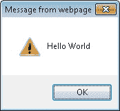

    恭喜！你刚刚编写了你的第一个（尽管并不好用）JavaScript 代码。然而，仅仅通过这小段代码，就包含了两个你在 JavaScript 编程过程中可能会使用的重要项目：浏览器中的 `javascript` 伪协议标识符，以及更重要的 `alert` 函数。你将在后面的章节中更详细地检查这些项目；目前，你学到了未来会用到的东西就足够了！

JavaScript 还是 `event-driven`（事件驱动）的，这意味着它可以响应某些事件或“发生的事情”，例如鼠标点击或表单字段内的文本更改。将 JavaScript 连接到事件是 JavaScript 许多常见用途的核心。在 第 11 章 中，你将看到如何使用 JavaScript 响应事件。

# JavaScript 在网页上的放置

如果你是 HTML 新手，你目前只需要知道的是，它使用一对括在方括号内的匹配标签来界定网页中的元素。结束标签以斜杠字符（`/`）开头。元素可以相互嵌套。JavaScript 位于网页的 `<head> </head>` 和/或 `<body></body>` 标签内部的 `<script>` 标签内，例如所示：

```
<html>
<head>
<title>A Web Page Title</title>
<script type="text/javascript">
// JavaScript 写在这里这里
</script>
</head>
<body>
<script type="text/javascript">
// JavaScript 也可以放在这里
</script>
</body>
</html>
```

放置在 `<body>` 标签内的 JavaScript 会会在浏览器遇到它时执行，这在你需要使用 JavaScript 函数向文档写入时非常有帮助，如下（函数调用用粗体显示）：

```
<head>
<title>A Web Page Title</title>
<script type="text/javascript">
// JavaScript 写在这里这里
</script>
</head>
<body>
<script type="text/javascript">
document.write("hello");
document.write(" world");
</script>
</body>
</html>
```

由于浏览器加载 JavaScript 的方式，目前在 HTML 中放置 JavaScript 的最佳实践是将 `<script>` 标签放置在 `<body>` 元素的末尾，而不是 `<head>` 元素中。这样做有助于确保当浏览器在加载 JavaScript 文件阻塞输入时，页面内容能够加载。

当你在可扩展超文本标记语言（XHTML）页面上使用 JavaScript 时，小于号（`<`）和符号（`&`）会被解释为 XML，这可能会给 JavaScript 带来问题。为了解决这个问题，请在 XHTML 页面中使用以下语法：

```
<script type="text/javascript">
<![CDATA[
    // JavaScript 写在这里这里
]]>
</script>
```

不符合 XHTML 标准的浏览器不会正确解释 CDATA 。你可以通过将 CDATA 放置在 JavaScript 注释中来解决这个问题——即以两个正斜杠（`//`）开头的一行或多行，如下所示：

```
<script type="text/javascript">
//<![CDATA[
    // JavaScript 写在这里这里
//]]>
</script>
```

是的，代码确实很丑。不过，这有一个简单的解决办法：使用外部 JavaScript 文件。在 第 2 章 中，你将具体学习如何完成这个简单的任务。

### 文档类型

如果你已经在 Web 领域编程了一段时间，你可能已经熟悉文档类型声明（Document Type declarations），或者常说的 DOCTYPE 声明。在设计网页时，你可以完成的最任务之一是在页面顶部包含一个准确且符合语法的 DOCTYPE 声明部分。DOCTYPE 声明（缩写为 DTD）让浏览器（或其他解析程序）知道在解析文档元素时将遵循的规则。

HTML 4.01 的 DOCTYPE 声明示例如下：

```
<!DOCTYPE html PUBLIC "-//W3C//DTD HTML 4.01//EN"
   "http://www.w3.org/TR/html4/strict.dtd">
```

如果你使用 Microsoft Visual Studio 2005 或更高版本创建 Web 项目，每个页面会自动获得一个针对 XHTML 1.0 标准的 DOCTYPE 声明，如下：

```
<!DOCTYPE html PUBLIC "-//W3C//DTD XHTML 1.0 Transitional//EN" "http://www.w3.org/TR/xhtml1/DTD/xhtml1-transitional.dtd">
```

HTML 版本 5 使用了更简单的 DOCTYPE：

```
<!DOCTYPE html>
```

如果你没有声明 DOCTYPE，浏览器将使用名为 `Quirks Mode`（怪异模式）的模式来解释页面。退回到怪异模式意味着文档的最终外观可能与你的意图不同，特别是当通过多个浏览器查看时。

如果你确实声明了 DOCTYPE，确保生成的 HTML、级联样式表（也称为 CSS）和 JavaScript 也符合 Web 标准是非常重要的，这样文档就可以被最广泛的受众按预期方式查看，无论使用何种界面或浏览器。HTML 和 CSS 验证将在本书的 第 15 章 中进行讨论。W3C 在 [`validator.w3.org/`](http://validator.w3.org/) 提供了一个在线验证器，你可以用它来验证任何公开的网页。

### 提示

在习惯按照标准编码之前，请定期使用标记验证器，并在向公众发布 Web 项目之前务必检查有效性。

# JavaScript 能做什么

JavaScript 很大程度上是一种补充性语言，这意味着很少有整个应用程序在没有 HTML 等其他语言辅助且没有在 浏览器中呈现的情况下仅用 JavaScript 编写。某些 Adobe 产品支持 JavaScript，但 JavaScript 主要用于 Web 相关的编程。

JavaScript 也是 AJAX（异步 JavaScript 和 XML）缩写中的 J，它是 Web 2.0 现象的宠儿。尽管如此，JavaScript 是一门日常用语言，提供了当今网页访问者所期望、甚至可能要求的交互性。

JavaScript 可以在应用程序的客户端执行许多任务。例如，它可以通过创建下拉菜单、转换页面上的文本、向页面添加动态元素以及帮助表单填写，为网站添加必要的交互性。

在学习 JavaScript 能做什么（这本书的关注点）之前，你需要了解 JavaScript 不能不能做什么，但请注意，这两个部分的讨论都不是尽的。

# JavaScript 不能做什么

JavaScript 无法执行的许多操作是由于 JavaScript 的使用在某种程度上限于网页浏览器环境。本节将探讨 JavaScript 无法执行的一些任务，以及一些 JavaScript 不应该执行的任务。

## JavaScript 无法被强制施于客户端

JavaScript 的功能依赖于另一个接口或宿主程序。该主机程序通常是客户端的浏览器，也称为 `user agent`（用户代理）。由于 JavaScript 是一种客户端语言，它只能执行客户端允许它做的事情。

一些人仍在使用完全不支持 JavaScript 的旧浏览器。另一些人由于辅助程序、文本读器以及其他辅助浏览体验的插件软件，无法支持 JavaScript 的许多高级功能。还有人可能仅仅因为可以这样做而选择禁用 JavaScript，可能是出于安全考虑（无论是感知的还是真实的），或者是因为由于弹窗广告等某些困扰导致 JavaScript 声誉不佳。

无论出于什么原因，你都需要进行一些额外工作，以确保你设计的网站对那些没有 JavaScript 的个人可用。我已经能听到你的抗议了：“但这个功能真的很[在此处插入你自己的最高级词：酷、棒、必不可少、漂亮、极了]。” 无论你的功能有多出色，你都有可能从更好的互操作性和更多的网站访问者中获益。在本文章后后的使用 JavaScript 的技巧 部分中，我提供了一些你可以遵循的提示，以便在你的网站上恰当地使用 JavaScript。

从另一个角度来考虑这个问题可能会有所帮助。当你构建一个从 Microsoft Internet Information Services (IIS) 6.0 服务的 Web 应用时，你可以假设该程序在任何地方从 IIS 6.0 服务器提供时通常都能正常工作。同样，当你为 Apache 2 构建应用程序时，你可以相当确定它会在其他 Apache 2 安装上运行。然而，对于 JavaScript 则不能做出同样的假设。当你编写一个在桌面电脑上运行良好的应用程序时，你无法保证它在其他人的电脑上也能运行。你无法控制你的程序在发送到客户端后将如何运行。

## JavaScript 无法保证数据安全

由于 JavaScript 完全运行在客户端，因此开发者必须学会“放手”。正如你预期的那样，放弃对程序的控制会产生严重影响。一旦程序位于客户端的计算机上，客户端可以在将数据发回服务器之前对数据做许多恶劣的事情。与其他任何 Web 编程一样，你永远不要信任从客户端返回的任何数据。即使你已经使用 JavaScript 函数来验证表单内容，当它到达服务器时，你仍然必须再次验证这些输入。禁用了 JavaScript 的客户端可能会通过 Web 表单传回垃圾数据。如果你天真地认为你的客户端 JavaScript 函数已经检查了数据以确保其有效性，你可能会发现无效数据回到了服务器，导致不可预见且可能危险的后果。

### 重要

记住，JavaScript 在访问者的计算机上是可以被禁用的。你不能依靠小花招来成功，例如使用 JavaScript 禁用右键点击或防止访问者查看源代码，而且你不应该将它们作为安全措施。

## JavaScript 无法跨域

JavaScript 开发者还必须意识到 `同源策略`（Same-Origin Policy），该策略规定运行在一个域名内的脚本没有权限访问另一个 Internet 域的属性，无法影响来自另一个域的脚本和数据。例如，JavaScript 可以用于打开一个新的浏览器窗口，但该窗口的内容在某种程度上受到调用脚本的限制。当我的网站（`braingia.org`）的页面包含 JavaScript 时，该页面无法访问从不同域（如 `microsoft.com`）执行的任何 JavaScript。这就是同源策略的精髓：JavaScript 必须在相同位置执行或源自相同位置。

在框架（frames）和 AJAX 的 `XMLHttpRequest` 对象范围内，同源策略经常需要应对的限制，可能会向不同的 Web 服务器发送多个 JavaScript 请求。随着 Windows Internet Explorer 8 的推出，微软引入了对 `XDomainRequest` 对象的支持，允许对其他域的数据进行有限访问。我在第 19 章 中讨论了跨域请求的一些变通方法和更完整的方法。目前，请意识到 JavaScript 限于在你自己的浏览器窗口中执行任务。

## JavaScript 不负责服务器

在开发服务器端代码（如 Visual Basic .NET 或 PHP（PHP 是一个递归缩写，代表 `PHP: Hypertext Preprocessor`））时，你可以相当确定服务器将实现某些功能，例如与数据库通信或提供 Web 应用程序所需模块的访问。JavaScript 无法访问服务器端变量。例如，JavaScript 无法访问位于服务器上的数据库。JavaScript 代码限于脚本运行的平台内部可以进行的操作，该平台通常是浏览器。

如果你熟悉服务器端编程，你需要在思维上做的另一个转变是：对于 JavaScript，你必须在许多不同的客户端上测试代码，以了解特定客户端的能力。当你编写服务器端代码时，如果服务器没有实现给定的功能，你会立即知道，因为服务器端脚本在测试时会失败。除了坏心的管理员之外，后端服务器代码实现不会随心所欲地改变，因此你更容易知道自己写和不能写什么。但你无法预测旨在客户端运行的 JavaScript 代码。

网站的设计绝不是、也永远不会是一个完全客观的过程。一个网站的目标可能是提供信息，这决定了某种设计方法；而另一个网站的目标可能是连接到某个应用程序，因此需要专门的设计和功能。尽管如此，许多流行且看似设计良好的网站在某些方面上具有共同点。我尝试在这里对这些共同点进行分解，尽管请记住，我并没有列出一份详尽的列表，这些项目反映的是一个人的观点。

一个设计良好的网站会做到以下几：

*   **功能重于形式**。当用户访问网站时，他或她通常想要获取信息或执行任务。你的网站越难浏览，用户就越可能跳转到另一个浏览体验更好的网站。

    动画和闪烁的元素层来去去，但留下的仍然以专业、易于获取的方式呈现基本信息的网站。使用最酷炫的动画软件或 Web 技术会让我想起使用 `HTML` `<blink>` 标签的时代。对于那些从未见过它实际运行效果的人来说，`<blink>` 标签会导致其中的文本在屏幕上消失并重新出现。几乎所有的 Web 开发者似乎都讨厌 `<blink>` 标签以及它对网页的影响。这些开发者应当明智地记住，今天网页上令人兴奋的功能或特殊特效将是明天的 `<blink>`。成功的网站坚持基础，并且仅在内容需要时才使用这些类型的元素。

    使用站点地图（site map）、备用标签（alt tags）和简单的导航工具等元素，不要要求使用特殊的软件或插件来查看网站的主要内容。我经常访问一个网站，却因为需要某个插件或这个或那个播放器的最新版本（而我并没有）而无法浏览。

    尽管站点地图、备用标签和简单导航看起来可能有些过时，但它们对于无障碍访问（accessibility）来说是不可或缺的。文本阅读器和其他让残障人士能够朗读或浏览网站的技术会使用这些辅助功能，并且经常在处理复杂的 `JavaScript` 时遇到问题。

*   **遵循标准**。Web 标准的存在是为了被遵循的，忽视它们将自负其后果。使用正确的 `DOCTYPE` 声明和格式良好的 `HTML` 有助于确保你的网站在访问者面前显示正常。强烈建议使用 `W3C` 的标记验证工具进行验证。如果你的网站坏了，请修复它！

*   **在多个浏览器中正确渲染**。即使在 Internet Explorer 拥有 90% 市场份额时，程序员忽略其他浏览器也不是一个好主意。这样做通常意味着无障碍访问也被忽视了，因此使用文本阅读器或其他插件的人无法使用该网站。使用 Microsoft Windows 其他操作系统的用户访问这些网站也可能无好运。

    尽管 Internet Explorer 仍然是 Web 访问者的主流，但很有可能每 10 个访问者中至少有 3 或 4 人在使用不同的浏览器。当然，这种差异很大程度上取决于主题。受众的技术性越高，你就越需要适应 Internet Explorer 以外的浏览器。因此，如果你的网站吸引技术受众，你可能需要网站在 `Firefox`、`Safari` 甚至 `Lynx` 中运行。

    无论网站的主题是什么，你都不希望因为用户的浏览器选择而拒绝他们。想象一下一个因为客人的鞋子就拒绝了 10 个潜在客户中 3 个的店主。这家店经营不了多久——或者至少它不会那么成功。

    如果你努力遵循 Web 标准，可能你已经做了支持多个浏览器所需的大部分工作。避免为你的网站使用专有插件是确保网站正确渲染的另一种方法。你只需看向 Apple iPad 就能看到一个流行但因为不支持原生 `Flash` 或 `Java` 而导致使用受限的设备。由于这个原因，创建遵循标准并避免专有插件的网站可以确保你的网站被最广泛的观众看到。

*   **在适当的时间使用适当的技术**。提到插件，一个设计良好的网站不会过度或误用技术。在视频网站上，播放视频是恰当。同样，在音乐网站上，播放背景音乐是恰当。在其他网站上，这些功能可能就不那么恰当。如果你觉得你的网站需要播放背景音乐，请回到起点检查你起初为什么要建立网站！每想起我访问过的一个律师网站，我仍然感到发抖。该网站在没有我干预的情况下开始播放律所吉祥曲。朋友不要让朋友在自己的网站上使用背景音乐，除非你的朋友是 Rush 乐队的成员而你正在制作该乐队的网站。

## JavaScript 的位置

今天的 Web 仍在进化。过去一年中流行的运动之一被称为*非侵入脚本*（unobtrusive scripting）。非侵入脚本范式是更大运动——行为分离（behavioral separation）的一部分。行为分离要求结构与样式分离，并将这两者都与行为分离。在这种模型中，`HTML` 或 `XHTML` 提供结构，而 `CSS` 提供样式，`JavaScript` 提供行为。`JavaScript` 是非侵入的；它不会产生干扰。如果浏览器不支持 `JavaScript`，网站仍然可以工作，因为访问者可以使用其他方式使用网站。

适当应用，非侵入脚本意味着不假设 `JavaScript` 是可用的，并且 `JavaScript` 的失败将以优雅的方式进行。优雅降级（Graceful degradation）帮助页面在没有 `JavaScript` 的情况下保持功能，或者使用适当的方法在网站需要时使 `JavaScript` 可用。其中一种方法在第 11 章 中介绍。

我是非侵入脚本的支持者，因为这意味着遵循了标准，并且生成的网站遵循我在上一节中分享的四项建议。遗憾的是，情况并不总是如此。你可以分离 `HTML`、`CSS` 和 `JavaScript` 却仍然使用专有标签，但当你以非侵入的方式编程时，你倾向于更关注细节，并更在意最终结果符合标准。

在整本书中，我努力不仅向你展示 `JavaScript` 的基础知识，还有如何有效且尽可能非侵入地使用 `JavaScript` 的最佳方法。

### 关于 JScript、JavaScript 以及本书的说明

本书涵盖了由 `ECMA` 标准定义的 `JavaScript`，版本从早期一直直到最新的版本 5。在某些章节中，我强调了与 `JScript` 和 `JScript .NET` 相关的信息。关于仅限 `JScript` 的额外参考，我推荐以下网站：

*   JScript (Windows Script Technologies) [`msdn.microsoft.com/en-us/library/hbxc2t98.aspx`](http://msdn.microsoft.com/en-us/library/hbxc2t98.aspx)

## 网站应该支持哪些浏览器？

向下兼容长期以来一直是 Web 开发者的一个问题。选择支持哪些浏览器版本是在新浏览器中提供的最新功能与旧浏览器所需的兼容功能之间进行权衡。对于网站应该支持哪些浏览器，没有硬性规定，所以答案是：取决于情况。

你的决定取决于你想对网站做什么处理，以及你是否更看重使用旧硬件和软件的人的访问，还是更看重后期浏览器版本提供的额外功能。某些浏览器因为太旧而无法支持，因为它们无法正确渲染 CSS，更不用说 JavaScript 了。支持多个浏览器版本的关键是在它们内部进行测试。

从微软获取 MSDN 账户将让你访问旧版产品，包括旧版本的 Internet Explorer，这样你就可以看到你的网站对 Internet Explorer 4.0 访问的反应。额外的资源是应用程序兼容性虚拟电脑镜像（Application Compatibility Virtual PC Images），可以从微软免费获取。这些镜像允许你使用包含 Internet Explorer 6.0 和 Windows Internet Explorer 7 等浏览器的限版 Microsoft Windows。更多信息请参见：[`www.microsoft.com/downloads/details.aspx?FamilyId=21EABB90-958F-4B64-B5F1-73D0A413C8EF&displaylang=en`](http://www.microsoft.com/downloads/details.aspx?FamilyId=21EABB90-958F-4B64-B5F1-73D0A413C8EF&displaylang=en)。

许多网页设计和 JavaScript 函数不需要新版本的网络浏览器。然而，正如解释过的，验证你的网站在各种浏览器中正确渲染始终是一个好主意。请访问 [`browsers.evolt.org/`](http://browsers.evolt.org/) 查看许多历史版本浏览器的存档链接。即使你无法在多个浏览器中进行广泛测试，你也可以设计网站使其以优雅的方式失败。你希望网站无论使用何种浏览器都能适当渲染。

# ECMAScript 第 5 版有什么新？

当第 5 版在 2009 年引入时，ECMAScript 262 标准进行了若干增强。本节将介绍其中的一些增强和变化。这些更改大部分与旧版本的网络浏览器不向下兼容。然而，随着新版本浏览器的发布，ECMAScript 262 版本 5 引入的更改将开始出现并在跨浏览器 Web 应用中使用。

## 新的数组方法

ECMA-262 版本 5 为数组引入了几个新方法。这些包括一个用于遍历数组元素的 `foreach` 方法，以及一个 `map` 方法、一个 `filter` 方法以及其他用于确定索引和缩小数组尺寸的方法。第 8 章 检查了数组并对这些新方法进行了一些讨论。

## 对象属性的新控制

在第 8 章 中讨论的对象属性具有更高的灵活性。ECMA-262 版本 5 引入了 `get` 和 `set` 函数，它们分别在检索属性或为属性赋值时被调用。你可以通过 `writable`、`configurable` 和 `enumerable` 属性控制对属性的访问。例如，属性可能有一个值，你可以将其配置为非枚举，这意味着该属性在对象迭代时不会被返回。考虑这段代码：

```
{
   value: "testvalue",
   enumerable: false
}
```

如果通过 `for` 循环，该值将不会被返回。如果这种语法还不完全理解，请不要气馁。随后的章节将详细检查对象的创建和迭代。

## 新的 JSON 对象

JavaScript 对象表示法 (JSON) 是一种数据交换的方法，通常用于运行 JavaScript 的客户端应用程序（如 浏览器）与服务器之间。JSON 数据交换比 XML 简单得多，尤其是在 JavaScript 应用程序中，因此经常用作 AJAX 应用的替代数据格式。

ECMA-262 版本 5 在语言规范中添加了原生的 `JSON` 对象。本书主要在第四部分 中讨论 JSON。

## 日期对象的更改

ECMA-262 版本 5 为 `Date` 对象增加了新方法，用于解析和生成 ISO 格式的日期。`toISOString()` 方法生成 ISO-8601 格式的输出，如下：

* 2011-03-12T18:51:50.000Z

## 严格模式

ECMA-262 版本 5 引入了一种新的代码执行模式，称为 `strict mode`。在严格模式下，JavaScript 引擎使用一组更严格的语法检查，有助于发现代码中的问题，例如编码错误或未声明的变量。

## 浏览器支持

ECMA-262 版本 5 引入了许多更改和增强，影响了开发者如何使用 JavaScript 编程。遗憾的是，这些更改在旧版浏览器中将不受支持，并且短期内 Internet Explorer 的支持有限。你可以在 [`kangax.github.com/es5-compat-table/`](http://kangax.github.com/es5-compat-table/) 找到包含许多流行浏览器及其 ECMA-262 版本 5 某些功能支持情况的性表。

为了解决旧版浏览器缺乏 ECMA-262 版本 5 支持的问题，你需要编写考虑这些因素的代码，或者使用 jQuery 等 JavaScript 库。本书在第 21 章 中涵盖了各种 JavaScript 库。

# 练习

| 1. | 正或错：JavaScript 由标准机构定义并受所有网络浏览器支持。 |
| 2. | 正或错：当机器禁用了 JavaScript 的访客访问你的网站时，你应该阻止其对网站的访问，因为没有正理由禁用 JavaScript。 |
| 3. | 创建一个 JavaScript 定义块，该块通常出现在 HTML 页面的 `<head>` 或 `<body>` 块中。 |
| 4. | 正或错：在 `DOCTYPE` 定义块中声明正在使用的 JavaScript 版本是非常重要的。 |
| 5. | 正或错：JavaScript 既可以出现在 HTML 页面的 `<head>` 块中，也可以出现在 `<body>` 文本。 |

# 第 2 章 使用 JavaScript 开发

**阅读本章后，你将能够：**

*   理解使用 JavaScript 开发的可用选项。
*   为 JavaScript 开发配置你的计算机。
*   使用 Microsoft Visual Studio 2010 创建并部署 JavaScript 应用程序。
*   使用 Eclipse 创建并部署 JavaScript 应用程序。
*   使用记事本（或其他编辑器）创建 JavaScript 应用程序。
*   理解调试 JavaScript 的选项。

## JavaScript 开发选项

由于 JavaScript 不是编译语言，你不需要任何特殊的工具或开发环境来编写和部署 JavaScript 应用程序。同样，你不需要特殊的服务器软件来运行这些应用程序。因此，创建 JavaScript 程序的选项几乎是无限的。

你可以在任何文本编辑器中编写 JavaScript 代码；在你任何用于编写超文本标记语言 (HTML) 和级联样式表 (CSS) 文件的程序中编写；或者在如 Visual Studio 等强大的集成开发环境 (IDE) 中编写。你甚至可能同时使用所有三种方法。你最初用 Visual Studio 开发 Web 应用，但随后发现使用记事本等简单文本编辑器来微调一些 JavaScript 非常方便。最终，使用你最熟悉的工具即可。

本书主要讨论如何使用 Visual Studio 使用 JavaScript 开发，但有时我可能会推荐（并演示）使用如记事本或 Vim（你可以在这里获取：[`www.vim.org`](http://www.vim.org)）等编辑器。在其他时候，你可以通过使用 `javascript:` 伪协议标识符在浏览器的地址栏中输入 JavaScript 代码，正如你在第 1 章 中看到的那样。

当你开发 JavaScript 一段时间后，你会发现你自己在每个网页上都会做一些相同的事情。在这种情况下，你只需要简单地将重复的代码复制并粘贴到你正在开发的网页中。更好的是，你可以创建一个包含常用函数的外部文件，然后在你开发的整个网站中中使用这些函数。第 10 章 提供了更多关于函数的信息，尽管你在前 10 章中会随处看到函数的用法。

## 配置你的环境

本节将介绍使用几种不同的工具进行 JavaScript 开发。你应该能够使用任何你觉得最顺手的工具来进行 JavaScript 和网站开发，因此不要将此列表视为详尽的或带有偏见的工具列表。

一个实用的 JavaScript 开发工具是 Visual Studio 2010。安装 Visual Studio 2010 时附带了一个简单的 Web 服务器——ASP.NET 开发服务器，这使得部署和测试本书中的应用程序变得稍微简单。然而，这并不意味着你应该为了 JavaScript 开发而专门去购买 Visual Studio 2010。如果你选择使用 Eclipse（本章讨论的第二个工具），你仍然可以测试你编写的 JavaScript 代码。同样，即使你完全不用 IDE，也可以测试 JavaScript 代码。

Web 开发另一个选项是 Microsoft Visual Web Developer 2010 Express。该工具可以在 [`www.microsoft.com/express/Web/`](http://www.microsoft.com/express/Web/) 获取，它提供了 Visual Studio 界面，以及专为 Web 开发设计的免费包，其中包含几个工具和插件。

对于大多数 JavaScript 开发，你绝对不需要 Web 服务器。显著的例外是你使用异步 JavaScript 和 XML (AJAX) 进行开发时。AJAX 无法使用 `file://` 协议，除了 第 1 章 中涵盖的同源策略之外，如果没有 Web 服务器 AJAX 将无法工作。结论是：如果你的未来涉及 AJAX 开发，你需要一个 Web 服务器。

尽管有 AJAX，但如果你手头有一个 Web 服务器，开发确实会变得简单一点。任何 Web 服务器都可以，因为你真正想做的只是提供 HTML 和 JavaScript，可能为了好玩再提供一点 CSS。我在 Apache 方面非常顺利，它可以在 [`httpd.apache.org`](http://httpd.apache.org) 获取。Apache 运行在许多平台上，包括 Microsoft Windows 平台，并且一直是互联网上最流行的 Web 服务器。

配置 Apache 或任何 Web 服务器超出了本书的范围，再次，不需要 Web 服务器。Apache 网站有一些关于在 Windows 上安装 Apache 的良好教程，如果你使用几乎任何版本的 Linux，Apache 可能已经安装好了，或者很容易安装。书书中使用的许多示例无论你是使用 Web 服务器还是仅在本地查看示例都可以运行。然而，要利用使用 AJAX 的示例，Web 服务器是必须的。

## 使用 Visual Studio 2010 编写 JavaScript

Visual Studio 2010 让开发者能够快速部署带有 JavaScript 增强的 Web 。当你首次启动 Visual Studio 2010 时，你会看到为 Visual Studio 环境选择特定样式的选项。不同的样式会导致不同的 Visual Studio 2010 视图，每个视图都旨在为特定的开发目的或语言提供最大的帮助。你可以在 图 2-1 中看到此对话框的示例。

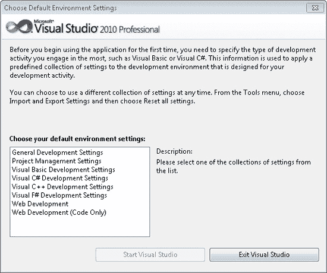

图 2-1. 选择开发环境样式。

如果你在使用“通用开发设置”集合，你的 Visual Studio 环境将与 图 2-2 所示。


图 2-2. 通用开发设置集合为许多编程任务提供了通用环境。

你可以通过从“工具”菜单中选择“导入或导出设置”来更改 Visual Studio 2010，使其使用“Web 开发设置”集合，这将打开“导入或导出设置”向导。选择如 图 2-3 所示，然后点击“下一步”。

### 注意

更改开发环境设置不是必须的，但本书假设你在 Visual Studio 2010 中选择了“Web 开发设置”。

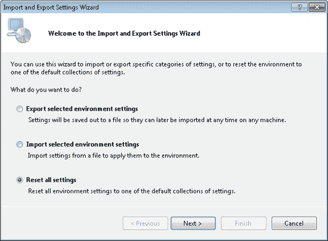

图 2-3. 准备将 Visual Studio 2010 中的设置更改 Web 开发设置。

向导的“保存当前设置”页面（如 图 2-4）会出现。如果你有想要保存的设置，选择“是，保存我的当前设置”。否则，选择“否，仅重置设置，覆盖我的当前设置”。点击“下一步”继续。

向导的“选择默认设置集合”页面（如 图 2-5）所示，选择“Web 开发设置”，然后点击“完成”。

过段时间后，你会收到“重置完成”消息。点击“关闭”将你的环境重置为 Web 开发设置。

使用 Web 开发设置，你可以快速访问与网站开发相关的常用任务，不仅涉及 ASP.NET，还涉及 JavaScript、HTML 和 CSS——这些是 Web 的核心语言。有关 Visual Studio 2010 设置的更多信息，请访问 [`msdn.microsoft.com/en-us/library/zbhkx167.aspx`](http://msdn.microsoft.com/en-us/library/zbhkx167.aspx)。

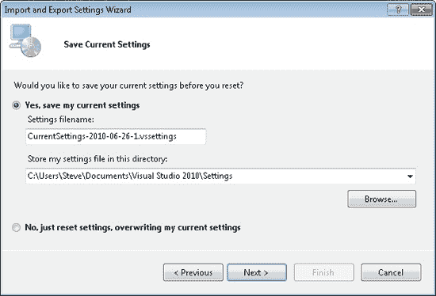

图 2-4. 通过保存当前设置，你可以保留你可能为环境指定的任何自定义配置。

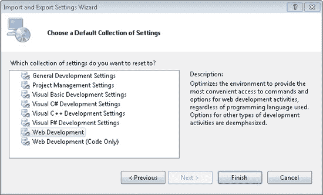

图 2-5. 在 Visual Studio 2010 中选择 Web 开发设置。

## 使用 Visual Studio 2010 的你的第一个 Web（以及 JavaScript）项目

现在你可以创建一个 Web 项目并编写一些 JavaScript。如果你没有使用 Visual Studio，请跳到本章的 使用 Eclipse 编写 JavaScript 部分或 在没有 IDE 的编写 JavaScript 部分，以获取在其他开发环境中工作的信息。我保证不会忘记你的！

### 注意

你可以下载这些示例以及整本书书中的代码。请参阅本书的引言了解下载配套内容的说明。

### 使用 Visual Studio 2010 使用 JavaScript 创建 Web 项目

1. 在 Visual Studio 中，使用“Web 开发设置”，从“文件”菜单中选择“新建 Web 站点”。这将打开“新建 Web 站点”对话框。
2. 选择 ASP.NET Web Site（语言选择——Visual Basic 或 Visual C#——并不重要），如图所示。将名称更改为 `Chapter2`，并设置适用于你配置的路径。信息无误后，点击 OK。Visual Studio 将创建一个新项目。

    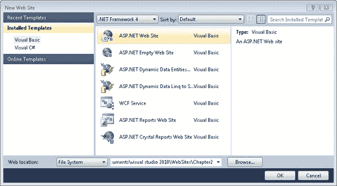

3. Visual Studio 2010 为你创建了一个新的 `Default.aspx` 文件并在编辑器中打开它。关闭此 `Default.aspx` 文件，通过右键点击 `Solution Explorer` 中的某个位置（`Solution Explorer` 是通常位于 Visual Studio 环境右上角的窗格）来创建一个新文件，然后选择 `Add New Item`。（你也可以从 `File` 菜单中选择 `New File`）。`Add New Item` 对话框将打开，如下屏所示。选择 `HTML Page`，将名称更改为 `myfirstpage.htm`，然后点击 `Add`。Visual Studio 将打开新文件，并自动为你输入 HTML 页面的 `DOCTYPE` 和其他起始部分。

    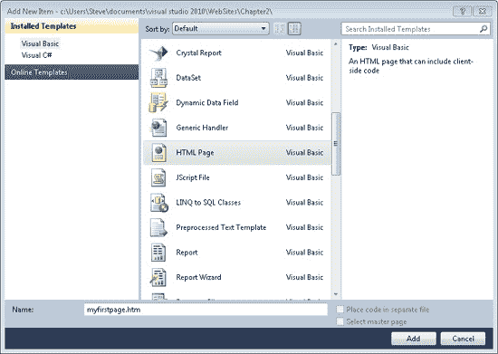

4. 在 `myfirstpage.htm` 页中，将光标置于 `<title>` 和 `</title>` 标签之间，并将标题更改为 `My First Page`。你的环境应该看起来所示。

    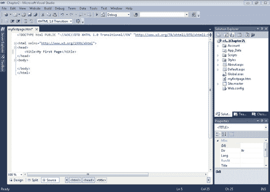

5. 在 `<head>` 标签之间，闭合 `</title>` 标签之后，添加以下代码：

    ```
    <script type="text/javascript">
        function yetAnotherAlert(textToAlert) {
            alert(textToAlert);
        }
        yetAnotherAlert("This is Chapter 2");
    </script>
    ```

6. 从 `File` 菜单中选择 `Save All`。完成后的脚本和页面应该类似于此处。

    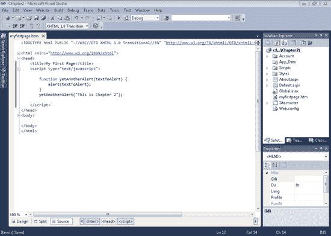

要查看此页面，从 `Debug` 菜单中选择 `Start Without Debugging`。这将启动 ASP.NET 开发服务器（如果它尚未启动），并将你带到默认浏览器中的该页面。你会看到一个带有警告框的页面，类似于图 2-6。点击 OK，然后关闭浏览器。

脚本的工作原理如下：首先，打开 `script` 标签并声明为 JavaScript，如下代码所示：

```
<script type="text/javascript">
```

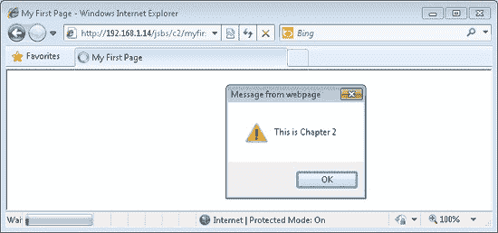

图 2-6。由 ASP.NET 开发服务器提供的运行的 JavaScript 程序。

### 注意

你可以通过其他方式声明脚本为 JavaScript，但你在这里看到的方法是支持最广泛的。

接下来，脚本声明了一个函数 `yetAnotherAlert`，它接受一个参数 `textToAlert`，如下所示：

```
function yetAnotherAlert(textToAlert) {
```

该函数有一个任务：在浏览器窗口中弹出一个警告框，显示作为函数参数所提供的任何文本，下一行代码实现了这一点：

```
alert(textToAlert);
```

函数的结束由右大括号 (`}`) 界定。脚本的下一行使用带引号的字符串参数调用了你刚刚声明的函数：

```javascript
yetAnotherAlert("This is Chapter 2");
```

有了这个脚本，你就准备好在 Visual Studio 2010 中开发 JavaScript 了。但在你庆祝之前，请考虑跟我一起，学习如何使用外部文件来存储你的 JavaScript 代码。

## 在 Visual Studio 2010 中使用外部 JavaScript 文件

JavaScript 不需要完全包含在网站网站的 HTML 文件中。相反，你可以利用 `<script>` 标签的 `src` 属性。标签内的属性有助于进一步定义元素或为元素提供更具体的信息。例如，`<form>` 元素可能有一个 `action` 属性，定义了提交表单时应该发生什么操作。通过使用 `<script>` 标签的 `src` 属性，你可以定义外部 JavaScript 文件的位置。Web 浏览器在加载网页时会读取指定文件中包含的 JavaScript。使用外部 JavaScript 文件意味着你可以在地方维护公共 JavaScript 代码，而不是在每个单独页面中维护——这将为你节省大量工作。

到为止，你应该有一个可以运行的网页（使用 Visual Studio 构建），得益于一些巧妙的 JavaScript，它会显示一个警告。你在上一节中开发的网页在页面的 `<head>` 部分包含了 JavaScript 代码。在本节中，我将向你展示如何将 JavaScript 放入外部文件，然后从 HTML 页面内部引用该代码。

### 使用 Visual Studio 2010 为 JavaScript 创建外部文件

1.  如果 `myfirstpage.htm` 文件未打开，请进入 Visual Studio 并从 `File` 菜单选择 `Open Project` 来打开它。选择你保存 `myfirstpage.htm` 文件的项目。
2.  从 `File` 菜单中选择 `New File` 创建持有 JavaScript 代码的新文件。`Add New Item` 对话框将打开，如下屏所示。在列表中选择 `HTML Page`，将名称更改为 `myfirstpage.htm`，然后点击 `Add`。注意，你的列表可能取决于 Visual Studio 的安装。你可以在示例代码中找到名为 `myscript.js` 的源文件。

    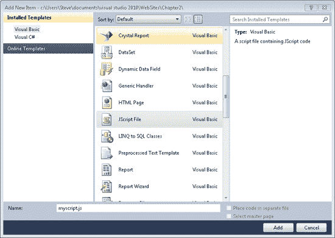

3.  一个新的空的 JScript 文件将打开并添加到你的 Web 项目。你会看到 `myscript.js` 的标签页和另一个 `myfirstpage.htm` 的标签页，如下所示。如果 `myfirstpage.htm` 文件未在标签页中打开，请通过双击 `Solution Explorer` 中的它。

    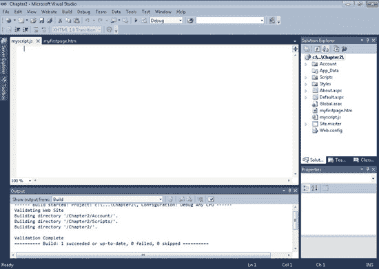

    ### 注意

    JavaScript 和 JScript 的常用扩展名是 `.js`，但你并不强制使用它。我在前面的步骤中选择 JScript 文件类型是因为这种类型类型选择正确的扩展名。你也可以很容易地在 `Add New Item` 对话框中选择 `Text Document`，然后以 `.js` 扩展命名文件。

4.  点击 `myfirstpage.htm` 标签页使其变为活动，并突出显示 JavaScript 代码。确保实际的 JavaScript 标签 `<script>` 和 `</script>` ，不要突出它们。（你现在不需要这些标签，但稍后我们会回到这个主题。）你也可以在示例代码中找到名为 `myfirstpage.htm` 的页面。
5.  从 `Edit` 菜单中选择 `Copy` 将突出代码复制到剪贴板。
6.  点击 `myscript.js` 标签页，将光标移动到第一行下方，并从 `Edit` 菜单选择 `Paste`。复制的代码粘贴在光标处。更改 `yetAnotherAlert` 函数调用参数的文本，使其变为：“This is the Second Example.”代码所示：

```javascript
function yetAnotherAlert(textToAlert) {
    alert(textToAlert);
}
yetAnotherAlert("This is the Second Example.");
```

7.  从 `File` 菜单中选择 `Save` 保存 `myscript.js` 文件。该文件应该像这样：

    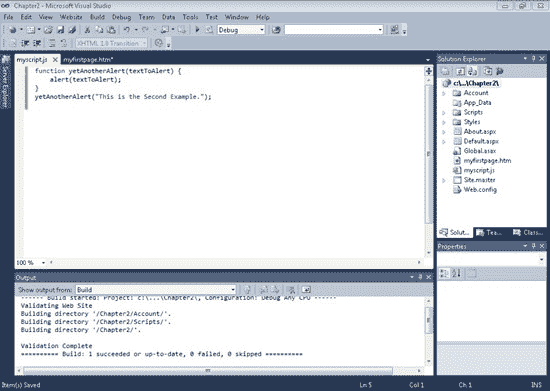

8. 配合包含在名为 `myscript.js` 文件中的 JavaScript 代码（你已经保存了该文件吧？），你只需要从 `myfirstpage.htm` 文件中删除代码，只保留脚本标签，如下所示：

```
<script type="text/javascript">
</script>
```

9. 现在在起始的 `<script>` 标签上添加 `src` 属性：

```
<script type="text/javascript" src="myscript.js">
```

10. 如果需要，可以通过删除多余的回车符并将代码放在同一行来让代码看起来更整洁，如下：

```html
<script type="text/javascript" src="myscript.js"></script>
```

`myfirstpage.htm` 的全部内容现在应该是这样的：

```
<!DOCTYPE html PUBLIC "-//W3C//DTD XHTML 1.0 Transitional//EN" "http://www.w3.org/TR/
xhtml1/DTD/xhtml1-transitional.dtd">
<html xmlns="http://www.w3.org/1999/xhtml" >
<head>
    <title>My First Page</title>
    <script type="text/javascript" src="myscript.js"></script>
</head>
<body>

</body>
</html>
```

11. 保存 `myfirstpage.htm`。
12. 从调试（Debug）菜单中选择“不带调试启动”（Start Without Debugging），在网络浏览器中查看页面。该页面将通过 Web 服务器提供，如果你的浏览器尚未打开，它将打开并该页面。结果应该是一个带有文本“This is the Second Example.”的警框。示例所示：

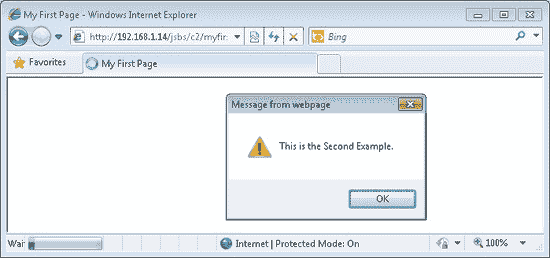

13. 点击确定关闭警框对话框。现在查看源代码以查看差异。在你的网络浏览器中，从视图（View）菜单中选择源代码（Source）。注意，`<script>` 标签现在包含了对外部 JavaScript 文件的引用。

你已经使用 Visual Studio 2010 开发了 JavaScript。从这里开始，你可以跳到调试章节，或者继续阅读学习如何使用其他工具进行 JavaScript 开发。

# 使用 Eclipse 编写 JavaScript

Web 开发人员（以及使用其他语言的开发者）中另一种流行的 IDE 是 Eclipse。使用 Eclipse 的开发者可以安装不同的框架来协助完成特定的开发任务。例如，Web 开发人员可以使用 Web 工具平台（Web Tools Platform）或 PHP（PHP 超文本预处理器）开发工具来创建一个能够简化他们许多常见任务的环境。关于许多潜在的 Eclipse 项目的讨论超出了本书的范畴，但我将讨论如何使用基础 Eclipse 安装来开发 JavaScript。

如果你想用 Eclipse 开发 JavaScript，请花点时间下载软件，如果必要，请下载 Java 运行时环境。详细信息和下载位置可以在 Eclipse 网站（[`www.eclipse.org`](http://www.eclipse.org)）获取。在本书的这一部分，我假设你从未用过 Eclipse 并且是第一次学习它。然而，本部分不包含安装 Eclipse 的教程。我建议你阅读 Eclipse 自带的以及 Eclipse 网站上提供的文档，以获取最新信息。

## 使用 Eclipse 建立你的第一个 Web（以及 JavaScript）项目

现在是时候使用 Eclipse 创建一个带有 JavaScript 的网页了。如果你没有使用 Eclipse，这一部分不适合你，你可以跳过。在章节的后面，我将向你展示如何在不使用任何 IDE 的情况下开发，以及一些调试 JavaScript 的技巧。

### 注意

本节回顾了如何为 JavaScript Web 开发人员使用 Eclipse IDE。你的 Eclipse 环境可能与本节包含的截图略有不同。第一次打开 Eclipse 时，系统要求你选择一个工作空间（workspace）。选择默认即可。

### 在 Eclipse 中创建 JavaScript 的 Web 项目

1. 从文件（File）菜单中选择新建（New），然后选择 JavaScript，创建一个新项目。出现“新建 JavaScript 项目”对话框。在项目名称框中输入 `Chapter2` 并点击完成（Finish）。

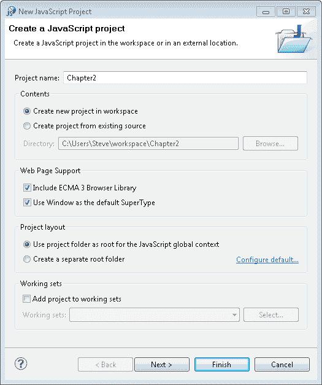

2. `Chapter2` 文件夹在项目资源管理器（Project Explorer）中打开，没有列出文件，所示：

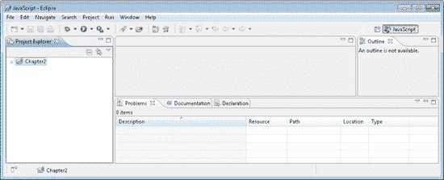

3. 右键点击 `Chapter2` 文件夹，点击新建（New），然后点击文件（File）。打开“新建文件”对话框。在文件名文本框中输入 `myfirstpage.htm`，如下一个屏幕所示，并点击完成（Finish）。你可以在第 2 章示例代码中找到名为 `eclipse_myfirstpage.htm` 的文件。如果你想使用此文件，请在后续练习中将其重命名为 `myfirstpage.htm`。

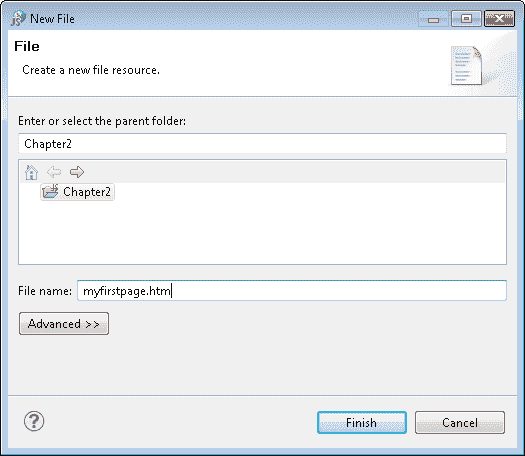

4. 在点击完成（Finish）后，Eclipse 在其自己的 浏览器中打开该页面。然而，你想编辑页面而不是查看它，因此在项目资源管理器中右键点击 `myfirstpage.htm` 并点击打开（Open）。页面将在 Eclipse 内部的编辑器中打开，所示：

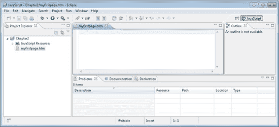

5. 终于是时候写代码了！在编辑器中，输入以下代码：

```html
<!DOCTYPE html PUBLIC "-//W3C//DTD XHTML 1.0 Transitional//EN" "http://www.w3.org/TR/
xhtml1/DTD/xhtml1-transitional.dtd">
<html xmlns="http://www.w3.org/1999/xhtml" >
<head>
    <title>My First Page</title>
    <script type="text/javascript">

function yetAnotherAlert(textToAlert) {
    alert(textToAlert);
}
yetAnotherAlert("This is Chapter 2");

</script>
</head>
<body>

</body>
</html>
```

### 注意

出于本示例的目的，如果你不想输入 DOCTYPE 声明，可以跳过它，直接从顶部的 `<html>` 标签开始。对于本书范围之外的真实世界开发，你绝对希望声明一个 DOCTYPE。请参见 第 1 章 了解更多关于为什么这重要的信息。

6. 从文件（File）菜单中选择保存（Save）。完成后的脚本和页面应该类似于所示：

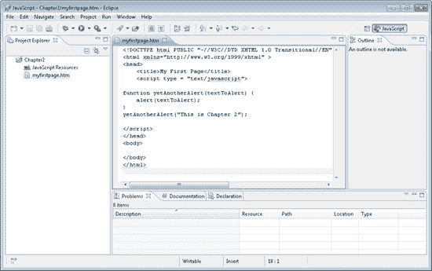

要查看页面，在项目资源管理器中右键点击文件，选择“打开方式”（Open With），然后点击“网络浏览器”（Web Browser）。你将在 Eclipse 浏览器中本地查看文件，你应该会收到一个带有警框的页面，类似于图 2-7 所示。

或者，你也可以通过计算机上不同的网络浏览器查看文件，例如系统的默认网络浏览器。要执行操作，浏览到该文件（例如，我的文件副本位于 `C:\Users\Steve\workspace\Chapter2\folder`），然后双击该文件。

### 注意

如果你使用 Windows Internet Explorer，取决于你为浏览器设置的安全级别，你可能会收到关于查看受阻止内容的警框。[`windows.microsoft.com/en-US/windows7/Internet-Explorer-Information-bar-frequently-asked-questions`](http://windows.microsoft.com/en-US/windows7/Internet-Explorer-Information-bar-frequently-asked-questions) 上的文章提供了有关此功能的更多信息以及如何禁用它。

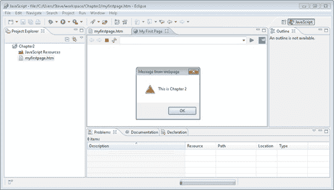

图 2-7. 查看在 Eclipse 中开发的文件。

在这个示例中，你创建了一个带有嵌入 JavaScript 的基础网页。页面的 JavaScript 部分仅包含几个元素。首先，脚本标签被打开并声明为 JavaScript，如代码所示：

```html
<script type="text/javascript">
```

### 注意

你可以通过其他方式声明你的脚本是 JavaScript，但在这里看到的方法是最广泛支持的。

接下来，脚本声明了一个函数 `yetAnotherAlert`，它接受一个参数 `textToAlert`：

```
function yetAnotherAlert(textToAlert) {
```

该函数有一个任务：在浏览器窗口中弹出一个警框，显示作为函数参数提供的任何文本，接下来的行代码实现了这一点：

```
alert(textToAlert);
```

该函数通过一个右大括号结束：

```
}
```

然后，脚本使用带引号的字符串参数调用了你刚刚定义的函数，如下：

```
yetAnotherAlert("This is Chapter 2");
```

在这个简短的示例中，你了解了如何使用 Eclipse 编写 JavaScript 代码。下一节将展示如何将 JavaScript 放置在外部文件中，这是使用 JavaScript 的常用方法。

# 使用 Eclipse 使用外部 JavaScript 文件

当你读到这里时，你应该已经有一个可以运行的网页（通过 Eclipse 创建），该网页会显示一个警框。你在上一节中开发的网页在页面的 `<head>` 标签部分包含了 JavaScript 代码。在本节中，我将描述如何将 JavaScript 放入外部文件，然后在你的 HTML 页面内部引用该代码。

### 使用 Eclipse 为 JavaScript 创建外部文件

1. 如果 `myfirstpage.htm` 代码尚未在 Eclipse 中打开，请打开它。（你可以在配套内容中找到此文件。）选择你保存 `myfirstpage.htm` 文件的项目，通过右键点击该文件、选择 `Open With`，然后点击 `Text Editor` 来在编辑器中打开文件本身。
2. 通过从 File 菜单选择 `New` 然后选择 `File` 来创建一个新文件存放 JavaScript 代码。会打开 New File 对话框。在 File Name 文本框中输入 `myscript.js`（如下所示），并点击 `Finish`。


3. Eclipse 为你的项目添加了一个新的空白 JavaScript 文件。如果该文件没有自动打开，请在 Project Explorer 中右键点击 `myscript.js` 文件，选择 `Open With`，然后点击 `Text Editor`。现在你应该能同时看到新的 `myscript.js` 文件和 `myfirstpage.htm` 文件的标签。你可能还会看到 My First Page 网页。

    #### 注意

    虽然你不强制使用 JavaScript 的常用扩展名 `.js`，但这样做可能帮助你日后更容易地识别文件。

4. 点击 `myfirstpage.htm` 标签使其变为活动状态，并高亮你之前编写的 JavaScript 代码。确保实际的 JavaScript 标签 `<script>` 和 `</script>` 保持完整且不要高亮它们。（你现在不需要它们，但稍后你会再次回到这个主题。）
5. 通过从 Edit 菜单选择 `Copy` 将高亮的代码复制到剪贴板。
6. 点击 `myscript.js` 标签，并通过从 Edit 菜单选择 `Paste` 粘贴代码。将函数调用的文本更改为“This is the Second Example.”代码看起来如下：

```
function yetAnotherAlert(textToAlert) {
    alert(textToAlert);
}
yetAnotherAlert("This is the Second Example.");
```

7. 通过从 File 菜单选择 `Save` 保存 `myscript.js` 文件。该文件看起来应该与此处显示的屏幕类似：


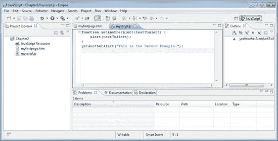

8. 既然 JavaScript 代码已包含在名为 `myscript.js` 的独立文件中（你保存了，对吧？），你可以安全地删除 `myfirstpage.htm` 文件中的代码。只需删除代码，保留脚本标签，如下：

```html
<script type="text/javascript">
</script>
```

9. 在起始 `<script>` 标签中添加 `src` 属性：

```html
<script type="text/javascript" src="myscript.js">
```

10. 如果需要，为了让代码看起来更整洁，删除多余的换行符将代码放在一行，如下所示：

```html
<script type="text/javascript" src="myscript.js"></script>
```

现在 `myfirstpage.htm` 的全部内容应该是：

```html
<!DOCTYPE html PUBLIC "-//W3C//DTD XHTML 1.0 Transitional//EN" "http://www.w3.org/TR/xhtml1/DTD/xhtml1-transitional.dtd">
<html xmlns="http://www.w3.org/1999/xhtml" >
<head>
    <title>My First Page</title>
    <script type="text/javascript" src="myscript.js"></script>
</head>
<body>

</body>
</html>
```

11. 保存 `myfirstpage.htm`。

12. 通过在 Project Explorer 中右键点击 `myfirstpage.htm`，指向 `Open With`，然后点击 `Web Browser` 在网络浏览器中查看页面。页面是在本地服务的，浏览器窗口将打开并显示页面。结果应该是一个带有文本“This is the Second Example.”的警框。它看起来如下：

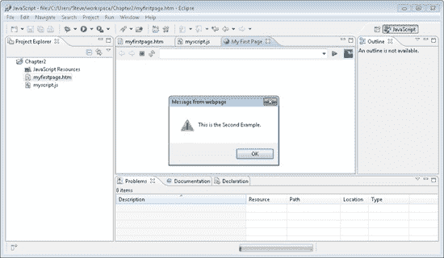

关于使用 Eclipse 进行 JavaScript 开发的入门教程到此结束。不过，其中还有很多内容，我建议访问 Eclipse 网站获取更多关于使用 Eclipse 平台开发的信息。

# 不使用 IDE 编写 JavaScript

你同样很容易放弃 IDE，转而采用更简单的方法开发 JavaScript。任何像 Notepad 或 Vim 这样的编辑器都可以用于 JavaScript 开发。不过，我不建议使用 Microsoft Office Word 等文字处理器进行 JavaScript 开发，因为它们会在生成的文件中留下痕迹，从而破坏网站。

## 使用 Notepad 创建你的第一个网页（和 JavaScript）项目

本节展示使用 Notepad 进行 JavaScript 开发的示例。

### 使用 Notepad 创建网页

1. 在 Windows 7（以及 Windows XP 和 Vista）中，你可以通过点击开始按钮，点击所有程序，然后点击 Notepad 来打开它。在文档中输入以下代码：

```html
<!DOCTYPE HTML PUBLIC "-//W3C//DTD HTML 4.01//EN"
"http://www.w3.org/TR/html4/strict.dtd">
<html>
<head>
    <title>My First Page</title>
    <script type="text/javascript">

function yetAnotherAlert(textToAlert) {
    alert(textToAlert);
}
yetAnotherAlert("This is Chapter 2");

</script>

</head>
<body>

</body>
</html>
```

#### 注意

出于示例目的，如果你不想输入，可以跳过 DOCTYPE 声明，直接从 `<html>`标签开始。对于本书之外的现实开发，你绝对需要声明 DOCTYPE。请参考第一节 获取更多关于为什么这很重要的信息。

2. 从 File 菜单选择 Save。你会看到一个另存为对话框。不幸的是，除非使用双引号，否则 Notepad 默认会文件名添加 `.txt` 扩展名。因此，请务必为文件名加上双引号——例如，“`myfirstpage.htm`”。如果你省略了引号，Notepad 将添加 `.txt` 扩展并将文件保存为“myfirstpage.htm.txt”。以下图像显示了在文件名周围使用双引号的示例。请记住你保存此文档的位置。

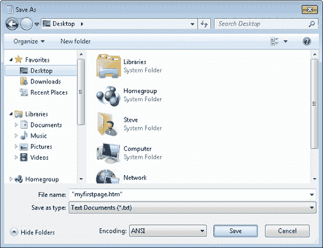

3. 要查看页面，请使用你喜欢的浏览器浏览到保存文件的位置。（如果像上一步屏幕所示，你将文件保存到了桌面，请浏览那里。）下一张图片显示了在 Firefox 中渲染的文件。

如果你正在使用 Internet Explorer，根据你浏览器设置的安全级别，你可能会收到关于查看受阻止内容的警告。[`windows.microsoft.com/en-US/windows7/Internet-Explorer-Information-bar-frequently-asked-questions`](http://windows.microsoft.com/en-US/windows7/Internet-Explorer-Information-bar-frequently-asked-questions)上的支持文章提供了有关此功能以及如何禁用它的更多信息。

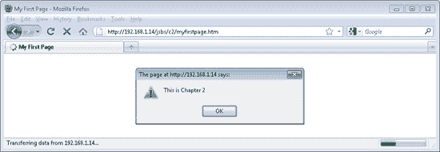

到此为止，在这个示例中，你创建了一个带有嵌入 JavaScript 的基本网页。页面的 JavaScript 部分包含几个元素。首先，打开 `script` 标签并声明为 JavaScript，如下代码所示：

```html
<script type="text/javascript">
```

### 注意

你可以通过其他方式声明你的脚本是 JavaScript，但在这里看到的方法支持得最广泛。

接下来，脚本声明了一个函数 `yetAnotherAlert`，它接受一个参数 `textToAlert`：

```javascript
function yetAnotherAlert(textToAlert) {
```

该函数有一个任务：在浏览器窗口中弹出警报框，显示作为函数参数提供的任何文本，接下来的行代码实现了这一点：

```javascript
alert(textToAlert);
```

函数由一个右括号（`}`）结束。然后脚本使用带引号的字符串参数调用了你刚刚声明的函数：

```javascript
yetAnotherAlert("This is Chapter 2");
```

在这个简短的示例中，你已经了解了如何在没有 IDE 的情况下编写 JavaScript。下一节将展示如何将 JavaScript 放在外部文件中，这是 JavaScript 使用的一种非常常见的方法。

## 在没有 IDE 的使用外部 JavaScript 文件

当你读到这里时，你应该已经有一个可以运行的网页（在记事本中创建），它可以显示一个 `alert()` 对话框。你在上一节中开发的网页在页面 `<head>` 标签部分包含了 JavaScript 代码。本节展示了如何将 JavaScript 放入外部文件，然后从 HTML 页面内部引用该代码。

### 使用记事本为 JavaScript 创建外部文件

1. 如果 `myfirstpage.htm` 代码没有打开，请打开它。如果你使用的是记事本，你可能需要右键点击该文件并选择“打开方式”，然后选择记事本。

2. 选中 JavaScript 代码。确保保留实际的 JavaScript 标签 `<script>` 和 `</script>` 完整，不要选中它们。通过高亮显示并从“编辑”菜单中选择“复制”将代码复制到剪贴板。

3. 通过选择“文件”菜单中的“新建”创建一个新文件来存放 JavaScript 代码。打开新文件。通过从“编辑”菜单中选择“粘贴”将 JavaScript 代码粘贴到文件中。将参数文本更改函数调用，使其读取为“This is the Second Example.”此代码所示：

```javascript
function yetAnotherAlert(textToAlert) {
    alert(textToAlert);
}
yetAnotherAlert("This is the Second Example.");
```

4. 通过选择“文件”菜单中的“保存”保存文件。在“文件名”文本框中输入 `myscript.js`，并确保加上双引号，因为扩展名需要是 `.js` 而不是 `.txt`。

### 注意

JavaScript 文件的常用扩展名是 `.js`，但你不必使用它。然而，这样做可能有助于你以后更容易地识别文件。

5. 既然 JavaScript 代码已包含在名为 `myscript.js` 的独立文件中（你保存了对吧？），你可以安全地删除 `myfirstpage.htm` 文件中的代码。再次在记事本中打开 `myfirstpage.htm`。在 `myfirstpage.htm` 中，只需删除之前粘贴的 JavaScript 代码，保留脚本标签：

```html
<script type="text/javascript">
</script>
```

### 提示

当尝试打开没有 `.txt` 扩展的文件（例如你刚刚创建的 `.htm` 或 `.js` 文件）时，确保你查看的是“所有文件”而不仅仅是“文本”。要这样做，请在打开对话框的“文件类型”下拉列表中选择“所有文件”。

6. 在起始 `<script>` 标签中添加 `src` 属性，如下：

```html
<script type="text/javascript" src="myscript.js">
```

7. 如果需要，可以通过删除多余的回车符并将代码放在同一行让代码看起来更整洁，如下：

```html
<script type="text/javascript" src="myscript.js"></script>
```

`myfirstpage.htm` 的全部内容现在如下：

```html
<!DOCTYPE HTML PUBLIC "-//W3C//DTD HTML 4.01//EN"
"http://www.w3.org/TR/html4/strict.dtd">
<html>
<head>
    <title>My First Page</title>
    <script type="text/javascript" src="myscript.js"></script>
</head>
<body>

</body>
</html>
```

8. 保存 `myfirstpage.htm`。

9. 在网络浏览器中查看该页面。结果（如接下来的屏幕所示）应该是一个带有文本“This is the Second Example.”的警报。

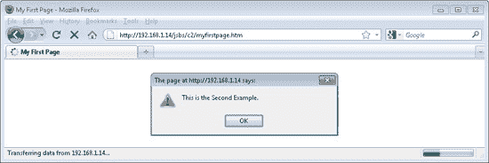

关于在没有 IDE 的情况下开发 JavaScript 的入门结束。虽然这个示例使用了记事本，但其他几个编辑器可能更适合基础开发，包括上述的 `Vim` 以及来自 Helio Software Solutions 的 `Textpad`两者都比记事本强大。

# 调试 JavaScript

调试 JavaScript 可能会是一种令人不安的体验，特别是在更复杂的应用程序中。某些工具，如 `Venkman`（[`www.mozilla.org/projects/venkman/`](http://www.mozilla.org/projects/venkman/)），可以协助 JavaScript 调试，但调试 JavaScript 的主要工具是网络浏览器。主流浏览器包含了一些 JavaScript 调试功能。你应该考虑使用的程序中包括 `Firebug`，它是 Firefox 的一个显著插件。Firebug 可 [`www.getfirebug.com/`](http://www.getfirebug.com/) 获取。

我发现 Firebug 对于 Web 开发几乎不可或缺，特别是使用 JavaScript 和 AJAX 进行 Web 开发。此软件允许你检查网页的所有元素，并实时查看 AJAX 调用的结果以及 CSS 的结果，这使得调试变得容易得多。插图 2-8 显示了 Firebug 在我网站主页运行的示例。

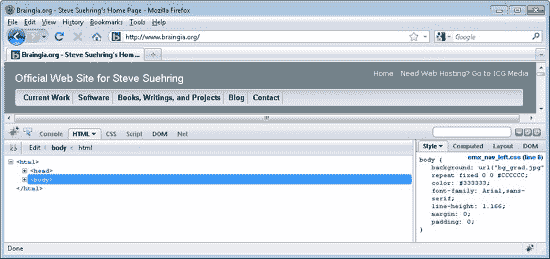

图 2-8。Firebug 是 Web 开发者工具箱中的重要工具。

我推荐使用 Firebug 来开发和调试 JavaScript。在调试 JavaScript 时，我发现 `alert()` 函数非常有用。几个放置恰当的 `alert()` 函数可以向你显示变量包含的值以及你的脚本当前正在做什么。当然，由于 `alert()` 会导致对话框打开，如果你在循环中放置了 `alert()`，然后错误地导致该循环无限重复而不退出，你将发现你需要不正常地退出浏览器，可能需要使用任务管理器。

# 练习题

| 1. | 创建新网页并将其命名为 `mysecondpage.htm`。在页面的 `<body>` 部分创建一个 JavaScript 脚本，并让脚本显示一个带有你名字的 `alert()` 对话框。在至少两个不同的浏览器中尝试此脚本。 |
| 2. | 编辑你在练习 1 中创建的网页，在页面的 `<head>` 部分创建一个函数，并将你目前在 `<body>` 脚本中的 `alert()` 对话框移动到新函数中。从现有的 `<body>` 脚本调用该新函数。 |
| 3. | 将练习 2 中创建的函数移动到外部 JavaScript 文件中，并在网页内部链接或调用此文件。 |

# 第 3 章.JavaScript 语法和语句

**读完本章后，你将能够：**

*   理解使用 JavaScript 编程语言的基本规则。
*   将 JavaScript 正确地放置在网页中。
*   识别 JavaScript 语句。
*   识别 JavaScript 中的保留字。

## 一些基础说明

本书的其余部分将更深入地探讨 JavaScript 的特定方面以及它们如何与特定任务相关。然而，你必须先走后才能跑，因此在深入研究 JavaScript 之前，你应该学习它的 `lexical structure`（词法结构）——即语言的规则，也称为 `syntax rules`。

## 大写敏感

JavaScript 是大小写敏感。在命名变量和使用语言关键字时，你必须意识到这一点。名为 `remote` 的变量与名为 `Remote` 或 `REMOTE` 的变量是不相同的。同样，循环控制关键字 `while` 是完全有效的，但将其命名为 `WHILE` 或 `While` 将导致错误。

关键字是小写的，但变量可以是任何你喜好的大小写组合。只要你保持大小写一致，你就可以创建任何想要的组合。例如，以下所有示例在 JavaScript 中都是完全合法的变量名：

```
buttonOne
txt1
a
C
```

### 提示

你通常会看到 JavaScript 代码是用小写写的，除非必要时——例如函数调用如 `isNaN()`，它用于判断一个值是否为非数字（函数名中的 `NaN`）。你将在第 4 章中学习到这些。

第 4 章提供了关于变量及其命名规范的更多信息。目前，请记住，在 JavaScript 中编写变量名时必须注意大小写。

## 空格

在大多数情况下，JavaScript 会忽略 `white space`（空白），即 JavaScript 语句之间的空格。你可以使用空格、缩进或你喜欢的任何编码标准来提高 JavaScript 的可读性。然而，这条规则也有例外。某些关键字（如 `return`）当它们单独占一行时，JavaScript 解释器可能会误解。你将在本章稍后的部分看到这个问题的示例。

提高程序的可读性是包含空白字符的充分理由。考虑以下代码示例。它包含了最少的空格和缩进。

```javascript
function cubeme(incomingNum) {
if (incomingNum == 1) {
return "What are you doing?";
} else {
return Math.pow(incomingNum,3);
}
}
var theNum = 2;
var finalNum = cubeme(theNum);
if (isNaN(finalNum)) {
alert("You should know that 1 to any power is 1.");
} else {
alert("When cubed, " + theNum + " is " + finalNum);
}
```

现在考虑带有缩进的相同代码。（你可以在配套内容的第 3 章示例代码中找到这段名为 `example1.txt` 的代码。）

```javascript
function cubeme(incomingNum) {
    if (incomingNum == 1) {
        return "What are you doing?";
    } else {
        return Math.pow(incomingNum,3);
    }
}

var theNum = 2;
var finalNum = cubeme(theNum);

if (isNaN(finalNum)) {
    alert("You should know that 1 to any power is 1.");
} else {
    alert("When cubed, " + theNum + " is " + finalNum);
}
```

第二个代码示例的执行结果与第一个一样，但更容易阅读和理解——至少在我看来是这样！我发现，编写代码实际上只需要很短的时间，但维护它却需要几年。当我一年后再次访问代码时，如果我已经让代码变得更易读、更容易理解，我会感到高兴得多。

## 注释

说到创建更可读的代码并长期维护这些代码，注释是你的朋友。现在看起来显而易见的代码，下次看时可能就不那么明显了，尤其是当你写下它之后已经过了很久。注释可以通过两种方式放入 JavaScript 代码中：多行注释和单行。

如果你编写过 C 语言程序，JavaScript 的多行注释会让你感到熟悉。`multiline` 注释分别以 `/*` 和 `*/` 开始和结束，如下代码示例所示：

```javascript
/*  这是 JavaScript 中的多行注释
它与 C 风格的注释相似，因为它可以在关闭之前
跨越多行。  */
```

`single-line` 注释以两个斜杠（`//`）开头，并且没有结束要求，因为它只跨越一行。示例如下：

```javascript
// 这是一个单行注释。
```

使用多个单行注释是完全有效的，我用它们处理短的注释块，而不是使用之前所示的多行注释样式。例如，看这段代码块：

```javascript
// 这是另一个注释块。
// 这一块使用了多行。
// 每一行前面必须有两个斜杠。
```

### 提示

对于跨越一行或几行的短注释，你可能会发现使用双斜杠方法更快。对于较大的注释，例如程序或脚本开头的注释，多行注释样式是更好的选择，因为它使得添加或删除信息更加方便。

## 分号

分号在 JavaScript 中用于分隔表达式。从技术上说，大多数语句和表达式不需要分号。然而，在使用分号时可能遇到的微妙问题会增加不必要的错误，从而增加不必要的调试时间。在某些情况下，JavaScript 解释器会插入你可能并不需要的分号。例如，考虑这条语句：

```javascript
return
(varName);
```

很有可能你想要写的是：

```javascript
return(varName);
```

但 JavaScript 按照自身的逻辑，在 `return` 语句后插入一个分号，导致代码在 JavaScript 解释器看起来像这样：

```javascript
return;
(varName);
```

这段代码将无法工作；解释器会误解你的意图。如果你在函数代码代码，它将向调用者返回 `undefined`，这可能不是你想要的。这是一个不允许随意使用空白字符的例子——你不能成功地使用换行（在下一节中解释）来将 `return` 关键字与其应该返回的值分开。

如果你将使用分号作为规则，你会发现 JavaScript 编程要简单得多，而不是尝试记住在何时可能不需要使用它们。

但在一种情况下你绝对不应该使用分号：即使用循环和条件语句时。考虑这段代码：

```javascript
if (a == 4)
{
    // 代码写在这里
}
```

在这种情况下，你不会在 `if` 语句的末尾使用分号。原因是紧跟在条件判断后的大括号中的语句或语句块是条件语句的一部分，在本例中是 `if` 语句。分号标记了 `if` 语句的结束，如果放置不当，就会将 `if` 语句的第一部分与其余部分分离。例如，以下代码是错误的（括号内的代码无论 `a` 是否等于 4 都会执行）：

```javascript
if (a == 4);
{
    // 代码写在这里
}
```

### 提示

在开启循环或函数时，跳过分号。

## 换行符

与 JavaScript 中的空白甚至分号密切相关的是换行符，有时称为 `carriage returns`（回车）。这些字符在官方 ECMA-262 标准中被称为“行终止符”（Line Terminators），它们将一行代码与下一行隔开。和分号一样，换行符的位置非常重要。正如你在上一节的示例中看到的，在错误的位置放置换行可能会导致意想不到的行为或错误。

不出意外，换行符最常用的用途是将单行代码分开以提高可读性。你也可以通过换行符将特别长的代码行分开来提高可读性。然而，在这样做时，请注意像前面提到的 `return` 语句所示的问题，其中额外的换行符可能会对代码的含义产生意外的影响。

## 正确放置 JavaScript

JavaScript 可以放置在超文本标记语言（HTML）页面的几个位置：`<head> </head>` 部分内，或者在 `<body>` 和 `</body>` 标签之间。传统上，JavaScript 最常见的位置是页面顶部的 `<head>` 和 `</head>` 标签之间。然而，将`<script>` 块放置在 `<body>` 部分正变得越来越常见。请务必声明你正在使用的脚本类型。虽然可以使用其他脚本类型，但由于这是一本 JavaScript 书，我将在起始 `<script>` 标签中声明如下：

```html
<script type="text/javascript">
```

使用 JavaScript 时需要注意的一个重要问题与声明为可扩展文本标记语言（XHTML）的页面有关。在此类页面中，`<script>` 标签必须声明在 CDATA 区域内；否则，XHTML 会尝试将 `<script>` 标签视为另一个 XML 标签，区域内的代码可能无法按照你预期的方式工作。因此，在严格 XHTML 中使用的 JavaScript 应该声明如下：

```html
<script type="text/javascript">
<![CDATA[

    //JavaScript goes here

]]>
</script>
```

旧版本的浏览器可能无法正确解析 CDATA 区域。这个问题可以通过将 CDATA 的起始和结束行放在 JavaScript 注释中来解决，如下：

```html
<script type="text/javascript">
//<![CDATA[

    //JavaScript goes here

//]]>
</script>
```

当你将实际的 JavaScript 代码放在单独的文件时（正如你在第 2 章 中学习到的），你完全不需要使用这个难看的 CDATA 区域。你可能会发现，对于除了最小脚本之外的内容，将 JavaScript 定义在单独的文件（通常带有 `.js` 后缀）并在页面中链接到这些脚本是理想的。第 2 章 详细展示了这一点，但这里提醒一下如何使用 `<script>` 标签的 `src` 属性链接到文件：

```html
<script type="text/javascript" src="myscript.js">
```

将 JavaScript 放在外部文件中有几个优点，包括：

*   **代码与标记的分离**。将 JavaScript 代码保持在单独的文件中使 HTML 的维护更容易，并且保留了 HTML 的结构，而无需为 XHTML 使用 CDATA 区域。
*   **更易维护**。将 JavaScript 作为单独的文件，你可以修改该文件而不触碰网站上的其他文件。
*   **缓存**。使用单独的 JavaScript 文件允许 浏览器缓存该文件，从而加快用户的网页加载速度。

# JavaScript 语句

与其他语言编写的程序一样，JavaScript 程序由组合在一起的语句组成，这些语句导致 JavaScript 解释器执行一个或多个操作。与其他语言语句一样，JavaScript 语句可以是简单或复合的。本节简要检查了 JavaScript 语句的形式，假设你已经从之前的章节中看到了几个示例，并将在整书中看到其他示例。

## 语句中包含什么？

正如第 1 章 中涵盖的，JavaScript 语句或表达式是标记、运算符和标识符的集合，它们组合在一起创建一个让 JavaScript 解释器具有意义的内容。语句通常以分号结束，特殊情况除外，例如 `if`、`while` 和 `for` 等循环构造函数，这些在第 5 章 中会有介绍。

以下是 JavaScript 中基本语句的一些示例：

```javascript
var x = 4;
var y = x * 4;
alert("Hello");
```

## JavaScript 语句的两种类型

JavaScript 语句有两种基本形式：简单语句和复合。我不会花很多时间讨论语句，因为你并不需要深入了解它们。但是，你应该知道简单语句和复合语句之间的区别。`简单语句`正如你预期的那样——它是是的，如下所示：

```javascript
x = 4;
```

`复合语句`结合了多个层级的逻辑。这里给出的 `if`/`then`/`else` 决策提供了一个很好的例子：

```javascript
if (something == 1) {
    // some code here
} else {
    // some other code here
}
```

# JavaScript 中的保留字

JavaScript 中的某些单词是**保留的**（reserved），这意味着你不能在程序中将它们用作变量、标识符或常量名，因为这样做会导致代码产生意外的结果，例如错误。例如，你已经在之前的示例中看到了保留字 `var`。使用 `var` 单词执行声明变量以外的任何操作都可能导致错误或其他意外行为，具体取决于浏览器。考虑这条语句：

```javascript
// Don't do this!

var var = 4;
```

此代码示例不会向浏览器产生直接错误，但它也不会按照你的预期方式工作，当变量的值不符合你的预期时可能会导致混惑。

以下列表包含了目前 ECMA-262 规范中保留的单词：

| break | delete | if | this | while |
| case | do | in | throw | with |
| catch | else | instanceof | try | with |
| continue | finally | new | typeof | |
| debugger | for | return | var | |
| default | function | switch | void | |

其他几个单词（显示在以下列表中）已为以后使用而保留，因此不应在你的程序中使用：

| class | enum | extends | super | |
| const | export | import | | |

以下单词列表在严格模式下为未来保留的字：

| implements | let | private | public | yield |
| interface | package | protected | static | |

# 函数快速概览

你已经在之前的章节中看到了函数的示例。JavaScript 有几个**内置函数**或其他函数。可用哪些内置函数取决于你使用的语言版本。某些函数仅在 JavaScript 的较后版本中可用，这些版本可能不受所有浏览器支持。检测浏览器可用的函数（以及对象）是判断访问者浏览器是否能够为你网页创建的 JavaScript 的重要方法。此主题在第 11 章 中涵盖。

### 提示

你可以在 QuirksMode 网站找到关于兼容性的优秀资源：([`www.quirksmode.org/compatibility.html`](http://www.quirksmode.org/compatibility.html))。

JavaScript 与其他编程语言类似，允许自定义函数。在本章之前的示例中定义了一个名为 `cubeme()` 的函数，它可以计算给定数字的立方次方。该代码提供了一个在网页的 `<head>` 和 `<body>` 部分使用 JavaScript 的良好机会。

## 使用自定义函数放置 JavaScript

1.  使用 Microsoft Visual Studio、Eclipse 或其他编辑器编辑第 3 章示例代码中的 example1.htm 文件。

2.  在网页中添加粗体类型的代码，替换 TODO 注释：

```html
<!DOCTYPE HTML PUBLIC "-//W3C//DTD HTML 4.01//EN"
"http://www.w3.org/TR/html4/strict.dtd">
<html>
<head>
<script type="text/javascript">
function cubeme(incomingNum) {
    if (incomingNum == 1) {
        return "What are you doing?";
    } else {
        return Math.pow(incomingNum,3);
    }
}
</script>
    <title>第 3 章示例</title>
</head>

<body>
<script type="text/javascript">
var theNum = 2;
var finalNum = cubeme(theNum);

if (isNaN(finalNum)) {
    alert("You should know that 1 的任何次方都是 1.");
} else {
    alert("立方立方后, " + theNum + " 是 " + finalNum);
}
</script>

</body>
</html>
```

3. 保存页面，然后运行代码或在浏览器中查看该网页。你将收到类似这样的警报框：


此示例中的代码将之前的示例代码整合到了完整的 HTML 页面中，包含一个 `DOCTYPE` 声明。代码在文档的 `<head>` 中声明了一个函数 `cubeme()`，如下所示：

```javascript
function cubeme(incomingNum) {
    if (incomingNum == 1) {
        return "What are you doing?";
    } else {
        return Math.pow(incomingNum,3);
    }
}
```

此代码在函数内部接受一个名为 `incomingNum` 的参数。`if`/`then` 决策语句是该函数的核心。当传入的数字等于 `1` 时，函数返回字符串“What are you doing?”。另一方面，当传入的数字不等于 1，则调用 `Math.pow` 方法，并将变量 `incomingNum` 和整数 `3` 作为参数传递。对 `Math.pow` 的调用会将传入的数字进行 3 次方，然后将此值返回给调用它的函数。该调用再次出现在第 4 章中。

之前所有的代码都放置在文档的 `<head>` 中，以便被其他代码调用，这正是我们要做做的。浏览器随后渲染文档的 `<body>`，其中包含了另一段 JavaScript 代码。接下来这段代码将变量 `theNum` 设置为整数 2：

```javascript
var theNum = 2;
```

然后，代码使用 `theNum` 变量作为参数调用之前定义的 `cubeme()` 函数。你会发现变量 `finalNum` 被设置为接收 `cubeme()` 函数调用的输出，如下：

```javascript
var finalNum = cubeme(theNum);
```

页面上的最后一段 JavaScript 代码是另一个 `if`/`then` 决策集。这段代码检查并确定返回的值（现在存储在 `finalNum` 变量中）是否为数字。它通过使用 `isNaN()` 函数来实现这一点。如果该值不是数字，将显示一个警报，反映出使用 `1` 作为参数的事实。（当然，可能还有其他原因导致它不是数字，但请在这里耐心并按照我的示例操作。）如果返回值确实是数字，则显示该数字，正如你在上一步步骤 3 中看到的 `alert()` 对话框所示。

# JavaScript 的新严格模式

ECMA-262 版本 5 引入了一种严格变体，通常称为 `strict mode`（严格模式），它增强了错误检查和安全性。例如，为了帮助防止拼写错误的变量名，变量声明需要使用 `var` 关键字。此外，对 `eval()` 函数和其他区域的更改有助于 JavaScript 程序员改进代码。

使用以下语法启用严格模式，这与 Perl 中使用的语法非常相似：

```javascript
"use strict";
```

严格模式是局部作用域的，这意味着可以通过在脚本开头放置 `use strict` 行来全局启用；或者也可以仅在函数内部启用，只需将该行放在函数内部，如下所示：

```javascript
function doSomething() {

    "use strict";

    // 函数代码放在这里。

}
```

严格模式的一个有助于捕获拼写错误的增强是防止未声明的变量。在严格模式下，所有变量在使用之前都需要进行实例化。例如，考虑这段代码：

```javascript
"use strict";

x = 4;  // 产生语法错误
```

这段代码将创建一个错误条件，因为变量 `x` 还没有使用 `var` 关键字进行声明，如下所示：

```javascript
"use strict";

var x = 4;  // 这种语法是好的
```

严格模式提供的显著安全增强之一是对处理 `eval()` 函数方式的更改。在严格模式下，`eval()` 不能实例化在 `eval()` 语句之外使用的新变量或函数。例如：

```javascript
"use strict";

eval("var testVar = 2;");

alert(testVar);  // 产生语法错误。
```

在代码示例中，将产生语法错误，因为启用了严格模式，且 `testVar` 变量在 `eval()` 语句之外使用。

# 练习

| 1. | 以下哪些语句是有效的 JavaScript 语句？（选择所有项） 1. `if (var == 4) { do something }` 2. `testVar = 10;` 3. `if (a == b) { do something }` 4. `testVar = 10;` 5. `var case = “Yes”;` |
| 2. | 正确或错误：每个 语句都需要分号结束。 |
| 3. | 检查这段 JavaScript。结果可能是？（假设声明已经执行，且该代码位于 `<head>` 部分） ```javascript
var orderTotal = 0;
function collectOrder(numOrdered) {
    if (numOrdered > 0) {
        alert("You ordered " + orderTotal);
        orderTotal = numOrdered * 5;
    }
return orderTotal;
}
``` |

# 第 4 章.JavaScript 数据类型和变量

JavaScript 中的数字正如你预期的那样：它们就是数字。然而，对于熟悉 C 等其他语言数据类型的程序员来说，可能会让他们感到惊讶的是，整数和浮点数并没有特殊或单独的类型。这些在 JavaScript 中都是完全有效的数字：

```
4
51.50
-14
0xd
```

最后一个示例 `0xd` 是一个十六进制数。十六进制和八进制数在 JavaScript 中都是有效的，你会发现 JavaScript 允许使用这些数字格式进行数学运算，这并不意外。请尝试以下练习。

### 在 JavaScript 中执行十六进制数学运算

1. 使用 Microsoft Visual Studio、Eclipse 或编辑器，编辑配套内容中第 04 章示例文件文件夹下的 `example1.htm` 文件。

2. 在网页中，将 `TODO` 注释替换为此处所示的粗体代码（新代码可以在配套代码的 `example1.txt` 文件中找到）：

```html
<!DOCTYPE HTML PUBLIC "-//W3C//DTD HTML 4.01//EN"
"http://www.w3.org/TR/html4/strict.dtd">
<html>
<head>
<title>Hexadecimal Numbers</title>
<script type="text/javascript">
var h = 0xe;
var i = 0x2;
var j = h * i;
alert(j);
</script>
</head>
<body>
</body>
</html>
```

3. 在浏览器中查看该网页。你应该能看到类似下面的对话框：

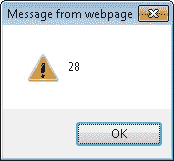

此脚本定义了两个变量（你将在本章稍后部分学习如何定义变量），并将它们分别设置为两个十六进制数：`0xe`（十进制表示法为 14）和 `0x2`：

```javascript
var h = 0xe;
var i = 0x2;
```

然后创建一个新变量，并设置为前两个变量的乘积，如下所示：

```javascript
var j = h * i;
```

随后将得到的变量传递给 `alert()` 函数，该函数会显示上述步骤 3 中的对话框。有趣的是，尽管你乘以了两个十六进制数，但 alert 对话框中的输出是十进制格式。

### 数字函数

JavaScript 具有一些内置函数（以及一些对象，你很快就会学到）用于处理数值。欧洲电子计算机制造商协会（ECMA）标准定义了其中若干个。另一个常用的数字函数是 `isNaN()` 函数。我所说的*常用*，是指 `isNaN()` 是我在 JavaScript 编程中频繁使用的函数。你的用法可能会有所不同，但下面仍有相关说明。

`NaN` 是 *Not a Number*（不是数字）的缩写，代表一个非法的数字。你使用 `isNaN()` 函数来判断一个数字根据 ECMA-262 规范是否合法或有效。例如，一个数字除以零在 JavaScript 中将是非法数字。字符串值“This is not a number”显然也不是数字。虽然人们对什么是数字、什么数字数字有不同的解释，但对于 `isNaN()` 函数来说，字符串“four”不是数字，而字符串“4”是。`isNaN()` 函数有时需要进行一些“心理瑜伽”，因为它试图证明一个否定命题——即变量中的值*不是*数字。这里有几个示例，你可以尝试测试一个数字是否是非法的。

#### 测试 `isNaN()` 函数

1. 打开你的网络浏览器，如 Windows Internet Explorer 或 Firefox。

2. 在地址栏中，输入以下内容（配套内容中也有名为 `isnan.txt` 的文件）：

```
javascript:alert(isNaN("4"));
```

你会收到一个带有 False 单词的警报，所示：


`isNaN()` 函数从此表达式返回 `false`，因为整数值 4 *确实*是一个数字。记住这个函数的含义：“4 不是数字吗？”嗯，4 *确实是*一个数字，所以结果是 `false`。

现在考虑这个示例：

1. 打开你的网络浏览器，如 Internet Explorer 或 Firefox。

2. 在地址栏中，输入：

```
javascript:alert(isNaN("four"));
```

你会收到一个带有 true 单词的警报，如下：

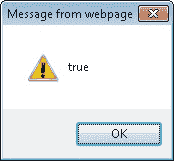

在这种情况下，由于数字 4 被表示为非数字字符字符串 *four*，该函数返回 *true*：字符串 *four* 不是一个数字。我特意在每个代码示例中使用了双引号（即“4”和“four”），以说明引号对于此函数并不重要。因为 JavaScript 足够智能，能够意识到“4”是一个数字，JavaScript 会自动为你完成类型转换。然而，这种转换有时可能会成为劣势，例如当你依赖某个变量或值应为特定类型时。

在验证输入时，经常会使用 `isNaN()` 函数，以确定某些内容（可能是表单变量）是作为数字还是作为文本输入的。

### 数字常量

JavaScript 中还有其他数字常量，其中一些在表 4-1 中进行了描述。这些常量在你的 JavaScript 编程中可能有用也可能无用，但如果你需要，它们确实存在。

表 4-1 选定的数字常量

| 常量 | 描述 |
| --- | --- |
| `Infinity` | 表示正无穷大 |
| `Number.MAX_VALUE` | JavaScript 中能够表示的最大数字 |
| `Number.MIN_VALUE` | JavaScript 中能够表示的最小数字 |
| `Number.NEGATIVE_INFINITY` | 表示负无穷大的值 |
| `Number.POSITIVE_INFINITY` | 表示正无穷大的值 |

### Math 对象

`Math` 对象是一个特殊的内置对象，用于在 JavaScript 中处理数字，它有若干个对 JavaScript 程序员有帮助的属性，包括返回 pi 值、数字平方根、伪随机数和绝对值的属性。某些属性是值属性，意味着它们返回一个值，而另一些则像函数一样，根据传入的参数返回值。考虑这个关于 `Math.PI` 值属性的示例：

```javascript
javascript:alert(Math.PI);
```

结果所示图 4-1。


图 4-1 查看 *Math.PI 属性的值*

### 点符号

点符号之所以这样命名，是因为使用单个点（即 period）来访问对象的成员。单个点在元素之间创建了易于识别的分隔。例如，为了访问你可能称为“变量*room 的长度”，你需要编写 `room.length`。点运算符在许多编程语言中用法类似。

`Math` 对象的其他若干属性对你的程序可能有帮助。其中某些作为对象的函数或方法，其若干列在表 4-2 中。你可以在 ECMA-262 规范中获取 *Math* 对象的完整属性列表*[`www.ecma-international.org/publications/files/ECMA-ST/Ecma-262.pdf`](http://www.ecma-international.org/publications/files/ECMA-ST/Ecma-262.pdf)*。

表 4-2 选定的 Math 对象属性

| 属性 | 定义 |
| --- | --- |
| `Math.random()` | 返回一个伪随机数 |
| `Math.abs(x)` | 返回 *x* 的绝对值 |
| `Math.pow(x,y)` | 返回 x 的 *y* 次方 |
| `Math.round(x)` | 将 x 四舍五入到最近的整数值 |

字符串是 JavaScript 中提供的另一种基本数据类型。它们由引号包围的一个或多个字符组成。以下示例都是字符串：

*   “Hello world”
*   “B”
*   “This is ‘another string’”

上一个列表中的最后一个示例需要一些解释。字符串被单引号或双引号包围。被单引号包含的字符串可以包含双引号。同样，被双引号包含的字符串（如你在上一个示例中看到的）可以包含单引号。所以，基本上，如果字符串被一种类型的引号包围，你就可以在内部使用另一种类型。这里是更多示例：

*   ‘The cow says “moo”.’
*   ‘The talking clock says the time is “Twelve Noon”.’
*   “‘Everyone had a good time’ was the official slogan.”

### 转义引号

如果你在字符串内部和包围字符串时使用了相同风格的引号，则必须对引号进行`escaped（转义）`，这样它们才不会被 JavaScript 引擎解析。一个反斜符字符（`\`）可以转义引号，例如这些示例：

*   ‘I\'m using single quotation marks both outside and within this example. They\'re neat.’
*   “This is a \"great\" example of using \"double quotes\" within a string that’s enclosed with \"double quotes\" too.”

### 其他转义字符

JavaScript 允许使用特定的转义序列来表示其他字符，这些序列可以出现在字符串中。 4-3 显示了这些转义序列。

表 4-3. JavaScript 中的转义序列

| 转义字符 | 序列值 |
| --- | --- |
| `\b` | 退格 |
| `\t` | 制表符 |
| `\n` | 换行 |
| `\v` | 垂直制表符 |
| `\f` | 换页 |
| `\r` | 回车 |
| `\\` | 字面量反斜杠 |

这里是一些转义序列运行的示例。（请让我第一个对继续使用 `alert()` 函数表示道歉。我承诺很快就会采用更复杂的输出方式。）

#### 使用转义序列

1.  打开你的浏览器，例如 Internet Explorer 或 Firefox。

2.  在地址栏中输入以下内容（在辅助内容中的 escapesequences.txt 文件中也可以找到）：

```
javascript:alert("hello\t\thello\ngoodbye");
```

出现以下对话框。（如果它没有出现，请关闭并重新打开浏览器。）注意，在某些浏览器（如 Chrome）中，此示例中制表符的使用方式不会生效。

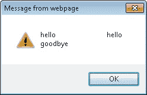

这个相当显刻意的示例展示了转义序列的运行情况。在代码中，`alert` 显示了被两个制表符包围的单词“hello”，它们由其转义序列 `\t` 表示，随后是一个由其转义序列 `\n` 表示的换行符，最后是单词“goodbye”。

### 字符串方法和属性

JavaScript 定义了几个用于处理字符串的属性和方法。这些属性和方法使用点符号（`.`）进行访问，这在本章早些部分已解释过，许多程序员对此都很熟悉。

### 注意

正如我在书中只描述了 JavaScript 的某些元素一样，我只涵盖了 ECMA-262 规范中的部分字符串属性和方法。更多信息请参考 ECMA 规范。

`string` 对象上的 `length` 属性给出字符串的长度，不包括包围的引号。`length` 属性可以直接直接在字符串字面量上调用，如下示例所示：

```javascript
alert("This is a string.".length);
```

然而，在变量上调用 `length` 属性要常见得多，如下：

```javascript
var x = "This is a string.";
alert(x.length);
```

两个示例给出了相同的结果，你可以通过下一个示例看到这一点。

#### 获取字符串的长度

1.  打开你的浏览器，例如 Internet Explorer 或 Firefox。

2.  在地址栏中输入以下内容（在辅助内容中的 stringlength.txt 文件中也可以找到）：

```
javascript:alert("This is a string.".length);
```

结果是一个显示 17 的对话框，如下：


3.  现在尝试在地址栏中输入这段代码：

```javascript
javascript:var x = "This is a string."; alert(x.length);
```

结果是一个显示 17 的对话框，与之前的示例相同。

`substring` 方法返回从第一个参数开始到不包含第二个参数的字符，如下一个示例所示：

```javascript
alert(x.substring(0,3));
```

接下来的代码将返回字符串 `x` 的第一个到第五个字符。例如：

```javascript
var x = "Steve Suehring";
alert(x.substring(0,5));
```

结果是一个显示字符串“Steve”的消息框。

### 奇特的索引方式

用于 `substring` 方法的索引有点奇怪——至少我是这么认为的。第一个字符由整数 0 表示。这没问题，因为 0 是一个有效的数字。

正如我之前提到的，存在许多字符串属性和方法。本书的其余部分将介绍其他的字符串属性和方法，你始终可以在 ECMA 规范中找到完整的列表：[`www.ecma-international.org/publications/files/ECMA-ST/Ecma-262.pdf`](http://www.ecma-international.org/publications/files/ECMA-ST/Ecma-262.pdf)。

## 布尔值 (Booleans)

布尔值是 JavaScript 中一种隐藏或被动的数据类型。我所说的“隐藏”或“被动”，是指你处理布尔值的方式与处理字符串和数字不同；你可以定义并使用布尔变量，但通常你只是使用一个求值为布尔值的表达式。布尔值只有两个值：`true` 和 `false`，在实践中，你很少将变量设置为这种值。相反，你会在 `if`/`then`/`else` 语句等测试中使用布尔表达式。

考虑这条语句：

```javascript
If (myNumber > 18) {
    //do something
}
```

布尔表达式用在 `if` 语句的条件中，以确定括号内的代码是否会被执行。如果变量 `myNumber` 的内容大于整数 `18`，则布尔表达式求值为 `true`；否则，布尔求值为 `false`。

## 空值 (Null)

`Null` 是 JavaScript 中的另一种特殊数据类型（就像在大多数语言中一样）。`Null` 来说就是“无”。它代表并求值为 `false`。当一个值为 `null` 时，它什么都没有，也不包含任何内容。然而，不要将这种“无”与“空”混淆。一个空值或变量仍然充满了“空”。“空”不同于 `null`，后者只是纯粹的无。例如，定义一个变量并将其值设置为空字符串如下所示：

```javascript
var myVariable = '';
```

变量 `myVariable` 是空的，但它不是 `null`。

## 未定义 (Undefined)

`Undefined` 是一种状态，有时被当作值使用，表示一个尚未包含值的变量。这种状态不同于 `null`，尽管 `null` 和 `undefined` 都可以以相同的方式求值。你将在第 5 章中学习如何区分空值和未定义值。

## 对象 (Objects)

和函数一样，对象足够特殊，拥有它们自己的章节（准确来说，是第 8 章）。但我在这里仍然简要讨论了对象。JavaScript 是一种基于对象的语言，而不是完全的面向对象语言。JavaScript 实现了一些类似于面向对象的功能，对于 JavaScript 的大多数基本用法，你不会察觉这种差异。

JavaScript 中的对象是属性的集合，每个属性包含一个原始值。这些属性——将它们想象成 `keys`（键）允许访问值。存储在属性中的每个值可以是一个值、另一个对象，甚至是一个函数。你可以用 JavaScript 定义自己的对象，也可以使用几个内置对象。

对象是使用大括号创建的，因此以下代码创建了一个名为 `myObject` 的空对象：

```javascript
var myObject = {};
```

这是一个具有多个属性的对象：

```javascript
var dvdCatalog = {
    "identifier": "1",
    "name": "Coho Vineyard "
};
```

先前的代码示例创建了一个名为 `dvdCatalog` 的对象，它包含两个属性：一个称为 `identifier`，另一个称为 `name`。每个属性中包含的值分别为 `1` 和 “Coho Vineyard”。你可以像这样访问 `dvdCatalog` 对象的 `name` 属性：

```javascript
alert(dvdCatalog.name);
```

这里有一个更完整的对象示例，你也可以在 `object.txt` 文件的示例代码中找到它：

```javascript
// 使用大括号创建一个新对象
var star = {};
// 为四颗星中的每一颗创建一个命名对象。
star["Polaris"] = new Object;
star["Deneb"] = new Object;
star["Vega"] = new Object;
star["Altair"] = new Object;
```

书中后面的示例展示了如何向这些对象添加属性，以及如何访问属性。关于对象还有很多内容，第 8 章 提供了额外的细节。

## 数组 (Arrays)

你在上一个示例中已经看到如何创建一个带命名的对象。你也可以使用通过数字索引值访问的未命名对象。这些是传统的数组，许多语言的程序员都熟悉它们。你刚刚看到了几个对象，每个对象都用星命名。以下代码创建了一个包含相同对象的数组。这段代码也可以在名为 `stararray.txt` 的示例代码中找到。

```javascript
var star = new Array();
star[0] = "Polaris";
star[1] = "Deneb";
star[2] = "Vega";
star[3] = "Altair";
```

同样的代码也可以像这样写，使用方括号表示的隐式数组构造函数：

```javascript
var star = ["Polaris", "Deneb", "Vega", "Altair"];
```

数组可以包含嵌套的值，就像这个示例将星名与它所所在的星座结合在一起：

```javascript
var star = [["Polaris", "Ursa Minor"],["Deneb","Cygnus"],["Vega","Lyra"],
["Altair","Aquila"]];
```

最后，虽然不常见，但你可以带参数调用 `Array()` 构造函数：

```javascript
var star = Array("Polaris", "Deneb", "Vega", "Altair");
```

### 注意

带数字参数调用 `Array()` 构造函数设置的是数组的长度，而不是第一个元素的值。

ECMA-262 版本增加了一些遍历和处理数组的新方法。数组的遍历和处理方法在第 8 章 中有更详细的介绍。

# 定义和使用变量

变量对于任何语言的程序员来说都是熟悉的。变量存储程序执行过程中可能会改变的数据。你在书之前的章节中已经见过多个声明变量的示例。本节规范了 JavaScript 中变量的使用。

## 声明变量

JavaScript 中使用 `var` 关键字声明变量。你可以在本书的相关文件 `variablenaming.txt` 中找到示例。以下都是有效的变量声明：

```javascript
var x;
var myVar;
var counter1;
```

变量名可以包含大写和小写字母以及数字，但不能以数字开头。变量名不能包含空格或其他标点符号，下划线（`_`）除外。（尽管在实践中，我很少看到 JavaScript 变量中使用划线。）以下变量名是无效的：

```javascript
var 1stCounter;
var new variable;
var new.variable;
var var;
```

看看先前的示例。其他三个变量名之所以，是因为使用了完全无效的字符（或者在那个位置无效，如第一个示例所示），而最后一个变量名 `var` 无效是因为它使用了关键字。关于 JavaScript 关键字或保留字的更多信息，请参考第 2 章。

你可以在同一行代码中声明多个变量，如下：

```javascript
var x, y, zeta;
```

也可以在同一行进行初始化：

```javascript
var x = 1, y = "hello", zeta = 14;
```

## 变量类型

JavaScript 中的变量不是强类型的。没有必要预先声明变量将持有整数、浮点数还是字符串。你也可以通过重新赋值来更改变量所持的数据类型。考虑这个示例，变量 `x` 首先持有整数，然后通过另一次赋值，它变为持有字符串：

```javascript
var x = 4;
var x = "Now it's a string.";
```

## 变量作用域

变量的`scope`（作用域）指的是访问其值的位置。当变量在函数外部时，它们是`globally scoped`（全局作用域的）。全局变量可以在整个 JavaScript 程序中被访问。在网页（或者你可以将其理解为文档）中，你可以在范围内访问并使用全局变量。

在函数内部定义的变量仅作用于该函数。这意味着这些变量的值无法在函数外部访问。函数参数的作用域也局限于该函数。

以下是一些关于作用域的实际示例，你也可以在 `scope1.txt` 文件的配套代码中找到它们：

```javascript
<script type="text/javascript">
var aNewVariable = "I'm Global.";
function doSomething(incomingBits) {
    alert(aNewVariable);
    alert(incomingBits);
}
doSomething("An argument");
</script>
```

代码定义了两个变量：一个名为 `aNewVariable` 的全局变量，以及名为 `incomingBits` 的变量，后者是 `doSomething()` 函数的局部变量。这两个变量都被传递给 `doSomething()` 函数内部相应的 `alert()` 函数。当调用 `doSomething()` 函数时，两个变量的内容都被成功发送并显示在屏幕上，如图图 4-2 和图 4-3 所示。

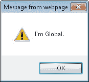

图 4-2。变量 `aNewVariable` 是全局作用域的。

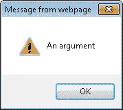

图 4-3。变量 `incomingBits` 局域于函数。

这里有一个更复杂的示例供你尝试。

### 检查变量作用域

1. 使用 Visual Studio、Eclipse 或编辑器，编辑 Chapter04 示例文件文件夹中的 `scoping.htm` 文件。

2. 在页面中，将 TODO 注释替换为此处显示的**粗体代码**（新代码可以在配套内容的 `scoping.txt` 文件中找到）：

```html
<!DOCTYPE HTML PUBLIC "-//W3C//DTD HTML 4.01//EN"
"http://www.w3.org/TR/html4/strict.dtd">
<html>
<head>
    <title>Scoping Example</title>
    <script type="text/javascript">
    var aNewVariable = "is global.";
    function doSomething(incomingBits) {
        alert("Global variable within the function: " + aNewVariable);
        alert("Local variable within the function: " + incomingBits);
    }
    </script>
</head>
<body>
    <script type="text/javascript">
        doSomething("is a local variable");
        alert("Global var outside the function: " + aNewVariable);
        alert("Local var outside the function: " + incomingBits);

    </script>
</body>
</html>
```

结果是屏幕上出现了三个警告框。

第一个警告框是：

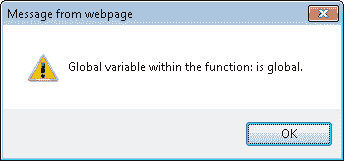

第二个警告框是：

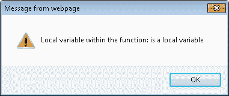

第三个警告框看起来是：

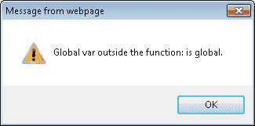

但等一下——检查代码。你看到了多少次对 `alert()` 函数的调用？提示：两个在 `<head>` 部分，另外两个在 `<body>` 部分，总共四次对 `alert()` 函数的调用。那么，为什么在脚本中调用了四次 `alert()` 函数，屏幕上却只显示三个警告框呢？

因为这是一个关于变量作用域的章节（我已经解释了答案），你可能已经想出来了。但这个例子很好地演示了当结果不符合预期时如何排查 JavaScript 问题。

接下来的步骤需要使用 Mozilla Firefox 浏览器的 Firebug 插件。作为一名 Web 开发者，我假设你已经安装了 Firefox（关于你应该安装它的原因请参见第 1 章）。如果你还没有 Firefox，请从 [`www.mozilla.com/firefox/`](http://www.mozilla.com/firefox/) 下载。

### 安装 Firebug

第一个步骤将引导你如何在 Firefox 中安装 Firebug。尽管 Internet Explorer 有脚本调试器，你也可以使用 Microsoft 脚本调试器，但 Firebug 要强大且灵活得多。

1. 在安装了 Firefox 的情况下，是时候获取 Firebug 插件了。访问 [`www.getfirebug.com/`](http://www.getfirebug.com/) 完成任务。进入网站后，点击安装链接。（如果你是第一次安装 Firebug，可能会收到警告，提示 Firefox 已阻止该网站安装软件。较新版本的 Firefox 不显示此警告。）

2. 点击安装链接后，会弹出软件安装对话框，如图所示。点击立即安装。

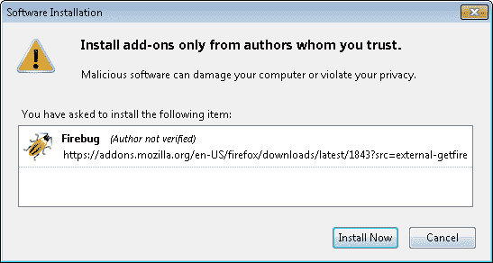

3. 扩展程序对话框打开（如图所示），Firebug 插件开始下载。下载完成后需要重启 Firefox，因此点击重启 Firefox。

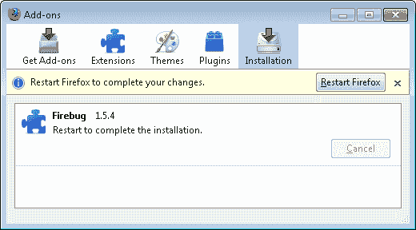

4. Firefox 关闭并重新打开，显示已安装的插件。如果打开了扩展对话框，请将其关闭。恭喜！Firebug 已安装。注意 Firefox 浏览器窗口右下角有一个图标。点击此图标打开 Firebug 台：


5. Firebug 处于禁用状态，但别担心——下一个步骤将引导你启用并使用它。你可以通过针对该网站或所有网站来实验 Firebug。

安装 Firebug 后，你可以排查之前在作用域示例中遇到的只显示了四个预期警告之一的问题。

### 使用 Firebug 排查

1. 打开 Firefox 并选择本章之前创建的 `scoping.htm` 示例。JavaScript 代码再次像之前一样执行，显示三个警告。关闭所有三个警告。你在 Firefox 中加载了一个空白页面。

2. 点击 Firefox 浏览器窗口右下角的 Firebug 图标以打开 Firebug。

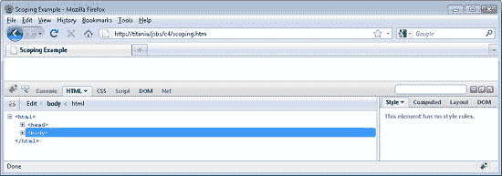

3. 点击 Script 标签打开 Script 面板，并注意它是禁用的。你希望启用 Console 面板以便获取错误。Script 面板在 Console 面板激活时会被激活，因此启用 Console 面板。点击 Console 标签，点击 Console 旁边的箭头/三角形，然后点击开启。你可以看到 JavaScript 调试器也已激活：

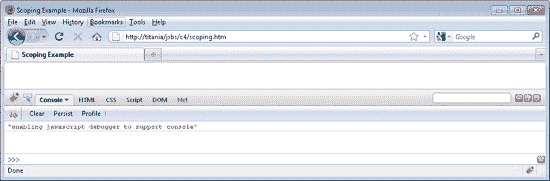

4. 在开启 Console 和 Script 面板的情况下，点击 Firefox 主工具栏上的重新加载按钮或从查看菜单中选择重新加载。页面重新加载，JavaScript 再次执行。三个警告框再次显示，但现在注意 Firebug 发现了一个错误，如状态栏右下角的红色 X 和 1 个错误指示所示，正如图所示：

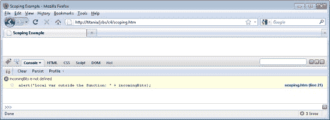

5. 如果控制台（Console）面板未打开，点击窗口中 Firebug 部分的 Console 选项卡以显示错误，该错误是变量 `incomingBits` 未定义。此窗口还显示了发生问题的行号。但请注意，由于文档解析方式，你原始源代码中的行号并不总是准确的。尽管如此，你仍然可以看到 `incomingBits` 在网页的 `<body>` 内部没有定义，因为它的作用域限于 `doSomething()` 函数。

此过程不仅演示了 Firebug 的用法，还演示了变量局部作用域与全局作用域的影响。Firebug 是 JavaScript（以及网页）调试不可缺的一部分。我邀请你花些时间在任何网站上使用 Firebug，看看 JavaScript、CSS 和 HTML 是如何相互作用的。

在此过程中，修复方法是定义变量 `incomingBits`，使其在函数调用之外实例化。（这行新代码紧随其后，位于辅助内容中 `Chapter04` 文件夹下的 `scoping-fixed.htm` 文件。）由于该变量仅作为函数定义的一部分定义的，因此该变量在函数作用域之外不存在。

```html
<!DOCTYPE HTML PUBLIC "-//W3C//DTD HTML 4.01//EN"
"http://www.w3.org/TR/html4/strict.dtd">
<html>
<head>
    <title>Scoping Example</title>
    <script type="text/javascript">
    var aNewVariable = "is global.";
    function doSomething(incomingBits) {
        alert("Global variable within the function: " + aNewVariable);
        alert("Local variable within the function: " + incomingBits);
    }

    </script>

</head>
<body>
<script type="text/javascript">
    var incomingBits = " must be defined if necessary.";
    doSomething("is a local variable");
    alert("Global var outside the function: " + aNewVariable);
    alert("Local var outside the function: " + incomingBits);

</script>
</body>

</html>
```

你可以在第 7 章 中找到更多关于函数的信息。

## Date 对象

`Date` 对象包含了许多在 JavaScript 中处理日期时非常有用的方法——事实上，方法多到在像这样的初级书籍中无法进行深入研究——但我向你展示了一些你可能会整合到项目中的示例。

JavaScript 中 `Date` 对象的一个不幸之处是，其方法的实现很大程度上取决于浏览器和操作系统系统。例如，考虑以下代码，它可以返回当前时间的日期，并根据本地时区进行调整，同时通过 `toLocaleDateString()` 方法自动格式化：

```javascript
var myDate = new Date();
alert(myDate.toLocaleDateString());
```

在运行 Windows 7 的计算机上的 Internet Explorer 8 中运行时，代码生成的日期如图 4-4 方法。")所示。


图 4-4。Internet Explorer 8 中 Date 对象的 `toLocaleString()` 方法。

图 4-5 方法在 Linux 版 Firefox 上显示不同的消息。") 显示了当相同代码在 Linux 上的 Firefox 3.6 中执行时发生的情况。

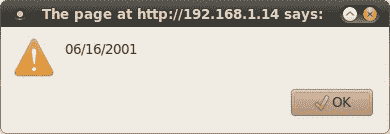

图 4-5。Linux 版 Firefox 上 Date 对象的 `toLocateString()` 方法显示不同的消息。

这两个对话框之间的差异可能看起来是微不足道的，但如果你期望在代码中使用星期（示例中的周一），你将会大吃一惊。而且，不要被误导，认为这些实现问题仅仅是跨操作系统的问题。`Date` 对象及其方法的实现差异在运行微软 Windows 产品的浏览器中也存在。

`Date` 对象的 `getYear()` 方法提供了 JavaScript 实现存在不一的另一个例子，这次是运行相同版本 Windows 7 的两台计算机之间的差异。考虑这段代码：

```javascript
var myDate = new Date();
alert(myDate.getYear());
```

在 Internet Explorer 8 中调用时，此代码产生的输出如图 4-6 方法的输出显示完整年份。")所示。

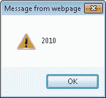

图 4-6。Internet Explorer 8 中 `getYear()` 方法的输出显示完整年份。

在运行 Windows 的计算机上的 Firefox 3.6 中调用时，代码产生的输出如图 4-7 方法的输出显示为完整年份。")所示。


图 4-7。Firefox 中 `getYear()` 方法的输出显示为完整年份。

幸运的是，这种实现差异有一个简单的解决方法。ECMA-262 规范提供了 `getFullYear()` 方法，它返回完整年份——示例中为 2010。

解决应用程序中这些或其他差异的唯一方法是进行跨浏览器跨平台的测试。这样做会增加开发周期，但在开发过程中发现问题的成本比用户发现问题要低得多。

## 什么日期？

注意图 4-4 方法。")和图 4-5 方法在 Linux 版 Firefox 上显示不同的消息。")中的日期：2001 年 6 月 16 日，星期六。你可能会怀疑这本书是否是在 2001 年写的。并不是。但使用之前的年份说明了 JavaScript 和日期之间的问题。任何 JavaScript 函数返回的日期反映了执行 JavaScript 的计算机上的日期。

我恰好将我的计算机日期更改为了 2001 年 6 月 16 日以说明这一点。（顺便提一下，2001 年 6 月 16 日是我的结婚日，现在如果我忘记了，我有一个方便的地方可以作为参考。当然，我永远不会忘记……）

`Date` 对象可以接收从零个到七个不等的参数。当 `Date` 对象构造函数传递单个字符串参数时，该字符串被假设包含日期。当传递数字类型参数时，该参数被假设是自 1970 年 1 月 1 日以来的毫秒数，当传递七个参数时，它们被假设为：

```javascript
new Date(year, month, day, hours, minutes, seconds, milliseconds)
```

### 注意

只有 `year` 和 `month` 是必需参数；其他是可选的。

在使用 `Date` 对象的任何方法时，请记住以下几点：

- 年份应用四位数表示，除非你想指定 1900 年到 2000 年之间的年份，在这种情况下，你只需要发送 0 到 99 之间的两位年份，它会被加上 1900。因此，2008 等于 2008 年，而 98 则会被转换为 1998 年。
- 月份由 0 到 11 之间的整数表示，0 代表 1 月，11 代表 12 月。
- 日期是 1 到 31 之间的整数。
- 小时由 0 到 23 表示，其中 23 代表晚上 11 点。
- 分钟和秒都是 0 到 59 之间的整数。
- 毫秒是 0 到 999 之间的整数。

虽然下面的步骤使用了一些在后续章节才会介绍的内容，但你现在正在查看 `Date` 对象，所以现在是学习如何将日期和时间写入网页的好时——这是一项常用的操作。

### 将日期和时间写入网页

1. 使用 Visual Studio、Eclipse 或或其他编辑器，编辑配套内容第 04 章示例文件文件夹中的 `writingthedate.htm` 文件。

2. 在页面中，添加此处所示的粗体代码：

```html
<!DOCTYPE HTML PUBLIC "-//W3C//DTD HTML 4.01//EN"
"http://www.w3.org/TR/html4/strict.dtd">
<html>
<head>
    <title>the date</title>
</head>
<body>
    <p id="dateField">&nbsp;</p>
    <script type="text/javascript">

    var myDate = new Date();
    var dateString = myDate.toLocaleDateString() + " " + myDate.toLocaleTimeString();
    var dateLoc = document.getElementById("dateField");
    dateLoc.innerHTML = "Hello - Page Rendered on " + dateString;
    </script>

</body>
</html>
```

3. 保存并在网页浏览器中查看，你应该得到这样的页面（尽管你看到的日期与此处显示的不同）：

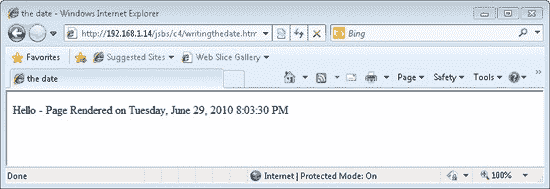

上步骤中相关的 JavaScript 代码在此重复出现：


```javascript
var myDate = new Date();
var dateString = myDate.toLocaleDateString() + " " + myDate.toLocaleTimeString();
var dateLoc = document.getElementById("dateField");
dateLoc.innerHTML = "Hello - Page Rendered on " + dateString;
```

与 `Date` 对象相关的 JavaScript 非常简单。它利用了你已经见过的 `toLocaleDateString()` 方法以及它的同类方法 `toLocaleTimeString()`，后者返回本地时间。这两个方法通过一个空格连接在一起，并放入 `dateString` 变量中，如下：

```javascript
var dateString = myDate.toLocaleDateString() + " " + myDate.toLocaleTimeString();
```

代码其余部分是将 `dateString` 变量的内容写入网页。关于 JavaScript 这一方面的更多信息请参阅 第 10 章。

### 为未来的某个特定日期倒计时

1. 使用 Visual Studio、Eclipse 或其他编辑器，编辑配套内容第 04 章示例文件文件夹中的 `countdown.htm` 文件。

2. 在页面中添加此处所示的粗体代码：

```html
<!DOCTYPE HTML PUBLIC "-//W3C//DTD HTML 4.01//EN"
"http://www.w3.org/TR/html4/strict.dtd">
<html>
<head>
     <title>the date</title>
</head>
<body>
    <p id="dateField">&nbsp;</p>
    <script type="text/javascript">
    var today = new Date();
    var then = new Date();
    // 2012 年 1 月 1 日
    then.setFullYear(2012,0,1);
    var diff = then.getTime() - today.getTime();
    diff = Math.floor(diff / (1000 * 60 * 60 * 24));
    var dateLoc = document.getElementById("dateField");
    dateLoc.innerHTML = "There are " + diff + " days until 1/1/2012";
    </script>
</body>
</html>
```

3. 保存页面并在网页浏览器中查看。根据你计算机上的日期，表示的天数将有所不同，但页面的大致外观应该是这样的：

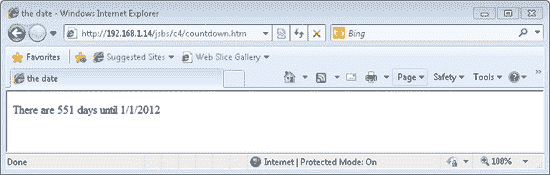

### 提示

在使用 JavaScript 日期进行显示以外的任何用途时要加小心。因为日期取决于访问者的时间，所以在准确时间可能重要的地方，不要依赖它们，例如在订单处理流程中。

你刚刚完成的练习使用了 `Math` 和 `Date` 对象的某些额外函数，即 `floor()` 和 `getTime()`。虽然这本书涵盖了大量内容，但它并不是完整的 JavaScript 语言参考书。要获取这及更多信息，请参阅 ECMA-262 标准：[`www.ecma-international.org/publications/standards/Ecma-262.htm`](http://www.ecma-international.org/publications/standards/Ecma-262.htm)。

下一个步骤将展示如何计算（或者更好的粗略估计）网页在人员浏览器中加载所需的时间。

### 注意

下一个步骤是不准确的，因为它没有考虑加载和渲染图像（或其他多媒体项目）所需的时间，这些是外部于网页文本的。在脚本运行结束后，还有一些位会加载。我在几个网站上见过用于计算日期的组件，你可能会发现它有用。

### 计算渲染时间

1. 使用 Visual Studio、Eclipse 或其他编辑器，编辑配套内容第 04 章示例文件文件夹中的 `render.htm` 文件。

2. 在页面中添加此处所示的粗体代码：

```html
<!DOCTYPE html PUBLIC "-//W3C//DTD XHTML 1.0 Transitional//EN"
"http://www.w3.org/TR/xhtml1/DTD/xhtml1-transitional.dtd">
<html>
<head>
    <title>the date</title>
    <script type="text/javascript">
    var started = new Date();
    var now = started.getTime();
    </script>
</head>
<body>
    <p id="dateField">&nbsp;</p>
    <script type="text/javascript">
    var bottom = new Date();
    var diff = (bottom.getTime() - now)/1000;
    var finaltime = diff.toPrecision(5);
    var dateLoc = document.getElementById("dateField");
    dateLoc.innerHTML = "Page rendered in " + finaltime + " seconds.";
    </script>
</body>
</html>
```

3. 保存页面并在网页浏览器中查看。根据你的计算机、Web 服务器和网络连接的速度，你可能会得到一个指示加载时间为 0 秒的页面，如下：

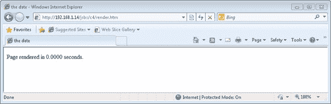

4. 如果你的页面耗时 0.0000 秒（像我的一样），你可以在页面中引入延迟以便进行测试。（不过，我不建议在实线网站上这样做，因为我想不出任何你想减慢页面渲染速度的原因！但引入延迟对于测试目的可能很有用。）使用 `for` 循环是减慢 JavaScript 执行的一种简单且方便的方法：

```javascript
for (var i = 0; i < 1000000; i++) {
   //delay
}
```

我选择的数值 1000000 是随意的。你可能需要选择更大或更小的数字来产生所需的延迟。最终代码看起来如下：

```html
<!DOCTYPE html PUBLIC "-//W3C//DTD XHTML 1.0 Transitional//EN"
"http://www.w3.org/TR/xhtml1/DTD/xhtml1-transitional.dtd">
<html xmlns="http://www.w3.org/1999/xhtml">
<head>
    <title>the date</title>
    <script type="text/javascript">
    var started = new Date();
    var now = started.getTime();
    for (var i = 0; i < 1000000; i++) {
       //delay
    }
    </script>
</head>
<body>
    <p id="dateField">&nbsp;</p>
    <script type="text/javascript">
    var bottom = new Date();
    var diff = (bottom.getTime() - now)/1000;
    var finaltime = diff.toPrecision(5);
    var dateLoc = document.getElementById("dateField");
    dateLoc.innerHTML = "Page rendered in " + finaltime + " seconds.";
    </script>
</body>
</html>
```

5. 保存页面并在 Web 浏览器中再次查看。你应该能看到页面加载时存在一些延迟，这导致结果为一个正数：


在使用此函数或类似函数确定页面加载时间时，为了计算出最准确的值，请将初始变量放在页面或脚本的顶部，然后在页面底部放置另一个变量。

需要注意的是，`Date()` 对象的 `now()` 方法也可以作为 `getTime()` 的替代方案。

你刚刚学习了 `Date` 对象的 40 多种方法中的几种。其中许多方法都有对应的 UTC（协调世界时）方法，这意味着它们可以以 UTC 格式获取或设置日期和时间，而不是本地时间。表 4-4 列出了返回日期的方法。除了 `getTime()` 和 `getTimezoneOffset()` 之外，所有这些方法都有对应的 UTC 方法，并使用 `getUTCDate()`、`getUTCDay()` 等格式进行调用。

表 4-4. Date 对象的 *get* 方法

| 方法 | 说明 |
| --- | --- |
| `getDate()` | 返回月份中的某一天 |
| `getDay()` | 返回星期几 |
| `getFullYear()` | 返回四位数的年份，在大多数情况下建议优于 `getYear()` 方法 |
| `getHours()` | 返回日期的小时 |
| `getMilliseconds()` | 返回日期的毫秒数 |
| `getMinutes()` | 返回日期的分钟 |
| `getMonth()` | 返回日期的月份 |
| `getSeconds()` | 返回日期的秒 |
| `getTime()` | 返回自 1970 年 1 月 1 日以来的毫秒数 |
| `getTimezoneOffset()` | 返回 UTC 与本地时间差计算出的分钟数 |

许多 `get...()` 方法都有以 `set` 为前缀的兄弟方法，如表 4-5 所示。和它们的 `get` 兄弟一样，大多数 `set...()` 方法都有对应的 UTC 方法，但 `setTime()` 除外。

表 4-5. Date 对象的 *set* 方法

| 方法 | 说明 |
| --- | --- |
| `setDate()` | 设置日期的月份中的某一天 |
| `setFullYear()` | 设置日期的四位数年份。也接受月份和日期的整数 |
| `setHours()` | 设置日期的小时 |
| `setMilliseconds()` | 设置日期的毫秒数 |
| `setMinutes()` | 设置日期的分钟 |
| `setMonth()` | 设置日期的月份整数 |
| `setSeconds()` | 设置日期的秒 |
| `setTime()` | 使用自 1970 年 1 月 1 日以来的毫秒数设置时间 |

`Date` 对象还具有几种方法可以将日期转换为不同格式的字符串。你已经复习了其中一些方法，例如 `toLocaleDateString()`。其他类似的方法包括 `toLocaleString()`、`toGMTString()`、`toLocaleTimeString()`、`toString()`、`toISOString()`、`toDateString()`、`toUTCString()` 和 `toTimeString()`。你可以随意尝试这些方法，请注意 `toISOString()` 是 ECMA-262 版本 5 规范中的新方法，所有浏览器可能都不支持它（它在大多数版本的 Internet Explorer 中明显缺失了）。下面的简单代码示例将帮助你开始尝试。尝试在浏览器的地址栏中输入它们：

```javascript
javascript:var myDate = new Date(); alert(myDate.toLocaleDateString());
javascript:var myDate = new Date(); alert(myDate.toLocaleString());
javascript:var myDate = new Date(); alert(myDate.toGMTString());
javascript:var myDate = new Date(); alert(myDate.toLocaleTimeString());
javascript:var myDate = new Date(); alert(myDate.toString());
javascript:var myDate = new Date(); alert(myDate.toISOString());
javascript:var myDate = new Date(); alert(myDate.toDateString());
javascript:var myDate = new Date(); alert(myDate.toUTCString());
javascript:var myDate = new Date(); alert(myDate.toTimeString());
```

你也可以在不创建 `myDate` 变量的情况下编写这些代码样本，如下：

```javascript
javascript: alert(new Date().toUTCString());
```

# 使用 RegExp 对象

*正则表达式* 是你用于匹配和操作字符串的语法。如果你在 Microsoft Windows 的命令提示符或 Linux/Unix 的 shell 中工作过，你可能尝试通过使用星号（`*`）字符匹配所有文件来查找文件，例如：

```bash
dir *.*
```

或：

```bash
dir *.txt
```

如果你使用过星号等通配符，你已经使用了类似于正则表达式的元素。事实上，星号也是正则表达式中使用的字符。

正则表达式通过 JavaScript 中的 `RegExp` 对象和正则表达式字面量，提供了一种处理文本或字母字符串的强大方式。ECMA-262 的正则表达式实现很大程度上借鉴了 Perl 5 正则表达式解析器。这里有一个匹配 JavaScript 单词的正则表达式：

```javascript
var myRegex = /JavaScript/;
```

所示的正则表达式将匹配出现在另一个字符串任何位置的 JavaScript 字符串。例如，该正则表达式将匹配句子“This is a book about JavaScript”，也会匹配字符串“ThisIsAJavaScriptBook”，但不会匹配“This is a book about javascript”，因为正则表达式是区分大小写的。（你可以更改这一点，稍后在本章后面部分看到。）

## 正则表达式的语法

由于字符串解析的原因，正则表达式具有简洁（某些人认为是晦涩的）的语法。但不要让简洁的语法将你远离正则表达式，因为力量正存在这种语法之中。例如，以下正则表达式查找数字，然后执行替换以通过分组重新格式化整个互联网协议（IP）地址块（格式为 192.168.0/24）。这个示例所做的与我们的讨论并不无关，只是为了展示一个更复杂的表达式示例。（如果你非要知道的话，它是在防火墙上解析亚太网络信息中心（APNIC）网络列表的 Perl 脚本的一部分。）

```perl
s/([0-9]+)\.([0-9]+)(\/[0-9]+)/$1\.$2\.0$3/;
```

相同的正则表达式可以使用 `String` 对象的 `replace` 方法在 JavaScript 中编写，如下所示：

```javascript
var theIP = "192.168.0/28";
alert(theIP.replace(/([0-9]+)\.([0-9]+)(\/[0-9]+)/,"$1\.$2\.0$3"));
```

正则表达式的语法包含了几个具有特殊含义的字符，包括将匹配锚用于字符串开头或结尾的字符、通配符和分组字符等。表 4-6 显示了几个特殊字符。

表 4-6. JavaScript 正则表达式中的常见特殊字符

| 字符 | 说明 |
| --- | --- |
| ^ | 将锚点设置到输入的开头 |
| $ | 将锚点设置在输入的末尾 |
| . | 匹配任意 `character` |
| * | 匹配上一个字符零或多次。将其视为一个通配符 |
| + | 匹配上一个字符一次或多次 |
| ? | 匹配上一个字符零次或一次 |
| ( ) | 将括号内的匹配项放入组中，供以后使用 |
| {n, } | 匹配上一个字符至少 n 次 |
| {n,m} | 匹配上一个字符至少 n 次但不超过 m 次 |
| [ ] | 定义一个字符类，以匹配括号内包含的任何字符。该字符可以使用如 0–9 这样的范围来匹配任何数字，或使用 a–z 来匹配任何字母 |
| [^ ] | 在字符类内部使用脱字符符号（^）会反转该字符类，意味着该类中的字符不能出现在匹配中 |
| \ | 通常用作转义字符，意味着反斜杠后的任何内容都被视为普通字符，而不是具有其特殊含义。也可用于定义特殊字符集，如表 4-7 所示 |

除了特殊字符外，还存在一些序列用于匹配字符组或非字母数字字符。其中一些序列显示在表 4-7 中。

### 表 4-7. JavaScript 正则表达式常用字符序列

| 字符 | 匹配 |
| --- | --- |
| \b | 单词边界 |
| \B | 非单词边界 |
| \c | 与另一个字符结合使用时的控制字符。例如，`\cA` 是 `Control-A` 的转义序列 |
| \d | 数字 |
| \D | 非数字 |
| \n | 换行 |
| \r | 回车 |
| \s | 单个空白字符，如空格或制表符 |
| \S | 单个非空白字符 |
| \t | 制表符 |
| \w | 任意字母数字字符，无论是数字还是字母 |
| \W | 任意非字母数字字符 |

除了表 4-7 中的字符外，你还可以使用两个修饰符 `i` 和 `g` 来指定正则表达式以忽略大小写的方式解析，并使正则表达式匹配在第一次匹配后继续，这有时被称为*全局的*或*贪婪*（因此使用 `g`）。

`RegExp` 对象有自己的方法，包括 `exec` 和 `test`，后者用于对字符串测试正则表达式，并根据正则表达式是否匹配该字符串返回 `true` 或 `false`。然而，在处理正则表达式时，使用 `String` 类型的原生方法（如 `match`、`search`、`replace` 等）同样常见。

`RegExp` 对象的 `exec()` 方法用于对字符串解析正则表达式并返回结果。例如，解析一个简单的 URL 并提取域名可能如下所示：

```javascript
var myString = "http://www.braingia.org";
var myRegex = /http:\/\/\w+\.(.*)/;
var results = myRegex.exec(myString);
alert(results[1]);
```

此代码的输出是一个显示地址中域名部分的警框，如图 4-8 所示。

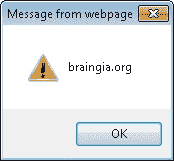

图 4-8. 使用正则表达式解析典型的 web URL。

对这段代码进行拆解会有帮助。首先是字符串声明：

```javascript
var myString = "http://www.braingia.org";
```

接下来是正则表达式的声明，然后是调用 `exec()` 方法，该方法对 `myString` 中找到的字符串解析正则表达式，并将结果放入名为 `results` 的变量中。

```javascript
var myRegex = /http:\/\/\w+\.(.*)/;
var results = myRegex.exec(myString);
```

正则表达式包含几个重要元素。它首先查找字面字符串 `http:`。后面紧跟两个正斜杠，但由于正斜杠（`/`）是正则表达式中的特殊字符，你必须使用反斜杠（`\`）对其进行转义，使得正则表达式变为 `http:\/\/*`。

正则表达式的下一部分 `\w` 查找任意单个字母数字字符。网络地址通常是 `www`，所以不要误认为该表达式正在寻找三个字面上的 w——在这个示例中，主机名可以被称为 `web`、`host1`、`myhost` 或 `www`，如你正在查看的代码所示。因为 `\w` 匹配任意单个字符，而网络主机通常匹配任意单个字符，因此示例中的主机是灵活的。

如果没有找到匹配项，`search` 方法将返回 `-1`。

`replace` 方法的作用正如其名称所示——当找到匹配项时，它会将一个字符串替换为另一个字符串。假设在电子邮件地址的示例中，我想将任何 .com 邮箱地址更改为 .net 邮箱地址。你可以通过 `replace` 方法来实现这一点，如下所示：

```javascript
var emailAddr = "suehring@braingia.com";
var myRegex = /\.com$/;
var replaceWith = ".net";
var result = emailAddr.replace(myRegex,replaceWith);
alert(result); //返回 suehring@braingia.net
```

如果模式不匹配，则将原始字符串赋给 `result` 变量中；如果匹配，则返回新值。

### 注意

你可以使用几个特殊字符来帮助进行替换。有关这些方法的更多信息，请参阅 ECMA-262 规范。

后续章节将展示更多与正则表达式相关的 `string` 方法的示例。你可以随时将本章作为正则表达式中所用特殊字符的参考。

## 引用与垃圾收集

某些类型的变量或它们包含的值是原始类型，而另一些是引用类型。这种影响初看之下可能对你没有意义——你可能甚至不会认为自己会关心这个。但当你第一次遇到刚复制的变量出现奇异行为时，你会改变主意的。

首先，是一些解释：对象、数组和函数作为`引用类型`工作，而数字、`Booleans`、`null` 和 `undefined` 被称为`原始类型`。根据 ECMA-262 规范，其他原始类型，如 `Numbers` 和 `Strings`，但 `Strings` 与此讨论不相关。

当数字被复制时，其行为正如你预期的：原始值和副本都获得相同的值。然而，如果你更改了原始值，副本将不受影响。这里有一个示例：

```javascript
// 将 myNum 的值设置为 20。
var myNum = 20;
// 创建一个新变量 anotherNum，并将 myNum 的内容复制到它。
// 现在 anotherNum 和 myNum 都是 20。
var anotherNum = myNum;
// 将 myNum 的值设置为 1000。
myNum = 1000;
// 显示两个变量的内容。
// 注意，anotherNum 的内容没有变化。
alert(myNum);
alert(anotherNum);
```

alert 分别显示 `1000` 和 `20`。一旦变量 `anotherNum` 获得了 `myNum` 内容的副本，无论之后变量 `myNum` 发生了什么，它都会保留该内容。变量这样做是因为数字在 JavaScript 中是原始类型。

将该示例与引用类型的变量类型进行对比，如下例：

```javascript
// 在名为 myNumbers 的变量中创建一个包含三个数字的数组。
var myNumbers = [20, 21, 22];
// 在新建的变量 copyNumbers 中创建 myNumbers 的副本。
var copyNumbers = myNumbers;
// 将 myNumbers 的第一个索引值改为整数 1000。
myNumbers[0] = 1000;
// 两个。
alert(myNumbers);
alert(copyNumbers);
```

在这种情况下，由于数组是引用类型，两个 alert 都显示了 `1000,21,22`，尽管代码中只修改了 `myNumbers`。这个故事的道理是，要意识到对象、数组和函数变量类型是引用类型，因此对原始值的任何更改都会影响所有副本。

与这个关于原始类型和引用类型差异的讨论松散相关的是垃圾收集主题。`垃圾收集`指的是 JavaScript 解释器销毁未使用的变量以节省内存。当变量在程序中不再被使用时，解释器会释放内存供重用。如果你使用 Java 虚拟机或 .NET 通用运行时，它也会为你执行此操作。

JavaScript 中这种自动释放内存与 C++ 等其他语言处理未使用变量的方式不同。在那些语言中，程序员必须手动执行垃圾收集任务。这就是你关于垃圾收集真正需要知道的全部内容。

# 学习类型转换

在结束对数据类型和变量的讨论之前，你应该了解一些`类型转换`，或者说在数据类型之间转换。JavaScript 通常会为你执行隐式类型转换，但在许多情况下，你可以显式地强制转换，或将变量从一种类型转换为另一种类型。

## 数字转换

你已经在本章早前的 JavaScript 中的数据类型 节讨论的示例中，看到了两种数字格式（十六进制到 10 进制）之间的转换。然而，你也可以将数字转换为字符串。当数字在字符串上下文中使用时，JavaScript 会隐式将数字转换为字符串。

要显式地将数字转换为字符串，可以将数字强制转换为字符串，如下例所示：

```javascript
// 将 myNumString 转换为值为 100 的字符串
String(100)
```

## 字符串转换

正如你看到的两种数字格式之间的转换，你也可以将字符串转换为数字。通过将字符串强制转换为数字来实现。（这些示例可以在配套文件中找到。）

```javascript
var myNumString = "100";
Number(myNumString);
```

### 提示

JavaScript 在数值上下文中会自动将这些字符串转换为数字。然而，在实践中，我通常将其转换为数字，比让其具有不确定性要好。

## 布尔值转换

布尔值在数值上下文中会自动转换为数字。`true` 变为 `1`，`false` 变为 `0`。在字符串上下文中，`true` 变为“true”，`false` 变为“false”。如果你需要显式地将数字或字符串转换为布尔值，可以使用 `Boolean()` 函数。

# 练习

| 1. | 声明三个变量——一个数字和两个字符串。数字应该是 `120`，字符串应该是“5150”和“Two Thirty”。 |
| 2. | 创建包含三个数字和两个字符串或单词的数组。 |
| 3. | 使用 `alert()` 函数显示以下字符串，注意转义：Steve’s response was “Cool!”. |
| 4. | 使用 Firebug 检查你喜欢的三个网站。仔细观察 Firebug 报告的错误。额外：使用 Internet Explorer 查看这三个网站并使用 Internet Explorer 工具调试错误。 |

# 第 5 章 使用运算符和表达式

**阅读本章后，你将能够：**

* 理解 JavaScript 可用的运算符。
* 使用 JavaScript 运算符进行数学运算、等性测试、关系测试和赋值。
* 使用 `void` 运算符通过链接打开新窗口。

## 运算符

ECMA-262 规范定义了各种形式的运算符。这些包括：

* 加运算符
* 乘运算符
* 位运算符
* 等等运算符
* 关系运算符
* 一元运算符
* 赋值运算符

运算符既可以用于字面量（例如用于数字 10），也可以用于 JavaScript 中的变量和其他对象。

## 加运算符

`加运算符` 术语包括加法运算符，这听起来真的像是个误名。但正如我五年级的数学老师提醒我的那样，减法只是带负数的加法。正如你可能猜的那样，加法和减法的运算符分别是 `+` 和 `–`。以下是它们用法的一些示例。

```javascript
4 + 5;  // 结果为 9。
x + y;  // 将 x 和 y 相加。
5 - 1;  // 结果为 4。
```

加法运算符的操作方式取决于相加值的类型。当相加两个字符串时，加法运算符会将左侧和右侧的参数连接在一起。当相加的类型不同时，你可能会得到奇怪的结果，因为 JavaScript 在执行加法（或任何数学运算）之前必须转换其中一种类型。例如，当你认为你有一个数字变量，但 JavaScript 解释器认为你有一个字符串时，你将无法得到预期的结果。以下是一些具体的示例：

```javascript
var aNum = 947;
var aStr= "Rush";
var anotherNum = 53;
var aStrNum = "43";
var result1 = aNum + aStr;  // result1 将是字符串 "947Rush";
var result2 = aNum + anotherNum;  // result2 将是数字 1000;
var result3 = aNum + aStrNum;  // result3 将是 94743;
```

正如第 4 章 中过的，在很多情况下，你可以在 JavaScript 中显式地将一种类型转换为另一种。看看上一个示例中的变量 `result3`。你可能希望 `result3` 存储数学表达式 `947+43` 的结果。但由于由 `aStrNum` 表示第二个值是字符串，该表达式会连接这两个值，而不是作为数字相加。然而，使用 `ToNumber()` 函数可以将 `aStrNum` 转换为数字，这样你就可以在数学表达式（如加法）中按预期使用它。以下是相关的代码，已修正为你可能想要的功能：

```javascript
var aNum = 947;
var aStrNum = ToNumber("43");
var result3 = aNum + aStrNum;  // result3 将是 990;
```

# 乘法运算符

与加法运算符一样，乘法运算符的行为正如你预期那样；它们执行乘法和除法。乘法运算符（`*`）将两个数字相乘，而除法运算符（`/`）则将数字相除。这里有一个乘法示例及其输出：

```javascript
javascript:alert(2 * 2);
```

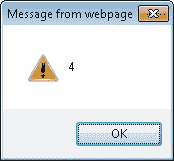

乘法运算符包括模运算符，它由百分号（`%`）表示。模运算符产生两个数字除法的余数。例如，4 除以 3 的模是 1，如下段代码所示。

### 注意

这些示例可以在配套内容的文件的 `multiplicativeops.txt` 文件中找到。

```javascript
javascript:alert(4 % 3);
```

结果显示在这里：

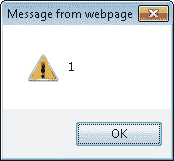

# 位运算符

位运算符包括**逻辑与 (AND)**、**逻辑或 (OR)**、**异或 (XOR)**、**非 (NOT)**、**左移 (Shift Left)**、**符号右移 (Shift Right With Sign)** 和**零填充右移 (Shift Right With Zero Fill)**。每个运算符由一个或多个字符表示，如表 5-1 所示。

表 5-1. 位运算符

| 运算符 | 含义 |
| --- | --- |
| & | AND |
| &#124; | OR |
| ^ | XOR |
| ~ | NOT |
| << | 左移 |
| >> | 符号右移 |
| >>> | 零填充右移 |

位运算符的深度涵盖出了本书的范围，尽管我在后面的章节中提到了它们。你可以在 ECMA-262 规范中找到更多关于位运算符的信息。

# 等价运算符

你使用等价运算符来测试两个表达式是否相同或不同。这些运算符始终返回布尔类型：`true` 或 `false`。表 5-2 列出了 JavaScript 的等价运算符。

表 5-2. 等价运算符

| 运算符 | 含义 |
| --- | --- |
| == | 等于 |
| != | 不等于 |
| === | 使用更严格的方法相等 |
| !== | 使用更严格的方法不等于 |

如你从表 5-2 所示，你可以通过两种不同的方式来测试等价和不相等。这些方法在严格性上有所不同——即它们在判断两个值是否真正相等时所要求的等价程度不同。两者中更严格的（用三连等号（`===`）表示）不仅要求给定表达式的值相等，还要求类型完全相同。严格测试将确定值为“42”的字符串不等于值为 `42` 的数字，而较不严格的等价测试则会发现它们是相等的。接下来的示例有助于理解这一点。

## 测试等价运算符

1. 使用 Microsoft Visual Studio、Eclipse 或另一个编辑器，编辑配套内容中 Chapter05 示例文件夹中的 `equality.htm` 文件。

2. 在网页中，将 TO DO 注释替换为此处显示的粗体代码。（在网页中，代码如下所示）

```html
<!DOCTYPE html>
<html>
<head>
    <title>Equality</title>
    <script>
        var x = 42;
        var y = "42";
        if (x == y) {
            alert("x is equal to y");
        } else {
            alert("x is not equal to y");
        }
    </script>
</head>
<body>
</body>
</html>
```


加法运算符的操作方式取决于相加值的类型。当相加两个字符串时，加法运算符会将左侧和右侧的参数连接在一起。当相加的类型不同时，你可能会得到奇怪的结果，因为 JavaScript 在执行加法（或任何数学运算）之前必须转换其中一种类型。例如，当你认为你有一个数字变量，但 JavaScript 解释器认为你有一个字符串时，你将无法得到预期的结果。以下是一些具体的示例：

```
var aNum = 947;
var aStr = "Rush";
var anotherNum = 53;
var aStrNum = "43";
var result1 = aNum + aStr;  // result1 将是字符串 "947Rush";
var result2 = aNum + anotherNum;  // result2 将是数字 1000;
var result3 = aNum + aStrNum;  // result3 将是 94743;
```

正如第 4 章所述，在很多情况下，你可以在 JavaScript 中显式地将一种类型转换为另一种。看看上一个示例中的变量 `result3`。你可能希望 `result3` 存储数学表达式 `947+43` 的结果。但由于由 `aStrNum` 表示第二个值是字符串，该表达式会连接这两个值，而不是作为数字相加。然而，使用 `ToNumber()` 函数可以将 `aStrNum` 转换为数字，这样你就可以在数学表达式（如加法）中按预期使用它。以下是相关的代码，已修正为你可能想要的功能：

```
var aNum = 947;
var aStrNum = ToNumber("43");
var result3 = aNum + aStrNum;  // result3 将是 990;
```

# 乘法运算符

与加法运算符一样，乘法运算符的行为正如你预期那样；它们执行乘法和除法。乘法运算符（`*`）将两个数字相乘，而除法运算符（`/`）则将数字相除。这里有一个乘法示例及其输出：

```
javascript:alert(2 * 2);
```


乘法运算符包括模运算符，它由百分号（`%`）表示。模运算符产生两个数字除法的余数。例如，4 除以 3 的模是 1，如下段代码所示。

### 注意

这些示例可以在配套内容的文件的 `multiplicativeops.txt` 文件中找到。

```
javascript:alert(4 % 3);
```

结果显示在这里：


# 位运算符

位运算符包括**逻辑与 (AND)**、**逻辑或 (OR)**、**异或 (XOR)**、**非 (NOT)**、**左移 (Shift Left)**、**符号右移 (Shift Right With Sign)** 和**零填充右移 (Shift Right With Zero Fill)**。每个运算符由一个或多个字符表示，如表 5-1 所示。

表 5-1. 位运算符

| 运算符 | 含义 |
| --- | --- |
| `&` | AND |
| `|` | OR |
| `^` | XOR |
| `~` | NOT |
| `<<` | 左移 |
| `>>` | 符号右移 |
| `>>>` | 零填充右移 |

位运算符的深度涵盖超出了本书的范围，尽管我在后面的章节中提到了它们。你可以在 ECMA-262 规范中找到更多关于位运算符的信息。

# 等价运算符

你使用等价运算符来测试两个表达式是否相同或不同。这些运算符始终返回布尔类型：`true` 或 `false`。表 5-2 列出了 JavaScript 的等价运算符。

表 5-2. 等价运算符

| 运算符 | 含义 |
| --- | --- |
| `==` | 等于 |
| `!=` | 不等于 |
| `===` | 使用更严格的方法相等 |
| `!==` | 使用更严格的方法不等于 |

如你从表 5-2 所示，你可以通过两种不同的方式来测试等价和不相等。这些方法在严格性上有所不同——即它们在判断两个值是否真正相等时所要求的等价程度不同。两者中更严格的（用三连等号（`===`）表示）不仅要求给定表达式的值相等，还要求类型完全相同。严格测试将确定值为“42”的字符串不等于值为 `42` 的数字，而较不严格的等价测试则会发现它们是相等的。接下来的示例有助于理解这一点。

## 测试等价运算符

1. 使用 Microsoft Visual Studio、Eclipse 或另一个编辑器，编辑配套内容中 Chapter05 示例文件夹中的 `equality.htm` 文件。

2. 在网页中，将 TO DO 注释替换为此处显示的代码。

```html
<!DOCTYPE html>
<html>
<head>
    <title>Equality</title>
    <script>
        var x = 42;
        var y = "42";
        if (x == y) {
            alert("x is equal to y");
        } else {
            alert("x is not equal to y");
        }
    </script>
</head>
<body>
</body>
</html>
```

# 关系运算符

关系运算符测试两个表达式之间的关系，例如“小于”、“大于”等。表 5-3 列出了 JavaScript 的关系运算符。

表 5-3. 关系运算符

| 运算符 | 含义 |
| --- | --- |
| `<` | 小于 |
| `>` | 大于 |
| `<=` | 小于或等于 |
| `>=` | 大于或等于 |
| `in` | 在对象中 |
| `instanceof` | 是对象的实例 |

你可能熟悉表 5-3 中的前四个关系运算符，但这里仍然提供一些快速示例。请查看以下代码，你可以在配套内容的 `relational.txt` 文件中找到它：

```
if (3 > 4) {
    // do something
}
```

整数 `3` 永远不会大于整数 `4`，因此这段代码永远不会评估为 `true`，`if` 块中的代码永远不会被执行。同样，下面的代码测试了变量 `x` 是否小于 `y`：

```
if (x < y) {
    // do something
}
```

## `in` 运算符

`in` 运算符最常用于评估给定属性是否包含在对象中。请注意，`in` 运算符搜索的是属性是否存在，而不是该属性的值。因此，以下代码（你可以在配套内容的 `inop.txt` 文件中找到它）可以工作，因为 `myObj` 对象中包含一个名为“star”的属性：

```
var myObj = {
    star: "Algol",
    constellation: "Perseus"
};

if ("star" in myObj) {
    alert("There is a property called star in this object");
}
```

`in` 运算符通常用于遍历对象。你可以在第 8 章中看到这种用法示例。

## `instanceof` 运算符

`instanceof` 运算符测试给定表达式（通常是变量）是否为语句中包含对象的实例。是的，这听起来很别扭。与其继续费力解释它，我将直接跳到示例，之后一切都会迎刃而解：

```
var myDate = new Date();
if (myDate instanceof Date) {
    //do something
}
```

由于变量 `myDate` 是内置 `Date` 对象的实例，`instanceof` 评估返回 `true`。如上一个示例所示，`instanceof` 运算符不仅影响用户定义对象，也影响内置对象。

# 一元运算符

在 JavaScript 中，一元运算符具有单个操作数，或者与单个表达式工作。表 5-4 列出了 JavaScript 一元运算符。

表 5-4. 一元运算符

| 运算符 | 含义 |
| --- | --- |
| `delete` | 删除属性 |
| `void` | 返回 undefined |
| `typeof` | 返回表示数据类型的字符串 |
| `++` | 数字递增 |
| `--` | 数字递减 |
| `+` | 将操作数转换为数字 |
| `-` | 取反操作数 |
| `~` | 按位非 |
| `!` | 逻辑非 |

由于使用一元运算符的方法并不直观，我在本章对它们进行了更详细的解释。

## 递增与递减

如下代码所示，你使用 `++` 和 `--` 运算符分别对数字进行递增和递减（你可以在配套代码的 `incrementing.txt` 文件中找到此代码）：

```
var aNum = 4;
aNum++;
++aNum;
```

运算符相对于操作数的位置决定了代码返回的值。当附加在变量之后时（称为*后置*），如上一个示例代码的第二行所示，运算符返回递增（或递减，取决于情况）*之前*的值。当前置时，如上一个示例代码的最后一行所示，运算符返回递增（或递减）*之后*的值。

这里有几个展示代码中前置和后置区别的示例。第一个示例是后置的：

```
var aNum = 4;
var y = aNum++;  // y 现在的值是 4，但 aNum 随后变为 5
```

第二个示例是前置的：

```
var aNum = 4;
var y = ++aNum;  // y 现在的值是 5，aNum 也是
```

在实践中，你使用后置递增运算符的频率高于前置递增运算符或递减运算符，因为它是循环结构中方便的计数器。你将在第 6 章中学习 JavaScript 中的循环。

## 使用加号转换为数字

加号 `+` 应该用于将值转换为数字。但在实践中，我发现它有些不可靠——或者至少不足以用于生产代码。当我需要将某些内容转换为数字时，我会显式地使用 `ToNumber()` 函数。不过，你可以将加号作为一元运算符尝试转换，如下所示（配套代码的 `converting.txt` 文件中也有显示）：

```
var x = +"43";
```

这段代码导致 JavaScript 将字符串“43”转换为数字，并将数值 43 存储在变量 `x` 中。

## 使用减号创建负数

当你在数字前面使用减号 `-` 时，数字会变为负数，这可能并不意外，如下代码所示（在 `creating.txt` 中）：

```
var y = "754";
var negat = -y;
```

## 使用按位非和逻辑非取反

波浪号 `~` 是按位非，感叹号 `!` 是逻辑非。这些运算符会取反它们对应的对象。对于表达式的情况下，逻辑非在 JavaScript 编程中非常常用。如果表达式为 `true`，逻辑非会将其变为 `false`。关于按位操作的更多信息，请参见[`en.wikipedia.org/wiki/Bitwise_operation`](https://en.wikipedia.org/wiki/Bitwise_operation)。

## 使用 `delete` 运算符

`delete` 运算符接收对象的属性或数组的索引并将其删除，或者使其变为 `undefined`。这里有一个简单的数组示例：

```
var myArray = ["The RCMP", "The Police", "State Patrol"];
delete myArray[0]; // myArray 现在包含 "The Police" 和 "State Patrol"
```

前面的代码创建了数组 `myArray`，然后删除了第一个索引。如例所示，`delete` 运算符也适用于对象。

### 在对象上使用 delete

1. 使用 Visual Studio、Eclipse 或编辑器编辑 Chapter05 文件夹下的 `deleteop.htm` 文件。
2. 创建一个后续使用 `delete` 运算符的基础页面。在页面中，将 TODO 注释替换为下面的代码（代码也可以在配套内容的 `deleteop.txt` 文件中找到）。

```html
<!DOCTYPE HTML PUBLIC "-//W3C//DTD HTML 4.01//EN"
"http://www.w3.org/TR/html4/strict.dtd">
<html>
<head>
    <title>The Delete Operator</title>
    <script type="text/javascript">
        var star = {};
        star["Polaris"] = new Object();
        star["Mizar"] = new Object();
        star["Aldebaran"] = new Object();
        star["Rigel"] = new Object();
        star["Polaris"].constellation = "Ursa Minor";
        star["Mizar"].constellation = "Ursa Major";
        star["Aldebaran"].constellation = "Taurus";
        star["Rigel"].constellation = "Orion";
    </script>
</head>
<body id="mainbody">
    <script type="text/javascript">
        for (starName in star) {
            var para = document.createElement('p');
            para.id = starName;
            para.appendChild(document.createTextNode(starName +
                ": " + star[starName].constellation));
            document.getElementsByTagName("body")[0].appendChild(para);
        }
    </script>
</body>
</html>
```

在代码的 `<head>` 部分，你创建了一个空的 `star` 对象以及几个额外的 `star` 对象，每个对象的命名方式为 `star["starname"]`。然后，你为这些对象赋予了一个 `constellation` 属性，其值为该恒星所属的星座。在代码的 `<body>` 部分，执行了一个 `for` 循环来遍历 `star` 对象中的每一颗恒星。这段代码使用了文档对象模型（DOM），该内容在第 10 章中有所介绍。现在，不必过于担心 `for` 循环内部代码的具体作用。

3. 保存文件并在网页浏览器中查看。输出如下所示：

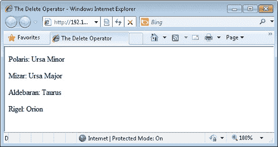

4. 在代码中的 `for` 循环上方添加 `delete` 操作符，以移除北极星（Polaris）的星座。代码（可在配套内容的 `deleteop2.txt` 文件中）如下：

```html
<!DOCTYPE HTML PUBLIC "-//W3C//DTD HTML 4.01//EN"
"http://www.w3.org/TR/html4/strict.dtd">
<html>
<head>
    <title>The Delete Operator</title>
    <script type="text/javascript">
        var star = {};
        star["Polaris"] = new Object();
        star["Mizar"] = new Object();
        star["Aldebaran"] = new Object();
        star["Rigel"] = new Object();
        star["Polaris"].constellation = "Ursa Minor";
        star["Mizar"].constellation = "Ursa Major";
        star["Aldebaran"].constellation = "Taurus";
        star["Rigel"].constellation = "Orion";
        delete star["Polaris"].constellation;
    </script>
</head>
<body id="mainbody">
    <script type="text/javascript">
        for (starName in star) {
            var para = document.createElement('p');
            para.id = starName;
            para.appendChild(document.createTextNode(starName +
                ": " + star[starName].constellation));
            document.getElementsByTagName("body")[0].appendChild(para);
        }
    </script>
</body>
</html>
```


star["Mizar"] = new Object;

star["Aldebaran"] = new Object;

star["Rigel"] = new Object;

star["Polaris"].constellation = "Ursa Minor";

star["Mizar"].constellation = "Ursa Major";

star["Aldebaran"].constellation = "Taurus";

star["Rigel"].constellation = "Orion";

</script>

</head>

<body id="mainbody">

<script type="text/javascript">

delete(star["Polaris"].constellation);

for (starName in star) {

    var para = document.createElement('p');

    para.id = starName;

    para.appendChild(document.createTextNode(starName + ": " + star[starName].constellation));

    document.getElementsByTagName("body")[0].appendChild(para);

}

</script>

</body>

</html>

```

注意文档主体中 `<script>` 标签内添加的 `delete` 操作符。

5. 保存文件并在网页浏览器中查看。输出所示：

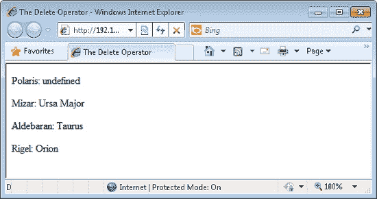

使用 `delete` 操作符会导致北极星的星座变为 `undefined`。你也可以像这样删除整个北极星对象：

```
delete(star["Polaris"]);
```

## 使用 `typeof` 操作符返回变量类型

正如你所预期的，`typeof` 操作符返回所给操作数的变量类型。通过 `typeof`，你可以确定例如，一个给定的变量是否被创建并正在作为字符串、数字或布尔值使用；或者该变量是否是特定类型的对象或函数。考虑这段代码：

```
var star = {};

if (typeof(star) == "object") {
    alert("star is an object");
}
```

当评估数字时，`typeof` 操作符返回“number”；当评估字符串类型时返回“string”；并且（正如你在示例中看到的），当评估对象时返回“object”。当你使用属性时，JavaScript 会智能地假设你想知道该属性所属变量的类型，而不是对象的类型，因此它会返回该属性的 `value` 类型。这里有一个借用了本章稍早代码的示例。

### 使用 `typeof` 操作符

1. 使用 Visual Studio、Eclipse 或编辑器，编辑配套内容中 Chapter05 示例文件夹下的 `typeof.htm` 文件。

2. 在网页中，添加此处所示的代码（可在配套内容的 `typeof.txt` 文件中找到）：

```
<!DOCTYPE HTML PUBLIC "-//W3C//DTD HTML 4.01//EN"
"http://www.w3.org/TR/html4/strict.dtd">
<html>
<head>
    <title>The Typeof Example</title>
    <script type="text/javascript">
        var star = {};
        star["Polaris"] = new Object;
        star["Polaris"].constellation = "Ursa Minor";
        alert(typeof star["Polaris"].constellation);
    </script>
</head>
<body>
</body>
</html>
```

3. `<script>` 标签内的代码为恒星北极星创建了一个新对象，并将其 `constellation` 属性设置为字符串“Ursa Minor”。然后它使用 `typeof` 操作符调用 `alert` 对话框，显示 `star["Polaris"].constellation` 属性类型为字符串。

4. 保存文件并在网页浏览器中查看。你会得到如下所示提示框：

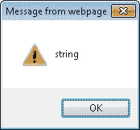

使用 `typeof` 操作符，你还可以看到 `null` 和 `undefined` 之间的区别。

## `void` 操作符

如果你检查过任何 JavaScript 源代码，很可能见过 `void` 操作符。`void` 操作符在评估其参数后返回 `undefined`。`void` 操作符的一个常见用法是打开新窗口，如下所示：

```
void(window.open());
```

更常见的是，你会将 `void` 操作符放在链接的 `href` 中来打开新窗口：

```
<a href="javascript:void(window.open())">点击此处打开新窗口</a>
```

### 注意

通常不建议在 `href` 中使用 `javascript:`。

# 赋值操作符

你已经在本章复习了赋值，并在书中随可见它们。主要的（或最常用的）赋值运算符是等号（`=`）。这种运算符被称为简单赋值。JavaScript 有许多赋值运算符，包括表 5-5 中所示的。

表 5-5 复合赋值运算符

| 运算符 | 含义 |
| --- | --- |
| `*=` | 左操作数乘以右操作数 |
| `/=` | 左操作数除以右操作数 |
| `%=` | 提供左操作数对右操作数的余数（模） |
| `+=` | 将右操作数加上左操作数 |
| `-=` | 从左操作数中减去右操作数 |
| `<<=` | 位左移 |
| `>>=` | 位右移 |
| `>>>=` | 无符号位右移 |
| `&=` | 位与 |
| `^=` | 位异或 |
| `|=` | 位或 |

复合赋值运算符提供了节省击键次数和字节的快捷方法。例如，你可以使用 `+=` 和 `-=` 对数字进行加减，如例例所示：

```
var myNum = 10;
alert(myNum);
myNum += 30;
alert(myNum);
```

在变量定义并赋值为 10 之后的第一个提示所示：


在使用复合加法赋值后，下一个提示所示：


字节数越少，意味着用户下载的脚本越小。要量化你可以节省多少字节，或者这对你有多大帮助是非常困难的。一些程序员可能会认为这种影响微乎其微——对于较小的脚本来说这可能是事实，尤其是因为用户越来越多地拥有了宽带或更快的连接。但对于较大的脚本，智能的快捷方式能带来的积极影响是非常真实的，特别是当这些脚本必须通过拨号或其他慢速类型连接进行下载时。

在下载过程中节省字节数的一种常用方法是 JavaScript 的混淆。`Minification` 指的是从运行或生产环境网站的 JavaScript 文件中移除所有非必要的元素。非必要的元素不仅包括注释，还包括空格和换行。生成的混淆文件除非你重新引入一些空格和换行符，否则是相当不可读的。

## 逗号运算符

逗号运算符（`,`）用于分隔表达式并按顺序执行它们。通常，逗号（`,`）用于分隔变量声明，这允许在一行内声明多个变量：

```
var num1, num2, num3;
```

或者，也可以设置值：

```
var num1 = 3, num2 = 7, num3 = 10;
```

# 练习

| 1. | 使用加运算符（`+`）向屏幕发送三个 `alert()` 对话框（你可以使用三个独立的程序）。第一个 alert 应该加两个数字。第二个应该加一个数字和一个字符串。第三个应该加两个字符串。所有内容都由变量表示。 |
| 2. | 使用后置自增运算符（`++`）增加变量中存储的数字。在递增之前、期间和之后显示变量的值。使用前置自增运算符增加数字，并使用 `alert` 在递增之前、期间和之后显示其结果。 |
| 3. | 使用 `typeof` 运算符检查你在练习 1 中创建的变量的类型。 |
| 4. | 正确或错误：一元运算符在 JavaScript 中并不经常出现。 |
| 5. | 正确或错误：节省字节（尽可能使用 JavaScript 快捷方式）总是比使用返回和缩进好，后者会减慢页面加载。 |

# 第二部分. 应用 JavaScript

# 第 6 章. 使用条件和循环控制流程

读完本章后，你将能够：

* 理解 JavaScript 中不同类型的条件语句。
* 使用 `if else` 条件语句控制代码的执行。
* 使用 `switch` 语句。
* 理解 JavaScript 中不同类型的循环控制结构。
* 使用 `while` 循环和 `do...while` 循环重复执行代码。
* 使用不同类型的 `for` 循环来迭代值范围。

## 如果（以及如何）

`if` 语句评估一个表达式，并根据结果决定程序中执行哪些代码。更复杂的 `if` 语句可以根据多个条件控制执行哪些代码。如果你在互联网上预订了机票，你就知道如何做决策了。例如，你可能想去进行一次快速短的周末游，因此在给票定价时，你会说：“如果票价低于 350 美元，我就订机票，否则我会找另一个度假地。”假设我想倒垃圾。我应该今晚把垃圾带到路边，还是等等到明天早上？如果天气预报说昨晚有风，垃圾可能会被吹到邻居的草坪上，但如果我等到明天早上，我可能会错过垃圾车。（第三种选择是告诉我的妻子轮到她倒垃圾了，但过去这从未起过作用。）

虽然 JavaScript 不会帮助你做出这些生活中的决策，但它可以通过做出这类决策来提供极大帮助——也就是说，它可以根据变量是否包含特定值或表单字段是否正确填写来控制程序的行为。本节回顾了 JavaScript 中 `if` 语句的语法。

## if 语句的语法

如果你用过其他语言（包括 Perl 或 PHP），那么 `if` 语句的语法对你可能很熟悉。`if` 语句的基本结构如下：

```
if (some condition) {
    // 在此执行某些操作
}
```

### 注意

`if` 语句有时被称为 `if` 条件。在本章及其他章节中，我交替使用这些术语，以便你熟悉这两个词。但不要混淆 `if` 条件（整个 `if` 语句）与 `if` 条件，后者是 `if` 语句评估的布尔表达式。

`if` 语句检查条件的有效性或真假性，以决定是否执行条件内（大括号内部）的代码。条件是一个布尔表达式，当它评估为 `true` 时，会导致 `if` 语句执行条件中的代码。（你可以对条件中的表达式进行取反，以便在表达式评估为 `false` 时运行代码。）回想第 5 章中布尔运算符和一元运算符的使用。这里有一个例子：

```
if (!some condition) {
    // 在此执行某些操作
}
```

在这种情况下，条件以取反运算符（`!`）开头，这意味着条件需要评估为 `false`，条件内的代码才会执行。

本章前面提到的真实的航空公司成本示例在伪代码中可能如下：

```
if (flightCost < 350) {
    bookFlight();
}
```

如果机票价格低于 350 美元，条件内的代码将执行。垃圾的示例可能如下：

```
if (forecast != "windy") {
    takeGarbage();
}
```

在本章稍后的部分，我将向你展示如何使用 `else` 语句在条件为 `true` 时执行其他代码。

你可以在 `if` 语句中使用你在第 5 章中学的运算符，特别是测试一个值是否大于或小于另一个值的关系运算符，以及测试两个值是否相等的相等运算符。请看这些示例：

```
var x = 4;
var y = 3;

// 相等测试
if (x == y) {
    // 执行某些操作
}
```

因为变量 `x` 的值 (4) 不等于变量 `y` 的值 (3)，`if` 条件（括号内）的代码不会执行。这里有一个使用关系运算符的例子：

```
var x = 4;
var y = 3;

// 关系测试
if (x > y) {
    // 执行某些操作
}
```

在这种情况下，由于变量 `x` 的值 (4) 大于变量 `y` 的值 (3)，括号内的代码执行。

下一节将展示一个你可以执行的示例。此示例利用 `prompt()` 函数通过简单的接口获取访问者的输入。

## Internet Explorer 中的 prompt 函数

随着 Windows Internet Explorer 7 的引入，`prompt()` 函数不再默认启用。如果你在 Internet Explorer 中尝试使用 `prompt()` 函数，你会收到一个像图 6-1 所示的安全警告，或者可能看到一个带有 `null` 字样的页面，如图 6-2 所示的警告。


图 6-2。当使用 `javascript:` 伪协议配合 `prompt()` 函数时，你有时会收到一个带有 `null` 字的页面。

你可以通过点击信息栏（显示在图 6-1 函数引起的安全警告。）并选择允许脚本的选项，或者通过更改安全设置来可靠地绕过此功能。你可以在 Internet Explorer 中更改安全设置，例如，从 `工具` 菜单选择 `Internet 选项`，点击 `安全` 选项卡，点击 `自定义级别`，并在 `脚本` 部分中启用 `允许网站通过脚本窗口向用户提问以信息` 选项。

然而，你不能指望你的访问者对他们的 Internet Explorer 设置进行同样的操作。因此，`prompt()` 函数不再像 Internet Explorer 7 引入之前那样有用了。一些程序员可能会认为 `prompt()` 函数很烦人（我同意它有时会产生问题），但它确实有其优势，禁用它对增强安全的作用很小。但在某些情况下它对测试很有用，例如下面的练习中。

### 使用 `if` 对程序流做出决策

1. 使用 `Microsoft Visual Studio`、`Eclipse` 或其他编辑器编辑 `Chapter06` 示例文件文件夹中的 `ifexample.htm` 文件，你可以在配套内容中找到该文件。

2. 在页面中，将 `TO DO` 注释替换为以下所示的代码（此代码也位于配套内容中的 `ifexample.txt` 文件中）：

```
<!DOCTYPE HTML PUBLIC "-//W3C//DTD HTML 4.01//EN"
"http://www.w3.org/TR/html4/strict.dtd">
<html>
<head>
    <title>An If Example</title>
</head>
<body>
<script type="text/javascript">
var inputNum = prompt("Please enter a number below 100:");
if (inputNum > 99) {
    alert("That number, " + inputNum + ", is not below 100.");
}
</script>
<p>This is an example from Chapter 6.</p>
</body>
</html>
```

3. 保存页面并在 Web 浏览器中查看。如果你尝试在 `Internet Explorer` 中查看页面并收到安全警告，则需要像之前的那样更改你的安全设置。你也可以使用 `Firefox` 或另一个浏览器。

4. 当你查看页面时，你会看到一个提示要求输入一个小于 100 的数字。`Internet Explorer` 通常会在对话框的文本框中填入 `undefined`。输入一个数字并点击 `OK`。正如这里看到的这样输入的：


5. 点击 `OK`。你会看到一个类似这里的页面：


6. 在浏览器中重新加载页面，这次在提示时，输入一个大于 100 的数字。你会收到一个像这样的警报：


除了你在之前的示例中看到的超文本标记语言 (HTML) 和打开脚本标签外，该代码的工作原理如下：

`body` 内部 `<script>` 标签内的第一行建立了一个变量 `inputNum`，然后将其赋值为 `prompt()` 函数的结果：

```
var inputNum = prompt("Please enter a number below 100:");
```

接几行代码使用 `if` 语句检查 `inputNum` 变量中的值。如果该值大于 99，则会显示警报：

```
if (inputNum > 99) {
    alert("That number, " + inputNum + ", is not below 100.");
}
```

这个示例在许多方面都需要改进，随后的示例将展示如何改进代码，利用你已经学到的知识并使用你在本章后面学到的一些新技术。

### 复合条件

很多时候，你需要在同一个 `if` 语句中测试多个一个条件。考虑之前的示例。假设你想让访问者输入一个 51 到 99 之间的数字（包含边界）。你可以将这些测试组合在一个 `if` 语句中，如下：

```
if ((inputNum < 51) || (inputNum > 99)) {
    alert("That number, " + inputNum + ", is not between 50 and 100.");
}
```

### 注意

你也可以编写该 `if` 语句而不在第一行的每个评估周围添加额外的括号；然而，我发现添加括号可以提高可读性。

你可以在之前的示例中查看完整代码，其中显示的复合 `if` 语句位于示例 6-1。（你可以在配套内容中找到该代码，文件名为 `listing6-1.htm`）。

```
<!DOCTYPE HTML PUBLIC "-//W3C//DTD HTML 4.01//EN"
"http://www.w3.org/TR/html4/strict.dtd">
<html>
<head>
    <title>An If Example</title>
</head>
<body>
<script type="text/javascript">
var inputNum = prompt("Please enter a number below 100:");
if (inputNum > 99) {
    alert("That number, " + inputNum + ", is not below 100.");
}
</script>
<p>This is an example from Chapter 6.</p>
</body>
</html>
```

该语句在示例 6-1 中使用逻辑 `OR` 运算符并读取：“如果 `inputNum` 大于 99 或小于 51，执行此。”

再次考虑我们使用了本章内容的示例。如果你输入一个大于 99 或小于 51 的数字，你会收到警报。但如果输入的不是数字呢？如果你输入了单词 `boo` 呢？因此，代码应该检查 `inputNum` 是否为数字。你可以通过 `isNaN()` 函数并像下面这样嵌套决策来实现这一点：

```
if (isNaN(inputNum) || ((inputNum > 99) || (inputNum < 51))) {
    alert("That number, " + inputNum + ", is not between 50 and 100.");
}
```

条件现在首先检查 `inputNum` 是否为数字。如果这个初始检查为真（用户没有输入数字），则不进行后续处理，防止语句的其他部分被评估。如果用户输入了数字，`isNaN` 失败，`if` 语句执行范围检查，这些检查嵌套在括号中，创建了它们自己的条件集。输入值为 `boo` 的结果在图 6-3 中所示。


图 6-3。使用 `isNaN()` 函数进行嵌套示例。

完整代码可以在示例 6-2 中查看，其中显示的嵌套 `if` 语句位于（在配套内容中的 `listing6-2.htm` 文件中）。

```
<!DOCTYPE HTML PUBLIC "-//W3C//DTD HTML 4.01//EN"
"http://www.w3.org/TR/html4/strict.dtd">
<html>
<head>
    <title>An If Example</title>
</head>
<body>
<script type="text/javascript">
var inputNum = prompt("Please enter a number between 50 and 100:");
if (isNaN(inputNum) || ((inputNum > 99) || (inputNum < 51))) {
    alert("That number, " + inputNum + ", is not between 50 and 100.");
}
</script>
<p>This is an example.</p>
</body>
</html>
```

## 使用 `else if` 和 `else` 语句

到目前为止代码示例的下一个问题是，图 6-3 中的警报对话框文本始终显示输入了一个数字。这显然并不总是——我输入了单词 `boo`。你真正需要的是执行多个独立条件检查的方法。如何做到这一点？这就是 `else if` 和 `else` 派上用场的地方。

## `Else if`

大多数现代编程语言都有 `if/else if/else` 条件构造结构，但它们在使用这些结构的方式上有所不同，特别是拼写或构建 `else if` 语句的方式。某些语言将其定义为 `elsif`，一个单词（且拼写错误）。另一些语言将其定义为 `elseif`——也是一个单词，但拼写正确。记住这些不同的结构是一项挑战，而且这里的讨论还没有考虑语言使用括号来定义要执行代码的不同方式。在 JavaScript 编程中，你使用 `else if`——两个单词，且拼写正确。

使用 `else if` 和 `else`，你可以创建多层条件，每个条件都会轮流测试。第一个匹配的条件中的代码将被执行。如果没有匹配项，则执行 `else` 条件中的代码（如果存在的话）。示例 6-3（配套内容中的 `listing6-3.htm`）显示了代码，该代码首先检查 `inputNum` 变量是否包含数字。如果该值确实是数字，`else if` 语句将执行检查以确保输入值在适当范围内。代码根据匹配条件调用相应的 `alert()` 函数。如果你输入了一个数字，那么 `else` 条件就会触发并显示显示该数字的警报。

示例 6-3. 使用 `else if` 和 `else` 条件。

```
<!DOCTYPE HTML PUBLIC "-//W3C//DTD HTML 4.01//EN"
"http://www.w3.org/TR/html4/strict.dtd">
<html>
<head>
    <title>An If Example</title>
</head>
<body>
<script type="text/javascript">
var inputNum = prompt("Please enter a number between 50 and 100:");
if (isNaN(inputNum)) {
    alert(inputNum + " doesn't appear to be a number.");
}
else if ((inputNum > 99) || (inputNum < 51)) {
    alert("That number, " + inputNum + ", is not between 50 and 100.");
}
else {
    alert("You entered a number: " + inputNum);
}
</script>
<p>This is an example from Chapter 6.</p>
</body>
</html>
```

同样，你可以使用 `else if` 和 `else` 来测试几个条件，你也可以（有时甚至必须）使用多层条件。例如，你可以测试某个特定条件，并在成功后执行额外的条件。这里有一个利用 `match()` 函数和正则表达式的示例。关于正则表达式的更多信息，请参阅第 4 章。

## 使用多层条件和正则表达式

1. 打开编辑器并——如果你遵循了本章之前的操作步骤——打开你更新过的的文件 `ifexample.htm`（在配套内容中）。
   该文件应该包含以下代码。（如果你没有按照之前的示例操作，只需创建一个空文件，粘贴以下代码，然后继续下一步即可。）

```
<!DOCTYPE HTML PUBLIC "-//W3C//DTD HTML 4.01//EN"
"http://www.w3.org/TR/html4/strict.dtd">
<html>
<head>
    <title>An If Example</title>
</head>
<body>
<script type="text/javascript">
var inputNum = prompt("Please enter a number below 100:");
if (inputNum > 99) {
    alert("That number, " + inputNum + ", is not below 100.");
}
</script>
<p>This is an example from Chapter 6.</p>
</body>
</html>
```

2. 使用不同的文件名保存该文件。

3. 在新保存的文件中，输入下文所示的代码。注意，我将之前示例中的更改也包含在了：

```
<!DOCTYPE HTML PUBLIC "-//W3C//DTD HTML 4.01//EN"
"http://www.w3.org/TR/html4/strict.dtd">
<html>
<head>
    <title>A Multi-Level Example</title>
</head>
<body>
<script type="text/javascript">
var inputNum = prompt("Please enter a number between 50 and 100:");
if (isNaN(inputNum)) {
    if (inputNum.match(/one|two|three|four|five|six|seven|eight|nine|ten/)) {
        alert("While this is a number, it's not really a number to me.");
    } else {
        alert(inputNum + " doesn't appear to be a number.");
    }
}
else if ((inputNum > 99) || (inputNum < 51)) {
    alert("That number, " + inputNum + ", is not between 50 and 100.");
}
</script>
<p>This is an example from Chapter 6.</p>
</body>
</html>
```

4. 测试所有这些条件。首先在网络浏览器中访问该页面。系统提示你输入一个数字。对于第一次测试，按如下所示输入单词：


5. 点击 OK。第一个 `if` 条件匹配，然后嵌套的 `if` 检查输入。输入与字符串“four”匹配，导致此对话框：


6. 点击 OK 关闭对话框。重新加载页面。现在输入该短语：


7. 点击 OK。与之前加载页面一样，第一个条件 (`isNaN()`) 匹配。然而，由于内部的 `if` 测试没有匹配短语 `pizza`，嵌套 `if` 的 `else` 条件将匹配，导致此对话框：


8. 点击 OK 关闭对话框，再次加载页面。这次，在文本框中输入数字 `4`，如下所示：


9. 点击 OK。现在第一个 `if` 条件失败了，因为数字 4 确实是一个数字。因此，评估了 `else if` 条件。因为数字 4 小于 51 且不大于 99，`else if` 条件匹配并显示了此警报：


10. 良好的测试实践要求你还要测试一个 99 以上的数字。你可以这样做。准备就绪后，点击 OK 关闭对话框并再次加载页面。这次，输入数字 `64`：


11. 点击 OK 后，你不会收到任何警报，因为数字 64 处于 50 到 100 之间，因此不匹配任何测试条件。

我解释了在本过程以及之前的过程中你正在审查的代码，但没有解释嵌套 `if` 中的的正则表达式。该语句是：

```javascript
if (inputNum.match(/one|two|three|four|five|six|seven|eight|nine|ten/)) {
```

该表达式用两个正斜杠 (`/`) 界定，两端各一个。之后，正则表达式会查找字符串 `one`、`two`、`three`、`four`、`five`、`six`、`seven`、`eight`、`nine` 或 `ten` 中的任意一个。字符串之间的管道字符 (`|`) 表示逻辑或，这意味着正则表达式匹配这些字符串中的任意一个，但不会匹配多个。

有趣的是，尽管这个正则表达式非常简单，但它也有很大的缺陷。为了让这个正则表达式更好，它需要标记（或锚定）匹配字符串的位置。按照目前的写法，字符串 `sixty` 将像现在的单词 `six` 一样被匹配。

我在这里的意图并不是展示一个完美的正则表达式，而是让你接触到它，以便当你以后需要使用它们时，不会尖叫着要逃跑！

# 使用三元运算符

另一种条件构造样式被称为“三元条件”（`ternary conditional`）。这种条件使用问号 (`?`) 运算符来创建一个紧凑的 `if/else` 结构。三元条件表达式的基本结构非常简单：

```
(name == "steve") ? "Hello Steve" : "Hello Unknown Person";
```

该语句可以读为：“如果 `name` 是 steve，那么执行‘Hello Steve’，否则执行‘Hello Unknown Person’。”

你可以在像下面的语句中使用三元表达式（此代码位于配套内容中的 `ternary.txt` 文件）：

```
var greeting = (name == "steve") ? "Hello Steve" : "Hello Unknown Person";
alert(greeting);
```

这段代码将变量 `greeting` 设置为三元测试结果的值。如果变量 `name` 的值是“steve”，则 `greeting` 变量获得字符串值“Hello Steve”；否则，`greeting` 变量将获得字符串值“Hello Unknown Person”。这里是使用传统 `if/else` 形式的相同代码：

```
if (name == "steve") {
    var greeting = "Hello Steve";
}
else {
    var greeting = "Hello Unknown Person";
}
alert(greeting);
```

如果你以前没见过这种写法，三元构造有时会让人感到困惑。如果你认为坚持传统的 `if/else` 语法有助于提高未来程序的可读性——那么坚持使用并不可耻，尤其是当阅读代码的人不知道三元构造时！

# 使用 *switch* 进行测试

`switch` 语句是一种简单高效的方法，用于测试变量的多个值，并根据匹配的 case 执行代码。虽然你可以通过 `if/else if` 语句来完成任务，但这样做可能会很麻烦；在这种情况下 `switch` 语句更有用。

考虑这样一个网站，它需要根据用户选择的语言执行某些代码。在此练习中，假设访问者已通过表单选择了他们的语言。（第 11 章 探讨了检测访问者浏览器默认语言的方法。）

如果该网站需要为几种语言执行代码，我们可以使用一组巨大的 `if/else if/else` 条件。假设有一个名为 `languageChoice` 的变量，值为所选语言，代码可能如下：

```
if (languageChoice == "en") {
    // 语言是英语，执行英语代码。
}
else if (languageChoice == "de") {
    // 语言是德语，执行德语代码。
}
else if (languageChoice == "pt") {
    // 语言是葡萄牙语，执行葡萄牙语代码。
}
else {
    // 未选择语言，使用瑞典语。
}
```

这段代码在只选择少数语言时运行良好，但请想象一下选择了 20 种或更多语言的情况。然后为每个条件添加更多要执行的代码，它很快就会变成一个迷宫。这里是 `switch` 内的相同代码（你可以在配套内容中的 `switches.txt` 文件中找到代码）：

```
switch(languageChoice) {
    case "en":
        // 语言是英语，执行英语代码。
        break;
    case "de":
        // 语言是德语，执行德语代码。
        break;
    case "pt":
        // 语言是葡萄牙语，执行葡萄牙语代码。
        break;
    default:
        // 未选择语言，使用瑞典语。
}
// 回到 switch 语句之外的代码
```

`switch` 语句查找每个语言 case，然后执行该 case 的代码。`break` 语句表示找到匹配 case 时执行代码的结束。`break` 语句会导致代码执行完全跳出 `switch` 语句，并在 `switch` 语句结束大括号之后继续执行。

例如，如果变量 `languageChoice` 值为 `de` 且缺少 `break` 语句，将执行德语代码，但 `switch` 语句将继续测试其他语言的代码，直到遇到 `break` 语句或到达 `switch` 语句结束。

你几乎总会在 `switch` 语句的每个 case 中使用 `break` 语句。然而，当你有多个*应该*执行相同代码的 case 时，`switch` 语句的优雅之处就会体现出来。考虑一个访问者选择其所属国家或地区的例子。在这样的网站上，来自美国、澳大利亚和英国的访问者可能希望他们的页面以英语显示，尽管这三个国家的人拼写单词的方式不同。以下是相应的 `switch` 语句示例（在配套内容的 `switches.txt` 文件中）：

```
switch(countryChoice) {
    case "US":
    case "Australia":
    case "Great Britain":
        // 语言是英语，执行英语代码
        break;
    case "Germany":
        // 语言是德语，执行德语代码。
        break;
    case "Portugal":
        // 语言是葡萄牙语，执行葡萄牙语代码。
        break;
    default:
        // 未选择语言，使用瑞典语。
}
// 回到循环之外的代码
```

### 注意

正如我蒙特利尔的朋友指出的正如我建议的，任何国家的访问者都应该能够选择网站支持的另一种语言，如法语。在此示例中忽略该功能，但在设计网站时要考虑到。

如果访问者选择澳大利亚作为其国家，将匹配澳大利亚 case，从而执行英语代码。由于 `break` 语句，JavaScript 然后跳出 `switch` 语句并执行 `switch` 语句之后的第一行代码。

## 使用 while 循环

`while` 语句创建一个只要条件为真就会执行的循环。本节介绍 `while` 语句和相关的 `do...while` 语句。

## *while* 语句

`while` 循环在条件满足之前执行其大括号内的代码。这里有一个示例（此代码位于配套内容中的 `while.txt` 文件）：

```
var count = 0;
while (count < 10) {
    // 在这里做一些事情。
    // 多行也是可以的。
    // 不要忘记增加计数器：
    count++;
}
```

始终记住 *while* 循环的两个重要方面，在此列出并逐一讨论：

* 取决于所测试的变量或条件的初始值，`while` 语句中包含的代码可能永远不会执行。
* `while` 语句测试的条件必须在循环内部发生变化。

### 确保代码至少执行一次

在前面的代码示例中，变量 `count` 最初被设置为数字 `0`。随后 `while` 语句的运行方式如下：`while` 语句的求值会检查 `count` 变量的值，判断它是否小于 `10`。由于它满足该条件，大括号内的代码就会执行。（然而，如果 `count` 变量的值不小于 `10`，`while` 语句大括号内的代码将永远不会执行——一次也不会执行。）

在 JavaScript 中，`do...while` 循环无论初始条件如何，都会执行一次代码。`do...while` 循环将在本章稍后部分讨论。

### 更改条件

如前所述，示例中 `while` 语句的求值检查该变量以判断其是否小于 `10`。如果 `count` 小于 `10`，则执行 `while` 循环内的代码。

`while` 循环内部的某行代码使用 `++` 一元运算符递增 `count` 变量，如下所示：

```
count++;
```

当 `while` 语句中的代码执行完毕后，将重复求值。如果没有递增 `count` 变量的代码，`count` 将始终小于 10，导致你陷入一个死循环——这并不是你想要的。

### 提示

当你使用通用计数器变量时（如我在示例中所做），在哪里递增该变量并不重要，只要你在 `while` 语句的大括号内或 `while` 语句测试中执行即可。这是一个示例：`while (i++ < 10)`。关于后缀运算符的更多信息，请参阅第 5 章。

这个故事的道理是，确保你对在 `while` 语句中求值的任何条件都进行递增或更改。

## `do...while` 语句

与 `while` 语句不同，`do...while` 语句至少执行一次其大括号中包含的代码。`while` 语句读起来像：“只要条件满足，就运行这段代码。”另一方面，`do...while` 语句读起来可能像：“执行（或运行）这段代码，直到条件满足。”考虑这段代码（位于辅助内容中的 `dowhile.htm` 文件中）：

```
<!DOCTYPE HTML PUBLIC "-//W3C//DTD HTML 4.01//EN"
"http://www.w3.org/TR/html4/strict.dtd">
<html>
<head>
    <title>Do While</title>
</head>
<body>
<script type="text/javascript">
var count = 0;
do {
    alert("Count is " + count);
    count++;
}
while (count < 3);
</script>
</body>
</html>
```

当这段代码执行时，会出现三个对话框。在第一次运行期间，`count` 变量持有值 `0`，因为该变量仍被设置为初始值，且对话框指示了这一点，如图 6-4 所示。


图 6-4. 第一次执行时计数为 0。

运行一次后，`count` 变量被递增。当求值 `while` 语句时，`count` 仍然小于 3，因此代码再次执行，导致如图 6-5 所示的对话框。


图 6-5. 运行时，代码递增计数器并显示下一次执行的结果。

同样再次发生。`count` 变量递增，求值 `while` 条件。`count` 的值仍然小于 3，因此大括号内的代码再次运行，显示另一个类似于图 6-6 的对话框。


图 6-6. 另一次运行后的计数变量。

反复尝试 `while` 和 `do...while` 语句，直到你熟悉它们之间的差异。

# 使用 `for` 循环

`for` 循环的使用方式与 `while` 循环相似，即执行特定次数的代码。`for` 循环在 JavaScript 中有两个“兄弟”：`for...in` 循环和 `for each...in` 循环。本节将检查这两种循环类型。

## `for` 循环

你使用 `for` 循环创建一个循环，其中条件以紧凑的形式进行初始化、求值和更改。这是一个示例：

```
for (var count = 0; count < 10; count++) {
    // 在此处执行代码
}
```

一个 `for` 语句在括号内有三个部分。第一个部分设置初始化表达式，如前面的示例所示：

```
var count = 0;
```

`for` 语句的下一个部分指定测试表达式，如示例所示：

```
count < 10;
```

`for` 语句的最后一个部分通常用于递增计数器。在示例中，该表达式为：

```
count++
```

### 注意事项

`for` 结构中的最后一个表达式不需要分号。

这是一个你可以尝试的示例。它使用 `for` 循环遍历数组。

## 使用 `for` 循环处理数组

1. 使用 Visual Studio、Eclipse 或其他编辑器编辑 Chapter6 文件夹中的 `forloop.htm` 文件。

2. 在页面中，将 TODO 注释替换为以下代码（你可以在辅助内容的 `forloop.txt` 文件中找到）：

```
<!DOCTYPE HTML PUBLIC "-//W3C//DTD HTML 4.01//EN"
"http://www.w3.org/TR/html4/strict.dtd">
<html>
<head>
    <title>For Loop Example</title>
</head>
<body>
<script type="text/javascript">
var myArray = ["Vega","Deneb","Altair"];
var arrayLength = myArray.length;
for (var count = 0; count < arrayLength; count++ ) {
    alert(myArray[count]);
}
</script>
</body>
</html>
```

3. 保存页面并在浏览器中查看。你会收到三个连续的 `alert()` 对话框：


从对话框可以看出，代码遍历了 `myArray` 数组中的每个值。我想强调此示例中的某些代码。回顾第 4 章，在该章学习了如何创建数组，JavaScript 中的数组通过从 0 开始的整数值进行索引。（这些知识稍后会很有用。）这是前面代码示例中的相关行：

```
var myArray = ["Vega","Deneb","Altair"];
```

代码创建了一个名为 `arrayLength` 的变量并将其设置为数组的长度。获取 `myArray` 数组的长度说明了数组对象属性 `length` 的用法。（我将在第 8 章 中更深入解释对象）。在单独变量（如本例所示的 `arrayLength`）中获取长度而不是在 `for` 循环中使用 `length` 属性可以提高性能。

```
var arrayLength = myArray.length;
```

`for` 循环首先创建并初始化 `count` 变量，接着检查 `count` 变量是否小于 `arrayLength` 变量设置的 `myArray` 数组的长度。最后，它递增 `count` 变量的值。`for` 循环体内的代码显示一个警框，使用 `count` 变量的值遍历 `myArray` 数组的索引。代码如下：

```
for (var count = 0; count < arrayLength; count++ ) {
    alert(myArray[count]);
}
```

## `for...in` 循环

`for...in` 循环遍历对象的属性，并返回属性名称本身。以下是一个示例：

```
for (var myProp in myObject) {
     alert(myProp + " = " + myObject[myProp]);
}
```

在这段代码中，每次执行循环时，`myProp` 变量都会被设置为 `myObject` 的新属性。这是一个你可以尝试的更完整的示例。

### 使用 `for...in` 循环

1. 使用 Visual Studio、Eclipse 或其他编辑器，编辑第 06 章示例文件文件夹中的 `forinloop.htm` 文件（你可以在附带内容中找到它）。
2. 在页面中，将 TO DO 注释替换为下方所示的代码（代码位于附带内容中的 `forinloop.txt` 文件中）：

```
<!DOCTYPE HTML PUBLIC "-//W3C//DTD HTML 4.01//EN"
"http://www.w3.org/TR/html4/strict.dtd">
<html>
<head>
    <title>For In Loop Example</title>
</head>
<body>
<script type="text/javascript">
var star = new Object;
star.name = "Polaris";
star.type = "Double/Cepheid";
star.constellation = "Ursa Minor";
for (var starProp in star) {
    alert(starProp + " = " + star[starProp]);
}
</script>
</body>
</html>
```

3. 保存文件并在浏览器中查看。你会收到三个对话框：


从示例代码中可以看出，变量 `starProp` 接收的是属性的名称，而将 `starProp` 作为 `star` 对象的索引则会得到该属性的值。

### 提示

你有时会看到 `for...in` 循环用于遍历数组，这与你在上一节中看到的使用方式非常相似。然而，使用 `for...in` 遍历数组可能会产生参差不齐的结果。这种方法较明显的问题之一是，`for...in` 循环不会按特定顺序返回属性。这种行为可能会带来麻烦，尤其是当你想要用 JavaScript 向网页写入文本时！这里的关键点是，当你想要遍历一个简单数组时，请使用 `for` 循环而不是 `for...in` 循环。

## `for each...in` 循环

JavaScript 中一个较新的结构是 `for each...in` 循环。因为它是新的，这种结构尚未被所有浏览器支持——特别是，它不支持 Internet Explorer 8 及更早版本。不过，它在 Firefox 2.0 及更高版本中是被支持。

`for...in` 结构返回属性的名称，而 `for each...in` 循环返回属性的值。语法上基本相同，但增加了 `each` 单词：

```
for each (var myValue in myObject) {
    alert(myValue + " is in the object.");
}
```

将较早示例中的 `for...in` 循环替换为 `for each...in` 循环将得到以下代码。新代码已显示。（更新后的文件位于附带内容中的 `foreach.htm` 文件。）

```
<!DOCTYPE HTML PUBLIC "-//W3C//DTD HTML 4.01//EN" "http://www.w3.org/TR/html4/strict.dtd">
<html>
<head>
    <title>For Each In Loop Example</title>
</head>
<body>
<script type="text/javascript">
    var star = new Object;
    star.name = "Polaris";
    star.type = "Double/Cepheid";
    star.constellation = "Ursa Minor";
    for each (var starValue in star) {
        alert(starValue + " is in the star object.");
    }
</script>
</body>
</html>
```

当你在 Internet Explorer 中查看页面时，你会看到错误屏幕（可能只是一个空白屏幕）。然而，在 Firefox 3.0 中查看页面会显示出正确的行为。图 6-7 显示了三个对话框之一。


你创建了一个基础网络表单，使用 JavaScript 访问该表单，并使用条件语句根据用户输入执行操作。如果这个示例中使用的所有内容尚未完全理解，请不要担心。该示例的主要目标只是为你在本章中学习的条件语句提供一些背景。

第 7 章探讨了在 JavaScript 中使用函数。第 14 章中的第一个示例展示了如何编写 JavaScript 验证代码，以确保必填字段已填写。

# 练习题

| 1. | 使用 `prompt()` 函数收集人的姓名。使用 `switch` 语句执行一个对话框：如果输入的姓名是你的，则显示短语“欢迎 <输入的名字>”；如果输入的姓名是 `Steve`，则显示“请离开”；对于所有其他情况，显示“请稍后再来 <输入的名字>”。 |
| 2. | 使用 `prompt()` 函数收集访问者输入的当前温度作为输入。如果输入的温度高于 `100`，告诉访问者降温。如果温度低于 `20`，告诉访问者保暖。 |
| 3. | 使用三元运算符完成与练习 2 相同的任务。 |
| 4. | 使用 `for` 循环从 `1` 计数到 `100`。当数字为 `99` 时，显示一个警告对话框。 |
| 5. | 使用 `while` 循环完成练习 4 中描述的任务。 |

# 第 7 章. 函数操作

**读完本章后，你将能够：**

* 理解 JavaScript 中函数的用途。
* 定义你自己的函数。
* 调用函数并从它们接收返回的数据。
* 理解 JavaScript 中的一些内置函数。

# 函数中包含什么？

JavaScript 函数是语句的集合，可以是命名的，也可以是未命名的（匿名的），可以在 JavaScript 程序的其他地方调用。函数可以接受参数，即传递给函数的输入值。在函数内部，这些传递给函数的参数可以被处理，并将结果通过 `return` 值返回给函数的调用者。

当你有某些需要在程序中多次执行的操作时，函数是完美的选择。与其多次定义相同的代码，你可以使用一个函数（这实际上就像程序内部的一个微程序）来执行该操作。即使你在程序各处拥有非常相似但并不完全相同的代码片段，你可能可以将它们抽象成单个函数。

抽象相似代码的一个很好的例子是使用函数来验证必填表单字段已填写。你可以编写 JavaScript 代码来验证表单中的每个单独命名字段，也可以使用函数。第 14 章展示了构建特定函数并对其进行抽象的示例。

你已经通过前面几章中的示例看到函数的运行方式了。函数用关键字 `function` 定义，后面通常跟随着函数名，然后是包含可选参数或参数的圆括号。使用大括号包围要作为函数一部分执行的语句：

```
function functionName() {
    // 语句写在这里；
}
```

### 提示

需要注意的是，当定义一个函数时（你可以在前面的基础函数定义中看到这一点），在函数被调用之前，该代码并不会实际执行。你将在本章稍后的部分看到如何调用函数。

## 函数参数

将传递给函数的参数放在函数定义的括号内。这里有一个使用函数参数的简要示例：

```
function myFunction(argument1, argument2, ..., argumentN) {
}
```

这是一个带有两个参数的示例：

```
function myFunction(argument1, argument2) {
    // 执行某些操作
}
```

调用（或触发）函数非常简单：

```
myFunction(val1, val2);
```

JavaScript（ECMA-262 规范）与其他语言的区别在于，在 JavaScript 中，你不需要指定传递给函数的参数数量，传递的参数数量也不需要与函数定义中定义的数量匹配。当调用时，函数会被赋予一个名为 `arguments` 的对象（作用类似于数组）。`Arguments` 存储了发送到参数，当你不知道发送的参数数量时，这非常有帮助。以下是其工作原理的示例（你可以在配套内容的 `functionbasics.txt` 节中找到这段代码）：

```
function myFunction() {
    var firstArg = arguments[0];
    var secondArg = arguments[1];
}
```

更好的是，你可以获取 `arguments` 对象的长度并遍历每个参数，如下所示（同样在配套内容的 `functionbasics.txt` 文件中）：

```
function myFunction() {
    var argLength = arguments.length;
    for (var i = 0; i < argLength; i++) {
        // 对每个参数 (i) 执行某些操作
    }
}
```

这是一个更完整的示例，显示了简单使用 `arguments` 对象的结果（在 `functionexample.htm` 文件中）：

```html
<!DOCTYPE HTML PUBLIC "-//W3C//DTD HTML 4.01//EN" "http://www.w3.org/TR/html4/strict.dtd">
<html>
<head>
    <title>Arguments Array</title>
</head>
<body>
<script type="text/javascript">
function myFunction() {
    var firstArg = arguments[0];
    var secondArg = arguments[1];
    alert("firstArg is: " + firstArg);
    alert("secondArg is: " + secondArg);
}
myFunction("hello","world");
</script>
</body>
</html>
```

当代码执行时，它会显示两个警报框，如图 7-1 和图 7-2 所示。


图 7-1. 在函数内部使用 `arguments` 对象来访问第一个参数。


图 7-2. 在函数内部使用 `arguments` 对象来访问第二个参数。

通过这样使用 `arguments` 对象，你可以适用于任意数量的参数，而不只是此示例所示的两个。

## 重温变量作用域

函数参数通常是变量名，不应该与调用函数时使用的变量同名。我故意使用“不应该”而不是“不要”，因为你*可以*在函数中的变量和函数调用的变量中使用相同的名称，但正如你将学到的那样，这样做可能会产生一些混淆的代码和混乱的作用域。

第 4 章包含一个关于变量作用域的章节，其中一个处理函数内部和外部作用域的练习。来自第 4 章中变量作用域示例之一的相关代码（在配套内容的 `scoping revisit.txt` 文件中重复）如下：

```html
<head>
    <title>Scoping Example</title>
    <script type="text/javascript">
    var aNewVariable = "is global.";
    function doSomething(incomingBits) {
        alert("Global variable within the function: " + aNewVariable);
        alert("Local variable within the function: " + incomingBits);
    }
    </script>
</head>
<body>
<script type="text/javascript">
    doSomething("is a local variable");
    alert("Global var outside the function: " + aNewVariable);
    alert("Local var outside the function: " + incomingBits);
</script>
</body>
</html>
```

这个示例展示了你如何在函数内部和外部全局或局部地声明和作用域变量。然而，该示例在逻辑上保持了变量的独立，因为它没有使用相同的变量名，然后又改变变量的值。这里是一个示例，使用相同的变量名可能会引起混淆。我发现多年前编写的代码即使不引入奇怪的作用域问题，已经足够让人困惑了，因此请尽量避免此类代码：

```
function addNumbers() {
    firstNum = 4;
    secondNum = 8;
    result = firstNum + secondNum;
    return result;
}
result = 0;
sum = addNumbers();
```

你可能已经发现了这段代码的问题。到处都缺少了 `var` 关键字。尽管在函数外部显式地初始化 `result` 变量为 `0`，但该变量通过调用 `addNumbers()` 函数被修改了。这反过来将 `result` 变量修改为 `12`，即函数内部 `4` 和 `8` 相加的结果。

如果你在 `result` 变量初始化之后添加一个 `alert` 来显示它，警报将显示 `0`。如果你在调用 `addNumbers()` 函数后添加另一个 `alert` 来显示 `result` 变量，结果将显示 `12`。我将在稍后的练习中让你自己在正确的位置添加这些警报。

底线是，当你对函数内部外部的变量使用不同的名称，并始终使用 `var` 关键字初始化变量时，你的生活会变得更容易。取决于函数中包含的代码，函数可能也可能没有返回值。正如你在下一节中看到的，那个 `return` 值会被传回给调用者。

## 返回值

当函数执行完其代码时，它可以使用 `return` 关键字向调用者返回一个值。查看示例 7-1（在配套内容的 `listing7-1.txt` 文件中）。

示例 7-1. 一个简单的返回值示例。

```
function multiplyNums(x) {
    return x * 2;
}
var theNumber = 10;
var result = multiplyNums(theNumber);
alert(result);
```

示例 7-1 创建了一个名为 `multiplyNums` 的函数，并有一个预期的输入值，该值将被赋值给变量 `x`。该函数执行一个任务：返回其参数乘以 `2` 的结果，如下：

```
function multiplyNums(x) {
    return x * 2;
}
```

然后，代码创建了一个名为 `theNumber` 的变量，如下：

```
var theNumber = 10;
```

接下来，代码创建了另一个变量 `result`。该变量持有调用 `multiplyNums` 函数产生的结果。`multiplyNums` 函数使用变量 `theNumber` 作为参数：

```
var result = multiplyNums(theNumber);
```

运行时，该代码会弹出一个对话框，如图 7-3 所示。


图 7-3. 此警报显示了函数调用的返回值。

你可以将返回值放在函数内的任何位置，而不是末尾。在条件语句或循环之后使用 `return` 是常见的，如下所示（你可以在配套内容的 `morereturnexamples.txt` 文件中找到它）：

```
function myFunction(x) {
    if (x == 1) {
        return true;
    } else {
        return false;
    }
}
```

不过，请小心放置 `return` 语句的位置，因为当函数执行到 `return` 语句时，函数会立即返回，不会执行之后的任何代码。例如，像这样的代码（你可以在配套内容的 `morereturnexamples.txt` 文件中找到它）可能不会按照你的意图执行：

```
function myFunction() {
    var count = 0;
    var firstNum = 48;
    return;
    var secondNum = 109;
}
```

这段代码永远到达变量 `secondNum` 的初始化。

## 关于调用函数

你几乎总是带有某些参数调用函数，或者带有空括号，如下所示：

```
var result = orderFruit();
```

如果该函数需要参数，它可能看起来像这样：

```
var result = orderFruit(quantity);
```

省略调用函数时的括号会导致返回函数名，而不是函数本应返回的任何内容。这里有一个示例——你可以在配套内容的 `listing7-2.htm` 文件中找到它——展示了一些基础 JavaScript 代码：

```html
<!DOCTYPE html PUBLIC "-//W3C//DTD XHTML 1.0 Transitional//EN" "http://www.w3.org/TR/xhtml1/DTD.dtd">
<html xmlns="http://www.w3.org/1999/xhtml" >
<head>
    <title>点水果</title>
    <script type="text/javascript">
    function orderFruit() {
        var total = 0;
        // 调用另一个函数来下单
        return total;
    }
    </script>
</head>
<body>
<script type="text/javascript">
    var result = orderFruit();
    alert("总额是 " + result);
</script>
</body>
</html>
```

执行时，这段代码调用了 `orderFruit()` 函数。`orderFruit()` 函数调用另一个函数（未显示）来下单。随后，总额被计算并传回给调用者。像这样编写，代码运行正常并弹出一个对话框，如图 7-4 所示。


图 7-4. 调用 `orderFruit()` 函数带括号会得到预期的结果。

对代码进行微调——具体来说，去掉函数调用时的括号——会改变整个结果：

```
var result = orderFruit;
```

结果如图 7-5 所示。


图 7-5. 调用 `orderFruit` 不带括号可能不符合你的预期。

## 匿名/未命名函数（函数字面量）

你到为止看到的函数都是正式定义的。然而，JavaScript 并不要求以这种方式正式定义函数。例如，使用函数字面量——也称为未命名或匿名函数——函数被定义并绑定到一个变量，如下：

```
var divNums = function(firstNum, secondNum) { return firstNum / secondNum; };
```

你可以使用 `javascript:` 伪协议轻松地测试此功能。在浏览器的地址栏中输入以下代码：

```
javascript:var divNums = function(firstNum,secondNum) { return firstNum / secondNum; }; alert(divNums(8,2));
```

匿名函数在面向对象的 JavaScript 中被频繁使用，并作为事件的处理程序。你可以在第 8 章以及后续章节中看到这种用法的示例。

## 闭包

在 JavaScript 中，嵌套函数可以访问外部函数的变量。`Closures`（闭包）指的是函数正常执行上下文之外的变量的存在。闭包通常意外创建，如果处理不当，可能会在 Windows Internet Explorer 中导致内存泄漏问题。然而，闭包是 JavaScript 强大（且高级）的领域之一。

这是一个闭包的示例：

```
function myFunction() {
    var myNum = 10;
    function showNum() {
        alert(myNum);
    }
    return showNum();
}
var callFunc = myFunction();
myFunction();
```


在这个示例中，函数 `showNum` 可以访问在外部函数（`myFunction`）中创建的变量 `myNum`。变量 `callFunc` 在全局范围内创建，包含对 `showNum` 函数的引用。当变量 `callFunc` 被创建时，它立即就可以访问 `myNum` 变量。

闭包可以用于模拟对象内部的私有方法，或其他用途，例如在事件处理程序中使用。闭包是 JavaScript 中强大且高级的概念之一，因此不适合在入门书中详述。你可以在 [`msdn.microsoft.com/en-us/scriptjunkie/ff696765.aspx`](http://msdn.microsoft.com/en-us/scriptjunkie/ff696765.aspx) 以及互联网的其他地方找到更多关于闭包的信息。

## 方法

理解方法的简单方式是：它们是作为对象的一部分定义的函数。这虽然过于简化，但目前足够了。你通过使用点运算符（`.`）访问对象的方法。内置对象（例如 `Math`、`Date` 和 `String` 对象）都拥有你在书中见过（或很快就会看到）的方法。诸如 `alert()` 函数这样的函数实际上只是 `window` 对象的方法，可以写成 `window.alert()` 而非仅仅是 `alert()`。第 8 章 详细地介绍了对象和方法。

### 注意

在书的大部分内容，我交替使用 `method`（方法）和 `function`（函数）这两个词。我会继续这样做，以便你更好地理解，对于大多数用途，两者之间的界限是模糊的。当以面向对象的方式使用时，使用 `method` 一词通常更清晰。当不直接以面向对象使用时——例如你使用 `alert()` 函数的方式——使用 `function` 一词是可以接受的。

## 定义自己的函数 vs 使用内置函数

正如你在整书中看到的，JavaScript 拥有许多内置函数或方法。除了使用这些内置函数外，你经常发现自己在定义自己的函数。除了简单的脚本外，你编写的大多数脚本都会涉及你自己的函数。

但在某些情况下，你可能定义了一个函数，然后以后发现 JavaScript 已经有一个用途相同且同样优秀的内置函数。如果你发现某个 JavaScript 内置函数执行的任务与你自己的函数相同，那么使用 JavaScript 函数通常是更好的主意。

# 查看对话框函数

到目前，你已经熟悉了 JavaScript 中的 `alert()` 函数，因为你在之前的章节中已经看到了它的许多示例。你还学习了 `alert()` 函数只是 `window` 对象的一个方法。本节将介绍 JavaScript 中 `alert()` 函数的日常用法，以及 `window` 对象的两个相关函数。

## 更多信息

`window` 对象足够重要，可以在第 9 章 中额外关注。该章节讨论了 `window` 对象的许多其他方法。

尽管 `window` 对象有几个方法，但现在我想强调这三个（我称之为函数）：`alert()`、`confirm()` 和 `prompt()`。因为你已经在书中看到了太多的 `alert()` 对话框，我在这里不会再包含一个（以后再感谢我）。第 6 章讨论了 `prompt()` 函数的使用，以及 Internet Explorer 7 如何作为安全措施默认阻止它。不过，`confirm()` 函数在 Internet Explorer 中仍然可用。

`confirm()` 函数显示一个带有两个按钮（确定和取消）的模态对话框，类似于图 7-6 所示。（模态对话框会在访问者关闭对话框之前阻止浏览器中的其他活动或点击——在这种情况下，通过点击确定或取消。）


图 7-6. `confirm()` JavaScript 函数提供一个确认用户操作的对话框。

当你点击确定时，`confirm()` 函数返回 `true`。正如你猜的样，当你点击取消时，`confirm()` 函数返回 `false`。

像 `alert()` 和 `prompt()`一样，`confirm()` 函数在大多数平台上创建一个模态对话框。如果这些函数被过度使用或在错误的地方使用，可能会令人讨厌。但如果使用得当，提供重要的反馈，这些函数会非常有用。

### 提示

不要使用 `confirm()` 函数代替 Web 表单来获取输入。Web 表单对于导航来说好得多，并且会让访问者更开心。

下一个练习将引导你如何使用 `confirm()` 函数获取输入并据此做出决策。

## 使用 `confirm()` 获取输入

1. 使用 Visual Studio、Eclipse 或编辑器，编辑配套内容中 `Chapter07` 示例文件夹中的 `confirm.htm` 文件。
2. 在页面中，将 `TO DO` 注释替换为下所示的代码（你可以在配套内容中的 `confirm.txt` 中找到这些代码）：

```html
<!DOCTYPE HTML PUBLIC "-//W3C//DTD HTML 4.01//EN"
"http://www.w3.org/TR/html4/strict.dtd">
<html>
    <head>
        <title>Confirming Something</title>
        <script type="text/javascript">
        function processConfirm(answer) {
            var result = "";
            if (answer) {
                result = "Excellent.  We'll play a nice game of chess.";
            } else {
                result = "Maybe later then.";
            }
            return result;
        }
        </script>
    </head>
    <body>
    <script type="text/javascript">
    var confirmAnswer = confirm("Shall we play a game?");
    var theAnswer = processConfirm(confirmAnswer);
    alert(theAnswer);
    </script>
    </body>
</html>
```

3. 保存页面并在网页浏览器中查看。你将看到一个像这样的对话框：
    
4. 点击确定。你看到一个 `alert()` 对话框：
    
5. 点击确定，然后刷新页面。
6. 你再次看到来自 `confirm()` 函数的原始对话框，询问你是否想玩游戏。这次点击取消。你看到的是一个不同的 `alert()` 对话框：
    
7. 点击“确定”关闭对话框。

代码有两个主要的待检查区域，一个在 `<head>` 部分，另一个在 `<body>` 部分。函数 `processConfirm(answer)` 创建在页面的 `<head>` 部分：

```javascript
function processConfirm(answer) {
    var result = "";
    if (answer) {
        result = "Excellent.  We'll play a nice game of chess";
    } else {
        result = "Maybe later then.";
    }
    return result;
}
```

该函数评估了存储在变量 `answer` 参数中包含的值。如果 `answer` 变量中的值评估为 `true`（当访问者点击“确定”时），函数将创建变量 `result` 并为 `result` 赋值字符串值“Excellent. We’ll play a nice game of chess.”。但如果 `answer` 变量中的值评估为 `false`（当访问者点击“取消”时），函数仍然会创建 `result` 变量，但现在将其赋值为“Maybe later then.”无论 `answer` 变量中持有什么内容，`processConfirm` 都会通过函数内部的 `return` 语句将 `result` 变量返回给调用者。你可以更简洁地编写此函数：

```javascript
function processConfirm(answer) {
    if (answer) {
        return "Excellent.  We'll play a nice game of chess.";
    } else {
        return "Maybe later then.";
    }
}
```

甚至更简洁的写法：

```javascript
function processConfirm(answer) {
    var result;
    (answer) ? result = "Excellent.  We'll play a nice game of chess." : result = "Maybe later then.";
    return result;
}
```

### Note

很大情况下，我会使用最后一个函数示例来执行此任务。然而，我发现许多程序员并不习惯最后一个示例中的三元逻辑。因此为了可读性，我会选择两者中更显式的一个：

```javascript
function processConfirm(answer) {
    if (answer) {
        return "Excellent.  We'll play a nice game of chess.";
    } else {
        return "Maybe later then.";
    }
}
```

代码中 `<body>` 部分的 JavaScript 创建了确认对话框，调用了 `processConfirm()` 函数并显示结果：

```javascript
var confirmAnswer = confirm("Shall we play a game?");
var theAnswer = processConfirm(confirmAnswer);
alert(theAnswer);
```

与 `alert()` 函数一样，`confirm()` 函数接受单个参数，即要在对话框中显示的消息。虽然对于 `alert()` 函数不是必须，但对于 `confirm()` 函数，将你的提示以问题形式或其他提供访问者选择的陈述形式是最好的。如果用户真的没有选择，请使用 `alert()` 函数。更简洁的版本将所有三行合并，如下：

```javascript
alert(processConfirm(confirm("Shall we play a game?")));
```

# Exercises

| 1. 定义一个接受一个数值参数的函数，增加该参数，然后返回给调用者。在页面的 `<body>` 中调用该函数并在屏幕上显示结果。 |
| :--- |
| 2. 定义一个接受两个数值参数的函数。如果第一个参数的值大于第二个参数，向访问者显示 alert。如果第一个参数的值小于或等于第二个参数，返回两个参数的和。 |
| 3. 在以下代码中添加适当的 `alert()` 函数，以便你在函数调用前后看到 `result` 变量中的值。代码如下： |
| ```javascript function addNumbers() { firstNum = 4; secondNum = 8; result = firstNum + secondNum; return result; } result = 0; result = addNumbers(); ``` |
| 4. 创建一个包含七个字符串值的数组，初始化为这些恒星的名字：北极星、参户二、天津宾、织女星、天津四、大角星和御夫星。创建一个包含七个额外字符串值的数组，初始化为这些恒星所在的星座名称：小熊座、金牛座、天鹅座、天琴座、鹰座、大熊座和狮子座。接下来，创建一个接受单个字符串参数的函数。在函数内部，遍历第一个数组搜索该恒星。当找到恒星时，返回第二个数组中对应索引的值。换句话返回该恒星对应的星座名称。在页面的 `<body>` 中，使用 prompt 从访问者处获取恒星名称，然后使用该输入调用函数。不要忘记包含未找到恒星时执行的代码。在屏幕上显示结果。 |

# Chapter 8. Objects in JavaScript

**阅读本章后，你将能够：**

* 理解 JavaScript 中的对象，包括对象属性、对象方法和类。
* 创建对象。
* 为对象定义属性和方法。
* 理解 JavaScript 中的数组。
* 使用几种数组方法。

## Object-Oriented Development

对于面向对象编程概念的新手或可能需要复习的人来说，请继续向下阅读。如果你已经熟悉面向对象编程，请跳到名为 Creating Objects 的部分。

编程范式描述了一种解决你遇到的问题的方法。存在超过 25 种不同的编程范式，其中某些在实际程序中可能很难找到使用。你可能听过其他的范式，甚至在不知的情况下用过它们。这些范式包括函数式编程、事件驱动编程、面向组件编程和结构化编程。

编程范式随时更替。然而，面向对象编程已经存在多年，而且在短期内似乎不会消失。这一部分只能给你提供该主题的概述，但你需要熟悉面向对象的技术和术语，以便你能够胜 JavaScript 程序员通常使用的子集。

## Objects

对象是实体。在现实世界中——与计算机编程的虚拟且有时超现实的世界相比——球、桌子和汽车都是对象。对象是具有可描述特征、你可以影响并且并以特定方式运行的事物。面向对象编程范式中的对象是代码和数据的组合，以类似的方式表现出特征和行为。

## Properties

对象拥有属性——定义为它们的特征。再次回到现实世界，球有一个颜色属性——可能是红色、白色或多颜色的。它还有一个尺寸属性——可能像棒球一样小，或者像篮球一样大，或者像其他东西。这些属性可以如下所示：

```javascript
ball.color
ball.size
```

## Methods

就像对象可以拥有属性一样，它们也可以拥有方法。方法定义了对象的行为。球可能有一个 `roll` 方法，计算球将滚多远。在理论上，并不是所有对象都有方法，也不是所有对象都有属性，但在实践中，大多数对象至少有一个方法或一个属性。

记住 Chapter 7，方法只是属于对象的函数。一个使用函数字面量定义 `roll` 方法的方法定义可能如下所示：

```javascript
ball.roll = function() {
    var distance = this.size * this.forceApplied;
}
```

### What’s $this$?

`ball.roll` 示例使用了新东西——关键字 `this`，它指向当前函数或属性所所属的对象。在对象的上下文中，关键字 `this` 指向调用对象。关键字 `this` 可以在函数调用中设置对象的属性。

`this` 关键字对于想要验证 Web 表单的 JavaScript 开发者来说是一个福音，你将在第 14 章 学习它。

在面向对象编程中，`classes`（类）定义了具有相同属性和方法的对象集合。类简化了同类型多个对象的创建。然而，`ECMA-262` 在其对象接口中并没有类的概念。因此，为了利用类编程的优点，你必须使用一种模式来创建伪类。考虑一下我在前面的章节中使用的恒星示例。示例 8-1（位于配套资源中的 `Listing8-1.txt` 文件中）展示了创建一个包含 14 颗重要恒星信息的完整网页所需的内容。

### 示例 8-1. 组装一个 `star` 对象。

```javascript
var star = {};

star["Polaris"] = new Object;
star["Mizar"] = new Object;
star["Aldebaran"] = new Object;
star["Rigel"] = new Object;
star["Castor"] = new Object;
star["Albireo"] = new Object;
star["Acrux"] = new Object;
star["Gemma"] = new Object;
star["Procyon"] = new Object;
star["Sirius"] = new Object;
star["Rigil Kentaurus"] = new Object;
star["Deneb"] = new Object;
star["Vega"] = new Object;
star["Altair"] = new Object;

star["Polaris"].constellation = "Ursa Minor";
star["Mizar"].constellation = "Ursa Major";
star["Aldebaran"].constellation = "Taurus";
star["Rigel"].constellation = "Orion";
star["Castor"].constellation = "Gemini";
star["Albireo"].constellation = "Cygnus";
star["Acrux"].constellation = "Crux";
star["Gemma"].constellation = "Corona Borealis";
star["Procyon"].constellation = "Canis Minor";
star["Sirius"].constellation = "Canis Major";
star["Rigil Kentaurus"].constellation = "Centaurus";
star["Deneb"].constellation = "Cygnus";
star["Vega"].constellation = "Lyra";
star["Altair"].constellation = "Aquila";

star["Polaris"].type = "Double/Cepheid";
star["Mizar"].type = "Spectroscopic Binary";
star["Aldebaran"].type = "Irregular Variable";
star["Rigel"].type = "Supergiant with Companion";
star["Castor"].type = "Multiple/Spectroscopic";
star["Albireo"].type = "Double";
star["Acrux"].type = "Double";
star["Gemma"].type = "Eclipsing Binary";
star["Procyon"].type = "Double";
star["Sirius"].type = "Double";
star["Rigil Kentaurus"].type = "Double";
star["Deneb"].type = "Supergiant";
star["Vega"].type = "White Dwarf";
star["Altair"].type = "White Dwarf";

star["Polaris"].spectralClass = "F7";
star["Mizar"].spectralClass = "A1 V";
star["Aldebaran"].spectralClass = "K5 III";
star["Rigel"].spectralClass = "B8 Ia";
star["Castor"].spectralClass = "A1 V";
star["Albireo"].spectralClass = "K3 II";
star["Acrux"].spectralClass = "B1 IV";
star["Gemma"].spectralClass = "A0 V";
star["Procyon"].spectralClass = "F5 IV";
star["Sirius"].spectralClass = "A1 V";
star["Rigil Kentaurus"].spectralClass = "G2 V";
star["Deneb"].spectralClass = "A2 Ia";
star["Vega"].spectralClass = "A0 V";
star["Altair"].spectralClass = "A7 V";

star["Polaris"].mag = 2.0;
star["Mizar"].mag = 2.3;
star["Aldebaran"].mag = 0.85;
star["Rigel"].mag = 0.12;
star["Castor"].mag = 1.58;
star["Albireo"].mag = 3.1;
star["Acrux"].mag = 0.8;
star["Gemma"].mag = 2.23;
star["Procyon"].mag = 0.38;
star["Sirius"].mag = -1.46;
star["Rigil Kentaurus"].mag = -0.01;
star["Deneb"].mag = 1.25;
star["Vega"].mag = 0.03;
star["Altair"].mag = 0.77;
```

如你所示，示例 8-1 包含了大量的重复代码。每颗恒星都被定义，然后被赋予了四个属性：它所在的星座；以及恒星的类型、光谱分类和星等（在代码列表中由单词 `mag` 表示）。

考虑 示例 8-2）中的代码（位于配套资源中的 `Listing8-2.txt` 文件）。它实现了与 示例 8-1 代码相同的结果，但是借助了一个构造模式来创建了伪类。

### 示例 8-2. 使用伪类组装一个 `star` 对象。

```javascript
var star = {};

function Star(constell,type,specclass,magnitude) {
    this.constellation = constell;
    this.type = type;
    this.spectralClass = specclass;
    this.mag  = magnitude;
}

star["Polaris"] = new Star("Ursa Minor","Double/Cepheid","F7",2.0);
star["Mizar"] = new Star("Ursa Major","Spectroscopic Binary","A1 V",2.3);
star["Aldebaran"] = new Star("Taurus","Irregular Variable","K5 III",0.85);
star["Rigel"] = new Star("Orion","Supergiant with Companion","B8 Ia",0.12);
star["Castor"] = new Star("Gemini","Multiple/Spectroscopic","A1 V",1.58);
star["Albireo"] = new Star("Cygnus","Double","K3 II",3.1);
star["Acrux"] = new Star("Crux","Double","B1 IV",0.8);
star["Gemma"] = new Star("Corona Borealis","Eclipsing Binary","A0 V",2.23);
star["Procyon"] = new Star("Canis Minor","Double","F5 IV",0.38);
star["Sirius"] = new Star("Canis Major","Double","A1 V",-1.46);
star["Rigil Kentaurus"] = new Star("Centaurus","Double","G2 V",-0.01);
star["Deneb"] = new Star("Cygnus","Supergiant","A2 Ia",1.25);
star["Vega"] = new Star("Lyra","White Dwarf","A0 V",0.03);
star["Altair"] = new Star("Aquila","White Dwarf","A7 V",0.77);
```

在 示例 8-2 中用加粗显示的 `Star` 函数创建了一个用于快速构建 `star` 对象的接口。

当调用该函数时，它会返回一个新的 `star` 对象：

```javascript
star["Polaris"] = new Star("Ursa Minor","Double/Cepheid","F7",2.0);
```

尽管 示例 8-1 和 示例 8-2 在功能上是等价的，但 [示例 8-2] 中的代码要短得多且易于理解。

## 创建对象

你可以在 JavaScript 中通过两种方式创建对象：

* 使用 `new` 关键字，如下所示：
    ```javascript
    var star = new Object;
    ```
* 使用大括号，如下所示：
    ```javascript
    var star = {};
    ```

你使用哪种版本很大程度上取决于个人偏好；它们都能完成相同的任务。

## 为对象添加属性

创建对象后，你就可以开始为其分配属性和方法。如果你只有一个 `star` 对象，你可以直接为它分配属性，如下：

```javascript
star.name = "Polaris";
star.constellation = "Ursa Minor";
```

当你需要创建多个相关的对象时，可以按照上一节所示的示例高效地分配属性。

### 显示对象属性

使用 `for...in` 循环，你可以遍历对象中的每个属性。尝试一下。

#### 遍历对象属性

1. 使用 Microsoft Visual Studio、Eclipse 或其他编辑器编辑 `proploop.htm` 文件，该文件可以在配套资源的 Chapter08 示例文件文件夹中找到。
2. 在页面中，将 TO DO 注释替换为此处用加粗显示的 `for` 循环（你可以在配套资源中的 `proploop.txt` 文件中找到此代码）：

```html
<!DOCTYPE HTML PUBLIC "-//W3C//DTD HTML 4.01//EN"
"http://www.w3.org/TR/html4/strict.dtd">
<html>
<head>
<title>Properties</title>
<script type="text/javascript">
    var star = {};
    function Star(constell,type,specclass,magnitude) {
        this.constellation = constell;
        this.type = type;
        this.spectralClass = specclass;
        this.mag  = magnitude;
    }
    star["Polaris"] = new Star("Ursa Minor","Double/Cepheid","F7",2.0);
    star["Mizar"] = new Star("Ursa Major","Spectroscopic Binary","A1 V",2.3);
    star["Aldebaran"] = new Star("Taurus","Irregular Variable","K5 III",0.85);
    star["Rigel"] = new Star("Orion","Supergiant with Companion","B8 Ia",0.12);
    star["Castor"] = new Star("Gemini","Multiple/Spectroscopic","A1 V",1.58);
    star["Albireo"] = new Star("Cygnus","Double","K3 II",3.1);
    star["Acrux"] = new Star("Crux","Double","B1 IV",0.8);
    star["Gemma"] = new Star("Corona Borealis","Eclipsing Binary","A0 V",2.23);
    star["Procyon"] = new Star("Canis Minor","Double","F5 IV",0.38);
    star["Sirius"] = new Star("Canis Major","Double","A1 V",-1.46);
    star["Rigil Kentaurus"] = new Star("Centaurus","Double","G2 V",-0.01);
    star["Deneb"] = new Star("Cygnus","Supergiant","A2 Ia",1.25);
    star["Vega"] = new Star("Lyra","White Dwarf","A0 V",0.03);
    star["Altair"] = new Star("Aquila","White Dwarf","A7 V",0.77);
</script>
</head>
<body>
<script type="text/javascript">
    for (var propt in star) {
        alert(propt);
    }
</script>
</body>
</html>
```

3. 在网络浏览器中查看此页面。对于 `star` 对象中的每颗恒星，你都会看到一个 `alert()` 对话框，总共 14 个。（是的，这需要点击很多次。很抱歉。）以下是你会看到的对话框类型示例：
    

这个循序渐进的练习基于之前使用伪类来定义对象属性的示例。在本例中，通过以下代码创建了一个 `star` 对象：

```javascript
var star = {};
```

然后，通过调用创建新的 `Star` 对象（使用伪类），为该对象赋予了几个作为单个恒星名称的属性：

```javascript
star["Polaris"] = new Star("Ursa Minor","Double/Cepheid","F7",2.0);
```

随后，原始 `star` 对象的每个属性（在本例中是每颗恒星的名称）都在代码的 `<body>` 中通过 `for...in` 循环进行了列举：

```javascript
for (var propt in star) {
    alert(propt);
}
```

你可能想知道如何获取恒星的实际属性，例如星座、亮度、类型和光谱分类。第 14 章 向你展示了如何列举这些每一个项。

### 查找属性

有时你不想或不需要遍历每个属性。有时你只需要知道给定属性是否已存在于对象。你可以使用 `in` 运算符来测试属性，如下伪代码所示：

```javascript
if (property in object) {
    // 在此处执行某些操作
}
```

示例 8-3 显示了一个更完整的示例（可以在伴随代码中的 Listing8-3.txt 文件中找到）。它检查 `star` 对象中是否存在恒星名称“Polaris”，如果找到了，则向其添加一个新属性。

示例 8-3. 查找属性。

```javascript
var star = {};

function Star(constell,type,specclass,magnitude) {
    this.constellation = constell;
    this.type = type;
    this.spectralClass = specclass;
    this.mag  = magnitude;
}

star["Polaris"] = new Star("Ursa Minor","Double/Cepheid","F7",2.0);
star["Mizar"] = new Star("Ursa Major","Spectroscopic Binary","A1 V",2.3);
star["Aldebaran"] = new Star("Taurus","Irregular Variable","K5 III",0.85);
star["Rigel"] = new Star("Orion","Supergiant with Companion","B8 Ia",0.12);
star["Castor"] = new Star("Gemini","Multiple/Spectroscopic","A1 V",1.58);
star["Albireo"] = new Star("Cygnus","Double","K3 II",3.1);
star["Acrux"] = new Star("Crux","Double","B1 IV",0.8);
star["Gemma"] = new Star("Corona Borealis","Eclipsing Binary","A0 V",2.23);
star["Procyon"] = new Star("Canis Minor","Double","F5 IV",0.38);
star["Sirius"] = new Star("Canis Major","Double","A1 V",-1.46);
star["Rigil Kentaurus"] = new Star("Centaurus","Double","G2 V",-0.01);
star["Deneb"] = new Star("Cygnus","Supergiant","A2 Ia",1.25);
star["Vega"] = new Star("Lyra","White Dwarf","A0 V",0.03);
star["Altair"] = new Star("Aquila","White Dwarf","A7 V",0.77);

if ("Polaris" in star) {
    star["Polaris"].aka = "The North Star";
    alert("找到 Polaris 且也被称为 " + star["Polaris"].aka);
}
```

### 注意事项

还有其他检查属性存在性的方法，本书未涵盖，例如 `!==` 运算符。

## 为对象添加方法

正如你可以为对象添加属性一样，你也可以为其添加方法。例如，假设你想扩展 `Star` 类以包含一个 `show()` 方法，显示一个 `alert()` 对话框。查看以下代码（来自伴随代码中的 addingmethods.txt）：

```javascript
function Star(constell,type,specclass,magnitude) {
    this.constellation = constell;
    this.type = type;
    this.spectralClass = specclass;
    this.mag  = magnitude;
    this.show = function() {
        alert("hello, this is a method.");
    }
}
```

调用方法，你可以这样写：

```javascript
star["Polaris"].show();
```

JavaScript 的面向对象编程并不仅于此。继承、原型等高级功能在 JavaScript 中都是可能的，但它们超出了本书的范围。MSDN 杂志发表了一篇关于这些概念的文章，你可以在 [`msdn.microsoft.com/en-us/magazine/cc13419.aspx`](http://msdn.microsoft.com/en-us/magazine/cc13419.aspx) 找到该文章。

# 更多关于数组

第 4 章 介绍了数组并提供了定义它们的示例。通过数组，你可以将一组值分组到对象中，然后通过索引访问这些值。例如，你可以使用显式的 `new Array()` 构造函数（可以在伴随代码中的 morearrays.txt 中找到）：

```javascript
var star = new Array();
star[0] = "Polaris";
star[1] = "Deneb";
star[2] = "Vega";
star[3] = "Altair";
```

你也可以使用隐式数组构造函数（用方括号表示）执行相同，如下：

```javascript
var star = ["Polaris", "Deneb", "Vega", "Altair"];
```

## `length` 属性

数组的 `length` 属性返回数组元素的数量。数组包含的元素与已定义的元素之间有一个重要的区别。这里有一个简单的示例。考虑之前讨论的隐式星数组。你可以数出四个恒星名称：Polaris、Deneb、Vega 和 Altair。`length` 属性返回相同的结果：

```javascript
var numStars = star.length; // star.length 为 4.
```

`length` 属性也可以计算尚未定义或初始化的元素。这里有一个创建一个元素数量多于分配数组的示例：

```javascript
var myArray = new Array(5);
```

## 数组方法

本节将向你介绍 `array` 对象的一些方法。你可以在 ECMA-262 规范中找到更多信息，参考 [`www.ecma-international.org/publications/files/ECMA-ST/Ecma-262.pdf`](http://www.ecma-international.org/publications/files/ECMA-ST/Ecma-262.pdf)。

### 添加和删除元素

你可以使用几种不同的方法向数组添加元素，可以通过将它们插入到数组开头或追加到数组末尾。

使用 `concat()` 添加元素。`concat()` 方法将元素附加到调用它的数组的末尾。要使用它，你只需为 `concat()` 方法提供包含要添加项的参数。该方法返回一个新数组，如下（此代码位于配套内容中的 `morearray.txt` 文件）：

```javascript
var myArray = new Array();
myArray[0] = "first";
myArray[1] = "second";
var newArray = myArray.concat("third");
// newArray is now [first,second,third]
```

你也可以将一个数组连接到另一个数组，如下所示：

```javascript
var myFirstArray = [51,67];
var mySecondArray = [18,"hello",125];
var newArray = myFirstArray.concat(mySecondArray)
// newArray is [51,67,18,"hello",125]
```

#### 使用 `concat()` 添加元素

1. 使用 Visual Studio、Eclipse 或其他编辑器，编辑配套内容中 Chapter08 示例文件文件夹下的 `concat.htm` 文件。
2. 在页面中，添加代码（`concat.txt` 文件的第一部分）：

```html
<!DOCTYPE HTML PUBLIC "-//W3C//DTD HTML 4.01//EN"
"http://www.w3.org/TR/html4/strict.dtd">
<html>
<head>
    <title>Concat</title>
    <script type="text/javascript">
    var star = ["Polaris", "Deneb", "Vega", "Altair"];
    for (var i = 0; i < star.length; i++) {
        alert(star[i]);
    }
    </script>
</head>
<body>
</body>
</html>
```

3. 保存页面并在网页浏览器中查看。对于 `star` 数组中定义的四个恒星名称中的每一个，你都会收到一个 `alert()` 对话框（所示）：
    
4. 修改代码将一些额外的恒星连接到 `star` 数组上。（是的，我知道你可以直接将它们添加到 `star` 数组中，但那样太作弊了。）以下是代码（更改部分以粗体显示，位于 `concat.txt` 文件的第二部分）：

```html
<!DOCTYPE HTML PUBLIC "-//W3C//DTD HTML 4.01//EN"
"http://www.w3.org/TR/html4/strict.dtd">
<html>
<head>
    <title>Concat</title>
    <script type="text/javascript">
    var star = ["Polaris", "Deneb", "Vega", "Altair"];
    var newstars = ["Aldebaran", "Rigel"];
    var morestars = star.concat(newstars);
    var mStarLength = morestars.length;
    for (var i = 0; i < mStarLength; i++) {
        alert(morestars[i]);
    }
    </script>
</head>
<body>
</body>
</html>
```

5. 保存并在网页浏览器中查看页面。你会收到六个 `alert()` 对话框（抱歉！），每个恒星对应一个，就像这个针对 Aldebaran 的一样：
    

#### 使用 `join` 进行连接和合并

`join()` 方法将数组的所有元素转换为一个连接后的字符串。该方法与 `concat()` 方法不同，后者只进行连接，而不执行任何类型转换。以下是代码：

```javascript
var star = ["Polaris", "Deneb", "Vega", "Altair"];
var starString = star.join();
```

`starString` 变量包含 Polaris,Deneb,Vega,Altair，如图 8-1 所示。


图 8-1. 使用 `join()` 连接数组。

`join()` 方法还允许你指定连接的分隔符。你可能不仅想使用逗号，还想使用星号，如下所示：

```javascript
var star = ["Polaris", "Deneb", "Vega", "Altair"];
var starString = star.join("*");
```

结果将是 Polaris*Deneb*Vega*Altair，如图 8-2 所示。


图 8-2. 使用 `join()` 连接数组。

你可能期望 `sortedNums` 变量包含 11,22,111,543，但实际上它是按字母顺序对值进行排序，如图 8-4 所示。


图 8-4 尝试使用 `sort()` 对数字进行排序无效——至少如果你希望它们按数值顺序排序的话。

**遍历数组**。在 JavaScript 中，遍历数组元素主要有两种方法。在编写本文时，执行此项操作的主要跨浏览器方法是 `for()` 方法，你在目前为止读过的全书中已经见过它了。这里有一个关于其语法的快速回顾：

```javascript
var candies = ["chocolate","licorice","mints"];
for (var i = 0; i < candies.length; i++) {
    alert(candies[i]);
}
```

`forEach()` 方法随 ECMA-262 版本 5 引入，并被 Windows Internet Explorer 8 及更早版本以外的所有浏览器支持，它也可以遍历数组元素。`forEach()` 的语法与 `for` 循环相似：

```javascript
var candies = ["chocolate","licorice","mints"];
candies.forEach(function(candy) {
    alert(candy);
}
```

### Note

请谨慎使用 `forEach()` 方法（以及其他新方法），因为它们尚未被广泛支持。

数组对象还有其他你应该了解的方法。其中你可能会遇到的一些方法列在表 8-1 中，但你应该参考 [`www.ecma-international.org/publications/files/ECMA-ST/ECMA-262.pdf`](http://www.ecma-international.org/publications/files/ECMA-ST/ECMA-262.pdf) 上的 ECMA-262 来获取完整列表。ECMA-262 版本 5 标准中的新方法已标记。

表 8-1 数组对象的选择方法

| 方法 | 说明 | ECMA-262 第 5 版新增 |
| :--- | :--- | :--- |
| `reverse()` | 反转元素的顺序。 | 否 |
| `map()` | 在每个数组项上执行函数并返回一个数组。 | 是 |
| `indexOf()` | 返回参数首次位置的索引。 | 是 |
| `lastIndexOf()` | 返回参数在数组中的最后一次索引。 | 是 |
| `every()` | 在每个数组项上执行函数，只要函数持续返回 `true`。 | 是 |
| `filter()` | 在每个数组项上执行函数并返回一个仅包含函数返回 `true` 的项的数组。 | 是 |
| `some()` | 在每个数组项上执行函数，直到函数返回 `false`。 | 是 |
| `splice()` | 从数组中插入或删除元素。返回一个包含被删除元素的数组。 | 否 |

# 利用内置对象

JavaScript 语言提供了几个实用的对象，用于协助完成 JavaScript 程序中常见的任务。你已经见过其中一些，例如 `Date`、`Number` 和 `Math` 对象，它们在第 4 章 中介绍过。

## 全局对象

JavaScript 有一个全局对象，包含了已经讨论的一些方法，例如 `isNaN()`。另一个常用的全局对象方法是 `encodeURI()`、`encodeURIComponent()` 和 `eval()`，它们将在本节中讨论。

### 使 URI 安全

`encodeURI()` 方法接收一个统一资源标识符（URI），该 URI 包含在给定 URI 方案中不允许的字符，并对其进行编码，以便根据标准使用。例如，RFC（请求评议）2396 定义了 URI 的通用语法。`encodeURI()` 方法可用于修正以下 URI：

```javascript
http://www.braingia.org/a uri with spaces.htm
```

前述 URI 包含空格——这在 HTTP URI 中是不允许的，因此 URI 需要被编码：

```javascript
alert(encodeURI("http://www.braingia.org/a uri with spaces.htm"));
```

图 8-5 显示了结果。


图 8-5 使用 `encodeURI()` 方法在 JavaScript 中正确编码 URI。

虽然 `encodeURI()` 方法作用于整个 URI（如图 8-5 所示），但 `encodeURIComponent()` 方法仅作用于 URI 的部分，例如示例中的 `/a uri with spaces.htm` 部分。

`encodeURI()` 和 `encodeURIComponent()` 方法都有对应的解码方法，分别为 `decodeURI()` 和 `decodeURIComponent()`。

### 使用 `eval()` 方法

`eval()` 方法是 JavaScript 中可以使用的最强大且最危险的方法之一。`eval()` 方法接收单个参数，由 JavaScript 引擎进行解释和执行，例如：

```javascript
eval("alert('hello world')");
```

`eval()` 方法会执行 `alert` 代码，就像直接执行该代码一样。通常，你会在异步 JavaScript 和 XML（AJAX）调用中使用 `eval()` 方法，但这样做会带来安全问题，因为从 AJAX 调用返回的代码执行方式与普通代码相同，而该代码可能是恶意的。

# 练习

| 1. | 创建代码来遍历一个包含四个对象的简单数组（所示），并在 `alert()` 对话框中显示这些对象，数组中的每个元素显示一次： |
| :--- | :--- |
| ```javascript var star = ["Polaris", "Deneb", "Vega", "Altair"]; ``` | 2. | 创建一个对象来存储你喜爱的三首歌曲名称。对象应该包含歌手、歌曲长度和标题属性。 |
| 3. | 本章的第一个逐步练习使用星 列表来填充这些对象，所示： |
| ```javascript function Star(constell,type,specclass,magnitude) { this.constellation = constell; this.type = type; this.spectralClass = specclass; this.mag  = magnitude; } star["Polaris"] = new Star("Ursa Minor","Double","F7",2.0); star["Mizar"] = new Star("Ursa Major","Spectroscopic Binary","A1 V",2.3); star["Aldebaran"] = new Star("Taurus","Irregular Variable","K5 III",0.85); star["Rigel"] = new Star("Orion","Supergiant","B8 Ia",0.12); star["Castor"] = new Star("Gemini","Multiple/Spectroscopic","A1 V",1.58); star["Albireo"] = new Star("Cygnus","Double","K3 II",3.1); star["Acrux"] = new Star("Crux","Double","B1 IV",0.8); star["Gemma"] = new Star("Corona Borealis","Eclipsing Binary","A0 V",2.23); star["Procyon"] = new Star("Canis Minor","Double","F5 IV",0.38); star["Sirius"] = new Star("Canis Major","Double","A1 V",-1.46); star["Rigil Kentaurus"] = new Star("Centaurus","Double","G2 V",-0.01); star["Deneb"] = new Star("Cygnus","Supergiant","A2 Ia",1.25); star["Vega"] = new Star("Lyra","White Dwarf","A0 V",0.03); star["Altair"] = new Star("Aquila","White Dwarf","A7 V",0.77) ``` | 该代码随后使用简单的 `for` 循环遍历每个星对象并显示星星的名称，如下所示： |
| ```javascript for (var propt in star) { alert(propt); } ``` | 你的任务是修改此代码，在一个单一对话框中显示所有星星名称，而不是每个星星显示一个对话框。 |

* 获取有关访问者屏幕的信息，包括可用的高度和宽度。
* 使用 JavaScript 检测浏览器是否启用了 Java。
* 解析浏览器发送的查询字符串。

# 介绍浏览器

在本书的这一章节之前，你主要是在抽象层面复习 JavaScript。本章将开始介绍你如何在现实世界中应用 JavaScript。

写这些话让我觉得有点傻傻的，但由于这很重要，所以我还是得说出来：*浏览器是 JavaScript 编程的核心*。像 Rhino ([`www.mozilla.org/rhino/`](http://www.mozilla.org/rhino/)) 这样的项目想要改变这一点，但理解浏览器提供的环境，对于编写能够在多个平台、多个浏览器上良好运行的优质 JavaScript 代码至关重要。本节将向你介绍浏览器对象模型（Browser Object Model）。

## 浏览器层次结构

浏览器对象模型创建了一个树形层次结构的对象集合，其中许多对象为 JavaScript 程序员提供了属性和方法。浏览器本身由一个名为 `window` 的对象表示。`window` 对象是几个子对象的父对象：

* `document`
* `frames`
* `history`
* `location`
* `navigator`
* `screen`
* `self/window/parent`

`window` 对象的子对象 `document` 是特殊的，因为它有多个子对象甚至孙子对象。`window` 对象、它的子对象以及在浏览器层次结构中的位置在图 9-1 中所示。


图 9-1. `window` 对象及其子对象。

我将在专门的章节讨论 `document` 对象——第 10 章。在本章的剩余部分，你将学习 `window` 对象的其他儿子。

## 事件

第 1 章 简要介绍了事件。你在 JavaScript 编程的许多领域都会使用事件，在处理 Web 表单时更是频繁使用。当动作发生时就会触发事件。动作可以由用户引发，例如他们点击按钮或链接，或者将鼠标移入或移区域；也可以由程序事件引发，例如页面加载时。第 11 章 详细介绍了与 `window` 对象相关的事件；第 14 章 提供了更多关于 Web 表单的信息。

# 自我意识

`window` 对象是一个全局对象，代表浏览器中当前打开的窗口。`window` 对象具有多个属性、方法和子对象。你已经用过其中一些方法，例如 `alert()` 和 `prompt()`。由于 `window` 对象是全局对象，所以你不需要在它的属性和方法前面加上 `window` 前缀。相反，你可以直接调用它们，正如你在调用 `alert()` 方法的示例中所看到的那样。

`window` 对象的直接后代不需要 `window` 前缀，但当你处理 `window` 对象直接后代以外的对象时，需要在它们前面加上 `window` 对象名。例如，`document` 对象是 `window` 对象的直接后代，因此不需要 `window` 前缀，但 `document` 对象的后代需要它，如下例所示：

```javascript
alert("something");  // 注意没有 window. 前缀。
document.forms[0]  // 注意有 document. 前缀但仍没有 window. 前缀
```

`window` 对象也有属性和方法。在它的属性中有一个 `self` 属性，它指向 `window` 对象（这给了我本节标题的灵感）。表 9-1 列出了 `window` 对象的一些常用属性。你将在本书的后续示例中检查其中许多属性。

表 9-1. `window` 对象的选定属性

| 属性 | 描述 |
| :--- | :--- |
| `closed` | 当窗口关闭时设置为 `true` |
| `defaultStatus` | 用于设置浏览器状态栏中默认显示的文本 |
| `name` | 窗口首次打开时设置的窗口名称 |
| `opener` | 创建该窗口的窗口的引用 |
| `parent` | 经常与框架一起使用，指向特定窗口的窗口或框架上一级的窗口 |
| `status` | 经常用于在访问者悬停在链接等元素上时设置状态栏中的文本 |
| `top` | 指向最高或顶部的父窗口 |

表 9-2 和表 9-3 描述了 `window` 对象的一些方法。你将在本书的剩余部分看到使用其中许多方法的示例。

表 9-2. `window` 对象的选定方法

| 方法 | 描述 |
| :--- | :--- |
| `addEventListener()` | 跨浏览器（Windows Internet Explorer 除外）事件处理器方法。更多信息请参见第 11 章。 |
| `attachEvent()` | Internet Explorer 中 `addEventListener()` 的版本。更多信息请参见第 11 章。 |
| `blur()` | 将键盘输入的焦点移离浏览器窗口。 |
| `focus()` | 将键盘输入的焦点改为浏览器窗口。 |
| `close()` | 关闭浏览器窗口。 |
| `detachEvent()` | Internet Explorer 中 `removeEventListener()` 的版本。 |
| `removeEventListener()` | 跨浏览器（Windows Internet Explorer 除外）事件处理器移除方法。 |
| `open()` | 打开窗口。 |
| `print()` | 调用浏览器的打印函数；就像有人在浏览器中点击了打印一样。 |

`window` 对象的某些方法涉及移动和调整窗口大小，并在表 9-3 中进行了描述。

表 9-3. 用于移动和调整大小的 `window` 对象的选定方法

| 方法 | 描述 |
| :--- | :--- |
| `moveBy()` | 将窗口移动到相对位置 |
| `moveTo()` | 将窗口移动到特定位置 |
| `resizeBy()` | 按相对量更改窗口大小 |
| `resizeTo()` | 将窗口大小调整为特定大小 |

（计时器方法在表格中省略）

本章的其余部分将更详细地查看 `window` 对象的某些直接子对象。

## 获取屏幕信息

`screen` 对象提供了一种获取访问者屏幕信息的方法。你可能需要这些信息来决定显示哪些图像或页面可以多大。无论是否使用 `screen` 对象，你都需要创建一个良好的基于 CSS 设计（CSS 代表层叠样式表），以优雅地处理所有尺寸的屏幕。

### 注意

你经常看到 `window` 对象的子对象被称为 `window` 对象的属性——例如，`screen` 属性而不是 `screen` 对象。

`screen` 对象的可用属性如下：

* `availHeight`
* `availWidth`
* `colorDepth`
* `height`
* `width`

你可能在好奇 `availHeight` 和 `availWidth` 属性与 `height` 以及 `width` 属性之间的区别。`availHeight` 和 `availWidth` 属性返回的是屏幕可用的高度和宽度（没开玩笑！）减去其他控件占用的空间（例如 Microsoft Windows 中的任务栏）。`height` 和 `width` 属性返回的是总高度和宽度。通过例子来说可能会更容易理解。

## 确定访问者的屏幕高度和宽度

1. 使用 Microsoft Visual Studio、Eclipse 或其他编辑器，编辑配套内容中第 09 章示例文件文件夹中的 `screen.htm` 文件。
2. 在页面中，添加此处所示的代码（你可以在配套内容的 `screen.txt` 文件中找到它）：

```html
<!DOCTYPE HTML PUBLIC "-//W3C//DTD HTML 4.01//EN"
"http://www.w3.org/TR/html4/strict.dtd">
<html>
<head>
    <title>Screen</title>
</head>
<body>
   <script type="text/javascript">
        alert("Available Height: " + screen.availHeight);
        alert("Total Height: " + screen.height);
        alert("Available Width: " + screen.availWidth);
        alert("Total Width: " + screen.width);
    </script>
</body>
</html>
```

3. 保存并在网页浏览器中查看页面。你会收到四个 `alert()` 对话框，每个对应一个调用的属性。此处显示的示例截图反映了一个 1024 × 768 像素的显示。
    
    
    
    

    从这些截图中可以看到，总宽度和总高度分别为 1184 像素和 771 像素。注意，可用宽度保持为 1184，而可用高度由于任务栏的存在从 771 减少到了 731。

## 使用 `navigator` 对象

`navigator` 对象提供了几个属性，有助于检测访问者浏览器和环境的各种元素。JavaScript 可以执行的最流行的操作之一是检测访问者使用的是哪种浏览器。（嗯，本节不是关于这个的——但本可以讨论。更多信息请参阅侧边栏的浏览器检测问题。）

### 浏览器检测问题

长期以来，网站使用 `navigator` 对象来检测访问者正在使用哪种浏览器。（在互联网世界里，这已经很长时间了——取决于你所谈论的技术，可能是几年，也可能短至几个月。）使用浏览器检测是为了执行特定浏览器的 JavaScript 代码。虽然简单的浏览器检测有其用处，但某些设计不当的网站利用这种技术来限制使用特定浏览器的访问者。

他们并不知道，浏览器发送的信息可以被轻易欺骗。Firefox 的 User Agent Switcher 插件就是更改此类信息的方法之一，从而使得使用 `navigator` 对象进行浏览器检测变得毫无用处。

### 提示

我在书中之前说过过，现在现在再说一遍（可能以后可能还会重复一遍）：永远不要依赖从访问者浏览器发送到你网站的任何信息。务必进行验证。仅仅因为浏览器自称是 Internet Explorer 就认为它是它是不够的。第 11 章 展示了检测浏览器是否能够处理你网站上的 JavaScript 的更好方法。

当你使用 `navigator` 对象检测访问者的浏览器时，你会遇到另一个问题，因为市上有这么多浏览器。Web 开发者可能会花费太多时间来跟踪哪些浏览器可能支持哪些功能，并尝试在代码中考虑所有浏览器。不过，`navigator` 对象并非一无是——它仍然很有用，正如你很快就会看到的。

在本次练习中，你将熟悉 `navigator` 对象的属性及其值。

## 查看 `navigator` 对象

1. 使用 Visual Studio、Eclipse 或其他编辑器，编辑配套内容中第 09 章示例文件文件夹中的 `naviprops.htm` 文件。
2. 在页面中，将 TODO 注释替换为此处所示的代码（此代码位于配套内容的 `naviprops.txt` 文件中）：

```html
<!DOCTYPE HTML PUBLIC "-//W3C//DTD HTML 4.01//EN"
"http://www.w3.org/TR/html4/strict.dtd">
<html>
<head>
    <title>The navigator Object</title>
</head>
<body>
    <script type="text/javascript">
            var body = document.getElementsByTagName("body")[0];
            for (var prop in navigator) {
                var elem = document.createElement("p");
                var text = document.createTextNode(prop + ": " + navigator[prop]);
                elem.appendChild(text);
                body.appendChild(elem);
            }
    </script>
</body>
</html>
```

3. 保存并在你选择的浏览器中查看页面。如果你选择了 Firefox，你会看到类似这样的页面：
    
4. 如果你选择了 Internet Explorer，页面将看起来类似这样；然而，注意可用属性的差异：
    

    我实在无法为了这个练习又用用一个 `alert()` 对话框了，所以我不得不使用一些我尚未介绍的函数。不过不要担心——示例中的元素将在第 10 章和第 11 章中介绍。

本次练习的代码使用一个利用 `Document` 对象模型（DOM）在网页内创建超文本标记语言（HTML）元素的函数。使用 `for` 循环来遍历 `navigator` 对象呈现的每一个属性：

```javascript
function showProps() {
    var body = document.getElementsByTagName("body")[0];
    for (var prop in navigator) {
        var elem = document.createElement("p");
        var text = document.createTextNode(prop + ": " + navigator[prop]);
        elem.appendChild(text);
        body.appendChild(elem);
    }
}
```

如果你使用的 JavaScript 在某些版本的浏览器上不起作用，你可以通过实现基于 `navigator` 对象的变通方案来检测浏览器，但要理解这种策略并不可靠，你真的应该将其作为标准做法。但有时，你确实需要使用它。

如果你的网站使用 Java，你可以使用 `navigator` 对象来检查 Java 是否启用。方法如下：

## 使用 `navigator` 对象检测 Java

1. 使用 Visual Studio、Eclipse 或其他编辑器，编辑第 09 章示例文件文件夹中的 `javatest.htm`。
2. 在页面中，将 TODO 注释替换为此处所示的代码（位于配套内容的 `javatest.txt` 文件中）：

```html
<!DOCTYPE HTML PUBLIC "-//W3C//DTD HTML 4.01//EN"
"http://www.w3.org/TR/html4/strict.dtd">
<html>
<head>
    <title>Java Test</title>
    <script type="text/javascript">
        if (navigator.javaEnabled()) {
            alert("Java is enabled");
        } else {
            alert("Java is not enabled");
        }
    </script>
</head>
<body>
</body>
</html>
```

3. 保存页面并在 Internet Explorer 中查看它（如果你安装了它的话）。默认情况下，Java 在 Internet Explorer 中是启用，因此你应该看到类似这样的对话框：
    
4. 如果你有 Firefox，请切换到 Firefox 并禁用 Java（在 Windows 版本的 Firefox 中，你可以通过从“工具”菜单选择“附加项”，点击“插件”，然后点击“禁用 Java 插件”来执行此操作）。当你禁用 Java 并刷新页面时，你会看到类似这样的对话框：
    

# location 对象

`location` 对象允许你访问当前加载的统一资源标识符 (URI)，包括关于查询字符串的任何信息、正在使用的协议以及其他相关组件。例如，一个 URI 可能是：

* [`www.braingia.org/location.html`](http://www.braingia.org/location.html)

如果该 URI 对应的网页包含解析下一个示例中所示 URI 的 JavaScript 代码，则输出结果将像图 9-2 所示。


图 9-2. `location` 对象用于显示各种属性。

在这种情况下，协议是 `http:`，主机是 `www.braingia.org`（主机名也是如此），路径名是 `location.html`。查询字符串中没有输入任何内容，因此搜索值为空。端口是 HTTP 流量的标准端口 `tcp/80`，因此它也是空的。

这里有一个检查查询字符串的练习题。

## 查看 location 对象

1. 使用 Visual Studio、Eclipse 或编辑器，编辑配套内容中 `Chapter09` 示例文件夹下的 `location1.htm` 文件。
2. 这部分 HTML 和 JavaScript 代码创建了你在图 9-2 中看到的页面（实际上，它借用了早之前一个使用 `navigator` 对象的练习代码，但对 `location` 对象进行了细微修改）。我们在该代码的基础上进行此练习，因此向 `location1.htm` 页面中添加此处显示的代码：

```html
<!DOCTYPE HTML PUBLIC "-//W3C//DTD HTML 4.01//EN"
"http://www.w3.org/TR/html4/strict.dtd">
<html>
<head>
    <title>Location, Location, Location</title>
</head>
<body>
    <script type="text/javascript">
            var body = document.getElementsByTagName("body")[0];
            for (var prop in location) {
                    var elem = document.createElement("p");
                    var text = document.createTextNode(prop + ": " + location[prop]);
                    elem.appendChild(text);
                    body.appendChild(elem);
            }
    </script>
</body>
</html>
```

3. 在网络浏览器中查看该页面。你的结果将有所不同，取决于你如何设置 Web 服务器。此示例显示了一个运行在本地 IP 地址上的 Apache Web 服务器：`192.168.1.14`。
    
4. 通过添加一些查询字符串参数/值对来修改你调用页面的 URI。例如，我本地环境使用的 URI 是 `http://192.168.1.14/jsbs/c9/location1.htm`。（你的环境和你提供文件的位置可能与此不同）。我将修改 URL 并添加两个参数：`name=Steve` 和 `country=US`。你可以随时将 `name` 参数的值更改为你的名字，并将 `country` 值更改为你的居住国家（如果你不是美国人的话）。在这里，你选择的值并不重要——重要的是你使用了多于一个参数/值对。这是我最终的 URI：`http://localhost:1627/Chapter9/location1.htm?name=Steve&country=US`。
5. 当你带有添加的参数加载页面时，`search` 属性有一个值，如下所示：
    
6. 再次打开 `location1.htm` 文件并将其保存为 `location2.htm`。
7. 修改 `location2.htm` 中的代码，使其检查 `search` 属性，如下（更改以粗体显示，并在配套内容中的 `location2.txt` 文件中）：
```html


# Location, Location, Location

进入`/path/to/xxx`目录，找到`xxx.json`。

在表达式`cvar = avar + bvar`中，加法运算符（`+`）将`avar`与`bvar`相加，得到它们的和`cvar`。

在`List.of(arg0, arg1, arg2)`中，`List`接口的工厂方法`of()`接受一系列的元素，返回包含它们的只读列表。

之后我们这样调用`cmd`命令：`cmd arg0 arg1 arg2`。

```
if (condVar > someVal) {console.log("xxx")}
```

## 示例代码

```html
<!DOCTYPE HTML PUBLIC "-//W3C//DTD HTML 4.01//EN" "http://www.w3.org/TR/html4/strict.dtd">
<html>
<head>
    <title>Location, Location, Location</title>
</head>
<body>
    <script type="text/javascript">
        var body = document.getElementsByTagName("body")[0];
        for (var prop in location) {
            var elem = document.createElement("p");
            var text = document.createTextNode(prop + ": " + location[prop]);
            elem.appendChild(text);
            body.appendChild(elem);
        }
        if (location.search) {
            var querystring = location.search;
            var splits = querystring.split('&');
            for (var i = 0; i < splits.length; i++) {
                var splitpair = splits[i].split('=');
                var elem = document.createElement("p");
                var text = document.createTextNode(splitpair[0] + ": " + splitpair[1]);
                elem.appendChild(text);
                body.appendChild(elem);
            }
        }
    </script>
</body>
</html>
```

8. 将浏览器指向 `location2.htm?name=Steve&country=US` 来执行此代码（根据情况修改名字和国家，除非你的名字是 Steve 且居住在美国）。你现在得到了一个列出你之前看到的普通属性的页面，但页面底部附近还列出了从查询字符串解析出的参数/值对。


9. 然而注意，第一个参数 `name` 包含了查询字符串中的问号（`?`），这并不是你想要的。你可以通过多种方法解决这个问题。最简单的方法之一是使用 `substring()` 方法。将 `querystring` 变量定义行更改为：

```javascript
var querystring = location.search.substring(1);
```

`substring()` 方法从指定点开始返回字符串。在这种情况下，`location.search` 的第一个字符（索引为 `0` 处）是问号；因此，使用从索引 1 开始的 `substring()` 来解决这个问题。最终代码（更改以粗体显示）如下。（你可以在配套内容中的 `location3.txt` 文件中找到它。）

```html
<!DOCTYPE HTML PUBLIC "-//W3C//DTD HTML 4.01//EN" "http://www.w3.org/TR/html4/strict.dtd">
<head>
    <title>Location, Location</title>
</head>
<body>
    <script type="text/javascript">
        var body = document.getElementsByTagName("body")[0];
        for (var prop in location) {
            var elem = document.createElement("p");
            var text = document.createTextNode(prop + ": " + location[prop]);
            elem.appendChild(text);
            body.appendChild(elem);
        }
        if (location.search) {
            var querystring = location.search.substring(1);
            var splits = querystring.split('&');
            for (var i = 0; i < splits.length; i++) {
                var splitpair = splits[i].split('=');
                var elem = document.createElement("p");
                var text = document.createTextNode(splitpair[0] + ": " + splitpair[1]);
                elem.appendChild(text);
                body.appendChild(elem);
            }
        }
    </script>
</body>
</html>
```

10. 将此代码保存为 `location.htm` 并再次运行。你会发现它解决了问号的问题：


`location` 也可以通过 JavaScript 和 `location` 对象进行设置。通常使用 `location` 对象的 `assign()` 方法来实现。例如，为了重定向到我的网站（这是一个好主意），我可以使用这段代码：

```javascript
location.assign("http://www.example.org");
```

调用 `assign()` 方法与设置 `href` 属性本质上是相同的：

```javascript
location.href = "http://www.example.org";
```

你还可以更改 location 的其他属性，例如端口、查询字符串或路径。例如，将路径设置为 `blog`，可以这样做：

```javascript
location.pathname = "blog";
```

将查询字符串设置为 `?name=Steve`，这样做：

```javascript
location.search = "?name=Steve";
```

你可以通过调用 `reload()` 方法来刷新页面：

```javascript
location.reload();
```

当你调用 `location.reload()` 时，浏览器可能会从缓存加载页面，而不是从服务器请求页面；然而，如果你向该方法传递布尔值 `true`，浏览器将直接从服务器重新加载：

```javascript
location.reload(true);
```

### 注意

谨慎使用 `reload()` 方法。在脚本内部刷新页面而不是通过事件触发函数进行调用，可能会导致循环。

## history 对象

`history` 对象提供了在浏览历史中向前向后移动的方法。（然而，出于安全考虑，JavaScript 无法访问访问过的 URI。）具体来说，你可以使用 `back()`、`forward()` 和 `go()` 方法。不言而喻，`back()` 和 `forward()` 分别向后向前一页。`go()` 方法移动到作为参数指定的索引值。

### 注意

如果应用程序没有到地址栏中不同的页面或位置，则该程序将不会浏览器历史的一部分，因此无法通过这些函数访问。

这里是一些用于后后移动的示例代码，可以根据需要进行调整。后续章节中的示例将详细介绍这种代码如何在现实世界中中使用。

```html
<!DOCTYPE HTML PUBLIC "-//W3C//DTD HTML 4.01//EN" "http://www.w3.org/TR/html4/strict.dtd">
<html>
<head>
    <title>History</title>
    <script type="text/javascript">
        function moveBack() {
            history.back();
        }
        function moveForward() {
            history.forward();
        }
    </script>
</head>
<body>
<p><a href="#" onclick="moveBack()">点击返回</a></p>
<p><a href="#" onclick="moveForward()">点击前进</a></p>
</body>
</html>
```

### 注意

此代码使用了内联事件处理器（`onclick`），不建议在非侵入式 JavaScript 中使用，因为事件处理器会在页面标记中插入行为。此处使用 `onclick` 仅用于说明目的，以避免引入事件处理器的概念，该概念有专门的章节——第 11 章。

注册处理器

HTML 5.0 引入了 对象的两个新方法：`registerContentHandler()` 和 `registerProtocolHandler()`。通过这些方法，网站可以注册用于处理某些类型信息的 URI，例如 RSS 馈。然而，这些方法尚未被广泛支持，因此本书未涵盖。

# 练习题

| 1. | 使用 `availHeight` 和 `availWidth` 方法确定屏幕是否至少有 768 像素高和 1024 像素宽。如果不是，显示一个 `alert()` 对话框说明可用屏幕的大小。 |
| 2. | 修改使用 `location` 对象的逐步练习题，根据查询字符串显示 `alert()` 对话框。具体来说，如果国家是巴西，显示单词“Obrigado”；如果是英国，显示“Thank you”。 |
| 3. | 在 Firefox 中安装 User Agent Switcher 插件或在 Internet Explorer 中安装类似的插件。然后使用本章早期“查看 navigator”练习中的代码，对你发现的不同值进行实验。这个练习有助于说明为什么不建议将 `navigator` 对象作为确定兼容性的唯一手段。加分：定义你自己的用户代理。 |

本章中的示例使用了内联事件处理程序，例如直接附加到 `<body>` 标签上的 `onload` 事件，以及附加到各种 HTML 标签上的 `onclick` 事件处理程序。使用内联事件处理并非最佳实践，此处仅用于说明目的。第 11 章 介绍了向 HTML 绑定事件的更好方法。DOM Level 0 也被称为遗留 DOM。

## DOM Level 0：遗留 DOM

DOM Level 0 是在 DOM 的其他正式规范之前实现的。在 DOM Level 1 规范之后，之前与文档脚本相关的技术被规范化（尽管并非由任何标准机构以任何正式方式制定）为遗留的 DOM Level 0。今天，每个主流浏览器都支持 DOM Level 0 组件以实现向下兼容。你可希望你在 1998 年编写的所有脚本都崩溃！

DOM Level 0 主要集中在提供对表单元素的访问，但它也包含了对链接和图像的访问。第 14 章 涵盖了表单以及你如何通过 DOM 访问它们。与其在 DOM Level 0 的示例上花费时间，我将关注 DOM Level 1 和 Level 2，你以后用 JavaScript 编程时更有可能使用它们。

## DOM Level 1 和 2

W3C 于 1998 年将 DOM Level 1 作为规范发布。与遗留 DOM 类似，Level 1 被所有主流浏览器以各种形式支持。DOM Level 2 于 2000 年正式发布。浏览器对 Level 2 DOM 的支持差异更为广泛。坦率地说，对所有 DOM 级别的支持随浏览器和版本的不同而异。

版本 9 之前的 Windows Internet Explorer 版本声称支持 DOM，但它们的实现方式与其他浏览器不同。因此，你需要意识到你在 JavaScript 代码中正在使用或尝试使用的 DOM 特性或功能可能在 Internet Explorer 中无法工作，或者仅在 Internet Explorer 中有效而在其他地方都不行（不，这是不可接受的）。Windows Internet Explorer 版本 9 是向正确方向的一步，但你仍然需要考虑浏览器之间的兼容性问题。在适用的情况下，我会指出浏览器不同实现 DOM 的地方以及此类事件的一些变通方案。

## 树状 DOM

DOM 以树状结构——或者准确地说，是倒置的树状结构——表示 HTML 文档，因为树的根在顶部。例如，考虑 示例 10-1 所示的简单 HTML 文档。

### 示例 10-1. 一个简单的 HTML 文档。

```html
<html>
<head>
<title>Hello World</title>
</head>
<body>
<p>Here's some text.</p>
<p>Here's more text.</p>
<p>Link to the <a href="http://www.w3.org">W3</a></p>
</body>
</html>
```

图 10-1 显示了在 DOM 的树形结构视图中，示例 10-1 中的 HTML。


图 10-1. 以树形结构表示的简单文档。

许多 HTML 元素可以拥有属性，例如示例 10-1 所示的 `<a>` 元素的 `href` 属性。你可以使用 DOM 获取并设置这些属性，正如你将在本章后面看到的那样。

在处理 DOM 时，你应该意识到获取元素、设置元素与元素相关的项，以及移除或删除元素之间的区别。处理 DOM 元素的方法反映了这种区别。

## 处理节点

处理 DOM 元素的方法反映了这种区别。在处理 DOM 时，你应该意识到获取元素、设置元素与元素相关的项，以及移除或删除元素之间的区别。处理 DOM 元素的方法反映了这种区别。

# 关于 innerHTML 属性的说明

更改元素文本的方法之一是使用 `innerHTML` 属性。`innerHTML` 属性允许快速地访问诸如 `p` 元素等元素的文本。该属性通常运行良好——事实上，效果非常好，以至于尽管在一段时间内在很多 Web 编程圈中并不受欢迎，但我发现在这书中很难完全跳过它。因此，我不会跳过它。

`innerHTML` 的问题在于它没有被 W3C 正式定义为标准，因此它并不像其他 DOM 指定的对象那样在所有浏览器中都能得到支持。然而，`innerHTML` 将成为 HTML 5.0 规范的一部分，而且考虑到实际 DOM 规范实现有时具有不可性，`innerHTML` 仍然很有价值。主流浏览器都支持 `innerHTML`——而且它们支持得相当一致。

看下面这个示例，你可以在配套代码的 `innerhtml.htm` 文件中找到它：

```html
<!DOCTYPE HTML PUBLIC "-//W3C//DTD HTML 4.01//EN" "http://www.w3.org/TR/html4/strict.dtd">
<html>
<head>
    <title>Get By Id</title>
    <script type="text/javascript">
    function changetext() {
        var p1 = document.getElementById("sometext");
        alert(p1.innerHTML);
        p1.innerHTML = "Changed Text";
    }
    </script>
</head>
<body onload="changetext()">
<p id="sometext">Here's some text.</p>
<p id="moretext">Here's more text.</p>
<p id="linkp">Link to the <a id="w3link" href="http://www.w3.org">W3</a></p>
</body>
</html>
```

`changetext()` 函数通过以下代码获取 ID 为 `sometext` 的元素，并将其引用放在变量 `p1` 中：

```javascript
var p1 = document.getElementById("sometext");
```

接下来，它调用了 `innerHTML` 属性，并将结果发送到 `alert()` 对话框中。


请不仅注意 `alert()` 对话框，还要注意背景窗口第一行的文本：当用户点击 OK 时，`alert()` 对话框消失，执行下一行 JavaScript 代码，使用 `innerHTML` 属性将第一个 `p` 元素的文本更改为“Changed Text”。结果所示：


## 通过标签名检索

当你只需要获取一个或少数几个元素时，`getElementById()` 方法运行良好；但当你需要一次获取多个元素时，你可能会发现 `getElementsByTagName()` 方法更合适。

`getElementsByTagName()` 方法以数组或列表的形式返回所有指定标签类型的元素。例如，要获取文档中所有的图像（`img` 标签），你需要编写以下代码：

```javascript
var images = document.getElementsByTagName("img");
```

然后你可以通过遍历这些元素来检查存储在 `images` 变量中的 `img` 元素的属性。

这是一个修改表格的示例。当用户点击“Click to Change Colors”链接时，此代码会更改表格内每个 `td` 元素的背景颜色。你可以在配套内容的 `getbytagname.htm` 文件中找到此代码：

```html
<!DOCTYPE HTML PUBLIC "-//W3C//DTD HTML 4.01//EN" "http://www.w3.org/TR/html4/strict.dtd">
<html>
<head>
    <title>Tag Name</title>
    <script type="text/javascript">
    function changecolors() {
        var a1 = document.getElementsByTagName("td");
        var a1Length = a1.length;
        for (var i = 0; i < a1Length; i++) {
            a1[i].style.background = "#aaabba";
        }
   }
    </script>
</head>
<body>
<table id="mytable" border="1">
<tr><td id="lefttd0">Left column</td><td id="righttd0">Right column</td></tr>
<tr><td id="lefttd1">Left column</td><td id="righttd1">Right column</td></tr>
<tr><td id="lefttd2">Left column</td><td id="righttd2">Right column</td></tr>
</table>
<a href="#" onclick="return changecolors();">Click to Change Colors</a>
</body>
</html>
```

图 10-3 显示了该页面在 Web 浏览器中查看时的外观。


图 10-3. 使用 `getElementsByTagName()` 格式化表格元素。

正如父节点可以拥有一个或多个子节点，每个子节点都有一个父节点，你可以通过其 `parentNode` 属性获取它。你可以使用 `nextSibling` 和 `previousSibling` 属性遍历子节点。如果没有更多的兄弟节点，该属性将返回 `null`。例如，在第一个子节点上使用 `previousSibling` 属性会返回 `null`，而在最后一个子节点上使用 `nextSibling` 属性会返回 `null`。

最后，`firstChild` 和 `lastChild` 属性分别包含给定元素的第一个和最后一个节点。当元素不包含任何子节点时，这些属性均为 `null`。

# 操作属性

元素的属性可以通过 JavaScript 获取和设置。本节将介绍这两项任务。

## 查看属性

有时，特别是当你第一次用 JavaScript 编程时，你可能不知道给定元素具有哪些属性。但你不需要担心这个问题，因为可以使用调用 `getAttribute()` 方法的循环。这里有一个显示给定元素所有属性的通用函数：

```javascript
function showattribs(e) {
    var e = document.getElementById("braingialink");
    var elemList = "";
    for (var element in e) {
        var attrib = e.getAttribute(element);
        elemList = elemList + element + ": " + attrib + "\n";
    }
    alert(elemList);
}
```

正如你在练习所示，只需要带有 `getElementById()` 方法的少量 JavaScript 即可调用此函数。

### 获取元素属性

1. 使用 Microsoft Visual Studio、Eclipse 或编辑器编辑第 10 章示例文件文件夹中的 `showattribs.htm` 文件。
2. 在页面中，将 TODO 注释替换为显示的加粗字体代码。（该代码位于配套材料的 `showattribs.txt` 文件中。）

```html
<!DOCTYPE HTML PUBLIC "-//W3C//DTD HTML 4.01//EN" "http://www.w3.org/TR/html4/strict.dtd">
<html>
<head>
    <title>Show Attribs</title>
    <script type="text/javascript">
        function showattribs(e) {
            var e = document.getElementById("braingialink");
            var elemList = "";
            for (var element in e) {
                var attrib = e.getAttribute(element);
                elemList = elemList + element + ": " + attrib + "\n";
            }
            alert(elemList);
        }
        </script>
</head>
<body>
<a onclick="return showattribs();" href="http://www.braingia.org" id="braingialink">Steve Suehring's Web Site</a>
<script type="text/javascript">
</script>
</body>
</html>
```

3. 保存代码并在 浏览器中查看。你会看到一个像这样的页面：


4. 点击链接。JavaScript 函数执行。该函数获取 `a` 元素的属性并遍历它们，将它们附加到变量中。最后，该变量显示在 `alert()` 对话框中，如此处显示的局部所示：


## 设置属性

你已经看到 `getAttribute()` 方法如何获取属性中的值。你也可以使用 `setAttribute()` 方法设置属性。

`setAttribute()` 方法接受两个参数：你想要更改的属性以及该属性的预期值。这里是一个更改 `href` 属性值的示例，你也可以在配套代码的 `setattrib.htm` 文件中找到它：

```html
<!DOCTYPE HTML PUBLIC "-//W3C//DTD HTML 4.01//EN" "http://www.w3.org/TR/html4/strict.dtd">
<html>
<head>
    <title>Set Attrib</title>
</head>
<body>
<a href="http://www.braingia.org" id="braingialink">Steve Suehring's Web Site</a>
<script type="text/javascript">
    var a1 = document.getElementById("braingialink");
    alert(a1.getAttribute("href"));
    a1.setAttribute("href","http://www.microsoft.com");
    alert(a1.getAttribute("href"));
</script>
</body>
</html>
```

当浏览器中查看此页面时，你会看到一个 `alert()` 对话框，显示 `href` 属性的当前值，如 图 10-5 所示。


图 10-5. href 属性的初始值。

当对话框关闭时，`setAttribute()` 方法执行，`href` 属性发生变化，如 图 10-6 所示。


图 10-6. href 属性的新值。

## 创建元素

你不局限于与页面上已元素交互。你可以使用 DOM 向文档添加元素。本节将检查某些操作方法。

## 添加文本

在最基本的形式下，`document` 对象的 `createElement()` 方法创建或添加元素。这里有一个示例：

```javascript
var newelement = document.createElement("p");
```

变量 `newelement` 现在有了新元素的引用。为了让元素可见，你需要将其附加到文档中——尽管是在添加文本之后。你使用 `appendChild()` 方法将元素添加到文档，如下：

```javascript
document.body.appendChild(newelement);
```

但如果一个 `p` 元素没有文本，它有什么用呢？`appendChild()` 元素也可以提供帮助，结合 `createTextNode()` 方法使用，如下：

```javascript
newelement.appendChild(document.createTextNode("Hello World"));
```

你可以在文档主体声明后的任何时候使用你目前看到的这三行代码。这里是网页上下文中的代码：

```html
<!DOCTYPE HTML PUBLIC "-//W3C//DTD HTML 4.01//EN" "http://www.w3.org/TR/html4/strict.dtd">
<html>
<head>
    <title>Create</title>
</head>
<body>
    <script type="text/javascript">
    var newelement = document.createElement("p");
    document.body.appendChild(newelement);
    newelement.appendChild(document.createTextNode("Hello World"));
    </script>
</body>
</html>
```

在浏览器中查看时，结果是一个包含 Hello World 文本的简单 `p` 元素，如 图 10-7 所示。


图 10-7. 使用 `createElement`、`createTextNode` 和 `appendChild()` 创建元素。

## 添加元素并设置 ID

之前的示例显示了如何添加元素。通常你还想设置某些属性，例如元素的 `id`。此代码扩展了之前的示例以添加 `id` 属性（你可以在配套代码的 `createid.htm` 文件中找到此代码）：

```html
<!DOCTYPE HTML PUBLIC "-//W3C//DTD HTML 4.01//EN" "http://www.w3.org/TR/html4/strict.dtd">
<html>
<head>
    <title>Create</title>
</head>
<body>
    <script type="text/javascript">
    var newelement = document.createElement("p");
    newelement.setAttribute("id","newelement");
    document.body.appendChild(newelement);
    newelement.appendChild(document.createTextNode("Hello World"));
    </script>
</body>
</html>
```

## 删除元素

你可以使用 `removeChild()` 方法从文档中删除节点。回想一下上一节中添加元素的代码。通过添加几个 `p` 元素来扩展该代码，可以简化你的工作：

```html
<!DOCTYPE HTML PUBLIC "-//W3C//DTD HTML 4.01//EN" "http://www.w3.org/TR/html4/strict.dtd">
<html>
<head>
    <title>Create</title>
</head>
<body>
    <script type="text/javascript">
    for (var i = 0; i < 3; i++) {
        var element = document.createElement("p");
        element.setAttribute("id","element" + i);
        document.body.appendChild(element);
        element.appendChild(document.createTextNode("Hello World, I'm Element " + i + "."));
    }
    </script>
</body>
</html>
```

当在网络浏览器中查看时，该文档创建的页面与图 10-8 所示。


图 10-8. 使用 `for` 循环和 DOM 创建并添加三个元素。

你可以添加几行代码来删除新创建的元素之一。使用 `removeChild()` 可以从你的文档中删除任何元素，而不仅仅是你创建的元素。新添加的两行代码是：

```javascript
var removeel = document.getElementById("element1");
document.body.removeChild(removeel);
```

对于此示例，将这些代码行添加在创建元素的代码之后。在实践中，你可以将 `removeChild()` 的调用放在任何地方，只要该元素已经创建。以下是带有粗体显示的新行的最终代码。你可以在配套代码的 `removeel.htm` 中找到它：

```html
<!DOCTYPE HTML PUBLIC "-//W3C//DTD HTML 4.01//EN" "http://www.w3.org/TR/html4/strict.dtd">
<html>
<head>
    <title>Create</title>
</head>
<body>
    <script type="text/javascript">
    for (var i = 0; i < 3; i++) {
        var element = document.createElement("p");
        element.setAttribute("id","element" + i);
        document.body.appendChild(element);
        element.appendChild(document.createTextNode("Hello World, I'm Element " + i + "."));
    }
    var removeel = document.getElementById("element1");
    document.body.removeChild(removeel);
    </script>
</body>
</html>
```

图 10-9 显示了结果。`for` 循环仍然创建了三个元素，但上述粗体代码删除了中间的一个。


图 10-9. 使用 `removeChild()` 从文档中删除元素。

# 练习

1. 创建一个包含段落文本的文档，该文本是你使用 DOM 创建并追加的。在这一段落之后立即使用 DOM 创建一个链接，链接到你选择的网站，同样使用 DOM。确保所有元素都具有 `id` 属性。
2. 创建一个包含你喜欢的任何元素的文档，或者使用一个在其元素中包含 `id` 属性的现有 HTML 文档。获取其中两个元素，对它们进行修改，并将它们放回文档中。你所做的更改类型取决于你选择的元素。
3. 使用 DOM 创建一个包含至少两列和两行表格的文档。在表格单元格中添加一些文本。

# JavaScript 事件与浏览器

在读完本章后，你将能够：

* 理解更早的事件模型。
* 理解 W3C 事件模型。
* 使用 JavaScript 为网页添加事件处理程序。
* 使用 JavaScript 打开新窗口。
* 在网络浏览器中打开新标签页。
* 使用 JavaScript 创建定时器。

## 理解窗口事件

在前面的章节中，你已经看到过几次事件处理的使用，用于响应用户操作或文档事件。回顾一下，`Window` 对象的事件包括 `mouseover()`、`mouseout()` 和 `click()`。这些事件在所有浏览器中都是相当标准的，但其他事件和事件处理并不那么容易实现。本节将探索事件以及如何在 JavaScript 中使用它们。

## 事件模型

理解事件的首要挑战是理解两种不同的模型：Internet Explorer 9 之前的版本使用的模型，以及由世界维网联盟（W3C）定义的模型。一个较旧的模型——文档对象模型 0（DOM 0）——包含了你在前面的章节中看到的事件。你在第 1 章 中了解了一些 DOM 0。DOM 0 是最具跨浏览器兼容性的模型，并被所有支持 JavaScript 的浏览器支持。在本文讨论中，我将提供 DOM 0 事件模型的简要概述，然后探索竞争性的 W3C 和 Internet Explorer 模型。

### 使用 DOM 0 模型

DOM 0 事件模型是目前最易使用的模型（正如你在前面的章节中学到的那样），它是在 JavaScript 中进行事件处理时兼容性最好的模型（如之前提到的，受所有主要的网络浏览器支持）。为什么不在任何地方都使用 DOM 0 事件模型呢？原因很简单：它缺乏复杂事件处理所需的灵活性。例如，DOM 0 模型无法处理同一个元素上的多个事件操作。尽管如此，如书中所示，将它用于简单脚本并没有问题。

DOM 0 事件模型包含了多个超文本标记语言（HTML）标签响应各种用户操作或状态变化而引发的事件。表 11-1 描述了每个事件。

### 表 11-1. DOM 0 事件

| 事件名称 | 描述 |
| --- | --- |
| `onblur()` | 元素失去焦点（即它未被用户选择）。 |
| `onchange()` | 元素发生了变化（例如，用户在文本字段中输入）或失去焦点。 |
| `onclick()` | 鼠标点击元素。 |
| `ondblclick()` | 鼠标双击元素。 |
| `onfocus()` | 元素获得了焦点。 |
| `onkeydown()` | 当元素获得焦点时按下键盘键（而不是释放）。 |
| `onkeypress()` | 当元素获得焦点时按下键盘键。 |
| `onkeyup()` | 当元素获得焦点时释放键盘键。 |
| `onload()` | 元素已加载（文档、帧集或图像）。 |
| `onmousedown()` | 按下鼠标按钮。 |
| `onmousemove()` | 鼠标在移动。 |
| `onmouseout()` | 鼠标移出或离开元素。 |
| `onmouseover()` | 鼠标悬停在元素上。 |
| `onmouseup()` | 释放鼠标按钮。 |
| `onreset()` | 表单元素被重置，例如用户点击表单重置按钮时。 |
| `onresize()` | 窗口大小改变。 |
| `onselect()` | 表单元素的文本被选中。 |
| `onsubmit()` | 表单被提交。 |
| `onunload()` | 文档或帧集被卸载。 |

W3C 规范化了一种允许强大事件处理的模型，几乎所有主流浏览器的后续版本都支持该模型，但版本 9 之前的 Internet Explorer 除外，它使用的是不同的模型。由于标准的 W3C 事件模型与早期的 Internet Explorer 事件模型不同，在任何使用这两种事件处理方式之一的 JavaScript 代码中，你必须考虑这两者，而不能仅使用 DOM 0 事件模型提供的方法。

从概念上讲，W3C 模型和 Internet Explorer 模型的事件处理过程是相似的。在两种模型中，你都先注册事件，将函数与事件关联。

当注册的事件被触发时，就会调用该事件的函数。然而，事件发生的位置是它们的一个重要区别。

为了理解这种差异，请想象一个包含 `<body>` 元素和其内部另一个元素（例如 ``）的文档。如果访问者将鼠标移动到图像上，`onmouseover()` 事件应该先在 `` 内部处理，还是在 `<body>` 内部处理？这两个模型在确定应该在哪里处理事件上存在分歧。

W3C 模型支持两种定位处理位置的形式：`事件捕获（Event Capture）` 和 `事件冒泡（Event Bubbling）`。使用`事件捕获`时，处理程序的搜索从顶层（文档级别）开始，向下通过 DOM 树到达更具体的元素。如果你在上一段的示例中使用`事件捕获`，事件将首先由 `<body>` 元素处理，然后由 `` 元素处理。而`事件冒泡` 的处理顺序恰恰相反：首先在发生事件的元素中搜索处理程序，然后从该处向上进行。

如前所述，W3C 模型——以及因此所有遵循该模型的浏览器（换句话说，除了旧版本的 Internet Explorer 外的所有浏览器）可以使用两种事件处理形式（你很快就会学到这些），而旧版本的 Internet Explorer 仅使用`事件冒泡`。在 W3C 模型中，你使用 `addEventListener()` 方法注册事件。在早期的 Internet Explorer 模型中，你使用 `attachEvent()` 实现相同的目的。在实践中，这意味着在你编写的每个处理事件的脚本中都需要使用这两种方法，并在运行时选择适用于脚本运行浏览器的方法。`addEventListener()` 方法的基本结构如下：

```javascript
addEventListener(event, function, capture/bubble);
```

`capture/bubble` 参数是一个布尔值，其中 `true` 表示事件应该使用自顶向捕获，`false` 表示事件应该使用冒泡。以下是对提交（Submit）按钮的一个典型 `addEventListener()` 调用。该调用注册了 `submit` 事件，指定了一个名为 `myFunction()` 的函数（该函数将在代码的其他地方定义），并使用了自顶向事件捕获：

```javascript
window.addEventListener("submit", myFunction, true);
```

要使用冒泡注册相同的事件，你需要这样写：

```javascript
window.addEventListener("submit", myFunction, false);
```

早期 Internet Explorer 模型中使用的 `attachEvent()` 方法不需要第三个参数，因为你不需要决定是使用捕获还是冒泡；早期的 Internet Explorer 模型仅提供冒泡。

以下是在旧版本 Internet Explorer 中注册 `submit` 事件的示例，通过调用 `attachEvent()` 将其与 `myFunction()` 关联：

```javascript
window.attachEvent("onsubmit", myFunction);
```

你可能已经注意到添加事件处理程序的事件名称存在细微差异——`submit`，相对于 DOM Level 0 模型中的 `onsubmit`。DOM Level 2 中的许多事件都更改了名称。表 11-2 显示了几个 DOM Level 0 事件的名称及其 W3C DOM Level 2 对应项。注意，DOM 2 事件简单地从事件名称中删除了“on”单词。（早期的 Internet Explorer 模型使用的是 DOM 0 名称。）

### 表 11-2. DOM 0 和 DOM Level 2 事件

| DOM 0 事件 | DOM 2 事件 |
| --- | --- |
| `onblur()` | `blur` |
| `onfocus()` | `focus` |
| `onchange()` | `change` |
| `onmouseover()` | `mouseover` |
| `onmouseout()` | `mouseout` |
| `onmousemove()` | `mousemove` |
| `onmousedown()` | `mousedown` |
| `onmouseup()` | `mouseup` |
| `onclick()` | `click` |
| `ondblclick()` | `dblclick` |
| `onkeydown()` | `keydown` |
| `onkeyup()` | `keyup` |
| `onkeypress()` | `keypress` |
| `onsubmit()` | `submit` |
| `onload()` | `load` |
| `onunload()` | `unload` |

W3C 和早期的 Internet Explorer 模型都包含了移除事件监听器的方法。在 W3C 模型中，该方法称为 `removeEventListener()`，并带有与 `addEventListener()` 相同的三个参数：

```javascript
removeEventListener(event, function, capture/bubble)
```

早期的 Internet Explorer 模型使用 `detachEvent()` 实现相同的目的：

```javascript
detachEvent(event, function);
```

你可能会发现，在执行初始事件处理器后，有必要停止事件处理向上或向下传播。W3C 模型使用 `stopPropagation()` 方法来实现此目的，而早期的 Internet Explorer 模型使用 `cancelBubble` 属性。我在本章后半部分的打开、关闭和调整窗口大小 中提供了这种行为的示例。

## 通用事件处理器

为每个需要处理的事件快速添加事件监听器可能会变得非常繁琐。相反，为此目的请使用通用事件处理器，以便你可以抽象跨浏览器的不兼容性。示例 11-1 显示了一个通用事件处理器。你可以在配套内容的第 11 文件夹下的 `ehandler.js` 文件中找到这段代码。

### 示例 11-1. 通用事件处理器。

```javascript
var EHandler = {};

if (document.addEventListener) {
    EHandler.add = function(element, eType, eFunc) {
        if (eType == "load") {
            if (typeof window.onload == "function") {
                var existingOnload = window.onload;
                window.onload = function() {
                    existingOnload();
                    eFunc();
                } //结束现有的 onload 处理器
            } else {
                window.onload = eFunc;
            }
        } else {
            element.addEventListener(eType, eFunc, false);
        }
    };

    EHandler.remove = function(element, eType, eFunc) {
        element.removeEventListener(eType, eFunc, false);
    }
}
else if (document.attachEvent) {
    EHandler.add = function(element, eType, eFunc) {
        if (eType == "load") {
            if (typeof window.onload == "function") {
                var existingOnload = window.onload;
                window.onload = function() {
                    existingOnload();
                    eFunc();
                } //结束现有的 处理器
            } else {
                window.onload = eFunc;
            }
        } else {
            element.attachEvent("on" + eType, eFunc);
        }
    };

    EHandler.remove = function(element, eType, eFunc) {
        element.detachEvent("on" + eType, eFunc);
    };
}
```

这种通用事件处理器会创建一个名为 `EHandler`（代表 event handler，即事件处理器）的对象，然后向其添加两个方法：`add()` 和 `remove()`，这两个方法在 W3C 和早期的 Internet Explorer 模型中都是可用的。每种模型中的 `add` 方法都会判断事件类型是否为加载事件（load event），这意味着该函数需要在页面加载时执行。如果需要执行，则 `add` 处理器需要判断是否已经定义了现有的 `onload` 函数。如果存在，处理器必须将 `onload` 函数设置为与新定义的函数一起运行。

为了本章及本书的剩余部分，我希望你将此文件保存为名为 `ehandler.js` 的外部 JavaScript 文件，并将其添加到任何需要事件处理器的 JavaScript 文件中。提醒你一下，你可以这样添加一个外部 JavaScript 文件：

```html
<script type="text/javascript" src="ehandler.js"></script>
```

幸运的是，Windows Internet Explorer 9 使用的是 W3C 兼容模型；随着这个新版本的浏览器在市场上变得越来越流行，`attachEvent` 将逐渐被取代。然而，支持早期浏览器的网站在未来几年内仍需要使用旧的微软模型。

你可以改进此事件处理器脚本，使其更适合你在构建更强大的 JavaScript 应用时可能遇到的情况。（你可以在 John Resig 的网站上找到关于此主题的更多信息：[`ejohn.org/blog/flexible-javascript-events/`](http://ejohn.org/blog/flexible-javascript-events/)。）但更好的解决方案是使用 JavaScript 框架或库（例如 jQuery）来进一步抽象事件模型。

## 更多信息

我将从第 19 章 开始，更深入地讨论 jQuery 和其他 JavaScript 框架。目前，本节提供的简单事件处理器脚本作为本书的示例已经足够。对于使用事件的更高级 JavaScript 编程，我建议你使用如 jQuery 等库，而不是这里显示的简单事件处理器。

本章的剩余部分将应用你从第 9 章中学到的关于事件的知识，从第 10 章中学到的文档对象模型知识，以及从第一部分中学到的语法。

# 检测访问者信息

JavaScript 编程通常需要`浏览器检测`——即检测网站访问者使用的是哪种浏览器。多年年来，浏览器检测很大程度上是通过使用 `navigator` 对象的 `userAgent` 属性实现的。`userAgent` 属性可以通过 `navigator` 对象获取，并显示有关用户浏览器的信息。然而，不再建议依赖 `userAgent` 属性，因为访问者可以轻易伪造它。此外，为每个器的器的版本维护准确的 `userAgent` 信息是非常困难的。

我个人使用五个不同版本的浏览器。仅仅为我这几个浏览器维护一份哪些浏览器支持哪些功能的最新列表就已经太繁琐了。想象一下，试图维护一套考虑到*每一个*浏览器和该浏览器*每一个*版本的 JavaScript 代码会什么样！这几乎是不可能的。而且这甚至还没有考虑到伪造的（出于恶意或其他目的）`userAgent` 字符串！

因此，我简要讨论了 `userAgent` 属性，然后转向更新（且好得多）的方法来判断你正在使用的 JavaScript 是否能在访问者的浏览器中运行。本节还检查了 `navigator` 对象的其他有用属性，尽管它们并非 100% 可靠。

## 概述 userAgent 属性

如所述，`userAgent` 字符串是 `navigator` 对象的一个属性。它包含了有关用户浏览器的信息。要显示 `userAgent` 信息，只需在浏览器中输入以下内容：

```javascript
javascript:alert(navigator.userAgent);
```

如果你正在使用 Windows Internet Explorer 7，你可能会看到类似图 11-1 的警框。


图 11-1. navigator 对象的 `userAgent` 属性。

其他浏览器报告不同的信息。例如，一个版本的 Firefox 报告如下：

```
Mozilla/5.0 (Windows; U; Windows NT 6.1; en-US; rv:1.9.2.3) Gecko/20100401 Firefox/3.6.3
```

此字符串通常随着每个浏览器新版本的发布而变化。如果你尝试跟踪每个浏览器的每个版本，然后尝试跟踪每个浏览器的版本支持 JavaScript 的每种功能，你将花费大量时间（可能还有你雇主或客户的时间）来维护该列表。

跟踪访问者浏览器支持和不支持内容的更好方法是种被称为“特性测试”（feature testing）的技术，将在下一节讨论。

## 特性测试

使用`特性测试`（有时也称为`对象检测`），JavaScript 程序尝试检测浏览器是否支持给定的特性。幸运的是，你不需要测试访问者浏览器是否支持你想使用的*每一个*函数和方法。DOM Level 0 模型和 JavaScript 的早期函数支持得非常广泛，它们的跨浏览器实现也非常接近，因此没有必要对特定特性进行测试。然而，你仍然必须测试 JavaScript 是否可用，因为并不是所有浏览器都支持 JavaScript。

`typeof` 运算符是实现特性测试的主要机制。通常，你这样使用它：

```javascript
if (typeof featureName != "undefined") {
    // 对该功能做一些有趣的操作
}
```

尝试一个示例。要测试 `getElementById()` 方法是否存在（这表示浏览器支持更高级的 DOM 接口），你可以使用此代码：

```javascript
if (typeof document.getElementById != "undefined") {
    alert("getelementid is supported");
} else {
    alert("no getelementid support");
}
```

你可能会忍不住跳过在测试中使用 `typeof`，你可能会在网上看到特性测试看起来像这样的示例：

```javascript
if (document.getElementById) { ... }
```

遗憾的是，这种特性测试方法没有 `typeof` 测试那样可靠。问题在于这种简短的语法会执行该方法。当你省略 `typeof` 时，被测试的方法或属性可能会默认返回 `0` 或 `false`，导致测试失败；换句话说，看起来浏览器不支持该方法或属性——但实际上它是支持的。因此，使用 `typeof` 进行测试更安全、更可靠。

完成此任务的另一种看起来更整洁的方法是使用*三元*运算符在代码早期设置一个标记。之后运行的脚本可以使用标准的 `if` 条件来检查该标记，如下所示：

```javascript
// 测试 getElementById，将结果赋值给 getElem
var getElem = (typeof document.getElementById == "function") ? true : false;

// 现在你可以测试 getElem
if (getElem) {
    // 我们知道支持 getElementById，
    // 所以让我们使用它。
}
```

## 让 JavaScript 隔绝在旧浏览器之外

作为一名 Web 程序员，你面临的最令人沮丧的问题之一就是处理旧版浏览器的存在。编写既具有现代视觉效果，又能在旧版浏览器中良好显示的网页，正变得越来越困难。什么定义了“旧版浏览器”？去问三个不同的网页设计师，你可能会得到三个不同的答案。对我来说，旧版浏览器是指发布时间超过三年的浏览器，尽管我更倾向于说是两年而不是三年。

根据这个定义，`Firefox 1.0` 是一个旧版浏览器，尽管大多数网页上显示正常，而且你编写的几乎所有的 JavaScript 代码在那个版本的 `Firefox` 中可能都能完美运行。一个更通用的规则是，`Internet Explorer` 或 `Netscape` 的 5 版本之前的任何版本往往都有许多许多网页设计师必须考虑的怪异行为（quirks）。

鉴于“即使是比 `Microsoft Internet Explorer 5.0` 更旧的浏览器有时仍在使用”这一令人沮丧的事实，接受你的代码可能在这些浏览器中失败是一个明智的举措。你可以尝试让你的代码优雅地失败；然而，即使这样做也并不总是可能的。我最近安装了一个 `Netscape 3` 的副本（如果我没记错，它是 1997 年发布的）。该浏览器在处理大多数 JavaScript 时存在困难，在基础网站上显示 HTML 和 CSS（级联样式表）也存在问题。这是意料之中的，因为那个版本的 `Netscape` 在今天使用的许多标准制定很久很久发布了。重点是，无论你如何努力，你的网站在非常旧版本的浏览器中可能永远无法优雅失败。我建议你选择一个最低支持的浏览器级别——并针对该目标进行设计，同时记住最低级别越高，你排除的访问者就越多。目标是在成为一个受欢迎的网站和一个尖端的网站之间取得平衡。

有两种防止 JavaScript 影响旧版浏览器的主要技术：在 JavaScript 中插入 HTML 风格的注释，以及使用 `<noscript>` `</noscript>` 标签。

要在 JavaScript 中使用 HTML 注释，你需要将它们封装在 `<!--` 和 `-->` 标记之间，例所示：

```html
<script type="text/javascript">
<!-- //Begin Comment
var helloelem = document.getElementById("hello");
alert(helloelem.innerHTML);
// End Comment-->
</script>
```

不幸的是，并不是每个浏览器都遵守这些 HTML 注释，所以你有时仍然会错误。这种注释（或保护）风格正变得越来越常见。随着旧版浏览器逐渐被淘汰，这种变通方法已不再真正需要。

位于 `<noscript>` `</noscript>` 标签对之间的任何内容只有在页面检测到浏览器不支持 JavaScript 时才会显示。这里有一个 `<noscript>` 的示例：

```html
<noscript>
<p>This Web Page Requires JavaScript</p>
</noscript>
```

当浏览器不接受 JavaScript 的访问者访问网页时，他们会看到 `<noscript>` `</noscript>` 标签对之间的内容。在这个示例中，他们将看到文字“This Web Page Requires JavaScript”。请注意，使用 `<noscript>` 不会停止文档其余部分的执行或解析，因此页面内的其他 HTML 仍显示，但使用它确实为你提供了一个优雅失败的好机会，通过提供纯文本页面或网站地图链接。

我建议尽量减少对 `<noscript>` 的使用，并仅在那些 JavaScript 对功能而言是绝对必需的应用程序中使用它，而不是在 JavaScript 仅提供行为方面（如鼠标悬停效果）的应用程序中使用它。你可以很容易地过度使用 JavaScript 或错误地使用它，从而阻碍而非增强用户体验。最糟糕的过于让访问者来到你的网站，却因为某些不必要的 JavaScript 组件导致他们的浏览器崩溃、死锁或无无响应。

### 提示

记住，访问者可能不具备 JavaScript 能力有几个合理的理由，其中最重要的一点是他们可能正在使用无障碍/辅助浏览器或文本阅读器。你应该努力让你的网站支持文本功能，并提供网站地图以提高易用性。

## 其他 navigator 属性和方法

尽管 `userAgent` 字符串已不再流行，但 `navigator` 对象确实提供了一些 JavaScript 程序员可以获取的有用信息。第 9 章详细探讨了 `navigator` 对象，展示了 `navigator` 对象的所有属性，以及如何确定浏览器中是否启用了 Java。

### 注意事项

谨慎使用 `navigator` 对象。有时结果可能并不完全准确。更糟糕的是，当访问者的浏览器不支持 JavaScript 时，`navigator` 对象可能是不可用的。例如，依赖 `navigator` 对象的属性来实现页面的功能绝对是一个问题！

# 打开、关闭和调整窗口大小

JavaScript 最受诟病的用途之一是它打开、关闭和调整浏览器窗口大小的能力。响应 `onload` 事件或作为其一部分来打开浏览器窗口的行为，是互联网广告商采用的最频繁且最人烦的操作之一（且现在仍在使用）。Mozilla Firefox、Opera 以及其他浏览器允许用户默认阻止所有这些骚扰，而不会牺牲易用性。带有 Service Pack 2 及更高版本的 Windows Internet Explorer 6.0 也具有该能力。

我还没有见过任何一个可以在不侵入性的情况下增强网站易用性的自动弹出窗口。如果你认为你的网站需要一个打开新窗口的组件，我建议在创建该组件之前重新考虑导航。不仅你的访问者会感谢你（因为你的网站简化了导航且更加直观），而且你的网站运行得会更好，因为它不再依赖可能被禁用的 JavaScript。

尽管有这些恼人的窗口，你的访问者有时可能想响应鼠标点击等事件打开新窗口。例如，点击链接可能会打开一个较小的侧边窗口，允许访问者从菜单中选择选项，或者显示有关各种选项的帮助文本。

`window` 对象包含了几个有助于打开、关闭和调整浏览器窗口大小的方法。正如你可能猜到的那样，`open` 方法用于打开新的浏览器窗口。`open()` 方法的基本语法如下：

```javascript
window.open(url, name, features)
```

`url` 参数是一个表示要加载的统一资源定位符 (URL) 的字符串。如果此参数为空，浏览器将打开默认的 `about:blank` 页面。`name` 参数是一个表示要打开窗口名称的字符串。如果已打开同名的窗口，URL 将在该命名窗口中打开；否则将打开新窗口。

`features` 参数是一个逗号分隔的选项字符串，代表你希望新窗口拥有的各种功能，例如窗口的高度和宽度以及滚动条。表 11-3 列出了可用的一些功能。此列表并不完整，因为不同的浏览器支持不同的功能和名称。有关 Internet Explorer 的信息请见 [msdn2.microsoft.com/en-us/library/ms53661.aspx](http://msdn2.microsoft.com/en-us/library/ms53661.aspx)，有关 Firefox 和 Mozilla 家族的信息请见 [developer.mozilla.org/en/DOM/window.open](https://developer.mozilla.org/en/DOM/window.open)。

### 表 11-3. window.open() 功能参数

| 功能 | 说明 |
| --- | --- |
| `directories` | 决定新窗口中是否显示个人工具栏或书签工具栏。在 Firefox 中可以由用户配置。 |
| `height` | 新窗口的高度（单位：像素）。 |
| `left` | 新窗口放置距离屏幕左边缘的距离（单位：像素）。 |
| `location` | 决定是否显示地址栏。在 Internet Explorer 7 及更高版本中，此栏始终显示，在 Firefox 中可以更改为始终显示，因此此选项正逐渐过时。 |
| `menubar` | 决定新窗口中是否出现菜单栏。 |
| `resizable` | 决定访问者是否可以调整窗口大小。Firefox 始终允许调整窗口以满足可访问性（同时也为了通用的用户体验）。 |
| `scrollbars` | 决定是否显示滚动条。 |
| `status` | 决定新窗口中是否显示状态栏。在 Firefox 中可以由用户配置。 |
| `toolbar` | 决定新窗口中是否出现工具栏。 |
| `top` | 新窗口放置距离屏幕顶边缘的距离（单位：像素）。 |
| `width` | 新窗口的宽度（单位：像素）。 |

某些浏览器允许用户控制表 11-3 中的选项是否生效。例如，尝试在新窗口中隐藏地址栏在 Internet Explorer 或 Firefox 中是无效的（取决于用户如何配置 Firefox）。

`window` 对象的 `close()` 方法没有参数。要使用 `close()`，只需像这样调用它：

```javascript
window.close()
```

此方法并不总是能可靠地起作用，因此你永远不要假设窗口已实际关闭。在理想情况下，你只能希望它已经关闭了。

## 窗口打开的最佳实践

尽管你可以仅使用窗口框架来打开新窗口（如图 11-2 所示），但我建议除非特殊情况，否则不要这样做。


图 11-2. 一个没有菜单栏或用户在浏览器窗口中期待许多其他功能的窗口。

相反，在任何新打开的窗口中包含菜单、导航元素和地址栏。Firefox 以及日益发展的 Internet Explorer 不允许 JavaScript 禁用调整大小等功能以及状态栏等界面组件。这些元素对于让访问者根据自己的需求而非开发者的需求来使用网站和应用程序非常重要。包含这些选项，并设计你的页面和网站使用访问者不受这些界面元素的影响，是最佳方法。

你会发现 `window.open()` 变得越来越没。随着标签页浏览的出现，`window.open()` 已接近其寿命终点。下一节将超出 JavaScript 书的范围，展示如何在不使用任何 JavaScript 的情况下打开新标签。

## 打开标签：需要 JavaScript 吗？

实际上，你不需要任何 JavaScript 就可以打开新标签，而这正是大多数开发者真正想要的。相反，你可以使用锚点元素（`<a>`）的 `target` 属性来打开新标签。使用 `target` 属性是更好的，因为它不会在 Firefox 和 Internet Explorer 7 或更高版本等后期浏览器中干扰访问者的体验。

以下是 `target` 属性的使用示例：

```html
<a target="Microsoft" href="http://www.microsoft.com" id="mslink">Go To Microsoft</a>
```

另一个在未命名的新标签中打开的示例：

```html
<a target="_blank" href="http://www.microsoft.com" id="mslink">Go To Microsoft</a>
```

## 调整大小和移动窗口

JavaScript 也支持调整浏览器窗口。然而，像 Firefox 等浏览器包含一个防止 JavaScript 调整窗口大小的选项。因此，我强烈建议不要使用 JavaScript 调整窗口大小，本书仅简要介绍了执行此操作的方法和属性。关于调整或移动浏览器窗口的更多信息，请参考 `http://support.microsoft.com/kb/287171`。

第 9 章包含一个名为“获取屏幕信息”的章节，展示了窗口 `screen` 对象的属性，包括 `availHeight` 和 `availWidth`。这些属性有时用于辅助更改浏览器窗口的大小。`window` 对象中与其他调整大小和移动窗口相关的有用属性和方法列于表 11-4。

### 表 11-4. 与移动和调整窗口相关的属性和方法

| 属性/方法 | 说明 |
| --- | --- |
| `moveBy(x,y)` | 按 `x` 和 `y` 像素量移动窗口。 |
| `moveTo(x,y)` | 将窗口移动到由 `x` 和 `y` 指定的坐标。 |
| `resizeBy(x,y)` | 按 `x` 和 `y` 像素量调整窗口大小。 |
| `resizeTo(x,y)` | 将窗口调整为由 `x` 和 `y` 指定的大小。 |

# 定时器

JavaScript 包含了名为 `timers`（计时器）的函数，正如你所猜，它们会对事件计时或按指定的间隔延迟执行代码。

JavaScript 定时器涉及四个全局函数：

* `setTimeout()`
* `clearTimeout()`
* `setInterval()`
* `clearInterval()`

在最基础的情况下，设置计时器的两个相关函数——`setTimeout()` 和 `setInterval()` 期望两个参数：要调用或执行的函数以及间隔。使用 `setTimeout()` 时，指定的函数会在计时器过期时被调用。使用 `setInterval()` 时，指定的函数会在每次计时间隔结束后被调用。这些函数返回一个标识符，你可以使用它配合相应的的 `clearTimeout()` 和 `clearInterval()` 函数来清除或停止计时器。

计时器相关函数以毫秒而非秒运行。在使用这些函数时记住这一点。没有比这更糟糕了：设置一个间隔为 1，期望它每秒执行一次，结果发现它尝试每秒执行 1,000 次。

### 提示

一秒钟是 1,000 毫秒。

示例 11-2（在配套内容的 `listing11-2.htm` 文件中）展示了 `setTimeout()` 函数的示例，设置为 3 秒后显示警报框。

### 示例 11-2. `setTimeout()` 的示例。

```html
<!DOCTYPE HTML PUBLIC "-//W3C//DTD HTML 4.01//EN" "http://www.w3.org/TR/html4/strict.dtd">
<html>
<head>
<title>timer</title>
<script type="text/javascript" src="ehandler.js"></script>
</head>
<body id="mainBody">
<p>Hello</p>
<script type="text/javascript">
function sendAlert() {
    alert("Hello");
}
function startTimer() {
    var timerID = window.setTimeout(sendAlert, 3000);
}
var mainBody = document.getElementById("mainBody");
EHandler.add(mainBody, "load", function() { startTimer(); });
</script>
</body>
</html>
```

示例 11-2 中的示例包含了两个函数：`sendAlert()` 和 `startTimer()`。页面的 `onload` 事件调用了 `startTimer()` 函数，该函数有一行调用了 `setTimeout()` 函数。在这种情况下，`setTimeout()` 函数会在 3 秒（3000 毫秒）后调用另一个名为 `sendAlert()` 的函数。

`timerID` 变量包含一个指向 `setTimeout()` 函数调用的内部资源。你可以使用此 `timerID` 变量来取消定时，如下：

```javascript
clearTimeout(timerID);
```

`setTimeout()` 函数可以接受原始 JavaScript 代码而不是函数调用；但使用函数调用是推荐的方法。选择包含原始 JavaScript 代码而不是函数调用可能会某些浏览器中导致 JavaScript 错误。

# 练习

| 1. | 创建一个网页，包含一个使用 DOM 0 内联事件连接到链接的 `onclick` 事件处理器。该事件处理器应该显示一个“你点击了这里”的警框。 |
| 2. | 将练习 1 中创建的网页改为使用 `ehandler.js`（在配套内容中）所示的新样式事件处理，并连接相同的 `click`/`onclick` 事件以显示练习 1 中创建的警框。 |
| 3. | 创建一个带有 [www.microsoft.com](http://www.microsoft.com) 链接的网页。该链接在新标签页中打开。 |

# 第 12 章 创建和使用 Cookie

**阅读本章后，你将能够：**

* 理解 HTTP cookie。
* 使用 JavaScript 创建 cookie 并将其发送到浏览器。
* 理解如何让 cookie 在将来过期。
* 理解如何为 cookie 设置路径和域。
* 从浏览器中读取 cookie 并解析其内容。

## 理解 Cookie

超文本传输协议（HTTP）cookie 是客户端（通常是浏览器）和服务器之间往回传输的数据。它们被用于跟踪一切信息，从应用程序的状态（例如你在应用程序中的位置）到会话信息，再到关于你访问的信息（例如你的用户 ID，尽管有很多理由说明你不应该在 cookie 中存储用户 ID 或任何其他个人信息）。

`RFC 2965` 详细描述了 HTTP cookie——可能比你现在想知道的更多。你可以在此处查看 RFC [www.rfc-editor.org/cgi-bin/rfcdoctype.pl?loc=RFC&letsgo=2965&type=ftp&file_format=txt](http://www.rfc-editor.org/cgi-bin/rfcdoctype.pl?loc=RFC&letsgo=2965&type=ftp&file_format=txt)。

## Cookie 与隐私

尽管有些人可能将某些隐私问题归咎于 cookie，但 cookie 本身是无害的。最好的情况下，它们仅在访问者保持浏览器打开期间留在随机内存（RAM）中；最坏的情况下，它们以文本文件的形式位于访问者的硬盘上。

除了存储在其中的信息外，cookie 不会引发隐私问题。是的，确实没有任何阻止网站运营者在 cookie 中存储不应该存在的数据，但网站运营者也可以通过与其他 cookie 无关的不安全方式存储这些数据。Cookie 不是问题——问题在于那些滥用它们存储私有数据的人。你存储在 cookie 中的任何内容，其安全性取决于存储它的计算机。因此，我建议你永远不要在 cookie 中存储个人身份信息。保护你访问者的数据安全。

cookie 通常只是一个文本文件——这是理解它最简单、最方便的方法。cookie 可以包含几个不同的元素，但本质上是一组 `name/value` 对，其中许多由站点运营者或开发者设置，并且是可选的。

当访问者来到我的网站 [www.braingia.org/](http://www.braingia.org/) 并点击博客链接时，他们的计算机上可能会产生一个 cookie。cookie 的内容可能如下：

```
Name: cookie4blog
Content: sess_id02934235
Domain: www.braingia.org
Path: /
Send For: Any type of connection
Expires: Never
```


浏览器会将 cookie 存储在访问者的计算机上，直到 cookie 过期（在这种情况下永不过）。当重复访问者返回站点时，访问者的浏览器会将 cookie 发送到服务器。服务器就可以知道该访问者之前来过这里，服务器可以使用 cookie 中的某些个性化设置来定制访问者的体验。

cookie 的特性之一是它们只发送到设置它们的域的服务器。因此，上述代码中显示的 cookie 只有当浏览器尝试访问的域名与 `www.braingia.org` 匹配时才会由浏览器发送到服务器。此外，cookie 可以设置 `secure` 标记（示例中的没有）。如果设置了 `secure` 标记，cookie 只能通过启用安全套层（SSL）的会话发送，例如通过安全超文本传输协议（HTTPS）连接。

### 注意

第三方 cookie 以及某些人绕过域限制的微妙方法超出了本书的范围。

JavaScript 既可以创建也可以读取 cookie。本章的剩余部分将介绍这两个功能。

## 使用 JavaScript 创建 Cookie

你可以使用 `document.cookie` 属性使用 JavaScript 创建 cookie。本节讨论了如何创建 cookie 并将其发送到站点访问者的浏览器。

### 提示

在处理 cookie 时，使用简单的字符串值很重要。避免空格、标点和其他非字母数字字符，因为它们是不允许的。你可以在 cookie 中使用这些非法字符，但不能以原始形式——你必须对它们进行转义，否则可能会给 cookie、页面和浏览器带来问题。与其他 JavaScript 和通用 Web 编程中的问题一样，这些问题可能是微妙的，且通常难以排错。如有疑问，请坚持使用字母数字字符。

## 查看一个简单的 Cookie

cookie 需要一个名称。这段 JavaScript 代码创建了一个 cookie 并将其发送到浏览器：

```javascript
var cookName = "testcookie";
var cookVal = "testvalue";
var myCookie = cookName + "=" + cookVal;
document.cookie = myCookie;
```

当你访问带有上述 JavaScript 代码的页面时，代码会在你的浏览器中设置一个名为 `testcookie` 的 cookie。假设你允许该 cookie，浏览器将存储 cookie 的数据（`testvalue`）以及关于 cookie 的其他信息供以后使用。

当你通过 JavaScript 设置 cookie 时，cookie 会附加到任何现有 cookie 的末尾。当你开始读取 cookie 时，这个过程将更有意义。你还应该理解，要在特定 cookie 中指定属性，必须在构建 cookie 时将属性的 `name/value` 对连接到 cookie 上。接下来的示例将帮助你直观地理解处理 cookie 的这一方面。

## 设置 Cookie 的过期日期

之前显示的示例通过构建 `name/value` 对创建了 cookie，如下：

```javascript
var myCookie = cookName + "=" + cookVal;
```

本质上，代码看起来如下（此 cookie 仅设置了 cookie 名称和 cookie 数据）：

```
testcookie=testvalue;
```

要添加过期日期，你需要添加一个 `expires` 属性，因此 cookie 变为：

```
testcookie=testvalue; expires=Sat, 12 Mar 2011 17aad:51:50 GMT;
```

添加过期日期只是将过期日期连接到要发送的 cookie 末尾的问题。过期日期的格式非常重要。为了为 cookie 正确格式化日期，你需要几个不同的 JavaScript 函数。在下面的练习中，你将练习创建一个带有过期日期的 cookie。

在开始练习之前，最好在浏览器中启用 cookie 提示。这样做会使调试变得容易得多，因为每当服务器或某些 JavaScript 代码向你的浏览器发送 cookie 时，你都会收到提示。

遗憾的是，在 Windows Internet Explorer 中启用提示并不不可靠，因此你需要使用 Firefox 完成此练习。在 Windows 版本的 Firefox 中，点击 `Tools`（工具）然后点击 `Options`（选项）（在 Linux Firefox 中，点击 `Edit` 编辑然后点击 `Preferences` 偏好设置）。在 `Options` 对话框中，点击 `Privacy`（隐私）图标，然后从下拉列表中选择 `Use Custom Settings For History`（使用自定义设置历史）。现在从 `Keep Until` 下拉列表中选择 `Ask Me Every Time`（每次询问），如图 12-1 所示。


图 12-1. 在 Firefox 中更改 cookie 设置。

### 提示

在测试完 cookie 相关问题后，不要忘记将这些设置改回正常设置。由于大多数网站都设置了大量的 cookie，持续的提示可能会非常烦人。

### 为 cookie 添加过期日期

1. 使用 Microsoft Visual Studio、Eclipse 或编辑器，编辑配套内容中 `Chapter12` 示例文件夹下的 `cookie-expire.htm` 文件。

2. 在网页中，添加此处所示的代码（代码位于配套内容的 `cookie-expire.txt` 中，完成版本位于 `cookie.htm` 中——两者都在配套内容中）：

```html
<!DOCTYPE HTML PUBLIC "-//W3C//DTD HTML 4.01//EN"
"http://www.w3.org/TR/html4/strict.dtd">
<html>
<head>
<title>Hello Cookie</title>
<script type="text/javascript">
var cookName = "testcookie";
var cookVal = "testvalue";
var myCookie = cookName + "=" + cookVal;
document.cookie = myCookie;
</script>
</head>
<body>
<p>Hello</p>
</body>
</html>
```

3. 将此页面部署到服务器并在网页浏览器中查看。你应该收到如下所示的提示：


在 Firefox 中点击 `Deny`（拒绝）以确保此 cookie 不被浏览器保存。如果你不接受了 cookie，请关闭浏览器并重新打开。因为这是一个会话 cookie（session cookie），它会在关闭浏览器时关闭。恭喜你——你已经使用 JavaScript 代码向浏览器发送了 cookie！

4. 修改代码以添加日期的行。这些代码应该出现在 `myCookie` 变量声明之前，如下：

```javascript
var date = new Date();
date.setTime(date.getTime()+604800000)
var expireDate = date.toGMTString();
```

5. 修改 `myCookie` 变量声明以包含新的过期元素：

```javascript
var myCookie = cookName + "=" + cookVal + ";expires=" + expireDate;
```

6. 现在整个代码应该看起来如下所示（添加的行以粗体显示）：

```html
<!DOCTYPE HTML PUBLIC "-//W3C//DTD HTML 4.01//EN"
"http://www.w3.org/TR/html4/strict.dtd">
<html>
<head>
<title>Hello Cookie</title>
<script type="text/javascript">
var cookName = "testcookie";
var cookVal = "testvalue";
var date = new Date();
date.setTime(date.getTime()+604800000)
var expireDate = date.toGMTString();
var myCookie = cookName + "=" + cookVal + ";expires=" + expireDate;
document.cookie = myCookie;
</script>
</head>
<body>
<p>Hello</p>
</body>
</html>
```

7. 在网页浏览器中查看时，页面上的 JavaScript 代码向浏览器发送一个 cookie，其过期日期正好是为你访问后的一整周。你看到的对话框如下截图所示。如有必要，点击 `Show Details`（显示详细）按钮展开对话框，使其看起来像这样：


在此练习中，添加或修改了四行代码以允许 cookie 过期过期，而不是仅在活动浏览器窗口生命周期内存在。前三行设置了日期。第一行创建一个新日期并将其放入 `date` 变量中。接下来，代码使用 `setTime()` 方法设置日期。`setTime()` 方法的参数是一个包含 `getTime()` 调用的表达式。`getTime()` 方法获取自 1970 年 1 月 1 日以来的当前毫秒数日期。`getTime()` 返回的值代表当前日期，因此为了让 cookie 在未来的某个时间过期（在本例中为一周后），你计算出一周的秒数（准确来说是 604,800 秒），然后乘以 1,000 将时间转换为毫秒。将所得数字（604,800,000）加到 `getTime()` 返回的值上。然后，你可以借助 `date` 对象的 `toGMTString()` 方法将此数字转换为格林尼治标准时间（GMT）字符串。

最后，代码向 cookie 附加了 `expires` 属性。最终结果如下：

```
testcookie=testvalue;expires=Mon, 12 Jul 2010 23:22:22 GMT
```

### 设置 Cookie 路径

在目前为止的示例中，在我的测试机器上，当 HTTP 请求的路径匹配 `*/jsbs/c12/*` 时，浏览器会将 cookie 发送到服务器，因为服务器是我为我的环境提供页面的地方。此路径在其他情况下可能会不同，例如在你的环境中或你的测试机器上。你可以通过在设置 cookie 时添加另一个选项来更改此路径。更常见的场景只是将路径设置为正斜杠（`/`），这样 cookie 就可以适用于源域名的所有请求。

与 `expires` 选项一样，设置路径涉及向 cookie 附加 `name/value` 键值对。

这是一个像本章之前所示的示例网页，它包含了之前添加的过期代码以及新的路径选项（以粗体显示，并在配套内容中的 `cookie-path.htm` 文件中）：

```html
<!DOCTYPE HTML PUBLIC "-//W3C//DTD HTML 4.01//EN"
"http://www.w3.org/TR/html4/strict.dtd">
<html>
<head>
<title>Hello Cookie</title>
<script type="text/javascript">
var cookName = "testcookie";
var cookVal = "testvalue";
var date = new Date();
date.setTime(date.getTime()+604800000)
var expireDate = date.toGMTString();
var path = ";path=/";
var myCookie = cookName + "=" + cookVal + ";expires=" + expireDate + path;
document.cookie = myCookie;
</script>
</head>
<body>
<p>Hello</p>
</body>
</html>
```

前面的代码添加了一行路径功能并更改了 `myCookie` 变量定义。有了这段新代码，生成的 cookie 现在看起来如下：

```
testcookie=testvalue;expires=Mon, 12 Jul 2010 23:22:22 GMT;path=/
```

查看此 cookie 的页面，你会看到一个类似于图 12-2 的 cookie 对话框。


图 12-2. 在 cookie 中设置路径。

### 设置 Cookie 域

到为止的示例尚未设置 `domain` 属性；`domain` 默认设置为向浏览器发送 cookie 的服务器主机和域名（或负责提供 cookie 的 JavaScript 代码的服务器）。在这些示例中，域名一直是 `www.braingia.org`。然而，许多网站（包括 `braingia.org`）有多个提供 HTTP 内容的主机。例如，可能有一台完全独立的服务器，也许称为 `images.braingia.org`，它专门提供 `braingia.org` 页面上的图像。如果你能简单地将域设置为 `braingia.org`，以便相同的 cookie 就能在整个域内共享，这将非常方便。

如果你认为设置 cookie 的域（domain）就像设置路径（path）一样，那么你是正确的。在 cookie 中添加 `domain` 选项会将域设置为特定的值。这里是一个集成了路径、过期日期以及现在域的示例网页。指定域并向 `myCookie` 变量添加 `domain` 属性的新代码已用粗体显示（并位于配套内容中的 `cookie-domain.htm` 文件）：

```html
<!DOCTYPE HTML PUBLIC "-//W3C//DTD HTML 4.01//EN"
"http://www.w3.org/TR/html4/strict.dtd">
<html>
<head>
<title>Hello Cookie</title>
<script type="text/javascript">
var cookName = "testcookie";
var cookVal = "testvalue";
var date = new Date();
date.setTime(date.getTime()+604800000)
var expireDate = date.toGMTString();
var path = ";path=/";
var domain = ";domain=braingia.org";
var myCookie = cookName + "=" + cookVal + ";expires=" + expireDate + path + domain;
document.cookie = myCookie;
</script>
</head>
<body>
<p>Hello</p>
</body>
</html>
```

当你在浏览器中查看此页面时，会弹出诸如图 12-3 所示的对话框。


图 12-3. 设置 cookie 的域，使其能够从 `braingia.org` 域的任何地方读取。

### 提示

就像你可以让域变得不那么具体（如本例所示），你也可以让它变得更具体，这允许你创建可能仅被 `images.braingia.org` 或 `someotherspecificcomputer.braingia.org` 读取的 cookie。然而，你不能设置一个超出内容所在域范围的域。例如，你不能将从 `braingia.org` 服务的 cookie 的域值改为 `microsoft.com`。浏览器将直接忽略它。

## 使用安全 Cookie

在 cookie 中设置 `secure` 标志表示该 cookie 只有在连接使用 SSL（例如 HTTPS 连接）时才会被发送。

你在本章中使用的向 `myCookie` 变量添加 `secure` 标志的代码如下：

```javascript
var myCookie = cookName + "=" + cookVal + ";expires=" + expireDate + path + domain + ";secure";
```

当你在浏览器中查看此页面时，即使是经过未加密的 HTTP 连接，JavaScript 代码也会创建该 cookie，如图 12-4 所示的对话框所示。注意，“Send For”（发送方式）选项的值现在是“仅限加密连接”，而在本章之前的所有截图中，该值被设置为“任何类型的连接”。


图 12-4. 设置 cookie 的 `secure` 标志。

此时，你已经掌握了使用 JavaScript 设置 cookie 的所有知识。现在是时候学习如何使用 JavaScript 读取 cookie 了。

## 使用 JavaScript 读取 Cookie

到目前为止，你已经查看了在访问网页时向浏览器发送 cookie 的代码。当浏览器随后访问一个其域和路径与客户端计算机上存储的 cookie 匹配的页面时，浏览器会将任何匹配的 cookie 与同网页请求一起发送到服务器。当页面交付给浏览器时，页面中的 JavaScript 代码可以使用该 cookie。

使用 JavaScript 读取 cookie 涉及从 `document.cookie` 对象获取 cookie，然后将其拆分为易于处理的部分。调用 `document.cookie` 的 `split` 方法就可以处理此操作，因为 cookie 是用分号分隔的，类似于 cookie 属性的分隔方式（如本章上一节所述）。这里有一个示例：

```javascript
var incCookies = document.cookie.split(";");
```

通过这段 JavaScript 代码，所有的 cookie 都将被拆分并等待访问。在 `for` 循环的帮助下，你可以遍历该域可用的所有 cookie，以找到每个 cookie 的名称和数据，如下所示。（注意此代码没有检查 cookie 名称和 cookie 数据以外的每个 cookie 属性。）

```html
<!DOCTYPE HTML PUBLIC "-//W3C//DTD HTML 4.01//EN"
"http://www.w3.org/TR/html4/strict.dtd">
<html>
<head>
<title>Reading Cookie</title>
<script type="text/javascript">
var incCookies = document.cookie.split(";");
var cookLength = incCookies.length;
for (var c = 0; c < cookLength; c++) {
alert(incCookies[c]);
}
</script>
</head>
<body>
<p>Hello</p>
</body>
</html>
```

这段代码（`readcookie.htm`）将该域可用的 cookie 读取到变量 `incCookies` 中。cookie 在分号处被拆分。例如，我通过前面的代码为 `braingia.org` 设置了几个 cookie。查看图 12-5 和图 12-6 以查看输出示例。


图 12-5. 循环读取的第一个 cookie。


图 12-6. 循环读取的第二个 cookie。

使用 `for` 循环，你可以沿等号（`=`）拆分 cookie，从而进一步区分 cookie 名称和 cookie 数据，如下所示：

```javascript
var incCookies = document.cookie.split(";");
var cookLength = incCookies.length;
for (var c = 0; c < cookLength; c++) {
    var pairs = incCookies[c].split("=");
    var cookieName = pairs[0];
    var cookieValue = pairs[1];
    alert("Name: " + cookieName + " - Value: " + cookieValue);
}
```

在此代码中，每个 `incCookies[c]` 会在等号（`=`）处拆分并放入变量 `pairs`。`pairs` 的第一个索引是 cookie 的名称；第二个索引是其数据。查看图 12-7 以查看输出示例。


图 12-7. 拆分 `name/value` 对以分离 cookie 名称和数据。

## 删除 Cookie

没有内置方法可以通过 JavaScript 或任何其他删除删除 cookie。删除 cookie，只需清除其值并将其过期日期设置为过去的某个时间。

之前的示例使用此代码创建并设置 cookie：

```javascript
var cookName = "testcookie";
var cookVal = "testvalue";
var date = new Date();
date.setTime(date.getTime()+604800000)
var expireDate = date.toGMTString();
var path = ";path=/";
var domain = ";domain=braingia.org";
var myCookie = cookName + "=" + cookVal + ";expires=" + expireDate + path + domain;
document.cookie = myCookie;
```

你可以通过将过期日期设置为过去的某个时间来删除此 cookie。注意，组件（如名称、路径和域）必须匹配，才能重置 cookie。实际上，你想用一个在过去过期的新 cookie 来覆盖现有的 cookie，如下：

```javascript
var cookName = "testcookie";
var cookVal = "";
var date = new Date();
date.setTime(date.getTime()-60)
var expireDate = date.toGMTString();
var path = ";path=/";
var domain = ";domain=braingia.org";
var myCookie = cookName + "=" + cookVal + ";expires=" + expireDate + path + domain;
document.cookie = myCookie;
```

这段代码（位于辅助内容中的 `cookie-delete.htm` 文件中）会将 `testcookie` 数据设置为空值，并将过期日期设置为过去。

### 注意事项

当执行此 JavaScript 代码时，Firefox 会删除删除 cookie；但其他浏览器可能会保留该 cookie 直到浏览器关闭。

## 练习题

1. 创建一个向浏览器发送 cookie 的网页。将过期日期设置为提前一天。通过查看 cookie 被设置时或存储在计算机上的状态，来验证 JavaScript 代码是否已将 cookie 发送到浏览器。你可以通过使用 JavaScript 或查看计算机上的 cookie 来完成此练习的第二部分。
2. 创建一个向浏览器发送 cookie 的网页，将 cookie 的过期日期设置为提前一周，并设置 `secure` 标志。此页面可以是你为练习 1 创建的同一个页面，但确保给 cookie 分配不同的名称，以便你创建了两个独立的 cookie，每个练习一个。此外，确保在此练习中为 cookie 启用 `secure` 标志，而不是练习 1 中的 cookie。
3. 创建一个尝试读取设置了 `secure` 标志的 cookie 的网页。你收到 cookie 了吗？如果没有，你需要做什么才能接收它？
4. 创建一个读取你在练习 1 中创建的 cookie 的网页。使用 `for` 循环和 `if` 条件，在循环中找到正确名称的 cookie 时显示 `alert()` 对话框。不要为任何其他 cookie 显示 `alert()` 对话框。

# 第 13 章 在 JavaScript 中处理图像

读完本章后，你将能够：

* 理解 JavaScript 创建滚停图像（rollover images）的新旧方法。
* 使用 JavaScript 预加载图像。
* 创建图像幻灯片。
* 使用 JavaScript 增强图像映射。

## 处理图像滚停

`image rollover` 术语是指用户将鼠标移动到图像上时更改图像，以提供关于鼠标在屏幕上位置的视觉反馈。尽管这种技术已很大程度上被基于层叠样式表（CSS）的解决方案取代，但由于这是一本 JavaScript 书，我向你展示创建滚停的 JavaScript 方法。即使你使用 CSS 来创建它们，你仍然从学习基于 JavaScript 的滚停的工作原理中受益。

滚停利用了与计算机鼠标移动相关的事件，主要是 `mouseover` 和 `mouseout`。

### 简单的滚停

在 `img` 标签内放置 `mouseover` 和 `mouseout` 事件处理器可以创建滚停效果。这些处理器显示的图像之间只有细微差别。以下 HTML 使用旧的 DOM 事件处理模型创建了滚停效果：

```html

```

此 `img` 标签的重要部分是它的名称（`img_home`）；`mouseover` 和 `mouseout` 事件；以及当这些事件触发运行时的代码。标签的名称允许你通过 `window.document` 对象调用轻松访问图像，而 `mouseover` 和 `mouseout` 事件使动作发生。在网络浏览器中查看时，前面的代码加载名为 `box1.png` 的图像，如图 13-1 所示。


图 13-1。通过网页加载 box1.png 图像的初始加载。

当你将鼠标移动到图像上时，`mouseover` 事件触发，后续代码将图像源更改为 `box2.png`：

```javascript
window.document.img_home.src='box2.png'
```

当鼠标停在图像上时，图像将变为图 13-2 所示的图像，其中渐变的方向发生了反转。


图 13-2。鼠标移动到图像上时图像发生变化。

当鼠标移开图像时，得益于 `mouseout` 事件，图像将变回 `box1.png`，该事件调用了这段 JavaScript：

```javascript
window.document.img_home.src='box1.png'
```

### 现代滚停

使用 JavaScript 创建滚停的较新方法是使用文档对象模型（DOM）和 `window` 对象的 `onload` 事件。（`window` 对象的 `onload` 事件已在第 11 章 中介绍过。）使用 DOM 时，当页面调用 `onload` 事件时，`onload` 处理器会调用一个 JavaScript 函数，为文档中的所有图像填充 `mouseover` 和 `mouseout` 事件。

#### 使用现代滚停

尽管我将使用 DOM 配合 `onload` 称为现代滚停,它确实实现了非侵入式脚本的目标，但可能有些繁琐。在各种浏览器和平台之间使用时，兼容性也略低。

我体内的实用主义者想说使用刚刚展示的示例是可以接受的，特别是如果你的网页只有几张图形，但我觉得如果你告诉你使用它，就像在教一种坏习惯。因此，我由你来选择哪种方法适合你。如果你有许多需要滚停效果的图像，你会发现这种使用通用函数处理滚停事件的更现代的方法更容易维护。

此页的工作与上一节的示例完全相同，但使用了不同的代码，如示例 13-1 所示（参见示例代码中的 listing13-1.txt）。

示例 13-1。滚停的另一种方法。

```javascript
function rollover() {
    var images = document.getElementsByTagName("img");
    var imgLength = images.length;
    for (var i = 0; i < imgLength; i++) {
        images[i].mouseover = mouseOver;
        images[i].mouseout = mouseOut;
    }
}

function mouseOver() {
    this.src = "box2.png";
}

function mouseOut() {
    this.src = "box1.png";
}
```

这段代码配合 `onload` 事件处理器创建了一个简单的鼠标悬停效果。通过使用第 11 章中创建的代码（ehandler.js）中的 `EHandler` 事件创建对象，你可以将 `onload` 事件添加到 `<body>` 标签中。首先，包含 ehandler.js 脚本：

```html
<script type="text/javascript" src="ehandler.js"></script>
```

接下来，响应 `onload` 事件调用 `rollover` 函数。再次，你使用 `EHandler` 对象的 `add` 方法设置此项。在 HTML 的末尾添加以下代码：

```javascript
<script type="text/javascript">
var bodyEl = document.getElementsByTagName('body')[0];
EHandler.add(bodyEl,"load",function() { rollover(); });
</script>
```

尽管功能与前面的示例相同，但示例 13-1 中的代码并不具有移植性。（你很快就会做工作来改进这一点。）以下是对示例 13-1 代码的解释。

该函数使用 `document` 对象的 `getElementsByTagName()` 方法获取所有 `img` 元素，并将它们放入一个名为 `images` 的变量中。接下来，代码通过 `length` 属性获取 `images` 变量中包含的元素数量，并将结果存储在 `imgLength` 变量中。代码使用 `imgLength` 中的值遍历所有的 `images`。在循环内部，它将 `mouseover` 和 `mouseout` 事件设置为它们对应的函数，在这段代码中分别称为 `mouseOver()` 和 `mouseOut()`。

到目前，这段代码具有非常好的可移植性，尽管它并没有反映最佳实践。在 `mouseOver` 和 `mouseOut` 事件处理程序中，代码变得稍微糟糕了一些，因为 `src` 属性被硬编码为文件名 `box1.png` 和 `box2.png`。如果你只有一张图片及其配套的鼠标悬停效果（如本例所示），这没问题。但是，如果你有一个满是图像的页面（这在现实世界中更为常见），这段代码就会失效。此外，当 `this` 关键字从另一个与事件处理相关的函数调用时，它的行为非常怪异。因此，该脚本需要改进。

这个示例代码展示了实现鼠标悬停效果（rollovers）的基本理论：遍历图像（或通过 ID 获取它们），并将它们的 `mouseover` 和 `mouseout` 事件设置为特定的函数，这些函数反过来应该将 `src` 属性设置为该事件要使用的图像名称。现在轮到你来让该函数更具可移植性，以便你将来可以使用它。

此练习使用了六张图片（三张图形，每张图形都有一个默认图像和一个鼠标悬停图像），但代码被编写为支持任意数量的图像。我将练习中使用的图片随本书的可下载代码一并提供了，所以你不需要为了让这个练习运行而重新造轮子。

#### 创建可移植的鼠标悬停效果

1. 使用 Microsoft Visual Studio、Eclipse 或编辑器，编辑配套内容中 `Chapter13\rollover sample files` 文件夹下的 `rollover.htm` 文件。该文件夹包含六张图片：`home_default.png`、`home_over.png`、`about_default.png`、`about_over.png`、`blog_default.png` 和 `blog_over.png`。包含 `*_default` 的文件名是初始显示的图像；包含 `*_over` 的文件名是鼠标悬停图像。

2. 在网页中，将此处所示代码添加到 `rollover.txt` 中（以替换 TODO 注释）：

```html
<!DOCTYPE HTML PUBLIC "-//W3C//DTD HTML 4.01//EN"
"http://www.w3.org/TR/html4/strict.dtd">
<html>
<head>
<title>Rollover</title>
<script type="text/javascript" src="ehandler.js"></script>
<script type="text/javascript">
function rollover() {
    var images = document.getElementsByTagName("img");
    var imgLength = images.length;
    for (var i = 0; i < imgLength; i++) {
        EHandler.add(images[i],"mouseover", function(i) {
            return function() {
                images[i].src = images[i].id + "_over.png";
            };
        }(i));
        EHandler.add(images[i],"mouseout", function(i) {
            return function() {
                images[i].src = images[i].id + "_default.png";
            };
        }(i));
     }
}
</script>
</head>
<body>
<p></p>
<p></p>
<p></p>
<script type="text/javascript">
var bodyEl = document.getElementsByTagName("body")[0];
EHandler.add(bodyEl,"load", function() { rollover(); });
</script>
</body>
</html>
```

3. 在浏览器中查看该页面。你应该看到一个与此截图类似的页面。如果你遇到问题，请确保每张图片都位于当前目录，因为 `img` 标签就是在那里寻找它们的。


4. 逐一鼠标悬停按钮。每张图像都应该变为对应的鼠标悬停图像。当鼠标悬停在 Blog 图形上时，屏幕显示如下：


这个示例展示了更好的鼠标悬停实现。与上一个示例一样，这段代码创建了一个函数并使用 `window.onload` 事件调用它。同样，上一个示例，这段代码将所有图像收集到名为 `images` 的变量中，然后遍历每一个图像，为每个图像添加 `mouseover` 和 `mouseout` 事件处理程序，如下：

```javascript
function rollover() {
    var images = document.getElementsByTagName("img");
    var imgLength = images.length;
    for (var i = 0; i < imgLength; i++) {
        EHandler.add(images[i],"mouseover", function(i) {
            return function() {
                images[i].src = images[i].id + "_over.png";
            };
        }(i));
        EHandler.add(images[i],"mouseout", function(i) {
            return function() {
                images[i].src = images[i].id + "_default.png";
            };
        }(i));
    }
}
```

```html
<p></p>
```

新的代码迭代通过 `match()` 方法使用正则表达式来检查 `id` 属性是否包含 `rollover` 单词。如果包含，代码将继续悬停（rollover）动作；否则，它直接返回。图 13-3 显示了一个包含四张图片的示例页面，其中三张图片具有悬停行为。


图 13-3。只有某些图像具有悬停效果的示例。

当你将鼠标移动到页面上方的三个图片的任何一个上时，悬停图像就会加载。然而，由于最后一张图片的 `ID` 不包含 `rollover` 单词，因此它没有获得 `mouseover` 或 `mouseout` 事件处理程序。这里是完整的代码（但注意，脚本在完成之前还需要稍微改进）。请注意图像文件的新名称。（此代码包含在 `rolloverregexp` 文件夹的配套示例文件中。）

```html
<!DOCTYPE HTML PUBLIC "-//W3C//DTD HTML 4.01//EN"
"http://www.w3.org/TR/html4/strict.dtd">
<html>
<head>
<title>Rollover</title>
<script type="text/javascript" src="ehandler.js"></script>
<script type="text/javascript">
function rollover() {
    var images = document.getElementsByTagName("img");
    var imgLength = images.length;
    for (var i = 0; i < imgLength; i++) {
        if (images[i].id.match(/rollover/)) {
            EHandler.add(images[i],"mouseover", function(i) {
                return function() {
                    images[i].src = images[i].id + "_over.png";
                };
            }(i));
            EHandler.add(images[i],"mouseout", function(i) {
                return function() {
                    images[i].src = images[i].id + "_default.png";
                };
            }(i));
        }
    }
}
</script>
</head>
<body>
<p></p>
<p></p>
<p></p>
<p></p>
<script type="text/javascript">
var bodyEl = document.getElementsByTagName("body")[0];
EHandler.add(bodyEl,"load", function() { rollover(); });
</script>
</body>
</html>
```

此代码与早早代码之间的区别非常微小，存在于 `rollover()` 函数和 HTML 中的 `img` 元素中。在 `rollover()` 函数中，直接在 `match()` 方法中构建了一个正则表达式，用于在图片的 `id` 属性中查找 `rollover` 字符串。如果在 ID 中出现了 `rollover` 字符串，则设置悬停动作，就像之前的示例中一样。如果没有找到该字符串，`for` 循环将继续执行。

## 预加载图像

你可能在初次开始处理上一节中的悬停示例时注意到一个问题。当首次加载悬停图像时，可能需要几秒钟来渲染。这种延迟是因为图像在浏览器中显示之前，必须通过网络服务器和网络进行加载。

这不是一个巨大的问题；在超高速网络连接上使用应用程序时，更多是一种干扰。但在现实世界的 Web 应用中，这种延迟是明显的，特别是对于可能在慢拨号连接上的用户。幸运的是，你可以使用一些 JavaScript 来预加载图像。在浏览器中缓存图像，这样当访问者将鼠标移动到图像上时，几乎几乎可以使用。

预加载图像的基本原理是创建一个 `image` 对象，然后对该对象调用 `src()` 方法，指向你想要预加载的图像。你在调用 `src()` 方法后对该对象进行的操作并不重要。JavaScript 会异步调用加载图像，因此在图像后台加载时，脚本的其余部分继续执行。

预加载的异步性质当你处理多个图像时确实具有重要意义：你必须为需要预加载的每张图像创建一个新的 `image` 对象。如果你有一组悬停图像（这通常如此），每张图片都需要它自己的对象和 `src()` 方法调用。

悬停代码的最终版本包含了预加载。示例 13-2 显示了悬停脚本以及 HTML 元素。

```html
<!DOCTYPE HTML PUBLIC "-//W3C//DTD HTML 4.01//EN"
"http://www.w3.org/TR/html4/strict.dtd">
<html>
<head>
<title>Rollover</title>
<script type="text/javascript" src="ehandler.js"></script>
<script type="text/javascript">
function rollover() {
    var images = document.getElementsByTagName("img");
    var imgLength = images.length;
    var preLoad = [];
    for (var i = 0; i < imgLength; i++) {
        if (images[i].id.match(/rollover/)) {
            preLoad[i] = new Image();
            preLoad[i].src = images[i].id + "_over.png";
            EHandler.add(images[i],"mouseover", function(i) {
                return function() {
                    images[i].src = images[i].id + "_over.png";
                };
            }(i));
            EHandler.add(images[i],"mouseout", function(i) {
                return function() {
                    images[i].src = images[i].id + "_default.png";
                };
            }(i));
        }
    }
}
</script>
</head>
<body>
<p></p>
<p></p>
<p></p>
<p></p>
<script type="text/javascript">
var bodyEl = document.getElementsByTagName("body")[0];
EHandler.add(bodyEl,"load", function() { rollover(); });
</script>
</body>
</html>
```

回顾一下，该代码使用了图像标签命名约定来构建图像名称，因此在本章稍之前讨论的所有关于同步 `id` 属性与 JavaScript 的警告均适用。

## 使用幻灯片

你可以使用 JavaScript 创建一种“幻灯片”效果，在浏览器窗口中将一张图像替换为另一张。在本章中，你构建的是一个访问者控制的幻灯片——即访问者通过点击按钮在图像中向前向后移动来控制图像变化，而不是定时幻灯片（即应用程序在一定间隔后自动切换图像）。

### 创建幻灯片

你可以通过多种方式实现幻灯片功能。一种方法可能是使用 `for` 循环遍历图像，但本节将展示另一种更为简单直观的幻灯片变体。

```html
<!DOCTYPE HTML PUBLIC "-//W3C//DTD HTML 4.01//EN"
"http://www.w3.org/TR/html4/strict.dtd">
<html>
<head>
<title>幻灯片</title>
<script type="text/javascript" src="ehandler.js"></script>
<script type="text/javascript">
var images = ['home_default.png','about_default.png','blog_default.png','logo.png'];
function nextImage() {
    var img = document.getElementById("slideimage");
    var imgname = img.name.split("_");
    var index = imgname[1];
    if (index == images.length - 1) {
        index = 0;
    } else {
        index++;
    }
    img.src = images[index];
    img.name = "image_" + index;
}
</script>
</head>
<body>
<p></p>
<form name="slideform">
<input type="button" id="nextbtn" value="Next">
</form>
<script type="text/javascript">
var nextBtn = document.getElementById("nextbtn");
EHandler.add(nextBtn,"click",function() { nextImage(); });
</script>
</body>
</html>
```

我或许可以讨论一下这段代码的 HTML 部分，因为它很短。内容如下：

```html
<p></p>
<form name="slideform">
<input type="button" id="nextbtn" value="Next">
</form>
```

这段 HTML 代码显示一张图片，并将其 `ID` 和 `name` 设置为特定值，这些值稍后将被 JavaScript 使用。接下来，它创建了一个值为 `Next` 的表单按钮。就是这些了。

代码的 JavaScript 部分首先链接到在第 11 章中中开发的 `EHandler` 对象脚本：

```html
<script type="text/javascript" src="ehandler.js"></script>
```

用于在幻灯片中移动的核心代码如下：

```javascript
var images = ['home_default.png','about_default.png','blog_default.png','logo.png'];
function nextImage() {
    var img = document.getElementById("slideimage");
    var imgname = img.name.split("_");
    var index = imgname[1];
    if (index == images.length - 1) {
        index = 0;
    } else {
        index++;
    }
    img.src = images[index];
    img.name = "image_" + index;
}
```

JavaScript 创建了一个图片数组。

### 注意

在脚本中创建的此图片数组只包含文件名，因此图片文件必须与正在执行的 JavaScript 位于同一目录。否则，此数组中的图片文件名也需要包含适当的路径。

接下来，文档主体中的脚本使用 `EHandler.add()` 方法将 `nextImage()` 函数连接到 Next 按钮的 `click` 事件：

```javascript
<script type="text/javascript">
var nextBtn = document.getElementById("nextbtn");
EHandler.add(nextBtn,"click",function() { nextImage(); });
</script>
```

此时，当用户点击 Next 按钮时，脚本将调用 `nextImage()` 函数。`nextImage()` 函数使用 `getElementById()` 函数从 `img` HTML 标签中获取图片对象。接着，它在下划线字符处该图片的 `name` 属性进行分割，这样函数就可以从 `name` 属性的末尾字符中获取数字。它将该数字存储在 `index` 变量中。

代码的下部分执行条件测试，检查 `index` 值是否等于 `images` 数组的长度减 1。如果此条件为真，说明用户已到达幻灯片的末尾，因此脚本将 `index` 值置回 `0` 以重新开始。如果幻灯片尚未到达可用图片的末尾，代码将 `index` 值加 1。

JavaScript 的最后两行代码将 `src` 属性设置为新图片，并恰当地设置其名称，以便在代码下一次执行该函数时可以确定当前的索引。

### 向后移动

你可能会认为，添加一个按钮来实现幻灯片的向后遍历，只需要复制并粘贴你创建的代码，并稍作修改以实现 Previous（上一个）按钮的功能。在大多数情况下，你是正确的。然而，请考虑从第一张图片向后移动的特殊情况。处理这种情况会让使用 Previous 按钮变得稍微具有挑战性。

接下来的练习复用了你已经在本章之前的练习和示例中见过的一些图形。它们可能会让幻灯片变得相当无聊，请随时将它们替换为手头的任何其他图片。我没有出于任何特殊原因为此示例选择四张图片，所以欢迎你使用更多。但是，请确保至少使用三张图片，以便能够充分测试 JavaScript 的向后和向前功能。

#### 创建 Previous 按钮

1. 使用 Visual Studio、Eclipse 或编辑器编辑 `Chapter13\slideshow folder` 中的 `slideshow.htm` 文件，你可以在配套内容中找到它。

2. 在页面中，将 `slideshow.txt` 中的 TODO 注释替换为此处显示的代码：

```html
<!DOCTYPE HTML PUBLIC "-//W3C//DTD HTML 4.01//EN"
"http://www.w3.org/TR/html4/strict.dtd">
<html>
<head>
<title>Slideshow</title>
<script type="text/javascript" src="ehandler.js"></script>
<script type="text/javascript">
var images = ['home_default.png','about_default.png','blog_default.png','logo.png'];
function nextImage() {
    var img = document.getElementById("slideimage");
    var imgname = img.name.split("_");
    var index = imgname[1];
    if (index == images.length - 1) {
        index = 0;
    } else {
        index++;
    }
    img.src = images[index];
    img.name = "image_" + index;
}
</script>
</head>
<body>
<p></p>
<form name="slideform">
<input type="button" id="nextbtn" value="Next">
</form>
<script type="text/javascript">
var nextBtn = document.getElementById("nextbtn");
EHandler.add(nextBtn,"click",function() { nextImage(); });
</script>
</body>
</html>
```

3. 在网络浏览器中查看页面。你应该能看到像这样的页面：


4. 点击 Next 滚动所有图片。注意，当幻灯片到达末尾时，它会回到第一张图片。

5. 现在修改代码以添加一个 Previous 按钮（新代码所示）：

```html
<!DOCTYPE HTML PUBLIC "-//W3C//DTD HTML 4.01//EN"
"http://www.w3.org/TR/html4/strict.dtd">
<html>
<head>
<title>Slideshow</title>
<script type="text/javascript" src="ehandler.js"></script>
<script type="text/javascript">
var images = ['home_default.png','about_default.png','blog_default.png','logo.png'];
function nextImage() {
    var img = document.getElementById("slideimage");
    var imgname = img.name.split("_");
    var index = imgname[1];
    if (index == images.length - 1) {
        index = 0;
    } else {
        index++;
    }
    img.src = images[index];
    img.name = "image_" + index;
}
function prevImage() {
    var img = document.getElementById("slideimage");
    var imgname = img.name.split("_");
    var index = imgname[1];
    if (index == 0) {
        index = images.length - 1;
    } else {
        index--;
    }
    img.src = images[index];
    img.name = "image_" + index;
}
</script>
</head>
<body>
<p></p>
<form name="slideform">
<input type="button" id="prevbtn" value="Previous">
<input type="button" id="nextbtn" value="Next">
</form>
<script type="text/javascript">
var nextBtn = document.getElementById("nextbtn");
var prevBtn = document.getElementById("prevbtn");
EHandler.add(nextBtn,"click",function() { nextImage(); });
EHandler.add(prevBtn,"click",function() { prevImage(); });
</script>
</body>
</html>
```

6. 再次在浏览器中查看该页面。你会发现现在了一个“上一个”（Previous）按钮。


7. 通过任意组合使用这两个按钮，在幻灯片中向前向后移动，以测试页面的功能。

本次练习的代码在 HTML 中添加了一个用于“上一个”功能的新按钮：

```html
<input type="button" id="prevbtn" value="Previous">
```

此外，JavaScript 添加了一个名为 `prevImage()` 的新函数，用于向后循环图片：

```javascript
function prevImage() {
    var img = document.getElementById("slideimage");
    var imgname = img.name.split("_");
    var index = imgname[1];
    if (index == 0) {
        index = images.length - 1;
    } else {
        index--;
    }
    img.src = images[index];
    img.name = "image_" + index;
}
```

这段代码与 `nextImage()` 函数非常相似，不同之处在于条件判断。如果索引为 `0`，说明幻灯片正处于第一张图片，因此该函数需要循环回到最后一张图片。否则，代码将向后移动一个索引，显示上一张图片。

## 使用图像映射（Image Maps）

图像映射是定义了特定区域以按特定方式运行的图像，例如链接到另一个文档。图像映射经常用于地图，以选出访问者所在的国家或地区。它们也被用于菜单中，尽管随着层叠样式表（CSS）的出现，这种用法有所减少。

遗憾的是，我的画技远不足以画一张世界地图。相反，我创建了一个完全不成比例的表示，展示了北纬 44.52 度、西经 -89.58 度处在夏季月份面向北的一小片夜空。该图形包含在本章的示例代码中（在配套内容中），名为 `nightsky_map_default.gif`。

在图 13-4 所示的插图中包含四个星座：小熊座、仙王座、天龙座和织女座。


图 13-4。从威斯康星州斯蒂文斯波特看到的夜空局部。

我将此图形制作成图像映射，这样当访问者点击任何一个星座时，他们将跳转到该星座的 Wikipedia 页面。该图像映射的代码在示例 13-4 中所示（并包含在配套内容第 13 章的 nightsky 文件夹的示例文件中）。

示例 13-4。夜空图形的图像映射。

```html
<!DOCTYPE HTML PUBLIC "-//W3C//DTD HTML 4.01//EN"
"http://www.w3.org/TR/html4/strict.dtd">
<html>
<head>
<title>Night Sky</title>
<script type="text/javascript">
</script>
</head>
<body>
<p></p>
<p><map name="sky">
<area coords="119,180,264,228" alt="Ursa Minor" shape="RECT" href="http://en.wikipedia.org/wiki/Ursa_Minor">
<area coords="66,68,193,170" alt="Draco" shape="RECT" href="http://en.wikipedia.org/wiki/Draco">
<area coords="36,170,115,246" alt="Draco" shape="RECT" href="http://en.wikipedia.org/wiki/Draco">
<area coords="118,249,174,328" alt="Draco" shape="RECT" href="http://en.wikipedia.org/wiki/Draco">
<area coords="201,47,298,175" alt="Draco" shape="RECT" href="http://en.wikipedia.org/wiki/Cepheus_(constellation)">
<area coords="334,95,389,204" alt="Cassiopeia" shape="RECT" href="http://en.wikipedia.org/wiki/Cassiopeia_(constellation)">
</map></p>
</body>
</html>
```

这段代码使用像素坐标创建了一个简单的图像映射，这些坐标代表每个星座的小矩形形状，并使用三个矩形来考虑天龙座的形状和尾部。这段代码本身就可以功能并能创建一个工作的图像映射，但可以使用 JavaScript 对其进行增强。

图像映射的 `<area>` 标签支持 `mouseover` 和 `mouseout` 事件。通过这些事件和一些 JavaScript，你可以提高图像映射的可用性。例如，当访问者将鼠标移动到映射区域之一时，你可以加载一张新图像来高亮该星座。以下代码演示了如何这样使用 `mouseover` 和 `mouseout` 事件。示例 13-5 显示代码（也包含在配套内容第 13 章的 nightsky 文件夹的示例文件中）。

示例 13-5。带有 JavaScript 功能的图像映射。

```html
<!DOCTYPE HTML PUBLIC "-//W3C//DTD HTML 4.01//EN"
"http://www.w3.org/TR/html4/strict.dtd">
<html>
<head>
<title>Night Sky</title>
<script type="text/javascript" src="ehandler.js"></script>
<script type="text/javascript">
function loadConst() {
    var areas = document.getElementsByTagName("area");
    var areaLength = areas.length;
    for (var i = 0; i < areaLength; i++) {
        EHandler.add(areas[i],"mouseover", function(i) {
                        return function() {
                           document.getElementById("nightsky").src = "nightsky_map_" + areas[i].id + ".gif";
                        };
                    }(i));
        EHandler.add(areas[i],"mouseout", function(i) {
                        return function() {
                            document.getElementById("nightsky").src = "nightsky_map_default.gif";
                        };
                    }(i));
    }  //end for loop
}  // end function loadConst
</script>
</head>
<body>
<p></p>
<p><map name="sky">
<area id="ursaminor" coords="119,180,264,228" alt="Ursa Minor" shape="RECT" href="http://en.wikipedia.org/wiki/Ursa_Minor">
<area id="draco" coords="66,68,193,170" alt="Draco" shape="RECT" href="http://en.wikipedia.org/wiki/Draco">
<area id="draco" coords="36,170,115,246" alt="Draco" shape="RECT" href="http://en.wikipedia.org/wiki/Draco">
<area id="draco" coords="118,249,174,328" alt="Draco" shape="RECT" href="http://en.wikipedia.org/wiki/Draco">
<area id="cepheus" coords="201,47,298,175" alt="Draco" shape="RECT" href="http://en.wikipedia.org/wiki/Cepheus_(constellation)">
<area id="cassie" coords="334,95,389,204" alt="Cassiopeia" shape="RECT" href="http://en.wikipedia.org/wiki/Cassiopeia_(constellation)">
</map></p>
<script type="text/javascript">
var bodyEl = document.getElementsByTagName("body")[0];
EHandler.add(bodyEl,"load", function() { loadConst(); });
</script>
</body>
</html>
```

当你在 浏览器中查看此页面时，当鼠标移动到每个星座上，星座的轮廓就会出现，如图 13-5 所示。增强图像映射的 JavaScript 实际上只是你在本章稍早看到的悬停代码的变体，尽管它获取的是 `<area>` 元素而不是 `` 元素：

```javascript
var areas = document.getElementsByTagName("area");
```


图 13-5. 在图像映射上添加 JavaScript 以实现悬停效果。

对此脚本而易见的改进是预加载图像映射中的所有悬停图像。（你将在稍后的章节的一个练习中完成此。）

### 注意

此示例中使用的 HTML 并不完全符合 HTML 4.01 标准，因为天龙座（Draco）的所有 `<area>` 标签都使用了相同的 `id` 值。为了使此 HTML 规范，每个标签都需要它自己的 `id` 值。然而，这会使 JavaScript 复杂化，因为每个 ID 都需要被拆分或解析以确保加载天龙座的轮廓；否则，你将加载三张不同的图像或寻找其他变通方法。

## 练习

| 1. | 创建一个预加载的悬停图像，确保 JavaScript 函数与 HTML 分离。 |
| 2. | 使用本章的图像映射示例（或者如果你愿意使用自己的图像映射），预加载图像映射中使用的所有图像，这样当访问者移动移动到地图的不同区域时，就不需要下载它们。 |

# 第 14 章 在 Web 表单中使用 JavaScript

**读完本章后，你将能够：**

* 理解如何使用 JavaScript 验证 Web 表单的输入。
* 处理单选按钮、选择框和复选框，包括获取它们的值和设置它们的状态。
* 通过 `alert()` 对话框和文档内内联提供基于验证的反馈。
* 理解 JavaScript 表单验证的局限性，并看到一个验证错误的示例。

## JavaScript 与 Web 表单

JavaScript 用于 Web 表单已经很长时间了——通常是为了在将表单发送到服务器之前，快速验证用户是否正确填写了表单字段，这被称为*客户端验证*。在 JavaScript 之前，浏览器必须将表单及其所有内容发送到服务器以确保填写正确，这被称为*服务器端验证*。

### 重要

在使用 JavaScript 时，必须执行服务器端验证，以防用户禁用了 JavaScript。

还记得早期章节中使用的 `alert()` 函数吗？现代技术使用文档对象模型 (DOM) 提供更友好的反馈。

一个基础表单可能如图 14-1 所示。


图 14-1. 基础表单

如果用户没有在文本框中输入任何数据，脚本将显示 `alert()` 对话框指示该字段为必填。填写正确后，例如输入“Steve”，页面将显示名称，如图 14-2 所示。


图 14-2. 填写正确后


图 14-3. 当文本框为空时显示显示警告

执行所有操作的代码如下。你可以在配套内容的 `formvalid.htm` 文件中找到它。该文件包含了这里的超文本标记语言 (HTML)：

```html
<!DOCTYPE HTML PUBLIC "-//W3C//DTD HTML 4.01//EN"
"http://www.w3.org/TR/html4/strict.dtd">
<html>
<head>
<title>A Basic Example</title>
<script type="text/javascript" src="ehandler.js"></script>
<script type="text/javascript">
function formValid(eventObj) {
        if (document.forms[0].textname.value.length == 0) {
            alert("Name is required.");
            if (eventObj.preventDefault) {
                eventObj.preventDefault();
```


```html
} else {
    window.event.returnValue = false;
}
return false;
} else {
    alert("Hello " + document.forms[0].textname.value);
    return true;
}
}
</script>
</head>
<body>
<p>A Basic Form Example</p>
<form action="#">
<p>Name (Required): <input id="textbox1" name="textname" type="text" /></p>
<p><input id="submitbutton1" type="submit" /></p>
<script type="text/javascript">
var formEl = document.getElementsByTagName("form")[0];
EHandler.add(formEl, "submit", function(eventObj) { formValid(eventObj); });
</script>
</form>
</body>
</html>
```

`<head>` 元素中的 JavaScript 首先链接到事件处理脚本 `ehandler.js`，该脚本是在第 11 章中开发的。接下来，它定义了一个名为 `formValid()` 的函数来处理来自简单表单的输入，代码如下：

```javascript
function formValid(eventObj) {
    if (document.forms[0].textname.value.length == 0) {
        alert("Name is required.");
        if (eventObj.preventDefault) {
            eventObj.preventDefault();
        } else {
            window.event.returnValue = false;
        }
        return false;
    } else {
        alert("Hello " + document.forms[0].textname.value);
        return true;
    }
}
```

在 `formValid()` 函数内部，一个 `if` 条件测试使用了 `document.forms[]` 数组。通过检查该数组的第一个索引值（`0`），该代码找到了此网页上唯一的表单。条件测试检查表单上 `textname.value` 属性的长度是否为 `0`。如果是，脚本将使用 `alert()` 对话框指示错误。如果不是，它将显示 `textname.value` 属性中的任何内容。

返回值是非常重要的。当 `submit` 或 `click` 事件处理程序被调用并返回 `false` 时，浏览器会停止表单提交过程。这就是为什么在验证失败时返回 `false` 至关重要。如果不返回 `false`，默认操作是继续并提交表单。在大多数浏览器中，你可以通过调用 `preventDefault()` 方法停止默认操作。然而，在版本 9 之前的 Windows Internet Explorer 中无法使用 `preventDefault()`，因此脚本执行一个条件测试，先检查 `preventDefault()` 方法是否可用。如果可用，脚本调用 `preventDefault()`；否则，脚本将 `window.event` 对象的 `returnValue` 属性设置为 `false` 以兼容 Internet Explorer。

下一部分 JavaScript 出现在 `<body>` HTML 元素中，它通过使用 `EHandler` 事件处理脚本为表单添加 `submit` 事件：

```javascript
var formEl = document.getElementsByTagName("form")[0];
EHandler.add(formEl, "submit", function(eventObj) { formValid(eventObj); });
```

注意，为了获取表单，`formValid()` 函数使用了 `document.forms[]` 列表的索引值，而 `var formEl` 定义使用了 `getElementsByTagName` 方法。当页面上只有一个表单时，这两种方法都能正常工作。你还会经常看到通过其名称访问表单的脚本，如下节所示。

# 获取表单数据

在根据表单数据提供反馈之前，你必须获取它的权限。上一个示例展示了如何使用 `document.forms[]` 数组和 `getElementsByTagName` 函数访问表单数据。本节展示了执行相同操作的不同方法——使用表单的 `name` 属性而不是它的索引。

像 HTML 页面的其他元素一样，你可以为 `form` 元素设置 `id` 属性。这里是带有 `id` 属性的上一个示例：

```html
<form action="#" name="testform">
<p>Name <em>(Required)</em>: <input id="textbox1" name="textname" type="text" /></p>
<p><input id="submitbutton1" type="submit" /></p>
</form>
```

然后你可以按照如下方式通过其 `name` 而非索引访问表单：

```javascript
document.forms["testform"]
```

使用 `name` 是很有用的，因为在某些情况下，你可能不知道想要访问的表单的索引值，这种情况在服务器端或客户端代码动态创建表单时经常发生，你必须在文档中计算出（糟糕的是猜测）所需的特定表单的索引值。确保能够获取索引值引用的最一致方法是设置表单的 `id`，然后通过该 `id` 访问它。你也可以通过非标准方式通过 `document` 对象直接访问表单，但我并不建议这样做：

```javascript
document.testform
```

这种直接的方法在不同浏览器之间工作得并不一致，而且正确输入它本身并不多费多少精力，如下：

```javascript
document.forms["testform"]
```

# 处理表单信息

你可以通过 DOM 访问 Web 表单的所有单个元素。访问每个元素的具体方法取决于元素的类型。对于文本框和选择框（也称为 `drop-downs`），`value` 属性持有访问输入或选择的文本。不过，在确定单选按钮和复选框的状态时，你使用的将与 `value` 有些不同的方法，本节将解释这一点。

## 处理选择框

选择框包含一组选项。这里是用于创建选择框的 HTML 示例（你可以在配套内容的 `selectbox.txt` 文件中找到它）。

```html
<form id="starform" action="">
Select A Constellation:
<select name="startype" id="starselect">
<option selected="selected"> </option>
<option value="Aquila">Aquila</option>
<option value="Centaurus">Centaurus</option>
<option value="Canis Major">Canis Major</option>
<option value="Canis Minor">Canis Minor</option>
<option value="Corona Borealis">Corona Borealis</option>
<option value="Crux">Crux</option>
<option value="Cygnus">Cygnus</option>
<option value="Gemini">Gemini</option>
<option value="Lyra">Lyra</option>
<option value="Orion">Orion</option>
<option value="Taurus">Taurus</option>
<option value="Ursa Major">Ursa Major</option>
<option value="Ursa Minor">Ursa Minor</option>
</select>
</form>
```

此代码生成了一个类似于图 14-4 所示的选择框。


图 14-4. 基于 HTML 的选择框。

当用户选择一个选项时，选择框的 `value` 属性设置为该选项的值。对于此示例，名为 `startype` 的选择框在其 `value` 属性中持有访问者选择的任何内容。你可以如下所示访问它：

```javascript
document.forms["starform"].startype.value
```

对于这个特定示例，你需要将事件处理程序连接到选择框的 `change` 事件，你可以借助在第 11 章中开发的 `EventHandler` 事件处理脚本来实现。每当选择框中的选择变化时（例如用户使用下拉菜单选择选项时），`change` 事件就会触发一个函数。页面通过示例 14-1 中的代码将 `change` 事件附加到 `<select>` 框，该代码添加在网页的 `<body>` 部分。

### 注意

不要忘记在 `<head>` 元素中添加指向 `EHandler` 脚本的链接。更多信息请参阅第 11 章。

示例 14-1. 使用第 11 章的 `EventHandler` 脚本为 `<select>` 元素附加 `change` 事件。

```javascript
<script type="text/javascript">
var selEl = document.getElementById("starselect");
EHandler.add(selEl, "change", function() { displayValue(); });
</script>
```

此代码使用 `EventHandler.add()` 方法为 `<select>` 元素的 `change` 事件添加一个函数，代码通过 `<select>` 元素的 ID `starselect` 获取该元素。在这种情况下，添加到 `change` 事件中的函数是一个名为 `displayValue()` 的用户定义函数，如示例 14-2 所示。

示例 14-2. 当表单的 `change` 事件触发时调用的函数。

```javascript
function displayValue() {
    var selected = document.forms["starform"].startype.value;
    alert("You selected " + selected);
}
```

这段 JavaScript 代码简单地显示从下拉菜单中选择的值。例如，从下拉菜单中选择“小熊座”（Ursa Minor）会显示图 14-5 对话框。


图 14-5. 通过表单选择星座并发送 `alert()` 对话框。

### 注意

此示例的完成代码位于 `sel.htm` 文件，该文件包含在第 14 章配套代码中。

选择框的 HTML 包含一个名为 `selected` 的属性，该属性指示显示哪个选项。该示例选择了一个空选项，使得选择框的初始值为空：

```html
<option selected="selected"> </option>
```

也可以使用 JavaScript 和 DOM 选择选项。在具有多个输入框的表单中，通过程序化选择选项是常见的，其中一个选择会导致其他选项自动选中。

在接下来的练习中，你将构建一个披萨公司可能用于订餐的 Web 表单。该公司只制作几种特殊披萨：一种蔬菜的；一种多种肉类的；以及一种带火腿和菠萝的夏威夷风格。公司希望有一个带有三个按钮的网页，帮助他们的披萨制作师跟踪订单的披萨类型。这些按钮将预选披萨上的主要配料。

### 使用 JavaScript 选择选项

1. 使用 Microsoft Visual Studio、Eclipse 或编辑器，编辑 Chapter14 示例文件夹（位于配套内容）中的 `pizza.htm` 文件。
2. 在页面中，添加此处所示的粗体代码（这位于配套内容中的 `pizza.txt` 中）：

```html
<!DOCTYPE HTML PUBLIC "-//W3C//DTD HTML 4.01//EN"
"http://www.w3.org/TR/html4/strict.dtd">
<html>
<head>
    <title>Pizza</title>
    <script type="text/javascript" src="ehandler.js"></script>
    <script type="text/javascript">
        function flip(pizzatype) {
            if (pizzatype.value == "Veggie Special") {
                document.forms["pizzaform"].topping.value = "veggies";
            } else if (pizzatype.value == "Meat Special") {
                document.forms["pizzaform"].topping.value = "meat";
            } else if (pizzatype.value == "Hawaiian") {
                document.forms["pizzaform"].topping.value = "hampineapple";
            }
        }
    </script>
</head>
<body>
<form id="pizzaform" action="#">
<p>
<input id="vegbutton" type="button" name="veggiespecial" value="Veggie Special">
<input id="meatbutton" type="button" name="meatspecial" value="Meat Special">
<input id="hawbutton" type="button" name="hawaiian" value="Hawaiian">
</p>
Main Topping: <select name="topping">
<option value="cheese" selected="selected">Cheese</option>
<option value="veggies">Veggies</option>
<option value="meat">Meat</option>
<option value="hampineapple">Ham & Pineapples</option>
</select>
</form>
<script type="text/javascript">
var vegEl = document.getElementById("vegbutton");
var meatEl = document.getElementById("meatbutton");
var hawEl = document.getElementById("hawbutton");
EHandler.add(vegEl, "click", function() { flip(vegEl); });
EHandler.add(meatEl, "click", function() { flip(meatEl); });
EHandler.add(hawEl, "click", function() { flip(hawEl); });
</script>
</body>
</html>
```

3. 在浏览器查看页面。你将看到一个像这样的页面：

4. 选择其中一个按钮。（注意，“主配料”选择框会随之变化。）

该示例的核心是 `flip()` 函数：

```javascript
function flip(pizzatype) {
    if (pizzatype.value == "Veggie Special") {
        document.forms["pizzaform"].topping.value = "veggies";
    } else if (pizzatype.value == "Meat Special") {
        document.forms["pizzaform"].topping.value = "meat";
    } else if (pizzatype.value == "Hawaiian") {
        document.forms["pizzaform"].topping.value = "hampineapple";
    }
}
```

该函数检查传递给函数的 `pizzatype` 变量的值，然后使用条件判断相应更改名为 `topping` 的选择框的值。

再次，页面 `<head>` 部分的脚本链接到 EHandler 事件处理器脚本，并使用其 `EHandler.add` 方法将 `click` 事件绑定到按钮上，这与你在本章及之前的三个章节中看到的代码方式相同。

```javascript
var vegEl = document.getElementById("vegbutton");
var meatEl = document.getElementById("meatbutton");
var hawEl = document.getElementById("hawbutton");
EHandler.add(vegEl, "click", function() { flip(vegEl); });
EHandler.add(meatEl, "click", function() { flip(meatEl); });
EHandler.add(hawEl, "click", function() { flip(hawEl); });
```

此示例展示了如何从表单获取信息以及如何在表单内设置信息。虽然表单看起来很简单，而且披萨公司目前还没有制作很多披萨，但因为其披萨受欢迎，它正在增长。本章未来的示例将扩展此表单。

## 使用复选框

上一个示例展示了选择框，你在本章早些时候也看到了文本框。另一种类型的框——复选框——允许用户选择多个项目。上一节介绍的披萨订购场景是说明复选框的良好示例。

回想在最初的披萨订购系统中，当订单员选择三种披萨类型之一时，“主配料”选择框会发生变化以反映披萨的主要成分。然而，允许更大的灵活性（例如更多的披萨类型）会更好。

图 14-6 显示了一个新的披萨准备表单。订单员现在可以从各种配料中进行任意组合。


图 14-6. 修改订单准备表单以包含复选框。

选择各种配料并点击“准备披萨”按钮将在屏幕上显示选中的披萨配料，如图 14-7


图 14-7. 通过新表单订购披萨并通过 DOM 添加元素。

此功能的代码显示[示例 14-3](#ch14s03.html_using_check_boxes_with_the_order_form "示例 14-3. 在订单表单中使用复选框。")（配套内容中的 `listing14-3.htm`）。

```html
<!DOCTYPE HTML PUBLIC "-//W3C//DTD HTML 4.01//EN"
"http://www.w3.org/TR/html4/strict.dtd">
<html>
<head>
    <title>Pizza</title>
    <script type="text/javascript" src="ehandler.js"></script>
    <script type="text/javascript">
    function prepza() {
        var checkboxes = document.forms["pizzaform"].toppingcheck.length;
        var newelement = document.createElement("p");
        newelement.setAttribute("id", "orderheading");
        document.body.appendChild(newelement);
        newelement.appendChild(document.createTextNode("This pizza will have:"));
        for (var i = 0; i < checkboxes; i++) {
            if (document.forms["pizzaform"].toppingcheck[i].checked) {
                var newelement = document.createElement("p");
                newelement.setAttribute("id", "newelement" + i);
                document.body.appendChild(newelement);
                newelement.appendChild(document.createTextNode(
                        document.forms["pizzaform"].toppingcheck[i].value));
            }
        }
    }
    </script>
</head>
<body>
<form id="pizzaform" action="#">
<p>Toppings:</p>
<input type="checkbox" id="topping1" value="Sausage" name="toppingcheck">Sausage<br>
<input type="checkbox" id="topping2" value="Pepperoni" name="toppingcheck">Pepperoni<br>
<input type="checkbox" id="topping3" value="Ham" name="toppingcheck">Ham<br>
<input type="checkbox" id="topping4" value="Green Peppers" name="toppingcheck">Green Peppers<br>
<input type="checkbox" id="topping5" value="Mushrooms" name="toppingcheck">Mushrooms<br>
<input type="checkbox" id="topping6" value="Onions" name="toppingcheck">Onions<br>
<input type="checkbox" id="topping7" value="Pineapple" name="toppingcheck">Pineapple<br>
<p><input type="button" id="prepBtn" name="prepBtn" value="Prep Pizza"></p>
</form>
<script type="text/javascript">
var prepBtn = document.getElementById("prepBtn");
EHandler.add(prepBtn, "click", function() { prepza(); });
</script>
</body>
</html>
```

该页面的核心是 `prepza()` 函数，它首先收集表单 `pizzaform` 中包含的复选框数量。这些框通过 `name` 属性 `toppingcheck` 分组，如下：

```javascript
var checkboxes = document.forms["pizzaform"].toppingcheck.length;
```

在设置带有标题的 `<p>` 元素后，脚本使用 `for` 循环遍历复选框。每个复选框都会被检查其 `checked` 属性是否已设置：

```javascript
if (document.forms["pizzaform"].toppingcheck[i].checked) {
```

如果复选框的 `checked` 属性确实已设置，脚本将创建一个新的 `<p>` 元素并将其放入文档。结果就是你之前在图 14-7 中看到的页面。（你已经见过在第 10 章 中创建和添加元素的示例）。

请记住这个示例，因为章节末尾的练习之一要求你将其与功能相结合，即当用户按下按钮时自动选择配料，就像你之前看到的选择框示例那样。

“制作披萨”按钮使用来自第 11 章的 `EHandler.add()` 方法附加了点击事件。

## 使用单选按钮操作

单选按钮也会创建一组选项，但与复选框不同，组内任何时间只能选择一个单选按钮。在披萨店示例中，访问者可以使用单选按钮来选择披萨的饼底类型——薄底、深盘或普通。由于披萨只能有一种饼底，因此使用单选按钮进行此类选择是合理的。添加单选按钮来选择饼底类型后，页面将类似于图 14-8 所示。


图 14-8. 用于选择饼底类型的单选按钮。

添加这些单选按钮以及用于存放简单表格的 HTML 代码如下（同样位于配套内容的文件 `radiobuttonhtml.txt` 中）：

```html
<table>
<tr><td>Toppings</td><td>Crust</td></tr>
<tr>
  <td><input type="checkbox" id="topping1" value="Sausage" name="toppingcheck">Sausage</td>
  <td><input type="radio" name="crust" value="Regular" checked="checked" id="radio1">Regular</td>
</tr>
<tr>
  <td><input type="checkbox" id="topping2" value="Pepperoni" name="toppingcheck">Pepperoni</td>
  <td><input type="radio" name="crust" value="Deep Dish" checked="checked" id="radio2">Deep Dish</td>
</tr>
<tr>
  <td><input type="checkbox" id="topping3" value="Ham" name="toppingcheck">Ham</td>
  <td><input type="radio" name="crust" value="Thin" checked="checked" id="radio3">Thin</td>
</tr>
<tr>
  <td><input type="checkbox" id="topping4" value="Green Peppers" name="toppingcheck">Green Peppers</td>
  <td></td>
</tr>
<tr>
  <td><input type="checkbox" id="topping5" value="Mushrooms" name="toppingcheck">Mushrooms</td>
  <td></td>
</tr>
<tr>
  <td><input type="checkbox" id="topping6" value="Onions" name="toppingcheck">Onions</td>
  <td></td>
</tr>
<tr>
  <td><input type="checkbox" id="topping7" value="Pineapple" name="toppingcheck">Pineapple</td>
  <td></td>
</tr>
</table>
```

处理单选按钮的代码与你看到的处理复选框的代码相似。主要区别在于所有单选按钮共享相同的名称和逻辑分组，这意味着它们被分在一起且只能选中一个。处理单选按钮的代码被添加到 `prepza()` 函数中，如下（在 `radiobuttonjs.txt` 中）：

```javascript
var crusttype = document.forms["pizzaform"].crust;
var crustlength = crusttype.length;
for (var c = 0; c < crustlength; c++) {
    if (crusttype[c].checked) {
        var newelement = document.createElement("p");
        newelement.setAttribute("id", "crustelement" + i);
        document.body.appendChild(newelement);
        newelement.appendChild(document.createTextNode(crusttype[c].value + " Crust"));
    }
}
```

## 预验证表单数据

JavaScript 常用于验证给定的表单字段是否填写正确。你在本章早些时候看到过这种行为的示例，当时表单要求你填写姓名。如果你没有在字段中输入任何内容，就会出现错误提示。JavaScript 擅长预验证数据，以确保其符合有效输入。然而，JavaScript 在实际上验证到达服务器的数据方面却很糟糕。

你永远不应该在任何时候假设到达服务器的数据是有效的。我无法数清有多少 Web 开发者说过：“我们对数据有 JavaScript 验证，所以不需要在服务器上进行检查。”人们可以并且确实已经在浏览器中禁用了 JavaScript；人们也可以将 POST 格式和 GET 格式的数据发送到服务器端程序，而无需遵循浏览器界面指示的导航。底线是，你可以也应该使用 JavaScript 进行预验证。预验证是一种简单的合理性检查，当你的代码发现输入有明显错误时，为用户提供快速反馈非常有帮助。但你*必须*在用户完全提交输入后，在服务器端对所有输入进行实际验证。

本节将介绍一些使用 JavaScript 进行预验证的方法，但为了设定讨论的背景，我将首先阐述仅使用 JavaScript 作为网站唯一验证器的危险性。

## 破解 JavaScript 验证

本节使用服务器端程序创建一个目录订单系统，该系统包含三个简单元素：产品、数量和价格。售卖物品是我草坪上的草叶。我住的地区经历了一个极其干旱的夏天，所以现在没有多少草坪了——有很多杂草和沙子，但没有我所说的真正的草坪。因为我草坪上的草叶非常稀缺，每个家庭限购三根，而且价格很高。我通过一些 JavaScript 代码来限制订购数量。

我创建了一个销售草叶的页面。在浏览器中查看时，该页面如图 14-9 所示。


图 14-9. 小型目录订单表。

以下是生成该页面的 HTML 和 JavaScript（也存在于内容中的 `validate.htm` 示例文件中）。注意使用 `document.forms`（以粗体显示）来访问表单内填写的数量。同样注意，你将无法提交表单，因为表单动作 `catalog.php` 实际上并不存在。表单的 action 对此示例并不重要。

```html
<!DOCTYPE HTML PUBLIC "-//W3C//DTD HTML 4.01//EN"
"http://www.w3.org/TR/html4/strict.dtd">
<html>
<head>
<title>Catalog Example</title>
<script type="text/javascript" src="ehandler.js"></script>
<script type="text/javascript">
    function formValid(eventObj) {
        if (document.forms["catalogform"]["quantity"].value > 3) {
           alert("Limit 3 per Household.");
           if (eventObj.preventDefault) {
               eventObj.preventDefault();
           } else {
               window.event.returnValue = false;
           }
           return false;
        } else {
           return true;
        }
    }
</script>
</head>
<body>
<form name="catalogform" id="catalogform" action="catalog.php" method="POST">
<p>Order Blades of Grass From Steve Suehring's Lawn</p>
<div id="lawndiv"><br></div>
<p>Description: Steve 非常不擅长护理草坪，因此他的草坪上没有多少草。数量极其有限。</p>
<p>Price:  $100.00 per blade</p>
<p>Quantity to order (Limit 3 per Household): <input type="text" name="quantity"></p>
<p><input type="submit" value="Place Order"></p>
</form>
<script type="text/javascript">
var formEl = document.getElementsByTagName("form")[0];
EHandler.add(formEl, "submit", function(eventObj) { formValid(eventObj); });
</script>
</body>
</html>
```

### 注意

你可以对此验证进行的一个改进是，确保访问者也不尝试订购少于一根草叶！

当我的浏览器启用 JavaScript 时，用户尝试订购三根或更少草叶的数量是可以接受的，因此表单会被提交到服务器端脚本，该脚本处理请求并返回订单总额，如图 14-10 所示。


图 14-10. 订购三根或更少草叶得到预期结果，包括订单总额。

如果用户返回页面且仍然启用 JavaScript，并尝试订购四根草叶，他们会看到一个 `alert()` 对话框，如图 14-11 所示。


图 14-11. 当我尝试订购超过三根草叶时，通过 JavaScript 发生了错误。

到目前为止一切良好。现在想象我禁用了 JavaScript。当我进入表单时，页面没有明显变化，因此页面看起来和图 14-9 完全一样。然而，现在我可以在数量中输入 150 并点击“Place Order”（提交订单），服务器端脚本会高兴地处理该订单。由于服务器端没有验证，此输入是完全有效的。唯一问题是我的草坪上没有 150 根草（我数过了），所以我根本无法履行这个订单。

```html
<!DOCTYPE HTML PUBLIC "-//W3C//DTD HTML 4.01//EN"
"http://www.w3.org/TR/html4/strict.dtd">
<html>
<head>
<title>目录示例</title>
<script type="text/javascript" src="ehandler.js"></script>
<script type="text/javascript">
    function formValid(eventObj) {
        if (document.forms["catalogform"]["quantity"].value > 3) {
            var submitbtn = document.forms["catalogform"]["submitbutton"];
            var quantityp = document.getElementById("quantityp");
            var errorel = document.createElement("span");
            errorel.appendChild(document.createTextNode(" 每个家庭限制 3 件"));
            quantityp.appendChild(errorel);
            if (eventObj.preventDefault) {
                eventObj.preventDefault();
            } else {
                window.event.returnValue = false;
            }
            return false;
        } else {
            return true;
        }
    }
</script>
</head>
<body>
<form name="catalogform" id="catalogform" action="catalog.php" method="POST">
<p>从 Steve Suehring 的草坪订购草叶</p>
<div id="lawndiv"><br/></div>
<p>描述：Steve 非常不擅长照顾草坪，因此他的草坪上没多少草。数量非常有限。</p>
<p>价格：每根 $100.00</p>
<p id="quantityp">订购数量（每个家庭限制 3 件）：<input type="text" name="quantity"></p>
<p id="submitp"><input id="submitbutton" type="submit" value="提交订单"></p>
</form>
<script type="text/javascript">
var formEl = document.getElementsByTagName("form")[0];
EHandler.add(formEl, "submit", function(eventObj) { formValid(eventObj); });
</script>
</body>
</html>
```

### 提示

值得注意的是，最后这些示例中的 JavaScript 验证使用 `submit` 事件来触发验证。整个表单的 `submit` 事件优于提交按钮的 `click` 事件，因为无论访问者点击提交按钮还是按下键盘上的回车键，表单的 `submit` 事件都会触发。欢迎来到 JavaScript 世界！

基本上，这段代码并没有执行任何你没见过的操作。代码只是检查表单是否有效。如果表单无效，代码将创建并附加带有文本 *“每个家庭限制 3 件”* 的 HTML span 元素，如图 14-13 所示，而不是显示 `alert()` 对话框。


图 14-13. 在网页上提供内联反馈，而不是 `alert()` 对话框。

# 练习题

| 1. | 创建一个 Web 表单，根据选择框输入类型显示 `alert()` 对话框。 |
| 2. | 在本章之前看到的披萨表单练习中添加一组单选按钮，以接受三种披萨尺寸：小、中、大。将结果与披萨订单的结果一起显示。 |
| 3. | 重新设计披萨订单系统，添加原始披萨示例中的按钮，允许接单员选择蔬菜特餐、肉类特餐或夏威夷披萨类型。这些按钮随后应为制作的特定类型披萨选择正确的配料复选框。对于蔬菜特餐披萨，选择绿椒、蘑菇和洋葱。对于肉类特餐，选择香肠、意大利肠和火腿；对于夏威夷披萨，选择菠萝和火腿。 |

# 第 15 章. JavaScript 和 CSS

**阅读本章后，你将能够：**

* 理解级联样式表 (CSS) 的基础。
* 理解 JavaScript 和 CSS 之间的关系。
* 使用 JavaScript 更改单个元素的样式。
* 使用 JavaScript 更改一组元素的样式。
* 使用 JavaScript 使用 CSS 为 Web 表单提供视觉反馈。

## 什么是 CSS？

使用 CSS，你可以指定网页的外观和感受：你可以对页面的元素应用颜色、字体和布局。

图 15-1 显示了一个基础网页。它看起来相当无聊——至少布局是这样。


图 15-1. 一个未应用样式的基础网页。

通过使用 CSS，你可以在不更改页面内容的情况下改进图 15-1 中的页面外观，例如，更改标题的字体并使用某些粗体文本标记强调页面的特定部分，如图 15-2 所示。


图 15-2. 对图 15-1 中的相同网页应用了 CSS 样式。

## 使用属性和选择器

CSS 的基本结构是列出 CSS 属性名称后跟冒号，然后是该属性的值，例如：

```
property: value
```

`style` 属性是可以设置的许多不同属性之一。在图 15-2 中，例如，将 `font-weight` 属性将第二行改为粗体。你可以在万网联盟 (W3C) 网站上找到属性及其接受值的完整列表：[`www.w3.org/TR/CSS21/propidx.html`](http://www.w3.org/TR/CSS21/propidx.html)。

你可以根据元素类型（`<p>`、`<h1>`、`<a>` 等）对一组元素应用 CSS，或者通过指定元素的 `class` 或 `id` 属性对单个元素应用 CSS。这些分组统称为 `选择器`。

选择器告诉 CSS 指定的属性和值适用于哪些元素。带有选择器的 CSS 语句的基本结构如下：

```
selector { property: value; }
```

例如，对 `<h1>` 元素应用 Arial 字体的代码（参见配套文件 ex1.css）：

```
h1 { font-family: arial; }
```

你可以通过 `id` 属性获得更细粒度的控制，它允许你根据特定的 ID 选择某个特定元素并对其应用样式，正如图 15-2 示例所示的那样。文本 “JavaScript Step by Step 是由 Steve Suehring 编写的书，由 Microsoft Press 出版” 以及文本 “该书强调了基于标准的 JavaScript，它可以通过不同的浏览器在多个平台上运行” 这两段文本都被包含在 `<p>` 元素中。然而，第一句被赋予了 `tagline` 的 ID，这允许它通过 CSS 设为粗体字体。

以下是超文本标记语言 (HTML)：

```html
<p id="tagline">JavaScript Step by Step is a book by Steve Suehring, published by Microsoft Press.</p>
```

以及 CSS（在随性内容的 `ex2.css` 文件中）：

```css
#tagline { font-weight: bold; }
```

注意，单独 ID 选择器以哈号 (#) 开头。

## 应用 CSS

有多种方法可以使用 CSS 为文档应用样式。你可以：

* 直接在 HTML 元素内部对其应用样式。
* 在文档的 `<head>` 部分包含一个 `<style>` 元素。
* 链接到外部文件中的 CSS，这与你在外部文件中链接 JavaScript 的方式非常相似。

到目前为止，最好的方法是使用外部 CSS 文件——就像 JavaScript 的最佳实践是使用外部 JavaScript 文件一样。使用 CSS 提高了可重用性并极大简化了网站的持续维护。假设你管理着一个拥有数百个页面的网站，你的老板打电话告诉你，公司的新设计要求更改页面标题的字体。如果网站使用公共外部 CSS 文件，更改将是快速且简单的，你只需要修改单个文件即可完成更改。如果 CSS 包含在每个文档中，这种更改可能会非常耗时。

CSS 的主题包含的内容比一本 JavaScript 书实际能涵盖的要得多。如果你对 CSS 不熟悉并想了解更多信息，可以在微软网站上的“CSS 概览与教程”页面（[`msdn.microsoft.com/en-us/library/ms531212.aspx`](http://msdn.microsoft.com/en-us/library/ms531212.aspx)）找到更多信息。

## JavaScript 与 CSS 的关系

你可以使用 JavaScript 通过文档对象模型 (DOM) 2 动态操作许多文档样式（你早些在 第 11 章 中遇到过）。通过 DOM，你可以根据标签名或 ID 获取元素，然后设置该元素的 `style` 属性。

例如，图 15-1 所示的标题文本包含在 `<h1>` 元素中。如果你给该 `<h1>` 元素指定一个描述性的 ID，例如 `heading`，你就可以使用 JavaScript 的 `getElementById()` 方法来获取它。然后你使用元素的 `style` 属性来获取一个 `style` 对象，这是 JavaScript 更改元素样式的方式。这是一个更改样式以使用不同字体的示例：

```javascript
var heading = document.getElementById("heading");
heading.style.fontFamily = "arial";
```

## 通过 ID 设置元素样式

正如你所看到的，使用 `getElementById()` 和 `style` 对象为元素设置样式是更改样式的一种简单且有效的方法。你使用它们的 JavaScript 样式名称单独设置样式，该名称通常与相应的 CSS 属性相似，但不总是相同。在 JavaScript 中，当属性是单个单词时（如 `margin`），样式属性名通常与官方 CSS 样式名相同；但当 CSS 属性是带连字符的单词时（如 `text-align`），属性名变为 `textAlign`。注意连字符被删除了，并使用大写字母分隔名称中的主词和从词。这种拼写属性名的方式被称为驼峰命名法 (`camelCase`)。

表 15-1 显示了选定的 CSS 属性及其 JavaScript 对应项。

表 15-1. CSS 和 JavaScript 属性对比

| CSS 属性 | JavaScript 属性 |
| --- | --- |
| `background` | `background` |
| `background-attachment` | `backgroundAttachment` |
| `background-color` | `backgroundColor` |
| `background-image` | `backgroundImage` |
| `background-repeat` | `backgroundRepeat` |
| `border` | `border` |
| `border-color` | `borderColor` |
| `color` | `color` |
| `font-family` | `fontFamily` |
| `font-size` | `fontSize` |
| `font-weight` | `fontWeight` |
| `height` | `height` |
| `left` | `left` |
| `list-style` | `listStyle` |
| `list-style-image` | `listStyleImage` |
| `margin` | `margin` |
| `margin-bottom` | `marginBottom` |
| `margin-left` | `marginLeft` |
| `margin-right` | `marginRight` |
| `margin-top` | `marginTop` |
| `padding` | `padding` |
| `padding-bottom` | `paddingBottom` |
| `padding-left` | `paddingLeft` |
| `padding-right` | `paddingRight` |
| `padding-top` | `paddingTop` |
| `position` | `position` |
| `float` | `float` |
| `text-align` | `textAlign` |
| `top` | `top` |
| `visibility` | `visibility` |
| `width` | `width` |

JavaScript 的一种用途是验证表单输入。使用 CSS 和 JavaScript 可以帮助你避免 `alert()` 对话框，而是直接在页面上提供视觉反馈。下一个练习将展示如何实现这种功能。

### 使用 CSS 和 JavaScript 进行表单验证

1. 使用 Visual Studio、Eclipse 或其他编辑器编辑第 15 章文件夹中的 `form.html` 文件。
2. 在该页面中，将 TODO 注释替换为此处所示粗体 HTML（你可以在随性内容的 `form.txt` 文件中找到代码）：

```html
<!DOCTYPE HTML PUBLIC "-//W3C//DTD HTML 4.01//EN"
"http://www.w3.org/TR/html4/strict.dtd">
<html>
<head>
<title>表单验证</title>
</head>
<body>
<form name="formexample" id="formexample" action="#">
<div id="citydiv">City: <input id="city" name="city"></div>
<div><input id="submit" type="submit"></div>
</form>
</body>
</html>
```

3. 在网络浏览器中查看页面。页面看起来应该是这样的：
   
4. 在保存 form.html 文件的文件夹中创建 JavaScript 源文件。将此新 JavaScript 文件命名为 `form.js`。
5. 在 `form.js` 中放置以下代码。如果你喜欢，可以将验证 `cityField` 的值改为 Stevens Point 以外的城市（我的家乡）。保存文件。

```javascript
function checkValid(eventObj) {
    var cityField = document.forms[0]["city"];
    if (cityField.value != "Stevens Point") {
        var cityDiv = document.getElementById("citydiv");
        cityDiv.style.fontWeight = "bold";
        cityDiv.style.border = "1px solid black";
        if (eventObj.preventDefault) {
            eventObj.preventDefault();
        } else {
            window.event.returnValue = false;
        }
        return false;
    } else {
        return true;
    }
}
```

6. 重新打开 `form.html` 并对其修改以添加对外部 JavaScript 文件的引用，并为文档添加 `submit` 事件。form.html 文件应如下所示（我用粗体高亮了更改）：

```html
<!DOCTYPE HTML PUBLIC "-//W3C//DTD HTML 4.01//EN"
"http://www.w3.org/TR/html4/strict.dtd">
<html>
<head>
<title>Form Validation</title>
<script type="text/javascript" src="ehandler.js"></script>
<script type="text/javascript" src="form.js"></script>
</head>
<body>
<form name="formexample" id="formexample" action="#">
<div id="citydiv">City: <input id="city" name="city"></div>
<div><input id="submit" type="submit"></div>
</form>
<script type="text/javascript">
var formEl = document.getElementsByTagName("form")[0];
EHandler.add(formEl, "submit", function(eventObj) { checkValid(eventObj); });
</script>
</body>
</html>
```

7. 在你的浏览器中重新加载 `form.html`。在 `City` 文本字段中输入单词 `test` 并点击 `Submit Query`。你应该会立即看到标签 `City` 变为粗体，并且 `div` 周围添加了边框。
8. 将 `City` 文本字段的输入改为 `Stevens Point`（或你在步骤 5 中使用的任何值）并点击 `Submit Query`。背景发生了变化，且字段变为空。这是因为表单继续沿其提交路径运行（在这种情况下表单没有执行任何操作）。

此示例使用的代码仅仅是书中之前使用的代码的变体，增加了一个外部 JavaScript 文件来执行验证并通过 CSS 提供反馈。外部 JavaScript 文件内部是验证代码，它首先从表单中获取 `text field`（文本字段）对象。接着，检查该字段以其值是否匹配 `Stevens Point`。如果值不是 `Stevens Point`，代码会将文本字段的 `font-weight` 样式属性更改为粗体，并添加 `border` 属性。

这种方法的问题在于，元素的 CSS 样式现在被设置在 JavaScript 代码中。当将标记、样式和行为分离时，维护起来要容易得多。你可以通过使用元素类型选择器设置样式来改进此示例，或者通过在 CSS 中创建一个通用的错误类，然后使用 JavaScript 代码应用该错误类。接下来的章节将逐一检查这些方法。

## 按类型设置元素样式

虽然通过 ID 设置元素样式是 JavaScript 中更改样式的常用方法，但你可能也会发现必要对特定类型的所有元素设置属性。

回想本章早些显示的截图，特别是图 15-2。示例 15-1 显示了该页的 HTML。

示例 15-1. 图 15-2 的 HTML。

```html
<!DOCTYPE HTML PUBLIC "-//W3C//DTD HTML 4.01//EN"
"http://www.w3.org/TR/html4/strict.dtd">
<html>
<head>
<title>JavaScript Step by Step</title>
<style type="text/css">
h1 { font-family: arial; }
#tagline { font-weight: bold; }
</style>
</head>
<body>
<h1 id="heading">JavaScript Step by Step</h1>
<p id="tagline">JavaScript Step by Step is a book by Steve Suehring, published by Microsoft Press.</p>
<p>该书强调基于标准的 JavaScript，它可以通过不同的浏览器运行在多个平台上。</p>
</body>
</html>
```

注意示例 15-1 中的两个 `<p>` 元素。第一个 `<p>` 元素被应用了样式 `font-weight: bold`。你可以使用 JavaScript 为所有 `<p>` 元素应用额外的样式。考虑示例 15-2 中的代码，它添加了一些 JavaScript 代码（以粗体类型显示）来更改 `<p>` 元素的字体族。

示例 15-2. 使用 JavaScript 加 HTML 更改元素样式。

```html
<!DOCTYPE HTML PUBLIC "-//W3C//DTD HTML 4.01//EN"
"http://www.w3.org/TR/html4/strict.dtd">
<html>
<head>
<title>JavaScript Step by Step</title>
<style type="text/css">
h1 { font-family: arial; }
#tagline { font-weight: bold; }
</style>
</head>
<body>
<h1 id="heading">JavaScript Step by Step</h1>
<p id="tagline">JavaScript Step by Step is a book by Steve Suehring, published by Microsoft Press.</p>
<p>该书强调基于标准的 JavaScript，它可以通过不同的浏览器运行在多个平台上。</p>
<script type="text/javascript">
var pElements = document.getElementsByTagName("p");
for (var i = 0; i < pElements.length; i++) {
    pElements[i].style.fontFamily = "arial";
}
</script>
</body>
</html>
```

在 Web 浏览器中查看时，页面显示两个 `<p>` 元素都是 Arial 字体，如图 15-3 所示。

此示例使用的 JavaScript 相当简单，因为它使用了你在整本书中见过的函数。首先，它使用 DOM 的 `getElementsByTagName()` 方法获取 `<p>` 元素并将其存储在名为 `pElements` 的变量中。然后，它使用 `for` 循环遍历 `pElements` 列表，将每个元素的 `style.fontFamily` 属性更改为 Arial。

## 使用 JavaScript 设置 CSS 类

为了将内容和标记与样式（CSS）以及行为（JavaScript）分离的开发指南，更改元素样式的更好的解决方案是在 CSS 中创建一个类，并在必要时使用 JavaScript 应用该类，而不是使用 JavaScript 更改 `font-weight` 和 `size` 等特定属性。本节展示了如何向元素添加和移除 CSS 类。

回想如下创建一个 CSS 类：

```css
.errorClass {
    font-weight: bold;
    border: 1px solid black;
}
```

你可以通过 `className` 属性使用 JavaScript 应用该类：

```javascript
var tagLineElement = document.getElementById("tagline");
tagLineElement.className += " errorClass";
```

注意此代码中使用 `+=` 运算符。该运算符会将类**添加**到元素可能已经拥有的任何类中，而不是**覆盖**已经应用的类。

从元素中移除类涉及 `replace()` 方法和正则表达式。你像之前一样获取元素，然后通过 `className` 属性获取元素所属的类列表。最后，使用正则表达式替换你想要移除的类名：

```javascript
var tagLineElement = document.getElementById("tagline");
tagLineElement.className = tagLineElement.className.replace(/\berrorClass\b/, "");
```

此示例通过正则表达式的帮助从 `tagLineElement` 的 `className` 属性中移除 `errorClass` 类名。

应用到给定元素的现有样式也可以通过 JavaScript 访问；然而，Internet Explorer 与浏览器之间检索样式的方法有所不同。对于符合 W3C 标准的浏览器，你使用 `getComputedStyle()` 方法检索样式；对于 Internet Explorer，你使用 `currentStyle` 数组属性。检索到的样式是最终应用的样式，因为它是从所有可能的 CSS 位置计算出的复合样式，包括外部样式表文件和在文档内应用的所有 CSS 样式。

示例 15-3 显示了获取 ID 为 `heading` 的元素的计算后的 CSS `color` 属性的示例。在这个示例中，该标题是一个 `<h1>` 元素：

```html
<h1 style="font-family: arial; color: #0000FF;" id="heading">JavaScript Step by Step</h1>
```

在示例 15-3 中，一个 `alert()` 对话框显示了结果。

示例 15-3. 使用 JavaScript 获取 CSS `color` 属性。

```javascript
var heading = document.getElementById("heading");
if (typeof heading.currentStyle != "undefined") {
    var curStyle = heading.currentStyle.color;
} else if (typeof window.getComputedStyle != "undefined") {
    var curStyle = document.defaultView.getComputedStyle(heading, null).getPropertyValue("color");
}
alert(curStyle);
```

当你通过浏览器查看时，你会看到一个 `alert()` 对话框，如图 15-4 所示。`getComputedStyle()` 方法接受两个参数：要检索的元素和一个伪元素。在大多数情况下，你只使用元素本身，因此你可以通过将第二个参数设置为 `null` 来忽略它，如示例所示。


图 15-4. 元素当前应用的样式。

### 注意

Firefox 对于相同的代码返回 `rgb(0, 0, 255)` 来表示 `color` 值。

## 使用 JavaScript 修改样式表

本章到目前为止的示例展示了如何通过 `style` 对象处理单个样式元素。然而，你可能会发现你想要更改应用于某个元素或多个元素的整个样式——也就是说，更改样式表当它应用于某个元素或元素类时的样式。遗憾的是，这样做并不像之前展示的操纵文档样式的方法那么简单。

第一个障碍是确定访问者的浏览器是否支持检索现有样式。你通过检查 `document.styleSheets` 属性来实现这一点，如下所示：

```javascript
if (typeof document.styleSheets != "undefined") {
    // 浏览器支持检索样式表。
}
```

`document.styleSheets` 数组包含了应用于文档的样式，并按照应用的顺序列出。这意味着文档中链接的外部样式表是按照它们在文档中出现的顺序设置的，从索引 `0` 开始。考虑这段代码：

```html
<link rel="stylesheet" href="ex1.css" type="text/css" />
<link rel="stylesheet" href="ex2.css" type="text/css" />
```

这些样式表分别索引为 `document.styleSheets[0]` 和 `document.styleSheets[1]`。因此，如果你想检索应用于文档内给定元素的样式，那么知道样式表在文档中出现的顺序是重要的。

在你确定了浏览器是否支持检索现有样式之后，你还需要克服 Internet Explorer 与符合 W3C 标准的浏览器之间的差异。

Internet Explorer 使用 `rules` 数组检索由给定样式表应用的规则，而符合 W3C 标准的浏览器使用 `cssRules` 数组检索规则。就像你在事件模型中必须针对浏览器之间的差异编写代码一样，在处理样式表检索时，你也必须针对这些浏览器之间的差异编写代码。假设你有一个这样一个样式规则：

```css
h1 { font-family: arial; }
```

示例 15-4

示例 15-4. 使用 JavaScript 获取样式表。

```javascript
if (typeof document.styleSheets != "undefined") {
    var stylerules;
    if (typeof document.styleSheets[0].rules != "undefined") {
        stylerules = document.styleSheets[0].rules;
    } else {
        stylerules = document.styleSheets[0].cssRules;
    }
}
```

以下代码结合示例 15-4，将该 CSS 中每个指定元素的字体更改为不同的字体：

```javascript
stylerules[0].style.fontFamily = "courier";
```

将样式表中的*所有*选择器更改为一个设置并不常见。遍历样式表以寻找特定的选择器通常更有用，如示例 15-5 所示。

示例 15-5. 遍历样式表以查找 `<h1>` 选择器。

```javascript
for (var i = 0; i < stylerules.length; i++) {
    if (stylerules[i].selectorText.toLowerCase() == "h1") {
        stylerules[i].style.fontFamily = "courier";
    }
}
```

这是一个关于该功能的更完整的示例。假设在这个示例中你有一个简单的外部 CSS 样式 `ex1.css`：

```css
h1 { font-family: arial; }
```

示例 15-6 显示了使用 `ex1.css` 样式表和另一个名为 `ex2.css` 的 HTML 页面。

示例 15-6. 通过 `styleSheets` 数组更改元素样式。

```html
<!DOCTYPE HTML PUBLIC "-//W3C//DTD HTML 4.01//EN"
"http://www.w3.org/TR/html4/strict.dtd">
<html>
<head>
<title>JavaScript Step by Step</title>
<link rel="stylesheet" href="ex1.css" type="text/css" />
<link rel="stylesheet" href="ex2.css" type="text/css" />
<script type="text/javascript">
if (typeof document.styleSheets != "undefined") {
    var stylerules;
    if (typeof document.styleSheets[0].rules != "undefined") {
        stylerules = document.styleSheets[0].rules;
    } else {
        stylerules = document.styleSheets[0].cssRules;
    }
    for (var i = 0; i < stylerules.length; i++) {
        if (stylerules[i].selectorText.toLowerCase() == "h1") {
            stylerules[i].style.fontFamily = "courier";
        }
    }
}
</script>
</head>
<body>
<h1 id="heading">JavaScript Step by Step</h1>
<p id="tagline">JavaScript Step by Step 是 Steve Suehring 的书，由 Microsoft Press 出版。</p>
<p>该书强调了可以在不同浏览器的多个平台上运行的标准的 JavaScript。</p>
</body>
</html>
```

通过浏览器查看时，页面显示了一个使用 Courier 字体样式的标题。此文本是使用示例 15-6 中 `for` 循环内的 JavaScript 更改的。

# 练习

1. 创建一个基础 HTML 文档，使用样式表（既可以是文档内部的，也可以通过外部文件引入）。确保页面至少有两个 `<p>` 元素和一个 `<h1>` 元素。为每个元素分配 ID 属性。
2. 使用 JavaScript 修改一个 `<p>` 元素的样式，将它的 `color` 属性改为蓝色。
3. 使用 JavaScript 修改所有 `<p>` 元素的样式，将它们的可见性设置为隐藏（hidden）。关于可见性属性，请参阅表 15-1 以获取帮助。
4. 使用 JavaScript 获取 `<p>` 元素可见性的当前样式，并使用 `alert()` 对话框显示当前的可见性设置。

# 第 16 章. JavaScript 错误处理

读完本章后，你将能够：

* 理解使用 JavaScript 方法进行错误处理：`try/catch` 和 `onerror`。
* 使用 `try/catch` 语句处理错误。
* 使用 `try/catch/finally` 语句。
* 处理针对窗口和图像对象的 `onerror` 事件。

## 介绍两种处理错误的方法

本章将介绍 JavaScript 中处理错误状况的两种内置方式：`try/catch` 和 `onerror`。许多其他语言（包括 Microsoft Visual Basic .NET 和 Microsoft Visual C#）也包含了 `try/catch`，以帮助你捕获并处理错误状况。`onerror` 事件允许你在遇到错误时执行某项操作。

## 使用 try/catch

`try/catch` 语句组中的 `try` 部分封装了一个 JavaScript 代码块。当脚本执行时，`try` 块中抛出的任何异常都会被 `catch` 语句捕获。然后你可以在放置在 `catch` 块中的 JavaScript 中处理该错误。执行此操作的代码格式如下：

```javascript
try {
    // 执行某些代码
} catch(errorObject) {
    // 在此处编写错误处理代码
}
```

当执行 `try` 子句中的代码时，遇到的任何错误都会导致处理程序立即移交给 `catch` 子句。示例 16-1（位于配套内容的 `listing16-1.txt` 文件中）显示了一个简单的示例。

示例 16-1. 一个基础的 try/catch 示例。

```javascript
try {
    var numField = document.forms[0]["num"];
    if (isNaN(numField.value)) {
        throw "it's not a number";
    }
} catch(errorObject) {
    alert(errorObject);
}
```

当 `numField.value` 的值不是数字时，`throw` 语句抛出一个由程序员生成的异常：文本“it’s not a number”。随后执行 `catch` 子句，在这种情况下显示一个 `alert()` 对话框。请注意程序员生成的异常（`throw`）与 JavaScript 运行时引擎生成的异常（如语法错误）之间的区别。`try/catch` 块不会捕获语法错误，因此它不对这些错误提供保护。

在使用 `catch` 子句时，通常会执行多个任务，例如调用另一个函数来记录错误，或者使用通用（泛型）方法处理某种条件。在代码的问题区域或代码性质可能导致错误的区域（例如处理用户输入的代码中），使用 `catch` 特别有用。

在接下来的练习中，你将构建一个与你在第 15 章中构建的表单类似的表单。这次，除了在表单字段中提供视觉反馈外，你还提供了一些文本反馈。

## 在 Web 表单中使用 try/catch

1. 使用 Microsoft Visual Studio、Eclipse 或编辑器，编辑配套内容第 16 章示例文件文件夹中的 `number.htm` 文件。
2. 在网页中，将 `TODO` 语句替换为以下加粗字体所示的代码（你可以在配套内容的 `number.txt` 文件中找到这些代码）：

```html
<!DOCTYPE HTML PUBLIC "-//W3C//DTD HTML 4.01//EN" "http://www.w3.org/TR/html4/strict.dtd">
<html>
<head>
<title>Try/Catch</title>
<script type="text/javascript" src="ehandler.js"></script>
<script type="text/javascript" src="number.js"></script>
</head>
<body>
<form name="formexample" id="formexample" action="#">
<div id="citydiv">Enter a Number Between 1 and 100: <input id="num" name="num"> <span id="feedback"> </span></div>
```


<div><input id="submit" type="submit"></div>

</form>

<script type="text/javascript">

var formEl = document.getElementsByTagName("form")[0];

EHandler.add(formEl,"submit", function(eventObj) { checkValid(eventObj); } );

</script>

</body>

</html>

3. 创建一个名为 `number.js` 的 JavaScript 源文件。（此文件位于配套内容中。）

4. 将第 15 章中的错误处理代码转换为 `try/catch` 风格，并匹配此表单的内容。第 15 章的代码并不真正需要 `try/catch` 语句，但使用 `try/catch` 重新重构可以说明如何使用该语句。在 `number.js` 文件中输入以下代码。（尽管这些代码的大部分可以压缩为单个 `if` 语句，但我在这里写了几个 `if` 语句，因为你将在后的练习中扩展这些代码。）

```javascript
function checkValid(eventObj) {
    try {
        var numField = document.forms[0]["num"];
        if (isNaN(numField.value)) {
            throw numField;
        }
        else if (numField.value > 100) {
            throw numField;
        }
        else if (numField.value < 1) {
            throw numField;
        }
        return true;
    }
    catch(errorObject) {
        errorObject.style.background = "#FF0000";
        if (eventObj.preventDefault) {
            eventObj.preventDefault();
        } else {
            window.event.returnValue = false;
        }
        return false;
    }
}
```

5. 在网络浏览器中查看页面。你应该看到这个窗口：


6. 测试新 `try/catch` 子句的功能。在字段中输入大于 100 的数字（例如 `350`）并点击 Submit Query。你应该看到类似这样的页面：


7. 输入一个短语而不是数字，再次点击 Submit Query。表单字段应保持红色。

8. 在字段中输入一个小于 1 的数字，例如 `-2`，再次点击 Submit Query。字段保持红色。

9. 在字段中输入数字 50，并再次点击 Submit Query。这次，表单成功提交，结果得到一个空白表单。

10. 修改 `number.js` 文件以添加一些文本反馈。最终的 `number.js` 文件应该如下所示：

```javascript
function checkValid(eventObj) {
    try {
        var numField = document.forms[0]["num"];
        if (isNaN(numField.value)) {
            var err = new Array("It's not a number",numField);
            throw err;
        }
        else if (numField.value > 100) {
            var err = new Array("It's greater than 100",numField);
            throw err;
        }
        else if (numField.value < 1) {
            var err = new Array("It's less than 1",numField);
            throw err;
        }
        return true;
    }
    catch(errorObject) {
        var errorText = document.createTextNode(errorObject[0]);
        var feedback = document.getElementById("feedback");
        var newspan = document.createElement("span");
        newspan.appendChild(errorText);
        newspan.style.color = "#FF0000";
        newspan.style.fontWeight = "bold";
        newspan.setAttribute("id","feedback");
        var parent = feedback.parentNode;
        var newChild = parent.replaceChild(newspan,feedback);
        errorObject[1].style.background = "#FF0000";
        if (eventObj.preventDefault) {
            eventObj.preventDefault();
        } else {
            window.event.returnValue = false;
        }
        return false;
    }
}
```

11. 刷新浏览器中的页面，以便执行新版本的 JavaScript。与第一次加载表单相比，你不会注意到任何可见的更改。

12. 在表单中输入 `350` 并点击提交查询（Submit Query）。现在你看到一个如下页面，表单字段旁边有文本反馈：


13. 在表单中输入 `-1`，然后再次点击提交查询。你看到了这个页面：


14. 在表单中输入一段文本短语，再次点击提交查询。你看到了如下的页面：


15. 在表单中输入 1 到 100 之间的有效数字（例如 `50`），并点击提交查询。表单无错误提交。

此练习使用了前面章节中解释的一些方法来创建一个新元素并将其放入文档中提供反馈。练习的第一部分转换了第 15 章 中的 Web 表单，使其使用了 `try/catch` 样式和新内容。第 15 章 中的表单要求用户输入城市名称，而这个表单要求输入特定范围的数字；

```javascript
function checkValid(eventObj) {
    try {
        var numField = document.forms[0]["num"];
        if (isNaN(numField.value)) {
            var err = new Array("It's not a number",numField);
            throw err;
        }
        else if (numField.value > 100) {
            var err = new Array("It's greater than 100",numField);
            throw err;
        }
        else if (numField.value < 1) {
            var err = new Array("It's less than 1",numField);
            throw err;
        }
        return true;
    }
    catch(errorObject) {
        var errorText = document.createTextNode(errorObject[0]);
        var feedback = document.getElementById("feedback");
        var newspan = document.createElement("span");
        newspan.appendChild(errorText);
        newspan.style.color = "#FF0000";
        newspan.style.fontWeight = "bold";
        newspan.setAttribute("id","feedback");
        var parent = feedback.parentNode;
        var newChild = parent.replaceChild(newspan,feedback);
        errorObject[1].style.background = "#FF0000";
        if (eventObj.preventDefault) {
            eventObj.preventDefault();
        } else {
            window.event.returnValue = false;
        }
        return false;
    }
    finally {
        alert("This is called on both success and failure.");
    }
}
```

# 使用 `onerror` 事件

你可能会在程序中使用 `onerror` 事件来处理错误事件和条件，但现在程序员使用它的频率已经大大降低，因为他们可以用不那么侵入性的方式处理错误。`onerror` 事件可以绑定到 `window` 和 `image` 对象上。

## 将 `onerror` 绑定到 `window` 对象

要使用 `onerror` 事件，你需要为其分配一个函数，该函数每当发生 JavaScript 错误时就会被调用。`onerror` 事件在开发过程中很有帮助，尽管像 Firebug 这样的工具的使用减少了对它的需求。

你可以这样将 `onerror` 事件绑定到 `window` 对象：

```javascript
window.onerror = myErrorHandler;
```

`myErrorHandler` 变量指向一个自定义函数，用于处理错误条件。JavaScript 解释器会自动向错误处理程序传递三个参数：

* 错误的文本描述
* 发生错误的统一资源定位符 (URL)
* 发生错误所在的行号

当错误处理函数返回 `true` 时，JavaScript 将不会自行处理该错误；它假设错误已经由错误处理程序处理。

示例 16-3（位于列表 16-3.htm 文件的辅助内容）展示了一个 JavaScript 和用户自定义处理程序的示例。

示例 16-3。`window` 对象中 `onerror` 的示例。

```html
<!DOCTYPE HTML PUBLIC "-//W3C//DTD HTML 4.01//EN" "http://www.w3.org/TR/html4/strict.dtd">
<html>
<head>
<title>onerror</title>
</head>
<body>
<div id="mydiv">Hi</div>
<script type="text/javascript">
function init() {
    doSomething();
}
function errorHandler() {
    alert(arguments[0] + " on line " + arguments[2]);
    return true;
}
window.onload = init;
window.onerror = errorHandler;
</script>
</body>
</html>
```

当你将示例 16-3 中的代码加载到网页浏览器时，你会看到一个类似于图 16-1 中的 `alert()` 对话框。

图 16-1。使用 `window` 对象 `onerror` 事件的错误处理程序。

示例 16-3 在窗口加载时于 `init()` 函数中包含一个故意未定义的函数。JavaScript 解释器在发现未定义函数时会抛出错误，由于将名为 `errorHandler` 的自定义函数赋值给了 `onerror` 事件，该自定义函数会被调用。`errorHandler` 函数显示 `alert()` 对话框并返回 `true`，这样就不会发生进一步的错误处理。`alert()` 对话框显示 `arguments` 数组的第一个和第三个索引（`arguments[0]` 和 `arguments[2]`）。`arguments` 数组包含了发送给错误处理程序的三个参数：错误消息、URL 和错误行号。

## 避免侵入式地处理事件

示例 16-3 中的示例以一种相当侵入的方式处理了 JavaScript 错误：通过使用 `alert()` 对话框。尽可能在后台处理错误比使用 `alert` 对话框是更好的做法。如果页面有很多错误，频繁使用 `alert` 对话框会让访问者迅速感到极其厌烦，因为他们必须点击每一个。

当你预判可能会发生错误时，可以针对该错误编写代码并处理它，以使脚本优雅地降级——例如，通过替换不同的函数或显示友好的错误消息。

## 忽略错误

与其用额外的错误处理代码来处理错误，你可以选择完全忽略它们。你只需要从错误处理程序返回 `true` 即可实现。每当错误处理函数返回 `true` 时，浏览的行为就像错误已被处理一样。因此，通过返回 `true`，你本质上是在告诉解释器忽略该错误。

看看示例 16-4 中的代码。它与示例 16-3 中的代码相似，然而在示例 16-4 中，`errorHandler` 函数返回 `true`（如加粗字体所示）。这意味着当未定义的 `doSomething()` 函数引起错误时，该错误被静地忽略了。示例 16-4 的代码可以在辅助内容 listing16-4.htm 文件中找到。

示例 16-4。忽略错误的示例。

```html
<!DOCTYPE HTML PUBLIC "-//W3C//DTD HTML 4.01//EN" "http://www.w3.org/TR/html4/strict.dtd">
<html>
<head>
<title>onerror</title>
</head>
<body>
<div id="mydiv">Hi</div>
<script type="text/javascript">
function init() {
    doSomething();
}
function errorHandler() {
    return true;
}
window.onload = init;
window.onerror = errorHandler;
</script>
</body>
</html>
```

你可以使用安装了 Firebug 的 Firefox 观察这种行为。首先，原样加载示例 16-4 中的代码。你不会看到任何记录的错误。然后，注释掉 `errorHandler` 函数内部的 `return true;` 语句，使其如下：

```javascript
function errorHandler() {
    //    return true;
}
```

当你重新加载页面时，你会在 Firebug 错误台中注意到一个错误，如图 16-2 所示。

图 16-2。注释掉错误处理程序中的返回值会导致 JavaScript 错误，可以使用 Firebug 查看该错误。

## 在 `image` 对象上附加 `onerror`

你也可以为 `image` 对象附加一个 `onerror` 事件。当它内联在 `` 标签中时，你可以使用这些事件处理程序来未找到的图片。例如，图 16-3 显示了一个缺少图片的页面。

图 16-3. 一个可以使用 JavaScript 避免的缺失图片。

该页面的代码可见示例 16-5（并位于配套内容的 `listing16-5.htm` 文件中）。

示例 16-5. 一个缺少图片的页面。

```html
<!DOCTYPE HTML PUBLIC "-//W3C//DTD HTML 4.01//EN" "http://www.w3.org/TR/html4/strict.dtd">
<html>
<head>
<title>onerror</title>
</head>
<body>
<div id="mydiv">Hi</div>

</body>
</html>
```

现在，请考虑带有内联 `onerror` 处理器的代码。`onerror` 处理程序将 `` 元素重定向到一个确实存在的图片。在这种情况下，图片的内容并不重要；要点是，通过这种使用 `onerror` 处理程序可以帮助防止网页中出现常见的“图片未找到”图标。示例 16-6（位于配套内容的 `listing16-6.htm` 文件中）显示了新代码。

示例 16-6. 为图片添加一个 `onerror()` 处理程序。

```html
<!DOCTYPE HTML PUBLIC "-//W3C//DTD HTML 4.01//EN" "http://www.w3.org/TR/html4/strict.dtd">
<html>
<head>
<title>onerror</title>
</head>
<body>
<div id="mydiv">Hi</div>

</body>
</html>
```

当将此页面加载到网页浏览器时，页面将找不到 `notfound.png` 图片；然而，作为替代，浏览器将获取并显示一个名为 `logo.png` 的图片，如图 16-4 所示。

图 16-4. 多亏于 `onerror` 事件处理器，缺失图片已被替换。

# 练习

| 1. | 使用附加到 `window` 对象上的 `onerror` 事件处理器来处理函数未定义时的错误。注意，你可以使用示例 16-3 中的代码作为新代码的基础，但错误处理程序应该以比使用 `alert()` 更友好的方式呈现错误。 |
| 2. | 构建一个 Web 表单并使用 `try/catch` 块捕获文本框中输入的城市不是“`Stockholm`”的情况。提供城市错误的视觉反馈。 |
| 3. | 构建一个 Web 表单并使用 `try/catch/finally` 块捕获数字大于 100 的情况。确保访问者无论输入什么（有效值或无效值），每次使用表单时都会收到感谢。 |

# 第四部分. AJAX 与服务器端集成

# 第 17 章 JavaScript 与 XML

**阅读完本章后，你将能够：**

* 使用 JavaScript 查看打开可扩展标记语言 (XML) 文档的函数。
* 将 XML 文档显示为超文本标记语言 (HTML) 表。
* 使用 JavaScript 查看 Microsoft Office Excel 2007 XML 电子表格。

## 使用 JavaScript 使用 XML

XML 是一种几乎完全由用户定义的标签组成的语言。因为用户定义的标签使得 XML 极具定制性，所以 XML 经常被用作交换数据的格式。对于 JavaScript 程序员来说，重要的考虑是 AJAX（异步 JavaScript 和 XML）缩写中的 `X`。AJAX 已成为创建交互式 Web 应用的一种非常流行的方法。你将在接下来两个章节学习更多关于 AJAX 的知识：第 19 章 和 第 20 章。

XML 是由世界网联盟 (W3C) 定义的开放标准，目前是第四版。本节简要介绍与 JavaScript 相关的 XML。你可以在 XML 工作组网站 `http://www.w3.org/XML/Core/` 上找到更多关于 XML 的信息，也可以在微软网站 `http://msdn.microsoft.com/xml/` 上找到。

### 查看示例 XML 文档

XML 文档由文档结构内的元素组成。这些元素有自己的语法规则，包括它们需要起始标签和结束标签。对于 Web 程序员来说，文档的外观（定义在标签之间的文本）可能是熟悉的。这是一个示例 XML 文档，也位于配套内容第 17 文件夹下的 `books.xml` 文件中：

```xml
<books>
<book>
    <title>MySQL Bible</title>
    <author>Steve Suehring</author>
    <isbn>9780764549328</isbn>
    <publisher>Wiley Publishing Inc.</publisher>
</book>
<book>
    <title>JavaScript Step by Step</title>
    <author>Steve Suehring</author>
    <isbn>9780735624498</isbn>
    <publisher>Microsoft Press</publisher>
</book>
</books>
```

文档的整体结构需要符合某些标准才能被称为良好的文档（well-formed document）。正如示例所示，每个元素都有自己的起始标签，随后跟一个对应的结束标签。元素还可以相互嵌套。许多这些规则与 HTML 规则相似。

XML 文档也可以包含属性，因此以下内容也是有效的：

```xml
<?xml version="1.0"?>
<book title="JavaScript Step by Step" author="Steve Suehring" isbn="9780735624498" publisher="Microsoft Press" />
```

## 使用 JavaScript 加载 XML 文档

你可以使用 JavaScript 加载和操作 XML 文档。本节介绍了这种操作。

#### 导入文档

取决于你支持的浏览器，可以使用两种方法导入 XML 文档。以下代码以跨浏览器的方式加载 `books.xml` 文档：

```javascript
if (window.XMLHttpRequest) {
    var httpObj = new XMLHttpRequest();
} else {
    var httpObj = new ActiveXObject("Microsoft.XMLHTTP");
}
httpObj.open("GET","books.xml",false);
httpObj.send();
var xmlDocument = httpObj.responseXML;
```

#### 显示文档

通常，XML 数据通过表格或电子表格格式可视化效果最好。图 17-1 显示了 Excel 2007 中的 books.xml 文件。

图 17-1. 在电子表格中表示的 XML 文件。

HTML 表格有助于在浏览器中表示图 17-1 所示的数据。在很大程度上，使用 JavaScript 显示 XML 数据需要一些文档对象模型 (DOM) 的知识，但除了加载文档本身所需的函数外，不需要其他特殊函数或方法。

下一个示例创建一个名为 `displayData()` 的函数，以表格方式显示信息。

`readyState` 属性

本书的早期版本使用 `readyState` 属性来确定 XML 文档何时加载。`readyState` 属性是一个整数，包含五个值之一，表示正在处理的文档请求的当前状态。表 17-1 显示了 `readyState` 的取值及相应的描述。

### 表 17-1. `readyState` 属性

| 值 | 描述 |
| --- | --- |
| `0` | 未初始化。已打开但尚未被调用。 |
| `1` | 已打开。已初始化但尚未发送。 |
| `2` | 已发送。请求已发送。 |
| `3` | 接收中。正在积极接收响应。 |
| `4` | 已加载。已完全接收响应。 |

你可以在第 18 章中更多关于 `readyState` 属性和 `onreadystatechange` 事件。

显示 XML 文档中的节点和子节点需要遍历文档的层级并构建输出文档。接下来显示的函数通过遍历分级 XML 文档，将该文档的数据显示在 HTML 表格中。此代码继续了已显示的示例，其中创建了一个名为 `xmlDocument` 的变量并加载了名为 `books.xml` 的 XML 文档：

```javascript
function displayData(xmlDocument) {
    var xmlEl = xmlDocument.getElementsByTagName("book");
    var table = document.createElement("table");
    table.border = "1";
    var tbody = document.createElement("tbody");
    // 将主体添加到到表格
    table.appendChild(tbody);
    // 为新行创建表格单元
    for (i = 0; i < xmlEl.length; i++) {
        var row = document.createElement("tr");
        // 创建行/td 元素
        for (j = 0; j < xmlEl[i].childNodes.length; j++) {
            // 如果类型不是 1，则跳过
            if (xmlEl[i].childNodes[j].nodeType != 1) {
                continue;
            }
            // 插入来自 XML 文档的实际文本/数据。
            var td = document.createElement("td");
            var xmlData = document.createTextNode(xmlEl[i].childNodes[j].firstChild.nodeValue);
            td.appendChild(xmlData);
            row.appendChild(td);
        }
        tbody.appendChild(row);
    }
    document.getElementById("xmldata").appendChild(table);
}
```

要将所有代码整合到网页中，你将向一个事件绑定加载和显示 XML 文件的函数。示例 17-1（位于配套内容的 `books.htm` 文件中）展示了完整代码。

示例 17-1. 使用 JavaScript 显示 XML 文档。

```html
<!DOCTYPE HTML PUBLIC "-//W3C//DTD HTML 4.01//EN" "http://www.w3.org/TR/html4/strict.dtd">
<html>
<head>
<title>Books</title>
<script type="text/javascript" src="ehandler.js"></script>
</head>
<body id="mainBody">
<div id="xmldata"></div>
<script type="text/javascript">
function displayData(xmlDocument) {
    var xmlEl = xmlDocument.getElementsByTagName("book");
    var table = document.createElement("table");
    table.border = "1";
    var tbody = document.createElement("tbody");
    // 将主体添加到到表格
    table.appendChild(tbody);
    // 创建表格行
    for (i = 0; i < xmlEl.length; i++) {
        var row = document.createElement("tr");
        // 创建行/td 元素
        for (j = 0; j < xmlEl[i].childNodes.length; j++) {
            // 如果类型不是 1，则跳过
            if (xmlEl[i].childNodes[j].nodeType != 1) {
                continue;
            }
            // 插入来自 XML 文档的实际文本/数据。
            var td = document.createElement("td");
            var xmlData = document.createTextNode(xmlEl[i].childNodes[j].firstChild.nodeValue);
            td.appendChild(xmlData);
            row.appendChild(td);
        }
        tbody.appendChild(row);
    }
    document.getElementById("xmldata").appendChild(table);
}
function getXML() {
    if (window.XMLHttpRequest) {
        var httpObj = new XMLHttpRequest();
    } else {
        var httpObj = new ActiveXObject("Microsoft.XMLHTTP");
    }
    httpObj.open("GET","books.xml",false);
    httpObj.send();
    var xmlDocument = httpObj.responseXML;
    displayData(xmlDocument);
}
var mainBody = document.getElementById("mainBody");
EHandler.add(mainBody, "load", function() { getXML(); });
</script>
</body>
</html>
```

当通过网络浏览器查看时，表格显示数据的方式就像电子表格一样，所示图 17-2。

图 17-2. 在 HTML 表格中表示 books.xml。

检查示例 17-1 中的代码可以发现一个巨大的 `for` 循环，它遍历 XML 层级结构，并在过程中构建表格行。需要注意的一点是，循环通过这段代码只查找 XML 文档中的 `Element` 节点：

```javascript
// 如果类型不是 1，则跳过
if (xmlEl[i].childNodes[j].nodeType != 1) {
    continue;
}
```

`nodeType` 为 `1` 代表一个 `XML Element` 节点。如果循环中正在检查的节点类型不是元素，代码将移动到文档的下部分。

你可能会在图 17-2 显示中的一个问题是不存在列标题。添加列标题需要添加一些代码。接下来的步骤将向你如何操作。

#### 从 XML 文档添加列标题

1. 使用 Microsoft Visual Studio、Eclipse 或编辑器，编辑第 17 章示例文件文件夹中的 `books.htm` 文件，你可以在配套内容中找到它。（在此步骤中，通过网络浏览器查看，books.htm 应该类似于图 17-2。）

2. 在 `books.htm` 中，在 `displayData()` 方法中添加以下**粗体**所示代码（位于配套内容的 books.txt 中），替换 TODO 注释：

```html
<!DOCTYPE HTML PUBLIC "-//W3C//DTD HTML 4.01//EN" "http://www.w3.org/TR/html4/strict.dtd">
<html>
<head>
<title>Books</title>
<script type="text/javascript" src="ehandler.js"></script>
</head>
<body id="mainBody">
<div id="xmldata"></div>
<script type="text/javascript">
function displayData(xmlDocument) {
    var xmlEl = xmlDocument.getElementsByTagName("book");
    var table = document.createElement("table");
    table.border = "1";
    var tbody = document.createElement("tbody");
    // Append the body to the table
    table.appendChild(tbody);
    var row = document.createElement("tr");
    for (colHead = 0; colHead < xmlEl[0].childNodes.length; colHead++) {
        if (xmlEl[0].childNodes[colHead].nodeType != 1) {
            continue;
        }
        var tableHead = document.createElement("th");
        var colName = document.createTextNode(xmlEl[0].childNodes[colHead].nodeName);
        tableHead.appendChild(colName);
        row.appendChild(tableHead);
    }
    // Append the row to the body
    tbody.appendChild(row);
    // Create table row
    for (i = 0; i < xmlEl.length; i++) {
        var row = document.createElement("tr");
        // Create the row/td elements
        for (j = 0; j < xmlEl[i].childNodes.length; j++) {
            // Skip it if the type is not 1
            if (xmlEl[i].childNodes[j].nodeType != 1) {
                continue;
            }
            // Insert the actual text/data from the XML document.
            var td = document.createElement("td");
            var xmlData = document.createTextNode(xmlEl[i].childNodes[j].firstChild.nodeValue);
            td.appendChild(xmlData);
            row.appendChild(td);
        }
        tbody.appendChild(row);
    }
    document.getElementById("xmldata").appendChild(table);
}
function getXML() {
    if (window.XMLHttpRequest) {
        var httpObj = new XMLHttpRequest();
    } else {
        var httpObj = new ActiveXObject("Microsoft.XMLHTTP");
    }
    httpObj.open("GET","books.xml",false);
    httpObj.send();
    var xmlDocument = httpObj.responseXML;
    displayData(xmlDocument);
}
var mainBody = document.getElementById("mainBody");
EHandler.add(mainBody, "load", function() { getXML(); });
</script>
</body>
</html>
```

3. 在网络浏览器中查看页面。它看起来应该像这样：


# 使用 Excel 2007 处理 XML 数据

Excel 2007 具有许多功能，可以使得处理 XML 数据变得非常容易。Excel 可以同时导入和导出 XML 数据。事实上，当从 Excel 导出数据时，Excel 不会向 XML 文档中添加任何专有内容。以下是从 Excel 2007 导出的 `books.xml` 文件的内容（包含在配套内容的 newbooks.xml 中）：

```xml
<?xml version="1.0" encoding="UTF-8" standalone="yes"?>
<books xmlns:xsi="http://www.w3.org/2001/XMLSchema-instance">
        <book>
                <title>MySQL Bible</title>
                <author>Steve Suehring</author>
                <isbn>9780764549328</isbn>
                <publisher>Wiley Publishing Inc.</publisher>
        </book>
        <book>
                <title>JavaScript Step by Step</title>
                <author>Steve Suehring</author>
                <isbn>9780735624498</isbn>
                <publisher>Microsoft Press</publisher>
        </book>
</books>
```

由于 Excel 2007 对 XML 非常友好，本章中检查过的 `displayData()` 函数无需修改即可处理从 Excel 2007 导出的 XML 数据。对于过去处理过专有格式的开发者来说，这是一个令人欢迎的惊喜。

# 展望

尽管 XML 确实是 AJAX 缩写中的 X，但 AJAX 的意义远不止 JavaScript 和 XML。AJAX 可以与 XML 以外的数据类型一起工作，在第 19 章 中，你将在本章介绍的简要基础基础上学习使用 AJAX。

在第 20 章 中，你将研究 JavaScript、AJAX 和级联样式表 (CSS) 的集成，这允许你展示通过 JavaScript 获取的数据。

# 练习题

| 1. | 使用本章书籍显示练习中的代码，实现在点击链接后显示表格，而不是在页面加载时显示。 |
| 2. | 使用本章书籍显示练习中的代码来显示表格，但要使用 DOM 交替改变每行的颜色，使得每隔一行就有灰色背景。提示：`#aaabba` 是这种灰色的十六进制表示。 |

# 第 18 章. JavaScript 应用

**读完本章后，你将能够：**

* 理解构成基于 JavaScript 应用程序的组件。

# JavaScript 应用程序的组件

构建具有桌面应用程序高级外观和体验的浏览器应用程序，通常涉及使用 JavaScript。此类应用程序具有桌面应用程序的一些相同功能和响应能力，就像它运行在本地计算机上，而不是通过网络浏览器运行一样。

本简章概述了构成基于 JavaScript 应用程序的组件。目标是帮助你理解底层架构以及在企业级创建此类应用所需的某些复杂性。

## 三大要素：显示、行为、数据

网络应用程序存在三个主要组件：

* **显示 (Display)**。页面的外观和感受。
* **行为 (Behavior)**。应用程序界面的功能，即当用户点击页面上的元素时会发生什么。
* **数据 (Data)**。包含数据并执行操作的服务器组件，操作结果显示在页面上。

JavaScript 代码通常处理列表的前两个组件——显示和行为——以影响界面或在用户执行操作时做出反应。JavaScript 也会与服务器返回的数据一起工作，但通常是为了以某种方式更改显示。例如，调用返回当前温度或天气状况的 Web 服务可能会使用 JavaScript 在晴朗时更改图标。接下来的章节将更详细地检查这三个元素中的每一个。

### 显示：页面布局

网页显示涵盖页面布局以及任何与页面和网站外观及感受相关的内容，包括颜色方案、图像、菜单样式（它们是圆角还是直角等）、按钮和内容的放置、字体颜色以及图像的使用。JavaScript 可以影响所有这些项目，正如你在之前的章节关于级联样式表 (CSS) 和表单验证的章节中所看到的那样。这些元素是网页设计的关注重点，并受到用户最多的关注，在确定你的网站需求时，你应该考虑这些元素。

### 行为：控制发生的情况

决定用户体验的最重要因素之一，也是网络应用程序设计中最经常被忽略的元素之一：应用程序界面的行为，它控制当用户与特定元素交互时会发生什么。考虑以下两个简单的场景：

* 当访问点击 Web 表单上的提交按钮时，该提交按钮是保持激活还是变为禁用？
* 当输入框获得焦点时，它应该改变颜色还是高亮显示？

即使是这些微小的行为，如果设计合理，也能极大提升用户体验。然而，在设计网站时，这些行为经常被遗忘、忽视或忽略，人们往往更关注网站的外观、视觉感受或原始设计。

### 数据：消费、显示与验证

至少就本书涉及的内容而言，JavaScript 并不直接与数据库或服务器交互。显然，JavaScript 通过异步 JavaScript 和 XML（AJAX）以及 Web 服务来实现这种交互，但这些过程需要服务器端代码将数据返回给调用的 JavaScript。

就像网站的显示部分一样，在设计 Web 应用程序时，后端服务器端数据组件也应该获得足够的关注。从数据库设计到业务逻辑编程，这些后端编码都需要细心的处理。

# JavaScript 与 Web 接口

程序员使用 JavaScript 创建提供优质用户体验的前端。微软 Bing 地图（以前称为 Live Search Maps）就是一个极度依赖 JavaScript 的 Web 应用程序示例。图 18-1 展示了微软 Bing 地图示例，你可以在 `www.bing.com/maps/` 找到它。

图 18-1。Bing Maps 界面使用 JavaScript 提供良好的交互性。

用户可以像操作桌面应用程序一样，拖动地图显示。地图由各种分辨率的瓦片组成。当用户拖动地图时，浏览器会向 Virtual Earth 服务器发送多个 HTTP 请求，请求额外的瓦片，然后迅速显示这些瓦片。

Bing 搜索引擎还使用了类似于 Google 等其他搜索引擎的预测搜索（type-ahead search）。如果你在 `www.bing.com` 的主文本框中输入，浏览器会立即向服务器发送 HTTP 请求以查找相似搜索，如图 18-2 所示。

图 18-2。预测搜索功能使用 JavaScript 从服务器获取匹配的搜索列表。

Bing 搜索引擎的所有这些元素都使用了 JavaScript。无数其他 Web 接口也依赖 JavaScript 控制页面行为层来增强用户体验。本书的剩余部分将带你进入使用 JavaScript 构建此类应用程序的道路。第 19 章，和 第 20 章，展示了如何使用 JavaScript 构建简单的应用程序。

# 第 19 章：初探 AJAX

读完本章后，你将能够：

* 理解异步 JavaScript 和 XML (AJAX) 的基础。
* 理解同步调用和异步调用之间的区别。
* 使用 AJAX 来…… 第 20 章，展示了如何使用 JavaScript 构建简单的应用程序。

# 第 20 章：深入了解 AJAX

如果你使用微软技术创建服务器端应用程序，开发者网络提供了丰富的教程资源。如果你在创建服务器端时需要额外帮助，可以从多个来源获取支持。

如果你使用其他技术（如 LAMP 栈：Linux、Apache、MySQL、Python）开发服务器端应用程序，在网上搜索教程可能是最快的方法。《Learning Perl》（O'Reilly, 2005）是学习 Perl 语言基础的优秀资源。

### 注意

如果你喜欢我的写作风格，我写了《Beginning Perl Web Development》（Apress, 2005），书中侧重于使用 Perl 处理 Web 应用程序。PHP 的主网站 `www.php.net` 是获取信息的好地方，对于 Python，可以查看 Python 网站 `www.python.org`。

# `XMLHttpRequest` 对象

`XMLHttpRequest` 对象是构建 AJAX 应用程序的核心。尽管 JavaScript 的实现有所不同，但 ECMAScript 和万网联盟（W3C）已对其许多方面进行了标准化，但 `XMLHttpRequest` 对象尚未经历过标准化过程。尽管如此，自 Windows Internet Explorer 7 发布以来，你在所有主流浏览器中以相同的方式使用 `XMLHttpRequest` 对象。

欲了解更多信息，请参考 `msdn.microsoft.com/en-us/magazine/cc16333.aspx`。微软出版社还出版了多本关于构建 Web 应用的优秀书籍，其中之一是《Microsoft ASP.NET 3.5 By Step》（Microsoft Press, 2008）。其他书籍请访问 `www.microsoft.com/mspress`。

微软首次在 Internet Explorer 5.0 中实现了 `XMLHttpRequest` 对象。如果访问者使用的是早于该版本的浏览器，那么使用 `XMLHttpRequest` 的应用程序将无法工作。在版本 7 之前的 Internet Explorer 版本中，`XMLHttpRequest` 对象被实例化为 `ActiveXObject` 对象，而其他浏览器则将 `XMLHttpRequest` 对象实现为浏览器内置的 JavaScript 对象。这意味着，如果你的应用程序需要在早于版本 7 的 Internet Explorer 版本上运行，你需要以不同的方式为这些早期的 Internet Explorer 实例化 `XMLHttpRequest` 对象，正如我在本章节后面向你展示的那样。下一节“实例化 `XMLHttpRequest` 对象”将展示如何测试 `XMLHttpRequest` 是否存在，以及如何在所有版本的 Internet Explorer 中实例化它。

## 实例化 `XMLHttpRequest` 对象

Internet Explorer 7 及更高版本，以及所有支持 `XMLHttpRequest` 的其他主流浏览器都以相同的方式实例化 `XMLHttpRequest` 对象：

```javascript
var req = new XMLHttpRequest();
```

对于早于版本 7 的 Internet Explorer 版本，你必须实例化一个 `ActiveXObject`。然而，具体的实现方法取决于客户端安装的 XMLHTTP 库的版本。因此，你需要进行一些代码调整，以便在这些早期的 Internet Explorer 版本中实例化 `XMLHttpRequest` 对象。

示例 19-1 中的代码是一个跨浏览器函数，可以在多个浏览器中实例化 `XMLHttpRequest` 对象。

示例 19-1. 跨浏览器实例化 `XMLHttpRequest` 对象。

```javascript
function readyAJAX() {
    try {
        return new XMLHttpRequest();
    } catch(e) {
        try {
            return new ActiveXObject("Msxml2.XMLHTTP");
        } catch(e) {
            try {
                return new ActiveXObject("Microsoft.XMLHTTP");
            } catch(e) {
                return "A newer browser is needed.";
            }
        }
    }
}
```

示例 19-1 中的函数使用了多层 `try/catch` 块来实例化 `XMLHttpRequest`，无论访问者使用的是 Internet Explorer 还是其他浏览器。如果对 `XMLHttpRequest` 的原生调用失败，则意味着访问者使用的是早于版本 7 的 Internet Explorer 浏览器。在这种情况下，错误会被捕获，并尝试一种基于 `ActiveXObject` 的实例化 `XMLHttpRequest` 方法。如果这些方法均未成功，可能的原因是浏览器太旧，不支持 `XMLHttpRequest`。

MSDN 上的“关于原生 XMLHTTP”（About Native XMLHTTP）文章描述了 Internet Explorer 中 `XMLHttpRequest` 对象的某些版本历史和安全细微差别。可以通过 `msdn2.microsoft.com/en-us/library/ms537505.aspx` 找到这篇文章。

你可以如下调用示例 19-1 中所示的 `readyAJAX()` 函数：

```javascript
var requestObj = readyAJAX();
```

变量 `requestObj` 现在包含了函数返回的 `XMLHttpRequest` 对象；或者，如果函数无法创建对象，`requestObj` 变量将包含字符串“A newer browser is needed.”

## 发送 AJAX 请求

在拥有新创建 `XMLHttpRequest` 对象后，你可以向 Web 服务器发送请求。通过 `XMLHttpRequest` 对象，你可以向 Web 服务器发送请求并获取响应。要发送请求，你使用 `open()` 和 `send()` 方法。

有两种本质不同的发送请求方式：同步和异步。在同步情况下，请求代码会等待响应；而在异步情况下，请求代码不会阻塞。在同步情况下，请求代码会阻塞直到服务器响应。在异步情况下，请求代码可以继续执行。你可以了解异步请求的更多信息。

在发送请求之前，你使用 `open()` 方法，它有三个参数：请求方法（`GET`、`POST` 或 `HEAD`）、要请求的统一资源标识符（URL），以及指示是同步还是异步的布尔值（`true` 或 `false`）。假设 `XMLHttpRequest` 对象已赋值给变量 `requestObj`，异步调用看起来如下：

```javascript
requestObj.open("GET", url, true);
```

同步调用看起来如下：

```javascript
requestObj.open("GET", url, false);
```

然后你使用 `send()` 方法发送请求：

```javascript
requestObj.send();
```

### 注意

如果发送的请求包含任何特殊字符（例如空格或其他保留字符），你必须使用 `%` 符号对它们进行转义。这在 RFC 3986 中有讨论。

请求的文档遵循响应标头。第一个也是最重要的标头指示响应的状态。在示例中，响应为 `200`，这与 OK 同义。其他常见的响应包括 `404`（表示未找到请求的文档）、`302`（重定向）和 `500`（表示发生了服务器错误）。

理解这些 HTTP 基础知识对于理解如何构建 AJAX 请求以及在出现问题时如何排查这些请求非常重要。你可以在 RFC 2616 中找到关于 HTTP 的更多信息，包括各种响应码，位于 `ftp://ftp.rfc-editor.org/in-notes/rfc2616.txt`。

## 处理 AJAX 响应

当请求同步发送时，处理响应会更容易，因为脚本在等待响应时执行会停止。`requestObj` 变量提供了处理响应的有用方法，包括访问从服务器发送的状态码和文本。无论请求是同步的还是异步的，你都应该评估状态码以确保响应成功（通常由状态码 `200` 表示）。

`responseText` 方法包含从 Web 服务器接收到的响应文本。

例如，假设服务器应用程序返回两个数字之和。调用该应用程序相加数字 2 和 56 如下：

```
http://www.braingia.org/addtwo.php?num1=2&num2=56
```

以下是同步调用和获取响应的：

```javascript
requestObj.open("GET", "http://www.braingia.org/addtwo.php?num1=2&num2=56", false);
requestObj.send();
if (requestObj.status == 200) {
    alert(requestObj.responseText);
} else {
    alert(requestObj.statusText);
}
```

在此示例中，假设 `requestObj` 是使用之前看到的 `readyAJAX()` 函数创建的。随后的代码使用 `GET` 请求调用 `open` 方法访问指定的 URL (`www.braingia.org/addtwo.php?num1=2&num2=56`)。请求是同步发送的，因为 `open` 方法的最后一个参数是 `false`。接下来，代码调用 `send` 方法，它实际上将请求发送到 Web 服务器。

当客户端接收到 Web 服务器的响应时，它调用 `status` 方法检查状态值。如果响应码为 `200`（表示成功），代码将显示 `responseText`，它包含了服务器的响应。如果响应状态码是 `200` 的其他值，代码将显示状态文本。

处理异步响应要复杂一些。当请求异步发送时，脚本执行会继续。因此，脚本何时被通知已收到响应是不可预测的。要了解响应状态，你可以使用 `onreadystatechange` 事件来触发代码，检查事件的 `readyState` 属性以确定请求/响应循环的状态。回想 第 17 章，`readyState` 属性有五种状态，如 表 19-1 所示。

表 19-1. `readyState` 属性的值

| 值 | 描述 |
| --- | --- |
| `0` | 未初始化。已打开但尚未调用。 |
| `1` | 已打开。已初始化但尚未发送。 |
| `2` | 已发送。请求已发送。 |
| `3` | 接收中。正在积极接收响应。 |
| `4` | 已加载。已完全接收响应。 |

出于实际目的，对 JavaScript 和 AJAX 程序员来说，唯一重要的状态是状态 `4`——已加载（Loaded）。尝试处理 `readyState` 值不为 `4` 的响应会导致错误。

你通常使用匿名函数来处理异步 AJAX 的 `onreadystatechange` 事件。该函数检查 `readyState` 属性是否已达到 `4`，然后检查确保状态为 200（表示成功）。代码遵循此格式：

```javascript
requestObj.onreadystatechange = function() {
    if (requestObj.readyState == 4) {
        if (requestObj.status == 200) {
            alert(requestObj.responseText);
        } else {
            alert(requestObj.statusText);
        }
    }
}
```

在接下来的练习中，你创建一个 `XMLHttpRequest` 对象并向 Web 服务器发送请求，以根据 ISBN 获取书名。你需要一个 Web 服务器和服务器代码来打印响应，因为使用 `XMLHttpRequest` 发送的请求受到 JavaScript 同源策略的限制。

同源策略（`same-origin policy`）要求请求只能发送到加载调用脚本的相同域内的服务器。换句话说，因为我在此练习中直接从 `www.braingia.org` 的 Web 服务器执行脚本，因此我的脚本能够调用该服务器并获取响应。然而，如果你尝试调用另一个 Web 服务器上的 URL，同源策略将阻止脚本获取响应。

### 注意

绕过同源安全功能的一种方法是使用 HTTP 代理，或编写服务器端程序以便其代表调用程序发送请求；但是，学习如何操作超出了本书的范围。

对于接下来的练习，运行在服务器上的脚本或程序在接收带有以下值的名称/值参数的 `GET` 请求时，需要返回短语 `“JavaScript Step by Step”`：

```
isbn=9780735624498
```

例如，在最基础的情况下，如果现在基于 VBScript 的 Active Server Pages (ASP) 页面实现，服务器端程序可能如下：

```
<%
dim isbn
isbn=Request.QueryString("isbn")
If isbn<>"" Then
    If isbn=="9780735624498" Then
       Response.Write("JavaScript Step by Step")
    End If
End If
%>
```

如果用 PHP 编写，功能类似的程序如下：

```php
<?php
$isbn = $_GET['isbn'];
if (! $isbn) {
    print "That request was not understood.";
} else if ($isbn == "9780735624498") {
    print "JavaScript Step by Step";
}
?>
```

在后续练习中，发送请求的 URL 是预定义的，但你必须将该 URL 替换为你的服务器端程序所在的 URL。由于同源策略，服务器端程序需要与调用它的页面位于同一域。

## 使用 XMLHttpRequest 发送和接收

1. 创建你的服务器端程序，当它接收到前面所示的 `isbn` 参数时返回书名。你可以使用选择的语言完成此操作。（如果需要，请查看之前显示的两个示例。）

2. 使用 Microsoft Visual Studio、Eclipse 或或其他编辑器，编辑第 19 章示例文件文件夹（在配套内容中）中的 `isbn.htm` 文件。

3. 在网页中，将 `TODO` 注释替换为此处所示的粗体代码（位于配套内容中的 `isbn.txt` 文件中）。务必将 `url` 变量替换为你服务器端程序的相应 URL。

```html
<!DOCTYPE HTML PUBLIC "-//W3C//DTD HTML 4.01//EN" "http://www.w3.org/TR/html4/strict.dtd">
<html>
<head>
<title>ISBN</title>
</head>
<body>
<div id="data"></div>
<script type="text/javascript">
function readyAJAX() {
    try {
        return new XMLHttpRequest();
    } catch(e) {
        try {
            return new ActiveXObject("Msxml2.XMLHTTP");
        } catch(e) {
            try {
                return new ActiveXObject("Microsoft.XMLHTTP");
            } catch(e) {
                return "A newer browser is needed.";
            }
        }
    }
}
var requestObj = readyAJAX();
var url = "http://www.braingia.org/isbn.php?isbn=9780735624498";
requestObj.open("GET",url,true);
requestObj.send();
requestObj.onreadystatechange = function() {
    if (requestObj.readyState == 4) {
        if (requestObj.status == 200) {
            alert(requestObj.responseText);
        } else {
            alert(requestObj.statusText);
        }
    }
}
</script>
</body>
</html>
```

4. 保存并在网页浏览器中查看该页面。你应该会收到一个如所示的警框：


恭喜！你现在已经处理了第一个 `XMLHttpRequest`。

## 处理 XML 响应

到目前为止你看到的 AJAX 示例都使用了来自 Web 服务器的纯超文本标记语言（HTML）和文本响应，因此你可以使用 `XMLHttpRequest` 对象的 `responseText` 方法来获取它们。然而，服务器应用程序也可以返回 XML 响应，你可以使用 `responseXML` 方法对其进行原生处理。

在本章较早之前，标题为“用 500 字或更少描述 Web 工作原理”的侧边栏讨论了一个服务器响应示例。该服务器响应包含此 `Content-Type` 头部：

```
Content-Type: text/html; charset=iso-8859-1
```

要使用 `responseXML` 方法获取响应，Web 服务器需要发送类似 `text/xml` 或 `application/xml` 的 `Content-Type`：

```
Content-Type: application/xml
```

当 `XMLHttpRequest` 对象接收原生 XML 作为响应时，你可以使用文档对象模型（DOM）方法来处理响应。

`responseXML` 方法在历史上一直有些诡异，取决于浏览器和操作系统，使用它可能会导致意之外的行为。此外，`responseXML` 的支持程度不如其他 JavaScript 方法那样广泛。使用 `responseXML` 意味着将在本章中看到的 `XMLHttpRequest` 技术与 第 17 章 中描述的 XML 解析技术结合起来。例如，考虑以下 XML 文档（称之为 `book.xml`）：

```xml
<?xml version="1.0" encoding="ISO-8859-1"?>
<book>
  <title>JavaScript Step by Step</title>
  <isbn>9780735624498</isbn>
</book>
```

结合 `XMLHttpRequest` 对象和 XML 解析将产生以下代码，该代码获取并显示 `book.xml` 文档中的 ISBN：

```javascript
var requestObj = readyAJAX();
var url = "http://www.braingia.org/book.xml";
requestObj.open("GET",url,false);
requestObj.send();
if (requestObj.status == 200) {
    var xmldocument = requestObj.responseXML;
    alert(xmldocument.getElementsByTagName("isbn")[0].childNodes[0].nodeValue);
} else {
    alert(requestObj.statusText);
}
```

当请求成功完成后，`requestObj.responseXML` 包含请求的 XML 文档（`book.xml`）。`xmldocument.getElementsByTagName("isbn")` 代码获取文档中 `<isbn>` 标签的数组。该文档中只有一个此类标签；`[0]` 表示第一个。代码的 `.childNodes[0]` 部分从该 `<isbn>` 标签获取第一个子节点。在这种情况下，它是文本节点，包含了 ISBN 码。最后，代码的 `.nodeValue` 部分获取该文本节点的值，即 ISBN 本身，前面的代码通过 `alert` 调用显示该值。

## 使用 JSON

JavaScript 对象表示法（JSON）是一种以以原生 JavaScript 对象和数组的形式传递数据的方法，而不是在 XML（或 HTML）响应中对数据进行编码。JSON 是从服务器到客户端传递数据的更有效的方法。使用 DOM 解析 XML 要复杂得多，因此也较慢，而解析 JSON 编码的数据是直接在 JavaScript 中完成的。

回想本章较早示例中的 `book.xml` 文档。同样的数据在 JSON 中中看起来如下所示：

```json
{
"book":
    {
    "title": "JavaScript Step by Step",
    "isbn": "9780735624498"
    }
}
```

与 XML 相比，使用 JSON 获取单个元素稍微容易。你使用 JavaScript 的 `eval()` 函数来解析 JSON 格式的响应。例如，这里是获取并显示书籍标题的代码：

```javascript
var requestObj = readyAJAX();
var url = "http://www.braingia.org/json.php";
requestObj.open("GET",url,false);
if (requestObj.status == 200) {
    var xmldocument = eval('(' + requestObj.responseText + ')');
    alert(xmldocument.book.title);
} else {
    alert(requestObj.statusText);
}
```

使用 JSON 带有内在风险，因为它使用了 `eval()` 函数来解析。`eval()` 函数本质上执行接收到的代码，如果该代码是恶意的，它将在运行的环境中执行。确保你的应用程序使用的 JSON 数据是干净的且没有在使用 `eval()` 时产生问题的恶意代码。

使用 jQuery 等 JavaScript 框架可以缓解这种担忧，原生 JSON 的引入也是如此。你可以在 第 22 章 中学习如何使用 jQuery 以及如何使用它处理 JSON。

## 处理头部

HTTP HEAD 方法只返回响应头部，而不是像 GET 方法那样同时返回头部和正文。HEAD 方法有时时对于判断给定资源是否已更新或更改有所帮助。

经常发送的 HTTP 头部是 `Expires`，它指示客户端何时请求刷新副本，而不是从客户端读取。如果服务器发送了 `Expires` 头部，HEAD 方法是查看和解析 `Expires` 头部的有效方法，因为 HEAD 方法只检索响应头部而不是请求资源的整个正文。

要请求响应头部，无论是使用 HEAD 请求还是其他类型的请求（如 GET 或 POST），都使用 `XMLHttpRequest` 对象的 `getAllResponseHeaders()` 方法，如下：

```javascript
requestObj.getAllResponseHeaders();
```

例如，示例 19-2 显示了如何从我们网站的默认页面获取响应头部。

示例 19-2. 获取响应头部。

```html
<!DOCTYPE HTML PUBLIC "-//W3C//DTD HTML 4.01//EN" "http://www.w3.org/TR/html4/strict.dtd">
<html>
<head>
<title>Response Headers</title>
</head>
<body>
<div id="data"></div>
<script type="text/javascript">
function readyAJAX() {
    try {
        return new XMLHttpRequest();
    } catch(e) {
        try {
            return new ActiveXObject("Msxml2.XMLHTTP");
        } catch(e) {
            try {
                return new ActiveXObject("Microsoft.XMLHTTP");
            } catch(e) {
                return "A newer browser is needed.";
            }
        }
    }
}
var requestObj = readyAJAX();
var url = "http://www.braingia.org/";
requestObj.open("HEAD",url,true);
requestObj.send();
requestObj.onreadystatechange = function() {
    if (requestObj.readyState == 4) {
        if (requestObj.status == 200) {
            alert(requestObj.getAllResponseHeaders());
        } else {
            alert(requestObj.statusText);
        }
    }
}
</script>
</body>
</html>
```

### 故障排除

你在本章稍后的练习中遇到的**同源策略**同样适用于示例 19-2 句中的 `HEAD` 方法。在编写示例 19-2 时，我忘记了同源策略，最初将 `url` 变量设置为 `www.microsoft.com/`，认为可以获取该网站的默认页面。然而，在收到错误后，我意识到了问题，并将 `url` 变量更改为脚本运行所在的域名（我的站点）。你可能会遇到相同的问题。记住，在尝试运行示例 19-2 中的代码时，将 `url` 变量更改为源服务器。

## 使用 `POST` 方法

到目前为止，你看到的示例都使用 `GET` 和 `HEAD` 方法从服务器检索数据。要通过 HTTP 提交查询，通常会使用 `POST` 方法。使用 `XMLHttpRequest` 的 `POST` 方法比使用 `GET` 或 `HEAD` 方法稍微复杂一点。然而，`POST` 方法相比 `GET` 方法有两个特定优势。首先，你通过 `POST` 请求发送的参数包含在请求体中，而不是像 `GET` 方法那样包含在 URL 中，因此不太可能被试图寻找你应用程序途径的偶然观察者看到。其次，`POST` 方法支持更大的请求。某些服务器会将 `GET` 请求的数量或大小限制在特定的字符数量，尽管这些服务器可能也会限制 `POST` 请求的大小，但 `POST` 请求的限制几乎总是大得多。

HTTP `POST` 方法要求在请求内部设置一个额外的头部。你通过 `setRequestHeader()` 方法设置该额外的头部：

```javascript
requestObj.setRequestHeader(header, value);
```

例如，为了为 Web 表单设置 `Content-Type` 头部（就像执行 `POST` 请求时那样），你可以这样写：

```javascript
requestObj.setRequestHeader("Content-type", "application/x-www-form-urlencoded");
```

当你看到之前使用 `GET` 方法发送的 AJAX 请求时，URL 包含了应用程序的参数或 `name/value` 对，如下：

```
http://www.braingia.org/books/javascriptsbs/isbn.php?isbn=9780735624498
```

在上一个示例中，`isbn` 参数的值为 `9780735624498`。然而，在处理 `POST` 请求时，URL 只包含请求的文档或资源——它不包含任何参数。因此，你必须将参数作为 `send()` 方法的一部分发送。

示例 19-3 展示了一个使用 `POST` 方法的 AJAX 请求，如加粗体字体所示。它使用了两个参数——看看你是否能发现它们。

示例 19-3. 构建一个 `POST` 请求。


# 示例 19-3 创建了两个放入名为 `params` 变量中的参数：

```javascript
var params = "num1=2&num2=2";
```

在构建请求对象 (`requestObj`) 后，参数作为参数传递给 `send()` 方法：

```javascript
requestObj.send(params);
```

# 案例研究：实时搜索与更新

有很多使用 JavaScript 的自动完成或预测性搜索的示例，例如第 18 章 中所示的。其中一个示例是搜索通过垃圾邮件过滤器白名单或黑名单电子邮件地址的表单。

白名单/黑名单搜索使用 AJAX 导入 XML 文件，并根据管理员的输入提供结果。你可以轻松地调整此应用程序以提供实时搜索结果或实时书签。第 20 章 使用了第 18 章 中该应用程序的一部分创建一个实时搜索表单，下一节介绍了如何调整该应用程序以使用 XML 创建实时搜索源。

我经常发现需要从多台计算机访问网络浏览器书签。考虑到这一点，这里有一个提供书签页面的 AJAX 应用程序。页面使用位于中央位置的 XML 文件管理书签。代码检索文件并构建网页，提取书签并提供搜索界面。

书签应用程序如图 19-1。诚然，它只显示了 3 个书签，但该应用程序处理 3 个或 300 个书签的效果是一样的，而且提供几个会让演示书签变得更容易。


图 19-1. 实时书签应用程序视图。

搜索框的工作原理是在用户向文本框中输入文本时缩小已查看书签列表。例如，在文本框中输入字母 `m` 会立即更改页面，使其只显示以字母 *m* 开头的书签，如图 19-2 所示。


图 19-2. 输入字母 m 缩小了以 *m* 开头的显示书签。

继续输入字符——例如，输入 `i` 以匹配字符 `mi`——将继续缩小可选书签范围，如图 19-3 所示。


图 19-3. 通过添加额外的字符来进一步缩小范围。

当用户从文本框中删除文本时，书签页面将恢复到默认状态（如图 19-1 所示）。

以下是应用程序的 XML 代码（请参考配套内容中的 `bookmark.xml` 文件）：

```xml
<?xml version="1.0" encoding="UTF-8" standalone="yes"?>
<bookmarks xmlns:xsi="http://www.w3.org/2001/XMLSchema-instance">
        <bookmark>
                <title>Steve Suehring's Home Page</title>
                <url>http://www.braingia.org/</url>
        </bookmark>
        <bookmark>
                <title>MSDN</title>
                <url>http://msdn.microsoft.com/</url>
        </bookmark>
        <bookmark>
                <title>Microsoft Press</title>
                <url>http://www.microsoft.com/mspress</url>
        </bookmark>
</bookmarks>
```

该应用程序及其网页在此处以及 `bookmark.htm` 文件（位于配套内容中）中所示：

```html
<!DOCTYPE HTML PUBLIC "-//W3C//DTD HTML 4.01//EN"
"http://www.w3.org/TR/html4/strict.dtd">
<html
<head>
<title>Search</title>
</head>
<body>
<form name="nameform" id="nameform" action="" method="post">
Bookmark Search: <input id="textname" name="textname" type="text">
</form>
<div id="data"></div>
<script type="text/javascript" src="ehandler.js"></script>
<script type="text/javascript">

function textSearch() {
    var textName = document.getElementById("textname");
    var dataNode = document.getElementById("data");
    while (dataNode.hasChildNodes()) {
        dataNode.removeChild(dataNode.firstChild);
    }
    listName(textName.value);
}

function readyAJAX() {
    try {
        return new XMLHttpRequest();
    } catch(e) {
        try {
            return new ActiveXObject("Msxml2.XMLHTTP");
        } catch(e) {
            try {
                return new ActiveXObject("Microsoft.XMLHTTP");
            } catch(e) {
                return "A newer browser is needed.";
            }
        }
    }
}
function listName(text) {
    var xmlEl = AJAXresponse.getElementsByTagName("bookmark");
    elLength = xmlEl.length;
    for (i = 0; i < elLength; i++) {
        var div = document.createElement("div");
        // Create the row elements
        for (j = 0; j < xmlEl[i].childNodes.length; j++) {
            // Skip it if the type is not 1
            if (xmlEl[i].childNodes[j].nodeType != 1) {
                continue;
            }
            var url = new RegExp("http");
            if (! xmlEl[i].childNodes[j].firstChild.nodeValue.match(url)) {
                var pattern = "^" + text;
                var title = xmlEl[i].childNodes[j].firstChild.nodeValue;
                var nameRegexp = new RegExp(pattern, "i");
                var existDiv = document.getElementById(title);
                if (! existDiv) {
                    if (title.match(nameRegexp)) {
                        var anchor = document.createElement("a");
                        var xmlData =
                        document.createTextNode(xmlEl[i].childNodes[j].firstChild.nodeValue);

                        var urls = AJAXresponse.getElementsByTagName("url");
                        anchor.setAttribute("href", urls[i].firstChild.nodeValue);
                        anchor.appendChild(xmlData);
                        div.appendChild(anchor);
                    }
                }
            }
        }
        document.getElementById("data").appendChild(div);
    }
}

var requestObj = readyAJAX();
var url = "http://www.braingia.org/books/javascriptsbs/bookmark.xml";
requestObj.open("GET",url,true);
requestObj.send();
var AJAXresponse;
requestObj.onreadystatechange = function() {
    if (requestObj.readyState == 4) {
        if (requestObj.status == 200) {
            AJAXresponse = requestObj.responseXML;
            listName("");
        } else {
            alert(requestObj.statusText);
        }
    }
}
var textEl = document.getElementById("textname");
EHandler.add(textEl,"keyup", function() { textSearch(); } );

</script>
</body>
</html>
```

JavaScript 代码分为几个函数，我稍后将对其进行讨论。首先，代码引入了事件处理器脚本 `ehandler.js`，这是你在第 11 章 中遇到的：

```html
<script type="text/javascript" src="ehandler.js"></script>
```

该页面的 HTML 仅包含几行。以下是 Web 表单：

```html
<form name="nameform" id="nameform" action="" method="post">
Bookmark Search: <input id="textname" name="textname" type="text">
</form>
```

这是用于存放书签的 `div`：

```html
<div id="data"></div>
```

JavaScript 部分声明了几个函数，并在主块中执行了以下代码。这段代码与你在本章中看到的代码大部分相同：它使用了 `readyAJAX()` 函数并向服务器发送了书签 XML 文件的 AJAX 请求。当收到响应时，代码调用 `listName()` 函数。

除了 AJAX 代码外，Web 表单的文本框上还绑定了一个事件处理器。要处理的事件是 `keyup`，它用于检测在文本框内按下并释放按键的情况。代码如下：

```javascript
var requestObj = readyAJAX();
var url = "http://www.braingia.org/books/javascriptsbs/bookmark.xml";
requestObj.open("GET",url,true);
requestObj.send();
var AJAXresponse;
requestObj.onreadystatechange = function() {
    if (requestObj.readyState == 4) {
        if (requestObj.status == 200) {
            AJAXresponse = requestObj.responseXML;
            listName("");
        } else {
            alert(requestObj.statusText);
        }
    }
}

var textEl = document.getElementById("textname");
EHandler.add(textEl,"keyup", function() { textSearch(); } );
```

处理搜索表单按键键的事件处理器存在两个函数中：`textSearch` 和 `listName`。`textSearch` 函数负责从列表中移除书签。它调用了 `listName()` 函数。

```javascript
function textSearch() {
    var textName = document.getElementById("textname");
    var dataNode = document.getElementById("data");
    while (dataNode.hasChildNodes()) {
        dataNode.removeChild(dataNode.firstChild);
    }
    listName(textName.value);
}
```

最后，`listName()` 函数包含显示代码，用于显示那些与文本框中输入的文本至少部分匹配的书签。如果文本框中没有文本，它将显示所有书签。

```javascript
function listName(text) {
    var xmlEl = AJAXresponse.getElementsByTagName("bookmark");
    elLength = xmlEl.length;
    for (i = 0; i < elLength; i++) {
        var div = document.createElement("div");
        // Create the row elements
        for (j = 0; j < xmlEl[i].childNodes.length; j++) {
            // Skip it if the type is not 1
            if (xmlEl[i].childNodes[j].nodeType != 1) {
                continue;
            }
            var url = new RegExp("http");
            if (! xmlEl[i].childNodes[j].firstChild.nodeValue.match(url)) {
                var pattern = "^" + text;
                var title = xmlEl[i].childNodes[j].firstChild.nodeValue;
                var nameRegexp = new RegExp(pattern, "i");
                var existDiv = document.getElementById(title);
                if (! existDiv) {
                    if (title.match(nameRegexp)) {
                        var anchor = document.createElement("a");
                        var xmlData =
                        document.createTextNode(xmlEl[i].childNodes[j].firstChild.nodeValue);
                        var urls = AJAXresponse.getElementsByTagName("url");
                        anchor.setAttribute("href", urls[i].firstChild.nodeValue);
                        anchor.appendChild(xmlData);
                        div.appendChild(anchor);
                    }
                }
            }
        }
        document.getElementById("data").appendChild(div);
    }
}
```

# 练习题

| 1. | 本章涵盖的哪些 HTTP 请求方法最安全？为什么？ |

| 2. | 描述使用 HTML、XML 和 JSON 进行 `XMLHttpRequest` 请求/响应之间的差异。 |

| 3. | 编写一个服务器端程序，返回该程序接收到的参数的两个数字之和。使用异步 `XMLHttpRequest` 对象调用该程序。 |

# 第 20 章 深入学习 AJAX

**读完本章后，你将能够：**

- 理解异步 JavaScript 和 XML (AJAX) 与层叠样式表 (CSS) 如何结合使用。
- 进一步了解文档对象模型 (DOM)、AJAX 和 CSS 之间的关系。
- 使用 AJAX 和 CSS 创建并样式带有扩展标记语言 (XML) 数据的文本标记语言 (HTML) 表格。
- 使用 CSS 创建基于 AJAX 的下拉文本框。

在上一章中，你学习了如何使用 `XMLHttpRequest` 对象来发送、接收和处理请求，并学会了如何创建一个 AJAX 。在本章中，你将看到如何使用 CSS 显示通过 AJAX 获取的数据。

JavaScript 与 CSS 之间的关系在第 15 章 中介绍过。在这一章中，你学习了可以使用 JavaScript 编写更改文档样式。在第 17 章 中，你学习了如何将 XML 数据显示为 HTML 表格。在第 19 章 中，你看到了如何使用一些 CSS 和大量的 DOM 创建一个实时的、可搜索的书签网页。本章展示了你如何使用 CSS 为第 17 章 中的表格设置样式，并在 CSS 和 JavaScript 的帮助下，对第 19 章 中的书签应用程序进行扩展和改进。

在此过程中，我希望传达 AJAX 实际上非常容易使用。使用 `XMLHttpRequest` 获取和解析信息只是简单部分——关键在于你如何处理这些数据。这就是为什么 CSS 和 DOM 关键的原因！AJAX 是将你在书中学的所有 JavaScript 整合在一起以创建更大应用程序的地方。

## 使用 XML 和 CSS 创建 HTML 表格

第 17 章 提供了一个示例，获取了 XML 并将其数据作为 HTML 表格的一部分，如图 20-1 所示。创建该表格的代码在第 17 章 中开发，并经过扩展，不仅显示了数据，还显示了列标题。第 17 章 结尾代码的结果如下：

![在 HTML 表格中显示 XML 数据。(httpatomoreillycomsourcemspimages748939.png.jpg)

图 20-1. 在 HTML 表格中显示 XML 数据。

第 17 章 中的代码使用 XML 方法直接获取数据。下一个练习将代码转换为使用 `XMLHttpRequest` 获取 XML。与第 19 章 中的练习一样，以下练习要求 XML 文件存储在 Web 服务器上。

## 使用 XMLHttpRequest 获取并显示 XML 数据

1. 使用你在第 17 章 中创建的 `books.xml` 文件，或者（如果你没有创建或没有保存文件）现在创建一个名为 `books.xml` 的文件，包含以下数据（你可以从配套内容中的 `books.xml` 文件获取）。将此文件放在与你将在下一步中创建的 HTML 文件相同的 Web 服务器上。

```xml
<books>
    <book>
        <title>JavaScript Step by Step</title>
        <author>Steve Suehring</author>
        <isbn>9780735624498</isbn>
        <publisher>Microsoft Press</publisher>
    </book>
    <book>
        <title>MySQL Bible</title>
        <author>Steve Suehring</author>
        <isbn>9780764549328</isbn>
        <publisher>Wiley Publishing Inc.</publisher>
    </book>
</books>
```

2. 使用 Microsoft Visual Studio、Eclipse 或编辑器编辑 Chapter20 示例文件文件夹（位于配套内容）中的 `ajaxbooks.htm` 文件。

3. 在 `ajaxbooks.htm` 中添加粗体显示的代码（见配套内容中的 `ajaxbooks.txt` 文件），替换 TODO 注释。确保将统一资源定位符（URL）占位符 `YOUR SERVER HERE` 替换为你 Web 服务器的正确 URL。注意，你只更改了第 18 章原始版本中 `displayData()` 函数的定义和第一行。

```html
<!DOCTYPE HTML PUBLIC "-//W3C//DTD HTML 4.01//EN" "http://www.w3.org/TR/html4/strict.
dtd">
<html>
<head>
<title>Booksx</title>
</head>
<body>
<div id="xmldata"></div>
<script type="text/javascript">

function readyAJAX() {
    try {
        return new XMLHttpRequest();
    } catch(e) {
        try {
            return new ActiveXObject('Msxml2.XMLHTTP');
        } catch(e) {
            try {
                return new ActiveXObject('Microsoft.XMLHTTP');
            } catch(e) {
                return "需要更新版本的浏览器。
            }
        }
    }
}

var requestObj = readyAJAX();
var url = "http://YOUR SERVER HERE/books.xml";
requestObj.open("GET",url,true);
requestObj.send();
var AJAXresponse;
requestObj.onreadystatechange = function() {
    if (requestObj.readyState == 4) {
        if (requestObj.status == 200) {
            AJAXresponse = requestObj.responseXML;
            displayData(AJAXresponse);
        } else {
            alert(requestObj.statusText);
        }
    }
}

function displayData(response) {
    var xmlEl = response.getElementsByTagName("book");
    var table = document.createElement("table");
    table.border = "1";
    var tbody = document.createElement("tbody");

    // 将主体添加到表格中
    table.appendChild(tbody);
    var row = document.createElement("tr");

    // 将行添加到主体中
    tbody.appendChild(row);

    for (colHead = 0; colHead < xmlEl[0].childNodes.length; colHead++) {
        if (xmlEl[0].childNodes[colHead].nodeType != 1) {
            continue;
        }
        var tableHead = document.createElement("th");
        var colName = document.createTextNode(xmlEl[0].childNodes[colHead].nodeName);
        tableHead.appendChild(colName);
        row.appendChild(tableHead);
    }
    tbody.appendChild(row);

    // 创建表格行
    for (i = 0; i < xmlEl.length; i++) {
        var row = document.createElement("tr");
        // 创建行/td 元素
        for (j = 0; j < xmlEl[i].childNodes.length; j++) {
            // 如果类型不是 1，则跳过
            if (xmlEl[i].childNodes[j].nodeType != 1) {
                continue;
            }

            // 从 XML 文档中插入实际文本/数据。
            var td = document.createElement("td");
            var xmlData =
                document.createTextNode(xmlEl[i].childNodes[j].firstChild.nodeValue);
            td.appendChild(xmlData);
            row.appendChild(td);
        }
        tbody.appendChild(row);
    }
    document.getElementById("xmldata").appendChild(table);
}

</script>
</body>
</html>
```

4. 在网络浏览器中查看该页面。你会看到类似这样的页面：


此练习结合了最后两个章节的代码，展示了如何使用与 AJAX 关联的 `xmlHttpRequest` 对象来获取和显示 XML 数据。尽管 第 18 章 中所示的原始 XML 应用已转换为使用 `xmlHttp Request`，但它显示的表格仍然相当丑陋。这正是 CSS 样式派上用场的地方。

# 使用 CSS 为表格设置样式

在上一个练习中显示表格的主函数是 `displayData()` 函数。在该函数内部，你可以应用 CSS 样式使表格看起来更像在现代 Web 应用中看到的样式。

### 注意事项

本章处理样式的方法直接是在 JavaScript 中对样式进行修改，但你应该理解，这种方法仅用于教学目的；在真实世界的代码中并不推荐，因为它可能导致排查为何某个样式属性被应用到特定元素变得困难，因为信息可以在 CSS 和 JavaScript 代码中同时发生。另一种处理 CSS 的方法（第 22 章 中所示）通过更改应用于 HTML 元素的 CSS 样式来应用样式更改。这是 JavaScript 中处理 CSS 的推荐方法，因为它保持了显示（CSS）与行为（JavaScript 代码）之间的分离。

## 使用 JavaScript 修改样式属性

要完成的首要任务之一是通过删除 `displayData()` 函数附近的以下行来移除边框：

```
table.border = "1";
```

`displayData()` 函数中有两个主循环：一个用于显示列标题，另一个用于显示数据本身。第一个循环显示列标题，如下所示：

```
for (colHead = 0; colHead < xmlEl[0].childNodes.length; colHead++) {
    if (xmlEl[0].childNodes[colHead].nodeType != 1) {
        continue;
    }
    var tableHead = document.createElement("th");
    var colName = document.createTextNode(xmlEl[0].childNodes[colHead].nodeName);
    tableHead.appendChild(colName);
    row.appendChild(tableHead);
}
tbody.appendChild(row);
```

第二个显示实际数据的循环如下所示：

```
for (i = 0; i < xmlEl.length; i++) {
    var row = document.createElement("tr");
    // 创建行/td 元素
    for (j = 0; j < xmlEl[i].childNodes.length; j++) {
        // 如果类型不是 1，则跳过
        if (xmlEl[i].childNodes[j].nodeType != 1) {
            continue;
        }

        // 从 XML 文档中插入实际文本/数据。
        var td = document.createElement("td");
        var xmlData = document.createTextNode(xmlEl[i].childNodes[j].firstChild.nodeValue);
        td.appendChild(xmlData);
        row.appendChild(td);
    }
    tbody.appendChild(row);
}
```

对表格显示的大多数更改将在这些循环中完成。我在更改更改时高亮了它们。

你可能想要更改的另一个项目是字体。（我一直偏爱 Arial 字体。）你使用 JavaScript 中的 `fontFamily` 样式属性来实现此。此更改必须在每个循环中进行，以便为表格中的所有文本设置样式。添加代码后，循环现在如下所示（注意加粗的两行）：

```
for (colHead = 0; colHead < xmlEl[0].childNodes.length; colHead++) {
    if (xmlEl[0].childNodes[colHead].nodeType != 1) {
        continue;
    }
    var tableHead = document.createElement("th");
    var colName = document.createTextNode(xmlEl[0].childNodes[colHead].nodeName);
    tableHead.style.fontFamily = "Arial";
    tableHead.appendChild(colName);
    row.appendChild(tableHead);
}
tbody.appendChild(row);

for (i = 0; i < xmlEl.length; i++) {
    var row = document.createElement("tr");
    // 创建行/td 元素
    for (j = 0; j < xmlEl[i].childNodes.length; j++) {
        // 如果类型不是 1，则跳过
        if (xmlEl[i].childNodes[j].nodeType != 1) {
            continue;
        }

        // 从 XML 文档中插入实际文本/数据。
        var td = document.createElement("td");
        var xmlData = document.createTextNode(xmlEl[i].childNodes[j].firstChild.nodeValue);
        td.style.fontFamily = "Arial";
        td.appendChild(xmlData);
        row.appendChild(td);
    }
    tbody.appendChild(row);
}
```

这些更改以及移除表格边框的结果得到了一个看起来像 图 20-2 所示的表格。


图 20-2. 开始使用 CSS 为表格设置样式。

使用一些颜色无疑有助于提高表格的可读性，特别是当显示几行甚至几百行更多数据时。交替使用颜色，使得每隔行的深浅略有不同，并将表格头更改为完全不同的颜色，也可能有助于提高可读性。以下是添加了一些 `backgroundColor` 样式属性后两个循环的样子。再次，更改之处是**粗体**的。

```
for (colHead = 0; colHead < xmlEl[0].childNodes.length; colHead++) {
    if (xmlEl[0].childNodes[colHead].nodeType != 1) {
        continue;
    }
    var tableHead = document.createElement("th");
    var colName = document.createTextNode(xmlEl[0].childNodes[colHead].nodeName);
    tableHead.style.fontFamily = "Arial";
    tableHead.style.backgroundColor = "#aaabba";
    tableHead.appendChild(colName);
    row.appendChild(tableHead);
}
tbody.appendChild(row);

for (i = 0; i < xmlEl.length; i++) {
    var row = document.createElement("tr");
    // Create the row/td elements
    for (j = 0; j < xmlEl[i].childNodes.length; j++) {
        // Skip it if the type is not 1
        if (xmlEl[i].childNodes[j].nodeType != 1) {
            continue;
        }

        // Insert the actual text/data from the XML document.
        var td = document.createElement("td");
        var xmlData = document.createTextNode(xmlEl[i].childNodes[j].firstChild.nodeValue);
        if (i % 2) {
            td.style.backgroundColor = "#aaabba";
        }
        td.style.fontFamily = "Arial";
        td.appendChild(xmlData);
        row.appendChild(td);
    }
    tbody.appendChild(row);
}
```

这段代码使用取模运算符（`%`）为表格数据中的每隔行涂上浅灰色背景。此表格中只有两个数据行，因此只有第二行获得了灰色阴影。图 20-3 显示了添加颜色后的结果。你可以在本书第 20 章示例代码的 `CompletedCode` 目录下找到此页面的完成版本。


图 20-3. 使用 CSS 为表格添加颜色。

# 创建动态下拉框

你可以使用 第 19 章 中所示书签应用的变体，为任何类型的文本列表数据创建一个动态下拉框。这种有时被称为 `suggest-as-you-type`（边输入边提示）下拉框，因为随着用户的输入，用户界面会在文本框下方的下拉框中显示常用的输入值，使用户更容易完成输入。Google Suggest 就是此类应用之一。

该原理的另一种实现方式是在访客输入时时显示常见项目（如美国州）的下拉框。这种变体的关键在于，可以检索以快速填充动态下拉框的数据子集是可控的。例如，当访客在文本框中输入查询时，可以从 50 个美国州的列表中检索出一个子集。相比之下，如果你正在处理 1,000,000 条数据库记录，可能无法在让终端用户认为响应迅速的时间内检索出子集。作为另一个例子，你可能在业务中使用此类应用程序来检索公司目录的员工列表。

这里是该应用的演示。使用 `xmlHttpRequest` 对象，应用程序检索了 50 个州的列表。当用户输入字母 `w` 时，应用程序检索所有以该字母开头的州，如图图 20-4 所示。


图 20-4. 获取以字母 `w` 开头的州列表。

将鼠标悬停在不同的州上会改变这些州的背景颜色，如图图 20-5 所示，我将鼠标悬停在了威斯康星州上（此截图中不可见鼠标指针）。


图 20-5. 将鼠标悬停在州上会改变它们的背景颜色。

最后，点击一个州名会将该名称复制到文本框中。此操作的结果如图图 20-6 所示。从这里，可能会提交表单，根据输入执行应用程序适当的操作。


图 20-6. 将州移动到文本框中。

这段代码的工作原理与 第 19 章 中的书签应用程序代码相同，访客可以继续输入以缩小或将搜索聚焦到特定的选择。考虑访客输入字母 `n` 的情况。这将显示八个以字母 `n` 开头的州。输入更多内容——例如输入单词 `new`——将该搜索缩小到四个州，而输入更多字母将进一步缩小结果范围。

该应用程序的代码如示例 20-1 所示。

示例 20-1. 搜索应用程序。

```html
<!DOCTYPE HTML PUBLIC "-//W3C//DTD HTML 4.01//EN" "http://www.w3.org/TR/html4/
strict.dtd">
<html>
<head>
<title>状态搜索</title>
<script type="text/javascript" src="ehandler.js"></script>
</head>
<body>
<form name="nameform" id="nameform" action="" method="post">
输入状态: <input id="textname" type="text" name="textname">
</form>
<div id="data"></div>
<script type="text/javascript">

function textSearch() {
    var textName = document.getElementById("textname");
    var dataNode = document.getElementById("data");
    while (dataNode.hasChildNodes()) {
        dataNode.removeChild(dataNode.firstChild);
    }
    if (textName.value != "") {
        listName(textName.value);
    }
}

function readyAJAX() {
    try {
        return new XMLHttpRequest();
    } catch(e) {
        try {
            return new ActiveXObject('Msxml2.XMLHTTP');
        } catch(e) {
            try {
                return new ActiveXObject('Microsoft.XMLHTTP');
            } catch(e) {
                return "需要较版本的浏览器。
            }
        }
    }
}

function listName(text) {
    var nameList = AJAXresponse.split(",");
    var pattern = "^" + text;
    var nameRegexp = new RegExp(pattern, "i");
    for (var i = 0; i < nameList.length; i++) {
        var existDiv = document.getElementById(nameList[i]);
        if (! existDiv) {
            if (nameList[i].match(nameRegexp)) {
                var displayDiv = document.getElementById("data");
                var newDiv = document.createElement("div");
                if (window.attachEvent) {
                    newDiv.attachEvent("onclick",function(e) {
                        document.forms["nameform"].textname.value =
                            e.srcElement.firstChild.nodeValue;});
                    newDiv.attachEvent("onmouseover",function(e) {
                        e.srcElement.style.background = "#FFFFFF"; });
                    newDiv.attachEvent("onmouseout",function(e) {
                        e.srcElement.style.background = "#aaabba"; });
                } else {
                    newDiv.addEventListener("click",function () {
                        document.forms["nameform"].textname.value =
                            this.firstChild.nodeValue; },false);
                    newDiv.addEventListener("mouseover",function() {
                        this.style.background = "#FFFFFF"; },false);
                    newDiv.addEventListener("mouseout",function() {
                        this.style.background = "#aaabba"; },false);
                }
                newDiv.setAttribute("id",nameList[i]);
                newDiv.style.background = "#aaabba";
                newDiv.style.color = "#000000";
                newDiv.style.border = "solid 1px";
                newDiv.style.display = "block";
                newDiv.style.width = "175px";
                newDiv.appendChild(document.createTextNode(nameList[i]));
                displayDiv.appendChild(newDiv);
            }
        }
    }
}

var requestObj = readyAJAX();
var url = "http://YOUR SERVER HERE/statelist.php";
requestObj.open("GET",url,true);
requestObj.send();
var AJAXresponse;
requestObj.onreadystatechange = function() {
    if (requestObj.readyState == 4) {
        if (requestObj.status == 200) {
            AJAXresponse = requestObj.responseText;
        } else {
            alert(requestObj.statusText);
        }
    }
}

var textEl = document.getElementById("textname");
EHandler.add(textEl,"keyup", function() { textSearch(); } );

</script>
</body>
</html>
```

你已经在本书的其他地方看到过示例 20-1. 一个搜索应用。）中的大部分代码，但我在这里会再次简要地解释一下。

该代码通过调用外部服务器端文件 `statelist.php` 来获取状态列表。该文件返回一个简单的逗号分隔状态列表，如下所示：

*Alabama,Alaska,Arizona,California,Colorado,Delaware,Florida,Georgia,*...

该文件根据逗号分隔符分割此状态列表，并将名称放入一个名为 `nameList` 的数组中，如下：

```
var nameList = AJAXresponse.split(",");
```

代码中对你在最后两个章节中看到的应用程序进行了一些扩展，用于创建小型可点击且带有 CSS 样式的下拉框。这些代码位于你在第 19 章. AJAX 的魅力 中看到的 `listName()` 函数中。代码在 `listName` 函数中对这些 HTML `DIV` 元素应用了事件监听器和 CSS 样式，此处加粗了额外的代码：

```javascript
function listName(text) {
    var nameList = AJAXresponse.split(",");
    var pattern = "^" + text;
    var nameRegexp = new RegExp(pattern, "i");
    for (var i = 0; i < nameList.length; i++) {
        var existDiv = document.getElementById(nameList[i]);
        if (! existDiv) {
            if (nameList[i].match(nameRegexp)) {
                var displayDiv = document.getElementById("data");
                var newDiv = document.createElement("div");
                if (window.attachEvent) {
                    newDiv.attachEvent("onclick",function(e) {
                        document.forms["nameform"].textname.value =
                            e.srcElement.firstChild.nodeValue;});
                    newDiv.attachEvent("onmouseover",function(e) {
                        e.srcElement.style.background = "#FFFFFF"; });
                    newDiv.attachEvent("onmouseout",function(e) {
                        e.srcElement.style.background = "#aaabba"; });
                } else {
                    newDiv.addEventListener("click",function () {
                        document.forms["nameform"].textname.value =
                            this.firstChild.nodeValue; },false);
                    newDiv.addEventListener("mouseover",function() {
                        this.style.background = "#FFFFFF"; },false);
                    newDiv.addEventListener("mouseout",function() {
                        this.style.background = "#aaabba"; },false);
                }
                newDiv.setAttribute("id",nameList[i]);
                newDiv.style.background = "#aaabba";
                newDiv.style.color = "#000000";
                newDiv.style.border = "solid 1px";
                newDiv.style.display = "block";
                newDiv.style.width = "175px";
                newDiv.appendChild(document.createTextNode(nameList[i]));
                displayDiv.appendChild(newDiv);
            }
        }
    }
}
```

# 接收用户输入与 AJAX

开发 AJAX 应用的下一个逻辑步骤是接受用户输入并对这些输入进行处理。构建 AJAX 应用的核心在于根据用户操作提供高度交互的应用程序。遗憾的是，为了彻底介绍这个主题，我需要深入探讨处理这些输入的服务器端应用程序创建，而这超出了本初级书籍的范围（本书主要关注 JavaScript）。如果运气的话，我会写另一本关于中级 JavaScript 或构建 JavaScript 应用的书中，以展示 AJAX 的 JavaScript 部分和服务器部分。

但我希望，即使涵盖有限，我仍然能够传达：构建 AJAX 应用本质上只是为访问者提供友好的交互式使用应用程序的方式，而任务的很大一部分涉及 JavaScript 的设计，而不仅仅是 `XMLHttpRequest`。`XMLHttpRequest` 对象仅仅是将数据引入程序的载体或交付机制。`XMLHttpRequest` 运行的层远低于构建页面的表现层。因此，用户永远看不到后台运行的 `XMLHttpRequest` 处理；他们看到的只有你在前端创建的设计。

本书剩下的两个章节将基于你目前为止所学的一切内容，但它们将在 `jQuery` JavaScript 库的帮助下完成。

# 练习

| 1. | 为本章所示的状态示例创建一个 `submit` 事件处理器，使得当用户提交表单时，提交的状态会显示给用户看。 |

| 2. | 创建一个使用 `XMLHttpRequest` 返回名称列表的应用程序（例如员工目录）。你可以使用纯文本或 XML 作为源数据。 |

# 第五部分 jQuery

# 第 21 章 JavaScript 库和框架简介

**读完本章后，你将能够：**

*   理解 JavaScript 编程库和框架的作用。
*   理解如何定义你自己的库。
*   理解第三方 JavaScript 库和框架的作用，以及如何查找有关它们的更多信息。

## 了解编程库

在编程术语中，`library`（库）是提供常见或额外功能的代码分组。通常情况下，库由一个或多个暴露对象和函数的文件组成。在程序中，开发者包含或调用该库以使用这些额外的对象和函数。通过这种方式，JavaScript 库和框架是有用的，因为它们分担了额外及增强功能的维护和开发工作。它们帮助让常见的编程任务变得更容易，还可以帮助平滑跨浏览器开发中的差异和细微差别。

本章将探索 JavaScript 中的库，包括定义你自己的库的过程，并查看一些现有的较流行的 JavaScript 库和框架。

# 定义你自己的 JavaScript 库

在任何语言中工作的开发者都会发现，自己在许多编码任务中反复执行常见函数，因此创建一个个人库（或常见函数分组），并在未来的项目中使用这些函数，是很有帮助的。

在 第 11 章 中 开发的事件处理器脚本 `ehandler.js` 显示了如何通过为其创建一个命名空间来创建一个库：

```
var EHandler = {};
```

在该命名空间内，`EHandler` 库添加了两个函数。这是第一个：

```
EHandler.add = ...
```

这是第二个：

```
EHandler.remove = ...
```

尽管 `EHandler` 很短，但它是一个真正的库。正如你所见，库并不一定很大才用。你在本书的早些部分已经看到了许多使用 `EHandler` 的示例。考虑到 `EHandler` 库的概念，在接下来的示例中，你将创建你自己的库。

## 创建库

1.  使用 Microsoft Visual Studio、Eclipse 或你选择的编辑器打开 `library.js` 文件，你可以在本书的配套内容的第 21 文件夹中找到该文件。

2.  在 `library.js` 中，添加以下代码（替换 TODO 注释）来创建一个命名空间，然后添加一个函数：

    ```
    var MyLibrary = {};

    MyLibrary.sendAlert = function(mesg, elm) {
            alert(mesg);
    };
    ```

3.  保存并关闭文件。

4.  打开文件 `librarypage.htm`。在 `librarypage.htm` 中，添加此处显示的加粗代码（替换 TODO 注释）：

    ```html
    <!DOCTYPE HTML PUBLIC "-//W3C//DTD HTML 4.01//EN" "http://www.w.org/TR/html4/strict.
    dtd">
    <html>
    <head>
    <title>A Basic Example</title>
    <script type="text/javascript" src="library.js"></script>
    </head>
    <body>
    <script type="text/javascript">
    MyLibrary.sendAlert("hello, this is the message");
    </script>
    </body>
    </html>
    ```

5.  在网络浏览器中加载页面 `librarypage.htm`。你应该收到一个像这样的这样的提示框：

    

### 故障排除

如果你没有收到像刚才那样的提示，请确保你正确指定了 `library.js` 文件的路径。前面的 `librarypage.htm` 代码假设 JavaScript 文件 `library.js` 与 HTML 文件在同一目录中。

在定义和使用你自己的库时要小心，避免与现有函数以及 ECMA-262 规范中的保留字重叠或冲突。此外，如果你使用外部库或框架（如 `jQuery` 或 `YUI`），你需要确保你的库不会与这些库使用的命名约定冲突。

# 查看流行的 JavaScript 库和框架

有许多公开的 JavaScript 库和框架。它们的目标是将困难的任务变得对开发以 JavaScript 为中心的 Web 应用程序的程序员更容易。

Web 开发者花费大量时间尝试让页面在不同浏览器中看起来和运行相同。使用许多 JavaScript 库或框架的一个显著优势是它们消除了跨浏览器兼容性的烦恼。所有流行的 JavaScript 库和框架都包含了代码，使其各自的功能能够在它们支持的所有浏览器中正常工作。

## jQuery

jQuery 提供了丰富的特性集、强大的选项、扩展性和卓越的社区支持。使用包含在单个 JavaScript 文件中的 `jQuery`，你可以为网页添加效果、增强可用性，并让使用 AJAX 处理数据变得更简单。此外，微软随 Visual Studio 2010 配带了 `jQuery`。第 22 章和第 23 章更详细地介绍了 `jQuery`。你可以在 http://jquery.com 找到有关 `jQuery` 的更多信息。

## Yahoo! Interface

Yahoo! Interface (`YUI`) 同时提供 JavaScript 和层样式表 (`CSS`)，这简化了 Web 应用程序的开发。像 `jQuery` 一样，`YUI` 包含了增强可用性和改进 Web 应用程序的功能。作为一个额外奖励，`YUI` 的文档非常出色。你可以在 http://developer.yahoo.com/yui/ 找到有关 `YUI` 的更多信息。

## MooTools

MooTools 是一个非常小且优化的 JavaScript 库。MooTools 与 `YUI` 和 `jQuery` 的区别在于它专注于优化 JavaScript，而 `YUI` 和 `jQuery` 专注于效果和直接的用户体验交互。这并不是说 `MooTools` 没有效果——MooTools 也提供了许多你在 `YUI` 和 `jQuery` 中发现的相同效果（例如手风琴和滑块）。建议中高级 JavaScript 程序员使用 MooTools，并可以在 http://mootools.net/ 获取。

## 其他库

有许多其他的 JavaScript 库和框架——多到无法在书中全部提及。作为起点，可以访问 http://en.wikipedia.org/wiki/Comparison_of_JavaScript_frameworks 了解更多关于 JavaScript 框架的信息。

# 练习

| 1. | 检查本章所示的每个库和框架。你认为哪个对新手 JavaScript 程序员来说容易学习？为什么？ |

| 2. | 使用外部 JavaScript 文件创建你自己的 JavaScript 库。将该文件引入 HTML 页面并调用它。 |

# 第 22 章 jQuery 简介

**读完本章后，你将能够：**

*   理解如何在 HTML 中引入 jQuery。
*   理解重要的 jQuery 概念和语法。
*   使用 jQuery 开发你的网页。

# jQuery 入门

jQuery 是一个流行且简单的 JavaScript 框架。jQuery 让困难的 JavaScript 任务变得简单，通常通过消除跨浏览器 JavaScript 的痛苦来实现。

整个 jQuery 库仅包含一个 JavaScript 文件，这使得在 JavaScript 中引入它变得非常简单。jQuery 语法也很容易学习；它使用了简单的命名空间和一致的功能。结合 jQuery 用户界面 (UI) 插件（在第 23 章 中介绍）一起使用，你可以创建强大且高度交互的 Web 应用程序。

本章将介绍 jQuery，包括如何下载以及如何在 JavaScript 中使用它。

## 使用 jQuery

你可以从 [`www.jquery.com/`](http://www.jquery.com/) 获取 jQuery。在本节中，你将看到如何下载 jQuery 并将其集成到网页中。

## 两种 jQuery 下载方式

在 jQuery 首页上，有两种下载版本：生产版本和开发版本。除非你计划开发 jQuery 插件，或者需要查看 jQuery 的内部实现，否则你应该下载并使用压缩后的生产版本。

作为另一个可行的方案（特别是在学习本章内容时），你可以使用内容分发网络（CDN）访问托管版本的 jQuery。Google 通过其 API 网站托管 jQuery 以及其他库。这意味着你可以在你的网页和 JavaScript 程序中包含 jQuery，而无需在自己的服务器上本地托管该文件。更多信息请参见 [`code.google.com/apis/libraries/devguide.html`](http://code.google.com/apis/libraries/devguide.html)。

### 注意事项

对于你使用 jQuery 的几乎所有场景，我都建议下载并在本地托管 jQuery 文件。使用本地版本可以比使用 CDN 版本更快、更可靠。例如，如果你使用 CDN 托管的版本，而 CDN 服务器宕机了，那么你网站上任何使用该库的内容都将无法工作！然而，对于本章中的开发任务，使用 CDN 托管的文件是完全可以的。

完成本章的练习并跟随步骤需要你已经将 jQuery 下载到本地开发计算机上，或者通过 CDN 连接到它。

## 引入 jQuery

你在网页中引入 jQuery 的方式与任何其他外部 JavaScript 文件相同——使用一个指向源文件的 `<script>` 标签。请参考示例 22-1 中的代码。

示例 22-1. 在网页中引入 jQuery。

```
<!DOCTYPE HTML PUBLIC  "-//W3C//DTD HTML 4.01//EN"  "http://www.w3.org/TR/html4/
strict.dtd">
<html
<head>
<title>Adding jQuery</title>
<script type="text/javascript" src="jquery-1.4.3.min.js"></script>
</head>
<body>
</body>
</html>
```

现在，你已经下载了 jQuery 或从 CDN 站点引用了它，并且查看了上一个关于如何在文件中引入 jQuery 的示例，现在是时候学习 jQuery 语法了。

### 重要提示

截至本书编写，版本 1.4.3 是最新版本。然而，当你读到这里时，该版本几乎肯定已经不同，因此你需要根据下载的 jQuery 脚本版本适当更改 `src` 属性。

## jQuery 语法

当你在页面中引入 jQuery 库时，jQuery 会添加一个名为 `jquery()` 的函数。你可能认为你会通过这个 `jquery()` 函数接口调用所有 jQuery 函数，但对 `jquery()` 函数有一个快捷方式：`$()`。与其其每次都输入 `jquery`，你不如使用美元符号加括号来访问 jQuery 库，如表 22-1 所示。

表 22-1. 几个 jQuery 选择器

| 语法 | 描述 |

| --- | --- |

| `$("a")` | 文档中所有的 `<a>` 元素。 |

| `$(document)` | 整个文档，经常用于访问本章后面所示的 `ready()` 函数。 |

| `$("#elementID")` | ID 为 `elementID` 的元素。 |

| `$(".className")` | 具有 `className` 类的元素或多个元素。 |

你将在本章后面看到更多选择器和相关函数。

与 JavaScript 代码一样，jQuery 语句应该以分号结束。值得注意的是，你可以在 jQuery 中使用单引号或双引号作为选择器。例如，以下两个语句都是同样有效的：

```
$("a")

$('a')
```

当你在现实世界中看到 jQuery 使用示例时（并不是说这本书不在现实世界中），单引号和双引号都会被使用。本章中的示例混合使用了这两种，以便让你熟悉这两种情况；然而，在你的实际编程中，最好选择一种风格并坚持下去。

## 将 jQuery 连接到加载事件

使用 jQuery 的最常见方法之一是在页面的 `load`（或 `onload`）事件期间连接元素。（本章稍后会更详细地讨论事件和函数。）在 jQuery 中，你通过元素的 `.ready()` 实用函数来实现。

回想上一节所示的简短示例，jQuery 使用 `$()` 语法访问元素。记住这一点，你可以像这样访问文档元素：

```
$(document)
```

然后你可以像这样访问 `ready()` 函数：

```
$(document).ready()
```

接下来的练习要求你要么已经将 jQuery 下载到本地开发计算机上，或者你使用 CDN。示例显示的是 1.4.3 版本的 jQuery，但当你执行练习时，该版本号可能会不同。

### 使用 Document Ready

1.  使用 Microsoft Visual Studio、Eclipse 或其他编辑器，编辑 Chapter22 示例文件夹（在配套内容中）中的 `docready.html` 文件。

2.  在该文件中，用加粗显示的以下代码替换 TODO 注释：

    ```
    <!DOCTYPE HTML PUBLIC "-//W3C//DTD HTML 4.01//EN"
    "http://www.w3.org/TR/html4/strict.dtd">
    <html>
    <head>
    <title>Document Ready</title>
    <script type="text/javascript" src="jquery-1.4.3.min.js"></script>
    </head>
    <body>
    <script type="text/javascript">
    $(document).ready(alert('hi'));
    </script>
    </body>
    </html>
    ```

3.  保存文件并在网页浏览器中查看该页面。你将看到一个像所示的警报框：

    

这个步进式练习中的代码通过 `$(document).ready()` 函数结合了 jQuery，同时也结合了普通的、原始的 JavaScript（在本示例中由 `alert()` 函数表示）。这种 jQuery 和 JavaScript 的混合是一个重要的理解概念：你使用 jQuery 来补充普通的 JavaScript。jQuery 让许多困难且有时单调的任务变得简单——事实上，简单到以至于你可以花时间构建功能，而不是担心跨浏览器兼容的细微差别。

`$(document).ready()` 函数消除了你使用浏览器的 `load` 事件或在 `load` 事件中插入函数调用的需求。通过 `$(document).ready()`，所有的文档对象模型 (DOM) 元素在 `.ready()` 函数执行之前都是可用的。

### 提示

`$(document).ready()` 函数是你使用 jQuery 进行的许多编程的核心。

# 使用选择器

选择器是操作 jQuery 和 DOM 的关键。你使用选择器来识别和分组执行 jQuery 函数的元素。如表 22-1 所示，你使用选择器来收集所有特定标签、特定 ID 或具有特定类别的元素。你也可以以更强大的方式使用选择器，例如选择指定数量的元素；或者只选择具有特定祖先关系的元素，例如只选择跟在 `<div>` 标签之后的 `<p>` 标签。本节将更详细地介绍选择器。

### 提示

`Selectors` 及其在 jQuery 中的工作原理基于 CSS 选择器。如果你已经习惯了在 CSS 中使用它们（在第 15 章 中讨论过），那么你会觉得这个模型非常熟悉。

## 通过 ID 选择元素

表 22-1 中的示例显示了通过 ID 属性选择元素的通用语法：

```
$("#elementID")
```

例如，考虑这段 HTML 代码：

```
<a href="#" id="linkOne">Link</a>
```

使用普通的 JavaScript，你如下所示访问该元素：

```
getElementById("linkOne")
```

使用 jQuery，你通过以下代码访问该元素：

```
$("#linkOne")
```

## 通过 Class 选择元素

你通过在类名前前加上点（`.`）来按类选择元素。语法如下：

```
$(".className")
```

例如，这里有一个应用了类的 div：

```
<div class="specialClass">
```

你通过 jQuery 这样访问该元素：

```
$(".specialClass")
```

请记住，你访问的可能不是单个元素；类选择器会访问*所有*应用了指定类的元素。也就是说，如果页面上有多个元素应用了“specialClass”类，jQuery 将使用 `$(".special-Class")` 选择器访问所有它们。稍后在处理通过此类选择器获取的每个元素的函数时，你会看到更多内容。

## 通过类型选择元素

你也可以使用选择器按类型访问元素，例如所有的 `<div>` 元素、所有的 `<a>` 元素等。例如，你可以如下访问文档中所有的 `<div>` 元素：

```
$('div')
```

同样，要访问所有的 `<a>` 元素，你会写：

```
$('a')
```

使用类型选择器可以访问页面上指定类型的所有元素。与类选择器一样，类型选择器可以返回多个元素。

## 通过层级选择元素

如前，你可以根据元素相对于页面上其他元素的位置来选择元素。例如，要选择所有 `<div>` 元素内的 `<a>` 元素，你使用以下语法：

```
$("div a")
```

你也可以做得更具体。例如，如果你想获取所有跟在特定 div 之后的锚点，可以将类型选择器与 ID 选择器语法结合。考虑这段 HTML：

```
<div id="leftNav">
<a href="link1.html">Link 1</a>
<a href="link2.html">Link 2</a>
</div>
```

以下是获取 `leftNav` div 内部两个锚点元素的 jQuery 选择器语法：

```
$("#leftNav a")
```

更通用的做法是，如果你只需要元素的直接后代，请使用大于号：

```
$("div > p")
```

此语法会产生所有作为 `div` 的直接后代的 `<p>` 元素，但不包含任何在选定 `<p>` 元素内部的 `<p>` 元素。

你还可以使用 `*:nth-child()` 选择器选择集合中的第 *n* 个元素。此示例选择了第三个子元素：

```
$("p:nth-child(3)")
```

还存在其他层级选择器。你可以在 jQuery 选择器参考文档中找到更多内容：[`api.jquery.com/category/selectors/`](http://api.jquery.com/category/selectors/)。

## 通过位置选择元素

正如你看到的，jQuery 中的选择器是贪婪的。例如，`$('a')` 语法选择了所有锚标签。jQuery 提供了几种方法来选择组内更特定的元素。其中一种方法是使用 `first` 和 `last` 选择器。以下代码选择了页面中的第一个 `<p>`：

```
$("p:first")
```

同样，选择最后一个元素的方法如下：

```
$("p:last")
```

你也可以通过元素的直接位置选择元素。作为另一个例子，考虑这段 HTML：

```
<p>First P</p>
<p>Second P</p>
<p>Third P</p>
```

要选择第二个 `<p>` 元素，你使用这种语法：

```
$("p")[1]
```


注意，对于这种类型的选择器，数组索引从 0 开始，因此第一个元素的索引为 0，第二个为索引 1，以此类推。使用这种语法有一点危险，因为它依赖于元素在层级结构中的严格位置。如果有人在你尝试选择的元素之前在页面上添加了另一个 `<p>` 标签，添加的操作会导致数组索引发生变化，从而使选择器选择错误的元素。可能的情况下，使用 ID 选择器选择单个或特定元素比依赖于元素的位置更好。

通过索引选择的另一种替代方法是使用 `*:eq` 语法。例如，要选择第三段落，你可以写：

```
$("p:eq(3)")
```

最后，另一组有时很有用的位置选择器是 `even` 和 `odd`，它们选择集合中的每隔元素：

```
$("p:even")
```

在处理表格数据以交替行颜色时，`even` 和 `odd` 选择器非常有用。示例 22-2 展示了一个示例，该示例使用 `odd` 选择器来区分表格中交替行的背景颜色。

### 注意

示例 22-2 中的代码使用了两个尚未正式介绍的项目：用户自定义函数和 `.css()` 函数。现在不用担心这些。你将在本章稍后部分更详细地检查这些项目。

示例 22-2. 表格数据和 jQuery。

```html
<!DOCTYPE HTML PUBLIC "-//W3C//DTD HTML 4.01//EN" "http://www.w3.org/TR/html4/strict.dtd">
<html>
<head>
<title>Table Test</title>
<script type="text/javascript" src="jquery-1.4.2.min.js"></script>
</head>
<body>
<table>
  <tr>
    <td>Row 1 Column 1 of the table</td>
    <td>Row 1 Column 2 of the table</td>
  </tr>
  <tr>
    <td>Row 2 Column 1 of the table</td>
    <td>Row 2 Column 2 of the table</td>
  </tr>
  <tr>
    <td>Row 3 Column 1 of the table</td>
    <td>Row 3 Column 2 of the table</td>
  </tr>
  <tr>
    <td>Row 4 Column 1 of the table</td>
    <td>Row 4 Column 2 of the table</td>
  </tr>
  <tr>
    <td>Row 5 Column 1 of the table</td>
    <td>Row 5 Column 2 of the table</td>
  </tr>
  <tr>
    <td>Row 6 Column 1 of the table</td>
    <td>Row 6 Column 2 of the table</td>
  </tr>
</table>
<script type="text/javascript">
$(document).ready(function() {
    $('tr:odd').css("background-color", "#abacab");
});
</script>
</body>
</html>
```

此代码的主要部分位于 HTML 体内的 JavaScript 部分：

```javascript
$(document).ready(function() {
    $('tr:odd').css("background-color", "#abacab");
});
```

该代码使用 `$(document).ready()` 函数结合 `*:odd` 选择器将背景颜色设置为十六进制 `#abacab` ——一种浅灰色。图 22-1 展示了输出的示例。


图 22-1. 在 jQuery 帮助下着色的表格。

*你已经看到了一些最常见的位置选择器，但还有更多位置选择器可用。更多信息请参阅 [`api.jquery.com/category/selectors/`](http://api.jquery.com/category/selectors/)。*

## 通过属性选择元素

正如你从已经过的类选择器所料的那样，jQuery 允许你选择包含某些属性的元素，或者包含特定属性值的元素。例如，要选择所有具有 `alt` 属性的图像，你写道：

```
$("img[alt]")
```

选择仅 `alt` 属性设置为特定值的图像如下所示：

```
$("img[alt='alternate text']")
```

前面的代码仅当 `alt` 文本为单词 `alternate text` 时才选择图像。请注意在本示例中交替使用了单引号和双引号。该选择器被包裹在双引号中，而内部的 `alt` 属性选择器被包裹在单引号中，但示例也可以同样容易地反过来写，即在 `img` 选择器上使用单引号，在 `alt` 属性选择器上使用双引号：

```
$('img[alt="alternate text"]')
```

你也可以对两者都使用相同的引号方案，但如果你这样做，你就需要对内部的引号进行转义，如下所示：

```
$("img[alt=\"alternate text\"]")
```

需要注意的是，这种类型的选择器期望精确匹配。在这个示例中，`alt` 属性必须是字符串 `“alternate text”`。它的任何变体，例如 `“alternate text 2”` 或 `“alternate text”`，都无法匹配。

jQuery 包含了通配符选择器，它们不需要对属性进行精确匹配。请参考表 22-2 中的示例。

表 22-2. 属性选择器匹配

| 语法 | 描述 |
| --- | --- |
| `attribute*=value` | 选择包含该属性的元素，该属性的值包含指定的值作为子字符串。 |
| `attribute~=value` | 选择包含该属性的元素，该属性的值包含指定的值作为一个完整的单词。 |
| `attribute!=value` | 选择不包含该属性的元素，或者属性值不匹配指定值的元素。 |
| `attribute$=value` | 选择包含指定属性的元素，该属性的值以指定的字符串结尾。 |
| `attribute^=value` | 选择包含该属性的元素，该属性的值以指定的字符串开头。 |

## 选择表单元素

jQuery 包含了与 Web 表单相关的原生选择器。表 22-3 列出了其中一些选择器，其中一些选择器将在本章的剩余部分中使用。

表 22-3. 与表单相关的选择器

| 选择器 | 描述 |
| --- | --- |
| `*:checkbox` | 选择所有复选框 |
| `*:checked` | 选择所有已选中的元素，例如复选框 |
| `*:input` | 选择页面上所有的 input 元素 |
| `*:password` | 选择所有密码输入框 |
| `*:radio` | 选择所有单选按钮输入 |
| `*:reset` | 选择所有重置类型的输入框 |
| `*:selected` | 选择所有当前被选中的元素 |
| `*:submit` | 选择所有提交类型的输入框 |
| `*:text` | 选择所有文本类型的输入框 |

## 更多选择器

jQuery 中还有许多其他选择器，例如选择所有隐藏元素 `(:hidden)` 或所有可见元素 `(:visible)` 的选择器，以及启用元素、禁用元素等。请参阅 [`api.jquery.com/category/selectors/`](http://api.jquery.com/category/selectors/) 以获取 jQuery 完整且最新的选择器列表。

### 提示

与其设计一种复杂且脆弱的选择器语法来获取特定元素，不如参考 jQuery 选择器参考 [`api.jquery.com/category/selectors/`](http://api.jquery.com/category/selectors/) 看看是否已经有人解决了该选择器问题。

# 函数

到为止，你已经看到了许多使用 jQuery 选择元素的示例，但只有少数示例展示了在选择元素后可以对它们进行什么。jQuery 使用函数对选定的元素执行操作。函数可以是 jQuery 内置的，也可以是用户定义的。你几乎总是同时使用两者。

## 遍历 DOM

使用 JavaScript 以及现在使用 jQuery 进行 Web 编程的本质通常需要循环或迭代多个元素——例如，`each()` 函数接收选定的元素列表并遍历每一个元素，在循环列表时对每个元素执行操作（或什么都不做）。jQuery 包含了许多用于循环和迭代的函数。这个过程在 jQuery 术语中被称为 `traversing` 遍历。你可以在 [`api.jquery.com/category/traversing/`](http://api.jquery.com/category/traversing/) 找到更多关于遍历相关函数的信息。

在使用遍历函数时，你几乎总是配合用户定义的包装函数以及 `$(this)` 选择器完成的。就像面向对象编程中的 `this` 关键字一样，`$(this)` 选择器指的是当前对象——在这种情况下，就是当前正在被遍历的项。

这里有一个示例可能很有用。以下 HTML 构建了一个虚拟排球联赛的积分榜页面：

```html
<!DOCTYPE HTML PUBLIC "-//W3C//DTD HTML 4.01//EN" "http://www.w3.org/TR/html4/strict.dtd">
<html>
<head>
<title>Iteration Test</title>
<script type="text/javascript" src="jquery-1.4.2.min.js"></script>
</head>
<body>
<table>
  <th>团队名称</th>
  <th>胜负战绩</th>
  <th>胜率</th>
  <tr>
    <td>团队 1</td>
    <td>12-8</td>
    <td>60%</td>
  </tr>
  <tr>
    <td>团队 5</td>
    <td>11-9</td>
    <td>55%</td>
  </tr>
  <tr>
    <td>团队 4</td>
    <td>10-10</td>
    <td>50%</td>
  </tr>
  <tr>
    <td>团队 2</td>
    <td>9-11</td>
    <td>45%</td>
  </tr>
  <tr>
    <td>团队 6</td>
    <td>6-14</td>
    <td>30%</td>
  </tr>
  <tr>
    <td>团队 3</td>
    <td>2-18</td>
    <td>10%</td>
  </tr>
</table>
<script type="text/javascript">
$(document).ready(function() {
    $('tr:odd').css("background-color", "#abacab");
});
</script>
</body>
</html>
```

在浏览器中查看时，该页面类似于图 22-2。


图 22-2. 虚拟排球联赛的积分榜。

此示例遍历了所有包含 `percentage` 类属性的元素——该 `class` 应用于胜率列的单元格中。对于任何胜率在或超过 .500（意味着他们至少赢得了一场比赛）的团队，此示例会对其字段应用粗体字体。你可以通过以下 jQuery 代码来实现，将其添加到页面中已有的其他 jQuery 代码下方：

```
$('.percentage').each(function() {
    if ($(this).text() >= .5) {
        $(this).css('font-weight', 'bold');
    }
});
```

```html
<!DOCTYPE HTML PUBLIC "-//W3C//DTD HTML 4.01//EN" "http://www.w3.org/TR/html4/strict.dtd">
<html>
<head>
<title>迭代测试</title>
<script type="text/javascript" src="jquery-1.4.2.min.js"></script>
</head>
<body>
<table>
  <th>团队名称</th>
  <th>胜-负记录</th>
  <th>胜率</th>
  <tr>
    <td>团队 1</td>
    <td>12-8</td>
    <td class="percentage">.600</td>
  </tr>
  <tr>
    <td>团队 5</td>
    <td>11-9</td>
    <td class="percentage">.550</td>
  </tr>
  <tr>
    <td>团队 4</td>
    <td>10-10</td>
    <td class="percentage">.500</td>
  </tr>
  <tr>
    <td>团队 2</td>
    <td>9-11</td>
    <td class="percentage">.450</td>
  </tr>
  <tr>
    <td>团队 6</td>
    <td>6-14</td>
    <td class="percentage">.300</td>
  </tr>
  <tr>
    <td>团队 3</td>
    <td>2-18</td>
    <td class="percentage">.100</td>
  </tr>
</table>
<script type="text/javascript">
$(document).ready(function() {
    $('tr:odd').css("background-color", "#abacab");
    $('.percentage').each(function() {
        if ($(this).text() >= .5) {
            $(this).css('font-weight', 'bold');
        }
    });
});
</script>
</body>
</html>
```

当你在浏览器中查看此页面时，你会发现对于那些赢了至少一半比赛的团队，“胜率”列现在已加粗，如图 22-3 所示。


图 22-3. 在 jQuery 的帮助下，胜率列已加粗。

查看图 22-3 的输出，你会发现如果能将加粗字体权重应用于整个表格行，而不仅仅是应用到“胜率”列，效果会更好。这样做似乎很困难，因为从逻辑上讲，在应用测试以查找胜率时，代码已经跳过了该 HTML 表格行。幸运的是，jQuery 有一个函数可以提供帮助：`parent()` 函数。（实际上，有几种方法可以实现这一点。`parent()` 函数只是其中一种方法。）

应用 `parent()` 函数本质上是向上 DOM 树移动，找到封装此特定 `<td>` 元素的 `<tr>` 标签。通过对 `<tr>` 元素应用 CSS 样式更改，可以让整行加粗。新代码如下，更改部分已用粗体标出：

```javascript
$('.percentage').each(function() {
    if ($(this).text() >= .5) {
        $(this).parent().css('font-weight', 'bold');
    }
});
```

当将其添加到来自示例 22-3 的代码中，输出将与图 22-4 所示类似。


图 22-4. 在表格行级应用 CSS 样式。

### 注意

此修订后的代码可见配套内容中的 `listing22-4.html` 文件。

使用 `parent()` 函数引入了一个名为“链式调用”（chaining）的新概念。*链式调用*是 jQuery 中一种强大的结构，因为它允许额外的层级选择以及多级函数应用。在这个示例中，`$(this)` 选择器被链到 `parent()` 函数上，该函数进一步选择了 `$(this)` 的父元素。只有这样，代码才会执行 `css()` 函数。

链式调用的强大性也带来了一点危险。你可能会通过链式调用编写出难以阅读和维护的代码。此外，当链式选择器中的元素发生变化时，链式调用可能会创建脆弱的代码。链式调用是强大的——但也需要谨慎。

有时，你需要在另一个函数或函数的一部分完成后运行一个函数，这种结构被称为 `回调函数`（callback function）。回调函数会在其父函数完成后执行。jQuery 大量使用回调函数，特别是在 AJAX 中。在你在使用 `each()` 函数进行迭代时，你已经看到过回调函数的示例了。

有关关于回调函数的更多信息，请参阅 [`docs.jquery.com/Tutorials:How_jQuery_Works`](http://docs.jquery.com/Tutorials:How_jQuery_Works)。

在本章的剩余内容中，你将看到更多回调函数的示例。对于初学者或中级 JavaScript 程序员来说，重要的是不要 `over`（过度）思考回调函数。它们仅仅是在另一个函数内部被调用的代码组。

## 事件

你现在已经看到了几个选择器的示例，并浅略接触了 jQuery 中的函数。你对 jQuery 初步了解的最后一部分涉及到了事件。就像你之前在 JavaScript 中看到过的事件处理一样，jQuery 允许你的程序响应鼠标点击、表单提交、按键等等。与 JavaScript 不同的是，jQuery 中的跨浏览器事件处理非常简单。jQuery 在跨浏览器环境中表现出色。这在事件处理中尤为如此，它省去了你尝试弄清每个浏览器如何响应某些函数的麻烦。

## 绑定与解绑

`bind()` 函数将事件处理程序连接到事件上，例如鼠标点击：

```
.bind(event, data, handler)
```

在此实例中，`event` 是你想要响应的事件，`data` 是包含传递到事件处理程序的额外数据的可选对象，`handler` 是你想要响应此事件时运行的函数。

例如：

```
<a href="/link1.html" id="myLink">A link</a>
$("#myLink").bind("click", function() {
    alert("clicked the link");
});
```

这段代码的结果是，在捕获锚标签的 `click` 事件后，页面会显示警框。注意，这个示例在调用 `bind()` 时没有使用可选的 `data` 参数。

你可以使用 `bind()` 函数绑定以下事件：

*   beforeunload
*   blur
*   change
*   click
*   dblclick
*   error
*   focus
*   focusin
*   focusout
*   hover
*   keydown
*   keypress
*   keyup
*   load
*   mousedown
*   mouseenter
*   mouseleave
*   mousemove
*   mouseout
*   mouseover
*   mouseup
*   resize
*   scroll
*   select
*   submit
*   toggle
*   unload

在之前的章节中，你使用第 11 章开发的 `ehandler.js` 脚本捕获事件。`ehandler.js` 脚本提供了一个具有跨浏览器能力的通用事件处理器。这基本上就是 jQuery `bind()` 函数的作用。区别在于，jQuery 的 `bind()` 函数在跨浏览器事件处理方面优秀得多，并且比 `ehandler.js` 脚本强大得多。

虽然你可以使用 `bind()` 进行事件处理，但 jQuery 还提供了工作方式与 `bind()` 相同的快捷函数。与其编写 `bind("click", function())...`，你只需简单地编写 `click(function()...`。例如，你可以重写之前的 `bind()` 示例：

```
$("#myLink").click(function() {
    alert("clicked the link");
});
```

你不仅可以响应点击链接等事件，还可以触发事件。例如，考虑示例 22-4 中的代码：

示例 22-4. 响应事件。

```
<!DOCTYPE HTML PUBLIC "-//W3C//DTD HTML 4.01//EN" "http://www.w3.org/TR/html4/strict.dtd">
<html>
<head>
<title>Trigger Test</title>
<script type="text/javascript" src="jquery-1.4.2.min.js"></script>
</head>
<body>
<div id="myDiv">
Here is some text.<br>
It goes inside this div<br>
</div>
<p>
<a id="braingiaLink" href="http://www.braingia.org">Steve Suehring</a>
</p>
<script type="text/javascript">
$(document).ready(function() {

    $('#braingiaLink').click(function() {
        alert("hello");
        return true;
    });

    $('#myDiv').click(function() {
        $('#braingiaLink').click();
    });

});
</script>
</body>
</html>
```

当此页面加载到网页浏览器时，点击 `div` 内的任何地方都会触发锚标签的点击事件，就像你点击锚标签本身一样。

要停止响应事件，你可以使用 `unbind()` 函数解绑它们，它接受两个参数：

```
.unbind(event, function)
```

`event` 参数是你想要停止响应的事件，而 `function` 参数是当前绑定到该事件的函数。

### 注意

你可以通过多次对该事件调用 `bind()` 来为同一个事件绑定多个事件处理程序。

## 鼠标事件与悬停

这段代码的关键是 `mouseover()` 和 `mouseout()` 事件，这两个事件分别使用了两个额外的 jQuery 函数：`hide()` 和 `show()`。`mouseover()` 和 `mouseout()` 事件连接到 ID 为 `wrapperP` 的段落。当鼠标进入此段落时，由 `braingiaLink` 标识的锚标签会消失，只有当鼠标离开段落区域时才会重新出现。值得注意的是，可以使用键盘导航仍然激活链接。请始终记住，访问网页的方法不止一种。

jQuery 还有一个 `hover()` 函数，其工作方式与 `mouseover()` 和 `mouseout()` 事件非常相似。关于 `hover()` 函数的更多信息，请参阅 [`api.jquery.com/hover/`](http://api.jquery.com/hover/)。

## 更多事件处理器

正如前面的列表所示，jQuery 中还有许多其他事件处理器——多到在一个 jQuery 介绍性章节中无法全部涵盖。我推荐查看 [`api.jquery.com/category/events/`](http://api.jquery.com/category/events/) 上提供的关于 jQuery 事件的优秀文档。

# AJAX 与 jQuery

前两个章节展示了如何编写和使用 AJAX。正如你在阅读本章之前的章节后所预期的那样，jQuery 拥有处理 AJAX 自己的方法。正如许多其他 JavaScript 相关任务一样，jQuery 也让使用 AJAX 变得更容易。本节展示了如何结合 jQuery 使用 AJAX。

jQuery 提供了几个函数用于从服务器获取数据以及向服务器发送数据。其中包括 `load()` 函数、`post()` 函数和 `get()` 函数。jQuery 还包含一个特定的 AJAX 函数，命名非常贴切 `ajax()`。

使用 `ajax()` 函数，你可以设置多个参数，包括调用应使用的 HTTP 方法（`GET` 或 `POST`）、超时时间，以及当发生错误时要执行的操作（当然也包括代码执行成功时的操作）。

## 更多信息

请参阅 [`api.jquery.com/jQuery.ajax/`](http://api.jquery.com/jQuery.ajax/) 获取用于 `ajax()` 函数的可用参数的完整列表。

`ajax()` 函数的基本语法如下：

```javascript
$.ajax({
    parameter: value
});
```

你可以向 `ajax()` 函数传递多个 `parameter: value` 对，但你通常会指定方法、URL 和回调函数。指定要返回的数据类型、是否缓存响应、传递给服务器的数据以及发生错误时要执行的操作也是常见的。

### 注意事项

`ajaxSetup()` 函数允许你为 AJAX 相关的参数设置默认值，例如缓存、方法和错误处理等。

这里是 `ajax()` 函数在实际应用中的示例：

```javascript
$.ajax({
    url: "testajax.aspx",
    success: function(data) {
        alert("Successful load");
    }
});
```

jQuery 还包含一个名为 `getJSON()` 的函数，它执行与其他 AJAX 相关函数相同的本质功能，但它专门处理来自服务器的 JSON 编码格式的数据。`getJSON()` 函数等同于调用 `ajax()` 函数并带有额外参数 `dataType: 'json'`。

例如，考虑这个包含几个州的 JSON 编码列表：

```json
["Wisconsin","California","Colorado","Illinois","Minnesota","Oregon","Washington","New York","New Jersey","Nevada","Alabama","Tennessee","Iowa","Michigan"]
```

对于此例中，假设当调用本地服务器上的文件 `json.php` 时，返回了 JSON 编码的数据。以下 `ajax()` 函数的使用将检索数据并在成功时调用名为 `showStates` 的函数：

```javascript
$.ajax({
    type: "GET",
    url: "json.php",
    dataType: "json",
    success: showStates
});
```

函数 `showStates` 创建一个列表并将其添加到表单的 `<select>` 下拉框中。

## 使用 jQuery 使用 AJAX

为了完成这个分步练习，你需要在与本次练习中使用的文件相同的目录下准备一个名为 `json.php` 的文件（书的配套内容包含一个 `json.php` 文件）。与之前章节关于 AJAX 的示例一样，`json.php` 文件必须与发起 AJAX 请求的文件位于同一域中。

1. 使用你选择的编辑器编辑 `ajax.html` 文件（也包含在本书的配套内容中）。

2. 在文件中，放置加粗显示的代码（在配套内容中的 `ajax.txt` 中所示），并替换 TODO 注释：

```html
<!DOCTYPE HTML PUBLIC "-//W3C//DTD HTML 4.01//EN" "http://www.w3.org/TR/html4/strict.dtd">
<html>
<head>
<title>AJAX Test</title>
<script type="text/javascript" src="jquery-1.4.2.min.js"></script>
</head>
<body>
<div id="states">
</div>
<script type="text/javascript">
$(document).ready(function() {

    $.ajax({
        type: "GET",
        url: "json.php",
        dataType: "json",
        success: showStates
    });

    function showStates(data, status) {
        $.each(data, function(item) {
            $("#states").append("<div>" + data[item] + "</div>");
        });
    }

});
</script>
</body>
</html>
```

3. 保存文件并在网页浏览器中查看。你将看到一个州列表，如下所示：


## AJAX 错误与超时

`ajax()` 函数允许你优雅地处理错误和超时。除了成功处理程序外，你还可以通过 `error` 参数指定错误处理程序。`error` 参数的值通常是一个回调函数。这里有一个示例，其中新添加的错误参数已加粗：

```javascript
$.ajax({
    type: "GET",
    url: "json.php",
    dataType: "json",
    success: successFunction,
    error: errorFunction
});
```

用于错误处理的回调函数（上一个代码示例中的 `errorFunction`）接收三个参数：`XMLHTTPRequest` 对象；代表所遇错误的字符串；以及（如果发生异常）一个异常对象。因此，错误处理程序函数应该接受这三个参数，然后对结果进行某些操作。此示例显示了一个警告：

```javascript
function errorFunction(xhr, statusMessage, exceptionObj) {
    alert("An error was encountered " + statusMessage);
}
```

你可能发现有必要为 AJAX 请求设置超时。你可以通过 `timeout` 参数设置超时，例如：

```javascript
$.ajax({
    type: "GET",
    url: "json.php",
    dataType: "json",
    success: successFunction,
    error: errorFunction,
    timeout: 5000
});
```

请注意，超时时间的单位是毫秒。

## 向服务器发送数据

你不仅需要从服务器接收数据，还需要向服务器发送数据。你通过 `data` 参数到 `ajax()` 函数实现这一点，使用 `GET` 或 `POST` 发送数据。

你可以将数据格式化为连接符分隔的 `key=value` 对（`key1=value1&key2=value2`）或映射对 `{key1: value1, key2: value2}`。此示例调用名为 `statefull.php` 的服务器程序，它根据州缩写返回州名。

```javascript
$.ajax({
    type: "POST",
    url: "statefull.php",
    dataType: "json",
    success: successFunction,
    data: "state=WI"
});
```

## 其他重要选项

`ajax()` 函数有很多选项。你已经学会了如何使用许多，但我想突出两个：

*   `async`
*   `cache`

`async` 默认设置为 `true`，它告知脚本在发送、接收和处理 AJAX 事务时应该等待（并阻塞）。当设置为 `true` 时，AJAX 事务异步执行。

`cache` 设置在大多数情况下为 `true`，控制 jQuery 是否会缓存 AJAX 事务。当接收的数据不经常变化时这非常有用，因为缓存可以加快事务，但当你的应用程序使用服务器上已更改的旧缓存数据时，缓存可能会导致问题。我发现将此选项设置为 `false` 很有帮助，特别是在遇到数据似乎没有刷新的问题时。

## 更多 jQuery

你看到的只是 jQuery 功能的一小部分。随着你学习更多关于 JavaScript 以及它如何帮助你的网站，考虑使用 jQuery 或其他 JavaScript 库来帮助完成这些开发工作。

*   有关更多 jQuery 的学习和参考资料，请参阅 [`www.jquery.com`](http://www.jquery.com) 资源。

# 练习

| 1. | 以 `ajax.html` 中的代码（来自名为 使用 jQuery 使用 AJAX 的练习）为基础，添加一种 CSS 样式，当鼠标悬停在列表中的某个州上时，该州的单个 `<div>` 的背景颜色变为蓝色。提示：有多种方法可以实现。 |
| 2. | 创建一个服务器端程序，当使用 `$.ajax()` 函数传递参数时返回数据。以某种方式处理这些数据，例如使用 `alert` 或将其写入页面。例如，你可以实现一个服务器端程序来返回两个数字之和，或者像示例所示，如果程序接收到状态的缩写，则返回完整的状态名称。 |

# 第 23 章 jQuery 效果与插件

**读完本章后，你将能够：**

- 理解并使用原生的 jQuery 效果。
- 理解 jQuery UI。
- 使用 jQuery UI。

## 增强可用性的核心功能

借助 jQuery 的帮助，实现效果和可用性增强功能（如拖放、元素的淡入淡出以及元素的滑动）是非常简单的。如果这些功能还不足以让你爱上这个产品，jQuery 还是可扩展的，并且有一个健康的社区提供支持。

jQuery 社区贡献的功能之一就是插件。jQuery 插件提供了 jQuery 核心包未包含的额外功能。你可以在 jQuery 插件网站上获取有关插件的更多信息以及当前可用插件列表：[`plugins.jquery.com/`](http://plugins.jquery.com/)。

本章概述了 jQuery 核心产品以及 jQuery UI 中包含的一些效果。

## 原生效果

如本章引言所述，jQuery 包含了几个可以增强 Web 应用程序可用性的函数，例如显示和隐藏元素，以及元素的淡入淡出。本节检查了 jQuery 包含的几个原生效果。值得注意的是，在编写本文时，jQuery 和 jQuery UI 正在更新以支持 Windows Internet Explorer 9，因此本章中显示的某些示例在当前的 Internet Explorer 9 测试版中无法运行。不过，极有可能在你读到本章时，jQuery 和 jQuery UI 已经更新，Internet Explorer 9 也已经发布。

### 显示、隐藏和切换

`show()` 和 `hide()` 函数分别显示和隐藏页面上的元素。这些函数设置了级联样式表（CSS）的 `display` 属性。要隐藏一个元素，将 `display` 属性设置为 `none`。请注意，将 `display` 设置为 `none` 并不会将元素从 DOM 中移除，因此你仍然可以使用 `show()` 函数显示该元素。示例 23-1 提供了 `hide()` 函数的示例。

示例 23-1. 隐藏元素。

```html
<!DOCTYPE HTML PUBLIC "-//W3C//DTD HTML 4.01//EN" "http://www.w3.org/TR/html4/strict.dtd">
<html>
<head>
<title>Hide</title>
<script type="text/javascript" src="jquery-1.4.2.min.js"></script>
<style type="text/css">
.removeBtn {
    color: #0000CC;
}
</style>
</head>
<body>
<ul>
<li id="option1">Option 1 <span class="removeBtn" id="remove1">(x)</span></li>
<li id="option2">Option 2 <span class="removeBtn" id="remove2">(x)</span></li>
<li id="option3">Option 3 <span class="removeBtn" id="remove3">(x)</span></li>
<li id="option4">Option 4 <span class="removeBtn" id="remove4">(x)</span></li>
</ul>
<script type="text/javascript">
$(document).ready(function() {

    $('#option1').click(function() {
        $('#option1').hide();
    });
    $('#option2').click(function() {
        $('#option2').hide();
    });
    $('#option3').click(function() {
        $('#option3').hide();
    });
    $('#option4').click(function() {
        $('#option4').hide();
    });

});
</script>
</body>
</html>
```

遗憾，示例 23-1 中的示例优化得很差，因为它需要为每个元素添加处理。示例 23-2 显示了使用 jQuery 实现相同功能的更好方式。

```html
<!DOCTYPE HTML PUBLIC "-//W3C//DTD HTML 4.01//EN" "http://www.w3.org/TR/html4/strict.dtd">
<html>
<head>
<title>Hide</title>
<script type="text/javascript" src="jquery-1.4.2.min.js"></script>
<style type="text/css">
.removeBtn {
    color: #0000CC;
}
</style>
</head>
<body>
<ul>
<li id="option1">Option 1 <span class="removeBtn" id="remove1">(x)</span></li>
<li id="option2">Option 2 <span class="removeBtn" id="remove2">(x)</span></li>
<li id="option3">Option 3 <span class="removeBtn" id="remove3">(x)</span></li>
<li id="option4">Option 4 <span class="removeBtn" id="remove4">(x)</span></li>
</ul>
<script type="text/javascript">
$(document).ready(function() {

    $('.removeBtn').each(function() {
        $(this).click(function() {
            $(this).parent().hide();
        });
    });

});
</script>
</body>
</html>
```

在示例 23-2 代码中的唯一变化是 JavaScript 部分：

```javascript
$('.removeBtn').each(function() {
    $(this).click(function() {
        $(this).parent().hide();
    });
});
```

此 JavaScript 为具有 `removeBtn` 类的元素应用了函数，在该元素上设置了点击事件器。它调用了 `hide()` 函数，但当事件触发时 `$(this)` 指向 `removeBtn` 元素（在本例中为 `<span>` 元素），你需要向上层级找到父节点，在本例中是 `<li>`。

`toggle()` 函数根据元素的当前状态显示或隐藏元素。例如，当元素目前显示时，调用 `toggle()` 会隐藏它。同样，当元素被隐藏时，调用 `toggle()` 元素会变为可见。

所有三个函数 `show()`、`hide()` 和 `toggle()` 都接受两个参数：持续时间和回调函数。注意在示例 23-1 和示例 23-2 的代码中，当元素被隐藏时，它是立即消失的。为 `hide()` 函数添加持续时间会导致元素按照指定的速率消失。与 jQuery 中的其他函数一样，你用毫秒指定持续时间。或者，你可以使用字符串“fast”和“slow”，分别代表 200 毫秒和 600 毫秒。

回调函数在显示或隐藏元素后执行操作。回调的一种可能用途是在隐藏元素后显示“撤销”按钮，使用户显示他们刚刚隐藏的元素。

### 添加持续时间

1. 使用 Microsoft Visual Studio、Eclipse 或文本编辑器打开 `duration.html` 文件，你可以在此书配套内容的 Chapter23 文件夹中找到它。

2. 在文件中添加以下粗体所示的代码：

```html
<!DOCTYPE HTML PUBLIC "-//W3C//DTD HTML 4.01//EN" "http://www.w3.org/TR/html4/strict.dtd">
<html>
<head>
<title>隐藏</title>
<script type="text/javascript" src="jquery-1.4.2.min.js"></script>
<style type="text/css">
.removeBtn {
    color: #0000CC;
}
</style>
</head>
<body>
<ul>
<li id="option1">选项 1 <span class="removeBtn" id="remove1">(x)</span></li>
<li id="option2">选项 2 <span class="removeBtn" id="remove2">(x)</span></li>
<li id="option3">选项 3 <span class="removeBtn" id="remove3">(x)</span></li>
<li id="option4">选项 4 <span class="removeBtn" id="remove4">(x)</span></li>
</ul>
<script type="text/javascript">
$(document).ready(function() {

    $('.removeBtn').each(function(elm) {
        $(this).click(function() {
            $(this).parent().hide(500);
        });
    });

});
</script>
</body>
</html>
```

3. 保存文件并在网络浏览器中查看该页面。你将看到一个类似这样的页面：


4. 现在点击任何元素旁边的 `(x)`。该元素会从页面上消失，你将看到类似这样的页面：


5. 如果你正在使用带有调试器的浏览器（例如带有 Firebug 的 Firefox），可以右键点击其他选项之一并选择“检查元素”，你会发现隐藏元素的 `display` 属性已设置为 `none`。

### 渐入与渐淡出

在 `show()`、`hide()` 和 `toggle()` 函数中添加时长会改变它们的透明度，直到它们可见或隐藏。通过 `fadeIn()` 和 `fadeOut()` 函数也可以实现类似的功能。有关这些函数以及 `fadeTo()` 函数的更多信息，请参考 [`api.jquery.com/category/effects/fading/`](http://api.jquery.com/category/effects/fading/)。

### 滑动

设置 `display` 属性为 `none` 的另一种方法是通过 `slideUp()` 和 `slideDown()` 函数实现的。这些函数创建了一个滑动效果，使元素看起来在消失之前移动，或者在出现之前移动。使用 `slideUp()` 函数让元素消失，使用 `slideDown()` 让其重新出现。

将你在本章较早看到的基础代码更改为使用 `slideUp()` 替代 `hide`，如下所示：

```javascript
$('.removeBtn').each(function(elm) {
    $(this).click(function() {
        $(this).parent().slideUp();
    });
});
```

### 注意

不要被函数名称误导，认为你可以自由选择元素滑动的方向（向上或向下）。`slideUp()` 函数始终让元素消失，而 `slideDown()` 始终让它们出现。

# jQuery UI

jQuery UI 构建在 jQuery 核心库之上，提供了与用户界面相关的扩展功能。jQuery UI 中的几个组件提供了特定的小部件或操作，包括日期选择器、手风琴功能和自动补全。本节将介绍一些 jQuery UI 小部件。

## 更多信息

请访问 [`jqueryui.com/`](http://jqueryui.com/) 了解更多关于 jQuery UI 中所有可用小部件的信息。

## 使用 jQuery UI

jQuery UI 要求你在代码中包含一个单独的 JavaScript 文件。你可以从 [`jqueryui.com/`](http://jqueryui.com/) 获取该文件，在其中你可以下载完整稳定版，或者构建仅包含网站所需组件的自定义下载。本章使用了 jQuery UI 的完整版本，但对于大多数网站，我建议你根据个人需求自定义 jQuery UI 下载，仅包含实现网站特效所需的那些特定组件。

jQuery UI 的下载包是一个 zip 文件，包含了 jQuery 核心库、jQuery UI 代码以及与 jQuery UI 相关的 CSS 文件。你需要将此文件解压到 Web 服务器可以访问的位置，例如 `httpdocs` 或 `public_html` 目录。本质上，这些文件需要与你整本书中一直使用的其他 JavaScript 和 HTML 文件位于同一个地方。

### 注意

使用 jQuery UI 函数可能会对无障碍性产生影响，除非你提供了执行相同功能的替代方案。

## 拖放

jQuery UI 包含了通过拖放移动元素的函数，分别称为 `draggable()` 和 `droppable()`。调用 `draggable()` 允许用户可以使用鼠标在页面上移动元素。请考虑示例 23-3 中的代码。

示例 23-3. `draggable()` 函数的用法。

```html
<!DOCTYPE HTML PUBLIC "-//W3C//DTD HTML 4.01//EN" "http://www.w3.org/TR/html4/strict.dtd">
<html>
<head>
<title>拖动</title>
<script type="text/javascript" src="jquery-1.4.2.min.js"></script>
<script type="text/javascript" src="js/jquery-ui-1.8.4.custom.min.js"></script>
<style type="text/css">
#container span {
    border: solid 1px black;
    padding: 3px;
}
</style>
</head>
<body>
<div id="container">
<span>拖动我到处去</span>
</div>
<script type="text/javascript">
$(document).ready(function() {

    $('#container > span').draggable();

});
</script>
</body>
</html>
```

这段代码建立了一个 `<span>` 元素，该元素通过调用 `draggable()` 函数后可以被拖动：

```javascript
$('#container > span').draggable();
```

### 注意

示例 23-3 中的代码假设你已经下载了 jQuery，并且 jQuery UI 文件已下载到你的当前工作目录——即与示例 23-3 的 HTML 文件相同的目录中。jQuery UI 代码随后从 `js/` 子目录加载。

尝试在浏览器中运行示例 23-3 中的代码。你会发现点击并拖动元素是可能的。

你可以将 `droppable()` 函数与 `draggable()` 结合使用，为拖拽元素创建一个目标，使用户可以使用拖放操作在屏幕上视觉化处理项目。示例 23-4 扩展了示例 23-3，提供了一个 `<div>` 作为投放目标：

示例 23-4. `droppable()` 函数的用法。

```html
<!DOCTYPE HTML PUBLIC "-//W3C//DTD HTML 4.01//EN" "http://www.w3.org/TR/html4/strict.dtd">
<html>
<head>
<title>投放</title>
<script type="text/javascript" src="jquery-1.4.2.min.js"></script>
<script type="text/javascript" src="js/jquery-ui-1.8.4.custom.min.js"></script>
<style type="text/css">
#container span {
    border: solid 1px black;
    padding: 3px;
}
#targetContainer {
    height: 200px;
    width: 200px;
    border: solid 1px black;
    background-color: #abacab;
    margin: 50px;
}
</style>
</head>
<body>
<div id="container">
<span>拖动我并投放我</span>
</div>
<div id="targetContainer">
</div>
<script type="text/javascript">
$(document).ready(function() {

    $('#container > span').draggable();
    $('#targetContainer').droppable({
        drop: function(event, ui) {
            alert("投放的元素: " + ui.draggable.text());
        }
    });

});
</script>
</body>
</html>
```

这段代码的关键在于为 `id="targetContainer"` 的 `<div>` 提供一个投放目标。

```javascript
$('#targetContainer').droppable({
    drop: function(event, ui) {
        alert("Dropped Element: " + ui.draggable.text());
    }
});
```

`.droppable()` 函数处理多个事件，允许你在以下情况发生做出响应：项目被拖到可放置元素上方（`over`）、移出可放置元素（`out`）、元素被掉入其中（`drop`，如示例所示），以及一个有效的 `draggable` 元素被拾起或松开时（`activate` 和 `deactivate`）。关于这些事件的示例，请参见 [`jqueryui.com/demos/droppable/`](http://jqueryui.com/demos/droppable/)。

## 手风琴

使用 jQuery UI 可以创建手风琴效果，即选项看起来是在相互滚动折叠和展开。让手风琴正常工作的关键是使用格式良好的 HTML 以及适用于手风琴布局的布局。手风琴的良好候选对象是一组相似的项目或选项。

示例 23-5 展示了创建简单手风琴的 HTML 和 JavaScript。

示例 23-5. 一个 jQuery 手风琴。

```html
<!DOCTYPE HTML PUBLIC "-//W3C//DTD HTML 4.01//EN" "http://www.w3.org/TR/html4/strict.dtd">
<html>
<head>
<title>Accordion</title>
<script type="text/javascript" src="jquery-1.4.2.min.js"></script>
<script type="text/javascript" src="js/jquery-ui-1.8.4.custom.min.js"></script>
<style type="text/css">
#container {
    border: solid 1px black;
    padding: 3px;
}
.optionHead {
    border: solid 1px black;
    background-color: #abacab;
}
.optionDiv {
    border-bottom: dotted 1px black;
}
</style>
</head>
<body>
<div id="container">
<h3 class="optionHead">Option 1</h3>
<div class="optionDiv" id="option1">
<p>Text of option 1</p>
</div>
<h3 class="optionHead">Option 2</h3>
<div class="optionDiv" id="option2">
<p>Text of option 2</p>
</div>
<h3 class="optionHead">Option 3</h3>
<div class="optionDiv" id="option3">
<p>Text of option 2</p>
</div>
</div>
<script type="text/javascript">
$(document).ready(function() {

    $('#container').accordion();

});
</script>
</body>
</html>
```

将示例 23-5 中的代码加载到浏览器中，将得到一个与图 23-1 所示类似的页面。


图 23-1. 一个基础的 jQuery 手风琴。

当使用 jQuery 手风琴时，你会注意到页面加载时第一个选项总是展开的。根据布局的需要和手风琴的使用方式，你可能会发现你需要在页面加载时展开不同的选项，或者在加载时折叠所有选项。`.accordion()` 函数包含了几个控制其行为的选项。当 `active` 选项与 `collapsible` 设置为 `true` 配合使用时，手风琴将以折叠状态或选中某个选项的状态启动。

在接下来的分步练习中，你将在网页中使用手风琴并为手风琴设置默认状态。

### 为手风琴设置默认状态

1. 使用 Microsoft Visual Studio 或 Eclipse 等编辑器打开 `accordion.html` 文件。（你可以在配套内容中找到此文件。）

2. 在 `accordion.html` 中，添加以下代码：

```html
<!DOCTYPE HTML PUBLIC "-//W3C//DTD HTML 4.01//EN" "http://www.w3.org/TR/html4/strict.dtd">
<html>
<head>
<title>Accordion</title>
<script type="text/javascript" src="jquery-1.4.2.min.js"></script>
<script type="text/javascript" src="js/jquery-ui-1.8.4.custom.min.js"></script>
<style type="text/css">
#container {
    border: solid 1px black;
    padding: 3px;
}
.optionHead {
    border: solid 1px black;
    background-color: #abacab;
}
.optionDiv {
    border-bottom: dotted 1px black;
}
</style>
</head>
<body>
<div id="container">
<h3 class="optionHead">Option 1</h3>
<div class="optionDiv" id="option1">
<p>Text of option 1</p>
</div>
<h3 class="optionHead">Option 2</h3>
<div class="optionDiv" id="option2">
<p>Text of option 2</p>
</div>
<h3 class="optionHead">Option 3</h3>
<div class="optionDiv" id="option3">
<p>Text of option 2</p>
</div>
</div>
<script type="text/javascript">
$(document).ready(function() {

    $('#container').accordion({
        collapsible: true,
        active: false
    });

});
</script>
</body>
</html>
```

3. 保存文件并在浏览器中查看页面。注意手风琴是以折叠形式启动的，如下所示：


4. 将 `active` 选项改为 `2` 而不是 `false`。代码应该像这样：

```javascript
$('#container').accordion({
    collapsible: true,
    active: 2
});
```

5. 在浏览器中重新加载页面。注意屏幕上的第三个选项显示为展开。这是因为索引从 `0` 开始，因此第一个选项（屏幕上显示为 Option 1）实际上是索引 `0`。

关于手风琴组件可用选项和事件的更多信息，请参见 [`jqueryui.com/demos/accordion/`](http://jqueryui.com/demos/accordion/)。

# 更多 jQuery UI

jQuery UI 的内容远多于本书一个章节所涵盖的范围，例如复杂的 CSS 主题功能，允许你为整个 jQuery UI 中使用的效果和组件选择配色方案。关于 jQuery UI 已经写了整整本书的书。关于 CSS 主题和 jQuery UI，请参见 [`jqueryui.com/themeroller/`](http://jqueryui.com/themeroller/)。此外，请访问 [`jqueryui.com`](http://jqueryui.com) 获取更多关于 jQuery UI 的信息和教程。

# 练习题

| 1. | 使用示例 23-2 中的代码，添加一个使用 `.show()` 方法恢复所有选项的链接或按钮。 |
| 2. | 利用在本及之前章节中学到的知识，创建一个通过 AJAX 动态创建选项的手风琴。 |

# 附录 A. 练习答案

附录显示了书中练习题的答案和解释。在许多情况下，解决问题有多种方法。因此，除非题目指定了特定的解决方法，否则任何有效的实现都是可以接受的。同样，你的函数名称与附录中的不同也是预期的。

1. `mysecondpage.htm` 的代码看起来类似于这样，尽管你的代码可能略有不同（当然，里面包含的是你的名字而不是我的！）：

```html
<!DOCTYPE HTML PUBLIC "-//W3C//DTD HTML 4.01//EN" "http://www.w3.org/TR/html4/strict.dtd">
<html>
<head>
<title>My Second Page</title>
<script type="text/javascript">
alert("Steve Suehring");
</script>
</head>
<body>
<p>My Second Page</p>
</body>
</html>
```

2. 这里是新代码，更改部分已用粗体显示：

```html
<!DOCTYPE HTML PUBLIC "-//W3C//DTD HTML 4.01//EN" "http://www.w3.org/TR/html4/strict.dtd">
<html>
<head>
<title>My Second Page</title>
<script type="text/javascript">
function callAlert() {
    alert("Steve Suehring");
}
</script>
</head>
<body>
<script type="text/javascript">
callAlert();
</script>
<p>My Second Page</p>
</body>
</html>
```

3. 我创建了一个名为 `3.htm` 的文件和一个名为 `3.js` 的文件，如下所示。（`3.htm` 中对 `3.js` 的引用以粗体显示。）

3.js:

```javascript
function callAlert() {
    alert("Steve Suehring");
}
```

3.htm:

```html
<!DOCTYPE HTML PUBLIC "-//W3C//DTD HTML 4.01//EN" "http://www.w3.org/TR/html4/strict.dtd">
<html>
<head>
<title>My Second Page</title>
<script type="text/javascript" src="3.js"></script>
</head>
<body>
<script type="text/javascript">
callAlert();
</script>
<p>My Second Page</p>
</body>
</html>
```

# 第 3 章

1. 有效语句有 `a`、`b`、`c` 和 `d`。唯一的无效语句是 `e`，因为它使用了保留字 `case` 作为变量名。

2. 错误。并不是所有的 JavaScript 语句末尾都需要分号。事实上，分号通常是可选的。

3. `orderTotal` 变量在访问者被告知每种物品的订单数量后、但在函数返回该值之前被更改了。这里的教训是，你必须小心不要意外地更改变量的值或内容。访问者预期订购某个数量，但代码在告诉访问者他们订了多少之后，清楚地改变了那个数量！

# 第 4 章

1. 变量声明：

```javascript
var first = 120;
var second = "5150";
var third = "Two Hundred Thirty";
```

2. 数组（你的值可能会不同，但数据类型和语法是重点）：

```javascript
var newArray = new Array(10, 20, 30, "first string", "second string");
```

3. 转义字符串：

```javascript
alert("Steve's response was \"Cool!\"");
```

4. 这个练习供读者练习。没有对错之分。

# 第 5 章

1. 警框（你的值可能会不同，但数据类型和语法是重点）：

```javascript
var num1 = 1;
var num2 = 1;
var num3 = 19;
var fourthvar = "84";
var name1 = "Jakob";
var name2 = "Edward";
alert(num1 + num2);
alert(num3 + fourthvar);
alert(name1 + name2);
```

2. 后置：

```javascript
var theNum = 1;
alert(theNum);
alert(theNum++);
alert(theNum);
```

前置：

```javascript
var theNum = 1;
alert(theNum);
alert(++theNum);
alert(theNum);
```

3. 代码：

```javascript
var num1 = 1;
var num2 = 1;
var num3 = 19;
var fourthvar = "84";
var name1 = "Jakob";
var name2 = "Edward";
alert(typeof num1);
alert(typeof num2);
alert(typeof num3);
alert(typeof fourthvar);
alert(typeof name1);
alert(typeof name2);
```

这应该产生三个带有 `number` 字样的警框，后面跟着三个带有 `string` 字样的警框。

4. 错误。一元运算符在 JavaScript 中经常出现，特别是在使用 `++` 后置运算符增加变量的 `for` 循环中。

5. 错误。虽然节省几个字节是有帮助的，特别是对于 Web 应用程序，但几乎总是优先花费这几个字节来提高代码的可读性和可维护性。不过，这很大程度上取决于你的风格和编码标准。在随后的章节中，你将接触 jQuery。该库典型的“压缩”版本是一个将节省字节推向极端的例子。

# 第 6 章

1. 将以下代码中的 `YOUR NAME` 替换为适当的内容：

```javascript
var inputName = prompt("Please enter your name:");
switch(inputName) {
    case "YOUR NAME":
        alert("Welcome " + inputName);
        break;
    case "Steve":
        alert("Go Away");
        break;
    default:
        alert("Please Come Back Later " + inputName);
}
```

2. 这里是代码：

```javascript
var temp = prompt("Please enter the current temperature");
if (temp > 100) {
    alert("Please cool down");
} else if (temp < 20) {
    alert("Better warm up");
}
```

注意，提供一个默认情况（default case）也是一个好主意。

3. 这个练习实际上无法完成。因为三元运算符期望单个条件，而练习 2 要求两个条件，因此无法按照指定使用三元运算符。以下代码创建了一个警框，当温度高于 100 时告诉访问者降温，当低于 20 时告诉加暖：

```javascript
temp > 100 ? alert("Please cool down") : alert("Better warm up");
```

4. 这里是代码：

```javascript
for (var i = 1; i < 101; i++) {
    if (i == 99) {
        alert("The number is " + i);
    }
}
```

注意，因为变量 `i` 从 1 开始计数（如练习中所要求的），计数器需要达到 101 以满足 100 的要求。

5. 这里是代码：

```javascript
var i = 1;
while (i < 101) {
    if (i == 99) {
        alert("The number is " + i);
    }
    i++;
}
```

注意变量 `i` 后置增加的位置。你也可以使用 `i=1`，但优先使用后置运算符。

# 第 7 章

1. 注意这段代码使用了 `isNaN` 函数来检查输入是否为数字。实现最终值的另一种方法是使用 `theNumber++` 而不是如代码所示。这里是代码：

```html
<head>
    <title>Chapter 7 Exercise 1</title>
<script type="text/javascript">
function incrementNum(theNumber) {
    if (isNaN(theNumber)) {
        alert("Sorry, " + theNumber + " isn't a number.");
        return;
    }
    return theNumber + 1;
}
</script>
</head>
<body>
<script type="text/javascript">
alert(incrementNum(3));
</script>
</body>
```

2. 这里是代码：

```javascript
function addNums(firstNum, secondNum) {
    if ((isNaN(firstNum)) || (isNaN(secondNum))) {
        alert("Sorry, both arguments must be numbers.");
        return;
    }
    else if (firstNum > secondNum) {
        alert(firstNum + " is greater than " + secondNum);
    }
    else {
        return firstNum + secondNum;
    }
}
```

3. 这里是代码：

```javascript
function addNumbers() {
    firstNum = 4;
    secondNum = 8;
    result = firstNum + secondNum;
    return result;
}
result = 0;
alert(result);
result = addNumbers();
alert(result);
```

4. 这里是代码：

```html
<head>
<title>第 7 章 练习 4</title>
<script type="text/javascript">
var stars = ["Polaris","Aldebaran","Deneb","Vega","Altair","Dubhe","Regulus"];
var constells = ["Ursa Minor","Taurus","Cygnus","Lyra","Aquila","Ursa Major","Leo"];

function searchStars(star) {
    var starLength = stars.length;
    for (var i = 0; i < starLength; i++) {
        if (stars[i] == star) {
            return constells[i];
        }
    }
    return star + " Not Found.";
}
</script>
</head>
<body>
<script type="text/javascript">
var inputStar = prompt("Enter star name: ");
alert(searchStars(inputStar));
</script>
<p>Stars</p>
</body>
```

# 第 8 章

1. 这里是代码：

```javascript
var star = ["Polaris", "Deneb", "Vega", "Altair"];
var starLength = star.length;
for (var i = 0; i < starLength; i++) {
    alert(star[i]);
}
```

2. 这里有一种方法：

```javascript
function Song(artist, length, title) {
    this.artist = artist;
    this.length = length;
    this.title = title;
}

song1 = new Song("First Artist", "3:30", "First Song Title");
song2 = new Song("Second Artist", "4:11", "Second Song Title");
song3 = new Song("Third Artist", "2:12", "Third Song Title");
```

3. 假设你正在使用练习中给代码，body 中的这段代码将把所有名称拼接成一个长字符串，如下：

```javascript
var names = new Array;
for (var propt in star) {
    names += propt;
}
alert(names);
```

用逗号分隔名称的代码看起来如下：

```javascript
var names = new Array;
for (var propt in star) {
     if (names != "") {
         names += "," + propt;
     } else {
         names = propt;
     }
}
alert(names);
```

# 第 9 章

1. 这里是代码：

```javascript
if (screen.availHeight < 768) {
    alert("Available Height: " + screen.availHeight);
}
if (screen.availWidth < 1024) {
    alert("Available Width: " + screen.availWidth);
}
```

2. 此处显示了完整代码，包括练习中的代码。本练习的额外代码以粗体显示。注意使用 `unescape()` 函数来移除国名中 URL 编码的 `%20`（空格）字符。这是必要的，因为本练习中指定的国名“Great Britain”在 `HTTP GET` 请求中必须进行 URL 转义。


```html
<!DOCTYPE HTML PUBLIC "-//W3C//DTD HTML 4.01//EN"
"http://www.w3.org/TR/html4/strict.dtd">
<html>
<head>
     <title>Location, Location, Location</title>
</head>
<body>
    <script type="text/javascript">
            var body = document.getElementsByTagName("body")[0];
            for (var prop in location) {
                var elem = document.createElement("p");
                var text = document.createTextNode(prop + ": " + location[prop]);
                elem.appendChild(text);
                body.appendChild(elem);
            }
            if (location.search) {
                var querystring = location.search.substring(1);
                var splits = querystring.split('&');
                for (var i = 0; i < splits.length; i++) {
                    var splitpair = splits[i].split('=');
                    var elem = document.createElement("p");
                    var text = document.createTextNode(splitpair[0] + ": " + splitpair[1]);
                    if (splitpair[0] == "country") {
                        switch(unescape(splitpair[1])) {
                            case "Brazil":
                                alert("Obrigado");
                                break;
                            case "Great Britain":
                                alert("Thank You");
                                break;
                        }
                    }
                    elem.appendChild(text);
                    body.appendChild(elem);
               }
            }
    </script>
</body>
</html>
```

### 第 10 章

#### 1. 这里是代码：

```javascript
var newelement = document.createElement("p");
newelement.setAttribute("id","pelement");
document.body.appendChild(newelement);
newelement.appendChild(document.createTextNode("This is a paragraph, albeit a short one."));
anchorelem = document.createElement("a");
anchorelem.setAttribute("id","aelement");
anchorelem.setAttribute("href","http://www.braingia.org/");
document.body.appendChild(anchorelem);
anchorelem.appendChild(document.createTextNode("Go To Steve Suehring's Web Site."));
```

#### 2. 这里是代码：

```javascript
// 创建初始元素（如果你使用现有的 HTML 文件，则不需要执行这一步）
var newelement = document.createElement("p");
newelement.setAttribute("id","pelement");
document.body.appendChild(newelement);
newelement.appendChild(document.createTextNode("This is a paragraph, albeit a one."));
var anchorelem = document.createElement("a");
anchorelem.setAttribute("id","aelement");
anchorelem.setAttribute("href","http://www.braingia.org/");
document.body.appendChild(anchorelem);
anchorelem.appendChild(document.createTextNode("Go To Steve Suehring's Web Site."));
```

#### 3. 这里是代码：

```html
<head>
<title>第 10 章 练习</title>
</head>
<body>
<div id="thetable"></div>
<script type="text/javascript" >
var table = document.createElement("table");
table.border = "1";
var tbody = document.createElement("tbody");

// 将主体添加到表格中
table.appendChild(tbody);
var row = document.createElement("tr");

// 创建表格行
for (i = 1; i < 3; i++) {
    var row = document.createElement("tr");
    // 创建行/td 元素
    for (j = 1; j < 3; j++) {
        // 从 XML 文档插入实际的文本/数据。
        var td = document.createElement("td");
        var data = document.createTextNode("Hello - I'm Row " + i + ", Column " + j);
        td.appendChild(data);
        row.appendChild(td);
    }
    tbody.appendChild(row);
}
document.getElementById("thetable").appendChild(table);
</script>
</body>
```

### 第 11 章

#### 1. 这里是代码：

```html
<!DOCTYPE HTML PUBLIC "-//W3C//DTD HTML 4.01//EN"
"http://www.w3.org/TR/html4/strict.dtd">
<html>
<head>
<title>Onclick</title>
<script type="text/javascript">
function handleclick() {
    alert("You Clicked Here");
    return false;
}
</script>
</head>
<body>
<p><a href="#" onclick="return handleclick();">Click Here</a></p>
</body>
</html>
```

#### 2. 这里是代码：

```html
<!DOCTYPE HTML PUBLIC "-//W3C//DTD HTML 4.01//EN"
"http://www.w3.org/TR/html4/strict.dtd">
<html>
<head>
<title>Onclick</title>
<script type="text/javascript" src="ehandler.js"></script>
<script type="text/javascript">
function handleclick() {
    alert("You Clicked Here");
    return false;
}
</script>
</head>
<body>
<p><a href="#" id="clickMe">点击这里</a></p>
<script type="text/javascript">
var aLink = document.getElementById("clickMe");
EHandler.add(aLink, "click", function() { handleclick(); });
</script>
</body>
</html>
```

#### 3. 此项练习不需要 JavaScript。HTML 代码如下：

```html
<!DOCTYPE HTML PUBLIC "-//W3C//DTD HTML 4.01//EN"
"http://www.w3.org/TR/html4/strict.dtd">
<html>
<head>
<title>New Tab</title>
</head>
<body>
<p><a target="Microsoft" href="http://www.microsoft.com" id="mslink">访问微软</a></p>
</body>
</html>
```

### 第 12 章

#### 1. 本章节示例的变体：

```html
<!DOCTYPE HTML PUBLIC "-//W3C//DTD HTML 4.01//EN"
"http://www.w3.org/TR/html4/strict.dtd">
<html>
<head>
<title>Hello Cookie</title>
<script type = "text/javascript">
var cookName = "cookie1";
var cookVal = "testvalue";
var date = new Date();
date.setTime(date.getTime()+86400000); // 一天，毫秒
var expireDate = date.toGMTString();
var myCookie = cookName + "=" + cookVal + ";expires=" + expireDate;
document.cookie = myCookie;
</script>
</head>
<body>
<p>Hello</p>
</body>
</html>
```

#### 2. 这段代码基本上与练习 1 中的代码相同，修改的行已用加粗字体显示：

```html
<!DOCTYPE HTML PUBLIC "-//W3C//DTD HTML 4.01//EN"
"http://www.w3.org/TR/html4/strict.dtd">
<html>
<head>
<title>Hello Cookie</title>
<script type = "text/javascript">
var cookName = "cookie2";
var cookVal = "testvalue";
var date = new Date();
date.setTime(date.getTime()+8640000); // 一天，毫秒
var expireDate = date.toGMTString();
var myCookie = cookName + "=" + cookVal + ";expires=" + expireDate + ";secure";
document.cookie = myCookie;
</script>
</head>
<body>
<p>Hello</p>
</body>
</html>
```

#### 3. 除非你使用安全套接层 (`SSL`) 连接，否则无法读取设置了 `secure` 标记的 cookie。

#### 4. 在练习 1 中，我设置了一个名为 `cookie1` 的 cookie；因此，这是我练习中想要显示的唯一一个。代码如下：

```html
<!DOCTYPE HTML PUBLIC "-//W3C//DTD HTML 4.01//EN"
"http://www.w3.org/TR/html4/strict.dtd">
<html>
<head>
<title>Reading Cookie</title>
<script type = "text/javascript">
var incCookies = document.cookie.split(";");
for (var c = 0; c < incCookies.length; c++) {
    var splitCookies = incCookies[c].split("=");
    if (splitCookies[0] == "cookie1") {
        alert(incCookies[c]);
    }
}
</script>
</head>
<body>
<p>Hello</p>
</body>
</html>
```

### 第 13 章

#### 1. 请参考第 13 章中的示例 13-2 作为此项练习的示例。

#### 2. 请参考本章中的示例 13-2 作为预加载图像的示例。你可以将相同的代码逻辑应用于为本练习制作的图像映射中。

### 第 14 章

#### 1. 请参考第 14 章中标题为“处理选择框”的节，作为此项练习的参考答案。

#### 2. 根据 `pizza.htm` 示例，`<head>` 部分的代码现在看起来所示，新增部分已用加粗字体显示：

```html
<head>
    <title>Pizza</title>
    <script type = "text/javascript">

    function prepza() {
        var checkboxes = document.forms["pizzaform"].toppingcheck.length;
        var crusttype = document.forms["pizzaform"].crust;
        var size = document.forms["pizzaform"].size;
        var crustlength = crusttype.length;
        var sizelength = crusttype.length;
        var newelement = document.createElement("p");
        newelement.setAttribute("id","orderheading");
        document.body.appendChild(newelement);
       newelement.appendChild(document.createTextNode("This pizza will have:"));

        for (var c = 0; c < crustlength; c++) {
            if (crusttype[c].checked) {
                var newelement = document.createElement("p");
                newelement.setAttribute("id","crustelement" + i);
                document.body.appendChild(newelement);
                newelement.appendChild(document.createTextNode(
                    crusttype[c].value + " Crust"));
            }
        }

        for (var s = 0; s < sizelength; s++) {
            if (size[s].checked) {
                var newelement = document.createElement("p");
                newelement.setAttribute("id","sizeelement" + i);
                document.body.appendChild(newelement);
                newelement.appendChild(document.createTextNode(size[s].value + " Size"));
            }
        }

        for (var i = 0; i < checkboxes; i++) {
            if (document.forms["pizzaform"].toppingcheck[i].checked) {
                var newelement = document.createElement("p");
                newelement.setAttribute("id","newelement" + i);
                document.body.appendChild(newelement);
                newelement.appendChild(document.createTextNode(
                    document.forms["pizzaform"].toppingcheck[i].value));
            }
        }
    }
    </script>
</head>
```

后面是 HTML 代码。此特定的解决方案使用了三列表格，尽管这对于答案的正确性并不是技术必须的——这只是实现方法之一。新增部分再次用加粗字体显示。

```html
<form id="pizzaform" action="#">
<table>
<tr><td>配料 (Toppings)</td><td>饼底 (Crust)</td><td>尺寸 (Size)</td></tr>
<tr>
<td><input type="checkbox" id="topping1" value="Sausage" name="toppingcheck" />香肠 (Sausage)</td>
<td><input type="radio" name="crust" value="Regular" checked="checked" id="radio1" />普通 (Regular)</td>
<td><input type="radio" name="size" value="Small" checked="checked" id="radiosize1" />小号 (Small)</td>
</tr>
<tr>
<td><input type="checkbox" id="topping2" value="Pepperoni" name="toppingcheck" />意大利腊肠 (Pepperoni)</td>
<td><input type="radio" name="crust" value="Deep Dish" id="radio2" />深盘饼 (Deep Dish)</td>
<td><input type="radio" name="size" value="Medium" id="radiosize2" />中号 (Medium)</td>
</tr>
<tr>
<td><input type="checkbox" id="topping3" value="Ham" name="toppingcheck" />火腿 (Ham)</td>
<td><input type="radio" name="crust" value="Thin" id="radio3" />薄底 (Thin)</td>
<td><input type="radio" name="size" value="Large" id="radiosize3" />大号 (Large)</td>
</tr>
<tr>
<td><input type="checkbox" id="topping4" value="Green Peppers" name="toppingcheck" />青椒 (Green Peppers)</td>
<td></td>
<td></td>
</tr>
<tr>
<td><input type="checkbox" id="topping5" value="Mushrooms" name="toppingcheck" />蘑菇 (Mushrooms)</td>
<td></td>
<td></td>
</tr>
<tr>
<td><input type="checkbox" id="topping6" value="Onions" name="toppingcheck" />洋葱 (Onions)</td>
<td></td>
<td></td>
</tr>
<tr>
<td><input type="checkbox" id="topping7" value="Pineapple" name="toppingcheck">菠萝 (Pineapple)</td>
<td></td>
<td></td>
</tr>
</table>
<p><input type="submit" id="prepBtn" name="prepBtn" value="制作披萨 (Prep Pizza)"></p>
</form>
```

#### 3. 将以下代码添加到上一个练习中披萨应用程序的 `<head>` 部分：

```javascript
function flip(pizzatype) {
    if (pizzatype == "veggiespecial") {
        document.getElementById("peppers").checked = "true";
        document.getElementById("onions").checked = "true";
        document.getElementById("mushrooms").checked = "true";
    } else if (pizzatype == "meatspecial") {
        document.getElementById("sausage").checked = "true";
        document.getElementById("pepperoni").checked = "true";
        document.getElementById("ham").checked = "true";
    } else if (pizzatype == "hawaiian") {
        document.getElementById("ham").checked = "true";
        document.getElementById("pineapple").checked = "true";
    }
}
```

使用以下 HTML 表单。（注意新增的三个按钮以及每个种配料 `id` 属性的更改。）

```html
<form id="pizzaform" action="#">
<p>
<input type="button" id="veggiespecial" name="veggiespecial" value="蔬菜特惠 (Veggie Special)" />
<input type="button" id="meatspecial" name="meatspecial" value="肉类特惠 (Meat Special)" />
<input type="button" id="hawaiian" name="hawaiian" value="夏威夷风 (Hawaiian)" />
</p>
<table>
<tr><td>配料 (Toppings)</td><td>饼底 (Crust)</td><td>尺寸 (Size)</td></tr>
<tr>
<td><input type="checkbox" id="sausage" value="Sausage" name="toppingcheck" />香肠 (Sausage)</td>
<td><input type="radio" name="crust" value="Regular" checked="checked" id="radio1" />普通 (Regular)</td>
<td><input type="radio" name="size" value="Small" checked="checked" id="radiosize1" />小号 (Small)</td>
</tr>
<tr>
<td><input type="checkbox" id="pepperoni" value="Pepperoni" name="toppingcheck" />意大利腊肠 (Pepperoni)</td>
<td><input type="radio" name="crust" value="Deep Dish" id="radio2" />深盘饼 (Deep Dish)</td>
<td><input type="radio" name="size" value="Medium" id="radiosize2" />中号 (Medium)</td>
</tr>
<tr>
<td><input type="checkbox" id="ham" value="Ham" name="toppingcheck" />火腿 (Ham)</td>
<td><input type="radio" name="crust" value="Thin" id="radio3" />薄底 (Thin)</td>
<td><input type="radio" name="size" value="Large" id="radiosize3" />大号 (Large)</td>
</tr>
<tr>
<td><input type="checkbox" id="peppers" value="Green Peppers" name="toppingcheck" />青椒 (Green Peppers)</td>
<td></td>
<td></td>
</tr>
<tr>
<td><input type="checkbox" id="mushrooms" value="Mushrooms" name="toppingcheck" />蘑菇 (Mushrooms)</td>
<td></td>
<td></td>
</tr>
<tr>
<td><input type="checkbox" id="onions" value="Onions" name="toppingcheck" />洋葱 (Onions)</td>
<td></td>
<td></td>
</tr>
<tr>
<td><input type="checkbox" id="pineapple" value="Pineapple" name="toppingcheck">菠萝 (Pineapple)</td>
<td></td>
<td></td>
</tr>
</table>
```

```html
<!DOCTYPE HTML PUBLIC "-//W3C//DTD HTML 4.01//EN"
"http://www.w3.org/TR/html4/strict.dtd">
<html>
<head>
<title>Try/Catch</title>
<script type="text/javascript">
</script>
</head>
<body>
<form name="formexample" id="formexample" action="#">
<div id="citydiv">Enter a City: <input id="city" name="city"></div>
<div><input id="submit" type="submit"></div>
</form>
<script type="text/javascript">
function checkValid() {
    try {
        var cityField = document.forms[0]["city"];
        if (cityField.value != "Stockholm") {
            throw "It's not Stockholm";
        }
    }
    catch(errorObject) {
        alert(errorObject);
    }
}
function init() {
    document.forms[0].onsubmit = function() { return checkValid() };
}
window.onload = init;
</script>
</body>
</html>
```

#### 3. 这是完成此项练习的方法之一。其他方法，包括使用 `ehandler.js` 脚本：

```html
<!DOCTYPE HTML PUBLIC "-//W3C//DTD HTML 4.01//EN"
"http://www.w3.org/TR/html4/strict.dtd">
<html>
<head>
<title>Try/Catch</title>
<script type="text/javascript">
</script>
</head>
<body>
<form name="formexample" id="formexample" action="#">
<div id="citydiv">Enter a Number Between 1 and 100: <input id="num" name="num"></div>
<div><input id="submit" type="submit"></div>
</form>
<script type="text/javascript">
function checkValid() {
    try {
        var numField = document.forms[0]["num"];
        if (isNaN(numField.value)) {
            throw "it's not a number";
        }
        if ((numField.value > 100) || (numField.value < 1)) {
            numField.style.background = "#FF0000";
            return false;
        }
        else {
            numField.style.background = "#FFFFFF";
            return true;
        }
    }
    catch(errorObject) {
        alert(errorObject);
    }
    finally {
        alert("Thank you for playing.");
    }
}
function init() {
    document.forms[0].onsubmit = function() { return checkValid() };
}
window.onload = init;
</script>
</body>
</html>
```

### 第 17 章

#### 1. 此解决方案需要第 17 章中使用的 `books.htm` 和 `books.xml` 文件。此解决方案仅修改了 `books.htm`。该文件的几处更改已用**粗体**显示。

```html
<!DOCTYPE HTML PUBLIC "-//W3C//DTD HTML 4.01//EN"
"http://www.w3.org/TR/html4/strict.dtd">
<html>
<head>
<script type="text/javascript" src="ehandler.js"></script>
<title>Books</title>
</head>
<body>
<div id="xmldata"></div>
<p><a href="#" id="displaytable">Display Table</a></p>
<script type="text/javascript">

function displayData() {
    var xmlEl = docObj.getElementsByTagName("book");
    var table = document.createElement("table");
    table.border = "1";
    var tbody = document.createElement("tbody");

    // 将 body 添加到表格中
    table.appendChild(tbody);
    var row = document.createElement("tr");

    for (colHead = 0; colHead < xmlEl[0].childNodes.length; colHead++) {
        if (xmlEl[0].childNodes[colHead].nodeType != 1) {
            continue;
        }
        var tableHead = document.createElement("th");
        var colName = document.createTextNode(xmlEl[0].childNodes[colHead].nodeName);
        tableHead.appendChild(colName);
        row.appendChild(tableHead);
    }
    tbody.appendChild(row);

    // 创建表格行
    for (i = 0; i < xmlEl.length; i++) {
        var row = document.createElement("tr");
        // 创建行/td 元素
        for (j = 0; j < xmlEl[i].childNodes.length; j++) {
            // 如果类型不是 1，则跳过
            if (xmlEl[i].childNodes[j].nodeType != 1) {
                continue;
            }

            // 从 XML 文档插入实际文本/数据
            var td = document.createElement("td");
            var xmlData = document.createTextNode(xmlEl[i].childNodes[j].firstChild.nodeValue);
            td.appendChild(xmlData);
            row.appendChild(td);
        }
        tbody.appendChild(row);
    }
    document.getElementById("xmldata").appendChild(table);
}

function getXML()
{
    tablelink.style.visibility = "hidden";
    if (typeof document.implementation.createDocument != "undefined")
    {
        docObj = document.implementation.createDocument("", "", null);
        docObj.onload = displayData;
    }
    else if (window.ActiveXObject)
    {
        docObj = new ActiveXObject("Microsoft.XMLDOM");
        docObj.onreadystatechange = function () {
            if (docObj.readyState == 4) displayData()
        };
    }
    docObj.load("books.xml");
}
var tablelink = document.getElementById("displaytable");
EHandler.add("tablelink","click",function() { getXML(); });
</script>
</body>
</html>
```

奖励：以下代码添加了一个“显示表格”链接，并且当表格显示时，它会添加一个“隐藏表格”链接。这并不是练习的一部分。

```html
<!DOCTYPE HTML PUBLIC "-//W3C//DTD HTML 4.01//EN"
"http://www.w3.org/TR/html4/strict.dtd">
<html>
<head>
<script type="text/javascript" src="ehandler.js"></script>
<title>书籍</title>
</head>
<body>
<div id="xmldata"></div>
<p><a href="#" id="displaytable">显示表格</a></p>
<script type="text/javascript">

function displayData() {
    var xmlEl = docObj.getElementsByTagName("book");
    var table = document.createElement("table");
    table.setAttribute("id","bookstable");
    table.border = "1";
    var tbody = document.createElement("tbody");

    // 将表体部分添加到表格中
    table.appendChild(tbody);
    var row = document.createElement("tr");

    for (colHead = 0; colHead < xmlEl[0].childNodes.length; colHead++) {
        if (xmlEl[0].childNodes[colHead].nodeType != 1) {
            continue;
        }
        var tableHead = document.createElement("th");
        var colName = document.createTextNode(xmlEl[0].childNodes[colHead].nodeName);
        tableHead.appendChild(colName);
        row.appendChild(tableHead);
    }
    tbody.appendChild(row);

    // 创建表格行
    for (i = 0; i < xmlEl.length; i++) {
        var row = document.createElement("tr");
        // 创建行/td 元素
        for (j = 0; j < xmlEl[i].childNodes.length; j++) {
            // 如果类型不是 1，则跳过
            if (xmlEl[i].childNodes[j].nodeType != 1) {
                continue;
            }

            // 从 XML 文档中插入实际文本/数据
            var td = document.createElement("td");
            var xmlData = document.createTextNode(xmlEl[i].childNodes[j].firstChild.nodeValue);
            td.appendChild(xmlData);
            row.appendChild(td);
        }
        tbody.appendChild(row);
    }
    var tableanchor = document.createElement("a");
    var tableanchortext = document.createTextNode("隐藏表格");
    tableanchor.setAttribute("id","hidetable");
    tableanchor.setAttribute("href","#");
    tableanchor.appendChild(tableanchortext);
    if (typeof window.addEventListener != "undefined") {
        tableanchor.addEventListener("click",hideTable,false);
    } else {
        tableanchor.attachEvent("onclick",hideTable);
    }
    document.getElementById("xmldata").appendChild(tableanchor);
    document.getElementById("xmldata").appendChild(table);
}

function hideTable() {
    var bookstable = document.getElementById("bookstable");
    bookstable.style.display = "none";
    tablelink.style.display = "";
    var tableanchor = document.getElementById("hidetable");
    tableanchor.style.display = "none";
}
function getXML()
{
    tablelink.style.display = "none";
    if (typeof document.implementation.createDocument != "undefined") {
        docObj = document.implementation.createDocument("", "", null);
        docObj.onload = displayData;
    } else if (window.ActiveXObject) {
        docObj = new ActiveXObject("Microsoft.XMLDOM");
        docObj.onreadystatechange = function () {
            if (docObj.readyState == 4) displayData()
        };
    }
    docObj.load("books.xml");
}

var tablelink = document.getElementById("displaytable");
EHandler.add("tablelink","click",function() { getXML(); });

</script>
</body>
</html>
```

此解决方案还需要 `books.xml` 文件。大部分代码与第 17 章中最终的 `books.htm` 代码相同，不同之处已用**粗体**标出：

```html
<!DOCTYPE HTML PUBLIC "-//W3C//DTD HTML 4.01//EN"
"http://www.w3.org/TR/html4/strict.dtd">
<html>
<head>
<title>书籍</title>
</head>
<body>
<div id="xmldata"></div>
<script type="text/javascript">

window.onload = getXML;

function displayData() {
    var xmlEl = docObj.getElementsByTagName("book");
    var table = document.createElement("table");
    table.border = "1";
    var tbody = document.createElement("tbody");

    // 将表体部分添加到表格中
    table.appendChild(tbody);
    var row = document.createElement("tr");

    for (colHead = 0; colHead < xmlEl[0].childNodes.length; colHead++) {
        if (xmlEl[0].childNodes[colHead].nodeType != 1) {
            continue;
        }
        var tableHead = document.createElement("th");
        var colName = document.createTextNode(xmlEl[0].childNodes[colHead].nodeName);
        tableHead.appendChild(colName);
        row.appendChild(tableHead);
    }
    tbody.appendChild(row);

    // 创建表格行
    for (i = 0; i < xmlEl.length; i++) {
        var row = document.createElement("tr");
        // 创建行/td 元素
        for (j = 0; j < xmlEl[i].childNodes.length; j++) {
            // 如果类型不是 1，则跳过
            if (xmlEl[i].childNodes[j].nodeType != 1) {
                continue;
            }

            // 从 XML 文档中插入实际文本/数据
            var td = document.createElement("td");
            if (i % 2) {
                td.style.background = "#aaabba";
            }
            var xmlData = document.createTextNode(xmlEl[i].childNodes[j].firstChild.nodeValue);
            td.appendChild(xmlData);
            row.appendChild(td);
        }
        tbody.appendChild(row);
    }
    document.getElementById("xmldata").appendChild(table);
}

function getXML()
{
    if (typeof document.implementation.createDocument != "undefined") {
        docObj = document.implementation.createDocument("", "", null);
        docObj.onload = displayData;
    } else if (window.ActiveXObject) {
        docObj = new ActiveXObject("Microsoft.XMLDOM");
        docObj.onreadystatechange = function () {
            if (docObj.readyState == 4) displayData()
        };
    }
    docObj.load("books.xml");
}

</script>
</body>
</html>
```

### 第 18 章

第 18 章没有练习题。

### 第 19 章

#### 1. 本章讨论的超文本传输协议 (`HTTP`) 方法都不比其他任何方法更具安全性。只有添加安全套接层 (`SSL`) 才在 `HTTP` 方法之上提供一层安全性。需要注意的是，使用 `POST` 方法并隐藏输入数据，且在使用 `SSL` 时应使用 `POST` 方法，因为 `GET` 方法会将参数直接放在 URL 上，无论是否使用 `SSL` 都会被看到。

#### 2. 使用标准 HTML 的响应通过 `responseText` 方法检索，并可以包含通过 `HTTP` 获取的任何内容。可扩展标记语言 (`XML`) 响应必须通过 `responseXML` 方法获取，并且必须由服务器作为 `XML` 内容类型提供。JavaScript 对象表示法 (`JSON`) 响应是 JavaScript 响应；因此，它们比其他方法具有某些性能优势。

#### 3. 此解决方案在章中已讨论过，但这里是异步调用（请根据你的环境适当替换 `YOUR SERVER`）：

```html
<!DOCTYPE HTML PUBLIC "-//W3C//DTD HTML 4.01//EN"
"http://www.w3.org/TR/html4/strict.dtd">
<html>
<head>
<title>Async</title>
</head>
<body>
<div id="xmldata"></div>
<script type="text/javascript">
function readyAJAX() {
    try {
        return new XMLHttpRequest();
    } catch(e) {
        try {
            return new ActiveXObject('Msxml2.XMLHTTP');
        } catch(e) {
            try {
                return new ActiveXObject('Microsoft.XMLHTTP');
            } catch(e) {
                return "A newer browser is needed.";
            }
        }
    }
}
var requestObj = readyAJAX();
var url ="http://YOUR SERVER/sum.php?num1=2&num2=2";
requestObj.open("GET",url,true);
requestObj.send();
requestObj.onreadystatechange = function() {
    if (requestObj.readyState == 4) {
        if (requestObj.status == 200) {
            alert(requestObj.responseText);
        } else {
            alert(requestObj.statusText);
        }
    }
}
</script>
</body>
</html>
```

`sum.php` 文件是一个非常简陋且安全措施不足的 PHP 服务端程序，其内容如下：

```php
<?php
print $_GET['num1'] + $_GET['num2'];
?>
```

### 第 20 章

#### 1. 此解决方案使用了示例 19-1，并且需要在表单中添加一个提交按钮。现在的表单看起来如下：

```html
<form name="nameform" id="nameform" action="" method="GET">
输入州名: <input id="textname" type="text" name="textname">
<input type="submit" name="submit" id="statesubmit">
</form>
```

除了包含 `ehandler.js` 之外，此解决方案还需要一个事件处理程序和一个新函数。这些被添加到现有的 JavaScript 代码中。

```javascript
var formSubmit = document.getElementById("nameform");
EHandler.add("formSubmit","submit",function() { showstate(); });

function showstate() {
    alert(document.forms[0].textname.value);
}
```

#### 2. 此解决方案是上一个解决方案以及第 19 章中所示方案的变体。服务端程序需要为公司目录返回用逗号分隔的人员列表，就像州示例返回美国各州列表一样。

### 第 21 章

#### 1. jQuery 和 MooTools 都提供了非常平缓的学习曲线，尽管 PrototypeJS 也相当容易学习。Dojo 并不是为初级 JavaScript 程序员设计的，而且我遇到过不止一个被 YUI 困扰的开发者，尽管它有详尽的文档。然而，每个人的学习方式都不同，所以我建议你自己去尝试每一个，而不是只听我的建议！

#### 2. 本章的练习提供了一个创建自己的库并将其包含在页面中的示例。

### 第 22 章

#### 1. 实现这一目标的一种方法是使用 `hover()` 函数结合 `css()` 函数来更改背景颜色。这发生在 `showStates` 函数内部。以下是来自 `ajax.html` 修改后的 `showStates` 函数：

```javascript
function showStates(data,status) {
    $.each(data, function(item) {
        $("#states").append("<div>" + data[item] + "</div>");
        $('#states').children().hover(
            function() {
                $(this).css('background-color','blue');
            },
            function() {
                $(this).css('background-color','');
            }
        );
    });
}
```

#### 2. 以下是用 PHP 编写的服务端代码。当传入缩写 `WI` 时，该代码返回“Wisconsin”

```php
<?php

$stateAbbrev = trim($_POST['state']);
if ($stateAbbrev == "WI") {
        print json_encode("Wisconsin");
}

?>
```

#### 3. 以下是根据 AJAX 调用生成输出的 HTML、JavaScript 和 jQuery 代码：

```html
<!DOCTYPE HTML PUBLIC "-//W3C//DTD HTML 4.01//EN"
  "http://www.w3.org/TR/html4/strict.dtd">
<html>
<head>
<title>AJAX 数据测试</title>
<script type="text/javascript" src="jquery-1.4.2.min.js"></script>
</head>
<body>
<div id="state">
</div>
<script type="text/javascript">
$(document).ready(function() {

    $.ajax({
            type: "POST",
            url: "statefull.php",
            dataType: "json",
            success: showStateFull,
            data: "state=WI"
    });

    function showStateFull(data,status) {
            $("#state").text(data);
    }

});
</script>

</body>
</html>
```

### 第 23 章

#### 1. 你可以通过多种方式添加显示所有选项。此示例添加了一个 ID 为 `showAll` 的锚点元素。该 ID 绑定到一个 JavaScript 函数中。该函数遍历每个选项，如果某个选项的显示属性设置为 `none`，则执行 `show()` 函数。另一种且可能是更好的方案是在执行 `hide()` 函数时为 `<li>` 元素添加名为 `hidden` 的类。这样查找元素会简单得多，因为你只需要搜索 `<ul>` 标签内的任何隐藏元素。然而，我在跨浏览器使用 `:hidden` 选择器时遇到了一些困难，这就是为什么我选择了其他方法来实现此任务。无论如何，代码如下：

```html
<!DOCTYPE HTML PUBLIC "-//W3C//DTD HTML 4.01//EN"
  "http://www.w3.org/TR/html4/strict.dtd">
<html>
<head>
<title>隐藏</title>
<script type="text/javascript" src="jquery-1.4.2.min.js"></script>
<style type="text/css">
.removeBtn {
    color: #000CC;
}
</style>
</head>
<body>
<ul>
<li id="option1">选项 1 <span class="removeBtn" id="remove1">(x)</span></li>
<li id="option2">选项 2 <span class="removeBtn" id="remove2">(x)</span></li>
<li id="option3">选项 3 <span class="removeBtn" id="remove3">(x)</span></li>
<li id="option4">选项 4 <span class="removeBtn" id="remove4">(x)</span></li>
</ul>
<a href="" id="showAll">显示全部</a>
<script type="text/javascript">
$(document).ready(function() {

    $('.removeBtn').each(function(elm) {
        $(this).click(function() {
            $(this).parent().hide();
        });
    });

    $('#showAll').click(function() {
        $('.removeBtn').each(function(elm) {
            if ($(this).parent().attr("display","none")) {
                $(this).parent().show();
            }
        });
    });
});
</script>

</body>
</html>
```

```html
<!DOCTYPE HTML PUBLIC "-//W3C//DTD HTML 4.01//EN"
  "http://www.w3.org/TR/html4/strict.dtd">
<html>
<head>
<title>手风琴面板</title>
<script type="text/javascript" src="jquery-1.4.2.min.js"></script>
<script type="text/javascript" src="js/jquery-ui-1.8.4.custom.min.js"></script>
<style type="text/css">
#container {
    width: 350px;
    height: 700px;
    border: solid 2px black;
    padding: 3px;
}
.optionHead {
    border: solid 1px black;
    background-color: #abacab;
}
.optionDiv {
    border-bottom: dotted 1px black;
}
</style>
</head>
<body>
<div id="container">
</div>
<script type="text/javascript">
$(document).ready(function() {

    $.ajax({
            type: "GET",
            url: "json.php",
            dataType: "json",
            success: showStates,
            async: false
    });

    function showStates(data,status) {
            $.each(data, function(item) {;
                $("#container").append(
                    "<h3 class=\"optionHead\">" +
                        data[item] +
                        "</h3>" +
                        "<div class=\"optionDiv\">" +
                        "此处填写选项文本</div>");
            });
    }

    $('#container').accordion({
        collapsible: true,
        active: false
    });

});
</script>

</body>
</html>
```

### 附录 B. 关于作者

`Steve Suehring` 是一位技术架构师，曾在多家行业出版物上写过关于编程、安全、网络和系统管理、操作系统等主题的文章。他在会议和用户小组中演讲，并曾担任过流行技术杂志的编辑。

### 索引

#### 关于数字索引的说明

索引条目中的链接显示为该条目所在的章节标题。由于某些章节有多个索引标记，一个条目拥有多个指向同一章节的链接并不罕见。点击任何链接将直接带您到达正文中标记出现的位置。

#### 符号

`!` (感叹号), 一元运算符, 递增与递减

`operator` (一元), 一元运算符, 递增与递减

正则表达式中的 `$` (美元符号)字符, 正则表达式的语法

`$(document).ready()` 函数 (jQuery), 使用文档就绪, 按位置选择元素

`$(this)` 选择器 (jQuery), 遍历 DOM

`%` (百分比符号), 乘法运算符

`取模运算符`, 乘法运算符

`%` 取模运算符, 乘法运算符, 用 JavaScript 修改样式属性

`&` (安培符)字符, JavaScript 在你的网页中的放置, 乘法运算符

`as` 位运算符, 乘法运算符

`in XHTML`（中）, JavaScript 在你的网页中的放置

`( )` (括号), 正则表达式的语法, 返回值

`正则表达式中的字符`, 正则表达式的语法

`用空调用函数`, 返回值

`(^)` (脱号)字符, 正则表达式的语法, 乘法运算符

`as` 位运算符, 乘法运算符

`在正则表达式中`, 正则表达式的语法

`(~)` 波浪号, 乘法运算符, 递增与递减

`作为位运算符的字符`, 乘法运算符

`operator (一元)`, 递增与递减

`*` (星号), 正则表达式的语法, 加法运算符

`正则表达式中的字符`, 正则表达式的语法

`乘法运算符`, 加法运算符

`*` 乘法运算符, 加法运算符

`+` (加号), 正则表达式的语法, 使用运算符和表达式, 一元运算符, 递增与递减

`加法运算符`, 使用运算符和表达式

`正则表达式中的字符`, 正则表达式的语法

`operator (一元)`, 一元运算符, 递增与递减

`+` 加法运算符, 使用运算符和表达式

`++` (加号)运算符 (一元), 一元运算符

`-` (减号), 使用运算符和表达式, 一元运算符, 递增与递减

`operator (一元)`, 一元运算符

`减法运算符`, 使用运算符和表达式

`-` 减法运算符, 使用运算符和表达式

`.` (点号), 正则表达式的语法, 闭包

`正则表达式中的字符`, 正则表达式的语法

`operator, 访问方法`, 闭包

`.` (点)表示法, 使用转义序列

`.js` 文件扩展名, 使用 Visual Studio 2010 为 JavaScript 创建外部文件, 使用 Visual Studio 2010 为 JavaScript 创建外部文件, 使用 Eclipse 为 JavaScript 创建外部文件, 使用 Notepad 为 JavaScript 创建外部文件, 正确放置 JavaScript

`.load()` 函数 (jQuery), AJAX 和 jQuery

`.NET` 通用语言, 引用和垃圾收集

`/` (除法运算符), 加法运算符

`/` (正斜杠), 界定正则表达式, 使用多级条件和正则表达式

`/` (斜杠)字符, 使用 JavaScript 伪协议和函数, 加法运算符

`除法运算符`, 加法运算符

`在结束标签中`, 使用 JavaScript 伪协议和函数

#### JavaScript 放置

`/body` 标签，使用 JavaScript 伪协议和函数

JavaScript 在其内部的放置，使用 JavaScript 伪协议和函数

`/head` 标签，使用 JavaScript 伪协议和函数

JavaScript 在其内部的放置，使用 JavaScript 伪协议和函数

`/nonscript` 标签，让 JavaScript 远离旧版浏览器隔离

#### 运算符与语法

`<` (小于)，在你的网页上放置 JavaScript, 关系运算符

运算符，关系运算符

XHTML 中的符号，在你的网页上放置 JavaScript

`<<` (左移箭头) 作为位运算符，乘法运算符

`<=` (小于等于)运算符，关系运算符

`==` 相等测试，相等运算符

`>` (大于)运算符，关系运算符

`>=` (大于等于)运算符，关系运算符

`>>` (右移箭头) 作为位运算符，乘法运算符

`>>>` (无符号右移箭头) 作为位运算符，乘法运算符

`?` (问号)，正则表达式的语法, 使用多级条件判断和正则表达式

正则表达式中的字符，正则表达式的语法

`if/else` 结构中的运算符，使用多级条件判断和正则表达式

`[]` (方括号)，正则表达式的语法, 向对象添加方法

正则表达式中的字符，正则表达式的语法

在隐式数组构造函数中，向对象添加方法

`\` (反斜杠)，正则表达式的语法

正则表达式中的字符，正则表达式的语法

`_` (下划线字符)，声明变量

在变量中使用，声明变量

`{}` (大括号)，分号, 对象

用于创建对象，对象

在 `if` 语句中，分号

正则表达式中的 `{n}` 字符，正则表达式的语法

正则表达式中的 `{n,m}` 字符，正则表达式的语法

`|` (竖线) 作为位运算符，乘法运算符

`'` (单引号)，Math 对象, 转义引号, 基础 jQuery 语法

转义，转义引号

在 jQuery 语句中，基础 jQuery 语法

用于包裹的字符串，Math 对象

`"` (双引号)，使用记事本创建外部 JavaScript 文件, Math 对象, 转义引号, 基础 jQuery 语法

转义，转义引号

在 jQuery 语句中，基础 jQuery 语法

用于包裹的字符串，Math 对象

在记事本中指定 JavaScript 文件，使用记事本创建外部 JavaScript 文件

`"Hello World"` 程序，使用 JavaScript 伪协议和函数

#### 对象方法

`abs.x()` 函数，Math 对象

风琴效果，在 jQuery UI 中创建，拖放

`ActiveXObjects`，实例化，实例化 `XMLHttpRequest` 对象

添加新项目对话框 (VS)，在 Visual Studio 2010 中用 JavaScript 创建 Web 项目


# JavaScript 放置

- `/body` 标签，使用 JavaScript 伪协议和函数
- JavaScript 在其内部的放置，使用 JavaScript 伪协议和函数
- `/head` 标签，使用 JavaScript 伪协议和函数
- `/nonscript` 标签，让 JavaScript 远离旧版浏览器隔离

## 运算符与语法

- `<` (小于)，在你的网页上放置 JavaScript, 关系运算符
- 运算符，关系运算符
- XHTML 中的符号，在你的网页上放置 JavaScript
- `<<` (左移箭头) 作为位运算符，乘法运算符
- `<=` (小于等于)运算符，关系运算符
- `==` 相等测试，相等运算符
- `>` (大于)运算符，关系运算符
- `>=` (大于等于)运算符，关系运算符
- `>>` (右移箭头) 作为位运算符，乘法运算符
- `>>>` (无符号右移箭头) 作为位运算符，乘法运算符
- `?` (问号)，正则表达式的语法, 使用多级条件判断和正则表达式
- 正则表达式中的字符，正则表达式的语法
- `if/else` 结构中的运算符，使用多级条件判断和正则表达式
- `[]` (方括号)，正则表达式的语法, 向对象添加方法
- 正则表达式中的字符，正则表达式的语法
- 在隐式数组构造函数中，向对象添加方法
- `\` (反斜杠)，正则表达式的语法
- 正则表达式中的字符，正则表达式的语法
- `_` (下划线字符)，声明变量
- 在变量中使用，声明变量
- `{}` (大括号)，分号, 对象
- 用于创建对象，对象
- 在 `if` 语句中，分号
- 正则表达式中的 `{n}` 字符，正则表达式的语法
- 正则表达式中的 `{n,m}` 字符，正则表达式的语法
- `|` (竖线) 作为位运算符，乘法运算符
- `'` (单引号)，Math 对象, 转义引号, 基础 jQuery 语法
- 转义，转义引号
- 在 jQuery 语句中，基础 jQuery 语法
- 用于包裹的字符串，Math 对象
- `"` (双引号)，使用记事本创建外部 JavaScript 文件, Math 对象, 转义引号, 基础 jQuery 语法
- 转义，转义引号
- 在 jQuery 语句中，基础 jQuery 语法
- 用于包裹的字符串，Math 对象
- 在记事本中指定 JavaScript 文件，使用记事本创建外部 JavaScript 文件
- `“Hello World”` 程序，使用 JavaScript 伪协议和函数

## 对象方法

- `abs.x()` 函数，Math 对象
- 风琴效果，在 jQuery UI 中创建，拖放
- `ActiveXObjects`，实例化，实例化 `XMLHttpRequest` 对象
- 添加新项目对话框 (VS)，在 Visual Studio 2010 中用 JavaScript 创建 Web 项目
- `add` 标签，实例化
- `add` 标签，在 jQuery UI 中创建
- `add` 标签，在 `ActiveXObjects` 标签，实例化
- 使用记事本创建外部 JavaScript 文件

## AJAX

- AJAX (Asynchronous JavaScript and XML), What JavaScript Can Do
- Looking at an Example
- A Touch of AJAX
- Introduction to AJAX
- Sending an AJAX Request
- Processing an AJAX Response
- Processing XML Responses
- Working with JSON
- Processing Headers
- Using the POST Method
- A Bit Deeper into AJAX
- Creating an HTML Table with XML and CSS
- Using `XMLHttpRequest` to retrieve and display XML data
- Changing Style Attributes with JavaScript
- Accepting Input from the User and AJAX
- AJAX and jQuery

# 索引参考

### A

- `abs.x()` 函数，Math 对象
- 风琴效果，在 jQuery UI 中创建，拖放
- `ActiveXObjects`，实例化，实例化 `XMLHttpRequest` 对象
- 添加新项目对话框 (VS)，在 Visual Studio 2010 中用 JavaScript 创建 Web 项目
- `add` 标签，实例化
- `add` 标签，在 jQuery UI 中创建
- `add` 标签，在 `ActiveXObjects` 标签，实例化
- 使用记事本创建外部 JavaScript 文件
- AJAX (Asynchronous JavaScript and XML)，JavaScript 能做什么 (参见 AJAX)
- 异步 JavaScript 调用，使用 `eval()` 方法配合，让 URI 安全
- `attachEvent` 方法，自我感知
- `attachEvent()` 方法，新事件模型：W3C 和 Internet Explorer, 通用事件处理器
- `attr()` 函数 (jQuery)，遍历 DOM
- 属性选择器匹配 (jQuery)，按属性选择元素
- 属性，树 DOM, 按 ID 检索, 通过标签名检索, 处理兄弟元素, 设置属性
- target 属性，窗口打开的最佳实践

### B

- `back()` 方法，查看 location 对象
- 背景属性，按 ID 设置元素
- 反斜杠 (`\`)，正则表达式的语法
- 正则中的字符，正则表达式的语法
- `before()` 函数 (jQuery)，更改文本和 HTML
- `beforeunload` 事件 (jQuery)，绑定与解绑
- 行为，作为 JavaScript 的组件，在你的网页上放置 JavaScript, 打开、关闭和调整窗口
- 打开浏览器窗口，打开、关闭和调整窗口
- 在 HTML 中放置 JavaScript，在你的网页上放置 JavaScript
- `bind()` 函数 (jQuery)，事件
- Bing Maps，显示：页面布局
- Bing 搜索引擎，JavaScript 与 Web 接口
- 按位取反，取反操作, 递增与自减
- 按位运算符，乘法运算符, void 运算符
- blink 标签，使用 JavaScript 技巧
- blur 事件，新的事件模型：W3C 和 Internet Explorer
- blur 事件 (jQuery)，事件
- `blur()` 方法，自我感知
- body 标签，使用 JavaScript 伪协议和函数
- JavaScript 在内部的位置，使用 JavaScript 伪协议和函数
- 浏览器书签，访问浏览器, 使用 POST 方法
- 布尔数据类型，布尔值, 正则表达式的语法, 字符串转换, 新的事件模型：W3C 和 Internet Explorer
- 关于，布尔值
- 作为原始类型，正则表达式的语法
- capture/mobile 参数，新的事件模型：W3C 和 Internet Explorer
- 转换，字符串转换
- 边界属性，通过 ID 设置元素样式
- break 语句，使用 switch 语句, 测试 switch
- 浏览器检测，JavaScript 简史, 通用事件处理器
- 浏览器对象模型 (BOM)，接着是 ECMAScript, 浏览器对象模型, 浏览器层级结构, 自我感知, 获取屏幕信息, 确定访问者的屏幕高度和宽度, 查看 navigator 对象, 查看 location 对象, 文档对象模型 (DOM)
- 关于，浏览器对象模型
- DOM (文档对象模型)，接着是 ECMAScript, 文档对象模型, 定义文档对象模型, 作为树的 DOM, 通过 ID 获取元素, 通过标签名获取, 处理兄弟节点, 设置属性, JavaScript 事件与浏览器, 在 JavaScript 中处理图像, 简单的悬停效果, 在 Web 表单中使用 JavaScript, 应用 CSS, 显示文档, 处理 XML 响应, 使用 document Ready, 遍历 DOM
- 关于，接着是 ECMAScript, 文档对象模型
- 作为树的 DOM
- 创建，使用 document Ready
- 显示，显示文档
- 元素，定义文档对象模型
- 事件，JavaScript 事件与浏览器
- 表单，在 Web 表单中使用 JavaScript
- 在节点，定义文档对象模型
- 在树，作为树的 DOM
- 图像，在 JavaScript 中处理图像
- 简单的悬停，简单的悬停效果
- 指定的对象，通过 ID 获取元素
- 指定的树，通过 ID 获取元素
- 设置属性，设置属性
- 简单的兄弟节点，处理兄弟节点
- 遍历，遍历 DOM
- 通过标签名，通过标签名获取
- 查看属性，应用 CSS

### C

- 计算日期，向未来的某个日期倒计时
- jQuery 中的回调函数，更改文本和 HTML, AJAX 错误与超时, 显示、隐藏和切换
- 捕获/冒泡事件参数，较新的事件模型：W3C 和 Internet Explorer
- 插入符字符 (`^`)，正则表达式的语法, 乘法运算符
- 作为按位运算符，乘法运算符
- 在正则表达式中，正则表达式的语法
- 回车符，换行符
- 层叠样式表 (CSS)，在网页上放置 JavaScript, 使用 JavaScript 进行开发, 特性测试, 在 JavaScript 中处理图像, JavaScript 和 CSS, 使用属性和选择器, 应用 CSS, 使用 CSS 和 JavaScript 进行表单验证, 使用 JavaScript 设置 CSS 类, 使用 JavaScript 获取元素样式, AJAX 初探, 使用 XMLHttpRequest 获取并显示 XML 数据, 创建动态下拉框, 遍历 DOM, jQuery 效果和插件
- 关于，JavaScript 和 CSS
- AJAX 结合，AJAX 初探
- 应用，使用属性和选择器
- DOCTYPE 声明与，在网页上放置 JavaScript
- 图像滚动与，在 JavaScript 中处理图像
- 在旧版网页浏览器中，特性测试
- JavaScript 开发选项，使用 JavaScript 进行开发
- 修改样式表，使用 JavaScript 获取元素样式
- 与 JavaScript 的关系，应用 CSS
- 通过 ID 设置元素样式，应用 CSS
- 获取元素样式，使用 JavaScript 设置 CSS 类
- 设置类，使用 JavaScript 设置 CSS 类
- 在 jQuery 中设置显示属性，jQuery 效果和插件
- 通过 ID 设置元素样式，应用 CSS
- 通过类型设置元素样式，使用 CSS 和 JavaScript 进行表单验证
- 用于的结构，使用属性和选择器
- 样式化的下拉框，创建动态下拉框
- 使用样式化 HTML 表格，使用 XMLHttpRequest 获取并显示 XML 数据
- 使用属性和选择器，使用属性和选择器
- 使用 jQuery 处理 CSS 样式类，遍历 DOM
- 大小写敏感性，JavaScript 语法和语句, 声明变量
- 变量名的，声明变量
- 语法规则，JavaScript 语法和语句
- CDATA 区域，在网页上放置 JavaScript, 换行符
- 将页面声明为 XHTML，在网页上放置 JavaScript, 换行符
- CDN (内容交付网络)，jQuery 简介
- jQuery 中的链式调用，遍历 DOM
- change 事件，较新的事件模型：W3C 和 Internet Explorer
- change 事件 (jQuery)，事件
- JavaScript 能做什么
- 强制，JavaScript 能做什么
- 闭标签，打开、关闭和调整窗口大小
- closed 属性，自述
- 颜色属性，通过 ID 设置元素样式
- colorDepth 属性，获取屏幕信息
- 列标题，从 XML 文档添加
- 逗号运算符，赋值运算符
- 注释，空白
- 多行注释 (`/*` 和 `*/`)，开始和结束，空白
- 单行注释 (`//`)，空白
- 语法规则，空白
- 兼容性，向下，JavaScript 的位置, 日期对象的更改
- 补充语言，作为 JavaScript，JavaScript 能做什么
- 复合赋值运算符，void 运算符
- 复合与简单语句，语句中包含什么
- `concat()` 方法，获取字符串长度, length 属性
- 数组，length 属性
- 字符串，获取字符串长度
- 拼接，获取字符串长度, length 属性

### 数组与字符串

- `arrays`（数组），`length` 属性
- `strings`（字符串），获取字符串的长度

### 条件语句

- `semicolons in`（语句中的分号），分号的用法
- 正确地放置 JavaScript
- 使用条件和循环控制流程
- 复合条件
- 使用 `else if` 和 `else` 语句
- 使用多层条件判断和正则表达式
- 使用三元条件运算符
- 使用 `switch` 测试
- 确保代码至少执行一次
- 使用条件语句验证表单
- 返回值

### 语句详情

- `do...while` 语句，确保代码至少执行一次
- `else if` 语句，复合条件
- `else` 语句，复合条件
- `if else...if else` 语句，使用条件语句验证表单
- `if` 语句，正确地放置 JavaScript
- `ternary conditionals`（三元条件运算符），使用多层条件判断和正则表达式
- 使用 `switch` 语句测试，使用三元条件运算符
- 在...中使用多层嵌套，使用 `else if` 和 `else` 语句
- 在...内部使用返回值，返回值
- `while` 语句，使用 `switch` 测试

### 数据类型与方法

- `confirm()` 函数，方法
- `constants, numeric`（常量，数值型），测试 `isNaN()` 函数
- `Boolean data types`（布尔数据类型），字符串转换
- `numbers`（数字），引用与垃圾回收

### 转换与计时器

- 内容交付网络 (CDN)，用于 jQuery, jQuery 简介
- `converting`（转换），引用与垃圾回收, 字符串转换
- 递增与递减，计时器
- `seconds to milliseconds`（秒转换为毫秒），计时器
- `strings`（字符串），引用与垃圾回收
- 使用加号转换为数字，递增与递减

### Cookies

- `cookies`（Cookie）创建和使用 Cookie
- 理解 Cookie
- 查看简单的 Cookie
- 设置 Cookie 路径
- 设置 Cookie 域名
- 使用安全 Cookie
- 删除 Cookie
- 发送 AJAX 请求
- 关于，创建和使用 Cookie
- 内容，理解 Cookie
- 启用提示，查看简单的 Cookie
- 隐私与，创建和使用 Cookie
- 使用 JavaScript 读取，使用安全 Cookie
- 移除，删除 Cookie
- 在...中设置域名，设置 Cookie 域名
- 设置过期日期，查看简单的 Cookie
- 设置...的路径，设置 Cookie 路径
- 简单的，查看简单的 Cookie
- 使用安全的，设置 Cookie 域名

### DOM 与元素

- `createElement()` 方法，设置属性
- `createTextNode()` 方法，添加文本
- 创建元素，设置属性

### jQuery 与 CSS

- jQuery 中的跨浏览器事件处理，事件处理, 绑定与解绑
- 跨域与 JavaScript，JavaScript 无法强制在客户端执行
- `CSS (层叠样式表)`，在网页上放置 JavaScript, 特性测试, 在 JavaScript 中处理图像, JavaScript 与 CSS, 使用属性和选择器, 应用 CSS, 使用 CSS 和 JavaScript 进行表单验证, 使用 JavaScript 设置 CSS 类, 使用 JavaScript 获取元素样式, 简易 AJAX, 使用 XMLHttpRequest 获取并显示 XML 数据, 创建动态下拉框, 遍历 DOM
- `currentStyle` 数组属性，使用 JavaScript 设置 CSS 类

### D

- 数据安全与 JavaScript，JavaScript 无法强制在客户端执行
- 数据类型，处理变量和数据类型, JavaScript 中的数据类型, Math 对象, 尔值, 对象
- 关于，处理变量和数据类型
- `Boolean`，尔值
- `null`，尔值
- 数字，JavaScript 中的数据类型
- 对象，对象
- 字符串，Math 对象
- `undefined`，尔值
- 数据，作为 JavaScript 的组件，显示：页面布局
- `Date` 对象，使用 Firebug 调试, Date 对象, 向网页写入日期和时间, 计算渲染时间, 闭包
- 未来日期的倒计时，向网页写入日期和时间
- `get...()` 方法，计算渲染时间
- 浏览器对方法的实现，使用 Firebug 调试
- 方法，闭包
- `set...()` 方法，计算渲染时间
- 语法规则，Date 对象
- `to...String()` 方法，计算渲染时间
- 向网页写入日期和时间，Date 对象
- `dateString` 变量，向网页写入日期和时间
- `dblclick` 事件，新事件模型：W3C 和 Internet Explorer
- `dblclick` 事件 (jQuery)，事件
- 调试 JavaScript，使用记事本为 JavaScript 创建外部文件, 使用 Firebug 调试
- 声明变量，JavaScript 的新严格模式
- 严格模式要求，JavaScript 的新严格模式
- `decodeURI()` 方法，使 URIs 安全
- `decodeURIComponent()` 方法，使 URIs 安全
- 数字递减，一元运算符
- `Default.aspx` 文件，在 Visual Studio 2010 中创建 JavaScript Web 项目
- `defaultStatus` 属性，自我意识
- `delete` 运算符 (一元)，一元运算符, 使用 delete 运算符
- 删除元素，添加元素并设置 ID
- 设计网站，JavaScript 无法跨域
- `detachEvent()` 方法，自我意识, 新事件模型：W3C 和 Internet Explorer
- 使用 JavaScript 开发，使用 JavaScript 开发, 配置环境, 在 Visual Studio 2010 中进行第一个 Web（和 JavaScript）项目, 在 Visual Studio 2010 中创建 JavaScript Web 项目, 使用 Eclipse 编写 JavaScript, 在 Eclipse 中创建 JavaScript Web 项目, 使用 Eclipse 为 JavaScript 创建外部文件, 使用记事本用 JavaScript 创建网页
- 配置环境，配置环境
- 创建 Web 项目，在 Visual Studio 2010 中进行第一个 Web（和 JavaScript）项目, 使用 Eclipse 编写 JavaScript, 使用 Eclipse 为 JavaScript 创建外部文件
- 使用 Eclipse，使用 Eclipse 编写 JavaScript
- 使用记事本，使用 Eclipse 为 JavaScript 创建外部文件
- 使用 Visual Studio 2010，在 Visual Studio 2010 中进行第一个 Web（和 JavaScript）项目
- 选项，使用 JavaScript 开发
- 使用外部 JavaScript 文件，在 Visual Studio 2010 中创建 JavaScript Web 项目, 在 Eclipse 中创建 JavaScript Web 项目, 使用记事本用 JavaScript 创建网页
- 使用 Eclipse，在 Eclipse 中创建 JavaScript Web 项目
- 使用记事本，使用记事本用 JavaScript 创建网页
- 使用 Visual Studio 2010，在 Visual Studio 2010 中创建 JavaScript Web 项目
- 编写 JavaScript，配置环境, 使用 Eclipse 编写 JavaScript, 使用 Eclipse 为 JavaScript 创建外部文件
- 使用 Eclipse，使用 Eclipse 编写 JavaScript
- 使用记事本，使用 Eclipse 为 JavaScript 创建外部文件
- 使用 Visual Studio 2010，在 Visual Studio 2010 中创建 JavaScript Web 项目
- 对话框函数，方法
- 目录功能 (`open()` 方法)，打开、关闭和调整窗口
- 显示，作为 JavaScript 的组件，显示：页面布局
- `displayData()` 函数，显示文档, 使用 XMLHttpRequest 获取并显示 XML 数据
- 除法运算符 (`/`)，加法运算符
- `do...while` 语句，确保代码执行至少一次
- `DOCTYPE` 声明，JavaScript 在网页中的位置, 使用 JavaScript 的技巧, 在 Eclipse 中创建 JavaScript Web 项目, 在用户定义函数中放置 JavaScript
- 的重要性，JavaScript 在网页中的位置, 在 Eclipse 中创建 JavaScript Web 项目
- 在用户定义函数中，在用户定义函数中放置 JavaScript
- 使用正确的，使用 JavaScript 的技巧
- 文档对象模型 (DOM)，后来是 ECMAScript (见 DOM)
- 文档对象，子级，浏览器层级结构
- 文档类型 (DOCTYPE)声明，JavaScript 在网页中的位置 (见 DOCTYPE 声明)
- 正则表达式中的美元符号 (`$`)字符，正则表达式的语法

### DOM (文档对象模型)

- 接着是 ECMAScript
- 浏览器层级结构
- 作为树结构的 DOM
- 通过 ID 获取元素
- 通过标签名获取元素
- 操作兄弟元素
- 设置属性
- JavaScript 事件与浏览器
- 在 JavaScript 中处理图像
- 简单的图片切换效果
- 在 Web 表单中使用 JavaScript
- 应用 CSS
- 显示文档
- 处理 XML 响应
- 文档准备就绪
- 遍历 DOM

#### 关于

- 接着是 ECMAScript
- 浏览器层级结构

#### 树

- 作为树结构的 DOM

#### jQuery 中的可用

- 文档准备就绪

#### 创建元素

- 设置属性

#### 显示 XML

- 显示文档

#### 元素区别

- 作为树结构的 DOM

#### HTML 集合

- 通过标签名获取元素

#### 表单验证

- 在 Web 表单中使用 JavaScript

#### innerHTML 属性

- 通过 ID 获取元素

#### 级别 (0, 1, 2)

- JavaScript 事件与浏览器

#### 处理原生 XML 响应

- 处理 XML 响应

#### 通过 ID 获取元素

- 作为树结构的 DOM

#### 通过标签名获取元素

- 通过标签名获取元素

#### 通过标签名或 ID 获取元素

- 应用 CSS

#### 设置属性

- 设置属性

#### 使用旧图片切换

- 在 JavaScript 中处理图像

#### 指定对象

- 通过 ID 获取元素

#### jQuery 中的遍历

- 遍历 DOM

#### 使用 Onload 事件的现代图片切换

- 简单的图片切换效果

#### 查看属性

- 操作兄弟元素

#### 操作笔记

- 作为树结构的 DOM

#### 操作兄弟元素

- 通过标签名获取元素

#### DOM 0 模型

- JavaScript 事件与浏览器
- 用户代理 属性简介

#### `doSomething()` 函数

- 变量作用域

#### 点表示法 (.)

- Math 对象
- 使用转义序列

#### 点符号 (.)

- 正则表达式的语法
- 闭包

#### 正则表达式中的字符

- 正则表达式的语法

#### 运算符，访问方法

- 闭包

#### 双引号（`"`）

- 在记事本中使用 JavaScript 创建网页
- 使用记事本创建外部 JavaScript 文件
- Math 对象
- 转义引号
- 基础 jQuery 语法

#### 转义

- 转义引号

#### 在 jQuery 语句中

- 基础 jQuery 语法

#### 包含在字符串

- Math 对象

#### 在记事本中设计 JavaScript 文件

- 在记事本中使用 JavaScript 创建网页
- 使用记事本创建外部 JavaScript 文件

#### 向后兼容性

- JavaScript 的位置
- Date 对象的更改

#### `draggable()` 函数 (jQuery UI)

- 使用 jQuery UI

#### jQuery 中的拖拽与放置

- 使用 jQuery UI

#### 下拉框

- 使用 JavaScript 设置样式

#### `droppable()` 函数 (jQuery UI)

- 使用 jQuery UI

#### DTD (声明)

- 页面上的 JavaScript (见 DTD 声明)

### E

#### `each()` 函数

- 遍历 DOM

#### Eclipse

- 配置环境
- 使用 Eclipse 编写

#### 编写项目

- 使用 Eclipse 编写

#### 数据类型

- Math 对象

#### 变量作用域

- 变量作用域

#### 在网页上写入时间

- 在网页上写入时间

#### 倒计时未来

- 倒计时到未来

#### 等等运算符

- 等等运算符

#### 使用 delete 运算符

- 使用 delete 运算符

#### for 循环

- for 循环

#### 表单验证

- 表单验证

#### 查找对话框

- 查看对话框

#### 添加属性

- 向对象添加属性

#### 使用 concat() 添加元素

- 使用 concat() 添加元素

#### 获取屏幕信息

- 获取屏幕信息

#### 查看用户代理

- 查看用户代理属性

### location 对象

- location 对象

### 处理 AJAX 响应

- 处理 AJAX 响应

### 使用 XML 创建 HTML 表格

- 使用 XML 创建 HTML 表格

### 定义自己的 JavaScript 库

- 定义自己的 JavaScript 库

### F

- 使用 `confirm()` 函数获取输入，对话函数概览
- 执行十六进制数学，JavaScript 中的数据类型
- 获取元素属性，处理兄弟元素
- 使用 JavaScript 选择选项，处理选择框
- 使用 `XMLHTTPRequest()` 发送和接收，处理 AJAX 响应
- 测试等性运算符，等性运算符
- 测试 JavaScript 代码，配置你的环境
- 使用 CSS 和 JavaScript 进行表单验证
- 在对象中使用 delete 运算符，使用 delete 运算符
- 使用 document ready (jQuery)，使用 Document Ready
- 使用外部 JavaScript 文件，在 Eclipse 中用 JavaScript 创建 Web 项目
- 在数组中使用 for 循环，for 循环
- 使用 for...in 循环，for...in 循环
- 使用 if 语句确定程序流，Internet Explorer 中的 `prompt()` 函数
- 在表单中使用 try/catch，使用 try/catch
- 使用 `typeof` 运算符，在对象中使用 delete 运算符
- 使用 `XMLHTTPRequest()` 获取并显示 XML 数据，使用 XML 和 CSS 创建 HTML 表格
- 使用条件语句验证输入，使用条件语句验证表单
- 在网页上写入日期和时间，Date 对象
- ECMA（欧洲计算机制造商协会），JavaScript 简史
- ECMA-262 标准，JavaScript 简史, ECMAScript 5 版本的新特性？, 换行符, 语句包含什么？, JavaScript 的新严格模式, Math 对象, 获取字符串长度, 正则表达式的语法, 函数包含什么？, 属性, length 属性, 使用 `concat()` 添加元素, 创建库
- 关于，JavaScript 简史
- 类和，属性
- 创建库时与保留字冲突，创建库
- ... 中的增强，ECMAScript 5 版本的新特性？
- `forEach()` 方法，使用 `concat()` 添加元素
- 终止符，换行符
- 字符串方法列表，获取字符串长度
- 数组对象方法，length 属性, 使用 `concat()` 添加元素
- 在原始类型上，正则表达式的语法
- 保留字，语句包含什么？
- Math 对象规范，Math 对象
- 指定参数数量，函数包含什么？
- 严格变体，JavaScript 的新严格模式
- Eich, Brendan，JavaScript 比你想象的要强大
- 元素样式 (CSS)，应用 CSS, 使用 CSS 和 JavaScript 进行表单验证, 使用 JavaScript 设置 CSS 类
- 获取，使用 JavaScript 设置 CSS 类
- 通过 ID 设置，应用 CSS
- 通过类型设置，使用 CSS 和 JavaScript 进行表单验证
- 元素，DOM 树, 通过 ID 获取元素, 通过标签名获取, 处理兄弟元素, 设置属性, 添加元素并设置 ID
- 文本更改，通过 ID 获取元素
- 创建，设置属性
- 删除，添加元素并设置 ID
- DOM 中的区别，DOM 树
- HTML 集合和，通过标签名获取
- 通过 ID 获取，DOM 树
- 通过标签名获取，通过标签名获取
- 内联，History 对象, 定义文档对象模型
- W3C 模型和 Internet Explorer 模型，使用 DOM 0 模型
- 事件，监听器，较新的事件模型：W3C 和 Internet Explorer, 通用事件处理器
- 事件驱动语言，JavaScript 作为，使用 javascript 伪协议和函数
- 事件，浏览器层级结构, 定义文档对象模型, 通过标签名检索, JavaScript 事件与浏览器
- jQuery，事件
- 模型，定义文档对象模型, JavaScript 事件与浏览器
- DOM (0, 1, 2)，定义文档对象模型, JavaScript 事件与浏览器
- `onclick()`，定义文档对象模型
- `onload()`，定义文档对象模型, 通过标签名检索
- Web 表单与，浏览器层级结构
- `every()` 方法，使用 `concat()` 添加元素
- Excel 2007，显示文档, 处理 Excel 2007 中的 XML 数据
- 在...中表示 XML，显示文档
- 处理来自...的数据，处理 Excel 2007 中的 XML 数据
- 感叹号 (`!`)，一元运算符, 递增与自减
- 运算符（一元），一元运算符, 递增与自减
- `exec()` 方法，正则表达式的语法
- 显式构造函数，为对象添加方法
- 表达式，空白, 换行, 正确放置 JavaScript
- ...的定义，正确放置 JavaScript
- ...中的换行，换行
- ...中的分号，空白, 正确放置 JavaScript
- 可扩展超文本标记语言 (XHTML)，换行
- 在...中放置 JavaScript，换行
- 可扩展标记语言 (XML)，JavaScript 与 XML (参见 XML)
- 使用外部 JavaScript 文件，在 Visual Studio 2010 中创建 JavaScript Web 项目, 在 Eclipse 中创建 JavaScript Web 项目, 在记事本中创建 JavaScript 网页
- 使用 eclipse，在 Eclipse 中创建 JavaScript Web 项目
- 使用记事本，在记事本中创建 JavaScript 网页
- 使用 Visio 2010，在 Visual Studio 2010 中创建 JavaScript Web 项目

### F (续)

- `fadeIn()` 函数 (jQuery)，添加持续时间
- `fadeOut()` 函数 (jQuery)，添加持续时间
- `fadeTo()` 函数 (jQuery)，添加持续时间
- 特性测试，概述 `userAgent` 属性
- features 参数，其他 navigator 属性和方法
- 提供内联反馈，调试 JavaScript
- `filter()` 方法，使用 `concat()` 添加元素
- `finally` 语句，最后
- Firebug (插件)，调试 JavaScript, 检查作用域
- 安装，检查作用域
- 使用调试 JavaScript，调试 JavaScript
- Firefox，随后出现了 ECMAScript, DOM, 使用 javascript 伪协议和函数, 使用记事本为 JavaScript 创建外部文件, 测试 `isNaN()` 函数, 转义引号, 使用转义序列, 使用 Firebug 故障排除, 使用 for...in 循环, 确定访问者的屏幕高宽, 查看 navigator 对象, 检测访问者信息, 特性测试, 其他 navigator 属性和方法, 打开、关闭和调整窗口, 打开窗口的最佳实践, 打开标签是否需要 JavaScript?, 删除 Cookie, 示例 XML 文档
- 打开浏览器窗口的最佳实践，打开窗口的最佳实践
- 阻塞 `onload` 事件，其他 navigator 属性和方法
- features 参数，其他 navigator 属性和方法
- 在...中的 for...in 循环，使用 for...in 循环
- Date 对象的实现在，DOM
- JavaScript 和旧浏览器，特性测试
- 查看 navigator 对象，查看 navigator 对象
- 获取字符串长度，使用转义序列
- 在新窗口中隐藏地址栏，打开、关闭和调整窗口
- 删除 Cookie，删除 Cookie
- 使用 JavaScript 调整窗口，打开标签是否需要 JavaScript?
- 对 ECMA-262 标准的支持，随后出现了 ECMAScript
- 测试 `isNaN()` 函数，测试 isNaN 函数
- User Agent Switcher 插件，确定访问者的屏幕高宽
- 使用转义序列，使用转义序列
- 使用 Firebug 插件调试 JavaScript，使用 Firebug 故障排除
- 使用 JavaScript 伪协议和函数，使用 javascript 伪协议和函数
- 在...中使用 `XMLHttpRequest()` 对象，查看示例 XML 文档
- 访问者浏览器检测，检测访问者信息
- firstChild 属性，处理兄弟节点
- `flip()` 函数，使用 JavaScript 选择选项
- float 属性，通过 ID 设置元素样式
- 字体属性，通过 ID 设置元素样式
- fontFamily 样式属性，使用 JavaScript 修改样式属性
- `for each...in` 循环, 使用 for...in 循环
- `for` 循环, do...while 语句
- `for` 语句, 正确放置 JavaScript, do...while 语句, 用 JavaScript 读取 Cookie
- 在中的子句, do...while 语句
- 循环构造函数中的分号, 正确放置 JavaScript
- 将 Cookie 名称与数据分离, 用 JavaScript 读取 Cookie
- `for()` 方法, 使用 `concat()` 添加元素
- `for...in` 循环, for...in 循环, 向对象添加属性
- `forEach()` 方法, 使用 `concat()` 添加元素
- 表单数据, JavaScript 与 Web 表单, 预验证表单数据
- 获取, JavaScript 与 Web 表单
- 预验证, 预验证表单数据
- 表单信息, 获取表单数据, 用 JavaScript 选择选项, 处理复选框
- 处理复选框, 用 JavaScript 选择选项
- 处理单选按钮, 处理复选框
- 处理选择框, 获取表单数据
- 表单相关选择器 (jQuery), 选择表单元素
- 表单, 在 Web 表单中使用 JavaScript（见 web 表单）
- 表单对象的子级, 浏览器层级结构
- `formValid()` 函数, JavaScript 与 Web 表单
- 正斜杠 (`/`), 用于分隔正则表达式, 使用多级条件判断和正则表达式
- `forward()` 方法, 查看 location 对象
- 内存释放, 引用与垃圾回收
- 强调函数优于表单, JavaScript 使用技巧
- 函数, JavaScript 语法与语句, JavaScript 中的保留字, 使用自定义函数放置 JavaScript, JavaScript 的新严格模式, 测试 `isNaN()` 函数, Math 对象, 变量作用域, 正则表达式的语法, 处理函数, 函数中包含什么, 重温变量作用域, 更多关于调用函数, 闭包, 方法, 属性, 选择表单元素
- 关于, JavaScript 中的保留字, 处理函数
- 作为引用类型, 正则表达式的语法
- 浏览器兼容性, JavaScript 中的保留字
- 闭包以及, 闭包
- 在内部定义变量, 作用域
- jQuery, 选择表单元素
- Math 对象, Math 对象
- 方法以及, 闭包, 属性
- 命名, 重温变量作用域
- 传递参数到, 函数中包含什么
- 返回值, 重温变量作用域
- 语法规则, JavaScript 语法与语句
- ...的语法规则, 处理函数
- 用户定义的, 使用自定义函数放置 JavaScript, 更多关于调用函数, 方法
- 放置 JavaScript, 使用自定义函数放置 JavaScript
- 在内部使用严格模式, JavaScript 的新严格模式
- 验证输入是数字还是文本, 测试 `isNaN()` 函数

### G

- 垃圾回收, 引用与垃圾回收
- 通用设置 (VS), 用 Visual Studio 2010 写 JavaScript
- 通用事件处理器, 通用事件处理器
- `get()` 函数 (jQuery), AJAX 与 jQuery
- `GET()` 方法, 发送 AJAX 请求, 处理 AJAX, 处理 JSON
- Date `get...()` 方法, 计算渲染时间
- `getAllResponseHeaders()` 方法, 处理 JSON
- `getAttribute()` 方法, 处理兄弟元素
- `getComputedStyle()` 方法, 用 JavaScript 设置 CSS 类
- `getElementById()` 方法, DOM 树形结构, 按名称获取, 处理兄弟元素, 简述 userAgent, 应用 CSS
- `getElementsByTagName()` 方法, 按名称获取, JavaScript 与 Web 表单
- `getYear()` 方法, Date 对象
- 全局作用域和声明变量, 作用域, 重温变量作用域
- `go()` 方法, 查看 location 对象
- Google 建议 (Suggest), 用 JavaScript 修改样式属性
- 大于 (`>`) 运算符, 关系运算符
- 大于等于 (`>=`) 运算符, 关系运算符

### H

- `hasClass()` 方法 (jQuery), 遍历 DOM
- head 标签, 使用 javascript 协议和函数, 用 JavaScript 创建 Web 项目
- 在内部放置 JavaScript, 使用 javascript 协议和函数
- 从外部文件将 JavaScript, 用 JavaScript 创建 Web 项目
- `HEAD()` 方法, 发送 AJAX 请求, 处理 JSON
- Host Header, 在 HTTP 中 发送 AJAX 请求
- hover 事件 (jQuery), 事件
- `hover()` 函数 (jQuery), 鼠标事件与悬停

### 目录

#### 属性

- `href` 属性，作为树的 DOM, 通过 ID 检索元素, 通过标签名检索元素, 设置属性

#### HTML (超文本标记语言)

- HTML，随后是 ECMAScript, 在你的网页上放置 JavaScript, 使用 JavaScript 的技巧, 使用 JavaScript 开发, 换行, 正确放置 JavaScript, 文档对象模型, 功能测试, 发送 AJAX 请求, 遍历 DOM

#### JavaScript 放置

- 放置 JavaScript 的最佳实践，在你的网页上放置 JavaScript
- blink 标签，使用 JavaScript 的技巧
- jQuery 中的更改，遍历 DOM
- cookies，发送 AJAX 请求
- DOCTYPE 声明和，在你的网页上放置 JavaScript
- DOM 标准用于，随后是 ECMAScript, 文档对象模型
- (另见 DOM (文档对象模型))
- 关于，文档对象模型
- 插入注释以防止 JavaScript 在旧浏览器中运行，功能测试
- JavaScript 开发选项，使用 JavaScript 开发
- 放置 JavaScript，换行, 正确放置 JavaScript
- 使用良好的，使用 JavaScript 的技巧

#### DOM 集合与元素

- HTML 集合，通过标签名检索
- `document.anchors`，通过标签名检索
- `document.forms`，通过标签名检索
- `document.images`，通过标签名检索
- `document.links`，通过标签名检索

#### AJAX 与 XML

- HTML 表格，深入了解 AJAX, 使用 XMLHttpRequest 获取并显示 XML 数据
- 使用 XML 创建，深入了解 AJAX
- 使用 CSS 样式化，使用 XMLHttpRequest 获取并显示 XML 数据
- `html()` 函数 (jQuery)，遍历 DOM

#### Cookies 与 HTTP

- HTTP (超文本传输协议)，创建和使用 Cookies, 理解 Cookies, 查看简单的 Cookie, 设置 Cookie 路径, 设置 Cookie 域, 处理安全 Cookies, 删除 Cookies, 发送 AJAX 请求
- 作为 Web 信息交换的协议，发送 AJAX 请求
- cookies，创建和使用 Cookies, 理解 Cookies, 查看简单的 Cookie, 设置 Cookie 路径, 设置 Cookie 域, 处理安全 Cookies, 删除 Cookies
- 关于，创建和使用 Cookies
- 内容，创建和使用 Cookies
- 的，理解 Cookies
- 启用，查看简单的 Cookie
- 隐私和，使用 JavaScript 开发
- 使用...读取，功能测试
- 语法，功能测试
- 插入注释以防止 JavaScript 在旧浏览器中运行，功能测试
- JavaScript 开发选项，使用 JavaScript 开发
- 放置 JavaScript，换行, 正确放置 JavaScript
- 使用良好的，使用 JavaScript 的技巧

#### JavaScript 开发与旧浏览器

- 插入注释以防止 JavaScript 在旧浏览器中运行，功能测试
- JavaScript 开发选项，使用 JavaScript 开发
- 放置 JavaScript，换行, 正确放置 JavaScript
- 使用良好的，使用 JavaScript 的技巧

#### 技术细节

- 非法数字，确定，使用 JavaScript 进行十六进制数学运算
- 图片对象，将 `onerror()` 事件附加到，图片对象
- 滚动，使用 JavaScript 处理, 简单的滚动, 创建可移植的滚动
- 关于，使用 JavaScript 处理
- 命名规范用于，创建可移植的滚动
- 使用旧 DOM 事件的简单滚动，使用 JavaScript 处理
- 使用现代 DOM 事件的滚动，简单的滚动

#### 环境

- IIS (Microsoft 信息服务) 6.0，无法在客户端强制 JavaScript
- 导入设置，使用 Visual Studio 2010 编写 JavaScript

### 运算符与关键字

- `in` 运算符，关系运算符, in 运算符
- 与浏览器的不兼容性，JavaScript 简史
- 数字递增，一元运算符
- 语句中的缩进，大小写敏感性
- 索引，获取字符串长度, 在数组中使用 for 循环
- 针对数组，在数组中使用 for 循环
- 针对 substring 方法，获取字符串长度
- `IndexOf()` 方法，使用 `concat()` 添加元素
- 无穷大常量，测试 `isNaN()` 函数
- 内联事件处理器，`history` 对象, 文档对象模型
- `onclick`，`history` 对象, 文档对象模型
- 提供内联反馈，破解 JavaScript 验证
- `innerHTML` 属性，通过 ID 获取元素
- `instanceof` 运算符，关系运算符, in 运算符
- 集成开发环境 (IDEs)，使用 JavaScript 开发
- JavaScript 开发选项，使用 JavaScript 开发
- Internet Explorer，JavaScript 简史, DOM, 使用 javascript 伪协议和函数, JavaScript 的地位, 在 Eclipse 中创建 JavaScript Web 项目, 测试 `isNaN()` 函数, 引号转义, 使用转义字符, 使用 Firebug 进行排错, 使用 for...in 循环, 使用条件语句验证表单, 闭包, 方法, 查看 navigator 对象, 定义文档对象模型, 设置属性, JavaScript 事件与浏览器, 使用 DOM 0 模型, 通用事件处理器, 特性测试, 其他 navigator 属性和方法, 打开、关闭和调整窗口大小, 窗口打开的最佳实践, 移除 Cookie, 使用 JavaScript 设置 CSS 类, 示例 XML 文档, AJAX 简介, jQuery 效果和插件
- 访问旧版本，JavaScript 的地位
- 关于查看拦截内容的警告，在 Eclipse 中创建 JavaScript Web 项目
- 打开浏览器窗口的最佳实践，窗口打开的最佳实践
- 阻塞 `onload` 事件，其他 navigator 属性和方法
- 闭包中的，闭包
- `confirm()` 函数中的，方法
- 事件模型，JavaScript 事件与浏览器, 使用 DOM 0 模型
- 参数，其他 navigator 属性和方法
- for...in 循环中的，使用 for...in 循环
- 通用事件处理器，通用事件处理器
- `Date` 对象方法的实现，使用 Firebug 进行排错
- DOM 的解释中的，DOM
- JavaScript 与旧浏览器，特性测试
- jQuery 和，jQuery 效果和插件
- 查看 navigator 对象，查看 navigator 对象
- 使用转义字符，使用转义字符
- 在新窗口中隐藏地址栏，打开、关闭和调整窗口大小
- 使用条件语句验证表单，使用条件语句验证表单
- 移除 Cookie，移除 Cookie
- 使用 JavaScript 设置 CSS 类，使用 JavaScript 设置 CSS 类
- 设置属性，设置属性
- 定义文档对象模型，定义文档对象模型
- 支持 ECMA-262 标准，JavaScript 简史
- 支持 JavaScript，JavaScript 简史
- 测试 `isNaN()` 函数，测试 `isNaN()` 函数
- 使用 XML 文档，示例 XML 文档
- 关注语法规则，DOM
- 放置在 HTML 中，换行符
- 放置在网页中，使用 javascript 伪协议和函数
- 放置在 XHTML 中，换行符
- 指定参数数量，函数包含什么？
- 验证，预验证表单数据
- JavaScript 解释器，分号
- 插入分号，分号
- JavaScript 对象表示法 (JSON)，ECMAScript 第 5 版本的新特性？（参见 JSON）
- `javascript:` 伪协议标识符，使用 javascript 伪协议和函数, 使用 `typeof` 运算符
- `join()` 方法，使用 `concat()` 添加元素
- jQuery，创建库, jQuery 简介, 两种 jQuery 下载, 基础 jQuery 语法, 使用选择器, 按类选择元素, 按层级选择元素, 按属性选择元素, 选择表单元素, 遍历 DOM, 更改文本和 HTML, 事件, 绑定与解绑, AJAX 与 jQuery, AJAX 错误与超时, jQuery 效果与插件, 显示、隐藏与切换, 添加时长, 滑动
- 关于，jQuery 简介
- AJAX 与，AJAX 与 jQuery
- 在...中的链式调用，遍历 DOM
- 更改版本的 src 属性，两种 jQuery 下载
- 创建库时与保留字冲突，创建库
- 连接到加载 (onload) 事件，基础 jQuery 语法
- 跨浏览器事件处理，事件
- 下载，jQuery 简介
- 事件，事件, 绑定与解绑
- 关于，事件
- 绑定与解绑，
- 鼠标事件，
- 增强可用性的功能，jQuery 效果与插件, 显示、隐藏与切换, 添加时长, 滑动
- 关于，jQuery 效果与插件
- 添加淡入和淡出，添加时长
- 添加滑动函数，滑动
- 隐藏元素，jQuery 效果与插件
- 使用 `show()`，jQuery 效果与插件
- 使用 `toggle()`，jQuery 效果与插件
- 函数，
- JScript (JavaScript) 文件，JavaScript 简史, JavaScript 的地位, 使用 Visual Studio 2010 创建 JavaScript 外部文件, 使用 Eclipse 创建 JavaScript 外部文件, 使用记事本创建 JavaScript 外部文件


# 索引

## A

- 添加到 Web 项目中，使用 Visual Studio 2010 创建 JavaScript 外部文件
- 重命名，使用 Visual Studio 2010 创建 JavaScript 外部文件
- 在记事本中指定文件扩展名，使用记事本创建 JavaScript 外部文件
- Internet Explorer 的支持，JavaScript 简史
- 使用扩展名的原因，使用 Visual Studio 2010 创建 JavaScript 外部文件, 使用 Eclipse 创建 JavaScript 外部文件
- 参考，JavaScript 的地位
- JSON (JavaScript 对象表示法)，ECMAScript 5 版本有哪些新特性？, 处理 XML 响应
- 关于，ECMAScript 5 版本有哪些新特性？
- 处理，处理 XML 响应

## K

- `keydown` 事件，较新的事件模型：W3C 和 Internet Explorer
- `keydown` 事件 (jQuery)，事件
- `keypress` 事件，较新的事件模型：W3C 和 Internet Explorer
- `keypress` 事件 (jQuery)，事件
- `keyup` 事件，较新的事件模型：W3C 和 Internet Explorer
- `keyup` 事件 (jQuery)，事件
- `keyup` 事件处理器，案例研究：实时搜索与更新
- 关键字，JavaScript 语法与语句, 区分大小写, 语句中包含什么？, JavaScript 的新严格模式, 声明变量, 属性
- 保留的，语句中包含什么？
- `return`，分行写，区分大小写
- 语法规则，JavaScript 语法与语句
- `this`，属性
- `var`，JavaScript 的新严格模式, 声明变量
- 变量声明的性，JavaScript 的新严格模式, 声明变量

## L

- `lastChild` 属性，兄弟节点操作
- `lastindex()` 方法，使用 `concat()` 添加元素
- `left` (屏幕边缘) 功能 (`open()` 方法)，打开、关闭和调整窗口大小
- 左箭头 (`<<`) 作为位运算符，乘法运算符
- `left` 属性，通过 ID 设置元素样式
- 旧版 DOM (DOM 0)，文档对象模型定义, JavaScript 事件与浏览器
- `length` 属性，使用转义序列, 为对象添加方法
  - 数组的，为对象添加方法
  - 字符串的，使用转义序列
- `<` 运算符，关系运算符
- 小于等于 (`<=`) 运算符，关系运算符
- `<` 符号，在 XHTML 中，JavaScript 在页面上的放置
- 库，JavaScript 库与框架简介, JavaScript 库与框架简介, 创建库, 创建库, MooTools, MooTools
  - 关于，JavaScript 库与框架简介
  - 定义，JavaScript 库与框架简介
  - jQuery，创建库
  - MooTools，MooTools
  - 第三方在线引用，MooTools
  - Yahoo! 用户界面 (YUI)，创建库
- 换行，语法规则，换行
- 行终止符，换行
- 链接文件，正确放置 JavaScript
- 使用 `src` 属性，正确放置 JavaScript
- 使用 `src` 属性规则，通过 ID 设置元素样式
- 监听器，事件，较新的事件模型：W3C 和 Internet Explorer

## M

### `match()` 方法

- 正则表达式的语法

### `Math` 对象

- 测试 `isNaN()` 函数
- 闭包
- 方法，闭包
- 属性，测试 `isNaN()` 函数
- `Math.PI` 属性，测试 `isNaN()` 函数
- `MAX_VALUE` 常量，测试 `isNaN()` 函数

### 内存与闭包

- 内存泄漏问题，闭包
- 闭包导致的闭包
- 闭包中的闭包

### 窗口与 UI

- 菜单栏功能 (`open()` 方法)，打开、关闭和调整窗口大小
- 方法，使用 Firebug 进行排错
- 闭包
- 闭包
- 属性
- 属性
- 向对象添加方法
- `length` 属性
- 使用 `concat()` 添加元素

### 对象与函数

- 关于，闭包
- 属性
- 向对象添加，向对象添加方法
- 函数与，闭包
- 属性
- `Date` 对象中的，使用 Firebug 进行排错
- 数组对象的，`length` 属性
- 支持，使用 `concat()` 添加元素

### 微软集成

- 微软 Bing Maps，显示：页面布局
- 微软 Excel 2007，显示文档
- 处理来自 Excel 2007 的 XML 数据
- 在...表示 XML，显示文档
- 处理来自...XML 数据，处理来自 Excel 2007 的 XML 数据

### 微软 Internet Explorer 历史

- JavaScript 简史
- JavaScript 简史
- 接着 ECMAScript 诞生了
- 使用 `javascript` 伪协议和函数
- JavaScript 的用途
- 在 Eclipse 中创建 JavaScript 项目
- 测试 `isNaN()` 函数
- 转义引号
- 使用转义序列
- 使用 Firebug 进行排错
- 使用 `for...in` 循环
- 使用条件验证表单
- 闭包
- 方法
- 查看 `navigator` 对象
- 文档对象模型定义
- 设置属性
- JavaScript 事件与浏览器
- 使用 DOM 0（注：此处应为 DOM）
- 通用事件处理器
- 功能测试
- 其他 `navigator` 属性和方法
- 其他 `navigator` 属性和方法
- 打开、关闭和调整窗口大小
- 窗口打开最佳实践
- 移除 Cookie
- 使用 JavaScript 设置 CSS 类
- 使用 JavaScript 修改样式表
- 查看示例 XML 文档
- AJAX 简介
- jQuery 效果与插件

### 技术实现细节

- 访问旧版本的 JavaScript 的用途
- 关于查看内容的警告，在 Eclipse 中创建 JavaScript 项目
- 窗口打开最佳实践
- 阻塞 `onload` 事件，其他 `navigator` 属性和方法
- 方法中的 `confirm()` 函数
- 事件模型，JavaScript 事件与浏览器
- 使用 DOM 模型
- `features` 参数，其他 `navigator` 属性和方法
- `for...in` 循环中的使用 `for...in` 循环
- 通用事件处理器，通用事件处理器
- `Date` 对象方法的实现，使用 Firebug 进行排错
- 在 ECMAScript 诞生后对 DOM 标准的解释
- JavaScript 和旧浏览器，功能测试
- jQuery 与，jQuery 效果与插件
- 查看 `navigator` 对象，查看 `navigator` 对象
- 获取字符串长度，使用转义序列
- 在新窗口中隐藏地址栏，打开、关闭和调整窗口大小
- `prompt()` 函数中的使用条件验证表单
- 移除 Cookie，移除 Cookie
- 获取元素样式，使用 JavaScript 设置 CSS 类
- 获取样式表应用的规则，使用 JavaScript 修改样式表
- `setAttribute()` 方法与，设置属性
- 支持 DOM，文档对象模型定义
- 支持 ECMA-262 标准，JavaScript 简史
- 支持 JavaScript，JavaScript 简史
- 在 `XMLHTTPRequest()` 对象中使用查看示例 XML 文档

### Microsoft Visual Studio

- 在网页上放置 JavaScript
- 使用 JavaScript 开发
- JavaScript 中的数据类型
- 变量作用域
- `Date` 对象
- 在网页上写入日期和时间
- 对未来的某个日期进行倒计时
- 等性运算符
- 使用 `delete` 运算符
- 在对象中使用 `delete` 运算符
- Internet Explorer 中的 `prompt()` 函数
- `for` 循环
- `for...in` 循环
- 使用条件语句验证表单
- 对话函数概览
- 为对象添加属性
- 使用 `concat()` 添加元素
- 获取屏幕信息
- 查看 `navigator` 对象
- `location` 对象
- 处理兄弟节点
- 设置 Cookie 的过期日期
- 创建便携式滚动切换
- 创建幻灯片
- 处理选择框
- 使用 CSS 和 JavaScript 进行表单验证
- 使用 `try/catch`
- 显示文档
- 处理 AJAX 响应
- 使用 XML 和 CSS 创建 HTML 表格
- 定义你自己的 JavaScript 库
- 使用 `Document Ready`
- 显示、隐藏和切换

## 核心主题

- 从 XML 文档添加列标题，显示文档
- 在 jQuery 中添加持续时间，显示、隐藏和切换
- 使用 `concat()` 添加元素，使用 `concat()` 添加元素
- 为 Cookie 添加过期日期，设置 Cookie 的过期日期
- 计算渲染时间，对未来的某个日期进行倒计时
- 对未来的日期倒计时，在网页上写入日期和时间
- 创建库，定义你自己的 JavaScript 库
- 创建便携式滚动切换，创建便携式滚动切换
- 创建上一个按钮，创建幻灯片
- 确定屏幕高宽，获取屏幕信息
- DOCTYPE 声明，在网页上放置 JavaScript
- 检查变量作用域，变量作用域
- JavaScript 开发选项，使用 JavaScript 开发
- 查看 `location` 对象，`location` 对象
- 查看 `navigator` 对象，查看 `navigator` 对象
- 遍历对象属性，[为对象添加属性]
- 使用 `confirm()` 函数获取输入，对话函数概览
- 执行十六进制数学，JavaScript 中的数据类型
- 获取元素属性，处理兄弟节点
- 使用 JavaScript 选择选项，处理选择框
- 使用 `XMLHTTPRequest()` 发送和接收，处理 AJAX 响应
- 测试等性运算符，等性运算符
- 使用 CSS 和 JavaScript 表单，使用 CSS 和 JavaScript 进行表单验证
- 在对象中使用 `delete` 运算符，`delete` 运算符
- 使用 `document ready` (jQuery)，使用 Document Ready
- 使用数组进行 `for` 循环，`for` 循环
- 使用 `for...in` 循环，`for...in` 循环
- 使用 `if` 语句确定程序流，Internet Explorer 中的 `prompt()` 函数
- 在表单中使用 `try/catch`，使用 `try/catch`

## 实现细节

- 从 XML 文档添加列标题，显示文档
- 在 jQuery 中添加持续时间，显示、隐藏和切换
- 使用 `concat()` 添加元素，使用 `concat()` 添加元素
- 为 Cookie 添加过期日期，设置 Cookie 的过期日期
- 计算渲染时间，对未来的某个日期进行倒计时
- 对未来的日期倒计时，在网页上写入日期和时间
- 创建库，定义你自己的 JavaScript 库
- 创建便携式滚动切换，创建便携式滚动切换
- 创建上一个按钮，创建幻灯片
- 确定屏幕高宽，获取屏幕信息
- DOCTYPE 声明，在网页上放置 JavaScript
- 检查变量作用域，变量作用域
- JavaScript 开发选项，使用 JavaScript 开发
- 查看 `location` 对象，`location` 对象
- 查看 `navigator` 对象，查看 `navigator` 对象
- 遍历对象属性，[为对象添加属性]
- 使用 `confirm()` 函数获取输入，对话函数概览
- 执行十六进制数学，JavaScript 中的数据类型
- 获取元素属性，处理兄弟节点
- 使用 JavaScript 选择选项，处理选择框
- 使用 `XMLHTTPRequest()` 发送和接收，处理 AJAX 响应
- 测试等性运算符，等性运算符
- 使用 CSS 和 JavaScript 表单，使用 CSS 和 JavaScript 进行表单验证
- 在对象中使用 `delete` 运算符，`delete` 运算符
- 使用 `document ready` (jQuery)，使用 Document Ready
- 使用数组进行 `for` 循环，`for` 循环
- 使用 `for...in` 循环，`for...in` 循环
- 使用 `if` 语句确定程序流，Internet Explorer 中的 `prompt()` 函数
- 在表单中使用 `try/catch`，使用 `try/catch`

- `moveTo()` 方法，自我意识, 打开标签页：需要 JavaScript 吗？
- Mozilla Firefox 浏览器，窗口打开最佳实践（参见 Firefox）
- 多行注释（`/*` 和 `*/`），开始与结束，空白
- 多层级条件判断，使用，使用 `else if` 和 `else` 语句
- 乘法运算符 (`*`)，加法运算符
- 乘法运算符，加法运算符
- 音乐，使用背景，使用 JavaScript 的技巧

## N

- `name` 属性，自我意识
- 导航工具，使用简单的设计网站，使用 JavaScript 的技巧
- `navigator` 对象，浏览器层级, 确定访问者的屏幕高度和宽度, 查看 `navigator` 对象, 查看 `navigator` 对象, 通用事件处理器, 让 JavaScript 远离旧浏览器
  - 浏览器检测，确定访问者的屏幕高度和宽度, 通用事件处理器
  - 的子元素，浏览器层级
  - 查看，查看 `navigator` 对象
  - 用于检测 Java，查看 `navigator` 对象
  - 谨慎使用，让 JavaScript 远离旧浏览器
- 负数，使用负号创建，递增与递减
- `NEGATIVE_INFINITY` 常量，测试 `isNaN()` 函数
- 嵌套值，数组
- 包含数组，数组
- 嵌套，使用 `javascript` 伪协议和函数, 闭包
  - 函数，闭包
  - 网页元素，使用 `javascript` 伪协议和函数
- Netscape，JavaScript 史, 特性测试
  - JavaScript 与旧浏览器，特性测试
  - 对 ECMA-262 标准的支持，JavaScript 史
- 新建 JavaScript 项目对话（Eclipse），使用 Eclipse 编写 JavaScript
- 新建网站对话框（VS），使用 Visual Studio 2010 创建你的第一个网页（以及 JavaScript 项目）
- `node` 对象，作为树的 DOM, 处理兄弟节点
- 非脚本标签，让 JavaScript 远离旧浏览器
- `NOT` 运算符（位运算），乘法运算符
- 记事本，使用 JavaScript 开发, 使用 Eclipse 创建外部 JavaScript 文件, 使用 Eclipse 创建外部 JavaScript 文件, 在记事本中使用 JavaScript 创建网页, 使用记事本创建外部 JavaScript 文件
  - 创建网页，使用 Eclipse 创建外部 JavaScript 文件
  - 开发 JavaScript，使用 JavaScript 开发
  - 打开，使用 Eclipse 创建外部 JavaScript 文件
  - 使用外部 JavaScript 文件，在记事本中使用 JavaScript 创建网页
  - 查看所有文件，使用记事本创建外部 JavaScript 文件
- `null`，布尔值, 正则表达式语法
  - 作为基本类型，正则表达式语法
  - 数据类型，布尔值
- 数字，JavaScript 中的数据类型, 使用 JavaScript 进行十六进制数学, 测试 `isNaN()` 函数, 正则表达式语法, 引用与垃圾收集, 一元运算符, 一元运算符
  - 递增，递增与递减
  - 递减，递增与递减
  - 关于，JavaScript 中的数据类型

## O

- `objects`（对象），测试 `isNaN()` 函数, `对象, 数组, 使用 Firebug 进行排错, Date 对象, 将日期和时间写入网页, 计算渲染时间, 计算渲染时间, 计算渲染时间, 计算渲染时间, 正则表达式的语法, 正则表达式的语法, 使用 delete 运算符, 函数参数, 闭包, JavaScript 中的对象, 属性, 属性, 类, 向对象添加属性, 向对象添加属性, 查找属性, 向对象添加方法, `length` 属性, 使用 `concat()` 添加元素, 使用 `concat()` 添加元素, 通过标签名检索
  - `about`（关于），JavaScript 中的对象
  - `arguments`（参数），函数参数
  - `as reference types`（作为引用类型），正则表达式的语法
  - `built-in`（内置的），闭包, 使用 `concat()` 添加元素
  - `creating`（创建），类
  - `data type`（数据类型），对象
  - `date`（日期），使用 Firebug 进行排错, Date 对象, 将日期和时间写入网页, 计算渲染时间, 计算渲染时间, 计算渲染时间
  - `counting down to date in future`（倒计时至未来日期），将日期和时间写入网页
  - `get...()` methods of`（...get... 方法），计算渲染时间
  - `implementation of methods by browsers`（浏览器的方法实现），使用 Firebug 进行排错
  - `set...()` methods of`（...set... 方法），计算渲染时间
  - `to...String()` methods`（`to...String()` 方法），计算渲染时间
  - `writing date and time to web pages`（将日期和时间写入网页），Date 对象
  - `global`（全局），使用 `concat()` 添加元素
  - `HTML collections and`（HTML 集合与），通过标签名检索
  - `Math, properties of`（`Math` 的属性），测试 `isNaN()` 函数
  - `method of array`（数组方法），`length` 属性
  - `methods and`（方法与），属性, 向对象添加方法
  - `properties`（属性），属性, 向对象添加属性, 向对象添加属性, 查找属性
    - `about`（关于），属性
    - `assigning`（赋值），向对象添加属性
    - `displaying`（显示），向对象添加属性
    - `looking for`（查找），查找属性
  - `RegExp`（正则表达式），计算渲染时间, 正则表达式的语法
  - `syntax of`（...的语法），正则表达式的语法
  - `using`（使用），计算渲染时间
  - `using delete operator with`（使用 delete 运算符处理），使用 delete 运算符
  - `using in arrays`（在数组中使用），数组
- `Office Word, editing JavaScript with`（在 Office Word 中编辑 JavaScript），使用 Eclipse 为 JavaScript 创建外部文件
- `onblur()` event（`onblur()` 事件），使用 DOM 0 模型
- `onchange()` event（`onchange()` 事件），使用 DOM 0 模型
- `onclick()` event（`onclick()` 事件），history 对象, 文档对象模型模型, 使用 DOM 0 模型
- `ondblclick()` event（`ondblclick()` 事件），使用 DOM 0 模型
- `onerror()` event（`onerror()` 事件），使用 `onerror` 事件
- `onfocus()` event（`onfocus()` 事件），使用 DOM 0 模型
- `onkeydown()` event（`onkeydown()` 事件），使用 DOM 0 模型
- `onkeyup()` event（`onkeyup()` 事件），使用 DOM 0 模型
- `onload` event（`onload` 事件），简单的翻停效果
- `onload()` event（`onload()` 事件），文档对象模型定义, 通过标签名检索, 使用 DOM 0 模型, 其他 `navigator` 属性和方法
- `onload()` functions（`onload()` 函数），通用事件处理程序
- `onmousedown()` event（`onmousedown()` 事件），使用 DOM 0 模型
- `onmousemove()` event（`onmousemove()` 事件），使用 DOM 0 模型
- `onmouseout()` event（`onmouseout()` 事件），使用 DOM 0 模型, 处理图像, 简单的翻停效果
- `onmouseover()` event（`onmouseover()` 事件），使用 DOM 0 模型, 新的翻停效果, 处理图像
- `onmouseup()` event（`onmouseup()` 事件），使用 DOM 0 模型
- `onreset()` event（`onreset()` 事件），使用 DOM 0 模型
- `onsubmit()` event（`onsubmit()` 事件），使用 DOM 0 模型
- `onload` event（`onload` 事件），使用 DOM 0 模型
- `open()` method（`open()` 方法），使用 DOM 0 模型
- `opener` property（`opener` 属性），使用 DOM 0 模型
- `processing AJAX`（处理 AJAX），使用 DOM 0 模型
- `Opera`（Opera 浏览器），使用 DOM 0 模型
- `blocking onload` event（阻塞 `onload` 事件），使用 DOM 0 模型
- `interpretation for ECMA-262`（对 ECMA-262 的解释），使用 DOM 0 模型
- `support for DOM standard`（对 DOM 标准的支持），使用 DOM 0 模型
- `operators`（运算符），正确放置 JavaScript
  - `additive operators`（加法运算符），运算符与表达式
  - `multiplicative operators`（乘法运算符），运算符与表达式
  - `equality operators`（等性运算符），运算符与表达式
  - `relational operators`（关系运算符），运算符与表达式
  - `unary operators`（一元运算符），运算符与表达式
  - `unary operators`（一元运算符），运算符与表达式
  - `unary operators`（一元运算符），运算符与表达式
  - `incrementing and decrementing`（递增与递减运算符），运算符与表达式
  - `incrementing and decrementing`（递增与递减运算符），运算符与表达式
  - `incrementing and decrementing`（递增与递减运算符），运算符与表达式
  - `using the delete operator`（使用 delete 运算符），使用 delete 运算符
  - `using the delete operator with objects`（对对象使用 delete 运算符），使用 delete 运算符
  - `using the typeof operator`（使用 typeof 运算符），使用 delete 运算符
  - `the void operator`（void 运算符），使用 delete 运算符
  - `the void operator`（void 运算符），使用 delete 运算符
  - `assignment operators`（赋值运算符），特性测试

## P

- 作为 JavaScript 语句的一部分，正确放置 JavaScript
  - 赋值，void 运算符
  - 位运算，乘法运算符, void 运算符
  - 逗号，赋值运算符
  - 等性，等性运算符
  - 乘法，加法运算符
  - 有理数，关系运算符
  - 三元的，特性测试
  - 一元，一元运算符, 一元运算符, 一元运算符, 递增与递减, 递增与递减, 递增与递减, 使用 delete 运算符, 在对象使用 delete 运算符, 使用 typeof 运算符
    - 关于，一元运算符
    - 转换为数字，递增与递减
    - 创建负数，递增与递减
    - delete，一元运算符, 使用 delete 运算符
    - 递增与递减，一元运算符
    - 使用取反，递增与递减
    - 返回变量类型，在对象使用 delete 运算符
    - void，使用 typeof 运算符
  - `OR` 运算符（位运算），乘法运算符

- 内边距属性，通过 ID 设置元素样式
- 父节点，处理兄弟节点
- 父级属性，自我感
- `parent()` 函数，遍历 DOM
- 括号 `()`，正则表达式语法, 返回值
- 正则表达式中的字符，正则表达式语法
- 使用空调用函数，返回值
- 解析，正则表达式语法, 正则表达式语法, 查看 `location` 对象
- 区分大小写的正则表达式，正则表达式语法
- 浏览器发送的查询字符串，查看 `location` 对象
- 字符串，正则表达式语法
- 被动类型，布尔值
- 百分比符号 (`%`)，乘法运算符
- 取模运算符，乘法运算符
- Perl，处理 Web 应用程序，AJAX 简介
- PHP (PHP: 超文本预处理器)，开发中，JavaScript 无法跨域
- 管道 `|` 作为位运算符，乘法运算符
- 放置 JavaScript，换行, 使用自定义函数放置 JavaScript, 返回值
  - 返回返回值，返回值
  - 语法，换行
  - 自定义函数，使用自定义函数放置 JavaScript
- 加号符号 `+`，正则表达式语法, 运算符, 一元运算符, 递增与递减
- 加法运算符，运算符
- 正则表达式中的字符，正则表达式语法
- 一元运算符 `++`，一元运算符, 递增与递减
- 一元运算符 `++`，一元运算符
- `pop()` 方法，通过 `concat` 添加元素
- 弹出窗口，其他 属性和方法
- 位置属性，通过 ID 设置元素样式
- `POSITIVE_INFINITY` 常数，测试 `isNaN()`
- `post()` 函数 (jQuery)，AJAX 与 jQuery
- `POST()` 方法，发送 AJAX 请求, 发送 AJAX 请求, 处理头部
- 后置运算符，一元运算符
- `pow(x,y)` 函数，`Math` 对象
- 前缀，一元运算符, 自我感
- 预加载图片，预加载图片
- 在数组头部添加，`length`
- 上一个按钮，幻灯片
- 原生类型，正则表达式语法
- `print()` 方法，自我感
- 隐私，设置 Cookie 域
  - Cookie 和，设置 Cookie 域
  - Cookie 和消费，设置 Cookie 域
- 项目资源管理器 (Eclipse)，在 Eclipse 中放置 JavaScript
- Eclipse，在 Eclipse 中放置 JavaScript
- 创建 Web 项目，在 Eclipse 中放置 JavaScript

## 属性

- `Math` 对象
- 使用转义序列
- 属性
- 向对象中添加属性
- 向对象中添加属性
- 查找属性
- `length` 属性
- 自我感
- 获取屏幕信息
- 通过 ID 设置元素样式
- 通过 ID 设置元素样式
- 显示文档
- 处理 AJAX 响应

### CSS

- 通过 ID 设置元素样式

### JavaScript

- 通过 ID 设置元素样式

### length

- 使用转义序列
- `length` 属性

### arrays

- `length` 属性

### strings

- 使用转义序列

### looking for

- 查找属性

### of Math object

- `Math` 对象

### of objects

- 属性
- 向对象中添加属性
- 向对象中添加属性

### about

- 属性

### assigning

- 向对象中添加属性

### displaying

- 向对象中添加属性

### readyState property

- 显示文档
- 处理 AJAX 响应

### screen object

- 获取屏幕信息

### window object

- 自我感

### pseudo-classes

- 属性
- 类

### pseudo-protocol identifier

- JavaScript
- 使用 `javascript` 伪协议和函数
- 使用 `typeof` 运算符

### pseudo-protocol identifier

- Javascript
- 使用 JavaScript 开发

### 在 浏览器地址栏中输入 JavaScript

- 使用 JavaScript 开发

### 伪随机数

- 测试 `isNaN()` 函数
- `Math` 对象

### `push()` 方法

- 使用 `concat()` 添加元素

## Q

- 问号 (`?`)
  - 正则表达式的语法
  - 使用多级条件判断和正则表达式
  - 正则表达式中的字符
  - 正则表达式的语法
  - `if/else` 结构中的运算符
  - 使用多级条件判断和正则表达式

## 兼容性模式 (Quirks Mode)

- 回退
- 网页中的 JavaScript 放置

## QuirksMode

- 浏览器兼容性
- JavaScript 中的保留字

## R

- Web 表单中的单选按钮
- 处理复选框
- `random()` 函数
- `Math` 对象

## 关系运算符

- 关系运算符
- `ready()` 函数 (jQuery)
- jQuery 基础语法

## `readyAJ()` 函数

- 处理 AJAX 响应
- 案例研究：实时搜索与更新

## `readyState` 属性

- 显示文档
- 处理 AJAX 响应

## 引用类型

- 正则表达式的语法

## `RegExp` 对象

- 计算渲染时间
- 正则表达式的语法
- 关于
- 计算渲染时间
- ... 的语法
- 正则表达式的语法

## `registerContentHandler()` 方法

- `history` 对象

## `registerProtocolHandler()` 方法

- `history` 对象

## 正则表达式

- 正则表达式的语法
- 使用多级条件判断和正则表达式
- ... 的语法
- 使用正斜杠 (`/`) 来定界
- 使用多级条件判断和正则表达式

## `reload()` 方法

- 查看 `location` 对象

## `remove()` 方法

- 通用事件处理器

## `removeChild()` 方法

- 添加元素并设置 ID

## `removeClass()` 方法 (jQuery)

- 遍历 DOM

## `addEventListener()` 方法

- 自我感

## 移除事件

- 兼容性模式
- `onclick` 事件
- 自我感
- `open()` 方法
- 自我感
- `close()` 方法
- 自我感

## `responseText()` 方法

- 处理 AJAX 响应

## `responseXML()` 方法

- 处理 XML 响应

## 获取元素

- 遍历 DOM
- 属性
- 遍历 DOM
- 通过 ID
- 遍历 DOM
- 通过标签名
- 遍历 DOM
- 属性
- 遍历 DOM
- 父元素
- 遍历 DOM
- 兄弟元素
- 遍历 DOM
- 子元素
- 遍历 DOM
- 过滤器
- 遍历 DOM

## 对 `ECMA-262` 标准的支持

- 随后出现了 ECMAScript

## 使用 Webkit 渲染引擎

- 在 DOM

## 同源策略

- 处理 AJAX 响应, 处理响应头

## “另存为”对话框（记事本）

- 在记事本中用 JavaScript 创建网页

## `screen` 对象

- 浏览器层级结构, 获取屏幕信息
- ...的子元素，浏览器层级结构
- 属性的属性，获取屏幕信息

## 脚本调试器

- 检查变量作用域

## script 标签

- 使用 `javascript` 伪协议和函数, 使用 Visual Studio 2010 创建 JavaScript 外部文件, 在 Eclipse 中创建 JavaScript 的 Web 项目, 使用 Eclipse 创建 JavaScript 外部文件, 换行
- 为...添加 `src` 属性，使用 Visual Studio 2010 创建 JavaScript 外部文件, 使用 Eclipse 创建 JavaScript 外部文件
- 声明为 JavaScript，在 Eclipse 中创建 JavaScript 的 Web 项目
- JavaScript 在...中的位置，使用 `javascript` 伪协议和函数
- 将 JavaScript 放入...，换行

## 滚动条功能（`open()` 方法）

- 打开、关闭和调整窗口大小

## 滚动事件（jQuery）

- 事件

## `search()` 方法

- 正则表达式的语法, 正则表达式的语法

## 启用了安全套层 (SSL) 的会话

- 通过...发送 cookie，理解 Cookie

## 安全性

- 使 URI 安全, 创建和使用 Cookie, 设置 Cookie 域
  - cookie 和...创建和使用 Cookie, 设置 Cookie 域
  - 使用 XML (AJAX) 的问题，使 URI 安全

## 安全增强

- JavaScript 的新严格模式

## ...的严格模式

- JavaScript 的新严格模式

## select 事件（jQuery）

- 事件

## `self` 对象

- 浏览器层级结构, 自我感知

## `self` 属性

- 自我感知

## 分号

- 空白符, 正确放置 JavaScript
- 在语句和表达式中，空白符, 正确放置 JavaScript

## `send()` 方法

- 处理 AJAX 响应

## `sendAlert()` 函数

- 定时器

## 服务端代码

- 开发，JavaScript 无法跨域

## `Date` 对象的 `set...()` 方法

- 计算渲染时间

## `setAttribute()` 方法

- 设置属性

## `setInterval()` 函数

- 打开标签页：需要 JavaScript 吗

## `setInterval()` 方法

- 自我感知

## `setTimeout()` 函数

- 打开标签页：需要 JavaScript 吗

## `setTimeout()` 方法

- 自我感知

## `Shift Left` 运算符（位移）

- 乘法运算符

## `Shift Right` 运算符（位移）

- 乘法运算符

## `shift()` 方法

- 用 `concat` 添加元素

## 编程快捷方式

- 赋值运算符

## `show()` 函数（jQuery）

- jQuery 效果与插件, 显示、隐藏和切换

## `showNum()` 函数

- 闭包

## 兄弟关系

- 通过名称获取
- ...的兄弟关系，闭包

## 简单语句

- 通过名称获取

## 复合语句

- 自我感知

## 字符串

- JavaScript
- ...的单引号，`Math` 对象
- ...的单引号，转义
- ...的转义，转义
- 闭合的，`Math` 对象
- 包含的，空白符
- ...的地图，空白符
- `/` 字符，空白符
- ...的除法，空白符
- ...的标签，空白符
- ...的 JavaScript，空白符

## JavaScript 参考

- 定义外部 JavaScript 文件的位置，在 Visual Studio 2010 中使用 JavaScript 创建 Web 项目
- 使用...链接文件，正确放置 JavaScript
- `src()` 方法，预加载图像
- SSL（安全套接层）启用的会话，发送的 cookie，理解 Cookie
- 星对象，类, 向对象添加属性
- 星号 (`*`)，正则表达式的语法
- 正则表达式中的字符，正则表达式的语法
- `Star()` 函数，类
- `starString` 变量，使用 `concat()` 添加元素
- `startTimer()` 函数，计时器

## 语句

- 大小写敏感, 大小写敏感, 空白, 换行符, 正确放置 JavaScript, 正确放置 JavaScript, 语句包含什么？, 函数操作
- （另参见条件语句）
- 的定义，正确放置 JavaScript
- 函数中的函数，函数操作
- 缩进，大小写敏感
- 语句中的换行符，换行符
- 语句中的分号，空白
- 简单与复合，语句包含什么？
- 语句中的空白，大小写敏感

## 状态（栏）功能（`open()` 方法）

- 打开、关闭和调整窗口大小

## `status` 属性

- 自我意识

## `stopPropagation()` 方法

- 新的事件模型：W3C 和 Internet Explorer

## 严格模式

- `Date` 对象的更改, JavaScript 的新严格模式

## `String` 对象

- 闭包

## 字符串

- `Math` 对象, 使用转义序列, 正则表达式的语法, 正则表达式的语法, 字符串转换
- 转换，字符串转换
- 示例，`Math` 对象
- 正则表达式中的，正则表达式的语法
- 方法和属性，使用转义序列

## 解析

- 正则表达式的语法

## 修改样式表

- 使用 JavaScript 获取元素样式

## `styleFloat` 属性

- 通过 ID 设置元素样式

## `styleSheets` 数组

- 使用 JavaScript 修改样式表

## `submit` 事件

- 新的事件模型：W3C 和 Internet Explorer

## `submit` 事件 (jQuery)

- 事件

## `submit()` 事件

- 验证文本字段

## `substr()` 方法

- 获取字符串长度

## `substring()` 方法

- 获取字符串长度, 获取字符串长度, 查看 `location` 对象

## 减法运算符 (`-`)

- 使用运算符和表达式

## 随着...输入的

- ](#ch11s03.html_iddle2478)

## 下拉框

- 使用 JavaScript 修改属性

## `switch` 语句

- 测试与，三元运算符

## 语法规则

- JavaScript 语句, 大小写敏感, 空白, 空白, 换行符, 换行符, 声明变量, 声明变量, 正则表达式, 控制流, 三元运算符, 函数操作, 使用 `concat()` 添加元素, 计时器, 打开、关闭和调整窗口大小, 验证文本字段, 通过 ID 设置元素样式, 案例研究：实时搜索与更新

## `this` 关键字

- 属性

## 波浪号 (`~`)

- 乘法运算符, 一元运算符, 增与递减
- 字符作为按位运算符, 乘法运算符
- 运算符（一元），一元运算符, 增与递减

## `timerID` 变量

- 计时器

## 计时器

- 相关的函数，自我感知, 打开标签页：需要 JavaScript 吗？

## 技巧

- 在你的网页上放置 JavaScript, JavaScript 无法跨域, 向未来的某个日期倒计时, 使用 `for...in` 循环, 函数操作, 对话框函数览, 使用 `concat()` 添加元素, 确定访问者的屏幕高度和宽度, 让 JavaScript 避开旧浏览器, 计时器, 理解 Cookie, 设置 Cookie 的过期日期, 设置 Cookie 域, 验证文本字段, 使用 Document Ready
- 将秒转换为毫秒，计时器
- 定义函数，函数操作
- 设计网站，JavaScript 无法跨域
- 数组中的 `for...in` 循环，使用 `for...in` 循环
- 在操作 cookie 时，理解 Cookie
- `join()` 方法，使用 `concat()` 添加元素
- 关于设置 Cookie 的提示，设置 Cookie 的过期日期
- 关于在 jQuery 中使用 `$(document).ready()` 函数，使用 Document Ready
- 访问者可能没有 JavaScript 能力的原因，让 JavaScript 避开旧浏览器
- 依赖访问者的浏览器信息，确定访问者的屏幕高度和宽度
- 取消 cookie 的域，设置 Cookie 域
- 使用 `confirm()` 函数进行用户输入，对话框函数览
- 使用日期，向未来的某个日期倒计时
- 使用标记语言验证器，在你的网页上放置 JavaScript
- 使用提交事件验证 JavaScript，验证文本字段
- `to...String()` 方法，计算渲染时间
- 切换事件 (jQuery)，事件
- `toggle()` 函数 (jQuery)，显示、隐藏和切换
- `toggleClass()` 方法 (jQuery)，遍历 DOM
- `toISOString()` 方法，日期对象的更改
- 标记，作为 JavaScript 语句的一部分，正确放置 JavaScript
- `toLocaleLowerCase()` 方法，获取字符串长度
- `toLocaleUpperCase()` 方法，获取字符串长度
- `toLowerCase()` 方法，获取字符串长度
- `ToNumber()` 函数，加法运算符, 增与递减
- `toolbar` 功能 (`open()` 方法)，打开、关闭和调整窗口大小
- `top` (屏幕边缘) 功能 (`open()` 方法)，打开、关闭和调整窗口大小
- `top` 属性，按 ID 设置元素
- `top` 属性，自我感知
- `toUpperCase()` 方法，获取字符串长度
- 在 jQuery 中遍历，遍历 DOM

## 树形结构

- DOM 树
- DOM，DOM 树
- 结构，DOM 树

## 创建库

- 创建库
- 创建库

## 布尔值

- 布尔值

## 增尔值

- 增与递减

## 增与递减

- 增与递减
- 增与递减，[增与递减]-增与递减

## `true/false`

- 布尔值

## `undefined`

- 布尔值
- 布尔值
- 布尔值

## 下划线字符 `_`

- 在注释中，标记语言验证器

## `//`

- 标记语言验证器

## `typeof` 运算符

- 一元运算符
- `typeof`，一元运算符
- `typeof`，一元运算符
- `typeof`，一元运算符

## `delete`

- 一元运算符

## `val()` 函数 (jQuery)

- 遍历 DOM

## 有效数字

- 确定， 使用 JavaScript 进行十六进制数学运算

## 验证

- 破解 JavaScript 验证
- 文本字段， 破解 JavaScript 验证
- 在线验证网页， 在你的网页上放置 JavaScript
- 验证，黑客攻击 JavaScript， 预验证表单数据

## `var` 关键字

- JavaScript 的新严格模式, 声明变量

## 变量声明的要求

- JavaScript 的新严格模式, 声明变量

## 变量名

- JavaScript 的新严格模式

## 重复

- JavaScript 的新严格模式

## 变量

- 调试 JavaScript, 语句中包含什么？, JavaScript 的新严格模式, 声明变量, 声明变量, 声明变量, 变量作用域, 使用 Firebug 故障排除, 向网页写入日期和时间, 正则表达式的语法, 正则表达式的语法, 使用三元条件运算符, 重新回顾变量作用域, 使用 `concat()` 添加元素
- `dateString`, 向网页写入日期和时间
- 声明， JavaScript 的新严格模式, 声明变量
- 严格模式的要求， JavaScript 的新严格模式
- 基本类型， 正则表达式的语法
- 引用类型， 正则表达式的语法
- 保留关键字， 语句中包含什么？
- 作用域， 变量作用域, 重新回顾变量作用域
- `starString`, 使用 `concat()` 添加元素
- 命名的语法规则， 声明变量
- 测试 `switch` 语句， 使用三元条件运算符
- 故障排除， 使用 Firebug 故障排除
- 类型的， 声明变量
- 使用 `alert()` 函数， 调试 JavaScript
- 显示变量中包含的值， 调试 JavaScript

## VBScript

- JavaScript 简史

## Venkman

- 用于 JavaScript 调试的工具， 使用记事本为 JavaScript 创建外部文件

## Vim

- 使用 Vim 开发 JavaScript， 使用 JavaScript 开发, 使用 Eclipse 为 JavaScript 创建外部文件

## 可见性属性

- 通过 ID 设置元素样式

## 访问者

- 获取屏幕信息, 确定访问者的屏幕高度和宽度, 查看 `location` 对象, 通用事件处理器
- 浏览器信息， 确定访问者的屏幕高度和宽度, 通用事件处理器
- 在历史记录中向前向后移动， 查看 `location` 对象
- 屏幕高度和宽度， 获取屏幕信息

## 使用 Visual Basic .NET 开发

- JavaScript 无法跨域

## Visual Studio

- 使用 JavaScript 开发, JavaScript 中的数据类型, 变量作用域, `Date` 对象, 向网页写入日期和时间, JavaScript 无法跨域跨域限制

## 数组使用 `for` 循环

- `for` 循环

## 使用 `for...in` 循环

- `for...in` 循环

## 使用 `if` 语句确定程序流

- Internet Explorer 中的 `prompt()` 函数

## 在 Web 表单中使用 `try/catch`

- 使用 `try/catch`

## 使用 `typeof` 运算符

- 在对象中使用 `delete` 运算符

## 使用 `HTTPRequest()` 获取并显示 XML 数据

- 使用 XML 和 CSS 创建 HTML 表格

## 使用条件语句验证输入

- 使用条件语句验证表单

## 在网页上写入日期和时间

- `Date` 对象

## Visual Studio (VS) 2010

- 配置环境, 配置环境, 配置环境, 使用 Visual Studio 2010 你的第一个 Web（和 JavaScript）项目, 使用 Visual Studio 2010 为 JavaScript 创建外部文件
- 创建 Web 项目，使用 Visual Studio 2010 你的第一个 Web（和 JavaScript）项目
- 开发 JavaScript，配置环境
- 选择开发环境的样式，配置环境
- 使用外部 JavaScript 文件，使用 Visual Studio 2010 为 JavaScript 创建外部文件
- 编写 JavaScript，配置环境

## Visual Web Developer 2010 Express

- 配置环境
- 使用开发 JavaScript，配置环境

## `void` 运算符（一元）

- 一元运算符, 使用 `typeof` 运算符

## W

### W3C (世界维网联盟)

- 接着是 ECMAScript, DOM, JavaScript 在网页上的放置, 使用 JavaScript 的技巧, 文档对象模型, 文档对象模型的定义, 通过 ID 获取元素, JavaScript 事件与浏览器, 通用事件处理器, 用 JavaScript 设置 CSS 类, 用 JavaScript 修改样式表, JavaScript 和 XML
- 用于 Web 浏览器的 DOM 测试，DOM
- 定义 XML 标准，JavaScript 和 XML
- DOM 标准定义，紧接着是 ECMAScript
- DOM 规范，文档对象模型
- 事件模型，文档对象模型的定义
- 通用事件处理器，JavaScript 事件与浏览器
- `innerHTML` 属性与，通过 ID 获取元素
- 标记验证器，JavaScript 在网页上的放置, 使用 JavaScript 的技巧
- 获取元素样式，用 JavaScript 设置 CSS 类, 用 JavaScript 修改样式表

## Web 应用

- 配置环境

## 部署

- 配置环境

## Web 浏览器

- Eclipse，使用 Eclipse 你的第一个 Web（和 JavaScript）项目
- 打开，使用 Eclipse 你的第一个 Web（和 JavaScript）项目
- JavaScript 简史, JavaScript 简史, JavaScript 简史, DOM, DOM, JavaScript 的位置, JavaScript 开发, JavaScript 中的保留字, 使用 Firebug 调试, 使用 `for...` 循环, 使用条件语句验证表单, 闭包

## JavaScript 概述

- 对 JavaScript 的支持，JavaScript 简史
- 在地址栏中输入 JavaScript，使用 JavaScript 开发
- 在...中使用 `XMLHTTPRequest()` 对象，查看示例 XML 文档, AJAX 简介
- W3C 用于测试 DOM 级支持的应用程序，DOM（参见 W3C（万维网联盟））

## Web 开发

- JavaScript 无法跨域, 配置你的环境

## 网站设计技巧

- JavaScript 无法跨域

## 用于...的工具

- 配置你的环境

## Web 开发设置集

- 使用 Visual Studio 2010 编写 JavaScript

## 更改选项以使用

- 使用 Visual Studio 2010 编写 JavaScript

## Web 表单

- 查看对话框函数, 浏览器层级, 在 Web 表单中使用 JavaScript, JavaScript 与 Web 表单, 获取表单数据, 用 JavaScript 选择选项, 对复选框, 预验证表单数据, 通过 ID 设置元素样式, 使用 `try/catch`
- 关于 JavaScript 以及，在 Web 表单中使用 JavaScript
- ...中的复选框，用 JavaScript 选择选项
- `confirm()` 函数和，查看对话框函数
- ...中的事件，浏览器层级
- 获取表单数据，JavaScript 与 Web 表单
- 预验证表单数据，预验证表单数据
- ...中的单选按钮，对复选框
- ...中的选择框，获取表单数据
- 使用 `try/catch` 进行错误处理以，使用 `try/catch`
- 验证表单输入，通过 ID 设置元素样式

## Web

- 其工作原理，发送 AJAX 请求
- Safari 中的 Webkit 渲染引擎，DOM

## 网页

- 使用 `javascript` 伪协议和函数, 使用 `javascript` 伪协议和函数, 显示：页面布局, jQuery 简介, 两种 jQuery 下载
- ...中的 JavaScript 组件，显示：页面布局
- 在...中包含 jQuery，jQuery 简介, 两种 jQuery 下载
- JavaScript 在...中的放置，使用 `javascript` 伪协议和函数
- ...嵌套元素，使用 `javascript` 伪协议和函数

## 网站

- JavaScript 无法跨域, JavaScript 的适用位置, 确定访问者的屏幕高度和宽度, 其他导航属性和方法
- 对浏览器的支持，JavaScript 的适用位置
- 设计，JavaScript 无法跨域
- 弹出窗口，其他导航属性和方法
- 浏览器检测问题，确定访问者的屏幕高度和宽度

## `while` 语句

- 正确放置 JavaScript, 使用 `switch` 测试

## 构造函数中的分号

- 正确放置 JavaScript

## 语句中的空白

- 大小写敏感性

## `width` 特性（`open()` 方法）

- 打开、关闭和调整窗口

## `width` 属性

- 通过 ID 设置元素样式
- 获取屏幕信息

## `window` 对象

- 浏览器对象模型, 浏览器层级, 正确放置的 JavaScript, 正确放置的 JavaScript, 正确放置的 JavaScript
- 关于，正确放置的 JavaScript
- 浏览器层级对象，浏览器对象模型
- 事件，浏览器层级
- ...方法，正确放置的 JavaScript, 正确放置的 JavaScript
- ...属性，正确放置的 JavaScript
- 方法, 方法, 方法, 用 `confirm()` 获取输入, 使用 `onerror` 事件
- `alert()` 函数，方法, 用 `confirm()` 获取输入
- 将 `onerror()` 事件附加到，使用 `onerror` 事件
- `confirm()` 函数，方法
- `prompt()` 函数，方法

## Windows 7

- 使用 Eclipse 创建 JavaScript 外部文件
- 打开记事本，使用 Eclipse 创建 JavaScript 外部文件

## Windows Vista

- 使用 Eclipse 创建 JavaScript 外部文件
- 打开记事本，使用 Eclipse 创建 JavaScript 外部文件

## Windows XP

- 使用 Eclipse 创建 JavaScript 外部文件
- 打开记事本，使用 Eclipse 创建 JavaScript 外部文件

## 向导 (VS)

- 使用 Visual Studio 2010 编写 JavaScript

## 导入和导出设置

- 使用 Visual Studio 2010 编写 JavaScript

## 万维网联盟 (W3C)

- DOM（参见 W3C（万维网联盟））

## X

### XHTML（可扩展文本标记语言）

- 在网页上放置 JavaScript, 在网页上放置 JavaScript, 在网页上放置 JavaScript, 换行
- ...中的 ampersand 字符，在网页上放置 JavaScript
- ...中的小于号 (`<`)，在网页上放置 JavaScript
- 在...中放置 JavaScript，换行
- DOCTYPE 声明的标准，在网页上放置 JavaScript

### XML (AJAX)

- 配置你的环境, 使用记事本创建 JavaScript 外部文件, 使 URI 安全, 深入了解 AJAX, 使用 XML 和 CSS 创建 HTML 表格
- ...调用以及使用 `eval()` 方法，使 URI 安全
- 创建 HTML 表格，深入了解 AJAX
- 使用...开发 JavaScript，配置你的环境
- 使用 Firebug 调试 JavaScript，使用记事本创建 JavaScript 外部文件
- `XMLHTTPRequest()` 对象，用于检索和显示 XML 数据，使用 XML 和 CSS 创建 HTML 表格

### XML（可扩展标记语言）

- JavaScript 与 XML, JavaScript 与 XML, 显示文档, 显示文档
- 关于，JavaScript 与 XML

## 索引

- `documents`: JavaScript 和 XML, 显示文档, 显示文档
- `about`: JavaScript 和 XML
- `adding column headings`: 显示文档
- `displaying`: 显示文档
- `XML (扩展标记语言) importing`: 接着出现了 ECMAScript, 查看示例 XML 文档
- `DOM standard for`: 接着出现了 ECMAScript
- `XMLHTTPRequest()` object: 查看示例 XML 文档, AJAX 简介, AJAX 简介, 发送 AJAX 请求, 处理 AJAX 响应, 处理 AJAX 响应, 使用 JSON, 处理头部, 使用 XML 和 CSS 创建 HTML 表格
- `instantiating across browsers`: AJAX 简介
- `processing AJAX responses`: 处理 AJAX 响应
- `processing headers`: 使用 JSON
- `sending AJAX requests`: 发送 AJAX 请求
- `sending and receiving with`: 处理 AJAX 响应
- `using in web browsers`: 查看示例 XML 文档, AJAX 简介
- `using POST method`: 处理头部
- `using to retrieve and display XML data`: 使用 XML 和 CSS 创建 HTML 表格
- `XOR operator (bitwise)`: 乘法运算符

## Y

- `Yahoo! User Interface (YUI)`: 创建库, 创建库
- `colliding with reserved words in creating libraries`: 创建库
- `libraries`: 创建库

# 关于作者

Steve Suehring 是一位技术架构师，曾为多家行业出版物撰写过编程、安全、网络和系统管理、操作系统等主题的文章。他经常在会议和用户小组中演讲，并担任过流行技术杂志的编辑。
