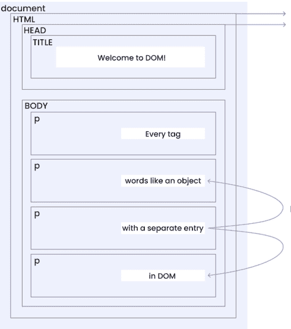
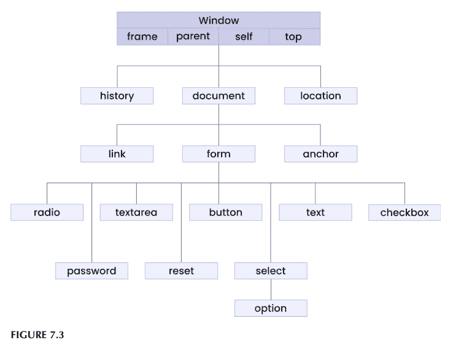
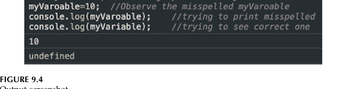

# JavaScript 语法与实践指南

## 致谢

还要非常感谢卡马克希·尼吉在本书撰写过程中的贡献和支持。很多时候，很难继续前进。在那些时刻，她给了我们光明，并毫不犹豫地介入并为这项工作做出贡献。我们很荣幸有迪布亚索姆和卡马克希与我们在一起。我们祝愿他们未来无论走到哪里，都能拥有快乐、成功和温暖。不用说，我们随时可以联系。

**萨里什玛·丹吉女士**目前在印度德拉敦格拉菲克·埃拉大学计算机科学与工程系担任助理教授。她是谷歌云认证的专业云架构师，专攻虚拟化和云计算领域。她是一位聪明、热情的年轻人，致力于创新研究工作，并致力于向高等教育行业传授优质教育。她在知名期刊上发表了许多研究论文，并撰写了关于“移动云计算：原理与范式”的书籍。她的研究兴趣包括区块链、虚拟化、车载自组织网络和实时内存取证。她目前正在全力以赴攻读博士学位。

## 引言

> ——丹尼斯·里奇

网页开发是开发网站以为用户提供静态或动态内容的过程。在网页开发的早期阶段，开发人员的目标是向用户提供静态内容，并允许通过互联网交换信息。慢慢地，利用网络进行商业和实时用户交互的机会出现了，从而开启了一个充满机遇的动态新世界。自那时以来，出现了许多技术、编程语言、设计框架和方法。然而，基础保持不变。

要理解客户端与服务端的区别，我们将使用这个非常简单的例子。

- a. 一个托管在远程网络服务器（服务端）上的静态输入页面。
- b. 网络服务器正在运行并托管静态输入页面；该页面可以直接通过域名或 IP 地址访问。
- c. 该网页包含所有的 HTML + CSS 代码；这些代码由网络浏览器解析并显示给客户端。
- d. 网络服务器将此动态网页发送回用户。

在这个例子中，步骤 (e)–(h) 可以通过使用`客户端 JavaScript`来省略。网络服务器可以在静态输入页面本身（HTML + CSS + JS）中包含 JavaScript 代码；接收到此页面后，网络浏览器可以在本地机器上执行 JS 代码，动态页面的生成可以在客户端本地完成。

最新的技术和框架，如 `Node.js` [5]、`ReactJS` [6] 和 `AngularJS` [7]，有助于部署先进的后端应用服务器。所有这些框架都将使用服务端脚本。

随着用户浏览器和服务器处理能力的提升，Web 出现了一种新型的基于 Web 的应用程序。服务器响应用户的请求，并发送一个`Web 应用程序`而不是静态页面，这被称为`客户端应用程序`，它在用户的浏览器上执行。这些是嵌入在网页 HTML 代码中的小型应用程序，根据用户的响应动态执行，无需与网络服务器来回通信。

JavaScript 最初开发时的代号是 `Mocha`。1995 年 9 月发布 `beta` 版时，它被命名为 `LiveScript` [9]。1995 年 12 月，它再次更名为 `JavaScript`。关于 JavaScript 的一个误解是它与 Java 编程语言有关，但除了语法设计上的一些相似之处外，Java 和 JavaScript 共同点很少。Java 在当时是一种非常流行的语言，Sun（现为 Oracle）使用 JavaScript 这个名字是一种营销策略。用 Christian Heilmann 的话说，“Java 之于 JavaScript，犹如汽车之于地毯” [10]。

ECMAScript 技术委员会，也称为 TC39，负责维护该语言 [15]。JavaScript 标准现在由 TC39 每年修订，现代浏览器随后根据规范进行更新。这导致了 JavaScript 的持续发展，并解决了它早期存在的许多问题。来自不同方面的所有共同努力使得 JavaScript 在市场上获得了广泛接受。

### 1.4 JavaScript 的特性

- **日期和时间**：JavaScript 为需要访问日期和时间工具的操作提供了内置方法。这允许用户在其 Web 浏览器上拥有定制的内容。
- **将函数作为对象使用**：JavaScript 中的函数被视为对象，可以同时拥有属性和方法。函数可以作为参数传递给其他函数，可以嵌套，可以作为异常抛出等。这种操作函数的多功能性使该语言易于使用，并更适合处理现实世界的用例。
- **事件处理**：每当发生事件时，就可以执行该事件对应的例程。此功能称为事件处理，JavaScript 大量使用它来响应网页上的用户活动，例如 `onClick`、`onLoad`、`onSelect` 行为。
- **执行速度**：JavaScript 是一种解释型语言，这意味着代码在执行前不需要编译。JavaScript 代码中的语句在浏览器中加载时即执行。总体而言，这导致开销减少，并提高了网页中 JavaScript 代码的执行速度。
- **客户端执行和验证**：脚本由服务器发送到客户端，客户端 Web 浏览器执行该脚本。数据验证也主要在客户端进行，而不是每次输入数据时都查询服务器端。这减少了服务器端的负载，并节省了大量的执行时间。

尽管 JavaScript 提供了相当多的功能和优点，但它也有一些局限性，列举如下：

- **多线程**：JavaScript 不提供多线程或多处理功能。Web 浏览器不允许单个网页同时使用多个线程，以避免并发问题。但是，多个选项卡可以拥有自己的独立线程并在其上工作。
- **调试**：JavaScript 是一种非常灵活的、基于原型的语言，因此有时很难确定错误来自何处。从多个原型、接口和对象继承会产生复杂的关系。Web 浏览器不会明确显示错误，除非明确处理。一个错误可能会停止渲染网页的其余部分。这导致大型程序的调试变得困难。

### 1.6 浏览器的结构

Web 浏览器由一组执行特定任务的组件组成。这些组件将在后面简要说明，并在图 1.3 中描绘。

**图 1.3**

### 1.7 向 JS 说 Hello World

JavaScript 代码总是写在`<script>`标签内。此标签代表代码的脚本部分，放置在 HTML 文档内（在 body 或 head 标签内），或者放置在单独的文档中。此示例使用 `console.log` 和 `alert()` 方法；两者都将在下一节讨论。

```html
<script>

</script>
```

#### 1.7.1 内置函数

- `confirm()` 是用于向用户请求确认的内置函数。它显示消息并为用户提供两个按钮：“确定”和“取消”[27]。
- `prompt()` 显示一个对话框，提示用户输入文本。
- `console.log()` 只是在网页浏览器的控制台上显示消息。它主要用于调试目的[30]。

JavaScript 生态系统包含许多工具，有助于开发、调试和支持开发者。JavaScript 开发者广泛使用各种工具、框架和库。这三者之间存在非常细微的界限，区分本身可能就很棘手。因此，在详细讨论此类工具之前，我们先定义这些术语并加以区分。

- **库**：它是一组函数的集合，旨在解决某些功能以执行任务。换句话说，库是紧密连接的函数集，涵盖单一主题或功能。

##### 1.7.2.1 框架、库和工具的示例

- **Express.js**：它是一个用于使用 `Node.js` 构建网站的 JavaScript 框架。Express.js 是一个健壮、稳定、快速且易于使用的框架。它对于构建单页应用、HTTP API 和网站以及路由很有用[31]。
- **NPM**：它是一个工具库，为 JavaScript 开发者提供支持。它提供构建工具，充当包和任务管理器，并作为注册表为开发者提供可重用的脚本。Node 包管理器脚本支持跨平台，并用于默认任务以及开发者特定的任务。它提供了设计、编写和执行用于测试和开发的独立脚本的能力[33]。

HTML 是一种使用标签来放置和组织内容的标记语言。HTML 中的开始标签和结束标签具有相同的名称。唯一的区别是结束标签附加了一个正斜杠（/）。JavaScript 代码主要放置在 HTML 标签内。JavaScript 代码放置在`<script>` ... `</script>`标签中。这可以通过以下任何一种方式完成：

```html
<head>
    <script type="text/javascript">
    </script>
    <h1> Test Data </h1>
</head>
```

```html
<head>
    <script type="text/javascript">
    <h1> Test Data </h1>
</head>
```

```html
<head>
    <h1> Test Data </h1>
    <script type="text/javascript">
</head>
```

```html
<head>
</head>
<body>
</body>
```

#### 1.9.1 理论

i. JavaScript 代码写在__________标签内。
   c. `<script>`

ii. 以下哪种语言构成了 Web 技术的三驾马车？
    c. JavaScript and XML

iii. 以下哪项不是 JavaScript 的特性？
     c. 它是一种标记语言。

iv. JavaScript 是由__________公司开发的。
    c. Netscape

v. JavaScript 最初构思时的原始名称是什么？
   c. Mocha

vi. JavaScript 是一种__________，__________编程语言。
    c. 高级，基于汇编

## 2 构建基础

> —Marijn Haverbeke

词法结构定义了任何编程语言的最低级别标记。词法结构是一组基本规则，用于从字符序列形成有效的标记[38]。标记由标识符、关键字、标点符号、字面量或运算符组成。语言特定内容，如字符集、变量命名、注释、终止符等，都用于定义词法结构；例如，它定义了变量应如何命名，如何在代码中添加注释或放置换行符等。

### 2.2.1 空白和注释

很多时候，一个开发者编写的代码在未来可能由另一个开发者调试、维护或处理。正确使用注释有助于新开发者理解和处理代码。有些系统甚至可以从代码中可用的注释生成有意义的报告。当行以 `//` 开头并以换行符结尾时，注释也被解释器视为空白。多行注释使用符号 `/*` 和 `*/` 表示。这些符号之间的任何内容都被视为注释。以下示例演示了两种类型注释的用法。

```javascript
// Demo Comments
// printing a line of code
```

### 2.2.2 大小写敏感

JavaScript 是区分大小写的语言。

### 2.2.3 语句终止

大多数语言如 C 和 Java 使用分号来终止一行代码。不同的是，JavaScript 对分号的要求是可选的。

### 2.2.4 字面量

```javascript
"Hello JavaScript"  // 字符串字面量
```

### 2.2.5 标识符

标识符是赋予字面量、变量、函数、属性或类的名称。该名称用于唯一标识一个变量、函数、属性或类。标识符在其作用域内必须是唯一的，命名标识符时必须遵循以下严格的命名规范[41]。

- 首字母可以是字母（a-z, A-Z）、下划线（_）或美元符号（$）。
- 在首字母之后，也可以使用数字（0-9）。

```javascript
_id;            // 有效的名称
void;           // 不允许，'void' 是保留关键字
```

### 2.2.6 关键字

JavaScript 中的保留关键字

| as | finally | const | package |
| :--- | :--- | :--- | :--- |
| catch | continue | function | switch |

### 2.3 变量

JavaScript 中变量的作用域可以是局部的或全局的。根据变量作用域的要求，可以在有效的变量标识符名称前使用 `var` 或 `let` 关键字进行声明。

```javascript
function dogType() {
    var dogName = "Tommy"; // 局部变量
    // dogName 被重新声明，也是一个局部变量
    var dogName = "Rocky";
}
```

变量的作用域定义了一组规则，用于确定使用哪个变量的值以及变量在何处可访问。

```javascript
var a = 6;
function scopeTest() {
    var b = a * 2;
}
// 2, 4, 12
```

**图 2.1**

阐述变量的作用域。

### 2.4.1 原始数据类型

```javascript
var someString = "Dummy String";
console.log(someString);          // Dummy String
someString = someString.toUpperCase(); // DUMMY STRING
```

以下部分解释了原始类型及其对应的包装对象；`valueOf()` 函数可用于将任何对象转换为其对应的原始数据类型。

```javascript
let str2 = 'our second string';    // 允许
```

#### String

```javascript
// 嵌入一个变量
// 输出：embed an expression 50
```

#### Number

```javascript
let a = 7895.00       // 允许使用带小数的值
```

- **BigInt**：在 JavaScript 中，`bigint` 是一种可以表示任意精度整数的数值数据类型。`bigint` 的包装对象是 `BigInt` [49]。

```javascript
let y = 46757n;
alert(y); // 输出："undefined"
```

- **Null**：顾名思义，`null` 表示一个 `空值` 或 `未知值`，对应于不存在或无效的对象或地址。在 JavaScript 中，`null` 被标记为原始类型，但在某些情况下，`null` 并非原始类型（因为稍后我们将看到所有对象都派生自 `null`，因此，`typeof` 运算符可能对 `null` 返回 object）。`null` 原始值没有任何包装对象 [52]。

```javascript
typeof null === 'object' // true;
```

### 2.4.2 非原始数据类型

在编程过程中，我们可能会遇到这样的情况：标识符的值一旦被赋值，就不应再次更改。通过 `let` 或 `var` 关键字声明的变量和标识符本质上是可变的，即它们的值可以更改为其他字面量或变量。这就是常量概念发挥作用的地方。关键字 `const` 用于声明常量，即它们的值一旦被赋值就不能更改。关于命名约定，常量名称始终用大写字母书写。

```javascript
// const CONSTANT_IDENTIFIER = assigned_value;
const PUBLISHER = `T&F`;
```

```javascript
let SUBJECT = { sub1: "math", sub2: "science", sub3: "hindi" };
SUBJECT.sub4 = "english";        // 添加新属性
```

```javascript
var age = 25;
console.log(age);          // 等同于 console.log(age.toString());
```

```javascript
var numberA = 10;
var numberB = "20";
console.log(numberA + numberB); // 输出是 1020
```

// 这是显式类型转换

JavaScript 通过使用内置方法（如 `Number()`、`String()`、`Boolean()` 等）提供显式转换。在 JavaScript 中，空字符串和使用 null 值总是返回 0。

```javascript
```

以下部分根据运算符的类型（如算术、逻辑、位运算等）介绍了不同类别的运算符。建议初学者程序员必须练习这些运算符，以掌握其工作原理和使用方法。

### 2.5.1 算术运算符

| 运算符 | 描述 | 示例 | 结果 |
| :--- | :--- | :--- | :--- |
| `+ 二元` | 加法 | `let a = 5 + 12` | `a = 17` |
| `/ 二元` | 除法 | `a = a / 4` | `a = 7` |
| `-- 一元` | 自减 | `a--` | `a = 1` |
| `** 二元` | 计算底数的指数幂。 | `a = 2 ** 3` | `a = 8` |

### 2.5.2 比较运算符

| 运算符 | 描述 | 示例 | 结果 |
| :--- | :--- | :--- | :--- |
| `== 二元` | 等于（不考虑类型） | `a == 7`<br>`a == 8`<br>`a == "7"` | `true`<br>`false`<br>`true` |
| `!== 二元` | 不全等（考虑数据类型和值） | `a !== "7"`<br>`a !== 7` | `true`<br>`false` |
| `< 二元` | 小于 | `a < 7` | `false` |

### 2.5.3 位运算符

**表 2.4**

| 运算符 | 描述 | 示例 | 结果（以 4 位显示） |
| :--- | :--- | :--- | :--- |
| `\| 二元` | 按位或 | `7 \| 1` | `(0111)₂ \| (0001)₂ = (0111)₂ = (7)₁₀` |
| `<< 二元` | 左移 | `8 << 1` | `(1000)₂ << 插入一个零 = (10000)₂ = (16)₁₀` |

### 2.5.4 逻辑运算符

逻辑运算符应用于布尔操作数或任何返回布尔值的表达式；结果也是布尔值 [58]。与其他运算符类似，如果操作数不是布尔值，则隐式类型转换会将任何字面量视为 true，并相应地执行操作。表 2.5 提供了使用逻辑运算符的参考示例。对于下表，我们假设 `x = 5` 且 `y = 10`：

**表 2.5 逻辑运算符**

| 运算符 | 描述 | 示例 | 结果 |
| :--- | :--- | :--- | :--- |
| `! 一元` | 逻辑非 | `!(x == y);`<br>`(x == y);` | `true`<br>`false` |

### 2.5.5 赋值运算符

**表 2.6**

| 运算符 | 描述 | 示例 | 结果 |
| :--- | :--- | :--- | :--- |
| `+=` | 加并赋值 | `x += 3` | `x` 包含 8 |
| `/=` | 除并赋值 | `x /= 3` | `x` 包含 5 |

### 2.5.6 三元运算符

```javascript
var var_name = (condition) ? value1 : value2;
// 等同于
if (condition) { var_name = value1 }
else { var_name = value2 }
```

条件是一个逻辑表达式，其结果为 true 或 false。如果逻辑值为 true，则将 `value1` 赋给变量名；否则将 `value2` 赋给变量名。例如，要测试选民的年龄，可以使用以下条件：

```javascript
let eligibleToVote = (user.age >= 18) ? "Yes" : "No";
```

### 2.5.7 逗号运算符

```javascript
var i;
for (i = 0; i < 10; i++, console.log(i)) {
    // 循环体
}
```

### 2.5.8 typeof 运算符

| 类型 | 结果 |
| :--- | :--- |
| Undefined | `"undefined"` |
| Number | `"number"` |
| Function object | `"function"` |

### 2.5.9 delete 运算符

```javascript
// 比较 void 7 即 undefined 与 '7'，返回 false
```

### 2.6 控制流语句

如前所述，开发者可能需要为不同的操作执行不同的决策。决策语句是仅在满足指定条件时才执行的语句。本节讨论这些决策结构在 JavaScript 中是如何实现的。

```javascript
if (condition) {
    /* this block of code,
    executes if condition is true */
}
```

```javascript
if (condition) {
    /* This block of code,
    executes if condition is true */
} else {
    /* executes if condition is false */
}
```

可能会出现需要从多个备选块中选择一个选项的情况，即需要根据某个条件的结果执行一段代码（从为不同条件提供的多个代码块中）。对于此类场景，可以使用 `else if` 语句阶梯。以下示例说明了 `else if` 语句与 `if` 和 `else` 语句的结合使用。

```javascript
if (rank < 10) {
    // code block
} else if (rank < 40) {
    // code block
} else {
    // code block
}
```

使用 `switch` 语句，可以指定评估后给出不同值或表达式的语句。然后，这些值可以与不同的 `case` 一起使用，其中每个 `case` 对应一个特定的值。每当执行 `switch` 块时，都会评估 `switch` 内部的语句。然后，结果值会与提供的 `case` 逐一匹配。如果值与某个 `case` 匹配，则执行相应的代码块；否则，匹配下一个 `case` 值。如果没有 `case` 与该值匹配，则执行 `default` 代码块。使用 `switch case` 语句的语法如下：

```javascript
switch (statement) {   // statement gives result as a,b,c or other value
    case a:                    // for a, this is executed
        // block of statements
        break;
    case b:                    // for b, this is executed
        // block of statements
        break;
    case c:                    // for c, this is executed
        // block of statements
        break;
    default:                   // if no case matches
        // block of statements
}
```

```javascript
switch (dayOfTheWeek) {
    case "Monday":
        // code
        break;
    case "Tuesday":
        // code
        break;
    case "Wednesday":
        // code
        break;
    case "Thursday":
        // code
        break;
    case "Friday":
        // code
        break;
    case "Saturday":
        // code
        break;
    case "Sunday":
        // code
        break;
}
```

#### 2.6.2 Loops and Iterations

`for` 循环是所有循环中最简单的，并且编写起来非常全面。`for` 循环接受一个初始值、终止条件和递增/递减条件作为输入。初始值仅用于初始化目的。测试终止条件，然后执行代码块。一旦代码块执行完毕，就会评估递增/递减条件以更新计数器的值。再次检查测试条件，如果计数器满足条件，则执行代码。这样，循环继续执行，直到计数器值不符合标准或满足终止条件。使用 `for` 循环的语法如下：

```javascript
for (initial value; termination condition; statement) {
    // code block
}
```

让我们通过一个简单的例子来理解 `for` 的用法。在这个例子中，变量 `i` 被初始化为 1，并设置为在值小于或等于 10 时执行。现在，代码块开始第一次执行，因为 `i` = 1 且小于 10；每次迭代后，`i++` 执行，使 `i` 的值增加 1。现在 `i` 的值是 2，仍然小于 10。这个过程重复进行，直到满足终止条件，即 `i` 变为 10。

```javascript
for (i = 1; i <= 10; i++) {
    // code block
}
```

##### 2.6.2.3 do-while loop

以下示例说明了 `do-while` 循环的用法。我们可以看到 `i` 的初始值是 20；这段代码仍然会输出一次，因为代码块执行一次，然后检查条件。使用 `while` 和 `do-while` 循环时，务必在代码块内指定递增或递减语句；否则循环将永远不会终止，并将无限期地继续执行。

```javascript
var i = 20; // Initialization
do {
    // code block
    i++; // Increment/Decrement
} while (i < 10);
```

### 2.7 Exercise

iii. JavaScript 语言支持哪些可用的运算符？请给出特殊运算符（如 `typeof`、逗号、`delete`、`void` 等）的示例。

***
***
***

i. JavaScript 是一种区分大小写的语言。

iv. JavaScript 中的语句块是指将一系列语句组合成一个复合语句的顺序集合。

#### 2.7.3 选择题

a. 抛出错误
d. 停止程序执行

a. 浮点数
d. 字符串

a. `\n`
d. `* *`

```javascript
var result;
switch (grade) {
    case 'A': result += " 10";
    case 'B': result += " 9";
}
```

c. 098

v. 运行以下代码片段时会发生什么？

```javascript
var counter = 0;
do {
    count++;
} while (counter < 20);
```
c. 计算了 counter 从 1 到 19 的值，但没有打印。

### 2.8 变量和赋值运算符的演示与实践

iii. 编写 JavaScript 代码来声明变量并为其赋值。

步骤 3：将下面给出的代码插入到 index.html 的 `<script>` 块中。

#### 2.8.3 探索

描述 JavaScript 中使用的数据类型及其重要性。编写代码使用各种运算符比较 JavaScript 中的变量。

```javascript
var p3 = "Acts as a container that holds a data value";
```

```javascript
var p3 = "Acts as a container that holds a data value";
var p2 = " Observe the code and watch the comment for easy understanding";
var x; // This is an undefined data type
```

```javascript
var myName = "Alex";        // Strings require double quotes
document.write(myNumber);   // used to print on page
document.write("<br> ");    // used for new line
x = "blue";
document.write("<br> Weekly pay: " + weeklyPay);
```

```javascript
var p2 = "In fact, the answer was also stored in a variable! It took three variables to make this program work.";
// take input from the user and store in variable
sum = a + b;
document.write("The total of your two numbers is: " + sum);
```

### 2.9 控制流语句的演示与实践

iii. 使用控制流来操作 CSS 和代码逻辑。

步骤 3：将下面给出的代码插入到 index.html 的 `<script>` 块中。

#### 2.9.3 探索

```javascript
// Reference to content-box in HTML,
let myTextContent = document.createElement("p");
};

if (isJavaScriptCool === 1) {
    /* Try adding some code here, and see it being processed, whenever condition is true. */
    // Append it to html, via above def. function:)
} else {
}
// Using '==' JavaScript will perform all sorts of coercions (Type-Casting) to
// Here's an instance,
    /* Keep in mind, 'isJavaScript' is integer, and being
    let msg = "True Block | | ";
}
```

##### 2.9.3.2 代码片段-2

```javascript
// Hello there, I'm Snippet-2.
const myInputBox = document.querySelector(".thoughts");
```

## 3 对象

面向对象编程范式被大多数主流编程语言所采用。对象、类、继承、多态、抽象等概念相结合，赋予了开发者创建更动态、设计更精良、更贴近现实世界解决方案的自由。同时，生成的代码也更易于维护、重用和调试。

快速练习：观察你周围的实物，思考它们可能处于的不同状态；思考它们表现出的不同行为。如果让你为这些对象建模，你会如何描述这些对象的状态和行为？尝试至少为 10 个不同的对象进行思考。

对象用于表示现实世界中的实体，这使得开发者更容易将编程作为解决方案。对象可以以有组织和内聚的方式存储数据。对象是 JavaScript 的基本数据类型。JavaScript 中几乎一切都是面向对象的，只有极少数原始数据类型除外；正如我们在前面章节中已经讨论过的，这些原始类型也有其包装对象。对象是可以包含多个值的变量，这些值以无序集合的形式存储。这些值可以通过对象的引用来更改或修改。对象通过分配给它的引用值来使用、表示和处理。引用值作为表示对象的手段，而对象本身又可以包含多个值。

```javascript
var obj2 = { "key1": "Value1", "key2": 1234 };
```

**图 3.1**

- **用户定义对象**是开发者根据需求在代码中创建的自定义对象。这些是使用最广泛的对象，允许操作和执行不同的操作，从而控制网页的行为。

对象具有属性，用于定义和描述特定对象的状态和行为。对象的属性总是有一个名称和一个关联的值。属性的名称始终是一个 `字符串` 或 Symbol（名称、数字或字符串字面量），它映射到一个实际的值。对象的属性类似于 Java 语言中的 `HashSet`，其中键必须是唯一的，因此值可以是任何类型，甚至可以是函数。值为函数的属性称为 `方法`。

```javascript
// 静态方式创建对象
var person2 = {};
person2["first Name"] = "Ram";
person2.gender = "M";         // 任何类型的属性
```

`点表示法` 用于访问和表示对象及其属性，例如 `objectName.propertyName`。如果键是多词的，则使用方括号。对象是可变的，即本质上是可更改的，并通过引用或句柄名进行操作。每个属性都包含一些额外的元数据；让我们在以下小节中理解。

### 3.2 对象属性特性

- **可写属性**：用于检查对象属性的值是否可以被 `赋值` 为新值。对于大多数内置对象，此属性默认为 `false`，而对于用户创建的对象，默认为 `true`。

```javascript
var book = {
    author: 'J.K. Rowling',
    value: "Harry Potter",
    writable: true
};
```

| 特性 | 类型 | 默认值 | 描述 |
| :--- | :--- | :--- | :--- |
| 键 | 字符串或符号类型 | 未定义 | 用户定义的键 |
| 可枚举 | 布尔值 | False | True |

对象属性之间的关系本质上是分层的。JavaScript 并不限制开发者只能使用对象的单层属性。相反，如前所述，在 JavaScript 中一切都是对象。因此，它允许对象的属性拥有自己的属性，进一步向下延伸层次结构。这样，数据结构可以在编程过程中动态扩展。这也意味着对象可以相互嵌套，以提供灵活的编程风格。这是一个非常强大的特性，允许在对象内创建具有扩展属性和方法的对象。

### 3.3 创建对象

- **使用字面量**：对象字面量是一个以逗号分隔的冒号（:）分隔的键值对列表，每对表示一个对象属性。对象字面量在每次遇到时都会创建并初始化一个新对象。每次解析或求值对象字面量时，它都会创建一个具有某些预定义配置属性和提供值的对象。

```javascript
let emptyObject = {};   // 没有属性的空对象
let room = {
    // properties
};
```

- **使用 new 关键字**：`new` 运算符创建并初始化一个对象。调用 `new` 关键字后必须跟一个方法调用。这个特殊方法称为 `构造函数`，主要用于创建和初始化新对象。JavaScript 为其内置数据类型提供了自己的内置构造函数。除了内置构造函数，还可以定义自定义构造函数来初始化对象。

```javascript
function Person(fName) {
    this.fName = fName;
}
```

```javascript
// 创建一个空对象
var obj3 = Object.create({ x: 1, y: 20 });
var obj5 = Object.create(myMother);
var obj6 = Object.create(Person.prototype);
```

### 3.4 对象作为记录和字典

| 记录 | 字典 |
| :--- | :--- |
| 事先指定的固定数量的属性 | 动态变化或可变数量的属性，可以根据需要扩展 |

在创建记录对象时，必须指定对象将要使用的信息的键值对。它允许存储具有不同数据类型的属性，因此用于创建需要存储特定但具有不同属性的对象。另一方面，使用对象作为字典允许代码动态添加所需的任意数量的属性，但所有属性必须具有相同的数据类型。无需事先指定每个属性；相反，可以在程序执行过程中根据需要随时添加属性。

#### 3.5.1 访问器和修改器

```javascript
book.title = "Harry Potter";
book["authored by"] = "J.K.Rowling";
var title = book.title;
var name = book["authored by"];
```

```javascript
var book = {
    title: "Harry Potter",
    author: "J.K.Rowling",
    get authorName() {
        return this.author;
    },
    set authorName(name) {
        this.author = name;
    }
};
```

```javascript
var book = {
    title: "Harry Potter",
    author: "no author defined",
    get authorName() {
        return this.author;
    },
    set authorName(parts) {
        this.title = parts[0];
    }
}; // 创建了一个带有 setter/访问器方法的 book 对象。
console.log(book.title); // Harry Potter
```

JavaScript 允许测试对象内部是否存在属性的功能。这可以通过以下任何一种方法实现：

```javascript
// 创建了一个 book 对象
var book = { title: "Harry Potter", author: "J.K.Rowling" };
console.log(book.author !== undefined); // 打印 true
```

```javascript
console.log("title" in book); // 打印 true
console.log("toString" in book);
```

```javascript
console.log(book.hasOwnProperty("author")); // 打印 true
console.log(book.hasOwnProperty("toString")); // 打印 false
```

- `propertyIsEnumerable()`：`propertyIsEnumerable` 方法是 `hasOwnProperty` 方法的更精细版本。仅当属性是对象自身的属性且可枚举属性设置为 `true` 时，它才返回 `true`。对于可枚举属性设置为 `false` 的属性（即不允许迭代这些属性），它返回 `false`。以下是演示其用法的示例。

```javascript
var book = { title: "Harry Potter", author: "J.K.Rowling" };
console.log(book.propertyIsEnumerable("title")); // 打印 true
```

#### 3.5.2 删除属性

```javascript
// 创建了一个 book 对象
var book = { title: "Harry Potter", author: "J.K.Rowling" };
// 从 book 对象中删除 title 属性
delete book.title;
console.log(book); // {author: "J.K.Rowling"}
delete book; // 对对象没有影响
```

成功删除属性后，返回 `true`，否则返回 `false`。如果要删除的属性不存在，则直接返回 `true`。如果对象的原型链中存在同名属性，则用户定义的属性被删除，对象使用原型链中存在的属性。

#### 3.5.3 对象方法

```javascript
var person = {
    fName: "Thomas",      // 添加属性 'fName'
    lName: "Shelby",
    fullName: function () { // 属性被赋值为一个函数
        return this.fName + " " + this.lName; // 使用 this 关键字
    }
};
```

在前面的例子中，我们创建了一个名为 `person` 的对象，并定义了三个属性：`fName`、`lName` 和 `fullName`。前两个属性现在你应该很清楚了；第三个属性 `fullName` 被赋值为一个 `function()`，这种赋值被称为 `方法`。方法的主体可以使用一个特殊的引用变量 `this` 来访问对象的所有其他属性。`this` 关键字用于表示所有者对象，即在此示例中，`this` 指向 `person` 对象。接下来展示了创建相同的 `person` 对象并为对象添加方法的另一种方式：

```javascript
let person = {                    // 创建对象
    fName: "Thomas",
    lName: "Shelby",
    fullName: function () {        // 使用 this 关键字
        return this.fName + " " + this.lName;
    }
};
```

所有从原型创建的 JavaScript 对象都从 `Object.prototype` 继承属性和方法。继承的属性是在 `Object.prototype` 上定义的方法。这些方法旨在被新创建的对象用更专门的实现所替换。JavaScript 允许轻松地将一个对象的属性复制到另一个对象，例如：

```javascript
let obj1 = { a: 1, b: 6 };
let obj2 = { c: 3 };
Object.assign(obj2, obj1);
// 遍历 obj2 的每个键
for (let key in obj2) {
    // ...
}
```

```javascript
Object.assign(target object, source object);
Object.assign(obj3, obj1);
```

- `toString()` 方法返回对象属性的字符串值，不接受任何参数。它主要在 JavaScript 中对对象使用运算符（如 `+`、`-` 运算符）时使用。它可以在需要字符串而不是对象的地方使用。默认情况下，`toString()` 方法传递的信息非常有限。因此，许多类都自行定义了此方法。

```javascript
let line = {
    toString: function () {
        return "Line";
    }
};
```

- `toLocaleString()` 方法返回调用对象的本地化字符串表示。默认情况下，此方法只是调用 `toString()` 并返回值。类可以为此方法定义自己的实现。

### 3.6 原型与继承

像 PHP、Java 和 Python 这样的编程语言是基于类的语言，使用类来创建对象。JavaScript 既是基于类的语言，也是基于原型的语言，它提供了原型，后来又支持了类来创建对象。使用原型，可以通过泛化对象共享不同的属性，这些对象可以进一步被克隆、扩展或继承 [72]。使用扩展功能被称为原型继承。JavaScript 中的每个对象都直接或间接地从原型继承。

每个对象还有一个名为 `__proto__` 的隐藏内部属性，该属性在代码中无法直接访问。可以使用 Object 原型提供的静态方法 `Object.getPrototypeOf(obj)` 来访问此隐藏属性。此方法返回属于传递对象的所有内置属性和方法的列表。

```javascript
var obj1 = {}; // 空对象，不继承任何东西
```

每个对象都包含 `[[Prototype]]`，即 `__proto__` 对象，它指向另一个对象或 null。想象一个对象 Z，其 `__proto__` 属性设置为 ObjectY，而 ObjectY 的 `__proto__` 属性设置为 ObjectX。这样，原型在需要时相互继承。一个原型可以链接到另一个原型，另一个原型又可以链接到另一个原型，从而构建一个原型链。如前所述，新创建的对象从一个或另一个原型继承。这些原型相互继承，导致创建原型链，其根始终是 `Object.prototype`。以下示例解释了这一点：

```javascript
var X = { key1: "value1" };
var Y = { key2: "value2" };
var Z = { key3: "value3" };
Y.__proto__ = X;
Z.__proto__ = Y;
```

同样，原型继承也可用于从其他原型继承方法；例如，在下面的代码片段中，`youTubePremiumUser` 通过 `__proto__` 对象继承了 `youTubeUser` 的属性和方法。鼓励你在自己的机器上尝试执行此代码，你将观察到 `youTubePremiumUser` 从 `youTubeUser` 继承了 `getEmail` 方法。

```javascript
let youTubeUser = {
    viewContent: true,
    getEmail: function() { return "user@youtube.com"; }
};

let youTubePremiumUser = {
    downloadContent: true,
};

youTubePremiumUser.__proto__ = youTubeUser;
console.log(youTubePremiumUser.getEmail()); // 返回 true
```

**图 3.3**

### 3.7 类

你一定想知道为什么我们在讨论对象之后才讨论类。嗯，JavaScript 类是在 2015 年的语言规范 ES6 中引入的 [73]。在 2015 年之前，每个对象都有一个名为 `[[Prototype]]` 的内部属性。这个原型用于为对象提供不同的属性和方法。

一个类总是有自己的构造函数。构造函数用于初始化新创建对象的值。它是一个用于创建和初始化对象的特殊方法，该对象通过类进行实例化。一个类只能有一个构造函数。每次创建新对象时，都会调用类中的构造函数来初始化该对象的属性。如果一个类中存在多个构造函数定义，则会抛出 `SyntaxError`。

```javascript
class Person { // defining the class
    constructor(uid, name) {
        this.uid = uid; // usage of this keyword
        this.name = name;
    }
    greetings() { // adding a method to class
        return "Hello " + this.name;
    }
}

// creating e1 object from class Person
var e1 = new Person(925, "John");
var e4 = new Person(926, "Ron");
```

在这个例子中，创建了一个新类，它有一个构造函数和两个属性，即 `uid` 和 `name`。除了用于初始化属性的构造函数外，还提供了一个方法 `greetings()`。当对象将该方法作为属性调用时，它会执行并显示输出。

类可以被扩展以向现有类添加额外功能。任何类都可以被扩展，以添加更多属性和方法来增强其用途。一个类可以使用关键字 `extends` 扩展父类。子类可以使用关键字 `super` 调用超类的构造函数，这会调用父类构造函数。在下面的例子中，之前使用的 `Person` 类被用作基类来创建一个新的 `Student` 类，该类具有更多的属性和方法。

```javascript
class Student extends Person {    // extending from parent
    constructor(uid, name, age, gender, lastName) {
        super(uid, name); // chaining constructor to call parent
        this.age = age;
        this.gender = gender;
        this.lastName = lastName;
    }
    getAge() { return this.age; }
}

var s1 = new Student(3674, "Anne", 24, "F", 'Hathaway');
s1.getFullName(); // returns "Anne Hathaway"
```

#### 3.7.3 类中的 Getter 和 Setter

使用 getter 和 setter 方法而不是直接操作对象属性是一种安全可靠的选择。它保护了被检索和操作的数据的完整性。这些方法可以使用之前讨论过的 `set` 和 `get` 关键字来定义。接下来的例子展示了它们在实际中的用法。

```javascript
class Person {
    constructor(age) {
        this.age = age;
    }
    get age() {
        return this._age;
    }
    set age(x) {
        this._age = x;
    }
}

var obj = new Person(25);
console.log(obj.age); // 25
obj.age = 56; // calling set age(56) through property name
console.log(obj.age); // 56
```

#### 3.7.4 静态成员

有时，没有必要为每个对象创建一个方法或变量，为了节省内存，我们只需要该属性的一个副本。在这种情况下，JavaScript 提供了静态成员的使用。静态成员属于类，而不属于单个对象。因此，它随类一起存在，实例化的对象只能访问此属性，但它们永远不拥有此属性 [75]。

```javascript
class Account {
    static totalAccountHolders = 0; // static property
    static rateOfInterest = 5.5;
    constructor(branch) {
        this.branch = branch;
        Account.totalAccountHolders++; // incrementing static member when new object is created
    }
    static getRate() { // static method
        return Account.rateOfInterest;
    }
}

console.log(Account.rateOfInterest); // call to static property
console.log(Account.getRate()); // call to static method
```

### 3.8 垃圾回收

很多时候，对象引用会被传递、赋值和重新赋值多次。这会在实际对象及其引用之间创建复杂的关系。一旦一个引用变得不可达，它就会被删除。在移除或重新赋值这些引用之前，必须小心谨慎。

**图 3.5**

```javascript
class Human {
    constructor(ID, name) {
        this.ID = ID;
        this.name = name;
    }
}

var user1 = new Human(123, "Alice");  // 创建新对象
user1 = null; // 设置为 null
console.log(user1.name);      // 不工作
```

在这段代码片段中，对象 `user1` 使用构造函数创建，并被设置为 `null`。将引用值设置为 `null` 使其准备好被垃圾回收器删除。此外，第二个场景演示了如果单个引用是一个指向该对象的变量，那么它将不会被删除或标记为待删除。第二个场景演示如下：

```javascript
var user1 = new Human(123, "Alice");  // 创建新对象
var user2 = user1; // 另一个引用指向同一对象
user1 = null; // 第一个引用设为 null
console.log(user2.name);  // 工作正常
```

### 3.9 练习

iii. 你对 JavaScript 中的原型继承有何理解？讨论开发者应该使用原型继承的用例。

vi. 编写一个程序来遍历对象的属性，并在控制台中显示它们。

iii. 全局变量优先于局部变量的值。

i. 在开发网站的不同阶段，Web 开发人员会遇到以下哪些对象？
   c. 原生对象

ii. 可以使用以下哪个关键字调用对象？
    c. Object

iii. 当一个类 ‘C’ 在程序中扩展另一个类 ‘D’ 时，我们可以说类 ‘C’ 是 __________ 类，类 ‘D’ 是 __________ 类。
     c. a 和 b 都正确

iv. 以下程序代码的输出是什么？

```javascript
function newPerson() {}
function obj() {}
obj.prototype = Object.create(newPerson.prototype);
```

b. 无法编译

```javascript
const constantOne = {};
const constantTwo = Object.create(constantOne);
console.log(Object.getPrototypeOf(constantTwo) === constantOne);
```
a. False

d. 0

i. 创建一个 JavaScript 对象并了解其属性。

步骤 1：访问 https://www.routledge.com/9780367641429 并下载 Ch3_Object_Template 的 zip 文件。

步骤 4：对接下来给出的每个代码片段重复上述三个步骤。

```javascript
const appendToHTML = (contents) => {
    contents.forEach((content) => {
        const myPara = document.createElement("p");
        myPara.innerHTML = content;
        resultHere.appendChild(myPara);
    });
    const separator = document.createElement("hr");
    resultHere.appendChild(separator);
};

/*******************************************************
******** */

const NetFlix = {
    content: ["Sherlock Holmes", "Enola Holmes"],
    streamService: function (choice) {
        return this.content[choice];
    }
};

appendToHTML(["虚拟对象 1: ", Object.values(NetFlix)]);
var NetFlix1 = new Object();
appendToHTML(["虚拟对象 2: ", JSON.stringify(NetFlix1)]);
var NetFlix2 = {
    content: ["Sherlock Holmes", "Enola Holmes"],
    streamService: function (choice) {
        // 它指向当前被调用的对象，用于解决可能存在的歧义。
        return this.content[choice];
    },
    get cust() {
        // customer 属性的 getter。
        return this.customer;
    },
    set cust(newCust) {
        // customer 属性的 setter。
        if (newCust !== null) {
            this.customer = newCust;
        } else {
            this.customer = "Guest";
        }
    }
};

// 使用 getter。
appendToHTML(
    [
        `当前正在播放内容-1：${NetFlix2.streamService(0)}`,
        `客户：${NetFlix2.cust}`
    ]
);
```

```javascript
var p2 = "In fact, the answer was also stored in a variable! It took three variables to make this program work.";
// take input from the user and store in variable
sum = a + b;
document.write("The total of your two numbers is: " + sum);
```

#### 3.10.3.3 代码片段-3

```javascript
// 工具函数 ()
const appendToHTML = (contents) => {
    const resultHere = document.querySelector(".results");
    contents.forEach((content) => {
        const myPara = document.createElement("p");
        resultHere.appendChild(myPara);
        myPara.innerHTML = content;
    });
    const separator = document.createElement("hr");
    resultHere.appendChild(separator);
};

/*******************************************************
******** */

// 定义蓝图以创建相同类型的实例（即对象）
class NetFlix {
    constructor(content) {
        this.content = content;
    }
    // 对象方法
    streamService(choice) {
        // 方法定义
        // 它指向当前被调用的对象，用于解决可能存在的歧义。
        if (choice < this.content.length) {
            return this.content[choice];
        }
        return "未订阅，抱歉！";
    }
    get cust() {
        return this.customer.toUpperCase();
    }
    // customer 属性的 setter。
    set cust(newCust) {
        if (newCust !== null) {
            this.customer = newCust;
        }
    }
}

var nfAsia = new NetFlix(["Witcher", "Two man and a half"], "Dummy Dumdumdum");
NetFlix.prototype.region = "Global";

appendToHTML(
    [
        `当前正在播放内容-2：${nfAsia.streamService(5)}`,
        `流媒体服务位置：${nfAsia.region}`,
    ]
);

var nfUk = new NetFlix(["Peaky Blinders", "The Crown"]);
appendToHTML(
    [
        `当前正在播放内容-3：${nfUk.streamService(1)}`,
        `流媒体服务位置：${nfUk.region}`,
    ]
);
```

## 4 函数

> ——普兰舒·米达

### 4.1 JavaScript 中的函数

让我们了解 `Function` 对象内部可用的属性和一些重要方法。

- `Function.prototype.length`：此属性存储传递给函数的参数数量；这可以在 Web 浏览器的控制台中使用 `functionIdentifier.length` 来检查。
- `Function.prototype.apply()` / `bind()` / `call()`：这三个方法用于作用域处理；它们将在下一节关于函数作用域中单独讨论。

### 4.2 函数变量作用域

### 4.3 函数声明

这种方法是自 JavaScript 语言诞生以来就支持的传统函数声明方式。传统函数通过使用关键字 `function` 声明，后跟函数名。函数名遵循与变量相同的命名规则，即可以使用字母、数字、下划线和美元符号。请参阅第 2.2.5 节了解变量的命名约定。传统上，定义函数的语法如下所示：

语法：

```javascript
function functionName(parameters) {
    // 一组语句 - 函数体
}
```

例如：

```javascript
function add(num1, num2) {
    return num1 + num2;
}
var result = add(2, 3);
```

虽然前面的函数声明在语法上是一个语句，但函数也可以通过使用函数表达式来创建。创建的函数是匿名的；它们不需要有名称，并被赋值给一个变量。由于函数也是对象，因此将其引用值赋给变量是完全有效的 [81]。例如，函数 `square` 可以定义如下：

```javascript
const square = function (number) {
    return number * number;
};
var result = square(4);            // result 获得值 16
```

当将函数作为参数传递给另一个函数时，函数表达式很方便。在下一个示例中，`map` 函数在语法上被定义，并创建了另一个匿名函数并将其赋值给 `cubeCalculator` 常量。此外，请注意 `cubeCalculator` 被传递给 `map` 函数，就像任何其他对象一样。

```javascript
function map(placeHolder, a) {
    let result = [];
    for (let i = 0; i < a.length; i++) {
        result[i] = placeHolder(a[i]);
    }
    return result;
}
const cubeCalculator = function (x) {
    return x * x * x;
};
let numbers = [0, 1, 2, 5, 10];
let cube = map(cubeCalculator, numbers);
```

### 4.3.1 箭头函数

箭头函数表达式是使用特殊箭头 `=>` 运算符编写匿名函数表达式的简写形式。这类函数有其自身的优点和局限性。箭头函数总是返回某个值。箭头函数可以有紧凑的主体或块主体 [82]。对于紧凑主体，只需要一行表达式，不需要 `return` 语句。对于块主体 `{}`，则需要 `return` 语句，如示例所示：

```javascript
var func = x => x * x; // 紧凑主体语法，隐式 "return"
```

```javascript
// 转换为箭头函数的步骤
function (a) {
    return a + 100;
    // 函数，表示 {} 和 return 语句
};
(a) => a + 100;
```

- 箭头函数不能用作方法，因为它们没有自己的 `this` 和 `super` 绑定。
- 箭头函数不能用作构造函数的简写。

### 4.3.2 函数作用域与 this

```javascript
var num1 = 10;
var num2 = 3;
function multiply() {
    return num1 * num2; // 可以访问全局变量
}
function getScore() {
    var name = "Player";
    return name + ' scored ' + (num1 + num2);
}
```

```javascript
var dummyObject = {
    num: 100
};
// 在 window 上设置 "num" 以展示它如何不被使用。
// 目前将其视为全局作用域
var add = function (a, b, c) {
    return this.num + a + b + c;
};
var result = add(1, 2, 3);

// 将作用域建立为 "dummyObject"
// 使用 apply
console.log(add.apply(dummyObject, [1, 2, 3])); // 结果 106

// 将作用域建立为 "dummyObject"
// 使用 bind
var boundAdd = add.bind(dummyObject);
console.log(boundAdd(1, 2, 3));        // 结果 106
```

此示例演示了这三种方法如何在调用方法时关联 `dummyObject` 的作用域以及访问局部 `num` 值。而在传统函数调用中，使用的是 `num` 的全局值，即 `window.num`。这种基本理解将帮助我们掌握后续章节中讨论的箭头函数的局限性。

让我们通过一些例子来理解前两个限制。下一个示例演示了在传统函数和箭头函数中 `this` 的价值。这里，`demoObject` 被创建了三个属性：`a`、`arrowFunction` 和 `traditionalFunction`，其中后两者分别是箭头函数和传统函数。此外，当通过 `demoObject` 对象调用这些方法时，我们可以观察到传统函数能够使用 `this` 引用打印出值 10。而 `arrowFunction` 则通过 `this` 引用打印出一个 `window` 对象。这是因为 `arrowFunction` 没有任何局部作用域，并且总是在全局作用域中定义，在 JavaScript 中，全局作用域就是一个 `window` 对象。至于 `window` 对象，不用担心；我们将在 DOM 章节（第 7 章）详细讨论它。

```javascript
var demoObject = {
    a: 10,
    arrowFunction: () => console.log(this.a, this),
    traditionalFunction: function () {
        console.log(this.a, this);
    }
};

demoObject.arrowFunction();
// 打印 undefined, Window {...} (或全局对象)

demoObject.traditionalFunction(); // 打印 10, Object {...}
```

下一个示例与我们之前讨论过的 `call`、`apply` 和 `bind` 方法有关，它演示了这些方法不适用于箭头函数。原因是箭头函数根据其定义所在的作用域来建立 `this`，即通常是 `window` 对象。

```javascript
// 不支持 call、apply 和 bind 的箭头函数示例。

// 一个拥有自己 "this" 的简单对象。
var dummyObject = {
    num: 100
};

// 在 window 上设置 "num" 以展示它是如何被获取的。
window.num = 2000;

/* 目前假设 window 对象存在于全局作用域中 */

// 箭头函数
var add = (a, b, c) => this.num + a + b + c;

// 对箭头函数使用 call
console.log(add.call(dummyObject, 1, 2, 3));
// 结果 2026

// 对箭头函数使用 apply
const arr = [1, 2, 3];
console.log(add.apply(dummyObject, arr));
// 结果 2026

// 对箭头函数使用 bind
const bound = add.bind(dummyObject);
console.log(bound(1, 2, 3));
// 结果 2026
```

从这个例子中，你现在应该清楚了，`call`、`bind` 和 `apply` 方法对方法调用没有产生任何影响，并且每次都使用了 `window.num`。这证明了箭头函数不支持 `Function.prototype` 的作用域方法的说法。

### 4.4 函数中的参数

参数是传递给函数的一组值，可能有助于函数的执行。一个函数可以声明零个、一个或多个参数。函数声明中最多可以容纳 255 个参数。当通过函数名调用函数时，参数被传递。这些参数在被函数接收后就变成了实参。值被复制到函数实参中，因此，对这些实参的任何更改实际上都不会反映在原始值中。当参数通过引用传递时，更改会反映在变量中。函数的实参不限于字符串或数字。你甚至可以将整个对象作为参数传递给函数以进行操作。

#### 4.4.1 函数中的 return 关键字

`return` 语句可用于将信息返回给调用变量。它们在函数声明中是可选的。它们可以放置在代码中的任何位置，但通常作为最后一条语句编写。当函数遇到 return 语句时，它会停止执行并返回到调用代码。函数中的多个 return 语句允许函数根据代码设计返回到其中任何一个。也可以使用空的 `return` 语句。它将向调用代码返回 `undefined`。

#### 4.4.2 调用函数

声明函数只是指定一组语句做什么，并将它们附加到一个名称上。为了实际执行这些语句，必须通过其名称 `调用` 或 `调用` 函数。在接下来的示例中，`square` 函数以参数 5 被调用，即 `square(5)`。结果随后存储在变量 `z` 中。函数应该存在于调用它的作用域内。

```javascript
const square = function (n) {
    return n * n;
}; // 将方法声明为表达式

console.log(square(5));
// square 以参数被调用
```

#### 4.4.3 递归

递归是重复执行任务的过程。在解决问题时，我们可以将其分解，并反复执行一些语句来解决手头更大的问题。当对一段代码重复执行此操作时，就称为递归 [83]。最适合演示递归的例子是计算一个数的阶乘。例如，如果我们必须计算 5 的阶乘；这是一个递归问题，解决方案很简单。如果我们知道 4 的阶乘值，进而知道 3 和 2 的阶乘值，最终知道 1 的阶乘是 1，那么更大的问题就可以合并来计算计算 5 的阶乘这个实际问题。这通过以下示例以编程方式演示：

```javascript
function factorial(n) {
    if ((n === 0) || (n === 1)) // 使用 OR 运算符
        return 1;
    else
        return (n * factorial(n - 1));
    /* 递归调用自身，直到满足终止条件 */
}
```

#### 4.4.4 闭包

闭包是将嵌套函数绑定到其父函数的局部变量的过程 [84]。这使得嵌套函数即使在父函数执行结束后也能使用局部变量 [85]。换句话说，闭包允许你从内部函数访问外部函数的作用域。

在 JavaScript 中，每次创建函数时都会创建闭包。以下示例演示了闭包的用法。在这个例子中，我们定义了一个函数 `greeting(x)`，它接受一个参数 `x` 并返回一个新函数。它返回的函数接受一个参数 `y` 并返回 `x` 和 `y` 的连接。我们通过分别传入 `Hi` 和 `Bye`，从 `greetings` 函数创建了两个函数表达式，即 `sayHi` 和 `sayBye`。`greetings()` 函数返回的两个函数具有相同的函数体，但 `x` 的值不同，即 `Hi` 和 `Bye`。这里，`sayHi` 和 `sayBye` 是从函数 `greetings()` 创建的闭包。

```javascript
function greeting(x) {
    return function (y) {
        return x + y;
    };
}

var sayHi = greeting("Hi");
var sayBye = greeting("Bye");

console.log(sayHi("Tom")); // Hi Tom
console.log(sayBye("Tom")); // Bye Tom
```

### 4.5 练习

#### 4.5.1 理论

i. 区分函数声明和函数表达式。
ii. 区分函数中属性和特性的使用。
iii. 你对 JavaScript 中的闭包有什么理解？
iv. 你认为为什么在 JavaScript 中引入了箭头函数？请用合适的代码解释箭头函数的用法。
v. 在使用函数时，`bind()`、`call()` 和 `apply()` 方法之间有什么区别？请使用合适的程序代码来区分它们。

#### 4.5.2 判断题

i. 在 JavaScript 中，函数必须返回一个值。
ii. 对于使用表达式定义的函数，函数名是可选的。
iii. 所有用户创建的函数都继承自 `Function` 原型。
iv. 可以在运行时向函数传递可变数量的参数。
v. `length` 属性可用于检查函数在其声明中声明的参数数量。
vi. `Function()` 构造函数每次调用时都会创建一个新函数。
vii. JavaScript 中的函数不能在运行时动态创建。
viii. JavaScript 不允许函数嵌套。

#### 4.5.3 选择题

i. 当 __________ 方法以一个对象作为参数调用时，它返回一个新函数。
   a. `valueOf()`
   b. `bind()`
   c. `call()`
   d. `apply()`

ii. 新创建的函数继承自原型。它继承自以下哪一项？
    a. `Object`
    b. `Function`
    c. `Number`
    d. a 和 b 都是

iii. __________ 被定义为函数及其作用域的组合，其中函数的变量被定义。
     a. 绑定
     b. 闭包
     c. 递归
     d. 以上都不是

iv. 为了调用一个函数，可以使用以下方式：
    a. 函数字面量
    b. 函数调用
    c. 函数声明
    d. 使用原型

v. 以下代码片段的输出是什么？

```javascript
var x = 9;
function outerFunction() {
    var x = 3;
    function innerFunction() {
        x++;
        var x = 4;
        console.log(x);
    }
    innerFunction();
}
outerFunction();
```

- a. 打印 '4'
- b. 产生错误
- c. 打印 3
- d. 打印 '6'

### 4.6 函数演示与实践

#### 4.6.1 目标

i. 定义一个基本函数。
ii. 理解 `length` 属性、`bind`、`call`、`apply` 和 `toString` 方法。
iii. 理解 JavaScript 闭包的概念和示例。

#### 4.6.2 前提条件

步骤 1：访问 https://www.routledge.com/9780367641429 并下载 Ch4_Function_Template 的 zip 文件。
步骤 2：解压内容，并在你选择的任何编辑器（例如：记事本或 Visual Studio Code）中打开 `index.html`。
步骤 3：将接下来给出的代码插入到 `index.html` 的 `<script>` 块中。
步骤 4：对接下来给出的每个代码片段重复上述三个步骤。

#### 4.6.3 探索

使用任何编辑器，我们将编写并测试 JavaScript 代码来定义函数。以下是关于函数你应该知道的内容。函数是一段命名的代码，一旦定义，就可以被调用和执行任意次数。它减少了代码行数，使调试更容易，并使代码模块化。

##### 4.6.3.1 代码片段-1

```javascript
// 工具函数 ()
const appendToHTML = (contents, color = "white") => {
    contents.forEach((content) => {
        const myPara = document.createElement("p");
        myPara.style.color = color;
        myPara.innerHTML = content;
        resultHere.appendChild(myPara);
        sep();
    });
};

const sep = () => {
    const separator = document.createElement("hr");
    resultHere.appendChild(separator);
};

/*******************************************************
******** */

var resultHere = document.querySelector(".results");

// JS 函数绑定
// 创建一个员工对象
const employee = {
    _name: "JavaScript",
    getName: function () {
        return this._name;
    },
};

appendToHTML(["~ Function.bind() ~"]);

const unboundGetName = employee.getName;
// 该函数在全局作用域被调用
appendToHTML([`未绑定的获取名称 > ${unboundGetName()}~`], (color = "orange"));
// 预期输出：undefined

// 此处分隔
sep();

const boundGetName = unboundGetName.bind(employee);
appendToHTML([`绑定的获取名称 > ${boundGetName()}`], (color = "lime"));
// 预期输出：42

/*******************************************************
******** */

appendToHTML([
    "Function.length | 返回函数期望的参数数量",
]);
sep();

appendToHTML(
    [
        `appendToHTML.length > ${appendToHTML.length}`,
        "它是 1，因为另一个参数是可选的。",
    ],
    (color = "lime")
);
sep();

/*******************************************************
******** */

appendToHTML([
    "call() | 使用给定的 `this` 值和单独的参数调用一个函数，这就是 `call` 和 `apply` 之间的区别，因为 `apply` 只能接受一个数组参数。",
]);

function Product(name, price) {
    this.name = name;
    this.price = price;
}

function Food(name, price) {
    Product.call(this, name, price);
    this.category = "food";
}

appendToHTML(
    [
        `实例化 Product > ${new Product("MacOS BigSur", 1000).name}`,
        `实例化 Food，它调用了 Product 构造函数 > ${new Food("cheese", 5).name}`,
    ],
    (color = "lightgreen")
);
// 预期输出#1："MacOS Big-Sur"
// 预期输出#2："cheese"
```

##### 4.6.3.2 代码片段-2

```javascript
// 工具函数 ()
const appendToHTML = (contents, color = "white") => {
    contents.forEach((content) => {
        const myPara = document.createElement("p");
        myPara.style.color = color;
        myPara.innerHTML = content;
        resultHere.appendChild(myPara);
        sep();
    });
};

const sep = () => {
    const separator = document.createElement("hr");
    resultHere.appendChild(separator);
};

/*******************************************************
*******/

var resultHere = document.querySelector(".results");

appendToHTML([
    "Function.toString | 返回格式化为字符串的函数定义（源代码）",
]);
sep();

appendToHTML(
    [
        `appendToHTML.toString() > ${appendToHTML.toString()}`,
        `sep.toString() > ${sep.toString()}`,
    ],
    (color = "lime")
);
sep();

/*******************************************************/
```

```javascript
appendToHTML([
    "箭头函数 | 箭头函数表达式是传统函数表达式的紧凑替代方案，",
]);

// 传统函数
function randomBetween(a, b) {
    return Math.random() * (b - a) + a;
}

// 箭头函数等价形式
const randomBw = (a, b) => Math.random() * (b - a) + a;

appendToHTML(
    [`randomBetween(1,100) : ${randomBetween(1, 100)}`],
    (color = "lightblue")
);

appendToHTML(
    [
        `randomBw(1,100) : ${randomBw(1, 100)} (注：与 randomBetween 等价，但使用箭头方式声明。)`,
    ],
    (color = "orange")
);
sep();

/***********************************************/

appendToHTML(["JavaScript 闭包"]);

// `add` 被赋值为一个自调用函数，该函数将 `counter` 设置为 0，
// 并返回一个函数表达式，这使得 `add` 成为一个函数。
// 后续调用会调用 `add`，即现在的内部函数，它保留了 `counter` 的值，
// 因为 `counter` 存在于其父作用域中。
// 这被称为闭包，它使得 JavaScript 函数拥有私有变量。
// 这种功能无法通过将 `counter` 设为全局变量来实现，因为任何其他函数也可以递增它。
// 通过闭包，隐私得到强制执行，只有 `add` 可以递增并保留 `counter`。

var add = (function () {
    var counter = 0;
    return function () {
        counter += 5;
        return counter;
    };
})();

var counter = 0;
function addNonClosure() {
    var counter = 0;
    counter += 5;
    return counter;
}

add();
add();
addNonClosure();
addNonClosure();

appendToHTML(
    [
        `add() 返回了 ${add()}`,
        `addNonClosure() 返回了 ${addNonClosure()}`
        // 本应是 15`,
    ],
    (color = "lime")
);
```

## 5 数组

> 我们面临着广泛的威胁，这意味着我们必须具备广泛的能力。
> ——麦克·索恩伯里

我们已经理解了 JavaScript 中对象和函数的概念；现在是时候转向数组了。如果我们告诉你，数组是一个用于存储不同元素的单一变量，你可能会想：“既然我可以简单地将多个值存储在对象中，为什么还要学习数组？”这个问题的答案在于，`数组` 是 JavaScript 中的特殊对象，除了表现得像普通对象外，还提供了多种特性。

对象被视为现实世界实体的表示，而数组是不同类型元素的集合，并提供了多种内置属性和方法来访问和修改这个列表。本章旨在让你理解数组的概念，以及如何在 JavaScript 程序中使用其内置属性和方法。与某些其他语言中的对应物不同，JavaScript 数组使用起来非常愉快——这是它们绝对做对的地方。

### 5.1 数组

传统上，数组是具有预定义长度的连续内存分配。尽管在 JavaScript 中它们在许多方面有所不同，但 JavaScript 数组是一个具有独特构造函数、字面量语法以及从 `Array.prototype` [86] 继承的一组额外属性和方法的特殊对象。在 JavaScript 中，数组是一个单一变量，用于存储相同或不同类型的多个元素。值以类似列表的顺序存储，可以使用从 0 开始的数字索引进行访问。数组不能使用字符串作为元素索引（如在关联数组中），而必须使用整数。数组的长度和类型不是固定的，可以随时更改。数组的存储也是稀疏的，因此数据可以存储和访问在非连续的位置。

普通对象也可以存储多个值，但它不提供像 JavaScript 中数组那样的特殊函数。这些方法提供了灵活性。

### 5.2 数组的属性

如前所述，数组是特殊的对象，因此它们包含一些预定义的属性和方法。这使得它们在程序中易于高效使用。数组的属性可以通过使用 `Object.getOwnPropertyNames(Array)` 来获取。`Array` 对象（`Array` 类）包含以下实例属性和静态方法：

- `Array.name`：这是一个返回 `Array` 字符串值的属性。此属性仅作为对象名称的占位符。
- `Array.isArray`：这是一个静态方法，在检查作为参数传递的对象是否属于 `Array` 对象后，返回 `Boolean` 输出。
- `Array.from()`：这是一个静态方法，用于从预定义的 `Array` 对象或可迭代对象返回一个新数组。
- `Array.of(elements)`：这是一个静态方法，用于从可变数量或类型的参数返回一个新的 `Array` 对象。
- `Array.prototype.length`：这是所有 `Array` 类型对象都继承的属性；此属性返回实例中的值的数量。
- `Array.prototype`：此属性最为重要，因为它包含所有特殊的内置方法及其默认对象方法。所有 `Array` 类型的对象都继承此属性。新创建的数组对象使用这些内置方法功能强大，开发者可以根据需要使用它们。

### 5.3 声明数组

数组操作非常频繁，你很快就不必记住这些声明了。它们会随着练习自然而然地掌握。不过，我们仍将详细讨论数组声明。声明数组有两种方式：即使用数组字面量或使用构造函数。以下小节将通过示例进行说明。

#### 5.3.1 数组字面量

数组声明中使用的方括号也称为数组字面量或数组初始化器 `[ ]`。使用 `var` 关键字，我们可以创建名为 `array_name` 的数组，初始化的值放在 `[ ]` 内。每个值使用逗号运算符分隔。这种声明数组的方式因其简单性、更快的执行速度和代码的易读性而被广泛使用。

语法：

```javascript
var array_name = [val1, val2, val3, val4 ... valN];
```

例如，以下数组 `worker` 包含五名工人的名字。这些名字存储在一个索引值从零开始的数组中。数组的 `length` 将为 5（0,1,2,3,4），这等于数组中总共有五个元素，其中 `Alice` 的键为 0，`Tim` 的键为 2，`Charlie` 的键值为 4。

```javascript
var worker = ["Alice", "Bob", "Tim", "Kim", "Charlie"];
```

JavaScript 还允许在单个数组中存储不同类型的数据，包括整数、字符串、空对象、对象等。观察同一数组实例中的异构类型数据。

```javascript
var worker_heterogeneous = ["Alice", { "id": 101, "name": "Bob" }, "Tim", "Kim", 101];
```

#### 5.3.2 使用 New 关键字和数组构造函数

也可以使用 `new` 关键字创建一个新的数组对象，该关键字创建一个 `Array` 的实例。然后应显式提供数组中的值。如前所述，数组的索引从零开始，但这并不是限制只能从索引零开始输入值。因此，可以根据程序的需要轻松填充数组。通常，这种方法被避免使用，因为它给代码增加了不必要的复杂性。以顺序方式添加值绝对是一种更简单、更清晰、更好的替代方案。

语法：

```javascript
var array_name = new Array();
```

让我们看一个例子：

```javascript
var worker = new Array();
worker[0] = "Alice";
worker[1] = "Bob";
worker[2] = "Tim";
worker[3] = "Kim";
worker[4] = "Charlie";
worker[21] = "Kate";
// 注意索引，不推荐但有效
worker[40] = "Smith";
// 注意索引，不推荐但有效
```


也可以通过使用 `new` 关键字并在构造函数本身中提供值来声明数组。在这种情况下，索引值将默认从零开始。

语法：

```javascript
var array_name = new Array("val1", "val2",..., "valN")
```

让我们看一个例子：

```javascript
var worker = new Array("Alice", "Bob", "Tim", "Kim", "Charlie");
```

## 5.4 访问数组

JavaScript 数组可以通过使用数组名和方括号 `[ ]` 内的索引号来访问。因此，数组元素的索引在访问和操作数组时起着重要作用。正如我们所学，数组是数据的编号集合，这些数字称为索引。第一个元素的索引值始终为 0，最后一个元素的索引值为 `length-1`。可以通过简单地使用数组名来访问整个数组。请注意，数组是特殊的对象，但不能使用点（`.`）表示法来访问数组的元素。让我们在接下来的示例中查看所有这些情况：

```javascript
var worker = ["Alice", "Bob", "Tim", "Kim", "Charlie"];

console.log(worker[0]);          // 打印 Alice

console.log(worker[3]);          // 打印 Kim

console.log(worker[worker.length - 1]);
// 访问最后一个元素，打印 Charlie

console.log(worker);
// 打印整个数组：["Alice", "Bob", "Tim", "Kim", "Charlie"]

console.log(arr.0); // 语法错误

console.log(arr.[6]); // 返回 undefined
```

此外，可以通过简单地重新赋值来修改数组的元素。JavaScript 数组是对象，因此你可以轻松地从数组中添加或删除属性。以有序方式存储数组元素是一种好习惯，因此被广泛遵循。但是，JavaScript 允许你留空索引。它允许在单个数组中存储不同类型的数据，包括整数、字符串、空对象、嵌套对象等。

```javascript
var worker_heterogeneous = ["Alice", { "id": 101, "name": "Bob" }, "Tim", "Kim", 101];
```

## 5.5 数组的内置方法

到目前为止，我们已经多次提到内置方法。Array 对象中的内置方法定义在 Array 特殊对象的 `Array.prototype` 属性内。可以通过在浏览器的控制台中输入 `Array.prototype` 来查看这些方法。开发者从 Array 的蓝图创建的新数组实例将继承所有这些内置方法。我们甚至可以定义自己的方法，如 `Array.prototype.function()`，然后在程序中的任何地方使用它。根据需要，也可以重载 Array 对象中存在的现有方法。为了便于理解，内置方法分为三类。这些类别是访问器方法、修改器方法和迭代器方法，所有这些都将在以下章节中通过示例进行详细解释。

### 5.5.1 访问器方法

访问器方法在调用数组的副本上操作。换句话说，它们不会改变原始数组。相反，会创建一个数组的副本，方法在该副本上执行其操作。所有访问器方法都在 `Array.prototype` 内定义，并且通过调用 `new` 运算符创建的对象继承这些方法。因此，它们在所有这些新创建的数组对象下都可用。

- `concat()`：合并两个或多个数组并返回合并后的数组。有时，不带参数的 `concat()` 用于简单地克隆现有数组。它也可以接受值作为参数，并将这些值附加到调用数组的末尾。使用 `concat()` 方法的语法如下：

语法：

```javascript
array_identifier.concat(value1, value2 ... valueN);
```

`array_identifier` 是调用数组对象的名称，相关值作为参数传递给 `concat()` 方法。传递的参数，即 `value`，可以是数组对象或数据值。参数按照传递给 `concat()` 方法的顺序进行连接。例如：

```javascript
var numeral = [101, 102, 103];
var text = ["Alice", "Bob", "Tim"];
var alphaNumeric = [4024, "AH-2045", "TY-876"]
var result1 = numeral.concat(text);
// 连接 numeral 和 text 并存储到 result1
var result2 = numeral.concat(text, alphaNumeric);
// 连接 3 个数组 [numeral, text 和 alphaNumeric]
var result3 = text.concat(5, 6, [7, 8]);
// 将值连接到 text 的末尾并存储在 result3 中
var nested = [["Tim", "Bob"], 234, [56, 78]];
// 创建一个嵌套数组
var result4 = nested.concat(text);
// 连接 nested 和 text，保留引用
console.log(result1);
// 打印 [101, 102, 103, "Alice", "Bob", "Tim"]
console.log(result2);
/* 打印 [101, 102, 103, "Alice", "Bob", "Tim", 4024,
"AH-2045", "TY-876"]*/
console.log(result3);
// 打印 ["Alice", "Bob", "Tim", 5, 6, 7, 8]
console.log(result4);
// 打印 [Array(2), 234, Array(2), "Alice", "Bob", "Tim"]
```

- `includes()`：此方法有助于检查某个值是否存在于数组中。如果值存在，则返回 true；否则返回 false。它本质上是区分大小写的。

语法：

```javascript
array_identifier.includes(value)
array_identifier.includes(value, index)
```

如果仅传递了 `value(s)`，则从开头搜索整个数组。如果还指定了索引，则从提供的索引开始搜索。如果索引值等于或大于数组长度，则返回 `false`。让我们通过一个示例来理解。

```javascript
var arr = [11, 22, 33, 44, 55, 66];
arr.includes(44);            // returns true
arr.includes(23);            // returns false
arr.includes(11, 2);         // returns false
arr.includes(55, 4);         // returns true
```

- `indexOf()`：此方法返回元素在数组中首次出现的索引。如果给定元素在数组中未找到，则返回 `-1`。

语法：

```javascript
array_identifier.indexOf(element);
array_identifier.indexOf(element, index);
```

在此语法表示中，`array_identifier` 是要搜索的数组。`element` 和 `index` 是搜索开始的值。`index` 的值是可选的，如果未提供，则默认将 `index` 视为零。

```javascript
var arr = ["a", "b", "c", "d", "e", "f", "g"];
arr.indexOf("a");              // returns 0
arr.indexOf("b", 2);           // returns -1
arr.indexOf("h");              // returns -1
```

- `join()`：此方法用于连接或合并数组的所有元素，并生成一个连接的字符串。默认情况下，生成的输出字符串中数组元素用逗号分隔。我们可以选择性地提供一个分隔符来覆盖默认的逗号分隔符。

语法：

```javascript
array_identifier.join(separator);
```

默认分隔符是逗号运算符，但如果你想指定不同的分隔符，则该分隔符将用于数组元素之间。如果数组为空，则返回空字符串。如果数组中的任何元素是 `undefined`、`null` 或空值，则它会被转换并显示为空字符串。让我们通过以下示例来理解其用法。

```javascript
var colors = ['Red', 'Green', 'Blue'];
colors.join();            // returns 'Red,Green,Blue'
colors.join('+');         // returns 'Red + Green + Blue'
colors.join(' ');         // returns 'Red Green Blue'
```

- `lastIndexOf()`：此方法用于查找元素在数组中最后一次出现的索引。它从最后一个索引开始向后搜索数组，直到第零个索引（代表第一个元素）。如果找到元素，则返回其索引。如果未找到元素，则向调用函数返回 `-1`。

语法：

```javascript
array_identifier.lastIndexOf(element, start_index);
```

`start_index` 指定开始搜索的位置（索引）。它是一个可选参数。

```javascript
var arr = ["a", "b", "c", "b", "a"];
console.log(arr.lastIndexOf('a'));    // returns 4
console.log(arr.lastIndexOf('b'));    // returns 3
console.log(arr.lastIndexOf('g'));    // returns -1
```

- `toString()`：此方法将数组转换为包含逗号分隔值的字符串值，类似于默认的 `join()` 方法。它通常用于以字符串形式检索数组的内容。

语法：

```javascript
array_identifier.toString();
```

`Array.prototype` 覆盖了 `Object` 的 `toString()` 方法。当数组用于字符串连接或当数组要表示为文本值时，会自动调用此方法。

```javascript
var name = ['Tim', 'Bob', 'Alice'];
var str = name.toString();
console.log(str);          // returns "Tim,Bob,Alice"
```

- `slice()`：此方法用于从数组中提取一个序列。它作用于数组的副本，不会修改原始数组。相反，会创建一个新数组，该数组是原始数组的副本。`slice()` 方法在此数组上执行，结果数组作为返回值发送回来。

语法：

```javascript
array_identifier.slice(index);
array_identifier.slice(start, end);
```

如果仅指定了 `index` 值，则 `slice()` 创建一个从 `index` 开始到数组最后一个元素结束的序列。如果同时指定了 `start` 和 `end` 索引，则 `slice()` 创建一个从 `start` 索引开始到 `end index-1` 结束的序列。返回值是包含从原始数组中切片或提取出的元素的数组。

### 5.5.2 变异方法

与访问器方法不同，变异方法作用于原始数组，而不是其副本。这些方法可以添加、修改、截断或删除数组的元素。一旦修改，就无法撤销这些操作。每个操作都在原始数组上执行；因此，开发者在使用这些方法时必须谨慎。

- `copyWithin()`：此方法用于将同一数组的元素复制到另一个位置，而不修改其长度。

语法：

```javascript
array_identifier.copyWithin(target, start, end);
array_identifier.copyWithin(target, start);
```

- `fill()`：此方法将数组中的所有元素从 `start` 索引（默认 0）到 `end` 索引（默认 `array.length`）更改为一个静态值。它可以使用不同的参数，如下所示，并返回修改后的结果数组。

语法：

```javascript
array_identifier.fill(value);
array_identifier.fill(value, start);
array_identifier.fill(value, start, end);
```

在语法中，`array_identifier` 表示调用数组的名称，`value` 是填充到数组中的元素。`start` 是开始填充的索引值，`end` 是结束索引。如果仅传递 `value` 作为参数而没有指定任何索引，则整个数组将用元素值填充。如果提供了 `start` 索引和值，则数组的填充从指定索引开始，一直到数组末尾。如果同时指定了 `start` 和 `end` 索引，则 `value` 将填充在索引之间。如果 `start` 或 `end` 索引为负数，则分别计算为 `start + length` 和 `end + length`，以生成有意义的索引。通常，它用于数组的反向索引和操作。

```javascript
var colors = ['Red', 'Green', 'Blue'];
var numerals = [1, 2, 3, 4, 5];
colors.fill('Red');
// returns 'Red, Red, Red'
numerals.fill(6);
// returns [6,6,6,6,6]
numerals.fill(7, 2);
// returns [1,2,7,7,7]
numerals.fill(8, 3, 4);
// returns [1,2,3,8,5]
numerals.fill(9, -3, -1);
// returns [1,2,9,9,5] as start:5-3 = 2 and end:5-1 = 4
```

- `pop()`：此方法的操作类似于栈数据结构上的弹出操作。它移除数组的最后一个元素并返回其值。原始数组被更改，因为从末尾移除了一个元素。因此，数组长度属性减 1。每次在数组上执行 `pop()` 时，它都会将数组缩短一个元素。

语法：

```javascript
array_identifier.pop()
```

给定的语法返回当使用 `array_identifier`（数组名称）调用 `pop()` 时从数组中移除或弹出的元素。此方法的返回类型取决于数组的元素。如果调用数组为空，则 `pop()` 返回 `undefined`。

```javascript
var colors = ['Red', 'Green', 'Blue'];
console.log(colors.length);
// returns 3
var color = colors.pop();
// pops and returns 'Blue'
console.log(color);
// prints 'Blue'
console.log(colors.length);
// returns 2
```

- `push()`：此方法的执行类似于在栈数据结构上执行的 `push` 操作。它与 `pop()` 的工作方式正好相反，用于在数组末尾添加元素。在将新元素添加到数组末尾之前，它会将数组长度增加 1。传递的参数被插入到数组的末尾。此方法在添加元素后返回修改后的数组长度。

语法：

```javascript
array_identifier.push(element0);
array_identifier.push(element0, element1);
array_identifier.push(element0, element1,..., elementN);
```

这与 `pop()` 操作类似，从给定的语法中可以清楚地看出。让我们通过以下示例来理解此语法。

```javascript
var colors = ['Red', 'Green', 'Blue'];
console.log(colors.length);    // returns 3
var color = colors.push("Orange");
// returns 4 to color
console.log(color);
// prints ['Red', 'Green', 'Blue, 'Orange']
console.log(colors.length);    // returns 4
```

- `reverse()`：此方法用于反转数组元素的顺序，即第一个元素变成最后一个元素，依此类推。以下语法用于数组反转，其中 `array_identifier` 是我们想要反转的数组。反转元素顺序后，数组的引用作为返回值传递。

语法：

```javascript
array_identifier.reverse();
```

让我们通过一个简单的例子来理解这一点。

```javascript
var colors = ['Red', 'Green', 'Blue'];
colors.reverse();
console.log(colors);
// prints ['Blue', 'Green', 'Red']
```

- `shift()`：此方法用于从数组中移除第一个元素。它的工作方式与 `pop()` 方法类似，不同之处在于 `pop()` 从数组的末尾移除元素，而 `shift()` 从数组的开头移除元素。它返回被移除元素的值作为返回值。第零个索引处的元素被移除，其余元素的索引根据变化进行调整，即第二个元素变成第一个元素，依此类推。

语法：

```javascript
array_identifier.shift();
```

如果 `array_identifier` 表示的数组为空，则返回 `undefined` 作为返回值。否则，将移除并返回属于调用数组的第一个值。

```javascript
var colors = ['Red', 'Green', 'Blue'];
console.log(colors.length);            // returns 3
```

### 5.5.3 迭代器方法

通常，当我们有一个类似列表的数组并需要从中访问元素时，我们必须遍历整个数组来查找或处理这些元素。JavaScript 的解决方案是提供简单的循环作为遍历数组的手段。另一种解决方案是使用 `Array.prototype`，它提供了一些非常有用的方法来遍历数组中的元素。迭代使得访问数组中的元素变得更加容易。JavaScript 提供了多种遍历数组的方式，包括使用基本循环和预定义方法，这些将是本节讨论的主题。让我们深入探讨一下。

#### 5.5.3.1 使用基本循环

第 2 章中作为控制流语句讨论的循环语句可用于遍历数组的元素。这是一种简单、易于使用的迭代方式。让我们通过语法和一些示例来理解这一点。

##### 5.5.3.1.1 For 循环

最基本的迭代方式之一是使用 `for` 循环，因为数组从索引 0 开始，所以初始值设置为零，终止条件可以使用 `Array.length` 属性推导出来。同样，循环也可以使用适当的值以相反的方式进行迭代。

语法：

```javascript
for (let i = 0; i < array_identifier.length; i++) {
    // 对数组元素执行你的操作
}
```

##### 5.5.3.1.2 While 循环

另一种方式是使用 `while` 语句进行迭代。不要忘记在循环内指定迭代计数器；否则，循环将不会停止地继续执行。

语法：

```javascript
while(i < array_identifier.length) {
    // 对数组元素执行你的操作
    i++;
}
```

#### 5.5.3.2 预定义迭代器方法

除了基本循环外，`Array.prototype` 还提供了其他一些方法来遍历数组内的元素。这些方法可以在基本循环内部使用，也可以独立使用。当你想要遍历或循环数组的元素时，可以使用迭代器方法。通常，会指定一个函数，该函数应用于数组的元素。

- `entries()`：`entries()` 方法返回一个新的数组迭代器对象，该对象包含数组中每个索引的键值对。

语法：

```javascript
array_identifier.entries();
```

示例：

```javascript
var colors = ['Red', 'Black', 'Green', 'Blue'];
const iterator1 = colors.entries();
console.log(iterator1.next().value);
// 打印 Array [0, "Red"]
console.log(iterator1.next().value);
// 打印 Array [1, "Black"]
```

- `forEach()`：此方法可用于循环遍历数组并对数组元素运行不同的函数。`forEach` 用于为数组的每个元素执行指定的函数。在操作整个数组时非常有用。

语法：

```javascript
array_identifier.forEach(myFunction);
function myFunction() {   // 为每个元素执行的函数
    // 用于操作数组属性的语句集
}
```

- `every()`：此方法用于测试属于数组的每个元素的条件。它根据执行结果返回一个布尔值。如果数组的所有元素都满足 `every()` 方法中指定的条件，则返回 `true`。否则，即使数组中只有一个属性未通过指定条件，它也返回 `false`。如果传递一个空数组，则无论指定的条件是什么，它都返回 `true`。

语法：

```javascript
array_identifier.every(custom_function);
```

`array_identifier` 是调用数组的引用名称，`custom_function` 是为数组元素指定测试条件的函数。指定的测试条件或函数按顺序应用于数组的每个元素。对每个元素进行处理，如果结果为真，则测试下一个元素。如果 `every()` 对单个元素返回 false，则不会测试其余元素，并返回 `false`。

```javascript
function isLessThan(element, index, array) {
    return element <= 20;
}
var arr = [11, 5, 8, 13, 19]
var x = arr.every(isLessThan(20));
// 返回 true
[11, 54, 18, 130, 190].every(isLessThan(20));
// 返回 false
```

- `map()`：此方法可用于为数组的每个元素运行一个函数，然后返回一个包含结果的新数组。

语法：

```javascript
array_identifier.map(custom_function);
```

示例：

```javascript
function multiplyByTwo(element) {
    return element * 2;
};
var input = [1, 2, 3, 4, 5];
var result = input.map(multiplyByTwo);
console.log(result)    // 打印 [2, 4, 6, 8, 10];
```

- `filter()`：此方法用于从给定数组的过滤值中创建一个新数组。元素根据某个条件进行过滤，该条件作为参数传递给方法。此参数可以是一个简单的条件语句，也可以是一个方法本身，该方法为数组元素定义了一组过滤器。

语法：

```javascript
array_identifier.filter(custom_function);
```

其中，函数指定测试条件，元素是正在处理的数组元素。函数在数组的元素上进行测试，如果它通过了函数指定的测试，则将其添加到一个新数组中。同样地，每个元素都会被测试，通过函数的元素被添加到一个数组中。未能通过这些条件的元素将被丢弃，不会添加到新数组中。然后返回这个结果数组。

```javascript
function isLessThan(element, index, array) {
    return element <= 20;
};
var numerals = [11, 55, 8, 23, 9];
var result = numerals.filter(isLessThan(20));
console.log(result);    // 返回 [11,8,9]
var result = [1, 54, 8, 130, 19].filter(isLessThan(20));
console.log(result);    // 返回 [1,8,19]
```

## 5.6 嵌套与多维数组

数组也可以包含数组，即数组可以作为另一个数组的元素存在。这样的数组被称为多维数组 [87]。可以通过 `shift()` 和 `push()` 方法分别向数组的前端和后端添加元素。可以通过 `unshift()` 和 `pop()` 方法分别从数组的前端和后端移除元素。这些数组可以通过使用索引或如前所述的迭代方式来遍历。以下示例展示了多维数组的用法：

```javascript
var nestedNumerals = [[1, 2, 3], [4, 5, 6], [7, 8, 9]];
console.log(nestedNumerals[1][1]); // returns 5
console.log(nestedNumerals[2][1]); // returns 8
nestedNumerals.pop(); // removes [7,8,9] from the array
nestedNumerals.push([12, 24, 48]); // adds [12,24,48] to the end
console.log(nestedNumerals); // prints [[1, 2, 3], [4, 5, 6], [7, 8, 9], [12,24,48]]
```

以下示例演示了使用嵌套循环来遍历多维数组元素：

```javascript
var studentDetails = [["Tom", 80, 6], ["Tim", 75, 7], ["Bob", 88, 9]];
console.log("Name, Percentage, Class");
for (var i = 0; i < 3; i++) {
    console.log("\n");
    for (var j = 0; j < 3; j++) {
        console.log(studentDetails[i][j]);
    }
}
/*Output:
Name, Percentage, Class
Tom,80, 6
Tim, 75, 7
Bob, 88, 9
*/
```

## 5.7 排序

JavaScript 提供了 `sort()` 方法来对数组元素进行排序。数组元素按值比较，结果数组按升序排序。为了得到元素的降序排列，可以对数组使用 `reverse()`。`sort()` 的工作原理是将元素转换为字符串，然后比较它们的值。因此，在需要对数字数组进行排序时，它可能无法正常工作。解决方法是在 `sort()` 方法中传入一个比较函数。比较函数可用于为数组元素生成任何类型的排序操作。它使我们能够灵活地按任何喜欢的顺序修改数组元素。使用 `sort()` 的语法相当简单，如下所示：

语法：

```javascript
array_identifier.sort();
array_identifier.sort(comparingFunction);
```

`comparingFunction` 应返回一个整数值，并根据该值做出以下决定：

- 如果 `comparingFunction(x, y) < 0`，那么在排序后的数组中，`x` 的值将排在 `y` 的值之前。
- 如果 `comparingFunction(x, y) > 0`，那么在排序后的数组中，`y` 的值将排在 `x` 的值之前。
- 如果 `comparingFunction(x, y) = 0`，那么数组内元素的顺序保持不变。

比较函数可用于定义数组排序的不同替代方案。在比较和排序时可以对元素执行不同的操作。但是，排序后的数组将包含相同的元素，即在比较函数中执行的操作不会影响数组中存在的元素值。

下一个示例演示了 `sort()` 和 `reverse()` 方法在简单数组上的用法，以及它在包含对象的数组中使用比较函数的情况。请仔细观察，`customObjectArr` 数组对象包含三个对象作为数组中的元素。你现在应该明白，`sort()` 方法无法对这个自定义数组进行排序。在这种情况下，我们需要提供排序对象的逻辑，因此我们定义了一个函数，可以根据对象的键对这些对象进行排序。请仔细观察示例中使用的逻辑；它将帮助你对迄今为止讨论的所有主题建立深刻的理解。

```javascript
var numerals = [4, 8, 1, 9, 3, 2, 8];
var text = ["Alice", "Bob", "Tim", "Carol", "Timmy"];
var specialArr = [{ "501": "Bob" }, { "101": "Tim" }, { "202": "Carol" }];
numerals.sort(); // [1, 2, 3, 4, 8, 8, 9]
text.sort();
// ["Alice", "Bob", "Carol", "Tim", "Timmy"]
numerals.reverse() // [9, 8, 8, 4, 3, 2, 1]
specialArr.sort(function (x, y) { return Object.keys(x)[0] - Object.keys(y)[0] });
console.log(specialArr);
/* Expected output:
{101: "Tim"}
{202: "Carol"}
{501: "Bob"}
*/
```

## 5.8 值得思考的要点

在结束关于数组的讨论之前，让我们思考一些使用数组的要点。回顾、总结和阐述一些关键点将有助于补充其余的讨论。

- 数组没有预定义的数据类型。它可以在单个数组中存储不同数据类型的值，例如字符串、数字、布尔值和对象。
- 数组的元素可以通过使用数字类型的索引轻松访问。
- 数组索引总是从零开始，其中 `[0]` 用作数组中第一个元素的索引值。
- `typeof` 运算符应用于对象时返回 object 类型。对于数组，如果对象是使用 `new` 关键字创建的，则返回 Array。
- 数组可以包含对象、其他数组甚至函数作为其元素。JavaScript 在这方面非常灵活。
- 可以使用不同的控制流语句来遍历数组。
- 对象使用命名索引来存储不同的值，而数组使用编号索引来存储不同的值。这就是为什么它们被称为特殊类型的对象。编号索引存储使其成为存储大量数据的理想选择。对于大规模、有序的数据集合，它更容易处理。
- JavaScript 数组提供了许多操作数组的方法，因此成为开发者的热门选择。与其他语言相比，JavaScript 中的数组功能更强大，并提供了可以对它们执行的广泛操作。
- 数组具有全局作用域，因此可以在程序的整个生命周期内轻松访问或操作。
- 如果将 `length` 属性设置为零，则可以清除或删除整个数组。重置 `length` 属性会截断数组并使其变为空。

---

- `find()`：此方法用于返回满足传入方法条件的第一个元素。如果需要找到满足给定条件的第一个元素的索引，请使用 `findIndex()` 方法。如果未找到该值，则返回 undefined。

语法：

```javascript
array_identifier.find(custom_function);
array_identifier.findIndex(custom_function);
```

- `reduce()`：reduce 操作用于执行聚合操作，这是维护状态所必需的。此方法接受一个 reducer 函数作为参数，并对数组中存在的每个元素执行该函数，以产生单个聚合作为输出。reducer 函数需要四个参数才能正常工作，即累加器、元素、索引和源数组。累加器（或 `acc`）在整个方法中充当全局变量，用于存储输出值。其余三个参数，即元素、索引和源数组，都在前面的章节中讨论过。处理每个元素后，`acc` 的值会更新为保存最新的值。使用 `reduce()` 方法的语法如下：

语法：

```javascript
array_identifier.reduce(custom_function(acc, value, index, arr))
array_identifier.reduce(custom_function(acc, value, index, arr), initValue)
```

其中 `custom_function` 表示要在数组的每个元素上执行的 `reduce()` 函数。`acc` 保存处理每个元素后的输出，并在最后一次操作后返回其值。第二个参数是可选的 `initValue`。如果传递了 `initValue`，则 `acc` 从该值开始。如果未指定 `initValue`，则默认取 0，因此 `acc` 从 0 开始。`element` 是当前正在处理的元素，index 是正在处理的元素的索引。`array_identifier` 是 `reduce()` 操作的数组的引用名称；索引和数组作为参数传递都是可选的。

```javascript
var numerals = [1, 2, 3, 4]
var aggregatedResult = numerals.reduce(function (acc, value, index, array) { return acc + value });
// no initial value given so acc = 0 to begin
console.log(aggregatedResult);
// prints 10 calculated as: acc = ((((0 + 1)+2)+3)+4)=10
aggregatedResult = numerals.reduce(function (acc, value, index, array) { return acc + value; }, 20);
// initial value given so acc = 20 to begin
console.log(aggregatedResult);
// prints 30 calculated as: acc = ((((20 + 1)+2)+3)+4)=30
```

- `some()`：此方法用于测试数组上的条件，即使只有一个元素满足条件，此方法也会返回 true。它返回一个布尔值作为返回类型。如果应用于空数组，则返回 false。

语法：

```javascript
array_identifier.some(custom_function);
```

其中 `custom_function` 指定对数组元素的测试条件。此方法也可以接受索引和数组作为参数；它们是可选的。如果测试函数至少被一个元素通过，则返回 `true` 值。

```javascript
var numerals = [1, 3, 4, 21, 4];
function lessThan10(element, index, array) {
    return element < 10;
}
numerals.some(lessThan10);           // true
[13, 16, 19, 12, 15].some(lessThan10); // false
```

## 5.9 练习

### 5.9.1 理论

- i. 批判性地分析在 JavaScript 中使用数组的优缺点。理想情况下，开发者应在程序中何时使用数组？
- ii. 存储在数组中的不同数据类型的默认值是什么？
- iii. 我们如何比较、排序和切片数组？请使用程序代码演示这些操作的工作原理。
- iv. 编写一个脚本，使用不同的创建方式创建三个数组。将这些数组相互比较，然后在控制台打印结果。
- v. 编写用于多维数组加法、减法和乘法的程序代码。

### 5.9.2 判断题

- i. 数组是 JavaScript 中的一种特殊对象，用于存储相同的数据类型和值。
- ii. 数组可以在不声明的情况下直接使用和填充。
- iii. `length` 属性可用于检索数组中存在的元素数量。
- iv. 如果一个数组有九个元素，那么第一个元素的索引为零，倒数第二个元素的索引值为 7。
- v. JavaScript 数组可以嵌套以创建多维数组。
- vi. 使用 `reverse()` 方法后跟 `join()` 方法将反转数组并将其存储在同一数组中。
- vii. 数组大小可以是负数。
- viii. 可达性是 JavaScript 内存管理的核心概念。

### 5.9.3 选择题

- i. 对数组使用 `pop()` 方法将导致：
    a. 长度减少 1。
    b. 长度增加 1。
    c. 对数组长度没有影响。
    d. 以上都不是

- ii. 对于以下命令，第四个元素的值是什么？

```javascript
var newArray = [1, 3, 4, , 8];
```

    a. 未定义
    b. 导致错误
    c. 零
    d. 以上都不是

- iii. 对于以下代码片段，选择正确的输出：

```javascript
var arr = ['abc', 5, 8, 11, 'def', 6, 0, 'ghi'];
arr.slice(0, 5);
```

    a. 'abc',5,8,11,'def'
    b. 'def',6,0,'ghi'
    c. 5,8,11,6,0
    d. 抛出错误

- iv. 数组可以使用 ________ 运算符来识别。

    a. ==
    b. ===
    c. typeof
    d. 以上都不是

- v. 以下哪些命令可用于从给定数组中删除数组元素？
    i) delete ii) shift() iii) splice() iv) pop()

    a. 仅 i 和 ii
    b. 仅 iii 和 iv
    c. 以上都不是
    d. 以上全部

- vi. 以下哪个命令可用于将数组的 `length` 属性转换为只读属性？

    a. `Object.defineProperty(arr, "length", {readonly:true});`
    b. `Object.defineProperty(arr, "length", {writable:false});`
    c. `Object.defineProperty(arr, {length:writable});`
    d. `Object.defineProperty(arr, "length", {readwrite:false});`

## 5.10 数组演示与实践

### 5.10.1 目标

- i. 数组的 CRUD 操作（创建、读取、更新、删除）。
- ii. 基本的数组实用操作。
- iii. 将字符串拆分为数组以及将数组强制转换为字符串。

### 5.10.2 前提条件

- 步骤 1：访问 https://www.routledge.com/9780367641429 并下载 Ch5_Arrays_Template 的 zip 文件。
- 步骤 2：解压内容并在你选择的任何编辑器（例如：记事本或 Visual Studio Code）中打开 index.html。
- 步骤 3：将接下来给出的代码插入 index.html 中的 `<script>` 块内。
- 步骤 4：对接下来给出的每个代码片段重复上述三个步骤。

### 5.10.3 探索

使用任何编辑器，我们将编写并测试 JavaScript 代码以与 DOM 交互，并在网页上查看结果。以下是关于数组你应该了解的内容。数组是对象的集合；它们是异构的，意味着数组的所有元素不必是相同的类型；它们是可迭代的，并附带大量实用函数。让我们来看一些重要的函数。

#### 5.10.3.1 代码片段-1

```javascript
// 引用结果字段
const resultHere = document.querySelector(".result");
// 实用工具
// 让我们创建几个数组。
const gotCharacters = ["Jhon Snow", "Hoddor", "Arya"];
const bigBangCharacters = ["Sheldon", "Raj", "Penny"];
const twoMenAndAHalfCharacters = ["Jake", "Alan", "Charlie"];
// 将整个数组解析为字符串。语法：array.toString()
// 检查浏览器控制台。
console.log("Original Array...");
console.log(bigBangCharacters);
console.log("Parsing as string!");
console.log(bigBangCharacters.toString());
const sep = () => {
    const separator = document.createElement("hr");
    resultHere.appendChild(separator);
};
// 用于将 <p></p> 追加到 HTML 文档的实用函数
const appendToHTML = (contents) => {
    contents.forEach((content) => {
        const myPara = document.createElement("p");
        myPara.innerHTML = content;
        resultHere.appendChild(myPara);
        sep();
    });
};
appendToHTML([
    "Original Array: ",
    gotCharacters.toString(),
    "Pushing new element into array, result...",
]);
// 向数组中添加一个元素。
gotCharacters.push("Sansa");
appendToHTML([gotCharacters.toString()]);
// 从数组中弹出最后一个元素。
appendToHTML([
    "Original Array: ",
    bigBangCharacters.toString(),
    "Popping element from array, result...",
]);
bigBangCharacters.pop();
appendToHTML([bigBangCharacters.toString()]);
```

#### 5.10.3.2 代码片段-2

```javascript
// 引用结果字段
const resultHere = document.querySelector(".result");
// 实用工具
// 让我们创建几个数组。
const gotCharacters = ["Jhon Snow", "Hoddor", "Arya"];
let bigBangCharacters = ["Sheldon", "Raj", "Penny"];
const twoMenAndAHalfCharacters = ["Jake", "Alan", "Charlie"];
/* 重要，文档的其余部分为了方便使用解析为字符串的数组 */
// 将整个数组解析为字符串。语法：array.toString()
// 检查浏览器控制台。
console.log("Original Array ...");
console.log(bigBangCharacters);
console.log("Parsing as string!");
console.log(bigBangCharacters.toString());
// 用于追加分隔符的实用函数
const sep = () => {
    const separator = document.createElement("hr");
    resultHere.appendChild(separator);
};
// 用于将 <p></p> 追加到 HTML 文档的实用函数
const appendToHTML = (contents) => {
    contents.forEach((content) => {
        const myPara = document.createElement("p");
        myPara.innerHTML = content;
        resultHere.appendChild(myPara);
        sep();
    });
};
appendToHTML([
    "Array-1: ",
    gotCharacters.toString(),
    "Array-2",
    twoMenAndAHalfCharacters.toString(),
    "Concating these arrays, result...",
]);
// 将两个数组连接成一个新数组。
const celestialArr = gotCharacters.concat(twoMenAndAHalfCharacters);
appendToHTML([celestialArr.toString()]);
sep();
// 过滤数组。
appendToHTML([
    "Original Array: ",
    bigBangCharacters.toString(),
    "Filtering elements, word-length > 3... result > ",
]);
bigBangCharacters = bigBangCharacters.filter((element) => {
    return element.length > 3;
});
appendToHTML([bigBangCharacters.toString()]);
sep();
// 查找值。返回第一个匹配的值，跳过其余部分。
const naturalNumbers = [1, 2, 27, 4, 5, 6, 405404];
appendToHTML([
    "Original Array: ",
    naturalNumbers.toString(),
    "Finding a multiple of 3... result > ",
]);
// 检查是否能被 3 整除的函数。
const check3 = (num) => {
    return num % 3 == 0;
};
appendToHTML([naturalNumbers.find(check3)]);
```

#### 5.10.3.3 代码片段-3

```javascript
// 创建按钮的引用。
const btn = document.querySelector(".btn");
// 创建输入框的引用。
const myInput = document.querySelector("#thought");
// 创建结果要显示的位置的引用。
const resultHere = document.querySelector(".result p");
btn.addEventListener("click", () => {
    const processPrompt = document.createElement("p");
    processPrompt.innerHTML = "Doing this now...";
    processPrompt.style.color = "red";
    var content = "Splitting a string (your lyrics) into array of string-chunks, based on a delimiter (white-space)";
    var comment = document.createElement("p");
    comment.innerHTML = content;
    resultHere.appendChild(processPrompt);
    resultHere.appendChild(comment);
    const lyrics = myInput.value;
    // 将歌词拆分为单独的单词。
    const chunks = lyrics.split(" ");
    // 将数组转换为字符串，用于显示目的。
    const result = document.createElement("p");
    result.innerHTML = `[${chunks.toString()}]`;
    // 显示结果。
    resultHere.appendChild(result);
});
```

## 6 浏览器对象模型

> 我知道纪律和等级意味着什么。没有这些，我们永远不会有秩序和进步。
>
> ——雅伊尔·博索纳罗

至此，我们已经对 JavaScript 的内部机制和基本概念进行了大量讨论。我们还探讨了对象、原型以及 `函数` 和 `数组` 等特殊对象。本章将带领我们了解一些与 JavaScript 实际应用相关的概念。在本章中，我们将运用所有已学的概念，以及 Web 浏览器本身提供的一些特殊对象。这些对象使我们能够使网站的行为动态化。本章旨在理解 JavaScript 如何与 Web 浏览器通信以执行某些操作。这是通过使用浏览器对象模型（BOM）来实现的。让我们立即深入了解 BOM 的定义和工作原理。

### 6.1 浏览器对象模型

BOM 是一种特定于浏览器的规范，用于暴露与 Web 浏览器窗口关联的所有对象。通过这种方式，程序代码可以轻松地与作为程序宿主环境的浏览器进行交互，并根据需要对其进行更改。BOM 没有标准的层级结构，但当今所有主流浏览器都支持它。为了简单和一致，在整个讨论中，我们将考虑使用 Google Chrome 网络浏览器。

简单来说，JavaScript 使用 BOM 与浏览器的窗口进行交互。BOM 包含一个对象层级结构，可用于交互和修改浏览器窗口的属性。为了使 JavaScript 代码在多个平台上可互操作，几乎所有浏览器都支持 BOM，并提供一个通用的 `window` 对象，可用于进一步访问 BOM 提供的其他对象。在标签式浏览器中，每个标签页都由其自己的 `window` 对象表示，它们共同构成了 BOM 层级结构 [88]。

图 6.1 展示了 BOM 的参考层级结构。`window` 对象位于此层级结构的根部，因此，每个方法或属性都自动属于该对象。通过使用这些对象，浏览器提供了许多接口和内置方法，帮助开发者轻松地编程和管理程序代码与浏览器的交互。这些对象具有一组特定的方法，可在所有 Web 浏览器中使用。

当 Web 内容被传递和加载时，BOM 充当宿主环境，从而提供功能并协助手头的任务，即 Web 内容加载。因此，BOM 中的 `window` 对象扮演着 `全局对象` 的特殊角色。该对象的全局性质允许从全局作用域添加和修改属性。虽然可行，但不建议过多干预全局实体，因为它可能会扰乱对象及其属性的层级结构。

BOM 层级结构包含以下对象：

- `window对象`：它是进入 BOM 的门户，并作为 BOM 的根，通过它可以从 JavaScript 代码访问 BOM 中提供的其他对象。
- `history对象`：它以类似数组的形式存储 Web 浏览器的历史记录；此对象可用于获取/设置历史记录详情。
- `navigator对象`：它用于处理和执行与 Web 浏览器中网页导航相关的某些操作，即向前或向后导航页面或重新加载。
- `location对象`：它用于访问 Web 浏览器中已加载网页的 URL。
- `screen对象`：它用于从 Web 浏览器检索屏幕大小和其他与显示相关的属性。
- `document对象`：它用于访问文档对象模型（DOM）以获取网页的详细标记结构；换句话说，这是包含浏览器中所有 HTML + CSS + JavaScript 代码的对象。

图 6.2 展示了 BOM 到浏览器窗口的对象映射。如图所示，`window` 对象代表 Web 浏览器的窗口。

**图 6.2**
可视化浏览器窗口中的对象。

`history` 对象可用于操作用户访问过的 URL。`screen` 对象可用于访问浏览器的屏幕相关属性。`navigator` 对象用于访问浏览器的详细信息，而 `document` 对象用于访问、加载和执行 HTML 代码，其中包括 JavaScript 代码。`document` 对象可以被认为是 BOM 中最重要的对象。虽然所有其他对象处理的是相对次要的信息，但 `document` 对象有助于执行与 Web 内容相关的代码。DOM 代表了为 `document` 对象存在的独立层级结构；这将在下一章中更详细地讨论。

### 6.2 Window 对象

简单来说，`window` 对象代表 Web 浏览器中的一个打开窗口。`window` 对象是一个全局对象，用于操作浏览器窗口的生命周期并在浏览器窗口或标签页内执行各种操作 [89]。它位于 BOM 层级结构的最顶层，因此充当浏览器的根对象。它是一个属于浏览器本身而非 JavaScript 代码的对象（JS 对象包括 String、Array、Number 等）。`window` 对象代表浏览器窗口本身，并受到所有主流浏览器的支持。因此，层级结构中的所有其他对象、方法和属性都自动属于 `window` 对象。

可以直接使用关键字 `window` 来访问当前执行代码的浏览器窗口。还记得我们在第 1 章中用于打印输出的 `console.log()` 方法吗？它属于 `window` 对象，每个 `window` 对象都有自己的 `console.log()` 方法，它会打印到该特定浏览器窗口的控制台。在修改浏览器属性时，不一定需要显式使用 `window` 引用，例如：

```javascript
window.console.log("Hey, there!");
console.log("Hey there!"); // both are same
```

在浏览器的控制台中，只需输入 `Reflect.ownKeys(window)` 或直接输入 `window`，就会返回 `window` 对象中包含的属性。你会惊讶地发现 `window` 对象中有 1014 个键，这些键在层级结构中又有自己的属性。这展示了包含 `window` 对象属性的树状结构的广度和深度。这限制了我们在此讨论 `window` 对象的所有属性和方法，因此，本章我们只讨论最常用的属性和方法。图 6.3 展示了执行 `Reflect.ownKeys(window)` 时控制台的快照。

对于多标签浏览器，每个浏览器标签页都有自己的 `window` 对象。每当打开一个新标签页，就会创建一个新的 `window` 对象。只有通用属性（如屏幕高度、宽度等）在这些对象之间共享，因此对它们的任何更改都会影响整个浏览器窗口。

理论上，`window` 对象被认为是树的根，其分支是 BOM、DOM、JavaScript、HTML 和其他前端开发代码。如图 6.4 所示，BOM 可以被认为是一组通过 `window` 对象向开发者开放访问的对象。

**图 6.3**
浏览器控制台中的 Window 对象。

**图 6.4**
JavaScript 与 BOM 的交互。

这些浏览器窗口/标签页可以进一步细分为 `框架`。框架是将浏览器窗口划分为部分的一种独特方式，每个框架可以加载自己的脚本。浏览器窗口中的每个框架对象都是父对象的子对象。框架并非被所有浏览器普遍支持，但它们确实提供了一种精确的方法来划分和操作浏览器窗口的部分。

Window 对象定义了特定的方法和属性，通过它们可以访问和修改浏览器窗口。这些属性和方法概述如下。

### 6.2.1 Window 对象的属性

`window` 对象有自己的属性，这些属性在与该对象交互时非常有用。建议练习使用这些属性，以便在需要时能够熟练运用。这些属性解释如下：

- `innerHeight` 和 `innerWidth`：它返回浏览器窗口中内容区域的内部高度和宽度。这对于访问浏览器高度和宽度以设计能够根据用户浏览器规格自动调整的 Web 内容非常有用。
- `name`：此属性以字符串格式返回当前活动窗口的名称。
- `parent`：此属性返回当前窗口的父对象。
- `screenX` 和 `screenY`：此属性返回窗口相对于用户显示器/屏幕分辨率（以像素为单位）的 X 和 Y 坐标。
- `top`：此属性返回对 Web 浏览器中打开的最顶层浏览器窗口的引用。
- `status`：此属性以字符串格式返回状态栏上显示的文本。
- `length`：此属性返回活动浏览器窗口中存在的框架元素数量。
- `frames`：此属性返回一个数组对象的引用，该数组对象表示当前窗口中现有的框架。
- `self`：此属性返回属于活动/打开浏览器窗口的当前窗口对象的引用。
- `closed`：此属性返回一个布尔值，指示浏览器窗口是打开还是关闭。
- `history`：此属性返回属于 `window` 对象的历史对象，可用于访问用户访问过的 URL。
- `navigator`：此属性返回窗口的导航器对象。
- `screen`：此属性返回窗口的屏幕对象，可用于访问宽度、高度和其他与屏幕相关的属性。`screen.height` 和 `screen.width` 分别返回用户浏览器窗口的高度和宽度。
- `location`：此属性返回属于 `window` 对象的位置对象。它可用于访问用户当前正在访问的 URL。
- `document`：此属性返回窗口的文档对象，可用于操作浏览器加载的 Web 内容（HTML 代码）。它在浏览器中将每个实体表示为一个对象，可以修改这些对象以实现所需的行为。

### 6.2.2 窗口对象的方法

`window` 对象包含许多用于与最终用户交互和控制浏览器窗口行为的方法。像 `alert()`、`prompt()` 和 `confirm()` 这样的方法只是属于 `window` 对象的少数方法。这些方法提供用于与最终用户交互的对话框。还有其他方法，如 `setInterval()` 和 `setTimeout()`；它们支持基于时间的事件。还有许多其他与 `window` 对象相关的方法，其中一些解释如下：

- `open()`：此方法将打开一个新的浏览器窗口并加载 URL（如果指定）。它返回新打开的浏览器窗口的 `window` 对象的引用。`open()` 的参数是可选的；如果未指定，则会打开一个空白的新窗口。使用 `open()` 的示例如下：

```javascript
var url = "https://www.google.com";
var newBrowserWindow = window.open(url, name, width height);
var newWindow = window.open(url, "New Window", "width = 300, height = 200");
/* open() 返回一个对象引用给变量 newWindow */
```

- `close()`：此方法关闭 Web 浏览器中当前活动的窗口。
- `print()`：此方法打开 Web 浏览器窗口的打印对话框，该对话框显示用于显示窗口内容的各种打印选项。它没有返回类型。
- `scrollTo(width,height)`：此方法用于将文档滚动到指定的坐标。它没有返回类型。
- `resizeTo(width,height)`：此方法用于将浏览器窗口调整为指定的 `宽度` 和 `高度` 值。
- `resizeBy(width,height)`：此方法通过给定的像素调整浏览器窗口的大小，该像素相对于窗口的当前大小。
- `blur()` 和 `focus()`：这些方法分别用于移除或设置当前浏览器窗口的焦点。`blur()` 只是将新打开的窗口推到后台，而 `focus()` 在需要时将其带回前台。这些方法用于向用户突出显示关键信息。
- `setInterval(callback_function, interval)`：此方法用于以重复的间隔（以毫秒为单位）执行一个函数。除非调用 `clearInterval()` 方法或使用 `close()` 方法关闭当前浏览器窗口，否则此方法将继续在指定的间隔执行。

```javascript
var x;
function newFunc() {
    x = setInterval(timeoutFunction, 2000);
    // 每 2 秒运行一次函数
}
function timeoutFunction() {
    console.log("I am a recurring function");
}
newFunc(); // 调用函数以启动定时函数
window.clearInterval(x);
/* 清除间隔并停止执行，当我们想要停止重复方法时应该调用此方法 */
```

- `setTimeout(callback_function, interval)`：此方法用于在指定的时间间隔过去后仅执行一次函数。

```javascript
var x;
function newFunc() {
  x = setTimeout(timeoutFunction, 2000);
  // 在 2000 毫秒后运行一次函数
}
function timeoutFunction() {
  console.log("I am a recurring function");
}
newFunc();   // 调用函数以启动超时函数
```

- `stop()`：此方法用于停止当前浏览器窗口的加载。

还有许多其他方法，但并非所有方法都在所有浏览器中普遍支持，例如 `createPopUp()` 等。因此，我们选择了本节中要讨论和记住的重要方法。接下来，我们将讨论存在于 `window` 对象中的其他对象。

## 6.3 历史对象

历史对象是 `window` 对象的一个属性，包含浏览器 [90] 的 `会话历史` 选项卡的历史相关信息。它主要用于访问用户访问过的 URL 数组。通过操作该数组，可以将用户访问的任何页面（包括选项卡和框架）加载到浏览器中。它可以通过 `window.history` 或 `history` 引用简单地访问。

`window.history` 是一个只读属性，用于检索对 `history` 对象的引用。每次用户单击链接时，都会在浏览器的 `history` 对象中记录一个新条目。这些条目存储在一种称为 `历史堆栈` 的类堆栈结构中。这可用于动态重建网页或更改网页内容加载行为。

### 6.3.1 历史对象的属性

历史对象具有以下关联属性。这些属性可用于操作浏览器的历史记录。

- `length`：此属性返回用户在该 Web 会话期间访问过的 URL 的长度（数量）。
- `current`：此属性返回 `history` 对象的当前条目，即用户在该会话期间正在访问的 URL。
- `next`：此属性返回用户访问过的 URL 数组中的下一个条目。
- `previous`：此属性返回用户访问过的上一个页面的 URL。
- `state`：此属性包含属于历史对象的所有条目的副本。这主要用于通过 `pushState()` 方法手动添加历史条目。当用户进入新状态时，会触发一个 `popState()` 事件。此事件有一个 `state` 属性，该属性保存对当前历史条目的引用。

```javascript
let numberOfURLVisited = window.history.length;
// 返回包含 URL 的数组的长度
```

### 6.3.2 历史对象的方法

`history` 对象具有以下方法，用于对用户访问的历史记录采取操作。

- `back()`：此方法加载用户访问过的上一个页面的 URL。它的工作方式与用户在浏览器窗口中单击后退按钮完全相同。
- `forward()`：此方法加载数组中下一个可用条目的 URL。同样，它的工作方式与浏览器窗口中的前进按钮完全相同。
- `go()`：此方法用于从会话历史数组中加载特定页面。可以使用整数进行操作。例如，`history.go(-1)` 的工作方式与 `back()` 相同，`history.go(1)` 的工作方式与 `forward()` 相同。同样，可以通过 `go()` 方法以任何顺序访问任何页面，即使用 -4 作为参数来访问用户访问过的倒数第四个页面。不带任何参数调用 `go()` 将简单地刷新当前加载的网页。
- `pushState(state, title, URL)`：此方法用于手动（通过程序代码）添加新的历史事件并操作

## 6.4 Navigator 对象

`navigator` 对象用于访问浏览器窗口的相关信息，例如版本、平台、操作系统版本、可用插件等。可以通过 `window` 对象访问 `navigator` 对象，即 `window.navigator`，或者简写为 `navigator`。它是一个只读属性，可以提供运行程序代码或脚本的主机环境信息 [91]。

Navigator 对象在某些特定情况下非常有用，能使整体网站设计更佳。它可用于检查浏览器兼容性，并加载特定脚本以解决任何兼容性问题。它可用于访问用户的首选语言或位置信息，以显示自定义内容。它还可以通过 `onLine` 属性检查浏览器是否在线。因此，`navigator` 对象提供的信息有助于改善用户浏览网站时的体验。

### 6.4.1 Navigator 对象的属性和方法

`navigator` 对象的不同属性简要列举如下。建议你使用浏览器和脚本进行实践练习。

- `appName:` 此属性返回当前使用的浏览器名称。
- `appCodeName:` 此属性返回网络浏览器的内部代码名称。
- `appVersion:` 此属性以 DOM 字符串形式返回运行浏览器的版本号。
- `cookieEnabled:` 如果浏览器中启用了 cookie 使用，则此属性返回 `true`；否则返回 `false`。
- `platform:` 此属性返回一个字符串值，包含有关网络浏览器运行平台或机器类型的信息。
- `userAgent:` 此属性返回 `userAgent` 字符串，即当前运行网络浏览器的服务器请求头信息。
- `plugins:` 此属性用于返回一个数组，提供有关网络浏览器支持的插件信息。
- `onLine:` 如果浏览器在线（即具有网络连接），则此属性返回布尔值 `true`；否则返回 `false`。
- `language:` 此属性返回一个字符串值，表示首选的浏览器语言。`languages` 属性返回一个字符串值，包含浏览器支持的所有语言，按用户偏好顺序排列。这对于为不同地理区域的用户设计网页非常有用。
- `geolocation:` 此属性返回 `GeoLocation` 对象，其中包含用户设备的位置信息。

除了上述属性外，还有许多可用于操作 `navigator` 对象的最小方法，例如 `javaEnabled()`；如果浏览器中启用了 Java 支持，则返回 `true`；否则返回 `false`。

## 6.5 Location 对象

`location` 对象包含与浏览器窗口中当前加载的 URL 相关的信息。`window` 对象和 `document` 对象都可以分别通过 `window.location` 和 `document.location` 访问 location 对象。`window.location` 属性存储对浏览器窗口 location 对象的引用，而 `document.location` 存储指定文档的 location 对象 [92]。理解 `navigator` 和 `location` 对象之间的区别很重要。`Navigator` 对象用于访问所有 URL，并帮助开发者进行导航，而 `location` 对象仅用于存储网络浏览器窗口中当前加载 URL 的详细信息。

### 6.5.1 Location 对象的属性

Location 对象提供了许多属性，可用于查询地址、主机、端口、协议和其他 URL 相关信息。这些属性简要说明如下：

- `hash`: 此属性返回一个字符串，包含 URL 的锚点部分（以 # 开头）。
- `href`: 此属性返回一个字符串，包含网络浏览器窗口上加载的 URL。
- `origin`: 此属性返回当前加载 URL 所使用的协议、主机名和端口号。它是一个只读属性，用于检索特定位置的来源。
- `protocol`: 此属性返回一个字符串，包含访问该特定 URL 所需的协议方案。
- `search`: 此属性用于以字符串格式设置或返回 URL 的搜索查询。
- `port`: 此属性存储一个字符串，包含服务器通信端口用于关联 URL 的端口号。
- `pathname`: 此属性用于设置或返回加载 URL 的路径名。
- `host`: 此属性用于设置或返回一个字符串，包含 URL 的主机名和端口号，以冒号分隔。
- `hostname`: 此属性用于设置或返回网络浏览器窗口中当前加载 URL 的主机名或域名。

### 6.5.2 Location 对象的方法

- `assign(URL)`: 此方法用于在浏览器中加载新文档，其中 URL 是一个包含文档 URL 的字符串。它没有返回值。

```javascript
location.assign("https://www.google.co.in");
// 加载一个新 URL
```

- `reload()`: 此方法用于重新加载浏览器中 `location.href` 属性中存在的当前文档。此方法不接受任何参数，也没有返回类型。其功能等同于浏览器中的重新加载按钮。

- `replace()`: 此方法用于用指定文档替换当前加载的文档，并替换当前历史记录条目的值。这会禁用 `后退` 按钮，使其无法返回到先前加载的文档，因为它替换了该 URL 本身的值。

```javascript
location.replace("https://www.taylorandfrancis.com");
// 替换现有 URL，移除历史记录条目
```

- `toString()`: 此方法用于检索一个字符串，其中包含网络浏览器中当前加载文档的完整 URL。它通常用于获取加载 URL 的字符串值。

## 6.6 Screen 对象

`screen` 对象保存网络浏览器的屏幕尺寸相关信息，例如宽度、高度、像素深度等。可以通过 `window.screen` 或 `screen` 访问它 [93]。与 screen 对象相关的属性概述如下。

### 6.6.1 Screen 对象的属性

- `width`: 此属性返回当前浏览器屏幕的总宽度（以像素为单位）。
- `height`: 此属性返回当前浏览器屏幕的总高度（以像素为单位）。
- `availWidth`: 此属性返回屏幕的可用宽度，不包括 Windows 任务栏空间。

## 6.7 文档对象

文档对象是浏览器对象模型（BOM）中包含的核心且最重要的对象。它包含了浏览器窗口中加载的文档里所有存在的 HTML 元素。它简单地代表了整个网页的元素。每当一个 HTML 文档在浏览器窗口中加载时，它就成为属于 BOM 的 `window` 对象的一个 `document` 对象。为了访问网页中的任何 HTML 元素，必须访问 `document` 对象本身。可以通过 `window.document` 或简写为 `document` 来访问它。DOM 将在下一章详细讨论。

## 6.8 练习

### 6.8.1 理论

- i. 如何将网页重定向到在给定标签页中加载另一个网页？
- ii. BOM 中存在的不同对象的用途是什么？请分别用合适的属性解释每一个。
- iii. 区分 `navigator` 和 `location` 对象。

### 6.8.2 判断题

- i. BOM 是 JavaScript 对象模型的事实标准。
- ii. BOM 在所有现代网络浏览器中都以完全相同的方式得到支持，并且普遍适用。
- iii. BOM 定义了网络浏览器如何与文档内容以及主机环境变量进行交互。
- iv. `Navigator` 和 `location` 对象的功能或多或少是相同的；因此，它们可以互换使用。
- v. 使用 `screen` 对象时，所使用的值以像素为单位。

### 6.8.3 选择题

- i. ________ 对象作为所有客户端 JavaScript 功能的主要入口点。
    a. `navigator`
    b. `window`
    c. `history`
    d. `screen`
- ii. 如果你想在浏览器中重复执行一个元素，你会使用以下哪种方法？
    a. `setTimeout()`
    b. `executeFunction()`
    c. `moveAnimation()`
    d. 以上都不是
- iii. 以下哪个对象作为 BOM 的根？
    a. `window`
    b. `document`
    c. `screen`
    d. `root`
- iv. BOM 中的对象本质上是 ________ 的。
    a. 全局的
    b. 局部的
    c. 依赖于程序作用域的
    d. 要么是全局的，要么是局部的
- v. 客户端的网络浏览器窗口名称可以使用 ________ 来访问。
    a. `navigator.appName`
    b. `webBrowser.name`
    c. `client.navName`
    d. 以上都不是

## 6.9 BOM 演示与实践

### 6.9.1 目标

- i. BOM 的基本知识。
- ii. 在浏览器会话历史中前进/后退遍历。
- iii. 使用 window 和其他对象来操作网页。

### 6.9.2 前提条件

- 步骤 1：访问 https://www.routledge.com/9780367641429 并下载 Ch6_BOM_Template 的 zip 文件。
- 步骤 2：解压内容并在你选择的任何编辑器（例如：记事本或 Visual Studio Code）中打开 index.html。
- 步骤 3：将接下来给出的代码插入到 index.html 的 `<script>` 块中。
- 步骤 4：对接下来给出的每个代码片段重复上述三个步骤。

### 6.9.3 探索

使用任何编辑器，我们将编写并测试 JavaScript 代码以与 DOM 交互，并在网页上查看结果。以下是关于 BOM 你需要知道的内容。BOM 代表浏览器对象模型。DOM 也是它的一个子集。它主要允许 JS 与浏览器级别的元素交互，并提供大量信息，如屏幕大小、主机名、协议等。

#### 6.9.3.1 代码片段-1

```javascript
// Utility ()
const appendToHTML = (contents, color = "white") => {
    contents.forEach((content) => {
        const myPara = document.createElement("p");
        myPara.style.color = color;
        myPara.innerHTML = content;
        resultHere.appendChild(myPara);
        sep();
    });
};
const sep = () => {
    const separator = document.createElement("hr");
    resultHere.appendChild(separator);
};
/*********************************************** ******** */
var resultHere = document.querySelector(".results");
// Check width allowed for rendering content (usable space).
const windowWidth = window.innerWidth;
const windowHeight = window.innerHeight;
// Check actual resolution of the user's display.
const screenWidth = window.screen.width;
const screenHeight = window.screen.height;
const windowLocObj = JSON.stringify(window.location);
appendToHTML(
    [
        `Current window size: ${windowWidth} x ${windowHeight} (in Pixels)`,
        `Current screen size: ${screenWidth} x ${screenHeight} (in Pixels)`,
    ],
    "black"
);
sep();
// Extracting information from window.location can be
// useful in many cases, like enforcing or checking protocol,
// hostname, etc...
appendToHTML(["window.location holds these information ->", windowLocObj]);
```

#### 6.9.3.2 代码片段-2

```javascript
// Utility ()
const appendToHTML = (contents, color = "white") => {
    contents.forEach((content) => {
        const myPara = document.createElement("p");
        myPara.style.color = color;
        myPara.innerHTML = content;
        resultHere.appendChild(myPara);
        sep();
    });
};
const sep = () => {
    const separator = document.createElement("hr");
    resultHere.appendChild(separator);
};
```


/***********************************************

******** */

var `resultHere` = `document.querySelector(".results")`;

// Using `window.history` object to navigate in browser history of the current session

`document.querySelector(".bwd")`.addEventListener("click", (event) => {

    alert("I sense you want to navigate backward, granting your wish (click OK)");

    `window.history.back()`();

});

`document.querySelector(".fwd")`.addEventListener("click", (event) => {

    alert("I sense you want to navigate backward, granting your wish (click OK)");

    `window.history.forward()`();

});

`appendToHTML`([

    "In case you haven't done any browsing in the current tab, buttons will have no effect.",

    "Copy this page's URL, and type something else like RANDOM DOG PICS",

    "When new page opens, paste the copied URL, and hit enter.",

    "And voila, click on the Backward button.",

]);

```

# 7 文档对象模型

> 在1993年到1994年间，每个浏览器都有自己独特的HTML风格。因此，很难知道你可以在网页中放入什么内容，并能可靠地让大多数读者看到它。
> ——蒂姆·伯纳斯-李

本章将详细讨论文档对象模型（DOM），因为我们已经了解到DOM是BOM的一个子部分，但DOM有其自身的重要性，这就是为什么它在单独的章节中讨论。网络浏览器使用DOM作为向最终用户交付内容的接口。DOM层次结构表示正在网络浏览器中加载的XML和HTML文档的结构。DOM表示文档的逻辑结构，其中文档指的是一个网页。DOM是网页的面向对象表示，可以使用脚本语言（如JavaScript）进行修改。在本章中，我们将讨论`document`对象及其组织结构，以及与DOM相关的各种概念。

### 7.1 文档对象模型（DOM）

网页是一个包含HTML的文档。网页可以被视为源HTML或在浏览器中查看。在这两种情况下，文档保持不变。DOM定义了一个对象层次结构，作为访问、操作和管理整个文档的手段[1]。使用这个层次结构，程序可以轻松地访问HTML标签、属性、类、ID、元素等。

DOM的实现由网络浏览器完成，大多数网络浏览器都遵循标准[95]。该标准阐明，任何现代网络浏览器在调用诸如`querySelectorAll`之类的方法时，都应返回作为参数指定的所有元素。让我们用一点代码来试试这个，将这段代码写入`anyName.html`文件并在Chrome浏览器中打开它。

```html
<html>
<head>
```

## 文档对象模型



**图 7.2**
上述HTML代码片段的DOM表示。

所有这些都可以通过 `document.querySelectorAll("h2")` 方法访问。本例中使用的 `document` 对象是DOM的根。DOM包含许多以树状方式存储的此类对象和节点。这些将在后续章节中详细讨论。

在继续之前，让我们再看一个例子，以便更好地理解 `document` 对象。本例中，接下来给出了一个简单的HTML代码片段，它可以简单地表示为如图7.2所示的DOM结构。

```html
<html>
<head>
    <title>Welcome to DOM!</title>
</head>
<body>
    <p>Every tag</p>
    <p>works like an object</p>
    <p>with a separate entry</p>
    <p>in DOM</p>
</body>
</html>
```

在图7.2中，`document` 代表根节点，它有一个子节点，即 `<html>`。元素 `<html>` 被称为属于DOM的 `document` 元素。`<html>` 元素进一步有两个子节点，即 `head` 和 `body` 元素。`head` 元素包含一个名为 `title` 的子节点；类似地，在 `body` 元素中，有不同的元素通过索引和 `previousSibling`、`nextSibling` 关系相互连接，如图所示。

这个例子一定让你对DOM树如何基于文档为每个网页生成有了基本的了解。文档由HTML和XML等标记语言组成。当操作DOM时，要么通过代码访问以检索值，要么进行修改并更新相应的值。对于通过DOM进行修改的情况，修改完成后会生成树。当树重新生成时，它会停止或更确切地说冻结Web浏览器与最终用户的交互。一旦新的DOM生成，它就会加载到浏览器上，然后允许最终用户与树进行交互。

DOM包含不同类型的对象，就像BOM一样。这些对象可以属于XML、HTML、JavaScript或任何其他用于操作文档的语言。它允许跨平台兼容性和各种浏览器之间的语言无关性。DOM与JavaScript一起提供了一个应用程序编程接口（API），该接口将文档内的对象暴露给开发者进行访问和操作。

## 7.2 BOM、DOM和JavaScript之间的关系

我们已经了解到BOM是在特殊对象 `window` 内创建的，而 `window` 又有一个名为 `document` 对象的子对象。这个特殊的 `document` 对象由Web浏览器引擎从加载的HTML或XML文档创建，并包含一个唯一的DOM结构。JavaScript代码可以进一步访问这些对象，并允许对浏览器以及文档进行动态修改[96]。这通过改变BOM和DOM的值来增强用户体验和信息传递。BOM和DOM树中的实体几乎都是对象。这些对象被JavaScript代码访问，以在网页或文档中生成动态行为。文档是一个通用术语，用于标识基于HTML的文档、基于XML的文档、网页以及加载到Web浏览器上供最终用户查看的其他信息。

BOM可以被视为访问浏览器窗口及其关联属性的网关，而DOM可以被视为访问属于网页的所有对象的入口点。JavaScript需要根据要求不时访问BOM和DOM。BOM较少用于反复访问相同的属性。另一方面，JavaScript大量使用DOM。DOM是JavaScript的游乐场，因为它提供了对文档内所有对象的访问，这些对象决定了网页的结构。

为了将所有内容置于上下文中，图7.3表示了文档中BOM和DOM的定位。`window` 对象是BOM的根对象，我们之前已经了解到，我们不需要在它的任何子对象前添加 `window`。因此，我们可以在引用DOM的代码中直接使用 `document` 对象。JavaScript可以使用根对象及其属性轻松访问 `window` 对象和 `document` 对象相关的实体。

`document` 对象根据网页的设计和用途进一步分支为不同的对象。正如我们在图中观察到的，`document` 对象有三个其他对象，即 `link`、`form` 和 `anchor`。`form` 对象进一步有其他子对象，如 `radio`、`textarea`、`text`、`checkbox`、`button` 等等。这些对象也有包含自身属性的子对象。这是一个高度可变的树结构，因为它对每个文档都不同。DOM的表示取决于浏览器中加载的文档的结构和类型。



**图 7.3**
Window对象和DOM。

如果JavaScript代码需要访问这些对象中的任何一个，可以通过在 `document` 对象上使用链式点运算符（.）来完成。DOM树中的每个节点都可以追溯到其父节点。让我们通过下面的例子来理解这种关系：

```html
<html>
<head>
    <script>
        // run this function when the document is loaded
        window.onload = function () {
            var str = prompt("Enter any String")
            // create a h2 element inside HTML page
            const heading2 = document.createElement("h2");
            const heading2_text = document.createTextNode(str);
            heading2.appendChild(heading2_text);
            document.body.appendChild(heading2);
        };
    </script>
</head>
<body>
    <h1> This is The static Content </h1>
    <h2> The content below is created using JS and string is taken input through prompt </h2>
</body>
</html>
```

在这个例子中，你可以观察到 `window.onload` 是一个与函数关联的事件监听器。该函数使用 `prompt` 函数从用户获取输入，并创建 `h2` 元素显示给用户。标题 `h2` 使用不同的方法附加到HTML DOM中。此代码的输出如图7.4所示的截图所示。

在接下来的章节中，我们将学习属于 `document` 对象的一些常用属性和方法，这些属性和方法有助于为开发者提供更多灵活性来处理网页。

# This is The static Content

The content below is created using JS and string is taken input through prompt

JS is fun with DOM

**图 7.4**
上述代码的输出。

## 7.3 理解DOM树和节点

DOM通常被称为 `DOM树`，其子对象被称为节点。对于Web浏览器解析的每个HTML文档，都会生成一个相应的DOM树，其中有一个称为 `document` 对象的根节点和后续的子节点。根节点是HTML元素标签的父节点，通常被称为 `document element` 或 `object`。每个文档只有一个 `document element`。根据加载的网页的复杂性，`document` 可能有多个分支产生子节点[97]。在继续之前，让我们首先回顾一些HTML术语，然后我们将使用下面给出的例子创建一个DOM树：

```html
<!DOCTYPE html>
<html lang = "en">
<head>
    <title>Lets Understand DOM </title>
</head>
<body>
    <h1>This is first example </h1>
    <a id = "home" href = "index.html">Home </a>
    <!-- Creating a href with id -->
</body>
</html>
```

对于这个例子，有不同的标签、属性和属于此程序代码的其他实体。如果要将它们分类，可以简单地如下进行：

- `标签`：html, head, title, body, h1, a
- `属性`：lang, id, href
- `属性值`：en, home, index.html

### 7.3.1 节点对象的属性

每个节点都有许多与之关联的属性，例如在之前的示例中，我们使用了 `nodeType` 属性 [99]。属于 `Node` 对象的其他一些属性说明如下：

- `baseURI`：此属性返回一个包含文档基础 URL 的字符串。
- `isConnected`：此属性返回一个布尔值，指定该节点是否直接或间接连接到对象。如果子节点直接连接到 `document` 对象，则返回 `true`；否则返回 `false`。
- `nodeName`：此属性以字符串格式返回调用节点的名称。
- `nodeType`：此属性返回一个无符号短整型值，指示节点类型，如表 7.1 所述。
- `firstChild` 和 `lastChild`：此属性分别返回一个 `Node` 对象，该对象持有给定调用节点的第一个和最后一个子节点。
- `childNodes`：此属性返回一个列表，包含属于调用节点的所有子节点。
- `parentNode`：此属性返回调用节点的父 `Node` 对象；否则返回 `null`。
- `parentElement`：此属性返回调用对象的父 `Element` 对象；否则返回 `null`。
- `nextSibling` 和 `previousSibling`：此属性分别返回调用节点的下一个和上一个兄弟节点。如果不存在这样的节点，则返回 `null`。
- `textContent`：此属性用于检索或设置调用节点及其所有后续子节点的文本内容。

### 7.3.2 节点对象的方法

`node` 对象还包含许多方法，这些方法有助于访问和操作 DOM 节点。进一步说明如下：

- `contains()`：此方法在检查一个节点是否是调用节点的子节点后，返回一个布尔值作为结果。
- `compareDocumentPosition()`：此方法用于比较一个节点相对于另一个节点（作为参数传递）的位置。此方法返回一个整数值，该值定义了在 Nodes 对象内定义的常量中对应的输出。
- `appendChild()`：此方法用于在调用节点的末尾附加一个新的子节点。
- `getRootNode()`：此方法返回调用对象的根对象。
- `insertBefore()`：此方法用于在调用节点之前插入一个节点。
- `cloneNode()`：此方法用于克隆或复制一个节点及其内容。
- `isEqualNode()`：如果两个节点包含相同的内容（包括其数据类型），则此方法返回 `true`。否则返回 `false`。
- `isSameNode()`：如果两个节点指向同一个对象，即调用节点和传递的节点相同，则此方法返回 `true`。如果节点不同，则返回 `false`。
- `removeChild()`：此方法用于从调用的父元素中移除一个子节点。
- `replaceChild()`：此方法用于用另一个节点（作为参数传递）替换给定的节点。

## 7.4 文档对象

DOM 树的根是 `document` 对象 [100]。此对象提供不同的属性和方法，用于访问 HTML 文档中的不同节点。`document` 对象由 Web 浏览器根据 `Document` 接口创建，该接口继承自 Node 接口。也可以使用构造函数 `Document()` 动态创建 `document` 对象。`document` 对象可以直接使用，也可以不使用 `window` 前缀。属于 `document` 的大多数属性本质上是只读的。以下部分将解释属于 `document` 对象的常用属性和方法。

### 7.4.1 文档对象的属性

`document` 对象包含许多属性，帮助开发者获取有关宿主环境的元数据，例如使用的字符集、头部部分等等。`document` 对象中有很多属性，我们在此讨论其中一些。

- `body`：此属性返回 DOM 的 `<body>` 节点。如果源文档中不存在 body 标签，则返回 `null`。
- `activeElement`：此属性返回当前活动的 Element 对象。
- `characterSet`：此属性返回一个包含文档所用字符编码的字符串。
- `children`：此属性返回一个对象，包含调用文档的所有子元素。
- `childElementCount`：此属性返回文档中存在的子元素总数。
- `doctype`：此属性返回一个包含文档类型定义（即 DTD）的对象。
- `documentElement`：此属性用于返回作为文档直接子元素的元素。
- `document.URL`：此属性用于以字符串格式返回文档的位置。
- `embeds`：此属性返回文档中所有嵌入元素 `<embed>` 的列表。
- `forms`：此属性返回文档中所有表单元素 `<form>` 的列表。
- `head`：此属性返回 HTML `<head>` 元素。
- `images`：此属性返回文档中所有图像的列表。
- `implementation`：此属性返回当前文档的 DOM 实现。
- `links`：此属性返回文档中所有超链接的列表。
- `plugins`：此属性返回用户 Web 浏览器所有可用插件的列表。
- `scripts`：此属性返回调用文档对象的所有脚本元素 `<script>`。
- `visibilityState`：此属性用于返回一个字符串，告知文档的可见性，可能的值为 `visible`、`hidden`、`unloaded` 和 `prerender`。

除了这些属性外，`document` 对象还继承自 `HTML Document` 接口，该接口自 HTML 5 起适用。继承此接口添加了诸如 `cookie`、`designMode`、`dir`、`readyState`、`lastModified`、`defaultView`、`referrer`、`title`、`URL` 等属性。

### 7.4.2 文档对象的方法

属于文档对象的方法非常实用，在使用 JavaScript 开发网页时被广泛使用。这些方法提供诸如创建节点、修改节点、删除节点和查询节点等操作。在众多方法中，有两个值得特别关注，即 `querySelector` 和 `querySelectorAll`。`querySelector` 方法用于返回与传递参数匹配的元素或节点，而 `querySelectorAll` 返回与传递参数匹配的所有元素的列表。`document` 对象其他常用方法列表如下：

- `append()` 和 `prepend()`：这些方法分别用于在调用文档的末尾和开头插入对象。
- `adoptNode()`：此方法用于从外部文档采用一个节点。

## 7.5 DOM 中的元素

当一个 HTML 元素是 DOM 中的一个项目时，它被称为元素节点。元素主要是每个文档中的 `element` 对象继承其功能的基类 [101]。每个 `element` 对象都从其父级 `Element` 类继承。这些对象代表常见的 HTML 元素，如 `<p></p>`、`<a></a>`、`<div></div>`、`<head></head>` 等。开始标签和结束标签之间的任何内容都被视为 DOM 中的一个元素。

区分 `node` 和 `element` 常常令人困惑。它们都是 DOM 的实体，但 `node` 是一个通用术语，指代 DOM 内部存在的任何对象，而 `elements` 特指那些具有数值常量属性 `Node.ELEMENT_NODE` 且值为 1 的节点。因此，元素基本上是一种特殊类型的节点。每个具有 `Node.ELEMENT_NODE == 1` 的元素都是一个节点，但并非每个节点都是一个元素。

Element 也派生自 Node，因此，你会发现许多重复的属性和方法。然而，这些再次提供是为了避免后续的任何混淆。接下来的章节将解释属于元素对象的这些属性和方法。

### 7.5.1 元素对象的属性

`element` 对象包含许多属性，这些属性有助于检索节点的属性、子节点和父节点。常用属性如下所列：

- `attributes`：此属性返回一个对象，其中包含调用元素的关联属性。
- `id`：此属性返回一个 DOMString，其中包含调用元素的唯一全局 ID。
- `localName`：此属性通过 DOMString 返回调用元素的本地名称。
- `children`：此属性返回一个只读的 `HTMLCollection` 对象，其中包含属于调用元素的子元素。
- `firstElementChild` 和 `lastElementChild`：此属性分别返回属于调用元素的第一个和最后一个子元素。
- `childElementCount`：此属性返回调用元素的子元素数量。
- `classList`：此属性用于检索调用元素的 `class` 属性列表。
- `className`：此属性用于检索或设置调用元素的 class 属性值。
- `clientHeight`、`clientLeft`、`clientTop` 和 `clientWidth`：此属性分别返回一个 Number 对象，表示元素的内部高度、左边框、上边框和内部宽度。
- `nextElementSibling` 和 `previousElementSibling`：此属性分别返回调用元素的紧邻下一个和上一个兄弟元素。

### 7.5.2 元素对象的方法

与 `document` 对象方法类似，属于 `element` 接口的方法继承自 `Node` 接口。本节将简要介绍一些常用方法。当你再次看到 `querySelector` 和 `querySelectorAll` 时不要惊讶，它们也属于 `element` 对象。

- `append()`：此方法用于在调用元素的末尾插入一个 `Node` 或 `DOMString` 对象。
- `addEventListener()`：此方法用于在调用元素上添加一个事件类型的事件处理程序。
- `animate()`：此方法返回一个动画对象，该对象可以在调用元素上运行动画。
- `getAnimations()`：此方法返回一个数组，包含当前在调用元素上活动的动画对象。
- `getAttribute()`：此方法以对象形式返回属于该元素的属性。
- `hasAttribute()`：此方法用于检查一个属性是否属于该元素。它返回一个布尔值。
- `setAttribute()`：此方法用于在调用元素上设置指定的属性。
- `prepend()`：此方法用于在调用元素对象的第一个子节点之前添加一个对象（`node` 或 `DOMString`）。
- `querySelector()`：此方法返回第一个与括号内作为参数传递的指定条件匹配的 `element` 或 `node` 对象。
- `querySelectorAll()`：此方法返回一个 `NodeList` 对象，其中包含所有符合指定条件的对象。
- `remove()`：此方法用于从其父元素中移除一个元素。
- `removeAttribute()`：此方法用于移除调用元素上的指定名称属性。
- `replaceChildren()`：此方法用于用作为节点传递的参数替换子节点。
- `getElementsByClassName()`：此方法用于返回一个 `element` 对象，其 `ClassName` 属性与作为参数传递的字符串匹配。
- `getElementsByTagName()`：此方法用于返回一个 `element` 对象，其 `TagName` 属性与作为参数传递的字符串匹配。
- `getElementById()`：此方法用于返回一个 `element` 对象，其 ID 属性与作为参数传递的字符串匹配。ID 属性是一个区分大小写的字符串值，对于每个元素都是唯一的。

下一节将利用这些函数中的一些来解释如何访问和操作 DOM 结构中存在的不同元素。

## 7.6 访问 DOM 中的元素

到目前为止，我们一定对 `document`、`node` 和 `element` 以及它们的属性和方法有了很好的理解。本节旨在详细说明我们如何访问 DOM 内部存在的 HTML 元素 [94]。为了继续，我们应该具备一些 CSS 选择器和类似 HTML 语法的基础知识，例如定义 `tags`、`class` 和 `name`。除此之外，我们将使用来自 DOM 对象的以下方法：`getElementById`、`getElementsByClassName`、`getElementsByClassName`、`querySelector` 和 `querySelectorAll`。要继续，请在任何记事本编辑器中键入此代码，并将文件保存为 `anyName.html`。代码在下一个示例中给出：

```html
<!DOCTYPE html>
<html lang = "en">
<head>
    <meta charset = "utf-8">
    <meta name = "viewport" content = "width = device-width, initial-scale = 1.0">
    <title>Accessing Elements in the DOM </title>
    <style>
        html {
            font-family: sans-serif;
            color: #333;
        }
        body {
            max-width: 500px;
            margin: 0 auto;
            padding: 0 15px;
        }
        div,
        article {
            padding: 10px;
            margin: 5px;
            border: 1px solid #dedede;
        }
    </style>
</head>
<body>
    <h1>Accessing Elements in the DOM </h1>
    <h2>ID (#demo)</h2>
    <div id = "demo">Access me by ID </div>
    <h2>Class (.demo)</h2>
    <div class = "demo">Access me by class (1)</div>
    <div class = "demo">Access me by class (2)</div>
    <h2>Tag (article)</h2>
    <article>Access me by tag (1)</article>
    <article>Access me by tag (2)</article>
    <h2>Query Selector </h2>
    <div id = "demo-query">Access me by query </div>
    <h2>Query Selector All </h2>
    <div class = "demo-query-all">Access me by query all (1)</div>
    <div class = "demo-query-all">Access me by query all (2)</div>
</body>
</html>
```

现在在 Chrome 网页浏览器中打开这个 `anyName.html` 文件，并打开浏览器的控制台。现在尝试以下命令并观察变化：

```javascript
//Finding element using ID
const demoId = document.getElementById('demo');
console.log(demoId);
demoId.style.border = '5px solid purple';
//observe purple border

//Finding element using Class Name
const demoClass = document.getElementsByClassName('demo');
console.log(demoClass);
//observe collection of objects
demoClass[0].style.border = '5px solid orange';
demoClass[1].style.border = '5px solid red';

//Finding element using TAG
const demoTag = document.getElementsByTagName('article');
console.log(demoTag); //observe collection of objects
demoTag[0].style.border = '5px solid blue';
demoTag[1].style.border = '5px solid black';

//Finding element using querySelector (Single Element)
const demoQuery = document.querySelector('#demo-query');
//will only return first one to match
demoQuery.style.border = '5px solid orange';

//Finding element using querySelector (Collection)
const demoQueryAll = document.querySelectorAll('.demo-query-all');
demoQueryAll.forEach(query =>{
    query.style.border = '1px solid green';
}); //using forEach and callback function
```

## 7.7 使用DOM进行事件处理

我们已经了解了DOM提供的大部分属性和方法，以及如何使用它们来改变网页的外观和感觉。到目前为止所做的工作，除非网站内部有一个主动的响应机制，否则是徒劳的，例如在点击时改变网页颜色、提供一个可以实时计算的交互式滑块、悬停事件、页面加载时自动播放音乐等等。我们目前所学的知识，可以手动完成其中大部分操作，但现在我们将理解如何基于某些事件（如鼠标点击、按键或鼠标在网页上滚动）来完成所有这些操作。

事件是在浏览器中自动发生或通过用户操作触发的一些动作，例如网页加载、按钮点击、表单提交、手动按键、鼠标点击等。处理这些事件的机制被称为`事件处理`。JavaScript提供了`事件处理程序`和`事件监听器`来协助和执行事件处理机制[102]。`事件处理程序`是在事件发生时启动的函数。`事件监听器`将响应接口附加到元素上，允许该特定元素等待并`监听`给定事件的触发。

`document`对象包含与事件处理程序相关的属性和方法，如动画、拖放、剪贴板、全屏、加载和卸载、键盘、指针、选择、过渡和触摸。该语言提供的事件处理程序列表非常详尽，但它们的工作原理是相同的。让我们首先看一些常见的HTML事件，然后我们将看一些简单的例子来观察它们的实际应用。在本章结束时，你将找到一个专门的练习，用于动手实践事件处理。这些属性是`document`对象的一部分，因为每个`Node`都派生自`EventTarget`类。这些属性可以归因于元素，并附带一个回调方法，每当所述事件发生时就会调用该方法。

- `onchange`：当HTML元素值被更改时触发。
- `onclick`：当用户点击文档中存在的指定HTML元素时触发。
- `onmouseover`：当用户将鼠标移动到指定HTML元素上时触发此事件。
- `onmouseout`：当用户将鼠标移开指定HTML元素时触发此事件。
- `onkeydown`：当用户按下键盘按键时触发。
- `onload`：当浏览器完成页面加载时触发此事件。

一些示例：

- 打开任何网页，在控制台中输入以下命令。你会观察到点击网页中的任何地方都会给你一个警报。

```
document.onclick = () => alert("hey")
```

- 尝试这个示例，在页面上创建一个按钮，点击它将在`<p>`元素内打印日期。创建`anyName.html`文件并在Chrome浏览器中打开它。

```
<html>
<head>
    <title> Click Event Example </title>
</head>
<body>
    <button onclick = "document.getElementById('time').innerHTML = Date()">The time is?</button>
    <p id = "time"> Click on button to see time here!!</p>
</body>
</html>
```

- 尝试这个示例，看看键盘事件是如何使用的。使用记事本创建一个新文件，将其保存为`anyName.html`扩展名，并使用任何网页浏览器打开它。

```
<html>
<head>
    <title> Click Event Example </title>
</head>
<body>
    <p id = "keyEvents"> Press any key on Keyboard to see what you pressed!!</p>
</body>
</html>
<script>
document.addEventListener('keydown', event =>{
    document.getElementById('keyEvents').innerHTML = 'You pressed ' + event.key
});
</script>
```

## 7.8 练习

### 7.8.1 理论

- i. DOM中使用的Node和Element接口有什么区别？
- ii. DOM是什么意思？在网页浏览器加载网页时，DOM扮演什么角色？
- iii. 使用程序代码，通过适当的演示解释JavaScript中基于时间的事件处理机制。
- iv. 列出DOM用于事件处理的不同事件。

### 7.8.2 判断题

- i. 在表单字段中使用*表示该表单字段值不能为空。
- ii. 当DOM树重新生成时，允许用户与网页浏览器交互。
- iii. `document`对象是`window`对象的父对象。
- iv. 文档必须有表单、锚点和段落元素作为其子节点。
- v. DOM中的表单元素可以使用`form`对象访问，它是`document`对象的子对象。

### 7.8.3 选择题

- i. 在文档对象模型中，所有内容都被视为一个(n) ________。
    a. 属性
    b. 节点
    c. 数组
    d. 字符串

- ii. DOM中的对象以 __________ 方式组织。
    a. 队列
    b. 堆栈
    c. 链表
    d. 层次结构

- iii. 以下哪项不用于JavaScript中的事件处理？
    a. `onSubmit()`
    b. `onLoad()`
    c. `onFocus()`
    d. `hover()`

- iv. 在`document`对象中，包含 __________。
    a. 表单
    b. `<p>`元素
    c. 链接
    d. 以上所有

- v. 从以下选项中选择正确的陈述：
    a. DOM遵循W3C标准。
    b. 单个网页可以有多个`document`对象。
    c. Node和Elements在DOM中可以互换使用。
    d. 以上所有

## 7.9 DOM演示与实践

### 7.9.1 目标

- i. 理解DOM，并通过代码理解其用途。
- ii. 在DOM上执行基本操作。
- iii. 通过JavaScript对网页上的事件做出反应。

### 7.9.2 前提条件

- 步骤1：访问 https://www.routledge.com/9780367641429 并下载 `Ch7_DOM_Template` 的zip文件。
- 步骤2：解压缩内容，并在你选择的任何编辑器（例如：记事本或Visual Studio Code）中打开 `index.html`。
- 步骤3：将接下来给出的代码插入 `index.html` 中的 `<script>` 块内。
- 步骤4：对接下来给出的每个代码片段重复上述三个步骤。

### 7.9.3 探索

使用任何编辑器，我们将编写并测试JavaScript代码以与DOM交互，并在网页上查看结果。以下是关于DOM你需要知道的内容。DOM代表文档对象模型。它是浏览器窗口的一部分，是JavaScript与HTML和CSS交互的桥梁。

#### 7.9.3.1 代码片段-1

```javascript
/* Creating a reference to any element of HTML document.
 * Syntax
 * const REFERENCE_NAME = document.querySelector(<.class/#id>)
 */

// For instance, creating a reference to id 'p1'
const myP1 = document.querySelector("#p1 p");

// Reference to id 'p2'
const myP2 = document.querySelector("#p2 p");

// Try printing out into console, to see what all it holds
console.log("P1", myP1);
console.log("P2", myP2);

// Also, lets create and array of messages (It will come handy soon.)
let myMessages = [
    "Hello there! Coder.",
    "Hope you having an amazing day <3",
    "Have patience",
    "Rome wasn't built in a day:)",
];

// Manipulating the content inside HTML element,
// * Method-1 | Changing the existing content.
myMessages.forEach((msg) => {
    // for loop iterates through every element
    myP1.innerHTML = msg; // of myMessages, msg is the loop variable.
});

/******************** DISPLAYS INFO ********************/

let contentInfo = document.createElement("p");
contentInfo.innerText = "I'm overWritten content!";
contentInfo.style.backgroundColor = "pink";
myP1.appendChild(contentInfo);

// Notice only last message is visible in p1 content,
// That's because it's overwritten in every loop iteration.
// That's not what we want, so here's...

// * Method-2 | Appending to existing content.
myMessages.forEach((msg) => {
    // Since we want to append some text, let's create a text element.
    // * Syntax
    // * newElement = document.createElement(<element-tag>)
    // * newElement.innerText = "some text", assign some text value to new element.
    let myContent = document.createElement("p");
    myContent.innerText = msg;
    myP2.appendChild(myContent);
});

/******************** DISPLAYS INFO ********************/

contentInfo = document.createElement("p");
contentInfo.innerText = "I'm appended content!";
contentInfo.style.backgroundColor = "limegreen";
myP2.appendChild(contentInfo);
```

#### 7.9.3.2 代码片段-2

```javascript
/* Creating a reference to any element of HTML document.
 * Syntax
 * const REFERENCE_NAME = document.querySelector(<.class/#id>)
 */

// For instance, creating a reference to <p> inside id 'p1'
const myP1 = document.querySelector("#p1 p");
```

## 7.9.3.3 代码片段-3

```javascript
// 对于 id 'p2' 同理
const myP2 = document.querySelector("#p2 p");

// 引用 id '#p1' 内部的按钮 | class 'btn'。
const p1Btn = document.querySelector("#p1.btn");

// 对于 #p2 同理
const p2Btn = document.querySelector("#p2.btn");

// 尝试打印到控制台，查看它包含的所有内容
console.log("P1", myP1);
console.log("P2", myP2);

// 另外，让我们创建一个消息数组（它很快会派上用场。）
let myMessages = [
    "Hello there! Coder.",
    "Hope you having an amazing day <3",
    "Have patience",
    "Rome wasn't built in a day:)",
    "This session is powered by electromagnetic-cheese!",
];

p1Btn.addEventListener("click", () => {
    myMessages.forEach((msg) => {
        // for 循环遍历 myMessages 的每个元素，
        // msg 是循环变量。
        myP1.innerHTML = msg;
    });

    // 查看控制台，了解 HTML 元素的变化。
    console.log("P1", myP1);
});

// 你不必在事件监听器的参数列表中定义你的反应回调函数，
// 你也可以传递函数的引用，例如...
const appendContent = () => {
    myMessages.forEach((msg) => {
        // 由于我们想追加一些文本，让我们创建一个文本元素。
        // * 语法
        // * newElement = document.createElement(<element-tag>)
        let myContent = document.createElement("p");
        // * newElement.innerText = "some text"，为新元素赋值一些文本。
        myContent.innerText = msg;
        // 追加到 HTML 引用
        myP2.appendChild(myContent);
    });

    // 查看控制台，了解 HTML 元素的变化。
    console.log("P2", myP2);
};

// 让我们为 #p2 中的按钮添加事件监听器
p2Btn.addEventListener("click", appendContent);
```

## 7.9.3.4 代码片段-4

```javascript
/* 创建对 HTML 文档中任何元素的引用。
 * 语法
 * const REFERENCE_NAME = document.querySelector(<.class/#id>)
 */

// 例如，创建对 id 'p1' 的引用
const myP1 = document.querySelector("#p1");

// 对 id 'p2' 的引用
const myP2 = document.querySelector("#p2");

// 对按钮的引用，位于 class 'results' 内 | class 'btn'。
const myButton = document.querySelector(".results.btn");

// 对 p3 的引用（用于显示结果）
const resultField = document.querySelector(".results #p3");

// 尝试打印到控制台，查看它包含的所有内容
console.log("P1", myP1);
console.log("P2", myP2);
console.log("Result-Field", resultField);

// 另外，让我们创建一个消息数组（它很快会派上用场。）
let myMessages = [
    "Hello there! Coder.",
    "Hope you having an amazing day <3",
    "Have patience",
    "Rome wasn't built in a day:)",
    "This session is powered by electromagnetic-cheese!",
];

let myColors = [
    "limegreen",
    "red",
    "blue",
    "black",
    "tomato",
    "crimson",
    "majenta",
];

// 从数组中返回一个随机元素的函数
const getRandomElement = (arr) => {
    return arr[Math.floor(Math.random() * arr.length)];
};

// 让我们为 myButton 添加一个事件监听器
// * 语法
// <variable-name>.addEventListener("<event-that-you-want-to-track>", () => {...定义你对事件的反应函数... })
myButton.addEventListener("click", () => {
    // 使用 DOM 更改 div-class 'results' 的背景颜色
    document.querySelector(".results").style.backgroundColor = getRandomElement(myColors);
    // 将随机消息分配到结果字段。
    resultField.innerHTML = getRandomElement(myMessages);
});
```

## 文档对象模型

```javascript
// 例如，创建对 id 'p1' 内部 <p> 的引用
const myP1 = document.querySelector("#p1");

// 对于 id p2, p3, p4, p5 同理；
const myP2 = document.querySelector("#p2");
const myP3 = document.querySelector("#p3");
const myP4 = document.querySelector("#p4");
const myP5 = document.querySelector("#p5");

// 工具函数
const ready = document.getElementById("prepare");
const btnRow = document.querySelector(".button-row");
const render = document.querySelector(".factory-render");
const setSrc = document.getElementById("setSrc");
const getSrc = document.getElementById("getSrc");
const img = document.getElementById("image");
const pop = document.querySelector(".pop");
const scrollRender = document.querySelector("#p5.factory-render");
```

```javascript
/* 与 HTML class 属性交互：添加/移除
 * 提示：class 'hide' 的 CSS 属性已在 style.css 中定义。
 * 它将 display 设置为 none。
 */
```

```javascript
// 向 DOM 元素添加一个 class。
// p1 和 p2 已在前面的代码片段中使用，让我们尝试隐藏它们。
// 并且，我们将需要 p3、p4、p5 用于此实验（取消隐藏它们）。
// 让我们使用一个按钮来为我们完成这个设置。
```

```javascript
// 取消隐藏按钮。
ready.classList.remove("hide");
ready.addEventListener("click", (e) => {
    // 隐藏 p1、p2 和按钮本身。
    myP1.classList.add("hide");
    myP2.classList.add("hide");
    ready.classList.add("hide");
    // 取消隐藏 p3、p4 和 p5。
    myP3.classList.remove("hide");
    myP4.classList.remove("hide");
    myP5.classList.remove("hide");
});
```

```javascript
// 让我们为 HTML 工厂添加燃料。
btnRow.addEventListener("click", (e) => {
    if (e.target.tagName === "BUTTON") {
        console.log("Click registered.");
        // 从 class 列表中选择第一个名称。
        const clicked = e.target.classList[0];
        // 让我们看看按钮所属的 class -->
        if (clicked === "p") {
            //
            // 请求创建段落。
            // 将使用 createElement() 方法创建一个。
            var newP = document.createElement("p");
            newP.innerText = "I'm random text, have no sense or reason to exist."; // 向新的 <p> 元素添加一些文本内容。
            // 添加一些样式
            newP.style.color = "#34656d";
            newP.style.backgroundColor = "#c6ffc1";
            // 它准备好了，但需要被推送到 HTML 文档中。
            render.appendChild(newP);
            //
            //
        } else if (clicked === "d") {
            //
            // 创建一个日期输入元素。
            var newD = document.createElement("input");
            newD.type = "date";
            render.appendChild(newD); // 追加
            //
            //
        } else if (clicked === "a") {
            //
            // 创建一个锚点标签。
            var newA = document.createElement("a");
            newA.href = "https://youtube.com";
            newA.innerText = "YouTube";
            newA.style.color = "white";
            newA.style.backgroundColor = "red";
            newA.style.borderRadius = "15%";
            render.appendChild(newA); // 追加
            //
            //
        } else if (clicked === "c") {
            //
            // 创建一个新的圆形块。
            var newC = document.createElement("div");
            newC.style.width = "50px";
            newC.style.height = "50px";
            newC.style.backgroundColor = "seagreen";
            newC.style.borderRadius = "50%";
            render.appendChild(newC);
        } else {
            return;
        }
    }
});
```

```javascript
/*************************** 获取 / 设置属性。 **********
***********/
// 此 URL 保证返回一个随机的正方形图像，宽度为 200 像素。
const randomImageURL = "https://picsum.photos/200";
// const randomImageURL = "https://picsum.photos/400/200";
// 对于矩形图像，提供任何尺寸
```

```javascript
setSrc.addEventListener("click", (e) => {
    // 将 'src' 属性设置为有效的图像源。
    img.setAttribute("src", randomImageURL);
});
```

```javascript
getSrc.addEventListener("click", (e) => {
    document.querySelector(".get").innerText = img.getAttribute("src");
});
```

```javascript
/*************************** 使用 JavaScript 滚动 ******
***************/
pop.addEventListener("click", (e) => {
    for (var i = 0; i < 1000; i++) {
        var newP = document.createElement("p");
        newP.innerText = "I'm random text, have no sense or reason to exist."; // 向新的 <p> 元素添加一些文本内容。
        // 添加一些样式
        newP.style.color = "#34656d";
        newP.style.backgroundColor = "#c6ffc1";
        // 它准备好了，但需要被推送到 HTML 文档中。
        scrollRender.appendChild(newP);
    }
});
```

## 7.10 事件委托的演示与实践

### 7.10.1 目标

- i. 理解事件委托的替代方案及其带来的不便。
- ii. 事件委托示例。

### 7.10.2 前提条件

- 步骤 1：访问 https://www.routledge.com/9780367641429 并下载 `Ch7_EventDelegation_Template` 的 zip 文件。
- 步骤 2：解压内容，并在你选择的任意编辑器（例如：记事本或 Visual Studio Code）中打开 `index.html`。
- 步骤 3：将下文给出的代码插入 `index.html` 的 `<script>` 代码块中。
- 步骤 4：对下文给出的每个代码片段重复上述三个步骤。

### 7.10.3 探索

使用任意编辑器，我们将编写并测试 JavaScript 代码以与 DOM 交互，并在网页上查看结果。以下是关于事件委托你需要了解的内容。

捕获和冒泡使我们能够实现一种最强大的事件处理模式，称为事件委托。其思想是，如果我们有大量元素需要以类似方式处理（监听类似事件）；那么我们不必为每个元素都分配一个处理程序，而是将一个处理程序放在它们的共同祖先（父容器）上。在处理程序中，我们通过 `event.target` 来查看事件实际发生的位置并进行处理。

#### 7.10.3.1 代码片段-1

```javascript
// 工具函数 ()
const appendToHTML = (contents, color = "white") => {
  contents.forEach((content) => {
    const myPara = document.createElement("p");
    myPara.style.color = color;
    myPara.innerHTML = content;
    resultHere.appendChild(myPara);
    sep();
  });
};

const sep = () => {
  const separator = document.createElement("hr");
  resultHere.appendChild(separator);
};

/*****低效的方式 | 亲自尝试并感受这种方法的痛苦 <3**************************
**************************/
// 让我们为方框渲染一些颜色
const colors = ["red", "green", "blue", "magenta", "cyan"];
var clr = 0;
const ancestorElement = document.querySelector(".blobs");
var childNodes = ancestorElement.childNodes;
for (let i = 0; i < childNodes.length; i++) {
  if (childNodes[i].nodeName.toLowerCase() === "button") {
    childNodes[i].style.background = colors[clr++];
  }
}
```

```javascript
// 目标是检查点击了哪种颜色。
var resultHere = document.querySelector(".results");
appendToHTML([
  "目标是检查点击了哪种颜色",
  "为所有 5 个按钮添加单独的事件监听器",
]);
```

```javascript
appendToHTML(
  [
    "'event' 参数被传递给事件监听器的回调函数",
    "'event' 的 'target' 属性给出了事件发生的确切对象！",
    "使用 'target' 的 'classList' 属性，我们提取目标的类名。",
  ],
  "#ff574c"
);
```

```javascript
// 红色监听器
document.querySelector(".red").addEventListener("click", (event) => {
  alert(`你点击了 ${event.target.classList} <3`);
});
```

```javascript
// 绿色监听器
document.querySelector(".green").addEventListener("click", (event) => {
  alert(`你点击了 ${event.target.classList[0]} <3`);
});
```

```javascript
// 紫色监听器
document.querySelector(".blue").addEventListener("click", (event) => {
  alert(`你点击了 ${event.target.classList[0]} <3`);
});
```

```javascript
// 蓝色监听器
document.querySelector(".purple").addEventListener("click", (event) => {
  alert(`你点击了 ${event.target.classList[0]} <3`);
});
```

```javascript
// 青色监听器
document.querySelector(".cyan").addEventListener("click", (event) => {
  alert(`你点击了 ${event.target.classList[0]} <3`);
});
```

#### 7.10.3.2 代码片段-2

```javascript
// 工具函数 ()
const appendToHTML = (contents, color = "white") => {
    contents.forEach((content) => {
        const myPara = document.createElement("p");
        myPara.style.color = color;
        myPara.innerHTML = content;
        resultHere.appendChild(myPara);
        sep();
    });
};

const sep = () => {
    const separator = document.createElement("hr");
    resultHere.appendChild(separator);
};

/****** <处理多个元素上类似事件的高效方式>**********************************************
*******/
// 让我们为方框渲染一些颜色
const colors = ["red", "green", "blue", "magenta", "cyan"];
var clr = 0;
const ancestorElement = document.querySelector(".blobs");
var childNodes = ancestorElement.childNodes;
for (let i = 0; i < childNodes.length; i++) {
    if (childNodes[i].nodeName.toLowerCase() === "button") {
        childNodes[i].style.background = colors[clr++];
    }
}

// 目标是检查点击了哪种颜色。
var resultHere = document.querySelector(".results");
appendToHTML([
    "目标是检查点击了哪种颜色",
    "为祖先（父）容器添加单个事件监听器 <3",
]);
sep();
appendToHTML(
    [
        "由于按钮没有单独的事件处理程序，事件将冒泡并被父元素的事件处理程序捕获，这就是事件委托 <3",
    ],
    "black"
);
sep();
```

```javascript
appendToHTML(
    [
        "'event' 参数被传递给事件监听器的回调函数",
        "'event' 的 'target' 属性给出了事件发生的确切对象！",
        "使用 'target' 的 'classList' 属性，我们提取目标的类名。",
        "这个事件处理程序现在将响应任何点击，即使是文本或空白区域，让我们使用条件语句来检查这一点。",
    ],
    "#ff574c"
);
```

```javascript
// 红色监听器
document.querySelector(".blobs").addEventListener("click", (event) => {
    // 此条件确保只响应按钮点击，其他情况不响应。注释掉此行以验证其他情况。
    if (event.target.nodeName.toLowerCase() === "button") {
        alert(`你点击了 ${event.target.classList} <3`);
    } else {
        return;
    }
});
```

# 8 标准内置对象

> 收集不仅仅是购买物品。
> ——埃利·布罗德

在第 3 章中，我们学习了 JavaScript 中面向对象编程（OOP）的内部原理，包括对象的创建、删除、原型继承和垃圾回收。我们还学习了类的概念，它有助于从预定义实体进行创建和扩展。在解释对象及其扩展的基础知识时，我们觉得有必要解释 JavaScript 支持的内置对象。这些对象可以被视为开发者最常用的选择，用于扩展新创建对象的功能。这将帮助你比任何其他应用程序更能控制和增强你的网页。在本章中，我们将更深入地讨论 ECMAScript6 [103] 提供的一些标准内置对象。

## 8.1 内置对象

JavaScript 提供了许多标准对象，旨在帮助开发者更好地控制网页，并允许实现更具用户交互性的解决方案。这些对象内置于语言中，并允许对其进行继承，从而将功能扩展到进一步继承自它们的对象。标准内置对象有时也被称为 `全局对象`，因为它们在脚本的全局作用域中可见。

除了 JavaScript 提供的内置对象外，还有其他全局访问对象可用，例如 BOM 中的 `window` 对象和 DOM 中的 `document` 对象。JavaScript 内置对象与 BOM 和 DOM 对象模型无关，但可以一起使用来构建更具凝聚力的网页或应用程序。内置对象的分类如图 8.1 所示。

## 8.1.1 基本对象

基本对象是大多数用户创建对象的父类。几乎所有用户创建的对象都继承自这些基本对象。基本对象包括 `Object`、`Function`、`Boolean` 和 `Symbol` 类。在这些基本对象中，我们已经在前面的章节中详细讨论了 Object 和 Function。本节将简要讨论这些基本对象。我们在此有意限制了对 Object 和 Function 的讨论，因为它们已在前面的章节中单独介绍过。

### 8.1.1.1 对象原型

对象原型是 JavaScript 中原型链的根。许多其他对象原型都继承自通用的 Object 原型，包括 Function 对象。每当使用 `new` 关键字创建对象时，它会自动继承自 `Object 原型`，从而继承该原型的属性和方法 [104]。与使用对象字面量创建的对象相比，这些属性和方法为对象提供了额外的功能。
原型是一个全局对象构造函数，用于向任何继承自 `Object 原型` 的对象添加属性（包括方法）。Object 原型具有一些内置方法，例如 `toString()` 方法，它返回一个包含对象值的字符串。当需要时，继承自 `Object()` 的对象可以重写此方法。

```javascript
var obj1 = new Object();
//继承自 Object 原型
var obj2 = [name:"Syngonium", color:"light green"];
//不继承
obj2.toString();
//报错，因为该方法对 obj2 不可用
obj1.toString();
//正常工作
```

### 8.1.1.2 函数对象

默认情况下，每个用户定义的函数都包含一个 Function 原型对象。JavaScript 中的每个函数都继承自 Function 对象，该对象提供了一个 `构造函数`、`实例属性` 和 `方法` [105]。向 Function 原型添加用户定义的方法可确保所有对象在原型链中也能获得相同函数的副本。这增强了通过 Function 原型定义的方法的功能。

使用 `Function()` 构造函数会创建一个新的 Function 对象，该对象在全局作用域内工作。Function 对象的实例属性包括 `Function.prototype.name()`（返回函数的名称）、`Function.prototype.displayName`（返回函数的名称）和 `Function.prototype.length`（返回函数参数的数量）。

属于 Function 对象的实例方法包括 `toString()`、`apply()`、`bind()` 和 `call()`。`Function.prototype.toString()` 返回函数源代码的字符串表示。它重写了 Object 原型提供的方法。`Function.prototype.apply(newThis)` 将调用对象的 `this` 参数替换为 `newThis` 参数。`bind()` 和 `call()` 方法用于创建一个新函数，并将其 `this` 参数替换为传递的参数。`call()` 用于调用一个函数，然后设置其 `this` 参数。由于函数在 JavaScript 开发中占据非常关键的位置，这些概念在到达此处之前已经讨论过。

### 8.1.1.3 布尔对象

传统的布尔值持有 `true` 或 `false` 作为其值，即它们本质上是原始类型。`布尔对象` 属于 Object 原型，作为持有布尔值的对象包装器。对于值 0、-0、null、false、NaN 和 undefined，布尔对象的值隐式设置为 `false`，对于所有其他值则设置为 `true` [106]。以下示例演示了创建分别具有 `false` 和 `true` 值的布尔对象的多种方式。

```javascript
let obj1 = new Boolean();          //值为 false
let obj2 = new Boolean(0);         //值为 false
let obj3 = new Boolean(null);
//null 也将值设置为 false
let obj4 = new Boolean(' ');            //解析为 false
let obj5 = new Boolean(false);         //解析为 false
let obj6 = new Boolean(true);          //解析为 true
let obj7 = new Boolean('true');        //true
let obj8 = new Boolean('false');
// true，被视为字符串
let obj9 = new Boolean('T&F');
// true，被视为字符串
let obj10 = new Boolean([]);           //true
let obj11 = new Boolean({});           //true
```

在决策和控制流语句中使用布尔对象会带来一些混淆；在练习布尔原始类型和布尔对象时你会注意到这一点。任何持有除 `undefined`、`null` 或值设置为 `false` 的布尔对象以外的值的布尔对象；在传递给任何类型的条件语句时都会返回 `true`。请再读一遍。让我们通过以下示例来理解这个特殊概念的实际应用：

```javascript
let b = new Boolean(false);
    //将布尔对象赋值给 'b' 引用
    let c = false;              //布尔值作为原始类型
    if (b)                      //将其解析为 true
    {
        //代码会执行，因为 b 解析为 true
    }
    if (c)                      //将其解析为 false
    {
        //代码不执行，因为 c 解析为 false
    }
```

因此，必须谨慎使用布尔原始类型和布尔对象。如前面的示例所示，即使布尔对象的初始值设置为 `false`，它也会解析为 `true`。
Boolean 原型提供了一个构造函数，允许向原型本身添加属性或方法。对原型的任何更改都将被链中的所有对象继承。使用 `Boolean()` 原型构造函数的语法如下所示：

```
语法：
Boolean.prototype.name = value
```

`Boolean.prototype` 指向 `Boolean()` 对象本身。在上面的语法声明中，`name` 指的是键，`value` 指的是要设置的属性的实际值。相同的表示法用于向 `Boolean()` 添加方法。Boolean 原型带有两个内置方法：`toString()` 和 `valueOf()`。`toString()` 方法根据调用对象返回 `true` 或 `false`。它重写了 Object 原型提供的方法。类似地，继承自 `Boolean()` 的对象也可以重写此方法并提供不同的实现。另一个原本属于 `Object()` 并被 `Boolean()` 重写的方法是 `valueOf()` 方法，它根据调用对象返回 `true` 或 `false` 的原始值。

### 8.1.1.4 Symbol 对象

Symbol 对象是 JavaScript 的另一个内置基本对象，旨在唯一标识其对象的属性。它通过提供其他代码执行机制不会使用的值来帮助实现弱封装 [107]。Symbol 对象的构造函数总是返回一个在所有其他属性中唯一的 symbol 原始值。
Symbol 对象带有自己的构造函数来创建新的 Symbol 对象。但是，Symbol 原型不支持使用 `new` 关键字。让我们通过一个示例来理解：

```javascript
let symbol_A = Symbol(); //创建一个新的 Symbol 对象
let symbol_B = Symbol('JavaScript');
// 可选的字符串值
let symbol_C = Symbol('JavaScript');
//另一个新对象
let symbol_X = new Symbol();
//抛出 TypeError，因为使用了 new
console.log(symbol_B === symbol_C) //打印 false
typeof Symbol() === 'symbol'; //返回 true
typeof Symbol('JavaScript') === 'symbol' //返回 true
typeof symbol_B === 'symbol'; //返回 true
```


在上面的示例中，创建了三个 `Symbol` 对象：`symbol_A`、`symbol_B` 和 `symbol_C`。第四个对象 `symbol_X` 抛出类型错误，因为 `Symbol` 不支持使用 `new` 运算符。`Symbol` 确保新对象通过 `Object()` 构造函数创建，以便在这些对象之间保持唯一性，这是它们存在的关键目的。此外，请注意，即使两个对象是使用相同的字符串创建的，语句 `symbol_B === symbol_C` 也返回 `false`。`typeof` 运算符可用于识别这些对象的性质，即它们是否是 `Symbol` 对象，如示例所示。

`Object.getOwnPropertySymbols()` 方法用于返回在调用对象上定义的 `Symbol` 属性数组。`Symbol` 原型是除非用户显式执行，否则不会单独继承。因此，用户定义的对象（不继承自 `Symbol`）将不会拥有任何 `Symbol` 属性，除非它们被程序设置。

`Symbol` 对象也包含某些内置的实例属性和方法。实例属性包括 `Symbol.prototype.description`，它以只读字符串的形式返回调用 `Symbol` 对象的描述。实例方法包括 `toSource()`、`toString()` 和 `valueOf()`，它们是 `Object` 原型方法的重写实现。`Symbol.prototype.toString()` 用于返回 `Symbol` 对象描述的字符串值。`Symbol.prototype.valueOf()` 用于返回 `Symbol` 本身，而 `Symbol.prototype.toSource()` 用于返回包含调用 `Symbol` 源代码的字符串。

## 8.1.2 错误对象

每当发生任何运行时错误时，JavaScript 运行时都会抛出一个特殊对象；这个特殊对象被称为 `Error` 对象 [108]。`Error` 对象是一个基础对象，它包含基本以及特殊的错误类型，例如 `EvalError`、`RangeError`、`ReferenceError`、`AggregateError`、`SyntaxError`、`TypeError` 和 `URIError`。错误对象用于异常处理，并在第 8 章中详细讨论。错误对象只有两个属性，即 `Error.prototype.message` 和 `Error.prototype.name`，它们分别用于存储关于错误的消息和该错误的名称。`Error` 对象只包含一个方法，即 `Error.prototype.toString()` 方法，它是从 `Object` 类继承的重写实现。错误对象用于通过使用 `try`、`catch`、`throw` 和 `finally` 等关键字在 JavaScript 中提供异常处理。

## 8.1.3 数字与日期

数字和日期用于处理数字、日期和其他基于数学的计算。这些包括 `Number`、`Math`、`Date` 和 `BigInt` 对象。这些对象在处理需要跨不同时区全球工作的 Web 内容时非常有用。

### 8.1.3.1 Number 对象

`Number` 对象包含用于处理数字的各种常量和方法 [109]。JavaScript 中的 `Number` 值等同于双精度 64 位二进制格式，就像 Java 中的 `double` 一样。它可以保持高达 17 位小数的精度，超过此精度后，该数字被视为等同于常量 `Infinity`。

`Number` 对象具有 `Number()` 构造函数，用于生成新的 `Number` 值。`Number(value)` 作为方法返回与传入的字符串或其他值对应的数值。如果 `value` 无法转换为 `Number`，则返回 `NaN`。例如：

```javascript
let year = 2021;

let previousYear = Number('2021');

year === previousYear; //returns True

Number('twenty twenty - one') //returns NaN
```

`Number` 对象有许多静态属性、静态方法、实例属性和实例方法。接下来解释属于该对象的一些属性：

- **静态属性：** `Number.NaN` 表示并返回值 `Not a Number`。`Number.EPSILON` 返回 1 与给定数字之间的差值或最小间隔。它通常用于测试两个浮点数之间的相等性。`Number.MAX_SAFE_INTEGER` 和 `Number.MIN_SAFE_INTEGER` 分别表示最大安全整数 (2^53 -1) 和最小安全整数 (-(2^53 -1)) 的值。`Number.MAX_VALUE` 和 `Number.MIN_VALUE` 分别表示最大的正数和最小的正数（最接近零）。`Number.NEGATIVE_INFINITY` 和 `Number.POSITIVE_INFINITY` 分别返回表示负无穷大和正无穷大的特殊值。它们通常用于处理溢出条件。`Number.prototype` 属性用于向 `Number` 对象本身添加更多属性。
- **静态方法：** `Number.isNaN()` 如果传入的数字是 `NaN` 则返回 `true`；否则返回 `false`。此方法与全局 `isNaN()` 不同。`isNaN()` 将传入的值转换为数字，然后测试其是否等同于 `NaN`，而 `Number.isNaN()` 不将传入的值转换为数字，只是确定其是否等同于 `NaN`。`Number.isFinite()` 如果传入的数字是有限的则返回 `true`；否则返回 `false`。`Number.isInteger()` 如果传入的值是整数则返回 `true`；否则返回 `false`。
- **实例方法：** `Number.prototype.toExponential(digitFraction)` 用于将数字转换为指数形式并返回其字符串值。`Number.prototype.toFixed(digits)` 通过根据 `digit` 参数四舍五入小数部分，将调用数字转换为字符串。如果 `digits` 或小数位数的值高于调用数字，则会在字符串后附加零以创建所需的长度。`Number.prototype.toPrecision(value)` 返回数字到指定精度值的字符串表示。例如：

```javascript
let x = 1.12891;

let y = x.toFixed(3); //rounded off to 3 decimal places

console.log(y); //prints 1.129 to console

let z = x.toFixed(8); //rounds off to 8 decimal places

console.log(z); //prints 1.12123000
```

`Number.prototype.toString(base)` 根据指定的基数（或基数）返回调用对象的字符串表示。`Number.prototype.valueOf()` 返回调用对象持有的原始值。这两个方法都是 `Object.prototype` 方法的重写实现。

### 8.1.3.2 Date 对象

`Date` 对象用于以系统无关的方式表示特定的时间点。`Date` 对象内部使用一个 `Number`，该 `Number` 表示自 1970 年 1 月 1 日协调世界时 (UTC) 以来经过的总毫秒数，也称为 UNIX 纪元 [110]。这有助于在多个地理区域之间实现更轻松的日期和时区转换。`Date` 对象提供将时间转换和显示为标准格式（如 UTC 和格林威治标准时间 (GMT)）的方法。用户的平台（在此情况下为浏览器）提供本地时间，然后由 `Date` 对象进行转换和存储 [111]。

`Date` 对象提供两种类型的构造函数，即 `Date()` 和 `new Date()`。通过 `new Date()` 创建对象会返回一个新的 `Date` 对象，而简单地将 `Date()` 作为函数调用则返回属于用户系统的当前日期和时间的字符串表示 [112]。

```javascript
let currentDate = new Date(); //creates a new object

let travelDay = new Date('March 29, 2021 12: 11: 10');

//creating new object with a specified date

let travelDay = new Date(2021, 3, 29)

//creates a new object with same date

let travelDay = new Date(2021, 3, 29, 12, 11, 10)

//another way to pass arguments
```

属于 `Date` 类的静态方法包括 `Date.now()`、`Date.parse()` 和 `Date.UTC()`。`Date.now()` 返回一个数值，表示自 1920 年 1 月 1 日 (UTC) 以来经过的总毫秒数。此方法忽略闰秒。`Date.parse()` 返回日期的字符串表示以及自标准基准时间以来经过的毫秒数。`Date.UTC()` 返回作为参数传递的日期与标准基准时间之间的差值。

以下列表概述了属于 `Date.prototype` 的一些常用实例方法。

- `getDate()` 和 `getUTCDate()`：这些方法分别根据本地用户时间和通用时间返回月份中的日期（范围：1–31）。
- `getDay()` 和 `getUTCDay()`：这些方法分别根据本地用户时间和通用时间返回星期几（范围：0–6）。
- `getFullYear()` 和 `getUTCFullYear()`：这些方法分别根据本地时间和通用时间返回表示年份的四位数。
- `getHours()` 和 `getUTCHours()`：这些方法分别根据本地用户时间和通用时间返回当前小时（范围：0–23）。
- `getMilliseconds()` 和 `getUTCMilliseconds()`：这些方法分别根据本地用户时间和通用时间返回范围在 0–999 之间的毫秒数。
- `getMinutes()` 和 `getUTCMinutes()`：这些方法分别根据本地用户时间和通用时间返回范围在 0–59 之间的分钟数。
- `getMonth()` 和 `getUTCMonth()`：这些方法分别根据本地用户时间和通用时间返回对应于当前月份的数字（范围 0–11）。
- `getSeconds()` 和 `getUTCSeconds()`：这些方法分别根据本地用户时间和通用时间返回指定日期上经过的秒数（范围 0–59）。
- `getTime()`：此方法返回一个数值，对应于自标准时间（即 1970 年 1 月 1 日 UTC）以来经过的总毫秒数。
- `getTimezoneOffset()`：此方法返回用户本地时间所属时区的偏移量。
- `setDate()` 和 `setUTCDate()`：这些方法分别用于为用户的本地时间和通用时间设置月份中的日期。
- `setFullYear()` 和 `setUTCFullYear()`：这些方法分别用于根据用户的本地时间和通用时间设置年份（四位数）。
- `setHours()` 和 `setUTCHours()`：这些方法用于根据用户的本地时间设置指定日期的小时（范围：0–23）。
- `setMilliseconds()` 和 `setUTCMilliseconds()`：这些方法分别用于根据用户的本地时间和通用时间设置指定日期的毫秒数。
- `setMinutes()` 和 `setUTCMinutes()`：这些方法分别用于根据用户的本地时间和通用时间设置指定日期的分钟数（范围：0–59）。
- `setMonth()` 和 `setUTCMonth()`：这些方法分别用于根据用户的本地时间和通用时间设置指定日期的月份。
- `setSeconds()` 和 `setUTCSeconds()`：这些方法用于根据用户的本地时间设置指定日期的秒数。

### 8.1.3.3 Math 对象

`Math` 对象是另一个内置对象，它提供了进行复杂数学运算和常量所需的属性和方法 [113]。你无法创建 `Math` 对象的实例，因为 `Math` 对象不提供任何构造函数；相反，它提供的是可以轻松全局使用的静态方法和属性。其中大部分是用于向程序提供给定值的常量。这些属性的实现依赖于平台或系统；因此，不同的浏览器在执行 `Math` 对象的方法时可能会给出不同的结果。以下列表展示了 `Math` 对象中可用的大部分静态属性，随后是静态方法：

- `Math.E`：此静态属性返回欧拉常数和自然对数的底数的数值，即 2.718。
- `Math.LN2`：此静态属性返回 2 的自然对数值，即 0.693。
- `Math.LOG2E`：此静态属性返回 E 的以 2 为底的对数值，即 1.443。
- `Math.LOG10E`：此静态属性返回 E 的以 10 为底的对数值，即 0.434。
- `Math.PI`：此静态属性返回数学常数 PI，即 3.14159。
- `Math.SQRT1_2`：此静态属性返回 ½ 的平方根，即 0.707。
- `Math.SQRT2`：此静态属性返回 2 的平方根，即 1.414。

`Math` 对象内部可用的静态方法如下：

- `Math.abs(X)`：此静态方法返回 X 的绝对值。
- `Math.acos(X)`：此静态方法返回 X 的反余弦值。
- `Math.acosh(X)`：此静态方法返回 X 的双曲反余弦值。
- `Math.asin(X)`：此静态方法返回 X 的反正弦值。
- `Math.asinh(X)`：此静态方法返回 X 的双曲反正弦值。
- `Math.atan(X)`：此静态方法返回 X 的反正切值。
- `Math.atanh(X)`：此静态方法返回 X 的双曲反正切值。
- `Math.cbrt(X)`：此静态方法返回 X 的立方根值。
- `Math.ceil(X)`：此静态方法返回大于或等于 X 的最小整数值。
- `Math.floor(X)`：此静态方法返回小于或等于 X 的最大整数值。
- `Math.cos(X)`：此静态方法返回 X 的余弦值。
- `Math.cosh(X)`：此静态方法返回 X 的双曲余弦值。
- `Math.sin(X)`：此静态方法返回 X 的正弦值。
- `Math.sinh(X)`：此静态方法返回 X 的双曲正弦值。
- `Math.tan(X)`：此静态方法返回 X 的正切值。
- `Math.tanh(X)`：此静态方法返回 X 的双曲正切值。
- `Math.exp(X)`：此静态方法返回 $E^X$ 的值，其中 $E$ 是欧拉常数，即 2.718。
- `Math.log(X)`：此静态方法返回 X 的自然对数值。
- `Math.log2(X)`：此静态方法返回 X 的以 2 为底的对数值。
- `Math.log10(X)`：此静态方法返回 X 的以 10 为底的对数值。
- `Math.max(a,b,c,d...)` 和 `Math.min(a,b,c...)`：这些静态方法分别返回传入参数列表中的最大值和最小值。
- `Math.pow(X,Y)`：此静态方法返回底数 X 的 Y 次幂的值，即 $X^Y$。
- `Math.random()`：此静态方法返回一个介于 0 和 1 之间的随机实数。
- `Math.round(X)`：此静态方法将 X 的值四舍五入到最接近的整数并返回其值。
- `Math.sign(X)`：此静态方法返回 X 的符号值（即正数、负数或零）。
- `Math.trunc(X)`：此静态方法通过移除 X 的小数部分来返回 X 的整数部分。

## 8.1.4 文本或字符串处理

在 JavaScript 中，*文本或字符串处理*是通过使用 `String` 对象或 `RegExp` 对象来实现的。字符串在 JavaScript 中也是原始类型。让我们在本节中详细了解一下它们。

### 8.1.4.1 String 对象

`String` 对象用于处理、表示和操作一系列以文本格式保存数据的字符。与其他原始对象一样，JavaScript 区分原始字符串值和 `String` 对象 [114]。当在原始字符串上调用 `String` 对象的方法时，JavaScript 会自动进行类型转换，然后调用指定的方法。

字符串可以通过原始值、字符串字面量或属于 `String` 对象的 `String()` 构造函数来创建。`String()` 构造函数用于创建新的 `String` 对象，或者可以作为函数调用以进行自动类型转换。可以通过使用 `charAt()` 方法或通过类似数组的索引从 `String` 对象中访问单个字符，如下一个示例所示：

```javascript
let str1 = 'string value';    //创建新的 String 对象

let str2 = new String("A new object");

//使用 String() 构造函数

let str3 = str1.charAt(3);

//str3 现在的值为 'i'

let str4 = str2[6];          //str4 现在的值为 'o'
```

小于、等于和大于运算符可用于比较不同的字符串值。`valueOf()` 方法用于将 `String` 对象转换为其对应的原始值。为了将多个字符串行连接在一起或存储一个非常长的字符串，可以使用两个运算符，即 `+` 或 `\`。

```javascript
let str = "This is an example to showcase a very long string" +

"and this string is not breaking, it is a continuous" +

"string and can be called via str";

let str2 = "This shows another way to store really long strings \n          and using backslash allows it to span multiple \n          lines."
```

属于 `String` 对象的静态方法包括 `String.raw()`，它使用原始模板字符串返回一个新创建的字符串。`String.fromCodePoint()` 和 `String.fromCharCode()` 分别返回通过指定的码点序列和 Unicode 值生成的新字符串。

`String` 对象只有一个实例属性，即 `String.prototype.length`，用于返回字符串的长度。`String.prototype` 中定义了许多实例方法，其中一些简要描述如下：

- `at(index)`：此方法返回指定索引处的字符值。对于负值，会进行反向遍历。
- `charAt(index)`：此方法返回指定索引值处的字符值。对于负值，会进行反向遍历。
- `concat(s1,s2...)`：此方法返回一个新字符串，该字符串是传入参数（两个或多个字符串）的连接或组合版本。
- `includes(str)`：此方法在执行搜索以确定 `str` 是否存在于调用对象中后，返回 `true` 或 `false`。
- `endsWith(str)`：如果 `str` 出现在指定字符串的末尾，则此方法返回 `true`；否则返回 `false`。

### 8.1.4.2 RegExp 对象

正则表达式，简称 `RegExp`，是用于在字符串中查找特定组合或模式的模式 [115]。它们由简单字符和修饰符组成。在字符串中搜索正则表达式时，只有当精确的正则表达式按精确顺序被找到时，匹配才算成功。因此，定义和声明正则表达式需要仔细关注细节。正则表达式可以很容易地通过使用正则表达式字面量（用反斜杠括起来）或调用 `RegExp()` 对象的构造函数来创建。接下来的示例展示了这一点：

```javascript
let a = /lookup/;            //使用字面量创建正则表达式

//使用构造函数。

let b = new RegExp('lookup');

//字符串作为第一个参数

let c = new RegExp(/lookup/);

//字面量作为第一个参数
```

如果表达式不改变，通过字面量创建正则表达式对象相对较快。如果正则表达式是动态的或经常变化，那么使用 `RegExp` 构造函数更快，因为它提供运行时编译 [116]。正则表达式也可以通过使用以下构造函数来创建，其中 `pattern` 代表指定正则表达式的字符串值，`flag` 表示一个可选的修饰符字符串值，包含以下任何标志：

- `g` 标志指定正则表达式对象的全局作用域，即模式搜索将在全局作用域内执行，并且在找到第一个匹配项后不会停止搜索。
- `i` 标志指定正则表达式对象的大小写敏感性，即当设置了 `i` 标志时，将执行不区分大小写的搜索。
- `m` 标志指定是否允许多行匹配。

现在让我们通过一个例子来理解这一点。在下面的例子中，我们创建了三个正则表达式 `a`、`b` 和 `c`；`a` 是使用字面量创建的；`b` 是使用 `RegExp` 的构造函数创建的，但第一个参数作为字符串传递；`c` 也是使用 `RegExp` 的构造函数创建的，但第一个参数作为字面量传递。此外，我们创建了一个字符串 `str`，我们将对其应用正则表达式来搜索和替换模式。

```javascript
let a = /lookup/i;            //使用字面量创建正则表达式

//使用构造函数。

let b = new RegExp('lookup','i');

//字符串作为第一个参数，修饰符作为第二个

let c = new RegExp(/lookup/,'i');

//字面量作为第一个参数，修饰符作为第二个

var str = "This is a string to perform lookup";

str.search(a);

str.replace(b,"Regular Expression Replacement");
```

在图 8.2 中，我们可以观察到上述代码的输出。第一个输出是 28；这是单词 "lookup" 在 *str* 中的位置。第二个输出是使用 `RegExp` 对 *str* 进行替换操作的结果。最后三个输出表明，无论我们如何创建 `RegExp`，在所有情况下创建的表达式都是相同的。

正则表达式还有更多功能，其中方括号用于在字符串中查找一系列或范围的字符。这些方括号表示法在表 8.1 中进行了演示。它们可以在正则表达式中使用，通过练习和参考下面的表 8.1，可以掌握它们。

```javascript
> let a = /lookup/i; //使用字面量创建正则表达式

//使用构造函数。

let b=new RegExp('lookup','i');

//字符串作为第一个参数，修饰符作为第二个

let c=new RegExp(/lookup/,'i');

//字面量作为第一个参数，修饰符作为第二个

var str="This is a string to perform lookup";

console.log(str.search(a));

str=str.replace(b,"Regular Expression Replacement");

console.log(str);

console.log(a);

console.log(b);

console.log(c);

28

This is a string to perform Regular Expression Replacement

/lookup/i

/lookup/i

/lookup/i
```

**图 8.2**
输出截图。

**表 8.1**
正则表达式方括号表示法

| 方括号表示法 | 解释 |
| :--- | :--- |
| [abcd] 或 [0-9] | 查找方括号之间存在的字符。 |
| [^abcd] 或 [^0-9] | 查找方括号之间不存在的字符。 |
| (a \| b \| c \| d) | 查找指定的任何模式/字符。 |

**表 8.2**
正则表达式中的元字符

| 元字符 | 解释 |
|---|---|
| . | 查找单个字符（不包括换行符）。 |
| \w 和 \W | 分别查找 *单词* 字符和 *非单词* 字符。 |
| \d 和 \D | 查找 *数字* 和 *非数字* 字符。 |
| \s 和 \S | 分别查找 *空白* 和 *非空白* 字符。 |
| \0 | 查找 *空值* 字符。 |
| \n | 查找 *换行* 字符。 |
| \r | 查找回车符。 |
| \t 和 \v | 分别查找 *制表符* 和 *垂直制表符* 字符。 |

为了在正则表达式中生成更丰富的模式，JavaScript 提供了某些 *元字符*。这些元字符是具有特殊含义的字符，总结在表 8.2 中。

`RegExp` 对象的实例属性包括 `RegExp.prototype.flags`，它返回一个包含调用正则表达式对象上标志的字符串值。`RegExp.prototype.dotAll` 是一个只读属性，用于显示正则表达式是否使用了 `s` 标志。如果使用了 `g` 标志，它返回 `true`；否则返回 `false`。`RegExp.prototype.global` 也是一个只读属性，用于指示正则表达式中 `g` 标志的状态。如果使用了 `g` 标志，它返回 `true`；否则返回 `false`。`RegExp.prototype.test()` 用于测试调用字符串中是否存在模式。它根据搜索结果返回 `true` 或 `false`。`RegExp.prototype.toString()` 返回正则表达式的字符串值。

正则表达式通常与字符串一起使用，特别是属于字符串对象的方法，包括 `match()`、`search()`、`split()` 和 `replace()`。模式匹配、搜索和替换是正则表达式的常见用例。

## 8.1.5 键控集合

键控集合包括使用键来标识值的对象，并且根据各自的插入顺序是可迭代的。这些包括 `Set`、`Map`、`WeakSet` 和 `WeakMap` [117]。以下小节讨论了 JavaScript 中最流行的两种键控集合：`Map` 和 `Set` 对象。

### 8.1.5.1 Map 对象

`Map` 对象可以按照完全相同的 *插入顺序* 保存键值对。原始值或对象值都可以用作键或值。它很容易通过 `for ... of` 循环来迭代其条目，每次迭代返回一个键值对 [118]。`Map` 类提供了一个内置构造函数，即 `Map()`，用于创建新的 `Map` 对象。

`Map` 对象的实例属性是 `Map.prototype.size` 属性，用于返回 `Map` 对象中存在的键值对数量。在 `Map.prototype` 中定义的实例方法如下所列：

- `clear()`：此方法通过清除 `Map` 对象中的所有键值对来清空该对象。
- `get(key)`：此方法返回调用对象中与指定键对应的值；否则返回 `undefined`。
- `set(key, value)`：此方法用于在调用的 `Map` 对象中设置与指定 `key` 对应的 `value`。如果该 `key` 已经存在对应的 `value`，则会被覆盖，并返回更新后的 `Map` 对象。
- `has(key)`：此方法返回一个布尔原始值，取决于调用对象中是否存在该 `key`。
- `delete(key)`：此方法删除与 `key` 对应的值并返回 `true`。如果 `key` 不存在，则返回 `false`。
- `keys()`：此方法返回一个迭代器对象，仅包含 `Map` 对象中每个元素的 `keys`（按顺序）。
- `values()`：此方法返回一个迭代器对象，仅包含 `Map` 对象中每个元素的 `values`（按顺序）。
- `entries()`：此方法返回一个迭代器对象，包含 `Map` 对象中每个元素的 `array [key, values]`（按插入顺序）。

### 8.1.5.2 Set 对象

`Set` 对象是一个简单的 *唯一* 项的集合。这些项可以是原始值或对象引用。`NaN` 和 `undefined` 也可以存储在 `Set` 中。对 `Set` 对象的迭代仅按插入顺序进行 [119]。`Set` 类提供了一个内置构造函数 `Set()` 来创建新对象。

`Set` 类也有一个实例属性，即 `Set.prototype.size`，它返回调用 `Set` 对象中所包含值的整数计数。在 `Set.prototype` 中定义的实例方法如下所列：

- `add(value)`：此方法用于向现有的 `Set` 对象添加一个新值，该对象被更新后返回。
- `clear()`：此方法用于从调用的 `Set` 对象中移除所有值。
- `delete(val)`：此方法从调用对象中删除传入的值并返回 `true`；否则返回 `false`。
- `has(val)`：此方法检查调用的 `Set` 对象中是否存在 `val`，如果找到则返回 `true`；否则返回 `false`。
- `values()`：此方法返回一个迭代器对象，按插入顺序包含调用 `Set` 对象中的所有值。
- `entries()`：此方法返回一个新的迭代器对象，按插入顺序包含一个 `array[value, value]`，即键和值相同的数组。
- `forEach()`：此方法为调用 `Set` 对象中的每个值执行一次提供的操作。

## 8.1.6 索引集合

索引集合包括诸如 `Array`、`Int8Array`、`Float32Array`、`BigInt64Array`、`Int16Array` 等对象。它们表示数据的有序集合，包括数组和类数组结构 [120]。数组对象将在下一节中简要讨论，因为它在第 5 章中已有详细讨论。

### 8.1.6.1 Array 对象

`Array` 对象是动态的高级对象，数据存储在非连续的位置。`Array` 原型提供了用于轻松遍历和操作数组的方法。

JavaScript 中的数组是零索引的，最后一个元素位于 (`length` -1)，其中 `length` 是与数组关联的属性 [121]。使用无效索引会解析为 `undefined`。内置数组对象包括 `slice()`、`indexOf()`、`join()`、`push()` 和 `splice()` 等方法来修改数组的 `length` 属性。

`Array` 对象有自己的构造函数 `Array()` 来创建 `Array` 对象。`Array` 的静态方法包括 `Array.from()`、`Array.isArray()` 和 `Array.of()`。`Array.from()` 用于使用调用数组创建一个新的 `Array` 对象。`Array.isArray()` 用于检查调用实体是否为数组，并根据结果返回原始布尔值。`Array.of(arg(s))` 用于通过将传入的参数作为数组条目来创建一个新的 `Array` 对象。使用 `Array.of(arg(s))` 时，参数数量，即 `arg(s)`，可以变化。

```javascript
Array.of(9);          //creates the Array - [9]

Array.of(4, 5, 6, 7, 8, 9, 10);

                      //creates the Array - [4,5,6,7,8,9,10]
```

`Array` 对象唯一的实例属性是 `length` 属性。在 `Array.prototype` 中定义的实例方法说明如下：

- `at()`：此方法返回指定索引处的数组项；负索引值从数组末尾开始计数。
- `concat()`：此方法在将其他传入的数组作为参数连接到 `concat()` 后，返回一个新数组。
- `copyWithin()`：此方法用于在调用数组内复制一组数组项。
- `entries()`：此方法返回一个新的迭代器对象，包含调用对象的键值对。
- `every()`：如果指定条件对调用对象的每个元素都成立，则此方法返回 `true`。
- `fill()`：此方法用于用传入的静态值填充整个数组的值。
- `filter()`：此方法对调用数组的每个元素测试过滤条件，并返回一个仅包含通过过滤条件的值的新数组。
- `find()`：此方法查找满足指定条件的数组元素。如果找到，返回 `true`；否则返回 `undefined`。
- `findIndex()`：此方法返回数组中指定元素的索引；否则返回 -1。
- `forEach()`：此方法为调用数组中的每个元素调用指定的方法。
- `includes(val)`：如果调用数组包含指定值，则此方法返回 `true`；否则返回 `false`。
- `indexOf()`：此方法返回数组中指定元素首次出现的索引；否则返回 -1。
- `join()`：此方法连接调用数组的所有元素并返回结果字符串。
- `keys()`：此方法返回一个迭代器对象，包含调用数组对象中每个元素的索引。
- `lastIndexOf()`：此方法返回数组中指定元素的最后一个索引；否则返回 -1。
- `pop()`：此方法移除并返回属于调用数组的最后一个元素。
- `push()`：此方法向数组添加一个新元素并返回结果数组的长度。
- `reverse()`：此方法反转数组内所有元素的顺序并返回结果数组对象。
- `shift()`：此方法移除并返回调用数组中的第一个元素。
- `some()`：即使只有一个元素满足指定条件，此方法也返回 `true`。
- `sort()`：此方法用于对数组的元素进行排序并返回结果数组。
- `splice()`：此方法用于从调用数组对象中添加或移除元素。
- `toString()`：此方法返回一个包含数组所有元素的字符串。
- `values()`：此方法返回一个新的迭代器对象，包含数组所有元素的值。

## 8.1.7 结构化数据

*结构化数据* 包括用于交互和表示结构化数据以及嵌入在 JSON（JavaScript 对象表示法）中的数据的对象 [122]。

## 8.1.8 值属性

值属性是返回简单、预定义值的全局属性。它们没有任何关联的属性或方法。这些包括 `Infinity`、`NaN`、`globalThis` 和 `undefined`。

- `Infinity` 是一个表示无穷大的全局属性；这个值甚至可以进行比较。方法 `isFinite()` 可用于测试给定对象是否包含无穷大。例如：

```javascript
let result = 12 / 0; //dividing by zero.

console.log(result); //stores Infinity

if (result === Infinity)

    console.log('Oh this is infinity value')

console.log(isFinite(result)); //prints false
```

- `NaN` 是一个表示“非数字”的全局属性；这可以在数值计算中使用，其中“非数字”可能会破坏输出。方法 `isNaN()` 可用于测试任何包含数字的对象。例如：

```javascript
let x = '1' //storing a number in x

console.log(isNaN(x)) //prints false

let y = 'a' //storing a string in y

console.log(isNaN(y)) //prints true
```

- `undefined` 属性表示 JavaScript 中的未定义，这是一个原始值。这可以在值尚未定义的地方使用。当变量没有可用的默认值时，会返回此值。例如：

## 8.1.9 函数属性

函数属性是不依赖任何对象调用的全局函数；它们直接响应调用者。这些函数包括 `isFinite()`、`isNaN()`、`parseInt()`、`eval()`、`parseFloat()`、`encodeURI()`、`encodeURIComponent()`、`decodeURI()` 和 `decodeURIComponent()`。

- `globalThis` 属性表示全局作用域的引用。JavaScript 在不同环境中提供不同的全局作用域；这使得访问全局变量成为一项繁琐的任务。`globalThis` 始终具有一个固定的全局引用，这使得引用更加容易。

- `eval()`：此方法对作为字符串传递的 JavaScript 代码进行求值。例如：

```javascript
console.log(eval('12 + 24'));  //prints 36
```

- `isFinite()`：此方法检查调用对象解析为 *有限* 还是 *无限*。例如：

```javascript
console.log(isFinite(10 / 0));  //prints false
```

- `isNaN()`：此方法检查调用对象是否包含 `NaN`。例如：

```javascript
console.log(isNaN('aa'));  //prints true
```

- `parseInt()`：此方法根据作为基数的第二个参数，将给定的字符串解析为相应的整数值。例如：

```javascript
console.log(parseInt('0xf', 16));  //prints 15
```

- `parseFloat()`：此方法将给定的字符串解析为相应的浮点数值。例如：

```javascript
console.log(parseFloat("3.14"));  //prints 3.14
```

- `encodeURI()` 和 `decodeURI()`：这些方法用于编码或解码字符串 URL 中的特殊字符。这些方法不会编码或解码这些特殊字符（, /?: @ & = + $ #）。例如：

```javascript
var uritoEncode = "example.com?name = råvi";

var result = encodeURI(uritoEncode);

console.log(result);

// Output is "example.com?name = r%C3%A5vi"

var uriAfterDecode = decodeURI(result)

console.log(uriAfterDecode)

//Output is "example.com?name = råvi"
```

- `encodeURIComponent()` 和 `decodeURIComponent()`：这些方法也用于编码或解码字符串 URL 中的特殊字符。这些函数也会编码或解码这些特殊字符（, /?: @ & = + $ #）。例如：

```javascript
var uritoEncode = "example.com?name = råvi";

var result = encodeURIComponent(uritoEncode);

console.log(result);

// Output is "example.com%3Fname%3Dr%C3%A5vi"

var uriAfterDecode = decodeURIComponent(result)

console.log(uriAfterDecode)

//Output is "example.com?name = råvi"
```

## 8.2 练习

### 8.2.1 理论

- i. 为 JavaScript 中可用的内置标准对象提供一个分类。详细阐述并讨论每个类别。
- ii. 对象原型和函数原型之间有什么区别？它们提供相同的功能吗？如果不是，请说明你的理由。
- iii. 在设计网页时，如何使用 `Number` 和 `Date` 对象？批判性地思考为什么我们需要这些对象及其属性。
- iv. 列出 `Math` 对象提供的属性。解释为什么这些属性大多数本质上是静态的。
- v. 你对正则表达式有什么理解？使用合适的例子解释如何将 `RegExp` 与字符串一起使用。
- vi. 为什么我们需要 JavaScript 中的键控集合？`Map` 和 `Set` 对象之间有什么区别？提供必须分别使用 `Map` 和 `Set` 对象的场景。

### 8.2.2 判断题

- i. `Boolean` 对象和布尔原始类型返回的结果值相同。
- ii. 每个 `symbol` 对象都继承自对象原型。
- iii. 索引集合允许无序存储元素。
- iv. 值属性包括 `NaN`、`Infinity`、`globalThis` 和 `undefined`。
- v. 使用 `window.prompt()` 返回原始值 `true`。

### 8.2.3 选择题

- i. JavaScript 中使用日期的格式是什么？
    a. 自 1970 年 1 月 1 日以来经过的天数
    b. 自 1970 年 1 月 1 日以来经过的毫秒数
    c. 自 1970 年 1 月 1 日以来经过的秒数
    d. 以上都不是
- ii. 创建新 `Date` 对象的正确方法是什么？
    a. obj.Date(arguments);
    b. obj = new Date([arguments]);
    c. obj new Date();
    d. 以上都不是
- iii. 选择创建 `Symbol` 对象的正确声明方式：
    a. let symbolA = new Symbol('JavaScript');
    b. let symbolB = new Object(Symbol('JavaScript'));
    c. let symbolC = Symbol('JavaScript');
    d. 以上所有
- iv. JavaScript 提供内置对象是因为：
    a. 它不希望开发者从头开始设计每个新对象。
    b. 它基于原型继承工作，这增强了其功能。
    c. 它为新创建的对象提供了一个可以继承属性的“游乐场”。
    d. 以上所有
- v. 大多数用户定义对象继承的通用原型是 ______________ 原型。
    a. Function
    b. Array
    c. String
    d. Object

## 8.3 循环演示与实践

### 8.3.1 目标

- i. 通过循环控制流程。
- ii. 使用循环计算表单中选定项目的数量。
- iii. 使用不同的循环遍历可迭代对象。

### 8.3.2 前提条件

- 步骤 1：访问 https://www.routledge.com/9780367641429 并下载 Ch8_Loops_Template 的 zip 文件。
- 步骤 2：解压缩内容，并在你选择的任何编辑器（例如：记事本或 Visual Studio Code）中打开 index.html。
- 步骤 3：将接下来给出的代码插入到 index.html 的 `<script>` 块中。
- 步骤 4：对接下来给出的每个代码片段重复上述三个步骤。

### 8.3.3 探索

使用任何编辑器，我们将编写并测试 JavaScript 代码以使用循环，并在网页上查看结果。以下是关于循环你需要知道的内容。循环允许我们控制代码的流程，并执行特定的代码片段，直到条件求值为 `true`，或者使用基于范围的循环，这允许我们方便地遍历数组、映射等可迭代对象。

#### 8.3.3.1 代码片段-1

```javascript
var p1 = "This is Placeholder for p1";

var p2 = "This is Placeholder for p2";

var p3 = "";

var p4 = "";

var p5 = "";

document.addEventListener("DOMContentLoaded", () => {

    document.querySelector("#p1").innerHTML = p1;

    document.querySelector("#p2").innerHTML = p2;

    document.querySelector("#p3").innerHTML = p3;

    document.querySelector("#p4").innerHTML = p4;

    document.querySelector("#p5").innerHTML = p5;

});

function howMany(selectObject) {

    let numberSelected = 0;

    // For loop demo.

    for (let i = 0; i < selectObject.options.length; i++) {

        if (selectObject.options[i].selected) {

            numberSelected++;

        }

    }

    // While loop equivalent to the above for snippet.

    numberSelected = 0;

    let i = 0;

    while (i < selectObject.options.length) {

        if (selectObject.options[i].selected) {

            numberSelected++;

        }

        i++;

    }

    // Return result

    return numberSelected;

}

let btn = document.getElementById("btn");

btn.addEventListener("click", function () {

    alert(

        "Number of options selected: " +

        howMany(document.selectForm.musicTypes)

    );

});
```

#### 8.3.3.2 代码片段-2

```javascript
// Utility ()

const appendToHTML = (contents, color = "white") => {

    contents.forEach((content) => {

        const myPara = document.createElement("p");

        myPara.style.color = color;

        myPara.innerHTML = content;

        resultHere.appendChild(myPara);

        sep();

    });

};

const sep = () => {

    const separator = document.createElement("hr");

    resultHere.appendChild(separator);

};

/*******************************************************

*******************************************************/

// Reference to result screen.

var resultHere = document.querySelector(".results");

// Sample JSON Object.

const godzilla = { type: "titan", size: "monstrous",

habitat: "hollow earth" };

// Print JSON in webpage

appendToHTML([

    "JSON message hardcoded = >",

    JSON.stringify(godzilla),

    "Iterating JSON object via `for... in`",

], 'black');

// Using { FOR... IN } loop to iterate through object.

for (let i in godzilla) {

    appendToHTML([i + ": " + godzilla[i]]);

}
```

#### 8.3.3.3 代码片段-3

```javascript
// Utility ()

const appendToHTML = (contents, color = "white") => {

    contents.forEach((content) => {

        const myPara = document.createElement("p");

        myPara.style.color = color;

        myPara.innerHTML = content;

        resultHere.appendChild(myPara);

        sep();

    });

};

const sep = () => {

    const separator = document.createElement("hr");

    resultHere.appendChild(separator);

};

/***********************************************

***********************/

// 引用结果屏幕。

var resultHere = document.querySelector(".results");

// 示例数组。

const favMovies = [

    "星际穿越",

    "信条",

    "疾速追杀",

    "哈利·波特",

    "驯龙高手",

    "阿克巴大帝",

];

// 在网页中打印 JSON

appendToHTML(

    [

        "数组 FavMovies = >",

        "[" + favMovies.toString() + "]",

        "通过 `for... each` 遍历 JSON 对象",

    ],

    "yellow"

);

// for... each

favMovies.forEach((element) => {

    appendToHTML([element], "black");

});

// 插入分隔符

sep();

appendToHTML(

    [

        "数组 FavMovies = >",

        "[" + favMovies.toString() + "]",

        "通过 `for... of` 遍历 JSON 对象",

        "建议使用 For... of 语句来遍历数组等可迭代对象，而不是 for...in，因为 for...in 也会遍历数组中的用户定义属性。",

    ],

    "yellow"

);

// for... of

for (let content of favMovies) {

    appendToHTML([content], "black");

}
```

## 8.4 提升的演示与实践

### 8.4.1 目标

- i. 理解提升及其重要性。
- ii. 函数的提升。
- iii. 变量的提升。

### 8.4.2 前提条件

- 步骤 1：访问 https://www.routledge.com/9780367641429 并下载 Ch8_Hoisting_Template 的 zip 文件。
- 步骤 2：解压内容，并在你选择的任何编辑器（例如：记事本或 Visual Studio Code）中打开 index.html。
- 步骤 3：将接下来给出的代码插入到 index.html 的 `<script>` 块中。
- 步骤 4：对接下来给出的每个代码片段重复上述三个步骤。

### 8.4.3 探索

使用任何编辑器，我们将编写并测试 JavaScript 代码以与 DOM 交互，并在网页上查看结果。以下是关于提升你应该知道的内容。从概念上讲，在 JS 中，人们认为所有声明（变量）和函数定义都会被移动到代码的顶部，因此，JS 不会给出引用错误（或者说它知道这些变量），但事实并非如此。变量声明就在它们定义的位置，但 JS 在编译期间将它们存储在内存中，因此在运行时知道它们。这个概念被称为提升。

#### 8.4.3.1 代码片段-1

```javascript
// 工具函数 ()

const appendToHTML = (contents, color = "white") => {

    contents.forEach((content) => {

        const myPara = document.createElement("p");

        myPara.style.color = color;

        myPara.innerHTML = content;

        resultHere.appendChild(myPara);

        sep();

    });

};

const sep = () => {

    const separator = document.createElement("hr");

    resultHere.appendChild(separator);

};

/*******************************************************

*******/

var resultHere = document.querySelector(".results");

appendToHTML([

    "提升是 JavaScript 代码执行方式的一种上下文。",

    "所有函数和变量声明在编译期间都存储在内存中，JS 知道它们。例如 -> ",

]);

// 上面的代码中 testFunction(x) 尚未定义，但它会正常工作，因为它将在编译期间存储在内存中，并且 JS 在运行时会知道它。

testFunction("Js is so good!");

// 定义。

function testFunction(arg) {

    appendToHTML([

        `你好，我之所以能工作是因为提升，耶 | 传递的参数 -> ${arg}`,

    ]);

}
```

#### 8.4.3.2 代码片段-2

```javascript
// 工具函数 ()

const appendToHTML = (contents, color = "white") => {

    contents.forEach((content) => {

        const myPara = document.createElement("p");

        myPara.style.color = color;

        myPara.innerHTML = content;

        resultHere.appendChild(myPara);

        sep();

    });

};

const sep = () => {

    const separator = document.createElement("hr");

    resultHere.appendChild(separator);

};

/*******************************************************

******** */

var resultHere = document.querySelector(".results");

appendToHTML(

    ["提升不适用于初始化，只适用于声明！"],

    "yellow"

);

// 这可以正常工作，变量已声明并初始化，然后在代码中使用。

var num; // 声明

num = 6; // 初始化。

appendToHTML([`变量 num: ${num}`], "lime");

// 在声明之前使用变量。

// 让我们用 'const' 和 'let' 声明***取消注释此代码片段并检查引用错误，JS 甚至不知道这些变量，因此 const 和 let 不会被提升******

// appendToHTML([

//     `变量 constVariable: ${constVariable}`,

//     `变量 letVariable: ${letVariable}`,

// ]);

// const constVariable;

// let letVariable;

// constVariable = "Helu";

// letVariable = "World";

/******************************************************/

sep();

// 让我们试试 'var' 看看会发生什么。

appendToHTML([`变量 thatsWeird: ${thatsWeird}`]);

var thatsWeird; // 声明。

thatsWeird = 10;

appendToHTML(

    [

        "它是 undefined，因为只有声明被提升了，初始化没有。",

        "至少代码成功执行了，JS 现在知道这些变量了。",

    ],

    "tomato"

);

// 定义。

function testFunction(arg) {

    appendToHTML([

        `你好，我之所以能工作是因为提升，耶 | 传递的参数 -> ${arg}`,

    ]);

}
```

## 9 验证、错误处理和 Cookie

> 寻找每条规则的例外，你就会找到它。
> ——马蒂·鲁宾

JavaScript 是一种动态且灵活的语言，正如我们在本书中通过不同程序所讨论和演示的那样。很多时候，这种灵活性会导致对象和其他操作元素之间形成复杂的关系。程序中存在缺陷被称为 *bug*。从程序代码中查找和移除这些 bug 的过程被称为 *调试*。

这些 bug 可能是由于代码中的 *语法* 或 *逻辑* 问题引起的。最重要的是，它们也可能在执行代码时的 *运行时* 出现。对于 JavaScript，由于语言本身的特性，运行时问题的可能性非常高。对于开发者来说，重要的是网页在各种情况下都能继续工作。这是通过仔细设计和编写程序代码以消除语法和逻辑错误来实现的。然而，对于运行时错误，这是不可能的，因为它们会在程序运行并在用户端执行时出现，由于存在异构的浏览器环境，这可能导致各种不同的情况。对于 JavaScript，对象通过多个接口传递，继承属性和方法，使其成为一个丰富但复杂的错误产生环境。

对于每种编程语言来说，管理代码执行过程中出现的错误和其他问题都很重要。JavaScript 提供了错误处理来处理此类问题。在本章中，我们讨论程序代码验证，然后是 `try`、`catch` 和 `finally` 块的使用。接着我们讨论 `finally` 块和 `throws` 关键字的使用以生成错误。还讨论了错误对象及其属性。最后，我们详细讨论了 cookie 的使用和操作。

### 9.1 验证

在处理网页时，与最终用户交互通常有两种情况。要么我们向用户显示信息，要么我们从用户那里获取信息。如今，大多数网页本质上都是交互式的，需要自定义用户输入才能在不同的用例下以不同方式工作。

为了获取用户输入，HTML 表单是最常用的替代方案。这些表单指定了输入字段，并创建了一个漂亮的界面来从用户那里获取输入。它们需要有非常清晰、简洁和具体的信息，说明它们需要从最终用户那里获取什么。每个表单字段都有一些关联的数据，这些数据需要以适当的格式进行进一步处理。*验证* 是指确保用户传递的信息正确并符合指定程序需求的过程。信息验证可以在客户端或服务器端进行。这将在下一节中详细讨论。

#### 9.1.1 服务器端和客户端验证

信息验证可以在客户端执行，用户可以被限制以特定格式提供信息。它现在已成为一种标准的过滤机制，在用户端验证信息。另一种验证信息的方法是进行服务器端验证，其中用户发送的输入在服务器端进行分析。

服务器端验证较慢，因为用户输入需要发送到服务器并返回响应。这会在用户端造成信息处理的延迟。考虑到这两种验证方法，建议对用户输入同时使用客户端和服务器端验证。

客户端验证作为用户端的过滤机制很有帮助 [1]。它有助于对用户施加某些约束，例如选择合适的密码、将字段设为必填、指定数据输入格式等。客户端验证可以大大减少服务器开销，使信息处理更容易。

另一方面，也建议在客户端验证的同时进行服务器端验证。即使在实施了客户端验证之后，用户也可能对服务器端采取恶意行为。这可以通过对从用户接收到的输入应用严格的服务器端信息验证来解决。

验证主要在表单上执行，因为它们是获取最终用户输入或数据的实际标准。HTML 表单是从用户那里接收详细输入的手段。为了验证目的，可以使用 JavaScript 和 HTML。HTML 提供内置的表单验证，而 JavaScript 可以用于通过手动代码强制执行验证。这两者都将在后续章节中讨论。

#### 9.1.2 使用内置表单验证

HTML5 提供了内置的表单控件，极大地帮助了验证。使用这些功能，可以在客户端验证用户数据 [2]。表单元素提供的一些表单验证属性如下所列：

#### 9.1.3 使用 JavaScript 进行验证

验证也可以通过 JavaScript 来实现。当今大多数浏览器都支持使用*约束验证 API*，它在将用户输入的值传递给服务器之前进行检查[3]。它可以与 HTML 表单验证结合使用。一旦用户输入的值通过了 HTML 表单元素的验证，就会将其传递给 JavaScript 代码进行进一步的验证。

然后，JavaScript 使用约束验证 API 来指定对用户输入的复杂约束。这可以应用于单个表单元素，也可以应用于整个表单本身，即 `<form>` 元素。它提供了以下对验证有用的属性：

- `validity`：此属性返回一个 `ValidityState` 对象，该对象包含给定表单元素的所有验证错误，作为对象的只读属性。`ValidityState` 对象的属性包括 `tooLong`、`tooShort`、`rangeOverflow`、`patternMismatch`、`valueMissing` 等。
- `validationMessage`：这是一个只读属性，用于检索当元素值无效时要显示的验证消息。如果表单值有效，则返回一个空字符串。
- `willValidate`：此属性返回一个只读的布尔值属性，指定给定元素是否用于约束验证。

约束验证 API 提供了以下方法用于验证表单元素：

- `checkValidity()`：此方法根据元素值相对于指定约束的情况返回一个布尔值。对于无效值，它返回 `false`；否则返回 `true`。
- `reportValidity()`：此方法用于检查元素的值是否满足约束要求。如果值无效，它会触发一个 `invalid` 事件，返回 `false`，并通知用户有效性状态。
- `setCustomValidity(msg)`：此方法用于设置当给定值无效或不可接受时将显示给用户的自定义消息。它对于通过错误消息向用户指定约束非常有用。

约束验证 API 还为其他与表单相关的验证接口提供了扩展。这种扩展允许添加额外的属性和方法。其中一些接口包括 `HTMLSelectElement` (`<select>`)、`HTMLInputElement` (`<input>`)、`HTMLOutputElement` (`<output>`)、`HTMLButtonElement` (`<button>`) 等。

本章末尾提供了一个示例，以观察使用 JavaScript 进行验证的实际操作。

## 9.2 错误处理

除了用户输入或表单验证之外，程序内部也可能存在其他错误。语法和逻辑错误在设计程序代码时处理。它们相当容易处理。*运行时错误*是在程序执行过程中发生的错误。这些是最重要的错误，因此也最难消除，尤其是在使用 JavaScript 时。

JavaScript 的特性，如原型、继承、类型转换、对象等的使用，使得错误更难识别，因为它们可能不会立即出现，而是在不同情况下经过大量处理时间后才显现出来。它们需要大量的努力来查找和纠正。克服这些情况的机制被称为*错误处理*。JavaScript 运行时会创建一个特殊的 `error` 对象，并将其*抛出*给调用者（默认情况下是网页或控制台）。

JavaScript 还提供了捕获此抛出对象并寻找替代解决方案以在运行时解决错误的机制。这是通过 `try`、`catch` 和 `finally` 块来完成的。让我们在接下来的章节中了解 `error` 对象以及 `try`、`catch` 和 `finally` 块的工作原理。

### 9.2.1 Error 对象

JavaScript 提供了一个内置对象，用于提供有关程序执行期间生成的错误的信息[4]。`Error` 对象提供了提供有关错误信息的属性。

两个最常用的 `Error` 对象属性是 `name` 和 `message`。错误对象的 `name` 属性用于设置或返回错误名称。`message` 属性用于以字符串形式设置或返回错误消息。

错误对象的 `Name` 属性可以持有不同的值，每个值表示一种不同的错误类型。这些值解释如下：

- `Range Error`：范围错误表示提供的数字值超出了合法/可接受值的范围。
- `Reference Error`：当在未事先声明的情况下使用引用时，会抛出引用错误。
- `Syntax Error`：语法错误表示代码中语法的错误使用。
- `Type Error`：当使用的值超出了预期类型的范围时，会抛出类型错误，例如使用字符串代替数字或反之亦然。
- `URIError`：当使用非法值定义 URI 值时，会抛出统一资源标识符错误。

`Error` 对象有自己的构造函数来初始化错误对象。使用构造函数 `Error()` 创建一个新的错误对象。`Error` 对象具有与之关联的 `toString()` 实例方法。它覆盖了 `Object.prototype.toString()` 方法，返回一个指示调用 `Error` 对象详细信息的字符串。

```javascript
try {

    throw new Error("Just for fun")

}

catch (err) {

}
```

### 9.2.2 Try-Catch 块

`try` 和 `catch` 块是在 JavaScript 中提供错误处理功能的手段。可能产生错误并停止代码执行的程序代码可以放置在 `try` 块内 [5]。当 `try` 块中的代码被执行时，只存在两种可能性，即要么产生错误，要么不产生错误。

每当发生错误时，`try` 块会将执行权传递给相应的 `catch` 块。然后执行 `catch` 块中的代码。另一方面，如果 `try` 块中的代码被执行且没有发生错误，则不会执行相应的 `catch` 块。使用 `try` 和 `catch` 块使得错误处理过程变得容易得多。

这样就强制实施了一种测试机制，允许程序代码在 `try` 块内安全执行。如果万一出现任何错误，`catch` 块会负责处理它。这些块总是成对使用，即对于每个 `try` 块，都会有一个 `catch` 块。这些块可以相互嵌套以处理更复杂的情况。在嵌套块时，`try` 块与最近的 `catch` 块配对。一个 `try` 块可以有多个 `catch` 块。使用这些块的语法如下所示：

```
语法：

try

{

    //要执行的代码

}

catch(error)

{

    //处理传递的错误的代码

}
```

一个给定的 `try` 块可以有多个 `catch` 块。一个 `try` 块可以包含可能抛出不同错误的不同程序语句。对于每种错误，都可以存在一个不同的 catch 块。下面给出一个演示 `try-catch` 块使用的小代码段，图 9.3 展示了输出结果。

```html
<html>

<body>

    <script>

        try {

            let x = "Hello World!";

            console.log(x);

            console.log(y);

        }

        catch (err) {

            console.log("Someone is calling y without defining it");

        }

    </script>

</body>

</html>
```

```
> try

{

let x="Hello World!";

console.log(x);

console.log(y);

}

catch(err)

{

console.log("Someone is calling y without defining it");

}

Hello World!

Someone is calling y without defining it
```

**图 9.3**
Web 浏览器控制台中的输出。

### 9.2.3 Finally 块

`finally` 是一个可选的代码块，与 `try-catch` 块一起提供。它最常用于在程序执行结束后执行清理操作，例如关闭文件、删除资源、向用户显示消息等。无论是否抛出异常，`finally` 块中的语句总是恰好执行一次。接下来提供了将 `finally` 与 `try-catch` 块一起使用的语法：

语法：

```
try

{

    //要执行的代码

}

catch(err)

{

    //捕获错误

}

finally

{

    // 此代码在程序执行完成前总是执行一次。

}
```

### 9.2.4 Throw 语句

`throw` 语句用于在 `try` 块内抛出自定义的用户定义错误。任何用户都可以定义自己的异常并使用 `throw` 关键字抛出它。这对于开发人员以独特和自定义的方式识别错误很有帮助 [6]。`throw` 关键字之后的任何程序语句都不会被执行，控制权直接传递给相应的 `catch` 块。

如果不存在相应的 `catch` 块，程序将终止。在 `try-catch` 块内使用 `throws` 的语法如下所示：

语法：

```
try

{

    //要执行的代码；

    throw userDefinedError;    //throw 语句

}

catch(err)

{

    //处理该特定异常的代码

}
```

`throw` 语句对于生成用户可理解且在程序代码上下文中适用的异常很有用。

## 9.3 Cookies

传统上，一旦服务器向用户发送了网页，它就完全忘记了用户，并且每次用户请求到达服务器时都会提供一个全新的页面。用户的状态和行为信息没有被维护，这导致了用户端重复的信息披露等问题。这也由于重复加载相同信息而浪费了宝贵的带宽、时间和资源。为了解决这个问题，在用户的计算机上存储了小的文本文件，这些文件位于浏览器的文件系统中，用于表示最终用户的状态。这些小文件被称为 *cookies*。

Cookies 主要是用于存储用户信息的键值对。这些小的文本文件会随着用户对网页的请求一起发送到 Web 服务器 [7]。使用 cookies，服务器更容易记住特定用户的状态和信息。

每个网页的 `document` 对象都有一个用于存储 cookie 值的唯一属性。`document.cookie` 属性用于读取和写入与给定文档关联的 cookies。使用此属性，可以访问 cookies 以及将其设置为特定值。

```javascript
let cookieALL = document.cookie;

//返回一个包含所有键值对 cookies 的字符串

document.cookie = newKeyValue;

//向 cookies 添加一个新值
```

默认情况下，cookies 在浏览器关闭时会被销毁。这样的 cookies 被称为 *会话 cookies*。为了使 cookie 持久化，必须设置 cookie 上的 `expires` 或 `max-age` 属性。参数值以毫秒为单位传递。

```javascript
document.cookie = "user = Alex; max-age = 0";

//立即删除

document.cookie = "user = Alex; max-age = 3600";

//1 小时后删除
```

如果在 cookie 中设置了 `secure` 属性，则必须仅使用 HTTPS 协议传输它，以实现信息的安全传输。

```javascript
document.cookie = "user = Ravi; Secure"; //通过 HTTPS 发送
```

## 9.4 严格模式

严格模式是 ECMAScript5 规范中的一项新功能，它允许程序和函数在严格上下文中执行。`'use strict'` 是一个字面量表达式，用于防止程序代码执行某些操作 [8]。它会静默地移除一些细微的错误，并直接将它们抛到控制台上。

它消除了静默错误，并限制使用某些实用程序，这些实用程序可能在语言的未来版本中定义。使用严格模式，程序执行更快，并且对搜索引擎更加优化。它会自动禁用不完整、令人困惑或不够安全的功能的使用。

当脚本不在 *严格模式* 下运行时，它被称为 *宽松* 模式。严格模式可以全局应用于整个脚本，也可以应用于单个函数。可以通过在脚本顶部或函数声明之前编写 `'use strict'` 来指示程序代码使用严格模式。在其他任何地方编写 `'use strict'` 不会导致代码使用严格模式。

```javascript
'use strict'

console.log("A stricter script in action");
```

另一个理解 *严格* 模式的例子；让我们看一个不使用严格模式的代码片段及其输出。

```javascript
var myVariable; //创建 myVariable 对象

myVaroable = 10;    //注意拼写错误的 myVaroable

console.log(myVaroable);    //尝试打印拼写错误的

console.log(myVariable);    //尝试查看正确的
```

现在观察上述代码的输出（图 9.4）；拼写错误的对象名称没有产生任何影响。这会在代码中引入无意的错误。

现在，让我们看看在代码顶部放置了 `'use strict'` 关键字的相同代码：

```javascript
'use strict';          //使用严格模式

var myVariable; //创建 myVariable 对象

myVaroable = 10;    //注意拼写错误的 myVaroable

console.log(myVaroable);    //尝试打印拼写错误的

console.log(myVariable);    //尝试查看正确的
```

仔细观察现在的输出（图 9.5）；运行时环境识别出了拼写错误的单词并抛出了一个 `ReferenceError`。这就是严格模式如何帮助创建稳定代码并产生优化且更安全的代码。建议使用严格模式以实现程序代码更快、更安全和优化的执行。



**图 9.4**
输出截图。

## 9.5 最佳实践

在编写 JavaScript 代码时，理想情况下应遵循一些最佳实践，以避免任何不必要的障碍、调试和延迟。通过遵守下文概述的最佳实践，开发者可以降低代码出错的可能性，使代码更易于他人理解，最终得到干净、高效且有意义的代码，这些代码可以随时轻松升级。其中一些实践列举如下：

- 始终使用注释来解释你的代码。程序代码只编写一次，但在其生命周期中会被多次阅读。通过解释所有必要内容来正确注释代码是一种最佳实践。注释应具有通用性，并且对于将来操作代码的任何人都易于理解。
- 使用有意义的变量和函数名称。与其将变量命名为 `x`、`y`、`z`，不如将它们命名为 `noOfStudents`、`calculateSum()`、`printTotal()`。正确命名变量和函数使得理解代码的工作原理变得相当容易，尤其是在变量和函数在整个程序生命周期中以复杂关系传递的情况下。
- 避免使用全局变量；尽可能使用 `var`。省略 `var` 关键字并在程序代码中直接使用它不会产生错误，但它确实会在全局作用域内声明新变量然后使用它。在全局作用域中创建多个变量不被视为好习惯，因为它会增加代码的全局足迹。这增加了这些变量被其他应用程序、库等错误利用的可能性。它还会导致不必要的冲突并降低程序的性能。因此，仅在特别需要时才使用全局变量；否则使用 `var` 关键字在给定作用域内声明它们。
- 并非所有浏览器都支持 JavaScript。有时用户的浏览器会禁用 JavaScript 的使用。在这种情况下，最好首先只使用 HTML 代码设计网页，以确保向用户显示有意义的页面，而不是损坏的脚本代码。一旦基本的 HTML 页面正常工作，开发者就可以专注于将 JavaScript 集成到网页中以增强其功能。
- 使用字面量来创建数组、对象等，而不是使用 `new` 构造函数。当使用构造函数创建数组（或函数或对象）时，它会继承与其原型相关的所有属性和方法。对于像处理数组中信息这样的简单操作，不一定要创建数组对象。相反，一个简单的数组就可以正常工作并提高操作速度。另一方面，为此创建数组对象不会带来任何显著优势。相反，它可能会相对较慢。因此，建议使用对象字面量来初始化基本对象，而不是使用构造函数初始化。

```javascript
var obj = {}              //使用字面量

var obj2 = new Object();  //新对象

var arr = [];             //简单数组

var arr2 = new Array();   //数组对象
```

- 省略重复使用的 `var` 关键字，并使用逗号声明变量列表。不必在单独的行中声明每个变量。相反，可以使用逗号分隔的列表与 `var` 关键字一起使用。这是一种优化的变量处理方式。尝试在脚本开头声明和初始化变量，而不是在程序中的任何地方声明它们。在声明变量时设置默认值。

```javascript
var noOfItems;

var userID;

var nameOfDog;

var noOfItems, userID, nameOfDog;  //效果相同
```


- 浏览器会自动在程序语句末尾插入分号。然而，完全依赖浏览器来结束语句可能会在以后导致问题。建议在适用的地方使用分号正确终止行。
- 使用原始 JavaScript 执行某些操作总是比使用库来执行相同操作更快。使用库增强了 JavaScript 的功能，但延迟了操作速度。使用原始 JavaScript 可以快速执行，但编写代码比使用预定义库更困难。因此，必须仔细权衡网页的操作速度和扩展功能的使用。通常，对于不同的网页或用例，决策会有所不同。
- 将脚本放在 HTML 页面底部可以加快网页的加载速度。JavaScript 的 `<script>` 标签用于通过引入动态功能（如 `onClick()`、`onLoad()` 等行为）来提供增强的用户行为。此脚本可以在 HTML 加载后安全执行。
- 为了调试目的，使用 `JSLint` 调试器，它可以帮助开发者找到 JavaScript 代码中的问题并报告其来源。它解析代码以查找语法错误、逻辑错误或结构错误，并将它们报告给开发者。
- 使用 `'==='` 而不是 `'=='`（或使用 `'!=='` 而不是 `'!='`）。运算符 `'==='` 比较传递参数的值和类型，而运算符 `'=='` 首先执行类型转换，然后比较值。因此，在需要的地方，使用 `'==='` 运算符进行更快、更有意义的比较。
- 使用严格模式来避免错误，并坚持更严格、更干净的编码实践。使用此模式会禁用 `with` 和其他导致代码不必要复杂性的操作。
- 尝试以模块化和专业化的方式进行设计和编程。使用 JavaScript 的灵活性通过有限数量的函数执行多个任务通常是诱人的。然而，应避免这种情况，只应使用针对特定任务的专用函数。这有助于轻松重用、调试和扩展代码，而无需重写。

## 9.6 练习

### 9.6.1 理论

- i. 编写一个脚本，用于验证不同的表单字段，这些字段必须依次具有布尔值、数字和字符串值，最大长度为 15。
- ii. 使用 JavaScript 代码，区分如何使用 HTML 和使用 JavaScript 的约束验证 API 实现客户端表单验证。
- iii. 在使用本书内容时，你一定在本章末尾的练习中实践了大量代码。根据你的实践代码和经验，列出至少 10 个你认为对你有效的最佳实践。
- iv. JavaScript 中有哪些不同的错误名称值？
- v. 列出 JavaScript 中使用的不同类型的错误。用适当的例子解释每一种。
- vi. 区分客户端和服务器端验证。根据你的看法，应该如何处理验证？详细阐述你的答案。

### 9.6.2 判断题

- i. 语法错误和运行时错误都会在控制台中显示错误通知。
- ii. 错误被定义为脚本中存在的任何错误。
- iii. 布尔函数对任何非空内容返回 `true`。

### 9.6.3 选择题

- i. 表单验证发生在：
    a. 客户端。
    b. 服务器端。
    c. 两者都是
    d. 以上都不是

- ii. 以下哪个函数被调用来验证用户输入的数据？
    a. `onValid()`
    b. `validate()`
    c. `checkData()`
    d. 不需要调用预定义函数

- iii. 以下程序代码的输出是什么？

```javascript
function myFunction() {
    var y = " ";
    document.getElementById("demo").innerHTML = Boolean(y);
}
```

    a. False
    b. True
    c. RangeError
    d. 以上都不是

## 9.7 表单验证和 Cookie 的演示与实践

### 9.7.1 目标

- i. 将自定义验证规则应用于表单。
- ii. 让这些规则在允许提交之前作为中间件进行检查。
- iii. 在成功验证后将表单详细信息存储到 Cookie 中。

### 9.7.2 前提条件

- 步骤 1：访问 `https://www.routledge.com/9780367641429` 并下载 `Ch9_ValidationCookie_Template` 的 zip 文件。
- 步骤 2：解压缩内容，并在你选择的任何编辑器（例如：记事本或 Visual Studio Code）中打开 `index.html`。
- 步骤 3：将下面给出的代码插入 `index.html` 中的 `<script>` 块内。
- 步骤 4：对下面给出的每个代码片段重复上述三个步骤。

### 9.7.3 探索

使用任何编辑器，我们将编写并测试 JavaScript 代码以使用表单验证并将表单详细信息存储到 Cookie 中。

#### 9.7.3.1 代码片段-1

```javascript
// 工具函数

const appendToHTML = (contents, color = "white") => {
    contents.forEach((content) => {
        const myPara = document.createElement("p");
        myPara.style.color = color;
        myPara.innerHTML = content;
        resultHere.appendChild(myPara);
        sep();
    });
};

const sep = () => {
    const separator = document.createElement("hr");
    resultHere.appendChild(separator);
};

/******************************************************* *********** */

var resultHere = document.querySelector(".results");
```

## 验证、错误处理与 Cookies

```javascript
// DOM引用

const nameF = document.getElementById("name");
const emailF = document.getElementById("email");
const pwdF = document.getElementById("pwd");
const btn = document.getElementById("btn");
const getC = document.getElementById("get");

btn.addEventListener("click", (e) => {
    // TODO: 验证姓名
    // 验证姓名，姓名可以是任何奇怪的 AudioWorkletNode，我们只需确保它不为空。
    if (!nameF.value.trim()) {
        alert("姓名不能为空:/");
        return;
    }

    // TODO: 验证邮箱
    // 假设我们只允许来自 gmail.com 的邮箱，不允许其他域名，所以...
    console.log(emailF.value.trim().toLowerCase().split("@")[1]);
    if (emailF.value.trim().toLowerCase().split("@")[1] != "gmail.com") {
        alert("抱歉，只接受 gmail 邮箱，请创建一个新账户。");
        return;
    }

    // TODO: 验证密码。
    // 必须为 8 到 15 个字符，且只能包含英文字母。
    const pwd = pwdF.value;
    if (8 <= pwd.length && pwd.length <= 15) {
        // 字母的正则表达式
        var alpha = /^[a-zA-Z]+$/;
        // 检查匹配
        if (!pwd.match(alpha)) {
            alert("密码必须只包含字母<3");
            return;
        }
    } else {
        alert("必须为 8 到 15 个字符");
        return;
    }

    // 如果所有检查都通过，控制流到达此处，现在将表单数据存储在 cookie 中。
    document.getElementById("res").style.display = "block";
    setCookie(pwdF.value, `${nameF.value.trim()}-${emailF.value.trim()}`);
});

// 获取 cookie 并在控制台显示。
getC.addEventListener("click", (e) => {
    console.log(getCookie(pwdF.value));
});

// Cookie 设置器
function setCookie(cname, cvalue) {
    var d = new Date();
    document.cookie = cname + "=" + cvalue + ";";
}

// Cookie 获取器
function getCookie(cname) {
    var name = cname + "=";
    var ca = document.cookie.split(";");
    for (var i = 0; i < ca.length; i++) {
        var c = ca[i];
        while (c.charAt(0) == " ") {
            c = c.substring(1);
        }
        if (c.indexOf(name) == 0) {
            return c.substring(name.length, c.length);
        }
    }
    return "*";
}
```

# 10 杂项案例研究

> 即使昨天取得了巨大成功，我仍然不想重复它。相反，我想在此基础上继续前进。
> ——克雷格·D·朗斯布罗

我们学习 JavaScript 的旅程终于接近尾声。这可能是学习基础 JavaScript 语言知识的终点，但我们仍然可以学习更多。在本章中，我们旨在让你一窥 JavaScript 一些更强大的功能。本章提供了一个完全基于实践的练习，让你体验一些其他主题。这涉及三个综合案例研究，旨在让你探索并实施自己的学习。这些案例研究包含一些超出本书范围的主题，但这将让你概览 JavaScript 如何提升到更高水平，以及 JavaScript 如何帮助设计各种其他应用。JavaScript 的范围非常广泛。我们的书只是为你搭建舞台、让你展翅高飞的第一站。我们祝愿你在使用这门语言编程时取得成功并获得充实的快乐。

### 10.1 案例研究-1：Fetch API 简介

#### 10.1.1 目标

- i. 了解 JavaScript 中使用的 Fetch API。
- ii. 使用 `fetch()` 调用 API。
- iii. 解析来自 API 的数据。

#### 10.1.2 前提条件

- i. 访问 `https://www.routledge.com/9780367641429` 并下载 `Ch_10_Fetch_Template` 的 zip 文件。
- ii. 解压内容并在你选择的任何编辑器（例如：记事本或 Visual Studio Code）中打开 `index.html`。
- iii. 将接下来给出的代码插入到 `index.html` 的 `<script>` 块中。
- iv. 对接下来给出的每个代码片段重复上述三个步骤。

#### 10.1.3 探索

使用任何编辑器，我们将编写并测试 JavaScript 代码来获取 API 并在网页上查看结果。以下是关于 Fetch 你需要知道的。Fetch 是一种简单、逻辑化的方式来跨网络 GET 和 POST 资源[1]。它提供了一个用于操作资源的 JavaScript 接口。我们只关注 `fetch()` 语法的 GET 方面。

- 我们将在本案例研究中使用的 API 是 Dog-API。我们建议在继续练习之前阅读其文档[2]。
- 执行本案例研究并练习后，你可以进一步探索更多 JavaScript API，这将很有趣[3]。

```javascript
fetch(<API的url>)
// fetch 需要一些时间，因为它正在从不同的服务器获取资源，
// 因此下一步必须在 API 成功获取后执行。
.then(<res变量> => { return res.json() }
.then(<data变量> => { console.log(<data变量>)
// 如果在运行时或获取过程中抛出错误；
// 使用 catch 块以避免网页中的异常。
.catch(err => { console.err("获取失败，错误 = ", err) })
```

##### 10.1.3.1 代码片段-1

```javascript
// 将 API URL 存储为常量。
const DOG_API = "https://dog.ceo/api/breeds/image/rand";

// 为按钮添加事件。
document.querySelector(".btn").addEventListener("click", () => {
    fetch(DOG_API)
        // 等待 fetch 完成。
        .then((res) => {
            return res.json();
        })
        // 等待数据被解析为 JSON 格式，这是 JS 能理解的。
        .then((apiData) => {
            // 将 JSON 转换为字符串以在网页中显示（HTML 无法显示原生 JSON）
            document.querySelector(".info p").innerHTML = JSON.stringify(apiData);
            // 这行代码创建了对 img 元素的引用，并更改了其 src 值。
            document.querySelector(".doggo-here").src = apiData.message;
            // 以 '/' 为分隔符分割 url，并获取第 5 个值，因为它是狗的品种。
            // 查看 API 的返回消息，以查看狗的品种，它存在于链接中。
            document.querySelector(".breed-box").innerHTML = apiData.message.split("/")[4];
        })
        .catch((err) => {
            console.log(err);
        });
});
```

### 10.2 案例研究-2：在云中集成 MongoDB

#### 10.2.1 目标

- i. 从 Node.js 后端连接到托管在云中的 MongoDB Atlas 集群（免费）并运行一些基本查询。

#### 10.2.2 前提条件

##### 10.2.2.1 MongoDB 云连接

- i. 在此处创建 MongoDB 账户[4]。
- ii. 按照屏幕上的说明创建 MongoDB Atlas 集群。
- iii. 创建后，单击 collections 并选择 load sample dataset。这将加载你可以使用的示例数据。
- iv. 现在转到 connect 选项卡并按照屏幕上的说明操作。


- 当询问 IP 时，添加 `"0.0.0.0/0"` 以避免任何运行时问题。此 IP 地址的使用仅建议在开发阶段。
- 单击 **connect from application>** 后复制连接字符串。连接字符串的分解如图 10.1 所示[5]。

##### 10.2.2.2 Node.js 的 Docker 容器

- i. 在你的系统上安装 docker（如果你还不熟悉 Node.js）。
- ii. 从 `https://www.routledge.com/9780367641429` 下载 `Ch_10_mongodb`；在 `case_mongodb` 下，你将获得执行本案例研究所需的代码。
- iii. 你将找到两种新类型的文件：`Dockerfile` 和 `.dockerignore`。本案例研究需要特定的环境和运行时依赖项，我们将使用这些文件。
- iv. 你不需要担心运行时环境，因为 `Dockerfile` 用于定义环境。
- v. 对 `server.js` 和 `public/script.js` 进行更改以与 JavaScript 交互。
- vi. 准备好运行后，在 `cmd` 或 `terminal` 中导航到项目目录。
- vii. 确保文件结构如图 10.2 所示。
- 忽略 `node_modules`；目前不需要。
- 运行这些命令。
- 每次对此案例研究中的任何文件进行更改时，都必须运行这些命令。

```bash
<随意将 "mongo-node" 替换为你想要的任何名称>
docker build -t mongo-node .
docker run --name server -it -p 3000:3000 --rm mongo-node
```

## 10.2.3 议程

- 创建一个网页，该网页向我们的后端 Node.js 服务器发送请求。
- 服务器可通过两种路由访问：
  - `/databases` -> 返回 JSON。（我们 MongoDB 集群中存在的所有数据库）。
  - `/find` -> 接受 URI 编码的参数并返回 JSON。（所有具有给定卧室数量的*酒店*，及其地址和描述）。

## 10.2.4 探索

使用任何编辑器，我们将编写并测试 JavaScript 代码，以连接到 MongoDB 云并进行查询。

### 10.2.4.1 调用自定义 API 的前端脚本

将以下代码放入项目目录的 `public/script.js` 文件中。

```javascript
// DOM reference's

const btn = document.getElementById("btn");
const code = document.getElementById("code");
const search = document.getElementById("search");
const btnC = document.getElementById("btnC");
const db = document.getElementById("database");
const coll = document.getElementById("collection");

btn.addEventListener("click", async () => {
    code.innerText = "loading";
    const res = await fetch("/databases");
    const json = await res.json();
    code.innerText = "\n" + JSON.stringify(json, null, 4);
});

btnC.addEventListener("click", async () => {
    if (db.value) {
        const res = await fetch("/find?search=" + encodeURIComponent(db.value));
        const json = await res.json();
        code.innerText = "\n" + JSON.stringify(json, null, 4);
    } else {
        code.innerText = "Please provide a Database Name, hit 'Show databases' to see available ones<3";
    }
});
```

### 10.2.4.2 代码详解

- 代码的第一部分演示了如何访问 DOM 引用。
- `fetch()` 是一个 JavaScript API，用于从不同来源获取资源。它接受一些输入参数：查询的 URL，后面跟着可选的参数。
- 为了实现上述议程，需要进行两次 fetch 操作。你可以看到 fetch 前面有 `await`，因为 fetch 是从不同来源获取信息，它也依赖于带宽。数据可用需要一些时间。`await` 用于暂停代码执行，直到过程完成，然后才开始代码执行。

### 10.2.4.3 创建 Node.js 后端

将以下代码放入项目目录的 `server.js` 文件中。

```javascript
// Official Mongo driver which is required to connect with
// MongoDB clusters.
const { MongoClient } = require("mongodb");

// Framework for managing HTTP so we don't need to take
// care of certain low-level things.
const express = require("express");
const { Router, response } = require("express");

const init = async () => {
    // TODO: Add your specific connection URI here.
    const uri = "ENTER URL FROM MONGODB CLOUD HERE";

    // Create a new instance of mongoclient by passing the
    // URI into constructor.
    const client = new MongoClient(uri, {
        useUnifiedTopology: true
    });
    await client.connect();

    // Create a new instance of express, convenience dictates to name it app.
    const app = express();

    // This is a server Route,
    // first parameter is the URL end-point which will
    // trigger this code snippet inside
    // A callback () is taken, with two parameters req->
    // request, and res-> response
    app.get("/databases", async (req, res) => {
        // Fetching a list of all databases via the client
        const result = await client.db().admin().listDatabases();

        // res (response) allows you to communicate back to the
        // client; first set the status code = 200 (This is optional, but a
        // good practice)
        // Followed by a JSON response, containing the result
        // acquired
        res.status(200).json({ dbs: result.databases }).end();
    });

    app.get("/find", async (req, res) => {
        const minBedrooms = Math.floor(req.query.search);
        console.log(minBedrooms);

        // This mongoDB query returns a cursor, which can be
        // further used to filter, sort, or access elements sequentially
        // We'll simply convert it into array to send all data
        // to client at once.
        // Here, $gte stands for GreaterThanEqualto, is one of
        // the many comparison operators in MongoDB, do check out the
        // official MongoDB documentation for more information.
        const cursor = await client
            .db("sample_airbnb")
            .collection("listingsAndReviews")
            .find({ bedrooms: { $gte: minBedrooms } })
            .sort({ last_review: -1 })
            .limit(50);

        const response = await cursor.toArray();
        var subset = [];

        // Extract selective sections of the result, else it's
        // a huge mess. I'm extracting name, description, and address.
        // Feel free to console.log(response) to see the entire
        // result, and manipulate accordingly.
        response.forEach((match) => {
            subset.push({
                name: match.name,
                dsc: match.description,
                addr: match.address,
            });
        });

        console.log(response);
        if (response) {
            res.status(200).json({
                response: `Valid AirBnbs with ${minBedrooms} minimum bedrooms`,
                matches: subset,
            }).end();
        } else {
            res.status(200).json({ match: "No matches found" }).end();
        }
    });

    // Send the landing page
    // app.get("/", (req, res) => {
    // res.sendFile("public/index.html");
    // });

    // Initiate your server at PORT 3000. (Don't change the
    // port address, unless you've made the change in Docker, run
    // command. Ignore this if you have node installed on your PC and
    // running the code through it).
    const PORT = process.env.PORT || 3000;
    app.use(express.static("./public"));
    app.listen(PORT);
    console.log(`running on http://localhost:${PORT}`);
};

// Drive
init();

// Handle SIGINT
process.on("SIGINT", () => {
    console.log("\nOkay, bye.");
    process.exit();
});
```

## 10.3 案例研究-3：使用 JavaScript 可视化图表

### 10.3.1 目标

- i. 使用实时生成的随机数可视化图表。

### 10.3.2 前提条件

- i. 从这个 `https://www.routledge.com/9780367641429` 下载 `Ch_10_visualizegraph`；你将获得此项目所需的代码。

### 10.3.3 议程

- 创建一个网页，该网页以固定间隔生成随机浮点数，并将其实时绘制到图表中。

### 10.3.4 探索

使用任何编辑器，我们将编写并测试 JavaScript 代码，以实时绘制和扩展图表。

### 10.3.5 调用自定义 API 的前端脚本

将以下代码放入项目目录的 `server.js` 文件中。

```javascript
function randomInt(upperLimt = 500) {
    return Math.random() * upperLimt;
}

// plot method of plotly takes an argument, which is the ID
// of DOM element.
Plotly.plot("hook", [
    {
        // y: take a data array, of points to be plotted.
        y: [randomInt()],
        // Since we're plotting a line
        type: "line",
    },
]);

// Number of points that have been plotted.
// We will monitor this count, in order to extend the graph
// when needed.
// By default X range is upto 500.
var x_points = 0;

// Set interval lets us execute a command with fixed in-
// tervals in between. (30 ms in our example)
setInterval(function () {
    // The previously plotted graph will be extended, as the
    // same div-id is passed
    // randomInt() is called in every iteration and [0]
    // signifies 0th axis to be extended, as we have only one axis to
    // extend.
    Plotly.extendTraces("hook", { y: [[randomInt()]] }, [0]);
    x_points++;
    // Default range of x-axis is 500
    // If the number of points plotted > 500, it might extend
    // beyond the scope of graph, this function snippet keeps up-
    // dating the view to fit the graph as it extends.
    if (x_points > 500) {
        Plotly.relayout("hook", {
            xaxis: {
                range: [x_points - 500, x_points],
            },
        });
    }
}, 30);
```

## 10.4 案例研究-4：集成 Firebase Auth

### 10.4.1 目标

- i. 将 Firebase 身份验证集成到 Web 应用中，以使用 Google 的 OAuth 令牌实现登录功能（同样可以扩展到使用 Apple ID、GitHub、电子邮件/密码等进行登录）。

### 10.4.2 背景

**为什么需要身份验证？**（仅仅在文本框中输入 ID/密码并使用几个 if/else 块就行不通吗？）

- 简而言之，不行。这远不止于此。基本上，所有登录功能都是使用两个关键子组件构建的。
- **身份验证**回答：用户是谁？
- **授权**回答：用户能做什么？
- **授权**包括管理用户状态，例如，是同一个通过身份验证的人，还是他/她仍然处于登录状态？这是一个非常繁琐的服务器端任务，但 Firebase 通过其自身的后端使得管理和授权用户变得非常容易。幸运的是，我们不需要担心这一点。

### 10.4.3 前提条件

- i. 在此处创建一个 Firebase 项目，Firebase 控制台。
- ii. 点击项目概览旁边的设置，然后选择 **项目设置**。
- iii. 向下滚动并点击 **添加应用**。
- iv. 选择 **WebApp** 并按照屏幕上的说明操作。最后，你将获得 `firebaseConfig` 对象；请妥善保管。你需要它来将我们项目的前端与 Firebase 连接起来。
- v. 从左侧面板，点击 **身份验证** 并选择 **开始使用**。
- vi. 转到 **身份验证** 页面上的 **登录方法** 选项卡并启用 **Google**。（你可以选择任何喜欢的提供商；在本教程中，我们坚持使用 Google。）
- vii. 在 Firebase 内部，**控制台 -> 身份验证部分 -> 登录方法** 选项卡，向下滚动到 **授权域名** 并添加你的域名（很可能是 localhost 或 127.0.0.1），以授予 Firebase 访问权限。
- viii. **重要提示** 如果你将 HTML 文件作为文档打开，你的代码将无法工作；它需要被提供服务，例如从 localhost 提供。一种更简单的方法是使用 Visual Studio Code 编辑器。只需安装 **liveserver** 扩展，并用它来打开 HTML 文件。

### 10.4.4 议程

- 创建一个登录页面，用户可以通过该页面使用其 Google 帐户登录。
- 创建一个用户页面，在登录后显示用户的公共凭证。

### 10.4.5 探索

使用任何编辑器，我们将编写并测试 JavaScript 代码以使用 Firebase 身份验证服务，并通过用户的 Google 帐户提供登录功能。

资源：

- 从 `https://www.routledge.com/9780367641429` 下载 `Ch_10_FirebaseAuth`；你将获得此项目所需的代码。
- 打开 `login.html` 页面，你可以看到几个带有来自 gstatic 的 `src` 的脚本；它是一个 CDN（内容分发网络）。由于我们将 Firebase 作为此项目的依赖项之一，我们将使用 CDN 将 Firebase 库动态加载到我们的运行时中。

#### 10.4.5.1 创建登录页面

将以下代码放入项目目录的 `script.js` 文件中。

```javascript
var firebaseConfig = {
    /* Fill the firebaseConfig object with your project credentials, as described in pre-requisites. */
};

// Initialize Firebase
firebase.initializeApp(firebaseConfig);

// var provider = new firebase.auth.GoogleAuthProvider();
var uiConfig = {
    signInSuccessUrl: "home.html",
    signInOptions: [
        // Leave the lines as it is for the providers you
        // want to offer your users.
        firebase.auth.GoogleAuthProvider.PROVIDER_ID,
    ],
    // tosUrl and privacyPolicyUrl accept either url
    // string or a callback function.
    // Terms of service url/callback.
    tosUrl: "https://www.google.co.in",
    // Privacy policy url/callback.
    privacyPolicyUrl: function () {
        window.location.assign("https://www.google.co.in");
    },
};

// Initialize the FirebaseUI Widget using Firebase.
var ui = new firebaseui.auth.AuthUI(firebase.auth());

// The start method will wait until the DOM is loaded.
ui.start("#firebaseui-auth-container", uiConfig);
```

#### 10.4.5.2 代码详解

- `firebaseConfig` 基本上允许你使用凭证连接到 Firebase 服务。
- `uiConfig` 接受两个重要属性作为输入；它们如下所述：
    - `signInSuccessUrl`：成功认证后要将控制权转移到的页面的 URL。
    - `signInOptions`：提到了不同的登录方式数组。由于我们这里使用 Google，我们只需要一个元素。（无论需要实现哪些方法，请确保它在 Firebase 控制台中已启用。）
- 新的 `firebaseui.auth.AuthUI(firebase.auth())` 是启动身份验证流程的构造函数。我们使用 `AuthUI`，因为它使用 Google 的标准 UI 元素管理登录。
- 最后，`ui.start()` 接受 `selector`，即你需要挂载登录门户的 `div` 的 ID 或 CLASS。我们的 HTML 页面已经包含一个 `id = "firebaseui-auth-container"` 的 div。其次，`start()` 也接受 `uiconfig`，并且只有在整个网页加载完成后才开始工作。

#### 10.4.5.3 创建主页

如前面的代码片段所述，登录成功后，此页面将自动重定向。将以下代码片段放入项目目录的 `auth.js` 文件中。

```javascript
var firebaseConfig = {
    /* TODO:
     * Populate four firebase project credentials here. <3
     */
};

// Initialize Firebase
firebase.initializeApp(firebaseConfig);

// DOM references
var fname = document.querySelector(".photo-details h1");
var dp = document.querySelector(".photo-card img");
const card = document.querySelector(".photo-card");
var userEmail, userPicURL, userName;
const logout = document.getElementById("logout");

initApp = function () {
    // Real time listener.
    firebase.auth().onAuthStateChanged(
        (user) => {
            if (user) {
                // User authenticated and logged in.
                card.classList.remove("hide");
                populateLoggedInUserCard(user);
                // Login card
                logout.classList.remove("hide");
                // Unhide logout button
                userEmail = user.email;
                userPicURL = user.photoURL;
                userName = user.displayName;
            } else {
                // Hide logout button
                // logout.classList.add("hide");
                card.classList.add("hide");
                userEmail = null;
                userPicURL = null;
                userName = null;
            }
        },
        (error) => {
            console.log(error);
        }
    );

    // log-out event listener.
    document.getElementById("logout").addEventListener("click", (e) => {
        firebase.auth().signOut().then(() => {
            // Sign-out successful.
            window.location.replace("login.html");
        }).catch((error) => {
            // An error happened.
        });
    });
};

// End of log-out event listener.
// Hold back initialization until DOM is loaded.
window.addEventListener("load", function () {
    initApp();
});

// Populate logged-in user card.
const populateLoggedInUserCard = (user) => {
    fname.innerText = user.displayName;
    dp.src = user.photoURL;
};
```


#### 10.4.5.4 代码详解

这段代码本身通过所有注释已经相当具有自描述性，以下是对一些使其工作的关键元素的快速讲解。

- `firebase.auth().onAuthStateChanged(...)`
    - 通常我们会使用附加到登录功能的 Promise，但那只会触发一次（在登录成功后），并且需要大量复杂的代码来动态处理它。Firebase 提供了 `onAuthStateChanged()` 方法，该方法在用户每次登录或注销时触发，并接受一个回调函数在该事件中执行（在我们的代码片段中带有一个 `user` 参数）。当注销事件发生时，它将是 undefined/null；否则，它将持有由 OAuth 令牌传递的用户公共凭证。尝试将 `user` 变量打印到控制台，以亲自查看提供了哪些数据。
- OAuth 数据中提供的唯一标识符（UID）保证在同一个 Firebase 项目中的所有用户中是唯一的。因此，它对于选择性数据库访问或规则来说是安全的。虽然这不是本案例研究的一部分，但如果你计划做与授权相关的事情，它是最关键的组件。

要注销，你只需要调用 `firebase.auth().signOut()` 方法，该方法解析为一个 Promise；因此，它后面跟着一个 `then()` 来链接 Promise，以及一个 `catch()` 块以防 Promise 未被正确处理。

## 参考文献

- [1] "HTML：超文本标记语言 | MDN。" [在线]。可用：https://developer.mozilla.org/en-US/docs/Web/HTML。[访问日期：2021年5月31日]。
- [2] "层叠样式表。" [在线]。可用：https://www.w3.org/Style/CSS/Overview.en.html。[访问日期：2021年5月31日]。
- [3] "JavaScript | MDN。" [在线]。可用：https://developer.mozilla.org/en-US/docs/Web/JavaScript。[访问日期：2021年5月31日]。
- [4] "客户端JavaScript与服务端JavaScript的区别。" [在线]。可用：http://net-informations.com/js/iq/side.htm。[访问日期：2021年5月31日]。
- [5] "关于 | Node.js。" [在线]。可用：https://nodejs.org/en/about/。[访问日期：2021年5月31日]。
- [6] "React – 一个用于构建用户界面的JavaScript库。" [在线]。可用：https://reactjs.org/。[访问日期：2021年5月31日]。
- [7] "AngularJS — 超级英雄般的JavaScript MVW框架。" [在线]。可用：https://angularjs.org/。[访问日期：2021年5月31日]。
- [8] "JavaScript的历史：从网景到框架的旅程。" [在线]。可用：https://www.techaheadcorp.com/blog/history-of-javascript/。[访问日期：2021年5月31日]。
- [9] "LiveScript - 一种编译为JavaScript的语言。" [在线]。可用：https://livescript.net/。[访问日期：2021年5月31日]。
- [10] "JavaScript入门 – 正确的工具和资源（视频访谈）| Christian Heilmann。" [在线]。可用：https://christianheilmann.com/2019/04/18/getting-started-with-javascript-the-right-tools-and-resources-video-interview/。[访问日期：2021年5月31日]。
- [11] G. Repository 等。"ECMAScript ® 2019 语言规范，" 六月，第 1–764 页，2019年。
- [12] "ECMA-262 - Ecma International。" [在线]。可用：https://www.ecma-international.org/publications-and-standards/standards/ecma-262/。[访问日期：2021年5月31日]。
- [13] "jQuery。" [在线]。可用：https://jquery.com/。[访问日期：2021年5月31日]。
- [14] "Dojo Toolkit。" [在线]。可用：https://dojotoolkit.org/。[访问日期：2021年5月31日]。
- [15] "TC39 - 制定JavaScript规范。" [在线]。可用：https://tc39.es/。[访问日期：2021年5月31日]。
- [16] "DOM 活动标准，" *DOM 规范*。[在线]。可用：https://dom.spec.whatwg.org/。[访问日期：2021年4月20日]。
- [17] "Firefox - 保护您的在线生活，使用The request was rejected because it was considered high risk

## 参考文献

[71] M. Gupta, “JavaScript Delete 关键字终极指南”，*Medium.com*，2015年。[在线]。可用：https://medium.com/technofunnel/javascript-delete-keyword-in-detail-4bdcf32dcdd8。

[72] “继承与原型链 - JavaScript | MDN。”[在线]。可用：https://developer.mozilla.org/en-US/docs/Web/JavaScript/Inheritance_and_the_prototype_chain。[访问日期：2021年5月31日]。

[73] K. Simpson，*你不知道的 JavaScript：ES6 及更高版本*。O'Reilly Media, Inc.，2015年。

[74] “Object - JavaScript | MDN。”[在线]。可用：https://developer.mozilla.org/en-US/docs/Web/JavaScript/Reference/Global_Objects/Object。[访问日期：2021年5月31日]。

[75] “static - JavaScript | MDN。”[在线]。可用：https://developer.mozilla.org/en-US/docs/Web/JavaScript/Reference/Classes/static。[访问日期：2021年5月31日]。

[76] “JavaScript 函数定义。”[在线]。可用：https://www.w3schools.com/js/js_function_definition.asp。[访问日期：2021年5月31日]。

[77] “函数 - JavaScript | MDN。”[在线]。可用：https://developer.mozilla.org/en-US/docs/Web/JavaScript/Guide/Functions。[访问日期：2021年5月31日]。

[78] “函数表达式 - JavaScript | MDN。”[在线]。可用：https://developer.mozilla.org/en-US/docs/Web/JavaScript/Reference/Operators/function。[访问日期：2021年5月31日]。

[79] “箭头函数表达式 - JavaScript | MDN。”[在线]。可用：https://developer.mozilla.org/en-US/docs/Web/JavaScript/Reference/Functions/Arrow_functions。[访问日期：2021年5月31日]。

[80] “JavaScript 中的递归函数 | Ross Mawdsley | The Startup | Medium。”[在线]。可用：https://medium.com/swlh/recursive-functions-in-javascript-9ab0dd97e486。[访问日期：2021年5月31日]。

[81] “闭包 - JavaScript | MDN。”[在线]。可用：https://developer.mozilla.org/en-US/docs/Web/JavaScript/Closures。[访问日期：2021年5月31日]。

[82] “Array - JavaScript | MDN。”[在线]。可用：https://developer.mozilla.org/en-US/docs/Web/JavaScript/Reference/Global_Objects/Array。[访问日期：2021年5月31日]。

[83] “通过示例学习 JavaScript 多维数组。”[在线]。可用：https://www.javascripttutorial.net/javascript-multidimensional-array/。[访问日期：2021年5月31日]。

[84] “JavaScript - BOM（浏览器对象模型）| javascript Tutorial。”[在线]。可用：https://riptutorial.com/javascript/topic/3986/bom--browser-object-model-。[访问日期：2021年5月31日]。

[85] “Window - Web APIs | MDN。”[在线]。可用：https://developer.mozilla.org/en-US/docs/Web/API/Window。[访问日期：2021年5月31日]。

[86] “History - Web APIs | MDN。”[在线]。可用：https://developer.mozilla.org/en-US/docs/Web/API/History。[访问日期：2021年5月31日]。

[87] “Navigator - Web APIs | MDN。”[在线]。可用：https://developer.mozilla.org/en-US/docs/Web/API/Navigator。[访问日期：2021年5月31日]。

[88] “Location - Web APIs | MDN。”[在线]。可用：https://developer.mozilla.org/en-US/docs/Web/API/Location。[访问日期：2021年5月31日]。

[89] “Window.screen - Web APIs | MDN。”[在线]。可用：https://developer.mozilla.org/en-US/docs/Web/API/Window/screen。[访问日期：2021年5月31日]。

[90] “文档对象模型（DOM）- Web APIs | MDN。”[在线]。可用：https://developer.mozilla.org/en-US/docs/Web/API/Document_Object_Model。[访问日期：2021年5月31日]。

[91] “DOM & BOM 重访。注意！这是一篇交叉发布… | Federico Knüssel | Medium。”[在线]。可用：https://medium.com/@fknussel/dom-bom-revisited-cf6124e2a816。[访问日期：2021年5月31日]。

[92] “如何创建 DOM 树 - Web APIs | MDN。”[在线]。可用：https://developer.mozilla.org/en-US/docs/Web/API/Document_object_model/How_to_create_a_DOM_tree。[访问日期：2021年5月31日]。

[93] R. Bohdanowicz, “D3.DOM 可视化工具”，BIOUB。[在线]。可用：http://bioub.github.io/dom-visualizer/。[访问日期：2021年5月25日]。

[94] “Node Web APIs | MDN。”[在线]。可用：https://developer.mozilla.org/en-US/docs/Web/API/Node。[访问日期：2021年5月31日]。

[95] “Document - Web APIs | MDN。”[在线]。可用：https://developer.mozilla.org/en-US/docs/Web/API/Document。[访问日期：2021年5月31日]。

[96] “Element - Web APIs | MDN。”[在线]。可用：https://developer.mozilla.org/en-US/docs/Web/API/Element。[访问日期：2021年5月31日]。

[97] “事件简介 - 学习 Web 开发 | MDN。”[在线]。可用：https://developer.mozilla.org/en-US/docs/Learn/JavaScript/Building_blocks/Events。[访问日期：2021年5月31日]。

[98] “Error - JavaScript | MDN。”[在线]。可用：https://developer.mozilla.org/en-US/docs/Web/JavaScript/Reference/Global_Objects/Error。[访问日期：2021年5月31日]。

[99] “Number - JavaScript | MDN。”[在线]。可用：https://developer.mozilla.org/en-US/docs/Web/JavaScript/Reference/Global_Objects/Number。[访问日期：2021年5月31日]。

[100] “Unix 时间”，Wikipedia。[在线]。可用：https://en.wikipedia.org/wiki/Unix_time。[访问日期：2021年5月12日]。

[101] MDN Web Docs, “Date.now()。”[在线]。可用：https://developer.mozilla.org/en-US/docs/Web/JavaScript/Reference/Global_Objects/Date/now。[访问日期：2021年5月17日]。

[102] MDN Web Docs, “Date.prototype.toISOString()”，Mozilla。[在线]。可用：https://developer.mozilla.org/en-US/docs/Web/JavaScript/Reference/Global_Objects/Date/toISOString。[访问日期：2021年5月10日]。

[103] “Math - JavaScript | MDN。”[在线]。可用：https://developer.mozilla.org/en-US/docs/Web/JavaScript/Reference/Global_Objects/Math。[访问日期：2021年5月31日]。

[104] “RegExp - JavaScript | MDN。”[在线]。可用：https://developer.mozilla.org/en-US/docs/Web/JavaScript/Reference/Global_Objects/RegExp。[访问日期：2021年5月31日]。

[105] “正则表达式 - JavaScript | MDN。”[在线]。可用：https://developer.mozilla.org/en-US/docs/Web/JavaScript/Guide/Regular_Expressions。[访问日期：2021年5月31日]。

[106] “键控集合 - JavaScript | MDN。”[在线]。可用：https://developer.mozilla.org/en-US/docs/Web/JavaScript/Guide/Keyed_collections。[访问日期：2021年5月31日]。

[107] “Map - JavaScript | MDN。”[在线]。可用：https://developer.mozilla.org/en-US/docs/Web/JavaScript/Reference/Global_Objects/Map。[访问日期：2021年5月31日]。

[108] “Set - JavaScript | MDN。”[在线]。可用：https://developer.mozilla.org/en-US/docs/Web/JavaScript/Reference/Global_Objects/Set。[访问日期：2021年5月31日]。

[109] “索引集合 - JavaScript | MDN。”[在线]。可用：https://developer.mozilla.org/en-US/docs/Web/JavaScript/Guide/Indexed_collections。[访问日期：2021年5月31日]。

[110] S. S. Sriparasa, *JavaScript 和 JSON 基础*。Packt Publishing Ltd.，2013年。

[111] MDN, “客户端表单验证。”可用：https://developer.mozilla.org/en-US/docs/Learn/Forms/Form_validation。

[112] “使用 JavaScript、HTML 和 Hapi 进行服务器端和客户端验证。”[在线]。可用：https://medium.com/@davidpetri/server-and-client-side-validation-with-javascript-html-and-hapi-js-eccc779e448a。[访问日期：2021年5月15日]。

[113] “约束验证 API。”[在线]。可用：https://developer.mozilla.org/en-US/docs/Web/API/Constraint_validation。[访问日期：2021年5月10日]。

[114] “try...catch - JavaScript | MDN。”[在线]。可用：https://developer.mozilla.org/en-US/docs/Web/JavaScript/Reference/Statements/try...catch。[访问日期：2021年5月31日]。

[115] “throw - JavaScript | MDN。”[在线]。可用：https://developer.mozilla.org/en-US/docs/Web/JavaScript/Reference/Statements/throw。[访问日期：2021年5月31日]。

[116] “Document.cookie - Web APIs | MDN。”[在线]。可用：https://developer.mozilla.org/en-US/docs/Web/API/Document/cookie。[访问日期：2021年5月31日]。

[117] MDN, “严格模式。”[在线]。可用：https://developer.mozilla.org/en-US/docs/Web/JavaScript/Reference/Strict_mode。[访问日期：2021年5月15日]。

[118] “使用 Fetch - Web APIs | MDN。”[在线]。可用：https://developer.mozilla.org/en-US/docs/Web/API/Fetch_API/Using_Fetch。[访问日期：2021年5月31日]。

[119] “Dog API。”[在线]。可用：https://dog.ceo/dog-api/。[访问日期：2021年5月31日]。

[120] “15 个有趣的 API 供你的下一个项目使用 - DEV Community。”[在线]。可用：https://dev.to/biplov/15-fun-apis-for-your-next-project-5053。[访问日期：2021年5月31日]。

[121] “登录 | MongoDB。”[在线]。可用：https://account.mongodb.com/account/login?n=%2Fv2%2F6090eb552291122c0b36e2fb%23metrics%

## 索引

访问数组，102
访问 DOM 中的元素，159
访问器与修改器，55、103、107
activeElement，155
add(value)，196
addEventListener()，158
adoptNode()，156
AJAX，6
alert()，12
AngularJS，4、14
appCodeName，137
append()，156、158
appendChild()，154
appName，137
算术运算符，29
数组，99、197
数组构造函数，101
数组初始化器，101
数组字面量，101
数组对象，197
数组原型，197
Array.from()，100、197
Array.isArray，100、197
Array.name，100
Array.of(elements)，100、197
Array.prototype，99、103、100、111
Array.prototype.function()，103
Array.prototype.length，100
Array()，197
箭头函数表达式，86
ASCII 字符集，19
赋值运算符，31、57
at(index)，191
属性，151、158
属性值，151
身份验证，239
availHeight，140
availWidth，139
back()，135
baseURL，153
JavaScript 最佳实践，222
bigint，25
BigInt，26
二元运算符，29
位运算符，30
块，34
blur()，133
body，155
`<body>` 标签，16、148
布尔值，25
Boolean，26
布尔对象，181
Boolean.prototype，181
Boolean()，181
break，36
浏览器引擎，11
浏览器对象模型，127、179
浏览器支持，9
内置表单验证，212
内置函数，12
数组内置方法，103
内置对象方法，61
内置对象，179
case，36
区分大小写，20
catch，217
字符集，19
characterSet，155
charAt()，191
checkValidity()，215
childElementCount，155、158
children，155、158
类声明，66
class 关键字，66
类，65
classList，158
className，158
ClassName.property，70
clear()，196
clearInterval()，133
客户端与服务端编程，7
客户端 JavaScript，3
clientHeight，158
clientLeft，158
clientTop，158
clientWidth，158
cloneNode()，154
close()，133
闭包，90
colorDepth，140
逗号运算符，33
注释，152
compareDocumentPosition()，154
比较运算符，30
concat()，103、191、197
可配置属性，51
confirm()，12
console.log()，13
常量，27
约束验证 API，214
构造函数，52、68
contains()，154
控制流语句，34
声明数组，100
decodeURI()，200
decodeURIComponent()，201
default，36
delete 关键字，59、71
delete 运算符，34、71
delete(key)，196
delete(val)，196
do-while 循环，38
docker 容器，232
doctype，155
document 对象，128、132、140、145、147、149、151、155
文档对象模型，128、145、148、179
document.URL，156
document.write()，13
documentElement，155
DOM 操作，7
DOM 树与节点，151
点表示法，50、102、150
动态类型语言，24
ECMA，6
ECMAScript，6、220
electron，14
元素，152
DOM 中的元素，157
elseif，35
嵌入内容，156
空字符串，29
encodeURI()，200
encodeURIComponent()，201
endsWith(str)，191
entries()，112、196、197、198
可枚举属性，51
错误处理，215、216
错误对象，184、216
Error()，216
ESLint，15
eval()，200
事件处理器，162
事件处理，7、162
使用 DOM 进行事件处理，162
EventTarget 类，162
every()，113、198
显式转换，28
显式类型转换，33
Express.js，14
表达式，29
扩展类，68
JavaScript 特性，6
fetch API，229
fetch()，229、234
fill()，107、198
filter()，114、198
finally，218
find()，115、198
findIndex()，198
Firebase Auth，239
firebaseConfig，241
firstChild，154
firstElementChild，158
flag，193
focus()，133
for，37
For 循环，37、112
for-in 循环，39
forEach，113、197、198
`<form>`，214
表单，156
forward()，135
框架，131、132
框架，13
函数，81
函数声明，84
函数表达式，85
function 关键字，85
函数对象，181
函数变量作用域，82
Function.prototype，81、82、181
Function.prototype.apply()，82、181
Function.prototype.arguments，82、181
Function.prototype.bind()，82、181
Function.prototype.call()，82、181
Function.prototype.constructor()，82、181
Function.prototype.length，82
Function.prototype.name，82
Function.prototype.toString()，82、181
Function()，181
(function(){}).constructor，81
functionIdentifier.length，82
functionIdentifier.name，82
函数，81
g 标志，193
垃圾回收，71
地理定位，137
get(key)，196
getAnimations()，158
getAttribute()，158
getDate()，186
getDay()，186
getElementsByClassName()，159
getElementById()，159
getElementsByTagName()，159
getFullYear()，187
getHours()，187
getMilliseconds()，187
getMinutes()，187
getMonth()，187
getRootNode()，154
getSeconds()，187
getter 方法，56
类中的 getter 和 setter，69
getTime()，187
getTimezoneOffset()，187
getUTCDate()，186
getUTCDay()，186
getUTCFullYear()，187
getUTCHours()，187
getUTCMilliseconds()，187
getUTCMinutes()，187
getUTCMonth()，187
getUTCSeconds()，187
全局对象，128
全局变量，83
globalThis，200
go()，135
Gulp，14
has(key)，196
has(val)，196
hasAttribute()，159
hash，138
hasOwnProperty()，57
head，156
`<head>` 标签，16、148
height，139
继承层次结构，63
history 对象，128、132、134
历史记录栈，134
host，138
宿主对象，49
hostname，138
href，138
HTML，1、145
HTML5 表单验证，214
词法结构，19
i 标志，193
库，13
id，158
箭头函数的局限性，87
标识符，21
链接，156
If Else，35
字面量，21
图像，156
LiveScript，4
实现，156
局部变量，82
隐式转换，28
localName，158
隐式类型转换，30
location 对象，128、132、138
in 运算符，57
逻辑错误，215
includes()，104、191、198
逻辑运算符，31
索引，102、105、107
循环与迭代，37
索引集合，197
松散类型语言，24
indexOf()，105、192、198
m 标志，193
无穷大，26、199
Map 对象，195
继承，9
Map.prototype.size，196
innerHeight，131
map()，114
innerWidth，131
标记清除，71
insertBefore()，154
标记语言，15
解释型语言，8
match(regexp)，192
调用函数，89
matchAll(regexp)，192
isConnected，153
Math 对象，188
isEqualNode()，154
Math.pow(X,Y)，190
isFinite()，200
Math.abs(X)，189
isNaN()，199、200
Math.acos(X)，189
isSameNode()，154
Math.asin(X)，189
迭代器方法，111
Math.asinh(X)，189
javaEnabled()，137
Math.atan(X)，189
JavaScript 解释器，11
Math.atanh(X)，189
join()，105、198
Math.cbrt(X)，189
jQuery，15
Math.ceil(X)，189
JS，2
Math.cos(X)，189
`.js` 扩展名，16
Math.cosh(X)，189
JSLint 调试器，224
Math.E，189
键控集合，195
Math.exp(X)，190
keys()，196、198
Math.floor(X)，189
关键字，21
Math.LN2，189
language，137
Math.log(X)，190
lastChild，154
Math.log10(X)，190
lastElementChild，158
Math.LOG10E，189
lastIndexOf()，106、192、198
Math.log2(X)，190
length，132、135
Math.LOG2E，189
let，23
Math.max(a,b,c,d...)，190
词法作用域，23
Math.min(a,b,c...)，190
Math.PI，189
Math.random()，190
Math.round(X)，190
Math.sign(X)，190
Math.sin(X)，189
Math.sinh(X)，189
Math.SQRT1_2，189
Math.SQRT2，189
Math.tan(X)，190
Math.tanh(X)，190
Math.trunc(X)，190
maxlength，213
MEAN，14
正则表达式中的元字符，195
元字符，195
方法调用，23
方法声明，23
节点对象的方法，154
document 对象的方法，156
元素对象的方法，158
history 对象的方法，135
location 对象的方法，139
window 对象的方法，132
最小值与最大值，213
minlength，213
Mocha，4
MongoDB，231
多维数组，116
多线程，9
非继承属性，64
非原始数据类型，27
不可写，51
NPM，14
null，25、27
数字，25、26
数字与日期，184
数字对象，184
Number.isFinite()，185
Number.isInteger()，185
Number.isNan()，185
Number.MAX_SAFE_INTEGER，185
Number.MAX_VALUE，185
Number.MIN_SAFE_INTEGER，185
Number.MIN_VALUE，185
Number.NaN，185
Number.NEGATIVE_INFINITY，185
Number.POSITIVE_INFINITY，185
Number.prototype.toExponential(digitFraction)，185
Number.prototype.toFixed(digits)，185
Number.prototype.toPrecision(value)，185
Number.prototype.toString(base)，186
Number.prototype.valueOf()，186
Number() 构造函数，185
Number(value)，185
name，131
命名标识符，21
NaN，26、199
原生对象，49
navigator 对象，128、132、136
嵌套与多维数组，116
new Date()，186
new 关键字，52、101、102
next，135
nextSibling，154
节点类型，152
节点类型常量，153
Node.js，4
Node.js，232
nodeName，154
nodeName.nodeType，152
nodeType，154
不可配置，51
不可枚举，51
对象，48
对象行为，47
对象方法，60
面向对象编程范式，47
对象属性，49
对象原型，180
对象状态，47
Object.assign()，62
Object.create()，52、54
Object.getOwnPropertyNames()，59
Object.getOwnPropertyNames(Array)，100
Object.getOwnPropertySymbols，59
Object.getOwnPropertySymbols()，183
Object.getPrototypeOf()，63
Object.keys()，59
Object.prototype，54、61、63、64、66
Object()，180
对象作为字典，54

## 索引

对象作为记录，54
onchange，162
onclick，162
onkeydown，162
onLine，137
onload，162
onmouseout，162
onmouseover，162
open()，133
操作数，29
对象操作，55
运算符，29
origin，138
函数中的参数，89
parent，132
parentElement，154
parentNode，154
parseFloat()，200
parseInt()，200
pathname，138
pattern，213
pixelDepth，140
platform，137
平台无关性，7
plugins，137、156
pop()，108、198
port，138
prepend()，156、159
previous，135
previousSibling，154
原始数据类型，25
print()，133
prompt()，12
navigator对象的属性和方法，137
数组的属性，100
document对象的属性，155
元素对象的属性，157
location对象的属性，138
节点对象的属性，153
对象的属性，50
screen对象的属性，139
属性配置描述符，50
propertyIsEnumerable()，58
__proto__，63、64
protocol，138
原型链，49
原型继承，49、63
原型属性，64
[[Prototype]]，65
原型，49、63、66
push()，108、198
pushState(state, title, URL)，135、136
querySelector()，157、159
querySelectorAll，145、147、157、159
范围错误，216
React.JS，4、14
递归，90
reduce()，115
引用数据类型，27
引用错误，216
BOM的引用层次结构，128
Reflect.ownKeys()，59
Reflect.ownKeys(window)，130
RegExp括号表示法，194
RegExp对象，193
RegExp.prototype.dotAll，195
RegExp.prototype.flags，195
RegExp.prototype.global，195
RegExp.prototype.test()，195
RegExp.prototype.toString()，195
正则表达式，193
BOM、DOM与JavaScript之间的关系，148
reload()，139
remove()，159
removeAttribute()，159
removeChild()，155
渲染引擎，11
repeat(i)，192
replace()，139
replace(X,Y)，192
replaceAll(X,Y)，192
replaceChild()，155
replaceChildren()，157、159
replaceState(state, title, URL)，136
reportValidity()，215
required，213
resizeBy(width,height)，133
resizeTo(width,height)，133
return关键字，89
reverse()，109、117、198
运行时错误，215
screen对象，128、132、139
screenX，132
screenY，132
`<script>`标签，15
脚本，156
scrollTo(width,height)，133
search，138
search(regex)，192
安全性，9
分号，20
服务器端和客户端验证，212
服务器端JavaScript，3
会话cookie，220
会话历史，134
set对象，196
set(key,value)，196
setAttribute()，159
setCustomValidity(msg)，215
setDate()，187
setFullYear()，187
setHours()，187
setInterval(callback_function, interval)，133
setMilliseconds()，187
setMinutes()，187
setMonth()，187
setSeconds()，187
setter方法，56
setTime()，188
setTimeout(callback_function, interval)，134
setUTCDate()，187
setUTCFullYear()，187
setUTCHours()，187
setUTCMilliseconds()，187
setUTCMinutes()，187
setUTCMonth()，187
setUTCSeconds()，187
shift()，109、198
slice()，106
slice(begin, end)，192
some()，116、198
sort()，110、117、198
排序，117
splice()，110、199
split(pattern)，192
startsWith(str)，192
state，135
静态，70
静态成员，70
status，132
stop()，134
严格模式，66、220、224
字符串，25
String对象，190
String.fromCharCode()，191
String.fromCodePoint()，191
String.prototype，191
String.raw()，191
String()，190
浏览器结构，10
结构化数据，199
substring(beg,end)，192
switch，36
switch case语句，36
symbol，25、26
symbol对象，183
symbol原型，184
语法错误，215
语法错误，216
标签，151
TC39，6
模板字面量，7
三元运算符，32
文本，152
textContent，154
throw，219
throw语句，219
toDateString()，188
toJSON()，188
token，19
toLocaleDateString()，188
toLocaleString()，62、188
toLocaleTimeString()，188
toLowerCase()，192
工具，13
top，132
toString()，62、106、139、181、183、188、192、199
toUpperCase()，192
trim()，192
trimEnd()，192
trimStart()，192
try，217
try-catch块，217
type，213
类型转换，28
类型错误，216
typeof运算符，33
一元运算符，29
undefined，23、25、26、34、89、108、109、199
UNICODE，19
unshift()，110
URI错误，216
use strict，221
用户数据验证，7
用户定义对象，49
userAgent，137
使用JavaScript进行验证，214
验证，211、212
validationMessage，215
validity，214
validityState对象，214
value属性，51
valueOf()，25、62、188、191
values()，196、197、199
var，23
变量声明，22
变量作用域，22
变量，22
visibilityState，156
void运算符，34
Vue.js，15
网络浏览器，10
网络开发，1、4
Webpack，14
while循环，38、112
空白字符，20
width，139
willValidate，215
window对象，127、128、129、130、149
window.onLoad，150
万维网，1、4
writable属性，51
