# JavaScript 语法与实践


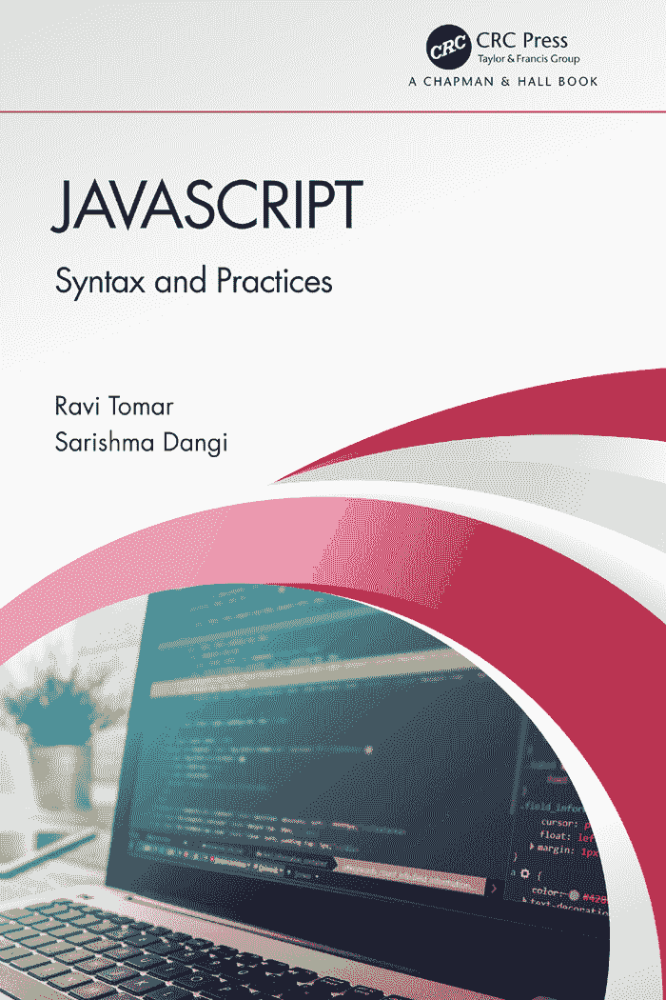


6000 Broken Sound Parkway NW, Suite 300, Boca Raton, FL 33487-2742

以及 CRC Press 出
2 Park Square, Milton Park, Abingdon, Oxon, OX14 4RN


采用 Palatino 字体


献给我亲爱的父母，我完美的伴侣 Manu 以及我的两个小公主 Kritika & Vedika。家人和朋友的持续支持让这本书成为可能。

- Ravi Tomar

献给我的父母 Rajender 和 Sushila。

感谢我的父母 Rajender 和 Sushila。感谢你们的培养和贡献让我在这里。我承诺永远不会放弃，继续努力。

- Sarishma Dangi

# 前言

JavaScript 最初出现时是一种快速修复的语言，但在过去的十年中，它已经嵌入并紧密集成了互联网。在处理动态内容时，很难避免 JavaScript。由于它的普及、易用性和快速采用，它很快被接受为一种通用语言。本书旨在探讨 JavaScript 的基础和原理，帮助读者加强编程。它旨在用最简单的语言解释语言，并采用全面的实践方法。书中的每个章节都配有演示代码，迫使你实际测试所读内容。这些现场练习允许读者在理论和实践之间快速切换，从而学习。最后，我们提供了扩展案例，旨在帮助读者探索 JavaScript 语言的更多维度。一本书可以涵盖很多内容，对吧？尽管如此，我们希望这本书带给你极佳的实践体验，并在你需要一点启发时回来查看。

Ravi Tomar

Sarishma Dangi

# 谢谢

写书像一场马拉松。这是一个漫长而枯燥的过程。如果没有两个特别的人的支持，这项工作不会变成现在。

特别感谢 Dibyasom Puhan，他是 Dehradun 石油与能源大学计算机科学学院的学生，感谢他在开发实践代码和完美执行工作方面提供的不疲的支持。Dibyasom 始终是一个值得信赖的诚实的人。

其他巨大的感谢 Kamakshi Negi 在本书写作期间的贡献和支持。很多时候，很难继续。在那些时刻，她给了我们光亮，并毫不犹豫地介入并做出贡献。有 Dibyasom 和 Kamakshi，我们感到荣幸。祝愿他们无论去哪里都能获得快乐、成功和温暖。不用多说，我们随时保持联系。


`Dr Ravi Tomar` 现任印度德哈拉敦石油与能源研究大学（University of Petroleum & Energy Studies）计算机科学学院副教授。他是一位资学者，在高等教育行业拥有深厚的背景。精通 `Programming`、`Computer Networking`、`Stream Processing`、`Python`、`Oracle Database`、`C++`、`Core Java`、`J2EE`、`RPA` 和 `CorDApp`。他的研究兴趣包括 `Wireless Sensor Networks`、`Image Processing`、数据挖掘与仓库、`Big Data Technologies` 以及 `VANET`。他在不同研究领域发表了 60 多篇论文，申请了 4 项印度专利，编辑了 5 本书籍，并编写了 4 本书籍。他曾为 `KeyBank`、`Accenture`、`Union Bank of Philippines`、`Ernst and Young` 和 `Deloitte` 等客户提供 `Confluent Apache Kafka`、`Stream Processing`、`RPA`、`CordaApp`、`J2EE` 和 `IoT` 的国内外企业培训。`Dr Tomar` 被正式认证为 `Confluent` 和 `CordApp` 的讲师。他曾在印度、法国和尼泊尔举办过多次国际会议。他曾于 2018 年获得印度 `RedInno` 发布的计算机科学与工程青年研究员奖，2021 年获得 `UPES` 学术与研究卓越奖，并被印度乌特拉坎德邦首席部长授予 2021 年研究卓越奖。

`Ms Sarishma Dangi` 现任印度德哈拉敦时代大学（Graphic Era University）计算机科学与工程系助理教授。她是一位`Google Cloud 认证专业云架构师`，专注于虚拟化和云计算领域。她是一位充满热情的年轻学者，致力于创新研究工作，并致力于为高等教育行业提供优质教育。她在知名期刊上发表了许多研究论文，并编写了一本名为《移动云计算：原理与范式》的书。她的研究兴趣包括 `blockchain`、`virtualization`、`vehicular ad hoc networks` 和实时内存取证。她目前正在严谨地攻读博士学位。

# 1 引言

DOI: [10.1201/9781003122364-1](https://doi.org/10.1201/9781003122364-1)

> *C 语言提供的编程类型在使用量上可能会保持不变或缓慢下降，但相对而言，JavaScript 或其变体，或 XML 将继续变得更加核心*。

> −丹尼斯·里奇 (Dennis Ritchie)

`JavaScript` 是今天 Web 开发最流行的语言之一。它是一种简单、易用且易学习的语言，提供了灵活的工作模式。这就是为什么它现在被应用于其他领域，例如执行服务器端脚本、云服务，有时用于机器学习应用程序。在本章中，我们将介绍这种语言本身及其特性、优势和局限性。由于 `JavaScript` 是通过网络浏览器运行的，学习它变得非常重要。我们将讨论现代浏览器的结构，以及该语言的历史背景和至今的演变。最后，我们将学习一些向用户显示信息的方法，并学习代码的放置。建议读者在阅读文本的同时进行练习。这是学习该语言的最好方法。`JavaScript` 是神奇的，你会喜欢学习它的。当你无法让它正常工作时，它有时会感到沮丧和抓狂，但当你让它按照你的意愿运行运行时，你会感到非常有成就感。

## 1.1 Web 开发简介

Web 开发是开发网站以向用户提供静态或动态内容的过程。在 Web 开发的早期，开发者的目标是向用户交付静态内容并允许在互联网上交换信息。随着时间的推移，利用 Web 进行业务和实时用户交互的机会开始出现，导致了一个全新的动态机会世界。从那时起，许多技术、编程语言、设计框架和方法运而生。然而，基础保持不变。

整个万维网根本上基于图 1.1 所示的三项技术三部曲，即 `HTML`（超文本标记语言）[[1]](#ref-list.xhtml_refReferences_1)、`CSS`（层叠样式表）[[2]](#ref-list.xhtml_refReferences_2)和 `JS`（JavaScript）[[3]](#ref-list.xhtml_refReferences_3)。`HTML` 是一种用于结构化、标记和在网页上放置内容的标记语言。`HTML` 的主要目标是向网页用户提供信息，它使用标签来标记和结构化这些信息。随着 Web 的演变，对网页设计和美化的需求随之出现。因此，`CSS` 与 `HTML` 集成，以使网页更符合用户的视觉审美。它极大地有助于管理网页的呈现和布局，使其既用户友好又有吸引力。最后，`JavaScript` 的出现为网页提供了动态行为。这种动态行为导致了交互式网页的出现，允许 开发者从网页本身本地与用户进行交互。

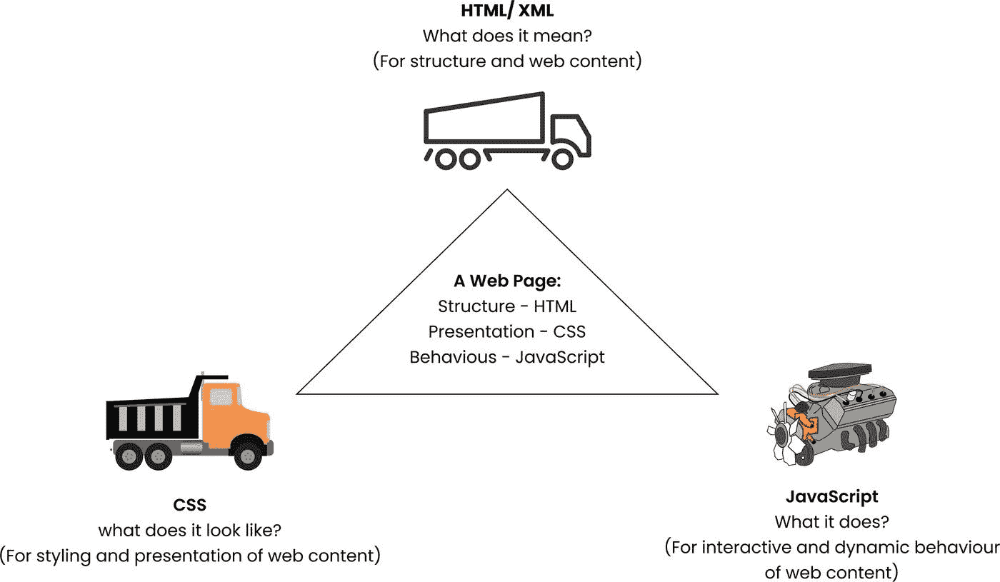

图 1.1 Web 技术的三部曲。

`HTML` 与 `CSS` 的结合使得 Web 内容在呈现方面更丰富、更更美。演变的下一个阶段是需要在这些网页中嵌入行为，使其更加生动，从而在本质上是动态的。`JavaScript` 用于更改或定义网页的行为，因此被称为 Web 增强技术。它决定了网页如何对用户展示的不同输入和行为做出反应；例如链接的激活、提交前的用户检查。这三种技术的结合释放了 Web 开发的威力。最初，`JavaScript` 仅用于客户端，但今天它的应用已扩展到服务器端技术[[4]](#ref-list.xhtml_refReferences_4)。

## 1.2 客户端与服务器端 JavaScript

为了理解客户端和服务器端的区别，我们将使用这个非常简单的示例。

假设我们有一个非常基础网站，要求用户输入一个数字并打印该数字对应的数表。现在该应用程序的开发包含以下组件：

1. 托管在远程 Web 服务器上的静态输入页面（服务器端）。
2. 带有应用程序服务器（服务器端）。
3. 使用任何浏览器连接到 Web 服务器的客户端用户（客户端）。

该应用程序的工作可以分解为以下步骤：

1. Web 服务器托管静态输入页面；可以使用域名或 IP 地址直接访问。
2. 连接到互联网的客户端打开浏览器并输入域名或 IP 地址。
3. Web 服务器将输入页面交付给客户端。
4. 网页包含所有的 `HTML` + `CSS` 代码；这些代码由网络浏览器解析并显示给客户端。
5. 客户端现在输入数字（例如 2）并将此请求发送回 Web 服务器。
6. 此请求将由 Web 服务器解析并传递给应用程序服务器。应用程序服务器现在将为请求实时生成网页并传回 Web 服务器。
7. Web 服务器将此动态网页发回用户。
8. 响应仍然包含所有的 `HTML` + `CSS` 代码，但这次是根据用户提供的输入动态生成的。


在本示例中，使用`client-side JavaScript`（客户端 JavaScript）可以省略 (e)–(h) 中执行的步骤。Web 服务器可以在静态页面内部包含 JavaScript 代码（HTML + CSS + JS）；接收到此页面后， 浏览器可以在本地机器上执行 JS 代码，动态页面的生成仅在客户端本地完成。

这是一个非常基础的示例，用于理解如何减少网络上的请求/响应调用次数。你发现在类似的情况下会使用客户端 JS，例如从远程服务器获取数据、使用 JavaScript 将数据可视化、建立异步数据库连接以及许多其他此类场景。

最新的技术和框架，如 `Node.js` [[5]](#ref-list.xhtml_refReferences_5)、`React.JS` [[6]](#ref-list.xhtml_refReferences_6) 和 `Angular.JS` [[7]](#ref-list.xhtml_refReferences_7) 有助于高级后端应用程序服务器的部署。所有这些框架都将使用服务器端脚本。

 浏览器、运行它的系统以及用户共同组应用程序的`client side`（客户端）。应用程序的`server side`（服务端）由 Web 服务器、应用程序服务器以及相关的应用程序组成。Web 之所以动态运行，是因为这两个者之间的交互。图 1.2 描述了客户端与服务器之间的通信流。

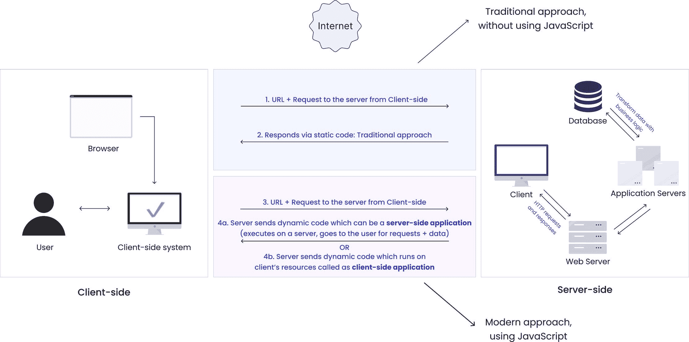

图 1.2 客户端和服务端的脚本编写。

在 Web 开发的早期，用户向服务器请求页面，服务器在接受请求后搜索数据库并返回所标记的页面。HTML 被用作标记语言来标记页面内包含信息的区域。一旦页面被发送，在用户通过另一个请求做出响应之前，服务器将没有任何控制权。

随着用户浏览器以及服务器处理能力的增强，Web 出现了一种新型的 Web 应用程序。服务器响应用户的请求并发送 `web application`（Web 应用程序）而不是静态页面，被称为`client-side application`（客户端应用程序），它在用户的浏览器上执行。这些是嵌入在网页 HTML 代码中的小型应用程序，并根据用户的响应进行动态执行，无需在 Web 服务器上往返。

## 1.3 JavaScript 的起源、历史与演变

JavaScript 由 Brendan Eich 在 1995 年创建，目标是通过 NetScape Navigator 浏览器让 `web` 交互化 [[8]](#ref-list.xhtml_refReferences_8)。1995 年，万维网正变得兴起，Netscape Navigator 是当时最流行的 浏览器之一。HTML 主要用于创建显示在网页上的静态内容。随着 JavaScript 的引入，这些网页也变得具有响应式和交互性。这增加了探索 Web 的整体价值和终端用户体验。

JavaScript 最初在代名 `Mocha` 下开发。它在 1995 年 9 月发布 `beta` 版本时被命名为 `LiveScript` [[9]](#ref-list.xhtml_refReferences_9)。它在 1995 年 12 月再次更名为 `JavaScript`。关于 JavaScript 的一个误解是它与 Java 编程语言有关，但 `Java` 和 `JavaScript` 除了语法设计上的微小相似之处外，共同点非常少。`Java` 在当时是一种非常流行的语言，Sun（现为 Oracle）使用 `JavaScript` 这个名字是一种营销策略。正如 Christian Heilmann 所说，“Java 之于 JavaScript 就像汽车之于地毯” [[10]](#ref-list.xhtml_refReferences_10)。

### 在 Web 市场上声名鹊起，并在 1996 年正式提交给 `ECMA`（欧洲计算机厂商协会）进行标准化 [[11]](#ref-list.xhtml_refReferences_11)。标准化过程花费了一些时间，并正式称为 `ECMAScript` 或 `ECMA-262` [[12]](#ref-list.xhtml_refReferences_12)。然而，由于它的流行，与官方名称相比，人们更多地采用 `JavaScript` 这个名字。`ECMA`至今仍负责 JavaScript 的开发和标准化。它确保了新版本的兼容性，从而允许跨浏览器的操作性。自 1996 年以来已发布了多个版本的语言。`JavaScript 2` 和 `JavaScript 3` 分别于 1998 年和 1999 年发布。

开发者对 JavaScript 的使用不断进步，并在 2005 年取得了突破。James Garett 发表了一篇论文描述了 JavaScript 支持的一系列技术。他在相同的背景下创建了 `AJAX` 术语。此外，`JQuery` [[13]](#ref-list.xhtml_refReferences_13)、`Dojo` [[14]](#ref-list.xhtml_refReferences_14) 和 `Prototype` 也于同年发布，它们与 JavaScript 良好集成。所有因素进一步增强了 JavaScript 的采用率。

`ECMAScript 技术委员会`（也称为 `TC39`）负责维护该语言 [[15]](#ref-list.xhtml_refReferences_15)。JavaScript 标准现在由 `TC39` 每年修订，现代浏览器随后根据规范进行更新。这导致了 JavaScript 的持续发展，并解决了它以前的许多问题。来自不同前线的协作努力使得 JavaScript 在市场上获得了广泛接受。

最初，JavaScript 作为一种脚本语言出现，但上述对 JavaScript 标准的发展导致了该语言的彻底转型。它演变成了一种健壮、安全、动态且通用的语言，非常适用于前端、后端和大规模软件开发。

今天，约 90% 的网站代码中使用 JavaScript。这种巨大的采用和普及让新开发者学习 JavaScript 的功能至关重要。新的特性、技术、框架等不断被整合到 JavaScript 中。它已演变为事实上的标准 Web 编程语言。许多特性使 JavaScript 成为广泛采用的语言。这些特性将在下一节中讨论。

## 1.4 JavaScript 的特性

大多数网页使用 JavaScript 使 Web 更加动态并对用户做出响应。JavaScript 是一种高级、动态、解释型、基于原型的编程语言，支持面向对象、事件驱动和函数编程风格。在本节中，重点介绍 JavaScript 在开发者中如此流行的的一些关键特性。

- **平台无关**：JavaScript 是一种平台无关的编程语言。因此，可以在任何平台上运行，使其成为一种多功能且易于使用的语言。大多数内置 JavaScript 解释器的浏览器支持它。
- **DOM 操作**：`DOM` 代表文档对象模型，允许对网页内的 HTML 组件进行操作 [[16]](#ref-list.xhtml_refReferences_16)。在 Web 开发早期，大多数 Web 的操作是静态的。DOM 操作是 JavaScript 产生的关键原因之一，它的引入改变了现代 Web 的面貌。
- **日期和时间**：JavaScript 为需要访问日期时间工具的操作提供了内置方法。这允许用户在他们的浏览器中拥有自定义内容。
- **客户端和服务端编程语言**：JavaScript 最初仅提供客户端脚本。今天，JavaScript 提供了运行客户端和服务端应用程序的能力。这使得它更加受欢迎，因为开发者可以仅通过使用 JavaScript 来开发完整的应用程序。


*   **用户数据验证与客户端数据处理：** JavaScript 用于在客户端验证用户输入的数据，从而消除了发送到服务器的需求。由于代码在客户端执行，JavaScript 相比 Web 服务器对浏览器具有更强的控制力。它还允许 Web 服务器检查浏览器类型、操作系统、屏幕尺寸等。所有这些有助于生成更具意义的脚本，减少服务器端的开销，并更充分地利用客户端资源。
*   **将函数当作对象：** JavaScript 中的函数被视为对象，可以同时拥有属性和方法。函数可以作为参数传递给其他函数，可以被嵌套，可以作为异常抛出等。这种操作函数的灵活性使得这种语言易于操作，并且更适合处理现实应用场景。
*   **箭头函数：** 它们被引入语言中是为了使语法的使用和编写变得简单简单。它们是轻量级函数，可以用于编写匿名函数。
*   **模板字符串（Template literal）：** 它允许开发者将变量值存储在字符串中，因此成为一个重要的工具。这让开发者能够更多地关注应用程序的逻辑和开发，而不是关注语法的细节。
*   **事件处理：** 每当事件发生时，就可以执行该事件发生的相应例程。这种特征被称为事件处理，JavaScript 大量使用它来响应网页上的用户活动，如 `onClick`、`onLoad`、`onSelect`行为。

## 1.5 优势与局限性

与其他任何编程语言一样，使用 JavaScript 也有固有的优缺点。在本节中，我们概述了使用 JavaScript 的优势和局限。以下是 JavaScript 提供的优势：

*   **执行速度：** JavaScript 是一种解释语言，这意味着代码在执行之前不需要编译。JavaScript 代码中的语句在加载到浏览器时就会执行。总来说，这减少了开销，并提高了网页中 JavaScript 代码的执行速度。
*   **易于学习和简单：** JavaScript 对于新手和资深开发者来说都很容易理解、学习和使用。简单结构的使用以及实现动态内容的可行性使得 JavaScript 成为 Web 开发的热门选择。
*   **互操作性：** JavaScript 可以轻松地嵌入到任何其他编程语言或网页内部。开发者可以轻松使用它为内容添加新功能，而无需任何额外的开销。
*   **客户端执行与验证：** 脚本由服务器发送到客户端，由客户端 浏览器执行脚本。数据验证也大部分发生在客户端，而不是在每次输入数据时查询服务器端。这减少了服务器端的负载并节省了大量的执行时间。
*   **丰富的接口和扩展的功能：** JavaScript 提供了一系列丰富的接口，使开发者能够创建丰富的网页，例如可拖放的窗口、滑滑等等。使用此类接口增加了网页上的用户交互性。JavaScript 还通过允许使用第三方插件提供了扩展功能。这让开发者能够复用代码，并使编程变得更加快速和容易。

尽管 JavaScript 提供了许多功能和优势，但它也存在一些局限性，列举如下：

*   **读写文件：** JavaScript 不允许网页在客户端读取或向文件写入内容。考虑到安全因素，JavaScript 不允许访问操作系统。然而，这在 Web 浏览器提供的 `HTML5 Local Store` 中是开启的。
*   **多线程：** JavaScript 不提供多线程或多进程能力。Web 浏览器不允许单个网页并发使用多个线程以避免并发问题。然而，多个标签页可以拥有各自独立的线程并在其上工作。
*   **客户端安全：** 由于代码在客户端执行，代码变得容易被修改。网页的源代码对客户端的任何人都是可见的。恶意用户可以篡改源代码或在网站中放置其他代码。这可能导致客户端安全受损。
*   **浏览器支持：** 不同的浏览器解释代码的方式不同。因此，在发布最终使用之前，必须在多个浏览器上运行代码。这为开发者带来了不必要的开销，需要多次测试和运行代码，以确保网页在加载时不会崩溃。
*   **调试：** JavaScript 是一种非常灵活的基于原型的语言，因此有时很难识别错误来源。继承自多个原型、接口和对象创建了紧密的关系。除非显式处理，否则 Web 浏览器不会专门显示错误。单个错误可能会停止网页其余部分的渲染。这导致大型规模程序的调试变得困难。
*   **继承：** JavaScript 仅支持单继承。不支持多重继承。在考虑面向对象方面时，这成了一个问题。
*   **开销：** JavaScript 将数字存储为 64 位，而位运算符操作的是 32 位数字。由于此原因，JavaScript 会将 64 位数转换为 32 位等值数，对其进行操作，然后转换回来。持续的转换需要更多时间，从而降低了执行速度。这种往返转换在程序中产生了开销。另一个开销的原因是 JavaScript `DOM` 的渲染缓慢，导致无论解释器的执行速度如何，都会产生额外的开销。

所有这些因素限制了 JavaScript 在某些情况下的使用，但无论如何，其优势远大于局限性。因此，它在市场上被开发者广泛接受，并主导了大部分 Web。

## 1.6 浏览器结构

Web 浏览器是一种向用户显示 Web 内容的软件应用程序。它是一个功能完整的软件，执行一系列任务，如请求、检索、处理和显示 Web 内容。它是一个用于解释 Web 内容的图形界面，包括封装在 `HTML`、`CSS` 中的 `JavaScript` 等。

浏览器运行的系统是 Web 开发客户端服务器模型中的客户端。还可以安装插件，以扩展浏览器的功能。如今市场上有很多类型的 Web 浏览器，如 `Mozilla Firefox` 17、`Internet Explorer` 18、`Safari` 19、`Chrome` 20、`Netscape Navigator` 21 等。

Web 浏览器由一组执行特定任务的组件组成。这些组件将在后文中简要解释，并在图 1.3](#ch01.xhtml_fig1_3) 中所示。

![images/fig1_3.jpg)

图 1.3 浏览器结构

*   **用户界面：** 它是用户与浏览器交互并向 Web 服务器发送请求的空间。通常它包括地址栏、后退按钮、前进按钮、刷新按钮、书签选项、设置、密码、历史记录等。


- **浏览器引擎：** 它用于接收来自用户界面的输入并执行查询。然后数据会被传递给渲染引擎进行进一步处理。浏览器引擎是连接用户界面和渲染引擎的桥梁。
- **渲染引擎：** 它负责解释和执行代码以向用户显示网页。它解释服务器作为响应发送的 `HTML`、`CSS` 代码并将其显示在用户界面上。渲染引擎有许多类型，不同的浏览器使用不同的渲染引擎。Internet Explorer 使用 `Trident` [[22]](#ref-list.xhtml_refReferences_22)，Mozilla Firefox 使用 `Gecko` [[23]](#ref-list.xhtml_refReferences_23)，Chrome 和 Opera 使用 `Blink` [[24]](#ref-list.xhtml_refReferences_24)，而 Safari 使用 `WebKit` [[25]](#ref-list.xhtml_refReferences_25)。
- **JavaScript 解释器：** 为了执行 JavaScript 代码，有一个特殊的组件——JavaScript 解释器，它将响应发送给渲染引擎。然后会在用户界面上显示。
- **网络模块：** `Networking` 组件通过 `HTTP` 或 `FTP` 等网络协议处理 URL 获取。它主要负责维护代码的通信安全性。它还可以实现缓存以减少网络拥塞。它用于在用户界面（`UI`）上创建基础组件（包括框等），其底层操作使用特定于操作系统的方法。
- **数据存储与持久化：** 该组件在网络、浏览器和源代码之间维持持久化。它是安装浏览器的存储位置中存在的数据库。通过使用该存储，浏览器能够支持 `localStorage`、`IndexedDB` 和 `WebSQL` 等存储机制。

## 1.7 说 Hello World

到目前为止，我们已经讨论了当今网页中使用的一些概念。现在是时候使用 JavaScript 向用户说 `Hello World` 了。我们还将讨论一些常用的方法。对于这些示例，你可以在保存为 `.html` 扩展名的文本框中编写完整脚本并在 Google 浏览器中打开，或者简单地打开 Google 浏览器并按下 `Option + J`（MacOS）或 `Shift + J`（Windows/Linux）。这将打开网络浏览器上的控制台。在控制台中输入脚本和下述代码即可查看输出。别担心；我们稍后会有很多带有的示例供你尝试。

JavaScript 代码始终编写在 `<script>` 标签内。该标签代表代码的脚本部分，位于 `body` 或 `head` 标签内，或者放在单独的文档中。此示例使用了 `console.log` 和 `alert()` 方法；两者将在后续章节中讨论。

```javascript
console.log("Hello World on console!");
alert("Hi This is an Alert for you, you will see this in pop-up. Have fun!");
```

### 1.7.1 内置函数

JavaScript 提供了一些内置函数，通过浏览器窗口向用户显示消息。这些消息可以通过 `alert()`、`prompt()`、`console.log()` 和 `document.write()` 函数通过弹出窗口显示。这些对话框为我们提供了显示信息、获取输入或从用户处获取任何确认的能力。使用这些函数，我们可以与用户交互。每个函数都有其向用户显示消息独特的方式。

- `alert()` 用于在网页上显示消息。使用 `alert()` 会触发一个带有指定消息的弹出窗口。它提供一个带有“ok”按钮的对话框。这通常用于向用户提供某些警告或信息 [[26]](#ref-list.xhtml_refReferences_26)。

```javascript
alert("Hi This is an Alert for you, you will see this in new pop-up.");
```

- `confirm()` 是用于向用户请求确认的内置函数。它显示消息并为用户提供两个按钮：“ok”和“cancel” [[27]](#ref-list.xhtml_refReferences_27)。

```javascript
confirm("Are you Sure?");
```

- `prompt()` 对话框用于用户处获取输入。`prompt()` 函数显示两部分信息：一个是显示在对话框中的消息或标签，另一个是显示的默认字符串。它还为用户提供两个按钮，`ok` 和 `cancel`。如果用户输入了某些值并选择 `ok`，则该值将返回给代码。如果用户选择 `cancel`，则函数将向调用代码返回 `null` [[28]](#ref-list.xhtml_refReferences_28)。

```javascript
age = prompt("Enter Age");
alert("Your entered age value is:" + age);
```

- `document.write()` 用于我们任何想要将内容打印到 `HTML` 页面上的时候。它是在网页上显示内容的简单、易用的方法 [[29]](#ref-list.xhtml_refReferences_29)。

- `console.log()` 简单地在网络浏览器窗口上显示消息。它主要用于调试目的 [[30]](#ref-list.xhtml_refReferences_30)。

```javascript
console.log("Hello World via the console!");
```

### 1.7.2 软件工具

JavaScript 代码主要在网络浏览器中执行。它是一种解释性语言，提供了更执行速度。JavaScript 基于事件的特性使其更具交互性，并且仅执行用户需要的代码段。现代网络浏览器都支持运行基于 JavaScript 代码。

JavaScript 生态系统包含许多帮助开发者开发、调试和支持的工具。JavaScript 开发者广泛使用各种工具、框架和库。这三者之间存在着非常微妙的界限，区分本身可能很困难。因此，在详细讨论此类工具之前，我们先定义这些术语并区分它们。

- **框架 (Framework)：** 它是一种抽象，提供了一种标准的方式来交付主要功能，如事件、存储、数据绑定等。框架是以良好的、架构化的解决方案的形式向用户交付一组功能的最全面的手段。
- **库 (Library)：** 它是函数的集合，旨在解决某些功能以执行任务。换句话说，库是涵盖单个主题或功能的紧密相关的函数集。
- **工具 (Tools)：** 这些是短小的代码片段，旨在通过协助开发者维护代码、性能、编译器等来使开发过程更加顺畅。

#### 1.7.2.1 框架、库和工具的示例

- **React.JS：** 它是 Facebook 在 2011 年开发的库，后来被宣布为开源，从而允许开发者根据意愿访问、使用和修改它。它提供了一种渲染网页内容和创建高性能动态用户界面的方法。库中的组件是独立的，因此可以复用。在进行系统升级时复用组件非常有帮助，因为可以节省大量时间 [[6]](#ref-list.xhtml_refReferences_6)。React Native 是基于 `React.JS` 库的移动应用程序开发框架。
- **Express.js：** 它是用于使用 `Node.js` 构建网站的 JavaScript 框架。Express.js 是一个健壮、稳定、快速且易用的框架。它对于构建单页应用程序、HTTP API 和网站以及路由非常有用 [[31]](#ref-list.xhtml_refReferences_31)。


*   **Angular.js:** 这是一个由 Google 提供的 JavaScript 框架，用于构建客户端应用程序。Angular.js 是一种模型-视图-控制器 (MVC) 类型的框架，从而让开发者能够专注于数据库、界面和链接，而由框架来处理这些工作。它本身是编写快速单页应用程序的强大解决方案。它是流行的 MongoDB, Express, Angular 和 Node (MEAN) 软件开发栈的一部分 [[7]](#ref-list.xhtml_refReferences_7)。它提供了如跨平台支持、代码分割、命令行工具、单元测试和双向数据绑定等功能。

*   **Electron:** 这是一个用于构建跨平台网站和应用程序的框架。它基于 Chromium 引擎和 Node.js。它主要用于桌面应用程序，因为它支持 HTML、CSS 以以及 JS [[32]](#ref-list.xhtml_refReferences_32)。

*   **NPM:** 它是一个功能强大的工具库，为 JavaScript 开发者提供支持。它提供了构建工具，作为包和任务管理器工作，并作为为开发者提供可重用脚本的注册表。Node Package Manager 脚本支持跨平台，并用于默认任务以及开发者特定的任务。它提供了设计、编写和执行用于测试和开发的独立脚本的能力 [[33]](#ref-list.xhtml_refReferences_33)。

*   **Gulp:** 它是一个用于自动化处理源文件加载、构建、编译、验证和测试任务的工具包。这些任务是单调的，通常需要开发者花费大量精力。通过使用像 Gulp 这样的特定工具，这些重复任务可以轻松自动化，从而带来更好的性能和代码利用 [[34]](#ref-list.xhtml_refReferences_34)。

*   **Webpack:** 它是一个用于将 JS 模块及其依赖项按顺序打包到浏览器中的工具。它可以分割代码以获得更性能，在运行时进行优化，将任务打包，在编译期间解析依赖并支持插件 [[35]](#ref-list.xhtml_refReferences_35)。

*   **ESLint:** 分析代码是否存在如缺少冒号或括号等缺陷的过程被称为 `linting`（代码检查）。ESLint 是一个 JavaScript 代码检查工具。它支持插件并可以由开发者根据需求进行配置。

*   **Vue.js:** 这是一个基于 Angular 框架构建的开源轻量级框架，旨在开发渐进式用户界面 [[36]](#ref-list.xhtml_refReferences_36)。它提供了路由、动态动画和数据绑定的工具。

*   **jQuery:** 这是构建客户端应用程序、插件和用户界面最流行的库。互联网上超过 70%的网站使用 jQuery 构建，包括 Google、DailyMotion 和 Microsoft Network [[37]](#ref-list.xhtml_refReferences_37)。它提供了轻量级功能、动画、Ajax 调用和优化功能。

## 1.8 代码的放置

HTML 是一种使用标签来放置和结构化内容的标记语言。HTML 中的起始标签和结束标签具有相同的名称。唯一的例外是结束标签带有一个正斜杠 (`/`)。JavaScript 代码大部分放置在 HTML 标签内部。JavaScript 代码放置在 `<script> ... </script>` 标签中。可以通过以下任何一种方式实现：

*   在 head 标签内部。

```html
<html>
<head>
<script type="text/javascript">
//javascript code can be placed here
</script>
</head>
<body>
<h1> Test Data </h1>
</body>
</html>
```

*   在 body 标签内部。

```html
<html>
<head>
</head>
<body>
<script type="text/javascript">
//javascript code can be placed here
</script>
<h1> Test Data </h1>
</body>
</html>
```

*   将 JavaScript 代码放置在 `<body>` 标签的尾被认为是一种良好实践。这确保了 `<head>` 和大部分 HTML `<body>` 内容在 JavaScript 代码触发之前加载。

```html
<html>
<head>
</head>
<body>
<h1> Test Data </h1>
</body>
</html>
<script type="text/javascript">
//javascript code can be placed here
</script>
```

*   JS 代码也可以保存在外部文件中，然后在 HTML 的 `<head>` 部分中引用它。外部文件应包含 JavaScript 代码并必须以 `.js` 扩展名保存。优选使用外部文件放置 JavaScript 代码，因为这有助于网页内容与行为的分离。维护单个源文件更容易，也允许我们重用相同的代码。

```html
<html>
<head>
<script type="text/javascript" src="filename.js">
</script>
</head>
<body>
<h1> Test Data </h1>
</body>
</html>
```

## 1.9 练习

### 1.9.1 理论

1.  列出 JavaScript 语言的特性。
2.  使用 JavaScript 有什么好处和挑战？
3.  讨论 JavaScript 自诞生以来作为一种语言的演变。
4.  详述现代网络浏览器中的不同组件。使用不同的组件解释网络浏览器的工作原理。
5.  区分客户端和服务器端 JavaScript 的用法。讨论必须使用这些用法的情况。思考并设计你自己的用例。
6.  编写一个完整的脚本，使用 `console` 打印“Hello.world”。
7.  创建一个显示警告框的文档。

### 1.9.2 判断题

1.  JavaScript 源自 Java。
2.  JavaScript 独立工作以交付页面。
3.  JavaScript 可以写在独立文件中并嵌入 HTML 中。
4.  JavaScript 支持多线程。

### 1.9.3 单选题

1.  JavaScript 写在什么标签标签内？
    *   `<html>`
    *   `<head>`
    *   `<script>`
    *   `<body>`
2. 哪些语言构成了网络技术的铁三角？
    *   HTML, XML, CSS
    *   CSS, HTML, JavaScript
    *   JavaScript 和 XML
    *   以上都不是
3.  哪些不是 JavaScript 的特性？
    *   它是轻量级的。
    *   它是一种基于原型的面向对象语言。
    *   它是一种标记语言。
    *   它可以处理日期和时间事件。
4.  JavaScript 由什么公司开发？
    *   Dell
    *   Bell Labs
    *   Netscape
    *   Microsoft
5.  JavaScript 在其构思之时的原始名称是什么？
    *   LiveScript
    *   NewScript
    *   Mocha
    *   JavaScript
6.  JavaScript 是一种 _______________、_______________ 编程语言。
    *   高级、面向对象的
    *   面向对象的、基于原型的
    *   高级、汇编的
    *   以上都不是

# 2 构建基础

DOI: [10.1201/9781003122364-2](https://doi.org/10.1201/9781003122364-2)

> *你应该想象变量是触角，而不是盒子。它们不包含值，它们抓住了值——两个变量可以引用同一个值*.

> 

> –Marijn Haverbeke

到为止，我们涵盖了 JavaScript 的历史和介绍。本章将带你深入理解语言结构和基础。在使用任何语言构建解决方案之前，我们需要数据是如何存储和转换的。本章讨论了基础构建块，例如如何声明变量、使用数据类型并对其进行操作、学习文档的词法结构、用于数据操作的运算符、决策语句和控制流操作。

## 2.1 词法结构


词法结构定义了任何编程语言最低层次的标记（tokens）。词法结构是一组用于从字符序列形成有效标记的基元规则 [[38]](#ref-list.xhtml_refReferences_38)。一个标记由标识符、关键字、标点符号、字面量或操作符组成。语言的特定特性，如字符集、变量命名、注释、终止符等，都用于定义词法结构；例如，它定义了变量应该如何命名、如何在代码中加入注释或如何进行换行等。

## 2.2 字符集

字符集定义了源程序可以使用或在程序运行时被解释的有效字符 [[39]](#ref-list.xhtml_refReferences_39)。JavaScript 使用 Unicode 字符集的 16 位表示法进行编程；这允许程序员在任何支持 UNICODE 的语言中使用某些符号作为标识符，例如 `∏`（pi）或 `λ`（lambda）。Unicode 字符集是 ASCII 字符集的超集 [[40]](#ref-list.xhtml_refReferences_40)。为了代码的可移植性和易用性，大多数程序员在代码中使用 ASCII 字符集。

### 2.2.1 空格和注释

空白用于分隔代码中存在的不同标记，JavaScript 解释器会忽略代码段内或标记之间的空白。这允许我们有意识地使用换行和空格来缩进代码，使其更易理解。这有助于保持代码整洁且一致。JavaScript 允许我们使用换行符、回车和换行序列作为行终止符。行终止符也可用于为编写代码创建确定的风格。

以下字符被视为空白：空格（U + 0020）、换行符（U + 000A）、回车（U + 000D）、水平制表符（U + 0009）、垂直制表符（U + 000B）、分页（U + 000C）和空字符（U + 0000）。

很多时候，一个开发者编写的代码将来可能会由另一个开发者进行调试、维护或处理。合理使用注释有助于新开发者理解和处理代码。某些系统甚至可以根据代码中的注释生成有的报告。当行以 `//` 开头并换行结束时，解释器会将注释视为空白。多行注释使用符号 `/*` 和 `*/` 表示。这两个符号之间的任何内容都被视为注释。以下示例演示了这两种注释的使用。

```javascript
//Demo Comments

<script>
document.write("Hey there, reader")

// printing a line of code

/* THIS IS A MULTI LINE COMMENT
THIS LINE WILL ALSO BE OMMITED */
</script>
```

### 2.2.2 大小敏感

JavaScript 是一种大小写敏感的语言，即 `name`、`Name`、`NAME` 和 `NaMe` 都是不同的。编写代码时，请注意字母的大小写。大多数代码使用小写字母编写，因为容易阅读且避免了不必要的复杂性。建议对变量和函数命名遵循标准的编码规范。`firstNumber` 和 `addNumbers()` 分别是变量和函数使用驼峰命名法的示例。

### 2.2.3 分号

像 C 和 Java 这样的大语言使用分号来结束一行代码。不同的是，JavaScript 对分号有可选性要求，从而为开发者提供了灵活性。然而，如果你在单行代码中编写了多个语句，则使用分号来告诉解释器该行中有多个语句，需要分别执行。

### 2.2.4 字面量

字面量仅仅是类型值的源代码表示。字面量的值在程序中直接使用，且不具有类型。字面量可以是数值、小数、字符串和布尔值。接下来给出示例。

```javascript
89 //Integer Literal
7.99 //Floating Point Literal
"Hello JavaScript" //String Literal
true //Boolean Literal
```

### 2.2.5 标识符

标识符是赋予字面量、变量、函数、属性或类的名称。该名称用于唯一标识变量、函数、属性或类。标识符在作用范围内是唯一的，在命名标识符时必须遵循以下严格命名规范 [[41]](#ref-list.xhtml_refReferences_41)。

- 标识符名称必须以字母（a–z 或 A–Z）、下划线 (_)或美元符号（$）开头。
- 在第一个字母（a-z, A-Z, _, $）之后，我们也可以使用数字（0–9）。
- 标识符名称大小大小敏感。
- 保留关键字不能作为标识符。

根据上述约束，给出一些有效标识符示例：

```javascript
name; //valid name
Name; //valid “name” and “Name” are different
_id; //valid name
#id; //not allowed
_revisedID // allowed
void; //not allowed, ‘void’ is a reserved keyword
```

### 2.2.6 关键字

每个编程语言都预留了一些关键字作为语言本身的一部分 [[42]](#ref-list.xhtml_refReferences_42)。这些关键字称为保留关键字。它们不能作为标识符。以下是 JavaScript 语言的一些保留关键字；列表不仅限于这些（表 2.1）。

表 2.1 JavaScript 中的关键字

| break | switch | do | while |
| :--- | :--- | :--- | :--- |
| if | else | for | forEach |
| instanceof | typeof | let | export |
| var | return | class | null |
| throw | void | extends | new |
| catch | continue | function | switch |
| ifelse | break | yield | case |

## 2.3 变量

变量是赋予 JavaScript 中存储位置的名称。这些存储位置可以通过直接引用分配的名称来存储任何类型的数据。变量命名使用了上一节的标识符规范。与传统的编程语言（C, Java）不同，JavaScript 是一种弱类型语言，声明变量时不需要提供变量类型 [[43]](#ref-list.xhtml_refReferences_43)。

### 2.3.1 变量声明和作用域

JavaScript 中变量的作用域可以是局部的或全局的。根据变量作用域的需求，可以在有效标识符之前使用 `var` 或 `let` 关键字声明。

```javascript
let localVariable;
```

这些变量在函数或块开始执行时创建，并在块作用域结束时删除。同名的变量可以在函数局部作用域之外（即全局作用域）使用。

同样，如果变量需要在全局作用域内，则使用 `var` 关键字声明。全局变量可以在程序的任何地方访问。创建全局变量的示例所示：

```javascript
var globalVariable;
```

如果在创建变量时没有提供值，它将自动取 `undefined` 值，直到你为其赋值。局部和全局变量都可以在创建时初始化；这在接下来的示例中：

```javascript
let localVariable = 10; //Declare and Initialize
let globalvariable = 20; //Declare and Initialize
```

使用 `var` 和 `let` 声明的变量之间还有一些区别，如下：


*   如果使用 `var` 关键字创建变量，则可以重新声明，而使用 `let` 关键字创建的变量则无法重新声明。

*   我们可以通过在块外部或内部定义使用 `var` 关键字来创建全局或局部变量。对于使用 `let` 声明的变量来说是不可能的，因为它们始终是块内的局部变量，且无法通过其他对象访问。

这两种场景可以在下一个示例中看到：

```javascript
var dogName = ”American Aketa”; //全局作用域内

function dogType() {

var dogName = ”Ojo”;

// dogName 被重新声明，且是一个局部变量

};
```

你可能对变量的可访问性产生很多问题：在什么时候调用哪个变量？由谁来决定使用哪个值以及何时使用？所有这些问题的答案都在变量的作用域（scope）中！

变量的作用域定义了确定使用哪个变量值以及在何处可以访问该变量的规则。

让我们在图 2.1 参考 [[44]](#ref-list.xhtml_refReferences_44) 的帮助下尝试理解这个示例。让我们首先找到标记为 1、2 和 3 的区域内的标识符。块 1 包含标识符 `foo`（方法调用和方法声明）；此外，块 2 包含标识符 `a`、`b` 和 `bar`。最内层的块 3 仅包含标识符 `c`。调用方法 `foo` 时将值 2 传递给 `a`，块 2 将标识符 `b` 初始化为 4，并调用其他方法 `bar` 时将值 12 传递给块 3 中的标识符 `c`。整个路径按如下方式执行，因此，当最内层的 `console.log` 需要 `a`、`b`、`c` 来打印它们的值时，它会在当前作用域寻找，并按照栈顺序寻找适当的值。在控制台上打印的值将在块 3 内部找到的值。一旦找到第一个匹配的标识符，查找就会停止。这种方法被称为 `词法作用域`（lexical scope）。变量 `a`、`b` 和 `c` 的值在图 2.2 的作用域内被详细列出。

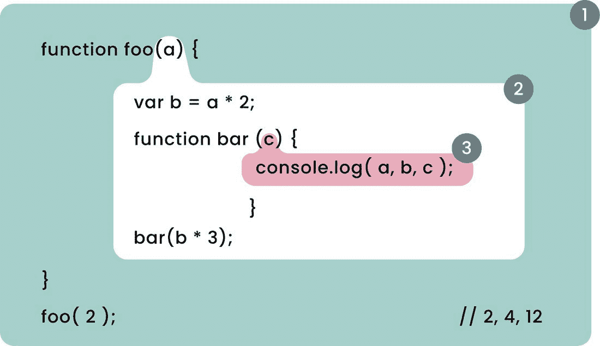

图 2.1 理解变量的作用域。

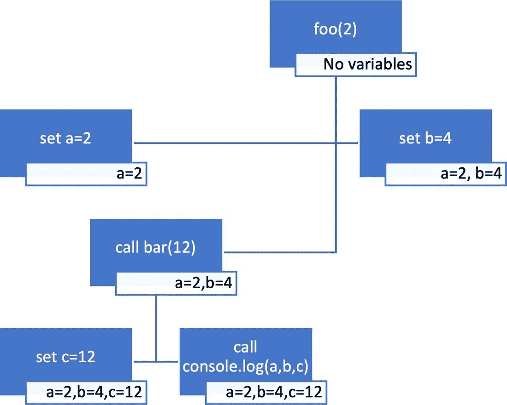

图 2.2 详细说明变量的作用域。

## 2.4 数据类型

JavaScript 中的变量可以持有任何类型的数据，无需指定严格的数据类型。这类编程语言被称为动态类型语言或弱类型语言，即数据类型存在但没有严格绑定到变量上。JavaScript 中有两种基本类型的数据类型：原始数据类型（primitive）和非原始数据类型（nonprimitive）。

### 2.4.1 原始数据类型

原始数据类型只能在关联的变量中存储单个值。它不能随数据存储额外的属性或方法。共有七种原始数据类型：`string`、`number`、`bigint`、`boolean`、`undefined`、`symbol` 和 `null`[[45]](#ref-list.xhtml_refReferences_45)。除了 `undefined` 和 `null` 外，所有原始类型在 JavaScript 中都有包装对象（wrapper object）。所有的原始类型在 JavaScript 中默认都是不可变的。这意味着我们不能更改任何原始值；然而，新创建的值可以初始化给其他变量。例如，在这段代码中，变量 `someString` 在完成赋值之前不会发生突变。这表明了一个新的“DUMMY STRING”被创建并赋值给了 `someString` 标识符。

```javascript
// 使用字符串方法不会改变字符串

var someString = "Dummy String";

console.log(someString); // Dummy String

someString.toUpperCase();

console.log(bar); // Dummy String

// 赋值为原始值一个一个新的（而不是变形）值

someString = someString.toUpperCase(); // DUMMY STRING
```

下一节将解释原始类型及其对应的包装对象；`valueOf()` 函数可以将任何对象转换为对应的原始数据类型。

*   **String（字符串）：**字符串是表示文本值的字符序列。JavaScript 中的 `String` 数据类型对象可以持有字符或字符串值。值必须被括在引号内（双引号、单引号、反引号）。双引号（“…”）和单引号（‘…”）的功能相似，没有显著区别。然而，反引号（…）用于在脚本中嵌入数据值 [[46]](#ref-list.xhtml_refReferences_46)。也被称为功能扩展引号，它们允许我们使用 `${…}` 符号将表达式或变量嵌入字符串中。

```javascript
let str1 = ”our first string”; //允许

let str2 = ’our second string’; //允许

let str3 = `we can embed ${str1} and ${str2} in this`;

// 嵌入变量

/*output: we can embed our first string and our second string in this*/

let str4 = `embed an expression ${25 + 25}`;

// 嵌入表达式

//output: embed an expression 50
```

*   **Number（数字）：** 在 JavaScript 中，数字是双精度、64 位浮点格式（IEEE 754）的数值数据类型 [[47]](#ref-list.xhtml_refReferences_47)。JavaScript 中的 `Number` 数据类型对象可以持有任何数值。

*   **Boolean（布尔值）：** 在 JavaScript 中，布尔值是一种逻辑数据类型；它可以持有真（true）或假（false）值。它主要用于条件语句和其他操作。布尔类型的包装对象是 `Boolean` [[48]](#ref-list.xhtml_refReferences_48)。

*   **BigInt（大整数）：** 在 JavaScript 中，`bigint` 是一种表示任意精度整数的数值数据类型。大整数的包装对象是 `BigInt`[[49]](#ref-list.xhtml_refReferences_49)。

*   **Symbols（符号）：** 类型为 `Symbol` 的值可以被称为符号值。在 JavaScript 运行时，符号值通过调用 `Symbol` 函数产生，匿名且唯一 [[50]](#ref-list.xhtml_refReferences_50)。符号的包装对象是 `Symbol`。

*   **Undefined（未定义）：** 当你声明变量但没有对其赋值时，变量会被假设一个原始值。这是一个特殊的数据类型，技术上可以赋值给变量。undefined 原始类型没有包装对象 [[51]](#ref-list.xhtml_refReferences_51)。

```javascript
let y;

alert(y); //output: undefined

y = 46757;

alert(y); //output: 46757

y = undefined;

alert(y); //output: undefined
```

*   **Null（空）：** 正如名称所示，null 表示一个不存在或无效对象或地址的空或未知值。在 JavaScript 中，`null` 被标记为原始类型，但在某些情况下，它并不是原始类型（因为稍后我们将看到所有对象都派生自 `null`，因此 `typeof` 运算符对 `null` 返回 object）。null 原始类型没有包装对象 [[52].](#ref-list.xhtml_refReferences_52)

```javascript
typeof null === 'object' // true;
```

### 2.4.2 非原始数据类型

JavaScript 中的非原始数据类型用于在变量中存储复杂的值。它允许我们关联不同的属性和方法。非原始或引用数据类型分为三类：对象（Object）、数组（Array）和正则表达式（RegExp）。对象代表通过其访问成员的实例，数组代表一组相似的值，正则表达式代表正则表达式。非原始类型在 JavaScript 中非常重要，这些将在随后的章节中详细讨论。

### 2.4.3 常量


在编程过程中，我们可能会遇到一种情况：标识符的值一旦赋值，就不应再次更改。通过 `let` 或 `var` 关键字声明的变量和标识符本质上是可变的，也就是说它们的值可以更改为其他字面量或变量。这正是常量概念派上用场的地方。`const` 关键字用于声明常量，即它们的值一旦赋值就不能被更改。在命名规范上，常量名始终使用大写字母。

```
// const CONSTANT_IDENTIFIER = assigned_value;

```

const PI = 3.1415;

const ROI = 6;

const PUBLISHER = `T&F`;

ROI = 7; //Type Error

始终记住，`const` 关键字使标识符的内存分配变为不可变的，即该标识符不能重新分配到任何其他变量或内存。然而，内存位置内部的内容可以改变；例如，如果创建了一个常量数组或对象，其内容可能会改变，但常量标识符不能改为另一个对象或数组。在后续章节中学习对象时，请记住这一点。为了快速参考，请参见下一个示例。在这里你可以看到对象内部的内容可以被修改甚至添加，但我们不能将常量标识符重新赋值为新值。

```javascript
const SUBJECT = { sub1:”phy”, sub2:”math”, sub3:”chem” }

//创建一个常量标识符 “SUBJECT”

console.log(typeof SUBJECT); //打印 object

SUBJECT.sub3 = “bio”; //可变属性

SUBJECT.sub4 = “english” //添加新属性

SUBJECT = { sub1:”accounts”, sub2:”economics”, sub3:”statistics” }

// 不可重新赋值常量对象
```

### 2.4.4 类型转换 (Type Casting)

类型转换是将一种数据类型转换为另一种数据类型的过程。在某些情况下，程序可能需要这种转换，例如，在只期望字符串的 HTML 标签中打印数值。为了帮助这种转换，JavaScript 提供了隐式转换和显式转换两种选项 [[53]](#ref-list.xhtml_refReferences_53)。隐式转换允许在赋值或在方法中使用时从一种类型到另一种类型的自动转换。例如，如果在 `console.log()` 方法中打印一个数值，JavaScript 将自动对其调用 `toString()` 方法。同样，对字符串和数值使用 ++ 运算符会自动将数值转换为字符串值。

```javascript
var age = 35;

console.log(typeof age); // typeof age 是 number

console.log(age); //相当于 console.log(age.toString());

var output = ”My age is”+age; //隐式转换

console.log(output); //显示 My age is 35
```

如果 JavaScript 无法进行隐式转换，则需要显式转换。例如，假设我们有两个 String 类型的数字 `numberA` 和 `numberB`，我们需要对它们执行算术加。在这种情况下，我们必须显式定义正在执行的类型转换。下一个示例展示了这两种情况。

```javascript
var numberA = "10";

var numberB = "20";

console.log(typeof numberA); //类型为 String

console.log(typeof numberB); //类型为 String

console.log(numberA + numberB); //输出为 1020

console.log(Number(numberA) + Number(numberB));

//输出为 30

//这是显式类型转换
```

JavaScript 通过使用内置方法（如 `Number()`、`String()`、`Boolean()` 等）提供显式转换。JavaScript 中的空字符串和使用 null 值始终返回 0。

## 2.5 运算符 (Operators)

数学运算和其他操作是通过操作数和运算符执行的。操作数是运算符执行作用的数据项 [[54]](#ref-list.xhtml_refReferences_54)。运算符是表示要在操作数上执行的操作类型的符号，即为了获得所需结果而处理的数据项。运算符有助于执行算术、逻辑、赋值和位运算。运算符和操作数的组合称为表达式，它会通过求值来提供最终结果。例如：

```javascript
var a = 5 + 10; //包含运算符和操作数的表达式
```

在这里 `+` 和 `=` 分别是算术运算符和赋值运算符。`a`、`5` 和 `10` 是运算符作用的操作数。运算符还可以根据它们作用的操作数数量进行分类；例如，元运算符、二元运算符和三元运算符。元运算符作用于单个操作数，二元运算符作用于两个操作数，三元运算符作用于三个操作数。

接下来的章节将根据类型（如算术、逻辑、位运算等）涵盖不同类别的运算符。建议初学者必须练习这些运算符，以掌握它们的工作和用法。

### 2.5.1 算术运算符 (Arithmetic Operators)

算术运算符以数值（字面量或变量）作为操作数，并返回单个数值值 [[55]](#ref-list.xhtml_refReferences_55)。JavaScript 提供了基础算术运算符，包括元运算符和二元运算符，如 `+`、`-`、`*` 和 `/`。表 2.2 提供了 JavaScript 中的算术运算符及其描述和示例。

表 2.2 算术运算符

| 运算符 | 描述 | 示例 | a 的值 |

| --- | --- | --- | --- |
| `+`**二元** | 加法 | let a = 5 + 12 | *a* = *17* |
| `-` | 减法 | | |
| `*` | 乘法 | | |
| `/` | 除法 | | |
| `%` | 取模 | | |
| `++`**元** | 递增 | | |
| `--`**元** | 递减 | | |
| `-`**元** | 取反 | | |
| `+`**元** | 一元正 | | |
| `**`**二元** | 幂 | | |

### 2.5.2 比较运算符 (Comparison Operators)

比较运算符用于比较操作数并返回逻辑值。操作数可以是数值、字符串或逻辑值。JavaScript 在比较时会对除 `===` 和 `!==` 以外的所有运算符执行隐式类型转换 [[56]](#ref-list.xhtml_refReferences_56)。表 2.3](#ch02.xhtml_tablea2_3) 提供了比较运算符的描述和示例。

表 2.3 比较运算符

| 运算符 | 描述 | 示例 | 结果 |

| --- | --- | --- | --- |
| `==` **二元** | 等于（不考虑类型） | a = 7 | true |
| | | a = 8 | false |
| | | a = “7” | true |
| `===` **二元** | 全等（考虑类型和值） | a = “7” | false |
| | | a = 7 | true |
| `!=` **二元** | 不等于 | a!=8 | true |
| `!==` **二元** | 不全等 | a!==7” | true |
| `>` **二元** | 大于 | a > 7 | false |
| `>=` **二元** | 大于等于 | a >= 7 | true |
| `<` **二元** | 小于 | a < 7 | false |
| `<=` **二元** | 小于等于 | a <= 7 | true |

### 2.5.3 位运算符 (Bitwise Operators)

位运算符用于对 JavaScript 中的操作数执行位运算。数值被转换为 32 位数，然后按位应用位运算符。在应用运算符后，结果被转换回数值形式 [[57]](#ref-list.xhtml_refReferences_57)。它包括基本的与、或、非、异或、左移和右移运算符，如表 2.4](#ch02.xhtml_tablea2_4) 所示。

表 2.4 位运算符

| 运算符 | 描述 | 示例 | 结果（ 4 位显示） |

| --- | --- | --- | --- |
| `&`**二元** | 与 | 7 & 1 | (0111)[2] & (0001)[2] = (0001) [2] = (1)[10] |
| `&#124;`**二元** | 或 | 7 &#124; 1 | (0111)[2] &#124; (0001)[2] = (0111)[2] = (7)[10] |


| ~`Binary` | NOT | ~ 7 | ~(0111)[2] = (1000)[2] = (8)[10] |
| ^`Binary` | XOR | 7 ^ 1 | (0111)[2] ^ (0001)[2] = (0110)[2] = (6)[10] |
| «`Binary` | Left Shift | 8 « 1 | (1000)[2] « Insert one ZERO = (10000)[2] = (16)[10] |
| »`Binary` | Right Shift | 8 » 1 | Insert one Zero »(1000)[2] = (0100)[2] = (4)[10] |

### 2.5.4 逻辑运算符

逻辑运算符应用于布尔操作数或任何返回布尔值的表达式；其结果也是布尔值 [[58]](#ref-list.xhtml_refReferences_58)。与其他所有运算符类似，如果操作数不是布尔值，则隐式类型转换会将任何字面量视为 true，并相应执行操作。Table 2.5 提供了逻辑运算符使用的参考示例。在接后的表中假设 `x = 5` 且 `y = 8`：

Table 2.5 逻辑运算符

| 运算符 | 说明 | 示例：设 x = 5; 令 y = 10 | 结果 |
| --- | --- | --- | --- |
| `&&`Binary` | 逻辑与 | (x <7 && y> 7); | true |
| | | (x> 7 && y> 7); | false |
| | | false && (3 = = 4);' | false |
| | | Camel' && 'Dog'; | Dog |
| `||`Binary` | 逻辑或 | (x> 7 || y> 7); | true |
| | | (x> 7 || y <7); | false |
| | | false || (3 = = 4);' | false |
| | | Camel' || 'Dog'; | Camel |
| `!`Binary` | 逻辑非 | !(x = =y); | true |
| | | (x = =y); | false |

### 2.5.5 赋值运算符

赋值运算符 `=` 用于将右侧字面量或变量的值赋值给左侧的另一个变量 [[54]](#ref-list.xhtml_refReferences_54)。还有复合赋值运算符，它们这些运算符的简写。Table 2.6 列出了各种与其他算术运算符结合的赋值运算符，提供了它们的简写表示法。

Table 2.6 赋值运算符

| 运算符 | 说明 | 示例 | 结果 |
| --- | --- | --- | --- |
| `=` | 从右向左赋值 | `x = 5` | x 包含 5 |
| `+=` | 加并赋值 | `x +=3` | x 包含 8 |
| `-=` | 减并赋值 | `x-=3` | x 包含 5 |
| `*=` | 乘并赋值 | `x*=3` | x 包含 15 |
| `/=` | 除并赋值 | `x/=3` | x 包含 5 |
| `%=` | 取模并赋值 | `x%=2` | x 包含 1 |

### 2.5.6 三元运算符

三元运算符是一种特殊的运算符，它对三个操作数进行操作，因此本质上是“三元的”。它包含一个逻辑表达式和两个值（或表达式），根据通过的逻辑表达式或条件选择其中一个作为结果。它在编写单行条件语句非常有用，可以替换 `if else` 代码。`if else` 语句将在后续章节中讨论 [[59]](#ref-list.xhtml_refReferences_59)。三元运算符主要用于测试条件，如果如果条件为真则选择 `value1`，如果条件结果为假则选择 `value2`。使用三元运算符的语法如下：

```
var var_name = (condition)? value1: value2
```

上述三元运算符等价的 `if else` 语句代码为：

```
if (condition) { var_name = value1 }
else { var_name = value2 }
```

条件是一个产生真值或假值的逻辑表达式。如果逻辑值为真，则将 `value1` 赋值给变量名；否则将 `value2` 赋值给变量名。例如，为了测试选民的年龄，可以使用以下条件：

```
let eligibleToVote = (user.age> = 18)?"Yes": "No";
```

### 2.5.7 逗号运算符

逗号运算符也是二元运算符，用于将多个语句放在一行代码中。它从左到右求值每个表达式并返回语句中最后一个表达式的值。它在编写代码时用分隔符，特别是在期望每行一条语句但在行内提供了多个语句的地方，所有语句都使用逗号运算符分隔 [[60]](#ref-list.xhtml_refReferences_60)。逗号运算符在编写代码时频繁使用，例如在 `for` 循环中声明多个初始化变量或条件，在 `array` 中使用对象时分隔两个条目等。例如：

```
var x = 0;
for (i = 0, i < 10; i++)
  console.log(i);
var arr = [1, 2, 3];
```

### 2.5.8 typeof 运算符

`typeof` 运算符也是一个二元运算符，用于返回操作数的类型；对于需要显式类型转换，`typeof` 返回一个字符串值 [[61]](#ref-list.xhtml_refReferences_61)。该运算符的语法如下：

```
typeof operand
typeof (operand)
```

源 [[62]](#ref-list.xhtml_refReferences_62)，Table 2.7 给出了 `typeof` 运算符用于不同类型时的返回值。

| 类型 | 返回值 |
| --- | --- |
| Undefined | “undefined” |
| Null | “object” |
| Boolean | “boolean” |
| Number | “number” |
| String | “string” |
| Symbol | “symbol” |
| Function | “function” |
| Any 其他对象 | “object” |

### 2.5.9 delete 运算符

`delete` 运算符是一种特殊的运算符，主要用于我们将在后续章节中讨论的对象。它用于从对象中删除属性。如果删除成功，则返回真。使用 `delete` 运算符的语法如下：

```
delete object['property']
```

### 2.5.10 void 运算符

`void` 是一种一元运算符，用于故意返回 *undefined* 或在不返回值的情况下评估表达式。使用 `void` 运算符始终返回 undefined 作为结果。它可以与函数、普通运算符以及浏览器内置方法配合使用以故意返回 *undefined*。

```
void (7 == ‘7'); // 比较两者并返回 undefined
void 7 == ‘7’; // 比较 void 7 即 undefined 与 ‘7’返回 false
```

## 2.6 控制流语句

在为不同场景设计和编写代码时，顺序流并不总是所需的或合适的。需要根据某些决定进行分支 [[65]](#ref-list.xhtml_refReferences_65)。有时也会出现迭代一组语句的需求。这些情况需要特殊的机制来控制代码流。JavaScript 语言提供了决策语句和循环迭代器来满足这些需求。

### 2.6.1 决策语句

如前所述，开发者可能需要不同的决定执行不同的操作。决策语句是在仅在满足指定条件时执行的语句。本节将讨论这些决策结构在 JavaScript 中是如何实现的。

#### 2.6.1.1 If Else


`if` 语句用于根据逻辑条件执行代码块或表达式。只有当指定的条件解析为 `true` 时，才会执行条件后的代码块。如果条件求值为 `false`，则 `if` 块之后的语句将不执行，如果提供了，则执行可选的 `else` 语句。在两种情况下，其余代码都会被执行。使用 `if else` 语句的语法如下：

```javascript
if (Logical Expression) //指定逻辑条件

{

/*此段代码块
仅当条件（即 逻辑表达式）
结果为 true 时才会执行 */
}

else //这是可选的，但很有用

{

/*此段代码块
仅当条件（即 逻辑表达式）
结果为 false 时
才会执行*/
}

// 剩余代码将始终按顺序执行
```

`if` 块可以独立使用，而不必使用 `else` 块。然而，反之则不成立。每个 `else` 块都必须对应一个 `if` 块。`if` 和 `else` 块可以相互嵌套，每个 `else` 块都与其最近的 `if` 块配对。

在某些情况下，必须从多个替代块中选择一个选项，即根据某些条件的结果执行某一个代码块（从为不同条件提供的多个块中）。对于此类场景，可以使用 `elseif` 语句链。下面的示例说明了 `elseif` 语句结合 `if` 和 `else` 语句的使用。

```javascript
if (rank <10) {

  console.log("Congratulation, your rank is in single digit");
}

else if (rank <40) {

  console.log("Congratulations, your rank is in range of 10 to 40");

}

else {

  console.log("Unfortunately, you did not get a rank.");
}
```

### 2.6.1.2 Switch Case 语句

当条件基于等效性时，`switch` 语句提供了一种更易读的编写 `elseif` 方法，即你需要使用 `==` 运算符比较两个值。`switch` 语句比 `if else` 语句更灵活。`switch` 也用于为不同的语句执行不同的代码块。它比 `if else` 更强大，后者始终求值为 `true` 或 `false`。

使用 `switch` 语句，可以指定求出不同值或表达式的语句。这些值随后可以用于不同的 `case`，每个 `case` 对应一个特定的值。每当执行 `switch` 块时，`switch` 内部的语句就会被求值。结果随后与提供的 `cases` 逐一匹配。如果值匹配某个 `case`，则执行对应的代码块；否则，匹配下一个 `case` 值。如果没有 `case` 该值，则执行 `default` 代码块。使用 `switch case` 语句的语法如下：

```javascript
switch (statement) //语句给出结果为 a,b,c 或其他值

{

case a: //对于 a，执行此处
//语句块

case b: //对于 b，执行此处
//语句块

case c: //对于 c，执行此处
//语句块

default: //对于任何其他值
//语句块
console.
}
```

接下来的示例使用 `switch case` 语句来打印当前周几；你会注意到 `case` 之间有 `break` 关键字。这用于将控制权移出代码块；如果省略了 `break`，所有 `case` 都会被求值并在输出上产生

```javascript
var dayOfTheWeek = 1;

switch (dayOfTheWeek) {

case 0:
  console.log("Sunday");
  break;

case 1:
  console.log("Monday");
  break;

case 2:
  console.log("Tuesday");
  break;

case 3:
  console.log("Wednesday");
  break;

case 4:
  console.log("Thursday");
  break;

case 5:
  console.log("Friday");
  break;

case 6:
  console.log("Saturday");
  break;

default:
  console.log("Sorry, you made a mistake.");
}
```

### 2.6.2 循环与迭代

循环和迭代也被用作控制流语句的一部分。特别是，它们处理使用某些条件对代码块的重复。通常，使用一组条件和初始化器来定义任何代码块应该迭代多少次。在迭代期间，循环还提供了可以用于计数的数值，这些值也可以用于遍历数组或集合中的值 [[66]](#ref-list.xhtml_refReferences_66)。

#### 2.6.2.1 For 循环

`for` 循环是最简单的，且编写起来非常全面。`for` 循环接受初始值、终止条件和增/减条件作为输入。初始值仅用于初始化目的。测试终止条件，并执行代码块。一旦执行代码块，就会求值增/减条件以更新计数器的值。再次检查测试条件，如果计数器满足条件，则执行代码。通过这样，循环继续执行，直到计数器值不再满足标准或满足终止条件。使用 `for` 循环的语法如下：

```javascript
for (initial value; termination condition; statement)

{

  //要执行的语句块
}
```

让我们通过一个简单的示例来理解 `for` 的用法。在这个示例中，`i` 被初始化为 1，当条件小于 10 时执行代码块。在执行代码块后，`i++` 执行，这个过程一直持续到 `i` 小于 10。 `i` 变为 10。

```javascript
for (i = 1; i < 10; i++) {

  console.log("i is " + i);
}
```

#### 2.6.2.2 While 循环

`while` 循环是另一种在特定条件下执行代码块的方式。在 `while` 循环中，初始化器、终止条件和增/减计数器是分开管理的。它用于在给定条件下重复执行代码。`for` 循环将初始化、终止和增减条件合并在一个语句中，而 `while` 循环允许开发者将其分开并以不同的方式设计方案。`while` 循环的标准结构如下：

```javascript
let i = 1; //初始化
while (i <= 10) //终止条件

{

  console.log("i is " + i);

  i++; //递
}
```

#### 2.6.2.3 Do-while 循环

`do-while` 循环是 `while` 循环的一种特殊形式，代码块至少执行一次，然后检查条件以确定后续执行。如果条件解析为 `true`，则再次执行代码块。

下面的示例说明了 `do-while` 循环的使用。我们可以看到 `i` 的初始值为 20；这段代码仍会产生输出，因为代码块执行一次，然后检查条件。对于使用 `while` 和 `do-while` 循环，务必在代码块内指定增或减语句；否则循环将永远终止并无限执行。

```javascript
var i = 20; //初始化

do {

  console.log("i is " + i); //语句块

  i++; //递增

}

while (i <= 10); //终止条件
```

#### 2.6.2.4 For-in 循环

`for-in` 循环是 JavaScript 的一种特殊循环。它用于遍历对象的属性。对于对象中的每个键，代码块都会执行一次。使用 `for-in` 循环的意义将在后续章节学习对象及其属性时得到更深入的理解。使用 `for-in` 循环的语法如下：

```javascript
for (key in object) {

  //要执行的代码块
}
```

## 2.7 练习

### 2.7.1 理论题

1.  JavaScript 有哪些不同的数据类型？请举例详细说明。

2.  区分局部变量和全局变量。设计一个使用这些变量的脚本并展示它们的工作原理。


# 3. JavaScript 语言支持哪些可用运算符？请为特殊运算符（如 `typeof`、`comma`、`delete`、`void` 等）提供示例。

# 4. 编写一个程序在控制台上打印以下模式。使用控制流循环重复生成它。

```
*

**

***

***
***
***

**

*
```

# 5. 编写一个脚本，打印 1 到 50 之间的所有数字。对于每一个能被 5 整除的数字，在控制台上打印“I am a factor of 5”，对于每一个能被 7 整除的数字，在控制台上打印“I am a factor of 7”。如果你能轻松完成，请尝试对同时能被 5 和 7 整除的数字打印“I am a factor of both 5 and 7”。

### 2.7.2 判断对（错）

1. JavaScript 是一种大小敏感的语言。
2. JavaScript 支持自动类型转换。
3. 位运算符用于测试变量的条件。
4. JavaScript 中的语句块指的是组合成复合语句的顺序语句集。
5. 关键字如 `new`、`var`、`for` 也可以用变量名。

### 2.7.3 单选题

1. JavaScript 解释器遇到空语句时：
    1. 抛出错误
    2. 简单地忽略语句
    3. 显示警告
    4. 停止程序执行
2. 以下哪个不属于 JavaScript 数据类型？
    1. 浮点数 (Float)
    2. 布尔值 (Boolean)
    3. 数字 (Number)
    4. 字符串 (String)
3. 使用哪个符号来显示多行注释？
    1. `\\`
    2. `\\*\*`
    3. `\* \*`
    4. `* \*`
4. 下述代码段的正确输出是什么？

```javascript
var grade = 'F';
var result;
switch (grade) {
case 'A': result += "10";
case 'B': result += " 9";
case 'C': result += " 8";
default: result += "Not applicable";
}
console.log(result);
```
1. 10
2. Not applicable
3. 098
4. 以上均非
5. 运行以下代码段时会发生什么？

```javascript
var counter = 0;
while (counter <20) {
console.log(count);
count++;
}
```
1. `while` 循环的实现是错误的。
2. 程序意外停止。
3. 计算了 1 到 19 的 `counter` 值但没有打印。
4. 它在控制台上打印值 0,1,2…19。

## 2.8 变量和赋值运算符的演示与实践

### 2.8.1 目标

1. 理解 JavaScript 中变量的作用。
2. 比较基础 JavaScript 数据类型。
3. 编写 JavaScript 代码声明变量并给变量赋值。

### 2.8.2 前提条件

* **步骤 1:** 访问 [`www.routledge.com/9780367641429`](https://www.routledge.com/9780367641429) 并下载 `Ch2_Variables_Template` 的压缩文件。
* **步骤 2:** 解压内容并在任你选择的编辑器中打开 `index.html`（例如：记事本或 Visual Studio Code）。
* **步骤 3:** 将给定的代码插入 `index.html` 中 `<script>` 块内。
* **步骤 4:** 对后续每个代码段重复上述三个步骤。

### 2.8.3 探索

使用任何编辑器，我们将编写并测试 JavaScript 代码，通过 Google Chrome 浏览器查看结果来创建和测试变量。我们将完成以下内容：

* 描述变量是什么以及如何在 JavaScript 中使用变量。
* 使用正确的语法和命名规范编写在 JavaScript 中声明变量。
* 描述 JavaScript 中使用的数据类型以及它们的重要性。编写代码使用各种运算符比较 JavaScript 中的变量。
* 练习使用 JavaScript 赋值为变量赋值。
* 编写 JavaScript 代码，使用变量从用户处收集数据并在网页上显示。

#### 2.8.3.1 代码片段-1

```javascript
var p1 = "You are entering and storing all of this using a variable"
var p2 = "A variable is a <u> Named location in memory </u> ";
var p3 = "Acts as a container that holds a data value";
var p4 = "The syntax to create variable is <u> var variableName; </u> ";
```

#### 2.8.3.2 代码片段-2

```javascript
var p1 = "You are entering and storing all of this using a variable"
var p2 = "A variable is a <u> Named location in memory </u> ";
var p3 = "Acts as a container that holds a data value";
var p4 = "The syntax to create variable is <u> var variableName; </u> ";
var p1 = " You can declare (create) a variable using the var statement. You just have to make sure to use correct syntax for both the command and for the variable name."
var p2 = " Observe the code and watch the comment for easy understanding";
var p3 = "Acts as a container that holds a data value";
var p4 = "The syntax to create variable is <u> var variableName; </u> ";
var p1 = " You can declare (create) a variable using the var statement. You just have to make sure to use correct syntax for both the command and for the variable name."
var p2 = " Observe the code and watch the comment for easy understanding";
var p3 = "Acts as a container that holds a data value";
var p4 = "The syntax to create variable is <u> var variableName; </u> ";
var p1 = " You can declare (create) a variable using the var statement. You just have to make sure to use correct syntax for both the command and for the variable name."
var p2 = " Observe the code and watch the comment for easy understanding";
var p3 = "Acts as a container that holds a data value";
var p4 = "The syntax to create variable is <u> var variableName; </u> ";
var p1 = " You can declare (create) a variable using the var statement. You just have to make sure to use correct syntax for both the command and for the variable name."
var p2 = " Observe the code and watch the comment for easy understanding";
var p3 = "Acts as a container that holds a data value";
var p4 = "The syntax to create variable is <u> var variableName; </u> ";
var p1 = " You can declare (create) a variable using the var statement. You just have to make sure to use correct syntax for both the command and for the variable name."
var p2 = " Observe the code and watch the comment for easy understanding";
var p3 = "Acts as a container that holds a data value";
var p4 = "The syntax to create variable is <u> var variableName; </u> ";
var p1 = " You can declare (create) a variable using the var statement. You just have to make sure to use correct syntax for both the command and for the variable name."
var p2 = " Observe the code and watch the comment for easy understanding";
var p3 = "Acts as a container that holds a data value";
var p4 = "The syntax to create variable is <u> var variableName; </u> ";
var p1 = " You can declare (create) a variable using the var statement. You just have to make sure to use correct syntax for both the command and for the variable name."
var p2 = " Observe the code and watch the comment for easy understanding";
var p3 = "Acts as a container that holds a data value";
var p4 = "The syntax to create variable is <u> var variableName; </u> ";
var p1 = " You can declare (create) a variable using the var statement. You just have to make sure to use correct syntax for both the command and for the variable name."
var p2 = " Observe the code and watch the comment for easy understanding";
var p3 = "Acts as a container that holds a data value";
var p4 = "The syntax to create variable is <u> var variableName; </u> ";
var p1 = " You can declare (create) a variable using the var statement. You just have to make sure to use correct syntax for both the command and for the variable name."
var p2 = " Observe the code and watch the comment for easy understanding";
var p3 = "Acts as a container that holds a data value";
var p4 = "The syntax to create variable is <u> var variableName; </u> ";
var p1 = " You can declare (create) a variable using the var statement. You just have to make sure to use correct syntax for both the command and for the variable name."
var p2 = " Observe the code and watch the comment for easy understanding";
var p3 = "Acts as a container that holds a data value";
var p4 = "The syntax to create variable is <u> var variableName; </u> ";
var p1 = " You can declare (create) a variable using the var statement. You just have to make sure to use correct syntax for both the command and for the variable name."
var p2 = " Observe the code and watch the comment for easy understanding";
var p3 = "Acts as a container that holds a data value";
var p4 = "The syntax to create variable is <u> var variableName; </u> ";
var p1 = " You can declare (create) a variable using the var statement. You just have to make sure to use correct syntax for both the command and for the variable name."
var p2 = " Observe the code and watch the comment for easy understanding";
var p3 = "Acts as a container that holds a data value";
var p4 = "The syntax to create variable is <u> var variableName; </u> ";
var p1 = " You can declare (create) a variable using the var statement. You just have to make sure to use correct syntax for both the command and for the variable name."
var p2 = " Observe the code and watch the comment for easy understanding";
var p3 = "Acts as a container that holds a data value";
var p4 = "The syntax to create variable is <u> var variableName; </u> ";
var p1 = " You can declare (create) a variable using the var statement. You just have to make sure to use correct syntax for both the command and for the variable name."
var p2 = " Observe the code and watch the comment for easy understanding";
var p3 = "Acts as a container that holds a data value";
var p4 = "The syntax to create variable is <u> var variableName; </u> ";
var p1 = " You can declare (create) a variable using the var statement. You just have to make sure to use correct syntax for both the command and for the variable name."
var p2 = " Observe the code and watch the comment for easy understanding";
var p3 = "Acts as a container that holds a data value";
var p4 = "The syntax to create variable is <u> var variableName; </u> ";
var p1 = " You can declare (create) a variable using the var statement. You just have to make sure to use correct syntax for both the command and for the variable name."
var p2 = " Observe the code and watch the comment for easy understanding";
var p3 = "Acts as a container that holds a data value";
var p4 = "The syntax to create variable is <u> var variableName; </u> ";
var p1 = " You can declare (create) a variable using the var statement. You just have to make sure to use correct syntax for both the command and for the variable name."
var p2 = " Observe the code and watch the comment for easy understanding";
var p3 = "Acts as a container that holds a data value";
var p4 = "The syntax to create variable is <u> var variableName; </u> ";
var p1 = " You can declare (create) a variable using the var statement. You just have to make sure to use correct syntax for both the command and for the variable name."
var p2 = " Observe the code and watch the comment for easy understanding";
var p3 = "Acts as a container that holds a data value";
var p4 = "The syntax to create variable is <u> var variableName; </u> ";
var p1 = " You can declare (create) a variable using the var statement. You just have to make sure to use correct syntax for both the command and for the variable name."
var p2 = " Observe the code and watch the comment for easy understanding";
var p3 = "Acts as a container that holds a data value";
var p4 = "The syntax to create variable is <u> var variableName; </u> ";
var p1 = " You can declare (create) a variable using the var statement. You just have to make sure to use correct syntax for both the command and for the variable name."
var p2 = " Observe the code and watch the comment for easy understanding";
var p3 = "Acts as a container that holds a data value";
var p4 = "The syntax to create variable is <u> var variableName; </u> ";
var p1 = " You can declare (create) a variable using the var statement. You just have to make sure to use correct syntax for both the command and for the variable name."
var p2 = " Observe the code and watch the comment for easy understanding";
var p3 = "Acts as a container that holds a data value";
var p4 = "The syntax to create variable is <u> var variableName; </u> ";
var p1 = " You can declare (create) a variable using the var statement. You just have to make sure to use correct syntax for both the command and for the variable name."
var p2 = " Observe the code and watch the comment for easy understanding";
var p3 = "Acts as a container that holds a data value";
var p4 = "The syntax to create variable is <u> var variableName; </u> ";
var p1 = " You can declare (create) a variable using the var statement. You just have to make sure to use correct syntax for both the command and for the variable name."
var p2 = " Observe the code and watch the comment for easy understanding";
var p3 = "Acts as a container that holds a data value";
var p4 = "The syntax to create variable is <u> var variableName; </u> ";
var p1 = " You can declare (create) a variable using the var statement. You just have to make sure to use correct syntax for both the command and for the variable name."
var p2 = " Observe the code and watch the comment for easy understanding";
var p3 = "Acts as a container that holds a data value";
var p4 = "The syntax to create variable is <u> var variableName; </u> ";
var p1 = " You can declare (create) a variable using the var statement. You just have to make sure to use correct syntax for both the command and for the variable name."
var p2 = " Observe the code and watch the comment for easy understanding";
var p3 = "Acts as a container that holds a data value";
var p4 = "The syntax to create variable is <u> var variableName; </u> ";
var p1 = " You can declare (create) a variable using the var statement. You just have to make sure to use correct syntax for both the command and for the variable name."
var p2 = " Observe the code and watch the comment for easy understanding";
var p3 = "Acts as a container that holds a data value";
var p4 = "The syntax to create variable is <u> var variableName; </u> ";
var p1 = " You can declare (create) a variable using the var statement. You just have to make sure to use correct syntax for both the command and for the variable name."
var p2 = " Observe the code and watch the comment for easy understanding";
var p3 = "Acts as a container that holds a data value";
var p4 = "The syntax to create variable is <u> var variableName; </u> ";
var p1 = " You can declare (create) a variable using the var statement. You just have to make sure to use correct syntax for both the command and for the variable name."
var p2 = " Observe the code and watch the comment for easy understanding";
var p3 = "Acts as a container that holds a data value";
var p4 = "The syntax to create variable is <u> var variableName; </u> ";
var p1 = " You can declare (create) a variable using the var statement. You just have to make sure to use correct syntax for both the command and for the variable name."
var p2 = " Observe the code and watch the comment for easy understanding";
var p3 = "Acts as a container that holds a data value";
var p4 = "The syntax to create variable is <u> var variableName; </u> ";
```

#### 2.8.3.3 代码片段-3

```javascript
var p1 = "You are entering and storing all of this using a variable"
var p2 = "A variable is a <u> Named location in memory </u> ";
var p3 = "Acts as a container that holds a data value";
var p4 = "The syntax to create variable is <u> var variableName; </u> ";
```


```javascript
// Using '==' javaScript will perform all sorts of coercions (Type-Casting) to
// equate the values, and will cause a bug which is very difficult to identify, '===' is recommended.
// Here's an instance,

if (isJavaScriptCool = = "1") {
  /* Keep in mind, 'isjavaScript' is integer, and being compared to string value "1" This shouldn't be true, but due to '==' automatic coercion will take place */
  let msg = "True Block | | ";
  msg + =
  " Hello it's weird, I should not be printed, Don't use '==' will cause bugs.";
  // Append to HTML (#p2)
  appendContent(myP2, msg);
}
```

### 2.9.3.2 代码片段-2

```javascript
// Hello there, I'm Snippet-2.
// Reference to content-box in HTML,
const myInputBox = document.querySelector(".thoughts");
const result = document.querySelector(".results.content p:nth-child(2)");
let resultColor = document.querySelector(".results.content");
// Declare a few variables | Try playing with the values too.
let isJavaScriptCool = 1;
// A function to append content
const appendContent = (appendHere, msg) => {
  let myTextContent = document.createElement("p");
  myTextContent.innerText = msg;
  appendHere.appendChild(myTextContent);
};

// Event-listener that triggers everytime something is typed(Key-up) into target-input-box.
myInputBox.addEventListener("keyup", () => {
  // Length of string in text-input-box.
  const charCount = myInputBox.value.length - 1;
  result.innerText = charCount;
  // Lets use conditionals,
  // Assign different colors based on character-count.
  // Add more conditionals, for funny reactions.
  if (charCount <= 10) {
    resultColor.style.color = "green";
  } else if (charCount <= 20) {
    resultColor.style.color = "tomato";
  } else if (charCount> = 30) {
    resultColor.style.color = "red";
  }
});
```

# 3 对象

DOI: [10.1201/9781003122364-3](https://doi.org/10.1201/9781003122364-3)

> *美的质量取决于观察者如何评估一个对象的价值*。
> –Toba Beta

在 Web 开发初期阶段，页面的目标是向用户交付静态内容。向动态编程的转变增加了代码维护的复杂性。传统的变量和函数维护方式使情况变得糟糕。存储值的简单变量和单个函数已无于事，需要对编程模型进行彻底的改变。此外，随着对网页日益复杂的需求的出现，这导致了视角从过程式编程范式向面向对象**编程范式的转变。

面向对象编程（OOP）范式被大多数流行的编程语言采用。对象、类、继承、多态、抽象等概念共同结合，赋予了开发者创建更动态、设计良好的现实世界解决方案的自由。此外，生成的代码更容易维护、重用和调试。

对象是 OOP 编写代码方式的基本构建单元。要理解 OOP，我们需要对对象的概念有良好的理解。让我们从物理世界来观察这一点。你周围的一切都是对象。看看桌子、椅子、扬声器、手机等；每一个对象都可以由 `state`（状态）和 `behavior`（行为）来表示。

`state` 定义了任何对象可能拥有的的一组可能状态。在任何时刻，它只能拥有这些可能状态之一。而行为定义了对象如何从一个状态迁移到另一个状态，对象的行为可以理解为应用于对象上的任何动作。例如，台灯可以处于开启`on`或关闭（`off`的状态的状态，并具有开启关闭的行为。这里，`on/off` 是可能状态之一，而 `turn on/off` 是改变其状态所执行的动作。同样，猫的状态由颜色、重量、尺寸和品种定义。猫的行为通过它做什么来判断，即：喵叫、奔跑、抓挠等。这就是对象的状态和行为如何共同使其看起来和表现得得像任何现实世界的对象。

快速练习：观察你周围的物理对象并思考它们可能处于的不同状态；思考它们表现出的不同行为。如果你被要求对这些对象建模，你将如何描述这些对象的状态和行为。尝试至少对 10 个不同的对象。

本章讨论了对象的概念，以及它们在声明和使用方面与其他编程语言的区别。文中提供了关于对象属性的详细讨论，随后是类的概念。此外，还讨论了 JavaScript 对象的原型继承，并在章节末尾讨论了带有子类的继承概念。

## 3.1 对象

对象被用于表示现实世界的实体，这使得编程对开发者来说成为了一种解决方案。对象可以以一种组织且凝聚的方式存储数据。对象是 JavaScript 的基本数据类型 [67]。除了极少数原始数据类型外，JavaScript 中的几乎所有内容都是面向对象的；这些原始类型也有它们的包装对象，正如我们在之前的章节中讨论过的那样。对象是包含多个值的变量。

图 3.1 表示了程序代码、对象引用和对象之间的关系。程序代码使用对象引用来访问实际对象。对象可以被看作存储框，具有存储任何类型值（简单或复合值）的自由。

```javascript
var obj = {} // obj 是空对象的引用
var obj2 = {"key1": "Value1", "key2": 1234}//obj2 是持有 key1 和 key2 的对象的引用
```

在之前的示例中，代码 `obj` 是表示对象的引用名称或句柄名称。相反，`obj2` 可以包含多个值，如字符串和数字。obj2 内部的值可以通过 `obj2.key1`（返回字符串 `Value1`）和 `obj2.key2`（返回数字 `1234`）来访问。对象允许开发者以任何合适的方式设计和存储数据。这些命名的值用于存储信息的键值对，通常被称为属于对象的`属性`。

在网页开发过程中，开发者会在地方发现对象，例如原生对象、主机对象或用户定义对象。这些简要说明如下：

*   **原生对象**是由 ECMAScript 规范定义的，如数组、函数和正则表达式。
*   **主机对象**是由运行程序的主机环境定义的，即大多数情况下浏览器。浏览器对象模型（BOM）和文档对象模型（DOM）使用主机对象；这些将在后续章节中详细讨论。
*   **用户定义对象**是开发者根据需求在代码中创建的自定义对象。这些是使用最广泛的对象，允许操作和执行不同的操作，从而控制网页的行为。


JavaScript 的特殊特性之一是原型和原型继承的概念。JavaScript 中的每个对象都继承自一个名为 `Object` 的通用原型。该原型可以通过调用 `Object.prototype` 轻松地引用。所有对象的内置构造函数和大多数用户定义的构造函数都从 `object` 继承其原型。对象可以被其他对象继承，从而形成一系列连接的对象，这通常被称为`原型链`（prototypal chain）。在接下来的章节中将进一步详细讨论原型继承。现在，让我们详细讨论对象的属性。

## 3.2 对象的属性

对象具有属性，用于定义以及描述特定对象的状态和行为。对象的属性始终有一个名称和一个关联的值。属性的名称始终是一个 `string` 或 Symbol（名称、数字或字符串字面量），它映射到一个实际值。对象的属性类似于 Java 语言中的 `HashSet`，其中键（key）必须是唯一的，因此值（value）可以是任何类型，即使是函数也可以。值为函数的属性被称为`方法`（method）。

对象必须具有不同的属性，即不存在两个同名的属性。属性的值可以通过直接提供值来设置（如下一个示例中的 `person1` 所示），或者通过使用 `new` 关键字设置（如 `person2` 所示）。还要注意，属性中的键始终是字符串。无论你是否使用“ ” 并不；`first Name` 定义在“ ” 内部，而 `age` 和 `gender` 则在没有引号的情况下编写。这不是错误，而是一种非常有效的声明键的方式；我们只在键是 `multiword`（多单词）时才使用“ ”。同样，在使用 `new` 关键字创建对象 `person2` 时，我们可以添加任何类型的属性和任意数量的属性。使用 `person2["first Name"]` 定义的属性键指的是此处关联的键。

```javascript
var person1 = { “first Name”: “Ram”, age: 50, gender: “M” }

//静态创建对象的方式

var person2 = new Object();

//动态创建对象的方式

person2["first Name”]=“Ram”;

// 对于多单词键使用方括号 []

person2.age = 50; // 可以后续添加属性

person2.gender = “M” // 任何类型的属性
```

`点表示法`（Dot notation）用于访问和表示对象及其属性，例如 `objectName.propertyName`。如果键是多单词，则使用方括号。对象是可变的，即在本质上是可以更改的，并使用引用或句柄名称进行操作。每个属性包含一些额外的元数据；让我们在接下来的子章节中理解。

### 3.2.1 属性配置描述符

我们已经看到每个属性都包含一个键和一个值。这是一个非常广泛的视角；更具体地说，键被称为属性的 `name`，而值部分是其他四个属性中的一个。任何属性的四个属性是 `value`、`writable`、`enumerable` 和 `configurable`。这些属性决定了给定属性在被访问、读取或写入时的行为。默认情况下，JavaScript 中属性的所有属性都是可读的。这些属性进一步解释如下：

*   **Value attribute（值属性）：** 值属性是属性将存储的 `data` 部分，并按原样使用。其余属性定义了如何访问值或属性。
*   **Writable attribute（可写性属性）：** 用于检查对象属性的值是否可以被`assigned`（赋值）为新值。对于大多数内置对象，默认情况下是 `false`，对于用户创建的对象，默认是 `true`。
*   **Enumerable attribute（可枚举性属性）：** 用于检查属性名是否被循环（while/for）使用或返回，即是否允许迭代或枚举。当设置为 `true` 时，允许使用 `for…in` 循环进行枚举（后文将讨论）。对于大多数内置对象，默认情况下是 `false`，对于用户创建的对象，默认是 `true`。
*   **Configurable attribute（可配置性属性）：** 指定了给定对象的配置是否可以被`altered`（更改）。默认情况下，此属性被设置为 `true`。如果设置为 `false`，则无法修改属性的配置。

下一个示例展示了一个新创建的自定义对象 `book` 和 `Object` 的静态方法。使用 `Object.getOwnPropertyDescriptor` 查看属性配置描述符。观察注释部分所示输出。

```javascript
var book = {

title: 'Harry Potter',

author: 'J.K. Rowling',

};

console.log(Object.getOwnPropertyDescriptor(book, 'title'));

/* 输出将是以下对象:

value: “Harry Potter”

configurable: true

enumerable: true

writable: true

*/
```

表 3.1 显示了内置和用户定义类型的属性、类型和默认值。

表 3.1 属性的属性

| 属性 | 类型 | 内置对象的默认值 | 用户创建对象的默认值 |
| --- | --- | --- | --- |
| Key | String 或 symbol 类型 | Undefined | 用户定义的键 |
| Value | 任意数据类型 | Undefined | 用户定义的值 |
| Writable | Boolean | False | True |
| Enumerable | Boolean | False | True |
| Configurable | Boolean | False | True |

大多数内置属性都是不可写、不可枚举且不可配置的。用户创建的对象上定义的属性大多是可写、可枚举且可配置的。对象属性之间的关系是层次性的。JavaScript 不限制开发者处理单层属性。相反，万一切都是对象。

## 3.3 创建对象

JavaScript 允许孤立地创建对象，即无需创建类。首先，创建对象有三种方法。可以使用字面量、`new` 关键字或使用 `Object.create()` 函数创建对象 [67]。

*   **通过字面量：** 对象字面量是一个用逗号分隔的、冒号（:）分隔的键值对列表，每对都表示一个对象属性。对象字面量在每次遇到时都会创建并初始化一个新的对象。每当解析或评估对象字面量时，它都会创建一个具有某些预定义配置属性和提供值的对象。
    ```javascript
    let emptyObject = {}; //没有属性的空对象

    let line = { x: 6, y: 10 };

    /*带有 x 和 y 属性的 line 对象 */

    let room = {

    walls: 4, flooring: tiles,

    owner: { first_name: Jane, last_name: Doe }

    };

    /* 声明一个嵌套对象的 room
    ```

在代码段中，我们可以观察到对象的键可以是字符串、Symbol 或数字，而相应的存储值可以是任何类型。对象 `room` 具有 `walls`、`flooring` 和 `owner` 属性，其中 `owner` 本身是一个对象，具有 `first_name` 和 `last_name` 属性。对象可以另一个对象作为其属性，这被称为对象的嵌套。这允许创建对象的层次结构，赋予开发者扩展对象的能力。

```javascript
var obj = new Object();

// 类似于 var obj = {}; 创建对象

var arr = new Array();

// 类似于 var arr = [] 创建对象

var dt = new Date();

// 创建日期对象
```


- **通过 `new` 关键字**：`new` 操作符用于创建并初始化一个对象。`new` 关键字的调用必须紧跟一个方法调用。这个特殊方法被称为 `constructor`（构造函数），主要用于新对象的创建和初始化。JavaScript 为其内置类型提供了内置构造函数。除了内置构造函数，还可以定义自定义构造函数来初始化对象。

- `obj`、`arr` 和 `dt` 是使用 `new` 关键字创建的空对象；这些对象分别继承自通 `Object`、`Array` 和 `Date` 原型。除了内置构造函数，还可以定义自定义构造函数来初始化对象。

在下面的代码段中，使用 `new` 关键字创建了一个新对象，并使用使用 `function` 定义的自定义构造函数进行初始化。这种构造函数被称为对象构造函数，`Person` 对象将自动派自 `Object` 类。

```javascript
function Person(fName, age, gender) {
  this.fName = fName;
  this.age = age;
  this.gender = gender;
}

var myMother = new Person("Alice", 51, "F");
//myMother 对象被创建
```

- **通过 `Object.create()` 函数**：该方法可以用于创建一个新对象。它还可以接受一个可选参数，即基于某个原型对象创建一个对象。`Object.create()` 方法是 `Object` 类的一个静态方法。`Object.prototype` 将创建一个继承自原型中基础方法的对象。在 `Object.create()` 内部传递的参数被视为属性，并且必须以键值对的形式提供。这些属性会被新创建的对象继承。将 `null` 作为参数将创建一个空对象，该对象不会从 `Object.prototype` 继承任何内容。让我们通过接下来给出的示例来理解这一点。

```javascript
var obj1 = Object.create();
//创建一个空对象

var obj2 = Object.create(null);
//null 对象不从原型继承任何内容

var obj3 = Object.create({ x: 1, y: 20 });
/*创建了名为 obj3 的对象，并继承了属性 x 和 y */

var obj4 = Object.create(Object.prototype);
//创建一个等同于 obj1 的普通对象

var obj5 = Object.create(myMother);
//创建在示例中创建的 myMother 对象的拷贝

var obj6 = Object.create(Person.prototype);
//创建一个空对象
```

从示例中可以看出，`Object.create()` 方法是一个静态方法，可以以几种不同的方式使用。`obj1` 是创建一个空对象的示例，创建的对象类似于使用 `var obj1` = `{}` 创建的对象。其他对象 `obj2`、`obj3`、`obj4`、`obj5` 和 `obj6` 是通过向 `Object.create()` 方法传递参数创建的。传递的参数确保了新创建的对象包含了所传递的 `object`、属性或原型的属性。对于 `obj2` 传递 `null` 是该陈述的例外，因为 `null` 是一个原始数据类型，没有任何属性。

## 3.4 作为记录和字典的对象

对象的创建可以是具有固定数量的属性，也可以具有可数量的属性。在开发时声明具有固定数量属性的对象被称为**作为记录的对象 (object as records)**，而具有可以动态变化的数量属性的对象被称为**作为字典的对象 (object as dictionaries)** [[68]](#ref-list.xhtml_refReferences_68)。

对象作为记录使用时效果最好。但在 ES6 之前，JavaScript 还没有用于字典的数据结构（ES6 引入了 Maps）[[69]](#ref-list.xhtml_refReferences_69)。因此，必须使用对象作为字典，这施加了一个巨大的限制：键必须是字符串（ES6 也引入了符号 symbols）[[70]](#ref-list.xhtml_refReferences_70)(表 3.2。

表 3.2 作为记录和字典的对象的区别

| 作为记录的对象 | 作为字典的对象 |
| --- | --- |
| 预先指定的固定数量属性 | 可以根据需要扩展的动态变化或可数量属性 |
| 键在开发时已知的 | 键在开发时未知 |
| 值可以具有不同的数据类型 | 所有值具有相同的数据类型 |

在创建作为记录的对象时，必须指定对象将要使用的信息键值对。它允许存储具有不同数据类型的属性，因此被用于创建需要存储特定但多种属性的对象。另一方面，将对象作为字典允许代码根据需要动态地添加尽可能数量的属性，但所有属性必须具有相同的数据类型。不需要预先指定每个属性；相反，可以在程序执行过程中根据需要添加属性。

## 3.5 对象的操作

可以使用某些预定义的函数对对象的属性进行访问、变异或迭代。在本节中，我们将讨论如何 `set` 和 `get` 对象的属性。这些被称为 setter 和 getter 方法，更常见地被称为 `accessor`（访问器）和 `mutator`（修改器）方法。我们随后详细阐述用于检查各种对象属性和属性配置描述符的不同函数。

### 3.5.1 访问器和修改器 (Accessors and Mutators)

要访问或变异任何对象属性，可以使用点运算符或方括号。可以通过简单地使用对象名后跟属性名（或使用方括号）来访问属性。

```javascript
var book = {} //创建一个空对象

book.title = "Harry Potter" //使用点运算符设置 title

book["authored by"]="J.K.Rowling" //使用方括号设置 authored by

var title = book.title; //使用点运算符返回对象的 title 属性

var name = book["authored by"] //使用方括号返回对象的 authored by 属性
```

同样，JavaScript 为我们提供了定义 getter 和 setter 访问器的方法，通过获取/设置属性来调用。

getter 是通过获取属性调用的方法类实体；观察下面的示例，`full` 是通过添加 `get` 前缀创建的。调用 `book.full` 将返回 `Harry Potter-J.K.Rowling`。注意我们在调用 `full` 时没有使用 `()`，因为这不是方法调用而是特殊的获取属性。

```javascript
var book = {
  title: "Harry Potter",
  author: "J.K.Rowling",
  get full() {
    return `${this.title}-${this.author}`;
  },
}; //创建一个带有 get 方法的 book 对象
```

同样，setter 是通过设置属性调用的方法类实体；观察下面的示例，方法 `full` 使用 `set` 前缀，并传入了 `details`。该方法根据 ‘-‘ 分割 details 并设置 title 和 author 属性。此外，当设置 `book.full` 属性时，会调用 `full()` 方法并传入 `details` 参数。

```javascript
var book = {
  title: "no title defined",
  author: "no author defined",
  set full(details) {
    var parts = details.split('-');
    this.title = parts[0];
    this.author = parts[1];
  },
}; //创建一个带有 setter/访问器方法的 book 对象

book.full = "Harry Potter - J.K.Rowling" //设置 full 属性
console.log(book.title) // Harry Potter
console.log(book.author) //J.K.Rowling
```

### 3.5.2 有用的操作和循环

JavaScript 允许通过功能测试对象内部是否存在属性。可以通过以下任何方法实现：


### 赋值运算符
`Assignment operator` 用于检查属性是否存在。如果对象对象内部不存在该属性，则返回 `undefined`。接下来的示例演示了赋值运算符的使用。

```javascript
var book = { title:“Harry Potter”, author:“J.K.Rowling” };
//创建了一个书籍对象
console.log(book.title!== undefined) //输出 true
console.log(book.author!== undefined) //输出 true
console.log(book.isbn!== undefined) //输出 false
```

### 使用 in 运算符
`in` 运算符是一个二元运算符，用于检查左操作数的属性是否存在于右操作数的对象内部；如果对象自身定义或在其继承属性中拥有该属性，则返回 `true`。在接下来的示例中，我们可以看到 `toString` 属性也得到了 `true`；这是由于继承的原因。

```javascript
var book = { title:“Harry Potter”, author:“J.K.Rowling” };
//创建了一个书籍对象
console.log(“title” in book) //输出 true
console.log(“author” in book) //输出 true
console.log(“isbn” in book) //输出 false
console.log(“toString” in book)
//输出 true，因为 toString 是继承属性。
```

### hasOwnProperty()
提供此特殊方法用于检查对象上定义的继承属性和自身属性。该方法对于对象的自身属性返回 `true`，对于继承的属性返回 `false`。在接下来的示例中，我们可以看到 `toString` 属性返回了 `false`（这是因为 `toString` 是一个继承属性）。

```javascript
var book = { title:“Harry Potter”, author:“J.K.Rowling” };
//创建了一个书籍对象
console.log(book.hasOwnProperty(“title”))
//输出 true
console.log(book.hasOwnProperty(“author”))
//输出 true
console.log(book.hasOwnProperty(“toString”))
//输出 false
```

### propertyIsEnumerable()
`propertyIsEnumerable` 方法是 `hasOwnProperty` 方法的更精细版本。只有当属性是对象的自身属性且可枚举属性被设置为 `true` 时，它才返回 `true`。对于可枚举属性设置为 `false` 的属性，它返回 `false`，即不允许对这些属性进行迭代。下面是演示其用法的示例。

```javascript
var book = { title:“Harry Potter”, author:“J.K.Rowling” };
//创建了一个书籍对象
console.log(book.propertyIsEnumerable(“title”))
//输出 true
console.log(book.propertyIsEnumerable(“author”))
//输出 true
console.log(book.propertyIsEnumerable(“toString”))
//输出 false
```

### 遍历属性
现在，是时候理解特殊的 `for…in` 循环的作用了，我们在第 2 章 中讨论过。现在你理解一个对象包含许多属性，并且可能有遍历该对象键的需求。在所有这些情况下，都会使用 `for…in`。语法之前讨论过，让我们通过一个 `for…in` 循环的示例来付诸实践。

```javascript
var book = { title: “Harry Potter”, author: “J.K.Rowling” };
//创建了一个书籍对象
delete book.title;
//从书籍对象中删除 title 属性
console.log(book)
delete book; //对对象没有影响
console.log(book)

/*
输出将是：
{author: “J.K.Rowling”}
{author: “J.K.Rowling”}
*/
```

始终记住，`for…in` 会遍历所有属性，包括继承的且可枚举的。通常情况下，所有内置属性或对象的继承属性在本质上都是不可枚举的，而用户定义的属性默认是添加且可枚举的。在这种情况下，可以使用 `hasOwnProperty` 方法在 `for…in` 循环中过滤掉继承属性。

有许多方法可以根据需求为我们提供键和值，用于遍历：

* `Object.keys()` 方法返回一个包含对象可枚举属性的数组。
* `Object.getOwnPropertyNames()` 返回一个属于对象的所有字符串类型属性的数组，不考虑其可枚举状态。
* `Object.getOwnPropertySymbols()` 返回一个属于对象的所有 symbol 类型属性的数组，不考虑其可枚举状态。
* `Reflect.ownKeys()` 返回所有属于对象的属性，包括可枚举的、不可枚举、字符串和 Symbol。

### 删除对象属性
在开发过程中，可能需要删除对象的属性。`delete` 关键字可以放在 `object.propertyName` 或 `object[propertyName]` 之前。它会同时删除属性名（键）和属性（值）。一旦删除，该属性将无法使用，直到你再次添加它。`delete` 运算符对变量和函数没有影响；它仅用于对象的属性。此外，在使用 `delete` 处理预定义对象及其属性时要小心，因为删除它们的属性可能会导致应用程序处于挂起状态，更糟糕的是崩溃。

```javascript
var book = { title: “Harry Potter”, author: “J.K.Rowling” };
//创建了一个书籍对象
for (key in book) {
  console.log(“Key is: ” + key + “ Value is: ” + book[key])
}

/*
输出将是：
Key is: title Value is: Harry Potter
Key is: author Value is: J.K.Rowling
*/
```

成功删除属性返回 `true`，否则返回 `false`。如果删除的属性不存在，则返回 `true`。如果原型链中存在同名属性，则删除用户定义的属性。如果属性被设置为不可配置，则 `delete` 仅返回 `false` 并抛出 `TypeError`。属于 `Array`、`Math` 和 `Object` 等内置对象的不可配置属性无法被删除。

### 3.5.3 对象方法
我们已经讨论了对象的状态。在本节中，我们将讨论对象的行为。对象方法定义了对对象或对象属性的操作。对象方法只是包含方法声明和定义的对象属性。它们可以被视为键值对，其中键表示定义在对象上的方法，值表示方法的声明。

```javascript
let person = new Object(); //创建一个新对象
person.fName = “Thomas”; //添加属性 ‘fName’
person.lName = “Shelby”; //添加属性 ‘lName’
person.fullName = function () //赋值一个函数
{
  console.log(this.fName + this.lName);
} //this 关键字的使用
}
```

在上一个示例中，我们创建了 `person` 对象并定义了三个属性：`fName`、`lName` 和 `fullName`。你现在应该理解前两个属性；第三个属性 `fullName` 被赋值为一个 `function()`，这种赋值被称为*方法*。方法体可以使用特殊的引用变量 `this` 访问对象的所有其他属性。`this` 关键字用于表示所有者，即在本例中，`this` 指向 `person` 对象。另一种创建相同的 `person` 对象并向对象添加方法的方法所示：

```javascript
let person = //创建对象
{
  fName: “Thomas”, //定义属性
  lName:“Shelby”,
  fullName: function () { //赋值一个函数
    console.log(this.fName + this.lName);
  } //this 关键字的使用
}
}
```


在两个示例中，`person` 对象在创建时都拥有自己的属性和方法，可以通过简单的使用 `objectName.methodName()` 来访问，例如 `person.fullName()`。圆括号 `()` 用于描述方法的调用/声明。

### 3.5.4 内置对象方法

所有从原型创建的 JavaScript 对象都会从 `Object.prototype` 继承属性以及方法。被继承的属性是定义在 `Object.prototype` 上的方法。这些方法旨在由新创建的对象用更具特性的实现所替换。JavaScript 允许轻松地将一个对象的属性拷贝到另一个对象，例如：

```javascript
let obj1 = { a: 1, b: 6 }

let obj2 = { c: 8, d: 10 }

for (let key of Object.keys(obj2))
//遍历 obj2 的每一个键
{
  obj1[key] = obj2[key]; //从 obj2 拷贝到 obj1
}
//输出:
//obj1 为: {a: 1, b: 6, c: 8, d: 10}
```

可以使用 JavaScript 提供的 `extend()` 工具函数执行相同的操作。另一种方法是使用 `Object.assign()` 函数，并将两个或多个对象作为参数传递。第一个参数称为 `target object`（目标对象），它会被修改并返回。第二个参数是 `source object`（源对象），它保持不变。`Object.assign()` 通过调用简单的 setter 和 getter 方法分别获取和设置源对象与目标对象中的属性值。

语法：

```javascript
Object.assign(target object, source object);
```
//将源对象的每个属性覆盖到目标对象

示例：

```javascript
let obj1 = { a: 1, b: 6 };

var obj2 = { c: 8, d: 10 };

Object.assign(obj3, obj1).
```

*   `toString()` 方法返回对象属性的字符串值，且不需要接收任何参数。它主要由 JavaScript 在对象上使用运算符（如 `+`、`-` 运算符）时调用。它可以在预期字符串而不是对象的地方使用。默认情况下，`toString()` 方法传递的信息非常有限。因此，许多类（classes）都在它们自己的类中定义了该方法。
*   `toLocaleString()` 方法返回调用对象的本地化字符串表示。默认情况下，该方法简单地调用 `toString()` 并返回该值。类可以为该方法定义自己的实现。
*   `valueOf()` 方法用于将对象转换为另一种原始数据类型而不是字符串。许多内置类为该方法提供了自己的实现。每当需要从对象而不是字符串获取原始值时，该类就可以实现此方法。

## 3.6 原型继承

PHP、Java 和 Python 等编程语言是基于类的语言，并使用类来创建对象。JavaScript 既是基于类的，也是基于原型的语言，它提供了原型并在后期支持使用类来创建对象。通过原型，可以通过泛化对象共享不同的属性，这些对象可以进一步被克隆、扩展或继承 [[72]](#ref-list.xhtml_refReferences_72)。使用原型扩展功能被称为**原型继承**。JavaScript 中的每个对象都直接或间接地继承自某个原型。

除了拥有自己的一组属性外，JavaScript 中的每个对象都从另一个对象继承属性。用于继承属性和方法的通用对象被称为 `prototype`（原型）。例如，所有对象都继承自同一个原型对象，即 `Object.prototype`。JavaScript 中创建的所有对象都以 `Object` 作为其原型。它是所有对象的最终父级，访问其之外的任何内容将导致返回 `null`。

如图 3.2 所示，每个其他原型都继承自 `Object.prototype`。任何类型的数组、函数、正则表达式、Number、String 或用户对象都继承 `Object.prototype`。这允许所有其他对象调用在 Object 原型中定义的属性和方法。因此，使用原型有助于为对象添加更多功能，而无需在每个类或对象中声明它们。

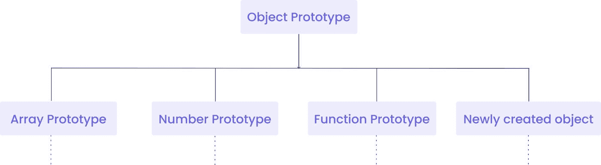

图 3.2 通过 Object.prototype 的继承层级结构。

每个对象还有一个名为 `__proto__` 的隐藏内部属性，在代码中无法直接访问。可以通过 Object 原型提供的静态方法，即 `Object.getPrototypeOf(obj)` 来访问此隐藏属性。该方法返回属于传递对象的所有内置属性和方法的列表。

```javascript
var obj1 = {}; //空对象，不继承任何内容

var obj2 = new Object() //空对象，继承自 Object 原型

Object.getPrototypeOf(obj2);
//返回从原型继承的属性和方法列表
```

直接为对象定义的属性称为 `own property`（自有属性）或 `noninherited property`（非继承属性）。从原型继承的属性称为 `prototypal properties`（原型属性）。

### 3.6.1 原型链

每个对象包含 `[[Prototype]]`，即 `__proto__` 对象，指向另一个对象或 null。想象有一个对象 `Z`，其 `__proto__` 属性设置为对象 `Y`，而对象 `Y` 的 `__proto__` 属性进一步设置为对象 `X`。通过这种方式，原型按需要相互继承。

如图 3.2 所示，每个其他原型都继承自 `Object.prototype`。任何类型的数组、函数、正则表达式、Number、String 或用户对象都继承自 `Object.prototype`。这允许所有其他对象调用 Object 原型中定义的属性和方法。使用原型有助于为对象添加更多功能，而无需在每个类或对象中声明它们。

```javascript
var X = { key1:“value1” }

var Y = { key2:“value2” }

Y.__proto__ = X

var Z = { key3:“value3” }

Z.__proto__ = Y
```

图 3.3 展示了上述代码的执行情况。你可以观察到输出结果：`Z` 对象现在在其 `__proto__` 中包含了 `Y` 对象，而 `Y` 对象在它的 `__proto__` 中包含了 `X` 对象。这确保了属性的共享，即对象 `Z` 可以访问 `key1、key2 和 key3`。

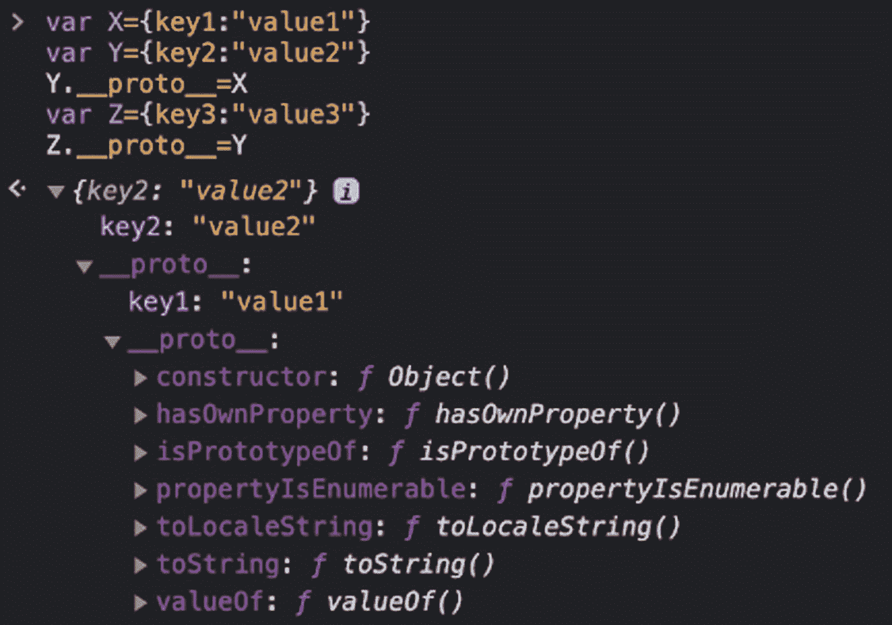

图 3.3 输出截图。

同样，原型继承也可以从其他原型继承方法；例如，在下一个代码段中，`youTubePremiumUser` 通过 `__proto__` 对象继承了 `youTubeUser`。鼓励你在自己的机器上尝试此代码，你将发现 `youTubePremiumUser` 继承了 `youTubeUser` 的 `getEmail` 方法。

```javascript
let youTubeUser = {
  email: “dummyemail@gmail.com”,
  id: 101,
  viewContent: true,
  set setEmail(email) {
    this.email = email;
  },
  get getEmail() {
    return this.email;
  }
};

let youTubePremiumUser = {
  ads: false
};

youTubePremiumUser.__proto__ = youTubeUser;
//youTubeUser 是定义的原型

console.log(youTubePremiumUser.viewContent);
//返回 true

console.log(youTubePremiumUser.getEmail);
```

## 3.7 类

你可能在疑惑为什么我们在讨论对象之后还要讨论类。其实 JavaScript 类是在 2015 年的 ES6 规范中引入的 [[73]](#ref-list.xhtml_refReferences_73)。在 2015 年之前，每个对象都有名为 `[[Prototype]]` 的内部属性。该原型用于为新创建的对象提供不同的属性和方法。随着类的引入，出现了一种更简洁、优雅的对象增强方法。类让对象能够在安全清洁的环境中运行，而不会迷失在不同的原型及其方法中。


`Object prototype` 是通用原型，每个对象都继承自它，无论它是否属于某个类。因此，在 JavaScript 中，对象并不总是强制要求属于一个类。对象可以独立于类而存在。因此，从开发者的角度来看，类的声明和定义变成了一个选择问题。

回到这个问题，什么是类？简单来说，类是生成对象的蓝图或模板。类被用作一种模板，将对象、其属性以及操作这些属性的方法结合在一起。在 JavaScript 中引入类允许开发者轻松地进行操作并在在其他 OOP 语言之间进行切换 [[74]](#ref-list.xhtml_refReferences_74)。

JavaScript 中的类可以使用 `class` 声明来定义。`class` 关键字用在类名之前，后面跟着声明语句。创建类的语法所示。

语法：

```javascript
class MyClass {
  // 类方法
  constructor() {… }
  //初始化属性
  method1() {… }
  //定义方法
  method2() {… }
  method3() {…}…
  …
}
```

JavaScript 中的类对语法有严格检查，以提高系统性能。类在具有强语法检查的 `strict mode` 下运行，这是无法更改的，即类始终在严格模式下工作。必须先声明类后使用；反之则会产生 `ReferenceError`。类方法本质上是不可枚举的（`nonenumerable`）。虽然类被视为特殊类型的函数，但这种限制在函数中并不存在，仅适用于类。作为命名规范，类名的第一个字母总是大写，这有助于在程序中区分类名。

### 3.7.1 构造函数、属性和方法

类可以根据其设计和用途包含不同的属性和方法。使用 `class` 关键字声明类，且只能声明一次。类的定义由构造函数和方法组成。属性通过构造函数初始化，这些属性以及方法会自动成为使用该类初始化的对象的一部分。每个对象都将拥有这些属性的拷贝。使用该类创建的每个对象都是不同的，但本质上是相同的，即每个对象的属性（状态）和方法（行为）是相同的。

类总会有自己的构造函数。构造函数用于初始化新创建对象的值。它是一个用于创建以及初始化通过类实例对象的特殊方法。一个类只能有一个构造函数。每当创建一个新对象时，类中的构造函数就会被调用，以初始化该对象的属性。如果一个类中存在多个构造函数定义，将抛出 `SyntaxError`。

在图 3.4 中，显示了一个类 `Person`，并用于创建四个对象。每个对象都是独特的，但源自同一个基类。类的声明可以像下面所示：

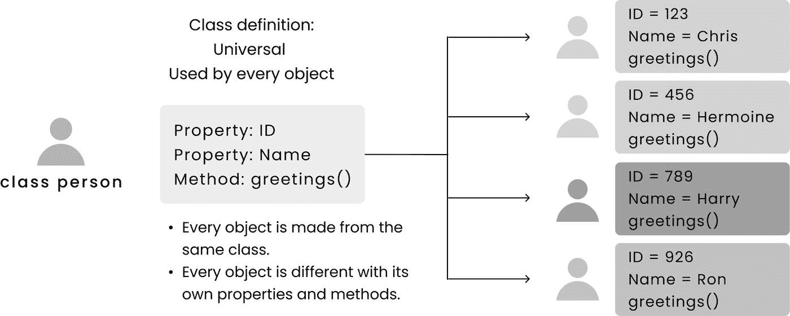

图 3.4 类与对象。

```javascript
class Person //声明一个类
{ //定义一个类
  constructor(uid, name) //类的构造函数
  {
    this.uid = uid; //this 关键字的使用
    this.name = name;
  }
  greetings() //向类中添加一个方法
  {
    console.log(`Hello ${this.name}`);
  }
}

var e1 = new Person(123,“Chris”); //从 Person 类创建 e1 对象
var e2 = new Person(456,“Hermoine”);
var e3 = new Person(789,“Harry”);
var e4 = new Person(926,“Ron”);
e1.greetings(); //在 e1 上调用方法

/*
输出将是：
Hello Arthur Doyle
*/
```

在这个示例中，创建了一个只有一个构造函数和两个属性（即 `uid` 和 `name`）的新类。还提供了一个方法 `greetings()` 以及一个初始化属性的构造函数。当该方法作为对象的属性被调用时，它会执行并显示输出。

### 3.7.2 类的扩展

类对于预先设计以后可以使用的模板非常有帮助。然而，有时开发者想要修改或更新类定义，以添加某些属性或方法。可以通过扩展类来添加新属性，轻松实现这一点。在上一个示例中，创建了一个具有 `uid`、`name` 属性和 `greetings()` 方法的人对象。如果需要具有额外属性（如 `lastName`、`age`、`gender`）以及方法（`getAge()`、`getGender()`、`fullName()`）的人对象，那么我们如何使用同一个类来添加这些属性呢？答案在于类的扩展。

可以通过扩展类以给现有类添加额外功能。任何类都可以通过扩展来添加更多属性和方法以增强其用途。类可以使用 `extends` 关键字扩展父类。子类可以使用 `super` 关键字调用父类的构造函数，从而调用父类的构造函数。在下面的示例中，使用之前使用的 `Person` 类作为基类，创建一个具有更多属性和方法的 `Student` 类。

```javascript
class Student extends Person //继承自父类
{
  constructor(uid, name, age, gender, lastName) //构造函数
  {
    super(uid, name); //链式调用构造函数访问父类
    this.age = age;
    this.gender = gender;
    this.lastName = lastName;
  }
  getAge() //向类添加更多方法
  { return this.age; }
  getGender() { return this.gender; }
  fullName() { return this.name + this.lastName; }
}

var e5 = new Person(123,“Lucy”);
e5.greetings(); //显示 Hello Lucy
var s1 = new Student(367,“Anne”, 24, “Female”, “Hathaway”);
console.log(s1.getAge()); //返回 24
console.log(s1.getGender()); //返回 Female
console.log(s1.fullName()); //返回 Anne Hathaway
```

### 3.7.3 类中的 Getter 和 Setter（访问器和设置器）

我们已经讨论了对象的访问器和设置器方法；同样的概念也适用于类。只需在属性名前加上 `get` 或 `set` 即可启用访问器/设置器方法，这意味着使用 getter 和 setter 方法而不是直接操作属性是一种更安全的替代方案。它保护了被检索和操作的数据完整性。这些方法可以使用之前讨论过的 `set` 和 `get` 关键字来定义。下面的示例解释了它们的用法。

```javascript
class Person {
  constructor(name, age) {
    this.name = name;
    this.age = age;
  }
  get age() //注意 get 和 age 之间的空格
  {
    return this.age;
  }
  set age(x) {
    this.age = x;
  }
}

//创建一个新对象并使用 get 方法访问属性
var obj = new Person(Tony’, 42);
console.log(obj.age);
//通过属性名调用 set age(56)
obj.age = 56;
console.log(obj.age); //显示 56
```

### 3.7.4 静态成员

有时不需要为每个对象创建一个方法或变量，为了节省内存，我们只需要该属性的一个拷贝。在这种情况下，JavaScript 提供了静态成员的使用。静态成员属于类，而不是实例对象。因此，它留在类中，实例化的对象只能访问此属性，但它们并不拥有此属性 [[75]](#ref-list.xhtml_refReferences_75)。

属性和方法都可以声明为静态，且静态成员会被子类继承。可以在类声明期间通过 `static` 关键字作为属性或方法的前缀来添加静态成员。静态成员也可以之后使用 `ClassName.property` = `’value’` 添加到已经定义的类。接下来的示例演示了静态属性和方法的使用。

```javascript
class Account {
  static rateOfIntrest = 10 //静态属性
}
```


```javascript
static totalAccountHolders = 0 //静态属性

constructor(accountNumber, branch, balance) {
  this.accountNumber = accountNumber;
  this.branch = branch;
  this.balance = balance;
  Account.totalAccountHolders + ++;
  // 创建新对象时增加静态成员
}

static getNumberofAccounts() //静态方法 { 
  return Account.totalAccountHolders;
}
```

```javascript
var client1 = new Account(12345, “Central Office”, 42000);
var client2 = new Account(67891, “West Office”, 12000);
console.log(Account.rateOfIntrest); //调用静态属性
console.log(“Total Accounts” + Account.getNumberofAccounts()); //调用静态方法

/*
输出将是：
10
Total Accounts 2
*/
```

静态方法和属性会被扩展这些类的对象继承。对于类的普通成员和静态成员，继承的概念保持一致。

## 3.8 垃圾回收

我们之前已经学习过对象上的 `delete` 操作符；现在让我们通过其他问题再次回顾，例如，什么是垃圾回收以及我们为什么需要它？垃圾回收是在程序不再需要已分配内存时释放这些内存的过程。JavaScript 提供了自动垃圾回收机制，它会定期清理内存并释放内存区域 [[71]](#ref-list.xhtml_refReferences_71)。

要手动移除或删除对象中的某个属性，可以使用 `delete` 操作符。`delete` 操作符并非简单地作用于属性值，而是删除实际的属性值。例如：

```javascript
delete book.author; //从 book 中删除属性 author
delete book[“isbn”]; //从 book 中删除属性 isbn
```

`delete` 操作符用于删除对象自身的属性。不建议删除继承的属性。要删除继承的属性，必须从定义这些属性的原型链（prototype）中删除它们。从原型中删除属性会影响所有继承自该特定原型的对象。此外，我们应该记住，使用 `delete` 不会移除配置属性被设置为 `false` 的属性。当删除操作成功时，delete 操作符返回 `true`。

那么，如何删除整个对象并让垃圾回收器执行释放已分配内存的工作呢？释放内存的唯一方法是将对象标记为准备好删除；这可以通过将对象的引用设置为 `null` 来完成。

很多时候，对象引用会被多次传递、赋值和重新赋值。这在实际对象与其引用之间创建了复杂的关系。一旦引用不可访问，它将被删除。在移除或重新赋值这些引用之前必须小心。

JavaScript 中的垃圾回收使用 `标记与清除`算法来释放内存。垃圾回收器遍历当前的执行函数（带有局部变量和方法）、其他嵌套函数、全局变量等。每个不可访问的对象都被“标记”。标记的对象及其相关的引用会被遍历并根据需要“标记”（垃圾回收器会记住访问过的对象以避免反复解析相同的对象）。这些引用会被遍历，直到每个可访问和不可访问的值都被遍历完毕。完成后，所有被“标记”的对象将被移除，然后过程重新开始。垃圾回收过程以自动化的方式独立发生。它无法被强制执行或停止执行。所有可访问的对象都保留在内存中。为了理解这一场景，让我们看看下一个示例以及相应的图 3.5。

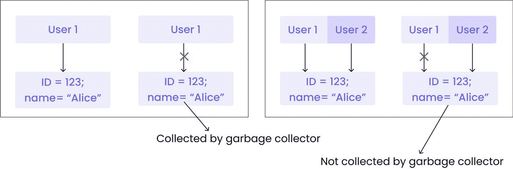

图 3.5 自动垃圾回收。

```javascript
class Human {
  var name;
  var ID;
  Constructor(id, name) {
    this.name = name;
    this.ID = ID;
  }
}
```

```javascript
var user1 = new Human(123,“Alice”); //创建新对象
user1 = null; //重置引用为 null 并标记为删除
console.log(user1.name); //不起作用
```

在这段代码中，使用构造函数创建了对象 `user1` 并将其设置为 `null`。将引用值设置为 `null` 使准备好被垃圾回收器删除。此外，第二个场景说明，如果单个引用是指向该对象的变量，那么它不会被删除或标记为删除。第二个场景演示如下：

```javascript
var user1 = new Human(123,“Alice”); //创建新对象
user2 = user1; //将引用存储到 user2
user1 = null; //重置引用为 null
console.log(user2.name); //可以正常工作
```

## 3.9 练习

### 3.9.1 理论

1. 区分类继承和原型继承。
2. JavaScript 使用了多少种编程范式？请解释。
3. 你如何理解 JavaScript 中的原型继承？讨论开发者应该在什么情况下使用原型继承的场景。
4. 列举创建对象的不同方式。
5. 讨论遍历对象的不同方法。批判性地分析每种可能的替代方案，并脑风暴在什么情况下应该使用哪一种。
6. 编写一个程序遍历对象的属性并在控制台上显示它们。

### 3.9.2 正/错

1. 原型链是由于将一组对象连接在一起而创建的链。
2. `isPrototypeOf()` 方法用于判断一个对象是否是另一个对象的原型。
3. 全局变量的优先级高于局部变量的值。
4. `toString()` 方法用于获取对象的数值表示。
5. 三元运算符用于 JavaScript 中。

### 3.9.3 多选题

1. 在开发网站的不同阶段，开发者会遇到哪些对象？
   - 用户定义对象
   - 主宿对象
   - 原生对象
   - 以上所有
2. 对象可以使用以下哪一个进行调用？
   - `this`
   - `Of`
   - `Object`
   - 以上所有
3. 当类 `C` 扩展另一个类 `D` 时，我们可以说类 `C` 是 ________ 类，而类 `D` 是 ________ 类。
   - 超，子
   - 父类，子
   - a 和 b 都
   - 以上所有
4. 下列代码的输出是什么？
   ```javascript
   function newPerson() {
     this.name = ‘Ojo’;
   }
   function obj() {
     obj.call(this);
   }
   obj.prototype = Object.create(newPerson.prototype);
   const newObject = new obj();
   console.log(newObject.name);
   ```
   - 报错
   - 不编译
   - 打印 ‘Ojo’
   - 以上所有
5. 下列代码的输出是什么？
   ```javascript
   const constantOne = {};
   const constantTwo = Object.create(constantOne);
   console.log(Object.getPrototypeOf(constantTwo) === constantOne);
   ```
   - False
   - True
   - 编译错误
   - 0

## 3.10 演示与实操

### 3.10.1 目标

1. 创建 JavaScript 对象并学习属性。
2. 创建具有不同方法以及 getter/setter 方法的对象。
3. 使用自定义对象构造函数创建对象并进行操作。

### 3.10.2 前提条件

* **步骤 1**: 访问 [`www.routledge.com/97803661429`](https://www.routledge.com/97803661429) 并下载 *Ch3_Object_Template* 压缩包。
* **步骤 2**: 解压内容并使用任一编辑器打开 *index.html*。
* **步骤 3**: 将以下代码插入 *index.html* 中的 `<script>` 块内。
* **步骤 4**: 为每个代码片段重复上述三个步骤。

### 3.10.3 探索

使用任何编辑器，我们将编写并测试 JavaScript 代码以使用循环并在网页上显示结果。

简而言之，对象可以被视为用户定义的变量，它们可以包含多个属性，并且可以通过构造函数创建相似类型的对象。对象是可变的。

#### 3.10.3.1 代码片段-1

```javascript
// 工具函数 ()
const appendToHTML = (contents, color = “white”) => {
```


```javascript
contents.forEach((content) => {
  const myPara = document.createElement(“p”);
  myPara.style.color = color;
  myPara.innerHTML = content;
  resultHere.appendChild(myPara);
  sep();
});
};

const sep = () => {
  const separator = document.createElement(“hr”);
  resultHere.appendChild(separator);
};
/************************************************************ */
var resultHere = document.querySelector(".results”);
// 定义一个对象
var NetFlix = {
  content: ["Sherlock Holmes”, “Enola Holmes"],
  customer: “Dibyasom Puhan”,
};
// 将创建的对象打印到网页上。
// 使用 Object.values(obj) 显示它，会返回一个数组。
appendToHTML(["Dummy object 1: ”, Object.values(NetFlix)]);
// 使用 new 关键字创建并定义一个对象
var NetFlix1 = new Object();
NetFlix1.content = ["Sherlock Holmes”, “Enola Holmes"];
NetFlix1.customer = “Ravi”;
// 使用 JSON.stringify() 显示对象。
// 此方法产生更具可读的信息。
appendToHTML(["Dummy object 2: ”, JSON.stringify(NetFlix1)]);
// 定义对象方法。********************************
var NetFlix2 = {
  content: ["Sherlock Holmes”, “Enola Holmes"],
  customer: “You”,
  streamService: function (choice) {
    // 方法定义
    return this.content[choice]; // 这基本上指的是当前被调用的对象，以解决可能存在的歧义。
  },
};
appendToHTML(["Dummy object 3: ”, JSON.stringify(NetFlix2)]);
// 调用对象方法。
const myStream = NetFlix2.streamService(1);
appendToHTML(`Requested Stream: ${myStream}`], “tomato”);
```

#### 3.10.3.2 代码片段-2

```javascript
// 工具函数 ()
const appendToHTML = (contents, color = “white”) => {
  contents.forEach((content) => {
    const myPara = document.createElement(“p”);
    myPara.style.color = color;
    myPara.innerHTML = content;
    resultHere.appendChild(myPara);
    sep();
  });
};

const sep = () => {
  const separator = document.createElement(“hr”);
  resultHere.appendChild(separator);
};
/************************************************************ */
var resultHere = document.querySelector(".results”);
// 定义 getter/setter 以获取并为对象属性新值。
var NetFlix = {
  content: ["Sherlock Holmes”, “Enola Holmes"],
  customer: “You”,
  // 对象方法
  streamService: function (choice) {
    // 方法定义
    return this.content[choice];
    // 它指代当前被调用的对象，以解决可能存在的歧义。
  },
  // customer 属性的 getter。
  get cust() {
    return this.customer.toUpperCase();
  },
  // customer 属性的 setter。
  set cust(newCust) {
    // 可以检查条件然后赋值。
    if (newCust!== null) {
      // 或者使用任何自定义有效性测试。
      this.customer = newCust;
    } else {
      return;
    }
  },
};
appendToHTML(["Dummy object 2: ”, JSON.stringify(NetFlix)], “yellow”);
// 使用 getter。
const customer = NetFlix.cust;
appendToHTML(`Current customer (Extracted via getter): ${customer}`]);
//为 customer 属性设置新值。
NetFlix.cust = “Dibyasom”;
appendToHTML(
  ["Setter used, dummy object current value: ”, JSON.stringify(NetFlix)],
  “black”
);
```

#### 3.10.3.3 代码片段-3

```javascript
// 工具函数 ()
const appendToHTML = (contents, color = “white”) => {
  contents.forEach((content) => {
    const myPara = document.createElement(“p”);
    myPara.style.color = color;
    myPara.innerHTML = content;
    resultHere.appendChild(myPara);
    sep();
  });
};

const sep = () => {
  const separator = document.createElement(“hr”);
  resultHere.appendChild(separator);
};
/************************************************************ */
var resultHere = document.querySelector(".results”);
// 定义蓝图以创建实例，即相同类型的对象
function NetFlix(content, customer) {
  // 对象构造函数
  this.content = content;
  this.customer = customer;
  // 对象方法
  this.streamService = (choice) => {
    // 方法定义
    if (choice < this.content.length) {
      return this.content[choice];
      // 它指代当前被调用的对象，以解决可能存在的歧义。
    }
    else {
      return “Not Subscribed, sorry!”;
    }
  };
  // customer 属性的 getter。 | 可以处理并返回更高质量的数据。
  this.getCust = () => {
    return this.customer.toUpperCase();
  };
  // customer 属性的 setter。
  this.setCust = (newCust) => {
    // 可以检查条件然后赋值。
    if (newCust!== null) {
      // 或者使用任何自定义有效性测试。
      this.customer = newCust;
    }
    else {
      return;
    }
  };
}
// 使用构造函数创建对象。
var nfAsia = new NetFlix([“Witcher”, “Two man and a half”], “Dummy Dumdum”);
// 向对象构造函数添加属性（通过原型）
NetFlix.prototype.region = “Global”;
var nfUk = new NetFlix([“Peaky Blinders”, “Enola Holmes”], “Dummydum”);
// 打印新创建的对象。
appendToHTML(
  [`Dummy object 1: ${JSON.stringify(nfAsia)}`,
  `Currently Streaming content-2: ${nfAsia.streamService(1)}`,
  `Currently Streaming content-6: ${nfAsia.streamService(5)}`,
  ],
  “black”
);
appendToHTML(
  [`Dummy object 2: ${JSON.stringify(nfUk)}`,
  `Currently Streaming content-2: ${nfUk.streamService(1)}`,
  `Currently Streaming content-100: ${nfUk.streamService(99)}`,
  `Stream Service: ${nfUk.region}`,
  ],
  “yellow”
);
```


JavaScript 允许我们生成用户定义的函数，专门作为一组语句的执行句柄。在 JavaScript 中，除了原始数据类型之外的任何内容都被视为对象。函数是 JavaScript 语言中的特殊对象。通过执行代码 `(function(){ }).constructor === Function` 可以观察到这一点，它返回 `true`[[79]](#ref-list.xhtml_refReferences_79)。作为对象的函数包含三个属性，即 `length`、`name` 和 `prototype`。此外，`Function.prototype` 包含许多其他属性和方法，其中一些在此处进行了解释。每当我们在 JavaScript 中创建一个 `function` 时，创建的函数将是 `Function` 特殊对象或蓝图的对象；可以使用 `typeof` 运算符进行检查。请注意，`Function` 是特殊对象，而函数将是使用 `Function.prototype` 创建的用户定义对象。要查看 `Function` 特殊对象的属性和方法，请在浏览器控制台中输入 `Object.getOwnPropertyDescriptors(Function)` [[80]](#ref-list.xhtml_refReferences_80)。

让我们来了解 `Function` 对象内部提供的属性和一些重要方法。

*   `Function.prototype.name`: 此属性存储所定义的函数名称；可以在浏览器控制台中使用 `functionIdentifier.name` 进行检查。
*   `Function.prototype.length`: 此属性存储传递给函数的参数个数；可以在浏览器控制台中中使用 `functionIdentifier.length` 进行检查。
*   `Function.prototype.constructor()`: 这是一个特殊方法，使用 `new` 算符创建 `Function` 对象。例如，`var myFunc = new Function()`。
*   `Function.prototype.toString()`: 该方法从 Object 原型处被重写；当在浏览器控制台中像 `functionIdentifier.toString()` 使用时，它将打印函数的代码。
*   `Function.prototype.apply()/bind()/call()`: 这三个方法用于作用域处理；它们将在下一节关于函数作用域中单独讨论。
*   `Function.prototype.arguments`: 此属性是每个函数内部的一个类数组对象；它包含了传递给函数的所有参数，并方便使用索引访问参数。

## 4.2 函数变量作用域

现在讨论函数作用域及其绑定还稍微早了一点。然而，在向后继续学习函数声明之前，你有必要理解它。

函数中使用的变量可以定义在函数体外部，也可以定义在函数体内。定义在函数体内的变量被称为`局部变量`。局部变量仅供关联函数访问。局部变量在函数被调用并开始执行时初始化；当函数体执行完毕时，变量会被删除。此类变量只在函数内部识别；因此，在函数体外部可以使用同名的变量。

定义在函数体外的变量被称为`全局变量`。这些变量可以被整个代码中定义的任何函数访问。如果局部变量和全局变量同名，则局部变量会遮蔽外部变量，这意味着局部变量紧密关联到其关联函数并覆盖全局值。

如果函数没有可用的局部变量，则将使用全局变量的值执行。让我们通过下面的示例来理解变量的作用域：

```javascript
// 以下变量定义在全局作用域中
var num1 = 20;
var num2 = 3;
var name = “Tom";

function multiply() { // 函数定义在全局作用域
  return num1 * num2; //可以访问全局变量
}

// 嵌套函数示例
function getScore() {
  var num1 = 2, num2 = 3;
  function add() {
    return name + ' scored ' + (num1 + num2);
  }
  return add();
}

multiply(); // 返回 60
getScore(); // 返回 "Tom scored 5"
```

该示例演示了函数内部全局变量和局部变量的使用。还演示了嵌套函数；每当调用 `getScore()` 时，它会自动执行 `add()` 并返回值。

以上是关于对变量作用域的理解。现在转向函数调用内部变量的绑定。为了提供一点背景，JavaScript 中的函数可以作为对象在其他函数之间传递，每当对象作为回调函数传递给另一个函数时，当前对象或 `this` 的值就会丢失。在开发 Web 内容时，我们需要在每次调用函数时向其传递用户特定的数据。因此，每次执行回调时都丢失 `this` 的引用会导致问题。函数作用域提供了该 problem 的解决方案。在 `Function.prototype` 内部有三个方法，即 `call()`、`apply()` 和 `bind()`。让我们通过以下示例了解它们的效用：

```javascript
// 传统示例
// 一个带有自身 "this" 属性的简单对象
var dummyObject = {
  num: 100;
};

// 在 window 上设置 "num" 以显示它是如何不被使用的
window.num = 2000;

/* 将在 DOM 章节中讨论 window，
现在将其视为全局作用域 */

// 一个用于操作 "this" 的传统函数
var add = function (a, b, c) {
  return this.num + a + b + c; // this 关键字的使用
};

var result = add(1, 2, 3);
console.log(result) // 打印 2006 (2000 + 1 + 2 + 3)

// 使用 call
var result = add.call(dummyObject, 1, 2, 3);
console.log(result) // 打印 2006 (2000 + 1 + 2 + 3)

// 使用 apply
const arr = [1, 2, 3];
var result = add.apply(dummyObject, arr);
console.log(result) // 打印 2006 (2000 + 1 + 2 + 3)

// 使用 bind
var result = add.bind(dummyObject);
console.log(result(1, 2, 3)) // 返回 2006 (2000 + 1 + 2 + 3)
```

此示例演示了这三个方法如何在调用方法时关联 `dummyObject` 的作用域，并在访问本地 `num` 值。而在传统的函数调用中使用的是 num 的全局值，即 `window.num`。这种基础理解将有助于我们掌握后续章节中讨论的箭头函数

## 4.3 函数声明

JavaScript 支持多种方法来声明函数。在本节中，我们将讨论声明方法的的方法。

### 4.3.1 传统函数声明

这种方法是声明函数的传统方式，自 JavaScript 语言诞生以来就一直支持。传统函数通过使用 `function` 关键字后跟函数名称来声明。函数名遵循与变量相同的命名规则，可以使用字母、数字、下划线和美元符号。请参阅第 2.2.5 节 变量的命名规范。传统定义函数的语法如下：

```javascript
function func_name (parameter1, parameter2, … parameter)
{
  //一组语句 – 函数体
  //可选的 return 语句
}
```


使用参数执行的语句集写在花括号内。这部分被称为函数体。在函数定义中，`return` 语句是可选的。函数可以选择发送一个返回值，也可以简单地执行函数体而不返回任何内容。大多数用户在代码执行后需要某些输出值，因此使用了 `return` 语句。它是函数体中的最后一条语句。如果 `return` 语句不是最后一条，那么函数将执行到 `return` 语句为止的代码并返回该。在返回值时，它将跳出函数作用域，因此 `return` 之后的语句将永远不会被执行。因此，将 `return` 放在代码中的最后一条语句是重要的。

例如：

```javascript
function add(num1, num2) {
  return num1 + num2;
};

var result = add(2, 3);
console.log(result) //prints 5
```

### 4.3.2 函数表达式

虽然之前的函数声明在语法上是一个语句，但也可以通过函数表达式来创建函数。创建的函数是匿名的；它们不需要名称，并被赋值给变量。由于函数也是对象，因此将它的引用值赋值给变量是完全有效的 81。例如，函数 `square` 可以如下如下定义：

```javascript
const square = function (number) {
  return number * number;
};

var result = square(4); // result gets the value 16
```

当将函数作为参数传递给另一个函数时，函数表达式非常方便。在下一个示例中，`map` 函数在语法上被定义，创建了另一个匿名函数并将其赋值给常量 `cubeCalculator`。此外，观察到 `cubeCalculator` 像其他对象一样被传递给 `map` 函数。

```javascript
function map(placeHolder, a) {
  let result = []; // Create a new Array
  for (let i = 0; i!= a.length; i + +)
    result[i] = placeHolder(a[i]);
  return result;
};

const cubeCalculator = function (x) {
  return x * x * x;
};

let numbers = [0, 1, 2, 5, 10];
let cube = map(cubeCalculator, numbers);
console.log(cube); // prints 0, 1, 8, 125, 1000
```

上一个示例可以使用 `Array.prototype.map()` 方法执行，我们将在涵盖数组的章节中详细讨论 ([第 5 章)）。

```javascript
var f = function (x) {
  return x * x * x;
}

let numbers = [0, 1, 2, 5, 10];
let cube = numbers.map(f);
console.log(cube); //prints [0, 1, 8, 125, 1000]
```

### 4.3.3 箭头函数表达式

箭头函数表达式使用特殊的箭头 `=>` 运算符编写匿名函数表达式的简写。这类函数有它们自己的优点和局限性。箭头函数总是返回某个值。箭头函数可以具有紧凑的体或块体 82。对于紧凑体，只需要单行表达式，不需要 `return` 语句。对于块体 `{}`，则需要 `return` 语句，如示例所示：

```javascript
var func = x => x * x; // concise body syntax, implied "return"

var func = (x, y) => { return x + y; };
// 带有块体时，需要显式的 "return"
```

为了建立对箭头函数的基本理解，让我们通过演示如何将传统函数转换为箭头函数的示例来理解它们的原理。

```javascript
// 计算 a 平方的传统函数
function function (a) {
  return a * a;
};

// 转换为箭头函数的步骤
/* 1. 移除 "function" 单词并在参数和起始体括号之间放置箭头，这是一个块箭头函数，意味着包含 {} 和 return 语句 */
(a) => {
  return a * a;
};

/* 2. 移除体括号和 "return" 单词 -- 返回是隐含的，这是紧凑体样式 */
(a) => a + 100;

// 3. 我们甚至可以移除参数的括号。
a => a + 100;
```

#### 4.3.3.1 箭头函数的局限性

箭头函数为编写函数提供了非常简洁的风格，但它们也带有自己的局限性。简要指出如下：

* 箭头函数不能作为方法，因为它们没有对 `this` 和 `super` 自己的绑定。
* 箭头函数不适用于 `call`、`apply` 和 `bind` 方法；这些方法用于建立作用域。
* 箭头函数没有在使用传统方法时的那种 `arguments` 属性。
* 箭头函数不能作为构造函数的简写。

让我们通过一些示例来理解这些局限性的前两个。下一个示例演示了传统函数和箭头函数内部 `this` 的值。在这里，`demoObject` 创建了三个属性：`a`、`arrowFunction` 和 `traditionalFunction`，其中后两个分别是箭头函数和传统函数。此外，当通过 `demoObject` 对象调用这些方法时，我们可以观察到传统函数能够使用 `this` 引用打印值 10。相反，`arrowFunction` 通过 `this` 打印了 `window` 对象。

```javascript
var demoObject = {
  a: 10,
  arrowFunction: function() {
    console.log(this.a);
  },
  traditionalFunction: function() {
    console.log(this.a);
  }
};

demoObject.traditionalFunction(); // prints 10
demoObject.arrowFunction(); // prints window object
```


`return` 语句可以将信息返回给调用它的变量。在函数声明中，它是可选的。它们可以放在代码的任何位置，但通常写在最后一条语句。当函数遇到 `return` 语句时，它会停止执行并返回到调用代码。函数中的多个 `return` 语句允许函数根据代码设计返回到其中任何一个位置。也可以使用空 `return` 语句，它将向调用代码返回 `undefined`。

### 4.4.2 调用函数

声明函数仅指定了某组语句的作用，并将其绑定到一个名称上。为了实际执行这些语句，必须通过其名称对函数进行`called`（调用），或者说进行`invoked`（唤起）。在接下来的示例中，`square` 函数通过参数 5 被调用，即 `square(5)`。结果随后存储在变量 `z` 中。函数应该存在于调用作用域内。

```javascript
const square = function (n) {
  return n * n;
} // 作为表达式的形式声明方法

console.log(square(5));
// 使用参数调用 square
```

### 4.4.3 递归

递归是重复任务的过程。在解决问题时，我们可以将其拆分并反复执行某些语句来解决眼前的更大问题。当对某段代码重复执行此操作时，它被称为`recursion` [[83]](#ref-list.xhtml_refReferences_83)。演示递归的最佳示例是计算数字的阶乘。例如，如果我们需要计算 5 的阶乘；这是一个递归问题，解决方案非常简单。如果我们知道 4 的阶乘值，以及后续 3 和 2 的阶乘值，最终已知 1 的阶乘为 1，就可以合并这些大问题来计算出 5 阶乘的实际问题。通过以下示例用程序化的演示了这一点：

```javascript
function factorial(n) {
  if ((n == 0) || (n == 1)) // 使用或逻辑运算符
    return 1;
  else
    return (n * factorial(n - 1));
  /* 递归调用自身直到满足终止条件 */
};
```

### 4.4.4 闭包

闭包是将嵌套函数绑定到其父函数局部变量的过程 [[84]](#ref-list.xhtml_refReferences_84)。这使得嵌套函数即使在父函数执行结束后也能使用这些局部变量 [[85]](#ref-list.xhtml_refReferences_85)。换句话说，闭包允许你从内部函数访问外部函数的作用域。

在 JavaScript 中，每当创建一个函数时都会创建一个闭包。下面的示例演示了闭包的使用。在这个示例中，我们定义了一个函数 `greeting(x)`，它接受一个参数 `x` 并返回一个新函数。它返回的函数接受一个参数 `y` 并返回 `x` 和 `y` 的拼接。我们通过分别向 `greetings` 函数传递 `Hi` 和 `Bye` 创建了两个函数表达式，即 `sayHi` 和 `sayBye`。`greetings()` 返回的两个函数具有相同的函数体，但 `x` 的值不同（即 `Hi` 和 `Bye`）。在这里，`sayHi` 和 `sayBye` 是从函数 `greetings()` 创建的闭包。

```javascript
function greeting(x) {
  return function (y) {
    return x + y;
  };
};

var sayHi = greeting("Hi");
var sayBye = greeting("Bye");

console.log(sayHi("Tom")); // Hi Tom
console.log(sayBye("Tom")); // Bye Tom
```

## 4.5 练习

### 4.5.1 理论

1. 区分函数声明和函数表达式。
2. 区分函数中属性（attributes）和属性（properties）的使用。
3. 你是如何理解 JavaScript 中的闭包的？
4. 你认为为什么在 JavaScript 中引入箭头函数？请用合适的代码说明箭头函数的作用。
5. 在处理函数时用到的 `bind()`、`call()` 和 `apply()` 方法之间有什么区别？请使用合适的程序代码来区分它们。

### 4.5.2 对/错

1. 在 JavaScript 中，函数必须返回一个值。
2. 对于使用表达式定义的函数，函数名是可选的。
3. 所有用户创建的函数都继承自 `Function` 原型。
4. 运行时可以向函数传递任意数量的参数。
5. `length` 属性可以检查函数声明中声明的参数数量。
6. `Function()` 构造函数在每次被调用时都会创建一个新函数。
7. JavaScript 中的函数不能在运行时动态创建。
8. JavaScript 不允许嵌套的嵌套。

### 4.5.3 单选题

1. 当使用对象作为参数调用 ___________ 方法时，它会返回一个新函数。
   1. `valueOf()`
   2. `bind()`
   3. `call()`
   4. `apply()`
2. 新创建的函数继承自原型（prototype）。它继承自以下哪一个？
   1. `Object`
   2. `Function`
   3. `Number`
   4. a 和 b 都是
3. 的 __________ 被定义为函数及其作用域的组合，其中函数的变量在该作用域内。
   1. 绑定
   2. 闭包
   3. 递归
   4. 以上都不是
4. 为了调用函数，可以使用以下：
   1. 函数字面量
   2. 函数调用
   3. 函数声明
   4. 使用原型
5. 以下代码的输出是什么？
   ```javascript
   var x = 9;
   function outerFunction() {
     x = 3;
     function innerFunction() {
       x = 4;
       console.log(x);
     }
     innerFunction();
   }
   ```
   1. 输出 ‘4’
   2. 产生错误
   3. 输出 3
   4. 输出 ‘6’

## 4.6 函数演示与上手

### 4.6.1 目标

1. 定义基础函数。
2. 理解 `length` 属性、`bind`、`call`、`apply` 方法。
3. 理解闭包的概念和示例。

### 4.6.2 前提

* **步骤 1:** 访问 [`www.routledge.com/9780364129`](https://www.routledge.com/9780364129) 并下载压缩包 `Ch4_Function_Template`。
* **步骤 2:** 解压内容并在任何编辑器（如记事本或 VS Code）打开 `index.html`。
* **步骤 3:** 将以下代码插入 `index.html` 的 `<script>` 块中。
* **步骤 4:** 为每个片段重复上述三个步骤。

### 4.6.3 探索

使用任何编辑器，我们将编写并测试定义函数的 JavaScript 代码。关于 `Function` 你应该知道：函数是一个命名的代码块，定义后可以调用并执行多次。它减少了代码量，更容易调试并使代码模块化。

#### 4.6.3.1 代码片段 1

```javascript
// 工具函数
const appendToHTML = (contents, color = "white") => {
  contents.forEach((content) => {
    const myPara = document.createElement("p");
    myPara.style.color = color;
    myPara.innerHTML = content;
    resultHere.appendChild(myPara);
    sep();
  });
};

const sep = () => {
  const separator = document.createElement("hr");
  resultHere.appendChild(separator);
};

/************************************************************ */
var resultHere = document.querySelector(".results");

// JS 函数绑定
// 创建员工对象
const employee = {
  _name: "JavaScript",
  getName: function () {
    return this._name;
  },
};

appendToHTML(["~ Function.bind() ~"]);

const unboundGetName = employee.getName;
// 函数在全局作用域被调用
appendToHTML([`Unbound Get name > ${unboundGetName()}`], (color = "orange"));
//预期输出: undefined

// 这里的分隔符
sep();

const boundGetName = unboundGetName.bind(employee);
appendToHTML([`Bound Get name > ${boundGetName()}`], (color = "lime"));
//预期输出: 42

/************************************************************ */
appendToHTML([
"Function.length | 返回函数期望的参数数量",
]);
```


```javascript
`appendToHTML.length > ${appendToHTML.length}`,

"It's 1 as the other arg is optional.",

],

(color = "lime")

);

sep();

/************************************************************ */
appendToHTML([
  "call() | Calls a function with a given this value, and individual arguments, that's the difference b/w call and apply, as apply can only take one array arg.",
]);

function Product(name, price) {
  this.name = name;
  this.price = price;
}

function Food(name, price) {
  Product.call(this, name, price);
  this.category = "food";
}
appendToHTML(
  [
    `Instantiating Product > ${new Food("MacOS Big-Sur", 1000).name}`,
    `Instantiating Food, which calls Product constructor > ${new Food("cheese", 5).name
    }`,
  ],
  (color = "lightgreen")
);
// expected output#1: "MacOS Big-Sur"
// expected output#2: "cheese"
```

#### 4.6.3.2 代码段落-2

```javascript
// Utility ()
const appendToHTML = (contents, color = "white") => {
  contents.forEach((content) => {
    const myPara = document.createElement("p");
    myPara.style.color = color;
    myPara.innerHTML = content;
    resultHere.appendChild(myPara);
    sep();
  });
};

const sep = () => {
  const separator = document.createElement("hr");
  resultHere.appendChild(separator);
};
```

/************************************************************ */
var resultHere = document.querySelector(".results");
appendToHTML([
  "Function.toString | Returns the function definition (source code) formatted to String",
]);
sep();
appendToHTML(
  [
    `appendToHTML.toString() > ${appendToHTML.toString()}`,
    `sep.toString() > ${sep.toString()}`,
  ],
  (color = "lime")
);
sep();

/*****************************************************/ */
appendToHTML([
  "Arrow Function | An arrow function expression is a compact alternative to a traditional function expression,",
]);
// Traditional Function
function randomBetween(a, b) {
  return Math.random() * (b - a) + a;
}
// Arrow () equivalent
const randomBw = (a, b) => Math.random() * (b - a) + a;
appendToHTML(
  [`randomBetween(1,100): ${randomBetween(1, 100)}`],
  (color = "lightblue")
);
appendToHTML(
  [
    `randomBw(1,100): ${randomBw(
      1,
      100
    )} (Ps. Equivalent of randomBetween but declared with arrow way.)`,
  ],
  (color = "orange")
);
sep();

/*****************************************************/ */
appendToHTML(["JavaScript Closure"]);
// Add is assigned a self-invoking function, which set counter = 0 and
// returns a function expression, that now makes 'add' a function.
// Further calls invoke add, now the inner function, and it retains the
// value of counter, as it is present in its parent scope.
// This is called closure, which makes JS functions have PRIVATE variables.
// This functionality cannot be achieved by making counter global, because any other function can increment it as well.
// With closure, privacy is enforced, and only add can increment and retain the counter.
var add = (function () {
  var counter = 0;
  return function () {
    counter + = 5;
    return counter;
  };
})();
var counter = 0;
function addNonClosure() {
  var counter = 0;
  counter + = 5;
  return counter;
}
add();
add();
addNonClosure();
addNonClosure();
appendToHTML(
  [
    `add() returned ${add()}`,
    `addNonClosure() returned ${addNonClosure()} //Should have been 15`,
  ],
  (color = "lime")
);
```

# 5 数组

DOI: [10.1201/9781003122364-5](https://doi.org/10.1201/9781003122364-5)

> *我们面临着广泛的威胁，这意味着我们必须具备广泛的能力*。
> –Mac Thornberry

我们已经理解了 JavaScript 中对象和函数的概念；现在是时候转向数组了。如果我们告诉你们数组是一个用于存储不同元素的单个变量，你们可能会想：“既然我可以简单地在对象内部存储多个值，为什么还要学习数组呢？”这个想法的答案在于，`Arrays` 是 JavaScript 中的特殊对象，它们在表现得像普通对象的同时，还提供了多项功能。

对象被视为现实实体的表示，而数组是不同类型元素的集合，并提供了多个内置属性和方法来访问和修改此列表。本章旨在让你理解 `Arrays` 的概念以及在 JavaScript 程序中对内置属性和方法的使用。与某些其他语言相比，JavaScript 数组非常好用——这是它们绝对做对的地方。

## 5.1 数组

数组传统上是连续长度的连续分配。尽管在 JavaScript 中它们许多情况下有所不同，但数组是一个具有唯一构造函数、字面量语法以及一组继承属性的特殊对象。

## 5.2 数组属性

如前所述，数组是特殊对象，因此它们包含一些内置属性和方法。这使得它们易于高效使用。数组的属性可以通过 `Object.getOwnPropertyNames(Array)` 获取。数组对象（类）包含以下属性和静态方法：

*   `Array.name`：返回 `Array` 字符串值的属性。该属性只是对象的名称占位符。
*   `Array.isArray`：这是一个静态方法，在检查作为参数的对象是否属于数组后返回布尔值结果。
*   `Array.from()`：这是一个静态方法，用于从预定义的数组对象或可迭代对象返回新数组。
*   `Array.of(elements*)`：这是一个静态方法，根据可数量或类型的参数返回一个新的 `Array` 对象。
*   `Array.prototype.length`：这是所有数组类型对象继承的属性；该属性返回实例中值的数量。
*   `Array.prototype`：这是最重要的属性，因为它包含了所有特殊的内置方法以及它们的默认对象方法。

## 5.3 声明数组

数组操作非常频繁，很快你就不需要记住这些声明了。它们会随着练习自然而。然而，我们仍然会详细讨论数组的声明。声明数组有两种方法；即：通过使用 `Array` 字面量或通过构造函数。以下小节将通过示例解释它们。

### 5.3.1 数组字面量


在数组声明中使用的方括号也被称为数组字面量或数组初始化器 `[ ]`。使用 `var` 关键字，我们可以创建一个名为 `array_name` 的数组，初始化值保留在 `[ ]` 内部。每个值之间使用逗号运算符分隔。这种声明数组的方法因为其简单性、执行速度快以及代码可读性高而被广泛使用。

语法：

```javascript
var array_name = [val1, val2, val3, val4 … valN];
```

例如，下面的数组 `worker` 包含了五个个工人的名称。这些名称存储在一个从零开始计数的索引值数组中。数组的 `length` 将为 4（0,1,2,3,4），相当于数组中总共有五个元素，其中 `Alice` 的键为 0，`Tim` 的键为 2，`Charlie` 的键值为 4。

```javascript
var worker = [“Alice”, “Bob”, “Tim”, “Kim”, “Charlie”];
```

JavaScript 还允许在单个数组中存储不同类型的数据，包括整数、字符串、空对象、对象等。观察同一个数组实例中的异构类型数据。

```javascript
var worker_hetrogeneous = [“Alice”, { “id”: 101,”name”:”Bob” }, “Tim”, “Kim”, 101];
```

### 5.3.2 使用 new 关键字和数组构造函数

也可以通过 `new` 关键字创建一个新的数组对象，它会创建一个 `Array` 实例。然后应显式地提供数组中的值。如前所述，数组的索引从零开始，但这并不限制只能从索引开始输入值。因此，可以根据程序需要轻松地填充数组。通常会避免这种方法，因为它给代码增加了不必要的复杂性。按顺序添加值无疑是一个更简单、更简洁且更好的替代方案。

语法：

```javascript
var array_name = new Array()
```

让我们来看一个相同的示例：

```javascript
var worker = new Array()
worker[0] = “Alice”
worker[1] = “Bob”
worker[2] = “Tim”
worker[3] = “Kim”
worker[4] = “Charlie”
worker[21] = “Kate”
//观察索引，不推荐但有效
worker[40] =”Smith”
//观察索引，不推荐但有效
```

也可以通过使用 `new` 关键字并在构造函数本身中提供值来声明数组。在这种情况下，索引值默认从零开始。

语法：

```javascript
var array_name = new Array(“val1”, “val2”,…, “valN”)
```

让我们来看一个相同的示例：

```javascript
var worker = new Array(“Alice”, “Bob”, “Tim”, “Kim”, Charlie”);
```

## 5.4 访问数组

可以使用数组名和封装在方括号 `[ ]` 中的索引数字来访问 JavaScript 数组。因此，数组元素的索引在访问和操作数组时起着重要作用。正如我们所学到的，数组是带编号的数据集合，这些数字被称为索引。第一个元素的索引值始终为 0，最后一个元素的索引值为 `length-1`。只需使用数组名即可访问整个数组。请注意，数组是特殊对象，但不能使用 `.` 点符号来访问数组的元素。让我们在接下来的示例中查看所有情况：

```javascript
var worker = [“Alice”, “Bob”, “Tim”, “Kim”, “Charlie”];
console.log(worker[0]); //打印 Alice
console.log(worker[3]); //打印 Kim
console.log(worker[worker.length - 1]);
//访问最后一个元素，打印 Charlie
console.log(worker);
//打印整个数组: ["Alice", "Bob", "Tim", "Kim", "Charlie"]
console.log(arr.0); //语法错误
console.log(arr.[6]); //返回 undefined
```

此外，可以通过简单地重新赋值值来修改数组元素。JavaScript 数组是对象，因此你可以轻松地从数组中添加或删除属性。

以有序的方式存储数组元素是一种良好的做法并被广泛遵循。然而，JavaScript 允许你留空索引。它允许在单个数组中存储不同类型的数据，包括整数、字符串、空对象、嵌套对象等。

```javascript
var worker_hetrogeneous = [“Alice”, { “id”: 101,”name”:”Bob” }, “Tim”, “Kim”, 101];
```

## 5.5 数组内部的内置方法

到为止我们已经多次提到了内置方法。`Array` 对象中的内置方法定义在 `Array` 特殊对象的 `Array.prototype` 属性内部。通过在浏览器控制台中输入 `Array.prototype` 可以看到这些方法。开发者从 Array 蓝图创建的新数组实例将继承所有这些内置方法。我们甚至可以定义自己的方法 `Array.prototype.function()`，然后在程序的任何地方使用它。根据需要，Array 对象中存在的方法也可以被重载。

为了方便理解，内置方法被分为三类。这些类别是访问器方法（accessor methods）、变异器方法（mutator methods）和迭代器方法（iterator methods），它们将在接下来的章节中通过示例详细说明。

### 5.5.1 访问器方法

访问器方法在调用数组的副本上操作。也就是说，它们不会更改原始数组。换句话说，创建了数组的副本，该方法在该副本上执行操作。所有的访问器方法定义在 `Array.prototype` 内部，这些是：

访问器方法定义在 `Array.prototype` 内部，这些是：

- `concat()`：合并两个或多个数组并返回合并后的数组。有时 `concat()` 不带参数只是克隆一个数组。`concat()` 的语法如下：

```javascript
array_identifier.concat(value1, value2 … valueN);
```

例如：

```javascript
var numeral = [101, 102, 103];
var text = ["Alice", "Bob", "Tim"];
var aplhaNumeric = [4024, "AH-2045", "TY-876"]
var result1 = numeral.concat(text);
//合并 numeral 和 text 并存储到 result1
var result2 = numeral.concat(text, aplhaNumeric);
//合并 3 个数组 [numeral]
var result3 = text.concat(5, 6, [7, 8]);
//创建一个嵌套数组
var result4 = nested.concat(text);
//合并 nested 和 text 保留引用
console.log(result1); //打印 [101, 102, 103, "Alice", "Bob", "Tim"]
console.log(result2); //101, 102, 103, "Alice", "Bob", "Tim", 4024, "AH-2045", "TY-876"]
console.log(result3); //打印 ["Alice", "Bob", "Tim", 5, 6, 7, 8]
console.log(result4); //打印 [Array(2), 234, Array(2), "Alice", "Bob", "Tim"]
```


在此语法表示中，`array_identifier` 是要搜索的数组。元素和索引（index）是搜索开始位置的值。`index` 的值是可选的，如果不提供，则 `index` 默认为零。

```javascript
var arr = [“a”, “b”, “c”, “d”,”e”, “f”, “g”];
arr.indexOf(“a”) //returns 0
arr.indexOf(“b”, 2) //returns -1
arr.indexOf(“h”) //returns -1
```

*   `join()`：此方法用于连接或合并数组的所有元素，并生成一个单一的连接字符串。默认情况下，生成的输出字符串中的数组元素之间用逗号分隔。我们可以选择性地提供一个分隔符来覆盖默认的逗号分隔符。

语法：
```javascript
array_identifier.join(separator);
```
默认分隔符是逗号运算符，但如果你想指定不同的分隔符，则该分隔符将使用在数组元素之间。如果数组为空，则返回一个空字符串。如果数组中的任何元素是 `undefined`、`null` 或空字符串，它将被转换为并显示为空字符串。让我们通过以下示例来理解它的用法。

```javascript
var colors = [‘Red’, ‘Green’, ‘Blue’];
colors.join(); //returns ‘Red,Green,Blue’
colors.join(‘+’); //returns ‘Red + Green + Blue’
colors.join(‘ ‘); //returns ‘Red Green Blue’
```

*   `lastIndexOf()`：此方法用于找到元素在数组中出现的最后一个索引。它从最后一个索引向后搜索数组，直到零索引（即第一个元素）。如果找到了该元素，则返回它的索引。如果没有找到该元素，它将向调用函数返回 -1。

语法：
```javascript
array_identifier.lastIndexOf(element, start_index);
```
`start_index` 指定开始搜索的位置（索引）。它是一个可选参数。

```javascript
var arr = ["a”, "b”, "c”, "b", ‘a”];
console.log(arr.lastIndexOf(‘a)); //returns 4
console.log(arr.lastIndexOf(‘b)); //returns 3
console.log(arr.lastIndexOf(‘g)); //returns -1
```

*   `toString()`：此方法将数组转换为包含由逗号分隔的值的字符串值，与默认的 `join()` 方法类似。它通常用于以字符串形式获取数组的内容。

语法：
```javascript
array_identifier.toString();
```
`Array.prototype` 覆盖了 `Object` 的 `toString()` 方法。当数组被用于字符串拼接或当数组需要表示为文本值时，该方法会被自动调用。

```javascript
var name = [‘Tim, ‘Bob, ‘Alice’];
var str = name.toString();
console.log(str); //returns “Tim,Bob,Alice”
```

*   `slice()`：此方法用于从数组中提取序列。它在数组的副本上运行，不会修改原始数组。相反，它会创建一个原始数组的副本新数组。`slice()` 方法在该数组上执行，并将结果数组作为返回值返回。

语法：
```javascript
array_identifier.slice(index);
array_identifier.slice(start,end);
```
如果只指定了 `index` 值，则 `slice()` 将创建一个从该索引开始到数组最后一个元素结束的序列。如果同时指定了 `start` 和 `end` 索引，则 `slice()` 将创建一个从 `start` 索引到 `end index-1` 的序列。返回值是包含从原始数组中切片或提取出的元素的数组。

### 5.5.2 修改方法 (Mutator Methods)

与访问器方法不同，修改方法在原始数组上操作，而不是在其副本上。这些方法可以添加、更改、截断或删除数组元素。一旦修改，你就无法撤销这些操作。每个操作都在原始数组上执行，因此开发者在使用这些方法时必须小心。

*   `copyWithin()`：此方法用于将同一数组的元素复制到另一个位置，而不修改其长度。

语法：
```javascript
array_identifier.copyWithin(target,start,end);
array_identifier.copyWithin(target, start);
```

*   `fill()`：此方法将数组中的所有元素更改为静态值，从 `start` 索引（默认为 `0`）到 `end` 索引（默认为 `array.length`）。它可以配合所示的不同参数工作，并返回修改后的数组。

语法：
```javascript
array_identifier.fill(value);
array_identifier.fill(value, start);
array_identifier.fill(value, start, end);
```
在语法中，`array_identifier` 代表调用数组的名称，`value` 是填充到数组中的元素。`start` 是开始填充的索引值，`end` 是结束索引。如果只传递 `value` 作为参数而不带任何索引，则整个数组将用该元素值填充。如果带有值提供了 `start` 索引，则数组的填充将从指定的索引开始直到数组末尾。如果同时指定了 `start` 和 `end` 索引，则 `value` 将填充在索引之间。如果 `start` 或 `end` 索引为负数，则将进行相应计算。


### `shift()`: 此方法用于从数组中移除第一个元素。它的工作方式与 `pop()` 方法相似，区别在于 `pop()` 从数组末尾移除元素，而 `shift()` 则从数组开头移除元素。它将被删除元素的值作为返回值。索引为 0 的元素会被移除，其余元素的索引将根据此变化进行调整，例如：第二个元素将变为第一个元素，依此类推。

语法：

```
array_identifier.shift();
```

如果由 `array_identifier` 表示的数组为空，则返回 `undefined` 作为返回值。否则，将属于调用数组的第一个值被移除并返回。

```javascript
var colors = [‘Red’, ‘Green’, ‘Blue’];
console.log(colors.length); //返回 3
var color = colors.shift(); //返回 ‘Red’
console.log(color) //打印 [‘Green’‘Blue’]
console.log(colors.length); //返回 2
```

### `unshift()`: 此方法用于向数组开头添加元素。它的工作方式类似于 `push()` 方法；区别在于 `push()` 方法将元素插入到数组末尾，而 `unshift()` 方法将元素添加到调用数组的开头。

语法：

```
array_identifier.unshift(val1, val2,… valN)
```

其中，`val1`, `val2, … valN` 是要添加到调用数组开头的元素。该方法返回插入元素后数组的修改后的长度。传递元素的顺序将保持不变，其余元素将以相同的修改后的索引值重新插入。

```javascript
var colors = [‘Red’, ‘Green’, ‘Blue’];
console.log(colors.length); //返回 3
var color = colors.unshift(“Orange”); //返回 4
console.log(color); //打印 [‘Orange’,‘Red’,‘Green’,‘Blue’];
console.log(colors.length); //返回 4
```

### `sort()`: 此方法用于对数组元素进行排序。元素会被转换为字符串，然后与其相关的 16 位 Unicode 转换格式 (UTF-16) 代码值进行比较。结果是一个排序后的数组并被返回。排序的时间空间复杂度取决于数组的实现。`sort` 方法将在单独的章节中进行更详细的解释。其用法语法如下。

语法：

```
array_identifier.sort()
```

### `splice()`: 此方法是一种更精细的数组操作方法。它用于替换或移除数组中存在的元素。它接受用于替换现有元素的参数。

语法：

```
array_identifier.splice(start, count, item);
array_identifier.splice(start, count, item1,… itemN);
```

通常情况下，`array_identifier` 是调用数组的引用，`start` 是开始替换（或移除）元素的索引。如果 `start` < `length`，则 `start` 被设置为数组的长度。如果 `start` < 0，则 `start` 的值取为 `start` = `length-start`。如果 `length-start` < 0，则 `start` 取为 `0`。第二个参数 `count` 是告诉 `splice()` 方法数组中要移除（或替换）的元素个数。该参数是可选的，当未指定时，`splice()` 将继续删除元素直到数组末尾。`item1`, `item2, … itemN` 是用于替换调用数组现有元素的元素。如果未指定，则 `splice()` 只删除项目而不用值替换它们。对于 `splice()` 方法，返回值是一个包含被删除值的数组。如果没有删除任何值，则返回空数组。如果只删除了一个值，则返回一个包含一个元素的数组。

```javascript
var colors = [‘Red’, ‘Black’, ‘Green’, ‘Blue’];
var spliced = colors.splice(2, 0, ‘Orange’); // orange 插入到索引 2，由于 count = 0，没有删除元素
console.log(colors); //打印 [‘Red’,‘Black’,‘Orange’,‘Green’,‘Blue’];
console.log(spliced); //返回 []，因为没有元素被删除

var spliced = colors.splice(3, 2) // 从索引 = 3 开始删除 2 个元素
console.log(colors); //打印 [‘Red’,‘Black’,‘Orange’]
console.log(spliced); //返回 [‘Green’,‘Blue’]

var spliced = colors.splice(1, 2, ‘Yellow’, ‘White’); // 从索引 1 删除 2 个元素并插入 2 个元素
console.log(colors); //返回 [‘Red’,‘Yellow’,‘White’]
console.log(spliced); //返回 [‘Black’,‘Orange’]
```

### 5.5.3 迭代器方法

当我们有一个类似列表的数组并且需要访问其中的元素时，通常必须遍历整个数组来查找或处理这些元素。JavaScript 的解决方案是提供简单的循环作为遍历数组的手段。另一种解决方案是使用 `Array.prototype`，它提供了一些非常有用的方法来遍历数组的元素。迭代使得访问数组内的元素变得更容易。JavaScript 提供了多种方式来遍历数组，使用基础循环和预定义方法，这些都是讨论。

#### 5.5.3.1 使用基础循环
用于这里的循环语句。让我们深入研究。

##### 5.5.3.1.1 For 循环
最基本的方法之一是使用 `for` 循环，从索引开始，可以使用 `length` 属性推导出终止条件。同样，循环也可以以反向方式进行。

语法：

```
for (let i = 0; i < array_identifier.length; i +)
{}
```

##### 5.5.3.1.2 While 循环
另一种方法是使用 `while` 语句迭代。不要忘记在循环内部指定计数器；否则循环将继续执行。

语法：

```
while(i < array_identifier.length)
{
// 在数组上执行你的操作
i +;
```

#### 5.5.3.2 预定义方法
除了基础循环，`Array.prototype` 还提供了其他方法来迭代数组内部元素。这些方法可以在基础循环内部使用，也可以独立使用。当你想遍历或循环数组元素时，使用了迭代器方法。通常会指定某个函数，应用于数组元素。

- `entries()`: `entries()` 方法返回一个新的数组迭代器对象，其中包含数组中每个索引的键值对。

语法：

```
array_identifier.entries()
```

示例：

```javascript
var colors = [‘Red’, ‘Black’, ‘Green’, ‘Blue’];
const iterator1 = colors.entries();
console.log(iterator1.next().value); //打印 Array [0, "Red"]
console.log(iterator1.next().value); //打印 Array [1, "Black"]
```

- `forEach`: 此方法可用于遍历数组并在数组元素上运行不同的函数。`forEach` 用于为数组的每个元素执行指定的函数。在处理整个数组时非常有用。

语法：

```
array_identifier.forEach(myFunction);
```

```javascript
function myFunction()
{ // 为每个元素执行的函数
// 处理数组属性的语句集
}
```

- `every()`: 此方法用于对属于数组中的每一个元素进行条件测试。它根据执行结果返回一个布尔值。如果数组中的所有元素都满足 `every()` 方法中指定的条件，则返回 `true`。否则，即使数组中只有一个属性未能通过指定的条件，它也会返回 `false`。如果传递的是空数组，那么无论指定的条件是什么，它都会返回 `true`。

语法：

```
array_identifier.every(custom_function)
```


`array_identifier` 是调用数组的引用名称，而 `custom_function` 是指定数组元素测试条件的函数。指定的测试 `conditions` 或 `function` 将按照顺序在数组的每个元素上执行。对于每一个元素，都会进行处理，只有当当结果为 `true` 时， true 会测试下一个元素。如果 `every()` 对其中任何一个元素返回 `false`，则其余元素将不再被测试，并返回 `false`。

```javascript
function isLessThan(element, index, array) {
  return element < 20;
}

var arr = [11, 5, 8, 13, 19]
var x = arr.every(isLessThan(20));

// 返回 true
[11, 54, 18, 130, 190].every(isLessThan(20));

// 返回 false
```

### `map()`
该方法可以对数组的每个元素运行一个函数，然后返回一个包含结果的新数组。

**语法：**
`array_identifier.map(custom_function);`

**示例：**
```javascript
function multiplyByTwo(element) {
  return element * 2;
};

var input = [1, 2, 3, 4, 5];
var result = input.map(multiplyByTwo());
console.log(result) // 输出 [2, 4, 6, 8, 10];
```

### `filter()`
该方法用于根据从给定数组中过滤出的值创建一个新数组。元素根据某些条件进行过滤，该条件作为参数传递给方法。此参数可以是一个简单的条件语句，也可以本身 true 一个方法，它为数组元素定义了一组过滤器。

**语法：**
`array_identifier.filter(custom_function);`

其中，`function` 指定了测试条件，`element` 是正在处理的数组元素。`function` 在数组元素上进行测试，如果它通过了由 `function` 指定的测试，则会被被添加到新数组中。同样地，每个元素都会经过测试，通过函数的元素会被添加到数组中。未通过这些条件的元素将被丢弃，不会添加到新数组中。最后返回这个生成的数组。

```javascript
function isLessThan(element, index, array) {
  return element <= 20;
};

var numerals = [11, 55, 8, 23, 9];
var result = numerals.filter(isLessThan(20));
console.log(result); // 返回 [11,8,9]

var result = [1, 54, 8, 130, 19].filter(isLessThan(20));
console.log(result); // 返回 [1,8,19]
```

### `find()`
该方法用于返回第一个满足方法传递的条件的元素。如果你需要找到满足给定条件的第一个元素的索引，请使用 `findIndex()` 方法。如果没有找到该值，则返回 `undefined`。

**语法：**
`array_identifier.find(custom_function);`
`array_identifier.findIndex(custom_function);`

### `reduce()`
`reduce` 操作用于执行聚合操作，这对于维护状态是必要的。该方法接受还原器函数作为参数，并在数组中的每个元素上执行该函数，以产生单个聚合值作为输出。还原器函数需要四个参数才能正常工作，即：累加器、`element`、`index` 和源数组。累加器（或 `acc`）在整个方法执行期间像全局变量一样工作，并用于存储输出值。其余三个参数（即 `element`、`index` 和源数组）在之前的章节中已讨论过。在处理每个元素后，`acc` 的值将更新为保留最近的值。使用 `reduce()` 方法的语法如下：

**语法：**
`array_identifier.reduce(custom_function(acc,value,index,arr))`
`array_identifier.reduce(custom_function(acc,value,index,arr),initValue)`

其中，`custom_function` 代表在数组每个元素上执行的 `reduce()` 函数。`acc` 存储处理每个元素后的输出，在最后一次操作后，返回它的值。第二个参数是可选的 `initValue`。如果传递了 `initValue`，则 `acc` 将从该值开始。如果未指定 `initValue`，则默认取 0，因此 `acc` 假设初始值为 0。`element` 是正在处理的当前元素，`index` 是正在处理的元素的索引。`array_identifier` 是 `reduce()` 操作的数组引用名称；`index` 和 `array` 都是可选的传递参数。

```javascript
var numerals = [1, 2, 3, 4]
var aggregatedResult = numerals.reduce(function (acc, value, index, array) { return acc + value });

// 未提供初始值，所以 acc 从 0 开始
console.log(aggregatedResult);
// 输出 10，计算方式为：acc = ((((0 + 1)+2)+3)+4)=10

aggregatedResult = numerals.reduce(function (acc, value, index, array) { return acc + value; }, 20);
// 提供了初始值，所以 acc 从 20 开始
```

### `some()`
该方法用于测试数组中至少有一个元素是否了方法传递的条件。它返回一个布尔值。

**语法：**
`array_identifier.some(function);`

其中，`function` 指定了测试条件。如果数组中至少有一个元素通过了 `function` 指定的测试，则返回 `true`；否则返回 `false`。

```javascript
var numerals = [1, 2, 3, 4];
function lessThanTen(element) {
  return element < 10;
}
numerals.some(lessThanTen); // 返回 true
[11, 12, 13].some(lessThanTen); // 返回 false
```

## 5.6 嵌套与二维数组
数组也可以包含数组，这样的数组被称为二维数组。元素可以通过 `shift()` 和 `push()` 方法分别添加到数组的开头和末尾。这些数组可以通过索引或遍历来访问。以下是使用二维数组的示例：

```javascript
var nestedNumerals = [[1, 2, 3], [4, 5, 6], [7, 8, 9]];
console.log(nestedNumerals[1][1]); // 返回 5
console.log(nestedNumerals[2][1]); // 返回 8
nestedNumerals.pop(); // 移除 [7,8,9]
nestedNumerals.push([12, 24, 48]); // 将 [12,24,48] 添加到末尾
console.log(nestedNumerals);
// 输出 [[1, 2, 3],[4, 5, 6],[12, 24, 48]]
```

以下示例演示了使用嵌套循环遍历元素：

```javascript
var studentDetails = [["Tom", 80, 6], ["Tim", 75, 7], ["Bob", 88, 9]];

console.log("Name, Percentage, Class");
for (var i = 0; i < 3; i++) {
  console.log("\n");
  for (var j = 0; j < 3; j++) {
    console.log(studentDetails[i][j]);
  }
}
/*
输出:
Name, Percentage, Class

Tom,80,6

Tim,75,7

Bob,88,9
*/
```

## 5.7 排序
JavaScript 提供了 `sort()` 方法对数组元素进行排序。元素根据值进行比较，生成的数组按升序排列。为了找到元素的降序排列，可以在数组可以使用 `reverse()` 方法。

`sort()` 通过将元素转换为字符串并进行比较来工作。因此，在需要对数值数组进行排序的情况下，效果可能不佳。解决方案是向 `sort()` 方法传递一个比较函数。比较函数可以用于为数组元素生成任何类型的排序操作。它赋予了按照任意顺序修改数组元素的灵活性。使用 `sort()` 的语法非常简单，如下所示：

**语法：**
`array_identifier.sort();`
`array_identifier.sort(comparingFunction);`

`comparingFunction` 应返回一个整数，并根据该值做出决策：

*   `如果 comparingFunction (x, y) < 0`


那么在排序后的数组中 `x` 的值将排在 `y` 的值之前。

* 如果 `comparingFunction(x, y) > 0`

    那么在排序后的数组中 `y` 的值将排在 `x` 的值之前。

* 如果 `comparingFunction(x, y) = 0`

    那么数组内元素的顺序保持不变。

比较函数可用于定义数组排序的不同替代方案。在比较和排序时，可以对元素执行不同的操作。然而，排序后的数组将包含相同的元素，也就是说在比较函数中执行的操作对数组中存在的元素的值没有影响。

下一个示例演示了在简单数组上使用 `sort()` 和 `reverse()` 方法，以及如何对包含 `Objects`（对象）的数组使用比较函数。仔细观察 `customObjectArr` 数组对象包含三个对象作为数组元素。你现在应该理解，`sort()` 方法无法对此自定义数组进行排序。在这种情况下，我们需要为对象提供排序逻辑，因此我们定义了一个可以根据对象的键对这些对象进行排序的函数。仔细观察示例中使用的逻辑，这将你对目前讨论的所有主题建立深刻的理解。

```javascript
var numerals = [4, 8, 1, 9, 3, 2, 8];

var text = ["Alice", "Bob", "Tim", "Carol", "Timmy"];

var specialArr = [{ "501": "Bob" }, { "101": "Tim" }, { "202": "Carol" }];

numerals.sort(); // [1, 2, 3, 4, 8, 8, 9]

text.sort();

// ["Alice", "Bob", "Carol", "Tim", "Timmy"]

numerals.reverse() // [9, 8, 8, 4, 3, 2, 1]

specialArr.sort(function (x, y) { return Object.keys(x)[0] - Object.keys(y)[0] });

console.log(specialArr);

/* Expected output:

{101: "Tim"}

{202: "Carol"}

{501: "Bob"}

*/
```

## 5.8 思考题

在结束关于数组的讨论之前，让我们思考一下使用数组的一些要点。回顾、总结和详细阐述一些关键点对于补充其余讨论将是有帮助的。

* 数组没有任何预定义的数据类型。它可以在单个数组中存储不同数据类型的值，如字符串、数字、布尔值和对象。
* 可以使用类型为数字的索引轻松访问数组元素。
* 数组索引始终从零开始，其中 `[0]` 用作数组中第一个元素的索引值。
* 当 `typeof` 运算符作用于对象时，它返回类型 `object`。对于数组，如果对象是使用 `new` 关键字创建的，则返回 `Array`。
* 数组可以包含对象或其他数组甚至函数作为其元素。JavaScript 在这些方面非常灵活。
* 可以使用不同的控制语句来遍历数组。
* 对象使用命名索引来存储不同的值，而数组使用数字索引来存储不同的值。这就是为什么它们被称为一种特殊类型的对象。数字索引存储使其成为存储大量数据的理想选择。对于大规模、有序的数据集合，使用它更易于处理。
* JavaScript 数组内置了许多用于操作数组的方法，从而使它成为开发者中的流行选择。与其他语言相比，JavaScript 中的数组更强大，并提供了可以在其上执行的广泛操作。
* 数组具有全局作用域，因此在程序的整个生命范围内都可以轻松地访问或操作。
* 如果将 `length` 属性设置为零，可以清空或删除整个数组。重置 `length` 属性会截断并使数组为空。

## 5.9 练习

### 5.9.1 理论

1. 批判性地分析在 JavaScript 中使用数组的优缺点。理想情况下，开发者应该在程序的何时使用数组？
2. 存储在数组中的不同数据类型的默认值是什么？
3. 我们如何比较、排序和切片数组？使用程序代码演示这些操作的工作。
4. 编写一个脚本，使用不同的方法创建三个数组。将这些数组进行相互比较，然后在控制台上打印结果。
5. 编写多维数组加法、减法和乘法的程序代码。

### 5.9.2 判断对题

1. 数组是 JavaScript 中的一种特殊对象，用于存储相同的数据类型和值。
2. 数组可以在不声明的情况下直接使用和填充。
3. `length` 属性可以用于获取数组内元素的数量。
4. 如果数组有九个元素，那么第一个元素的索引为 0，倒数第二个元素的索引值为 7。
5. JavaScript 数组可以嵌套以创建多维数组。
6. 使用 `reverse()` 方法跟随 `join()` 方法将反转数组并将其存储在原数组中。
7. 数组大小可以是负数。
8. 可达（Reachability）是 JavaScript 内存管理的核心概念。

### 5.9.3 单选题

1. 在数组上使用 `pop()` 方法将导致：
    a. 长度减小。
    b. 长度增加。
2. 对于以下命令，第四个元素的值是多少？`var newArray = [1,3,4,8]; newArray.slice(0,`
    a. 1,3,4,8
    b. 6,0
    c. 5,
    d. 报错
3. 使用 __________ 运算符标识数组。
    a. `==`
    b. `===`
    c. `typeof`
    d. 以上都不是
4. 使用以下哪些命令可以删除数组中的元素？i) `delete` ii) `shift()` iii) `splice()` iv) `pop()`
    a. 仅 i 和 ii
    b. 仅 iii 和 iv
    c. 以上都不是
    d. 以上
5. 使用以下哪些命令可以将数组的长度转换为只读属性？
    a. `Object.defineProperty(arr, {readonly:true})`
    b. `Object.defineProperty(arr, {writable:false})`
    c. `Object.defineProperty(arr, {length:writable})`
    d. `Object.defineProperty(arr, {readwrite:false})`

## 5.10 数组演示

### 5.10.1 目标

1. 数组的 CRUD（增删改查）。
2. 基础数组操作。
3. 将字符串切分为数组以及将数组转换为字符串。

### 5.10.2 前提条件

* **步骤 1:** 访问 [`www.routledge.com/9780367641429`](https://www.routledge.com/9780367641429) 并下载 `Ch5_Arrays_Template` 压缩文件。
* **步骤 2:** 解压内容并用你选择的编辑器打开 `index.html`。
* **步骤 3**: 将下面的代码插入 `index.html` 中的 `<script>` 块中。
* **步骤 4**: 为每个片段重复上述三个步骤。

### 5.10.3 探索

使用任何编辑器，我们将编写并测试 JavaScript 代码与 DOM 交互并在网页上显示结果。关于数组，你应该了解这些：数组是对象的集合；它们是异质的，这意味着数组的所有元素不必具有相同类型；它们是可迭代的，并带有大量的实用函数。让我们来看一些重要的。

#### 5.10.3.1 代码片段-1

```javascript
// 引用结果字段

const resultHere = document.querySelector(".result");

//工具

// 我们创建几个数组。

const gotCharacters = ["Jhon Snow", "Hoddor", "Arya"];

const bigBangCharacters = ["Sheldon", "Raj", "Penny"];

const twoMenAndAHalfCharacters = ["Jake", "Alan", "Charlie"];

// 将整个数组解析为字符串。语法：array.toString()
```


```javascript
// check browser console.

console.log("Original Array…");

console.log(bigBangCharacters);

console.log("Parsing as string!");

console.log(bigBangCharacters.toString());

const sep = () => {
  const separator = document.createElement("hr");
  resultHere.appendChild(separator);
};

// Utility function to append < p > </p > to HTML document
const appendToHTML = (contents) => {
  contents.forEach((content) => {
    const myPara = document.createElement("p");
    myPara.innerHTML = content;
    resultHere.appendChild(myPara);
    sep();
  });
};

appendToHTML([
  "Original Array: ",
  gotCharacters.toString(),
  "Pushing new element into array, result…",
]);

// Adding an element into an array.
gotCharacters.push("Sansa");
appendToHTML([gotCharacters.toString()]);

// Popping last element from array.
appendToHTML([
  "Original Array: ",
  bigBangCharacters.toString(),
  "Popping element from array, result…",
]);
bigBangCharacters.pop();
appendToHTML([bigBangCharacters.toString()]);
```

#### 5.10.3.2 Code Snippet-2

```javascript
// Reference to result field
const resultHere = document.querySelector(".result");

//Utility
// Let's create a few arrays.
const gotCharacters = ["Jhon Snow", "Hoddor", "Arya"];
let bigBangCharacters = ["Sheldon", "Raj", "Penny"];
const twoMenAndAHalfCharacters = ["Jake", "Alan", "Charlie"];

/* IMP, REST OF THE DOCUMENT USES ARRAY PARSED INTO STRING FOR CONVENIENCE */
// Parsing entire array as a string. Syntax: array.toString()
// check browser console.
console.log("Original Array …");
console.log(bigBangCharacters);
console.log("Parsing as string!");
console.log(bigBangCharacters.toString());

// Utility function to append separator
const sep = () => {
  const separator = document.createElement("hr");
  resultHere.appendChild(separator);
};

// Utility function to append < p > </p > to HTML document const appendToHTML = (contents) => {
  contents.forEach((content) => {
    const myPara = document.createElement("p");
    myPara.innerHTML = content;
    resultHere.appendChild(myPara);
    sep();
  });
};

appendToHTML([
  "Array-1: ",
  gotCharacters.toString(),
  "Array-2",
  twoMenAndAHalfCharacters.toString(),
  "Concating these arrays, result…",
]);

// Concating two arrays into a new array.
const celestialArr =
  gotCharacters.concat(twoMenAndAHalfCharacters);
appendToHTML([celestialArr.toString()]);
sep();

// Filtering Arrays.
appendToHTML([
  "Original Array: ",
  bigBangCharacters.toString(),
  "Filtering elements, word-length > 3… result > ",
]);
bigBangCharacters = bigBangCharacters.filter((element) => {
  return element.length > 3;
});
appendToHTML([bigBangCharacters.toString()]);
sep();

// Finding values. Returns the first value that matches test, skips rest.
const naturalNumbers = [1, 2, 27, 4, 5, 6, 405404];
appendToHTML([
  "Original Array: ",
  naturalNumbers.toString(),
  "Finding a multiple of 3… result > ",
]);

// Function to check divisibility by 3.
const check3 = (num) => {
  return num % 3 = = 0;
};
appendToHTML([naturalNumbers.find(check3)]);
```

#### 5.10.3.3 Code Snippet-3

```javascript
// Create reference to button.
const btn = document.querySelector(".btn");

// Creating a reference to input box.
const myInput = document.querySelector("#thought");

// Create a reference to where result is to be displayed.
const resultHere = document.querySelector(".result p");
btn.addEventListener("click", () => {
  const processPrompt = document.createElement("p");
  processPrompt.innerHTML = "Doing this now…";
  processPrompt.style.color = "red";
  var content =
    "Splitting a string (your lyrics) into array of string-chunks, based on a delimiter (white-space)";
  var comment = document.createElement("p");
  comment.innerHTML = content;
  resultHere.appendChild(processPrompt);
  resultHere.appendChild(comment);
  const lyrics = myInput.value;
  // Splitting the lyrics into separate words.
  const chunks = lyrics.split(" ");
  // Convert array into string, for displaying purpose.
  const result = document.createElement("p");
  result.innerHTML = `[ ${chunks.toString()}]`;
  // Display result.
  resultHere.appendChild(result);
});
```

# 6 浏览器对象模型

DOI: [10.1201/9781003122364-6](https://doi.org/10.1201/9781003122364-6)

> *我明白层级和纪律意味着什么。没有这些，我们永远不会有秩序和进步。*

> –Jair Bolsonaro

通过 JavaScript 内部原理和基础概念的讨论，我们已经走了很远。我们还讨论了对象、原型以及如 `functions` 和 `arrays` 等特殊对象。本章将带我们与 JavaScript 现实实现相关的某些概念。在本章中，我们将探索浏览器对象模型（BOM）。


*   `document object`: 它用于访问文档对象模型（DOM），以获取网页页详细的标记结构；换句话说，这是包含浏览器中所有 HTML + CSS + JavaScript 代码的 get。

图 6.2 展示了 BOM 到浏览器窗口的对象的映射。如图所示，`window` 对象代表 Web 浏览器窗口。`history` 对象可以操作用户访问的 URL。`screen` 对象可以用于访问浏览器的与屏幕相关的属性。`navigator` 对象用于访问浏览器的详细信息，而 `document` 对象用于访问、加载和执行 HTML 代码（其中包含 JavaScript 代码）。`document` 对象可以被视为 BOM 中存在最重要的对象。虽然所有其他对象处理的都是相对琐碎的信息，但 `document` 对象有助于执行与网页内容相关的代码。DOM 代表了为 `document` 对象存在的独立层级结构；将在下一章中进行详细讨论。

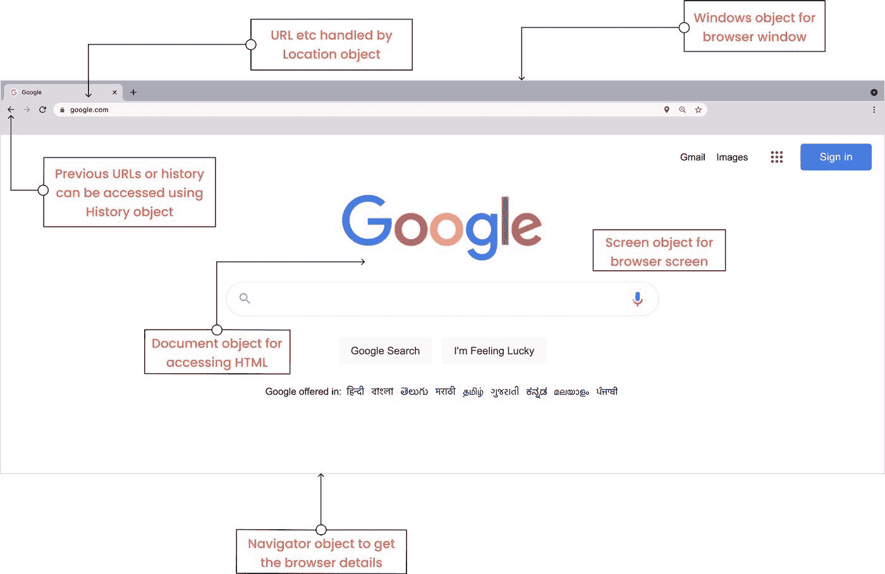

图 6.2 浏览器窗口中对象的可视化。

## 6.2 Window 对象

简单来说，`window` 对象代表 Web 浏览器中打开的窗口。`window` 对象是一个全局对象，用于操作浏览器窗口的生命周期，并在浏览器窗口或标签页内执行各种操作 [[89]](#ref-list.xhtml_refReferences_89)。它位于 BOM 层级结构的顶层，因此作为浏览器的根对象。它是属于浏览器本身的对象，而不是属于 JavaScript 代码（JS 对象包括 `String`、`Array`、`Number` 等）。`window` 对象代表浏览器本身，并受到所有主流浏览器的支持。因此，层级结构下的所有其他对象、方法和属性自动属于 `window` 对象。

可以使用关键字 `window` 直接访问执行代码的当前浏览器窗口。还记得我们在第 1 章中用于打印输出的 `console.log()` 方法吗？它属于 `window` 对象，每个 `window` 对象都有自己的 `console.log()` 方法，该方法打印到该特定 Web 浏览器窗口的控制台中。在修改浏览器属性时，并非强制显式使用 `window` 引用，例如：

```
window.console.log(“Hey, there!”);
console.log(“Hey there!”); //两者相同
```

在浏览器的控制台中，只需编写 `Reflect.ownKeys(window)` 或直接在浏览器控制台中输入 `window` 将返回 `window` 对象内部包含的属性。你会惊讶地发现 `window` 对象内部有 1014 个键，这些键在层级结构下方还有自己的属性。这证明了包含 `window` 对象属性的树形结构的广深度。这限制了我们在这里讨论 `window` 对象的所有属性和方法，因此我们在本章中只讨论最常用的属性和方法。图 6.3 代表了执行 `Reflect.ownKeys(window)` 时控制台的快照。

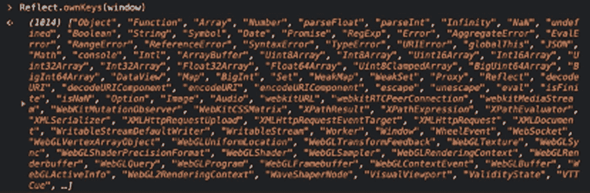

图 6.3 浏览器控制中的 Window 对象。

对于多标签页浏览器，每个浏览器标签页都有自己的 `window` 对象。每当打开新标签页时，都会创建一个新的 `window` 对象。只有高度、宽度等通用属性在这些对象之间共享，因此对这些属性的任何更改都将影响整个浏览器窗口。

理论上，`window` 对象被视为树的根，其分支是 BOM、DOM、JavaScript、HTML 和其他前端开发代码。如图 6.4 所示，BOM 可以被视为一组通过 `window` 对象向开发者开放的 get。

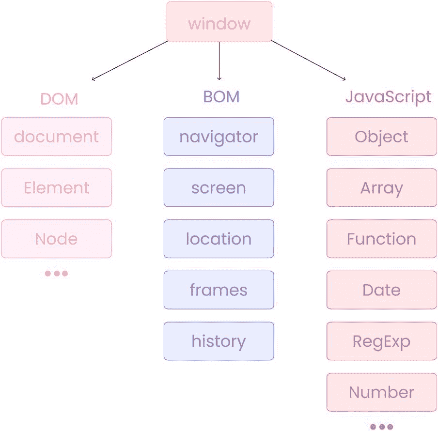

图 6.4 JavaScript 与 BOM 的交互。

这些浏览器窗口/标签页可以进一步细分为 `frames`（帧）。帧是将浏览器窗口划分为多个区域独特方式，每个帧都可以加载自己的脚本。浏览器窗口内的每个帧对象都是父对象的子对象。浏览器并非所有都通用支持帧，但它们提供了一种手术化的方法来划分和操作浏览器窗口区域。

Window 对象定义了特定的方法和属性，通过这些项可以访问和修改浏览器窗口。这些属性和方法概述如下。

### 6.2.1 Window 对象的属性

`window` 对象有自己的属性，在与该对象交互时非常有用。建议练习这些属性，以便掌握它们并在需要时使用。这些属性解释如下：

*   `innerHeight` 和 `innerWidth`：它返回浏览器窗口中内容区域的内部高度和宽度。它对于访问浏览器高度和宽度以设计网页内容非常有用，它会根据用户的浏览器规格进行自动调整。
*   `name`：该属性以字符串格式返回当前活动窗口的名称。
*   `parent`：该属性返回当前窗口的父对象。
*   `screenX` 和 `screenY`：该属性返回窗口相对于用户显示器/显示分辨率的 X 和 Y 坐标（像素为单位）。
*   `top`：该属性返回 Web 浏览器中打开的最顶部浏览器窗口的引用。
*   `status`：该属性以字符串格式返回在状态栏上显示的文本。
*   `length`：该属性返回浏览器窗口内存在的帧元素数量。
*   `frames`：该属性返回一个数组对象的引用，代表窗口中现有的帧。
*   `self`：该属性返回属于活动窗口的当前对象的引用。
*   `closed`：该属性返回一个布尔值，指示浏览器窗口是打开还是关闭的。
*   `history`：该属性返回属于 `window` 对象的历史对象，可以访问用户访问过的 URL。
*   `navigator`：该属性返回窗口的 navigator 对象。
*   `screen`：该属性返回窗口的 screen 对象，可以用于访问宽度、高度和其他屏幕相关的属性。`screen.height` 和 `screen.width` 分别返回用户浏览器窗口的高度和宽度。
*   `location`：该属性返回属于 `window` 对象的 location 对象。可以用于访问用户正在访问的 URL。
*   `document`：该属性返回窗口的 document 对象，可以用于操作浏览器加载的网页内容（HTML 代码）。它代表浏览器中的每个实体对象，可以对其进行修改以实现所需的行为。

### 6.2.2 Window 对象的方法

`window` 对象包含许多方法，用于与用户交互并控制浏览器窗口的行为。如 `alert()`、`prompt()` 和 `confirm()` 等方法是 `window` 对象的少数方法。这些方法提供了用于与用户交互的对话框。还有如 `setInterval()` 和 `setTimeout()` 等其他方法；它们支持基于时间的事件。还有许多与 `window` 对象相关的其他方法，其中一些方法解释如下：

*   `open()`：此方法将打开一个新的浏览器窗口并加载 URL（如果指定）。它返回新打开的浏览器窗口的 `window` 对象引用。`open()` 的参数是可选的；如果没有指定，将打开空白新窗口。使用 `open()` 的示例为：

```
var url = “https://www.google.com”;
var newBrowserWindow = window.open(url, name, width height);
```


```javascript
var newWindow = window.open(url, “New Window”, “width = 300, height = 200”);
```
/*open() 返回变量 newWindow 的对象引用 */

- `close()`: 此方法关闭 Web 浏览器中当前激活的窗口。
- `print()`: 此方法打开 Web 浏览器窗口的打印对话框，用于显示窗口内容的各种打印选项。它没有返回值。
- `scrollTo(width,height)`: 此方法用于将文档滚动到指定的坐标。它没有返回值。
- `resizeTo(width,height)`: 此方法用于将浏览器窗口调整为指定的 `width` 宽度和 `height` 值。
- `resizeBy(width,height)`: 此方法通过给定的像素调整浏览器窗口的大小，该值相对于窗口当前的大小。
- `blur()` 和 `focus()`: 这两个方法分别用于移除或设置当前浏览器窗口的焦点。`blur()` 只是将新打开的窗口推到后台，而 `focus()` 在需要时将其带回前台。这些方法用于向用户突出显示关键信息。
- `setInterval(callback_function, interval)`: 此方法用于按周期间隔（毫秒为单位）执行函数。除非调用 `clearInterval()` 方法或使用 `close()` 方法关闭当前浏览器窗口，否则该方法将继续按指定的间隔执行。

```javascript
var x;

function newFunc() {
  x = setInterval(timeoutFunction, 2000);
  // 每隔 2 秒运行一次函数
}

function timeoutFunction() {
  console.log (“I am a recurring function”);
}

newFunc();
// 调用函数启动定时函数

window.clearInterval(x);
/* 清除定时器并停止执行，在我们想要停止循环方法时应调用它 */
```

- `setTimeout(callback_function, interval)`: 此方法用于在指定的时间间隔后执行一次函数。

```javascript
var x;

function newFunc() {
  x = setTimeout(timeoutFunction, 2000);
  // 在 2000 毫秒后运行一次函数
}

function timeoutFunction() {
  console.log (“I am a recurring function”);
}

newFunc(); // 调用函数启动超时函数
```

- `stop()`: 此方法用于停止当前浏览器窗口的加载。

还有许多其他方法，但并非所有方法在浏览器中都能被支持（例如 `createPopUp()` 等）。因此，我们选择了重要的方法在本节中进行讨论和记忆。接下来，我们将讨论 `window` 对象中存在的其他对象。

## 6.3 History 对象

History 对象是 `window` 对象的一个属性，它包含浏览器 `会话历史` (session history) 标签页的历史相关信息 [[90]](#ref-list.xhtml_refReferences_90)。它主要用于访问用户访问过的 URL 数组。通过操作该数组，可以将用户访问的任何页面加载到浏览器中，包括标签页和帧。可以通过 `window.history` 或 `history` 引用直接访问。

`window.history` 是一个只读属性，用于获取对 `history` 对象的引用。每当用户点击链接时，浏览器的 `history` 对象就会记录一个新条目。这些条目存储在一个类似于栈的结构中，被称为 `history stack` (历史栈)。它可以用于动态重构网页或更改网页内容的加载行为。

### 6.3.1 History 对象的属性

History 对象具有以下相关属性。这些属性可用于操作浏览器的历史记录。

- `length`: 此属性返回用户在本次 Web 会话期间访问的 URL 数量（数字）。

```javascript
let numberOfURLVisited = window.history.length;
// 返回包含 URL 的数组的长度
```

- `current`: 此属性返回 `history` 对象的当前条目，即用户在本次会话期间正在访问的 URL。
- `next`: 此属性返回用户访问的 URL 数组中的下一个条目。
- `previous`: 此属性返回用户访问的上一个页面的 URL。
- `state`: 此属性包含属于历史对象的所有条目的副本。这主要用于通过 `pushState()` 方法手动添加历史条目。当用户进入一个新状态时，会触发 `popState()` 事件。该事件具有一个 `state` 属性，其中持有指向当前历史条目的引用。

### 6.3.2 History 对象的方法

`history` 对象具有以下方法，用于对用户访问的历史记录执行操作。

- `back()`: 此方法加载用户访问的上一个页面的 URL。它的工作方式与用户点击浏览器窗口中的“后退”按钮完全相同。
- `forward()`: 此方法加载 URL 数组中的下一个可用条目。同样，它的工作方式与浏览器窗口中的“前进”按钮工作完全相同。
- `go()`: 此方法用于从会话历史数组中加载特定页面。可以使用整数进行操作。例如 `history.go(-1)` 的作用相当于 `back()`，而 `history.go(1)` 的作用相当于 `forward()`。同样，可以通过 `go()` 方法以任何顺序访问任何页面，例如使用 -4 作为参数访问用户访问的倒数第四页。在不带任何参数的情况下调用 `go()` 将只需刷新当前加载的网页。
- `pushState(state, title, URL)`: 此方法用于手动（通过程序代码）添加新的历史事件并操作历史对象的状态。当调用 `pushState()` 方法并指定的 URL 时，该 URL 将加载且栈顶将被替换。URL 必须与当前 URL 同源，否则将抛出异常。当 `pushState()` 方法执行时，`length` 属性加 1。

- `replaceState(state, title, URL)` 替换历史对象的当前条目，而不是添加新条目。`state` 变量持有更新后的状态及其对应的标题和加载的 URL。`title` 参数是一个表示标题的字符串值。

## 6.4 Navigator 对象

`navigator` 对象用于访问浏览器窗口的信息，如版本、平台、操作系统版本、可用插件等。可以通过 `window` 对象访问 `navigator` 对象，即 `window.navigator` 或简单用 `navigator`。它是一个只读属性，可以提供运行程序代码或脚本的主宿环境的信息 [[91]](#ref-list.xhtml_refReferences_91)。


Navigator 对象在某些特定情况下非常有用，这使得整体网站设计更加完善。它可以用于检查浏览器兼容性，并加载特定的脚本以解决任何兼容性问题。它可以用于访问用户的首选语言，或访问位置信息以显示自定义内容。它还可以通过 `onLine` 属性检查浏览器是否在线。因此，`navigator` 对象提供的信息可以帮助在浏览网站时提升终端用户的体验。

#### 6.4.1 Navigator 对象的属性和方法

属于 `navigator` 对象的不同属性简要列如下。建议你使用自己的浏览器和脚本对这些属性进行练习。

*   `appName`: 此属性返回当前正在使用的浏览器名称。
*   `appCodeName`: 此属性返回 Web 浏览器的内部代码名称。
*   `appVersion`: 此属性以 DOM 字符串的形式返回运行浏览器的版本号。
*   `cookieEnabled`: 如果浏览器启用了 cookie，则此属性返回 `true`；否则返回 `false`。
*   `platform`: 此属性返回一个字符串值，包含运行 Web 浏览器的平台或机器类型的信息。
*   `userAgent`: 此属性返回 `userAgent` 字符串，即当前运行的 Web 浏览器的服务器请求标头。
*   `plugins`: 此属性用于返回一个数组，提供有关 Web 浏览器支持的插件的信息。
*   `onLine`: 如果浏览器在线（即具有网络连接），则此属性返回布尔值 `true`；否则返回 `false`。
*   `language`: 此属性返回代表首选浏览器语言的字符串值。`languages` 属性返回一个字符串值，包含按用户偏好排序的浏览器支持的所有语言。这在为地理位于不同地区的人设计网页时非常有用。
*   `geolocation`: 此属性返回一个 `GeoLocation` 对象，该对象持有用户设备的位置信息。

除了上述属性外，还有许多操作 `navigator` 对象的简单方法，例如 `javaEnabled()`；如果浏览器启用了 Java 支持，则该方法返回 `true`；否则返回 `false`。

## 6.5 Location 对象

`location` 对象包含了与浏览器窗口中当前加载的 URL 相关的信息。`window` 对象和 `document` 对象都可以分别通过 `window.location` 和 `document.location` 访问位置对象。`window.location` 属性存储对浏览器窗口位置对象的引用，而 `document.location` 存储指定文档的位置对象 92。理解 `navigator` 和 `location` 对象之间的区别是重要的。`Navigator` 对象用于访问所有 URL，帮助开发者进行导航；而 `location` 对象仅用于存储浏览器窗口内当前加载的 URL 的详细信息。

### 6.5.1 Location 属性

Location 对象提供了许多属性，可查询地址、主机、端口、协议和其他 URL 相关信息。这些属性简要解释如下：

*   `hash`: 此属性返回一个包含 URL 锚点部分（以 # 开头）的字符串。
*   `href`: 此属性返回一个包含浏览器窗口中加载的 URL 的字符串。
*   `origin`: 此属性返回当前加载 URL 使用的协议、主机和端口号。这是一个只读属性，用于检索特定位置的源。
*   `protocol`: 此属性返回一个包含协议方案的字符串，访问该特定 URL 需要该方案。
*   `search`: 此属性用于以字符串格式设置或返回 URL 的搜索查询语句。
*   `port`: 此属性存储一个字符串，包含用于关联 URL 的服务器通信端口的端口号。
*   `pathname`: 此属性用于设置或返回加载 URL 的路径名。
*   `host`: 此属性用于设置或返回一个包含 URL 主机名和端口号的字符串，用冒号分隔。
*   `hostname`: 此属性用于设置或返回浏览器窗口中当前加载 URL 的主机名或域名。

#### 6.5.2 Location 对象的方法

*   `assign(URL)`: 此方法用于在浏览器中加载新文档，其中 `URL` 是持有文档 URL 的字符串。它没有返回值。

```
location.assign("https://www.google.co.in"); //加载新的 URL
```

*   `reload()`: 此方法用于重新加载浏览器中 `location.href` 属性中存在的当前文档。该方法不接受任何参数，且没有返回类型。它的作用等同于浏览器中的刷新按钮。
*   `replace()`: 此方法用于用指定的文档替换当前加载的文档，并替换当前历史记录的值。这将使“后退”按钮失效，导致无法返回到之前加载的文档，因为它替换了该 URL 本身的值。

```
location.replace("https://www.taylorandfrancis.com");
//替换现有的 URL，移除历史记录
```

*   `toString()`: 此方法用于检索一个包含 Web 浏览器中当前加载文档完整 URL 的字符串。它通常用于获取加载 URL 的字符串值。

## 6.6 Screen 对象

`screen` 对象持有 Web 浏览器的屏幕尺寸相关信息，如宽度、高度、像素深度等。可以通过 `window.screen` 或 `screen` 93 访问。与屏幕相关的属性如下：

*   `width`: 此属性返回当前屏幕的总宽度（像素）。
*   `height`: 此属性返回当前屏幕的总高度（像素）。
*   `availWidth`: 此属性返回排除 Windows 任务栏后的可用宽度。
*   `availHeight`: 此属性返回排除 Windows 任务栏后的可用高度。
*   `pixelDepth`: 此属性用于返回 Web 浏览器屏幕的色彩（每像素位）。
*   `colorDepth`: 此属性返回屏幕调色板深度（位）。位数代表调色板深度，在显示图像时非常有用。

Screen 对象没有关联的标准方法。然而，它的存在极大帮助开发者在考虑用户屏幕规格的情况下设计内容。

## 6.7 Document 对象

Document 对象是 BOM 中包含的核心且最重要的对象。它包含了浏览器窗口中加载的文档所有的 HTML 元素。它简单地代表了整个网页元素。每当 HTML 文档加载到浏览器窗口时，它就变成了属于 `window` 对象的 `document` 对象。为了访问网页中的任何 HTML 元素，必须访问 `document` 对象本身。可以通过 `window.document` 或简单的 `document` 进行访问。DOM 将在下一章详细讨论。

#### 6.8 练习

##### 6.8.1 理论

1. 如何重定向网页并在指定的标签页加载另一个网页？
2. BOM 中存在的不同对象的用途是什么？请结合具体的属性逐一解释。
3. 区分 `navigator` 和 `location` 对象。

##### 6.8.2 判断题


# 1. BOM 是 JavaScript 对象模型的实事实标准。

2. BOM 以完全相同的方式支持，并适用于所有现代 浏览器。

3. BOM 定义了 浏览器如何与文档内容以及宿主环境变量进行交互。

4. `Navigator` 和 `location` 对象具有更多或相似的功能；因此，它们可以互换使用。

5. 使用 `screen` 对象时，使用的值是像素（pixels）。

## 6.8.3 单选题

1. _________ 对象充当所有客户端 JavaScript 功能的主要入口点。
    1. `navigator`
    2. `window`
    3. `history`
    4. `screen`

2. 如果你想在浏览器中重复执行某个元素的操作，你会使用以下哪种方法？
    1. `setTimeout()`
    2. `executeFunction()`
    3. `moveAnimation()`
    4. 以上都不是

3. 下列哪个对象是 BOM 的根节点？
    1. `window`
    2. `document`
    3. `screen`
    4. `root`

4. BOM 内部的对象本质上是 __________。
    1. 全局（global）
    2. 局部（local）
    3. 取于程序作用
    4. 全局或局部

5. 可以使用 __________ 获取客户端浏览器窗口名称。
    1. `navigator.appName`
    2. `webBrowser.name`
    3. `client.navName`
    4. 以上都不是

## 6.9 BOM 演示与实操

### 6.9.1 目标

1. BOM 的基础知识。
2. 在浏览器会话历史中向前/后遍历。
3. 使用 `window` 和其他对象操作网页。

### 6.9.2 前提条件

* **步骤 1**: 访问 [`www.routledge.com/9780367641429`](https://www.routledge.com/9780367641429) 并下载 `Ch6_BOM_Template` 的 压缩文件。
* **步骤 2**: 解压内容并使用任选的编辑器打开 `index.html`（例如：记事本或 Visual Studio Code）。
* **步骤 3**: 在 `index.html` 的 `<script>` 块中插入下方提供的代码。
* **步骤 4**: 对下方提供的每个代码片段重复上述三个步骤。

### 6.9.3 探索

使用任何编辑器，我们将编写并测试 JavaScript 代码以与 DOM 交互并在网页上显示结果。以下是你应该了解 BOM 的知识。BOM 代表浏览器对象模型（Browser Object Model）。DOM 是它的子集。它主要允许 JS 与浏览器级元素交互，并提供了屏幕尺寸、主机名、协议等大量信息。

#### 6.9.3.1 代码片段-1

```javascript
// Utility ()

const appendToHTML = (contents, color = “white”) => {
  contents.forEach((content) => {
    const myPara = document.createElement(“p”);
    myPara.style.color = color;
    myPara.innerHTML = content;
    resultHere.appendChild(myPara);
    sep();
  });
};

const sep = () => {
  const separator = document.createElement(“hr”);
  resultHere.appendChild(separator);
};

/************************************************************ */
var resultHere = document.querySelector(".results”);
// 检查渲染内容的允许宽度（可用空间）。
const windowWidth = window.innerWidth;
const windowHeight = window.innerHeight;
// 检查用户显示器的实际分辨率。
const screenWidth = window.screen.width;
const screenHeight = window.screen.height;
const windowLocObj = JSON.stringify(window.location);
appendToHTML(
  [
    `Current window size: ${windowWidth} x ${windowHeight}(in Pixels)`,
    `Current screen size: ${screenWidth} x ${screenHeight} (in Pixels)`,
  ],
  “black”
);
sep();

// 从 window.location 提取信息在很多情况下非常用，例如强制或检查协议、主机名等……
appendToHTML([“window.location holds these information ->”, windowLocObj]);
```

#### 6.9.3.2 代码片段-2

```javascript
// Utility ()

const appendToHTML = (contents, color = “white”) => {
  contents.forEach((content) => {
    const myPara = document.createElement(“p”);
    myPara.style.color = color;
    myPara.innerHTML = content;
    resultHere.appendChild(myPara);
    sep();
  });
};

const sep = () => {
  const separator = document.createElement(“hr”);
  resultHere.appendChild(separator);
};

/************************************************************ */
var resultHere = document.querySelector(".results”);
// 使用 window.history 对象在当前会话的浏览器历史中导航
document.querySelector(".bwd”).addEventListener(“click”, (event) => {
  alert(“我感应你想向后导航，满足你的愿望（点击 OK）”);
  window.history.back();
});
document.querySelector(".fwd”).addEventListener(“click”, (event) => {
  alert(“我感应你想向前导航，满足你的愿望（点击 OK）”);
  window.history.forward();
});
appendToHTML([
  “In case of”,
  “In case of”,
  “In case of”,
]);
```


在继续之前，让我们再来看一个例子以更好地理解 `document` 对象。在这个例子中，接下来给出了简单的 HTML 代码段，它可以简单地表示为 DOM 结构，如图图 7.2 所示。

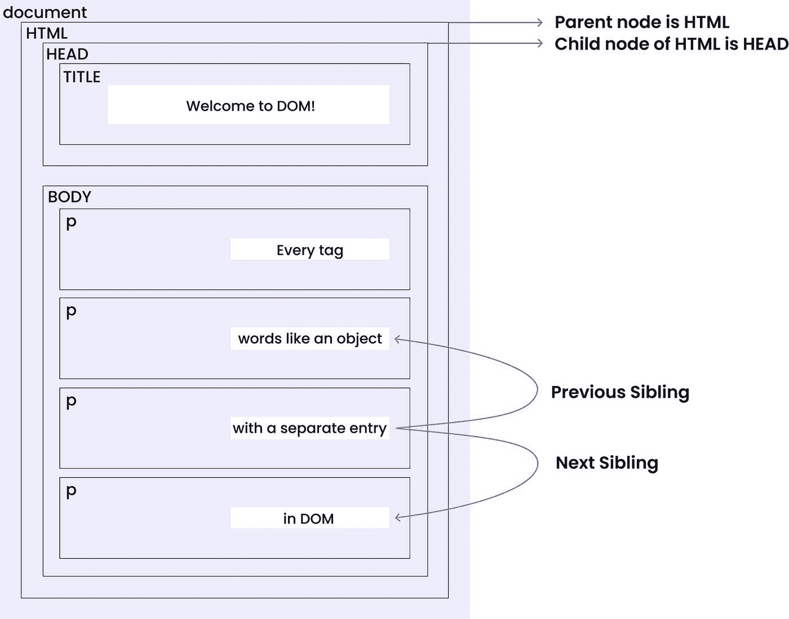

图 7.2 上述 HTML 代码段的 DOM 表示。

```html
<<html>
<head>
<title>Welcome to DOM!</title>
</head>
<body>
<p>Every tag</p>
<p>works like an object</p>
<p>with a separate entry</p>
<p>in DOM</p>
</body>
</html>
```

在图 7.2 中，`document` 代表一个具有一个子节点（即 `<html>`）的根节点。`<html>` 元素被称为属于 DOM 的 `document` 元素。`<html>` 元素还有两个子节点，即 `head` 和 `body` 元素。`head` 元素包含一个名为 `title` 的子节点；同样，在 `body` 元素中，正如所示，不同的元素通过索引以及 `previousSibling`、`nextSibling` 关系连接在一起。

这个例子应该已经对如何基于文档为每个网页生成 DOM 树提供了一些基本的理解。文档由 HTML 和 XML 等标记语言组成。当 DOM 被操作时，它要么被代码访问以获取值，要么被修改并更新相应的值。对于通过 DOM 进行修改的情况，树会在修改完成后生成一次。当树被重新生成时，它会停止或说冻结网络浏览器与终端用户的交互。一旦生成了新的 DOM，它就会加载到浏览器中，然后允许用户与树进行交互。

DOM 像 BOM 一样包含不同类型的对象。这些对象属于 XML、HTML、JavaScript 或任何用于操作文档的语言。它允许跨浏览器的跨平台兼容性和语言独立性。DOM 与同 JavaScript 提供了一个应用程序编程接口 (API)，将文档内部的对象暴露出来供开发者访问和操作。

## 7.2 BOM、DOM 和 JavaScript 之间的关系

我们已经学会了 BOM 是在特殊对象 `window` 内部创建的，它进一步有一个子对象称为 `document` 对象。这个特殊的 `document` 对象是由 Web 浏览器引擎从加载的 HTML 或 XML 文档创建的，并在内部包含一个唯一的 DOM 结构。JavaScript 代码进一步访问这些对象，并允许浏览器以及文档进行动态修改 [[96]](#ref-list.xhtml_refReferences_96)。通过改变 BOM 和 DOM 的值增强了用户体验和信息传递。BOM 和 DOM 树中的实体几乎都是对象。这些对象通过 JavaScript 代码访问，以便在网页或文档中生成动态行为。文档是一个通用术语，用于标识基于 HTML 的文档、基于 XML 的文档、网页以及加载到浏览器中供用户使用的其他信息。

BOM 可以被视为访问浏览器窗口及其相关属性的网关，而 DOM 可以被视为访问所有属于网页的对象的入口。JavaScript 需要根据需求随时访问 BOM 和 DOM。BOM 重复访问相同属性的频率较低。相反，DOM 被 JavaScript 频繁使用。DOM 是 JavaScript 的乐场，因为它提供了对文档内部所有对象的访问，这些对象控制着网页的结构。

将所有内容放在上下文中，图 7.3 表示了文档中 BOM 和 DOM 的位置。`window` 对象是 BOM 的根对象，我们之前已经学过不需要在任何子节点之前添加 `window`。因此，我们可以直接在引用 DOM 的代码中使用 `document` 对象。JavaScript 可以通过根对象及其属性轻松地访问 `window` 对象和 `document` 对象相关的实体。

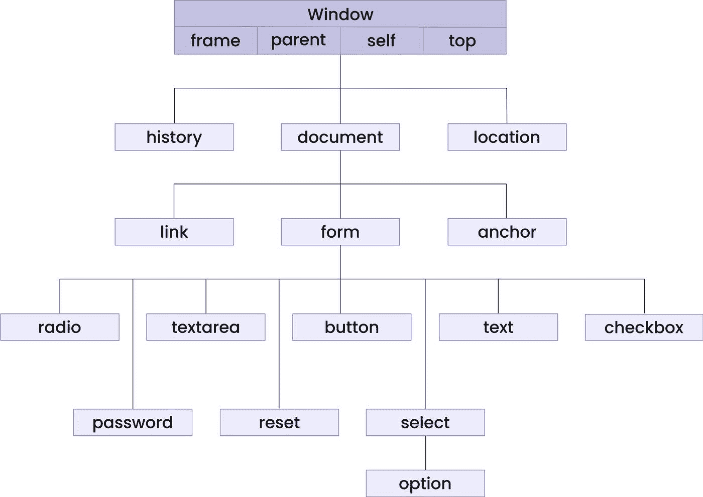

图 7.3 Window 对象和 DOM。

`document` 对象根据网页的设计和使用进一步分支为不同的对象。正如我们在看到的，`document` 对象有三个其他对象，即 `link`、`form` 和 `anchor`。`form` 对象进一步拥有其他子节点，如 `radio`、`textarea`、`text`、`checkbox`、`button` 等。这些对象也有包含其自身属性的子对象。这是一个高度多变的树结构，因为它会随着每个文档而改变。DOM 的表示取决于加载到浏览器中的文档的结构和类型。

如果 JavaScript 代码需要访问这些对象中的任何一个，可以通过 `document` 对象上的链式点运算符 (`.`) 来。DOM 树中的每个节点都可以追溯到它的父节点。让我们通过接下来的示例来理解这种关系：

```html
<html>
<head>
<script>
// 当文档加载时运行此函数
window.onload = function () {
  var str = prompt“输入任何字符串”)
  // 在 HTML 页面内创建一个 h2 元素
  const heading2 = document.createElement（h2”);
  const heading2_text = document.createTextNode(str);
  heading.appendChild(heading_text2);
  document.body.appendChild(heading2);
};
</script>
</head>
<body>
<h1> This is Static Content</h1>
<h2>The content below is created using JS</h2>
</body>
</html>
```

在这个例子中，你可以观察到 `window.onload` 是一个与函数相关的事件监听器。该函数通过 `prompt` 从用户处获取输入并创建一个 `h2` 元素用于显示。这段代码的输出表示在图 7.4 所示的截图。

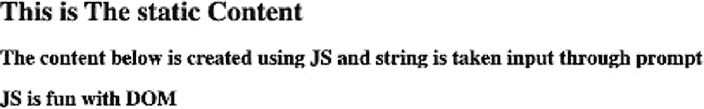

图 7.4 上述代码的输出。

在接下来的章节中，我们将学习属于 `document` 对象的一些常用属性和方法，这些方法有助于为开发者处理网页时提供更多的灵活性。

## 7.3 理解 DOM 树和节点

DOM 经常被称为 `DOM 树`，其子节点是作为对象的。对于 Web 浏览器解析的每个 HTML 文档，都会生成一个相应的 DOM 树，包含一个名为 `document` 对象的单个根节点以及随后的子节点。根节点是 HTML 元素的父节点，通常被称为 `document` 元素或`对象`。每个文档只有一个 `document` 元素。根据所加载网页的复杂度，`document` 可能会产生多个子节点分支 [[97]](#ref-list.xhtml_refReferences_97)。在继续之前，让我们先复习一些 HTML 术语，然后使用接下来的示例创建一个 DOM 树：

```html
<!DOCTYPE html>
<html lang="en">
<head>
<title>理解 DOM </title>
</head>
<body>
<h1>This is first example</h1>
<a id="home" href="index.html">Home</a>
<!-- 创建带有 id 的 href -->
</body>
</html>
```

对于这个例子，代码中属于不同的标签、属性和其他实体。如果必须将这些内容归类，可以简单如下：

*   *标签*: html, head, title, body, h1, a
*   *属性*: lang, id, href
*   *属性值*: en, home, index.html
*   *文本*: 理解 DOM, This is first example, Home
*   *注释*: 值为‘创建带有 id 的 href’
*   *元素*: 开启标签和结束标签之间的所有内容都称为元素。


为了可视化从之前的 HTML 文档创建的 DOM 树，我们使用了 [[98]](#ref-list.xhtml_refReferences_98) 创建了图 7.5。尝试多制作一些演示树结构以掌握它。

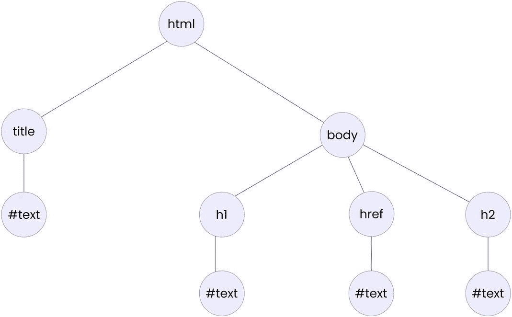

图 7.5 DOM 树表示。

DOM 树中的每个节点都使用节点类型来标识。可以使用 `nodeName.nodeType` 属性检查节点的类型。它将返回一个无符号短整数，指向 `Node` 属性内部定义的常量。一些节点类型常量及其关联值在表 7.1 中。

表 7.1 节点类型常量

| 值 | 常量 | 解释 |
| --- | --- | --- |
| 1 | `Node.ELEMENT_NODE` | 简单的元素节点，如 <p><h1><div>等。 |
| 3 | `Node.TEXT_NODE` | 代表元素或属性中存在的*文本* |
| 4 | `Node.CDATA_SECTION_NODE` | 代表一个 `CDATASection` |
| 8 | `Node.COMMENT_NODE` | 代表一个*注释*节点 |
| 9 | `Node.DOCUMENT_NODE` | 代表一个*文档*节点 |
| 10 | `Node.DOCUMENT_TYPE_NODE` | 代表*文档类型节点*，即 <!DOCTYPE html> |

在存在的多个节点值中，在我们的示例中，使用了元素节点、文本节点和注释节点。你可以通过打开浏览器控制台并运行之前的 HTML 代码来检查这一点。在控制台上输入以下命令。在控制台上使用这些命令的输出通过图 7.6 表示。

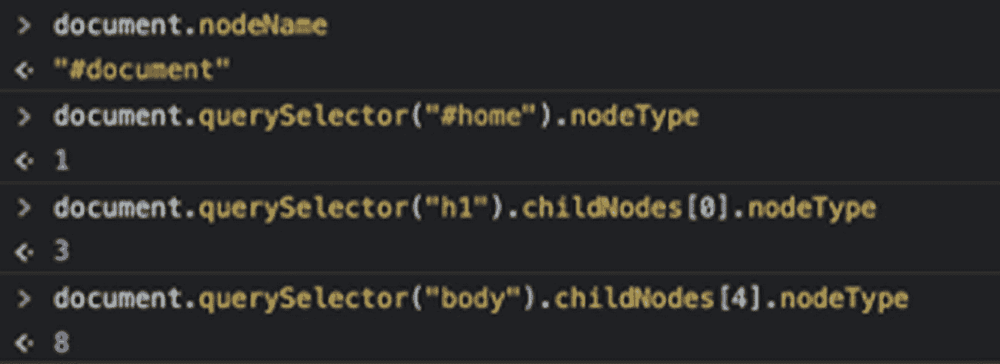

图 7.6 使用 *document* 对象的截图

```
document.nodeName
document.querySelector("#home").nodeType
document.querySelector("h1").childNodes[0].nodeType
document.querySelector("body").childNodes[4].nodeType
```

截图（图 7.6）显示了接收到的输出。

在我们的示例中，我们可以观察到 DOM 中创建了各种节点，我们可以轻松地将这些节点分为三类：元素节点、文本节点和注释节点。

### 7.3.1 Node 对象的属性

对于每个节点都有许多与其相关的属性，就像之前给出的示例，我们使用了 `nodeType` 属性 [[99]](#ref-list.xhtml_refReferences_99)。属于 `Node` 对象的其他一些属性解释如下：

*   `baseURI`: 此属性返回一个包含文档基础 URL 的字符串。
*   `isConnected`: 此属性返回一个布尔值，指定节点是否直接或间接地连接到对象或节点。如果子节点直接连接到 `document` 对象，则返回 `true`；否则返回 `false`。
*   `nodeName`: 此属性以字符串格式返回调用节点的名称。
*   `nodeType`: 此属性返回一个无符号短值，指示节点类型，详见表 7.1。
*   `firstChild` 和 `lastChild`: 此属性分别返回持有给定调用节点的第一个和最后一个子节点的 `Node` 对象。
*   `childNodes`: 此属性返回一个包含属于调用节点的所有子节点的列表。
*   `parentNode`: 此属性返回调用节点的父级 `Node` 对象；否则返回 `null`。
*   `parentElement`: 此属性返回调用对象的父级 `Element` 对象；否则返回 `null`。
*   `nextSibling` 和 `previousSibling`: 此属性分别返回调用节点的下一个和上一个同兄弟节点。如果不存在此类节点，则返回 `null`。
*   `textContent`: 此属性用于检索或设置调用节点及其所有后续子节点的文本内容。

### 7.3.2 Node 对象的方法

`node` 对象还包含许多方法，有助于访问和处理 DOM 节点。这些方法进一步解释如下：

*   `contains()`: 此方法在检查节点是否为调用节点的子节点后返回一个布尔值作为结果。
*   `compareDocumentPosition()`: 此方法用于比较一个节点相对于作为参数的另一个节点的位置。此方法返回一个整数值，定义了 Nodes 对象内部定义的常量中对应的输出。
*   `appendChild()`: 此方法用于在调用节点的末尾添加新的子节点。
*   `getRootNode()`: 此方法返回调用对象的根对象。
*   `insertBefore()`: 此方法用于在调用节点之前插入一个节点。
*   `cloneNode()`: 此方法用于克隆或拷贝节点及其内容。
*   `isEqualNode()`: 如果两个节点持有相同的内容（包括它们的数据类型），则返回 `true`。否则，返回 `false`。
*   `isSameNode()`: 如果两个节点指向同一个对象，即调用节点和传递的节点是同一个，则返回 `true`。如果节点不同，则返回 `false`。
*   `removeChild()`: 此方法用于从调用节点中删除子节点。
*   `replaceChild()`: 此方法用于用传递的替换给定节点。

## 7.4 Document 对象

DOM 树的根是 `document` 对象 [[100]](#ref-list.xhtml_refReferences_100)。该对象提供了访问 HTML 文档中不同节点的属性和方法。`document` 对象是由浏览器从 `Document` 接口创建的，它继承自 `Node` 接口。`document` 对象也可以通过带有 `window` 前缀的构造函数动态创建。属于 `document` 的大多数属性都是只读的。以下章节解释常用的属性和方法。

### 7.4.1 Document 属性

`document` 对象包含许多帮助开发者获取主机环境元数据的属性，例如：

*   `body`: 此属性返回 DOM 的 <body> 节点。如果源文件中不存在 body 标签，则返回 `null`。
*   `activeElement`: 此属性返回当前激活的元素对象。
*   `characterSet`: 此属性返回包含文档使用的字符集的字符串。
*   `children`: 此属性返回一个包含调用文档所有子元素的对象。
*   `childElementCount`: 此属性返回文档中存在的子元素总数。
*   `doctype`: 此属性返回一个包含文档类型定义（即文档 DTD）的对象。
*   `documentElement`: 此属性用于返回文档的直接子节点元素。
*   `document.URI`: 此属性用于以字符串格式返回文档的位置。
*   `embeds`: 此属性返回文档中所有嵌入元素 `<embed>` 的列表。
*   `forms`: 此属性返回文档中所有表单元素 `<form>` 的列表。
*   `head`: 此属性返回 HTML <head> 元素。
*   `images`: 此属性返回文档中所有图像的列表。
*   `implementation`: 此属性返回当前文档的 DOM 实现。
*   `links`: 此属性返回文档中所有超链接的列表。
*   `plugins`: 此属性返回用户 浏览器所有可用插件的列表。
*   `scripts`: 此属性返回调用文档对象的所有脚本元素 `<script>`。


* `visibilityState`: 此属性用于返回一个字符串，告知文档的可见性，可能的值为 `visible`、`hidden`、`unloaded` 和 `prerender`。

除了这些属性外，`document` 对象还继承自 `HTMLDocument` 接口，该接口自 HTML 5 起适用。继承此接口增加了诸如 `cookie`、`designMode`、`dir`、`readyState`、`lastModified`、`defaultView`、`referrer`、`title`、`URL` 等属性。

### 7.4.2 对象的方法

属于 document 对象的方法非常有用，在使用 JavaScript 开发网页时会被频繁使用。这些方法提供了如创建节点、修改节点、删除节点和查询节点等操作。在许多方法中，有两个值得特别关注，即 `querySelector` 和 `querySelectorAll`。`querySelector` 方法用于返回与传入参数匹配的元素或节点，而 `querySelectorAll` 返回所有匹配传入参数的元素列表。`document`对象的其他常用方法列表列如下：

* `append()` 和 `prepend()`：这些方法分别用于在调用者文档的末尾和开头插入对象。
* `adoptNode()`：此方法用于从外部文档采用一个节点。
* `createAttribute()`：此方法创建一个新的 `Attribute` 对象并返回它。
* `createComment()`：此方法返回一个新创建的 `Comment` 节点。
* `createCDATAsection()`：此方法返回一个新创建的 `CDATA` 节点。
* `createElement(name)`：此方法返回一个指定名称的新 `element` 节点。
* `createEvent()`：此方法返回一个新创建的 `Event` 对象。
* `createTextNode()`：此方法返回一个新创建的 `Text` 节点。
* `replaceChildren()`：此方法用作为方法参数的新节点（节点）替换文档的子节点。
* `querySelector()`：此方法返回文档中符合条件的第一个匹配元素节点。
* `querySelectorAll()`：此方法返回文档中符合条件的所有元素节点列表。

## 7.5 DOM 中的元素

当一个 HTML 元素是 DOM 中的一个项时，它被称为元素节点。元素元素是一个基类，文档中的每个 `element` 对象都从它处继承其功能 [[101]](#ref-list.xhtml_refReferences_101)。每个 `element` 对象都继承自其父类 `Element`。这些对象代表常见的 HTML 元素，如 `<p></p>`、`<<a></a>`、`<div></div>`、`<head></head>` 等。在起始标签和结束标签之间的任何内容都被视为 DOM 中的一个元素。

区分 `node` 和 `element` 往往是混淆的。它们都是 DOM 的实体，但 `node` 是一个通用术语，指 DOM 内部存在的任何对象，而 `elements` 特指那些关联了数值常量属性 `Node.ELEMENT_NODE`（其值为 1）的节点。因此，元素基本上是一种特殊的节点。每个具有 `Node.ELEMENT_NODE = 1` 的元素都是节点，但并不是每个节点都是元素。

`Element` 也派生自 `Node`，因此，你会发现许多重复的属性和方法。然而，为了避免以后产生混淆，再次提供了它们。后续章节将解释属于元素对象的属性和方法。

### 7.5.1 对象的属性

`element` 对象包含许多属性，有助于检索节点的属性、子节点和父节点。常用属性列如下：

* `attributes`：此属性返回一个包含调用者元素关联属性的对象。
* `id`：此属性返回一个 DOMString，其中包含调用者元素的唯一全局 ID。
* `localName`：此属性通过 DOMString 返回调用者元素的本地名称。
* `children`：此属性返回一个只读的 `HTMLCollection` 对象，其中包含属于调用者元素的子元素。
* `firstElementChild` 和 `lastElementChild`：此属性返回属于调用者元素的第一个和最后一个子元素。
* `childElementCount`：此属性返回调用者元素的子元素数量。
* `classList`：此属性用于检索调用者元素的 `class` 属性列表。
* `className`：此属性用于检索或设置调用者元素的 class 属性值。
* `clientHeight`, `clientLeft`, `clientTop` 和 `clientWidth`：这些属性分别返回一个 Number 对象，代表元素的内部高度、左边框、上边框和内部宽度。
* `nextElementSibling` 和 `previousElementSibling`：此属性分别返回调用者元素的下一个和上一个兄弟元素。

### 7.5.2 元素的方法

与 `document` 对象的方法类似，属于 `element` 接口的方法继承自 `Node` 接口。本节简要解释了一些常用的方法。当你再次在这里看到 `querySelector` 和 `querySelectorAll` 时不要惊讶，它们也属于 `element` 对象。

* `append()`：此方法用于在调用者元素的末尾插入 `Node` 或 `DOMString` 对象。
* `addEventListener()`：此方法用于在调用者元素上添加带有事件类型的事件处理器。
* `animate()`：此方法返回一个动画对象，可以在调用者元素上运行动画。
* `getAnimations()`：此方法返回调用者元素上当前激活的动画对象的数组。
* `getAttribute()`：此方法以对象形式返回属于该元素的属性。
* `hasAttribute()`：此方法用于检查某个属性是否属于该元素。它返回一个布尔值。
* `setAttribute()`：此方法用于在调用者元素设置指定的属性。
* `prepend()`：此方法用于在调用者元素的第一个子元素之前添加对象（`node` 或 `DOMString`）。
* `querySelector()`：此方法返回与括号内指定的条件匹配的第一个 `element` 或 `node` 对象。
* `querySelectorAll()`：此方法返回一个包含所有符合指定条件的对象的 `NodeList` 对象。
* `remove()`：此方法用于从其父元素中移除元素。
* `removeAttribute()`：此方法用于移除调用者元素上的命名属性。
* `replaceChildren()`：此方法用于用作为节点的传入参数替换子节点。
* `getElementByClassName()`：此方法返回一个 `ClassName` 属性匹配传入字符串的 `element` 对象。
* `getElementsByTagName()`：此方法返回一个 `TagName` 属性匹配传入字符串的 `element` 对象。
* `getElementById()`：此方法返回一个 ID 属性匹配传入字符串的 `element` 对象。ID 属性是一个区分大小写的字符串值，对于每个元素来说都是唯一的。

下一节将利用这些函数函数来解释如何访问和操作 DOM 结构中的不同元素。

## 7.6 访问 DOM 中的元素


到目前为止，我们对 `document`、`node` 和 `element` 及其属性和方法有了良好的理解。本节旨在详细介绍我们如何访问 DOM [[94]](#ref-list.xhtml_refReferences_94) 中的 HTML 元素。要继续后续，我们需要具备 CSS 选择器和类 HTML 语法的基础知识，例如定义 `tags`、`class` 和 `name`。此外，我们将使用来自 DOM 对象的以下方法：`getElementById`、`getElementsByClassName`、`getElementsByClassName`、`querySelector` 和 `querySelectorAll`。接下来，请在任何记事本编辑器中输入此代码，并将文件保存为 `anyName.html`。代码如例所示：

```html
<!DOCTYPE html>
<html lang = “en”>
<head>
<meta charset = “utf-8”>
<meta name = “viewport” content = “width = device-width, initial-scale = 1.0”>
<title>Accessing Elements in the DOM </title>
<style>
html {
font-family: sans-serif;
color: #333;
}
body {
max-width: 500px;
margin: 0 auto;
padding: 0 15px;
}
div, article {
padding: 10px;
margin: 5px;
border: 1px solid #dedede;
}
</style>
</head>
<body
<h1>Accessing Elements in the DOM </h1>
<h2>ID (#demo)</h2>
<div id = “demo”>Access me by ID </div>
<h2>Class (.demo)</h2> <iv class = “demo”>Access me by class (1)</div>
<div class = “demo”>Access me by class (2)</div>
<h2>Tag (article)</h2>
<article>Access me by tag (1)</article>
<article>Access me by tag (2)</article>
<h2>Query Selector </h2>
<div id = “demo-query”>Access me by query </div>
<h2>Query Selector All </h2>
<div class = “demo-query-all”>Access me by query all (1)</div>
<div class = “demo-query-all”>Access me by query all (2)</div>
</body>
</html>
```

现在用 Chrome 网页浏览器打开此 `anyName.html` 文件，并打开浏览器的控制台。现在尝试以下命令并观察变化：

```javascript
//Finding element using ID
const demoId = document.getElementById('demo');
console.log(demoId);
demoId.style.border = '5px solid purple';

//observe purple border
//Finding element using Class Name
const demoClass = document.getElementsByClassName('demo');
console.log(demoClass);
//observe collection of objects
demoClass[0].style.border = '5px solid orange';
demoClass[1].style.border = '5px solid red’;

//Finding element using TAG
const demoTag = document.getElementsByTagName('article');
console.log(demoTag); //observe collection of objects
demoTag[0].style.border = '5px solid blue';
demoTag[1].style.border = '5px solid black’;

//Finding element using querySelector (Single Element)
const demoQuery = document.querySelector('#demo-query');
//will only return first one to match
demoQuery.style.border = '5px solid orange';

//Finding element using querySelector (Collection)
const demoQueryAll = document.querySelectorAll('.demo-query-all');
demoQueryAll.forEach(query =>{
query.style.border = '1px solid green';
}); //using forEach and callback function
```

## 7.7 使用 DOM 进行事件处理

我们现在已经看到了 DOM 提供的大部分属性和方法，以及如何使用它们来改变网页的外观。如果网站内部没有活跃的响应机制，目前为止的工作将毫无意义，例如在点击网页时更改网页颜色、提供可以实时计算的交互式滑块、悬停事件、页面加载时自动播放音乐等。对于我们目前所学的内容，大部分操作可以手动完成，但现在我们将理解如何根据某些事件（如鼠标点击、按键按下或鼠标在网页上滚动）来实现这一切。

事件是浏览器中自动发生或通过用户触发的某些动作，例如网页加载、按钮点击、表单提交、手动按键、鼠标点击等。处理这些事件的机制被称为 `event handling`。JavaScript 提供了 `event handlers`（事件处理器）和 `event listeners`（事件监听器）来协助执行事件处理机制 [[102]](#ref-list.xhtml_refReferences_102)。`事件处理器`是在事件发生时启动的函数。`事件监听器`为元素附加一个响应式接口，允许该特定元素等待并`监听`给定事件的触发。

`document` 对象包含了与事件处理器相关的属性和方法，如动画、拖放、剪贴板、全屏、加载和卸载、键盘、指针、选择、过渡和触摸。该语言提供的事件处理器列表非常详尽，但它们的工作原理是相同的。让我们先看一些常见的 HTML 事件，然后看几个简单的示例来观察它们的运行。在本章结束时，你将看到一个专门的练习供你进行实践事件处理。

## 7.8 练习

### 7.8.1 理论题

1. `node` 和 `element` 接口之间有什么区别？
2. 什么是 DOM？DOM 在网页加载时起着什么作用？
3. 请结合代码说明解释基于事件的事件处理机制。
4. 列出所有不同的事件。

### 7.8.2 正误判断题

1. 表单字段中的 `*` 表示该字段不能留空。
2. 当 DOM 树重新生成时，允许用户交互。
3. `document` 对象是 `window` 对象的父对象。
4. `document` 必须包含 `form`、`anchor` 和 `paragraph` 元素。
5. 表单元素可以通过 `form` 对象访问，该对象是 `document` 对象的子级。

### 7.8.3 单选题

1. 在文档对象模型中，一切都被视为 __________。
   A. 属性
   B. 节点
   C. 数组
   D. 字符串

2. 下列哪项用于事件处理？
   A. `onSubmit()`


## 2. `onLoad()`
## 3. `onFocus()`
## 4. `hover()`

## 4. 在 `document` 对象中，包含了哪些内容？

1. `form`
2. `<p>` 元素
3. `links`
4. 以上所有

## 5. 从下列述中选择正确的选项：

1. DOM 遵循 W3C 标准。
2. 单个网页可以有多个 `document` 对象。
3. 在 DOM 中 `Node` 和 `Elements` 可以通用使用。
4. 以上所有

## 7.9 演示与 DOM 实操

### 7.9.1 目标

1. 理解 DOM，并通过代码来理解其用法。
2. 对 DOM 执行基本操作。
3. 通过 JavaScript 响应网页上的事件。

### 7.9.2 提前提

* **步骤 1：** 访问 [`www.routledge.com/9780367641429`](https://www.routledge.com/9780367641429) 并下载 `Ch7_DOM_Template` 的压缩包。
* **步骤 2：** 解压内容并使用任任的编辑器打开 `index.html`（例如：记事本或 Visual Studio Code）。
* **步骤 3：** 将接下来提供的代码插入 `index.html` 中的 `<script>` 块内。
* **步骤 4：** 对接下来提供的每个片段重复上述三个步骤。

### 7.9.3 探索

使用任何编辑器，我们将编写并测试 JavaScript 代码与 DOM 交互，并在网页上查看结果。以下是你应该了解 DOM 的知识。DOM 代表文档对象模型（Document Object Model）。它是浏览器窗口的一部分，是 JavaScript 与 HTML 和 CSS 交互的桥梁。

### 7.9.3.1 代码片段-1

```javascript
/* 创建 HTML 文档中任意元素的引用。

* 语法
* const REFERENCE_NAME = document.querySelector

(<.class/#id>)
*/

// 例如，为 id 为 'p1' 的元素创建引用

const myP1 = document.querySelector("#p1 p");

// 为 id 为 'p2' 的元素创建引用
const myP2 = document.querySelector("#p2 p");

// 尝试打印到控制台查看它包含什么

console.log("P1", myP1);
console.log("P2", myP2);

// 同时，让我们创建一个消息数组（这很快就会派用场。）
let myMessages = [
  "Hello there! Coder.",
  "希望你度过奇妙的一天 <3",
  "保持耐心",
  "罗马不是一天之筑的:)",
];

// 操控 HTML 元素内部的内容，
// * 方法-1 | 修改现有内容。
myMessages.forEach((msg) => {
  // for 循环遍历每一个元素
  myP1.innerHTML = msg; // 对于 myMessages 来说，msg 是循环变量。
});

/********************* 显示信息 **************************
let contentInfo = document.createElement("p");
contentInfo.innerText = "我是被覆盖的内容!";
contentInfo.style.backgroundColor = "pink";
myP1.appendChild(contentInfo);

// 注意，p1 内容中只有最后一条消息是可见的，
// 因为它在每次循环迭代中都被覆盖了。
// 这不是我们想要的，所以这里……
// * 方法-2 | 追加到现有内容之后。
myMessages.forEach((msg) => {
  // 因为我们想添加一些文本，让我们创建一个文本元素。
  // * 语法
  // * newElement = document.createElement(<element-tag>)
  // * newElement.innerText = “某些文本”，为新元素分配某些文本值。
  let myContent = document.createElement("p");
  myContent.innerText = msg;
  myP2.appendChild(myContent);
});
/********************* 显示信息 **************************
contentInfo = document.createElement("p");
contentInfo.innerText = "我是被追加的内容!";
contentInfo.style.backgroundColor = "limegreen";
myP2.appendChild(contentInfo);
```

### 7.9.3.2 代码片段-2

```javascript
/* 创建 HTML 文档中任意元素的引用。

* 语法
* const REFERENCE_NAME = document.querySelector

(<.class/#id>)
*/

// 例如，为 id 为 'p1' 内部的 <p> 元素创建引用
const myP1 = document.querySelector("#p1 p");

// 为 id 为 'p2' 的元素创建引用
const myP2 = document.querySelector("#p2 p");

// 为 id 为 '#p1' 的类 'btn' 创建引用
const p1Btn = document.querySelector("#p1.btn");

// 对于 #p2
const p2Btn = document.querySelector("#p2.btn");

// 尝试打印到控制台查看它包含什么
console.log("P1", myP1);
console.log("P2", myP2);

// 同时，让我们创建一个消息数组（这很快就会派用场。）
let myMessages = [
  "Hello there! Coder.",
  "希望你度过奇妙的一天 <3",
  "保持耐心",
  "罗马不是一天之筑的:)",
  "本课程由电磁芝士驱动！",
];
p1Btn.addEventListener("click", () => {
  myMessages.forEach((msg) => {
    myP1.innerHTML = msg;
  });
  console.log("P1", myP1);
  console.log("P2", myP2);
  // ...（注意：此片段提供的文本逻辑是碎片化的，
// 格式保留了变量和函数的解构）
});
```

### 7.9.3.3 代码片段-3

### 7.9.3.4 代码片段-4


# 提示：类 'hide' 的 css 属性已在 `style.css` 中定义

它将 `display` 设置为 `none`。

```javascript
// 给 DOM 元素添加一个类。
// `p1` 和 `p2` 在之前的代码段中使用过，让我们尝试隐藏它们。
// 此外，此实验需要 `p3`、`p4`、`p5`（取消隐藏）。
// 让我们用一个按钮为我们完成这个设置。
// 显示该按钮。

ready.classList.remove(“hide”);

ready.addEventListener(“click”, (e) => {
  // 隐藏 `p1`,``p2` 和按钮本身。
  myP1.classList.add(“hide”);
  myP2.classList.add(“hide”);
  ready.classList.add(“hide”);

  // 显示 `p3`、`p4` 和 `p5`。
  myP3.classList.remove(“hide”);
  myP4.classList.remove(“hide”);
  myP5.classList.remove(“hide”);
});

// 让我们为 HTML 工厂提供燃料。
btnRow.addEventListener(“click”, (e) => {
  if (e.target.tagName == “BUTTON”) {
    console.log(“Click registered.”);
    // 从类列表中选取第一个名称。
    const clicked = e.target.classList[0];
    // 看看按钮属于哪个类 -->
    if (clicked == “p”) {
      // 请求创建段落。
      // 将使用 `createElement()` 方法来创建一个。
      var newP = document.createElement(“p”);
      newP.innerText = “我是一段随机文本，没有存在的意义或理由。”； // 为新的 `<p>` 元素添加一些文本内容。
      // 添加一些样式
      newP.style.color = “#34656d”;
      newP.style.backgroundColor = “#c6ffc1”;
      // 准备好了，但需要推送到 HTML 文档。
      render.appendChild(newP);
    } else if (clicked == “d”) {
      // 创建一个日期输入元素。
      var newD = document.createElement(“input”);
      newD.type = “date”;
      render.appendChild(newD); // 添加
    } else if (clicked == “a”) {
      // 创建一个锚标签。
      var newA = document.createElement(“a”);
      newA.href = “https://youtube.com”;
      newA.innerText = “YouTube”;
      newA.style.color = “white”;
      newA.style.backgroundColor = “red”;
      newA.style.borderRadius = “15%”;
      render.appendChild(newA); // 添加
    } else if (clicked == “c”) {
      // 创建一个新的圆形块。
      var newC = document.createElement(“div”);
      newC.style.width = “50px”;
      newC.style.height = “50px”;
      newC.style.backgroundColor = “seagreen”;
      newC.style.borderRadius = “50%”;
      render.appendChild(newC);
    } else {
      return;
    }
  }
});
```

/*********************** 获取 / 设置 属性. *********************/
// 此 URL id 保证返回一个宽度为 200 像素的随机正方形图像。
const randomImageURL = “https://picsum.photos/200”;
// const randomImageURL = “https://picsum.photos/400/200”; // 对于矩形尺寸图像，输入任意维度

setSrc.addEventListener(“click”, (e) => {
  // 将 'src' 属性设置为有效的图像源。
  img.setAttribute(“src”, randomImageURL);
});

getSrc.addEventListener(“click”, (e) => {
  document.querySelector((".get”).innerText = img.getAttribute(“src”);
});

/************************ 使用 javascript 滚动*************************/
pop.addEventListener(“click”, (e) => {
  for (var i = 0; i < 1000; i++) {
    var newP = document.createElement(“p”);
    newP.innerText = “我是一段随机文本，没有存在的意义或理由。”； // 为新的 `<p>` 元素添加一些文本内容。
    // 添加一些样式
    newP.style.color = “#34656d”;
    newP.style.backgroundColor = “#c6ffc1”;
    // 准备好了，但需要推送到 HTML 文档。
    scrollRender.appendChild(newP);
  }
});

document.getElementById(“scrollDown”).addEventListener(“click”, (e) => {
  // window.scrollTo(x,y);
  // 此方法让当前屏幕视图移动到任何 (x,y) 坐标。
  // 提示：document.body.scrollHeight 返回底部坐标。
  window.scrollTo(0, document.body.scrollHeight);
});

document.getElementById(“scrollUp”).addEventListener(“click”, (e) => {
  // window.scrollTo() 也接受一个对象，其中可以提供选项和相对坐标（如顶、左、右、底……）。
  window.scrollTo({
    top: 0,
    left: 0,
    behavior: “smooth”,
  });
});

## 7.10 事件委托的演示与实操

### 7.10.1 目标
1. 理解替代事件委托的变通方案，以及它是多么痛苦。
2. 事件委托示例。

### 7.10.2 前提
- **步骤 1：** 访问 `https://www.routledge.com/9780367429`
- **步骤 2：** 下载 `index.html`
- **步骤 3：** 将代码插入任何编辑器中。
- **步骤 4：** 在 Visual Code 中打开代码。

### 7.10.3 探索
思路是如果我们有很多元素，我们在它们的共同祖先元素上放置单个处理器，以查看事件发生的位置。

#### 7.10.3.1 代码段-1
```javascript
// 目标是检查点击了什么颜色
const appendToHTML = (contents, color = “white”) => {
  contents.forEach((content) => {
    const myP = document.createElement(“p”);
    myP.style.color = color;
    myP.innerHTML = content;
    resultHere.appendChild(myP);
  });
};

const sep = () => {
  const separator = document.createElement(“hr”);
  resultHere.appendChild(separator);
};

// 目标是检查点击了什么颜色
// 为所有 5 个按钮添加事件监听器
// 'event' 参数被传递到事件的回调函数
// 'event' 的 'target' 属性提供了事件发生的精确对象
// 使用 'target' 的 'classList' 属性我们可以提取类名
```

#### 7.10.3.2 代码段-2
```javascript
// 目标是检查点击了什么颜色
const appendToHTML = (contents, color = “white”) => {
  contents.forEach((content) => {
    const myP = document.createElement(“p”);
    myP.style.color = color;
    myP.innerHTML = content;
    resultHere.appendChild(myP);
  });
};

const sep = () => {
  const separator = document.createElement(“hr”);
  resultHere.appendChild(separator);
};
```


```javascript
const colors = ["red", "green", "blue", "magenta", "cyan"];

var clr = 0;

const ancestorElement = document.querySelector(".blobs");

var childNodes = ancestorElement.childNodes;

for (let i = 0; i < childNodes.length; i++) {
  if (childNodes[i].nodeName.toLowerCase() === "button") {
    childNodes[i].style.background = colors[clr++];
  }
}

// 目标是检查点击了哪个颜色。
var resultHere = document.querySelector(".results");

appendToHTML([
  "目标是检查点击了哪个颜色",
  "在祖先（父级）容器上添加单个事件监听器 <3",
]);

sep();

appendToHTML(
  [
    "由于按钮没有单独的事件处理器，事件将向上冒泡并被父元素的事件处理器捕获，这就是事件委托 <3",
  ],
  "black"
);

sep();

appendToHTML(
  [
    "'event' 参数被传递到事件监听器的回调函数中",
    "'event' 的 'target' 属性提供了发生事件的精确对象！",
    "使用 'target' 的 'classList' 属性，我们可以提取目标的类名。",
    "此事件处理器现在将响应任何点击，即使是在文本或空白区域，让我们使用条件判断来检查这一点。",
  ],
  "#ff574c"
);

// 红色监听器
document.querySelector(".blobs").addEventListener("click", (event) => {
  // 此条件确保只有按钮点击会有响应，其他则不会。注释掉此行可以验证另一种情况。
  if (event.target.nodeName.toLowerCase() === "button") {
    alert(`你点击了 ${event.target.classList} <3`);
  } else {
    return;
  }
});
```

# 8 标准内置对象

DOI: [10.1201/9781003122364-8](https://doi.org/10.1201/9781003122364-8)

> *收藏不仅仅是购买对象。*
> –埃利·布罗德 (Eli Broad)

在第 3 章 中，我们学习了 JavaScript 中面向对象编程（OOP）的原理，包括对象的创建、对象的删除、原型继承和垃圾收集。我们还学习了 `class` 的概念，它有助于创建以及扩展预定义的实体。在解释对象及其扩展的基础知识时，我们认为有必要解释 JavaScript 支持的内置对象。这些对象可以被视为开发者用于扩展新创建对象功能的最常用选择。这将帮助你比任何其他应用程序都对你的网页获得更多的控制权和能力。在本章中，我们将更深入地讨论 ECMAScript6 [[103]](#ref-list.xhtml_refReferences_103) 提供的某些标准内置对象。

## 8.1 内置对象

JavaScript 提供了许多标准对象，旨在帮助开发者对网页获得更多控制权，并允许实现更具交互性的解决方案。这些对象是内置在语言中的，并允许对其进行继承，从而将功能扩展到进一步继承它们的对象上。标准内置对象有时因为它们在脚本的全局作用范围内可见，而被称为`全局对象`（global objects）。

除了 JavaScript 提供的内置对象外，其他全局访问对象也是可用的，例如 BOM 中的 `window` 对象和 DOM 中的 `document` 对象。内置 JavaScript 对象与 BOM 和 DOM 对象模型无关，但可以一起使用来构建更具凝聚性的网页或应用程序。内置对象的分类如图 8.1 所示。

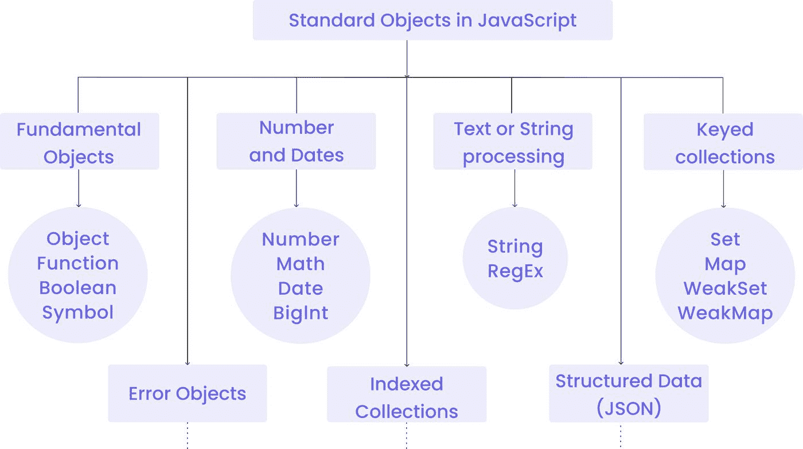

图 8.1 标准 JavaScript 对象的分类。

### 8.1.1 基础对象

基础对象是大多数用户创建对象的父类。几乎所有用户创建的对象都继承自这些基础对象。基础对象包括 `Object`、`Function`、`Boolean` 和 `Symbol` 类。在这些基础对象中，我们已经在之前的章节中详细讨论了 `Object` 和 `Function`。接下来的章节将简要讨论这些基础对象。我们在这里刻意限制了对 `Object` 和 `Function` 的讨论，因为它们在之前的章节中已经单独介绍过。

#### 8.1.1.1 对象原型 (Object Prototype)

`Object prototype`（对象原型）是 JavaScript 中原型链的根。许多其他对象原型继承自通用的 `Object` 原型，包括 `Function` 对象。每当使用 `new` 关键字创建对象时，它会自动继承 `Object prototype`，从而继承该原型的属性和方法 [[104]](#ref-list.xhtml_refReferences_104)。与使用 `Object` 字面量创建的对象相比，这些属性和方法为对象提供了额外的功能。

`Prototype` 是一个全局对象构造函数，用于向任何继承自 `Object Prototype` 的对象添加属性（包括方法）。`Object prototype` 有一些内置方法，例如 `toString()` 方法，它返回表示对象的字符串。当继承自 `Object()` 的对象需要时，可以重写该方法。

```javascript
var obj1 = new Object();
// 继承 Object prototype
var obj2 = [name:"Syngonium", color:"light green"];
// 继承 Object prototype
obj2.toString();
// 不继承
obj1.toString();
// 正常工作
```

#### 8.1.1.2 函数对象 (Function Object)

默认情况下，每个用户定义的函数都继承自 `Function` 原型。使用 `Function()` 构造函数会在全局作用范围内创建一个新的函数对象。`Function` 的实例属性包括 `Function.prototype.name()`（返回函数名称）、`Function.prototype.displayName`（返回函数名称）以及 `Function.prototype.length`（返回属于函数的参数个数）。

属于 `Function` 的实例方法包括 `toString()`、`apply()`、`bind()` 和 `call()`。`Function.prototype.toString()` 返回函数源代码的字符串表示。它重写了由 `Object` 原型提供的方法。`Function.prototype.apply(newThis)` 将调用对象的 `this` 参数替换为 `newThis` 参数。`bind()` 和 `call()` 方法用于创建一个新函数，并将其的 `this` 参数替换为传递的参数。`call()` 用于调用函数并随后设置其 `this` 参数。由于函数在 JavaScript 开发中处于非常关键的地位，这些概念在到达此节之前已经讨论过。

#### 8.1.1.3 布尔值对象 (Boolean Object)

传统的布尔值持有 `true` 或 `false` 作为其值，即它们在本质上是原始类型。`Boolean object` 属于 `Object` 原型，并作为持有布尔值的对象封装。`Boolean object` 的值在 0、−0、`null`、`false`、`NaN` 和 `undefined` 时隐式设置为 `false`，而在所有其他值时设置为 `true` [[106]](#ref-list.xhtml_refReferences_106)。下面的示例演示了多种创建具有 `false` 和 `true` 值的 `Boolean` 对象的方法。

```javascript
let obj1 = new Boolean(); // 值为 false
let obj2 = new Boolean(0); // 值为 false
let obj3 = new Boolean(null); // null 也将值设置为 false
let obj4 = new Boolean(' '); // 解析为 false
let obj5 = new Boolean(false); // 解析为 false
let obj6 = new Boolean(true); // 解析为 true
let obj7 = new Boolean('true'); // true
let obj8 = new Boolean('false'); // true，被视为字符串
let obj9 = new Boolean('T&F'); // true
```


```javascript
// true, treated as a string

let obj10 = new Boolean([]); //true

let obj11 = new Boolean({}); //true
```

在决策和控制流语句中使用 `Boolean` 对象会引入一些困惑；当你在练习布尔原始类型和 `Boolean` 对象时，你会注意到这一点。任何 `Boolean` 对象，只要其包含的值不是 `undefined`、`null` 或值设置为 `false` 的 `Boolean` 对象，在传递给任何类型的条件语句时，都会返回 `true`。再读一遍。让我们通过以下示例在实际操作中理解这一特殊概念：

```javascript
let b = new Boolean(false);

//将 Boolean 对象赋值给引用 ‘b’

let c = false; //作为原始值的布尔值

if (b) //将其求值为为 true
{//代码块被执行，因为 b 解析为 true}

if (c) //将其求值为为 false
{//代码不执行，因为 c 解析为 false}
```

因此，人们必须仔细地使用布尔原始类型和 `Boolean` 对象。正如上一个示例所示，即使 `Boolean` 对象的初始值设置为 `false`，它也会被解析为 `true`。

`Boolean` 原型提供了一个构造函数，允许向原型本身添加属性或方法。对原型的任何更改都将由链上的所有对象所继承。使用 `Boolean()` 原型构造函数的语法如下：

语法：
```javascript
Boolean.prototype.name = value
```

`Boolean.prototype` 指向 `Boolean()` 对象本身。在上述语法声明中，`name` 指向键，`value` 指向要设置的属性实际值。向 `Boolean()` 添加方法时也使用相同的表示法。`Boolean` 原型带有两个内置方法：`toString()` 和 `valueOf()`。`toString()` 方法根据调用对象返回 `true` 或 `false`。它重写了 `Object` 原型提供的方法。同样地，继承自 `Boolean()` 的对象也可以重写此方法并提供不同的实现。另一个原本属于 `Object()` 并被 `Boolean()` 重写的方法是 `valueOf()` 方法，它根据调用对象返回 `true` 或 `false` 的原始值。

#### 8.1.1.4 Symbol 对象

`Symbol` 对象是 JavaScript 的另一个内置基础对象，旨在为它的对象唯一地标识属性。它通过提供其他代码执行机制不会使用的值，有助于实现弱封装 [107]。`Symbol` 对象的构造函数始终返回一个跨所有其他属性都是唯一的 `symbol` 原始类型。

`Symbol` 对象带有它自己的构造函数来创建新的 `Symbol` 对象。然而，`Symbol` 原型不支持 `new` 关键字。让我们通过示例来理解：

```javascript
let symbol_A = Symbol(); //创建一个新的 Symbol 对象

let symbol_B = Symbol(‘JavaScript’);

//可选的字符串值

let symbol_C = Symbol(‘JavaScript');

//另一个新对象

let symbol_X = new Symbol();

//因为使用了 new 而抛出 TypeError

console.log(symbol_B = = = symbol_C) //打印 false

typeof Symbol() === ‘symbol’; //返回 true

typeof Symbol(‘JavaScript’) === ‘symbol’ //返回 true

typeof symbol_B = = = ‘symbol’; //返回 true
```

在上面的示例中，创建了三个 Symbol 对象：`symbol_A`、`symbol_B` 和 `symbol_C`。第四个对象 `symbol_X` 抛出类型错误，是因为 `Symbol` 不支持 `new` 运算符。`Symbol` 确保新对象的创建是通过 `Object()` 构造函数完成的，从而保持这些对象的唯一性，这是它们存在的关键定义目的。此外，观察到语句 `symbol_B = = = symbol_C;` 即使两个对象都是使用相同的字符串创建的，它也会返回 `false`。如示例所示，可以使用 `typeof` 运算符来识别这些对象的性质，即它们是否为 Symbol 对象。

`Object.getOwnPropertySymbols()` 方法用于返回调用对象上定义的 `Symbol` 属性数组。`Symbol` 原型本身不会被继承，除非由用户显式执行。因此，用户定义的对象（不继承自 `Symbol`）除非由程序设置，否则将不会有任何 `Symbol` 属性。

`Symbol` 对象还包含某些内置的实例属性和方法。实例属性包括 `Symbol.prototype.description`，它以只读字符串的形式返回调用 `Symbol` 对象的描述。实例方法包括 `toSource()`、`toString()` 和 `valueOf()`，这些是对 `Object` 原型方法的重写实现。`Symbol.prototype.toString()` 用于返回 `Symbol` 对象描述的字符串值。`Symbol.prototype.valueOf()` 用于返回 `Symbol`，而 `Symbol.prototype.toSource()` 用于返回持有调用 `Symbol` 源的字符串。

### 8.1.2 Error 对象

当发生任何运行时错误时，JavaScript 运行时都会抛出一个特殊对象；这个特殊对象被称为 `Error` 对象 [108]。`Error` 对象是一个基础对象，包含了基本错误以及特殊错误类型，如 `EvalError`、`RangeError`、`ReferenceError`、`AggregateError`、`SyntaxError`、`TypeError` 和 `URIError`。错误对象用于异常处理，并在 8 章中详细讨论。错误对象只有两个属性，即 `Error.prototype.message` 和 `Error.prototype.name`，它们分别用于存储错误信息和错误名称。`Error` 对象仅包含一个方法，即 `Error.prototype.toString()` 方法，它是继承自 `Object` 类的重写实现。错误对象通过使用 `try`、`catch`、`throw` 和 `finally` 等关键字为 JavaScript 提供异常处理。

### 8.1.3 数字和日期

数字和日期用于处理数字、日期以及其他基于数学的计算。这些包括 `Number`、`Math`、`Date` 和 `BigInt`。这些对象在处理需要跨时区的 Web 内容时非常有帮助。

### 8.1.3.1 Number 对象

`Number` 对象包含了用于处理数字的各种常量和方法 [109]。JavaScript 中的 `Number` 值相当于双精度 64 位二进制格式，就像 Java 中的 `double` 一样。它可以保持 17 位小数精度，超过后数字被认为等于常量 `Infinity`。

`Number` 对象拥有 `Number()` 构造函数，用于生成新的 `Number` 值。`Number(value)` 作为方法返回与所传递的字符串或任何其他值对应的数值。如果 `value` 无法转换为 Number，则返回 `NaN`。例如：

```javascript
let year = 2021;

let previousYear = Number(‘2021’);

y = == z; //返回 True

Number(‘twenty twenty - one’) //返回 NaN
```

`Numbers` 对象具有许多静态属性、静态方法、实例属性和实例方法。属于该对象的某些属性解释如下：


*   静态属性：`Number.NaN` 表示并返回 `Not a Number`（非数字）值。`Number.EPSILON` 返回 1 与给定数字之间存在的差异或最小间隔。它通常用于测试两个浮点数之间的相等性。`Number.MAX_SAFE_INTEGER` 和 `Number.MIN_SAFE_INTEGER` 分别代表最大（2⁵³ −1）和最小安全整数（−(2⁵³ −1））的值。`Number.MAX_VALUE` 和 `Number.MIN_VALUE` 分别代表最大的正数和最小的正数（最接近 0）。`Number.NEGATIVE_INFINITY` 和 `Number.POSITIVE_INFINITY` 分别返回负无穷和正无穷的特殊值。它们通常用于处理溢出情况。`Number.prototype` 属性用于向 `Number` 对象本身添加更多属性。

*   静态方法：`Number.isNan()` 如果传递的数字是 `NaN` 则返回 `true`；否则返回 `false`。此方法与全局的 `isNaN()` 不同。`isNaN()` 将传递的值转换为数字然后测试其是否等于 `NaN`，而 `Number.isNaN()` 不将传递的值转换为数字，仅判断其是否等于 `NaN`。`Number.isFinite()` 如果传递的数字本质上是有限的返回 `true`；否则返回 `false`。`Number.isInteger()` 如果传递的值是整数则返回 `true`；否则返回 `false`。

*   实例方法：`Number.prototype.toExponential(digitFraction)` 用于将数字转换为指数形式并返回其字符串值。`Number.prototype.toFixed(digits)` 根据 `digit` 参数对小数进行舍入，将调用数字转换为字符串。如果 `digits` 的值或小数位数高于调用数字，则会在字符串末尾补 0 以创建所需的长度。`Number.prototype.toPrecision(value)` 返回指定精度值的数字的字符串表示。例如：

```
let x = 1.12891;
let y = x.toFixed(3); // 舍入到 3 位小数
console.log(y); // 在控制台打印 1.129
let z = x.toFixed(8); // 舍入到 8 位小数
console.log(z); // 在控制台打印 1.12123000
```

`Number.prototype.toString(base)` 根据指定的基数（或基数值）返回调用对象的字符串表示。`Number.prototype.valueOf()` 返回调用对象所持有的原始值。这两个方法都是 `Object.prototype` 方法的重写实现。

### 8.1.3.2 Date 对象

`Date` 对象用于以一种独立于系统的方式表示系统中的特定时刻。`Date` 对象本质上使用一个 `Number`，表示自 1970 年 1 月 1 日世界协调时（UTC，也称为 UNIX 纪）以来经过的毫秒总数。这有助于在多个地理区域之间实现更容易日期和时区转换。`Date` 对象提供了方法来以 UTC 和格林尼治标准时间（GMT）等标准格式转换并显示时间。用户的平台（在此情况下为浏览器）提供本地时间，然后由 `Date` 对象进行转换和存储。

`Date` 对象提供两种类型的构造函数，即 `Date()` 和 `new Date()`。通过通过 new Date()` 创建对象会返回一个新的 `Date` 对象，而仅将 `Date()` 作为函数调用则返回属于用户系统的当前日期时间字符串表示。

```
let currentDate = new Date(); // 创建新对象
let travelDay = new Date('March 29, 2021 12: 11: 10');
// 使用指定日期创建新对象
let travelDay = new Date(2021, 3, 29)
// 创建相同日期的新对象
let travelDay = new Date(2021, 3, 29, 12, 11, 10)
// 传递参数的另一种方式
```

属于 `Date` 类的静态方法包括 `Date.now()`、`Date.parse()` 和 `Date.UTC()`。`Date.now()` 返回表示自 1920 年 1 月 1 日（UTC）以来经过的总毫秒数的数值。此方法忽略闰秒。`Date.parse()` 返回日期的字符串表示以及自标准基时间以来经过的毫秒数。`Date.UTC()` 返回作为参数传递的日期与标准基时间之间的差异。

以下列表列出了属于 `Date.prototype` 的一些常用实例方法。

*   `getDate()` 和 `getUTCDate()`：这些方法分别根据本地用户时间和通用时间返回月份中的几天（范围：1–31）。
*   `getDay()` 和 `getUTCDay()`：这些方法分别根据本地用户时间和通用时间返回星期几几（范围：0–6）。
*   `getFullYear()` 和 `getUTCFullYear()`：这些方法分别根据本地时间和通用时间返回表示年份的四位数字。
*   `getHours()` 和 `getUTCHours()`：这些方法分别根据本地用户时间和通用时间返回当前的小时（范围：0–23）。
*   `getMilliseconds()` 和 `getUTCMilliseconds()`：这些方法分别根据本地时间和通用时间返回 0–999 范围内经过的毫秒数。
*   `getMinutes()` 和 `getUTCMinutes()`：这些方法分别根据本地时间和通用时间返回分钟（范围：0–59）。
*   `getMonth()` 和 `getUTCMonth()`：这些方法分别根据本地时间和通用时间返回月份（范围：0–11）。
*   `getSeconds()` 和 `getUTCSeconds()`：这些方法分别根据本地时间和通用时间返回秒（范围：0–59）。
*   `getTime()`：此方法返回自 1970 年 1 月 1 日以来经过的毫秒数数值。
*   `getTimezoneOffset()`：此方法返回用户本地时区的偏移量。
*   `setDate()` 和 `setUTCDate()`：这些方法分别根据本地时间和通用时间设置月份。
*   `setFullYear()` 和 `setUTCFullYear()`：这些方法分别根据本地时间和通用时间设置年份（四位数字）。
*   `setHours()` 和 `setUTCHours()`：这些方法根据指定日期设置小时（范围：0–23）。
*   `setMilliseconds()` 和 `setUTCMilliseconds()`：这些方法分别根据本地时间和通用时间设置指定日期的毫秒。
*   `setMinutes()` 和 `setUTCMinutes()`：这些方法分别根据本地时间和通用时间设置分钟（范围：0–59）。
*   `setMonth()` 和 `setUTCMonth()`：这些方法分别根据本地时间和通用时间设置月份。
*   `setTime()`：此方法用于将 `Date` 对象设置为指定值。
*   `toDateString()`：此方法以字符串格式（可读形式）返回 `Date` 对象的日期值。
*   `toJSON()`：此方法使用 `ISOString()` 方法返回表示 `Date` 对象的字符串值。
*   `toLocaleDateString()`：此方法返回对应用户本地系统设置的日期字符串值。
*   `toLocaleString()`：此方法重写 `Object` 的 `toLocaleString()` 方法，返回根据本地系统设置的日期的字符串。
*   `toLocaleTimeString()`：此方法根据用户的系统设置返回表示本地时间的字符串。


* `toString()`: 此方法返回调用者 `Date` 对象的字符串值。它重写了 `Object` 原型上的 `toString()` 方法。

* `valueOf()`: 此方法返回调用者 `Date` 对象所持有的原始数值值。它重写了 `Object` 原型上的 `valueOf()` 方法。

通过使用上述方法，`Date` 对象可以根据程序需要轻松地设置、检索和操作这些值。如下一个示例所示，`Date` 对象通常与 `Number` 对象配合使用：

```javascript
let d = new Date('April 17, 2021 01: 22: 44')
console.log(Number(d)); //将 Date 转换为 Number
```

`Date` 类提供了许多实例方法，可以方便地用于处理和执行与日期及时间相关的操作。这些方法被广泛用于为全球用户创建统一的、时间和日期敏感的 Web 内容。

### 8.1.3.3 Math 对象

`Math` 对象是另一个内置对象，它提供了复杂的数学运算和常量所需的属性和方法 113。你无法创建 `Math` 对象，因为 `Math` 对象不提供任何构造函数；相反，它提供了可以方便地全局使用的静态方法和属性。其中大部分是用于向程序提供给定值的常量。这些属性具有依赖平台或系统的实现；因此，不同的浏览器在执行 `Math` 对象的方法时可能会产生不同的结果。以下列表显示了 `Math` 对象中可用的大部分静态属性，随后静态方法：

* `Math.E`: 此静态属性返回欧拉常数和自然对数的底的数值值，即 2.718。
* `Math.LN2`: 此静态属性返回 2 的自然对数值，即 0.693。
* `Math.LOG2E`: 此静态属性返回 `E` 的以 2 为底的对数，即 1.443。
* `Math.LOG10E`: 此静态属性返回 `E` 的以 10 为底的对数，即 0.434。
* `Math.PI`: 此静态属性返回数学常数 PI，即 3.14159。
* `Math.SQRT1_2`: 此静态属性返回 ½ 的平方根，即 0.707。
* `Math.SQRT2`: 此静态属性返回 2 的平方根，即 1.414。

`Math` 对象内部可用的静态方法如下：

* `Math.abs(X)`: 此静态方法返回 `X` 的绝对值。
* `Math.acos(X)`: 此静态方法返回 `X` 的反余弦值。
* `Math.acosh(X)`: 此静态方法返回 `X` 的双曲反余弦。
* `Math.asin(X)`: 此静态方法返回 `X` 的反正正弦值。
* `Math.asinh(X)`: 此静态方法返回 `X` 的双曲反正正弦。
* `Math.atan(X)`: 此静态方法返回 `X` 的反正切值。
* `Math.atanh(X)`: 此静态方法返回 `X` 的双曲反正切值。
* `Math.cbrt(X)`: 此静态方法返回 `X` 的立方根值。
* `Math.ceil(X)`: 此静态方法返回大于或等于 `X` 的最小整数值。
* `Math.floor(X)`: 此静态方法返回小于或等于 `X` 的最大整数值。
* `Math.cos(X)`: 此静态方法返回 `X` 的余弦值。
* `Math.cosh(X)`: 此静态方法返回 `X` 的双曲余弦值。
* `Math.sin(X)`: 此静态方法返回 `X` 的正弦值。
* `Math.sinh(X)`: 此静态方法返回 `X` 的双曲正弦值。
* `Math.tan(X)`: 此静态方法返回 `X` 的正切值。
* `Math.tanh(X)`: 此静态方法返回 `X` 的双曲正切值。
* `Math.exp(X)`: 此静态方法返回 `E^X` 的值，其中 `E` 是欧拉常数，即 2.718。
* `Math.log(X)`: 此静态方法返回 `X` 的自然对数。
* `Math.log2(X)`: 此静态方法返回 `X` 的以 2 为底的对数。
* `Math.log10(X)`: 此静态方法返回 `X` 的以 10 为底的对数。
* `Math.max(a,b,c,d…)` 和 `Math.min(a,b,c…)`: 这些静态方法分别从传递的参数列表中返回最大和数字。
* `Math.pow(X,Y)`: 此静态方法返回底 `X` 的 `Y` 次方幂值，即 `X^Y`。
* `Math.random()`: 此静态方法返回 0 到 1 之间的随机实数。
* `Math.round(X)`: 此静态方法将 `X` 的值舍入到最近的整数并返回其值。
* `Math.sign(X)`: 此静态方法返回 `X` 的符号值（即正、负或零）。
* `Math.trunc(X)`: 此静态方法返回 `X` 的整数部分。

### 8.1.4 文本或字符串处理

`文本或字符串处理` 通过字符串字面量或 `String` 构造函数在 JavaScript 中实现。`String` 对象用于处理、表示和操作一组字符。可以通过数组索引从 `String` 对象中访问字符，如接示例所示：

```javascript
let str1 = 'string value'; //创建新字符串
let str2 = new String("A new object"); //使用 String() 构造函数
let str3 = str1.charAt(3); //str3 现在值为 'i'
let str4 = str2[6]; //str4 现在值为 'o'
```

小于、等于和大于运算符用于比较不同的字符串值。`valueOf()` 方法用于将 `String` 对象转换为原始值。为了拼接多个字符串行或存储长字符串，可以使用运算符，即 `+` 或 `/`。

```javascript
let str = "This is an example to showcase a very long string" +
"and this string is not breaking, it is a continuous" +
"string and can be called via str";

let str2 = `这是另一种存储长字符串的方法
并且使用反斜杠允许它跨
行。`;
```

`String` 对象只有一个实例属性，即 `length`，用于返回字符串的长度。定义了许多实例方法，其中一些简要描述如下：

* `at(index)`: 此方法返回指定索引处的字符值。对于负值，会执行反向遍历。
* `charAt(index)`: 此方法返回指定索引处的字符值。对于负值，会执行反向遍历。
* `concat(s1,s2…)`: 此方法返回一个新字符串，它是通过参数（两个或多个字符串）的拼接版本。
* `includes(str)`: 此方法在搜索以确定 `str` 是否存在于调用对象后返回 true 或 false。
* `endsWith(str)`: 如果 `str` 位于指定字符串的结尾，则返回 true；否则返回 false。


- `indexOf(str)` 和 `lastIndexOf(str)`：这些方法分别返回 `str` 在指定字符串中首次和最后一次出现的索引。如果 `str` 不存在，则返回 −1。
- `match(regexp)`：此方法用于确定正则表达式和字符串的等价性。如果找到，它返回一个匹配项的数组；否则返回 `null`。
- `matchAll(regexp)`：此方法返回一个匹配项的迭代器，其中每个匹配项对应数组中的一个条。
- `repeat(i)`：此方法返回一个包含 `i` 个副本并拼接在一起的新字符串。
- `replace(X,Y)` 和 `replaceAll(X,Y)`：此方法用于在调用字符串中将搜索到的字符串（即 `X`）替换为字符串 `Y`，其中 `X` 可以是字符串或 `RegEx`，`Y` 可以是字符串或函数。前者替换第一个出现处，后者替换所有 `X` 出现处为 `Y`。
- `search(regex)`：此方法在调用字符串中搜索 `RegEx` 的出现位置并返回索引值；否则返回 −1。
- `slice(begin,end)`：此方法用于从 `begin` 索引提取到结束索引的字符串。它将提取的字符串作为一个新字符串返回，不对调用字符串进行任何修改。
- `split(pattern)`：此方法用于使用 `pattern` 字符串将字符串分为有序的子字符串列表，以数组格式返回，每个分割后的字符串作为数组的一个条目。
- `startsWith(str)`：如果调用字符串以 `str` 开头，此方法返回 `true`；否则返回 `false`。
- `substring(beg,end)`：此方法返回从调用字符串中提取的子字符串，其中 `beg` 和 `end` 代表起始和结束索引值。
- `toLowerCase()`：此方法通过将调用字符串转换为小写字符串返回一个新字符串。
- `toUpperCase()`：此方法通过将调用字符串转换为大写字符串返回一个新字符串。
- `toString()`：此方法返回调用对象的字符串值。它覆盖了属于 `Object` 原型的 `toString()` 方法。
- `trim()`：此方法通过移除字符串两端的空白字符返回一个新字符串。
- `trimStart()`：此方法通过移除调用字符串开头的空白字符返回一个新字符串。
- `trimEnd()`：此方法通过移除调用字符串末尾的空白字符返回一个新字符串。

### 8.1.4.2 RegExp 对象

正则表达式，简称 `RegExp`，是用于在字符串中查找某些组合或模式的模式。它们由简单的字符和修饰符组成。在搜索字符串是否存在某个 `RegExp` 时，只有当按照精确顺序找到完全相同的 `RegExp` 时，匹配才会成功。因此，定义和声明 `RegExp` 需要仔细注意细节。可以使用正则表达式字面量（括在反斜杠内）或通过调用 `RegExp()` 对象的构造函数来轻松创建正则表达式。接下来的示例所示：

```javascript
let a = /lookup/; //使用字面量创建 regEx

//使用构造函数。

let b = new RegExp(lookup’);

// 字符串作为第一个参数

let c = new RegExp(/lookup/);

//字面量作为第一个参数
```

如果表达式不发生变化，通过字面量创建 `RegExp` 对象相对较快。如果 `RegExp` 是动态的或不断变化，那么使用 `RegExp` 构造函数更快，因为它提供了运行时编译。`RegExp` 也可以通过以下构造函数创建，其中 `pattern` 表示指定正则表达式的字符串值，而 `flag` 表示包含以下任何一个标志的可选修饰符字符串值：

- `g` 标志指定 `RegExp` 对象的全局作用域，即模式搜索将在全局范围内进行，且搜索不会在第一次匹配后停止。
- `i` 标志指定 `RegExp` 对象的大小写敏感性，即当设置了 `i` 标志时，将执行不区分大小写的搜索。
- `m` 标志指定是否允许跨多行的多次匹配。

让我们通过一个示例来理解这一点。在接下来的示例中，我们创建了三个正则表达式 `a,b` 和 `c`；`a` 使用字面量创建；`b` 使用 `RegExp` 的构造函数创建，但第一个参数是以字符串传递的；`c` 同样使用 `RegExp` 的构造函数创建，但第一个参数是以字面量传递的。此外，我们创建了一个字符串 `str`，将在其中应用正则表达式来搜索并替换模式。

```javascript
let a = /lookup/i; //使用字面量创建 regEx

//使用构造函数。

let b = new RegExp(‘lookup’,’i’);

// 字符串作为第一个参数，修饰符作为第二个

let c = new RegExp(/lookup/,'i’);

//字面量作为第一个参数，修饰符作为第二个

var str = ”This is a string to perform lookup”;

str.search(a);

str.replace(b,”Regular Expression Replacement”);
```

在图 8.2 中，我们可以观察到上述代码的输出。创建第一个输出是 28；这是单词“lookup”在 `str` 中的位置。第二个输出是对 `str` 使用正则表达式进行的操作。最后的输出表明，无论我们如何创建 `RegExp`，创建的表达式在所有情况下都是相同的。


正则表达式还有更多功能，其中括号用于查找字符的系列或范围。括号表示见表 8.1。

| 括号表示 | 说明 |
| --- | --- |
| `[abcd]` 或 `[0-9]` | 查找括号内存在的字符 |
| `[^abcd]` 或 `[⁰-9]` | 查找括号内不存在的字符 |
| `(a|b|c|d)` | 查找模式中的任意一个 |

为了在正则表达式生成更丰富的模式，JavaScript 提供了*元字符*。这些元字符总结在表 8.2。

| 元字符 | | |
| --- | --- |
| `.` | 查找单个字符（换行符） |
| `\w` 和 `\W` | 分别查找单词字符和非单词字符 |
| `\d` 和 `\D` | 分别查找数字和非数字 |
| `\s` 和 `\S` | 分别查找空白字符和非空白字符 |
| `\0` | 查找空字符 |
| `\n` | 查找换行符 |
| `\r` | 查找回车符 |
| `\t` 和 `\v` | 分别查找制表符和垂直制表符 |

`RegExp` 的实例属性包括 `RegExp.prototype.flags`，它返回包含调用 RegExp 对象上存在的标志的字符串值。`RegExp.prototype.dotAll` 是一个只读属性，用于显示是否在正则表达式使用了 `s` 标志。如果使用了 `g` 标志则返回 `true`；否则返回 `false`。`RegExp.prototype.global` 也是一个只读属性，用于指示正则表达式中 `g` 标志的状态。如果使用了 `g` 标志则返回 `true`；否则返回 `false`。`RegExp.prototype.test()` 用于测试调用字符串中是否存在模式。根据搜索结果返回 `true` 或 `false`。`RegExp.prototype.toString()` 返回正则表达式的字符串值。

正则表达式通常与字符串配合使用，特别是属于字符串对象的方法，包括 `match()`、`search()`、`split()` 和 `replace()`。模式匹配、搜索和替换是正则表达式的常见用例。


### 8.1.5 键集合 (Keyed Collections)

键集合由使用键来标识值的对象组成，并且根据各自的插入顺序具有迭代性。这些包括 `Set`、`Map`、`WeakSet` 和 `WeakMap` [[117]](#ref-list.xhtml_refReferences_117)。接下来的章节将讨论 JavaScript 中两种最常用的键集合：Map 对象和 Set 对象。

#### 8.1.5.1 Map 对象

Map 对象可以按照完全相同的插入顺序存储键值对。原始值或对象值都可以用作键或值。它可以通过 `for … of` 循环轻松地遍历条目，每次迭代返回一个键值对 [[118]](#ref-list.xhtml_refReferences_118)。`Map` 类提供了一个内置构造函数，即 `Map()`，用于创建新的 Map 对象。

Map 对象的实例属性是 `Map.prototype.size` 属性，它用于返回 Map 对象中存在的键值对数量。在 `Map.prototype` 中定义的实例方法方法列出如下：

*   `clear()`：此方法通过清除 Map 对象中的所有键值对来清空 Map 对象。
*   `get(key)`：此方法返回调用对象中指定 `key` 对应的值；否则返回 `undefined`。
*   `set(key, value)`：此方法用于在调用的 Map 对象为指定的 `key` 设置 `value`。如果 `key` 已经存在 `value`，则会覆盖它，并返回生成的 Map 对象。
*   `has(key)`：此方法根据调用对象中是否存在 `key` 返回一个布尔类型的原始值。
*   `delete(key)`：此方法删除与 `key` 对应的值并返回 true。如果 `key` 不存在，则返回 false。
*   `keys()`：此方法返回一个迭代器对象，仅包含 Map 对象中每个元素的 `keys`（按顺序）。
*   `values()`：此方法返回一个迭代器对象，仅包含 Map 对象中每个元素的 `values`（按顺序）。
*   `entries()`：此方法返回一个迭代器对象，包含按插入顺序的 Map 对象的 `array[key,values]`。

#### 8.1.5.2 Set 对象

Set 对象简单来说是一个唯一项的集合。这些项可以是原始值或对象引用。`NaN` 和 `undefined` 也可以存储在 Set 中。迭代简单地按照插入顺序对 Set 对象进行 [[119]](#ref-list.xhtml_refReferences_119)。`Set` 类提供了一个内置构造函数 `Set()` 来创建新对象。

Set 类还有一个实例属性，即 `Set.prototype.size`，它返回调用 Set 对象中持有的值的整数计数。在 `Set.prototype` 中定义的实例方法列出如下：

*   `add(value)`：此方法用于向现有的 Set 对象添加新值，更新后返回该对象。
*   `clear()`：此方法用于从调用的 Set 对象中移除所有值。
*   `delete(val)`：此方法从调用对象中删除传递的值并返回 true；否则返回 false。
*   `has(val)`：此方法检查调用 Set 对象中是否存在 `val`，如果找到则返回 true；否则返回 false。
*   `values()`：此方法返回一个迭代器对象，按插入顺序持有调用 Set 中的所有值。
*   `entries()`：此方法返回一个新的迭代器对象，按插入顺序持有 `array[value, value]`，即键和值具有相同的值。
*   `forEach()`：此方法对属于调用 Set 对象的每个值执行一次提供的操作。

### 8.1.6 索引集合 (Indexed Collections)

索引集合包括如 `Array`、`Int8Array`、`Flo32Array`、`BigInt64Array` 和 `Int16Array` 等对象。它们代表有序的数据集合，包括数组和类数组结构 [[120]](#ref-list.xhtml_refReferences_120)。数组对象将在下一节中简要讨论，因为它在第 5 章 中详细讨论过。

#### 8.1.6.1 Array 对象

数组对象是数据存储在非连续位置的动态高级对象。数组原型（Array prototype）提供了对数组进行方便遍历和处理操作的方法。

JavaScript 中的数组是零索引的，最后一个元素位于 (`length` - 1)，其中 `length` 是与数组关联的属性 [[121]](#ref-list.xhtml_refReferences_121)。使用无效索引将解析为 `undefined`。内置数组对象包括如 `slice()`、`indexOf()`、`join()`、`push()` 和 `splice()` 等方法，用于修改数组的长度属性。

Array 对象有其自己的构造函数 `Array()` 用于创建 Array 对象。Array 的静态方法包括 `Array.from()`、`Array.isArray()` 和 `Array.of()`。`Array.from()` 用于使用调用数组创建新的 Array 对象。`Array.isArray()` 用于检查调用实体是否为数组，并根据结果返回原始布尔值。`Array.of(arg(s))` 用于使用传递的参数作为数组条目创建新的 Array 对象。参数的数量即 `arg(s)` 可以变化。

Array 对象拥有的实例属性是 `length` 属性。在 `Array.prototype` 中定义的实例方法说明如下：

*   `at()`：此方法返回指定索引处的数组项；负索引从末尾开始计数。
*   `concat()`：此方法在连接其他数组(s) 后返回一个新数组。
*   `copyWithin()`：此方法用于在调用数组内拷贝一组数组项。
*   `entries()`：此方法返回一个包含调用数组键值对的迭代器对象。
*   `every()`：此方法如果调用对象的中的每个元素都满足指定条件，则返回 true。
*   `fill()`：此方法用于用传递的值填充整个数组。
*   `filter()`：此方法对调用数组的每个元素进行过滤测试，并返回一个仅包含通过过滤条件的数组。
*   `find()`：此方法寻找满足条件的数组元素。如果找到，则返回元素；否则返回 `undefined`。
*   `findIndex()`：此方法返回指定元素在数组中的索引；否则返回 -1。
*   `forEach()`：此方法对调用数组中存在的每个元素调用指定的方法。
*   `includes(val)`：此方法如果调用数组包含指定值，则返回 true；否则返回 false。
*   `indexOf()`：此方法返回指定元素在数组中首次出现的索引；否则返回 -1。
*   `join()`：此方法连接调用数组的所有元素并返回结果字符串。
*   `keys()`：此方法返回一个包含调用数组对象每个元素索引的迭代器对象。
*   `lastIndexOf()`：此方法返回指定元素在数组中最后一次出现的索引；否则返回 -1。
*   `pop()`：此方法移除并返回调用数组的最后一个元素。
*   `push()`：此方法向数组添加一个新元素并返回结果数组的长度。
*   `reverse()`：此方法反转数组内所有元素的整个顺序并返回结果数组对象。
*   `shift()`：此方法移除并返回调用数组中的第一个元素。
*   `some()`：此方法即使仅有一个元素满足指定条件，也会返回 true。
*   `sort()`：此方法用于对数组元素进行排序并返回结果数组。
*   `splice()`：此方法用于从调用的数组对象中添加或删除元素。


*   `toString()`: 此方法返回一个包含数组中所有元素的字符串。
*   `values()`: 此方法返回一个新的迭代器对象，包含数组中所有元素的值。

### 8.1.7 结构化数据 (Structured Data)

`Structured Data` 包含了用于交互和表示结构化数据以及嵌入在 JSON（JavaScript 对象表示法）中的对象 [[122]](#ref-list.xhtml_refReferences_122)。

### 8.1.8 值属性 (Value Properties)

值属性是返回简单预定义值的全局属性。它们没有任何关联的属性或方法。这些包括 `Infinity`、`NaN`、`globalThis` 和 `undefined`。

*   `Infinity` 是一个表示无穷大的全局属性；该值甚至可以比较。可以使用 `isFinite()` 方法测试给定的对象是否包含无穷。例如：

```javascript
let result = 12 / 0; //除以零。

console.log(result); //存储了 Infinity

if (result == Infinity)

console.log(‘Oh this is infinity value’)

console.log(isFinite(result)); // 打印 false
```

*   `NaN` 是一个表示“不是数字”（Not a Number）的全局属性；它可以在数值计算中使用，其中非数字可能会破坏输出。可以使用 `isNaN()` 方法测试任何包含数字的对象。例如：

```javascript
let x = ’1’ // 在 x 中存储一个数字

console.log(isNaN(x)) // 打印 false

let y = ’a’ // 在 y 中存储一个字符串

console.log(isNaN(y)) // 打印 true
```

*   `undefined` 属性代表 JavaScript 中的 `undefined`，它是一个原始类型。它可以用于值未定义的地方。当变量没有默认值时，会返回此值。例如：

```javascript
let x

console.log(x); // 打印 undefined
```

*   `globalThis` 属性代表全局作用域引用。JavaScript 在不同的环境中提供不同的全局作用域；这使得访问全局变量变成了一项麻烦的任务。`globalThis` 始终有一组全局引用，这使得引用变得更容易。

### 8.1.9 函数属性 (Function Properties)

函数属性是不依赖于任何对象即可调用的全局函数；它们直接对调用者做出响应。这些包括 `isFinite()`、`isNan()`、`parseInt()`、`eval()`、`parseFloat()`、`encodeURI()`、`encodeURIComponent()`、`decodeURI()` 和 `decodeURIComponent()`。

*   `eval()`: 此方法评估作为字符串形式传递的 JavaScript 代码。例如：

```javascript
console.log(eval('12 + 24')); // 打印 36
```

*   `isFinite()`: 此方法检查调用对象是否解析为 `finite`（有限）或 `Infinite`（无穷）。例如：

```javascript
console.log(isFinite(10 / 0)); // 打印 false
```

*   `isNan()`: 此方法检查调用对象是否包含 `NaN`。例如：

```javascript
console.log(isNan(‘aa’)); // 打印 true
```

*   `parseInt()`: 此方法根据第二个参数（作为基数）将给定的字符串解析为对应的整数值。例如：

```javascript
console.log(parseInt(‘oxf’, 16); // 打印 15
```

*   `parseFloat()`: 此方法将给定的字符串解析为对应的浮点值。例如：

```javascript
console.log(parseFloat(“3.14”)); // 打印 3.14
```

*   `encodeURI()` 和 `decodeURI()`: 这些方法用于编码或解码字符串 URL 中的特殊字符。这些方法不会编码或解码这些特殊字符（`, /? : @ & = + $ #）。例如：

```javascript
var uritoEncode = “example.com?name = råvi”;

var result = encodeURI(uritoEncode);

console.log(result);

// 输出为 “example.com?name = r%C3%A5vi”

var uriAfterDecode = decodeURI(result)

console.log(uriAfterDecode)

// 输出为 example.com?name = råvi”
```

*   `encodeURIComponent()` 和 `decodeURIComponent()`: 这些方法也用于编码或解码字符串 URL 中的特殊字符。这些函数还会编码或解码这些特殊字符（, /?: @ & = + $ #）。例如：

```javascript
var uritoEncode = “example.com?name = råvi”;

var result = encodeURIComponent(uritoEncode);

console.log(result);

// 输出为 ““example.com%3Fname%3Dr%C3%A5vi””

var uriAfterDecode = decodeURIComponent(result)

console.log(uriAfterDecode)

// 输出为 example.com?name = råvi”
```

## 8.2 练习

### 8.2.1 理论

1.  为 JavaScript 中可用的内置标准对象提供分类。详细阐述并讨论每一个类别。
2.  `Object` 原型和 `Function` 原型之间有什么区别？它们提供相同的功能吗？如果不是，请说明你的理由。
3.  在设计网页时，如何使用 `Number` 和 `Date` 对象？批判性地头脑风暴一下为什么我们需要这些对象及其属性。
4.  列出 `Math` 对象提供的属性。解释为什么这些属性大多数在本质上是静态的。
5.  你如何理解正则表达式？请通过合适的示例说明 `RegExp` 如何与 `Strings` 配合使用。
6.  什么是 `Map` 和 `Set` 对象？为什么我们需要这些对象及其属性？

### 8.2.2 判断题

1.  `undefined` 属性代表原始类型的 `undefined`。
2.  每个对象都继承自其原型。
3.  键值集合允许无序存储。
4.  值属性包括 `NaN`、`Infinity`、`globalThis`。
5.  `toString()` 返回值。

### 8.2.3 单选题

1.  `Dates` 的格式是什么？
    a) 自 1970 年起的天数
    b) 自 1970 年起的毫秒数
    c) 自 1970 年起的秒数
    d) 以上都是
2.  创建 `Date` 的正确方法是？
    a) `obj()`
    b) `new Date()`
    c) `obj()`
    d) 以上
3.  `Symbol` 的正确声明是？
    a) `let symbolA = Symbol()`
    b) `let symbolB = new Object()`
    c) `let symbolC = Symbol()`
    d) 以上都是
4.  JavaScript 提供内置对象是因为：
    a) 它不希望开发者从零开始设计对象。
    b) 它工作在原型上。
    c) 它为新创建的对象提供了平台。
    d) 以上都是。
5.  大多数对象继承的通用原型是：
    a) `Function`
    b) `Array`
    c) `String`
    d) `Object`

## 8.3 演示与实操

### 8.3.1 目标

1.  通过循环控制流程。
2.  通过循环计算表单中的项目。
3.  使用不同的循环遍历迭代器。

### 8.3.2 前提

*   **步骤 1**: 访问 [`www.routledge.com/97803674129`](https://www.routledge.com/97803674129) 并下载 `Ch8_Loops_Template` 压缩包。
*   **步骤 2**: 解压内容并使用任一编辑器打开 `index.html`。
*   **步骤 3**: 将下文代码插入 `index.html` 的 `<script>` 块中。
*   **步骤 4**: 对后续每个代码片段重复上述三个步骤。

### 8.3.3 探索

使用任何编辑器，我们将编写并测试 JavaScript 代码以使用循环并在网页上查看结果。关于循环，你应该了解这些：循环允许我们控制代码流，并在条件为真时执行特定的代码段，或者使用范围循环方便地遍历数组、映射等迭代器。

#### 8.3.3.1 代码片段-1

```javascript
var p1 = “This is Placeholder for p1”;

var p2 = “This is Placeholder for p2”;

var p3 = “”;

var p4 = “”;

var p5 = “”;

document.addEventListener(“DOMContentLoaded”, () => {

document.querySelector(“#p1”).innerHTML = p1;

document.querySelector(“#p2”).innerHTML = p2;

document.querySelector(“#p3”).innerHTML = p3;

document.querySelector(“#p4”).innerHTML = p4;
});
```


```javascript
document.querySelector("#p5").innerHTML = p5;

});

function howMany(selectObject) {
  let numberSelected = 0;

  // for 循环演示。
  for (let i = 0; i < selectObject.options.length; i++) {
    if (selectObject.options[i].selected) {
      numberSelected++;
    }
  }

  // 等同于上述代码的 while 循环。
  numberSelected = 0;
  let i = 0;
  while (i < selectObject.options.length) {
    if (selectObject.options[i].selected) {
      numberSelected++;
    }
    i++;
  }

  // 返回结果
  return numberSelected;
}

let btn = document.getElementById("btn");
btn.addEventListener("click", function () {
  alert(
    "选中选项数量: " + howMany(document.selectForm.musicTypes)
  );
});
```

#### 8.3.3.2 代码片段-2

```javascript
// 工具函数 ()
const appendToHTML = (contents, color = "white") => {
  contents.forEach((content) => {
    const myPara = document.createElement("p");
    myPara.style.color = color;
    myPara.innerHTML = content;
    resultHere.appendChild(myPara);
    sep();
  });
};

const sep = () => {
  const separator = document.createElement("hr");
  resultHere.appendChild(separator);
};

/*****************************************************************************/
// 引用结果屏幕。
var resultHere = document.querySelector(".results");
// 示例 JSON 对象。
const godzilla = { type: "titan", size: "monstrous", habitat: "hollow earth" };

// 在网页中打印 JSON
appendToHTML([
  "硬编码 JSON 消息 =>",
  JSON.stringify(godzilla),
  "通过 `for… in` 遍历 JSON 对象",
], 'black');

// 使用 { FOR… IN } 循环遍历对象。
for (let i in godzilla) {
  appendToHTML([i + ": " + godzilla[i]]);
}
```

#### 8.3.3.3 代码片段-3

```javascript
// 工具函数 ()
const appendToHTML = (contents, color = "white") => {
  contents.forEach((content) => {
    const myPara = document.createElement("p");
    myPara.style.color = color;
    myPara.innerHTML = content;
    resultHere.appendChild(myPara);
    sep();
  });
};

const sep = () => {
  const separator = document.createElement("hr");
  resultHere.appendChild(separator);
};

/*****************************************************************************/
// 引用结果屏幕。
var resultHere = document.querySelector(".results");
// 示例数组。
const favMovies = [
  "星际穿越",
  "顶端",
  "约翰·维克",
  "哈利·波特",
  "如何训练你的龙",
  "贾达·阿克巴",
];

// 在网页中打印 JSON
appendToHTML([
  "数组 FavMovies =>",
  "[" + favMovies.toString() + "]",
  "通过 `for… each` 遍历 JSON 对象",
],
  "yellow"
);

// for… each
favMovies.forEach((element) => {
  appendToHTML([element], "black");
});

// 插入分隔符
sep();
appendToHTML([
  "数组 FavMovies =>",
  "[" + favMovies.toString() + "]",
  "通过 `for… of` 遍历 JSON 对象",
  "对于数组等可迭代器，推荐使用 for… of 语句，而不是 for… in，因为 for… in 也会遍历数组中的用户自定义属性。",
],
  "yellow"
);

// for… of
for (let content of favMovies) {
  appendToHTML([content], "black");
}
```

## 8.4 变量提升（Hoisting）的演示与实操

### 8.4.1 目标
1. 理解提升及其意义。
2. 函数的提升。
3. 变量的提升。

### 8.4.2 前提条件
- **步骤 1：** 访问 [`www.routledge.com/9780367641429`](https://www.routledge.com/9780367641429) 并下载 `Ch8_Hoisting_Template` 压缩包。
- **步骤 2：** 解压内容并在任何喜欢的编辑器中打开 `index.html`（例如：记事本或 Visual Studio Code）。
- **步骤 3：** 将接下来提供的代码插入 `index.html` 中的 `<script>` 块。
- **步骤 4：** 对后续每个片段重复上述三个步骤。

### 8.4.3 探索
使用任何编辑器，我们将编写并测试 JavaScript 代码以与 DOM 交互并在网页上查看结果。关于提升，你应该了解以下内容：在概念上，JS 认为所有的声明（变量）和函数定义都移动到了代码的顶部，因此 JS 不会抛出引用错误（或者感知这些变量），但事实并非如此。变量声明就在它们定义的地方，但 JS 在编译期间会将它们存储在内存中，因此在运行时可以感知这些变量。这个概念被称为提升。

#### 8.4.3.1 代码片段-1
```javascript
// 工具函数 ()
const appendToHTML = (contents, color = "white") => {
  contents.forEach((content) => {
    const myPara = document.createElement("p");
    myPara.style.color = color;
    myPara.innerHTML = content;
    resultHere.appendChild(myPara);
    sep();
  });
};

const sep = () => {
  const separator = document.createElement("hr");
  resultHere.appendChild(separator);
};

/*****************************************************************************/
var resultHere = document.querySelector(".results");
appendToHTML([
  "提升生效了",
  "变量和函数被移动到了顶部",
]);

function testFunction(arg) {
  appendToHTML([
    `你好，因为有了提升我正在工作，耶耶 | 传递的参数 -> ${arg}`,
  ]);
}
```

 8.4.3.2 代码片段-2
```javascript
// 工具函数 ()
const appendToHTML = (contents, color = "white") => {
  contents.forEach((content) => {
    const myPara = document.createElement("p");
    myPara.style.color = color;
    myPara.innerHTML = content;
    resultHere.appendChild(myPara);
    sep();
  });
};

const sep = () => {
  const separator = document.createElement("hr");
  resultHere.appendChild(separator);
};

/*****************************************************************************/
var resultHere = document.querySelector(".results");
appendToHTML([
  "提升对初始化无效，仅对声明有效！",
],
  "yellow"
);

// 这运行良好，变量声明并初始化然后在代码中使用。
var num; // 声明
num = 6; // 初始化
appendToHTML([`变量 num: ${num}`], "lime");

// 尝试使用 var 看看结果。
appendToHTML([`变量 thatsWeird: ${thatsWeird}`]);
var thatsWeird; // 声明。
thatsWeird = 10;
appendToHTML([
  "它是 undefined，因为只有声明被提升了，而不是初始化。",
  "至少代码成功执行了，JS 现在感知到这些变量了。",
],
  "tomato"
);

// 定义。
function testFunction(arg) {
  appendToHTML([
    `你好，因为有了提升我正在工作，耶耶 | 传递的参数 -> ${arg}`,
  ]);
}

/*************************************************/
sep();
```


这些错误可能是由于代码中的`syntactical`（语法）或`logical`（逻辑）问题引起的。重要的是，它们也可以在代码执行的`runtime`（运行时）发生。由于 JavaScript 语言本身的特性，运行时概率很高。对于开发者来说，确保网页在各种情况下继续运行非常重要。这是通过仔细设计和编写程序代码以消除语法和逻辑错误来实现的。然而，对于运行时错误，这是不可能，因为它们会在程序运行并在用户端执行时产生，由于异构浏览器环境的存在，会导致各种情况。对于 JavaScript 而言，对象通过多个接口继承属性和方法，这使得错误产生了一个丰富而复杂的领域。

对于每种编程语言，管理代码执行过程中产生的错误和其他问题都是重要的。JavaScript 提供了错误处理来处理此类问题。在本章中，我们将讨论程序代码验证，以及 `try`、`catch` 和 `finally` 块的使用。然后我们将讨论 `finally` 块的使用和 `throws` 关键字来生成错误。还会讨论带有属性的错误对象。最后，我们将详细讨论 cookie 的使用和操作。

## 9.1 验证

在处理网页时，与终端用户交互时通常有两种情况：要么我们向用户显示信息，要么我们从用户那里获取信息。今天，大多数网页在本质上是交互性的，需要自定义用户输入以在不同的用例下运行运行。

为了获取用户输入，`HTML` 表单是最常用的替代方案。这些表单指定了输入字段，并构建了一个精美的界面来接收用户的输入。它们需要对从终端用户那里所需的信息有清晰、简洁且具体的描述。每个表单字段都有一些关联数据，这些数据需要处于正确的格式以便进一步处理。`Validation`（验证）是指确保用户传递的信息正确并符合指定的程序需求的过程。信息验证可以在客户端或服务器端完成。这将在后续章节中进行详细讨论。

### 9.1.1 服务器端和客户端验证

信息验证可以在客户端进行，可以限制用户按特定格式提供信息。这现在已成为一种标准的过滤机制，在用户端对信息进行验证。另一种验证信息的方法是在服务器端验证，在服务器端分析用户发送的输入。

服务器端验证速度较慢，因为用户输入需要发送到服务器并返回响应。这会导致用户端信息处理延迟。考虑到这两种验证方法，建议对用户输入同时使用客户端和服务器端验证。

客户端验证作为用户端的过滤机制非常有帮助 [[1]](#ref-list.xhtml_refReferences_1)。它有助于对用户实施某些约束，例如选择合适的密码、将字段设为必填、指定数据输入格式等。客户端验证可以大大减少服务器开销，并使信息处理变得更容易。

另一方面，也建议在客户端验证的同时进行服务器端验证。即使强制执行了客户端验证，用户也可能对服务器端采取恶意行为。这可以通过对从用户接收到的输入应用严格的服务器端信息验证来解决。

验证主要在表单上进行，因为表单是获取终端用户输入或数据的既事实标准。`HTML` 表单是接收用户详细输入的手段。为了验证之目的，可以使用 `JavaScript` 和 `HTML`。`HTML` 提供了内置的表单验证，而 `JavaScript` 可以用于手动代码来强制执行。这两者都将在后续章节中讨论。

### 9.1.2 使用内置表单验证

`HTML5` 提供了内置的表单控件，对验证有很大帮助。使用这些功能，可以在客户端验证用户数据 [[2]](#ref-list.xhtml_refReferences_2)。表单元素提供的表单验证属性列如下：

*   `minlength` 和 `maxlength`：分别代表文本输入（字符串）的最小和最大长度。
*   `min` 和 `max`：分别代表数值输入值的最小值和最大值。
*   `required`：指示表单属性是否为用户必填。由表单元素顶部的红色星号 `*` 表示。
*   `type`：指示表单元素上允许的输入类型，如文本、字符串和电子邮件。
*   `pattern`：代表正则表达式，定义了用户输入在填写表单详情时必须遵循的精确模式。

使用此类表单验证属性允许只有经过验证的信息到达服务器端。当表单元素值有效时，允许提交（如果 `JavaScript` 代码没有拦截它）。当表单元素值无效时，浏览器会拦截表单并显示相应的错误消息。以下代码演示了 `HTML` 内置表单验证功能的使用，随后是输出的截图。

*   不带 `HTML` 验证的代码：

```html
<form><!--first entry for form-->
<label for = “dog”> Do you own a dog? </label>
<input id = “dog” name = ”dog”> //not mandatory to fill
<button>Submit</button>
</form>
```

下面的截图 (图 9.1) 演示了上述代码的输出；此表单不会进行任何验证，即使没有提供输入也是如此。此表单项不是 `required`（必填的），因此用户可以直接提交它，它将直接发送到服务器。


图 预期输出.

*   带 `HTML` 验证的代码：

```html
<form><!--second entry for form-->
<label for = “cat”> Do you own a cat? </label>
<input id = “cat” name = “cat” required minlength = “2” maxlength = “20”> <!--makes it mandatory to fill with length -->
constraints
<button>Submit</button>
</form>
```

对于此表单，input 标签内的属性是 `required`，这意味着用户必须填写。如果用户在没有输入值的情况下提交表单，浏览器将拦截表单且不发送到服务器。如果用户输入了值但不符合 `minlength` 和 `maxlength` 设置的标准，表单将被拦截且不发送。


图 预期输出.

`HTML5` 表单验证在本质上是相当静态的，不允许自定义修改。它仅支持提供的属性，并在此范围内强制执行验证。它不允许对用户值设置复杂的约束。然而，从性能而言，`HTML5` 表单验证相对更快。`JavaScript` 验证可以解决这些问题，并可以对用户输入提供更复杂的验证。让我们在下一节学习它。

### 9.1.3 使用 JavaScript 进行验证


也可以使用 JavaScript 实现验证。如今大多数浏览器都支持 `Constraint Validation API`（约束验证 API），它可以在将用户输入的值传递给服务器之前对其进行检查 [3 ]。它可以与 HTML 表单验证配合使用。一旦用户输入的值通过 HTML 表单元素完成验证，就会将其传递给 JavaScript 代码进行进一步验证。

随后，JavaScript 使用约束验证 API 对用户输入指定复杂的约束条件。这既可以在单个表单元素上完成，也可以在整个表单（即 `<form>` 元素）上完成。它提供了以下对验证非常有用的属性：

* `validity`: 该属性返回一个 `ValidityState` 对象，该对象包含所有验证错误，以只读属性的形式存在于表单元素。`ValidityState` 对象的属性包括 `tooLong`、`tooShort`、`rangeOverflow`、`patternMismatch`、`valueMissing` 等。
* `validationMessage`: 这是一个只读属性，用于获取当元素值无效时应显示的的验证消息。如果表单值有效，它将返回一个空字符串。
* `willValidate`: 该属性返回一个只读布尔值，用于指定给元素是否用于约束验证。

Constraint Validation API 提供了以下用于表单元素验证的方法：

* `checkValidity()`: 该方法根据元素的值相对于指定约束的情况返回一个布尔值。对于无效值，它返回 `false`；否则，返回 `true`。
* `reportValidity()`: 该方法用于检查元素的值是否满足约束需求。如果值无效，它会触发 `invalid` 事件，返回 `false` 并通知用户有效性状态。
* `setCustomValidity(msg)`: 该方法用于设置自定义消息，当给定的值无效或不可接受时，该消息将显示给用户。它对于通过错误消息向用户指定约束条件非常有用。

Constraint Validation API 还为其他与表单相关的验证的接口提供了扩展。这种扩展允许添加额外的属性和方法。其中一些接口包括 `HTMLSelectElement` (`<select>`）、`HTMLInputElement` (`<input>`）、`HTMLOutputElement` (`<output>`）、`HTMLButtonElement` (`<button>`) 等。

在本章末尾提供了一个示例，以观察使用 JavaScript 进行验证的实际运行过程。

## 9.2 错误处理

除了用户输入或表单验证外，程序内部还存在其他错误。语法错误和逻辑错误在设计程序代码时会被处理。它们相对容易处理。`Runtime errors`（运行时错误）是在程序执行期间发生的错误。这些是最重要的错误，因此最难消除，特别是在使用 JavaScript 时。

JavaScript 的特性（如原型的使用、继承、类型转换、对象等）使得识别错误变得更加困难，因为它们可能不会立即发生，而在不同情况下需要大量的处理时间才会显现。寻找和纠正它们需要花费大量精力。克服这种情况的机制被称为 `error handling`（错误处理）。JavaScript 运行时会创建一个特殊的 `error` 对象，并默认将其 `throws`（抛出）回调用者，即 页面或控制台。

JavaScript 还提供了一种机制来捕获这个抛出的对象，并寻找替代方案在运行时解决错误。这是通过使用 `try`、`catch` 和 `finally` 块实现的。让我们在接下来的章节中了解 `error` 对象以及 `try`、`catch` 和 `finally` 块的工作。

### 9.2.1 错误对象

JavaScript 提供了一个内置对象，用于提供程序执行期间生成的错误信息 [4 ]。Error 对象提供了此类属性来提供有关错误的信息。

最常用的两个 Error 对象属性是 `name` 和 `message`。错误对象的 `name` 属性用于设置或返回错误名称。`message` 属性用于以字符串形式设置或返回错误消息。

错误对象的 `name` 属性可以持有不同的值，每个值都代表一种特定类型的错误。这些值的解释如下：

* `Range Error`（范围错误）：范围错误表示所提供的数值超出了合法/可接受值的范围。
* `Reference Error`（引用错误）：当在没有预先声明的情况下使用引用时会抛出引用错误。
* `Syntax Error`（语法错误）：语法错误代表代码中的语法使用不正确。
* `Type Error`（类型错误）：当使用的值超出预期类型范围时（例如使用字符串代替数字或反之），会抛出类型错误。
* `URIError`（统一资源标识符错误）：当使用非法值定义 URI 值时，会抛出 URI 错误。

错误对象有自己的构造函数来初始化错误对象。使用构造函数 `Error()` 会创建一个新的错误对象。错误对象关联有一个 `toString()` 实例方法。它重写了 `Obejct.prototype.toString()` 方法，返回一个指示有关调用 Error 对象详细信息的字符串。

```javascript
try {
  throw new Error("Just for fun")
}
catch (err) {
  console.log("Error details are: [Name:"+err.name + "] and Message: "+err.message + "]");
}
```

### 9.2.2 Try-Catch 块

`try` 和 `catch` 块是 JavaScript 中提供错误处理功能的手段。可能产生错误并停止代码执行的程序代码可以放在 `try` 块中 [5 ]。当执行 `try` 块中的代码时，只有两种可能性，即它产生错误，要么不产生。

每当发生错误时，`try` 块将将执行传递给相应的 `catch` 块。随后执行 `catch` 块中的代码。相反，如果执行 `try` 块中的代码且没有发生错误，则相应的 `catch` 块就不会执行。使用 `try` 和 `catch` 块使得错误处理过程变得简单得多。

这种方式强制了一种测试机制，允许程序代码安全地在 `try` 块中执行。如果发生任何错误，都有 `catch` 块来处理它。这些块总是一起使用的，即对于每个 `try` 块都有一个 `catch` 块。这些块可以相互嵌套以处理更复杂的情况。嵌套块时，`try` 块与最近的 `catch` 块配对。一个 `try` 块可以有多个 `catch` 块。这些块的语法如下：

语法：

```javascript
try {
  //要执行的代码
}
catch(error) {
  // 处理传递的错误的代码
}
```

一个给定的 `try` 块可以有多个 `catch` 块。`try` 块可以包含抛出不同错误的程序语句。对于每个错误，可以存在一个不同的 `catch` 块。给出的演示使用 `try-catch` 块的小代码段如下，图 9.3 展示了输出。

```html
<html>
<body>
  <script>
    try {
      let x = "Hello World!";
      console.log(x);
      console.log(y);
    }
    catch (err) {
      console.log("Someone is calling y without defining it");
    }
  </script>
</body>
</html>
```

图 9.3 浏览器控制台输出。


`finally` 是一个与 `try-catch` 块一起提供的可选代码块。它最常用于在程序执行结束后执行清理操作，例如关闭文件、删除资源、向用户显示消息等。无论是否抛出异常，`finally` 块内部的语句始终会被恰好执行一次。在 `try-catch` 块中使用 `finally` 的语法如下：

语法：

```javascript
try
{
  //要被执行的代码
}
catch(err)
{
  // 捕获错误
}
finally
{
  // 这段代码在程序执行完成前总是执行一次。
}
```

### 9.2.4 Throw 语句

`throw` 语句用于在 `try` 块中抛出自定义的用户自定义的错误。任何用户都可以定义自己的异常并使用 `throw` 关键字将其抛出。这有助于开发者以一种独特且自定义的方式来识别错误 [[6]](#ref-list.xhtml_refReferences_6)。在 `throw` 关键字之后的任何程序语句都不会被执行，控制权将直接传递到相应的 `catch` 块。

如果不存在相应的 `catch` 块，程序将终止。在 `try`-`catch` 块中使用 `throws` 的语法如下：

语法：

```javascript
try
{
  //要被执行的代码；
  throw userDefinedError; //throw 语句
}
catch(err)
{
  // 处理该特定异常的代码
}
```

`throw` 语句对于生成用户可以理解且在程序代码上下文中有效的异常非常有帮助。

## 9.3 Cookies

在传统上，一旦服务器向用户发送了网页页面，它就会完全忘记该用户，每当用户请求到达服务器时，都会提供一个全新的页面。用户的状态和行为信息不会被维护，这导致了用户端重复的信息泄露等。这还导致由于重复加载相同信息而浪费宝贵的带宽、时间和资源。为了解决这个问题，会将小型文本存储存在用户计算机的浏览器文件系统中，以表示终端用户的状态。这些小文件被称为 `cookies`。

Cookies 主要是用于存储用户信息的键值对。这些小文本文件会随用户对网页的请求一起发送到 Web 服务器 [[7]](#ref-list.xhtml_refReferences_7)。使用 cookies，服务器更容易记住特定用户的状态和信息。

每个网页的 `document` 对象都有一个用于存储 cookie 值的唯一属性。`document.cookie` 属性用于读取和写入与文档相关的 cookie。使用此属性，可以访问 cookie 并将其设置为特定的值。

```javascript
let cookieALL = document.cookie;
//返回一个包含所有键值对形式 cookie 的字符串

document.cookie = newKeyValue;
// 向 cookies 添加新值
```

默认情况下，cookies 在浏览器关闭后会被销毁。此类 cookies 被称为 `session cookies`。为了让 cookie 持存，必须设置 cookie 的 `expires` 或 `max-age` 属性。参数值以毫秒为单位。

```javascript
document.cookie = “user = Alex; max - age = 0”;
// 立即删除

document.cookie = “user = Alex; max - age = 3600”;
// 1 小时后删除
```

如果在 cookie 中设置了 `secure` 属性，则必须使用 HTTPS 协议进行传输，以实现信息的安全传输。

```javascript
document.cookie = “user = Ravi; Secure”; //通过 HTTPS 发送
```

## 9.4 严格模式

严格模式是 ECMAScript5 规范新增的新内容，它允许程序和函数在严格上下执行。`use strict` 是一个字面量表达式，用于防止程序执行某些操作 [[8]](#ref-list.xhtml_refReferences_8)。它会静默移除一些微妙错误并将它们直接抛在控制台上。

它消除了静默错误并限制了某些未来语言版本可能会定义的工具。使用严格模式，程序执行速度更快，并且对搜索引擎更具优化。它会自动禁用那些不完整、混淆或不够安全的特性。

当脚本不在 `strict mode` 模式运行时，它本质上被认为是“松散的（sloppy）”。严格模式既可以全局应用于整个脚本，也可以应用于单个函数。可以通过在脚本顶部或函数声明之前编写 `use strict` 来指示程序代码使用严格模式。在其他任何地方写 `use strict` 不会导致代码使用严格模式。

```javascript
‘use strict’
console.log(“A stricter script in action”);
```

另一个理解 `strict` 模式的例子；让我们看看不使用严格模式的代码片段及其输出。

```javascript
var myVariable; // 创建 myVariable 对象
myVaroable = 10; // 注意拼写错误的 myVaroable
console.log(myVaroable); // 尝试打印拼写错误的
console.log(myVariable); // 尝试查看正确的
```

现在观察上述代码的输出 (图 9.4)；由于对象名称拼写错误，没有任何影响。这在代码中引入了无意错误。

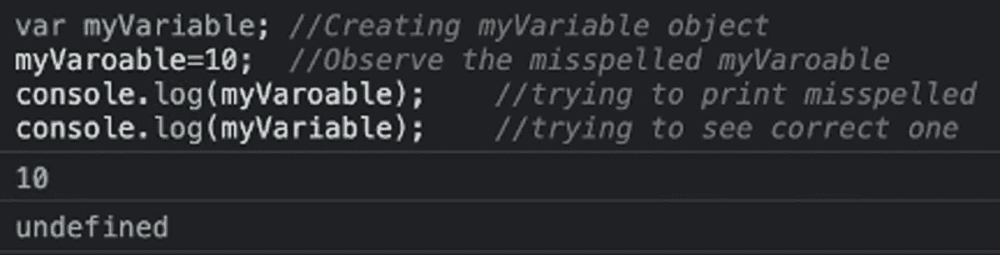

图 9.4 输出截图。

现在，让我们看看在顶部放置 `use strict` 关键字相同的代码：

```javascript
'use strict'; // 使用严格模式
varVariable; // 创建 myVariable 对象
myVaroable = 10; // 注意拼写错误的 myVaroable
console.log(myVaroable); // 尝试打印拼写错误的
console.log(myVariable); // 尝试查看正确的
```

仔细观察输出 (图 9.5)；现在运行时识别了拼写错误的单词并抛出 `ReferenceError`。这就是严格模式帮助创建稳定代码的方式。建议使用严格模式以实现更快速、安全的程序执行。

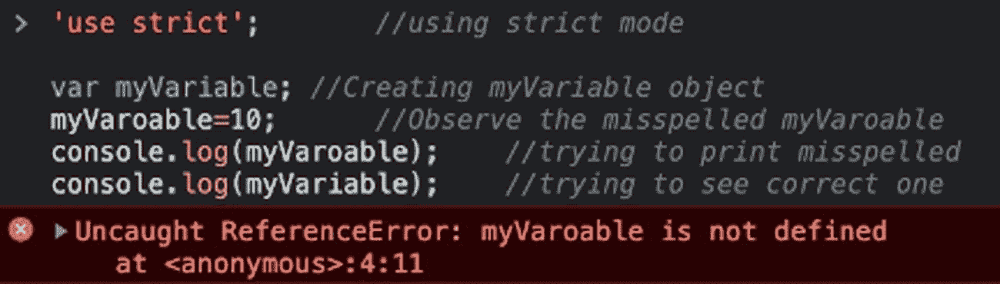

图 9.5 输出截图。

## 9.5 最佳实践

编写 JavaScript 代码时，理想情况下应遵循某些最佳实践以避免不必要的阻塞、调试和延迟。通过遵循下面的最佳实践，开发者可以减少代码错误的概率，使其更容易理解，最终结果是整洁、高效且有意义的代码，可以根据需要进行升级。某些这些实践如下：

-   始终使用注释来解释你的代码。程序代码编写一次，但在其生命周期内会被多次阅读。对必要的内容进行注释是最佳实践。
-   使用有意义的变量和函数名。与其将变量命名为 `x, y, z`，不如将它们命名为 `noOfStudents`、`calculateSum()`、`printTotal()`。变量和函数的正确命名使得更容易理解代码的工作原理，特别是在变量和函数在程序生命周期内存在复杂关系的情况下。
-   避免使用全局变量；尽可能使用 `var`。跳过 `var` 关键字直接在程序中使用不会产生错误，但它会在全局作用范围内声明新变量并使用它。在全局作用域创建多个变量不被认为是良好的做法，因为这增加了这些变量被其他应用程序、库等误用的可能性。这还会导致不必要的冲突并降低程序性能。因此，仅在特定需要时使用全局变量；否则请使用 `var` 关键字在给定的作用域内声明。


-   并不是所有的浏览器都支持 JavaScript。有时用户的浏览器禁用了 JavaScript 的使用。在这种情况下，最好先设计一个只包含 HTML 代码的网页，以确保向用户显示一个有意义的页面，而不是损坏的代码脚本。一旦正确处理了基础 HTML 页面，开发者就可以专注于在网页中集成 JavaScript 以增强其功能。

-   使用字面量（literals）来创建数组、对象等，而不是使用 `new` 构造函数。当使用构造函数创建数组（或函数或对象）时，它会继承与其原型相关的所有属性和方法。对于处理数组中的信息等简单操作，没有强制创建一个数组对象。相反，一个简单的数组就能运行得良好并提高运行速度。另一方面，为相同目的创建一个数组对象不会带来任何显著优势，反而会变得较慢。因此，建议使用对象字面量来初始化基础对象，而不是使用构造函数初始化。

```javascript
var obj = {} //使用字面量
var obj2 = new Object(); //new 对象
var arr = []; //简单数组
var arr2 = new Array(); //Array 对象
```

-   省略重复使用的 `var` 关键字，并使用逗号声明变量列表。没有强制将每个变量声明在单独的一行。相反，可以使用 `var` 关键字配合逗号分隔的列表。这是处理变量的优化方式。尝试在脚本开头声明并初始化变量，而不是在程序的任何地方声明它们。在声明变量时尽可能为它们设置默认值。

```javascript
var noOfItems;
var userID;
var nameOfDog;
var noOfItems, userID, nameOfDog; // 效果相同
```

-   浏览器会在程序语句末尾自动插入分号。然而，仅依赖浏览器完成语句可能会在以后导致问题。建议在任何适用的地方使用分号正确结束行。

-   使用原生 JavaScript（raw JavaScript）执行操作总是比使用库执行相同操作要快。使用库可以增强 JavaScript 的功能，但会降低运行速度。使用原生 JavaScript 可以快速执行，但编写代码比使用预定义的库更困难。因此，必须在运行速度和网页扩展功能的使用之间做出审慎的决策。通常，对于不同的网页或用例，这一决定会发生变化。

-   将脚本放置在 HTML 页面的底部可以更快地加载网页。JavaScript 的 `<script>` 标签用于通过引入动态特征（如行为 `onClick()`、`onLoad()` 等）来增强用户行为。此脚本可以在 HTML 加载后安全地执行。

-   为了调试目的，请使用 JSLint 调试器，它可以帮助开发者发现 JavaScript 代码中的问题并报告其来源。它解析代码以寻找语法错误、逻辑错误或结构性错误，并将它们报告给开发者。

-   使用 `===` 代替 `==`（或使用 `!==` 代替 `!=`）。`===` 运算符会比较传递参数的值和类型，而 `==` 运算符首先执行类型转换，然后比较值。因此，在任何需要的地方使用 `===` 运算符进行更快速、更有意义的比较。

-   使用严格模式（strict mode）来避免错误，并遵循更严格、更整洁的代码规范。使用这种模式禁用了 `with` 以及其他导致代码产生不必要的的操作。

-   尝试以模块化和专门化的方式进行设计和编程。人们经常利用 JavaScript 的灵活性用有限数量的函数来执行多个任务。然而，应该避免这样做，必须为特定任务使用专门的函数。这有助于代码的轻松复用、调试和扩展，而无需重写。

## 9.6 练习

### 9.6.1 理论

1. 编写一个脚本来验证不同的表单字段，字段必须按顺序具有布尔值、数字值和字符串值，且最大长度为 15。
2. 使用 JavaScript 代码，区分如何使用 HTML 和使用 JavaScript 的约束验证 API（Constraint Validation API）来实现客户端表单验证。
3. 在学习本书的文本时，你已经根据本章末后的习题练习了大量代码。根据你的练习代码和经验，列出至少 10 个你认为对你有效的最佳实践。
4. JavaScript 中不同的 `Error` 名称值是哪些？
5. 列出 JavaScript 中使用的不同错误类型。用合适的示例解释每种错误。
6. 区分客户端验证和服务器端验证。在你看来，应该如何处理验证？详述你的答案。

### 9.6.2 判断对/错

1. 语法错误和运行时错误都会在控制台中显示错误通知。
2. 缺陷（bug）被定义为脚本内部存在的任何错误。
3. 布尔值函数对任何非空内容都返回 `true`。

### 9.6.3 多选题

1. 表单验证发生在：
    1. 客户端。
    2. 服务器端。
    3. 两者均是。
    4. 以上都不是
2. 调用哪一个函数来验证用户输入的数据？
    1. `onValid()`
    2. `validate()`
    3. `checkData()`
    4. 不需要调用预定义函数
3. 下列程序代码的输出是什么？
```javascript
function myFunction() {
var y = “ ”;
document.getElementById(“demo”).innerHTML = Boolean(y);
}
```
    1. False
    2. True
    3. RangeError
    4. 以上都不是

## 9.7 演示与实操：表单验证与 Cookie

### 9.7.1 目标

1. 为表单应用自定义验证规则。
2. 检查这些规则并允许提交。
3. 验证成功后将表单详情存入 Cookie。

### 9.7.2 前提条件

- **步骤 1:** 访问 [`www.routledge.com/978036764129`](https://www.routledge.com/978036764129) 并下载压缩文件 `Ch9_Validation_Template`。
- **步骤 2:** 解压内容并用任何编辑器打开 `index.html`（例如记事本或 Visual Studio Code）。
- **步骤 3:** 在 `index.html` 的 `<script>` 块中插入后续代码。
- **步骤 4:** 为每个代码片段重复上述三个步骤。

### 9.7.3 探索

使用任何编辑器，编写并测试 JavaScript 代码以进行表单验证并将详情存入 Cookie。

#### 9.7.3.1 代码片段-1

```javascript
// 工具函数
const appendToHTML = (contents, color = “white”) => {
  contents.forEach((content) => {
    const myPara = document.createElement(“p”);
    myPara.style.color = color;
    myPara.innerHTML = content;
    resultHere.appendChild(myPara);
    sep();
  });
};

const sep = () => {
  const separator = document.createElement(“hr”);
  resultHere.appendChild(separator);
};

/************************************************************ */
var resultHere = document.querySelector(`.results”);

// DOM 引用
const nameF = document.getElementById(“name”);
const emailF = document.getElementById(“email”);
const pwdF = document.getElementById(“pwd”);
const btn = document.getElementById(“btn”);
const getC = document.getElementById(“get”);

btn.addEventListener(“click”, (e) => {
  // TODO: 验证名称
  // 验证名称，可以是任何奇怪的 AudioWorkletNode，只需确保它不为空。
  if (!nameF.value.trim()) {
    alert(“名称不能为空:/”);
    return;
  }
  // TODO: 验证邮箱
  // 假设我们只允许 gmail.com 的邮箱，而不是任何其他域名，所以……
  console.log(emailF.value.trim().toLowerCase().split(“@”)[1]);
  if (emailF.value.trim().toLowerCase().split(“@”)[1]!= “gmail.com”) {
```


```javascript
alert("Sorry, only gmail accepted, go make a new account.");

return;

}

// TODO: 验证密码。

// 长度必须在 8<=字符数<= 15 之间，必须包含英文字母。

const pwd = pwdF.value;

if (8<= pwd.length<= 15) {
  // 字母的正则表达式
  var alpha = /^[a-zA-Z] + $/;

  // 检查匹配
  if (!pwd.match(alpha)) {
    alert("密码必须包含字母<3");
    return;
  }
} else {
  alert("长度必须在 8<=字符数<= 15 之间");
  return;
}

// 如果所有检查通过，控制到达此处，现在将表单数据存储在 cookie 中。
document.getElementById("res").style.display = "block";
setCookie(pwdF.value, `${nameF.value.trim()}-${emailF.value.trim()}`);

});

// 获取 cookie 并在控制台中显示。
getC.addEventListener("click", (e) => {
  console.log(getCookie(pwdF.value));
});

/************************************************************ */
// Cookie Setter
function setCookie(cname,cvalue) {
  var d = new Date();
  document.cookie = cname + "=" + cvalue + ";";
}

// Cookie Getter
function getCookie(cname) {
  var name = cname + "=";
  var ca = document.cookie.split(";");
  for (var i = 0; i<ca.length; i++) {
    var c = ca[i];
    while (c.charAt(0) == " ") {
      c = c.substring(1);
    }
    if (c.indexOf(name) == 0) {
      return c.substring(name.length, c.length);
    }
  }
  return "*";
}
```

# 10 杂案例研究

DOI: [10.1201/9781003122364-10](https://doi.org/10.1201/9781003122364-10)

> *即使昨天取得了巨大的成功，我仍然不想重复它。相反，我想在它的基础上继续迈进*。

> –Craig D. Lounsbrough

我们的 JavaScript 学习之旅终于要结束了。这可能是学习基础 JavaScript 语言知识的终点，但我们还有许多可以学习的内容。在本章中，我们的目标是让你领略 JavaScript 的一些更强大的功能。本章提供了一套完全基于实操的练习题，让你体验一些其他主题。这涉及三个综合案例研究，旨在供你探索并实现你自己的学习。这些案例研究包含了一些超出本书范围的主题，但这将让你了解如何将 JavaScript 提升到下一个水平，以及 JavaScript 如何帮助设计各种其他应用程序。JavaScript 的范围非常广阔。我们的书只是你起起点站之一，为你提供一个可以飞行的乐场。我们祝你在使用这种语言编程时取得成功并获得充实的快乐。

## 10.1 案例研究-1：Fetch API 简介

### 10.1.1 目标

1. 学习 JavaScript 使用的 Fetch API。
2. 使用 `fetch()` 调用 API。
3. 解析来自 API 的数据。

### 10.1.2 前提条件

1. 访问 [`www.routledge.com/9780367641429`](https://www.routledge.com/9780367641429) 并下载 `Ch_10_Fetch_Template` 的压缩文件。
2. 解压内容并使用任选的编辑器打开 `index.html`（例如：记事本或 Visual Studio Code）。
3. 在 `index.html` 的 `<script>` 块中插入提供的代码。
4. 对提供的每个代码片段重复上述三个步骤。

### 10.1.3 探索

使用任何编辑器，我们将编写并测试 JavaScript 代码来获取 API 并在网页上显示结果。以下是关于 Fetch 你应该了解的内容。Fetch 是一种跨网络进行 GET 和 POST 资源的简单、逻辑的方法 [1]。它提供了一个用于操作资源的 JavaScript 接口。我们正在关注 `fetch()` 语法的 GET 部分。

* 我们在这个案例研究中将使用的 API 是 Dog-API。我们建议在继续练习之前先阅读其文档 [2]。
* 执行此案例研究并进行练习后，你可以进一步探索更多 JavaScript API，学习这些将是有趣的 [3]。

```javascript
fetch(<API’ s url>)
// fetch 需要一些时间，因为正在从不同的服务器获取资源，因此在成功获取 API 之后必须执行下一步。
.then(<res-variables>=> { return res.json() })
.then(<data-variable>=> {console.log(<data-variable>)
// 如果在运行时或获取时抛出错误；使用 catch 块来避免你的网页出现异常。
.catch(err => {console.err("Failed to fetch, error = ”, err) })
```

#### 10.1.3.1 代码片段

```javascript
// 将 API 存储为常量。
const DOG_API = "https://dog.ceo/breeds/random";

// 为按钮添加事件。
document.querySelector(".btn").addEventListener("click", () => {
  // 等待 fetch 完成。
  fetch(DOG_API)
  .then((res) => {
    // 解析数据为 JSON。
    return res.json();
  })
  .then((apiData) => {
    // 将 JSON 转换为字符串显示。
    document.querySelector(".info").innerHTML = JSON.stringify(apiData);
    // 使用分隔符分割 url，获取品种。
    document.querySelector(".dog-box").src = apiData.message.split("/")[4];
  })
  .catch((err) => {
    console.log(err);
  });
});
```

## 10.2 案例研究-2：集成 MongoDB

### 10.2 目标

创建一个向我们的 node.js 服务器发送请求的网页。

### 10.2 前提条件

#### 10.2.1 MongoDB Cloud

1. 在你的系统上安装 docker（如果你熟悉 Node.js）。
2. 从 [`www.routledge.com/9780367641429`](https://www.routledge.com/9780367641429) 下载 *Ch_10_mongodb*; 在 case_mongodb 下将获得执行所需的代码。
3. 按照屏幕说明创建 MongoDB 集群。
4. 询问 IP 时添加 `0.0.0.0/0` 以避免麻烦。此地址仅用于开发。
5. 创建后点击集合并选择数据集。

#### 10.2.2 用于 Node.js 的 Docker 容器

1. 你将发现两种类型的文件：`Dockerfile` 和 `.dockerignore`。此案例研究需要某些环境和运行时依赖，我们使用这些文件。
2. 你不需要担心运行时环境，因为 `Dockerfile` 在那里定义环境。
3. 修改 `server.js` 和 `public/script.js` 与 JavaScript 交互。
4. 准备好运行时，在 *cmd* 或 *terminal* 中导航到项目目录。
5. 确保文件结构如图 10.2（ch10.xhtml_fig10_2）所示。

* 忽略 `node_modules`；目前不需要。
* 运行这些命令。
* 每当你更改此案例研究中的任何文件时，必须运行这些命令。

```bash
<可以自由将“mongo-node”替换为任何名称>
docker build -t mongo-node.
docker run --name server -it -p 3000:3000 --rm mongo-node
```

### 10.2.3 议

*可以通过两个路由访问服务器：
    * `/databases` -> 返回 JSON。（我们 MongoDB 集群中存在的所有数据库）。


- `/find` -> 接收 URI 编码参数并返回 JSON。（所有具有给定卧室数量的 `hotels`、其地址和描述）。

## 10.2.4 探索

使用任何编辑器，我们将编写并测试 JavaScript 代码，以连接并查询 MongoDB 云端。

#### 10.2.4.1 用于调用自定义 API 的前端脚本

将以下代码放入项目目录下的 `public/script.js` 文件中。

```javascript
//DOM reference's
const btn = document.getElementById("btn");
const code = document.getElementById("code");
const search = document.getElementById("search");
const btnC = document.getElementById("btnC");
const db = document.getElementById("database");
const coll = document.getElementById("collection");

btn.addEventListener("click", async () => {
  code.innerText = "loading";
  const res = await fetch("/databases");
  const json = await res.json();
  code.innerText = "\n" + JSON.stringify(json, null, 4);
});

btnC.addEventListener("click", async () => {
  if (db.value) {
    const res = await fetch("/find?search = " + encodeURIComponent(db.value));
    const json = await res.json();
    code.innerText = "\n" + JSON.stringify(json, null, 4);
  } else {
    code.innerText = "Please provide a Database Name, hit 'Show databases' to see available ones<3";
  }
});
```

#### 10.2.4.2 代码解读

- 代码的第一部分演示了对 DOM 引用的访问。
- `fetch()` 是一个从不同源获取资源的 JavaScript API。它接收一些输入参数：查询的 URL，后面是可选的参数。
- 为了实现上述议程，需要两个 `fetch` 操作。你可以看到在 `fetch` 之前使用了 `await`，这是因为 `fetch` 正在从不同的源获取信息，而且它依赖于带宽。在数据可用之前需要一些时间。`await` 用于暂停代码执行，直到进程完成，然后重新执行代码执行。

#### 10.2.4.3 创建 Node.js 后端

将以下代码放入项目目录下的 `server.js` 文件中。

```javascript
// Official Mongo driver which is required to connect with MongoDB clusters.
const { MongoClient } = require("mongodb");
// Framework for managing HTTP so we don't need to take care of certain low-level things.
const express = require("express");
const { Router, response } = require("express");

const init = async () => {
  // TODO: Add your specific connection URI here.
  const uri = "ENTER URL FROM MONGODB CLOUD HERE";
  // 通过将 URI 传递给构造函数来创建 MongoClient 新实例。
  const client = new MongoClient(uri, { useUnifiedTopology: true });
  await client.connect();
  // 创建 express 新实例，根据习惯命名为 app。
  const app = express();
  // 这是一个服务器路由，
  // 第一个参数是 URL 端点，它将触发此内部的代码段
  // 接收一个回调函数 ()，带有两个参数 req-> request 和 res-> response app。
  app.get("/databases", async (req, res) => {
    // 通过 client 获取所有数据库列表
    const result = await client.db().admin().listDatabases();
    // res (response) 允许你与客户端通信；首先设置状态码 = 200（可选的，但是良好的实践）
    // 随后是 JSON 响应，包含获取的结果。
    res.status(200).json({ dbs: result.databases }).end();
  });

  app.get("/find", async (req, res) => {
    const minBedrooms = Math.floor(req.query.search);
    console.log(minBedrooms);
    // 此 mongoDB 查询返回一个游标，可以进一步用于过滤、排序或顺序访问元素
    // 我们简单地将其转换为数组，以便一次性向客户端发送所有数据。
    // 在这里，$gte 代表大于等于，是 MongoDB 中比较运算符之一，请查阅 MongoDB 官方文档获取更多信息。
    const cursor = await client
      .db("sample_airbnb")
      .collection("listingsAndReviews")
      .find({ bedrooms: { $gte: minBedrooms } })
      .sort({ last_review: -1 })
      .limit(50);
    const response = await cursor.toArray();
    var subset = [];
    // 提取结果的选择性部分，否则会是一团糟。我正在提取名称、描述和地址。
    // 随需 console.log(response) 以查看完整结果并据此进行操作。
    response.forEach((match) => {
      subset.push({
        name: match.name,
        dsc: match.description,
        addr: match.address,
      });
    });
    console.log(response);
    if (response) {
      res
        .status(200)
        .json({
          response: `Valid AirBnbs with ${minBedrooms} minimum bedrooms`,
          matches: subset,
        })
        .end();
    } else {
      res.status(200).json({ match: "No matches found" }).end();
    }
  });

  // 发送落地页
  // app.get("/", (req, res) => {
  // res.sendFile("public/index.html");
  // });
  // 在端口 3000 启动你的服务器。（如果你在 Docker 运行命令中做了端口更改，请忽略此处）
  const PORT = 3000;
  app.listen(PORT);
};
init();
```


作者说明包含了管理用户状态，例如：是否是通过身份验证的同一个人，或者是否仍然登录？这是一项非常繁琐的服务端任务，但 firebase 通过其自身的后端可以非常方便地管理和授权用户。幸运的是，我们不需要担心这些。

## 10.4.3 前提条件

1.在此处创建一个 firebase 项目，Firebase Console（控制台）。
2. 点击项目概览（Project overview）旁边的设置，并选择 `Project Settings`（项目设置）。
3.向下滚动并点击 `Add App`（添加应用）。
4. 选择 `WebApp` 并按照屏幕上的指示操作。最后，你将获得 `firebaseConfig` 对象；妥善保存。你将需要它将项目的前端与 firebase 连接。
5. 从左侧面板点击 `authentication`（身份验证）并选择 `get started`（开始使用）。
6. 进入 `authentication` 页上的 `signin-method`（登录方法）选项卡并启用 `google`。（可以使用任何你选择的提供程序；对于本教程，我们坚持使用 google。）
7. 在 Firebase 内部，进入 `console -> Auth section -> Sign in` 方法选项卡，向下滚动到 `authorised-domains`（已授权域名）并添加你的域名（可能是 localhost 或 127.0.0.1），以便授予访问 firebase。
8. **重要** 如果你像打开一样打开 html 文件，你的代码将无法工作；它需要被提供，例如来自 localhost。实现此点的简单方法之一是使用 VisualStudio code 编辑器。只需安装 `liveserver` 扩展，并使用它打开 html 文件。

## 10.4.4 议程

* 创建登录页面，用户可以通过其 google 账户登录。
* 创建一个用户页面，在登录后显示用户的公共凭据。

## 10.4.5 探索

使用任何编辑器，我们将编写并测试 JavaScript 代码以使用 Firebase 身份验证服务，并通过用户的 google 账户提供登录功能。

资源：

* 从 [`www.routledge.com/9780367641429`](https://www.routledge.com/9780367641429) 下载 `Ch_10_FirebaseAuth`；你将获得此项目所需的代码。
* 打开 `login.html` 页面，你可以看到几个带有来自 `gstatic` `src` 的脚本；这是一个 CDN（内容分发网络）。由于 firebase 是我们项目中的依赖之一，我们将使用 CDN 动态将 firebase 库加载到我们的运行时。

#### 10.4.5.1 创建登录页面

将以下代码放在项目目录下的 `script.js` 文件中。

```javascript
var firebaseConfig = {
/* 按照前提条件所述，用你的项目凭据填充 firebaseConfig 对象。 */
};

// 初始化 Firebase

firebase.initializeApp(firebaseConfig);

// var provider = new firebase.auth.GoogleAuthProvider();

var uiConfig = {
  signInSuccessUrl: "home.html",
  signInOptions: [
    // 对于你想要为用户提供的提供程序，保持这些行不变。
    firebase.auth.GoogleAuthProvider.PROVIDER_ID,
  ],
  // tosUrl 和 privacyPolicyUrl 接受 url 字符串或回调函数。
  // 服务条款 url/回调。
  tosUrl: "https://www.google.co.in",
  // 隐私政策 url/回调。
  privacyPolicyUrl: function () {
    window.location.assign("https://www.google.co.in");
  },
};

// 使用 Firebase 初始化 FirebaseUI 小部件。

var ui = new firebaseui.auth.AuthUI(firebase.auth());

// start 方法将等待 DOM 加载。

ui.start("#firebaseui-auth-container", uiConfig);
```

#### 10.4.5.2 代码解读

* `firebaseConfig` 基本上允许你使用凭据连接到 firebase 服务。
* `uiConfig` 接收两个重要属性作为输入；这些属性如下：
    1. `signInSuccessUrl`：身份验证成功后控制转移到的页面的 `URL`。
    2. `signInOptions`：列出了提到的不同登录方式的数组。由于我们在这里使用了 google，所以只需要一个元素。（无论需要实现哪些方法，确保它在 firebase 控制台中已启用。）
* 新 `firebaseui.auth.AuthUI(firebase.auth())` 是启动身份验证流的构造函数。我们使用 `AuthUI`，因为它可以使用 Google 的标准 UI 元素管理登录。
* 最后 `ui.start()` 接收 `selector`（选择器），即你需要挂载登录门户的 `div` 的 ID 或 CLASS。我们的 HTML 页面已经包含一个 `id` = `“firebaseui-auth-container"` 的 `div`。其次，`start()` 还接收 `uiconfig`，并且只有在整个网页加载后它才会开始工作。

#### 10.4.5.3 创建主页

如之前的代码段所示，登录成功后此页面会自动重定向。将以下代码段放在项目目录下的 `auth.js` 文件中。

```javascript
var firebaseConfig = {
/* TODO:
* 在此处填入四个 firebase 项目凭据。<3
*/
};

// 初始化 Firebase

firebase.initializeApp(firebaseConfig);

// DOM 引用

var fname = document.querySelector(".photo-details h1");
var dp = document.querySelector(".photo-card img");
const card = document.querySelector(".photo-card");
var userEmail, userPicURL, userName;
const logout = document.getElementById("logout");

function initApp() {
  // 实时监听器。
  firebase.auth().onAuthStateChanged((user) => {
    if (user) {
      // 用户身份验证并登录。
      card.classList.remove("hide");
      populateLoggedInCard(user);
      // 显示退出按钮
      logout.classList.remove("hide");
      userEmail = user.email;
      userPicURL = user.photoURL;
      userName = user.displayName;
    } else {
      // 隐藏退出按钮
      logout.classList.add("hide");
      card.classList.add("hide");
      userEmail = null;
      userPicURL = null;
      userName = null;
    }
  }, (error) => {
    console.log(error);
  });

  // 退出事件监听器。
  logout.addEventListener("click", (e) => {
    firebase.auth().signOut()
      .then(() => {
        // 退出成功。
        window.location.replace("login.html");
      })
      .catch((error) => {
        // 发生错误。
      });
  });
}

// 在 DOM 加载后延迟初始化。
window.addEventListener("load", () => {
  initApp();
});

// 填充登录的用户卡片。
const populateLoggedInCard = (user) => {
  fname.innerText = user.displayName;
  dp.src = user.photoURL;
};
```


2. 层叠样式表. [在线]. Available: [`www.w3.org/Style/CSS/Overview.en.html`](https://www.w3.org). [访问: 2021 年 5 月 31 日].
3. JavaScript | MDN. [在线]. Available: [`developer.mozilla.org/en-US/docs/Web/JavaScript`](https://developer.mozilla.org). [访问: 2021 年 5 月 31 日].
4. 客户端 JavaScript 与服务端 JavaScript 的区别. [在线]. Available: [`net-informations.com/js/iq/side.htm`](http://net-informations.com). [访问: 2021 年 5 月 31 日].
5. 关于 Node.js. [在线]. Available: [`nodejs.org/en/about/`](https://nodejs.org). [访问: 2021 年 5 月 31 日].
6. React – 用于构建用户界面 JavaScript 库. [在线]. Available: [`reactjs.org/`](https://reactjs.org). [访问: 2021 年 5 月 31 日].
7. AngularJS — 超级 JavaScript MVW 框架. [在线]. Available: [`angularjs.org/`](https://angularjs.org). [访问: 2021 年 5 月 31 日].
8. JavaScript 历史：从 Netscape 到框架的之旅. [在线]. Available: [`www.techaheadcorp.com/blog/history-of-javascript/`](https://www.techaheadcorp.com). [访问: 2021 年 5 月 31 日].
9. LiveScript - 编译为 JavaScript 的语言. [在线]. Available: [`livescript.net/`](https://livescript.net). [访问: 2021 年 5 月 31 日].
10. 入门 JavaScript – 正确的工具和资源 (视频采访) | Christian Heilmann. [在线]. Available: [`christianheilmann.com/2019/04/18/getting-started-with-javascript-the-right-tools-and-resources-video-interview/`](https://christianheilmann.com). [访问: 2021 年 5 月 31 日].
11. G. Repository 等人 (#ch01.xhtml_CrefReferences_11) “ECMAScript ® 2019 语言规范”，6 月，第 1–764 页，2019 年。
12. ECMA-262 - 国际国际组织. [在线]. Available: [`www.ecma-international.org/publications-and-standards/standards/ecma-262/`](https://www.ecma-international.org). [访问: 2021 年 5 月 31 日].
13. jQuery. [在线]. Available: [`jquery.com/`](https://jquery.com). [访问: 2021 年 5 月 31 日].
14. Dojo Toolkit. [在线]. Available: [`dojotoolkit.org/`](https://dojotoolkit.org). [访问: 2021 年 5 月 31 日].
15. TC39 - 指定 JavaScript. [在线]. Available: [`tc39.es/`](https://tc39.es). [访问: 2021 年 5 月 31 日].
16. DOM 存标准, DOM 规范。 [在线]. Available: [`dom.spec.whatwg.org/`](https://dom.spec.whatwg.org). [访问: 2021 年 4 月 20 日].
17. Firefox - 使用隐私优先的产品保护您的在线生活 — Mozilla. [在线]. Available: [`www.mozilla.org/en-US/firefox/`](https://www.mozilla.org). [访问: 2021 年 5 月 31 日].
18. Internet Explorer 下载. [在线]. Available: [`support.microsoft.com/en-us/windows/internet-explorer-downloads-d49e1f0d-571c-9a7b-d97e-be248806ca70`](https://support.microsoft.com). [访问: 2021 年 5 月 31 日].
19. Safari - Apple. [在线]. Available: [`www.apple.com/in/safari/`](https://www.apple.com). [访问: 2021 年 5 月 31 日].
20. Google Chrome 浏览器. [在线]. Available: [`www.google.com/intl/en/chrome/`](https://www.google.com). [访问: 21 年 5 月 31 日].
21. Netscape Navigator - MDN Web 词表：Web 相关术语. [在线]. Available: [`developer.mozilla.org/en-US/docs/Glossary/Netscape_Navigator`](https://developer.mozilla.org). [访问: 2021 年 5 月 31 日].
22. MS Internet Explorer](#ch01.xhtml_CrefReferences_22).
23. Gecko 首页 - Mozilla. [在线]. Available: [`wiki.mozilla.org/Gecko:Page`](https://wiki.mozilla.org). [访问: 2021 年 5 月 31 日].
24. Blink - 渲染引擎 - Chromium 项目. [在线]. Available: [`www.chromium.org/blink`](https://www.chromium.org). [访问: 2021 年 5 月 31 日].
25. WebKit. [在线]. Available: [`webkit.org/`](https://webkit.org). [访问: 2021 年 5 月 31 日].
26. Window.alert() - Web APIs | MDN. [在线]. Available: [`developer.mozilla.org/en-US/docs/Web/API/Window/alert`](https://developer.mozilla.org). [访问: 21 年 5 月 31 日].
27. 交互 - Alert, Confirm. [在线]. Available: [`javascript.info/alert-confirm`](https://javascript.info). [访问: 2021 年 5 月 31 日].
28. Window.prompt() - Web APIs | MDN. [在线]. Available: [`developer.mozilla.org/en-US/docs/Web/API/Window/prompt`](https://developer.mozilla.org). [访问: 2021 年 5 月 31 日].
29. Document.write() - Web APIs | MDN. [在线]. Available: [`developer.mozilla.org/en-US/docs/Web/API/Document/write`](https://developer.mozilla.org). [访问: 2021 年 5 月 31 日].
30. JavaScript | console.log() 示例 - GeeksforGeeks. [在线]. Available: [`www.geeksforgeeks.org/javascript-console-log-with-examples/`](https://www.geeksforgeeks.org). [访问: 2021 年 5 月 31 日].
31. Express - Node.js Web 框架. [在线]. Available: [`expressjs.com/`](https://expressjs.com). [访问: 2021 年 5 月 31 日].
32. Electron | 使用 JavaScript, HTML 和 CSS 构建跨平台桌面应用. [在线]. Available: [`www.electronjs.org/`](https://www.electronjs.org). [访问: 2021 年 5 月 31 日].
33. JavaScript 的 NPM – 夜间心理分析��螂. [在线]. Available: [`www.npmjs.com/`](https://www.npmjs.com). [访问: 2021 年 5 月 31 日].
34. JavaScript 的 Gulp 工具包. [在线]. Available: [`gulpjs.com/`](https://gulpjs.com). [访问: 2021 年 5 月 31 日].
35. JavaScript 的 Webpack5. [在线]. Available: [`webpack.js.org/`](https://webpack.js.org). [访问: 2021 年 5 月 31 日].
36. Vue.js. [在线]. Available: [`vuejs.org/`](https://vuejs.org). [访问: 2021 年 5 月 31 日].
37. jQuery 教程：使用 JavaScript 库 | Tania Rascia. [在线]. Available: [`www.taniarascia.com/how-to-use-jquery-a-javascript-library/`](https://www.taniarascia.com). [访问: 2021 年 5 月 31 日].
38. 词法结构 - JavaScript 语言指南，第 7 版 [书籍. [在线]. Available: [`www.oreilly.com/library/view/javascript-the-definitive/9781491952016/ch02.html`](https://www.oreilly.com). [访问: 2021 年 5 月 31 日].
39. 字符集 - JavaScript 语言指南，第 6 版 [书籍. [在线]. Available: [`www.oreilly.com/library/view/javascript-the-definitive/9781449393854/ch02s01.html`](https://www.oreilly.com). [访问: 2021 年 5 月 31 日].
40. HTML ASCII 引用. [在线]. Available: [`www.w3schools.com/charsets/ref_html_ascii.asp`](https://www.w3schools.com). [访问: 2021 年 5 月 31 日].


41. [`Identifier` - MDN Web 词表：Web 相关术语定义 | MDN]. [在线]. 可访问: [`developer.mozilla.org/en-US/docs/Glossary/Identifier`](https://developer.mozilla.org). [访问: 2021 年 5 月 31 日].

42. [“JavaScript 保留字”]. [在线]. 可访问: [`www.w3schools.com/js/js_reserved.asp`](https://www.w3schools.com). [访问: 2021 年 5 月 31 日].

43. [JavaScript 数据类型和数据结构 - JavaScript | MDN”. [在线]. 可访问: [`developer.mozilla.org/en-US/docs/Web/JavaScript/Data_structures`](https://developer.mozilla.org). [访问: 2021 年 5 月 31 日].

44. [K. Simpson], 你并不懂 JS：作用域与闭包。O’Reilly Media, Inc., 2014.

45. [“`Primitive` - MDN Web 词表：Web 相关术语定义 | MDN]. [在线]. 可访问: [`developer.mozilla.org/en-US/docs/Glossary/Primitive`](https://developer.mozilla.org). [访问: 2021 年 5 月 31 日].

46. [“`String` - JavaScript | MDN"]. [在线]. 可访问: [`developer.mozilla.org/en-US/docs/Web/JavaScript/Reference/Global_Objects/String`](https://developer.mozilla.org). [访问: 2021 年 5 月 31 日].

47. [D. Crockford], JavaScript 如何工作。Virgule-Solidus, 2018.

48. [“`Boolean` - JavaScript | MDN"]. [在线]. 可访问: [`developer.mozilla.org/en-US/docs/Web/JavaScript/Reference/Global_Objects/Boolean`](https://developer.mozilla.org). [访问: 2021 年 5 月 31 日].

49. [MDN Web 文档, “`BigInt`.]. [在线]. 可访问: [`developer.mozilla.org/en-US/docs/Glossary/BigInt`](https://developer.mozilla.org). [访问: 2021 年 5 月 18 日].

50. [“`Symbol` - JavaScript | MDN"]. [在线]. 可访问: [`developer.mozilla.org/en-US/docs/Web/JavaScript/Reference/Global_Objects/Symbol`](https://developer.mozilla.org). [访问: 2021 年 5 月 31 日].

51. [“`undefined` - JavaScript | MDN"]. [在线]. 可访问: [`developer.mozilla.org/en-US/docs/Web/JavaScript/Reference/Global_Objects/undefined`](https://developer.mozilla.org). [访问: 2021 年 5 月 31 日].

52. [“`null` - JavaScript | MDN”]. [在线]. 可访问: [`developer.mozilla.org/en-US/docs/Web/JavaScript/Reference/Global_Objects/null`](https://developer.mozilla.org). [访问: 2021 年 5 月 31 日].

53. [“JavaScript 中的类型转换与强制转换 | 作者 Aquil Hussain | The Startup | Medium”. [在线]. 可访问: [`medium.com/swlh/typecasting-and-coercion-in-javascript-f0d59b0a86db`](https://medium.com). [访问: 2021 年 5 月 31 日].

54. [“表达式与运算符 - JavaScript | MDN"]. [在线]. 可访问: [`developer.mozilla.org/en-US/docs/Web/JavaScript/Guide/Expressions_and_Operators`](https://developer.mozilla.org). [访问: 2021 年 5 月 31 日].

55. [“JavaScript | 算术运算符 - GeeksforGeeks"]. [在线]. 可访问: [`www.geeksforgeeks.org/javascript-arithmetic-operators/`](https://www.geeksforgeeks.org). [访问: 2021 年 5 月 31 日].

56. [“JavaScript 中的 Unicode”]. [在线]. 可访问: [`flaviocopes.com/javascript-unicode/`](https://flaviocopes.com). [访问: 2021 年 5 月 31 日].

57. [“位运算符 `&` - JavaScript | MDN"]. [在线]. 可访问: [`developer.mozilla.org/en-US/docs/Web/JavaScript/Reference/Operators/Bitwise`](https://developer.mozilla.org). [访问: 2021 年 5 月 31 日].

58. [“JavaScript 比较运算符与逻辑运算符”]. [在线]. 可访问: [`www.w3schools.com/js/comparisons.asp`](https://www.w3schools.com). [访问: 2021 年 5 月 31 日].

59. [“条件运算符 `?` - JavaScript | MDN"]. [在线]. 可访问: [`developer.mozilla.org/en-US/docs/Web/JavaScript/Reference/Operators/Conditional_Operator`](https://developer.mozilla.org). [访问: 2021 年 5 月 31 日].

60. [“逗号运算符 `,` - JavaScript | MDN"]. [在线]. 可访问: [`developer.mozilla.org/en-US/docs/Web/JavaScript/Reference/Operators/Comma_Operator`](https://developer.mozilla.org). [访问: 2021 年 5 月 31 日].

61. [“`typeof` - JavaScript | MDN"]. [在线]. 可访问: [`developer.mozilla.org/en-US/docs/Web/JavaScript/Reference/Operators/typeof`](https://developer.mozilla.org). [访问: 2021 年 5 月 31 日].

62. [MDN Web 文档, “`typeof`.]. [在线]. 可访问: [`developer.mozilla.org/en-US/docs/Web/JavaScript/Reference/Operators/typeof`](https://developer.mozilla.org). [访问: 2021 年 5 月 21 日].

63. [“`delete` 运算符 - JavaScript | MDN"]. [在线]. 可访问: [`developer.mozilla.org/en-US/docs/Web/JavaScript/Reference/Operators/delete`](https://developer.mozilla.org). [访问: 2021 年 5 月 31 日].

64. [“`void` 运算符 - JavaScript | MDN"]. [在线]. 可访问: [`developer.mozilla.org/en-US/docs/Web/JavaScript/Reference/Operators/void`](https://developer.mozilla.org). [访问: 2021 年 5 月 31 日].

65. [控制流 - MDN Web 词表：Web 相关术语定义 | MDN]. [在线]. 可访问: [`developer.mozilla.org/en-US/docs/Glossary/Control_flow`](https://developer.mozilla.org). [访问: 2021 年 5 月 31 日].

66. [“循环与迭代 - JavaScript | MDN"]. [在线]. 可访问: [`developer.mozilla.org/en-US/docs/Web/JavaScript/Guide/Loops_and_iteration`](https://developer.mozilla.org). [访问: 2021 年 5 月 31 日].

67. [“操作对象 - JavaScript | MDN"]. [在线]. 可访问: [`developer.mozilla.org/en-US/docs/Web/JavaScript/Guide/Working_with_Objects`](https://developer.mozilla.org). [访问: 2021 年 5 月 31 日].

68. [D. A. Rauschayer], 急不耐烦的 JavaScript。独立出版（2019 年 8 月 30 日）ISBN-10 :1091210098.

69. [D. Cosset], “JavaScript 中的 Maps”, dev.to, 2018. [在线]. 可访问: [`dev.to/damcosset/maps-in-javascript-4301`](https://dev.to). [访问: 2021 年 5 月 14 日].

70. [D. A. Rauschayer], “作为字典的对象（高级）”, 2019. [在线]. 可访问: [`exploringjs.com/impatient-js/ch_single-objects.html#objects-as-dictionaries-advanced`](https://exploringjs.com). [访问: 2021 年 4 月 20 日].

71. [M. Gupta], “JavaScript delete 关键字的终极指南”, Medium.com, 2015. [在线]. 可访问: [`medium.com/technofunnel/javascript-delete-keyword-in-detail-4bdcf32dd8`](https://medium.com).

72. [“继承与原型链 - JavaScript | MDN"]. [在线]. 可访问: [`developer.mozilla.org/en-US/docs/Web/JavaScript/Inheritance_and_the_prototype_chain`](https://developer.mozilla.org). [访问: 2021 年 5 月 31 日].

73. [K. Simpson], 你并不懂 JS：ES6 及以后。O’Reilly Media, Inc., 2015.

74. [“`Object` - JavaScript | MDN"]. [在线]. 可访问: [`developer.mozilla.org/en-US/docs/Web/JavaScript/Reference/Global_Objects/Object`](https://developer.mozilla.org). [访问: 2021 年 5 月 31 日].

75. [“`static` - JavaScript | MDN"]. [在线]. 可访问: [`developer.mozilla.org/en-US/docs/Web/JavaScript/Reference/Classes/static`](https://developer.mozilla.org). [访问: 2021 年 5 月 31 日].


76. [JavaScript 函数定义]. [在线]. Available: [`www.w3schools.com/js/js_function_definition.asp`](https://www.w3schools.com). [访问: 2021 年 5 月 31 日].

77. [函数 - JavaScript | MDN]. [在线]. Available: [`developer.mozilla.org/en-US/docs/Web/JavaScript/Guide/Functions`](https://developer.mozilla.org). [访问: 2021 年 5 月 31 日].

78. [函数表达式 - JavaScript | MDN]. [Online]. Available: [`developer.mozilla.org/en-US/docs/Web/JavaScript/Reference/Operators/function`](https://developer.mozilla.org). [访问: 2021 年 5 月 31 日].

79. [箭头函数表达式 - JavaScript | MDN]. [Online]. Available: [`developer.mozilla.org/en-US/docs/Web/JavaScript/Reference/Functions/Arrow_functions`](https://developer.mozilla.org). [访问: 2021 年 5 月 31 日].

80. [JavaScript 中的递归函数 | 作者 Ross Mawdsley | The Startup | Medium]. [在线]. Available: [`medium.com/swlh/recursive-functions-in-javascript-9ab0dd97e486`](https://medium.com). [访问: 2021 年 5 月 31 日].

81. [闭包 - JavaScript | MDN]. [在线]. Available: [`developer.mozilla.org/en-US/docs/Web/JavaScript/Closures`](https://developer.mozilla.org). [访问: 2021 年 5 月 31 日].

82. [数组 - JavaScript | MDN]. [在线]. Available: [`developer.mozilla.org/en-US/docs/Web/JavaScript/Reference/Global_Objects/Array`](https://developer.mozilla.org). [访问: 2021 年 5 月 31 日].

83. [通过示例学习 JavaScript 多维数组]. [在线]. Available: [`www.javascripttutorial.net/javascript-multidimensional-array/`](https://www.javascripttutorial.net). [访问: 2021 年 5 月 31 日].

84. [JavaScript - BOM (浏览器对象模型) | JavaScript 教程]. [在线]. Available: [`riptutorial.com/javascript/topic/3986/bom--browser-object-model-`](https://riptutorial.com). [访问: 2021 年 5 月 31 日].

85. [Window - Web APIs | MDN]. [在线]. Available: [`developer.mozilla.org/en-US/docs/Web/API/Window`](https://developer.mozilla.org). [访问: 2021 年 5 月 31 日].

86. [History - Web APIs | MDN]. [在线]. Available: [`developer.mozilla.org/en-US/docs/Web/API/History`](https://developer.mozilla.org). [访问: 2021 年 5 月 31 日].

87. [Navigator - Web APIs | MDN]. [在线]. Available: [`developer.mozilla.org/en-US/docs/Web/API/Navigator`](https://developer.mozilla.org). [访问: 2021 年 5 月 31 日].

88. [Location - Web APIs | MDN]. [在线]. Available: [`developer.mozilla.org/en-US/docs/Web/API/Location`](https://developer.mozilla.org). [访问: 2021 年 5 月 31 日].

89. [Window.screen - Web APIs | MDN]. [在线]. Available: [`developer.mozilla.org/en-US/docs/Web/API/Window/screen`](https://developer.mozilla.org). [访问: 2021 年 5 月 31 日].

90. [文档对象模型 (DOM) - Web APIs | MDN]. [在线]. Available: [`developer.mozilla.org/en-US/docs/Web/API/Document_Object_Model`](https://developer.mozilla.org). [访问: 2021 年 5 月 31 日].

91. [重温 DOM & BOM - 注意！这是来自 Federico Knüssel 的转贴文章 | Medium]. [在线]. Available: [`medium.com/@knussel/dom-revisited-cf61242a16`](https://medium.com). [访问: 2021 年 5 月 31 日].

92. [如何创建 DOM 树 - Web APIs | MDN]. [在线]. Available: [`developer.mozilla.org/en-US/docs/Web/API/Document_model/How_to_create_a_DOM_tree`](https://developer.mozilla.org). [访问: 2021 年 5 月 31 日].

93. [R. Bohdanowicz - D3 可视化器, BIO]. [在线]. Available: [`bioub.github.io/dom-visualizer/`](http://bioub.github.io). [访问: 2021 年 5 月 25 日].

94. [Node Web APIs | MDN]. [在线]. Available: [`developer.mozilla.org/en-US/docs/Web/API/Node`](https://developer.mozilla.org). [访问: 2021 年 5 月 31 日].

95. [Document - Web APIs | MDN]. [在线]. Available: [`developer.mozilla.org/en-US/docs/Web/API/Document`](https://developer.mozilla.org). [访问: 2021 年 5 月 31 日].

96. [Element - Web APIs | MDN]. [在线]. Available: [`developer.mozilla.org/en-US/docs/Web/API/Element`](https://developer.mozilla.org). [访问: 2021 年 5 月 31 日].

97. [入门事件 - MDN]. [在线]. Available: [`developer.mozilla.org/en-US/docs/Learn/Events`](https://developer.mozilla.org). [访问: 2021 年 5 月 31 日].

88. [Error - JavaScript | MDN]. [在线]. Available: [`developer.mozilla.org/en-US/docs/Web/JavaScript/Reference/Error`](https://developer.mozilla.org). [访问: 2021 年 5 月 31 日].

99. [Number - JavaScript | MDN]. [在线]. Available: [`developer.mozilla.org/en-US/docs/Web/JavaScript/Reference/Global_Objects/Number`](https://developer.mozilla.org). [访问: 2021 年 5 月 31 日].

100. [Unix 时间 - 维基百科]. [在线]. Available: [`en.wikipedia.org/wiki/Unix_time`](https://en.wikipedia.org). [访问: 2021 年 5 月 12 日].

101. [MDN 文档：Date.now()]. [在线]. Available: [`developer.mozilla.org/en-US/docs/Web/JavaScript/Reference/Global_Objects/Date/now`](https://developer.mozilla.org). [访问: 2021 年 5 月 17 日].

102. [MDN 文档：Date.prototype.toISOString()]. [在线]. Available: [`developer.mozilla.org/en-US/docs/Web/JavaScript/Reference/Global_Objects/Date/toISOString`](https://developer.mozilla.org). [访问: 2021 年 5 月 10 日].

103. [Math - JavaScript | MDN]. [在线]. Available: [`developer.mozilla.org/en-US/docs/Web/JavaScript/Reference/Global_Objects/Math`](https://developer.mozilla.org). [访问: 2021 年 5 月 31 日].

104. [RegExp - JavaScript | MDN]. [在线]. Available: [`developer.mozilla.org/en-US/docs/Web/JavaScript/Reference/Global_Objects/RegExp`](https://developer.mozilla.org). [访问: 2021 年 5 月 31 日].

105. [正则表达式 - JavaScript | MDN]. [在线]. Available: [`developer.mozilla.org/en-US/docs/Web/JavaScript/Guide/Regular_Expressions`](https://developer.mozilla.org). [访问: 2021 年 5 月 31 日].

106. [键值集合 - JavaScript | MDN]. [在线]. Available: [`developer.mozilla.org/en-US/docs/Web/JavaScript/Guide/Keyed_collections`](https://developer.mozilla.org). [访问: 2021 年 5 月 31 日].

107. [Map - JavaScript | MDN]. [在线]. Available: [`developer.mozilla.org/en-US/docs/Web/JavaScript/Reference/Global_Objects/Map`](https://developer.mozilla.org). [访问: 2021 年 5 月 31 日].

108. [Set - JavaScript | MDN]. [在线]. Available: [`developer.mozilla.org/en-US/docs/Web/JavaScript/Reference/Global_Objects/Set`](https://developer.mozilla.org). [访问: 2021 年 5 月 31 日].

109. [索引集合 - JavaScript | MDN]. [在线]. Available: [`developer.mozilla.org/en-US/docs/Web/JavaScript/Guide/Indexed_collections`](https://developer.mozilla.org). [访问: 2021 年 5 月 31 日].

110. [S. S. Sriparasa, JavaScript and JSON Essentials. Packt Publishing Ltd., 2013.


111. [MDN, “客户端表单验证。” 可访问：[`developer.mozilla.org/en-US/docs/Learn/Forms/Form_validation`](https://developer.mozilla.org/en-US/docs/Learn/Forms/Form_validation) 

112. [“使用 JavaScript, HTML 和 Hapi 进行服务器端和客户端验证”。[在线]。 可访问：[`medium.com/@davidpetri/server-and-client-side-validation-with-javascript-html-and-hapi-js-eccc779e448a`](https://medium.com)。 [访问日期：2021 年 5 月 15 日]。

113. [“约束验证 API”。[在线]。 可访问：[`developer.mozilla.org/en-US/docs/Web/API/Constraint_validation`](https://developer.mozilla.org)。 [访问日期：2021 年 5 月 10 日]。

114. [“try…catch - JavaScript | MDN”。[在线]。 可访问：[`developer.mozilla.org/en-US/docs/Web/JavaScript/Reference/Statements/try…catch`](https://developer.mozilla.org)。 [访问日期：2021 年 5 月 31 日]。

115. [“throw - JavaScript | MDN”。[在线]。 可访问：[`developer.mozilla.org/en-US/docs/Web/JavaScript/Reference/Statements/throw`](https://developer.mozilla.org)。 [访问日期：2021 年 5 月 31 日]。

116. [“Document.cookie - Web APIs | MDN”。[在线]。 可访问：[`developer.mozilla.org/en-US/docs/Web/API/Document/cookie`](https://developer.mozilla.org)。 [访问日期：2021 年 5 月 31 日]。

117. [MDN, “严格模式”。[在线]。 可访问：[`developer.mozilla.org/en-US/docs/Web/JavaScript/Reference/Strict_mode`](https://developer.mozilla.org)。 [访问日期：2021 年 5 月 15 日]。

118. [“使用 Fetch - Web APIs | MDN”。[在线]。 可访问：[`developer.mozilla.org/en-US/docs/Web/API/Fetch_API/Using_Fetch`](https://developer.mozilla.org)。 [访问日期：2021 年 5 月 31 日]。

119. [“Dog API”。[在线]。 可访问：[`dog.ceo/dog-api/`](https://dog.ceo)。 [访问日期：2021 年 5 月 31 日]。

120. [“为你下一个项目准备的 15 个有趣的 API - DEV Community”。[在线]。 可访问：[`dev.to/biplov/15-fun-apis-for-your-next-project-5053`](https://dev.to)。 [访问日期：2021 年 5 月 31 日]。

121. [“登录 | MongoDB”。[在线]。 可访问：[`account.mongodb.com/account/login?n=%2Fv2%2F6090eb552291122c0b36e2fb%23metrics%2FrereplicaSet%2F60b14aae4caa2f37265130da%2Fexplorer%2Fsample_airbnb%2FlistingsAndReviews%2Ffind`](https://account.mongodb.com)。 [访问日期：2021 年 5 月 31 日]。

122. [“连接指南 – Node.js”。[在线]。 可访问：[`docs.mongodb.com/drivers/node/current/fundamentals/connection/`](https://docs.mongodb.com)。 [访问日期：2021 年 5 月 31 日]。

# 索引

* 访问数组，102
* 在 DOM 中访问元素，159
* 访问器和修改器，55, 103, 107
* `activeElement`，155
* `add(value)`,196
* `addEventListener()`，158
* `adoptNode()`，156
* AJAX，6
* `alert()`，12
* Angular.JS，4, 14
* `appName`,137
* `append()`，156, 158
* `appendChild()`，154
* `appName`,137
* 算术运算符，29
* `array`,99, 197
* `array` 构造函数，101
* `array` 初始化器，101
* `array` 字面量，101
* `array` 对象，197
* `array` 原型，197
* `Array.from()`，100, 197
* `Array.isArray`,100, 197
* `Array.name`,100
* `Array.of(elements)`,100, 197
* `Array.prototype`，99, 103, 100, 111
* `Array.prototype.function()`，103
* `Array.prototype.length`,100
* `Array()`，197
* 箭头函数表达式，86
* ASCII 字符集，19
* 赋值运算符，31, 57
* `at(index)`,191
* `attribute`，151, 158
* `attribute` 值，151
* 身份验证，239
* `availHeight`，140
* `availWidth`,139
* `back()`，135
* `baseURL`,153
* JavaScript 最佳实践，222
* `bigint`,25
* `BigInt`,26
* 二进制运算符，29
* 位运算运算符，30
* 块，34
* `blur()`，133
* `body`,155
* `<body>` 标签，16, 148
* `boolean`,25
* `Boolean`,26
* `Boolean` 对象，181
* `Boolean.prototype`，181
* `Boolean()`，181
* break，36
* 浏览器引擎，11
* 浏览器模型 (BOM)，127, 179
* 浏览器支持，9
* 内置表单，212
* 内置函数，12
* 内置方法数组，103
* 内置方法，61
* 内置对象，179
* 大小写，36
* 大小写敏感，20
* catch，17
* 字符集，19
* `characterSet`,155
* `charAt()`，191
* `checkValidity()`，215
* `childCount`,155, 158
* `children`,155, 158
* `class` 声明，66
* `class` 关键字，66
* 类，65
* `classList`,158
* `className`,158
* `ClassName` 属性，70
* `clear()`，196
* `clearInterval()`，133
* 客户端与服务器编程，7
* 客户端 JavaScript，3
* `clientHeight`，140
* `clientLeft`,158
* `clientTop`,158
* `clientWidth`,158
* `cloneNode()`，154
* `close()`，133
* 闭包，90
* `colorDepth`,140
* 逗号运算符，33
* 注释，152
* `compareDocumentPosition()`，154
* 比较运算符，30
* `concat()`，103, 191, 197
* `configurable` 属性，51
* `confirm()`，12
* `console.log()`，13
* 常量，27
* 约束验证 API，214
* 构造函数，52, 68
* `contains()`，154
* 控制流语句，34
* `cookieEnabled`,137
* `cookies`,219
* `copyWithin()`，107, 198
* `createAttribute()`，157
* `createCDATsection()`，157


- `createComment()`, 157
- `createElement(name)`, 157
- `createEvent()`, 157
- `createTextNode()`, 157
- 创建对象, 52
- CSS, 2
- 当前, 135
- 数据类型, 24
- 日期对象, 186
- `Date.now()`, 186
- `Date.parse()`, 186
- `Date.UTC()`, 186
- `Date()`, 186
- 调试, 9, 211
- 决策语句, 34
- 声明数组, 100
- `decodeURI()`, 200
- `decodeURIComponent()`, 201
- 默认, 36
- delete 关键字, 59, 71
- delete 运算符, 34, 71
- `delete(key)`, 196
- `delete(val)`, 196
- do-while 循环, 38
- docker 容器, 232
- doctype, 155
- 文档对象, 128, 132, 140, 145, 147, 149, 151, 155
- 文档对象模型, 128, 145, 148, 179
- `document.URL`, 156
- `document.write()`, 13
- documentElement, 155
- DOM 操作, 7
- DOM 树与节点, 151
- 点符号法, 50, 102, 150
- 动态语言, 24
- ECMA, 6
- ECMAScript, 6, 220
- electron, 14
- , 152
- DOM 中的元素, 157
- elseif, 35
- 嵌入, 156
- 空字符串, 29
- `encodeURI()`, 200
- `encodeURIComponent()`, 201
- `endsWith(str)`, 191
- `entries()`, 112, 196, 197, 198
- 可枚举属性, 51
- 错误处理, 215, 216
- 错误对象, 184, 216
- `Error()`, 216
- ESLint, 15
- `eval()`, 200
- 事件处理器, 162
- 事件处理, 7, 162
- 使用 DOM 的事件处理, 162
- EventTarget 类, 162
- `every()`, 113, 198
- 显式转换, 28
- 显式类型转换, 33
- Express.js, 14
- 表达式, 29
- JavaScript 特性, 6
- fetch API, 229
- `fetch()`, 229, 234
- `fill()`, 107, 198
- `filter()`, 114, 198
- finally, 218
- `find()`, 115, 198
- `findIndex()`, 198
- Firebase Auth, 239
- firebaseConfig, 241
- firstChild, 154
- firstElementChild, 158
- flag, 193
- `focus()`, 133
- for, 37
- For Loop, 37, 112
- for-in 循环, 39
- `forEach()`, 113, 197, 198
- `<form>`, 214
- 表单, 156
- `forward()`, 135
- 帧, 131, 132
- 框架, 13
- 函数, 81
- 函数声明, 84
- 函数表达式, 85
- 函数关键字, 85
- 函数对象, 181
- 函数作用域, 82
- `Function.prototype`, 81, 82, 181
- `Function.prototype.apply()`, 82, 181
- `Function.prototype.arguments`, 82, 181
- `Function.prototype.bind()`, 82, 181
- `Function.prototype.call()`, 82, 181
- `Function.prototype.constructor()`, 82, 181
- `Function.prototype.length`, 82
- `Function.prototype.name`, 82
- `Function.prototype.toString()`, 82, 181
- `Function()`, 181
- `(function(){constructor`, 81
- `functionIdentifier.length`, 82
- `functionIdentifier.name`, 82
- 函数, 81
- g flag, 193
- 垃圾回收, 71
- 地理位置, 137
- `get(key)`, 196
- `getAnimations()`, 158
- `getAttribute()`, 158
- `getDate()`, 186
- `getDay()`, 186
- `getElementClassName()`, 159
- `getElementById()`, 159
- `getElementByTagName()`, 159
- `getFullYear()`, 187
- `getHours()`, 187
- `getMilliseconds()`, 187
- `getMinutes()`, 187
- `getMonth()`, 187
- `getRootNode()`, 154
- `getSeconds()`, 187
- getter 方法, 56
- 类中的 getters 和 setters, 69
- `getTime()`, 187
- `getTimezoneOffset()`, 187
- `getUTCDate()`, 186
- `getUTCDay()`, 186
- `getUTCFullYear()`, 187
- `getUTCHours()`, 187
- `getUTCMilliseconds()`, 187
- `getUTCMinutes()`, 187
- `getUTCMth()`, 187
- `getUTCSeconds()`, 187
- 全局对象, 128
- 全局变量, 83
- globalThis, 200
- `go()`, 135
- Gulp, 14
- `has(key)`, 196
- `has(val)`, 196
- `hasAttribute()`, 159
- 哈希, 138
- `hasOwnProperty()`, 57
- head, 156
- `<head>` 标签, 16, 148
- 高, 139
- 继承层次级, 63
- 历史对象, 128, 132, 134
- 历史栈, 134
- 主机, 138
- 主机对象, 49
- 主机名, 138
- href, 138
- HTML, 1, 145
- HTML5 表单验证, 214
- i 标记, 193
- id, 158


- `identifiers`, 21
- `If Else`, 35
- `images`, 156
- `implementation`, 156
- `implicit conversion`, 28
- `implicit type casting`, 30
- `in operator`, 57
- `includes()`, 104, 191, 198
- `index`, 102, 105, 107
- `indexed collections`, 197
- `indexOf()`, 105, 192, 198
- `infinity`, 26, 199
- `inheritance`, 9
- `innerHeight`, 131
- `innerWidth`, 131
- `insertBefore()`, 154
- `interpreted language`, 8
- `invoking a function`, 89
- `isConnected`, 153
- `isEqualNode()`, 154
- `isFinite()`, 200
- `isNan()`, 199, 200
- `isSameNode()`, 154
- `iterator methods`, 111
- `javaEnabled()`, 137
- `JavaScript interpreter`, 11
- `join()`, 105, 198
- `jQuery`, 15
- `JS`, 2
- `.js extension`, 16
- `JSLint debugger`, 224
- `keyed collections`, 195
- `keys()`, 196, 198
- `keywords`, 21
- `language`, 137
- `lastChild`, 154
- `lastElementChild`, 158
- `lastIndexOf()`, 106, 192, 198
- `length`, 132, 135
- `let`, 23
- `lexical scope`, 23
- `lexical structure`, 19
- `library`, 13
- `limitations of arrow functions`, 87
- `links`, 156
- `literals`, 21
- `LiveScript`, 4
- `local variables`, 82
- `localName`, 158
- `location object`, 128, 132, 138
- `logical errors`, 215
- `logical operators`, 31
- `loops and iterations`, 37
- `loosely types`, 24
- `m flag`, 193
- `map object`, 195
- `Map.prototype.size`, 196
- `map()`, 114
- `mark and sweep`, 71
- `markup language`, 15
- `match(regexp)`, 192
- `matchAll(regexp)`, 192
- `math object`, 188
- `Math.pow(X,Y)`, 190
- `Math.abs(X)`, 189
- `Math.acos(X)`, 189
- `Math.asin(X)`, 189
- `Math.asinh(X)`, 189
- `Math.atan(X)`, 189
- `Math.atanh(X)`, 189
- `Math.cbrt(X)`, 189
- `Math.ceil(X)`, 189
- `Math.cos(X)`, 189
- `Math.cosh(X)`, 189
- `Math.E`, 189
- `Math.exp(X)`, 190
- `Math.floor(X)`, 189
- `Math.LN2`, 189
- `Math.log(X)`, 190
- `Math.log10(X)`, 190
- `Math.LOG10E`, 189
- `Math.log2(X)`, 190
- `Math.LOG2E`, 189
- `Math.max(a,b,c,d…)`, 190
- `Math.min(a,b,c…)`, 190
- `Math.PI`, 189
- `Math.random()`, 190
- `Math.round(X)`, 190
- `Math.sign(X)`, 190
- `Math.sin(X)`, 189
- `Math.sinh(X)`, 189
- `Math.SQRT1_2`, 189
- `Math.SQRT2`, 189
- `Math.tan(X)`, 190
- `Math.tanh(X)`, 190
- `Math.trunc(X)`, 190
- `maxlength`, 213
- `MEAN`, 14
- `metacharacter in regular expressions`, 195
- `metacharacters`, 195
- `method calling`, 23
- `method declaration`, 23
- `method of node`, 154
- `methods for document object`, 156
- `methods for element object`, 158
- `methods of history object`, 135
- `methods of location object`, 139
- `methods of window object`, 132
- `min and max`, 213
- `minlength`, 213
- `Mocha`, 4
- `MongoDB`, 231
- `multidimensional arrays`, 116
- `multithreading`, 9
- `name`, 131
- `naming an identifier`, 21
- `NaN`, 26, 199
- `native objects`, 49
- `navigator object`, 128, 132, 136
- `nesting and multidimensional arrays`, 116
- `new Date()`, 186
- `new keyword`, 52, 101, 102
- `next`, 135
- `nextSibling`, 154
- `node type`, 152
- `node constants`, 153
- `Node.js`, 4, 232
- `nodeName`, 154
- `nodeName.nodeType`, 152
- `nodeType`, 154
- `nonconfigurable`, 51
- `nonenumerable`, 51
- `noninherited properties`, 64
- `nonprimitive data types`, 27
- `nonwritable`, 51
- `NPM`, 14
- `null`, 25, 27
- `number`, 25, 26
- `number and dates`, 184
- `number object`, 184
- `Number.isFinite()`, 185
- `Number.isInteger()`, 185
- `Number.isNan()`, 185
- `Number.MAX_SAFE_INTEGER`, 185
- `Number.MAX_VALUE`, 185
- `Number.MIN_SAFE_INTEGER`, 185
- `Number.MIN_VALUE`, 185
- `Number.NaN`, 185
- `Number.NEGATIVE_INFINITY`, 185
- `Number.POSITIVE_INFINITY`, 185
- `Number.prototype.toExponential(digitFraction)`, 185
- `Number.prototype.toFixed(digits)`, 185
- `Number.prototype.toPrecision(value)`, 185
- `Number.prototype.toString(base)`, 185
- `Number.prototype.valueOf()`, 185
- `Number() constructor`, 185
- `Number(value)`, 185
- `object`, 48
- `object behaviour`, 47
- `object methods`, 60
- `object oriented programming paradigm`, 47
- `object properties`, 49
- `object prototype`, 180
- `object state`, 47
- `Object.assign()`, 62
- `Object.create()`, 52, 54


- `Object.getOwnPropertyNames()`, 59
- `Object.getOwnPropertyNames(Array)`, 100
- `Object.getOwnPropertySymbols`, 59
- `Object.getOwnPropertySymbols()`, 183
- `Object.getPrototypeOf()`, 63
- `Object.keys()`, 59
- `Object.prototype`, 54, 61, 63, 64, 66
- `Object()`, 180
- 作为字典使用的对象, 54
- 作为记录使用的对象, 54
- onchange, 162
- onclick, 162
- onkeydown, 162
- onLine, 137
- onload, 162
- onmouseout, 162
- onmouseover, 162
- `open()`, 133
- 操作数, 29
- 上的操作, 55
- 运算符, 29
- 源, 138
- 函数中的参数, 89
- 父级, 132
- 父元素, 154
- 父节点, 154
- `parseFloat()`, 200
- `parseInt()`, 200
- 路径, 138
- 模式, 213
- 像素深度, 140
- 平台, 137
- 平台无关, 7
- 插件, 137, 156
- `pop()`, 108, 198
- 端口, 138
- `prepend()`, 156, 159
- 上一个, 135
- 上一个兄弟节点, 154
- 原始数据类型, 25
- `print()`, 133
- `prompt()`, 12
- navigator 对象的属性和方法, 137
- 的属性, 100
- document 对象的属性, 155
- 元素对象的属性, 157
- location 对象的属性, 138
- node 对象的属性, 153
- 对象的属性, 50
- screen 对象的属性, 139
- 属性配置描述符, 50
- `propertyIsEnumerable()`, 58
- proto, 63, 64
- 协议, 138
- 原型链, 49
- 原型继承, 49, 63
- 原型属性, 64
- `[Prototype]`, 65
- 原型, 49, 63, 66
- `push()`, 108, 198
- `pushState(state, title, URL)`, 135, 136
- `querySelector()`, 157, 159
- `querySelectorAll`, 145, 147, 157, 159
- 范围错误, 216
- `React.JS`, 4, 14
- 递归, 90
- `reduce()`, 115
- 引用类型, 27
- 引用错误, 216
- BOM 的层级, 128
- `Reflect.ownKeys()`, 59
- `Reflect.ownKeys(window)`, 130
- `RegExp` 括号符号, 194
- `RegExp` 对象, 193
- `RegExp.prototype.dotAll`, 195
- `RegExp.prototype.flags`, 195
- `RegExp.prototype.global`, 195
- `RegExp.prototype.test()`, 195
- `RegExp.prototype.toString()`, 195
- 正正则表达式, 193
- BOM 与 JavaScript 之间的关系, 148
- `reload()`, 139
- `remove()`, 159
- `removeAttribute()`, 159
- `removeChild()`, 155
- 渲染引擎, 11
- `repeat(i)`, 192
- `replace()`, 139
- `replace(X,Y)`, 192
- `replaceAll(X,Y)`, 192
- `replaceChild()`, 155
- `replaceChildren()`, 157, 159
- `replaceState(state, title, URL)`, 136
- `reportValidity()`, 215
- required, 213
- `resizeBy(width,height)`, 133
- `resizeTo(width,height)`, 133
- return 关键字, 89
- `reverse()`, 109, 117, 198
- 运行时错误, 215
- screen 对象, 128, 132, 139
- screenX, 132
- screenY, 132
- `<script>` 标签, 15
- 脚本, 156
- `scrollTo(width,height)`, 133
- search, 138
- `search(regex)`, 192
- 安全, 9
- 分号号, 20
- 服务端和客户端验证, 212
- 服务端 JavaScript, 3
- session cookies, 212
- session , 134
- session 对象, 196
- `set(key,value)`, 196
- `setAttribute()`, 159
- `setValidity(msg)`, 215
- `setDate()`, 187
- `setFullYear()`, 187
- `setCHours()`, 187
- `setInterval(callback, interval)`, 133
- `setMilliseconds()`, 187
- `setMinutes()`, 187
- `setMonth()`, 187
- `setSeconds()`, 187
- setter 方法, 56
- `setTime()`, 188
- `setTimeout(callback, interval)`, 133
- `setUTCDate()`, 187
- `setUTCHours()`, 187
- `setUTCMiseconds()`, 187
- `setUTCMinutes()`, 187
- `setUTCMth()`, 187
- `setUTCSeconds()`, 187
- `shift()`, 109, 198
- `slice()`, 106
- `slice(begin, end)`, 192
- `some()`, 116, 198
- `sort()`, 110, 117, 198
- 排序, 117
- `splice()`, 110, 199
- `split(pattern)`, 192
- `startsWith(str)`, 192


* `structured data`, 199
* `substring(beg,end)`, 192
* `switch`, 36
* `switch case statement`, 36
* `symbol`, 25, 26
* `symbol object`, 183
* `symbol prototype`, 184
* `syntactical errors`, 215
* `syntax error`, 216
* `tag`, 151
* `TC39`, 6
* `template literal`, 7
* `ternary operator`, 32
* `text`, 152
* `textContent`, 154
* `throw`, 219
* `throw statement`, 219
* `toDateString()`, 188
* `toJSON()`, 188
* `token`, 19
* `toLocaleDateString()`, 188
* `toLocaleString()`, 62, 188
* `toLocaleTimeString()`, 188
* `toLowerCase()`, 192
* `tools`, 13
* `top`, 132
* `toString()`, 62, 106, 139, 181, 183, 188, 192, 199
* `toUpperCase()`, 192
* `trim()`, 192
* `trimEnd()`, 192
* `trimStart()`, 192
* `try`, 217
* `try-catch block`, 217
* `type`, 213
* `type casting`, 28
* `type error`, 216
* `type of operator`, 33
* `unary operators`, 29
* `undefined`, 23, 25, 26, 34, 89, 108, 109, 199
* `UNICODE`, 19
* `unshift()`, 110
* `URI Error`, 216
* `use strict`, 221
* `user data validation`, 7
* `user defined objects`, 49
* `userAgent`, 137
* `using JavaScript for validation`, 214
* `validation`, 211
* `validationMessage`, 215
* `validity`, 214
* `validity object`, 214
* `value attribute`, 51
* `valueOf()`, 25, 62, 188, 191
* `values()`, 196, 197, 199
* `var`, 23
* `variable declaration`, 22
* `variable scope`, 22
* `variables`, 22
* `visibilityState`, 156
* `void operator`, 34
* `Vue.js`, 15
* `web browser`, 10
* `web development`, 1, 4
* `Webpack`, 14
* `while loop`, 38, 112
* `whitespaces`, 20
* `width`, 139
* `willValidate`, 215
* `window object`, 127, 128, 129, 130, 149
* `window.onLoad`, 150
* `world wide web`, 1, 4
* `writable attribute`, 51

[/content]

*(注：由于原文提供的是术语列表/索引，且根据指令“内联代码不需要翻译”，上述代码格式的术语保持原样。以下是翻译后的中文对应列表：)*

[content]
- `structured data`, 199
- `substring(beg,end)`, 192
- `switch`, 36
- `switch case statement`, 36
- `symbol`, 25, 26
- `symbol object`, 183
- `symbol prototype`, 184
- `syntactical errors`, 215
- `syntax error`, 216
- `tag`, 151
- `TC39`, 6
- `template literal`, 7
- `ternary operator`, 32
- `text`, 152
- `textContent`, 154
- `throw`, 219
- `throw statement`, 219
- `toDateString()`, 188
- `toJSON()`, 188
- `token`, 19
- `toLocaleDateString()`, 188
- `toLocaleString()`, 62, 188
- `toLocaleTimeString()`, 188
- `toLowerCase()`, 192
- `tools`, 13
- `top`, 132
- `toString()`, 62, 106, 139, 181, 183, 188, 192, 199
- `toUpperCase()`, 192
- `trim()`, 192
- `trimEnd()`, 192
- `trimStart()`, 192
- `try`, 217
- `try-catch block`, 217
- `type`, 213
- `type casting`, 28
- `type error`, 216
- `type of operator`, 33
- `unary operators`, 29
- `undefined`, 23, 25, 26, 34, 89, 108, 109, 199
- `UNICODE`, 19
- `unshift()`, 110
- `URI Error`, 216
- `use strict`, 221
- `user data validation`, 7
- `user defined objects`, 49
- `userAgent`, 137
- `using JavaScript for validation`, 214
- `validation`, 211
- `validationMessage`, 215
- `validity`, 214
- `validity object`, 214
- `value attribute`, 51
- `valueOf()`, 25, 62, 188, 191
- `values()`, 196, 197, 199
- `var`, 23
- `variable declaration`, 22
- `variable scope`, 22
- `variables`, 22
- `visibilityState`, 156
- `void operator`, 34
- `Vue.js`, 15
- `web browser`, 10
- `web development`, 1, 4
- `Webpack`, 14
- `while loop`, 38, 112
- `whitespaces`, 20
- `width`, 139
- `willValidate`, 215
- `window object`, 127, 128, 129, 130, 149
- `window.onLoad`, 150
- `world wide web`, 1, 4
- `writable attribute`, 51
[/content]

*(注：由于原文提供的是术语列表/索引，且根据指令“内联代码不需要翻译”，上述代码格式的术语保持原样。以下是翻译后的中文对应列表：)*

[content]
- `structured data`, 199
- `substring(beg,end)`, 192
- `switch`, 36
- `switch case statement`, 36
- `symbol`, 25, 26
- `symbol object`, 183
- `symbol prototype`, 184
- `syntactical errors`, 215
- `syntax error`, 216
- `tag`, 151
- `TC39`, 6
- `template literal`, 7
- `ternary operator`, 32
- `text`, 152
- `textContent`, 154
- `throw`, 219
- `throw statement`, 219
- `toDateString()`, 188
- `toJSON()`, 188
- `token`, 19
- `toLocaleDateString()`, 188
- `toLocaleString()`, 62, 188
- `toLocaleTimeString()`, 188
- `toLowerCase()`, 192
- `tools`, 13
- `top`, 132
- `toString()`, 62, 106, 139, 181, 183, 188, 192, 199
- `toUpperCase()`, 192
- `trim()`, 192
- `trimEnd()`, 192
- `trimStart()`, 192
- `try`, 217
- `try-catch block`, 217
- `type`, 213
- `type casting`, 28
- `type error`, 216
- `type of operator`, 33
- `unary operators`, 29
- `undefined`, 23, 25, 26, 34, 89, 108, 109, 199
- `UNICODE`, 19
- `unshift()`, 110
- `URI Error`, 216
- `use strict`, 221
- `user data validation`, 7
- `user defined objects`, 49
- `userAgent`, 137
- `using JavaScript for validation`, 214
- `validation`, 211
- `validationMessage`, 215
- `validity`, 214
- `validity object`, 214
- `value attribute`, 51
- `valueOf()`, 25, 62, 188, 191
- `values()`, 196, 197, 199
- `var`, 23
- `variable declaration`, 22
- `variable scope`, 22
- `variables`, 22
- `visibilityState`, 156
- `void operator`, 34
- `Vue.js`, 15
- `web browser`, 10
- `web development`, 1, 4
- `Webpack`, 14
- `while loop`, 38, 112
- `whitespaces`, 20
- `width`, 139
- `willValidate`, 215
- `window object`, 127, 128, 129, 130, 149
- `window.onLoad`, 150
- `world wide web`, 1, 4
- `writable attribute`, 51
