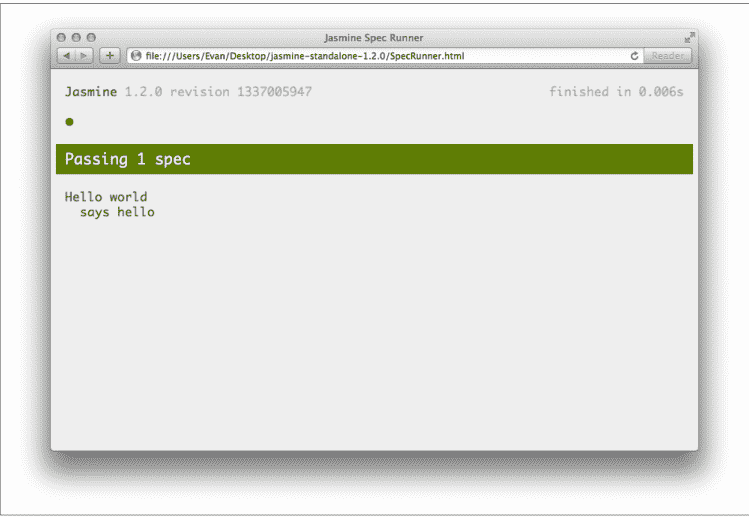
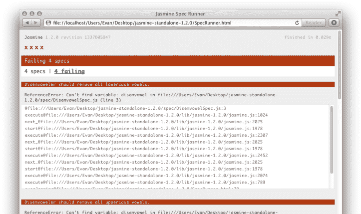
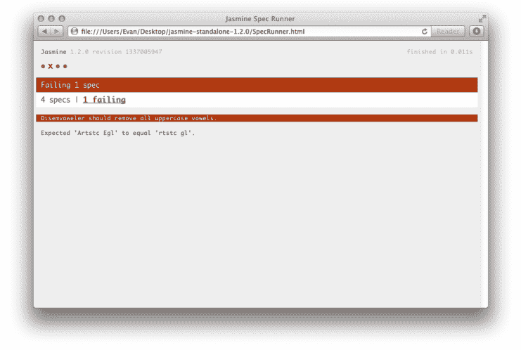
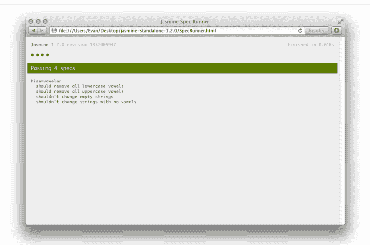

# JavaScript Jasmine 测试

作者：Evan Hahn

## 前言

所有程序员都希望代码按照他们预期的方式运行。Jasmine 是一个流行的 JavaScript 语言框架，可以帮你实现这一目标。在书中，我们将详细探讨 Jasmine，从它的基本概念到高级特性。本书旨在让读者理解测试和测试驱动开发。

## 谁应该读这本书

本书适用于熟悉某些 JavaScript 特性（如闭包和回调）并对 Jasmine 原型系统有一般理解的程序员。如果你对学习编写可靠的代码感兴趣，这本书正适合你。在浏览器或服务器上构建可维护且扩展的 JavaScript 应用时，Jasmine 非常有用。Jasmine 也适用于构建可靠库。

## 使用代码示例

本书是为了帮你完成工作。通常情况下，如果书中包含示例，你可以在程序和文档中使用这些代码。除非你复制大部分代码，否则不需要联系我们许可。例如，编写一个使用了书中几段代码的程序不需要许可。销售或发行 O'Reilly 图书的示例光盘需要许可。通过引用本书并引用示例代码来回答问题不需要许可。将书中大量的示例代码整合到你的产品文档中需要许可。

我们感谢……

## 本书使用的约定

- *斜体* 表示新术语、URL、电子邮件地址、文件名和文件扩展名。
- 等宽字体 用于程序列表，以及在段文中引用程序元素，如变量或函数名、数据库、数据类型、环境变量、语句和关键字。
- ![]( 此图标表示提示、建议或一般性说明。

## 如何联系我们

请将关于本书的意见和问题发送给出版社：

1005 Gravenstein Highway North
Sebastopol, 95472
800-998-9938（在美国或加拿大）
707-829-0515（国际或本地电话）
707-829-0104（传真）

我们为本书准备了一个网页，其中列出了错误列表、示例和任何额外信息。您可以通过 <http://oreil.ly/JS_Jasmine> 访问该页面。

如需对本书发表意见或提问技术问题，请发送邮件至 `bookquestions@oreilly.com`。

更多关于我们书籍、课程、会议和新闻的信息，请参阅我们的网站 <http://www.oreilly.com>。

在 Facebook 上找到我们：<http://facebook.com/oreilly>
在 Twitter 上关注我们：<http://twitter.com/oreillymedia>
在 YouTube 上观看我们：<http://www.youtube.com/oreillymedia>

## 致谢

感谢 RockMelt 邀请我学习 Jasmine。
感谢 Pivotal Labs 创建 Jasmine。
感谢父母一直的支持。

## 第 1 章：测试简介

### 什么是软件测试？

简单来说，你可以根据规范对软件进行测试。

假设你正在编写一个只进行加法的计算器。在开始之前，先思考它的规范应该是什么。它应该能够加正整数。应该能够加负整数。应该能够加小数，而不仅仅是整数。你可以考虑到计算器需要工作的许多不同方式。

在编写任何代码之前，你已经知道你希望它如何运行。你有一份行为规范。

你可以在代码中编写这些规范。你会说“好的，它应该这样工作。”你会编写测试来计算 `1+1`、`2+2`、`-1+5`、`-1.2+6.8`、`0+0` 等。当你运行这些测试时，要么得到成功（它按照规范运行），要么得到失败（不符合规范）。如果你运行所有测试并看到每个都成功，那么你就可以很确定你的计算器工作正常。如果你运行这些测试并发现一些失败，你就知道你的计算器无法工作。

这就是软件测试的本质。你正在根据规范对代码进行测试。有很多工具（其中包括 Jasmine）可以帮助你自动化这些软件测试。

重要的一点是，为每种情况编写测试都是困难的（而且通常是不可能的）。在计算器的示例中，有无限可能的组合。测试时，你应该尝试通过测试许多不同的组（整数、负数、两者的混合等）来涵盖每个合理的情况。你还应该识别边界条件（例如零）和边缘情况，测试尽可能不同的场景。

### 为什么它很有用？

测试之所以有用，有很多原因。

首先，这些测试可以在程序发生更改后评估其正确性。假设所有测试都通过了，然后我想让其中一个函数运行更快。我可以深入研究进行一些更改，并看到它确实更快了。但如果我再次运行测试发现某些失败了，我很快就能发现修改破坏了代码的某些部分。自动化测试让我能在这些错误出现在“真实世界”中之前发现它们。

这些测试还可以作为其他开发者的良好示例。如果一个开发人员试图弄懂如何使用你代码中未文档化的部分，编写良好的测试可以帮助他看到那部分代码是如何工作的。

### 测试驱动开发

一种相对新的软件开发技术被称为测试驱动开发，或 TDD。该过程如下：

1. 为你代码的特定部分编写测试用例。在计算器示例中，你将为加正数、负数、整数等编写测试。你还没有编写计算器，所以所有这些测试都应该失败！
2. 编写你的代码来“填充”测试。你的代码的作用只是让所有测试都通过。
3. 一旦所有测试都通过，返回并清理你的代码（这被称为重构）。

测试驱动开发允许开发者在思路被实现细节困扰之前清晰地思考规范。它还确保了测试始终是有用的。

### 行为驱动开发

通过行为驱动开发（或 BDD），你编写的规范既小又易于阅读。BDD 基本上有两个关键部分：

1. 你的测试必须是微小的。与其测试整个应用程序，不如编写许多微小的测试。在计算器示例中，你为每个部分编写一个测试：一个测试 `0+0`，一个测试 `1+1`，一个测试 `-5+6` 等。
2. 你的测试应该是句子。在计算器示例中，句子看起来像“计算器相加两个整数”。你使用的测试框架（本书中是 Jasmine）应该自动为你完成这一点。

这两个大准则允许你运行测试套件并*精确地*看到哪里出了问题。如果你看到一堆成功但在“计算器加负数”上有一个失败，你就知道该去哪里找了。Dan North 被认为是 BDD 的发明者。

## 第 2 章：Jasmine

### 什么是 Jasmine？

Jasmine 是一个行为驱动的 JavaScript 测试框架。正如你在上一节中所学的，它是你用于测试代码的一系列工具。

### 准备工作

下载 Jasmine 的最新版本并解压它。在本书中，我们主要使用浏览器环境。

### 示例

首先，创建一个简单的函数并测试它的行为。它看起来像这样：

```javascript
function hello() {
  return "Hello world!";
}
```

在浏览器中打开，你会看到图 2-1 的内容。

### Spec Runner

该文件运行一些测试。在 `src` 目录中，你会看到两个东西。

### 使用 `describe`、`it` 和 `expect`

为了学习 Jasmine，让我们编写一些示例代码并测试它。

#### 一个待测试的示例

首先，创建一个简单的函数并测试它。在浏览器中，打开你的 `SpecRunner.html` 文件以包含：

```html
<!-- 在 head 某处放置此代码 -->
<script type="text/javascript" src="src/hello.js"></script>
```

注意，顺序并不重要。

#### Jasmine 时间！

接下来是 Jasmine 部分。准备好物超所值。创建一个包含以下代码的文件：

```javascript
describe("Hello world", function() {
  it("says hello", function() {
    expect(hello()).toEqual("Hello world!");
  });
});
```

如果你在浏览器中运行此规范，你将看到图 2-2 所示的输出。



图 2-2. Hello world 规范

成功！

进入 `hello()` 函数并将其修改为 "Hello world!" 以外的内容。当你再次运行规范时，Jasmine 会报错。这正是你想要的；当你执行了违背意图的操作时，Jasmine 应该提醒你。

## 匹配器

在上一个例子中，你正在检查 `hello()` 是否确实等于 "Hello world!"。你使用了 `toEqual()` 函数，正如前面提到的，它是一个匹配器。它基本上接收了 `expect` 函数的参数（在本例中为 `hello()`），并检查它是否符合匹配器中的某些标准。在之前的示例中，它检查该参数是否等于其他东西。

但如果我们想让它包含 "world" 这个单词，而不在乎里面还有什么内容呢？我们只想让它显示 "world"。轻而易举；我们只需要使用另一个匹配器：`toContain`。看这里：

```javascript
describe("Hello world", function() {
  it("says world", function() {
    expect(helloworld()).toContain("world");
  });
});
```

不再期望某个东西等于 "Hello world!"，现在我只是期望它包含 "world"。它读起来就像英语一样！有很多内置的匹配器，你也可以创建你自己的匹配器。我们将在第 4 章学习如何做到这一点。

## 使用测试驱动开发 (TDD) 先编写测试

Jasmine 可以轻松地测试现有的代码；你先写代码然后对其进行测试。测试驱动开发则相反：你先写测试，然后用代码来“填充”测试。

作为一个例子，让我们尝试使用测试驱动开发 (TDD) 来制作一个“元音删除器”。元音删除器会从字符串中删除所有元音（它假设在这种情况下字母 y 不是元音，而且我们处理的是英语）。我们的元音删除器会做什么（即规范看起来像什么样）？

- 它应该移除所有小写元音。
- 它应该移除所有大写元音。
- 它不应该改变空字符串。
- 它不应该改变没有元音的字符串。

现在，让我们想一些可以测试上述规范的示例：

- 移除所有小写元音："Hello world" 应该变成 "Hll wrld"。
- 移除所有大写元音："Artistic Eagle" 应该变成 "rtstc gl"。
- 不改变空字符串："" 应该保持为 ""
- 不改变没有元音的字符串："Mhmmm" 应该保持为 "Mhmmm"。

Jasmine 让这些规范的代码化变得简单：

```javascript
describe("disemvower", function() {
  it("should remove lowercase vowels", function() {
    expect(disemvowel("Hello world")).toEqual("Hll wrld");
  });
  it("should remove all uppercase vowels", function() {
    expect(disemvowel("Artistic Eagle")).toEqual("rtstc gl");
  });
  it("shouldn't change empty strings", function() {
    expect(disemvowel("")).toEqual("");
  });
  it("shouldn't change strings with no vowels", function() {
    expect(disemvowel("Mhmmm")).toEqual("Mhmmm");
  });
});
```

将此代码保存到 `spec/DisemvowelSpec.js` 并将其包含在 `SpecRunner.html` 中：

```html
<script type="text/javascript" src="spec/DisemvowelSpec.js"></script>
```

如果你刷新规范运行器，你将看到图 2-3 所示的内容。



**图 2-3.** 失败的元音删除规范

所有的规范都失败了！这是预期——你还没有写任何代码，Jasmine 找不到名为 `disemvowel` 的函数。看到测试失败是有帮助的，因为你知道通过这种方式可以防止假阳性。（如果在没有写任何代码的情况下测试通过了，说明出了问题！）

让我们写出元音删除器的第一个版本：

```javascript
function disemvowel(str) {
  return str.replace(/a|e|i|o|u/g, "");
}
```

这段代码使用正则表达式将任何元音替换为空字符串。将其保存到 `src/Disemvowel.js` 并将其添加到规范运行器中：

```html
<script type="text/javascript" src="src/Disemvowel.js"></script>
```

刷新规范运行器，你应该看到类似图 2-4 所示的内容。



图 2-4. 只有一个元音删除规范失败了！

现在不是所有规范都失败，而只有一个在失败。看起来元音删除器没有移除所有大写元音。Jasmine 帮助我们发现问题：我们的第一个版本不会移除任何大写元音。让我们在正则表达式中添加不区分大小写标志 (`i`)：

```javascript
function disemvowel(str) {
    return str.replace(/a|e|i|o|u/gi, "");
}
```

保存它并重新运行规范运行器。看图 2-5。



图 2-5. 我们的元音删除器工作了！

我们的元音删除器工作正常！这是一个使用 TDD 编写代码的简单示例：测试在前，实现在后。

## 第 3 章：编写良好的测试

现在你已经知道如何使用 Jasmine 编写测试。在理论上，你可以为代码编写无限数量的测试，但你没有无限的时间。这是主观的；这些内容并不是绝对真理。这些只是我在与 Jasmine 工作后的一些建议。

### 黄金准则：如有疑问，就测试

如果你不确定是否要测试某个东西，测试它可能没有坏处。作为开发者，如果编写规范需要花费很长时间，你可能需要确保自己真的这样做。如果这会让 Jasmine 运行缓慢（可能它在进行大量的计算），你可能需要重新考虑。通常，规范应该是短小且快速的，所以如果不确定，就去测试！

### 组件

测试代码的各个组件，而不是一次测试所有内容。例如，如果你有一个 `Calculator` 类，你不想这样测试它：

```javascript
describe("calculator addition", function() {
  it("add, subtract, multiply, and divide positive integers", function() {
    var calc = new Calculator();
    expect(calc.add(2, 3)).toEqual(5);
    expect(calc.sub(8, 5)).toEqual(3);
  });
});
```

这个大的规范应该拆分成不同的规范，因为你正在测试不同的部分。这是一个正确的方向：

```javascript
describe("calculator addition", function() {
  beforeEach(function() {
    calc = new Calculator();
  });
  // ... 后续测试
});
```

### 独立性

测试应该相互独立。一个测试的运行不应该影响另一个测试的运行。如果测试之间有依赖，当其中一个失败时，其他测试可能会产生误导性的结果。

### 可读性

测试代码应该易于阅读和理解。使用清晰的命名和结构，使测试意图一目了然。

### 速度

测试应该运行得快。缓慢的测试会拖慢开发流程，导致开发者不愿意频繁运行测试。

## 第 4 章：更多匹配器

Jasmine 有许多内置的匹配器。以下是一些常用的匹配器及其用法。

### `toEqual` 和 `toBe`：相等与相同

`toEqual` 检查两个值是否相等（值相等），而 `toBe` 检查它们是否为同一个对象引用（引用相等）。

```javascript
var spot = { name: "Spot" };
var cosmo = { name: "Spot" };

expect(spot).toEqual(cosmo); // 成功；值相等
expect(spot).toBe(cosmo);    // 失败；不是同一个对象
expect(spot).toBe(spot);     // 成功；同一个对象
```

我们看到，尽管 `spot` 和 `cosmo` 看起来非常相似且相等，但*它们并不是同一个对象*。正因如此，它们的评估结果是*相等*的，而不是相同的。

数组的情况也是如此：

```javascript
var arr = [1, 2, 3];
expect(arr).toEqual([1, 2, 3]); // 成功；等值
expect(arr).toBe([1, 2, 3]);    // 失败；不是同一个数组
```

你可能会发现 `toBe` 适用于基本类型（数字、布尔值、字符串）。这是因为 JavaScript 的 `===` 运算符会将基本类型评估为同一个实体。使用 `toBe` 本质上就是使用 `===` 运算符。

在检查基本类型的等效性时，建议使用 `toEqual`，即使 `toBe` 可以工作。如果你以后决定将一个数字改为数组（例如），使用 `toBe` 可能会破坏你的测试。

关于这种细微差别在 JavaScript 中如何运作的更多信息，请参见视频 "JavaScript Primitive Types vs References Types"。

### 是或否？`toBeTruthy`、`toBeFalsy`

要测试某个值是否评估为真，你使用 `toBeTruthy` 匹配器：

```javascript
expect(true).toBeTruthy();
expect(12).toBeTruthy();
expect({}).toBeTruthy();
```

同样，要测试某个值是否评估为假，你使用 `toBeFalsy`：

```javascript
expect(false).toBeFalsy();
expect(null).toBeFalsy();
expect("").toBeFalsy();
```

注意，Jasmine 对真和假的评估与 JavaScript 是完全相同的。这意味着 `true` 是真的，但 "Hello world"、数字 12 或一个对象也是真的。将所有为假的事物视为假，将其他所有事物视为真是很有用的。

作为参考，这里是 Jasmine 中（以及 JavaScript 中）判定为假的项列表：

- `false`
- `0`
- `""`
- `undefined`（注意变量 `undefined` 并不总是 `undefined`！）
- `null`
- `NaN`

如果你以前没见过 `NaN`，它是一个特殊的数值，代表*不是数字*。它代表了像 `0/0` 这样没有意义的数值。它也会由某些返回数字的函数返回（例如，`parseInt("hello")` 返回 `NaN`，因为它无法正确解析数字）。

如果你想确保某个值是字面上的 `true` 或 `false`，而不是其他任何值，请这样使用 `toEqual` 匹配器：

```javascript
expect(myVariable).toEqual(true);
expect(myOtherVariable).toEqual(false);
```

### 使用 `not` 反转其他匹配器

通过反转 Jasmine 的匹配器来确保它们不是真的，通常非常有用。要做到这一点，只需在匹配器前加上 `.not` 前缀即可：

```javascript
expect(foo).not.toEqual(bar);
expect("Hello planet").not.toContain("world");
```

### 使用 `toContain` 检查元素是否存在

有时你想验证某个元素是否是数组的成员，*某处*。要这样做，你可以使用 `toContain` 匹配器：

```javascript
expect([1, 2, 3, 4]).toContain(3);
expect(["Penguin", "Turtle", "Pig", "Duck"]).toContain("Duck");
```

注意 `toContain` 并不检查数组是否包含*完全相同*的对象，所以下面的示例将成功：

```javascript
var dog = { name: "Fido" };
expect([
  { name: "Spike" },
  { name: "Fido" },
  { name: "Spot" }
]).toContain(dog);
```

`toContain` 匹配器也适用于字符串，正如我们在书的第一个示例中看到的：

```javascript
expect("Hello world").toContain("world");
expect(FavoriteCandy).not.toContain("Almond");
```

### 定义了吗？`toBeDefined`、`toBeUndefined`

```javascript
expect(myVar).toBeDefined();
expect(myOtherVar).toBeUndefined();
```

### `toBeNull`

```javascript
expect(null).toBeNull();
expect(undefined).not.toBeNull();
```

### `toMatch`：正则表达式

```javascript
expect("Hello world").toMatch(/world/);
expect("Hello world").not.toMatch(/planet/);
```

### `toThrow`：异常

```javascript
var fn = function() { throw new Error("oops"); };
expect(fn).toThrow();
expect(fn).toThrow(new Error("oops"));
expect(fn).toThrow("oops");
```

### `toBeCloseTo`：精度比较

```javascript
expect(3.14).toBeCloseTo(3, 0);    // 精度 0 位小数
expect(3.14).toBeCloseTo(3.1, 1);  // 精度 1 位小数
expect(3.14).not.toBeCloseTo(3.2, 1);
```

## 第 5 章：自定义匹配器

如果内置匹配器不能满足你的需求，你可以创建自定义匹配器。

### 一个简单的自定义匹配器

```javascript
beforeEach(function() {
  this.addMatchers({
    toBeLarge: function() {
      this.message = function() {
        return "Expected " + this.actual + " to be large";
      };
      return this.actual > 100;
    }
  });
});
```

这需要对 Jasmine 的构造原理有一定的了解。每个 matcher 都会向 `expect` 函数接收一个参数，对吧？`expect(200)` 将 200 作为它的参数。当我们定义一个新 matcher 时，这个参数在 Jasmine 中就是 `this.actual`；`this.message` 是一个函数，如果 matcher 失败，就是解释性的输出消息。最后，我们返回一个布尔值表示 `actual` 是否大于 100。

现在我们可以在 specs 中执行以下操作：

```javascript
expect(5).toBeLarge();      // 失败
expect(200).toBeLarge();     // 成功
expect(12).not.toBeLarge();   // 成功
```

### 一个更复杂的匹配器

一个更复杂的 matcher 可能想要引入这种语法来替代 `toBeCloseTo`：

```javascript
// Expect 6 to be within 2 of 5 (between 3 and 7, inclusive)
expect(6).toBeWithinOf(2, 5);
```

这个 matcher 将接受两个参数，在其他方面与之前的示例相似：

```javascript
beforeEach(function() {
  this.addMatchers({
    toBeWithinOf: function(distance, base) {
      this.message = function() {
        var lower = base - distance;
        var upper = base + distance;
        return "Expected " + this.actual + " to be between " + 
               lower + " and " + upper + " (inclusive)";
      };
      return Math.abs(this.actual - base) <= distance;
    }
  });
});
```

在这个示例中，我们确保 `this.actual` 距离 `base` 最远距离为 `distance`。`message` 计算了下限和上限，matcher 的结果是一个简单的边界检查。

## 第 6 章：更多 Jasmine 特性

Jasmine 还有许多其他实用的功能，可以帮你编写更高级的测试。

### `beforeEach` 和 `afterEach`

Jasmine 的另一个有用功能实际上是二合一：`beforeEach` 和 `afterEach`。它们允许你在每个 spec 之前和之后——你猜对了——执行某些代码。这对于提取公共代码或在测试后清理变量非常有用。

要在每个 spec 之前执行某些代码，只需将其放在 `beforeEach` 中。注意，你必须正确地划分变量作用域，以便它们在每个 spec 中都可用：

```javascript
describe("employee", function() {
  var employee; // 注意这个变量的作用域。
  beforeEach(function() {
    employee = new Employee();
  });
  it("has a name", function() {
    expect(employee.name).toBeDefined();
  });
  it("has a role", function() {
    expect(employee.role).toBeDefined();
  });
});
```

同样，如果你想在每个 spec 之后执行某些操作，只需将其放入命名得巧妙的 `afterEach` 中。我使用它的频率远比 `beforeEach` 少，但当你想要进行清理时，它很有用，例如：

```javascript
describe("Calculator", function() {
  var calculator = new Calculator();
  afterEach(function() {
    calculator.reset();
  });

  it("can add two positive integers", function() {
    expect(calculator.add(5, 12)).toEqual(17);
  });
  it("can add two negative integers", function() {
    expect(calculator.add(-5, -12)).toEqual(-17);
  });
});
```

### 嵌套 Suites

随着你的代码变得复杂，你可能想要将 suites 组织成组、子组、子子组等。Jasmine 通过简单地嵌套 specs 让你轻松地实现这一点。

在另一个 `describe` 块内部放置一个 `describe` 块，如下：

```javascript
describe("chat", function() {
  describe("buddy list", function() {
    it("shows buddies", function() {
      expect(true).toBeTrue();
    });
  });
  describe("messages", function() {
    it("shows messages", function() {
      expect(true).toBeTrue();
    });
  });
});
```

### 跳过 Specs 和 Suites

当你想要跳过测试而不是注释掉它们时，Jasmine 提供了非常方便的方法。只需在 `it` 或 `describe` 前面加一个 `x` 即可。

```javascript
describe("chat", function() {
  it("this will not run", function() {
    expect(true).toBeTrue();
  });
  xdescribe("this suite will not run", function() {
    it("this spec will also not run", function() {
      expect(true).toBeTrue();
    });
  });
});
```

你还可以使用 `f` 来只运行特定的 spec 或 suite：

```javascript
describe("chat", function() {
  fit("this spec will run", function() {
    expect(true).toBeTrue();
  });
  it("this spec will not run", function() {
    expect(true).toBeTrue();
  });
});
```

## 第 7 章：间谍

间谍是 Jasmine 中最强大的功能之一。它们允许你监控函数调用、参数、返回值等。

### 基本间谍用法

假设你有一个 `Person` 类和一个 `Dictionary` 类：

```javascript
var dictionary = new Dictionary();
var person = new Person();
person.sayHelloWorld(dictionary); // returns "hello world"
```

为了让 `HelloWorld` 函数返回字符串字面量 `hello world`，但你并不想这样做——你想确保你的 `Person` 查询了 `Dictionary`。

间谍会帮助你；你可以监控字典并确保它被使用。方法如下：

```javascript
describe("Person", function() {
  it("uses the dictionary to say hello world", function() {
    var dictionary = new Dictionary();
    spyOn(dictionary, "hello"); // 将 hello 函数替换为间谍
    spyOn(dictionary, "world"); // 将 world 函数替换为另一个间谍
    person.sayHelloWorld(dictionary);
    expect(dictionary.hello).toHaveBeenCalled(); // 如果不先进行 spy，是不可能的
  });
});
```

让我们逐行分析代码。首先，我们创建对象。然后，我们对字典的 `hello` 和 `world` 方法进行 `spyOn`。这基本上是告诉 Jasmine 返回带有间谍的 `dictionary.hello` 和 `dictionary.world`。非常狡猾。然后我们调用 `person.sayHelloWorld` 并确保字典的方法被调用了。

运行此规范，测试运行器应该给你积极的结果；你的程序确实调用了字典的方法。

这为什么有用？假设你决定将字典从英语改为西班牙语：

```javascript
var Dictionary = function() {
  Dictionary.prototype.hello = function() {
    return "hola";
  };
  Dictionary.prototype.world = function() {
    return "mundo";
  };
};
```

虽然 `HelloWorld` 将返回不同的值，但完全相同的规范将会通过，因为无论你使用西班牙语还是英语，字典都会被查询！

好了，也许不止于此。也许你想确保 `person.sayHelloWorld` 是用特定的字典调用的。Jasmine 会成为你的后盾。看看这个示例用例：

```javascript
describe("Person", function() {
  it('uses the dictionary to say "hello world"', function() {
    var dictionary = new Dictionary();
    var person = new Person();
    spyOn(person, "sayHelloWorld"); // 将 sayHelloWorld 函数替换为间谍
    person.sayHelloWorld();
    expect(person.sayHelloWorld).toHaveBeenCalledWith(dictionary);
  });
});
```

由于你可能使用 Jasmine 来编写看起来像英语的代码，这个间谍确保了 `sayHelloWorld()` 的参数是 `dictionary` 而不是其他字典对象。运行 Jasmine，它会告诉你一切正常。

如果你想确保某个内容**没有**被调用，这与确保一个变量**不是**某东西非常相似：使用 `.not`。例如，如果你想确保一个函数没有被用特定的参数调用，你可以这样写：

```javascript
expect(person.sayHelloWorld).not.toHaveBeenCalledWith(dictionary);
```

### 穿透调用：让你的间谍更智能

仅仅使用 `spyOn` 只是会创建一个知道某内容被调用过的间谍函数。

如果你想监控一个函数并确保它正常工作，你可以进行“穿透调用”。这会让间谍更加狡猾。你只需要在间谍调用中添加 `.andCallThrough` 即可：

```javascript
describe("Person", function() {
  it('uses the dictionary to say "hello world"', function() {
    var dictionary = new Dictionary();
    var person = new Person();
    spyOn(dictionary, "hello").andCallThrough(); // 将 hello 函数替换为间谍并穿透调用
    spyOn(dictionary, "world").andCallThrough(); // 将 world 函数替换为另一个间谍并穿透调用

    var result = person.sayHelloWorld(dictionary);
    expect(result).toEqual("hello world"); // 如果不穿透调用是不可能的

    expect(dictionary.hello).toHaveBeenCalled();
    expect(dictionary.world).toHaveBeenCalled();
  });
});
```

这个间谍函数将执行旧函数所做的所有工作，而且它会是一个良好的间谍，并让你看到它的内部运行机制。

### 确保间谍返回特定值

你还可以确保间谍总是返回一个给定值。假设你想让字典的间谍说法语：

```javascript
it("can give a Spanish hello", function() {
  var dictionary = new Dictionary();
  var person = new Person();
  spyOn(dictionary, "hello").andReturn("bonjour"); // 注意这个新部分
  var result = person.sayHelloWorld(dictionary);
  expect(result).toEqual("bonjour");
});
```

如果你想确保尽管函数发生了变化，其他所有内容都能正常工作，那么这就非常有用。

### 用完全不同的间谍替换函数

间谍可以变得更加疯狂。它们可以穿透调用到一个假函数，如下：

```javascript
it("can call a fake function", function() {
  var fakeHello = function() {
    alert("I am a spy!");
    return "hello";
  };
  var dictionary = new Dictionary();
  spyOn(dictionary, "hello").andCallFake(fakeHello);
  dictionary.hello();
});
```

### 创建新的间谍函数

在之前的示例中，我们是在构建替换现有函数的间谍。有时，为尚不存在的函数创建一个间谍是有用的。如果你愿意，可以通过创建一个新的间谍来实现：

```javascript
it("can have a spy", function() {
  var person = new Person();
  person.getName = jasmine.createSpy("getName");
  person.getName();
  expect(person.getName).toHaveBeenCalled();
});
```

### 创建间谍对象

除了创建新的间谍函数，你还可以将其他方法链接到它们上：

```javascript
var tape = jasmine.createSpyObj('tape', ['play', 'stop', 'rewind']);
tape.play.andReturn("James Bond");
tape.rewind.andCallFake(function() {
  alert("I am also a spy!");
  return "Evan";
});
```

这对于测试你的代码是否调用了外部 API 非常有用。

## 第 8 章：与工具一起使用 Jasmine

我已经演示了如何在浏览器中使用 JavaScript 运行 Jasmine，但你不一定得这样做。Jasmine 可以在多种其他环境中运行，并与其他工具配合使用。

### Jasmine 和 CoffeeScript

CoffeeScript 是一种编译为 JavaScript 的语言，它非常漂亮。它让在 JavaScript 中编码变得容易得多，并让你的 Jasmine 代码看起来更好。在 Jasmine 中使用 CoffeeScript 是一个直接的过程，你的规范将会非常漂亮。

如果你还没有使用 CoffeeScript，我强烈建议你使用。如果你熟悉 JavaScript，它很容易学习，并且减少了随 JavaScript 带来的很多烦恼。有些人不喜欢 CoffeeScript——这取决于你是否使用它。如果你想尝试 CoffeeScript，可以去 CoffeeScript.org，那里你可以找到安装说明和文档。

如果你安装了 npm，可以这样安装 CoffeeScript：

```bash
sudo npm install -g coffee-script
```

如果你没有 npm 或者想以不同的方式使用 CoffeeScript，请查看 CoffeeScript 网站。

让 Jasmine 规范在 CoffeeScript 中看起来好看的原因之一是该语言可选的括号。以下两行在 CoffeeScript 中是等价的：

```coffeescript
alert "Hello world!"
alert("Hello world!")
```

这些漂亮吗？由于 Jasmine 的 `describe` 和 `it` 只是函数，你可以编写不需要那么多括号的漂亮规范：

```coffeescript
describe "CoffeeScript specs", ->
  it "is beautiful!", ->
    expect("your code is so beautiful").toBeTruthy()
```

遗憾的是无法移除调用中的括号，但你可以轻松移除其他地方的括号。关于 CoffeeScript 的更多信息，请参考 Alex MacCaw 的 *The Little Book on CoffeeScript*（O'Reilly）。

### Jasmine 和 Node.js

如果你想用 Jasmine 测试你的 Node.js 项目，你可以！你也可以测试浏览器项目。

#### 在 Unix 和 Linux 上安装 `jasmine-node`

首先，你需要安装 `jasmine-node` 包。在终端中输入以下内容：

```bash
sudo npm install -g jasmine-node
```

`-g` 标志将 `jasmine-node` 全局安装在系统中。如果你希望将其保留在项目目录中，去掉该标志。这（可能）意味着你不需要在前面加 `sudo`。

#### 在 Windows 上安装 `jasmine-node`

首先，下载 `jasmine-node` 的 ZIP 包。

解压并将文件夹重命名为 `jasmine-node`。完成后，将其移动到安装 `.exe` 的相同目录中。你就可以运行了！

#### 基础用法

现在你已经安装了 `jasmine-node`！按照如下方式使用它：

```bash
jasmine-node /path/to/project/directory
```

`jasmine-node` 要求你将规范放在名为 `spec` 的目录中，并且该目录下的规范以 `spec.js` 结尾。你也可以将规范放在 `spec` 目录的子目录中。

```javascript
global.hello = function() {
  return 'world';
};
```

一个可能像这样的测试规范：

```javascript
// 包含我们需要包含的内容：这是针对 jasmine-node 特有的
require("../src/test.js");

describe("hello", function() {
  it("returns world", function() {
    expect(hello()).toEqual("world");
  });
});
```

除了你需要调用 `require` 的方法外，这些规范与基于浏览器的 Jasmine 规范完全一样——除了一个异步组件之外。

#### 使用 `jasmine-node` 进行异步测试

异步测试的工作原理与“常规” Jasmine 中相同，但你还可以使用另一种语法：`done` 函数。它会向 `jasmine-node` 信号你的测试规范已经……嗯，完成了。

这里是一个你如何使用它的示例：

```javascript
it("does an asynchronous call", function(done) {
  exampleAsync(function(response) {
    expect(response).toContain("something expected");
    done();
  });
});
```

`done` 函数告诉 `jasmine-node`：“嘿，这是一个处理异步状态的函数。在调用 `done` 之前不要调用它……除非它运行时间太长导致超时（5 秒后）。”你可以通过更改 `jasmine.DEFAULT_TIMEOUT_INTERVAL` 来调整此超时值，如下：

```javascript
// 将默认超时间隔更改为 2 秒
jasmine.DEFAULT_TIMEOUT_INTERVAL = 2000;
```

#### `jasmine-node` 和 CoffeeScript

如果你想在 CoffeeScript 中使用 `jasmine-node`，这是可以的。你需要以 `.spec.coffee` 结尾文件名，然后使用 `--coffee` 标志运行 `jasmine-node`，如下：

```bash
jasmine-node /path/to/project/directory --coffee
```

这就是你需要做的一切！`jasmine-node` 将开始获取 `.spec.coffee` 文件并对其进行正确的测试。

### Jasmine 和 Ruby on Rails

Jasmine 与 Ruby on Rails 配合得很好，允许你测试 JavaScript，而无需不断编辑测试运行器的 HTML 文件。

Jasmine 文档推荐 Ryan Bates 的 RailsCasts 之一作为学习 Jasmine 和 Rails 3+ 的良好方法。我认为这是一个非常棒的资源，如果你感兴趣可以看一看。或者你也可以在这里关注。

#### 安装

首先，你需要将 Jasmine 添加到你的 Gemfile 中，如下：

```ruby
gem "jasmine"
```

接下来，让我们安装：

```bash
bundle install
rails generate jasmine:install
```

#### 使用

现在你一切准备就绪！如果你还没有 `spec` 目录，此过程将创建一个。在里面，有一个 `javascripts` 文件夹。对于这个示例，让我们在 `spec/javascripts` 中创建一个包含此内容的测试测试规范：

```javascript
describe("Jasmine + Rails test", function() {
  it("works", function() {
    expect(true).toBeTruthy();
  });
});
```

将此保存为 `test.spec.js`。

现在，从任何目录运行以下命令：

```bash
rake jasmine
```

运行一会儿后，Jasmine 将告诉你的测试位于 `http://localhost:8888`。在浏览器中访问该地址，你就会看到测试通过了！现在你可以将 `test.spec.js` 修改为你想要测试的内容并继续下去。

如果你想在终端中运行测试，可以通过运行 `rake jasmine:ci` 实现。

如果你有辅助函数（例如 Jasmine 插件），只需将它们放在 `spec/javascripts/helpers` 中，它们就会被自动包含。

### 非 Rails Ruby 中使用 Jasmine

你不需要 Rails 可以在 Ruby 中使用 Jasmine。首先，你需要安装 Jasmine gem。

如果你的项目使用 Bundler，请在 Gemfile 中添加以下内容：

```ruby
gem "jasmine"
```

如果没有，在命令行中运行以下命令：

```bash
gem install jasmine
```

一旦安装了 Jasmine，你就可以这样运行它：

```bash
jasmine init
rake jasmine:ci
```

你应该已经可以运行了！

### 更多工具

有无数方法可以将 Jasmine 集成到你的项目中。我在这里只涵盖了几个，但还有很多。Jasmine wiki 上有一个章节专门介绍如何与 Scala、Java、.NET 等更多框架一起使用 Jasmine。

## 第 9 章：参考

### Web 上的 Jasmine

- 下载 Jasmine
- Jasmine wiki

### 测试套件的基本结构

```javascript
describe("colors", function() {
  describe("red", function() {
    var red;
    beforeEach(function() {
      red = new Color("red");
    });
    afterEach(function() {
      red = null;
    });
    it("has the correct value", function() {
      expect(red.hex).toEqual("FF0000");
    });
  });
  it("makes orange when mixed with yellow", function() {
    var yellow = new Color("yellow");
    var orange = new Color("orange");
    expect(red.mix(yellow)).toEqual(orange);
  });
});
```

### 匹配器参考

- `toEqual`：检查相等性，而不一定是同一个对象。
- `toBe`：检查两个对象是否为同一个对象。
- `toBeTruthy`：检查一个值是否为真（而不仅仅是 `true`）。
- `toBeFalsy`：检查一个值是否为假（而不仅仅是 `false`）。
- `toContain`：检查一个值是否在另一个内部。
- `toBeDefined`：检查一个值是否已定义。
- `toBeUndefined`：检查一个值是否未定义。
- `toBeNull`：检查一个值是否为 `null`。
- `toBeCloseTo`：检查小数接近度。
- `toMatch`：检查一个值是否匹配给定的正则表达式。
- `toThrow`：检查函数是否抛出了错误。
- `.not`：反转后续匹配器的含义。

### 假值列表

- `false`
- `0`
- `""`
- `undefined`（注意：`undefined` 变量并不总是 `undefined`！）
- `null`
- `NaN`

### Jasmine 中的保留字

以下是你不应该在代码中使用的词，以免与 Jasmine 产生冲突：

- `jasmine`（及其命名空间下的所有内容）
- `describe`
- `it`
- `expect`
- `beforeEach`
- `afterEach`
- `runs`
- `waits`
- `waitsFor`
- `spyOn`
- `xdescribe`
- `xit`

当然，这些是在 JavaScript 本身的保留字之外的。

## 关于作者

Evan Hahn 是一位目前就读于密歇根大学的 JavaScript 开发者。他六岁就开始学习 BASIC。高中时期，他是在线报纸的网络管理员，在那里学习了如何使用 PHP、MySQL、JavaScript 和 jQuery 开发网站。他最近在位于旧金山的教育初创公司 UniversityNow 工作。

## 版后

Jasmine 封面上的动物是一只鸴。

图片来自 Johnson's Natural History。封面字体是 Adobe ITC Garamond。正文字体是 Adobe Minion Pro；标题字体是 Adobe Myriad Condensed；代码字体是 Dalton Maag 的 Ubuntu Mono。
