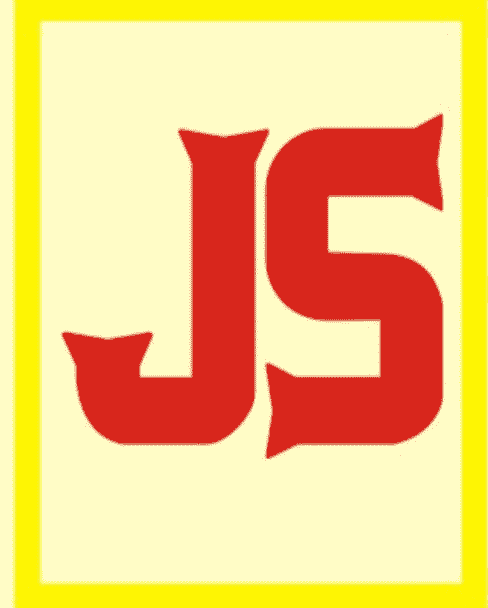
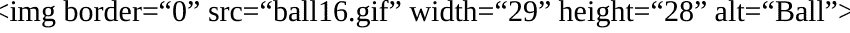

# JavaScript 完全参考（第3版）



作者：

Steven Bright

Steven Bright 的其他著作：

- CorelDraw 教程：CorelDRAW 基础
- 工具与功能列表：工程工具手册
- Microsoft Word 基础：分步指南
- 网页设计与开发技术：网站如何做
- Microsoft PowerPoint 精选：品牌曝光技术
- 攻克 Microsoft Excel 技巧：分步方法
- 变革之浪潮：Adams Aliyu Oshiomihole：为什么他是我们需要的人才，为了创造我们渴望的氛围，建立一个成功、伟大且强大的国家

## 如何使用本书

本书是一份关于 JavaScript 用途（主要用于网站开发）的文档。请遵循分步指南，以充分利用本书的价值。请逐章节阅读，当你读到最后一页时，你会感到很有收获。你需要像 Dreamweaver 这样的网页制作软件或 Notepad++ 这样的网页编辑软件，以及 Google Chrome 和 Mozilla Firefox 等网页浏览器来预览你的工作。

## 引言

JavaScript 是一种脚本语言。它是用于网页、个人电脑、笔记本电脑、平板电脑、手机等的语言。

它用于为 HTML 页面添加交互性，赋予页面某种程度的动态。

脚本语言是一种轻量级的编程语言。它可以被插入到 HTML 页面中，并且是一种解释型语言（也就是说脚本在执行时不需要预先编译）。

脚本可以放在 HTML 文档的 `head` 或 `body` 部分。尽管如此，通常的做法是将脚本放在 `head` 部分，或者位于页面的底部，这样它们就集中在一个地方，且不会干扰页面内容。

当 JavaScript 解释器嵌入网页浏览器中时，结果就是客户端 JavaScript。它将 JavaScript 解释器的脚本能力与网页浏览器定义的文档对象模型 (DOM) 结合起来。客户端 JavaScript 为原本静态的网页添加了某种程度的动态行为。

尽管 JavaScript 和 Java 在外表上有许多强相似之处，包括语言名称、语法和对标准库的支持，但它们是两种不同的语言，在设计上有很大差异。

请注意以下几点：

- JavaScript 代码对大小写敏感
- 单词之间的空格和制表符会被忽略
- JavaScript 语句以分号 (`;`) 结束
- 换行会被忽略，语句内部除外
- 每个单词的首字母大写（第一个单词除外），例如 `userFirstName`
- 要声明变量，使用关键字 `var` 和变量名：`var username`。要给变量赋值，添加等号和值：`var userName = "Smith"`

```
var price = 100
```

## JavaScript 语法

这是一组决定程序员将如何编写语言以及浏览器如何解释语言的规则。

基本语法如下：

```html
<script>
var myDate=new Date();
myDate.setDate((myDate.getDate()));
document.write(myDate)
</script>
```

解释

- `<script>` 标签即 `<script> </script>` 告诉浏览器在它们之间期待一个脚本。
- `<!-- ------>`：这些是普通的 HTML 注释标签，但在 JavaScript 中，它用于告诉不支持 JavaScript 或禁用了 JavaScript 的浏览器忽略之间的代码。这可以防止代码被写入到用户的文档中。
- `Document.write`：这部分负责将实际文本写入用户的浏览器中。
- 将你的脚本放在何处：你可以将脚本放在 `head` 部分、`body` 部分，或者作为外部文件。

## JavaScript 在网页开发中的用途

JavaScript 在网页开发中使用的基本用途是：

1. JavaScript 为 HTML 设计师提供了一个编程工具。
2. JavaScript 可以在 HTML 页面中放入动态文本。
3. JavaScript 可以动态创建页面，例如日期或其他外部数据，它可以生成为用户定制的页面。
4. JavaScript 可以对事件做出响应。
5. JavaScript 可以读取和写入 HTML 元素。
6. JavaScript 可用于验证输入数据。
7. JavaScript 可用于检测访问者的浏览器。
8. JavaScript 可用于创建 Cookie。

## JavaScript 的类型

JavaScript 有两种类型：内部和外部脚本。

### 内联 JavaScript

示例：

```html
<script>
alert("WELCOME!");
</script>
```

### 外部 JavaScript

你使用 `<SCRIPT>` 的 `SRC` 属性来调用外部文件。

### 你可以在何处放置 JavaScript

1. `head` 部分
2. `body` 部分
3. 作为外部文件

## JavaScript 显示方法

JavaScript 可以以不同的方式显示：

- `window.alert()`
- `document.write()`
- `console.log()`
- `innerHTML`

示例：

```html
<p id="demo"></p>
<script>
document.getElementById("demo").innerHTML = 24 + 44;
</script>
```

## 弹出框

JavaScript 有三种类型的弹出框：

- 警告框 (Alert box)
- 确认框 (Confirm box)
- 提示框 (Prompt box)

### 警告框

它用于确保信息传递给用户。当警告框弹出时，用户必须点击 OK 才能继续。

示例：

```html
<script>
alert("WELCOME!");
</script>
```

### 确认框

用于用户想要验证或确认信息。当确认框弹出时，用户必须点击 OK 或 CANCEL 才能继续。

示例 1：

```html
<script>
confirm("BUY");
</script>
```

示例 2：

```html
<script>
var r=confirm("press a button");
if (r==true)
{x="You pressed OK!";
}
else
{x="You pressed cancel!";
}
</script>
```

### 提示框

用于用户在进入页面之前输入一个值。当提示框弹出时，用户在输入值后必须点击 OK 或 CANCEL 继续。

示例：

```html
<script>
prompt("BUY", "YES");
</script>
```

### 弹出框换行

这用于在弹出框内显示换行。通过在值之间插入反斜杠后跟字符 `n` 来实现。

示例：

```html
<script>
alert("Hello\nHow are You?");
</script>
```

## 日期和时间

### 时间

```html
<script>
function time() {
  time=new Date()
  document.write(time.getHours() + ":" + time.getMinutes())
}
</script>
```

上述语法被插入到 `head` 部分，并由插入到 `body` 函数中的 `time` 函数调用，即下方的 `<script>time()</script>`：

欢迎 Sadiku Monday。现在是

```html
<script>
time()
</script>
```

点！

### 日期和时间

Date 对象用于处理日期和时间。Date 对象通过 `Date()` 构造函数创建。

示例：

```html
<script>
var myDate=new Date()
myDate.setDate(myDate.getDate());
document.write(myDate)
</script>
```

上述语法被插入到 `head` 部分，并由插入到 `body` 函数中的 `time` 函数调用，即下方的：

```html
<script>
date()
</script>
```

## 函数

函数是在当被调用时执行执行的代码块。函数写在花括号内，前面带有“function”关键字。

示例：

```html
<script>
function myFunction(name, job)
{
alert("Welcome " + name + ", the " + job);
}
</script>
```

上面是一个函数，当用户点击下方的 `onclick` 事件处理器时它会被调用。

```html
<button onclick="myFunction('Sadiku Monday', 'Engineer')">尝试一下</button>
```

## 事件处理器

整合到 HTML 源代码中并根据特定操作执行预定义函数或命令的命令被称为事件处理器。所有事件处理器都以 `on..` 开头，例如 `onclick`、`onabort`、`onfocus`、`onchange`、`onload`、`onmouseover` 都是事件处理器。

### onload

```html
<script>
function hello(){
alert("Hello World!")
}
</script>
```

上述语法在页面加载时加载一次。

### onclick

```html
<script>
function message(element) {
alert("You clicked the " + element + " element!")
}
</script>
```

上述语法被插入到 `head` 部分，并由插入到 `body` 函数中的 hello 函数调用。

```html
<form>

<input type="radio" name="Radio" onclick="message('Radio Button 1')">选项 1<br>

<input type="radio" name="Radio" onclick="message('Radio Button 2')">选项 2<br>

<input type="checkbox" onclick="message('Check Button')">复选框<br>

<input type="submit" value="Send" onclick="message('Send Button')">

<input type="reset" value="Reset" onclick="message('Reset Button')">

<input type="button" value="Mine" onclick="message('My very own Button')">

</form>
```

### onMouseOver

当用户在下方事件中的图像上悬停鼠标（`onMouseOver`）时告知用户：

```html
<a href="index.html" onmouseover="alert('you onMouseOver the image'); return false">

</a>
```

其他还有：

- `onBlur`
- `onMouseOver`
- `onFocus`
- `onChange`

## 使用 JavaScript 在 HTML 文档中使用颜色

使用 JavaScript，你可以访问 HTML 文档的颜色设置。你可以更改的元素包括文本颜色、背景颜色，以及未访问、已访问和活动状态链接的颜色。

```html
<script>
function color(background, foreground, new_link, visited_link, active_link){
  document.bgColor=background
  document.fgColor=foreground
  document.linkColor=new_link
  document.vlinkColor=visited_link
  document.alinkColor=active_link
}
</script>
```

这是普通文本。

```html
<a href="Page2.htm">我还没有访问过 Page 2。</a><br>
<a href="Page3.htm">但我已经访问过 Page 3。</a><br>
<a href="Page4.htm">我正在点击这个链接。</a><p>
<a href="javascript:color('orange','gray','green','yellow','blue')">改变颜色<|a|>
```

## 重复执行

在每种编程语言中，都有你想反复执行同一个命令。重复执行的命令在几乎每种语言中都是相同的：它们被称为 `for` 和 `while`。在这里你将看到每个命令的示例。

### 使用 For 循环

假设你想发布一个从 1 到 100 的平方数表格，现在你当然可以用口袋计算器计算所有值，然后将它们输入表格，或者你可以调用 JavaScript 来帮助你。对于 JavaScript 变体——所需的源代码要少得多——你需要以下函数：

示例：

```html
<script>
function square(){
for (var i=1; i<=100; i++) {
document.write("<tr><td>");
document.write(i)
document.write("</td><td>");
document.write(i*i)
document.write("</td></tr>");
}
</script>
```

上面的被插入到 `head` 部分并在下方调用：

```html
<script>
square()
</script>
```

### 使用 While 循环

`while` 循环与 `for` 循环非常相似，但它只是运行到给定条件为假。它在你不知道循环应该运行多少次时使用。示例：

```html
<script>
var i = 1;
while (i <= 100) {
document.write(i);
i++;
}
</script>
```

## 数组

Array 对象用于存储多个值。数组从 0 开始。你可以通过索引访问项目。示例：

```html
<script>
var fruits = new Array("Apple", "Banana", "Cherry");
document.write(fruits[0]);
</script>
```

## 阶乘

这用于循环计算数字的阶乘。

```html
<script>
var n = 5;
var fact = 1;
for (var i = 1; i <= n; i++) {
  fact *= i;
}
document.write(fact);
</script>
```

## 事件对象：光标的坐标是什么？

```javascript
<script type="text/javascript">

function show_coords(event) {

x=event.clientX

y=event.clientY
alert("X coords: " + x + ", Y coords: " + y)
}

</script>
```

为了允许用户在页面的任何地方获取光标的坐标，请在 `head` 部分链接调用 `show_coords` 函数：

```html
<body onmousedown="show_coords(event)">
<p>在文档中点击。警告框将显示光标的 x 和 y 坐标。</p>
</body>
```

## 事件对象：按下按键的 Unicode 编码是什么？

```javascript
<script type="text/javascript">

function whichButton(event) {

alert(event.keyCode)
}

</script>
```

使用上述代码，在键盘上按下一个按键。警告框将显示所按按键的 Unicode 编码。

<p>在键盘上按下一个按键。警告框将显示按下按键的 Unicode 编码。</p>

## 事件对象：点击了哪个元素？

```javascript
<script type="text/javascript">

function whichElement(e) {

var targ
if (!e) var e = window.event
if (e.target) targ = e.target
else if (e.srcElement) targ = e.srcElement
if (targ.nodeType == 2) // 修复 Safari  same
targ = targ.parentNode

var tname
tname=targ.tagName
alert("You clicked on a " + tname + " element.")
}
</script>
```

通过在下面的代码调用 `head` 部分中的 `whichElement` 函数可以获取点击的元素：

```html
<body onmousedown="whichElement(event)">
<p>在文档的某处点击。警告框将显示你点击的元素的标签名（tag name）。</p>
</body>
```

### 这是一个标题

<p>这是一个段落</p>



## 鼠标悬停 (IMAGE ROLLVER)

当用户悬停在原始图像上时，这将更改图像。

```html
<A HREF="URL"
onMouseOver="document.hot.src='images/BUTTON 4.jpg"
onMouseOut="document.hot.src='images/BUTTON 5.jpg'>
 </A>
```

## JavaScript 变量

JavaScript 变量是存储数据的容器。这些变量必须按照下面的说明进行赋值：

在这个示例中，m、n 和 p 是变量，m 和 n 将赋予某些值：要给变量赋值，你使用 `var` 变量，使用 `=` 进行赋值，设置值（例如 7），并以分号结束。

示例

- 1. 声明变量

```
var s = 9;
var w = 39;
var person = "Steven Bright";
var price = $2.99;
var pi = 3.14;
```

- 2. m = 9;

```
var n = 23;
var p = m + n;
let p = 9+23 = 32
```

- 3. m = 12;

```
var n = 40;
var p = m - n;
let p = 12-40 = -28
```

注意：m 存储值 9，n 存储值 23，p 存储值 32。

## 构建变量名的规则

构建变量名（唯一标识符）的通用规则如下，在命名你的 JavaScript 变量时请确保注意这些规则：

- 命名可以包含字母、数字、下划线和美元符号。
- 命名必须以字母开头。
- 命名也可以以 `$` 开头。
- 命名区分大小写（y 和 Y 是不同的变量）。
- 保留 word（如 JavaScript 关键字）不能用名称。

## JavaScript 运算符

### JavaScript 算术运算符

这些运算符用于对字面量或变量进行算术运算。以下是各种 JavaScript 算术运算符及其功能：

| 运算符 | 描述 |
| :--- | :--- |
| `+` | 加法 |
| `-` | 减法 |
| `*` | 乘法 |
| `/` | 除法 |
| `%` | 取模 |
| `++` | 自增 |
| `--` | 自减 |

### JavaScript 赋值运算符

这些运算符将值赋予 JavaScript 变量。

运算符及其用途解释

| 运算符 | 用途 |
| :--- | :--- |
| `=` | `x = y` 等于 `x = y` |
| `+=` | `x += y` 等于 `x = x + y` |
| `-=` | `x -= y` 等于 `x = x - y` |
| `*=` | `x *= y` 等于 `x = x * y` |
| `/=` | `x /= y` 等于 `x = x / y` |
| `%=` | `x %= y` 等于 `x = x % y` |

示例

```javascript
var x = 10;
x += 5;
x = x + y same as x = x+y
```

在此情况下 y = 5

因此，

x = 10+5 = 15.

### JavaScript 字符串运算符

这涉及使用 `+` 运算符来相（连接）字符串，即文本。

示例

```javascript
var txt1 = "The";
txt1 += "room";
```

txt1 的结果将是 The room

## 字符串与数字相加

记住，将数字相加将返回字符串。

示例

```javascript
var w = "steven";
w += 5;
```

w 的结果将是 steven5

## JavaScript 布尔值

JavaScript 布尔值表示两个值之一：真或假。这暗示了真实的或不真实的值。

示例

- 1. `Boolean(57>34)` // 返回 true
- 2. `Boolean(45)` // 返回 false

## 比较与条件

在这种情况下，所有“真实的”值都是真，但“不真实的”值都是假。

示例

- 1. `var y = 0;` `Boolean(y);` // 返回 false
- 2. `var y = null;` `Boolean(y);` // 返回 false
- 3. `var y = false;` `Boolean(y);` // 返回 false

## JavaScript Math

Math 对象允许对数字执行数学任务。

### Math.round()

将数字舍入到最接近的整数：

### Math.min()

找到列表中的最小值：

### Math.max()

找到列表中的最大值：

### Math.random()

返回一个 0（包含）到 1（不包含）之间的随机数：

## JavaScript 在网页之外的使用

除了浏览器和服务器，JavaScript 还嵌入在许多其他工具中：

Opera 扩展、Google Chrome、Apple Dashboard、Microsoft 小组件、OpenOffice.org（一个办公套件），此外 Adobe Runtime 是一个允许创建桌面应用程序的 JavaScript 运行时。Mozilla 平台（Firefox 等其他浏览器）使用 JavaScript 实现图形界面（GUI）。GNOME Shell 作为 GNOME 3 桌面环境的外壳也将 JavaScript 作为其默认编程语言。

## JavaScript 结

作为脚本语言，JavaScript 主要用于网页、网页应用和数学项目开发，但也广泛应用于嵌入脚本和应用平台。

感谢阅读我的书。如果你喜欢，能否请在你最喜欢的零售处为我留评价？并告诉你的朋友去他们喜欢的零售处购买。

谢谢！

Steven Bright

作者

## 关于作者

Steven Bright 是一位技术专家、图形设计师、网页开发者和博客作者。他还是以下书籍的作者：

- 《CorelDraw How: The Fundamental of CorelDRAW》
- 《Tools and Function Lists: Engineering Tools Manual》
- 《Microsoft Word Fundamental: A Step by Step Guide》
- 《Web Design and Development Technology: Website How》
- 《The Best of Microsoft PowerPoint: Brand Exposure Techniques》
- 《Hacking Through Microsoft Excel Skills: A Step by Step Approach》
- 《The wave of Change: Adams Aliyu Oshiomhole: Why he is the man we to Create the Atmosphere of Change we Desire to Build a Successful, Great and Powerful Nation》

联系 Steven Bright

Amazon 作者页面：http://amazon.com/author/stevenbright

Facebook: http://www.facebook.com/steven.bright.9022

博客：

- http://ebookstrati.blogspot.com
- http://computerskillworld.blogspot.com
- http://hackingthroughsuccess.blogspot.com
