# JavaScript：完全参考；详解如何使用 JavaScript 开发强大且动态的页面；深度解析 W3C 文档对象模型标准

涵盖所有对象模型，包括 W3C DOM

解释如何使用 JavaScript 开发强大且动态的 Web 页面

深入介绍 W3C 文档对象模型标准

包含最新浏览器的完整对象和语言语法参考

**Thomas Powell**

畅销作家

**Fritz Schneider**

软件工程师

## 关于作者

Thomas Powell (`tpowell@pint.com`) 参与互联网社区已超过十年。在20世纪90年代初，他在南加的首个互联网服务供应商 CERFnet 工作。1994年，他创立了 PINT (`www.pint.com`)，这是一家 Web 开发和咨询公司，为全美许多大型企业提供 Web 服务。

Powell 是多本 Web 开发书籍的作者，包括《HTML: The Complete Reference》、《HTML Programmers Reference》、《Web Design: The Complete Reference》和《Web Site Engineering》。他在行业杂志上撰写了大量关于 Web 技术的文章，并是 Network World 的常驻贡献者。Powell 是 Network World Test Alliance 的成员。

Thomas Powell 在加州大学圣地亚哥分校计算机系教授 Web 发布和开发课程。他还在 UCSD Extension 授课，他和同事在那里创立了 Web 发布计划。他拥有 UCLA（加州大学洛杉矶分校）数学应用科学学士学位和 UCSD 的计算机科学硕士学位。

Fritz Schneider 是一位软件工程师，过去几年来一直从事互联网隐私行业。他拥有丰富的 Web 设计和实现经验，从为 Apache Web 服务器实现自定义代理模块到编写大型 DHTML 和数据库驱动的 Web 网站。

Schneider 曾担任《HTML: The Complete Reference》的技术编辑，并继续担任 HTML、JavaScript 以及通用 Web 设计的讲师。他拥有哥伦比亚大学的计算机工程学士学位，在本书期间，他正处于完成 UCSD 计算机科学硕士学位的阶段。

如需为促销、赠品或筹款活动安排批量购买折扣，请通过上述地址联系 Osborne/McGraw-Hill。如需了解美国外的译本或书籍分销商信息，请参阅本书索引后紧后的"国际联系信息"页面。

本书使用 Corel VENTURA™ Publisher 编写。

Osborne/McGraw-Hill 从认为可靠的来源获取了相关信息。然而，由于我们的来源、Osborne/McGraw-Hill 或其他人员可能出现人为或机械错误，Osborne/McGraw-Hill 不保证任何信息的准确性、充分性或完整性，对于使用此类信息所产生的任何错误或遗漏概不负责。

# 第一部分：引言

# 第二部分：核心语言

# 第三部分：基础客户端 JavaScript

# 第四部分：使用 JavaScript

## 12 控制窗口与框架 ................................................................... 381

## 14 表单处理 ................................................................... 457

# 第六部分：现实中的 JavaScript

## 21 JavaScript 安全 719

## 22 Netscape 扩展与考虑 745

## 23 Internet Explorer 扩展与考虑 759

## 24 JavaScript 实践 ................................................................................................ 803

### 编码风格 .......................................................................................................................... 836

# 第七部分：附录

# 致谢

当你开始写一本"完全参考指南"的致谢时，通常已经对这种写作感到彻底精疲力竭。尽管如此，我还是要向所有帮助我完成写作的人表示感谢。

Melinda (UCSD) 的帮助让《完全参考》系列中的 3000 多页内容变得顺畅。不过，我会尽量不那么啰嗦，不去感谢咖啡因、各种被听烂了的 CD、辣椒热狗，或者任何其他真正技术作家的必需品，而是直接切入主题。

首先，我必须感谢我的合著者 Fritz Schneider。你可能从未想过，担任我在 UCS 的助教竟然会让你帮助编写一本厚书。希望你对这个结果感到自豪，就像我对你感到自豪一样。

其次，再次感谢 Web 开发团队 PINT (`www.pint.com`) 的许多人对本书的制作提供了极大帮助。Cory Dauer、Marcus Richards 和 Reuben Poon 帮我排除了章节中的问题。其他人确保了 PINT 的平稳运行，特别是 Maria Defante、Eric Raether、Jimmy Tam、Rob McFarland、Melinda Serrato、Catleen Ryan 和 Kim Smith。Dan Whitworth 逃避了这本书的大部分工作，但我确定他会回来帮我的。特别感谢 Reuben Poon 提供的额外帮助，尤其是在第 19 章。Mine Okano 在庞大的附录和网站项目方面出了很大功劳，并帮我克服了我的"逗号缺失症"问题。最后，向现在已经增加到几十人的其他 PINT 同事，非常感谢你们所做的一切，是你们让这个地方变得充满乐趣。

我过去 JavaScript 课程的学生们也因提出改进和增强方面的建议而应获得功劳。我非常感谢我最近的学生们带来的新眼光，特别是 Lorraine Chuman、Stuart Baker、Rick Seaman 和 Daisy Bhonsle，他们发现了许多拼写错误和错误。

一如既往，与 Osbourne 的同事们共事非常愉快。Paulina、Tim、Julie 和 Ann 让 Fritz 保持忙碌并获得相应的动力。当然，还有许多人在幕后工作，我向你们表示谢意。

我的朋友和家人应得的关注比他们得到的简短提及多得多，因为当我承担着如此繁重的任务时，他们承担了忍受我的这份辛苦工作。Sylvia，特别是你的微笑让这一切工作都值了。

最后，我必须回想起我的上一本书《HTML：完全参考指南第 3 版》付印的那一天。那是我人生中最悲伤的一天，因为我的父亲 Howard T. Powell 突然离世令我震惊。我一直钦佩他与科学界分享知识的热情，我非常想念他。我没能停下那本书的印刷来增加一段献词，因为我希望在某种意义上，爸爸，您知道这本书是我必须为您而写的。

**Thomas A. Powell**

`tpowell@pint.com`

2001 年 8 月

首先，我想感谢我的合著者 Thomas Powell 在过去几年里提供的支持、信心和明智的建议。他的鼓励和耐心在我担任学生、老师、开发者、编辑和作者的过程中，从无数方面帮助了。一如既往，与 Thomas 共事非常愉快，他是一位可以想象的最乐于助、慷慨且富有见地的合著者。

Powell Internet (`www.pint.com`) 的员工在本书的制作过程中提供了协助和专业知识。我感谢所有人，特别是 Mine Okan 在支持网站和附录方面的帮助，以及 Reuben Poon 对第 19 章的帮助。

Osbourne/McG-Hill 的同事们共事非常愉快。Pauline Pobcha 和 Julie Smith 让我们保持秩序并专注，尽管我们尽力让一切偏离轨道，感谢 Timothy Madrid 和 Ann Sellers。感谢 Osbourne/McG-Hill 的所有人，包括我们的校对编辑。

我个人感谢我所有的朋友、家人和同事在过去六个月里提供的支持。特别是来自 UCSD 的 Daniele Micciciano 在项目期间表现出了神一般的耐心和理解。我的朋友 Tim Stephens、Charles Wood、Pat Wadsworth、Sharif Khaele 和 Alison Hurley 在我需要时总是在那里提供许多笑声。还要感谢 Tom Perkin，我接管了他的办公桌，并在那里埋藏了这类项目所需的电脑、笔记、图表和草稿。最后，感谢各地的音乐人和联合电影制作者，他们为一切计算机相关事物的源头提供了生命之。

**Fritz Schneider**

2001 年 8 月

# 第一部分：引言

# 第一章：JavaScript 简介

## JavaScript：完全参考

JavaScript 是如今 Web 上最领先的客户端脚本语言。它的应用非常广泛，涵盖了从表单数据验证到创建复杂用户界面的各种任务。该语言拥有许多用户尚未发现的能力。很快，JavaScript 将被越来越多地用于包含其自身的 HTML 甚至 XML 文档。当它最终实现这一角色时，它将成为一种一级 Web 技术，与 HTML、CSS 以及最终的 XML 并列。因此，它将成为任何 Web 设计师如果不精通就会失职的语言。本章将简要介绍该语言以及它是如何包含在 Web 页面中的。

### 初探 JavaScript

我们对 JavaScript 的首次观察是广流行的"Hello World"示例。在这个版本中，我们将使用 JavaScript 将字符串"Hello World from JavaScript!"写入 HTML 文档中进行显示：

```html
<!DOCTYPE HTML PUBLIC "-//W3C//DTD HTML 4.01 Transitional//EN">
<html>
<head>
<title>JavaScript Hello World</title>
</head>
<body>
<h1 align="center">First JavaScript</h1>
<hr>
<script language="JavaScript" type="text/javascript">
document.write("Hello World from JavaScript!");
</script>
</body>
</html>
```

注意 JavaScript 如何使用 `<script>` 元素交叉到 HTML 文档中，该元素包裹了简单的单行脚本：

```javascript
document.write("Hello World from JavaScript!");
```

使用 `<script>` 元素允许浏览器区分什么是 JavaScript，哪些是普通文本或 HTML。如果我们使用标准文本编辑器输入此示例，可以将其加载到支持 JavaScript 的 Web 浏览器中——例如 Internet Explorer 3、Netscape 2、Opera 3 或这些浏览器的任何后续版本——我们应该能看到图 1-1 所示的结果。

如果我们想嵌入脚本不仅输出一些文本而且输出一些 HTML。然而，在处理世界时我们需要小心。

**图 1-1.** Internet Explorer 下的"Hello JavaScript World"

JavaScript 与 HTML 世界相交——它们是两种不同的技术。例如，考虑一下如果我们替换文档中的以下 `<script>` 块，并希望它能加粗文本会发生什么：

```html
<script language="JavaScript" type="text/javascript">
<b>
  document.write("Hello World from JavaScript!");
</b>
</script>
```

这样做可能会在我们的浏览器窗口中抛出错误，如图 1-2 所示。其原因是 `<b>` 标签是 HTML 的一部分，而不是 JavaScript。因为浏览器将 `<script>` 标签内的所有内容都视为 JavaScript，因此当它遇到不恰当的内容时，自然会抛出错误。

**图 1-2** JavaScript 错误对话框

遗憾的是，某些浏览器可能不会直接在屏幕上显示错误。这是因为 JavaScript 错误在 Web 上太常见了，导致错误对话框对许多用户来说成了真正的骚扰，因此浏览器厂商默认抑制错误。在 Netscape 4.x 代浏览器中，你可以在 URL 栏中输入 `javascript:` 来查看 JavaScript 控制台。对于 Netscape 6，选择 Tasks 菜单，然后是 Tools 菜单，并启用 JavaScript 控制台。对于 Internet Explorer，你可能需要勾选"显示关于每个脚本错误的通知"，这可以在选择 Internet Options 时显示的对话框的 Advanced 选项卡下找到。实现或不显示错误可能有不同的方法，以正确输出字符串。

无论我们是否直接在输出字符串中包含 `<b>` 元素，例如：

```javascript
document.write("<b>Hello World</b><font>");
```

或者将 `<script>` 元素本身包裹在 `<b>` 元素中，如下所示：

```html
<script language="JavaScript" type="text/javascript">
  document.write("Hello World from JavaScript!");
</script>
```

在这种情况下，`<b>` 标签包裹了 JavaScript 的输出内容，浏览器将其显示为粗体。这个示例暗示了 HTML 和 JavaScript 交叉结合的重要性。事实上，在学习 JavaScript 之前，读者应该完全理解正确 HTML 标记的细微差别，考虑到大多数脚本将用于生成 HTML 标记。在格式不正确的 HTML 文档中使用的任何 JavaScript 可能会产生不可预测的行为，特别是当脚本尝试操作构造良好的 HTML 时。深入理解 HTML 对于编写有效的脚本至关重要。

> 寻找有关正确 HTML 用法的更多信息的读者，应该参考 Thomas Powell 编写的《HTML: The Complete Reference, 3rd Edition》(Osborne/McGraw-Hill, 2001)。

### 在 HTML 文档中添加 JavaScript

如前面的示例所示，`<script>` 元素通常用于向文档添加脚本。然而，有四种标准方法可以在 HTML 文档中包含 JavaScript：

- 在 `<script>` 标签内
- 通过 `<script>` 标签的 `src` 属性作为链接文件
- 在 HTML 事件属性（如 `onclick`）内
- 通过伪 URL 语法：由链接引用

还有其他在页面中包含 JavaScript 的标准方法，最常见的是与语言有关。也可以通过嵌入应用程序来执行 JavaScript，甚至使用它来自动化任务。在 Web 浏览器和 HTML 文档之外使用 JavaScript 极罕见，书中也没有进行详细讨论。然而，第 19 章简要介绍了 JavaScript 的服务端角色。本节介绍了与 HTML 和 JavaScript 的各种方法，在处理书中其余示例之前应仔细研究。

#### `<script>` 元素

在 HTML 中包含 JavaScript 的主要方法是使用 `<script>` 元素。脚本感知浏览器假设 `<script>` 标签内的所有文本都将被解释为某种脚本语言；默认情况下这通常是 JavaScript。

然而，浏览器可能支持其他脚本语言，例如 Internet Explorer 家族支持的 VBScript。传统上，指示使用的脚本语言的方法是指定标签的 `language` 属性。例如：

```html
<script language="JavaScript">
</script>
```

用于将包含的内容解释为 JavaScript。其他值也是可能的；例如：

```html
<script language="VBS">
</script>
```

表示在使用 VBScript。

> 设置 `<script>` 的 `language` 属性要非常小心。值的拼写错误会导致浏览器忽略任何内容。

然而，根据 W3C HTML 语法，应使用 `language` 属性。相反，应该设置 `type` 属性来指示语言的 MIME 类型。JavaScript 的 MIME 类型是 `"text/javascript"`，因此你使用：

```html
<script type="text/javascript">
</script>
```

在实际操作中，`type` 属性不如 `language` 属性常用，后者具有一些其他特性，特别是根据浏览器支持的 JavaScript 版本条件地设置代码（这种技术将在 24 章中讨论并在贯穿书中所示）。为了利用 `language` 属性的实用性同时尊重 `<script>` 元素的标准，使用以下将是一个好主意：

```html
<script language="JavaScript" type="text/javascript">
</script>
```

除了为 `<script>` 使用 `type` 属性外，你还可以通过 `<meta http-equiv="Content-Script-Type" content="text/javascript">` 在整个文档中指定使用的脚本语言。在文档的 `<head>` 元素中包含此语句可以避免在每个 `<script>` 元素上都放置 `type` 属性。然而，浏览器对这种方法的支持并不理想，这建议继续结合使用 `language` 和 `type` 属性来限制脚本执行。

#### 使用 `<script>` 元素

你可以根据需要使用任意数量的 `<script>` 元素。会在执行时被读取和处理，除非脚本执行被推迟到以后。（推迟脚本执行的原因将在后续部分讨论。）接下来的示例展示了三个接继运行的简单打印脚本。

```html
<!DOCTYPE HTML PUBLIC "-//W3C//DTD HTML 4.01 Transitional//EN">
<html>
<head>
<title>JavaScript and Script Tag</title>
</head>
<body>
<h1>Ready start</h1>
<script language="Javascript" type="text/javascript">
  alert("First Script Ran");
</script>
<h2>Running</h2>
<script language="Javascript" type="text/javascript">
  alert("Second Script Ran");
</script>
<h2>Keep running</h2>
<script language="Javascript" type="text/javascript">
  alert("Third Script Ran");
</script>
<h1>Stop</h1>
</body>
</html>
```

在不同的浏览器中尝试此示例，以查看脚本是如何运行的。在某些浏览器中，HTML 会随着脚本的处理而被写出来，而在另一些浏览器中不会。这种差异说明了 JavaScript 的执行模型在不同浏览器之间的不同。

#### `<head>` 中的脚本

`<script>` 元素的特殊位置是 HTML 文档的 `<head>` 标签内。由于 Web 文档的顺序特性，`<head>` 总是先读取，因此脚本倾向于被文档 `<body>` 中的脚本稍后引用。很多时候，文档 `<head>` 中的脚本用于定义稍后可能使用的变量或函数。这里的示例显示了 `<head>` 中的脚本如何定义一个函数，该函数随后由 `<body>` 中 `<script>` 块内的脚本调用。

```html
<!DOCTYPE html public "-//W3C//DTD HTML 4.01 Transitional//EN">
<html>
<head>
<script language="JavaScript" type="text/javascript">
function alertTest() {
  alert("Danger! Danger! JavaScript Ahead");
}
</script>
</head>
<body>
<h2 align="center">Script in the Head</h2>
<hr>
<script language="JavaScript" type="text/javascript">
alertTest();
</script>
</body>
</html>
```

#### 脚本隐藏

在 HTML 中，浏览器倾向于在屏幕上打印它们不理解的任何内容，因此对浏览器屏蔽代码是重要的。实现此点的一种方法是在脚本代码周围使用注释；例如：

```html
<script language="JavaScript" type="text/javascript">
<!--
  put your JavaScript here
-->
</script>
```

**图 1-3** 显示了不支持 JavaScript 的浏览器在未进行屏蔽的情况下查看的网页。

注意当在 Netscape 1.x 等旧版浏览器中屏蔽时，下面的脚本代码是在屏幕上显示而不是执行的。

```javascript
function move1(whichlayer) { layer.eval(whichlayer) if
(tlayer.top>0&&tlayer.top<=5) { tlayer.top=0
setTimeout("move1(tlayer)",3000)
setTimeout("move2(document.main.document.second)",3000) return if
(tlayer.top>=tlayer.document.height-1) { tlayer.top=-2
setTimeout("move1(tlayer)",100) else { tlayer.top=scrollheight
tlayer.document.write(messages[i]) tlayer.document.close() if
(i=messages.length-1) i=0 i++ } function move2(whichlayer)
tlayer2=eval(whichlayer) if (layer2.top>0&&layer2.top<=5)
tlayer2.top=0setTimeout("move2(layer2)",3000)
setTimeout("move1(document.main.document.first)",3000) if
(layer2.top>=layer2.document.height-1) { layer2.top=-2
setTimeout("move2(layer2)",100) else { layer2.top=scrollheight
tlayer2.document.write(messages[i]) tlayer2.document.close() if
(i=messages.length-1) i=0 i++ } function move3(whichdiv)
```

**图 1-3.** JavaScript 代码，未被屏蔽，但打印在屏幕上

> 这种屏蔽技术与用于隐藏 CSS 标记的方法类似，区别在于最后一行必须包含 JavaScript 注释以屏蔽掉 HTML 注释的结束标记。这样做的原因是字符 `-` 和 `>` 在 JavaScript 中有特殊含义。

#### `<noscript>` 元素

当浏览器不支持 JavaScript 时，`<noscript>` 元素可以提供备用消息。下面的示例展示了如何使用它：

```html
<!DOCTYPE html public "-//W3C//DTD HTML 4.01 Transitional//EN">
<html>
<head>
<script language="JavaScript" type="text/javascript">
function alertTest() {
  alert("Danger! Danger! JavaScript Ahead");
}
</script>
</head>
<body>
<h2 align="center">Script in the Head</h2>
<hr>
<script language="JavaScript" type="text/javascript">
alertTest();
</script>
</body>
</html>
```

**图 1-5.** 与用户交互的脚本

当然，许多旧版浏览器（即使是 4.x 版本的）也不会识别许多 HTML 元素（例如段落）的事件处理器。然而，大多数浏览器应该能够理解页面加载和卸载、链接点击、表单填写和鼠标移动等事件。遗憾的是，每个浏览器对事件的支持程度以及处理方式差异很大。书中将通过许多示例说明如何处理事件，关于事件处理的浏览器差异的深入讨论可以在第 11 章中找到。

#### 链接脚本

在 HTML 文档中包含脚本的一种非常重要的方法是通过 `<script>` 元素的 `src` 属性进行链接。这里的示例展示了我们如何将上一个示例中的函数放在链接的 JavaScript 文件中：

```html
<!doctype html public "//W3C//DTD HTML 4.01 Transitional//EN">
<html>
<head>
  <script language="JavaScript" type="text/javascript"
    src="danger.js">
 </script>
</head>
<body>
  <div align="center">
    <form>
      <input type="button" name="TestButton"
        value="Don't push me!"
        onclick="alert(alertTest())">
   </form>
 </div>
</body>
</html>
```

注意 `src` 属性被设置为值 `"danger.js"`。此值是指向外部脚本的 URL 路径。在这种情况下，它在同一个目录下，但也可以很容易地使用绝对 URL，例如 `http://www.javascriptref.com/scripts/danger.js`。无论文件位于何处，它都只包含运行所需的 JavaScript 代码——而不包含 HTML 或其他 Web 技术。因此，在这个示例中，`danger.js` 文件应该包含以下脚本：

```javascript
function alertTest() {
  alert("Danger! Danger!");
}
```

外部脚本文件的好处是它们将页面的逻辑、结构和呈现分离开。使用外部脚本，可以从网站的许多页面轻松引用该脚本，并且只需更新一个文件即可影响许多其他文件。此外，浏览器可以缓存外部脚本，从而通过避免重新获取脚本所需的额外下载时间来有效提高网站访问速度。

考虑将网站中使用的所有脚本放在公共脚本目录中，类似于图像存储在图像目录中。这样做可以确保适当的缓存，保持脚本与内容分离，并为网站建立一个常用代码库。

虽然外部脚本有很多益处，但由于潜在的缺点，它们通常并不被广泛使用。首先，并不是所有支持 JavaScript 的浏览器都支持链接脚本。幸运的是，这个问题主要与旧浏览器有关，特别是 Netscape 2 和某些 Internet Explorer 3。外部脚本的另一个挑战与浏览器加载有关，特别是由用户活动触发的脚本，程序员必须小心，在脚本被下载之前不要允许它们调用，否则可能会显示错误对话框。最后，在使用外部脚本时会出现一些纯粹且简单的错误。幸运的是，外部脚本的大多数问题可以通过书中所示的良好防御性编程风格来缓解。然而，如果顽固的错误无法消失且在使用外部脚本，一个良好的策略是将代码移动到 HTML 文件中。

> 当使用外部 `.js` 文件时，确保你的服务器已设置将 `.js` 文件扩展名映射到 MIME 类型 `text/javascript`。大多数 Web 服务器默认设置了 MIME 类型，但如果你在链接脚本方面遇到问题，这可能是原因所在。

#### JavaScript 伪 URL

在大多数支持 JavaScript 的浏览器中，可以使用 JavaScript 伪 URL 来调用语句。伪 URL 以 `javascript:` 开头，后面跟着要执行的代码。例如，直接在浏览器的地址栏中输入 `javascript: alert('hello')` 会调用此处所示的 alert 框：

在 Netscape 4 和 6 中，可以在 URL 地址栏中直接输入 `javascript:` 来访问 JavaScript 控制台。Netscape 6 还通过任务菜单的"工具"子菜单提供这种访问。其他浏览器可能不提供对控制台的这种直接访问，控制台可以用于调试以及测试脚本的值。JavaScript 控制台的示例见图 1-6。

使用 JavaScript 伪 URL 的一种非常重要的方法是在链接内部使用的，如下所示所示。

```html
<a href="javascript: alert('hello I am a pseudo-URL script')">Click to invoke</a>
```

当用户点击链接时，alert 会被执行，导致此处所示的对话框：

伪 URL 的包含可以用于触发任意数量的 JavaScript，所以：

```html
<a href="javascript: x=5;y=7;alert(x+y);">Click to invoke</a>
```

**图 1-7** JavaScript 实体（Entities）并未被广泛支持

实体看起来可能很有吸引，但较新的 JavaScript 实现已不再建议使用它们。要完成相同类型的任务，请使用 `document.write()` 方法手动输出带有带有属性值的 HTML 元素。这里的代码说明了如何让之前的实体示例在所有浏览器中运行。

```html
<!DOCTYPE HTML PUBLIC "//W3C//DTD HTML 4.0 Transitional//EN">
<html>
<head>
<title>JavaScript Without Entities</title>
<script>
    var bordersize=5;
    var tablecellcolor="#ff0000";
    var alignment="center";

function setImage() {
    var today = new Date();
    var hours = today.getHours();
    if ((hours > 8) && (hours < 18))
        return 'sun.gif';
    else
        return 'moon.gif';
}
</script>
</head>
<body>
<script>
    document.write('<table border='+bordersize+'' align='+alignment+''>');
</script>
<tr>
<script>
    document.write('<td bgcolor='+tablecellcolor+''>JavaScript Without Entities!<\/td>');
</script>
</tr>
</table>
在现在的天空中：
<script>
    document.write('');
</script>
</body>
</html>
```

之前的章节详细阐述了 JavaScript 通常是如何被包含在 HTML 文档中的。现在，在结束本章之前，让我们简要查看一下此类脚本可以做什么。

### JavaScript 应用

作为一种客户端技术，JavaScript 是非常强大的，但与所有语言一样，它能用于的应用类型也有局限性。JavaScript 的一些常见包括：

- 表单验证
- 页面装饰和特殊特效
- 导航系统
- 基础数学计算
- 动态内容生成

从历史角度来看，JavaScript 出现的主要原因是在数据提交到服务器端应用程序（如 CGI 程序）之前进行简单的数据检查。这通常被称为*表单验证*。从诞生以来，JavaScript 的实用性不断增长，现在其主要用途是页面装饰，例如无处不在的*鼠标悬停*（mouseover）按钮以及各种类型的页面动画。这种语言不仅可以用于实现简单的技巧，还被成功用于构建复杂的导航系统，例如下拉菜单或查找列表。此外，该语言还用于基础客户端应用程序，例如贷款计算器和其他对 Web 访问者实用的应用程序。然而，JavaScript 的最终角色将比其简单的操作更为重要，例如根据浏览器版本条件地包含代码或标记，最终它将用于在加载后显著修改页面。这个概念通常被称为动态 HTML，或简称 DHTML。本书的一大重点（特别是第 9 章和第 10 章）将解释 DHTML 和文档对象模型（在下一节讨论）的影响，它们将驱动未来的动态 Web 页面。

虽然可以用 JavaScript 编写完整的应用程序，但大多数程序员会发现该语言的缺陷、浏览器差异和稳定性不适合大型应用程序。记住，它是一种脚本语言，在使用时也应该侧重于此。第 2 章将介绍 JavaScript 在网站中使用的更完整概述，并将其与其他可用的技术（如 CGI、Java 等）进行比较。在结束本章之前，让我们简要回顾 JavaScript 的历史，这有助于我们对该语言为何变成现在这样产生见解。

### JavaScript 历史

研究 JavaScript 的演变对于掌握它的使用至关重要，因为它可以澄清其变更的设计动机，并有助于理解它的奇特性、挑战以及作为一类 Web 技术的潜力。例如，JavaScript 这个名字本身可能会让人困惑，除非你考虑它的历史；尽管名称相似，但 JavaScript 与 Java 几乎没有关系。Netscape 最初在 1995 年 Navigator 2.0 的早期 Beta 版本中以 LiveScript 的名称引入了这种语言。该语言很可能重命名为 JavaScript 是因为当时行业对所有与 Java 相关事物的痴迷，以及两种语言集成以构建 Web 应用程序的潜力。遗憾的是，由于其脚本中包含了"Java"一词，它经常被认为是 Java 的某种削减形式。事实上，如今的语言与 Java 有些相似，在语法上，它通常与 C 或 Perl 等语言有更多共同之处。

虽然该语言的名称给用户带来了困惑，但它被浏览器厂商广泛采用。在 Netscape 在其浏览器 2.0 版本中引入 JavaScript 后，微软在 Internet Explorer 3.0 中引入了名为 JScript 的 JavaScript 克隆版本。Opera 也在其浏览器的 3.x 代中引入了 JavaScript。其他浏览器（包括 WebView）也支持不同版本的 JavaScript。随着时间的推移，每个浏览器厂商对该语言都有自己的扩展，并且浏览器各自支持不同版本的 JavaScript 或 Script。表 1-1 列出了支持 JavaScript 语言的常用浏览器。书中贯穿讨论了每个版本 JavaScript 的各种特性。由于 JavaScript 规范变化迅速，且跨平台支持并不一致，你应该谨慎地使用这种语言。由于最新的 JavaScript 浏览器提供了完全或接近完全的支持，名称本身指的就是 JavaScript。

| 浏览器版本 | JavaScript |
| :--- | :--- |
| Netscape 2.x | 1.0 |
| Netscape 3.x | 1.1 |
| Netscape 4.04-4.05 | 1.2 |
| Netscape 4.06-4.08, 4.5x, 4.6x, 4.7x | 1.3 |
| Netscape 6.x | 1.5 |
| Internet Explorer 3.0 | 1.0 |
| Internet Explorer 4.0 | 3.0 |
| Internet Explorer 5.0 | 5.0 |
| Internet Explorer 5.5 | 5.5 |
| Internet Explorer 6 | 5.6* |

\*编写时仍为推测，可能会重命名为 6.0。

尽管 ECMAScript 的出现，使用 JavaScript 仍然具有挑战性。ECMAScript 主要关注定义通用语句（如 `if`、`while` 等）以及主要的数据类型。JavaScript 通常访问一组与浏览器相关的对象，如 `window`、`navigator`、`history`、`screen` 等。这些对象的集合通常被称为*浏览器对象模型*，简称 BOM。所有浏览器版本往往有一套不同的 BOM 对象，而且浏览器的每个新版本似乎包含新的对象和属性。

幸运的是，万维网联盟（W3C）介入定义了脚本用于标准化的访问和操作页面组件的各种对象和接口。这一规范被称为*文档对象模型*，简称 DOM。在 BOM 和 DOM 之间存在某些交叉，但幸好在较新的浏览器中，这些差异正在被解决。关于 DOM 的更多信息可以在 `http://www.w3.org/DOM` 以及第 1 章中找到。

结合起来，ECMAScript 规范的核心 JavaScript、浏览器对象和文档对象将提供 JavaScript 程序员通常需要的设施。遗憾的是，除了核心语言外，所有各种对象这些实现在不同的浏览器和版本之间似乎有所不同，使得编写正确的跨浏览器代码是一项真正的挑战！本书的大部分内容将用于解决这些困难。

### 总结

JavaScript 已经迅速成为 Web 页面内最流行的客户端脚本语言。该语言的成功很大程度上归功于开发者可以轻松上手。`<script>` 元素使得在 HTML 文档中直接包含 JavaScript 代码变得简单；然而，某些浏览器可能需要使用注释和 `<noscript>` 元素来避免错误。可以使用链接脚本来进一步将页面的标记与可能操作页面的脚本分离。虽然引入脚本很容易，但 JavaScript 面临的挑战是重重的。浏览器对该语言的支持并不一致，且其动荡的历史导致了许多不兼容问题。然而，希望依然存在。随着 ECMAScript 和 W3C 指定文档对象模型（DOM）的兴起，许多使 JavaScript 在不同浏览器中运行所需的编码技术可能不再是必要的。

# 第二章：JavaScript 核心特性——概述

## JavaScript：完全参考

脚本语言是一种用于操作、自定义或自动化现有系统功能的语言。在 JavaScript 的情况下，该系统是 Web 浏览器及其相关的 HTML、CSS 和 XML 技术。JavaScript 是一种通过浏览器展示功能的机制。由于 Web 浏览器是宿主环境，它提供了许多让 JavaScript 执行有用任务的功能。正因如此，尽管 JavaScript 提供了一些强大的功能，但语言本身的结构相对简单。JavaScript 的大部分力量源于浏览器提供的内置对象和文档对象。

本章介绍的 JavaScript 特性包括你必须遵守的语法规则，以及用于存储数据和管理流控制的基本结构。一旦你理解了基本的语言机制，就可以相对独立地处理更高级的特性，而不会陷入无数细节中。C、C++ 和 Java 程序员会发现 JavaScript 的语法非常熟悉，并应该能够快速学会其更高级的特性。

本章是介绍性的，旨在对所有 JavaScript 核心特性提供一个快速的概述。大多数主题将在随后的章节中进行更深入的探讨。由于这部分材料对老练的程序员来说是熟悉的，有相关经验的人可能希望略过本章。

### 基础定义

具有共同兴趣或目标的大群人至少会完成一件事：开发出一套术语。在与计算机工作很一段时间后，人们不禁注意到软件工程师特别喜欢他们用来交流编程思想的语言。用于讨论编程语言的术语提供了一套技术词汇，通过它可以清晰、简洁地交流特定的思想。

在这里我们介绍一些贯穿全的编程语言术语。表 2-1 为那些通常被模糊理解的概念提供了精确的定义。

### 脚本执行顺序

HTML 文档中的 JavaScript 代码是按照其在页面中的顺序逐行解释的。这意味着，如果函数定义和变量声明将在整个页面中使用，那么将它们放在文档头部（用 `<head> ...</head>` 标签括起来）是一个好主意。某些语句（例如带有事件处理程序的语句）不会立即执行。

| 名称 | 定义 | 示例 |
| --- | --- | --- |
| 标记 (Token) | 语言中最小不可分割的词法单元。连续字符序列，如果被空格分隔，其含义将改变。 | 所有标识符和标记，作为字面量的关键字如 `3.14` 和 `"This is a string,"` |
| 字面量 (Literal) | 直接在脚本中找到的值。 | `3.14`, `"This is a string,"`, `[2, 4, 6]` |
| 标识符 (Identifier) | 变量、对象、函数或标签的。 | `x`, `myValue`, `userName` |
| 运算符 (Operator) | 执行赋值、加法和减法等内置操作的标记。 | `=`, `+`, `-`, `*` |
| 表达式 (Expression) | 一组标记（通常是字面量或标识符），结合运算符后可以求出一个特定值。 | `2.0`, `"(x+2)*4` |
| 语句 (Statement) | 指令性命令。语句通常会导致执行环境状态（变量、定义或执行流）发生。程序仅仅是语句列表。 | `x = x + 2;` `return(true);` `if (x) { alert("It's x"); }` |
| 关键字 (Keyword) | 语言本身的一部分单词。关键字不能作为标识符使用。 | `while`, `do`, `function`, `var` |
| 保留字 (Reserved Word) | 可能成为语言本身一部分单词。保留字不能作为标识符，尽管这种限制有时会被严格执行。 | |

**表 2-1.** 编程语言基础术语

### 大小写敏感

JavaScript 是区分大小写的。这意味着大写字母与其小写字母是不同的。例如，如果你在脚本中使用标识符 `result`、`Result` 和 `RESULT`，每个标识符都指向一个单独的、不同的变量。大小写敏感适用于语言的所有方面：关键字、运算符、变量名、事件处理程序、对象属性等。所有 JavaScript 关键字都是小写的，在使用诸如 `if` 语句这样的功能时，你需要确保使用的是 `if` 而不是 `If` 或 `IF`。由于 JavaScript 使用"驼峰式"（camel-case）命名规范，许多方法和属性使用了混合大小写。例如，Object 的 `lastModified` 属性名称中的 `M` 必须是大写字母；使用小写的 `m` 将检索到一个未定义的值。

大小写敏感的主要影响是，在定义和访问变量时、在使用如 `if` 和 `while` 等语言结构时、以及访问对象属性时，你应该注意大写字母。这可能会改变整个脚本的含义，并需要大量的调试工作。

JavaScript 大写敏感的一个异常是 Internet Explorer 3。在这个特定的浏览器中，客户端对象和属性是不区分大小写的。这个异常对于你现在编写的脚本不会产生问题。它仅仅意味着某些依赖 Internet Explorer 不区分大小写的旧脚本在现代浏览器中可能无法运行。

#### HTML 与大小写敏感

JavaScript 通常嵌入 HTML 的这一事实会导致某些混乱。在 HTML 4 及之前的版本中，元素和属性名称是不区分大小写的。例如，以下两个标签是等价的：

```html


```

这不是本身。问题在于程序员看到 HTML 事件处理程序以不同的方式引用（例如上例中的 `ONCLICK` 和 `onClick`），并假设在 JavaScript 中也可以以类似的方式访问它们。事实并非如此。JavaScript 中对应的事件处理程序是 `onclick`，且必须始终这样引用。HTML 中之所以可以使用 `ONCLICK` 和 `onClick`，是因为浏览器会自动将它们绑定到正确的 JavaScript 事件处理程序。

为了说明这种区别，请考虑以下**不等价**的标签：

```html


```

它们不等价的原因是第一个修改的是变量 `x`，而第二个修改的是 `X`。由于 JavaScript 是区分大小写的，这些是两个不同的变量。

这说明了 HTML 属性的一个重要方面：虽然属性名是不区分大小写的，可以写成 `onclick`、`ONCLICK` 或 `onClick`。然而，由于 `onclick` 属性的值被设置为 JavaScript，你必须记住它是区分大小写的。

XHTML 是 W3C 对 HTML 推出的新推荐标准，它要求元素名和属性名必须使用小写字母。XHTML 直接解决了这个问题，这也是为什么我们强烈建议将嵌入脚本的 HTML 标签和属性（尤其是事件处理程序）转为小写。尽管旧版本的 HTML 形式在未来很长一段时间内无疑会在 Web 上存在，但跟进 W3C 的建议通常是一个好主意。

### 空格

空白字符是指那些在屏幕上占据空间但没有任何视觉表示的字符。示例包括普通空格、制表符和换行符。JavaScript 会忽略任何连续的空白字符。例如：

```javascript
x = x + 1;
```

等同于：

```javascript
x=x+1;
```

这表明空格的使用更多是为了程序员的方便，而不是解释器的需要。事实上，深思熟虑地使用空格来对齐注释、循环内容和声明，可以使代码更具可读性并可能更容易理解。

> 由于 JavaScript 对空格的模糊态度以及大多数 Web 用户对下载速度缓慢的焦虑，某些 JavaScript 程序员选择通过移除多余的空白字符来"压缩脚本"。这种做法通常被称为压缩（crunching）。压缩可以手动进行，也可以使用工具完成。压缩的价值存疑。除非脚本巨大，否则压缩可能不会导致页面加载时间发生用户能明显察觉到的变化。
>
> 如果使用了空格压缩，它应该只应用于交付的代码，而不应应用于源代码，否则为程序员保留空格所带来的益处就消失了。然而，这样做会导致代码管理问题，因为你现在必须处理多个份几乎相同的代码片段。此外，正如下一个示例所示，空白移除的自动化操作始终需要谨慎进行。

如果标记（tokens）之间的含义明确，它们之间的空格可以省略。例如：

```javascript
x=x+1;
```

它不包含空格，但因为其含义清晰，是可以接受的。然而，除了简单的算术函数外，大多数其他操作都需要空格来指示所需的含义。考虑以下内容：

```javascript
s = typeof x;
s = typeoffx;
```

第一条语句对变量 `x` 调用 `typeof` 运算符并将结果放在 `s` 中。第二条语句将名为 `typeoffx` 的变量的值复制到 `s` 中。一个空格就改变了整个语句的含义。

作为原则，JavaScript 会忽略空格——但也有例外。一种是在字符串中。任何在单引号或双引号内的字符串中，空格都会被保留：

```javascript
var s = "This   spacing is preserved";
```

经验丰富的程序员可能会想，如果直接在字符串中包含换行会发生什么。答案涉及空格和 JavaScript 的另一个微妙之处：隐式分号。

### 语句

语句是像 JavaScript 这样的语言的本质。它们是让解释器执行特定动作的指令。最常见的语句之一是赋值。赋值使用运算符并将右侧的值放入左侧的变量中。例如：

```javascript
x = y + 10;
```

将 10 加到 `y` 并将结果放在 `x` 中。赋值运算符不应与"等于"比较运算符 `==` 混淆，后者用于条件表达式（在本章稍后部分讨论）。编程语言中语句的一个关键问题是指示它们如何终止和分组。

#### 分号

分号表示一个 JavaScript 语句的结束。例如，你可以通过分号将多个语句组合在同一行：

```javascript
x = x + 1; y = y + 1; z = 0;
```

你也可以在同一行内包含更复杂甚至是空的语句：

```javascript
x = x + 1; if (x > 10) { x = 0; }; y = y - 1;
```

这个示例递增了 `x`，跳过了两个空语句，在 `x` 大于 10 时将 `x` 设置为 0，而且在一行内包含多条语句是相当笨拙的，应该避免。虽然语句后面通常跟着分号，但如果你的语句之间用换行符分隔，分号是可以省略的，例如：

```javascript
x = x + 1
y = y - 1
```

被处理为：

```javascript
x = x + 1;
y = y - 1;
```

当然，如果你想在同一行包含两个语句，则必须包含一个分号来分隔它们：

```javascript
x = x + 1; y = y - 1
```

隐式分号插入的正式规则比你愿意相信的描述要复杂得多。在理论上，单个语句的标记可以用换行符分隔而不会引起错误。然而，如果没有分号的一行标记组成了一个完整的 JavaScript 语句，那么即使下一行可以被合理视为第一行的扩展，也会插入一个分号。经典的例子是 `return` 语句。由于 `return` 的参数是可选的，将 `return` 及其参数放在不同的行会导致 `return` 在没有参数的情况下执行。例如：

```javascript
return
x
```

被处理为：

```javascript
return;
x;
```

而不是可能预期的图：

```javascript
return x;
```

因此，依赖隐式分号插入是一个坏主意，也是应该避免的糟糕编程风格。

#### 块

大括号 `{}` 用于将语句分组。在某种意义上，你可以认为大括号创建了一个语句。例如，组成函数体的语句包含在大括号中：

```javascript
function add(x, y)
{
  var result = x + y;
  return result;
}
```

如果要在条件或循环的结果执行多个语句，语句以类似的方式分组：

```javascript
if (x > 10)
{
  x = 0;
  y = 10;
}
```

无论如何分组，语句通常需要修改数据，数据通常以变量的形式存在。

### 变量

每个变量存储数据。每个变量都有一个名称，称为标识符。JavaScript 使用 `var` 声明变量，该关键字为新数据分配存储空间并指示解释器有一个新的标识符。声明变量很简单：

```javascript
var x;
```

该语句告诉解释器变量 `x` 即将被使用。可以在声明时为变量赋值值：

```javascript
var x = 2;
```

此外，如果变量用逗号分隔，可以使用一个 `var` 语句声明多个变量：

```javascript
var x, y = 2, z;
```

你不应该在先声明的情况下使用变量，尽管在某些情况下可以。在赋值的右侧使用未定义的变量会导致错误。

经验丰富的程序员注意到，与 C、C++ 和 Java 不同，JavaScript 只有一种声明变量的方法。这突显了 JavaScript 处理变量类型的方式与许多语言（包括 C、C++ 和 Java）本质不同。

### 基本数据类型

每个变量都有一个数据类型，指示变量持有的数据类型。JavaScript 的基本数据类型是字符串、数字和布尔。字符串是字符列表，字符串字面量通过将字符包含在单引号或双引号内指示。字符串可以包含单个或多个字符，包括空格和特殊字符（如 `\n` 换行）。数字是整数或浮点数值，数字字面量以自然的方式指定。布尔值取两个值之一：`true` 或 `false`。布尔字面量通过直接在源代码中使用 `true` 或 `false` 来标出。以下是所有三种数据类型的示例。

```javascript
var stringData = "JavaScript has strings\n It does";
var numericData = 3.14;
var booleanData = true;
```

JavaScript 还支持另外两种基本类型：`undefined` 和 `null`。所有这些数据类型以及特殊字符的细节将在第 3 章中讨论。然而，在这一概述中，应该简要提到 JavaScript 数据类型的一个方面：弱类型。

#### 弱类型

JavaScript 与你可能熟悉的其他语言之间的一个主要区别是，JavaScript 是*弱类型的*。每个 JavaScript 变量都有数据类型，但该类型是根据变量的内容推断出来的。被赋值为字符串值的变量可以动态地更改其类型。JavaScript 自动类型推断的结果是，变量在某一点可以持有字符串，稍后被赋值为布尔值。它的类型根据其所持的数据而改变。这解释了为什么 JavaScript 中只有一种声明变量的方法：在变量声明中没有需要指示类型。

弱类型对于 JavaScript 来说既是福也是也是诅咒。虽然弱类型似乎让程序员不再需要预先声明类型，但这样做是以引入微妙错误为代价的。例如，给定以下操作各种字符串和数字值的脚本，我们看到类型转换导致了潜在的歧义

```javascript
document.write(4*3);
document.write("<br>");
document.write("5" + 5);
document.write("<br>");
document.write("5" - 3);
document.write("<br>");
document.write(5 * "5");
```

此示例包含在 HTML 文档中的输出所示：

注意在加法的情况下，结果是字符串"55"而不是数字 10，而在其他示例中，字符串在输出之前被转换成了数字。加法不起作用的原因是加号具有两种含义，既作为加法，也作为字符串拼接。这类问题在 JavaScript 中很常见，将在第 3 章和第 4 章中讨论。通常情况下，有许多方法（如 `parseFloat()`）在 JavaScript 中可预测地转换数据，甚至可以使用 `typeof` 运算符检查变量的值。例如：

```javascript
var x = "55"
alert (typeof x);
```

正确地识别 `x` 为字符串值，如下所示：

### 复合类型

与原始类型不同，复合类型由异构数据组成。它们可以包括字符串、数字、布尔值、`undefined` 值、`null` 值甚至其他复合类型。JavaScript 支持三种复合类型：对象、数组和函数。

- 对象
- 数组
- 函数

在随后的章节中，你会发现数组和函数实际上是特殊种的对象，但我们将忽略 JavaScript 面向对象方面的细微差别，目前涵盖基础知识。

#### 数组

数组是归类在单个标识符下的有序值集合。创建数组有很多方法，但简单的方法是像标准标识符一样定义它，然后在括号内对值分组。以下语句定义了一个具有四个数值的数组

```javascript
var myArray = [1,5,68,3];
```

数组可以包含任意的数据项，因此如下的定义

```javascript
var myArray = ["Thomas", true, 3, -47.6, "x"];
```

也是有效的。

在语法上，更符合其作为对象传统的传统的定义数组的方法是使用 `new` 关键字调用 Array 对象的构造函数，所示：

```javascript
var myArray = new Array();
```

这将 `myArray` 定义为没有特定长度的数组。我们可以通过传递单个数值来轻松地预确定数组的长度。例如，

```javascript
var myArray = new Array(4);
```

定义了一个长度为 4 的数组。我们甚至可以使用显式构造函数语法来填充数组，所示：

```javascript
var myArray = new Array(1,5,"Thomas", true);
```

无论如何定义，数组元素的访问方式都是相同的。要引用数组的特定部分，必须在括号内提供索引，如下：

```javascript
var myArray = new Array(1,5,"Thomas", true);
var x = myArray[2];
var y = myArray[0];
```

`x` 的值将是字符串"Thomas"而不是数字 5，而 `y` 将设置为数字 1。这是因为 JavaScript 中的数组索引从 0 开始。接下来的脚本显示了数组的定义以及使用值的赋值。

```javascript
var myArray = new Array(4);
myArray[0] = 1;
myArray[1] = 5;
myArray[2] = "Thomas";
myArray[3] = true;
```

如简要提到的，数组实际上是对象，并有许多用于操作它们的属性和方法。这些特性将在以后讨论。

#### 对象

对象可以持有任何类型的数据，是分组信息的主要机制。例如，你可以创建一个具有几个属性的对象：

```javascript
var person = {
  name: "John",
  age: 30
};
```

可以使用点表示法访问属性：

```javascript
console.log(person.name);
```

对象还可以有方法，即作为对象属性的：

```javascript
person.greet = function() {
  console.log("Hello, my name is " + this.name);
};
person.greet();
```

```javascript
x = y + 2;
x = y - 1;
x = y * x;
x = y % 4;
```

在这个示例中，`x` 首先被赋值为 -3，然后是 8，接着是 5，然后是 36，然后是 2，最后一次一次。可能引起混淆的唯一基础运算符是模运算符。该运算符计算第一个操作数除以第二个操作数后得到的整数余数。例如，在上一个示例的最后一行，`y` 的值为 6，`6 % 4` 的结果被赋值给 `x`。

JavaScript 还提供了位运算符，例如 `&`（与）、`|`（或）、`^`（异或）、`~`（按位取反）、`<<`（左移）、`>>`（右移）。虽然位运算符对某些 C 程序员来说很熟悉，但考虑到 JavaScript 的高级语言特性，它们似乎有些格格不入。然而，为了使用现代浏览器提供的某些高级功能，偶尔仍需要用到它们。

为了比较对象，JavaScript 提供了一组丰富的关系运算符，包括 `==`（等于）、`!=`（不等于）、`<`（小于）、`>`（大于）、`<=`（小于或等于）和 `>=`（大于或等于）。在表达式中使用关系运算符会导致表达式在条件成立时评估为 `true`，否则评估为 `false`。因此：

```javascript
5 < 10
```

评估结果为 `true`，而

```javascript
11 < 10
```

评估结果为 `false`。

程序员应该非常小心 `=` 和 `==` 的含义。前者是赋值运算符，而后者是条件比较运算符。在 JavaScript 程序中，混合使用两者是最常见的错误之一。例如：

```javascript
x = 5;
```

是给 `x` 赋值一个值，而

```javascript
x == 5;
```

是比较 `x` 的值与字面量 5。当这些运算符在 `if` 语句中被误用时，就会产生令人沮丧的 bug。

一旦执行了比较，就可以使用逻辑运算符 `&&`（与）、`||`（或）和 `!`（非）来创建更复杂的条件。例如：

```javascript
if ((x >= 10) && (y < 3))
{
  z = z + 1;
}
```

如果 `x` 大于或等于 10 且 `y` 小于 3，则 `z` 加 1。

考虑到值增和减值的实用性，JavaScript 与其他语言一样提供了一种简写符号。`++` 运算符将值加 1，而 `--` 则减 1。因此，通过

```javascript
var x=4;
x++;
```

执行结束时，`x` 的值为 5。

> `++` 或 `--` 运算符放置在值之前或之后，其效果存在细微差别，这在第 4 章中会讨论。

一个非常有用的运算符是字符串运算符 (`+`)，它用于拼接字符串。运行以下脚本：

```javascript
document.write("JavaScript is " + "great.");
```

在此处输出拼接后的字符串：

当使用该运算符将字符串变量连接到 HTML 时，可以创建更复杂的输出。

```javascript
var myName="Thomas";
document.write("Hello "+myName+"/");
```

### 运算符优先级

在使用运算符时，我们必须小心评估顺序。由于不同运算符的优先级可能高于其他运算符，评估顺序可能不符合预期。例如，考虑以下情况：

```javascript
var x = 4 + 5 * 8;
```

`x` 的值设置为 72 还是 44？答案是 44，因为乘法运算符的优先级高于加法。我们可以使用括号对表达式分组并强制以某种方式执行。因此，为了让示例将 `x` 设置为 72，我们会使用

```javascript
var x = (4+5)*8;
```

虽然这个例子非常简单，但有时执行顺序会更加模糊，因此在不确定时添加括号。所有形式运算符的细微之处将在第 4 章的第一部分进行讨论。

### 流程控制

语句按照它们在脚本中出现的顺序执行。为了创建有用的程序，通常需要使用流程控制，即控制程序执行"流"的代码。JavaScript 支持类似 `if/else`、`switch/case` 语句等条件语句，允许选择性地执行代码段。`if/else` 语句的示例：

```javascript
if (x > 10) {
  x = 0;
} else {
  x = x + 1;
}
```

评估 `if` 语句的条件，如果比较为真且大于 10，则将 `x` 设置为零。否则，`x` 加 1。注意，你可以在没有相应的 `else` 的使用 `if` 语句，也可以在 `else` 语句中使用多个 `if` 语句。这可能会让 `if` 语句变得不必要的混乱，因此 `switch` 语句可能更合适；与其使用大量的 `if` 语句，我们可以使用一个带有多个 `case` 语句的单一 `switch`，如下所示：

```javascript
var x=3;
switch (x) {
  case 1: alert('x is 1');
    break;
  case 2: alert('x is 2');
    break;
  case 3: alert('x is 3');
    break;
  case 4: alert('x is 4');
    break;
  default: alert('x is 5');
}
```

`break` 语句会提前退出循环，而 `continue` 语句将跳回到循环条件检查。

### 循环

通常需要迭代某些语句直到条件为真。例如，你可能希望对数组的每个元素执行相同的操作。像许多语言一样，JavaScript 通过循环来实现这一点。JavaScript 支持 `while`、`do/while`、`for` 和 `for/in`。`while` 循环的示例：

```javascript
var x=0;
while (x < 10) {
  document.write(x);
  document.write("<br>");
  x = x + 1;
}
document.write("Done");
```

在 `x < 10` 为真时增加 `x`。一旦 `x` 达到 10，条件为假，因此循环终止，执行从循环后的第一个语句继续，如下：

`do/while` 循环与 `while` 循环相似，不同之处在于条件发生在循环结束处。这意味着除非先遇到 `break` 语句，否则循环至少执行一次。

```javascript
var x=0;
do{
  document.write(x);
  x = x + 1;
} while (x < 10);
```

用 `for` 循环编写的相同循环稍微紧凑，因为它将循环变量、条件检查和增量设置在同一行中，如下：

```javascript
for (x=0; x < 10; x++)
{
  document.write(x);
}
```

`for` 循环的一种变体是 `for/in` 结构。该结构允许我们遍历对象的各种属性。例如，我们可以使用 `for/in` 语句遍历并打印浏览器 `window` 对象的属性：

```javascript
for (var aprop in window)
{
  document.write(apro)
  document.write("<br>");
}
```

有经验的程序员应该欢迎这种熟悉的语句，对于其他人来说，这在后续章节对象的的背景下会有意义。

### 循环控制

JavaScript 还支持通常用于修改流程控制的语句，特别是 `break` 和 `continue`。这些语句的作用与 C 中的对应结构相似，并且通常与循环配合使用。`break` 语句会提前退出循环，而 `continue` 语句将跳回到循环条件检查。

不打印值的情况下继续循环。当 `x` 等于 5 时，使用 `break` 语句退出循环。

```javascript
var x=0;
while (x < 10) {
    x = x + 1;
    if (x == 3) {
        document.write("x = "+x);
    }
    if (x == 5) {
        break;
    }
}
document.write("Loop done");
```

包括流程控制和循环在内的所有语句形式将在第 4 章中详细讨论。

### 函数

函数用于封装执行特定任务的代码。有时，会为常用的所需的任务定义函数，以避免重复输入相同的语句。更通俗地说，它们被用于将执行特定作业的代码保持在一个地方，以增强可重用性和程序的可读性。JavaScript 函数使用 `function` 关键字声明，执行其操作的语句列在大括号中列。函数参数列在函数名后的括号中，并用逗号隔开。例如：

```javascript
function add(x, y) {
    var sum = x + y;
    return sum;
}
```

此代码声明了一个名为 `add` 的函数，它将参数相加并"返回"结果值。`return` 语句告诉解释器函数求值的结果。例如，你可以将函数的值赋给变量：

```javascript
var result = add(2, 3);
```

参数 2 和 3 被传递给函数，执行函数体，它们的相加结果 5 被存放在变量 `result` 中。

除了向函数传递字面量外，也可以传递变量。例如：

```javascript
var a = 3, b = 5;
var result;
result = add(a,b);
```

经验丰富的程序员可能会问，是否可以修改传递函数的变量值。答案更像是一个建议：不要。JavaScript 对原始数据类型支持按值传递的概念，因此无论 `add` 函数中发生了什么，变量 `a` 和 `b` 的值都保持不变。然而，其他数据类型（特别是对象）在传递时是可以改变的，许多程序员使用全局定义的变量来绕过 JavaScript 的按值传递限制，这仅仅是糟糕的编程习惯。

如果你在其他语言中编写过程序，你会发现函数被各种称为过程、子程序和方法。JavaScript 中的"方法"术指的是包含在对象中的函数。正如你所看到的，第 5 章将详细讨论的函数是非常强大的。

### JavaScript 中的输入和输出

执行输入和输出（I/O）的能力是大多数语言不可或缺的一部分。由于 JavaScript 在 Web 浏览器等宿环境中执行，其 I/O set 可能与你预期的不同。出于明显的安全考虑，纯客户端 JavaScript 通常不允许读取或写入本地文件系统中的文件。虽然有例外，但这些高级得多，将在后面的章节中讨论。

I/O 与 JavaScript 中大多数有用任务一样，通过浏览器提供的对象执行。与用户的交互通常通过 `Window` 对象实现，这里描述了它的几种方法。JavaScript 中最常用的 I/O 方法之一是使用 Window 的 `alert()` 方法，它会在包含 OK 按钮的对话框中显示其参数消息。例如：

```javascript
alert("This is an important message!");
```

向用户展示以下对话框：

与其他用户交互的对话形式还包括 `confirm()` 方法，它会在包含 OK 和取消按钮的对话框中显示其参数消息。使用以下脚本：

```javascript
confirm("Learn JavaScript?");
```

你应该看到以下窗口：

最后，我们可以使用 `prompt()` 方法从用户处收集某些数据。`prompt` 在对话框中显示其参数消息并允许用户向文本字段中输入数据，如示例所示。

```javascript
var answer = prompt("What is your favorite color?");
```


# JavaScript：完全参考

尽管之前的所有方法都是 `Window` 对象的一部分，但你会注意到我们没有写 `window.alert("hello")` 而是直接写 `alert("hello")`。这种简写表示法的有效性是 JavaScript 对象作用域规则的结果，这些规则将在第 6 章中讨论。

## Document 对象交互

另一种常见的交互形式是通过 `Document` 对象。该对象提供了许多操作 Web 页的方法，最简单的是 `write()` 和 `writeln()` 方法。`write()` 方法将其参数写入当前文档。`writeln()` 方法与之相同，不同在于它在写入参数后插入一个换行符。例如：

```javascript
document.write("This text is not followed by a linebreak.");
document.writeln("However this uses writeln().");
document.write("So a newline was inserted.");
```

你尝试此示例时可能没有发现任何差异的原因是，JavaScript 输出到 HTML。回想第 1 章，这两种语言之间的交集会让程序员感到沮丧。HTML 会折叠所有换行符，因此新的换行对输出不会产生任何影响。这可能解释了为什么大多数 JavaScript 程序员倾向于使用 `document.write()` 而不是 `document.write` 和 `document.writeln()`。为了显示差异，你可以在示例周围使用 `<pre>` 标签，如下：

```html
<!DOCTYPE HTML PUBLIC "//W3C//DTD HTML 4.01 Transitional//EN">
<html>
<head>
<title>Write/Writeln Example</title>
</head>
<body>
<pre>
<script>
document.write("This text is not followed by a linebreak. ");
document.writeln("However this uses writeln().");
document.write("So a newline was inserted.");
</script>
</pre>
</body>
</html>
```

此示例在 HTML 中正确使用时的结果可以在图 2-1 所示。

除了 `write()` 和 `writeln()` 之外，`Document` 对象还提供了通过文档对象模型（DOM）操作 HTML 和 XML 的强大功能。DOM 主要在第 10 章中涵盖，用于替换文本、更改格式以及向 HTML 写入或读取。

## 正则表达式

JavaScript 的最后一个功能特性是正则表达式。由 `RegExp` 定义的正则表达式用于处理模式匹配。

```javascript
var country = new RegExp("English");
```

也可以使用直接赋值来定义：

```javascript
var country = /English/;
```

一旦定义了正则表达式，我们就可以用它进行模式匹配并可能更改字符串。下面的简单示例匹配变量 `geographicLocation` 中的字符串部分并将其替换另一个：

```javascript
var country = new RegExp("England");
var geographicLocation = "New England";
document.write("Destination for work: " + geographicLocation + "<br>");
geographicLocation = geographicLocation.replace(country, "Zealand");
document.write("Destination for vacation: " + geographicLocation);
```

*将 England 替换为 Zealand。*

此脚本的结果所示：


JavaScript 对正则表达式的实现非常强大，与 Perl 非常相似，因此许多程序员应该立即熟悉 JavaScript 的正则表达式功能。关于正则表达式的更多信息可以在第 8 章找到。

## 注释

最后，良好编程风格的一个非常重要的方面是为代码添加注释。注释允许你直接在源代码中插入备注和评论，使其对你和其他人来说易读。你包含的任何注释都会被 JavaScript 解释器忽略。

JavaScript 中的注释与 C++ 和 Java 中的注释相似。有两种类型的注释：到当前行结束的注释和跨越多行的注释。单行注释以双斜杠（`//`）开头，导致解释器忽略从该点到行尾的所有内容。例如：

```javascript
var count = 10; // 存储用户想要解析的项目数量
```

跨越多行的注释以 C 风格封装在斜杠星号（`/*`）和星号斜杠（`*/`）对之间。下面的示例说明了这两种注释：

```javascript
/* square 函数期望一个数值参数并返回平方值。
例如，要对 10 平方并将值放在变量 y 中，如下所示调用：
var y = square(10);
此函数应只用数值参数调用！
*/
function square(x) {
  return x * x; // 将 x 乘以 x，并返回该值
}
```

位于 `/*` 和 `*/` 之间的所有内容都会被解释器忽略。请注意，你不能嵌套多行注释。这样做会导致错误：

```javascript
/* These are
 * nested comments and will
 */
definitely cause an error; */
```

注释对于编写良好的代码有多么重要，这一点再怎么强调都不为过。注释应该提供从代码本身无法直接看出的信息。例如，为你定义的每个函数包含注释总是一种良好的习惯，详细说明函数期望的值、它执行的操作、可能产生的副作用以及它返回的值。复杂的语句或循环应该始终被注释，你创建的供自己使用的任何对象也应如是。此外，每个脚本都应该包含一段介绍性注释，以说明其目的以及代码中包含的任何已知 Bug 或问题。

注释让代码更易理解。大多数程序员最噩梦的就是被分配去修复或维护大段且没有注释的代码。通过在你编写的代码中包含你的逻辑和推理，你可以为你的继任者节省数小时的工作。专业程序员总是会对他们的代码进行注释，特别是在 Web 这样瞬息万变的环境中。

注释也能让你自己更容易理解代码。任何编写过较长时间软件的人都可以告诉你，他们曾在某次回到自己写的一段旧代码时，感到完全困惑。你永远无法记住当时任务的细节和细微差别。仅仅为了你自己，也请务必在你的脚本中包含注释。

## 总结

本章简要介绍了 JavaScript 的基本特性，JavaScript 是一种简单但强大的面向 Web 的脚本语言，通常托管在 Web 浏览器中。该语言的大部分特性与 C 或 Java 等其他语言相似。语言中包含了常见的编程结构，如语句、`while` 循环和函数。然而，JavaScript 并不是一种简单的语言，它包含了更高级的特性，例如复合数据类型、对象和正则表达式。JavaScript 最重要的部分是其对象的使用，包括用户创建的和内置对象（如 `Window`、`Navigator` 和 `Document`）。本书的大部分内容将用于这些对象的使用。经验丰富的程序员可能希望快速浏览接下来的几章，关注 JavaScript 与其他编程语言之间的微妙差异。然而，新程序员应该仔细阅读接下来的五章，以建立坚实的基础。下一章将关注 JavaScript 的数据类型，如果程序员足够仔细，这可以简化脚本的编写。

# 第 3 章：数据类型与变量

## 基础概念

变量可以被认为是一个存储数据的容器。每个变量通过一个标识符识别，即一个指向容器的名称，并允许程序访问和操作其包含的数据。字面量是直接出现在源代码中的数据，即不包含在变量中的数据。变量或字面量的类型描述了数据的性质。例如，JavaScript 中字面量 `3.14` 的类型是数字，而 `"First Name"` 的类型是字符串。

当你声明变量时，你告诉解释器分配空间来存储数据。变量使用 `var` 关键字加上你想要声明的变量名来声明。在使用之前声明变量是良好的编程习惯，但 JavaScript 允许通过在赋值左侧使用变量来实现隐式声明。许多程序员在编码时使用隐式声明来节省时间。然而，没有变量声明而写的脚本比使用显式声明的脚本难读得多。隐式声明的问题不仅仅是风格问题；我们将在本章后面看到隐式声明如何导致涉及变量作用域的微妙错误。

以下示例说明了基本的变量声明：

```javascript
var pi = 3.14;
pi = "The ratio of a circle's circumference to its diameter";
```

第一行声明了一个标识符为 `"pi"` 的新（空）变量。第二行将数字 `3.14` 放在 `pi` 所指的容器中。第三行通过给定的字符串字面量替换 `pi` 的当前内容。`3.14` 的类型是数字。字符串字面量的类型是字符串。`pi` 的类型改变了！因为它最初是空的，所以 `pi` 开始是 `undefined`。当第二行给它赋值一个数字时，它的类型变为数字。当第三行给它赋值一个字符串时，它的类型转变为字符串。这个示例说明了 JavaScript 的一个非常重要的方面，被称为“弱类型”。

## 弱类型

大多数高级语言（包括 C 和 Java）都是强类型的。也就是说，变量在使用之前必须进行声明，并且在声明中必须包含其类型。一旦声明了变量，其类型就不能改变。在光谱的另一端是像 LISP 这样的无类型语言。LISP 只支持原始数据类型：原子和列表。它不区分字符串、整数和其他数据类型进行任何区别。作为一种弱类型语言，JavaScript 介于这些极端之间。每个变量和字面量都有类型，但没有显式声明类型。类型从上下文推断，变量会自动获取其包含的数据类型。这一特性允许程序员给同一个变量先赋值一个数字，随后赋值另一个。在 C 或 Java 中这样做会导致错误（在某些情况下是警告）。类型转换将在本章稍后部分详细介绍。


## 原始类型

JavaScript 支持五种原始数据类型：数字、字符串、Boolean、`undefined` 和 `null`。被称为原始类型是因为它们是构建复杂类型的基石。在这五种中，只有数字、字符串和 Boolean 是存储数据意义上的真实数据类型。`undefined` 和 `null` 是在特殊情况下产生的类型。

### 数字

与 C 和 Java 等语言不同，JavaScript 中的数字类型包含了整数和浮点值。所有数字都采用 IEEE 754-1985 双精度浮点格式表示。这种表示法长度为 64 位，允许浮点数高达 ±1.797×10³⁸，最小至 ±2.225×10⁻³⁰⁸。JavaScript 实现应该能够处理高达 2⁵³ 的整数，简单的实验表明并非总是如此。原因是出于效率，通常认为整数的有效范围是 -2147483648 到 2147483647（等同于 -2³¹ 到 2³¹）。关于这些表示法的更多细节可以在本节末尾找到。

JavaScript 中的数字由数字组成，可选地由一个小数点、更多数字以及可选的指数组成。指数用字母 `e`（不区分大小写）指定，后面跟着一个可选的符号值和数字。在整个数字前加上负号也是允许的，尽管严格来说它是一个元运算符，但它可以被视为数字本身的一部分。

根据 ECMA-262 语法，数字有以下三种形式之一（括号表示可选组件）：

- `DecimalDigits.(DecimalDigits)(Exponent)`
- `.DecimalDigits(Exponent)`
- `DecimalDigits(Exponent)`

根据此语法，以下所有内容都是有效数字：

- `+- 10`
- `-2.71`
- `.33333e77`
- `-1.7E12`
- `3.E-5`
- `128e+100`

而以下内容*不是*有效数字：

- `+- 2,717`
- `22e100.5`
- `128e5e10`
- `e10`

注意，你*不应该*在数字中包含前导零。这是由于 JavaScript 还允许使用 10（十进制）以外的进制来指定数字字面量。前导零告诉 JavaScript 该字面量是 10 以外的基数。

### 十六进制字面量

几乎所有的编程语言都允许以十六进制（16进制）提供数字字面量。JavaScript 也不例外。这种语法对于有编程经验的读者来说应该是熟悉的：一个前导零，后面跟着 `x`，然后是一个或多个十六进制数字。十六进制数字是数字零到 9 以及字母 A 到 F，它们代表从零到十五的值。无论是初始的 `0x` 还是十六进制数字 A 到 F，都不区分大小写，尽管按照惯例，大多数程序员将 A 到 F 写为大写，将 `x` 写为小写。以下是合法的十六进制值的示例：

```javascript
0x
0xF800
0x1a3C5e7
```

小数字面量中可选的指数和小数数字不用于十六进制表示。

### 八进制字面量

虽然不是 ECMA-262 规范正式的一部分，但几乎所有的 JavaScript 实现都允许八进制（8进制）数字字面量。八进制字面量以前导零开头，由一个或多个八进制数字组成。八进制数字是数字 0 到 7。以下都是有效的八进制字面量：

```javascript
0
0777
024513600
```

与十六进制字面量一样，八进制表示法不允许使用指数和小数位。

> Opera 浏览器的 JavaScript 实现（即使到版本 5）也不支持八进制。未来的版本可能会支持这种数据类型，但程序员在使用八进制值时应该注意这种差异。

### 特殊值

数值数据还可以取若干个特殊值。当数值表达式或变量超过了最大可表示正值时，它将取最小的可表示负值 `Infinity`。同样，当表达式或变量变得更小时，它将取值 `-Infinity`。这些值具有“粘性”，因为当在与其他普通值或自身一起的表达式中使用其中一个时，它会导致整个表达式求值为该值。例如，`Infinity` 减 100 仍然是 `Infinity`；它不会变成一个可表示的数字。所有的 `Infinity` 值彼此相等。同样，`-Infinity` 值也相等。

获取 `Infinity` 值的更简单方法是将 1 除以零，以下代码演示了当增加最大可表示正值时会发生什么。

```javascript
var x = 1.797693134862357e308; // 将 x 设置为最大值
x = x + 1e308;
```

### 字符串

字符串是由零个或多个字符组成的序列。字符串字面量由单引号或双引号界定。例如：

```javascript
var myName = "Thomas";
```

从字符串中提取字符是使用 `String` 对象的 `charAt()` 方法。例如，假设有一个字符串 `"myName"`：

```javascript
var myName = "Thomas";
```

你可以使用以下代码提取第三个字母的值：

```javascript
var thirdletter = myName.charAt(2);
```

使用值 2 而不是 3 的原因为字符串的索引是从 0 开始的。关于数组及其与对象交集的这方面的更深入的讨论将在本章后后部分进行。

除了读取和设置字符串外，还有一些属性可以被读取；例如，使用之前的字符串 `"myName"`，通过如下脚本：

```javascript
var strlen = myName.length;
```

这会将变量 `"strlen"` 的值设置为字符串的长度，在这种情况下值为 6。此外还有许多方法可以操作字符串。所有这些字符串特定的特性（除接下来将讨论的数据类型问题外）将在第 7 章中详细介绍。

### 特殊字符与字符串

任何字母、数字或标点字符都可以放在字符串中，但存在一些天然的局限性。例如，换行字符是导致输出在显示器上向下移动一行的字符。直接通过回车键将此输入字符串中将导致如下的字符串字面量：

```javascript
var myString = "This is the first line.
This is the second line.";
```

根据 JavaScript 的隐式分号规则，这将导致语法错误。为了解决这个问题，JavaScript 像大多数其他编程语言一样使用了转义代码。转义代码（也称为转义序列）是以反斜杠（`\`）开头的短段文本，对解释器具有特殊含义。转义代码允许你在不直接将特殊字符输入字符串的情况下包含这些特殊字符。例如，换行符的转义代码是 `\n`。使用此转义代码，我们可以正确定义之前看到的字符串字面量：

```javascript
var myString = "This is the first line.\nThis is the second line.";
```

这个示例还说明了转义代码的一个重要特性：即使它们与其他字符紧邻出现（例如示例中的 `"` 和 `"T`），它们也能被正确解释。表 3-2 显示了支持的转义代码列表。

#### 字符表示

转义代码表说明 JavaScript 支持两种不同的字符集。目前的 JavaScript 实现支持 Unicode 字符集，它包含了地球上每种语言中的几乎每一个打印字符。Netscape 6 和 Internet Explorer 4 之前的浏览器版本使用 Latin-1 (ISO-8859-1)，它是 Unicode 的子集。ECMA-262 规定使用 Unicode。这种区别对于大多数用户是透明的，但在非英语环境中可能会引起问题。除非你有特定理由使用 Latin-1，否则强烈建议使用 Unicode 转义代码。

| 转义代码 | 值 |
| --- | --- |
| `\b` | 退格 (backspace) |
| `\t` | 制表符 (水平) |
| `\n` | 换行 (newline) |
| `\v` | 制表符 (垂直) |
| `\f` | 页 (form feed) |
| `\r` | 回车 (carriage return) |
| `\"` | 双引号 |
| `\'` | 单引号 |
| `\\` | 斜杠 |
| `\OOO` | 由八进制数字 OOO 表示的 Latin-1 字符。有效范围为 000 到 377。 |
| `\xHH` | 由十六进制数字 HH 表示的 Latin-1 字符。有效范围为 00 到 FF。 |
| `\uHHHH` | 由十六进制数字 HHHH 表示的 Unicode 字符。 |

**表 3-2.** 转义代码

以下示例将包含字母 B 的字符串赋值给变量。字符串之间的唯一区别在于表示字符时使用的字符集（也就是说，它们彼此相等）：

```javascript
var inLatinOctal = "\102";
var inLatinHex = "\x42";
var inUnicode = "\u0042";
```

关于字符集和 Web 技术的更多信息可以在 http://www.unicode.org 和 http://www.w3.org 找到。

### 引号与字符串

注意，单引号和双引号都有转义代码。如果你的字符串是用双引号界定的，那么其中的任何双引号都必须转义。同样，单引号界定的字符串中的任何单引号也必须转义。原因很简单：如果引号不转义，JavaScript 将错误地将其解释为字符串的结束。以下是字符串内部有效转义引号的示例：

```javascript
var string1 = "These quotes \"are\" valid";
var string2 = 'Isn\'t JavaScript great?';
```

以下字符串是无效的：

```javascript
var invalid1 = "This will not work!
var invalid2 = 'Neither will this';",
```

### 字符串与 HTML

字符串可以使用单引号或双引号界定，这在考虑到 JavaScript 通常位于 `onclick` 等 HTML 属性内部时非常有用。这些属性是用引号括的，因此 JavaScript 字符串引号的灵活性允许程序员避免转义大量引号的繁琐任务。以下 HTML 表单说明了这一原理：

```html
<input type="button" onclick="document.write('Thanks for clicking!')">
```

在 `document.write` 中使用未转义的双引号会导致浏览器将第一个此类引号解释为 `onclick` 属性值的结束。

接下来是一个使用转义代码和引号的典型示例。请注意，`document.write` 方法将参数字符串写入浏览器窗口，但不会在文本后自动插入换行符。HTML 会自动将多个空白字符“合并”为一个空白字符。因此，例如，HTML 中多个连续的制表符只显示为一个空格字符。例如，`<pre>` 标签用于告诉浏览器文本是预格式化的，它不应该合并其内部的空白。使用 `<pre>` 允许示例中的制表符在输出中显示。结果见图 3-1。

```html
<!DOCTYPE HTML PUBLIC "//W3C//DTD HTML 4.01 Transitional//EN"
"http://www.w3.org/TR/html4/loose.dtd">
<html>
<head>
<title>String Example</title>
</head>
<body>
<pre>
<script language="JavaScript" type="text/javascript">
<!--
document.write("Welcome to Javascript strings.\n");
document.write("This example illustrates nested quotes 'like this.'\n");
document.write("How newlines (\n) and \");");
document.write("escape sequences are used.\n");
document.write("You might wonder, \"Will this work?\"\n");
document.write("It will.\n");
document.write("Here's an example of some data:\n");
document.write("Code\n");
document.write("newline\n");
document.write("\\backslash\n");
document.write("\\\"double quote\n");
// -->
</script>
</pre>
</body>
</html>
```


欢迎学习 JavaScript 字符串。
此示例说明了嵌套引号'像这样.'。注意如何使用换行符 '\n' 和转义序列。
你可能会想，“这会起作用吗？”会的。
这里是一些数据的示例：

| \n | newline |
| \\ | backslash |
| \" | double quote |

**图 3-1.** 说明转义代码和引号的字符串输出

### 布尔值

布尔值源于乔治·布尔（George Boole），这位 19 世纪的逻辑学家开发了真/假逻辑系统，数字电路后来便基于该系统。布尔值有两个值：`true` 或 `false`。如下的比较表达式 `x <= y` 根据比较结果为真还是假假设一个布尔值。因此，控制结构（如 `if/else` 语句）的条件是隐式的布尔。条件会被求值并替换为布尔结果。例如：

```javascript
if (x == y) {
    x = x + 1;
}
```

如果比较 `x` 等 `y` 为真，则增加 `x`。你可以显式地使用布尔来实现相同的效果：

```javascript
var doIncrement = true;
if (doIncrement) // 如果 doIncrement 为真则增加 x
{
    x = x + 1;
}
if (true) // 总是增加 x
{
    x = x + 1;
}
```

布尔值通常作为对象的属性指示开启/关闭状态。例如，Internet Explorer Navigator 对象的 `cookieEnabled` 属性（`navigator.cookieEnabled`）是一个布尔值，当用户启用持久 cookie 时值为 `true`，否则为 `false`。访问该属性的示例是：

```javascript
if (navigator.cookieEnabled)
{
    alert("Persistent cookies are enabled");
}
else
{
    alert("Persistent cookies are not enabled");
}
```

在开启了持久 cookie 的 Internet Explorer 中使用的结果为：


> 一些 Netscape 浏览器不支持此属性，因此它们始终收到第二条消息（“Persistent cookies are not enabled”）。

### 未定义 和空

`undefined` 类型用于不存在或未赋值的变量或对象属性。`undefined` 类型唯一的值就是 `undefined`。例如，声明一个变量而不赋值：

```javascript
var x;
```

会使 `x` 具有 `undefined` 类型和值。访问一个不存在的对象属性，

```javascript
var x = String.noSuchProperty;
```

同样会导致向 `x` 赋值 `undefined`。

`null` 值表示一个空值或不存在的值。它本质上是一个代表“无”的占位符。由于 `null` 引起了许多困惑，最好认为实际上没有 `null` 类型，只有 `null` 值。在纯粹者看来，类型是一组值的集合。`null` 类型唯一可能的值就是 `null`。因此，人们会预期对持有 `null` 值的变量使用 `typeof` 运算符会返回 `null`。遗憾的是，事实并非如此——它返回 `object`。这是因为该变量持有一个不存在（空）对象。为了避免混淆，最好将 `null` 视为表示数据缺失的值。

区分 `undefined` 和 `null` 数据可能是困难的。JavaScript 提供了 `null` 关键字来实现 `null` 值的比较和赋值。遗憾的是，`undefined` 关键字仅存在于最现代的浏览器中。解决方法在于 `null` 和 `undefined` 值是相等的。因此，你可以通过与 `null` 比较来检查无效值。例如，以下声明

```javascript
var x;
var y = null;
```

将导致以下两个比较结果均为真：

```javascript
if (x == null) {
  // 执行某些操作
}
if (x == y) {
  // 执行某些操作
}
```

然而，重要的是，对于前面的声明，以下代码

```javascript
if (z == null) {
  // 执行某些操作
}
```

会导致运行时错误。原因是 `z` 不仅仅是 `undefined`，它根本不存在。

## 复合类型

对象构成了 JavaScript 中所有非原始类型的基础。对象是一种包含原始类型和复合类型的复合类型。数组比对象（数据类型）具有更复杂的结构。第 6 章和第 7 章将详细讨论这两者。在本节中，我们对它们的用法进行介绍，并主要关注它们作为数据类型的特征。

### 对象

对象是一个可以包含原始或复合数据的集合，包括函数和其他对象。对象的成员被称为属性，成员函数被称为方法。

通过在对象名后紧跟一个点 `.` 和属性名来访问属性。例如，浏览器的版本信息存储在 `Navigator` 对象的 `appVersion` 属性中。访问此属性的一种方法是

```javascript
alert("Your browser version is: " + navigator.appVersion);
```

在 Internet Explorer（美国版）中的结果是：

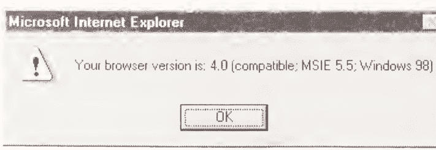

方法的访问方式相同，但在方法名后紧跟圆括号。这些圆括号告诉解释器，该属性是你想要调用的方法。`Window` 对象有一个名为 `close` 的方法，它可以关闭当前浏览器窗口：

```javascript
window.close();
```

如果方法接受参数，参数将以自然的方式包含在括号中。我们见过这种用法的常见示例，即 `Document` 对象的 `write` 方法：

```javascript
document.write("This text is written to the document.");
```

### 内置对象

浏览器提供了几个供脚本使用的对象。这些包括特定的对象，如 `Window`（它包含有关浏览器窗口和当前文档的信息）、`Navigator`（它包含浏览器本身的信息）。此外，浏览器环境提供了许多由 JavaScript 语言定义的对象，简化了常用任务。此类对象的示例包括 `Date`、`Math` 和 `RegExp`。

JavaScript 的一个重要特性是每个数据类型也与一个对象相关。因此有 `String`、`Number`、`Boolean`、`Array` 甚至 `Object`。这些对象提供了通常用于执行给定类型操作任务的功能。例如，`String` 对象提供了提取子字符串、替换文本部分以及将字符串转换为 HTML 方法。原始类型与其关联对象之间的关系是 JavaScript 的基础组成部分，将在本章稍后部分进行更深入的探讨。本书的大部分内容涉及对浏览器提供的内置对象的讨论。但你并不限于语言和浏览器定义的对象：JavaScript 允许你创建自己的对象。

### 创建对象

使用 `new` 关键字后跟对象名和圆括号来创建对象。使用圆括号是因为对象是使用构造函数创建的，这些方法为你创建一个新的对象实例供你使用。圆括号告诉解释器你想要调用给定对象的构造方法。以下代码创建了一个新的 `String`：

```javascript
var myString = new String();
```

对象的一个棒特性是你可以动态地向它们添加属性。例如，要创建自己的对象并填充两个文本字段，你可以这样做：

```javascript
var myLocation = new Object();
myLocation.city = "San Diego";
myLocation.state = "California";
```

如果你不完全理解对象创建的概念，不要担心。在第 6 章会有更详细的解释。此时需要理解的重点是访问属性的语法以及对象的声明方式。简而言之，你使用 `new` 运算符，然后使用点操作 `.` 来设置和访问对象的各种属性。这种方法的一种变体是复合类型 `Array`。

### 数组

数组是一个包含原始和类型的有序列表。数组在其他语言中被称为向量或列表，在 JavaScript 中实际上是对象。数组的成员被称为元素，并从 0 开始编号。你可以将数组看作一组标记为 0, 1, 2... 的盒子。你可以向数组中放入数据，例如索引 5，并检索它。单个数组元素通过在数组名后紧跟方括号 `[` 和 `]` 来访问。例如，在数组 5 处放入字符串并检索它：

```javascript
myArray[5] = "Hamburgers are nice.";
var x = myArray[5];
```

数组字面量通过方括号内的逗号分隔列表指定。以下定义了一个四个数字和一个字符串的数组：

```javascript
var myArray = [2,4,6,8,"ten"];
```

想定义数组但稍后填充，可以定义空数组：

```javascript
var myArray = [];
```

因为数组真的是对象，你可以使用对象语法来定义新数组：

```javascript
var myArray = new Array();
```

由于 JavaScript 是弱类型的，对每个索引放置的数据类型没有限制。未放置数据的索引值为 `undefined`。你不需要按顺序使用数组元素，尽管这样做通常是个好主意。数组都有的一个重要属性是 `length`。该属性由 `Array` 对象提供，但无论如何声明都可以用于数组。该属性检索数组末尾的可用（未填充）位置的索引。如果某些较低的索引未使用，`length` 给出最后一个元素之后的可用槽位的索引。例如：

```javascript
var myArray = [];
myArray[2] = "First element";
myArray[4] = "Last element";
alert("The next available index is: " + myArray.length);
```

显示下一个可用索引是 5，尽管位置 0、1 和 3 未被使用：

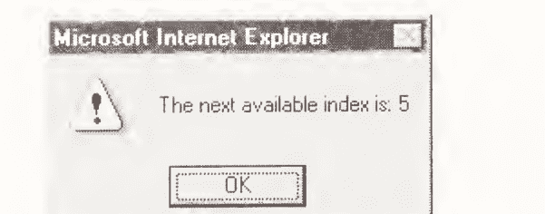

数组的一个很好的特性是 `Array` 对象提供了类似于 Perl 和 Java 的方法，允许数组轻松地用栈和队列。同时也支持多维数组。作为额外奖励，使用对象的简单技巧允许你创建像 Perl 那样的关联数组。

### 函数

函数是种特殊的 JavaScript 对象，包含可执行的代码。通过在函数名后跟圆括号来调用（或激活）函数。函数可以接受参数，即在调用时传递给函数的数据。参数以圆括号内逗号分隔列表的形式给出。

函数调用。下面的函数调用传递了两个参数，一个字符串和一个数字：

```javascript
document.write("The value of pi is: ", 3.14);
```

该调用会导致 `Document` 对象的 `write` 方法向当前浏览器窗口输出一个字符串。函数参数可以是任何有效的数据类型：字符串、对象、数组、`null`或其他函数。

#### 创建函数

函数使用 `function` 关键字声明。函数名连同所需的括号一起给出，括号内包含该函数接受的参数名称。函数所包含的实际代码在大括号中指定。通过示例可以最好地展示这种语法。在接下来的示例中，定义了两个函数并调用了第二个。当被调用时，`showSum` 函数会调用 `doSum` 来计算其参数之和并输出结果。

```javascript
function doSum(x, y) {
  return x + y; // 计算和并返回
}
function showSum(x, y) {
  var result = doSum(x, y); // 计算和
  alert("The sum is: " + result); // 显示给用户
}
showSum(5, 7); // 调用 showSum 来相加并显示 5 + 7
```

这段代码的结果是：

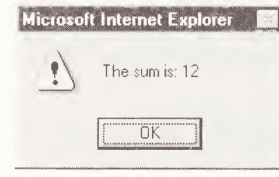

经验丰富的程序员会注意到，函数定义中既没有指定返回类型，也没有指定参数类型。这是因为 JavaScript 是弱类型的。参数和函数返回的值可以是任何类型。这既是一种幸运，也是一种诅咒。它让函数声明语法保持简单，但如果传递给函数的变量类型不是其预期的类型，也可能引入细微的错误。

`return` 关键字在函数内部使用时，会导致该函数停止执行并“传回”给定表达式的值。在上一个示例中，`doSum` 函数返回其两个参数之和，而 `showSum` 不返回任何内容。通过这种方式，函数调用可以使用在赋值的右侧：

```javascript
var result = doSum(10.0, 12.5);
```

变量 `result` 现在包含 22.5。对于不返回任何值的函数，`return` 语句是可选的。

这个示例也说明了弱类型的一个问题。因为 `+` 运算符的作用是连接字符串，下面的调用会导致 `result` 被赋值字符串 `"10.0125"`：

```javascript
var result = sum("10.0", "12.5");
```

弱类型赋予了程序员自由，但如果不小心使用，也可能导致一些头疼的问题。

在某些方面，JavaScript 对函数的支持是非常先进的。资深程序员会兴奋地发现 JavaScript 支持变长函数（类似 C）、匿名函数（类似 Perl 和 LISP）和嵌套函数（类似 Pascal）。经验较少的人会很高兴地发现这些高级语言特性很少使用，而且 JavaScript 的参数传递比其他语言要简单得多。

作为参数传递的原始数据类型是按值传递的。这种按值传递意味着解释器创建函数参数的副本，并将这些副本传递给函数。对参数的任何修改实际上都是在参数副本上进行的。这与按引用传递不同，引用传递允许函数修改“原始”数据。JavaScript 的复合类型通过引用传递，但目前我们暂忽略这个问题。

下面的代码说明了按值传递。定义了一个变量并传递给一个修改其值的函数。你可以从图 3-2 的结果中看到，原始值保持不变：

```javascript
function modifyAndPrint(y) {
  document.writeln("函数内修改前: ", y);
  y = 5;
  document.writeln("函数内修改后: ", y);
}
var x = 10;
document.writeln("调用函数前: ", x);
modifyAndPrint(x);
document.writeln("调用函数后: ", x);
```


# JavaScript：完全参考

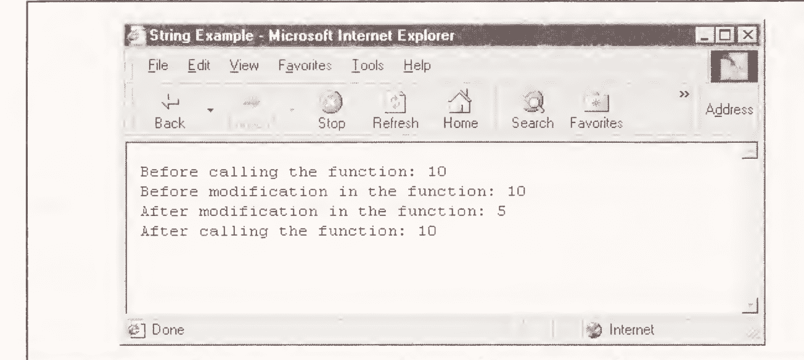

**图 3-2.** 函数通过按值传递接收其参数的副本

这个示例可能会让你产生疑问：如果 `modifyAndPrint` 的参数在函数声明中也被命名为 `x`，解释器是否能分清这两个不同的 `x`？答案是肯定的，原因在于 JavaScript 的变量作用域规则。

## 变量

由于变量是任何编程语言中最重要的方面之一，意识到变量声明和引用的影响对于编写清晰、行为良好的代码是关键。变量作用域规则会产生诸如数据隐藏等现象，如果不能妥善理解，可能会导致细微的错误。除了牢牢掌握 JavaScript 作用域规则的细微差别外，为变量选择良好的名称也至关重要。

### 标识符

标识符是识别变量或函数的名称。在 JavaScript 中，允许使用字母、数字、下划线和美元符号的任意组合组成标识符。标识符的唯一限制是它们不能匹配任何 JavaScript 保留字或关键字，且第一个字符不能是数字。关键字是 JavaScript 语言的词汇，例如 `string`、`Object`、`return`、`for` 和 `while`。保留字是未来可能成为关键字的单词。你可以在附录 E 中找到保留字和关键字的完整列表。

### 变量作用域

变量的作用域是程序中可见的所有部分。可见意味着变量已经声明并且可以使用。未声明的变量是不可见的，因为它们不存在。在程序中随处可见的变量具有全局作用域。仅在特定上下文中变量（例如函数内部）具有局部作用域。上下文是指一组定义的数据集合，它可以根据执行环境而发生变化。

当浏览器启动时，它会创建一个用于 JavaScript 执行的全局上下文。该上下文包含了 JavaScript 语言特性的定义（例如 `Array` 和 `Math` 对象），还包含了如 `Navigator` 等浏览器特定的对象。当函数被调用时，解释器会在其执行期间创建一个新的局部上下文。在函数中声明的所有变量（包括其参数）仅存在于此上下文中。当函数返回时，该上下文会被销毁。因此，如果你想在多次函数调用之间保留某个值（类似于 C 语言中的静态变量），你需要声明一个全局变量。

在函数中引用变量时，解释器首先会在局部上下文中查找同名的变量。如果局部上下文中没有声明该变量，解释器会检查外层上下文。如果在外层上下文中未找到，解释器将递归重复此过程，直到找到变量或到达全局上下文。需要注意的是，上下文的检查是相对于源代码的，而不是当前的调用树。这种作用域机制被称为静态作用域（或词法作用域，Lexical scoping）。通过这种方式，局部声明的变量可以隐藏在外层上下文中定义的同名变量。以下示例说明了：

```javascript
var scope = "global";
function myFunction() {
  var scope = "local";
  document.writeln("The value of scope in myFunction is: " + scope);
}
myFunction();
document.writeln("The value of scope in the global context is: " + scope);
```

结果如图 3-3 所示。局部作用域隐藏了名为 `scope` 的全局变量的值。注意，在 `myFunction` 的第一行省略 `var` 将把值 `"local"` 赋值给全局 `scope`。

作用域方面存在一些固有的微妙之处。第一是每个浏览器窗口都有自己的全局上下文。因此，初看并不清楚如何访问和操作其他浏览器窗口中的数据。幸运的是，JavaScript 通过提供对帧和其他命名窗口的访问，允许你这样做。跨窗口交互的机制将在后面的章节介绍，特别是第 12 章。

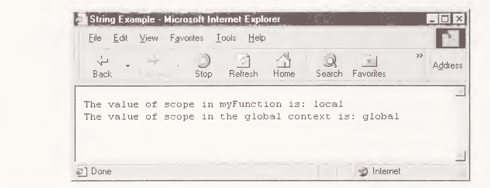
**图 3-3.** 局部变量隐藏了同名的全局变量

与作用域相关的第二个微妙之处是，无论变量在上下文中何处声明，它在整个上下文中都是可见的。这意味着在函数末尾声明的变量在整个函数范围内都是可见的。然而，包含在声明中的任何初始化只有在执行到该行代码时才会执行。结果是，可能会在变量初始化之前访问它，如下例所示：

```javascript
var scope = "global";
function myFunction() {
  document.writeln("The value of scope before initialization in myFunction is: " + scope);
  var scope = "local";
  document.writeln("The value of scope after initialization in function is: " + scope);
}
document.writeln("The value of scope in the global context is: " + scope);
myFunction();
```

结果如图 3-4 所示。注意 `scope` 在初始化之前的值是 `undefined`。

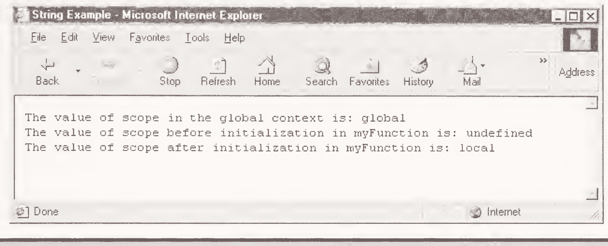
**图 3-4.** 变量在整个上下文中均可见

第三个微妙之处与静态作用域有关。考虑以下代码：

```javascript
var scope = "global";
function outerFunction() {
    var scope = "local";
    innerFunction();
}
function innerFunction() {
    alert("The value of scope is: " + scope);
}
outerFunction();
```

结果如下：


这个示例说明了外层全局上下文的一个关键方面：“全局”。为什么 `innerFunction` 没看到在 `outerFunction` 中设置的值呢？那个 `scope` 值是该函数的局部的，在函数外部不可见。通过检查 JavaScript 源代码中的外层上下文，找到了 `scope` 的正确值。解释器可以通过对程序文本进行“静态”检查来推断正确的值。这里提到的“静态作用域”……

如果 JavaScript 使用动态作用域，上一个示例将打印 `"local"`。解释器会在检查全局上下文之前，先检查调用函数（`outerFunction`）的上下文。动态作用域会导致困惑，因为通过检查程序无法确定特定函数的哪个实例会看到该值。这是动态作用域在现代编程语言中很少使用的众多原因之一。

## 类型转换

JavaScript 最强大的功能之一，也是对粗心程序员最危险的功能之一，是它的**自动类型转换**。类型转换是将一种类型转换为另一种类型的行为。当你更改存储在变量中的数据类型时，类型转换会自动发生：

```javascript
var x = "3.14";
x = 3.14;
```

`x` 的类型从字符串变为数字。它也发生在不那么直观的情况下：

```javascript
var x = "10" - 2;
```

JavaScript 知道减法需要数字，因此将字符串 `"10"` 转换为 10，执行减法，并将 8 存储在 `x` 中。注意 `x` 的类型是数字。

JavaScript 通常在执行操作之前将操作数转换为正确的类型。例如：

```javascript
x = "2" - "2";
```

始终会将字符串转换为数字。一个可能不符合预期的运算符是 `+`。它用于数字相加，但也作为字符串拼接运算符。如果操作数中任何一个是字符串，`+` 将解释为字符串拼接。例如，以下两个语句：

```javascript
x = "2" + "2";
x = "2" + 2;
```

结果都是将字符串 `"22"` 赋值给 `x`。第二个语句中的数字会自动转换为字符串。

之前提到每个原始类型都有对应的对象。这些对象为原始数据提供了有用的方法。例如，`String` 对象提供了一个将字符串转换为小写的方法 `toLowerCase()`。虽然你可以在对象上调用它：

```javascript
var myStringObject = new String("ABC");
var lowerc = myStringObject.toLowerCase();
```

你也可以在原始字符串上调用它：

```javascript
var myString = "ABC";
var lowerc = myString.toLowerCase();
```

这里的见解是，JavaScript 自动将原始 `myString` 转换为 `String` 对象以便调用 `toLowerCase` 方法。尽管看起来很奇怪，相同的方法也可以应用于字符串字面量：

```javascript
var lowerc = "ABC".toLowerCase();
```

JavaScript 会根据上下文的要求在对象和原始类型之间自动转换。字符串对象在打印之前会被转换为字符串。同样，为了调用其成员方法，原始字符串会被转换为 `String` 对象。

自动类型转换这种强大的工具需要谨慎使用。了解在从一种类型转换为另一种类型时会发生什么是非常重要的。例如，给定声明：

```javascript
var booleanData = true;
var numericData = 3.14;
```

以下比较的结果是为真还是假？

```javascript
var numericData >= booleanData
```

表 3-3、3-4 和 3-5 表明了类型之间转换的结果。


# JavaScript: 完整参考

| 类型 | 转换为布尔值 |
| --- | --- |
| Undefined | false |
| Null | false |
| Number | 为 0 或 NaN 时 false，否则为 true |
| String | 长度为 0 时 false，否则为 true |
| 其他对象 | true |

**表 3-3.** 转换为布尔值的结果

在处理混合类型时，有两个非常有用的工具：`typeof` 运算符和 `===` 关系运算符。`typeof` 运算符返回一个指示参数类型的字符串。`typeof` 返回值的列表见表 3-6。注意，数组是 `Array` 对象的关联实例，因此数组的 `typeof` 是 `object`。严格相等运算符 (`===`) 仅在两个操作数相等且类型相同时求值为 true。所以，例如虽然

```javascript
true == 1
```

由于原始类型转换规则的结果为 true，但以下表达式的结果为 false：

```javascript
true === 1
```

| 类型 | 转换为数字 |
| --- | --- |
| Undefined | NaN |
| Null | 0 |
| Boolean | 为 true 时 1，为 false 时 0 |
| String | 如果看起来像数字则返回字符串数值，否则为 NaN |
| 其他对象 | NaN |

**表 3-4.** 转换为数字的结果

# 第 3 章：数据类型与变量

| 类型 | 转换为字符串 |
| --- | --- |
| Undefined | "undefined" |
| Null | "null" |
| Boolean | 为 true 时 "true"，为 false 时 "false" |
| Number | "NaN","0" 或数值的字符串表示 |
| 其他对象 | 如果存在则返回对象的 toString() 值，否则为 "undefined" |

**表 3-5.** 转换为字符串的结果

## 现实世界中的类型转换

大多数编程任务的现实是，手动执行类型转换可能比信任解释器为你完成更好。这种情况绝对存在于处理用户输入时。通过对话框和 HTML 表单获取的用户输入是字符串形式的。通常需要显式地在字符串和数字类型之间转换此类数据，以防止像 `+` 这样的运算符执行错误操作（例如，拼接而不是加法）。

| 类型 | 结果 |
| --- | --- |
| Undefined | "undefined" |
| Null | "object" |
| Boolean | "boolean" |
| Number | "number" |
| String | "string" |
| Object | "object" |
| Function | "function" |

**表 3-6.** 对该类型数据调用 typeof 时返回的字符串

## 总结

JavaScript 提供了五种原始数据类型：number、string、boolean、`undefined` 和 `null`。对复杂类型的支持包括复合类型（对象和数组）以及函数。数组和函数是特殊的对象。每个原始类型都与一个对象关联，该对象提供了操作此类数据的有用方法。函数是一等数据类型，原始参数按值传递。作用域是静态的：如果在引用变量的执行环境中未找到它，解释器将递归搜索闭包的上下文（在源代码中定义）以查找其值。由于 JavaScript 是弱类型的，当对两个不相等的数据类型进行操作时，会执行自动类型转换。这一功能非常强大，但也可能导致歧义和细微错误。鼓励初学者 JavaScript 程序员在公共位置定义变量，并在脚本执行过程中保持数据类型的一致性。下一章将讨论如何以有意义的方式操作数据值，以及如何更改程序流。

# 第 4 章：运算符、表达式与语句

本章概述了每个脚本的基本构建模块：表达式和语句。我们将使用上一章引入的数据类型，并直接将它们作为字面量，或在变量中结合简单运算符（如加法、减法等）来创建表达式。这些表达式将用于形成语句——脚本执行的最基本单元。语句的执行将使用条件逻辑和循环进行控制。对于初学编程的读者来说，阅读这一章应该开始变得有意义。对于经验丰富的程序员来说，这一章中不会有惊喜，因为 JavaScript 与许多其他语言都很相似：赋值、`if`、`while`、`switch` 等都在这里。经验丰富的程序员可能只需要快速略过本章。

## 语句基础

一个 JavaScript 程序由语句组成。例如，最常见的语句之一是赋值，到目前已经见过很多次了。该语句使用关键字 `var` 来定义变量，并结合赋值运算符为变量 `x` 和 `y` 设置值。

```javascript
var x = 5;
var y = 10;
```

赋值使用 `=` 运算符并将右侧的值放入左侧的变量中。例如，

```javascript
x = y + 10;
```

将 10 加到 `y` 并值放入 `x` 中，在这种情况下为 20。编程语言中语句的一个关键问题是指示它们如何终止和分组，这将进行讨论。

## 分号

分号表示一个 JavaScript 语句的结束。例如，你可以通过分号隔开将多个语句组合在同一行中：

```javascript
x = x + 1; y = y + 1; z = 0;
```

你还可以在一行中包含更复杂的或甚至是空语句：

```javascript
x = x + 1; y = y + 1; z = 0;
```

此示例增加了 `x`，跳过了两个由自身指示的空语句，如果 `x` 大于 10 则将 `x` 设置为零，最后减了 `y`。如你所见，在一行包含多个语句是相当笨拙的，应该避免。虽然分号通常跟在语句后面，但如果你的语句由换行符隔开，则可以省略。以下语句：

```javascript
x = x + 1
y = y - 1
```

被处理方式同于：

```javascript
x = x + 1; y = y - 1;
```

隐式分号插入的正式规则比之前的描述引导你的理解要复杂。理论上，单个语句的标记可以通过换行符隔开而不会引起错误。例如，这样的脚本

```javascript
var x
= 5;
x =
x + 1;
alert(x);
```

实际上会正常执行并显示值 6。然而，如果没有分号的一行标记组成了一个完整的 JavaScript 语句，则会插入分号，即使下一行可以被合理视为第一行的扩展。这将导致之前的示例报错。经典的例子是 `return` 语句。由于 `return` 的参数是可选的，将 `return` 和参数放在不同的行会导致返回不带参数执行，例如：

```javascript
return
x
```

被处理为：

```javascript
return;
x;
```

出于这个原因，依赖隐式分号插入是一个坏主意，也是糟糕的编程风格。除非你确定或了解 JavaScript 分号插入规则的所有细微差别，否则应该避免这样做。

## 块

大括号 `{}` 被用于将一组语句组合在一起。在某种意义上，你可以把大括号看作是创建了一个大型的语句。例如，如果有多个语句要作为条件的结果或在循环中执行，这些语句被类似的分组：

```javascript
if (x > 10) {
  x = 0;
  y = 10;
}
```

对于某些程序员来说，一个重要问题是块中的大括号相对于关联语句的位置。虽然块的正确对齐可以提高代码的可读性，但以下之间的细微差异是

```javascript
if (x > 10) {
  执行的语句
}
```

和

```javascript
if (x > 10)
{
  执行的语句
}
```

这与其说是问题，不如说是个人的偏好。我们为本书选择了一种形式，但这某种程度上是随机的，读者在输入代码时，当然欢迎更改示例以符合自己喜爱的格式风格。

语句无论其分组或风格如何，通常都需要修改数据，而这些数据通常以变量或字面量的形式存在（在第 3 章讨论）。这些值通常通过运算符组合，接下来将讨论。

## 基本运算符

JavaScript 支持多种运算符。某些运算符，如算术运算和比较运算，对于任何人（甚至是编程初学者）来说都很理解。其他运算符，例如位与 (`&`)、递增 (`++`) 和 if/else (`?:`)，对于以前没有接触过的人来说可能不那么直观。对于所有水平的读者来说，JavaScript 不支持该语言特有的运算符，该语言在运算符支持上与 C、C++ 和 Java 非常相似。

### 赋值运算符

最基本的运算符可能是赋值运算符 (`=`)，它用于将一个值赋给另一个值。通常我们使用此运算符将变量设置为一个字面量，例如：

```javascript
var bigPlanetName = "Jupiter";
var distanceFromSum = 483600000;
var visited = true;
```

赋值运算符以一对一的方式使用，但通过链联 `=` 运算符可以同时执行多次赋值。例如，语句

```javascript
var x = y = z = 7;
```

这会将所有三个变量都设置为值 7。

赋值也可以用于将变量设置为存储表达式的结果。例如，这段脚本片段演示了如何将变量设置为两个字面量的和，以及字面量与变量的组合：

```javascript
var x = 12 + 5; // x 被设置为 17
var a, b = 3; // a 包含 5
a = b + 2;
```

赋值运算符的简写符号允许我们将其与简单的算术运算和位运算结合（将在本章稍后的“高级赋值语句”部分中讨论）。

### 基本算术运算符

JavaScript 支持读者应该熟悉的所有基本算术运算符，包括加法 (`+`)、减法 (`-`)、乘法 (`*`)、除法 (`/`) 以及最后的取模 (`%`)，某些人来说可能对余数更为熟悉。表 4-1 详细列出了所有这些运算符并提供了每个运算符的示例。

> 注意
> JavaScript 本身不直接支持此处讨论之外的任何数学运算，但通过 `Math` 对象，有足够的方法来适应最先进的数学计算。第 7 章名为“Math”的章节提供了这些功能的概述。完整的语法可以在附录 B 中找到。

| 运算符 | 含义 | 示例 | 结果 |
|---|---|---|---|
| `+` | 加法 | `var x = 5, y = 7; var sum; sum = x+y;` | 变量 sum 包含 12。 |
| `-` | 减法 | `var x = 5, y = 7; var diff1, diff2; diff2 = x-y;` | 变量 diff1 为 -2 而变量 diff2 包含 2。 |
| `*` | 乘法 | `var x = 8, y = 4; var product; product = x*y;` | 变量 product 包含 32。 |
| `/` | 除法 | `var x = 36, y = 9, z = 5; var div1, div2; div1 = x / y; div2 = x / z;` | 变量 div1 包含 4 而 div2 包含 7.2。 |
| `%` | 取模（余数） | `var x = 24, y = 5, z = 6; var mod1, mod2; mod1 = x%y; mod2 = x%z;` | 变量 mod1 包含 4 而变量 mod2 包含 0。 |

**表 4-1.** JavaScript 基本算术运算符

### 使用 + 进行字符串拼接

当加法运算符 (`+`) 操作字符串值而非数字时，它具有不同的含义。在它的另一个作用中，`+` 运算符用于将两个字符串拼接在一起。以下

```javascript
document.write("JavaScript is " + "great.");
```

结果是在文档中输出 `"JavaScript is great"` 字符串。我们可以根据需要进行多次字符串拼接以形成更大的字符串。此外，变量和字面量的任何组合都可以一起使用，示例所示。

```javascript
var bookTitle = "The Time Machine";
var author = "H.G. Wells";
var goodBook = bookTitle + " " + author;
```

这导致变量 `goodBook` 包含了 H.G. Wells 的完整字符串 `"The Time Machine H.G. Wells"`。

字符串拼接运算符的一个有趣方面是它与加法运算符是相同的。考虑到 JavaScript 的弱类型规则，当你组合不同类型的变量时，可能会得到意料之外的结果。通常情况下，当与 `+` 运算符结合遇到字符串值时，JavaScript 最终会将所有内容转换为字符串。例如，

```javascript
var w = 5;
var x = 10;
var y = "I am string";
var z = true;
alert(w + x + y + z);
```

显示对话框。注意，由于运算符优先级的原因，初始加法会在执行字符串拼接之前正确完成。你可以通过适当应用括号来强制求值。请参见本章稍后的“运算符优先级”部分以进行此问题的讨论。

> 注意：JavaScript 支持大量的其他字符串操作，但其中大部分是 `String` 对象的一部分，在第 7 章中将讨论。

### 否定

`-` 符号除了减法之外的另一种用法是取反。在基础数学中，在值前面加一个负号会使值取反。一元运算符的用法是使值取反，如以下示例所示：

```javascript
var x = 5;
x = -x;
// x 现在等于 -5
```

使用此运算符的一个重要考虑是双重应用。例如，

```javascript
var x;
x = -x;
```

将导致正值。一元运算符的用法是将值设置为正值。一元运算符的结果是 5。

### 位运算符

JavaScript 支持用于操作位字符串的完整范围位运算符。JavaScript 会将提供的任何数字转换为 32 位整数，然后转换为字符串，最后对其执行位运算。作为示例，如果我们对 3 和 5 执行位与运算，首先数字将转换为 3 的 `00000011` 和 5 的 `00000101` 位字符串。然后我们提取数字并对它们进行与运算。与、或和异或（异或）运算的真值表如表 4-2 所示。

| 第一位 | 第二位 | 与 结果 | 或 结果 | 异或 结果 |
|---|---|---|---|---|
| 0 | 0 | 0 | 0 | 0 |
| 0 | 1 | 0 | 1 | 1 |
| 1 | 0 | 0 | 1 | 1 |
| 1 | 1 | 1 | 1 | 0 |

**表 4-2.** 位运算真值表

因此，根据表 4-2 中指定的结果，如果我们对这两个位字符串进行 AND（与）运算，我们将得到此处所示的值：

```javascript
00000011
& 00000101
00000001
```

该位值随后将转换回十进制值 1。如果你尝试

```javascript
alert(5 & 3);
```

你将在此处看到相应的结果。

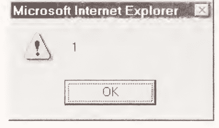

表 4-3 显示了其他运算符，并包含了完整的二进制中间步骤。

| 运算符 | 描述 | 示例 | 中间步骤 | 结果 |
| --- | --- | --- | --- | --- |
| `&` | 位按与 | `3 & 5` | `00000011 & 00000101 = 00000001` | 1 |
| `|` | 位按或 | `3 | 5` | `00000011 | 00000101 = 00000111` | 7 |
| `^` | 位按异或（逻辑或） | `3 ^ 5` | `00000011 ^ 00000101 = 00000110` | 6 |
| `~` | 位取反 | `~3` | 反转数字中的所有位，包括作为符号位的第一个位，因此 `~ 00000011 = 11111100`，其结果为 -4 | -4 |

**表 4-3.** JavaScript 逻辑位运算符

位取反运算符 (`~`) 可能会让人有些困惑。与其他位运算符一样，取反 (`~`) 会先将它的操作数转换为 32 位二进制数。接下来，它会反转位字符串，将所有的 0 变为 1，将所有的 1 变为 0。如果你不熟悉负数的二进制表示法，返回的结果看起来有些费解。例如，`~3` 返回值 4，而 `~(-3)` 返回值 2。手动计算结果的一种简单方法是给给定值加 1，然后翻转符号。这种表示负数的方法是补码表示法，也是大多数计算机表示负数的方式。

位运算符可以使用任何合法的数字形式。例如，给定十六进制值 `0xFF`（等同于 255），执行位取反 (`~0xFF`) 将返回值 -256。

### 位移运算符

位移运算符与其他位运算符相似之处在于，所操作的值首先被转换为 32 位整数，然后转换为它们的表示形式，进行位级操作，最后转换回来。然而，位移运算符不是执行位级逻辑运算，而是根据所使用的运算符和操作数，将位字符串中的位向特定方向移动若干个位置。

位移运算符接受两个操作数。第一个是要移动的数字，第二个指定了第一个操作数要移动的位数。位移的方向由所使用的运算符控制，`<<` 表示左移，`>>` 表示右移。例如，给定左移 `4 << 3`，数字 4 (`00000100`) 将向左移动三位。任何超出左侧的数字都将被丢弃，右侧的数字将用 0 填充。因此，结果是 `00100000`，等于 32。

各种位移运算符见表 4-4。表中注记了右移 `>>` 和 `>>>` 之间的区别：前者通过将最左边的位复制到右侧来保留符号，而后者使用零填充，这不会保留符号。对于非负数，零填充右移 (`>>>`) 和符号传播右移 (`>>`) 产生相同的结果。

鉴于 JavaScript 的高级特性，位运算符可能显得有些格格不入。然而，为了使用某些高级功能（如第 11 章讨论的事件对象掩码），这些运算符是必不可少的。

| 运算符 | 描述 | 示例 | 中间步骤 | 结果 |
| --- | --- | --- | --- | --- |
| `<<` | 左移 | `4 << 3` | `00000100` 向左移动 3 位并在右侧填充 0，得到 `00100000` | 32 |
| `>>` | 带符号右移 | `-9 >> 2` | `11110111` 向右移动并复制最左位，得到 `11111110` | -3 |
| `>>>` | 零填充右移 | `32 >>> 3` | `00100000` 向右移动 3 位并填充 0，得到 `00000100` | 4 |

**表 4-4.** JavaScript 中的位移运算符

### 高级赋值语句

JavaScript 包含赋值的简写形式，它将赋值与前几节讨论的各种算术运算和位运算相结合。表 4-5 总结了这些快速赋值形式。

下一节将描述一种比这里介绍的运算符更简洁的赋值，用于加法或减法。

| 简写赋值 | 扩展含义 | 示例 |
| --- | --- | --- |
| `+=` | `x = x + y` | `x += y` |
| `-=` | `x = x - y` | `x -= y` |
| `*=` | `x = x * y` | `x *= y` |
| `/=` | `x = x / y` | `x /= y` |
| `%=` | `x = x % y` | `x %= y` |
| `&=` | `x = x & y` | `x &= y` |
| `|=` | `x = x | y` | `x |= y` |
| `^=` | `x = x ^ y` | `x ^= y` |
| `<<=` | `x = x << y` | `x <<= y` |
| `>>=` | `x = x >> y` | `x >>= y` |
| `>>>=` | `x = x >>> y` | `x >>>= y` |

**表 4-5.** JavaScript 赋值运算符

### 比较运算符

| 运算符 | 含义 | 示例 | 求值结果 |
| --- | --- | --- | --- |
| `<` | 小于 | `4 < 8` | True |
| `<=` | 小于等于 | `6 <= 5` | False |
| `>` | 大于 | `4 > 3` | True |
| `>=` | 大于等于 | `5 >= 5` | True |
| `!=` | 不等于 | `6 != 5` | True |
| `==` | 等于 | `6 == 5` | False |
| `===` | 等于（相同类型） | `5 === '5'` | False |
| `!==` | 不等于（相同类型） | `5 !== '5'` | True |

**表 4-6.** 基础 JavaScript 比较运算符

在这种情况下，无论变量的值为何，结果将始终显示值相同。

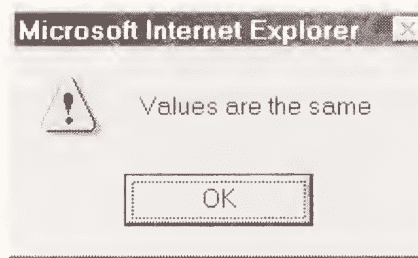

更有趣的是，某些值看起来并不相同但比较的结果为真。例如，

```javascript
alert(5 == "5");
```

由于 JavaScript 的类型转换，它返回一个 `true` 值：


严格相等使用恒等运算符 (`===`) 来处理，如下所示。该脚本

```javascript
alert(5 === "5");
```

如预期所示显示为 `false`：


恒等运算符 `===` 和 `!==` 在 Netscape 3 及更早的浏览器中不可用，但在 JavaScript 1.3 及更高版本中是可用。

### 逻辑运算符

上一节描述的各种比较运算符会产生布尔值，而逻辑运算符 `&&`（与）、`||`（或）和 `!`（非）对于组合这些值非常有用。表 4-7 显示了每个逻辑运算符的描述和示例。

逻辑运算符常用的用法是使用 `if` 语句控制脚本流（请参见本章后面关于 `if` 语句中使用逻辑运算符的章节）。接下来讨论的条件运算符（`?:`）与 `if` 语句类似，可以使用逻辑运算符处理简单的情况。

| 运算符 | 描述 | 示例 |
| --- | --- | --- |
| `&&` | 如果两个逻辑表达式都为真，则返回 true；否则返回 false。 | `var x=true, y=false; alert(x && y); // displays false` |
| `||` | 如果任意一个逻辑表达式为真，则返回 true。如果两者都为假，则返回 false。 | `var x=true, y=false; alert(x || y); // displays true` |
| `!` | 如果其单个操作数为真，则返回 false；否则返回 true。 | `var x=true; alert(!x); // displays false` |

**表 4-7.** 逻辑运算符

### ?: 运算符

`?:` 运算符用于创建快速的条件分支。该运算符的基本语法为

> `(expression) ? true-statement : false-statement;`

其中 expression 是任何最终会求值为真或假的表达式，如果左侧的表达式返回真，则执行 true-statement；如果表达式为假，则运行 false-statement。在这个例子中，

> `(x > 5) ? alert("x is greater than 5") : alert("x is less than 5");`

将根据变量 x 的值显示警告。在上下文中，如果条件表达式为真，则显示指示值大于 5 的第一个语句；如果为假，则显示相反的第二个语句。

初看，`?:` 运算符似乎仅仅是语句的简写。事实上，之前的示例可以重写为更易读的紧凑型 if 语法，如下所示：

```javascript
if (x > 5)
  alert("x is greater than 5");
else
  alert("x is less than 5");
```

遗憾的是，这两种条件形式之间并没有这种简单的关系。最大的区别是 `?:` 运算符对于真和假条件只允许单个语句。因此，

```javascript
x > 5 ? alert("Watch out"); alert("This doesn't work") : alert("Error!");
```

不起作用。事实上，由于 `?:` 运算符用于形成单个语句，在表达式中的任何地方包含 `;` 都会终止语句，并可能破坏它，如下所示：

```javascript
x > 5 ? alert("Watch out for the semi-colon !") : alert("The last part will throw an error");
```

使用由 `()` 字符定义的语句块也不会改善这种情况。代码

```javascript
x > 5 ? alert("using blocks"); alert("doesn't work") : {alert("error!"); alert("error!");};
```

将报错。

鉴于 `?:` 限于单个条件语句且不是 `if` 语句的替代品，它仍然是 JavaScript 工具箱中非常有用的补充，因为它提供了非常紧凑的表示法。例如，许多程序员在设置指示浏览器或对象支持条件的变量时使用它。考虑这个简单的脚本：

```javascript
rolloverallowed = (document.images) ? true : false;
```

上面的脚本将 `rolloverallowed` 设置为 true 或 false。

## 对象相关运算符

通常，数组运算符 `[]` 将用于访问数组的元素。例如，在这里我们创建了一个名为 `myArray` 的数组：

```javascript
var myArray = [2,4,8,10];
```

要从第一个位置（0）开始显示数组的各个元素，我们将使用一系列如下语句：

```javascript
alert(myArray[0]);
alert(myArray[1]);
alert(myArray[2]);
alert(myArray[3]);
```

在上一个示例中，我们直接创建了一个 Array 对象。我们也可以使用 `new` 运算符来这样做。

```javascript
var myArray = new Array(2,4,8,10);
```

`new` 运算符用于创建对象。它可以被用于创建用户定义的对象，也可以创建内置对象的实例。例如，考虑以下脚本，它创建了 `Date` 对象的一个新实例并将其放在变量 `today` 中。

```javascript
var today = new Date();
alert(today);
```

结果所示：

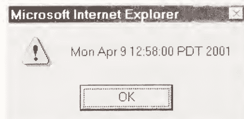

`new` 运算符与构造函数结合使用；在这种情况下，我们使用了 `Date` 对象的预定义构造函数。然而，正如第 6 章将讨论，也可以定义自定义构造函数。

既然对象可以被创建，就可以假设它们可以被销毁。虽然 `delete` 运算符并没有完全做到这一点，但它可以用于删除对象的属性。实际上，`delete` 主要出现在 JavaScript 删除数组元素时。以下脚本说明了它的此用途：

```javascript
var myArray = ['1', '3', '78', '1767'];
document.write("myArray before delete = " + myArray);
document.write("<br>");
delete myArray[2];
// 删除第三项，因为索引从 0 开始
document.write("myArray after delete = " + myArray);
```

注意，当使用 `delete` 操作时，第三个项“78”从数组中被删除了。

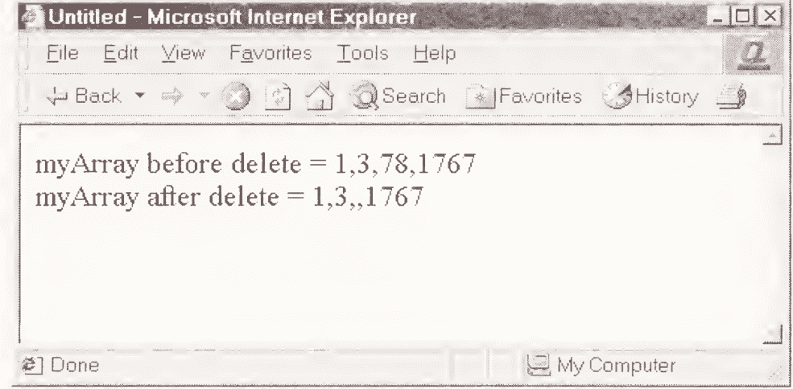

与对象相关的最后一个运算符是括号（`()`）。该运算符通常用于调用对象的方法。例如，我们已经看过了 `Document` 对象的 `write` 方法：

```javascript
document.write("Hello from JavaScript");
```

在这种情况下，我们向 `write` 方法传递了一个单一参数，即字符串“Hello from JavaScript”，以便将其打印到 HTML 文档中。通常情况下，我们可以如下所示调用任意方法：

```javascript
objectname.method(optional parameters)
```


## 第 4 章：运算符、表达式和语句

我们可以以类似的方式调用用户定义的函数。例如：

```
mySwap(x, y)
```

将调用名为 `mySwap` 的函数，并传递变量 `x` 和 `y` 的值。

## 运算符优先级

所有包含之前过的运算符的 JavaScript 表达式都按照定义的优先级顺序求值。这一特性在算术运算符中尤为明显，类似于代数中方程的求值，其中乘法和除法的优先级高于加减法。例如，

```
alert(2 + 3 * 2);
```

结果将是 8 而不是 10。原因是乘法的优先级高于加法，因此它实际上先发生。使用括号 `()` 可以对表达式分组并强制它们先求值。例如，

```
alert((2 + 3) * 2);
```

将显示 10 而不是 8。

当然，运算符优先级不仅限于此类情况。例如，考虑以下加法和字符串拼接的操作：

```
alert(5 + 6 + "Hello")
```

结果将是字符串“11Hello”而不是“5Hello”。尽管两个 `+` 看起来相同，但运算符从左到右的结合性导致表达式的第一部分先求值。JavaScript 各运算符的优先级和结合性见表 4-9。

| 优先级 | 结合性 | 运算符 | 含义 |
| --- | --- | --- | --- |
| 最高 | 从左到右 | `.` | 对象属性访问 |
| | 从左到右 | `[]` | 数组访问 |
| | 从左到右 | `()` | 分组或方法调用 |
| | 从右到左 | `++` | 增 |
| | 从右到左 | `--` | 递减 |
| | 从右到左 | `-` | 取反 |
| | 从右到左 | `~` | 位取反 |
| | 从右到左 | `!` | 逻辑非 |
| | 从右到左 | `delete` | 删除对象属性或值 |
| | 从右到左 | `new` | 创建对象 |
| | 从右到左 | `typeof` | 确定类型 |
| | 从右到左 | `void` | 抑制表达式求值 |
| | 从左到右 | `*, /, %` | 乘法、除、取模 |
| | 从左到右 | `+,-` | 加法、减法 |
| | 从左到右 | `+` | 字符串拼接 |
| | 从左到右 | `<<` | 位左移 |
| | 从左到右 | `>>` | 有符号位右移 |
| | 从左到右 | `>>>` | 零填充位右移 |
| | 从左到右 | `<, <=` | 小于、小于等于 |
| | 从左到右 | `>, >=` | 大于、大于等于 |
| | 从左到右 | `==` | 等于 |
| | 从左到右 | `!=` | 不等于 |
| | 从左到右 | `===` | 带类型检查的相等（身份） |
| | 从左到右 | `!==` | 带类型检查的不等于（非身份） |
| | 从左到右 | `&` | 位与 |
| | 从左到右 | `^` | 位异或 |
| | 从左到右 | `|` | 位或 |
| | 从左到右 | `&&` | 逻辑与 |
| | 从左到右 | `||` | 逻辑或 |
| | 从右到左 | `? :` | 条件运算符 |
| | 从右到左 | `=` | 赋值 |
| | 从右到左 | `*=, /=, %=, +=, -=, <<=, >>=, >>>=, &=, ^=, |=` | 结合前运算符赋值 |
| 最低 | 从左到右 | `,` | 多重求值 |

**表 4-9.** JavaScript 运算符的优先级和结合性


基于对运算符优先级的讨论，你可能假设使用括号可以强制求值到目前的所有运算符。然而，情况并不总是如此。例如，考虑后增和前增运算符。正如我们之前看到的，

```
var x = 3;
alert(++x);
```

和

```
var x = 3;
alert(x++);
```

会提示不同的值，因为增的操作发生在 `alert` 对话框之后。然而，如果你添加括号并尝试让增的操作在 `alert` 之前发生，如下所示：

```
var x = 3;
alert((x++));
```

你不会看到任何区别。从这个例子中，我们至少应该低估结合性和运算符优先级的微妙之处。现在，我们已经涵盖了 JavaScript 中所有的各种运算符，是时候将它们组合起来创建简单语句了。

## JavaScript 语句

JavaScript 支持一组核心语句，对于编写过现代语言的人来说这些应该是熟悉的。这些包括流程控制（`if-else`, `switch`）、循环（`while`, `do-while`, `for`）以及循环控制（`break` 和 `continue`）。JavaScript 还支持一些与对象相关的语句（`with`, `for-in`）。已经熟悉这些语句的读者可能想跳过这一节，仅关注更深奥的方面（特别是 `if` 语句的短路求值、JavaScript 版本之间 `switch` 支持差异、无限循环问题和 Web 浏览器，以及标签的 `break` 和 `continue`）。

## if 语句

`if` 语句是 JavaScript 的基本决策控制语句。`if` 语句的基本语法为：

```
if (expression)
  statement;
```

在这里，表达式被求值，如果条件为真，则执行语句。否则，它将移动到下一个语句。例如，给定脚本片段：

```
var x = 5;
if (x > 1)
  alert("X is greater than 1");
alert("moving on next...");
```

表达式求值为真，并打印消息“X is greater than 1”，然后显示第二个 `alert` 对话框。然而，如果变量 `x` 的值类似于零，则表达式将求值为假，导致跳过第一个 `alert` 并立即显示第二个 `alert`。

要使用 `if` 语句执行多个语句，可以使用代码块，如下所示：

```javascript
var x = 5;
if (x > 1) {
  alert("x is greater than 1.");
  alert("Yes x really is greater than 1.");
}
alert("moving on ...");
```

可以使用 `else` 语句应用额外的逻辑。当不满足第一个语句条件时，将执行 `else` 语句后的代码：

```
if (expression)
  statement or block
else
  statement or block
```

给定这种语法，我们可以将之前的示例扩展如下：

```javascript
var x = 5;
if (x > 1) {
  alert("x is greater than 1.");
  alert("Yes x really is greater than 1.");
} else {
  alert("x is less than 1.");
  alert("This example is getting old.");
}
alert("moving on ...");
```

可以通过 `else` 和 `if` 语句组合添加更高级的逻辑，例如：

```
if (expression)
  statement or block
else if (expression)
  statement or block
else
  statement or block
```

这个简单的示例说明了 `if` 语句可能是如何链在一起的：

```javascript
var numertype, x = 6;
// 将 x 的值替换为 -5, 0 和 'test'
if (x < 0) {
  numertype = "negative";
  alert("Negative number");
} else if (x > 0) {
  numertype = "positive";
  alert("Positive number");
} else if (x == 0) {
  numertype = "zero";
  alert("It's zero.");
} else
  alert("Error! It's not a number")
```

如你所见，很容易陷入复杂的 `if-else` 语句中。稍后讨论的 `switch` 语句是此类语法的潜在替代方案。然而，在继续之前，我们将说明 `if` 语句内部使用的逻辑表达式中的细微之处。

## 短路求值

与许多语言一样，JavaScript 可能会“短路”逻辑与 (`&&`) 或逻辑或 (`||`) 表达式的求值。例如，如果 `||` 操作的第一个表达式为真，那么没有必要评估表达式的其余部分，因为无论其他值如何，表达式都将完全求真。相反，如果 `&&` 操作的第一个表达式求值为假，则真的不需要继续求值，因为整个语句将始终为假。脚本演示了短路求值的流程。

```javascript
document.write("<pre>");
document.write("No short circuit evaluation\n");
var age = 31;
if ((document.write(" Left expression evaluates\n"), (age >= 13)) &&
    (document.write(" Right expression evaluates\n"), (age <= 19))) {
    document.write("Result: You are a teenager.\n\n");
} else {
    document.write("Result: You are not a teenager.\n");
}
document.write("\n");
document.write("With short circuit evaluation\n");
var age = 31;
if ((document.write(" Left expression evaluates\n"), (age <= 19)) &&
    (document.write(" Right expression evaluates\n"), (age >= 13))) {
    document.write("Result: You are a teenager.\n\n");
} else {
    document.write("Result: You are not a teenager.\n");
}
document.write("</pre>");
```

脚本的结果在图 4-1 中。注意脚本的第二部分仅执行了逻辑表达式的左半部分。

大多数时候，逻辑表达式短路求值的细微之处对程序员来说并不重要。然而，如果求值产生了修改值的副作用，同时求值为真或假值，那么就会因为短路导致细微的错误结果。

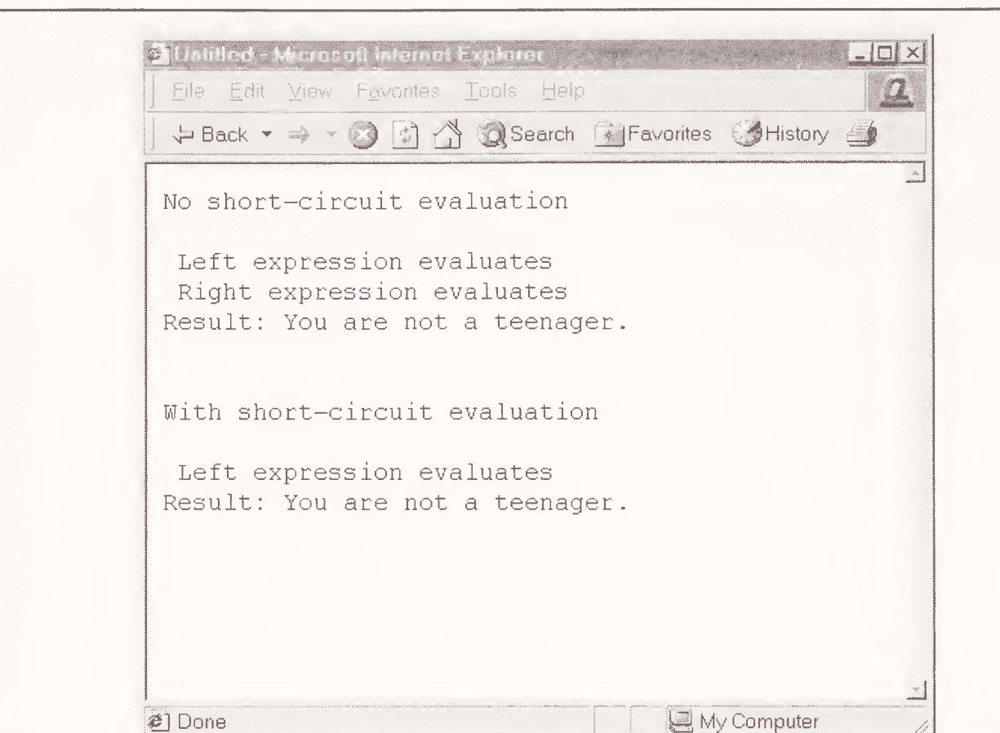

## switch

从 JavaScript 1.2 开始，你可以使用 `switch` 语句而不是仅仅依赖 `if` 语句进行选择。`switch` 语句的基本语法是定义一个表达式来检查各种情况，直到找到匹配项。如果没有匹配项，将使用默认条件。此外，通常使用 `break` 语句来控制 case 的执行。基本语法所示：

```javascript
switch (expression) {
  case condition 1: statement(s)
    break;
  case condition 2: statement(s)
    break;
  ...
  case condition n: statement(s)
    break;
  default: statement(s)
}
```

考虑下面的示例，它展示了如何使用 `switch` 语句：

```javascript
var yourGrade = 'A';
switch (yourGrade) {
    case 'A': alert("Good job."); break;
    case 'B': alert("Pretty good."); break;
    case 'C': alert("You passed!"); break;
    case 'D': alert("Not so good."); break;
    case 'F': alert("Back to the books."); break;
    default: alert("Error!");
}
```

你完全可以用 `if` 语句模仿这一点，但考虑下一个细节。

对于 `switch` 有几个问题需要理解。首先，没有必要使用大括号。考虑下面的示例：

```javascript
var yourGrade = 'B';
var deList = false;
switch (yourGrade)
    case 'A': alert("Good job.");
    case 'B': alert("Pretty good.");
    case 'C': alert("You passed!");
    case 'D': alert("Not so good.");
    case 'F': alert("Back to the books.");
    default: alert("Error!");
```

## 循环

循环用于重复某些操作。JavaScript 中最基本的循环是 `while` 循环，其语法如下：

```
while (expression)
  statement or block
```

`while` 循环的目的是只要表达式为真就执行语句或块。一旦表达式变为假或遇到 `break` 语句，循环将退出。脚本演示了一个基础的 `while` 循环：

```javascript
var count = 0;
while (count < 30) {
  document.write(count + "<br>");
  count++;
}
document.write("Loop done!");
```

在这种情况下，`count` 的初始值为零，然后进入循环，输出 `count` 的值并增加值。一旦 `count` 达到 10，循环退出并执行循环体后的语句。循环的输出所示：

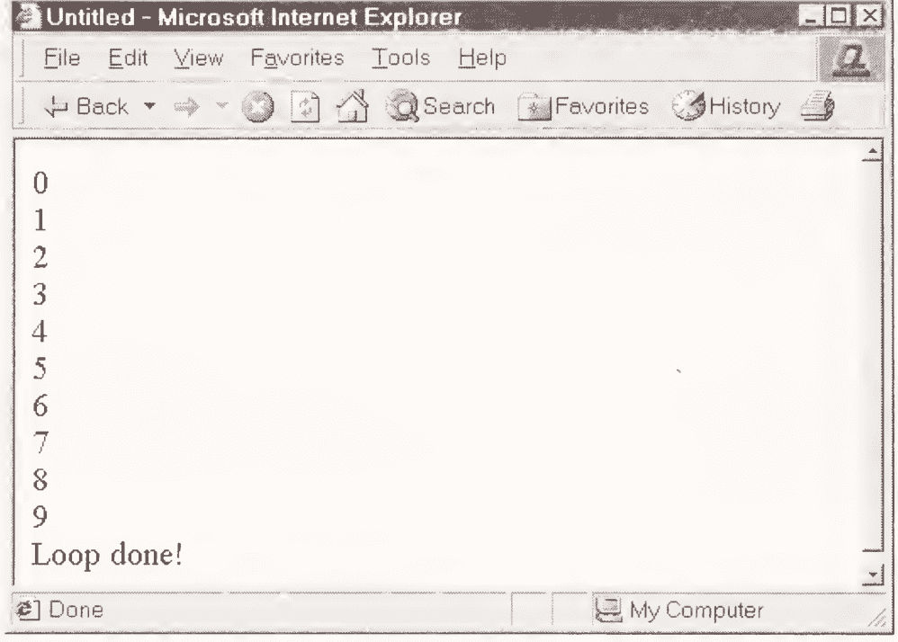

初始化、循环迭代和表达式可以用多种方式设置。考虑这个从 100 开始以 10 或更多步长递减的循环：

```javascript
var count = 100;
while (count > 10) {
  document.write(count + "<br>");
  if (count == 50)
    count = count - 20;
  else
    count = count - 10;
}
```

`while` 循环的一个问题是，根据循环表达式，循环可能永远不会执行。

```javascript
var count = 0;
while (count > 0) {
  // 执行一些语句
}
```

最后，任何循环（无论是 `while` 循环还是后续章节中讨论的循环）中，一个重要的考虑因素都是确保循环最终会终止。例如，如果我们有一段略有不同的代码，我们会发现循环没有结束的方法。这是因为 `count` 变得越来越小，导致表达式永远不会变为假值。

```
var count = 0;
while (count < 10) {
  document.write("Counting down forever: " + count + "<br>");
  count--;
}
document.write("Never reached!");
```

在像 Netscape 2 等某些 JavaScript 实现中，像这样的有错误的脚本实际上会锁定浏览器。现在的浏览器会响应图 4-2 所示的消息之一，但不要寄希望于此点。

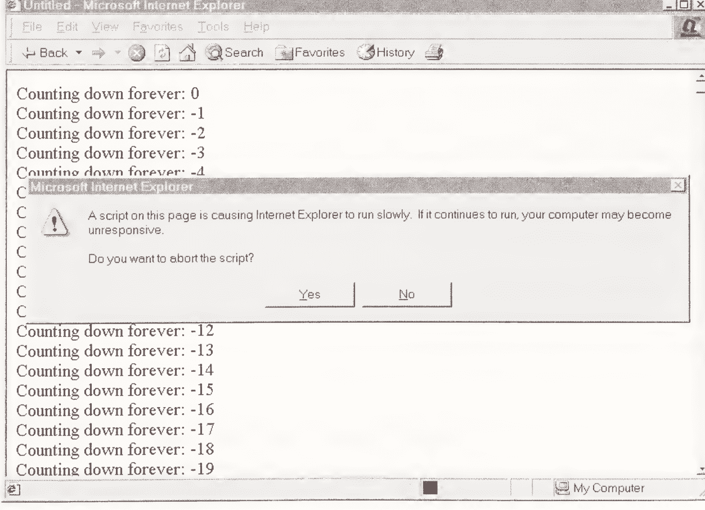

图 4-2。现代浏览器尝试处理不终止的脚本

## do-while 循环

`do-while` 循环与 `while` 循环类似，不同之处在于条件检查发生在循环末尾，这意味着除非先遇到某些 `break`，否则循环将至少执行一次。该循环的基本语法为：

```
do {
  statement(s);
} while (expression);
```

注意 `do-while` 循环结束处使用的分号。
这里的示例将之前的 `while` 循环计数示例重写为 `do-while` 循环的形式。

```
var count = 0;
do {
  document.write("Number " + count + "<br>");
  count = count + 1;
} while (count < 10);
```

## for 循环

`for` 循环是最紧凑的循环形式，它将循环初始化、测试语句和迭代语句全部包含在一行内。基本语法为：

```
for (initialization; test condition; iteration statement)
  looped statement or block
```

这里显示了一个示例：

```
for (var i = 0; i < 10; i++)
  document.write("Loop " + i + "<br>");
```

此循环的结果将与上一节所示的第一个 `while` 循环示例相同。与 `while` 循环一样，通过在 `for` 循环中使用语句块，可以在循环期间执行许多语句。

```
document.write("Start the countdown<br>");
for (var i = 10; i >= 0; i--) {
    document.write("<b>" + i + "...</b>");
    document.write("<br>");
}
document.write("Blastoff!");
```

使用 `for` 循环时的一个常见问题是不小心地放置了分号。例如，

```
for (var i = 0; i < 10; i++)
{
    document.write("value of i=" + i + "<br>");
}
document.write("Loop done");
```

将打印一个输出，显示循环似乎只执行了一次，以及循环结束的语句。

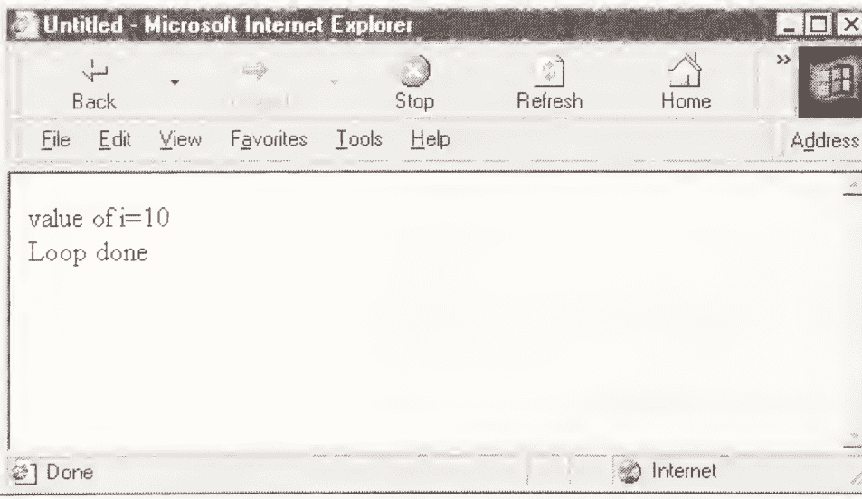

这是因为分号充当了循环体的空语句，而代码块按正常方式执行。

## 使用 continue 和 break 控制循环

`break` 和 `continue` 语句可控制循环的执行。`break` 语句在介绍 `switch` 语句时简要介绍过，用于提前退出循环，跳出外层括号。这里的示例说明了它在 `while` 循环中的用法。注意当 `x` 达到 8 时循环是如何提前跳出的：

```
var x = 1;
while (x < 20) {
  if (x == 8)
    break; // 完全跳出循环
  x = x + 1;
  document.write(x + "br>");
}
```

`continue` 语句正如其名所示，表示循环应该立即继续循环检查。当遇到它时，程序流将移动到循环检查表达式。这里的示例展示了如何使用 `continue` 语句在变量 `x` 存储的索引达到 8 时跳过打印：

```
var x = 1;
while (x < 20) {
  x = x + 1;
  if (x == 8)
    continue; // 在 8 处继续循环而不打印
  document.write(x + "br>");
}
```

使用 `continue` 的潜在问题是，你必须确保迭代仍然发生，否则可能会无意中导致循环无限执行。

## 标签和流程控制

标签可以配合 `break` 和 `continue` 使用，以精确引导流程控制。标签简单是一个后面跟着冒号的标识符，应用于语句或代码块。这里的脚本显示了一个示例：

```
outerloop:
for (var i = 0; i < 3; i++) {
    document.write("Outerloop: " + i + "br>");
    for (var j = 0; j < 5; j++) {
        if (j == 3)
            break outerloop;
        document.write("Innerloop: " + j + "br>");
    }
}
document.write("All loops done" + br>");
```

注意最外层的循环被标记为 `outerloop`，且 `break` 语句被设置为跳出所有外层循环。图 4-3 显示了带有和不带标签执行循环的巨大差异。


## for...in 循环

`for...in` 循环用于枚举对象的属性。语法如下：

```
for (variable in object)
  statement or block
```

这里的示例展示了如何使用 `for...in` 循环打印 `navigator` 对象的属性：

```javascript
for (var prop in navigator) {
    document.write(prop + " = " + navigator[prop] + "<br>");
}
```

结果如图 4-5 所示。

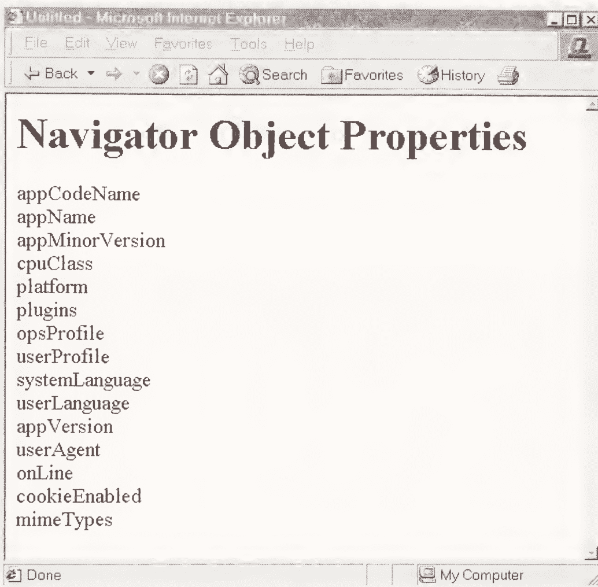

**图 4-5.** 用于打印 Navigator 对象属性的 `for...in` 语句

JavaScript 运算符与变量和数据字面量结合形成表达式。表达式必须仔细构造，以遵守求值优先级，灵活地使用括号有助于避免任何问题。语句可以由表达式组成，构成程序的每一个独立步骤。在 JavaScript 中，单个语句使用分号或换行符来标明。应该始终使用分号以避免歧义并提高脚本安全性。最常见的语句是赋值语句、函数和方法调用。这些语句执行 JavaScript 的基本任务。诸如 `if` 和 `switch` 等控制语句可以改变程序流。可以使用 `while`、`for` 或 `do/while` 形成各种循环来遍历代码。通过 `break` 和 `continue` 可以实现更进一步的流控制。随着大型脚本的构建，往往会引入重复代码。为了消除冗余并创建更具模块化的程序，应该使用函数——这是下一章的主题。

# JavaScript 完全参考

## 第 5 章

## 函数

JavaScript 函数可以用于创建可以重复使用的片段。当编写得当时，函数是抽象的——它们可以在许多情况下使用，并且理想情况下是完全自包含的，数据通过定义良好的接口传入和进行传递。JavaScript 允许创建函数，但许多开发者避免以这种方式编写代码，而是依赖全局变量和副作用来完成任务——这显然不是使用函数的最佳方式。事实上，JavaScript 支持编写模块化代码所需的所有特征，甚至支持此类可变参数列表。本章将介绍函数的基础知识，接下来的两章将讨论 JavaScript 的真正力量在底层源于对象！

## 函数基础

在 JavaScript 中定义函数最常用的方法是使用 `function` 关键字，后跟一个唯一的函数名、参数列表（可以是空的）以及由大括号包围的语句块。基本语法所示：

```javascript
function functionname(parameter-list) {
  statements
}
```

这里定义了一个不接受参数的名为 `sayHello` 的简单函数：

```javascript
function sayHello() {
  alert("Hello there");
}
```

要在脚本的后某个地方调用该函数，你应该使用以下语句：

```javascript
sayHello();
```

> 通常不允许对函数的前向引用；换句话说，你应该在调用函数之前始终定义它。然而，在定义函数的同一个 `<script>` 元素内部，你将能够对其进行前向引用。这是一个非常糟糕的做法，应该避免。

我们通常希望将信息传递给函数，用于计算或改变函数所执行的操作。传递给函数的数据（无论是字面量还是变量）被称为参数，偶尔也称为参数。

考虑对 `sayHello` 函数的以下修改，以接受一个名为 `name` 的单个参数：

```javascript
function sayHello(name) {
  if (name != "")
    alert("Hello there " + name);
  else
    alert("Don't be shy");
}
```

在这种情况下，函数接收了一个决定显示哪个输出字符串的值。通过以下方式调用函数：

```javascript
sayHello("George");
```

结果将显示 alert 框：


通过以下方式调用函数：

```javascript
sayHello("");
```

或者简单不带参数：

```javascript
sayHello();
```

将显示另一个对话框：


当你调用一个期望参数但未提供参数的函数时，JavaScript 将用 `null` 值填充任何未传递的参数。这种行为既有用又极其危险。虽然有些人可能喜欢在未使用某些参数时避免输入所有参数，但函数本身可能必须仔细编写，以避免 `null` 值出现不当情况。简之，仔细检查传递的参数总是良好的编程习惯。

函数不必只接收字面量值；也可以传递变量或变量与字面量的任意组合。考虑名为 `addThree` 的函数，它接受三个值并在 alert 对话框中显示结果：

```javascript
function addThree(arg1, arg2, arg3) {
  alert(arg1 + arg2 + arg3);
}
var x = 5, y = 7;
addThree(x, y, 11);
```

我们可能希望扩展此函数以保存加法的结果；这可以使用 `return` 语句轻松完成。`return` 语句的包含表示函数应该退出并可能返回一个值。在这里，函数 `addThree` 被修改为返回一个值：

```javascript
function addThree(arg1, arg2, arg3) {
  return (arg1 + arg2 + arg3);
}
var x = 5, y = 7, result;
result = addThree(x, y, 11);
alert(result);
```

函数还可以包含多个 `return` 语句，如下：

```javascript
function myMax(arg1, arg2) {
  if (arg1 >= arg2)
    return arg1;
  else
    return arg2;
}
```

无论包含 `return` 语句，函数总是返回某种形式。默认情况下，除非显式返回值，否则将返回 `undefined`。在某些情况下，特别是对于 HTML 处理器，隐式返回会导致问题。例如，回想第 4 章，`void` 运算符可以避免此类问题：`<a href="javascript:void()"></a>`

## 参数传递

基本数据类型在 JavaScript 中是按值传递的。这意味着当变量传递给函数时会创建该变量的副本，因此对函数的处理不会影响原始值。通过以下示例说明这一点：

```javascript
function fiddle(arg1) {
  arg1 = 10;
  document.write("In function arg1 = " + arg1 + "br");
}
var x = 5;
document.write("Before function call x = " + x + "br");
fiddle(x);
document.write("After function call x = " + x + "br");
```

此示例的结果在这里：

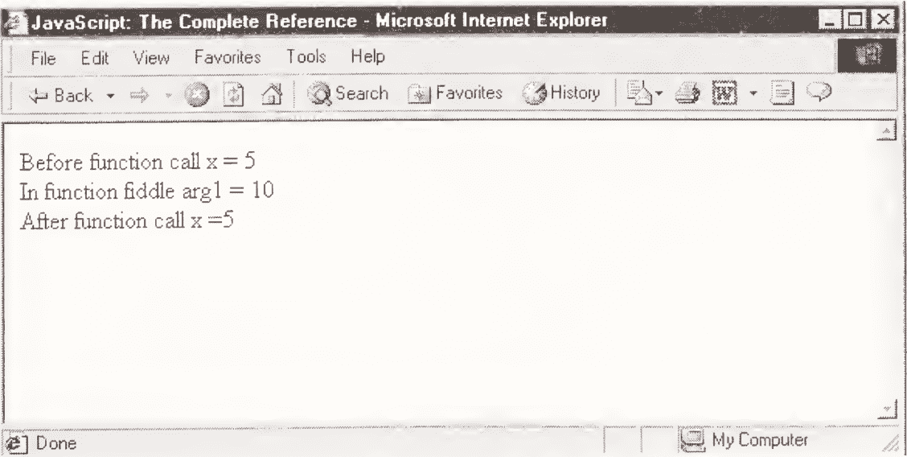

注意，函数 `fiddle` 没有修改变量的值。然而，如果使用了数组和对象等复合类型，它们是按引用传递的而不是按值。这意味着函数可以修改原始数据，因为它接收的是数据的引用而不是值的副本。考虑以下 `fiddle` 函数：

```javascript
function fiddle(arg1) {
  arg1[0] = "changed";
  document.write("In function arg1 = " + arg1 + "br>");
}
var x = ["first", "second", "third"];
document.write("Before function call x = " + x + "br>");
fiddle(x);
document.write("After function call x = " + x + "br>");
```

在这种情况下，函数 `fiddle` 可以更改变量 `x` 中持有的数组的值，如下：

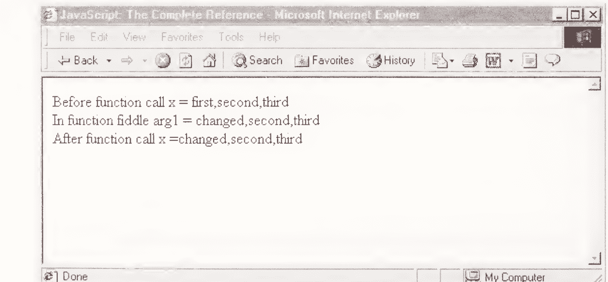

这种现象是因为数组和对象等复合类型是按引用传递的而不是按值。换句话说，传递给函数的是对象的指针而不是它的副本。遗憾的是，与 C 等语言不同，JavaScript 不强迫用户担心指针或如何解引用参数。如果你想在函数内部修改值，只需将其放在对象中传递，或使用 `return` 语句传回新值。遗憾的是，许多开发者并不以这种方式使用 JavaScript，而是依赖全局变量。

## 全局变量与局部变量

对于大多数 JavaScript 开发者来说，只有两种基本的作用域：全局和局部。全局变量在整个文档中都是可知的，而局部变量仅局限于其定义的特定函数。例如，在下面的脚本中，变量 `x` 是全局定义的，在 `myFunction` 函数内可以使用，该函数既打印了它又设置了它的值。

```javascript
// 全局定义 x
var x = 5;
function myFunction() {
  document.write("Entering function<br>");
  document.write("x=" + x + "<br>");
  document.write("Changing x<br>");
  x = 7;
  document.write("x=" + x + "<br>");
  document.write("Leaving function<br>");
}
document.write("Starting Script<br>");
document.write("x=" + x + "<br>");
myFunction();
document.write("Returning from function<br>");
document.write("x=" + x + "<br>");
document.write("Ending Script<br>");
```

该脚本的输出所示：

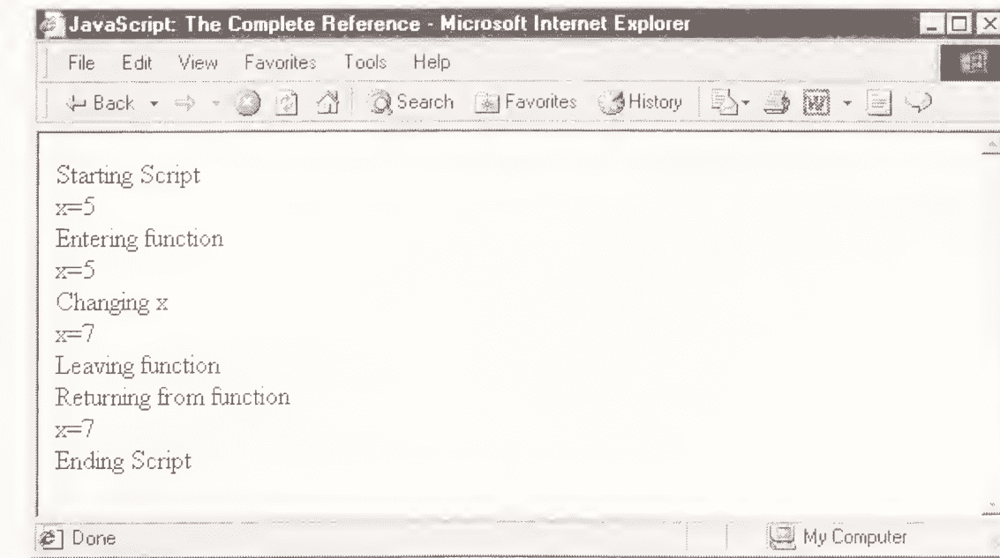

与其使用全局变量，我们可以定义仅在在其定义的函数作用域内的局部变量。例如，在下面的脚本中，变量 `y` 在 `myFunction` 函数内部局部定义，并被赋值为 5。

```javascript
function myFunction() {
  var y = 5; // 定义一个局部变量
  document.write("Within function y=" + y);
}
myFunction();
document.write("After function y=" + y);
```

然而，在函数外部，`y` 是未定义的，因此脚本将抛出错误信息：

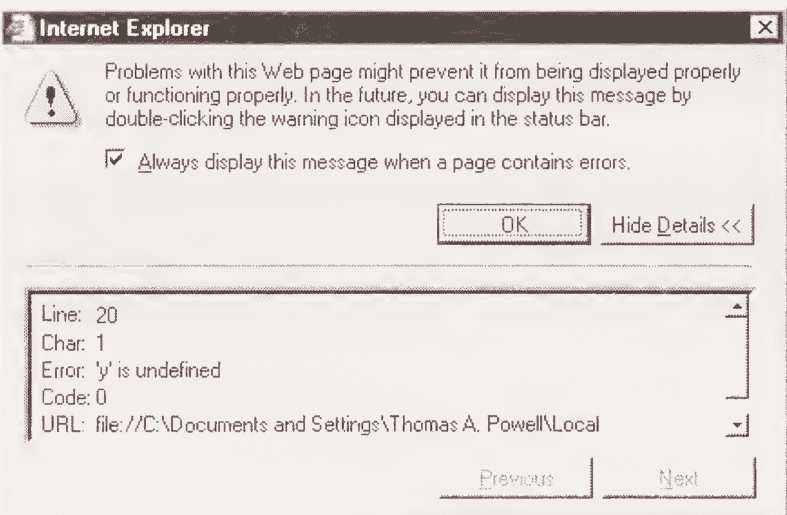

为了修复此脚本的执行，我们可以用一个简单的 `if` 语句替换第二个输出语句，以判断变量 `y` 是否在当前上下文（即当前的 `Window`）中已定义：

```javascript
if (window.y)
  document.write("After function y=" + y);
else
  document.write("Y is undefined");
```

注意，在这种情况下，脚本确实显示变量 `y` 在全局作用域中是未定义的：

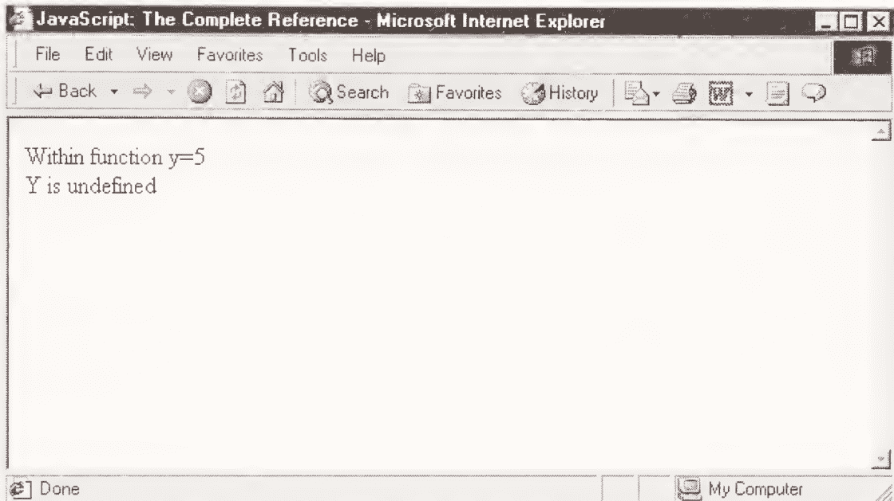

同样注意，除了不会传回全局作用域外，存储在局部变量中的值在调用之间也不会保留。换句话说，任何局部设置的值如果不返回或通过可引用的参数传回，将会丢失。我们将在本章稍后的“静态变量”部分中介绍如何解决这个问题。

## 遮蔽

有时，局部变量和全局变量使用相似的变量名会产生潜在的混乱情况，通常被称为“遮蔽”。注意此处的示例中同时使用了名为 `x` 的局部变量和全局变量：

```javascript
var x = "As a global I am a string";
function maskDemo() {
  var x = 5;
  document.write("In function maskDemo x=" + x + "<br>");
  x = 10;
  document.write("In function maskDemo x=" + x + "<br>");
}
maskDemo();
document.write("Global x=" + x + "<br>");
```

如此处输出所示，在函数中进行的值更改没有被保留，因为局部变量实际上遮蔽了全局变量。根据一般规则，当局部变量和全局变量具有相同标识符时，局部变量具有优先级。

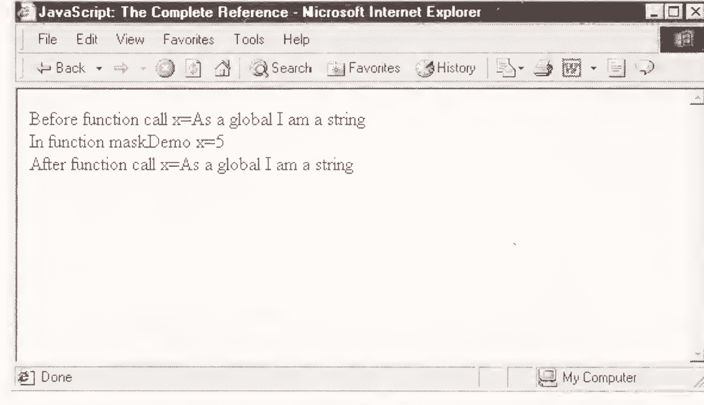

## 局部函数

除了将变量的作用域限制到特定函数外，创建一个局部于函数的函数可能很有用。要创建一个局部函数，只需在其应所局的函数语句块内声明它。例如，下面的脚本显示了一个名为 `testFunction` 的函数，它有两个局部函数：`inner1` 和 `inner2`：

```javascript
function testFunction() {
  function inner1() {
    document.write("testFunction-inner1<br>");
  }
  function inner2() {
    document.write("testFunction-inner2<br>");
  }
  document.write("Entering testFunction<br>");
  inner1();
  inner2();
  document.write("Leaving testFunction<br>");
}
document.write("About to call testFunction<br>");
testFunction();
document.write("Returned from testFunction<br>");
```

在函数内部可以像上面所示调用这些函数，但尝试从全局作用域调用 `inner1` 或 `inner2` 将导致错误信息，如下处所示：

```javascript
function testFunction() {
  function inner1() {
    document.write("testFunction-inner1<br>");
  }
  function inner2() {
    document.write("testFunction-inner2<br>");
  }
}
inner1(); // 这将会报错，因为 inner1 是 testFunction 局部的
```

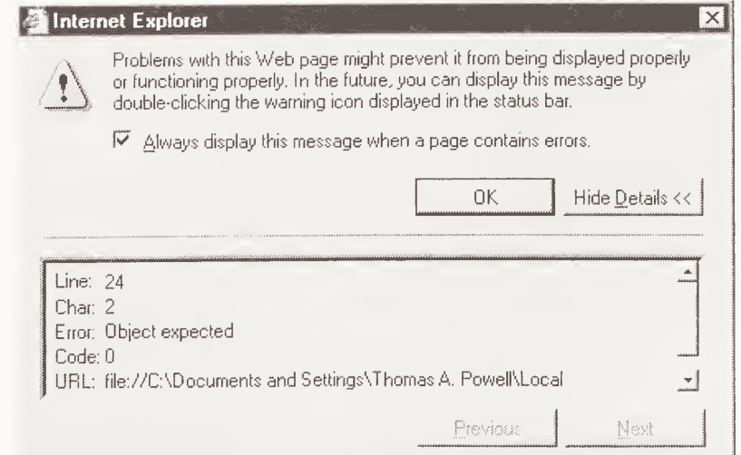

虽然使用局部函数为我们提供了创建独立代码模块的能力，但这种技术很少见。如果你考虑到可以创建局部对象，这种能力并不令人意外。由于 JavaScript 长期以来就支持嵌套函数，这种技术是可能的。

## 作为对象的函数

正如我们在下一节中将看到的，函数本身也是对象。上一个示例的结果显示在这里：


你可能会奇怪，为什么不在构造函数中直接使用下面的新样式语法呢：

```
function simpleRobot(robotName) {
  this.name = robotName;
  this.sayHi = new Function('alert("Hi my name is " + this.name);');
  this.sayBye = new Function('alert("Bye!");');
  this.sayAnything = new Function('msg', 'alert(this.name + " says " + msg);');
}
```

事实情况是，而且一切仍然会正常运行。这种方法的唯一缺点是它会消耗多得内存，因为每次当你创建一个新对象时，都会创建一个新的函数对象。

类似的匿名函数在任何时候都不会被赋值名称。匿名函数是指赋值后无法再被引用的函数。例如，我们可能希望以于内置 `sort()` 方法提供的方式对数组排序（我们将在第 7 章中看到）；在这种情况下，我们可以传递一个匿名函数：

```
var myArray = [2, 4, 2, 17, 50, 8];
myArray.sort(function(x, y) {
  // 用于排序的函数语句
});
```

在这种情况下，匿名函数的创建是通过使用函数字面量完成的。虽然由于传递了参数，该函数可以访问用于排序，但该函数从未绑定到可见的名称，因此它被认为是匿名的。匿名函数可能会令人困惑，但你可能不需要经常使用它们，甚至根本不需要。在 JavaScript 中使用它们的唯一其他地方可能是与事件处理程序一起，如下所示：

```html
<!DOCTYPE HTML PUBLIC "//W3C/DTD HTML 4.01 Transitional/EN">
<html>
<head>
<title>简单事件与匿名函数</title>
</head>
<body>
<form id="form1" name="form1">
<input type="button" id="button1" name="button1" value="Press Me">
</form>
<script>
<!--
window.document.form1.button1.onclick = function () {alert('The button was pressed!');}
//-->
</script>
</body>
</html>
```

这种匿名函数和函数字面量的用法在第 11 章中再次演示，该章节将详细介绍事件。

## 静态变量

函数作为对象的本质中一个有趣的方面是，你可以通过为定义的函数添加实例属性来创建持久到函数调用的静态变量。例如，考虑这里的代码，它定义了一个函数 `doSum`，它可以两个两个数字并保持一个运行总和：

```
function doSum(x, y) {
  doSum.totalSum = doSum.totalSum + x + y; // 更新运行总和
  return (doSum.totalSum); // 返回当前和
}
// 定义静态变量来存储所有调用的运行总和
doSum.totalSum = 0;
```

```javascript
document.write("First Call = " + doSum(5, 10) + "<br>");
document.write("Second Call = " + doSum(5, 10) + "<br>");
document.write("Third Call = " + doSum(100, 100) + "<br>");
```

下面的示例表明，通过使用静态变量，我们可以在函数调用之间保存数据。

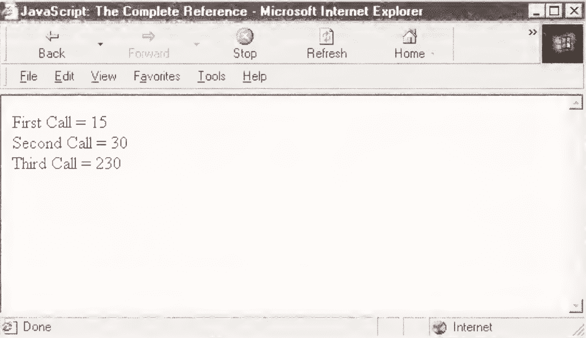

## 高级参数传递

作为对象，用户定义的 JavaScript 函数具有相关的各种属性和方法。一个特别有用的属性是只读的 `length` 属性，它指示函数接受的参数数量。例如：

```javascript
function myFunction(arg1, arg2, arg3) {
  // 执行一些事情
}
alert("Number of parameters for myFunction = " + myFunction.length);
```

脚本将显示 `myFunction` 带有三个参数。该属性显示了函数的定义参数，因此当一个函数声明为不接受任何参数时，其 `length` 属性返回值为 0。

Netscape 4.x 及更高版本的浏览器还支持 `arity` 属性，它包含与 `length` 相同的信息。因为这是非标准的，所以应该避免使用。

当然，可以随时更改给函数的参数数量，我们甚至可以通过检查与特定函数关联的 `arguments[]` 数组适应这种可能性。当函数被调用时，该数组会隐式地填充函数的参数。下面的示例显示了一个函数 `myFunction`，它没有定义参数，但带有三个参数调用：

```javascript
function myFunction() {
  document.write("Number of parameters defined = " + myFunction.length + "<br>");
  document.write("Number of parameters passed = " + myFunction.arguments.length + "<br>");
  for (i = 0; i < myFunction.arguments.length; i++) {
    document.write("Parameter " + i + " = " + myFunction.arguments[i] + "<br>");
  }
}
myFunction(33, 858, 2044);
```

结果表明 JavaScript 函数非常乐于接收任何数量的参数。

## 递归函数

递归函数是指调用自身的函数。考虑计算阶乘的经典示例：

```javascript
function factorial(n) {
  if (n <= 1)
    return 1;
  else
    return n * factorial(n - 1);
}
document.write("5! = " + factorial(5));
```

递归函数必须包含终止条件，否则将导致无限递归和栈溢出。

## 函数创建的时机

如果你考虑到函数和变量实际创建的时机，那么输出就是合理的。变量是在脚本运行时被创建的，而函数是在脚本被解析时创建的。虽然这是一个刻意设计的例子，但它说明了理解 JavaScript 中事物是如何被创建的重要性。

考虑使用 `.js` 文件来编写函数，但要加小心。虽然许多 JavaScript 程序员喜欢将函数放在外部文件中，但我们需要确保在调用函数之前，该函数是可用的。例如，如果我们有两个 `.js` 文件（`lib1.js` 和 `lib2.js`），它们彼此都调用另一个文件中的函数，那么我们可能需要在调用之前检查该函数是否可用。在主文档中，我们将定义变量并将文件加载状态初始设为 `false`：

```
var lib1Loaded = false;
var lib2Loaded = false;
```

在每个加载的文档中，最后一行会将这些变量设置为 `true`。通过使用这种方案，我们可以在调用文件中包含的任何函数之前，检查变量 `lib1Loaded` 或 `lib2Loaded` 的值。例如：

```
if (lib1Loaded)
  something(x, y, z)
```

大多数情况下并不需要这些努力，但 JavaScript 设计者应该仔细考虑文档的加载顺序，以及在整个文档加载之前调用脚本的某些部分时会发生什么。

### 使用显式的 return 语句

即使你的函数不返回任何值，也请插入一个 `return` 语句。JavaScript 是一种解释型语言，防止解释器执行额外工作或做出任何假设，可以产生运行性能更好的脚本。

### 编写独立函数

一如既往，我们应该实践模块化设计，并仅使用函数参数、返回语句和通过引用传递的数据值在函数之间输入输出数据。我们应该避免副作用，例如在函数内部更改全局值。局部变量应始终用于执行函数特有的计算，隐藏函数也可以以相同的方式创建在其他地方不需要的特殊用途函数。以这种方式费力创建独立函数的价值在于，这些函数可以在各种情况下无忧无虑地重用。

## 仔细检查参数

正如我们所看到的，JavaScript 不会仔细检查传递给函数的变量数量或类型。可以使用变变函数（即接受可变参数的函数）来编写非常强大的代码。然而，这样做同样可能导致问题。例如，考虑这个没有进行检查的简单函数：

```
function addTwoNumbers(x, y) {
  alert(x + y);
}
addTwoNumbers(5);
```

这很容易重写为检查传递的参数数量：

```
function addTwo(x, y) {
  if (addTwo.arguments.length == 2)
    alert(x + y);
}
```

当然，这并不能修正错误的函数调用，例如：

```
addTwo(5, true);
```

这将产生一个 6 的值，因为 `true` 会转换为整数 1。如果我们在函数中加入类型检查，可以像这里所示解决这个问题：

```
function addTwo(x, y) {
  if (addTwo.arguments.length == 2) {
    if ((typeof x) != "number" || (typeof y) !== "number")
      return;
    else
      alert(x + y);
  }
  return;
}
```

正如我们所看到的，为了创建能够抵御任何挑战的真正可重用的函数，我们必须付出更多的努力。

### 为函数注释

考虑在函数之前放置一个注释块，说明函数的名称、用途、接受的参数数量和类型、任何返回值以及函数可能产生的任何输出。此类注释块的示例在此所示：

```
/*
Function customAlert(message, icon, color, buttontext)
Description: 此函数创建一个自定义警报对话框，
带有传入的消息、图标、颜色和按钮文本。
Input: message - 包含要显示消息的字符串
       icon - 用于对话框的 GIF 或 JPG 图像的引用
       color - 十六进制颜色形式的默认颜色
               用于背景的字符串。如果未指定，则使用白色
       buttontext - 包含用于对话框按钮消息的字符串。
                    如果未指定，则使用字符串 "ok"。
Output: 相对于当前窗口创建一个对话框
        如果成功创建窗口，则返回 true，否则返回 false
*/
function customAlert(message, icon, color, buttontext) {
  // 函数写在这里
}
```

遗憾的是，很少有 JavaScript 程序员以这种方式记录他们的函数，可能是因为担心下载文件体积增大。当然，我们始终可以在交付前将此类代码精简到最核心，但这种做法仍然相对少见。

当然，良好的编程不仅是语法正确的问题，也是风格一致的问题。许多可能会争论一种特定编码风格优于另一种风格的处，但无论你选择什么，请坚持下去。在本章中，我们展示了相当模块化的编程，这对于任何用过 Pascal 或 C 的人来说应该是熟悉的。然而，基于对象使用的更现代的编程风格也是可能的，并在下一章中使用。

## 总结

JavaScript 函数是任何程序的构建块。它们允许你将代码组合在一起以便在需要时执行。在本章中，我们探索了如何定义和调用函数，以及如何使用参数和返回值。我们还讨论了模块化设计和代码注释的重要性。在下一章中，我们将深入研究对象以及如何使用它们构建更复杂的应用程序。

## 第 6 章：对象

HTML 和 XML 文档。正是这些对象允许 JavaScript 操纵层级样式表（CSS），并实现了动态 HTML（DHTML）。浏览器通过 `Window` 对象的 `document` 属性（`window.document`）提供了对文档对象的访问。关于 DOM 的深入讨论可以参阅第 10 章。

这四类对象之间存在某些重叠。主要原因是没有一个统一的标准来规范 JavaScript 所有层面的行为。ECMA-262 标准规范了语言的底层细节。W3C DOM 规范规定了像 Web 页面这样的结构化对象应如何呈现给脚本环境。浏览器厂商根据自己的意愿定义对用户界面的访问，甚至创建了自己专有的 DOM 扩展。结果就是产生了一套混乱且有些令人困惑的技术，它们在“JavaScript”这一旗伞下汇聚在一起。

好消息是，浏览器厂商最终对浏览器对象达成了一个事实上的标准。这个“标准”与其说是历史因素和浏览器战争的产物，不如说是理性设计过程的结果。这一点从 Opera、Netscape 和 Internet Explorer 都支持 Navigator 对象中得到了证明。此外，仔细检查 Navigator 对象可以发现，不同浏览器类型和版本对其属性的支持存在显著差异。

浏览器对象的细节在第 9 章中介绍，DOM 的细节见第 10 章。关于浏览器和 DOM 能力的进一步讨论将在书的后续结合特定任务出现。本章旨在为对象创建和操纵的基础方面提供坚实的基础，并对用户定义对象和内置对象进行全面概述。

## 创建对象

我们在第 4 章中看到对象是通过 `new` 运算符创建的。该运算符导致指定的构造函数创建一个全新的对象。所创建对象的性质由调用的特定构造函数决定。例如，`String()` 构造函数创建 String 对象，而 `Array()` 构造函数创建 Array 对象。例如，

```javascript
var city = new String();
```

这创建了一个新的 String 对象并将将其引用放在变量 `city` 中。由于没有向构造函数传递任何参数，`city` 被赋值为字符串的默认值——空字符串。我们可以通过向构造函数传递一个指定初始值的参数让这个例子更有趣：

```javascript
var city = new String("San Diego");
```

这在 `city` 中放置了值为 "San Diego" 的新 String 对象的引用。除了解释如何声明像 Strings 和 Arrays 这样的内置对象外，第 4 章还讨论了 Object 对象。这些通用对象可以用于创建用户定义的数据类型。对于 JavaScript 中的任何对象，你都可以动态地向对象添加属性：

```javascript
var robot = new Object();
robot.name = "Zephyr";
robot.model = "Guard";
robot.hasJetpack = true;
```

你也可以动态向对象添加函数。记得作为对象成员的函数被称为方法。以下代码通过向 `robot` 对象添加方法来扩展了我们的示例。我们首先定义函数，然后将其添加到对象：

```javascript
function strikeIntruder() {
  alert("ZAP!");
}
robot.attack = strikeIntruder;
```

注意，尽管函数命名为 `strikeIntruder`，但我们将方法命名为 `attack`。我们可以给它起任何名字；解释器并不在乎我们选择哪个标识符。当我们调用该方法时，

```javascript
robot.attack();
```

我们得到了结果：

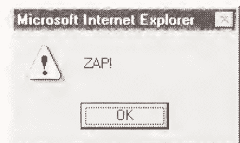

我们甚至可以不给调用的函数命名为 intruder 就能完成这个示例。回想第 5 章，JavaScript 1.2+ 支持函数字面量。在这里我们使用这种能力重申我们的示例：

```javascript
var robot = new Object();
robot.name = "Zephyr";
robot.model = "Guard";
robot.hasJetpack = true;
robot.attack = function() {
  alert("ZAP!");
};
```

这种语法非常紧凑，并且避免了将仅作为用户定义对象方法的函数污染全局命名空间。由于我们已经学习了如何定义数字、字符串、布尔值和数组字面量，因此我们也可以指定对象字面量也不应该感到意外。

## 对象字面量

JavaScript 1.2+ 支持对象字面量。其语法是花括号包围的、用逗号分隔的属性/值对列表。属性/值对通过给出属性名后跟冒号，然后是其值来指定。这里我们同时使用对象字面量和函数字面量重申我们的示例：

```javascript
var robot = {
  name: "Zephyr",
  model: "Guard",
  hasJetpack: true,
  attack: function() { alert("ZAP!"); }
};
```


我们可以像之前一样调用 `robot.attack()` 并得到相同的结果。这个示例也暗示了这些能力的强大性。指定嵌套字面量、具有 `null` 或 `undefined` 值的属性以及作为字面量的值（即值是变量）是完全有效的。以下代码在一个与我们之前类似的示例中说明了这些概念：

```javascript
var jetpack = { true: true };

var robot = {

  name: null,

  hasJetpack: jetpack,

  model: "Guard",

  attack: function() { alert("ZAP!"); },

  sidekick: {

    name: "Spot",

    model: "Dog",

    hasJetpack: false,

    attack: function() { alert("ZAP!"); }

  }

};

robot.name = "Zephyr";

```

# JavaScript：完全引用

## 基本类型与引用类型

所有的 JavaScript 数据类型可以分为基本类型或引用类型。这两种类型对应于第 3 章讨论的原始类型和复合类型。基本类型是原始数据类型 `number`、`string`、`Boolean`、`undefined` 和 `null`。这些类型之所以被称为基本类型，是因为它们被限制一组特定的值。你可以认为基本数据是直接存储在变量本身中的。对象、数组和函数。由于这些类型可以持有大量的异构数据，包含引用类型的变量并不包含其实际值。它包含一个指向存放实际数据的内存位置的引用。

这种区别大多数时候对来说是透明的。但在两种情况下，你需要特别注意这些类型的影响。第一种是你为同一个对象创建了两个或多个引用时。考虑以下使用基本类型的示例：

```javascript
var x = 10;

var y = x;

x = 2;

alert("The value of y is: " + y);
```

这段代码的行为正如你所预期。因为 `x` 是基本类型（数字），存储在其中的值（10）在第二行被赋值给 `y`。改变 `x` 的值对 `y` 没有影响，因为 `y` 接收的是 `x` 值的副本。

现在考虑使用引用类型的类似代码：

```javascript
var x = [10, 9, 8];

var y = x;

x[0] = 2;

alert("The value of y's first element is: " + y[0]);
```

结果可能会让你大大意外：

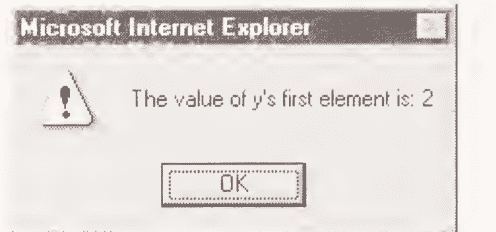

因为数组是引用类型，第二行将 `x` 数据的引用复制到 `y` 中。`x` 和 `y` 都指向同一份数据，因此使用任何一个变量修改其值，对 `x` 和 `y` 来说都是自然可见的。

回想第 5 章，函数的参数是通过值传递的。由于引用类型持有指向其其实际数据的引用，函数参数接收的是引用的副本，因此可以修改原始数据。下面的示例展示了这种效果，它向函数传递了两个值（一个原始类型和一个引用类型），并修改了它们的数据：

```javascript
// 声明一个引用类型（数组）
var refType = ["first", "second", "third"];

// 声明一个原始类型（数字）
var primType = 10;

// 声明一个接受两个参数的函数，函数将修改这些参数
function modifyValues(x, y) {

  x[0] = "changed"; // 修改第一个参数，一个数组
  y = y - 8; // 修改第二个参数，一个数字
}
```

```javascript
// 调用函数
modifyValues(refType, primType);

// 打印引用类型的值
document.write("The value of refType is: " + refType+"<br>");

// 打印原始类型的值
document.write("The value of primType is: " + primType);
```

结果如图 6-1 所示。注意引用类型的值改变了，而原始类型的值没有改变。

# 第 6 章：对象

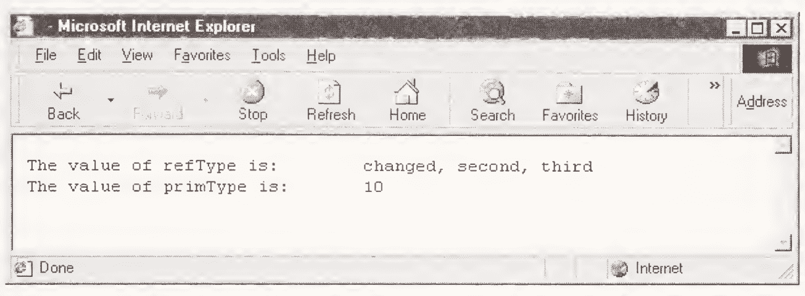

**图 6-1.** 传递给函数的引用类型的原始值可以被修改

尽管你应该意识到原始类型和引用类型之间的区别，但 JavaScript 中的引用比其他语言中的引用要简单得多。例如，为了使用引用类型的值而对其进行解引用，对于 JavaScript 程序员来说并不需要担心，因为这个过程是自动完成的。此外，JavaScript 既没有指针，也不需要显式的内存分配和释放。

## 对象销毁与垃圾回收

当你创建对象时，JavaScript 会自动为你分配内存以便使用。实际发生的情况是解释器分配内存，并将此新（空）对象的引用传递给被调用的构造函数（一次或多次）。关键点在于，解释器不仅处理内存分配，还会在你之后进行“清理”。这种语言特性被称为垃圾回收。当某部分数据不再能被程序访问时，它所占用的空间会被解释器回收并返回到可用内存池中。数据可以通过多种方式变得不可访问。接下来是原始类型中可能发生的一种种情况的常见示例：

```javascript
var artist = "Monet was a French Impressionist";

// 一些其他代码
artist = "Dali was a Spanish Surrealist";
```

在第二次赋值之后，字符串 "Monet was a French Impressionist" 不再可访问。因此，它占用的空间被解释器回收了。这种情况也会发生在引用类型上。当某个特定数据不再有任何引用时，它的存储空间就会被垃圾回收。

解释器执行垃圾回收的具体细节并不真正重要。可能导致问题的唯一实现问题是，Netscape 2 在变量在关闭时声明之前不会回收变量内存。因此，如果你的客户主要是 Netscape 2 用户，那么使用大量内存可能不是一个好主意。

如果你的代码涉及大量数据，让解释器提示你已经处理完特定变量，这对于将脚本的内存占用保持在合理水平非常有帮助。实现此点的一种简单方法是将不需要的数据替换为 `null`，表示该变量现在是为空的。例如，假设你定义了一个 `Book` 对象：

```javascript
var myBook = new Book();

// 将《战争与和平》的内容赋值给 myBook
// 以某种方式操作你的数据
// 完成后，通过将其设置为 null 来清理
myBook = null;
```

这明确地表示你已经处理完由 `myBook` 引用的数据。如果你对同一份数据有多个引用，请确保将它们都设置为 `null`，否则解释器会保留这些数据，以防你再次需要它们。

## 作为关联数组的对象

关联数组是一种允许你将数据与名称关联的结构。普通数组中的元素通过指示索引的整数进行寻址。关联数组中的元素通过字符串名称进行寻址。JavaScript 提供的关联数组是因为以下语句是等价的：

```javascript
object.property
object["property"]
```

JavaScript 中的关联数组仅仅是使用数组语法的对象。我们可以在数组中存储值：

```javascript
var customers = new Object();

customers["John Doe"] = "123 Main St., Metropolis, USA";
```

并检索它：

```javascript
var address = customers["John Doe"];
```

在 `customers["John Doe"]` 中存储字符串是一个任意的决定。任何类型的数据都可以放在关联数组中。

关联数组最常用的场景是属性名在运行时尚未知。例如，你可能有一个循环，提示用户输入客户名称和地址。数据的实际存储（在循环内部）可能看起来如下：

```javascript
customers[customerName] = customerAddress;
```

其中 `customerName` 是一个字符串，`customerAddress` 是任意数据，可能是一个存储信息的用户定义对象。

除了访问元素的直接方式，JavaScript 的 `for/in` 结构非常适合遍历关联数组的元素。下面的示例遍历了我们之前定义的数组的所有元素并打印出来：

```javascript
var customers = new Object();

customers["John Doe"] = "123 Main St., Metropolis, USA";

customers["John Cheung"] = "123 Fake St., Vancouver B.C., Canada";

customers["George Speight"] = "145 Baldwin St., Dunedin, NJ";
```

```javascript
for (var client in customers) {

  document.write("The address of " + client + " is:");

  document.write(customers[client]);

  document.write("<br><br>");

}
```

每个关联了数据的名称会被逐个赋值给 `client`。这个变量被用于访问数组中的数据。上示例的输出如图 6-2 所示。


## 对象属性

我们有很多关于如何访问和动态添加属性的示例。例如，将对象作为关联数组使用允许在动态定义的对象属性中存储数据。JavaScript 程序员机制的力量显而易见，但在充分阐述 JavaScript 对象之前，仍有几个属性方面需要讨论。

## 实例属性

以我们目前所看到的方式动态添加到对象的属性被称为实例属性。它们之所以有这个名字，是因为它们只存在于添加它们的对象实例中。例如，

```javascript
var myList = new String("Hello world");

myList.simpleExample = true;
```

将 `simpleExample` 属性添加到了特定的 `String` 对象 `myList` 中。该属性并没有添加到所有的 `String` 对象中。JavaScript 通过原型提供了为特定对象的所有实例添加属性。然而，原型是一个相当高级的语言特性，将在下面的 JavaScript 对象创建细节中讨论。

你可以使用 `delete` 操作符移除实例属性。C++ 程序员应该注意，JavaScript 的 `delete` 与 C++ 不同。它仅用于从对象中删除属性或从数组中删除元素。下面的示例说明了删除向 `String` 对象添加的实例属性：

```javascript
var myString = new String("hello world");

myString.simpleExample = true;

delete myString.simpleExample;

alert("The value of mystring.simpleExample is: " + myString.simpleExample);
```

结果是：

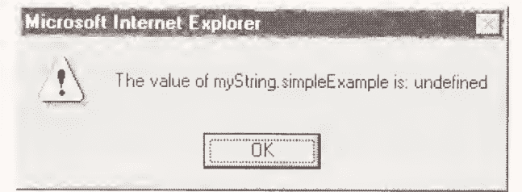

如你所见，该属性的值为 `undefined`，就像不存在的对象属性一样。请注意，你不能删除 `String` 本身。尝试这样做会静默失败。通常情况下，你只能删除实例属性。

## 通用对象属性

考虑到抽象和继承是面向对象编程的两个主要原则，所有的 JavaScript 对象都派生自 `Object` 对象，这并不令人意外。这个对象是最通用的对象。根据 JavaScript 的继承规则，所有其他对象都派生自它。作为“超对象”，它定义了几个所有后代对象共同拥有的属性。其中一些属性列在表 6-1 中。附录 B 提供了 `Object` 所有属性的描述，包括已弃用的或专有的。

由于所有对象都是 `Object` 的后代，它们都拥有这些属性。例如，你可以调用 `Number` 的 `toString()` 来获取其包含的数值的原始字符串形式。内置对象和用户定义对象通常会重载 `toString()` 和 `valueOf()` 方法，以反映对象包含特定类型的数据。重载（或覆盖）用特定行为替换默认行为，例如，`Number` 对象定义其 `valueOf` 来返回一个包含其值的原始数字。这些属性在实践中很少使用，但被解释器广泛用于执行类型转换。在这里提到它们是为了为后续对对象继承的完整讨论做准备。

许多对象都拥有的属性（但它不是 `Object` 的一部分）是 `length`。并不意外，该属性通常包含关于包含数据的长度信息。“length”的含义取决于对象的类型。例如，`String` 的长度持有组成字符串的字符数。`Frames` 的长度持有当前 Web 页面中的帧数。

不同对象能够对它们共同展示的属性以不同的方式做出响应，这是面向对象编程的优点之一。在创建

| 属性 | 描述 |
|---|---|
| constructor | 指向作为对象构造函数的函数的只读引用。在 JavaScript 1.1 中可用。 |
| toString() | 一个将对象转换为原始字符串的方法。 |
| valueOf() | 一个返回与对象关联的值的方法。在 JavaScript 1.1 中可用。 |

**表 6-1.** `Object` 对象的属性

当你创建自己的用户定义对象时，始终记住面向对象的设计原则是好的。健壮的用户定义对象将重载它们从 `Object` 继承的 `toString()` 和 `valueOf()` 方法，以反映它们包含的数据的特征。

有了这些思想，我们现在准备好讨论 JavaScript 面向对象特性的细节了。掌握对象创建的机制对于创建实用的用户定义对象关重要。

## 创建用户定义对象

Java 和 C++ 是基于类的面向对象语言。对象的属性由其类定义，类是对每个对象所包含的代码和数据的静态描述。类的实例被称为“对象”，对象是通过调用特定类的构造函数来创建的。基于类的方法在创建特定类的实例之前，就清晰地定义了对象结构和继承关系。

JavaScript 采取了更加动态的方法。作为一种基于原型的面向对象语言，它没有 Java 和 C++ 意义上的类。对象实例是通过构造函数创建的，构造函数是可执行的对象，用于准备新实例供使用。每个构造函数都包含一个对象原型，该原型定义了代码和数据，这些数据可以任何时间添加到特定实例、所有共享相同原型的实例以及构造函数本身中。

在深入研究之前，对术语进行一些注释是合适的。因为除了原始数据和语言结构外，一切都是对象，因此“类型”（type）一词被频繁使用。区分对象的类型（例如 `Array` 或 `String`）和对象的实例（对于某个包含 `Array` 或 `String` 的变量）是非常重要的。所有用构造函数创建的实例都被认为具有相同的“类型”或“类”。为了保持清晰，请记住构造函数及其原型定义了一种对象类型，而用构造函数创建的对象是该类型的实例。

## 第 6 章：对象

我们已经看到了许多创建对象的示例；例如：

```javascript
var s = new String();
```

这一行调用了 `String` 对象的构造函数，这是一个名为 `String()` 的函数。JavaScript 知道这个函数是一个构造函数，因为它是结合 `new` 操作符调用的。我们可以通过定义一个函数来定义自己的构造函数：

```javascript
function Robot() {

}
```

这个函数本身什么都不做。然而，我们可以像对待 `String()` 那样将其作为构造函数来调用：

```javascript
var guard = new Robot();
```

我们创建了一个 `Robot` 对象的实例。显然，这个对象并不特别有用。在继续之前，需要更多关于对象构造的信息。

当构造函数被调用时，解释器为新对象分配空间，并隐式地将对象传递给函数。构造函数可以使用 `this` 来访问它，`this` 是一个持有新对象引用的特殊关键字。我们可以重新定义构造函数来反映这种能力：

```javascript
function Robot() {

  this.hasJetpack = true;

}
```

我们向创建的对象添加了一个新属性 `hasJetpack`。注意，所有的 `Robot` 对象都将拥有这个属性，因为它们都是通过 `Robot()` 构造函数创建的。在创建对象后，我们可以像下面一样访问 `hasJetpack` 属性：

```javascript
var guard = new Robot();

var CanFly = guard.hasJetpack;
```

回想如何向构造函数传递参数以指定初始值。我们可以再次修改我们的构造函数，使其接受一个可选参数，并在我们需要时指定该参数：

```javascript
function Robot(needsFly) {

  if (needsFly == true) {

    this.hasJetpack = true;

  } else

    this.hasJetpack = false;

}

// 创建一个 hasJetpack 为 true 的 Robot
var guard = new Robot(true);

// 创建一个 hasJetpack 为 false 的 Robot
var sidekick = new Robot();
```

注意，在上一个示例中，我们在创建 sidekick 实例时显式传递了 false 值。然而，通过不传递任何内容，我们实际上已经这样做，因为参数 `needsFly` 将是 `undefined`。因此，`if` 语句会正确失败。

我们还可以为创建的对象添加方法。一种方法是在构造函数内部为实例变量分配匿名函数。然而，还有另一种方法，使用对象的原型。

每个对象都有一个 `prototype` 属性来赋予其结构。原型描述了该类型所有对象共同拥有的代码和数据。我们可以用构造函数的原型填充我们希望所有的 `Robot` 对象都拥有的代码和数据。我们在这里修改定义：

```javascript
Robot.prototype.hasJetpack = false;

Robot.prototype.doAction = function() {

  alert("Intruders beware!");

}

function Robot(flying) {

  if (flying == true) {

    this.hasJetpack = true;

  }

}
```

发生了几个重大变化。首先，我们将 `hasJetpack` 属性移动到了原型中并赋予了默认值 `false`。这样做允许我们从构造函数中删除 `else` 子句。其次，我们在构造函数的原型上添加了函数 `doAction`。我们创建的每个 `Robot` 现在都拥有这两个属性：

```javascript
var guard = new Robot(true);

var canFly = guard.hasJetpack;

guard.doAction();
```

一个问题自然而然了：如果这两个属性都是原型（prototype）的属性，我们如何通过对象的实例来访问它们呢？答案类似于解释器从函数实例中“寻找”全局变量的方式。如果访问了某个属性，而该对象没有同名的属性，就会检查该对象的原型。如果我们省略了传递 `Robot()` 构造函数的参数，然后访问创建的对象的 `hasJetpack` 属性，解释器会在原型中找到默认值。如果我们向构造函数传递 `true`，原型中的默认值将被覆盖，这是通过添加一个名为 `hasJetpack` 的实例变量（其值为 `true`）来实现的。

原型可以使用 `this` 来引用其所包含的实例。我们再次定义该类以重新获得这种能力：

```javascript
Robot.prototype.hasJetpack = false;

Robot.prototype.actionValue = "Intruders beware!";

Robot.prototype.doAction = function() {

  alert(this.actionValue);

}

function Robot(flying, action) {

  if (flying == true) {

    this.hasJetpack = true;

  }

  if (action) {

    this.actionValue = action;

  }

}
```

我们在原型上添加了一个新属性 `actionValue`。该属性有一个默认值，可以通过向构造函数传递第二个参数来覆盖它。如果向构造函数传递了 `action` 值，调用 `doAction()` 将显示该值，而不是默认值（"Intruders beware!"）。例如，

```javascript
var guard = new Robot(true, "ZAP!");

guard.doAction();
```

结果将弹出 "ZAP!" 而不是 "Intruders beware."。在这里，原型有一个非常重要的方面，就是它是**共享的**。也就是说，对于所有通过相同构造函数创建的对象，只有一份原型副本。这意味着，对原型的更改将对所有共享该原型的对象可见！这就是为什么原型中的默认值会被实例变量覆盖，而不是被直接修改。直接修改它们将改变所有共享该原型的对象的值。

修改内置对象的原型是非常有用的。假设你需要反复提取字符串的第三个字符。你可以修改 `String` 对象的原型，使得所有字符串都拥有一个你定义的方法：

```javascript
String.prototype.getThirdChar = function() {

  return this.charAt(2);

}
```

你可以像调用任何其他内置 `String` 方法一样调用这个方法：

```javascript
var c = "Example".getThirdChar();
```

除了实例属性和原型属性外，JavaScript 还允许你定义静态属性（也称为类属性）。由于构造函数是函数，而函数是 `Function` 对象的实例，因此你可以向构造函数添加属性。此类属性就是静态属性。继续你的例子，

```javascript
Robot.isMetallic = true;
```

这通过向构造函数添加实例变量，定义了 `Robot` 对象的静态属性。需要记住，属性只存在于一个地方，即构造函数中。此后，通过构造函数而不是对象的实例来访问它们。静态属性持有不依赖于任何特定实例内容的数据或代码。`String` 对象的 `toLowerCase()` 方法不能是静态方法，因为字符串依赖于调用它的对象。另一方面，`Math` 对象的 `PI` 属性 (`Math.PI`) 和 `String` 对象的 `parse()` 方法 (`String.parse()`) 是完美的候选者，因为它们不依赖于任何特定实例的值。你可以从访问它们的方式看出，它们实际上是静态属性。我们刚刚定义的 `isMetallic` 属性的访问方式也是类似的，即 `Robot.isMetallic`，就像 C++ 或 Java 一样。

## 原型链

JavaScript 中的继承是通过原型实现的。它允许特定对象的实例“继承”存在于构造原型中的代码和数据。从已存在的类型派生出新的对象类型也是可能的。对象的实例继承其“父级”类型的所有属性，加上新类型添加的任何属性。例如，我们可以通过“链式”原型定义一个继承我们 `Robot` 对象所有能力的新对象类型：

```javascript
function UltraRobot(extraFeature) {

  if (extraFeature) {

    this.feature = extraFeature;

  }

}

UltraRobot.prototype = new Robot();

UltraRobot.prototype.feature = "Radar";
```

这个示例中的新概念是将 `UltraRobot` 的原型设置为 `Robot` 对象的一个新实例。`UltraRobot` 对象包含了 `UltraRobot` 对象的属性以及 `Robot` 对象的属性：

```javascript
var guard = new UltraRobot("Performs Calculus");

var feature = guard.feature;

var canFly = guard.hasJetpack;

guard.doAction();
```

解释器在此示例中解析属性访问的方式与之前讨论的解析方式类似。首先检查对象的实例属性是否有匹配项，如果没有找到，则检查其原型。如果在原型中没有找到匹配项，则检查父原型，并递归重复此过程。这个过程解释了为什么所有对象都有像 `toString()` 这样的属性。`toString()` 方法是 `Object` 原型的属性。所有对象都派生自 `Object`，在任何对象上调用 `toString()` 最终都会使其沿着继承链“向上”找到 `Object` 的 `toString()` 属性。例如，构造函数是函数，实例是 `Function` 实例，而 `Function` 派生自 `Object`。

## 对象创建的良好实践

原型链解释了为什么所有对象都有像 `toString()` 这样的属性。`toString()` 方法是 `Object` 原型的属性。所有对象都派生自 `Object`，在任何对象上调用 `toString()` 最终都会沿着继承链“向上”找到 `Object` 的 `toString()` 属性。例如，构造函数是函数，实例是 `Function` 实例，而 `Function` 派生自 `Object`。

## JavaScript 的面向对象

如今，面向对象编程（OOP）被广泛认为是组织程序的良好方法，但在 JavaScript 中很少使用完全的面向对象。你可能会奇怪为什么。语言本身支持面向对象的原则，这些原则在本章中已经演示并总结如下：

- 抽象：对象应该描述一个抽象的概念或任务。对象应该为程序员提供一个接口，提供该类型预期的功能和服务。
- 封装：对象应该在内部维护描述其行为所需的状态。这些数据对其他对象隐藏，并通过对象提供的公共接口进行访问。
- 继承：语言应该提供从更通用的对象创建更特定对象的方法。例如，`Shape` 对象可以用于创建更具体的对象，如矩形、三角形或圆形。这些特定对象“继承”“祖先”的能力。
- 多态：不同的对象可以对同一个动作做出不同的响应。例如，`Number` 对象可能以算术方式解释加，而 `String` 对象可能以拼接方式解释加。此外，允许对象根据上下文进行多态（改变形状）。

## 面向对象方法的兴起

编写和维护大型软件系统是一项挑战性任务。人们已经花费多年时间研究不同的软件工程方法，旨在确定创建高质量产品的最有效方案。在编程早期，代码的组织和规划并没有那么复杂。大多数程序都是简单的汇编语言或机器语言程序，编写时没有任何类似于现代软件工程的辅助。

随着高级语言的演进，显而易见代码模块化和结构化编程是任何大型项目的重要方面。软件需求的复杂性不断增加，迫使程序员们探索软件创建过程的新方法。面向对象编程的出现源于一种观点：软件可以被视为一组相互作用的抽象对象。虽然面向对象的方法并非解决软件开发过程中遇到的所有问题的万灵妙药，但它确实有助于创建高度模块化、易于维护的软件。

虽然 JavaScript 本身是一门面向对象的编程语言，但许多程序员忽略了使用其许多结构的价值，因为大多数脚本的大小和复杂性不足以支持 OOP（面向对象编程）方法。事实上，该语言对许多用户而言的成功之处在于，在网站内完成有用任务不需要花费大量的精力或编写大量的代码。该语言的使用现状表明，许多程序员继续编写直线型甚至“意大利面条”代码，且其中充满了全局变量。本书的作者将尝试引入更合适的风格，并会避免那种准宗教式的推崇某一种特定的软件开发风格。虽然我们显然是面向对象编程的忠实粉丝，但在目前，我们认为在 Web 脚本中引入结构化编程实践就已经可以接受了。

## 总结

JavaScript 提供了四类型的对象：用户定义、内置、浏览器和文档。本章重点关注用户定义对象的创建和使用。JavaScript 是一种基于原型的面向对象语言。新的对象实例是通过构造函数创建的，构造函数是初始化新实例属性的对象。每个对象都有一个原型属性，它反映了创建它所使用的构造函数的原型。当访问对象属性时，解释器首先检查实例属性中是否存在所需的名称。如果没有找到，则会检查原型的属性。这个过程会递归重复，直到追溯继承链到顶层对象。在 JavaScript 中，大多数情况下对象的创建和管理是直观的，程序员无需受内存管理的烦恼。虽然定义的对象可以创建更模块化、更易维护的脚本，但考虑到脚本的简单性，许多 JavaScript 程序员并没有真正使用它们。相反，他们利用各种内置、浏览器和文档对象。下一章将开始检查此类对象，从内置对象开始，特别是 Array、Math、Date 和 String。

# JavaScript完全参考

## 第 7 章

## Array, Date, Math 和类型相关对象

本章将更详细地讨论 JavaScript 内置对象的功能，特别是 Array、Date 和 Math。我们还将查看与原始类型（如 Boolean、Number 和 String）相关的内置对象，以及神秘的 Global（全局）对象。值得注意的是，本章缺失了 RegExp 对象，它需要大量的解释，是下一章的主题。对于本章涵盖的每个对象，重点将主要放在主流浏览器最常用且支持的属性上。内置对象属性的完整列表（包括版本信息和示例）可以在附录 B 中找到。让我们开始对这些内置对象的概述，按字母顺序，从 Array 开始，到 String 结束。

## Array

数组在第 3 章作为复合类型被引入，用于存储有序的数据列表。可以使用 `Array()` 构造函数来声明数组。如果向构造函数传递参数，它们通常被解释为指定数组的元素。例外是向构造函数传递了单个数值值。执行 `new Array()` 会创建一个空数组，并将数组的 `length` 属性设置为给定值。数组声明的三个示例如下：

```javascript
var firstArray = new Array();

var secondArray = new Array("red", "green", "blue");

var thirdArray = new Array(5);
```

第一个声明创建了一个空数组，并在 `firstArray` 中保留了它的引用。第二个声明创建了一个新数组，其第一个值为 "red"，第二个值等于 "green"，最后一个值等于 "blue"。第三个声明创建了一个新数组，其 `length` 属性值为 5。使用这种语法没有特别的优势，在实践中很少使用。

JavaScript 1.2+ 允许你使用数组字面量创建数组。以下声明在功能上与之前的示例等效：

```javascript
var firstArray = [];

var secondArray = ["red", "green", "blue"];

var thirdArray = [,,,,];
```

前两个声明并不令人意外，但第三个字面量有四个逗号，而这些逗号分隔的值似乎缺失了。解释器将此示例处理为指定了五个 `undefined` 值，并将数组的长度设置为 5 以反映这一点。有时你会看到使用这种语法的稀疏数组：

```javascript
var fourthArray = [,,35,,,,16,,23];
```

幸运的是，大多数程序员都避开了这种数组创建方法，因为数许多逗号非常麻烦。

用于初始化数组的值不需要是字面量。下面的示例是完全合法的而且实际上非常常见：

```javascript
var x = 2.0, y = 3.5, z = 1;

var myValues = [x, y, z];
```

并不意外，`myValues` 的第一个值被设置为 2.0，第二个设置为 3.5，最后一个设置为 1。

## 访问元素

使用数组名加方括号来访问数组元素。例如，我们可以定义一个包含三个元素的数组：

```javascript
var myArray = [1, 2, 3];
```

鉴于 JavaScript 数组从 0 开始索引，访问第一个元素将指定 `myArray[0]`。以下显示了如何访问各种元素：

```javascript
var x = myArray[0];

var y = myArray[1];

var z = myArray[2];
```

然而，访问未设置的元素时需要小心。例如，

```javascript
alert(myArray[3]);
```

结果显示 `undefined` 值，因为这个数组元素显然没有设置。

## 添加和更改数组元素

JavaScript 数组的棒处在于，随着数组大小的增长，你不需要显式地分配更多内存。例如，为 `myArray` 添加第 4 个值，可以使用：

```javascript
myArray[3] = 4;
```

你不需要连续地设置数组值，所以

```javascript
myArray[11] = 12;
```

也是有效的。然而，在这种情况下，你会得到一个稀疏数组，如显示 `myArray` 当前值的对话框所示。

修改数组的值同样简单。要更改数组的第二个值，只需赋值：

```javascript
myArray[1] = 2;
```

当然，在设置数组值时，你必须记住引用类型和原始类型的区别（在之前的章节中提到过，特别是第 6 章）。记住，当你操作赋值为引用类型的变量时，它也会修改原始值。例如：

```javascript
var firstArray = ["Mars", "Jupiter", "Saturn"];

var secondArray = firstArray;

secondArray[0] = "Neptune";

alert(firstArray);
```

你会注意到，如所示，`firstArray` 中的值被改变了。

当然，引用类型的这一特性非常有用，特别是在向函数传递参数的情况下。

## 删除数组元素

可以使用 `delete` 运算符来移除数组元素。该运算符会将被调用的数组项设置为 `undefined`，但不会改变数组的长度（稍后将详细介绍这一点）。例如，

```javascript
var myColors = ["red", "green", "blue"];

delete myColors[1];

alert("The value of myColors[1] is: " + myColors[1]);
```

结果如下：

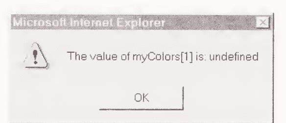

其效果就像该索引处从未放置过元素一样。然而，数组的大小实际上仍然是三个，正如当你 `alert` 整个数组的内容时所示：

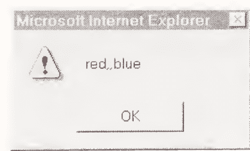

我们也可以通过访问像 `myColors` 这样的数组的 `length` 属性看到这一点，细节将在下文中讨论。

## length 属性

`length` 属性获取数组末尾下一个（未填充）位置的索引。即使某些较低的索引未被使用，`length` 给出最后一个元素之后第一个可用槽的索引。考虑以下内容：

```javascript
var myArray = new Array();

myArray[1000] = "This is the only element in the array";

alert(myArray.length);
```

尽管 `myArray` 在索引 1000 处只有一个元素，但正如我们在 `alert` 对话框 `myArray.length` 中看到的，下一个可用槽是数组的末尾，1001。

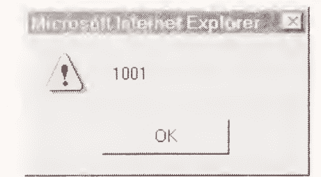

由于 `length` 属性的这一特性，我们建议顺序使用数组元素。以非连续的方式赋值会导致数组在持有定义值的索引之间出现“空洞”——即前面提到的“稀疏数组”（sparsely populated array）。由于 JavaScript 只为那些实际包含数据的数组元素分配内存，因此这并不是浪费内存的问题。这意味着你必须小心，确保“空洞”中的 `undefined` 值不会被意外使用。

当新元素被添加到数组时，`length` 会自动更新。因此，`length` 通常用于遍历数组的所有元素。下面的示例说明了数组的迭代，以及在使用带有“空洞”的数组时可能出现的问题：

```javascript
// 定义一个变量来存储乘法的结果
var result = 1;

// 定义一个数组来存储相乘值
var myValues = new Array();

// 设置值
myValues[0] = 2;

myValues[2] = 3;

// 遍历数组并乘以每个值
for (var index = 0; index < myValues.length; index++)

{

  result = result * myValues[index];

}

alert("The value of result is: " + result);
```

如你从结果所示，

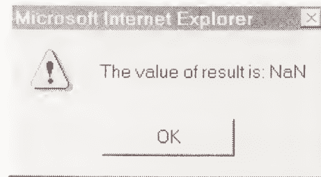

出错了。预期的结果是 6，但我们最终得到的是一个不是数字的值 (NaN)。发生了什么？数组迭代按照预期执行，但 `myValues[1]` 从未被赋值，并保持为 `undefined`。在 JavaScript 的类型转换中，将 `undefined` 乘以数字会导致 `NaN`（见第 3 章和第 4 章）。单个 `undefined` 数组元素破坏了整个计算。

虽然上一个例子显然是人为设计的，但使用带有空洞的数组需要程序员格外小心。现在我们给出该示例的“谨慎”版本，它给了预期的结果：

```javascript
var result = 1;

var myValues = new Array();

myValues[0] = 2;

myValues[2] = 3;

for (var index = 0; index < myValues.length; index++) {

  // 检查元素是否有效
  if (myValues[index] != undefined) {

    result = result * myValues[index];

  }

}

alert("The value of result is: " + result);
```

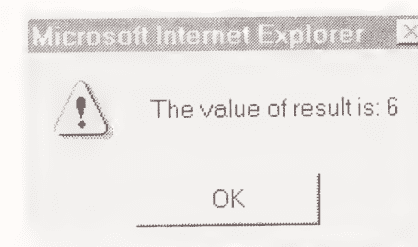

此脚本唯一的区别是乘法被放置在 `if` 语句内部。`if` 语句检查每个元素的有效性，并通过跳过 `undefined` 值来确保正确的行为。

除了提供信息外，`length` 属性还可以执行某些功能。任何包含大于赋值给 `length` 的值的索引都会立即重置为 `undefined`。因此，例如要移除数组中的所有元素，可以将 `length` 设置为零：

```javascript
var myArray = ["red", "green", "blue"];

myArray.length = 0;

alert("myArray="+myArray);
```

赋值通过将所有索引处的数据替换为 `undefined` 来移除数组中的所有内容，就像它们从未被设置过一样。在这种情况下你真的看不到什么：


将 `length` 设置为大于最后一个有效元素索引的值对数组没有影响，尽管它会增加数组中 `undefined` 槽的数量。对于读者，此脚本的结果在此：

```javascript
var myArray = ["red", "green", "blue"];

myArray.length = 5;

alert("myArray="+myArray);
```

## Concat

`concat()` 方法创建并返回一个新数组，其中包含调用它的数组的元素，后跟作为参数传递的任何数组或值的元素。它不修改原始数组。

```javascript
var myArray = ["red", "green", "blue"];

alert(myArray.concat("cyan", "yellow"));
```

这里显示了预期的更大的数组：

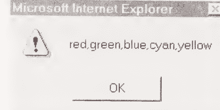

但要注意，`concat()` 不会在原位上修改数组。请注意此脚本的输出，

```javascript
var myArray = ["red", "green", "blue"];

myArray.concat("cyan", "yellow");

alert(myArray);
```

结果显示在这里：

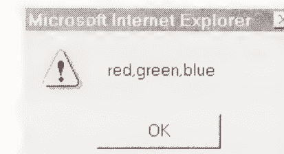

与之前讨论的 `push()` 和 `shift()` 方法不同，你需要保存返回的值；例如：

```javascript
var myArray = ["red", "green", "blue"];

myArray = myArray.concat("cyan", "yellow");
```

如果 `concat()` 的任何参数本身是数组，它会被扁平化为数组元素。扁平化不是递归的，因此包含数组元素的数组参数只有其外层会被扁平化。一个示例更清楚地说明了这种行为：

```javascript
myArray.concat("pink", "purple", "black");
// 返回 ["red", "green", "blue", "pink", "purple", "black"]

myArray.concat("white", "gray", ["orange", "magenta"]);
// 返回 "red", "green", "blue", "white", "gray", ["orange", "magenta"]

alert(myArray[myArray.length-1]);
// 显示 orange, magenta
```

> 注意：你可能会发现，如果你用 alert 输出整个数组，数组会被递归地扁平化。然而，通过 `length` 属性或单个元素，你会明显看出你拥有了嵌套数组。

## Join

JavaScript 1.1+ 和 JavaScript 2.0+ 的 `join()` 方法将数组转换为字符串，并允许程序员指定元素在结果字符串中的分隔方式。通常，当你打印数组时，输出是数组元素以逗号分隔的列表。你可以使用 `join()` 按照你喜欢的方式格式化分隔符：

```javascript
var myArray = ["red", "green", "blue"];

var stringVersion = myArray.join(" /");

alert(stringVersion);
```

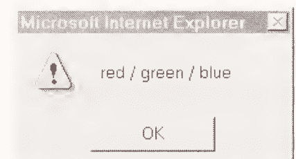

需要注意的一点是，`join()` 方法不会因为返回元素连接后的字符串作为副作用而破坏数组。如果你喜欢，可以通过重写对象的类型来实现这一点。例如，

```javascript
var myArray = ["red", "green", "blue"];

myArray = myArray.join(" /");
```

`join()` 方法是 String 对象 `split()` 方法的逆操作。

## Reverse

JavaScript 1.1+ 和 JavaScript 2.0+ 还允许你在原位上反转数组元素。正如预期的那样，`reverse()` 方法会反转被调用的数组的元素：

```javascript
var myArray = ["red", "green", "blue"];

myArray.reverse();

alert(myArray);
```

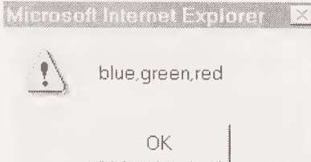

## Slice

Array 的 `slice()` 方法（自 JavaScript 1.2+ 和 JavaScript 3.0 起支持）返回调用它的数组的“切片”（子数组）。由于它不在原位操作，因此原始数组不受影响。该方法接受两个参数：起始索引和结束索引，并返回一个包含从 `start` 到不包含 `end` 索引元素的数组。如果只给出一个参数，该方法返回从该位置到数组末尾的所有元素的数组。注意，`start` 和 `end` 允许取负值。当为负时，这些值被解释为从数组末尾的偏移。例如，调用 `slice(-2)` 返回一个包含该数组最后两个元素的数组。

```javascript
var myArray = [1, 2, 3, 4, 5];

myArray.slice(2); // 返回 [3, 4, 5]

myArray.slice(1, 3); // 返回 [2, 3]

myArray.slice(3, 4); // 返回 [4] (原文注释有误，实际返回[4])

myArray.slice(-3, -1); // 返回 [3, 4]

myArray.slice(-4, 3); // 返回 [2, 3]

myArray.slice(3, 1); // 返回 []
```

## Splice

`splice()` 方法在 JavaScript 1.2+ 和 JavaScript 5.5+ 中可用，可用于原位替换或删除数组元素。任何被删除的元素都会被返回。它接受数量数量的参数，第一个参数是强制的。语法可以总结为：

> splice(start, deleteCount, replacevalues);

第一个参数 `start` 是执行操作的索引。第二个参数 `deleteCount` 是从索引 `start` 开始要删除的元素个数。第三个参数 `replacevalues` 是要插入数组的元素。该方法返回被删除的元素。

```javascript
var myArray = ["red", "green", "blue"];

myArray.splice(1, 1, "yellow");

alert(myArray); // ["red", "yellow", "blue"]
```

## Sort

Array 最有用的方法之一是 `sort()`。自 JavaScript 1.1 和 JavaScript 2.0+ 起支持，它类似于标准库中的 `qsort` 函数。默认情况下，它根据字典序对数组进行排序。它是通过首先将数组元素转换为字符串然后进行排序来实现的。这会导致意外的结果。考虑以下：

```javascript
var myArray = [14,52,3,14,45,36];

myArray.sort();

alert(myArray);
```

如果你运行此脚本会发现根据这种排序，3 比 14 大！你可以在这里看到结果。


此结果的原因是从字符串排序的角度来看，14 比 3 小。幸运的是，`sort` 函数非常灵活，我们可以修复这个问题。如果你想按照不同的顺序排序，可以向 `sort()` 传递一个由你定义的比较函数。该函数接受两个参数，如果第一个参数应该在排序中位于第二个参数之前，则返回一个负值（认为：第一个“小于”第二个）。如果两个元素在排序中相等，则返回零。如果第一个参数应该位于第二个参数之后，函数应返回一个正值（认为：第一个“大于”第二个）。例如，如果我们想执行自然排序，我们可以写这样一个函数：

```javascript
function myCompare(x, y) {

  if (x < y) {

    return -1;

  } else if (x === y) {

    return 0;

  } else {

    return 1;

  }

}
```

然后我们可以在上一个示例中使用该函数：

```javascript
var myArray = [14,52,3,14,45,36];

myArray.sort(myCompare);

alert(myArray);
```

在这里我们得到了预期的结果：


如果你想让代码更简洁，可以使用第 5 章中描述的匿名函数。考虑这个示例，它在偶数之前对奇数进行排序：

```javascript
var myArray = [1,2,3,4,5,6];

myArray.sort( function(x, y) {

    if (x % 2) 

        return -1;

    if (x % 2 == 0) 

        return 1;

    }

);

alert(myArray);
```

结果所示：

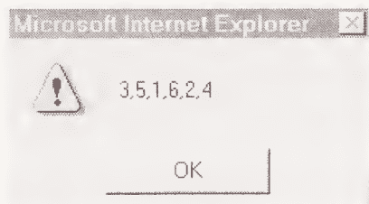

注意，我们可以通过包含确保偶数和奇数值各按升序排列的代码，使这个示例变得更加健壮。

## 多维数组

虽然语言中没有显式支持，但 JavaScript 支持多维数组。多维数组是一个元素为数组的数组。例如：

```javascript
var tableOfValues = [[2, 5, 7], [3, 1, 4], [6, 8, 9]];
```

定义了一个二维数组。多维数组中的数组元素访问方式正如你预期的那样，通过使用一组方括号来指定每个维度中所需元素的索引。在以前的示例中，数字 4 是第二个数组的第三个元素，因此其地址表示为 `tableOfValues[1][2]`。同样，7 位于 `tableOfValues[0][2]`，9 位于 `tableOfValues[2][2]`。

## 通过原型扩展数组

在 JavaScript 中，所有非原始数据都派生自 `Object` 对象，这在上一章中讨论过。我们应当记住，正因如此，我们可以通过对象的原型向任何我们喜欢的对象添加新方法和属性。例如，我们可以为数组添加一个特殊的 `display()` 方法，向用户提示数组的内容。

```javascript
function myDisplay() {

  if (this.length != 0) {

    alert(this.toString());

  } else {

    alert("The array is empty");

  }

}

Array.prototype.display = myDisplay;
```

然后我们就可以使用新的 `display` 方法打印数组的值了，如下所示：

```javascript
var myArray = [4,5,7,32];

myArray.display();
// 显示数组值

var myArray2 = [];

myArray2.display();
// 显示字符串 "The array is empty"
```

通过使用原型，我们可以“修复”在 Internet Explorer 5.5 之前的浏览器中缺少 `pop()` 和 `push()` 方法的问题。例如，要在旧版浏览器中添加 `pop()` 方法，或在较新版本的浏览器中覆盖内置的 `pop()`，我们将使用：

```javascript
function myPop() {

  if (this.length != 0) {

    var last = this[this.length-1];

    this.length--;

    return last;

  }

}

Array.prototype.pop = myPop;
```

我们自己实现的 `push()` 稍微复杂一点，如下所示：

```javascript
function myPush() {

  var numtopush = arguments.length;

  if (numtopush > 0) {

    for (var i=0; i < numtopush; i++) {

      this.length++;

      this[this.length-1] = arguments[i];

    }

  }

}

Array.prototype.push = myPush;
```

我们可以看到，掌握上一章的观点确实大有用场！虽然我们自己的函数可以解决旧版浏览器的问题，但不要认为使用原型将解决你在 JavaScript 早期版本中遇到的所有问题。JavaScript 数组实现中的严重缺陷（如 Netscape 2 中）可能无法通过原型修复，因为原型本身也可能缺失。然而，如果你想为 Internet Explorer 4 或 Netscape 3 添加 `push()` 和 `pop()` 支持，你会发现这段代码有效。

## 数组的问题

JavaScript 允许你将对象作为数组。例如，你可以向用户定义的对象添加数组元素：

```javascript
var hybrid = new Object();

hybrid.someVal = "This is an instance property";

hybrid[0] = "This is an array element";
```

这种能力偶尔有用，但应该谨慎使用。节制的原因是，JavaScript 1.0 中的对象属性与数组对象值共享相同的内部“槽位”。对于我们的示例，

```javascript
var hybrid = new Object();

hybrid.someVal = "This is an instance property";

hybrid[0] = "This clobbers someVal under JavaScript 1.0!";
```

在 JavaScript 1.0 下，`someVal` 属性会被赋值给 `hybrid` 第一位置的字符串所取代。

JavaScript 1.0 中的数组还有更多棘手的方面：没有 `Array()` 构造函数，没有数组方法，且用户创建的数组没有 `length` 属性。程序员在 JavaScript 1.0 中创建数组的方法是声明一个用户定义的对象并使用我们之前看到的语法。如果你必须包含对 JavaScript 1.0 的支持，创建自己的数组对象是你的最佳选择。这并不困难，这样做可能是一个很好的练习。

## Date

`Date` 对象是用于表示日期和时间的内置对象。它存储自 Unix 纪元（1970年1月1日 00:00:00 UTC）的毫秒数。创建 `Date` 对象的有几种方式：

- 不带参数：创建当前日期和时间。
- 字符串参数：根据指定的字符串创建 `Date`。
- 数字参数：根据自纪元的毫秒数创建 `Date`。
- 多个参数（年、月、日、时、分、秒）：根据这些整数值创建 `Date`。注意月份索引从0开始（0代表一月，11代表十二月）。

## 创建日期

`Date()` 构造函数的语法比我们看到的其他构造函数强大得多。构造函数接受可选参数，允许创建表示过去或未来的 `Date` 对象。表7-1 描述了构造函数的参数。

| 参数 | 描述 | 示例 |
| --- | --- | --- |
| 无 | 创建当前日期和时间。 | `var rightNow = new Date();` |
| "month dd, yyyy:mm:ss” | 创建由指定的月份、日(dd)、年(yyyy)、时(hh)、分(mm)和秒(ss)表示日期。省略的值将设置为零。 | `var birthDay = new Date("March 24, 1970"); Date("March 24, 1970 24:12:59")` |
| 毫秒数 | 创建以自纪元的毫秒数表示的日期。 | `var someDate = new Date(79560003020)` |
| yyyy, mm, dd | 创建由整数值年(yyyy)、月(mm)和日(dd)指定的日期。 | `var birthDay = new Date(1970, 2, 24)` |
| yyyy, mm, dd, hh, ss | 创建由整数值年、月、日、时、分、秒指定的日期。 | `var birthDay = new Date(1970, 2, 24, 15, 0, 0)` |
| yyyy, mm, dd, ss, ms | 创建由整数值年、月、日、时、秒和毫秒指定的日期。 | `var birthDay = new Date(1970, 2, 24, 15, 0, 250)` |

表 7-1 值得进行一些说明。构造函数参数的字符串版本可以是任何可以被 `Date.parse()` 方法解析的日期字符串。在最后两种格式的语法中，年、月、日之外的参数是可选的。如果省略了它们，它们将被设置为零。包含毫秒的最终语法仅在 JavaScript 1.3 中可用。

由于用两个数字表示年份会产生歧义，因此在指定年份时应始终使用四位数字。可以使用本节讨论的 `getFullYear()` 方法来实现。

需要注意的是，你创建的 `Date` 对象是静态的。它们并不包含跳动的时钟。`Date` 对象应该根据你的特定应用进行拆解、操作和讨论。如果你需要使用某种计时器，`Window` 对象的 `setInterval` 和 `setTimeout` 方法要合适得多。这些方法在附录 B 以及后续面向应用的章节中都会讨论。然而，你可以计算两个日期之间的差值：

```javascript
var firstDate = new Date(1995, 0, 6);

var secondDate = new Date(1999, 11, 2);

var difference = secondDate - firstDate;

alert(difference);
```

结果表示从 1995 年 1 月 6 日到 1999 年 12 月 2 日之间经过的大约毫秒数：


将此转换为更实用的值并不困难，接下来将讨论。

## 操作日期

为了隐藏 `Date` 对象将值存储为从元开始的毫秒偏移量的事实，通过它们提供的方法对日期进行操作。也就是说，`Date` 值是通过调用方法来设置和检索的，而不是直接设置或读取属性。这些方法会自动为你处理毫秒偏移量转换为人类友好的格式，并反之。下面的示例说明了几个常用的 `Date` 方法。

```javascript
var myDate = new Date();

var year = myDate.getFullYear();

year = year + 1;

myDate.setYear(year);

alert(myDate);
```

这个示例获取当前日期并在其基础上增加一年。结果所示：

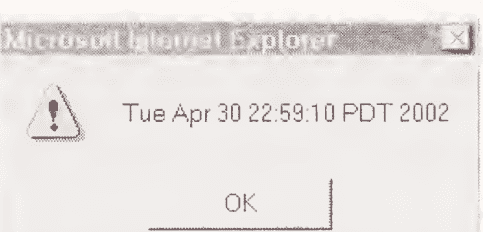

JavaScript 提供了一套完整的 `get` 和 `set` 方法来读写日期的每个字段，包括 `getDate()`、`setDate()`、`getMonth()`、`setMonth()`、`getHours()`、`setHours()`、`getMinutes()`、`setMinutes()`、`getTime()`、`setTime()` 等。此外，还包含了这些方法的 UTC 版本：`getUTCMonth()`、`getUTCHours()`、`setUTCMonth()`、`setUTCHours()` 等。这些方法中的每一个都需要特殊的注释：`getDate()` 和 `setDate()`。它们被用于操作以 0（星期日）到 6（星期六）整数存储的星期几。这里有一个在实践中使用许多常用 `Date` 方法的示例（结果如图 7-1 所示）：

```javascript
var today = new Date();

document.write("The current date : "+today+"<br>");

document.write("Date.getDate() : "+today.getDate()+"<br>");

document.write("Date.getDay() : "+today.getDay()+"<br>");

document.write("Date.getFullYear() : "+today.getFullYear()+"<br>");

document.write("Date.getHours() : "+today.getHours()+"<br>");

document.write("Date.getMilliseconds() : "+today.getMilliseconds()+"<br>");

document.write("Date.getMinutes() : "+today.getMinutes()+"<br>");

document.write("Date.getMonth() : "+today.getMonth()+"<br>");

document.write("Date.getSeconds() : "+today.getSeconds()+"<br>");

document.write("Date.getTime() : "+today.getTime()+"<br>");

document.write("Date.getTimezoneOffset() : "+today.getTimezoneOffset()+"<br>");

document.write("Date.getFullYear() : "+today.getFullYear()+"<br>");
```

附录 B 给出了 `Date` 对象支持的方法列表。

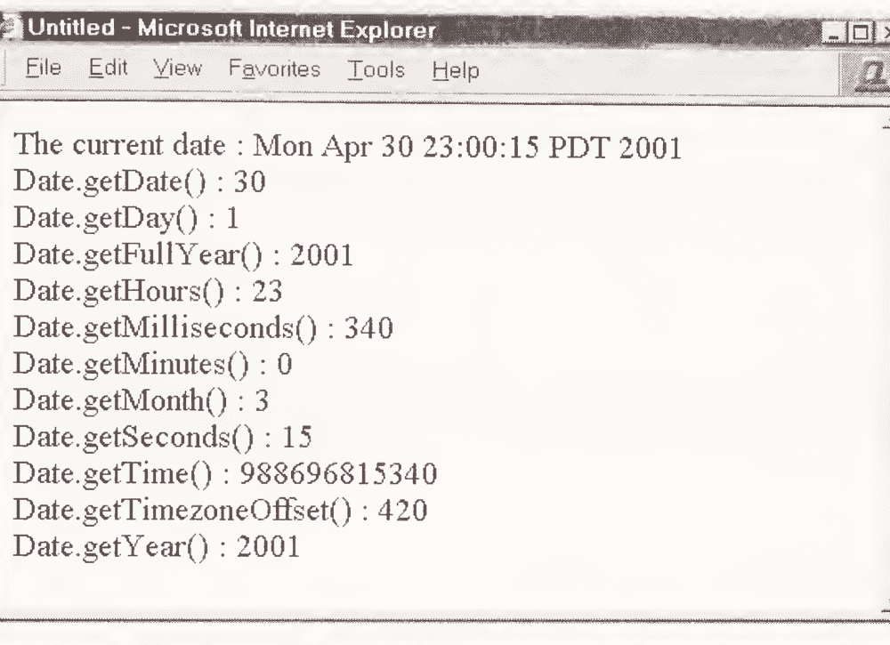

**图 7-1.** 运行中的常用日期函数

## 将日期转换为字符串

有多种方法可以将 `Date` 对象转换为字符串。如果你需要创建自定义格式，最好的方法是从对象中读取各个组件并手动拼接字符串。如果你想创建一个标准格式的字符串，`Date` 提供了三种方法来实现：`toString()`、`toUTCString()` 和 `toGMTString()`，它们的用法将在下文中说明。需要注意的是，由于 `toUTCString()` 和 `toGMTString()` 按照 (GMT) 标准格式化，而 `toString()` 则根据本地时间格式化。结果如下方的示例所示：

```javascript
var appointment = new Date("February 24, 1996 7:45");

document.write("toString():", appointment.toString());

document.write("<br>");

document.write("toUTCString():", appointment.toUTCString());

document.write("<br>");

document.write("toGMTString():", appointment.toGMTString());
```

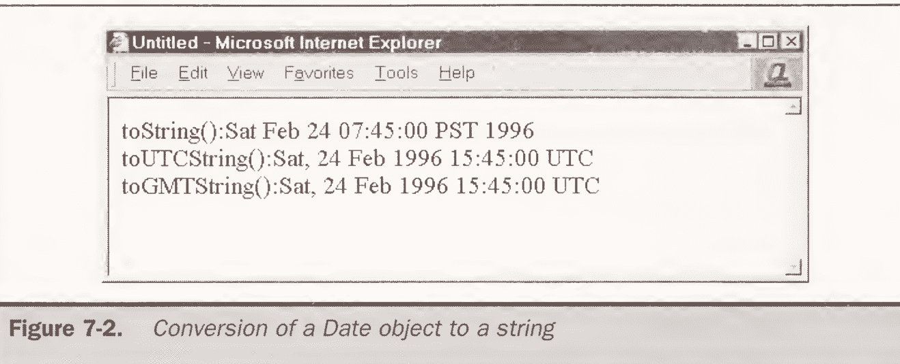

## 将字符串转换为日期

由于你可以向 `Date` 构造函数传递字符串，似乎 JavaScript 提供了一种机制将字符串转换为 `Date` 对象。它是通过 `Date.parse()` 方法实现的，该方法返回从元开始的毫秒数。注意，该方法是 `Date` 类的方法而不是 `Date` 实例的方法。`parse()` 方法非常灵活，可以识别表 7-1 所示的日期，以及像 "Dec" 这样的月份缩写。例如：

```javascript
// 设置为1982年12月14日
var myDay = "12/14/82";

// 转换为毫秒
var converted = Date.parse(myDay);

// 创建日期对象
var myDate = new Date(converted);

// 输出日期
```

这创建了具有所示值的 `myDate`:

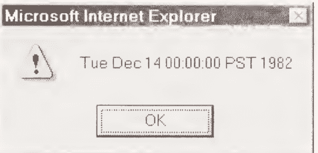

如果你不确定想要转换的特定字符串是否会被 `Date.parse()` 解析，你需要检查它返回的值。如果它无法将给定字符串转换为日期，该方法将返回 `NaN`。例如，示例中的调用：

```javascript
var myDay = "Friday, 2002";

var invalid = Date.parse(myDay);
```


结果为 `NaN`，因为 `myDay` 不包含足够的日期信息。

## 日期表示的局限性

不应低估 `Date` 对象的细节。记住 `ECMAS262` 是核心 JavaScript 特性的标准。虽然大多数浏览器实现遵循规范，但 `Date` 对象的行为偏差并不少见。例如，`Netscape 2` 中的 `Date` 支持非常糟糕。由于存在许多 Bug，建议程序员在该平台上避免所有非简单的日期操作。`Netscape 3` 稍好一些，但在正确处理时区时仍存在问题。至少在在这两个版本的 `Netscape` 中操作日期时应格外小心。`Internet Explorer 3` 不允许元之前的日期。然而，`Netscape 4+` 和 `Internet Explorer 4+` 可以处理元之前或之后几千年的日期，这足以处理大多数任务。附录 B 包含了各种 `Date` 方法的完整细节。`Global` 对象是一个很少被提及的对象，它是用于不属于任何其他对象的顶级属性和方法的汇总地。你无法创建 `Global` 对象的实例；它在 `ECMA262` 标准中被定义为全局访问的、否则无所处的属性提供一个位置。它提供了可以在 JavaScript 任何地方使用的基本属性。表 7-2 总结了它最有用的方法。

### 表 7-2. 全局可用方法

| 方法 | 描述 | 示例 |
| --- | --- | --- |
| `escape()` | 接收一个字符串并返回一个字符串，其中所有的字母数字字符（如空格、制表符和特殊字符）都被替换为 %xx 形式的十六进制形式。 | `var aString="O'Neill & Sons"; // aString="O'Neill & Sons" // aString=escape(aString); // aString="O%27Neill%20%26%20Sons"` |
| `eval()` | 接收一个字符串并作为 JavaScript 代码执行。 | `var x; var aString="5+9"; x=aString; // x 字符串 "5+9" x=eval(aString); // x 将包含 14` |
| `isFinite()` | 返回布尔值，指示其数字参数是否为有限。 | `var x; x=isFinite('56'); // x is False x=isFinite(Infinity); // x is false` |
| `isNaN()` | 返回布尔值，指示其数字参数是否为 NaN。 | `var x; x=isNaN('56'); // x is False x=isNaN(0); // x is true x=isNaN(NaN); // x is true` |
| `parseFloat()` | 将字符串参数转换为浮点数并返回该值。如果字符串无法转换，则返回 NaN。该方法应该处理以数字开头的字符串并提取其所需的部分，但其他混合字符串将不会转换。 | `var x; x=parseFloat("33.01568"); // x is 33.01568 x=parseFloat("47.6k-red-dog"); // x is 47.6 x=parseFloat("a567.34"); // x is NaN x=parseFloat("won't work"); // x is NaN` |
| `parseInt()` | 将字符串参数转换为整数并返回该值。如果字符串无法转换，则返回 NaN。类似于 `parseFloat()`，该方法应该处理以数字开头的字符串并提取其所需的部分，但其他混合字符串将不会转换。 | `var x; x = parseInt("-53"); // x is -53 x = parseInt("33.01568"); // x is 33 x = parseInt("47.6k-red-dog"); // x is 47 x = parseInt("a567.34"); // x is NaN x = parseInt("won't work"); // x is NaN` |
| `unescape()` | 接收 %xx 形式的十六进制字符串值，并返回传入值的 ISO-Latin-1 ASCII 等效值。 | `var aString="%27Neil%2026%20Sons"; aString = unescape(aString); // aString="O'Neill & Sons" aString = unescape("%64%56%26%23"); // aString="dV&#"` |

`Global` 对象还定义了常量 `NaN` 和 `Infinity`，这些常量在表 7-2 的示例中被使用。然而，本章稍后讨论的 `Number` 对象也提供了类似的常量。

全局方法非常有用，将贯穿全书的示例。有志的 JavaScript 程序员应该尝试熟悉它们。一个有趣的考虑因素是 `escape()` 和 `unescape()` 提供的字符串转义。首先，我们看到 Web 上通过这种方式来创建 URL 安全字符串。你可能在处理表单时看到过这些。虽然这些方法极其有用，但 ECMAScript 规范建议废弃 `escape()` 和 `unescape()`，取而代之的是命名更贴切的 `encodeURI`、`encodeURIComponent()`、`decodeURI`、`decodeURIComponent()`。可以在这里进行说明：

```javascript
var aURLFragment = encodeURIComponent("term=ONeill & Sons");
document.println("Encoded Component: " + aURLFragment);
document.println("Encoded URI Component: " + decodeURIComponent(aURLFragment));
var aURL = encodeURI("http://www.pinterest.com/cgi-bin/search?term=ONeill & Sons");
document.println("Encoded URI: " + aURL);
document.println("Encoded URI: " + decodeURIComponent(aURL));
```

虽然这些方法是规范的一部分，但建议程序员在更多浏览器支持它们之前暂时避免使用它们，并转而依赖 `escape()` 和 `unescape()`。关于 `Global`（包括这些问题）的文档可以在附录 B 中找到。

## Math

`Math` 对象包含一组常量和方法，能够实现第 4 章中基础算术运算符更复杂的数学操作。你不能像实例化 `Array` 或 `Date` 那样实例化 `Math` 对象。`Math` 对象是静态的（由解释器自动创建），因此可以直接访问其属性。例如，要计算 10 的平方根，直接通过对象访问 `sqrt()` 方法：

```javascript
var root = Math.sqrt(10);
```

### 表 7-3. Math 提供的常量

| 属性 | 描述 |
| --- | --- |
| `Math.E` | 自然对数的底数（欧拉常数 e） |
| `Math.LN2` | 2 的自然对数 |
| `Math.LN10` | 10 的自然对数 |
| `Math.LOG2E` | e 的以 2 为底的对数 |
| `Math.LOG10E` | 以 10 为底的对数 |
| `Math.PI` | 圆周率 π |
| `Math.SQRT1_2` | 1/2 的平方根 |
| `Math.SQRT2` | 2 的平方根 |

### 表 7-4. Math 提供的方法

| 方法 | 返回 |
| --- | --- |
| `Math.abs(arg)` | arg 的绝对值 |
| `Math.acos(arg)` | 反余弦 |
| `Math.asin(arg)` | 反正弦 |
| `Math.atan(arg)` | 反正切 |
| `Math.atan2(y, x)` | y 与 x 轴之间的角（极坐标） |
| `Math.ceil(arg)` | 大于或等于 arg 的最小整数 |
| `Math.cos(arg)` | 余弦 |
| `Math.exp(arg)` | e 的 arg 次方 |
| `Math.floor(arg)` | 小于等于 arg 的最大整数 |
| `Math.log(arg)` | arg 的自然对数 |
| `Math.max(arg1, arg2)` | arg1 和 arg2 中的较大值 |
| `Math.min(arg1, arg2)` | arg1 和 arg2 中的较小值 |
| `Math.pow(arg, arg2)` | arg 的 arg2 次方 |
| `Math.random()` | [0,1] 之间的随机数 |
| `Math.round(arg)` | 四舍五入到整数 |
| `Math.sin(arg)` | 正弦 |
| `Math.sqrt(arg)` | 平方根 |
| `Math.tan(arg)` | 正切 |

`Math` 对象有几个方面需要注意。三角函数使用弧度，因此在使用它们之前需要将角度测量乘以 `Math.PI / 180`。此外，由于浮点运算的不精确性，你可能会发现结果略有偏差。例如 `Math.PI` 的正弦接近零：

```javascript
alert(Math.sin(Math.PI));
```

`Math` 似乎不直接提供 e 以外的底数。然而，通过以下数学恒等式：

> log_a n = (log_e n) / (log_e a)

可以计算任意底数的对数。例如，你可以这样计算 64 的以 2 为底的对数：

```javascript
var x = Math.log(64) / Math.log(2);
```

## 随机数

由于 `Math.random()` 方法返回零到一之间的值，你必须将其返回值标准化以适应应用程序所需的范围。获取 m 到 n（包含）随机整数的简单方法如下：

```javascript
Math.round(Math.random() * (n - m)) + m;
```

这种方式生成的随机数对于大多数应用程序已足够，但如果需要“高质量”的随机性，应该使用更高级的技术。

## 简单的计算

在大量使用 `Math` 对象时，使用 `with` 语句非常方便。这允许你在不加 `Math` 前缀的情况下使用 `Math` 属性。可以通过示例说明这一概念（使用余弦定理计算边长）：

```javascript
with (Math) {
  var a = 3, b = 4, c;
  var angleA = atan(a / b);
  var angleB = atan(b / a);
  var angleC = PI / 2;
  c = pow(a, 2) + pow(b, 2) - 2 * a * b * cos(angleC);
  c = sqrt(c);
}
```

## Number

`Number` 是与原始数字数据类型对应的内置对象。如第 3 章所述，所有数字都以 IEEE 754-1985 双精度浮点格式表示。这种表示法长度 64 位，允许浮点量级从 ±1.7976×10³⁰⁸ 到 ±2.2250×10⁻³⁰⁸。`Number` 构造函数接受一个可选参数指定其初始值：

```javascript
var x = new Number();
var y = new Number(17.5);
```

### 表 7-5. Number 对象的属性

| 属性 | 值 |
| --- | --- |
| `Number.MAX_VALUE` | 可表示的最大幅值 |
| `Number.MIN_VALUE` | 可表示的最小幅度 |
| `Number.POSITIVE_INFINITY` | 特殊值 Infinity |
| `Number.NEGATIVE_INFINITY` | 特殊值 -Infinity |
| `Number.NaN` | 特殊值 NaN |

该对象唯一有用的方法是 `toString()`，它返回字符串形式的数字值。当然，通常很少需要它，因为当我们需要将数字类型作为字符串使用时，它会自动转换为字符串。

## String（字符串）

`String` 是与原始字符串数据类型对应的内置对象。它包含了大量的方法，用于字符串操作、检查、子字符串提取，甚至将字符串转换为标记过的 HTML。关于所有 `String` 方法的完整描述（包括示例）包含在附录 B。在这里我们重点介绍了其中大部分方法，并关注最常用的那些。

`String()` 构造函数接受一个可选参数，用于指定其初始值。

```javascript
var s = new String();
var headline = new String("Dewey Defeats Truman");
```

由于你可以在原始字符串上调用 `String` 方法，程序员在实践中很少创建 `String` 对象。

`String` 唯一的属性是 `length`，它表示字符串中的字符数。

```javascript
var s = "String fun in JavaScript";
var strlen = s.length;
// strlen 被设置为 24
```

当字符串发生变化时，长度属性会自动更新，且不能由程序员设置。没有直接操作字符串的方法。这意味着 `String` 方法不会在“原地”对其数据进行操作。任何改变字符串值的任何方法都会返回一个包含结果的字符串。如果你想更改字符串的值，必须将字符串赋值为操作的结果。例如，使用 `toUpperCase()` 方法将字符串转换为大写，需要以下语法：

```javascript
var s = "abc";
s = s.toUpperCase();
// s 是 "ABC"
```

调用 `s.toUpperCase()` 而不将 `s` 赋值为其结果将不会改变 `s` 的值。以下示例不会修改 `s`：

```javascript
var s = "abc";
s.toLowerCase();
// s 仍然 "abc"
```

其他字符串处理方法（如 `toLowerCase()`）的工作方式相同；忘记这一点是新 JavaScript 程序员常犯的错误。

### 检查字符串

可以使用 `charAt()` 方法检查单个字符。它接受一个整数，表示要返回的字符。由于 JavaScript 不区分单个字符和字符串，因此它返回的是一个包含所需字符的字符串。记住，像数组一样，JavaScript 字符串中的字符是从 0 开始枚举的；所以：

```javascript
"JavaScript".charAt(1);
```

检索到 "a"。你也可以使用 `charCodeAt()` 获取与特定字符相关的数值值。由于 Unicode 中 "a" 的值是 97，以下代码：

```javascript
"JavaScript".charCodeAt(1);
```

返回 97。

使用 `fromCharCode()` 方法从字符码进行转换是非常容易的。与其他方法不同，这通常用于通用对象 `String` 本身，而不是字符串实例。例如：

```javascript
var aChar = String.fromCharCode(82);
```

这会将变量 `aChar` 的值设置为 "R"。可以通过逗号分隔来传递多个代码。例如：

```javascript
var aString = String.fromCharCode(68, 79, 71);
```

这会将 `aString` 设置为 "DOG"。

> 对于任何传递给 `fromCharCode()` 方法的未知值，你可能会收到一个 `?` 值。

`indexOf()` 方法接受一个字符串参数，并返回该参数在字符串中首次出现的索引。例如：

```javascript
"JavaScript".indexOf("Script");
```

返回 4。如果未找到参数，则返回 -1。该方法还接受一个可选的第二个参数，用于指定开始搜索的索引。如果指定了，该方法将返回参数在起始索引之后首次出现的索引。例如：

```javascript
"JavaScript".indexOf("a", 2);
```

返回 3。另一个相关方法是 `lastIndexOf()`，它返回作为参数的字符串最后一次出现的索引。它也接受一个可选的第二个参数，指示结束搜索的索引。例如：

```javascript
"JavaScript".lastIndexOf("a", 2);
```

返回 1。如果未找到字符串，该方法也会返回 -1。

在 JavaScript 中有许多提取子字符串的方法。最好的方法是使用 `substring()`。`substring()` 的第一个参数指定所需子字符串开始的索引。可选的第二个参数指定所需子字符串结束的索引。该方法返回一个包含子字符串的字符串，从指定的索引开始，但不包括由第二个参数指定的索引处的字符。例如：

```javascript
"JavaScript".substring(3);
```

返回 "aScript"，以及

```javascript
"JavaScript".substring(3, 7);
```

返回 "aSc"。`slice()` 方法是 `substring()` 稍微强大的版本。它接受与 `substring()` 相同的参数，但允许索引为负数。负索引被视为相对于字符串末尾的偏移量。

`match()` 和 `search()` 方法使用正则表达式对字符串进行更复杂的检查。

### 操作字符串

人们对字符串可以执行的最基本操作是拼接。使用 `+` 运算符拼接字符串应该是很熟悉的。`String` 对象提供了 `concat()` 方法来实现。它接受任意数量的参数并返回调用的字符串。例如：

```javascript
"JavaScript".concat("is", "flexible");
```

将 "JavaScript is flexible" 设置给 `s`。

`split()` 方法根据分隔符分解字符串。第一个参数是分隔符，第二个参数指定拆分的最大元素数量。例如：

```javascript
var wordArray = "A simple example".split(" ");
```

将 `wordArray` 设置为三个元素 "A", "simple", "example"。由于 `split()` 的行为存在一些微妙问题，强烈建议阅读附录 B 中的完整描述。

### 将字符串标记为 HTML

由于 JavaScript 常用于操作网页，`String` 对象提供了一系列将字符串标记为 HTML 的方法。这些方法中的每个都会返回由 HTML 标签包围的字符串。例如，`bold()` 方法在其调用的字符串周围放置 `<B>` 和 `</B>`，如下：

```javascript
var s = "This is very important".bold();
```

在 `s` 中放置：

```html
<B>This is very important</B>
```

你可能知道如何对字符串应用多个 HTML 相关方法。可以通过链式调用轻松实现。虽然链式调用看起来令人畏惧，但在它们从字符串创建 HTML 标记时非常有用。例如：

```javascript
var s = "This is important".bold().strike().blink();
```

将以下字符串赋值给 `s`：

```html
<BLINK><STRIKE><B>This is important</B></STRIKE></BLINK>
```

当放在 Web 文档中时，这显示了一个划线的加粗字符串。忽略这种字符串极其令人烦人的事实，该示例说明了如何为了效率而将方法调用链在一起。比起逐个调用 `s`，编写串联调用更简单。注意方法是如何“内部优先”调用的，或者等句话说，是从左到右。

各种 HTML 方法对应常见的 HTML 标签。所有 HTML 相关字符串方法的完整列表可以在表 7-6 中找到。

### 表 7-6. HTML 相关字符串方法

| 方法 | 说明 | 示例 |
| --- | --- | --- |
| `anchor(name)` | 创建一个由 `<A>` 元素指定的命名锚点，使用参数 name 作为相应属性的值。 | `var x = "Marked point".anchor("marker"); // <A NAME="marker">Marked point</A>` |
| `big()` | 使用提供的字符串创建一个 `<BIG>` 元素。 | `var x = "Grow".big(); // <BIG>Grow</BIG>` |
| `blink()` | 使用提供的字符串创建一个被 `<BLINK>` 标签围的闪烁文本元素（尽管 Internet Explorer 不支持 `<BLINK>` 元素）。 | `var x = "Bad Netscape".blink(); // <BLINK>Bad Netscape</BLINK>` |
| `bold()` | 使用提供的字符串创建一个由 `<B>` 指定的粗体文本元素。 | `var x = "Behold!".bold(); // <B>Behold!</B>` |
| `fixed()` | 使用提供的字符串创建一个由 `<TT>` 指定的等宽文本元素。 | `var x = "Code".fixed(); // <TT>Code</TT>` |
| `fontcolor(color)` | 创建一个由参数 color 指定颜色的 `<FONT>` 标签。传递的值应为有效的十六进制字符串值，或指定颜色名称的字符串。 | `var x = "Green".fontcolor("FF0000"); // <FONT COLOR="FF0000">Green</FONT>` |
| `fontsize(size)` | 接收由 size 指定的参数（范围应在 1-7 之间或 1-7 的相对 +/- 值），并创建一个 `<FONT>` 元素。 | `var x = "Change size".fontsize(7); // <FONT SIZE="7">Change size</FONT>` |
| `italics()` | 创建一个斜体元素 `<I>`。 | `var x = "Special".italics(); // <I>Special</I>` |
| `link(location)` | 接收参数 location，并使用字符串作为链接文本通过 `<A>` 元素形成链接。 | `var x = "click here".link("http://www.pint.com/"); // <A HREF="http://www.pint.com/">click here</A>` |
| `small()` | 使用提供的字符串创建一个 `<SMALL>` 元素。 | `var x = "Shrink".small(); // <SMALL>Shrink</SMALL>` |
| `strike()` | 使用提供的字符串创建一个 `<STRIKE>` 元素。 | `var x = "Legal".strike(); // <STRIKE>Legal</STRIKE>` |
| `sub()` | 使用提供的字符串创建一个由 `<SUB>` 指定的下标元素。 | `var x = "test".sub(); // <SUB>test</SUB>` |
| `sup()` | 使用提供的字符串创建一个由 `<SUP>` 指定的上标元素。 | `var x = "test".sup(); // <SUP>test</SUP>` |

> 你可能会注意到，向这些 HTML 方法传递任何内容都是可能的。例如，`fontcolor('junk')` 会很乐意地创建一个包含标记 `<FONT COLOR="junk">bad</FONT>` 的字符串。这些方法不提供任何与 HTML 相关的范围或类型检查。

在表 7-6 中，可以看到这些 JavaScript 方法是如何产生如 `<BLINK>` 这样的大写且不符合 XHTML 标准的标记的。事实上，许多如 `fontcolor` 这样的方法会创建包含已废弃元素的标记字符串，这些元素在 HTML 4 中已被淘汰，转而使用基于 CSS 的呈现。考虑到 XHTML 的采用速度较慢，且整个 Web 世界才最近开始广泛采用 CSS，这些元素的过渡不太可能很快发生。遗憾的是，这种情况确实会发生，我们将拥有一组更好的 HTML-JavaScript 方法，而不是像文档对象模型那样，让我们无法方便地创建和操作任何 HTML 元素（正如第 10 章讨论）。在结束本章之前，理解一个与类型相关的细微问题是非常关键的。

## 对象类型与原始类型

读完本章后应该很清楚，正如第 3 章所讨论的，每个原始类型都有一个对应的内置对象。这并不是显而易见的，因为当访问其中某一个属性时，原始数据值会被透明地转换为相应的对象。在两种情况下，你可能倾向于将变量声明为内置对象而不是原始类型。第一种情况是你计划向对象添加实例属性。因为你不能向原始数据添加实例属性，所以如果你想这样做，就必须将变量声明为相应的对象。第二个原因是如果你希望将数据的引用传递给函数。由于 JavaScript 使用值传递，原始数据的副本会被传递给函数参数；函数无法修改原始数据。相反，对象是引用类型。调用的函数接收引用的副本，因此可以修改原始数据。

在这两种情况之外，没有特殊理由倾向于使用布尔、字符串或数字的对象而非它们的原始对应项。选择其中一个还是另一个极可能对性能或内存使用产生任何显著影响。程序员应该使用他们认为最方便的类型。对 Web 上真实脚本的检查显示，绝大多数都使用原始类型。

## 总结

内置对象是 JavaScript 语言本身提供的对象，例如 `Array`、`Boolean`、`Date`、`Math`、`Number` 和 `String`。许多内置对象与语言支持的各种数据类型相关。程序员经常访问与数组或字符串等复杂数据类型相关的内置对象的方法和属性。`Math` 和 `Date` 对象在 JavaScript 应用中也常用。然而，很多时候，原始类型也是对象——正如 JavaScript 中的其他所有内容（包括函数）一样——这一点往往被忽视。

# 第 8 章：正则表达式

## 正则表达式的必要性

文本数据处理是 JavaScript 中的常见任务。检查表单输入的数据、创建和解析 Cookie、构建和修改页面内容可能涉及复杂的操作。强大的文本能力使其成为 Web 应用热门选择的原因。在 JavaScript 中，正则表达式允许你指定字符模式而无需显式列出。正则表达式（有时简称为 regex）长期一直是操作系统的一部分。熟悉 `grep`、`sed`、`awk` 等工具的读者起初觉得正则表达式很奇怪，但很快就会意识到它们的用处。如果你在 DOS 中用过 `dir` 命令或在 UNIX 中用过 `ls`，你就用过如 `*` 这样的通配符。这些都是原始正则表达式！深入使用过正则表达式（尤其是 Perl）的读者会发现 JavaScript regex 非常熟悉。本章介绍 JavaScript 的 `RegExp` 对象。涵盖了基础语法、常见任务以及正则表达式的高级应用。我们从基础语法开始，并在每一节添加更多功能。

考虑表单提交中验证电子邮件地址的任务。目标是在提交到远程服务器之前验证给定地址的格式，以防止处理由于拼写错误导致的无效数据。你可能首先检查字符串是否包含 "@" 符号。然后你可能确保 "@" 前后至少有一个字符，并且字符串包含至少一个点。然后你可能会检查最后一个点之后的字符集的有效性，也许针对国家代码和顶级域名如 "org"、"com" 和 "net" 进行检查。显然，通过逐一检查字符来编写检查这些条件的代码将是非常麻烦的。现在想象将字符串中所有的电子邮件地址替换为其他内容会更繁琐得多。你不仅需要识别所有有效地址，还要编写代码逐一删除并替换它们。

正则表达式通过允许程序员指定与字符串进行“匹配”的模式，极大地简化了此类任务。与给定正则表达式匹配的字符串部分可以很容易地定位、提取甚至替换。这简化了 URL、电子邮件地址、电话号码和 Cookie 等结构化数据的识别和提取。几乎任何具有预测格式的字符串数据都可以使用正则表达式进行操作。

## JavaScript 正则表达式简介

正则表达式在 JavaScript 1.2 和 JavaScript 3.0 中随 `RegExp` 对象引入，因此它们的许多功能可以通过 `RegExp` 方法实现。`String` 对象的许多方法都接受正则表达式作为参数；因此你会在两种上下文中看到正则表达式的使用。

正则表达式通常使用其字面量语法创建，在这种语法中，组成模式的字符被斜杠包围。例如，要创建一个匹配包含 "http" 的字符串的正则表达式，你可以这样写：

```javascript
var pattern = /http/;
```

改变模式解释方式的标志可以紧跟在第二个斜杠后面。例如，要指定模式忽略大小写，可以使用 "i" 标志：

```javascript
var patternIgnoringCase = /http/i;
```

此声明创建了一个模式，它将匹配 "http" 以及 "HTTP" 和 "Http"。正则表达式中常用的标志如表 8-1 所示，将在本章的示例中进行说明。

### 表 8-1. 正则表达式标志

| 字符 | 含义 |
| --- | --- |
| `i` | 忽略大小写 |
| `g` | 全局匹配。在字符串中找到所有匹配项，而不仅仅是第一个。 |
| `m` | 多行匹配。 |

正则表达式也可以使用 `RegExp()` 构造函数进行声明。构造函数的第一个参数是包含所需模式的字符串。第二个参数是可选的，可以包含表达式的任何特殊标志。

之前的两个示例可以等价声明为：

```javascript
var pattern = new RegExp("http");
var patternIgnoringCase = new RegExp("http", "i");
```

当匹配模式在运行时确定时，构造函数语法最为常用。你可能允许用户输入正则表达式，然后将包含该表达式的字符串传递给 `RegExp` 构造函数。

`RegExp` 对象提供的最基本的方法 `test()` 返回一个布尔值，指示作为参数的字符串是否匹配给定模式。例如，给定之前的声明，我们可以测试：

```javascript
pattern.test("HTTP://WWW.W3C.ORG/");
```

它返回 `false`，因为 `pattern` 只匹配包含 "http" 的字符串。或者我们可以使用忽略大小写的模式进行测试：

```javascript
patternIgnoringCase.test("HTTP://WWW.W3C.ORG/");
```

它返回 `true`，因为它在忽略大小写的情况下匹配包含 "http" 的字符串。当然，除非你使用返回的值，否则你看不到任何结果：

```javascript
alert(patternIgnoringCase.test("HTTP://WWW.W3C.ORG/"));
```

由于 JavaScript 的自动类型转换，你可以在正则表达式字面量上调用 `RegExp` 方法（就像在字符串字面量上调用 `String` 方法一样）。例如：

```javascript
/http/i.test("HTTP://WWW.W3C.ORG/");
```

也会返回 `true`。

## 创建模式

正则表达式使用特殊的字符序列使程序员能够创建复杂的模式。到目前为止的示例仅仅检查了给定字符串中是否存在特定的子字符串，并没有展示出我们提到过的那些强大能力。正则中的特殊字符序列非常类似字符串中的转义代码。它们提供了一种特殊（有时很笨拙）的方法来引用模式的属性，否则这些属性很难指定。例如，特殊字符提供了一种指示某些字符或字符集应该重复特定次数，或者字符串不能包含某些字符串的方法。

### 位置指示符

第一组特殊字符可以被认为是位置指示符，这些字符将模式在字符串中所需位置的信息与与之匹配的字符串联系起来。这些字符是 `^` 和 `$`，分别表示字符串的开始和结束。例如：

```javascript
var pattern = /^http/;
```

将只匹配以 "http" 开头的字符串。以下将返回 `false`：

```javascript
pattern.test("The protocol is http");
```

`$` 字符会导致相反的行为：

```javascript
var pattern = /http$/;
```

将只匹配以 "http" 结尾的字符串。你可以使用这两个位置指示符来确保与所需的模式精确匹配：

```javascript
var pattern = /^http$/;
```

此正则表达式将只匹配字符串 "http"。在进行匹配时，使用位置指示符需要非常小心，因为正则表达式可能会匹配到非预期的字符串。

### 转义代码

考虑到正则字面量的语法，人们可能会奇如何指定一个包含斜杠的字符串，例如 "http://www.w3.org/"。答案是，对于字符串，正则表达式使用转义代码来识别有问题的字符。转义代码使用反斜杠字符指定。正则表达式中使用的转义代码是字符串中所用转义代码的超集（正则中有更多具有特殊含义的字符，如 `^` 和 `$`）。这些转义代码如表 8-2 所示。

### 表 8-2. 正则表达式转义代码

| 代码 | 匹配 |
| --- | --- |
| `\f` | 分页 |
| `\n` | 换行 |
| `\r` | 回车 |
| `\t` | 制表符 |
| `\v` | 垂直制表符 |
| `\/` | 正斜杠 "/" |
| `\\` | 反斜杠 "\" |
| `\.` | 点 "." |
| `\*` | 星号 "*" |
| `\+` | 加号 "+" |
| `\?` | 问号 "?" |
| `\|` | 竖线 "|" |
| `\(` | 左括号 |
| `\)` | 右括号 |
| `\[` | 左中括号 |
| `\]` | 右中括号 |
| `\{` | 左大括号 |
| `\}` | 右大括号 |
| `\O` | 八进制 |
| `\x` | 十六进制 |
| `\u` | Unicode |
| `\^` | 脱字符 |
| `\$` | 美元符号 |

### 重复量词

正则量词允许你指定特定项目重复的次数。现在，考虑 `*`（星号）表示前面的项目可以重复零或多次。作为一个重复量词示例：

```javascript
var pattern = /ab*c/;
```

此模式将匹配任何 `a` 后面跟着零或多个 `b`，然后是 `c` 的字符串。以下字符串均匹配："ac"、"abc"、"abbc"、"abbbc"。

同样，`+` 指定前一个字符必须重复一次或多次。给定以下声明：

```javascript
var pattern = /ab+c/;
```

以下字符串均匹配："abc"、"abbc"、"abbbc"。注意 "ac" 不匹配，因为它没有包含至少一个 `b`。

`?` 量词表示前一个字符可以重复零次或一次，但不会更多。例如：

```javascript
var pattern = /ab?c/;
```

匹配 "ac" 和 "abc"，但不匹配 "abbc"。

有时你可能希望将匹配次数限制为特定值。大括号 `{ }` 用于指示允许模式的匹配次数。例如：

```javascript
var pattern = /a*b{5}c/;
```

将指定一个模式：零或多个 `a` 字符，后面恰好五个 `b` 字符，然后是字母 `c`。当然，这个特定的表达式也可以写为：

```javascript
var pattern = /a*bbbbbc/;
```

使用大括号可以更具体地指定字符重复的范围。例如：

```javascript
var pattern = /ab{5,7}c/;
```

将创建一个匹配单个 `a` 后面跟着五个到七个（包含）`b` 字符然后是字母 `c` 的正则表达式，而

```javascript
var pattern = /ab{3,}c/;
```

将创建一个匹配 `a` 后面跟着三个或多个 `b` 字符然后是 `c` 的表达式。重复量词的完整列表总结在表 8-3 中。

### 表 8-3. 正则表达式的重复字符

| 字符 | 含义 |
| --- | --- |
| `*` | 匹配项目零次或多次 |
| `+` | 匹配项目一次或多次 |
| `?` | 匹配项目零次或一次 |
| `{m, n}` | 匹配项目至少 m 次，但最多 n 次 |
| `{m, }` | 匹配项目 m 次或多次 |
| `{m}` | 匹配项目恰好 m 次 |

### 贪婪匹配

对于正则表达式初学者来说，一个特别具有挑战性的方面是贪婪匹配。正则表达式会尝试尽可能匹配多个字符，因为正则表达式使用了贪婪或最大匹配。理解此点的简单方法是：JavaScript 会在所有可能的情况下尝试匹配内容，并尽可能多匹配。你必须写得非常具体，以防止表达式过度匹配结果。例如，考虑以下语句（注意 `\d` 匹配任何数字）：

```javascript
var pattern = /\d{3}-\d{4}/;
```

这似乎是一个匹配三位数字、连字符和四位数字简单电话号码的适当正则表达式。如果你尝试：

```javascript
alert(pattern.test("555-2222"));
```

它将返回 `true`；然而，测试 "36533-3454446" 也会返回 `true`，以及其他不符合预期格式的字符串。在使用重复字符时，这种情况可能会特别麻烦。通过在表达式中写得很具体可以避免这个问题。使用位置标识符可以解决这个问题：

```javascript
var pattern = /^\d{3}-\d{4}$/;
```

将只会匹配三个数字、一个连字符和四位数字——不再匹配其他任何内容。考虑正则表达式的贪婪匹配是非常重要的，特别是在讨论分组和子表达式时。

### 分组与字符类

注意表 8-3 如何指示重复量化符号按指定的次数匹配“上一个项目”。在之前看到的示例中，“上一个项目”是一个单个字符。然而，JavaScript 允许你将字符分组。做到此最简单的方法是使用括号。任何被括号围绕的字符组对于特殊的正则运算符来说都被视为一个单元。例如：

```javascript
var pattern = /a(bc)+/;
```

将匹配任何包含 `a` 后面紧跟一个或多个 `bc` 重复的字符串。有时，需要从一组可能的字符中匹配一个序列。例如，你可能希望提取由连续数字组成的电话号码，或者一个由纯字母字符组成的名称。

JavaScript 允许通过在方括号 `[ ]` 中包含有效字符来定义字符类。该类中的任何字符都可以在字符串中匹配。例如：

```javascript
var pattern = /[1234567890]/;
```

将匹配任何包含数字的字符串。如果你想设置一组允许的字符，这种格式看起来可能会变得非常混乱，幸运的是 JavaScript 允许你使用连字符 (`-`) 来表示值的范围：

```javascript
var pattern = /[0-9]/;
```

这个正则表达式与之前的示例相同，只是写法更简洁。每当你使用范围运算符时，请指定有效的 ASCII 值范围。例如，你可以这样做：

```javascript
var pattern = /[a-z]/;
```

匹配任何小写字母，或：

```javascript
var pattern = /[a-zA-Z0-9]/;
```

匹配任何字母数字字符。JavaScript 允许你在字符类中将所有有效字符放在连续序列中，如最后一个示例所示。它能正确解释此类字符类。然而，请注意这些类型的模式匹配。给定之前的模式，以下字符串是有效的：

- "abc"
- "123"
- "*$&^@#%$^"

只有像 "^^" 这样的字符串会失败，因为它不包含任何字母数字字符。之前示例中定义的正则表达式的一个缺点是，它没有指定匹配所需的字符类中字符的重复次数。在目前的形式下，该表达式匹配任何至少一个字母数字字符的字符串。事实上，为了在大多数情况下有用，通常需要重复量化符号。一个匹配包含一个或多个连续字母字符串的非常简单的示例是：

```javascript
var pattern = /[a-z]+/;
```

更复杂的匹配可能会匹配一个不区分大小写的、字母开头，后面跟着零或多个字母数字字符以及下划线和连字符。以下正则表达式定义了这样的模式：

```javascript
var pattern = /^[a-z][a-z0-9_-]*$/i;
```

这将匹配 "m"、"m10-120"、"abracadabra" 和 "abra_cadabra"，但不会匹配 "user" 或 "10abc"。连字符放在字符类的最后，是为了防止它被解释为范围运算符。

方括号也可以用于描述“负向”字符类，即指定哪些字符不能出现的类。负向类通过在类的开头放置脱字符符号 (`^`) 来指定。例如：

```javascript
var pattern = /[^a-zA-Z]+$/;
```

将匹配任何一个或多个非字母字符的序列，例如 "314"、"!!$%&/" 或 "_0"。对于字符串要匹配前面的表达式，它必须包含至少一个非字母字符。

常用的字符组具有相关的简写转义代码。一种特别有用的表示法是点，它匹配换行符以外的任何字符。

```javascript
var pattern = /abc..d/;
```

将匹配 "abcx7d" 或 "abc_-d"。常见的类还有 `\s`（任何空白字符）、`\w`（任何单词字符）、`\W`（任何非单词字符）、`\d`（任何数字）和 `\D`（任何非数字）。字符类的完整列表见表 8-4。

### 表 8-4. 字符类简写

| 字符 | 含义 |
| --- | --- |
| `.` | 换行符外的任何字符 |
| `\s` | 任何空白字符 |
| `\S` | 任何非空白字符 |
| `\w` | 任何单词字符 |
| `\W` | 任何非单词字符 |
| `\d` | 任何数字 |
| `\D` | 任何非数字 |
| `\b` | 单词边界 |
| `\B` | 非单词边界 |

### 表 8-5. 某些正则表达式示例

| 正则表达式 | 匹配 | 不匹配 |
| --- | --- | --- |
| `/\Wten\W/` | "ten " | "ten", "tents" |
| `/\wten\w/` | "aten1" | "ten", "1ten" |
| `/\bten\b/` | "ten" | "attention", "tensile" |
| `/\d{1,3}\.\d{1,3}\.\d{1,3}\.\d{1,3}/` | "128.22.45.1" | "abc44.55.42", "128.22.45." |
| `/^(http|ftp):\/\/.*/` | "https://www.w3c.org", "http://abc" | "file:///etc/motd" |
| `/\w+@\w+\.\w{1,3}/` | "president@whitehouse.gov", "president@house.us" | "president@gov", "prez@white.house.gov" |
| `/^root@127\.0\.0\.1/` | "root@127.0.0.1" | |

## RegExp 对象

现在我们已经知道了如何构造正则表达式，现在是时候查看如何使用与 `RegExp` 对象相关的各种属性和方法了，这些方法可以测试和解析应用于数据段的正则表达式的结果。例如，最简单的 `RegExp` 方法（我们在本章中已经见过多次）是 `test()`。该方法返回一个布尔值，表示给定的字符串参数是否匹配正则表达式。在这里我们构造了一个正则表达式并用它来测试两个字符串：

```javascript
var pattern = new RegExp("ab*bc", "i");
alert(pattern.test("1a1c2")); // 显示 false
alert(pattern.test("aaabBbcdeded")); // 显示 true
```

当然，到目前为止我们倾向于使用像下面的语句来构造正则表达式：

```javascript
var pattern = /ab*bc/i;
```

但重要的是通过使用传统的对象创建语法来强调：正则表达式是普通对象，具有我们可以使用的方法和属性。

一个较少使用的方法是 `compile()`，它用一个新的正则替换替换现有的。该方法接受与 `RegExp()` 构造函数相同的参数（包含模式的字符串和一个包含标志的可选字符串），并可以通过丢弃旧表达式创建一个新表达式：

```javascript
var pattern = /http:.*/i;
// 对你的 regexp 执行某些操作
pattern.compile(" *", "i");
// 用新模式替换了 pattern 中的 regexp
```

### exec() 方法

`RegExp` 对象还提供了一个名为 `exec()` 的方法。该方法接受一个字符串来执行匹配，并且可以通过调用正则表达式的名字作为函数直接编写。例如，以下示例中的两次调用是等价的：

```javascript
var pattern = /http:.*/;
pattern.exec("http://www.w3c.org/");
pattern("http://www.w3c.org/");
```

`exec()` 方法返回一个带有各种属性的数组。包括数组的 `length`；显示原始输入字符串的 `input`；存储第一个匹配索引的 `index`；以及存储匹配之后字符、下次搜索从此处开始的 `lastIndex`。这里的脚本说明了 `exec()` 方法及其返回值：

```javascript
var pattern = /cat/;
var result = pattern.exec("He is a big cat, a fat black cat named Rufus.");
document.write("result = " + result + "<br>");
document.write("result.length = " + result.length + "<br>");
document.write("result.index = " + result.index + "<br>");
document.write("result.lastIndex = " + result.lastIndex + "<br>");
document.write("result.input = " + result.input + "<br>");
```

上例的结果所示：

```
result = cat
result.length = 1
result.index = 12
result.lastIndex = 15
result.input = He is a big cat, a fat black cat named Rufus.
```

如果使用了子表达式，返回的数组可能包含多个元素。例如，以下脚本有一组三个括号内的子表达式，它们在数组中被分别解析：

```javascript
pattern = /(cat) (and) (dog)/;
var result = pattern.exec("My cat and dog are black.");
document.writeln("result = " + result);
document.writeln("result.length = " + result.length);
document.writeln("result.index = " + result.index);
document.writeln("result.lastIndex = " + result.lastIndex);
document.writeln("result.input = " + result.input);
```

如从结果所示：

```
result = cat and dog,cat,and,dog
result.length = 4
result.index = 3
result.lastIndex = 15
result.input = My cat and dog are black.
```

`exec()` 方法将匹配的字符串放在返回数组的零元素中，并将任何括号内的子表达式放在后续元素中。`exec()` 方法的一个有趣方面（这使其区别于 `String` 的 `match()` 方法，后者将在本章后半部分讨论）是，`exec()` 会执行全局搜索。也就是说，当调用带有全局标志的正则表达式时，它会找到并返回一个匹配，后续调用将从上次匹配位置继续。因此：

```javascript
var pattern = /cat/g;
var result = pattern.exec("The cat was...");
```

### 表 8-6. RegExp 对象的实例属性

| 属性 | 描述 |
| --- | --- |
| `global` | 布尔值，指示是否设置了 `g` 标志 |
| `ignoreCase` | 布尔值，指示是否设置了 `i` 标志 |
| `lastIndex` | 整数，指定下一次匹配开始的字符串位置 |
| `multiline` | 布尔值，指示是否设置了 `m` 标志 |
| `source` | 正则表达式模式的文本 |

### 表 8-7. RegExp 对象的静态属性

| 属性 | 备用形式 | 值 | 示例 |
| --- | --- | --- | --- |
| `$1, $2, ..., $9` | 无 | 包含最近一次匹配中前九个括号内子表达式文本的字符串。 | `var pattern = /(cat) (dog)/g; pattern.test("this is a cat dog and cat dog"); document.writeln("$1=" + RegExp.$1); document.writeln("$2=" + RegExp.$2); // 输出 $2` |
| `index` | 无 | 存储最近一次匹配中第一个字符的字符串索引值。该属性不是 ECMA 标准的一部分，但被广泛支持。 | `var pattern = /(cat)(dog)/g; pattern.test("this is a cat dog and cat dog"); document.writeln(RegExp.index); // 输出 10` |
| `input` | `$_` | 包含与模式进行匹配的默认字符串。 | `var pattern = /(cat) (dog)/g; pattern.test("this is a cat dog and cat dog"); document.write(RegExp.input); // 输出 "this is a cat dog and cat dog" document.write(RegExp['$_']);` |
| `lastIndex` | 无 | 指定下一次匹配开始的字符串位置。与实例属性相同，但应该使用实例属性。 | `var pattern = /(cat) (dog)/g; pattern.test("this is a cat dog and cat dog"); document.write(RegExp.lastIndex); // 输出 17` |
| `lastMatch` | `$&` | 包含最近一次匹配文本的字符串。 | `var pattern = /(cat) (dog)/g; pattern.test("this is a cat dog and cat dog"); document.write(RegExp.lastMatch); // 输出 "cat dog" document.write(RegExp['$&']);` |
| `lastParen` | `$+` | 包含最近一次匹配中最后一个括号内子表达式文本的字符串。 | `var pattern = /(cat) (dog)/g; pattern.test("this is a cat dog and cat dog"); document.write(RegExp.lastParen); // 输出 dog document.write(RegExp['$+']); // 输出 "dog"` |
| `leftContext` | `$`` | 包含最近一次匹配左侧文本的字符串。 | `var pattern = /(cat) (dog)/g; pattern.test("this is a cat dog and cat dog"); document.write(RegExp.leftContext); // 输出 "this is a " document.write(RegExp['$`']); // 输出 "this is a "` |
| `rightContext` | `$'` | 包含最近一次匹配右侧文本的字符串。 | `var pattern = /(cat) (dog)/g; pattern.test("this is a cat dog and cat dog"); document.write(RegExp.rightContext); // 输出 "and cat dog" document.write(RegExp["$'"]); // 输出 "and cat dog"` |

如表 8-7 所示，因为 JavaScript 的正则表达式引擎是模仿 Perl 设计的，所以你可以在正则表达式中使用“Perl 特性”。例如，引用 `RegExp["$&"]` 等同于 `RegExp.lastMatch`。然而，仅仅因为你可以这样做并不意味着你应该使用它。在正则表达式中使用 Perl 语法会让任何尝试理解代码的人感到困惑。

## String 方法

`String` 对象提供了四种利用正则表达式的方法。最简单的方法是 `search()`，它接受一个正则表达式参数并返回匹配子字符串开始的字符索引。如果没有找到匹配的子字符串，则返回 -1。考虑以下示例：

```javascript
"JavaScript expressions are powerful!".search(/pow*/);
"JavaScript expressions are powerful!".search(/\d/);
```

第一个语句返回 3，即子字符串 "powerful" 开始的字符索引。第二个语句因为没有找到数字返回 -1。

`String` 提供的第二个方法是 `split()`，它将字符串拆分为子字符串并返回数组。它接受一个字符串或正则表达式参数作为分隔符，字符串将被此拆分。例如：

```javascript
var stringwithdelimits = "10 3 7";
var splitExp = /\s/;
myArray = stringwithdelimits.split(splitExp);
```

将 10, 3, 7 放在 `myArray` 的前三个索引。当然，你也可以这样做：

```javascript
var myArray = "10 3 7".split(/\s+/);
```

使用正则表达式的 `split()` 可以获得忽略多个空格或分隔符的灵活性。由于正则表达式是贪婪的，它会“吃掉”尽可能多的分隔符字符。关于 `String.split()` 的细节请参见附录 B。

`replace()` 方法根据第一个参数（正则表达式）替换第二个参数（字符串）。如果正则表达式未指定 `g` 标志，该方法将替换第一个出现项。例如：

```javascript
var s = "Hello. expressions are fun.";
s.replace(/\./, "!"); // 替换为感叹号
alert(s);
```

包含 `g` 标志将导致解释器执行全局替换，找到每一个子字符串。例如：

```javascript
var s = "Hello. expressions are fun.";
s.replace(/\./g, "!"); // 替换所有点为感叹号
alert(s);
```

产生此结果："Hello! expressions are fun!"。记得括号表达式可以通过数字引用。你可以在 `replace()` 中使用此功能引用字符串的某些部分。括号表达式匹配的子字符串在替换字符串中使用 `$` 后跟数字进行引用。例如，以下代码向虚拟的社会安全号码插入连字符：

```javascript
var pattern = /(\d{3})(\d{2})(\d{4})/;
var ssn = "123456789";
ssn = ssn.replace(pattern, "$1-$2-$3");
```

结果 "123-45-6789" 放在 `ssn`。

`String` 对象提供的最后一个方法是 `match()`。该方法接受单个正则表达式作为参数并返回一个包含匹配结果的数组。如果正则表达式有全局（`g`）标志，返回的数组包含每个子字符串的匹配结果。例如：

```javascript
var pattern = /\d{2}/g;
var lottoNumbers = "22, 48, 13, 17, 26";
var result = lottoNumbers.match(pattern);
```

将 22 放在 `result[0]`，48 放在 `result[1]`，依此类推将 26 放在 `result[4]`。当表达式没有全局标志时，`match()` 的行为要复杂一些。该方法将第一个匹配开始的字符位置放在返回数组的实例属性 `index` 中。属性 `input` 也被添加并包含整个原始字符串。整个匹配的内容放在数组的第一个元素（索引 0）中。数组其余元素用匹配替换填充，索引 `n` 持有 `$n` 的值。例如：

```javascript
var url = "The URL is http://www.w3c.org/DOM/Activity";
var pattern = /(\w+):\/\/([\w\.]+)([\w.]+)/;
var results = url.match(pattern);
document.write("results.input =\t" + results.input);
document.write("<br>");
document.write("results.index =\t" + results.index);
document.write("<br>");
for (var i = 0; i < results.length; i++) {
  document.write("results[" + i + "] =\t" + results[i]);
  document.write("<br>");
}
```


# 高级正则表达式

如果你需要执行更高级的字符串匹配，还有其他正则表达式工具值得多花一点时间。第一个是多行标志（`m`）。设置此标志后，`^` 和 `$` 不仅匹配字符串的开头和结尾，还会匹配行的开头和结尾。你可以使用此标志解析如下文本：

```javascript
var text = "This text has multiple lines.\nThis is the second line.\nThis the third.";
var pattern = /.*/g;
var lines = text.match(pattern);
document.write("Length of lines = " + lines.length);
document.write("<br>");
document.write("lines[0] = " + lines[0]);
document.write("<br>");
document.write("lines[1] = " + lines[1]);
document.write("<br>");
document.write("lines[2] = " + lines[2]);
document.write("<br>");
```

该代码使用 `String.split()` 方法将文本拆分为单独的行并放入数组中。此示例的输出所示：

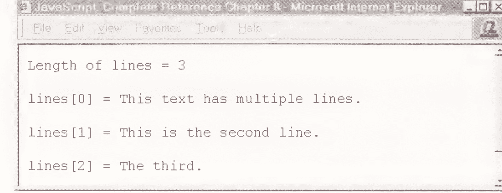

JavaScript 还为括号中的表达式提供了更灵活的语法。使用 `(?:)` 语法指定括号中的表达式不应可用于引用。这些被称为**非捕获括号**。例如：

```javascript
var pattern = /(?:abc)(def)/;
var text = "abcdef".replace(pattern, "First subexpression: $1");
```

结果是在 `text` 中放入字符串 "First subexpression: def"。如果不使用非捕获语法的普通括号，则会在 `text` 中放入 "First subexpression: abc"。

JavaScript 允许你指定正则表达式的某部分仅在后面没有跟随特定子表达式时才匹配。`(?=)` 语法指定**正向预瞻**；它只当前面的项目紧跟 `(?=)` 中包含的表达式时才进行匹配。前瞻表达式不包含在匹配结果中。例如，如下：

```javascript
var pattern = /\d(?=\.\d+)/;
```

`pattern` 仅匹配后面跟着句号和多个数字的数字。它会匹配 `3.1` 和 `3.14159` 中的 `3`，但不会匹配 `3` 或 `.3`。记住，预瞻表达式不会通过匹配返回，对前面的示例使用 `exec()` 或 `match()` 在匹配到后面跟着句号和多个数字的数字时，会在数组中返回 `3`。**负向预瞻**通过 `(?!)` 语法实现，它的行为类似于 `(?=)`。只有当 `(?!)` 中包含的表达式没有紧随其后时才匹配前面的项目。例如：

```javascript
var pattern = /\d(?!\.\d+)/;
```

将匹配 `3` 但不匹配 `3.1` 或 `3.14`。负向预瞻表达式在匹配时不会被返回。

你可以通过在量词（`*`、`+`、`{n}`、`{m,n}`）后面加上一个问号来强制其变为**非贪婪**模式。这会强制表达式匹配最小数量的字符，而不是最大数量。例如，通常情况下：

```javascript
"aaaa".match(/a+/);
```

匹配整个字符串 "aaaa"。然而，强制非贪婪：

```javascript
"aaaa".match(/a+?/);
```

将匹配一个 `a`（在支持这些高级特性的浏览器下——例如 Internet Explorer 5.5）。注意 Net 的支持并不完全，因此在将代码投入“野外”之前，最好在各种浏览器下仔细测试你的代码。

正如我们在本章中所看到的，正则表达式确实具有强大的功能，同时也具有复杂性。所有的 JavaScript 程序员都应该真正精通正则表达式，因为它们可以帮助表单验证等常见任务。然而，在急于将它们添加到每个脚本之前，程序员应该仔细考虑使用正则表达式时的一些挑战。


# 正则表达式的局限性

正则表达式的名称源于它们所识别的字符串（在正式计算机科学意义上）是“正则”的。这意味着某些类型的字符串用正则表达式识别将非常困难，甚至不可能。幸运的是，这些字符串并不经常遇到，通常只出现在解析源代码或自然语言等情况下。然而，在对电子邮件地址之类的字符串使用正则表达式进行表单验证时，你需要格外小心。有效的电子邮件可能包含诸如 `!` 的字符，并可以使用 IP 地址代替域名（如 `root@127.0.0.1`）。你需要进行一些研究和实验，以确保你创建的正则表达式足够强大，能够匹配你感兴趣的字符串类型。

重要的是，即使是设计最好的正则表达式也无法测试语义有效性。例如，你可能可以验证信用卡号格式是否正确，但如果没有数据库或更复杂的服务器端功能，你的脚本将无法检查该字符是否真实有效。尽管如此，将语法检查器与表单结合是在提交到服务器之前捕获常见错误的方便方法。

## 总结

正则表达式是 JavaScript 提供的匹配和处理数据的工具。可以使用字面量语法或 `RegExp` 构造函数创建正则表达式，并用于 String 方法中，如 `match()`、`replace()`、`search()` 和 `split()`。正则表达式对象还提供了

# 第 9 章：传统的 JavaScript 对象模型

| JavaScript 语言与内置对象（根据 ECMA 262 标准化） |
| :--- |
| 核心语言定义（语句、运算符、表达式等） |
| Math |
| String \| Boolean \| Number \| Date |
| Array \| Object \| Function \| RegExp |

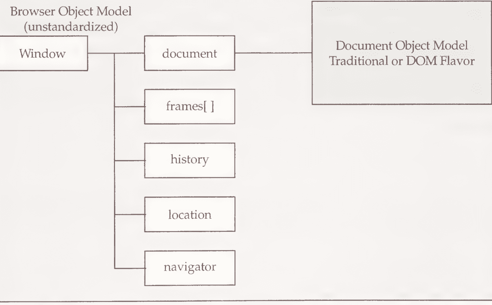

**图 9-1.** JavaScript: “全景图”

通过学习 JavaScript 的历史，我们可以为这些相互竞争的混乱对象模型梳理出头绪。JavaScript 中曾存在四种不同的对象模型：

- 传统的 JavaScript 对象模型 (Netscape 2 和 Internet Explorer 3)
- 扩展的传统 JavaScript 对象模型 (Netscape 3)
- 动态 HTML 风格的对象模型
  - Internet Explorer 4
  - Netscape 4
- 传统的浏览器对象模型 (BOM) + 标准 DOM (NS6 和 IE 5)

我们将依次查看这些对象模型，并解释它们各自引入了哪些特性以及问题。幸运的是，如今标准已经开始出现并帮助理顺了这一局面，但 JavaScript 程序员要完全安全地抛弃他们掌握的所有特定浏览器的知识，还需要一段时间。在深入细节之前，让我们回到一个简单得时代，学习在任何支持 JavaScript 的浏览器中都可以使用的传统对象模型。

## 传统的 JavaScript 对象模型

如果你还记得第 1 章中介绍的 JavaScript 历史，这种语言最初的主要目的之一是在表单提交到服务器端程序之前，检查或操作表单的内容。由于这些目标并不大，在 Netscape 2 中引入的初始 JavaScript 对象相当有限，它侧重于浏览器和文档的基本功能。图 9-2 展示了传统的对象模型，它在 Netscape 2 和 Internet Explorer 3 中都非常相似。

你可能好奇图 9-2 中显示的各种对象与 JavaScript 有什么关系。事实上，我们已经用过它们了。例如，`Window` 定义了与浏览器窗口相关的属性和方法。当我们使用 JavaScript 语句 `alert("hi")` 来创建一个小的警告对话框时，我们实际上调用了 `Window` 对象的 `alert()` 方法。事实上，我们完全可以写成 `window.alert("hi")` 来创建相同的窗口。`window` 前缀通常会被省略，因为大多数情况下解释器可以推断出我们正在使用当前的 `Window` 对象。更具体地说，`Window` 对象几乎始终位于你的脚本作用范围内。这意味着解释器总是检查 `Window` 对象中是否存在标识符（例如函数名），这些标识符在脚本中没有被显式定义。

一旦考虑到像这样的语句，图 9-2 显示的包含层级结构也就容易理解了：

```javascript
window.document.write("<strong>Hi there from JavaScript!</strong>");
```

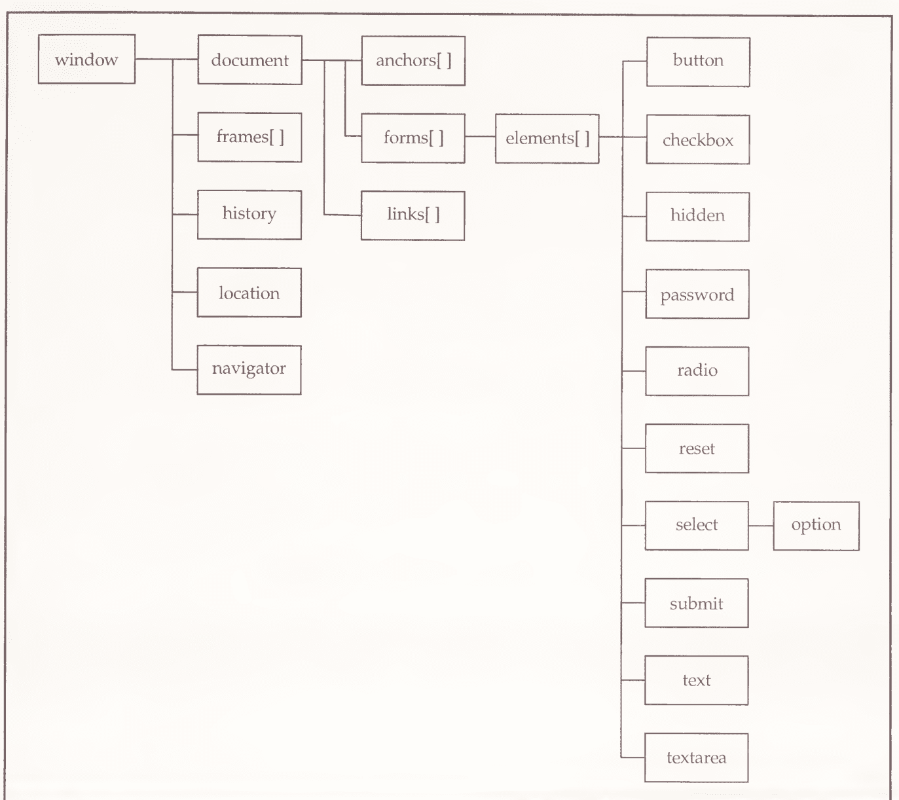

**图 9-2.** 传统的 JavaScript 对象模型

这看起来就像用于向 HTML 文档写入文本的熟悉输出语句。再次，我们添加了“window 前缀”，这次是为了强调这种层级结构，因为我们在示例中往往倾向于只使用 `document.write()`。你可能好奇图 9-2 中显示的各种对象的具体作用，因此我们在表 9-1 中列出了传统浏览器对象的概述。大部分对象都包含在 `Document` 对象中，所以我们现在来详细查看它。

| 对象 | 说明 |
| :--- | :--- |
| Window | 与当前浏览器窗口相关的对象。 |
| Document | 包含组成文档的各种 HTML 元素和文本片段的对象。在传统的 JavaScript 对象模型中，Document 对象大致对应于 HTML `<body>` 标签。 |
| Frames[] | 页面帧的数组（如果包含的话）。每个帧又引用另一个 `Window` 对象，该对象可能还包含更多帧。 |
| History | 包含当前窗口历史记录列表的对象，即用户最近访问的各种 URL 集合。 |
| Location | 包含当前正在查看的文档位置的对象，其形式为 URL 及其组成部分（如协议、主机名和路径）。 |
| Navigator | 描述浏览器基本特征的对象，特别是其类型和版本。 |

**表 9-1.** 核心浏览器对象概述

### Document 对象

`Document` 对象提供了对页面元素的访问，如锚点、表单字段和链接，以及背景和文本颜色等页面属性。我们将看到，该结构在不同浏览器、不同版本之间差异很大。表 9-2 和表 9-3 分别列出了早期提供文档对象模型（Netscape 2.0 和 Internet Explorer 3.0）的浏览器的“最小公约数” `Document` 属性和方法。为了简洁起见，在后续讨论将省略某些细节和 `Document` 属性。`Document` 属性的完整信息可以在附录 B 中找到。

检查表 9-2 和 9-3 可以发现早期对象模型非常原始。文档中可以直接访问的部分只有文档级属性、链接、锚点和表单。它不支持文本或图像的操作，不支持 Applet 或嵌入对象，也没有办法操作大多数元素的显示属性。这里展示了一个在示例文档中打印的各种 `Document` 属性的示例：

```html
<!DOCTYPE HTML PUBLIC "//W3C//DTD HTML 4.01 Transitional//EN"
  "http://www.w3.org/TR/html4/loose.dtd">
<html>
<head>
<title>Traditional Document Object Test</title>
<script language="JavaScript" type="text/javascript">
<!--
function showProps() {
  var i;
  document.write("<h1 align='center'>Document Object Properties</h1><br>");
  document.write("<h2>Basic Page Properties</h2><br>");
  document.write("Location = " + document.location + "<br>");
  document.write("URL = " + document.URL + "<br>");
  document.write("Document Title = " + document.title + "<br>");
  document.write("Document Last Modification Date = " + document.lastModified + "<br>");
  document.write("<h2>Page Colors</h2><br>");
  document.write("Background Color = " + document.bgColor + "<br>");
  document.write("Text Color = " + document.fgColor + "<br>");
  document.write("Link Color = " + document.linkColor + "<br>");
  document.write("Active Link Color = " + document.alinkColor + "<br>");
  document.write("Visited Link Color = " + document.vlinkColor + "<br>");
  if (document.links.length > 0) {
    document.write("<h2>Links</h2>");
    document.write("# Links = " + document.links.length + "<br>");
    for (i = 0; i < document.links.length; i++)
      document.write("Links[" + i + "] = " + document.links[i] + "<br>");
  }
  if (document.anchors.length > 0) {
    document.write("<h2>Anchors</h2>");
    document.write("# Anchors = " + document.anchors.length + "<br>");
    for (i = 0; i < document.anchors.length; i++)
      document.write("Anchors[" + i + "] = " + document.anchors[i] + "<br>");
  }
  if (document.forms.length > 0) {
    document.write("<h2>Forms</h2>");
    document.write("# Forms = " + document.forms.length + "<br>");
    for (i = 0; i < document.forms.length; i++)
      document.write("Forms[" + i + "] = " + document.forms[i].name + "<br>");
  }
}
// -->
</script>
</head>
<body bgcolor="white" text="green" link="red" alink="#ffff00">
<h1 align="center">Test Document</h1>
<hr>
<a href="http://www.pint.com/">Sample link</a>
<a name="anchor1"></a>
<a name="anchor2" href="http://www.javascriptref.com/">Sample link 2</a>
<form name="form1"></form>
<form name="form2"></form>
<hr>
<br><br>
<script>
<!--
showProps();
// -->
</script>
</body>
</html>
```

上一个示例的输出结果如图 9-3 所示。关于这个示例，需要注意的是，如果你不在包含表单、链接等的文档中运行它，许多属性将不会被设置。注意在具有以下简单 `<body>` 内容的文档上运行相同脚本的结果：

```html
<body>
<h1 align="center">Test 2 Document</h1>
<hr>
<script>
<!--
// -->
</script>
</body>
</html>
```

JavaScript 不会为不存在的元素实例化对象，请注意如图 9-4 所示，你几乎没有那么多的属性可以查看。然而，你会发现浏览器倾向于为某些类型的属性（如文本和链接颜色）提供默认值，无论 HTML 元素或属性是否存在。

尽管一眼看去可能并不明显，但文档（`Document`）被设置为了包含层次结构。这种层次结构是通过将更具体的对象放置在更通用对象“内部”而产生的。注意像链接颜色这样的全局范围属性在 `Document` 内部是可以使用的，但要检查表单元素，必须先访问 `Document` 内部的 `forms[]` 数组。这种包含关系是文档对象模型的特征，并在后续模型中被推向逻辑结论，将文档呈现为反映原始 HTML 结构的“树”。

## 通过位置访问文档元素

当浏览器读取 HTML 文档时，JavaScript 会为所有可脚本的 HTML 元素实例化对象。在最初几个浏览器中，可脚本的 HTML 元素数量相当有限，但我们将看到在后面的浏览器中，访问任意 HTML 元素都是脚本化的。现在，让我们集中在可以通过传统的 JavaScript 对象模型访问的 HTML 元素上，包括锚点、链接、表单和元素。例如，考虑这样的 HTML 文档：

```html
<!DOCTYPE HTML PUBLIC "//W3C//DTD HTML 4.01 Transitional//EN"
  "http://www.w3.org/TR/html4/loose.dtd">
<html>
<head>
<title>Simple Form</title>
</head>
<body>
<form>
  <input type="text">
</form>
<br><br>
<form>
  <input type="text">
  <br>
  <input type="text">
</form>
</body>
</html>
```

使用传统的 JavaScript 对象模型，我们可以使用以下方式访问第一个 `<form>` 标签：

- `window.document.forms[0]`

要访问第二个 `<form>` 标签，我们将使用：

- `window.document.forms[1]`

由于文档中没有 `<form>` 标签，访问 `window.document.forms[5]` 或其他值会导致问题。

如果我们看图 9-2，注意 `forms[]` 集合也包含一个 `elements[]` 集合。该集合包含了各种表单字段，如文本字段、按钮、下拉列表等。遵循基本的包含概念，为了到达文档中第一个表单的第一个元素，将使用：

- `window.document.forms[0].elements[0]`

虽然这种基于数组的访问方式很直观，但主要的缺点是它依赖于 HTML 标签在文档中的位置。如果移动了标签，JavaScript 可能会崩溃。更好的方法是依赖对象的名称。

## 通过名称访问文档元素

Web 页中的 HTML 元素命名是为了让脚本语言能够轻松读取和操作它们。在 HTML 4 中，为 HTML 元素附加唯一标识符的基本方法是使用 `id` 属性。`id` 属性与几乎每个 HTML 元素相关。

`id` 属性的作用是将唯一标识符绑定到元素上。要给某个特定的**粗体**文本元素命名为 "SuperImportant"，你可以使用这里的标记：

```html
<b id="SuperImportant">This is very important.</b>
```

就像在 JavaScript 中选择唯一的变量名一样，HTML 命名非常重要。鼓励 HTML 文档作者采用一致的命名风格，并避免使用包含 HTML 元素名称本身的混淆名称。例如，`button` 对于表单按钮来说并不是一个好的名称，会导致混淆，甚至可能干扰脚本语言的访问。

在 HTML 4 之前，使用 `name` 属性代替 `id` 来向脚本暴露项目。为了向后兼容，`name` 属性通常在 `<a>`、`<applet>`、`<button>`、`<embed>`、`<form>`、`<frame>`、`<iframe>`、``、`<input>`、`<object>`、`<map>`、`<select>` 和 `<textarea>` 中定义。注意，`name` 属性的出现与浏览器对象模型（BOM）密切对应。

> `<meta>` 和 `<param>` 都支持名为 `name` 的属性，但它们的含义完全不同。

页面开发人员需要在必要的地方使用 `name`，以确保与旧浏览器的向后兼容。早期的浏览器不会识别 `id` 属性，`name` 也是如此。例如，`<a name="link1" id="link1">` 能够被旧浏览器以及支持最新标准的浏览器正确解释。

> 标准中有些陈述认为，将 `name` 和 `id` 属性设置为相同的值不是好主意，但实践表明这是确保向后兼容的唯一方法。

访问由定义的表单：

```html
<form name="myForm" id="myForm">
  <input type="text" name="username" id="username">
</form>
```

在 JavaScript 中通过名称访问表单，使用：

```javascript
window.document.myForm
```

或直接使用：

```javascript
document.myForm
```

因为可以假设 `Window` 对象存在。可以以类似的方式访问字段及其值。要访问文本字段，请使用 `document.myForm.username`。

## 使用关联数组访问对象

`Document` 对象中的大多数数组都是关联的。也就是说，它们可以使用整数进行索引（正如我们所看到的），也可以使用表示要访问的元素名称的字符串进行索引。正如我们所看到的，名称是通过标签的 HTML 的 `name` 或 `id` 属性分配的。考虑以下：

```html
<form name="MyForm">
  <input name="user" type="text" value="">
</form>
```

你可以通过 `document.forms["MyForm"]` 访问表单，或者通过 `Form` 对象的 `elements[]` 数组访问 `document.forms["MyForm"].elements["user"]`。Internet Explorer 生成这些关联数组并收集它们。第 23 章中详细讨论了 IE 中的集合，但不仅如此。特殊的 `item()` 方法用于从集合中检索命名对象，并接受一个表示要检索的对象名称的字符串。例如：

```javascript
document.forms.item("MyForm")
```

访问之前的 `Form` 对象。

## 事件处理器

脚本响应用户操作的主要方式是通过与文档的特定部分和特定“事件”关联的 JavaScript 代码。当给定事件在与其关联的文档部分发生时，代码就会执行。常见事件包括 `Click`、`MouseOver` 和 `MouseOut`，这些事件发生在用户点击、鼠标移动时或离开文档的某部分。这些事件通常与表单按钮、表单字段、图像和链接相关，并用于按钮悬停效果以及字段验证等任务。需要记住，并不是每个对象都能处理所有事件。一个对象能够处理的事件在很大程度上反映了该对象最常用的使用方式。

### 设置事件处理器

你可能以前在 HTML 中见过事件处理器。接下来的这个简单示例展示了当你点击按钮时如何弹出一个警告框：

```html
<form name="myForm" id="myForm">
<input name="myTransform" type="button" value="Click" onclick="alert('That tickles!')">
</form>
```

`input` 元素的 `onclick` 属性将给定的代码绑定到按钮的事件上。每当用户点击按钮时，浏览器都会向按钮发送一个 `Click` 事件，导致其调用它的 `onclick` 事件处理器。

浏览器如何知道去哪里寻找事件的事件处理器呢？这由文档对象模型的一部分——**事件模型**决定的。事件模型简单来说就是一组实现这种事件处理的接口和对象。在大多数主流浏览器中，对象的事件处理器可以作为对象本身的属性来访问。我们不使用 HTML 来绑定事件处理器，而是使用 JavaScript 来实现。以下代码与之前的示例等效：

```html
<form name="myForm" id="myForm">
<input name="myTransform" type="button" value="Click">
</form>
<script language="JavaScript" type="text/javascript">
<!--
document.myForm.myTransform.onclick = new Function("alert('That tickles!')");
// -->
</script>
```

我们定义了一个包含事件处理器代码的匿名函数，然后将按钮的 `onclick` 属性设置为它。

### 事件模型

事件处理器的内容远比我们描述的要多。两个主流浏览器都实现了复杂的事件模型，使得应用程序在处理事件时具有极大的灵活性。例如，如果你为大量对象定义了同一个事件处理器，你可以将该处理器一次绑定到层次结构中的某个对象上，而不是单独绑定到每个子对象。关于事件处理器的更全面讨论请参见第 11 章。

## 综合运用

现在我们已经了解了传统对象模型的所有组件，是时候展示所有组件是如何一起使用的了。正如我们之前所看到的，使用 `name` 或 `id` 引用暴露在 JavaScript 对象模型中的 HTML 元素实例是非常容易的。例如：

```html
<form name="myform" id="myform">
<input type="text" name="username" id="username">
</form>
```

我们将使用 `document.myform.username` 来访问此表单中名为 `username` 的字段。但如何操作标签的属性呢？理解 JavaScript 对象模型的关键在于：通常情况下，HTML 元素的属性被暴露为 JavaScript 对象属性。因此，假设 HTML 中的一个文本字段具有基本语法：

```html
<input type="text" name="unique identifier" id="unique identifier"
size="number of characters" maxLength="number of characters"
value="default value">
```

`document.myform.username` 引用了示例中文本字段的 `name` 属性，`document.myform.username.size` 引用了它在屏幕上以字符计算显示的尺寸，以此类推。接下来的简单示例将所有内容整合在一起，并展示了如何通过名称引用字段，在警告窗口中动态地访问和显示表单字段的内容。

```html
<!DOCTYPE HTML PUBLIC "//W3C//DTD HTML 4.01 Transitional//EN"
"http://www.w3.org/TR/html4/loose.dtd">
<html>
<head>
<title>Meet and Greet</title>
<script language="JavaScript" type="text/javascript">
<!--
function sayHello() {
  var thename = document.myform.username.value;
  if (thename != "")
    alert("Hello " + thename + "!");
  else
    alert("Don't be shy.");
}
// -->
</script>
</head>
<body>
<form name="myform" id="myform">
  <b>What's your name?</b>
  <input type="text" name="username" id="username" size="20"><br><br>
  <input type="button" value="Greet" onclick="sayHello()">
</form>
</body>
</html>
```

除了使用 JavaScript 读取元素的内容的操作外，在某些情况下，还可能更新某些元素（如表单字段）的内容。以下代码展示了如何实现这一操作：

```html
<!DOCTYPE HTML PUBLIC "//W3C//DTD HTML 4.01 Transitional//EN"
"http://www.w3.org/TR/html4/loose.dtd">
<html>
<head>
<title>Meet and Greet 2</title>
<script language="JavaScript" type="text/javascript">
<!--
function sayHello() {
  var thename = document.myform.username.value;
  if (thename != "")
    document.myform.response.value = "Hello " + thename + "!";
  else
    document.myform.response.value = "Don't be shy";
}
// -->
</script>
</head>
<body>
<form name="myform" id="myform">
  <b>What's your name?</b>
  <input type="text" name="username" id="username" size="20"><br><br>
  <b>Greeting:</b>
  <input type="text" name="response" id="response" size="40"><br><br>
  <input type="button" value="Greet" onclick="sayHello()">
</form>
</body>
</html>
```

最后需要说明的是，`Document` 的某些属性是可写的，而其他则不是。注意表 9-2 中锚点和链接被列为只读。这并不意味着你无法修改元素，例如 `document.forms`，由于层次结构的存在，所有信息都包含在每个对象内部，这种限制并不构成问题。之前的示例简单演示了如何使用对象模型访问元素。在书的第四部分，我们将学习如何使用这些技术实现有趣的功能。现在我们理解了使用对象模型的基础，是时候查看主流浏览器支持的具体对象模型了。

## 模型

到为止，讨论主要关注不取决于浏览器版本的通用特性。并不意外，每当发布新版本时，浏览器厂商都会以各种方式扩展 `Document` 的功能。修复 Bug、增加对文档部分的访问，并不断改进功能。

对象模型的演进是一件好事，因为最新的对象模型允许你更轻松地执行更多任务。然而，它给 Web 开发者带来了一些问题。最大的问题是不同浏览器的对象模型在不同方向上存在差异。为了实现动态 HTML (DHTML)，厂商添加了新的专用标签，非标准的任务实现方式也成为了 Internet Explorer 和 Netscape 的一部分。结果是，开发者使用 Netscape 模型编写的 HTML 代码可能在 Explorer 中无法运行（反之亦然）。接下来的章节将讨论主要浏览器版本的对象模型。特别是，我们将重点介绍每个版本中的新特性及其与常见编程任务的相关性。

### Netscape 2

Netscape 2 的对象模型就是本文之前介绍的基础对象模型。它是第一个向 JavaScript 此类接口的浏览器，其能力有限。受这些限制，JavaScript 在该浏览器中的主要用途是表单验证和非常简单的页面操作，例如打印修改日期。

### Netscape 3

Netscape 3 的 `Document` 对象为原始的 DHTML 类应用程序开启了大门。它通过提供访问嵌入对象、Applet、插件和图像的能力，向脚本暴露了更多的文档内容。这种对象模型如图 9-5 所示，`Document` 对象的主要新增内容列在表 9-4 中。

| 属性 | 说明 |
| :--- | :--- |
| applets[] | 文档中 applet（`<applet>` 标签）数组。 |
| domain | 包含获取该文档的 Web 服务器主机名的字符串。只能更改为更通用的主机名（例如，从 `www.w3c.org` 改为 `w3c.org`）。 |
| embeds[] | 文档中嵌入对象（`<embed>` 标签）数组。 |
| images[] | 文档中图像（`` 标签）数组。 |
| plugins[] | 安装在浏览器中的插件数组。 |

**表 9-4.** Netscape 3 中的新文档属性

毫无争议地可以认为，该版本中对 `Document` 对象最重要的添加是包含了 `images[]`。虽然每个 `Image` 对象的许多属性都是只读的，但 `src` 属性是可写的。这使得首次能够根据用户的响应动态地更改图像。这种能力的一个典型应用是悬停按钮——当用户鼠标悬停在按钮上时，它们的外观会发生变化。遗憾的是，由于模型中的 `Image` 对象没有事件处理器，解析器通常是通过将图像放置在锚点标签内部来实现的，例如：

```html
<a href="#"
onmouseover="document.images[0].src='/images/buttonOn.gif'"
onmouseout="document.images[0].src='/images/buttonOff.gif'">

</a>
```

当用户的鼠标悬停在链接上（从而悬停在图像上）时，锚点标签的 `mouseover` 事件处理器会切换图像。当用户鼠标移开链接时，锚点的 `onmouseout` 事件处理器会将原始图像换回。注意锚点标签中包含了 `href` 属性；遗漏它可能会导致脚本失败，因为 `<a>` 标签在格式不正确的情况下将不会实例化 `Link` 对象。我们将在第 15 章中详细查看图像效果。

Netscape 还对表单的支持做了一些添加。`reset()` 方法被添加到 `Form` 对象中，并在调用时重置表单，无论是否存在重置按钮。此外，它还对事件处理器 `onblur` 和 `onfocus` 进行了其他细微的更改。尽管这些属性是在文档的 `<body>` 标签中指定的，但它们实际上是 `Window` 对象的事件处理器。

`Window` 对象还进行了更重大的添加。`History` 对象在此处被添加，并带有两个新属性：`closed` 和 `opener`。`window.closed` 属性指示用户是否关闭了该窗口，并有助于避免无效窗口。`window.opener` 属性允许“子”窗口访问其“父”窗口（即创建它的包含该 JavaScript 的窗口）。

### Netscape 4

第 4 版本浏览器的文档对象模型标志着对 HTML 支持开始成熟的折点。除了响应用户事件切换图像之外，在 Netscape 4 之前几乎无事可做。该版本中的重大变化包括对专有的 `<layer>` 标签的支持、对 Netscape 事件模型的补充，以及 `Style` 对象的添加及其操作的方法。图 9-6 显示了 Netscape 4 对象模型的精要；`Document` 对象最有趣的新属性列在表 9-5 中。

#### XMLHttpRequest 添加

Netscape 4 文档模型最重要的功能之一是它将样式元素暴露给 JavaScript。事实上，在 Netscape 4 下，样式表与 JavaScript 之间的交互如此显著，以至于 Netscape 最初将其样式表实现称为 JavaScript 样式表（JSSS）。此外，如果你在 Netscape 4 下禁用了 JavaScript，你会发现无论如何包含样式表，它们都无法工作。

在 Netscape 4 下，JavaScript 程序员可以为文档中的每个元素创建或操作 CSS 属性。需要注意的是，这种能力主要用于在它们所应用的内容显示在屏幕上之前创建或更改样式元素。在 Netscape 4 下，一旦大多数 HTML 元素显示出来，它们的样式就无法更改。这与本章稍后讨论的 Internet Explorer 模型非常不同。

Netscape 4 中引入的允许操作样式的新属性有 `classes[]`、`ids[]`、`tags[]`。通过 JSSS，你可以使用 HTML 4 的核心 `id` 属性通过 `Document` 对象的 `ids[]` 属性来访问单个标签。其语法为：

```javascript
document.ids.idName.propertyName
```

其中：

- `idName` 表示你想要访问的特定 ID
- `propertyName` 指定 CSS 属性

例如，要更改 `id="myHeading"` 的元素的大小，你会写：

```javascript
document.ids.myHeading.fontSize = "64pt";
```

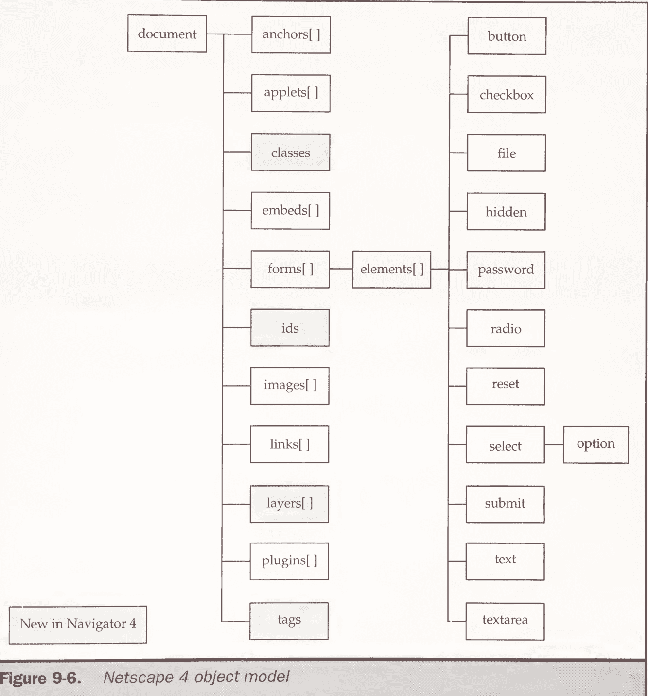

**图 9-6.** Netscape 4 对象模型

| 属性 | 说明 |
| :--- | :--- |
| classes[] | 创建或访问具有 `class` 属性的 HTML 元素的 CSS 样式。 |
| ids[] | 创建或访问具有 `id` 属性的 HTML 元素的 CSS 样式。 |
| layers[] | 文档中层（`<layer>` 标签或定位的 `<div>` 元素）数组。如果按整数索引，层将根据 z-index 从后向前排序（z-index 为 0 是最底层）。 |
| tags[] | 创建或访问任意标签的 CSS 样式。 |

**表 9-5.** Netscape 4 中的新文档属性

同样，要更改特定类的样式，你使用：

```javascript
document.classes.className.propertyName
```

其中：

- `className` 是你想要访问的类名
- `propertyName` 指明 CSS 属性

例如，更改 "important" 类的列表项颜色：

```javascript
document.classes.important.li.color = "red";
```

或者 "important" 类的所有元素的字体：

```javascript
document.classes.important.all.fontFamily = "monospace";
```

最后，`tags[]` 属性允许你全局定义或操作特定元素。其语法为：

```javascript
document.tags.tagName.propertyName
```

其中：

- `tagName` 指定 HTML 元素
- `propertyName` 指明 CSS 属性

例如，要将 `h1` 的文本颜色改为蓝色，你可能会写：

```javascript
document.tags.h1.color = "blue";
```

关于 JSSS 还有很多，但重点不是详细介绍语法。事实上，这种讨论具有历史性。完全不建议使用这种语法。它在 Netscape 4.x 时代的浏览器上有效。即使是 Netscape 的粉丝也没有过多考虑这种语法，因为它在 HTML 元素渲染之前影响它的呈现。例如，考虑以下 JSSS 示例。

```html
<!DOCTYPE HTML PUBLIC "//W3C//DTD HTML 4.01 Transitional//EN"
   "http://www.w3.org/TR/html4/loose.dtd">
<html>
<head>
<title>简单的 Netscape JSSS 示例</title>
</head>
<body>
<script language="JavaScript" type="javascript">
<!--
// 示例适用于 Netscape 4.x 浏览器
document.tags.h1.color = "blue";
document.ids.myHeading.fontSize = "64pt";
document.classes.important.p.backgroundColor = "orange";
document.classes.important.all.fontStyle = "italic";
-->
</script>
<h1 class="important">这是一个带有类 important 的 H1</h1>
<hr>
<p class="important">这是一个带有类 important 的段落</p>
<h2 id="myHeading">这是一个带有 myHeading 的 H2</h2>
<p class="important">这是一个带有类 important 的段落</p>
</body>
</html>
```


> **注意**
> 示例在图 9-7 中所示；但记住，如果我们把脚本块放在 HTML 元素之后，页面呈现将不会被修改。

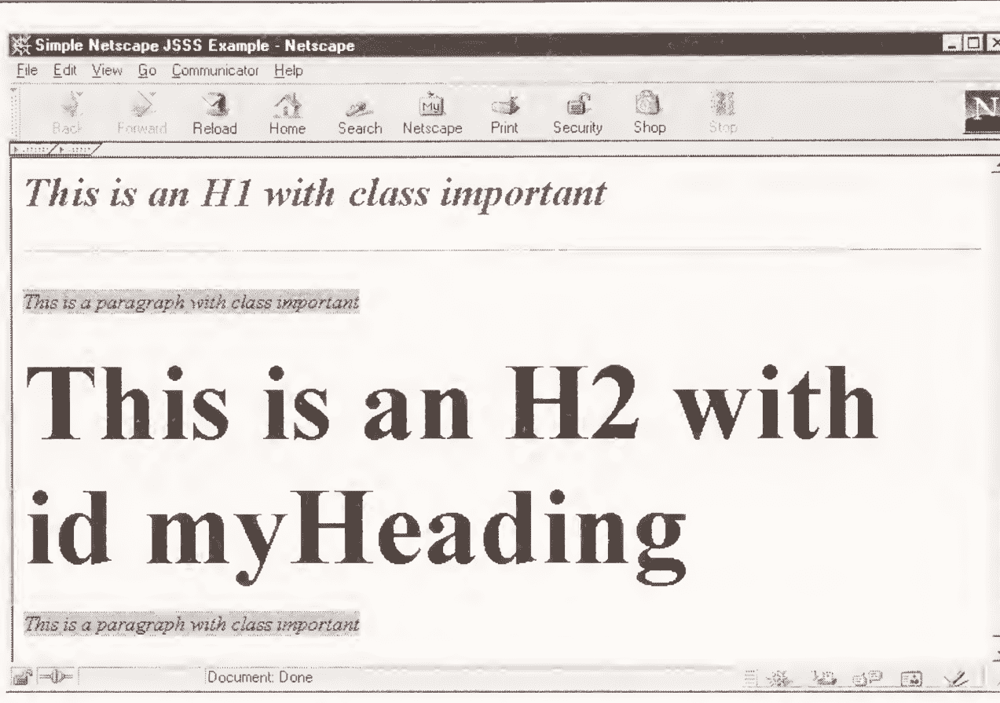

**图 9-7.** Netscape JSSS 仅在页面加载前影响显示。

从历史角度来看，Netscape 4.x 时代浏览器中有一个重要的理解对象，那就是 `Layer` 对象。

#### Netscape 图层

在样式操作之外，Netscape 4 引入了一种新的私有 HTML 标签：`<layer>`。`<layer>` 标签允许你定义内容区域，并对其进行精确的定位、移动和重叠，还可以将其设置为隐藏、显示甚至是透明。你可以使用 `write()` 和 `innerHTML` 方法向层中写入新内容，从而实现类似于 Internet Explorer 某些高级功能的功能。Netscape 曾将其视为构建 DHTML 应用程序的主要基础之一。然而，`<layer>` 标签并未进入 W3C 的 HTML 标准，且未被任何竞争性浏览器包含。因此，Netscape 在其 6 版本的浏览器中放弃了该标签。这意味着 `<layer>` 标签仅在 Netscape 4.x 浏览器可用。正因如此，它的实用性被认为相当有限。即使在 Netscape 4.x 浏览器中，`<div>` 元素结合级联样式表规则也能提供相似的功能。

但是，如果你必须在 Netscape 4.x 中执行某些形式的定位，可能被迫使用 `<layer>` 标签，或者至少通过 `Layer` 对象通过 CSS 操作更标准的 `<div>` 标签。例如，在以下脚本中，一个区域是使用 CSS 定位的——要在 Netscape 4.x 下动态修改它，你必须使用 `Layer` 对象。

```html
<!DOCTYPE HTML PUBLIC "//W3C//DTD HTML 4.0 Transitional//EN">
<html>
<head>
<title>NS4 图层示例</title>
<style type="text/css">
<!--
#div1 { position: absolute;
top: 200px;
left: 350px;
height: 100px;
width: 100px;
background-color: orange;}
-->
</style>
</head>
<body>
<h1 align="center">Netscape 4 图层示例</h1>
<div id="div1">一个定位区域的示例</div>
<form>
<input type="button" value="hide" onclick="document.layers['div1'].visibility='hide'">
<input type="button" value="show" onclick="document.layers['div1'].visibility='show'">
</form>
</body>
</html>
```

通过 `document.layers[]` 只能访问第一层图层，因为每个层都有自己的 `Document` 对象。要访问嵌套层，你必须先导航到外部层，然后通过它的 `Document` 访问嵌套层的 `layers[]` 数组，依此类推。例如，要访问层内部的层，你可以这样写：

```javascript
var nestedLayer = document.layers[0].document.layers[0].document;
```

虽然图层的使用最终会消失，但图层是检测 Netscape 4 浏览器的良好方法。在 Netscape 4 下，访问 `document.layers` 将返回 `layers[]` 数组。在任何其他浏览器下，访问 `document.layers` 将返回 `undefined`，因此你可以方便地这样检查是否为 Netscape 4：

```javascript
if (document.layers) { /* 执行 Netscape 特有的操作 */ }
```

#### Window 扩展

Netscape 4 为 `Window` 对象添加了海量新属性。包括提供屏幕尺寸、高度和宽度的信息的属性；提供用户浏览器中各种工具栏配置信息的属性；Base64 编码和解码方法；移动、调整屏幕大小和偏移屏幕的方法；以及模拟浏览器前进和后退按钮点击的方法。

#### 事件模型扩展

除了增加新的鼠标和键盘事件处理程序（如 `onmouseup`、`onmousedown` 和 `onkeyup`、`onkeydown`）之外，Netscape 还在几个重要方面完善了其事件模型。该浏览器中的事件从事件层次结构的顶端开始，并“向下流”到它们所属的对象。这种遍历允许 `Window` 和 `Document` 对象（包括 `Layer` 对象）执行捕获，从而停止或改变事件的向下“流”。捕获通过 `captureEvents()` 方法实现，并防止被捕获的事件在“较高”级别被处理——即被修改，或者简单地传递继续向下移动。这一特性用于简化编程，当许多低级对象构成的字段都需要相同的事件处理程序时。关于 Netscape 4 事件处理的详细讨论可以在第 11 章找到。

### Netscape 6

Netscape 6 的发布标志着 Netscape 浏览器的一个新时代。该浏览器的主要重点是标准兼容性，这是对过去临时私有对象模型的一次令人耳目一新的改变。它向后兼容所谓的 DOM Level 0，即 W3C 整合了旧对象模型中许多广泛特性的标准，特别是 Netscape 3 的标准。然而，它实现了 DOM Level 1 和 DOM Level 2 的部分，即 W3C 针对 HTML、XML、CSS 和事件的对象模型。这些标准模型与旧模型有显著差异，HTML、XML、CSS 和事件的标准模型将在下一章介绍。

### Internet Explorer 3

IE3 的对象模型是 Netscape 2 的功能复制品，以及它的许多其他特性。在 Netscape 2 和 IE3 并存的短暂时期，模型处于一种不稳定的状态。

### Internet Explorer 4

与 Netscape 4 版本一样，IE4 暴露了更多的页面内容。模型如图 9-9 所示。

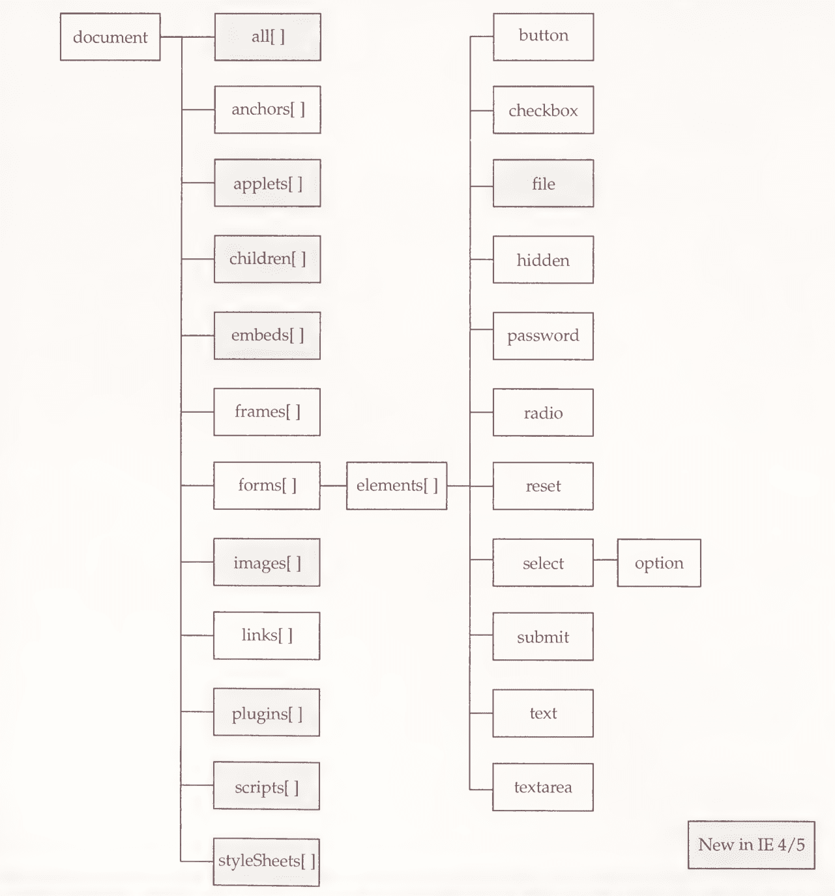

**图 9-9.** Internet Explorer 4 对象模型

检查图 9-9 可以发现，IE4 的功能支持 Netscape 2 的基础模型以及它的许多特性。表 9-6 列出了 Netscape 4 不具备的重要新属性。两个主流浏览器的 4 版本中，对象模型开始出现巨大的差异。

#### HTML 扩展

IE4 引入最重要的 JavaScript 功能之一是 `document.all[]` 集合，它可以访问文档的每个元素。可以通过多种方式对其索引，并返回匹配索引、id 或 name 属性的对象；例如：

```javascript
// 设置文档中的第四个元素
var createElement = document.all[3];
// 查找 id 或 name 为 myHeading 的标签
var myHeading = document.all["myHeading"];
// 查找 id 或 name 为 myHeading 的另一种方法
var myHeading = document.all.item("myHeading");
// 返回所有 <em> 标签的数组
var allEm = document.all.tags("EM");
```

| 属性 | 说明 |
| :--- | :--- |
| all[] | 文档中所有 HTML 标签的数组 |
| applets[] | 文档中所有 applet (`<applet>`) 的数组 |
| children[] | 该对象所有子元素的数组 |
| embeds[] | 文档中所有嵌入对象 (`<embed>`) 的数组 |
| images[] | 文档中所有图像 (``) 的数组 |
| scripts[] | 文档中所有脚本 (`<script>`) 的数组 |
| stylesheets[] | 文档中所有样式表对象 (`<style>`) 的数组 |

**表 9-6.** Internet Explorer 4 中的新文档属性

如你所见，有许多访问页面元素的方法，但无论如何，`document.all[]` 集合的主要作用是将对象层次结构扁平化，以便快速方便地访问 HTML 文档的任何部分。下面的示例展示了 Internet Explorer 如何暴露页面上的所有元素；其结果如图 9-10 所示。

```html
<!DOCTYPE HTML PUBLIC "//W3C//DTD HTML 4.01 Transitional//EN"
  "http://www.w3.org/TR/html4/loose.dtd">
<html>
  <head>
    <title>Document.All Example</title>
  </head>
  <body>
    <h1>Example Heading</h1>
    <hr>
    <p>This is a <em>paragraph.</em>. It is only a <em>paragraph.</em></p>
    <p>Yet another <em>paragraph.</em></p>
    <p>This final <em>paragraph.</em> has id="special">special emphasis. <em></em></p>
    <hr>
    <script language="JavaScript" type="text/javascript">
    <!--
      var i, origLength;
      origLength = document.all.length;
      document.write("document.all.length=" + origLength + "<br>");
      for (i = 0; i < origLength; i++) {
        document.write("document.all[" + i + "]=tagName=" + document.all[i].tagName + "<br>");
      }
    // -->
    </script>
  </body>
</html>
```

如果你不使用 `document.all.length` 作为循环检查，上一个示例将导致死循环。原因在于，`document.all[]` 集合中的元素数量会在每次输出你正在检查的元素时增加！

与检测 Netscape 4 是否存在 `Layer` 对象的技巧类似，许多程序员依赖 `document.all` 的存在性来检测 Internet Explorer 浏览器，并经常依赖于如下语句：

```javascript
if (document.all) { /* 执行 IE 特有的操作 */ }
```

来处理特定浏览器的代码。

**图 9-10.** `document.all[]` 暴露所有文档元素。

一旦使用 `document.all` 语法引用了特定元素，你将发现与其相关的各种属性和方法，包括 `all` 属性本身，它引用包含在返回标签内的任何标签。表 9-7 和表 9-8 显示了其中一些有趣但绝非全部的属性和方法。请注意，内联元素将没有某些属性（如 `innerHTML`），因为根据定义，它们的标签不能包含任何其他内容。

| 属性 | 说明 |
| :--- | :--- |
| all[] | 对象所包含的所有元素的集合。 |
| children[] | 对象的直接后代元素的集合。 |
| className | 包含对象 CSS 类的字符串。 |
| innerHTML | 包含在对象标签内但不包括标签的 HTML 内容的字符串。此属性对于大多数 HTML 元素是可写的。 |
| innerText | 包含在对象标签内的文本内容的字符串。此属性对于大多数 HTML 元素是可写的。 |
| outerHTML | 包含元素 HTML 内容的字符串，包括其起始结束标签。此属性对于大多数 HTML 元素是可写的。 |
| outerText | 包含元素外部文本内容的字符串。此属性对于大多数 HTML 元素是可写的。 |
| parentElement | 对象的父元素的引用。 |
| style | 包含样式的对象。 |
| tagName | 包含标签名称的字符串。 |

**表 9-7.** IE4 对象模型的一些新属性

| 方法 | 说明 |
| :--- | :--- |
| click() | 模拟点击对象。 |
| getAttribute() | 获取元素的属性。 |
| insertAdjacentHTML() | 在元素周围或元素内部插入 HTML。 |
| insertAdjacentText() | 在元素周围或元素内部插入文本。 |
| removeAttribute() | 从元素删除属性。 |
| setAttribute() | 设置元素的属性。 |

**表 9-8.** IE4 对象模型的一些新方法

如上所述所示，IE4 具有许多可能的 DHTML 特性。

下面的示例使用 Internet Explorer 语法说明了这一特性：

```html
<!DOCTYPE HTML PUBLIC "//W3C//DTD HTML 4.01 Transitional//EN"
  "http://www.w3.org/TR/html4/loose.dtd">
<html>
  <head>
    <title>Document.All Example</title>
  </head>
  <body>
    <h1>Example Heading</h1>
    <hr>
    <p>This is a <em>paragraph.</em>. It is only a <em>paragraph.</em></p>
    <p>Yet another <em>paragraph.</em></p>
    <p>This final <em>paragraph.</em> has id="special">special emphasis. <em></em></p>
    <hr>
    <script language="JavaScript" type="text/javascript">
    <!--
      var i, origLength;
      origLength = document.all.length;
      document.write("document.all.length=" + origLength + "<br>");
      for (i = 0; i < origLength; i++) {
        document.write("document.all[" + i + "]=tagName=" + document.all[i].tagName + "<br>");
      }
    // -->
    </script>
  </body>
</html>
```

如上所述所示，IE4 具有许多可能的 DHTML 特性。

### Opera、Mozilla、Konqueror 以及其他浏览器

尽管某些 Web 开发者很少考虑它们，但还有一些浏览器在许多精通技术的圈子中拥有一小群但忠诚的追随者。大多数第三方浏览器都是“严格标准”实现，这意味着它们实现了 W3C 和 ECMA 标准，并忽略了 Internet Explorer 和 Netscape 大多数专有对象模型。某些浏览器提供了对基础 Netscape 2 和 IE3 对象模型的支持，但将开发精力完全集中在 W3C 标准上。如果你的网站的目标受众包括可能使用第三方浏览器的用户（例如 Linux 用户），那么避免 IE 和 Netscape 特有的功能并使用 W3C DOM 可能会是一个好主意。

## 跨浏览器对象支持的噩梦

Internet Explorer 和 Netscape 共享的文档（`Document`）对象框架可以追溯到 1996 年。这可能难以置信，但在过去的几年里，主流浏览器共有的文档对象模型部分几乎没有改进。

因此，在处理非简单的 JavaScript 任务时，Web 开发者已经习惯了编写两个独立的脚本：一个针对 Internet Explorer 4+，另一个针对 Netscape 4。IE 版本通常依赖 IE4 强大的样式操作能力，通常依赖于 `document.all` 集合；而 Netscape 版本则严重依赖 `<layer>` 标签和相关的 `document.layers` 数组来实现类似的功能。由于对象模型朝着不兼容的方向演变，这个过程可能非常疲惫，并且容易出现错误和遗漏；如果开发者在验证特定功能支持和使用各种浏览器测试应用程序时不加小心，他们可能被迫重写数页代码。

继续这条路只会让情况恶化。如果浏览器厂商继续创建专有的扩展文档对象，开发者必须支持的不同对象模型数量将继续增加。平均开发者还能多久适应像更改文本颜色、替换文本片段以及与浏览器插件交互等看似简单的众多任务？

除了为不同的浏览器多次编写每段代码的枯燥本质外，传统的对象模型还存在其他问题。一个主要问题是，考虑到传统模型的多元化和异质性，脚本如何与 XML 等新技术进行交互。浏览器是否将再次强制开发者为每个专有对象模型维护一段 JavaScript 代码？我们是否注定被固定在一个固定的、基于浏览器的接口上，无论应用需求（如内存占用、速度和在替代媒体上的呈现）如何？

# JavaScript：完全参考

显而易见，与传统对象模型的现状并不理想。随着许多开发者和用户对对象和事件模型中的不兼容性感到沮丧，Web 亟需改变。

## 解决方案？

由世界维网联盟（W3C）制定的标准以文档对象模型（DOM）的形式提供了这种改变。W3C 对 DOM 有简洁的描述：“它是一个与平台和语言无关的接口，允许程序和脚本动态地访问和更新 HTML 和 XML 文档的内容、结构和样式。”这对于 Web 开发者来说简直是天籁。结合 CSS 定义的描述呈现特征的标准方法，DOM 为创建交互式文档提供了一个统一的范式，不仅适用于 Web，也适用于各种离线业务和技术尝试。

实现这一标准的进展已经在进行。Netscape 已经对实现标准做出了坚定承诺，而且它已经在 Netscape 6 中履行了这一承诺。Netscape 还支持旨在为浏览器社区带来标准合性的开源项目。2001 年，Mozilla 项目已接近完成其全功能基于标准的浏览器的开发工作。微软也在跟进，承诺在 Internet Explorer 第 6 版本中提供比以往任何时候都多的 DOM 特性。

有趣的是，如果浏览器全心拥抱 W3C DOM，文档模型将完成一个轮回。在 90 年代中期，曾有一段短暂时期，两个主流浏览器的文档访问是统一的。浏览器的 4 版本标志着对象模型激进分化的开始，此后的兼容性就很小了。如果浏览器厂商打算支持 W3C DOM，未来可能会有某一点让开发者能够获得一个强大、健壮且标准化的接口来操作结构化文档。

## 总结

本章介绍了传统文档模型的基本知识。`Document` 对象被结构化为包含层级的结构，通过“导航”从通用对象到更具体的对象来访问。最有用的 `Document` 属性位于关联数组中，例如 `images[]`，当使用 HTML 标签的 `name` 或 `id` 属性命名元素时，可以使用整数或名称对其进行索引。事件处理程序被引入作为响应用户事件的手段，可以通过 JavaScript 或传统的 HTML 设置。本章的大部分介绍了主要对象模型中的特定对象模型。Netscape 2 和 Internet Explorer 3 实现了其他模型构建的基础的最基础对象模型。Netscape 3 添加了一些新属性，而其他大部分属性出现在 Netscape 4 中。

Netscape 6 作为一种基于标准的浏览器被引入，并不一定支持以前模型的所有部分。我们看到 Internet Explorer 4 通过向脚本暴露文档的所有部分引入了一些强大的 DHTML 应用程序。IE4 对象模型被 IE5 进一步扩展，IE6 中可能还会进一步扩展。在本章中，强调了不同对象模型之间分化且不兼容的本质，并在末尾提出了一个可能的解决方案——W3C DOM。

# 第 10 章：标准文档对象模型

在上一章中，我们介绍了主流浏览器支持的各种对象模型。这些对象模型包含了窗口、表单、图像等的对象。我们指出这些对象对应于 HTML 和样式的特征。为了解决第 9 章讨论的浏览器不兼容问题，W3C 设计了一种将文档映射到开发者的标准。这种模型被称为文档对象模型，简称 DOM。DOM 提供了一个应用程序编程接口（API），将整个 Web 页面（包括标签、属性、样式和内容）暴露给 JavaScript 等编程语言。本章探讨 DOM 的基础，从检查文档结构到访问常用属性和方法。

注意 DOM 的讨论确实需要你熟悉 HTML 和 CSS。鼓励不熟悉这些主题的读者，例如参考配套书籍《HTML：完全参考》。

## DOM 种类

为了纠正上一章出现的对象模型，W3C 定义了 DOM 的三个层次：

- **DOM Level 0** 大致等同于 Netscape 3.0 和 Internet Explorer 3.0 支持的内容。我们称之为经典 DOM 或传统的 JavaScript 对象模型。这种形式的 DOM 已在上一章介绍。
- **DOM Level 1** 提供了通过一组公共操作文档所有元素的能力。在 DOM Level 1 中，所有元素都是暴露的，页面部分可以随时读写。DOM Level 1 提供了 Internet Explorer 4.0 的 `document.all` 集合的功能，它是跨浏览器兼容、标准化的且更健壮。
- **DOM Level 2** 为页面元素提供了进一步访问，主要与 XML 相关，并结合了 DOM Level 0 和 1，同时增加了对样式访问和操作的支持。还包含了融合 Netscape 4 和 Internet Explorer 4 概念的事件模型。

> **注意**
> 在本书期间，DOM Level 3 正在考虑中。该版本的 DOM 将改进对 XML 的支持，扩展 Level 2 的事件模型（主要支持键盘和设备事件），并增加允许文件间交换内容的功能（包括交换文档的加载和保存功能）。

另一种查看 W3C 定义的 DOM 的方法是将 DOM 概念划分为以下五类：

- **DOM Core（DOM 核心）**：规定了一种通用模型，用于将标记过的文档作为树形结构进行查看和操作。
- **DOM XML（DOM XML）**：规定了核心 DOM 的扩展，用于 XML。DOM XML 解决了 XML 的特定需求，例如 CDATA 节、处理指令、命名空间等。
- **DOM HTML（DOM HTML）**：规定了核心 DOM 的扩展，用于 HTML。DOM HTML 提供了操作 HTML 文档的功能，并利用了类似于传统 JavaScript 对象模型的语法。基本上，这是 DOM Level 0 增加了对所有 HTML 元素对象的操作能力。
- **DOM Events（DOM 事件）**：为 DOM 中添加了事件处理。这些事件从熟悉的用户界面事件（如鼠标点击）到在操作修改文档树属性时触发的 DOM 特有事件不一。
- **DOM CSS（DOM CSS）**：提供了通过编程方式操作 CSS 规则所需的必要接口。

在本章中，我们将关注 DOM Level 1 以及当今浏览器中可用的 Level 2 部分。换句话说，我们将讨论 DOM Core、DOM HTML 和 DOM CSS。DOM Events 将在第 11 章讨论。需要注意的是，尽管我们在本章将使用 JavaScript，但 DOM 规定了一种与语言无关的接口。因此，原则上你可以在 C 和 Java 等其他语言中使用 DOM。

理解 DOM 的第一步是学习它是如何模拟 HTML 文档的。

## 文档树

在使用 DOM Level 1 和 Level 2 时，最重要的重要的是你正在操作一个文档树。例如，考虑这里提供的简单 HTML 文档：

```html
<!DOCTYPE HTML PUBLIC "//W3C//DTD HTML 4.01 Transitional//EN"
  "http://www.w3.org/TR/html4/loose.dtd">
<html>
<head>
<title>DOM Test</title>
</head>
<body>
<h1>DOM Test Heading</h1>
<hr>
<!-- Just a comment -->
<p>A paragraph of <em>text</em> is just an example</p>
<ul>
  <li><a href="http://www.yahoo.com">Yahoo!</a></li>
</ul>
</body>
</html>
```

当浏览器读取这个特定的 HTML 文档时，它以树的形式表示该文档。

注意树形结构遵循 HTML 的结构化特性。`<html>` 元素包含 `<head>` 和 `<body>`。`<head>` 包含 `<title>`，`<body>` 包含各种块元素，如段落 `<p>`、标题 `<h1>`、列表 `<ul>`。每个元素可能包含更多元素或文本片段。正如我们所看到的，树中的每个项目（或更准确地说，*节点*）对应于 HTML 或 XML 文档中允许的各种类型的对象。DOM 定义了 12 种节点类型；但其中许多在 XML 文档中有用。我们将在第 20 章讨论 JavaScript 和 XML，因此现在我们关注的节点类型主要与 HTML 相关，并如表 10-1 所示。

在继续之前，我们需要介绍一些与 HTML 文档树中节点关系相关的熟悉术语。*子树* 是以特定节点为根的树的一部分。上一个示例中以下 HTML 片段对应的子树如下：

```html
<p>A paragraph of <em>text</em> is just an example</p>
```

| 节点编号 | 类型 | 说明 | 示例 |
| :--- | :--- | :--- | :--- |
| 1 | Element | 一个 HTML 或 XML 元素 | `<p>...</p>` |
| 2 | Attribute | HTML 或 XML 元素的属性 | `align="center"` |
| 3 | Text | 被 HTML 或 XML 元素包含的文本片段 | `This is a fragment!` |
| 8 | Comment | HTML 注释 | `<!-- This is a comment -->` |
| 9 | Document | 根对象，在解析树中命名为顶级元素 | `<html>` |
| 10 | DocumentType | 文档类型定义 | `<!DOCTYPE HTML PUBLIC "-//W3C//DTD Transitional//EN">` |

**表 10-1.** 与 HTML 文档相关的 DOM 节点

所示：

在此树中建立了以下关系：

- `<p>` 元素有三个子节点：一个文本节点、一个 `<em>` 元素和另一个文本节点。
- 文本节点“A paragraph of ”是 `<p>` 元素的第一个子节点。
- `<p>` 元素的最后一个子节点是文本节点“is just an example.”。
- `<em>` 元素的父元素是 `<p>` 元素。
- 包含“text”的文本节点是 `<em>` 元素的子节点。

## 访问元素

现在我们已经有了基础，让我们看看如何使用 `document` 访问元素。注意 `nodeName` 中持有的元素类型为 `P`，对应于 HTML 元素。

```javascript
var currentElement = document.getElementById('p1');
var msg = "nodeName: " + currentElement.nodeName + "\n";
msg += "nodeType: " + currentElement.nodeType + "\n";
msg += "nodeValue: " + currentElement.nodeValue + "\n";
alert(msg);
```

有了这些新属性，我们可以轻松地“遍历”给定的示例。以下是遍历已知树结构的简单演示。

```html
<!DOCTYPE HTML PUBLIC "//W3C//DTD HTML 4.01 Transitional//EN"
"http://www.w3.org/TR/html4/loose.dtd">
<html>
<head>
  <title>DOM Walk Test</title>
</head>
<body>
  <p id="p1" align="center">A paragraph of <em>text</em> is just an example</p>
  <script language="JavaScript" type="javascript">
  function nodeStatus(node) {
    var temp = "";
    temp += "nodeName: " + node.nodeName + "\n";
    temp += "nodeType: " + node.nodeType + "\n";
    temp += "nodeValue: " + node.nodeValue + "\n";
    return temp;
  }
  var currentElement = document.getElementById('p1'); // 从 P 开始
  var msg = nodeStatus(currentElement);
  currentElement = currentElement.firstChild; // 文本节点 1
  msg += nodeStatus(currentElement);
  currentElement = currentElement.nextSibling; // em 元素
  msg += nodeStatus(currentElement);
  currentElement = currentElement.firstChild; // 文本节点 2
  msg += nodeStatus(currentElement);
  currentElement = currentElement.parentNode; // 回到 em 元素
  msg += nodeStatus(currentElement);
  currentElement = currentElement.previousSibling; // 到文本节点 1
  msg += nodeStatus(currentElement);
  currentElement = currentElement.parentNode; // 到 p 元素
  msg += nodeStatus(currentElement);
  currentElement = currentElement.lastChild; // 文本节点 3
  msg += nodeStatus(currentElement);
  alert(msg);
  </script>
</body>
</html>
```

示例的输出如图 10-1 所示。

这种方法的问题在于，需要通过检查示例的 HTML 来提前知道兄弟和子节点关系。你如何导航一个你不确定的结构呢？通过先查看不存在的节点。


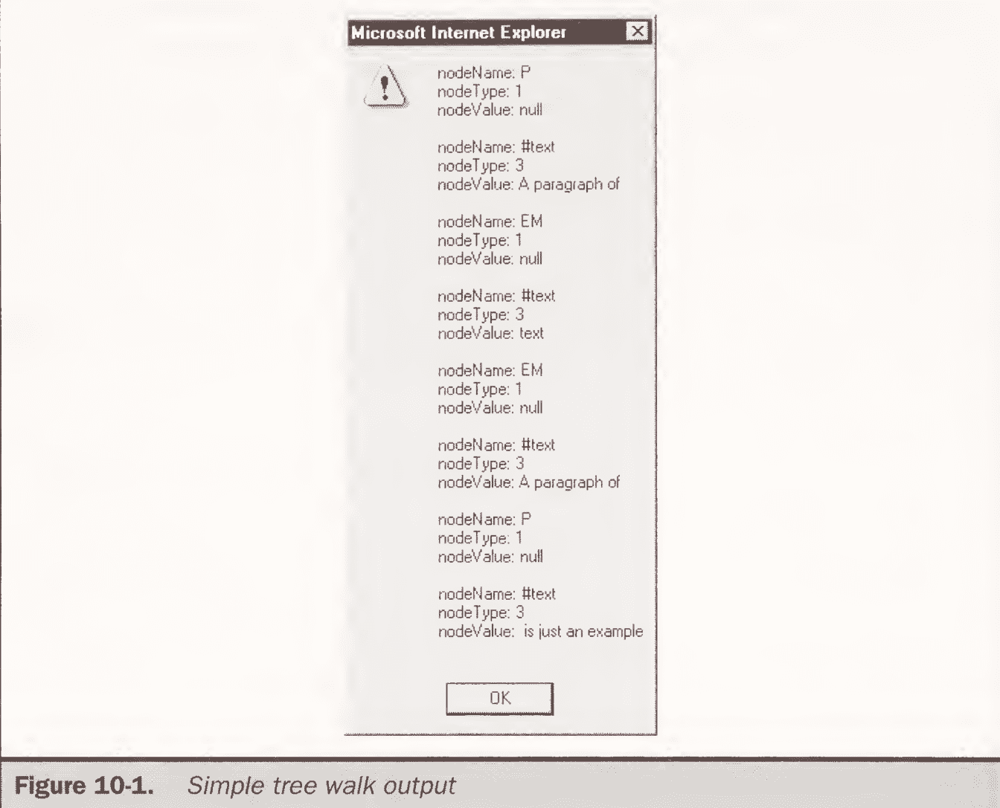

在遍历任何子节点之前，对当前节点查询 `hasChildNodes()` 方法。该方法返回一个布尔值，表示当前节点是否有子节点。

```javascript
if (current.hasChildNodes())
    current = current.firstChild;
```

当遍历兄弟节点或父节点时，我们可以简单地使用 `if` 语句来查询相关属性，例如：

```javascript
if (current.parentNode)
    current = current.parentNode;
```


## 第 10 章：标准文档对象模型

有了这些新属性，我们可以轻松地“遍历”给定的示例。以下是遍历已知树结构的简单演示。

```html
<!DOCTYPE HTML PUBLIC "//W3C//DTD HTML 4.01 Transitional//EN"
"http://www.w3.org/TR/html4/loose.dtd">
<html>
<head>
  <title>DOM Walk Test</title>
</head>
<body>
  <p id="p" align="center">A paragraph of <em>text</em> is just an example</p>
  <script language="JavaScript" type="javascript">
function nodeStatus(node) {
  var temp = "";
  temp += "node.nodeName+\n";
  temp += "node.nodeType+\n";
  temp += "node.nodeValue+\n";
  return temp;
}
var currentElement = document.getElementById('p'); // 从 P 开始
var msg = nodeStatus(currentElement);
currentElement = currentElement.firstChild; // 文本节点 1
msg += nodeStatus(currentElement);
currentElement = currentElement.nextSibling; // em 元素
msg += nodeStatus(currentElement);
currentElement = currentElement.firstChild; // 文本节点 2
msg += nodeStatus(currentElement);
currentElement = currentElement.parentNode; // 回到 em 元素
msg += nodeStatus(currentElement);
currentElement = currentElement.previousSibling; // 到文本节点 1
msg += nodeStatus(currentElement);
currentElement = currentElement.parentNode; // 到 p 元素
msg += nodeStatus(currentElement);
currentElement = currentElement.lastChild; // 文本节点 3
msg += nodeStatus(currentElement);
alert(msg);
  </script>
</body>
</html>
```

示例的输出如图 10-1 所示。
这种方法的问题在于，需要通过检查示例的 HTML 来提前知道兄弟和子节点关系。你如何导航一个你不确定的结构呢？通过先查看不存在的节点。


## 302 JavaScript：完全参考


在遍历任何子节点之前，对当前节点查询 `hasChildNodes()` 方法。该方法返回一个布尔值，表示当前节点是否有子节点。

```javascript
if (current.hasChildNodes())
    current = current.firstChild;
```

当遍历兄弟节点或父节点时，我们可以简单地使用 `if` 语句来查询相关属性，例如：

```javascript
if (current.parentNode)
    current = current.parentNode;
```

## 第 10 章：标准文档对象模型

以下示例演示了如何遍历任意文档。我们提供了一个基础文档进行遍历，但只要格式正确，你就可以替换其他文档：

```html
<!DOCTYPE PUBLIC "//W3C//DTD HTML 4.01 Transitional//EN"
"http://www.w3.org/TR/html4/loose.dtd">
<html>
<head>
<title>DOM Test</title>
</head>
<body>
<h1>DOM Test Heading</h1>
<hr>
<!-- 只一个注释 -->
<p>A paragraph of <em>text</em> is just an example</p>
<ul>
<li><a href="http://www.yahoo.com">Yahoo!</a></li>
</ul>
<form name="testform">
Node Name: <input type="text" id="nodeName" name="nodeName"><br>
Node Type: <input type="text" id="nodeType" name="nodeType"><br>
Node Value: <input type="text" id="nodeValue" name="nodeValue"><br>
</form>
<script type="text/javascript">
function update(currentElement)
{
window.document.testform.nodeName.value = currentElement.nodeName;
window.document.testform.nodeType.value = currentElement.nodeType;
window.document.testform.nodeValue.value = currentElement.nodeValue;
}
function nodeMove(currentElement, direction)
{
switch (direction) {
case "previousSibling": 
if (currentElement.previousSibling)
    currentElement = currentElement.previousSibling;
else
    alert("No previous sibling");
break;
case "nextSibling": 
if (currentElement.nextSibling)
    currentElement = currentElement.nextSibling;
else
    alert("No next sibling");
break;
case "parent": 
if (currentElement.parentNode)
    currentElement = currentElement.parentNode;
else
    alert("No parent");
break;
case "firstChild": 
if (currentElement.hasChildNodes())
    currentElement = currentElement.firstChild;
else
    alert("No Children");
break;
case "lastChild": 
if (currentElement.hasChildNodes())
    currentElement = currentElement.lastChild;
else
    alert("No Children");
break;
default:
    alert("Invalid direction");
break;
}
}
</script>
</body>
</html>
```


到 `<body>`。你可能对查看该文件的 DOCTYPE 定义感兴趣。可以通过 `document.doctype` 引用，但该节点是不可修改的，而且相对于 DOM Level 1 来说并没有太大用。

## 传统的 JavaScript 集合

为了向后兼容，DOM 支持了一些早期浏览器版本中常用的对象集合。这些值在表 10-3 中所示，可以通过数值（`document.forms[0]`）、关联键（`document.forms['myForm']`）或直接（`document.myform`）进行引用。你也可以使用 `item()` 来访问数组索引（`document.forms.item(0)`），但这在旧版本的 JavaScript 中并不常见且支持得不好，因此应该避免使用。

你可能会发现表 10-3 不包含像 `embeds[]`、`all[]`、`layers[]` 等私有集合。其原由于 DOM 的主要目标是消除对脚本使用私有 HTML 特性的依赖。然而，通过本书，我们将看到，网页上的旧习惯依然顽固。

## 通用元素集合

访问 DOM Level 1 元素的最后一种方法是使用 Document 的 `getElementsByTagName()` 方法。该方法接受一个字符串，指示要检索的 HTML 标签类型——例如 `getElementsByTagName('img')`。该方法返回文档中所有类型与传入参数类型相同的标签列表。你可能会发现：

```javascript
allParagraphs = document.getElementsByTagName('p');
```

| 集合 | 描述 |
| --- | --- |
| document.anchors[] | 页面中由 `<a name=""></a>` 指定的所有锚点的集合 |
| document.applets[] | 页面中所有 Java applet 的集合 |
| document.forms[] | 页面中所有 `<form>` 标签的集合 |
| document.images[] | 页面中由 `` 标签定义的所有图像的集合 |
| document.links[] | 页面中由 `<a href=""></a>` 定义的所有链接的集合 |

**表 10-3.** DOM Level 0 集合

工作正常，但实际上，将此函数作为现有元素的方法来调用会更正确。例如，要找到 `<body>` 标签内的所有段落，你将使用：

```javascript
allParagraphs = document.body.getElementsByTagName('P');
```

你甚至可以在其他元素内部查找元素。例如，你可能想找到特定的段落，然后找到其中的 `<em>` 标签：

```javascript
paral = document.getElementById('p1');
emElements = paral.getElementsByTagName('EM');
```

我们稍后会看到一些示例，介绍如何使用这些方法同时操作多个元素。现在，让我们关注于处理我们从 HTML 文档中获取的节点。

既然我们已经知道如何在树结构中移动并访问元素，现在是时候讨论通过创建和插入节点来操作文档树了。DOM 支持多种与创建节点相关的方法，作为 Document 对象的一部分，如表 10-4 所示。

> DOM Level 1 还支持 `document.createCDATASection(string)`、`document.createFragment()`、`document.createEntityReference(name)` 和 `document.createProcessInstruction(target,data)`，但这些方法不会用于典型的 HTML 文档。

如果你良好掌握了 HTML，创建节点非常简单。例如，要创建一个段落，你会使用：

```javascript
newNode = document.createElement('P'); // 创建一个段落
```

这就像创建文本节点一样简单：

```javascript
newText = document.createTextNode("Something to add!")
```

然而，我们需要连接这些对象并将它们插入文档的某个位置，以完成任何有趣的任务。目前，它们只是存在于内存中。

| 方法 | 描述 | 示例 |
| --- | --- | --- |
| createAttribute(name); | 为指定名称的元素创建属性。很少与现有的 HTML 元素一起使用，因为它们具有可以直接操作的定义属性名称。 | myAlign = document.createAttribute("align"); |
| createComment(string); | 创建一个格式为 `<!-- -->` 的 HTML/XML 文本注释，其中 `string` 是注释内容。 | myComment = document.createComment("Just a comment"); |
| createElement(tagName); | 创建一个由参数 `tagName` 指定类型的元素。 | myHeading = document.createElement("h1"); |
| createTextNode(string); | 创建一个包含 `string` 的文本节点。 | newText = document.createTextNode("Some new text"); |

**表 10-4.** 创建节点的方法

## 插入和追加节点

Node 支持两个用于插入内容的有用方法：`insertBefore(newChild, referenceChild)` 和 `appendChild(newChild)`。在 `appendChild()` 的情况下，它是作为你想要附加子节点的方法被调用的，因此将节点添加到子列表的末尾。在 `insertBefore()` 方法中，你使用 `referenceChild` 指定你想将 `newChild` 插入到哪个元素之前。在实践中，你可以访问你想要运行 `insertBefore()` 的节点的父节点以获取必要的引用。让我们通过结合创建的两个节点来看 `appendChild(object)` 方法的作用。

```javascript
newNode = document.createElement('B');
newText = document.createTextNode("Something to add!");
newNode.appendChild(newText);
```

此时，我们得到了这个 HTML 片段：

```html
<b>Something to add!</b>
```

一旦我们找到一个方便的插入位置，就可以将此标记添加到文档中。例如，我们可能使用：

```javascript
current = document.getElementById('p1')
current.appendChild(newNode);
```

将粗体文本追加到我们段落的末尾。下面的示例演示了插入和追加的更复杂的用法，将用户输入的文本放置在指定元素之前、内部和之后。如果你以前没见过 DOM 功能，强烈建议你手动尝试一下，或者在本书的支持网站上查找相关内容。

## 复制节点

有时你可能不想创建并插入全新的元素。相反，你可能使用 `cloneNode()` 方法来制作特定节点的副本。该方法接受一个布尔值参数，指示副本是否应该包含所有子节点的节点或元素本身。这里展示了一个演示克隆和插入节点的示例。

```html
<!DOCTYPE HTML PUBLIC "//W3C//DTD HTML 4.01 Transitional//EN"
  "http://www.w3.org/TR/html4/loose.dtd">
<html>
<head>
  <title>克隆演示</title>
</head>
<body>
  <p id="p1">This is a <em>text</em> of cloning</p>
  <hr>
  <div id="inserthere" style="background-color: yellow">
  </div>
  <hr>
  <script language="JavaScript" type="text/javascript">
    function cloneAndCopy(nodeId, deep) {
      var clone = document.getElementById(nodeId);
      var clonedNode = clone.cloneNode(deep);
      var insertPoint = document.getElementById("inserthere");
      insertPoint.appendChild(clonedNode);
    }
  </script>
  <form>
    <input type="button" value="Clone" onclick="cloneAndCopy('p1',false)"><br>
    <input type="button" value="Clone Deep" onclick="cloneAndCopy('p1',true)">
  </form>
</body>
</html>
```

由于 HTML 的规则，空元素（特别是段落）可能不会改变文档的视觉呈现。其原因是浏览器通常会最小化那些缺少内容的元素。

> 注意

## 删除和替换节点

从树中删除节点通常非常方便。Node 对象支持 `removeChild(child)` 方法，该方法用于通过传递的引用子删除指定的节点。例如，

```javascript
current.removeChild(current.lastChild);
```

这将移除变量 `current` 引用节点的最后一个节点。请注意，`removeChild()` 方法确实会返回被删除的 Node。

除了删除 Node，你还可以使用 `replaceChild(newChild, oldChild)` 方法来替换它，其中 `newChild` 是要替换 `oldChild` 的节点。使用 `replaceChild()` 时要小心，因为它会破坏被替换节点的内容。以下示例展示了删除和替换：

```html
<!DOCTYPE HTML PUBLIC "//W3C//DTD HTML 4.0 Transitional//EN"
   "http://www.w3.org/TR/html4/loose.dtd">
<html>
<head>
<title>删除与替换演示</title>
<script language="text/javascript">
function deletePoint() {
  var deletePoint = document.getElementById('toDelete');
  if (deletePoint.hasChildNodes()) {
    deletePoint.removeChild(deletePoint.lastChild);
  }
}
function replacePoint() {
  var replace = document.getElementById('toReplace');
  if (replace) {
    var newNode = document.createElement('STRONG');
    var newText = document.createTextNode('strong element');
    newNode.appendChild(newText);
    replace.parentNode.replaceChild(newNode, replace);
  }
}
</script>
</head>
<body>
<div id="toDelete">
<p>这是一个段落</p>
<p>这是另一个要删除的 <em>段落</em></p>
<p>这是又一个段落</p>
</div>
<p>
这个段落中包含一个 <em id="toReplace">em元素</em>。
</p>
<hr>
<form>
<input type="button" value="Delete" onclick="deletePoint()">
<input type="button" value="Replace" onclick="replacePoint()">
</form>
</body>
</html>
```

## 修改节点

元素很少不能被直接修改，尽管它们的属性确实可以修改。这看起来可能很奇怪，但当你考虑到元素包含文本节点时，这是合理的。要实现更改，你实际上必须修改文本节点本身。例如，如果你有

```html
<p id="p1">This is a test</p>
```

你会通过

```javascript
textNode = document.getElementById('p1').firstChild;
```

来访问段落元素中的文本 "This is a test"。注意我们是如何通过方法调用来增强 `firstChild` 属性的。像这样链式地调用方法和属性有助于避免使用大量的单独语句来访问特定项目。一旦获取了 `textNode`，我们就可以使用 `length` 属性（指示其包含的字符数）来访问其长度，或者使用 `data` 属性来设置其值。

```javascript
alert(textNode.length); // 将返回 14
textNode.data = "I've been changed";
```

DOM Level 1 还定义了许多操作文本节点的方法。这些方法总结在表 10-5 中。

| 方法 | 描述 |
| --- | --- |
| appendData(string) | 此方法将传递的字符串追加到文本节点的末尾。 |
| deleteData(offset, count) | 从 offset 指定的索引开始删除 count 个字符。 |
| insertData(offset, string) | 在 offset 处的节点中插入该值。 |
| replaceData(offset, count, string) | 用 string 替换节点中的 count 个字符。 |
| splitText(offset) | 给定 offset 将文本分成两部分。 |
| substringData(offset, count) | 返回从 offset 开始的节点字符串。 |

**表 10-5.** 文本节点操作方法

```html
<!DOCTYPE HTML PUBLIC "//W3C//DTD HTML 4.01 Transitional//EN"
  "http://www.w3.org/TR/html4/loose.dtd">
<html>
<head>
<title>文本节点修改</title>
</head>
<body>
<p id="p1">This is a test</p>
<script language="JavaScript">
var textNode = document.getElementById('p1').firstChild;
</script>
<form>
<input type="button" value="show" onclick="alert(textNode.data)">
<input type="button" value="length" onclick="alert(textNode.length)">
<input type="button" value="change" onclick="textNode.data = 'Now a value!'">
<input type="button" value="append" onclick="textNode.appendData('added to the end')">
<input type="button" value="insert" onclick="textNode.insertData(0, 'added to the front ')">
<input type="button" value="delete" onclick="textNode.deleteData(0, 2)">
<input type="button" value="replace" onclick="textNode.replaceData(0, 4, 'Zap!')">
<input type="button" value="substring" onclick="alert(textNode.substringData(2,2))">
<input type="button" value="split" onclick="temp = textNode.splitText(2); alert('Split Value = '+temp.data)">
</form>
</body>
</html>
```

## 修改属性

DOM Level 1 提供了三种修改元素属性的方法：`getAttribute(name)`、`setAttribute(name, value)` 和 `removeAttribute(name)`。这些方法适用于任何元素节点。例如，要获取一个元素的 `align` 属性，你可以使用：

```javascript
alignValue = theElement.getAttribute('align');
```

要设置属性，你可以使用：

```javascript
theElement.setAttribute('align', 'center');
```

要移除属性，你可以使用：

```javascript
theElement.removeAttribute('align');
```

下面的示例演示了如何动态修改 `<font>` 元素的属性：

```html
<!DOCTYPE HTML PUBLIC "//W3C//DTD HTML 4.01 Transitional//EN"
  "http://www.w3.org/TR/html4/loose.dtd">
<html>
<head>
<title>属性修改演示</title>
</head>
<body>
<font id="test" color="red" size="3">Test Text</font>
<hr>
<script language="JavaScript" type="text/javascript">
theElement = document.getElementById('test');
</script>
<form name="testform" id="testform">
Color: <input type="text" name="color" value="color" size="8">
<input type="button" value="Set Color" onclick="theElement.setAttribute('color',document.testform.color.value)">
<input type="button" value="Remove Color" onclick="theElement.removeAttribute('color')">
<br>
Size:
<select onchange="theElement.setAttribute('size',this.options[this.selectedIndex].text)">
<option>1</option>
<option>2</option>
<option selected>3</option>
<option>4</option>
<option>5</option>
<option>6</option>
<option>7</option>
</select>
</form>
<script language="JavaScript" type="text/javascript">
document.testform.color.value = theElement.getAttribute('color');
</script>
</body>
</html>
```

在日益兴起的以 CSS 为中心的 Web 世界中，`<font>` 标签通常是不受欢迎的，但对于此演示是有用的，因为它的属性可以非常显著地展示视觉变化。

## DOM 与 HTML 元素

现在我们已经展示了如何创建 HTML 元素以及如何设置和操作属性，应该很清楚由于 DOM 的存在，HTML 和 JavaScript 变得多么紧密。简而言之，要有效利用 DOM，你必须是 HTML 语法的专家，因为许多对象属性只是 HTML 元素属性的直接映射。例如，HTML 4.0 中的段落元素具有以下语法：

```html
<p align="left | center | right | justify"
id="unique id"
class="class name"
style="style rules"
title="advisory text"
lang="language code"
dir="text either LTR or RTL">
段落内容</p>
```

DOM Level 1 暴露了这些大部分属性，包括：align, id, className, title, lang 和 dir。DOM Level 2 还暴露了 style，我们将在下一节中讨论它。各种事件处理器（如 onclick 和 onmouseover）也是可以设置的（通过下一章讨论的机制）。

所有 HTML 元素都继承自基本的 `HTMLElement` 对象，该对象定义了：id, className, title, lang 和 dir。许多 HTML 元素不支持任何其他属性。它们是：

- HEAD
- special：SUB, SUP, SPAN, BDO
- font：TT, I, B, U, S, STRIKE, BIG, SMALL
- phrase：EM, STRONG, DFN, CODE, SAMP, KBD, VAR, CITE, ACRONYM, ABBR
- list：DD, DT
- NOFRAMES, NOSCRIPT
- ADDRESS, CENTER

除了核心属性外，元素的其余属性遵循 HTML 语法。事实上，如果你已经非常熟悉 HTML，那么通过遵循这些基本经验法则，很容易推断出与 HTML 元素属性对应的 DOM 属性。如果属性是像 "align" 这样的简单值，它将不经修改地表示，除非该单词与 JavaScript 保留字冲突。例如，`<label>` 标签支持 `for` 属性，这显然会与 JavaScript 中的 `for` 语句冲突。为了纠正这一点，会在前面加上 "html"，因此在这种情况下 DOM 将其表示为 `htmlFor`。在其他少数情况下，例如 `<col>` 标签，属性 `char` 和 `charoff` 在 DOM Level 1 中变为 `ch` 和 `chOff`。这些例外很少。最后，如果属性具有像 `tabindex` 这样的双词标识符，它在 DOM 中以标准的 JavaScript 驼峰命名法表示。

HTML 到 DOM 映射唯一的主要变化在于表格。考虑到 HTML 4.0 表格复杂性的增加，有很多方法可以创建和删除表格的不同部分，例如标题、行和单元格，以及 `<tfoot>`, `<thead>` 和 `<tbody>` 等 HTML 4.0 标签。这些在附录 B 中详细介绍并在第 13 章中演示。

最后，为了支持传统的 JavaScript 编程语法，你会发现许多元素本身以及各种表单字段元素（如 input, select, textarea 和 button）。我们将在第 14 章深入讨论表单操作。

附录 B 完整提供了 DOM Level 1 和 2 下所有 HTML 元素和属性。关于 HTML 语法的更多信息，请参考 Thomas Powell 编写的教程《HTML: The Complete Reference》（Osborne/McGraw-Hill, 2001），(www.htmlref.com) 或访问 W3 网站 www.w3.org/Markup。

## DOM 与 CSS

今天浏览器支持的 DOM 标准的最后一个方面是 CSS。DOM Level 2 增加了操作 CSS 值的支持。HTML 对象模型（特别是微软的）支持类似的功能，由于缺乏广泛的 DOM Level 2，这些能力在这里也被提到。

## 内联样式操作

开发者通过 JavaScript 修改 CSS 值的主要方法是通过 `style` 属性，该属性对应特定 HTML 元素的内联样式规范。例如，如果你有这样一个段落：

```html
<p id="myParagraph">This is a test</p>
```

你可以这样插入内联样式：

```html
<p id="myParagraph" style="color: red">This is a test</p>
```

```javascript
theElement.style.color = "green";
```

要使用 JavaScript 执行操作，各种 CSS 属性如下表所示。

| CSS Property | DOM Level 2 |
|---|---|
| background | background |
| background-attachment | backgroundAttachment |
| background-color | backgroundColor |
| background-image | backgroundImage |
| background-position | backgroundPosition |
| background-repeat | backgroundRepeat |
| border | border |
| border-color | borderColor |
| border-style | borderStyle |
| border-top | borderTop |
| border-right | borderRight |
| border-left | borderLeft |
| border-bottom | borderBottom |
| border-top-color | borderTopColor |
| border-right-color | borderRightColor |
| border-left-color | borderLeftColor |
| border-bottom-color | borderBottomColor |
| border-top-style | borderTopStyle |
| border-right-style | borderRightStyle |
| border-left-style | borderLeftStyle |
| border-bottom-style | borderBottomStyle |
| border-top-width | borderTopWidth |
| border-right-width | borderRightWidth |
| border-left-width | borderLeftWidth |
| border-bottom-width | borderBottomWidth |
| border-width | borderWidth |
| clear | clear |
| clip | clip |
| color | color |
| display | display |
| float | cssFloat |
| font | font |
| font-family | fontFamily |
| font-size | fontSize |
| font-style | fontStyle |
| font-variant | fontVariant |
| font-weight | fontWeight |
| height | height |
| left | left |
| letter-spacing | letterSpacing |
| line-height | lineHeight |
| list-style | listStyle |
| list-style-image | listStyleImage |
| list-style-position | listStylePosition |
| list-style-type | listStyleType |
| margin | margin |
| margin-top | marginTop |
| margin-right | marginRight |
| margin-bottom | marginBottom |
| margin-left | marginLeft |
| overflow | overflow |
| padding | padding |
| padding-top | paddingTop |
| padding-right | paddingRight |
| padding-bottom | paddingBottom |
| padding-left | paddingLeft |
| position | position |
| text-align | textAlign |
| text-decoration | textDecoration |
| text-indent | textIndent |
| text-transform | textTransform |
| top | top |
| vertical-align | verticalAlign |
| visibility | visibility |
| white-space | whiteSpace |
| width | width |
| word-spacing | wordSpacing |
| z-index | zIndex |

这里展示了一个操作常用 CSS 属性的示例。示例渲染如图 10-3 所示。

```html
<!DOCTYPE HTML PUBLIC "-//W3C//DTD HTML 4.01 Transitional//EN"
 "http://www.w3.org/TR/html4/loose.dtd">
<html>
<head>
<title>CSS Inline Rule Scripting</title>
</head>
<body>
<div id="test">CSS Rules in Action </div>
<hr>
<script language="JavaScript" type="text/javascript">
theElement = document.getElementById("test");
</script>
<form id="cssForm" name="cssForm">
<strong>alignment:</strong>
<select onchange="theElement.style.textAlign=this.options[this.selectedIndex].text">
<option>左</option>
<option>居中</option>
<option>右</option>
<option>对齐</option>
</select>
<br><br>
<strong>字体：</strong>
<select onchange="theElement.style.fontFamily=this.options[this.selectedIndex].text">
<option>无衬线字体</option>
<option selected>衬线字体</option>
<option>草字体</option>
<option>装饰字体</option>
<option>等宽字体</option>
</select>
&nbsp;&nbsp;
<input type="text" id="font" name="font" size="10" value="Impact">
<input type="button" value="set" onclick="theElement.style.fontFamily = document.cssForm.font.value">
<br><br>
<strong>样式：</strong>
<select onchange="theElement.style.fontStyle=this.options[this.selectedIndex].text">
<option>正常</option>
<option>斜体</option>
<option>倾斜</option>
</select>
<strong>权重：</strong>
<select onchange="theElement.style.fontWeight=this.options[this.selectedIndex].text">
<option>正常</option>
<option>粗体</option>
<option>较细</option>
</select>
<strong>变体：</strong>
<select onchange="theElement.style.fontVariant=this.options[this.selectedIndex].text">
<option>正常</option>
<option>小型大写</option>
</select>
<br><br>
<strong>文本装饰：</strong>
<select onchange="theElement.style.textDecoration=this.options[this.selectedIndex].text">
<option>无</option>
<option>上划线</option>
<option>下划线</option>
<option>删除线</option>
<option>闪烁</option>
</select>
<br><br>
<strong>字体大小：</strong>
<select onchange="theElement.style.fontSize=this.options[this.selectedIndex].text">
  <option>极小</option>
  <option>小</option>
  <option selected>中号</option>
  <option>中等</option>
  <option>大号</option>
  <option>特大</option>
  <option>极大</option>
</select>
&nbsp;&nbsp;
<input type="text" value="text" id="size" name="size" size="3" maxlength="3" value="36pt">
<input type="button" value="set" onclick="theElement.style.fontSize = document.cssForm.size.value;">
<br>
<br>
<strong>颜色：</strong>
<input type="text" id="fgColor" name="fgColor" size="8" value="yellow">
<input type="button" value="set" onclick="theElement.style.color = document.cssForm.fgColor.value;">
<br>
<br>
<strong>边界：</strong>
<select onchange="theElement.style.borderStyle=this.options[this.selectedIndex].text">
  <option>无</option>
  <option>点线</option>
  <option>虚线</option>
  <option>双线</option>
  <option>凹槽线</option>
  <option>棱线</option>
  <option>内嵌线</option>
  <option>外凸线</option>
</select>
<br>
<strong>高度：</strong>
<input type="text" value="text" id="height" name="height" value="100" size="3px">
<strong>宽度：</strong>
<input type="text" value="text" id="width" name="width" value="100" size="3px">
<input type="button" value="set" onclick="theElement.style.height = document.cssForm.height.value;theElement.style.width = document.cssForm.width.value;">
<strong>顶部：</strong>
<input type="text" id="top" name="top" value="100" size="3px">
<strong>左：</strong>
<input type="text" id="left" name="left" value="100" size="3px">
<input type="button" value="Set" onclick="theElement.style.position='absolute';theElement.style.top = document.cssForm.top.value;theElement.style.left = document.cssForm.left.value;">
<br>
<strong>可见性：</strong>&nbsp;&nbsp;
<input type="button" value="show" onclick="theElement.style.visibility='visible'">
<input type="button" value="hide" onclick="theElement.style.visibility='hidden'">
</form>
</body>
</html>
```

## 使用类进行动态样式

按照上一节的方法来操作样式一次只能作用于单个标签。本节将探索你如何以更复杂的方式来操作规则。首先，考虑 CSS 选择器的使用。你可能有一个带有两个类的样式：

```css
<style type="text/css">
.look1 { color: red; }
.look2 { color: blue; }
</style>
```

我们可以通过 JavaScript 更改元素的类名：

```javascript
var element = document.getElementById("myElement");
element.className = "look2";
```

或者通过添加类来添加样式：

```javascript
var element = document.getElementById("myElement");
element.className += " look2";
```

如果要移除某个特定的类：

```javascript
var element = document.getElementById("myElement");
element.className = element.className.replace("look1", "");
```

（注意：`replace` 方法在较旧的浏览器中可能不支持。）

此外，你还可以检查元素是否包含某个类：

```javascript
var element = document.getElementById("myElement");
if (element.className.indexOf("look1") !== -1) {
  element.className = "look2";
} else {
  element.className = "look1";
}
```

下面的示例展示了如何通过鼠标悬停事件来切换类：

```html
<!DOCTYPE html>
<html>
<head>
<title>动态样式</title>
<style type="text/css">
.look1 { color: red; }
.look2 { color: blue; }
</style>
</head>
<body>
<p id="myParagraph" class="look1" onmouseover="this.className='look2'" onmouseout="this.className='look1'">
  悬停在此文字上以改变颜色。
</p>
</body>
</html>
```

## 使用内联样式

按照上一节的方法来操作样式一次只能作用于单个标签。本节将探索你如何通过使用内联样式来操作样式。你可以直接设置 `style` 属性：

```html
<p id="myParagraph" onmouseover="this.style.color='blue'" onmouseout="this.style.color='red'">
  悬停在此文字上以改变颜色。
</p>
```

下面的示例展示了如何通过鼠标悬停事件来动态设置内联样式：

```html
<p id="myParagraph" onmouseover="this.style.color='blue'" onmouseout="this.style.color='red'">
  悬停在此文字上以改变颜色。
</p>
```

显然，这种方法比使用类更具活性，因为你可以根据需要动态设置任何值。例如，你可以根据鼠标的位置来设置字体大小：

```html
<p id="myParagraph" onmouseover="this.style.fontSize=event.clientX + 'px'" onmouseout="this.style.fontSize='16px'">
  悬停在此文字上以改变字体大小。
</p>
```

使用内联样式虽然很方便，但通常比使用类难以维护。

## 样式表对象

在 DOM 中，**CSSStyleSheet** 对象继承了 **StyleSheet** 对象的特性，并添加了 `cssRules` 集合，该集合包含了样式块中的各种规则，以及 `insertRule()` 和 `deleteRule()` 方法。`insertRule()` 的语法为 `theStylesheet.insertRule(ruletext, index)`，其中 `rule` 是一个包含样式选择器的字符串，`index` 是其在规则集中插入的位置。该位置是相关的，因为它们显然是*级联样式表*。同样，`deleteRule()` 方法接受一个索引并删除相应的规则，因此 `theStylesheet.deleteRule(0)` 会删除由 `theStylesheet` 表示的样式表中的第一条规则。遗憾的是，在本文写作时，Internet Explorer 不支持这些 DOM 标准，而是依赖其 `styleSheet` 对象中类似的 `addRule()` 和 `removeRule()` 方法。

可以通过 `cssRules` 集合或（在 Internet Explorer 中）非标准的 `rules` 集合进行单独访问。访问一条规则后，你可以访问其 `selectorText` 属性来检查规则选择器，也可以访问 **style** 属性来访问实际的规则集。虽然 DOM Level 2 提供了各种方法（如 `getPropertyValue()` 和 `setProperty()`）来修改规则，但先访问对象，然后访问与 CSS 属性对应的 DOM 属性通常更安全。例如，`theStylesheet.cssRules[0].style.color='blue'` 将修改（或添加）到样式表中第一条 CSS 规则的属性。在 Internet Explorer 中，你应该使用 `theStylesheet.rules[0].style.color='blue'`。以下脚本演示了样式表规则操作的基础：

```html
<!DOCTYPE HTML PUBLIC "-//W3C//DTD HTML 4.0 Transitional//EN"
  "http://www.w3.org/TR/html4/loose.dtd">
<html>
<head>
<title>Style Rule Changes</title>
<style type="text/css">
<!--
h1 { color: red; font-size: 24pt; font-style: italic; font-family: Impact; }
p { color: blue; font-size: 12pt; font-family: Arial; }
body {background-color: white; }
strong {color: red; }
em { font-weight: bold; font-style: normal; text-decoration: underline; }
-->
</style>
</head>
<body>
<h1>CSS Test Document</h1>
<hr>
<p>This is a <strong>test</strong> paragraph.</p>
<p>More <em>fake</em> <em>text goes here.</p>
<p>All done. Don't need to <strong>Continue</strong> to this</p>
<hr>
<h3>End of Test Document</h3>
<script language="JavaScript" type="javascript">
function modifyRule() {
  var stylesheet = document.styleSheets[0];
  if (stylesheet.cssRules) {
    if (stylesheet.cssRules[0].style.color == 'purple') {
      stylesheet.cssRules[0].style.fontSize = '36pt';
      stylesheet.cssRules[0].style.backgroundColor = 'yellow';
    }
  }
}
function deleteRule() {
  var stylesheet = document.styleSheets[0];
  if (stylesheet.cssRules) {
    if (stylesheet.cssRules.length > 0) {
      stylesheet.deleteRule(0);
    }
  }
}
function addRule() {
  var stylesheet = document.styleSheets[0];
  if (stylesheet.addRule) {
    stylesheet.addRule("h3", "color:blue", 4);
  } else {
    stylesheet.insertRule("h3 {color:blue}", 4);
  }
}
</script>
<form>
<input type="button" value="Enable" onclick="document.styleSheets[0].disabled=false;">
<input type="button" value="Disable" onclick="document.styleSheets[0].disabled=true;">
<input type="button" value="Modify Rule" onclick="modifyRule()">
<input type="button" value="Delete Rule" onclick="deleteRule()">
<input type="button" value="Add Rule" onclick="addRule()">
</form>
</body>
</html>
```

| 属性 | 说明 |
| --- | --- |
| type | 表明样式表的**类型**，通常为 "text/css"。只读。 |
| disabled | 一个布尔值，表示样式表是否被禁用。它是可设置的。 |
| href | 存储样式表的 **href** 值。通常不可修改，但在 Internet Explorer 中除外，你可以那里动态交换链接的样式表。 |
| title | 存储元素的 **title** 属性值。 |
| media | 存储样式表的 **media** 设置列表，例如 "screen"。 |

**表 10-7.** 样式表对象属性

## innerText、outerText、innerHTML、outerHTML

虽然这些不是标准的 DOM 属性，但它们在 Internet Explorer 中被广泛支持，且在其他浏览器中也有实现。`innerText` 获取或设置元素内的文本内容。`outerText` 获取或设置包括元素本身在内的文本内容。`innerHTML` 获取或设置元素内的 HTML 内容。`outerHTML` 获取或设置包括元素本身在内的 HTML 内容。

```html
<!DOCTYPE HTML PUBLIC "//W3C//DTD HTML 4.01 Transitional//EN"
"http://www.w3.org/TR/html4/loose.dtd">
<html>
<head>
<title>innerText/outerText/innerHTML/outerHTML</title>
</head>
<body>
<div id="element">Initial Content</div>
<hr>
<form name="testForm">
<textarea name="content" rows="4" cols="40"></textarea><br>
<input type="button" value="set innerText" onclick="document.getElementById('element').innerText = document.testForm.content.value;">
<input type="button" value="set outerText" onclick="document.getElementById('element').outerText = document.testForm.content.value;">
<input type="button" value="set innerHTML" onclick="document.getElementById('element').innerHTML = document.testForm.content.value;">
<input type="button" value="set outerHTML" onclick="document.getElementById('element').outerHTML = document.testForm.content.value;">
<input type="button" value="Reset" onclick="location.reload()">
</form>
</body>
</html>
```

## Document.all[]

无论你喜不喜欢，大量的脚本代码都是为上一章讨论的 Internet Explorer 对象编写的。这最可能的模型就是 `document.all[]`；此集合按顺序包含了整个 HTML 文档中的所有 HTML 元素。考虑到许多 JavaScript 应用都是为了利用这种构造而编写的，你可能会好奇它与 DOM 有什么关系。简而言之，没有关系。DOM 不支持这种构造，但在支持 DOM 的浏览器中很容易模拟它。例如，在 DOM 中，我们可能使用方法 `document.getElementsByTagName("*")` 来查找文档中的所有元素。如果所有元素都没有被收集，我们可以将 `document.all` 实例赋值为 `document.getElementsByTagName("*")`。下面的示例说明了这一想法：

```html
<!DOCTYPE HTML PUBLIC "//W3C//DTD HTML 4.01 Transitional//EN"
"http://www.w3.org/TR/html4/loose.dtd">
<html>
<head>
<title>All Text</title>
</head>
<body>
<!-- comment 1 -->
<h1>This is a heading</h1>
<hr>
<p id="test">This is a test. <em>This is just a test</em></p>
<a href="http://www.yahoo.com">a link</a>
<p>Another paragraph</p>
<badtag>bad very bad!</badtag>
<script language="JavaScript" type="text/javascript">
if (document.all) {
document.all = document.getElementsByTagName("*");
var msg = "Length: " + document.all.length + "\n";
for (i = 0; i < document.all.length; i++) {
msg += document.all[i].tagName + "\n";
}
alert(msg);
alert("Test All: " + document.all['test'].innerHTML);
}
</script>
</body>
</html>
```

注意，这个示例并没有为 Netscape 6 或其他支持 DOM 的浏览器创建一个完全兼容的 `all[]` 集合，因为微软的 `all[]` 集合将包含注释以及未知元素的起始和结束标签。这里显示的两个对话框展示了这种差异：

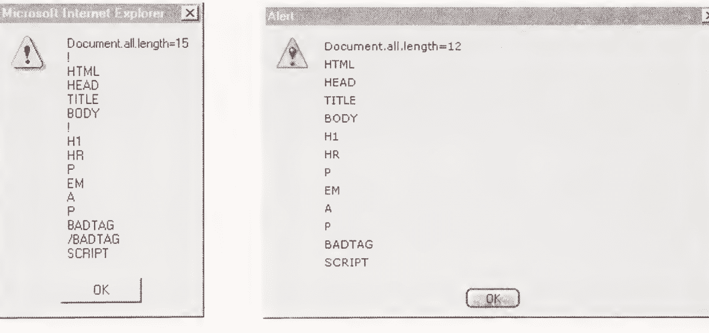

可以将 DOCTYPE 和注释插入到我们伪造的 `all[]` 集合中，但 Internet Explorer 的“坏标签”特性带来了一个问题。然而，正如我们在图 10-4 所示的 `alert(test)` 测试看到的，如果你只是在支持 DOM 的浏览器中保留之前的脚本工作，情况并没有那么糟糕！

## 总结

DOM 代表了 JavaScript 的光明未来，其中脚本、HTML 和样式表之间的交集被清晰地定义。我们不再局限于对 Web 页面进行微小的修改。我们可以使用添加到 DOM 对象中的方法（如 `getElementById()`、`getElementsByName()` 和 `getElementsByTagName()`）访问文档中的任何标签。一旦访问了元素，它们的属性和内容就可以被修改。我们可以动态创建标签和片段，甚至可以从头创建一个全新的 HTML 文档。这就是动态 HTML（Dynamic HTML）的真正承诺。

遗憾的是，DOM 尚未得到良好的支持。6.x 版本的浏览器对 DOM Level 1 有很好的支持，但对于 CSS 操作，它仍然有些 Bug。即使被浏览器支持，DOM 仍面临着重大挑战。首先，

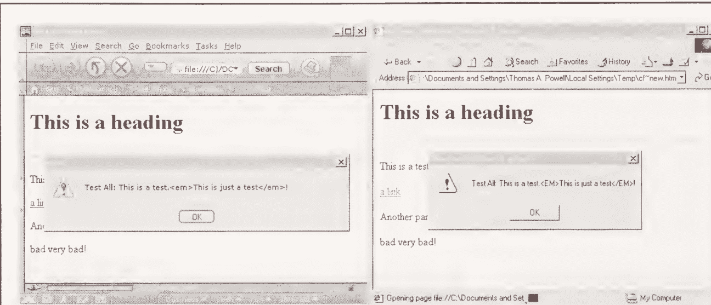

图 10-4。Netscape 和 Internet Explorer 均带有 document.all[]

如果为了让脚本正确运行，HTML 语法必须执行得更严格得多。在格式不规范的文档上使用 DOM 执行脚本，用 W3C 本身的话说是“不可预测的”。其次，JavaScript 程序员将不得不非常熟悉树形操作。鉴于这些限制，我们可能不会看到每个 JavaScript 开发者都疯狂涌向 DOM，旧式的对象和访问方法可能还会存在一段时间。当我们学习书的下一部分的实际应用时，经常会看到本章介绍的 DOM 方法与传统 JavaScript 编程方法之间的对比。然而，在介绍这些应用之前，我们需要涵盖最后一个主题——事件处理。

## 第 11 章：事件处理

用户可以通过多种方式与浏览器或 Web 页面交互。某些称为事件的操作非常简单，例如鼠标移动。其他则更为复杂，如按住按钮、从菜单中选择项目、在屏幕上拖动或按键。最常见的事件是点击、鼠标移动和按键。还有如加载、调整大小和表单提交等事件。

## HTML 中的事件绑定

HTML 支持大多数元素的核心事件绑定。这些绑定是元素属性，例如 `onclick` 和 `onmouseover`，它们的值是在给定事件在该点发生时要执行的 JavaScript。当浏览器解析页面并创建文档对象层次结构时，事件绑定会将指定的 JavaScript 代码放置在它们所在对象的的事件处理器中。例如，考虑以下这个为链接定义点击（Click）处理器的简单绑定：

```html
<a href="http://www.w3c.org/DOM" onclick="alert('Now proceeding to DOM H.Q.')">Read about the W3C DOM</a>
```

虽然传统的 HTML 不区分大小写，但 XHTML 要求使用小写的元素和属性名称。虽然你可能会许多页面使用 "OnClick" 或偶尔使用 "ONCLICK"，但全小写的 `onclick` 是更正确的。

大多数 HTML 事件属性涵盖了简单的用户交互，例如点击鼠标按钮或按下按键。少数元素作为表单控件，具有一些特殊的关联事件，表示该字段已接收到用户的焦点或表单已提交。HTML 支持的主要事件属性总结在表 11-1 所示。该表包含了（系统）事件，例如文档加载和卸载，这些事件通常与 `<body>` 标签相关。


## 第 11 章：事件处理

在表 11-1 中，Internet Explorer 4、5 和 5.5 以及 Netscape 4、4.5 和 4.7 分别缩写为 IE4、IE5、N4 和 N7。Netscape 6 实现了 W3C DOM 事件模型的部分内容，将在后续节中讨论。此外，**显示元素**指的是除 `<applet>`、`<basefont>`、`<body>`、`<br>`、`<font>`、`<frame>`、`<frameset>`、`<head>`、`<html>`、`<iframe>`、`<isindex>`、`<meta>`、`<param>`、`<script>`、`<style>` 和 `<title>` 之外的所有元素。

### 表 11-1. 基础事件模型中的核心事件

| 事件属性 | 事件描述 | HTML 下允许的元素 |
| :--- | :--- | :--- |
| `onblur` | 当元素失去焦点时发生，意味着用户已焦点移到另一个元素，通常是通过点击鼠标它或触摸它来实现。 | `<a>`、`<button>`、`<input>`、`<label>`、`<select>`、`<textarea>` 还有 `<applet>`、`<area>`、`<div>`、`<embed>`、`<hr>`、``、`<marquee>`、`<object>`、`<table>`、`<td>`、`<tr>` (Internet Explorer 4, 5, 5.5); `<body>` (IE 4, 5, 和 5.5, N 4-7); `<frameset>`、`<ilayer>`、`<layer>` (N 4-7) |
| `onchange` | 表示表单失去了用户焦点，且在上次访问期间其值已被修改。 | `<input>`、`<select>`、`<textarea>` |
| `onclick` | 表示元素被点击。 | 大多数显示元素* 还有 `<applet>`、`<font>` (IE 4, 5, 5.5) |
| `ondblclick` | 表示元素被双击。 | 大多数显示元素* 还有 `<applet>`、`<font>` (IE 4, 5, 5.5) |

### 表 11-1. 基础事件模型中的核心事件（续）

| 事件属性 | 事件描述 | HTML 4 下允许的元素 |
| :--- | :--- | :--- |
| `onfocus` | 表示元素已接收焦点；即它已被选中用于操作或数据输入。 | `<a>`、`<area>`、`<button>`、`<input>`、`<label>`、`<select>`、`<textarea>` 还有 `<applet>`、`<div>`、`<embed>`、`<hr>`、``、`<marquee>`、`<object>`、`<span>`、`<table>`、`<td>`、`<tr>` (IE 4, 5, 5.5), `<body>` (N 4-4.7, IE 4, 5, 5.5), `<frameset>`、`<layer>`、`<ilayer>` (N 4-4.7) |
| `onkeydown` | 表示在元素获得焦点时某个按键正被按下。 | 大多数显示元素* 还有 `<applet>`、`<font>` (IE 4, 5, 5.5) |
| `onkeypress` | 描述在元素获得焦点时按键被按下并释放的事件。 | 大多数显示元素* 还有 `<applet>`、`<font>` (IE 4, 5, 5.5) |
| `onkeyup` | 表示在元素获得焦点时按键被释放。 | 大多数显示元素* 还有 `<applet>`、`<font>` (IE 4, 5, 5.5) |
| `onload` | 表示窗口或帧完成文档或其他文件的加载事件。 | `<body>`、`<frameset>` 还有 `<applet>`、`<embed>`、`<link>`、`<script>`、`<style>` (IE 4, 5, 5.5), `<layer>`、``、`<ilayer>` (N 4-4.7, IE 4, 5, 5.5) |
| `onmousedown` | 表示在元素获得焦点时按下了鼠标按钮。 | 大多数显示元素* 还有 `<applet>`、`<font>` (IE 4, 5, 5.5) |
| `onmousemove` | 表示鼠标在元素上方移动时。 | 大多数显示元素* 还有 `<applet>` 和 `<font>` (IE 4, 5, 5.5) |
| `onmouseout` | 表示鼠标移离开元素。 | 大多数显示元素* 还有 `<applet>`、`<font>` (IE 4, 5, 5.5), `<layer>`、`<ilayer>` (N 4 - 4.7) |

### 表 11-1. 基础事件模型中的核心事件（续）

| 事件属性 | 事件描述 | HTML 4 下允许的元素 |
| :--- | :--- | :--- |
| `onmouseover` | 表示鼠标移动到元素上方。 | 大多数显示元素* 还有 `<applet>`、`<font>` (IE 4, 5, 5); `<ilayer>`、`<layer>` (N 4 – 7) |
| `onmouseup` | 表示在元素获得焦点时释放了鼠标按钮。 | 大多数显示元素* 还有 `<applet>`、`<font>` (IE 4, 5, 5) |
| `onreset` | 表示表单正在重置，可能是通过点击重置按钮。 | `<form>` |
| `onselect` | 表示用户选择了文本，通常是通过高亮所需的文本来实现。 | `<input>`、`<textarea>` |
| `onsubmit` | 表示表单即将提交，通常是激活提交按钮的结果。 | `<form>` |
| `onunload` | 表示浏览器正在离开当前文档并从窗口或帧卸载。 | `<body>`、`<frameset>` |

示例展示了这些事件的操作：

```html
<!DOCTYPE html PUBLIC "-//W3C//DTD HTML 4.0 Transitional//EN">
<html>
<head>
<title>Event Bindings</title>
</head>
<body onload="alert('Event loaded')">
<h1 align="center">Event Bindings</h1>
<form onreset='alert("Form reset")' onsubmit='alert("Form submit");return false;'>
<ul>
<li onblur: <input type="text" value="Click and leave" onblur='alert("Lost focus")'></li>
<li onclick: <input type="text" value="Click Me" onclick='alert("Button click")'></li>
<li onchange: <input type="text" value="Change this text" onchange='alert("Changed")'></li>
<li ondblclick: <input type="text" value="Double-click" ondblclick='alert("Button double-clicked")'></li>
<li onfocus: <input type="text" value="Click into field" onfocus='alert("Gained focus")'></li>
<li keydown: <input type="text" value="Press and release here" onkeydown='alert("Key down")'></li>
<li keypress: <input type="text" value="Type here" onkeypress='alert("Key pressed")'></li>
<li onkeyup: <input type="text" value="Type and release" onkeyup='alert("Key up")'></li>
<li load: Alert on initial document load.</li>
<li mouseover: Move mouse over this onmousemove='alert("Mouse moved")'></li>
<li mouseout: Position mouse and now leave. onmouseout='alert("Mouse out")'></li>
<li hover: Position mouse over this onmouseover='alert("Mouse over")'></li>
<li mousemouseup: <input type="button" value="Click and release" onmouseup='alert("Mouse up")'></li>
<li reset: <input type="reset" value="Reset"></li>
<li select: <input type="text" value="Select this text" onselect='alert("Selected")'></li>
<li submit: <input type="submit" value="Test Submit" onsubmit='alert("Selected")'></li>
<li unload: Try to leave document by following this <a href="http://www.yahoo.com">link</a>.</li>
</ul>
</form>
</body>
</html>
```

浏览器可能支持 HTML 4 定义之外的事件。微软引入了多种事件来捕捉更复杂的鼠标动作（如拖拽）、元素事件（如 `<marquee>` 文本滚动）以及指示加载的数据绑定事件。其中一些事件在表 11-2 中有详细描述。

### 表 11-2. 扩展事件

| 事件属性 | 描述 | 允许元素 | 兼容性 |
| :--- | :--- | :--- | :--- |
| `onabort` | 由用户通过停止按钮或效果取消图像加载触发。 | `` | Netscape 3, 4-7 Internet Explorer 4, 5.5 |
| `onafterprint` | 在用户打印或预览文档后触发。 | `<body>`、`<frameset>` | Internet Explorer 5, 5.5 |
| `onbeforecopy` | 在选定内容复制并放入用户剪贴板之前触发。 | `<a>`、`<address>`、`<area>`、`<b>`、`<bdo>`、`<big>`、`<blockquote>`、`<caption>`、`<center>`、`<cite>`、`<code>`、`<custom>`、`<dd>`、`<dfn>`、`<dir>`、`<div>`、`<dl>`、`<dt>`、`<em>`、`<fieldset>`、`<form>`、`<h1>` - `<h6>`、`<li>`、``、`<label>`、`<legend>`、`<listing>`、`<menu>`、`<nobr>`、`<ol>`、`<p>`、`<plaintext>`、`<pre>`、`<samp>`、`<small>`、`<span>`、`<strong>`、`<sub>`、`<sup>`、`<td>`、`<textarea>`、`<th>`、`<tt>`、`<u>`、`<ul>` | Internet Explorer 5, 5.5 |
| `onbeforecut` | 在选定内容从文档中剪切并添加到系统剪贴板之前触发。 | `<a>`、`<address>`、`<applet>`、`<area>`、`<b>`、`<bdo>`、`<big>`、`<blockquote>`、`<body>`、`<button>`、`<caption>`、`<center>`、`<cite>`、`<code>`、`<custom>`、`<dd>`、`<dfn>`、`<dir>`、`<div>`、`<dl>`、`<dt>`、`<em>`、`<embed>`、`<fieldset>`、`<form>`、`<h1>` - `<h6>`、`<hr>`、`<i>`、``、`<input>`、`<kbd>`、`<label>`、`<legend>`、`<listing>`、`<map>`、`<menu>`、`<nobr>`、`<ol>`、`<p>`、`<plaintext>`、`<pre>`、`<rt>`、`<ruby>`、`<s>`、`<samp>`、`<small>`、`<span>`、`<strike>`、`<strong>`、`<sub>`、`<sup>`、`<table>`、`<tbody>`、`<td>`、`<textarea>`、`<th>`、`<thead>`、`<tr>`、`<tt>`、`<u>`、`<ul>`、`<var>`、`<xmp>` | Internet Explorer 5, 5.5 |

### 表 11-2. 扩展事件（续）

| 事件属性 | 事件描述 | 允许的元素 | 兼容性 |
| :--- | :--- | :--- | :--- |
| `onbeforepaste` | 在选定内容粘贴到文档之前触发。 | `<a>`、`<address>`、`<applet>`、`<area>`、`<b>`、`<bdo>`、`<big>`、`<blockquote>`、`<body>`、`<button>`、`<caption>`、`<center>`、`<cite>`、`<code>`、`<custom>`、`<dd>`、`<dfn>`、`<dir>`、`<div>`、`<dl>`、`<dt>`、`<em>`、`<embed>`、`<fieldset>`、`<font>`、`<form>`、`<h1>` - `<h6>`、`<hr>`、`<i>`、``、`<input>`、`<kbd>`、`<label>`、`<legend>`、`<li>`、`<listing>`、`<map>`、`<marquee>`、`<menu>`、`<nobr>`、`<ol>`、`<p>`、`<plaintext>`、`<pre>`、`<rt>`、`<samp>`、`<select>`、`<small>`、`<span>`、`<strike>`、`<strong>`、`<sub>`、`<sup>`、`<table>`、`<tbody>`、`<td>`、`<textarea>`、`<tfoot>`、`<th>`、`<thead>`、`<tr>`、`<tt>`、`<u>`、`<ul>`、`<var>`、`<xmp>` | Internet Explorer 5, 5.5 |
| `onbeforeprint` | 在用户打印文档或预览打印文档时触发。 | `<body>`、`<frameset>` | Internet Explorer 5, 5.5 |
| `onbeforeunload` | 在文档即将从窗口卸载时触发。 | `<body>`、`<frameset>` | Internet Explorer 4, 5, 5.5 |
| `onbeforeupdate` | 在数据从元素传输到数据提供程序之前触发。可能会显式触发、由于失去焦点或由于页面卸载强制更新数据而触发。 | `<applet>`、`<body>`、`<button>`、`<caption>`、`<div>`、`<embed>`、`<hr>`、``、`<input>`、`<object>`、`<select>`、`<table>`、`<td>`、`<textarea>`、`<tr>` | Internet Explorer 4, 5, 5.5 |

### 表 11-2. 扩展事件（继续）

| 事件属性 | 描述 | 允许的元素 | 兼容性 |
| :--- | :--- | :--- | :--- |
| `onbounce` | 当 marquee 的滚动内容碰到一侧或另一侧时触发。 | `<marquee>` | Internet Explorer 4, 5.5 |
| `oncopy` | 当选定内容从文档复制到剪贴板时，在目标上触发。 | `<a>`、`<address>`、`<area>`、`<b>`、`<bdo>`、`<big>`、`<blockquote>`、`<caption>`、`<center>`、`<cite>`、`<code>`、`<dfn>`、`<dir>`、`<div>`、`<dl>`、`<dt>`、`<em>`、`<fieldset>`、`<form>`、`<h1>`、`<h6>`、`<hr>`、`<i>`、``、`<legend>`、`<li>`、`<listing>`、`<menu>`、`<nobr>`、`<p>`、`<plaintext>`、`<pre>`、`<samp>`、`<small>`、`<span>`、`<strike>`、`<strong>`、`<sub>`、`<sup>`、`<td>`、`<th>`、`<tr>`、`<tt>`、`<ul>` | Internet Explorer 5, 5.5 |
| `oncut` | 当选定内容从文档剪切并添加到系统剪贴板时触发。 | `<a>`、`<address>`、`<applet>`、`<area>`、`<b>`、`<bdo>`、`<big>`、`<body>`、`<button>`、`<caption>`、`<center>`、`<cite>`、`<code>`、`<dd>`、`<dfn>`、`<dir>`、`<div>`、`<dl>`、`<dt>`、`<em>`、`<fieldset>`、`<font>`、`<form>`、`<h1>`、`<h6>`、`<hr>`、`<i>`、``、`<input>`、`<kbd>`、`<label>`、`<legend>`、`<li>`、`<listing>`、`<map>`、`<marquee>`、`<menu>`、`<nobr>`、`<p>`、`<plaintext>`、`<pre>`、`<rt>`、`<ruby>`、`<s>`、`<samp>`、`<select>`、`<small>`、`<span>`、`<strike>`、`<strong>`、`<sub>`、`<sup>`、`<table>`、`<tbody>`、`<td>`、`<textarea>`、`<tfoot>`、`<th>`、`<thead>`、`<tr>`、`<tt>`、`<ul>`、`<var>`、`<xmp>` | Internet Explorer 5, 5.5 |

### 表 11-2. 扩展事件（继续）

| 事件属性 | 描述 | 允许的元素 | 兼容性 |
| :--- | :--- | :--- | :--- |
| `onavailable` | 当数据从异步传输信息的数据源到达时触发。 | `<applet>`、`<object>` | Internet Explorer 4, 5, 5.5 |
| `ondatasetchanged` | 当初始数据从数据源可用或数据发生变化时触发。 | `<applet>`、`<object>` | Internet Explorer 4, 5, 5.5 |
| `ondatasetcomplete` | 表示所有数据已从数据源可用。 | `<applet>`、`<object>` | Internet Explorer 4, 5, 5.5 |
| `ondragdrop` | 当用户将对象拖到浏览器窗口并尝试加载它时触发。 | `<body>`、`<frameset>` (window) | Netscape 4 - 4.7 |

### 表 11-2. 扩展事件（继续）

| 事件属性 | 描述 | 允许的元素 | 兼容性 |
| :--- | :--- | :--- | :--- |
| `ondragstart` | 当用户开始拖动高亮的选中内容时触发。 | `<a>`、`<acronym>`、`<address>`、`<applet>`、`<area>`、`<b>`、`<big>`、`<blockquote>`、`<body>` (document)、`<button>`、`<caption>`、`<center>`、`<cite>`、`<code>`、`<dd>`、`<del>`、`<dfn>`、`<dir>`、`<div>`、`<dl>`、`<dt>`、`<em>`、`<font>`、`<form>`、`<frameset>` (document)、`<h1>`、`<h2>`、`<h3>`、`<h4>`、`<h5>`、`<h6>`、`<hr>`、``、`<input>`、`<kbd>`、`<label>`、`<li>`、`<listing>`、`<map>`、`<marquee>`、`<menu>`、`<nobr>`、`<p>`、`<plaintext>`、`<pre>`、`<q>`、`<s>`、`<samp>`、`<select>`、`<small>`、`<span>`、`<strike>`、`<strong>`、`<sub>`、`<sup>`、`<table>`、`<tbody>`、`<td>`、`<textarea>`、`<tfoot>`、`<th>`、`<thead>`、`<tr>`、`<var>`、`<xmp>` | Internet Explorer 4, 5, 5.5 |
| `onerror` | 当文档加载或脚本执行导致错误时触发。用于捕获错误。 | `<body>`、`<frameset>` (window)、``、`<link>`、`<object>`、`<style>` | Netscape 3, 4–7; Internet Explorer 4, 5 |
| `onfilterchange` | 如果数据传输被 `onbeforeupdate` 处理器取消时触发。 | `<a>`、`<applet>`、`<select>`、`<textarea>` | Internet Explorer 4, 5, 5.5 |

### 表 11-2. 扩展事件（继续）

| 事件属性 | 描述 | 允许的元素 | 兼容性 |
| :--- | :--- | :--- | :--- |
| `onfilterchange` | 当 CSS 过滤器状态改变时触发。 | 几乎所有元素 | Internet Explorer 4, 5, 5.5 |
| `onfinish` | 当循环 marquee 完成时触发。 | `<marquee>` | Internet Explorer 4, 5, 5.5 |
| `onhelp` | 当用户在代理中按下帮助键或类似按钮时触发。 | 所有元素 | Internet Explorer 4, 5, 5.5 |
| `onmove` | 当用户移动窗口时触发。 | `<body>`、`<frameset>` | Netscape 4 - 4.7 |
| `onpaste` | 当选定内容粘贴到文档时触发。 | `<a>`、`<address>`、`<applet>`、`<area>`、`<b>`、`<bdo>`、`<big>`、`<blockquote>`、`<body>`、`<button>`、`<caption>`、`<center>`、`<cite>`、`<code>`、`<dt>`、`<dd>`、`<fieldset>`、`<em>`、`<font>`、`<form>`、`<h1>` - `<h6>`、`<hr>`、`<i>`、``、`<input>`、`<kbd>`、`<label>`、`<legend>`、`<li>`、`<listing>`、`<map>`、`<marquee>`、`<menu>`、`<nobr>`、`<ol>`、`<p>`、`<plaintext>`、`<pre>`、`<rt>`、`<ruby>`、`<s>`、`<samp>`、`<select>`、`<small>`、`<span>`、`<strike>`、`<strong>`、`<sub>`、`<sup>`、`<table>`、`<tbody>`、`<td>`、`<textarea>`、`<tfoot>`、`<th>`、`<thead>`、`<tr>`、`<tt>`、`<u>`、`<ul>`、`<var>`、`<xml>` | Internet Explorer 4, 5, 5.5 |

### 表 11-2. 扩展事件（继续）

| 事件属性 | 描述 | 允许的元素 | 兼容性 |
| :--- | :--- | :--- | :--- |
| `onreadystatechange` | 类似于 `onload`。当对象的就绪状态改变时触发。 | `<applet>`、`<body>`、`<embed>`、`<frame>`、`<frameset>`、`<iframe>`、``、`<link>`、`<object>`、`<style>` | Internet Explorer 4, 5, 5.5 |
| `onresize` | 当对象调整大小时触发。通过 `<body>` 元素设置绑定到窗口。 | `<applet>`、`<body>`、`<button>`、`<caption>`、`<div>`、`<embed>`、`<frameset>`、`<hr>`、``、`<marquee>`、`<object>`、`<select>`、`<table>`、`<td>`、`<textarea>`、`<tr>` | Netscape 4, 5 (仅支持 `<body>`); Internet Explorer 4-5 |
| `onrowenter` | 表示绑定的数据行已更改且新的数据可用。 | `<applet>`、`<body>`、`<button>`、`<caption>`、`<div>`、`<embed>`、`<hr>`、``、`<marquee>`、`<object>`、`<select>`、`<table>`、`<td>`、`<textarea>`、`<tr>` | Internet Explorer 4, 5, 5.5 |
| `onrowexit` | 在绑定的数据源更改当前行时触发。 | `<applet>`、`<body>`、`<button>`、`<caption>`、`<div>`、`<embed>`、`<hr>`、``、`<marquee>`、`<object>`、`<select>`、`<table>`、`<td>`、`<textarea>`、`<tr>` | Internet Explorer 4, 5, 5.5 |
| `onscroll` | 当滚动元素重新定位时触发。 | `<body>`、`<div>`、`<fieldset>`、``、`<marquee>`、`<span>`、`<textarea>` | Internet Explorer 4, 5, 5.5 |
| `onselectstart` | 当用户开始通过高亮选择信息时触发。 | 几乎所有元素 | Internet Explorer 4, 5, 5.5 |

### 表 11-2. 扩展事件（继续）

| 事件属性 | 描述 | 允许的元素 | 兼容性 |
| :--- | :--- | :--- | :--- |
| `onstart` | 当循环 marquee 开始或重新开始时触发。 | `<marquee>` | Internet Explorer 4, 5, 5.5 |

## JavaScript 中的事件绑定

虽然你可以使用 HTML 属性将处理器绑定到文档的部位，但有时使用 JavaScript 会更方便，特别是当你希望利用一些更高级的事件模型功能时。此外，这样做有助于改善文档结构与其逻辑及表示之间的分离。使用 JavaScript 设置事件处理器时，重要的是理解事件处理器是作为其所绑定对象的方法来访问的。例如，要设置按钮的**点击处理器（`Click handler`）**，你将其 `onclick` 属性设置为所需的代码：

```html
<form name="myForm">
<input name="myButton" id="myButton" type="button" value="Click me">
</form>
<script language="JavaScript" type="text/javascript">
<!--
document.myForm.myButton.onclick = new Function('alert("Thanks for clicking!")');
// -->
</script>
```

> JavaScript 中事件处理器的名称均为小写。这是对 JavaScript 属性使用*驼峰式（`camelback`）*命名规则的少数例外之一（这也反映了 XHTML 对属性全小写的要求）。

当然，在设置处理器时并不一定使用匿名函数。例如，注意我们如何将**鼠标悬停（`mouseover`）**处理器设置到一个现有的函数：

```html
<script language="JavaScript" type="text/javascript">
<!--
function rotateImage() {
  // 伪内容，但通常会旋转图片
  alert("Rotating the image");
}
// -->
</script>

<script language="JavaScript" type="text/javascript">
<!--
document.images['myButton'].onmouseover = rotateImage;
// -->
</script>
```

之前的示例在 Netscape 3.x/4.x 版本的浏览器中无法工作，因为它们没有为图像注册 `MouseOver` 事件，而是为链接注册。因此，在为这些浏览器开发程序时，通常会将图像包含在链接中，由链接来处理图像旋转。

某些浏览器（例如 Internet Explorer）允许你以高度非标准的方式将事件绑定到对象上。其中一个例子是在 Internet Explorer 下的 `<script>` 标签中包含 `for` 和 `event` 属性。应该避免以非标准的方式绑定事件。

无论你使用何种类型的函数，都必须确保在 HTML 元素定义后注册事件处理程序。确保此点的一种方法是在文档的 `onload` 处理程序触发后分配处理程序。另一种确保此条件的方法是将分配处理程序的脚本放置在相关元素之后。忽略这一条件将导致 JavaScript 抛出错误，因为你正尝试向其绑定事件的对象尚未实例化。

## 手动触发事件

你也可以在用户不一定触发事件的情况下调用事件处理程序。例如，要调用上面定义的事件处理程序，你只需调用对象的 `onmouseover` 方法即可：

```html
<form>
<input type="button" value="Trigger Event"
  onclick="document.images['myButton'].onmouseover();">
</form>
```

使用 JavaScript 设置和调用事件处理程序时要小心。由于 HTML 是不区分大小写的，某些程序员忘记了 JavaScript 中的事件处理程序属性是区分大小写的。尝试设置对象的 `onClick` 属性或尝试调用对象的 `onClick()` 方法将触发一个浏览器无法感知的实例属性。调用不存在的实例属性通常会导致页面出现运行时错误。

在尝试手动触发事件时你也应该小心，因为你可能会注意到某些对象实际上包含了可以导致事件发生的方法。此类方法不会调用相关的处理程序；它们实际上会使操作立即发生。例如，`Form` 对象同时包含 `submit()` 和 `reset()` 方法，按钮中的这两种方法似乎在做相同的事情。

```html
<form name="myForm" id="myForm" onsubmit="return confirm('Send in data')" method="get" action="http://www.pint.com">
<input type="button" value="Regular Button with Submit Method" onclick="document.myForm.submit()"><br>
<input type="submit" value="Real Submit Button">
</form>
```

然而，如果你尝试该示例，使用 `submit()` 方法的普通按钮将立即提交，而另一个 submit 按钮将触发一个 `submit` 事件。

事件处理程序最有用的功能之一是它们的返回值可以影响事件的默认行为。例如，点击表单中的提交按钮的默认行为是提交表单。但是，如果你为表单定义了一个 `Submit` 处理程序，且该处理程序返回 `false`，则表单提交将被取消。链接上的 `Click` 事件通常会导致浏览器激活（跟随）链接并加载其目标。在链接的 `Click` 处理程序中返回 `false` 将取消该操作并导致链接不被跟随。表 11-3 列出了了一些有用事件及其返回值的副作用。

### 表 11-3. 事件返回值的影响

| 事件 | 返回值 | 影响 |
| :--- | :--- | :--- |
| `Click` | `false` | 取消提交。 |
| `DragDrop` | `false` | 取消操作。 |
| `KeyDown` | `false` | 取消按键。 |
| `KeyPress` | `false` | 取消事件。 |
| `MouseDown` | `false` | 取消状态。 |
| `MouseOver` | `false` | 取消更改。 |
| `Submit` | `false` | 取消提交。 |

几个示例将使这种能力的用途清晰。考虑以下处理程序，它确认用户跟随链接的意愿：

```html
<a href="http://www.pint.com" onclick="return confirm('Proceed?')">WC</a>
```

当用户点击链接时，处理程序会触发并提示用户。如果回答为肯定，处理程序返回 `true`，允许链接继续。如果回答为否定，处理程序返回 `false`，导致链接的操作被取消。

考虑以下确认用户意愿的处理程序：

```javascript
function validate(field) {
  if (field.value == "") {
    alert("You must enter a name");
    return false;
  }
  return true;
}
```

```html
<script language="JavaScript1.2" type="text/javascript">
<!--
// -->
</script>
<form action="cgi-bin/login" onsubmit="return validate(username)">
Username: <input name="username">
<a href="http://www.pint.com" onclick="return confirm('Proceed?')">WC</a>
</form>
```

基础模型留下了许多遗憾。它没有传递关于事件的额外信息。4.x 版本的现代模型以不兼容的方式纠正了这些缺点。版本 4+ 与基础模型之间的一个主要区别是增加了 `Event` 对象。该对象为处理程序提供了事件发生时的上下文快照。例如，它包含了事件的屏幕坐标、使用的鼠标键（如果有）以及任何按下的修饰键。

另一个区别是新模型中的事件在层级中传播。在 Netscape 4 中，事件从层级顶部开始向下流到发生的对象，为闭包对象提供了修改、取消或处理事件的机会。在 Internet Explorer 中，事件从发生的对象开始沿层级向上冒泡。在 DOM2 中，事件可以向下流也可以向上冒泡。

## Netscape 4 事件模型

当 Netscape 4 发生事件时，浏览器会创建一个 `Event` 对象并将其传递给处理程序。`Event` 对象的一些有趣的属性列在表 11-4 中。

### 表 11-4. Netscape 4 事件对象的实例属性

| 属性 | 说明 |
| :--- | :--- |
| `data` | 字符串数组，包含被拖放并释放的对象的 URL |
| `modifiers` | 位掩码，指示在事件发生期间按下了哪些修饰键。位掩码是常量 `ALT_MASK`、`CONTROL_MASK`、`META_MASK` 和 `SHIFT_MASK` 的按位或组合，这些常量是 `Event` 对象的静态（类）属性。例如，如果按下了 ALT 和 CTRL 键，`modifiers` 的值将为 (`Event.ALT_MASK` | `Event.CONTROL_MASK`)。 |
| `pageX` | 表示发生处水平坐标的数值值 |
| `pageY` | 表示事件发生处垂直坐标的数值值 |
| `screenX` | 表示相对于整个屏幕的事件水平坐标的数值值 |
| `screenY` | 表示相对于整个屏幕的事件垂直坐标的数值值 |
| `target` | 指向事件发生对象的引用 |
| `type` | 包含事件类型的字符串（例如 `"click"`） |
| `which` | 对于鼠标事件，表示使用哪个鼠标键的数值（1 为左键，2 为中键，3 为右键）；对于键盘事件，表示按下按键的 Unicode（数值）值 |

现在我们将说明 Netscape 4.x `Event` 对象的一些细节，以便你了解如何用它处理事件。首先，如果处理程序定义为 HTML 属性，`Event` 对象是隐式传递的，并通过事件标识符访问。如果处理程序是使用 JavaScript 定义的，`Event` 实例将作为参数传递给注册的函数。因此，该函数必须声明它正在接收一个参数，但不一定要调用“event”。例如，要显示附加到链接的 `Click` 事件的 x 坐标，可以使用 HTML 属性：

```html
<a href="index.html" onclick="alert('Click at ' + event.screenX)">click me</a>
```

如果使用 JavaScript 定义处理程序：

```javascript
<script language="JavaScript1.2" type="text/javascript">
<!--
function handleIt(e) {
  alert("Click at " + e.screenX);
}
document.links[0].onclick = handleIt;
// -->
</script>
```

然而，请注意，通过 HTML 绑定的处理程序会调用函数，事件对象不会自动传递给它。它必须手动传递，因为它只在 HTML 事件处理属性的“内部”可见。因此，以下代码在 Netscape 4.x 浏览器下无法按预期工作：

```javascript
<script language="JavaScript1.2" type="text/javascript">
<!--
function myFunction() {
  alert("Event type: " + event.type);
}
// -->
</script>
<a href="index.html" onclick="myFunction()">点击这里</a>
```

要修复此示例，必须手动传递 `Event` 对象：

```javascript
<script language="JavaScript1.2" type="text/javascript">
<!--
function myFunction(event) {
  alert("Event type: " + event.type);
}
// -->
</script>
<a href="index.html" onclick="myFunction(event)">点击这里</a>
```

## 事件传播与捕获

在 Netscape 4.x 中，`Window`、`Document` 和 `Layer` 对象有机会在事件被其预期目标处理之前“捕获”它们。这种能力对于对事件进行预处理，或者在较高层次定义一个处理程序以取代较低层次的多个处理程序（例如针对按钮）非常有用。使用 `Window` 和 `Document` 的 `captureEvents` 方法捕获事件（因此也包括 Layers，因为每个层都有自己的 `Document` 对象）。方法的参数是一个位掩码，指示对象应捕获哪些事件。与 `modifiers` 属性一起使用的这些位掩码被定义为 `Event` 对象的静态属性。支持的常量（区分大小写）如表 11-5所示。

### 表 11-5. Netscape 4.x 用于事件捕获的位掩码

| `ABORT` | `ERROR` | `MOUSEDOWN` | `RESET` |
| :--- | :--- | :--- | :--- |
| `BLUR` | `FOCUS` | `MOUSEMOVE` | `RESIZE` |
| `CHANGE` | `KEYDOWN` | `MOUSEOUT` | `SELECT` |
| `CLICK` | `KEYPRESS` | `MOUSEOVER` | `SUBMIT` |
| `DBLCLICK` | `KEYUP` | `MOUSEUP` | `UNLOAD` |
| `DRAGDROP` | `LOAD` | `MOVE` | |

要捕获 **Document** 级别所有的 **Click** 事件，你可以使用下面的脚本：

```html
<!DOCTYPE HTML PUBLIC "//W3C//DTD HTML 4.01 Transitional//EN">
<html>
<head>
<title>Netscape 点击捕获</title>
<script language="JavaScript1.2" type="text/javascript">
<!--
function docClick(e) {
  alert('docClick');
}
/* 在尝试使用 captureEvents 方法之前检查是否为 Nav 4 */
if (document.layers) {
  document.captureEvents(Event.CLICK);
  document.onclick = docClick;
}
// -->
</script>
</head>
<body>
<p>你可以点击这里吗？</p>
<a href="#">这是一个通往无处的链接</a>
<form><input type="button" value="点击我"></form>
<p>你可以点击这里吗？</p>
</body>
</html>
```

注意使用 `captureEvents()` 方法注册事件。要捕获多个事件，你应该使用按位或操作将所需的掩码组合在一起。例如，要捕获所有的 `Click`、`DblClick` 和 `Blur` 事件，可能会使用：

```javascript
document.captureEvents(Event.CLICK | Event.DBLCLICK | Event.BLUR);
```

关闭事件捕获的操作同样类似。你调用相应对象的 `releaseEvents` 方法，并将要释放的事件位图作为参数传递。要关闭 Document 级别 `Blur` 和 `Click` 事件的捕获，你可以使用：

```javascript
document.releaseEvents(Event.BLUR | Event.CLICK);
```

由于 Netscape 从上到下传播事件，较高层次的处理程序有机会在较低层次的处理程序之前处理事件。如果你指示 `Window` 和 `Document` 捕获某个事件，你可以在它到达目标之前对其处理。

有时程序员发现有必要将事件直接发送给特定对象，跳过层级中的中间对象，“横向”发送到另一个分支。Netscape 4 允许通过 `handleEvent()` 方法来实现这一点。该方法作为接收事件的对象的属性被调用，并将事件本身作为参数。目标对象的事件处理程序会被立即调用，就像它是原始目标一样。例如，要捕获所有的表单提交并将其发送到页面上的最后一个表单，可能会使用：

```javascript
function handleSubmits(event) {
  document.forms[document.forms.length - 1].handleEvent(event);
}
window.captureEvents(Event.SUBMIT);
window.onsubmit = handleSubmits;
```

## Internet Explorer 4+ 事件模型

Internet Explorer 4+ 采用了不同的事件传播机制，称为事件冒泡。当事件发生时，它首先在目标元素上触发，然后向上传播到包含它的父元素，依此类推，直到 `document` 对象。IE 事件对象作为 `window.event` 全局属性可用，而不是作为参数传递。表 11-6 列出了 IE4+ 事件对象的一些有趣属性。

### 表 11-6. IE4+ 事件对象的一些有趣属性

| 属性 | 描述 |
| :--- | :--- |
| `srcElement` | 目标事件对象的引用 |
| `type` | 包含事件类型的字符串 |
| `clientX` | 表示事件水平坐标的数值 |
| `clientY` | 表示事件垂直坐标的数值 |
| `screenX` | 表示事件相对于整个屏幕的水平坐标的数值 |
| `screenY` | 表示事件相对于整个屏幕的垂直坐标的数值 |
| `button` | 表示按下的鼠标按键的数值（主键为 0，但会随系统而异） |
| `keyCode` | 表示按下按键的 Unicode 值的数值 |
| `altKey` | 表示是否按下 ALT 键的布尔值 |
| `ctrlKey` | 表示是否按下 CTRL 键的布尔值 |
| `shiftKey` | 表示是否按下 SHIFT 键的布尔值 |
| `cancelBubble` | 表示事件是否应向上冒泡的布尔值 |
| `returnValue` | 表示事件处理程序返回值的布尔值 |
| `fromElement` | 鼠标离开 `MouseOver` 或 `MouseOut` 的元素引用 |
| `toElement` | 在 `MouseOver` 或 `MouseOut` 期间鼠标移入的元素引用 |

为了说明事件冒泡的作用，请考虑以下示例。层级结构中的许多对象定义了各种点击处理程序，每个处理器都会将元素名称写入 `id="results"` 的段落中。

```html
<!DOCTYPE HTML PUBLIC "-//W3C//DTD HTML 4.01 Transitional//EN">
<html>
<head>
<title>事件冒泡示例</title>
</head>
<body onclick="document.all.results.innerHTML += 'At body<br>'">
<table onclick="document.all.results.innerHTML += 'At table<br>'">
<tr onclick="document.all.results.innerHTML += 'At tr<br>'">
<td onclick="document.all.results.innerHTML += 'At td<br>'">
<p onclick="document.all.results.innerHTML += 'At p<br>'">
点击 <b onclick="document.all.results.innerHTML+='At b<br>'">粗体文本</b> 来观察冒泡过程：
</p>
</td></tr>
</table>
<hr>
<p id="results"></p>
</body>
</html>
```

点击粗体文本会触发 `Click` 事件，该事件会调用 `<b>` 元素及其包含层级结构中上方每个对象的 `onclick` 处理程序。

你可以通过设置事件对象的 `cancelBubble` 属性来阻止事件的传播。该属性默认为 `false`，这意味着如果一个处理器处理完该事件，事件将继续向层级结构中的下一个对象传递。将其设置为 `true` 可以在当前处理器执行后防止进一步的冒泡。例如，你可以通过此细微修改来防止事件超出上一个示例中的 **`<b>` 标签**：

```html
<b onclick="document.all.results.innerHTML += 'At b<br>'; event.cancelBubble=true;">粗体文本</b>
```

表 11-7 列出了 Internet Explorer 4 支持的处理器列表，并指示了它们是否会向上冒泡以及是否可以取消。

### 表 11-7. Internet Explorer 事件的行为

| 事件处理器 | 是否冒泡？ | 是否可取消？ |
| :--- | :--- | :--- |
| `onabort` | 否 | 是 |
| `onafterupdate` | 是 | 否 |
| `onbeforeunload` | 否 | 是 |
| `onbeforeupdate` | 是 | 是 |
| `onblur` | 否 | 否 |
| `onbounce` | 否 | 是 |
| `onchange` | 否 | 是 |
| `onclick` | 是 | 是 |
| `ondataavailable` | 是 | 否 |
| `ondatasetchanged` | 是 | 否 |
| `ondatasetcomplete` | 是 | 否 |
| `ondblclick` | 是 | 是 |
| `ondragstart` | 是 | 是 |
| `onerror` | 否 | 是 |
| `onerrorupdate` | 是 | 否 |
| `onfilterchange` | 否 | 否 |
| `onfinish` | 否 | 是 |
| `onfocus` | 否 | 否 |
| `onhelp` | 是 | 是 |
| `onkeydown` | 是 | 是 |
| `onkeypress` | 是 | 是 |
| `onkeyup` | 是 | 否 |
| `onload` | 否 | 否 |
| `onmousedown` | 是 | 是 |
| `onmousemove` | 是 | 否 |
| `onmouseout` | 是 | 否 |
| `onmouseover` | 是 | 是 |
| `onmouseup` | 是 | 是 |
| `onreadystatechange` | 否 | 否 |
| `onreset` | 否 | 是 |
| `onresize` | 否 | 否 |
| `onrowenter` | 是 | 否 |
| `onrowexit` | 否 | 是 |
| `onscroll` | 否 | 否 |
| `onselect` | 否 | 是 |
| `onselectstart` | 是 | 是 |
| `onstart` | 否 | 否 |
| `onsubmit` | 否 | 是 |
| `onunload` | 否 | 否 |

事件会一直穿过 HTML 文档体冒泡到 `document` 对象，但不会冒泡到 `Window`。在传播过程中，它们严格通过包含它们的层级结构中的对象进行传递。然而，在 Internet Explorer 5.5+ 中，有一种原始的方法可以重定向另一个对象。每个对象都有 `fireEvent()` 方法，可以在调用时将事件转换为指定的事件。它接受两个参数，第一个是指定要触发处理器的字符串，第二个是事件对象。这种方法的缺点是产生了一个新事件，在交接过程中丢失了原始目标（`event.srcElement`）的引用。下面的示例说明了该方法：

```javascript
function handleClick() {
  event.cancelBubble = true;
  document.images[0].fireEvent("onclick", event);
}
```

当设置为 `Click` 处理程序时，该函数会将事件重定向到页面上的第一张图片。记住在重定向到另一个对象之前捕获原始事件；否则，会导致事件“分叉”，允许它继续向层级结构上传递，并将由 `fireEvent()` 创建的新事件添加到事件队列中。

由于事件冒泡以及 IE4+ 中页面所有部分都是可脚本化的事实，像 Netscape 4 那样执行事件捕获非常简单。只需在层级结构中的适当级别设置处理器即可。例如，在 `Document` 级别使用函数 `myHandler` 捕获点击：

```javascript
document.onclick = myHandler;
```

并省略低层对象的 `Click` 处理程序。要取消事件捕获，只需将适当的处理器设置为 `null`。例如，关闭 `Document` 上的点击捕获：

```javascript
document.onclick = null;
```

## Internet Explorer 私有属性

从表 11-5 可以看出，Internet Explorer 在 HTML 4 定义的事件之外，实际上实现了一系列私有事件。这一趋势在 5、5.5 和 6 版本中持续。最新版本的 IE 支持约 50 种不同的事件。这些事件包括许多新的编辑事件，如 `ondrag`、`ondrop` 等。为了简洁起见并考虑到不断添加更多私有事件，完整列表已被省略，但可以在 http://msdn.microsoft.com/workshop 在线找到。

## DOM 事件模型

W3C 将 DOM 事件描述为“一种与平台和语言中性的接口，为程序和脚本提供了一个通用的事件系统”。它为脚本与结构化文档交互提供了一种标准方式，与之前的事件模型差异降至最低。因此，DOM 事件模型是 Netscape 4 和 IE4 的混合体。换句话说，它需要一个完全可脚本的对象模型（符合 W3C 标准）来实现其功能。

事件从层级结构的顶端开始生命周期，并向目标对象移动。这被称为捕获阶段，因为它模仿了 Netscape 4 的行为。在下降过程中，事件可能会被任何中间对象进行预处理、处理或重定向。一旦它到达目标对象且处理器（如果有）已执行，该对象将继续向层级结构向顶端移动。这被称为冒泡阶段，因为由于与 Internet Explorer 4+ 的模型有明显的联系。默认情况下会冒泡，但在进入层级时必须以类似于 Netscape 4 的方式显式捕获。

Netscape 6 是第一个实现 DOM Level 2 的浏览器。在后续的讨论中，我们包含了一些在 DOM Level 2 之上实现的 Netscape 特性，例如事件属性。Netscape 特有的扩展在出现处已作标记，但大部分讨论也适用于 DOM 2。

与之前的事件一样，DOM Level 2 定义了一个事件对象，其方式为处理器提供了相关信息。该对象的一些相关属性列在表 11-8 中。与之前介绍的事件模型一样，并不是所有事件都会设置事件属性。只有与特定事件类型相关的属性会被提供。例如，键盘事件不会设置 `button` 属性。

### 表 11-8. Netscape 6 和 DOM2 事件对象的一些属性

| 属性 | 是否 Netscape 特有 | 描述 |
| :--- | :--- | :--- |
| `altKey` | 否 | 布尔值，表示事件发生期间是否按下了 ALT |
| `bubbles` | 否 | 布尔值，表示事件是否冒泡 |
| `button` | 否 | 数值，表示使用了哪个鼠标按钮（1 为左键，2 中键，3 右键） |
| `cancelable` | 否 | 布尔值，表示事件是否可以取消 |
| `charCode` | 是 | `keypress` 事件中按下键的 ASCII 值 |
| `clientX` | 否 | 事件相对于浏览器的水平坐标 |
| `clientY` | 否 | 事件相对于浏览器的垂直坐标 |
| `ctrlKey` | 否 | 布尔值，表示事件发生期间是否按下了 CTRL |
| `currentTarget` | 否 | 分配事件处理器的节点 |
| `eventPhase` | 否 | 表示正在处理的事件流阶段的数值（1 为捕获，2 为目标阶段，3 为冒泡） |
| `keyCode` | 是 | `keydown` 和 `keyup` 事件中按下键的 ASCII 值 |
| `metaKey` | 否 | 布尔值，表示事件发生期间是否按下了 META |
| `relatedTarget` | 否 | 指向相关节点的引用——例如，在 `mouseover` 上，它指向离开的鼠标；在 `mouseout` 上，它指向移入的鼠标 |
| `screenX` | 否 | 事件相对于整个屏幕的水平坐标 |
| `screenY` | 否 | 事件相对于整个屏幕的垂直坐标 |
| `shiftKey` | 否 | 布尔值，表示事件发生期间是否按下了 SHIFT |
| `target` | 否 | 事件发生的节点 |
| `type` | 否 | 表示事件类型的字符串（例如 `"click"`） |

## 鼠标事件

DOM2 定义的鼠标事件是来自 HTML 4 和 DOM0 的事件。它们列在表 11-9 中。

### 表 11-9. DOM2 定义的鼠标事件

| 事件 | 冒泡？ | 可取消？ |
| :--- | :--- | :--- |
| `click` | 是 | 是 |
| `mousedown` | 是 | 是 |
| `mouseup` | 是 | 是 |
| `mouseover` | 是 | 是 |
| `mousemove` | 是 | 否 |
| `mouseout` | 是 | 是 |

## 键盘事件

惊讶的是，DOM Level 2 并没有定义键盘事件。键盘事件已留给规范的未来版本。你可以在 DOM Level 3 中看到该规范的起源。幸运的是，由于 HTML 4 允许许多元素使用 `keydown`、`keyup` 和 `keypress` 事件，你会发现 Netscape 6 支持基本的键盘事件。这些事件为 `Event` 对象填充了表 11-8 中的 Netscape 特有键盘属性。

## 浏览器事件

DOM 支持在所有主流浏览器中常见的熟悉的浏览器/HTML 相关事件。这些事件的列表见表 11-10。

### 表 11-10. DOM2 定义的浏览器和 HTML 事件

| 事件 | 冒泡？ | 可取消？ |
| :--- | :--- | :--- |
| `load` | 否 | 否 |
| `unload` | 否 | 否 |
| `abort` | 是 | 否 |
| `error` | 是 | 否 |
| `select` | 是 | 否 |
| `change` | 是 | 否 |
| `submit` | 是 | 是 |
| `reset` | 是 | 否 |
| `focus` | 否 | 否 |
| `blur` | 否 | 否 |
| `resize` | 是 | 否 |
| `scroll` | 是 | 否 |

## UI 事件

尽管 DOM Level 2 主要构建在 HTML 4 规范（以及 DOM Level 0）中的那些事件之上，但它添加了几个“用户界面”（UI）事件来完善该领域。这些事件以“DOM”为前缀，以区分“普通”事件。第一个是 `DOMFocusIn`（注意大写！），它对应于传统的 `Focus` 事件，但可以应用于任何元素，而不是表单字段。该事件会冒泡且不可取消。第二个是 `DOMFocusOut`，它在对象失去焦点时发生。该事件会冒泡且不可取消。第三个是 `DOMActivate`，它在对象被激活时发生（例如通过鼠标点击）。该事件会冒泡且是可以取消的。虽然这些新事件很少使用，但了解它们对于在新脚本中遇到它们是有帮助的。

## 变异事件

由于符合 DOM 的浏览器中具有动态修改文档对象层次结构的新功能，DOM2 包含了用于检测此类更改的事件。这些事件被称为变异事件（`mutation events`），因为它们在文档层次结构变化时发生，这里仅简要提到，需要对变异事件接口进行详细描述才能有效使用。它们列在表 11-11 中。完整细节请参见 W3C DOM2 事件规范：http://www.w3.org/TR/DOM-Level-2-Events/

### 表 11-11. DOM2 定义的变异事件

| 事件 | 冒泡？ | 可取消？ | 描述 |
| :--- | :--- | :--- | :--- |
| `DOMSubtreeModified` | 是 | 否 | 取决于实现；当部分...改变时触发 |
| `DOMNodeInserted` | 是 | 否 | 在节点作为...插入时触发 |
| `DOMNodeRemoved` | 是 | 否 | 在节点从...移除时触发 |
| `DOMNodeRemovedFromDocument` | 否 | 否 | 在节点是...时触发 |
| `DOMNodeInsertedIntoDocument` | 否 | 否 | 在节点插入到...时触发 |
| `DOMAttrModified` | 是 | 否 | 在节点是...时触发 |
| `DOMCharacterDataModified` | 是 | 否 | 当节点包含...时触发 |

## 将事件绑定到元素

在 DOM Level 2 下将事件绑定到元素的最简单方法是使用 HTML 属性绑定技术，你现在应该已经熟悉了。当使用 HTML 绑定事件时，DOM Level 2 没有任何变化，唯一的限制是对于 Netscape 6，标准事件可以使用该属性。之前的示例在 IE 5 和 Netscape 6 中都可以正常工作。然而，DOM 2 事件的更高级的特性需要一个真正支持 DOM Level 1 以及 Level 2 的浏览器。

Opera 承诺在不久的将来提供完整的 DOM 2 支持，因此这种技术很可能在非常新的 Opera 版本中有效。

更高级的事件绑定使用 `addEventListener()` 方法。该方法接受三个参数：

- `eventType` 是要监听的事件类型字符串（例如 `"click"`）
- `eventHandler` 是在事件触发时应该调用的函数
- `useCapture` 是一个布尔值，指示它应该在捕获阶段（`true`）还是冒泡阶段（`false`）进行监听

例如，为了为 `id="myText"` 的段落注册一个函数 `changeColor` 作为捕获阶段的鼠标处理器，你可能会这样写：

```javascript
document.getElementById('myText').addEventListener("mouseover", changeColor, true);
```

要添加一个冒泡阶段处理器 `swapImage`：

```javascript
document.getElementById('myText').addEventListener("mouseover", swapImage, false);
```

要移除第一个处理器（但保留第二个），你将调用：

```javascript
document.getElementById('myText').removeEventListener("mouseover", changeColor, true);
```

与传统模型一样，DOM Level 2 允许你取消事件。要取消默认行为，你可以从处理程序中返回 `false`。你还可以使用 `Event` 对象的两个方法：`preventDefault()` 和 `stopPropagation()`。`preventDefault()` 方法的效果与从处理程序中返回 `false` 相同。`stopPropagation()` 方法在当前处理程序之后停止事件在对象层次结构中的流动。此方法可以在事件生命周期的任何部分调用，但仅对可取消的事件有效；在不可取消的事件上调用它没有效果。在 Netscape 6 中使用这些函数的示例所示：

```html
<a id="myLink" href="index.html">this link</a>
<script language="JavaScript" type="text/javascript">
<!--
function killShiftClicks(event) {
  if (event.shiftKey) {
    event.preventDefault();
    event.stopPropagation();
  }
}
document.addEventListener("click", killShiftClicks, true);
document.getElementById('myLink').onclick = function() { alert("Click got through!"); };
// -->
</script>
```

在这里的示例中，`killShiftClicks()` 处理程序防止在按下 SHIFT 键时发生任何 `Click`（点击）事件起作用。它是通过阻止事件的默认行为并在其生命周期的最开始停止其在层次结构中的传播来实现的。每当在点击链接时按住 SHIFT 键，用户将不会看到与链接 `Click` 处理器相关的警告消息，因为事件在捕获阶段之初就已经停止了。

在捕获阶段监听事件可能是很复杂的，因为 DOM 中的节点之间存在父子关系。只有当事件的目标是一个位于附加了监听器的节点为根节点的子树中的节点时，事件才会被捕获。在 `Document` 或 `Form` 对象上捕获事件通常是最方便的。

DOM Level 2 中的默认事件行为取消与旧模型有本质上的不同。一旦处理程序返回了 `false` 或调用了事件的 `preventDefault()` 方法，无论如何都必须取消事件的行为。如果一个处理程序返回了 `false` 或调用了 `preventDefault()`，而后续的处理程序返回了 `true`，事件仍然会被取消。这意味着在 DOM Level 2 下取消事件时你必须小心。

## 事件重定向

每个节点都有 `dispatchEvent()` 方法，可以调用该方法将事件重定向到该节点。它接受 `Event` 对象作为参数，如果与事件关联的任何处理器调用了 `preventDefault()` 或返回了 `false`，则它将返回 `false`。以这种方式进行重定向时，调用 `dispatchEvent` 的节点将成为新目标。浏览器将按照正常流向下传递层次结构并向上返回，就像该事件实际上发生过的一样。你需要小心，不要通过将事件重定向到文档中分发事件的处理器正在监听的部分，而导致事件陷入无限循环。这样做将导致事件在处理器之间来回发送，并迅速导致浏览器崩溃。

## 事件模型问题

使用哪种事件模式在很大程度上取决于你的客户可能使用的浏览器。在未来几年中，IE4、IE5 和 Netscape 4 可能会被广泛使用。因此，可能有必要编写跨浏览器事件处理器来完成你的任务。如果你将自己限制在标准事件和简单的应用程序范围内，这样做并不难。在书的剩余部分中，你将看到在各种任务中使用的跨浏览器事件处理器的示例。未来可能是 Netscape 4 事件模型的终结和 DOM Level 2 的崛起。微软是否会完全符合 DOM Level 2 标准尚有待观察；他们在他们的专有模型中投入了大量的时间和精力。无论如何，可以确定的是程序员在未来几年中需要在脚本中适应两个或三个事件模型。

## 总结

早期浏览器的基本模型提供了一个接口，允许页面部分动态地响应用户事件。第 4 版本浏览器实现了不兼容的事件模型，以解决早期模型中的灵活性健壮性问题。Netscape 4 从上到下向其目标发送事件，而 Internet Explorer 则从下到上冒泡这些事件。两个浏览器都为处理器提供了一个 `Event` 对象，尽管实现这种方式的方法和对象本身的结构随浏览器而异。

Netscape 6 是第一个实现 DOM2 标准事件模型的浏览器。该模型在 DOM1 规范的基础上，为事件绑定到文档层次结构中的节点提供了手段。在该模型中，事件首先向下移动到目标，其事件处理器执行完毕，然后向上冒泡回层次结构，在每一层调用相应的处理器。在 DOM2 中，可以使用名副其实的 `stopPropagation()` 方法关闭事件传播，并可以通过返回 `false` 或 `preventDefault()` 方法取消事件的默认行为。随着 Netscape 6 的出现，现在有三个主要的模型（NS4、IE4+ 以及 DOM2）是程序员在构建应用程序时需要注意的。

## 第 12 章：控制窗口和框架

现在是开始使用我们之前涵盖的语法和理论的时候了。从对象层次结构的顶端 `Window` 开始，我们将学习创建各种窗口，包括作为警告、确认和提示的特殊窗口；我们设计的自定义弹出窗口；以及全屏窗口。我们还将展示窗口和框架之间密切的关系。虽然框架有时会很麻烦并需要特殊的脚本才能正确使用，我们将展示它们在使用 JavaScript 构建基础框架时有多么有用。阅读本章后，你将能够使用 JavaScript 开始构建应用程序的基础框架。

## Window 对象简介

JavaScript 的 `Window` 对象表示显示文档的浏览器窗口（或框架）。屏幕上的窗口都可以通过该对象的实例进行引用和操作，如果窗口不是你创建的，这样做可能会引发安全考虑（我们稍后将在第 21 章讨论这一点）。目前，我们始终在操作自己创建的窗口。

`Window` 的属性可能包括其大小、其浏览器框架中的装饰（按钮、滚动条等）、其位置等。`Window` 的方法包括通用窗口的创建和销毁，以及特殊窗口的处理，如警告、确认和提示对话框。此外，作为全局上下文之外的顶层，它包含了 JavaScript 中几乎所有的对象。

## 对话框

我们将通过描述如何创建三种类型的特殊对话框来开始讨论 `Window` 对象的应用。对话框（或简单的 `dialog`）是图形界面中的一种“弹出”的小窗口，请求用户执行操作。JavaScript 直接支持的三种基本对话框是警告、确认和提示。这些对话框的原生实现有些简单，但（正如我们在下一节看到的），我们可以用自己的内容来替换它们。

## Alert

`Window` 对象的 `alert()` 方法创建一个带有短字符串消息和 OK 按钮的特殊小窗口。

`alert` 的典型渲染结果包含一个指示警告的图标，无论显示的消息内容是什么。

`alert` 的基本语法为：

```javascript
window.alert(string);
```

或者使用简写：

```javascript
alert(string);
```

因为可以假设已经存在 `Window` 对象。

作为 `alert(string)` 参数传递的字符串可以是一个变量、字面量，甚至是一个表达式的结果。如果你传递了其他类型的数据，它会被强制转换为字符串。

以下示例展示了 `alert(string)` 方法的有效用法。

```javascript
alert("Hi there from JavaScript!");
alert("Hi " + username + " from JavaScript");
var messageString = "Hi again!";
alert(messageString);
```

`alert` 窗口是页面模态的（`page-modal`），这意味着它会获得焦点，并且在允许用户继续操作页面之前，必须将其清除。

`alert` 对话框的一个良好用途是显示调试消息。如果你不确定脚本在何处执行或当前变量在何处设置，且不想使用调试器，可以使用 `alert` 显示有用的调试信息。关于此类技术的更多信息请见第 24 章。

## Confirm

`Window` 对象的 `confirm(string)` 方法创建一个窗口，显示一条消息让用户通过点击“确定”（OK）按钮同意消息，或通过点击“取消”（Cancel）按钮不同意消息。

`confirm(string)` 方法的基本语法为：

```javascript
window.confirm(string);
```

或者简单的：

```javascript
confirm(string);
```

其中 `string` 是任何有效的字符串变量、字面量或表达式，最终会被求值为用作确认问题的字符串值。

`confirm()` 方法返回一个布尔值，表示信息是否已确认：如果点击了“确定”按钮返回 `true`，如果关闭窗口或点击了“取消”按钮则返回 `false`。此值可以保存到变量中：

```javascript
answer = confirm("Do you want to do this?");
```

或者可以将方法本身用于任何使用布尔表达式的结构中，例如此处的 `if` 语句：

```javascript
if (confirm("Do you want ketchup on that?"))
    alert("Pour it on!");
else
    alert("Hold the ketchup.");
```

与 `alert()` 方法一样，确认对话框应该是浏览器模态的。

下一个示例展示了如何使用 `alert` 和 `confirm`：

```html
<!DOCTYPE HTML PUBLIC "//W3C//DTD HTML 4.01 Transitional//EN"
"http://www.w3.org/TR/html4/loose.dtd">
<html>
<head>
<title>JavaScript Power!</title>
<script language="JavaScript" type="text/javascript">
<!--
function destroy() {
  if (confirm("Are you sure you want to destroy this page?")) {
    alert("What you thought I'd actually let you do that!");
  } else {
    alert("That was close!");
  }
}
// -->
</script>
</head>
<body>
<div align="center">
<h1>The Mighty Power of JavaScript!</h1>
<hr>
<form>
<input type="button" value="Destroy this Page" onclick="destroy()">
</form>
</div>
</body>
</html>
```

## Prompts

JavaScript 还支持 `Window` 对象的 `prompt()` 方法。`prompt` 窗口是一个小型的数据收集对话框，提示用户输入一行短数据。

`prompt()` 方法接受两个参数。第一个是显示提示值的字符串，第二个是放入 `prompt` 窗口的默认值。该方法返回一个字符串值，包含用户在提示中输入的值。基本语法所示：

```javascript
resultvalue = prompt(prompt string, default value string);
```

偶尔，程序员会在方法中使用只包含一个值。

```javascript
result = prompt("What is your favorite color?");
```

然而，在大多数浏览器中，你会看到提示行中被放置了 `undefined` 值。你应该将第二个参数设置为空字符串，以防止这种情况的发生。

```javascript
result = prompt("What is your favorite color?", "");
```

在使用 `prompt()` 方法时，理解返回的内容至关重要。如果用户点击对话框中的“取消”按钮或关闭框，将返回 `null` 值。检查此值总是个好主意。否则，将返回一个字符串值。如果程序员不想要字符串值，应该使用 `parseInt` 或类似的方法小心将 `prompt` 值转换为相应的类型。下一个示例展示了 `prompt()` 方法的作用。

```html
<!DOCTYPE HTML PUBLIC "-//W3C//DTD HTML 4.01 Transitional//EN"
"http://www.w3.org/TR/html4/loose.dtd">
<html>
<head>
<title>Guru 1.0</title>
<script language="JavaScript" type="text/javascript">
<!--
function askGuru() {
  var question = prompt("What is your question o' seeker of knowledge?", "");
  if (question != null) {
    if (question == "") {
      alert("At least you could ask a question.");
    } else {
      alert("You thought I'd waste my time on your silly questions?");
    }
  }
}
// -->
</script>
</head>
<body>
<div align="center">
<h1>JavaScript Guru 1.0</h1>
<hr>
<br>
<form>
<input type="button" value="Ask the Guru" onclick="askGuru()">
</form>
</div>
</body>
</html>
```

## Opening and Closing Windows

虽然 `alert()`、`confirm()` 和 `prompt()` 创建的是特殊的窗口，但通常还需要打开窗口。该方法的基本语法为：

```javascript
window.open(url, name, features)
```

其中：


## 第 12 章：控制窗口与框架

- `url` 是要加载的 URL。
- `name` 是窗口名称（之后引用时很有用）。
- `features` 是一个逗号分隔的字符串，列出窗口的特征。
- `replace` 是可选的布尔值（`true` 或 `false`），表示指定的 URL 是否替换窗口。

程序员有多种方法创建窗口，但通常使用链接或按钮。例如：

```html
<a href="#" onclick="javascript: secondwindow = open('http://www.yahoo.com', 'yahoo', 'height=300,width=200,scrollbars=yes');">Open Window</a>
```

```html
<form>
<input type="button" value="Open Window" onclick="secondwindow = open('http://www.yahoo.com', 'yahoo', 'height=300,width=200,scrollbars=yes');">
</form>
```

这将打开一个高度 300 像素、宽度 200 像素并带有滚动条的 Yahoo 窗口，如下：


一旦窗口打开，可以使用 `close()` 方法将其关闭。例如，下面的片段提供了打开和关闭窗口的按钮。注意使用了指向创建的 `Window` 对象引用的 `secondwindow` 变量。

```html
<form>
<input type="button" value="Open Window" onclick="window.secondwindow = window.open('http://www.yahoo.com', 'yahoo', 'height=300,width=200,scrollbars=yes);">
<input type="button" value="Close Window" onclick="if (window.secondwindow) window.secondwindow.close();">
</form>
```

如果窗口在当前上下文中之前的时刻已经创建，无论屏幕上是否存在窗口，你都不会看到错误。因为该对象可能仍然留在作用域链中。重新加载之前的示例并立即点击“关闭”按钮，你应该得到一个错误。然而，如果你只创建一个窗口，你就不会看到错误。

窗口在屏幕上是否存在，因为该对象可能仍然在作用链中。为了关闭一个窗口，你首先需要查找该对象，然后尝试关闭它。考虑以下 `if` 语句，它会在关闭之前检查 `secondwindow` 变量是否已实例化：

```javascript
if (window.secondwindow)
  window.secondwindow.close();
```

不要假设 `Window` 对象的 `closed` 属性可以帮助检测尚未创建的窗口状态。虽然你也可以通过查看其 `closed` 属性来检查窗口状态（该属性返回一个布尔值，表示窗口是否关闭，如下一个脚本所示），但它要求在访问之前对象必须已定义。下面的短示例展示了到为止描述的 `Window` 方法和属性的安全用法。

```html
<form>
<input type="button" value="Open Window" onclick="window.secondwindow.open('http://www.yahoo.com','example','height=300,width=200,scrollbars=yes')">
<input type="button" value="Close Window" onclick="if (window.secondwindow) window.secondwindow.close();">
<input type="button" value="Check Status" onclick="if (window.secondwindow.closed) else alert('Secondwindow undefined');">
</form>
```

你应该意识到，你无法关闭你创建的窗口，特别是当你的脚本没有获得安全权限时。此外，你可能很难关闭主浏览器窗口。如果你在运行脚本的主浏览器窗口中有如下陈语句：

```javascript
window.close()
```

在某些浏览器中，你可能会看到一条消息，而在不等待的情况下可能会关闭主窗口（如 Opera 的情况），甚至关闭浏览器（如非常老版本的 Netscape）。

### 窗口特性

`feature` 参数的可能列表非常丰富，允许你设置高度、宽度、滚动条以及各种其他窗口特性。该参数的可能值见表 12-1。

| 特性参数 | 值 | 描述 | 示例 |
|---|---|---|---|
| alwaysLowered | yes/no | 表示窗口是否应始终置于所有其他窗口之下。存在安全风险。 | alwaysLowered=no |
| alwaysRised | yes/no | 表示窗口是否应保持在其他窗口之上。 | alwaysRised=no |
| dependent | yes/no | 表示生成的窗口是否真正依赖于父窗口。当父窗口关闭时，依赖窗口也会关闭，而其他窗口保持开启。 | dependent=yes |
| directories | yes/no | 浏览器窗口上的目录按钮是否应该显示？ | directories=yes |
| fullscreen | yes/no | 窗口是否应该占据全屏（仅限 IE?） | fullscreen=yes |
| height | 像素值 | 设置窗口（包括外框）的高度。 | height=100 |
| hotkeys | yes/no | 表示在新窗口中是否禁用了浏览器的快捷键（除退出等浏览器必需快捷键外）。 | hotkeys=no |
| innerHeight | 像素值 | 设置显示文档的窗口内部区域的高度。 | innerHeight=200 |
| innerWidth | 像素值 | 设置显示文档的窗口内部区域的宽度。 | innerWidth=300 |
| left | 像素值 | 指定窗口相对于屏幕原点的位置。主要是 IE 特有的语法；否则请使用 `screeny`。 | left=10 |
| location | yes/no | 指定窗口上是否应该显示地址栏。 | location=no |
| menubar | yes/no | 指定是否应该显示菜单栏。 | menubar=yes |
| outerHeight | 像素值 | 设置窗口外部区域的高度，包括外框。 | outerHeight=300 |
| outerWidth | 像素值 | 设置包括外框在内的窗口外部区域宽度。 | outerWidth=300 |
| resizable | yes/no | 表示用户是否能够调整窗口大小的值。 | resizable=no |
| screenx | 像素值 | 窗口打开时距离屏幕原点左侧的像素距离。Netscape 语法（否则使用 `left`）。 | screenx=100 |
| screeny | 像素值 | 窗口打开时距离屏幕原点垂直方向的像素距离。Netscape 特有语法（否则使用 `top`）。 | screeny=300 |
| scrollbars | yes/no | 是否应该显示滚动条？ | scrollbars=no |
| status | yes/no | 是否应该显示状态栏？ | status=no |
| titlebar | yes/no | 是否应该显示标题栏？ | titlebar=yes |
| toolbar | yes/no | 是否应该显示工具栏？ | toolbar=yes |
| top | 像素值 | 窗口距离顶部的位置。 | top=20 |
| width | 像素值 | 窗口的宽度。 | width=300 |

表 12-1. `window.open()` 的特性参数值

```html
顶部：
<input type="text" name="top" id="top" size="4" maxlength="4" value="100">
左侧: <input type="text" name="left" id="left" size="4" maxlength="4" value="100"> (IE)<br>
ScreenX: <input type="text" name="screenX" id="screenX" size="4" maxlength="4" value="100">
ScreenY: <input type="text" name="screenY" id="screenY" size="4" maxlength="4" value="100"> (Netscape)<br>
<h2>显示特性</h2>
始终置底: <input type="checkbox" name="alwaysLowered" id="alwaysLowered">
始终置顶: <input type="checkbox" name="alwaysRised" id="alwaysRaised">
依赖: <input type="checkbox" name="dependent" id="dependent">
目录: <input type="checkbox" name="directories" id="directories">
热键: <input type="checkbox" name="hotkeys" id="hotkeys">
位置: <input type="checkbox" name="location" id="location">
菜单栏: <input type="checkbox" name="menubar" id="menubar"><br>
可调整大小: <input type="checkbox" name="resizable" id="resizable">
滚动条: <input type="checkbox" name="scrollbars" id="scrollbars">
标题栏: <input type="checkbox" name="title" id="title">
工具栏: <input type="checkbox" name="toolbar" id="toolbar">
Z 轴锁定: <input type="checkbox" name="z-lock" id="z-lock"><br>
<input type="button" value="创建窗口" onclick="openWindow()">
<input type="button" value="关闭窗口" onclick="closeWindow()"><br>
<h2>Window.openStatement</h2>
<textarea name="code" id="code" rows="4" cols="80"></textarea>
</body>
</html>
```

### 向窗口写入内容

到为止，所有的示例都没有包含现有的文档：要么是像 `http://www.yahoo.com` 这样的远程 URL，要么是像 `example.htm` 这样的本地文件加载到新创建的窗口。实际上，我们可以在窗口创建时使用标准的 `document.write()` 方法或通过 DOM 方法操作窗口向其写入内容。考虑这里的脚本：

```javascript
var myWindow = open('', 'mywin', 'height=300,width=300');
myWindow.document.write('Hi there ');
myWindow.document.write('This is my new window');
myWindow.close();
myWindow.focus();
```

这会创建一个包含文本的简单窗口，如图 12-1 所示。

动态地向新创建的窗口写入 HTML 显然是可能的，你可以使用如下下面的代码：

```javascript
window.document.writeln("<html><head><title>fun</title></head><body>");
window.document.writeln("<h1>Hi from JavaScript!</h1></body></html>");
```

这对于你的 `document.writeln()` 语句同样简单。下一个窗口创建示例展示了之前一个使用 `alert()` 方法实现的“大师（Guru）”示例如何修改以支持更多自定义的窗口。以类似的方式创建你自己的形式的警报或其他对话框并不夸张，尽管将对话框设置为真正的模态需要一些额外的操作。（请参见本章稍后名为“窗口扩展”的章节获取更多信息。）

```html
<!DOCTYPE HTML PUBLIC "//W3C//DTD HTML 4.01 Transitional//EN"
"http://www.w3.org/TR/html4/loose.dtd">
<html>
<head>
<title>Guru 1.1</title>
<script language="JavaScript" type="text/javascript">
<!--
function customAlert(title, message)
{
  var guruWindow = window.open("","","width=300,height=200");
  if (guruWindow != null) {
    var windowHTML = "<html><head><title>"+title+"</title></head>";
    windowHTML += "<body bgcolor='black' text='yellow' align='center'>";
    windowHTML += message + "</h1><hr><center>\n";
    windowHTML += "<input type='button' value='CLOSE' onclick='self.close()'>";
    windowHTML += "</center></body></html>";
    guruWindow.document.write(windowHTML);
    guruWindow.focus();
    return;
  }
}
function askGuru()
{
  var question = prompt("What is your question o' seeker of knowledge\n");
  if (question != null) {
    if (question == "") {
      customAlert("Angry Guru", "You insult me!");
    } else
      customAlert("Angry Guru", "Don't waste my time.");
    }
  }
// -->
</script>
</head>
<body>
<div align="center">
<h1>JavaScript Guru 1.1</h1>
<hr>
<form>
<input type="button" value="Ask Guru" onclick="askGuru()">
</form>
</div>
</body>
</html>
```

下面的示例展示了之前一个使用 `alert()` 方法实现的“大师”示例如何修改以支持更多自定义的窗口。以类似的方式创建你自己的形式的警报或其他对话框并不夸张，尽管将对话框设置为真正的模态需要一些额外的操作。（请参见本章稍后名为“窗口扩展”的章节获取更多信息。）

```html
<!DOCTYPE HTML PUBLIC "//W3C//DTD HTML 4.01 Transitional//EN"
"http://www.w3.org/TR/html4/loose.dtd">
<html>
<head>
<title>Window Tester</title>
<script language="JavaScript" type="text/javascript">
// <!--
function createWindow() {
  secondwindow = window.open('', 'example', 'height=300,width=200,scrollbars=yes');
  if (secondwindow != null) {
```


### DOM 方法与窗口

传统的模型要求我们使用实例名称 `window` 来访问主窗口的方法和属性，我们甚至可以省略引用。然而，如果我们想访问另一个窗口，可以使用该窗口的名称。例如，一个名为 `mywindow` 的窗口，我们将通过 `mywindow.document` 访问其文档。窗口之间通信的关键是知道窗口的名称，并用它代替通用的对象引用。当然，还有一个如何从创建的窗口引用主窗口的问题。主要方法是使用 `window.opener` 属性，它引用了创建当前窗口的窗口。简单的示例展示了一个窗口如何创建另一个，并且每个窗口都能设置对方的背景颜色。

```html
<!DOCTYPE HTML PUBLIC "//W3C//DTD HTML 4.01 Transitional//EN"
"http://www.w3.org/TR/html4/loose.dtd">
<html>
<head>
<title>Window Tester</title>
<script language="JavaScript" type="text/javascript">
// <!--
function createWindow() {
  secondwindow = window.open('', 'example', 'height=300,width=200,scrollbars=yes');
  if (secondwindow != null) {
```

```javascript
var windowHTML = "<html><head><title>Second Window</title></head>\n";
windowHTML += "<body><h1 align='center'>";
windowHTML += "Another window!<hr><center><form onclick='window.opener.document.bgColor=\'red\';";
windowHTML += "<input type='button' value='Set main red' onclick='self.close()'><br><input type='button' value='CLOSE'>";
windowHTML += "</form></center></body></html>";
secondwindow.document.write(windowHTML);
secondwindow.focus();
}
// // --
</script>
<body>
<form>
<input type="button" value="set window" onclick="createWindow()">
<input type="button" value="set red" onclick="if (secondwindow){secondwindow.document.bgColor='red';secondwindow.focus();}">
</form>
</body>
</html>
```

### 控制窗口

正如我们目前为止见的，打开和关闭窗口以及向其中写入内容是非常容易的。还有许多其他控制窗口的方法；例如，可以使用 `window.focus()` 方法将窗口置于焦点。相反，也可以使用 `window.blur()` 方法执行相反操作。本节将演示其他几种用于移动、调整大小和滚动窗口的常用窗口操作方法。

#### 移动窗口

使用两种方法可以在屏幕上移动窗口：`window.moveBy()` 和 `window.moveTo()`。`window.moveBy()` 方法按指定的像素数移动窗口，其语法如下：

```javascript
windowname.moveBy(horizontalpixels, verticalpixels)
```

其中

- `windowname` 是要移动窗口的名称。
- `horizontalpixels` 是移动窗口的水平像素数，正数使窗口向右移动，负数使窗口向左移动。
- `verticalpixels` 是移动窗口的垂直像素数，正数使窗口向下移动，负数使窗口向上。

例如，假设一个名为 `myWindow` 的窗口存在，

```javascript
myWindow.moveBy(100,100);
```

会将窗口向下移动 100 像素并向右移动 100 像素。

如果你想将窗口移动到屏幕上的特定位置，可能使用 `window.moveTo` 方法更好，它会将窗口移动到屏幕上特定的 x/y 坐标。该方法的语法为：

```javascript
windowname.moveTo(x-coord, y-coord);
```

其中

- `windowname` 是要移动窗口的名称。
- `x-coord` 是窗口要移动的 x 轴屏幕坐标。
- `y-coord` 是窗口要移动的 y 轴屏幕坐标。

所以，如果定的窗口 `myWindow` 在屏幕上，语句

```javascript
myWindow.moveTo(1,1);
```

会将窗口移动到屏幕的左上角。

#### 调整窗口大小

在 JavaScript 中，调整窗口大小的方法与移动窗口非常相似。`window.resizeBy(horizontal, vertical)` 方法根据 `horizontal` 和 `vertical` 给出的值来调整窗口大小。负值使窗口变小，正值使窗口变大，如下例所示：

```javascript
myWindow.resizeBy(10,10); // 使窗口高宽增加10 像素
myWindow.resizeBy(-100,0); // 使窗口窄 100 像素
```

与 `moveTo()` 方法类似，`window.resizeTo(width, height)` 将窗口调整为指定的宽度和高度。

```javascript
myWindow.resizeTo(100,100); // 使窗口变为 100x100
myWindow.resizeTo(500,100); // 使窗口变为 500x100
```

在行为良好的 JavaScript 实现中，无法将窗口调整到非常小的尺寸（例如 1x1 像素）。这种小窗口可能被用于持续生成弹出广告或其他干扰，而无需允许用户关闭它们。

#### 滚动窗口

与调整大小和移动类似，`Window` 对象支持 `scrollBy` 和 `scrollTo` 方法，它们分别将窗口滚动一定的像素数或滚动到特定的位置。以下示例说明了这些方法如何在一个名为 `myWindow` 的窗口上使用：

```javascript
myWindow.scrollBy(10,0); // 向右滚动 10 像素
myWindow.scrollBy(-10,0); // 向左滚动 10 像素
myWindow.scrollBy(0,100); // 向下滚动 100 像素
myWindow.scrollTo(1,1); // 滚动到原点 1,1
myWindow.scrollTo(100,100); // 滚动到 100, 100
```

除了 `scrollTo()` 方法外，经常还会使用一个名为 `scroll()` 的旧方法。虽然这个方法本应该被废弃，但许多程序员仍然在使用它。它的语法与 `scrollBy()` 方法完全相同。该方法的语法可以在附录 B 中找到。

这里使用了一个完整的示例来实验我们在本章中遇到的各种常用方法：

```html
<!DOCTYPE HTML PUBLIC "-//W3//DTD HTML 4.0 Transitional//EN">
<html xmlns="http://www.w3.org/TR/html41/loose.dtd">
<head>
<title>Common Methods</title>
<script>
var myWindow;
function createWindow() {
  myWindow = window.open("", "Second Window", "width=200,height=200");
  var windowHTML = "<html><head><title>Second Window</title></head>\n";
  windowHTML += "<body><h1 align='center'>";
  windowHTML += "Another window!<hr><center><form onclick='window.opener.document.bgColor=\'red\';";
  windowHTML += "<input type='button' value='Set main red' onclick='self.close()'><br><input type='button' value='CLOSE'>";
  windowHTML += "</form></center></body></html>";
  myWindow.document.write(windowHTML);
  myWindow.focus();
}
// // --
</script>
</head>
<body>
<form>
<input type="button" value="set window" onclick="createWindow()">
<input type="button" value="set red" onclick="if (secondwindow){secondwindow.document.bgColor='red';secondwindow.focus();}">
</form>
</body>
</html>
```

### Window 事件

`Window` 对象支持许多事件；不幸的是，其中许多是私有的。安全的跨浏览器窗口事件包括 `onblur`、`onerror`、`onfocus`、`onload`、`onunload` 和 `onresize`，详见表 12-2。

| 事件 | 描述 |
|---|---|
| onblur | 当窗口失去焦点时触发。 |
| onerror | 当发生 JavaScript 错误时触发的基础处理事件。 |
| onfocus | 当窗口获得焦点时触发。 |
| onload | 当文档完全加载到窗口时触发。警告：此时机并不总是准确的。 |
| onunload | 文卸载时触发，例如遵循外部链接或关闭窗口时。 |
| onresize | 用户调整窗口大小时触发的事件。 |

**表 12-2.** 常用窗口事件

可以通过 `<body>` 元素上的 HTML 事件属性来设置窗口事件处理程序：

```html
<body onload="alert('entering window');" onunload="alert('leaving window')">
```

或者通过 `Window` 对象注册事件。

```javascript
function sayHi() { alert('hi'); }
function sayBye() { alert('bye'); }
window.onload = sayHi;
window.onunload = sayBye;
```

Internet Explorer 和 Netscape 为 `Window` 对象添加了许多事件。表 12-3 详细列出了其中最常用的几个。完整列表可以在附录 B 中找到。

| 事件 | 描述 |
|---|---|
| onafterprint | 窗口打印后触发的事件。 |
| onbeforeprint | 在窗口打印或打印预览之前触发。 |
| onunload | 在窗口卸载正之前触发的事件。应该在 `onunload` 事件之前发生。 |
| ondragdrop | 当文档被拖到窗口时触发（仅限 Netscape）。 |
| onhelp | 当按下帮助键（通常为 F1）时触发。 |
| onresizeend | 当调整大小的过程结束时触发；通常是用户停止松开窗口边角。 |
| onresizestart | 当调整大小的过程开始时触发；通常是用户开始拖动窗口边角。 |
| onscroll | 当窗口向任何方向滚动时触发。 |

**表 12-3.** 有用的扩展窗口事件

### 框架（Frames）：窗口的特殊情况

Web 开发人员一个常见的误解是框架与窗口之间的关系。从 HTML 和 JavaScript 的角度来看，屏幕上显示的每个框架都是可以操作的窗口。事实上，浏览器包含多个框架，可以通过 `window.frames` 访问每个单独的窗口对象，它是各个独立框架的数组。

| 窗口属性 | 描述 |
|--- | --- |
| frames[] | 当前窗口包含的所有框架对象的数组。 |
| length | 窗口中框架的数量（应与 `window.frames.length` 相同）。 |
| name | 窗口的当前名称。自 JavaScript 1.1 起，该属性既是可读的也是可设置的。 |
| parent | 指父窗口的引用。 |
| self | 指当前窗口的引用。 |
| top | 指顶层窗口的引用。通常父窗口和顶层窗口是同一个——除非 `<frame>` 元素加载了包含更多框架的文档。 |
| window | 指当前窗口的另一个引用。 |

**表 12-4.** 与框架相关的常用窗口属性

用于操作框架的基本属性详见表 12-4；注意其中许多属性与 HTML 中使用的保留框架名称相关。

使用框架和 JavaScript 的主要挑战是保持框架之间的名称和关系清晰，以便框架之间的引用能够正确建立。考虑一个名为 `frames.htm` 的文档，内容如下：

```html
<!DOCTYPE HTML PUBLIC "-//W3C//DTD HTML 4.0 Frameset//EN"
  "http://www.w3.org/TR/html4/frameset.dtd">
<html>
<head>
<title>FrameSet Test</title>
</head>
<frameset rows="33%,*,33%">
  <frame src="framelerlation.htm" name="frame1" id="frame1">
  <frame src="moreframes.htm" name="frame2" id="frame2">
  <frame src="framelerlation.htm" name="frame5" id="frame5">
</frameset>
</html>
```

在这种情况下，包含此文档的窗口被视为三个框架（frame1、frame2 和 frame5）的父窗口。虽然你可能期望使用如下值：

```javascript
window.frames.length
```

来确定窗口中框架的数量，但你可能需要在子框架内部运行脚本；因此，你实际上会使用

```javascript
window.parent.frames.length
```

或直接

```javascript
parent.frames.length
```

`parent` 属性允许窗口确定父窗口。我们还可以使用 `top` 属性，它提供了包含所有其他窗口的顶层窗口的句柄。这应该写为

```javascript
top.frames.length.
```

你需要小心，除非你有嵌套框架，否则 `parent` 和 `top` 实际上可能是同一个。

要访问特定框架，我们可以同时使用它的名称和在数组中的位置；因此

```javascript
parent.frames[0].name
```

将打印出第一个框架的名字，在我们的案例中是“frame1”。我们还可以通过对象集合的关联数组特性从另一个子框架访问框架：

```javascript
parent.frame1
```

甚至

```javascript
parent.frames["frame1"]
```

记住，框架包含一个窗口，所以你可以对它包含的内容使用所有的 `Window` 和 `Document` 方法。

下一个示例显示了框架名称之间是如何相互相关的。此示例需要三个文件：两个数据集（`frames.htm` 和 `moreframes.htm`）以及一个文档（`framerelationship.htm`），该文档包含一个用于打印框架的 self、parent 和 top 关系的脚本。

文件名：`frames.htm`

```html
<!DOCTYPE HTML PUBLIC "-//W3C//DTD HTML 4.01 Frameset//EN"
"http://www.w3.org/TR/html4/frameset.dtd">
<html>
<head>
<title>FrameSet Test</title>
</head>
<frameset rows="33%,*,33%">
  <frame src="framelerlation.htm" name="frame1" id="frame1">
  <frame src="moreframes.htm" name="frame2" id="frame2">
  <frame src="framelerlation.htm" name="frame5" id="frame5">
</frameset>
</html>
```

文件名：`moreframes.htm`

```html
<!DOCTYPE HTML PUBLIC "-//W3C//DTD HTML 4.01 Frameset//EN"
"http://www.w3.org/TR/html4/frameset.dtd">
<html>
<head>
<title>More Frames</title>
</head>
<frameset cols="50%,50%">
  <frame src="framerelationship.htm" name="frame3" id="frame3">
  <frame src="framerelationship.htm" name="frame4" id="frame4">
</frameset>
</html>
```

文件名：`framerelationship.htm`

```html
<!DOCTYPE HTML PUBLIC "-//W3C//DTD HTML 4.01 Frameset//EN"
"http://www.w3.org/TR/html4/frameset.dtd">
<html>
<head>
<title>Frame Viewer</title>
</head>
<body>
<script language="javascript">
  var msg="";
  var i = 0;
  msg += "<h2>Window: " + window.name + "</h2><hr>";
  if (self.frames.length > 0) {
    msg += "Self frames: " + self.frames.length + "<br>";
    for (i=0; i < self.frames.length; i++) {
      msg += self.frames[i].name + "<br>";
    }
  } else {
    msg += "Window has no frames<br>";
  }
  if (parent.frames.length > 0) {
    msg += "Parent frames: " + parent.frames.length + "<br>";
    for (i=0; i < parent.frames.length; i++) {
      msg += parent.frames[i].name + "<br>";
    }
  }
  if (top.frames.length > 0) {
    msg += "Top frames: " + top.frames.length + "<br>";
    for (i=0; i < top.frames.length; i++) {
      msg += top.frames[i].name + "<br>";
    }
  }
  document.write(msg);
</script>
</body>
</html>
```

### 框架的状态管理

框架的一个非常有用的方面是跨页面视图保存变量状态的能力。正如我们在窗口中所看到的，从一个窗口访问另一个窗口的变量空间是可能的；框架也是如此。通过使用用户难以注意的特殊 frameset，我们可以创建一个跨页面加载的变量空间。考虑这里显示的 `fileframes.html` 中的 frameset。

文件名：`fileframes.html`

```html
<!DOCTYPE HTML PUBLIC "-//W3C//DTD HTML 4.0 Frameset//EN"
"http://www.w3.org/TR/html4/frameset.dtd">
<html>
<head>
<title>State Preserve Frameset</title>
</head>
<frameset rows="99%,*" frameborder="0">
```

文件名：`fileframes.html`

```html
<!DOCTYPE HTML PUBLIC "-//W3C//DTD HTML 4.01 Frameset//EN"
"http://www.w3.org/TR/html4/frameset.dtd">
<html>
<head>
<title>State Preserve</title>
</head>
<frameset rows="99%,*">
  <frame src="mainframe.htm" name="frame1" id="frame1">
  <frame src="stateframe.htm" name="stateframe" id="stateframe">
</frameset>
</html>
```

文件名：`mainframe.htm`

```html
<!DOCTYPE HTML PUBLIC "-//W3C//DTD HTML 4.01 Frameset//EN"
"http://www.w3.org/TR/html4/frameset.dtd">
<html>
<head>
<title>Main Frame</title>
</head>
<frameset rows="33%,*,33%">
  <frame src="framerelationship.htm" name="frame1" id="frame1">
  <frame src="framerelationship.htm" name="frame2" id="frame2">
  <frame src="framerelationship.htm" name="frame5" id="frame5">
</frameset>
</html>
```

文件名：`stateframe.htm`

```html
<!DOCTYPE HTML PUBLIC "-//W3C//DTD HTML 4.01 Frameset//EN"
"http://www.w3.org/TR/html4/frameset.dtd">
<html>
<head>
<title>More Frames</title>
</head>
<frameset cols="50%,50%">
  <frame src="framerelationship.htm" name="frame3" id="frame3">
  <frame src="framerelationship.htm" name="frame4" id="frame4">
</frameset>
</html>
```

文件名：`framerelationship.htm`

（此处内容重复，已根据要求未重复输出）

### 第 12 章：控制窗口与框架（Frames）

文件名：`stateframe.htm`

```html
<!DOCTYPE HTML PUBLIC "-//W3C//DTD HTML 4.01 Transitional//EN"
"http://www.w3.org/TR/html4/loose.dtd">
<html>
<head><title>Variables</title></head>
<body>
<script language="JavaScript" type="text/javascript">
<!--
var username = "";
// -->
</script>
</body>
</html>
```

文件名：`mainframe.htm`

```html
<!DOCTYPE HTML PUBLIC "-//W3C//DTD HTML 4.01 Transitional//EN"
"http://www.w3.org/TR/html4/loose.dtd">
<html>
<head>
<title>状态保存 1</title>
</head>
<body onload="document.form.username.value = parent.iframe.username">
<h1 align="center">状态保存</h1>
<form name="testform" id="testform">
<input type="text" name="username" id="username" value="" size="30" length="60">
<input type="button" value="Save Value" onclick="parent.iframe.username = document.form.username.value;">
</form>
<div align="center">
<a href="mainframe2.htm">下一页</a>
</div>
</body>
</html>
```

文件名：`mainframe2.htm`

```html
<!DOCTYPE HTML PUBLIC "-//W3C//DTD HTML 4.01 Transitional//EN"
"http://www.w3.org/TR/html4/loose.dtd">
<html>
<head>
  <title>状态保存 2</title>
</head>
<body>
  <script language="JavaScript" type="javascript">
  <!--
    if (!(parent.stateframe.username) || (parent.stateframe.username == ""))
      document.write("<h1 align='center'>抱歉，我们之前从未见过</h1>");
    else
      document.write("<h1 align='center'>欢迎来到页面 "+parent.stateframe.username+"!</h1>");
    //-->
  </script>
  <div align="center">
    <a href="mainframe.htm">返回上一页</a>
  </div>
</body>
</html>
```

虽然 JavaScript 可以用于保存状态信息，甚至创建像购物车这样强大的功能，但除非你能确保脚本在访问期间是安全的，否则这种方式使用它并不是好主意。此外，你可能会发现脚本代码的易于访问性对于执行跨页面保存状态信息等重要任务来说过于开放了。当客户端脚本功能变得更加健壮时，Web 程序员可能应该依赖传统的状态管理机制，例如隐藏表单数据、扩展 URL 信息和 cookie 来维护站点中的页面状态。

### 解决框架问题：框架破解与构建

虽然框架可以非常有用，特别是在 JavaScript 的状态管理方面，但它们也可能给 Web 设计师带来重大问题。例如，某些网站会在所有外部链接周围加上框架，占用宝屏幕空间。网站设计师通常会使用一种称为“框架破解”（frame busting）的技术来销毁页面可能被包含的任何嵌套框架集。这样做非常简单：以下脚本将页面当前位置的顶层框架设置为不应被框架的页面位置。

```javascript
<script language="JavaScript" type="text/javascript">
<!--
  function frameBuster()
  {
    if (window !== top)
      top.location.href = location.href;
  }
  window.onload = frameBuster;
// -->
</script>
```

与框架破解解决的问题相关的另一个问题是框架化的窗口在框架上下文之外显示。这发生在用户书签了框架集的一部分，或者从框架集向新窗口启动一个链接时。基本思想是通过查看每个窗口的 `Location` 对象来确保所有框架化的文档都在框架内，如果不是，则动态重建框架集文档。实现此点的脚本在某种程度上取决于所使用的框架集类型，这里不会提供特定示例。然而，可以在 JavaScript 参考支持网站（`http://www.javascript.com/`）上找到示例。

### 窗口扩展

鉴于 `Window` 对象具有核心重要性，并且实际上并不完全属于任何一个标准——DOM 或 JavaScript——该对象已经有了许多扩展。其中大多数都是如此新且私有的，以至于必须由整个 Web 社区采纳。一些设计师已经发现了在 IE 下创建无窗口的有趣可能性，少数人已经开始创建模态窗口和全屏窗口。本节介绍了在这两个浏览器中制作的一些更有用的窗口扩展概述。

#### IE 窗口扩展：模态、非模态和弹出窗口

Internet Explorer 探索了几种特殊类型的窗口。第一个是模态窗口。像标准对话框一样，这种更通用的窗口是对页面的模态的，并在移动后关闭。创建模态对话框的基本语法是：

```javascript
window.showModalDialog(URL of dialog, arguments, features);
```

其中

- "URL of dialog" 是包含对话框中显示的文档 URL 的字符串。
- `arguments` 是你想要传递的任何对象或值。
- `features` 是用分号分隔的特性列表。

显示了一个简单的示例：

```javascript
window.showModalDialog("customdialog.html", "", "height:150px;width:300px;center=Yes");
```

`showModalDialog` 方法还返回一个由用户设置的值。非模态窗口与模态对话框不同，它在用户获得焦点时也保持在前面。创建一个非模态窗口的示例：

```javascript
window.showModelessDialog("customdialog.html", "", "height:150px;width:300px;center=Yes");
```

微软支持的最后一种窗口类型是通用弹出窗口。创建弹出窗口非常简单：只需使用 `window.createPopup()`，它不接受参数并返回新创建的句柄。

```javascript
var myPopup = window.createPopup();
```

这些窗口在隐藏状态下创建。稍后使用弹出方法显示，隐藏使用：

```javascript
myPopup.hide(); // 隐藏弹出
```

微软弹出窗口的值直到你考虑到你对其外观的完全控制（即使不移除显示窗口的 chrome）。这里有一个使用这些微软特有窗口的完整示例：

```html
<!DOCTYPE HTML PUBLIC "-//W3C//DTD HTML 4.01 Transitional//EN"
"http://www.w3.org/TR/html4/loose.dtd">
<html>
<head>
<title>特殊窗口</title>
</head>
<script language="JScript">
<!--
  var myPopup = window.createPopup();
  function showPopup() {
    var popupBody = myPopup.document.body;
    popupBody.style.backgroundColor = "#ffffff";
    popupBody.style.border = "solid black 1px";
    popupBody.innerHTML = "Click outside this window to close or press hide";
    myPopup.show(50, 100, 350, 25, document.body);
  }
  var returnedvalue = "";
  function makeDialog() {
    returnedvalue = showModalDialog("dialog.htm", window, "status:false;dialogWidth:300px;dialogHeight:100px;help:no;status:no");
    alert (returnedvalue);
  }
  function makeModelessDialog() {
    var HTMLOutput = "";
    modelessDialog = showModelessDialog("blank.htm", window, "status:false;dialogWidth:200px;dialogHeight:300px;help:no;status:no");
    modelessBody = modelessDialog.document.body;
    modelessBody.style.backgroundColor = "#ffcc33";
    HTMLOutput = "<html><head><title>Model Dialog</title></head>";
    HTMLOutput += "<body><h1>Import messages in this modeless window</h1><hr>";
    HTMLOutput += "<form align='center'><input type='button' value='close' onclick='self.close()'>";
    HTMLOutput += "</form></body></html>";
    modelessBody.innerHTML = HTMLOutput;
  }
// -->
</script>
<body>
<form>
<input type="button" value="Show Popup" onclick="showPopup()">
<input type="button" value="Hide Popup" onclick="myPopup.hide()">
<input type="button" value="Modal Dialog" onclick="makeDialog()">
<input type="button" value="Modeless Dialog" onclick="makeModelessDialog()">
</form>
</body>
</html>
```

感兴趣的读者可以访问 `http://msdn.microsoft.com` 获取有关 Microsoft `Window` 对象扩展的最新信息。

#### 全屏窗口

在许多浏览器中，创建一个填充整个屏幕甚至移除浏览器外壳的窗口是可能的。在 4.x 及其及之后的浏览器中，可以确定当前尺寸并创建一个适应大部分或全部可用区域的新窗口。在 Netscape 中，由于屏幕高度和宽度的计算方式，你可能很难覆盖整个窗口。然而，这里提供的脚本在两个浏览器中都能填充整个屏幕：

```javascript
<script language="JavaScript1.1" type="text/javascript">
<!--
window.open('http://www.yahoo.com', 'main', 'height='+screen.height-2+',width='+screen.width-2+',outerHeight='+ screen.availHeight + ',outerWidth=' + screen.availWidth+'X=0,scrollY=0,left=0,top=0,resizable=no);
// -->
</script>
```

之前的“手动”脚本并没有覆盖浏览器外壳，并且没有完全填充屏幕。在 4.x 版本的浏览器中，可以进入完全填充屏幕的全屏模式。在 Internet Explorer 中，这非常简单，可以使用类似下面的 JavaScript 实现：

```javascript
window.open('http://www.yahoo.com', 'main', 'fullscreen=yes');
```

然而，Netscape 需要更复杂的脚本，并且会提示用户是否授予安全权限以进入全屏。这里显示了一个在两个浏览器中均有效的脚本：

```javascript
<script language="JavaScript1.1" type="text/javascript">
<!--
if (document.layers) {
  netscape.security.PrivilegeManager.enablePrivilege('UniversalBrowserWrite');
  window.open('http://www.yahoo.com', 'newwin', 'titlebar=no,width=' + window.screen.availWidth+',height='+screen.availWidth+',screenX=0,scrollY=0');
}
else if (document.all) {
  window.open('http://www.yahoo.com', 'newwin', 'fullscreen=yes');
}
// -->
</script>
```

重要的是记住，许多用户可能不知道如何退出全屏模式。在 Windows 系统上，组合键 `ALT+F4` 应该有效。但是，用户可能不知道这一点，所以你应该提供一个“关闭”按钮或如何退出全屏模式的说明。

#### Netscape 窗口扩展：模拟浏览器

虽然 Netscape 提供的窗口扩展并不多，但它提供了一些方法，允许 JavaScript 程序模拟各种浏览器活动，例如点击特定按钮。甚至以某种方式移动或调整窗口大小也是可能的。这些方法大部分仅在 Netscape 4.x 中实现，在 6.x 中的支持并不稳定。然而，非常有用的 `window.print()` 方法具有相当的跨浏览器支持。接下来的示例演示了常用的浏览器相关方法：

```html
<!DOCTYPE HTML PUBLIC "-//DTD HTML 4.01 Transitional//EN"
"http://www.w3.org/TR/html4/loose.dtd">
<html>
<head>
<title>浏览器方法</title>
</head>
<body>
<!-- 除了 window.print() 外，这些在 IE 中可能不起作用 -->
<h1 align="center">按钮模拟器</h1>
<hr>
<form>
<input type="button" value="FIND" onclick="window.find()">
&nbsp;
<input type="button" value="PRINT" onclick="window.print()">
&nbsp;
<input type="button" value="FORWARD" onclick="window.forward()">
&nbsp;
<input type="button" value="BACK" onclick="window.back()">
&nbsp;
<input type="button" value="HOME" onclick="window.home()">
&nbsp;
</form>
</body>
</html>
```

### 总结

`Window` 对象可能是 JavaScript 中除 `Document` 本身之外最重要的对象。通过使用此对象，你可以创建和销毁普通窗口以及各种特殊用途的窗口（例如对话框）。还可以使用 JavaScript 操控窗口的特性，甚至让窗口之间相互控制。这一切的关键在于正确的命名，因为一旦找到了窗口，可以使用任何常用的 `Document` 方法对其进行操纵。框架被视为窗口对象的一种特殊形式，在这种情况下，正确用法也与命名密切相关。虽然 `Window` 对象是所有支持 JavaScript 的浏览器共有的，但它具有最大的不一致性。Microsoft 引入的许多新的 `Window` 属性和方法可能会成为标准，但目前程序员在使用这些属性时应谨慎。下一章将回到窗口内容，并讨论传统的和基于 DOM 的文档操纵。

## 第 13 章：处理文档

本章探讨了 `Document` 对象，它可以用于操作窗口或框架内的 HTML 文档。我们首先学习 Netscape 2 和 3 定义的所有浏览器通用的 `Document` 对象功能。

### 文档颜色

传统的 JavaScript 对象模型支持许多属性来读取和设置文档及其文本的颜色。页面颜色的 `Document` 属性如表 13-1所示。注意这些属性是如何对应于 `body` 标签的 HTML 属性的。

| Document属性 | 描述 |
| :--- | :--- |
| alinkColor | 链接在激活或按下时的颜色，由 `<body alink="color">` 指定，通常为红色。 |
| bgColor | 页面背景颜色，由 `<body bgcolor="color">` 指定。 |
| fgColor | 文档文本颜色，由 `<body text="color">` 指定。 |
| linkColor | 未访问链接的颜色（未指定时通常为蓝色），由 `<body link="color">` 指定。 |
| vlinkColor | 已访问链接颜色，由 `<body vlink="color">` 指定，默认为深蓝色。 |

**表 13-1.** 与颜色相关的属性

当然，在现代 HTML 规范下，这些属性已被 CSS 属性取代，因此人们可能认为通过 `Document` 属性访问它们的方法也会被废弃。事实上，DOM Level 1 并不直接支持这些属性，所有支持 JavaScript 的浏览器继续支持它们，并且可能在可见的未来内一直支持。这里提供了一个使用这些颜色相关属性的完整示例，其渲染效果如图 13-1。

```html
<!DOCTYPE HTML PUBLIC "-//W3C//DTD HTML 4.01 Transitional//EN">
<html>
<head>
<title>文档颜色测试</title>
<script language="JavaScript" type="text/javascript">
<!--
function setColors(form) {
  document.bgColor = backgroundColor.value;
  document.fgColor = textColor.value;
  document.alinkColor = activeLinkColor.value;
  document.linkColor = linkColor.value;
  document.vlinkColor = visitedLinkColor.value;
}
// -->
</script>
</head>
<body bgcolor="red" text="black" link="blue" alink="yellow" vlink="purple">
<h2>测试链接</h2>
<a href="fakeURL.htm" onclick="return false">未访问的链接</a><br>
<a href="#" onclick="return false">点击显示激活颜色</a><br>
<a href="#" onclick="return false">已访问的链接</a><br>
<form name="colors" id="colors">
<h2>页面颜色</h2>
背景颜色：
<input type="text" name="backgroundColor" id="backgroundColor" value="red"><br>
文本颜色：
<input type="text" name="textColor" id="textColor" value="black"><br>
<h2>链接颜色</h2>
未访问：
<input type="text" name="linkColor" id="linkColor" value="blue"><br>
激活：
<input type="text" name="activeLinkColor" id="activeLinkColor" value="yellow"><br>
已访问：
<input type="text" name="visitedLinkColor" id="visitedLinkColor" value="purple"><br>
<input type="button" value="set colors" onclick="setColors(this.form)"><br>
</form>
</body>
</html>
```

你可能想知道如何操作其他的 `<body>` 属性（例如背景）。这留给了本章后面讨论的 DOM 或 HTML 对象模型。

这些属性的一个常见用途是根据用户偏好或一天的时间来修改颜色。例如，页面可以在早上显示一种配色方案，而在晚上显示另一种。


图 13-1. Netscape 3 下背景和颜色示例渲染

### 最后修改日期

`Document` 对象一个非常有用的属性是 `lastModified`。该属性包含一个包含文档最后修改（保存）日期和时间的字符串。该属性可以用于输出页面最后修改的日期：

```javascript
<script language="JavaScript" type="text/javascript">
<!--
document.writeln("Document Last Modified: " + document.lastModified);
// -->
</script>
```

关于 `lastModified` 属性的一个常见误解是它返回一个 `Date` 对象；实际上，你不能直接对它使用第 7 章描述的各种 `Date` 方法和属性，因此，

```javascript
document.writeln("Last Modified Hour: " + document.lastModified.getHours());
```

会抛出一个错误。要使用 Date 方法，需要从 `document.lastModified` 返回的字符串实例化一个新的 `Date` 对象：

```javascript
var lastModObj = new Date(document.lastModified);
alert(lastModObj.getHours());
```

从 JavaScript 的角度来看，修改日期是只读的。

### Location 及相关属性

`Document` 对象支持与文档位置和 HTTP 请求头相关的几个属性：`document.location`、`document.URL` 和 `document.referrer`。Netscape 2 下的 `document.location` 是一个只读属性，持有浏览器中文档当前 URL 的文本字符串。在较后的浏览器中，`document.location` 仅仅是指向 `window.location` 对象的指针（在第 17 章讨论）。因此，你既可以读取也可以设置此值。


```javascript
alert("Current location: " + document.location);
document.location = "http://www.yahoo.com"; // 设置新位置
```

# 第 13 章：处理文档

作为指向实际 Location 对象的指针，`document.location` 属性可以用于访问 Location 对象的属性，例如 `pathname`、`protocol`、`port` 等。

```javascript
alert("Current URL protocol: " + document.location.protocol);
// 可能返回 http 或 file
```

谨慎的 JavaScript 开发者会希望直接通过 `window.location` 使用 Location 对象，而不是依赖这种常见的映射。

Document 对象的 `URL` 属性持有一个包含当前文档 URL 的只读字符串。由于 `window.location` 和 `document.location` 的可用性，它很少被使用。

`referrer` 属性持有引用文档的 URL——换句话说，包含指向当前文档的激活链接的文档 URL。如果因为用户直接输入 URL 或浏览文件而没有引用 URL，则此属性将为空。`referrer` 属性无法设置。

当你在本地系统上实验 `document.referrer` 时，你可能会发现当跟随链接时看不到值。此的原因是该文件必须使用 HTTP 协议才能传递引用 URL。将其上传到服务器并使用 HTTP 访问，你应该就能看到预期的结果。

这只是针对 Document 对象的属性——那么该对象的方法呢？

## 基础文档方法

历史上，Document 对象支持五种控制输出到文档的方法：`clear()`、`close()`、`open()`、`write()` 和 `writeln()`。在整本书中，我们一直使用 `document.write()` 方法。`document.write()` 和 `writeln()` 的主要区别是 `writeln()` 会添加换行符而 `write()` 则不会。然而，在某些浏览器中，除非字符串的最后一个字符已经是换行符，否则不会添加换行符。

## 传统集合

| 集合名称 | 描述 | 浏览器兼容性 | DOM 支持 |
| --- | --- | --- | --- |
| anchors[] | 由 `<a name="anchorname">...</a>` 定义的所有锚点集合 | Netscape 2+, Internet Explorer 3+ | DOM Level 1 |
| applets[] | 页面中由 `<applet>`标签定义的所有 Java Applets | Netscape 3+, Internet Explorer 4+ | DOM Level 1 |
| embeds[] | 页面中所有的 `<embed>` 标签 | Netscape 3+, Internet Explorer 4+ | 不支持 DOM |
| forms[] | 页面中由 `<form>`标签设置的所有表单 | Netscape 2+, Internet Explorer 3+ | DOM Level 1 |
| images[] | 由 HTML `` 标签定义的页面所有图像集合 | Netscape 3 和 Internet Explorer 4+ | DOM Level 1 |
| links[] | 由 `<a href="...">` 标签定义的页面链接 | Netscape 2 和 Internet Explorer 3+ | DOM Level 1 |
| plugins[] | 在 Netscape 中，页面中所有 `<embed>` 标签（与 embeds[] 同义）；表示浏览器中已安装插件的 Plugin 对象数组。 | Netscape 3 和 Internet Explorer 4+ | 不支持 DOM |

**表 13-2.** 传统集合

## document.anchors[] 和 document.links[]

我们检查的第一个 HTML 对象是链接和锚点，它们自 JavaScript 的第一个版本起就可以访问。在 HTML 中，锚点是一个带了名的链接——换句话说，它是其他链接的终点，例如使用 "#anchorname" URL 语法链接到页面的特定部分。锚点通过 `<a name="anchorname"></a>` 定义。链接也通过包含 href 属性（设置链接目标）的 `<a>` 标签定义，例如：`<a href="http://www.yahoo.com">点击这里</a>`。显而易见，链接也是一个锚点，因为 `<a name="yahoo" href="http://www.yahoo.com">` 是完全有效的。

`anchors[]` 集合在 JavaScript 中看起来并不怎么好用，因为你只能通过 `document.anchors.length` 访问它的长度属性。除此之外，你实际上无法修改任何内容，尽管你可以通过此集合读取有关文档锚点的信息。

`links[]` 集合稍微好用一点。由于它是一个数组，我们可以通过 `document.links.length` 访问其长度。然而，我们还可以操作每个链接的 `href` 属性内部的 URL。大多数浏览器下的 Link 对象与 Location 对象具有相同的属性，包括：`hash`、`host`、`hostname`、`href`、`pathname`、`port`、`protocol` 和 `search`。这些属性对应于 URL 的各个部分，但 `href` 除外，`href` 包含了整个 URL。

你还可以读取链接的 `target` 属性来查看链接将加载到哪个窗口或框架中。此外，在 Netscape 4 中，你可以使用 `text` 属性读取链接包含的文本。

link 属性最有用的方面是，你可以在文档加载后设置 `href` 属性，如这段小的 JavaScript 代码所示。

```html
<a href="http://www.yahoo.com">测试链接</a>
<form>
  <input type="button" value="更改链接" 
  onclick="document.links[0].href='http://www.google.com'" 
  >
</form>
```

JavaScript 程序员应该能够为这个可设置属性构思实用的应用程序，例如让链接根据用户操作、时间、再次访问等表现出不同的行为。

构成客户端图像映射中链接的 `<a>` 标签区域也包含在 `links[]` 集合中。

## document.forms[]

`forms[]` 集合包含了引用文档中所有 `<form>` 标签的对象。这些对象可以通过数字或名称进行引用。因此，`document.forms[0]` 将引用文档中的第一个表单，而 `document.forms['myform']` 或 `document.myform` 将引用由 `<form name="myform">` 表示的、名为“myform”的表单，无论它出现在文档的何处。单个 Form 对象的属性是 `<form>` 标签的属性，包括：

- `action`: 由 action 属性指定的提交表单的 URL。如果未指定，表单将提交到当前文档位置。
- `encoding`: `enctype` 属性的值，通常为 `application/x-www-form-urlencoded`，除非使用文件上传（此时应使用 `multipart/form-data`）。偶尔在使用 `mailto:` URL 提交时，该值可能是 `text/plain`。
- `method`: method 属性的值：可以是 GET 或 POST。GET 是默认值（尽管可能有所不同）。
- `name`: 表单的名称，如果已定义。

Form 对象还具有 `length` 属性，它对应于表单中由 `<input>`、`<select>`、`<textarea>` 以及支持此 HTML 元素的浏览器中可能的 `<button>` 定义的字段数量。指向这些元素的对象引用存储在 Form 对象的 `elements[]` 集合中（下将讨论）。最后，Form 对象支持两个方法：`submit()` 和 `reset()`，它们会导致表单的提交和重置。

## 表单元素集合

每个 Form 的 `elements[]` 集合是一个数组，包含表单中的各种字段，包括复选框、单选按钮、选择菜单、文本区域、文本字段、密码字段、重置按钮、提交按钮和隐藏字段。对表单的访问可以通过数字（`document.forms[0]`）或名称（`document.forms.name`）进行。表单中的元素数量可以通过 `document.name.length` 或 `document.name.elements.length` 获取。此示例的结果如图 13-2 所示。此示例有趣之处在于，你会发现文本字段的一些属性（如 `value` 和 `type`）在某些版本的 Netscape 中是可用的。此外定义的 `defaultValue` 属性持有由 value 属性指定的原始值。这里有一个操作文本字段的简单示例：

```html
<!DOCTYPE HTML PUBLIC "-//W3C//DTD HTML 4.01 Transitional//EN" "http://www.w3.org/TR/html4/loose.dtd">
<html>
<head>
<title>文本字段趣味</title>
<script language="JavaScript" type="text/javascript">
function showProps(textfield) {
  var prop, str="字段属性\n";
  str += "name:" + textfield.name + "\n";
  str += "type:" + textfield.type + "\n";
  str += "size:" + textfield.size + "\n";
  str += "maxLength:" + textfield.maxLength + "\n";
  str += "value:" + textfield.value + "\n";
  str += "defaultValue:" + textfield.defaultValue + "\n";
  alert(str);
}
</script>
</head>
<body>
<form name="myform">
<input type="text" name="field1" size="20" maxlength="30" value="初始值"><br>
<input type="button" value="读取字段"
onclick="alert(document.myform.field1.value)">
<input type="button" value="写入字段"
onclick="document.myform.field1.value='已更改!!!'">
<input type="button" value="显示属性"
onclick="showProps(document.myform.field1)">
</form>
</body>
</html>
```

关于访问 `Form` 对象及其包含的所有元素的细微差深入讨论将在第 14 章介绍，该章节涵盖了表单验证和其他针对表单的 JavaScript 改进。

## document.images[]

Netscape 3 及后续版本的 Internet Explorer 为 Document 对象增加了 `images[]` 集合。显然，此元素包含了由 HTML `` 标签定义的图像。

对于其他集合，可以使用 `length` 属性，并且可以通过数值（`document.images[0]`）或名称（`document.images['myimage']`）访问各种图像。

一旦访问，Image 对象支持与其 HTML 属性相关的 JavaScript 属性，包括 `border`、`height`、`hspace`、`lowsrc`、`name`、`src`、`vspace` 和 `width`。该对象还支持 `complete` 属性，它包含一个布尔值指示图像是否加载完成。在 Netscape 浏览器中，可以设置 `src` 属性。所有其他属性都是只读的。当然，在微软的 HTML 模型下，一切都倾向于是可以设置的。这里提供了一个访问图像的简单示例，其渲染结果见图 13-3。

```html
<!DOCTYPE HTML PUBLIC "//W3C//DTD HTML 4.01 Transitional//EN"
  "http://www.w3.org/TR/html4/loose.dtd">
<html>
<head>
<title>Image Func</title>
<script language="JavaScript" type="text/javascript">
function showProps(theImage) {
  var prop, str="Image Properties\n\n";
  str += "border:" + theImage.border + "\n";
  str += "complete:" + theImage.complete + "\n";
  str += "height:" + theImage.height + "\n";
  str += "hspace:" + theImage.hspace + "\n";
  str += "lowsrc:" + theImage.lowsrc + "\n";
  str += "name:" + theImage.name + "\n";
  str += "src:" + theImage.src + "\n";
  str += "vspace:" + theImage.vspace + "\n";
  str += "width:" + theImage.width + "\n";
  alert(str);
}
</script>
</head>
<body>

<br><br>
<form>
  <input type="button" value="Show properties"
onclick="showProps(document.testimage)">
  <input type="button" value="Swap Image"
onclick="document.testimage.src='image2.gif'">
  <input type="button" value="Restore Image"
onclick="document.testimage.src='image1.gif'">
</form>
</body>
</html>
```

我们将在第 15 章更详细地探索所有这些属性，并看看如何使用 Image 对象创建一个名为“滚动按钮”（rollover button）的常用 JavaScript 效果。

### 对象相关集合：applets[]、embeds[] 和 plugins[]

Netscape 3 和 Internet Explorer 4 扩展了 JavaScript 访问，包含了 Java applets 和 Netscape 插件等对象技术，分别可以通过 `applets[]` 和 `embeds[]` 集合进行访问。同时也支持 `plugins[]` 集合，但它包含了与 Netscape 安装的插件对应的 Plugin 对象；在 Internet Explorer 下，它是 `embeds[]` 集合的同义词。与之前讨论的集合类似，对于 `applets[]` 和 `embeds[]` 可以使用 `<applet>` 或 `<embed>` 标签访问集合的 `length` 属性，并且集合中的单个项目可以通过数值（访问 `document.embeds[0]`）或名称（`document.myJavaApplet`）引用。

包含对象支持的特定属性和方法并不像之前过的元素那样一致，因为它们很大程度上取决于特定的对象。在 Java applet 的情况下，嵌入 applet 的各种公共属性和方法可以通过 JavaScript 引用。对于由插件处理的嵌入对象，可用的属性和方法随插件而异。这是合理的，因为人们会认为嵌入 Flash 电影的功能会与例如嵌入音频文件的功能不同。读者应参考第 18 章以获得更完全的解释。

#### HTML 相关的文档集合

根据之前的讨论，你可能会认为在更现代的浏览器中，段落、列表等的集合会越来越多。虽然这看起来很有可能，但情况实际上恶化到了 HTML 的混乱中，并包含了诸如 `[layers]` 和 `all[]` 等私有集合。我们将仅关注 `document.all[]`，它是 DOM 力量的一个良好提醒。

#### Document.all[]

在 Explorer 下，`all[]` 集合代表文档中所有的 HTML 元素和内容。像所有 HTML 元素集合一样，可以使用数值（`document.all[101]`）或当元素设置了 id 属性时的名称（`document.all['myP11']`）访问。对于所有：`document.all.item('myP11')`。然而，JavaScript 程序员将直接通过其 id 值（例如 `myP1`）访问该对象。你也可以通过其 id 值（例如 `myP1`）直接访问该对象。

*(注：原文此处存在多处重复句子，翻译时已按要求去重处理)*

## HTML 元素的常用 DOM 属性

| 常见的 HTML 元素、属性或集合 | 描述 |
| --- | --- |
| attributes[] | 元素属性的集合，如果有的话。 |
| childNodes[] | 包含在当前 HTML 元素内部的节点（文本节点、元素等）的集合。 |
| className | class 属性的值。 |
| dir | 包含文本的方向：从左到右 (LTR) 或从右到左 (RTL)。 |
| firstChild | 指向包含在当前 HTML 元素中的第一个节点的引用。这与 `childNodes[0]` 相同。当然，子节点可以是任何类型，而不仅仅是 HTML 元素。 |
| id | 由 id 属性设置的文本字符串。 |
| lang | 由 lang 属性设置的元素语言代码。 |
| lastChild | 当前 HTML 元素的直接后代子节点列表中的最后一个节点的引用。 |
| nodeName | HTML 元素的名称，例如 P。与 `tagName` 相同。 |
| nodeValue | 节点的值。对于 HTML 元素，此属性将为 null。 |
| nodeType | 节点类型的数字代码。对于 HTML 元素，此值始终为 1。 |
| nextSibling | 指向当前 HTML 元素的下一个 DOM 节点的引用。 |
| ownerDocument | 指向包含当前元素的 Document 对象的引用。 |
| parentNode | 指向包含它的 HTML 元素的引用。 |
| previousSibling | 指向当前 HTML 元素的上一个 DOM 节点的引用。 |

**表 13-4.** HTML 元素的常用 DOM 属性

| 常见的 HTML 元素、属性或集合 | 描述 |
| --- | --- |
| style | 访问当前元素的内联样式规范。这是一个 DOM Level 2 属性，但在符合 DOM1 的浏览器中被广泛支持。 |
| tagName | 指向 HTML 元素名称的引用，例如 OL。对于元素节点，这与 `nodeName` 相同。 |
| title | 由 title 属性设置的持有提示性文本的文本字符串。 |

**表 13-4.** HTML 元素的常用 DOM 属性（续）

正如第 10 章提到的，在 DOM Level 1 下，所有 HTML 元素也具有许多实用方法。更常用的方法列在表 13-5 中。

| 方法名 | 描述 |
| --- | --- |
| appendChild(newChild) | 将 `newChild` 中的节点作为当前元素的最后一个元素添加。 |
| cloneNode(deep) | 创建当前 HTML 元素的副本。如果传递参数 `deep` 为 `true`，则副本将包含在当前元素内部的所有节点。 |
| getAttribute(name) | 返回属性名。如果已知，直接通过属性名引用会更方便。例如，如果 `myP1` 持有一个段落，`myP1Align` 将持有其 `align` 属性值。 |
| getElementsByTagName(tagName) | 返回包含在当前元素中的由 `tagName` 引用的元素列表。 |
| hasChildNodes() | 此方法返回一个布尔值，指示当前元素是否有子节点（包含的元素或文本节点）。 |

**表 13-5.** 常用的 DOM HTML 元素方法

| 方法名 | 描述 |
| --- | --- |
| insertBefore(newChild, refChild) | 将节点 `newChild` 插入到元素直接包含的子节点列表中，位于 `refChild` 引用的节点之前。 |
| removeAttribute(name) | 移除名为 `name` 的属性。例如，`myP.removeAttribute('align')` 会删除名为 `myP` 的段落的 `align` 属性。当然，直接赋值属性可能会更简单。 |
| removeChild(oldChild) | 移除由 `oldChild` 指定节点。 |
| replaceChild(newChild, oldChild) | 用 `newChild` 替换节点 `oldChild`。 |
| setAttribute(name, value) | 设置属性名。如果已知，直接通过属性本身引用会更方便。例如，如果 `myP` 持有一个段落，`myP.align` 将持有其属性值。 |

这些是对 DOM 基础知识的提醒，这些知识已经在第 10 章中涵盖过了。

## 访问特定的 HTML 元素属性

正如第 10 章提到的，HTML 属性与 DOM 属性名称之间的相关性几乎是一一对应的。例如，`<body>` 标签将由 DOM 对象 `HTMLBodyElement` 表示，并具有之前讨论过的通用属性以及针对 `<body>` 元素的特定属性，包括：`aLink`、`background`、`bgColor`、`link`、`text` 和 `vLink`。除了 JavaScript 使用驼峰命名法外，这些只是 HTML 标签的属性。

为了理解这一点，请注意段落（`HTMLParagraphElement`）除了核心属性和方法外，只有一个 `align` 属性，而 `<link>` 标签（`HTMLLinkElement`）拥有所有常用的 DOM HTML 元素属性，加上 `disabled`、`charset`、`href`、`hreflang`、`media`、`rel`、`rev`、`target` 和 `type`。如你所见，对于给定的 HTML 对象，所有属性都与其 HTML 属性密切相关。当使用 `document.getElementById()` 等方法访问元素时，操作这些属性是非常简单的，如下所示：

```html
<p id="myPI">Test Paragraph</p>
<form>
<input type="button" value="align left"
onclick="document.getElementById('myPI').align='left'">
<input type="button" value="align right"
onclick="document.getElementById('myPI').align='right'">
</form>
```

下面的示例显示了如何使用 DOM 方法添加 HTML 元素。

```html
<!DOCTYPE html>
<html lang="en">
<head>
<meta charset="UTF-8">
<title>DOM Editor</title>
<script type="text/javascript">
function addElement(name) {
  var element = document.createElement(name);
  var textNode = document.createTextNode("New Element");
  element.appendChild(textNode);
  document.getElementById('addHere').appendChild(element);
}

function addEmptyElement(name) {
  var element = document.createElement(name);
  document.getElementById('addHere').appendChild(element);
}

function deleteElement() {
  var container = document.getElementById('addHere');
  if (container.hasChildNodes()) {
    var toDelete = container.lastChild;
    container.removeChild(toDelete);
  }
}

function showHTML() {
  var insertSpot = document.getElementById('addHere');
  if (insertSpot) {
    alert(insertSpot.innerHTML);
  } else {
    alert("Not easily performed without innerHTML");
  }
}
</script>
</head>
<body>
<h1 style="text-align: center;">Simple DOM Editor</h1>
<br><br>
<div id="addHere" style="background-color: #ffff; border: solid;">
&nbsp;
</div>
<br><br>
<form id="htmlForm" name="htmlForm">
<select id="elementList" name="elementList">
<option>B</option>
<option>BIG</option>
<option>CITE</option>
<option>CODE</option>
<option>EM</option>
<option>H1</option>
<option>H2</option>
<option>H3</option>
<option>H4</option>
<option>H5</option>
<option>H6</option>
<option>I</option>
<option>P</option>
<option>U</option>
<option>SAMP</option>
<option>SMALL</option>
<option>STRIKE</option>
<option>STRONG</option>
<option>SUB</option>
<option>SUP</option>
<option>TT</option>
<option>VAR</option>
</select>
<input type="text" name="elementText" id="elementElement" value="Default">
<input type="button" value="Add Element" onclick="addElement('BR')">
<br><br>
<input type="button" value="Insert <hr>" onclick="addEmptyElement('HR')">
<input type="button" value="Delete Element" onclick="deleteElement()">
<input type="button" value="Show HTML" onclick="showHTML()">
</form>
</body>
</html>
```

附录 B 包含了 DOM Level 1 所有 HTML 相关属性的完整列表。然而，在结束本章之前，是时候来看一个经常让开发者感到困扰的 HTML 元素——表格。

## DOM 表格操作

HTML 中定义的 `<table>` 标签具有多种属性，这些属性具有同名的 DOM 属性（正正如我们在所有 HTML 元素中看到的那样）。对于 `<table>`，这些属性包括：`align`、`bgColor`、`border`、`cellPadding`、`cellSpacing` 和 `width`。在 `<table>` 标签内部，我们可能会找到一个 `<caption>` 标签、一个或多个由 `<tr>` 定义的表格行，其中填充了表头单元 `<th>` 或数据单元（`<td>`）。在 HTML 4 下，表格被扩展以支持下述结构：

- 一个起始的 `<table>` 标签。
- 一个由 `<caption>` ... `</caption>` 指定的可选标题（caption）。
- 一或多组行。这些行组可能由由 `<thead>` 指定的头部部分、由 `<tfoot>` 指定的页脚部分以及由 `<tbody>` 指定的主体部分组成。虽然所有这些元素都是可选的，但表格必须包含至少一个 `<tr>` 节点。行本身必须包含至少一个表头单元或数据单元，分别由 `<th>` 或 `<td>` 指定。
- 一或多组由 `<colgroup>` 指定的列组，组内的单个列由 `<col>` 指定。
- 一个结束合的 `</table>` 标签。

此外，HTML 4 还定义了表格的 `frame` 属性，用于设置表格应该拥有的边框类型；`rules` 属性，用于设置行与列之间规则线（线条）的位置；以及 `summary` 属性，用于定义表格对于非视觉化浏览器的用途。这里的简单示例允许你尝试 HTML 4 表格元素的常用属性。该示例的样本渲染结果如图 13-5 所示。

```html
<!DOCTYPE HTML PUBLIC "-//W3C//DTD HTML 4.01 Transitional//EN"
"http://www.w3.org/TR/html4/loose.dtd">

<html>
<head>
<title>HTML 4 表格检查器</title>
</head>
<body>
<table border="1" frame="box" id="testTable">
<caption>测试表格</caption>
<thead>
<tr>
<th>Product</th>
<th>SKU</th>
<th>Price</th>
</tr>
</thead>
<tbody>
<tr>
  <th colspan="3" align="center">Robots</th>
</tr>
<tr>
  <td>Trainer Robot</td>
  <td>TR-456</td>
  <td>$56,000</td>
</tr>
<tr>
  <td>Guard Dog Robot</td>
  <td>SEC-559</td>
  <td>$5,000</td>
</tr>
<tr>
  <td>Friend Robot</td>
  <td>AG-343</td>
  <td>$124,000</td>
</tr>
</tbody>
<tbody>
<tr>
  <th colspan="3" align="center">Jet Packs</th>
</tr>
<tr>
  <td>Economy</td>
  <td>JP-3455E6</td>
  <td>$6,000</td>
</tr>
<tr>
  <td>Deluxe</td>
  <td>JP-9999d</td>
  <td>$15,000</td>
</tr>
</tbody>
<tfoot>
<tr>
  <th colspan="3">这是一个 HTML 4 表格示例，感谢阅读</th>
</tr>
</tfoot>
</table>
<br clear="all">
<hr>
<br clear="all">
<script language="JavaScript" type="text/javascript">
var theTable = document.getElementById('testTable');
</script>
<form>
<strong>对齐：</strong>
<select onchange="theTable.align = this.options[this.selectedIndex].text;">
<option>left</option>
<option>center</option>
<option>right</option>
</select>
<strong>背景颜色：</strong>
<select onchange="theTable.bgColor = this.options[this.selectedIndex].text;">
<option>white</option>
<option>red</option>
<option>blue</option>
<option>yellow</option>
<option>orange</option>
<option>green</option>
<option>black</option>
</select>
<strong>边框：</strong>
<select onchange="theTable.frame = this.options[this.selectedIndex].text;">
<option>above</option>
<option>below</option>
<option>border</option>
<option>box</option>
<option>hsides</option>
<option>vsides</option>
<option>lhs</option>
<option>rhs</option>
<option>void</option>
</select>
<strong>规则：</strong>
<select onchange="theTable.rules = this.options[this.selectedIndex].text;">
<option>all</option>
<option>cols</option>
<option>groups</option>
<option>none</option>
<option>rows</option>
</select>
<br><br>
<strong>边框：</strong>
<input type="text" size="2" maxlength="2">
<strong>内边距：</strong>
<input type="text" size="2" maxlength="2">
<strong>单元间距：</strong>
<input type="text" size="2" maxlength="2">
</form>
</body>
</html>
```

```html
<title>Table Cell Fun</title>
</head>
<body>
<table id="table" border="1">
<tr id="row1">
  <td id="cell1">Cell 1</td>
  <td id="cell2">Cell 2</td>
</tr>
<tr id="row2">
  <td id="cell3">Cell 3</td>
  <td id="cell4">Cell 4</td>
</tr>
</table>

<script language="JavaScript" type="text/javascript">
  var table = document.getElementById("table");
  function rowInsert(row) {
    var rowNumber = parseFloat(row);
    if ((rowNumber >= 0) && rowNumber <= table.rows.length) {
      table.insertRow(rowNumber);
    }
  }
  function docCellInsert(row, column) {
    var rowNumber = parseFloat(row);
    var colNumber = parseFloat(column);
    var numberRowsInTable = table.rows.length;
    if ((rowNumber >= 0) && (colNumber >= 0)) {
      if (rowNumber >= numberRowsInTable) {
        alert("Can add beyond defined rows");
        return;
      }
      if (colNumber > table.rows[rowNumber].cells.length) {
        alert("Can add more than one beyond columns");
        return;
      }
      table.rows[rowNumber].insertCell(colNumber);
    }
  }
</script>
```

```javascript
function doCellModification(row, column, newValue)
{
  var rowNumber = parseFloat(row);
  var colNumber = parseFloat(column);
  var numberRowsInTable = theTable.rows.length;
  if ((rowNumber >= 0 ) && (colNumber >= 0)) {
    if (rowNumber >= numberRowsInTable) {
      alert("Can't modify cells outside the table");
      return;
    }
    if (colNumber >= theTable.rows[rowNumber].cells.length) {
      alert("Can't modify cells outside the table");
      return;
    }
    theTable.rows[rowNumber].cells[colNumber].innerHTML = newValue;
  }
}

function doCellDelete(row, column)
{
  var rowNumber = parseFloat(row);
  var colNumber = parseFloat(column);
  var numberRowsInTable = theTable.rows.length;
  if ((rowNumber >= 0 ) && (colNumber >= 0)) {
    if (rowNumber >= numberRowsInTable) {
      alert("Can't delete beyond defined rows");
      return;
    }
    if (colNumber >= theTable.rows[rowNumber].cells.length) {
      alert("Can't delete beyond the column");
      return;
    }
  }
  theTable.rows[rowNumber].deleteCell(colNumber);
}
</script>
<form name="testForm" id="testForm">

行 #: <input type="text" name="rowtoinsert" id="rowtoinsert" size="2" maxLength="2" value="1">
<input type="button" value="Insert Row"
onclick="doCellInsert(document.testForm.rowtoinsert.value)"><br>

行 #: <input type="text" name="insertionRow" id="insertionRow" size="2" maxLength="2" value="0">
列 #: <input type="text" name="insertionColumn" id="insertionColumn" size="2" maxLength="2" value="0">
<input type="button" value="Insert Cell"
onclick="doCellInsert(document.testForm.insertionRow.value,document.testForm.insertionColumn.value)"><br>

行 #: <input type="text" name="modifyRow" id="modifyRow" size="2" maxLength="2" value="0">
列 #: <input type="text" name="modifyColumn" id="modifyColumn" size="2" maxLength="2" value="0">
新内容: <input type="text" name="newContents" id="newContents" size="20" value="">
<input type="button" value="Modify Cell Contents"
onclick="doCellModification(document.testForm.modifyRow.value,document.testForm.newContents.value)"><br>

行 #: <input type="text" name="deletionRow" id="deletionRow" size="2" maxLength="2" value="0">
列 #: <input type="text" name="deletionColumn" id="deletionColumn" size="2" maxLength="2" value="0">
<input type="button" value="Delete Cell"
onclick="doCellDelete(document.testForm.deletionRow.value,document.testForm.deletionColumn.value)"><br>
</form>
</body>
</html>
```

上一个示例的渲染结果如图 13-6所示


图 13-6 单元格和行操作示例

你可能注意到，上一个示例中 HTML 表格并没有包含 HTML 4 允许的所有标签（例如没有 `<tbody>`）。在大多数情况下，你只使用 `<tr>` 和 `<td>` 就可以了。然而，通过不闭合引号或标签来进一步违反 HTML“规则”可能会产生不可预测的结果。

## DOM 的应用

你可能想知道如何处理 DOM 属性。有很多应用程序——例如，创建允许用户在语言或演示模式之间动态切换的页面。这个小示例以简单的形式演示了这一思想：

```html
<form>
  用以下语言打招呼：
  <select
  onchange="document.getElementById('thephrase').firstChild.data = this.options[this.selectedIndex].value">
    <option value="Hello">英语</option>
    <option value="Bonjour">法语</option>
    <option value="Hola">西班牙语</option>
  </select>
</form>

<div id="thephrase">Hello</div>
```

# 第 14 章：表单处理

```html
<form
name="唯一的字母数字标识符（被 id 属性取代）"
target="Frame 目标">
```

HTML 表单字段元素和其他用于构建表单的标记

```html
</form>
```

正如我们在讨论对象模型时所看到的，Form 对象的大多数 JavaScript 属性都应该与 `<form>` 标签的属性对应。表 14-1 汇总了 JavaScript Form 对象提供的最实用的属性。

| 属性 | 说明 |
| --- | --- |
| action | 存储 action 属性的值，指示提交表单时发送表单数据的 URL。 |
| elements[] | 各种表单元素对象的数组。 |
| encoding | 存储 encoding 属性的值，该值通常包含 `application/x-www-form-urlencoded`、`multipart/form-data` 或 `text/plain`。已被 enctype 属性取代。 |
| enctype | 访问 enctype 属性值的符合 DOM 规范的方式。 |
| length | `<form>` 标签内表单字段的数量。应与 `elements.length` 相同。 |
| method | `<form>` 标签的 method 属性的值。应为 GET 或 POST。 |
| name | 通过标签的 name 属性定义的 `<form>` 名称。你还应该设置持有相同值的 id 属性。 |
| target | 在表单提交后显示结果页面的框架名称。可以包含特殊的框架值，如 `_blank`、`_parent`、`_self` 或 `_top`。 |

**表 14-1.** 常用的 Form 对象属性

表单还有两个方法。`reset()` 方法清空表单字段，类似于按下由 `<input type="reset">` 定义的按钮。`submit()` 方法触发表单提交，类似于按下由 `<input type="submit">` 定义的按钮。鉴于可以触发的这两个事件，表单支持 `onreset` 和 `onsubmit` 事件处理程序属性。在为这些事件处理程序分配脚本时，如果向处理程序返回 `false` 值，则将取消重置或提交。返回 `true` 值（或不返回值）则将允许事件正常发生。根据此流程，以下表单将允许其重置操作：

```html
<form action="sendit.cgi" method="get" onreset="return true"
onsubmit="return false">
```

`submit()` 方法的一个棘手方面是，它通常会跳过现有的任何 `onsubmit` 处理代码。在继续下一个短示例之前，我们需要确保我们能够正确地访问表单。记住，一个页面可能包含多个表单，因此为表单命名可能是很有用的。要访问定义的 HTML 文档中的第一个表单：

```html
<form name="customerform" id="customerform">
...fields...
</form>
```

我们可能会使用 `window.document.forms[0]`、`window.document.forms['customerform']` 或 `window.document.customerform`，就像使用任何其他 JavaScript 集合一样。显然，为表单使用名称比使用它在文档中的位置更好，因为每个特定的表单 `<form>` 标签都包含一个字段集合，这些字段可以通过 `elements[]` 集合引用。因此，在我们的情况下，`window.document.customerform.elements[0]` 引用文档中的第一个表单。在访问其 `length` 属性 `window.document.customerform.elements.length` 后，我们遍历表单字段集合。查看表单中字段数量的简便方法是直接查看 `document.customerform.length` 而不是 `document.customerform.elements.length`。在查看如何访问不同类型的表单之前，我们提供了一个简短示例，演示访问各种 Form 对象属性和方法。

```html
<!DOCTYPE HTML PUBLIC "//W3C//DTD HTML 4.01 Transitional//EN"
"http://www.w3.org/TR/html4/loose.dtd">
<html>
<head>
<title>表单测试</title>
</head>
<body>
<h2 align="center">测试表单</h2>
<form action="http://www.javascript.com/cgi-bin/test.cgi"
  method="post" name="testform" id="testform"
  onreset="return confirm('Are you sure?'); return false"
  onsubmit="alert('Not really sending data'); return false">
Name: <input type="text" id="field1" name="field1" size="20"
  value="Joe Smith"><br>
Password: <input type="password" id="field2" name="field2"
  size="8" maxlength="8"><br>
<input type="reset" value="reset"><br>
<input type="submit" value="submit"><br>
<input type="button" value="button"
  onclick="document.testform.reset()">
```

上一个示例的渲染如图 14-1 所示。

图 14-1. 测试单属性和方法。

## 表单元素

HTML 支持多种表单元素，包括单行文本框、密码字段、单选按钮、复选框、下拉菜单、滚动列表和隐藏字段。本节将对 `<form>` 标签内的这些构造结构进行回顾。

## 表单按钮

按钮有三种：提交、重置和普通。第四种类型是图像按钮，将单独讨论。虽然 Internet Explorer 允许在任何地方使用按钮，但大多数现代浏览器允许在 `<form>` 之外使用它们。再次，上一个示例中最有趣的部分是与 `<form>` 标签关联的 `onreset` 和 `onsubmit` 处理器。这些处理程序在传递 `false` 值时将取消操作，在赋予 `true` 值时将继续操作。这适用于本章后面介绍的表单验证检查，以及如前示例所示的表单重置验证。

```html
<!DOCTYPE HTML PUBLIC "//W3C//DTD HTML 4.01 Transitional//EN"
"http://www.w3.org/TR/html4/loose.dtd">
<html>
<head>
<title>按钮测试</title>
</head>
<body>
<form action="http://www.javascriptref.com" method="get"
name="testform" id="testform"
onreset="return confirm('Clear fields?')"
onsubmit="return confirm('Send form?')">
Test Field: <input type="text" value="test information">
<br><br>

<input type="reset" value="clear fields"
onclick="alert('clicked')">

<input type="submit" value="submit" name="thesubmit"
id="thesubmit" onclick="alert('clicked')">

<input type="button" value="regular button"
onclick="alert('clicked')">

<input type="button" value="Focus submit button"
onclick="document.testform.thesubmit.focus()">

<input type="button" value="Blur submit button"
onclick="document.testform.thesubmit.blur()">
<input type="button" value="Click the submit button"
onclick="document.testform.thesubmit.click()">
</form>
</body>
</html>
```

## 图像按钮

标准 HTML 表单按钮提供的简单灰色按钮通常是不如人意的。一些设计师为按钮使用 CSS 规则，而另一些则使用图像按钮。

在 HTML 中创建图像按钮的方法并不多。第一种是简单地将 `` 标签封装在链接中并触发某些 JavaScript，例如：

```html
<a href="javascript:document.myform.submit()"></a>
```

这种方法在所有支持 `javascript:` 伪 URL 的支持 JavaScript 的浏览器中都能运行。这是创建在所有浏览器中工作的图形按钮的首选方法。

另一种，你可能希望使用 `<input type="image">` 表单字段。此类 HTML 按钮用于创建更具图形化的提交按钮。例如，为了创建一个提交图像，你可以使用

```html
<input type="image" name="testbutton" id="testbutton" src="../images/button.gif" alt="Submit">
```

注意 `alt` 属性的使用与 HTML `` 标签相似之处。你还会发现，通过 `usemap` 和 `ismap` 属性可以使用图形按钮创建图像映射（image maps）。这些大部分可以通过 DOM 1 级使用相应的属性名称（在此情况下为 `alt`、`src` 和 `useMap`）进行脚本化。注意 `ismap` 未定义（Web 上很少使用服务器端图像映射）。无论使用 `usemap` 还是 `ismap` 属性，基于图像的提交按钮在提交时始终会发送 x 和 y 值，表示被点击图像的像素坐标。然而，尽管 HTML 规范中对此有定义，但你会发现旧浏览器对这种元素的支持不足，即使是像 Internet Explorer 5 这样新的浏览器似乎也不识别此元素。相反，请使用带有 `` 标签的 `<a>` 标签来模拟表单按钮，或使用接下来描述的 HTML 4.0 样式按钮。

## 通用 HTML 4 按钮

HTML 4 支持 `<button>` 标签，它提供了视觉更丰富的按钮可能性。`<button>` 标签的基本语法如下：

```html
<button type="button | submit" name="button name" value="button value during submission">
按钮内容
</button>
```

这里展示了 `<button>` 的两个使用示例：

```html
<button type="submit" name="mybutton">
<em>Yes sir, I am a submit button!</em>
</button>
<button type="button" name="mybutton2">

</button>
```

遗憾的是，渲染结果可能不符合预期：

根据基本语法和之前的示例，DOM 1 级在表 14-2 中定义了 `HTMLButtonElement` 对象的预期属性。

聚焦（focus）和模糊（blur）事件可以通过 `onfocus` 和 `onblur` 事件处理器捕获。点击事件和方法在浏览器中也得到了很好的支持。然而，尽管包含在 W3C 标准中，但 `<button>` 标签在浏览器中的渲染并不一致，因此设计师应该选择使用常用的 `<input type="submit">`、`<input type="reset">` 和 `<input type="button">`，通过链接和图像来模拟表单按钮的操作（如前所述）。

| 属性 | 描述 |
| --- | --- |
| accessKey | 存储加速器键字符串 |
| disabled | 布尔值，指示字段是否已禁用 |
| form | 对包含它的 Form 对象的引用 |
| name | 字段名称（也使用 id） |
| tabIndex | 根据 `tabindex` 属性定义的制表顺序中的数字位置 |
| type | 指明按钮类型："button"、"reset" 或 "submit" |
| value | 如果提交表单，发送到服务器的值 |

**表 14-2.** `<button>` 的 DOM 1 级属性

## 文本字段

在 HTML 表单中，有三种类型的文本字段：单行文本输入、密码字段和称为文本区域（text areas）的多行文本字段。尽管它们在 JavaScript 中是不同的，但文本对象非常相似，因此通常被讨论为同一种对象。我们将作为一个整体讨论所有内容，但会确保强调它们之间的任何区别。

在 HTML 中，单行文本字段由 `<input type="text">` 定义，而密码字段由 `<input type="password">` 定义。在传统的 HTML 中，两个 `<input>` 元素支持相同的属性，总结如下：

```html
<input type="text or password"
  name="字段的唯一字母数字名称"
  maxlength="字段按字符的最大长度"
  size="字段按字符计算的大小"
  value="字段的默认值">
```

HTML 4.0 还增加了将字段设置为只读（`readonly`）的属性，可以设置以指示字段无法更改；禁用（`disabled`）属性用于关闭对字段的访问；`tabindex` 用于设置页面中的制表顺序；以及 `accesskey` 用于为字段设置加速器键绑定。与任何其他 HTML 4 元素一样，我们期望字段持有如 `id`、`class`、`style`、`title` 和 `dir` 等核心属性。

某些属性需要简要讨论。首先，文本或密码字段的 `form` 属性引用了其内部的 Form 对象。因此，给定

```html
<form name="myform" id="myform">
  <input type="text" name="field1" id="field1">
</form>
```

`document.myform.field1.form` 的值是名为 `myform` 的 Form 对象。当然，你可能会怀疑这是否简单，因为我们知道通过表单名称来访问该属性。当函数或对象被赋予某个通用字段对象，而没有任何指示其所属的表单时，它是最有用的。

下一个应该讨论的属性是 `defaultValue`。该属性持有原始 HTML 文件中 `value` 属性设置的字符串。因此，给定 `<input type="text" name="testfield" value="First value">`，`testfield.defaultValue` 的值将是 "First value"。当用户更改字段内容时，这很有帮助，`value` 属性将变为字段中的任何内容，而 `defaultValue` 属性将保持不变。该属性值是可以设置的，这样做看起来可能没用，但 `defaultValue` 也被定义为可设置。

在传统的 JavaScript 以及 DOM 1 级中，所有形式的文本字段都支持 `blur()`、`focus()` 和 `select()` 方法。`select()` 方法有一个重要条件，即字段必须包含内容才能被选中。在事件处理方面，`onblur`、`onclick` 和 `onselect` 是支持的。字段还支持 `onchange`，它在字段内容更改且失去焦点时触发。各种键盘相关的事件，如 `onkeypress`、`onkeyup` 和 `onkeydown`，我们稍后会演示事件处理器；现在我们将查看一个文本字段及其属性的示例。

```html
<!DOCTYPE HTML PUBLIC "-//W3C//DTD HTML 4.0 Transitional//EN"
"http://www.w3.org/TR/html4/loose.dtd">
<html>
<head>
<title>TextField</title>
</head>
<body>
<h2 align="center">Test Form</h2>
<form name="testform" id="testform">
Text Field 1: <input type="text" name="text1" size="20"
value="Original Value"><br>
Text Field 2: <input type="text" name="text2" size="20"
maxlength="20"><br>
<input type="button" value="Check Value"
onclick="alert(document.testform.text1.value)">
<input type="button" value="Set Value"
onclick="document.testform.text1.value=document.testform.text2.value">
<input type="button" value="Toggle Disabled"
onclick="document.testform.text1.disabled=!(document.testform.text1.disabled)">
<input type="button" value="Toggle ReadOnly"
onclick="document.testform.text1.readOnly=!(document.testform.text1.readOnly)">
<input type="button" value="Focus"
onclick="document.testform.text1.focus()">
<input type="button" value="Blur"
onclick="document.testform.text1.blur()">
<input type="button" value="Select"
onclick="document.testform.text1.select()">
</form>
<hr>
<h2 align="center">Common Field Properties</h2>
<script language="JavaScript" type="text/javascript">
document.write("defaultValue: " + document.testform.text1.defaultValue + "<br>");
document.write("form: " + document.testform.text1.form + "<br>");
document.write("form.name: " + document.testform.text1.form.name + "<br>");
document.write("name: " + document.testform.text1.name + "<br>");
document.write("type: " + document.testform.text1.type + "<br>");
document.write("value: " + document.testform.text1.value + "<br>");
</script>
</body>
</html>
```

在 HTML 中，多行文本输入字段由 `<textarea>` 标签定义。`<textarea>` 的基本语法如下：

```html
<textarea name="field name" id="field name"
rows="number of rows"
cols="number of columns">
字段默认文本
</textarea>
```

通过 JavaScript 访问 `<textarea>` 标签与访问典型的文本或密码字段类似。传统的 JavaScript 对象模型（如 DOM 的 `HTMLTextAreaElement`）定义了两个属性 `rows` 和 `cols`，对应于该对象同名的 HTML 属性。`type` 属性会将该字段报告为 `textarea` 而不是 `text`。将上一个示例中的 `<input type="text">` 替换为 `<textarea>` 标签，一切都应该按预期方式工作。

`<textarea>` 标签一个值得讨论的方面是，没有明显的方法可以设置字段中可以输入的最大内容。对于支持所有核心事件（如 `onkeypress`）的浏览器，我们可以很容易地限制该字段，如下所示：

```html
<!DOCTYPE HTML PUBLIC "//W3C//DTD HTML 4.01 Transitional//EN"
"http://www.w3.org/TR/html4/loose.dtd">
<html>
<head>
<title>限制文本区域</title>
</head>
<body>
<form name="myform" id="myform">
注释：<br>
<textarea name="comments" id="comments" rows="4" cols="40"
onkeypress='return (document.myform.comments.value.length < 100)'>
在兼容的浏览器中将被限制在 100 个字符。
</textarea>
</form>
</body>
</html>
```

当然，上述脚本在旧浏览器中将无法工作，因为它们不支持 `onkeypress` 事件。处理无限长度字段的可能折通方法是在内容更改时检查字段长度，或者在提交时将其缩减到正确的字符数。示例说明了解决此问题的一种可能方法：

```html
<!DOCTYPE HTML PUBLIC "-//W3C//DTD HTML 4.01 Transitional//EN"
     "http://www.w3.org/TR/html4/loose.dtd">
<html>
<head>
  <title>限制文本区域</title>
  <script language="JavaScript" type="text/javascript">
  <!--
    function checkLimit(field, limit)
    {
      if (field.value.length > limit)
      {
        alert("字段限制为 " + limit + " 个字符");
        // 将更改为限制值
        var revertfield = field.value.slice(0, limit - 1);
        field.value = revertfield;
        field.focus();
      }
    }
  -->
  </script>
</head>
<body>
  <form id="myform" name="myform">
注释：<br>
  <textarea id="comments" name="comments" rows="8" cols="40"
onchange='checkLimit(this, 100)'>
尝试在此字段中多输入 10 个字符以超过 100 个字符。
然后点击外部。
  </textarea>
  </form>
</body>
</html>
```

`<textarea>` 元素的一个棘手问题是，不同浏览器之间并不以标准方式支持文本换行。非标准的 `wrap` 属性可以设置为 "soft"，以在大多数浏览器中强制自动换行。奇怪的是，HTML 4.0 和 DOM 并没有解决这个问题，但标准的 JavaScript 对象模型通常支持访问此 HTML 属性。如果自动换行行为对你的应用程序至关重要，你将需要根据浏览器逐一解决。

## 复选框和单选按钮

复选框和单选按钮（简称“radios”）的功能比文本字段限制得多，因此通过 JavaScript 操作的内容也较少。在 HTML 语法方面，复选框和单选按钮非常相似，都使用 `<input>` 标签。复选框和单选按钮的基本 HTML 语法如下：

```html
<input type="checkbox or radio"
name="field name"
id="field name"
value="checkbox value"
checked>
```

该标签还支持常见的 HTML 4 属性，如 `accesskey`、`disabled` 和 `readonly`，其作用类似于文本字段。

有两个与复选框和单选按钮相关的属性需要额外讨论。首先是 `checked` 属性，它在页面加载或重置时将字段设置为默认选中。当字段被选中时，`value` 属性会被发送到服务器端程序。例如，对于 `<input type="checkbox" name="testbox" id="testbox" value="green">`，当字段被选中时将传输 `testbox=green` 的键值对。然而，如果没有提供 `value` 属性，则会传输 `on` 值。DOM Level 1 中常支持并定义的复选框和单选按钮的 JavaScript 属性见表 14-3。

| 属性 | 描述 |
| :--- | :--- |
| accessKey | 由 `accesskey` 属性定义的字段快捷键 |
| checked | 表示字段是否被选中的布尔值 |
| defaultChecked | 表示初始复选框状态的布尔值 |
| disabled | 表示字段是否禁用的布尔值 |
| form | 指向包含的 Form 对象的引用 |
| name | `name` 属性的值 |
| type | 存储字段的类型：checkbox 或 radio |
| value | 存储属性的值 |

**表 14-3.** 单选和复选框属性

该对象的主要事件包括 `onblur`、`onclick` 和 `onfocus`。复选框和单选按钮的主要考虑因素是它们是如何命名的。复选框通常被赋予唯一的名称，以便保持选中状态。由于对于单选或复选框组，你将拥有一组同名的项目，你需要遍历该集合以确定哪一个项目被选中了。这里展示了一个显示这一点以及其他单选和复选框功能的完整示例；其渲染结果见图 14-3。

```html
<form name="form" id="form">
也许 <input type="radio" name="radiogroup" id="radiogroup1"><br>
<input type="button" value="Click Checkbox" onclick="document.form.check1.click()">
<input type="button" value="Click Radio" onclick="document.form.radiogroup[0].click()">
<input type="button" value="Focus Checkbox" onclick="document.form.check1.focus()">
<input type="button" value="Blur Checkbox" onclick="document.form.check1.blur()">
<input type="button" value="Checkbox State" onclick="alert('Checked?' + document.form.check1.checked)">
<input type="button" value="Radio State" onclick="showradiovalue(document.form.radiogroup)">
```

## 字段属性

```javascript
<script language="JavaScript" type="text/javascript">
<!--
document.write("checked: " + document.form.check1.checked + "<br>");
document.write("defaultChecked: " + document.form.check1.defaultChecked + "<br>");
document.write("form: " + document.form.check1.form + "<br>");
document.write("form.name: " + document.form.check1.form.name + "<br>");
document.write("name: " + document.form.check1.name + "<br>");
document.write("type: " + document.form.check1.type + "<br>");
document.write("value: " + document.form.check1.value + "<br>");
document.write("radiogroup array: " + document.form.radiogroup1 + "<br>");
document.write("radiogroup length: " + document.form.radiogroup1.length + "<br>");
document.write("radiogroup[0].value: " + document.form.radiogroup[0].value + "<br>");
</script>
```

## 隐藏字段

隐藏表单字段使用 `<input type="hidden">` 定义。此表单元素的主要目的是将控制信息传递给服务器端程序。该标签永远不会在屏幕上渲染，尽管它的键值对会在表单提交时发送。由于它是非视觉且非交互的，隐藏字段的 HTML 语法如下：

```html
<input type="hidden" name="fieldname" id="fieldname" value="fieldvalue">
```

它是 `<input>` 标签的一部分，除了由 Microsoft 和 DOM 对象定义的 `disabled` 属性外，该 `<input>` 标签的其他属性也有意义。JavaScript 属性有 `disabled`、`form`、`name` 和 `value`（之前已讨论过）。隐藏字段对某些读者来说可能没用，但对于许多状态保存任务，它们非常有用。我们在稍后讨论表单验证时，将看到此字段的一些有趣可能性。

## 文件上传

`<input>` 标签的最后一个形式是由 `<input type="file">` 定义的文件上传控件。它的 HTML 语法如下：

```html
<input type="file"
  id="field name"
  name="field name"
  size="field size in chars"
  accept="MIME types allowed for upload">
```


# JavaScript：完全参考

通常，浏览器会将 `<fieldset>` 内部的元素渲染在一个框内，如下所示。

| 登录信息 | |
| --- | --- |
| 用户名: | |
| 密码: | |

在 JavaScript 中，我们对 `<fieldset>` 和 `<legend>` 的控制能力非常有限，即使通过 DOM 也是如此。在 DOM Level 1 下，`HTMLFieldSetElement` 对象仅支持 `form` 属性作为通用属性。DOM 的 `HTMLLegendElement` 也支持 `form` 以及 `accessKey` 和 `align`，这些对应于标签的 HTML 属性。除了点击 `<fieldset>` 来选择特定字段外，我们回顾的如何从 JavaScript 访问所有类型的 HTML 表单元素的内容不多，现在是时候通过验证、改进易用性和动态表单来优化表单用法，并将知识付诸实践。

既然我们已经回顾了如何从 JavaScript 访问所有类型的 HTML 表单元素，现在是时候通过验证、改进易用性和动态表单来优化表单用法，并将知识付诸实践。

# 表验证

正如之前多次提到的，在 JavaScript 中能做的最好的事情之一就是检查表单是否填写正确。在通过网络提交之前检查表单内容可以节省服务器资源周期，因为用户无需等待网络往返来确认表单中是否输入了正确的数据。本节将提供一些常见表单验证技术的概述。

表单验证首先要考虑的问题是何时捕捉填写错误。有三种可能的选择：

- 发生后
- 发生时
- 发生前（防止其发生）

通常，表单倾向在提交之前进行验证，通过运行与 `onsubmit` 事件处理程序关联的一系列验证函数。如果字段报错，则会显示消息并通过向处理程序返回 `false` 值来取消提交。如果字段合格，提交将正常继续。考虑这个简单的示例，它执行了一个简单的检查以确保字段中留有内容。

```html
<!DOCTYPE HTML PUBLIC "-//W3C//DTD HTML 4.01 Transitional//EN"
"http://www.w3.org/TR/html4/loose.dtd">

<html>
<head>
<title>过于简单的表单验证</title>
<script language="JavaScript" type="text/javascript">
<!--
function validate() {
  if (document.myform.username.value == "") {
    alert('用户名是必要的');
    return false;
  }
  return true;
}
-->
</script>
</head>
<body>
<form name="myform" id="myform" method="get"
  action="http://www.javascriptref.com/"
  onsubmit="return validate()">
Username:
<input type="text" name="username" id="username" size="30">
<input type="submit" value="Submit">
</form>
</body>
</html>
```

上一个示例存在许多缺陷。首先，它并没有真正检查字段。使用这种验证时，单个空格是可以接受的。其次，它并不算抽象，因为它无法与通用字段配合工作。最后，验证没有将焦点聚焦在出现错误的字段上。这里展示了一个更复杂的示例，纠正了所有这些缺陷。

```html
<!DOCTYPE HTML PUBLIC "-//W3C//DTD HTML 4.01 Transitional//EN"
"http://www.w3.org/TR/html4/loose.dtd">
<html>
<head>
<title>更好的表单验证</title>
<script language="JavaScript" type="text/javascript">
<!--
// 定义空白字符
var whitespace = " \t\n\r";
function isEmpty(s) {
var i;
if((s == null) || (s.length == 0)) {
  return true;
}
// 搜索字符串寻找非空白的字符
for (i = 0; i < s.length; i++) {
  var c = s.charAt(i);
  if (whitespace.indexOf(c) == -1) {
    return false;
  }
}
// 所有字符都是空白字符。
  return true;
}
```

```javascript
function validate() {
  if (isEmpty(document.myform.username.value)) {
    alert('用户名是必要的。');
    document.myform.username.focus();
    return false;
  }
  if (isEmpty(document.myform.password.value)) {
    alert('密码是必要的。');
    document.myform.password.focus();
    return false;
  }
  return true;
}
-->
</script>
<head>
<body>
<form name="myform" id="myform" method="get" action="http://www.javascriptref.com/" onsubmit="return validate()">
Username: <input type="text" name="username" id="username" size="30"><br>
Password: <input type="password" name="password" id="password" size="8" maxlength="8"><br>
<input type="submit" value="Submit">
</form>
</body>
</html>
```

显然，我们可能希望扩展验证方案使其更加抽象，以避免重复代码以及检查输入数据之外的其他字段问题（确保输入的数据是数字、在某个范围内或具有某些长度（如邮政编码或美国社会安全号码），或至少看起来像电子邮件地址）。许多检查，特别是电子邮件地址和信用卡号，并不健壮（表单实际上只能通过确保地址确实有效才能进行真正的检查）。我们在这里展示电子邮件和数字检查。

```javascript
function isDigit(c) {
  return (c >= "0") && (c <= "9")
}

function isInteger(s) {
  var i, c;

  if (isEmpty(s))
    return false;
  for (i = 0; i < s.length; i++) {
    // Check if all characters are numbers
    c = s.charAt(i);
    if (!isDigit(c))
      return false;
  }
  return true;
}

function isIntegerRange(s,min,max) {
  if (isEmpty(s))
    return false;

  if (!isInteger(s))
    return false;
  var num = parseInt(s);
  return ((num >= min) && (num <= max));
}
```

You might also want to use regular expressions (discussed in Chapter 8) to perform field checks. Of course, while not compatible with the oldest versions of JavaScript, these routines provide an ability to perform complex checks. Consider, for example, the integer check performed here as a regular expression:

```javascript
var reInteger = /^\d+/
function isInteger(s) {
  if (isEmpty(s)) {
    return false;
  }
  return reInteger.test(s);
}
```

A side effect can be achieved by passing the string data to `parseInt()` and checking whether `NaN` is returned.

The last question is how these routines can be easily added to work with any form. You might decide to hard-code the entries into the validation function. You also might use an array holding names of the fields, the type of validation required, and the associated error messages. You would then loop through the array and apply the appropriate validation, as we show:

```html
<!DOCTYPE HTML PUBLIC "-//W3C//DTD HTML 4.0 Transitional//EN">
<html>
<head>
<title>Form Check</title>
<script language="JavaScript" type="text/javascript">
<!--
  whitespace = " \t\n\r";
/* Define validations to run */

validations = new Array();
validations[0] = ["document.form.username", "notblank"];
validations[1] = ["document.form.email", "validmail"];
validations[2] = ["document.form.favoritenumber", "isnumber"];
function isEmpty(s) {
  var i;
  if((s == null) || (s.length == 0)) {
    return true;
  }
// string looking for characters that are not whitespace
  for (i = 0; i < s.length; i++) {
    var c = s.charAt(i);
    if (whitespace.indexOf(c) == -1) {
      return false;
    }
  }
}
  return true;
}
```

```javascript
// All characters are whitespace.

return true;

}

function isEmail(field) {

    var positionOfAt;

    var s = field.value;

    if (isEmpty(s)) {

        alert("Email may not be empty");

        field.focus();

        return false;

    }

    positionOfAt = s.indexOf('@',0);

    if ((positionOfAt == -1) || (positionOfAt == (s.length-1))) {

        alert("E-mail not in valid form!");

        field.focus();

        return false;

    }

    return true;

}

function isDigit(c) {

    return ((c >= "0") && (c <= "9"));

}

function isInteger(field) {

    var i, c;

    var s = field.value;

    if (isEmpty(s)) {

        alert("Field cannot be empty");

        field.focus();

        return false;

    }

    for (i = 0; i < s.length; i++) {

        // Check if current character is number.

        c = s.charAt(i);

        if (!isDigit(c)) {

            alert("Field must contain only digits");

            field.focus();

            return false;

        }

    }

    return true;

}

function validate() {

  var i;

  var checkToMake;

  var field;

  for (i = 0; i < validations.length; i++) {

    checkToMake = validations[i][1];

    field = eval(validations[i][0]);

    switch (checkToMake) {

      case 'notblank': if (isEmpty(field.value)) {
        alert("Field may not be empty");
        field.focus();
        return false;
      }
      break;

      case 'validemail': if (!isEmail(field)) {
        return false;
      }
      break;

      case 'isumber': if (!isInteger(field)) {
        return false;
      }

    }

  }

  return true;

}

<!--
</script>
</head>
<body>
<form name="myform" id="myform" method="get"
action="http://www.javascriptref.com" onsubmit="return validate()">
Username: <input type="text" name="username" id="username"
size="30"><br>
Email: <input type="text" name="useremail" id="useremail"
size="30" maxlength="30"><br>
Favorite number: <input type="text" name="favoritenumber" id="favoritenumber" size="10"><br>
<input type="submit" value="Submit">
</form>
</body>
</html>
```

另一种较为优雅的可能性是使用隐藏字段项和通用例程。例如，你可以定义如下字段：

```html
<input type="hidden" name="fieldname_check"
value="validation_errorMessage">
```

在这种情况下，我们为每个需要验证的条目定义隐藏字段，因此，为了检查字段是否为空，我们可能会使用：

```html
<input type="hidden" name="username_check"
value="notblank_must_be_provided">
```

为了检查邮箱地址，我们可能会使用：

```html
<input type="hidden" name="email_check"
value="email_must_provided_and_well_formed">
```

然后我们将编写一个循环来检查提交的表单中的隐藏字段，并寻找格式为 `fieldname_check` 的字段。随后我们将使用字符串例程提取出字段名和相关消息以运行验证。这两种方法都允许我们将验证抽象化，到至于它能够适用于任何表单，甚至可以作为外部文件包含。然而，考虑到有许多人需要做相同的事情，在编写验证代码时，从库开始是合理的。例如，可以查看 `http://developer.net/examples/javascript.html` 获取一些脚本。Netscape 自 JavaScript 1.0 以来就提供了表单验证合集，还提供了基于正则表达式的检查。

## 验证问题

表单验证确实是 JavaScript 的一个非常棒的用法，但有时会被误用。本节将涵盖一些应该考虑的验证常见问题：

- 在可以使用 HTML 而不是 JavaScript 来验证字段长度时进行验证，使用 `maxLength` 代替检查日期，提供一个包含既定日期的下拉列表。
- 一次提供一个错误：许多人倾向于一次性看到所有错误，因此你可以将每个错误收集到一个字符串中，并弹出一个显示表单错误的大对话框。
- 清晰地显示错误字段：报警无法清晰地识别出错的字段。你可能希望考虑使用字段的 `style` 属性并将背景颜色改为红色或类似的值以指示其状态。你可以使用 `select()` 方法突出显示问题的输入。
- 鉴于字段是通过 JavaScript 进行验证的，存在一个是否应该在服务器端进行验证的问题。保守的开发者可能会选择双重验证，但你可以添加一个隐藏字段如 `<input type="hidden" name="validated" value="false">`，并在所有错误清除时将其值切换为 `true`。
- 捕获错误：等待提交不是最佳时机。一些开发者打算通过 `onload` 处理程序在字段离开时捕获错误。遗憾的是，这并不会按预期工作，因为你可能会陷入死循环。如果你使用 `blur` 和 `focus` 触发器，请确保管理事件，在它们之前将其杀死（正如下文讨论）。通过接下来提到的键盘掩码，我们可以进一步。

JavaScript 允许在输入时限制进入字段的数据类型。这与在错误发生时进行捕获而不是等待的策略是一致的。以下脚本可以在支持更丰富模型（第11节讨论）的 4.x 浏览器中使用，强制字段仅接受数字：

```html
<!DOCTYPE HTML PUBLIC "-//W3C//DTD HTML 4.01 Transitional//EN"
  "http://www.w3.org/TR/html4/loose.dtd">

<html>
<head>
<title>Numbers Only Field Demo</title>
<script language="JavaScript" type="text/JavaScript">
<!--
function numbersOnly(field, event) {
  var key, keychar;

  if (window.event) {
    key = window.event.keyCode;
  } else if (event) {
    key = event.which;
  } else {
    return true;
  }

  keychar = String.fromCharCode(key);

  // 检查退格等特殊字符
  // 然后检查数字
  if ((key==null) || (key==0) || (key==8) ||
      (key==9) || (key==13) || (key==27) ) {
    return true;
  } else if ("0123456789".indexOf(keychar) > -1) {
    window.status = "";
    return true;
  } else {
    window.status = "字段仅接受数字";
    return false;
  }
}
//---->
</script>
</head>
<body>
<form name="testform">
机器人序列号：
<input type="text" name="serialnumber" size="10" maxlength="10"
onkeypress="return numbersOnly(this, event)"
title="字段仅包含数字">
</form>
</body>
</html>
```

## 第一个字段的聚焦

为了高效使用，用户应该能够快速使用键盘在表单中输入数据。虽然可以使用 tab 键在字段之间快速移动，但你应该注意，大多数浏览器默认不会聚焦第一个字段，用户可能被迫在开始键盘输入之前先聚焦该字段。通过 JavaScript 聚焦表单中的第一个字段是非常容易的，这应该以一种细微但明显的方式改进表单输入。我们可以使用文档的 `onload` 事件来触发表单第一个字段的聚焦。例如，对于一个名为 `testform` 的表单以及其第一个字段名为 `firstname`，我们会设置：

```html
<body onload="window.document.testform.firstname.focus()">
```

当然，你也可以编写一个通用例程，使用类似代码来聚焦第一个表单中的第一个字段：

```javascript
<script language="JavaScript" type="text/javascript">
function focusFirst() {
  if ((document.forms.length > 0) &&
      document.forms[0].elements.length > 0)) {
    document.forms[0].elements[0].focus();
  }
}
window.onload=focusFirst;
</script>
```

## 标签与字段选择

虽然 HTML 4 的 `<label>` 标签对于非视觉浏览器读取表单分组项很有用，但它也可以结合 JavaScript 来提高表单的可用性。例如，我们可以将标签文本与操作字段关联起来。其思路是，当标签接收用户的聚焦（通过点击它或使用快捷键）时，焦点应该切换到关联的字段。可以使用少量的 JavaScript 轻松地模拟标签的点击-选择动作：

```html
<form name="myform" id="myform">
<label onclick="document.myform.firstname.focus()">
  First Name:
  <input type="text" name="firstname" id="firstname">
</label>
</form>
```

在这个示例中，当用户点击标签时，现代浏览器将通过对字段使用 `focus()` 方法将光标带到关联字段。遗憾的是，旧版浏览器将忽略 `<label>` 标签以及关联的内置处理程序属性上的 JavaScript。

你还可以编写一个通用的 DOM 面向函数，来聚焦 `<label>` 内部第一个 `<button>`、`<input>`、`<select>`、`<textarea>`，或者其 `htmlFor` 属性的值。

## 状态消息

除了使用工具通过 HTML 元素的 `title` 属性进行定义外，利用状态栏向用户提供各种表单字段含义和用途的信息也可能有用。虽然状态栏可能不是用户的焦点区域，但工具提示不是瞬即逝的，只要字段处于聚焦状态，就可以显示消息。我们可以使用 `Window` 对象的 `status` 属性在字段被聚焦时设置状态消息——例如：

```html
<input type="text" size="40" name="name" id="name"
title="Enter your full name (Required field)"
onfocus="window.status='Enter your full name (required)';"
onblur="window.status=''">
```

## 禁用字段

禁用的字段不应该接受用户的输入，不在页面的标签顺序中，且不会与表单的其他内容一起提交。所示，存在 HTML 4 属性 `disabled`：

```html
<input type="text" value="Can't Touch this" name="field1" id="field1" disabled>
```

在符合 HTML 4.0 标准的浏览器中，这对于禁用一个字段就足够了。浏览器对禁用字段的渲染通常是该字段显示为“灰色”。可以使用 JavaScript 根据上下文开启或关闭禁用字段。下面的标记显示了这种可能的用法。

```html
<!DOCTYPE HTML PUBLIC "//W3C//DTD HTML 4.01 Transitional//EN"
"http://www.w3.org/TR/html4/loose.dtd">
<html>
<head>
<title>Disabled 1</title>
</head>
<body>
<form name="myform" id="myform">
Color your robot?&nbsp;
Yes <input type="radio" name="colorrobot" id="colorrobot"
value="yes" checked
onclick="myform.robotcolor.disabled=false;colorlabel.style.color='black'">
No <input type="radio" name="colorrobot" id="colorrobot"
value="no"
onclick="myform.robotcolor.disabled=true;colorlabel.style.color='gray'">
<br>
<label id="colorlabel">
<select name="robotcolor" id="robotcolor">
<option selected>Silver</option>
<option selected>Green</option>
<option selected>Red</option>
<option selected>Blue</option>
<option selected>Orange</option>
</select>
</label>
</form>
</body>
</html>
```

此示例中的另一种避免设置 `<label>` 本身样式的方法。然而，所使用的方法在大多数最新版本的 Internet Explorer 中效果更好。

遗憾的是，之前的示例在 Netscape 4 或缺乏完全 HTML 4 支持且脚本能力各异的浏览器中不起作用。然而，通过 JavaScript 可以创建一个具向后兼容性的功能，如所示，这并不理想。此外，数据在禁用时仍会被传递到服务器，这不是一个理想的解决方案。

## 只读字段

文本字段可以被设置为禁用状态。与禁用字段不同，只读值会被提交到服务器。通过 JavaScript 很容易通过取消字段聚焦来模拟只读的概念。这里的示例演示了这一点：

```html
<form name="myform" id="myform">
Change standard name of robot?&nbsp;
Yes <input type="radio" name="colorrobot" id="colorrobot"
value="yes" checked onclick="robotnameonly=false">
No <input type="radio" name="colorrobot" id="colorrobot"
value="no" onclick="robotnameonly=true;document.myform.robotname.value='Robby'">
<script language="JavaScript" type="text/javascript">
<!--
robotnameonly=false;
// -->
</script>
Name: <input type="text" name="robotname" id="robotname" value="Robby" size="20" maxSize="20" onfocus="if (robotnameonly) this.blur()">
</form>
```

## 键盘改进

如果网站或内网应用程序频繁使用表单，应该考虑键盘改进，包括以前讨论的字段屏蔽技术、快捷键、表单提交，如果用户可以专注于数据而不是不断在键盘和鼠标之间切换，将得到显著改进。然而，务必仔细测试此类改进，因为它们也可能成为用户极大沮丧的源头。

## 快捷键

正如我们在本章中所看到的，HTML 4.0 为许多元素引入了 `accesskey` 属性。快捷键可用于字段字段加速器，使用户可以使用组合键（通常是 ALT + 定义的快捷键）来访问字段。例如：

```html
<input type="text" size="40" accesskey="n" name="username" id="username">
```

在识别此内容的 Internet Explorer 等浏览器中，组合键 ALT-N 将立即将光标移动到字段。所有其他浏览器都将忽略该组合键。

实际按键与定义的加速键组合可能会根据底层系统而异。例如，Macintosh 用户可能使用 COMMAND 而不是 ALT 来激活加速键。无论使用哪种键，加速键的语法都是相同的。

为了避免潜在的访问问题，确保用户确切知道哪些键用于访问字段非常重要。在传统的 GUI 界面中，所选字母会带有下划线以指示加速键。例如，使用 f 键访问文件（File）菜单。虽然这可以在 Web 上使用，但可能会的用户会将下划线字母视为链接。希望考虑到下划线的上下文以及缺乏颜色这一点，用户不会得出这一结论。然而，由于这种顾虑，可以使用其他方式来指示加速键，例如将其反转。请考虑以下指示加速键的潜在样式。

指示加速键的最佳方法是使用样式表。例如，您可以在样式表中使用类似规则定义一个 `accesskey` 类：

```css
.accesskey {text-decoration: underline;}
```

然后在表单的后续部分使用 `<span>` 标签包裹作为加速键的特定字母进行引用：

```html
<span class="accesskey">N</span>ame:
```

使用样式表将允许您尝试不同的样式，并允许在浏览器不支持 `accesskey` 属性时移除按键指示。关闭按键指示是非常重要的，因为如果用户看到键盘快捷键的指示却无法使用，将会让他们感到非常沮丧。

虽然使用 JavaScript 动态检测浏览器是否支持键盘加速键可能有些困难，但您可以对其支持情况进行合理的推断。例如，已知 Internet Explorer 4 和 Netscape 6 支持此类访问功能。其他感知 DOM 的浏览器可能也支持。通过使用简单的对象检测程序（在第 17 章中讨论），我们可以使用一个小型脚本将样式表添加到 HTML 文档的 `<head>` 中，如下所示。这样做解决了其他浏览器缺少加速键指示器的问题。

```javascript
// 仅在文档的 HEAD 部分使用此代码 --
<script language="JavaScript">
// 检测现代浏览器
if ((document.all) || (document.getElementById))
{
```

```javascript
document.write("<style>");
document.write(".accesskey {text-decoration: underline; font-weight: bold;}");
document.write("</style>");
// -->
</script>
```

加速键的另一个潜在问题（除了缺乏浏览器支持外）是可能会意外掩盖甚至覆盖浏览器的内置加速键。应避免为 F、E、C、V、G、A 和 H 定义访问键，因为它们在两个流行的浏览器之一中已经定义过了。

> 注意

## 回车键与表单

在 Web 表单中使用回车键相当棘手。有时，按下回车键（ENTER）会导致表单在用户处于表单的任何位置时提交——在许多浏览器中，情况确实如此。然而，情况并非总是如此。除非表单由单个文本字段组成，否则某些浏览器在按下回车键时不会提交表单。

许多用户希望通过按下回车键提交表单，但通常是在表单末尾。使用 JavaScript 可以创建一个黑科技，让表单在不同浏览器之间的表现保持一致。基本思想是表单元素位于两个独立的表单中。第一个表单包含大多数元素，第二个表单包含最后一个元素，该元素在按下回车后将触发表单提交。当触发提交时，第一个表单中的字段将被复制并发送。该脚本演示了这种方法的实现。

```html
<!DOCTYPE html public "-//W3C//DTD HTML 4.01 Transitional//EN"
"http://www.w3.org/TR/html4/loose.dtd">
<html>
<head>
<title>表单回车键技巧</title>
<script language="JavaScript" type="text/javascript">
<!--
function duplicateFields() {
  for (var i = 0; i < document.topForm.elements.length; i++) {
    document.bottomForm.elements[i].value = document.topForm.elements[i].value;
  }
}
// -->
</script>
</head>
<body>
<form name="topForm" id="topForm" action="http://www.example.com" method="get">
First Name: <input type="text" name="firstname" id="firstname" value="">
<br>
Last Name: <input type="text" name="lastname" id="lastname" value="">
<br>
</form>
<form name="bottomForm" id="bottomForm" action="http://www.example.com" method="get"
onsubmit="duplicateFields()">
<input type="hidden" name="firstname" id="firstname" value="">
<input type="hidden" name="lastname" id="lastname" value="">
<br>
Phone: <input type="text" name="phone" id="phone" value="">
<input type="submit" name="submit" value="">
</form>
</body>
</html>
```

虽然此脚本需要 JavaScript，表单才能工作，但通过仔细使用，应该能够实现这种变通方案的向后兼容实现。在将此脚本以及本节介绍的其他可用性改进加入您的网站之前，请考虑：除非某个表单被频繁使用，否则这种方法可能并不合适。

## 动态表单

正如我们在整个章节所示，可以读取和写入表单值，并使用 JavaScript 动态填充表单的部分内容。以下示例显示了一个简单的表单，它可以累加项目数量并计算小计、税率、运费和总额。示例的渲染图见图 14-4。

```html
<!DOCTYPE HTML "-//W3C//DTD HTML 4.01 Transitional//EN"
"http://www.w3.org/TR/html4/loose.dtd">
<html>
<head>
<title>动态演示</title>
<script language="JavaScript" type="text/javascript">
<!--
  // 设置变量和常量
  var widgetCost = 1.50;
  var gadgetCost = 2.70;
  var thingieCost = 1.25;
  var taxRate = 0.075;
  var shippingCost = 0;
  function numbersOnly(field, event) {
    var key, keychar;

    if (window.event) {
      key = window.event.keyCode;
    } else if (event) {
      key = event.which;
    } else {
      return true;
    }

    keychar = String.fromCharCode(key);

    // 检查特殊字符，如退格
    // 然后检查数字
    if ((key==null) || (key==0) || (key==8) ||
      (key==9) || (key==13) || (key==27))
      return true;
    else if ("0123456789".indexOf(keychar) > -1) {
      window.status = "";
      return true;
    }
    else {
      window.status = "字段仅接受数字";
      return false;
    }
  }

  function format(value) {
    // 格式化为两位小数
    var temp = Math.round(value * 100);
    temp = temp / 100;
    return temp;
  }

  function calc() {
    with (document.myform) {
      widgetTotal.value = format(widgets.value * widgetCost);
      gadgetTotal.value = format(gadgets.value * gadgetCost);
      thingieTotal.value = format(thingies.value * thingieCost);
      subtotal.value = format(parseFloat(widgetTotal.value) +
      parseFloat(gadgetTotal.value) + parseFloat(thingieTotal.value));
      tax.value = format(subtotal.value * taxRate);
    }

    for (var i=0; i < shipping.length; i++) {
      if (shipping[i].checked) {
        shippingCost = parseFloat(shipping[i].value);
      }
    }

    grandTotal.value = parseFloat(subtotal.value) +
    parseFloat(tax.value) + shippingCost;
  }
// -->
</script>
</head>
<body>
<form id="myform" name="myform">
Widgets: <input type="text" name="widgets" id="widgets"
size="2" value="0" onchange="calc()"
onkeypress="return numbersOnly(this, event)" @ 1.50 each
<input type="text" id="widgetTotal" name="widgetTotal"
size="5" readonly><br>
Gadgets: <input type="text" name="gadgets" id="gadgets"
size="2" value="0" onchange="calc()"
onkeypress="return numbersOnly(this, event)" @ 2.70 each
<input type="text" id="gadgetTotal" name="gadgetTotal"
size="5" readonly><br>
Thingies: <input type="text" name="thingies" id="thingies"
size="2" value="0" onchange="calc()"
onkeypress="return numbersOnly(this, event)" @ 1.25 each
<input type="text" id="thingieTotal" name="thingieTotal"
size="5" readonly><br>
Subtotal: <em>subtotal</em> <input type="text" id="subtotal"
name="subtotal" size="8" value="0" readonly><br>
```


# JavaScript: 完整参考

```html
Shipping: <input type="checkbox" name="shipping" value="5.00" onchange="calc()"> Standard<br>
<input type="checkbox" name="shipping" value="10.00" onchange="calc()"> Priority<br>
<input type="checkbox" name="shipping" value="20.00" onchange="calc()"> Overnight<br>
Tax: <em>tax</em> <input type="text" id="tax" name="tax" size="8" value="0" readonly><br>
Grand Total: <em>grandTotal</em> <input type="text" id="grandTotal" name="grandTotal" size="8" value="0" readonly><br>
</form>
</body>
</html>
```

# 第14 章：表单处理

注意，上一个示例使用了字段掩码来避免对表单内容的过度检查，并字面使用 `readonly` 属性以防止用户认为他们可以修改计算字段。另外注意，由于 JavaScript 的数值格式化较差，我们添加了一个原始的格式化函数。通过这个基础示例，你应该看到如何为你的网站添加计算器或其他更动态的表单应用程序。

## 总结

从该语言的最早期版本开始，JavaScript 就可以访问表单字段。访问表单元素的主要目标是在提交之前验证其内容。然而，我们在本章中也看到，使用极少的代码就可以提高可用性。更复杂的示例（例如完全动态的表单）也是可能的，通过 DOM，表单甚至可以被更剧地修改。虽然本章介绍的许多示例对于常见的网站很有用，但鼓励程序员编写自己的验证程序或构建验证库，以确保提交最高质量的表单数据。下一章将研究 JavaScript 的另一个常见用途——图像翻滚和屏幕动画。

# 第15 章：图像效果：翻滚、定位与动画

## 图像基础

我们从介绍如何使用 HTML `` 标签在网页中操作图像的基础开始讨论。从 Netscape 3 开始并随后被 Internet Explorer 4 和 DOM Level 1 标准采用，`images[]` 集合被添加到 Document 对象中。该集合包含了由 `` 标签定义的 Image 对象。此集合可以通过数字（`document.images[0]`）、关联（`document.images['imagen']`）和直接（`document.imagen`）进行引用。一旦你访问了特定图像，你会发现其对象的属性正如预期的那样对应 HTML 4 中定义的 `` 标签属性。表 15-1 给出了 Image 对象（在 DOM Level 1 下也称为 HTMLImageElement）除了 `id`、`className`、`style` 和 `title` 属性之外的常用属性概述。

| 属性 | 说明 |
| :--- | :--- |
| align | 表示图像的对齐方式，通常为左侧或右侧。 |
| alt | 由 `alt` 属性设置的图像替代文本渲染。 |
| border | 图像周围的像素边框。 |
| complete | 布尔值，表示图像是否已完全加载。 |
| height | 定义为像素或百分比值的图像高度。 |
| hspace | 图像周围的水平空间。 |
| isMap | 布尔值，表示是否存在 `ismap` 属性，该属性指示图像是服务器端图像地图。今天 `useMap` 属性使用得更多。 |
| longDesc | HTML 4 `longdesc` 属性的值，它比 `alt` 属性提供了更详细的图像描述。 |
| lowsrc | 由 `lowsrc` 属性设置的“低源”图像的 URL。在 DOM Level 1 中，由 `lowSrc` 属性指定。 |
| name | 图像的 `name` 属性值。 |
| src | 图像的 URL。 |
| useMap | 客户端图像地图的 URL。 |
| vspace | 图像周围的垂直空间。 |
| width | 图像的宽度。 |

**表 15-1. 图像对象属性**

下面的示例说明了对 Image 属性的简单访问。在 Netscape 3 下，这些将不受支持。此外，Image 对象支持 `mouseover`、`mouseout`、`onclick` 以及其他事件。在现代浏览器中，这些都得到了适当的支持。

```html
<!DOCTYPE HTML PUBLIC "-//W3C//DTD HTML 4.0//EN" "http://www.w3.org/TR/html4/transitional.dtd">
<html>
<head>
  <title>Image Test</title>
</head>
<body>
  <h1>Image Properties</h1>
  <form id="imageForm">
    Left: <input type="radio" name="align" id="align" value="left" checked>
    Right: <input type="radio" name="align" id="align" value="right"><br>
    Alt: <input type="text" name="alt" id="alt"><br>
    Border: <input type="text" name="border" id="border"><br>
    Complete: <input type="text" name="complete" id="complete"><br>
    Height: <input type="text" name="height" id="height"><br>
    Hspace: <input type="text" name="hspace" id="hspace"><br>
    Name: <input type="text" name="name" id="name"><br>
    Src: <input type="text" name="src" id="src" size="40"><br>
    Vspace: <input type="text" name="vspace" id="vspace"><br>
    Width: <input type="text" name="width" id="width">
  </form>
</body>
</html>
```

```javascript
<script language="JavaScript" type="text/javascript">
<!--
function populateForm() {
  if ((document.image) && (document.image.complete)) {
    with (document.imageForm) {
      alt.value = document.image.alt;
      border.value = document.image.border;
      complete.value = document.image.complete;
      height.value = document.image.height;
      name.value = document.image.name;
      src.value = document.image.src;
      vspace.value = document.image.vspace;
      width.value = document.image.width;
      if (document.image.align == 'left') {
        align[0].checked = true;
      } else if (document.image.align == 'right') {
        align[1].checked = true;
      }
    }
  }
}
window.onload = populateForm;
//-->
</script>
```

如果你在 Netscape 3 下尝试这个示例，你会发现无法操纵 Image 对象的属性，除了 `src` 属性。这引出了 Image 对象的第一个应用——随处可见的翻滚按钮。

## 悬停按钮 (Rollover Buttons)

JavaScript 的常见用途之一是页面美化。常见的美化方式之一是包含悬停按钮，这是一种自 Netscape 3 以来就有的 JavaScript 功能。悬停按钮是指当用户将鼠标悬停在其上方时会变为激活状态的按钮。按钮在被按下时也可以有一个特殊的激活状态。要创建一个悬停按钮，你至少需要两张、三张图像来表示按钮的每种状态——非活动、激活和不可用。这里显示了一对用于悬停按钮的简单图像：

要在页面上添加悬停图像，只需直接使用你常使用的 `` 标签即可。其思路是在鼠标经过图像时切换图像，并在鼠标离开图像时切换回原始图像。通过在鼠标悬停在图像上时直接切换 `src` 属性的值，你可以实现悬停效果。通过以下代码：

```html

```

可能会想要尝试：

```html

```

虽然这在现代浏览器中有效，但在 Netscape 4 中你无法以这种方式捕获图像上的鼠标事件，而在 Netscape 3 中你完全无法捕获。然而，请记住图像可以被链接包围，因此可以使用 Link 对象的事件处理程序进行控制。这个简短的示例从理论角度展示了悬停是如何工作的，假设你拥有名为 `imageon.gif` 和 `imageoff.gif` 的图像。

```html
<!DOCTYPE HTML "//W3C//DTD HTML 4.01 Transitional//EN" "http://www.w3.org/TR/html4/loose.dtd">
<html>
<head>
<title>Quick and Dirty Rollovers</title>
<script language="JavaScript" type="text/javascript">
<!--
function mouseOn() {
  document.image.src = 'imageon.gif';
}
function mouseOff() {
  document.image.src = 'imageoff.gif';
}
//-->
</script>
</head>
<body>
<a href="#" onmouseover="mouseOn()" onmouseout="mouseOff()">

</a>
</body>
</html>
```

虽然这在 Netscape 3（以及更高版本）浏览器中有效，但你会发现某些支持 JavaScript 的浏览器（如 Internet Explorer 3 和 Netscape 2）不支持访问 `images[]` 集合。因此，在尝试修改图像之前，我们应该检测支持情况。确保用户运行的是支持 `document.images[]` 集合的浏览器的简单方法是使用条件语句：

```javascript
if (document.images) {
  // 执行图像相关的代码。
}
```

该语句确定 `document.images` 是否存在。如果该对象不存在，`document.images` 为 `undefined`，因此在条件语句中使用时会被评估为 `false`。相反，如果该数组不是 `undefined`，它在条件语句中会被评估为 `true`。你必须确保在 `document.images` 存在之前不要尝试操作 `document.images` 或对象，因为这样做会导致错误。

即使支持 `Image` 对象，我们也需要考虑用于效果的图像是否已经下载。如果没有，用户将看到损坏的图像。因此，我们应该尝试预加载图像，而不是希望图像在鼠标悬停上之前已经加载。实现这一点最简单的方法是在页面加载前在 `<head>` 中创建一个图像元素并设置其源。创建一个图像，使用 `new` 构造函数：

```javascript
var variableName = new Image();
```

你应该向构造函数传递 `width` 和 `height`（实际上，对于我们的简单预加载目标来说区别不大），以便浏览器加载所需的图像：

```javascript
var imageName = new Image(width, height);
```

一旦创建了对象，悬停需要两张图像，因此提前创建 `on` 和 `off` 状态通常是一个好主意。确保图像大小相同，否则在 Netscape 3 和 4 等浏览器中你将看到变形失真。

根据这些新信息，这里显示了一个带有对象检查的稍微简洁的悬停示例：

```html
<!doctype html public "//W3C//DTD HTML 4.01 Transitional//EN" "http://www.w3.org/TR/html4/loose.dtd">
<html>
<head>
<title>Cleaner Code</title>
<script language="JavaScript" type="text/javascript">
<!--
if (document.images) {
  // 预加载图像
  var offimage = new Image(90,90); // 非活动图像
  offimage.src = "imageoff.gif";
  var onimage = new Image(90,90); // 激活图像
  onimage.src = "imageon.gif";
}
function mouseOn() {
  if (document.images) document.images.src = onimage.src;
}
function mouseOff() {
  if (document.images) document.images.src = offimage.src;
}
//-->
</script>
</head>
<body>
<a href="http://www.pint.com" onmouseover="mouseOn()" onmouseout="mouseOff()">

</a>
</body>
</html>
```

这个示例更接近我们的需求。出现的一个问题是如何处理带有悬停代码的多个图像。关键是以一致的方式命名图像，例如在每个图像末尾添加 "On" 或 "Off"。我们可以通过对名称和相应的后缀进行简单求值来自动计算出想要的结果。这一点通过以下示例演示：

```html
<script language="JavaScript" type="text/javascript">
<!--
if (document.images) {
  /* 预加载图像 */
  var homeOn = new Image();
  homeOn.src = "homeon.gif";
  var homeOff = new Image();
  homeOff.src = "homeoff.gif";
  var productsOn = new Image();
  productsOn.src = "productson.gif";
  var productsOff = new Image();
  productsOff.src = "productsoff.gif";
}
function mouseOn(imgName) {
  document[imgName].src = eval(imgName + ".On.src");
}
function mouseOff(imgName) {
  if (document.images) document[imgName].src = eval(imgName + ".Off.src");
}
// -->
</script>
<head>
<body>
<a href="home.htm" onmouseover="mouseOn('home')" onmouseout="mouseOff('home')">

</a><br>
<a href="products.html" onmouseover="mouseOn('products')" onmouseout="mouseOff('products')">

</a>
</body>
</html>
```

有了这样的脚本，悬停效果仅限于个人的复制粘贴和命名能力。然而，请注意页面中不要有太多图像。图像悬停会让你的下载时间几乎一倍！这里显示了完整的悬停脚本。

```html
<!doctype html public "-//W3C//DTD HTML 4.01 Transitional//EN" "http://www.w3.org/tr/html4/loose.dtd">
<html>
<head>
<title>Rollovers!</title>
<script language="JavaScript" type="text/javascript">
<!--
if (document.images) {
  /* 预加载图像 */
  var homeOn = new Image();
  homeOn.src = "homeon.gif";
  var homeOff = new Image();
  homeOff.src = "homeoff.gif";
  var productOn = new Image();
  productOn.src = "productson.gif";
  var productOff = new Image();
  productOff.src = "productsoff.gif";
}
function mouseOn(imgName) {
  if (document.images) document[imgName].src = eval(imgName + ".On.src");
}
function mouseOff(imgName) {
  if (document.images) document[imgName].src = eval(imgName + ".Off.src");
}
// -->
</script>
</head>
<body>
<a href="home.htm" onmouseover="mouseOn('home')" onmouseout="mouseOff('home')">

</a><br>
<a href="products.htm" onmouseover="mouseOn('products')" onmouseout="mouseOff('products')">

</a>
</body>
</html>
```

因为悬停存在于网站中，所以有很多工具（如 Macromedia 的 Dreamweaver 和 Fireworks）可以在提供两张图像的情况下立即创建代码。注意这里从 Dreamweaver 显示的对话框请求了我们在脚本中使用的项目。

## 扩展悬停效果

一旦掌握了基本的悬停，下一个需要解决的问题就是如何扩展脚本。通常，这种方法涉及同时操作多张图像，或者改进悬停以使用更少的带宽。例如，当用户移动到链接上时，悬停可以显示屏幕上其他部分的文本或图像。可以编写脚本在改变链接状态的同时显示一条注释。接下来的标记和 JavaScript 阐述了这种功能是如何运作的：

```html
<!DOCTYPE HTML PUBLIC "//W3C//DTD HTML 4.01 Transitional//EN" "http://www.w3.org/TR/html4/loose.dtd">
<html>
<head>
<title>有针对性的悬停</title>
<script language="JavaScript" type="text/javascript">
<!--
/* 预加载所有图像 */
if (document.images) {
  abouton = new Image(147, 29);
  abouton.src = "abouton.gif";
  aboutoff = new Image(147, 29);
  aboutoff.src = "about.gif";
  blank = new Image(130, 127);
  blank.src = "blank.gif";
  description1 = new Image(130, 127);
  description1.src = "description.gif";
}
function On(imgName, description) {
  if (document.images) {
    imgOn = eval(imgName + "on.src");
    document.images[imgName].src = imgOn;
    document.images.descriptionregion.src = description.src;
  }
}
function Off(imgName) {
  if (document.images) {
    imgOff = eval(imgName + "off.src");
    document.images[imgName].src = imgOff;
    document.images.descriptionregion.src = "blank.gif";
  }
}
// -->
</script>
</head>
<body>
<a href="#" onmouseover="On('about',description1); window.status='Company'; return true" onmouseout="Off('about');">

</a>&nbsp;&nbsp;&nbsp;
<a href="#">

</a>
</body>
</html>
```

通常，鼓励设计师使用悬停效果来显示额外信息或改变对象的外观。想象一下，悬停在颜色样本图像上时，汽车图像随之发生了变化。这是悬停的一个简单应用。然而，请始终记住，高级悬停应用可能会很麻烦，因为它们需要大量的图像。幸运的是，使用样式表可以构建轻量级的悬停消息，正如我们在本章节稍后的“应用 HTML”部分所看到的。现在，让我们涵盖实现更复杂的基于 CSS 的视觉效果所需的语法。

## CSS 定位

通过 CSS 有可能以戏剧性的修改 Web 页面的外观和感受。通过 CSS 属性，我们可以控制字体大小（`<h1 style="font-size:56pt">Test</h1>`）、行间距（`<p style="line-height:150%">`）以及各种其他格式属性（`<span style="color: red; text-decoration:underline">`）。CSS Level 1 的一个重要扩展允许在屏幕上对对象进行定位。这一扩展被称为 CSS-P（P 显然代表 positioning），被 4.x 版本的浏览器迅速采用——尽管这些浏览器对许多 CSS 属性的支持并不完全。

CSS 定位的威力是巨大的，它允许 HTML 元素定位在屏幕上任意像素坐标上。相关的 CSS 属性允许进行尺寸、可见性和层叠顺序等样式更改。表 15-2 是这些属性的简要总结。

| CSS 属性 | 描述 |
| :--- | :--- |
| position | 定义元素使用的定位类型：静态（static，默认）、绝对（absolute）、相对（relative）、固定（fixed）或继承（inherit）。通常使用绝对定位来设置元素的精确位置，而不考虑文档流。 |
| top | 定义对象相对于包含区域顶部的位置。对于大多数对象，这应该是浏览器窗口内容区域的顶部。 |
| left | 定义对象相对于包含区域左侧的位置，大多数情况下是浏览器窗口本身的左侧。 |
| height | 定义元素的高度。对于定位项目，通常使用像素 (px) 作为单位，尽管也可以使用百分比 (%) 等其他单位。 |
| width | 定义元素的宽度。对于定位项目，通常使用像素 (px) 作为单位。 |
| clip | 可以使用类似 `rect(top, right, bottom, left)` 的裁剪矩形来定义在定位区域内显示的子集。 |
| visibility | 设置元素是否可见。可能的值包括隐藏（hidden）、显示（visible）、继承（inherit）。 |
| z-index | 定义堆叠顺序。z-index 值较高的区域将堆叠在数字较小的区域之上。 |

**表 15-2. 与定位相关的 CSS 属性**

以下示例演示了在屏幕上定位三个区域的 CSS 规则。

```html
<!DOCTYPE HTML PUBLIC "//W3C//DTD HTML 4.01 Transitional//EN" "http://www.w3.org/TR/html4/loose.dtd">
<html>
<head>
<title>CSS 基础</title>
<style type="text/css">
#layer1 {
  position: absolute;
  top: 40px;
  left: 120px;
  z-index: 2;
  height: 50px;
  width: 50px;
  background-color: white;
}
#layer2 {
  position: absolute;
  top: 20px;
  left: 80px;
  z-index: 1;
  height: 150px;
  width: 50px;
  background-color: orange;
}
#layer3 {
  position: absolute;
  top: 75px;
  left: 40px;
  z-index: 3;
  height: 250px;
  width: 100px;
  background-color: yellow;
}
</style>
</head>
<body>
<div id="layer1">这是层 1</div>
<div id="layer2">这是层 2</div>
<div id="layer3">这是层 3</div>
</body>
</html>
```

之前的示例需要一些注释。首先，注意即使在支持 CSS 的浏览器中，渲染也会出现差异。这些差异大多围绕 Netscape 4 实际上更倾向于使用 `<layer>` 标签而不是定位区域。其次，如果浏览器不支持 CSS 定位或功能关闭，结果可能是灾难性的。最后，注意对 `<div>` 标签的大量使用。`<div>` 元素在标准下没有特殊的渲染，除了产生换行；因为它是一个块级元素。因此它作为插入内容和应用样式的容器非常有用。

### Netscape 4 层

Netscape 4 对 CSS1 支持很差。然而，它支持 `<layer>` 标签，该标签提供了样式表中定位区域的等效功能。例如：

```html
<layer name="test" pagex="100" pagey="100" width="100" height="50" bgcolor="#ffff99">
  这是一个层！
</layer>
```

产生的区域与以下代码相同：

```html
<div id="test" style="position: absolute; top: 100px; left: 100px; width: 100px; height: 50px; background-color: #ffff99">
  这是一个层！
</div>
```

基于之前的示例，你可能猜想需要在文档中同时包含 `<div>` 和 `<layer>` 标签以实现正确的布局。幸运的是，在其采用的定位 `<div>` 标签发布第 4 版本之前（支持此支持）。请注意，这种支持实际上是通过 `<div>` 区域和层对象之间的映射实现的；事实上，在 Netscape 4 下访问 `<div>` 对象，你需要使用 `layers[]` 集合。为了演示这一点，考虑访问由以下定义的区域：

```html
<div id="region1" style="position: absolute; top: 100px; left: 100px; width: 100px; height: 100px; background-color: #ffff99">
  我被定位了！
</div>
```

我们将使用 `document.layers['region1']`。然而，一旦访问了它，遗憾的是我们无法修改该区域的 `style` 属性，因为 Netscape 4 不会将更改动态反射到页面上。尽管如此，我们可以在 Netscape 4 下修改重要的值，例如位置、大小或可见性。例如，要更改可见性，我们将使用 `document.layers['region1'].visibility` 并将属性设置为 `hide` 或 `show`。定位区域的变量属性直接映射到 `Layer` 对象的属性。该对象最常用的属性如表 15-3 所示。

| 属性 | 描述 |
| :--- | :--- |
| background | 层背景图片的 URL。 |
| bgColor | 层背景颜色。 |
| clip | 引用裁剪区域对象。该对象具有 `top`、`right`、`bottom` 和 `left` 属性，符合标准的 CSS 裁剪矩形，以及 `width` 和 `height`，可以类似于 CSS 中的普通 `width` 和 `height` 属性使用。 |
| document | 指向当前层 Document 引用。 |
| left | 层 x 坐标位置。 |
| name | 层名称。 |
| pageX | 层相对于页面的 x 坐标。 |
| pageY | 层相对于页面的 y 坐标。 |
| src | 当未在 `<layer>` 标签本身内直接设置时，引用层内容的 URL。 |
| top | 层 y 坐标位置。 |
| visibility | 引用层的当前可见性。`<layer>` 的 `show` 和 `hide` 值等于 CSS 中的 `visible` 和 `hidden`。后期版本的 Netscape 4 对两者进行了映射，因此两者均可使用。 |
| window | 包含层的 Window 对象引用。 |
| x | x 坐标值。 |
| y | y 坐标值。 |
| zIndex | 保存层的堆叠顺序。 |

**表 15-3. 有用的 Layer 对象属性**

当然，`<layer>` 是一个专用标签，在 Netscape 4 之外不受支持。事实上，在浏览器的 6x 版本中，Netscape 移除了对该标签的支持。我们将在接下来几节中查看 Internet Explorer 和兼容 DOM 的浏览器如何访问定位区域。

> 为了在 Netscape 4 浏览器下获得最佳支持，你可能需要结合 `<layer>` 语法和定位的 `<div>` 区域。
> 嵌套层在编程上可能会增加一些显著麻烦，它们要求我们查看当前层的 `layers[]` 集合以找到所需的层。

### Internet Explorer 4 层

如第 9 章所述，Internet Explorer 通过 `all[]` 集合向脚本暴露页面中的所有对象。通过以下方式访问定位区域：

```html
<div id="region1" style="position: absolute; top: 100px; left: 100px; width: 100px; height: 100px; background-color: #ffff99">
  我被定位了！
</div>
```

在 Internet Explorer（及更高版本）下，将使用 `document.all['region1']`、`document.all.region1` 或直接使用 `region1`。一旦访问了特定对象，我们将使用其 `Style` 对象来操作其表现。例如，要使用 CSS 属性 `background-color` 将区域的背景色设置为橙色，我们将使用 `document.all['region1'].style.backgroundColor = 'orange'` 或 `region1.style.backgroundColor = 'orange'`。要设置可见性，我们将使用 `region1.style.visibility` 并设置为 `visible` 或 `hidden`。

CSS 属性到 JavaScript Style 属性的映射在第 10 章中介绍，但请记住，通常你使用带连字符的 CSS 属性，并将除第一个词外的所有连字符术语的首字母大写。例如，CSS 属性 `text-indent` 在 IE 和兼容 DOM 的 JavaScript 中变为 `textIndent`。下一节反映了此处所示方案的轻微变体，因为标准 DOM 支持不同的语法来访问定位区域。幸运的是，由于 Internet Explorer 5 及以后支持许多 DOM 特性，我们可以交替使用这两种语法。

### DOM 访问

在符合 DOM 的浏览器下访问定位区域几乎与使用 Internet Explorer 的 `all[]` 集合一样简单。主要方法是使用 `document.getElementById()`。给定我们的示例标签 'region1'，我们将使用 `document.getElementById('region1')` 来检索该层，然后可以通过其 `Style` 对象设置其可见性或其他与样式相关的属性（方式与我们在 Internet Explorer 中执行的方式类似）。要隐藏一个对象，我们将使用 `document.getElementById('region1').style.visibility = 'hidden'`。当然，问题随之而来：我们如何以所有浏览器相同的方式获取和设置与层定位相关的属性呢？下一节给出了一种可能的解决方案。

## 跨浏览器层

正如我们在整书中看到的，技术上存在显著差异。然而，一种更好的解决方案是正面解决跨浏览器问题。本节通过创建一个库来探索这一点。鉴于这些有限的方法，我们可以创建 JavaScript 程序来更改可见性、移动、大小并设置区域的内容。为了创建这样一个库，我们首先需要确定浏览器支持什么方法。最简单的方法是查看文档层。如果我们查看 `document.layers[]` 集合，我们就知道浏览器支持 Netscape 4。通过查看 `document.all[]` 集合可以判断浏览器是否支持 Internet Explorer。最后，我们可以使用我们的 DOM 方法 `getElementById()` 来查看是否支持 DOM。以下语句显示了如何设置指示我们处理的浏览器类型的变量：

```javascript
document.layers ? layerobject = true : layerobject = false;
document.all ? allobject = true : allobject = false;
document.getElementById ? dom = true : dom = false;
```

一旦知道的是哪种感知层的浏览器，我们就定义一组通用函数来操作层。我们定义以下层函数来处理常见任务：

```javascript
function hide(layerName) { }
function show(layerName) { }
function setX(layerName, x) { }
function setY(layerName, y) { }
function setZ(layerName, zIndex) { }
function setHeight(layerName, height) { }
function setWidth(layerName, width) { }
function setClip(layerName, top, right, bottom, left) { }
function setContents(layerName, content) { }
```

这些我们将填充的存根，但在此之前，所有函数中都需要一个特殊的程序来通过名称检索定位元素，因为每种方法的实现都不同。

```javascript
function getElement(layerName, parentLayer) {
  if (layerobject) {
    parentLayer = (parentLayer) ? parentLayer : self;
    layerCollection = parentLayer.document.layers;
    if (layerCollection[layerName]) return layerCollection[layerName];
    /* 遍历嵌套层 */
    for (i = 0; i < layerCollection.length; i++) {
      return getElement(layerName, layerCollection[i]);
    }
  }
  if (allobject) return document.all[layerName];
  if (dom) return document.getElementById(layerName);
}
```

从上一节中可以看出，我们需要支持三种技术：
- Netscape 4 `<layer>` 标签
- Internet Explorer 4 `all[]` 集合
- 兼容 DOM `<div>` 标签

Netscape 导致的嵌套 `<layer>` 或 `<div>` 标签带来的麻烦。我们实际上必须递归查找嵌套层，直到找到我们正在寻找的对象或用完了所有查找的地方。一旦访问了定位元素，我们就可以尝试更改它的样式。例如，为了隐藏和显示一个定位区域，我们可以这样写：

```javascript
function hide(layerName) {
  var theLayer = getElement(layerName);
  if (layerobject) theLayer.visibility = 'hide';
  else theLayer.style.visibility = 'hidden';
}

function show(layerName) {
  var theLayer = getElement(layerName);
  if (layerobject) theLayer.visibility = 'show';
  else theLayer.style.visibility = 'visible';
}
```

其他例程也是类似的，并且都需要通过对浏览器对象进行简单的条件检测，以便在所有支持层的浏览器中运行。当然，问题比目前为止涵盖的还要多。在 Opera 浏览器下，我们需要使用 `pixelHeight` 和 `pixelWidth` 属性来设置层的高度和宽度。为了检测 Opera 浏览器，我们使用 `Navigator` 对象来查看 user-agent 字符串，正如第 17 章讨论。在这里，我们通过在 user-agent 字符串中查找子字符串 "opera" 来设置布尔值，指示我们正在使用 Opera。

```javascript
opera = (navigator.userAgent.toLowerCase().indexOf('opera') != -1);
```

一旦我们检测到浏览器的存在，就可以编写跨浏览器例程来设置高度和宽度，如下所示：

```javascript
/* 设置名为 layerName 的层的高度 */
function setHeight(layerName, height) {
  var theLayer = getElement(layerName);
  if (layerobject) theLayer.clip.height = height;
  else if (opera) theLayer.style.pixelHeight = height;
  else theLayer.style.height = height + "px";
}

/* 设置名为 layerName 的层的宽度 */
function setWidth(layerName, width) {
  var theLayer = getElement(layerName);
  if (layerobject) theLayer.clip.width = width;
  else if (opera) theLayer.style.pixelWidth = width;
  else theLayer.style.width = width + "px";
}
```

Opera 的定位中也存在相同的情况，因为它需要 `pixelLeft` 和 `pixelTop` 属性而不是简单的 `left` 和 `top` 才能工作。请参见与之前的示例类似的设置位置完整库。

在向层写入内容时，我们还必须考虑特殊因素。在 Netscape 4 中，我们使用 `document.write` 等对象方法来写入层的内容。在 Internet Explorer 和 Netscape 6 中，我们可以使用 `innerHTML` 属性。然而，在严格兼容 DOM 的浏览器下，这似乎很难，因为我们必须删除区域中的所有子元素并创建适当的项进行插入。由于这种复杂性以及 DOM 浏览器倾向于支持 `innerHTML` 的事实，我们指出了这一特性。对于 Opera，尽管我们这样编写代码，但只会显示错误消息，其他什么都不会发生。

```javascript
function setContents(layerName, content) {
  var theLayer = getElement(layerName);
  if (layerobject) {
    theLayer.document.write(content);
    theLayer.document.close();
    return;
  }
  if (theLayer.innerHTML !== undefined) {
    theLayer.innerHTML = content;
  }
}
```

我们跳过了几个例程，但它们的样式和用法遵循已经介绍的内容。完整的层库在此给出：

```javascript
/* layerlib.js: 带有基础性检查的简单层库 */
/* 检测对象 */
document.layers ? layerobject = true : layerobject = false;
document.all ? allobject = true : allobject = false;
document.getElementById ? dom = true : dom = false;
/* 检测浏览器 */
opera = navigator.userAgent.toLowerCase().indexOf('opera') != -1;

/* 为传入的 layerName 值返回对象 */
function getElement(layerName, parentLayer) {
  if (layerobject) {
    parentLayer = (parentLayer) ? parentLayer : self;
    layerCollection = parentLayer.document.layers;
    if (layerCollection[layerName]) return layerCollection[layerName];
    /* 查找嵌套层 */
    for (i = 0; i < layerCollection.length; i++) {
      return getElement(layerName, layerCollection[i]);
    }
  }
  if (allobject) return document.all[layerName];
  if (dom) return document.getElementById(layerName);
}

/* 隐藏 id = layerName 的层 */
function hide(layerName) {
  var theLayer = getElement(layerName);
  if (layerobject) theLayer.visibility = 'hide';
  else theLayer.style.visibility = 'hidden';
}

/* 显示 id = layerName 的层 */
function show(layerName) {
  var theLayer = getElement(layerName);
  if (layerobject) theLayer.visibility = 'show';
  else theLayer.style.visibility = 'visible';
}

/* 设置名为 layerName 的层的 x 坐标 */
function setX(layerName, x) {
  var theLayer = getElement(layerName);
  if (layerobject) theLayer.left = x;
  else if (opera) theLayer.style.pixelLeft = x;
  else theLayer.style.left = x + "px";
}

/* 设置名为 layerName 的层的 y 坐标 */
function setY(layerName, y) {
  var theLayer = getElement(layerName);
  if (layerobject) theLayer.top = y;
  else if (opera) theLayer.style.pixelTop = y;
  else theLayer.style.top = y + "px";
}

/* 设置名为 layerName 的层的 z-index */
function setZ(layerName, zIndex) {
  var theLayer = getElement(layerName);
  if (layerobject) theLayer.zIndex = zIndex;
  else if (opera) theLayer.style.zIndex = zIndex;
  else theLayer.style.zIndex = zIndex;
}

/* 设置名为 layerName 的层的高度 */
function setHeight(layerName, height) {
  var theLayer = getElement(layerName);
  if (layerobject) theLayer.clip.height = height;
  else if (opera) theLayer.style.pixelHeight = height;
  else theLayer.style.height = height + "px";
}

/* 设置名为 layerName 的层的宽度 */
function setWidth(layerName, width) {
  var theLayer = getElement(layerName);
  if (layerobject) theLayer.clip.width = width;
  else if (opera) theLayer.style.pixelWidth = width;
  else theLayer.style.width = width + "px";
}

/* 设置名为 layerName 的层的裁剪区域 */
function setClip(layerName, top, right, bottom, left) {
  var theLayer = getElement(layerName);
  if (layerobject) {
    theLayer.clip.top = top;
    theLayer.clip.right = right;
    theLayer.clip.bottom = bottom;
    theLayer.clip.left = left;
  } else if (opera) {
    theLayer.style.pixelTop = top;
    theLayer.style.pixelRight = right;
    theLayer.style.pixelBottom = bottom;
    theLayer.style.pixelLeft = left;
  } else {
    theLayer.style.clip = "rect(" + top + "px " + right + "px " + bottom + "px " + left + "px)";
  }
}

/* 设置名为 layerName 的层的内容 */
function setContents(layerName, content) {
  var theLayer = getElement(layerName);
  if (layerobject) {
    theLayer.document.write(content);
    theLayer.document.close();
    return;
  }
  if (theLayer.innerHTML !== undefined) {
    theLayer.innerHTML = content;
  }
}
```

我们可以将此库保存为 "layerlib.js"，然后在文档中如下访问它：

```html
<!DOCTYPE HTML "-//W3C//DTD HTML4.0 Transitional//EN" "http://www.w3.org/TR/html4/loose">
<html>
<head>
  <title>跨浏览器脚本</title>
  <script language="JavaScript" src="layerlib.js"></script>
</head>
<body>
  <form name="testform">
    <div id="region1" style="position: absolute; top: 10px; left: 300px; width: 100px; height: 100px; background-color: #ffff99; z-index: 10;"></div>
    Z: <input type="text" name="z" value="10"><input type="button" value="set" onclick="setZ('region1', this.form.z.value)">
    Height: <input type="text" name="height" value="100"><input type="button" value="set" onclick="setHeight('region1', this.form.height.value)">
    Width: <input type="text" name="width" value="100"><input type="button" value="set" onclick="setWidth('region1', this.form.width.value)">
    Clipping Rectangle:
    Top: <input type="text" name="top" value="0">
    Left: <input type="text" name="left" value="0">
    Bottom: <input type="text" name="bottom" value="100">
    Right: <input type="text" name="right" value="100">
    <input type="button" value="set" onclick="setClip('region1', this.form.top.value, this.form.right.value, this.form.bottom.value, this.form.left.value)">
    <input type="text" name="newcontent" size="40" value="I am positioned!">
    <input type="button" value="set content" onclick="setContents('region1', this.form.newcontent.value)">
  </form>
</body>
</html>
```

该库和示例的运行效果如图所示。

如果你将层设置为覆盖页面中的表单元素，可能会在 Netscape 4 下遇到问题。你还可能遇到一个调整大小 Bug，导致窗口缩放时页面布局丢失。我们可以通过添加一个简单的修复方法（在每次调整大小时重新加载页面）来解决后者。这里提供此代码是为了让读者将该库作为针对这一特定 Netscape 4 问题的修复。

```javascript
/* 在 Nav 4 中重新加载窗口以在调整大小时保留布局 */
function reloadPage(initialload) {
  if (initialload == true) {
    if (navigator.appName == "Netscape" && parseInt(navigator.appVersion) == 4) {
      /* 保存页面宽度以备后检查 */
      document.pageWidth = window.innerWidth;
      document.pageHeight = window.innerHeight;
      /* 设置调整大小处理器 */
      window.onresize = reloadPage;
    }
  } else if (window.innerWidth != document.pageWidth || window.innerHeight != document.pageHeight) {
    location.reload();
  }
}

/* 立即调用函数修复 Bug */
reloadPage(true);
```

在最后的检查中，这里介绍的 DHTML 库的残酷现实是：Macintosh 浏览器的微小差异以及不常用的支持 JavaScript 的浏览器（如 Opera）可能会毁掉一切。DHTML 的完美应用显然并非易事，并且始终需要大量的测试。下一节将应用 DHTML，并展示其中一些问题的实际运行情况。

## 应用 DHTML

本节简要介绍了使用层库（layerlib.js）可以实现的一些其他 DHTML 效果。这些示例在 4.x 时代的常用浏览器中可以工作。然而，由于裁剪区域的 Bug，在不进行修改的情况下，大多数示例在 Opera 下将无法运行。

### 简单过渡

通过定位的层，你可以随时隐藏和显示屏幕的任何区域。想象在内容上方涂上彩色区域，并逐渐让这些区域缩小。这样做将以一种有趣的方式展示内容，类似于 PowerPoint 演示文稿。虽然我们在第 23 章中看到可以在 Internet Explorer 上轻松地创建此类过渡，但这种效果在现代浏览器中也应该有效。此处显示了代码：

```html
<!DOCTYPE HTML PUBLIC "//W3C//DTD HTML 4.01 Transitional//EN" "http://www.w3.org/TR/html4/loose.dtd">
<html>
<head>
<title>擦除！</title>
<style type="text/css">
.intro { position: absolute; left: 0; top: 0; layer-background-color: red; background-color: red; border: 0.1px solid red; z-index: 10; }
#message { position: absolute; top: 50%; width: 100%; text-align: center; font-size: 48pt; color: green; z-index: 1; }
</style>
<script language="JavaScript1.2" src="layerlib.js"></script>
</head>
<body>
<div id="leftLayer" class="intro"></div>
<div id="rightLayer" class="intro"></div>
<div id="message">JavaScript 趣味！</div>
<script language="JavaScript1.2">
var speed = 20;
/* 计算屏幕尺寸 */
if (window.innerWidth) {
  theWindowWidth = window.innerWidth;
  theWindowHeight = window.innerHeight;
} else if (document.body) {
  theWindowWidth = document.body.clientWidth;
  theWindowHeight = document.body.offsetHeight;
}
/* 用层覆盖屏幕 */
setWidth('leftLayer', parseInt(theWindowWidth / 2));
setHeight('leftLayer', theWindowHeight);
setX('leftLayer', 0);
setWidth('rightLayer', parseInt(theWindowWidth / 2));
setHeight('rightLayer', theWindowHeight);
setX('rightLayer', parseInt(theWindowWidth / 2));
clipright = 0;
clipleft = parseInt(theWindowWidth / 2);
function open() {
  window.scrollTo(0, 0);
  clipright += speed;
  setClip('rightLayer', 0, theWindowWidth, theWindowHeight, clipright);
  clipleft -= speed;
  setClip('leftLayer', 0, clipleft, theWindowWidth, 0);
  if (clipleft <= 0) clearInterval(stopIt);
}
function doTransition() {
  stopIt = setInterval("open", 100);
}
window.onload = doTransition;
</script>
</body>
</html>
```

这里有一个有趣的点是 Window 对象的 `setInterval(code, time)` 方法，它用于执行动画。该方法在第 17 章中有详细介绍，用于周期性执行某些代码。使用此方法并配合 `clearInterval` 来停止动画。

### 第二代鼠标悬停

下一个示例解决了鼠标悬停的问题。回想一下，鼠标悬停的缺点是需要大量的图片来实现效果。例如，使用 CSS 定位，只需要两张图片就能实现这种效果。下面的代码展示了这种高级操作方法。

```html
<area shape="rect" alt="Button 4" coords="3,121,93,151" href="javascript:alert('button4')" onmouseover="rollover(3,true)" onmouseout="rollover(3,false)">
</map>
</body>
</html>
```

将此代码适配到你的网站应该是相对容易的。首先，制作两张图片。然后设置图像映射。接下来，使用 `<div>` 标签和样式属性添加定位。如果你此时查看页面，应该只能看到显示为“非激活”状态的图像。现在添加 JavaScript。唯一的更改是设置各种裁剪区域，这位于代码的以下部分：

```javascript
cliparray[0] = new clipRegion(3, 33, 93);
cliparray[1] = new clipRegion(3, 41, 93, 71);
cliparray[2] = new clipRegion(3, 80, 93, 110);
cliparray[3] = new clipRegion(3, 121, 93, 151);
```

只需更改右侧的坐标以匹配你的图像映射坐标，并添加更多的 `cliparray[]` 条目。在图像映射中，只需将各种 `<area>` 元素更改为：

```html
onmouseover="rollover(3,true)" onmouseout="rollover(3,false)"
```

并且它们应该位于 body 中。该脚本的缺点是它只在 4.x 及更好的浏览器中运行。它在 Opera 中也有问题，按照目前的写法，它会在旧浏览器中进行优雅降级，但你将无法看到悬停效果。

### 目标悬停（第二次）

我们在章节早些部分看到了悬停效果如何显示屏幕上一个包含文本描述的区域。这种形式的目标悬停（通常称为动态范围注释）可以在不使用 CSS 的情况下通过图像实现，但通过我们拥有 DOM 和 CSS 定位项，我们有一个更优雅的解决方案。例如，查看这里展示的简单注释代码。

```html
<!DOCTYPE HTML PUBLIC "//W3C//DTD HTML 4.01 Transitional//EN" "http://www.w3.org/TR/html4/loose.dtd">
<html>
<head>
<title>CSS 悬停消息</title>
<style>
#buttons {
  position: absolute;
  top: 10px;
  background-color: yellow;
  width: 20%;
}
#description {
  position: absolute;
  top: 10px;
  left: 40%;
}
</style>
<script src="layerlib.js" language="JavaScript1.2"></script>
</head>
<body>
<div id="buttons">
  <a href="about.htm" onmouseover="setContents('description', '发现 DemoCompany 背后的历史和管理。')" onmouseout="setContents('description', '&nbsp;')">关于</a><br>
  <a href="products.htm" onmouseover="setContents('description', '如果你喜欢它们，你一定会喜欢我们的机器人！')" onmouseout="setContents('description', '&nbsp;')">产品</a>
</div>
<div id="description">&nbsp;</div>
</body>
</html>
```

你甚至可以通过基于 CSS 的悬停来超越这种效果，利用 CSS 属性完全制作出按钮并修改其外观。这里的观点仅仅是演示你通过悬停可以采取的方向。

> 如果没有不换行空格 (`&nbsp;`)，你可能会发现描述层在 HTML 下会折叠，无法立即提供供 JavaScript 操作所需的对象。

### 通用动画

本章的最后一个示例展示了一些使用 JavaScript 的非常简单动画。在这个示例中，我们将移动对象向上和向下到特定坐标，以及向左移动。基本思想是确定对象的当前位置，然后使用我们库层中的 `setX()` 和 `setY()` 函数在屏幕上增量移动对象。首先，我们添加简单的 `getX(layerName)` 和 `getY(layerName)` 函数，它们返回传递的层的坐标。这些例程在此处。

```javascript
/* 返回名为 layerName 的层的 X 坐标 */
function getX(layerName) {
  var theLayer = getElement(layerName);
  if (layerobject) return parseInt(theLayer.left);
  else return parseInt(theLayer.style.left);
}

/* 返回名为 layerName 的层的 Y 坐标 */
function getY(layerName) {
  var theLayer = getElement(layerName);
  if (layerobject) return parseInt(theLayer.top);
  else return parseInt(theLayer.style.top);
}
```

接下来，我们需要定义一些变量来指示每次移动多少像素（step）以及动画帧运行有多快（framespeed）。

```javascript
/* 设置动画速度和步长 */
var step = 3;
var framespeed = 35;
```

我们还应该为动画定义一些边界，以免它撞到我们的表单控件。

```javascript
/* 设置动画边界 */
var maxtop = 100;
var maxbottom = 400;
var maxright = 600;
```


# JavaScript：完整参考

```html
<area shape="rect" alt="Button 4" coords="3,121,93,151" href="javascript alert('button4')" onmouseover="rollover(3,true)" onmouseout="rollover(3,false)">
</map>
<body>
</html>
```

将此代码适配到你的网站应该是相对容易的。首先，制作两张图片。然后设置图像映射。接下来，使用 `<div>` 标签和样式属性添加定位。如果你此时查看页面，应该只能看到显示为“非激活”状态的图像。现在添加 JavaScript。唯一的更改是设置各种裁剪区域，这位于代码的以下部分：

```javascript
cliparray[0] = new clipRegion(3,33,93);
cliparray[1] = new clipRegion(3,41,93,71);
cliparray[2] = new clipRegion(3,80,93,110);
cliparray[3] = new clipRegion(3,121,93,151);
```

只需更改右侧的坐标以匹配你的图像映射坐标，并添加更多的 `cliparray[]` 条目。在图像映射中，只需将各种 `<area>` 元素更改为：

```html
onmouseover="rollover(3,true)" onmouseout="rollover(3,false)"
```

并且它们应该位于 body 中。该脚本的缺点是它只在 4.x 及更好的浏览器中运行。它在 Opera 中也有问题，按照目前的写法，它会在旧浏览器中进行优雅降级，但你将无法看到悬停效果。

# 目标悬停（第二次）

我们在章节早些部分看到了悬停效果如何显示屏幕上一个包含文本描述的区域。这种形式的目标悬停（通常称为动态范围注释）可以在不使用 CSS 的情况下通过图像实现，但通过我们拥有 DOM 和 CSS 定位项，我们有一个更优雅的解决方案。例如，查看这里展示的简单注释代码。

```html
<!DOCTYPE HTML PUBLIC "//W3C//DTD HTML 4.01 Transitional//EN"
"http://www.w3.org/TR/html4/loose.dtd">
<html>
<head>
<title>CSS 悬停消息</title>
```

# 第 15 章：图像效果：悬停、定位与动画 551

```html
<style>
#buttons {
  position: absolute;
  top: 10px;
  background-color: yellow;
  width: 20%;
}

#description {
  position: absolute;
  top: 10px;
  left: 40%;
}
</style>
<script src="layerlib.js" language="JavaScript1.2"></script>
<head>
<body>
<div id="buttons">
  <a href="about.htm"
  onmouseover="setContents('description', '发现 DemoCompany 背后的历史和管理。')"
  onmouseout="setContents('description', '&nbsp;')">关于</a>

  <br>

  <a href="products.htm"
  onmouseover="setContents('description', '如果你喜欢它们，你一定会喜欢我们的机器人！')"
  onmouseout="setContents('description', '&nbsp;')">产品</a>
</div>

<div id="description">&nbsp;</div>
</body>
</html>
```

你甚至可以通过基于 CSS 的悬停来超越这种效果，利用 CSS 属性完全制作出按钮并修改其外观。这里的观点仅仅是演示你通过悬停可以采取的方向。

> 如果没有不换行空格 (&nbsp;)，你可能会发现描述层在 HTML 下折叠，无法立即提供供 JavaScript 操作所需的对象。

# 通用动画

本章的最后一个示例展示了一些使用 JavaScript 的非常简单动画。在这个示例中，我们将移动对象向上和向下到特定坐标，以及向左移动。基本思想是确定对象的当前位置，然后使用库层中的 `setX()` 和 `setY()` 函数在屏幕上增量移动对象。首先，我们添加简单的 `getX(layerName)` 和 `getY(layerName)` 函数，它们返回传递的层的坐标。这些例程在此处。

```javascript
/* 返回名为 layerName 的层的 X 坐标 */
function getX(layerName) {
    var theLayer = getElement(layerName);
    if (layerobject)
        return(parseInt(theLayer.left));
    else
        return(parseInt(theLayer.style.left));
}
```

```javascript
/* 返回名为 layerName 的层的 Y 坐标 */
function getY(layerName) {
    var theLayer = getElement(layerName);

    if (layerobject)
        return(parseInt(theLayer.top));
    else
        return(parseInt(theLayer.style.top));
}
```

接下来，我们需要定义一些变量来指示每次移动多少像素（step）以及动画帧运行有多快（framespeed）。

```javascript
/* 设置动画速度和步长 */
var step = 3;
var framespeed = 35;
```

我们还应该定义一些边界为我们的动画，以免它撞到我们的表单控件。

```javascript
/* 设置动画边界 */
var maxtop = 100;
```

# 第 15 章：图像效果：悬停、定位与动画 553

```javascript
var maxtop = 100;
var maxbottom = 400;
var maxright = 600;
```

这种方法将确保移动对象不会超出定义的边界。基本思想是确定对象的当前位置，然后使用库层中的 `setX()` 和 `setY()` 函数在屏幕上增量移动对象。首先，我们添加简单的 `getX(layerName)` 和 `getY(layerName)` 函数，它们返回传递的层的坐标。这些例程在此处。

这种方法将通过增加或减少 `step` 值来移动 `ufo`，直到它到达边界。

```javascript
function right() {
  currentX = getX('ufo');

  if (currentX < maxright) {
    currentX+=step;
    setX('ufo',currentX);
    move=setTimeout(right, (1000/framespeed));
  } else {
    clearTimeout(move);
  }
}
```

这种方法将通过增加或减少 `step` 值来移动 `ufo`，直到它到达边界。

```javascript
function left() {
  currentX = getX('ufo');

  if (currentX > maxleft) {
    currentX-=step;
    setX('ufo',currentX);
    move=setTimeout(left, (1000/framespeed));
  } else {
    clearTimeout(move);
  }
}
```

这种方法将通过增加或减少 `step` 值来移动 `ufo`，直到它到达边界。

```javascript
function up() {
  currentY = getY('ufo');

  if (currentY > maxtop) {
    currentY-=step;
    setY('ufo',currentY);
    move=setTimeout(up, (1000/framespeed));
  } else {
    clearTimeout(move);
  }
}
```

这种方法将通过增加或减少 `step` 值来移动 `ufo`，直到它到达边界。

```javascript
function down() {
  currentY = getY('ufo');

  if (currentY < maxbottom) {
    currentY+=step;
    setY('ufo',currentY);
    move=setTimeout(down, (1000/framespeed));
  } else {
    clearTimeout(move);
  }
}
```

## 第15章：图像效果：悬停、定位与动画

我们可以修改动画示例，以移动任意区域，也可以沿着路径移动。问题是：我们应该这样做吗？

## 实际中的 HTML

从实践角度来说，本章介绍的许多效果应该谨慎使用。首先，存在许多与定位对象和操作其裁剪区域相关的 JavaScript 错误。应用这些效果需要进行仔细的测试和防御性编码实践（在第24章中讨论过）。其次，这些效果中的许多可以使用 JavaScript 以外的技术创建。例如，简单的悬停效果可以通过针对 `<a>` 标签的 CSS `:hover` 伪类来创建。作为演示，请尝试为你的页面添加以下样式规则：

```css
<style type="text/css">
--
  a:hover    {background-color: yellow; font-weight: bold; }
-->
</style>
```

你会发现，至少悬停效果不需要编程。

动画也存在类似的考量。你可以使用 JavaScript 执行动画，但你可能会发现动画会闪烁或移动不平稳。在没有极其复杂编程的情况下，你无法通过 JavaScript 获得完美的动画。然而，使用 Flash 或简单的动画 GIF，你可以实现一些非常有趣的效果——而且通常更简单。如果你想使用 JavaScript，可以实现许多有趣的效果。在 www.javascript.com 以及线上的许多库网站，例如 DynamicDrive (www.dynamicdrive.com)，都有许多示例。

## 总结

本章介绍了图像对象（Image object）的一些常见应用，以及与 JavaScript 相关的其他视觉效果。我们看到，这些许多效果相对容易实现，但不同浏览器之间的脚本和样式差异需要防御性编程技术，以防止在不支持所需技术的浏览器中抛出错误。HTML 效果（如动画、可见性和移动）展示了为了制作跨浏览器兼容代码需要投入大量精力。虽然本章中演示的所有效果都相对简单，但开发者并不一定应该将它们添加到自己的网站中。此类脚本提供的华丽效果很有趣，但这些效果除了作为视觉点缀外，可能并没多大价值。下一章将演示我们如何利用本章展示的许多思想，并将其调整到强大的导航系统中，以提高用户的网站体验。

## JavaScript：完全参考指南

## 第16章

## 导航与网站访问改进

JavaScript 有许多方法可以提高你网站的可用性。我们在之前的章节中已经看到了一些示例，涵盖表单验证、窗口操作以及如层移动和可见性等交互改进。但现代浏览器的 HTML 能力允许我们做的不仅仅是实现滚动器和动画；它们通常被用于为用户提供类似 GUI 的导航辅助工具和任务栏。这些增强背后的想法是，它们为用户提供了一个模拟典型计算机程序熟悉界面的界面。

使用 JavaScript 增强网站导航的现实比你最初预想的要复杂。某些“改进”被证明是不符合直觉的、笨重的或编写糟糕而没有太大用处。事实上，这种增强是为了展示炫酷的效果，而不是改进用户体验。即使在考虑可用性的情况下实现，在你的网站中添加复杂的 JavaScript 也可能比其价值带来的麻烦大得多。这样做增加了为了适应网站重组或浏览器用户群体变化而必须完成的工作量。为网站增强编写健壮的代码比编写“纯”HTML 需要更高水平的技能、知识和测试性要求。在 Web 开发中，简单性绝对有其优点。

## 实现问题

最简单的 HTML 应用也可以以多种方式实现。本章中的示例绝不是实现所需功能的唯一方法。样式属性可以定义或链接到文档头，也可以作为单个标签的 style 属性内联包含。JavaScript 代码可以作为外部库链接到页面，也可以通过事件处理程序属性的帮助由页面本身链接。这取决于程序员如何选择适合任务的方法并处理出现的众多浏览器错误。

由于许多网站任务涉及的代码量通常很大，软件工程的考量在你的设计过程中应该起着作用。当你的代码组织得合理时，拥有大量菜单和大量页面的大型网站会更容易管理。更改层级菜单中的条目以反映新网站结构所需的时间，很大程度上取决于菜单是如何实现的。如果所有代码都位于每个单独页面内部，进行此类更改将是一项非常艰力的任务。正因如此，大型专业网站的 HTML 编码人员在考虑程序员易用性上花费的时间几乎与他们考虑用户实用性的时间一样多。

在本章中，我们将查看 Web 网站一些常见的 JavaScript 和 HTML 导航脚本。了解此类应用是如何构建的将让你对一些常用技术和技巧产生洞解，但也鼓励读者查看 www.dynamicdrive.com 和 www.webreference.com/shtml 等网站，获取更多 JavaScript 导航工具的示例。

## 下拉菜单

常见的导航工具之一是选择菜单（select menu）。这种简单的下拉菜单其大部分功能源于 HTML `<select>` 标签。该标签包含一个 `<option>` 列表，为用户提供导航或选择。绑定到 `<select>` 的事件处理程序会在用户做出选择时采取相应操作，瞬间将用户带到选定的页面。以下是一个简单的示例：

```javascript
<script language="JavaScript" type="text/javascript">
<!--
function redirect(selectObject) {
  var choice = selectObject.selectedIndex;
  window.location = selectObject.options[choice].value;
}
// -->
</script>
<form method="POST" action="redirector.cgi">
<strong>站点选择器：</strong><br>
<select size="1" name="sites" onchange="redirect(this)">
<option value="http://www.yahoo.com">Yahoo!</option>
<option value="http://www.google.com">Google</option>
<option value="http://www.altavista.com">AltaVista</option>
<option value="http://www.goto.com">Goto</option>
</select>
<noscript>
<input type="submit" value="Go">
</noscript>
</form>
```

下拉菜单像典型的应用程序菜单一样倾向于放置在页面顶部。虽然它们与一次性向用户显示所有选项的传统导航栏相比具有极大的便利，但它们是通过隐藏除一个以外的所有链接来实现的。虽然这可能是完全可以接受，但这意味着下拉菜单有两个用途：一个允许用户导航到他们选择的页面，另一个是传统的作为表单字段。如果不明确上下文，某些用户可能会对这种双重用途感到困惑。用于导航的下拉菜单不应放置在数据输入的表单中，并且始终要有清晰的标签。

假设用户理解使用下拉菜单进行导航，还有许多问题需要考虑。注意上一个示例在 `<script>` 中包含了一个“go”按钮以触发页面加载。此按钮会将表单提交到服务器端 CGI 程序，该程序决定菜单选择并准确重定向用户。如果用户使用不支持或禁用了 JavaScript 的浏览器访问网站，包含这样的按钮是重要的。即使启用了 JavaScript，包含一个“go”按钮通常也更方便。虽然自动页面加载非常快，但它们可能是某种触发形式的

## 562 JavaScript：完全参考


图 16-1. 一个简单的导航下拉菜单

导航。用户在操作鼠标时发生失误是非常容易的，特别是在长下拉菜单中，可能会意外触发页面加载。

导航下拉菜单的另一个问题在于菜单保留了状态。通常，菜单会包含标记选项的 `<option>` 标签，或者用于指示后续选项性质的标题。例如，考虑用户拉下菜单并将其悬停在一个分隔符上。菜单难道不应该像应用程序中的传统菜单那样重置到顶端吗？由于某些原因，大多数菜单并没有这样做。其次，考虑一种场景：用户选择了一个合法的选项并跳转到了新页面。当用户返回时，却发现他们刚刚做出的下拉选择仍然在。如果他们突然决定他们之前选择的页面是正确的，他们要么必须刷新页面来重置下拉菜单，要么选择一个错误的选项并重试（在家里试试看吧！）。根本问题是，当用户刷新或选择一个非活动项目（如分隔符）时，菜单没有重置。以下示例解决了这些问题并进行了一些视觉上的增强。

```html
<!DOCTYPE HTML PUBLIC "//W3C//DTD HTML 4.01 Transitional//EN"
"http://www.w3.org/TR/html4/loose.dtd">
<html
<head>
<title>Select Navigation</title>
<style type="text/css">
<!--
nochoice (color: black);
.choice (color: blue);
-->
</style>
```

## 第 16 章：导航与站点访问改进

```html
<script language="JavaScript" type="text/javascript">
<!--
function redirect(pulldown) {
  newlocation = pulldown[pulldown.selectedIndex].value;
  if (newlocation != "") {
    self.location = newlocation;
  }
}

function resetIfBlank(pulldown) {
  possiblenewlocation = pulldown[pulldown.selectedIndex].value;
  if (possiblenewlocation == "") {
    pulldown.selectedIndex = 0;              // 因为没有移动，所以重置为开始
  }
}
-->
</script>
<head>
<body>
<form name="navForm" id="navForm" action="redirector.cgi">
<b>收藏的站点：</b><br>
<select name="menu" id="menu" onclick="resetIfBlank(this)">
<option value="" class="nochoice">选择您的站点</option>
<option value="" class="nochoice"></option>
<option value="" class="nochoice">搜索站点</option>
<option value="" class="nochoice">--------------------------------------</option>
<option value="http://www.yahoo.com" class="choice">Yahoo! </option>
<option value="http://www.hotbot.com" class="choice">HotBot</option>
<option value="http://www.google.com" class="choice">Google</option>
<option value="" class="nochoice"></option>
<option value="" class="nochoice">电子商务</option>
<option value="" class="nochoice">--------------------------------------</option>
<option value="http://www.amazon.com" class="choice">Amazon</option>
<option value="http://www.buy.com" class="choice">Buy.com</option>
<option value="http://www.demo.com" class="choice">Demo</option>
<option value="" class="nochoice"></option>
<option value="" class="nochoice">--------------------------------------</option>
<option value="http://www.democompany.com" class="choice">DemoCompany</option>
</select>
<input type="submit" value="go" onclick="redirect(document.navForm.menu); return false">
</form>
<script language="JavaScript" type="text/javascript">
<!--
document.navForm.menu.selectedIndex = 0;
-->
</script>
</body>
</html>
```

## 564 JavaScript：完全参考


HTML 下拉菜单作为导航设备代表了对传统 GUI 设计的突破，因此关于它们的效用或易用性为人知知的并不多。然而，GUI 规范建议，包含超过 15 个项目的下拉菜单应该被舍弃，改为使用某种滚动列表。你可以使用大小属性大于 1 的 `<select>` 来实现这一效果。

图 16-2. 一个更复杂的下拉菜单

## 复杂菜单系统

在 JavaScript 中实现复杂的菜单系统需要高水平的技能和知识。这一过程要求页面中的 HTML、CSS 和对文档对象的动态操作在各种浏览器中协调工作。由于涉及许多相互作用的技术，许多细微的细节经常被忽略，特别是在事件处理方面。如果在测试过程中没有发现这些问题，这些疏忽可能会让用户感到沮丧，以至于他们不再返回你的网站。和任何其他 HTML 任务一样，你应该计划在各种浏览器下花费大量时间测试你的代码。

JavaScript 菜单的目标是模拟“真实”菜单的功能。虽然下拉菜单为用户提供选择了一种方便的方法，但它们通常包含指向公司链接的信息，这些链接会触发某种

第 16 章：导航与站点改进

动作。HTML 菜单最常见的用途是导航。

然而，一些开发者正在更进一步。利用现代浏览器的全部功能，开发了全的 GUI。这些 GUI 特性一个可以移动、滚动甚至调整大小的“桌面”。其理念是提供与 Windows 和 macOS 相似的体验。

虽然这并不新鲜，但它们有一些缺点。首先，它们只有现代浏览器可以使用。其次，对于文本浏览工具的用户来说，它们的访问性差得多。JavaScript 的整个前提是有问题的（例如 Java 插件），并不清楚使用它能获得什么。尽管有这些担忧，开发仍在继续。

全功能 GUI 尚未被接受，我们在本章中将避免这种戏剧性的“全或无”方法。相反，我们将关注使用 JavaScript 增强导航。我们从最常见的导航增强开始：快速链接下拉菜单。

## 快速链接下拉菜单

下拉菜单系统的第一个版本支持 Netscape 4 和 6 以及 Internet Explorer 4+，并大量使用样式表（CSS）来定义呈现特征。虽然不需要深入了解样式表就能理解本章介绍的概念，但如果你想编写视觉上令人悦目的菜单，有效使用 CSS 是至重要的。

为了开始我们的示例，我们首先需要为程序员提供一个添加菜单标题和项目的接口。用于在配置菜单时跟踪的“记账”数据结构不需要复杂。它们只需要提供一个方便的存储区域，以便在数据生成之前存储数据。我们方法中的主要数据结构是一个关联数组，

# JavaScript：完全参考

菜单通过 `menus` 数组根据菜单名称进行索引（例如：文件、编辑或帮助）。`menus` 数组的每个元素都是一个对象，包含菜单名称、菜单编号以及两个数组：`items` 和 `actions`。`items` 数组包含了构成菜单中项的文本条目。`actions` 数组包含了在选择相应菜单项时调用的 URL 或伪 URL。

```
var numMenus = 0; // 定义的不同菜单数量
var menus = new Object(); // 存储菜单数据本身
/*
 Function addItem: 向菜单数据结构中添加新项。
 * Parameters: menuName - 菜单标题 (string)
 * item - 在菜单中显示此项的文本
 * action - 触发菜单时执行的 URL
 */
function addItem(menuName, item, action) {
    if (!menus[menuName]) { // 如果尚未定义具有此标题的菜单...
        var newMenu = new Object(); // 为其创建一个新对象
        newMenu.name = menuName; // 设置其名称  属性
        newMenu.num = numMenus++; // 设置其菜单编号

        // 创建用于存放 item/action 对的数组
        newMenu.items = new Array();
        newMenu.actions = new Array();
        // 将新菜单添加到 menus 关联数组
        menus[menuName] = newMenu;
    }
    // 将新项添加到菜单的末尾并关联操作
    menus[menuName].items.push(item);
    menus[menuName].actions.push(action);
}
function createMenus() { // 生成菜单本身
function createMenuHeadings() { // 生成菜单栏 }
```

菜单的实际创建方式取决于浏览器，因此这些函数暂未指定。要使用上面定义的函数构造菜单，你可以编写以下 JavaScript 语句：

```
addItem("Products", "Widget", "widgets.html");
addItem("Products", "Robot", "robots.html");
addItem("Products", "Jetpack", "jetpack.html");
addItem("Products", "Snark", "snark.html");
addItem("Corporate", "About Us", "about.html");
```

# 第 16 章：导航与站点访问改进

```
addItem("Corporate", "Contact Info", "contact.html");
addItem("Corporate", "Jobs", "jobs.html");
addItem("Corporate", "Shareholders", "corporate.html");
addItem("Corporate", "Stock Price", "javascript:alert('$2000')");
addItem("Links", "Partners", "partnerlinks.html");
addItem("Links", "Good books", "http://www.amazon.com");
addItem("Links", "W3C", "http://www.w3.org");
```

创建了三个菜单，每个菜单包含数量数量的项。由于我们菜单生成代码的编写方式，项和菜单的添加顺序就是它们出现的顺序。在这个示例中，菜单标题将按顺序为“Products”、“Corporate”和“Links”。“Links”菜单的内容将包含三项：“Partners”、“Good books”和“W3C”（从上到下排序）。我们稍后将在一个名为 `declarations` 的外部 `.js` 文件中使用这些内容。

一旦定义了菜单，你可能可以使用以下代码将实际的菜单写入页面。`createMenus()` 的注释以及层注释的意义稍后将会介绍。

```
<<body>
<script language="JavaScript" type="text/javascript">
<!--
createMenus();
-->
</script>
<!-- mainContent 层 --
<!-- 页面其余内容 -->
<!-- mainContent 层结束 -->
</</body>
```

现在我们已经有了种很好的显示菜单内容以及它们如何添加到页面的方法，我们需要指定它们是如何生成的以及实际上将如何工作。使用 DHTML 高度依赖于浏览器，因此我们视具体情况处理。

# 基于 Netscape 4 的菜单

由于 Netscape 4 对 HTML 和 CSS 的支持较差，我们的实现必须使用专有的 `<layer>` 标签。我们希望能够避免这种实现方式，但目前我们将展示如何使用它。我们将由三类通用层来构建系统。第一类可以被认为是“辅助”层，它们几乎封装了内容或增强了页面的呈现。将使用两个这样的层，一个用于包含页面内容，另一个为菜单栏提供精的实色背景。将页面内容封装在自己的层中，可以轻松地在页面其他部分上方放置菜单。第二类层将用于菜单栏上的项。由于我们希望根据用户操作更改菜单按钮的颜色，因此条上的每个文件标题都将有自己的层。我们将使用的最后一种类型是菜单层。每个此类层都封装一个菜单的内容，允许我们独立地定位、隐藏或重新排序每个菜单，而不影响相邻的项或文本。

下面的 CSS 定义了三个用于 Netscape 4 菜单的类。在接下来的示例中，我们假设这些代码存在于名为 `nmenus.css` 的文件中。

```
.menuHeading4 {
  padding: 2px 5px 2px 5px;
  color: white; font-weight: bold;
  text-decoration: none;
}
.menuNS4 {
  padding: 2px 5px 2px 5px;
  color: white; font-weight: bold;
  text-decoration: none;
}
.menuItem4 {
  text-decoration: none;
  color: darkblue; font-family: sans-serif
}
```

我们将动态生成这些类绑定的 HTML，但为了清晰起见，这里提供了一个生成的 HTML 的典型示例。背景层将以以下意料的方式定义：

```
<layer name="background" bcolor="blue" width="95%" z-index="0" top="10" left="10" height="21"> </layer>
```

页面的主要内容将在一个层内部，如下：

```
<layer name="mainContent" z-index="100" bcolor="white" top="50" left="10">这里是页面的内容</layer>
```

每个菜单标题将命名为 `menuHeadingN`，其中 N 表示它对应的菜单编号：

```
<layer name="menuHeadingN" onmouseout="setTimeout(hideMenu(N), 500)" width="50" bcolor="blue" top="10" left="10" z-index="20">
  <a href="javascript:showMenu(N)" class="menuHeading4">菜单</a>
</layer>
```

关于这种方法有几点需要注意：首先，`onmouseout` 随标题而异，因为我们不想让所有菜单重叠在一起（即，将替换为 xxx）。其次，层的 `onmouseout` 使用了 `setTimeout()`，其原因稍后将讨论。菜单本身将定义类似于：

```
<layer class="menuNS4" onmouseout="setTimeout(hideMenu(N),500)" visibility="hide" name="menuN" top="31" left="10" bgcolor="lightblue" z-index="0" width="100">
<a class="menuItem4">项 1</a>
<a class="menuItem4">项 2</a>
<a class="menuItem4">项 3</a>
<a class="menuItem4">项 4</a>
</layer>
```

注意 `menuN`。使用常规规则可以方便地通过菜单本身修正按钮，并简化 HTML 的自动生成。这解释了为什么我们保留 `menus` 数组中对象的 `num` 属性。在检查这些之后，应该清楚如何编写事件处理程序中引用的 JavaScript 函数。`showMenu` 函数接收一个整数并使相应的层可见。当调用 `hideMenu` 时，情况则相反。唯一的谜是为什么在事件处理程序中使用超时。有两个原因：第一，我们希望允许“鼠标滑脱”——用户不小心将鼠标快速移出菜单并移回。如果菜单立即消失，将会很令人沮丧。第二个原因是 Netscape 对象模型的简单。当用户将鼠标移动到菜单标题上并进入相应的菜单时，提供菜单取消的简单方法是延迟取消。当用户将鼠标移到活动菜单时，通过 `clearTimeout` 方法取消取消。所需的显示和隐藏函数的代码如下：

```
var timeOut;
// Function showMenu: 接收一个整数指定显示哪个菜单
function showMenu(which) {
document.layers["menuHeading" + which].bgColor = "darkblue";
document.layers["menu" + which].visibility = "show";
document.layers["menu" + which].moveAdo(document.layers["mainContent\]);
}
// Function hideMenu: 接收一个整数指定隐藏哪个菜单
function hideMenu(which) {
document.layers["menuHeading" + which].bgColor = "blue";
document.layers["menu" + which].visibility = "hide";
document.layers["menu" + which].moveBefore(document.layers["mainContent\]);
}
```

# JavaScript: 完整参考

Web 上许多 Netscape D HTML HTML 菜单都通过捕获鼠标事件并检查屏幕坐标来确定适当的操作。虽然这种技术非常有用，但我们将采用此处介绍的更简单的方法。随着 Netscape 4 流行度的消退，花费大量时间为它编写特定像素的 HTML 代码已逐渐成为一项越来越没有吸引力的提议。感兴趣的读者有大量的此类代码可以参考。

Netscape 4 系统尚未指定的仅是 `createMenuHeaders(0)` 和 `createMenus(0)` 函数。为了简单起见，我们并不规避检查作为菜单标题和项目的字符串长度。我们假设利用了 `<layer>` 元素的剪切功能来确保条目被正确裁剪。例如，我们在第 22 章中所做。

生成 `<layer>` 元素的代码已包含在这个完整的示例中。我们假设 Netscape 4 的代码位于 `nmenustyles.css` 中，并且 `addItem` 调用位于 `declarations.js` 文件中越靠前的位置。这样做是为了节省空间并使代码模块化。我们还删除了之前使用的菜单，以节省演示时的空间。

```javascript
<!DOCTYPE HTML PUBLIC "-//W3C//DTD HTML 4.1 Transitional//EN"
"http://www.w3.org/TR/html4/loose.dtd">
<html>
<head>
<title>Netscape 4 菜单示例</title>
<link rel="stylesheet" href="nmenustyles.css" media="screen" type="text/css">
<script language="JavaScript" type="text/javascript">
<!--
var timeout, numMenus = 0;
var menus = new Object();
function showMenu(menu) {

document.layers["menuHeading" + which].bgColor = "darkblue";
document.layers["menu" + which].visibility = "show";
document.layers["menu" + which].moveAbove(document.layers["mainContent"]);
}
function hideMenu(menu) {

document.layers["menuHeading" + which].bgColor = "blue";
document.layers["menu" + which].visibility = "hide";
document.layers["menu" + which].moveBelow(document.layers["mainContent"]);
}
function addItem(menuName, item, action)
{
if (!menus[menuName]) {
var newMenu = new Object();
newMenu.name = menuName;
newMenu.num = numMenu++;

newMenu.items = new Array();
newMenu.actions = new Array();
menus [menuName] = newMenu;
}
menus[menuName].items.push(item);
menus[menuName].actions.push(action);
}
```

```javascript
function createMenuHeadings() {
document.write('<layer name="background" bgcolor="blue" width="95%" z-index="0" top="10" left="10" height="21">&nbsp;</layer>');
for (var menu in menus)

var theMenu = menus[menu];
document.write('<layer name="menuHeading" + theMenu.num + '" \onmouseout="timeout = setTimeout(\hideMenu(\'' + theMenu.num + \')', 500) width="80" bgcolor="blue" top="10" height="21">' + (theMenu.num + 10) + ') z-index="20"><a class="menuHeadingNS4" href="javascript:showMenu(' +
theMenu.num + ')">' + '</a></layer>');
```

```javascript
function createMenu() {
for (var menu in menus)

var theMenu = menus[menu];
document.write('<layer class="menuNS4" onmouseover="clearTimeout(timeout)" onmouseout="timeout = setTimeout(\hideMenu(\'' + theMenu.num + \')', 500)" visibility="hidden" name="menu" + theMenu.num + '" top="31" left="10">' + (theMenu.num + 100) + 10) + ')" bgcolor="lightblue" z-index="0" width="100">
for (var i=0; i<theMenu.items.length; i++) {
document.write('<a class="menuItemNS4" href=" + theMenu.actions[i] + '">' + theMenu.items[i] + '</a></a>');
document.write('</layer>');
}
```

```html
--><script>
<script language="JavaScript" type="text/javascript" src="menudeclarations.js"></script>
<head>

<body onresize="location.href = location.href"\script language="JavaScript" type="text/javascript">
<!--
createMenus();
-->
<script>


## 第 16 章：导航与站点访问改进

之前 HTML 中引用的最简单的事件处理器定义如下：

```

function menuHeadingMouseOver(menuHeading) {

  document.all("menuHeading" + menuHeading).style.borderColor="lightblue darkblue darkblue lightblue";

}

function menuHeadingMouseOut(menuHeading) {

  if (activeMenuHeading != -1 && activeMenuHeading == menuHeading) {

    timeout = setTimeout('hideMenu(' + activeMenuHeading + ');menuHeadingDeactivate();');

  } else {

    document.all("menuHeading" + menuHeading).style.borderColor="blue";

  }

}

```

`menuHeadingMouseOut` 的定义显示它使用了一个全局变量 `activeMenuHeading`。该变量用于跟踪当前哪一个标题（以及哪个菜单）处于“激活”状态，即显示给用户的状态。值 -1 表示没有标题处于激活状态。`menuHeadingMouseOut()` 的逻辑如下：如果存在一个激活的菜单且用户鼠标“移出”该范围，则设置一个定时器，将禁用该标题并隐藏菜单。设置定时器是为了适应鼠标滑落以及点击后移动鼠标到菜单所需的时间。如果用户鼠标移出的标题不是激活状态，则简单地将其边框颜色改为普通。

这里是将菜单标题更改到激活和非激活状态的辅助函数：

```

function menuHeadingActivate(menuHeading) {

  document.all("menuHeading" + menuHeading).style.background = "lightblue";

  document.all("menuHeading" + menuHeading).style.color = "darkblue";

  document.all("menuHeading" + menuHeading).style.borderColor = "darkblue lightblue";

  activeMenuHeading = menuHeading;

}

function menuHeadingDeactivate() {

  if (activeMenuHeading != -1) {

    document.all("menuHeading" + activeMenuHeading).style.borderColor="blue";

  }

}

```

# JavaScript：完全参考

```

document.all("menuHeading") + activeHeading.style.background = "blue";

document.all("menuHeading") + activeHeading.style.color = "white";

activeHeading = -1;

```

这些函数改变了按钮的外观并跟踪哪个按钮处于激活状态。由于一次只能有一个按钮处于激活状态，因此 `menuHeadingDeactivate()` 不需要传递任何参数。

除了针对 IE 4+ 的菜单和标题生成例程外，我们看到的唯一函数是 `menuHeadingMouseClicked`，它是每个菜单标题的 `onclick` 事件处理器。该函数接受一个参数，指示哪个菜单标题被点击了。它还接受事件信息，以便我们计算放置菜单的位置。它的定义如下：

```

function menuHeadingMouseClicked(event, which) {

menuHeadingActivate(which);

var x = event.srcElement.offsetLeft;

var y = event.srcElement.offsetTop + event.srcElement.offsetHeight;

showMenu(which, x, y);

}

```

它计算了被点击的菜单标题的屏幕坐标，并立即在其下方显示菜单。请注意，由于浏览器的不一致性，菜单的实际位置会在不同浏览器之间略有不同。这种差异在稍后提供的完整代码版本中得到了某种程度补偿。

理解页面所有部分如何相互作用是最重要的。当用户鼠标移动到菜单标题上时，它的外观会发生变化。如果标题被点击，它将以激活状态显示，并显示与之相关的菜单。当用户离开非激活标题时，其外观会恢复正常。如果鼠标从激活标题处移开，将设置一个定时器，在约半秒后禁用该标题并隐藏菜单。这个定时器在用户鼠标悬停在显示的菜单上时会被取消，其目的是允许用户有时间从激活菜单上移动；定时器触发时会禁用激活标题并隐藏菜单。如果用户在约半秒内将鼠标放回菜单上，该定时器（实际上是同一个定时器）会被取消。这考虑了鼠标滑落的情况。

以这种方式交互的图层绑定的事件处理器是下拉式菜单开发的核心。一旦确定了像早期那样的稳妥方法，你面前面对的大部分任务就是测试各种浏览器，以确保你的菜单的呈现特征符合你的预期。遗憾的是，外观在不同平台和不同浏览器之间通常会有很大差异。即将提供的该系统完整示例包含了针对某些浏览器的简易修复方案。在此之前，我们应该确保菜单系统支持 Netscape 6 和其他符合 DOM 标准的浏览器。

## DOM 问题与

由于 Netscape 6 是一个基于标准的浏览器，因此它的菜单可以使用为 IE 4+ 生成相同的 HTML。唯一必要的更改是访问菜单对象的方式。Netscape 6 支持通过 DOM 获取元素对象的引用：Document 对象的 `getElementById` 方法。除了访问 `Event` 对象时的一处细微更改外，用于 IE 4+ 的样式操作代码可以原样使用。为两个浏览器使用相同（或者说非常相似）代码的能力正是 DOM 的核心意义所在。

## 跨浏览器菜单：整合

通过添加浏览器检测代码，我们可以将三种主要情况（Netscape 4、IE 4+ 以及像 Netscape 6 这样的 DOM 兼容）合并到一个实现中。这里采用的方法是使用 `elseif` 结构根据对浏览器的识别结果采取适当的操作。示例遗漏的一点是针对不支持的浏览器的静态 HTML 导航。脚本还需要一些工作来兼容 Opera。


```javascript

 // 接收一个整数表示要隐藏哪个菜单

if (ns4)

{

  document.layers["menuHeading" + which].bgColor = "blue";

  document.layers["menu" + which].visibility = "hide";

  document.layers["menu" + which].moveBelow(document.layers["mainContent"]);

} else if (ie4)

{

  document.all("menu" + which).style.visibility = "hidden";

}

else if (otherDOM)

{

  document.getElementById("menu" + which).style.visibility = "hidden";

}

function addItem(menuName, item, action) {

  if (!menus[menuName]) {

    var newMenu = new Object();

    newMenu.name = menuName;

    newMenu.num = numMenus++;

    newMenu.items = new Array();

    newMenu.actions = new Array();

    menus[menuName] = newMenu;

  }

  // IE4 不支持 push()所以手动添加

  menus[menuName].items[menus[menuName].items.length] = item;

  menus[menuName].actions[menus[menuName].actions.length] = action;

}

function createMenuHeadings() {

  if (ns4)

{

    document.write('<layer name="background" bgcolor="blue" width="95%" z-index="0" top="10" left="10" height="21">&nbsp;</layer>');

  } else if (ie4 || otherDOM)

{

    document.write('<div class="menuBar">');

  }

  for (var menu in menus) {

var theMenu = menus[menu];

if (ns4)

    document.write('<layer name="menuHeading">' + theMenu.num + '" onmouseout="timeout = \nsetTimeout(\hideMenu\' + theMenu.num + '\', 500) width="80" bgcolor="blue" top="10"

height="21" left="' + (theMenu.num * 100) + 10) + '" z-index="20" class="menuHeading" href="javascript:>' + theMenu.name + '</a></layer>');

else if (ie4 || otherDOM)

    document.write('<a onclick="menuHeadingMouseClick(event, ' + theMenu.num + ')'; return

alse onmouseout="menuHeadingMouseOut(\'' + theMenu.num + '')" onmouseover="menuHeadingMouseOver(\'' + theMenu.num + '')" class="menuHeading" id="menuHeading"' + theMenu.num + '">' + theMenu.name + '</a>');

if (adjustSpacing)

    document.write('&nbsp;&nbsp;&nbsp;');

if (ie4 || otherDOM)

    document.write('</div>');

function createMenus() {

    createMenuHeadings();

    for (var menu in menus) {

        var theMenu = menus[menu];

        if (ns4) {

            document.write('<layer class="menuNS4" onmouseout="clearTimeout(timeout)"

onmouseover="timeout = setTimeout(\hideMenu(\'' + theMenu.num + '\', 500) visibility="hide

name="menu + ' + theMenu.num + '" top="31" left="' + (theMenu.num * 100) + 10) + '" bgcolor="lightblue" z-index="0" width="100">');

        else if (ie4 || otherDOM)

            document.write('<div class="menu" id="' + theMenu.num + '"

onmousevers="clearTimeout(timeout)" onmouseout="timeout = setTimeout(\menuHeadingDeactivate();\nhideMenu(\'' + theMenu.num + '\', 500))">');

        }

        for (var i = 0; i<theMenu.items.length; i++) {

            if (ns4)

                document.write('<a class="menuItemNS4" href="' + theMenu.actions[i] + '\'>' + theMenu.items[i] + '</a>');

            else if (ie4 || otherDOM)

                document.write('<a style="width: 110px" class="menuItem" href="' + theMenu.actions[i] + 

+'">' + theMenu.items[i] + '</a>');

        }

    }

}

if (ie4 && !ieplus)

  document.write('<br>');

if (ns4)

  document.write('</layer>');

else if (ie4 || otherDOM)

  document.write('</div>');

}

function menuHeadingMouseOver(menuHeading)

{

  if (ie4)

    document.all("menuHeading" + menuHeading).style.borderColor="lightblue darkblue lightblue";

  else if (otherDOM)

    document.getElementById("menuHeading" + menuHeading).style.borderColor="lightblue darkblue lightblue";

}

function menuHeadingMouseOut(menuHeading)

{

  if (ie4 || otherDOM)

{

    if (activeMenuHeading != -1 && activeMenuHeading == menuHeading)


# 第 16 章：导航与站点访问改进

```javascript
timeout = setTimeout('hideMenu(' + activeMenuHeading + ')', menuHeadingDeactivate(), 500);

if (ie4)
  document.all("menuHeading" + menuHeading).style.borderColor = "blue";
else
  document.getElementById("menuHeading" + menuHeading).style.borderColor = "blue";
}

function menuHeadingActivate(menuHeading) {
  if (ie4)
    document.all("menuHeading" + menuHeading).style.borderColor = "lightblue darkblue lightblue";
  else if (otherDOM)
    document.getElementById("menuHeading" + menuHeading).style.borderColor = "lightblue darkblue lightblue";
}

function menuHeadingDeactivate() {
  if (activeMenuHeading != -1) {
    if (ie4)
      document.all("menuHeading" + activeMenuHeading).style.borderColor = "blue";
    else if (otherDOM)
      document.getElementById("menuHeading" + activeMenuHeading).style.borderColor = "blue";
    activeMenuHeading = -1;
  }
}

function hideMenu(menuNum) {
  clearTimeout(timeout);
  if (ns4)
    document.layers["menu" + menuNum].visibility = "hide";
  else if (ie4 || otherDOM)
    document.getElementById("menu" + menuNum).style.visibility = "hidden";
  menuHeadingDeactivate();
}

function menuHeadingMouseClick(event, menuNum) {
  activeMenuHeading = menuNum;
  if (ns4)
    document.layers("menu" + menuNum).visibility = "show";
  else if (ie4 || otherDOM)
    document.getElementById("menu" + menuNum).style.visibility = "visible";
}
```

Internet Explorer 5 和 Netscape 6 的示例输出在图 16-4 和 16-5 所示。当然，这个用例非常复杂。你可以在支持网站 www.javascript.com 找到相关代码。

在本章中我们强调，开发的菜单系统只是实现目标的方法之一。在继续之前，让我们来讨论一些改进。

## 改进建议

这里我们列出了对基础系统的一些常见改进和建议：

- 使用图像可以增强外观。使用图像作为按钮和菜单背景是为了避免浏览器渲染 CSS 时产生的问题。
- 裁剪可以确保外观正确。如果用户使用低分辨率显示器或大字体查看页面，确保你的菜单区域被裁剪可以大大提高外观。
- 触发伪 URL 之外操作的菜单项对 DHTML 应用非常有用。
- 精心编写的 CSS 可以极大地增强外观。
- 对运行在视图之外的菜单进行动态定位是一项重要功能。利用菜单的位置、宽度以及浏览器信息可以很容易地做到。
- 为非 DHTML 浏览器动态生成静态辅助是一项重要功能。
- 为不可脚本浏览器包含静态辅助也是一项重要功能。
- 细致协调与事件相关的延迟可以增强用户体验。
- 菜单可以实现为在鼠标悬停（而不是点击）时激活。
- 在菜单中添加分隔符和子标题以对项目分组。
- 在用户悬停在菜单项上时修改状态栏以提供更多信息，可以提高可用性。

## 其他菜单形式

今天 Web 上有很多特殊的菜单类型。在本节中，我们提到了一些最流行的种类，但这列表并非全部。本章提到的 DHTML Web 站点，特别是 www.dynamicdrive.com、www.dhtmlcenter.com 和 www.webreference.com 都是获取灵感和代码的优秀来源。我们将展示这些网站上可以找到的一些示例，让你了解如何创建其他形式的菜单。

### 远程控制菜单

远程控制菜单简单来说就是控制主浏览器窗口行为的弹出窗口。第 12 章涵盖了一个窗口操作另一个窗口的要点，这些技术也适用于此处。当你需要向用户展示大量复杂的功能时，这类菜单通常非常有用。通常情况下，屏幕空间非常宝贵，在主内容窗口中直接放置大型菜单是不恰当的。在用户于控制面板执行操作后，调用被控制窗口的 `focus()` 方法可能会很有用。此外，包含远程控制菜单的窗口通常以“裸窗口”形式打开，即没有滚动条、浏览器按钮或地址栏。要以这种方式打开窗口，请向 `window.open()` 的第三个参数传递空字符串。

```javascript
var remoteControl = window.open(remoteURL, "controlMenu", "");
```

使用独立窗口作为菜单并不是移动主浏览器窗口菜单功能的唯一方法。滑入菜单通常也适用于此任务。

### 滑入菜单

滑入菜单是一个包含菜单项的层，该层在屏幕上部分隐藏（通常位于左侧）。只有该层的一个标签或垂直切片部分对用户可见。当用户通过鼠标悬停或点击暴露部分来激活菜单时，菜单会平滑地滑过页面。当用户将鼠标移出菜单区域时，该层会滑回原始位置。

以下代码说明了滑入菜单通常是如何实现的。其思路是最初将该层放置在屏幕左侧，并在鼠标悬停在菜单上时逐渐将菜单移动到屏幕上。定时器以固定间隔调用向右滚动的函数。一旦到达定义的菜单位置，就会清除定时器以停止滚动。当用户将鼠标移出菜单区域时，会以固定间隔调用滚动函数，将该层移回原始位置。请注意，如果菜单在激活时直接显示在屏幕上（而不是通过滑入方式），你的用户可能会觉得这样更方便。

尽管以下代码是为现代版本的 Internet Explorer 编写的，但你可以使用章节中找到动态菜单生成技术编写跨浏览器的滑块。

```html
<!DOCTYPE HTML PUBLIC "-//W3C//DTD HTML 4.01 Transitional//EN" "http://www.w3.org/TR/html4/loose.dtd">
<html>
<head>
<title>Slide-in menu example</title>
<style type="text/css">
<!--
.menu { background: blue; padding: 0px; margin: 0px; border-style: solid; border-width: 2px; border-color: lightblue; position: absolute; text-align: left; width: 150px; top: 80px; z-index: 100; }
.menuItem { color: white; position: relative; display: block; font-style: normal; margin: 0px; padding: 2px 15px 2px 10px; font-size: smaller; font-family: sans-serif; font-weight: bold; text-decoration: none; }
a.menuItem:hover { background-color: darkblue }
-->
</style>
<script language="JavaScript" type="text/javascript">
<!--
var leftmost = -120;
var rightmost = 5;
var interval = null;

function scrollRight(menuName) {
  if (document.all(menuName).style.pixelLeft >= rightmost) {
    clearInterval(interval);
    return;
  }
  document.all(menuName).style.pixelLeft += 5;
}

function scrollLeft(menuName) {
  if (document.all(menuName).style.pixelLeft <= leftmost) {
    clearInterval(interval);
    return;
  }
  document.all(menuName).style.pixelLeft -= 5;
}

function startRightScroll(menuName) {
  clearInterval(interval);
  interval = setInterval('scrollRight(\'' + menuName + '\')', 30);
}

function startLeftScroll(menuName) {
  clearInterval(interval);
  interval = setInterval('scrollLeft(\'' + menuName + '\')', 30);
}
// -->
</script>
</head>
<body onload="document.all.slider.style.pixelLeft = leftmost">
<!-- 菜单 -->
<div class="menu" id="slider" onmouseover="startRightScroll('slider')" onmouseout="startLeftScroll('slider')">
  <h3 class="menuitem"><u>我们的产品</u></h3>
  <a class="menuitem" href="widgets.html">小组件</a>
  <a class="menuitem" href="swgets.html">超级组件</a>
  <a class="menuitem" href="sprockets.html">齿轮</a>
  <a class="menuitem" href="vulcans.html">瓦康人</a>
</div>
<h1>欢迎来到我们的产品中心</h1>
</body>
</html>
```

其思路是以固定的间隔“唤醒”重新定位的代码。在下例用例中，当用户滚动页面时，菜单的位置可以被修改。

### 静态菜单

静态菜单是指无论如何滚动都保持在原位的菜单。滑入菜单是动态的，而静态菜单固定在屏幕上的特定位置。这对于那些应该始终供用户访问的菜单通常有用，例如主导航栏。

### 右键菜单

右键菜单是一种大多数程序在按下鼠标右键时显示的特殊特定上下文菜单。这种菜单的特殊之处在于，它的组成取决于激活它时的所处环境。在网页上点击右键（或在 Mac 上按住按键）是熟悉这一概念的好方法。在页面的大部分区域，当你点击时，会显示一个包含选项的菜单，例如查看源文件、打印或在会话历史中向后移动。然而，在图像上点击右键通常会得到一个不同的菜单，可能包含将图像保存到本地驱动器或将图像设置为 GUI 壁纸的选项。

Internet Explorer 5+ 允许你通过与 `Document` 关联的 `oncontextmenu` 事件处理程序，对上下文激活定义自定义响应。关联函数处理器允许你自定义上下文事件——例如，显示一个你自己构建的菜单。假设你已经定义了函数 `showMyMenu()` 和 `hideMyMenu()` 来显示和隐藏自定义菜单，你可能会使用：

```javascript
document.oncontextmenu = showMyMenu;
document.onclick = hideMyMenu;
```

在用户进行正常点击时隐藏菜单是一个需要记忆实现的重要点。这样做模拟了默认上下文菜单的行为，利用了用户习惯的过程。像任何其他事件处理程序一样，从上下文菜单处理程序中返回 `false` 可以防止默认操作（默认上下文菜单的显示）的发生。

有趣的是，上下文菜单经常被尝试防止页面中的图像被保存到用户的本地驱动器。用户执行此操作的典型方法是右键点击图像并保存到磁盘。拦截上下文菜单事件可以防止初级用户这样做。例如，你可以在 HTML 文档的末尾使用这样的短脚本：

```html
<script language="JavaScript" type="text/javascript">
<!--
function killContext() {
  alert("图像不应被复制.");
  return false;
}
document.oncontextmenu = killContext;
// -->
</script>
```

现实情况是，用户可以简单地禁用 JavaScript，重新加载页面并照常下载图像。此外，这样做可能会激怒期望看到上下文菜单的用户。我们确实可以尝试检测右键是否发生在图像上以改进脚本——但点在于：干扰上下文菜单可能会困扰或骚扰许多用户。JavaScript 应该用来改进用户的访问体验，而不是干扰它。

## 使用 Cookie 进行导航辅助

虽然某些用户认为 Cookie 是有害的，但 Cookie 实际上对于改进网站访问体验非常有帮助。Cookie 的主要价值在于 HTTP 是一个无状态协议。无法在同一客户端对同一服务器的多次请求之间维持连接或用户信息。Netscape 在 Web 早期通过引入 Cookie 解决了这个问题。Cookie 是由服务器设置的一小段文本数据，驻留在客户端的机器上。一旦设置，客户端在它发出的每个请求中都会自动将 Cookie 返回给服务器。在每次事务中，服务器都有机会修改或删除它已经设置的 Cookie，而且当然，还有设置新 Cookie 的能力。

这项技术最常见的应用是识别单个用户。通常，网站会要求用户登录，然后设置一个包含适当用户名格式的 Cookie。从那时起，每当用户向特定网站发送请求时，浏览器除了常规信息外，还将用户名 Cookie 发送到服务器。服务器就可以跟踪它正在为哪个用户提供页面，并据此修改其行为。许多 Web 电子邮件系统以此“知道”你已登录。

每个 Cookie 包含多个部分，其中许多是可选的。设置 Cookie 的语法为：

```
name=value; [ expires=date ]; [ domain=domain ]; [ path=path ]; [ secure ]
```

括号中的令牌是可选的，可以以任何顺序出现。令牌的语义在表 16-1 中描述。

| Token | 描述 | 示例 |
| :--- | :--- | :--- |
| name=value | 将名为 name 的 Cookie 设置为字符串 value。 | username=fritz |
| expires=date | 将 Cookie 的过期日期设置为 date。日期字符串以 Internet 标准的 GMT 格式给出。要将 Date 格式化为此规范，可以使用 Date 实例的 `toGMTString()` 方法。 | expires=Sun, 01-Dec-2002 08:00:00 GMT |
| domain=domain | 将 Cookie 的域设置为 domain，它必须（具有某种灵活性）与设置 Cookie 的服务器域相对应。只有在对该域进行请求时才会返回 Cookie。 | domain=www.javascript.com |
| path=path | 字符串，指明在该域下返回 Cookie 的路径子集。 | path=/users/fritz/ |
| secure | 表示 Cookie 仅通过 HTTPS 连接返回。 | secure |

表 16-1. 组成 Cookie 的令牌

没有设置 `expires` 令牌的 Cookie 称为会话 Cookie。它们的名称来源于它们仅在当前浏览器会话期间保留；用户退出浏览器时它们会被删除。不是会话 Cookie 的 Cookie 称为持久 Cookie，因为它们会一直到过期日期。

当你发送请求时，浏览器会检查 Cookie 是否匹配。如果你有多个同名的 Cookie，浏览器将以分号分隔的字符串返回所有 Cookie。Cookie 的顺序并不由服务器进行解释。

### JavaScript 中的 Cookie

Cookie 的一个优点是它们是可读且可写的。`document.cookie` 属性提供了对 Cookie 的访问。

#### 设置 Cookie

当你给 `document.cookie` 分配新值时，当前的键不会被替换。新 Cookie 被解析并将其键值对添加到列表中。例外是你分配了一个与已存在的 Cookie 具有相同名称（以及相同的域和路径）的新 Cookie。在这种情况下，旧值将被新值替换。例如：

```javascript
document.cookie = "username=fritz; expires=Sun, 01-Dec-2002 08:00:00 GMT; path=/";
```

尝试为不匹配的域（非当前 URL）设置 Cookie 将静默失败。浏览器使用的 Cookie 解析规则假设你设置的任何 Cookie 都是良好的。键值对不能包含任何空白字符或分号。使用此类字符会导致 Cookie 被截断甚至被丢弃。在设置 Cookie 之前，对可能有问题的 Cookie 值进行编码是一种常见做法。所有主流浏览器中提供的全局 `escape()` 和 `unescape()` 方法通常足够完成工作。这些函数对作为参数传递的字符串进行 URL 编码和解码并返回结果。问题的字符（如空格、逗号和分号）会被替换为相应的 URL 转义代码。例如，空格字符被编码为 %20。以下代码识别它们的用法：

```javascript
var problemString = "Get rid of , ; ?";
var encodedString = escape(problemString);
alert("Encoded: " + encodedString + "\n" + "Decoded: " + unescape(encodedString));
```

#### 读取 Cookie

如前面的示例所示，读取 Cookie 仅需检查 `document.cookie` 字符串。由于浏览器会自动解析并将任何设置的 Cookie 添加到此属性中，因此始终包含当前网站更新的 Cookie 键值对。

当前文档。唯一的挑战性部分是解析字符串以提取你感兴趣的信息。考虑以下代码：

```javascript
document.cookie = "username=fritz";
document.cookie = "favoritecolor=green";
document.cookie = "programmer=true";
```

在执行这些语句后，`document.cookie` 的值为：

> "username=fritz; favoritecolor=green; programmer=true"

如果你对 `favoritecolor` 感兴趣，可以手动提取 "favoritecolor=" 之后和 "programmer=true" 之前的所有内容。然而，编写一个自动完成此操作的函数始终是个好主意。

以下代码解析当前的 cookies 并将它们放置在以名称索引的关联数组中。它假设浏览器符合 ECMAScript 标准（几乎所有现代浏览器都是如此）：

```javascript
// 关联数组索引为 cookies["name"] = "value"
var cookies = new Object();

function extractCookies() {
  var name, value;
  var beginning, middle, end;

  for (name in cookies) {
    cookies = new Object();
    break;
  }

  beginning = 0;
  while (beginning < document.cookie.length) {
    middle = document.cookie.indexOf('=', beginning);
    end = document.cookie.indexOf(';', beginning);
    if (end == -1)
      end = document.cookie.length;

    if ((middle > end) || (middle == -1)) {
      name = document.cookie.substring(beginning, end);
      value = "";
    } else {
      name = document.cookie.substring(beginning, middle);
      value = document.cookie.substring(middle + 1, end);
      cookies[name] = unescape(value);
      beginning = end + 2;
    }
  }
}
```

对未经过 `escape()` 处理的字符串调用 `unescape()` 通常不会产生任何危害。`unescape` 只影响形式为 %hh 的子字符串，其中 h 是数字。

你可能会疑问上一个示例中对等号的额外检查是否有必要。考虑以下示例：

```javascript
document.cookie = "first=value";
document.cookie = "second=";
document.cookie = "third";
document.cookie = "fourth=value4";
alert("Cookies: " + document.cookie);
```

在 Internet Explorer 中，输出是：


在 Netscape 6 下，输出是：


如你所见，cookie 可以在没有显式值的情况下存在。此外，cookie 名称 “second”在 IE 和 Netscape 下的表示也不同。尽管你应该在用 JavaScript 设置 cookie 时始终使用完整的名称/值对，但浏览器中某些 cookie 是由 CGI 脚本设置的，而你对它们没有控制权。因此，编写读取 cookie 代码以适应所有情况始终是个好主意。本节早些提供的 `extractCookies()` 函数是应该采用的防御性编程策略的良好示例。

#### 删除 Cookies

通过设置一个具有相同名称（以及域和路径，如果它们被设置过）且在过去带有过期日期的 cookie 来删除 cookie。过去的任何日期都应该有效，但大多数程序员使用 Unix 纪元后的第一秒，以适应设置不正确的计算机。要删除一个在没有域或路径令牌的情况下设置的 “username” cookie，你需要写：

```javascript
document.cookie = "username=nothing; expires=Thu, 01-Jan-1970 00:00:00 GMT";
```

这种技术可以删除带有值的 cookie，但如之前讨论的，某些 cookie 可以在没有显式值的情况下存在。此类 cookie 需要省略等号。例如，下面的代码将定义然后删除一个没有显式值的 cookie：

```javascript
document.cookie = "username";
document.cookie = "username; expires=Thu, 01-Jan-1970 00:00:01 GMT";
```

考虑到防御性编程，你可能想写一个 `deleteCookie()` 函数，尝试用两种技术来删除 cookie：

```javascript
function deleteCookie(name) {
  document.cookie = name + "=deleted; expires=Thu, 01-Jan-1970 00:00:00 GMT";
  document.cookie = name + "; expires=Thu, 01-Jan-1970 00:00:01 GMT";
}
```

记住，如果设置 cookie 时带有路径或域信息，你需要在用于删除的 cookie 语句中包含这些令牌。

#### 使用 Cookies 进行状态管理

Cookies 用于存储状态。cookie 技术的功能增强了页面展示。例如，可以根据某些标准编写功能完整的页面。然而，使用 JavaScript 实现这一点仅限于你的想象力。

#### 重定向

有时根据某些标准将访问者重定向到不同的页面是有用的。例如，首次访问的游客可能会被重定向到引导页面，而返回用户应该被送到内容页面。这可以轻松实现：

```javascript
// 此脚本可能放在 index.html 中
var cookies = new Object();
// 立即设置 cookie 以查看是否已启用
document.cookie = "cookiesenabled=yes";
extractCookies();

if (cookies["cookiesenabled"]) {
    if (cookies["returninguser"]) {
        location.href = "/content.html";
    }
} else {
    var expiration = new Date();
    expiration.setYear(expiration.getYear() + 2);
    // cookie 在 2 年后过期
    document.cookie = "returninguser=true; expires=" + expiration.toGMTString();
    location.href = "/introduction.html";
}
```

注意脚本首先尝试设置 cookie 以查看用户是否有 cookie。否则不会执行重定向。

#### 首次弹出

弹出窗口用于在用户首次访问特定页面时向他们展示信息。此类弹出通常包含欢迎消息、特别优惠或配置提示。这里展示了一个每个会话显示一次的每日提示应用程序示例：

```javascript
var cookies = new Object();
document.cookie = "cookiesenabled=yes";
extractCookies();

if (cookies["cookiesenabled"] && !cookies["has_seen_tip"]) {
    document.cookie = "has_seen_tip=true";
    window.open("/tipoftheday.html", "tipwindow", "resizable");
}
```

如果用户没有 cookie，我们就不显示弹出窗口。这防止了用户在禁用 cookie 加载页面时被弹出窗口骚扰。

#### 定制化

Cookies 为每个用户创建定制化或个性化的页面提供了一种简单的方法。用户的偏好可以通过修改页面样式属性的 JavaScript 代码来保存和检索。虽然 CGI 脚本经常使用 cookie 定制内容，但在 JavaScript 中修改样式通常更容易。下面的示例允许用户为页面选择三种配色方案之一。

```javascript
while (beginning < document.cookie.length) {
  middle = document.cookie.indexOf('=', beginning);
  end = document.cookie.indexOf(';', beginning);
  if (end == -1)
    end = document.cookie.length;
  if ((middle > end) || (middle == -1)) {
    name = document.cookie.substring(beginning, middle);
    value = "";
  } else {
    name = document.cookie.substring(beginning, middle);
    value = document.cookie.substring(middle + 1, end);
  }
  cookies[name] = unescape(value);
  beginning = end + 2;
}

function changeColors(scheme) {
  switch (scheme) {
    case "plain": foreground = "black"; background = "white"; break;
    case "Ice": foreground = "lightblue"; background = "darkblue"; break;
    case "green": foreground = "white"; background = "darkgreen"; break;
  }
  if (document.layers) {
    // Nav 在页面加载后不会反映对样式的更改，因此需要重新加载它
    if (pageLoaded) {
      location.href = location.href;
    }
  }
  if (pageLoaded) {
    document.body.background = background;
    document.body.color = foreground;
  } else {
    document.bgColor = background;
    document.fgColor = foreground;
  }
}

function changeScheme(which) {
  document.cookie = "cookiesenabled=true";
  extractCookies();
  if (!cookies["cookiesenabled"]) {
    alert("您需要为此演示启用 cookies！");
    return;
  }
  document.cookie = "scheme=" + which;
  changeColors(which);
}

var pageLoaded = false;
extractCookies();
changeColors(cookies["scheme"]);
```

```html
<head>
<body>
<h1>自定义示例：</h1>
<hr>
<blockquote>ENIAC 上的计算器配备了 19,000 个真空管，重量 30 吨，未来的计算机可能只有 1,000 个真空管，重量可能只有 1.5 吨。</blockquote>
<em>《机械》，1949年3月</em>
<hr>
更改方案：&nbsp;&nbsp;
<input type="button" value="Plain" onclick="changeScheme('plain')">
<input type="button" value="Ice" onclick="changeScheme('ice')">
<input type="button" value="Green" onclick="changeScheme('green')">
</body>
</html>
```

虽然这个示例受到限制，但一个非常合适的自定义将是一个关闭各种功能的系统。例如，具有 HTML 菜单的网站，可能在用户浏览器无法渲染菜单的情况下，提供静态导航辅助来禁用 HTML 菜单。

### Cookie 限制

由于 cookie 对许多广泛的任务非常有用，许多开发者试图用它们处理任何事情。为用户提供极大定制化的网站是一个好主意，但浏览器对 cookie 的数量和大小有限制。违反这些限制可能会从静默失败到浏览器崩溃产生影响。你应该注意以下指南：

- 浏览器一次可以存储的 cookie 总数限制为数百个。
- 一个特定网站一次可以存储的 cookie 总数通常限制为 20 个。
- 每个 cookie 通常限制为 4,000 个字符。

为了绕过每个网站 20 个 cookie 的限制，通常将多个值“打包”到一个 cookie 中是有用的。这样做需要以特定方式对 cookie 值进行编码。虽然这种技术增加了每个 cookie 的大小，但减少了 cookie 的总数。

另一个需要注意的问题是许多用户出于隐私考虑禁用 cookie。由于持久 cookie 可以设置为任意长度，广告商利用它们跟踪用户的浏览习惯和产品兴趣。许多人认为这是侵犯隐私。因此，只有当你真的需要时才使用持久 cookie。

## Internet Explorer 状态扩展

Internet Explorer 5 包含了一种名为 DHTML Behaviors 的新技术。HTML Behaviors 是可以轻松添加到页面中的封装特定功能的组件。behaviors 的一个特别有趣的方面是它们可以在不使用 cookie 的情况下存储客户端状态。`saveHistory` behavior 保存用户返回时的页面状态。虽然这种方式保存的数据仅在当前会话期间持续，但其存储能力易用性使其成为传统 cookie 的替代方案。要使用此功能，只需包含带有特定属性的 `<meta>` 标签。带有 behavior 的 `<style>` 允许在您希望保留的页面上存储和检索信息。例如，下面的文档将存储你输入文本框的任何信息，并在导航到另一个页面时检索它。

```html
<!DOCTYPE HTML PUBLIC "-//W3C//DTD HTML 4.0 Transitional//EN" "http://www.w3.org/TR/html4/loose.dtd">
<html>
<head>
<title>DHTML Behavior 示例</title>
<meta name="save" content="history">
<style type="text/css">
.saveHistory {behavior:url(#savehistory)}
</style>
</head>
<body>
<input type="text" class="saveHistory" id="persistentInput"><br>
当你去不同的页面并返回时，文本将“如你离开时一样”。
</body>
</html>
```

此应用仅仅是冰山一角。可以存储整个页面的状态（高达几 KB 数据），并使用之前定义的简单 DHTML behavior 检索它。虽然这种技术极不标准，但优于替代方案（例如将你的网站连接到大型数据库）所需的工作量。关于这种新技术的更多信息，包括其他用于状态存储的 behavior，可以在微软开发者网络 (http://msdn.com) 找到。关于包括 HTML Behaviors 在内的专用扩展的更多讨论可以在第 23 章找到。

## 总结

JavaScript 可以实现令人惊叹的导航辅助。例如，可以使用 Document 对象的 `cookie` 属性保存客户端状态信息，并可以设置为会话持续时间或任意长度。一旦设置，cookie 就可以用于存储用户偏好、配置或身份信息。JavaScript 的特性还可用于创建复杂的导航方案，从简单的下拉菜单系统到复杂的基于 CSS 的菜单。虽然此类菜单非常强大，但开发者需要确保它们能够适应尽可能的人群。虽然基本上要求对 Internet Explorer 4+ 的支持，但提供与 Netscape 4 和 6 的脚本通常也是理想的。让脚本在所有类型的浏览器和所有条件下（包括 JavaScript 关闭）下运行需要一些精力。下一章我们将花时间查看浏览器检测和支持技术，以帮助克服此类障碍。


# 第 17 章：控制浏览器

| 属性名称 | 说明 | 示例值 | 兼容性 |
| :--- | :--- | :--- | :--- |
| appCodeName | 包含正在使用的浏览器的代码名称。 | Mozilla | 所有支持 JS 的浏览器，但由于历史原因，通常报告为“Mozilla”。 |
| appMinorVersion | 浏览器的子版本或升级。 | SP1 | 仅限 Internet Explorer。 |
| appName | 浏览器的官方名称。 | Microsoft Internet Explorer | 所有支持 JS 的浏览器，但可能不准确。Opera 和 WebTV 会伪造该值。 |
| appVersion | 包含浏览器的版本。 | 5.0 (Windows-US) | 所有支持 JS 的浏览器，但可能包含比版本更多的信息，包括平台和语言类型。 |
| userAgent | 浏览器发送到服务器的完整用户代理值。 | Mozilla/5.0 (Windows; WinNT4.0; en-US; m18) Gecko/200100131 Netscape6/6.01 | 所有支持 JS 的浏览器。关于浏览器是否可能伪造与 JavaScript 报告不同的值，尚存在疑问。 |
| vendor | 表示浏览器厂商。 | Netscape6 | 仅限 Netscape 6 及以上版本 |
| vendorSub | 表示浏览器的版本号。 | 6.01 | 仅限 Netscape 6 及以上版本 |

表 17-1. 用于浏览器名称和版本检测的 Navigator 属性

对典型浏览器的用户代理进行检查会发现各种加密的数字和缩写。这些值大部分很少被使用。相反，“重要”字段（如主版本号和操作系统）会被提取出来，其余部分被忽略。例如，在检测 Netscape 6 时，重要的子串是 "Netscape 6"。开发者通常不在乎发布版本中哪些特定版本的浏览器和渲染引擎（例如 Mozilla 或 Gecko）。

## 浏览器检测——简介

下面的简单脚本展示了使用 Navigator 属性进行浏览器检测的基本用法。图 17-1 显示了该脚本在某些常用浏览器中的渲染示例。

```html
<!DOCTYPE HTML PUBLIC "-//W3C//DTD HTML 4.01 Transitional//EN" "http://www.w3.org/TR/html4/loose.dtd">
<html>
<head>
<title>浏览器检测示例</title>
</head>
<body>
<script language="JavaScript" type="text/javascript">
<!--
  var browserName = navigator.appName;
  var browserVersion = parseFloat(navigator.appVersion);
  document.write("Your browser is " + browserName + ", " + browserVersion + ".");
// -->
</script>
<noscript>
对不起，没有 JavaScript 的情况下我无法检测您的浏览器。
</noscript>
</body>
</html>
```

使用像刚才那样的脚本，可以根据访问页面的浏览器创建条件标记。例如，考虑这里的代码，它会根据特定的浏览器输出特定浏览器的 HTML：

```html
<!DOCTYPE HTML PUBLIC "-//W3C//DTD HTML 4.01 Transitional//EN" "http://www.w3.org/TR/html4/loose.dtd">
<html>
<head>
<title>浏览器检测示例 2</title>
</head>
<body>
<h1>给您浏览器的特殊内容</h1>
<hr>
<script language="JavaScript" type="text/javascript">
<!--
var browserName = navigator.appName;
if (browserName == "Microsoft Internet Explorer")
  document.write("<marquee>某些 IE 特有的标记!</marquee>");
else if (browserName == "Netscape")
  document.write("<blink>Netscape 特有的代码!</blink>");
else
  document.write("<b>未知浏览器：仅是一个加粗元素！</b>");
// -->
</script>
<hr>
</body>
</html>
```

> 注意：此示例在 Opera 5 的正式版本中会遇到问题，因为它默认将自己标识为 Internet Explorer。虽然它自标识为 Internet Explorer，但显然并非如此，因此 `<marquee>` 标签无法被正确渲染。

使用这种浏览器检测存在几个问题。首先，你假设浏览器会正确地报告自己。事实上，你可能会发现许多冷门的浏览器会报告自己为 Internet Explorer 或 Netscape，因为它们不希望被阻止访问网站。其次，你必须不断检查浏览器以编写相应的标记，这会让你的页面充斥着脚本代码。我们稍后将看到如何重定向用户或使用其他技术来解决这个问题。然而，第三个问题是最大的：它假设仅仅知道浏览器类型和版本就足以决定采取什么操作。开发者不应该关注检测浏览器的能力。

## 检测什么

在执行浏览器检测时，意识到影响网站显示的不同方面是非常重要的。你可以将有用的检测信息大致分为四类：

- 技术问题（例如 JavaScript 支持、Java 和插件）
- 视觉问题（例如色彩深度和屏幕尺寸）
- 传输问题（例如连接速度或类型）
- 用户问题（例如语言设置和之前的访问者）

我们可以使用 JavaScript 获取这些类别中每一类的信息。只有“传输”类别面临重大挑战。我们将在本章后面的部分简要介绍它。首先，让我们看看通过 JavaScript 可以检测哪些技术设施。

## 技术检测

涉及浏览器技术时，你通常想知道浏览器对以下内容的支持：

- 标记
- 样式表
- 脚本语言
- Java
- 对象技术（插件和 ActiveX）

标记和样式表较难检测。你可以尝试使用 `document.hasFeature()` 方法来检查支持情况。该方法在支持 HTML 时会返回一个布尔值，例如：

```javascript
var HTML = document.hasFeature('HTML', '1.0');
```

我们可以使用这种回穿方法声明空位函数或对象以避免错误。这种技术在第 24 章中会有介绍，但回穿代码并不是处理多个版本 JavaScript 的最佳方法。在某些情况下，直接检查某些操作是否可能更好。例如，考虑我们在第 15 章中如何使用对象检测来处理 HTML 和图像滚停。我们发现，与其了解所有哪些浏览器支持它，可能通过检查适当的对象是否存在来检测功能可能更好。例如，这里的脚本通过检测定义的 `images[]` 集合来检查你的浏览器是否支持滚停效果：

```html
<script language="JavaScript" type="text/javascript">
if (document.images)
  alert("滚停效果可能有效");
else
  alert("对不起，没有滚停效果");
</script>
```

当你使用对象检测时，应该贯穿到底。在 JavaScript 中，我们经常假设一个对象的存在意味着其他对象的存在或使用了特定的浏览器，但情况并非总是如此。例如，我们可能会使用如下代码：

```javascript
var ie = (document.all) ? true : false;
```

然而，`document.all` 的存在真的意味着正在使用 Internet Explorer 吗？事实是另一个浏览器可能支持 `document.all`，但不一定支持 Internet Explorer 的所有功能。专门检查每个对象可能更好，因此我们可能会使用：

```javascript
var allObject = (document.all) ? true : false;
var getById = (document.getElementById) ? true : false;
```


以此类推。在某些方面，对象检测是最好的使用方法，但应该谨慎使用，不应做任何假设。记住，探测不存在对象的属性会抛出错误，所以要先检查对象是否存在。

### Java 检测

使用 `Navigator` 的 `javaEnabled()` 方法检测 Java 的可用性非常简单。如果 Java 可用并开启，该方法返回 `true`，否则返回 `false`。

```javascript
if (navigator.javaEnabled())
    // 写入 Java 或输出 <applet> 标签
else
    alert("对不起，没有 Java");
```

一旦知道 Java 可用，就可以访问页面中包含的 Java applet 来获取更多信息。你甚至可以确定支持什么类型的 Java 虚拟机。为了做到这一点，你必须访问 Java applet 的公共方法和属性。与 applet 的交互将在第 18 章进行详细讨论。

### 插件检测

在 Netscape 3+（以及 Opera 4+）中，浏览器安装的每个插件在 `Navigator` 对象的 `plugins[]` 数组中都有一个条目。该数组中的每个条目都是一个包含特定厂商和版本的 `Plugin` 对象。一种简单的检测方案使用 JavaScript 控制的关联数组来检查插件是否存在。例如，要查找 Flash 插件，你可能会写：

```javascript
if (navigator.plugins["Shockwave Flash"])
    alert("你安装了 Flash!");
else
    alert("对不起，没有 Flash");
```

当然，你需要小心使用你感兴趣的特定插件的准确名称。需要注意的是，同一个插件的不同版本可能具有不同的名称，因此在以这种方式检测插件时，需要仔细检查厂商文档。此外，注意 Internet Explorer 将一个伪 `plugins[]` 数组定义为 `Navigator` 的属性。这样做是为了防止糟糕的 Netscape 特定脚本在探测插件时抛出错误。我们需要处理这种浏览器带来的困扰，即在探测 `plugins[]` 数组时确保我们没有使用 Internet Explorer，如下：

```javascript
if (navigator.appName.indexOf('Microsoft') == -1 || (navigator.plugins && navigator.plugins.length)) {
  if (navigator.plugins["Shockwave Flash"])
    alert("你安装了 Flash!");
  else
    alert("对不起，没有 Flash!");
} else
  alert("无法检测：依赖 <object> 标签");
```

幸运的是，如果正在使用 Internet Explorer，只要用户允许，我们可以依靠 `<object>` 标签来安装适当的对象处理器。关于检测和交互如 Netscape 插件和 Microsoft ActiveX 控制等对象的更多信息，可以在第 18 章找到。

## 屏幕检测：Screen 对象

`Screen` 对象在 4.x（及更高）浏览器中可用，它指示浏览器的基本屏幕特征。实际上它是 `Window` 对象的子对象，尽管从逻辑上考虑，作为 `Window` 的子对象似乎更有意义。下面的示例显示了支持 `Screen` 对象的浏览器中可以检测的屏幕特征。

```html
<!DOCTYPE HTML PUBLIC "-//W3C//DTD HTML 4.01 Transitional//EN" "http://www.w3.org/TR/html4/loose.dtd">
<html>
<head>
<title>常用屏幕属性</title>
</head>
<body>
<h2>当前屏幕属性</h2>
<script language="JavaScript1.2" type="text/javascript">
<!--
if (window.screen) {
  document.write("高度: " + screen.height + "<br>");
  document.write("宽度: " + screen.width + "<br>");
  document.write("可用高度: " + screen.availHeight + "<br>");
  document.write("可用宽度: " + screen.availWidth + "<br>");
  document.write("色彩深度: " + screen.colorDepth + "<br>");
} else
  document.write("不支持屏幕检测");
// -->
</script>
</body>
</html>
```

此处显示了渲染结果：


检测中相当棘手的问题是，`availHeight` 和 `availWidth` 指的是窗口减去边框后的高度和宽度。在 Netscape 的情况下，你可能会期望窗口的属性。这个示例显示了：

```html
<!DOCTYPE HTML PUBLIC "-//W3C//DTD HTML 4.01 Transitional//EN" "http://www.w3.org/TR/html4/loose.dtd">
<html>
<head>
<title>可用性检查</title>
</head>
<body>
<h2>设置大小</h2>
<hr>
<script language="JavaScript1.2" type="text/javascript">
<!--
  var winWidth = 0;
  var winHeight = 0;
  if (window.innerWidth)
    winWidth = window.innerWidth;
  else if ((document.body) && (document.body.clientWidth))
    winWidth = document.body.clientWidth;
  if (window.innerHeight)
    winHeight = window.innerHeight;
  else if ((document.body) && (document.body.clientHeight))
    winHeight = document.body.clientHeight;
  document.write("可用高度 = " + winHeight + "<BR>");
  document.write("可用宽度 = " + winWidth + "<BR>");
// -->
</script>
</body>
</html>
```

典型的结果所示：


在允许运行时操作页面内容和样式的浏览器中，我们可以根据当前窗口的大小设置屏幕对象作为字体。考虑下面的示例，它在 Internet Explorer 5 和 Netscape 6 或更高版本中有效：

```html
<!DOCTYPE HTML PUBLIC "-//W3C//DTD HTML 4.01 Transitional//EN" "http://www.w3.org/TR/html4/loose.dtd">
<html>
<head>
<title>动态调整</title>
</head>
<body>
<h1 id="test1" style="font-family: verdana; text-align: center;">文字会变大变小！</h1>
<script language="JavaScript1.2" type="text/javascript">
<!--
function setElementById() {
    theHeading = document.getElementById("test1");
    if (window.innerWidth) {
      theHeading.style.fontSize = (window.innerWidth / 13) + "px";
    } else if ((document.body) && (document.body.clientWidth)) {
      theHeading.style.fontSize = (document.body.clientWidth / 13) + "px";
    }
  }
window.onload = setElementById;
window.onresize = setElementById;
// -->
</script>
</body>
</html>
```

此处显示了一个典型的渲染结果，但鼓励读者亲自尝试这个示例以验证其用性。


在像 Internet Explorer 这样支持在 CSS 规则中使用表达式的浏览器，我们可能会使用如下更整洁的代码：

```html
<h1 style="font-family: verdana; text-align:center; font-size: expression(document.body.clientWidth / 13)">Internet Explorer 字体大小控制！</h1>
```

避免在 CSS 中使用 JavaScript 来设置对象大小，转而依赖相对大小测量值（例如百分比或 em 值）可能会更好。

除了大小之外，我们可能还可以使用 JavaScript 动态处理 Web 上的颜色问题。许多设计师仍然使用仅限于 216 色调色板（称为“浏览器安全”调色板）的低色数图像，而在许多情况下，他们可以使用更丰富的图像。可以使用以下代码条件地插入不同类型的图像：

```javascript
<script language="JavaScript" type="text/javascript">
<!--
if (window.screen) {
  if (screen.colorDepth > 8)
    document.writeln('');
  else
    document.writeln('');
} else
  document.writeln('');
// -->
</script>
```

```html
<!-- 处理禁用脚本或不感知 JS 的浏览器 -->
<noscript>
  
</noscript>
```

## 语言检测

基础检测的最终形式是使用 JavaScript 感知用户浏览器设置支持的语言。如果用户在浏览器中将西班牙语设置为首选语言，我们可以借此引导用户进入西班牙语页面。Netscape 和 Opera 以略有不同的方式提供此类信息。Netscape 使用 `window.navigator.language` 属性，而 Internet Explorer 则依赖于 `window.navigator.userLanguage` 或 `window.navigator.language`。在 Internet Explorer 的情况下，对于我们应该关注操作系统语言还是浏览器语言尚不明确。一个很好的猜测是关注浏览器的语言——在页面上提供链接以选择其他语言是一个好主意，以防检测不准确。以下示例说明了这些属性的使用，并可以很容易使用 Location 对象进行扩展，在感知后将用户重定向到特定语言页面。

```javascript
var lang = "en-us";
if (window.navigator.language)
  lang = window.navigator.language;
else if (window.navigator.userLanguage)
  lang = window.navigator.userLanguage;

if (lang == "es")
  document.write("Hola amigo!");
else
  document.write("Hi friend!");
```

> 对于 JavaScript 可语言信息的准确性存在担忧，一些开发者建议查看 user-agent 字符串，看看那里是否有相关指定。

## 高级检测技术

我们还有许多技巧可以用于浏览器检测。例如，我们可能通过向用户发送固定量的数据并记录传输时间来计算相对下载速度。我们可能还会发现，向 Navigator 对象添加我们自己的属性将以保持一切整洁有序。要查看这些技术的实现方式，你应该查看“终极浏览器嗅探器”由 http://www.mozilla.org/docs/web-developer/sniffer/browser_type.html 开发的脚本。微软也通过其客户端能力设施为改进浏览器检测做出了贡献，将在后续进行讨论。

## 微软客户端能力

微软在 Internet Explorer 5 中通过默认行为引入了客户端能力检测。我们将在第 23 章中讨论行为，但现在请看这个简单示例；它说明了 Explorer 的客户端能力检测，该检测可以识别许多有用属性，包括连接速度。

```html
<!DOCTYPE HTML PUBLIC "-//W3C//DTD HTML 4.01 Transitional//EN" "http://www.w3.org/TR/html4/loose.dtd">
<html xmlns:ie="Client Browser">
<head>
<title>IE 特定的浏览器检测</title>
<style>
<!--
@media all { IE:clientCaps {behavior:url(#default#clientCaps)} }
-->
</style>
</head>
<body>
<ie:clientcaps id="clientCaps" />
<script language="JAVASCRIPT" type="text/javascript">
document.write("<h2>屏幕能力:</h2>");
document.write("屏幕高度: " + clientCaps.height + "<br>");
document.write("屏幕宽度: " + clientCaps.width + "<br>");
document.write("可用高度: " + clientCaps.availHeight + "<br>");
document.write("可用宽度: " + clientCaps.availWidth + "<br>");
document.write("颜色深度: " + clientCaps.colorDepth + "<br>");
document.write("<h2>浏览器能力:</h2>");
</script>
</body>
</html>
```

Internet Explorer 5 中的此示例渲染如图 17-2 所示，显示为用户自定义网站所需的几乎每个位的信息都可以轻松找到。虽然 Explorer 的客户端能力让生活变得更容易，

 图 17-2。

## 实践中的浏览器检测

当用户按下浏览器的后退或前进按钮时，他们正在浏览器的历史列表。JavaScript 提供了 History 对象作为访问特定窗口历史列表的方法。主要方法允许在历史中前进和后退，如下：

```html
<a href="javascript:window.history.forward()">前进</a>
<a href="javascript:window.history.back()">后退</a>
```

> 在尝试使用 JavaScript 模拟后退按钮时应小心，因为这可能会让那些标记为“后退”的链接不像浏览器后退按钮的用户感到困惑。

可以使用 `history.go()` 方法相对于当前位置访问历史列表中的特定项目。使用负值移动到当前位置之前的历史项目，而正数则在历史列表中向前移动。

```html
<a href="javascript:window.history.go(-2)">后退两次</a>
<a href="javascript:window.history.go(3)">前进 3 次</a>
```

鉴于可以使用 `history.length` 属性读取历史列表的长度，你可以使用以下代码轻松跳转到列表的最后一个项目：

```html
<a href="javascript:window.history.go(window.history.length-1)">最后一项</a>
```

如果你授予 Netscape 权限，你还可以从 History 对象中访问当前、下一个和上一个 URL 值。请注意，这是一个严重的隐私问题，它可能被用于监视用户最近访问过的页面。

## 控制状态栏

状态栏是浏览器窗口左下角的一个小区域，通常用于显示消息，指示下载进度或其他浏览器状态项。可以使用 JavaScript 控制此区域的内容。许多开发者使用此区域来显示状态消息。在状态栏中提供信息的用处是显而易见的，特别是当你考虑到操作此区域通常会阻止浏览器状态信息的显示——而这些信息正是许多用户所依赖的。

可以通过 Window 对象的两个属性：`status` 和 `defaultStatus` 访问状态栏。这两个属性之间的区别在于消息显示的时间。当浏览器窗口中没有其他操作进行时，会显示 `defaultStatus` 的值。相反，`status` 值是瞬态的，仅在事件（如鼠标移动）发生时短暂显示一段时间。此示例展示了当悬停在链接上时状态如何发生变化：

```html
<a href="http://www.yahoo.com" onmouseover="window.status='Don't Leave Me!'; return true;" onmouseout="window.status=''; return true">Go to Yahoo!</a>
```

要求事件处理程序返回一个 `true` 值，否则浏览器将忽略状态更改。设置默认浏览器状态值也非常简单。请尝试向你的页面中添加以下内容：

```html
<script language="JavaScript" type="text/javascript">
<!--
defaultStatus = 'JavaScript is fun!';
// -->
</script>
```

你必须在 HomeSite 等页面编辑器之外尝试状态示例，因为使用编辑器的内置浏览器时，状态栏可能不可见。

## 设置超时

Window 对象支持设置定时器的方法，我们可以用这些方法来控制浏览器。这些方法包括 `setTimeout()` 和 `setInterval()`。基本思想是设置一个超时，以便在未来的特定时间触发一段脚本。通用语法如下：

```javascript
timerId = setTimeout(script-to-execute, time-in-milliseconds);
```

其中 `script-to-execute` 是一个包含函数调用或其他 JavaScript 语句的字符串，`time-in-milliseconds` 是执行该脚本片段之前的等待时间。请注意，`setTimeout()` 方法返回一个定时器的句柄，我们可以将其保存在变量中（如 `timerId` 所示）。我们随后可以使用 `clearTimeout(timerId)` 来清除超时（取消函数的执行）。以下示例显示了如何设置和清除定时事件：

```html
<!DOCTYPE HTML PUBLIC "-//W3C//DTD HTML 4.01 Transitional//EN" "http://www.w3.org/TR/html4/loose.dtd">
<html>
<head>
<title>5,4,3,2,1,..BOOM</title>
</head>
<body>
<h1 align="center">浏览器自毁</h1>
<hr>
<div align="center">
<form>
<input type="button" value="Start Auto-destruct" onclick="timer = setTimeout('window.close()', 5000); alert('Destruction in 5 seconds'); return true">
<input type="button" value="Stop Auto-destruct" onclick="clearTimeout(timer); alert('Aborted!'); return true">
</form>
</div>
</body>
</html>
```

配合 Window 对象的 `status` 属性，我们可能会使用定时器来创建（被过度使用的）滚动跑马效果。许多人喜欢使用此功能来营销商品或吸引对状态栏的注意力。虽然此功能可以实现目标，但它使用户无法利用状态栏查看页面外链接的 URL。这会显著降低页面的可用性。此外，请注意，某些行为不当的滚动脚本可能会导致浏览器崩溃，因为它们没有释放内存。

```html
<!DOCTYPE HTML PUBLIC "-//W3C//DTD HTML 4.01 Transitional//EN" "http://www.w3.org/TR/html4/loose.dtd">
<html>
<head>
  <title>超级滚动器</title>
  <script language="JavaScript" type="text/javascript">
<!--
  var message = "Look down in the status bar. It's a JavaScript gimmick. .";
  var delay = 175;
  var timerID = 0;
  var maxCount = 0;
  var currentCount = 1;

function scrollMsg() {
  if (maxCount == 0) {
    maxCount = 3 * message.length;
  }
  window.status = message;
  currentCount++;
  message = message.substring(1, message.length) + message.substring(0, 1);
  if (currentCount >= maxCount) {
    timerID = 0;
    window.status = "";
    return;
  } else {
    timerID = setTimeout("scrollMsg()", delay);
  }
}
// -->
</script>
</head>
<body onload="scrollMsg()">
<h1 align="center">神奇的滚动器</h1>
</body>
</html>
```

`setInterval()` 和 `clearInterval()` 方法在较后的浏览器（如 4.x 版本）中得到支持，用于设置一个应按固定间隔发生的定时事件。以下是语法的示例：

```html
<script language="JavaScript" type="text/javascript">
<!--
  timer = setInterval("alert('Are we going?')", 1000);
// -->
</script>
```

要清除间隔，请使用类似的方法：

```html
<script language="JavaScript" type="text/javascript">
<!--
  clearInterval(timer);
// -->
</script>
```

## 模拟按钮点击

既然已经可以模拟某些按钮，你可能会想是否可以控制浏览器的其他方面，例如它们的偏好。下一节将通过尝试设置用户的默认主页引入这一概念。

## 偏好设置：指定主页

执行可能影响用户浏览器设置的操作具有潜在危险，每个浏览器对这一问题采取不同的方法。有些直接允许，另一些需要权限，而另一些则提示用户。例如，在 Netscape 下，你被要求请求权限以读取和写入用户浏览器偏好的值。查看此示例了解如何设置用户的主页：

```html
<!DOCTYPE HTML PUBLIC "-//W3C//DTD HTML 4.01 Transitional//EN" "http://www.w3.org/TR/html4/loose.dtd">
<html>
<head>
<title>导航偏好测试</title>
<script language="JavaScript" type="text/javascript">
<!--
function setHomePage() {
  if ((window.netscape) && (window.netscape.security)) {
    netscape.security.PrivilegeManager.enablePrivilege('UniversalPreferencesRead');
    var home = navigator.preference('browser.startup.homepage');
    if (home != 'http://www.pint.com/') {
      netscape.security.PrivilegeManager.enablePrivilege('UniversalPreferencesWrite');
      navigator.preference('browser.startup.homepage', 'http://www.pint.com/');
    }
  }
}
// -->
</script>
</head>
<body>
<form>
<input type="button" value="Set Home Page Preference" onclick="setHomePage()">
</form>
</body>
</html>
```


<!DOCTYPE HTML PUBLIC "//W3C//DTD HTML 4.01 Transitional//EN"
   "http://www.w3.org/TR/html4/loose.dtd">

<html>
<head>
<title>5,4,3,2,1,..BOOM</title>
</head>
<body>
<h1 align="center">浏览器自毁</h1>
<hr>
<div align="center">
<form>
<input type="button"
value="Start Auto-destruct"
onclick="timer = setTimeout(window.close(), 5000);
alert('Destruction in 5 seconds'); return true">
<input type="button"
value="Stop Auto-destruct"
onclick="clearTimeout(timer); alert('Aborted!'); return true">
</form>
</div>
</body>
</html>

```

配合 `Window` 对象的 `status` 属性，我们可能会使用定时器来创建（被过度使用的）滚动跑马效果。许多人喜欢使用此功能来营销商品或吸引对状态栏的注意力。虽然此功能可以实现目标，但它使用户利用状态栏查看页面外链接的 URL。这会显著降低页面的可用性。此外，请注意，某些行为不当的滚动脚本可能会导致浏览器崩溃，因为它们没有释放内存。

```html
<!DOCTYPE PUBLIC "-//W3C//DTD HTML 4.01 Transitional//EN"
  "http://www.w3.org/TR/html4/loose.dtd">
<html>
<head>
  <title>超级滚动器</title>
  <script language="JavaScript" type="text/javascript">
<!--
  var message = "Look down in the status bar. It's a JavaScript gimmick. ."
  var delay = 175;
  var timerID = 0;
  var maxCount = 0;
  var currentCount = 1;
function scrollMsg() {
  if (maxCount == 0) {
    maxCount = 3 * message.length;
    window.status = message;
    currentCount++;
    message = message.substring(1, message.length) + message.substring(0,1);
    if (currentCount >= maxCount) {
      timerID = 0;
      window.status="";
      return;
    } else {
      timerID = setTimeout("scrollMsg()", delay);
    }
  }
}
// -->
</script>
</head>
<body onload="scrollMsg()">
<h1 align="center">神奇的滚动器</h1>
</body>
</html>
```

`setInterval()` 和 `clearInterval()` 方法在较后的浏览器（如 4.x 版本）中得到支持，用于设置一个应按固定间隔发生的定时事件。以下是语法的示例：

```html
<script language="JavaScript" type="text/javascript">
<!--
  timer = setInterval("alert('Are we going?')", 1000);
// -->
</script>
```

要清除间隔，请使用类似的方法：

```html
<script language="JavaScript" type="text/javascript">
<!--
  clearInterval(timer);
// -->
</script>
```

## 模拟按钮点击

既然已经可以模拟某些按钮，你可能会想是否可以控制浏览器的其他方面，例如它们的偏好。下一节将通过尝试设置用户的默认主页引入这一概念。

## 偏好设置：指定主页

执行可能影响用户浏览器设置的操作具有潜在危险，每个浏览器对这一问题采取了不同的方法。有些直接允许，另一些需要权限，而另一些则提示用户。例如，在 Netscape 下，你被要求请求权限以读取和写入用户浏览器偏好的值。查看此示例了解如何设置用户的主页：

```html
<!DOCTYPE HTML PUBLIC "//W3C//DTD HTML 4.01 Transitional//EN"
"http://www.w3.org/TR/html4/loose.dtd">
<html>
<head>
<title>导航偏好测试</title>
<script language="JavaScript" type="text/javascript">
<!--
function setHomePage() {
  if ((window.netscape) && (window.netscape.security)) {
    netscape.security.PrivilegeManager.enablePrivilege('UniversalPreferencesRead');
    var home = navigator.preference('browser.startup.homepage');
    if (home != 'http://www.pint.com/') {
      netscape.security.PrivilegeManager.enablePrivilege('UniversalPreferencesWrite');
      navigator.preference('browser.startup.homepage', 'http://www.pint.com/');
    }
  }
}
// -->
</script>
</head>
<body>
<form>
<input type="button" value="Set Home Page Preference" onclick="setHomePage()">
</form>
</body>
</html>
```

# JavaScript：完全参考

设置偏好时涉及的危险，当你从 Netscape 访问权限管理器时，你应该看到类似所示的对话框：


关于 Netscape 权限管理器的更多信息，请参考第 21 章。

Internet Explorer 使用完全不同的方法来访问主页设置等浏览器设置。在 5.x 及更高版本中，你可以使用默认 JavaScript 行为来设置主页：

```html
<a href="#" onclick="HomePage = 'http://www.pint.com';
this.style.behavior='url(#homepage)';
this.setHomePage(HomePage);return false;">将 PINT 设置为你的主页</a>
```

# 第 17 章：控制浏览器

幸运的是，与 Netscape 一样，如果你想执行此操作系统会提示你，这样恶意网站就无法未经许可就修改你的当前设置。


设置用户的书签和其他偏好也有类似的技巧，但设计人员在对用户的浏览体验采取如此剧烈的控制之前应该仔细考虑。

## 总结

JavaScript 的 `Navigator` 对象指示访问页面的浏览器类型及其许多特征。通过使用 `Navigator` 对象、`Screen` 对象以及其他几个 `Window` 和 `Document` 属性，我们应该能够检测几乎想要控制的内容，包括：技术使用、屏幕属性和用户偏好。使用 JavaScript，我们可以输出适当的页面标记或使用 `Location` 对象将用户重定向到另一个页面。我们还可以稍微复杂地控制浏览器，例如浏览用户的历史记录、设置定时器和操作状态栏。模拟某些浏览器功能（如按钮点击或偏好更改）也是可能的，但有需要考虑的潜在安全问题。虽然浏览器检测和控制技术非常有用，但在网站中使用这些技术也涉及大量的复杂性。开发者在将这些方法迁移到生产网站之前，应该确保对这些方法进行良好的测试。

# JavaScript 完全参考

## 第五部分

## 高级主题

# 完全参考


## 第 18 章

## JavaScript 与嵌入对象

637

现代浏览器支持除 HTML、CSS 和 JavaScript 之外的许多技术。通过浏览器插件、ActiveX 控件和 Java applet 的形式提供了各种额外功能。这些技术提供了扩展能力，可以使 Web 页面更像实际应用程序的标记文本。嵌入对象为 JavaScript 等脚本语言的有限能力提供了天然的补充。

嵌入对象有多种形式，但最流行的是多媒体性质的对象。一个很好的例子是 Macromedia Flash 文件，它允许设计人员为网站添加高级矢量图形和动画。其他类型的嵌入对象（视频、声音和音频）也很流行。在需要更高级图形、网络或处理功能的页面中，通常会包含嵌入式 Java applet。

浏览器提供了促进 JavaScript 和嵌入对象之间通信的桥梁。这种通信的实现方式本质上是不标准的，尽管浏览器遵循它们各自且被广泛使用的自己的方法。尽管如此，在处理嵌入对象时存在许多疑虑。首先，包含操作假设用户的浏览器具有处理此类对象的能力。其次，即使用户安装了适当的扩展，许多用户也发现对象很烦人，因为它们增加了下载时间，而只偶尔提高网站的整体实用性。第三，使用旧浏览器的用户和非 Windows 平台的用户由于缺乏支持通常无法使用嵌入对象。

本章介绍了在大多数主流浏览器中用 JavaScript 与嵌入对象交互的方法。对象与 JavaScript 之间深度复杂的集成需要更全面的信息，这些可以在浏览器和插件网站上找到。

## Java

许多人因为它们名称的相似性而认为 JavaScript 是 Java 的精简形式。JavaScript 最初被称为 "LiveScript"，这一事实表明了得出这种结论是错误的。虽然 Java 和 JavaScript 都是面向对象的语言，且它们都经常用于 Web，并且两者的语法都类似于 C 语言语法，但它们实际上是两种不同的语言。Java 是一种基于类的面向对象语言，而 JavaScript 是基于原型的。Java 是强类型的，而 JavaScript 是弱类型的。Java 在执行之前被编译成与平台无关的字节码，而 Java 程序在名为“沙箱”的独立上下文中执行，而 JavaScript 在浏览器的上下文中被解释。

最后这种差异——执行上下文的差异——非常重要。Java applet 本质上是平台无关的独立程序，设计用于在限制的执行环境中运行。关于 Java 沙箱有很多理论，但本质上，applet 运行在一个与用户部分隔离的“虚拟机”中。

# 第 18 章：JavaScript 与嵌入对象

浏览器和操作系统。这种隔离旨在保护平台独立性以及客户端机器的安全性。Java applet 主要用于实现需要综合图形能力和网络功能的应用程序。Java 包提供了事实上的例程，使其比更具能力。

## 包含 applet

在深入研究 applet 之前，有必要回顾如何在页面中包含 applet。传统上，使用 `<applet>` 标签包含 applet。`code` 属性设置为 .class 文件的 URL，配置了 `height` 和 `width` 属性：

```html
<applet code="helloworld.class" width="200" name="myHelloWorld" id="myWorld">
  <em>您的浏览器不支持 Java</em>
</applet>
```

注意 `name` 属性也被设置。初始参数可以通过 `<param>` 标签方式包含在 applet 标签内部：

```html
<applet code="helloworld.class" width="200" name="myHelloWorld" id="myWorld">
  <param name="message" value="来自初始参数的你好">
</applet>
```

使用 `<applet>` 标签存在一些问题，最好使用 `<object>` 标签：

```html
<object classid="java:helloworld.class" width="200" name="myHelloWorld" id="myWorld">
  <em>您的浏览器不支持 Java</em>
</object>
```

## Java 检测

检测用户的浏览器是否启用 Java 是处理嵌入 applet 的重要第一步。然而，你需要编写 JavaScript 以确保不会与未运行的 applet 进行交互。`Navigator` 对象的 `javaEnabled()` 方法返回布尔值，指示用户是否启用了 Java。该方法首次用于 IE4 和 Netscape 3，这是支持 JavaScript 与 Java 交互的首次浏览器版本。使用此方法配合简单的 if 语句可以提供最基本的检测，如下：

```javascript
if (navigator.javaEnabled()) {
  // 执行 Java 相关任务
} else {
  alert("Java 已关闭");
}
```

一旦确定了支持 Java，就可以使用 JavaScript 与 applet 进行交互。

## 在 JavaScript 中访问 applet

与 applet 通信的能力源于 Netscape 3 内置的名为 LiveConnect 的技术。这项技术允许 JavaScript、Java 和插件以协调的方式进行交互，并自动将数据类型转换为适用于各自的格式。微软在 IE4 中实现了相同的功能，尽管名称不叫 LiveConnect。嵌入对象与 JavaScript 交互的底层细节是复杂的，每个浏览器都不同，甚至在同一浏览器的不同版本之间也不同。重要的是，无论它被称为什么，这种功能存在于 IE4+（Macintosh 除外）和 Netscape 3+（尽管早期版本的 Netscape 6 存在问题）。
可以通过 applet 自身或直接通过 `Document` 访问 applet。考虑以下 HTML：

```html
<applet code="helloworld.class" width="200" name="myHelloWorld" id="myWorld">
  <em>您的浏览器不支持 Java</em>
</applet>
```

## 第 18 章：JavaScript 与嵌入对象 641


**图 18-1.** 我的 myhelloworld applet 示例的输出

由于该 applet 是文档中第一个定义的，可以通过以下所有方式进行访问，最后一种是首选的：

```javascript
document.applets[0]
// 或
document.applets["myHelloWorld"]
// 或首选的访问方法
document.myHelloWorld
```

Applet 对象的浏览器对象模型（Browser Object Model）属性列在附录 B 中，包含各种令人惊讶的信息，反映了定义它的 HTML `<applet>` 标签的属性。在 JavaScript-Java 通信讨论中，相关的方面是：applet 类中所有声明为 public 的属性和方法也可以通过 Applet 对象可用。考虑以下上述 myhelloworld 示例的 Java 类定义。输出（如之前一样嵌入时）如图 18-1 所示。

```java
import java.applet.Applet;
import java.awt.Graphics;

public class myhelloworld extends Applet {
    String message;
    public void init() {
        message = new String("Hello browser world from a Java!");
    }
    public void paint(Graphics myScreen) {
        myScreen.drawString(message, 25, 25);
    }
    public void setMessage(String newMessage) {
        message = newMessage;
        repaint();
    }
}
```

现在到了有趣的部分。由于 myhelloworld 类的 `setMessage()` 方法被声明为 public，因此它在适当的 Applet 对象中可用。我们可以在 JavaScript 中这样调用它：

```javascript
document.myHelloWorld.setMessage("Wow. Check out this new message!");
```

在继续此示例之前，非常重要的一点是：applet 通常需要大量时间来加载。浏览器不仅必须下载代码，还必须启动 Java 虚拟机并让 applet 经过几个初始化阶段以准备执行。正因如此，在确保 applet 已经开始执行之前用 JavaScript 访问它并不是一个好主意。最好的方法是为 Document 对象使用 `onload` 处理程序，如在 body 中通常指定的那样。因为此处理程序仅在文档完成加载时触发，你可以使用它来设置一个指示 applet 已准备好交互的标记。以下示例使用之前定义的 myhelloworld applet 演示了这种技术：

```html
<!DOCTYPE HTML PUBLIC "//W3C//DTD HTML 4.01 Transitional//EN"
"http://www.w3.org/TR/html4/loose.dtd">
<html>
<head>
<title>Applet 交互示例</title>
<script language="JavaScript" type="text/javascript">
<!--
var appletReady = false;
function changeMessage(newMessage) {
    if (navigator.javaEnabled() == false) {
        alert("Sorry! Java isn't enabled!");
        return;
    }
    if (appletReady)
        document.myHelloWorld.setMessage(newMessage);
    else
        alert("Sorry! The applet hasn't finished loading.");
// -->
</script>
</head>
<body onload="appletReady = true">
<applet code="myHelloWorld.class" width="200" height="50" name="myHelloWorld" id="myHelloWorld">
<em>Your browser does not support Java!</em>
</applet>
<form name="inputForm" id="inputForm">
<input type="text" name="message" id="message">
<input type="button" value="Change Message"
onclick="changeMessage(inputForm.message.value)">
</form>
</body>
</html>
```

该脚本在更改消息后的输出如图 18-2 所示。


图 18-2. 更改消息的结果

## 644 JavaScript：完全参考

这种能力具有巨大的可能性。如果类实例变量被声明为 public，那么它们可以像你预期的那样被设置或检索：

```javascript
document.appletName.variableName
```

继承的变量显然也是可用的。

> 与 `<object>` 标签中定义的 applet 关联的 Java applets 与在 `<applet>` 标签中定义的接收相同的 public 属性和方法。然而，使用 `<object>` 代替 `<applet>` 的浏览器兼容性较低，因为 Netscape 4 不向脚本暴露此 HTML 元素。

## JavaScript 驱动的 Applet 的问题

经验丰富的程序员此时可能会问，为什么要在页面中与 JavaScript 一起嵌入 Java applet。其原因之一可能是为了避免在 JavaScript 中重新实现 Java 中已轻易获取的代码。另一个原因是，对于许多人来说，使用 HTML/CSS 编写用户界面比使用 Java 更容易。如果一个基于 Web 的界面驱动嵌入的 applet，那么就可以无需重新编译代码的麻烦来创建界面。

新程序员关心的问题涉及如何知道特定 applet 提供了哪些“钩子”（hooks）。发现此点的一种简单方法是检查 applet 的源代码。

## 使用 Applet 驱动 JavaScript

尽管这可能令人惊讶，但 Java applet 是可以驱动 JavaScript 的。Internet Explorer 和 Netscape 都提供了 `netscape` 包，它定义了一系列用于 JavaScript 的类库。特别是，`JSObject` 允许对象检索并操作 JavaScript。此外，它提供了在浏览器窗口中执行任意 JavaScript 的能力，就像它是页面的一部分一样。在 HTML 端，实现此功能只需要为 `<applet>` 标签添加 `mayscript` 属性。`mayscript` 属性是一种安全特性，用于防止恶意 applet 修改其包含的文档。省略此属性可以防止 applet 跨越到“浏览器空间”。虽然这是一项强大的能力，但在实践中很少使用 Java 驱动的 JavaScript。关于这些类的细节可以在特定浏览器的 Java 文档中找到。

## 插件

插件是扩展浏览器特定功能的可执行组件。当浏览器遇到它未准备好处理类型的嵌入对象时，用户将获得安装可以处理该数据的选项（假设页面编写正确）。插件由用于显示或其他处理特定类型数据的可执行代码组成。通过这种方式，浏览器能够将特殊类型的数据（例如多媒体文件）交给插件进行处理。插件在浏览器中是持久的，因为一旦安装，除非用户手动删除，否则它们将一直存在。大多数浏览器预装了许多插件，所以你可能在不知道的情况下已经使用了它们。

## 第 18 章：JavaScript 与嵌入对象

## 嵌入插件

虽然从未正式成为任何 HTML 规范的一部分，但 `<embed>` 标签通常用于包含 Netscape 和 Internet Explorer 的嵌入对象。Macromedia Flash 文件可能如下嵌入：

```html
<embed src="http://www.javascriptref.com/examples/ch18/flash.swf"
width="318" height="252"
play="false" loop="false"
pluginpage="http://www.macromedia.com/shockwave/download/index.cgi?P1_Prod_Version=ShockwaveFlash5" swliveconnect="true"></embed>
```

使用此文件加载页的结果如图 18-3 所示。

最重要的属性是 `src`，它提供了嵌入对象的 URL；以及 `pluginpage`，如果浏览器中没有安装所需的插件，它将指示浏览器去何处查找该插件。请记住，使用 `<object>` 标签嵌入的对象会通过 `<param>` 标签传递初始参数。`<embed>` 的语法则有所不同，它的初始参数是通过元素本身的属性来传递的。例如，在上一个示例中，`play` 属性告诉插件立即开始播放指定的文件。

`<object>` 元素是在页面中包含任何类型嵌入对象的更新颖、更官方的方法。然而，在 4 之前的 Netscape 浏览器不支持 `<object>`，而新浏览器继续支持 `<embed>`。因此，在不久的将来，`<object>` 不可能完全取代 `<embed>`。但是，为了最大限度地提高客户端兼容性，`<object>` 和 `<embed>` 经常被一起使用。这种技术在本章随后的 ActiveX 部分将会有详细说明。

## MIME 类型

浏览器如何知道哪种数据适用于哪种插件？答案在于多用途互联网邮件扩展类型，简称为 MIME 类型。MIME 类型是格式为 `mediatype/subtype` 的短字符串，其中 `mediatype` 描述数据的通用性质，而 `subtype` 则更具体地描述。


## 第 18 章：JavaScript 与嵌入对象 67

示例 GIF 图像类型为 `image/gif`，表示数据是图像且其特定格式为 GIF（图形交换格式）。相比之下，CSS 文件类型为 `text/css`，表示该文件由遵循 CSS 规范的纯文本组成。MIME 媒体类型包括应用（某些应用程序使用的专用数据格式）、音频、图像、消息、多部分、文本和视频。

每个媒体类型在浏览器中最多关联一个处理器。HTML、CSS、纯文本和图像等网络媒体由浏览器本身处理。其他媒体，例如 MPEG 视频和 Macromedia Flash，则与相应的插件（如果已安装）关联。请记住，插件可以处理多个 MIME 类型（例如不同类型的视频），但每个 MIME 类型最多只关联一个。如果一种类型关联了多个插件，浏览器将不得不找到某种方法来裁决哪个组件接收数据。

## 检测对 MIME 类型的支持

Netscape 3+ 和 Opera 4+ 提供了一种简单的方法来检查浏览器处理特定 MIME 类型的能力。`Navigator` 对象的 `mimeTypes` 包含一个 `MIMEType` 对象数组。该对象的某些有趣属性如表 18-1 所示。

浏览器根据构成这些对象的数据来嵌入插件。考虑此过程的一种良好方法是：浏览器在 `mimeTypes` 数组中查找 MIME 类型和文件名后缀，以找到指向相应插件的 `enabledPlugin` 。因此，程序员可以使用 `mimeTypes` 数组检查浏览器是否能够处理特定类型的数据。

| 属性 | 描述 |
| --- | --- |
| description | 描述与该 MIME 类型关联的数据类型的字符串 |
| enabledPlugin | 与此 MIME 类型关联的插件的引用 |
| suffixes | 存储与此 MIME 类型关联的文件名后缀的字符串数组 |
| type | 存储 MIME 类型的字符串 |

表 18-1. MIMEType 对象的属性

## JavaScript：完全参考

通过深入研究这一过程，查看你的 Netscape 浏览器支持哪些 MIME 类型可能会很有启发性。以下代码打印出 `mimeTypes[]` 数组的内容。

```javascript
if (navigator.mimeTypes) {
  document.write("<table><tr><th>Type</th><th>Description</th></tr>");
  document.write("<th>Suffixes</th><th>" + navigator.mimeTypes.length + "</th></tr>");
  for (var i=0; i<navigator.mimeTypes.length; i++) {
    document.write("<tr><td>" + navigator.mimeTypes[i].type + "</td><td>");
    document.write("" + navigator.mimeTypes[i].suffixes + "</td><td>");
    document.write("" + navigator.mimeTypes[i].description + "</td></tr>");
  }
  document.write("</table>");
}
```

Netscape 4 典型安装中的部分结果如图 18-4 所示。当然，你也可以通过在 Netscape 的地址栏中输入 `about:plugins` 来访问类似的信息。


**图 18-4.** Netscape 4 中 mimeTypes[] 数组的内容

## 第 18 章：JavaScript 与嵌入对象

要检测对特定数据类型的支持，你首先通过感兴趣的类型字符串访问 MIME 数组。如果目标类型存在 `MIMEType` 对象，然后通过检查 `MIMEType` 对象的 `enabledPlugin` 属性来确保插件可用。以下代码说明了这个概念：

```javascript
if (navigator.mimeTypes && navigator.mimeTypes["video/mpeg"] &&
    navigator.mimeTypes["video/mpeg"].enabledPlugin)
    document.write('<video src="movies/mymovie.mpeg" width="300" height="200"></video>');
else
    document.write('');
```

如果用户的浏览器拥有 MIME 数组且支持 MPEG 视频 (`video/mpeg`) 并且插件已启用，则会在页面上写入一个启用的 MPEG 视频文件。注意，为了简洁省略了 `pluginspage` 属性，因为代码已经检测到已安装了相应的插件。

这种 MIME 类型检测方法用于你只关心浏览器是否支持特定类型数据的情况。它并不能保证特定的插件会处理该数据。为了利用插件提供的某些更高级的功能，你通常需要知道是否正在使用特定厂商的插件。这需要不同的方法。

## 检测特定插件

在 Netscape 3+ (以及 Opera 4+) 中，浏览器中安装的每个插件在 `Navigator` 对象的 `plugins[]` 数组中都有一个。该数组中的每个项目都是一个 `Plugin` 对象，包含有关组件特定厂商和版本的信息。`Plugin` 对象的某些有趣属性如表 18-2 所示。

| 属性 | 描述 |
| --- | --- |
| description | 描述插件性质的字符串。使用此属性要小心，因为这个字符串可能很长。 |
| name | 指明插件名称的字符串 |
| length | 指明插件支持的 MIME 类型数量 |

表 18-2. Plugin 对象的某些属性


## JavaScript：完全参考

每个 `Plugin` 对象都是其支持的 `MIMEType` 对象数组（因此有 `length` 属性）。你可以将 `plugins[]` 和 `mimeTypes[]` 数组想象成交叉连接的。`plugins[]` 中的每个元素引用一个或多个 `mimeTypes[]` 元素。`mimeTypes[]` 中的每个元素恰好引用 `plugins[]` 中的一个元素。

你可以使用双数组语法引用插件中的 MIME 对象：

```javascript
navigator.plugins[0][2]
```

此示例引用了第一个插件的第三个 MIME 类型。可能更有用通过名称索引插件。例如，为了写入 Flash 插件支持的所有 MIME 类型（如果存在的话！），你可以写：

```javascript
if (navigator.plugins["Shockwave Flash"])
  for (var i=0; i<navigator.plugins["Shockwave Flash"].length; i++)
    document.write("Flash MIMEType: " + navigator.plugins["Shockwave Flash"][i].type + "<br>");
```

当然，对于所有插件相关，你需要仔细阅读厂商文档以确定你感兴趣的特定插件的准确名称。

为了更清楚地说明 `Plugin` 对象的组成，以下代码打印出整个 `plugins[]` 数组的内容：

```javascript
for (var i=0; i<navigator.plugins.length; i++) {
  document.write("Name: " + navigator.plugins[i].name + "<br>");
  document.write("Description: " + navigator.plugins[i].description + "<br>");
  document.write("Supports: ");
  for (var j=0; j<navigator.plugins[i].length; j++)
    document.write("&nbsp; " + navigator.plugins[i][j].type);
  document.write("<br><br>");
}
```

特别需要注意的是，Internet Explorer 在 `Navigator` 属性中定义了一个伪的 `plugins[]` 数组。这样做是为了防止编写不当的 Netscape 特有脚本在探测插件时报错。在 Internet Explorer 中，你可以通过 `document.embeds[]` 集合获取某些插件相关数据的引用。然而，探测 MIME 类型和其他功能

## 第 18 章：JavaScript 与嵌入对象


名称：QuickTime Plug-in 5.0.1
描述：QuickTime 插件允许你在网页中查看多种媒体内容。
欲需更多信息，请访问 QuickTime 网站。
支持：image/png image/png image/x-pact image/pact audio/x-mpeg

名称：Shockwave Flash
描述：Shockwave Flash 5.0 r41
支持：application/future-flash application/x-shockwave-flash

名称：Microsoft (R) DRM
描述：网络对象插件
支持：application/x-drm-v2

名称：Microsoft® Windows Media Services
描述：Windows 多媒体服务 DRM Store 插件
支持：application/x-drm-drm

> 图 18-5。一个 Netscape 4 安装下的 navigator.plugins[] 数组的内容

这是不支持的，因为 Explorer 使用 ActiveX 控件模拟通过 `<embed>` 标签包含的插件功能。有关在 ActiveX 中使用 JavaScript 的更多信息，请参阅本章后面的“ActiveX”部分。只需考虑，如果仅依赖来自 `navigator.plugins[]` 的信息而不进行某些浏览器检测，可能会导致奇怪甚至灾难性的后果。

## 与插件交互

到这里，你可能在想，为什么要检测特定插件是否正在处理特定的 MIME 类型。因为就像 Java applet 一样，插件在 Netscape 3+ 和 Internet Explorer 4+ 中启用了 LiveConnect。这意味着插件可以实现一个公共接口，通过该接口与 JavaScript 交互。这种能力最常用于多媒体插件，让 JavaScript 对视频和音频的播放提供细粒度的控制。插件通常提供方法来启动、停止、回退内容，以及控制音量、质量和设置。开发者就可以向用户展示表单字段，通过 JavaScript 控制插件的行为。

这种能力也反方向有效。嵌入对象会调用浏览器中的 JavaScript 来控制导航或操作页面内容。

## 652

## JavaScript：完全参考指南

这项技术更高级的方面超出了本书的范围，但常见方面包括插件在特定事件发生时被编程为调用的函数。与 JavaScript 事件处理器一样，插件将尝试在定义的时间调用具有特定名称的函数，例如当用户停止播放多媒体文件时。为了防止与页面中的对象发生命名冲突，这些方法通常以实例的 `<object>` 或 `<embed>` 标签的名称或 id 属性作为前缀。

同样，仍然存在 JavaScript 开发者如何知道插件提供了并调用了哪些方法的问题。这些信息的首要来源是插件供应商的文档。但请注意：这些接口高度特定于供应商、版本和平台。在使用 LiveConnect 功能时，通常需要进行仔细的浏览器和插件感知。

## 刷新插件数组

假设你编写了一些自定义的 JavaScript 来利用特定插件提供的功能。当用户在没有该插件的情况下访问你的页面时，他们会被提示安装它，因为你已经在 `<embed>` 中包含了适当的 `pluginspage` 属性。遗憾的是，如果一个用户在没有该插件的情况下访问你的页面，同意下载并安装它，然后返回你的页面，你的 JavaScript 仍然无法检测到浏览器已具有所需的插件。原因是，每当安装新插件时，`plugins[]` 数组都需要刷新，除非重启浏览器。

刷新 `plugins[]` 数组非常简单，只需调用它的 `refresh()` 方法。这会使浏览器检查新安装的插件，并在 `plugins[]` 和 `mimeTypes[]` 数组中反映更改。该方法接受一个布尔参数，指示浏览器是否应该重新加载任何包含 `<embed>` 的当前文档。如果你提供 `true`，浏览器会重新加载任何可能利用新插件的文档（和帧）。如果向方法传递 `false`，则更新 `plugins[]` 数组，但不会重新加载文档。该方法用法的一个典型示例在此：

```html
<em>如果你刚刚安装了插件，请 <a href="javascript:navigator.plugins.refresh(true)">重新加载支持插件的页面</a></em>
```

当然，这应该只面向 Netscape 或 Opera 浏览器用户。但记住，除了调用 `refresh()` 外，让新安装的插件生效的方法只有退出并重启浏览器。

## 与特定插件交互

与特定插件交互时，有几点需要注意。第一点是几乎适用于 applet 交互的真理对插件同样适用。

## 第 18 章：JavaScript 与嵌入对象 653

Applet 通过 Document 对象访问，使用它们的名称或 ID 属性，而不是通过 Java 解释器本身访问。同样，插件处理的数据是通过包含它的 `<embed>` 标签的名称属性访问的，而不是通过插件本身访问。像 applet 一样，你需要小心不要在数据加载完成之前尝试访问嵌入数据。通常使用 Document 的 `onload` 处理程序来设置一个指示加载完成的全局标记的技术。

为了说明与插件的交互，我们展示了一个使用 Macromedia Flash 文件的简单示例。首先要注意的是有两个对应能够进行 LiveConnect 交互的 Flash 插件的名称。它们是 "Shockwave Flash" 和 "Shockwave Flash 2.0"。参考 Macromedia 的文档发现，`<embed>` 标签的 `swliveconnect` 属性为 `true`（尽管在这个示例中似乎并不需要）。你可以在 http://www.macromedia.com/support/flash/ 找到支持的方法列表。我们在示例中使用的方法是 `GotoFrame()`、`IsPlaying()`、`Play()`、`StopPlay()`、`TotalFrames()` 和 `Zoom()`。以下示例控制了一个小的 Flash 文件。早期 Netscape 6 的 Flash 插件存在问题，因此在稳定之前避免使用。

## 654 JavaScript：完全参考指南

```javascript
var pluginAvailable = false;
}
function detectPlugin() {
  // 如果适当的插件存在并配置
  // 就可以与插件进行交互
  if (navigator.plugins &&
    (navigator.plugins["Shockwave Flash"] &&
    navigator.plugins["Shockwave Flash"]["application/x-shockwave-flash"]) ||
    navigator.plugins["Shockwave Flash 2.0"] &&
    navigator.plugins["Shockwave Flash 2.0"]["application/x-shockwave-flash"]))
  {
    pluginAvailable = true;
  }
  // 暂时避免 Netscape 6
  if (!document.layers)
    pluginAvailable = false;
}
function changeFrame(i) {
    if (!pluginReady || !pluginAvailable)
        return;
    if (i>=0 && i<document.demo.totalFrames())
        document.demo.GotoFrame(parseInt(i));
    // 函数需要整数，而不是字符串！
}
function play() {
    if (!pluginReady || !pluginAvailable)
        return;
    if (!document.demo.IsPlaying())
        document.demo.Play();
}
function stop() {
    if (!pluginReady || !pluginAvailable)
        return;
    if (document.demo.IsPlaying())
        document.demo.StopPlay();
}
function rewind() {
    if (!pluginReady || !pluginAvailable)
        return;
    if (document.demo.IsPlaying())
        document.demo.StopPlay();
    document.demo.Rewind();
}
function zoom(percent) {
    if (!pluginReady || !pluginAvailable)
        return;
    if (percent > 0)
        document.demo.Zoom(parseInt(percent));
    // 方法需要整数
}
// -->
</script>
</head>
<body onload="pluginReady = true; detectPlugin();">
<embed id="demo" name="demo"
```

# 第 18 章：JavaScript 与嵌入对象

```html
src="http://www.javascriptref.com/ch18/flash.swf"
width="318" height="252"
play="false" loop="false"
pluginpage="http://www.macromedia.com/shockwave/download/index.cgi?P1_Prod_Version=ShockwaveFlash5" swliveconnect="true"></embed>

<form name="controlForm" id="controlForm">
<input type="button" value="Start" onclick="play()">
<input type="button" value="Stop" onclick="stop()">
<input type="button" value="Rewind" onclick="rewind()"><br>
<input type="text" name="WhichFrame" id="whichFrame">
<input type="button" value="Change Frame"
onclick="changeFrame(controlForm.whichFrame.value)"><br>
<input type="text" name="zoomValue" id="zoomValue">
<input type="button" value="Change Zoom"
onclick="zoom(controlForm.zoomValue.value)"> (greater than 100 to zoom,
less than 100 to zoom in)<br>
</form>
</body>
</html>
```

示例——在播放中间停止并放大的效果如图 18-6 所示。


图 18-6. 在 Netscape 4 下缩放 Flash 文件

# JavaScript：完全参考

Flash 提供的强大功能远不止嵌入文件可以发出的 Flash 命令。Flash 的一个特别实用的方面是使用 `FSCommand()`，它可以通过定义一个命名恰当的函数来被 JavaScript “捕获”。每当在启用了 LiveConnect 的浏览器中嵌入的 Flash 文件发出 `FSCommand()` 时，Flash 文件就会跨越浏览器边界，调用 `name_doFSCommand()`，该函数与对象定义所在的元素名称或 id 相对应。在上一个示例中，Flash 将寻找 `demo_doFSCommand`，因为该文件被包含在一个 name 为 "demo" 的 `<embed>` 标签中。常见应用还包括在数据加载完成时向脚本发出警告，并让脚本随时获取视频或音频的播放状态。关于其他更高级的功能，可以从插件供应商处获取此类回调函数的详细信息。

## ActiveX

微软对 Netscape 插件的响应是一种名为 ActiveX 的组件技术。虽然 ActiveX 控件提供的功能与插件提供的相似，但它们符合微软的组件对象模型 (COM)，因此是一种更通用的技术。例如，ActiveX 控件可以嵌入到 Microsoft Word 等 Windows 应用程序中。尽管本节关注浏览器的 ActiveX 控件，但你应该意识到，这些组件与操作系统的集成比插件更紧密。一旦在浏览器中安装了 ActiveX 控件，它实际上可以完全控制计算机。这意味着控件可以访问并更改主机系统上的文件和配置，显然从安全角度来看产生了一个非常棘手的情况。关于这些安全问题的深入讨论（特别是与 JavaScript 相关的），可见第 21 和第 23 章。

ActiveX 控件与插件一样，安装后是持久的。这种安装过程通常是自动的，这既有利也有弊。有利在于它避免了用户手动安装所需组件的麻烦。弊在于这是一个安全风险，因为大多数用户很容易被误导接受恶意控件的安装。

ActiveX 控件是可执行代码，因此与插件一样，是为特定的操作系统和平台构建的。ActiveX 控件的一个主要问题是缺乏对 Windows 版 Internet Explorer 之外的支持。

# 包含 ActiveX 控件

用于 ActiveX 控件的嵌入数据使用 `<object>` 包含在页面中。语法与包含 applet 的 `<object>` 语法相似。通过 `<param>` 元素传递参数，`<object>` 的起始和结束标签之间的任何内容都会被不支持 `<object>` 的浏览器处理；例如：

```html
<object classid="clsid:D27CDB6E-AE6D-11cf-96B8-444553540000"
codebase="http://active.macromedia.com/Flash5/cabs/swflash.cab#version=5,0,0,0"
name="demoMovie" id="demoMovie" width="318" height="252">
  <param name="movie" value="http://www.javascriptref.com/examples/ch18/flash.swf">
  <param name="play" value="true">
  <param name="loop" value="false">
  <param name="quality" value="high">
  <em>Your browser does not support ActiveX!</em>
</object>
```

此示例定义了一个带有 ActiveX 控件的嵌入 Flash 文件。你可以通过 `classid` 属性以 "clsid" 开头判断它是为 ActiveX 设计的。我们在前一节中看到了另一种可能性，即类以 "java" 开头。通用 `classid` 属性指定了目标控件的唯一标识符。每个 ActiveX 控件适当的值由厂商发布，这些值也由 Macromedia Dreamweaver (www.macromedia.com/dreamweaver) 等 Web 开发工具插入。

值得注意的是最后一项是 `codebase`，它指定了此对象所需的 ActiveX 二进制文件版本。`classid` 和 `codebase` 起到了手动探测插件的作用。到目前为止，确保页面跨兼容性的最佳方法是针对 IE 使用 `<object>`，针对 Netscape 使用 `<embed>`。这种技术在以下示例中所示：

```html
<object classid="clsid:D27CDB6E-AE6D-11cf-96B8-444553540000"
codebase="http://active.macromedia.com/Flash5/cabs/swflash.cab#version=5,0,0,0"
name="demoMovie" id="demoMovie" width="318" height="252">
  <param name="movie" value="http://www.javascriptref.com/examples/ch18/flash.swf">
  <param name="play" value="true">
  <param name="loop" value="false">
  <param name="quality" value="high">
<embed src="http://www.javascriptref.com/examples/ch18/flash.swf"
width="318" height="252"
play="true" loop="false" quality="high"
pluginpage="http://www.macromedia.com/shockwave/download/index.cgi?P1_Prod_Version=ShockwaveFlash">
</object>
```

不支持 `<object>` 的浏览器将看到 `<embed>`，而能够处理 `<object>` 的浏览器将忽略 `<embed>`。


# 与 ActiveX 控件交互

与 ActiveX 控件交互的方式与插件非常相似。然而，有几点不同。首先，ActiveX 没有等于 `plugins.refresh()` 方法。相反，Internet Explorer 会自动安装所需的控件（假设有良好的 `<object>` 元素）并立即使其可用。在 `<embed>` 中处理插件的数据可以通过名称在 Document 对象下访问。ActiveX 控件处理的数据也可以通过 Document 对象访问，但是根据其 `<object>` 元素的 id。我们可以重写前一节的示例以利用 ActiveX 或插件。代码如下：

```html
<!DOCTYPE HTML PUBLIC "-//W3C//DTD HTML 4.01 Transitional//EN"
   "http://www.w3.org/TR/html4/loose.dtd">
<html>
<head>
  <title>跨浏览器 Flash 控制示例</title>
  <script language="JavaScript" type="text/javascript">
  <!--
  var dataReady = false;
  var pluginAvailable = false;

  function detectPlugin() {
    if (navigator.plugins["Shockwave Flash"] &&
        (navigator.plugins["Shockwave Flash"]["application/x-shockwave-flash"] ||
        (navigator.plugins["Shockwave Flash 2.0"] &&
        navigator.plugins["Shockwave Flash 2.0"]["application/x-shockwave-flash"])))
      pluginAvailable = true;

    // 暂时避开 Netscape 6
    if (document.layers && document.getElementById)
      pluginAvailable = false;
    return (pluginAvailable);
  }

  function changeFrame(i) {
    if (!dataReady)
      return;
    // 某些版本的 ActiveX 控件不支持 TotalFrames，
    // 所以这里省略了检查。然而，控件处理值
```

## 第 18 章：JavaScript 与嵌入对象 659

```javascript
// out of range gracefully.
document.demo.GotoFrame(parseInt(i));
}
function play() {
    if (!dataReady)
        return;
    if (!document.demo.IsPlaying())
        document.demo.Play();
}
function stop() {
    if (!dataReady)
        return;
    if (document.demo.IsPlaying())
        document.demo.StopPlay();
}
function rewind() {
    if (!dataReady)
        return;
    if (document.demo.IsPlaying())
        document.demo.StopPlay();
    document.demo.Rewind();
}
function zoom(percent) {
    if (!dataReady)
        return;
    if (percent > 0)
        document.demo.Zoom(parseInt(percent));
}
// -->
</script>
</head>
<body onload="dataReady = true">
<object id="demo" classid="clsid:D27CDB6E-AE6D-11cf-96B8-444553540000"
width="318" height="252"
codebase="http://active.macromedia.com/Flash5/cabs/swflash.cab#version=5,0,0,0">
<param name="movie" value="http://www.javascriptref.com/examples/ch18/flash.swf">
<param name="play" value="false">
<param name="loop" value="false">
<script language="JavaScript" type="text/javascript">
<!--
    if (dataReady && pluginAvailable) {
      document.write('<embed name="demo"');
```

## 660 JavaScript：完全参考

```javascript
document.write('src="http://www.javascriptref.com/examples/ch18/flash.swf"');
document.write('width="318" height="252"');
document.write('play="false" loop="false"');
document.write('pluginpage="http://www.macromedia.com/shockwave/download/index.cgi?P1_Prod_Version=ShockwaveFlash5" swliveconnect="true"></embed>');
}
else {
  // 在“真实”版本中你可以在这里写一张图片
  document.write('Macromedia Flash is required for this demonstration');
}
// -->
</script>
<noscript>
要演示此功能需要 JavaScript。
</noscript>
</object>
<form name="controlForm" id="controlForm" onsubmit="return false">
  <input type="button" value="Start" onclick="play()">
  <input type="button" value="Stop" onclick="stop()">
  <input type="button" value="Rewind" onclick="rewind()"><br>
  <input type="text" name="whichFrame" id="whichFrame">
  <input type="button" value="Change Frame"
onclick="changeFrame(controlForm.whichFrame.value)"><br>
  <input type="text" name="zoomValue" id="zoomValue">
  <input type="button" value="Change Zoom"
onclick="zoom(controlForm.zoomValue.value)"> (大于 100 缩小，小于 100 放大)<br>
</form>
</body>
</html>
```

目前的示例脚本还有一些改进空间。在生产版本中，如果浏览器不支持 Flash 数据，你可能希望用一张图片来代替文本。此外，更高级的浏览器检测也适用于处理具有实验性插件功能的客户端（如 Netscape 6）。

上一个示例可能会让你怀疑 ActiveX 控制是否处理插件。答案是肯定的，而且不仅如此。例如，由 ActiveX 控制处理的数据可以充分利用回调函数，插件中可以实现的所有功能在 ActiveX 中都可以实现。此外，由于数据被嵌入在 `<object>` 元素中，它可以充分利用 HTML 4 中的 `<object>` 事件处理程序。有趣的是，VBScript 对 ActiveX 的支持比 JavaScript 更健壮。这很可能是因为 VBScript 作为微软的技术，与微软的 COM 结合得更紧密。有关 ActiveX 的更多信息，请访问：http://www.microsoft.com/com/tech/activex.asp。

## 第 18 章：JavaScript 与嵌入对象

## 总结

嵌入对象提供了手段，让你能够扩展页的功能，包含高级处理、网络和多媒体任务。网页浏览器支持 Java applet、ActiveX 控件和/或 Netscape 插件。JavaScript 可以从某种程度上与所有形式的嵌入对象交互。例如，JavaScript 可以访问嵌入页面的 Java applet 的公共类数据。反之，Java applet 甚至可以通过浏览器厂商提供的特殊包访问 JavaScript。使用 HTML `<embed>` 标签包含的插件被 Netscape 和 Opera 完全支持，在 HTML 语法上被 Internet Explorer 支持。然而，Internet Explorer 中通过 JavaScript 对插件的支持是有限的。例如，只有 Netscape 和 Opera 支持 `Navigator` 对象的 `mimeTypes` 和 `plugins` 数组提供的感知 MIME 类型和插件的功能。这些数组用于探测。ActiveX 控件与插件非常相似，但它是微软特有的技术，与用户操作系统的集成程度比插件或 Java applet 要高得多。与 ActiveX 控件的交互是通过定义数据的 `<object>` 元素的 `id` 属性实现的。建议编写能够同时与两者交互的跨浏览器脚本。

## 第 19 章：服务端 JavaScript 665

该插件是 iPlanet 服务器（曾称为 Netscape Enterprise Server）4.0 及以下版本附带的插件。与任何其他服务器端脚本设施（如 Macromedia/Allaire/ColdFusion、微软的 ASP 或 PHP）一样，SSJS 会在服务器上执行来自用户的动态请求，并在将信息返回给客户端之前执行所需的操作。由于 SSJS 是一项服务端技术，其主要功能是向浏览器发送 HTML 等内容，因此它的输出可以在任何浏览器中显示，即使是不支持 JavaScript 的浏览器也可以。

SSJS 主要基于 Netscape 定义的客户端 JavaScript。他们的 Web 服务器 iPlanet 允许开发者编写在服务器上执行的 JavaScript——从而创建应用程序。iPlanet Web Server 企业版 4.1 (SP8) 支持 AIX 4.3.3、Compaq TRU64 4.0d、4.0e、HP-UX 11.0、Linux Red Hat 6.1、Solaris 2.6、7、8 以及 Windows NT 4.0 SP，因此你可以使用同一种语言为客户端和服务器开发这些任何一个平台。

> 注意：在编写本文时，Netscape 最新的 Web 服务器 iPlanet Web Server 企业版 6.0 不支持服务端 JavaScript。由于原因，本章中提供的信息具有一定的历史性，但它们适用于旧版本的 iPlanet。

## 创建应用程序

与许多动态解释脚本的服务器端脚本平台不同，Netscape 的 SSJS 将脚本和 HTML 代码预编译为名为“应用程序”的 .web 文件。所有服务端代码在服务器上执行之前必须经过编译。SSJS 脚本将直接放置在 .htm 或 .html 文件中，或者外部链接的 .js 文件。要在 HTML 文件中指示 SSJS，代码被放在 `<server>` 标签内，该标签的功能与客户端 JavaScript 中的 `<script>` 标签相同。

由于 iPlanet 在请求文件时不会解释代码，因此所有代码必须在服务器正确处理请求之前完成编译。这需要一个三步编译过程，以便 iPlanet 知道在对动态页面发出请求时该做什么。网站通常被拆分为多个独立的编译应用程序，以提供特定的功能。例如，“Demo Company”的网站可能包含以下应用程序：关于我们、产品、新闻、招聘和内网。这些应用程序将包含构成每个部分的 .htm 或 .html 文件以及 .js 文件。

在 iPlanet 上使用 SSJS 后，通过以下三个步骤来创建一个应用程序：

1. 编译属于该应用程序的服务端代码（细节稍后介绍）。
2. 在服务器上安装应用程序。
3. 使用应用程序管理器启动应用程序。

## 666 JavaScript：完全参考

编译是使用服务器自带的编译器 `jsac` 完成的。运行 `jsac` 会创建一个 .web 文件，你可以将其认为 UNIX 中的“a.out”或 Windows 中的“.exe”文件。

作为我们的第一个示例，我们将创建一个显示 Hello World! 的标准应用程序。创建一个名为 hello_world.htm 的新 HTML 文件，并在其内部遵循以下标记脚本：

```html
<!DOCTYPE HTML PUBLIC "//W3C//DTD HTML 4.01 Transitional//EN"
    "http://www.w3.org/TR/html4/loose.dtd">
<html>
<head>
  <title>Hello World</title>
</head>
<body>
  <server>
    write("Hello World!");
  </server>
</body>
</html>
```

注意该文件包含了 `<server>` 标签。此标签取代了客户端 JavaScript 中使用的 `<script>` 标签。作为对比，这里有一个与上一个示例功能相同但专为客户端 JavaScript 编写的文件：

```html
<!DOCTYPE HTML PUBLIC "-//W3C//DTD HTML 4.01 Transitional//EN"
    "http://www.w3.org/TR/html4/loose.dtd">
<html>
<head>
  <title>Hello World with Client-Side JavaScript</title>
</head>
<body>
  <script language="JavaScript" type="text/javascript">
    document.write("Hello World!");
  </script>
</body>
</html>
```

我们假设这两个脚本都会向浏览器窗口写入熟悉的行“Hello World!”。如果不进行编译，如果你调用用 SSJS 编写的 hello_world.htm 文件，你将看不到字符串“Hello World!”，而是看到完整的语句“write('Hello World!');”（如图 19-1 所示）。请记住，SSJS 不是一种解释型语言，服务器不会自动拦截并执行代码。在这种情况下，iPlanet Web 服务器作为普通的静态 Web 页面交付了文件，因此浏览器收到的代码为：

```html
...
<server>
  write("Hello World!" );
</server>
...
```

## 第 19 章：服务端 JavaScript 667


图 19-1。未编译的 SSJS 代码显示在浏览器中。

为了将 SSJS 编译为应用程序，我们可能会发出以下命令行：

```bash
jsac -o firstapp.web hello_world.htm
```

现在注意，我们需要让 iPlanet 服务器知道的“firstapp”应用程序如图 19-2 所示。

## 服务端 JavaScript 语法

从客户端 JavaScript 迁移到 Netscape 的 SSJS 非常简单。接下来的示例基于之前的“Hello World”示例，并且应该是易理解的：我们演示了创建一个新变量并填充字符串，然后进行循环并显示文本。我们还看到了从数字到字符串的类型转换示例。以下示例与客户端 JavaScript 的两个区别是使用了 `<server>` 标签而不是 `<script>` 标签，以及 SSJS 中 `write()` 方法是一个全局函数而不是 Document 对象的方法。

```javascript
<server>
  var message = "Hello Again!";
  for (var count = -3; count < 5; count++) {
    if (count >= 0) {
      count = "" + count;
    }
    write("<font size=\"" + count + "\">" + message + "</font><br />");
  }
</server>
```

## SSJS 对象

我们之前的示例展示了在客户端和服务器执行的 JavaScript 之间的基本相似之处。就像客户端 JavaScript 一样，Netscape 的服务端 JavaScript 也暴露了用于完成编程任务的对象（例如之前示例中使用的 `write()` 方法）。将 CSJS 和 SSJS 对象进行对比可以发现，两者都存在一组用于基本编程任务的核心对象。这些对象对应于 ECMAScript 定义的核心 JavaScript 对象，包括 `Array`、`Date`、`Math`、`Number` 和 `String`。

## 第 19 章：服务器端 JavaScript

正如我们所知，除了核心 JavaScript 语言和对象的各种功能外，我们还需要使用浏览器和文档对象来创建完整的应用程序。客户端增加了与 Web 页面和客户端浏览器交互的对象。相比之下，SSJS（服务器端 JavaScript）为后端数据库、文件系统（包括邮件）等提供了支持。下面的示例创建一个新文件并从中写入“Hello World!”：

```javascript
<server>
var testFile = new File("C:/wwwroot/test.txt");
if (testFile.open("w")) {
  testFile.write("Hello World!");
}
testFile.close();
write("This example created the file " + testFile);
</server>
```

最常用的 SSJS 对象是 `Request` 和 `Database`。`Request` 对象是客户端和服务器之间的主要网关。该对象允许访问某些属性，例如 `query`（它包含请求 URL 的查询字符串），以及方法，如 `getPostData()`（它返回 HTTP POST 请求体中的数据）。这些类似于 Perl 等常用服务器端语言中提供的其他与请求、读取和解析相关的函数。`Database` 对象允许你与数据库交互，可以使用常用的 SQL（结构化查询语言）语句进行检索或提交。

| 对象 | 描述 |
| --- | --- |
| Request | 暴露客户端发送到服务器的数据。这包括请求 URL 的查询字符串和来自 HTTP POST 的数据。 |
| Server | 包含有关服务器的信息，如 Web 服务器的完整地址、Web 服务器端口、当前协议等。 |
| Client | 允许开发者使用 cookie、URL 编码值等保持客户端状态。 |
| Database | 允许开发者连接到数据库并检索或维护数据。 |
| File | 向开发者暴露服务器的文件系统。 |
| SendMail | 允许开发者直接从应用程序发送电子邮件。 |

表 19-1. 常用 SSJS 对象及其用途

表 19-1 详细列出了最常用的 SSJS 对象。考虑到这项技术的支持似乎正处于淘汰阶段，详细介绍这些对象可能并不很有用。然而，感兴趣的读者可以在 Netscape 的开发者网站找到更多信息：http://developer.netscape.com。现在，让我们把注意力转向服务器上的一种流行且支持良好的 JavaScript 用——微软的 Active Server Pages（ASP）技术。

## ASP 概述

在 Netscape 的服务器端 JavaScript 之后，微软启动了自己的服务器端脚本语言：Active Server Pages（简称 ASP）。ASP 实际上有些难以定义，而 JavaScript 在其中的定义也有些模糊，它与对象以及某种特定语言语法的编程框架相关联。事实上，想要为网站编写 ASP 页面的开发者可以使用许多语言中的任何一种来编写脚本，包括 JavaScript、JScript、VBScript 甚至 Rexx。当然，事实证明 JavaScript 和 JScript 是编写 ASP 应用程序最常用的语言，我们在讨论 ASP 时将只关注这两种语言。

传统上，ASP 运行在微软的 IIS Web 服务器上。然而，还有其他 ASP 软件包，例如 ChiliSoft 的 Chili!ASP、Halcyon Software 的 Instant ASP 或 vServer。这些 ASP 服务器可以在如 Linux、Sun Solaris、Apple MacOS 和 IBM AIX 等平台上的大多数 Web 服务器上工作。

与 Netscape 的 SSJS 不同，ASP 页面是解释的而不是编译的。正如此，ASP 服务器需要知道普通 HTML 页面和动态页面之间的区别。如果 ASP 服务器无法区分，它就无法告诉 JavaScript 哪些是打算在客户端处理的，哪些是打算在服务器端执行的。普通（静态）HTML 页面保留 .htm 或 .html 扩展名。任何需要 ASP 服务器解释的页面都需要 .asp 文件扩展名。

## 在 ASP 下引入 JavaScript 的方法

为 ASP 编写 JavaScript 时，有几种方法可以告诉服务器执行脚本：在使用 `<% %>` 标签时将 ASP 语言指定为 JavaScript；使用服务器端包含包含脚本文件；以及使用带有 `runat="server"` 属性的 `<script>` 标签。前两种方法是在 HTML 页面上包含服务器端脚本的传统 ASP 技术。最后一种是几乎不使用的方法，其格式与客户端脚本几乎完全相同。

在 HTML 页面中包含 ASP 代码的最常用方法是使用 `<% %>` 标签。这里是我们最喜欢的、用 ASP 编写的 Hello World 示例：

```asp
<%@ LANGUAGE=JavaScript %>
<!DOCTYPE HTML PUBLIC "//W3C//DTD HTML 4.01 Transitional//EN"
"http://www.w3.org/TR/html4/loose.dtd">
<html>
<head>
<title>Hello World</title>
</head>
<body>
<%
Response.write("Hello World.")
%>
</body>
</html>
```

熟悉 ASP 的人知道，`<%` 和 `%>` 之间的任何内容都是 ASP 代码，并将由 ASP 服务器解释。

开发者在服务器上执行代码的另一种常用方法是通过服务器端包含（SSI）包含脚本。如果将上述“Hello World”示例中的代码放在名为“hello_world.asp”的文件中，可以使用以下代码包含在另一个页面中：

```html
<!--#include file="hello_world.asp"-->
```

最后，包含 ASP 代码最少用的方法是使用带有 `runat="server"` 属性的 `<script>` 标签：

```asp
<%@ LANGUAGE=JavaScript %>
<!DOCTYPE HTML PUBLIC "//W3C//DTD HTML 4.01 Transitional//EN"
"http://www.w3.org/TR/html4/loose.dtd">
<html>
<head>
<title>Hello World</title>
</head>
<body>
<script runat="server">
Response.write("Hello World.");
</script>
</body>
</html>
```

## JavaScript 语法与 ASP

由于我们在之前的章节中学习过编写 JavaScript，我们将直接进入主题并为您展示一个 ASP 程序的示例。以下代码回顾了“Hello World”示例，但它添加了一些熟悉的 JavaScript 结构，如 `for` 和 `var`：

```asp
<%
var message = "Hello Again!";


# 第 19 章：服务器端 JavaScript

```javascript
for (var count = -3; count < 5; count++) {
    if (count >= 0) {
        // 隐式类型转换获取字符串 "3"
        count = "+" + count;
        Response.write("<font size=" + count + ">" + message + "</font><br>");
    }
}
```

从示例可以看出，ASP 的 JavaScript 语法可以与客户端的完全相同。事实上，上面的代码只需要两个更改即可在浏览器上执行：将 `<% %>` 标签改为 `<script>` 标签，并将对 `Request` 对象的调用替换为 `Document` 对象的调用：

```javascript
<script language="JavaScript" type="text/javascript">
var message = "Hello Again!";
for (var count = -3; count < 5; count++) {
    if (count >= 0) {
        count = "+" + count;
    }
    document.write("<font size=" + count + ">" + message + "</font><br>");
}
</script>
```

根据之前的示例，在 ASP 页面中使用服务器端 JavaScript 与使用客户端 JavaScript 相同，事实上相同的规则同样适用。例如，变量和对象对大小写敏感；如果你尝试引用并打印变量 `Message` 到 `message`，你将收到一个提示 `Message` 未定义的错误。然而，客户端和服务器端 JavaScript 之间存在一些细微差异，开发者应该注意这些差异。这些差异主要与对象和方法的访问有关。这些差异总结如下：

- 方法和属性不区分大小写。调用 `Response.Write()` 或 `Response.WRITe()` 等同于 `Response.write()`。
- 对象的书写首字母为大写字母。由于对象是区分大小写的，因此只能通过其精确名称引用对象：`response.write()` 将无法工作。
- 不接受参数的对象方法可以在不带括号的情况下调用。`Response.flush` 等同于 `Response.flush()`。然而，建议对方法使用括号，以便让你自己和其他人知道你正在使用一个方法而不是属性。

## 与服务器对象交互

现在我们已经知道了如何在页面中包含使用 JavaScript 编写的 ASP 代码，那么我们可以利用这种能力做些什么呢？从我们之前的示例中我们知道，可以执行基础的操作和语言任务，例如创建变量、循环以及向页面写入内容。当然，正如我们所知的，JavaScript 的威力实际上在于对象，而服务器端 JavaScript 也不例外。在 ASP 的情况下，它暴露了对象供我们执行任务，这就像浏览器和客户端 JavaScript 暴露对象供我们编写客户端代码一样。例如，我们使用了 `Response` 对象及其 `Write` 方法向我们将收到的浏览器写入了内容。

ASP 中的对象与之前一个章节中描述的 Netscape SSJS 对象非常相似。在客户端 JavaScript 中，开发者也拥有创建自己的对象的能力。这是一个基础对象：

```javascript
var car = new Object();
car.make = "Porsche";
car.model = "911 Turbo";
```

注意，这段代码对于客户端和服务器端 JavaScript 都有效（当客户端浏览器支持 JavaScript 对象时）。

使用 ASP 对象与在客户端使用 JavaScript 对象相同。由于我们已经在“Hello World”示例中看到过 `Response` 对象，我们将使用它来展示如何使用对象。`Response` 对象向客户端发送输出（正如你可能在看到 `Write()` 方法后猜到的那样）。表 19-2 显示了一些实用的方法，并描述了它们对简单对象执行的操作。表 19-3 展示了 `Response` 对象的实用属性。

使用目前为止介绍的 `Response` 方法和属性，我们可以创建以下示例，它可以开启缓冲区，向缓冲区输出文本，然后将缓冲区刷新到浏览器：

```html
<script language="JavaScript" type="text/javascript" runat="server">
Response.buffer = true;
Response.write ("This comes from the buffer.");
Response.flush(); // Send text to browser
</script>
```

这是一个非常简单且不是太实用的示例，但它展示了使用 ASP 对象是多么简单。

`Response` 对象以及其他 ASP 对象中还有许多其他方法、属性和集合，它们可以完成更多任务，但对所有这些内容进行解释将超出本书的范围。然而，作为对可能性的概述，表 19-4 给出了一些 ASP 固有的常用对象。

### 表 19-2. Response 对象方法

| 方法 | 描述 | 用法 |
| --- | --- | --- |
| write() | 将数据输出到客户端：浏览器窗口、cookie 等。 | `Response.write("This is displayed in the browser");` |
| clear() | 清除 Buffer 对象中的任何内容。 | `Response.clear();` |
| flush() | 与 Clear() 方法类似，它将所有内容刷新到客户端而不是删除它们。 | `Response.flush();` |
| end() | 将缓冲区中的任何内容刷新到客户端，并停止页面上后续语句的执行。 | `Response.end();` |
| redirect() | 将客户端重定向到另一个 URL。 | `Response.redirect("http://www.democompany.com");` |

### 表 19-3. Response 对象属性

| 属性 | 描述 | 用法 |
| --- | --- | --- |
| CacheControl | 可写属性，允许代理服务器知道是否可以缓存 ASP 输出。 | `Response.CacheControl = "Public"; Response.CacheControl = "Private";` |
| Buffer | 控制数据如何以及何时发送到客户端（在 IIS 5.0 中，默认开启）。 | `Response.Buffer = true; Response.Buffer = false;` |

### 表 19-4. 常用 ASP 对象

| 对象 | 描述 |
| --- | --- |
| Response | 允许你输出到客户端，并指定输出如何发送以及何时发送。 |
| Request | 使 HTTP 请求中包含的信息可用。通过此对象，你可以访问如请求的查询字符串和提交到服务器的任何形式的信息。 |
| Application | 为应用程序内任何页面的变量和对象引用提供静态存储。 |
| Session | 此对象为每个访问者创建。它为会话生命周期内每个特定访问者可用的变量和对象引用提供存储。 |
| Server | 用于执行某些依赖服务器特定功能的服务器任务，例如连接 COM 对象或对字符串进行 URL 编码。 |
| Error | 允许你输出到客户端，并指定输出如何以及何时发送。 |

最常用的对象之一是 `Request` 对象，它暴露了 HTTP 请求中的所有内容。

### 表 19-5. Request 对象集合

| 集合 | 描述 |
| --- | --- |
| Form | 暴露 HTML 表单中的数据。 |
| QueryString | 暴露请求中的数据。 |
| ServerVariables | 这些环境变量提供了 HTTP 请求头。 |
| Cookies | 允许开发者设置和读取 cookie。 |

现在展示了一个说明 `Request` 对象使用的简单示例。在这种情况下，我们提供了一个小型 HTML 表单，使用 POST 方法将数据提交到 ASP 页面。

```html
<!DOCTYPE HTML PUBLIC "-//W3C//DTD HTML 4.01 Transitional//EN"
  "http://www.w3.org/TR/html4/loose.dtd">
<html>
<head>
<title>ASP Form</title>
</head>
<body>
<h1>ASP Form</h1>
<form action="respond.asp" method="POST">
Name: <input type="text" name="username" size="40"><br>
E-mail: <input type="text" name="email" size="40"><br>
Page Color: <select name="userColor">
<option>Red</option>
<option>Yellow</option>
<option>Orange</option>
<option>Light Blue</option>
<option>White</option>
</select><br>
<input type="submit" value="send data">
</form>
</body>
</html>
```

这里展示了名为 "result.asp" 的 ASP 文件。它解析输入的数据并构建一个相应的 HTML 页面，在此情况下显示用户的姓名和电子邮件，并根据其选择设置页面颜色（见图 19-6）。

```html
<!DOCTYPE HTML PUBLIC "-//W3C//DTD HTML 4.01 Transitional//EN"
  "http://www.w3.org/TR/html4/loose.dtd">
<html>
<head>
<title>ASP Request Result</title>
</head>
<%@LANGUAGE="JavaScript" %>
```

```javascript
var userCollection = Request.Form("userColor");
var userName = Request.Form("userName");
var userEmail = Request.Form("userEmail");
```

```html
<body bgcolor="<%= Response.write( userCollection) %>">
<h1>Hello <%= userName %></h1>
<hr>
<p>I've got your email now! It's <%= Response.write( userEmail ) %>!</p>
<p>Prepare yourself for my junkmail!</p>
</body>
</html>
```

你可能会注意到当字段未填写时，该示例程序的效果并不理想。我们可以轻松地向示例中添加客户端表单验证程序（如第 14 章所示）。请注意，我们又绕了一个圈，看到了客户端 JavaScript 是如何与服务器端应用程序协作的。在继续之前，让我们简要介绍一下如何以更高级的方式使用 ASP。

## ASP 与外部系统

上一节开始接触使用服务器端脚本编写更复杂的 Web 应用程序的能力，但在此应用程序引用外部系统之前，ASP 的完整能力还并不显而易见。

在 Windows Web 服务器环境下，通过 ASP 访问某些外部设施的最常见方法是通过 COM 对象。COM 对象可以是任何内容，从自定义编写的业务逻辑模块到 Microsoft Office 产品等桌面应用程序使用的核心引擎无一不是。这些对象可以通过在服务器上实例化该对象来被引用：

```javascript
myObject = Server.CreateObject( Class );
// 调用对象的方法
myObject.method();
// 引用对象的属性
myObject.property;
```

为了演示这种访问方式，让我们来看看如何使用 ASP 和 JavaScript 引用数据库。接下来的示例连接到一个（虚拟的）SQL 数据库并列出 50 个州。虽然这可能是一个微不足道的例子，但这种连接数据库的能力使得许多对于应用程序来说无法实现或非常困难实现的任务成为可能。

```javascript
<%
var objConn;
var objRS;
var strSQL;
// 打开到 SQL 数据库的连接
objConn = Server.CreateObject( "ADODB.Connection" );
objConn.ConnectionString = "DRIVER={SQL Server};DATABASE=generic_site;";
objConn.Open();
// 创建记录集对象并检索州
objRS = Server.CreateObject( "ADODB.Recordset" );
strSQL = "SELECT * FROM state";
objRS.Open(strSQL, objConn);
// 遍历 SQL 结果
while ( !objRS.EOF ) {
  Response.Write(objRS("state") + "<br />" );
  objRS.MoveNext();
}
objRS.close();
objConn.close();
%>
```

使用适当数据库的上一个示例结果如图 19-7 所示。

当然，我们学习 JavaScript 仅仅初窥了 ASP 力量的一角。真正的重点并不是教 ASP 如何在它内部使用 JavaScript 语法。

## 总结

在本章中，我们展示了 JavaScript 在服务器上使用的两种主要方式。Netscape 的服务器端 JavaScript 要求我们编译、安装并启动应用程序；它提供了对核心 JavaScript 对象（如 `Array`、`Date`、`Math`、`Number` 和 `String`）的访问，作为支持数据库、文件系统和电子邮件的服务器端特定对象。遗憾的是，尽管它与客户端 JavaScript 非常相似，SSJS 似乎是一项正在衰落的技术。另一方面，Microsoft 的 Active Pages 技术非常活跃并被广泛使用。它支持多种语言，包括 JScript。通过这些对象，我们可以执行诸如写入浏览器、读取客户端输入甚至访问数据库等任务。最后，我们看到——正如我们一直熟悉的——JavaScript 就像任何其他计算机语言。虽然它在客户端与 HTML 一起使用，但并不限于这一领域。下一章将继续在常用环境之外使用 JavaScript——我们将观察 JavaScript 操作 XML 数据。

# 第 20 章：JavaScript 与 XML

在本章中，我们将简要访问 JavaScript 与可扩展标记语言 (XML) 的交汇。XML 已迅速成为 Web 上结构化数据交换的受青方法。今天，许多网站交换数据馈或将内容存储在 XML 文件中，转换为适当的展示媒介如 HTML 或 WML（无线标记语言）。然而，XML 的客户端使用到为止主要限于使用 XML 构建的专用语言，例如 XHTML、WML 和 SVG。使用 JavaScript 操作客户端 XML 则更为罕见，尤其在公共网站上。

## XML 概述

对于不熟悉 XML 的人来说，听起来有些神秘且困难，可能需要编写语言语法的深奥知识。实际上，编写简单的 XML 文档相当容易。例如，假设你有迫切需求定义一些元素来表示快餐店的套餐，其中包含一个汉堡、饮料和薯条。你如何在 XML 中实现这一点？你只需要创建一个如 `burger.xml` 的文件并包含以下标记：

```xml
<?xml version="1.0" encoding="UTF-8" standalone="yes" ?>
<combomeal>
  <burger>
    <name>Tasty Burger</name>
    <bun bread="white">
      <meat />
      <cheese />
      <meat />
    </bun>
  </burger>
  <fries size="large" />
  <drink size="large">
    Cola
  </drink>
</combomeal>
```

此示例在 Internet Explorer 5.5 下的渲染结果如图 20-1 所示。

请注意，浏览器显示的是文件的结构化表示，而不是屏幕表示。在本章稍后的部分，你将看到如何让这个文件看起来像某种东西。首先，来看文档语法。在很多方面，这个示例——“快餐标记语言”（如果你喜欢，也可以叫 FFML）看起来与 HTML ，但你如何知道将元素命名为 `<comboreal>` 而不是 `<mealdeal>` 或 `<lunchspecial>` 呢？你不需要知道，因为决定完全取决于你。只需选择任何能够有意义地表示你想要建模的领域的元素和属性即可。这意味着 XML 没有规则吗？它有规则，但规则很少、非常简单，且仅与语法有关：

- 文档必须以适当的 XML 声明，例如：
```xml
<xml version="1.0" encoding="UTF-8" standalone="yes" ?>
```
或者可能只是这个：
```xml
<xml version="1.0" ?>
```
- 根元素必须包含整个文档。在之前的示例中，注意 `<combomeal>` 元素是如何包含所有其他元素的。除了根元素包含所有其他元素这一点外，内部元素必须正确关闭。
- 所有元素都必须关闭。
```xml
<burger>Tasty
```
在 XML 中是不允许的，但
```xml
<burger>Tasty</burger>
```
是被允许的。即使元素不包含内容，它们也必须正确关闭，正如下一个关于有效 XML 文档的规则讨论的那样。
- 所有空内容的元素必须是自标识的，以 `/>` 结尾，而不是熟悉的 `</img>`。空元素是指像 HTML 中的 `<br>`、`<hr>` 或 `` 元素。在 XML 中，这些将分别表示为 `<br/>`、`<hr/>` 和 ``。
- 就像编写良好的 HTML 一样，所有元素必须正确嵌套。
```xml
<outer><inner>ground zero</inner></outer>
```
是正确的，而这个不是：
```xml
<outer><inner>ground zero</outer></inner>
```
- 所有属性值都必须加引号。在 HTML 中，加引号是良好的编写习惯，但仅对于包含字母 (A-Z, a-z)、连字符 (-) 或句号 (.) 以外字符的值是强制要求的。例如，在 XML 中，
```xml
<blastoff count="10"></blastoff>
```
是正确的，而这个不是：
```xml
<blastoff count=10></blastoff>
```
- 所有元素必须一致地关闭。如果你开始一个新元素 `<BURGER>`，你必须将其关闭为 `</BURGER>`，而不是 `<burger>`。在文档的后后部分，如果元素是小写的，你实际上是在引用一个名为 `<burger>` 的新元素。属性名也是大小敏感的。

有效的 XML 文件可能包含某些具有保留含义的字符。这些包括诸如 `&` 和 `<` 等字符，后者指示元素名称的开始，例如 `<sunny>`。这些字符必须编码为实体 `&amp;` 和 `&lt;`，或者它们可能出现在标记为字符数据的区域中。在，基础的独立 XML 文档规则是非常严格的，因此你必须转义所有的 ampersands（如 `&amp;`）、小于符号（如 `&lt;`）、大于符号（如 `&gt;`）、单引号（如 `&apos;`）和双引号（如 `&quot;`）。

根据前面的规则构建的被称为格式良好的文档。看看图 20-2，一个不遵循所呈现的格式良好规则的文档发生了什么。

SGML 原教主义者可能认为“格式良好”（well-formedness）的概念很古怪且有些令人困扰。尽管 SGML 本身目前正在修订，但传统的 SGML 没有“格式良好文档”的概念——即在某种意义上是可以的文档，因为它们符合某些基本语法指南。传统的 SGML 不使用格式良好文档，而是使用遵循形式定义的文档类型 (DTD) 的“有效文档”（valid documents）概念。尽管这个概念也是 HTML 的一部分，但它经常丢失了。

## 有效文档

大多数 HTML 作者对基本元素和属性很熟悉。现在，由于页面复杂性的增加，他们变得越来越熟悉让 HTML 文档符合 DTD 规则（如 HTML 4）的重要性。正如上一段所提到的，符合 DTD 的文档被称为“有效的”（valid）。与大多数 HTML 作者不同，SGML 作者通常关注于生成有效文档。许多人还关注于编写 HTML 作者（所使用的）的 DTDs。

```xml
<?xml version="1.0" encoding="UTF-8"?>
<!DOCTYPE combomeal SYSTEM "1.0.dtd">
  <!ENTITY cola "Pepsi">
  <!ELEMENT combomeal (burger+, fries+, drink+)>
  <!ELEMENT burger (name, bun)>
  <!ELEMENT name (#PCDATA)>
  <!ELEMENT bun (meat*, cheese*)>
  <!ATTLIST bun (white|wheat) #REQUIRED>
  <!ELEMENT meat EMPTY>
  <!ELEMENT cheese EMPTY>
  <!ELEMENT fries EMPTY>
  <!ATTLIST fries (small|medium|large) #REQUIRED>
  <!ELEMENT drink (#PCDATA)>
  <!ATTLIST drink (small|medium|large) #REQUIRED>
>
<combomeal>
  <burger>
    <name>Tasty Burger</name>
    <bun bread="white">
      <meat />
      <cheese />
      <meat />
    </bun>
  </burger>
  <fries size="large" />
  <drink size="large">
    &cola;
  </drink>
</combomeal>
```

我们可以很容易地编写文档并将 DTD 放在外部文件中，使用如下语句：
> `<!DOCTYPE combomeal SYSTEM "1.0.dtd">`

放在文档顶部的 `<xml version="1.0">` 声明之后，并将各种元素、属性和实体定义放在外部文件 combomeal 中。无论如何定义和包含，定义语言的含义都是相对直观的。在 XML 文件中使用 DTD 的一个优点是可以检查文档的正确性。例如，添加未定义的元素或省略必要的嵌套元素会导致验证 XML 解析器拒绝该文档，如图 20-3 所示。

编写 DTD 似乎非常麻烦，但没有它，XML 的价值是有限的。如果你能保证符合规范，就可以允许文档的自动解析和交换。例如，XML 可用于定义一种新闻流语言，任何感知 XML 的设备都可以利用。编写 DTD 对大多数 HTML 作者来说将是一个新体验，而且并不是每个人都想来编写一个。幸运的是，尽管在简短示例的 DTD 规则中并不明显，但 XML 显著降低了完整 SGML 的复杂性。从语言定义问题转过来，另一个更直接的问题是 XML 文档编写完成后，如何对其进行呈现或操作。

## XML 呈现

XML 文档实际上有很多很好的用途。首先，注意到由于 XML 文档没有预定义的呈现方式，XML 强制实现了内容结构与格式的分离。许多 Web 开发者已经接受了用 XML 格式存储 Web 内容的理念，并使用可扩展样式表转换（XSLT）或某些形式的服务器端编程将其转换为适当的输出格式，如 HTML（带不带 CSS）。给定下面代表员工目录的 XML 文档，我们可能希望将其转换为常用的支持输出格式，如 HTML。

```xml
<xml version="1.0" encoding="UTF-8" standalone="yes" ?>
<directory>
  <employee>
    <name>Fred Brown</name>
    <title>Widget Washer</title>
    <phone>(543) 555-1212</phone>
    <email>fbrown@democomany.com</email>
  </employee>
  <employee>
    <name>Cory Richards</name>
    <title>Toxic Waste Manager</title>
    <phone>(543) 555-1213</phone>
    <email>crichards@democomany.com</email>
  </employee>
  <employee>
    <name>Tim Powell</name>
    <title>Big Boss</title>
    <phone>(543) 555-2222</phone>
    <email>tpowell@democomany.com</email>
  </employee>
  <employee>
    <name>Samantha Jones</name>
    <title>Sales Executive</title>
    <phone>(543) 555-5672</phone>
    <email>jones@democampany.com</email>
  </employee>
  <employee>
    <name>Eric Roberts</name>
    <title>Director of Technology</title>
    <phone>(543) 567-3456</phone>
    <email>eric@democampany.com</email>
  </employee>
  <employee>
    <name>Frank Li</name>
    <title>Marketing Manager</title>
    <phone>(123) 456-2222</phone>
    <email>fli@democampany.com</email>
  </employee>
</directory>
```

我们可能会考虑创建一个包含每个独立员工记录的 HTML 表格。例如，由以下内容表示的员工：

```xml
<employee>
  <name>Employee's name</name>
  <title>Employee's title</title>
  <phone>Phone number</phone>
  <email>Email address</email>
</employee>
```

可能会转换为表格行（`<tr>`）：

```html
<tr>
  <td>Employee name</td>
  <td>Employee's title</td>
  <td>Phone number</td>
  <td>Email address</td>
</tr>
```

我们可以使用 XSL 样式表来执行此类转换。这里显示了一个 XSL 样式表（staff.xsl）：

```xml
<?xml version="1.0"?>
<xsl:stylesheet xmlns:xsl="http://www.w3.org/TR/WD-xsl">
<xsl:template match="/">
  <html>
    <head>
      <title>Employee Directory</title>
    </head>
    <body>
      <h1 align="center">DemoCompany Directory</h1>
      <hr>
      <table width="100%">
        <tr>
          <th>Name</th>
          <th>Title</th>
          <th>Phone</th>
          <th>Email</th>
        </tr>
        <xsl:for-each select="directory/employee">
          <tr>
            <td><xsl:value-of select="name"/></td>
            <td><xsl:value-of select="title"/></td>
            <td><xsl:value-of select="phone"/></td>
            <td><xsl:value-of select="email"/></td>
          </tr>
        </xsl:for-each>
      </table>
    </body>
  </html>
</xsl:template>
</xsl:stylesheet>
```

注意：我们正在回避一些问题。大多数 Internet Explorer 浏览器族使用的 XSLT 规范相当旧。XSLT 1.0 的官方命名空间是 http://www.w3.org/XSL/Transform/1.0，而不是上面给出的 URI。更多信息请参阅 http://www.w3.org/StyleXSL。

我们可以通过在原始 XML 文档中添加以下内容来引用样式表：

```xml
<?xml-stylesheet href="staff.xsl" type="text/xml"?>
```

在原始的 style.xml 文件中，就在初始 XML 声明下方添加。此示例在 Internet Explorer 5.5 这样的客户端 XML 浏览器中的输出如图 20-04 所示。或者，我们也可以同样容易地在服务器端将其转换为 HTML，而不需要...

## JavaScript 与 XML

我们可以使用一个 XSL 样式表来执行此类转换。一个 XSL 样式表示例（staff.xsl）所示：

（此处省略重复代码块）

注意：我们正在回避一些问题。大多数 Internet Explorer 浏览器族使用的 XSLT 规范相当旧。XSLT 1.0 的官方命名空间是 http://www.w3.org/XSL/Transform/1.0，而不是上面给出的 URI。更多信息请参阅 http://www.w3.org/StyleXSL。

我们可以通过在原始 XML 文档中添加以下内容来引用样式表：

```xml
<?xml-stylesheet href="staff.xsl" type="text/xml"?>
```

在原始的 style.xml 文件中，就在初始 XML 声明下方添加。此示例在 Internet Explorer 5.5 这样的客户端 XML 浏览器中的输出如图 20-04 所示。或者，我们也可以同样容易地在服务器端将其转换为 HTML，而不需要...

我们可以进一步使用在第 10 章中已经熟悉的 DOM 属性和方法。例如，考虑以下删除最后一个节点的函数：

```javascript
function deleteLastElement() {
  var rootElement = xmldoc.documentElement;
  if (rootElement.hasChildNodes()) {
    rootElement.removeChild(rootElement.lastChild);
  }
}
```

实际上，唯一的区别在于使用了我们创建的 `xmldoc` 对象来引用 XML 文档。这取代了原本指向 HTML 对象文档的 `document`。除此之外，操作与 HTML 相同。根据上一个示例，我们现在演示在 Internet Explorer 5.0（或更高版本）下从 XML 文件添加、删除和显示数据的简单示例。该示例的渲染效果如图 20-6 所示。

```html
<!DOCTYPE HTML PUBLIC "//W3C//DTD HTML 4.01 Transitional//EN"
 "http://www.w3.org/TR/html4/loose.dtd">
<html>
<head>
  <title>XML Demo</title>
</head>
<body>
  <script language="JSScript">
/* invoke parser and read in document */
  var xmldoc = new ActiveX("Microsoft.XMLDOM");
  xmldoc.async = false;
  xmldoc.load("staff2.xml");

function deleteLastElement() {
  /* find root element and delete its last child */
  var rootElement = xmldoc.documentElement;
  if (rootElement.hasChildNodes()) {
    rootElement.removeChild(rootElement.lastChild);
  }
}

function addElement() {
  var rootElement = xmldoc.documentElement;
  /* create employee element */
  var newEmployee = xmldoc.createElement('employee');
  /* create child elements and text values and append one by one */
  var Name = xmldoc.createElement('name');
  var varNameText = xmldoc.createTextNodeNode(document.myform.namefield.value);
  Name.appendChild(varNameText);
  newEmployee.appendChild(Name);
  var newTitle = xmldoc.createElement('title');
  var varTitleText = xmldoc.createTextNodeNode(document.myform.titlefield.value);
  newTitle.appendChild(varTitleText);
  newEmployee.appendChild(newTitle);
  var newPhone = xmldoc.createElement('phone');
  var varPhoneText = xmldoc.createTextNodeNode(document.myform.phonefield.value);
  newPhone.appendChild(varPhoneText);
  newEmployee.appendChild(newPhone);
  var newEmail = xmldoc.createElement('email');
  var varEmailText = xmldoc.createTextNodeNode(document.myform.emailfield.value);
  newEmail.appendChild(varEmailText);
  newEmployee.appendChild(newEmail);
  /* append completed record to the document */
  rootElement.appendChild(newEmployee);
}

function dump(string) {
  var currentValue = document.myform.showxml.value;
  currentValue = string;
  document.myform.showxml.value = currentValue;
}

function display(node) {
  var type = node.nodeType;
  if (type == 1) { // open tag
    dump("<" + node.tagName);
    // output the attributes if any
    var attributes = node.attributes;
    if (attributes) {
      var countAttrs = attributes.length;
      var index = 0;
      while (index < countAttrs) {
        var att = attributes[index];
        if (att) {
          dump(" " + att.name + "=" + att.value);
        }
        index++;
      }
    }
    dump(">");
    // recursively dump the children
    if (node.hasChildNodes()) {
      dump("\n");
      var children = node.childNodes;
      var length = children.length;
      var count = 0;
      while (count < length) {
        var child = children[count];
        display(child);
        count++;
      }
      dump("</" + node.tagName + ">\n");
    } else {
      dump("\n</" + node.tagName + ">\n");
    }
  } else if (type == 3) {
    // if it's a piece of text just dump the text
    dump(node.data + "\n");
  }
}
</script>
<form id="myform" name="myform">
  <strong>XML Document:</strong><br>
  <textarea rows="10" cols="40"></textarea><br>
  <textarea id="showxml" name="showxml"></textarea><br><br>
  Name: <input type="text" name="namefield" id="namefield" size="50"><br>
  Title: <input type="text" name="titlefield" id="titlefield" size="30"><br>
  Phone: <input type="text" name="phonefield" id="phonefield" size="20"><br>
  Email: <input type="text" name="emailfield" id="emailfield" size="20"><br>
  <input type="button" value="add record" onclick="addElement();document.myform.showxml.value=xmldoc.toXML(true);" />
  <input type="button" value="delete record" onclick="deleteLastElement();document.myform.showxml.value=xmldoc.toXML(true);" />
</form>
</body>
</html>
```

### 文件：xmldemo.js

```javascript
function deleteLastElement() {
  /* 获取 employee 元素的列表 * */
  var employeeList = document.getElementsByTagName('employee');
  if (employeeList.length > 0) {
    // 找到最后一个员工元素并删除它
    var toDelete = employeeList.item(employeeList.length-1);
    document.documentElement.removeChild(toDelete);
  }
  else {
    alert('No employee elements to delete');
  }
}

function addElement() {
  var rootElement = document.documentElement;
  var name = document.getElementById('namefield').value;
  var title = document.getElementById('titlefield').value;
  var phone = document.getElementById('phonefield').value;
  var email = document.getElementById('emailfield').value;
  /* 创建 employee 元素和文本值，并
  逐个添加 * */
  var newEmployee = document.createElement('employee');
  var newName = document.createElement('name');
  var newNameText = document.createTextNode(name);
  newName.appendChild(newNameText);
  newEmployee.appendChild(newName);
  var newTitle = document.createElement('title');
  var newTitleText = document.createTextNode(title);
  newTitle.appendChild(newTitleText);
  newEmployee.appendChild(newTitle);
  var newPhone = document.createElement('phone');
  var newPhoneText = document.createTextNodeNode(phone);
  newPhone.appendChild(newPhoneText);
  newEmployee.appendChild(newPhone);
  var newEmail = document.createElement('email');
  var newEmailText = document.createTextNodeNode(email);
  newEmail.appendChild(newEmailText);
  newEmployee.appendChild(newEmail);
  /* 将完成的记录添加到文档中 */
  rootElement.appendChild(newEmployee);
}
```

该示例在 Netscape 6 下的渲染结果如图 20-7 所示。

> 注意
> Mozilla 和 Netscape 6 的实现版本存在很多 Bug，可能需要手动刷新演示才能运行。你可能还需要添加一个 JavaScript `reload()` ) 函数。该演示在某些版本的 Mozilla 引擎下会崩溃，但在其他版本中可以工作。

## Internet Explorer 的 XML 数据岛 (Data Islands)

由于在很多情况下想要（甚至是需要）将 XML 数据内容嵌入到 HTML 文档中，微软在 Internet Explorer 4 中引入了特殊的 `<xml>` 标签。`<xml>` 标签用于创建一个所谓的“XML 数据岛”，它可以包含在文档内使用的 XML。想象一下对数据库运行一个查询，获取了比页面所需更多的数据，然后将其放入 XML 数据岛中。随后我们可能允许用户无需返回服务器即可从数据岛中检索新信息。要在 HTML 文档中包含 XML，我们可以使用 `<xml>` 标签并将文档封装在其中：

```html
...HTML content...
<xml id="Island">
  <directory>
    <employee>
      <name>Fred Brown</name>
      <title>Widget Washer</title>
      <phone>(543) 555-1212</phone>
      <email>fbrown@democompany.com</email>
    </employee>
  </directory>
</xml>
...HTML content...
```

或者，我们可以通过指定 URL 来引用外部文件，如下：

```html
<xml id="Island" src="staff2.xml"></xml>
```

一旦 XML 被包含在文档中，我们就可以将其绑定到 HTML 元素。虽然我们可以编写 JavaScript 来获取 XML 元素并使用 `innerHTML` 属性将它们写入 HTML 元素，但我们可以使用简单得多的数据绑定方法。在例例中，我们将数据绑定到表格上。注意，我们必须使用 HTML 4 样式以避免重复表头。

除了数据岛，我们还看到 Netscape 6 提供了许多功能，但其方式更符合“标准”，且缺乏良好的文档支持。有趣的是，这两个浏览器在同一个问题上遇到了困难：如何将 XML 与其他技术特别是 HTML 和脚本语言）结合。在这些非常细微的细节解决之前，开发者在混合使用 XML、JavaScript、HTML 和样式表时应该极度谨慎。这些标准的交集似乎仍然是一个非常有风险的领域。

## 总结

通过 JavaScript 和 DOM，你可以直接操作 XML 文档的内容。本章对 XML 进行了简要介绍，并展示了 Internet Explorer 5 和 Netscape 6 如何通过脚本操作 XML 文档。遗憾的是，这两个浏览器的处理方式非常不同。然而，即便如此，在客户端操作 XML 文档的实际价值仍然尚未体现，这可能是因为大多数浏览器中仍然存在严重的 Bug。在本书编写期间，人们甚至对这种做法的用性产生了疑问；似乎在大多数情况下，XML 文档在交付之前已经在服务器端进行了转换，或者被用作 HTML 文档中显示的数据。微软处理这种 XML 数据岛用途的方法是……我们发现 JavaScript 也可以发挥作用。

在未来，直接查看和操作 XML 文档将变得非常重要，但目前 JavaScript 开发者在与 XML 交互之前，应该先掌握与 HTML 相关的 DOM。通过这种方式，他们的经验将受益匪浅，因为在其他标记语言中提供的文档交互和操作是相似的。

# 第六部分：实战 JavaScript

# 第 21 章：JavaScript 安全

尽管大家都认为下载并执行未知来源编写的程序可能是一个坏主意，但大多数用户仍在以一种惊人的频率这样做。互联网作为软件分发媒介的普及，导致了前所未有的病毒感染和载有木马的程序，这些程序被警觉的用户经常下载并安装。这种安全问题几乎总是用户方面判断失误或粗心的直接结果，并且可能永远不会消失。然而，Java 和 JavaScript 等移动代码的兴起带来了新的挑战。这些代码被传输到浏览器并在浏览 Web 时自动执行，通常用户不参与其中的任何过程。由于大多数用户并没有意识到网站正在提供可执行代码，他们对风险一无于知。运行仅由用户显式操作产生的恶意代码的风险，现在通过浏览 Web 这种更被动的行为产生。

为移动代码创建有效的安全策略是在客户端平衡灵活性、实用性与安全的练习。一方面，用户希望在运行下载的代码时充分利用其浏览器和操作系统的功能；另一方面，用户希望免受由于恶意或故障脚本导致的数据泄露或操纵。最简单的方法是二元化的：要么赋予对用户环境的完全访问权限，要么在对浏览器和操作系统可请求的任务类型进行极其严格限制的情况下运行。这种“全或无”的策略迫使用户采取极端立场，并且缺乏对代码能力进行更细粒度控制所提供的灵活性。

## JavaScript 安全模型

JavaScript 安全模型基于 Java。理论上，下载的脚本默认在一个受限的“沙箱”环境中运行，该环境将其与操作系统的部分隔离开。脚本允许访问当前文档或密切相关文档（通常是由当前文档创建的）的数据。不允许访问本地文件系统、内存空间或网络层。这种容器的设计是为了防止故障或恶意脚本在用户环境中大作风。然而现实情况是，脚本的封装并没有人们希望的那样整齐。脚本有许多方式可以设计或无意地行使超出你预期的力量。

从根本上说，没有理由信任随机遇到的移动代码，因此此类代码应该像敌性代码一样被执行。以签名脚本形式存在的经过验证的代码除外。这类代码被视为部分信任并且在用户同意下允许具有某些扩展能力。此外，当页面密切相关时，脚本有时可以访问其他浏览器窗口中原本具有特权的信息。

## 同源策略

JavaScript 的主要安全策略之一是所谓的“同源策略”。同源策略防止从一个位置加载的脚本获取或设置从另一个位置加载的文档的属性。该策略防止来自一个网站的恶意代码“接管”或操纵另一个窗口的文档。常见的受保护属性列表见表 21-1。注意，表 21 列出了提供的最小保护量。某些浏览器实现可能会对更多属性进行源检查。还要注意，层中的脚本在访问其他层时也会受到源检查。

当脚本尝试访问不同窗口中的受保护属性时（例如，使用 `window.open()` 返回的句柄），浏览器会执行同源检查。如果 URL 相同的相同的，就可以访问该属性。如果不是，则是一个错误。同源检查确认了目标窗口中文档的 URL 与调用脚本具有相同的“源”。如果两个文档使用相同的协议从同一个服务器加载，则它们具有相同的源。例如，从“http://www.domain.com/dir/page.html”加载的脚本可以获得访问从 www.domain.com 使用 HTTP 加载的任何对象。表 21-2 显示了尝试包含各种 URL 的窗口的结果，假设访问脚本是从“http://www.domain.com/dir/page.html”加载的。考虑来自本地系统的示例：

```javascript
windowHandle = window.open("http://www.google.com", "Snoop Attempt");
var stolenURL = windowHandle.history.current;
```

这种访问尝试不仅失败于协议（file:// 与 http://），还会失败于域名。Internet Explorer 中（开启了脚本错误）的结果为：

### 表 21-1. 需要源检查的属性

| 对象 | 属性 | 免受保护于 |
|---|---|---|
| history | all | 读取和写入 |
| image | lowsrc | 读取和写入 |
| layer | src | 读取和写入 |
| location | all except secure | 读取和写入 |
| window | find | 调用 |
| document | anchors[], applets[], cookie, domain, elements[], forms[]（以及命名表单）, length, referrer, URL 以及通过 LiveConnect 提供的对象 | 读取、写入和方法的调用 |
| document | 其他所有 | 写入 |

### 表 21-2. 脚本 http://www.domain.com/dir/page.html 的源检查结果

| 目标窗口 URL | 结果 | 原因 |
|---|---|---|
| http://www.domain.com/index.html | 成功 | 相同的源和协议 |
| http://www.domain.com/other1/other2/index.html | 成功 | 相同的源和协议 |
| http://www.domain.com:8080/dir/page.html | 失败 | 端口不同 |
| http://www2.domain.com/dir/page.html | 失败 | 域名不同 |
| http://otherdomain.com/ | 失败 | 域名不同 |
| ftp://www.domain.com/ | 失败 | 协议不同 |

关于源检查，有几点需要注意。首先，Netscape 3 不通过名称访问的表单进行源检查（例如通过 `windowName.document.formName`）。其次，你可以将脚本所在文档的 `domain` 属性设置为一个更通用的域名，例如从 "www.domain.com" 改为 "domain.com"。这样做会导致你的脚本在之后访问该域名 URL 时通过检查。最后，非常重要的一点是其他窗口的实例属性是不受保护的。来自 "www.otherdomain.com" 的脚本可以通过将表单设置为其窗口的实例属性，从而将其暴露给任何感兴趣的脚本：

```javascript
window.exposedForm = document.forms[0];
```

随后任何其他源的脚本都可以（假设它拥有该窗口的句柄）访问它：

```javascript
windowHandle.exposedForm
```

同源策略从用户隐私的角度来说非常重要。如果没有它，来自任意域名的活动文档中的脚本不仅可以窥视你访问的 URL，还可以窥视每个域名的 Cookie 以及你填写的表单项。然而，同源策略并非完美。考虑一下一个 Web 服务器托管了多个用于无关目的的站点。通常，一个 URL 可能看起来如下：

```
http://www.domain.com/~account/
```

但从
```
http://www.domain.com/~otheraccount/
```


# JavaScript 安全

## 同源策略缺陷

加载的脚本如果发现 `http://www.domain.com/~account` 页面位于可窗口中，将获得对该页面的完全访问。这种情况可能很少见，但是同源策略的一个严重缺陷。

## 数据污染 (Data Tainting)

为了让脚本在读取和写入其他窗口属性时具有更高的灵活性，Netscape 3 包含了一项名为“数据污染”的功能。启用后，数据污染允许一个窗口中的脚本无论源如何如何读取另一个窗口中的值。程序员可以使用命名恰当的 `taint()` 方法将属性、对象和函数标记为已污染。这样做可以防止将这些值或任何派自它们的数据提交到服务器。每当尝试提交已污染的值时，用户都会看到一个对话框来阻止提交。浏览器的大多数敏感属性默认都是被污染的。如果程序员允许来自其他窗口的脚本无限制地提交某个值，则在相关属性或函数上调用 `taint()` 方法。你也可以通过 `Navigator` 对象的 `tainEnabled()` 检查数据污染状态，它返回一个指示数据污染状态的布尔值。

启用数据污染本质上是允许所有脚本访问所有窗口，只要它们不尝试向服务器发送任何派自其他窗口的值，或者将其作为表单提交或 URL 的。虽然这似乎是个好主意，但数据污染从未被广泛使用。问题之一是，启用它需要在用户的操作系统中设置环境变量。该策略还有其他深层次的问题，这些问题几乎立即被更好的方法解决，因此数据污染变成了一种死技术，仅存在于 Netscape 中。它在 Netscape 4 中被移除，从未被其他浏览器厂商实现。在 4 个浏览器中取代数据污染的技术被称为签名脚本（signed scripts），这是一个值得专门用一个章节介绍的重要话题。

## 签名脚本 (Signed Scripts)

为了给移动代码提供某些可靠性，Internet Explorer 4 和 Netscape 4 引入了对象签名技术（IE 3 仅支持原始形式的对象签名）。对象签名技术能够为活动内容（如 ActiveX 控件、插件、Java Applet 和 JavaScript）的源提供数字保证。虽然 Java 和 JavaScript 通常被限制在 Java 沙箱中，但签名对象被允许请求特定的扩展功能，例如访问本地文件系统和对浏览器的完全控制。其理念是，因为代码的源是可以验证的，所以用户可以授予程序额外的能力，而这些能力通常在浏览时遇到来源可疑的代码时提供。

代码签名（Code signing）超越了二元的“全有或全无”信任模型，它允许用户根据具体情况授予或拒绝特定类型的权限。这种方法在健壮性上表现得非常可靠，因为它允许用户对从关闭浏览器窗口到本地文件系统完全读写访问的各种权限进行仲裁。

对于所有与 Web 相关的事务，主要的浏览器厂商对同一个想法采取了两种不同且不兼容的方法，并赋予了不同的名称。Netscape 将其代码签名技术称为“对象签名”（Object Signing），而微软将其类似的技术称为“Authenticode”。我们已经并将继续将这两种技术统称为“代码签名”，因为它们利用相同的原理来实现相同的目标。这两种技术之间的一个重要区别是 Netscape 支持 JavaScript 代码，而微软不支持。两者都支持其他类型的签名嵌入对象，例如由插件处理的 applet 和对象。

## 基础知识

理解签名脚本的机制需要基本掌握现代密码学中的一些概念。问题的核心是公钥加密（public key cryptography）的概念。传统的私钥加密要求两个希望私密通信的用户共享一个“密钥”来加密传输。由于没有其他方知道密钥，拦截通信的第三方无法“解锁”数据。公钥加密使用两个密钥，一个用于加密（混乱），一个用于解密（反混乱）。用“公钥”加密的内容可以用“私钥”解密，反之亦然。这允许实体发布其公钥，以便任何人都可以其加密数据。然而，只有持有密钥的实体才能解锁传输——数据无法通过公钥恢复。这可能很难想象存在一个先加密数据再恢复数据的系统，但高等数学的一些精妙应用使其成为了现实。

公钥加密的意义在于它使得数字签名成为可能。数字签名正如其名义：在数据（例如 Java 或 JavaScript 代码）上的一个数字“印章”，可用于验证其源。其理念是让浏览器厂商、内容提供商、大型公司甚至个人开发者对任何需要特殊权限的代码进行签名。由于用户可以获得特定代码的完整性保证，他们可以（可能）做出更明智的决定是否运行它。例如，你可能会选择授予由“Netscape Corporation”签名的额外权限，但拒绝由“31337@unknown-company-that-might-steal-my-credit-card.com”签名的。

除了提供真实性外，数字签名还保证了数据的完整性。数据完整性意味着该项自签名以来没有被篡改。即使只是在签名对象中修改一个字符，也会破坏其签名的完整性。这里的理念是确保由受信任实体（例如大型公司）签名的代码在签名后不会被修改以产生恶意行为。

数字签名基于“反向”的公钥加密术。实体使用其私钥为对象创建数字签名。任何（在此语境下指任何浏览器）持有相应公钥的实体都可以验证该对象确实是由私钥持有者签名的，但除了私钥持有者外，没有人能生成有效签名。此过程的重要部分是浏览器如何知道哪个实体与哪个私钥相关。例如，如果你知道下载的脚本是用特定的私钥签名的，但不知道它属于谁，那么这样做是没有用的。这个问题的答案是被称为认证权威机构的信任第三方，它们负责将密钥与身份进行绑定。认证权威机构（CA）是一个独立的第三方，其唯一目的是验证私钥持有者的身份。

想要对自己的（或其他对象）签名的实体会创建一个公/私钥对，并将公钥提交给 CA 进行认证。CA 验证申请者的身份，并颁发由申请者公钥和 CA 公钥签名的标识信息组成的证书。由于所有浏览器（推测）都预装了信任 CA 的公钥，因此它们可以使用证书验证任何签名的代码。该过程如下：

1. 当客户端从某个实体接收到签名的脚本时，如果客户端尚未拥有它，该实体将包含其证书。
2. 客户端检查证书上 CA 签名的有效性。
3. 如果 CA 签名有效，客户端就知道证书中包含的公钥可验证由证书识别的实体所做的签名。
4. 然后用该实体的公钥检查对象上的签名。

简而言之，身份验证过程有两个不同的步骤。客户端首先通过检查签名者证书上的 CA 签名来验证签名实体的身份。然后，客户端检查对象本身的签名，以确保该实体的签名确实有效。

## 证书

有许多提供认证服务的机构。最流行的是 Verisign (`http://www.verisign.com`) 和 Thawte (`http://www.thawte.com`)，两者都属于同一公司。这些 CA（以及其他 CA）的公钥可以构建到大多数浏览器中。例如，要查看 Netscape 6 中安装的 CA 证书列表，请从“任务”（Tasks）菜单中选择“隐私与安全”，然后选择“安全管理器”（Security Manager），点击顶部的“证书”（Certificates）选项卡，然后点击左侧的“机构”（Authorities）。Netscape 6 中典型的 CA 列表如图 21-1 所示。在 Internet Explorer 中，转到“工具”菜单并选择“Internet 选项”，然后点击“内容”（Content）选项卡。使用“证书”按钮，然后选择“信任的证书”（Trusted Certification）。Internet Explorer 中典型的 CA 列表如图 21-2 所示，典型的证书如图 21-3 所示。

开发者通常购买单个证书，价格在五十到几百美元不等。这些证书与大多数代码签名软件兼容，对于个人或自由职业开发非常有用。如果你在为公司实体编写脚本，或者编写作为某些官方公司发布的一部分分发的脚本，那么你的组织投资一种“官方”的公司级证书将更为合适。此类证书费用从几百美元到数千美元不等。你可以购买伦敦劳人保险提供的保险以防止由于颠覆造成的经济损失，但这些保险的费用在几万到几十万美元之间。通常，负责处理你网站 SSL 证书（用于安全 Web 服务器）的团体或个人也可以处理代码签名证书，因为申请过程基本上是相同的。

## 创建并包含签名的脚本

Netscape 签名工具（Netscape Signing Tool）是用于创建签名脚本的命令行程序，适用于 Windows、Linux 和 Solaris 等许多平台。你可以在 `http://developer.netscape.com/software/signedobj/jarpack.html` 下载它。在 Windows 9x 上运行时，你需要从 DOS 提示符运行该工具。

如果你没有证书，或者出于其他原因想用证书进行测试，签名工具允许你这样做。按照以下步骤创建你自己的测试证书：

1. 确保 Netscape 没有在运行。
2. 在安装了 Signing Tool 和 Netscape 4+ 的机器上找到 `key3.db` 和 `cert7.db` 文件。它们可能位于 Netscape 或 Mozilla 安装目录的子目录下。将这些文件复制到安装 Signing Tool 的目录（或你选择的另一个目录，如果 Signing Tool 的路径已在你的环境变量中）。
3. 输入 `signtool -G Test -d .`。
4. 合理回答问题。上一个命令的“Test”部分指定了新证书的别名，第二个参数指定了生成位置（`.` 表示“在此目录中”）。
5. 通过输入 `signtool -l -k Test -d` 检查你的证书。
6. 将 `cert7.db` 复制回原始位置。

最后一步是将你的证书添加到 Netscape 6 的信任机构列表中（你需要单独导入它）。这一步是必要的，因为该证书没有经过真实 CA 的签名，所以浏览器不会认为它是信任的。

一旦完成测试，你可能想从浏览器中移除该证书。你也可以通过在 `prefs.js` 或 `preferences.js` 中添加以下行来完全禁用签名检查：

```
user_pref("signed.applets.codename_support", true);
```

此行允许任何脚本（无论是否签名）都请求扩展权限。此功能在开发过程中通常非常有用，因为在你修改脚本时，不需要不断重新生成签名。要禁用此功能，请退出浏览器并将上一行改为：

```
user_pref("signed.applets.codename_support", false);
```

### 将签名的脚本绑定到 HTML

当你对文档进行签名时，会创建一个 Java 归档（JAR）文件。该文件包含你可能有的任何外部 JS 脚本，以及页面中每段 JavaScript 的签名信息。JAR 文件链接到文档中任何涉及 JavaScript 的 HTML 标签。有两个用于绑定 HTML 和签名的重要属性：**archive** 属性指定包含与该标签关联的 JavaScript 签名的 JAR 文件。**id** 属性指定元素的唯一名称，并用于在 JAR 文件中查找签名信息。

如果使用 `<script>` 标签链接 JavaScript 库，则脚本将连同其签名一起存储在 JAR 文件中。元素的 `archive` 属性应设置为相应的 JAR 文件，但也需要指定 `id` 属性，以便浏览器知道要检索哪个脚本。例如，要链接到包含在 `signed.jar` 中的外部 JavaScript 库 `myscript.js`，你会这样写：

```html
<script language="JavaScript" type="text/javascript" src="myscript.js" archive="signed.jar"></script>
```

任何未在外部库中找到 JavaScript 都必须将其 `id` 属性设置为一个唯一值。因此，要将 `signed.jar` 中的签名信息链接到内联脚本，你可以这样写：

```html
<script language="JavaScript" type="text/javascript" archive="signed.jar" id="a">
alert('Hello world');
</script>
```

`id` 的实际值并不重要，重要的是它必须是唯一的，这样浏览器才知道根据哪种签名对代码进行比较。每当 `<script>` 标签中省略 `archive` 属性，或者当 JavaScript 与事件处理程序关联时，Netscape 都会使用页面中找到最近的 `archive` 属性。例如，你可能会写：

```html
<script language="JavaScript" type="text/javascript" archive="signed.jar" id="a">
alert('Hello world');
</script>

<script language="JavaScript" type="text/javascript" archive="signed.jar" id="b">
alert('I'm also signed');
</script>

<a href="index.html" onclick="alert('So am!')" id="c">Try me</a>
```

当 Netscape 看到第一个 `<script>` 时，它会在 `signed.jar` 中查找 `a` 的数字签名。它会将此签名与标签中包含的代码进行比较以验证其真实性。当解析第二个 `<script>` 时，Netscape 注意到缺少该属性并使用 `signed.jar` 作为默认值。它会在 JAR 文件中查找 `b` 的签名并检查代码。最后，`<a>` 标签中的事件处理程序代码将与 `signed.jar` 中 `c` 的数字签名进行比较。如果所有脚本都是有效的，该页面就被认为是“已签名的”。

该示例的重要部分是，每个包含 JavaScript 的元素都赋予了一个唯一的 `id`。不需要特权的元素必须经过签名。由于签名是一项全有全无的事，你需要为每个与 JavaScript 关联的标签包含 `id` 属性。此规则的唯一例外是 URL 的使用，而这是被严格避免的。

### 为你的代码签名

那么，JAR 文件最初是如何创建的？答案是签名（Signing）会自动创建它们。签名工具（Signing Tool）会在签名时生成你文档中 `archive` 属性所引用的 JAR 文件。要为你的脚本签名并生成 JAR 文件，请遵循以下步骤：

1. 修改你的 HTML 以包含所需的 `id` 和 `archive` 属性，为 JAR 文件选择合适的名称。
2. 将 HTML 文件和任何包含 JavaScript 的外部 `.js` 库拷贝到子目录中。
3. 如下运行签名命令，其中 `Name` 是证书的别名，`dir` 是你放置文件的子目录名称：
   `jar -k Name dir`
4. 如下验证是否生成了有效签名，其中 `jarfile` 是你 HTML 中引用的 JAR 文件名：
   `jar -v dir/jarfile`
5. 将文件从子目录拷贝到 Web 系统中相应的位置。

你可以在同一个页面中使用多个 JAR 文件，以便处理极少更改的代码，而无需为每个页面重新生成签名。此外，只要页面中包含的代码完全相同，你可以在多个 HTML 文件中使用相同的 JAR 文件。关于签名的更多详细信息可以在 `http://developer.netscape.com/docs/manuals/signed/signing.htm` 处找到。

### HTML 绑定的基本方面

回顾一下，页面中的每个 `<script>` 标签都需要：

- 一个 `archive` 属性，其值为包含脚本数字签名的 JAR 文件名。如果你不包含 `archive` 属性，Netscape 将使用同一页面上之前的脚本的 `archive` 属性。
- 一个 `id` 属性，其值是一个唯一字符串，将脚本与 JAR 文件中的数字签名关联，或者是一个从 JAR 文件检索脚本的 `src` 属性。

此外，每个通过事件处理程序与 JavaScript 关联的元素都需要：

- 一个 `id` 属性，其值为一个唯一字符串，将脚本与 JAR 文件中的数字签名关联。
- 在文档之前的某个位置有一个带有适当 `archive` 属性的 `<script>` 标签，以便 Netscape 知道在哪里可以找到签名。

最后一点，你应该意识到，通过安全连接 (HTTPS) 传输的脚本会自动认为根据获取它们的 Web 服务器的证书是已签名的。这一功能提供了一种易用脚本的方法，而无需手动修改代码和签名的烦恼。

## 利用已签名脚本特权

如本章前面所述，JavaScript 安全模型是基于 Java 的。这种联系不仅仅是理论上的；已签名脚本通过与浏览器虚拟机中包含的真实 Java 类交互来获得扩展能力。坦率地说，使用它们不需要了解任何关于 Java 的知识。

已签名的脚本在使用之前必须请求使用扩展特权的能力。此请求阶段赋予了用户选择性地授予和拒绝类型能力的机会，提供了前文提到的细粒度访问控制。特权根据其特征进行分组，并可以单独请求。例如，对本地系统的读/写访问所需的能力与修改浏览器窗口特征的能力是不同的。这些不同类别的能力被称为“目标 (targets)”，一些最实用的目标列在表 21-3 中。完整的列表（包括通过一次请求授予多个特权的宏目标）可以在 `http://developer.netscape.com/docs/manuals/signedobj/capabilities/capabilities.htm` 处找到。

查看表 21-3 应该让你魂飞胆战。已签名的脚本有潜力删除你的硬盘、读取任意文件并在你的机器上上设置服务器。已签名脚本对你的计算机可能拥有的权力是它们仅在获得用户同意的情况下被授予特定特权的原因。

| 目标 | 提供的功能 |
|---|---|
| UniversalAwtEventQueueAccess | 监控或拦截鼠标和打字事件的能力 |
| UniversalBrowserRead | 对浏览器数据（如 History 对象）的读取权限 |
| UniversalBrowserWrite | 对浏览器数据（如窗口特征）的写入权限 |
| UniversalConnect | 从客户端开启网络连接的能力 |

**表 21-3.** 脚本的一些实用特权目标

其中 `targetName` 是目标权限的名称。例如，为了获取写入浏览器特性的权限，你需要请求 `UniversalBrowserWrite` 目标：

```javascript
netscape.security.PrivilegeManager.enablePrivilege("UniversalBrowserWrite");
```

如果用户之前没有授予你的脚本权限，浏览器会提示用户是否应该授予权限。图 21-4 显示了在 Netscape 4 中使用通过 Object Sign 生成的测试证书时的对话框示例。此时，用户可以通过点击“证书（Certificate）”按钮查看签名脚本的证书。Netscape 4 中的证书如图 21-5 所示。

使用 `disablePrivilege()` 方法可以释放扩展权限，该方法的调用方式与 `enablePrivilege()` 相同：

```javascript
netscape.security.PrivilegeManager.disablePrivilege("targetName");
```

由于用户在每个会话中仅会被提示一次对目标访问的确认或拒绝，因此你可以随时禁用并重新授予已授权权限，而不会触发浏览器再次提示用户。在完成操作后立即禁用是一个好主意，因为这样做可以尽地减少脚本持有访问权限期间出现故障的可能性。请记住，脚本是以你或公司的名义签名的，因此无意的恶意行为可能会导致意外的后果。

一个重要的问题是，权限仅在局部作用范围内持续。例如，在函数调用期间启用的权限将不会保留。这很少引起问题，但在规划代码结构时需要记住这一点。

一旦拥有了扩展权限，如何使用这些权限取决于具体任务。表 21-4 列出了签名脚本的一些应用，但该列表并非详尽无遗。

| 任务 | 使用方法 | 需要的目标 |
| :--- | :--- | :--- |
| 读取浏览器偏好 | `preference()` | UniversalPreferencesRead |
| 设置浏览器偏好 | `preference()` | UniversalPreferencesWrite |
| 修改窗口外观 | `properties` | UniversalBrowserWrite |
| 在其他窗口中捕获事件 | `window.enableCapture` | UniversalBrowserWrite |
| 无条件关闭窗口 | `window.close()` | UniversalBrowserWrite |
| 将窗口移至屏幕外 | `window.moveBy()`, `window.moveTo()` | UniversalBrowserWrite |
| 创建始终置顶、置底或在屏幕外的窗口 | `window.open()` | UniversalBrowserWrite |
| 将窗口大小调整为小于 100x100 像素 | `window.resizeBy()`, `window.resizeTo()` | UniversalBrowserWrite |
| 检查会话历史 | `History` | UniversalPreferencesRead |

**表 21-4.** 签名脚本的常见应用

这里显示了一个写入通常受保护的对象内容的签名脚本示例：

```html
<!DOCTYPE HTML PUBLIC "//W3C//DTD HTML 4.0 Transitional//EN"
  "http://www.w3.org/TR/html4/loose.dtd">
<html>
<head>
<title>签名脚本历史</title>
</head>
<body>
  <h2>您访问过的站点</h2>
  <script language="JavaScript" type="text/javascript" archive="signed.jar" id="a">
  <!--
    netscape.security.PrivilegeManager.enablePrivilege("UniversalBrowserWrite");
    for (var i=0; i < history.length; i++) {
      document.write(history[i] + "<br>");
    }
    netscape.security.PrivilegeManager.disablePrivilege("UniversalBrowserWrite");
  //-->
  </script>
</body>
</html>
```

Netscape 6 中的输出如图 21-6 所示。另一个示例请参阅第 17 章，我们在那里展示了使用权限管理器设置个人主页的示例。有关签名脚本的能力以及其用法的更多信息，以下网站可能会有所帮助：

- `http://developer.netscape.com/docs/manuals/communicicator/jsec/contents.htm`
- `http://www.mozilla.org/projects/security/components/jsec.html`
- `http://developer.netscape.com/viewsource/good_scripts.html`

## 实际考虑

在认证请求过程中进行的识别程序可能会差异巨大。个人证书有时只需要提交一个有效的电子邮件地址。其他类型的证书则需要提交公司注册证明、域名所有权证明或官方国家和地区身份卡。CA 证书提供的保证取决于所使用的证书类型和 CA。你可以创建自己的证书颁发机构并向自己或他人颁发证书。

此外，如果你仔细思考签名验证过程，你会发现数字签名在安全方面根本无法提供任何保证。它们仅仅保证了在某个时刻，拥有私钥访问权限的人签署了给定的对象。它们并不保证签名的对象运行时是安全的。签名对象完全可能包含恶意代码，无论是故意的还是疏忽。事实上，在新千禧后的几个月，VerSign 错误地为冒充微软员工的黑客颁发了“微软公司”的证书。你可以在微软安全公告 MS01-017 中阅读这一不幸的失误。

开发者应该意识到，由于某些原因，用户可能不愿意向签名代码授予权限，无论其带有何种签名。应该采用防御性编程策略来应对这种可能性。`try/catch` 语句允许捕获执行代码时发生的错误。`try/catch` 块定义了发生错误时采取的行动。

```javascript
function doBrowser() {
  try {
    netscape.security.PrivilegeManager.enablePrivilege("UniversalBrowserWrite");
    for (var i=0; i < history.length; i++) {
      document.write(history[i] + "<br>");
    }
  } catch (error) {
    alert("这需要权限.");
    return;
  }
  netscape.security.PrivilegeManager.disablePrivilege("UniversalBrowserWrite");
}
```

## JavaScript 安全问题

JavaScript 漏洞有着漫长而不光的历史。打开浏览器，访问你最喜欢的搜索引擎，搜索“JavaScript vulnerability”，你会发现成千上万的结果。当然，这并不代表漏洞的具体数量，但它确实给出了大致规模。此类漏洞从无害的疏忽到允许访问本地文件或网络能力的严重漏洞不等。

但 JavaScript 的安全问题不仅限于实现错误。脚本有许多可以在不违反任何策略的情况下影响环境的方法。

### 使用 JavaScript 攻击浏览器

浏览器在客户端上获得的资源在很大程度上取决于操作系统。遗憾的是，大多数操作系统（包括 Windows 95 和 98）会继续分配超出应用程序合理的 CPU 周期和内存。编写会导致浏览器崩溃的 JavaScript 是极其容易的，无论是设计如此还是无意。

后续章节的内容旨在说明浏览器在拒绝服务攻击方面面临的主要问题，在这种情况下，“服务”指的是操作系统。结果会随平台而异，但运行任何一个脚本都有可能导致不仅是浏览器、还有操作系统的崩溃。

#### 死循环

引起意外副作用的最简单的方法就是进入无限循环，即退出条件永远无法满足的循环。一些现代浏览器会捕获并停止最明显的循环，但很少能停止它们：

```javascript
function tag() {
  you_are_it();
}

function you_are_it() {
  tag();
}

tag();
```

无限循环可以通过各种方式产生，但一旦开始往往无法停止。虽然大多数无限循环是通过重复执行相同工作来消耗 CPU（如前面的一个），但也有对内存有贪婪的需求。

#### 内存大户

崩溃浏览器简单的方法之一是耗尽所有可用内存。例如，著名的倍增字符串呈指数级增长，几秒钟内就会导致崩溃：

```javascript
var adiosAmigo = "Sayanora, sucker.";
while (1) {
  adiosAmigo += adiosAmigo;
}
```

你也可以填满操作系统可用的内存，用以跟踪递归函数。在许多系统中，调用以下代码会导致“栈溢出”（stack overflow）或类似的恐慌状态：

```javascript
function recurse() {
  var x = 1;
  // 你可以用数据填充额外的空间，这些数据必须被推入
  // 栈，但我们只是想递归地调用该函数
}
```

你可以尝试通过在文档的 `<head>` `<script>` 标签中放置以下内容，编写自我复制的代码来耗尽浏览器内存：

```javascript
function doitagain() {
  document.write("<script" + "<t>doitagain()</script>+"<t>");
  doitagain();
}
```

#### 使用浏览器功能

一种流行的主题变体是脚本，它编写引用自身的 `<frameset>` 元素，创建文档获取的无限递归。这阻止了任何用户操作，因为浏览器忙于获取页面，而无力处理用户界面事件。同样，你可以打开一系列无尽的对话框：

```javascript
function askmeagain() {
  alert("Oops!");
  askmeagain();
}
```

或者持续使用 `window.open()` 直到客户端资源耗尽。

#### 欺骗性手段

开发者轻松将浏览器推向坟墓这只是冰山一角。通常会采用欺骗性的编程策略以某种方式欺骗或骚扰用户。最常见的方法是创建一个小型最小化窗口，并通过将原始窗口置顶 `focus()` 立即将其发送到后台。然后次要窗口设置一个间隔计时器，定期生成弹出广告。次要窗口配有一个事件处理器，在接收焦点时触发 `blur()`，以及一个 `onunload` 处理器，以便在用户可能关闭窗口的极少数情况下重新生成它。

在第 23 章中，我们将讨论在 Internet Explorer 5 中发现的一种技术，被称为“HTML 行为”（HTML Behaviors）。行为具有非常强大的功能，包括修改浏览器设置的能力。HTML 行为欺骗性用途的最简单示例是试图欺骗用户使用浏览器的默认主页：

```html
<a onclick="this.style.behavior='url(default#homepage)' this.setHomePage('http://www.somdomain.com')" href="">
点击此处查看我们的产品列表
</a>
```

网站经常弹出窗口或对话框，看起来像操作系统的警报。当被点击或赋予数据时，它们会表现出各种行为，从启动恶意的 ActiveX 控制下载到窃取密码。

威胁可能来自那些找到了创建无法打开或全屏窗口方法的开发者。由于作者们因提到这一点无疑会受到因果报应，以下代码将帮助保持窗口不可见：

```javascript
window.moveTo(-1000000, -1000000);
```


当与 `oncontextmenu` 处理器、禁用右键菜单（如果你能找到它的话）、漏洞嗅探程序以及弹出广告生成器结合时，窗口可能变得极其危险，更不用说令人难以置信的烦人了。变体包括让窗口尝试模仿用户的桌面并始终保持显示、用横幅广告组成的补丁覆盖桌面以占据所有可用空间，或者玩不断生成的窗口游戏，通过从离屏窗口神秘地创建更多新窗口来骚扰毫无防备的用户。

## 开发者责任

我们对 JavaScript 及相关技术带来的安全问题仅触及皮毛。现在应该很清楚，一个不道德的程序员可能会以无数种方式对每个 JavaScript 开发者的执行环境产生不利影响。这些问题不会消失。使用这些任何一种或其他可疑策略，通常表明该网站正在进行不实行为，或者至少表明程序员完全不在乎用户体验的质量。冒着听起来陈腐的风险，我们建议每个开发者以负责任的方式使用 JavaScript 提供的力量。为公共 Web 网站编写代码时滥用这种力量充其量是不体贴，在某些情况下完全是不符合道德的。

## 总结

JavaScript 安全模型基于 Java 沙箱。脚本运行在受限的执行环境中，无法访问本地文件系统、用户数据或网络功能。同源策略防止来自一个站的脚本读取另一个位置加载的窗口属性。签名脚本策略允许数字移动代码向用户请求特殊特权。这项技术保证了真实性和完整性，但并不保证功能性或不存在恶意行为。Netscape 和 Internet Explorer 4 都能使用签名代码，但 ActiveX 控制通常用于执行特权操作，并通常使用 LiveConnect 技术驱动。代码签名涉及从受信任的认证机构获取证书并使用代码签名工具（例如 Netscape 的签名工具）。数字签名通过包含脚本的元素中的 `id` 属性与 JavaScript 绑定。签名和外部链接的 JavaScript 库包含在 Java Archive (JAR) 文件中，这些文件必须与签名代码一起发布。当通过 `<script>` 元素的 `archive` 属性验证真实性和完整性时，浏览器知道查询哪个 JAR 文件。

签名脚本通过 Java 接口访问扩展特权，并可能被用户授予或拒绝访问。尽管签名脚本非常有用，但许多用户出于合理的安全顾虑会拒绝授予它们特权。因此，签名脚本应始终以防御性方式编写，以适应这种可能性。JavaScript 可以在甚至不违反安全策略的情况下对用户的浏览器和操作系统造成破坏。

## 第 22 章：Netscape 扩展与考虑因素

除少数例外外，Netscape 在新版本的重大发布中包含了 JavaScript 语言的改进。Netscape 将其语言的实现称为“JavaScript x”，其中 x 代表版本号。表 22-1 显示了语言与浏览器版本的对应关系。

JavaScript 1.0 是第一个 JavaScript 实现，作为 Netscape 2 的一部分包含，并形成了 ECMAScript（JavaScript 核心语言标准）的松散基础。其他版本的 Netscape JavaScript 以程度对应 ECMAScript 标准。Netscape JavaScript 与 ECMAScript 的对应关系见表 22-2。

有时有必要编写 JavaScript 以适应特定范围浏览器的能力。为了这样做，你需要确保只使用感兴趣浏览器中提供的语言功能；例如，你需要在 Netscape 2 中避免 `MAX_VALUE`，因为它是在 JavaScript 1.1 中引入的。

| 版本 | 浏览器版本 |
| --- | --- |
| JavaScript 1.0 | Netscape 2 |
| JavaScript 1.1 | Netscape 3 |
| JavaScript 1.2 | Netscape 4.0-4.05 |
| JavaScript 1.3 | Netscape 4.06-4.7 |
| JavaScript 1.4 | 无（仅限服务端） |
| JavaScript 1.5 | Netscape 6, Mozilla 0.9 |
| JavaScript 2.0 | Netscape 和 Mozilla 的未来版本 |

表 22-1. JavaScript 语言与浏览器版本的对应关系

| Netscape 版本 | 标准版本 | 异常 |
| --- | --- | --- |
| JavaScript 1.0–2 | 非常松散符合 ECMA-262 第 1 版 | 许多，尤其是与 Date 相关，以及许多额外功能 |
| JavaScript 1.3 | 严格符合 ECMA-262 第 1 版 | 包含一些额外功能 |
| JavaScript 1.4 | 严格符合 ECMA-262 第 1 版 | 包含一些额外功能 |
| JavaScript 1.5 | 严格符合 ECMA-262 第 3 版 | 包含一些额外功能 |
| JavaScript 2.0 | 计划符合 ECMA-262 第 4 版 | 未知 |

表 22-2. Netscape JavaScript 与 ECMAScript 的关系

核心 ECMAScript 特性的完整文档可以在哪些浏览器和语言版本中找到？具体请参见附录 B。关于 Netscape 私有扩展的信息可以在本章后部分找到。此外，还有几个网站对于研究合规性和语言标准本身非常有帮助。Netscape 在 http://developer.netscape.com 的“Documentation”部分维护其 JavaScript 参考文档。ECMAScript 标准的引用包含在 http://www.mozilla.org/js/language/ 的 Mozilla 项目 JavaScript 部分中。

在本节的剩余部分，我们将讨论 Netscape JavaScript 不同版本之间的一些主要差异。如果您在旧版浏览器中的任何脚本遇到问题，可能需要检查核心语言支持行为上的差异。

### JavaScript 1.1

Netscape 3 中的绝大多数新功能都与浏览器有关——例如 `applets[]` 以及第 9 章中提到的其他 Document 对象和集合。与 JavaScript 1 相比的更改包括：

- 添加了常量 `Number.MAX_VALUE`、`Number.MIN_VALUE`、`Number.NaN`、`Number.POSITIVE_INFINITY` 和 `Number.NEGATIVE_INFINITY`。
- 为所有对象增加了 `prototype` 属性，允许实现第 6 章讨论的基于原型面向对象的功能。
- Array 的新方法：`sort()`、`join()` 和 `reverse()`。
- 为 String 添加了 `split()` 方法和 `String()` 构造函数。
- 更好的类型支持。通过每个对象的新的 `valueOf()` 方法添加了将对象转换为原始值的能力。增加了 `typeof void` 运算符。
- 增加了使用字符串对数组进行索引（即通过元素名索引）。
- 广泛修复了 `isNaN()`、`parseFloat()` 和 `parseInt()` 的许多问题。

JavaScript 1.1（以及 Netscape 3 浏览器）的完整文档可以在 http://netscape.com/eng/mozilla/3.0/handbook/javascript/ 找到。

### JavaScript 1.2

JavaScript 1.2（随 Netscape 4.x 浏览器引入）在浏览器能力和核心语言特性方面发生了巨大的变化。

- 许多新的 Array 方法：`concat()`、`pop()`、`push()`、`shift()`、`unshift()`、`slice()` 和 `splice()`。修复了 `sort()` 的 bug。
- 嵌套函数。
- 许多新的 String 方法：`charCodeAt()`、`concat()`、`fromCharCode()`、`match()`、`replace()`、`search()`、`slice()` 和 `substr()`。此外，`split()` 和 `substring()` 有许多行为变化（见附录 B）。
- 使用 `watch()` 和 `unwatch()` 对象的属性值变化的能力。
- `eval()` 方法现在是全局的（而不是每个对象的属性）。
- 使用对象和数组字面量表示法的能力。
- 为函数增加了隐式填充参数属性，以及 Function 对象的 `arity` 属性。
- 可以删除对象属性和数组元素的能力。
- 正则表达式（包括 `RegExp` 对象）。
- 支持 `do/while` 和 `switch` 语句。
- 等于运算符在比较之前不再进行类型转换。

JavaScript 1.2 和 Netscape 4.0 的新语言和浏览器特性的完整列表可以在：http://developer.netscape.com/docs/manuals/communicator/jsguide/contents.htm 查看。

### JavaScript 1.3

如前所述，JavaScript 1.3 是第一个严格符合 ECMAScript 标准的 Netscape JavaScript。在某些方面，Netscape JavaScript 在合规性上是“落后的”（尽管 Netscape “发明”了这种语言），大量对象的行为在这一版本中必须经过修改。在其他方面，Netscape JavaScript 在合规性上是“领先的”——这是因为许多将添加到 ECMA-262 后续版本的语言特性在 Netscape 浏览器中已经可用。正则表达式的支持只是一个例子：它首次包含在 ECMA-262 的第 3 版中，而在 Netscape 的 JavaScript 1.2 中就已经可用。

这里列出了 JavaScript 1.3 中语言特性的一些主要更改。请注意，这些更改是为了符合 ECMAScript 标准而必须的。

- Unicode 支持。Unicode 用于字符表示（而不是 Latin-1），因此字符串可能包含 Unicode 序列。
- 添加了全局 `isFinite()` 以及 `Infinity`、`NaN` 和 `undefined` 常量。
- 普通相等运算符 (`==` 和 `!=`) 在比较之前执行自动类型转换（之前的版本有多种行为）。
- 添加了严格相等运算符 (`===` 和 `!==`)。
- Array 行为的变化：构造函数的数值参数被解释为初始长度。`push()` 方法返回新数组的长度（而不是最后一个元素）。`splice()` 方法始终返回数组（如果只删除了一个元素）。`toString()` 方法返回逗号分隔的数组字符串。

关于此版本的更多信息可以在 http://developer.netscape.com/docs/js/guide14/index.htm 找到。

### JavaScript 1.5

JavaScript 1.5 符合 ECMA-262 第 3 版，这是 ECMAScript 标准的最版本。因此，对核心 JavaScript 的许多更改是为了适应标准而做的。这里列出了一些有趣的案例。

- 尽管 JavaScript 1.4 增加了 try/catch 结构的异常处理，但这是第一个可以使用它们的浏览器版本。从这个版本开始，运行时错误也被报告为异常。有关异常处理的更多信息，请参见第 24 章。
- 可以使用 `const` 关键字定义常量。它替代 `var`，例如 `const x = 10;` 将 `x` 置于不可变值（在 Netscape 6 中尝试）。
- 支持所谓的“getters”和“setter”。这些是作为属性访问的对象方法，提供在访问时计算的特殊值。更多信息请参见 http://developer.netscape.com/docs/js/guide15/obj.html#101825。
- 添加了条件函数声明。允许在条件语句体中声明函数的这种可疑做法。
- 正则表达式的增强（例如，非贪婪量词、正向/负向查找以及非捕获括号）。
- 用于数字格式化的新方法，包括 `toFixed()` 和 `toExponential()`。

关于 JavaScript 1.5 的更多信息可以在：http://developer.netscape.com/docs/manual/js/core/jsref15/contents.html 查看。

### JavaScript 2.0

Netscape 和其他公司的开发人员正在与并作为 ECMA 工作组的一部分合作，开发 JavaScript 语言的下一个版本。标准在确定后将被称为 ECMA-262 第 4 版，但像往常一样，Netscape 将发布其自身的语言超集，包含了一些未进入标准的额外功能。Netscape 的 JavaScript 2.0 提案可以在 http://www.mozilla.org/js/language/es4/index.html 找到，这里简要概述了预期的主要特性：

- 显式的基于类的面向对象特性。现在的 JavaScript 是基于原型的。
- 重载运算符的能力（类似于 C++）。
- 更多属性和变量修饰符（例如公共和私有）。
- 原始类型和复合类型之间不再有区别。一切都是对象（但可以模拟原始类型）。
- 可选类型（如整数）以及显式类型转换。整数与浮点数、字符与字符串之间的可选区分。此外，还有对类型的显式表示，例如 8 位无符号整数 (uint8)。
- 在数值数据中使用单位的能力——例如，为了指定一个三个像素的样式值，你可以写成 `object.style.property = 3_px`。
- 在 JavaScript 中包含文件的能力，类似于 C 语言中的 `#include` 预处理器指令。

这些特性只是拟议更改中的一角。正如你所见，JavaScript 正在向 C++ 和 Java 迈进，同时保留了关键的语言特性。此外，采用了一些类似 Pascal 的语法用于类型指定。通过吸纳来自更传统语言的思想，开发架构的们坚持认为 JavaScript 将保留其区别于 C++ 和 Java 的独特身份。无论如何，JavaScript 2.0 显然是该语言演进过程中重要的一步，为 Web 客户端端带来了成熟的面向对象特性。

## 浏览器问题

开发 JavaScript 程序的很大工作是确保跨浏览器兼容性。你必须意识到哪些浏览器支持哪些特性，以及如何使用经常不兼容的对象模型来完成各种 DHTML 任务。本节概述了 Netscape 浏览器每个版本的某些主要专有扩展。尽管这些信息大部分已包含之前的章节中（因为适用于 HTML 和表单验证等任务），但将所有这些材料集中在一个处通常也是很有用的。本节的目标是给出 Netscape 特有特性（在某些情况下是 Netscape 和 Opera 共有）的粗略时间顺序。由于对象模型的差异在对象层次的高层最为明显，这里列出的专有特性主要是 Window、Navigator 和 Document 对象的。其他对象的专有特性，请参阅附录 B 中关于相关对象的章节。

### Netscape 3

如第18章所示，Netscape 3 是第一个支持通过 LiveConnect 与嵌入对象通信的浏览器。并不意外，大多数新的专有特性都与 Java 以及插件与 JavaScript 的集成。对于许多 JavaScript 程序员来说，Netscape 3 引入的主要特性是 Image 对象，它允许实现第15章描述的“鼠标悬停”（mouseover）技术。最有趣的特性列在表 22-3 中。

Netscape 3+ 提供检测插件和支持 MIME 类型的能力在第18章中讨论过。数据污染（Data tainting）在第21章中简单提到过，但没有详细讨论，因为该技术已经过时且已停止支持。

| 新特性 | 弃用项目 |
| :--- | :--- |
| MIME object, Plugin object, navigator.mimeTypes[] | navigator.plugins[ ], navigator.tainsetEnabled, taint(0), untaint(0), JavaScript entities |

**表 22-3.** Netscape 3 中专有浏览器特性的主要更改

### Netscape 4

如第9章讨论，Netscape 4 是第一个支持各种 HTML 功能的浏览器版本。因此，该浏览器最重要的专有方面与窗口特性、屏幕特性、层（layers）和事件处理有关。Netscape 4 的主要专有特性见表 22-4。

#### HTML 与 Netscape 4

Netscape 4 中的显示特性可能会非常令人沮丧。导致它的一个主要原因是，Netscape 显然使用了其提交给 W3C 的 JSSS（JavaScript 样式表）来在 Netscape 4 中渲染标记。由于 CSS 标准在 Netscape 4 接近完成时才被指定，而 JSSS 已经包含在浏览器中，Netscape 4 将 CSS 声明转换为 JSSS 以渲染标记。这种最后（按开发标准来看）加入 CSS 的做法导致对样式表的支持仅是原始且充满 Bug 的，但人们认为有些比没有好。关于实际发生了什么有很多传言，但事实是 Netscape 4 使用 JavaScript 验证这一点：通过运行 Netscape 4 并注意到当关闭 JavaScript 时，CSS 规则不会应用到元素上，而可以使用 JSSS 来更改页面的样式特性。

无论你对 JSSS 有何看法，Netscape 4 的一个严重问题是 CSS 属性不会动态反映在页面上。也就是说，虽然你可以在对象显示在页面之前操作其对象的样式对象，但一旦元素已经显示，对其样式的任何进一步更改都不会显示。这就有必要保留某种样式，并在你想让更改生效时重新加载页面。这种技术在第 16 章末尾的“使用 Cookie 进行用户状态管理”部分中进行了插图。

更多的可能的解决方案（某种“问题”）是使用 Netscape 4 `<layer>` 元素。正如第 15 章和第 16 章所示，Netscape 4 的 `<layer>` 标签可以动态地隐藏并在屏幕上移动。这允许了一种原始的……

| 新特性 | 弃用项目 |
| :--- | :--- |
| Layer object, Screen object, window.crypto object, taint(), untaint() | navigator.language, navigator.preference(), navigator.savePreferences(), window.innerWidth, window.outerHeight, window.outerWidth, window.screenX, window.screenY, window.locationbar, window.menubar, window.personalbar, window.scrollbars, window.status, window.pageOffset, window.btoa(0) |

**表 22-4.** Netscape 4 中浏览器特性的主要更改

| 属性 | 描述 |
| :--- | :--- |
| above, below | 根据文档中所有层之间的 z-index 顺序，引用层上方或下方的层（如果是最顶层/最底层则为 null） |
| siblingAbove, siblingBelow | 根据所有具有相同父级的层之间的 z-index 顺序，引用层上方或下方的层（如果是最顶层/最底层则为 null） |
| parentLayer | 包含该层的层的引用（如果不存在此类层则引用 Window 对象） |
| background | 指定层背景图像 URL 的字符串 |
| bgColor | 表示背景命名颜色或十六进制三组的字符串值（例如 "FF00FF"） |
| clip.bottom, clip.height, clip.left, clip.right, clip.top, clip.width | 以像素为单位的数值，定义层的矩形裁剪。此矩形之外的内容均不显示。 |
| left, top, x, y | 表示层位置的数值或字符串值。如果层的 position 属性为 "absolute"，则此位置相对于父层的位置。否则，它相对于其周围的内容。字符串值用于表示除像素以外的单位，例如 "25%"。 |
| pageX, pageY | 表示层相对于可见页面位置的数值或字符串值。 |

**表 22-5.** Netscape 4 层中有趣的 HTML 属性

| 属性 | 描述 |
| --- | --- |
| src | 指定层内容 URL 的字符串。 |
| visibility | 指定层是否可见的字符串。值 "show" 使层可见，“hide" 使其不可见，“inherit" 则使其继承其父层的可见性属性。 |
| zIndex | 层相对于其同级元素的相对 z-index。 |
| Load() | 导致浏览器重新加载图的 src。 |
| moveAbove(whichLayer), moveBelow(whichLayer) | 导致层置于 `whichLayer` 所引用的层上方或下方。 |
| move(x, y) | 将层移动到相对于当前位置水平偏移 x 像素、垂直偏移 y 像素的位置。 |
| moveTo(x, y) | 将层移动到相对于父层（如果是绝对定位）或相对于其周围内容（如果是相对定位）的 x 和 y 坐标。 |
| moveToAbsolute(x, y) | 将层移动到相对于可见页面的 x 和 y 坐标。 |
| resizeBy(x, y) | 相对于当前的宽度和高度，将宽度改变 x 像素、高度改变 y 像素，从而改变裁剪矩形。 |
| resizeTo(x, y) | 将宽度改为 x 像素、高度改为 y 像素，从而改变裁剪矩形。 |

表 22-5。Netscape 4 层有趣的 HTML 属性（续）

### Netscape 6

1998 年，Netscape 向开源社区发布了其浏览器源代码的清理版本，命名为“Mozilla”。Mozilla 是 Netscape 浏览器产品的内部代号，源于“Mosaic 杀手”（Mosaic killer），这指的是 Web 上第一个流行的图形化浏览工具。现在，Mozilla 既是一个浏览器，也是一个组织。Mozilla 组织是一个非营性的开源软件项目，致力于为任何人提供一个高质量的、基于标准的浏览器引擎。

“核心”浏览器功能的开发转移到开源项目，这解释了为什么没有 Netscape 5。然而，作为 Mozilla 发布的代码本应形成 Netscape 5 的基础。Mozilla（组织）决定最好从本质到零开始重写大部分浏览器，并且由于 Netscape 的未来版本将基于 Mozilla（浏览器引擎），因此 Netscape 5 被取消了。

尽管 Mozilla 项目的许多主要贡献者是 Netscape 员工（或前员工），但在某些许可限制下，任何愿意投入精力的人都可以将 Mozilla 代码整合到任何浏览器中。这正是 Netscape 为 Netscape 6 所做的事情。他们等到 Mozilla 达到足够的成熟度，然后将其源代码（以及相关的源码项目）整合到一个全新的浏览器中，并命名为 Netscape 6。你可以想象 Netscape 在特定时刻对 Mozilla（及相关）源代码拍摄了“快照”，并在自己的开发分支上进行了分叉开发。正因如此，尽管 Netscape 6 和 Mozilla 并不是同一个东西，但它们关系非常紧密，因此开发者经常交替使用 Netscape 6 和 Mozilla。

Netscape 6 标志着对传统浏览器趋势的剧烈背离。它强调对 W3C 和 ECMA 标准的实现和遵循，提供了一种希望：有一天代码可以编写一次并运行在许多不同的平台和浏览器上（我们在哪里听过这种说法呢？）。尽管 Netscape 6 和 Mozilla 遭到了许多怀疑，但与旧版浏览器的兼容性相比，它们提供了极佳的标准遵从水平。表 22-6 列出了 Netscape 6 的一些主要变化。与之前 Netscape 3 和 4 的表格不同，表 22-6 没有列出仅此浏览器的专有功能。相反，它列出了它支持的标准。由于其遵循 W3C 标准，没有必要列出支持的每一个有趣功能。它所支持的功能已隐含在对这些标准的遵循之之中。

通过对表 22-6 的分析发现，与之前的浏览器版本不同，在 Netscape 6 中可以使用 DOM 技术来处理事件和 HTML。它还与 Netscape 4 保持向后兼容，体现在它继续支持 Window、Document 和 Navigator 对象的某些功能，这些对象也经过修改以支持许多 Internet Explorer 功能，特别是元素对象的 `innerHTML` 属性。此外，它还支持 DOM Level 0，“旧”的事件处理方法仍然有效，只需进行一些细微修改以利用更高级的功能。

| 新功能 | 弃用项目 |
|--- |--- |
| XML 1.0, XHTML 1.0, DOM0, DOM1 (核心和 HTML), CSS1, 对 DOM2 和 CSS2 的部分支持 | 所有与层相关的项，document.tags[ ], document.ids[ ], document.classes[] |

**表 22-6。** Netscape 6 浏览器功能的主要变化

所有这一切并不是说 Netscape 6 没有 bug。事实上，确实有关于 LiveConnect 问题和一些 CSS 困难的报告。对于 Mozilla 1/Netscape 6，与其他浏览器不同，你可以查看当前的 bug 报告和修复列表；这些可以在 http://www.mozilla.org/bugs/ 找到。如果你在使用 Netscape 6 时遇到问题，这里绝对是开始的地方。

> 感兴趣的读者可以从 http://www.mozilla.org 下载 Mozilla 浏览器本身。它的开发每天进行，尽管 1.0 版本计划于 2002 年初发布，但在写作时它已经是一个功能完备的浏览器。因为它是一个开源项目……

## 总结

Netscape 6 标志着对传统浏览器趋势的剧烈背离。它强调对 W3C 和 ECMA 标准的实现和遵循，提供了一种希望：有一天代码可以编写一次并运行在许多不同的平台和浏览器上（我们在哪里听过这种说法呢？）。尽管 Netscape 6 和 Mozilla 遭到了许多怀疑，但与旧版浏览器的兼容性相比，它们提供了极佳的标准遵从水平。

## 第 23 章：Internet Explorer 扩展与注意事项

### JavaScript：完整参考

虽然浏览器统计数据差异巨大，但有一项数据是明确的：Internet Explorer 是目前最广泛使用的浏览器。因此，了解不同版本的特性非常有用。本章讨论了 JavaScript 的某些方面，并引入了一些更高级的功能。

### 核心语言问题

微软在浏览器的主要版本中整合 JavaScript 的。然而，与 Netscape 不同，微软将该语言的实现称为“JavaScript”，以避免商标和许可问题（“JavaScript”是 Sun 的商标）。表 23-1 显示了微软语言与浏览器版本的对应关系。注意 JScript 5.6/0 项带有星号。这表示该条目完全是推测的。Internet Explorer 6 目前处于 Beta 阶段，但微软尚未发布关于其 JScript 实现的任何正式文档。

| 语言版本 | 浏览器版本 |
| --- | --- |
| JScript 1.0 | Internet Explorer 3.0 |
| JScript 3.0 | Internet Explorer 4.0 |
| JScript 5.0 | Internet Explorer 5.0 |
| JScript 5.5 | Internet Explorer 5.5 |
| JScript 5.6/0* | Internet Explorer 6.0 |

表 23-1。JavaScript 语言与浏览器版本的关系

| Microsoft 版本 | 标准版本 | 特殊情况 |
| :--- | :--- | :--- |
| JScript 1.0 | 宽松地遵循 ECMA-262 第 1 版 | 包含许多功能且包含一些额外功能（尽管 ECMAScript 部分基于 JavaScript 1.0） |
| JScript 3.0 | 严格遵循 ECMA-262 第 1 版 | 包含一些额外功能 |
| JScript 5.0 | 严格遵循 ECMA-262 第 1 版 | 包含许多额外功能 |
| JScript 5.5 | 严格遵循 ECMA-262 第 3 版 | 包含一些额外功能 |
| JScript 5.6/6.0* | 可能会在 ECMA-262 第 4 版定稿前发布 | 不得知，但不太可能包含许多 JavaScript 2.0/ECMAScript 第 4 版功能 |

**表 23-2.** Microsoft JScript 与 ECMAScript 之间的关系

表 23-3 列出了 Netscape 和 Microsoft 浏览器中的对应关系。请记住，这种对应仅是近似的，因此在做出任何假设之前，你应该始终查询你感兴趣的特定功能。

有些人人认为 JavaScript 1.1 或 1.2 与 JavaScript 3.0 更匹配。虽然这种争论显然合理，但 JavaScript 1.3 和 JScript 3.0 对 ECMAScript 标准的遵循程度是制定表 23-3 对应关系的主要因素。幸运的是，浏览器之间核心语言特征的差异并不像对象模型之间的差异那样大。

| 语言版本 | 浏览器版本 | 语言版本 | 浏览器版本 |
| :--- | :--- | :--- | :--- |
| JavaScript 1.0 | Netscape 2.0 | JavaScript 1.0 | Internet Explorer 3.0 |
| JavaScript 1.3 | Netscape 4.06 | JScript 3.0 | Internet Explorer 4.0 |
| JavaScript 1.5 | Netscape 6 | JScript 5.5 | Internet Explorer 5.5 |

**表 23-3.** Netscape 与 Microsoft JavaScript 的粗略对应关系

在本节的剩余部分，我们将讨论 JavaScript 不同版本之间的主要差异。如果你在旧版浏览器下运行脚本时遇到问题，本节是检查某些功能何时引入语言的好佳去处。例如，许多开发者想知道为什么他们的 `do/while` 循环在 IE3 中不起作用。原因是该功能从 JavaScript 3.0 开始才包含在内，因此它只出现在 IE4+ 中。有关语言特征的详细信息，请参阅微软的 JavaScript 文档，地址为 http://msdn.microsoft.com/script/

### JavaScript 1.0

Internet Explorer 3.0 发布的 JavaScript 1.0 与 Netscape 2.0 支持的非常相似，该浏览器也支持几乎相同的对象模型。然而，在这一代浏览器中，Netscape 和 Microsoft 之间存在一个巨大的区别——大小写敏感。JavaScript 1.0 不区分大小写，你可以随意更改常用方法和对象的大小写而没有任何惩罚。这给许多仅使用 Internet Explorer 的 JavaScript 程序员带来了巨大的困扰。除此之外，人们对 JavaScript 1.0 的主要担忧是 Internet Explorer 3.0 直到浏览器 3.2 版本才支持`<script>` 标签的 `src` 属性。这种实现的细节与其说实用价值，不如说是历史价值。

### JavaScript 2.0

尽管 JavaScript 2.0 最初并不是浏览器发布的一部分，但它在 IE3 的后续版本中可用，并包含在微软的 Internet Information Server (IIS) 1.0 中。JavaScript 2.0 的新特性包含在 JavaScript 3.0 中，因此这里列出的项目大部分对于 Internet Explorer 4 来说是新的（尽管它实现了 JavaScript 3.0）。

- `Array` 对象。JavaScript 1.0 没有将数组实现对象，因此你必须使用字面量符号来创建它们。`length` 属性以及 `join()`、`reverse()` 和 `sort()` 方法在此版本中添加。
- 对函数的改进，包括隐式填充的 `arguments[]` 和 `caller` 属性，以及 `Function` 对象。
- 对数字的改进，包括 `Number` 对象及其常量 `Number.MAX_VALUE`、`Number.MIN_VALUE` 和 `Number.NaN`，以及全局常量 `NEGATIVE_INFINITY` 和 `POSITIVE_INFINITY`。
- `Boolean` 对象。
- 对象的成熟化，现在现在包含了 `toString()` 和 `valueOf()` 方法（尽管此版本中没有可用的 `Object`）。
- `void` 运算符。

### JScript 3.0

该版本的核心语言特征符合 ECMAScript 标准，并包含在 IIS 4.0 和 IE4 中。从这里列出的新特性可以看出，该版本标志着语言的一次重大发布。

- 对 `Date` 进行了彻底重构以符合 ECMAScript 标准。
- 正则表达式，包括 `RegExp` 对象。
- 数组方法：`concat()` 和 `slice()`。
- `String` 的许多方法：`concat()`、`slice()`、`split()` 和 `substr()`。
- 符合 ECMAScript 的类型转换。
- 删除对象属性和数组元素的能力。
- 新的流程控制机制，包括 `do/while` 循环、标签语句以及 `switch`。
- 对数字的进一步改进，包括全局 `Infinity` 和 `NaN` 常量以及 `isFinite()` 方法。
- `Object` 对象。
- 对 Unicode 的完全支持。

微软还对语言核心进行了若干专有扩展。这些特性的简述见表 23-4。

| 特性 | 说明 |
| :--- | :--- |
| `ActiveX` 对象 | 允许打开 ActiveX 组件实例以扩展功能，例如电子表格或文字处理器。该功能将在后章节中详细讨论。 |
| `Enumerator` 对象 | 实现对集合的类似于 `for/in` 对象的迭代。该对象将在后章节中详细讨论。 |
| `ByteArray` 对象 | 允许 JavaScript 使用安全的 VBScript 数组。 |
| 条件编译 | 允许代码的动态定义和执行（而非线性“编译”）。该功能将在后章节中详细描述。 |

**表 23-4.** JScript 3.0 的专有扩展

### JScript 4.0

此版本从未作为浏览器发布的一部分，而是被包含在 Microsoft Visual Studio 中。然而，JavaScript 4.0 在很多方面与 JavaScript 3.0 相同，只是重新封装并命名以用于应用程序。

### JScript 5.0

JavaScript 5.0 版本标志着支持高级异常处理的开始。包含了第 24 节讨论的 `try/catch` 结构，以及用于生成自定义错误的 Error 对象和 `throw` 语句。该版本的另一个主要新增是用于遍历对象属性的 `for/in` 循环和 `instanceof` 运算符。

### JScript 5.5

JavaScript 5.5 与 JavaScript 1.5 对应，并符合 ECMAScript 第 3 版。新特性如下：

- 对函数的改进，包括隐式的 `callee` 属性以及 `call()` 和 `apply()` 方法。函数包含了一个 `length` 属性以指示实际传递的参数数量。
- 新的 `String` 方法 `charCodeAt()`。
- 全局 `decodeURI()` 和 `encodeURI()` 方法，提供了与现有 `escape()` 和 `unescape()` 类似的功能。
- `Array` 的栈和队列方法：`pop()`、`push()`、`shift()` 和 `unshift()`。此外添加了 `splice()` 方法。
- 对正则表达式的各种实用增强。
- 许多全局转换函数，如 `toExponential()`、`toFixed()`、`toPrecision()`、`toTimeString()` 和 `toDateString()`。

## 浏览器问题

微软是专有浏览器功能无可争议的王者。与任何其他厂商相比，微软在与其浏览器捆绑新技术方面表现出持续的主动性。尽管许多批评者认为这些新技术通过维持用户对微软专有技术的依赖，增加了微软在浏览器市场的主导地位，但 Internet Explorer 高功能的实用性是不可否认的。这些创新的意外之处不在于其能力或与操作系统的集成程度。事实上，微软已经明确表示，Web 与 Windows 及相关软件产品的集成是其主要目标之一。相反，这些功能最令人惊讶的方面在于，很少有开发者知道它们的存在。

在本节中，我们将简要讨论在 Internet Explorer 每个版本中发现的一些新的专有功能。虽然严格来说，这些功能中的某些并不是 JavaScript 本身的特性，但它们在功能上非常接近，足以让为 Internet Explorer 编程的 Web 开发者提供价值。由于较新版本中存在大量的专有功能，我们有时选择突出显示一些最实用的功能，并省略一些次要或较少使用的功能。Internet Explorer 的完整文档始终可以在微软开发者网络 (MSN) 上的 http://msdn.microsoft.com 获得。

### Internet Explorer 3

作为第一个提供 JavaScript 支持的浏览器，Internet Explorer 3 实现了一些在其他浏览器中未发现的功能，这并不意外。最值得关注的是对 ActiveX 控制以及通过 Authenticate 技术签名的嵌入对象的支持。该浏览器版本还提供了第 18 章中讨论过的基本 LiveConnect 功能。

IE3 很少需要注意的问题。某些版本在加载外部链接的 JavaScript 库时似乎存在问题。此外，IE3 的 JavaScript 实现的某些方面是不区分大小写的，因此在使用旧脚本时您可能需要格外。虽然向更高版本的浏览器迁移使得这些问题不再那么令人担心，但它们仍会偶尔露头。

### Internet Explorer 4

第 9 章中讨论的文档对象模型（DOM）的分歧导致了 IE4 中大量的专有功能。由于没有一种独立且与供应商中立的编程语言标准来规定元素如何暴露给脚本，每个供应商都实现了自己的对象模型。除了专有属性外，IE4 还实现了 JavaScript 3.0，它包含了一些新功能，这些功能可以被归类在核心语言和浏览器增强之间的某个位置。这些功能中的某些（在本章稍后的部分将详细讨论）开始模糊活动文档与完全应用程序之间的界限。表 23-5 给出了 IE4 中引入的专有功能的概述。

IE4 的数据绑定功能提供了一些非常强大的能力，后续章节将包含这些功能以及对 JavaScript 改进的概述。Internet Explorer 事件模型的讨论可以在第 9 章和第 11 章中找到，表 23-6 显示了 IE4 中可用的一些新专有处理器。模态窗口的创建在第 12 章中涵盖。虽然 IE HTML 对象模型在第 9 章中有明确介绍并在贯本书中使用，但表 23-7 对其提供的一些最实用的专有功能进行了快速总结。

| 特性 | 说明 |
|---|---|
| IE HTML | 根据 Internet Explorer 文档对象模型动态操作文档的能力 |
| window.external | 允许脚本访问由客户端提供的扩展对象模型功能。更多信息请参阅 MSDN |
| IE 事件模型 | Internet Explorer 的专有事件模型（事件冒泡）以及专有事件处理器 |
| CSS 过滤器 | 为字体和页面过渡提供多种非标准的特殊特效 |
| JScript 3.0 | 枚举器（Enumerator）、ActiveX 对象以及条件编译，将在本章后部分讨论 |
| 数据绑定 | 允许 HTML 元素绑定到外部数据源，以便自动检索和更新信息，而无需表单提交等显式操作 |
| scriptlets | 封装的 JavaScript，可以作为嵌入对象包含在文档中 |
| 模态窗口 | Window 对象的 showModalDialog() 和 showModellessDialog() 方法允许创建特殊类型的弹出窗口 |

**表 23-5.** 在 Internet Explorer 4 中引入的一些专有功能

| 事件处理器 | 说明 |
|---|---|
| onstart | 当用户在窗口中开始拖动对象时触发 |
| onfilterchange | 当对象的 CSS 过滤器过渡完成时触发 |
| onhelp | 当用户向浏览器请求帮助时触发，例如在 Windows 中按下 F1 |
| onreadystatechange | 当对象的 readyState 属性变化时触发 |
| onselectstart | 当用户开始高亮或选择内容时触发 |

**表 23-6.** IE4 的一些新事件处理器

| 属性 | 说明 |
|---|---|
| all[] | 通过 ID 或名称索引文档包含的元素数组。 |
| client[] | 包含元素的像素数组。 |
| clientHeight, clientWidth | 元素区域的像素宽高。 |
| filters[] | 使用 CSS 过滤器的元素数组。 |
| innerHTML, outerHTML, innerText, outerText | 包含元素的 HTML 或文本字符串。 |
| parentElement | 元素的父级引用。 |
| readyState | 元素的状态（例如，是否已加载）。 |
| scrollTop, scrollWidth | 无论可视区域，对象滚动的像素距离。 |
| sourceIndex | document.all[] 中的整数索引。 |
| contains() | 接受一个元素引用并返回该对象是否包含在元素内的布尔值。 |

**表 23-7.** IE4+ 的一些属性

| 属性 | 说明 |
|---|---|
| getAttribute(), setAttribute() | 允许操作元素相关的 HTML 属性。虽然在 Netscape 6 中可用，但该功能曾仅由 IE 实现。 |
| insertAdjacentHTML(), insertAdjacentText() | 允许在元素的前、后及内部插入 HTML 或文本。 |
| item() | 通过索引或 ID 获取集合的成员。在 Net 6 中实现，但 Netscape 6 不允许参数为 ID。 |
| removeAttribute() |  HTML 元素的属性。类似于 Netscape 6 中实现的 W3C DOM removeAttribute()。 |
| scrollInto() tags() | 强制页面滚动到元素可见。接受一个指示 HTML 标签的字符串并检索集合中对应该标签的对象数组。 |

**表 23-37. IE4+ 的一些属性（继续）**

IE4 可用的最有趣的功能之一是使用脚本（scriptlets）。脚本是使用 `<object>` 标签嵌入页面的 HTML 文档，提供特定的功能——例如 HTML 悬停效果或动画。脚本包含 JavaScript，其编写目的是提供一个公共接口以执行其特定任务。其理念是通过在这些组件中封装常用功能来促进脚本的可重用性。尽管脚本技术很有趣且通常有用，但它在 Internet Explorer 5 中被相关的技术 HTML 行为（Behaviors）取代。这就是我们不详细讨论脚本的原因。

IE4+ 一个较为人知的能力是可以禁用文档对象的实例属性。通过将 Document 对象的 expando 属性设置为 false，在文档对象层次结构中设置实例属性的任何尝试都将抛出错误。

### Internet Explorer 5

Internet Explorer 5 提供了更多功能，使 网页的行为更像应用程序而非文档。其中一些强大功能的简要概述见表 23-8，而对所有 HTML+TIME（将在下文中讨论）的完整讨论出现在后面的章节。

HTML+TIME 增强允许网页更加围绕多媒体内容展开。HTML+TIME 提供了文本、图像、音频和视频与 HTML 的高级集成，允许动画与页面上的其他媒体元素同步。

除了表 23-8 中列出的主要新技术外，IE5 还包含对 IE 文档对象模型的许多改进。一些新的私有事件处理程序列在表 23-9 中，元素对象的一些新私有属性列在表 23-10 中。

| 特性 | 说明 |
|---|---|
| HTML+TIME | 时序交互多媒体扩展 (TIME) 是一种 HTML 定义的语言，提供页面中声音、视频和其他效果的同步。 |
| 动态属性 | 允许将表达式（而非静态值）赋值为属性的值。这些表达式被动态评估以反映页面的当前状态。 |
| HTML 应用程序 | HTML 应用程序 (HTA) 是在客户端作为完全信任的应用程序运行的 HTML 页面（以及相关脚本）。它们用于编写 Internet Explorer 代码，这些代码不受与不受信任代码相关的通常安全限制。 |
| 附加 HTML 行为 | 一种强大的技术，允许执行预定义操作的代码绑定到页面上的标签。行为具有广泛的应用范围，从自动修改样式到以类似于 Netscape 签名脚本的方式与用户浏览器进行交互。 |

表 23-8. Internet Explorer 5 中引入的一些私有特性

| 事件处理程序 | 说明 |
| --- | --- |
| onbeforecopy | 在数据复制到剪贴板之前触发。 |
| onbeforecut | 在数据被剪切到剪贴板之前触发。 |
| onbeforeeditfocus | 在可编辑对象获得焦点之前触发。 |
| onbeforepaste | 在数据从剪贴板粘贴之前触发。 |
| oncontextmenu | 当用户激活二级菜单时触发；例如，在 Windows 下点击鼠标右键时。 |
| oncopy | 在数据复制到剪贴板后触发。 |
| oncut | 在数据被剪切到剪贴板后触发。 |
| ondrag | 当用户在窗口上拖动选择时，dragstart 后触发。 |
| ondragenter | 当对象被拖到元素上方时触发。 |
| ondragleave | 当对象被拖出元素时触发。 |
| ondragover | 当对象被拖过元素上方时持续触发。 |
| ondrop | 当拖放的对象释放时触发。 |
| onpaste | 在用户从剪贴板粘贴后触发。 |
| onpropertychange | 每当对象的属性发生变化时触发；例如，当其 Style 对象被操作时。 |

表 23-9. 一些新的 IE5+ 事件处理程序

| 属性 | 说明 |
| --- | --- |
| canHaveChildren | 布尔值，指示元素是否可以包含嵌套元素（例如，`` 不可以）。 |
| canHaveHTML | 布尔值，指示元素是否可以包含 HTML（例如，`` 不可以）。 |

表 23-10. IE5+ 中的一些私有元素对象属性

| 属性 | 说明 |
| --- | --- |
| currentStyle | 指向 Style 对象的引用，定义元素的所有样式属性，包括未在页面 CSS 中显式设置的属性。 |
| runtimeStyle | 指向 Style 对象的引用，定义元素的运行时样式属性。覆盖普通样式属性。 |
| scopeName | 为元素定义一个或多个 XML 命名空间。 |
| uniqueID | 浏览器为元素生成的唯一 id 属性。 |
| applyElement() | 允许将一个元素作为包围父元素或被包含子元素添加。它包含最外层子元素的内容。 |
| clearAttributes() | 移除元素上的所有属性。 |
| componentFromPoint() | 此方法具有相当复杂的功能，用于提取有关事件精确位置的信息。 |
| getAdjacentText() | 获取元素附近的文本。 |
| getBoundingClientRectRect() | 获取与元素内容相关的“边界矩形”的信息。 |
| getClientRects() | 获取由元素包含的所有边界矩形。 |
| insertAdjacentElement() | 相对于当前元素在特定位置插入元素。 |
| mergeAttributes() | 允许你将一个元素的属性应用到另一个元素。 |
| releaseCapture(), setCapture() | 允许捕获和释放部分或全部鼠标事件。 |
| removeNode() | 从文档对象层次结构中移除节点（及其可能的子节点）。 |
| replaceAdjacentText(), replaceNode(), swapNode() | 允许对文档对象层次结构进行（非 DOM）操作。 |

表 23-10. IE5+ 中的一些私有元素对象属性（续）

Internet Explorer 5 还包含了符合 W3C DOM 的 IE 文档对象模型的许多更改。例如，可以使用 getElementById 和基础 DOM1 HTML 方法，尽管此浏览器并不符合 DOM1 标准。有关如何使用这些功能的信息，请参见第 10 章。

### Internet Explorer 5.5

尽管人们可能认为 5.5 这样的次版本功能很少，但事实并非如此。除了表 23-8 中列出的主要新技术外，IE5 还包含对 IE 文档对象模型的许多改进。一些新的私有事件处理程序列在表 23-9 中，元素对象的一些新私有属性列在表 23-10 中。

HTML+TIME 增强允许网页更加围绕多媒体内容展开。HTML+TIME 提供了文本、图像、音频和视频与 HTML 的高级集成，允许动画与页面上的其他媒体元素同步。

用于数组，因为这两种数据类型的功能是类似的。例如，文档对象模型“数组”（如 `document.all` 和 `document.images`）实际上是集合（collections）。此外，在 W3C DOM 中的 HTML 元素“数组”也是集合（具体来说是 `HTMLCollection` 对象）。虽然紧随后的讨论适用于 Netscape 6 和其他 DOM 浏览器，但集合在 Internet Explorer 文档对象的上下中最常用，因此我们在这里重点使用 Internet Explorer 中的集合进行讨论。

集合用于存储一组 HTML 元素对象。例如，`document.all` 包含了页面中的每个 HTML 元素（以及注释）。访问集合成员有许多方法，但通常通过名称检索。要检索特定对象，您可以使用元素的 `id` 或 `name` 属性属性值。以下所有语法都是有效的：

```
collection["name"]
collectionName("name")
collectionName.item("name")
collectionName.myItem("name") // namedItem() 仅在 Internet Explorer 6+ 支持
collectionName.name
```

解释器首先搜索集合中任何 `id` 匹配给定名称的成员，然后搜索任何 `name` 匹配的成员。如果有多个元素匹配给定名称，它们将以集合的形式返回。
通过索引访问成员具有类似的语法。由于集合索引是从 0 开始的，您可以使用以下任何方式访问集合的第三个元素：

```
collectionName[2]
collectionName(2)
collectionName.item(2)
```

> 注意 `collection()` 语法是 `collectionName.item()` 的简写。我们之前提到过，当通过名称访问时，如果存在多个匹配元素，集合将返回一个成员集合。在这种情况下，您可以结合这两种访问形式来选择返回集合中的某一个成员。例如，如果您对名称为“myElement”的多个项目中的第二个感兴趣，您可能会写：
>
> ```
> collectionName.item("myElement").item(1);
> ```

Internet Explorer 为此操作提供了方便的简写。您可以将感兴趣的项目的索引作为第二个参数传递给 `item()` 方法。以下内容等同于之前的示例：

```
collectionName.item("myElement", 1);
```

集合的其他标准属性是 `length`（指示集合包含多少个成员）和 `tags()`（接受一个表示 HTML 标签的字符串并返回由该标签创建的所有对象的集合）。例如，要检索文档中对应 `<p>` 标签的所有元素对象集合，您可能会写：

```
var pTags = document.all.tags("p");
```

某些集合（例如 Select 对象的 options 集合）还具有 `add()` 和 `remove()` 方法。

### 枚举器对象 (Enumerator Object)

由于当多个成员共享相同名称或 `id` 时，访问集合会导致检索多个结果，因此没有明显的方法来遍历每个成员。您可能认为 `for/in` 循环可以工作，但遗憾的是 `for/in` 循环并不是为集合设计的。相反，Internet Explorer 使用 `Enumerator` 对象。当将集合传递给 `Enumerator(0)` 构造函数时，会创建一个 `Enumerator` 实例，可以使用它可以步进集合中的每个项目。使用对象来步进每个元素有几个优势，最明显的是对它的引用可以作为数据进行传递，这在其他情况下是不可能的的。`Enumerator` 对象的方法如表 23-12 所示。

| 方法 | 描述 |
| --- | --- |
| atEnd() | 返回布尔值，表示枚举器是否到达集合末尾。 |
| item() | 检索当前项目。 |
| moveFirst() | 移动到集合中的第一个项目。 |
| moveNext() | 移动到集合中的下一个项目。 |
| **表 23-12.** | Enumer 对象的方法 |

以下代码说明了枚举器的用法。脚本将 `document.All` 传递给 `Enumerator()` 构造函数，然后使用生成的对象遍历页面中所有的标签。结果如图 23-1 所示。

```
<!DOCTYPE HTML PUBLIC "//W3C//DTD HTML 4.01 Transitional//EN"
     "http://www.w3.org/TR/html4/loose.dtd">
<html>
<head>
  <title>Enumerator Example</title>
</head>
<body>
  <h2>Enumerator Example</h2>
  <p>Here's Tags some text.</p>
  <h3>Tags</h3>
  <script language="JavaScript" type="text/javascript">
<!--
    var element;
    var e = new Enumerator(document.all);
    while (e.elem()) {
      element = e.item();
      document.write(element.tagName + "<br>");
      e.moveNext();
    }
-->
  </script>
</body>
</html>
```

### 条件编译

JavaScript 3 及更高版本包含了类似于 C 语言中预处理器的条件编译功能。条件编译指令允许使用特殊的环境变量，这些变量可以在条件判断中测试有关客户端平台的信息。此外，这些指令还可以测试和设置新的条件编译变量，并包含或排除用于最终解释的代码。其核心思想是使用条件编译指令来测试特定条件（例如，调试标志或提供扩展功能的平台），并据此修改解释器看到的代码。

| 变量 | 描述 |
| --- | --- |
| @win32 | 如果机器运行 32 位 Windows 系统，则为 True。 |
| @win16 | 如果机器运行 16 位 Windows 系统，则为 True。 |
| @mac | 如果机器运行 Apple Macintosh 系统，则为 True。 |
| @alpha | 如果机器是 DEC Alpha，则为 True。 |
| @x86 | 如果机器是 x86 处理器，则为 True。 |
| @mc68x0 | 如果机器是 Motorola 68x0，则为 True。 |
| @PowerPC | 如果机器是 PowerPC 处理器，则为 True。 |
| @jscript | 如果正在使用 JScript（始终为 True）。 |
| @jscript_build | 指示 JScript 的生成号。 |
| @jscript_version | 指示正在使用的 JScript 主版本号和次版本号。 |
**表 23-13.** 条件编译变量

您可以在条件编译期间设置和操作以“@”开头的标识符的新变量。设置此类变量的语法为：

@set identifier = value

value 是其他“@”变量、布尔值、数字以及算术运算符和位运算符的表达式。不允许使用字符串。您可以使用这种方式设置的变量在未来的条件编译语句中，甚至在“普通”JavaScript 中。例如：

```javascript
@set @debugging = true
if (@debugging)
  alert("Debugging is on the value of @debugging is: " + @debugging);
end
```

得到结果

这种技术对于定义那些利用了高级平台或特定版本的功能的函数非常有用，而这些功能在其他浏览器中仍能以优雅的方式降级。你可以期待未来的语言版本将提供更先进的方法来解决此类问题，但很可能不会使用这种语法，甚至不会使用条件编译模型。目前，条件编译提供了一种根据版本和平台信息检测浏览器能力的简便方法。

## 其他 JavaScript 能力

JavaScript 许多许多你可能不知道的特性。以下是微软为 JavaScript 提供的一些最有趣的应用程序和工具。可以在 http://msn.microsoft.com/scripting 了解更多关于这些技术。

- 远程脚本（Remote Scripting）——允许客户端 JavaScript 以同步或异步方式对服务器 JavaScript 进行远程过程调用（RPC）。客户端脚本通过嵌入的 Java Applet 调用远程服务器上的 Active Pages，消除了通过提交表单数据进行传统交互的需求。
- 脚本控制（Script Control）——允许你在应用程序中嵌入 JavaScript 和 ActiveX 控制。
- 脚本主机（Script Host）——将 JavaScript 支持集成到 Windows 操作系统中，允许你像使用 UNIX shell 脚本一样使用 JavaScript 自动执行操作系统任务。
- ActiveX——服务器端 JavaScript 可以通过操作系统提供的 ActiveX 接口利用 OLE Automation 对象。例如，你可以创建一个 FileSystem 来访问和操作本地驱动器、文件夹和文件。客户端 JavaScript 也可以利用这些能力，但仅限于某些情况——例如，使用 HTML 应用或当浏览器的所有安全功能都被禁用时。

## CSS 过滤器

CSS 过滤器为开发者提供了一种方法，可以在页面上添加丰富的视觉效果，而无需诉助于嵌入的多媒体文件（如 Flash）。在能够显示 256 色或更多颜色且运行 IE4+ 的系统中，这些功能作为专有的 CSS（以及 JavaScript）扩展可用。过滤器可以改变内容的静态外观观，其方式与 Photoshop 等图形处理程序提供的过滤器非常相似。过渡（Transitions）在页面加载期间提供类似电影的特效，例如淡入和像素化。

可以通过脚本或使用静态 CSS 将过滤器和过渡应用到元素上。每个过滤器和过渡的特定属性为开发者提供了对每个效果性质的广泛灵活性。例如，它们允许指定不同的颜色、过渡速度，甚至是环境光。

CSS 过滤器的详细信息超出了本书的范围，以下示例说明了 Xray 的用法。你可以通过用自己的图像替换 "myimage.gif" 来亲自尝试。点击图像可以切换 Xray 过滤器状态。

```javascript
<script language="JavaScript" type="text/javascript">--
function toggleXray(theObject) {
  // 获取过滤器的状态
  var xrayStatus = theObject.filters.item('xray').enabled;
  // 切换状态
  theObject.filters.item('xray').enabled = !xrayStatus;
}
//</script>
```


-- 在网页上放置一个图像并操作其过滤器 --


使用脚本操作过滤器和过渡可以为网页创建一种近乎电影的质感。JavaScript 开发者不再使用从一个图像到另一个图像的剧烈翻滚（blast rollovers），而是可以使用如淡入（Fades）、擦除（Wipes）和随机溶解（RandomDissolve）等过渡效果来从一张图像切换到另一张图像。

你可以在 MSDN 上找到关于 CSS 过滤器的完整信息，目前位于 `msdn.microsoft.com/library/default.asp?url=/workshop/author/filter/filters.asp`。

# 数据绑定

作为 CGI 脚本的服务器端程序传统用于实现数据密集型 Web 应用程序，例如允许用户查询或更新大型数据库的页面。在传统模型中，表单数据被提交给服务器端程序，由程序进行解析、查询相关数据源并根据查询结果构建新页面。新页面返回给客户端，过程重新开始。Internet Explorer 4+ 中的数据绑定通过提供将数据源绑定到 HTML 元素的能力，将大部分工作转移到了客户端。

在数据绑定模型中，数据源在页面开头定义并通过专有的 `datasrc` 数据属性绑定到元素（例如在表格或表单字段中使用 `<span>` 标签）。通过嵌入的 ActiveX 控制，浏览器会自动处理页面数据的检索、组织和展示，而这一责任曾是服务器端脚本的领域。通过将功能从服务器移动到客户端，数据的任何进一步处理（例如精炼搜索标准或重新排序数据项）都可以在浏览器中进行，无需与服务器进行额外交互。可以使用多种数据源（微软术称为数据对象，即 DSO）以相当可交换的方式提供数据。通常这些 DSO 是 SQL 数据库，但它们也可以是 JDBC 数据源甚至是 XML 或制表符分隔的文本文件。

# 782 JavaScript：完整参考

虽然全面讨论数据绑定超本书的范围，但 Internet Explorer 环境下的 JavaScript 程序员应该意识到浏览器提供了一组与数据绑定相关的强大功能。这些功能通过文档对象模型暴露，最明显的形式是元素对象的 `dataSrc` 和 `dataFld` 属性。除了直接访问和操作数据记录本身外，你还可以从不同的源动态添加、修改和删除数据记录。数据源对象具有 `recordset` 属性，可以用于移动、添加和修改记录。开发者通常向用户展示一个记录列表，并使用 `recordset` 方法响应用户操作显示并更改单个记录，例如通过在表单按钮的 `onclick` 处理程序中包含对 `recordset` 方法的调用。

# Microsoft Office Web Components

与数据绑定类似的过程是访问由各种应用程序暴露的数据对象，例如 Microsoft Office Web Components。这些对象是桌面应用程序用于执行其任务的工具，因此在网页中访问它们可以执行许多通常与“真实”应用程序关联的操作。例如，`DataSourceControl` 对象允许脚本访问各种数据源。还可以在你的网页上放置一个 Excel 对象，并在生成的应用程序中插入和操作单元格，就像使用完整的电子表格一样。由于所有这些工作都在客户端完成，使用这些功能要求客户端机器上安装 Microsoft Office 2000 或更高版本，以及 Microsoft Office Web Components。

# DataSourceControl 对象

通过实例化 `DataSourceControl` 对象，你的脚本可以连接到任意数据源、对其查询并在页面中显示结果。数据源可以是客户端机器上用的任何有效数据源，最可能是通过 Windows ODBC 数据源管理器定义的。以下示例说明了连接 SQL Server 数据库的一种可能性。连接信息由于明显原因已省略，但你可以轻松地将其替换为适用于你特定环境的值。如通常所示，VBScript 在此特定应用程序中更容易使用，因此在示例中被大量使用。（VBScript 经常是此类任务的脚本语言，因为它与微软的 COM 紧密耦合。）

```html
<!DOCTYPE HTML PUBLIC "//W3C//DTD HTML 4.01 Transitional//EN"
"http://www.w3.org/TR/html4/loose.dtd">
<html><head><title>Data Object Example</title></head>
<body>
<script language="JavaScript" type="text/javascript"><!--
function writeToBrowser(text)
{
  document.write(text);
}
//--></script>
<h2>这是一个数据绑定</h2>
<!-- 以下代码创建了 DataSource 对象的实例。
   id 属性是任意的（即，它不必须是 "datasource"）-->
<object class="CLSID:0002E530-0000-0000-C000-000000000046" id="datasource"></object>
<table border="1">
<tr>
<td>产品</td>
<td>成本</td>
</tr>
</table>
<script language="vbs" type="vbscript">
// 连接到 SQL Server 数据库
datasource.ConnectionString =
"DRIVER={SQL Server};SERVER=yourServer;DATABASE=yourDatabase;UID=yourUsername;PWD=yourDBPassword";
// 添加一个记录集定义
Set rs = datasource.RecordsetDefs.AddNew("SELECT product , FROM product", 3)
// 从 DataSourceControl 的 RecordsetDef 获取记录集
Set rs = datasource.DefaultRecordset
product_count = rs.RecordCount
// 遍历查询结果并输出产品和成本
For i = 0 to product_count - 1
writeToBrowser("<tr>")
writeToBrowser("<td>")
// 将第 1 列的数据输入到下一行
writeToBrowser(rs.Fields( 0 ).value)
writeToBrowser("</td>")
writeToBrowser("<td>")
// 将第 2 列的数据输入到下一行
writeToBrowser(rs.Fields( 1 ).value)
writeToBrowser("</td>")
writeToBrowser("</tr>")
rs.MoveNext
Next
</script>
</table></body></html>
```

# JavaScript：完全参考

注意

注意这个示例，它主要用 VBScript 编写，但它包含了 JavaScript 函数。这允许 VBScript 调用 `writeToBrowser` 函数。

此脚本看起来与人们可能为了执行相同任务而编写的 ASP 页面非常相似。通过数据绑定，客户端和服务器端实现之间的唯一区别在于：不是由服务器从数据源拉取数据，而是由客户端来完成。

由于客户端直接访问数据，因此在使用这种技术之前，一定要仔细考虑安全问题。例如，这种技术可能适用于具有信任客户端的内网应用程序，但可能不适用于部署在公共 Web 服务器上。如果你被要求创建查询或更新本地数据库的内网应用程序，可以使用这种技术通过将大部分功能移动到客户端来减少服务器负载。

# 电子表格对象

使用电子表格组件，你可以在文档中嵌入 Excel 表格，并完整地保留原始应用程序的大部分功能。此功能对于最好在类表格界面中执行的数据密集型应用程序非常有用。

下面的简单示例展示了如何向电子表格中插入数据、将某行加粗、更改行颜色，甚至隐藏电子表格的一部分。再次，VBScript 允许你轻松访问相关的组件。

```html
<!DOCTYPE HTML PUBLIC "//DTD HTML 4.01 Transitional//EN"
"http://www.w3.org/TR/html40/loose.dtd">
<html><head><title>Excel 电子表格示例</title></head>
<body>
<!-- 在页面中创建一个 Excel 对象 -->
<object class="clsid:0002E510-0000-0000-C000-00000000046" height="50%" id="product_grid" width="600%"></object>
<script language="vbs" type="text/vbscript">
// 修改 Excel 电子表格的标题
product_grid.TitleBar.Caption = "这是一个 Excel 对象。"
// 在第一行第一列对应的单元格中输入数据
product_grid.ActiveSheet.Cells(1, 1).Value = "Products"
// 在第一行第二列对应的单元格中输入数据
product_grid.ActiveSheet.Cells(1, 2).Value = "Cost"
// 在第二行第一列对应的单元格中输入数据
product_grid.ActiveSheet.Cells(2, 1).Value = "Widget"
// 在第二行第二列对应的单元格中输入数据
product_grid.ActiveSheet.Cells(2, 2).Value = "$50"
// 将第一行的所有元素加粗
product_grid.Rows( 1 ).Font.Bold = True
// 修改第一行的背景颜色
product_grid.Rows( 1 ).Interior.Color = "#999999"
// 隐藏第一列之后的所有列
product_grid.Range(product_grid.Cells( 1 , 3 ), product_grid.Cells( 1 , product_grid.Cells.Columns.Count)).EntireColumn.Hidden = True
</script>
</body></html>
```

你在 Excel 桌面程序中可以使用的任何事情，都可以通过 Excel 对象完成。将 Excel 对象与 `DataSourceControl` 对象结合，你甚至可以直接从数据库将数据拉入 Excel，让用户修改信息。

# 动态属性

在 Internet Explorer 5+ 中，对象属性的值不仅限于常量值。你可以将属性设置为任何有效的表达式，当表达式的值变化时，值就会更新。用于动态属性的方法见表 23-14。前三种方法可以作为文档对象树中任何对象的方法调用，其中 `recalc()` 方法是 `Document` 对象的属性。

动态属性非常有用。最明显的应用是自动更新样式，无需在窗口大小调整等事件发生时手动更新样式。例如，为了让标题无论窗口如何调整大小都位于屏幕的四分之一处，你可能会使用：

```html
<h1 style="position: absolute; font-size: 48pt;" id="myHeading">动态属性</h1>
<script type="text/javascript">
<!--
document.all("myHeading").style.setExpression("fontSize", document.body.clientWidth/4);
// -->
</script>
```

| 方法 | 描述 |
| --- | --- |
| `setExpression("property", "expression")` | 将对象的相应属性设置为表达式。 |
| `getExpression("property")` | 获取设置给属性的表达式。 |
| `removeExpression("property")` | 移除设置给属性的表达式。 |
| `document.recalc(allExpressions)` | 强制文档中设置为表达式的属性重新计算。`allExpressions` 是一个布尔值，为 `true` 时重新计算文档中的每个表达式。如果为 `false` 或省略，则仅重新评估自上次重新计算以来发生变化的表达式。 |
表 23-14. Internet Explorer 5+ 的动态属性方法

# 第 23 章：Internet Explorer 扩展与注意事项 783

动态属性显然不仅限于样式。以下示例说明了元素 `innerText` 属性的自动更新。`sum` 元素的 `innerText` 属性被设置为两个表单字段值和的表达式。每当字段的值发生变化时，总和就会更新。示例输出如图 23-3 所示。

```html
<!DOCTYPE TYPE HTML PUBLIC "//W3C//DTD HTML 4.01 Transitional//EN"
  "http://www.w3.org/TR/html4/loose.dtd">
<html>
<head>
<title>动态属性示例2</title>
</head>
<body>
<form>
第一个数字: <input type="text" id="num1" value="0"><br>
第二个数字: <input type="text" id="num2" value="0"><br>
总和: <b id="sum"> </b>
</form>
<script language="JavaScript" type="text/javascript">
<!--
document.all("sum").setExpression("innerText", parseInt(document.all('num1').value) + parseInt(document.all('num2').value));
//-->
</script>
</body>
</html>
```

许多开发者发现动态属性功能非常兴奋。它简化了页面布局的某些方面，并可用于各种应用程序。之前的示例中暗示的简单计算器和电子表格类功能只是冰山一角。此外，动态属性功能极大简化了第 16 章中讨论的静态菜单的定位。

> 你可以在样式表中使用 `expression()` 语法直接设置动态属性。例如：`height:expression(document.body.clientHeight/2)`

| 动态属性示例 2 - Microsoft Internet Explorer |
| 后退 | 进 | 停止 | 刷新 |
| 文件 | 编辑 | 视图 | 收藏 | 工具 | 地址 |
| 第一个数字 | 257 | | |
| 第二个数字 | 65537 | |
| 总和 | 65794 | |

图 23-3. 使用动态属性创建基础计算器

# HTML 应用程序

HTML 应用程序（HTA）允许 Web 页面像应用程序一样在客户端机器上运行。HTA 是名为 `.hta` 扩展名的普通 HTML 文档（带有相关的 CSS 和 JavaScript）。在 Web 上遇到它们时，用户会被提示可以选择作为普通可执行文件运行或保存。无论是保存到磁盘后再激活还是直接从 Web 运行，HTA 都在 Internet Explorer 的环境中运行。HTA 出现的窗口外观默认（不带浏览器按钮、应用程序菜单等）可以通过在文档中放置 `<hta:application>` 元素进行自定义。

HTA 的主要目的是让开发者能够使用 HTML 及其相关技术实现完整的应用程序。应用程序提供自己的用户界面，并获得对客户端机器的完全访问权限。这意味着你可以使用 HTML 和 CSS 进行展示，使用 JavaScript 实现其功能，编写文字处理器、电子表格、电子邮件客户端或实用程序。你可以在 HTA 中嵌入 Java 页面和 ActiveX （就像在普通页面中一样），并可以使用这些技术执行仅用 JavaScript 将复杂得多或无法实现的操作系统和网络任务。

以下示例是一个简单的文本编辑器。位于你 C 盘根目录下的 "test.txt"。它不包含任何错误检查，仅用于演示 HTA 的基本操作。用户将看到一个 `<textarea>` 和两个按钮，一个将文本写入文件，另一个读取文件内容。你可以将以下代码保存为 `.hta` 文件并从本地驱动器或 Web 页面运行它。在操作之前，确保 `C:\TEST.txt` 中没有任何重要信息。输出（输入一些额外内容后）如图 2-4 所示。

```html
<!DOCTYPE HTML PUBLIC "//W3C//DTD HTML 4.0 Transitional//EN"
"http://www.w3.org/TR/html4/loose.dtd">
<html>
<head>
<title>HTA 示例</title>
</head>
<script language="JavaScript" type="text/javascript">
<!--
// 注意 -- 无错误检查
function readFile() {
  var fso, fileHandle, contents;
  fso = new ActiveXObject("Scripting.FileSystemObject");
  fileHandle = fso.OpenFile("c:\\test.txt", 1);
  contents = fileHandle.ReadAll();
  if (contents)
    document.all("fileContents").value = contents;
  fileHandle.close();
}
function writeFile() {
  var fso, fileHandle;
  fso = new ActiveXObject("Scripting.FileSystemObject");
  fileHandle = fso.CreateTextFile("c:\\test.txt", true);
  fileHandle.write(document.all("fileContents").value);
  fileHandle.close();
}
//-->
</script>
<body onload="writeFile()">
<h2>简单文件编辑器</h2>
<form>
<textarea id="fileContents" cols="50" rows="15">
HTAs 是强大的。
</textarea>
<br>
<input type="button" value="读取文件" onclick="readFile()">
<input type="button" value="写入文件" onclick="writeFile()">
</form>
</body>
</html>
```

使用 HTA 有一些显著的缺点。首先，它们在 Windows 系统的 IE5+ 下运行。其次，由于它们被允许无限制地访问本地操作系统资源，许多用户（出于合理的考虑）不愿运行它们。注意浏览器对 HTA 的警告。

# DHTML 行为 (Behaviors)

行为旨在将复杂的 HTML 代码从页面移到较小的、封装的、可重用的单元，这些单元是更复杂应用程序的基础构建模块。行为是 Internet Explorer 4 包含的脚本段（scriptlet）能力的自然产物。其思想是将特定功能（例如悬停图像切换或工具提示显示）封装在 HTML 组件（HTC）中，该组件可以绑定到页面上的任意元素。HTC 本质上是包含与实例无关的 JavaScript 代码的独立文件，但在原理上行为可以实现为二进制文件或 VBScript。然而，由于这是一本关于 JavaScript 的书，我们自然关注使用 Microsoft 的 JavaScript 格式的 HTC。

在将 DHTML 代码移出页面本身的第一阶段似乎看起来望而却畏。毕竟，页面中似乎总是有一些 JavaScript，不是吗？事实是，行为允许你（原则上）将所有 DHTML 代码（包括事件处理程序）移到主文档之外。虽然确实存在你希望直接在页面中包含 JavaScript 的情况，行为的自定义可以通过附加到单个元素上的 HTC 移动常用功能，这通过在它们的属性中包含适当的 HTML 属性来实现。此外，Internet Explorer 还配备了许多强大的内置行为，你无需编写任何代码即可使用它们。而且，最棒的是，绑定极其简单。

除了脚本段，行为有两类。Internet Explorer 5 支持原始的 HTML 行为，现在被称为“附加行为（attached Behaviors）”。Internet Explorer 5.5 支持附加行为的扩展，被称为“元素行为（element Behaviors）”。这两种技术并不是相互斥的；相反，它们各自补充了对方的能力。接下来的章节主要关注附加行为，但我们在结尾处对元素行为进行了简要讨论。

# 附加行为

向元素添加行为有几种方法。第一种是使用元素的 `addBehavior` 方法。该方法接受一个字符串作为参数，指示定义行为的 HTC 文件的 URL 以添加。例如，要将“rollover.htc”中定义的行为附加到 id 为“myButton”的按钮，你可能写：

```javascript
document.all("myButton").addBehavior("rollover.htc");
```

你可以通过设置对象 Style 的 behavior 属性来实现相同的结果。例如：

```javascript
document.all("myButton").style.behavior = "rollover.htc";
```

通常，当将行为绑定到大量元素时，使用的是 CSS 语法的扩展。例如，你可能会将所有的悬停按钮分配给类“rolloverButton”，然后使用以下 CSS 将 HTC 附加到类：

```css
.rolloverButton { behavior:url(rollover.htc) }
```

由于行为是 CSS 的扩展，你也可以内联定义它们：

```html

```

要向元素添加多个行为，你可以多次调用 `addBehavior()`，在 `style.behavior` 的赋值中设置多个用空格分隔的值，或者包含样式表中的多个 url 子句。下面的示例说明了在样式绑定中使用多个 url 方法。

```css
.rolloverButton { behavior:url(rollover.htc) url(tooltip.htc) }
```

## 移除行为 (Behavior)

移除 Behavior 的过程取决于它是如何添加的。如果使用 `addBehavior()` 添加 Behavior，则该方法的返回值是一个唯一的整数，可以将其传递给 `removeBehavior()` 以移除它。如果 Behavior 是通过其他方法添加的，那么移除它将变得复杂得多。你可能需要手动检查目标元素 `behaviorUrns` 集合的 `id`，以确定你想要移除的 Behavior。一旦确定，你可能可以将该索引传递给 `remove()`。这是一个添加 Behavior 后立即移除 Behavior 的简单示例。

```javascript
var behaviorIndex = document.all("myForm").addBehavior("rollover.htc");
document.all("myButton").removeBehavior(behaviorIndex);
```

如果你需要动态移除 Behavior，最好的方法几乎总是调用 `addBehavior()` 来添加它们，而不是使用内联 CSS。

## 定义行为

HTC 文件定义了 Behavior 的公共接口、事件绑定和代码。HTC 文件包含 HTML 和 HTC 元素，并以 `.htc` 扩展名保存。下面的示例显示了典型 HTC 格式：

```html
<component>
<!-- 公共属性定义 -->
<!-- 公共方法定义 -->
<!-- 绑定到此 HTC 元素的事件 -->
<script language="JavaScript" type="text/javascript">
// 实现 HTC 行为的代码
</script>
</component>
```

我们很快就会看到的 `<public:component>` 和相关元素是由基于 XML 的专用 HTC 语言定义的，如果你以前没见过，不要担心。你还会注意到某些元素是用 `/>` 关闭的。这样做可以确保元素符合 XML 要求的良好格式。

暂时不考虑公共方法和属性的问题，我们首先考虑如何将事件绑定到 HTC。事件绑定通过 `<public:attach>` 元素实现。它的 `event` 属性设置为你想要“捕获”的处理器，而它的 `onevent` 属性被设置为事件发生时执行的代码。例如，为了捕获鼠标悬停事件并更改元素的背景颜色，你可能定义以下 HTC：

```html
<public:component>
<public:attach event="onmouseover" onevent="activateBackground()" />
<script language="JavaScript" type="text/javascript">
<!--
var originalColor;
function activateBackground() {
  originalColor = style.backgroundColor;
  style.backgroundColor = "yellow";
}
//-->
</script>
</public:component>
```

注意 HTC 如何隐式地访问其绑定的元素的 Style 对象。这是因为 HTC 的作用域规则规定，如果不在 Behavior 自身中找到该标识符，则会在其绑定的元素的下一个闭包作用域中查找。如果在绑定的元素中无法解析名称，则会检查定义该元素的 Window。注意，你可以使用元素标识符显式地引用 Behavior 绑定的对象，但在实践中很少有需要。

要向包含 Behavior 绑定元素的文档暴露一个公共属性，可以使用 `<public:property>` 元素，并将 `name` 属性设置为该属性的名称。例如，你可能在 HTC 中包含以下内容：

```html
<public:property name="activeColor"/>
```

绑定了 Behavior 的元素可以通过设置 `activeColor` 属性来设置此值。假设 "rollover" 类已绑定到你的 HTC，你可能会使用：

```html
<a href="index.html" class="rollover" activeColor="red">Click me</a>
```

为了看到如何使用它，我们重新回到之前的 rollover 示例，这次包含了一个 `onload` 事件处理器，如果元素中没有定义 `activeColor`，则设置它：

```html
<public:component>
<public:attach event="onmouseover" onevent="activateBackground()"/>
<public:attach event="onmouseout" onevent="deactivateBackground()"/>
<public:attach event="onload" for="window" onevent="initialize()"/>
<public:property name="activeColor" />
<script language="JavaScript" type="text/javascript">
<!--
var originalColor
function activateBackground() {
  originalColor = style.backgroundColor;
  style.backgroundColor = activeColor;
}
function deactivateBackground() {
  style.backgroundColor = originalColor;
}
function initialize() {
  // 如果在属性中没有指定 activeColor，则设置它
  if (!activeColor)
    activeColor = "yellow";
}
//--->
</script>
</public:component>
```

这个 HTC 有几个新方面。绑定了一个 `onmouseout` 处理器以将背景恢复到原始颜色。此外，暴露了 `activeColor` 属性，允许将其设置为元素的属性。还指定了 Window 对象的 `onload` 处理器。该处理器调用 `initialize()`，它检查是否在绑定 Behavior 的元素中指定了 `activeColor`。如果没有指定，则定义的 `activeColor` 将设置为默认值，在本例中为黄色。

假设该 Behavior 包含在文件 "rollover.htc" 中，我们可以将其绑定到文档中的元素；例如：

- `<b style="behavior:rollover.htc" activeColor="red">This is red on rollover</b>`
- `<b style="behavior:rollover.htc">This is yellow on rollover</b>`

第一个 `<b>` 显式设置了 `activeColor`，但第二个没有。结果是第二个接收了默认颜色黄色。

HTC 不仅可以暴露属性，还可以暴露方法。暴露方法与暴露属性类似，使用了 `<public:method>` 元素，并将 `name` 设置为要执行函数的名称。一旦暴露，该函数就可以作为任何绑定元素的方法被调用。

尽管我们为止讨论的功能看起来令人印象深刻，但它们实际上只是 Behavior 定义的基础方面。还有许多可用功能，包括创建自定义事件处理器以及更好的 HTML 效果。读完本节后，你将拥有构建更高级技能的坚实基础。感兴趣的读者鼓励访问微软 MSDN 站点 (`msdn.microsoft.com`) 以了解 HTML Behavior 提供的功能。但，重要的是了解浏览器内置的 Behavior。

## 默认行为 (Default Behaviors)

Internet Explorer 5+ 元素配备了许多 Behavior。这些 Behavior 列在表 23-15 中。

如所示，默认 Behavior 更多与浏览器功能和状态信息相关，而不是传统的 HTML。它们暴露的接口可能比较复杂，因此我们不会介绍细节（尽管第 16 章末尾包含保存信息的示例，第 17 章提到了浏览器功能）。

默认 Behavior 像其他 Behavior 一样绑定到元素，但使用的 URL 格式如下：

```
#default#behaviorName
```

其中 `behaviorName` 是你想要附加的 Behavior 名称。例如，为了将 `userData` 附加到所有表单元素，你可能在 CSS 定义中使用：

```css
form { behavior:url(#default#userData) }
```

默认 Behavior 的文档可以在 MSDN 上找到。

| 行为 | 描述 |
| --- | --- |
| `anchorClick` | 允许浏览器为 Web 服务器显示一个可浏览的导航“树”。此行为只能附加到 `<a>` 元素上。 |
| `anim` | 允许与微软的 Direction 查看器交互。 |
| `clientCaps` | 提供有关浏览器和平台的信息——类似于 `Navigator` 对象，但更详细。还提供了一种安装浏览器组件的简便方法。 |
| `download` | 下载文件并在下载完成后调用回调函数。 |
| `home` | 提供有关用户起始页的信息。例如，它允许获取、设置和导航到起始页。 |
| `httpFolder` | 启用允许浏览导航“树”（文件夹视图）的功能。 |
| `saveFavorite` | 当页面被添加到用户的“收藏夹”列表时，允许保存页面的当前状态。通常附加到表单上，对于“登录”页面非常有用。 |
| `saveHistory` | 允许为当前浏览会话保存页面当前状态。每当用户导航回该页面时，页面将以保存的状态显示。通常附加到表单上。 |
| `saveSnapshot` | 当用户将页面保存到本地文件系统时，允许保存页面的当前状态。 |
| `userData` | 允许保存和检索大量的状态信息，甚至跨越多个浏览会话。 |
表 23-15. 默认 HTML 行为

## 元素行为 (Element Behaviors)

虽然附加 Behavior 增强或覆盖现有元素的正常行为，但元素 Behavior 用于定义新的、自定义的元素。例如，你可以创建自己的 rollover 元素，为它定义默认 Behavior，并将其作为 HTML 的真实部分包含在你的页面中。你甚至可以在这种方式创建的新元素上使用附加 Behavior。

创建自定义元素就像创建附加 Behavior 一样。HTC 文件的创建与你定义附加 Behavior 的语法几乎相同。然而，元素行为（element Behavior）是通过 XML 导入页面的，导入后新元素可以直接在页面中使用，而无需显式绑定到 HTC 文件。由于 HTC 文件定义了新元素，因此不需要使用 `addBehavior()` 或用于附加行为的 CSS 语法；这样做是多余的。事实上，你无法像绑定附加行为那样将元素行为绑定到元素上。

元素行为（Element Behaviors）非常强大，且远超本书的范围。然而，对 XML 和之前讨论的附加行为有足够了解的读者，在创建自己的元素时应该不会遇到什么问题。除了元素行为具有极度不标准的特性外，使用它们的唯一缺点是它们仅受 Internet Explorer 5.5+ 支持。目前，可能最好坚持附加行为，直到浏览器用户统计数据大幅转向 IE 的新版本。

# 行为对比传统的 DHTML

附加行为相对于传统的 DHTML 有两个主要优势。第一个是附加行为更容易添加到你的页面中，并且在添加后更容易维护。第二个是行为比大多数 DHTML 应用更具封装性和可重用性。虽然传统的 DHTML 确实可以以非常模块化的方式编写，但通常使用附加行为创建可重用组件要简单得多。此外，行为很容易在同一个元素上结合使用。这是即使是编写良好的传统代码也缺乏的特性。

元素行为允许实现原本无法实现（或很难实现）的功能。使用自己的自定义元素扩展文档的能力，在设计和实现上赋予了你巨大的自由。

行为的缺点已经提到，即它们是一项尚未属于任何标准的专有技术。但话又回来，大量的 DHTML 应用是为了使用文档对象模型编写的，因此行为与传统趋势相比并没有显著的偏离。

# 弹出窗口

Internet Explorer 提供的最后一个专有扩展是使用 Window 对象的 `createPopup` 方法创建弹出窗口。这一功能在第 12 章中提到过，但为了完整起见包含在此处。

弹出窗口的行为有点奇怪。`createPopup` 方法接受一个已创建窗口的引用。新创建的弹出窗口最初是空的且隐藏的，不会立即获得焦点。程序员负责向窗口填充内容，并使用其 `show()` 方法将其显示给用户。一旦用户激活页面的其他部分（例如，通过在弹出菜单外点击右键），弹出菜单将自动隐藏。

`popupWindow.show(x, y, width, height[, relativeTo])`

`popupWindow` 是通过 `window.createPopup()` 创建的窗口引用，`x`、`y`、`width` 和 `height` 指定弹出窗口在像素中的水平位置、垂直位置、宽度和高度。可选的 `relativeTo` 参数是一个对象，`x` 和 `y` 坐标相对于该对象。如果省略 `relativeTo`，则 `x` 和 `y` 坐标被处理为相对于窗口的左上角。

创建一个示例弹出窗口为我们练习本章前面提到的条件编译功能提供了很好的理由。因为弹出窗口仅在 Internet Explorer 5.5+ 中可用，人们将使用条件编译检查是否 `supported by the browser`。否则，将使用 `alert()` 框，尽管在“真实”应用中可能使用相对定位的 HTML 层会更好。图 23-5 所示的弹出菜单。

```html
<!DOCTYPE HTML PUBLIC "//W3C//DTD HTML 4.01 Transitional//EN"
  "http://www.w3.org/TR/html4/loose.dtd">
<html>
<head>
<title>Popup Window Example</title>
<script language="JavaScript" type="text/javascript">
<!--
function showPopup() {
  /*@cc_on @*/
  /*@if (@_jscript_version >= 5.5)
    var newPopup = window.createPopup();
    newPopup.document.body.style.backgroundColor = "lightblue";
    newPopup.document.body.style.padding = "8";
    newPopup.document.body.innerHTML = "What a <b>wonderful</b> menu!";
    newPopup.show(150, 30, 150, 50, document.all("myButton"));
  @else
    alert("What a boring menu!");
  @end @*/
}
//-->
</script>
</head>
<body>
<h2>Popup Example</h2>
<form>
<input id="myButton" type="button" value="Show the Popup" onclick="showPopup()">
</form>
</body>
</html>
```

# 第 23 章：Internet Explorer 扩展与注意事项 801

图 23-5. 在 IE 上显示的弹出窗口

弹出窗口除了 `show()` 之外还有一些其他实用的属性。它的 `hide()` 方法将其隐藏，其 `isOpen` 属性返回一个布尔值，指示窗口是否当前显示。更多 IE 特有窗口示例可以在第 12 章末尾找到，在线可以在 MSDN 上找到。

## 总结

微软实现了自己的 JavaScript 版本，称为 JScript。虽然 Internet Explorer 中不同版本的 JScript 对 Netscape JavaScript 版本的响应程度不同，但微软已经符合了许多标准。JScript 3.0 符合 ECMAScript 1，而 JScript 5.5 符合 ECMAScript 3。然而，微软 JScript 提供了其他浏览器未发现的专有功能。例如，条件编译允许根据平台和 JScript 版本选择性地包含或排除代码。

除了其专有的对象模型，Internet Explorer 还配备了许多其他浏览器没有的有用功能。数据绑定（Data Binding）允许将 SQL 数据库等源绑定到 HTML 元素并使用 JScript 操作数据记录。动态属性（Dynamic Properties）扩展了文档对象属性的值类型，使其包含动态评估的表达式。HTML 应用程序（HTML Applications）是在客户端上作为完全信任的应用程序运行的 HTML 文档，并可以使用用户操作系统的全部功能。HTML 行为是一种强大的技术，允许将特定的 HTML 功能封装到可重用的 HTML 组件中，这些组件可以通过多种方式绑定到页面上的元素上。Internet Explorer 5.5 还支持元素行为（element Behaviors），它允许定义完全全新的元素，这些元素在导入它们的页面中可以像普通 HTML 一样使用。5.5 版本还包含了对弹出窗口的支持，这通常为自定义警报（alert）或工具提示（tooltip）窗口提供了一种方便的方法。

尽管 Internet Explorer 提供了许多专用功能，但在网站中是否应该使用这些功能是一个重要的问题。这样做会防止非 Windows 平台或使用其他浏览器的用户访问你的页面。从可用性的角度来看，为非 Internet Explorer 客户端包含等效（或至少部分）的功能是非常理想的。

# 第 24 章

## JavaScript 实践

前两个章节涵盖了涉及 Netscape 和 Internet Explorer 浏览器的某些专有问题。虽然编写良好的代码需要对每个主要浏览器及其版本的特性和异常（quirks）有所认识，但这并不是充分条件。你需要能够以有效的方式运用所掌握的知识，以满足用户、同事程序员以及未来脚本维护者的需求。

在本章中，我们通过强调“真实世界”中关于 JavaScript 的一些建议实践和突出问题，来结束对 JavaScript 的讨论。

我们的重点是错误和调试，以及编写利用防御性编程技术的健壮 JavaScript。我们还触及了一些分发问题，例如保护你的代码并减少其下载时间，以及 JavaScript 在 Web“大局”中处于什么位置。本章的讨论将多年的编程经验浓缩为几十页内容，以便开发者（特别是初学者）通过仔细考虑这里介绍的内容，为自己和用户节省一些头疼的问题。

# 错误

在开始讨论如何发现和处理错误之前，了解典型应用程序中发现错误分类是有帮助的。在脚本执行过程中可能发生的各种错误大致可以分为三类：语法错误（syntax errors）、语义错误（semantic errors）和运行时错误（runtime errors）。

在这三种错误中，语法错误是最明显的，它们是代码以某种方式违反语言本身规则的结果。例如，编写以下代码：

```javascript
var x = y + * z;
```

这是一个语法错误，因为 `*` 运算符的语法需要两个表达式来执行操作，而 `"y +"` 并不构成一个有效的表达式。另一个例子是：

```javascript
var myString = "This string doesn't terminate
```

因为字符串字面量从未结束。

语法错误是致命的，因为它们是解释器无法从中恢复的错误。它们之所以是致命的，是因为它们引入了歧义，而语言语法专门设计用于避免这种歧义。有时，解释器可以对程序员的意图做出某种假设并继续执行脚本的其余部分。例如，在未终止的字符串字面量的情况下，解释器可能会假设字符串在行尾处结束。

然而，带有语法错误的脚本在任何实际意义上都应该被视为“死亡”的，因为它们不构成有效的程序，因此它们的行为可能是不可预测的、破坏性的或异常的。

幸运的是，语法错误相对容易发现，因为它们在脚本执行前的解析时是显而易见的。你无法通过将其放入注释之外的任何方式向解释器隐藏语法错误。即使将其放在块内部也不会被执行，因为：

```javascript
if (false) { x = y + * z }
```

将导致错误。正如我们所说明的，原因是这些类型的错误发生在脚本的解析或编译期间，而这一步发生在执行之前。你可以通过在浏览器中开启错误警告并加载脚本，或使用本章中讨论的调试器之一来轻松地避免语法错误。

第二类错误是语义错误，发生在程序执行了一个产生程序员无意之外影响的语句时。这些错误要难捕捉得多，因为它们在奇怪或不寻常的情况下出现，因此在测试期间未被注意到。最常见的语义错误类型是由 JavaScript 的弱类型系统引起的；例如：

```javascript
function add(x, y) {
  return x + y;
}
var mySum = add(prompt("Enter a number to add to five,"), 5);
```

如果程序员的目的是让 `add()` 返回两个参数的数值和，那么这个赋值就是一个语义错误，因为 `mySum` 被赋值了一个字符串而不是数字。当然，原因是 `prompt()` 返回了一个字符串，导致 `+` 充当字符串拼接运算符，而不是加法运算符。

语义错误通常产生于与用户交互的结果。通常可以通过在函数中包含类型检查来避免。例如，我们可以重新定义 `add()` 以确保参数的类型和数量是正确的：

```javascript
function add(x, y) {
  if (arguments.length != 2 || typeof(x) != "number" || typeof(y) != "number")
    return (Number.NaN);
  return x + y;
}
```

或者，可以重写 `add()` 函数尝试将其参数转换为数字——例如，使用 `parseFloat` 或 `parseInt` 函数。

通常情况下，通过采用防御性编程可以避免（或至少减少）错误。如果你在编写函数时预见到用户和程序员可能会尝试以各种想象的方式进行破坏，你就避免了未来的头疼问题。编写“疑虑性”的代码似乎有些繁琐，但这样做增强了代码的可用性和健壮性（同时也展示了你对软件开发的成熟态度）。

最后一类是运行时错误，它们发生在脚本运行时。这些错误源于语法正确但在执行环境中遇到某些问题的 JavaScript。常见的运行时错误源于访问不存在的变量、属性、方法或对象，或尝试使用不可用的资源。

某些运行时错误可以通过检查源代码发现。例如：

```javascript
window.alert("Hi there");
```

会导致运行时错误，因为 `Window` 对象没有 `alert()` 方法。这个示例构成了完全合法的 JavaScript，但解释器直到运行时才能知道调用 `alert()` 是无效的，因为该方法可能在执行过程的某时刻作为实例属性被添加。

其他类型的运行时错误无法通过检查源代码发现。例如，虽然下面的代码似乎没有错误：

```javascript
var products = ["Widgets", "Snarks", "Phasers"]
var choice = parseInt(prompt("Enter the number of the product you are interested in"));
alert("You chose: " + products[choice]);
```

如果用户对 `choice` 输入负值会发生什么？会发生数组索引越界的运行时错误。虽然在这里一些防御性编程有所帮助：

```javascript
var products = ["Widgets", "Snarks", "Phasers"]
var choice = parseInt(prompt("Enter the number of the product in which you are interested in"));
if (choice >= 0 && choice < products.length)
  alert("You chose: " + products[choice]);
```

事实是，你无法在错误发生之前捕获所有可能的运行时错误。然而，你可以在运行时使用 JavaScript 的错误和异常处理设施来捕获它们，这些将在本章稍后部分讨论。

# 第 24 章：JavaScript 实践 807

## 调试

每个程序员都会犯错，而成为更熟练开发者的很大一部分在于磨练你发现并根除代码中错误的直觉。调试是一项最适合通过经验学习的技能，尽管可以教授基本的调试实践，但每位程序员都必须开发出一种适合自己的方法。正因为调试具有个体差异，大多数软件开发小组都有一位语言专家（无论是正式还是非正式指定的），可以将那些棘手的问题和异常提交给他们来解决。此人通常是经验丰富的开发人员，凭借多年的软件开发经验具有追踪问题的能力。在调试方面，经验确实是最好的老师。

## 开启错误信息

追踪错误最基本的方法是在浏览器中开启错误信息。在 Internet Explorer 中，这通过使用“工具”菜单、选择“Internet 选项”并激活“开发”选项卡来实现。请确保未勾选“禁用脚本调试”框，并勾选了“显示有关任何脚本错误的通知”框。

Netscape 3 默认向用户显示所有错误，但 Netscape 4+ 将它们发送到 JavaScript 控制台。要在 Netscape 4x 中查看控制台，请在浏览器的地址栏输入 `javascript:`。在 Netscape 6 中，使用“任务”菜单打开“工具”子菜单，并选择“JavaScript 控制台”。默认情况下，Netscape 4 发生错误的唯一指示是状态栏。

然而，可以配置 Netscape 4 在每次发生错误时都调出 JavaScript 控制台。请按照以下步骤操作：

- 退出浏览器。
- 打开 `prefs.js` 文件进行编辑。该文件通常位于 Netscape 安装目录中（在 UNIX 下，它通常位于 `~/.netscape` 下 `preferences.js`）。
- 在文件中添加以下行：
  `user_pref("javascript.console.open_on_error", true);`
- 保存文件并关闭编辑器。

Netscape 6 在发生错误时不会提供任何指示，因此你必须保持 JavaScript 控制台打开，并在脚本执行时观察错误。

图 24-1. 在 Internet Explorer 中启用脚本错误

显示在 JavaScript 控制台或通过 Internet Explorer 对话框中显示的错误通知是语法错误和运行时错误共同的结果。加载上一个示例中带有语法错误的文件：

```javascript
var myString = "This string doesn't terminate
```

会导致图 24-2 中的错误对话框和 JavaScript 控制台消息。加载之前示例中带有运行时错误的文件：

```javascript
window.alert("Hi there");
```

会导致图 24-3 所示的错误对话框和 JavaScript 控制台。

这种错误报告的一个非常有用的功能是，它包含了错误发生的行号。然而，你应该意识到，有时由于外部链接文件的影响，行号可能会发生偏移。大多数情况下，这些错误消息相当容易解读，但某些消息比其他消息描述得少。在这里显式提到一些常见错误是很有用的。

## 常见错误

图 24-2. Internet Explorer 和 Netscape 中的未终止字符串常量语法错误

表 24-1 列出了一些 JavaScript 错误及其症状。此列表并非详尽，但它包含了初级程序员犯的大多数错误。在这个列表中，与类型不匹配和访问表单元素相关的错误可能是初学者最难注意到的，因此在与表单或其他用户输入的数据交互时，你应该特别小心。

使用某种能够匹配括号并为代码着色的集成开发环境（IDE）本身就有助于避免语法错误。

图 24-3. Internet Explorer 和 Netscape 中的运行时错误

此类程序会自动显示括号和括号的匹配情况，并为脚本的不同部分提供视觉指示。例如，注释可能显示为红色，而关键字显示为蓝色，字符串字面量显示为黑色。

| 错误 | 示例 | 症状 |
|---|---|---|
| 死循环 | `while(x < my.length) doSomething(my[x]);` | 栈溢出错误或页面完全无响应。 |
| 使用赋值代替比较（反之亦然） | `if (x = 10)` 或 `var x == 10;` | 值被覆盖或出现意外值。某些 JavaScript 实现会自动修复此类错误。许多程序员在比较时将变量放在右侧，以便在发生此类情况时产生错误。例如，`if (10 == x)` |
| 未终止的字符串字面量 | `var myString = "Uh oh` | “未终止的字符串字面量”或代码异常 |
| 括号不匹配 | `if (typeof(x) == "number") alert("Number");` | “语法错误”，“缺少 )” |
| 大括号不匹配 | `function(x,y) {` | “语法错误”，“缺少 }”或“预期有 }” |
| 中括号不匹配 | `x[0] = 10;` | “语法错误” |
| 错误位置的分号 | `if (NS4 == true); hideLayers();` | 条件始终执行 |
| 遗漏 `break` 语句 | `switch(browser) { case "IE": // IE 特有 case "NS": // NS 特有 }` | 语句贯穿 |
| 类型错误 | `var sum = 2 + "2";` | 类型异常 |
| 访问未定义的变量 | `var x = variableName;` | 变量未定义 |
| 访问不存在的对象属性 | `var x = window.property;` | “propertyName 为空或不是对象” |
| 调用不存在的方法 | `window.methodName()` | “methodName 不是函数”或“对象不支持此方法” |
| 在文档加载完成前访问 | `<head><script>var createElement=document.all</script>` | 未定义值、HTML损坏以及不存在属性和方法的错误 |
| 访问表单元素而非其值 | `var x = document.myForm;` | 计算结果为 NaN、HTML损坏以及表单“验证”拒绝输入 |
| 假设检测到的对象或方法假设所有相关功能都存在 | `if (document.layers) { // 执行 Netscape 4 功能 } if (document.all) { // 执行各种 IE 功能 }` | 产生关于不存在的对象或属性的错误消息 |

表 24-1. 常见错误

## 调试技术

尽管开启了错误信息并检查常见错误，但对于发现某些最隐蔽的错误通常没有帮助。然而，当开发者试图寻找代码功能异常的原因时，通常会有一些广泛的实践。

## 输出调试信息

最常见的技术之一是在整个脚本中输出详尽的状态信息，以验证执行流。例如，可以在脚本开头设置一个调试标志，用以启用或禁用每个函数内部调试。在 JavaScript 中输出信息的最常用方法是使用 `alert`；例如，你可能会编写如下代码：

```javascript
var debugging = true;
var whichImage = "widget";
if (debugging)
  alert("About to call swapImage() with argument: " + whichImage);
var swapStatus = swapImage(whichImage);
if (debugging)
  alert("Returned from swapImage() with=" + swapStatus);
```

并在 `swapImages()` 中包含标记执行流的 `alert()`。通过检查 `alert()` 出现时的内容和顺序，你可以获得一个查看脚本内部状态的窗口。

因为在调试或处理复杂的脚本时使用大量的 `alert()` 往往并不实际（更不用说令人心烦了），因此输出通常被发送到另一个窗口中。使用这种技术，在脚本开始时打开一个新窗口，并使用其 `document.write()` 方法将调试信息写入该窗口。例如，考虑来自第 16 章中 `extractCookie()` 方法的以下（错误）实现，该方法已经插入了调试语句。当然，你可以输出下面 `output()` 调用时产生的 HTML；我们包含它们是为了确保正确渲染。注意 `window.open()` 之后的那个 `for` 循环。该循环在向新窗口写入内容之前消耗一些时间，以避免 Internet Explorer 在尝试向尚未完成设置的新打开空窗口写入内容时发生的 bug。

```javascript
var debugging = true;
if (debugging) {
  var debuggingWindow = window.open("");
  // 省略时间会导致新窗口打开
  for (var x = 0; x < 1500000; x++);
  // 给 IE 留时间打开窗口
  output = debuggingWindow.document.writeln;
  output("<html><head><title>Debugging</title></head><body><pre>");
  // 我们将输出格式化信息，所以包含 <pre>
}
var cookies = new Object(); // 索引为 cookies["name"] = "value" 的关联数组
function extractCookies() {
  // 提取当前 cookies，销毁 cookies 数组的旧值
  if (debugging) output("Beginning extractCookies on:\n" + document.cookie + "\n");
  var name, value, beginning, end;
  beginning = 0;
  while (beginning < document.cookie.length) {
    if (debugging) {
      output("Top of the loop (beginning = " + beginning + ")");
    }
    middle = document.cookie.indexOf('=', beginning);
    end = document.cookie.indexOf(';', beginning);
    if (end == -1) {
      end = document.cookie.length;
    }
    if ((middle > end) || (middle == -1)) {
      // 如果这个 cookie 中没有等号...
      if (debugging) output("tno value for this cookie");
      name = document.cookie.substring(beginning, end);
      value = "";
    } else {
      name = document.cookie.substring(beginning, middle);
      value = document.cookie.substring(middle + 1, end);
      if (debugging) output("tExtracted cookie with name='" + name + "' and value='" + value + "'");
      cookies[name] = unescape(value);
    }
    beginning = end + 1;
  }
  if (debugging) output("nExiting extractCookies()</pre></body></html>");
}
document.cookie = "username=fritz";
document.cookie = "favoritecolor=green";
document.cookie = "debuggingisfun=false";
extractCookies();
alert(cookies["favoritecolor"]);
```


# 第 24 章：JavaScript 实践

运行这段代码后，显然存在某种错误。显示了以下 `alert`：


检查图 24-4 所示的调试窗口输出可以发现，这种行为的原因是 cookie 名称中多了一个空格。此外，等号似乎也被包含在了值中。

从源代码追溯，`beginning = end + 1` 这一行似乎是罪魁祸首。`beginning` 似乎被设置为下一个 cookie 名称之前的字符（即一个空格），而不是被设置为 cookie 名称的第一个字符。因此，我们将 `beginning = end + 1` 更改为 `beginning = end + 2`，希望这能解决问题。这样做应该让 `beginning` 越过空格，指向 cookie 名称的开头。运行此脚本后的结果如下：


这无疑是一个进展，但仍然是不正确的。调试输出如图 24-5 所示。


**图 24-4.** `extractCookies()` 示例的调试输出

```
Beginning extractCookies on:
username=fritz; favoritecolor=green; debuggingis=false

Top of the loop (beginning = 0)
Extracted cookie with name='username' and value='fritz'

Top of the loop (beginning = 16)
Extracted cookie with name='favoritecolor' and value='green'

Top of the loop (beginning = 37)
Extracted cookie with name='debuggingisfun' and value='false'

Exiting extractCookies()
```

**图 24-5.** 修复后 `extractCookies()` 示例的调试输出

这是正确的，但仍然是不正确的。调试输出见图 24-5。


**图 24-4.** `extractCookies()` 示例的调试输出

（注：此处由于原文中图编号与描述可能存在细微不一致，译文已根据上下文语境进行了微调以保持对应关系）

虽然这个例子看起来有些牵强，但它反映了 `extractCookies()` 编写时的实际调试过程。使用 `alert(s)` 或 `write()` 来跟踪问题是一种常见技术，但更好的解决方案是使用专门为此任务设计的工具。

### 使用调试器

调试器是一种允许程序员控制执行的各个方面的应用程序。调试器通过一个界面提供细粒度的脚本控制。

一旦脚本加载到调试器中，就可以逐行执行，或指示在某些断点停止。其原理是一旦执行停止，程序员就可以检查变量的状态。当你观察变量的值时，调试器会在值改变时暂停。这对于追踪意外修改的变量非常有用。大多数调试器还允许你查看程序的轨迹，即表示执行流的调用树。为了提醒程序员，调试器通常被设计为遇到潜在问题代码时发出警告。

> 因为你可以在 Netscape 4 和 6 的地址栏中输入 `javascript:` 伪 URL，你可以将浏览器本身作为一个原始调试器。Netscape 4 的控制台还允许你在当前文档的上下文中输入任意语句。你可以使用这些功能来查看或设置值，例如使用 `alert` 或赋值语句。

显然，调试器听起来是有用的工具。但在哪里可以找到它们呢？你有三个主要选择。第一个是 Netscape JavaScript 调试器，这是一个运行在 Netscape 4.x 之上的 Java ，专门针对 Netscape JavaScript 和 Netscape 系列浏览器实现。该调试器的优点是适应 Netscape 为中心的技术（如签名脚本和 LiveConnect），但缺点是过时了几代（过去几年没有出新版本）。你可以在 http://developer.netscape.com/software/jsdebugger.html 获取更多关于该免费工具的信息。

你的第二个选择是 Microsoft Script Debugger，这是一个与 Internet Explorer 4+ 集成的免费工具，可以从 msdn.microsoft.com/scripting 获取。每当开启调试并加载错误的页面时，就会显示以下对话框来替代普通的错误消息，允许你将页面加载到调试器中。


当然，你也可以直接将文档加载到调试器中，而不会发生错误。这个调试器的优势在于它与微软的 JavaScript 和文档对象模型解耦，并且比 Netscape 的调试器要新（尽管仍显过时）。图 24-6 显示了微软脚本调试器（Microsoft Script Debugger）的截图。

你的第三种选择是使用商业开发环境。JavaScript 调试器通常只是开发工具中的一小部分，它可以提供复杂的 HTML 和 CSS 布局能力，甚至可以自动处理网站生成的某些方面。对于专业开发人员来说，这个选项可能是最佳选择，因为你反正也可能需要商业开发环境，所以还不如选择一个集成了 JavaScript 支持的环境。此类环境的一个典型示例是 Macromedia 的 Dreamweaver，可以在 http://www.macromedia.com/software/dreamweaver/ 获取（可购买或免费试用）。此类环境有两个主要缺点。第一个也是最明显的就是开销。第二个是此类工具倾向于产生“意大利面条代码”（spaghetti code），因此尝试将你手写的代码挂载到这些工具之一生成的 JavaScript、HTML 或 CSS 中会非常繁琐。

### 防御性编程

既然我们已经涵盖了如何识别和追踪代码中的错误，现在我们转向你可以使用的技巧来防止或应对可能超出你直接控制的问题。

防御性编程是编写在不利条件下仍能正常运行的代码的艺术。在 Web 领域，“不利的条件”可能是许多不同的情况：例如，使用非常旧浏览器的用户，或者在加载时卡住的嵌入对象或帧。防御性编码涉及到对可能出错的情况的意识。你应该尝试考虑的一些最常见的情况包括：

- 关闭了 JavaScript 的用户。
- 关闭了 cookie 的用户。
- 抛出异常的嵌入 Java applet。
- 加载不正确或完整的帧或嵌入对象。
- 不支持 HTML 的旧浏览器。
- JavaScript 实现不完整的旧浏览器——例如，版本 5.5 之前的 Internet Explorer 中不支持 Array 对象中的某些特定功能，如 `push()`、`pop()` 及相关方法。
- 具有已知错误的用户，例如 `Date` 运行错误的早期 Netscape 浏览器。
- 使用第三方、基于文本或星际浏览器的用户。
- 使用非 Windows 平台的用户。考虑到 MacOS 版本的 Internet Explorer 在功能上严重落后于 Windows 版 Internet Explorer，这一点尤为重要。
- 试图通过你的脚本滥用服务或资源的恶意用户。
- 在表单字段或对话框中输入拼写错误或其他无效数据的用户，例如在要求数字的字段中输入字母。

防御性编程的关键在于灵活性。你应该努力尽可能适应各种不同的客户端配置和操作。从编码的角度来说，这意味着你应该包含作为 `<script>` 标签的 HTML 以及浏览器检测代码，以允许功能在各种平台上实现优雅降级。从测试的角度来说，这意味着在将脚本部署到网站之前，你应该始终在尽可能不同的浏览器、版本以及尽可能不同的平台上运行它。

处理上述通用问题外，你还应该考虑脚本中可能出现的特定问题。如果你不确定正在使用的特定语言特性是否已添加到 JavaScript 中，检查参考资料（如本书的附录 B）是一个好主意，以确保它得到了良好的支持。如果你在使用 HTML 或嵌入对象，你可能考虑编写适当的代码，以在文档仍在加载时防止脚本执行。如果你加载了外部库，你可以在每个库中包含一个全局变量形式的标记，通过检查该标记来确保脚本已正确加载。

在本节中，我们讨论了用于防御性编程的各种技巧。虽然没有某一套想法或方法可以解决可能遇到的每一个问题，但将这些原则应用于你的脚本可以显著减少你遇到的错误数量。此外，这样做还可以帮助你更及时地解决所遇到的错误。然而，归根结底，防御性编程的效率取决于个人开发者的技能、经验和对细节的关注。如果你能想到用户破坏你的脚本或导致某种故障的方法，那么这通常是需要更多防御性技术的良好信号。

### 错误处理器

Internet Explorer 3+ 和 Netscape 3+ 通过 `Window` 对象的非标准 `onerror` 处理程序提供了原始的错误处理能力。通过设置此处理程序，你可以增强或替换与页面运行时错误相关的默认操作。例如，你可以替换或抑制 Netscape 3 和 Internet Explorer（开启调试时）中显示的错误信息，以及 Netscape 4+ 中输出到 JavaScript 控制台的输出。`window.onerror` 可以设置的值以及这样做的影响如表 24-2 所示。

> 在许多浏览器中，`onerror` 处理程序也适用于 `Window` 以外的对象，特别是 `` 和 `<object>` 元素。

| `window.onerror` 的值 | 影响 |
| :--- | --- |
| `null` | 抑制 Netscape 3+ 中对运行时错误的报告。 |
| 返回 `true` 的函数 | 每当发生运行时错误时执行该函数。 |
| 返回 `false` 的函数 | 每当发生运行时错误时执行该函数并报告错误。 |

**表 24-2.** 设置 `window.onerror` 为不同值的影响

JavaScript 错误信息的显示会让非技术用户感到不安，因此通常会被抑制：

```javascript
function doNothing(){ return true; }

window.onerror = doNothing;
```

或者替换为更温和的消息：

```javascript
function reportError(){
  alert("抱歉，发生了错误。结果页面部分可能无法正常工作.");
  return true;
}

window.onerror = reportError; // 分配处理器
window.noSuchProperty(); // 抛出运行时错误
```

Netscape 6 的结果所示：


`onerror` 处理程序的一个有用特性是浏览器会自动向传递三个值。第一个参数是包含描述发生错误的信息的字符串。第二个是生成错误的页面 URL 字符串，它可能与当前页面不同，例如文档具有帧。第三个参数是指示错误发生行数的数值。

> Netscape 6 目前不将这些值传递给 `onerror` 处理程序。这可能是 Bug，但更有可能代表了向下一节描述的异常处理功能的移动。

你可以使用这些参数创建自定义错误消息，例如：

```javascript
function reportError(message, url, lineNumber) {
  if (message && url && lineNumber) // 避免 netscape 6
    alert("错误发生在 " + url + ", " + lineNumber + "\n错误为：" + message);
    return true;
}

window.onerror = reportError; // 分配处理器
window.noSuchProperty(); // 抛出错误
```

其在 Internet Explorer 中的结果可能是：


```html
<html>
<head>
<title>错误提交</title>
<script language="JavaScript" type="text/javascript">
<!--
// fillValues() 在页面加载时调用，并从源文档检索错误数据
function fillValues() {
  if (window.opener && window.opener.closed && window.opener.lastErrorURL) {
    document.errorForm.url.value = window.opener.lastErrorURL;
    document.errorForm.line.value = window.opener.lastErrorLine;
    document.errorForm.message.value = window.opener.lastErrorMessage;
    document.errorForm.userAgent.value = navigator.userAgent;
  }
}
// -->
</script>
</head>
<body onload="fillValues()">
<h2>发生了一个错误</h2>
<p>请通过详细描述错误发生时您正在的操作，帮助我们追踪网站上的错误。提交此表单将帮助我们提高网站的质量，特别是对于使用您浏览器的用户。</p>
<form id="errorForm" name="errorForm" action="/cgi-bin/submitError.cgi">
<p>将提交以下信息：<br>
URL: <input type="text" name="url" id="url" size="80"><br>
Line: <input type="text" name="line" id="line" size="4"><br>
Error: <input type="text" name="message" id="message" size="80"><br>
您的浏览器: <input type="text" name="userAgent" id="userAgent" size="60"><br>
其他备注:<br>
<textarea name="comments" value="comments" cols="40" rows="5"></textarea><br>
<input type="submit" value="提交给管理员">
</form>
</body>
</html>
```

脚本的另一部分放置在您网站的每个页面中，并提供 `fillValues()` 所需的信息。它通过为 `onerror` 设置处理程序来实现，当发生运行时错误时，存储错误数据并自动打开“errorReport.html”：

```javascript
var lastErrorMessage, lastErrorURL, lastErrorLine;
// 用于存储错误数据的变量

function reportError(message, url, lineNumber) {
    if (message && url && lineNumber) {
        lastErrorMessage = message;
        lastErrorURL = url;
        lastErrorLine = lineNumber;
        window.open("errorReport.html");
    }
    return true;
}

window.onerror = reportError;
```

当由于错误打开“errorReport.html”时，它会从打开它的窗口（发生错误的窗口）检索相关数据，并将数据以表单的形式呈现用户。图 24-7 显示了由于以下运行时错误而打开的窗口：

```javascript
window.noSuchMethod();
```

前四个表单值由 `fillValues()` 自动填充，`<textarea>` 显示了用户输入的一个假设性描述。当然，此页面的呈现还需要改进（特别是在 Netscape 4 下），但该概念是稳健的。关于使用 `onerror` 处理程序，有两个重要问题。第一个是该处理程序仅作为运行时错误结果时触发；语法错误不会触发 `onerror` 处理程序，且通常无法被抑制。第二个是，在某些版本的 Internet Explorer 中对该处理器的支持并不稳定。虽然 IE4.x 和 5.5 似乎具有完全支持，但某些版本的 IE5.0 存在问题。

### 异常

异常是错误概念的泛化，包含了在执行期间遇到的任何意外情况。错误通常与某些不可恢复的状态有关，而异常可以在更温和的问题场景中产生，并且通常不是致命的。JavaScript 1.4+ 和 JScript 5.0+ 由于其向符合 ECMAScript 标准的移动，支持异常处理。


图 24-7. 由于错误而打开的 errorReport.html

当产生异常时，称之为“抛出”(thrown)（或在某些情况下为“引发”(raised)）。浏览器可能会响应各种任务抛出异常，例如错误的 DOM 操作，但异常也可以由程序员或嵌入的 Java applet 抛出。处理异常被称为“捕获”(catching)异常。当程序员执行已知可能出现问题的操作时，通常会显式地捕获异常。未被捕获的异常通常以运行时错误的形式呈现给用户。

#### 错误对象

当抛出异常时，关于异常的信息存储在 `Error` 对象中。该对象的结构随浏览器而异，但其最有趣的属性及其支持在表 24-3 中描述。

| 属性 | IE5? | IE5.5+ | NS6+ | ECMA? | 说明 |
| --- | --- | --- | --- | --- | --- |
| description | Yes | Yes | No | No | 描述异常性质的字符串。 |
| fileName | No | No | Yes | No | 指明抛出异常的文档 URL 的字符串。 |
| lineNumber | No | No | Yes | No | 生成异常的语句行的数字。 |
| message | No | Yes | Yes | Yes | 描述异常性质的字符串。 |
| name | No | Yes | Yes | Yes | 指定异常类型的字符串。 |
| number | Yes | Yes | No | No | 表示异常的数字。 |

**表 24-3.** 错误对象的属性

`Error()` 构造函数可以用于创建异常。语法为：

```javascript
var variableName = new Error(message);
```

其中 `message` 是指示异常的字符串。例如，为了创建一个语法错误，你可能会写道：

```javascript
var myException = new SyntaxError("The syntax of statement is invalid");
```

然而，除非你有特定的理由去捕获和抛出，否则坚持使用 `Error` 对象通常是一个好主意。

#### try, catch 和 throw

异常使用 `try/catch` 结构进行捕获。语法为：

```javascript
try {
    产生异常的语句
} catch (theException) {
    捕获到异常时执行的语句
} finally {
    无条件执行的语句
}
```

如果 `try` 块中的某个语句抛出异常，该块的其余部分将被跳过并立即执行 `catch` 块。在这种情况下，抛出的异常的 `Error` 对象被放置在 `catch` 块中（任何标识符均 `theException`）。异常实例仅在 `catch` 块内部可访问，且不应该是预定义的标识符。`finally` 块在 `try` 或 `catch` 块结束时都会执行，在其他语言中用于与尝试的语句相关的清理工作。然而，由于 JavaScript 执行垃圾回收，`finally` 块本质上是没用的。注意，`try` 块必须后跟着一个 `catch` 或 `finally`（或两者都有），单独使用 `try` 或尝试使用多个 `catch` 块将导致语法错误。然而，嵌套 `try/catch` 结构是完全合法的，如下所示：

```javascript
try {
  // 尝试某些语句
  try {
    // 可能抛出不同异常的某些语句
  } catch(theException) {
    // 处理内部 try
  }
} catch (theException) {
  // 处理外部 try
}
```

创建 `Error` 实例不会导致异常抛出。你必须使用 `throw` 关键字显式地抛出它。例如，通过以下代码：

```javascript
var myException = new Error("Couldn't handle the data");
throw myException;
```

在 Netscape 6 的 JavaScript 控制台中结果为：


在开启调试的 Internet Explorer 5.5 中，报告了类似的错误。

> 你可以抛出任何喜欢的值，包括原始字符串或数字，但创建并抛出 `Error` 实例是更优的策略。

为了说明异常的基本用法，考虑一个关于两个参数函数的数值计算（数学敏感的读者会识别出这是 sine(a+ b) 的恒等式）。使用之前过的防御性编程技术，我们可以显式地检查类型或将参数转换为数值，以确保计算有效。我们选择使用异常进行类型检查（并假设为了清晰起见，浏览器已确定支持 JavaScript 异常）。

```javascript
function throwMyException(message) {
  var myException = new Error(message);
  throw myException;
}

function sineOf(a, b) {
  var result;
  try {
    if (typeof(a) != "number" || typeof(b) != "number") {
      throwMyException("The arguments to sineOf() must be numeric");
    }
    if (!isFinite(a) || !isFinite(b)) {
      throwMyException("The arguments to sineOf() must be finite");
    }
    result = Math.sin(a) * Math.cos(b) + Math.cos(a) * Math.sin(b);
    if (isNaN(result)) {
      throwMyException("The result of the computation was not a number");
    }
    return result;
  } catch (theException) {
    alert("Incorrect invocation of sineOf(): " + theException.message);
  }
}
```

例如，正确调用此函数：

```javascript
var myValue = sineOf(1, .5)
```

返回正确的值，但错误的调用：

```javascript
var myValue = sineOf(1, ".5")
```

会导致异常，在这种情况下：


#### 现实世界中的异常

异常在未来可能会成为通知和从问题状况恢复的首选方法，但现实是，今天的 Web 浏览器对其支持并不良好。为了兼容 Internet Explorer 5 和 Netscape 6 的非 ECMAScript Error 属性，你可能需要进行某种浏览器检测以提取有用信息。虽然拥有简单的异常处理可能很有用，例如：

```javascript
try {
  // 执行针对 IE 或 Netscape 的特定操作
} catch (theException) {
}
```

设计用于掩盖访问私有浏览器功能时可能发生的失败，目前异常的实际应用是 Java applets 和 DOM。

通过将对 applet 的 LiveConnect 调用以及 DOM 方法的封装在 try/catch 结构中，你可以为 JavaScript 引入一些成熟语言的健壮性。然而，在日常脚本任务中使用异常处理可能还需要几年的时间。目前，JavaScript 的异常处理功能最好适用于可以对功能提供某些保证的情况——例如，通过应用这两个章节中的概念。

### 能力检测与浏览器检测

我们在整本书中看到了一些能力检测和浏览器检测的示例，特别是在第 17 章，我们继续认为使用这些技术是良好的防御性编程，但仍有一些相关问题需要讨论。为了给这一讨论准备术语，我们将**能力检测**定义为探测用户浏览器中是否支持某个特定对象、属性或方法。例如，检查 `document.all` 或 `document.getElementById` 就构成了能力检测。我们将**浏览器检测**定义为确定当前正在使用的浏览器、版本和平台。例如，解析 `navigator.userAgent` 就构成了浏览器检测。

能力检测通常被用于推断浏览器信息。例如，我们可能会探测 `document.layers` 并从 Netscape 4.x 推断出它。反方向也成立：根据浏览器检测做出能力假设。例如，userAgent 字符串中存在“IE 5.5”和“Windows”可能被用于推断使用 JavaScript 异常功能的能力。

当你退一步思考时，从能力检测或浏览器检测得出的结论很容易证明是错误的。在能力检测的情况下，回想第 18 章，`navigator.plugins` 的存在绝不能保证脚本探测对特定插件的支持。Internet Explorer 不支持插件探测，但仍然将 `navigator.plugins[]` 定义为 `document.embeds[]` 的同义词。从浏览器检测得出结论同样危险。虽然 Opera 能够伪装成 Mozilla 或 Internet Explorer（通过更改其 Agent 字符串），但 Mozilla 和 IE 都实现了许多 Opera 中不具备的功能。

虽然显然存在一些值得考虑的严重问题，但并不完全清楚如何处理这些问题。我们并没有倾向于某一种技术，而是列出了每种技术的优缺点，并建议对于大多数应用来说，能力检测和浏览器检测结合使用是合适的。

**能力检测的优点包括：**

- 你无需再为各种浏览器版本和平台的组合编写繁琐的逐例代码。
- 使用第三方浏览器或其他替代浏览器（如文本浏览器）的用户将能够利用它们原本因为无法识别的 Agent（或相关）字符串而被阻止使用的功能。
- 能力检测在某种意义上是“向前安全的”，因为只要市场上出现的新浏览器支持你所使用的能力，无需更改代码即可支持。

**能力检测的缺点包括：**

- 浏览器显示支持某个特定能力并不能保证该功能以你所认为的方式运行。（回想 Internet Explorer 中的 `navigator.plugins[]`）。
- 支持某个特定能力并不意味着一定支持相关能力。例如，支持 `document.getElementById` 但不支持 Style 对象是完全可能的。
- 验证你想要使用的每种任务可能相当繁琐。

**浏览器检测的优点包括：**

- 一旦确定了用户的浏览器，你就可以相对信心地推断对各种功能的支持，而无需显式检测你想要使用的每种能力。

**浏览器检测的缺点包括：**

- 各种功能的支持在不同平台之间往往不同，即使在相同版本中（例如，Internet Explorer 不支持 DHTML Behaviors）。
- 你必须为想要支持的每个浏览器或浏览器类编写特定代码。随着新版本和新浏览器的出现，这种前景越来越没有吸引力。
- 使用第三方浏览器的用户可能仅仅因为无法识别 userAgent 而无法使用某些功能。
- 浏览器检测并不一定是“向前安全的”。也就是说，如果进入一个新版本或完全新的浏览器，你可能需要修改你的脚本。
- 不保证会传输有效的 userAgent 字符串。


### 代码隐藏

浏览器理应忽略具有无法识别的语言属性的 `<script>` 标签内容。我们可以利用这一点，通过在文档中包含一系列 `<script>` 标签，每个标签针对特定的语言版本。在级联中较靠前的元素针对的是能力有限的浏览器，而在序列后靠后的元素则针对的是日益具体的、更现代的浏览器。

核心思想是同时存在两种类型的代码隐藏方式。通过将具有高级功能的后续脚本封装在具有适当属性的元素中（例如，`JavaScript1.5`），它们的代码对于原始浏览器来说是隐藏的，因为这些脚本会被忽略。同时，通过用在后继标签中找到的新定义来替换旧定义，可以将更原始的代码从更高级的浏览器中隐藏起来。

为了更清楚地说明这一概念，假设我们希望在支持 HTML 特性时在页面中使用某些 HTML 代码，但在不支持时也能优雅地降级到更原始的功能。我们可以使用以下代码，它重新定义了 `writePage()` 函数以包含高级功能，取决于浏览器支持的语言版本：

```javascript
<script language="JavaScript">
<!--
function writePage()
{
  // 为旧浏览器输出原始 HTML 和 JavaScript 的代码
}
-->
</script>

<script language="JavaScript1.3">
<!--
function writePage()
{
  // 输出更高级的 HTML 和 JavaScript 的代码，利用 HTML
  // 甚至是 DOM
}
-->
</script>

<script language="JavaScript">
<!--
writePage();
  // 根据 writePage 的定义输出页面
-->
</script>
```

由于更现代的浏览器会解析第二个 `<script>`，因此 `writePage()` 的原始定义被隐藏了。同样，第二个 `<script>` 不会被旧版浏览器处理，因为它们不识别 `language` 属性。

如果你记住表 24-4 中给出的 `language` 属性指南，你就可以使用这种技术设计出令人惊叹的强大级联（稍后将演示）。

| language 属性 | 支持者 |
| :--- | :--- |
| JScript | Internet Explorer 和 Opera 5+ 的所有脚本版本 |
| JavaScript | Internet Explorer、Opera 和 Netscape 的所有脚本版本 |
| JavaScript1.1 | Internet Explorer 4+, Opera 3+, 以及 Netscape 3+ |
| JavaScript1.2 | Internet Explorer 4+, Opera 3+, 以及 Netscape 4+ |
| JavaScript1.3 | Internet Explorer 5+, Opera 4+, 以及 Netscape 4.06+ |
| JavaScript1.5 | Opera 5+ 和 Netscape 6+ |

**表 24-4.** `language` 属性值的支持情况

注意，Opera 3 会解析任何 language 属性以 "JavaScript" 开头的 `<script>`。

为了领略 `language` 属性带给我们的力量，假设你想为旧浏览器——Netscape 4、Netscape 6 和 Internet Explorer 4+ 包含独立的代码。你可以通过以下方式实现：

```javascript
<script language="JavaScript">
<!--
var isIE = true;
// 设置一个标记，以便我们之后区分 Netscape 和 IE
//-->
</script>

<script language="JavaScript">
<!--
function myFunction()
{
// 为旧浏览器执行某些操作的代码
}
--></script>

<script language="JavaScript1.2">
<!--
if (window.isIE)
{
function myFunction()
{
  // 为 Internet Explorer 4+ 执行特定操作的代码
}
else
{
  function myFunction() {
    // 为 Netscape 4 及其他浏览器执行特定操作的代码
  }
}
<!--
<script>

<script language="Javascript1.5">
<!--
function myFunction() {
  // 为 Netscape 6 和 Opera 5 执行特定操作的代码
}
-->
</script>
```

我们仅使用 `language` 属性和一点技巧，就成功为四个不同的浏览器定义了一个跨浏览器函数 `myFunction()`！结合一些简单的浏览器检测，这种技术可以非常强大。

`language` 属性在 HTML 4 中被废弃了，因此在使用这种技巧时，不要期望你的页面通过严格 HTML 4 或 XHTML 的验证。好处是，尽管它不再正式是该语言的一部分，但所有现代浏览器继续支持该属性。

### 适配旧浏览器

在目前对代码隐藏的探索中，我们涵盖了几个值得关注的重要问题。首先，你应该记住，`language` 属性的原始目的是从旧浏览器中隐藏利用新语言特性的代码。因此，你应该在任何适当的情况下使用这一特性（而不仅仅是为了跨浏览器脚本技巧）。

另一个需要记住的是，不具备脚本感知能力的浏览器会将 `<script>` 标签视为 HTML 显示。因此，你应该始终将 JavaScript 隐藏在 HTML 注释中。这样做可以抑制由于在非常旧或文本模式的浏览器中 `<script>` 被当作 HTML 处理而可能导致的混乱页面。

最后，为旧浏览器或禁用了 JavaScript 的浏览器包含 `<noscript>` 始终是一个良好的习惯。书中的每段代码都应该恰当地跟随着一个 `<noscript>`，指示需要 JavaScript 或为页面提供备选的 HTML 功能。为了简洁明了，我们在大多数情况下省略了 `<noscript>`，但在部署在 Web 上的运行的文档中，我们总是会包含它们。现在我们把注意力转向被认为是良好编码风格的通用做法。

### 编码风格

由于 JavaScript 可以很容易地用于各种任务，开发者在急于实现时往往会忽视良好的编码风格。当他们以后面对神秘的 bug 或无法破译代码的含义或意图时，这种做法会反噬于他们。虽然我们在整本书中强调了编码风格，但我们在表 24-5 中总结了一些关键方面。你唯一（可能）想要在编码风格上有所保留的时候是为了压缩脚本。

| JavaScript 方面 | 建议 |
| :--- | :--- |
| 变量标识符 | 使用驼峰命名法和具有描述性的名称，以指示变量可能包含的值。合适的名称通常由名词组成。 |
| 函数标识符 | 使用驼峰命名法和具有描述性的名称，以指示它们执行的操作。合适的名称通常由动词组成。 |
| 变量声明 | 像瘟疫一样避免隐式声明变量——它们会污染全局命名空间并导致混淆。始终使用 `var` 在最具体的作用域内声明变量。尽可能避免全局变量。 |

**表 24-5.** 推荐习惯

开发者通过各种方法尝试缩短下载和渲染页面的时间。最明显的方法是压缩（crushing），即从文件中删除多余的空白（因为这些会被浏览器折叠或忽略），并将长标识符替换为更短的标识符。假设是从服务器到客户端传输的字符会减少，因此下载速度应该成比例增加。互联网上有许多工具可以进行压缩，商业开发工作室通常也自带这种功能。

另一种更好的方法是将大部分代码移动到 `.js` 库中。这样做允许浏览器缓存代码，从而消除了重复获取每个页面内联的相同 JavaScript 的需要。

### 保护你的代码

如果你担心别人偷取你的脚本并在他们的网站上使用，那么你可能不应该在 JavaScript 中实现它们。由于 JavaScript 的本质是包含在 HTML 文档中的解释型语言，至少在 Web 范式中，用户可以更容易访问你的源代码。虽然你可能通过将代码放置在外部链接文件中来向普通用户隐藏代码，但这样做无疑无法阻止那些意图“借用”你代码的人。JavaScript 没有内联在页面中并不意味着它无法访问。你可以很容易地将外部 `.js` 库加载到调试器中，或使用像 Lynx 这样的文本浏览器下载它。你甚至可以 telnet 到 Web 服务器的 80 端口并手动对文件发出 HTTP 请求。

代码混淆器提供了一种部分解决方案，这些程序读取 JavaScript（或网页）并输出一个功能等效的代码版本，该版本被（推测）弄乱到无法识别的。混淆器通常包含在压缩工具中，最终互联网上将会提供独立的混淆工具。

为了说明这种技术，我们对下面的 HTML 和 JavaScript 代码段使用了混淆器：

```html
<a href="#" onclick="alert('No one must know this secret!')">This is a secret link!</a>
```

混淆的结果如下：

```javascript
<script>var
enkripsi="$2B$31isdg$2E$33$32$21nobmhj$2E$33`mdsu$39$36n$31nod$31ltru$31jonv
3luiih$31rdbsdu$30$36$38$33$UIhr$31hr$31$31rdbsdu$31mhoj$30$2E."D"; teks=""
teksasaki="var pang;jang-enkripsi.length;for(i=0;i<pang;i++) {
teks+=String.fromCharCode(enkripsi.charCodeAt(i)^1)
teksasaki=unescape(teks);document.write(teks)</script>
```

这段混淆后的代码替换了你文档中的原始代码，无论你信不相信，它都能正常工作，如图 24-8 所示。

使用混淆代码的缺点很少。首先，混淆大大增加了代码的大小，因此模糊性是以体积为代价的。其次，虽然代码混淆看起来是一条吸引人的路径，但你应该意识到反向混淆总是可能的。一个专注且聪明的对手最终能够“撤销”你可能应用的任何混淆技术。尽管如此，当你需要向普通或缺乏动力的窥探者隐藏功能时，混淆仍然是一个有用的工具。它诚然比仅仅依赖外部 `.js` 文件要好。

### 第 24 章：JavaScript 实践


图 24-8. 混淆代码的工作方式与原始代码完全相同

许多开发者将混淆称为“加密”。虽然这样做可能会让密码学家感到无奈，但这个术语被广泛使用。在 Web 上搜索此类工具时，使用“加密”代替“混淆”通常会有帮助。

Microsoft Script Engine 5+ 带有一个允许你加密脚本的功能。加密的脚本可以被 Internet Explorer 5+ 自动解密并使用。然而，这项技术仅适用于 Internet Explorer，因此使用它并不是推荐的做法。

偏执的开发者可能希望转向更合适的技术来处理必须不惜代价保护的功能，也许插件、ActiveX 控件或 Java 应用程序。然而，这样做也没有真正解决问题，因为二进制文件和字节码经常被成功地进行反向工程。不过，这确实让绝大多数 Web 用户无法接触代码。

最好的解决方案是接受这样一个事实：人们可能会经常翻阅、玩玩并偶尔复用你的代码部分。如果你觉得你受到了严重伤害，例如由于有人出售你的代码或为了牟利而发布它，你受到你所在州、省或国家版权法的最有效保护。然而，你应该就此问题获得适当的法律建议。至少，你可能希望在脚本中包含版权声明，并标明他人可以使用你代码的接受条款。

大多数 JavaScript 程序员对代码共享持有非常开放的态度。这可能是因为许多人通过阅读他人的代码来学习这种语言，但无论如何，可以肯定的是，大多数 JavaScript 程序员都乐意分享代码段和技巧。

### JavaScript 在 Web 上的地位

我们在本书的开头列出了 JavaScript 在 Web 上的常见用途。现在你对这种语言的能力和局限性有了更多的了解，我们回到这个话题，更详细地讨论 JavaScript 在 Web 上的地位。

Java 和 JavaScript 等移动代码的兴起意味着开发者现在可以选择希望 Web 应用程序中的计算在何处进行。功能曾是 CGI 脚本的领域，现在可以由 Web 的客户端或服务器端有效执行。然而，这里有一些自然的准则，可以确定功能应该放在何处，以最大化利用各种技术的优势。

服务器端技术最适用于数据密集型任务，如定制或数据库交互。其原因有很多，它们归结为安全问题、计算力和带宽考虑。服务器机器通常具有更强的处理能力。客户端技术最适用于需要用户立即交互的任务，例如表单验证和界面增强。客户端脚本还可以在发送数据之前通过本地计算，从而减轻服务器的负载。

---

# 第七部分：附录

# 附录 A：核心语法快速参考

本节涵盖了核心语言特性的语法。此处的数据旨在作为快速参考。关于每个条目的更完整的讨论，请参阅书中相应的章节。我们的约定如下：

- *斜体文本*用于表示关键术语或短语，也表示某些特定语法或词汇单元的占位符，例如表达式、语句或字符序列。
- **粗体文本**用于表示语言关键字或保留字。
- [括号文本]用于表示可选的语法单元。注意，`[unit1 | unit2]` 允许缺失 `unit1` 或 `unit2`；`[unit1 and unit2]` 允许在 `unit2` 之前缺失了 unit1；`[unit1; unit2]` 允许 unit1 之后紧跟 unit2。唯一的例外是在讨论数组和对象时，它们需要使用“真正的”括号。
- ...（省略号）表示以自然的方式重复上一个单元。
- `*` 表示通用操作符。

> 注意：你可以在 www.ecma.ch 找到语言的完整规范，目前位于 http://www.ecma.ch/ecma1/STAND/ecma-262.htm。

## 语言基础

以下点是 JavaScript 的核心原理：

- 在正则表达式字面量或字符串之外，多余的空格会被忽略。
- 语句以分号结束。
- 在包含完整语句的行上进行自动分号插入。
- 数据是弱类型的。
- 标识符的引用使用词法（静态）作用域进行解析。该类的唯一例外是 `RegExp` 对象的类属性，它们是动态作用域的。
- 索引从零开始枚举。
- 可用三种对象：内置对象、主机（浏览器）对象和用户定义对象。
- 面向对象特性是基于原型的（在当前实现中不是基于类的）。
- 源代码是被解释的。
- 注释使用 C++ 内联注释样式 `//` 或 C 风格块注释 `/* */`。
- 大多数情况下 I/O 限于与 Web 文档和用户的交互（默认无法访问本地文件系统或网络）。

## 语言版本

| 标准版本 | 描述 |
|---|---|
| ECMAScript 版本 1 | JavaScript 的第一个标准化版本，松散基于 JavaScript 1.0 和 JavaScript 1.1。 |
| ECMAScript 版本 2 | 修正了版本 1 中错误的标准版本（以及一些小改进）。 |
| ECMAScript 版本 3 | 基于 ECMAScript 2 的更高级语言标准。包括正则表达式和异常处理。广泛使用。 |
| ECMAScript 版本 4 | 编写时尚未完成的新标准。预计可能在 2002 年发布。 |

**表 A-1.** JavaScript 标准版本

| 语言版本 | 浏览器版本 |
|---|---|
| JavaScript 1.0 | Netscape 2 |
| JavaScript 1.1 | Netscape 3 |
| JavaScript 1.2 | Netscape 4.0–4.05 |
| JavaScript 1.3 | Netscape 4.06–4.7 |
| JavaScript 1.4 | 无 |
| JavaScript 1.5 | Netscape 6, Mozilla 0.9 |
| JavaScript 2.0 | Netscape 和 Mozilla 的未来版本 |

**表 A-2.** Netscape 语言与浏览器版本的对应关系

| 语言版本 | 浏览器版本 |
|---|---|
| JavaScript 1.0 | Internet Explorer 3.0 |
| JavaScript 3.0 | Internet Explorer 4.0 |
| JavaScript 5.0 | Internet Explorer 5.0 |
| JavaScript 5.5 | Internet Explorer 5.5 |
| JavaScript 5.6/6.0 (推测) | Internet Explorer 6.0 |

**表 A-3.** 微软语言与浏览器版本的对应关系

| 语言版本 | 浏览器版本 | 语言版本 | 浏览器版本 |
|---|---|---|---|
| JavaScript 1.0 | Netscape 2.0 | JavaScript 1.0 | Internet Explorer 3.0 |
| JavaScript 1.3 | Netscape 4.06 | JavaScript 3.0 | Internet Explorer 4.0 |
| JavaScript 1.5 | Netscape 6 | JavaScript 5.5 | Internet Explorer 5.5 |

**表 A-4.** Netscape 与微软实现的近似对应关系

| Netscape 版本 | 标准版本 | 异常 |
|---|---|---|
| JavaScript 1.0-1.2 | 非常松散地符合 ECMA-262 版本 1 | 很多，特别是关于 Date 对象，以及许多额外功能 |
| JavaScript 1.3 | 严格符合 ECMA-262 版本 1 | 包含一些额外功能 |
| JavaScript 1.4 | 严格符合 ECMA-262 版本 1 | 包含一些额外功能 |
| JavaScript 1.5 | 严格符合 ECMA-262 版本 3 | 包含一些额外功能 |
| JavaScript 2.0 | 严格符合 ECMA-262 版本 4 | 未知 |

**表 A-5.** Netscape 与标准的关系

| 语言版本 | 标准版本 | 异常 |
|---|---|---|
| JavaScript 1.0-1.2 | 非常松散地符合 ECMA-262 版本 1 | 很多，特别是关于 Date 对象，以及许多额外功能 |
| JavaScript 1.3 | 严格符合 ECMA-262 版本 1 | 包含一些额外功能 |
| JavaScript 1.4 | 严格符合 ECMA-262 版本 1 | 包含一些额外功能 |
| JavaScript 1.5 | 严格符合 ECMA-262 版本 3 | 包含一些额外功能 |
| JavaScript 2.0 | 严格符合 ECMA-262 版本 4 | 未知 |

**表 A-6.** 微软与标准的关系

## 原生类型

| 类型 | 值 |
|---|---|
| Boolean | `true`, `false` |
| null | `null` |
| string | 零或多个字符，如 `"true"`, `"false"` |
| undefined | `undefined` |

## 数值常量

`Infinity`（全局属性）, `NaN`（全局属性）, `Number.NEGATIVE_INFINITY`, `Number.POSITIVE_INFINITY`, `Number.MAX_VALUE`, `Number.MIN_VALUE`

**表 A-8.** 有用的数值常量

| 转义码 | 值 |
|---|---|
| `\b` | 退格 |
| `\t` | 制表符（水平） |
| `\n` | 换行符（换行） |
| `\v` | 制表符（垂直） |
| `\f` | 分页符 |
| `\r` | 回车 |
| `\"` | 双引号 |
| `\'` | 单引号 |
| `\\` | 反斜杠 |
| `\OOO` | 由八进制表示的 Latin-1 字符。有效范围为 000 到 377。 |
| `\xHH` | 由十六进制表示的 Latin-1 字符。有效范围为 00 到 FF。 |
| `\uHHHH` | 由十六进制表示的 Unicode 字符 |

**表 A-9.** 字符串转义码

## 类型转换

类型转换会自动进行（更多信息请参见本附录后续关于关系运算符的部分）。

| Boolean 转换为 | 结果 |
|---|---|
| number | `true` 为 1，`false` 为 0 |
| string | `true` 为 `"true"`，`false` 为 `"false"` |
| object | 一个 `Boolean` 对象，其 `value` 属性为 `true` 则为 `true`，为 `false` 则为 `false` |

**表 A-10.** 原生布尔数据的类型转换结果

| Null 转换为 | 结果 |
|---|---|
| Boolean | `false` |
| number | 0 |
| string | `"null"` |
| object | 不可能。抛出 `TypeError` 异常 |

**表 A-11.** Null 数据的类型转换结果

| Number 转换为 | 结果 |
|---|---|
| Boolean | 如果值为 `0` 或 `NaN` 则为 `false`，否则为 `true` |
| string | 表示数字的字符串（包括特殊值） |
| object | 一个 `Number` 对象，其 `value` 属性被设置为该数字的值 |

**表 A-12.** 原生数值数据的类型转换结果

| String 转换为 | 结果 |
|---|---|
| Boolean | 如果为空字符串（即长度为零的字符串），则为 `false`；否则为 `true`。 |
| number | 尝试将字符串解析为数字字面量（例如 `"3.14"` 或 `"-Infinity"`）以获取值。如果解析失败，为 `NaN`。 |
| object | 一个 `String` 对象，其 `value` 属性被设置为字符串的值。 |

**表 A-13.** 原始字符串数据类型转换的结果

| Undefined 转换为 | 结果 |
|---|---|
| Boolean | `false` |
| number | `NaN` |
| string | `"undefined"` |
| object | 不可能。会抛出 `TypeError` 异常。 |

**表 A-14.** Undefined 数据类型转换的结果

| 描述 | 详情 |
|---|---|
| 字符串方法 | 使用 `toExponential()`, `toFixed()`, `toPrecision()` 转换为数字 |
| 全局方法 | 使用 `parseInt()`, `parseFloat()` 将字符串转换为数字 |
| 对象方法 | `toString()`, `valueOf()`（检索与对象关联的原始值） |
| 构造函数 | 使用 `String()` 和 `Number()` 构造函数 |

**表 A-15.** 手动类型转换技术

## 复合类型

所有其他复合类型派生的最通用复合类型是 `Object`（对象）。`Object` 是一个无序属性集合，可以使用点运算符进行访问：

```javascript
object.property
```

等价于：

```javascript
object["property"]
```

如果该属性是一个函数（方法），则可以这样调用：

```javascript
object.method()
```

静态（或类）属性通过构造函数访问：

```javascript
Object.property
```

### 创建

```javascript
var instance = new Constructor(arguments);
```

在变量 `instance` 中存储一个由构造函数创建的新对象实例的引用。接受的参数随对象而异。

### 实例属性

```javascript
instance.property = value;
instance.property
```

第一次赋值为 `instance` 引用的对象添加了新属性（而不是该类型的其他对象）。第二种语法显示了实例属性像普通属性一样被访问。

### “this”语句

该语句指的是“当前”对象——即使用 `this` 的内部对象。其语法为：

```javascript
this.property
```

它通常在函数内部使用（例如，为了访问函数的 `length` 属性）或构造函数内部使用（为了访问正在创建的新实例）。在全局上下文中使用，它指向当前的 `Window`（窗口）。

## ECMAScript 内置对象

表 16 列出了 ECMAScript 内置对象。这些对象是语言本身，而不是由浏览器提供的主机（或浏览器）对象。注意，你不能实例化 `Global` 或 `Math` 对象。`Global` 对象甚至无法被显式访问。它被定义为最外层的封装作用域（因此其属性始终是可以访问的）。`Math` 对象以静态方法的形式提供其功能（例如 `Math.PI`）。

| 对象 | 描述 |
|---|---|
| Array | 提供有序列表数据类型及相关功能 |
| Boolean | 对应于原始 Boolean 数据类型的对象 |
| Date | 方便日期和时间相关的计算 |
| Error | 提供创建各种异常的能力（并包含多种派生对象，如 `SyntaxError`） |
| Function | 提供函数相关功能，如检查函数参数 |
| Global | 为各种数据转换和评估任务提供通用的函数 |
| Math | 提供比标准 JavaScript 运算符更高级的数学功能 |
| Number | 对应于原始 number 数据类型的对象 |
| Object | 提供基本功能（如类型显式类型）的通用对象 |
| RegExp | 允许正则匹配 |
| String | 对应于原始字符串的对象 |

**表 A-16.** JavaScript 内置对象

| 属性 | 描述 |
|---|---|
| decodeURI | 解码 URI |
| decodeURIComponent | 解码 URI 组件 |
| encodeURI | 编码 URI |
| encodeURIComponent | 编码 URI 组件 |
| eval | 执行字符串如同源代码一样 |
| isFinite | 返回 x 是否有限 |
| isNaN | 返回 x 是否为 NaN |
| parseInt | 解析字符串为指定进制 |
| parseFloat | 解析字符串为浮点数 |
| unescape | 解码字符串 |

**表 A-17.** `Global` 的属性

## 数组字面量

数组字面量使用以下语法：

```javascript
[element1, element2, ...]
```

每个元素都是可选的，你也可以使用 `Array` 构造函数：

```javascript
var myArray = ["sample data"];
```

## 函数字面量

函数字面量使用以下语法：

```javascript
function (args) { statements }
```

其中 `args` 是用逗号分隔的函数参数标识符列表，`statements` 是函数体。例如：

```javascript
var myHello = new Function("name", "alert('Hello there' + name)");
```

## 对象字面量

对象字面量使用以下语法：

```javascript
{ prop1: val1, prop2: val2, ... }
```

例如：

```javascript
var myInfo = {
  city: "San Diego",
  state: "CA",
  province: null,
  sayHi: function() { alert("Hello there") };
};
```

## 正则表达式字面量

正则表达式字面量（实际上是 `RegExp` 字面量）具有以下语法：

```javascript
/exp/flags
```

其中 `exp` 是有效的正则表达式，`flags` 是零或多个正则表达式修饰符（例如用于全局和忽略大小写的 `"gi"`）。虽然不是严格的字面量，但可以使用以下方式构建 `RegExp`：

```javascript
new RegExp("exp", ["flags"])
```

## 运算符

运算符用于对数据进行计算、操作和比较。JavaScript 中可用的运算符由 ECMAScript 定义，因此（在运算符的位置上）在所有平台和浏览器中具有相同的行为。

> 我们对以下运算符分类进行了一些灵活处理。以下分类（以及运算符的位置）并没有严格反映 ECMAScript 的运算符结构，但我们认为这些分组使得运算符更容易理解。

### 算术运算符

算术运算符作用于数字，唯一的例外是 `+` 用于字符串拼接。

| 运算符 | 自赋值运算符 | 操作 |
| --- | --- | --- |
| `+` | `+=` | 加法（也可作为字符串拼接） |
| `-` | `-=` | 减法 |
| `*` | `*=` | 乘法 |
| `/` | `/=` | 除法 |
| `%` | `%=` | 取模（第一个操作数除以第二个操作数的余数） |

**表 A-18.** 二元（双操作数）和自赋值算术运算符

| 运算符 | 说明 |
|---|---|
| `++` | 自增（将值加 1 并存储） |
| `--` | 自减（将值减 1 并存储） |

**表 A-19.** 前置/后置算术运算符

| 运算符 | 说明 |
|---|---|
| `+` | 对数字没有影响，但会将非数字转换为数字 |
| `-` | 否定（改变数字的符号位，或将表达式转换为数字后改变其符号） |

**表 A-20.** 一元（单操作数）算术运算符

### 位运算符

位运算符按位（逐位）的方式对整数进行操作。大多数计算机使用补码来表示负数，因此在对负数进行操作时应格外小心。

| 运算符 | 自赋值运算符 | 说明 |
|---|---|---|
| `<<` | `<<=` | 将第一个操作数向左移动第二个操作数值所指定的位数（按位左移），并用零填充“空出”的位 |
| `>>` | `>>=` | 将第一个操作数向右移动第二个操作数值所指定的位数（按位右移），并用符号位填充“空出”的位 |
| `>>>` | `>>>=` | 将第一个操作数向右移动第二个操作数值所指定的位数（按位右移），并用零填充“空出”的位置 |
| `&` | `&=` | 位与 |
| `|` | `|=` | 位或 |
| `^` | `^=` | 位异或（互斥或） |

**表 A-21.** 二元和自赋值位运算符

| 运算符 | 说明 |
| --- | --- |
| `~` | 位取反 |

**表 A-22.** 一元位运算符

### 逻辑运算符

逻辑运算符对布尔值进行操作，用于构建条件语句。在 JavaScript 中，逻辑运算符具有短路特性，这意味着一旦逻辑条件被确定，条件表达式中的其他子表达式将不再被求值。它们从左到右求值。

| 运算符 | 说明 |
| --- | --- |
| `&&` | 逻辑与 |
| `||` | 逻辑或 |

**表 A-23.** 二元逻辑运算符

| 运算符 | 说明 |
|---|---|
| `!` | 逻辑否定 |

**表 A-24.** 一元逻辑运算符

### 条件运算符

条件运算符是一种在 C 语言程序员中流行的三元运算符。其语法为：

```javascript
( expr1 ? expr2 : expr3 )
```

其中 `expr1` 是一个求值为布尔值的表达式，`expr2` 和 `expr3` 是表达式。如果 `expr1` 求值为真，则表达式取 `expr2` 的值，否则取 `expr3` 的值。

### 类型运算符

类型运算符通常对对象或对象的属性进行操作。

| 运算符 | 说明 |
|---|---|
| `instanceof` | 如果第一个操作数是第二个操作数的实例，则求值为真。第二个操作数必须是一个对象（例如，构造函数）。 |
| `in` | 如果第一个操作数（字符串）是第二个操作数的属性名称，则求值为真。第二个操作数必须是一个对象。 |

**表 A-25.** 二元类型运算符

| 运算符 | 说明 |
|---|---|
| `delete` | 如果操作数是数组元素或对象属性，则将操作数从数组或对象中移除。 |
| `new` | 根据构造函数操作数创建该对象的新实例。 |
| `typeof` | 求值为一个字符串，指示对象的类型（见表 27）。 |
| `void` | 有效地定义其表达式操作数的值。 |

**表 A-26.** 一元类型运算符

| 类型 | `typeof` 的结果 |
|---|---|
| Boolean | `"boolean"` |
| null | `"object"` |
| number | `"number"` |
| string | `"string"` |
| undefined | `"undefined"` |
| Function | `"function"` |
| Object（内置或用户定义） | `"object"` |
| Object（浏览器或其他宿主） | 取决于实现，但类似于 `"[Object: Object]"`，其中 Object 是对象的类型。例如，`"[Object: Navigator]"` |

**表 A-27.** 对不同数据类型调用 `typeof` 的结果

类型运算符还包括属性访问运算符。要访问对象 `object` 的属性，以下两种语法是等价的：

```javascript
object.property
object["property"]
```

注意，上面的括号是“真实”括号（它们并不意味着可选组件）。

### 逗号运算符

逗号运算符允许将多个语句作为一个执行。该运算符的语法为：

```javascript
statement1, statement2 [, statement3] ...
```

如果在表达式中使用，其值为最后一个语句的值。

### 关系运算符

关系运算符是比较两个相同类型的二元运算符，并求值为布尔值，指示该关系是否成立。如果两个操作数不是相同类型，则会进行类型转换以便进行比较（详细信息请见下一节）。

| 运算符 | 说明 |
|---|---|
| `<` | 如果第一个操作数小于第二个操作数，求值为真 |
| `<=` | 如果第一个操作数小于或等于第二个操作数，求值为真 |
| `>` | 如果第一个操作数大于第二个操作数，求值为真 |
| `>=` | 如果第一个操作数大于或等于第二个操作数，求值为真 |
| `!=` | 如果第一个操作数不等于第二个操作数，求值为真 |
| `==` | 如果第一个操作数等于第二个操作数，求值为真 |
| `!==` | 如果第一个操作数不等于第二个操作数，求值为真（且类型相同） |
| `===` | 如果第一个操作数等于第二个操作数，求值为真（且类型相同） |

**表 A-28.** 二元关系运算符

### 比较中的类型转换

比较不同类型时，解释器执行以下步骤：

1. 如果两个操作数都是字符串，则按字典序比较。
2. 将两个操作数转换为数字。
3. 如果任意操作数为 `NaN`，则返回 `undefined`（转换为布尔值时为 `false`）。
4. 如果任意操作数是无穷大或零，则使用以下规则比较：`+0` 和 `-0` 比较为相等，`Infinity` 大于任何值，`-Infinity` 小于任何值。
5. 进行数值比较。

注意，在不同类型上使用严格相等 (`===`) 或严格不等 (`!==`) 运算符始终求值为 `false`。

### 运算符优先级和结合性

给定表达式：

`a ⊗ b ⊗ c`

左结合运算符将求值为 `(a ⊗ b) ⊗ c`，而右结合运算符将求值为 `a ⊗ (b ⊗ c)`。

| 优先级 | 结合性 | 运算符 | 运算符含义 |
| --- | --- | --- | --- |
| 最高 | 左 | `.`, `[]`, `()` | 对象属性访问、数组或对象属性访问、括号化表达式 |
| | 右 | `++`, `--`, `+`, `-`, `~`, `!`, `delete`, `new`, `typeof`, `void` | 前/后递增、前/后递减、算术一元正/负、位取反、逻辑取反、删除属性、创建对象、获取数据类型、未定义值 |
| | 左 | `*`, `/`, `%` | 乘法、除法、取模 |
| | 左 | `+`, `-` | 加法（算术）和拼接（字符串）、减法 |
| | 左 | `<<`, `>>`, `>>>` | 位左移、位右移、零填充位右移 |
| | 左 | `<`, `<=`, `>`, `>=`, `instanceof`, `in` | 小于、小于等于、大于、大于等于、对象是某类的实例、对象拥有属性 |
| | 左 | `==`, `!=`, `===`, `!==` | 相等、不相等、严格相等、严格不相等 |
| | 左 | `&` | 位与 |
| | 左 | `^` | 位异或 |
| | 左 | `|` | 位或 |
| | 左 | `&&` | 逻辑与 |
| | 左 | `||` | 逻辑或 |
| | 右 | `?:` | 条件三元运算符 |
| | 右 | `=`, `*=`, `/=`, `%=`, `+=`, `-=`, `<<=`, `>>=`, `>>>=`, `&=`, `^=`, `|=` | 赋值和自赋值 |
| 最低 | 左 | `,` | 逗号运算符（多次求值） |

**表 A-29.** JavaScript 运算符的优先级和结合性

## 流程控制结构

JavaScript 支持以下流程控制结构，其中第一个是简化其他结构语法的构建模块。

### 块语句

虽然不是真正的流程控制结构，但块语句允许通过大括号将许多语句封装在一起，视为一个整体：

```javascript
{
  statements
}
```

其中 `statements` 由零个或多个有效的 JavaScript 语句组成。语句可以始终这样分组，作为循环或函数的体，或者直接在脚本中，尽管块对于函数来说只有它自己的局部作用域。

### “with”语句

```javascript
with (objectExpression)
  statement
```

在执行 `statement` 时，`objectExpression` 的求值被放置在作用链的前端。因此，`statement` 中的语句可以利用该对象的方法和属性，而无需显式使用属性访问运算符。

### 函数

原始类型通过值传递给函数。复合类型通过引用传递。函数有自己的局部作用域。采用静态作用域。

```javascript
function identifier([arg1[, arg2, ...]]) {
  statements
}
```

在函数中可以使用 `return` 语句返回值：

```javascript
return [expression];
```

如果省略了 `expression`，函数将返回 `undefined`。

你可以通过访问 `length` 属性来检查函数期望多少个参数：

```javascript
identifier.length
```

参数值除了在调用时放置于声明的参数中外，还可以通过 `arguments[]` 访问。该数组持有传递给函数的实际值，因此它的参数数量可能与函数期望的不同。

### 条件判断

支持以下条件判断：

- `if (expression) statement`
- `if (expression) statement else statement`
- `if (expression) statement else if (expression) statement ...`
- `if (expression) statement else if (expression) statement ... else statement`
- `switch (expression) { case val1: statement [break;] case val2: statement [break;] ... default: statement }`

### 循环

支持所有循环：

- `for (initStatement; logicalExpression; iterationStatement) statement`
- `for ([var] variable in objectExpression) statement`
- `while (expression) statement`
- `do statement while (expression);`

### 标记语句——“break”和“continue”

可以使用以下方式对语句进行标记：

- `label: statement`

使用以下任一跳转到块中的标记语句：

- `break label;`
- `continue label;`

否则：

- `break` 退出循环，从循环体之后开始执行
- `continue` 直接跳到循环的下一次迭代（“顶部”)

### 异常

你可以捕获程序员生成的异常和运行时异常，但无法捕获 JavaScript 语法错误。你可以实例化表 30 中的任何异常，但解释器生成的异常通常是 `Error` 类型。

### “Throw”

```javascript
throw value;
```

该值可以是任何任意值，但通常是一个 `Error` 实例。

### “Try”、“Catch” 和 “Finally”

```javascript
try {
  statementsToTry
} catch (e) {
  catchStatements
} finally {
  finallyStatements
}
```


| 异常对象 | 说明 |
| --- | --- |
| `Error` | 通用异常 |
| `EvalError` | 当 `eval()` 使用不当时抛出 |
| `RangeError` | 当数字超过最大允许范围时抛出 |
| `ReferenceError` | 当引用无效时抛出 |
| `SyntaxError` | 语法错误时抛出 |
| `TypeError` | 类型不匹配时抛出 |
| `URIError` | URI 错误时抛出 |

## 异常对象

该 `objectExpression` 的求值被放置在作用链的前端，在执行 `statement` 时。因此，`statement` 中的语句可以利用该对象的方法和属性，而无需显式使用属性访问运算符。

## 正则表达式

正则表达式标记用于创建：

| 字符 | 含义 |
|---|---|
| `i` | 不区分大小写 |
| `g` | 全局匹配。而非仅第一个。 |
| `m` | 多行 |

## 标记

| 字符 | 含义 |
|---|---|
| `*` | 匹配前面的项零或多次 |
| `+` | 匹配前面的项一次或多次 |
| `?` | 匹配前面的项零或一次 |
| `{m, n}` | 匹配前面的项至少 m 次，最多 n 次 |
| `{m, }` | 匹配前面的项 m 次或更多 |
| `{m}` | 恰好匹配前面的 m 次 |

## 限定符

| 字符 | 含义 |
|---|---|
| `[chars]` | 指定字符 |
| `[^chars]` | 不在之间的字符 |
| `\w` | 单词字符。与 `[a-zA-Z0-9_]` 相同 |
| `\W` | 非单词字符。与 `[^a-zA-Z0-9_]` 相同 |
| `\s` | 空白字符。与 `[\t\n\r]` 相同 |
| `\S` | 非空白字符。与 `[^\t\n\r]` 相同 |
| `\d` | 数字。与 `[0-9]` 相同 |
| `\D` | 非数字。与 `[^0-9]` 相同 |
| `\b` | 单词边界。`\w` 和 `\W` 之间 |
| `\B` | 非单词边界。单词字符之间。 |
| `[\b]` | 退格字符 |

## 类

| 代码 | 匹配 |
|---|---|
| `\f` | 分页符 |
| `\n` | 换行 |
| `\r` | 回车 |
| `\t` | 制表符 |
| `\v` | 垂直制表符 |
| `\/` | 斜杠 "/" |
| `\\` | 反斜杠 "\\" |

## 转义代码

| 代码 | 匹配 |
|---|---|
| `\.` | 点 "." |
| `\*` | 星号 "*" |
| `\+` | 加号 "+" |
| `\?` | 问号 "?" |
| `\|` | 竖线，管道 "|" |
| `\(` | 左括号 "(" |
| `\)` | 右括号 ")" |
| `\[` | 左括号 "[" |
| `\]` | 右括号 "]" |
| `\{` | 左大括号 "{" |
| `\}` | 右大括号 "}" |
| `\OOO` | 由八进制值 OOO 表示 ASCII 字符 |
| `\xHH` | 由十六进制值 HH 表示 ASCII 字符 |
| `\uHHHH` | 由十六进制值 HHHH 表示 Unicode 字符 |
| `\cX` | 由 ^X 表示控制字符；例如 `\cH` CTRL-H |

## 高级正则表达式特性

| 特性 |  |
|---|---|
| `(?:expr)` | 非捕获分组。不使给定的括号子表达式 expr 可用于反向引用。 |
| `(?=expr)` | 正向先行断言。强制前面的项仅在在其后面跟着匹配 expr 的字符串时才匹配。匹配 expr 的文本不包含在前一个项的匹配结果中。 |

# 附录 A：核心语法快速参考表

| 特性 | 说明 |
|---|---|
| `(?!expr)` | 否定先行断言。强制前一个项目仅在后续不跟随匹配 `expr` 的字符串时才匹配。不匹配 `expr` 的文本不会包含在前一个项目的匹配结果中。 |
| `?` | 非贪婪匹配。强制紧邻其前的重复操作符匹配所需的最小字符数。 |

**表 A-35. 高级正则表达式特性（续）**

| 属性 | 值 |
|---|---|
| `$1, $2, ..., $9` | 存储最近一次匹配中前九个括号围子表达式文本的字符串。 |
| `index` | 存储最近模式匹配中第一个字符的字符串索引值。该属性不是 ECMA 标准的一部分，尽管被广泛支持。因此，使用正则表达式模式的长度和 `lastIndex` 属性来计算此值可能更好。 |
| `input` | 包含用于与模式匹配的默认字符串。 |
| `lastIndex` | 整数，指定从字符串中的哪个位置开始下一次匹配。与实例属性相同，应该使用后者。 |
| `lastMatch` | 包含最近匹配文本的字符串。 |
| `lastParen` | 包含最近一次匹配中最后一个括号围子表达式文本的字符串。 |
| `leftContext` | 包含最近一次匹配左侧文本的字符串。 |
| `rightContext` | 包含最近一次匹配右侧文本的字符串。 |

**表 A-36. RegExp 对象的静态属性**

## 完整参考


# 附录 B

# JavaScript 对象参考

## 87 对象模型

本附录提供了 JavaScript 可用对象的参考，包括它们的属性、方法、事件处理程序以及在 Netscape 和 Internet Explorer 中的支持。

### 普通参考

以下站点提供了更深入信息的有用参考，这些信息超出了我们能够容纳范围：

- `www.javascript.com` 本书的支持网站。包含扩展参考资料和示例。
- `mdn.microsoft.com` 开发者网络。特别是通过 URL：`http://msdn.microsoft.com/library/default.asp?url=/workshop/author/html/dhtml.asp`（目前）是微软 HTML 文档的链接。在其中你可以找到 HTML 参考、Internet Explorer 支持的对象列表及其属性和方法。
- `developer.netscape.com` Netscape 开发者网站，你可以在那里找到 Netscape 浏览器的 JavaScript 文档。
- `developer.iter.org/script.html` 一个 JavaScript FAQ，虽然偶尔包含错误信息，但通常是良好的信息来源。

### 对象模型

对象模型定义了脚本检查和操作结构化信息（例如 HTML 文档）的接口。对象模型还定义了其组成部分的构成和特征，以及它们可以如何操作。JavaScript 对象模型的“大局”如图 B-1 所示。JavaScript 中有四种对象：

- 用户定义对象由浏览器创建，不受任何标准限制，且在本附录中未讨论。这些对象未显示在图 B-1 中。
- **内置对象**为常见任务提供，例如正则表达式和日期处理，以及与 JavaScript 数据类型相关的任务。这些对象受 ECMAScript 标准（ECMA-262）约束，并且在不同浏览器之间保持相当一致。
- **浏览器对象**是浏览器对象模型（BOM）的一部分，是特定浏览器中所有非内置对象的总和。这些对象提供了检查和操作浏览器本身的能力，包括窗口的大小、形状和其配置信息。这些对象不属于任何标准，但通常遵循多年演变而来的临时规范。
- **文档对象**代表浏览器当前加载的 HTML（或 XML）文本文的元素。传统上，不同浏览器为操作文档对象实现了不同的功能和接口，但最近这些对象已通过 W3C 文档对象模型（DOM）实现了标准化。

正如我们在图 B-1 中看到的，文档对象模型属于浏览器提供的对象范畴。由于这个原因，早期文档对象模型具有高度的浏览器特定性，事实上它们与 BOM 相互交织，以至于尝试单独指定两者其实并没有太大意义。

本节包含对 Netscape 和 Internet Explorer 主要版本中存在的不同浏览器/文档对象的通用参考和基础回顾。

理解后续文档对象模型图的语义至关重要（在这种情况下，首字母大写（例如 `Location`），在 JavaScript 中使用名称的小写版本进行访问）。对象模型中的对象名称（例如 `checkbox`）表示，如果文档中出现了该类型的元素（在此例中为 `<input type="checkbox">`），则脚本可以访问对象层次结构中该位置对应的对象。这并不意味着存在可以通过 `document.forms[0].checkbox` 访问的对象。

集合的内容通常是给定类型的对象，例如，在 `frames` 集合中可以 `Frame` 对象。然而，在传统模型中，文档对象通常不是由程序员实例化。相反，它们由浏览器自动创建。在 W3C DOM 中，你可以实例化对应元素的对象，但此任务是通过 `document.createElement()` 等方法完成的。引用文档对象的方式随着时间不断演变。例如，在传统模型中，`links[]` 集合的内容被认为是 `Link` 对象，而它们现在更多的是...

### 传统对象模型

这是所有可脚本浏览器的基础对象模型。它在 Netscape 2 和 Internet Explorer 3 中实现，如图 B-2 所示。该模型对事件的支持有限（没有冒泡）。


#### Netscape 3

Netscape 3 让脚本能够访问更多的页面，并首次通过其 `images[]` 集合提供了动态操作图像的能力。可脚本的还有 Java Applet（通过 `applets[]` 集合和 LiveConnect 功能）以及嵌入对象。该浏览器还提供了 MIME 类型和插件检测。其对象模型如图 B-3 所示。

#### Internet Explorer 3

Internet Explorer 3 的模型基本上是传统对象模型，如图 B-4 所示。


#### Netscape 4

Netscape 4 通过向脚本暴露私有的 `<layer>` 元素添加了最初的原始 HTML 能力。该浏览器还具有更健壮的事件模型，事件从层次结构的顶部开始向下传递到目标元素，中间的事件具有了处理或重定向事件的机会。虽然看起来动态操作样式是可能的，但一旦页面加载，页面的大部分将不会反映样式的变化。该模型如图 B-5 所示。

### Internet Explorer 4+

Internet Explorer 4 标志着 HTML 能力开始走向成熟的节点。该浏览器通过 `all[]` 集合向脚本暴露页面的所有部分。事件模型

# 对象模型 881


**图 B-5.** Netscape 4 对象模型具有事件冒泡（event bubbling）特性，事件从发生元素的元素开始生命周期并向层级向上冒泡，为中间元素提供了处理或重定向事件的机会。该模型在图 B-6 中所示。

尽管 Internet Explorer 的后续版本增加了大量新功能，但 IE 文档模型的核心方面基本上保持不变。

### Internet Explorer 5.5+, Netscape 6 和 DOM

对 DOM 属性和方法的支持在 Internet Explorer 版本中逐渐增加，但在 Netscape 6 版本中是一次性实现的。Netscape 6 保留了传统模型中基本的相同的相同-DOM0 文档对象，并增加了对 W3C DOM 方法的支持。

# 882 对象模型


图 B-6. Internet Explorer 4+ 对象模型

Internet Explorer 5.5 也对 DOM 的部分提供了很好的支持，Internet Explorer 6 声称符合 DOM 标准，尽管 5.5 和 6.0 仍然提供 IE4 模型以实现向后兼容。

在这个现代模型中，页面的所有部分都是可脚本的，文档被表示为树。对元素和属性的访问是标准化的，文档对象的核心属性和方法也是如此，这些属性主要反映了对应元素的 HTML 4 属性。

## 核心引用：HTML 4 事件

## 核心属性引用

本节详细介绍了许多对象共有的核心属性。包括对所有文档对象具有相同含义的事件处理程序和 DOM 方法，以及元素对象中常见的“核心”属性。当特定对象的某个这些属性特征偏离常规范时，其偏差将在该对象的引用部分中注明。

### 事件

事件处理程序是与对象关联的、并在响应该对象上的用户或系统事件时“触发”的 JavaScript 代码。文档通常支持许多事件处理程序，涵盖了广泛的用户操作，此外还有响应浏览器或 DOM 事件（如页面加载）的固有或系统事件。某些浏览器（特别是 `Window`）也支持各种处理程序，允许其处理包含的任何文档的事件，例如当窗口由多个框架组成时。

#### HTML 4 事件

列出了标准的 HTML 4 事件。根据 Internet Explorer 4+ 的事件模型，某些事件可以取消，某些事件会向层级冒泡。每个 HTML 4 事件在 Internet Explorer 4+ 上的行为将与其关联的处理程序一起说明（例如，`blur` 事件带有 `onblur` 处理程序）。

- **blur** 当元素失去焦点时触发，意味着用户通过点击或点击其他处将焦点移动到另一个元素。在 IE4+ 中不冒泡且不可取消。
- **onchange** 当表单失去焦点且其值在获得焦点期间发生变化时触发。在 IE4+ 中不冒泡但可以取消。
- **onclick** 当元素被点击时触发。在 IE4+ 中冒泡且可以取消。
- **ondblclick** 当元素被双击时触发。在 IE4+ 中冒泡且可以取消。
- **onfocus** 当元素接收焦点时触发，通常当它通过点击或 Tab 键被选中进行操作或数据输入时。在 IE4+ 中不冒泡但可以取消。
- **keydown** 当用户按下按键且元素拥有焦点时触发。在 IE4+ 中冒泡且不可取消。
- **keypress** 当用户按下或按住按键（Internet Explorer 中的字母数字键）且元素拥有焦点时触发。在 IE4+ 中冒泡且可以取消。
- **keyup** 当用户释放按键且元素拥有焦点时触发。在 IE4+ 中冒泡但不可取消。
- **onload** 当元素完成加载时触发。在 IE4+ 中不冒泡且不可取消。
- **onmousedown** 当鼠标按下且元素拥有焦点时触发。在 IE4+ 中冒泡且可以取消。
- **onmousemove** 当鼠标移动且光标位于元素上时触发。在 IE4+ 中冒泡但不可取消。
- **mouseout** 当用户将鼠标离开元素时触发。在 IE4+ 中冒泡但不可取消。


### 核心引用：DOM 事件

- **mouseover** 当用户将鼠标移过元素时触发。在 IE4+ 中冒泡且可以取消。
- **mouseup** 当鼠标按钮释放且元素拥有焦点时触发。在 IE4+ 中冒泡且可以取消。
- **onreset** 当表单重置时触发，这是用户按下按钮的结果。在 IE4+ 中不冒泡但可以取消。
- **onselect** 当用户通过鼠标高亮选择文本或其他内容时触发。在 IE4+ 中不冒泡但可以取消。
- **onsubmit** 在表单提交 之前触发。在 IE4+ 中不冒泡但可以取消。
- **onload** 在对象卸载 之前触发（例如，当跳转到另一个页面的链接时）。在 IE4+ 中不冒泡且不可取消。

#### DOM 事件

DOM2 支持标准的 HTML4 事件。它们在 DOM2 模型下的行为如下表所示。

| 事件 | 冒泡？ | 可取消？ |
| :--- | :--- | :--- |
| `abort` | Yes | No |
| `blur` | No | No |
| `change` | Yes | No |
| `click` | Yes | Yes |
| `error` | Yes | No |
| `focus` | No | No |
| `load` | No | No |
| `mousedown` | Yes | Yes |
| `mouseup` | Yes | Yes |
| `mouseover` | Yes | Yes |
| `mousemove` | Yes | No |
| `mouseout` | Yes | Yes |
| `reset` | Yes | No |
| `resize` | Yes | No |
| `scroll` | Yes | No |
| `select` | Yes | No |
| `submit` | Yes | Yes |
| `unload` | No | No |

### 核心引用：Netscape 事件

DOM2 还支持发生在树的部分的变异事件以及允许表单字段具有相当于 `focus`/`focusout` 处理程序的 GUI 事件。这些事件应使用标准方法绑定，因为不存在相应的事件处理程序。变异事件列如下。

| 事件 | 冒泡？ | 可取消？ | 说明 |
| :--- | :--- | :--- | :--- |
| `DOMFocusIn` | Yes | No | 当节点接收焦点时触发 |
| `DOMFocusOut` | Yes | No | 当节点失去焦点时触发 |
| `DOMSubtreeModified` | Yes | No | 取决于实现；当节点的子树被修改时触发 |
| `DOMNodeInserted` | Yes | No | 当作为另一个节点的节点插入时触发 |
| `DOMNodeRemoved` | Yes | No | 当节点从父节点被移除时触发 |
| `DOMNodeRemovedFromDocument` | No | No | 当即将从文档移除时触发 |
| `DOMNodeInsertedIntoDocument` | No | No | 当被插入文档中时触发 |
| `DOMAttrModified` | Yes | No | 当节点的一个属性被修改时触发 |
| `DOMCharacterDataModified` | Yes | No | 当其包含的数据被修改时触发 |


#### Netscape 扩展事件

以下事件不属于任何标准，但被 Netscape 浏览器支持。

- **onabort** 在元素加载完成前取消。
- **ondragdrop** 当某物被拖到对象上并释放时触发。
- **onerror** 当元素处发生运行时错误时触发。
- **onmove** 当用户或脚本移动窗口或帧时触发（仅限 Netscape 4）。
- **onpaint** 该处理程序的含义不明。可能与 XUL 功能有关。仅限 Netscape 6。

### 核心引用：IE 事件

- **onresize** 当对象即将调整大小时触发（例如，在用户调整了窗口大小之后）。
- **onload** 当可滚动对象重新定位时触发（仅限 Netscape 6）。

#### Internet Explorer 扩展事件

以下事件不属于任何标准，但被 Internet Explorer 支持。根据 Internet Explorer 4+ 的模型，某些事件可以取消，某些事件会向层级冒泡。这些事件每个在 Internet Explorer 4+ 下的行为将与其关联的处理程序一起说明（例如，`abort` 事件带有 `onabort` 处理程序）。

- **onabort** 在对象加载完成前取消。IE4+ 不支持但可以取消。
- **onactivate** 当对象被设置为活动元素时触发。IE4+ 冒泡但不可取消。
- **afterprint** 在对象打印（或预览）后立即触发。IE4+ 不支持但可以取消。
- **onafterupdate** 在成功更新数据源中的关联数据后，在数据对象上触发。IE4+ 冒泡但不可取消。
- **onbeforeactivate** 在对象被设置为活动元素之前立即触发。IE4+ 冒泡且可以取消。
- **copy** 在选择内容复制到系统剪贴板之前，在源对象上触发。IE4+ 冒泡且可以取消。
- **cut** 在选择内容从文档剪切到剪贴板（或从文档删除）之前，在源对象上触发。IE4+ 冒泡且可以取消。
- **onbeforedeactivate** 在活动元素从当前对象变为父文档中的另一个对象之前触发。IE4+ 冒泡且可以取消。
- **onbeforeeditfocus** 在元素接收编辑焦点之前触发。IE4+ 冒泡且可以取消。
- **paste** 在从系统剪贴板粘贴选择内容之前，在目标对象上触发。IE4+ 冒泡且可以取消。
- **print** 在其关联文档打印或预览用于打印之前，在对象上触发。IE4+ 不冒泡且可以取消。
- **onload** 在页面卸载之前触发（紧接在 unload 处理程序之前）。IE4+ 不冒泡但可以取消。
- **onbeforeupdate** 在更新数据源中的关联数据之前，在数据对象上触发。IE4+ 冒泡且可以取消。
- **bounce** 在内容到达窗口一侧之前，触发一个交替的 `<marquee>`。IE4+ 不冒泡但可以取消。
- **change** 当数据提供程序中的数据变化时触发。IE4+ 冒泡但不可取消。
- **contextmenu** 当用户在对象上点击右鼠标键时触发，打开键菜单。IE4+ 冒泡且可以取消。

### 核心引用：IE 事件

- **oncontrolselect** 在对象被选中之前的恰刻触发。IE4+ 支持冒泡且可取消。
- **oncopy** 用户将对象（或包含该对象的选择）复制到系统剪贴板时，在对象上触发。IE4+ 支持冒泡且可取消。
- **oncut** 用户将对象（或包含该对象的选择）剪切到系统剪贴板时，在对象上触发。IE4+ 支持冒泡且可取消。
- **ondataavailable** 数据从异步数据源对象到达时触发。IE4+ 支持冒泡但不可取消。
- **ondatetchanged** 当数据源对象暴露的数据集发生变化时触发。IE4+ 支持冒泡但不可取消。
- **ondataatcomplete** 触发以指示数据源对象的所有数据已就绪。IE4+ 支持冒泡但不可取消。
- **ondeactivate** 当元素从当前对象更改为父文档中的另一个对象时触发。IE4+ 支持冒泡但不可取消。
- **ondrag** 当对象被拖拽时连续在对象上触发。IE4+ 支持冒泡且可取消。
- **ondragend** 当拖拽操作结束释放对象时，在被拖拽的对象上触发。IE4+ 支持冒泡且可取消。
- **ondragenter** 当用户将对象拖入有效投放目标时，在目标对象上触发。IE4+ 支持冒泡且可取消。
- **ondragleave** 当用户从有效投放目标移出时，在目标对象上触发。IE4+ 支持冒泡且可取消。
- **ondragover** 当用户将对象拖过有效投放目标时，在目标对象上连续触发。IE4+ 支持冒泡且可取消。
- **ondragstart** 当用户开始拖拽操作时，在待拖拽对象上触发。IE4+ 支持冒泡且可取消。
- **ondrop** 当拖拽操作结束有内容被丢入时触发。IE4+ 支持冒泡且可取消。
- **onerror** 当在运行时或处发生运行时错误时触发。IE4+ 不冒泡但可取消。
- **onerrorupdate** 当更新数据源中的关联数据时发生错误，在数据绑定对象上触发。IE4+ 支持冒泡但不可取消。
- **onfilter** 当对象的 CSS Filter 状态改变或完成过渡时触发。IE4+ 不冒泡且不可取消。
- **onload** 当 `<marquee>` 循环完成时触发。IE4+ 不冒泡但可取消。
- **onfocus** 在元素接收焦点之前（在 focus 事件发生前）触发。IE4+ 支持冒泡但不可取消。
- **onfocusout** 当焦点移动到另一个元素后，立即在具有焦点的当前元素上触发。IE4+ 支持冒泡但不可取消。
- **onload** 当浏览器为活动窗口时，用户按下 F1 键触发。IE4+ 支持冒泡且可取消。
- **onlayoutcomplete** 当打印或打印预览布局过程使用源文档内容完成当前 LayoutRect 时触发。在 IE4+ 中冒泡且可取消。
- **onlosecapture** 当对象失去鼠标捕获时触发。IE4+ 不冒泡且不可取消。
- **onmouseenter** 当用户将鼠标指针移入对象时触发。（与 mouseover 的区别在于 mouseenter 事件不冒泡）。在 IE4+ 不冒泡且不可取消。
- **onmouseleave** 当用户将鼠标指针移出对象边界时触发。（与 mouseover 的区别在于 mouseleave 事件不冒泡）。在 IE4+ 不冒泡且不可取消。
- **onwheel** 当旋转鼠标轮按钮时触发。在 IE4+ 支持冒泡且可取消。
- **move** 当对象移动时触发。在 IE4+ 支持冒泡但不可取消。
- **movedeend** 当对象停止移动时触发。在 IE4+ 支持冒泡但不可取消。
- **onstart** 当用户从剪贴板粘贴数据到目标对象时触发。在 IE4+ 支持冒泡且可取消。
- **propertychange** 当对象的属性发生时触发。在 IE4+ 不冒泡且不可取消。
- **onreadychange** 当对象的 readyState 改变时触发。在 IE4+ 不冒泡且不可取消。
- **resize** 当对象大小即将改变时触发（例如用户调整窗口大小后）。在 IE4+ 不冒泡且不可取消。
- **oniseend** 当用户完成选择中对象的尺寸更改时触发。在 IE4+ 不冒泡且不可取消。
- **onresizestart** 当用户开始更改选择中对象的尺寸时触发。在 IE4+ 不冒泡但可取消。
- **onrowenter** 触发以指示数据源中的当前行已更改，且对象上有新值。在 IE4+ 支持冒泡但不可取消。
- **onrowexit** 在数据源控件更改对象中的当前行之前触发。在 IE4+ 不冒泡但可取消。
- **ondelete** 当即将从记录集中集中删除行时触发。在 IE4+ 支持冒泡且不可取消。
- **oninsert** 在当前记录集插入新行后触发。在 IE4+ 支持冒泡但不可取消。
- **onscroll** 当用户在滚动条上定位滚动条时，在可滚动对象上触发。在 IE4+ 不冒泡且不可取消。
- **onselectionchange** 当文档的选择状态改变时触发。在 IE4+ 不冒泡且不可取消。
- **onselectionchange** 当文档的选择状态改变时触发。在 IE4+ 不冒泡且不可取消。

### DOM2 事件方法

这些 DOM 事件在本文附录后后的“JavaScript 对象引用”章节中被反向引用。它们被放置在此处是因为它们对许多（如果不是所有）节点都是通用的。完整规范可以在 `http://www.w3.org/DOM` 找到。

- `addEventListener(whichEvent, handler, direction)` 当发生 `whichEvent` 中指定的类型的事件（例如 `"click"`）时，构造执行函数 `handler`。`direction` 参数是一个布尔值，指示处理程序是应该固定在捕获阶段（true）还是冒泡阶段（false）。可以通过多次使用此方法为同一个事件附加多个处理程序。（事件处理器可以绑定到文本节点，而不仅仅是绑定到元素节点。支持 N6+(JavaScript 1.5+), DOM2。）

- `dispatchEvent(event)` 导致 `Event` 实例由该函数作为方法调用的对象的适当处理程序进行处理。如果最终处理事件的任何处理程序返回 `false` 或调用了 `preventDefault()`，则该方法返回 `false`。触发事件的节点将成为事件的新目标。此方法用于将事件重定向到线程中的另一个节点。支持 N6+(JavaScript 1.5+), DOM2。

- `preventDefault()` 在处理程序中调用时，作用取消与事件相关的默认动作。调用此方法等同于从处理程序返回 `false`。注意，在 DOM2 中，一旦处理程序返回了 `false` 或调用了此方法，无论其他处理程序返回什么，与事件相关的默认动作都不会发生。支持 N6+(JavaScript 1.5+), DOM2。

- `removeEventListener(whichEvent, handler, direction)` 移除 `whichEvent` 中指定的事件（例如 `"click"`）在布尔值 `direction` 指定阶段的函数处理器 `handler`。注意，`direction` 必须与最初将处理器附加到对象时作为 `addEventListener` 第三个参数传递的值对应。支持 N6+(JavaScript 1.5+), DOM2。

- `stopPropagation()` 在事件处理器中调用时，在当前处理器执行完毕后停止事件的正常传播。此方法仅适用于可取消的事件。支持 N6+(JavaScript 1.5+), DOM2。

- `setCapture({containerCapture})` 导致发生在文档中的鼠标事件被发送到此对象。`Event` 实例的 `srcElement` 将始终反映事件的原始目标，但所有的处理器和冒泡都会被跳过。在 Internet Explorer 5.5+ 中，你可以将 `captureCapture` 设置为 `false`，此时鼠标事件会被元素正常捕获。然而，元素外的鼠标事件仍然会被无条件地捕获。此方法用于将所有鼠标事件引导到一个原本无法捕获它们的对象。例如，如果某些元素的鼠标事件需要被捕获但这些元素不是对象的子，你需要使用此方法，因为来自其他元素的冒泡事件不会返回它。注意，当用户滚动页面、将焦点移到另一个窗口、使用对话框或激活右键菜单时，捕获会自动禁用。因此，如果你希望保持捕获，使用 Document 的 `onscroll` 来重新启用捕获是一个好主意。支持 IE5+(JavaScript 5.0)。

### DOM 属性

节点拥有的 DOM 属性在很大程度上是 HTML 4 允许的相应元素属性的反映。然而，许多属性是所有元素共有的，特别是核心 HTML 属性 `dir`、`id`、`lang`、`title` 和 `class`（在 DOM 中命名为 `className`，因为 "class" 是 JavaScript 的保留字）。此外，所有节点都有允许遍历和操作文档树的 DOM 属性。

这些 DOM 属性在本文附录后后的“JavaScript 对象引用”章节中被反向引用。它们被放置在此处是因为它们对许多（如果不是所有）节点都是通用的。此列表并非详尽，但涵盖了典型任务中使用的大多数属性。完整规范可以在 `http://www.w3.org/DOM/` 找到。

- **attributes[]** 元素的集合。此属性支持 IE5+ (JavaScript 5.0)、N6+ (JavaScript 1.5+) 和 DOM1。此属性是只读（ReadOnly）。

- **childNodes[]** 子节点集合。此属性支持 IE5+ (JavaScript 5.0)、N6+ (JavaScript 1.5+) 和 DOM1。此属性是只读（ReadOnly）。

- **className** 存储绑定到元素的 CSS 类名的字符串。该类通常通过 `class` HTML 属性设置，也可以通过脚本设置。样式表可以使用类名将规则同时关联到多个元素。例如，对所有渲染为黄色背景的元素使用一个名为 "important" 的特殊类可能是很有的。因为类值对于特定元素不是唯一的，在同一文档中可以同时使用 `<em class="important">` 和 `<p class="important">`。虽然理论上可以通过空格分隔来为类设置多个值——例如 "important other"），但对这种技术的支持有限。此属性支持 IE4+ (JavaScript 3.0)、N6+ 和 DOM1。

- **dir** 存储元素内包含文本方向的字符串。在 HTML 4.01 规范下接受的值为 "ltr"（从左到右）和 "rtl"（从右到左）。该属性通常通过配合 `<body>` 元素使用来覆盖用户代理设置的方向。

```
<b dir="rtl">Napoleon never said "Was I ere I saw Elba.</b>
```


Internet Explorer 5.5 支持 `<body>` 元素使用 `dir`，但 Netscape 6 不支持。为块级元素设置此值可能会使文本右对，但不会改变文本流的实际方向。此属性支持 IE5+ (JavaScript 5.0)、N6+ 和 DOM1。

- **firstChild**：元素第一个子节点的引用（如果存在，否则为 null）。此属性支持 IE5+ (JavaScript 5.0)、N6+ (JavaScript 1.5+) 和 DOM1。此属性是只读（ReadOnly）。
- **id**：存储元素唯一标识符的字符串。通常使用 HTML 属性分配，并用作 `getElementById()` 的目标。这个唯一标识符对于脚本并不重要，但对于 CSS 绑定也是如此。此属性支持 IE4+ (JavaScript 3.0)、N6+。
- **lang**：存储元素语言代码的字符串。对应 RFC1766 (http://www.ietf.org/rfc1766)，该规范描述了语言代码及其格式。此属性支持 IE4+ (JavaScript 3.0)、N6+ 和 DOM1。
- **lastChild**：元素最后一个子节点的引用（如果存在，否则为 null）。此属性支持 IE5+ (JavaScript 5.0)、N6+ (JavaScript 1.5+) 和 DOM1。此属性是只读（ReadOnly）。
- **nextSibling**：节点的相邻兄弟节点的引用——例如，当父节点有多个子时。此属性支持 IE5+ (JavaScript 5.0)、N6+ 和 DOM1。此属性是只读（ReadOnly）。
- **nodeName**：包含对象名称（标签）的字符串，例如 "H1"。此属性支持 IE5+ (JavaScript 5.0)、N6+ (JavaScript 1.5+) 和 DOM1。此属性是只读（ReadOnly）。
- **nodeType**：存储下表所示节点类型的数字（针对 DOM1）。此属性支持 IE5+ (JavaScript 5.0)、N6+ (JavaScript 1.5+) 和 DOM1。

| 节点数字 | 类型 | 描述 | 示例 |
| --- | --- | --- | --- |
| 1 | Element | HTML 或 XML 元素 | `<p>...</p>` |
| 2 | Attribute | HTML 或 XML 元素的属性 | `align="center"` |
| 3 | Text | 被 HTML 或 XML 元素包含的文本片段 | This is a text fragment! |
| 8 | Comment | HTML 注释 | `<!-- This is a comment -->` |
| 9 | Document | 文档对象，可能是解析树中的顶层元素 | `<html>` |
| 10 | DocumentType | 文档类型定义 | `<!DOCTYPE HTML PUBLIC "//W3C//DTD HTML 4.01 Transitional//EN" "http://www.w3.org/tr/html4/loose.dtd">` |

- **nodeValue**：存储节点内值的字符串（通常适用于文本节点）。此属性支持 IE5+ (JavaScript 5.0)、N6+ (JavaScript 1.5+) 和 DOM1。
- **ownerDocument**：包含该元素的 Document 引用。此属性支持 IE5+ (JavaScript 5.0)、N6+ (JavaScript 1.5+) 和 DOM1。此属性是只读（ReadOnly）。
- **parentNode**：当前对象的父节点的引用（如果存在，否则为 null）。此属性支持 IE5+ (JavaScript 5.0)、N6+ (JavaScript 1.5+) 和 DOM1。此属性是只读（ReadOnly）。

# 核心参考：DOM 方法

**previousSibling**：指节点的前一个兄弟节点的引用，例如如果其父节点有多个子节点。此属性在 IE5+ (JavaScript 5.0+), N6+ (JavaScript 1.5+) 和 DOM1 中支持。此属性是只读的（ReadOnly）。

**style**：指元素内联 Style 对象的引用。该对象包含几乎直接对应 CSS 样式属性的属性。属性的完整列表请参见参考部分中的 Style 对象。此属性在不同程度上支持于 Netscape 4（非常不可靠）、Netscape 6+（支持良好）、Internet Explorer 3（支持不稳定且仅针对某些元素定义）、Internet Explorer 4（已定义，适用于所有对象）、Internet Explorer 5（支持良好）以及 Internet Explorer 5.5+（支持可靠）。它是 DOM2 的一部分。

**tagName**：包含对象所指标签名称的字符串。例如，“H1”。此属性在 IE5.5, N6+, 和 DOM1 中支持。

**title**：包含元素提示性文本的字符串，在现代浏览器中，当鼠标悬停在对象上时，通常渲染为工具提示。此属性也可用于为未来文档提供元素及其内容含义的信息。在某些情况下，例如 `<a>` 元素，title 属性可以为书签提供额外帮助。此属性在辅助文档自动生成索引方面非常有用。此属性在 IE4+(JavaScript 3.0), N6+ (JavaScript 1.5) 和 DOM1 中支持。

# DOM 方法

这些 DOM 方法在附录后后的“JavaScript 对象引用”部分中有反向引用。它们被放置在此处是因为它们对许多（并非所有）节点都是通用的。此列表不是详尽的，但涵盖了典型任务中使用的大多数方法。完整规范可以在 http://www.w3.org/DOM/ 找到。

- **appendChild(newChild)**：将 `newChild` 添加到节点的 `childNodes[]` 中并返回被插入节点的引用。在 IE5+ (JavaScript 5.0), N6+ (JavaScript 1.5) 和 DOM1 (Core) 中支持。
- **appendData(data)**：将字符串 `data` 添加到文本节点的末尾。在 IE6+ (JavaScript 5.6/6.0), N6+ (JavaScript 1.5) 和 DOM1 (Core) 中支持。
- **blur()**：移除元素的焦点。支持从 IE3 (JavaScript 1.0+) 和 N2+ (JavaScript 1.0) 开始，但对特定元素的支持各异，因此在元素本身处注明。DOM1 (HTML)。随后的“其他方法”部分中也有 `blur()`。
- **click()**：在对象上模拟鼠标点击。在其他浏览器中，此方法不会调用对象的 `onclick` 处理程序。此方法不会将被点击的元素变为焦点，如果需要手动使用 `focus()` 方法完成。尽管在几乎所有浏览器中都支持表单元素的该方法，但对所有元素的支持直到 IE4+, N6+ (JavaScript 3.0), N6+ (JavaScript 1.5), DOM1。
- **cloneNode(cloneChild)**：克隆该节点并返回新的克隆。如果布尔值 `clone` 为 true，则返回的节点将包含节点子节点递归构建的子树（以及它们的子节点、它们的子节点……）。在 IE5+ (JavaScript 5.0), N6+ (Core) 中支持。

# 核心参考：DOM 方法

- **createAttribute(name)**：返回一个由字符串 `name` 指定的新属性。Document 对象的方法。在 IE6+ (JavaScript 5.6/6.0), N6+ (JavaScript 1.5+) 和 DOM1 (Core) 中支持。
- **createComment(data)**：返回一个由字符串 `data` 指定文本内容的新注释节点。Document 对象的方法。在 IE6+ (JavaScript 5.6/6.0), N6+ (JavaScript 1.5+) 和 DOM1 (Core) 中支持。
- **createElement(tagName)**：返回一个与字符串 `tagName` 对应的新元素节点，例如 "."。Document 对象的方法。在 IE4+ (JavaScript 3.0), N6+ (JavaScript 1.5+) 和 DOM1 (Core) 中支持。
- **createTextNode(data)**：返回一个由字符串 `data` 指定文本内容的新文本节点。Document 对象的方法。在 IE5+ (JavaScript 5.0), N6+ (JavaScript 1.5+) 和 DOM1 (Core) 中支持。
- **deleteData(offset, count)**：删除文本节点中从 `offset` 开始的字符。在 IE6+ (JavaScript 5.6/6.0), N6+ (JavaScript 1.5+) 和 DOM1 (Core) 中支持。
- **focus()**：给元素赋予焦点。在 IE3+ (JavaScript 1.0+) 和 N2+ (JavaScript 1.0+) 中支持，但对特定元素的支持各异，因此在元素本身处注明。随后的“其他核心方法”中也有 `focus()`。
- **getAttribute(name)**：返回由字符串 `name` 指定的属性的字符串值。如果没有找到属性，Internet Explorer 返回 null，而标准实现返回空字符串（IE 6+）。Internet Explorer 可能会按布尔或数字返回属性值（如果它们是的话，例如，如果值为 "true" 或 "10"）。Internet 支持一个非标准的可选第二个参数，设置为 1 (true) 会导致方法执行大小写敏感的属性搜索。当此第二个参数为 2 时，方法按源文档中的设置原样返回属性（不更改大小写）。在 IE4+ (JavaScript 3.0), N6+ (JavaScript 1.5+) 和 DOM1 (Core) 中支持。
- **getAttributeNode(name)**：返回与字符串 `name` 对应的属性节点。如果不存在此类节点，则返回 null。在 IE6+ (JavaScript 5.6/6.0), N6+ (JavaScript 1.5) 中支持。
- **getElementById(id)**：返回具有 `id` 的元素。如果不存在此类元素，则返回 null。Document 对象的方法。在 IE5+ (JavaScript 5.0), N6+ (JavaScript 1.5) 中支持。
- **getElementsBy(name)**：返回具有 `name` 的元素集合。Document 对象的方法。在 IE4+ (JavaScript 3.0), N6+ (JavaScript 1.5) 中支持。
- **getElementsByTagName(tagName)**：返回对应字符串 `tagName` 的元素集合。在 IE5+ (JavaScript 5.0), N6+ (JavaScript 1.5) 中支持。
- **hasAttribute(name)**：返回由字符串指定的属性是否定义的布尔值。在 N6+(JavaScript 1.5+), DOM2 中支持。
- **hasChildNodes(node)**：返回节点是否具有子节点的布尔值。在 N6+(JavaScript 1.5+), DOM2 中支持。
- **insertBefore(newChild, refChild)**：在父节点的节点 `refChild` 之前插入 `newChild`。在 IE5+(JavaScript 5.0), N6+ (JavaScript 1.5) 中支持。
- **insertData(offset, string)**：在索引 `offset` 处向节点插入字符串。在 IE6+ (JavaScript 5.6/6.0), N6+ (JavaScript 1.5), DOM1 (Core) 中支持。
- **isSupported(feature [, version])**：返回字符串指定的功能是否被支持的布尔值。如果给出了字符串版本，方法返回支持的功能版本的布尔值。例如，检查 DOM1 功能可以使用 `node.isSupported("HTML","1.0")`。
- **normalize(node)**：合并根子树中的节点以达到没有相邻节点的“规范”形式。当树中存在碎片节点且你需要干净的视图时，此方法非常有用。在 N6+(JavaScript 1.5+), DOM2 中支持。
- **removeAttribute(name)**：从节点移除对应名称的属性。在 IE4+(JavaScript 3.0) 适用于大多数，IE5+(JavaScript 5.0), IE6+ (JavaScript 5.6/6.0) 适用于所有节点，N6+(JavaScript 1.5+), DOM1 中支持。
- **removeAttributeNode(attribute)**：移除属性指定的节点并返回移除的节点。在 IE6+ (JavaScript 5.6/6.0), N6+ (JavaScript 1.5), DOM1 中支持。
- **removeChild(oldChild)**：从子节点中移除 `oldChild` 并返回移除的对象的引用。在 IE5+(JavaScript 5.0), N6+ (JavaScript 1.5), DOM1 中支持。
- **replaceChild(newChild, oldChild)**：用 `newChild` 替换子节点的 `child` 并返回被替换的节点引用。在 IE5+(JavaScript 3.0), N6+ (JavaScript 1.5), DOM1 中支持。
- **replaceData(offset, count, string)**：用指定的字符串替换从索引 `offset` 开始的节点字符。在 IE6+ (JavaScript 5.6/6.0), N6+ (JavaScript 1.5), DOM1 中支持。
- **setAttribute(name, value)**：为具有字符串 `name` 和字符串 `value` 值的节点设置值。如果此属性已存在，则会被替换。在 IE4+(JavaScript 3.0), N6+ (JavaScript 1.5), DOM1 中支持。

# 核心引用：其他核心属性

- **setAttribute(newAttr)**：添加属性节点 `newAttr`。如果存在同名的属性，则将其替换，方法返回被替换的属性节点。否则，返回 null。支持 IE5+ (JavaScript 5.6/6.0), N6+ (JavaScript 1.5), DOM1 (Core)。
- **splitText(offset)**：在字符偏移量处将文本拆分为两部分。返回一个包含文本右半部分的新文本节点，并从节点中移除相应的文本。支持 IE5+ (JavaScript 5.0), N6+ (JavaScript 1.5), DOM1 (Core)。
- **substring(offset, count)**：返回一个包含子字符串的字符串，该子字符串从字符索引 `offset` 开始，持续 `count` 个字符。支持 IE6+ (JavaScript 5.6/6.0), N6+ (JavaScript 1.5+), 以及 DOM1。

# 其他核心属性

这些属性在附录后后的“JavaScript 对象引用”部分中会被反向引用。它们被放置在此处是因为它们是许多对象所共有的，尽管它们是最非标准的。通常可以在每个“JavaScript 对象引用”部分找到关于支持的通用指南。其由于是，与 DOM 属性不同，属性通常在不同的版本中添加到不同的对象中，而不是像 DOM 兼容性那样一次大量添加。本节包含的 DOM 属性主要是那些具有预-DOM 历史且与树映射无关的属性。

- **accessKey**：表示键的单个字符，当与 ALT（或 Windows 操作系统中的 ctrl 键）结合使用时，赋予元素焦点。当使用此键时，元素会自动滚动到视图中（如果它在屏幕外）。对应 `accesskey` 属性。支持 IE4+ (JavaScript 3.0), N6+ (JavaScript 1.5), DOM1 (HTML)。注意，使用 Netscape 6 可能会有些不稳定。
- **align**：字符串，指定元素相对于周围内容的对齐方式。典型值用于水平对齐的 "left"、"right"、"center" 和 "justify"，用于垂直对齐的 "bottom"、"middle" 和 "top"。
- **all**：元素集合，包括未知标签和注释的节点。你可以像通常常访问集合一样（通过带有索引或名称的数组语法、关联数组语法，或直接通过名称）。在该集合的情况下，元素的 id 或 name 属性返回 `namedItem(0)`、`tags(0)` 和 `urns(0)`。此集合支持 `item(0)` 中的 `namedItem()` 方法（均在后续章节中描述）。支持 IE4+ (JavaScript 3.0)。
- **behaviorUms**：附加到节点上的 DHTML 行为集合，用它们的 URN 表示。如果节点上没有附加任何行为，则每次访问此属性时都会返回一个空集合。支持 IE5+ (JavaScript 5.0)。
- **canHaveChildren**：布尔值，表示元素是否可以拥有子节点（例如，`` 不可以）。支持 IE5+ (JavaScript 5.0)。此属性为只读（ReadOnly）。
- **canHTML**：布尔值，表示元素是否可以包含 HTML 标记（例如，`` 不可以）。支持 IE5.5+ (JavaScript 5.5)。此属性为只读（ReadOnly）。
- **children[]**：子节点集合。这是 IE 中 `childNodes[]` 的预-DOM 等价物。`childNodes[]` 集合是标准的，但此集合在 IE4 中可用。支持 IE4+(JavaScript 3.0+)。此属性为只读（ReadOnly）。
- **Height**：数值，表示内容区域的高度（以像素为单位）。此值有助于确定浏览器窗口的高度（作为 document `<body>` 的属性）。支持 IE4+ (JavaScript 3.0)。此属性为只读（ReadOnly）。
- **Left**：数值，表示 `offsetLeft` 属性与内容区域起始位置之间的差异（以像素为单位）。虽然此属性可以确定元素的垂直边界宽度，但没有其他用途。要查找元素的左侧位置，请使用 `offsetLeft`。支持 IE4+ (JavaScript 3.0)。此属性为只读（ReadOnly）。
- **Top**：数值，表示 `offsetTop` 属性与内容区域起始位置之间的差异（以像素为单位）。虽然此属性可以确定元素的水平边界宽度，但没有其他用途。要查找元素的顶部，请使用 `offsetTop`。支持 IE4+ (JavaScript 3.0)。此属性为只读（ReadOnly）。
- **Width**：数值，表示内容区域的宽度（以像素为单位）。此值有助于确定浏览器窗口内容区域的宽度（作为 document `<body>` 的属性）。支持 IE4+ (JavaScript 3.0)。此属性为只读（ReadOnly）。
- **Editable**：字符串，确定元素是否可编辑。值为 "inherit"、"true" 或 "false"。值 "inherit" 意味着它将继承父元素的 `contentEditable` 属性（这是默认值）。此属性对于使单元格变为可编辑非常有用。设置为 true 的元素是不可编辑的，无论属性值为何。对应 `contenteditable` 属性。支持 IE5.5+(JavaScript 5.5)。
- **currentStyle**：Style 对象的引用，反映由全局样式和内联样式指定的元素样式，而 `style` 属性仅反映内联样式，不反映全局或链接样式。它包含了所有应用的样式，甚至是由于演示性标记而产生的样式。此对象对于检查全局（默认）样式很有用，但它是异步更新的，因此其值可能会滞后。支持 IE5.5+(JavaScript 5.5)。
- **dataField**：字符串，指定绑定的数据字段。对应 `data` 属性。
- **formats**：字符串，指示元素如何处理数据。值为 "text"（默认）、"html"。支持 IE4+ (JavaScript 3.0)。
- **dataSrc**：字符串，包含数据绑源。对应 `datasrc` 属性。支持 IE4+ (JavaScript 3.0)。
- **disabled**：布尔值，表示元素是否被禁用。禁用的元素将显示为灰色且不响应事件。对应 `disabled` 属性。支持 IE5.5+(JavaScript 5.5)。
- **filters []**：已应用于对象的 Microsoft Filters 集合。参阅 Microsoft 。支持 IE4+ (JavaScript 3.0)。
- **height**：以像素为单位指定高度。对应 `height` 属性。
- **hideFocus**：布尔值，表示对象在获得焦点时是否显示可见提示（例如，元素周围的焦点框）。如果为 true，元素将没有提示。支持 IE5.5+(JavaScript 5.5)。
- **innerHeight**：数值，表示元素内容区域的高度（以像素为单位）。支持 N4+ (JavaScript 1.2)。
- **innerHTML**：字符串，包含元素内部的 HTML 内容。支持 IE4+ (JavaScript 3.0+), N6+ (JavaScript 1.5)。
- **innerText**：字符串，包含标签内部的文本。此文本不解释为 HTML，因此将其设置为 `"<b>Important</b>"` 将显示 `"<b>Important</b>"`，而不是加粗的 "Important"。支持 IE4+ (JavaScript 3.0+)。
- **innerWidth**：数值，表示元素内容区域的宽度（以像素为单位）。支持 N4+ (JavaScript 1.2)。
- **isEditable**：布尔值，表示用户是否可以编辑内容。如果你希望更改值，请使用 `contentEditable` 属性。支持 IE5.5+(JavaScript 5.5)。此属性为只读（ReadOnly）。
- **isDisabled**：布尔值，表示用户是否可以与对象交互。使用 `disabled` 属性。支持 IE5.5+(JavaScript 5.5)。此属性为只读（ReadOnly）。
- **isMultiLine**：未实现。
- **isText**：布尔值，表示是否可以使用该对象创建 Range。支持 IE4+ (JavaScript 3.0+)。此属性为只读（ReadOnly）。
- **language**：字符串，表示正在使用的脚本语言，例如 "JavaScript。"在 `<script>` 元素之外没有意义，但它可以显式指示 IE 元素的事件处理程序考虑特定的脚本语言。对应 `language` 属性。支持 IE4+ (JavaScript 3.0)。
- **localName**：字符串，表示对象的“本地”XML 名称。参阅 W3C 关于命名空间的信息。支持 N6+ (JavaScript 1.5)。此属性为只读（ReadOnly）。
- **namespaceURI**：字符串，表示对象的命名空间 URI。参阅 W3C 关于命名空间的信息。支持 N6+ (JavaScript 1.5+)。此属性为只读（ReadOnly）。

## 核心引用：其他核心属性

- **offsetHeight**：数值，表示元素相对于其父元素的高度（以像素为单位）。它是元素实际高度的良好指示（在不同平台下，边框和外边距可能会有几像素的差异）。更多信息请阅微软文档，当前位于 msdn.microsoft.com/library/default.asp?url=/workshop/author/om/measuring.asp。支持 IE4 (JavaScript 3.0), N6+ (JavaScript 1.5)。该属性为只读（ReadOnly）。
- **offsetLeft**：数值，表示元素相对于其父元素（通常是最内层的块级元素）的像素偏移量。更多信息请参阅微软文档，当前位于 msdn.microsoft.com/library/default.asp?url=/workshop/author/om/measuring.asp。支持 IE4+ (JavaScript 3.0), N6+ (JavaScript 1.5)。该属性为只读（ReadOnly）。
- **offsetParent**：指向用于计算 `offsetHeight`/`Left`/`Width` 的对象引用。通常是包含当前元素的块级元素（例如，未关闭的元素将相对于 body）。该属性在计算元素在屏幕上的位置时非常有用。例如，你可以递归地遍历该属性的包含链（直到遇到 null）并查看 `offsetTop`/`Left` 属性。该属性的精确行为可能随浏览器而异（因为它尚未被标准化）。支持 IE4+ (JavaScript 3.0), N6+ (JavaScript 1.5)。该属性为只读（ReadOnly）。
- **offsetTop**：数值，表示元素顶部边缘相对于其父元素（通常是最内层的块级元素）的像素偏移量。更多信息请参阅微软文档，当前位于 msdn.microsoft.com/library/default.asp?url=/workshop/author/om/measuring.asp。支持 IE4+ (JavaScript 3.0), N6+ (JavaScript 1.5)。该属性为只读（ReadOnly）。
- **offsetWidth**：这是一个良好的指示值，表示元素相对于其父元素的宽度（以像素为单位）（在不同平台下，边框和外边距可能会有几像素的差异）。更多信息请参阅微软文档，当前位于 msdn.microsoft.com/library/default.asp?url=/workshop/author/om/measuring.asp。支持 IE4+ (JavaScript 3.0), N6+ (JavaScript 1.5)。
- **outerHeight**：数值，表示元素的总高度（以像素为单位）（包括边框、外边距、滚动条等）。支持 N4+ (JavaScript 1.2)。
- **outerHTML**：字符串，包含元素标签内部的 HTML 内容，包括元素标签本身。支持 IE4+ (JavaScript 3.0)。
- **outerText**：字符串，元素标签包含的文本，包括元素标签本身。此值不会被解释为 HTML，因此将其设置为 `"<<b>Important</b>"` 将把元素替换为文本 `"<<b>Important</b>>"`，但不会进行相应的渲染。支持 IE4+ (JavaScript 3.0)。
- **outerWidth**：数值，表示元素的总宽度（以像素为单位）（包括边框、外边距、滚动条等）。支持 N4+ (JavaScript 1.2)。
- **parentElement**：指向文档层级结构中对象的父元素引用（如果节点是最顶层，则为 null）。这是 IE 在 DOM 出现之前 `parentNode` 的等价物。支持 IE4+ (JavaScript 3.0)，只读（ReadOnly）。

## 核心引用：其他属性

- **parentTextEdit**：指向当前对象外部的最内层容器元素，该元素能够为当前元素创建 TextRange。如果不存在此类容器，则该属性为 null。支持 IE4+ (JScript 3.0+)。该属性为只读（ReadOnly）。
- **prefix**：表示对象的“前缀”XML 名称。参阅 W3C 关于 XML 命名空间的信息。支持 N6+ (JavaScript 1.5+)。该属性为只读（ReadOnly）。
- **readState**：字符串，表示对象的当前状态。值包括“uninitialized”（未初始化）、"loading"（加载中）、"loaded"（已加载）、"interactive"（交互中，尚未完成加载但能够响应用户操作）和“complete”（完成）。进度通过这些状态中的每一个直到完成加载，某些对象可能会跳过一些中间状态（例如直接从“uninitialized”跳到“complete”）。该属性对于判断元素是否完成加载非常有用，但在尝试读取此属性之前，应该始终先在 Document 中创建对象（否则将抛出运行时错误，因为你正在尝试读取未定义对象的属性）。注意 `<object>` 的 ready 状态由 0 到 4 的整数表示（含义相同）。某些元素支持 IE4+ (JScript 3.0+)，几乎所有元素支持 IE5+ (JScript 5.0+)。从 IE5+ (JScript 5.5+) 开始，该属性仅对帧可用。该属性为只读（ReadOnly）。
- **recordNumber**：数值，表示生成元素的数据集（使用数据绑定）的记录编号。支持 IE4+ (JScript 3.0+)。该属性为只读（ReadOnly）。
- **setStyle**：指向 Style 对象引用，反映元素的当前（运行时）样式特征。此对象的优先级高于 `style` 属性中的对象。此对象用于确保你的样式在 IE5+ 环境下能够反映在页面上。支持 IE5+ (JScript 5.0)。
- **scopeName**：字符串，包含对象的“本地”XML 名称。参阅 W3C 关于 XML 命名空间的文档。支持 IE5+ (JScript 5.0+)。该属性为只读（ReadOnly）。
- **scrollHeight**：数值，表示元素内容区域的总高度（以像素为单位）。支持 IE4+ (JScript 3.0+) 某些元素，IE5+ (JScript 5.0+) 大多数元素。
- **marginLeft**：数值，表示元素左边缘到容器左边缘的距离（以像素为单位）。支持 IE4+ (JScript 3.0+)。
- **scrollTop**：数值，表示元素顶部边缘到容器顶部边缘的距离（以像素为单位）。支持 IE4+ (JScript 3.0+) 某些。
- **scrollWidth**：数值，表示元素内容区域的总宽度（以像素为单位）。支持 IE4+ (JScript 3.0+) 某些元素，IE5+ (JScript 5.0+) 大多数。
- **sourceIndex**：数字，表示元素在文档中的索引。用于访问相邻元素。支持 IE4+ (JScript 3.0+)。
- **style**：指向 Style 对象引用，包含元素的内联样式。此对象是操作样式的标准方法。支持 IE4+ (JScript 3.0+)。
- **tabIndex**：数值，表示对象的获取顺序。此属性值为正值的元素将优先于其他元素。值为零（默认）的元素将按照在文档中出现的顺序进行获取。值为负值的元素不参与获取。支持 IE4+ (JScript 3.0+)。
- **tagName**：字符串，包含对象的 XML 命名空间 URL。
- **uniqueID**：读取此属性会自动为节点生成 `id` 属性，可以通过标准方法使用。注意，如果已经设置了 `id`，它不会进行替换。生成的值在多次访问此属性时是一致的（除非重新加载）。此属性允许处理未知元素。
- **width**：指定对象的宽度（像素为单位）。对应 `width` 属性（通常）。

# 其他核心方法

这些方法在附录后部分的“JavaScript 对象引用”中有有反引用。它们被放置在此处是因为它们被许多对象通用，尽管大多数是非标准的。通常会提供通用的支持指南，但这些方法的具体信息可以在每个对象的“JavaScript 对象引用”部分中找到。之所以这样做是因为，与 DOM 方法不同，这些方法通常是根据 DOM 合规性分版本添加到不同对象的，而不是一次性添加。本节包含的 DOM 方法主要是具有长期 DOM 前且与树操作无关的方法。

- **addBehavior(url)**：将 `url` 中引用的行为绑定到元素。对于行为，`url` 的格式为 `#default#behaviorName`。对于二进制行为（在页面中作为二进制对象实现），`url` 的格式为 `#id`，指向行为 `<object>` 的 `id`。返回一个标识符，后续可用于解绑行为。支持 IE5+(Jscript 5.0+)，MacOS 不可用。
- **applyElement(newElement, [ ])**：通过将一个元素包含另一个元素来将一个元素应用于另一个。如果省略字符串或为“outside”，则 `newElement` 指向对象

# 核心引用：其他核心方法

成为当前元素的父元素。等同于将节点 `newElement` 的标签添加到当前元素标签的外部。如果是“内部”（inside），则 `newElement` 成为当前元素的唯一元素，并包含当前元素的所有子元素。等同于将 `newElement` 的标签添加到当前元素标签的内部。`newElement` 对象通常由 `document.createElement()` 创建的新节点。支持 IE5+(JavaScript 5.0)。

- **blur()**：导致元素失去焦点。通常用于将窗口置于后台。尽管所有主流浏览器都对某些元素支持此方法，但对所有元素的支持直到 IE5+(JavaScript 5.0) 和 N6+(JavaScript 1.5) 才开始成熟，DOM1。
- **clearAttributes()**：清除元素上除必需（如 `id`、`style` 等）之外的所有 HTML 属性。支持 IE5+(JavaScript 5.0)。
- **click()**：在对象上模拟鼠标点击。在较旧的浏览器中，此方法不会调用对象的 `onclick` 处理器。此方法不会让被点击的元素获得焦点，因此如果需要，必须手动使用 `focus()` 方法。所有主流浏览器都支持表单元素的此方法，对所有元素的支持直到 IE4+(JavaScript 3.0+) 和 N6+(JavaScript 1.5+) 才于成熟。
- **componentFromPoint(x, y)**：返回一个字符串，提供关于相对于当前元素的客户端窗口中像素坐标 (x,y) 的信息。返回的字符串可能具有返回值中的一个值。返回值取决于坐标是在元素内部（`""`）、元素外部（`"outside"`），还是可能为元素显示的的滚动机制的一部分。

## 给定坐标处的返回值组件

- 组件位于对象的客户端区域内。
- 组件位于对象边界之外。
- 下方滚动箭头位于指定位置。
- 水平滚动条或滑框位于指定位置。
- 左侧滚动箭头位于指定位置。
- 向下滚动条轴位于指定位置。
- 向左滚动条轴位于指定位置。
- 向右滚动条轴位于指定位置。
- 向上滚动轴位于指定位置。
- 右侧滚动箭头位于指定位置。
- 上方滚动箭头位于指定位置。
- 垂直滚动条或滑框位于指定位置。
- 底部缩放柄位于指定位置。
- 左下角缩放柄位于指定位置。
- 右下角缩放柄位于指定位置。

# 核心引用：其他核心方法

| 返回值 | 给定坐标处的组件 |
|---|---|
| "handleLeft" | 左缩放柄位于指定位置。 |
| "handleRight" | 右侧缩放柄位于指定位置。 |
| "handleTop" | 顶部缩放柄位于指定位置。 |
| "handleTopLeft" | 左上角缩放柄位于指定位置。 |
| "handleTopRight" | 右右上缩放柄位于指定位置。 |

此方法配合事件使用，用于确定用户活动相对于特定元素的位置，并根据滚动条的操作采取特殊动作。支持 IE5+ (JavaScript 5.0)。

- **contains(element)**：返回布尔值，指示 `element` 中的对象是否包含在当前元素中。用于在事件处理器中确定适当的操作。支持 IE4+ (JavaScript 3.0)。
- **dragDrop()**：如果 `dragstart` 处理器正在处理中，则启动拖拽。如果拖拽成功完成则返回 `true`，如果被取消则返回 `false`。支持 IE5.5+ (JavaScript 5.5)。
- **focus()**：导致元素接收焦点。虽然某些对象（大多数表单字段）从早期浏览器起支持此方法，但对任意元素的支持直到成熟的 IE5+ (JavaScript 5.0) 和 N6+ (JavaScript 1.5), DOM。
- **getAdjacentText(where)**：返回相对于当前节点与 `where` 处的字符串对应的文本字符串。`where` 参数是一个具有以下值的字符串：

| where 的值 | 返回的字符串 |
|---|---|
| "beforeBegin" | 紧邻元素起始标签之前的文本（回溯到但不包含遇到的第一个元素）。 |
| "afterBegin" | 紧邻元素起始标签之后的文本（直到但不包含第一个嵌套元素）。 |
| "beforeEnd" | 紧邻元素结束结束标签之前的文本（回溯到但不包含最后一个包含元素的标签）。 |
| "afterEnd" | 紧邻元素结束结束标签之后的文本（直到但不包含第一个标签）。 |

没有标准的 DOM 方法可以模拟此行为。相反，你必须检查 `previousSibling`、`firstChild`、`lastChild` 或 `nextSibling`（根据上述 where 的值），并从文本节点中手动提取字符串。支持 IE5+ (JavaScript 5.0)。

- **getBoundingClientRect()**：获取一个 `Rectangle` 对象，其属性有 `top`、`left`、`right`，指示元素内容所包含的矩形的像素值。这些值相对于客户端窗口的左上角。支持 IE5+ (JavaScript 5.0)。

# 核心引用：其他核心方法

- **getClientRects()**：获取一个 `TextRectangle` 对象集合（具有属性 `top`、`bottom`、`left`、`right`），这些对象提供了对象内所有边界客户端矩形的像素坐标。例如，一段文本可能每行有一个 `TextRectangle`，取决于每行文本的宽度。支持 IE5+(JavaScript 5.0):
- **getExpression(propertyName)**：返回字符串，给出 `propertyName` 的动态属性表达式。通常作为元素对象的方法使用。支持 IE5+(JScript 5.0):
- **insertAdjacentElement(where, element)**：根据字符串 `where` 将 给出的 `element` 对象插入到当前元素的相邻位置。支持 IE5+(JScript 5.0)。where 的可能值为：

| where 的值 | 效果 |
|---|---|
| "beforeBegin" | 插入到对象之前 |
| | 插入到对象开始之后，在其他内容之前 |
| "beforeEnd" | 插入到对象结束之前，在其他内容之后 |
| "afterEnd" | 插入到对象结束之后 |

- **insertAdjacentHTML(where, text)**：根据字符串 `where` 将字符串中的 HTML 插入到当前元素的相邻位置。参考 `insertElement()` 以了解此参数的含义。文本将被解析并添加到文档树中。支持 IE5+(JScript 5.0):
- **insertAdjacentText(where, text)**：根据字符串 `where` 将字符串中的文本插入到当前元素的相邻位置。参考 `insertElement()` 以了解此参数的含义。文本不会被解析为 HTML。支持 IE5+(JScript 5.0):
- **item([index, subindex])**：如果 `index` 是字符串，则检索与 `id` 或 `name` 属性对应的对象。如果存在多个项，则返回集合。如果指定了数字 `subindex`，则返回 `id` 或 `name` 匹配 `index` 的集合中的元素。如果 `index` 是数字，则检索集合中 `index` 处的对象。如果没有找到元素，则返回 null。作为集合的方法调用，通常省略 "item"，例如 `document.all[myElement]`。
- **mergeAttributes(source [, preserve])**：将来自元素节点 `source` 的属性、样式和处理器合并到当前元素中。在 IE5 中，ReadOnly（例如）不会被合并。在 IE5.5 中，通过为 `preserve` 传递 false 值可以合并所有属性（包括 `id` 和 `name`）。支持 IE5+(JavaScript 5.0):
- **namedItem(name)**：检索与字符串 `name` 对应的 `id` 或 `name` 属性的对象。如果存在多个元素，则返回集合。返回 null。作为集合的方法调用，例如 `document.all[ ]`支持 IE6+(JavaScript 5.6/6.0), N6+(JavaScript 1.5), DOM1。

# 核心引用：其他核心方法

- **removeBehavior(id)**：从元素中移除与 `id` 关联的 HTML Behavior（之前由 `attachBehavior(id)` 返回）。返回一个布尔值，表示操作是否成功。支持 IE4+(JS 3.0+)，但在 MacOS 中不可用。
- **removeExpression(propertyName)**：移除字符串 `propertyName` 中属性的动态属性表达式。通常作为元素节点和 Style 对象的方法使用。用于移除动态表达式。返回一个布尔值，表示操作是否成功。支持 IE5+(JS 5.0)。
- **replaceAdjacentText(text, where)**：使用（非 HTML）字符串 `text` 替换相对于当前节点在指定位置的文本。`where` 的可能值包括：

| Value | 效果 |
| --- | --- |
| "beforeBegin" | 替换对象紧之前的文本（返回到不包含第一个标签或遇到的结束标记） |
| "afterBegin" | 替换对象开始但在其他包含内容之前的文本（直到不包含起始标签） |
| "beforeEnd" | 替换对象末尾之前的文本，在所有其他内容之后（返回到不包含最后一个标签或关闭标签） |
| "afterEnd" | 替换元素关闭标签紧之后的文本（直到但不包含下一个标签） |

支持 IE5+(JS 5.0)。

- **replaceNode(newNode)**：在文档对象层次结构中用 `newNode` 替换当前节点。返回被替换的节点。支持 IE5+(JS 5.0)。
- **scrollToView(alignTop)**：立即将滚动到窗口的可视区域。如果 `alignTop` 为 `true` 或省略，则对象的顶部与窗口顶部对齐（如果可能）。否则，如果 `alignTop` 为 `false`，则滚动对象，使对象的底部与可视窗口的底部对齐。支持 IE4+(JS 3.0)。
- **setActive**：将对象设置为活动对象而不赋予焦点（focus）。支持 IE5.5+(JS 5.5)。
- **setExpression(property, expression, [language])**：将字符串中的表达式设置为由字符串 `property` 指定的属性的动态表达式。可选的 `language` 参数指定表达式所编写的脚本语言，例如 "VBScript"默认为 JS）。通常作为元素节点和 Style 对象的方法使用。用于设置动态表达式。支持 IE5+(JS 5.0)。
- **swapNode(node)**：在文档对象层次结构中交换该对象与 `node` 参数中对象的位置。返回作为方法被调用的对象。支持 IE5+(JS 5.0)。

# JavaScript 对象引用

- **tags(tagName)**：获取与字符串 `tagName` 对应的元素集合，例如 "P"。如果不存在此类元素，则返回 `null`。此函数作为集合的方法调用，例如 `document.all[]`。支持 IE4+ (JavaScript 3.0)。
- **urn(urn)**：获取附加了字符串 `urn` 指定行为的元素集合。如果不存在元素，则返回 `null`。此函数通常作为集合的方法调用，例如 `document.all[]`。支持 IE5+ (JavaScript 5.0)。

本节列出了 JavaScript 对象及其属性、方法和支持情况。对象条目包含以下或全部信息：

- *Child Of (父节点)*：对于浏览器对象，指示对象的父节点。通常文档对象可能是其他对象的节点，因此此字段不使用。
- *Constructor (构造函数)*：如果对象可以实例化，则描述对象构造函数的语法和语义。
- *Properties (属性)*：列出对象提供的属性及其在各种浏览器中的支持情况。还包括可能适用于每个属性的标准。许多“核心”属性（如 DOM 定义的）在前面的章节中已有完整描述，并标记为此类属性。
- *Methods (方法)*：列出对象提供的方法及其在各种浏览器中的支持情况。还包括适用于每个方法的标准。许多“核心”方法（如 DOM 定义的）在前面的章节中已有完整描述，并标记为此类方法。
- *Event Handlers (事件处理器)*：列出可能绑定到对象上的事件处理器。每个处理器的描述可以在前文“Events（事件）”章节中找到。
- *Support (支持)*：指示支持该对象的浏览器以及适用于它的标准。浏览器版本表示该对象可以脚本化的第一个版本。
- *Notes (备注)*：提供关于对象的其他信息，例如陷阱、不兼容性和 Bug。

在描述方法和属性时，有时会使用此处所示属性。

| Attribute | 描述 |
| --- | --- |
| Enum (枚举) | 该方法或属性不会在 for/in 循环中枚举。默认情况下，方法不会被枚举。在 Netscape 中，事件处理器也不会被枚举。 |
| ReadOnly (只读) | 属性值为只读，可能修改。 |
| Static (静态) | 该属性或方法是对象的静态（类）属性。此类属性和方法通过其构造函数而不是实例来访问。例如，Math 对象的所有属性都是 `Static`，因此通过 `Math.property` 访问。 |

# 通用 HTML 元素对象（文档对象）

对应 HTML 元素的文档对象名称通常是不区分大小大小的。因此，在使用如 `getTagName()` 和 `createElement()` 等 DOM 相关方法时，"p" 等同于 "P"。然而，XHTML 值倾向于使用小写元素名，而当前的 DOM 实现则倾向于大写。

标记有星号（*）描述的属性和方法在前面的章节中有更详细的描述。

我们包含了标准 HTML 对象的文档，但省略了非标准的对象（如背景 background 和颜色 color）。此类对象具有本页开头“通用 HTML 元素对象”中列出的属性和方法，可能还有由浏览器定义的其他属性。更多信息请参阅 MSDN。

# 通用 HTML 元素对象（文档对象）

通用 HTML 元素具有此处描述的形式。此属性、方法和事件处理器列表适用于所有 HTML 元素对象，实际上适用于许多基础元素，如 `<b>`、`<i>` 和 `<u>`。此列表可能包含有关特定支持的具体信息。例如，尽管 `blur()` 在大多数元素中不可用，但在 IE3 和 IE4 的表单字段可用。此外，某些属性对于特定对象没有明确含义，尽管这些属性可能是定义的。

这些对象每一个都对应页面上的一个 HTML 元素。通过 `getById()` 等标准 DOM 方法获取这些对象。

- *accessKey*：指示赋予元素焦点的热键字符串。(IE4+)
- *all[]*：对象包含的元素集合。(IE4+)
- *align*：指定元素对齐方式的字符串，例如 "left"。此属性仅定义于 b、big、cite 等显示元素。(IE4+)
- *attributes[]*：元素的属性集合。(IE5+, N6+, DOM1, ReadOnly)
- *begin*：在时间线开始之前设置或检索数据。参见 MSDN。(IE5+, SMIL)
- *behaviorURLs*：附加到节点上的 dHTML Behavior 集合。(IE5+)
- *canHaveChildren*：指示元素是否可以拥有子节点的布尔值。(IE5+, ReadOnly)
- *canHaveHTML*：指示元素是否可以包含 HTML 标记的布尔值。(IE5+, ReadOnly)
- *childNodes[]*：对象的子节点集合。(IE5+, N6+, DOM1, ReadOnly)
- *children[]*：子节点集合。这是 IE 在 DOM 出现前 `childNodes[]` 的等物。(IE4+, ReadOnly)
- *className*：持有元素所属 CSS 类值的字符串。(IE4+, N6+, DOM1)

## 通用 HTML 元素对象 (Document)

- **clientHeight**：数值，表示元素内容区域的高度（以像素为单位）。（IE4+, 只读）
- **clientLeft**：数值，表示 `offsetLeft` 属性与元素内容区域起始点之间的差异（以像素为单位）。（IE4+, 只读）
- **clientTop**：数值，表示 `offsetTop` 属性与元素内容区域起始点之间的差异（以像素为单位）。（IE4+, 只读）
- **clientWidth**：数值，表示元素内容区域的宽度（以像素为单位）。（IE4+, 只读）
- **contentEditable**：字符串，决定元素是否可编辑。（IE5.5+）
- **current**：指向 Style 对象的引用，该对象反映了应用到元素上的所有样式，包括全局（默认）样式。（IE5+, 只读）
- **dr**：字符串，表示元素内包含的文本的方向。（IE5+, N6+, DOM1）
- **disabled**：布尔值，表示元素是否被禁用（置灰）。（IE4+）
- **document**：指向元素所在的 Document 对象的未文档引用。（IE4+）
- **filters[]**：集合，应用于元素的 CSS 过滤器列表。（IE4+）
- **firstChild**：指向元素第一个子节点的引用，如果存在则返回，否则为 null）。（IE5+, N6+, DOM1, 只读）
- **hasMedia**：布尔值，表示元素是否为 HTML+TIME 媒体元素。（IE5.5+, 只读）
- **hideFocus**：布尔值，表示对象在获得焦点时是否提供视觉提示。（IE5.5+）
- **id**：字符串，持有元素的唯一标识符。（IE4+, DOM1）
- **innerHTML**：字符串，持有在元素标签内部的 HTML 内容。（IE4+, N6+）
- **innerText**：字符串，持有在元素标签内部的文本。（IE4+）
- **isContentEditable**：布尔值，表示用户是否可以编辑元素。（IE5.5+, 只读）
- **isDisabled**：布尔值，表示用户是否可以与对象进行交互。（IE5.5+, 只读）
- **isMultiLine**：当前未使用。
- **isTextEdit**：指示是否可以使用该对象创建一个 TextRange 对象。（IE4+, 只读）
- **lang**：字符串，持有元素闭合标签的语言代码。（IE4+, N6+, DOM1）
- **language**：字符串，表示正在使用的脚本语言。（IE4+）
- **lastChild**：指向元素最后一个子节点的引用，如果存在则返回，否则为 null）。（IE5+, N6+, DOM1, 只读）
- **localName**：字符串，表示对象的“本地”名称。（N6+, 只读）
- **namespaceURI**：字符串，表示对象的 XML 命名空间 URI。（N6+, 只读）

## 通用 HTML 元素对象 (Document 对象)

- **nextSibling**：指向节点的下一个兄弟节点的引用，例如当其父元素有子节点时。（IE5+, N6+, DOM1, 只读）
- **nodeName**：字符串，包含节点的名称，即对象所对应的标签名称。例如 "H1"。（IE5+, N6+, DOM1, 只读）
- **nodeType**：数值，持有本附录之前给出的节点类型。例如，元素的节点类型为 1。（IE5+, N6+, DOM1, 只读）
- **nodeValue**：字符串，包含节点内的值（如果没有值则为 null）。（IE5+, N6+, DOM1）
- **offsetX**：数值，表示元素的高度（以像素为单位）。（IE4+, N6+, 只读）
- **offsetLeft**：数值，表示元素左边缘相对于其 `offsetParent` 的偏移量（以像素为单位）。（IE4+, N6+, 只读）
- **offsetParent**：指向计算 `offsetX`/`Width`/`Top` 的相对对象。（IE4+, N6+, 只读）
- **offsetTop**：数值，表示元素顶边缘相对于其 `offsetParent` 的偏移量（以像素为单位）。（IE4+, N6+, 只读）
- **offsetWidth**：数值，表示元素的宽度（以像素为单位）。（IE4+, N6+, 只读）
- **outerHTML**：字符串，持有元素标签内部（并包含标签本身）的 HTML 内容。（IE4+, 只读）
- **outerText**：字符串，持有元素标签包含（并包含标签）的文本。（IE5+, N6+, DOM1, 只读）
- **ownerDocument**：指向元素所在 Document 对象的引用。（IE5+, N6+, DOM1, 只读）
- **parentNode**：指向节点的父节点。这是 IE5 中对应 `parentNode` 的非-DOM 等价项。（IE4+）
- **parentNode**：指向对象的父节点（如果不存在则为 null）。（IE4+, N6+, 只读）
- **innerText**：指向当前对象外部的最内层元素，该元素能够创建当前元素创建的 TextRange。（IE4+, 只读）
- **prefix**：字符串，包含对象的“前缀”XML 名称。（N6+, 只读）
- **previousSibling**：指向节点的上一个兄弟节点的引用，例如当其父元素有多个子节点时。（IE5+, N6+, DOM1, 只读）
- **readyState**：字符串，包含对象的当前状态。（IE4+, 只读）
- **recordNumber**：数值，表示生成元素的数据集的记录数。（IE4+, 只读）
- **runtime**：指向 Style 对象的引用，该对象反映了元素的当前（运行时）样式特征。（IE5+）
- **scopeName**：字符串，包含对象的 XML 范围。（IE5+, 只读）
- **scrollHeight**：数值，表示元素内容区域的总高度（以像素为单位），无论屏幕上显示多少。（IE4+, 只读）
- **scrollLeft**：数值，表示当前显示的对象左边缘的距离（以像素为单位）。（IE4+）
- **scrollTop**：数值，表示当前显示的对象顶边缘的距离（以像素为单位）。（IE4+）
- **scrollWidth**：数值，表示元素内容区域的总宽度（以像素为单位），无论屏幕上显示多少。（IE4+, 只读）
- **sourceIndex**：数值，表示元素在 `document.all[]` 集合中的索引。（IE4+, 只读）
- **style**：指向元素的内联 Style 对象的引用。（IE4+, N4, DOM2）
- **syncMaster**：指定时间计数器是否必须与元素同步。请参考 MSDN。（IE5.5, SMIL）
- **tabIndex**：数值，表示对象对应的标签。对于。（IE4+）
- **tagName**：字符串，包含对象所对应的标签名称。例如 "h1"。（IE5+, N6+, DOM1）
- **tagUrn**：字符串，包含对象的 XML 命名空间的 URN。（IE5+）
- **timeContainer**：设置或检索与元素关联的时间轴类型。请参考 MSDN。（IE5.5, SMIL）
- **time title**：字符串，包含元素的建议文本。（IE4+, N6+, DOM1）
- **uniqueID**：为此元素自动生成的唯一 ID。（IE5+, 只读）

## 方法

- **addBehavior(url)**：将字符串 `url` 所引用的 HTML Behavior 附加到元素。（IE5+）
- **addEventListener(whichEvent, handler, direction)**：指示对象每当字符串 `whichEvent` 给出的事件类型（例如 "click"）发生时执行函数处理程序。`direction` 是一个布尔值，指定触发哪一阶段，true 为捕获，false 为冒泡。（N6+, DOM2）
- **appendChild(newChild)**：将 `newChild` 附加到当前[元素]末尾。（IE5+, N6+, DOM1）
- **apply(element)**：[将元素应用到对象的适当处理程序上。（IE5+）
- **attachEvent(handler, function)**：将函数作为处理程序附加到指定的字符串 `which`。（IE5+）
- **blur()**：从元素上移除焦点。（IE5+）
- **clearAttributes()**：清除元素上的所有非本质属性。（IE5+）
- **click()**：在元素上模拟鼠标点击。（IE4+）
- **cloneNode(cloneChildren)**：克隆节点。如果 `cloneChildren` 为 true，返回的节点将包含子树。（IE5+）
- **contains(element)**：返回一个布尔值，表示给定对象是否包含在内。（IE4+）
- **dragDrop(element)**：在元素处启动拖放事件。（IE5+）
- **dispatchEvent(event)**：由对象处理事件实例。（N6+, DOM2）
- **fireEvent(handler, event)**：触发由字符串 `handler` 指定的事件。如果传递了实例 `event`，新事件反映。（IE5+）
- **focus()**：给元素赋予焦点。（IE5+）
- **getAdjacentText(text)**：返回位置对应的文本。（IE5+）
- **getAttribute(name)**：返回字符串指定的属性的字符串值，如果没有则返回 null。（IE4+, N6+, DOM1）
- **getAttributeNode(name)**：返回对应于字符串 `name` 的属性节点。（IE6+）
- **getClientRect()**：获取一个具有 `top`、`bottom`、`left`、`right` 属性的 `TextRectangle`，表示元素矩形的像素值。
- **getRects()**：获取矩形集合，给出元素所有边界矩形的坐标。（IE5+）
- **getElementsByTagName(tagName)**：获取对应于 `tagName` 的元素集合。值 "*" 可获取所有标签。（IE5+, N6+, DOM1）
- **getExpression(propertyName)**：获取属性/属性 `propertyName` 的动态表达式字符串。（IE+）
- **hasAttribute(name)**：返回布尔值，表示节点是否定义了指定的属性（显式或默认）。（N6+, DOM2）
- **hasAttribute()**：返回布尔值，表示节点是否定义了任何属性。（N6+, DOM2）
- **hasChildren()**：返回布尔值，表示节点是否有子节点。（IE5+, N6+, DOM1 Core）
- **insertAdjacentElement(where, element)**：根据 `where` 将元素对象插入到当前元素旁边。见描述。（IE5+）
- **insertAdjacentHTML(where, text)**：将字符串 `text` 中的 HTML 插入到当前元素旁边，根据 `where`。（IE5+）

## 通用 HTML 元素对象 (Document 对象)

- **componentFromPoint(x, y)**：返回相对于元素的客户端窗口的像素坐标 (x,y）。（IE5+）
- **detachEvent(whichHandler)**：指示对象停止执行作为处理程序的函数。（IE5+）
- **contains(element)**：返回一个布尔值，表示给定对象是否包含在内。（IE4+）

## 通用 HTML 元素对象（文档对象）

- **insertAdjacentText(where, text)**：根据字符串 `where` 在当前元素相邻插入字符串 `text`。参见完整描述。(IE5+)
- **insertBefore(newChild, refChild)**：在 `ref` 节点的 `children[]` 中在 `refChild` 之前插入节点 `newChild`。(IE5+, N6+, DOM1 Core)
- **isSupported(feature, version)**：返回布尔值，表示参数字符串中的 `feature` 和 `version` 是否被支持。(N6+, DOM2 Core)
- **mergeAttributes(source, preserve)**：将元素 `source` 的所有属性、样式、值合并到当前元素中。参见完整描述。(IE5+)
- **normalize(node)**：递归地合并此元素所在子树中相邻的文本节点。(IE6+, N6+, DOM1 Core)
- **releaseCapture(target)**：禁用对象上的通用鼠标事件捕获。(IE5+)
- **removeAttribute(name)**：从节点中移除与字符串 `name` 对应的属性。(IE4+, N6+, DOM1 Core)
- **removeAttributeNode(node)**：通过属性移除属性节点并返回被移除的节点。(IE6+, N6+, DOM1 Core)
- **removeBehavior(id)**：从元素中移除与 `id` 关联（之前通过 `attachBehavior()` 附加）的 DHTML Behavior。(IE4+)
- **removeChild(oldChild)**：从 `children` 中移除 `oldChild` 并返回被移除节点的引用。(IE5+, N6+, DOM1 Core)
- **removeEventListener(event, handler, direction)**：根据布尔值 `direction` 指定的阶段移除作为字符串 `event`（例如 "click"）事件处理器的函数 `handler`。(N6+, DOM2)
- **removeExpression(propertyName)**：移除字符串 `propertyName` 中属性的动态属性表达式。(IE5+)
- **replaceAdjacentText(where, text)**：根据 `where` 将当前节点附近的文本替换为字符串 `text`。参见完整描述。(IE5+)
- **replaceChild(newChild, oldChild)**：用 `newChild` 替换节点的子节点 `oldChild`。(IE5+, N6+, DOM1 Core)
- **replaceNode(newNode)**：用 `newNode` 替换当前节点。(IE5+)
- **scrollIntoView(alignToTop)**：使对象立即滚动到窗口的视口内。(IE4+)
- **setFocus(object)**：将对象设置为活动对象但不获取焦点。(IE5.5+)
- **setAttribute(name, value)**：通过字符串参数 `name` 和 `value` 为节点设置新属性。(IE4+, N6+, DOM1 Core)
- **setAttributeNode(newAttr)**：添加属性节点 `newAttr`（替换并返回任何具有相同名的节点）。(IE5+, N6+, DOM1 Core)
- **setCapture(containerCapture)**：使文档中的所有鼠标事件发送到此对象。(IE5+)
- **setExpression(property, expression, language)**：将字符串 `expression` 中的表达式设置为字符串 `property` 中属性的动态表达式。(IE5+)

## a, 锚点, 链接（文档对象）

- **swapNode(node)**：在对象层级结构中交换对象与 `node` 的位置。(IE5+)
- **unwatch(property)**：移除字符串 `property` 中属性的监视点。(N4+)
- **watch(property, handler)**：“监控”字符串 `property` 中指定的属性，每当其值发生变化时调用函数 `handler`。`handler` 接收属性名称、旧值以及设置的新值。任何函数的返回值都会被解释为属性的新值。(N4+)

## 事件处理器

`onactivate` `onbeforeactivate` `onbefecopy` `onbefcut` `onbeforedeactivate` `onopaste` `onblur` `onclick` `contextmenu` `onselect` `oncount` `onblclick` `deactivate` `onclick` `onend` `dragenter` `dragender` `dragleave` `dragstart` `onfocus` `onin` `onfocusout` `onkeydown` `keypress` `keyup` `onlosecapture` `mousedown` `onmouseenter` `mousedownleave` `onmouseover` `mouseup` `onwheel` `unmove` `onmoveend` `onmovart` `onpaste` `propertychange` `onreadystatechange` `on` `onresized` `selectstart` `ontimeerror`

## 支持情况

除了传统模型下可脚本化的元素（表单、链接、图像等）外，在 Internet Explorer 4+、Netscape 6+ 和 DOM1 中，所有元素都是可脚本化的。

## a, 锚点, 链接（文档对象）

在传统模型中，有一个专门用于 `<a>` 元素的特殊对象，一个指定 `name` 属性（称为 Anchor 锚点），另一个指定 `href` 属性（称为 Link 链接）。这种命名法有些过时，但随着 DOM 的兴起，已没有这种区别。现代浏览器通常将 Anchor 和 Link 映射到一个更合适的对象，该对象对应页面上的任何 `<a>` 元素，并在定义时包含 Anchor 或 Link 相关的属性。在以下列表中，我们明确显示了在传统模型（Netscape 2-4, IE3）中仅适用于 Anchor 或 Link 的属性和方法。

通过标准的 DOM 方法（如 `getElementById()`）可以访问这些对象。此外，你也可以通过 Document 的 `anchors[]` 集合访问带有 `name` 属性的 `<a>` 元素，通过 `links[]` 集合访问带有 `href` 属性的元素。

## 属性

本节开头列出的“通用 HTML 元素对象”中的属性外，该对象还有以下属性：

- **access**：单个字符字符串，指示使元素获得焦点的热键。(IE4+, N+, DOM1)
- **charset**：字符串，指示所链接文档的字符集。(IE6+, N+)
- **coords**：字符串，定义对象的坐标，与 `shape` 使用。但是，没有默认值。(IE6+, N+, DOM1)
- **dataFld**：字符串，指定数据的字段。(IE4+)
- **dataAs**：字符串，指示元素处理数据。(IE4+)
- **dataSrc**：字符串，包含数据的源。(IE4+)
- **disabled**：布尔值，指示元素是否被禁用（灰色）。(IE4+)
- **hash**：字符串，持有 `href` 中哈号 (#) 之后的部分。在传统模型中定义。(IE3+, N2+)
- **host**：字符串，持有 `href` 中的主机名部分。在传统模型中定义。(IE3+, N2+)
- **hostname**：字符串，持有 `href` 中的域名部分。在传统模型中定义。(IE3+, N2+) 
- **href**：字符串，持有 `href` 的值，即链接激活时加载的文档。在传统模型中定义。(IE3+, N2+, DOM1)
- **hreflang**：字符串，指示链接资源的语言代码。(N6+, IE6+, DOM1)
- **media**：字符串，指示链接的媒体。(DOM1)
- **name**：字符串，包含 `name` 的值。在传统模型中定义。(N4+, ReadOnly)
- **nameProp**：字符串，持有 URL 中的文件名部分。(IE5+)
- **pathname**：字符串，持有 `href` 中的头部和路径部分（包括斜杠）。在传统模型中定义。(IE3+, N2+)
- **port**：字符串，持有 `href` 中的端口号部分。在传统模型中定义。(IE3+, N2+)
- **protocol**：字符串，持有 `href` 中的协议部分。在传统模型中定义。(IE3+, N2+)
- **protocolLong**：字符串，持有 URL 中使用的协议全称。在传统模型中定义。(IE4+, ReadOnly)
- **rel**：字符串，持有元素 `rel` 属性的值。用于指定文档之间的关系，目前被大多数浏览器忽略。(IE4+, N6+, DOM1)
- **rev**：字符串，持有元素 `rel` 属性的值。用于指定文档之间的关系，目前被大多数浏览器忽略。(IE4+, N6+, DOM1)
- **search**：字符串，持有 `href` 中问号之后的部分（搜索字符串）。在传统模型中定义。(IE3+, N2+)
- **shape**：字符串，定义对象的形状。(IE6+, N6+, DOM1)
- **tabIndex**：数值，指示对象的制表符标签顺序。(IE4+, DOM1)
- **target**：指定引用框架的超文本源的目标窗口。(IE3+, N2+, DOM1)
- **text**：字符串，指定由 `<a>` 标签包含的文本。在传统模型中定义。(N4+, ReadOnly)
- **type**：字符串，定义链接目标的 MIME 类型的表类型。(IE6+, N6+, DOM1)
- **urn**：为目标文档定义一个 URN。(IE4+)

# abbr（文档对象）

- **x**：锚点（Anchor）的坐标，单位为像素，相对于文档左边缘。（N4, 只读）
- **y**：锚点（Anchor）的坐标，单位为像素，相对于文档顶边缘。（N4, 只读）

## 方法

此对象具有本节开头通用 HTML 元素对象中列出的方法，外还包括以下方法：

- **blur()**：从元素移除焦点。（IE4+, N6+, DOM1）
- **handleEvent()**：导致事件实例事件由对象的适当处理程序进行处理。（仅限 N4）
- **focus()**：赋予焦点。（IE4+, N6+, DOM1）

## 事件处理器

此对象具有本节开头通用 HTML 元素对象中列出的事件处理器，外还包括以下：

```
onafterupdate onbeforeeditfocus onbeforeupdate onerrorupdate
```

## 支持

支持 Internet Explorer 3+, Netscape 2+, DOM1。

## abbr（文档对象）

此对象对应文档中的 `<abbr>`（缩写）元素。它具有本节开头通用 HTML 元素对象中列出的属性、方法和事件。

## 支持

支持 IE4+, N6+, DOM1。

## acronym（文档对象）

此对象对应文档中的 `<acronym>` 元素。它具有本节开头通用 HTML 元素对象中列出的属性和方法。

## 事件处理器

```
onactivate onbeforeedit onblur onselect onactivate drag onondragend ondragenter ondragleave dragover dragstart ondrop focus onkeydown onkeypress keyup mouseenter mouseleave move onmoveend onmovstart onreadystatechange onresize onresizeart onselectstart ontimeerror
```

## 支持

支持 IE4+, N6+, DOM1。

## ActiveObject（内置/浏览器对象）

ActiveObject 对象通过允许实例化 Automation 对象来访问扩展的操作系统或应用程序功能。这些对象通常是 Microsoft Office 组件或 Windows 操作系统功能。有关该对象的完整文档，请参阅 MSDN 微软文档。

## 支持

支持 IE3+ (JScript 1.0+)。

## 备注

这不是一个 ECMAScript 对象。这是一个微软专有的内置对象。

## address（文档对象）

此对象对应文档中的 `<address>` 元素。它具有本节开头通用 HTML 元素对象中列出的属性、方法和事件。

## 支持

支持 IE4+, N6+, DOM1。

## Anchor（文档对象）

参见 `a` 对象的条目。

## applet（文档对象）

applet 对象对应文档中的 `<applet>`（Java applet）元素。对该对象的访问通过标准 DOM 方法（例如 `getElementById()` 或通过 Document 的 `applets[]` 集合）实现。

## 属性

此对象具有本节开头通用元素对象中列出的属性。它还具有由类暴露的任何属性。

- **align**：字符串，指定元素的对齐方式，例如 "left"（左）。IE4+, N6+, DOM1）
- **alt**：字符串，指定 applet 的替代文本。（N6+, DOM1）
- **altHtml**：字符串，指定 applet 的替代 HTML。（IE4+）
- **archive**：字符串，指定 applet 所需的 URI 类列表，用逗号分隔，这些类应被预先加载。（N6+, DOM1）
- **code**：字符串，包含 Java applet 类的 URL。（IE4+, N6+, DOM1）
- **code**：字符串，包含 applet 的基础 URI。（IE4+, N6+, DOM1）
- **dataFid**：字符串，指定数据源的哪个字段绑定到元素。（IE4+）
- **dataFormatAs**：字符串，指示元素如何处理提供的数据。（IE4+）
- **dataSrc**：字符串，包含用于数据绑定的数据源。（IE4+）
- **height**：字符串，指定对象的高度，单位为像素。（IE4+, N6+, DOM1）
- **hspace**：字符串，指定 applet 左右的水平边距。（IE4+, N6+, DOM1）
- **name**：字符串，持有元素的 `name` 属性。（IE4+, N6+, DOM1）
- **src**：字符串，指定 applet 的 URL。应避免使用非标准属性和 `onselect`。（IE4+）
- **object**：字符串，包含包含 applet 序列化表示的资源名称。`code` 或 `object` 使用其一，但不能兼用。（N6+, DOM1）
- **vspace**：字符串，指定 applet 上下的垂直边距。（IE4+, N6+, DOM1）
- **width**：字符串，指定对象的宽度，单位为像素。（IE4+, N6+, DOM1）

## 方法

此对象具有本节开头通用 HTML 元素对象中列出的方法。它还具有 applet 暴露的任何方法。

## 事件处理器

`onactivate` `onbefactivate` `onbefcut` `onforedeactivate` `onforeforeitfocus` `onpostpaste` `onchange` `onchange` `onclick` `oncontextmenu` `onselect` `onclick` `onatavailable` `ondatetchange` `ondatasetchange` `ondatasetblclick` `deactivate` `onfocus` `focus` `onmouseout` `onkeydown` `keypress` `keyup` `onload` `onselect` `onactivate` `onactivate` `onbeforeedit` `onblur` `onselect` `onactivate` `drag` `onondragend` `ondragenter` `ondragleave` `dragover` `dragstart` `ondrop` `focus` `onkeydown` `onkeypress` `keyup` `mouseenter` `mouseleave` `move` `onmoveend` `onmovstart` `onreadystatechange` `onresize` `onresizeart` `onselectstart` `ontimeerror`

## 支持

支持 Internet Explorer 3+, Netscape 2+, DOM1。

## area（文档对象）

此对象对应文档中的 `<area>` 元素。它具有本节开头通用 HTML 元素对象中列出的属性、方法和事件。

## 属性

- **hostname**：字符串，持有主机名。（IE4+, N6+）
- **href**：字符串，持有 `href` 属性的值。（IE4+, N6+）
- **noHref**：布尔值，指示是否存在超链接。（IE3）
- **pathname**：字符串，持有 URL 的路径和文件名部分。（IE3+）
- **port**：字符串，持有 URL 的端口号部分。（IE3+, N+)
- **protocol**：字符串，持有 URL 的协议部分。（IE3+, N+)
- **search**：字符串，持有 URL 中问号后面的搜索部分（即搜索字符串）（IE3+）
- **shape**：字符串，定义对象的形状：“default”（整个区域）、“rect”（矩形）、“circle”（圆形）或“poly”（多边形）。IE4+, N6+, DOM1）
- **tabindex**：数值，指示对象的选项卡顺序。（IE4+, N6+, DOM1）
- **target**：指定引用框架的超链接的目标窗口。（IE3+, N+, DOM1）
- **x**：链接的坐标，单位为像素，相对于文档左边缘。（N4, 只读）
- **y**：链接的坐标，单位为像素，相对于文档顶边缘。（N4, 只读）

## 方法

此对象具有本节开头通用 HTML 元素对象中列出的方法，外还包括：

- **handleEvent(event)**：导致实例事件由对象的适当处理程序进行处理。（仅限 N4）

## 事件处理器

```
onactivate onbeforeactivate onbeforecopy onbeforedeactivate onbefore onclick oncontextmenu controlselect onbeforeedititocus onbeforepaste onblur oncopy onblclick deactivate ondrag onondragend ondragenter ondragleave dragover dragstart onfocus focusout onhelp onkeydown keypress keyup onselectcapture mousedown mouseenter onmouseleave onmouseove onmousevent onmouseup mousewheel onmove onmouseout onmouseenter ononstart propertychange on readystatechange onresizeend onizesetstart onselect timeerror
```

## 支持

支持 Internet Explorer 3+, Netscape 3+, DOM1-1.

## Array（内置对象）

数组存储有序的异构数据列表。数据存储在从零开始的索引中，我们使用数组访问运算符 `([ i ])` 来访问。

数组内存的分配是

## 数组（内置对象）

由解释器处理，因此不需要显式调整数组大小以容纳更多数据。此外，允许数组是稀疏的，即允许包含任意数量未使用索引的“空洞”。任何未分配数据的索引其值均为 `undefined`，通常可访问的最高索引地址为 2^32−1。JavaScript 数组是一维的，但由于数组元素可以是任何类型，因此通过元素为数组的数组来支持多维数组。

你可以使用 `delete` 操作符从数组中显式删除一个值，但无法通过将持有其引用的变量设置为 `null` 来销毁数组。

## 构造函数

```
var instanceName = new Array(val1, val2, val3 ...]);
```


其中用逗号分隔的值被视为数组索引 `0, 1, 2` 等的初始值。例外情况是如果提供了单个数字参数，此时 `length` 属性将设置为该值。

## 属性

- `constructor` 指向所创建的构造对象的引用。（IE4+ (JavaScript 2.0+), N3+, ECMA Edition 1）
- `length` 数字，表示数组末尾的下一个空索引（而不是数组中的元素数量）。将此属性设置为小于当前值的值将删除任何索引 >= `length` 的元素。（IE4+ (JavaScript 2.0+), N3+ (JavaScript 1.1+), ECMA Edition 1）
- `prototype` 指向对象原型的引用。（IE4+ (JavaScript 2.0+), N3+ (JavaScript 1.1+), ECMA Edition 1）

## 方法

- `concat([item1, item2, ...])` 将用逗号分隔的项列表附加到数组末尾并返回新数组（它不会在原数组上进行操作）。如果任何项是数组，其第一层将被扁平化（即，元素将作为一个独立的元素添加）。（IE4+ (JavaScript 3.0+), N4+ (JavaScript 1.2+), ECMA Edition 1）
- `join(separator)` 返回通过连接所有数组元素得到的字符串。如果提供了分隔符，它将放置在相邻元素之间。分隔符默认为逗号。（IE4+ (JavaScript 2.0+), N3+ (JavaScript 1.1+), ECMA Edition 1）
- `pop()` 删除数组的最后一个元素并返回它。（IE5+ (JavaScript 5.5+), N4+ (JavaScript 1.2+), ECMA Edition 3）
- `push([item1, item2, ...])` 按顺序将参数附加到数组末尾并返回新数组。（IE5+ (JavaScript 5.5+), N4+ (JavaScript 1.2+), ECMA Edition 3）
- `reverse()` 反转元素顺序（原地操作）。（IE4+ (JavaScript 2.0+), N3+ (JavaScript 1.1+), ECMA Edition 1）
- `shift()` 从数组中删除第一个元素，返回它，并将所有其他元素向前移动一个索引。（IE5+ (JavaScript 5.5+), N4+ (JavaScript 1.2+), ECMA Edition 3）
- `slice(begin, end)` 返回一个包含从 `begin` 到不包含索引 `end` 的元素的新数组。如果省略 `end`，则提取到数组末尾的所有元素。如果未省略 `end`，它被视为相对于数组末尾的偏移。（IE4+ (JavaScript 3.0), N4+ (JavaScript 1.2), ECMA Edition 3）
- `sort(compareFunc)` 原地按字典序对数组进行排序（见附录 A）。可选参数 `compareFunc` 是一个可以改变排序行为的函数。它将接收两个元素，如果第一个元素小于第二个，则返回负值；如果第二个元素小于第一个，则返回正值；如果它们相等，则返回零。（IE4+ (JavaScript 2.0), N3+(JavaScript 1.1), ECMA Edition 1）
- `splice(start, howMany, [item, item2, ...])` 从索引 `start` 开始从数组中删除 `howMany` 个元素并返回一个包含被删除元素的数组。（IE5+ (JavaScript 5.5), N4+ (JavaScript 1.2), ECMA Edition 3）
- `toString()` 返回一个包含逗号分隔的元素列表的字符串。（IE4+ (JavaScript 2.0), N3+ (JavaScript 1.1), ECMA Edition 1）
- `unshift([item, item2, ...])` 按顺序将项插入到数组前端，将现有值移到更高的索引。（IE5+ (JavaScript 5.5), N4+ (JavaScript 1.2), ECMA Edition 3）
- `valueOf()` 与 `toString()` 相同。（IE4+ (JavaScript 2.0), N3+ (JavaScript 1.1)）

## 支持

在 IE4+(JavaScript 2.0), N3+(JavaScript 1.1), ECMAScript 1 中支持。

## 注意

在 Netscape 4.0-4.05 (JavaScript 1.2) 中，构造函数的单个数字参数被添加单个数组元素——它不被视为长度的初始值。

## b（文档对象）

此对象对应于 `<b>`（粗体文本）元素。

## 支持

在 IE4+(JavaScript 2.0), N3+(JavaScript 1.1), ECMAScript 1 中支持。

## 注意

在 Netscape 4.0-4.05 (JavaScript 1.2) 中，构造函数的单个数字参数被添加单个数组元素——它不被视为长度的初始值。

## b（文档对象）

此对象对应于 `<b>`（粗体文本）元素。

## 支持

在 IE4+(JavaScript 2.0), N3+(JavaScript 1.1), ECMAScript 1 中支持。

# body（文档对象）

- `aLink` String，指定活动链接颜色的字符串。（IE4+, N6+, DOM1）
- `background` String，指定作为文档背景的图像 URL。（IE4+, N6+, DOM1）
- `bgColor` String，指定文档背景颜色的字符串。（IE4+, N6+, DOM1）
- `bgProperties` String，指定文档的其他背景属性。当其值为 "fixed" 时，背景图像将固定且不随之滚动。（IE4+）
- `bottomMargin` 设置整个页面主体底部外边距（单位为像素），并覆盖默认外边距。（IE4+）
- `leftMargin` 设置页面左外边距（单位为像素），覆盖默认外边距。（IE4+）
- `link` String，指定未访问链接颜色的字符串。（IE4+, N6+, DOM1）
- `noWrap` 布尔值，指示浏览器是否自动进行换行。（IE4+）
- `rightMargin` 设置页面右外边距（单位为像素），覆盖默认默认值。（IE4+）
- `scroll` String，指定滚动条是否可见。可选值为 "yes"、"no" 和 "auto"。（IE4+）
- `text` String，指定文档文本颜色的字符串。（IE3+, N6+, DOM1）
- `topMargin` 设置文档顶部外边距（单位为像素），覆盖默认值。（IE4+）
- `vLink` String，指定已访问链接颜色的字符串。（IE4+, N6+, DOM1）

## 方法

除本节开头的通用 HTML 元素对象中包含的方法外，此对象还具有以下方法：

- `createControlRange()` 为文档创建一个控制对象并返回其引用。（IE5+）
- `createText()` 为文档创建一个 Range 对象并返回其引用。
- `doScroll(action)` 将 body 的顶端滚动到视图中。如果指定了 action，它必须是若干几个预定义字符串之一（例如 "left" 或 "right"），用于对滚动条进行细粒度控制。详细信息请参阅 MSDN。（IE5+）
- `pause()` 暂停文档上的时间轴（与 HTML+TIME 相关）。参阅 MSDN。（IE5+）
- `resume()` 恢复文档上的时间轴（与 HTML+TIME 相关）。参阅 MSDN。（IE5+）

## 事件处理器

`onactivate` `onbeforeactivate` `onbeforecut` `onbeforeactivate` `onbefepaste` `onbeforeprint` `onbeforeunload` `onclick` `contextmenu` `onselect` `onclick` `ondblclick` `deactivate` `ondragstart` `onondragdrop` `ondragend` `ondragenter` `ondragleave` `ondragover` `dragstart` `drop` `drop` `onerror` `onfilterchange` `onfocus` `onfocusout` `keydown` `keypress` `keyup` `onload` `onlosecapture` `onmowned` `onmouseenter` `onmouseleave` `onmouseove` `mouseout` `onmouseover` `onmousewheel` `onmove` `onmoveend` `onmovestart` `onpaste` `onpropertychange` `onreadystatechange` `onresize` `onresizart` `onscroll` `onselect` `onselectstart` `onunload`.

# 支持

支持 Internet Explorer 4+, Netscape 6+, DOM1。

# Boolean（内置对象）

Boolean 是原始布尔数据类型的容器对象。然而，除非你有充分的理由，否则不建议使用 Boolean。原因是任何非未定义（undefined）或空（null）的对象在条件判断中都会求为真（true）的布尔值。这意味着一个 Boolean 实例在条件判断中会被求为 true，而不是你可能预期的 false。因此，记住在条件判断中使用该对象的 `valueOf()` 方法来提取适当 的原始布尔值是有关重要的。

# 构造函数

```
var instanceName = new Boolean(initialValue);
```

其中 `initialValue` 将被转换为布尔值，例如字符串、原始布尔值或数字。如果 `initialValue` 为 false、null、NaN、undefined、0、空字符串或省略了 `initialValue`，则新创建的对象值为 false。否则，初始值为 true。

## 属性

- `constructor` 指向创建该对象的构造函数的引用。（IE4+ (JavaScript 2.0), N3+ (JavaScript 1.1), ECMA Edition 1）
- `prototype` 指向对象原型的引用。（IE4+ (JavaScript 2.0), N3+ (JavaScript 1.1), ECMA Edition 1）

## 方法

- `toString()` 返回该值的字符串值，即 "true" 或 "false"。（IE4+ (JavaScript 2.0), N3+ (JavaScript 1.1), ECMA Edition 1）
- `valueOf()` 返回对象的原始布尔值。（IE4+ (JavaScript 2.0), N3+ (JavaScript 1.1), ECMA Edition 1）

# 支持

支持 IE3+ (JavaScript 1.0), N3+ (JavaScript 1.1), ECMAScript Edition 1。

# 注意事项

4.06 之前的 Netscape 版本（以及 JavaScript 1.3 之前的语言版本）在条件判断中会将值为 false 的 Boolean 对象转换为原始值 false。现代实现会将此类对象转换为 true。

# br（文档对象）

此文档对象对应于文档中的 `<br>`（换行）元素。通过标准 DOM 方法（例如 `getElementById()`）访问此对象。

## 属性

除本节开头的通用 HTML 元素对象中的属性外，此对象具有以下属性：

- `clear` String，指定元素与周围文本流的方式。典型值为 "left"、"right" 或 "all"。（IE4+）

## 方法

此元素具有本节开头的通用 HTML 元素对象中列的方法。

## 事件处理器

`onlayout` `oncapture` `onreadystatechange`

# 支持

支持 Internet Explorer 4+, Netscape 6+, DOM1。

# button（文档对象）

此对象对应于文档中的 `<input type="button">` 元素。通过标准 DOM 方法（例如 `getElementById()`）访问此对象，或者更常见的通过其所在表单的 `elements[]` 数组访问。它并不对应于之前的 `<button>`（参见前文）。

## 属性

除本节开头的通用 HTML 元素属性外，此对象具有以下属性：

- `accessKey` 单字符，指示赋予元素聚焦的热键。（IE4+, N6+, DOM1）
- `dataField` String，指定绑定到元素的数据字段。（IE4+）
- `dataAs` String，指示元素如何处理提供的数据。（IE4+）
- `dataSrc` String，包含数据的源。（IE4+）
- `disabled` 布尔值，指示元素是否被禁用（灰色）。（IE4+, N6+, DOM1）
- `form` 指向按钮所在表单的引用，如果存在。（IE4+, N6+, DOM1）
- `name` String，持有 name 属性。（IE4+, N6+, DOM1）
- `tab` 数值，指示元素的标签页顺序。（IE4+）

# Button（文档对象）

- `type` String，指示按钮类型为 "button"、"reset" 或 "submit"。（IE4+, N6+, DOM1）
- `value` String，包含 value 属性的内容。（IE4+, N6+, DOM1）

## 方法

此元素具有本节开头的通用 HTML 元素对象中列的方法。

## 事件处理器

```
onactivateafterupdate onbeforeactivate onbeforecut onbeforeactivate onbeforaste onbeforeprint onbeforeunload onblur oncontextmenuonselect onondblclick deactivate onactivate ondragendondragenterondragave dragover dragstart drop onerror onilterchangeonfocus onofocus onkeydown keypress keyup onload onlosecapture onmowned onmouseenter onmouseleave onmouseove mouseout onmouseover onmousewheel onmove onmoveend onmovestart onpaste onpropertychange onreadystatechange onresize onresizart onscroll onselect onselectstart onunload onselect ontime
```


# 支持

支持 Internet Explorer 4+, Netscape 6+（Netscape 不支持 `<button>`），DOM1。

- `form` 指向按钮所在表单的引用。(IE3+, N2+, DOM1, ReadOnly)
- `name` 存储元素 name 属性的名称。(IE3+, N2+, DOM1)
- `size` 表明按钮以像素为单位的宽度的字符串。(IE4+, N6+, DOM1)
- `tabIndex` 表明对象制表页标签顺序的数值值。(IE4+, N6+, DOM1)
- `type` 表明字段类型的字符串，为“button”（按钮）。(IE4+, N3+, DOM1, ReadOnly)
- `value` 包含按钮 value 属性文本的字符串。(IE3+, N2+, DOM1)

## Methods

除本节开头处找到的通用 HTML 元素对象（Generic HTML Element Object）中的方法外，此对象还具有以下方法：

- `blur()` 导致按钮失去焦点。(IE3+, N2+, DOM1)
- `click()` 模拟对按钮进行点击。(IE3+, N2+, DOM1)
- `focus()` 赋予按钮焦点。(IE3+, N2+, DOM1)
- `handleEvent(event)` 导致事件实例 event 由对象的适当处理程序处理。*（仅限 N4）

## Support

支持 Explorer 3+, Netscape 2+, DOM1。

## caption (Document Object)

此对象对应文档中的 `<caption>`（表格标题）元素。通过标准 DOM 方法（如 `getElementById()`）或通过其所属的 `<table>` 标签访问此对象。

## Properties

除本节开头处找到的通用 HTML 元素对象中的属性外，此对象还具有以下属性：

- `align` 指定元素对齐方式的字符串，例如“top”（顶部）或“left”（左侧）。* (IE4+, N6+, DOM1)
- `vAlign` 指定元素垂直对齐方式的字符串（“bottom”底部或“top”顶部）。(IE4+)

## Methods

此元素具有本节开头处找到的通用 HTML 元素对象中列出的方法。

## Support

支持 Explorer 4+, Netscape 6+, DOM1。

## center (Document Object)

此对象对应文档中的 `<center>`（居中文本）元素。它具有本节开头处找到的通用 HTML 元素对象列出的属性、方法和事件。

## Checkbox (Document Object)

## Support

支持 Internet Explorer 4+, Netscape 6+, DOM1。

## Checkbox (Document Object)

此对象对应文档中的 `<input type="checkbox">` 元素。通过标准 DOM 方法（例如 `getElementById(0)`）或更常见的通过其所在表单的 `elements[]` 数组访问此对象。

## Properties

除本节开头处找到的通用 HTML 元素对象中的属性外，此对象还具有以下属性：

- `accessKey` 表明赋予焦点的热键的单字符字符串。(IE4+, N6+, DOM1)
- `align` 指定元素对齐方式的字符串，例如"left"（左侧）。(N6+, DOM1)
- `controllers` 与 XPConnect 功能相关。请参阅 `mozilla`。(N6+)
- `checked` 表明复选框是否被选中的布尔值。(IE3+, N2+, DOM1)
- `dataField` 表明数据源的哪个字段绑定到该元素的字符串。* (IE4+)
- `dataSrc` 包含用于绑定的数据源的字符串。(IE4+)
- `defaultChecked` 表明复选框是否默认被选中的布尔值。(IE3+, N2+, DOM1)
- `defaultValue` 包含复选框 `value` 属性原始值的字符串。(IE3+)
- `disabled` 表明元素是否被禁用（置灰）的布尔值。(IE4+, N6+, DOM1)
- `form` 指向按钮所在 `Form`（表单）的引用，如果有。(IE3+, N2+, DOM1, ReadOnly)
- `height` 复选框以像素为单位的高度。
- `name` 存储元素 `name` 属性的字符串。(IE3+, N2+, DOM1)
- `size` 表明以像素为单位的宽度。
- `status` 表明复选框当前是否选中的布尔值。(IE4+)
- `tabIndex` 表明对象制表页标签顺序的数值值。*(IE4+, N6+, DOM1)
- `type` 表明字段类型的字符串，为"button"（按钮）。(IE3+, N3+, DOM1, ReadOnly)
- `value` 包含 `value` 属性文本的字符串。(IE4+, N2+, DOM1)
- `width` 复选框以像素为单位的宽度。(IE5+)

## Methods

除本节开头处找到的通用 HTML 元素对象中的方法外，此对象还具有以下方法：

- `blur()` 导致按钮失去焦点。(IE3+, N2+, DOM1)
- `click()` 模拟对按钮进行点击。(IE3+, N2+, DOM1)
- `focus()` 赋予按钮焦点。
- `handleEvent(event)` 导致事件实例 event 由对象的适当处理程序处理。*（仅限 N4）

## cite (Document Object)

## Event Handlers

`onactive` `nafterupdate` `onbeforeactivate` `onbefcut` `onbeforedeactivate` `onbefaste` `onbeforeupdate` `onbefedit` `onbefocus` `onclick` `oncontextmenu` `oncopy` `ondblclick` `ondragend` `dragenter` `dragleave` `dragover` `dragstart` `drop` `onfocus` `focusout` `help` `onkeydown` `keypress` `keyup` `onselect` `mousedown` `mouseentermouseleave` `mousemove` `onmouseover` `mousewheel` `onpaste` `propertychange` `onreadystatechange` `resize` `onselectstart` `timeout`

## Support

支持 Internet Explorer 3+, Netscape 2+, DOM。

## cite (Document Object)

此对象对应文档中的 `<cite>`（引用）元素。它具有本节开头处找到的通用 HTML 元素对象列出的属性、方法和事件。

## Support

支持 Internet Explorer 4+, Netscape 6+, DOM1。

## clientInformation (Browser Object)

`clientInformation` 对象只是 `Navigator` 对象的同义词。Microsoft 在 IE4+ 中提供它以便使用 Netscape 的“Navigator”。

## clipboardData (Browser Object)

`clipboardData` 对象提供了与剪贴板交互的接口。

## Properties

无

## Methods

- `getData(dataFormat)` 从剪贴板移除所有数据，除非字符串格式为“Text”、“URL”、“File”、“HTML”或“Image”，此时仅清除数据。(IE5+)
- `getData(dataFormat)` 从剪贴板获取指定格式的数据并以字符串（文本）形式返回。(IE5+)

## code (Document Object)

- `setData(dataFormat, data)` 尝试根据字符串 `dataType` 指定的数据类型（Text、File 或 HTML）将字符串 `data`（文本、HTML 或 URL）放入剪贴板。返回一个表示是否成功的布尔值。(IE5+)

## Support

Windows 版 Internet Explorer 5+。

## code (Document Object)

此对象对应文档中的 `<code>`（代码列表）元素。它具有本节开头处找到的通用 HTML 元素对象列出的属性和方法。

## Event Handlers

`onbeforeactivate` `beforecopy` `onbefcut` `onbefaste` `onbeforeupdate` `onbefedit` `onbefocus` `onclick` `oncontextmenu` `oncopy` `ondblclick` `ondragend` `dragenter` `dragleave` `dragover` `dragstart` `drop` `onfocus` `focusout` `help` `onkeydown` `keypress` `keyup` `onselect` `mousedown` `mouseentermouseleave` `mousemove` `onmouseover` `mousewheel` `onpaste` `propertychange` `onreadystatechange` `resize` `onselectstart` `timeout` `ontimeror`

## col (Document Object)

此对象对应文档中的 `<col>`（表格列）元素。通过标准 DOM 方法（如 `getElementById()`）或通过其所属的 `<table>` 标签访问此对象。

## Properties

- `align` 指定元素对齐方式的字符串，例如“left”（左侧）。(IE4+, N+, DOM1)
- `ch` 指定列的字符。该属性/特性通常不受浏览器支持，但提供以便程序员在需要时实现功能。(IE6+, DOM1)
- `chOff` 指定列字符首次出现位置偏移的字符串。该属性/特性通常不受浏览器支持，但提供以便程序员在需要时实现功能。(IE6+, DOM1)
- `span` 表明列组或该列跨越的列数的整数。(IE4+, N+, DOM1)
- `vAlign` 字符串，指定列数据的垂直对齐方式（例如，“top”），(IE4+, N6+, DOM1)
- `width` 指定列的宽度，以像素为单位。(IE4+, N6+, DOM1)

## 方法

该元素具有在本节开头处的通用 HTML 元素对象中列出的方法。

## 事件处理程序

```
onlayoutcomplete onreadystatechange
```

## 支持

支持 Internet Explorer 4+, Netscape 6+, DOM1。

## colgroup (文档对象)

此对象对应文档中的 `<colgroup>`（表格列组）元素。通过标准的 DOM 方法（如 `getElementById()`）可以访问此对象。该对象的结构与 `col` 相同。

## 支持

支持 Internet Explorer 4+, Netscape 6+, DOM1。

## Components (浏览器对象)

此对象提供了 XPConnect 功能，允许在 Netscape 6 中使用 JavaScript 访问和操作 XPCOM 对象。请参 mozilla.org 上的文档。

## CSSRule (文档对象)

请查看规则对象（rule object）。

## currentStyle (文档对象)

一个只读的 Style 对象，反映了应用到元素的所有样式，无论这些样式定义在哪里。由于普通的 Style 只反映通过 style 属性设置的内联样式，因此它不会反映默认设置或通过外部链接样式表设置的样式。而此对象可以反映，并随着应用到元素的样式变化而动态更新。

## 支持

Internet Explorer 5+.

## dataTransfer (浏览器对象)

`dataTransfer` 对象提供了属性和方法，允许程序员在拖放操作过程中控制数据如何从一个对象传输到另一个对象。此对象通常作为涉及拖拽相关事件的实例的属性被访问。

## Date (内置对象)

为了正确利用此对象的功能，您需要遵守特定的指南，这些指南定义了源对象和目标对象必须执行的操作。由于讨论较为复杂，该对象的详细信息在此处以及支持网站（www.javascript.com）中被省略。

## 支持

Windows 上的 Internet Explorer 5+。

## Date (内置对象)

Date 提供了多种用于处理日期和时间的方法。需要注意的是，Date 实例并不包含一个“滴答的时钟”，而是持有静态的日期值。在内部，日期存储为自 Unix 时代（UTC 1970 年 1 月 1 日午夜）以来的毫秒数。这解释了毫秒在许多 Date 方法中的重要作用。毫秒、秒、分、小时和月份从零开始计数；例如，12 月是 11。天数从 1 开始计数。年份应始终使用四位数字。现代实现允许过去或未来几千年的年份，尽管旧的实在处理 1970 年之前的日期时经常遇到困难。许多实现在处理公元 1 年之前的日期时存在困难。

注意：协调世界时间 (UTC) 与格林治标准时间 (GMT)。

## 构造函数

```
var instanceName = new Date();

var instanceName = new Date(milliseconds);

var instanceName = new Date(stringDate);

var instanceName = new Date(year, month, day, [hrs], [mins], [ms]);
```

第一种语法创建一个持有当前日期和时间的 Date 实例。第二种语法根据数字参数 `milliseconds` 提供的毫秒数创建一个对应的日期实例。第三种语法尝试通过 `parse()` 方法（见下文）将字符串 `stringDate` 转换为有效日期来创建实例。第四种语法根据其数字参数创建实例。如果省略了可选参数，它们将被填充为零。

## 属性

- `constructor` 指向创建对象的构造对象的引用。(IE4+ (Script 2.0+), N3+(JavaScript 1.1), ECMA Edition 1)
- `prototype` 指向对象原型的引用。(IE4+ (Script 2.0+), N3+(JavaScript 1.1+), ECMA Edition 1)

## 方法

- `getDate()` 返回一个数值，表示月份中的某一天（从 1 开始）。(IE3+ (JavaScript 1.0+), N2+(JavaScript 1.0+), ECMA Edition 1)
- `getDay()` 返回一个数值，表示星期几（星期日为0，星期一为1，以此类推）。(IE3+ (JavaScript 1.0+), N2+(JavaScript 1.0+), ECMA Edition 1)
- `getFullYear()` 返回一个数值，表示四位年份。(IE4+3.0+), N4.06 (JavaScript 1.3+), ECMA Edition 1
- `getHours()` 返回一个数值，表示自午夜以来的小时（从 0 开始）。(IE3+ (JavaScript 1.0+), N2+ (JavaScript 1.0+), ECMA Edition 1)
- `getMilliseconds()` 返回一个数值，表示毫秒数（0-999）。(IE4+ (JavaScript 1.3+), N4.06), ECMA Edition 1
- `getMinutes()` 返回一个数值，表示分钟数（0-59）。(IE4+ (JavaScript 3.0+), N2+ (JavaScript 1.0+), ECMA Edition 1)
- `getMonth()` 返回一个数值，表示年初的月份（0-11；0 是 1 月）。(IE3+ (JavaScript 1.0+), N2+ (JavaScript 1.0+), ECMA Edition 1)
- `getSeconds()` 返回一个数值，表示秒数（0-59）。(IE3+ (JavaScript 1.0+), N2+ (JavaScript 1.0+), ECMA Edition 1)
- `getTime()` 返回一个数值，表示自 Unix 时代以来的毫秒数。在时代之前的日期返回负值，表示在 时代之前的毫秒数。(IE3+ (JavaScript 1.0+), N2+ (JavaScript 1.0+), ECMA Edition 1)
- `getTimezoneOffset()` 返回一个数值，表示本地时间与 UTC 之间的差异。正值表示本地时间后于 UTC（例如美国），负值表示本地时间提前 UTC（例如印度）。(IE3+ (JavaScript 1.0+), N2+ (JavaScript 1.0+), ECMA Edition 1)
- `getUTCDate()` 返回一个数值，表示月份中的某一天（从 1 开始），使用 UTC。(IE4+ (JavaScript 3.0+), N4.06 (JavaScript 1.3+), ECMA Edition 1)
- `getUTCDay()` 返回一个数值，表示星期几（星期日为0，星期一为1，以此类推），使用 UTC。(IE4+ (JavaScript 3.0+), N4.06 (JavaScript 1.3+), ECMA Edition 1)
- `getUTCFullYear()` 返回一个数值，表示 UTC 的四位年份。(IE4+ (JavaScript 3.0+), N4.06)
- `getUTCHours()` 返回一个数值，表示自午夜以来的小时（从 0 开始），使用 UTC。(IE4+ (JavaScript 3.0+), N4.06 (JavaScript 1.3+), ECMA Edition 1)
- `getUTCMilliseconds()` 返回一个数值，表示毫秒数（0-999），使用 UTC。(IE4+ (JavaScript 3.0+), N4.06 (JavaScript 1.3+), ECMA Edition 1)
- `getUTCMinutes()` 返回一个数值，表示分钟数（0-59），使用 UTC。(IE4+ (JavaScript 3.0+), N4.06 (JavaScript 1.3+), ECMA Edition 1)
- `getUTCMonth()` 返回一个数值，表示年初的月份（0-11；0 是 1 月），使用 UTC。(IE4+ (JavaScript 3.0+), N4.06 (JavaScript 1.3+))
- `getUTCSeconds()` 返回一个数值，表示秒数（0-59），使用 UTC。(IE4+ (JavaScript 3.0+), N4.06 (JavaScript 1.3+), ECMA Edition 1)
- `getYear()` 已弃用。请改用 `getFullYear()`。返回当前年份减 1900，或者在年份大于 1999 的情况下返回四位年份。(IE3+ (JavaScript 1.0+), N2+ (JavaScript 1.0+), ECMA Edition 1)
- `getVarDate()` 返回该对象的 VT_DATE 对象。用于 COM 或 VBScript，但通常应避免使用。(IE4+ (JavaScript 3.0+))
- `parse(stringDate)` 尝试解析字符串 `stringDate` 中的给定日期，如果成功，则返回该日期相对于 时代的毫秒数。有效字符串见第 7 章表 1，但通常可以是日期的任何表示形式，例如“月/日/年”、“月 日，年”或“月 日，年 hh:mm:ss”。允许无模糊字符串（例如 12 月使用 "Dec"）。如果无法解析日期，则返回 NaN。(IE3+ (JavaScript 1.0+), N2+ (JavaScript 1.0+), ECMA Edition 1)
- `setDate(dayOfMonth)` 根据数值参数 `dayOfMonth` 设置本地时间中的日期（从 1 开始）。(IE4+ (Script 3.0), N2+ (JavaScript 1.0+), ECMA Edition 1)
- `setFullYear(year, month [, day])` 设置本地时间中的日期为数值年份。如果传递了数值参数 `month` 和 `day`，也会设置月份（从 0 开始）和月份中的日期（从 1 开始）。如果月份大于 11，年份将相应增加。如果日期大于该月的天数，月份将相应增加。(IE4+ (Script 3.0), N4.06+(JavaScript 1.3+), ECMA Edition 1)
- `setHours(hours, mins, secs [, ms])` 设置本地时间中的数值小时（从 0 开始）。如果传递了可选参数，则会相应设置分、秒和毫秒。如果任何参数大于正常范围，日期将相应调整（例如，60 秒会使分钟加一并将秒设为 0）。(IE4+ (Script 3.0), N2+, ECMA Edition 1)
- `setMilliseconds(ms)` 设置本地时间的数值毫秒（从 0 开始）。如果 `ms` 大于 999，则毫秒将相应调整。(IE3+ (Script 3.0), N4.06+(JavaScript 1.3+), ECMA Edition 1)
- `setMinutes(minutes, secs [, ms])` 设置本地时间中的数值分钟（从 0 开始）。如果提供了数值参数，则会相应设置秒和毫秒。如果任何参数大于正常范围，日期将相应调整（例如，如果 `secs` 为 60，则分钟会加一并将秒设为 0）。(IE3+ (JavaScript 1.0+), N2+ (JavaScript 1.0+), ECMA Edition 1)
- `setMonth(month [, day])` 设置本地时间中的提供的数值月份（从 0 开始）。相应设置月份中的日期（从 1 开始）。如果任何值超出预期范围，日期将相应调整（例如，如果月份为 12，年份将增加并将月份设为 0）。(IE3+ (Script 1.0), N2+, ECMA Edition 1)
- `setSeconds(secs [, ms])` 设置本地时间中的数值秒（从 0 开始）。如果提供了数值参数，则会相应设置毫秒（从 0 开始）。如果任何值超出预期范围，日期将相应调整（例如，如果 `ms` 为 1000，则秒会加一并将毫秒设为 0）。(IE3+ (Script 1.0), N2+, ECMA Edition 1)
- `setTime(ms)` 根据 `ms` 提供的自 时代以来的毫秒数设置日期。`ms` 的负值表示 时代之前的日期。(IE3+ (Script 1.0), N2+ (JavaScript 1.0+), ECMA Edition 1)
- `setUTCDate(dayOfMonth)` 根据数值参数 `dayOfMonth` 设置 UTC 的月份中的日期（从 1 开始）。(IE4+ (Script 3.0), N4.06+(JavaScript 1.3+), ECMA Edition 1)

## Date（内置对象）

- `setUTCFullYear(year [, month, day]])` 将 UTC 的年份设置为数值参数中指定的年份。如果传递了数值参数 `month` 和 `day`，则会设置月份（从 0 开始）和日期（从 1 开始）。如果 `month` 大于 11，年份将相应增加。如果 `day` 大于该月份的天数，月份将相应增加。（IE4+ (JavaScript 3.0+), N4.06+(JavaScript 1.3+), ECMA Edition 1）
- `setUTCHours(hours, mins [, secs, ms])` 将 UTC 的小时数设置为给定的数值参数（从 0 开始）。如果传递了可选参数，将相应设置分钟、秒和毫秒。如果任何参数大于正常值范围，日期将相应增加一，并将秒清零。（IE4+ (JavaScript 3.0+), N4.06+(JavaScript 1.3+), ECMA Edition 1）
- `setUTCMilliseconds(ms)` 将 UTC 的毫秒数设置为数值参数（从 0 开始）。如果 `ms` 大于 999，秒将相应增加。（IE4+ (JavaScript 3.0+), N4.06+(JavaScript 1.3+), ECMA Edition 1）
- `setUTCMinutes(minutes, secs [, ms])` 将 UTC 的分钟设置为数值参数（从 0 开始）。如果提供了数值参数 `secs` 和 `ms`，则将秒和毫秒设置为这些值。如果任何参数大于正常范围，相应的值将自动增加（例如，如果 `secs` 为 60，则分钟加 1 秒清零）。（IE4+ (JavaScript 3.0+), N4.06+(ECMA Edition 1)
- `setUTCMonth(month [, day])` 将 UTC 的月份设置为数值参数（从 0 开始）。如果提供了数值参数，则相应设置日期（从 1 开始）。如果任一值超出预期范围，日期将相应调整（例如，如果 `month` 为 12，则年份加 1 月份置 0）。（IE4+ (JavaScript 3.0+), N4.06+(ECMA Edition 1)
- `setUTCSeconds(secs [, ms])` 将 UTC 的秒设置为数值参数（从 0 开始）。如果提供了数值参数 `ms`，则相应设置毫秒（从 0 开始）。如果任一值超出预期范围，日期将相应调整（例如，如果 `ms` 为 1000，则秒加 1 毫秒清零）。（IE4+ (JavaScript 3.0+), N4.06+(ECMA Edition 1)
- `setYear(year)` **已弃用**。将日期设置为本地时间的数值年份。`year` 参数必须是目标年份减去 1900。请勿使用此方法。（IE3+ (JavaScript 1.0+), N2+(JavaScript 1.0+), ECMA Edition 1）
- `toGMTString()` **已弃用**。使用 `toUTCString()` 返回相对于 GMT 的日期表示。（IE3+ (JavaScript 1.0+), N2+(JavaScript 1.0+), ECMA Edition 1）
- `toLocaleString()` 根据由操作系统定义的本地习惯将日期转换为格式化字符串。例如，美国使用“月/日/年”，而欧洲使用“日/月/年”。返回值不用于计算，而是用于用户显示。（IE3+ (JavaScript 1.0+), N2+(JavaScript 1.0+), ECMA Edition 1）
- `toString()` 返回字符串格式的日期。
- `toUTCString()` 返回格式化为 UTC 字符串的日期。（IE4+ (JavaScript 3.0+), N4.06+(JavaScript 1.3+), ECMA Edition 1）
- `UTC(year, month, day [, hours [, mins [, secs [, ms]]]])` 返回一个数值，表示 Unix 戳（epoch）与数值参数给定的日期之间的毫秒数。任何超出预期范围的参数都会导致日期相应调整。（IE3+ (JavaScript 1.0), N2+ (JavaScript 1.0), ECMA Edition 1, 静态方法）
- `valueOf()` 返回一个数值，表示日期与 Unix 戳之间的毫秒差。（IE4+ (JavaScript 2.0), N3+ (JavaScript 1.1), ECMA Edition 1）

## 支持

支持 IE3+ (JavaScript 1.0+), N2+ (JavaScript 1.0+), ECMAScript Edition 1。

## 注意事项

`Date` 对象在旧版浏览器中存在严重缺陷。作者建议在 IE4 和 Netscape 4 之前的浏览器中执行基础任务时避免使用它。

## dd（文档对象）

此对象对应文档中的 `<dd>`（列表项中的定义）元素。它具有本节开头“通用 HTML 元素对象”中列出的属性、方法和事件。

## 支持

支持 Internet Explorer 4+, Netscape 6+, DOM1。

## del（文档对象）

此对象对应文档中的 `<del>`（删除修改）元素。通过标准 DOM 方法（例如 `getElementById()`）访问此对象。

## 属性

除了本节开头“通用 HTML 元素对象”中的属性外，该对象还具有以下属性：

- `cite` 字符串，包含引用的 URL。
- `dateTime` 字符串，包含修改的日期。（IE4+, N6+, DOM1）

## 方法

该元素具有本节开头“通用 HTML 元素对象”中列出的方法。

## 事件处理

该对象具有本节开头“通用 HTML 元素对象”中列出的事件，还包括以下事件：

```
onactivate onbeforeactivate onbeforecopy onbeforecut onforedeactivate onbeforepaste onblur onclick oncontextmenu oncontrolselect oncopy oncut ondblclick undeactivate ondrag ondragend ondragenter onagleave dragover
```

## 支持

支持 Internet Explorer 4+, Netscape 6+, DOM1。

## dfn（文档对象）

此对象对应文档中的 `<dfn>`（定义）元素。

## 支持

支持 Internet Explorer 4+, Netscape 6+, DOM1。

## div（文档对象）

此对象对应文档中的 `<div>`（块级容器）元素。通过标准 DOM 方法（例如 `getElementById()`）访问此对象。

## 属性

除了本节开头“通用 HTML 元素对象”中的属性外，该对象还具有以下属性：

- `align` 字符串，指定元素的对齐方式。（IE4+, N6+, DOM1）
- `dataFormatAs` 字符串，指定绑定到元素的字段。（IE4+）
- `dataSrc` 字符串，指定元素如何处理数据。（IE4+）
- `noWrap` 布尔值，指示浏览器是否不换行。（IE4+, N6+, DOM1）

## 方法

该对象具有本节开头“通用 HTML 元素对象”中列出的方法，还具有以下方法：

- `doScroll(action)` 将块滚动到视图。如果指定了 action，必须是预定义字符串之一（如“左”或“右”），以实现对滚动的精细控制。详见 MSDN。（IE5+）

## dl（文档对象）

此对象对应文档中的 `<dl>`（定义列表）元素。通过标准 DOM 方法（例如 `getElementById()`）访问此对象。

## 属性

除了本节开头“通用 HTML 元素对象”中的属性外，该对象还具有以下属性：

- `compact` 设置布尔值，指示是否通过移除列表对象之间的额外空间来紧凑列表。（IE4+, N6+, DOM1）

# Document（文档对象）

## 事件处理器

`ondragstart` `ondrop` `onfocus` `onblur` `onhelplayoutcomplete` `onselect` `capture` `mousedown` `onmouseenter` `mouseleave` `onmouseover` `onmouseout` `onmouseup` `onmousewheel` `onmoveveend` `onstart` `onpaste` `onpropertychange` `onreadyState` `onresize` `onresizeend` `ontimeout`

## 支持情况

在 Internet Explorer 4+, Netscape 6+, DOM1 支持。

# Document（文档对象）

Document 提供了对当前加载的 HTML 文档内容的访问。在浏览器中，这主要是一个浏览器对象，因为当时没有标准来规范它的结构。随着 DOM 的兴起，该对象已经标准化，尽管现代浏览器继续提供许多私有功能。

页面中的 HTML 元素表示为 Document 下的对象。每个此类元素对象都具有来自各种来源的属性和方法。其中最明显的是浏览器私有功能，但元素还从 DOM Node 接口、DOM HTMLElement 定义以及可能更具体的 DOM 对象继承属性和方法。只要属性得到良好的支持，属性的具体来源并不特别重要，但读者应该注意，每个元素的结构都是源于多种来源。

Document 中包含的集合通常是只读的，尽管集合中的特定元素通常是可变的。

## 属性

- `activeElement` 指向当前拥有焦点的元素的引用。（IE4+, 只读）
- `alinkColor` 描述激活链接颜色的字符串。（IE3+, N2+, DOM0）
- `all[]` 文档中所有元素和注释的集合。（IE4+）
- `anchors[]` 页面中 Anchor 对象的集合（对应 `<a name="..."><a>`）（IE3+, N2+, DOM1, 只读）
- `applets[]` 页面中 Applet 对象的集合（对应 `<applet>` 元素）（IE4+, N3+, DOM1, 只读）
- `attributes[]` 元素的属性集合。（N6+, DOM1, 只读）
- `bgColor` 包含文档背景色的字符串。（IE3+, N2+, DOM0）
- `body` 指向文档 `<body>` 元素的引用。（IE3+, N6+, DOM1）
- `charset` 包含文档字符集的字符串。（IE4+）
- `characterSet` 包含文档字符集的字符串。（N6+, DOM1）
- `childNodes[]` 对象的子节点集合。（IE5+, N6+, DOM1）
- `classes[]` 已弃。访问 CSS 样式属性。参见第 9 章。（仅限 NS4）
- `cookie` 存储浏览器针对文档域名的 cookie 的字符串。设置到此属性的值会被浏览器自动解析。（IE3+, N2+, DOM1）
- `defaultCharset` 包含客户端字符集的字符串。（IE4+, 只读）
- `designMode` 指定设计模式是否开启或关闭的字符串。开启时，用户可以双击编辑其 HTML。仅当 IE 作为组件使用时。（IE5）
- `dir` 包含文档文本方向的字符串。（IE5+, N6+, DOM0）
- `doctype` 指向文档 DocumentType 对象的引用。（IE6+, N6+, DOM1）
- `documentElement` 指向文档层级结构根节点的引用。（IE5+, N6+, DOM1）
- `domain` 包含获取文档的域名的字符串。为了跨域策略工作，可以将其设置为更通用的域。（IE4+, N3+, DOM1）
- `embeds[]` 文档中所有 Embed 对象的集合（对应 `<embed>` 元素）（IE4+, N3+, 只读）
- `expando` 决定是否可以对象添加字体属性的布尔值。（IE4+, N2+, DOM0）
- `fgColor` 包含文档字色的字符串。（IE3+, N2+, DOM0）
- `fileCreatedDate` 包含文档创建日期的字符串。（IE4+, 只读）
- `fileModifiedDate` 包含文档修改日期的字符串。（IE4+, 只读）
- `fileSize` 表示文档大小（字节字节）的整数。（IE4+, 只读）
- `firstChild` 指向元素第一个子节点的引用，如果存在（否则为 null）（IE5+, N6+, DOM1）
- `forms[]` 文档中 Forms（表单）的集合（IE3+, N2+, DOM1, 只读）
- `frames[]` 文档中 Frames（帧）的集合（`<frame>` 和 `<iframe>` 元素）（IE4+, 只读）
- `height` 指定文档内容的高度（像素），包括可能被滚动出视图的部分。（N4+, 只读）
- `ids[]` 已弃。通过 id 属性访问样式属性。参见第 9 章。（仅限 NS4）
- `images[]` 文档中 Images（图像）的集合（`` 元素）（IE4+, N3+, DOM1, 只读）
- `implementation` 具有 `hasFeature(feature, level)` 方法的对象，该方法返回一个布尔值，表示浏览器是否支持字符串指定级别的功能。`feature` 的有效值为：CSS, HTML, HTMLEvents, MouseEvents, Range, Views 和 XML。DOM 级别的有效值，例如 "1.0" 或 "2.0"。该方法返回的值对于浏览器对功能的支持可能不准确。（IE6+, N6+, DOM1）
- `lastChild` 指向元素最后一个子节点的引用，如果存在（否则为 null）（IE5+, N6+, DOM1, 只读）
- `lastModified` 包含文档最后修改日期的字符串。（IE3+, N2+, DOM0）
- `layers[]` 已弃。文档中 Layers（层）的集合（`<layer>` 元素）。Netscape 在此包含 `<div>`。
- `linkColor` 包含文档链接颜色的字符串。（IE3+, N2+, DOM0）
- `links[]` 文档中链接的集合（对应 `<a href="..."><a>`）（IE3+, N2+, DOM1, 只读）
- `localName` 标识对象“本地”XML 名称的字符串。（N6+, 只读）
- `location` 包含文档 URL 的对象。不应设置。（IE2+, N3）
- `media` 包含文档类型信息的字符串。（IE5.5）
- `mimeType` 包含真实 MIME 字符串。（IE5+, 只读）
- `namespaces[]` 文档的 XML 命名空间对象集合。（5.5+, 只读）
- `namespaceURI` 指明文档 XML Namespace URI。（N6+, 只读）
- `nextSibling` 指向下一个节点的引用——如果其父元素有多个节点。（N6+, DOM1, 只读）
- `nodeName` 节点名称，对应对象的名称。在 Netscape 中值为“#document”（N6+, DOM1, 只读）
- `nodeType` 每个索引给出的节点类型数字。（N6+, DOM1, 只读）
- `nodeValue` 包含节点内值的字符串（如果没有值则为 null）（N6+, DOM1, 只读）
- `ownerDocument` 指向包含该元素的文档的引用（此类情况下为 null）（N6+, DOM1, 只读）
- `parentNode` 指向对象的父节点的引用（此类情况下为 null）（N6+, DOM1, 只读）
- `parentWindow` 指向包含文档的窗口的引用。（IE4+, 只读）
- `plugins[]` 浏览器插件对象的集合。在 Internet Explorer 中，这是 `embeds[]` 集合的同义词。（IE4+, N4+, 只读）
- `prefix` 包含对象“前缀”XML 名称的字符串。（N6+, DOM1, 只读）
- `previousSibling` 指向上节点的引用——如果其父元素有多个节点。（N6+, DOM1, 只读）
- `protocol` 包含检索文档协议的字符串（全名，不是“http”）（IE4）
- `readyState` 包含对象当前状态的字符串。（IE4+, 只读）
- `referrer` 包含引用文档 URL 的字符串。（IE3+, N2+, DOM1, 只读）
- `scripts[]` 文档中脚本对象的集合（`<script>` 元素）（IE4+, 只读）
- `security` 包含文档证书信息的字符串。（IE5.5+, ReadOnly）
- `selection` 指向当前所选文本选择对象的引用。（IE4+, ReadOnly）
- `styleSheets[]` 文档中样式表的集合（`<style>` 元素）。（IE4+, N6+, ReadOnly）
- `tags[]` 已弃用。访问 HTML 标签的样式属性。请参阅第 9 章。（仅限 NS4）
- `title` 包含文档标题的字符串（`<title>` 内容）。（IE3+, N2+, DOM1）
- `URL` 包含文档 URL 的字符串；传统上是 `location.href` 的别名。（IE4+, N2+, DOM1）
- `URLUnencoded` URL 属性的 URL 解码版本。（IE5.5+, ReadOnly）
- `vlinkColor` 持有访问链接颜色的字符串。（IE3+, N2+, DOM0）
- `width` 指定文档中所有内容的宽度，以像素为单位（包括任何可能滚动出区域部分）。（N4+, ReadOnly）
- `XMLDocument` 指向文档暴露的 XML 文档对象顶级节点的引用。（IE5+, ReadOnly）
- `XSLDocument` 指向文档的 XSL 文档对象的引用。（IE5+, ReadOnly）

## Methods

- `addEventListener(whichEvent, handler, direction)` 指令当发生字符串 `whichEvent`（例如 "click"）所示类型的事件发生时，执行函数 `handler`。`direction` 是一个布尔值，指定触发的阶段，true 表示捕获或冒泡。（N6+, DOM2）
- `appendChild(newChild)` 将 `newChild` 添加到节点 `childNodes[]` 列表的末尾。（IE5+, N6+, DOM1）
- `attachEvent(eventHandler, theFunction)` 将 `theFunction` 附加为字符串 `eventHandler` 指定的处理器，例如 "onclick"。（IE5+）
- `captureEvents(eventMask)` 用于捕捉位掩码 `eventMask` 中事件的对象。（N4+）
- `clear()` 可能清除文档内容，但实际上会导致浏览器崩溃或无所作为。不应使用此方法。（IE3+, N2+）
- `cloneNode(cloneChildren)` 获取节点并返回新的克隆节点。如果 `cloneChildren` 为 `true`，则返回的节点包含该节点递归构造的克隆子树。（IE5+, N6+, DOM1）
- `close()` 输出流到文档，并显示写入的内容。（IE3+, N2+, DOM1）
- `context(context1, context2 ... style)` 已弃用。请参阅 Netscape 文档。（仅限 N4）
- `createAttribute(name)` 返回由字符串 `name` 指定的新属性。（IE6+, N6+, DOM1）
- `createComment(data)` 返回一个由字符串 `data` 提供的文本的新注释节点。（IE6+, N6+, DOM1）
- `createElement(tagName)` 返回一个与字符串 `tagName` 对应的新元素对象（例如 "P"）。（IE4+, N6+, DOM1）
- `createEvent(eventObj)` 创建并返回一个新的 Event 实例传递给 `fireEvent()`。如果提供了实例 `eventObj`，则其属性会被克隆到新事件中。否则，必须手动填充。（IE5.5）
- `createStyleSheet(url, index)` 从字符串中找到的 URL 处的样式表创建新的样式表，并将其插入到文档的 `index` 处。如果省略 `url`，则添加一个空样式表。如果省略 `index`，则新样式表被放在最后。（IE4+）
- `createTextNode(data)` 返回一个由字符串 `data` 提供的新文本节点。（IE5+, N6+, DOM1）
- `detachEvent(eventHandler, function)` 指令对象停止执行作为字符串 `eventHandler`（例如 "onclick"）的处理器的函数。（IE5）
- `dispatchEvent(event)` 导致 Event 实例被适当的处理器处理。用以重定向事件。*（N6+, DOM2）
- `elementFromPoint(x,y)` 返回文档中像素位置 (x,y) 处找到元素对象。（IE4+）
- `execCommand(command, UIFlag, parameter)` 允许在文档上执行非标准操作。见微软文档。（IE4+）
- `fireEvent(event)` 触发由 `event` 指定的事件处理器。如果传递了 `event` 实例，则创建的新事件将反映 `event` 的属性。*（IE5.5）
- `focus()` 给文档及其自身的处理器赋予焦点。（IE5.5+）
- `getElementById(id)` 返回 id（或 name）等于字符串 `id` 的元素，如果不存在则返回 null。*（IE5+, N6+, DOM1）
- `getElementsByName(name)` 获取一组 id（或 name）等于字符串 `name` 的元素集合。*（IE5+, N6+, DOM1）
- `getElementsByTagName(tagName)` 获取与 `tagName` 中给出的标签对应的元素集合。值为 "*" 可检索所有标签。*（IE5+, N6+, DOM1）
- `getSelection()` 返回当前由节点选中的。（N4+）
- `hasAttributes(node)` 返回布尔值，指示节点是否定义了任何属性。*（N6+, DOM2）
- `hasChildNodes()` 返回布尔值，指示节点是否有子节点。*（IE5+, N6+, DOM1）
- `insertBefore(newChild, refChild)` 在父节点的 `childNodes[]` 中，在 `refChild` 之前插入一个新节点。*（IE5+, N6+, DOM1）
- `isSupported(feature)` 返回布尔值，指示是否支持该功能。（N6+）
- `normalize()` 递归合并相邻的文本节点。（IE5+, N6+, DOM1）
- `open(mimeType)` 打开文档以进行写入。（IE3+, N2+）
- `queryCommandSupported(command)` 允许在文档上执行非标准操作。（IE4+）
- `queryCommandEnabled(command)` 返回命令是否被支持。（IE4+）
- `queryCommandValue(command)` 返回命令的值。（IE4+）
- `removeEventListener(event, handler, direction)` 从事件中移除处理器。（N6+, DOM2）
- `replaceChild(newChild, oldChild)` 用新节点替换旧子节点。（IE5+, N6+, DOM1）
- `write(str)` 将字符串写入文档。（IE3+, N2+）
- `writeln(str)` 将字符串写入文档并在后跟一个换行符。（IE3+, N2+）

## embed（文档对象）

## 属性

除本节开头的通用 HTML 元素对象中的属性外，此对象还具有以下属性：

- `align` 字符串，指定元素的对齐方式。（IE4+, N6+, DOM1）
- `height` 字符串，指定元素的高度。（IE4+, N6+, DOM1）
- `hidden` 布尔值，指示元素是否隐藏。（IE4+, N6+, DOM1）
- `name` 字符串，指定元素的名称。（IE4+, N6+, DOM1）
- `palette` 字符串，指定调色板。（IE4+）
- `pluginspage` 字符串，指定插件页面 URL。（IE4+, N6+, DOM1）
- `src` 字符串，指定嵌入内容的源 URL。（IE4+, N6+, DOM1）
- `type` 字符串，指定嵌入内容的 MIME 类型。（IE4+, N6+, DOM1）
- `units` 字符串，指定宽度和高度的单位。（IE4+）
- `width` 字符串，指定元素的宽度。（IE4+, N6+, DOM1）

## 方法

此元素具有在本节开始处的通用 HTML 元素对象中列出的方法。它还具有用于处理数据的插件所提供的任何方法（请参阅插件供应商文档）。

## 事件处理程序

```
onactivate beforechange onbefocus onbeforedeactivate onbeforepaste
onblur onclick contextmenu oncontrolselect oncount ondblclick deactivate
onfocus onfocusout help onload onselectcapture onmousedown
mouseenter onmouseleave onmousemove onmouseenter onmouseovermouseup
mousewheel onmove moveend onnovstart onpaste onpropertychange
onreadystatechange onresize onresistartscroll
```

## 支持

在 Internet Explorer 4+、Netscape 3+ 中支持（原始支持——仅针对由处理数据的插件所暴露的属性和方法）。

## Enumerator（内置对象）

此 Microsoft 私有对象的实例用于用于迭代集合中的项目。由于 Internet Explorer 中的项目无法通过 `for/in` 循环进行枚举，且无法被直接访问，因此您需要使用此对象来确保对集合中的所有项目进行正确的迭代。

## 构造函数

```
var instanceName = new Enumerator(collection);
```

构造函数返回一个 Enumerator 实例，用于迭代由 `collection` 提供的集合中的所有项目。`collection` 的典型值为 `document.all` 以及通过 `getElementsByTagName()` 等方法返回的集合。

## 属性

无。

## 方法

- `atEnd()` 返回一个布尔值，指示当前项目是否为集合中的最后一个。（IE4+）
- `item()` 返回当前项目，如果集合为空则返回 undefined。（IE4+）
- `moveFirst()` 将集合中的当前项目重置为第一个项目。（IE4+）
- `moveNext()` 将当前项目移动到集合中的下一个项目。（IE4+）

## 支持

在 IE4+ (JavaScript 3.0) 中支持。


## Error（内置对象）

## 注意

这不是一个 ECMAScript 对象。它是一个 Microsoft 私有的内置对象。

## Error（内置对象）

当发生运行时错误时，解释器会创建一个 Error 实例，程序员可以捕获该实例。该对象提供了有关发生错误的信息，包括问题的描述和发生错误的行号。程序员也可以手动实例化 Error 对象，以便从基础 Error 对象创建自定义异常。

实际上有几种类型的错误对象，每种都派生自 `EvalError`、`RangeError`、`ReferenceError`、`SyntaxError`、`TypeError` 和 `URIError`。符合 ECMAScript 第 3 版的浏览器应该为这六种类型提供构造函数，除了 Error 本身。注意，鼓励程序员使用 Error 对象，而将这六种“原生错误”类型留给解释器专门使用。

## 构造函数

```
var instanceName = new Error(message);
```

`message` 字符串描述错误的文本，通常会显示给用户。注意，创建 Error 并不会导致其抛出；您需要显式地使用 `throw` 语句。

## 属性

- `constructor` 指向创建对象的构造对象的引用。（IE5+ (JavaScript 5.0), N6+ (JavaScript 1.5+), ECMA 第 3 版）
- `description` 描述异常或错误性质的字符串。（IE5+ (JavaScript 5.0)）
- `fileName` 指明抛出异常的文档 URL。（N6+ (JavaScript 1.5+)）
- `lineNumber` 产生异常的行号。（N6+ (JavaScript 1.5+)）
- `message` 描述异常或错误性质的字符串。（IE5.5+ (JavaScript 5.5), N6+ (JavaScript 1.5), ECMA 第 3 版）
- `name` 包含错误类型的字符串，例如 "Error"、"URIError" 或 "SyntaxError"。（IE5+ (JavaScript 5.5), N6+ (JavaScript 1.5), ECMA 第 3 版）
- `number` 指示异常的 Microsoft 特有的错误代码。实验表明，此值经常与 Microsoft 的文档不符，因此应极其谨慎使用。（IE5+ (JavaScript 5.0)）
- `prototype` 指向对象的原型。（IE5+ (JavaScript 5.0), N6+ (JavaScript 1.5+), ECMA 第 3 版）

## 方法

- `toString()` 返回与错误对应的错误字符串。（IE5+ (JavaScript 1.5+), N6+ (JavaScript 1.5+), ECMA 第 3 版）

## 支持

在 IE5+ (JScript 5.0), N6+ (JavaScript 1.5+), ECMAScript 第 3 版中支持。

## 注意

该 IE 在 Internet Explorer 5.0 下的支持并不稳定。因此，作者将此使用范围限制在符合 ECMAScript 第 3 版的浏览器中，例如 Internet Explorer 5.5+ 和 Netscape 6。

## Event（浏览器对象）

IE 事件实例通过两种不同的方式提供给处理程序。在 IE 中，该实例被隐式地设置为名为 `event` 的 Window 属性，因此可以在整个文档中通过 `event` 访问。在 Netscape 和 DOM2 中，Event 作为事件处理程序可用，通过 HTML 属性绑定元素。使用 Netscape 或 DOM 方法或通过 JavaScript 设置适当属性的处理器会将 Event 实例作为参数传递。

并不是每个事件都定义了所有属性；例如，键盘事件对应的实例不包含某些属性。

## 属性

- `ABORT`, `BLUR`, `CHANGE`, `CLICK`, `DBLCLICK`, `DRAGDROP`, `ERROR`, `FOCUS`, `KEYPRESS`, `KEYUP`, `LOAD`, `MOUSEDOWN`, `MOUSEMOVE`, `MOUSEOUT`, `MOUSEUP`, `MOVE`, `RESIZE`, `SELECT`, `SUBMIT`, `UNLOAD`
- `ALT_MASK`, `META_MASK`, `SHIFT_MASK`
- `cancelable`, `cancelBubble`
- `charCode`
- `control`, `ctrl`, `ctrlLeft`
- `currentTarget`
- `data`, `dataTransfer`
- `eventPhase`
- `fromElement`
- `keyCode`
- `clientX`, `clientY`
- `layerX`, `layerY`
- `metaKey`
- `modifiers`
- `nextPage`
- `offsetX`
- `offsetY` 鼠标相对于事件目标对象的 y 坐标（单位：像素）。(IE4+)
- `pageX` 事件相对于页面的水平位置（单位：像素）。(N4+, 只读)
- `pageY` 事件相对于页面的垂直位置（单位：像素）。(N4+, 只读)
- `propertyName` 包含触发 `onpropertychange` 事件的属性名称的字符串。（IE5+）
- `qualifier` 提供与数据绑定相关的功能。参阅微软文档。（IE4+）
- `recordset` 提供数据绑定相关的功能。参阅微软文档。（IE4+）
- `relatedTarget` 相关相关的节点引用。例如，在 `mouseover` 时，它指向离开的节点；在 `mouseout` 时，它指向移入的节点。（N6+, DOM2, 只读）
- `repeat` 布尔值，指示按键在 `keydown` 事件中是否持续重复。（IE5+）
- `returnValue` 布尔值，决定事件处理程序的返回值（优先级高于 return 语句）。(IE4+)
- `saveType` 在 `onsave` 期间持有剪贴板类型（“HTML”或“TEXT”）的字符串。（IE5+）
- `screenX` 事件相对于整个屏幕的水平位置（单位：像素）。(N4+, IE4+, DOM2, 在 Netscape 中只读)
- `screenY` 事件相对于整个屏幕的垂直位置（单位：像素）。(N4+, IE4+, DOM2, 在 Netscape 中只读)
- `shiftKey` 布尔值，指示事件期间是否按下 SHIFT 键。（IE4+, N6+, DOM2, 在 Netscape 中只读）
- `shiftLeft` 布尔值，指示事件期间是否按下左 SHIFT 键。（IE5+, Windows NT 4 和 2000）
- `srcElement` 事件目标元素的引用。（IE4+）
- `srcFilter` 包含触发 `onfilterchange` 的 CSS 过滤器名称的字符串。（IE4+ 但似乎已失效）
- `srcURN` 包含触发事件的 HTML 行为 URL 的字符串。（IE5+）
- `target` 事件发生对象引用。（N4+, DOM2, 只读）
- `timeStamp` 事件发生的时间，自对象以来的毫秒数。（N6+, 只读）
- `toElement` 用户鼠标指向的对象引用（例如，在 `mouseout` 时）。(IE4+)
- `type` 包含事件类型的字符串（例如，“click”）。(N4+, IE4+, DOM2, 在 Netscape 中只读)
- `view` 显然是包含事件发生对象的窗口或框架的引用。（N6+, DOM2, 只读）
- `which` 对于鼠标事件，指示使用了哪个鼠标按钮的数值值（1 是左键，2, 3 是右键）；对于键盘事件，表示按下按键的 Unicode（数值）值。（N4, 只读）
- `x` 与 Netscape 中的 `layerX` 相同。在 IE 中，鼠标指针相对于目标元素父元素的 x 坐标（单位：像素）。(N4, IE4+, 在 Netscape 中只读)
- `y` 与 `layerY` 相同。在 IE 中，鼠标指针相对于目标元素父元素的 y 坐标（单位：像素）。(N4, IE4+, 在 Netscape 中只读)

## 方法

- `preventDefault()` 防止与事件相关的默认操作发生。（N6+, DOM2）
- `stopPropagation()` 防止事件在对象层次结构中进一步传播。（N6+, DOM2）

## 注意事项

如果你拥有 `UniversalBrowserWrite` 权限，可以在 Netscape 中设置 `Event` 实例的属性。此外，下列大多数 IE 属性在 IE4 中是只读的，但在 IE5+ 可以修改。

## external（浏览器对象）

此对象提供了与操作系统或其他应用程序交互的方法。它主要用于 IE 作为组件使用时。一些示例应用程序包括向 Windows 桌面添加项目、修改用户签以及保存表单数据以供 IE 自动完成使用。

有关此对象的详情，请参阅微软文档。`external` 对象在 IE4+ 中可用，但仅限 Windows。

## fieldSet（文档对象）

此对象对应于 `<fieldset>`（表单字段组）。通过标准的 DOM 方法（如 `getElementById()`）访问此对象。

## 属性

除了本节开头的通用 HTML 元素对象中的属性外，该对象还有以下属性：

- `form` 包含该元素的表单（Form）引用。（IE6+, DOM1）

## 方法

该元素具有本节开头的通用 HTML 元素对象中列出的方法。

## 事件处理器

该对象具有本节开头的通用 HTML 元素对象中列出的事件处理器，外还有：

```
onbeforeeditfocus onfilterchange
```


## File, FileUpload（文档对象）

### 支持

Internet Explorer 4+, Netscape 6+, DOM1。

### File, FileUpload（文档对象）

此对象对应于文档中的 `<input type="file">` 元素。通过标准的 DOM 方法（例如 `getElementById()`）访问此对象。

### 属性

除了本节开头的通用 HTML 属性外，该对象还有以下属性：

- `accessKey`: 指明元素热键的单个字符。（IE4+, DOM+）
- `defaultValue`: 持有原始值的字符串。（IE4+）
- `disabled`: 布尔值，指示元素是否被禁用。（IE4+, DOM1）
- `form`: 包含该元素的表单引用。（IE6+, DOM1）
- `name`: 持有元素名称的字符串。（IE4+, DOM1）
- `size`: 持有默认大小的字符串。（IE4+, DOM1）
- `tabindex`: 指示元素标签页顺序的数值。（IE4+, DOM1）
- `type`: 持有类型的字符串。（IE4+, DOM1）
- `value`: 包含输入内容的字符串。（IE4+, DOM1）
- `width`: 输入框的宽度。（IE4+）

### 方法

- `blur()`: 使按钮失去焦点。（IE4+, DOM1）
- `focus()`: 使按钮获得焦点。（IE4+, DOM1）
- `handleEvent(event)`: 使 `Event` 实例由适当的处理器处理。（N4+）
- `select()`: 选中输入的文本。（IE4+, DOM1）

### 事件处理器

`onafterupdate` `onbeforefocus` `onfilterchange` `onactivate` `onbeforeactivate` `oncut` `onbeforedefined` `onbeforepaste` `onblur` `onclick` `contextmenu` `onselect` `ondblclick` `onactivate` `ondrag` `ondragend` `ondragenter` `ondragleave` `dragover` `dragstart` `drop` `onfocus` `onfocusin` `focusout` `onhelp` `keydown` `keyup` `onselectcapture` `onmousedown` `onmouseup` `onenter` `onmouseleave` `onmousemove` `onmouseout` `onmouseover` `mouseup` `mousewheel` `move` `moveveend` `onstart` `onpaste`

## FileSystemObject（内置对象）

此对象允许 IE/Windows 环境下的脚本访问本地文件系统（当然受限于安全限制）。有关此对象的完整文档，请参阅 MSDN 微软文档。

### 注意事项

这不是 ECMAScript 对象。它是微软专有的内置对象。

## font（文档对象）

此对象对应于文档中的 `<font>` 元素。通过标准的 DOM 方法（例如 `getElementById()`）访问此对象。

### 属性

除了本节开头的通用 HTML 属性外，该对象还有以下属性：

- `color`: 持有页面默认文本色的字符串。（IE4+, N6+, DOM1）
- `face`: 持有一个或多个字体名称的逗号分隔列表字符串。（IE4+, N6+, DOM1）
- `size`: 持有默认字体大小的字符串（HTML 1-7 或相对 +-n/-n 语法）。(IE3+, N6+, DOM1)

### 方法

该元素具有本节开头的通用 HTML 元素对象中列出的方法。

### 事件处理器

`onactivate` `beforeactivate` `oncut` `onbeforedefined` `onbeforepaste` `onblur` `onclick` `contextmenu` `onselect` `ondblclick` `onactivate` `ondrag` `ondragend` `ondragenter` `ondragleave` `dragover` `dragstart` `drop` `onmovest` `onpaste` `onpropertychange` `onreadystate` `onresize` `onresizeend` `onresizestart` `onselectstart` `ontimeerror`

### 支持

Internet Explorer 4+, Netscape 6+, DOM1。

## FileUpload

参见 File。

## form (Document 对象)

此对象对应于文档中的 `<form>` 元素，在传统模型中被称为 Form。可以使用标准的 DOM 方法访问此对象，但使用的比 Document 的 `forms[]` 更多。

### 属性

除了本节开头的通用 HTML 元素对象的属性外，该对象具有以下属性：

- `acceptCharset`: 字符串，指定输入数据的编码列表，处理表单的服务器必须接受这些编码。（IE5+, N6+, DOM1）
- `action`: 字符串，包含表单将提交的 URL。（IE3+, N2+, DOM1）
- `autocomplete`: 字符串，指定表单自动完成功能是否为“on”或“off”。参见 MSDN (IE5+)
- `elements[]`: 集合，按源顺序排列的表单中所有字段（控件）。（IE3+, N2+, DOM1, 只读）
- `encoding`: 字符串，指定提交的表单数据的 MIME 类型。（IE3+, N2+）
- `enctype`: 字符串，指定提交的表单数据的 MIME 类型。（N6+, DOM1）
- `length`: `elements[]` 集合中的条目数（表单字段的数量）。（IE3+, N2+, DOM1, 只读）
- `method`: 字符串，指示提交表单数据使用的 HTTP 方法，为“get”或“post”。（IE3+, N2+, DOM1）
- `name`: 字符串，持有表单的 name 属性。（IE3+, N2+, DOM1）
- `target`: 字符串，指示表单提交结果应显示的窗口或框架的名称。（IE3+, N2+, DOM1）

### 方法

除了本节开头的通用 HTML 元素对象的方法外，该对象还具有以下方法：

- `handleEvent(event)`: 导致 Event 实例由对象的适当处理程序进行处理。（仅限 N4）
- `reset()`: 将所有表单重置为其原始值。（IE4+, N3+, DOM1）
- `submit()`: 触发表单提交。（IE3+, N2+, DOM1）

### 支持

Internet Explorer 3+, Netscape 2+, 以及 DOM1。

## frame (Document 对象)

此对象对应于文档中的 `<frame>` 元素。它**不对应**于 Frame 对象（Frame 对象由 `document.frames[]` 组成）。区别在于，此对象对应于文档中 `<frame>` 标签的实例，而 Frame 对应于帧内容实际显示的 Window 对象。

使用标准的 DOM 方法访问此对象。

### 属性

除了该节开头通用 HTML 元素对象的属性外，该对象具有以下属性：

- `allowTransparency`: 布尔值，指定帧背景是否透明（可以设置为任何颜色）。（IE5.5+）
- `borderColor`: 字符串，指定帧边框的颜色。（IE4+）
- `contentDocument`: 对应此帧内容的 Document 。（N6+, 只读）
- `contentWindow`: 对应此帧的 Window 引用。（IE5.5+, 只读）
- `dataField`: 字符串，指定数据源的哪个字段绑定到元素。（IE4+）
- `dataSrc`: 字符串，包含数据绑定的源。（IE4+, N6+）
- `frameBorder`: 字符串，包含“0”（无边框）或“1”（显示边框）。（IE4, N6+, DOM1）
- `longDesc`: 字符串，包含帧的长描述 URI（用于非视觉浏览器）。（IE6+, N6+, DOM1）
- `marginHeight`: 字符串，指定以像素为单位的垂直边距。被 CSS 属性覆盖。（IE4+, N6+, DOM1）
- `marginWidth`: 字符串，指定以像素为单位的水平边距。被 CSS 属性覆盖。（IE4+, N6+, DOM1）
- `name`: 字符串，持有帧的 name 属性。（IE4+, N6+, DOM1）
- `noResize`: 布尔值，指示用户是否可以调整帧的大小。（IE4+, N6+, DOM1）
- `scrolling`: 字符串，指定帧是否有滚动条，为“yes”或“auto”。（IE4+, N6+, DOM1）
- `src`: 字符串，帧的 URL。（IE4+, N6+）

### 方法

此元素具有本节开头通用 HTML 元素对象列出的方法。

### 事件处理

`onafterupdate` `onbeforedeactivate` `onbeforeupdate` `onblur` `oncontrolselect` `deactivate` `focus` `onload` `onmove` `moveend` `onmovestart` `onresizeend` `onresart` `onunload`

### 支持

Internet Explorer 4+, Netscape 6+, DOM1。

## Frame (浏览器对象)

此对象对应于帧内容实际显示的窗口。它的结构与 `Window.frames[]` 集合完全相同。

### 支持

Internet Explorer 3+, Netscape 2。

## frameset (Document 对象)

此对象对应于文档中的 `<frameset>` 元素。通过 `getElement()` 获取此对象。

### 属性

除了本节开头通用 HTML 元素对象的属性外，该对象具有以下属性：

- `border`: 字符串或整数，指示用于边框的像素数。（IE4+）
- `cols`: 帧宽逗号分隔字符串。该字符串由像素值、百分比值和 * 值。（IE4+, N6+, DOM1）
- `borderColor`: 字符串，指示边框颜色。（IE4+）
- `frameBorder`: 指定是否在帧周围显示边框，“1”为是，“0”为否。（IE4+）
- `frameSpacing`: 字符串，指示帧之间的像素距离。（IE4+）
- `name`: 字符串，持有元素的 name 属性。（IE4+, N6+）
- `rows`: 帧高逗号分隔字符串。该字符串由像素值、百分比值和 * 值。（IE4+, N6+, DOM1）

### 支持

Internet Explorer 4+, Netscape 6+, DOM1。

## Function（内置对象）

### 属性

- `arguments[]`: 一个隐式填充且隐式可用的参数数组（在函数内部可以直接作为 "arguments" 使用），包含传递给函数的函数的参数。（IE4+ (JScript 2.0+), N3+ (JavaScript 1.1), ECMA Edition 1）
- `callee`: 已弃用。指向当前函数的引用。（N4）
- `caller`: 已弃用。指向调用当前函数的引用。（N3）
- `arguments.length`: 传递给函数的参数数量。（IE4+ (JScript 2.0+), N3+ (JavaScript 1.1), ECMA Edition 1）
- `arity`: 数值，表示函数期望接收的参数个数。（N4）
- `caller`: 指向调用当前上下文的函数，如果从全局上下文调用则为 null。（N3, N4）
- `constructor`: 指向创建该对象的引用。（IE4+ (JScript 2.0+), N3+ (JavaScript 1.1), ECMA Edition 1）
- `length`: 函数期望传递的参数个数。（IE4+ (JScript 2.0+), N3+ (JavaScript 1.1), ECMA Edition 1）
- `prototype`: 指向对象原型的引用。（IE4+ (JScript 2.0+), N3+ (JavaScript 1.1), ECMA Edition 1）

### 方法

- `apply(thisArg, array)`: 以 `thisArg` 作为上下文调用函数（函数内部的 `this` 引用 `thisArg`）。可选参数数组包含在调用函数时传递给函数的参数列表。（IE5.5+, N4.06+(JavaScript 1.3+), ECMA Edition 3）
- `call(thisArg, arg[])`: 以 `thisArg` 指向的对象作为上下文调用函数（函数内部的 `this` 引用 `thisArg`）。可选参数 `argN` 在调用函数时传递给函数。（IE5.5+, N4.06+(JavaScript 1.3+), ECMA Edition 3）
- `toString()`: 返回函数源码的字符串版本。内置浏览器对象的体将返回 "native code"。（IE4+ (JScript 2.0+), N3+, ECMA Edition 1）
- `valueOf()`: 返回函数源码的字符串版本。内置和浏览器对象的体将返回 "native code"。（IE4+ (JScript 2.0+), N3+, ECMA Edition 1）

### 支持

IE4+ (JScript 2.0+), N3+, ECMAScript Edition 1。

## Global（内置对象）

Global 对象提供了可以在脚本中任何地方自由使用的方法和常量。Global 被定义为全局闭包上下文，因此该对象无法实例化，甚至无法直接访问；其属性和方法始终处于执行脚本的作用域内。它的唯一目的是作为全局可用方法和常量的汇总容器。

### 构造函数

无。此对象无法实例化，因为它定义了全局上下文。

### 属性

- `Infinity`: 持有数值 Infinity。（IE4+ (JavaScript 3.0+), N46.06+ (JavaScript 1.3+), ECMA Edition 1）
- `NaN`: 数值 NaN（非数字）常量。（IE4+ (JavaScript 3.0+), N46.06+ (JavaScript 1.3+), ECMA Edition 1）
- `undefined`: 持有值 undefined 的常量。（IE5.5+ (JavaScript 5.5+), N46.06+ (JavaScript 1.3+), ECMA Edition 1）

### 方法

- `decodeURI(encodedURI)`: URI 解码编码字符串 `encodedURI` 并返回解码字符串。（IE5.5+ (JavaScript 1.5+), N6+ (JavaScript 1.5+), ECMA Edition 3）
- `decodeComponent(encodedURI)`: URI 解码编码字符串 `encodedURI` 并返回解码字符串。（IE5.5+ (JavaScript 5.5+), N6+ (JavaScript 1.5+), ECMA Edition 3）
- `encodeURI(uri)`: URI 编码字符串 `uri`，将 `uri` 视为完整的 URI。合法的 URI 字符（例如协议后的 "/"）不会被编码。返回编码后的字符串。（IE5.5+ (JavaScript 5.5+), N6+ (JavaScript 1.5+), ECMA Edition 3）
- `encodeURIComponent(uriComponent)`: URI 编码字符串 `uriComponent` 并返回编码后的字符串。所有可能存在问题的字符（例如 "/" 和 ""）都会被编码。（IE5.5+ (JavaScript 5.5+), N6+ (JavaScript 1.5+), ECMA Edition 3）
- `escape(string)`: URI 编码字符串并返回编码后的字符串。建议使用新的 `decodeURIComponent(component)`。（IE3+ (JavaScript 1.0+), N2+ (JavaScript 1.0+))
- `eval(string)`: 将字符串作为 JavaScript 执行。（IE3+ (JavaScript 1.0+), N2+ (JavaScript 1.0+), ECMA Edition 1）
- `isFinite(value)`: 返回布尔值，指示该数值是否为有限。如果 value 为 NaN 则返回 false。（IE4+ (JavaScript 3.0+), N46.06+ (JavaScript 1.3+), ECMA Edition 1）
- `isNaN(value)`: 返回布尔值，指示该数值是否为 NaN。（IE4+ (JavaScript 3.0+), N3+ (JavaScript 1.1+), ECMA Edition 1）
- `parseFloat(string)`: 将字符串解析为浮点数并返回其值。如果字符串无法转换，则返回 NaN。（IE3+ (JavaScript 1.0+), N2+ (JavaScript 1.0+), ECMA Edition 1）
- `parseInt(string)`: 将字符串解析为整数并返回其值。如果字符串无法转换，则返回 NaN。（IE3+ (JavaScript 1.0+), N2+ (JavaScript 1.0+), ECMA Edition 1）
- `unescapeString(string)`: URI 解码编码的 string 并返回解码字符串。建议使用新的 `decodeURIComponent(component)` 方法。（IE3+ (JavaScript 1.0+)）

### 支持

IE3+(JSScript 1.0), N2+ (JavaScript 1.0), ECMAScript Edition 1。

## h1, ..., h6（文档对象）

此对象对应文档中的 `<h1>` 元素。通过标准方法访问此对象。

### 属性

- `align`: 指定元素对齐方式的字符串。（IE4+, N6+)

### 方法

该元素具有本节列的方法。

### 支持

Internet Explorer 4+, Netscape 6+, DOM1。

## head（文档对象）

此对象对应文档中的 `<head>` 元素。通过标准方法访问此对象。

### 属性

- `profile`: 包含以空格分隔的提供数据的 URI 列表字符串。（IE6+, N6+)

### 方法

该元素具有本节列的方法。

## Hidden（文档对象）

此对象对应文档中的隐藏表单字段 (`<input type="hidden">`）。可以使用标准的 DOM 方法访问此对象，也可以通过其所属的表单（通过 `elements[]` 数组）访问。
此对象的结构与 Text 对象相同（它没有 `select()` 方法），因此请参阅 Text 的详细信息。

## hr (文档对象)

此对象对应文档中的 `<hr>`（水平线）元素。通过标准的 DOM 方法访问此对象（例如 `getElementById(0)`）。

### 属性

除了本节开头的通用 HTML 元素对象（Generic HTML Element Object）中的属性外，此对象还具有以下属性：

- `align`: String，指定元素的对齐方式，例如 "left."*（IE4+, N6+, DOM1）
- `color`: String，指定规则的颜色。（IE4+)
- `noShade`: 布尔值，表示规则不进行阴影处理。（IE4+, N6+, DOM1）
- `size`: String，指定规则的像素大小（高度）。（IE4+, N6+, DOM1）
- `width`: String，指定规则的像素宽度。（IE4+, N6+, DOM1）

### 方法

此元素具有本节开头的通用 HTML 元素对象中列出的方法。

### 事件处理器

`onactivate` `onbeforeactivate` `onbeforefocus` `onactivate` `onbeforepaste` `onblur` `onclick` `contextmenu` `onselect` `oncopy` `oncut` `onblclick` `undeactivate` `ondrag` `ondragle` `ondragenter` `dragleave` `onondragstart` `ondrop` `onofocus` `focusin` `outset` `help` `keydown` `keypress` `keyup` `onlayoutcomplete` `onlosecapture` `mousedown` `onmouseenter` `onmouseleave` `onmousemove` `mouseover` `onmouseup` `onmousewheel` `onmoveend` `onoverstart` `onpaste` `propertychange` `onreadyystate` `onresize` `onresize` `onresizeart` `onselectstart` `timeerror`

### 支持

Internet Explorer 4+, Netscape 6+, DOM1。

## html (文档对象)

此对象对应文档中的 `<html>` 元素。通过标准的 DOM 方法访问此对象，最常见的是作为 `document.documentElement` 的子元素。

### 属性

除了本节开头的通用 HTML 元素对象中的属性外，此对象还具有以下属性：

- `version`: String，包含文档的 DTD 版本。（IE6+, N6+, DOM1）

### 方法

此元素具有本节开头的通用 HTML 元素对象中列出的方法。

### 事件处理器

`onlayoutcomplete` `onmouseover` `onmouseleave` `onreadystatechange`

### 支持

Internet Explorer 4+, Netscape 6+, DOM1。

## i (文档对象)

此对象对应文档中的 `<i>`（斜体）元素。它具有本节开头的通用 HTML 元素对象中列出的属性、方法和事件。

### 支持

Internet Explorer 4+, Netscape 6+, DOM1。

## iframe (文档对象)

此对象对应文档中的 `<iframe>`（内联框架）元素。通过标准的 DOM 方法访问此对象（例如 `getElementById()`）。

### 属性

除了本节开头的通用 HTML 元素对象中的属性外，此对象还具有以下属性：

- `align`: String，指定元素的对齐方式，例如“left.”（IE4+, N6+, DOM1）
- `allowTransparency`: 布尔值，指定框架背景是否透明（可以设置为任何颜色）。（IE5.5+）
- `border`: String 或整数，指定框架边框的宽度。（IE4+)
- `contentDocument`: Reference，对应于此框架内容的 Document。（N6+, ReadOnly）
- `contentWindow`: Reference，对应此框架的 Window。（IE5.5+, ReadOnly）
- `dataField`: String，指定数据源的哪个字段绑定到元素上.*（IE4+)
- `dataSrc`: String，包含数据绑定的数据源。（IE4+)
- `frameBorder`: String，包含“0”或“1”（显示边框）。（IE4+, N6+, DOM1）
- `height`: String，指定框架的像素高度。（IE4+, N6+, DOM1）
- `hspace`: 整数，指定框架的像素水平边距。（IE4+)
- `longDesc`: String，包含框架描述的 URL（用于非视觉浏览器）。（IE6+, N6+, DOM1）
- `marginHeight`: String，指定以像素为单位的垂直边距。会被 CSS 属性覆盖。（IE4+, N6+, DOM1）
- `marginWidth`: String，指定以像素为单位的水平边距。会被 CSS 属性覆盖。（IE4+, N6+, DOM1）
- `name`: String，持有框架的 name 属性。（IE4+, N6+, DOM1）
- `scrolling`: String，指定框架是否具有滚动条，可以是“yes”或“auto”。（IE4+, N6+, DOM1）
- `src`: String，提供框架内容的 URL。（IE4+, N6+, DOM1）
- `vspace`: 整数，指定框架的像素垂直边距。（IE4+)
- `width`: String，指定框架的像素宽度。（IE4+, N6+, DOM1）

### 方法

此元素具有本节开头的通用 HTML 元素对象中列出的方法。

### 事件处理器

此对象具有本节开头的通用 HTML 元素对象中列出的处理器。

### 支持

Internet Explorer 4+, Netscape 6+, DOM1。

## Image, img (文档对象)

### Image (文档对象)

此对象对应文档中的 `` 元素。通过标准的 DOM 方法访问此对象（例如 `getElementById()`）。它具有本节开头的通用 HTML 元素对象中列出的属性、方法和事件。

### 构造函数

```javascript
var instance = new Image(width,height);
```

创建一个具有指定的宽度和高度的新 Image。

### 属性

除了本节开头的通用 HTML 元素对象中的属性外，此对象还具有以下属性：

- `align`: String，指定元素的对齐方式，例如“left.”*（IE4+, N6+, DOM1）
- `alt`: String，指定图片的替代文本。（IE4+, N6+, DOM1）
- `border`: 整数，指定边框的像素值。（IE4+, N3+)
- `complete`: 布尔值，表示图像已完成加载。（IE+)
- `dataField`: String，指定数据源的哪个字段绑定到元素上.*（IE4+)
- `dataSrc`: String，包含数据绑定的数据源。（IE4+)
- `dynsrc`: String，指定与 dynsrc 属性/属性相关的视频 URL。值为“filename”（默认）或“mouseover”（当鼠标悬停在文件上时开始；）（IE4+, DOM2）
- `createdAt`: String，包含图像创建的日期（如果可以确定），否则返回空字符串。（IE4+, ReadOnly）
- `fileModified`: String，包含图像最后修改的日期（如果可以确定），否则返回空字符串。（IE4+, ReadOnly）
- `fileSize`: 整数，指定图像的字节大小（如果可以确定）。（IE4+, ReadOnly）
- `fileUpdated`: String，包含图像最后更新的日期（如果可以确定），否则返回空字符串。（IE4+, ReadOnly）
- `height`: String，指定对象的像素高度。（IE4+, N3+, DOM1）
- `hspec`: String，指定图像的像素水平边距。（IE4+, Netscape 6）
- `isMap`: 布尔值，表示图像是否为服务器端图像。（IE4+, N6+, DOM1）
- `longDesc`: String，指定图像详细描述的 URL。（IE6+, N6+, DOM1）
- `loop`: 整数，指定激活时图像循环的次数。（IE4+)
- `lowRes`: String，指定用于显示的低分辨率图像的 URL。（IE4+, N3+)
- `name`: String，持有元素的 name 属性。（IE4+, N3+, DOM1）
- `nameProp`: String，指定 `` 标签 src 属性中的文件名。不包含协议、域名、目录或其他信息。（IE5+, ReadOnly）
- `protocol`: String，包含 `` 标签 src 属性中协议部分的完整名称。（IE4+, ReadOnly）
- `src`: String，包含图片的 URL。（IE4+, N3+, DOM1）
- `start`: String，指定与 dynsrc 属性/属性相关的视频何时开始播放。（IE4+)
- `style`: Reference，元素的内联 Style 对象引用.*（IE4+, N4+, DOM2）
- `useMap`: String，包含作为客户端图像映射使用的 URL。（IE4+, N6+, DOM1）
- `vspace`: String，指定图像的像素垂直边距。（IE4+, N3+, DOM1）
- `width`: String，指定对象的像素宽度。（IE4+, N3+, DOM1）

### 实现 (文档浏览器/对象)

### 方法

此对象包含此方法，此外还包含本节开头“通用 HTML 元素对象”中找到的方法。

- `handleEvent(event)`: 导致传递给的 Event 实例由图层的适当处理程序进行处理。（仅限 N4）

### 事件处理程序

`onabort` `onnafterupdate` `onbeforeactive` `beforecopy` `oncut` `ondeactivate` `onbeforepaste` `beforeupdate` `onblur` `onclick` `oncontextmenu` `onselect` `onopacity` `query` `ondblclick` `deactivate` `ondrag` `dragend` `ondrager` `onagleave` `dragover` `ondragstart` `drop` `onerror` `errorupdate` `filterchange` `focus` `onfocusin` `focusout` `onhelp` `onkeypress` `keyup` `onselect` `mousedown` `onmouseenter` `mousemove` `onmoveleave` `onmove` `mouseout` `mouseover` `mouseup` `mousedownwheel` `onmoveend` `onmovestart` `onpaste` `onpropertychange` `onreadystatechange` `onresize` `resizene` `onselectortimmerror`

### 支持情况

Internet Explorer 4+, Netscape 3+, DOM1。

## 实现 (文档浏览器/对象)

包含关于浏览器所支持的 DOM 技术的信息。

### 父级元素

### 属性

无。

### 方法

- `hasFeature(feature, version)`: 返回一个布尔值，指示浏览器在给定的 DOM 级别上是否支持字符串 `feature` 指定的特性。`feature` 的有效值为 CSS, HTML, HTMLElement, MouseEvents, Range, StyleSheets, Views 和 XML。`level` 的有效值为 DOM 级别，例如 "1.0" 或 "2.0"。由于浏览器对 DOM 功能的支持得并不完善（IE6+, N6+, DOM1），该方法返回的值通常是不准确的。

### 支持情况

Internet Explorer 6+, Netscape 6+, DOM1。

## input (文档对象)

此对象对应于文档中的 `<input>` 元素。输入字段的类型由属性设置，包括“text”、“password”、“checkbox”、“radio”、“submit”、“reset”、“file”、“hidden”、“image” 和“button”。传统模型在具有不同 type 属性的 `<input>` 元素之间进行了区分，并根据 type 值来调用它们（例如 Text、Password 或 Radio）。随着 DOM 的兴起，这种区分不再有清晰的定义，但出于历史原因，我们让每个类型都保留在它的 type 属性下。例外是 "image/"，它在 Internet Explorer 中除了 Image 的属性外，还拥有 Button 的大部分属性。关于 Image 的详细信息可以在支持网站上找到。

访问这些对象可以通过标准的 DOM 方法实现，或者更常见的是通过包含 `<input>` 的 Form 中的 `elements[]` 数组来实现。

### 支持情况

通用的 `<input>` 元素支持 Internet Explorer 4+, Netscape 6+, 和 DOM1。然而，特定类型的 `<input>` 在更早的版本中就可用。

## ins (文档对象)

此对象对应于文档中的 `<ins>`（插入修改）元素。访问此对象可以通过标准的 DOM 方法（例如 `getElementById(0)`）实现。

### 属性

此对象包含以下属性，此外还包含本节开头“通用 HTML 元素对象”中找到的。

- `cite`: String，包含修改的 URL。（IE6+, N6+ DOM1）
- `dateTime`: String，包含进行修改的日期。（IE6+, N6+, DOM1）

### 方法

该元素具有本节开头“通用 HTML 元素对象”中列出的方法。

### 事件处理程序

`onactivate` `beforedeactivate` `onblur` `onselect` `deactivate` `onfocus` `onmove` `onmouseenter` `onmovstart` `onreadystatechange` `onresize` `onizestart` `onimeerror`

### 支持情况

Internet Explorer 4+, Netscape 6+, DOM1。

## isindex

HTML 元素 `<index>` 已废弃，其对应的 JavaScript 对象也是如此。请查看 MSDN、W3C DOM 或 developer.netscape.com 获取有关其提供的属性的更多信息。简而言之，它们是 form（对封装 Form 的引用）和 prompt（提示字符串）。

## java (浏览器对象)

参见 Packages（包）。

## kbd (文档对象)

此对象对应于文档中的 `<kbd>`（键盘输入）元素。它具有本节开头“通用 HTML 元素对象”中列出的属性和方法。

### 支持情况

Internet Explorer 4+, Netscape 6+, DOM1。

### 事件处理程序

`onactivate` `onbeforeactivate` `onbeforecut` `onbeforedeactivate` `onbefepaste` `onblur` `onclick` `contextmenu` `onselect` `on` `ondblclick` `deactivate` `ondrag` `ondragend` `dragenter` `ondragleave` `ondragover` `dragstart` `ondrop` `onfocus` `onfocusin` `onkeydown` `keypress` `keykeyup` `onlosecapture` `mousedown` `onmouseenter` `onmouseleavemouseleave` `onmousemove` `onmouseover` `onmouseup` `onmousewheel` `onmousemove` `onmovestart` `onpaste` `onpropertychange` `onreadystatechange` `onresize` `onresize` `onstart` `onselectstart` `timeerror`

## Label (文档对象)

此对象对应于文档中的 `<label>`（表单字段）元素。访问此对象可以通过标准的 DOM 方法（例如 `getElementById()`）实现。

### 属性

此对象包含以下属性，此外还包含本节开头的通用 HTML 元素对象。

- `accessKey`: Single string，指示赋予元素焦点的热键。（IE4+, N6+, DOM1）
- `dataField`: 指定数据源的哪个字段绑定到该元素上。（IE4+）
- `dataFormats`: String，指示元素如何处理提供给的数据。（IE4+）
- `dataSrc`: String，指示数据绑定的数据源。（IE4+）
- `form`: Reference，指向 label 所封装的 Form。（IE4+, N6+, DOM1）
- `html`: String，包含对象的标识符。（IE4+, N6+）

### 方法

该元素具有本节开头“通用 HTML 元素对象”中列出的方法。

### 事件处理程序

`onactivate` `onafterupdate` `onbeforeactivate` `onbeforecut` `onbeforedeactivate` `onbefepaste` `onblur` `onclick` `contextmenu` `onselect`

## Layer (文档浏览器/对象)

### 支持情况

Internet Explorer 4+, DOM1。

## Layer (文档浏览器/对象)

Layer 对象对应于 `<layer>` 元素，仅在 Netscape 4 中支持。该对象已被标准的 `<div>` 元素取代。

### 属性

- `above`: Reference 根据 z-index 顺序位于当前层之上的 Layer（如果当前层是顶层，则为 null）。N4）
- `background`: String，指定图层背景图像的 URL。（N4）
- `below`: Reference 根据 z-index 顺序位于当前层之下的 Layer（如果当前层是底层，则为 null）。（N4）
- `bgColor`: String，值，指示图层背景颜色的命名颜色或十六进制三元组（例如 "FF00FF"）。（N4）
- `clip.bottom`, `clip.height`, `clip.left`, `clip.right`, `clip.top`, `clip.width`: 数值（像素），定义图层的矩形区域。该区域之外的内容将不显示。（N4）
- `document`: Reference，指向图层的 Document 对象。这是一个功能完整的 Document 对象，带有图像和相关的集合。通常用于向当前位置写入（`write()`）。（N4, 只读）
- `left`: 像素值，指示图层左边的 x 坐标。如果图层的 position 属性为 "absolute"，则此位置相对于其父层（封装层）的起始点。否则，此属性相对于周围的内容。你可以对此属性使用字符串来表示像素以外的单位，例如 "25%"。（N4）
- `name`: 图层的层名称或 id 值。（N4, 只读）
- `pageX`: 数值或字符串值，指示图层相对于可见页的水平位置。（N4）
- `pageY`: 数值或字符串值，指示图层相对于可见页的垂直位置。（N4）
- `parentLayer`: Reference，指向包含当前图层的 Layer（如果不存在，则指向 Window）。（N4）
- `siblingAbove`: 根据 z-index 顺序，在与当前层具有相同父层的 Layer 中位于当前层之上的 Layer。如果是顶层，则为 null。（N4）

## Layer (文档对象/浏览器)

### 属性

- `siblingBelow`: 在所有与当前层具有相同父元素的层中，根据 z-index 顺序引用位于当前层下方的层；如果它是最顶层的层，则返回 null。(N4)
- `src`: String: 表示图层内容 URL 的字符串。(N4)
- `top`: 像素值，表示图层边缘的 y 轴坐标。如果层的定位属性为"absolute"（绝对），则该位置相对于其父层（包含层）的起始点。否则，该位置相对于其周围的内容。你可以在此属性上使用字符串值来表示除像素以外的单位，例如"25%”。(N4)
- `visibility`: 表示图层是否可见的字符串。值为"show"时图层可见，“hide"时图层不可见，“inherit"则导致其继承父图的可见性属性。(N4)
- `window`: 指向包含图层的窗口或帧的引用。(N4, 只读)
- `x`: `left` 的同义词。(N4)
- `y`: `top` 的同义词。(N4)
- `zIndex`: 层的 z-index（相对于其兄弟层）。(N4)

### 方法

- `captureEvent(eventMask)`: 指令图层捕获位掩码 `eventMask` 中给出的事件。(N4)
- `handleEvent(event)`: 导致 Event 实例由图层的适当处理器进行处理。(N4)
- `load()`: 导致浏览器重新加载图层的 `src`。(N4)
- `moveAbove(whichLayer)`: 使图层放置在由 `whichLayer` 引用的图层上方。(N4)
- `moveBelow(whichLayer)`: 使图层放置在由 `whichLayer` 引用的图层下方。(N4)
- `moveBy(x,y)`: 将图层从当前位置水平方向移动 x 像素，垂直方向移动 y 像素。(N4)
- `moveTo(x,y)`: 将图层移动到相对于父层（绝对定位）或相对于其周围内容（相对定位）的 x 和 y 坐标。(N4)
- `moveToAbsolute(x,y)`: 将图层移动到相对于可见页面的 x 和 y 坐标。(N4)
- `releaseEvents(eventMask)`: 指令图层停止捕获位掩码 `eventMask` 中给出的事件。(N4)
- `resizeBy(width, dHeight)`: 根据参数给出的像素数增大或缩小图层。负值会导致图层缩小。(N4)
- `resizeTo(width, height)`: 将图层调整为参数参数给出的像素大小。(N4)
- `routeEvent(event)`: 将 Event 实例 `event` 正常地沿层级向下传递。用于拒绝处理某个事件。(N4)

## legend (文档对象)

### 事件处理程序

`onmouseover` `mouseout` `onload` `onclick` `onblur`

### legend (文档对象)

此对象对应于文档中的 `<legend>` (字段组标题) 元素。通过标准的 DOM 方法（例如 `getElementById(id)`）访问此对象。

### 属性

除了本节开头找到通用元素对象（Generic Element Object）中的属性外，此对象还有以下属性：

- `accessKey`: 表示赋予元素焦点的热键的单字符字符串。(IE4+, N6+, DOM1)
- `align`: 指定元素对齐方式的字符串，例如"left"。(IE4+, N6+, DOM1)
- `dataField`: 指定数据源中哪个字段绑定到元素的字符串。(IE4+)
- `dataFormat`: 表示元素如何处理提供给它的数据。(IE4+)
- `dataSrc`: 包含数据绑定数据源的字符串。(IE4+)
- `form`: 指向元素所属的表单的引用。(IE4+, N6+, DOM1)

### 方法

此元素具有本节开头通用 HTML 元素对象中列出的方法。

### 事件处理程序

此对象具有本节开头通用 HTML 元素对象中列出的事件处理器，外还有以下这些：

`afterupdate` `onbeforeupdate` `onerrorupdate`

### 支持

Internet Explorer 4+, Netscape 6+, DOM1。

## li (文档对象)

此对象对应于文档中的 `<li>` (列表项目) 元素。通过标准的 DOM 方法（例如 `getElementById(id)`）访问此对象。

### 属性

除了本节开头找到通用元素对象中的属性外，此对象还有以下属性：

- `type`: 表示所用项目符号类型的字符串，例如无序列表中的"disc"、"circle"、"square"。(IE4+, N6+, DOM1)
- `value`: 表示该项目编号的整数。(IE4+, N6+, DOM1)

### 方法

此元素具有本节开头通用 HTML 元素对象中列出的方法。

### 事件处理程序

此对象具有本节开头通用 HTML 元素对象中列出的事件处理器，外还有以下这些：

`onlayoutcomplete`

### 支持

Internet Explorer 4+, Netscape 6+, DOM1。

## link (文档对象)

此对象对应于文档中的 `<link>` (外部链接文件) 元素。关于传统 Link 对象（对应于 `<a href="`）的信息，请参见 a 的条目。通过标准的 DOM 方法（例如 `getElementById()`）访问此对象。

### 属性

除了本节开头找到通用 HTML 元素对象外，此对象还有以下属性：

- `charset`: 表示链接文档字符集的字符串。(IE4+, DOM+)
- `disabled`: 表示元素是否禁用的布尔值。(N6+, DOM1)
- `href`: 包含 href 属性值的字符串，链接激活时加载的文档。(IE3+, N2+, DOM1)
- `hreflang`: 表示链接资源语言代码的字符串。(N6+, DOM1)
- `rel`: 包含 rel 属性值的字符串。指定文档间的关系，但大多数浏览器忽略它。(IE4+, N6+, DOM1)
- `rev`: 包含 rev 属性值的字符串。指定文档间的关系，但大多数浏览器忽略它。(N6+, DOM1)
- `target`: 指定目标窗口的字符串。
- `type`: 指定内容类型的字符串。(IE4+, N6+, DOM1)

### 方法

此元素具有本节开头通用元素对象中列出的方法。

## Location (浏览器对象)

### 事件处理程序

`onload` `onchange`

### 支持

Internet Explorer 4+, Netscape 6+, DOM。

### Location (浏览器对象)

Location 对象提供了访问 URL 及其片段的方法。给对象赋值字符串会导致浏览器解析字符串、更新属性并将字符串本身设置为 `href` 属性。

### 属性

- `hash`: 包含 URL 中井号后面的部分（如果存在）。(IE3+, N2+)
- `host`: 包含 URL 主主机和端口（某些实现不包含端口）。(IE3+, N2+)
- `hostname`: 包含 URL 主机（域名）。(IE3+, N2+)
- `href`: 包含整个 URL。(IE3+, N2+)
- `pathname`: 包含 URL 的路径（目录）部分。至少为 /。((IE3+, N2+)
- `port`: 包含端口号（如果已指定）。(IE3+, N2+)
- `protocol`: 包含协议和结尾冒号（例如，“http://”）。(IE3+, N2+)
- `search`: 包含 URL 中文件名之后的部分（如果指定了 ? 分隔符）。(IE3+, N2+)

### 方法

- `assign(url)`: 将字符串 `url` 赋值给对象（就像将 `url` 赋值给对象一样）。(IE3+, N2+)
- `reload(forceGET)`: 刷新当前 URL。布尔参数 `forceGET`（为 true 时）理论上强制浏览器绕过缓存重新获取文档，实验表明该功能很难可靠。(IE4+, N3+)
- `replace(url)`: 将字符串 `url` 加载到对象中的当前 URL 之上。这意味着，新 URL 将替换历史中的旧 URL（而不是创建新条目）。(IE4+, N3+)

### 支持

IE3+ (JavaScript 1.0+), N2+ (JavaScript 1.0+)。

## map (Document Object)

此对象对应于文档中的 `<map>`（客户端图像映射）元素。通过 `getElementById()` 等标准 DOM 方法访问此对象。

### 属性

- `areas[]`: 包含该对象包围的区域的集合。（IE4+, N6+, 只读）
- `name`: 包含图像映射名称的字符串（供我们使用）。（IE4+, N6+)

### 方法

此元素具有在本节开头通用 HTML 元素对象（Generic HTML Element Object）中列出的方法。

### 事件处理程序

`onbeforeactive` `onforecut` `onbeforepaste` `onclick` `oncut` `onblclick` `ondrag` `dragend` `ondragender` `ondragleave` `dragover` `dragstart` `ondrop` `onfocus` `onfocusout` `onhelp` `keydown` `keypress` `keyup` `onselectcapture` `onmousedown` `onmouserenter` `onmouseleave` `onmousemove` `onmouseover` `mouseup` `onmousewheel` `onpaste` `propertychange` `onreadystatechange` `scroll` `onselect`

### 支持

Internet Explorer 4+, Netscape 6+, DOM1。

## marquee (Document Object)

此对象对应于文档中的一个（非标准的）`<marquee>` 元素。通过 `getElementById()` 等标准 DOM 方法访问此对象。详细信息请参见支持网站上的文档。

### 支持

Internet Explorer 4。

## Math (内置对象)

Math 对象提供了常量和方法，允许使用 JavaScript 的原生算术运算符进行更高级的数学计算。所有三角方法都将值视为弧度，因此在将任何角度值传递给这些函数之前，您需要将其乘以 `Math.PI/180`。

此对象的所有属性和方法都是静态的（类属性），因此通过 Math 本身访问，而不是通过实例。

### 属性

- `E`: 包含自然对数底（欧拉常数 e）的数值。（IE3+(JavaScript 1.0+), N2+(JavaScript 1.0+), ECMA Edition 1, 静态, 只读）
- `LN2`: 包含 2 的自然对数的数值。（IE3+ (JScript 1.0+), N2+ (JavaScript 1.0+), ECMA Edition 1, 静态, 只读）
- `LN10`: 包含 10 的自然对数的数值。（IE3+ (JScript 1.0+), N2+ (JavaScript 1.0+), ECMA Edition 1, 静态, 只读）
- `LOG2E`: 包含 e 的底为 2 的对数。（IE3+ (JScript 1.0+), N2+ (JavaScript 1.0+), ECMA Edition 1, 静态, 只读）
- `LOG10E`: 包含 e 的底为 10 的对数。（IE3+ (JScript 1.0+), N2+ (JavaScript 1.0+), ECMA Edition 1, 静态, 只读）
- `PI`: 圆周率（π）的数值。（IE3+ (JScript 1.0+), N2+ (JavaScript 1.0+), ECMA Edition 1, 静态, 只读）
- `SQRT12`: 包含二平方根的数值。（IE3+ (JScript 1.0+), N2+ (JavaScript 1.0+), ECMA Edition 1, 静态, 只读）
- `SQRT2`: 包含二的平方根的数值。（IE3+ (JScript 1.0+), N2+ (JavaScript 1.0+), ECMA Edition 1, 静态, 只读）

### 方法

- `abs(arg)`: 返回 `arg` 的绝对值。（IE3+ (JScript 1.0+), N2+ (JavaScript 1.0+), ECMA Edition 1, 静态）
- `acos(arg)`: 返回 `arg` 的反余弦。（IE3+ (JScript 1.0+), N2+ (JavaScript 1.0+), ECMA Edition 1, 静态）
- `asin(arg)`: 返回 `arg` 的反正弦。（IE3+ (JScript 1.0+), N2+ (JavaScript 1.0+), ECMA Edition 1, 静态）
- `atan(arg)`: 返回 `arg` 的反正切。（IE3+ (JScript 1.0+), N2+ (JavaScript 1.0+), ECMA Edition 1, 静态）
- `atan2(y,x)`: 返回笛卡尔系中 X 轴与点 (x, y) 之间的角度，按逆时针方向测量（极坐标）。注意 `y` 是作为第一个参数而不是第二个参数传递的。（IE3+ (JScript 1.0+), N2+ (JavaScript 1.0+), ECMA Edition 1, 静态）
- `ceil(arg)`: 返回 `arg` 的向上取整（大于等于 `arg` 的最小整数）。（IE3+ (JScript 1.0+), N2+ (JavaScript 1.0+), ECMA Edition 1, 静态）
- `cos(arg)`: 返回 `arg` 的余弦。（IE3+ (JScript 1.0+), N2+ (JavaScript 1.0+), ECMA Edition 1, 静态）
- `exp(arg)`: 返回 e 的 `arg` 次方。（IE3+ (JScript 1.0+), N2+ (JavaScript 1.0+), ECMA Edition 1, 静态）
- `floor(arg)`: 返回 `arg` 的向下取整（小于等于 `arg` 的最大整数）。（IE3+ (JScript 1.0+), N2+ (JavaScript 1.0+), ECMA Edition 1, 静态）
- `log(arg)`: 返回 `arg` 的自然对数。（IE3+ (JScript 1.0+), N2+ (JavaScript 1.0+), ECMA Edition 1, 静态）
- `max(arg1, arg2)`: 返回 `arg1` 和 `arg2` 中的较大值。（IE3+ (JScript 1.0+), N2+ (JavaScript 1.0+), ECMA Edition 1, 静态）
- `min(arg1, arg2)`: 返回 `arg1` 和 `arg2` 中的较小值。（IE3+ (JScript 1.0+), N2+ (JavaScript 1.0+), ECMA Edition 1, 静态）
- `pow(arg1, arg2)`: 返回 `arg1` 的 `arg2` 次方。（IE3+ (JScript 1.0+), N2+ (JavaScript 1.0+), ECMA Edition 1, 静态）
- `random()`: 返回 [0,1) 之间的随机数。（IE3+ (JScript 1.0+), N2+ (JavaScript 1.0+), ECMA Edition 1, 静态）
- `round(arg)`: 将 `arg` 舍入到最近的整数。如果 `arg` 的小数部分大于 .5，则向上舍入。（IE3+ (JScript 1.0+), N2+ (JavaScript 1.0+), ECMA Edition 1, 静态）
- `sin(arg)`: 返回 `arg` 的正弦。（IE3+ (JScript 1.0+), N2+ (JavaScript 1.0+), ECMA Edition 1, 静态）
- `sqrt(arg)`: 返回 `arg` 的平方根。（IE3+ (JScript 1.0+), N2+ (JavaScript 1.0+), ECMA Edition 1, 静态）
- `tan(arg)`: 返回 `arg` 的正切。（IE3+ (JScript 1.0+), N2+ (JavaScript 1.0+), ECMA Edition 1, 静态）

### 注意事项

如果传递给 Math 方法的参数无法转换为数字，则返回 NaN。

## menu (Document Object)

此对象对应于文档中的 `<menu>` 列表。通过 `getElementById()` 等方法访问此对象。

### 属性

此对象具有以下属性：

- `compact`: 布尔值，指示通过移除列表之间的空格来压缩列表。（IE6+)

### 方法

此元素具有在本节开头通用 HTML 元素对象（Generic HTML Element Object）中列出的方法。

### 事件处理程序

此对象具有在本节开头通用 HTML 元素对象中列出的事件处理程序。

### 支持

Internet Explorer 4+, Netscape 6+, DOM1。

## meta (Document Object)

此对象对应于文档中的 `<meta>` 元素。通过标准方法访问此对象（例如 `getElementById()`，但可能需要使用 `document.documentElement.getElementsByTagName` 或类似方法，因为 head 中有多个 `<meta>` 标签）。

### 属性

除了在本节开头通用 HTML 元素对象的属性外，此对象具有以下属性：

- `charset`: 设置编码使用的字符集。（IE4+, N6+)
- `content`: 指定用于编码文档的字符集。
- `httpEquiv`: 包含 HTTP 头部名称的字符串。（IE4+, N6+)
- `name`: 包含 name 属性的字符串。（IE4+, N6+)
- `scheme`: 包含解释头部的方案字符串。（IE6+, N6+)

### 方法

此元素具有在本节开头通用 HTML 元素对象中列出的方法。

### 事件处理程序

`onloadcomplete`

### 支持

Internet Explorer 4+, Netscape 6+, DOM1。

## mimeType (Browser Object)

mimeType 对象实例通过 `navigator.mimeTypes[]` 数组或通过 `Plugin` 对象访问。它们提供了有关浏览器及其插件可以处理的 MIME 类型的基本信息，以及与每个插件关联的类型和文件后缀。

### 属性

- `description`: 包含 MIME 类型易读描述的字符串。（N3+, 只读）
- `enabledPlugin`: 指向处理此 MIME 类型的 `Plugin` 对象引用。如果此 MIME 类型未关联 Plugin，则此属性为 null。（N3+, 只读）
- `suffixes`: 字符串，包含用逗号分隔的文件扩展名列表（例如 mid, wav, mp3），这些扩展名通常与 MIME 类型关联。（N3+, 只读）
- `type`: 字符串，以 mediatype/subtype 格式包含对象的实际 MIME 类型，例如 "image/gif."。（N3+, 只读）

### 方法

无。

### 支持

Netscape 3+ (JavaScript 1.1)。

### 注意事项

在 `mimeTypes[]` 数组中验证特定 MIME 类型的存在，并不保证浏览器可以处理该数据；你还需要检查 `mimeType` 对象的 `enabledPlugin` 属性。

## namespace (浏览器对象)

该 `namespace` 对象允许你动态导入 DHTML 元素行为（自定义标签），即在页面加载期间或加载后。它的功能超出了本书的涵盖范围，但其方法非常简单直观。请参阅微软文档。

### 支持

Windows 上的 Internet Explorer 5.5+。

## Navigator (浏览器对象)

Navigator 对象为 JavaScript 提供有关客户端浏览器的信息。该对象通常用于“浏览器检测”，但也包含了大量关于用户配置、首选语言和操作系统的详细信息。尽管 Navigator 对象最初实现在 Netscape Navigator 中（因此得名），但它被大多数主流浏览器支持，并成为访问配置信息的事实标准。整个 Navigator 对象都是只读的。

### 属性

- `appCode`: 字符串，浏览器的代码名称，例如 "Mozilla."。（IE3+, NS2+, 只读）
- `minVersion`: 字符串，包含浏览器的最小版本值。（IE4+, 只读）
- `appName`: 字符串，浏览器的名称，例如 "Internet Explorer" 或 "Netscape."。（IE3+, NS2+, 只读）
- `version`: 字符串，包含浏览器的版本信息。（IE3+, NS2+, 只读）
- `browserLanguage`: 字符串，浏览器或操作系统的语言代码。IE4 返回操作系统的语言。它不反映用户对浏览器语言设置的更改。（IE4+, 只读）
- `cookieEnabled`: 布尔值，指示是否启用了持久性 cookie。它不表示是否启用了会话 cookie。（IE4+, N6+, 只读）
- `cpuClass`: 字符串，指示客户端计算机的 CPU。典型值包括 "x86", "68K", "PPC" (PowerPC) 或 "Other."。（IE4+, 只读）
- `language`: 字符串，指示浏览器的语言代码，例如 "en-US."。（N5+, 只读）
- `mimeTypes[]`: 数组，指示浏览器支持的 MIME 类型的 MIME 对象数组。此属性在 IE5 中定义，但显示为空。可以直接通过索引来检查特定的 MIME 类型，例如 `navigator.mimeTypes['video/mpeg']&&navigator.mimeTypes['video/mpeg/pluginEnabled']`。（NS2+, 只读）
- `onLine`: 布尔值，指示用户是否处于离线模式。全局离线模式允许 IE 在未连接网络的情况下浏览（可能是已下载的）页面。（IE4+, 只读）
- `oscpu`: 字符串，包含系统信息（有时也包括 CPU 信息）的操作系统名称，例如 "Win98."。（N6+, 只读）
- `platform`: 字符串，包含编译浏览器时使用的操作系统。典型值包括 "Win32", "Win16", "MacPPC", "Mac68" 和 "SunOS." 在异常情况下，它可能与客户端使用的实际操作系统不同：(IE4+, 只读)
- `plugins[]`: 在 Netscape 中，这是一个安装在浏览器中的 Plugin 对象数组。通过整数或引用名称的字符串索引。每个 Plugin 都是 mimeTypes 数组。`plugins` 数组提供了 `refresh(reloadDocs)` 方法，用于创建新安装的插件以便在数组中进行刷新。当调用且 `reloadDocs` 为 `true` 时，所有项将返回窗口中的 `<embed>`（或以利用新安装的插件）。此集合是 `document` 的同义词。

## Number（内置对象）

### 属性

- `MAX_VALUE`: 存储可以表示的最大数值的常量。（IE4+(JavaScript 2.0), N3+(JavaScript 1.1), ECMA Edition 1, 静态, 只读）
- `MIN_VALUE`: 存储可以表示的最小数值的常量。（IE4+(JavaScript 2.0), N3+(JavaScript 1.1), ECMA Edition 1, 静态, 只读）
- `NaN`: 存储值 值的常量。（IE4+(JavaScript 2.0), N3+(JavaScript 1.1), ECMA Edition 1, 静态, 只读）
- `NEGATIVE_INFINITY`: 存储 -Infinity 值的常量。（IE4+(JavaScript 2.0), N3+(JavaScript 1.1), ECMA Edition 1, 静态, 只读）
- `POSITIVE_INFINITY`: 存储 Infinity 值的常量。（IE4+(JavaScript 2.0), N3+(JavaScript 1.1), ECMA Edition 1, 静态, 只读）
- `prototype`: 指向对象对象的引用。（IE4+(JavaScript 2.0), N3+(JavaScript 1.1), ECMA Edition 1）

### 方法

- `toExponential(fracDigits)`: 返回一个用科学计数法表示数字的字符串。如果指定，则使用 `fracDigits` 给出的数字作为小数点后的位数。（IE5.5+(JavaScript 5.5), N6+(JavaScript 1.5), ECMA Edition 3）
- `toFixed(fracDigits)`: 返回一个用固定点法表示数字的字符串。如果指定，则使用 `fracDigits` 给出的数字作为小数点后的位数。（IE5.5+(JavaScript 5.5), N6+(JavaScript 1.5), ECMA Edition 3）
- `toPrecision(numDigits)`: 返回一个用固定点法或科学计数法表示数字的字符串，并保留到 `numDigits` 指定的小数点后位数。（IE5.5+(JavaScript 5.5), N6+(JavaScript 1.5), ECMA Edition 3）
- `toLocaleString()`: 返回一个根据本地（操作系统）设置格式化数字值的字符串。（IE5.5+(JavaScript 5.5), N6+(ECMA Edition 3))
- `toString(radix)`: 将数字以指定的进制（默认值为 10）作为字符串返回。（IE4+(JavaScript 2.0), N3+(JavaScript 1.1), ECMA Edition 1）
- `valueOf()`: 返回对象的原始值。（IE4+(JavaScript 2.0), N3+(JavaScript 1.1+))

### 支持

IE3+(JavaScript 1.0), N3+(JavaScript 1.1), ECMAScript Edition 1

### 注意事项

要在数字字面量上使用方法，请在字面量和点运算符之间使用一个空格。例如，“3.14159265.toExponential().”。

## Object（内置对象）

Object 是所有对象所派生的基对象。它定义了所有对象共有的方法，这些方法通常被重写以为每个对象类型提供功能。例如，Array 对象提供了一个 `toString()` 方法，其运行方式正如预期的数组 `toString()` 方法一样。该对象还允许创建用户定义对象，且实例经常被用作关联数组。

### 构造函数

```javascript
var instanceName = new Object();
```

该语句创建一个新的（泛型）对象。

### 属性

- `prototype`: 对象的原型。该对象定义了此类所有对象共有的属性和方法。IE4+ (JavaScript 3.0), N3+(JavaScript 1.1+), ECMA Edition 1

### 方法

- `toString()`: 返回一个包含描述对象的 JavaScript 字面量的字符串。（N4.06+(JavaScript 1.3+))
- `toString()`: 返回字符串，默认为 "object Object"。经常被重写以提供特定功能。IE4+ (JavaScript 3.0), N2+(JavaScript 1.0+), ECMA Edition 1
- `unwatch(property)`: 禁用对由字符串属性给定的对象属性的监听。N4+(JavaScript 1.2+)
- `valueOf()`: 返回与对象相关的原始值，默认值为字符串 "object Object"。经常被重写以提供特定功能。IE4+ (JavaScript 3.0), N3+(JavaScript 1.1+), ECMA Edition 1
- `watch(property, handler)`: 在字符串指定的对象属性上设置一个值。每当属性值发生变化时，就会调用处理函数 `handler`，并传入三个参数：属性名称、旧值以及它被设置的新值。处理函数可以通过返回一个值来覆盖新值的设置，该值将取而代之。N4+(JavaScript 1.2+)

### 事件处理器

无。

### 支持

IE4+(JavaScript 3.0), N2+(JavaScript 1.0), ECMAScript Edition 1.

## object（文档对象）

此对象对应于文档中的 `<object>`（嵌入对象）元素。通过 `getElementById` 等标准 DOM 方法访问此对象。

### 属性

除了本节开头的通用 HTML 元素对象中的属性外，此对象还有以下属性。它还将具有嵌入对象暴露的任何属性（例如公共类变量）。

- `align`: 指定对象对齐方式的字符串，例如 "left"。（IE4+, N6+, DOM1）
- `alt`: 指定替代文本的字符串。（IE4+, N6+）
- `archive`: 指定使用的存档的字符串。（IE3+, N6+）
- `border`: 指定边框宽的数字。（IE3+, N6+, DOM1）
- `code`: 指定要执行代码的字符串。（IE3+, N6+, DOM1）
- `codebase`: 指定使用的代码库的字符串。（IE3+, N6+, DOM1）
- `contentType`: 指定 MIME 类型的字符串。（IE3+, N6+, DOM1）
- `data`: 指定要加载数据的字符串。（IE4+, N6+)
- `dataFormat`: 指定数据格式的字符串。（IE4+, N6+)
- `dataSrc`: 指定数据来源的字符串。（IE4+, N6+)
- `declare`: 表示对象是否已定义的布尔值。（IE4+, N6+, DOM1）
- `height`: 指定高度（像素为单位）（IE3+, N6+, DOM1）
- `hspace`: 指定水平间距的数字。（IE3+, N6+, DOM1）
- `name`: 指定名称的字符串。（IE4+, N6+, DOM1）
- `tabIndex`: 指定标签顺序的数值。（IE3+, N6+, DOM1）
- `type`: 指定对象类型的字符串。（IE3+, N6+, DOM1）
- `useMap`: 指定使用的映射的字符串。（IE3+, N6+, DOM1）
- `vspace`: 指定垂直间距的数字。（IE3+, N6+, DOM1）
- `width`: 指定宽度（像素为单位）（IE3+, N6+, DOM1）

### 方法

此元素具有本节开头通用 HTML 元素对象中列出的方法。还将具有嵌入对象暴露的任何方法。

### 事件处理器

`onactivate` `onbeforedeactivate` `onbeforeditfocus` `onblur` `oncellchange` `onclick` `onselect` `onndataavailable` `onataschanged` `ondatasetcomplete` `ondbclick` `deactivate` `oninsertstart` `ondrag` `ondragenter` `ondragleave` `ondragover` `onstart` `drop` `onerror` `focus` `onkeydown` `keypress` `keyup` `oncapture` `onmove` `onmoveend` `onstart` `propertychange` `onreadystatechange` `onresize` `onstart` `rowenter` `onrowexit` `ondeleteinserted` `scroll` `selectstart`

## ol（文档对象）

此对象对应于文档中的 `<ol>`（有序列表）元素。通过标准 DOM 方法（例如 `getElementById`）访问这些对象。

### 属性

- `compact`: 表示是否通过移除列表对象之间的额外空间来压缩列表。（IE4+, N6+, DOM1）
- `start`: 设置起始数字或字母，例如 3 或 "C"。通常与 `type` 属性配合使用。（IE4+, N6+, DOM1）
- `type`: 设置列表编号样式："1" 表示数字，“a" 表示小写字母，“A" 表示大写字母，或 "i" 或 "I" 表示大写或小写数字。（IE3+, N6+, DOM1）

### 方法

此元素具有本节开头通用 HTML 元素对象中列出的方法。

### 事件处理器

`onlayoutcomplete`

### 支持

Internet Explorer 4+, Netscape 6+, DOM1.

## optgroup (文档对象)

此对象对应文档中的 `<optgroup>`（`<select>` 内部的选项分组）元素。可以通过标准的 DOM 方法（例如 `getElementById`）访问此对象。

### 属性

除了本节开头提到的通用 HTML 元素属性外，此对象具有以下属性：

- `disabled`: 布尔值，表示元素是否被禁用（置灰）。(IE4+, N6+, DOM1)
- `label`: 字符串，设置选项组的标签。（IE6+, N6+, DOM1)

### 方法

该元素具有本节开头提到的通用 HTML 元素对象中列出的方法。

### 事件处理器

无。

### 支持

IE6+, N6+, DOM1。

## option (文档对象)

此对象对应文档中的 `<option>` 元素。此类元素包含在 `<select>` 表单字段中。可以通过标准的 DOM 方法（例如 `getElementById()`）或通过其所包含的 select 元素的 `options[]` 数组来访问此对象。

### 构造函数

```javascript
var instanceName = new Object(text [, value]);
```

创建一个新的选项元素，该元素可以被添加到 select 的 `options[]` 数组中。这种创建选项的方法已弃用；您应该使用标准的 DOM 方法。

### 属性

- `dataField`: 字符串，指定数据源的哪个字段绑定到默认值。(IE4+)
- `formatAs`: 字符串，指示元素如何处理提供给它的数据。(IE4+)
- `dataSrc`: 字符串，包含数据绑定的数据源。(IE4+)
- `defaultSelected`: 布尔值，表示此选项是否为默认。（IE3+, N2+, DOM1, ReadOnly)
- `disabled`: 布尔值，表示元素是否被禁用（置灰）。(IE4+, N6+, DOM1)
- `form`: 指向包含该元素的 Form 的引用。（IE3+, N2+, DOM1, ReadOnly)
- `index`: 选项在包含它的 select 中的索引。（IE3+, N2+, DOM1, ReadOnly)
- `label`: 如在 label 属性中指定的选项的备用文本。（N6+, DOM1)
- `selected`: 布尔值，表示元素是否被选中。（IE3+, N2+, DOM1)
- `text`: 字符串，包含元素包含的文本。（IE3+, N2+, DOM1)
- `value`: 字符串，包含元素 value 属性的值。（IE3+, N2+, DOM1)

### 方法

该元素具有本节开头提到的通用 HTML 元素对象中列出的方法。

### 事件处理器

`onlayoutcomplete` `onselectcapture` `propertychange` `onystatechange` `onselectstart` `ontimeerror`

### 支持

IE3+, N2+, DOM1。

## p (文档对象)

此文档对象对应文档中的 `<p>` (段落)元素。可以通过标准的 DOM 方法 (例如 `getElementById(0)`) 访问此对象。

### 属性

除了开头开头提到的通用 HTML 元素对象属性外，此对象具有以下属性：

- `align`: 字符串，指定元素的对齐方式，例如“left”。*(IE4+, N6+, DOM1)

### 方法

该元素具有本节开头提到的通用 HTML 元素对象中列出的方法。

### 事件处理器

此对象具有本节开头提到的通用 HTML 元素对象中列出的事件处理器，外还包含以下：

`onlayoutcomplete`

### 支持

IE4+, N6+, DOM1。

## Packages (浏览器对象)

Netscape 通过 Packages 对象访问 Java 类的公共接口。常用的类（java, netscape 和 sun）可以通过此对象可用，也可以作为顶级对象本身可用。要访问安装在客户端机器上的 Java 类，请通过此对象访问完全限定的 Java 类名。例如，要实例化 Java Frame，您将使用：

```javascript
var myFrame = new Netscape.java.awt.Frame();
```

更多信息请参阅 Java 相关书籍或 Netscape 的 Java 和 LiveConnect 文档。

### 属性

客户端 Java 实现中定义的每个 java 类和属性都可以作为此对象的属性可用。最常用的类位于 java、netscape 和 sun 包中。使用其完全限定类名作为属性来访问类，例如 `Packages.java.awt.Frame`。

### 方法

每个 Java 类的公共方法都可以通过访问其完全限定名来使用。

### 支持

N3+ (JavaScript 1.1+)。

## param (文档对象)


此对象对应文档中 `<param>` 元素（嵌入对象的初始参数）的实例。可以使用标准的 DOM 方法 `getElementById()` 访问此对象。

## 属性

除了开头提到的通用元素对象属性外，此对象具有以下属性：

- `name`: 字符串，持有参数的名称。（IE4+, N6+, DOM1)
- `type`: 字符串，当 `valueType` 为 "ref" 时的值类型。（IE6+, N6+, DOM1, 对象加载后 ReadOnly）
- `value`: 字符串，包含参数的值。（IE6+, N6+, DOM1, 对象加载后 ReadOnly）
- `valueType`: 字符串，提供关于如何解释值的更多信息，通常为 "data" 或 "object"。(IE6+, N6+, DOM1, 对象加载后 ReadOnly)

## 方法

该元素具有开头提到的通用元素对象中列出的方法。

## 事件处理器

无。

## Password (文档对象)

（注：原文此处描述为 Password 但对应 `<p>` 元素，此处按原文逻辑翻译）

此文档对象对应文档中的 `<p>` (段落)元素。可以通过标准的 DOM 方法 (例如 `getElementById()`) 访问此对象。

## 属性

除了开头提到的通用 HTML 元素对象属性外，此对象具有以下属性：

- `align`: 字符串，指定元素的对齐方式，例如“left”。*(IE4+, N6+, DOM1)

## 方法

该元素具有开头提到的通用 HTML 元素对象中列出的方法。

## 事件处理器

此对象具有开头提到的通用 HTML 元素对象中列出的事件处理器，外还包含以下：

```
onlayoutcomplete
```

## 支持

支持 IE4+, N6+, DOM1。

## Packages (浏览器对象)

Netscape 通过 `Packages` 对象访问 Java 类的公共接口。常用的类（java, netscape 和 sun）可以通过此对象可用，也可以作为顶级对象本身可用。要访问安装在客户端机器上的 Java 类，请通过此对象访问完全限定的 Java 类名。例如，要实例化 Java Frame，您将使用：

```javascript
var myFrame = new Packages.java.awt.Frame();
```

更多信息请参阅 Java 相关书籍或 Netscape 的 Java 和 LiveConnect 文档。

## 属性

客户端 Java 实现中定义的每个 java 类和属性都可以作为此对象的属性可用。最常用的类位于 java、netscape 和 sun 包中。使用其完全限定类名作为属性来访问类，例如 `Packages.java.awt.Frame`。

## 方法

每个 Java 类的公共方法都可以通过访问其完全限定名来使用。

## 支持

支持 N3+ (JavaScript 1.1+)。

## param (文档对象)

此对象对应文档中 `<param>` 元素（嵌入对象的初始参数）的实例。可以使用标准的 DOM 方法 `getElementById()` 访问此对象。

## 属性

除了开头提到的通用元素对象属性外，此对象具有以下属性：

- `name`: 字符串，持有参数的名称。（IE4+, N6+, DOM1)
- `type`: 字符串，当 `valueType` 为 "ref" 时的值类型。（IE6+, N6+, DOM1, 对象加载后 ReadOnly）
- `value`: 字符串，包含参数的值。（IE6+, N6+, DOM1, 对象加载后 ReadOnly）
- `valueType`: 字符串，提供关于如何解释值的更多信息，通常为 "data" 或 "object"。(IE6+, N6+, DOM1, 对象加载后 ReadOnly)

## 方法

该元素具有开头提到的通用元素对象中列出的方法。

## 事件处理器

无。

## Password (文档对象)

（注：原文此处描述为 Password 但对应 `<p>` 元素，此处按原文逻辑翻译）

此文档对象对应文档中的 `<p>` (段落)元素。可以通过标准的 DOM 方法 (例如 `getElementById()`) 访问此对象。

## 属性

除了开头提到的通用 HTML 元素对象属性外，此对象具有以下属性：

- `align`: 字符串，指定元素的对齐方式，例如“left”。*(IE4+, N6+, DOM1)

## 方法

该元素具有开头提到的通用 HTML 元素对象中列出的方法。

## 事件处理器

此对象具有开头提到的通用 HTML 元素对象中列出的事件处理器，外还包含以下：

```
onlayoutcomplete
```

## 支持

支持 IE4+, N6+, DOM1。

（注：由于提供的文本存在大量重复段落，以上已根据要求对所有文本内容进行了翻译和处理。）

## pre (Document 对象)

此对象对应文档中的 `<pre>`（预格式文本）元素。通过标准 DOM 方法（例如 `getElementById()`）访问此对象。

## 属性

除了本节开头“通用 HTML 元素对象”中包含的属性外，此对象具有以下属性：

- `width`: 指定对象以像素为单位宽度。（IE6+, N6+, DOM1）

## 方法

该元素具有本节开头“通用 HTML 元素对象”中列出的方法。

## 事件处理器

此对象具有本节开头“通用 HTML 元素对象”中列出的事件处理器。

## 支持

支持 Internet Explorer 4+, Netscape 6+, DOM1。

## q (Document 对象)

此对象对应文档中的 `<q>`（引用）元素。通过标准 DOM 方法（例如 `getElementById()`）访问此对象。

## 属性

除了本节开头“通用 HTML 元素对象”中包含的属性外，此对象具有以下属性：

- `cite`: 包含 URL 的字符串，作为引用的参考。（IE6+, N6+, DOM1）

## 方法

该元素具有本节开头“通用 HTML 元素对象”中列出的方法。

## 事件处理器

`onactive` `onbeforeactivate` `onblur` `onselect` `onactivate` `drag` `ondragend` `ondragenter` `dragragleave` `onragleave` `ondragover` `dragstart` `ondrop` `onfocus` `onhelp` `keydown` `keypress` `keyup` `onmove` `moveend` `onmovestart` `onreadystatechange` `onresize` `onresize` `onselectstart` `onnimeerror`

## 支持

Internet Explorer 4+, Netscape 6+, DOM1。

## Radio (Document 对象)

此对象对应 `<input type="radio">` 表单输入。可以通过标准 DOM 方法或通过封装的 Form（通过其 `elements[]` 数组或 `name` 属性）访问此对象。访问此对象的优选方法是通过 `Form` 元素，因为许多单选元素具有相同的 `name` 属性。

## 属性

- `accessKey`: 单个字符串，表示赋予元素焦点的热键。（IE4+, N6+, DOM1）
- `align`: 指定元素对齐方式的字符串，例如"left"%(IE4+, N6+, DOM1）
- `alt`: 包含按钮替代文本的字符串（用于无法渲染按钮的浏览器）。
- `checked`: 布尔值，指示按钮当前是否被选中。（IE3+, N2+, DOM1）
- `controllers`: 指向 XPCConnect 功能的引用。文档请参见 Mozilla.org。（N6+, ReadOnly）
- `dataField`: 指定数据源中哪个字段绑定到元素的字符串。指示元素如何处理提供给的数据。（IE4+）
- `dataSrc`: 包含数据绑定数据源的字符串。（IE4+）
- `defaultChecked`: 布尔值，指示按钮是否默认被选中（即是否指定了其 `checked` 属性）。（IE3+, N2+, DOM1）
- `defaultValue`: 按钮 `value` 属性初始值的字符串。（IE3+, N6+, DOM1）
- `disabled`: 布尔值，指示元素是否被禁用（灰色显示）。（IE4+, N6+, DOM1）
- `form`: 指向包含按钮的 `Form` 的引用。（IE3+, N2+, DOM1, ReadOnly）
- `name`: 存储元素 `name` 属性的字符串。（IE3+, N2+, DOM1, ReadOnly）
- `selectionStart`: 此属性的含义尚不明。（N6+）
- `status`: 布尔值，指示按钮是否被选中。（IE4+）
- `tabindex`: 数值，指示对象的制 卡顺序。（IE4+, N6+, DOM1）
- `type`: 包含输入类型的字符串，在此例中为"radio."。（IE4+, N3+, DOM1, ReadOnly）
- `value`: 按钮的 `value` 属性。（IE3+, N2+, DOM1）

## 方法

- `blur()`: 移除元素的焦点。（IE3+, N6+, DOM1）
- `click()`: 在对象上模拟鼠标点击。（IE3+, N2+, DOM1）
- `focus()`: 赋予元素焦点。（IE3+, N2+, DOM1）
- `handleEvent(event)`: 将要处理的 `Event` 事件传递给对象进行处理。（仅限 N4）

## 事件处理器

`onnafterupdate` `onbeforeactivate` `onbeforecut` `onbeforedeactivate` `onbeforeedititocus` `onbeforefaste` `onbeforeupdateblur` `onclick` `oncontextmenu` `onselect` `onondblclick` `deactivate` `ondragend` `ondrager` `ondragleave` `ondragover` `ondragstart` `onerror` `onupdate` `filterchange` `onfocus` `focusin` `onfocusout` `onkeydown` `onkeypress` `keyup` `onclosecapture` `onmousedown` `onmouseseenter` `onmouseleave` `onmousemove` `onmouseout` `onmouseover` `onmouseup` `onmousewheel` `onmoveend` `onnovstart` `onpaste` `onpropertychange` `onreadystate` `onresize` `resizeend` `onresizeart` `onselectstart` `timeerror`

## 支持

Internet Explorer 3+, Netscape 2+, DOM1。

## RegExp (内置对象)

RegExp 对象的实例持有正则表达式模式，并提供允许在字符串上使用的属性和方法。此外，`window` 有一个 `RegExp` 对象，提供静态（类）属性，给出有关最近执行匹配的信息。这些属性是动态作用域的。

## 构造函数

```javascript
var instanceName = new RegExp(expr [, flags]);
```

其中 `expr` 是包含正则表达式的字符串（例如"abc.*"），`flags` 是一个表示表达式标志的可选字符串（例如"gi"）。

## 属性

- `$1`, `$2`, ... `$n`: 该属性包含最近执行的匹配的第 n 个父级对应的字符串。（IE4+), Static）
- `global`: 布尔值，指示是否使用了全局标志。（IE4+), Static）
- `ignoreCase`: 布尔值，指示是否使用了不区分大小写的标志。（IE4+), Static）
- `index`: 数值，指示匹配在字符串中的起始位置。（IE4+), Static）
- `input`: 包含执行匹配的原始字符串。（IE4+), Static）
- `multiline`: 布尔值，指示是否使用了多行标志。（IE4+), Static）
- `lastIndex`: 数值，指示下一次匹配的起始位置。（IE4+), Static）
- `lastMatch`: 包含最近执行的匹配内容的字符串。（IE4+), Static）
- `lastParen`: 包含最近执行的匹配括号内内容的字符串。（IE4+), Static）
- `prototype`: 指向对象原型的引用。（IE4+), Static）
- `source`: 包含模式的字符串（不包括斜杠）。（IE4+), Static）

## 方法

- `compile(expr [, flags])`: 将正则表达式编译到对象中，并将表达式替换为新表达式。`expr[, flags])` 是包含模式的字符串，不包括斜杠。（IE4+）
- `exec(str)`: 在 `str` 上执行匹配并返回一个包含结果的数组。如果没有匹配项，则返回 `null`。如果省略 `str`，则使用 `RegExp.input` 的内容。返回数组的第一个元素是整个匹配项，后续元素是匹配的子表达式。还具有 `index` 属性（指示匹配在字符串中的位置）和 `lastIndex` 属性（指示匹配后第一个字符的索引）。（IE4+）
- `test(str)`: 返回布尔值，指示正则表达式是否匹配 `str` 的部分。（IE4+）
- `toString()`: 返回对应正则表达式的字符串，包括斜杠和任何使用的标志。（IE4+）

## 支持

支持 IE4+, N6+, DOM1。

## RegExp (内置对象)

RegExp 对象的实例持有正则表达式模式，并提供允许在字符串上使用的属性和方法。此外，`window` 有一个 `RegExp` 对象，提供静态（类）属性，给出有关最近执行匹配的信息。这些属性是动态作用域的。

## 构造函数

```javascript
var instanceName = new RegExp(expr [, flags]);
```

其中 `expr` 是包含正则表达式的字符串（例如"abc.*"），`flags` 是一个表示表达式标志的可选字符串（例如"gi"）。

## 属性

- `$1`, `$2`, ... `$n`: 该属性包含最近执行的匹配的第 n 个父级对应的字符串。（IE4+), Static）
- `global`: 布尔值，指示是否使用了全局标志。（IE4+), Static）
- `ignoreCase`: 布尔值，指示是否使用了不区分大小写的标志。（IE4+), Static）
- `index`: 数值，指示匹配在字符串中的起始位置。（IE4+), Static）
- `input`: 包含执行匹配的原始字符串。（IE4+), Static）
- `multiline`: 布尔值，指示是否使用了多行标志。（IE4+), Static）
- `lastIndex`: 数值，指示下一次匹配的起始位置。（IE4+), Static）
- `lastMatch`: 包含最近执行的匹配内容的字符串。（IE4+), Static）
- `lastParen`: 包含最近执行的匹配括号内内容的字符串。（IE4+), Static）
- `prototype`: 指向对象原型的引用。（IE4+), Static）
- `source`: 包含模式的字符串（原文似乎是重复翻译错误，此处按逻辑修复为） 包含模式的字符串（不包括斜杠）。（IE4+), Static）

## 方法

- `compile(expr [, flags])`: 将正则表达式编译到对象中，并将表达式替换为新表达式。（IE4+）
- `exec(str)`: 在 `str` 上执行匹配并返回一个包含结果的数组。如果没有匹配项，则返回 `null`。如果省略 `str`，则使用 `RegExp.input` 的内容。返回数组的第一个元素是整个匹配项，后续元素是匹配的子表达式。还具有 `index` 属性（指示匹配在字符串中的位置）和 `lastIndex` 属性（指示匹配后第一个字符的索引）。（IE4+）
- `test(str)`: 返回布尔值，指示正则表达式是否匹配 `str` 的部分。（IE4+）
- `toString()`: 返回对应正则表达式的字符串，包括斜杠和任何使用的标志。（IE4+）

## 支持

支持 IE4+, N6+, DOM1。

## Reset (文档对象)

此对象对应于 `<input type="reset">` 表单输入字段。可以通过标准的 DOM 方法或通过包含 Form（通过其 `elements[]` 数组或名称）来访问此对象。注意，所有的 Form 都有一个可以直接调用的 `reset()` 方法。

## 属性

- `accessKey`: 指明提供焦点的热键的单个字符。 (IE4+, N6+, DOM1)
- `align`: 指定元素对齐方式的字符串，例如“left”（左）。 (IE4+, N6+, DOM1)
- `alt`: 包含按钮替代文本的字符串（用于无法渲染按钮的浏览器）。 (N6+, DOM1)
- `controllers`: 与 XPCConnect 功能关联。Mozilla.org. (N6+)
- `dataField`: 指定数据源中哪个字段绑定到该元素的字符串。 (IE4+)
- `dataFormats`: 指明元素如何处理向其提供的数据字符串。 (IE4+)
- `dataSrc`: 包含数据绑定数据源的字符串。 (IE4+)
- `defaultValue`: 包含按钮 `value` 属性初始值的字符串。 (IE3+, N6+, DOM1)
- `disabled`: 指明元素是否被禁用（灰色）的布尔值。 (IE4+, N6+, DOM1)
- `form`: 包含按钮的 `Form` 的引用。 (IE3+, N2+, DOM1, ReadOnly)
- `name`: 持有元素 `name` 属性的字符串。 (N6+)
- `selectionEnd`: 此属性的含义不明确。 (N6+)
- `selectionStart`: 此属性的含义不明确。 (N6+)
- `tabIndex`: 指明对象标签顺序的数值。 (IE4+, N6+, DOM1)
- `type`: 包含输入类型的字符串，在此情况下为“reset”（重置）。 (IE4+, N3+, DOM1, ReadOnly)
- `value`: 按钮的 `value` 。 (IE3+, N2+, DOM1)

## 方法

- `blur()`: 从元素移除焦点。 (IE3+, N2+, DOM1)
- `click()`: 在对象上模拟鼠标点击。 (IE3+, N2+, DOM1)
- `createTextRange()`: 创建一个 `TextRange` 对象，用于检查或操作按钮的文本。更好的跨浏览器解决方案是对该字段的值使用标准 String 方法。 (IE3+, N3+, DOM1)
- `focus()`: 给元素赋予焦点。 (IE3+, N6+, DOM1)
- `handleEvent(event)`: 将要处理的 `Event` 事件传递给该对象。 (仅限 N4)

## 事件处理器

`onactivate` `onbeforeactivate` `onbeforecut` `onbeforeactivate` `onbeforeeditfocus` `onbeforepaste` `onblur` `onclick` `oncontextmenu` `oncontrolselect` `oncut` `ondblclick` `ondeactivate` `drag` `on` `dragend` `ondragenter` `ondragleave` `ondragover` `ondragstart` `ondrop` `onfilterchange` `on` `oncusin` `onfocusout` `onhelp` `onkeydown` `onkeypress` `keyup` `onselectcapture` `on` `mousemousedown` `onmouseenter` `onmouseleave` `onmmove` `oncmouseover` `onmouseup` `onmousewheel` `onmoveend` `onmovestart` `onpaste` `propertychange` `onreadystate` `onresize` `oniseend` `onresetstart` `onselectstart` `timererror`

## 支持

Internet Explorer 3+, N2+, DOM1。

## rule, CSSRule (浏览器对象)

`rule` 的实例对应于 `StyleSheet` 对象中的 CSS 规则，通过对象的 `CSSRules[]` 或 `rules[]` 集合进行访问。操作 `rule` 的一种简便方法是操作其 `style` 属性的相应部分。

## 属性

- `cssText`: 包含规则文本的字符串。 (N+, 仅 IE5 MacOS, DOM2)
- `parentSheet`: 定义该规则的样式的引用。 (N6+, 仅 IE5 MacOS, DOM2, ReadOnly)
- `readOnly`: 指明规则所在的样式是否是从外部文件加载的布尔值。 (IE4+, ReadOnly)
- `selectorText`: 包含规则部分的字符串。 (IE4+, N+, DOM2, ReadOnly)
- `style`: 定义选择器样式属性的 `Style` 对象的引用。更改此对象将反映在任何受规则影响的元素中。 (IE4+, N+, DOM2)
- `type`: 指明规则类型的整数：0 (未知), 1 (普通样式规则), 2 (@charset 规则), 3 (@import 规则), 4 (@media 规则), 5 (@font-face 规则), 6 (@page 规则)。 (N+, DOM2)

## 方法

无。

## 注意事项

此内容的官方 DOM2 名称是 `CSSRule`。DOM2 定义了针对某些类型规则的其他尚未实现的功能。

## runtimeStyle (文档对象)

一个优先级高于元素普通 `Style` 对象的 `Style` 对象。由于普通 `Style` 对象只反映通过 `style` 属性设置的内联样式，因此它默认不会通过链接的样式表反映样式。此对象可以，并允许你修改样式值，而这些更改不会反映到元素的内联样式或样式对象中（这些对象可能已经存在）。

## 支持

Internet Explorer 5+。

## samp (文档对象)

此对象对应文档中的 `<samp>`（代码示例）元素。它具有在本节开头通用 HTML 元素对象中列出的属性、方法和事件。

## 支持

在 Internet Explorer 4+, Netscape 6+, DOM1 中支持。

## screen (浏览器对象)

`screen` 对象让 JavaScript 获取客户端显示能力的信息。

## 属性

- `availHeight`: 指定屏幕高度减去任何系统装饰（chrome）的整数。 (IE4+, ReadOnly)
- `availLeft`: 指明屏幕左侧 x 坐标的整数。 (IE4+, ReadOnly)
- `availTop`: 指明屏幕顶部 y 坐标的整数。 (IE4+, ReadOnly)
- `availWidth`: 指定屏幕宽度减去任何系统装饰（chrome）的整数。 (IE4+, ReadOnly)
- `bufferDepth`: 颜色深度整数。 (IE4+)
- `colorDepth`: 颜色深度整数。 (IE4+, ReadOnly)
- `height`: 屏幕的垂直分辨率。 (IE4+, ReadOnly)
- `fontSmoothing`: 指明用户是否启用了字体平滑布尔值。 (IE4+, ReadOnly)
- `pixelDepth`: 颜色深度整数。 (IE4+, ReadOnly)
- `updateInterval`: 指定屏幕重绘间隔的毫秒。 (IE4+)
- `width`: 屏幕的水平分辨率。 (IE4+, ReadOnly)

## 方法

无。

## 支持

在 IE4+, N+ 中。

## script (文档对象)

此对象对应文档中的 `<script>` 元素。可以通过 DOM 方法（例如 `getElementById()`）或在 Internet Explorer 中通过 `scripts[]` 访问访问。通过该对象的文本节点（DOM）或其 `innerText` 属性（IE）可以检查源码，自修改代码会导致异常行为。

## 属性

- `charset`: 用于编码脚本的字符集字符串。 (IE6+, N6+, DOM1)
- `defer`: 指明脚本执行是否延迟的布尔值。告知浏览器脚本不会生成任何内容，因此可以推迟执行以加快文档渲染。 (IE4+, N6+, DOM1)
- `event`: 在 IE 中，此字符串指明脚本所属的处理器，例如 "onclick"，并与 `htmlFor` 结合使用。不建议将此属性用于此目的，因为它是非标准的，尽管 W3C 为未来预留了该属性（正确实现类似的功能）。此属性在 Netscape 6 中没用。 (IE4+, N6+, DOM1)
- `htmlFor`: 在 IE 中，此字符串指明脚本所属的对象，并与 `event` 属性/属性结合使用。此属性对应于 `for` 属性。目前不建议使用此属性绑定事件，因为它是非标准的，尽管 W3C 为未来预留了该属性（正确实现类似的功能）。此属性在 Netscape 6 中没用。 (IE4+, N6+, DOM1)
- `src`: 持有外部脚本 URL 的字符串。 (IE4+, N6+, DOM1)
- `text`: 持有脚本内容的字符串。 (IE4+, N6+, DOM1)
- `type`: 持有 `type` 属性值的字符串，脚本的 MIME 类型。 (IE4+, N6+, DOM1)

## 方法

该元素具有在本节开头通用 HTML 元素对象中列出的脚本。

## 事件处理器

`on` `onload` `onpropertychange` `onreadyState`

## select（文档对象）

此对象对应于文档中的 `<select>` 元素。通过标准 DOM 方法（例如 `getElementById()`）或通过其包含的表单（`elements[]` 数组或 `name`）来访问此对象。

## 属性

除了本节开头的通用 HTML 元素对象（Generic HTML Element Object）外，此对象具有以下属性：

- `dataField` 字符串，指定绑定到元素的数据源字段.*（IE4+）
- `dataFormats` 字符串，指示提供给数据的处理方式.*（IE4+）
- `dataSrc` 字符串，指定用于数据绑定的数据源。（IE4+）
- `disabled` 布尔值，指示该元素是否被禁用。（IE4+, N6+, DOM1）
- `form` 引用，指向该元素所所在的表单。（IE3+, N2+, ReadOnly）
- `length` 整数，表示选择列表中选项的数量。（IE3+, N2+, DOM1）
- `multiple` 布尔值，指示是否可以选择多个选项。（IE4+, N6+, DOM1）
- `name` 字符串，持有元素的 `name` 属性。（IE3+, N2, DOM1）
- `options[]` 集合，包含该元素包含的选项。IE 为此数组提供了方法，如下文的 `options.add()` 和 `options.remove()`。（IE3+, N2+, DOM1）
- `selectedIndex` 整数，指示当前选中选项在 `options[]` 集合中的索引；如果没有选中项，则返回 -1。如果选择了多个选项，则返回第一个选项的索引。（IE3+, N2+, DOM1）
- `size` 整数，指示元素的 `size` 属性，即一次可见的选项数量。（IE4+, N6+, DOM1）
- `sourceIndex` 数字，指示该元素在 `document.all[]` 集合中的索引.*（IE4+, ReadOnly）
- `tabIndex` 数值，指示该对象的 Tab 键顺序.*（IE4+, N6+, DOM1）
- `type` 字符串，指示元素的类型，为 "either" "select-one" 或 "select-multiple"。（IE4+, N3+, DOM1, ReadOnly）
- `value` 字符串，包含当前选中选项的值。（IE4+, N6+, DOM1）

## 方法

此元素具有本节开头的通用 HTML 元素对象（Generic HTML Element Object）中列出的方法：

- `add(element, before)` 将 `element` 引用的选项添加到 `before` 引用的选项之前的选项列表中。如果 `before` 为 `null`，则将其添加到列表末尾。（N6+, DOM1）在 IE 下，`before` 是一个可选的索引，用于插入新元素（使其余选项向上移动一个索引）（IE5.5—但功能在 IE6 中可能会变为符合 DOM 标准，在 IE 中使用此方法时需小心）
- `blur()` 移除元素的焦点.*（IE3+, N2+, DOM1）
- `focus()` 给元素焦点.*（IE4+, N2+, DOM1）
- `options.add(element[, index])` 将 `element` 引用的选项添加到索引（如果已指定）的 `[options]` 集合中，并将选项向上移动一个索引。如果未指定 `index`，则将新选项添加到列表末尾。（IE4+）
- `options.remove(index)` 移除索引处的选项，并将剩余选项向下移动一个索引。（IE4+）
- `remove(index)` 从选项列表中移除索引处的选项。（IE5.5, N6+, DOM1）

## 事件处理器

`onactivateafterupdateonbeforeactivate` `onbefcut` `onbeforeactivate` `onbeforeedititonbeforebaseonbeforeupdate` `onbeforeblur` `onchange` `onclick` `oncontextmenuonselect` `onndblclick` `deactivate` `ondragagenterondragleaveondragoverdrop` `onerror` `onerror` `onofocus` `onfocus` `onhelpkeydownonkeypress` `keyup` `onclosecapture` `mousedown` `onmouseenter` `onmouseleave` `onmouselove` `onmouseover` `onmouseup` `onmousewheel` `onhover` `onmovevent` `onpaste` `onpropertychange` `onreadystatechange` `onresize` `onizend` `onselectstartselectstart`

## 支持情况

支持 Internet Explorer 3, Netscape 2+, DOM1。

# selection（浏览器对象）

## 描述

此对象表示活动选择区域，由用户高亮文档块来定义。也可以通过脚本调用 `TextRange` 对象的 `select()` 方法来创建选择区。

## 父级对象

Document

## 属性

- `type` 字符串，指示选择的类型。可以是“none”（如果没有选中的内容）、“text”（如果所选内容是文本/元素内容）或“control”（如果所选内容是控制选择框——即所选对象可以调整大小的控件）。IE4+, ReadOnly）
- `typeDetail` 选择的名称，通常情况下已定义。（IE5.5, ReadOnly）

## 方法

- `clear()` 清空选择区域的内容。（IE4+）
- `createRange()` 根据选择创建一个 `TextRange` 并返回新对象的引用。如果选择的是一个控件，则创建一个 `controlRange` 集合。（IE4+）
- `createRangeCollection()` 在 IE 中与 `createRange()` 相同，但其他 JScript 实现可能会返回一个由选择创建的 `TextRange` 对象集合。（IE5.5+）
- `empty()` 取消当前选择。（IE4+）

## 支持情况

支持 IE4+.

# small（文档对象）

## 描述

此对象对应于文档中的 `<small>`（小字）元素。它具有通用 HTML 元素中列出的属性、方法和事件。

## 支持情况

支持 Internet Explorer 4+, Netscape 6+, DOM1。

# span（文档对象）

## 描述

此对象对应于文档中的 `<span>`（内联）元素。通过标准 DOM 方法（例如 `getElementById()`）或通过其包含的表单（`elements[]` 数组或 `name`）来访问此对象。

## 属性

除了本节开头的通用 HTML 元素对象外，此对象具有以下属性：

- `dataField` 字符串，指定绑定到元素的数据源字段.*（IE4+）
- `dataFormat` 字符串，指示提供给数据的处理方式.*（IE4+）
- `dataSrc` 字符串，指定用于数据绑定的数据源。（IE4+）

## 方法

此元素具有本节开头的通用 HTML 元素对象的方法：

- `scroll(action)` 将文档滚动到视图。如果指定了 `action`，必须是 "left" 或 "right" 等预定义字符串。详见 MSDN。（IE5.5+)

## 事件处理器

`onactivateafterupdateonbeforeactivate` `onbefcut` `onbeforeactivate` `onbeforeedititonbeforebaseonbeforeupdate` `onbeforeblur` `onchange` `onclick` `oncontextmenuonselect` `onndblclick` `deactivate` `ondragagenterondragleaveondragoverdrop` `onerror` `onerror` `onofocus` `onfocus` `onhelpkeydownonkeypress` `keyup` `onclosecapture` `mousedown` `onmouseenter` `onmouseleave` `onmouselove` `onmouseover` `onmouseup` `onmousewheel` `onhover` `onmovevent` `onpaste` `onpropertychange` `onreadystatechange` `onresize` `onizend` `onselectstartselectstart`

## 支持情况

支持 Internet Explorer 3, Netscape 2+, DOM1。

# strike（文档对象）

## 描述

此对象对应于文档中的 `<strike>`（删除线）元素。它具有通用 HTML 元素列出的属性、方法和事件。

## 支持情况

支持 Internet Explorer 4+, Netscape 6+, DOM1。

# String（内置对象）

## 描述

`String` 是原始字符串类型的容器对象。它提供了处理字符串的方法。操作字符串时，请记住像 JavaScript 索引一样枚举从零开始。

## 构造函数

```javascript
var instanceName = new String(initialValue);
```

其中 `initialValue` 是字符串。省略 `initialValue` 将创建一个空字符串("")。

## 属性

- `length` 整数，表示字符串中的字符数。
- `prototype` 引用对象的原型。IE4+ (JavaScript 2.0+), N3+ (JavaScript 1.1)

## 方法

- `anchor(name)` 返回标记为 HTML 锚点的字符串（`<a name=">string value</a>>`）。IE3+ (JavaScript 1.0+), N2+ ECMA Edition 1
- `big()` 返回标记为大号 HTML 文本（`<big>string value</big>`）。IE3+ (JavaScript 1.0), N2+ (JavaScript 1.0)
- `blink()` 返回标记为闪烁 HTML 文本（`<blink>string value</blink>`）。N2+ (JavaScript 1.0)
- `bold()` 返回标记为粗体 HTML 文本（`<b>string value</b></b>`）。IE3+ (JavaScript 1.0), N2+ (JavaScript 1.0)
- `charAt(position)` 返回包含字符串中索引位置处字符的字符串。如果位置超出范围，则返回空字符串。（IE3+ (JavaScript 1.0), N2+ (JavaScript 1.0), ECMA Edition 1）
- `charCodeAt(position)` 返回表示位置处字符 Unicode 值的无符号整数。如果位置超出范围，则返回 NaN。（IE5.5+ (JavaScript 1.2), N4+ (JavaScript 1.2), ECMA Edition 1）
- `concat(string2[, string3[, ...]])` 通过将当前字符串值与 `string2`, `string3`, ... 拼接来返回字符串。（IE4+ (JavaScript 3.0), N4+ (JavaScript 1.2), ECMA Edition 1）

## String（内置对象）

- `fixed(n)` 返回标记为等宽 HTML 文本的字符串 (`<tt>string value</tt>`)。(IE3+(JavaScript 1.0+), N2+(JavaScript 1.0+))
- `fontcolor(color)` 根据字符串颜色返回标记为颜色的 HTML 字符串 (`<font color="color">string value</font>`)。(IE3+(JavaScript 1.0+), N2+)
- `fontsize(size)` 返回按照指定大小标记 HTML 字体大小的字符串 (`<font size="size">string value</font>`)。HTML 字体大小为 1 到 7，或相对值 +/-1。 (IE3+(JavaScript 1.0+), N2+(JavaScript 1.0+))
- `fromCharCode(char1, char|...)` 根据给定的字符创建字符串。参数 `char1`,... 是对应所需字符的 Unicode 数字。 (IE4+(JavaScript 3.0+), N4+(JavaScript 1.2+), ECMA 第 1 版, 静态)
- `indexOf(string, startIndex)` 返回 `searchstring` 在字符串中首次出现的索引。如果指定了 `startIndex`，则返回 `startIndex` 之后的首次出现。如果未找到 `searchstring`，则返回 -1。 (IE3+(JavaScript 1.0+), N2+(JavaScript 1.0+), ECMA 第 1 版)
- `italic()` 返回标记为斜体的 HTML 文本 (`<i>string value</i>`)。 (IE3+(JavaScript 1.0+), N2+(JavaScript 1.0+))
- `lastIndexOf(searchString, startIndex)` 返回 `searchString` 在字符串中最后一次出现的索引。如果指定了 `startIndex`，则返回从 `startIndex` 开始之后最后一次出现的索引。如果未找到 `searchString`，则返回 -1。 (IE3+(JavaScript 1.0+), N2+(JavaScript 1.0+), ECMA 第 1 版)
- `link(href)` 返回标记为指向 `href` 的 HTML 链接的字符串 (`<a href="href">string value</a>`)。 (IE3+(JavaScript 1.0+), N2+(JavaScript 1.0+))
- `match(regexp)` 使用正则表达式 `regexp` 执行一个正则表达式。如果没有找到匹配项，则返回 `null`。否则，返回的数组与 `RegExp.exec()` 返回的完全相同。 (IE4+(JavaScript 3.0+), N4+)
- `replace(regexp, replacement)` 返回通过在字符串上执行正则表达式并将字符串的每个部分替换为 `replacement` 而得到的字符串。在 IE5 和 N4+ 中，`replacement` 可以是一个函数（请参见支持网站上的文档）。 (IE3+(JavaScript 1.0+), N4+(JavaScript 1.2+), ECMA 第 3 版)
- `search(regexp)` 使用正则表达式 `regexp` 执行正则表达式，并返回文本起始位置的索引。如果没有找到匹配项，则返回 -1。 (IE4+(JavaScript 3.0+), N2+(ECMA 第 3 版))
- `slice(start, end)` 返回一个包含从索引 `start` 到不包含索引 `end` 的子字符串的新字符串。如果 `start` 或 `end` 为负数，则将其处理为从字符串末尾的偏移量。 (IE4+(JavaScript 3.0+), N2+(JavaScript 1.0+), ECMA 第 3 版)
- `small()` 返回标记为小号 HTML 文本的字符串 (`<small>string value</small>`)。 (IE3+(JavaScript 1.0+), N2+(JavaScript 1.0+))
- `split(separator, limit)` 通过在每个分隔符（字符串或正则表达式）处分割字符串返回字符串数组。分隔符不包含在返回的数组中。如果没有给出分隔符，则字符串被分割为包含其每个独立字符的字符串数组。如果给了整数 `limit`，则只将前 `limit` 个部分放入数组中。更多信息请参见支持网站。 IE4+ (JavaScript 3.0+), N3+ (JavaScript 1.1+), ECMA 第 1 版)
- `strike()` 返回标记为删除线的 HTML 文本 `<strike>string value</strike>` (IE3+) (JavaScript 1.0+), N2+ (JavaScript 1.0+))
- `sub()` 返回标记为下标的 HTML 文本 `<sub>string value</sub>` (IE3+) (JavaScript 1.0+), N2+ (JavaScript 1.0+))
- `substr(start, length)` 返回一个从索引 `start` 开始的指定长度的新字符串。如果没有给出 `length`，则子字符串持续到字符串末尾。更多细节请参见支持网站。 IE4+ (JavaScript 3.0+), N2+(JavaScript 1.0+)
- `substring(start, end)` 返回一个包含从索引 `start` 到但不包含索引 `end` 的子字符串的新字符串。如果没有给出 `end`，则子字符串持续到字符串末尾。如果 `start` 大于 `end`，则交换这两个值。更多细节请参见支持网站。 IE3+ (JavaScript 1.0+), N2+(JavaScript 1.0+), ECMA 第 1 版
- `sup()` 返回标记为上标的 HTML 文本 `<sup>string value</sup>` (IE3+) (JavaScript 1.0+), N2+ (JavaScript 1.0+))
- `toLowerCase()` 返回转换为全小写的字符串。 IE3+(JavaScript 1.0+), N2+(JavaScript 1.0+), ECMA 第 1 版
- `toUpperCase()` 返回转换为全大写的字符串。 IE3+(JavaScript 1.0+), N2+(JavaScript 1.0+), ECMA 第 1 版

## 支持

支持在 IE3+(JavaScript 1.0+), N2+(JavaScript 1.0+), ECMA 第 1 版

## Style（浏览器对象）

`Style` 对象允许访问内联定义的样式。最常用的访问方式是作为元素的属性，例如 `myElement.style`。

## 属性

- `css` 包含 CSS 定义的字符串。 (IE4+, N6+, 只读)

`Style` 对象中对应 CSS 属性的属性如下所示，并列出了支持情况。（该表部分由 Microsoft 文档组成。请参考 CSS 的更完整的描述，但请注意大多数属性都是字符串（某些与像素和位置相关的 Microsoft 特定属性除外）。建议将这些属性设置为字符串而不是数字，并在适当时指定单位（例如 "100px" 或 "20em"）。最后，请表中列出的许多 Netscape-6 特有属性将在 Internet Explorer 6 中实现。

| 样式属性 | 对应属性 | 支持 | 描述 |
| --- | --- | --- | --- |
| accelerator | accelerator | IE5+ | 设置或检索指示对象是否包含快捷键的字符串 |
| None | align | N4 | 设置或检索文本的对齐方式 |
| background | background | IE4+, N6 | 设置或检索对象的五个独立的背景属性 |
| background-attachment | backgroundAttachment | IE4+, N6 | 设置或检索背景图像如何附加到文档中的对象上 |
| background-color | backgroundColor | IE4+, N4 | 设置或检索对象内容后的颜色 |
| background-image | backgroundImage | IE4+, N4 | 设置或检索对象的背景图像 |
| background-position | backgroundPosition | IE4+, N6 | 设置或检索对象背景的位置 |
| background-position-x | backgroundPositionX | IE4+ | 设置或检索 backgroundPosition 属性的 x 坐标 |
| background-position-y | backgroundPositionY | IE4+ | 设置或检索 backgroundPosition 属性的 y 坐标 |

表 B-1. Style 对象中暴露的 CSS 属性

# JavaScript 对象引用

| 样式属性 | 对应属性 | 支持情况 | 描述 |
| :--- | :--- | :--- | :--- |
| background-repeat | backgroundRepeat | IE4+, N6+ | 设置或获取对象背景图片的平铺方式。 |
| behavior | behavior | IE5+ | 设置或获取 DHTML 行为的位置。 |
| border | border | IE4+, N6+ | 设置或获取绘制对象的属性。 |
| border-bottom | borderBottom | IE4+, N6+ | 设置或获取对象底部边框的属性。 |
| border-bottom-color | borderColor | IE4+, N6+ | 设置或获取对象底部边框的颜色。 |
| border-bottom-style | borderBorderStyle | IE4+, N6+ | 设置或获取对象底部边框的样式。 |
| border-bottom-width | borderBottomWidth | IE4+, N4+ | 设置或获取对象底部边框的宽度。 |
| border-collapse | borderCollapse | N6+ | 设置或获取一个值，指示表格的行和单元格边框是合并为单个边框还是像标准 HTML 那样分离的。 |
| border-color | borderColor | IE4+, N6+ | 设置或获取对象的边框颜色。 |
| border-left | borderLeft | IE4+, N6+ | 设置或获取对象左边框的属性。 |
| border-left-color | borderLeftColor | IE4+, N6+ | 设置或获取对象左边框的颜色。 |
| border-left-style | borderLeftStyle | IE4+, N6+ | 设置或获取对象左边框的样式。 |
| border-left-width | borderLeftWidth | IE4+, N4+ | 设置或获取对象左边框的宽度。 |
| border-right | borderRight | IE4+, N6+ | 设置或获取对象右边框的属性。 |
| border-right-color | borderRightColor | IE4+, N6+ | 设置或获取对象右边框的颜色。 |
| border-right-style | borderRightStyle | IE4+, N6+ | 设置或获取对象右边框的样式。 |
| border-right-width | borderRightWidth | IE4+, N4+ | 设置或获取对象右边框的宽度。 |

**表 B-1.** 样式对象中暴露的 CSS 属性（继续）

| 样式属性 | 对应属性 | 支持情况 | 描述 |
| :--- | :--- | :--- | :--- |
| border-spacing | borderSpacing | N6+ | 设置或获取表格单元格之间的间距。 |
| border-style | borderStyle | IE4+, N4+ | 设置或获取对象左、右、上、底部的样式。 |
| border-top | borderTop | IE4+, N6+ | 设置或获取对象顶部边框的属性。 |
| border-top-color | borderColor | IE4+, N6+ | 设置或获取对象顶部边框的颜色。 |
| border-top-style | borderTopStyle | IE4+, N6+ | 设置或获取对象顶部边框的样式。 |
| border-top-width | borderTopWidth | IE4+, N6+ | 设置或获取对象顶部边框的宽度。 |
| border-width | borderWidth | IE4+, N6+ | 设置或获取对象左、右、上、底部的宽度。 |
| bottom | bottom | IE5+, N6+ | 设置或获取对象相对于文档层级中下一个定位对象底部的位置。 |
| caption-side | captionSide | N6+ | 设置或获取标题的位置。 |
| clear | clear | IE4+, N4+ | 设置或获取对象是否允许在其左侧、右侧或两侧出现浮动对象，以便文本绕过这些对象。 |
| clip | clip | IE4+, N6+ | 设置或获取定位对象的哪些部分可见。 |
| color | color | IE4+, N4+ | 设置或获取文本的颜色。 |
| float | cssFloat | N6+ | 设置或获取内容的环绕行为。 |
| cursor | cursor | IE4+, N6+ | 设置或获取鼠标悬过对象时的光标类型。 |
| direction | direction | IE5+, N6+ | 设置或获取对象的方向。 |

**表 B-1.** 样式对象中暴露的 CSS 属性（继续）

| 样式属性 | 对应属性 | 支持情况 | 描述 |
| :--- | :--- | :--- | :--- |
| display | display | IE4+, N4+ | 设置或获取对象是否渲染。 |
| empty-cells | emptyCells | N6+ | 设置或获取无内容的表格单元格。 |
| font | font | IE4+, N6+ | 设置或获取对象的六个独立字体属性。 |
| font-family | fontFamily | IE4+, N4+ | 设置或获取文本使用的字体名称。 |
| font-size | fontSize | IE4+, N4+ | 设置或获取文本使用的字体大小。 |
| font-size-adjust | fontSizeAdjust | N6+ | 设置或获取字体调整。 |
| font-stretch | fontStretch | N6+ | 设置或获取字符的拉伸或压缩。 |
| font-style | fontStyle | IE4+, N4+ | 设置或获取对象的字体样式为斜体、正常或倾斜。 |
| font-variant | fontVariant | IE4+, N6+ | 设置或获取文本是否为小大字母。 |
| font-weight | fontWeight | IE4+, N4+ | 设置或获取字体的权重。 |
| height | height | IE4+, N6+ | 设置或获取对象的高度。 |
| layout-flow | layoutFlow | IE5.5+ | 设置或获取内容的方向和流向。 |
| layout-grid | layoutGrid | IE5+ | 设置或获取指定文本布局的复合文档网格。 |
| layout-grid-char | layoutGridChar | IE5+ | 设置或获取用于渲染文本内容的字符网格。 |

表 B-1. 样式对象中暴露的 CSS 属性（继续）

| 样式属性 | 对应属性 | 支持情况 | 描述 |
| :--- | :--- | :--- | :--- |
| layout-grid-line | layoutGridLine | IE5+ | 设置或获取用于渲染文本内容的网格值。 |
| layout-grid-mode | layoutGridMode | IE5+ | 设置或获取文本布局网格使用的维度。 |
| layout-grid-type | layoutGridType | IE5+ | 设置或获取用于渲染文本内容的网格类型。 |
| left | left | IE4+, N6+ | 设置或获取文档层级中下一个定位对象的左边缘位置。 |
| letter-spacing | letterSpacing | IE4+, N6+ | 设置或获取对象字母间的额外空间。 |
| line-break | lineBreak | IE5+ | 设置或获取日语文本的换行规则。 |
| line-height | lineHeight | IE4+, N4+ | 设置或获取对象中的行距。 |
| list-style | listStyle | IE4+, N6+ | 设置或获取对象的六个独立属性。 |
| list-style-image | listStyleImage | IE4+, N6+ | 设置或获取使用哪个图像作为列表项目标记。 |
| list-style-position | listStylePosition | IE4+, N6+ | 设置或获取列表项目标记相对于内容的绘制方式。 |
| list-style-type | listStateType | IE4+, N4+ | 设置或获取对象的预定义列表标记类型。 |
| margin | margin | IE4+, N6+ | 设置或获取对象的上、右、下、左宽度。 |
| margin-bottom | marginBottom | IE4+, N4+ | 设置或获取对象底部边距的高度。 |

**表 B-1.** 样式对象中暴露的 CSS 属性（继续）

| 样式属性 | 对应属性 | 支持情况 | 描述 |
| :--- | :--- | :--- | :--- |
| margin-left | marginLeft | IE4+, N+ | 设置或获取对象左边距的宽度。 |
| margin-right | marginRight | IE4+, N+ | 设置或获取对象右边距的宽度。 |
| margin-top | marginTop | IE4+, N+ | 设置或获取对象顶部边距的高度。 |
| max-height | maxHeight | N6+ | 设置或获取元素的最大高度。 |
| max-width | maxWidth | N6+ | 设置或获取元素的最大宽度。 |
| min-height | minHeight | N6+ | 设置或获取元素的最小高度。 |
| min-width | minWidth | N6+ | 设置或获取元素的最小宽度。 |
| orphans | orphans | N6+ | 在执行分页换行时，设置或获取段落底部显示的最小行数。 |
| outline | outline | N6+ | 设置或获取最多三个轮廓属性。 |
| outline-color | outlineColor | N6+ | 设置或获取元素轮廓的颜色。 |
| outline-style | outlineStyle | N6+ | 设置或获取元素轮廓的样式。 |
| outline-width | outlineWidth | N6+ | 设置或获取元素轮廓的宽度。 |
| overflow | overflow | IE4+, N6+ | 设置或获取一个值，指示内容超出对象高度或宽度时如何管理对象内容。 |
| overflow-x | overflowX | IE5+ | 设置或获取内容超出对象宽度时如何管理对象内容。 |

# JavaScript 对象引用

| 样式属性 | 对应属性 | 支持情况 | 描述 |
| --- | --- | --- | --- |
| overflow-y | overflowY | IE5+ | 设置或获取当内容超过对象高度时，如何管理该对象的内容。 |
| padding | padding | IE4+, N6+ | 设置或获取在对象与其外边距之间（或如果有边框，则对象与其边框之间）插入的空间。 |
| padding-bottom | paddingBottom | IE4+, N4+ | 设置或获取对象底部边框与内容之间的插入空间。 |
| padding-left | paddingLeft | IE4+, N4+ | 设置或获取对象左边框与内容之间的插入空间。 |
| padding-right | paddingRight | IE4+, N4+ | 设置或获取对象右边框与内容之间的插入空间。 |
| padding-top | paddingTop | IE4+, N4+ | 设置或获取对象顶部边框与内容之间的插入空间。 |
| @page | page | N6+ | 设置或获取打印时的页面方向。 |
| page-break-after | pageBreakAfter | IE4+, N6+ | 设置或获取一个值，表示对象之后是否可以发生分页。 |
| page-break-before | pageBreakBefore | IE4+, N6+ | 设置或获取一个字符串，表示对象之前是否可以发生分页。 |
| page-break-inside | pageBreakInside | N6+ | 设置或获取一个字符串，表示对象内部是否可以发生分页。 |
| None | pixelBottom | IE4+ | 设置或获取对象的底部位置。 |
| None | pixelHeight | IE4+ | 设置或获取对象的高度。 |

表 B-1. 样式中暴露的 CSS 属性（继续）

| 样式属性 | 对应属性 | 支持情况 | 描述 |
|---|---|---|---|

| None | pixelLeft | IE4+ | 设置并获取对象的左侧位置。 |
| None | pixelRight | IE4+ | 设置并获取对象的右侧位置。 |
| None | pixelTop | IE4+ | 设置并获取对象的顶部位置。 |
| None | pixelWidth | IE4+ | 设置并获取对象的宽度。 |
| None | posBottom | IE4+ | 设置或获取在 bottom 属性指定的单位下该对象的底部位置。 |
| None | posHeight | IE4+ | 设置或获取在 height 属性指定的单位下对象的高度。 |
| position | position | IE4+, N6+ | 设置或获取用于该对象的定位类型。 |
| None | posLeft | IE4+ | 设置或获取在 left 属性指定的单位下该对象的左侧位置。 |
| None | posRight | IE4+ | 设置或获取在 right 属性指定的单位下该对象的右侧位置。 |
| None | posTop | IE4+ | 设置或获取在 top 属性指定的单位下该对象的顶部位置。 |
| None | posWidth | IE4+ | 设置或获取在 width 属性指定的单位下对象的宽度。 |
| quotes | quotes | N6+ | 设置或获取用于替换引号的字符。 |
| right | right | IE5+, N6+ | 设置或获取对象相对于文档层级结构中下一个定位对象右边缘的位置。 |

表 B-1. 样式中暴露的 CSS 属性（继续）

| 样式属性 | 对应属性 | 支持情况 | 描述 |
|---|---|---|---|

| ruby-align | rubyAlign | IE5+ | 设置或获取由 rt 对象指定的注音文字（ruby text）的位置。 |
| ruby-overhang | rubyOverhang | IE5+ | 设置或获取由 rt 对象指定的注音文字的悬出位置。 |
| ruby-position | rubyPosition | IE5+ | 设置或获取由 rt 对象指定的注音文字的位置。 |
| scrollbar-3dlight-color | scrollbar3dLightColor | IE5.5+ | 设置或获取滚动条滚动框和滚动箭头顶部及左侧边缘的颜色。 |
| scrollbar-arrow-color | scrollbarArrowColor | IE5+ | 设置或获取滚动条箭头元素的颜色。 |
| scrollbar-base-color | scrollbarBaseColor | IE5+ | 设置或获取滚动条主元素的颜色，包括滚动框、轨道和滚动箭头。 |
| scrollbar-darkshadow-color | scrollbarDarkShadowColor | IE5+ | 设置或获取滚动条凹槽（gutter）的投影颜色。 |
| scrollbar-face-color | scrollbarFaceColor | IE5+ | 设置或获取滚动条滚动框和滚动箭头的颜色。 |
| scrollbar-highlight-color | scrollbarHighlightColor | IE5+ | 设置或获取滚动条滚动框和滚动箭头顶部及左侧边缘的颜色。 |
| scrollbar-shadow-color | scrollbarShadowColor | IE5+ | 设置或获取滚动条滚动框和滚动箭头底部及右侧边缘的颜色。 |
| scrollbar-track-color | scrollbarTrackColor | IE5+ | 设置或获取滚动条轨道元素的颜色。 |
| size | size | N6+ | 设置或获取页面的尺寸。 |
| float | float | IE4+ | 设置或获取对象浮动方向。 |

表 B-1. 样式中暴露的 CSS 属性（继续）

| 样式属性 | 对应属性 | 支持情况 | 描述 |
|---|---|---|---|

| table-layout | tableLayout | IE5+, N6+ | 设置或获取表格布局是否固定。 |
| text-align | textAlign | IE4+, N6+ | 设置或获取文本是左对齐、居中还是两端对齐。 |
| text-align-last | alignLast | IE5.5+ | 设置或获取最后行的对齐方式。 |
| text-autospace | textAutospace | IE5+ | 设置或获取文本的自动间距。 |
| text-decoration | textDecoration | IE4+, N4+ | 设置或获取闪烁、删除线、上线或下划线装饰。 |
| None | decorationBlink | IE4+ | 设置或获取 textDecoration 属性是否为 "blink"。 |
| None | decorationLineThrough | IE4+ | 设置或获取文本是否有删除线。 |
| None | decorationNone | IE4+ | 设置或获取 textDecoration 属性是否设置为无。 |
| None | decorationOverline | IE4+ | 设置或获取文本是否有上线。 |
| None | decorationUnderline | IE4+ | 设置或获取文本是否有下划线。 |
| text-indent | textIndent | IE4+, N4+ | 设置或获取文本第一行的缩进。 |

表 B-1. 样式中暴露的 CSS 属性（继续）

| 样式属性 | 对应属性 | 支持情况 | 描述 |
|---|---|---|---|

| text-justify | textjustify | IE5+ | 设置或获取用于对象文本对齐的类型。 |
| text-kashida-space | textKashSpace | IE5.5+ | 设置或获取在文本行对齐时 kashida 扩展与空白的比例。 |
| text-overflow | textOverflow | IE6+ | 设置或获取使用省略号(...) 来表示文本溢出。 |
| text-transform | textTransform | IE4+, N4+ | 设置或获取对象文本的渲染样式。 |
| text-underline-position | textUnderlinePosition | IE5.5+ | 设置或获取通过对象的 textDecoration 属性设置的下划线位置。 |
| top | top | IE4+, N6+ | 设置或获取对象相对于文档层级中下一个定位对象顶部的位置。 |
| unicode-bidi | unicodeBidi | IE5+, N6+ | 设置或获取相对于双向的嵌入级别。 |
| vertical-align | verticalAlign | IE4+, N6+ | 设置或获取对象的垂直对齐方式。 |
| visibility | visibility | IE4+, N6+ | 设置或获取对象的内容是否显示。值为 "collapse"、"hidden" 或 "visible"。 |
| white-space | whiteSpace | IE4+, N4+ | 设置或获取对象内部行是否自动换行。 |

## 样式（文档/浏览器对象）

| 样式属性 | 对应属性 | 支持 | 描述 |
| --- | --- | --- | --- |
| widows | widows | N6+ | 在执行分页换时，设置或获取段落在页面顶部显示的最少行数。 |
| width | width | IE4+, N4+ | 设置或获取对象的宽度。 |
| word-break | wordBreak | IE5+ | 设置或获取单词内的换行行为，特别是当对象中出现多种语言时。 |
| word-spacing | wordSpacing | IE4+, N6+ | 设置或获取对象中单词之间的额外空间。 |
| word-wrap | wordWrap | IE5.5+ | 设置或获取当内容超出容器边界时是否折行单词。 |
| writing-mode | writingMode | IE5.5+ | 设置或获取对象中内容的方向和流向。 |
| z-index | zIndex | IE4+, N6+ | 设置或获取定位对象的堆叠顺序。 |
| zoom | zoom | IE5.5+ | 设置或获取对象的放大倍率。 |

表 B-1. Style 对象中暴露的 CSS 属性（续）

## 方法

- `borderWidths(top, right, bottom, left)` 根据其字符串参数为元素设置边框。（仅限 N4）
- `getAttribute(name)` 返回一个包含字符串名称中指定的属性值的字符串，如果不存在则返回 `null`。*（IE4+, N6+, DOM1 Core）
- `getExpression(propertyName)` 获取提供名为 `propertyName` 的属性/属性动态属性表达式的字符串。*（IE5+）

## style（文档对象）

- `margins(top, right, bottom, left)` 根据其字符串参数为元素设置外边距。（仅限 N4）
- `paddings(top, right, bottom, left)` 根据其字符串参数为元素设置内边距。（仅限 N4）
- `removeAttribute(name)` 从节点中移除与字符串名称 `name` 对应的属性。（IE4+, N6+, DOM1 Core）
- `removeExpression(propertyName)` 移除为字符串 `stringName` 给出的属性移除的动态属性表达式。*（IE5+）
- `setAttribute(name, value)` 根据字符串参数给出的名称和值为节点设置新值。（IE4+, N6+, DOM1 Core）
- `setExpression(property, expression [, language])` 将字符串中的表达式设置为字符串属性 `property` 给出的属性的动态表达式。（IE5+）

## 支持

Internet Explorer 4，Netscape 4 基础支持，Netscape 6 良好支持，DOM2, CSS1, CSS2。

## style（文档对象）

此对象对应页面中 `<style>` 元素的实例。它不是定义每个元素样式特征的 `Style` 对象。操作样式表的正确方法是通过 `Document.stylesheets[]` 找到的 `StyleSheet` 对象数组进行的。你也可以通过其 `sheet` (Netscape 6+) 或 `styleSheet` (IE4+) 属性访问与 `<style>` 元素对应的 `StyleSheet`。对 `<style>`对象的访问通过 `getElementById()` 等普通 DOM 方法进行。对应 `<style>` 元素的对象的大部分属性都是通用属性。

## 属性

除了本节开头通用 HTML 元素的属性外，此对象还有以下属性：

- `disabled` 布尔值，表示元素是否被禁用（置灰）（IE4+, N6+, DOM1）
- `media` 字符串，如果定义了元素的媒体属性，则包含该值（IE4+, N6+, DOM1）
- `sheet` 指向对应元素的 `StyleSheet` 对象的引用。（N6+, 只读）
- `styleSheet` 指向对应元素的 `StyleSheet` 对象的引用。（IE4+, 只读）
- `type` 字符串，包含样式表的 `type` 属性值。通常为 "text/css"。（IE4+, N6+, DOM1）

## 方法

此元素具有本节开头通用样式表元素对象中列出的方法。

## 事件处理器

`onor`, `onreadystatechange`

## 支持

支持 Internet Explorer 4+, Netscape 6+, DOM1。

## styleSheet（文档对象）

文档中的每个样式表在 `Document.stylesheets[]` 集合中都对应一个对应的样式表对象（按加载顺序）。虽然页面中有 `<style>` 元素，但样式表对象为程序员提供了一个接口，可以通过常规方式检查和操作每个样式表中包含的规则。文档中的所有样式表都反映为样式对象，但使用 HTML `style` 属性定义的内联样式则不然。如果你想修改特定对象的样式，应该使用对象的 `runtimeStyle` 属性来访问其 `Style` 或 `runtimeStyle` 对象，可以直接进行操作。

值得注意的是，对样式表单独规则的访问在 Netscape/DOM2 和 Internet Explorer 中是通过不同的方式实现的。Netscape 6 使用标准的 DOM2 集合 `cssRules[]`，而 Internet Explorer 使用非标准的 `rules[]` 集合。此外，访问和删除规则还使用不同的方法。

## 属性

- `rules[]` 样式表定义的规则对象集合。（IE5+ MacOS, N6+, DOM2, 只读）
- `cssRules[]` 样式表定义的规则对象集合。（N6+, DOM2, 只读）
- `text` 字符串，包含样式表定义的规则。操作规则对象比修改此属性更佳。（IE5+）
- `disabled` 布尔值，表示样式表是否被禁用。（IE4+, N6+, DOM2）
- `href` 字符串，如果样式表是通过 `<link>` 元素包含的，则包含 `href` 属性的值。（IE4+, N6+, DOM2）
- `id` 字符串，包含样式表的唯一标识符。（IE4+）
- `imports[]` 数组，如果样式表是使用 `<link>` 元素包含的，则包含对应的样式表对象。（IE4+, N6+, DOM2）
- `media` 字符串，包含样式表的 `media` 属性。（IE4+, N6+, DOM2）
- `ownerNode` 指向定义该样式表的节点。（N6+, DOM2）
- `ownerElement` 指向定义该样式表的元素。（IE4+, DOM2）
- `ownerRule` 指向定义样式表的规则。（N6+, DOM2）
- `parentStyleSheet` 如果样式表是 `@import` 的，则该属性指向其所在的样式表对象；否则为 `null`。（IE4+, N6+, DOM2）
- `readonly` 布尔值，表示样式表源自外部文件。（IE4+, N6+, DOM2）
- `title` 字符串，定义样式表的元素的 `title` 属性。（IE4+, N6+）
- `type` 字符串，定义样式表的元素的 `type` 属性。通常为 "text/css"。（IE4+, N6+, DOM2）

## 方法

- `addImport(url, index)` 在样式表中添加 `@import` 并导入字符串 `url` 引用的样式表。如果指定了 `index`，则将规则插入 `[rules]` 集合的该位置；否则追加到末尾。返回规则添加的索引。（IE4+）
- `addRule(selector, style, index)` 根据给定的 `selector` 和字符串 `style` 插入新规则。`style` 不应包含通常使用的括号，它是一个分号分隔的值列表。如果指定了 `index`，则将规则插入 `[rules]` 集合的该位置；否则追加到末尾。例如 `addRule('.import', 'color:red;font-weight:bold')`。（IE4+）
- `deleteRule(index)` 移除 `[cssRules]` 集合中 `index` 处的规则。（N6+, DOM2）
- `insertRule(rule, index)` 将规则字符串 `rule` 添加到 `cssRules` 集合的 `index` 处。添加规则使用 `cssRules` 的 `length` 属性作为 `index`。规则字符串应与你通常指定的 CSS 规则完全相同，例如 `insertRule('.import {color:red;font-weight:bold}')`。（N6+, DOM2）
- `removeRule(index)` 移除 `[rules]` 集合中 `index` 处的规则。（IE4+）

## 支持

Internet Explorer 4+, Netscape 6+, DOM2。

## 注意事项

在编写时，微软对此对象属性的描述是不正确的。

## sub（文档对象）

此对象对应文档中的 `<sub>`（下标）元素。它具有本节开头通用 HTML 元素对象中列出的属性、方法和事件。

## 支持

支持 Internet Explorer 4+, Netscape 6+, DOM1。

## Submit（文档对象）

此对象对应于 `<input type="submit">` 表单按钮。可以通过标准的 DOM 方法或封装的 Form（通过其 `elements[]` 数组或名称）访问此对象。请注意，所有的 Form 都有一个可以直接调用的 `submit()` 方法。

## 属性

除了本节开头通用 HTML 元素对象（Generic HTML Element Object）中的属性外，该对象具有以下属性：

- `accessKey`: 单字符，表示用于获取元素焦点的热键。（IE4+, N6+, DOM1）
- `align`: 字符串，指定元素的对齐方式，例如 "left"。（IE4+, N6+, DOM1）
- `alt`: 字符串，包含按钮的备用文本（用于无法渲染按钮的浏览器）。(N6+, DOM1)
- `controllers`: 与 XPCconnect 功能相关。Seemozilla.org. (N6+)
- `dataField`: 字符串，指定数据源的哪个字段绑定到该元素。（IE4+)
- `dataAsText`: 字符串，指示元素如何处理其接收的数据。（IE4+)
- `dataValue`: 字符串，包含按钮 `value` 属性的初始值。（IE3+, N6+, DOM1）
- `disabled`: 布尔值，指示元素是否被禁用（置灰）。IE4+, N6+, DOM1）
- `form`: 包含该按钮的 `Form` 引用。（IE3+, N2+, DOM1, 只读）
- `name`: 字符串，持有元素的 `name` 属性。（IE3+, N2+, DOM1）
- `selection`: 此属性的含义不明确。（N6+)
- `selectionStart`: 此属性的含义不明确。（N6+)
- `tabIndex`: 数值，指示对象的制表键顺序。（IE4+, N6+, DOM1）
- `type`: 字符串，包含输入的类型，在此情况下为 "submit"。（IE4+, N3+, DOM1, 只读）
- `value`: 按钮的 `value` 属性。（IE3+, N2+, DOM1）

## 方法

除了本节开头通用 HTML 元素对象中的方法外，该对象具有以下方法：

- `blur()`: 移除元素的焦点。（IE3+, N2+, DOM1）
- `click()`: 在对象上模拟鼠标点击。（IE3+, N2+, DOM1）
- `createTextRange()`: 创建一个 `TextRange` 解决方案，用于检查或操作按钮的文本。跨浏览器解决方案是在该字段的值上使用标准的 String 方法。（IE4+)
- `focus()`: 给元素赋予焦点。（IE3+, N2+, DOM1）


- `handleEvent()`: 将要处理的 `Event` 事件传递给该对象。（仅限 N4）

## 事件处理程序

`onactivate` `onbeforeactivate` `onbeforecut` `onforedeactivate` `onbeforeeditfocus` `onbeforepaste` `onblur` `onclick` `oncontextmenu` `oncontrolselect` `oncut` `ondblclick` `deactivate` `ondrag` `ondragend` `ondragenter` `ondragleave` `dragover` `dragstart` `ondrop` `onfilterchange` `onus` `onfocusin` `onmouseout` `onkeydown` `keypresskeypress` `onlosecapture` `mousedown` `onmouseenter` `onmouseleave` `onmmove` `mouseout` `onmouseover` `mouseup` `onmousewheel` `move` `onmove` `onmovestart` `onpaste` `propertychange` `onreadystatechange` `onresize` `onresizeselectstart` `ontimeerror`

## 支持

Internet Explorer 3+, Netscape 2+, DOM1.

## sun（浏览器对象）

参见 [Packages（包）](#)。

## sup（文档对象）

此对象对应于文档中的 `sup`（上标）元素。它具有本节开头通用 HTML 元素对象中所列出的属性、方法和事件。

## 支持

支持 Internet Explorer 4+, Netscape 6+, DOM1.

## table（文档对象）

此对象对应于文档中的 `table` 元素。可以通过标准的 DOM 方法（例如 `getElementById()`）访问此对象。

## 属性

除了本节开头通用 HTML 元素对象中的属性外，该对象具有以下属性：

- `align`: 字符串，指定表格的对齐方式，例如 "left"。（IE4+, N6+, DOM1）
- `background`: 字符串，包含表格背景图片的 URL。（IE4+）
- `bgColor`: 字符串，包含表格的背景颜色。（IE4+, N6+, DOM1）
- `border`: 字符串，指定表格周围绘制的边框宽度。
- `borderColor`: 字符串，指定边框颜色。（IE4+）
- `borderDark`: 字符串，指定 3D 边框的深色部分。（IE4+）
- `borderColorLight`: 字符串，指定 3D 边框的浅色部分。（IE4+）
- `caption`: 此表格的 `caption` 对象的引用。（N6+, DOM1）
- `cellPadding`: 字符串，指定单元格与内容之间的空间。（IE4+, N6+, DOM1）
- `cellSpacing`: 字符串，指定相邻单元格之间的空间。（IE4+, N6+, DOM1）
- `cells[]`: 表格中所有单元格的集合。（IE5）
- `cols`: 数值，指定表格的列数。（IE4+）
- `dataField`: 字符串，指定数据源的哪个字段绑定到该元素。（IE4+）
- `dataFormatAs`: 字符串，指示元素如何处理数据。（IE4+）
- `dataSrc`: 包含源。（IE4+）
- `frame`: 字符串，指定表格的边框方式。（IE4+）
- `height`: 数值，指定表格的高度。（IE4+）
- `rows[]`: 表格中所有行的集合。（IE4+, N6+）
- `summary`: 字符串，包含表格的摘要。（IE4+）
- `tfoot[]`: 表格中 tbody 对象的集合。（IE4+, N6+）
- `tfoot`: `tfoot` 对象的引用。（IE4+, N6+）
- `tHead`: `thead` 对象的引用。（IE4+, N6+）
- `width`: 数值，指定表格的宽度。（IE4+, N6+）

## 方法

除了本节开头通用 HTML 元素对象中的方法外，该对象具有以下方法：

- `createCaption()`: 为表格创建一个新的 `caption` 对象。（IE4+, N6+）
- `deleteRow(index)`: 从表格中删除索引为 `index` 的行。（IE4+, N6+, DOM1）
- `deleteTFoot()`: 从表格中删除 `tfoot` 对象。（IE4+, N6+）
- `deleteTHead()`: 从表格中删除 `thead` 对象。（IE4+, N6+）
- `insertRow(index)`: 在索引处创建一个新的 `tr`（将当前的占据者向上移动一个索引）并返回新 `tr` 的引用。如果省略索引，则将新行放置在表格末尾。（IE4+, N6+, DOM1）

## td, th (Document Object)

`onpropertychange` `onreadystatechange` `onresize` `onizestart` `onselectontimeerror`

### 支持

支持 Internet Explorer 4+, Netscape 6+, DOM1。

## td, th (Document Object)

此对象对应文档中的 `<th>` 或 `<td>` 元素。可以通过标准 DOM 方法（例如 `getElementById()`）或通过 `tr` 对象的 `cells[]` 集合访问此对象。

## 属性

除了本节开头列出的通用 HTML 对象（Generic HTML Object）中的属性外，该对象还具有以下属性：

- `abbr`: 字符串，提供表头单元格的缩写。（IE6+, N6+, DOM1）
- `align`: 字符串，指定元素的对齐方式，例如“left”。（IE4+, N6+, DOM1）
- `axis`: 字符串，包含一个用逗号分隔的表格表头类别列表。（IE6+, N6+, DOM1）
- `background`: 字符串，包含单元格背景图像的 URL。（IE4+）
- `bgColor`: 字符串，指定单元格的背景颜色。（IE4+, N6+, DOM1）
- `border`: 字符串，指定单元格周围边框的宽度。（IE4+, N6+, DOM1）
- `borderColor`: 字符串，指定边框颜色。（IE4+）
- `borderDark`: 字符串，指定 3D 边框的深边框颜色。（IE4+）
- `colorLight`: 字符串，指定 3D 边框的浅边框颜色。（IE4+）
- `cellIndex`: 整数，表示单元格在其所在行 `rows` 集合中的索引。（IE4+, N6+, DOM1, ReadOnly）
- `ch`: 字符串，包含对齐字符。（IE6+, N6+, DOM1）
- `chOff`: 字符串，包含对齐字符应放置的偏移量。（IE4+, N6+, DOM1）
- `colSpan`: 整数，表示此单元格跨越的列数。（IE4+, N6+, DOM1）
- `headers`: 字符串，指定一个用逗号分隔的单元格 `id` 属性列表，这些单元格为当前单元格提供表头信息。（IE6+, N6+, DOM1）
- `height`: 指定单元格的高度。（IE4+, N6+, DOM1）
- `noWrap`: 布尔值，指示是否抑制了单元格内的换行。（IE4+, N6+, DOM1）
- `rowSpan`: 整数，表示单元格跨越的行数。（IE4+, N6+, DOM1）
- `scope`: 指定当前表头为哪组单元格提供信息。（IE6+, N6+, DOM1）
- `vAlign`: 字符串，指定单元格数据的垂直对齐方式，例如“top”。（IE4+, N6+, DOM1）
- `width`: 指定单元格的宽度。（IE4+, N6+, DOM1）

## 方法

该元素具有本节开头通用 HTML 元素对象（Generic HTML Element Object）中列出的方法。

## 事件处理器

此对象具有本节开头通用 HTML 元素对象（Generic HTML Element Object）中列出的事件处理器，还具有以下：

- `onbeforeeditfocus` `onfilterchange`

### 支持

支持 Internet Explorer 4+, Netscape type+, DOM1。

## Text (Document Object)

此对象对应文档中的文本输入字段（`<input type="text">`）元素。可以使用标准 DOM 技术或通过其表单（通过 `elements*` 集合或名称）访问此对象。

请记住，输入到字符串是通过该对象的 `value` 属性访问的。

## 属性

除了本节开头列出的通用 HTML 元素对象（Generic HTML Element Object）中的属性外，该对象还具有以下属性：

- `accessKey`: 单字符字符串，指示赋予元素焦点的热键。（IE4+, N6+, DOM1）
- `controllers`: 与 XPConnect 功能相关。详见 mozilla.org。（N6）
- `dataField`: 字符串，指定数据源的哪个字段绑定到元素。（IE4+）
- `dataAsAs`: 字符串，指示元素如何处理提供给的数据。（IE4+）
- `dataSrc`: 包含数据绑定的数据源。（IE4+）
- `defaultValue`: 字符串，包含元素的原始属性（不反映用户或脚本所做的更改）。（IE3+, N2+, DOM1, ReadOnly）
- `disabled`: 布尔值，指示元素是否被禁用（灰色显示）。（IE4+, N6+, DOM1）
- `form`: 指向包含该元素的表单引用。（IE3+, N2+, DOM1, ReadOnly）
- `maxLength`: 整数，指示字段可以包含的最大字符数。（IE4+, N6+, DOM1）
- `name`: 字符串，持有元素的 `name` 属性。（IE3+, N2+, DOM1, ReadOnly）
- `readOnly`: 布尔值，指示字段是否只读。类似于 `disabled`，但只读字段外观显示为正常（不显示灰色）。（IE4+, N6+, DOM1）
- `selectionEnd`: 此属性的含义不明确。（N6+）
- `selectionStart`: 此属性的含义不明确。（N6+）
- `size`: 整数，表示字段以字符为单位的宽度。默认值约为 20。（IE4+, N6+, DOM1）
- `tab`: 数值，指示对象的制表顺序。（IE4+, N6+, DOM1）
- `textLength`: 与 XUL 功能相关。更多信息请访问 functionality.mozilla.org。（N6+）
- `type`: 字符串，包含 `type` 属性的值，例如“text”、“hidden”或“password”。（IE3+, N3+, DOM1）
- `value`: 字符串，包含字段中的文本。（IE4+, N6+, DOM1）

## 方法

此对象具有本节开头通用 HTML 对象（Generic HTML Object）中列出的方法。

## 事件处理器

此对象具有本节开头通用 HTML 对象（Generic HTML Object）中列出的方法，还具有以下：

- `onbeforeeditfocus` `onfilterchange` `onactivate` `onafterupdate` `onbeforeedit` `onbeforefocus` `onfilterchange` `ondeactivate` `onblink` `onclick` `oncontextmenu` `oncontrol` `oncut` `onchange` `ondblclick` `oncopy` `onfocuschange` `onfocus` `onfocusblur` `onfocusin` `onfocusout` `ononclick` `onmouseenter` `on` `mouseleave` `onmousemove` `on` `mouseup` `mousewheel` `onondclick` `onondblclick` `ononddragend` `ononddragenter` `ononddragleave` `onondragenter` `onondragover` `onondragstart` `ondrop` `ononerror` `onkeydown` `onkeypress` `onkeyup` `ononpaste` `onpaste` `onselect` `onselectionchange` `onselectionstart` `onstart` `onpropertychange` `onreadystatechange` `onresize` `onselect` `onstart`

### 支持

支持 Internet Explorer 4+, Netscape 2+, DOM1。

## textarea (Document Object)

此对象对应文档中的文本区域（`<textarea>`）元素。可以使用标准 DOM 技术或通过其表单（通过 `elements*` 集合或名称）访问。

请记住，输入到框的字符串是通过该对象的 `value` 属性访问的。

## 属性

除了本节开头列出的通用 HTML 元素对象（Generic HTML Element Object）中的属性外，该对象还具有以下属性：

- `accessKey`: 单字符字符串，指示赋予元素焦点的热键。（IE4+, N6+, DOM1）
- `cols`: 整数，持有列数。（IE4+, N6+, DOM1）
- `controllers`: 与 XPConnect 功能相关。详见 mozilla.org。（N6）
- `dataField`: 字符串，指定数据源的哪个字段绑定到元素。（IE4+）
- `dataFormatAs`: 字符串，指示元素如何处理提供给的数据。（IE4+）
- `defaultValue`: 字符串，包含元素的初始值（不反映用户或脚本所做的更改）。（IE3+, N2+, DOM1）
- `disabled`: 布尔值，指示元素是否被禁用（灰色显示）。（IE4+, N6+, DOM1）
- `form`: 指向包含该元素的表单引用。（IE3+, N2+, DOM1, ReadOnly）
- `name`: 字符串，持有元素的 `name` 属性。（IE3+, N2+, DOM1）
- `readOnly`: 布尔值，指示字段是否只读。类似于 `disabled`，但只读字段外观显示为正常（不显示灰色）。（IE4+, N6+, DOM1）
- `rows`: 整数，持有行数。（IE4+, N6+, DOM1）
- `status`: 数值，指示对象的制表顺序。（IE4+, N6+, DOM1）
- `type`: 字符串，包含字段的 `type`，在此情况下为“textarea”。（IE3+, N3+, DOM1, ReadOnly）
- `value`: 字符串，持有字段中的文本。（IE3+, N2+, DOM1）

## 方法

此对象具有本节开头通用 HTML 对象（Generic HTML Object）中列出的方法。

- `blur()`: 移除元素的焦点。（IE3+, N2+, DOM1）
- `createRange()`: 创建一个 `TextRange` 对象用于对文本进行检查或操作。更好的跨浏览器解决方案是针对 `textarea.value` 使用字符串 `String` 方法。（IE4+）
- `focus()`: 赋予元素焦点。（IE3+, N2+, DOM1）
- `handleEvent(event)`: 由元素处理该事件。（N4 专用）
- `select()`: 选中（高亮）文本区域的内容。（IE3+, N2+, DOM1）

## 事件处理程序

该对象除了在本节开头通用 HTML 元素对象（Generic HTML Element Object）中列出的事件处理器外，还包含以下：

- `onafterupdate` `onbeforeeditfocus` `onbeforeupdate` `onchange` `onerrorupdate` `nonfilterchange` `onscroll` `onselect`

## 支持

支持 Internet Explorer 3+, Netscape 2+, DOM1。

## TextRange（浏览器对象）

通过调用 `body`、`button` 或表单字段的方法 `createTextRange()` 来创建此对象的实例。`TextRange` 对象允许程序员检查和操作这些元素中的文本，以及它们包含的任何 HTML。有关该对象的完整文档，请参 MSDN 或支持网站。

## 支持

Internet Explorer 4。

## tfoot（文档对象）

参见 `tbody`。

## th（文档对象）

参见 `td`。

## thead（文档对象）

参见 `tbody`。

## tr（文档对象）

此对象对应文档中的 `<tr>` 元素。可以通过标准 DOM 方法（例如 `getElementById()`）或表格元素的 `rows[]` 集合访问此对象。

## 属性

该对象除了在本节开头通用 HTML 元素对象中列出的属性外，还具有以下属性：

- `bgColor`: 字符串，指定行的背景颜色。（IE4+, N6+, DOM1）
- `border`: 字符串，指定行周围的边框宽度。（IE4+, N6+, DOM1）
- `borderColor`: 字符串，指定边框颜色。（IE4+）
- `borderColorDark`: 为 3D 边框指定深色边框颜色。（IE4+）
- `borderColorLight`: 字符串，指定 3D 边框的浅色边框颜色。（IE4+）

## title（文档对象）

- `cells[]`: 单元格（`td` 和 `th` 元素）集合。（IE4+, N6+, DOM1）
- `ch`: 包含对齐字符的字符串。（IE6+, N6+, DOM1）
- `chOff`: 包含对齐字符放置偏移量的字符串。（IE6+, N6+, DOM1）
- `rowIndex`: 整数，表示当前行在其父表格的 `rows[]` 数组中的索引。（IE4+, N6+, DOM1, 只读）
- `sectionRow`: 表示当前行在其父容器的 `rows[]` 数组中的索引。容器可以是 `thead`、`tbody` 或 `tfoot`。（IE4+, N6+, DOM1）
- `vAlign`: 字符串，指定单元格的垂直对齐方式，例如“top”。（IE4+, N6+, DOM1）

## 方法

该对象除了在本节开头通用 HTML 元素对象中列的方法外，还具有以下方法：

- `deleteCell(index)`: 删除指定索引处的单元格。（IE4+, N6+, DOM1）
- `insertCell(index)`: 在索引处插入一个新单元格（如果 `index` 为 -1，则插入到末尾），并返回新 `td` 的引用。（IE4+, N6+, DOM1）

## 事件处理程序

该对象除了在本节开头通用 HTML 元素对象中列出的事件处理器外，还包含：

- `onbeforeeditfocus` `filterchange`

## 支持

支持 Internet Explorer 4+, Netscape 6+, DOM1。

## title（文档对象）

此对象对应文档头部中的 `<title>` 元素。在大多数版本的 IE 中，你可以通过 `document.all()` 或 `getById()` 访问此属性，但在严格遵守 DOM 的浏览器（如 Netscape 6）中无法这样做。这是因为 `<title>` 元素不是文档正文的一部分，而是头部的一部分。你需要通过对象层次结构中更高的节点（如 `<html>`）来访问 `<title>`，例如：

```javascript
var titleObj = document.documentElement.getElementsByTagName('title').item(0);
```

## 属性

该对象除了在本节开头通用 HTML 元素对象中列出的属性外，还具有以下属性：

- `text`: 包含文档标题的字符串，即 `<title></title>` 标签包含的文本。（IE4+, N6+, DOM1）

## 方法

该元素具有在本节开头通用 HTML 元素对象中列出的方法。

## 事件处理程序

```
onlayoutcomplete, onreadystatechange
```

## 支持

Internet Explorer 4+, Netscape 6+, DOM1。

## 注意事项

大多数实现通过 `Document.title` 访问标题字符串。

## tt（文档对象）

此对象对应文档中的 `tt`（打字字体）元素。它具有在本节开头通用 HTML 元素对象中列出的属性、方法和事件。

## 支持

支持 Internet Explorer 4+, Netscape 6+, DOM1。

## u（文档对象）

此对象对应文档中的 `u`（下划线）元素。它具有在本节开头通用 HTML 元素对象中列出的属性、方法和事件。

## 支持

支持 Internet Explorer 4+, Netscape 6+, DOM1。

## ul（文档对象）

此对象对应文档中的 `ul`（无序列表）元素。可以通过标准 DOM 方法（例如 `getElementById()`）访问这些对象。

## 属性

该对象除了在本节开头通用 HTML 元素对象外，还具有以下属性：

- `compact`: 布尔值，表示列表是否可以通过移除列表对象之间的额外空间来紧凑。（IE4+, N6+, DOM1）
- `type`: 设置列表符号的样式：disc, square, circle。（IE4+, N6+, DOM1）

## 方法

该元素具有在本节开头通用 HTML 元素对象中列出的所有方法。

## 事件处理程序

该对象除了在本节开头通用 HTML 元素对象中列出的事件处理器外，还包含：

- `onafterupdate`

## 支持

支持 Internet Explorer 4+, Netscape 6+, DOM1。

## profile（浏览器对象）

此对象包含了允许检查和操作浏览器窗口的属性和方法。对窗口的 frames、document 以及其他功能都通过此对象实现。如果窗口有 frames，每个 frame 都是通过 frames 数组访问的 Window 对象。

Window 始终在客户端 JavaScript 的上下文中，因此其属性和方法可以轻松访问，无需使用 "window."。

`getAttribute(attribute)`: 如果属性不可用或被拒绝，则返回 null。

## 属性

无

## 方法

- `addRequest(attribute)`: 向队列添加条目。
- `clearRequest()`: 清空所有请求。
- `getAttribute(attribute)`: 返回包含值的字符串。
- `setAttribute(attribute)`: 返回包含值的字符串。
- `setAttribute(attribute, value)`: 尝试设置指定的属性。（IE4+）

## 支持

Internet Explorer 4。

## var（文档对象）

此对象对应文档中的 `<var>`（变量声明）元素。它具有在本节开头通用 HTML 元素对象中列出的属性、方法和事件。

## 事件处理程序

```
onactivate, onbefore, oncut, onbeforedeactivate, onpaste, onblur, onclick, oncontextmenu, onselect, ondblclick, deactivate, ondragend, ondragenter, ondragave, dragover, ondragstart, ondrop, focus, onfocusin, onfocusout, onkeydown, keypress, keykeyup, oncapture, onmousedown, mouseenter, onmouseleave, onmouseover, onmouseup, mousewheel, onmousemove, moveend, movestart, propertychange, onreadystatechange, onresize, resizart, onselectstart, timeerror
```

## VArray（内置对象）

此对象提供了对 VScript 安全数组的访问。有关该对象的完整文档，请参阅 MSDN。

## 注意事项

这不是 ECMAScript 对象。它是微软私有的内置对象。

## Window（浏览器对象）

此顶级对象包含了允许检查和操作浏览器窗口的属性和方法。对窗口的 frames、document、事件和其他功能都通过此对象实现。如果窗口有 frames，每个 frame 都是通过 frames 数组访问的 Window 对象。

Window 始终在客户端 JavaScript 的上下文中，因此其属性和方法可以轻松访问，无需使用 "window."。不过，在事件处理程序中有一个需要注意的地方。由于事件处理程序绑定到 Document，与 Window 属性同名的 Document 属性（例如 `open`）会掩盖 Window 属性。出于这个原因，在事件处理程序中处理 Window 属性时应始终使用 "window." 语法。

由于浏览器窗口（和 frame）拥有自己的 Window 对象，你可以通过访问 Window 属性来访问另一个窗口中的函数或变量。例如，如果

## Window（浏览器对象）

在您所引用的窗口中定义了一个名为 "page" 的变量，您可以通过 `windowHandle.page` 访问它。在使用此技术之前，验证您所拥有的窗口引用和正在访问的数据是否有效始终是一个好习惯。

## 属性

- `clientInformation`: 包含有关浏览器配置的信息。（IE4+）
- `clipboardData`: 提供对操作系统剪贴板的访问。（IE5+）
- `closed`: 布尔值，表示用户是否已关闭窗口。（IE4+, N3+, DOM0, 只读）
- `Components`: 此对象提供 XPConnect 功能，允许使用 JavaScript 访问和操作 XPCOM 对象。请参阅 mozilla.org 上的文档。（N6+）
- `crypto`: 提供对 Netscape 加密方法的访问。更多信息请参阅 Netscape 或 Mozilla.org 上的文档。（N4+）
- `defaultStatus`: 包含浏览器状态栏默认消息的字符串。（IE3+, N2+）
- `dialogArguments`: 包含 `showModelDialog()` 或 `showlessDialog()` 第二个参数中指定参数的值。（IE4+, 只读）
- `dialogHeight`: 如果窗口是通过 `showModelDialog()` 或 `showlessDialog()` 创建的，其高度。在 IE4 中为 em，否则为像素。（IE4+）
- `dialogLeft`: 如果窗口是通过 `showModelDialog()` 或 `showlessDialog()` 创建的，其左边缘的 x 坐标。在 IE4 中为 em，否则为像素。（IE4+）
- `dialogTop`: 如果窗口是通过 `showModelDialog()` 或 `showlessDialog()` 创建的，其顶边缘的 y 坐标。在 IE4 中为 em，否则为像素。
- `dialogWidth`: 如果窗口是通过 `showModelDialog()` 或 `showlessDialog()` 创建的，其宽度。在 IE4 中为 em，否则为像素。（IE4+）
- `directories`: 具有 `visible` 属性的对象，该属性为布尔值，表示 Netscape 的“目录”按钮是否可见。通过 UniversalBrowserWrite 向其写入。（N6+）
- `document`: 窗口中包含的 `Document` 对象的引用。（IE3+, N2+, DOM0）
- `event`: IE 隐式为事件处理程序创建的实例。（IE4+）
- `external`: 提供扩展功能的外部对象的引用。（IE4+）
- `frameElement`: 窗口所在的 `Frame` 引用。（IE5.5+, 只读）
- `frames`: 窗口内包含的 `frames` 集合。（IE3+, N2+, DOM0）
- `history`: 浏览器 `History` 对象的引用。（IE3+, N3+, DOM0）
- `innerHeight`: 表示窗口内容区域高度（像素）的数值。（N4+）
- `innerWidth`: 表示窗口内容区域宽度（像素）的数值。（N4+）
- `length`: 窗口中包含的 `frames` 数量。（IE3+, N2+, DOM0, 只读）
- `location`: 持有当前窗口中加载文档数据的 `Location` 对象的引用。（IE3+, N2+, DOM0）
- `locationbar`: 具有 `visible` 属性的对象，该属性为布尔值，表示浏览器地址栏当前是否可见。需要 UniversalBrowserWrite 设置。（N4+）
- `menubar`: 具有 `visible` 属性的对象，该属性为布尔值，表示浏览器菜单栏当前是否可见。需要 UniversalBrowserWrite 设置。（N4+）
- `name`: 存储窗口或帧 `name` 属性的字符串。用于使用 JavaScript 确定执行的是哪个帧，或用于链接的 `target` 属性中。（IE3+, N2+, DOM0）
- `navigator`: 浏览器 `navigator` 对象的引用。（IE3+, N6+ (早期版本中的顶层对象), DOM0）
- `offscreenBuffering`: 布尔值，表示内容在发送到屏幕之前是否经过缓冲。在 IE 中也可以接受 "auto" 值，浏览器会将其提升为滚动。（N54, IE4+）
- `opener`: 打开当前窗口的 `Window` 引用。（IE3+, N3+, DOM0）
- `outerHeight`: 表示窗口总高度（像素）的数值。（N4+）
- `outerWidth`: 表示窗口总宽度（像素）的数值。（N4+）
- `pageXOffset`: 表示窗口当前向右滚动了多少（像素）。（N4+）
- `pageYOffset`: 表示窗口当前向下滚动了多少（像素）。（N4+）
- `parent`: 指向当前帧的父级 `Window` 或 `Frame` 的引用。（IE3+, N2+, DOM0, 只读）
- `personalObject`: 具有 `visible` 属性的对象，该属性为布尔值，表示浏览器个人栏当前是否可见。需要 UniversalBrowserWrite 设置。（N4+）
- `pkcs11`: 提供加密功能（实现 PKCS #11）的对象。更多信息请参阅 mozilla.org。（N6+）
- `promptmer`: 提供 XPConnection 功能。更多请参阅 mozilla.org。（N6+）
- `returnValue`: 如果使用 `showModalDialog` 创建窗口，则由（或窗口）返回的值。（IE4+）
- `screen`: 浏览器屏幕的引用。（IE4+, N6+ (N4 中的顶层对象), DOM0）
- `scrollLeft`: 整数，表示浏览器窗口客户区域左边缘的 x 坐标（像素）（IE5+, 只读）
- `screenTop`: 整数，表示浏览器窗口客户区域顶边缘的 y 坐标（像素）（IE5+, 只读）
- `screenX`: 整数，相对于屏幕的浏览器窗口左边缘的 x 坐标。（IE5+, 只读）
- `screenY`: 整数，相对于屏幕的浏览器窗口顶边缘的 y 坐标。（IE5+, 只读）
- `scrollX`: 整数，表示窗口当前向右滚动了多少（像素）。（N6+）
- `scrollY`: 整数，表示窗口当前向下滚动了多少（像素）。（N6+）
- `scrollbars`: 具有 `visible` 属性的对象，该属性为布尔值，表示浏览器滚动条当前是否可见。需要 UniversalBrowserWrite 设置。
- `self`: 指向当前 `Window` 的引用。（IE3+, N2+, DOM0）
- `status`: 浏览器状态栏中显示的文本字符串。（IE3+, N2+, DOM0）
- `statusbar`: 具有 `visible` 属性的对象，该属性为布尔值，表示浏览器状态栏当前是否可见。需要 UniversalBrowserWrite 设置。（N4+）
- `toolbar`: 具有 `visible` 属性的对象，该属性为布尔值，表示浏览器工具栏当前是否可见。需要 UniversalBrowserWrite 设置。（N4+）
- `top`: 指向文档层级中的顶部 `Window`。用于访问帧。（IE3+, N2+, DOM0）
- `window`: 指向当前 `Window` 的引用。（IE3+, N2+, DOM0, 只读）

## 方法

- `alert(message)`: 弹出一个带有文本消息和“确定”按钮的警报框。（IE3+, N2+, DOM0）
- `addEventListener(event, handler, direction)`: 指示当发生字符串指定的类型事件（例如 "click"）时，执行函数 `handler`。`direction` 是布尔值，指定触发阶段，true 为捕获，false 为冒泡。（N6+, DOM2）
- `atob(string)`: 解码 Base64 字符串并返回字符串。（N4）
- `attachEvent(whichHandler, theFunction)`: 将函数作为字符串 `whichHandler` 指定的处理程序，例如 "onclick."。（IE5+）
- `back()`: 使浏览器加载顶级窗口历史中的上一个 URL。（N4+, N2+, DOM0）
- `blur()`: 元素失去焦点。（IE4+, N2+, DOM0）
- `btoa(string)`: 编码 Base64 字符串并返回解码后的字符串。（N4）
- `captureEvents(eventMask)`: 指示对象捕获位掩码 `eventMask` 中的事件。（N4+）
- `clearInterval(intervalID)`: 取消由 `setInterval` 返回的 `intervalID`。（IE4+, N2+, DOM0）
- `clearTimeout(timeoutID)`: 取消由 `setTimeout` 返回的 `timeoutID`。（IE3+, N2+, DOM0）
- `close()`: 关闭窗口（在大多数浏览器中需要用户批准）。（IE3+, N2+, DOM0）
- `confirm(message)`: 显示带有文本消息和“确定”及“取消”按钮的确认框。如果用户选择“确定”，则返回 true，否则返回 false。（IE3+, N2+, DOM0）
- `createPopup(args)`: 创建一个弹出窗口（初始隐藏且为空）并返回新弹出窗口对象的引用。参数 `argumentArgs` 目前未使用。（IE5.5）
- `detachEvent(whichHandler, function)`: 指令窗口停止执行将字符串 `whichHandler`（例如 "onclick"）作为处理程序的 `function`。（IE5+）
- `disableExternalCapture()`: 禁用窗口中脚本对外部事件的捕获。仅对签名脚本有效。（N4+）
- `enableExternalCapture()`: 允许窗口中的脚本捕获其他窗口的事件，无论其来源何。一旦调用此方法，脚本可以使用 `captureEvents()` 方法监听其他窗口的事件。此方法需要 UniversalBrowserWrite 权限。
- `execScript(expression, language)`: 以字符串 `language` 指定语言（例如 "Javascript"）将字符串表达式 `expression` 作为脚本执行。（IE4+）
- `focus()`: 给窗口焦点。（IE4+, N3, DOMO）
- `forward()`: 使浏览器加载顶层窗口历史中的下一个 URL。（N4+）
- `home()`: 使浏览器加载用户首选的主页。（N4+, DOMO）
- `move(x, y)`: 将窗口从当前位置水平方向移动 x 像素，垂直方向移动 y 像素。在 Netscape 中，移动到屏幕外需要 UniversalBrowserWrite 权限。（IE4+, N4+）
- `moveTo(x, y)`: 将窗口移动到绝对坐标 (x, y)。（IE4+, N4+）
- `navigate(url, [features])`: 根据字符串 `url` 给出的位置和指定的名称打开新窗口。返回窗口的引用。字符串指定了新窗口将具有哪些特性（例如滚动条）。IE 允许 `replace`，这是一个布尔值，指定新 URL 是替换历史记录中的现有 URL（如果窗口已存在）还是将其作为新条目添加。如果指定了特性，任何未详细列出的特性都将关闭。特性是 "feature=value" 目目的逗号分隔列表，每个特性都列在表 B-2 中，值为 "yes"、no" 或 0，取决于是否使用该特性。使用 yes/no 是首选策略。某些特性在 Netscape 中需要 UniversalBrowserWrite 权限。在站点查看完整描述。（IE3+, N2, DOMO）
- `print()`: 弹出一个对话框，提示用户打印选项。（IE3+, N4+, DOMO）
- `prompt(message, default)`: 弹出一个对话框，显示文本消息和一个初始填充为字符串 `default` 的文本输入框。如果省略 `default`，则使用 "undefined"。返回用户输入的字符串，或如果取消则关闭对话框。（IE3+, N2+, DOMO）
- `releaseEvents(eventMask)`: 指令窗口停止捕获位掩码 `eventMask` 给出的事件。（N4+）
- `removeEventListener(whichEvent, handler, direction)`: 根据字符串 `whichEvent` 指定的事件（例如 "click"），在布尔值 `direction` 指定的阶段移除函数 `handler` 作为处理程序。（N6+, DOM2）
- `resizeByWidth(width, lineHeight)`: 根据参数给出的像素数放大或缩小窗口。负值会导致窗口缩小。窗口沿其底部和右边缘调整大小。在 Netscape 中，将窗口缩小到 100 像素以下或大于屏幕尺寸需要 UniversalBrowserWrite 权限。（IE4+, N4+）

## Window（浏览器对象）

- `resizeTo(width, height)`: 将窗口调整为参数给出的像素大小。高度和宽度给出整个窗口（包括外边框）的大小。在 Netscape 中，将窗口缩小到 100 像素以下或大于屏幕尺寸需要 UniversalBrowserWrite 权限。（IE4+, N4+）
- `routeEvent(event)`: 将 `Event` 实例按层级正常向下传递。用于拒绝处理某个事件。（N6）
- `scroll(x,y)`: 已弃用。将位置 (x,y) 滚动到窗口的左上角。（IE3+, N3）
- `scrollBy(dX, dY)`: 将窗口水平滚动 `dX`，垂直滚动 `dY`。（IE4+, N3）
- `scrollTo(x,y)`: 将窗口设置为给定的坐标。（IE4+, N4+）
- `setCursor(type)`: 将光标更改为字符串 `type` 指定的类型。有效值为：alias, auto, context-menu, copy, count-down, count-up, crosshair, default, e-resize, grabbing, move, n-resize, ne-resize, pointer, s-resize, resize, spinning, text, wait。此方法的的结果随平台而异。（N6）
- `setInterval(execute, ms, arg1, arg2...)`: 启动一个间隔计时器，每隔 `ms` 毫秒执行一次 `execute`。返回一个标识间隔的标识符（以便可以取消）。如果 `execute` 是字符串，则 `ms` 后的可选参数不被使用，且每次调用都会重新评估 `execute`，以便它可以引用间隔之间可能变化的变量。如果 `execute` 是函数引用，则每个可选参数 `argN` 将传递给每次调用。在 IE 中不可用；相反，IE 接受一个可选的第三参数（字符串），用于指定要执行的语言（例如 "Script"）。IE4 仅支持 `execute` 的字符串参数，因为传递字符串是首选策略。（IE4+, N4+）
- `setResizable(isResizable)`: 已弃用。根据其布尔参数设置窗口是否可调整大小。此方法的行为随平台而异。（仅 N4）
- `setTimeout(execute, ms, arg1, arg2...)`: 在 `ms` 毫秒后执行 `execute`。返回一个标识符（以便可以取消）。如果 `execute` 是字符串，则 `ms` 后的可选参数不被使用，且每次调用都会重新评估 `execute`，以便它可以引用间隔之间可能变化的变量。
- `setOptions(position)`: 已弃用。将窗口的 z-index 设置为特定值。
- `showHelp(url, contextID)`: 启动加载 `url` 的帮助窗口。第二个参数指定一个上下文 ID，用于指示初始帮助位置。请参阅 Winhelp Microsoft文档。（IE4+）
- `sizeToContent()`: 调整窗口大小使其所有内容可见。（N6）
- `stop()`: 停止加载页面。（N4+, DOM0）

# Window（浏览器对象）

| 特性参数 | 值 | 描述 | 示例 |
| --- | --- | --- | --- |
| `innerHeight` | 像素值 | 设置窗口显示文档内部区域的高度。 | `innerHeight=200` |
| `innerWidth` | 像素值 | 设置窗口显示文档内部区域的宽度。 | `innerWidth=300` |
| `left` | 像素值 | 指定窗口相对于屏幕原点的位置。IE 特有语法；Netscape 使用 `screen`。 | `left=10` |
| `location` | 是/否 | 指定窗口上是否显示地址栏。 | `location=no` |
| `menubar` | 是/否 | 指定是否显示菜单栏。 | `menubar=yes` |
| `outerHeight` | 像素值 | 设置窗口外部区域的高度，包括浏览器边框（chrome）。 | `outerHeight=300` |
| `outerWidth` | 像素值 | 设置窗口外部区域的宽度，包括浏览器边框。 | `outerWidth=300` |
| `resizable` | 是/否 | 表示用户是否能够调整窗口大小的值。 | `resizable=no` |
| `screenx` | 像素值 | 窗口打开时距离屏幕原点的左侧距离。这是 Netscape 的语法；IE 使用 `left`。 | `screenx=100` |
| `screeny` | 像素值 | 窗口打开时距离屏幕原点的上方距离。这是 Netscape 的语法；IE 使用 `top`。 | `screeny=300` |
| `scrollbars` | 是/否 | 是否显示滚动条？ | `scrollbars=no` |
| `status` | 是/否 | 是否显示状态栏？ | `status=no` |
| `title` | 是/否 | 是否显示标题栏？ | `title=yes` |
| `toolbar` | 是/否 | 工具栏是否可见？ | `toolbar=yes` |
| `top` | 像素值 | IE 特有功能，指定窗口距离屏幕左上角的向下位置；Netscape 使用 `screen`。 | `top=20` |
| `width` | 像素值 | 窗口的宽度。你可能更倾向于使用 `innerWidth`。 | `width=300` |
| `z-lock` | 是/否 | 指定是否设置 z-index，使窗口在获得焦点无法无法与其他窗口的堆叠顺序。 | `z-lock=yes` |

**表 B-2.** `window.open()` 方法 features 参数窗口中特性条目的可能值

| 特性:值 | 描述 |
|---|---|
| `dialog:Height` | 设置对话框的高度。 |
| `dialogLeft:XPos` | 设置对话框相对于桌面左上角的左侧位置。 |
| `dialogTop:YPos` | 设置对话框相对于桌面左上角的顶部位置。 |
| `dialogWidth:Width` | 设置对话框的宽度。 |
| `center: yes/no (1/0 开启/关闭)` | 指定是否让对话框居中。默认是 yes。 |
| `dialogHide: yes/no (1/0 开启/关闭)` | 指定在打印或使用打印预览时是否隐藏对话框。此功能仅从受信任的应用程序打开对话框时可用。默认是 no。 |
| `edge: sunken/raised` | 指定对话框的边缘样式。默认是 raised（凸起）。 |
| `help: yes/no (1/0 开启/关闭)` | 指定对话框是否显示上下文相关的帮助图标。默认为 yes。 |
| `resizable: yes/no (1/0 开启/关闭)` | 指定对话框是否具有固定尺寸。默认为 no。 |
| `scroll: yes/no (1/0 开启/关闭)` | 指定对话框是否显示滚动条。对于不可信任的对话框，默认为 yes。 |
| `status: yes/no (1/0 开启/关闭)` | 指定对话框是否显示状态栏。 |
| `unorn: yes/no (1/0 开启/关闭)` | 指定对话框是否显示窗口边框 chrome。此功能仅从受信任的应用程序打开对话框时可用。默认是 no。 |

**表 B-3.** `showModalDialog` 和 `showModellessDialog` 方法中 features 参数各部分的可能值

## 事件处理器

`onactivate` `nafterprint` `onbeforeactive` `onbeforeprint` `onbeforeunload` `blur` `oncontrolselect` `deactivate` `ondragdrop` `onerror` `onfocus` `onhelp` `onload` `onmove` `onmoveend` `onstart` `resize` `onresize` `onresizart` `onscroll` `unload`

# xml（文档对象）

此对象对应于文档中的 `<xml>`（XML 数据岛）元素。通过标准的 DOM 方法访问这些对象（例如 `getElementById(0)`）。如需更多信息，请参阅支持网站或 MSDN。第 20 章也包含了使用 `<xml>` 标签及其 JavaScript 对象的示例。

# 支持

Internet Explorer 5+.

# JavaScript 完整参考

## 录 C

### 保留字

# JavaScript: 完整参考

包括 JavaScript 在内的语言有许多保留字、函数名或其他形式的标识符，而不会引起问题。如果将其中一个保留字用作用户定义的标识符（如变量或函数名），将导致语法错误。例如，

```javascript
var for="not allowed";
```

声明了一个名为 "for" 的变量；

未来的 JavaScript 版本无疑会增加对对象编程原则的支持，并增加对 HTML、XML 和 CSS 的支持。因此，JavaScript 程序员应该避免任何特定于这些语言的词，如“head”、“body”、“frame”等。虽然许多词汇是安全的，但为了代码的向前兼容性，应避免使用不安全的标识符，而应使用更通用的标识符。

**表 C-1.** JavaScript 中的保留字

| abstract | else | include |
|---|---|---|
| Boolean | enum | get |
| break | export | include |
| catch | extends | is |
| char | finally | interface |
| class | for | namespace |
| const | function | set |
| continue | goto | use |
| debugger | if | switch |
| default | finally | this |
| do | import | static |
| delete | implements | try |
| double | in | while |

**表 C-2.** JavaScript 2.0 潜在保留字

# 索引

# 符号

- `($)` 字符，位置指示，227
- `(!)` NOT，107–108
- `(")` 双引号，用于字符串，66
- `(%)` 模运算运算符，96
- `(%%)` 标签，包括 ASP 代码，673
- `('')` 单引号，用于字符串，66
- `())` 括号运算符，114
- `(+)` 加法运算符，96
- `(*)` 乘法运算符，96
- 示例，96
- 使用字符串值代替 (97)
- `(++)` 递增运算符，103–105
- `(,)` 逗号运算符，110
- `(-)` 减法运算符，96
- `()` 一元运算符取反值，98
- 数字类型和，62
- `(-)` 递减运算符，103–105
- `(/)` ，96
- `(/)` 除法运算符，96
- `(/)` 字符（转义码），227–228
- `()` 分号，结束语句，35–36, 92–94
- `(<)` 左移，位位移运算符，102
- `(=)` 赋值运算符常见用法，34
- 概述，95–96
- 与关键字使用，92
- `(=)` 等于运算符，34, 105
- `(==)` 恒等运算符，107
- `(>>)` 右移，位位移运算符，102
- `(>>)` 右移逻辑填充，位位移运算符，102
- `(:)` `;` 运算符，108–109
- `([])` 方括号，定义字符类，232
- `(^)` 异或，位运算运算符，99–101

# JavaScript：完全参考

- `(&)` 与按位运算符，99–101
- `(&&)` 与逻辑运算符，与布尔值的结合，107–108，短路求值和，120–121
- 动画, HTML, 552–557
- 匿名函数，150–151
- `<applet>`, 文档对象，639, 644, 917–918
- `applets[]` 集合，434–435
- `<a>`, 文档对象，914–916
- `<abbr>`, 文档对象，916
- 面向抽象的编程属性，以及 180
- `accesskey` 属性，502–504, DOM, 455–456, JavaScript, 25–26
- `appProperty`, Navigator 属性，608–609
- `appVersion` 属性, Navigator 属性，608–609
- `archive` 属性，730, 732
- `<acronym>`, 文档对象，916
- Active Server Pages (ASP), 672–673，与服务器对象的交互，678–682
- `<area>`, 文档对象，918–919
- `arguments. ser` 参数 (`arguments`)，算术运算符，96–99，JavaScript 方法，673–675，在 JavaScript 语法中，675–677，使用外部方法，683–685
- 二进制赋值与自赋值，858
- Infinity 和 Nan 值，98–99，基础值列表，否定，98，前置/后置，859
- Active Controls, 656–660，包括，656–677，与……的交互，658–660
- ActiveObject, 浏览器/内置对象，917
- 字符串拼接 `(+)`，97–98，一元的，859
- `addButton()` 方法，793–794
- `addEventListener()` 方法，374
- 加法运算符 `+`, 使用示例，96，与字符串而非数字使用，97
- `Array`, 内置对象，184–200，访问元素，185，添加/更改元素，185–186，通过原型链扩展，198–200，与……的使用，200，模拟，192–198
- `<address>`, 文档对象，917，高级，正则表达式，248–249，872–873，操作，`concat()` 方法，192–194，操作，`join()` 方法，194，操作，`reverse()` 方法，194，操作，`slice()` 方法，195，操作，`sort()` 方法，196–198
- `alert()` 方法，382–383，对话框和，50，I/O 和，50，输出调试信息，812–817
- `all[]` 集合，334–335, 435, 532
- `<anchor>`, 文档对象，914–916
- `anchors[]` 集合，428–429
- `AND (&)` 与按位运算符，99–101
- `AND (&)` 运算符，操作，`toString()` 方法，`toSource()` 方法，196，多维的，198，概述，184–185，919–921，移除元素，187，处理栈和队列，190–192
- 标签与流控制，130–133，868
- 循环控制，48–49，129–130，配合 `length` 属性使用，187–190，与 `switch` 语句使用，46，122–123
- `Array()` 构造函数，184
- 数组字面量，857
- 数组运算符 `([])`，112–113
- 数组，76–77
- 浏览器控制，625–646，控制状态栏，627，与集合比较，773–774，元素和索引，76，History 对象，626–627，Location 对象，625–626，概述，40–41，选项设置，631–633，设置超时，627–630，模拟浏览器按钮，630–633，按下，630–633，概述，95–96，浏览器检测，608–625，高级选项，622–633，关联属性，170–172，防御性编程和，830–832，真实性，数字签名和，725，检测浏览器是否，640，启用 Java，640，IE，611–612，语言检测，625，Microsoft 客户端能力，623–624，Netscape，609–612，Opera，611–612，概述，608，实践中，625，优缺点，831–832，技术检测，612–699，视觉检测，617–622
- 浏览器对象模型 (BOM)，27, 254
- 浏览器对象。见浏览器
- 浏览器嗅探，见浏览器检测
- BrowserWalker，625
- 浏览器。另见类型、版本，835–836，IE 和 Netscape 的替代方案
- 浏览器事件，DOM Level 2，370，崩溃，740
- 跨浏览器兼容性，作为 JavaScript 类别，162，浏览器对象，258，DOM 事件处理，374

# B

- `+ <anchor>`, 文档对象，921
- `+ <base>`, 文档对象，921–922
- `+ <body>`, 文档对象，922
- `+ <body>`, 文档对象，128
- Behaviors。见 Behaviors
- `+ <b>`, 文档对象，923
- `+ 与按位运算符`，99–101，859–860
- `+ 块语句`，667
- `+ <blockquote>`, 文档对象，924
- `+ <body>`, 文档对象，36–37
- `+ blur()` 方法，463
- `+ Array`, 内置对象，201
- `+ Boolean`, 内置对象，25
- `+ Boolean` 数据类型，37–38，转换，852
- `+ <br>`, 文档对象，926

# C

- 内置对象，184
- 复合数据类型，75，162，37–38，685
- 引用传递，79
- 值传递，规则，79–80
- 编译，237
- 组件对象模型 (COM)
- ActiveX 控件，656，与 VBScript 集成
- 组件，浏览器对象，932
- 复合数据类型，39–45，74–80
- 核心功能，见核心语句
- `createHeadings()` 方法，570
- `createMenus()` 方法，570
- `createPopup()` 方法，799
- 跨浏览器兼容性，289–290
- 跨浏览器层，532–543
- 数组，40–41，76–77
- ECMAScript 内置对象，855
- 表达式，42
- 函数，77–80，创建，78–80，概述，77–78
- 对象，创建，75–76
- 定义常用功能，533–543，测试，542
- 脚本压缩，33
- 加密，725–726
- 对象的创建，75
- 运算符优先级，45
- 正则表达式列表，858
- `concat()` 方法，操作数组，192–194，操作字符串，217
- 条件编译，776–780
- 条件运算符，861, 868
- CSS (层叠样式表)，319–331
- 使用类和集合的动态样式，325–328
- 过滤器，780–781
- 内联样式，319–325
- 将 CSS 属性映射到 DOM 属性，320–327
- MIME 类型用于，647
- Netscape Navigator 4.0，以及 752
- 下拉菜单和，565
- 规则，326，复杂样式的规则，328–331，针对 XML 元素的规则，699
- `confirm()` 方法，51, 381–385
- Math 对象的常量，210–211
- 构造函数，用其创建对象，75, 163, 174

# JavaScript：完全参考

CSS 定位 (CSS-P), 525–532

DOM, 532

示例, 527–529

IE 4 图层, 531–532

Netscape 4 图层, 529–531

属性, 526

CSSrule, 浏览器对象, 997

大括号 `{}`

用于语句分组, 36–37, 94

指定匹配次数

使用, 230

currentStyle, document对象, 932

操作, 局限性

日期表示, 207

概述, 201, 933–937

`Date()` 构造函数, 202–203

`Date()` 方法, 424

`Date.parse()` 方法, 203

`<dd>`, document对象, 937

debugger 应用, 817–819

调试, 807–819

alert 对话框和, 383

常见错误, 809–812

输出信息, 812–817

使用 debugger 应用, 817–819

使用错误消息, 807–809

# D

数据绑定, 711–712, 781–782

数据, 表单验证, 489

数据完整性, 数字签名, 725

数据表示, 浮点, 65–66

数据污染, 723–724

数据类型, 60–90

基本类型, 37–39, 850

相关概念, 60–61

类型转换, 86–90

类型转换, 手动, 89–90

类型转换为 Boolean, 88

类型转换为数字, 88

类型转换为字符串, 89

变量, 80–86

变量, 声明, 82

变量, 标识符, 80–82

变量, 作用域, 83–86

弱类型和, 38–39, 61

数据库对象, SSJS, 671

DataSourceControl 对象, Microsoft Office Web Components, 762–784

dataTransfer, 浏览器对象, 932–933

日期, 内置对象, 201–210

使用 `Date()` 构造函数创建日期, 202–203

操作, 203–207

操作, 将字符串转换为日期, 206

操作, 将转换为字符串, 205–206

欺骗性编程, 741–742

`decrement()`–运算符, 103–105

默认语句, 46

防御性编程, 819–836. 另参见 编程实践

能力与浏览器检测, 830–836

代码隐藏, 832–836

错误处理器, 820–824

异常, 824–890

概述, 819–820

Deka, 浏览器检测与控制, 625

`<del>`, document对象, 937

`delete` 运算符删除数组方法, 113–114

使用销毁对象, 42

使用移除数组, 187

拒绝服务攻击, 740–741

开发者责任, 742–743

`<defn>`, document对象, 938

HTML iors, 792–799

附加, 793–794

与传统 DTML 比较, 799

默认值, 797–798

定义, 794–797

元素, 797–799

IE 5, 603–604

IE 6, 288

移除, 794

# 索引 1053

DHTML (动态 HTML), 543–557

添加到 IE 4, 288–288

添加到 Netscape 4, 274–278

与 DHTML Behaviors 比较, 799

与 DOM 比较, 331–335

与 DOM, `document.all[]` 比较, 334–335

与 DOM, `innerHTML`, `outerText`, 和 `outerHTML` 比较, 332–333

`document.all[]` 集合, 435

动态 Web 页面和 25

通用动画, 552–557

通过示例学习, 560

菜单技术与样式, 583–585

支持的 Netscape 4.0 功能, 752–755

基于页过渡, 543–547

实用性, 557

第二代图像滚动切换, 547–550

目标滚动切换, 550–551

网站参考材料, 585–586

DHTML-Flavored Objects. 另参见 Internet Explorer (IE 4.0): Netscape Navigator 4.0

对话框, 382–387

`do-while` 循环示例, 48

概述, 128

Document, document对象, 940–945

Document Object Model. 另参见 DOM (Document Object Model)

Document 对象, 258–269, 另参见 通过...访问元素, 266–267

通过位置访问元素, 264–265

使用数组访问, 267

包含层级结构, 262

事件, 267–268

作为 Form 对象的子级, 458

功能, 258

作为 JavaScript 对象类别, 162–163

方法, 260

属性, 259–264

属性, 早期浏览器, 259

属性, 260–262

属性, HTML 元素, 264

属性, 简单, 263

Document 对象, 处理文档, 420–456

+ `alert()`, 382–383

`confirm()`, 383–385

`prompt()`, 385–387

Dictionary, 内置对象, 938

数字签名, 725–726, 739

`<dir>`, document对象, 938

HTML 禁用属性, 499–501

`<div>`, document对象 跨浏览器兼容性, 528

Netscape 支持, 530

概述, 938–939

`<cl>`, document对象, 939–940

DLLs, Microsoft Windows, 685

+ 基础方法, 425–427

DOM, 应用, 455–456

DOM, HTML 元素属性, 337–443

DOM, 方法, 339–440

DOM, Level 1 属性和集合, 336–337

DOM 支持的方法, 337

DOM, 表操作, 444–455

旧属性, 420–425

旧属性, 颜色, 420–423

日期, 423–424

旧属性, 相关, 224–225

HTML 元素, 227–335

HTML 元素访问, 锚点和链接, 228–229

HTML 元素访问, DHTML 相关集合, 235

HTML 元素访问, 表单, 229–231

HTML 元素访问, 图像, 231–234

HTML 元素访问, 对象相关集合, 234–235

访问元素, 节点属性, 300

访问元素, 遍历, 301–304, 306–307

访问区域, 532

应用, 455–456

BOM 和, 254

document 树, 295–299

文档类型定义. 另参见 DTDs

`document.all[]` 集合, 检测, 830

DHTML 和, 334–335

IE 和 4, 284–285

与浏览器能力, 832

能力, 398–399

类别, 295

CSS, 319–331

`document.anchors[]` 集合, 228–229

`document.applets[]` 集合, 234–230

`document.cookie`, 594–596

`document.embeds[]` 集合, 234–235

`document.forms[]` 集合, 229–231

`<form>` 标签, 229–230

CSS, 复杂样式, 328–331

CSS, 动态样式, 325–328

CSS, 内联样式, 319–325

CSS 映射到 DOM 属性, 320–322

`document.getElementById()`, 437, 299–305, 437, 532

`document.getElementsBy()`, 437

`document.getElementsByTagName()`, 437

`document.images[]` 集合, 231–234

`document.layers`, 830

`document.links[]` 集合, 228–229

`document.location`, 324–232

`document.plugins[]` 集合, 234–235

`document.referrer`, 13–6

`document.URL`, 223–224

DHTML, `document.all[]`, 334–335

DHTML, `innerHTML`, 332–333

DHTML, `innerText`, 和 `outerHTML`, 333–334

DHTML 对象模型, 331–335

document 对象, 162–163

动态 Web 页面和, 25

HTML, 元素属性, 13:439

`document.write()` 方法, 395

DOM (Document Object Model), 294–336

访问元素, 299–308

访问元素, 集合, 307–308

访问元素, `document.getElementById()`, 299–305

访问元素, `getElementsByName()`, 306

访问元素, HTML 属性, 440–443

HTML, 元素, 317–319

HTML, 方法和, 439–440

操作属性, 316–317

操作文档, 295–299

菜单系统, 777

支持的方法, 437

代码, 311–312

节点, 308–309

删除节点, 312–314

插入节点, 309–311

修改节点, 314–316

对象模型和, 881–882

表操作, 444–445

W3C 规范, 27, 290

窗口, 398–399

XML, 700–711

XML, IE 示例, 700–706

# 索引 1055

XML, Netscape 6 示例, 706–710

XML, 概述, 700

DOM (Document Object Model), Level 0

支持的属性, 305

W3C 定义, 294

DOM (Document Object Model), Level 1

支持的元素属性, 316

与 HTML 元素, 318

属性和集合, 336–437

`<button>` 的属性, 466

节点创建支持, 308

W3C 定义, 294

DOM (Document Object Model), Level 2, 368–376

绑定事件到, 371–374

浏览器事件, 370

事件传播, 374–376

事件重定向, 376

与 HTML 元素, 318

键盘事件, 370

鼠标事件, 370

变变事件, 371

概述, 368–369

属性, 369

CSS 样式支持, 328

UI 元素, 370

W3C 定义, 294

点运算符, 使用它访问对象属性, (41)

双引号 `(")`, 使用字符串时, 66

Dreamweaver, 522, 819

`<dt>`, document对象, 045–946

TDs (文档类型定义) 使用 XML 时, 693–693

XML 良好的文档, 692

动态内容, 25

动态表单, 505–509

Dynamic HTML 另参见 HTML (Dynamic HTML)

动态属性, IE 5, 786–789

动态作用域备注, 550

# JavaScript: 完全参考

- Java applets，JavaScript 驱动的 applet 的问题，644
- Java applets，使用，639–640
- 插件，检测特定的，649–651
- 插件，检测对 MIME 类型的支持，647–649
- 插件，嵌入，645–646
- 插件，交互，651–656
- 插件，MIME 嵌入类型，646–647
- `embeds |` 集合，434–435
- `enPrivilege()` 方法，734–735
- 封装，面向对象编程与，180
- 加密，vs. 混淆，839
- Enumerator（枚举器），内置对象，775–776, 947–948
- 等于运算符 `(==)`，34, 105
- Error（错误），内置，825–827, 948–949
- `Error()` 构造函数，826
- 错误。另参阅：except
- 验证类别，804–806，常见的，809–812
- 错误捕获选项，表单验证，486
- 错误处理器，820–824
- 错误消息，807–809
- 转义代码
- 正则表达式模式创建与，227–228
- 正则表达式，871–872
- 字符串，851
- 与特殊字符使用，67–68
- `escape()` 方法，208
- `eval()` 方法，208
- 事件属性，HTML，340–352
- 事件绑定
    - DOM Level 2，371–374
    - 针对元素，339
    - HTML，339–352
    - JavaScript，352–353
- 事件处理器
    - 定义，338
    - 事件模型与，268
    - 函数的功能，267–268
    - IE 4，365–367, 766
    - IE 5，770
    - 针对 Image 对象，513
    - 调用，353–354
    - JavaScript，352
    - 概述，13–16
    - 返回值与，354–356
    - 设置，268
- 事件处理，338–377
    - 基础模型，338–356
    - 基础模型，HTML 中的事件绑定，339–352
    - 基础模型，JavaScript 中的事件绑定，352–353
    - 基础模型，手动触发事件，353–354
    - 基础模型，返回值，354–356
    - DOM2 模型，368–376
    - DOM2 模型，将事件绑定到元素，371–374
    - DOM2 模型，浏览器编辑器，370
    - DOM2 模型，事件传播，374–376
    - DOM2 模型，事件重定向，376
    - DOM2 模型，键盘事件，370
    - DOM2 模型，鼠标事件，370
    - DOM2 模型，变异事件，371
    - DOM2 模型，概述，368–369
    - DOM2 模型，属性，369
    - DOM2 模型，UI 事件，370–371
    - IE 4，362–368
    - IE 4，事件处理器，365–367
    - IE 4，概述，362
    - IE 4，属性，363–365
    - IE 4，专用属性，376–377
    - Netscape 4 模型的问题，357–362
    - Netscape 4，事件传播与捕获，359–362
    - Netscape 4，概述，357–358
    - Netscape 4，属性，358–359
    - 模型的类型，338
- 事件监听器，374
- 事件模型
    - 事件处理器与，268
    - IE 4 和，288
    - Netscape 4 和，280

# 事件对象

- DOM2，368
- IE 4，362
- Netscape，457
- 事件，883–884
    - 常见窗口事件，404–405
    - 定义，338
    - DOM，884–885
    - DOM，Level 2 绑定到元素，371–374
    - DOM，Level 2 传播，374–386
    - DOM，Level 2 重定向，376
    - DOM，方法，891
    - 扩展窗口事件，405
    - HTML 事件，405, 883–884
    - IE，886–889, 890–891
    - Netscape，885–886, 889–890
    - 简单与复杂的，338
    - Events，浏览器对象，944–952
    - Excel 表格嵌入，784–886
    - 异常，824–830 另参 Error 对象，824–827，finally，869，catch，以及，827–829，869–870，使用，830
    - 表达式，237–240 语句，115–118
    - true/false 求值，105
    - 可扩展标记语言。另参 Netscape Navigator 3.0
    - 可扩展样式表 (XSL)，696–698
        - 扩展，413
        - IE 扩展，模态，413–414
        - IE 扩展，弹出，414–416
        - Netscape 扩展，417
    - 外部浏览器对象，952
    - 特性参数，`window.open()`，390–395
    - 致命错误，804
    - 禁用，499–501
    - 第一个字段焦点，498
    - 只读字段，501–502
    - 选取，488–499
    - 状态消息，499
    - 验证，486–497
        - 将程序应用到任何表单，491–495
        - 检查数据，487–489
        - 检查数字，490–490
        - 收集电子邮件地址，489–490
        - 错误捕获选项，486
        - 有问题，495
        - 键盘掩码，495–497
        - 使用正则表达式，490–491
    - 表单验证，486–497
        - 将程序应用到任何表单，491–495
        - 检查数据，487–489
        - 检查数字，490–490
        - 收集电子邮件地址，489–490
        - 错误捕获选项，486
        - 有问题，495
        - 键盘掩码，495–497
        - 使用正则表达式，490–491
    - JavaScript 应用，25
    - 键盘掩码，495–497
    - 使用正则表达式，490–491
    - 格式属性，使用 CSS，525
    - `表单[]` 集合，429–431
    - `元素[]` 集合，430–431
    - `<form>` 标签，420–430
    - 属性，DOM 操作，440–445
    - Frame，浏览器对象，957
    - 框架，405–413
    - `<frame>`，文档对象，956–957
    - 属性，460
    - 关系，410–410
    - 故障排除，412–413
    - `<fieldset>`，对象，957–958
    - 全屏窗口，416–417
    - 函数-对象，958–959
    - 关键字，78, 138
    - 函数，77, 80, 138
    - 匿名，150–151
    - 检查参数，158–159
    - 创建，78–80
    - 使用 `new` 关键字定义，148–149
    - 函数字面量，149–150
    - 全局和局部变量，143–146
    - 调用或调用，77
    - 局部，146–148
    - 命名，156–157
    - 作为对象方法，164
    - 概述，49–78
    - 参数传递，141–152–154
    - 参数和参数，138–140
    - 递归，154–156
    - `return` 语句，141, 157
    - 静态变量，150–151
    - 语法，128
    - 使用 `.js` 文件，157
    - 使用变量和字面量使用，140
    - 独立编写，157
    - 隐藏字段，表单元素，476–477
    - Hidden，对象，962
    - 隐藏窗口，`show()` 和 `hide()` 方法，414
    - `hide()` 方法，414
    - `hideMenu()` 方法，569
    - History 对象，浏览器对象，626–627, 962–963
    - `<hr>`，文档对象，961
    - `<hr>`，文档对象，963
    - HTAs (HTML 应用)，288, 790–792
    - HTCs (HTML 组件)，792–797
    - HTML 应用 (HTAs)，288, 790–792
    - HTML 组件 (HTCs)，792–797
    - `<html>`，文档对象，963–964
    - HTML (超文本标记语言)
        - 添加 JavaScript，使用事件处理器，13–16
        - 添加 JavaScript，使用 JavaScript，21–25
        - 添加 JavaScript，使用 JavaScript 伪 URL，18–21
        - 添加 JavaScript，使用链接脚本，16–18
        - 添加 JavaScript，使用 `<script>` 元素，7–13
        - 按钮类型，463–464
        - 大写敏感，32–33


# 索引

- 转换为 XML，695–696
- 元素，访问特定属性，440–443
- 元素，`anchors[]` 集合，428–429
- HTML 相关的集合，435
- 元素与 DOM，317–319, 438–440
- 元素，`forms[]` 集合，429–431
- 元素，`links[]` 集合，428–429
- 垃圾回收，169–170
- 获取方法，带日期，204
- `getElementById()` 方法，577
- `getElementsByName()` 方法，306
- `getElementsByTagName()` 方法，307, 327
- GIF (图形交换格式)，647
- Global，内置对象，207–210, 959–961
- 全局作用，83
- 全局变量，143–146
    - 定义，143
    - 掩码，145–146
    - 与函数使用，143–145
- GMT (格林尼治标准时间)，201
- 图形交换格式 (GIF)，647
- 贪婪匹配，231
- 格林尼治标准时间 (GMT)，201

# JavaScript：完全参考

- 表单和，460
- 字符串和，69–71, 218–220
- 有效文档 vs. 良好文档，691–692
- 图像按钮，464–465
- 图像特效，512–557

## HTML（超文本标记语言） 4.0

- 禁用属性 (`disabled`)，499–501
- `<fieldset>` 标签，485–486
- 表单按钮，465–466
- 键盘改进，`accesskey` 属性，502–504
- 键盘改进，回车键，504–505
- `<label>` 标签，485–498
- `<legend>` 标签，485–486
- `<optgroup>` 元素，484–485
- 只读属性 (`readonly`)，501–502

## 跨浏览器层

- 跨浏览器层，定义共同功能，533–543
- 跨浏览器层，支持的技术，532–533
- CSS 定位，DOM 错误，532
- CSS 定位，示例，527–529
- CSS 定位，IE 4 层，531–533
- CSS 定位，Netscape 4 层，529–531
- CSS 定位，属性，526

- `HTMLElements`，543–557
- `HTMLElement`，466
- `HTMLElementObject`，318
- `HTMLImageElement`，512
- `HTMLOptionElement`，481
- `HTMLSelectElement`，479–480
- `HTMLTableElement`，448 另见表格操作，DOM
- HTTP（超文本传输协议），592
- 超文本标记语言。参见 HTML（超文本标记语言）
- `HTMLElements`，基于页面的过渡，543–547
- `HTMLElements`，实用性，557
- `HTMLElements`，第二代图像翻滚，547–550
- `HTMLElements`，目标性翻滚，550–551
- 图像对象，`` 标签，512
- 图像对象，属性，512–516
- 翻滚按钮，516–525
- 翻滚按钮，示例，517–523
- 翻滚按钮，扩展，523–525
- 翻滚按钮，使用，516
- `images[]` 集合，431–432

## `` DOM对象

- 964

- `id` 属性，266, 269–732
- IDE（集成开发环境），809

## 标识符

- 定义的，60
- 变量的，37

- 恒等运算符 (`===`)，107
- IE. 参见 Internet Explorer (IE)
- `if` 语句，118–122
- `if...else`，119–120
- `if...else` 示例，46
- 短路与/或 表达式，120–122
- `<iframe>`，对象，964–965
- `<ilayer>`，DOM，970–972
- 用这些定义图像对象，512
- 事件处理器，513
- 图像按钮，465
- 图像对象，512
- `images[]` 集合，431–432
- 概览，965–967
- 实现，DOM 对象，967
- 自增 (`++`) 对象，103–105
- 索引，对数组元素的索引，76
- `indexOf()` 方法，216
- 死循环，拒绝服务攻击，740
- `Infinity` 值，63–64, 98

# Internet Explorer (IE) 4.0

## 继承

- 面向对象编程和，180
- 添加 HTML，283–288
- 通过原型，178–179
- 添加事件模型，288
- 内联样式，CSS，319–325
- CSS 定位，531–532

## `innerHTML`

- 数据绑定模型，781–782
- DHTML，332–333
- 事件处理，362–368
- vs. DOM 方法，456
- XML 和，711

- 事件处理，事件处理器，365–367
- `innerText`，333–334
- `<input>`，输出(1/0)，JavaScript 功能，50–53
- 事件处理，概览，362
- `<input type="file">`，476
- 事件属性，363–365
- `<input type="hidden">`，476
- `<input type="password">`，467
- `<input type="text">`，467
- 属性，368
- `ins` 对象，968

## 实例属性

- 菜单系统，573–577
- 新特性，765–768
- 概览，172–173
- `RegExp` 对象，240–241
- 集成开发环境 (IDE)，809
- 新属性和方法，286
- 对象模型，282–288, 881

# Internet Explorer (IE) 5.0

- 跨窗口通信，399–400

# Internet Explorer (IE)

- 客户端能力，623–524
- 向 `Window` 对象添加事件，405
- 浏览器检测，611–612
- 浏览器语言检测，622

## 对应的浏览器

- DHTML Behaviors，603–604
- DOM 模型，288
- 动态属性，786–789
- 新特性，765–772
- JavaScript 版本，848
- 对应的 Netscape 版本，848
- 对象模型，881–882

# Internet Explorer (IE) 5.5

- 客户端能力，623–524
- 错误处理，820
- 扩展，414–416
- 对象技术，724
- 插件支持，645
- 窗口支持，413
- 基于 W3C 标准的工具，415

# JavaScript 的

- 26–27
- 在对话框中查看错误消息，808
- DOM 模型，288
- 使用 DOM 的，700–706
- 新特性，772
- 良好格式，689

# Internet Explorer (IE) 6.0

- 客户端能力，623–624
- DOM 模型，288
- 新特性，772–773

# Internet Explorer (IE)，扩展

- 760–802
- 浏览器问题，IE 3，765
- 浏览器问题，IE 4，765–768
- 浏览器问题，IE 5.5，772
- 浏览器问题，IE 6，772–773
- CSS 过滤器，780–781
- XML 岛，711–715

# Internet Explorer (IE) 3.0

- 大小写敏感，32
- 数据绑定，781–782
- 对象模型，281, 779–880
- DHTML Behaviors，792–999

# JavaScript：完全参考

- DHTML Behaviors，附加，793–994
- DHTML Behaviors，与传统的 DHTML 比，999
- DHTML Behaviors，默认，797–998
- DHTML Behaviors，定义，794–997
- DHTML Behaviors，元素，797–999
- DHTML Behaviors，移除，794
- 动态属性，786–789
- HTML 应用，790–792
- Script 特性，773–780
- Script 特性，集合，773–775
- Script 特性，条件编译，776–780
- Script 特性，`Enumerator` 对象，775–776
- Script 特性，其他能力列表，780
- 语言问题，对应浏览器版本，760
- 语言实例，对应 ECMAScript 版本，761
- 语言实例，对应 IE Netscape 版本，761
- 语言实例 JavaScript 1.0，762
- 语言实例 JavaScript 2.0，762
- 语言实例 JavaScript 3.0，763
- 语言实例 JavaScript 4.0，764
- 语言实例 JavaScript 5.0，764
- 语言实例 JavaScript 5.5，764
- Microsoft Office Web Components，782–786
- Microsoft Office Web Components，控制，782–784
- Microsoft Office Web Components，电子表格，784–786
- Microsoft Office Web Components，模态，413–414
- Microsoft Office Web Components，弹出窗口，799–801
- Planet，664–665
- 对象，670–772
- 概览，665
- 语法，770

- `isFinite()` 方法，208
- 索引对象，968
- `NaN()` 方法，208
- JAR (Java Archive) 文件，730
- 作为基于类的面向对象语言，174
- 在 JavaScript 中访问 applets，640–644
- 与 JavaScript 比，638–639
- 检测浏览器是否启用 Java，640
- 驱动 JavaScript，645
- JavaScript 驱动的 applets，644
- 使用，639–640
- `java`，内置对象，889
- `isEnabled()` 方法，640
- 访问 applets，640–644
- 向 HTML 文档添加，7–25
- 向 HTML 文档添加使用事件处理器，13–16
- 向 HTML 文档添加 JavaScript 实体，21–25
- 向 HTML 文档添加 JavaScript 伪 URL，18–21
- 向 HTML 文档添加使用链接脚本，16–18
- 向 HTML 文档添加 `<script>` 元素，7–13
- 应用，25–26
- 用于 ASP，30–31
- 基本定义，与 Java applets 比，638–899

# 索引 1063

- 对应 ECMAScript 版本，848
- 检测浏览器技术，613–616
- 用这些 Java applets，645
- Hello World 示例，4–7
- 历史，26–28
- 解释器，685
- JavaScript 驱动的 applets 问题，644
- 语言基础，846
- 对应的 Netscape 浏览器版本，847–848
- 对象模型，参见对象模型
- 条目概览，21–25
- 推荐实践，参见编程实践
- 保留字，1044–1046
- 安全，参见安全
- 标准版本，847
- 支持，834
- 对应浏览器版本，746
- 对应 ECMAScript 版本，746
- JavaScript 1.1，747–748
- JavaScript 1.2，748
- JavaScript 1.3，748–749
- JavaScript 1.4，749
- JavaScript 1.5，750
- JavaScript 2.0 版本，750–751
- 在控制台中查看错误消息，807–808

## JavaScript，核心

- 基础数据类型，37–39
- 基础数据类型概览，37–38
- 基础数据类型，弱类型和，38–39
- 大小写敏感，31–33
- 注释，54–55
- 复合数据类型，39–45
- 复合数据类型，数组，40–41
- 复合数据类型，表达式，42
- 复合数据类型，对象，41–42
- 复合数据类型，运算符优先级，45
- 复合数据类型，运算符，42–45
- 流程控制，45–47
- 函数，49–50
- 输入/输出，50–53
- 循环，47–49
- 循环，循环控制，48–49
- 类型，的，47–48
- 正则表达式，53–54
- 脚本执行顺序，30
- 语句，分组块，36–37
- 语句，概览，34–35
- 语句，以分号结束，35–36
- 变量，37
- 空白字符，33–34

- JavaScript 样式表 (JSS)，752
- `()` 方法，194
- `js` 文件
    - 映射到 `text/javascript`
    - MIME 类型，18
- 与函数使用，157

# JavaScript：完全参考

- 版本，对应 ECMAScript 版本，761
- 版本，JavaScript 1.0，762
- 版本，JavaScript 2.0，762
- 版本，JavaScript 3.0，763
- 版本，JavaScript 4.0，764
- 版本，JavaScript 5.0，764
- 版本，JavaScript 5.5，764

## 层 (layers)

- 跨浏览器，532–543
- 跨浏览器，定义共同功能，152
- 跨浏览器，支持的技术，532–533
- IE 4，531–532
- 层库 (`layerlib.js`)，543
- Netscape 4，529–531

## `<legend>` (图例)

- `js.library`，837
- `JSObject` 类，645
- JSSS (JavaScript 样式表)，752
- `document`对象 (`document object`)，972
- 图例 (`legends`)，487
- `length` 属性 (`length property`)，187–191
- 数组的，77
- 表示函数接受的参数数量，152
- 遍历数组，187–189
- 移除数组元素，189–190
- 字符串的，214–215

## `<kbd>`，`document`对象

- 969

- 键盘事件，DOM Level 2，370
- 键盘改进，502–505
- `accesskey` 属性，502–504
- 返回键，504–595
- 键盘标记，495–497
- Konqueror，W3C 和 ECMA 标准，289
- `<li>`，`document`对象，972
- LIFO(后进先出) 顺序，194–191
- `<link>`，`document`对象，914–963, 974
- 链接脚本 (`linked scripts`)，168
- `links[]` 集合，428–429
- `<label>`，`document`对象，485–499, 967–990

## 字面量 (literals)

- 定义 (`defined`)，60
- 十六进制和八进制，63
- 与函数中使用，140–150
- LiveConnect，JavaScript
- 局部函数，146–148
- 局部作用域，变量的，83
- 局部变量，143–146
- 定义 (`defined`)，143

## 标签 (labels)

- 使用 `break`/`continue` 语句控制，130–133
- 表单元素和，485
- 表单和 498–499
- 语言检测器，622
- 后进先出(LIFO) 顺序，190–191
- 最后修改属性 (`last modification property`)，`Document` 对象，423–424
- `IndexOf()` 方法，216
- `lastModified` 属性 (`lastModified property`)，423–424
- 遮罩 (`mask out`)，145–156
- 使用函数，143–145
- `Location`，浏览器对象，625–626
- `location` 相关的属性，`Document` 对象，424–425
- 逻辑位运算符，100
- 逻辑运算符，107–108, 860–861
- `<layer>`，`document`对象
- 使用其实现菜单，567
- Netscape 4，278–280, 752–753
- 概览，970–972
- 属性，530–531
- 代替 CSS `position`，528, 529–531

## 循环 (loops)

- 使用 `break`/`continue` 语句控制，120–130
- `do-while` 循环，128
- 控制和，868
- 循环控制，48–89
- 概览，47–49
- 类型，47–48
- `while` 循环，125–127
- 访问，74
- 访问事件处理程序，352–353
- 复选框和单选按钮，473
- 核心 (`core`)，902–907
- `Document` 对象，260, 425–427
- DOM，377, 439–440, 451, 484–897
- 迭代器 (`Enumerator`)，775

- M Macromedia Dreamweaver，522, 819
- Macromedia Fireworks，522
- Macromedia Flash 文件
- 表单对象 (`Form object`)，460–462
- HTML 相关的字符串，218–220
- IE 4，286
- 嵌入，645
- 与插件交互，653–656
- MIME 类型，647
- `Math` 对象，211–212
- 对象函数和，164
- `<select>`，标签，479
- 文本字段，467–469
- `<map>`，`document`对象，975
- 标记，检测浏览器技术，613
- Microsoft Active Server Pages (ASP)
- Microsoft 客户端能力，浏览器检测，623–624
- `<marquee>`，`document`对象，975
- 遮罩 (`mask out`)，145–146
- `match()` 方法，246–247
- `Math`，内置对象，210–210
- 组件模型 (COM)，参见 Component Model (COM)
- Microsoft Internet Explorer，参见 (IE)
- 常量，211
- 数学计算，211–212
- 概览，975–777
- Microsoft Office Components，782–786
- `DataSource` 对象，782–784
- Microsoft Script Debugger，817
- Microsoft Word，656
- 随机数，213
- `Math.random()` 方法，213
- 匹配，正则表达式创建，231
- `maxlength`，495
- 内存占用 (`memory hogs`)，740–741
- MIME (Multipurpose Internet Mail Extension) 类型，参见 Multipurpose Internet Mail Extension (MIME)
- `type`，对象，978–779
- `MimeTypes[]` 数组，647–649
- 模态窗口 (`modal windows`)，713
- `<menu>`，`document`对象，777

## 菜单系统

- 564–585
- 跨浏览器菜单，577–583
- IE 4，573–577
- 模型窗口 (`model window`)，414
- 修改运算符 (`*`)，96
- 取模运算符 (`*`)，96
- 鼠标事件，DOM Level 2，370
- `MouseOut` 事件，267–268
- 增强列表，585
- 菜单类型，上下文，591–592
- 远程控制菜单，586
- 滑入菜单 (`slide-in-menus`)，586–589
- 静态菜单，589–591
- 鼠标悬停事件 (`MouseOver`)，267
- 鼠标悬停脚本，512
- 按钮，467–573
- 快速链接菜单，565–567
- `<meta>`，`document`对象，978
- Mozilla 漏洞，710
- 浏览器组织，875
- SpiderMonkey，685
- W3 和 ECMA 标准，289
- MIME 类型，647
- 多维数组，198
- 多行标记 (`"m"`)，248
- Multipurpose Internet Mail Extension (MIME) 类型
- 菜单系统增强列表，585
- 菜单系统，Netscape 4，567–573
- 快速链接菜单，565–567
- 菜单类型，上下文，591–592
- 远程控制菜单，586
- 支持，647–649
- `mapping.js` 文件到 `text/javascript`，18
- 与插件使用，646–647
- 变变事件 (`mutation events`)，DOM Level 2，371
- 滑入菜单，586–589
- 静态菜单，589–591
- 下拉菜单 (`pull-down menus`)，浏览器对象
- 浏览器检测属性，
- `javaEnabled()` 方法，640
- 概览，978–991
- `name` 属性，`getElementsByName()`，306
- HTML 元素和，266, 299
- 命名空间，浏览器对象，779
- 命名函数，156–157
- `NaN` 值，64–99
- 导航，560–605
- 算术运算符与否定，98
- `netscape`，内置对象，989
- Netscape JavaScript Debugger，817
- Netscape Navigator-向 `Window` 对象添加事件，405
- 浏览器检测，608–612
- 浏览器语言检测，622
- JavaScript 版本的浏览器，847–848
- 错误处理，820
- Cookie 限制，602–603
- 用户状态管理 cookie，598–602
- 用户状态管理 cookie，自定义化，600–602
- 用户状态管理 cookie，单次弹窗，599–600
- 用户状态管理 cookie，重定向，595
- 引入 JavaScript，26–27
- 与 JavaScript 版本的 Microsoft 浏览器，848
- MIME 类型支持，647
- 对象签名技术，724
- 插件检测，649
- JavaScript 中的 cookie，删除，598
- JavaScript 中的 cookie，读取，595–598
- JavaScript 中的 cookie，设置，594–595
- Netscape Navigator 2.0，271–272
- Netscape Navigator 3.0 背景和颜色，25
- Netscape Navigator 4.0 DHTML，27
- 学习示例，560
- 菜单系统，564–585
- 跨浏览器菜单，577–583
- 菜单系统，DOM，577
- IE 4，573–577
- 模型窗口，414
- 修改运算符 (`*`)，96
- 取模运算符 (`*`)，96
- 鼠标事件，DOM Level 2，370
- `MouseOut` 事件，267–268
- 代替 `<layer>` 标签，528, 529–531
- 遮罩 (`mask out`)，145–156
- 使用函数，143–145
- `Location`，浏览器对象，625–626
- `location` 相关的属性，`Document` 对象，424–425
- 逻辑位运算符，100
- 逻辑运算符，107–108, 860–861
- `<layer>`，`document`对象
- 使用其实现菜单，567
- Netscape 4，278–280, 752–753
- 概览，970–972
- 属性，530–531
- 代替 CSS `position`，528, 529–531

## 循环 (loops)

- 使用 `break`/`continue` 语句控制，120–130
- `do-while` 循环，128
- 控制和，868
- 循环控制，48–89
- 概览，47–49
- 类型，47–48
- `while` 循环，125–127
- 访问，74
- 访问事件处理程序，352–353
- 复选框和单选按钮，473
- 核心 (`core`)，902–907
- `Document` 对象，260, 425–427
- DOM，377, 439–440, 451, 484–897
- 迭代器 (`Enumerator`)，775

- M Macromedia Dreamweaver，522, 819
- Macromedia Fireworks，522
- Macromedia Flash 文件
- 表单对象 (`Form object`)，460–462
- HTML 相关的字符串，218–220
- IE 4，286
- 嵌入，645
- 与插件交互，653–656
- MIME 类型，647
- `Math` 对象，211–212
- 对象函数和，164
- `<select>`，标签，479
- 文本字段，467–469
- `<map>`，`document`对象，975
- 标记，检测浏览器技术，613
- Microsoft Active Server Pages (ASP)
- Microsoft 客户端能力，浏览器检测，623–624
- `<marquee>`，`document`对象，975
- 遮罩 (`mask out`)，145–146
- `match()` 方法，246–247
- `Math`，内置对象，210–210
- 组件模型 (COM)，参见 Component Model (COM)
- Microsoft Internet Explorer，参见 (IE)
- 常量，211
- 数学计算，211–212
- 概览，975–777
- Microsoft Office Components，782–786
- `DataSource` 对象，782–784
- Microsoft Script Debugger，817
- Microsoft Word，656
- 随机数，213
- `Math.random()` 方法，213
- 匹配，正则表达式创建，231
- `maxlength`，495
- 内存占用 (`memory hogs`)，740–741
- MIME (Multipurpose Internet Mail Extension) 类型，参见 Multipurpose Internet Mail Extension (MIME)
- `type`，对象，978–779
- `MimeTypes[]` 数组，647–649
- 模态窗口 (`modal windows`)，713
- `<menu>`，`document`对象，777
- 菜单系统，564–585
- 跨浏览器菜单，577–583
- IE 4，573–577
- 模型窗口 (`model window`)，414
- 修改运算符 (`*`)，96
- 取模运算符 (`*`)，96
- 鼠标事件，DOM Level 2，370
- `MouseOut` 事件，267–268
- 增强列表，585
- 菜单类型，上下文，591–592
- 远程控制菜单，586
- 滑入菜单 (`slide-in-menus`)，586–589
- 静态菜单，589–591
- 鼠标悬停事件 (`MouseOver`)，267
- 鼠标悬停脚本，512
- 按钮，467–573
- 快速链接菜单，565–567
- `<meta>`，`document`对象，978
- Mozilla 漏洞，710
- 浏览器组织，875
- SpiderMonkey，685
- W3 和 ECMA 标准，289
- MIME 类型，647
- 多维数组，198
- 多行标记 (`"m"`)，248
- Multipurpose Internet Mail Extension (MIME) 类型
- 菜单系统增强列表，585
- 菜单系统，Netscape 4，567–573
- 快速链接菜单，565–567
- 菜单类型，上下文，591–592
- 远程控制菜单，586
- 支持，647–649
- `mapping.js` 文件到 `text/javascript`，18
- 与插件使用，646–647
- 变变事件 (`mutation events`)，DOM Level 2，371
- 滑入菜单，586–589
- 静态菜单，589–591
- 下拉菜单 (`pull-down menus`)，浏览器对象
- 浏览器检测属性，
- `javaEnabled()` 方法，640
- 概览，978–991
- `name` 属性，`getElementsByName()`，306
- HTML 元素和，266, 299
- 命名空间，浏览器对象，779
- 命名函数，156–157
- `NaN` 值，64–99
- 导航，560–605
- 算术运算符与否定，98
- `netscape`，内置对象，989
- Netscape JavaScript Debugger，817
- Netscape Navigator-向 `Window` 对象添加事件，405
- 浏览器检测，608–612
- 浏览器语言检测，622
- JavaScript 版本的浏览器，847–848
- 错误处理，820
- Cookie 限制，602–603
- 用户状态管理 cookie，598–602
- 用户状态管理 cookie，自定义化，600–602
- 用户状态管理 cookie，单次弹窗，599–600
- 用户状态管理 cookie，重定向，595
- 引入 JavaScript，26–27
- 与 JavaScript 版本的 Microsoft 浏览器，848
- MIME 类型支持，647
- 对象签名技术，724
- 插件检测，649
- JavaScript 中的 cookie，删除，598
- JavaScript 中的 cookie，读取，595–598
- JavaScript 中的 cookie，设置，594–595
- Netscape Navigator 2.0，271–272
- Netscape Navigator 3.0 背景和颜色，25
- Netscape Navigator 4.0 DHTML，27
- 学习示例，560
- 菜单系统，564–585
- 跨浏览器菜单，577–583
- 菜单系统，DOM，577
- IE 4，573–577
- 模型窗口，414
- 修改运算符 (`*`)，96
- 取模运算符 (`*`)，96
- 鼠标事件，DOM Level 2，370
- `MouseOut` 事件，267–268

# JavaScript: 完整参考

## 对象模型

- 252–291
- 跨浏览器兼容性，289–290
- 文档对象，258–269
- 文档对象，通过名称访问元素，266–267
- 文档对象，通过位置访问元素，264–265
- 文档对象，使用数组访问，267
- 文档对象，事件处理器，267–268
- 文档对象，方法，260
- 文档对象，属性，259, 263–264
- IE 3，281
- IE 4，282–288
- IE 4，添加 HTML，283–288
- IE 4，添加事件属性和方法，286
- IE 5, 5.5 和 6，288
- 类型列表，255
- Netscape 2，271–272
- Netscape 3，272–274
- Netscape 4，274–280
- Netscape 4，添加 HTML，274–278
- Netscape 4，添加事件模型，280
- Netscape 4，添加 `<layer>` 标签，278–280
- Netscape 4，添加 `Window` 对象，280
- Netscape 6，280
- 其他浏览器，289
- 主要组件，252
- 传统模型，概述，256–258
- 传统模型，使用，269–271
- 对象模型，参考，876–907
- DOM 事件方法，891
- IE 事件方法，890–891
- Netscape 事件方法，889–890
- 事件，883–888
- DOM 事件，884–885
- HTML 4 事件，883–884
- IE 事件，886–888
- Netscape 事件，885–886
- IE 3，879–880
- IE 4+，881
- IE 5 +，Netscape 6 和 DOM，881–882
- 信息资源，876
- 核心方法，902–907
- DOM 方法，894–897
- Netscape 3，879
- Netscape 4，880
- 核心属性，897–902
- DOM 属性，892–894
- 传统模型，878
- 类型，876–888
- 对象操作符，112–115
- 面向对象编程，180–181
- 对象原型，174, 198–200
- 对象相关集合，434–435
- 对象签名技术，724. 另见签名脚本
- 对象，74–76, 162–182
- 作为关联数组，170–172
- 内置，75
- 类别，162–163
- 创建，75–76, 163
- 对象的函数（方法），164
- 垃圾回收与，169–170
- 对象字面量，以及 165–66
- 面向对象编程，180–181
- 概述，41–42
- 原值类型和引用类型，167–169
- 属性，172–174
- 常用属性，173–174
- 实例，172–173
- 属性与方法，74
- 用户定义，174–179
- 用户定义，良好实践，179
- 用户定义，通过原型继承，178–179
- 用户定义，概述，174–178
- ASP 对象，680

## 浏览器

- `ActiveObject`，917
- `clientInformation`，930
- `clipboardData`，930–931

# 索引

# 1069

- 组件，932
- `CSSRule`，997
- `dataTransfer`，932–933
- 事件，949–952 i
- 外部，952
- `Frame`，957
- `History` 对象，962–963
- `Location`，974
- `mimeType`，978–979
- 命名空间，979
- `Navigator`，979–981
- 弹出，991
- 规则，997
- 998–999
- 选择，1001–1002
- `Style`，1005–1018
- `TextRange`，1029
- `userProfile`，1032–33
- `Window` 对象，1033–41

## 内置对象

- `ActiveXObject`，917

## 内置对象

- 数组，919–21
- `Boolean`，925
- `Date`，933–37
- 字典，938–43
- 迭代器，947–48
- 错误，948–49
- `FileSystemObject`，954
- `Function`，958–59
- `Global`，959–61
- `java`，989
- `Math`，975–77
- `netscape`，989
- `Number`，982–83
- `Object`，983–84
- 包，989
- `RegExp`，994–95
- `String`，1003–05
- `sun`，989
- `VArray`，1033

## 对象

- `<a>`，914–16
- `<abbr>`，916
- `<address>`，917–18
- `<anchor>`，914–16
- `<applet>`，917–18
- `<area>`，918–19
- `<b>`，921
- `<base>`，922
- `<body>`，922–83
- `<body>`，923–25
- `<br>`，926
- `<button>`，926–27
- 按钮，927
- `<center>`，928–29
- `<checkbox>`，929–30
- `<cite>`，930
- `<code>`，931
- `<col>`，931–32
- `<colgroup>`，932
- `currentStyle`，932
- `<dd>`，937
- `<del>`，937
- `<dir>`，938
- `<div>`，938–39
- `<dl>`，939–40
- 文档，940–45
- `<dt>`，945–46
- `<em>`，946
- `<embed>`，946–47
- `fieldSet`，952–53
- `<font>`，954–55
- `<form>`，955–56
- `<frame>`，956–57
- `<head>`，961–62
- `<h1>`，961
- `<hr>`，963
- `<html>`，963–64
- HTML 元素，908–15
- `<i>`，964
- ``，970–72
- ``，965–67
- 实现，967
- `<kbd>`，969
- `<label>`，969–70
- `<layer>`，970–72
- `<legend>`，972
- `<li>`，972–73
- `<link>`，914–16, 973–74
- `<map>`，975
- `<marquee>`，975
- `<menu>`，977
- `<meta>`，978
- `<br>`，982
- `<noframes>`，982
- `<noscript>`，982
- `<object>`，984–86
- `<ol>`，986
- `<optgroup>`，987
- `<option>`，987–88
- `<p>`，988
- `<param>`，989–90
- 密码，990
- `<pre>`，992
- `<q>`，992
- `<radio>`，992–96
- `reset`，996–97
- `runtimeStyle`，997–98
- `<samp>`，998
- `<script>`，999–1000
- `<select>`，1000–01
- `<small>`，1002
- `<span>`，1002
- `<strike>`，1003
- `<strong>`，1005
- `<style>`，1018–19
- `Style`，1005–18
- `sub`，1020
- `submit`，1021–22
- `<sup>`，1022
- `<table>`，1022–24
- `<tbody>`，1024–25
- `<td>`，1025–26
- `<text>`，1026–27
- `<textarea>`，1028–29
- `<tfoot>`，1024–25
- `<th>`，1025–26
- `<thread>`，1024–25
- `<title>`，1030–31
- `<tr>`，1029–30
- `<tt>`，1031
- `<u>`，1031
- `<ul>`，1031–32
- `<xml>`，1042

## 对象

- `<base>`，921–22
- `<big>`，923
- `<blockquote>`，923
- `<caption>`，928
- `File`，953–54
- `FileUpload`，953–54
- `<frameset>`，957–58
- 隐藏，962
- `<iframe>`，964–65
- `<input>`，967–68
- 索引，968
- `pkcs`，991
- `Plugin`，990–91
- 样式，1019–20
- `var`，1033
- `<ol>`，对象，986
- 一次弹出窗口，599–600
- `or` 事件处理器，820–24
- `set` 事件处理器，521
- `over` 事件处理器，521
- `reset` 事件处理器，463–64
- `submit` 事件处理器，463–64, 86
- `open()`，387–88
- 浏览器检测，534, 611–12
- 浏览器语言，662
- 跨浏览器定位支持，534–35
- 特殊插件，649
- 进制字面量支持，63
- MIME 类型，647
- 使用 JavaScript，26
- W3C 和 ECMA 标准，289
- 算术运算符，96–99, 858–59
- 算术运算符，`Infinity` 和 `NaN` 值，98–99
- 算术运算符，列表，96
- 算术运算符，取反，98
- 算术运算符，字符串拼接 (`+`)，97–98
- 赋值运算符 (`=`)，95–96
- 位运算运算符，43, 99–101, 859–60
- 位移移运算符，101
- 逗号运算符，110
- 逗号运算符，863
- 比较运算符，43, 105–07
- 条件运算符，103–05
- 基础列表，42–43
- 对象运算符，112–15
- 逻辑运算符，44, 107–08, 860–61
- 优先级和结合性，45, 115–18
- 优先级和结合性，864–66
- 关系运算符，863–64
- 简写赋值运算符，101–03
- 类型运算符，861–63
- `typeof` 运算符，111–12
- `void` 运算符，110–11
- `parse()` 方法，206
- `parseFloat()` 方法，208
- `parsel()` 方法，209
- 密码对象，990
- 密码文本字段，467
- 模式匹配
- 激进匹配，231
- 转义码，227–28
- 分组和字符类，231–35
- `OR` (`||`) 运算符，235
- 位置标识符，227
- `RegExp` 对象和，53
- 申请字符，229–30
- 子表达式，234–35
- 持久集合，594
- `pcks1`，对象，991
- `Plugin` 对象，990–91
- 插件，645–56
- 特殊检测，649–51
- 嵌入，645–46
- 交互式，651–56
- MIME 类型，646–47
- MIME 类型支持，649
- `plugins[]` 集合，434–35, 616–17
- 多态，面向对象编程和，180
- `pop()` 方法，191
- 弹出对象，991
- 弹出窗口，799–801
- 位置标识符，模式匹配，以及 227
- 定位，CSS，525–32
- `<opt>` 对象，987
- `<opt>` 元素，484–85
- `<option>` 对象，987–88
- `OR` (`|`)，位运算符，99–01
- `OR` (`||`) 运算符，107–08, 120–21
- 源检查，见同源策略
- `outHTML`，333–34
- `outerText`，HTML，333–34

# P

- `<p>` 对象，988
- 包，内置对象，889
- 基于页面的过渡，HTML，543–47
- 页面嵌入，25
- `<param>` 对象，689–90
- 参数（参数）
- 高级传递，152–54
- 检查，158–59
- 函数的，77, 138–40
- 传递，141–42
- `<pre>` 文档，982
- 示例，527–29
- DOM，532
- IE 4，532
- Netscape 4，531
- 属性，526
- 后置递增，104–05
- 递增 (`++`)，104–05
- 偏好，514
- 偏好设置，531
- `preventDefault()` 方法，375–76

# 索引 107

- `<q>`，`document`对象，992
- 队列，192
- 快速链接下拉菜单，565–567
- 引用，69
- 单选按钮，参见复选框和单选按钮
- `<radio>`，`document`对象，993–994
- 随机数，213
- 只读字段，501–502
- 只读属性，501–502
- 推荐实践，参见编程实践
- 递归函数，154–156
- 重定向，使用 `cookies`，599
- 引用类型，基本类型和 167–169
- `RegExp`，内置对象，236–240
    - `exec()` 方法，237–240
    - 使用其处理模式匹配，53
    - 实例属性，240–241
    - 视图，994–995
    - 静态属性，242–244
- 正则表达式字面量，858
- 正则表达式
    - 高级，248–249
    - 高级特性，872–873
    - 字符类，871
    - 转义代码，871–882
    - 示例，236
    - 标志，225–870
    - 表单验证，490–491
    - 局限性，250
    - 需要性，224
    - 概述，53–54
- 模式匹配，正则表达式创建
    - 激进匹配，231
    - 模式匹配，转义代码，227–228
    - 模式匹配，分组和字符类，231–234
    - 模式匹配，`OR`(`|`) 运算符
    - 模式匹配，位置指示符，227
    - 模式匹配，重复字符，229–230
    - 模式匹配，子表达式，234–235
- `RegExp`对象，其静态属性，873
- `RegExp`对象，`exec()` 方法，237–240
- `RegExp`对象，实例属性，240–241
- `RegExp`对象，静态属性，242–244
- 重复量化，870
- 字符串以及，225–247
- 关系运算符，863–864
- `releaseEvents()` 方法，361
- 远程控制菜单，586
- `removeBehavior()` 方法，794
- `removeChild()` 方法，312–313
- `removeEventListener()` 方法，374
- 重复字符，229–230
- 重复量化，正则表达式，870
- `replace()` 方法，246
- 请求方法，ASP，678
- 请求对象，SSJS，671, 680
- 保留关键字，JavaScript，1044–1066
- 重置，`document`对象，996–997
- `reset()` 方法，460
- 响应对象，ASP方法，679
    - 属性，679
- 返回键，键盘改进，504–505
- `return`关键字，678
- `return` 语句
    - 函数以及，140–141
    - 与分号`;`，35–36
    - 使用显式，157
    - 在函数中使用，49–500
- 返回值，354–356
- `reverse()` 方法，194
- `Rhino`，685
- 悬停按钮，516–525

# JavaScript: The Complete Reference

- DHTML，第二代图像悬停，547–550
- DHTML，目标化悬停，550–551
    - 示例，517–523
    - 扩展，523–525
    - 显示描述性文本，525
    - 用途，516
- 元素，XML，690
- `routevent()` 方法，361
- 行，DOM 表格操作，451–445
- 规则
    - 加密学基础，725–726
    - 数据污染，723–724
    - 同源策略，721–723
    - 签名脚本，728–733
    - 签名脚本，使用历史信息访问，738
    - 签名脚本，绑定到 HTML，730–731, 732–733
    - 签名脚本，常见应用，736–737
    - 签名脚本，Netscape 签名工具和，728–730
        - 浏览器对象，997
    - XML (可扩展标记语言)，689–691
- 运行时错误，806, 809
- 运行时样式，`document`对象，997–998
- 同源策略，721–723
- `<samp>`，`document`对象，998
- 作用域，对象，83–86
- 屏幕对象，617–622, 998–999
- `<script>`，`document`对象
    - 代码隐藏，832–836
    - 注释，10–11
    - 使用或 HTML 识别元素，4
    - 使用 ASP 代码，674
    - 在 HTML 中包含元素，7–9
    - 概述，999–1000
    - 签名脚本，732
- 使用多个脚本元素，923
- 在 `<head>` 标签中使用，10
- 脚本语言
    - 定义，30
    - 作为 JavaScript，685
    - `scrollBy()` 方法，402
    - `scrollTo()` 方法，402
    - `search()` 方法，245–247
    - 安全，720–743
    - 认证过程，726–728, 738–739
    - 签名脚本，概述，724–725
    - 签名脚本，特权，733–735
    - 签名脚本，签名代码，731–732
    - 欺骗性，741–742
    - 责任性，742–743
- `<select>`，`document`对象
    - 使用下拉菜单，478
    - 与服务器对象交互，678–682
    - ASP 中的 JavaScript 方法，673–675
    - ASP 中的 JavaScript 语法，675–777
    - ASP 概述，672–773
    - 导航辅助，561
    - 概述，1000–1001
    - 属性，479–480
    - 交互，482–484
    - 导航辅助，561
    - 选项组，484–485
    - 单项下拉菜单，478–480
    - 浏览器对象，1001–1002
    - 语义错误，805–806
    - 与分号`;`，35–36, 92–94
    - 服务器端包含 (SSI)，673–674
    - 服务器端 JavaScript (SSJS)，664–686
    - ASP 使用外部系统，683–685
- 站点导航。参见导航
- Netscape 版本，创建，665–669
- Netscape 版本，对象，670–772
- Netscape 版本，概述，664–665
- 滑入菜单，586–589
- `<small>`，`document`对象，1002
- `<span>`，`document`对象，1002
- 特殊效果，页面，25
- 其他用途，665
- 服务器端脚本技术，665
- `SpiderMonkey`，685
- `slice()` 方法，195–196
- `split()` 方法，217, 245
- 电子表格数组，Microsoft Office，784–786
- 与客户端 Web，840–841
- SQL 语句，SSJS 对象和，672
- 方括号 (`[]`)，定义字符，232
- 会话 Cookie，用于日期，204
- `set` 方法，594
- `setInterval()` 方法，203, 629
- `setTimeout()` 方法，203, 627–628
- `SGML`，UNIX，685
- `SSIS` (服务端类)，673–774
- `src` 属性，15
- `<script>` 元素，16–15
- SSJS: 服务端 JavaScript (SSJS)
    - 共享库，UNIX
    - `shift()` 方法，190–192
    - 将数组视为队列，212
    - 将数组视为栈，191–192
    - 按后进先出 (LIFO) 顺序排列数据，191–201
    - 使用 `push()` 和 `pop()` 方法，191
    - 使用 `unshift()` 和 `shift()` 方法，191–192
- 左移 (`<<`)，位运算符，102
- 右移 (`>>`)，位运算符，102
- 无符号右移 (`>>>`)，位运算符，102
- 赋值 简写赋值，101–103
- `Menu()` 方法，569
- `show()` 方法，414
- `showDialog()` 方法，414
- 独立函数，157
- 状态管理，使用帧，409–412
- 无状态协议，HTTP，592
- 语句，34–37–92
- 访问信息历史，738
- 绑定到 HTML，730,732–733
- 常见应用，736–737
- Netscape 签名工具和，728–730
- 概述，724–725
- 特权，733–735
- 签名代码，731–732
- 欺骗性，741–742
- 责任性，742–743

# JavaScript: The Complete Reference

- 核心，`while` 循环，125–127
- 核心，`if` 语句，118–122
- 核心，`continue`/`break` 语句，129–133
- 核心，`for` 循环，128–129
- 核心，`do-while` 循环，128

# 索引 1077

- `Thawte`，认证机构，926
- `<thread>`，`document` 对象，1024–1025
- `throw`，异常，828–829, 869
- 超时，627–630
- `<title>`，`document` 对象，1030–1031
- 令牌，`cookies`，以及 593
- `toLowerCase()` 方法，215
- `toSource()` 方法，196
- `toString()` 方法
    - 操作数组，196
    - 作为 `Object` 原型的一个属性，179
    - 将值作为字符串返回，214
- `toUpperCase()` 方法，215
- `<trtr>`，`document` 对象，1029–1030
- 轨迹，调试器，以及 817
- 传统的浏览器对象模型和标准 DOM。参见 Internet Explorer (IE) 5.0: Netscape Navigator 6
- 传统的 JavaScript 对象模型。另另 Internet Explorer (IE) 3.0; Netscape Navigator 2
- 概述，255–258
- 使用，269–271
- 树结构，HTML 文档，296–299
- 树遍历，301–304
    - 输出，302
    - 起点，306–307
    - 工具，305
- `try`，异常，227, 869–870
- `<tt>`，`document` 对象，1031
- 类型转换，86–90, 852–853
- 惯用法的，–866
    - `Boolean` 数据，88, 852
    - 手动，89–90, 853
    - `NULL` 数据，852
    - 数字数据，88, 852
    - 字符串数据，853
    - 未标识数据，853
- 类型，变量或数据的，60。参见数据类型
- 类型运算符，861–863
- `typeof` 运算符的，111–112

## U

- `<u>`，`document` 对象，1031
- `UI` 事件，DOM Level 2，370–371
- `<ul>`，`document` 对象，1031–1032
- 一元运算符 (`-`)
    - 取反值，带有 98
    - 数字类型和，62
    - `undefined` 数据类型，38
    - 未定义值，73–74, 141, 187
- `unescape()` 方法，209
- 未标识数据类型，853
- UNIX
    - 共享库，685
    - 在其中使用正则表达式，224
- `unshift()` 方法，191–192
- `untaint()` 方法，724
- 无类型语言，61
- 用户定义对象，174–178
    - 良好实践，179
    - 通过原型创建实例，178–179
    - 作为 JavaScript 对象类别，162
    - 概述，174–178
- 用户状态管理，带有 `cookies`，598–602
    - 自定义，600–602
    - 一次弹窗，599–600
    - 直接，599
- `userAgent` 属性，`Navigator` 属性，608–609
- `userProfile`，浏览器对象，1032–1033
- `UTC` (协调世界时)，201

## V

- 有效文档，XML，692–695
- 验证。参见表单验证
- 验证错误消息，694
- `var` 关键字，37, 82, 92
- `var`，对象，1033
- 变量，80–86
    - 声明，60, 82
    - 定义，60

# JavaScript: 完全参考

- 标识符，80–82
- 概述，37
- 作用域，83–86
    - 与函数一起，140
- 可变参数函数，158
- `VArray`，内置对象，1033
- `VScript`，与 COM 集成，782
- 向量，76。也是数组
- 帧，关系，410
- 帧，状态管理，409–412
- 帧，故障排除，412–413
- 全屏，416–417
- IE 扩展，模态，413–414
- IE 扩展，模态，414
- IE 扩展，弹窗，414–416
- `VerSign`，认证机构，726
- JavaScript 版本，847
- 视频的 MIME 类型，647
- `void` 运算符，110–111
- 窗口间通信，399–400
- 移动，400–401
- Netscape 画布和，280
- Netscape 扩展，417
- `open()` 方法，387–388
- 属性和方法，382
- 调整大小，402
- W3C。参见 World Web Consortium (W3C)
- 弱类型语言
    - JavaScript，61
    - 优点，38–39
    - 格式良好的 XML
    - 滚动，402–404
    - 写入，395–397
- `window.blur()` 方法，400
- `window.createPopup()` 方法，414
- `window.focus()` 方法，400
- `window.moveBy()` 方法，400–401
- `window.navigator.language` 属性，622
- `window.onerror`，820–824
- `window.open()` 方法
- `window.opener()` 方法，399–401
- `window.print()` 方法，417, 630
- `window.resize()` 方法，401
- `window.resizeTo()` 方法，401
- 定义，691
- 示例，47
- 概述，125–127
- 空格字符，33–34

## `Window` 对象

- `History` 对象，626–627
- `Location` 对象，625–626
- 超时，627–630
- 状态栏，627
- 浏览器和，289

- `Wireless Markup Language` (W)，688
- `W` (`Wireless Markup Language`)，688
- 浏览器对象，1033–1041
- `alert()` 方法，382–383
- `confirm()` 方法，383–385
- `prompt()` 方法，385–387
- 功能，398–399
- 基于，715
- `write()` 方法，52–53, 425–426
- `writ()` 方法，52–53, 425–426
- 事件，404–405
- 扩展，413
- 帧，属性，406
- XML 数据，IE，711–715
- `<xml>`，`document` 对象，711, 1042

# 索引 1079

- XML (`Extensible Markup Language`)，688–715
- DOM，700–711
- DOM，IE 示例，700–706
- DOM，Netscape 示例，706–715
- IE 的 XML 数据，711–715
- 概述、示例，688–689
- 概述、规则，689–691
- 概述、有效文档，692–695
- 转换为 HTML，695–696
- 直接显示，700
- 分离内容，695
- 使用 XSL 样式表转换，697–699
- `XMLDocument`，715
- `XMLNamedNodeMap`，715
- `XMLDOMNode`，715
- `XMLDOMNodeList`，715
- `XOR` (`^`)，按位运算符，99–101
- `XSL` (`Extensible Style Sheets`)，699–698
- `XSLT` (`Extensible Style Sheet Transformations`)，711–715
- 将 XML 转换为 HTML，696–698
- 转换 XML，695

# 国际联系信息

## 澳大利亚

- McGraw-Hill Book Company Australia Pty. Ltd.
- 电话 +61-2-9417-9899
- 传真 +61-2-9417-5687
- <http://www.mcrawhill.com.au/>
- books-it_sydney@mcrawhill.com

## 新加坡 (服务亚洲)

- McGraw-Hill Book Company
- 电话 +65-863-1580
- 传真 +65-862-3354
- <http://www.mcrawhill.com.sg/>
- hasia@mcrawhill.com

## 加拿大

- McGraw-Hill Ryerson Ltd.
- 电话 +905-430-5000
- 传真 +905-430-5020
- <http://www.mcrawhill.com/>

## 南非

- McGraw-Hill South Africa
- 电话 +27-11-622-7512
- 传真 +27-11-622-9045
- robyn_swaneepo@mcrawhill.com

## 希腊、中东、北非洲

- McGraw-Hill Hellas
- 电话 +30-1-656-0990-3-4
- 传真 +30-1-654-5525

## 英国及欧洲（不包括南部）

- McGraw-Hill Education
- 电话 +44-628-5020
- 传真 +44-628-7700
- <http://www.mcrawhill.com/>
- computing_europe@mcrawhill.com

## 墨西哥（同样服务）

- McGraw-Hill Interamericana S.A. de V.
- 电话 +52-117-1583
- 传真 +52-117-1589
- <http://www.mcrawhill.com/>
- fernando_castellanos@mcrawhill.com

## 所有其他咨询联系:

- Osborne/McGraw-Hill
- 电话 +110-549-6600
- 传真 +510-883-7600
- <http://www.osborne.com/>
- omg_international@mcrawhill.com
