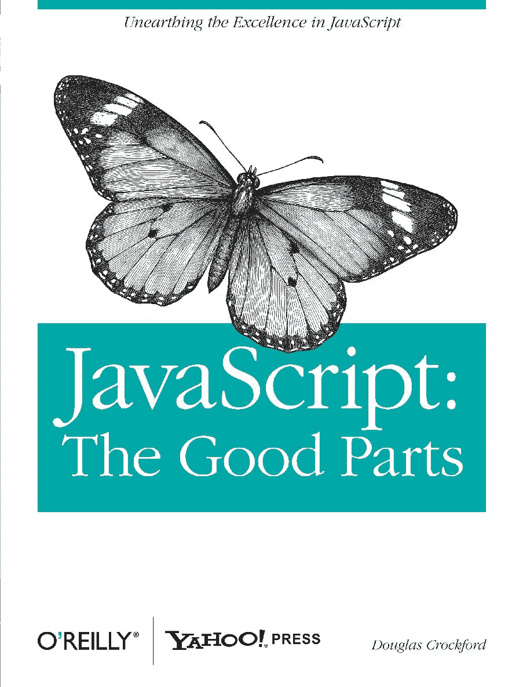

# JavaScript 的优秀部分





## 来自 O’Reilly 的其他资源

### 相关书籍
* 高性能网站
* JavaScript 权威指南
* JavaScript 与 DHTML 烹食指南™
* 学习 JavaScript

### `oreilly.com`
`oreilly.com` 不仅仅是 O’Reilly 书籍的完整目录。
你还可以在这里找到新闻、活动、文章、博客、章节和代码示例的链接。

`oreillynet.com` 是对开源和新兴技术的开发者的重要门户，涵盖新平台、编程语言和操作系统。

### 会议
O’Reilly 将来自各地的创新者汇聚在一起，孕育能够点燃革命性产业的创意。我们擅长记录最新的工具和系统，将创新者的知识转化为一线工作人员实用的技能。访问 `conferences.oreilly.com` 查看我们即将举行的活动。

Safari Bookshelf (`safari.oreilly.com`) 是程序员和 IT 专业人员的顶级在线参考库。可以在超过 1000 本书中进行搜索。订阅者可以在几秒钟内针对关键问题找到答案。

你可以从头到尾阅读书架上的书籍，也可以简单地翻到你需要的页面。今天就免费试用吧。


原型链接仅用于检索。如果我们尝试从对象中检索属性值，且该对象缺少该属性名，那么 JavaScript 将尝试从原型对象中检索属性值。如果该对象也缺少该属性，它将去*它的*原型，依此类推，直到过程最终在 `Object.prototype` 处结束。如果所需的属性在原型链的任何地方都不存在，结果为 `undefined` 值。这被称为*委托*（delegation）。

原型关系是一种动态关系。如果我们向原型添加一个新属性，该属性将立即在所有基于该原型的对象中可见：

`stooge.profession = 'actor';`
`another_stooge.profession // 'actor'`

将在第 6 章中看到更多关于原型链的内容

## 反思

通过尝试检索属性并检查获得的值，很容易检查对象以确定它拥有哪些属性。`typeof` 运算符对于确定属性类型非常有帮助：`typeof flight.number // 'number'`

`typeof flight.status // 'string'`
`typeof flight.arrival // 'object'`
`typeof flight.manifest // 'undefined'`

必须小心，因为原型链上的任何属性都可能产生值：

`typeof flight.toString // 'function'`
`typeof flight.constructor // 'function'`

处理这些不必要的属性有两种方法。第一种是让你的程序查找并拒绝函数值。通常情况下，当你进行反射（reflection）时，你感兴趣的是数据，你应该意识到某些值可能是函数。

另一种方法是使用 `hasOwnProperty` 方法，如果对象拥有特定属性，该方法返回 `true`。`hasOwnProperty` 方法不会查找原型链：

`flight.hasOwnProperty('number') // true`
`flight.hasOwnProperty('constructor') // false`

反射

|

23

|

## 枚举

`for...in` 语句可以遍历对象中所有的属性名。枚举将包含所有属性——包括你可能感兴趣的函数和原型属性——因此有必要过滤掉你不需要的值。最常见的过滤器是 `hasOwnProperty` 方法以及使用 `typeof` 排除函数：

```javascript
var name;
for (name in another_stooge) {
  if (typeof another_stooge[name] !== 'function') {
    document.writeln(name + ': ' + another_stooge[name]);
  }
}
```

名称的顺序没有保证，因此要准备好名称以任何顺序出现。如果你想确保属性按特定顺序出现，最好完全避免使用 `for...in` 语句，而是创建一个包含正确顺序的属性名的数组：`var i;`

`var properties = [
  'first-name',
  'middle-name',
  'last-name',
  'profession'
];`

`for (i = 0; i < properties.length; i += 1) {
  document.writeln(properties[i] + ': ' + another_stooge[properties[i]]);
}`

通过使用 `for` 代替 `for...in`，我们能够在不担心从原型链中可能捞出什么的情况下，获取我们需要的属性，并按照正确的顺序获取了它们。

## 删除

`delete` 运算符可以用于从对象中删除属性。如果对象具有该属性，它将将其删除。它不会触及原型链接中的任何对象。

从对象中删除属性可能会让原型链接中的属性显现：

`another_stooge.nickname // 'Moe'`
`// 从 another_stooge 中移除 nickname，从而显示`
`// 原型的 nickname.`

`delete another_stooge.nickname;`
`another_stooge.nickname // 'Curly'`

24

|

# 第 3 章：对象

## 全局抑制

JavaScript 允许轻松定义全局变量，可以存储你应用程序的所有资源。遗憾的是，全局变量会削弱程序的健壮性，应该避免使用。

尽量减少全局变量使用的一种方法是为你的应用程序创建一个单一全局变量：`var MYAPP = {};`

该变量随后成为应用程序的容器：`MYAPP.stooge = {
"first-name": "Joe",
"last-name": "Howard"
};`

`MYAPP.flight = {
airline: "Oceanic",
number: 815,
departure: {
IATA: "SYD",
time: "2004-09-22 14:55",
city: "Sydney"
},
arrival: {
IATA: "LAX",
time: "2004-09-23 10:42",
city: "Los Angeles"
}
};`

通过将你的全局足迹减少到单一名称，你显著减少了与其他应用程序、插件或库发生不良交互的可能性。你的程序也变得更容易读，因为显然 `MYAPP.stooge` 指的是顶层结构。在下一章中，我们将看到使用 `closure` 进行信息隐藏的方法，这是另一种有效的全局抑制技术。

全局抑制

|

25

# 第 4 章

## 函数

*为什么，每一处错误在被犯前就已经被定判了：*

*我的正是函数的数字符号……*

——威廉·莎士比亚，《尺度量》


`JavaScript` 最棒的一点在于它对函数的实现。它几乎做得非常到位。但正如你对 `JavaScript` 的预期那样，它并没有把一切都做对。

函数封装了一组语句。函数是 `JavaScript` 的基本模块单元。它们用于代码重用、信息隐藏和组合。

函数用于指定对象的行为。通常情况下，编程的艺术是将一组需求分解为一组函数和数据结构。

## 函数对象

`JavaScript` 中的函数是对象。对象是键/值对的集合，并有一个指向原型对象的隐藏链接。从对象字面量产生的对象链接到 `Object.prototype`。函数对象链接到 `Function.prototype`（其本身又链接到 `Object.prototype`）。每个函数在创建时还带有两个额外的隐藏属性：函数的上下文和实现函数行为的代码。

每个函数对象在创建时还会包含 `prototype` 属性。它的值是一个带有 `constructor` 属性的对象，而该 `constructor` 属性的值就是函数本身。这与指向 `Function.prototype` 的隐藏链接是不同的。这种复杂构造的含义将在下一章揭示。

由于函数是对象，它们可以像任何其他值一样被使用。函数可以存储在变量、`objects` 和 `arrays` 中。函数可以作为参数传递给函数，也可以从函数返回。此外，由于函数是对象，函数也可以拥有方法。

函数的特殊之处在于它们是可以被调用的。

## 26

## 函数字面量

函数对象通过函数字面量创建：

```javascript
// 创建一个名为 add 的变量，并在其中// 存储一个加两个数字的函数。
var add = function (a, b) {
  return a + b;
};
```

函数字面量包含四个部分。第一部分是保留字 `function`。

可选的第二部分是函数的名称。函数可以使用它的名称来递归地调用自己。该名称也可以被调试器和开发工具用于识别该函数。如果函数没有命名（如上一个示例所示），则被称为*匿名*函数。

第三部分是函数的参数集，包裹在括号中。

括号内是一组零或多个参数名，用逗号分隔。这些名称将在函数中定义为变量。与普通变量不同，它们不会被初始化为 `undefined`，而是被初始化为调用函数时提供的参数。

第四部分是包裹在花括号中的一组语句。这些语句是函数的体。它们在函数被调用时执行。

函数字面量可以出现在任何表达式出现的地方。函数可以定义在其他函数内部。当然，内部函数可以访问其参数和变量。内部函数还可以访问其所嵌套的函数的参数和变量。由函数字面量创建的函数对象包含指向该外部上下文的链接。这被称为*闭包*。这是巨大表达能力的源泉。

## 调用

调用函数会挂起当前函数的执行，将控制权和参数传递给新函数。除了声明的参数外，每个函数还会接收两个额外的参数：`this` 和 `arguments`。`this` 参数在面向对象编程中非常重要，它的值由*调用模式*决定。`JavaScript` 中四种调用模式：方法调用模式、函数调用模式、构造函数调用模式和 apply 调用模式。

## 调用

## 27

调用函数会挂起当前函数的执行，将控制权和参数传递给新函数。除了声明的参数外，每个函数还会接收两个额外的参数：`this` 和 `arguments`。`this` 参数在面向对象编程中非常重要，它的值由*调用模式*决定。`JavaScript` 中四种调用模式：方法调用模式、函数调用模式、构造函数调用模式和 apply 调用模式。

## 方法调用模式

当一个函数被存储为对象时，我们称之为*方法*。当方法被调用时，`this` 会绑定到该对象。

```javascript
// 创建一个具有值和递增方法的 myObject。
var myObject = {
  value: 0,
  increment: function (inc) {
    this.value += typeof inc === 'number' ? inc : 1;
  }
};

// 作为方法调用 increment。
myObject.increment(); // 1
console.log(myObject.value); // 1

myObject.increment(2); // 3
console.log(myObject.value); // 3
```

当函数不是对象的属性时，它被作为函数进行调用。当它被调用时，`this` 绑定到全局对象。

## 函数调用模式

当一个函数不是对象的属性时，它被作为函数调用。当它被调用时，`this` 绑定到全局对象。这是语言设计中的一个错误。如果语言设计得正确，当内部函数被调用时，`this` 仍然会绑定到外部函数。这个错误的后果是方法无法利用内部函数来帮助其工作，因为内部函数没有共享该方法对对象的访问权限。幸运的是，有一个简单的通通方法。如果方法定义了一个变量并将 `this` 的值赋值给它，内部函数将通过该变量访问 `this`。按照惯例，该变量的名为 `that`：

```javascript
// 为 myObject 增加一个 double 方法。
myObject.double = function () {
  var that = this; // 通通方法。
  var helper = function () {
    that.value = add(that.value, that.value);
  };
  helper(); // 作为函数调用 helper。
};

// 作为方法调用 double。
myObject.double();
console.log(myObject.value); 
```

## 构造函数调用模式

如果使用 `new` 前缀调用函数，则将创建一个新对象，该对象有一个指向函数 `prototype` 成员值的隐藏链接，并且 `this` 将绑定到该新对象。

`new` 前缀还改变了 `return` 语句的行为。我们将在下一节看到更多内容。

## 28

## 函数

`JavaScript` 是一种*原型*继承语言。这意味着对象可以直接从其他对象继承属性。该语言是无类的。

这与目前的时尚潮流径然不同。今天大多数语言都是*经典*的。原型继承具有强大的表达力，但并没有被广泛理解。

`JavaScript` 本身对它的原型特性并不自信，因此它提供了一种让人想起经典语言的对象创建语法。很少有经典程序员认为原型继承是可以接受的，而这种受经典启发的语法掩盖了语言真正的原型本质。这简直是两得兼失。

```javascript
// 创建一个名为 Quo 的构造函数。
// 它创建一个带有 status 属性的对象。
```


```javascript
var Quo = function (string) {
  this.status = string;
};

// 为所有 Quo 实例添加一个公共方法
```

## 调用

29 |

```javascript
// 调用 get_status。
Quo.prototype.get_status = function () {
  return this.status;
};

// 创建一个 Quo 实例。
var myQuo = new Quo("confused");
document.writeln(myQuo.get_status( // // confused
```

那些意图配合 `new` 前缀使用的函数被称为*构造函数*（constructors）。按照约定，它们被存储在名称大大写的变量中。如果在没有 `new` 前缀的情况下调用了构造函数，可能会在没有编译时或运行时警告的情况下发生非常糟糕的事情，因此大写首字母的命名约定非常重要。

不建议使用这种风格的构造函数。我们将在下一章中看到更好的替代方案。

### Apply 调用模式

由于 JavaScript 是一门函数式面向对象的语言，因此函数可以拥有方法。

`apply` 方法允许我们构建一个参数数组，用于调用函数。它还允许我们选择此值的值。`apply` 方法接受两个参数：第一个是应该绑定到 `this` 的值；第二个是参数数组。

```javascript
// 创建一个包含 2 个数字的数组并将它们相加。
var array = [3, 4];
var sum = add.apply(null, array); // sum 为 7

// 创建一个带有 status 成员的对象。
var statusObject = {
  status: 'A-OK'
};

// statusObject 没有继承自 Quo.prototype，
// 但即使 statusObject 没有 get_status 方法，
// 我们仍然可以在 statusObject 上调用 get_status 方法。
var status = Quo.prototype.get_status.apply(statusObject);
// status 为 'A-OK'
```

30 |

# 第 4 章：函数

### 参数 (Arguments)

当函数被调用时，一个额外的、可用的参数是 `arguments` 数组。它让函数能够访问调用时提供的所有参数，包括未分配给参数的冗余参数。这使得编写接收数量参数的函数成为可能：

```javascript
// 创建一个相加很多内容的函数。
// 注意，在函数内部定义变量 sum
// 不会与函数外部定义的 sum 冲突。
// 函数只看得看到内部的那个。
var sum = function () {
  var i, sum = 0;
  for (i = 0; i < arguments.length; i += 1) {
    sum += arguments[i];
  }
  return sum;
};

document.writeln(sum(4, 8, 15, 16, 23, 42)); // 108
```

这不是一个特别实用的模式。在第 6 章，中，我们将看到如何为数组添加类似的方法。

由于设计上的错误，`arguments` 并不是真正的数组。它是一个类数组对象。

`arguments` 拥有 `length` 属性，但它缺少所有的数组方法。我们将在本章结束看到该设计错误导致的。

### 返回 (Return)

当函数被调用时，它从第一条语句开始执行，并在遇到关闭函数体的 `}` 时结束。这导致函数将控制权返回给调用该函数的程序部分。

`return` 语句可以导致函数提前返回。当执行 `return` 时，函数会立即返回，不再执行剩余的语句。

函数始终会返回一个值。如果未指定返回值，则返回 `undefined`。

如果函数是带有 `new` 前缀调用的，且返回值不是对象，则改为返回 `this`（新对象）。

返回 | 31 |

### 异常 (Exceptions)

JavaScript 提供了一种异常处理机制。异常是寻常（但并非完全出意之外）的意外，它们会干扰程序的正常流程。当检测到此类意外时，你的程序应该抛出一个异常：

```javascript
var add = function (a, b) {
  if (typeof a !== 'number' || typeof b !== 'number') {
    throw {
      name: 'TypeError',
      message: 'add needs numbers'
    };
  }
  return a + b;
}
```

### `throw` 语句中断函数的执行。它应该被赋予一个异常对象，其中包含一个 `name` 属性来标识异常类型，以及一个描述性的 `message` 属性。你也可以添加其他属性。

异常对象将被传递到 `try` 语句的 `catch` 子句：

```javascript
// 创建一个 try_it 函数，它错误地调用新的 add
// 函数。
var try_it = function () {
  try {
    add("seven");
  } catch (e) {
    document.writeln(e.name + ': ' + e.message);
  }
}

try_it();
```

如果在 `try` 块内抛出异常，控制将转移到 `catch` 子句。

`try` 语句有一个 `catch` 块，可以捕所有异常。如果你的处理取决于异常的类型，那么异常处理程序必须检查 `name` 以确定异常的类型。

### 扩展类型 (Augmenting Types)

JavaScript 允许语言的基本类型被*扩展*。在第 3 章，中，我们看到向 `Object.prototype` 添加方法可以使该方法对所有对象可用。这对于函数、数组、字符串、数字、正则表达式和布尔值同样有效。

例如，通过扩展 `Function.prototype`，我们可以让所有函数都拥有一个方法：

32 |

# 第 4 章：函数

```javascript
Function.prototype.method = function (name, func) {
  this.prototype[name] = func;
  return this;
};
```

通过向 `Function.prototype` 扩展一个方法，我们不再需要输入属性的名称。那部分丑陋的代码现在可以隐藏了。

JavaScript 没有单独整数类型，因此有时需要提取数字的整数部分。JavaScript 提供的该方法很丑。我们可以通过向 `Number.prototype` 添加一个整数方法来修复它。它根据数字的正负使用 `Math.ceil` 或 `Math.floor`：

```javascript
Number.method('integer', function () {
  return Maththis < 0 ? 'ceil' : 'floor';
});

document.writeln((-10 / 3).integer( )); -3
```

JavaScript 缺少一个删除字符串两端空格的方法。这是一个容易修复的疏漏：

```javascript
String.method('trim', function () {
  return this.replace(/^\s+|\s+$/g, '');
});

document.writeln('"' + " neat ".trim( ) + '"');
```

我们的 `trim` 方法使用了正则表达式。我们将在第 7 章](#index_split_000.html_p81)中更多地学习正则表达式。

通过扩展基本类型，我们可以显著提高语言的表达能力。由于 JavaScript 原型继承的动态性，所有值都会被赋予新方法，即使是在方法创建之前创建的值。

基本类型的原型是公共结构，因此在混合库时必须小心。一种防御性技术是在已知方法缺失时才添加方法：

```javascript
// 条件地添加方法。
Function.prototype.method = function (name, func) {
  if (!this.prototype[name]) {
    this.prototype[name] = func;
  }
  return this;
};
```

另一个问题是 `for in` 语句与原型的交互不佳。我们在第 3 章中见过缓解该问题的方法：我们可以使用 `hasOwnProperty` 方法过滤掉继承的属性，也可以查找特定的类型。

**扩展类型** | 33 |

### 递归 (Recursion)

*递归*函数是指会调用自身（直接或间接）的函数。递归是一种强大的编程技术，其中问题被分为一组相似的子问题，每个子问题都通过简单的解决方案来解决。通常，递归函数通过反复调用自身来解决其子问题。


汉诺塔是一个著名的谜题。该设备包括三根柱子和一组直径不同、中心带孔的圆盘。初始设置是将所有圆盘堆放在源柱上，小圆盘在大圆盘之上。目标是通过一次移动一个圆盘到另一个柱子，将堆移动到目标柱，且永远不要将大盘放在小盘之上。这个谜题有一个简单的递归解：

```javascript
var hanoi = function hanoi(disc, src, aux, dst) {
  if (disc > 0) {
    hanoi(disc - 1, src, dst, aux);
    document.writeln('Move disc ' + disc + ' from ' + src + ' to ' + dst);
    hanoi(disc - 1, aux, src, dst);
  }
};

hanoi(3, 'Src', 'Aux', 'Dst');
```

它为三个圆盘产生了以下解：
将圆盘 1 从 Src 移动到 Dst
将圆盘 2 从 Src 移动到 Aux
将圆盘 1 从 Dst 移动到 Aux
将圆盘 3 从 Src 移动到 Dst
将圆盘 1 从 Aux 移动到 Src
将圆盘 2 从 Aux 移动到 Dst
将圆盘 1 从 Src 移动到 Dst

`hanoi` 函数将圆盘堆从一个柱子移动到另一个柱子，必要时使用辅助柱。它将问题分解为三个子问题。首先，它通过将底部圆盘上方的子堆移动到辅助柱来揭露底部圆盘。然后它可以将底部圆盘移动到目标柱。最后，它可以将子堆从辅助柱移动到目标柱。子堆的移动通过递归地调用自身来处理这些子问题。

`hanoi` 函数接收的参数是要移动的圆盘编号以及要使用的三根柱子。当它调用自身时，是为了处理当前正在操作的圆盘上面的圆盘。最终，它将以一个不存在的圆盘编号调用。在这种情况下，它什么都不做。这种“无所事事”的操作让我们相信该函数不会无限递归。

递归函数在处理树形结构（如浏览器的文档对象模型 DOM）时可以非常有效。每个递归调用都获得树的一块较小部分来处理：

# 第 4 章：函数

```javascript
// 定义一个 walk_the_DOM 函数，它按照 HTML 源代码顺序
// 访问树的每个节点，从某个给定的节点
// 开始。它调用一个函数，并依次传递
// 每个节点。walk_the_DOM 调用
// 自身来处理每个子节点。
var walk_the_DOM = function walk(node, func) {
  func(node);
  node = node.firstChild;
  while (node) {
    walk(node, func);
    node = node.nextSibling;
  }
};

// 定义一个 getElementsByAttribute 函数。它
// 接收一个属性名称字符串和一个可选的
// 匹配值。它调用 walk_the_DOM，传递一个
// 在节点中查找属性名称的函数。匹配的节点被累积在
// 数组中。
var getElementsByAttribute = function (att, value) {
  var results = [];
  walk_the_DOM(document.body, function (node) {
    var actual = node.nodeType === 1 && node.getAttribute(att);
    if (typeof actual === 'string' && (actual === value || typeof value !== 'string')) {
      results.push(node);
    }
  });
  return results;
};
```

某些语言提供了`尾递归优化`。这意味着如果一个函数返回递归调用自身的结果，那么该调用将被替换为循环，这可以显著提高速度。遗憾的是，JavaScript 目前没有提供尾递归优化。深度递归的函数可能会因为耗尽返回栈而失败：

```javascript
// 使用尾递归实现阶乘函数。
// 它是尾递归的，因为
// 返回了调用自身的结果。
// JavaScript 目前没有优化这种形式。
var factorial = function factorial(i, a) {
  a = a || 1;
  if (i < 2) {
    return a;
  }
  return factorial(i - 1, a * i);
};

document.writeln(factorial(4)); // 24
```

### 递归

### 作用域
编程语言中的`作用域`(Scope）控制变量和参数的可见性和生命周期。这对程序员来说是一项重要的服务，因为它减少了命名冲突并提供了自动内存管理：

```javascript
var foo = function () {
  var a = 3, b = 5;
  var bar = function () {
    var b = 7, c = 11;
    // 在此时，a 是 11，b 是 7，c 是 11
    a += b + c;
    // 在此时，a 是 21，b 是 7，c 是 11
  };
  // 在此时，a 是 3，b 是 5，且 c 未定义
  bar();
  // 在此时，a 是 21，b 是 5
};
```

大多数具有 C 语法的语言都具有块级作用域。在块（用大括号括起来的语句列表）中定义的所有变量在块外部外部都是不可见的。在块中定义的变量可以在块执行完毕后释放。这是一件好事。

遗憾的是，JavaScript 并没有块级作用域，尽管它的块语法暗示了它有。这种混淆可能是产生错误的根源。

JavaScript 确实有函数级作用域。这意味着在函数中定义的参数和变量在函数外部是不可见的，而在函数内部任何地方定义的变量在函数内部任何地方都是可见的。

在许多现代语言中，建议尽可能晚声明变量，即在第一次使用的地方。对于 JavaScript 来说这是一个糟糕的建议，因为它缺乏块级作用域。因此，最好的方法是在函数体的顶部声明函数中使用的所有变量。

### 闭包
关于作用域的好消息是，内部函数可以访问它们定义所所在函数的参数和变量（此函数和参数除外）。这是一个非常好的事情。

我们的 `getElementsByAttribute` 函数之所以运作是因为它声明了一个 `results` 变量，而它传递给 `walk_the_DOM` 的内部函数也可以访问该 `results` 变量。

更有趣的情况是内部函数的生命周期比其外部函数更长。

早些，我们创建了一个 `myObject`，它包含一个值和一个递增方法。假设我们想保护该值免受未经授权的。

我们不再使用对象字面量来初始化 `myObject`，而是通过调用一个返回对象字面量的函数来初始化 `myObject`。该函数定义了一个 `value` 变量。该变量对于 `increment` 和 `getValue` 方法来说始终可用，但函数的作用域将其隐藏在程序的其余部分之外：

```javascript
var myObject = (function () {
  var value = 0;
  return {
    increment: function (inc) {
      value += typeof inc === 'number' ? inc : 1;
    },
    getValue: function () {
      return value;
    }
  };
}(());
```

我们没有将一个函数赋值给 `myObject`。我们赋值的是调用该函数的结果。注意最后一行的 `()`。该函数返回一个包含两个方法的对象，这些方法继续享有访问 `value` 变量的特权。

本章早前的 `Quo` 构造函数产生了一个具有 `status` 属性和 `get_status` 方法的对象。但这看起来并不无趣。为什么要对一个你可以可以直接访问的属性调用 getter 方法呢？如果 `status` 属性是私有的，它会更有用。所以，让我们定义一种不同的 `quo` 函数来实现这一点：

```javascript
var quo = function (status) {
  return {
    get_status: function () {
      return status;
    }
  };
};

// 创建一个 quo 的实例。
var myQuo = quo("amazed");
document.writeln(myQuo.get_status());
```

这个 `quo` 函数设计为不带 `new` 前缀使用，因此名称没有大写。当我们调用 `quo` 时，它返回一个包含 `get_status` 方法的新对象。该对象的引用被存储在 `myQuo` 中。即使 `quo` 已经返回，`get_status` 方法仍然拥有特权访问 `quo` 的 `status` 属性。


`get_status` 并没有访问参数的副本；它访问的是参数本身。之所以可以，是因为该函数可以访问它创建时的上下文。这被称为闭包（closure*）。

让我们来看一个更有用的例子：

```javascript
// 定义一个函数，将 DOM 节点的颜色设置为
// 黄色，然后逐渐淡变为白色。
var fade = function (node) {
  var level = 1;
  var step = function ( ) {
    var hex = level.toString(16);
    node.style.backgroundColor = '#FFFF' + hex + hex;
    if (level < 15) {
      level += 1;
      setTimeout(step, 100);
    }
  };
  setTimeout(step, 100);
};
fade(document.body);
```

我们调用 `fade`，并向它传递 `document.body`（由 HTML `<body>` 标签创建的节点）。

`fade` 将 `level` 设置为 `1`。它定义了一个 `step` 函数。它调用了 `setTimeout`，传递了 `step` 函数和时间（100 毫秒）。然后它返回——`fade` 执行完毕。

突然，大约 1/10 秒后，`step` 函数被调用。它根据 `fade` 的 `level` 生成一个 16 进制字符。然后它修改了 `fade` 节点的背景颜色。接着，它查看 `fade` 的 `level`。如果还没有变成白色，它就会增加 `fade` 的 `level` 并使用 `setTimeout` 调度自己再次运行。

# 第 4 章：函数

突然，`step` 函数再次被调用。但这一次，`fade` 的 `level` 是 `2`。虽然 `fade` 已经返回了一多会儿，但只要一个或多个 `fade` 的内部函数还需要它们，这些变量就会继续存在。

重要的一是，内部函数访问的是外部函数的实际变量，而不是副本，以避免出现以下问题。

### 错误示例
```javascript
// 错误地创建一个函数，将事件处理函数分配给一个节点数组。
// 当你点击一个节点时，弹框本应该显示该节点的序号。
// 但它总是显示节点的总数而不是序号。
var add_the_handlers = function (nodes) {
  var i;
  for (i = 0; i < nodes.length; i += 1) {
    nodes[i].onclick = function (e) {
      alert(i);
    };
  }
};
// 错误示例结束
```

`add_the_handlers` 函数本打算给每个处理程序提供一个唯一的数字 `i`。它失败了，是因为处理程序函数绑定的是变量 `i`，而不是函数创建时变量 `i` 的值。

### 更好的示例
```javascript
// 创建一个函数，将事件处理函数分配给节点数组。
// 当你点击一个节点时，弹框将显示该节点的序号。
var add_the_handlers = function (nodes) {
  var helper = function (i) {
    return function (e) {
      alert(i);
    };
  };
  var i;
  for (i = 0; i < nodes.length; i += 1) {
    nodes[i].onclick = helper(i);
  }
};
```

避免在循环内部创建函数。这在计算上可能是浪费的，并且正如我们在错误示例中看到的，它可能会引起混乱。我们通过在循环外部创建一个 `helper` 函数来避免这种混乱，该函数将返回一个绑定到当前 `i` 值的函数。

# 回调函数

函数可以让处理不连续事件变得更容易。例如，假设有一个序列：开始于用户交互，向服务器发送请求，最后显示服务器的响应。这种操作朴素的写法是：

```javascript
request = prepare_the_request( );
response = send_request_synchronously(request);
display(response);
```

这种方法的问题在于，网络上的同步请求会让客户端处于冻结状态。如果网络或服务器较慢，响应能力的下降将是不可接受的。

更好的方法是进行异步请求，并提供一个回调函数，该函数将在收到服务器响应时被调用。异步函数会立即返回因此客户端不会被阻塞：

```javascript
request = prepare_the_request( );
send_request_asynchronously(request, function (response) {
  display(response);
});
```

我们向 `send_request_asynchronously` 函数传递了一个函数参数，该参数将在响应可用时被调用。

# 模块

我们可以使用函数和闭包来构建模块。模块是一个提供接口但隐藏其状态和实现的函数或对象。通过使用函数来生成模块，我们几乎可以完全消除对全局变量的使用，从而缓解 JavaScript 最糟糕的特性之一。

例如，假设我们想为 `String` 添加一个 `deentityify` 方法。它的工作是查找字符串中的 HTML 实体并将其替换为等效字符。将实体名称及其等效字符存储在一个对象中是有意义的。

但我们应该把这个对象放在哪里呢？我们可以把它放在全局变量中，但全局变量是糟糕的。我们可以在函数内部定义它，但这样会有运行时成本，因为每次调用函数时字面量都要进行求值。理想的方法将其放入闭包中，或许提供一个可以添加额外实体的额外方法：

```javascript
String.method('deentityify', function ( ) {
  // 实体表。它将实体名称映射到
// 字符。
  var entity = {
    quot: '"',
    lt: '<',
    gt: '>'
  };
  // 返回 deentityify 方法。
  return function ( ) {
    // 这是 deentityify 方法。它调用字符串
    // replace 方法，查找以 '&' 开头
    // 并以 ';' 结尾的字符串。如果中间的
    // 字符在实体表中，将实体
    // 替换为表中的字符。它使用了
    // 正则表达式（第 7 章）。
    return this.replace(/&([^&;]+);/g,
      function (a, b) {
        var r = entity[b];
        return typeof r === 'string' ? r : a;
      }
    );
  };
}());
```

注意最后一行。我们使用 `()` 运算符立即调用了刚刚创建的函数。这次调用创建并返回了成为 `deentityify` 方法的函数。

```javascript
document.writeln('&lt;&gt;'.deentityify( )); // <>
```

模块模式利用函数作用域和闭包来创建绑定且私有的关系。在这个例子中，只有 `deentityify` 方法可以访问实体数据结构。

模块的通用模式是：一个定义私有变量和函数的函数；创建通过闭包访问私有变量和函数的特权函数；并返回这些特权函数或将其存储在可访问的地方。

模块模式的使用可以消除全局变量的使用。它促进了信息隐藏和其他设计实践。在封装应用程序和其他单例时非常有效。

它还可以用于生成安全的对象。假设我们想创建一个生成序列号的对象：

```javascript
var serial_maker = function ( ) {
  // 创建一个生成唯一字符串的对象。一个
  // 字符串由两部分组成：前缀
  // 和序列号。对象带有设置前缀
  // 和序列号的方法，以及一个生成唯一
  // 字符串的 gensym 方法。
  var prefix = '';
  var seq = 0;
  return {
    set_prefix: function (p) {
      prefix = String(p);
    },
    set_seq: function (s) {
      seq = s;
    },
    gensym: function ( ) {
      var result = prefix + seq;
      seq += 1;
      return result;
    }
  };
};

var seqer = serial_maker( );
seqer.set_prefix('Q');
seqer.set_seq(1000);
var unique = seqer.gensym( ); // unique 是 "Q1000"
```


如果我们将 `seqer.gensym` 传递给第三方函数，该函数将能够生成唯一字符串，但无法更改前缀或 `seq`。

## 链式调用 (Cascade)

某些方法没有。例如，设置或更改对象状态的方法通常没有返回值。如果我们让这些方法返回 `this` 而不是 `undefined`，就可以启用“链式调用”。在链式调用中，我们可以在单条语句中对同一个对象顺序调用多个方法。一个支持链式调用的 Ajax 库将允许我们编写如下风格的代码：

```javascript
getElement('myBoxDiv')
  .move(350, 150)
  .width(100)
  .height(100)
  .color('red')
  .border('10px outset')
  .padding('4px')
  .appendText("Please stand by")
```

# 第 4 章：函数

```javascript
.on('mousedown', function (m) {
  this.startDrag(m, this.getNinth(m));
})
.on('mousemove', 'drag')
.on('mouseup', 'stopDrag')
.later(2000, function ( ) {
  this
    .color('yellow')
    .setHTML("What hath God wraught?")
    .slide(400, 40, 200, 200);
})
tip('This box is resizeable');
```

在这个示例中，`getElement` 函数产生一个对象，为 为 `myBoxDiv` 的 DOM 元素提供功能。这些方法允许我们移动元素、更改其尺寸和样式并添加行为。其中每个方法都返回该对象，因此调用的结果可以用于下一次调用。

链式调用可以产生非常有表现力的接口。它可以帮助控制那种试图一次完成太多任务的接口倾向。

## 柯里化 (Curry)

函数是值，我们可以用有趣的方式操作函数值。`Currying` 允许我们通过组合一个函数和一个参数来产生一个新的函数：

```javascript
var add1 = add.curry(1);
document.writeln(add1(6)); // 7
```

`add1` 是一个函数，它通过向 `add` 的 `curry` 方法传递 `1` 创建。`add1` 函数向其参数加 1。JavaScript 并没有 `curry` 方法，但我们可以通过扩展 `Function.prototype` 来修复这个问题：

```javascript
Function.method('curry', function ( ) {
  var args = arguments, that = this;
  return function ( ) {
    return that.apply(null, args.concat(arguments));
  };
}); // 某些地方不对劲...
```

`curry` 方法的工作原理是创建一个闭包，保存该原始函数和待柯里化的参数。它返回一个函数，该函数在调用时，会返回调用原始函数的结果，并将来自 `curry` 调用和当前调的所有参数传递给它。它使用 `Array.concat` 方法将两个参数数组合并在一起。

遗憾的是，正如我们之前看到的，`arguments` 数组不是一个数组，因此它没有 `concat` 方法。为了解决这个问题，我们将在两个 `arguments` 数组上都应用 `array.slice` 方法。这会产生在 `concat` 方法下正常运行的数组：

```javascript
Function.method('curry', function ( ) {
  var slice = Array.prototype.slice,
  args = slice.apply(arguments),
  that = this;
  return function ( ) {
    return that.apply(null, args.concat(slice.apply(arguments)));
  };
});
```

## 记忆化 (Memoization)

函数可以使用对象来记住之前操作的结果，从而避免不必要的工作。JavaScript 的对象和数组非常适合这一点。

假设我们想要一个递归函数来计算斐波那契数。斐波那契数是两个一个斐波那契数之和。前两个是 0 和 1：

```javascript
var fibonacci = function (n) {
  return n < 2 ? n : fibonacci(n - 1) + fibonacci(n - 2);
};

for (var i = 0; i <= 10; i += 1) {
  document.writeln('// ' + i + ': ' + fibonacci(i));
}
// 0: 0
// 1: 1
// 2: 1
// 3: 2
// 4: 3
// 5: 5
// 6: 8
// 7: 13
// 8: 21
// 9: 34
// 10: 55
```

这种方法虽然可行，但它做了大量不必要的工作。`fibonacci` 函数被调用了 453 次。我们调用了它 11 次，它在计算可能已经计算过的值时自己调用了 442 次。如果我们对函数进行 `memoize`，可以显著减少它的工作量。

我们将记忆化的结果保留在一个 `memo` 数组中，并将其隐藏在闭包中。当函数被调用时，它首先查找自己是否已经知道结果。如果是，它可以立即返回结果：

```javascript
var fibonacci = (function ( ) {
  var memo = [0, 1];
  var fib = function (n) {
    var result = memo[n];
    if (typeof result !== 'number') {
      result = fib(n - 1) + fib(n - 2);
      memo[n] = result;
    }
    return result;
  };
  return fib;
})();
```


```javascript
this.prototype = {constructor: this};
```

新的函数对象被赋予一个 `prototype` 属性，其值是一个包含 `constructor` 属性的对象，而该属性的值为新的函数对象。原型对象是存放继承特质的地方。每个函数都拥有一个原型对象，因为语言没有提供一种方法来确定哪些函数是打算用作构造函数的。`constructor` 属性并不有用。重要的是原型对象。

当使用带有 `new` 前缀的构造函数调用模式来调用函数时，这会改变该函数的执行方式。如果 `new` 运算符是一个方法而不是运算符，它可以像这样实现：

```javascript
Function.method('new', function ( ) {

// 创建一个继承自构造函数
// 原型的新对象。
var that = Object.create(this.prototype);

// 调用构造函数，将 -this- 绑定到
// 新对象。
var other = this.apply(that, arguments);

// 如果它的返回值不是对象，
// 则替换新对象。
return (typeof other === 'object' && other) || that;

});
```

我们可以定义一个构造函数并增强它的原型：

```javascript
var Mammal = function (name) {

this.name = name;

};

Mammal.prototype.get_name = function ( ) {

return this.name;
};
```

### 伪类 
| 47 |

```javascript
Mammal.prototype.says = function ( ) {

return this.saying || '';

};
```

现在，我们可以创建一个实例：

```javascript
var myMammal = new Mammal('Herb the Mammal');
var name = myMammal.get_name( ); // 'Herb the Mammal'
```

我们可以通过定义其构造函数并将其原型替换为 `Mammal` 的实例，来创建另一个继承自 `Mammal` 的伪类：

```javascript
var Cat = function (name) {

this.name = name;
this.saying = 'meow';

};

// 将 Cat.prototype 替换为 Mammal 的新实例
Cat.prototype = new Mammal( );

// 增强新的原型以添加
// purr 和 get_name 方法。
Cat.prototype.purr = function (n) {

var i, s = '';
for (i = 0; i < n; i += 1) {

if (s) {

s += '-';
}

s += 'r';
}

return s;
};

Cat.prototype.get_name = function ( ) {

return this.says( ) + ' ' + this.name + ' ' + this.says( );
};

var myCat = new Cat('Henrietta');
var says = myCat.says( ); // 'meow'
var purr = myCat.purr(5); // 'r-r-r-r-r'
var name = myCat.get_name( );
// 'meow Henrietta meow'
```

伪类模式的设计是为了看起来有点像面向对象，但它看起来非常异异。我们可以通过使用 `method` 方法并定义 `inherits` 方法来隐藏一些丑陋之处：

```javascript
Function.method('inherits', function (Parent) {

this.prototype = new Parent( );
return this;

}); own```

| 48 |
# 第 5 章：继承

我们的 `inherits` 和 `method` 方法返回 `this`，允许我们以级联风格进行编程。我们现在可以用一条语句创建我们的 `Cat`。

```javascript
var Cat = function (name) {

this.name = name;
this.saying = 'meow';

}.
inherits(Mammal).
method('purr', function (n) {

var i, s = '';
for (i = 0; i < n; i += 1) {

if (s) {

s += '-';
}

s += 'r';
}

return s;
}).
method('get_name', function ( ) {

return this.says( ) + ' ' + this.name + ' ' + this.says( );
});
```

通过隐藏原型的这些操作，它现在看起来没没那么异类了。但我们真的改进了什么吗？我们现在有了像类一样的构造函数，但在边缘情况下，可能会有意外的行为。没有私有性；所有属性都是公共的。无法访问超类方法。

更糟糕的是，使用构造函数存在一个严重的危险。如果你在调用构造函数时忘记包含 `new` 前缀，那么 `this` 将不会绑定到新对象。遗憾的是，它将绑定到全局对象，因此你不是在增强你的新对象，而是覆盖了全局变量。这非常糟糕。既没有编译警告，也没有运行时警告。

这是语言中的一个严重设计错误。为了缓解这个问题，有一种约定：所有构造函数的名称首字母都大写，且没有其他单词是字母大写字母开头的。这给了我们一个心理预期，可以通过视觉检查发现缺失的 `new`。一个更好的替代方案是完全不使用 `new`。

伪类形式可以给不熟悉 JavaScript 的程序员提供安慰，但它也隐藏了语言的本质。这种受经典启发的写法会诱导程序员编写不必要的深且复杂的层次结构。类层次的大部分复杂性源于静态类型检查的限制。JavaScript 完全没有这些限制。在经典语言中，类继承是代码复用的唯一形式。

JavaScript 有更多更好的选择。

## 伪类
| 49 |
## 对象标识符

有时会发生构造函数被赋予大量参数的情况。

这可能会麻烦，因为很难记住参数的顺序。在这种情况下，如果构造函数接受单个对象会更友好，代码也更易读。所以，而不是：

```javascript
var myObject = maker(f, l, m, s);
```

我们可以写：

```javascript
var myObject = maker({
first: f,
last: l,
middle: m,
state: c
});
```

在处理 JSON 时，这会有次要收益，因为如果构造函数指定了默认值，就可以省略参数。

# 原型
在纯原型模式中，我们放弃了类。我们转而关注对象。原型继承在概念上比经典继承更简单：新对象可以继承旧对象的属性。这可能并不熟悉，但实际上非常容易理解。你从创建一个实用的对象开始。然后你可以创建许多那样的对象。将应用程序分解为一组嵌套抽象类的分类过程可以被完全避免。

让我们从使用对象字面量创建一个实用的对象开始：

```javascript
var myMammal = {

name : 'Herb the Mammal',

get_name : function ( ) {

return this.name;
},

says : function ( ) {

return this.saying || '';
}

};
```

| 50 |
# 第 5 章：继承

一旦我们有了喜欢的对象，就可以使用第 3 章中的 `Object.create` 方法创建更多实例。我们可以对实例进行自定义：

```javascript
var myCat = Object.create(myMammal);

myCat.name = 'Henrietta';
myCat.saying = 'meow';

myCat.purr = function (n) {

var i, s = '';
for (i = 0; i < n; i += 1) {

if (s) {

s += '-';
}

s += 'r';
}

return s;
};

myCat.get_name = function ( ) {

return this.says( ) + ' ' + this.name + ' ' + this.says( );
};
```

这是*差异化继承*。通过自定义新对象，我们指定了它与所基础的对象之间的差异。

有时数据结构继承其他数据结构是有用的。这里有一个例子：假设我们正在解析一种像 JavaScript 或 TEX 的语言，其中一对大括号表示作用域。作用域内定义的项在作用域外是不可见的。在某种意义上，内部作用域继承自它的外部作用域。JavaScript 对象非常擅长表示这种关系。当遇到左括号时，会调用 `block` 函数。解析函数将从作用域查找符号，并在定义新符号时增强作用域：

```javascript
var block = function ( ) {

// 记住当前的作用域。创建一个新的作用域让
```


```javascript
// includes everything from the current one.

var oldScope = scope;

scope = Object.create(scope);

// Advance past the left curly brace.

advance('{');

// Parse using the new scope.

parse(scope);

// Advance past the right curly brace and discard the

// new scope, restoring the old one.

advance('}');

scope = oldScope;

};
```

# 原型

| 51 |

## 函数式

我们到目前为止所看到的继承模式的一个弱点是：无法获得私有性。对象的所有属性都是可见的。我们没有私有变量也没有私有方法。有时这并不重要，但有时非常重要。在挫败中，一些缺乏知情的程序员采用了一种*假私有化*的模式。如果他们有一个想要私有化的属性，就会给它起一个看起来奇怪的名字，希望代码的其他用户会假装看不见这些奇怪的成员。幸运的是，我们在模块模式的应用中有一个得更好的替代方案。

我们首先创建一个产生对象的函数。我们将给它起一个以小写字母开头的名字，因为它不需要使用 `new` 前缀。该函数包含四个步骤：

1. 它创建一个新对象。创建对象有很多方法。它可以创建一个对象字面量，也可以调用一个带有 `new` 前缀的构造函数，或者使用 `Object.create` 方法从现有对象创建一个新实例，或者可以调用任何返回对象的函数。
2. 它可选地定义私有实例变量和方法。这些只是函数内部的普通 `vars`。
3. 它用方法增强该新对象。这些方法对第二步中定义的参数和变量具有特权访问权限。
4. 它返回该新对象。

这里是一个函数式构造函数的伪代码模板（加粗文本用于表示强调）：

```javascript
var constructor = function (spec, my) {

  var that, other private instance variables;

  my = my || {};

  // Add shared variables and functions to my
  that = a new object;

  // Add privileged methods to that
  return that;

};
```

`spec` 对象包含了构造函数创建实例所需的所有信息。`spec` 的内容可以拷贝到私有变量中，或者通过其他函数进行转换。或者方法可以根据需要从 `spec` 中访问信息。（一种简化方法是将 `spec` 替换为单个值。这在被构造的对象不需要整个 `spec` 对象时非常有用。）52

| 第 5 章：继承 |

`my` 对象是一个由继承链中的构造函数共享的秘密容器。使用 `my` 对象是可选的。如果没有传入 `my` 对象，则会创建一个 `my` 对象。

接下来，为对象声明私有实例变量和私有方法。这通过简单声明变量来实现。构造函数的变量和内部函数将成为实例的私有成员。内部函数可以访问 `spec`、`my`、`that` 以及私有变量。

接下来，将共享秘密添加到 `my` 对象中。这通过赋值完成：`my.member = value;`。

现在，我们创建一个新对象并将其赋值给 `that`。创建新对象有很多方法。我们可以对象字面量。我们可以使用 `new` 操作符调用伪类构造函数。我们可以在原型对象上使用 `Object.create` 方法。

或者，我们可以调用另一个函数式构造函数，向它传递一个 `spec` 对象（可能是传递给此构造函数的同一个 `spec` 对象）和 `my` 对象。`my` 对象允许另一个构造函数共享我们放入 `my` 中的材料。另一个构造函数也可以将其自己的共享秘密放入 `my`，以便我们的构造函数利用它。

接下来，我们增强 `that`，添加组成对象接口的特权方法。我们可以将新函数赋值给 `that` 的成员。或者为了安全，我们可以先将函数定义为私有方法，然后将它们赋值给 `that`：

```javascript
var methodical = function ( ) {

  ...

};

that.methodical = methodical;
```

分步定义 `methodical` 的优势是，如果其他方法想要调用 `methodical`，它们可以调用 `methodical()` 而不是 `that.methodical()`。如果实例被破坏或篡改导致 `that.methodical` 被替换，调用 `methodical` 的方法将继续正常工作，因为它们私有的 `methodical` 不受实例修改的影响。

最后，我们返回 `that`。

让我们将此模式应用于我们的哺乳动物示例中。在这里不需要 `my`，所以我们将直接跳过它，但我们会使用一个 `spec` 对象。

`name` 和 `saying` 属性现在是完全私有的。它们只能通过特权的 `get_name` 和 `says` 方法访问：

```javascript
var mammal = function (spec) {

  var that = {};

  that.get_name = function ( ) {

    return spec.name;
  };

  that.says = function ( ) {
    return spec.saying || '';
  };

  return that;

};

var myMammal = mammal({name: 'Herb'});
```

函数式 | 53 |

在伪类模式中，`Cat` 构造函数必须重复 `Mammal` 构造函数执行的工作。在函数式模式中这是必要的，因为 `Cat` 构造函数会调用 `Mammal` 构造函数，让 `Mammal` 完成大部分对象创建工作，因此 `Cat` 只需要关注差异：

```javascript
var cat = function (spec) {

  spec.saying = spec.saying || 'meow';

  var that = mammal(spec);

  that.purr = function (n) {
    var i, s = '';
    for (i = 0; i < n; i += 1) {
      if (s) {
        s += '-';
      }
      s += 'r';
    }
    return s;
  };

  that.get_name = function ( ) {
    return that.says() + ' ' + spec.name + ' ' + that.says();
  };

  return that;

};

var myCat = cat({name: 'Henrietta'});
```

函数式模式还为我们提供了处理超方法的方法。我们将创建一个高级方法，它接收一个方法名并返回一个调用该方法的函数。即使属性被更改，该函数也会调用原始方法：

```javascript
Object.method('superior', function (name) {
  var that = this,
      method = that[name];
  return function ( ) {
    return method.apply(that, arguments);
  };
});
```

让我们在 `coolcat` 上尝试一下，它和 `cat` 相似，但有一个更酷的 `get_name` 方法，调用了超方法。这只需要一点准备工作。我们将声明一个 `super_get_name` 变量并将其赋值为调用 `superior` 方法的结果：

| 54 |

| 第 5 章：继承 |

```javascript
var coolcat = function (spec) {
  var that = cat(spec),
      super_get_name = that.superior('get_name');

  that.get_name = function (n) {
    return 'like ' + super_get_name( ) + ' baby';
  };

  return that;

};

var myCoolCat = coolcat({name: 'Bix'});

var name = myCoolCat.get_name( );
// 'like meow Bix meow baby'
```

函数式模式具有极大的灵活性。它比伪类模式所需的精力更少，并带给我们更好的封装、信息隐藏以及对超方法的访问。

如果对象的所有状态都是私有的，那么该对象就是防篡的。对象的属性可以被替换或删除，但对象的完整性不会受到损害。如果我们以函数式风格创建一个对象，并且如果对象的所有方法都不使用 `this` 或 `that`，那么该对象就是*持久的*。一个持久的对象仅仅是作为*能力*作用的函数集合。

持久对象无法被破坏。访问持久对象并不会赋予攻击者访问对象内部状态的能力，除非方法允许这样做。

**部分**

我们可以由一组部分来组合对象。例如，我们可以编写一个函数，为任何对象添加简单的事件处理功能。它添加了一个 `on` 方法、一个 `fire` 方法和一个私有的事件注册表：

```javascript
var eventuality = function (that) {
  var registry = {};

  that.fire = function (event) {
    // 在一个对象上触发一个事件。该事件可以是
    // 包含事件名称的字符串或一个
```


```javascript
// object containing a type property containing the
// name of the event. Handlers registered by the 'on'
// method that match the event name will be invoked.
var array,
func,
handler,
i,
type = typeof event === 'string' ? event : event.type;

// If an array of handlers exist for this event, then
// loop through it and execute the handlers in order.
if (registry.hasOwnProperty(type)) {
  array = registry[type];
  for (i = 0; i < array.length; i += 1) {
    handler = array[i];
    // A handler record contains a method and an optional
    // array of parameters. If the method is a name, look
    // up the function.
    func = handler.method;
    if (typeof func === 'string') {
      func = this[func];
    }
    // Invoke a handler. If the record contained
    // parameters, then pass them. Otherwise, pass the
    // event object.
    func.apply(this, handler.parameters || [event]);
  }
}
return this;
};

that.on = function (type, method, parameters) {
  // Register an event. Make a handler record. Put it
  // in a handler array, making one if it doesn't yet
  // exist for this type.
  var handler = {
    method: method,
    parameters: parameters
  };
  if (registry.hasOwnProperty(type)) {
    registry[type].push(handler);
  } else {
    registry[type] = [handler];
  }
  return this;
};

return that;
```

我们可以对任何单个对象调用 `eventuality`，赋予它处理事件的方法。我们也可以在构造函数返回之前调用它：`eventuality(that)`。

# 第 5 章：继承

通过这种方式，构造函数可以从一组组件组装对象。JavaScript 的松散类型在这里是一个巨大的优势，因为我们不需要被一个关注类继承关系的类型系统所负担。相反，我们可以专注于其内容的特征。

如果我们希望 `eventuality` 能够访问对象的私有状态，我们可以向它传递 `my bundle`。

# 第 6 章：数组

*“我将在此追逐你，你这只羊群中的狼。”*
——威廉·莎士比亚，《亨利六世第一部》

`array` 是一种连续的内存分配，通过用于计算偏移量的整数来访问元素。数组可以是非常快速的数据结构。遗憾的是，JavaScript 并没有类似的这种数组。

相反，JavaScript 提供了一个具有某些类数组特征的对象。它将数组下标转换为用于创建属性的字符串。它比真实的数组慢得多，但使用起来可能更方便。属性的检索和更新与对象相同，但整数属性名有一个特殊的技巧。数组有自己的字面量格式。数组还拥有一组更有有用的内置方法，将在第 8 章中描述。

## 数组字面量

数组字面量为创建新的数组值提供了非常方便的表示法。数组字面量是一对方括号，包裹零或多个用逗号分隔的值。数组字面量可以出现在任何表达式的地方。第一个值将获得属性名 `'0'`，第二个值将获得属性名 `'1'`，依此类推：

```javascript
var empty = [];
var numbers = [
  'zero', 'one', 'two', 'three', 'four',
  'five', 'six', 'seven', 'eight', 'nine'
];
empty[1] // undefined
numbers[1] // 'one'
empty.length // 0
numbers.length // 10
```

对象字面量：

```javascript
var numbers_object = {
  '0': 'zero', '1': 'one', '2': 'two',
  '3': 'three', '4': 'four', '5': 'five',
  '6': 'six', '7': 'seven', '8': 'eight',
  '9': 'nine'
};
```

产生了相似的结果。`numbers` 和 `numbers_object` 都是包含 10 个属性的对象，这些属性具有完全相同的名称和值。但也存在显著差异。`numbers` 继承自 `Array.prototype`，而 `numbers_object` 继承自 `Object.prototype`，因此 `numbers` 继承了更多有用的方法。此外，`numbers` 获得了神秘的 `length` 属性，而 `numbers_object` 没有。

在大多数语言中，数组的元素被要求是相同类型的。JavaScript 允许数组包含任何混合值：

```javascript
var misc = [
  'string', 98.6, true, false, null, undefined,
  ['nested', 'array'], {object: true}, NaN,
  Infinity
];
misc.length // 10
```

## 长度

每个数组都有一个 `length` 属性。与大多数语言不同，JavaScript 的数组长度不是上界。如果你存储一个下标大于或等于当前长度的元素，长度将增加以包含该新元素。没有数组越界错误。

`length` 属性是数组中最大的整数属性名加一。这并不一定是数组中属性的数量：

```javascript
var myArray = [];
myArray.length // 0
myArray[1000000] = true;
myArray.length // 1000001
// myArray 包含一个属性。
```

`length` 属性可以显式设置。将长度增大不会分配更多空间。将长度减小会导致所有下标大于或等于新长度的属性被删除：

```javascript
numbers.length = 3;
// numbers 是 ['zero', 'one', 'two']
```

可以通过给当前长度赋值在数组末尾添加新元素：

```javascript
numbers[numbers.length] = 'shi';
// numbers 是 ['zero', 'one', 'two', 'shi']
```

有时使用 `push` 方法完成相同的事情会更方便：

```javascript
numbers.push('go');
// numbers 是 ['zero', 'one', 'two', 'shi', 'go']
```

## 删除

由于 JavaScript 的数组是对象，可以使用 `delete` 运算符从数组中删除元素：

```javascript
delete numbers[2];
// numbers 是 ['zero', 'one', undefined, 'shi', 'go']
```

遗憾的是，这会在数组中留下一个洞。这是因为被删除元素右侧的元素保留了原始名称。你通常希望将右侧每个元素的名称都减一。

幸运的是，JavaScript 数组有一个 `splice` 方法。它可以对数组进行手术，删除数量数量元素并用其他元素替换它们。第一个参数是数组中的序数。第二个参数是要删除的元素数量。任何额外的参数都将插入数组的该位置：

```javascript
numbers.splice(2, 1);
// numbers 是 ['zero', 'one', 'shi', 'go']
```

值为 'shi' 的属性的键从 '3' 变为 '2'。因为删除属性之后的每个属性都必须移除并用新键重新插入，对于大数组，这可能并不很快。

## 枚举

由于 JavaScript 的数组是对象，可以使用 `for in` 语句遍历数组的所有属性。遗憾的是，`for in` 不保证属性的顺序，而大多数数组应用期望元素按数值顺序产生。此外，仍然存在从原型链中挖掘出意外属性的问题。

幸运的是，传统的 `for` 语句避免了这些问题。JavaScript 的 `for` 语句与大多数 C 类语言中的类似。它由三个子句控制——第一个初始化循环，第二个是 while 条件，第三个是递增：

```javascript
var i;
for (i = 0; i < myArray.length; i += 1) {
  document.writeln(myArray[i]);
}
```

**混淆**


JavaScript 程序中一个常见的错误是在需要数组的地方使用了对象，或者在需要对象的地方使用了数组。规则非常简单：当属性名是较小的连续整数时，你应该使用数组。否则，请使用对象。

JavaScript 本身对数组和对象之间的区别也感到困惑。`typeof` 运算符报告数组的类型为 `'object'`，这并没有什么帮助。

JavaScript 并没有一个良好的机制来区分数组和对象。我们可以通过定义自己的 `is_array` 函数来弥补这一缺陷：`var is_array = function (value) {`

```javascript
var is_array = function (value) {
  return value && typeof value === 'object' && value.constructor === Array;
};
```

遗憾的是，它无法识别在不同窗口或帧中构造的数组。如果我们想准确检测那些外部数组，就必须付出更多努力：

```javascript
var is_array = function (value) {
  return Object.prototype.toString.apply(value) === '[object Array]';
};
```

## 方法

JavaScript 提供了一系列用于操作数组的方法。这些方法是存储在 `Array.prototype` 中的函数。在第 3 章中我们看到 `Object.prototype` 可以被扩展。`Array.prototype` 也可以被扩展。

例如，假设我们想添加一个数组方法，允许对数组进行计算：

```javascript
Array.method('reduce', function (f, value) {
  var i;
  for (i = 0; i < this.length; i += 1) {
    value = f(this[i], value);
  }
  return value;
});
```

通过向 `Array.prototype` 添加一个函数，每个数组都会继承该方法。在这种情况下，我们定义了一个 `reduce` 方法，它接受一个函数和一个起始值。对于数组的每个元素，它都会调用该函数并传入当前元素和当前值，计算出一个新值。完成后，它会返回该值。如果我们传入一个加两个数字的函数，它就会计算和；如果我们传入一个乘两个数字的函数，它就会计算乘积：

```javascript
// 创建一个数字数组。
var data = [4, 8, 15, 16, 23, 42];

// 定义两个简单的函数。一个用于加两个
// 数字。另一个用于相乘两个数字。
var add = function (a, b) {
  return a + b;
};
var mult = function (a, b) {
  return a * b;
};

// 调用数据的 reduce 方法，传入
// add 函数。
var sum = data.reduce(add, 0); // sum 为 108

// 再次调用 reduce 方法，这次传入
// mult 函数。
var product = data.reduce(mult, 1);
// product 为 7418880
```

由于数组本质上是一个对象，我们可以直接向单个数组添加方法：

```javascript
// 给 data 数组添加一个求和函数。
data.total = function ( ) {
  return this.reduce(add, 0);
};
total = data.total( ); // total 为 108
```

由于字符串 `'total'` 不是整数，因此向数组添加 `total` 属性不会改变它的长度。当属性名是整数时，数组是最有用的，但它们仍然是对象，而对象可以接受任何字符串作为属性名。

在数组上使用第 3 章中的 `Object.create` 方法是没有意义的，因为它产生的是对象而不是数组。生成的对象将继承数组的值和方法，但它将没有特殊的 `length` 属性。

# 第 6 章：数组

### 维度

JavaScript 数组通常不会被初始化。如果你用 `[]` 请求一个新数组，它是空的。如果你访问不存在的元素，将得到 `undefined` 值。如果你意识到这一点，或者如果你在尝试检索每个元素之前自然地设置了它们，那么一切都正常。但如果你正在实现的算法假设每个元素都从已知值（如 `0`）开始，那么你必须自己手动准备数组。

JavaScript 应该提供某种形式的 `Array.dim` 方法来做到，但我们可以轻松地修正这个疏忽：

```javascript
Array.dim = function (dimension, initial) {
  var a = [], i;
  for (i = 0; i < dimension; i += 1) {
    a[i] = initial;
  }
  return a;
};

// 创建一个包含 10 个零的数组。
var myArray = Array.dim(10, 0);
```

JavaScript 没有超过一维的数组，但像大多数 C 语言一样，它可以拥有数组的数组：

```javascript
var matrix = [
  [0, 1, 2],
  [3, 4, 5],
  [6, 7, 8]
];
matrix[2][1] // 7
```

要创建一个二维数组或数组的数组，你必须自己构建数组：

```javascript
for (i = 0; i < n; i += 1) {
  my_array[i] = [];
}
// 注意：Array.dim(n, []) 在这里不起作用。
// 每个元素都会获得同一个元素的引用。
```

矩阵的单元格初始为 `undefined`。如果你想它们有不同的初始值，必须显式设置。再次，JavaScript 应该提供更好的支持。我们可以修正这一点：

```javascript
Array.matrix = function (m, n, initial) {
  var a, i, j, mat = [];
  for (i = 0; i < m; i += 1) {
    a = [];
    for (j = 0; j < n; j += 1) {
      a[j] = initial;
    }
    mat[i] = a;
  }
  return mat;
};

// 创建一个填充零的 4x4 矩阵。
var matrix = Array.matrix(4, 4, 0);
```

// 创建单位矩阵的方法。
Array.identity = function (n) {
  var i, mat = Array.matrix(n, 0);
  for (i = 0; i < n; i += 1) {
    mat[i][i] = 1;
  }
  return mat;
};

var myMatrix = Array.identity(4);

# 第 7 章

# 正则表达式

*Whereas the contrary bringeth bliss,*
*And is a pattern of celestial peace.*
*Whom should we match with Henry, being a king...*
——威廉·莎士比亚，《亨利六世第一》

JavaScript 的许多功能都是借自其他语言。*正则表达式*（regular expression）是简单语言语法的规范。正则表达式配合方法用于搜索、替换和从字符串中提取信息。配合正则表达式的方法有 `regexp.exec`、`regexp.test`、`string.match`、`string.replace`、`string.search` 和 `string.split`。

正则表达式来源于形式语言的数学研究。肯·汤普（Ken Thompson）将斯蒂芬·克莱尼（Stephen Kleene）对类型语言的理论工作转化为编辑器和编程语言中的实用模式匹配器。

JavaScript 中正则表达式的语法符合贝尔实验室的最初公式，并从 Perl 取了一些重新解释和扩展。编写正则表达式的规则可能异常复杂，因为它们在某些位置将字符解释为运算符，而在稍微不同的位置解释为字面量。比编写困难的是，这使得正则表达式难以阅读且修改危险。

为了缓解这一点，我稍微简化了规则。按照这里的介绍，正则表达式将不再那么简练，但也会更容易正确使用。


正则表达式的所有部分都紧紧地挤在一起，使得它们几乎无法辨认。当它们被用于安全应用程序进行扫描和验证时，这是一个特别需要关注的问题。如果你无法读取和理解一个正则表达式，又如何确信它对所有输入都能正常工作呢？

然而，尽管有这些明显的缺点，正则表达式仍然被广泛使用。

## 示例

这是一个示例。这是一个匹配 URL 的正则表达式。这本书的页面并不是无限宽的，因此我将其分成了两行。在 JavaScript 程序中，正则表达式必须在单行内。空格是有意义的：

```javascript
var parse_url = /^(?:([A-Za-z]+):)?(\/{0,3})([0-9.\-A-Za-z]+) (?::(\d+))?(?:\/([^?#]*))?(?:\?([^#]*))?(?:#(.*))?$/;
```

`var url = “http://www.ora.com:80/goodparts?q#fragment”;` 我们来调用 `parse_url` 的 `exec` 方法。如果它成功匹配了我们传递的字符串，它将返回一个包含从 url 中提取的片段的数组：

```javascript
var url = "http://www.ora.com:80/goodparts?q#fragment";
var result = parse_url.exec(url);
var names = ['url', 'scheme', 'slash', 'host', 'port', 'path', 'query', 'hash'];
var blanks = ' ';
var i;
for (i = 0; i < names.length; i += 1) {
  document.writeln(names[i] + ':' + blanks.substring(names[i].length), result[i]);
}
```

这产生了以下结果：

```text
url: http://www.ora.com:80/goodparts?q#fragment
scheme: http
slash: //
host: www.ora.com
port: 80
path: goodparts
query: q
hash: fragment
```

# 第 7 章：正则表达式

在第 2 章，中，我们使用了铁道图（railroad diagrams）来描述 JavaScript 语言。我们也可以用它们来描述由正则表达式定义的语言。这可能让我们更容易看到正则表达式在做什么。这里是 `parse_url` 的铁道图。

`parse_url`
`scheme`
`begin string`
`letter`
`:`
`slash`
`/`
`/`
`/`
`host`
`letter or digit`
`or` `.` `or` `-`
`port`
`:`
`digit`
`path`
`any character`
`/`
`except` `?` `or` `#`
`query`
`any character`
`?`
`except` `#`
`hash`
`#`
`any character`
`except line end`
`end string`

66 | |
# 第 7 章：正则表达式

正则表达式不能像函数那样被拆成更小的部分，因此代表 `parse_url` 的轨道是非常长的。

让我们把 `parse_url` 分解为它的各个部分，看看它是如何工作的。

`^`

`^` 字符表示字符串的开始。它是一个锚点，防止 `exec` 跳过非 URL 类的的前缀。

`(?:([A-Za-z]+):)?`

这个因子匹配一个方案名称，但仅当它后面跟着 `:`（冒号）时。`(?:...)` 表示一个非捕获组。后缀 `?` 表示该组是可选的。

## 示例

67 | |

它的意思是*重复零或一次*。`(...)` 表示一个捕获组。捕获组会复制它匹配的文本并将其放入结果数组中。每个捕获组都被赋予一个数字。这第一个捕获组是 1，因此该捕获组匹配的文本副本将出现在 `result[1]` 中。`[]` 表示一个字符类。这个字符类 `A-Za-z` 包含 26 个大写字母和 26 个小写字母。连字符表示范围，从 `A` 到 `Z`。后缀 `+` 表示该字符类将被匹配一次或多次。该组后面紧跟着 `:` 字符，该字符将以字面形式匹配。

`(\/{0,3})`

下一个因子是捕获组 2。`\/` 表示应该匹配一个 `/`（斜杠）字符。它用 `\`（反斜杠）进行了转义，以免被误读为正则表达式字面量的结束。后缀 `{0,3}` 表示 `/` 将被匹配 0、1、2 或 3 次。

`([0-9.\-A-Za-z]+)`

下一个因子是捕获组 3。它将匹配一个主机名，该主机由一个或多个数字、字母或 `.` 或 `` 组成。`-` 被转义为 `\-`，以防止它与范围连字符混淆。

`(?::(\d+))?`

下一个因子可选地匹配端口号，它是一个以 `:` 前缀的一个或多个数字的序列。`\d` 表示数字字符。这一系列一个或多个数字将成为捕获组 4。

`(?:\/([^?#]*))?`

我们有另一个可选组。这个组以 `/` 开头。字符类 `[^?#]` 以 `^` 开头，表示该类包含除 `?` 和 `#` 之外的所有字符。`*` 表示该字符类被匹配零次或多次。

注意我这里写得很草率。除 `?` 和 `#` 之外的所有字符类包含了行结束符、控制字符以及许多实际上不应该在这里被匹配的字符。大多数情况下，这能达到我们的目的，但存在某些恶意文本溜进去的风险。草率的正则表达式是安全漏洞的常见来源。写草率的正则表达式比写严谨的正则表达式容易得多。

`(?:\?([^#]*))?`

接下来，我们有一个以 `?` 开头的可选组。它包含捕获组 6，包含零或多个非 `#` 的字符。

`(#(.*))?`

我们有最后一个以 `#` 开头的可选组。`.` 将匹配除行结束符之外的任何字符。

`$`

68 | |
# 第 7 章：正则表达式

`$` 表示字符串的结束。它确保了在 URL 结束之后没有额外的材料。

这些就是正则表达式 `parse_url` 的各个因子。

可以编写比 `parse_url` 更复杂的正则表达式，但我不建议这样做。正则表达式在短且简单时效果最好。只有这样我们才能确信它们运行正常。JavaScript 处理器之间有很高的兼容性。复杂的正则表达式更容易出现移植性问题。简单是最好的策略。

让我们看另一个例子：匹配数字的正则表达式。数字可以带有整数部分、可选的小数部分和一个可选的指数部分。

```javascript
var parse_number = /^-?\d+(?:\.\d*)?(?:e[+]?\d+)?$/i;
var test = function (num) {
  document.writeln(parse_number.test(num));
};

test('1'); // true
test('number'); // false
test('98.6'); // true
test('132.21.86100'); // false
test('123.45E-67'); // true
test('D7'); // false
```

`parse_number` 成功识别了符合规范的字符串和不符合的字符串，但对于不符合的字符串，它没有告诉我们为什么或在哪里失败。

让我们分解 `parse_number`。

`/^ $/i`

我们再次使用 `^` 和 `$` 来固定正则表达式。这导致文本中的所有字符都与正则表达式匹配。如果我们省略锚点，正则表达式将告诉我们字符串是否包含数字。有了锚点，它告诉我们字符串是否仅包含数字。如果我们只包含 `^`，它将匹配以数字开头的字符串。如果我们只包含 `$`，它将匹配以数字结尾的字符串。

当你再次把它们挤在一起时，视觉上非常困惑：

```javascript
/^(?:([A-Za-z]+):)?(\/{0,3})([0-9.\-A-Za-z]+)(?::(\d+))?(?:\/([^?#]*))?(?:\?([^#]*))?(?:#(.*))?$/
```


`\d` 等同于 `[0-9]`。它匹配一个数字。`+` 后缀导致它匹配一个或多个数字。

`(?:\.\d*)?`

`(?:...)?` 表示一个可选的非捕获组。通常使用非捕获组比使用较少的捕获组更好，因为捕获会有性能开销。该组将匹配一个小数点，后跟零或多个数字。

`(?:e[+\-]?\d+)?`

这是另一个可选的非捕获组。它匹配 `e`（或 `E`）、一个可选的符号以及一个或多个数字。

## 构建

创建 `RegExp` 对象有两种方法。正如我们在示例中所看到的，首选的方法是使用正则表达式字面量。

`regexp literal`

`regexp choice`

`/`

`/`

`g`

`i`

`m`

**70**

**|**

# 第 7 章：正则表达式

正则表达式字面量被包含在斜杠之间。这可能有点棘手，因为斜杠也被用作除法运算符和注释符号。

`RegExp` 上可以设置三个标志。它们由字母 `g`、`i` 和 `m` 表示，如表 7-1 所示。这些标志直接附加在 `RegExp` 字面量的末尾：

```javascript
// 创建一个匹配
// JavaScript 字符串的正则表达式对象。
var my_regexp = /"(?:\\.|[^\\\"])*"/g;
```

*表 7-1.正则表达式的标志*

| 标志 | 含义 |
| :--- | :--- |
| g | 全局（多次匹配；具体含义随方法而异） |
| i | 不敏感（忽略字符大小写） |
| m | 多行（^ 和 $ 可以匹配行结束字符） |

创建正则表达式的另一种方法是使用 `RegExp` 构造函数。构造函数接受一个字符串并编译成 `RegExp` 对象。在构建字符串时必须小心，因为反斜杠在正则表达式中的含义与字符串字面量中有所不同。通常需要双写反斜杠并转义引号：

```javascript
// 创建一个匹配
// JavaScript 字符串的正则表达式对象。
var my_regexp = new RegExp("'(?:\\\\.|[^\\\\\\'])*'", 'g'));
```

第二个参数是指定标志的字符串。当必须在运行时使用程序员无法获取的材料生成正则表达式时，`RegExp` 构造函数非常有用。

`RegExp` 对象包含表 7-2](#index_split_000.html_p87)列出的属性。

*表 7-2. RegExp 对象的属性*

| 属性 | 用途 |
| :--- | :--- |
| global | 如果使用了 `g` 标志则为 true。 |
| ignoreCase | 如果使用了 `i` 标志则为 true。 |
| lastIndex | 下次 exec 匹配开始的索引。初始为零。 |
| multiline | 如果使用了 `m` 标志则为 true。 |
| source | 正则表达式的源文本。 |

## 构建

**|**

**71**

由正则表达式字面量创建的 `RegExp` 对象共享同一个实例：

```javascript
function make_a_matcher( ) {
  return /a/gi;
}

var x = make_a_matcher( );
var y = make_a_matcher( );

// 注意：x 和 y 是同一个对象！
x.lastIndex = 10;
document.writeln(y.lastIndex); // 10
```

## 元素

让我们更仔细地观察组成正则表达式的元素。

### Regexp 选择

`regexp choice`

`regexp sequence`

`|`

一个 `regexp choice` 包含一个或多个 `regexp sequences`。序列之间由 `|`（竖线）字符分隔。如果任何一个序列匹配，则该选择（choice）匹配。它会尝试按顺序匹配每个序列。因此：

`"into".match(/in|int/)`

匹配 `into` 中的 `in`。它不会匹配 `int`，因为 `in` 的匹配已经成功了。

### Regexp 序列

`regexp sequence`

`regexp factor`

`regexp quantifier`

一个 `regexp sequence` 包含一个或多个 `regexp factors`。每个因子后面可以可选地跟随一个量词，量词决定了因子允许出现的次数。如果没有量词，则该因子将被匹配一次。

**72**

**|**

# 第 7 章：正则表达式

### Regexp 因子

`regexp factor`

除 `/` `and` `\` 之外的任何 Unicode 字符

`[` `and` `]` `and` `(` `and` `)` `and` `{` `and` `}` `and` `?` `and`

`+` `and` `*` `and` `|` 控制字符

`regexp escape`

`regexp class`

`regexp group`

`regexp factor` 可以是一个字符、括号分组、字符类或转义序列。除了控制字符和特殊字符外，所有字符都被视为字面量：

`\ / [ ] ( ) { } ? + * | . ^ $`

如果需要字面量匹配这些字符，必须使用 ` ` 前缀对其进行转义。如果不确定，可以给任何特殊字符加上 `\` 前缀以使其变为字面量。`\` 前缀不会让字母或数字变为字面量。

未转义的 `.` 匹配除行结束符外的任何字符。

未转义的 `^` 在 `lastIndex` 属性为零时匹配文本的开头。当指定 `m` 标志时，它也可以匹配行结束字符。

未转义的 `$` 匹配文本的结尾。当指定 `m` 标志时，它也可以匹配行结束字符。

### Regexp 转义

反斜杠字符在 regexp 因子和字符串中都表示转义，但在 regexp 因子中的工作方式不同。与字符串一样，`\f` 是分页符，`\n` 是换行符，`\r` 是回车符，`\t` 是制表符，而 `\u` 允许 16 位 Unicode。

`\d` 等于 `[0-9]`。它匹配一个数字。`\D` 是相反的：`[⁰-9]`。

`\s` 等于 `[\f\n\r\t]`。`\S` 是相反的：`^\f\n\r\t]`。

`\w` 等于 `[0-9A-z_]`。`\W` 是相反的：`[⁰-9A-z_]`。

`\b` 是单词边界边界。`\B` 是非单词边界。

`\\` 是反斜杠。`\0` 是十六进制数字。


非捕获组具有 `(?:` 前缀。非捕获组仅进行匹配；它不会捕获匹配到的文本。这种方法的优点是性能略快。非捕获组不会干扰捕获组的编号。

### 正向先行断言

正向先行断言组具有 `(?=` 前缀。它类似于非捕获组，不同之处在于组匹配后，文本会回溯到组开始的位置，实际上没有匹配到任何内容。这不是一个好的部分。

### 负向先行断言

负向先行断言组具有 `(?!` 前缀。它类似于正向先行断言组，但仅在匹配失败时才进行匹配。这不是一个好的部分。

### 正则表达式类

***regexp class***

```
[
^
***除任意 Unicode 字符*** / ***以及*** \
]
```

***以及*** [ ***以及*** ] ***以及*** ^ ***以及*** - ***以及*** ***控制字符*** - ***regexp class 转义***

### 正则表达式类转义

***regexp class 转义***

`regexp class` 是指定字符集中任一字符的方便方法。例如，如果我们想匹配一个元音，可以写 `(?:a|e|i|o|u)`，但写成类 `[aeiou]` 更方便。

类还提供了两个便利性。第一个是可以指定字符范围。因此，32 个 ASCII 特殊字符集：

`! " # $ % & ' ( ) * + , - . / : ; < = > ? @ [ \ ] ^ _ ` { | } ~`

可以写成：

`(?:!|"|#|\$|%|&|'|\(|\)|\*|\+|,|-|\.|\/|:|;|<|=|>|@|\[|\\|]|\^|_|` |\{|\||\}|~)` **元素** **|** **75**

但更好的写法是：

`[!-\/:-@\[-`{-~]`

它包含了从 `!` 到 `/` 以及 `:` 到 `@` 以及 `[` 到 ` ` 之间的 `{` 到 `~` 的字符。它看起来仍然很糟糕。

另一个便利性是类的取反。如果 `[` 之后的第一个字符是 `^`，则该类将排除指定的字符。

所以 `[^!-\/:-@\[-`{-~]` 匹配任何*不是* ASCII 特殊字符的字符。

### 正则表达式类转义

***regexp class 转义***

***退格***
`\b`

***非***

***换页***
`\f`

***换行***
`\n`

***数字***
`\D` `\d`

***回车*** ***空白*** `\r`

***返回*** `\S` `\s`

***制表符*** `\t` ***单词字符*** `\W` `\w`

***字面量*** `\u` `***4*** ***十六进制*** ***任意特殊字符*** ***数字***

字符类内部的转义规则与正则表达式因子略不同。`[\b]` 是退格字符。以下是字符类中应该转义的特殊字符：

- `/ [ \ ] ^`

### 正则表达式量词

`regexp factor` 可能会有一个 `regexp quantifier` 后缀，决定该因子匹配的次数。包裹在花括号中的数字意味着该因子应该匹配相应的次数。因此，`/www/` 的匹配结果等于 `/w{3}/`。`{3,6}` 将匹配 3, 4, 5 或 6 次。`{3,}` 将匹配 3 次或更多。

**76** **|** **第 7 章：正则表达式**

***regexp quantifier***

`?` `?` `*` `+` `{` `***整数*** `,` `***整数*** `}`

`?` 等于 `{0,1}`。`*` 等于 `{0,}`。`+` 等于 `{1,}` 匹配是贪婪的，尽可能匹配多次，直到达到限制。如果量词有一个额外的 `?` 后缀，则匹配是惰性的，尝试匹配尽可能少的次数。通常最好是使用贪婪匹配。

**元素**
**|** **77**

### 第 8 章

## 方法

*尽管这很疯狂，但这种方法。*——威廉·莎士比亚，《哈姆雷特，丹麦王子》JavaScript 包含了一组标准方法。

## 数组

`array.concat(item...)` `concat` 方法产生一个包含 `array` 浅拷贝的新数组，并在后面追加了 `item`s。如果 `item` 是一个数组，则它的每个元素被单独追加。参见后文的 `array.push(item...)`。

```javascript
var a = ['a', 'b', 'c'];
var b = ['x', 'y', 'z'];
var c = a.concat(b);
// c 是 ['a', 'b', 'c', 'x', 'y', 'z']
```

`array.join(separator*)` `join` 方法通过连接 `array` 的每个元素创建一个字符串，并在它们之间使用 `separator`。默认的 `separator` 是 `','`。如果不使用分隔符，使用空字符串作为 `separator`。如果你正在从大量的碎片组装字符串，通常使用 `+` 运算符连接碎片更快：

```javascript
var a = ['a', 'b', 'c'];
a.push('d');
var c = a.join(''); // c 是 'abcd'
```

**78**

`array.pop()` `pop` 和 `push` 方法让 `array` 像栈一样工作。`pop` 方法移除并返回 `array` 的最后一个元素。如果 `array` 为空，它返回 `undefined`。

```javascript
var a = ['a', 'b', 'c'];
var c = a.pop(); // c 是 'c'
```

`array.push(item...)` `push` 方法将 `items` 追加到 `array` 的末尾。与 `concat` 方法不同，它修改 `array` 并返回新的长度。

```javascript
var a = ['x', 'y', 'z'];
var c = a.push(true); // c 是 5
```

`array.reverse()` `reverse` 方法通过反转元素的顺序来修改 `array`。

```javascript
var a = ['c', 'b'];
var b = a.reverse(); // b 是 ['b', 'a']
```

`array.shift()` `shift` 方法从 `array` 中移除第一个元素并返回它。如果 `array` 为空，它返回 `undefined`。

```javascript
var a = ['a', 'b', 'c'];
var c = a.shift(); // c 是 'a', a 是 ['b', 'c']
```

## 数组
**|** **79**

`array.slice(start*, end*)` `slice` 方法创建 `array` 部分的浅拷贝。复制的第一个元素是 `array[start]`。它在 `array[end]` 之前停止。`end` 参数是可选的，默认是 `array.length`。如果任一参数为负，将加上 `array.length` 以使其变为非负。如果 `start` 大于等于 `length`，结果将为空数组。不要将 `slice` 与 `splice` 混淆。

```javascript
var a = ['a', 'b', 'c'];
var b = a.slice(0, 1); // b 是 ['a']
var c = a.slice(1); // c 是 ['b', 'c']
var d = a.slice(1, 2); // d 是 ['b']
```

`array.sort(comparefn*)` `sort` 方法原地排序 `array` 内容。它错误地排序数字数组：

```javascript
var n = [4, 8, 15, 16, 23, 42];
n.sort();
// n 是 [15, 16, 23, 4, 42, 8]
```

JavaScript 的默认比较函数假设要排序的元素是字符串。它不够聪明在比较之前测试元素的类型，因此它在比较时将数字转换为字符串，导致令人震惊的错误结果。幸运的是，你可以用自己的函数替换比较函数。你的比较函数应该接受两个参数，如果两个参数相等则返回 0，如果第一个参数应该在前，则返回负数，如果第二个参数应该在前，则返回正数。

```javascript
n.sort(function (a, b) {
  return a - b;
});
// n 是 [4, 8, 15, 16, 23, 42];
```

该函数可以排序数字，但它不排序字符串。如果我们想要能够排序任何简单值的数组，我们必须更努力：

```javascript
var m = ['aa', 'bb', 'a', 4, 8, 15, 16, 23, 42];
m.sort(function (a, b) {
  if (a === b) {
    return 0;
  }
  if (typeof a === typeof b) {


# 第 8 章：方法

```javascript
return a < b ? -1 : 1;

}

return typeof a < typeof b ? -1 : 1;

});

// m 是 [4, 8, 15, 16, 23, 42, 'a', 'aa', 'bb']
```

如果不区分大小写，那么你的比较函数应该在比较之前将操作数转换为小写。另请参见本章后半部分的 `string.localeCompare`。

通过更智能的比较函数，我们可以对对象数组进行排序。为了让通用情况更简单，我们将编写一个生成比较函数的函数：80

```javascript
// 函数 by 接收一个成员名称字符串并返回
// 一个比较函数，该函数可以用于排序
// 包含该成员的对象数组。
var by = function (name) {
  return function (o, p) {
    var a, b;
    if (typeof o === 'object' && typeof p === 'object' && o && p) {
      a = o[name];
      b = p[name];
      if (a === b) {
        return 0;
      }
      if (typeof a === typeof b) {
        return a < b ? -1 : 1;
      }
      return typeof a < typeof b ? -1 : 1;
    } else {
      throw {
        name: 'Error',
        message: '按 ' + name + ' 排序时预期一个对象';
      };
    }
  };
};

var s = [
  {first: 'Joe', last: 'Besser'},
  {first: 'Moe', last: 'Howard'},
  {first: 'Joe', last: 'DeRita'},
  {first: 'Shemp', last: 'Howard'},
  {first: 'Larry', last: 'Fine'},
  {first: 'Curly', last: 'Howard'}
];
s.sort(by('first')); // s 是 [
// {first: 'Curly', last: 'Howard'},
// {first: 'Joe', last: 'DeRita'},
// {first: 'Joe', last: 'Besser'},
// {first: 'Larry', last: 'Fine'},
// {first: 'Moe', last: 'Howard'},
// {first: 'Shemp', last: 'Howard'}
// ]
```

`sort` 方法不是稳定的，因此：
`s.sort(by('first')).sort(by('last'));` 无法保证产生正确的顺序。如果你想对多个键进行排序，你仍然需要做更多工作。我们可以修改 `by` 使其接收第二个参数，即另一个比较方法，该方法会在主键产生匹配时被调用以打破平局：

```javascript
// 函数 by 接收一个成员名称字符串和一个
// 可选的次要比较函数，并返回
// 一个比较函数，可以用于排序
// 包含该成员的对象数组。次要比较函数
// 用于在 o[name] 和 p[name] 相同时打破平局。
var by = function (name, minor) {
  return function (o, p) {
    var a, b;
    if (o && p && typeof o === 'object' && typeof p === 'object') {
      a = o[name];
      b = p[name];
      if (a === b) {
        return typeof minor === 'function' ? minor(o, p) : 0;
      }
      if (typeof a === typeof b) {
        return a < b ? -1 : 1;
      }
      return typeof a < typeof b ? -1 : 1;
    } else {
      throw {
        name: 'Error',
        message: '按 ' + name + ' 排序时预期一个对象';
      };
    }
  };
};

s.sort(by('last', by('first'))); // s 是 [
// {first: 'Joe', last: 'Besser'},
// {first: 'Joe', last: 'DeRita'},
// {first: 'Larry', last: 'Fine'},
// {first: 'Curly', last: 'Howard'},
// {first: 'Moe', last: 'Howard'},
// {first: 'Shemp', last: 'Howard'}
// ]
```

## 数组

`array.splice(start, deleteCount, item...)`
`splice` 方法从 `array` 中删除元素，并用新的 `item` 替换它们。`start` 参数是 `array` 中位置的数字。`deleteCount` 参数是从该位置开始删除的元素个数。如果有额外的参数，这些 `item` 将被插入到该位置。它返回一个包含被删除元素的数组。

`splice` 最流行的用法是从数组中删除元素。不要将 `splice` 与 `slice` 混淆：

```javascript
var a = ['a', 'b', 'c'];
var r = a.splice(1, 1, 'ache', 'bug');
// a 是 ['a', 'ache', 'bug', 'c']
// r 是 ['b']
```

`splice` 可以这样实现：

```javascript
Array.method('splice', function (start, deleteCount) {
  var max = Math.max,
      min = Math.min,
      delta,
      element,
      insertCount = max(arguments.length - 2, 0), k = 0,
      len = this.length,
      new_len,
      result = [],
      shift_count;
  start = start || 0;
  if (start < 0) {
    start += len;
  }
  start = max(min(start, len), 0);
  deleteCount = max(min(typeof deleteCount === 'number' ? deleteCount : len - start), 0);
  delta = insertCount - deleteCount;
  new_len = len + delta;
  while (k < deleteCount) {
    element = this[start + k];
    if (element !== undefined) {
      result[k] = element;
    }
    k += 1;
  }
  shift_count = len - start - deleteCount;
  if (delta < 0) {
    k = start + insertCount;
    while (shift_count) {
      this[k] = this[k - delta];
      k += 1;
      shift_count -= 1;
    }
    this.length = new_len;
  } else if (delta > 0) {
    k = 1;
    while (shift_count) {
      this[k] = this[k - delta];
      k += 1;
      shift_count -= 1;
    }
    this.length = new_len;
  }
```


```javascript
document.writeln(Math.PI.toString( ));
```

### Number
| 85
// 产生
11.001001000011111101101010100010001000010110100011
3.1103755242102643
3.243f6a8885a3
3.141592653589793

### Object
`object.hasOwnProperty(name)`
如果 `object` 包含名为 `name` 的属性，则 `hasOwnProperty` 方法返回 true。

该方法不会检查原型链。如果 `name` 是 `hasOwnProperty`，则该方法无用：
```javascript
var a = {member: true};
var b = Object.create(a); // 来自第 3 章
var t = a.hasOwnProperty('member'); // t 为 true
var u = b.hasOwnProperty('member'); // u 为 false
var v = b.member; // v 为 true
```

### RegExp
`regexp.exec(string)`
`exec` 方法是使用正则表达式的方法中最强大（也是最慢）的一个。如果它成功匹配了 `regexp` 和 `string`，它将返回一个数组。数组的第 0 个元素将包含匹配 `regexp` 的字符串。第 1 个元素是分组 1 捕获的文本，第 2 个元素是分组 2 捕获的文本，以此此类推。如果匹配失败，则返回 null。

如果 `regexp` 带有 `g` 标记，情况会复杂一些。搜索不是从字符串索引 0 开始，而是从 `regexp.lastIndex` 位置（初始为零）开始。如果匹配成功，`regexp.lastIndex` 将设置为匹配项后第一个字符的位置。如果匹配失败，`regexp.lastIndex` 将重置为 0。

这允许你通过在循环中调用 `exec` 来搜索字符串中模式的多次出现。有几点需要注意：如果你提前退出循环，必须在再次进入循环之前手动将 `regexp.lastIndex` 重置为 0。此外，`^` 因子仅在 `regexp.lastIndex` 为 0 时才匹配：

```javascript
// 将简单的 html 文本拆分为标签和文本。
// （实体化方法请参见 string.replace。）
// 对于每个标签或文本，产生一个包含以下内容的数组
// [0] 完整的匹配标签或文本
// [1] 如果存在，则为 /
// [2] 标签名
// [3] 如果存在，则为属性
var text = '<html><body bgcolor=linen><p>' +
'This is <b>bold<\/b>!<\/p><\/body><\/html>'; // 86
```

第 8 章：方法
```javascript
var tags = /[^<>]+|<(\/?)([A-Za-z]+)([^<>]*)>/g; var a, i;

while ((a = tags.exec(text))) {
  for (i = 0; i < a.length; i += 1) {
    document.writeln(('// [' + i + '] ' + a[i]).entityify( ));
  }
  document.writeln( );
}
// 结果：
// [0] <html>
// [1]
// [2] html
// [3]
// [0] <body bgcolor=linen>
// [1]
// [2] body
// [3] bgcolor=linen
// [0] <p>
// [1]
// [2] p
// [3]
// [0] This is
// [1] undefined
// [2] undefined
// [3] undefined
// [0] <b>
// [1]
// [2] b
// [3]
// [0] bold
// [1] undefined
// [2] undefined
// [3] undefined
// [0] </body>
// [1] /
// [2] b
// [3]
// [0] !
// [1] undefined
// [2] undefined
// [3] undefined
// [0] </p>
// [1] /
// [2] p
// [3]
// [0] </body> // RegExp 87
// [1] /
// [2] body
// [3]
// [0] </html>
// [1] /
// [2] html
// [3]
```

`regexp.test(string)`
`test` 方法是使用正则表达式的方法中最简单（也是最快）的。如果 `regexp` 匹配 `string`，它返回 true；否则返回 false。不要在此方法上使用 `g` 标记：
```javascript
var b = /&.+;/.test('frank &amp; beans'); // b 为 true
```
test 可以实现为：
```javascript
RegExp.method('test', function (string) {
  return this.exec(string) !== null;
});
```

### String
`string.charAt(pos)`
`charAt` 方法返回该 `string` 中位置 `pos` 上的字符。如果 `pos` 小于 0 或大于或等于 `string.length`，它返回空字符串。JavaScript 没有字符类型。该方法的结果是一个字符串：
```javascript
var name = 'Curly';
var initial = name.charAt(0); // initial 为 'C'
```
charAt 可以实现为：
```javascript
String.method('charAt', function (pos) {
  return this.slice(pos, pos + 1);
});
```

`string.charCodeAt(pos)`
`charCodeAt` 方法与 `charAt` 相同，但它不是返回字符串，而是返回该 `string` 中位置 `pos` 处字符的码点值的整数表示。如果 `pos` 小于 0 或大于或等于 `string.length`，它返回 NaN：
```javascript
var name = 'Curly';
var initial = name.charCodeAt(0); // initial 为 67
```

`string.concat(string...)`
`concat` 方法通过拼接其他字符串来创建一个新字符串。它很少被使用，因为 `+` 运算符更方便：
```javascript
var s = 'C'.concat('a', 't'); // s 为 'Cat'
```

`string.indexOf(searchString, position)`
`indexOf` 方法在 `string` 中搜索 `searchString`。如果找到，它返回第一个匹配字符的位置；否则返回 -1。可选的 `position` 参数导致搜索从字符串中的某个指定位置开始：// 88
```javascript
var text = 'Mississippi';
var p = text.indexOf('ss'); // p 为 2
p = text.indexOf('ss', 3); // p 为 5
p = text.indexOf('ss', 6); // p 为 -1
```

`string.lastIndexOf(searchString, position)`
`lastIndexOf` 方法类似于 `indexOf` 方法，不同之处在于从字符串末尾而不是开头开始搜索：
```javascript
var text = 'Mississippi';
var p = text.lastIndexOf('ss'); // p 为 5
p = text.lastIndexOf('ss', 3); // p 为 2
p = text.lastIndexOf('ss', 6); // p 为 5
```

`string.localeCompare(that)`
`localeCompare` 方法比较两个字符串。字符串的规则未指定。如果此 `string` 小于 `that` 字符串，结果为负数。如果它们相等，结果为零。这与 `array` 的约定相似。
```javascript
var m = ['a', 'A', 'aa', 'Aa', 'aaa'];
m.sort(function (a, b) {
  return a.localeCompare(b);
});
// m（在某些区域设置下）如上
```

`string.match(regexp)`
`match` 方法匹配字符串和正则表达式。它的执行方式取决于 `g` 标记。如果没有 `g` 标记，则 `string.match(regexp)` 的结果与 `regexp.exec(string)` 相同。但如果 `regexp` 带有 `g` 标记，它会产生包含所有匹配项的数组，但排除捕获分组：
```javascript
var text = '<html><body bgcolor=linen><p>' +
'This is <b>bold<\/b>!<\/p><\/body><\/html>'; var tags = /[^<>]+|<(\/?)([A-Za-z]+)([^<>]*)>/g; var a, i;

a = text.match(tags);
for (i = 0; i < a.length; i += 1) {
  document.writeln(('// [' + i + '] ' + a[i]).entityify( ));
}
// 结果为：
// [0] <html>
// [1] <body bgcolor=linen>
// [2] <p>
// [3] This is
// [4] <b>
// [5] bold
// [6] </body>
// [7] !
// [8] </p>
// [9] </body>
// [10] </html>
```

`string.replace(searchValue, replaceValue)`
`replace` 方法对此 `string` 执行搜索和替换操作，产生一个新字符串。`searchValue` 参数可以是字符串或正则表达式对象。如果是字符串，则*仅*替换 `searchValue` 的第一个出现处，所以：
```javascript
var result = "mother_in_law".replace('_', '-'); //产生 "mother-in_law"，这可能会让人失望
```
如果 `searchValue` 是正则表达式且带有 `g` 标记，则它将替换所有出现处。如果它没有带有 `g` 标记，则只替换第一个出现处。

`replaceValue` 可以是字符串或函数。如果 `replaceValue` 是字符串，字符 `$` 有特殊含义：
```javascript
// 捕获括号内的 3 个数字
var oldareacode = /\((\d{3})\)/g;
var p = '(555)666-1212'.replace(oldareacode, '$1-'); // p 为 '555-666-1212'
```

### Dollar sequence
| 序列 | 替换 |
| --- | --- |
| $$ | $ |
| $& | 匹配文本 |
| $*number* | 捕获分组文本 |
| $` | 匹配项前的文本 |
| $' | 匹配项后的文本 |


如果 `replaceValue` 是一个函数，它将在每次匹配时被调用，函数返回的字符串将用作替换文本。传递给函数的第一个参数是匹配的文本。第二个参数是捕获组 1 的文本，下一个参数是捕获组 2 的文本，以此此类推：

```javascript
String.method('entityify', function ( ) {
  var character = {
    '<' : '&lt;',
    '>' : '&gt;',
    '&' : '&amp;',
    '"' : '&quot;'
  };
  // 返回 string.entityify 方法，该方法
  // 返回调用 replace 方法的结果。
  // 它的 replaceValue 函数返回在对象中
  // 查找字符的结果。这种对对象的使用
  // 通常比 switch 语句性能。
  return function ( ) {
    return this.replace(/[<>&"]/g, function (c) {
      return character[c];
    });
  };
}( ));

alert("<&>".entityify( )); // &lt;&amp;&gt;
```

`string.search(regexp)` `search` 方法类似于 `indexOf` 方法，不同在于它接受一个正则表达式对象而不是字符串。如果存在匹配，它返回第一个匹配的首字符的位置；如果搜索失败则返回 -1。`g` 标志被忽略。没有 `position` 参数：`var text = 'and in it he says "Any damn fool could'; var pos = text.search(/["']/); // pos is 18`

`string.slice(start, end)` `slice` 方法通过复制另一个 `string` 的部分来创建一个新字符串。如果 `start` 参数为负数，则会对其加上 `string.length`。`end` 参数是可选的，其默认值为 `string.length`。如果 `end` 参数为负数，则会对其加上 `string.length`。`end` 参数比最后一个字符的位置加一。要获取从位置 `p` 开始的 n 个字符，请使用 `string.slice(p,p + n)`。另请参见本章后部分的 `string.substring` 和之前的 `array.slice`。

```javascript
var text = 'and in it he says "Any damn fool could';
var a = text.slice(18); // a is '"Any damn fool could'
var b = text.slice(0, 3); // b is 'and'
var c = text.slice(-5); // c is 'could'
var d = text.slice(19, 32); // d is 'Any damn fool'
```

`string.split(separator, limit)` `split` 方法通过将此 `string` 拆分为若干部分来创建一个字符串数组。可选的 `limit` 参数可以限制拆分的数量。`separator` 参数可以是字符串或正则表达式。

如果 `separator` 是空字符串，则产生一个由单个字符组成的数组：`var digits = '0123456789'; var a = digits.split('', 5); // a is ['0', '1', '2', '3', '4']`

否则，会在 `string` 中搜索 `separator` 的所有出现处。分隔符之间的每个文本单元都会复制到数组中。`g` 标志被忽略：`var ip = '192.168.1.0'; var b = ip.split('.'); // b is ['192', '168', '1', '0'] var c = '|a|b|c|'.split('|'); // c is ['', 'a', 'b', 'c', '']`

```javascript
var text = 'last, first ,middle';
var d = text.split(/\s*,\s*/);
// d is ['last', 'first', 'middle']
```

有一些特殊情况需要注意。来自捕获组的文本将包含在拆分：

```javascript
var e = text.split(/\s*(,)\s*/);
// e is ['last', ',', 'first', ',', 'middle']
```

某些实现在 `separator` 为正则表达式时，会抑制输出数组中的空字符串：

```javascript
var f = '|a|b|c|'.split(/\|/);
// 在某些系统上 f 为 ['a', 'b', 'c']，
// 在其他系统上 f 为 ['', 'a', 'b', 'c', '']
```

`string.substring(start, end)` `substring` 方法与 `slice` 方法相同，但不处理负参数的调整。没有理由使用 `substring` 方法。请改用 `slice`。

`string.toLocaleLowerCase()` `toLocaleLowerCase` 方法产生一个新字符串，该字符串通过使用区域规则将此 `string` 转换为小写。这主要是为了土耳语的考虑，因为在那种语言中‘I’转换为 `ı`，而不是‘i’。

`string.toLocaleUpperCase()` `toLocaleUpperCase` 方法产生一个新字符串，该字符串通过使用区域规则将此 `string` 转换为大写。这主要是为了土耳语的考虑，因为在那种语言中‘i’转换为‘ '，而不是‘I’。

`string.toLowerCase()` `toLowerCase` 方法产生一个新字符串，该字符串通过将此 `string` 转换为小写。

`string.toUpperCase()` `toUpperCase` 方法产生一个新字符串，该字符串通过将此 `string` 转换为大写。

`string.fromCharCode(char)` `fromCharCode` 方法根据一组 UTF-16 代码单元创建一个字符串。

```javascript
var a = String.fromCharCode(67, 97, 116); // a is 'Cat'
```


在本书中，我一直使用一致的风格。我的意图是让代码示例尽可能易读。我一致地使用空格来为你提供更多关于程序含义的线索。

我将块和对象字面量的内容缩进了四个空格。我在 `if` 和 `(` 之间放置了一个空格，以免 `if` 看起来像是一个函数调用。只有在调用时，我才让 `(` 与前一个符号紧挨。除了 `.` 和 `` 之外，我在所有中置运算符周围都加上了空格，这两个符号不加，因为它们的优先级更高。我在每个逗号和冒号后面都留了一个空格。

我每行最多写一条语句。一行中写多个语句可能会被误读。

如果一个语句无法在行内写，我会在逗号或二元运算符之后进行换行。

这样可以更好地防止因分号自动插入而掩盖的复制/粘贴错误。（分号自动插入的悲剧将在[附录 A
b( );
```

变成：

```
if (a)
b( );
c( );
```

### Style

**|**

**95**

这是一个非常难发现的错误。它看起来像：

```
if (a) {
b( );
c( );
}
```

但它的意思是：

```
if (a) {
b( );
}
c( );
```

看似是一个意思但实际上是另一个代码可能会导致 bug。一对大括号是对防止 bug 非常廉价的保护，而寻找这些 bug 可能是昂贵的。

我始终使用 K&R 风格，将 `{` 放在行尾而不是行，因为这避免了 JavaScript 返回语句中一个糟糕的设计失误。

我包含了一些注释。我喜欢在程序中编写注释，以便留给以后其他人（可能是我自己）阅读的信息，他们可能需要理解我当时想什么。有时我把注释看作一台时光机，我用它向未来的我发送重要信息。

我很难保持注释的更新。错误的注释会让程序变得更难阅读和理解。我无法承担这种代价。

我尝试不用这种无用的注释浪费你的时间，例如：`i = 0; // 将 i 设为零.`

在 JavaScript 中，我倾向于使用行内注释。我将块注释留给正式文档和注释代码。

我倾向于让我的程序结构自自明，消除对注释的需求。我并不总是成功，所以在当我的程序等待完美时，我正在编写注释。

JavaScript 拥有 C 语法，但它的块没有作用域。因此，变量应该在首次使用时声明的习惯在 JavaScript 中是一个非常糟糕的建议。JavaScript 有函数作用域，但没有块作用域，因此我在每个函数的开头声明我所有的变量。JavaScript 允许在使用后声明变量。

这对我来说像是一个错误，我不想写出看起来像错误的程序。我想让我的错误显眼出来。同样地，我从不在 `if` 语句的条件部分使用赋值表达式，因为：

```
if (a = b) { ... }
```

可能想要是：

```
if (a === b) { ... }
```

**96**

**|**

**第 9 章：Style**

我想避免看起来像错误的惯用法。

我从不允许 `switch` case 穿透到下一个 case。我曾在一个程序的代码中发现过一个 bug，那是在在我发表了关于为什么穿透有时是有用的激昂演讲后，立即发生的一个无意穿透造成的。我很幸运，能够从那次经验中学习。在回顾语言的特性时，我现在特别关注那些有时有用但偶尔危险的特性。那些是*最糟糕的部分*，因为很难判断它们是否被正确使用。那里是 bug 隐藏的地方。

质量在 JavaScript 的设计、实现或标准化中并不是一个受关注的考虑。这给语言的使用者带来了更大的负担，去抵抗这种语言的缺点。

JavaScript 为大型程序提供了支持，但也提供了违背大型程序的形式和惯用法。例如，JavaScript 为全局变量的使用提供了便利，但随着程序复杂性的增加，全局变量变得越来越问题。

我使用单个全局变量来包含一个应用程序或库。每个对象都有自己的命名空间，因此很容易使用对象来组织我的代码。闭包的使用提供了进一步的信息隐藏，增加了我模块的健性。

**Style**

**|**

**97**

**第 10 章**

**Beautiful Features**

*因此，期待你的回复，我在你的脚上亵渎我的唇，在你的画像上我的眼睛，在你的每一个部分用心。在勤勉最忠诚的设计中……*

——威廉·莎士比亚，《徒劳之劳》

去年，我受邀请为 Andy Oram 和 Greg Wilson 的《Beautiful Code》（O'Reilly）贡献一个章节，这是一部以计算机程序中表达的美感为主题的论文集。我想用 JavaScript 编写我的章节。我想用它来展示一些抽象、强大且实用的东西，证明这种语言能够胜任。我想避开浏览器以及 JavaScript 被定型的其他场合。我想展示一些受人尊重的、有分量的东西。

我立刻想到了 Vaughn Pratt 的顶级运算符优先级解析器（Top Down Precedence parser），我在 JSLint（见附录 C）中使用了它。解析是计算中的一个重要课题。

为一种语言编写编译器的能力本身仍然是对该语言完备性的测试。我想在 JavaScript 中包含所有解析器的代码。

但我的章节只是 30 或 40 篇之一，所以我觉得可以消耗的页数受到了限制。进一步的复杂之处在于，大多数读者没有 JavaScript 经验，所以我还必须介绍这种语言及其特性。

因此，我决定对语言进行子集化。这样，我就不需要解析整个语言，也不需要描述整个语言。我将这个子集命名为 Simplified JavaScript。选择子集很容易：它包含了编写解析器所需的功能。这就是我在《Beautiful Code》中描述它的方式：Simplified JavaScript

子集包含了最好的部分。尽管它是一门小语言，但它非常有表现力且强大。JavaScript 有许多并没有增加多少额外功能，正如你在随后的附录中发现的那样，它有很多具有负价值的特性。子集中没有任何丑陋或糟糕的东西。那些都消失了。

Simplified JavaScript 并不是严格的子集。我添加了一些新功能。最简单添加 `pi` 作为一个简单的常量。我这样做是为了演示解析器的一个特性。


我也添加了块作用域（block scope）。块作用域并不是一个必要的特性，但没有它会让经验程序员感到困惑。我包含块作用域是因为我预见到我的解析器会被用来解析非 JavaScript 的语言，而这些语言会正确处理作用域。我为解析器编写的代码风格并不在乎是否存在块作用域。我建议你也采用这种编写方式。

当我开始考虑这本书时，我想要将“子集”的想法推得更远，展示如何对现有的编程语言通过排除低价值功能之外不做任何更改，来对其进行重大改进。

我们看到了许多功能驱动的产品设计，在这些设计中，功能的成本没有得到适当考虑。功能可能对消费者产生负面价值，因为它们让产品更难理解和使用。我们发现，人们喜欢那种“用就好用”的产品。事实证明，这种“用就好用”的设计比堆砌长功能列表的设计要困难得多。

功能具有规范成本、设计成本和开发成本。还有测试成本和可靠性成本。功能越多，越容易出现问题，或者容易与其他功能产生糟糕的交互。在软件系统中，存在存储成本，这种成本正变得可以忽略不计；但在移动应用中，这种成本再次变得显著。性能成本是上升的，因为摩尔定律不适用于电池。

## 优美的特性

具有文档成本。每个功能都增加了手册页数，增加了培训成本。为少数用户提供价值的功能会给所有用户带来成本。因此，在设计产品和编程语言时，我们希望做好核心功能——即好的部分——因为那里是我们创造大部分价值的地方。

我们都能在使用的产品中找到好的部分。我们看重简单性，当简单性没有被提供给我们时，我们就自己去创造。我的微波炉有许多功能，但我唯一使用的只有 `cook` 和 `clock`。而设置时钟是一场苦战。我们通过寻找并坚持使用那些好的部分来应对功能驱动设计的复杂性。

如果产品和编程语言在设计时只包含好的部分，那就太好了。

100

|

# 第 10 章：优美的特性 

# 附录 A：糟糕的部分

*那将在言语和行动上证明是糟糕的。*
—威廉·莎士比亚，《提尔的普里克斯》

在这个附录中，我介绍了 JavaScript 中那些难以避免的问题性特性。你必须意识到这些事情并做好应对准备。

## 全局变量

JavaScript 所有糟糕特性中最糟糕的应该是它对全局变量的依赖。`global variable` 是在每个作用域内都可见的变量。在非常小的程序中，全局变量可以是一种便利，但随着程序变大，它们很快变得难以管理。因为 `global variable` 可以被程序的任何部分在任何时间更改，它们会显著复杂化程序的行为。使用全局变量会降低使用它们的程序的可靠性。

全局变量使得在同一个程序中运行独立的子程序变得更加困难。如果子程序恰好拥有同名的全局变量，那么它们将相互干扰并可能失败，通常是以一种难以诊断的方式失败。

许多语言都有全局变量。例如，Java 的 `public static` 成员就是全局变量。JavaScript 的问题不仅在于它允许这些变量的存在，更在于它要求必须有这些变量。JavaScript 没有链接器。所有的编译单元都被加载到一个公共的全局对象中。

定义全局变量有三种方法。第一种是将 `var` 语句放在任何函数之外：

```
var foo = value;
```

第二种是直接向全局对象添加属性。全局对象是所有全局变量的容器。在网页浏览器中，全局对象的名为 `window`：

```javascript
window.foo = value;
```

101

第三种是在不声明变量的情况下使用变量。这被称为 `implied global`（隐式全局）：`foo = value;`

这本意是为了给初学者提供便利，让他们无需在使用变量之前进行声明。遗憾的是，遗忘声明变量是一个非常常见的错误。JavaScript 将遗忘的变量设为全局的策略创建了非常难以发现的 bug。

### 作用域

JavaScript 的语法源自 C。在所有其他类 C 语言中，块（一组用大括号括起来的语句）会创建一个作用域。在块中声明的变量在块外是不可见的。JavaScript 使用了块语法，但没有提供块作用域：在块中声明的变量在包含该块的函数范围内都是可见的。对于有其他语言经验的程序员来说，这可能会令惊讶。

在大多数语言中，最好的做法是在第一次使用的地方声明变量。这在 JavaScript 中被证明是一种坏习惯，因为它没有块作用域。在每个函数的顶部声明所有变量更好。

### 分号自动插入

JavaScript 有一种机制，尝试通过自动插入分号来修正错误的程序。不要依赖这一点。它可能会掩盖更严重的错误。

它有时会在不希望的地方插入分号。考虑分号自动插入对 `return` 语句的影响。如果 `return` 语句返回一个值，那么该值表达式必须与 `return` 位于同一行：

```javascript
return
{
  status: true
};
```

这看起来是返回一个包含 `status` 成员的对象。遗憾的是，分号自动插入将其变成了一个返回 `undefined` 的语句。并没有警告说分号自动插入导致了对程序的误读。如果将 `{` 放在上一行的末尾而不是而不是下一行的开头，就可以避免这个问题：

```javascript
return {
  status: true
};
```

102

|

# 附录 A：糟糕的部分

### 预留字

以下单词在 JavaScript 中是预留的：

`abstract` `boolean` `break` `byte` `case` `catch` `char` `class` `const` `continue` `debugger` `default` `delete` `do` `double` `else` `enum` `export` `extends` `false` `final` `finally` `float` `for` `function` `goto` `if` `implements` `import` `in` `instanceof` `int` `interface` `long` `native` `new` `null` `package` `private` `protected` `public` `return` `short` `static` `super` `switch` `synchronized` `this` `throw` `throws` `transient` `true` `try` `typeof` `var` `volatile` `void` `while` `with` 这些词中的大多数没有在语言中使用。

它们不能用于命名名或参数名。当预留字被用作对象字面量中的键时，必须加上引号。它们不能与点表示法配合，因此有时需要使用括号表示法：

```javascript
var method; // ok

var class; // illegal

object = {box: value}; // ok

object = {case: value}; // illegal

object = {'case': value}; // ok

object.box = value; // ok

object.case = value; // illegal

object['case'] = value; // ok
```

### Unicode

JavaScript 设计时，Unicode 预计最多有 65,536 个字符。从那以后它增长到超过 100 万个字符的容量。JavaScript 的字符是 16 位的。足够涵盖原始的 65,536 个（现在被称为基础语言平面）。剩余的一百万个字符中的每一个都可以由一对字符来表示。Unicode 认为这一对是一个单个字符，而 JavaScript 认为这一对是两个不同的字符。

### typeof

`typeof` 运算符返回一个识别操作数类型的字符串。所以：`typeof 98.6` 产生 `'number'`。遗憾的是：

```javascript
typeof null
```

返回 `'object'` 而不是 `'null'`。哎。测试 null 的更好方法是简单的：`my_value === null`

typeof

|

103


更大的问题是测试一个值是否为对象。`typeof` 无法区分 `null` 和对象但你可以区分，因为 `null` 是虚值（falsy），而所有对象都是真值（truthy）：

```javascript
if (my_value && typeof my_value === 'object') {
  // my_value is an object or an array!
}
```

另参见章节“NaN”和“伪数组”。

不同的实现对正则表达式对象的类型处理不一致。某些实现报告：

```
typeof /a/
```

为 'object'，而另一些则说它是 'function'。如果能报告为 'regexp' 可能更有用，但标准并不允许。

### parseInt

`parseInt` 是一个将字符串转换为整数的函数。它在遇到非数字字符时停止，因此 `parseInt("16")` 和 `parseInt("16 tons")` 产生相同的结果。如果函数能以某种方式告知我们额外的文本就很好，但它并没有。

如果字符串的第一个字符是 0，则该字符串将以 8 进制而非 10 进制进行评估。在 8 进制中，8 和 9 不是数字，因此 `parseInt("08")` 和 `parseInt("09")` 的结果均为 0。这个错误会导致解析日期和时间的程序出现问题。幸运的是，`parseInt` 可以接受一个进制参数（radix），使得 `parseInt("08",10)` 产生 8。我建议你始终提供进制参数。

### +

`+` 运算符可以执行加或拼接。它执行哪种取决于参数的类型。如果其中一个操作数为空字符串，它会产生另一个操作数转换为字符串的结果。如果两个操作数都是数字，它会产生和。否则，它将两个操作数转换为字符串并将其拼接。这种复杂的行为是 bug 的常见来源。如果你打算用 `+` 相加，请确保两个操作数都是数字。

### 浮点数

二进制浮点数不擅长处理小数，因此 `0.1 + 0.2` 不等于 `0.3`。这是 JavaScript 中经常被报告的 bug，它是采用 IEEE 二进制浮点数运算标准（IEEE 754）的有意结果。该标准适用于许多应用，但它违反了你在中学中学到的关于数字的大部分知识。

### 104

### |

# 附录 A：糟糕的部分

幸运的是，浮点中的整数算术是精确的，因此通过缩放可以避免小数表示误差。

例如，美元值可以通过乘以 100 转换为整数分值。然后可以精确地相加分。总和可以除以 100 转换回美元。人们在数钱时对结果的精确性有合理的预期。

### NaN

值 `NaN` 是 IEEE 754 定义的一个特殊量。它代表 *不是数字*（not a number），尽管：

```javascript
typeof NaN === 'number' // true
```

当尝试将一个不符合数字格式的字符串转换为数字时，就会产生该值。例如：

```javascript
+ '0' // 0
+ 'oops' // NaN
```

如果 `NaN` 是算术运算中的操作数，那么 `NaN` 将是结果。因此，如果你有一链产生 `NaN` 结果的公式，那么至少有一个输入是 `NaN`，或者在某处生成了 `NaN`。

你可以测试 `NaN`。正如我们所看到的，`typeof` 无法区分数字和 `NaN`，事实证明 `NaN` 不等于它自己。所以，令人的是：

```javascript
NaN === NaN // false
NaN !== NaN // true
```

JavaScript 提供了一个 `isNaN` 函数可以区分数字和 `NaN`：

```javascript
isNaN(NaN) // true
isNaN(0) // false
isNaN('oops') // true
isNaN('0') // false
```

`isFinite` 函数是确定一个值是否可以作为数字的最佳方法，因为它拒绝了 `NaN` 和 `Infinity`。遗憾的是，`isFinite` 会尝试将其操作数转换为数字，所以如果一个值实际上不是数字，它就一个好的测试。你可能想定义自己的 `isNumber` 函数：

```javascript
var isNumber = function isNumber(value) {
  return typeof value === 'number' && isFinite(value);
}
```

### 伪数组

JavaScript 没有真正的数组。这并不是坏事。JavaScript 的数组非常用用。不需要给它们指定维度，而且永远不会产生越界错误。但它们的性能可能比真正的数组糟糕得多。

### 伪数组

### |

### 105

`typeof` 运算符不区分数组和对象。要确定一个值是数组，你还需要咨询它的 `constructor` 属性：

```javascript
if (my_value && typeof my_value === 'object' && my_value.constructor === Array) {
  // my_value is an array!
}
```

如果数组是在不同的帧或窗口中创建的，该测试将产生假阴性。当值可能在另一个帧中创建时，这种测试更可靠：

```javascript
if (Object.prototype.toString.apply(my_value) === '[object Array]'){
  // my_value is truly an array!
}
```

`arguments` 数组不是数组；它是一个带有 `length` 成员的对象。这些测试不会将 `arguments` 数组识别为数组。

### 虚值

JavaScript 有一组惊人的虚值，如表 A-1 所示。 

*表 A-1. JavaScript 的许多虚值*

| 值 | 类型 |
| --- | --- |
| 0 | Number |
| NaN (not a number) | Number |
| '' (empty string) | String |
| false | Boolean |
| null | Object |
| undefined | Undefined |

这些值都是虚值，但它们不是可替代的。例如，这种判断对象是否缺少成员的方法是错误的：`value = myObject[name];`。

```javascript
if (value == null) {
  alert(name + ' not found.');
}
```

`undefined` 是缺失成员的值，但该代码段测试的是 `null`。它使用了 `==` 运算符（参见 附录 B），），该运算符会进行类型转换，而不是更可靠的 `===` 运算符。有时这两个错误会互相抵消。有时不会。

### 106

### |

# 附录 A：糟糕的部分

`undefined` 和 `NaN` 不是常量。它们是全局变量，你可以它们的值。这本应是不可能的，但确实可以。不要这样做。

### hasProperty

在第 3 章 中，`hasOwnProperty` 方法被用来解决 `for` 语句中的问题。遗憾的是，`hasOwnProperty` 是一个方法而不是运算符，所以在任何对象中它都可以被替换为一个非函数的值：

```javascript
var name;
another_stooge.hasOwnProperty = null; // trouble
for (name in another_stooge) {
  if (another_stooge.hasOwnProperty(name)) { // boom
    document.writeln(name + ': ' + another_stooge[name]);
  }
}
```

### Object

JavaScript 对象从未为空，因为它们可以从原型链获取成员。有时这很重要。例如，假设你编写一个程序统计文本中每个单词出现的次数。我们可以使用 `toLowerCase` 方法将文本转换为小写，然后使用 `split` 方法配合正则表达式生成单词数组。然后我们可以遍历单词并统计每个单词出现的次数：

```javascript
var i;
var word;
var text = "This oracle of comfort has so pleased me, " +
"That when I am in heaven I shall desire " +
"To see what this child does, " +
"and praise my Constructor.";
var words = text.toLowerCase( ).split(/[\s,.]+/);
var count = {};
for (i = 0; i < words.length; i += 1) {
  word = words[i];
  if (count[word]) {
    count[word] += 1;
  } else {
    count[word] = 1;
  }
}
```

如果我们看结果，`count['this']` 是 2，`count.heaven` 是 1，但 `count.constructor` 包含一个奇怪的字符串。原因是 `count` 对象继承自 `Object.prototype`，而 `Object.prototype` 包含一个名为 **Object** 的成员

### |

### 107

其值为 `Object` 的构造。`+=` 运算符像 `+` 运算符一样，当操作数不是数字时执行的是拼接而非加法。`Object` 是一个函数，所以 `+=` 以某种方式将其转换为字符串并在其屁股上拼接一个 1。


我们可以避免这类问题，就像我们避免 `for` 循环中的问题一样：通过使用 `hasOwnProperty` 方法测试成员关系，或者查找特定类型。在这种情况下，我们对 `count[word]` 真值的测试不够具体。

我们本可以写成：

```javascript
if (typeof count[word] === 'number') {
```

# 附录 A：糟糕的部分

# 附录 B：坏掉的部分

*而，我祈求你告诉我，你究竟是爱我的哪一个坏点才先爱上我的？*
——威廉·莎士比亚，《错事谐华》

在这个附录中，我将介绍 JavaScript 中一些容易避免的缺陷特性。通过简单地避免这些特性，你可以让 JavaScript 成为一种更好的语言，让自己成为一个更好的程序员。

## ==

JavaScript 有两组相等运算符：`===` 和 `!==`，以及它们的邪恶双胞胎 `==` 和 `!=`。好的运算符按照你预期的方式工作。如果两个操作数的类型相同且值相同，那么 `===` 产生 `true`，`!==` 产生 `false`。

当操作数类型相同时，这对邪恶双胞胎的表现是正确的；但如果它们类型不同，它们会尝试进行值转换。它们执行此操作的规则复杂且难以记忆。以下是一些有趣的用例：

```javascript
'' == '0' // false
0 == '' // true
0 == '0' // true
false == 'false' // false
false == '0' // true
false == undefined // false
false == null // false
null == undefined // true
' \t\r\n ' == 0 // true
```

缺乏传递性令人担忧。我的建议是永远不要使用这对邪恶双胞胎。相反，始终使用 `===` 和 `!==`。上面的所有比较使用 `===` 运算符都会产生 `false`。

# with 语句

JavaScript 有 `with` 语句，旨在在访问对象属性时提供简写。遗憾的是，它的结果有时是不可预测的，因此应该避免使用。

该语句：

```javascript
with (obj) {
  a = b;
}
```

的效果与以下代码相同：

```javascript
if (obj.a === undefined) {
  a = obj.b === undefined ? b : obj.b;
} else {
  obj.a = obj.b === undefined ? b : obj.b;
}
```

所以，它等于这些语句中的某一个：

```javascript
a = b;
a = obj.b;
obj.a = b;
obj.a = obj.b;
```

通过阅读程序无法判断将得到哪条语句。它可能会在程序的每次运行之间发生变化。它甚至在程序运行过程中都会发生变化。如果你无法阅读程序并理解它将要做什么，就不可能相信它能正确地执行你的要求。

仅仅是因为该语言的存在，`with` 语句显著放慢了 JavaScript 处理器的速度，因为它阻碍了变量名的词法绑定。它的初衷是好的，但如果语言中没有它会更好。

## eval

`eval` 函数将字符串传递给 JavaScript 编译器并执行结果。

它是 JavaScript 中最被误用的特性。它最常被那些对语言理解不完全的人使用。例如，如果你知道点表示法，但不知道下标表示法，你可能会写：

```javascript
eval("myValue = myObject." + myKey + ";");
```

而不是：

```javascript
myvalue = myObject[myKey];
```

`eval` 形式要难读得多。这种形式会慢得多，因为它仅仅为了执行一个微不足道的赋值语句就需要运行一次编译器。它还“污染”了 JSLint（见附录 C），因此该工具检测问题的能力显著降低。

`eval` 函数还危及了应用程序的安全性，因为它赋予了 `eval` 文本过大的权限。它以与 `with` 语句相同的方式损害了整个语言的性能。

`Function` 构造函数是 `eval` 的另一种形式，也应该被避免。

浏览器提供了 `setTimeout` 和 `setInterval` 函数，它们可以接受字符串参数或函数参数。当给定字符串参数时，`setTimeout` 和 `setInterval` 的作用等于 `eval`。字符串参数的形式也应该被避免。

## continue 语句

`continue` 语句跳转到循环顶部。我从未见过哪段代码在通过重构移除 `continue` 语句后反而没有变得更好。

## switch 穿透 (Fall Through)

`switch` 语句是模仿 FORTRAN IV 的计算 goto 语句建模的。

除非你显式地中断流，否则每个 `case` 都会穿透到下一个 `case`。

有人给我写信，建议 JSLint 在一个 `case` 穿透到另一个 `case` 时给出警告。他指出这是一个非常常见的错误来源，而且代码中很难发现这种错误。我回答说这些都是事实，但穿透带来的紧凑性收益远超过了产生错误的概率。

第二天，他报告说 JSLint 有一个错误。它误判了一个错误。我进行了调查，结果发现我确实有一个 `case` 发生了穿透。在那一刻，我大彻了。我不再使用有意的穿透了。

这种自律让发现无意的穿透变得容易得多。

语言中最糟糕的特性并不是那些显而危险或无用的特性。那些很容易避免。最糟糕的特性是那些极具吸引力的诱惑，即既有用又危险的特性。

## 无块语句

`if` 或 `while` 或 `do` 或 `for` 语句可以接受一个块或单个语句。单语句形式是另一种极具吸引力的诱惑。它具有节省两个字符的优点，这是一个可疑的优点。它模糊了程序的结构，使得后续代码的维护者可以轻易地插入 Bug。例如：

```javascript
if (ok)
  t = true;
```

可以变成：

```javascript
if (ok)
  t = true;
  advance();
```

看起来像是：

```javascript
if (ok) {
  t = true;
  advance();
}
```

但实际上意味着：

```javascript
if (ok) {
  t = true;
}
advance();
```

看起来在做一件事但实际上在做另一件事的程序很难写正确。自律且一致地使用块会让正确更容易。

# ++ --

递增和递减运算符使得极其简洁风格成为可能。在 C 等语言中，它们使得编写可以执行字符串拷贝的单行代码成为可能：

```javascript
for (p = src, q = dest; !*p; p++, q++) *q = *p;
```

它们还鼓励了一种事实证明，这种风格是鲁莽的。大多数导致安全漏洞的缓冲区溢出 Bug 都是由于这类代码。

在我自己的实践中，我观察到当我使用 `++` 和 `--` 时，我的代码往往过于紧凑、太狡猾、太晦涩。所以，作为一种自律，我不再使用它们了。

我认为结果是，我的编码风格变得更简洁了。

# 位运算符

JavaScript 拥有与 Java 相同的位运算符：

`&` 与

`|` 或

`^` 异或

`~` 非

`>>` 有符号右移

`>>>` 无符号右移

`<<` 左移

在 Java 中，位运算符与整数一起工作。JavaScript 没有整数。它只有双精度浮点数。因此，位运算符会将数字操作数转换为整数，执行操作，然后将其转换回来。

在大多数语言中，这些运算符非常接近硬件且很快。在 JavaScript 中，它们远离硬件且非常慢。JavaScript 很少用于位操作。

因此，在 JavaScript 程序中，`&` 更有可能是误写的 `&&` 运算符。

位运算符的存在减少了语言冗余，使得 Bug 更容易隐藏。

## 函数语句与函数表达式

JavaScript 既有函数语句，也有函数表达式。这令人困惑，因为它们看起来可能完全一样。函数语句是带有函数值的 `var` 语句的简写。

该语句：

```javascript
function foo( ) {}
```


其含义基本相同：

```javascript
var foo = function foo( ) {};
```

在本书中，我一直使用第二种形式，因为它清楚地表示 `foo` 是一个包含函数值的变量。要用好这种语言，理解函数是值至关重要。

`function` 语句会受到*提升*（hoisting）的影响。这意味着无论函数放置在什么位置，它都会被移动到定义所在作用域的顶部。这放宽了在使用之前必须声明函数的要求，而我认为这会导致代码的松散。它还禁止在 `if` 语句中使用函数语句。

事实证明，大多数浏览器允许在 `if` 语句中使用函数语句，但它们对这种行为的解释方式各不相同。这导致了可移植性问题。

语句的第一个部分不能是函数表达式，因为官方语法假设以 `function` 单词开头的语句是函数语句。解决办法是将整个调用包裹在括号中：

```javascript
(function ( ) {

var hidden_variable;

// 这个函数可能会对环境
// 产生一些影响，但不会引入新的

// 全局变量。

}() );
```

## 函数语句与函数表达式

113

## 类型包装器

JavaScript 有一组类型化包装器。例如：

```javascript
new Boolean(false)
```

产生一个具有 `valueOf` 方法的对象，该方法返回封装的值。事实证明这是完全没有必要的，而且偶尔会引起混惑。不要使用 `new Boolean`、`new Number` 或 `new String`。

同样要避免 `new Object` 和 `new Array`。请改用 `{}` 和 `[]`。

### new

JavaScript 的 `new` 操作符创建一个继承自操作数原型成员的新对象，然后调用该操作数，并将新对象绑定到其上。这让操作数（最好是一个构造函数）有机会在返回给请求者之前对新对象进行自定义。

如果你忘记使用 `new` 操作符，你得到的将是一个普通的函数调用，并且它会被绑定到全局对象上，而不是新对象上。这意味着当你的函数尝试初始化新成员时，它会覆盖全局变量。这是非常糟糕的事情。没有编译时警告，也没有运行时警告。

按照惯例，意用于配合 `new` 的函数应该以大写字母开头命名，而首字母大写的名称仅应用于带有 `new` 前缀的构造函数。这种惯例为我们提供了视觉线索，帮助发现语言本身极力忽略的昂贵错误。

一种更好的应对策略是完全不使用 `new`。

# void

在许多语言中，`void` 是一种没有值的类型。在 JavaScript 中，`void` 是一个操作符，接收一个操作数并返回 `undefined`。这没有用，而且非常混乱。避免使用 `void`。

114

## 附录 B：糟糕的部分

## 附录 C JSLint

*什么样的错误让我们的目耳错乱？*

—威廉·莎士比亚，《错错喜剧》（The Comedy of Errors）

当 C 还是一门年轻的编程语言时，有一些常见的编程错误无法被原始编译器捕获，因此开发了一个名为 `lint` 的辅助程序，它会扫描源文件寻找问题。

随着 C 的成熟，语言的定义得到了加强以消除一些不安全性，编译器也变得擅长发布警告。`lint` 不再需要了。

JavaScript 是一门与其年龄相比非常年轻的语言。它最初设计用于在网页中执行微小任务，而这些任务对于 Java 来说太重且太笨拙。但 JavaScript 是一门非常强大的语言，现在正被用于更大的项目。许多旨在让语言易于使用的特性对于大型项目是有麻烦的。JavaScript 需要一个 `lint`：`JSLint`，一个 JavaScript 语法检查器和验证器。

`JSLint` 是一个用于 JavaScript 的代码质量工具。它接收源文本并进行扫描。如果发现问题，它会返回一个描述该问题的信息以及在源文件中的大致位置。问题并不一定是语法错误，尽管通常如此。`JSLint` 还会查看一些风格规范以及结构性问题。它不能证明你的程序是正确的。它只是提供了另一双眼睛来帮助发现问题。

`JSLint` 定义了 JavaScript 的专业子集，这是一个比《ECMAScript 语言规范》第三版定义的更严格的语言。该子集与第 9 章的风格建议密切相关。

JavaScript 是一门松散的语言，但它内部存在着一种优雅、更好的语言。

`JSLint` 帮助你用那种更好的语言进行编程，并避免大多数的松散。

可以在 *http://www.JSLint.com/* 找到 `JSLint`。

115

## 未定义的变量和函数

JavaScript 最大的问题是它对全局变量的依赖，特别是隐式全局变量。如果一个变量没有被显式声明（通常使用 `var` 语句），那么 JavaScript 会假设该变量是全局的。这可能会掩盖拼写错误和其他问题。

`JSLint` 期望所有变量和函数在使用或调用它们之前都已声明。这允许它检测隐式全局变量。这也是一种良好的实践，因为它使程序更易读。

有时，一个文件依赖于在别处定义的全局变量和函数。你可以通过在文件中包含注释来向 `JSLint` 标识这些内容，列出你的程序依赖的全局函数和对象，但它们并未在你的程序或脚本文件中定义。

全局声明注释可以用于列出所有你刻意作为全局变量使用的名称。`JSLint` 可以利用这些信息识别拼写错误和遗漏的 `var` 声明。全局声明可以像这样：

```javascript
/*global getElementByAttribute, breakCycles, hanoi */
```

全局声明以 `/*global` 开始。注意 `g` 前面没有空格。

你可以任意数量的 `/*global` 注释。它们必须出现在其指定的变量使用之前。

某些全局变量可以为你预定义（见后文“选项”）。选择“browser”（浏览器）选项可以预定义浏览器提供的标准全局属性，如 `window`、`document` 和 `alert`。选择“rhino”选项可以预定义 Rhino 环境提供的全局属性。选择“widget”（组件）选项可以预定义 Yahoo Widgets 环境提供的全局属性。

### 成员

由于 JavaScript 是一种弱类型动态对象语言，在编译时无法确定属性名是否完全正确。`JSLint` 在此提供了帮助。

在报告的底部，`JSLint` 显示一个 `/*members*/` 注释。它包含了所有使用点符号、下标符号和对象字面量命名对象成员的名称和字符串字面量。你可以查看列表查找拼写错误。仅使用一次的成员将斜体显示。这是为了更容易发现拼写错误。

你可以将 `/*members*/` 注释复制到你的脚本文件中。`JSLint` 将根据列表检查所有属性名的拼写。这样，你就可以让 `JSLint` 为你检查拼写错误了：

```javascript
/*members doTell, iDoDeclare, mercySakes, myGoodness, ohGoOn, wellShutMyMouth */
```

116

附录 C：JSLint

# 选项

`JSLint` 的实现接受一个选项对象，允许你确定你接受的 JavaScript 子集。也可以在源码中设置这些选项。

选项规范可以像这样：

```javascript
/*jslint nomen: true, evil: false */
```


选项规范以 `/*jslint` 开头。注意在 `j` 之前没有空格。该规范包含一系列名称/值对，其中名称是 `JSLint` 选项，值是 `true` 或 `false`。选项规范的优先级高于选项对象。所有选项默认均为 `false`。表 C-1 列出了在使用 JSLint 时可用的选项。

### 表 C-1. JSLint 选项

| 选项 | 含义 |
| :--- | :--- |
| adsafe | 如果应该强制 `ADsafe.org` 规则，则为 true |
| bitwise | 如果不允许位运算符，则为 true |
| browser | 如果应该预定义标准浏览器全局变量，则为 true |
| cap | 如果允许使用大写 HTML，则为 true |
| debug | 如果允许 `debugger` 语句，则为 true |
| eqeqeq | 如果要求使用 `===`，则为 true |
| evil | 如果允许 `eval`，则为 true |
| forin | 如果允许未过滤的 `for in` 语句片段，则为 true |
| fragment | 如果允许 HTML 片段，则为 true |
| laxbreak | 如果不检查语句换行，则为 true |
| nomen | 如果应该检查名称，则为 true |
| on | 如果允许 HTML 事件处理程序，则为 true |
| passfail | 如果遇到第一个错误就停止扫描，则为 true |
| plusplus | 如果不允许 `++` 和 `--`，则为 true |
| rhino | 如果应该预定义 `Rhino` 环境全局变量，则为 true |
| undef | 如果 `undefined` 全局变量是错误，则为 true |
| white | 如果应用严格的空格规则，则为 true |
| widget | 如果应该预定义 `Yahoo! Widgets` 全局变量，则为 true |

```
/*JSLint comment
name: JSLint true
*/
option: string: false,
option: /*global
/*jslint
/*members
```

# 分号

JavaScript 使用类 C 语法，需要使用分号来分隔语句。JavaScript 试图通过分号插入机制使分号变为可选。这是危险的。

和 C 一样，JavaScript 有 `++`、`--` 和 `&` 运算符，它们可以是前缀或后缀。歧消除是通过分号完成的。

在 JavaScript 中，换行符可以是空白符，也可以充当分号。这用另一种歧义替换了另一种。

JSLint 期望每个语句后面都跟着 `;`，`for`、`function`、`if`、`switch`、`try` 和 `while` 除外。JSLint 不期望看到不的分号或空语句。

# 换行

为了进一步防止分号插入机制掩盖错误，JSLint 期望长语句仅在这些标点符号或运算符之一之后进行换行：

`, ; : { } ( [ = < > ? ! + - * / % ~ ^ | &`
`== != <= >= += -= *= /= %= ^= |= &= << >> || &&`
`=== !== <<= >>= >>> >>>=`

JSLint 不期望看到长语句在标识符、字符串、数字、结束符或后缀运算符之后换行：

`) ] . ++ --`

---

# 附录 C: JSLint

JSLint 允许你开启“容忍松散换行”（`laxbreak`）选项。分号插入可能会掩盖复制/粘贴错误。如果你始终在运算符后换行，那么 JSLint 能够更好地发现这些错误。

# 逗号

逗号运算符可能导致极其复杂的表达式。它还会掩盖一些编程错误。

JSLint 期望看到逗号作为分隔符，而不是运算符（`for` 语句的初始化和递部分除外）。它不期望在数组字面量中省略元素。不应使用额外的逗号。数组字面量或对象字面量的最后一个元素之后不应出现逗号，因为某些浏览器可能会产生误解。

#### 强制块

JSLint 期望 `for` 语句将使用块——即用大括号 (`{}`) 包裹的语句。

JavaScript 允许这样写 `if`：

```javascript
if (condition)
statement;
```

这种形式被认为在许多程序员编写同一段代码的项目中容易导致错误。这就是为什么 JSLint 期望使用块：

```javascript
if (condition) {
  statements;
}
```

经验表明这种形式更具健壮性。

#### 禁止块

在许多语言中，块引入了作用域。在块中引入的变量在块外部可见。

在 JavaScript 中，块不引入作用域。只有函数作用域。在函数任何地方引入变量在函数的任何地方都是可见的。JavaScript 的块会误导经验丰富的程序员并导致错误，因为熟悉的语法产生了错误的承诺。

JSLint 期望块仅出现在 `function`、`if`、`switch`、`while`、`for`、`do` 和 `try` 语句中，其他地方不在。`else` 或 `for in` 上的无块 `if` 语句是一个例外。

# 表达式语句

表达式语句应该是赋值、函数/方法调用或 `delete`。所有其他表达式语句都被视为错误。

# for in 语句

`for in` 语句允许遍历对象所有属性的名称。遗憾的是，它还会遍历所有通过原型链继承的成员。这产生了一个糟糕的副作用：当感兴趣的是数据成员时，它却提供了方法函数。

每个 `for in` 语句的体都应该封装在一个带有过滤的 `if` 语句中。`if` 可以选择特定类型或范围的值，可以排除函数，也可以可以排除原型上的属性。例如：

```javascript
for (name in object) {
  if (object.hasOwnProperty(name)) {
    ....
  }
}
```

# switch 语句

`switch` 语句中常见的错误是忘记 `break` 语句，导致无意外的贯穿。JSLint 期望在每个 `case` 或 `default` 之后都有一个 `break` 语句。

# var 语句

JavaScript 允许 `var` 定义发生在函数的任何地方。JSLint 则更为严格。

JSLint 期望：
- `var` 仅声明一次，且在在使用之前声明。
- `function` 在使用之前声明。
- 参数不会被声明为 `vars`。

JSLint 不期望：
- 将参数数组声明为 `var`。
- 在块中声明变量。这是因为块没有作用域。这可能会导致意外的后果，因此请在函数顶部定义所有变量。

# with 语句

`with` 语句旨在为访问嵌套对象的成员提供简便方法。遗憾的是，它在设置新成员时表现非常糟糕。永远不要使用 `with` 语句。用 `var` 代替。

JSLint 不期望看到 `with` 语句。

# =

JSLint 不期望在 `if` 或 `while` 语句的条件部分看到赋值语句。这是因为更有可能：

```javascript
if (a = b) {
  ...
}
```

本意是：

```javascript
if (a == b) {
  ...
}
```

如果你确实打算赋值，请将其放在另一对括号中：

```javascript
if ((a = b)) {
  ...
}
```

# == 和 !=

`==` 和 `!=` 运算符在比较之前会进行类型转换。这是糟糕的，因为它会导致 `' \f\r\n\t ' == 0` 为真。这可能会掩盖类型错误。

与以下值比较时，始终使用 `===` 或 `!==` 运算符，它们不会进行类型转换：`0`、`''`、`undefined`、`null`、`false`、`true`。

如果你想要类型转换，请使用短形式。而不是：`(foo != 0)`

直接说：`(foo)`

而不是：`(foo == 0)`

说：`(!foo)`

始终使用 `===` 和 `!==` 运算符是优选的。有一个“不允许 == 和 !=”（`eqeqeq`）选项，它要求在所有情况下都使用 `===` 和 `!==`。


JSLint 期望 `+` 后面不会跟随 `+` 或 `++`，且 `-` 后面不会跟随 `-` 或 `--`。一个错误的空格可以将 `+ +` 变成 `++`，这是一个难以发现的错误。请使用括号来避免混淆。

## ++ 和 --

`++`（自增）和 `--`（自减）运算符被认为会由于过度追求技巧性而导致糟糕的代码。在引发病毒和其他安全威胁方面，它们的危害仅次于错误的架构设计。JSLint 选项 `plusplus` 禁止使用这些运算符。

# 位运算符

JavaScript 没有整数类型，但它确实有位运算符。位运算符会将操作数从浮点数转换为整数反反亦然，因此它们的效率远没有 C 或或其他语言中那么高。它们在浏览器应用程序中很少用。它们与逻辑运算符的相似性可能会掩盖某些编程错误。位运算选项禁止使用这些运算符。

## eval 是邪恶

`eval` 函数及其相关函数（`Function`、`setTimeout` 和 `setInterval`）提供了访问 JavaScript 编译接口。这有时是有用的，但在大多数情况下，它意味着存在极其糟糕的代码。`eval` 函数是 JavaScript 中被误用最多的特性。

## 122

|

## 附录 C：JSLint

# void

在大多数 C 类语言中，`void` 是一种类型。在 JavaScript 中，`void` 是一个前缀运算符，始终返回 `undefined`。JSLint 不期望看到 `void`，因为它容易混淆且没用。

# 正则表达式

正则表达式以简洁且晦涩的符号编写。JSLint 会寻找可能导致移植性问题的问题。它还尝试通过建议显式转义来解决视觉歧义。

JavaScript 的正则表达式字面量语法重载了 `/` 字符。为了避免歧义，JSLint 期望正则表达式字面量之前的字符是 `(` 或 `=` 或 `:` 或 `,`。

## 构造函数和 new

构造函数是设计用于配合 `new` 前缀使用的函数。`new` 前缀根据函数的原型创建一个对象，并将该对象绑定到函数的隐含 `this` 参数上。如果你忽略了 `new` 前缀，将不会创建新对象，而是将其绑定到全局对象上。这是一个严重的错误。

JSLint 强制执行一种约定：构造函数的名称应以首字母大写开头。除非有 `new` 前缀，否则 JSLint 不期望看到首字母大写函数的函数调用。JSLint 不期望对名称不以首字母大写头的函数使用 `new` 前缀。

JSLint 不期望看到 `new Number`、`new String` 或 `new Boolean` 包装形式。

JSLint 不期望看到 `new Object`（请用 `{}` 代替）。

JSLint 不期望看到 `new Array`（请用 `[]` 代替）。

## 未查找

JSLint 不进行流分析来确定变量在使用之前是否已赋值。这是因为变量会被赋予一个值（`undefined`），这对于许多应用程序来说是一个合理的默认值。

JSLint 不进行任何形式的全局分析。它不会尝试确定用于 `new` 的函数是否真的是构造函数（通过强制大小写约定除外），或者方法名是否拼写正确。

## 未查找

|

## 123

# HTML

JSLint 能够处理 HTML 文本。它可以检查包含在 `<script>...</script>` 标签和事件处理器中的 JavaScript 内容。它还检查 HTML 内容，寻找已知会干扰 JavaScript 的问题：

- 所有标签名必须是小写字母。
- 所有可以有闭合标签的标签（如 `</p>`）必须有闭合标签。
- 所有标签都已正确嵌套。
- 实体 `&lt;` 必须用于字面量 `<`。

JSLint 没有像 XHTML 所要求的那种盲从从那么刻板，但比流行的浏览器更严格。

JSLint 还会检查字符串字面量中是否出现 `</`。你应该始终写成 `<\/`。额外的反斜杠会被 JavaScript 编译器忽略，但不会被 HTML 解析器忽略。这种技巧本不应该是必要的，但事实确实是如此。

有一个选项允许使用大写标签名。还有一个选项允许使用内联 HTML 事件处理器。

# JSON

JSLint 还可以检查 JSON 数据结构是否符合良好规范。如果 JSLint 看到的第一个字符是 `{` 或 ``，那么它将严格执行 JSON 规则。参见[附录 E.

## 报告

如果 JSLint 能够完成扫描，它会生成一个函数报告。它列出了每个函数的以下内容：

- 它开始的行号。
- 名字。对于匿名函数，JSLint 会“猜”名称。
- 参数。
- 闭包：在函数内部声明并在内部函数使用的变量和参数。
- 变量：在函数内部声明仅在该函数使用的变量。
- 未使用：在函数内部声明未使用的变量。这可能是错误的指示。
- 外部：此函数使用但在另一个函数中定义的变量。
- 全局：此函数使用的全局变量。
- 标签：此函数使用的语句标签。

报告还包含所有已使用的成员名称列表。

## 124

|

## 附录 C：JSLint

## 附录 D

## 语法图

*你这痛苦的地图，竟如此用符号说话！*
—威廉·莎士比亚，《提提·安德罗尼克的悲剧》

***数组字面量***
[
***表达式***
]
,

***块***
{
***语句***
}
***break 语句***
***标签***
break
***名称***
;

***case 子句***
case
***表达式***
:
***语句***

## 125

***破坏性语句***
***break 语句***
***return 语句***
***throw 语句***
***do 语句***
do
***块***
while
(
***表达式***
)
;
***转义字符***
\
***双引号***
"

***单引号***
'
\
***反斜杠***
/
***斜杠***
***退格***
b
***换页***
f
n
***换行***
r
***回车***
t
***制表符***
u
***4 位十六进制数字***
***指数***
e
+
***数字***
E
-

## 126

|

# 附录 D：语法图

***表达式***
***字面量***
***名称***
(
***表达式***
)
***前缀运算符***
***表达式***
***表达式***
***中缀运算符***
***表达式***
***表达式***
***表达式***
?
:
***调用***
***细化***
new
***表达式***
***调用***
delete
***表达式***
***细化***
***表达式语句***
***名称***
=
***表达式***
+=
-=
***调用***
***细化***
delete
***表达式***
***细化***
**语法图**

|

## 127

***for 语句***
***初始化***
for
(
***表达式语句***
;
***条件***
***表达式***
;
***递增***
***表达式语句***
)
***块***
***变量***
***对象***
***名称***
in
***表达式***
)
***分数***
.
***数字***
***函数体***
{
***var 语句***
***语句***
}
***函数字面量***
function
***名称***
***参数***
***函数体***
***if 语句***
***那么***
if
(
***表达式***
)
***块***
else
***块***

## 128

|

# 附录 D：语法图

***中缀运算符***
***逻辑或***
||
***相乘***
***加法***
***大于等于***
***等于***
***逻辑与***
*
+
>=
===
&&
***除法***
***减法***
***小于等于***
***不等于***
/
-
<=
!==
***取余***
***大于***
%
>
***小于***
<
0
***整数***
***任意数字***
***除 0***
***数字***
***调用***
(
***表达式***
)
,
***字面量***
***数字字面量***
***字符串字面量***
***对象字面量***
***数组字面量***
***函数***
***正则表达式字面量***

## 129

***名称***
***字母***
***数字***
_
***数字字面量***


`整数`

`分数`

`指数`

`对象字面量`

```
{
  `name`
  :
  `expression`
}
```

`字符串`

,

`参数`
(
  `name`
)

,

`前缀运算符`
`类型`
`typeof`
`转为数字`
`+`
`取反`
`-`
`逻辑非`
`!`

**130**
**|**

# 附录 D：语法图

`细化`
.

`name`
[`
`expression`
]`

`正则表达式选择`
`正则表达式序列`
`|`
`正则类`
[`
`^`
`除 `/` 和 `\` 之外的任意 Unicode 字符`
]`
`and` [` `and` `]` `and` `^` `and` `-` `and`
`控制字符`
`-`
`类转义`
`正则类转义`
`退格符`
`\`
`b`
`非`
`分页符`
`f`
`换行符`
`数字`
`n`
`D`
`d`
`回车符`
`空白字符`
`r`
`返回符`
`S`
`s`
`制表符`
`单词字符`
`t`
`W`
`w`
`字面量`
`u`
`4`
`十六进制`
`任意特殊字符`
`数字`

**语法图**
**|**
**131**

`正则转义`
`\`
`非`
`分页符`
`单词边界`
`f`
`B`
`b`
`换行符`
`数字`
`n`
`D`
`d`
`回车符`
`空白字符`
`r`
`返回符`
`S`
`s`
`制表符`
`单词字符`
`t`
`W`
`w`
`字面量`
`u`
`4`
`十六进制`
`任意特殊字符`
`数字`
`反引用`
`整数`
`正则因子`
`除 `/` 和 `\` `[` 和 `]` 和 `(` 和 `)` 和 `{` 和 `}` 和 `?` 之外的任意 Unicode 字符`
`+` 和 `*` 和 `|` 以及控制字符`
`正则转义`
`正则类`
`正则分组`
`正则分组`
`捕获`
(`
`正则选择`
`)`
`非捕获`
`?`
:`
`正向断言`
`=`
`负向断言`
`!`

**132**
**|**

# 附录 D：语法图

`正则字面量`
`正则选择`
`/`
`/`
`g`
`i`
`m`
`正则量词`
`?`
`?`
`*`
`+`
`{
  `整数`
  `,`
  `整数`
}`
`正则序列`
`正则因子`
`正则量词`
`返回语句`
`return`
`表达式`
`;`
`语句`
`表达式语句`
`;`
`破坏性语句`
`try 语句`
`标签`
`name`
:`
`if 语句`
`switch 语句`
`while 语句`
`for 语句`
`do 语句`

**语法图**
**|**
**133**

`字符串字面量`
`除 `"` 之外的任意 Unicode 字符`
`"`
`"`
`"` 和 `\` 以及控制字符`
`转义字符`
`除 `'` 之外的任意 Unicode 字符`
`'`
`'`
`'` 和 `\` 以及控制字符`
`转义字符`
`switch 语句`
`switch`
(`
  `表达式`
`)
`{
  `case 子句`
}`
`破坏性`
`语句`
`default`
:`
`语句`
`throw 语句`
`throw`
`表达式`
`;`
`try 语句`
`变量`
`try`
`块`
`catch`
(`
  `name`
`)
`块`
`var 语句`
`var`
`name`
`=`
`表达式`
`;`
`,`
`while 语句`
`while`
(`
  `表达式`
`)
`块`

**134**
**|**

# 附录 D：语法图

`空白`
`空格`
`制表符`
`换行`
`结束`
`/`
`/`
`任意字符`
`除换行结束之外的字符`
`任意字符`
`*`
`除 `*` 以及 `/`
`/`
`*`
`/`

**语法图**
**|**
**135**

# JSON

*告别吧，闲暇与恐惧的时光*
*切断了庄爱的誓言*
*以及丰富的甜美交流,*
*这些分离已久的朋友们应当怀的：*
*愿上帝赐予我们闲暇完成这些仪式！*
*再次告别吧：要勇敢，一路顺风！*
——莎士比亚，《理查德三世悲剧》

JavaScript 对象表示 (JSON) 是一种轻量级的数据交换格式。它基于 JavaScript 的对象字面量表示，这是 JavaScript 最优秀的部分之一。尽管它是 JavaScript 的子集，但它是语言无关的。它可以用于所有现代编程语言编写的程序之间交换数据。它是一种文本格式，人类和机器都可以读取。它易于实现且易于使用。在 http://www.JSON.org/ 有关于 JSON 的资料。

## JSON 语法

JSON 有六种值：对象、数组、字符串、数字、布尔值（true 和 false）以及特殊值 `null`。空白（空格、制表符、回车符和换行符）可以插入到任何值的前后。这使得 JSON 文本更易人类阅读。JSON 对象是无序的键值对。空白可以省略以减少传输成本。JSON 数组是有序列表。JSON 字符串由双引号包裹。`\` 字符用于转义。JSON 允许转义 `/` 字符，这样 JSON 就可以嵌入 HTML `<script>` 标签中而不会引起混乱。JSON 数字与 JavaScript 数字一样。整数不允许前导零，因为某些语言用它来表示八进制。数字可以是整数、实数或科学计数法。仅此而已。这就是 JSON 的全部。JSON 的目标是极简的、可的、文本化的。我们为了操作需要的约定越少，就越容易。

**JSON 语法**
**|**
**137**

`JSON 字符串`
`除 `"` 之外的任意 Unicode 字符`
`"`
`"`
`"` 和 `\` 以及控制字符`
`转义字符`
`除 `'` 之外的任意 Unicode 字符`
`'`
`'`
`'` 和 `\` 以及控制字符`
`转义字符`
`switch 语句`
`switch`
(`
  `表达式`
`)
`{
  `case 子句`
}`
`破坏性`
`语句`
`default`
:`
`语句`
`throw 语句`
`throw`
`表达式`
`;`
`try 语句`
`变量`
`try`
`块`
`catch`
(`
  `name`
`)
`块`
`var 语句`
`var`
`name`
`=`
`表达式`
`;`
`,`
`while 语句`
`while`
(`
  `表达式`
`)
`块`

**134**
**|**

# 附录 D：语法图

`空白`
`空格`
`制表符`
`换行`
`结束`
`/`
`/`
`任意字符`
`除换行结束之外的字符`
`任意字符`
`*`
`除 `*` 以及 `/`
`/`
`*`
`/`

**语法图**
**|**
**135**

# 附录 E
JSON

*告别吧，闲暇与恐惧的时光*
*切断了庄爱的誓言*
*以及丰富的甜美交流,*
*这些分离已久的朋友们应当怀的：*
*愿上帝赐予我们闲暇完成这些仪式！*
*再次告别吧：要勇敢，一路顺风！*
——莎士比亚，《理查德三世悲剧》

JavaScript 对象表示 (JSON) 是一种轻量级的数据交换格式。它基于 JavaScript 的对象字面量表示，这是 JavaScript 最优秀的部分之一。尽管它是 JavaScript 的子集，但它是语言无关的。它可以用于所有现代编程语言编写的程序之间交换数据。它是一种文本格式，人类和机器都可以读取。它易于实现且易于使用。在 http://www.JSON.org/ 有关于 JSON 的资料。

## JSON 语法

JSON 有六种值：对象、数组、字符串、数字、布尔值（true 和 false）以及特殊值 `null`。空白（空格、制表符、回车符和换行符）可以插入到任何值的前后。这使得 JSON 文本更易人类阅读。JSON 对象是无序的键值对。空白可以省略以减少传输成本。JSON 数组是有序列表。JSON 字符串由双引号包裹。`\` 字符用于转义。JSON 允许转义 `/` 字符，这样 JSON 就可以嵌入 HTML `<script>` 标签中而不会引起混乱。JSON 数字与 JavaScript 数字一样。整数不允许前导零，因为某些语言用它来表示八进制。数字可以是整数、实数或科学计数法。仅此而已。这就是 JSON 的全部。

```json
{
"first": "Jerome", "middle": "Lester", "last": "Howard", "nick-name": "Curly", "born": 1903, "died": 1952, "quote": "nyuk-nyuk-nyuk!"},
{{"first": "Harry", "middle": "Moses", "last": "Howard", "nick-name": "Moe", "born": 1897, "died": 1975, "quote": "Why, you!"},
{{"first": "Louis", "last": "Feinberg", "nick-name": "Larry", "born": 1902, "died": 1975, "quote": "I'm sorry. Moe, it was an accident!"}
```


不合格的服务器可能无法正确进行 JSON 编码。如果它通过拼接字符串来构建 JSON 文本而不是使用标准的 JSON 编码器，那么它可能会无意中发送危险的内容。如果它作为代理，在不判断其格式是否正确的情况下直接传递 JSON 文本，也可能再次发送危险的内容。

通过使用 `JSON.parse` 方法代替 `eval` 可以避免这种危险（参见 [`www.JSON.org/json2.js`](http://www.JSON.org/json2.js)）。如果文本包含任何危险内容，`JSON.parse` 将抛出异常。建议你始终使用 `JSON.parse` 代替 `eval` 以防服务器不合格。当浏览器为其他服务器提供安全数据访问时，这也是良好的做法。

## 安全地使用 JSON

外部数据与 `innerHTML` 之间的交互存在另一种危险。一种常见的 Ajax 模式是服务器发送一个 HTML 文本片段，将其赋值给 HTML 元素的 `innerHTML` 属性。这是一个非常糟糕的做法。

如果 HTML 文本包含 `<script>` 标签或等等内容，恶意脚本将会运行。这同样可能是由于服务器不合格导致的。

具体的危险是什么？如果恶意脚本在你的页面上运行，它就可以访问页面的所有状态和能力。它可以与你的服务器进行交互，而你的服务器无法区分恶意请求和合法请求。恶意脚本可以访问全局对象，从而访问应用程序中除闭包隐藏的变量以外的所有数据。它拥有 `document` 对象的权限，从而访问用户看到的所有内容。它还赋予了恶意脚本与用户对话的能力。浏览器的地址栏和所有防钓鱼界面元素（chrome）都会告诉用户该对话框是值得信任的。

`document` 对象还让恶意脚本能够访问网络，允许它加载更多恶意脚本、探测你防火墙内的站点，或将它学到的秘密发送到世界上任何服务器。

这种危险是 JavaScript 全局对象的直接后果，而全局对象是 JavaScript 许多坏部分中最糟糕的部分。这些危险并不是由 Ajax、JSON、`XMLHttpRequest` 或 Web 2.0（无论那是什么）引起的。这些危险从 JavaScript 引入以来一直存在于浏览器中，并将一直持续到 JavaScript 被替换或修复。请小心。

## JSON 解析器

这是一个用 JavaScript 实现的 JSON 解析器：

```javascript
var json_parse = function () {

// 这是一个可以解析 JSON 文本并产生 JavaScript
// 数据结构的函数。它是一个简单的递归下降解析器。
// 我们在另一个函数内部定义该函数以避免创建
// 全局变量。
var at, // 当前字符的索引
ch, // 当前字符
escapee = {
'"': '"',
'\\': '\\',
'/': '/',
b: 'b',
f: '\f',
n: '\n',
r: '\r',
t: '\t'
},

text,
error = function (m) {
// 当发生错误时调用错误。
throw {
name: 'SyntaxError',
message: m,
at: at,
text: text
};
},

next = function (c) {
// 如果提供了 c 参数，验证它是否与当前字符匹配。
if (c && c !== ch) {
error("Expected '" + c + "’ instead of '" + ch + "'");
}
// 获取下一个字符。如果没有更多字符了，
// 返回空字符串。
ch = text.charAt(at);
at += 1;
return ch;
},

number = function () {
// 解析数字值。
var number,
string = '';
if (ch === '-') {
string = '-';
next('-');
}
while (ch >= '0' && ch <= '9') {
string += ch;
next();
}
if (ch === '.') {
string += '.';
while (next() && ch >= '0' && ch <= '9') {
string += ch;
}
}
if (ch === 'e' || ch === 'E') {
string += ch;
next();
if (ch === '-' || ch === '+') {
string += ch;
next();
}
while (ch >= '0' && ch <= '9') {
string += ch;
next();
}
}
number = +string;
if (isNaN(number)) {
error("Bad number");
} else {
return number;
}
},

string = function () {
// 解析字符串值。
var hex,
i,
string = '',
uffff;
// 在解析字符串值时，我们必须查找 " 和 \ 字符。
if (ch === '"') {
while (next()) {
if (ch === '"') {
next();
return string;
} else if (ch === '\\') {
next();
if (ch === 'u') {
uffff = 0;
for (i = 0; i < 4; i += 1) {
hex = parseInt(next(), 16);
if (!isFinite(hex)) {
break;
}
uffff = uffff * 16 + hex;
}
string += String.fromCharCode(uffff);
} else if (typeof escapee[ch] === 'string') {
string += escapee[ch];
} else {
break;
}
}
} else {
string += ch;
}
}
error("Bad string");
},

white = function () {
// 跳过空白字符。
while (ch && ch <= ' ') {
next();
}
},

word = function () {
// true, false 或 null。
switch (ch) {
case 't':
return true;
case 'f':
return false;
case 'n':
return null;
default:
error("Unexpected '" + ch + "'");
}
},

array = function () {
// 解析数组。
var array = [];
if (ch === '[') {
next();
if (ch === ']') {
return array;
}
while (ch) {
array.push(value());
white();
if (ch === ']') {
return array;
}
next();
}
}
error("Bad array");
},

object = function () {
// 解析对象。
var key,
object = {};
if (ch === '{') {
next();
if (ch === '}') {
return object;
}
while (ch) {
key = string();
white();
object[key] = value();
white();
if (ch === '}') {
return object;
}
next();
}
}
error("Bad object");
},

value = function () {
// 解析 JSON 值。它可以是对象、数组、字符串、数字或单词。
white();
switch (ch) {
case '{':
return object();
case '[':
return array();
case '"':
return string();
case '-':
return number();
default:
return word();
}
};

// 返回 json_parse 函数。它可以访问上述所有的
// 函数和变量。
return function (source, reviver) {
var result;
text = source;
at = 0;
ch = ' ';
result = value();
if (ch) {
error("Syntax error");
}
// 如果存在 reviver 函数，我们遍历新结构，
// 将每个键/值对传递给 reviver 函数进行可能的
// 转换，从一个持有空键结果的临时对象开始。如果没有 reviver 函数，我们直接返回
// 结果。
return typeof reviver === 'function' ?
function walk(holder, key) {
var k, v, value = holder[key];
if (value && typeof value === 'object') {
for (k in value) {
if (Object.hasOwnProperty.call(value, k)) {
v = walk(value, k);
if (v !== undefined) {
value[k] = v;
} else {
delete value[k];
}
}
}
}
}
return reviver.call(holder, key, value);
}({'': result}, '') : result;
};
}();
```


- `!=` 运算符, 109, 121
- `array.concat( ) 方法`, 78
- `!==` 运算符, 109
- `array.join( ) 方法`, 78
- `&` 与, 112
- `array.pop( ) 方法`, 79
- `&&` 运算符, 16
- `Array.prototype`, 62
- `+` 运算符, 16, 104
- `array.push( ) 方法`, 79
- 混淆的加号和减号, 122
- `array.reverse( ) 方法`, 79
- `++` 自增运算符, 112, 118, 122
- `array.shift( ) 方法`, 79
- 混淆的加号和减号, 122
- `array.slice( ) 方法`, 80
- `+=` 运算符, 15
- `array.sort( ) 方法`, 80–82
- `<<` 左移, 112
- `array.splice( ) 方法`, 82–83
- `=` 运算符, 15, 121
- `array.unshift( ) 方法`, 83
- `==` 运算符, 106, 109, 121
- `arrays`, 58–64, 105
- `===` 运算符, 15, 106, 109
- 添加新元素, 60
- `>>` 有符号右移, 112
- 数组的嵌套数组, 63
- `>>>` 无符号右移, 112
- 空矩阵的单元格, 64
- `?` 三元运算符, 15
- 混淆, 61
- `[[ ]` 后置下标运算符, 59
- `delete` 运算符, 60
- `\` 转义字符, 8
- 维度, 63
- `^` 异或, 112
- ...的元素, 59
- `|` 或, 112
- 枚举, 60
- `||` 运算符, 17, 21
- length 属性, 59
- `~` 取, 112
- 字面量, 58
- `/` 运算符, 16
- 方法, 62
- `/* ... */` 形式的块注释, 6
- `Object.create` 方法, 63
- `//` 注释, 6
- `splice` 方法, 60
- `typeof` 运算符, 61
- undefined 值, 63
赋值, 121

我们希望听取您对改进索引的建议。请发送邮件至 `index@oreilly.com`。

**147**

- 赋值语句, 121

**E**

- 增强类型, 32
- ECMAScript 规范, 115
- 空字符串, 12

**B**

- 枚举, 24
- 优美特性, 98–100
- `eqeq` 选项 (JSLint), 117
- 位运算符, 112, 122
- 等于运算符, 109
- 位运算选项 (JSLint), 117
- 转义字符, 8
- 块注释, 6, 96
- 转义序列, 9
- 块作用域, 36, 99
- `eval` 函数, 110, 122
- 无块语句, 111
- 安全问题, 139
- 块, 10, 119
- evil 选项 (JSLint), 117
- 布尔值, 20
- 异常, 32
- 大花括号, 96
- 可执行语句, 10
- `break` 语句, 12, 122
- 表达式语句, 120
- 浏览器选项 (JSLint), 117
- 表达式, 15–17
- 内置值, 15
- `?` 三元运算符, 15
- 内置值, 15

**C**

- 中置运算符, 15
- 调用, 15
- 回调函数, 40
- 字面量值, 15
- cap 选项 (JSLint), 117
- 运算符优先级, 16
- 级联, 42
- 由前置运算符修饰, 15
- case 子句, 12
- 细化, 15
- 强制转换, 46
- 前置运算符随后的细化表达式
- catch 子句, 13
- `delete`, 15
- 字符类型, 8
- 变量, 15
- 闭包, 37–39
- 括号内, 15
- 代码质量工具（见 JSLint）
- 逗号运算符, 119

**F**

- 注释, 6, 96
- 拼接, 104
- 阶乘, 35, 45
- 构造函数, 123
- 斐波那契数列, 44
- 危险, 49
- 浮点数, 104
- 忘记包含 `new` 前缀, 49
- for in 语句, 13, 120
- 构造调用模式, 29
- 对象, 24
- 构造属性, 47
- for 语句, 10, 12, 119
- 构造函数, 30
- forin 选项 (JSLint), 117
- 定义, 47
- 碎片选项 (JSLint), 117
- `continue` 语句, 11, 122
- `Function` 构造函数, 47
- 大花括号, 10
- 函数调用, 95
- `curry` 方法, 43
- 函数调用模式, 29
- 函数对象，何时创建, 47

**D**

- 函数语句与函数
- 表达式, 113
- debug 选项 (JSLint), 117
- `function.apply( ) 方法`, 84
- 去实体化方法, 40
- 函数式模式（继承）, 52–55
- 委托, 23
- 函数, 19, 26–45, 116
- `delete` 运算符, 24, 60
- 参数, 31
- 差异化继承, 51

- 增强类型, 32
- `do` 语句, 10, 13
- 回调函数, 40
- 文对象模型 (DOM), 34
- 持久对象, 55


# `<script>` 标签 (JSON), 137
- `模块的通用模式`, 41
- `innerHTML` 属性, 140
- `调用`, 27–30
- `JSLint`, 124
- `应用调用模式`, 30
- `构造函数调用模式`, 29
- `函数调用模式`, 28

## I
- `方法调用模式`, 28
- `if` 语句, 10, 119
- `new` 前缀, 29
- `隐式全局`, 102
- `调用操作符`, 28
- `Infinity`, 7, 8, 15
- `通过构造函数调用触发`, 47
- `继承`, 3, 46–57
- `字面量`, 27
- `差异`, 51
- `记忆化`, 44
- `函数式模式`, 52–55
- `模块`, 40–42
- `对象标识符`, 50
- `对象`, 26
- `部分`, 55–57
- `递归`, 34–36
- `原型模式 (继承)`, 50
- `文档对象模型 (DOM)`, 34
- `伪类类模式`, 47–49, 54
- `斐波那契数列`, 44
- `inherits` 方法, 49
- `尾递归优化`, 35
- `innerHTML` 属性, 140
- `汉诺塔游戏`, 34
- `实例创建`, 48
- `return` 语句, 31
- `调用操作符`, 17, 28
- `作用域`, 36
- `调用`, 95
- `产生对象的调用`, 52
- `var` 语句, 10

## J
### JavaScript

## G
- `分析`, 3–4
- `全局声明`, 116
- `标准`, 4
- `全局对象`, 140
- `为什么使用`, 2
- `全局变量`, 25, 97, 101, 116
- `JavaScript 对象表示 (见 JSON)`
- `glovar` 选项 (JSLint), 117
- `JSLint`, 4, 115–124
- `良好风格`, 95
- `--` 操作符, 122
- `语法`, 5–19
- `混淆的加和减号`, 122
- `表达式 (见 expressions)`
- `-` 操作符，混淆的加和减号
- `函数`, 19
- `负号`, 122
- `字面量`, 17
- `!=` 操作符, 121
- `名称`, 6
- `+` 操作符，混淆的加和减号
- `数字`, 7
- `负号`, 122
- `方法`, 8
- `++` 递增操作符, 122
- `负数`, 8
- `混淆的加和减号`, 122
- `对象字面量`, 17
- `=` 操作符, 121
- `图表解释的规则`, 5
- `==` 操作符, 121
- `语句 (见 statements)`
- `赋值语句`, 121
- `字符串`, 8
- `位运算符操作符`, 122
- `不可变性`, 9
- `块`, 119
- `length` 属性, 9
- `break` 语句, 122
- `空白符`, 5
- `逗号` 操作符, 119
- `构造函数`, 123

## 索引 | 149
### JSLint (续)

## L
- `continue` 语句, 122
- `标签语句`, 14
- `eval` 函数, 122
- `标签`, 122
- `表达式语句`, 120
- `语言结构 (见 grammar)`
- `for in` 语句, 120
- `laxbreak` 选项 (JSLint), 117
- `for` 语句, 119
- `length 属性 (数组)`, 59
- `function report`, 124
- `换行`, 118
- `函数`, 116
- `行注释`, 96
- `全局声明`, 116
- `行尾注释`, 6
- `全局变量`, 116
- `循环语句`, 12, 14
- `HTML`, 124
- `松散类型语言`, 46
- `if` 语句, 119
- `JSON`, 124
- `标签`, 122

## M
- `换行`, 118
- `Math` 对象, 8
- `成员`, 116
- `记忆化`, 44
- `new` 前缀, 123
- `message` 属性, 14
- `选项`, 117
- `方法调用模式`, 28
- `正则表达式`, 123
- `method method`, 49
- `return` 语句, 122
- `方法`, 78–93
- `分号`, 118
- `array.concat()`, 78
- `switch` 语句, 120
- `array.join()`, 78
- `throw` 语句, 122
- `array.pop()`, 79
- `var` 语句, 120
- `array.push()`, 79
- `变量`, 116
- `array.reverse()`, 79
- `void`, 123
- `array.shift()`, 79
- `在哪里查找`, 115
- `array.slice()`, 80
- `with` 语句, 121
- `array.sort()`, 80–82
- `JSON`, 124
- `array.splice()`, 82–83
- `JSON (JavaScript Object Notation)`, 3
- `array.unshift()`, 83
- 136–140
- `数组`, 62
- `⁄` 字符, 137
- `function.apply()`, 84
- `数组`, 136
- `number.toExponential()`, 84
- `eval` 函数, 139
- `number.toFixed()`, 85
- `HTML <script>` 标签, 137
- `number.toPrecision()`, 85
- `innerHTML` 属性, 140
- `number.toString()`, 85
- `JSLint`, 124
- `object.hasOwnProperty()`, 86
- `数字`, 137
- `regexp.exec()`, 65, 86
- `object`, 136
- `regexp.test()`, 65, 88


# 索引

## 150 |

- `string`, 137
- `string.charAt()`, 88
- `语法`, 136–139
- `string.charCodeAt()`, 88
- `文本示例`, 138
- `string.concat()`, 88
- `安全使用`, 139
- `String.fromCharCode()`, 93
- `JSON.parse 方法`, 139
- `string.indexOf()`, 88
- `string.lastIndexOf()`, 89

## K
- `string.localeCompare()`, 89
- `string.match()`, 65, 89
- `K&R style`, 96
- `string.replace()`, 65, 90
- `Kleene, Stephen`, 65
- `string.search()`, 65, 91
- `string.slice()`, 91
- `string.split()`, 65, 91

- `string.substring()`, 92
- `字面量`, 20
- `string.toLocaleLowerCase()`, 92
- `属性`, 21
- `string.toLocaleUpperCase()`, 92
- `原型链上的属性`, 23
- `string.toLowerCase()`, 92
- `原型`, 22
- `string.toUpperCase()`, 93
- `链接`, 23
- `与正则表达式配合`, 65
- `引用`, 22
- `模块`, 40–42
- `反射`, 23
- `通用模式`, 41
- `获取值`, 21
- `多条语句`, 95
- `undefined`, 21, 23
- `我的对象`, 53
- `更新值`, 22
- `on 选项 (JSLint)`, 117

## N
- `运算符优先级`, 16
- `name 属性`, 14
- `名称`, 6

## P
- `NaN (不是数字)`, 7, 8, 12, 15, 105
- `parseInt 函数`, 104
- `负数`, 8
- `passfail 选项 (JSLint)`, 117
- `new 运算符`, 15, 47, 114, 123
- `作为简单常量 pi`, 99
- `忘记包含`, 49
- `plusplus 选项 (JSLint)`, 117
- `函数`, 29
- `Pratt, Vaughn`, 98
- `换行符`, 73
- `私有方法`, 53
- `nomen 选项 (JSLint)`, 117
- `特权方法`, 53
- `null`, 11, 15, 20, 106
- `JavaScript 的问题特性`, 101–114
- `数字字面量`, 8
- `+ 运算符`, 104
- `number.toExponential()`, 84
- `数组`, 105
- `number.toFixed()`, 85
- `位运算符`, 112
- `number.toPrecision()`, 85
- `无块语句`, 111
- `number.toString()`, 85
- `continue 语句`, 111
- `数字`, 7, 20
- `相等运算符`, 109
- `方法`, 8
- `eval 函数`, 110
- `负的`, 8
- `假值`, 106
- `numbers 对象`, 59
- `浮点数`, 104
- `函数语句与函数表达式`

## O
- `表达式`, 113
- `全局变量`, 101
- `对象字面量`, 17, 59
- `hasOwnProperty 方法`, 107
- `对象标识符`, 50
- `增和和减运算符`, 112
- `Object.create 方法`, 53, 63
- `NaN (不是数字)`, 105
- `object.hasOwnProperty()`, 86
- `new 运算符`, 114
- `Object.prototype`, 62
- `对象`, 107
- `对象`, 20–25, 107
- `parseInt 函数`, 104
- `|| 运算符`, 21
- `保留字`, 103
- `创建新的`, 22
- `作用域`, 102
- `已定义`, 20
- `分号`, 102
- `委托`, 23
- `单语句`, 111
- `delete 运算符`, 24
- `字符串参数`, 11
- `持久的`, 55
- `switch 语句`, 111
- `枚举`, 24
- `类型包装器`, 114
- `for in 语句`, 24
- `typeof 运算符`, 103
- `函数`, 26
- `Unicode`, 103
- `全局变量`, 25
- `void`, 114
- `hasOwnProperty 方法`, 23
- `with 语句`, 110

## 索引 | 151

- `原型继承`, 3
- `元素`, 72–77
- `原型继承语言`, 29
- `regexp 选择`, 72
- `原型模式`, 50
- `regexp 类`, 75
- `prototype 属性`, 47
- `基本类型的原型`, 33
- `regexp 转义`, 73–74
- `伪类，创建`, 48
- `regexp 因子`, 73, 76
- `伪类类模式 (继承)`, 47–49
- `regexp 组`, 74
- `regexp 量词`, 76
- `标点符号或运算符`, 118
- `regexp 序列`, 72

## R
- `分页符字符`, 73
- `匹配数字`, 70
- `铁路道图`, 67
- `匹配 URL`, 66–70
- `递归`, 34–36
- `与...配合的方法`, 65
- `文档对象模型 (DOM)`, 34
- `负向先行先行组`, 75
- `斐波那契数列`, 44
- `换行符字符`, 73
- `尾递归优化`, 35
- `非捕获组`, 67, 75
- `哈诺诺塔问题`, 34
- `可选组`, 68
- `反射`, 23
- `可选非捕获组`, 70
- `RegExp 对象，属性`, 72


# 索引

- 正向预言组, 75
- regexp.exec( ) 方法, 65, 86
- 铁路轨道图, 67
- regexp.test( ) 方法, 65, 88
- 重复零或一次, 68
- 正则表达式, 65–77, 123
- 简单字母类, 74
- `$` 字符, 69
- 松散的, 68
- (...), 68
- 制表符字符, 73
- ( (?! 前缀, 75
- Unicode 字符, 73
-  (?: 前缀, 75
- 关键字, 7, 103
- (?:...?)?, 70
- return 语句, 14, 31, 122
- (?= 前缀, 75
- rhino 选项 (JSLint), 117
- `?` 字符, 67
- `\1 字符, 74
- `\b 字符, 73, 74
- `S`
- `\d, 70
- says 方法, 53
- `\D 字符, 73
- 范围, 10, 36, 102
- `\d 字符, 73
- 分号, 102, 118
- `\f 字符, 73
- seqer 对象, 42
- `\n 字符, 73
- setInterval 函数, 111
- `\r 字符, 73
- setTimeout 函数, 111
- `\S 字符, 73
- 精简版 JavaScript, 98
- `\s 字符, 73
- 单语句形式, 111
- `\t 字符, 73
- spec 对象, 52, 53
- `\u 字符, 73
- splice 方法 (数组), 60
- `\W 字符, 73
- 语句, 10–15
- `\w 字符, 73
- 块, 10
- `[^ 字符, 67, 69
- break, 12, 14
- `⁄ 字符, 68
- case 子句, 12
- backslash 字符, 73–74
- catch 子句, 13
- 捕获组, 68, 74
- do, 10, 13
- 回车字符, 73
- 可执行的, 10
- 构造, 70–72
- 执行顺序, 10

**152**
**|**

- for, 10, 12
- 多个语句, 95
- for in, 13
- 结构化语句, 95
- if, 10
- switch cases, 97
- 标签的, 14
- super 方法, 49
- loop, 14
- superior method, 54
- looping, 12
- switch statement, 10, 12, 14, 97, 111, 120
- return, 14](#index_split_000.html_p30)
- syntax checker (see JSLint)
- switch, 10, 12, 14
- syntax diagrams, 125–135
- block, 10
- throw, 14

**T**
- try, 13
- tail recursion optimization, 35
- var functions, 10
- testing environment, 4
- while, 10, 12
- block, 10
- string argument, 111
- this keyword, 49
- string literal, 8
- Thompson, 65
- throw statement, 14, 122
- method, 65
- Top Precedence, 98
- charAt, 88
- charCodeAt, 88
- trim, 33
- concat, 88
- fromCharCode, 93
- String, 65
- indexOf, 88
- TypeError, 21
- lastIndexOf, 89
- localeCompare, 89
- match, 65
- replace, 65
- search, 65
- slice, 65
- split, 65
- substring, 65
- toLowerCase, 92
- toLocale, 92
- toUpperCase, 92
- Unicode, 73

**V**
- strings, 8
- empty, 12
- variables, 15, 116
- functions, 10
- length, 9
- void, 114, 123
- structure of language
- verifier (see JSLint)
- structured statements, 95
- style, 94–97

**W**
- block comments, 96
- braces, 96
- while, 10, 12
- comments, 96
- white option (JSLint), 117
- global variables, 97
- whitespace, 5
- good, 95
- widget option (JSLint), 117
- invocations, 95
- Wilson, Greg, 98
- K&R, 96
- with statement, 110, 121
- line comments, 96
- wrappers, typed, 114

## 关于作者

**Douglas Crockford** 是 Yahoo! 的高级 JavaScript 架构师，因发现和推广 JSON（JavaScript 对象表示）格式而闻名。他是世界上最顶尖的 JavaScript 权威。他经常在各大会议上就先进网络技术进行演讲，并担任 ECMAScript 委员会成员。

## 跋记


`JavaScript: The Good Parts` 封面上的动物是常见的橘蝶（`Danaus chrysippus`）。在亚洲以外，这种昆虫也被称为非洲金斑。它是一种中型蝴蝶，特征是亮橙色的翅膀，上面有六个黑斑点和交替的黑白条纹。

千年来，科学家和艺术家一直注意到它引人注目的外观。作家弗拉基米尔·纳博科夫（Vladimir Nabokov）——他一位著名的鳞翅学家——在《纽约时报》对 Alice Ford 的著作《Audubon’s Butterflies, Moths, and Other Studies》（The Studio Publications 出版）一篇颇为严厉的书评中，对这种蝴蝶表达了赞赏之词。在书中，福德将 19 世纪奥杜邦时期之前及期间所作的图画标记为“科学上 [sic] 不成熟的”。

针对福德，纳博科夫写道：“这种不成熟完全是她自己的问题。她本可以参考约翰·阿伯特（John Abbot） 1797 年对北美鳞翅虫的惊人描绘，或者 18 世纪和 19 世纪初德国鳞翅学家那些精美的图表。她本可以回到大约 33 世纪前的图特摩斯四世或阿蒙霍菲普三世的时代，在那里发现不是显而易见的圣甲虫，而是带有奇妙埃及蝴蝶的壁画（巧妙地结合了我们红粉蝶的纹理和非洲金斑蝶的身体）。”

虽然常见橘蝶的美是其魅力的一部分，但它的外也可能是致命的。

在幼虫阶段，蝴蝶会摄入对鸟类（它的主要捕食者）有害的碱，鸟类通常会被这种昆虫的花纹所吸引。进食常见橘蝶后，鸟会反复呕吐——有时甚至是致命。如果鸟活下来，它会告诉其他鸟避开这种昆虫，这种昆虫也可以通过其贴近地面、悠闲蜿行的飞行模式来识别。

封面图像来自 `Dover’s Animals`。封面字体是 `Adobe ITC Garamond`。正文字体是 `Linotype Birka`；标题字体是 `Adobe Myriad Condensed`；代码字体是 `LucasFont’s TheSans Mono Condensed`。

# 文档大纲

* 目录
* 前言
    * 本书使用的约定
    * 使用代码示例
    * Safari® Books Online
    * 如何与我们联系
    * 致谢
* 好的部分
    * 为什么选择 JavaScript？
    * 分析 JavaScript
    * 一个简单的测试场
* 语法
    * 空格
    * 命名
    * 数字
    * 字符串
    * 语句
    * 表达式
    * 字面量
    * 函数
* 对象
    * 对象字面量
    * 获取
    * 更新
    * 引用
    * 原型
    * 反射
    * 枚举
    * 删除
    * 全局消除
* 函数
    * 函数对象
    * 函数字面量
    * 调用
        * 方法调用
        * 函数调用
        * 构造函数调用
        * Apply 调用
    * 参数
    * 返回
    * 异常
    * 增强类型
    * 递归
    * 作用域
    * 闭包
    * 回调
    * 模块
    * 柯里
    * 记忆化
* 继承
    * 伪类
    * 对象标识符
    * 原型
    * 函数式
* 数组
    * 数组字面量
    * 长度
    * 删除
    * 枚举
    * 混淆
    * 方法
    * 维度
* 正则表达式
    * 示例
    * 构建
    * 元素
        * 正则表达式选择
        * 正则表达式序列
        * 正则表达式因子
        * 正则表达式转义
        * 正则表达式组
        * 正则表达式类
        * 正则表达式类转义
        * 正则表达式量化符
    * 方法
        * Array
        * Function
        * Number
        * Object
        * RegExp
        * String
* 风格
* 美妙的特性
* 糟糕的部分
    * 全局变量
    * 作用域
    * 分号插入
    * 关键字
    * Unicode
    * `typeof`
    * `parseInt`
    * `+`
    * 浮点数
    * `NaN`
    * 伪数组
    * 假值
    * `hasOwnProperty`
    * 对象
* 坏的部分
    * `==`
    * `with` 语句
    * `eval`
    * `continue` 语句
    * switch 穿透
    * 无块语句
    * `++ --`
    * 位运算符
    * 函数语句与函数表达式对比
    * 类型包装器
    * `new`
    * `void`
* JSLint
    * 未定义的变量和函数
    * 成员


# 选项
# 分号
# 换行
# 逗号
# 必须的块
# 禁止的块
# 表达式语句
# for in 语句
# switch 语句
# var 语句
# with 语句
# =
# == 和 !=
# 标签
# 不可达代码
# 混淆的加号与减号
## ++ 和 --
# 位运算符
# eval 是邪的
# void
# 正则表达式
# 构造函数与 new
# 未被关注的内容
# HTML
# JSON
## 报告
# 语法图
# JSON
## JSON 语法
## 安全地使用 JSON
## 一个 JSON 解析器
# 索引
