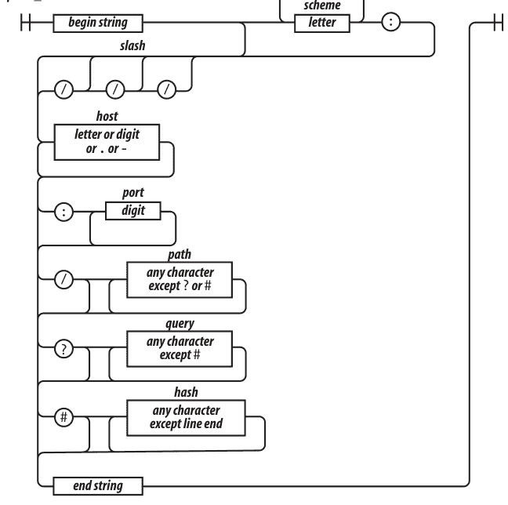
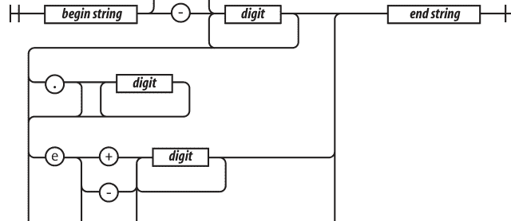
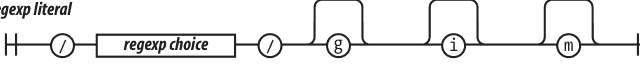
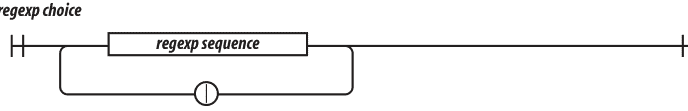
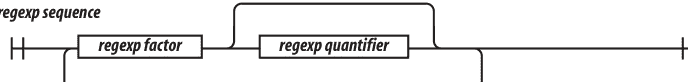
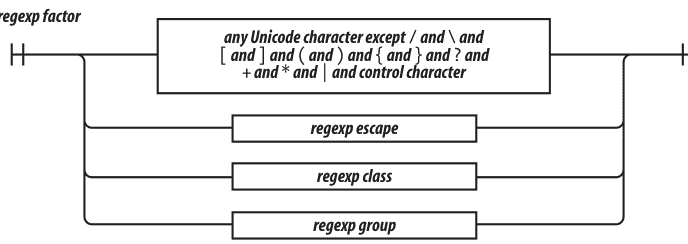
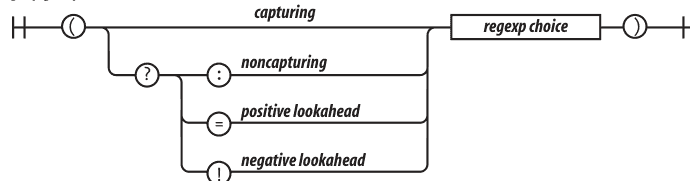
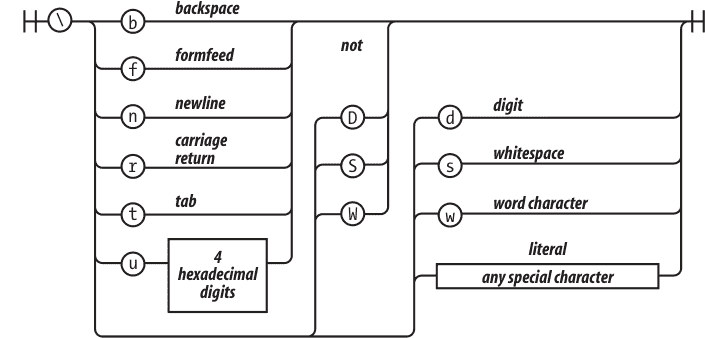

# JavaScript：精粹部分

大多数编程语言都包含优秀和糟糕的组件，但 JavaScript 的后者比例远超寻常。这本权威著作剔除了那些最令人糟糕的特性，揭示了一个比该语言整体更可靠、可读且易于维护的 JavaScript 子集——你可以使用这个子集来创建出真正可扩展且高效的代码。

作者 Douglas Crockford 被开发社区的许多人视为 JavaScript 专家，他指出了许多让 JavaScript 成为卓越面向对象编程语言的绝良想法。遗憾的是，这些优秀的想法（如函数、松散类型、动态对象和表现丰富的对象字面量表示法）与许多糟糕甚至极其离谱的想法（例如基于全局变量的编程模型）混杂在一起。

当 Java 失败时，JavaScript 默认成为了 Web 语言；它的流行程度几乎完全与其作为编程语言的品质无关。在 *JavaScript: The Good Parts* 中，Crockford 从一堆良好的意图和失误中进行挖掘，为你详细展示了 JavaScript 所有真正优雅的部分。

通过 *JavaScript: The Good Parts*，你将发现一种美丽、优雅、轻量且高效的语言，无论你是在管理对象库还是仅仅试图让 Ajax 运行更快，它都能让你创建高效的代码。如果你为 Web 网站或应用程序开发，这本书是必读。

Douglas Crockford 是一位高级 JavaScript 架构师，因引入和维护 JSON（JavaScript 对象表示）格式而闻名。他经常在会议上就高级 JavaScript 主题演讲，并担任 ECMAScript 委员会成员。

> 致伙计们：Clement, Philbert, Seymore, Stern，以及，不要忘记的 C. Twildo。

# 前言

> 如果我们冒犯了，那是我们的善意
>
> 请你们认为，我们并非为了冒犯，
>
> 而是出于善意。展示我们浅显的技巧，
>
> 这就是我们终结的真正开始。
>
> ——威廉·莎士比亚，《仲夜梦》

这是一本关于 JavaScript 编程语言的书。它面向那些出于偶然或好奇而初次尝试 JavaScript 的程序员。它也面向那些已经以初级水平使用 JavaScript，并且现在准备好与该语言建立更深层次关系的程序员。JavaScript 是一门出奇地强大的语言。它的非传统性带来了一些挑战，但作为一门小型的语言，它是很容易掌握的。

我的目标是帮助你学会用 JavaScript 思考。我将向你展示这种语言的组件，并引导你发现这些组件如何组合在一起。这并不是一本参考书。它对语言及其奇特性的描述并不详尽。它并不包含你将可能需要知道的所有知识——那些你完全可以在网上轻松找到。相反，这本书包含了真正重要的内容。

这不是一本写给初学者的书。我某天希望能写一本《JavaScript：初探》，但这不是那本书。这也不是一本关于 Ajax 或 Web 编程的书。重点完全在于 JavaScript，而这只是 Web 开发者必须掌握的语言之一。

这不是一本写给傻瓜看的书。这本书很小，但内容很密集。书中挤满了大量材料。如果需要阅读多次才能读懂，请不要气馁。你的努力将获得回报。

# 本书中使用的约定

本书使用了以下排版约定：

*斜体*
表示新术语、URL、文件名和文件扩展名。

`等宽`
表示广义上的计算机代码。这包括命令、选项、变量、属性、键、请求、函数、方法、类型、类、模块、属性、参数、值、对象、事件、事件处理器、XML 标签、宏和关键字。

`等宽粗体`
表示用户应该按原字输入的命令或其他文本。

# 使用代码示例

本书的目的是帮助你完成工作。通常情况下，你可以在自己的程序和文档中使用书中的代码。你不需要联系我们获取许可。使用书中的几段代码来回答问题不需要许可。寻求或分发来自 O'Reilly 书籍的示例光盘则需要许可。通过引用本书并引用示例代码来回答问题不需要许可。将书中的大量代码整合到你的产品文档中则需要许可。

我们感谢署名，但并不要求署名。署名通常包括标题、作者、出版商和 ISBN。例如：Douglas Crockford 著的 *JavaScript: The Good Parts*。Copyright 2008 Yahoo!; 978-0-596-51774-8.

如果你使用代码示例超出了你的领域或此处许可的范围，请随时通过 `permissions@oreilly.com` 联系我们。

当你喜欢的科技书籍封面上看到 Safari® Books Online 图标时，意味着本书可以通过 O'Reilly Network Safari Bookshelf 在线获取。

Safari 提供了一种比电子书更好的解决方案。它是一个虚拟图书馆，你可以在其中搜索数千科技书籍、剪切代码示例、下载章节，并在需要最准确、最新的信息时找到答案。可以在 `http://safari.oreilly.com` 免费尝试。

# 如何联系我们

- 800-998-9938（在美国或加拿大）
- 707-829-0515（国际或本地电话）
- 707-829-0104（传真）

```
http://www.oreilly.com/catalog/9780599651774/
```

如需对本书提出意见或咨询技术问题，请发送邮件至：

`bookquestions@oreilly.com`

有关我们书籍、会议、资源中心和 O'Reilly Network 的更多信息，请访问我们的网站：

```
http://www.oreilly.com/
```

# 致谢

我要感谢那些指出我许多低级错误的评审员。在生活中，没有什么比让真正聪明的人指出你的失误更好的了。如果能在你公开之前指出，那就更好。感谢 Steve Souders, Bill Scott, Julien Lecomte, Stoyan Stefanov, Eric Miraglia 和 Elliotie Rust Hardy。

我要感谢我在 Electric Communities 和 State Software 工作期间同事，他们帮助我发现这种语言深处竟是如此美好，特别是 Chip Morningstar, Randy Farmer, John La, Mark Miller, Scott Chattuck 和 Bill Denney。

感谢 Yahoo! Inc. 给了我时间完成这个项目，并提供如此优秀的工作环境，感谢 Ajax Strike Force 的所有成员。我还要感谢 O'Reilly Media, Inc.，特别是 Mary Tresler, Simon L. Laurent 和 Sumita Mukheri，让一切进展得顺利。

特别感谢 Lisa Drake 教授所做的一切。我要感谢 ECMA TC39 的伙伴们，他们正在努力让 ECMAScript 成为一种更好的语言。

最后，感谢 Brendan Eich，这位世界上最被误解的编程语言设计师，没有他，这本书将没有存在的意义。

# 第 1 章 美好的部分

...撇开我那些美好部分的特性，我没有其他魅力了。

——威廉·莎士比亚，《温莎的娘妇》

当我还是一个年轻的行当程序员时，我会学习我所用语言的每一个特性，并在写代码时尝试使用所有这些特性。我猜这是一种炫耀的方式，而且我想它起作用了，因为如果你想知道如何使用某个特定特性，你就会去找我。

最终，我发现其中一些特性大得不值。有些特性的规范写得很糟糕，因此更容易导致移植性问题。有些特性导致代码难以阅读或修改。有些特性诱使我写出过于晦涩且容易出错的代码。而某些特性本身就是设计错误。有时语言设计者也会犯错。

大多数编程语言都包含好的部分和糟糕的部分。我发现，通过只使用好的部分并避免糟糕的部分，我可以成为一个更好的程序员。毕竟，你如何用糟糕的部分构建出东西呢？

标准委员会很少能从语言中消除缺陷，因为这样做会导致所有依赖于糟糕部分的坏程序崩溃。他们无能为力，只能在现有的缺陷堆栈之上添加更多特性。而这些新特性并不总是能和谐地相互作用，从而产生更多的糟糕部分。

但你有权定义你自己的子集。通过完全依赖好的部分，你可以写出质量的程序。

JavaScript 是一门糟糕部分多过标准的语言。它在惊人的短时间内从无到被全球范围内采用。它从未在实验室中经历过可以测试和抛光的间隔期。它原封不动地进入了 Netscape Navigator 2，而当时它非常粗糙。当 Java™ 插件失败后，JavaScript 默认成为了“Web 语言”。JavaScript 的流行与其作为编程语言的质量几乎无关。

幸运的是，JavaScript 有一些非常优秀的部分。在 JavaScript 中，存在一种优美、优雅且高表现力的语言，它被埋没在一堆良好的意图和失误之下。JavaScript 最出色的本质被如此有效地隐藏了多年，以至于人们的主流观点认为它是一个丑陋、无能的玩具。我的意图在这里作为一种优秀的动态编程语言来展现 JavaScript 的美好之处。JavaScript 像是一块大理石，我不断剔除那些不美丽的特性，直到语言的真实本质显现出来。我相信，刻出来的这个子集远优于语言本身，它更可靠、易读且易于维护。

本书不会尝试完全描述这门语言。相反，我将关注优秀的部分，并偶尔给出警告以避开糟糕的部分。这里描述的子集可以用于构建大小各种可靠的可读程序。通过只关注优秀部分，我们可以缩短学习时间，增加健壮性并节省时间。

学习优秀部分最大的好处可能是，你可以避免了“遗忘”糟糕部分的需求。遗忘糟糕的模式非常困难。这是一项我们大多数人极极不愿面对的痛苦任务。有时语言会被子集化是为了使其更适合学生使用。在这种情况下，我将 JavaScript 子集化是为了使其更适合专业人士。

## 为什么选择 JavaScript？

JavaScript 是一门重要的语言，因为它是浏览器的语言。它与浏览器的关联使其成为最流行的编程语言之一。同时，它也是最受讨厌的语言之一。浏览器的 API——文档对象模型（`DOM`）相当糟糕，而 JavaScript 却因此了不公平的指责。使用任何语言处理 `DOM` 都是很痛苦的。`DOM` 规范糟糕且实现不一致。这意味着如果我要写写关于 `DOM` 的《优秀部分》，将极具挑战性。

JavaScript 最受讨厌是因为它不是某种**其他语言**。如果你处于某种**其他语言**中，但必须在一个只支持 JavaScript 的环境中编程，那将很令人恼恼。在这种情况下，大多数人并不会先去学习 JavaScript，当他们发现 JavaScript 与他们想使用的**其他语言**之间存在显著差异时，他们会感到惊讶，而这些差异至关重要。

JavaScript 的神奇之处在于，你可以在不怎么了解语言、甚至不怎么了解编程的情况下完成工作。它是一门具有巨大表现力的语言。当你知道自己在做什么时，它会更好。编程是一项艰难的事务，绝不应该在无知的情况下进行。

## 分析 JavaScript

JavaScript 构建在一些非常好的主意和一些糟糕的想法之上。

非常好的想法包括函数、松散类型、动态对象和富有表现力的字面量表示。糟糕的包括基于全局变量的编程模型。

JavaScript 的函数是具有（主要是）词法作用域的一等对象。JavaScript 是第一个进入主流的 lambda 语言。深层，JavaScript 与 Lisp 和 Scheme 的共同点多于 Java。它是披着 C 外壳的 Lisp。这使得 JavaScript 成了一门极其强大的语言。

如今大多数编程语言的趋势是要求强类型。理论上，强类型允许编译器在编译时检测出一类错误。我们越早检测并修复错误，成本就越低。JavaScript 是一门松散类型语言，因此 JavaScript 编译器无法检测类型错误。对于从强类型语言转向 JavaScript 的人来说，这可能令人担忧。但事实证明，我在工作中发现的并不是强类型检查所担心的错误。相反，我觉得松散类型是解放性的。我不需要构建复杂的类层次结构。我永远不需要类型转换或与系统斗争来获得我想要的行为。

JavaScript 拥有非常强大的对象表示法。可以通过列出组件来创建对象。这种表示法是流行的数据交换格式 `JSON` 的灵感。（附录 E 中会有更多关于 `JSON` 的内容。）

JavaScript 一个争议性的特性是原型继承。JavaScript 有一个无类的对象系统，对象直接从其他对象继承属性。这非常强大，但对受过经典训练的程序员来说并不熟悉。如果你尝试将经典设计应用于 JavaScript，你会感到沮丧。但如果你学会与 JavaScript 的原型本质工作，你的努力将获得回报。

JavaScript 因其核心理念的选择而饱受非。尽管在大多数情况下，这些都是好的或是不常的。但 JavaScript 依赖全局变量进行链接。所有编译单元的顶层变量堆在一个称为全局对象的公共命名空间中。这是一坏事，因为全局变量是恶的，而在 JavaScript 中它们是基础性的。坦率地说，正如我们将看到的，JavaScript 也给了我们缓解这一问题的工具。

在某些情况下，我们无法忽略糟糕的部分。有一些不可避免的部分，会在出现时被指出。它们也会在附录 A 中总结。但在书中我们将成功避开了大部分糟糕的部分，并在附录 B 中总结了大部分遗漏的内容。如果你想了解更多关于糟糕部分以及如何明智使用它们的内容，请查阅任何其他 JavaScript 书。

JavaScript（又名 jScript）的标准是《ECMAScript 编程语言》第三版，地址为 `http://www.ecma-international.org/publications/files/ecma-st/ECMA-262.pdf`。书中描述的语言是 ECMAScript 的一个真子集。本书没有描述这门语言，因为它去掉了糟糕的部分。这里的处理不是详尽的，它避开了边缘情况。你也应该这样做。边缘隐藏着危险和痛苦。

附录 C 描述了一个编程工具 `JSLint`，它是一个 JavaScript 解析器，可以分析 JavaScript 程序并报告其中包含的糟糕部分。`JSLint` 提供了 JavaScript 开发中通常缺乏的严谨性。它可以让你确信你的程序只包含优秀的部分。

JavaScript 是一门矛盾的语言。它包含许多错误和尖锐的边缘，所以你可能会问：“为什么要用 JavaScript？”有两个答案。第一个是你没有选择。Web 已经成为应用开发的重要平台，而 JavaScript 是唯一在所有浏览器中都存在的语言。遗憾的是 Java 在那个环境下失败了；如果没有失败，那些渴望强类型经典语言的人就会有一个选择。但 Java 确实失败了，而 JavaScript 正在蓬勃发展，这证明 JavaScript 做了一些正确的事。

另一个答案是，尽管有缺陷，JavaScript 真的很好。它轻量且富有表现力。一旦你掌握了它，函数式编程非常有趣。

但为了用好这门语言，你必须对其局限性有充分的了解。我会粗暴地向你强调这些。不要让这让你灰馁。优秀的部分足以补偿糟糕的部分。

## 一个简单的测试场

如果你有一个网页浏览器和任何文本编辑器，你就拥有了运行 JavaScript 程序所需的一切。首先，创建一个名为 `program.html` 的 HTML 文件：

```html
<html><body><pre><script src="program.js"></script></pre></body></html>
```

然后，在同一目录下创建一个名为 `program.js` 的文件。接下来，在浏览器中打开你的 HTML 文件查看结果。在本书中，使用 `method` 方法来定义新方法。它的定义如下：

```javascript
Function.prototype.method = function (name, func) {
  this.prototype[name] = func;
  return this;
};
```

它将在第 4 章中解释。

# 第 2 章 语法

> 我很好地了解它：
>
> 我很久以前就在语法书中读过它。
>
> ——威廉·莎士比亚，《提图斯·安德洛尼库悲》

本章介绍了 JavaScript 有用部分的语法，简要概述了该语言的结构。我们将使用铁路轨道图来表示语法。

解释这些图的规则非常简单：

- 你从左边缘开始，沿着轨道到右边缘。
- 在移动过程中，你会在椭圆中遇到字面量，在矩形中遇到规则或描述。
- 任何通过遵循轨道可以形成的序列都是合法的。
- 任何无法通过遵循轨道形成的序列都是非法的。
- 两端各有一个杠的铁路轨道图允许在任意标记之间插入空格。两端各有两个杠的铁路轨道图则不允许。

本章介绍的有用部分的语法比整个语言的语法要简单得多。

## 空格

空格可以以格式字符或注释的形式存在。空格通常是不起作用的，但有时需要使用空格来分隔字符序列，否则这些字符将合并成单个标记。例如：

```javascript
var that = this;
```

`var` 和 `that` 之间的空格不能删除，但其他空格可以删除。

JavaScript 提供了两种形式的注释：用 `/* */` 形成的块注释和用 `//` 的行注释。应该大量使用注释来提高程序的可读性。确保注释始终准确描述代码。过时的注释比没有注释更糟糕。

`/* */` 形式的块注释来自一种名为 PL/I 的语言。PL/I 选择这些奇怪的组合作为注释符号，是因为它们在那种语言的程序中不太出现，除非是在字符串字面量中。在 JavaScript 中，这些组合也可能正则表达式字面量中，因此块注释对于注释掉代码块是不安全的。例如：

```javascript
/*
var rm_a = /*.match(s);
*/
```

会导致语法错误。因此，建议避免使用 `/* */` 注释，而改用 `//` 注释。在书中，将专门使用 `//`。

## 名称

名称是一个字母，后面可选跟随一个或多个字母、数字或下划线。名称不能是以下这些保留字之一：

```
abstract
boolean break byte
case catch char class const
debugger default delete double
else enum export extends
false final finally float for function
goto
if implements import instanceof int interface
long
native new null
package private protected public
return
short static super switch synchronized
this throws transient try typeof
var volatile void
while with
```

此列表中的大多数保留字在语言中并没有使用。该列表没有包含本应被保留但未被的单词，例如 `undefined`、`NaN` 和 `Infinity`。不允许使用保留字作为变量或参数的名称。不允许将保留字作为对象字面量中对象属性的名称，或精细化中点之后的名称。

名称用于语句、变量、参数、属性名、操作符和标签。

JavaScript 只有一种数字类型。在内部表示为 64 位浮点数，类似于 Java 的 `double`。与大多数编程语言不同，它没有单独整数类型，因此 `1` 和 `1.0` 是相同的值。这是一个巨大的便利，因为完全避免了短整数的溢出问题，你对数字只需要知道它是一个数字即可。避免了一大类数值类型错误。

如果数字字面量有一个指数部分，则该字面量的值通过 `e` 之前的部分乘以 10 的 `e` 之后部分的幂来计算。因此 `100` 和 `1e2` 是同一个数字。

负数可以通过使用 `-` 前缀运算符形成。

`NaN` 值是一个无法产生正常结果的操作的结果。`NaN` 不等于任何值，包括它本身。你可以通过 `isNaN(number)` 函数检测 `NaN`。

`Infinity` 值代表所有大于 `1.7976931348623157e+308` 的值。

数字拥有方法，包含一组对数字起的方法。例如，`Math.floor(number)` 方法可以将数字转换为整数。

字符串可以用单引号或双引号包裹。它可以包含零或多个字符。`\`（反斜杠）是转义字符。JavaScript 构建于 Unicode 还是 16 位字符集的时代，因此 JavaScript 中的所有字符都是 16 位宽。

JavaScript 没有字符类型。要表示字符，请创建一个仅包含一个字符的字符串。

转义序列允许在字符串中插入通常不允许的字符，例如反斜杠、引号和控制字符。`\u` 约定允许以数值形式指定字符代码点。

```javascript
"A" === "A\u0041"
```

字符串有一个 `length` 属性。例如，`"seven".length` 是 5。

字符串是不可变的。

## 语句

JavaScript 语句包括 `var`、`if`、`switch`、`for`、`while`、`do`、`try`、`throw`、`return`、`break` 和表达式语句。

### var 语句

`var` 语句用于声明变量。建议在函数体的顶部声明所有变量。

### if 语句

`if` 语句根据条件执行代码块。

### switch 语句

`switch` 语句根据表达式的值执行不同的代码块。

### for 语句

`for` 语句用于循环。另一种形式（称为 `for in`）列出对象的属性名（键）。在每次迭代中，对象的中的另一个属性名字符串会被赋值给该变量。

通常需要测试 `object.hasOwnProperty(variable)` 来确定该属性名是确实是对象的成员，还是在原型链上找到的。

```javascript
for (myvar in obj) {
  if (obj.hasOwnProperty(myvar)) {
    ...
  }
}
```

### do 语句

`do` 语句类似于 `while` 语句，不同之处是在执行代码块后测试表达式，而不是在执行之前。这意味着代码块将至少执行一次。

### try 语句

`try` 语句执行一个块并捕获该块抛出的任何异常。`catch` 子句定义了一个新变量，该变量将接收异常对象。

### throw 语句

`throw` 语句抛出一个异常。如果 `throw` 语句位于 `try` 块中，控制将转移到 `catch` 子句。否则，函数调用将被放弃，控制转移到调用函数中 `try` 的 `catch` 子句。

该表达式通常是一个包含 `name` 属性和 `message` 属性的对象字面量。异常捕获器可以使用这些信息来决定做什么。

### return 语句

`return` 语句导致函数提前返回。它还可以指定要返回的值。如果没有指定 `return` 表达式，则返回值将为 `undefined`。

JavaScript 不允许在 `return` 和表达式之间有换行。

### break 语句

`break` 语句导致退出循环语句或 `switch` 语句。它可以可选地带有一个标签，该标签会导致退出带标签的语句。

JavaScript 不允许在 `break` 和标签之间有换行。

### 表达式语句

表达式语句可以给一个或多个变量成员赋值、调用方法、从对象中删除属性。`=` 运算符用于赋值。不要将其与 `===` 等等运算符混淆。`+=` 运算符可以加或拼接。

## 表达式

最简单的表达式是字面量值（如字符串或数字）、变量、内置值（`true`、`false`、`null`、`undefined`、`NaN` 或 `Infinity`）、由 `new` 前置的调用、由 `delete` 前置的细化、包裹在括号中的表达式、由前缀运算符前置的表达式，或者后面跟着内容的表达式：

- 一个中缀运算符和另一个表达式
- `?` 运算符跟随另一个表达式，然后是 `:`，然后是另一个表达式
- 一个调用
- 一个细化

三元运算符接受三个操作数。如果第一个操作数为真（truthy），它产生第二个操作数的值。但如果第一个操作数为假（falsy），它产生第三个操作数的值。

表 2-1 中运算符优先级列表顶部的运算符优先级更高。它们结合最紧密。底部的运算符优先级最低。可以使用括号改变正常的优先级，因此：

```javascript
2 + 3 * 5 === 17
(2 + 3) * 5 === 25
```

### 表 2-1. 运算符优先级

| 优先级 | 运算符 |
| :--- | :--- |
| 最高 | 细化和调用 |
| | 一元运算符 |
| | `delete` `new` `typeof` `+` `!` |
| | 乘、除、取模 |
| | 加法/拼接、减法 |
| | 不等于 |
| | 等于 |
| | 逻辑与 |
| | 逻辑或 |
| 最低 | 三元 |

`typeof` 产生的值为 'number'、'string'、'boolean'、'undefined'、'function' 和 'object'。如果操作数是数组或 `null`，则结果为 'object'，这是错误的。第 6 章和附录 A 中有关于 `typeof` 的更多。

如果 `!` 的操作数为真，它产生 `false`。否则，它产生 `true`。

`+` 运算符相或拼接。如果你希望它执行加法，请确保两个操作数都是数字。

`/` 运算符即使操作数是整数也可能产生非整数结果。

`&&` 运算符如果第一个操作数为假，则产生第一个操作数的值。否则，它产生第二个操作数的值。

`||` 运算符如果第一个操作数为真，它产生第一个操作数的值。否则，它产生第二个操作数的值。

### 调用

调用会导致函数值的执行。调用运算符是跟随函数值的一对括号。括号中可以包含传递给函数的参数。第 4 章将更多关于函数的介绍。

### 细化

细化用于指定对象或数组的属性或元素。下一章将进行详细描述。

## 字面量

对象字面量是指定新对象的方便符号。属性名可以指定为名称或字符串。名称被视为字面量名，而不是变量名，因此对象的属性名必须在编译时已知。属性值是表达式。下一章将更多关于对象字面量的介绍。

数组字面量是指定新数组的方便符号。第 6 章将更多关于数组字面量的介绍。

第 7 章将有更多关于正则表达式的介绍。

## 函数

函数字面量定义了一个函数值。它可以带有一个可选的名称，用于递归调用自身。它可以指定一个参数列表，这些参数作为由调用参数初始化的变量。函数体包括变量定义和语句。第 4 章将更多关于函数的介绍。

# 第 3 章 对象

> 在平庸的爱中，爱也会眨眼。
>
> ——威廉·莎士比亚，《维罗纳的公公子》

JavaScript 的简单类型是数字、字符串、布尔（`true` 和 `false`）、`null` 和 `undefined`。所有其他值都是对象。数字、字符串和布尔在某些方面类似于对象，因为它们有方法，但它们是不可变的。JavaScript 中的对象是可变的集合。在 JavaScript 中，数组、函数都是对象，正则表达式也是对象，当然，对象也是对象。

对象是属性的容器，其中每个属性有一个名称和一个值。属性名可以是任何字符串，包括空字符串。属性值可以是任何 JavaScript 值，但 `undefined` 除外。

JavaScript 中的对象是无类的别的。对新属性的名称或属性的值没有限制。对象对于收集和组织数据非常有用。对象可以包含其他对象，因此它们可以轻松地表示树或图结构。

JavaScript 包含了原型链功能，允许一个对象继承另一个对象的属性。当使用良好时，这可以减少对象的初始化时间和内存消耗。

## 对象字面量

对象字面量为创建新对象值提供了非常方便的符号。对象字面量是一对包裹着零或多个名称/值对的大括号。对象字面量可以出现在表达式出现的地方：

```javascript
var empty_object = {
  "first-name": "Jerome",
  "last-name": "Howard"
};
```

属性名称可以是任何字符串，包括空字符串。在对象字面量中，属性名称周围的引号是可选的，只要该名称是合法的 JavaScript 名称且不是保留字。因此，"first-name" 周围必须加引号，但 first_name 的加引号是可选的。使用逗号来分隔这些属性对。

属性的值可以从任何表达式获取，包括另一个对象字面量。示例：

```javascript
var flight = {
  airline: "Oceanic",
  number: 815,
  departure: {
    IATA: "SYD",
    time: "2004-09-22 14:55",
    city: "Sydney"
  },
  arrival: {
    IATA: "LAX",
    time: "2004-09-23 10:42",
    city: "Los Angeles"
  }
};
```

## 获取

可以通过将字符串表达式封装在 `[ ]` 后缀中从对象中检索值。如果字符串表达式是常量，并且它是合法的 JavaScript 名称且不是保留字，则可以使用 `.` 表示法。优先使用 `.` 表示法，因为它更紧凑且读性更好：

```javascript
stooge["first-name"] // "Joe"
flight.departure.IATA // "SYD"
```

如果尝试检索不存在的成员，将产生 `undefined` 值：

```javascript
stooge["middle-name"] // undefined
flight.status // undefined
stooge["FIRST-NAME"] // undefined
```

可以使用 `||` 运算符来填充默认值：

```javascript
var middle = stooge["middle-name"] || "none";
var status = flight.status || "unknown";
```

尝试从 `undefined` 获取值将抛出 `TypeError` 异常。可以使用 `&&` 运算符来防止这种情况：

```javascript
flight.equipment // undefined
flight.equipment.model // throw "TypeError"
flight.equipment && flight.equipment.model // undefined
```

可以通过赋值来更新对象中的值。如果属性名在对象中已存在，则替换该属性值：

```javascript
stooge['first-name'] = 'Jerome';
// 如果对象尚未拥有该属性名，则扩展该对象：
stooge['middle-name'] = 'Lester';
stooge.nickname = 'Curly';
flight.equipment = {
  model: 'Boeing 777'
};
flight.status = 'overdue';
```

对象是通过引用传递的。它们不会被复制：

```javascript
var x = stooge;
x.nickname = 'Curly';
var nick = stooge.nickname;
// nick 是 'Curly'，因为 x 和 stooge
// 是同一个对象的引用
a = {}, b = {}, c = {};
// a, b, 和 c 分别指向
// 不同的空对象
a = b = c = {};
// a, b, 和 c 都指向
// 同一个空对象
```

每个对象都链接到一个原型对象，它可以从那里继承属性。所有从对象字面量创建的对象都链接到 `Object.prototype`，这是标准 JavaScript 自带的对象。

当你创建一个新对象时，JavaScript 提供了一种选择哪个对象作为其原型的方法。实现这一点的机制既杂乱又复杂，但可以显著简化。我们将为 `Object` 函数添加一个 `create` 方法。`create` 方法会创建一个使用旧对象作为其原型的新对象。下一章将会有更多关于函数的介绍。

```javascript
if (typeof Object.create != 'function') {
  Object.create = function (o) {
    var F = function () {
      F.prototype = o;
      return new F();
    };
  }
}
var another_stooge = Object.create(stooge);
```

原型链接对更新没有影响。当我们对对象更改时，对象的原型不会被触：

```javascript
another_stooge['first-name'] = 'Harry';
another_stooge['middle-name'] = 'Mose';
another_stooge.nickname = 'Moe';
```

原型链接仅在检索时起。如果我们尝试从对象中检索属性值，如果该对象缺少该属性名，那么 JavaScript 将尝试从原型对象中检索该属性值。如果原型也缺少该属性，它将继续向上原型查找，依此类推，直到最终到达 `Object`。如果所需的属性在原型链的任何地方都不存在，则结果是 `undefined` 值。这被称为委托。

原型关系是一种动态关系。如果我们向原型添加一个新属性，该属性将立即在所有基于该原型的对象中可见：

```javascript
stooge.profession = 'actor';
another_stooge.profession // 'actor'
```

我们将在第 6 章看到更多关于原型链的内容。

可以通过尝试检索属性并检查获得的值来轻松检查对象以具有哪些属性。`typeof` 运算符在确定属性类型时非常有帮助：

```javascript
typeof flight.number // 'number'
typeof flight.status // 'string'
typeof flight.arrival // 'object'
typeof flight.manifest // 'undefined'
```

必须格外小心，因为原型链上的任何属性都可能产生值：

```javascript
typeof flight.toString // 'function'
typeof flight.constructor // 'function'
```

处理这些不需要的属性有两种方法。第一种是让你的程序查找并拒绝函数值。通常情况下，当你进行反射时，你感兴趣的是数据，所以你应该意识到某些值可能是函数。

另一种方法是使用 `hasOwnProperty` 方法，如果对象拥有特定属性，该方法将返回 `true`。`hasOwnProperty` 方法不会查看原型：

```javascript
flight.hasOwnProperty('number') // true
flight.hasOwnProperty('constructor') // false
```

`for in` 语句可以遍历对象中所有的属性名。枚举将包含所有属性——包括你可能感兴趣的函数和原型属性——因此有过滤过滤你不需要的值。常用的过滤器是 `hasOwnProperty` 方法和使用 `typeof` 排除函数：

```javascript
var name;
for (name in another_stooge) {
  if (typeof another_stooge[name] !== 'function') {
    document.writeln(name + ': ' + another_stooge[name]);
  }
}
```

名称的顺序没有保证，因此请准备好以任何顺序出现名称。如果你想确保属性按特定顺序出现，最好完全避免使用 `in` 语句，并创建一个包含名称的数组：

```javascript
var i;
var properties = [
  'first-name',
  'middle-name',
  'last-name',
  'profession'
];
for (i = 0; i < properties.length; i += 1) {
  document.writeln(properties[i] + ': ' + another_stooge[properties[i]]);
}
```

通过使用这种替代 `for in`，我们能够获得想要的属性，而无需担心可能会从原型链中挖掘出什么。

可以使用 `delete` 运算符从对象中删除属性。如果对象中有该属性，它将将其移除。它不会触碰任何原型链接。

从对象中移除属性可能会允许原型链接中的属性显示出来：

```javascript
another_stooge.nickname // 'Moe'
delete another_stooge.nickname;
// 从 another_stooge 中移除 nickname，显示
// 原型的 nickname。
another_stooge.nickname // 'Curly'
```

JavaScript 允许定义包含你应用程序所有资源的全局变量。不幸的是，全局变量会削弱程序的韧性并应该避免。

减少全局变量使用的一种方法是为你的应用程序创建一个全局变量：

```javascript
var MYAPP = {};
```

该变量随后成为你应用程序的容器：

```javascript
MYAPP.stooge = {
  "first-name": "Joe",
  "last-name": "Howard"
}

MYAPP.flight = {
  airline: "Oceanic",
  number: 815,
  departure: {
    IATA: "SYD",
    time: "2004-09-22 14:55",
    city: "Sydney"
  },
  arrival: {
    IATA: "LAX",
    time: "2004-09-23 10:42",
    city: "Los Angeles"
  }
}
```

通过将你的全局足迹减少到单个名称，你显著减少了与其他应用程序、插件或库发生不良交互的概率。你的程序变得更容易阅读，因为显然 `MYAPP.stooge` 指的是顶层结构。在下一章中，我们将看到使用闭包进行信息隐藏的方法，这是另一种有效的全局抑制技术。

# 第 4 章 函数

> 为何，每一处错误在发生前就已受到定罪：
>
> 我的错误恰恰是一个函数的零值……
>
> ——威廉·莎士比亚，《越界之量》

JavaScript 最棒的一点在于它对函数的实现。它几乎做对了一了一切。但是，正如你对 JavaScript 的预期那样，它并不是面面都正确。

函数封装了一组语句。函数是 JavaScript 基本的模块单元。它们被用于代码重用、信息隐藏和组合。函数用于指定对象的行为。通常情况下，编程的艺术是将一组需求拆解为一组函数和数据结构。

JavaScript 中的函数是对象。对象是键/值对的集合，并有一个指向原型对象的隐藏链接。从对象字面量产生的对象链接到 `Object.prototype`。函数对象则链接到 `Function.prototype`。每个函数在创建时还带有额外的隐藏属性：函数的上下文（context）以及实现函数行为的代码。

每个函数还被带有一个 `prototype` 属性。它的值是一个对象，该对象包含一个 `constructor` 属性，该属性的值就是函数本身。这与指向 `Function.prototype` 的隐藏链接是不同的。这种复杂构造的意义将在下一章中揭示。

由于函数是对象，它们可以像任何其他值一样使用。函数可以存储在变量、对象和数组中。函数可以作为参数传递给函数，也可以从函数返回。此外，由于函数是对象，函数也可以拥有方法。

函数之所以特殊，在于它们是可以被调用（invoked）。

函数对象是通过函数字面量创建的：

```javascript
// 创建一个名为 add 的变量并在其中存储
// 加两个数字的函数。

var add = function (a, b) {
  return a + b;
}
```

一个函数字面量包含四个部分。第一部分是关键字 `function`。

可选的第二部分是函数的名称。函数可以使用该名称进行递归调用。调试器和开发工具也可以使用该名称来识别函数。如果函数没有命名（如上一个示例所示），它被称为*匿名*（anonymous）函数。

第三部分是函数的参数列表，包裹在括号中。括号内是一组零或多个由逗号分隔的参数名称。这些将在函数内部定义为变量。与普通变量不同，它们不会被初始化为 `undefined`，而是初始化为调用函数时提供的参数。

第四部分是包裹在花括号中的一组语句。这些语句是函数的体体。它们在函数被调用时执行。

函数字面量可以出现在任何允许表达式的地方。函数可以定义在其他函数内部。当然，内部函数可以访问其参数和变量。内部函数还可以访问其所嵌套的函数的参数和变量。由函数字面量创建的函数对象包含一个指向该外部上下文的链接。这被称为*闭包*（closure）。这是巨大表达能力的源泉。

调用函数会暂停当前函数的执行，并将控制权和参数传递给新函数。除了声明参数外，每个函数都会接收两个额外的参数：`this` 和 `arguments`。这个参数在面向对象的编程中非常重要，它的值由*调用模式*（invocation pattern）决定。JavaScript 有四种调用模式：方法调用模式、函数调用模式、构造函数调用模式和 `apply` 调用模式。这些模式的区别在于额外参数 `this` 的初始化方式。

调用操作是一对跟在任何产生函数值的表达式后面的括号。括号内可以包含零或多个由逗号分隔的表达式。每个表达式产生一个参数值。每个参数值都将被赋值给函数的参数名称。当参数数量与参数个数不匹配时，不会发生运行时错误。如果参数值过多，多余的参数将被忽略。如果参数值太少，将用 `undefined` 替换缺失的值。对参数值不进行类型检查：任何类型的值都可以传递给任何参数。

当一个函数被存储为对象的属性时，我们称其为*方法*（method）。当方法被调用时，`this` 会绑定到该对象。如果调用表达式包含细化操作（`this, is, a ... [script]` 表达式），它将作为方法被调用：

```javascript
// 创建对象 myObject。它有一个 value 值和一个 increment
// 方法。increment 方法接受一个可选
// 参数。如果参数不是数字，则使用 1
// 作默认值。

var myObject = {
  value: 0,
  increment: function (inc) {
    this.value += typeof inc === 'number' ? inc : 1;
  }
};

myObject.increment();
document.println(myObject.value); // 1

myObject.increment(2);
document.println(myObject.value); // 3
```

方法可以利用这种对对象的访问，从而从对象中检索值或修改对象。这种对对象的绑定发生在调用时。这种极晚绑定使得使用这种机制的函数高度可用。通过这种获取对象上下文的方法被称为*公共方法*（public methods）。

当函数不是对象的属性时，它是作为函数被调用的：

```javascript
var sum = add(3, 4); // sum 是 7
```

当用这种模式调用函数时，`this` 会绑定到全局对象。这是语言设计中的一个错误。如果语言设计得正确，当内部函数被调用时，`this` 应该仍然绑定到外部函数的 `this` 变量上。这个错误的结果是方法无法利用内部函数来帮助完成工作，因为内部函数没有共享方法对对象的访问权限，因为 `this` 绑定到了错误的值。幸运的是，有一个简单的变通方法。如果方法定义了一个变量并将 `this` 的值赋值给它，内部函数将通过该变量访问 `this`。按照惯例，该变量的名称通常带有双下划线。

```javascript
// 增强 gameObject
myObject.double = function () {
  var that = this; // 变通方法。

  var helper = function () {
    that.value = add(that.value, that.value);
  };

  helper(); // 作为函数调用 helper。
};

// 作为方法调用 double。
myObject.double();
document.writeln(myObject.getValue()); // 
```

JavaScript 是一种原型继承的语言。这意味着对象可以从其他对象继承属性。该语言没有类的概念。

这是对当前时尚的激进偏离。今天大多数语言都是经典的（基于类的）。原型继承具有强大的表达力，但并没有被广泛理解。JavaScript 本身对自己的原型特性并不自信，因此它提供了一种类似于经典语言的创建对象的语法。很少有程序员认为原型继承是可接受的，而受经典启发的语法掩盖了语言真正的原型本质。这是一种兼得必失的产物。

如果使用 `new` 前缀调用函数，将创建一个新对象，该对象包含一个指向函数 `prototype` 成员值的隐藏链接，并且该链接将绑定到新对象。

`new` 前缀还改变了 `return` 语句的行为。我们将在后面看到更多内容。

```javascript
// 创建一个名为 Quo 的构造函数。
// 它创建一个带有 status 属性的对象。

var Quo = function (string) {
  this.status = string;
};

// 给所有 Quo 的实例添加一个公共方法
// called get_status.

Quo.prototype.get_status = function () {
  return this.status;
}

// Make an instance of Quo.
var myQuo = new Quo("confused");
document.writeln(myQuo.get_status()); // confused
```

意用于与 `new` 前缀一起使用的函数被称为构造函数（constructors）。按照惯例，它们被存储在首字母大写的变量中。如果在调用构造函数时没有使用 `new` 前缀，将会发生非常糟糕的事情，且没有任何编译时或运行时的警告，因此大写命名惯例非常重要。

不建议使用这种风格的构造函数。我们将在下一章中看到更好的替代方案。

## Apply 调用模式

由于 JavaScript 是一种函数式面向对象的语言，函数可以拥有方法。

`apply` 方法允许我们构建一个参数数组，用于调用函数。它还允许我们选择此参数的值。`apply` 方法接收两个参数：第一个应该是绑定到 `this` 的值；第二个是参数数组。

```javascript
// 创建一个包含 2 个数字的数组并将它们相加。

var array = [3, 4];
var sum = add.apply(null, array); // sum is 7
```

```javascript
// 创建一个带有 status 成员的对象。

var statusObject = {
  status: 'A-OK'
}
```

```javascript
// statusObject 没有继承自 Quo.prototype，
// 但我们可以在 statusObject 上调用 get_status 方法，
// 即使 statusObject 本身并没有 get_status 方法。

var status = Quo.prototype.get_status.apply(statusObject);
// status is 'A-OK!'
```

## 参数

函数在调用时可用的一个额外参数是 `arguments` 数组。它让函数能够访问调用时提供的所有参数，包括未赋值给参数的冗余参数。这使得编写可以接收任意数量参数的函数成为可能。

```javascript
// 创建一个可以添加很多内容的函数。

// 注意，在函数内部定义变量 sum
// 不会与外部定义的 sum 冲突。
// 函数 只能看到内部的那个。

var sum = function () {
  var i, sum = 0;
  for (i = 0; i < arguments.length; i += 1) {
    sum += arguments[i];
  }
  return sum;
};
```

```javascript
document.writeln(sum(4, 8, 15, 16, 23, 42)); // 108
```

这不是一个特别实用的模式。在第 6 章中，我们将看到如何为数组添加类似的方法。

由于一个设计错误，`arguments` 并不是真正的数组。它是一个类对象（array-like object）。`arguments` 拥有 `length` 属性，但缺少所有的数组方法。我们将在在本末看到这一设计错误产生。

## 返回

当函数被调用时，它从第一条语句开始执行，并在遇到关闭函数体的 `}` 时结束。这导致函数将控制权交回给调用该函数的程序部分。

`return` 语句可以导致函数提前返回。当执行 `return` 时，函数会立即返回，不再执行剩余的语句。

函数总是会返回一个值。如果没有指定返回值，则返回 `undefined`。

如果调用函数时使用了 `new` 前缀且返回值不是对象，则返回 `this`（即该新对象）。

## 异常

JavaScript 提供了异常处理机制。异常是干扰程序正常流程的异常（但并非完全出乎意料）故障。当检测到此类意外状况时，你的程序应该抛出一个异常：

```javascript
var add = function (a, b) {
  if (typeof a != 'number' || typeof b != 'number') {
    throw {
      name: 'TypeError',
      message: 'add needs numbers'
    };
  }
  return a + b;
}
```

`throw` 语句会中断函数的执行。它应该接收一个异常对象，该对象包含一个标识异常类型的 `name` 属性和一个描述性的 `message` 属性。你也可以添加其他属性。

异常对象将被传递给 `try` 语句的 `catch` 语句：

```javascript
// 创建一个 try_it 函数，错误地调用新的 add
// 函数。

var try_it = function () {
  try {
    add("seven");
  } catch (e) {
    document.writeln(e.name + ': ' + e.message);
  }
};

try_it();
```

如果在 `try` 块内抛出异常，控制将转移到它的 `catch` 语句。

`try` 语句有一个 `catch` 块可以捕获所有异常。如果你的处理取决于异常的类型，那么异常处理器将必须检查 `name` 来确定异常的类型。

## 扩展类型

JavaScript 允许对语言的基本类型进行扩展。在第 3 章中，我们看到向 `Object.prototype` 添加方法可以让该方法对所有对象可用。这对于函数、数组、字符串、正则表达式和布尔值也是如此。

例如，通过扩展 `Function.prototype`，我们可以让所有函数拥有一个方法：

```javascript
Function.prototype.method = function (name, func) {
  this.prototype[name] = func;
  return this;
};
```

通过在 `Function.prototype` 上扩展一个方法名，我们再也不需要输入原型属性的名称。那部分丑陋的代码现在可以隐藏起来。

JavaScript 没有单独的整数类型，因此有时需要提取数字的整数部分。JavaScript 提供的实现此功能的方法很难。我们可以通过向 `Number.prototype` 添加一个整数方法来修复它。它根据数字的正负使用 `Math.ceil` 或 `Math.floor`：

```javascript
Number.prototype.integer = function () {
  return Math[this < 0 ? 'ceil' : 'floor'](this);
};
```

```javascript
document.writeln((-10/3).integer()); // -3
```

JavaScript 缺少一个移除字符串端空格的方法。这是一个容易修复的疏忽：

```javascript
String.prototype.trim = function () {
  return this.replace(/^\s+|\s+$/g, '');
};
```

```javascript
document.writeln(" " + "  neat  ".trim() + " ");
```

我们的方法使用了正则表达式。我们将在第 7 章中学习更多关于正则表达式。

通过扩展基本类型，我们可以显著提高语言的表达能力。由于 JavaScript 的动态性质，可以在运行时添加方法。我们看到了缓解此问题的方法：使用 `hasOwnProperty` 来过滤隐藏属性：

```javascript
Object.prototype.method = function (name) {
  if (!this[name]) {
    this[name] = arguments[1];
  }
};
```

## 递归函数

递归函数是直接或间接调用自身的函数。递归是一种强大的编程技术，其中问题被划分为子问题，每个子问题通过简单的解决方案解决。通常，递归函数通过调用自己来解决其子问题。

汉诺塔是一个著名的谜。设备包括三个柱子和一组直径不同的盘子。初始设置是将所有盘放在源柱子上。目标是通过每次移动一个盘子将栈移动到目标位置，且不将大盘放在小盘子上。这有一个递归解决方案：

```javascript
var hanoi = function (disc, src, aux, dst) {
  if (disc > 0) {
    hanoi(disc - 1, src, dst, aux);
    document.write('Move disc ' + disc + ' from ' + src + ' to ' + dst + '\n');
    hanoi(disc - 1, aux, src, dst);
  }
}

hanoi(3, 'Src', 'Aux', 'Dst');
```

它为三个盘子产生了以下解：

- Move 1 from Src to Dst
- Move 2 from Src to Aux
- Move 1 from Dst to Aux
- Move 3 from Src to Dst
- Move 1 from Aux to Src
- Move 2 from Aux to Dst
- Move 1 from Src to Dst

递归函数在映射树形结构（如浏览器的文档对象模型 `DOM`）时非常有效。每次递归调用都处理树的更小的部分。

```javascript
// 定义一个 walk_DOM 函数，它按照 HTML 源代码顺序
// 访问树的每个节点，从某个给定的节点开始。它调用一个函数，
// 并依次传递每个节点。walk_DOM 会调用// 自身来处理每个子节点。

var walk_the_DOM = function walk(node, func) {
  func(node);
  node = node.firstChild;
  while (node) {
    walk(node, func);
    node = node.nextSibling;
  }
};
```

```javascript
// 定义一个 getElementsByByAttribute 函数。它
// 接收属性名称字符串和一个可选的
// 匹配值。它调用 walk_the_DOM，传递一个
// 在节点中查找属性名的函数。匹配的节点会被累积
// 在结果数组中。

var getElementsByByAttribute = function (att, value) {
  var results = [];

  walk_the_DOM(document.body, function (node) {
    var actual = node.nodeType === 1 && node.getAttribute(att);
    if (typeof actual === 'string' &&
        (actual === value || typeof value !== 'string')) {
      results.push(node);
    }
  });

  return results;
};
```

某些语言提供尾递归优化。这意味着，如果一个函数返回其递归调用自身的值，那么该调用将被替换为循环，这可以显著提高速度。遗憾的是，JavaScript 没有提供尾递归优化。深度递归的函数会因为耗尽返回栈而失败：

```javascript
// 创建一个具有尾递归的函数式函数。它是尾递归的，因为
// 它返回了调用自身的结果。

// JavaScript 目前尚未优化这种形式。

var factorial = function factorial(i, a) {
  a = a || i;
  if (i < 2) {
    return a;
  }
  return factorial(i - 1, a * i);
};

document.writeln(factorial(4)); // 24
```

## 作用域

编程语言中的作用域控制着变量和参数的可见性和生命周期。这对于程序员来说是一项非常重要的服务，因为它减少了命名冲突并提供了自动内存管理：

```javascript
var foo = function () {
  var a = 3, b = 5;

  var bar = function () {
    var b = 7, c = 11;
    // 在此点，a 是 3，b 是 7，c 是 11
    a += b + c;
    // 在此点，a 是 21，b 是 7，c 是 11
  };

  // 在此点，a 是 3，b 是 5，且 c 未定义
  bar();
  // 在此点，a 是 21，b 是 7，c 是 5
};
```

大多数具有 C 语法的语言都具有块级作用域。在块（即用大括号封装的语句列表）中定义的所有变量在块外部都是不可见的。在块中定义的变量可以在块执行完毕时被释放。这是一件好事。

遗憾的是，JavaScript 并没有块级作用域，尽管它的块级语法暗示了这一点。这种混淆可能会成为错误的根源。

JavaScript 拥有函数级作用域。这意味着在函数中定义的参数和变量在函数外部是不可见的，而在函数内部任何定义的变量在函数内部任何地方都是可见的。

在许多现代语言中，建议尽可能晚地声明变量，即在第一次使用时声明。对于 JavaScript 来说，这是一个糟糕的建议，因为它缺乏块级作用域。因此，最好的做法是在函数体的顶部声明函数中的所有变量。

## 闭包

关于作用域的好消息是，内部函数可以访问它们定义所在外部函数的参数和变量（该函数及其 arguments 除外）。这是一件非常好的事情。

我们的 `getElementsByAttribute` 之所以工作是因为它声明了一个 `results` 变量，而它传递给 `walk_the_DOM` 的内部函数也可以访问该 `results` 变量。

另一种趣的情况是内部函数的生命周期比其外部函数长。

在此之前，我们创建了一个拥有值和一个递增方法的 `myObject`。假设我们想保护该值免受未经授权的修改。

我们不再使用对象字面量初始化 `myObject`，而是通过调用一个返回对象字面量的函数来初始化 `myObject`。该函数定义了一个局部变量。该变量对于 `increment` 和 `getValue` 方法始终可用，但函数的作用域将其隐藏在程序的其他部分之外：

```javascript
var myObject = function () {
  var value = 0;

  return {
    increment: function (inc) {
      value += typeof inc === 'number' ? inc : 1;
    },
    getValue: function () {
      return value;
    }
  };
}();
```

我们没有将函数赋值给 `myObject`。我们赋值的是调用该函数的结果。注意最后一行的 `()`。函数返回了一个包含两个方法的对象，这些方法继续享有访问 `value` 变量的特权。

本章之前的 `quo` 构造函数产生了一个带有 `status` 属性和 `get_status` 方法的对象。但这看起来并不很有趣。为什么要对一个可以直接访问的属性调用 getter 呢？如果 `status` 是私有的，它会更有用。

```javascript
var quo = function (status) {
  return {
    get_status: function () {
      return status;
    }
  };
};

var myQuo = quo("active");
```

现在 `status` 是私有的了。你无法通过 `myQuo.status` 直接访问它，但你可以通过方法访问它：

```javascript
console.log(myQuo.get_status()); // "active"
```

现在，让我们来看看闭包更强大的用法。闭包是一个记得它被创建时环境的函数。

```javascript
function createCounter() {
  var count = 0;
  return function () {
    count++;
    return count;
  };
}

var counter = createCounter();
console.log(counter()); // 1
console.log(counter()); // 2
console.log(counter()); // 3
```

每次调用 `createCounter`，都会创建一个新的 `count` 变量，且返回的函数拥有自己的私有闭包。

```javascript
var counter2 = createCounter();
console.log(counter2()); // 1
console.log(counter2()); // 2
```

## 回调函数

函数可以使处理不连续事件变得更容易。例如，假设有一个序列：从用户交互开始，向服务器发送请求，最后显示服务器的响应。这种操作的最简单写法是：

```javascript
request = prepare_the_request();
response = send_request_synchronously(request);
display(response);
```

这种方法的问题在于，网络上的同步请求会让客户端处于冻结状态。如果网络或服务器速度缓慢，响应速度的下降将是不可接受的。

更好的方法是发送异步请求，提供一个回调函数，该会在接收到服务器响应时被调用。异步函数会立即返回，因此客户端不会被阻塞：

```javascript
request = prepare_the_request();
send_request_synchronously(request, function (response) {
  display(response);
});
```

我们向 `send_request_asynchronously` 函数传递了一个函数参数，该参数在响应可用时会被调用。

## 模块

我们可以使用函数和闭包来创建模块。模块是一个呈现接口但隐藏其状态和实现的函数或对象。通过使用函数产生模块，我们几乎可以完全消除对全局变量的使用，从而缓解 JavaScript 最令人担忧的问题之一。

例如，我们想为 `String` 增加一个 `deentity` 方法。它的作用是查找字符串中的 HTML 实体并将其替换为等效字符。将实体及其等效名称存储在一个对象中是合理的。但我们应该把这个对象放在哪里呢？我们可以把它放在全局变量中，但全局变量是危险的。我们可以将其定义在函数内部，但这会有运行时成本，因为每次调用函数时都必须对字面量求值。理想的方法是将它放在闭包中，并可能提供一个可以添加额外方法的方法：

```javascript
String.method('deentity', function () {
  // 实体表。它将实体名称映射到
  // 字符。
  var entity = {
    quot: "",
    lt: '<',
    gt: '>'
  };

  // 返回 deentity 方法。
  return function () {
    // 这是 deentity 方法。它调用字符串
    // replace 方法，查找以 '&' 开头并 ';' 结尾的子字符串。
    // 如果中间的字符位于实体表中，则将实体
    // 替换为表中的字符。它使用了
    // 正则表达式（第 7 章）。
    return this.replace(/([^;]+)/g, function (a, b) {
      var r = entity[b];
      return typeof r === 'string' ? r : a;
    });
  };
});
```

最后一行。我们使用 `()` 运算符立即调用了刚刚创建的函数。调用创建并返回了作为 `deentityify` 方法的函数。

```javascript
document.writer('&lt;&quot;'.deentityify()); // <>"
```

模块模式利用函数作用域和闭包来创建绑定且私有的关系。在这个示例中，只有 `deentityify` 方法可以访问实体数据结构。

模块的通用模式是一个定义私有变量和函数的函数；创建特权函数，这些特权函数通过闭包访问私有变量和函数；并返回特权函数或将它们存储在可访问的地方。

模块模式的使用可以消除对全局变量的使用。它促进了隐藏和良好的设计实践。在封装和其他单例模式中非常有效。

它还可以用于产生安全的对象。假设我们想创建一个生成序列号的对象：

```javascript
var serial_maker = function () {
  // 创建一个生成唯一字符串的对象。一个
  // 唯一字符串由两部分组成：前缀
  // 和序列号。该对象带有设置前缀
  // 和序列号的方法，以及一个生成唯一
  // 字符串的 gensym 方法。
  var prefix = '';
  var seq = 0;
  return {
    set_prefix: function (p) {
      prefix = String(p);
    },
    set_seq: function (s) {
      seq = s;
    },
    gensym: function () {
      var result = prefix + seq;
      seq += 1;
      return result;
    }
  };
};

var seqer = serial_maker();
seqer.set_prefix('Q');
seqer.set_seq(1000);
var unique = seqer.gensym(); // unique is "Q1000"
```

方法无法使用 `this`。因此，没有办法可以获取 `seqer`。除非方法允许，否则无法获取或更改前缀或 `seq`。`seqer` 对象是可变的，方法可以被替换，但仍然无法访问其内部秘密。`seqer` 仅仅是函数的集合，而这些函数是授予使用或修改私有状态特定权限的能力。

如果将 `seqer.gensym` 传递给第三方的函数，该函数将能够生成唯一字符串，但无法更改前缀或 `seq`。

## 链式调用

某些方法没有返回值。例如，设置或更改状态的方法通常不返回任何内容。如果我们让这些方法返回 `this` 而不是 `undefined`，就可以实现级联调用。在级联中，我们可以在同一个对象上调用多个方法。这使得代码更加简洁：

```javascript
element.style.set('color', 'red')
         .set('border', '1px solid black')
         .set('margin', '10px');
```

## 柯里化

函数可以柯里化，将一个接受多个参数的函数转换为一系列每个接受单个参数的函数。当你想要提前固定某些参数时，这种方法非常有用。

```javascript
var curry = function (fn) {
  return function (a) {
    return function (b) {
      return fn(a, b);
    };
  };
};

var add = function (a, b) {
  return a + b;
};

var curriedAdd = curry(add);
var addFive = curriedAdd(5);
console.log(addFive(10)); // 15
```

## 记忆化

函数可以使用对象来记住之前操作的结果，从而避免不必要的工作。这种优化被称为记忆化。

假设我们想要一个递归函数来计算斐波那契数。斐波那契数是两个一个斐波那契数的和。前两个是 0 和 1：

```javascript
var fibonacci = function (n) {
  return n < 2 ? n : fibonacci(n - 1) + fibonacci(n - 2);
};

for (var i = 0; i < 10; i++) {
  console.log('//' + i + ': ' + fibonacci(i));
}

// 0: 0
// 1: 1
// 2: 1
// 3: 2
// 4: 3
// 5: 5
// 6: 8
// 7: 13
// 8: 21
// 9: 34
// 10: 55
```

这种方法虽然可行，但它做了许多不必要的工作。斐波那契函数被调用了 453 次。我们调用了它 11 次，而它在计算可能已经计算过的值时，又调用了自己 442 次。如果我们对函数进行记忆化，可以显著减少其工作负载。

我们将记忆化的结果存储在一个可以隐藏在闭包中的 `memo` 数组中。当函数被调用时，它首先检查是否已经知道结果。如果是，它会立即返回：

```javascript
var fibonacci = function () {
  var memo = [0, 1];
  var fib = function (n) {
    var result = memo[n];
    if (typeof result !== 'number') {
      result = fib(n - 1) + fib(n - 2);
      memo[n] = result;
    }
    return result;
  };
  return fib;
}();
```

该函数返回相同的结果，但只被调用了29次。而我们调用了它11次。它自己调用了自己18次来获取之前缓存的。

我们可以通过创建一个帮助我们制作缓存函数的函数来推广这一点。记忆化函数（memoizer function）将接收一个初始 memo 数组和一个基础函数。它返回一个外壳函数，该函数管理缓存存储并在需要时调用基础函数。我们将外壳和函数的参数传递给基础函数：

```javascript
var memoizer = function (memo, fundamental) {
  var shell = function (n) {
    var result = memo[n];
    if (typeof result != 'number') {
      result = fundamental(shell, n);
      memo[n] = result;
    }
    return result;
  };
  return shell;
};
```

现在可以使用记忆化函数来定义波那契数列，提供初始的 memo 数组和基础函数：

```javascript
var fibonacci = memoizer([0, 1], function (shell, n) {
  return shell(n - 1) + shell(n - 2);
});
```

通过定义产生其他函数的函数，我们可以显著减少我们需要工作量。例如，为了产生一个带缓存的阶乘函数，我们只需要提供基础的阶乘公式：

```javascript
var factorial = memoizer([1, 1], function (shell, n) {
  return n * shell(n - 1);
});
```

# 第 5 章 继承

> 将一个事物整体分给多个对象；
>
> 正如那些正确注视的视角，
>
> 除了混乱一无所获……
>
> ——威廉·莎士比亚，《理查德王悲剧》

继承是代码复用的形式。如果一个新类与现有类大部分相似，你只需要指定不同之处。代码复用模式极其重要，因为它们具有显著降低软件开发成本的潜力。经典继承的另一个好处是它包含了对类型系统的规范。这在很大程度上让程序员无需编写显式的类型转换操作，这是一件很好的事情，因为在进行类型转换时，类型系统的安全性优势将会丢失。

继承是大多数编程语言中的重要课题。

在经典语言（如 Java）中，继承（extends）提供了两个服务。它是代码复用的形式。如果一个新类与现有类大部分相似，你只需要指定不同之处。代码复用模式极其重要，因为它们具有显著降低软件开发成本的潜力。经典继承的另一个好处是它包含了对类型系统的规范。这在很大程度上让程序员无需编写显式的类型转换操作，这是一件很好的事情，因为在进行类型转换时，类型系统的安全性优势将会丢失。

JavaScript 是一种松类型语言，从不进行类型转换。对象的血缘是是无关的。重要的是对象能做什么，而不是它源自哪里。

JavaScript 提供了丰富得多的代码复用模式。它可以模仿经典模式，但也支持其他更具表现力的模式。JavaScript 中可能的继承模式是海量的。在本章中，我们将查看几种最直观的模式。虽然可以实现更复杂的结构，但通常情况下，最好是保持简单。

在经典语言中，对象是类的实例，类可以继承自另一个类。JavaScript 是一种原型语言，这意味着对象直接继承自其他对象。

## 伪类

JavaScript 对其原型特性感到很矛盾。它的原型机制被一些看起来模糊像类式的复杂语法事务所掩盖。对象并不是直接继承自其他对象，而是插入了一个不必要的间接层，使得对象通过构造函数产生。

当创建一个函数对象时，产出该函数对象的 `Function` 构造函数会运行如下代码：

```javascript
this.prototype = {constructor: this};
```

新的函数对象被赋予一个 `prototype` 属性，其值是一个包含 `constructor` 属性的对象的。该原型对象是存放继承特质的地方。每个函数都会获得一个原型对象，因为语言没有提供方法来确定哪些函数打算用作构造函数。`constructor` 属性并不有用，重要的是原型对象。

当使用带有 `new` 前缀的构造调用模式调用函数时，这会修改函数执行的方式。如果 `new` 是一个方法而不是运算符，它可以像这样实现：

```javascript
Function.method('new', function () {
  // 创建一个继承自构造函数
  // 原型的新对象。
  var that = Object.create(this.prototype);

  // 调用构造函数，将 -this- 绑定到
  // 新对象上。
  var other = this.apply(that, arguments);

  // 如果其返回值不是对象，
  // 则替换新对象。
  return (typeof other === 'object' && other) || that;
});
```

我们可以定义一个构造函数并增强它的原型：

```javascript
var Mammal = function (name) {
  this.name = name;
};

Mammal.prototype.get_name = function () {
  return this.name;
};

Mammal.prototype.says = function () {
  return this.saying || '';
};
```

现在，我们可以创建一个实例：


```javascript
var myMammal = new Mammal('The Mammal');
var name = myMammal.get_name(); // 'Herb the Mammal'
```

我们可以通过定义其构造函数并将其原型替换为 `Mammal` 的实例，创建另一个继承它的伪类：

```javascript
var Cat = function (name) {
  this.name = name;
  this.saying = 'meow';
};
```

```javascript
// 将 Cat.prototype 替换为 Mammal 的新实例
Cat.prototype = new Mammal();
```

```javascript
// 用 purr 和 get_name 方法
// 增强新的原型
Cat.prototype.purr = function (n) {
  var i, s = '';
  for (i = 0; i < n; i += 1) {
    if (s) {
      s += '-';
    }
  }
  s += 'r';
  return s;
};
```

```javascript
Cat.prototype.get_name = function () {
  return this.says() + ' ' + this.name + 
  ' ' + this.say();
};
```

```javascript
var myCat = new Cat('Henrietta');
var says = myCat.says(); // 'meow'
var purr = myCat.purr(); // 'r-r-r'
var name = myCat.get_name(); // 'meow Henrietta'
```

我们打算查看的伪类模式看起来有点面向对象，但它看起来确实像。我们可以通过使用 `inherits` 方法来隐藏一些丑陋之处：

```javascript
Function.method('inherits', function (Parent) {
  this.prototype = new Parent();
  return this;
});
```

我们的 `inherits` 和 `method` 方法返回 `this`，允许我们以级联风格进行编程。现在我们可以用一条语句创建我们的 Cat：

```javascript
var Cat = function (name) {
  this.name = name;
  this.saying = 'meow';
}
.inherits('purr', function (n) {
  var i, s = '';
  for (i = 0; i < n; i += 1) {
    if (s) {
      s += '-';
    }
  }
  s += 'r';
  return s;
})
.method('get_name', function () {
  return this.says() + '' + this.name +
  '' + this.says();
});
```

## 对象限定符

有时，构造函数会接收非常大量的参数。这可能会带来麻烦，因为非常很难记住参数的顺序。在这种情况下，如果我们编写构造函数来接受单个对象限定符，而不是多个参数，将会要友好得多。该对象包含了要构造对象的规格说明。因此，而不是：

```
var myObject = maker(f, 1, m, c, s);
```

我们可以这样写：

```
var myObject = maker({
  first: f,
  last: 1,
  state: s,
  city: c
});
```

现在参数可以以任何顺序列出，如果构造函数对默认值处理得很智能，就可以省略某些参数，而且代码更易于读。

在处理 JSON 时，这可以产生次要的好处（见附录 E）。JSON 文本只能描述数据，但有时数据代表一个对象，将数据与其方法关联将非常有用。如果构造函数接受一个对象限定符，就可以很容易地实现这一点，因为我们只需将 JSON 对象传递给构造函数，它就会返回一个完全构造的对象。

## 原型

在纯的原型模式中，我们放弃了类。我们转而关注对象。原型继承在概念上比经典继承更简单：一个新对象可以继承旧对象的属性。这可能让人感到陌生，但实际上非常容易理解。你从创建一个实用的对象开始。你可以创建许多许多那样的对象。可以完全避免将应用程序分解为一组嵌套抽象类的分类过程。

让我们先从使用对象字面量创建一个实用的对象开始：

```
var myMamm = {
  name : 'Herb the Mammal',
  get_name : function () {
    return this.name;
  },
  says : function () {
    return this.saying || '';
  }
};
```

一旦我们有了喜欢的对象，就可以使用第 3 章中的 `Object.method` 创建更多实例。然后我们可以自定义这些新实例：

```
var myCat = Object.create(myMammal);
myCat.name = 'Henrietta';
myCat.saying = 'meow'
myCat.purr = function (n) {
  var s = '';
  for (i = 0; i < n; i += 1) {
    if (s) {
      s += 'r';
    }
  }
  return s;
};
myCat.get_name = function () {
  return this.says(s) + ' ' + this.name + ' ' + this.says(s);
};
```

这是差异化继承。通过自定义新对象，我们指定了它与所基础对象之间的差异。

有时，数据结构继承其他数据结构是有用的。这里有一个例子：假设我们正在解析像 JavaScript 或 TeX 这样的语言，其中大括号表示一个范围。在范围内定义的项在范围外不可见。在某种意义上，内部范围继承自它的外部范围。JavaScript 对象非常擅表示这种关系。当遇到左括号时，调用 `block` 函数。`parse` 函数将从范围查找符号，并在定义新符号时扩展范围：

```
var block = function () {
// 记住当前范围。创建一个新的范围，
// 包含来自当前范围的所有内容。

var oldScope = scope;
scope = Object.create(scope);

// 跳过左大括号。

advance('(');

// 使用新范围进行解析。

parse(scope);

// 跳过右大括号并丢弃
// 新范围，恢复旧的。

advance}');
scope = oldScope;
};
```

## 函数式

我们到目前为止所看到的继承模式的一个弱点是，我们没有获得隐私性。对象的所有属性都是可见的。我们没有私有变量和私有方法。有时这并不重要，但有时非常重要。在挫败中，一些不成熟的程序员采用了一种“伪隐私”的模式。如果他们有一个想要变为私有化的属性，就给它起一个奇怪的名字，希望代码的其他用户会假装看不见这些奇怪的成员。幸运的是，在模块模式的应用中，我们有更好的替代方案。

我们首先创建一个产生对象的函数。我们将给它起一个以小写字母开头的名字，因为它不需要使用 `new` 前缀。该函数包含四个步骤：

1. 它创建一个新对象。创建对象有很多种方法。它可以创建一个对象字面量，也可以调用一个带有 `new` 前缀的构造函数，或者使用 `Object.create` 方法从现有对象创建新实例，或者调用任何返回对象的函数。

2. 它优化地定义私有实例变量和方法。这些是函数的普通变量。

3. 它用 `vars` 增强新对象。这些方法将对第二步中定义的参数和 `vars` 具有特权访问。

4. 它返回那个新对象。

这里是一个函数式构造函数的伪代码模板：

```
var constructor = function (spec, my) {
    var that, other private instance variables;
    my = my || {};

    向 my 添加变量和函数

    that = 一个新对象;

    向 that 添加特权方法

    return that;
}
```

`spec` 对象包含了构造函数创建实例所需的所有信息。`spec` 的内容可以被复制到私有变量中，或通过其他函数转换。方法可以访问来自 `spec` 的信息。由于这些方法将对第二步中定义的参数和 `vars` 具有特权访问。

```javascript
var coolcat = function (spec) {
  var that = cat(spec),
  super_get_name = that.superior('get_name');
  that.get_name = function (n) {
    return 'like ' + super_get_name() + ' baby';
  }
  return that;
};
```

```javascript
var myCoolCat = coolcat({name: 'Bix'});
var name = myCoolCat.get_name();
// like Mew Bix mew
```

函数模式具有极大的灵活性。它比伪类模式花费的精力更少，并为我们提供了更好的封装、信息隐藏以及对父类方法的访问。

如果对象的所有状态都是私有的，那么该对象就是防篡改的。对象的属性可以被替换或删除，但对象的完整性不会受到破坏。如果我们以函数风格创建一个对象，并且所有的方法都不使用这个或那个，那么这个对象就是持久的。一个持久对象简单来说是一组作为能力的函数集合。

持久对象是无法被破坏的。除非方法允许，否则访问持久对象并不会让攻击者获得访问对象内部状态的能力。

## Parts

我们可以由一组部分来组合对象。例如，我们可以编写一个函数，可以为任何对象添加简单的事件处理功能。它添加了一个 `on` 方法、一个 `fire` 方法以及一个私有的事件注册表：

```javascript
var eventuality = function (that) {
  var registry = {};

  that.fire = function (event) {
    // 在对象上触发事件。事件可以是包含事件名称
    // 的字符串，也可以是一个包含 type 属性的对象，
    // 该属性包含了事件的名称。通过 'on'
    // 方法注册的、与事件名称匹配的处理器将被调用。

    var array,
    func,
    handler,
    i,
    t = typeof event === 'string' ?
    event : event.type;

    // 如果为该事件存在一个处理器数组，
    // 则遍历该数组并执行其中的处理器

    if (registry.hasOwnProperty(type)) {
      array = registry[type];
      for (i = 0; i < array.length; i += 1) {
        handler = array[i];

        // 处理器记录包含一个方法和一个可选的
        // 参数数组。如果方法是一个名称，
        // 则查找该函数。

        func = handler.method;
        if (typeof func === 'string') {
          func = this[func];
        }

        // 调用处理器。如果记录包含
        // 参数，则传递它们。否则，传递
        // 事件对象。

        func.apply(this,
          handler.parameters || [event]);
      }
    }
    return this;
  };

  that.on = function (type, method, parameters) {
    // 注册一个事件。创建一个处理器记录。将其
    // 放入一个处理器数组中，如果该类型
    // 不存在，则创建一个数组。

    var handler = {
      method: method,
      parameters: parameters
    }
    if (registry.hasOwnProperty(type)) {
      registry[type].push(handler);
    } else {
      registry[type] = [handler];
    }
    return this;
  };
  return that;
};
```

我们可以在任何单个对象上使用 `eventuality`，赋予它事件处理方法。我们还可以在构造函数返回之前在返回之前调用它：

```javascript
eventuality(that);
```

通过这种方式，构造函数可以从一组部分组装对象。JavaScript 的松散类型是一个巨大的优势，因为我们不受受一个关注类继承关系的类型系统的负担。相反，我们可以专注于它们内容的特质。

如果我们希望 `eventuality` 能够访问对象的私有状态，可以将 `my bundle` 传递给它。

# 第 6 章

## 数组

> 我将在此追逐你，披着羊皮的狼。
>
> — 威廉·莎士比亚，《亨利六世第一部》

数组是内存的线性分配，通过用于计算偏移量的整数来访问元素。数组可以是速度非常快的数据结构。遗憾的是，JavaScript 并没有这种种的数组。

相反，JavaScript 提供了一个具有某些数组特征的对象。它将下标转换为字符串并用于创建属性。它比真正的数组慢得多，但使用起来可能更方便。检索和更新属性的方法与对象相同，只是对于整数属性名有一个特殊技巧。数组有自己的字面量格式。数组还有一组更有用的内置方法，在第 8 章中描述。

## 数组字面量

数组字面量为创建新的数组值提供了非常方便的表示法。数组字面量是一对方括号，包裹着逗号分隔的零或多个值。数组字面量可以出现在表达式出现的地方。第一个值将获得属性名 '0'，第二个值将获得属性名 '1'，依此类推：

```javascript
var empty = [];
var numbers = [
  'zero', 'one', 'two', 'three', 'four',
  'five', 'six', 'seven', 'eight', 'nine'
];

var empty = [];
var numbers = [
  'zero', 'one', 'two', 'three', 'four',
  'five', 'six', 'seven', 'eight'
];
```

幸运的是，`for` 语句避免了这些问题。JavaScript 的 `for` 语句与大多数 C 类语言中的语句相似。它由三个子句控制：第一个初始化循环，第二个是 `while` 条件，第三个执行递增：

```javascript
var i;
for (i = 0; i < myArray.length; i += 1) {
  document.writeln(myArray[i]);
}
```

## 混淆

JavaScript 程序中常见的错误是在需要数组的地方使用了对象，或者在需要对象的地方使用了数组。规则很简单：如果属性名是连续的小整数，你就应该使用数组。否则，请使用对象。

JavaScript 本身对数组和对象之间的区别也感到困惑。

`typeof` 操作符报告数组的类型为 'object'，这并没有什么帮助。

JavaScript 没有一种好的机制来区分数组和对象。我们可以通过定义自己的 `is_array` 函数来弥补这一缺陷：

```javascript
var is_array = function (value) {
  return value &&
    typeof value === 'object' &&
    value.constructor === Array;
}
```

遗憾的是，它无法识别在不同窗口或帧中构造的数组。如果我们想准确检测那些外部数组，必须多下点功夫：

```javascript
var is_array = function (value) {
  return value &&
    typeof value === 'object' &&
    typeof value.length === 'number' &&
    typeof value.splice === 'function' &&
    ! (value.propertyIsEnumerable('length'));
}
```

首先，询问该值是否为真（truthy）。我们这样做是为了拒绝 `null` 和 `false` 值。

其次，询问 `typeof` 是否为 'object'。对于对象、数组以及（奇怪地）`null` 都是真。第三，询问该值是否具有数字类型的 `length` 属性。这对于数组始终为真，但对于对象通常不是。第四，询问该值是否包含 `splice` 方法。这对于所有数组来说又是真。最后，我们询问该属性是否是枚举的（`length` 是否会被 `for` 循环产生）？这对于所有数组来说都是假。这是我发现的针对数组最可靠的测试。遗憾的是，它是如此复杂。

有了这样的测试，就可以编写出函数：当传递单个值时执行某项操作，当传递值数组时执行许多项操作。

## 方法

JavaScript 提供了一组用于操作数组的方法。这些方法是存储在 `Array.prototype` 中的函数。在第 3 章中，我们看到 `Object.prototype` 可以被扩展。`Array.prototype` 也可以很好地扩展。

例如，假设我们想添加一个数组方法，允许我们对数组进行计算：

```javascript
Array.prototype.reduce = function (f, value) {
  var i;
  for (i = 0; i < this.length; i += 1) {
    value = f(this[i], value);
  }
  return value;
}
```

通过向 `Array.prototype` 添加一个函数，每个数组都继承了该方法。在这种情况下，我们定义了一个接收一个函数和一个起始值的方法。对于数组的每个元素，它都会带上元素和当前值调用函数，计算出一个新值。完成后，它返回该值。如果我们传入一个将两个数相加的函数，它就会计算和。如果我们传入一个将两个数相乘的函数，它就会计算乘积：

```javascript
// 创建一个数字数组。

var data = [4, 8, 15, 16, 23, 42];

// 定义两个简单的函数。一个将相加两个数
// 另一个将相乘两个数。

var add = function (a, b) {
  return a + b;
};

var mult = function (a, b) {
  return a * b;
}
```

```javascript
// 调用 data 的 reduce 方法，传入
// add 函数。

var sum = data.reduce(add, 0); // sum 是 108
```

```javascript
// 再次调用 reduce 方法，这次传入
// multiply 函数。

var product = data.reduce(mult, 1); // product 是 7418880
```

因为数组实际上是一个对象，我们可以直接向单个数组上添加方法：

```javascript
// 给 data 数组添加一个总和函数。

data.total = function () {
  return this.reduce(add, 0);
}

var total = data.total(); // total 是 108
```

由于字符串 'total' 不是整数，因此向数组添加 `total` 属性不会改变其长度。数组在属性名是整数时最有用，但它们仍然是对象，而对象可以接受任何字符串作为属性名。

在数组上使用第 3 章的 `Object.create` 方法没有用，因为它产生的不是数组。产生的对象将继承数组的值和方法，但它将没有特殊属性。

## 维度

JavaScript 数组通常是不初始化的。如果你用 `[]` 请求一个新数组，它将是空的。如果你访问某个元素，你将得到 `undefined` 值。如果你意识到这一点，并在尝试检索每个元素之前自然地设置每个元素，那么一切都是好的。如果你正在实现的算法假设每个元素从从已知值（如 0）开始，你必须自己准备数组。JavaScript 应该提供某种形式的 `Array.dim` 方法来这样做，但我们可以轻松修正这一疏漏：

```javascript
Array.dim = function (dimension, initial) {
  var a = [], i;
  for (i = 0; i < dimension; i += 1) {
    a[i] = initial;
  }
  return a;
}

// 创建一个包含 10 个零的数组。

var myArray = Array.dim(10, 0);
```

JavaScript 没有多于一个维度的数组，但像大多数 C 语言一样，它可以拥有数组的数组：

```javascript
var matrix = [
  [0, 1, 2],
  [3, 4, 5],
  [6, 7, 8]
];

matrix[2][1] // 7
```

要创建一个二维数组或数组的数组，你必须自己构建数组：

```javascript
for (i = 0; i < n; i += 1) {
    my_array[i] = [];
}
```

// 注意：`Array.dim(n, [])` 在这里不起作用。
// 每个元素将获得同一个数组的引用，这会非常糟糕。

空矩阵的单元格最初将具有值 `undefined`。如果你想让它们拥有不同的值，必须显式地设置它们。再次，JavaScript 应该对矩阵提供更好的支持。我们也可以修正这一点：

```javascript
Array.matrix = function (m, n, initial) {
    var a, i, j, mat = [];
    for (i = 0; i < m; i += 1) {
        a = [];
        for (j = 0; j < n; j += 1) {
            a[j] = initial;
        }
        mat[i] = a;
    }
    return mat;
}

// 创建一个填充零的 4 * 4 矩阵。

var myMatrix = Array.matrix(4, 4, 0);
document.writeln(myMatrix[3][3]); // 0
```

// 创建单位矩阵的方法。

```javascript
Array.identity = function (n) {
    var i, mat = Array.matrix(n, n, 0);
    for (i = 0; i < n; i += 1) {
        mat[i][i] = 1;
    }
    return mat;
}

myMatrix = Array.identity(4);

document.writeln(myMatrix[3][3]); // 1
```

# 第 7 章

## 正则表达式

> 与此相反带来了福气，
> 是一条天堂和平的路径。
> 我们应该与亨利匹配，他是一个国王……
> —威廉·莎士比亚，《亨利六世第一部》

JavaScript 的许多功能借自其他语言。语法来自 Java，函数来自 Scheme，而原型继承来自 Self。JavaScript 的正则表达式功能借自 Perl。

正则表达式是简单语言语法的规范。正则表达式配合方法对字符串进行搜索、替换和提取信息。与正则表达式工作的方法有 `exec`、`test`、`match`、`replace`、`search` 和 `split`。这些将在将在 章详细介绍。正则表达式通常比 JavaScript 等效字符串操作具有显著的性能优势。

正则表达式源于对形式语言的研究。肯·汤普森将斯蒂芬·克莱尼对类型3 语言的理论工作转化为实用的模式匹配器，可以嵌入到文本编辑器和编程语言等工具中。

JavaScript 中正则表达式的语法符合贝尔实验室的原始配方，并带有 Perl 的一些重新解释和扩展。编写正则表达式的规则异常地复杂，因为它们在某些位置将字符解释为运算符，在不同的位置将其解释为字面量。更难于编写的是，这使得正则表达式难以阅读且修改起来危险。要正确阅读它们，必须对正则表达式的全复杂性有相当全面的理解。为了缓解这一点，我稍微简化了规则。按照这里的呈现，正则表达式将稍微不那么简洁，但也会更容易被正确使用。这本身是是件好事，因为正则表达式可能非常难以维护和调试。

如今的正则表达式并不是严格意义上的正则，但它们非常有用。正则表达式往往极其简练，甚至有些晦涩。在最简单的形式下，它们很容易使用，但很快就会变得令人困惑。JavaScript 的正则表达式很难阅读，因为它们不允许包含注释或空格。正则表达式的所有部分都紧紧地挤在一起，这使得它们几乎无法识别。当这些正则用于安全应用程序中进行扫描和验证时，这是一个特别令人关注的问题。如果你无法读取和理解一个表达式，你又如何信心它对所有输入都能正常工作呢？然而，尽管有这些明显的缺点，正则表达式仍然被广泛使用。

## 示例

这是一个示例。这是一个匹配 URL 的正则表达式。由于本书的页面不是无限宽的，所以我将其分成了两行。在 JavaScript 程序中，正则表达式必须在单行内。空格是有意义的：

```javascript
var parse_url = /^((?:([A-Za-z]+):)?{0,3})\([0-9.\-A-Za-z]+\)(?::(\d+))?(?:/([^\s#]*))?(?:#(.*))?(?:\?(.*))?$/
```

```javascript
var url = "http://www.ora.com/goodparts?#fragment";
```

让我们调用 `parse_url` 的 `exec` 方法。如果它成功匹配了我们传递的字符串，它将返回一个包含从 url 中提取部分的数组：

```javascript
var url = "http://www.ora.com/goodparts?#fragment";

var result = parse_url.exec(url);

var names = ['url', 'scheme', 'slash', 'host', 'port', 'path', 'query', 'hash'];

var blanks = ' ';

for (var i = 0; i < names.length; i += 1) {

  document.writeln(names[i] + ': ' +

  blanks.substring(names[i].length), result[i]);

}
```

产生的结果如下：

```
url: http://www.ora.com:80/goodparts?#fragment
scheme: http
slash: /
host: www.ora.com
port: 80
path: goodparts
query: q
hash: fragment
```

在第 2 章中，我们使用铁道图（railroad diagrams）来描述 JavaScript 语言。我们也可以用它们来描述由正则表达式定义的语言。这可能让我们更容易看到一个正则表达式在做什么。这里是 `parse_url` 的铁道图。

### parse_url



正则表达式无法像函数那样拆分成更小的部分，因此代表 `parse_url` 的轨道很长。

让我们将 `parse_url` 分解为它的各个部分，看看它是如何工作的：

^ 
`^` 表示字符串的开始。它是一个锚点，防止 `exec` 跳过非 URL 格式的前缀：

```javascript
(?::([A-Za-z]+):)
```

这个部分匹配方案名称（scheme name），但前提是它后面跟着一个 `:`（冒号）。`(?:|...)` 表示一个非捕获组。后缀 `?` 表示该组是可选的。

它表示重复零或一次。`(...)` 表示一个捕获组。捕获组会复制它匹配的文本并将其放入结果数组中。每个捕获组都被分配一个数字。第一个捕获组是 1，因此由此捕获组匹配的文本副本将出现在 `result[1]` 中。`[...]` 表示一个字符类。这个字符类 `A-Za-z` 包含 26 个大写字母和 26 个小写字母。连字符 `-` 表示范围，从 A 到 Z。后缀 `+` 表示该字符类将被匹配一次或多次。该组后面跟着 `:` 字符，该字符将进行字面匹配：

```javascript
(\0{3})
```

下一个部分是捕获组 2。`\/` 表示应该匹配一个 `/`（斜杠）。它用 `\`（反斜杠）进行了转义，以确保它不会被解释为正则表达式字面量的结束。后缀 `{0,3}` 表示 `/` 将被匹配 0 次、1 次或3 次：

```javascript
([0-9.\-A-Za-z]+)
```

下一个部分是捕获组 3。它将匹配主机名，主机名由一个或多个数字、字母或 `-` 组成。`-` 被转义为 `\-`，以防止它与范围连字符混淆：

```javascript
(?:\d+))
```

下一个部分可选地匹配端口号，端口号是由一个或多个数字组成的序列，前面有一个 `:`。`.` 表示一个数字字符。这一个或多个数字的序列将是捕获组 4：

```javascript
(?::\/([^#]*)
```

我们有另一个可选组。这个组以 `^` 开头。字符类 `[^#]` 以 `^` 开头，包含 `?` 和 `#` 之外的所有字符。`*` 表示该字符类被匹配零次或多次。

我们注意，我这里写得很粗率。除了 `?` 和 `#` 之外的所有字符类包含了行结束符、控制字符以及许多实际上不应该在这里被匹配的字符。大多数情况下这是我们所需要的，但存在某些糟糕文本溜进去的风险。粗率的正则表达式是安全漏洞的常见来源。编写粗率的正则表达式比编写严谨的正则表达式要容易得多：

```javascript
(?::/(.*))?
```

接下来，我们有一个以 `?` 开头的可选组。它包含捕获组 6，该组包含零或多个非 `#` 字符：

我们有一个最后的以 `#` 开头的可选组。`.` 将匹配除行结束符外的任意字符：

```javascript
$
```

`$` 表示字符串的结束。它确保在 URL 结束之后没有额外的材料。

这些就是 `parse_url` 正则表达式的组成部分。

可以编写比 `parse_url` 更复杂的正则表达式，但我并不建议这样做。正则表达式在短而简单时效果最好。只有这样，我们才能确信它们运行正常，并在必要时成功地修改它们。

JavaScript 语言处理器之间具有很高的兼容性。语言中不可移植的部分是正则表达式的实现。非常复杂或复杂的正则表达式可能会有移植性问题。嵌套正则表达式在某些实现中还会遇到性能问题。简单是最好的策略。

让我们看另一个例子：匹配数字的正则表达式。数字可以包含带有可选负号的整数部分、可选的小数部分和一个指数部分：

```javascript
var parse_number = /-?\d+(?:\.\d+*)?(?:e[+\-]?\d*)?/;
```

```javascript
var test = function (num) {
  document.writeln(parse_number.test(num));
};
```

```
test('1');               // true
test('number');         // false
test('98.6');            // true
test('123.21.860');      // false
test('123.45E-67');     // true
test('123.450-67');      // false
```

让我们拆解 `parse_number`：

```javascript
/^$/i
```

我们使用 `^` 和 `$` 来锚定正则表达式。如果我们省略锚点，正则表达式将告诉我们字符串是否包含数字。有了锚点，它告诉我们字符串是否仅包含数字。

- 当你把它们全部挤在一起时，视觉上很混乱：`^(?:([A-Za-z]+)?(?:/(0,3))?([0-9.\-A-Za-z]+)?(?::(\d+))?(?:/([^#]*)?)?::(#]*)?(?::.*))$/

### parse_number



*i* 标志导致在匹配字母时忽略大小写。模式中唯一的字母是 `e`。我们希望 `e` 也能匹配 `E`。我们可以将 `e` 部分写为 `[Ee]` 或 `(?:E|e)`，但我们不需要，因为我们使用了 *i* 标志：

-?

负号上的 `?` 后缀表示负号是可选的：

\d 等同于 `[0-9]`。它匹配一个数字。`+` 后缀导致它匹配一个或多个数字：

(?|\d*)

`(?:...)` 表示一个可选的非捕获组。通常使用非捕获组比不漂亮的捕获组更好，因为捕获会有性能开销。该组将匹配小数后的零或多个数字：

(?:e[+\-]?\d*)

这是另一个可选的非捕获组。它匹配 `e`（或 `E`）、可选的符号以及更多的数字。

## 构造

有两种方法可以创建 `RegExp` 对象。正如示例所示，首选方法是使用正则表达式字面量。



正则表达式字面量用斜杠包围。这可能有点棘手，因为斜杠也用作除法运算符并出现在注释中。

RegExp 有三个可以设置的标志（flags）。它们由字母 g、i 和 m 表示，如表 7-1 所示。标志直接附加在正则表达式字面量的末尾：

```javascript
// Make a regular expression object that matches
// a JavaScript string.
var my_regexp = /^(?::\.||[^\]])*$/g;
```

## 表 7-1. 正则表达式标志

| 标志 | 含义 |
| :--- | :--- |
| g | 全局（多次匹配；其精确含义取决于所使用的方法） |
| i | 不敏感（忽略字符的大小写） |
| m | 多行（^ 和 $ 匹配行尾字符） |

创建正则表达式的另一种方法是使用 `RegExp` 构造函数。该构造函数接受一个字符串并编译为 RegExp 对象。在构建字符串时必须小心，因为反斜杠在正则表达式中的含义与在字符串字面量中不同。通常需要双写反斜杠并转义引号：

```javascript
// Make a regular expression object that matches
// a JavaScript string.
var my_regexp = new RegExp("(?:\||[^\]])*", 'g');
```

第二个参数是指定标志的字符串。当必须在运行时使用程序员无法获取的内容生成正则表达式时，`RegExp` 构造函数非常有用。

RegExp 对象包含表 7-2 列出的属性。

## 表 7-2. RegExp 属性

| 属性 | 用途 |
| :--- | :--- |
| global | 如果使用了 g 标志则为 true。 |
| ignoreCase | 如果使用了 i 标志则为 true。 |
| lastIndex | 下一次 exec 匹配开始的索引。初始为零。 |
| multiline | 如果使用了 m 标志则为 true。 |
| source | 正则表达式的文本。 |

由正则表达式字面量创建的 RegExp 对象共享同一个实例：

```javascript
function make_a_matcher() {
  return /a/gi;
}

var x = make_a_matcher();
var y = make_a_matcher();

// 注意：x 和 y 是同一个对象！

x.lastIndex = 10;

document.writeln(y.lastIndex); // 10
```

## 元素

让我们更仔细地观察组成正则表达式的元素。

## Regexp Choice



正则表达式选择（regexp choice）包含一个或多个正则表达式序列。序列之间用 `|`（竖线）字符分隔。如果任何一个序列匹配，则该选择匹配。它按顺序尝试匹配每个序列。所以：

"into".match(/in|int/)

在行 "into" 中匹配成功。它不会匹配 `int`，因为 `in` 的匹配已经成功了。

## Regexp Sequence



正则表达式序列（regexp sequence）包含一个或多个正则表达式因子。每个因子都可以可选地跟跟一个量词，决定该因子允许出现的次数。如果没有量词，则因子将匹配一次。

## Regexp factor



正则表达式因子（regex factor）可以是字符、括号分组、字符类或转义序列。除了控制字符和特殊字符外，所有字符都被视为字面量：

\/ [ \( \) { } \? * \| . ^

如果按字面量形式匹配这些字符，必须加上前缀进行转义。如果不确定，可以给任何特殊字符加上 `\` 前缀使其变为字面量。`\` 前缀不会让十六进制字符或数字变为字面量。

转义后的 `\.` 匹配除行尾外的任意字符。

未转义的 `^` 匹配文本的开头。`lastIndex` 属性为零。在指定 `m` 标志时，它可以匹配行尾字符。

未转义的 `$` 匹配文本的结尾。在指定 `m` 标志时，它可以匹配行尾字符。

## Regexp Escape

反斜杠字符在正则表达式因子和字符串中都表示转义，但在正则表达式因子中的工作方式略有不同。

与字符串一样，`\f` 是换页符，`\n` 是换行符，`\r` 是回车符，`\t` 是制表符，`\u` 允许指定 16 位十六进制 Unicode 字符。在正则表达式因子中，`\b` 不是退格符。

`\d` 等同于 `[0-9]`。它匹配数字。`\D` 反反：`[^0-9]`。

`\s` 等同于 `[\f\n\t\u0008\u0020\u00a0\u2028\u2029]`。`\S` 是反之：`[^\f\n\t\u0008\u0020\u00a0\u2028\u2029]`。

`\w` 等同于 `[0-9A-Z-a-z]`。`\W` 是反之：`[^0-9A-Z-a-z]`。这本应该表示单词中出现的字符。遗憾的是，这个类对于几乎任何真实语言都是没用的。如果你需要匹配一类字母，必须指定自己的类。


`\b` 原意是一个单词边界锚，方便在单词边界进行匹配。遗憾的是，它使用 `\w` 来寻找单词边界，因此对于多语言应用完全没用。这不是一个好的部分。

`\1` 是对组1所捕获文本的引用，以便进行匹配。例如，你可以通过以下方式搜索文本中的重复单词：

```javascript
var doubled_words =
/([A-Za-z\u00C0-\u1FFF\u2800-\uFFFD]-)+\s+\1/gi;
```

`doubled words` 寻找单词（包含 1 或多个字母的字符串）后跟着空白，再是相同单词的情况。

`\2` 是第 2 组的引用，`\3` 是第 3 组的引用。

## Regexp Group

有四种分组：

### 捕获 (Capturing)

捕获分组括在括号中。第一个捕获分组是组1。第二个捕获分组是组2。

### 非捕获 (Noncapturing)

非捕获分组具有 `(?:` 前缀。非捕获分组仅匹配；不捕获文本。这不会干扰捕获分组的编号。

### 正向预查 (Positive lookahead)

正向预查分组具有 `(?=` 前缀。它类似于非捕获分组，区别在于匹配后，文本会回溯到分组开始的地方。

### 负向预查 (Negative lookahead)

负向预查分组具有 `(!=` 前缀。它类似于正向预查分组，仅在失败时才匹配。

## Regexp Class



正则表达式类（regexp class）指定一个或一组字符的方便方法。例如，如果我们想匹配元音，可以写成 `(a|e|i|o|u)`，但更方便地写成类 `[aeiou]`。

类提供了另外两种便利。第一个是可以指定字符范围。所以，32 个 ASCII 字符集：

```
! " # % & ' ( ) * + , . /
; < = > ? @ [ ] ^ _ { } ~
```

写成：

[!\/\:-@[~}]

包含了从 `!` 到 `/` 以及 `:` 到 `@` 以及 `` ` `` 到 `~` 的字符。另一个便利是类的取反。如果第一个字符是 `^`，则该类排除指定的字符。

所以 `[^!\/:-@[~}]` 匹配任何 ASCII 特殊字符的字符。

## Regexp Escape Class

regexp escape



类内部的转义规则与正则表达式因子略有不同。`[\b]` 是退格字符。以下是类中应该转义的特殊字符：

- / [\ ] ^

## Regexp Quantifier

正则表达式因子可以有一个正则表达式量词后缀，决定了因子应该匹配多少次。大括号包裹的数字使得该因子应该匹配相应的次数。所以，`/*` 等同于 `/w{3}/`。`{3,6}` 将匹配 3、4、5 或 6 次。`{3,}` 将匹配 3 次或更多。

`?` 等同于 {0,1}。`*` 等同于 {0,}。`+` 等同于 {1,}。

匹配倾向于贪婪模式，即在限制范围内尽可能多匹配重复项。如果量词带有额外的 `?` 后缀，则匹配倾向于懒惰模式，尝试匹配尽可能少的重复。通常最好是坚持使用贪婪匹配。

# 第 8 章

## 方法

> 虽此为疯狂，却亦有章法。
>
> —威廉·莎士比亚，《哈姆雷特王子》

JavaScript 包含了一小组可在标准类型上使用的标准方法。

## Array (数组)

### array.concat(item...)

`concat` 方法产生新数组，其中包含该数组的浅拷贝，并将项追加在它的末尾。如果某个项是数组，则它的每个元素都将逐个添加。另见本章后续的 `array.push(item...)`。

```
var a = ['a', 'b', 'c'];
var b = ['x', 'y', 'z'];
var c = a.concat(b, true);
// c 是 ['a', 'b', 'x', 'y', 'z', true]
```

### array.join(separator)

`join` 方法从数组创建一个字符串。它通过将数组的每个元素转换为字符串，然后用分隔符将它们全部连接在一起来实现。默认分隔符是 `, '`。如果不使用分隔符连接，请使用空字符串作为分隔符。

如果你正在从许多片段组装字符串，通常先将片段放入数组并使用 `join` 会比使用 `+` 运算符拼接片段更快：

```
var a = ['a', 'b', 'c'];
a.push('d');
var c = a.join(''); // c 是 'abcd'
```

### array.pop()

`pop` 和 `push` 方法让数组像栈一样一样工作。`pop` 方法移除并返回数组中的最后一个元素。如果数组为空，它返回 `undefined`。

```
var a = ['a', 'b', 'c'];
var c = a.pop(); // a 是 ['a', 'b'] & c 是 'c'
```

`pop` 可以这样实现：

```javascript
Array.method('pop', function () {
  return this.splice(this.length - 1, 1)[0];
});
```

### array.push(item...)

`push` 方法将项追加到数组末尾。`concat` 方法修改数组并推送数组项。它返回数组的新长度：

```
var a = ['a', 'b', 'c'];
var b = ['x', 'y', 'z'];
var c = a.push(b, true);
// a 是 ['a', 'b', 'c', ['x', 'y', 'z'], true]
// c 是 5;
```

`push` 可以这样实现：

```javascript
Array.method('push', function () {
  this.splice.apply(
    this,
    [this.length, 0],
    concat(Array.prototype.slice.apply(arguments));
  );
  return this.length;
});
```

### array.reverse()

`reverse` 方法通过反转元素顺序来修改数组。它返回该数组：

```
var a = ['a', 'b', 'c'];
var b = a.reverse();
// a 和 b 都是 ['c', 'b', 'a']
```

### array.shift()

`shift` 方法从数组中移除第一个元素并返回它。如果数组为空，`shift` 通常比 `pop` 慢得多：

```
var a = ['a', 'b', 'c'];
var c = a.shift(); // a 是 ['b', 'c'] & c 是 'a'
```

`shift` 可以这样实现：

```javascript
Array.method('shift', function () {
  return this.splice(0, 1)[0];
});
```

### array.slice(start, end)

`slice` 方法创建数组部分内容的浅拷贝。复制的第一个元素将是 `array[start]`。它会在复制 `array[end]` 之前停止。`end` 参数是可选的，默认是 `array.length`。如果任一参数为负数，则会加上 `array.length` 以尝试变为非负数。如果 `start` 大于等于数组长度，结果将是一个空数组。不要将 `slice` 与 `splice` 混淆。另见本章中的 `string.slice`。

```
var a = ['a', 'b', 'c'];
var b = a.slice(0, 1);   // b 是 ['a']
var c = a.slice(1);      // c 是 ['b', 'c']
var d = a.slice(1, 2);   // d 是 ['b']
```

### array.sort(compareFn)

`sort` 方法就地排序数组内容。它错误地排序数字数组：

```
var n = [4, 8, 15, 16, 23, 42];
n.sort();
// n 是 [15, 16, 23, 42, 4, 8];
```

JavaScript 的默认比较函数假设待排序的元素是字符串。在比较之前测试元素的类型并不是明智之举，因此它将数字转换为字符串进行比较，从而得出了令人令人震惊的错误结果。

幸运的是，你可以用自己的比较函数替换该比较函数。你的比较函数应该接受两个参数，如果两个参数相等则返回 0，如果第一个参数应该在前面则返回负数，如果第二个参数应该在前面则返回正数（老手们可能会联想起 FORTRAN II 的算术语句）。

```javascript
n.sort(function (a, b) {
  return a - b;
});
// n 是 [4, 8, 15, 16, 23, 42];
```

该函数会排序数字，但它不会排序字符串。如果我们想对任何简单值的数组进行排序，我们必须更加努力：

```javascript
insertCount = max(arguments.length - 2, 0);
k = 0;
len = this.length,
new_len,
result = [],
shift_count;

start = start | 0;
if (start < len) {
  start += len;
}
start = max(min(start, len), 0);
deleteCount = max(typeof deleteCount === 'number' ? deleteCount : 0, len - start, 0);
delta = insertCount - deleteCount;
new_len = len + delta;
while (k < deleteCount) {
  element = this[start + k];
  if (element !== undefined) {
    result[k] = element;
  }
  k += 1;
}
shift_count = len - deleteCount;
if (start < 0) {
  k = start + insertCount;
  while (shift_count < k) {
    this[k] = this[k - delta];
    k += 1;
    shift_count -= 1;
  }
  this.length = new_len;
} else if (delta > 0) {
  k = 1;
  while (shift_count < k) {
    this[new_len - k] = this[len - k];
    k += 1;
    shift_count -= 1;
  }
}
for (k = 0; k < insertCount; k += 1) {
  this[start + k] = arguments[k + 2];
}
return result;
```

## array.unshift(item...)

`unshift` 方法类似于 `push` 方法，但它将项移动到此数组的开头。它返回数组的长度：

```javascript
var a = ['a', 'b', 'c'];
var r = a.unshift('?', '@');
// a 现在是 ['?', '@', 'a', 'b', 'c']
// r 是 5
```

`unshift` 方法可以这样实现：

```javascript
Array.method('shift', function () {
  this.splice.apply(this,
    [0].concat(Array.prototype.slice.apply(arguments)));
  return this.length;
});
```

## Function

function.apply(thisArg, argArray)

`apply` 方法调用一个函数，传入将绑定到 `this` 的对象以及一个可选的参数数组。`apply` 方法用于 apply 调用模式（第 4 章）：

```javascript
Function.method('bind', function (that) {
// 返回一个函数，该函数将调用此函数
// 就像它是该对象的方法一样。

var method = this,
  slice = Array.prototype.slice,
  args = slice.apply(arguments, [1]);
  return function () {
    method.apply(that,
    args.concat(slice.apply(arguments, [0])));
  };
};

var x = function () {
  return this.value;
}.bind({value: 666});
alert(x(x)); // 666
```

## Number

number.toExponential(fractionDigits)

`toExponential` 方法将此数字转换为指数形式的字符串。可选的 fractionDigits 参数控制小数的位数。它应该在 0 到 20 之间：

```javascript
document.println(Math.PI.toExponential(0));
document.println(Math.PI.toExponential(2));
document.println(Math.PI.toExponential(7));
document.println(Math.PI.toExponential(16));
document.println(Math.PI.toExponential());
```

```javascript
// 输出：
3e+0
3.14e+0
3.1415927e+0
3.141592653589793e+0
3.141592653589793e+0
```

## number.toFixed(fractionDigits)

`toFixed` 方法将此数字转换为十进制形式的字符串。可选的 fractionDigits 控制小数的位数。它应该在 0 到 20 之间。默认值为 0：

```javascript
document.println(Math.PI.toFixed(0));
document.println(Math.PI.toFixed(2));
document.println(Math.PI.toFixed(7));
document.println(Math.PI.toFixed(16));
document.println(Math.PI.toFixed());
```

```javascript
// 输出：
3
3.14
3.1415927
3.141592653589793
3
```

## number.toPrecision(precision)

`toPrecision` 方法将此数字转换为十进制形式的字符串。可选的 precision 参数控制精度的位数。它应该在 1 到 21 之间：

```javascript
document.println(Math.PI.toPrecision(2));
document.println(Math.PI.toPrecision(7));
document.println(Math.PI.toPrecision(16));
document.println(Math.PI.toPrecision());
```

```javascript
// 输出：
3.1
3.141593
3.141592653589793
3.141592653589793
```

## number.toString(radix)

`toString` 方法将此数字转换为字符串。可选的 radix 控制基数。它应该在 2 到 36 之间。默认值为 10。radix 参数通常用于整数，但也用于任何数字。最常见的情况是 `toString()`，它可以简写为 `String(number)`：

```javascript
document.println(Math.PI.toString(2));
document.println(Math.PI.toString(8));
document.println(Math.PI.toString(16));
```

```javascript
// 输出：
11.00101100111110101
141592653589793
3.243f6a8
```

## Object

object.hasOwnProperty(name)

如果对象包含该属性，`hasOwnProperty` 方法返回 true。不会检查原型链。如果 name 不存在，则返回 false。

```javascript
var a = {member: true};
var b = Object.create(a);
a.hasOwnProperty('member'); // true
b.hasOwnProperty('member'); // false
```

## RegExp

`exec(string)` 方法是使用正则表达式中最强大但也最慢的方法。如果正则表达式匹配字符串，它返回一个数组。数组的 0 元素将包含匹配正则表达式的字符串。1 元素是捕获的第 1 组，2 元素是捕获的第 2 组，依此类推。如果匹配失败，返回 null。

如果正则表达式具有 `g` 标志，情况会变得复杂。搜索不是从字符串的位置 0 开始，而是从 `lastIndex` 开始（初始为 0）。如果匹配成功，`lastIndex` 将设置为匹配字符之后的位置。这允许你通过循环调用 `exec` 来搜索字符串中的多个模式。在再次进入循环之前，必须将 `lastIndex` 重置为 0。此外，当 `lastIndex` 为 0 时，`^` 因子有效。

```javascript
// 将简单的 html 文本拆分为标签和文本。
// （参考 string.replace 方法。）

// 对于每个标签或文本，产生一个包含数组：
// [0] 完整的标签或文本
// [1] 标签名
// [2] 属性，如果有

var text = '<html><body color=red><p>' +
'This is <b>bold</b></p></body></html>';

var tags = /[^<>]+|<\/([A-Za-z]+*)([^<>]*)/g;

var a, i;

while ((a = tags.exec(text))) {

  for (i = 0; i < a.length; i += 1) {

    document.println('// ' + i + '] ' + a[i]);

  }

  document.println();

}
```


// 结果：

// [0] `<html>`

// [1] `html`

// [2] 

// [3]

// [0] `<body color=red>`

// [1] `body`

// [2] 

// [3] `color=red`

// [0] `<p>`

// [1] `p`

// [2] 

// [3]

// [0] `This is`

// [1] `undefined`

// [2] `undefined`

// [3] `undefined`

// [0] `<b>`

// [1] `b`

// [2] 

// [3] `undefined`

// [0] `bold`

// [1] `undefined`

// [2] `undefined`

// [3] `undefined`

// [0] `</body>`

// [1] `/`

// [2] `b`

// [3] `undefined`

// [0] `!`

// [1] `undefined`

// [2] `undefined`

// [3] `undefined`

// [0] `</p>`

// [1] `/`

// [2] `p`

// [3]

## String

### `regexp.test(string)`

`test` 方法是使用正则表达式的方法中最简单且最快的。如果正则表达式匹配字符串，它返回 `true`；否则返回 `false`。不要在此方法中使用 `g` 标志：

```javascript
var b = /.+.+/.test('frank and beans');
// b 是 true
```

`test` 可以这样实现：

```javascript
RegExp.method('test', function (string) {
  return this.exec(string) != null;
});
```

### `string.charAt(pos)`

`charAt` 方法返回字符串中位置 `pos` 处的字符。如果 `pos` 小于 0 或大于等于 `string.length`，它返回空字符串。JavaScript 没有字符类型。该方法的结果是一个字符串：

```javascript
var name = 'Curly';
var initial = name.charAt(0); // initial 是 'C'
```

`charAt` 可以这样实现：

```javascript
String.method('charAt', function (pos) {
  return this.slice(pos, pos + 1);
});
```

### `string.charCodeAt(pos)`

`charCodeAt` 方法与 `charAt` 相同，但它不是返回字符串，而是返回字符串中位置 `pos` 处字符的码点值的整数表示。如果 `pos` 小于 0 或大于等于 `string.length`，它返回 `NaN`：

```javascript
var name = 'Curly';
var initial = name.charCodeAt(0); // initial 是 67
```

### `string.concat(string...)`

`concat` 方法通过拼接字符串来创建一个新字符串。它很少使用，因为 `+` 运算符更方便：

```javascript
var s = 'C'.concat('a', 't'); // s 是 'Cat'
```

### `string.indexOf(searchString, position)`

`indexOf` 方法在字符串中搜索 `searchString`。如果找到，它返回第一个匹配字符的位置；否则，返回 -1。可选的 `position` 参数导致搜索从字符串的某个指定位置开始。

```javascript
var text = 'Mississippi';
var p = text.indexOf('ss'); // p is 2
p = text.indexOf('ss', 3); // p is 5
p = text.indexOf('ss', 6); // p is -1
```

### `string.lastIndexOf(searchString, position)`

`lastIndexOf` 方法与 `indexOf` 方法相似，区别在于它是从字符串的末尾开始搜索的

```javascript
var text = 'Mississippi';
var p = text.lastIndexOf('ss'); // p is 5
p = text.lastIndexOf('ss', 3); // p is 2
p = text.lastIndexOf('ss', 6); // p is 5
```

### `string.localeCompare(that)`

`localeCompare` 用于比较两个字符串。它规定了字符串如何比较或不比较。如果此字符串小于 `that`，结果为负数。如果它们相等，结果为零。这与数组的 `sort` 比较函数的约定相似：

```javascript
var m = ['AAA', 'A', 'aa', 'a', 'Aa', 'aaa'];
m.sort(function (a, b) {
  return a.localeCompare(b);
});
// m (在某些语言下) 是
// ['a', 'A', 'aa', 'Aa', 'aaa']
```

### `string.match(regexp)`

`match` 方法匹配字符串和正则表达式。这种匹配取决于是否包含 `g` 标记。如果没有 `g` 标记，调用 `string.match(regexp)` 的结果与调用 `regexp.exec(string)` 相同。然而，如果正则表达式带有 `g` 标记，它将产生一个包含所有匹配项的数组，并捕获以下内容：

```javascript
var text = '<html><body bgcolor=linen><p>';
// 'This is <b>bold</b></p></body></html>';
var tags = /([^<]+)|<([A-Za-z]+)((([^>]*))*)>/g;
var a, i;
```

```javascript
a = text.match(tags);
for (i = 0; i < a.length; i++) {
  document.write('// [' + i + '] ' + a[i].entityify());
}
```

// 结果是

```javascript
// [0] <html>
// [1] <body> bgcolor=linen
// [2] <p>
// [3] This is
// [4] <b>
// [5] bold
// [6] </body>
// [7] !
```

```javascript
// [8] </p>
// [9] </body>
// [10] </html>
```

### `string.replace(searchValue, replaceValue)`

`replace` 方法在此字符串上执行搜索和替换操作，生成一个新的字符串。`searchValue` 参数可以是字符串或正则表达式对象。如果是字符串，则只替换 `searchValue` 的第一个出现处，因此：

```javascript
var result = "mother_in_law".replace('_', '-');
```

将产生 "mother-in-law"，这可能会让人失望。

如果 `searchValue` 是正则表达式且带有 `g` 标记，则它将替换所有出现项。如果没有 `g` 标记，则它只替换第一个出现处。

`replace` 的内容可以是字符串也可以是函数。如果 `searchValue` 是字符串，字符 `$` 具有特殊含义：

```javascript
// 捕获括号内的三个数字
var oldarecode = /\(\d{3}\)\)/g;
var p = '555-666-1212'.replace(oldarecode, '$1');
// p is '555-555-1212'
```

| 美元序列 | 替换内容 |
| :--- | :--- |
| `$$` | `$` |
| `$&` | 匹配的文本 |
| `$`` | 匹配项之前的文本 |
| `$'` | 匹配项之后的文本 |
| `$number` | 捕获组文本 |

如果 `searchValue` 是一个函数，则它将为每个匹配项调用一次，并且函数返回的字符串将用作替换文本。传递给函数的第一个参数是匹配文本。第二个参数是捕获组 1 的文本，下一个参数是捕获组 2 的文本，依此类推：

```javascript
String.method('entityify', function () {
  var character = {
    '<': '&lt;',
    '>': '&gt;',
    '&': '&amp;',
    '"': '&quot;'
  };

  // 返回 string.entityify 方法，它
  // 返回 replace 方法调用的结果。
  // 它的 replaceValue 函数返回在对象中
  // 查找字符的结果。这种对象的使用
  // 通常比 switch 语句性能更优。

  return function () {
    return this.replace(/<|&>/g, function (c) {
      return character[c];
    });
  };
}());
alert("&>".entityify()); // &lt;&amp;&gt;
```

### `string.search(regexp)`

`search` 方法类似于 `indexOf` 方法，区别在于它接受正则表达式而不是字符串。如果有匹配，它返回第一个匹配项第一个字符的位置，如果搜索失败则返回 -1。它没有位置参数：

```javascript
var text = 'and in it says "Any damn fool could"';
var pos = text.search(/['"].+\/); // pos is 18
```

### `string.slice(start, end)`

`slice` 方法通过复制字符串的一部分来创建一个新字符串。如果 `start` 参数为负数，则从字符串末尾向后计数。如果 `end` 参数大于字符串长度，则它被视为字符串的长度。如果 `start` 大于 `end`，则返回空字符串。

```javascript
var text = 'and in it says "Any damn fool could"';
var a = text.slice(0, 3); // a is 'and'
var b = text.slice(-5); // b is 'could'
var c = text.slice(5, 7); // c is 'in'
```

### `string.split(separator)`

`split` 方法根据指定的分隔符将字符串分为子字符串数组。如果 `separator` 是字符串，则用它来分割字符串。如果 `separator` 是正则表达式，则用该表达式来分割字符串。

```javascript
var text = 'apple,banana,orange';
var a = text.split(','); // a is ['apple', 'banana', 'orange']

var text = 'apple;banana;orange';
var b = text.split(/;/); // b is ['apple', 'banana', 'orange']
```

# 第 9 章

## 风格

真是一种愚蠢而庄重的风格！

—威廉·莎士比亚，《亨利六世第一》

计算机程序是人类制造的最复杂的物品。程序由大量的部分组成，表现为函数、语句和表达式，这些部分被排列成序列，且必须几乎没有错误。通常情况下，程序的运行行为在其高效的生命周期内会发生修改。将一个正确的程序转换为另一个正确的程序是极具挑战性的。

良好的程序具有一种结构，能够预见——但不会被未来的修改所过度负担。良好的程序还有清晰的呈现。如果一个程序表达良好，那么我们就有最好的机会理解它，以便进行修改或修复。

JavaScript 通常直接发送给公众。它应该始终具有出版质量。整洁至关重要。通过以清晰一致的风格编写代码，你的程序将变得更易读。

程序员对于什么是良好的风格可以争论无休。大多数程序员固执地植根于自己的习惯，例如他们上学期间或第一份工作时所使用的流行风格。有些人的职业生涯非常成功，但完全没有风格概念。这难道不说明风格并不重要吗？即使风格不重要，一种风格和另一种风格又有什么区别呢？

事实证明，在编程中风格的重要性与在写作中是一样的。它对于为了更好的阅读体验至关重要。

计算机程序有时被认为是一种“只写”的介质，因此只要它能运行，它是怎么写的就并不重要。但事实证明，我们阅读程序的能力显著增强了程序运行的概率，这也增加了它实际上按预期运行的概率。软件的本质也是在整个生产生命周期内被频繁修改。如果我们能够阅读并理解它，那么我们就可以修改并改进它。

在整本书中，我使用了一种一致的风格。我的意图是让代码示例尽可能易读。我一致地使用空白字符来为你提供关于程序含义的更多线索。

我将块和对象字面量的内容缩进四个空格。我在 `if` 后面放置一个空格，以免让 `if` 看起来像是一个函数调用。在其他地方，我会使用 `(`（与前一个符号相邻）。我在所有二元运算符周围都加了空格，但 `,` 和 `[` 除外，它们不加空格，因为它们的优先级更高。我在每个逗号和冒号后面都使用一个空格。

我每行最多放一个语句。一行中的多个语句可能会产生误导。如果一个语句无法在行内显示，我会在逗号或二元运算符之后进行换行。这可以更好地防止被分号自动插入掩盖的复制/粘贴错误。（分号自动插入的悲剧将在附录 A 中揭示。）语句的剩余部分额外缩进四个空格，如果这在 `if` 语句的条件部分，则缩进八个空格。

我始终使用 `if` 和 `while` 等结构化语句的块，因为这样不容易出错。我见过：

```javascript
if (a)
  b();
```

变成：

```javascript
if (a)
  b();
```

变成一个很难发现的错误。看起来像：

```javascript
if (a) {
  b();
}
```

但实际上：

```javascript
if (a) {
  b();
}
```

代码看起来是一个意思，实际上是另一个意思，这会导致 Bug。

功能（Features）是有文档成本的。每一个功能都会增加手册的页数，提高培训成本。那些为少数用户提供价值的功能会给所有用户带来成本。因此，在设计产品和编程语言时，我们希望确保核心功能——即好的部分——是正确的，因为那里是我们创造大部分价值的地方。

我们都能使用的产品中发现好的部分。我们推崇简单性，当别人没有提供简单性时，我们会自己创造它。我的微波炉有很多功能，但我使用的只有“烹饪”和“时钟”。而且设置时钟是一件苦差。我们通过寻找并坚持好的部分，来应对功能驱动设计带来的复杂性。

如果产品和编程语言在设计时只包含好的部分，那就太好了。

# 附录 A

## 糟糕的部分

> 这在言语和行动上都将证明是糟糕的。

——威廉·莎士比亚，《泰尔的珀利克尔斯》

在本章中，我将介绍 JavaScript 中那些无法轻易避免的问题功能。你必须意识到这些问题并做好应对的准备。

## 全局变量

JavaScript 最糟糕的特性之一是它对全局变量的依赖。全局变量是在每个作用域内可见的变量。全局变量在非常小的程序中可能是一种便利，但随着程序扩大，它们会迅速变得难以管理。因为全局变量可以被程序的任何部分在任何时间修改，它们会显著增加程序的行为。使用全局变量会降低使用它们的程序的可靠性。

全局变量使得在同一个程序中运行独立的子程序变得更加困难。如果子程序恰好拥有同名的全局变量，它们将相互干扰并可能导致失败，且通常以难以诊断的方式发生。

许多语言都有全局变量。例如，Java 的静态成员就是全局变量。JavaScript 的问题不仅在于它允许它们的存在更在于它要求它们存在。JavaScript 没有链接器。所有的编译单元都被加载到一个共同的全局对象中。

定义全局变量有三种方法。第一是将 `var` 语句放置在任何函数之外：

```javascript
var foo = value;
```

第二种是直接向全局对象添加属性。全局对象是所有全局变量的容器。在网页浏览器中，全局对象名为 `window`。

```javascript
window.foo = value;
```

第三种是在不声明的情况下使用变量。这被称为隐式全局（implied global）：

```javascript
foo = value;
```

这原本是为了给初学者提供便利，让他们无需在运行变量之前声明它们。遗憾的是，忘记声明变量是一个非常常见的错误。JavaScript 将忘记声明的变量变为全局的策略会产生非常难以发现的 bug。

## 作用域

JavaScript 的语法源自 C。在所有其他 C 类语言中，块（一组用花括号括起来的语句）会创建一个作用域。在块中声明的变量在块外不可见。JavaScript 使用块的语法，但不提供块级作用域：在块中声明的变量在包含块的函数任何地方都是可见的。这对于有其他语言经验的程序员来说可能会感到困惑。

在大多数语言中，最好的做法是在第一次使用的地方声明变量。这在 JavaScript 中被证明是一个坏习惯，因为它没有块级作用域。最好在每个函数的顶部声明所有变量。

## 分号自动插入

JavaScript 有一种机制，尝试通过自动插入分号来纠正错误的程序。不要依赖这种机制。它可能会掩盖更严重的错误。

它有时会在不该的地方插入分号。考虑分号自动插入对 `return` 语句的影响。如果 `return` 语句返回一个值，该值表达式必须与 `return` 在同一行：

```javascript
return {
  status: true
};
```

这看起来返回的是一个包含 `status` 成员的对象。遗憾的是，分号自动插入将其变成了一个返回 `undefined` 的语句。程序并没有警告分号自动插入导致了对程序的误解。如果将 `{` 放置在上一行的末尾，而不是下一行的开头，就可以避免这个问题：

```javascript
return {
  status: true
};
```

## 保留字

以下单词在 JavaScript 中是保留字：

```
abstract boolean break byte case catch char class const continue debugger default
delete do double else enum extends false finally float for function goto
if implements in instanceof int interface native new null package
protected public return short static switch synchronized this throw
throws transient true try typeof var void while with
```

这些单词中的大部分在语言中并没有被使用。

它们不能用于命名变量或参数。当保留字用作对象字面量中的键（keys）时，必须加上引号。它们可以使用点符号表示（dot notation），因此有时需要使用括号：

```javascript
var method;             // 没问题
var class;               // 非法
object = {box: value};   // 没问题
object = {case: value};  // 非法
object = {'case': value}; // 没问题
object.box = value;       // 没问题
object.case = value;     // 非法
object['case'] = value;  // 没问题
```

## Unicode

JavaScript 设计时，人们预计 Unicode 最多会有 65,536 个字符。现在它已经增长到拥有超过 100 万个字符的容量。

JavaScript 的字符是 16 位的。这足以覆盖原始的 65,536 个（现在被称为基础语言平面），剩余的百万个字符中的许多可以用代理对来表示。Unicode 认为这一对是一个单一字符，而 JavaScript 认为这一对是两个不同的字符。

## `typeof`

`typeof` 操作符返回一个标识其操作数类型的字符串。所以：

```javascript
typeof 98.6
```

产生 `'number'`。遗憾的是。

```javascript
typeof null
```

返回 `'object'` 而不是 `'null'`。测试一个值是否为对象时存在更大的问题。`typeof` 无法区分 `null` 和对象，但你可以推断 `null` 是假的（falsy），而所有对象都是真的（truthy）：

```javascript
if (my_value && typeof my_value === 'object') {
  // my_value 是对象或数组
}
```

不同的实现对正则表达式对象的类型存在争议。某些实现报告：

```javascript
typeof /a/
```

是 `'object'`，而另一些说它是 `'function'`。报告 `'regexp'` 可能更有用，但标准不允许这样做。

## `parseInt`

`parseInt` 是一个将字符串转换为整数的函数。它在遇到非数字时停止，因此 `parseInt("16")` 和 `parseInt("16 tons")` 产生相同的结果。如果函数能以某种方式告诉我们额外的文本就好了，但它并没有。

如果字符串的第一个字符是 0，字符串将以八进制而不是 10 进制进行求值。在八进制中，8 和 9 不是数字，所以 `parseInt("08")` 和 `parseInt("09")` 的结果都是 0。这个错误会导致解析日期的程序出现 bug。幸运的是，`parseInt` 可以接受一个进制（radix）参数，因此 `parseInt("08", 10)`产生 8。我建议你始终提供进制参数。

## `+`

`+` 操作符可以相加也可以拼接。这取决于参数的类型。如果任一操作数为空字符串，它会产生转换为字符串的结果。如果两个操作数都是数字，它会产生和。否则，它将两者都转换为字符串并拼接。这种复杂的行为是 bug 的常见来源。如果你打算进行加法，请确保两个操作数都是数字。

## 浮点

二进制浮点数在处理小数方面非常无力，所以 `0.1 + 0.2` 不等于 `0.3`。这是 JavaScript 中经常被报告的 bug，是采用 IEEE 二进制浮点运算标准（IEEE 754）的意外后果。该标准适用于许多应用程序，但它违反了许多你在中学中学到的关于数字的知识。

幸运的是，浮点数中的整数运算是精确的，因此可以通过缩放来避免十进制表示误差。

例如，可以将金额通过乘以 100 转换为整数分。然后就可以对这些分进行精确相加。最后将总和除以 100 转换回美元。人们在计数时，对结果的精确性会有一个合理的预期。

## `NaN`

`NaN` 值是 IEEE 754 定义的一个特殊量。它代表 *not a number*（不是数字），尽管：

```javascript
typeof NaN === 'number' // true
```

当尝试将一个不符合数字格式的字符串转换为数字时，就会产生该值。例如：

```javascript
+ '0' // 0
+ 'oops' // NaN
```

如果 `NaN` 是算术运算中的操作数，那么结果将是 `NaN`。因此，如果你有一链产生 `NaN` 结果的公式，至少有一个输入是 `NaN`，或者 `NaN` 在某处被生成。

你可以测试 `NaN`。正如我们所看到的，`typeof` 无法区分数字和 `NaN`，而且结果 `NaN` 不等于它本身。所以：

```javascript
NaN === NaN // false
NaN !== NaN // true
```

JavaScript 提供了一个 `isNaN` 函数，可以区分数字和 `NaN`：

```javascript
isNaN(NaN) // true
isNaN(0) // false
isNaN('oops') // true
isNaN('0') // false
```

`isFinite` 是确定一个值是否可以作为数字使用的最佳方法，因为它拒绝 `NaN` 和 `Infinity`。遗憾的是，`isFinite` 会尝试将其操作数转换为数字，所以如果判断一个值是否实际上是数字，它并不是一个很好的测试。你可能需要定义 `isNumber` 函数：

```javascript
var isNumber = function isNumber(value) {
  return typeof value === 'number' && isFinite(value);
};
```

## 伪数组

JavaScript 没有真正的数组。这很糟糕。JavaScript 的数组非常有用，不需要为它们指定维度，而且永远不会产生越界错误。但它们的性能可能比真正的数组差得多。

`typeof` 运算符无法区分数组和对象。要确定一个值是否为数组，你还需要查看它的构造函数属性：

```javascript
if (my_value && typeof my_value === 'object' &&
  my_value.constructor === Array) {
  // my_value 是一个数组！
}
```

如果数组是在不同的帧或窗口中创建的，这个测试会产生假否定。当值可能在另一个帧中创建时，这种测试更可靠：

```javascript
if (my_value && typeof my_value === 'object' &&
  typeof my_value.length === 'number' &&
  !my_value.hasOwnProperty('length')) {
  // my_value 是真正的数组！
}
```

`arguments` 不是数组；它是一个具有 `length` 属性的对象。这会将 `arguments` 数组识别为数组，这有时是你想要的，尽管 `arguments` 不具备任何数组方法。在任何情况下，如果 `propertyEnumerable` 方法被重写，测试仍然会失败。

## 假值

JavaScript 有一组多得惊人的假值，如表 A-1 所示。

表 A-1 JavaScript 的许多假值

| Value | Type |
| :--- | :--- |
| 0 | Number |
| NaN (not a number) | Number |
| '' (空字符串) | String |
| false | Boolean |
| null | Object |
| undefined | Undefined |

这些值都是虚假的，但它们不是相互替换的。例如，这是确定一个对象是否缺少成员的正确方法：

```javascript
value = myObject[name];
if (value == null) {
  alert(name + ' not found.');
}
```

`undefined` 是缺失成员的值，而这段代码是在测试 `null`。它使用了 `==` 运算符（见附录 B），它会进行类型转换，而不是更可靠的 `===` 运算符。有时这两个错误会相互抵消，有时则不会。

`undefined` 和 `NaN` 不是常量。它们是全局变量，你可以改变它们的值。这本应该是不可能的，但确实可以做到。不要这样做。

## `hasOwnProperty`

在第 3 章中，`hasOwnProperty` 方法被作为一种过滤器来解决 `for in` 语句的问题。遗憾的是，`hasOwnProperty` 是一个方法而不是运算符，因此在对象中它可以被替换为不同的函数，甚至是不是函数的值：

```javascript
var name;
another_stooge.hasOwnProperty = null; // 麻烦
for (name in another_stooge) {
  if (another_stooge.hasOwnProperty(name)) { // 崩溃
    document.write(name + ': ' + another_stooge[name]);
  }
}
```

## Object

JavaScript 的对象永远不会是空的，因为它们可以从原型链中获取成员。有时这很重要。例如，假设你正在编写一个程序统计文本中每个单词出现的次数。我们可以使用 `toLowerCase` 方法将文本规范化为小写，然后使用 `split` 方法配合正则表达式生成一个单词数组。我们可以遍历单词并统计每个单词出现的次数：

```javascript
var i;
var word;
var text =
  "This oracle of comfort has pleased me," +
  "When I am in heaven I shall desire" +
  "and praise my Constructor.";

var words = text.toLowerCase().split(/\s+/);
for (i = 0; i < words.length; i++) {
  word = words[i];
  // 统计次数
}
```

# 附录 B

## 糟糕的部分

> 现在，我祈求告诉我，你爱上了哪些部分？——威廉·莎士比亚，《无事生非》

### `eval` 是邪恶的

`eval` 函数及其同类（`Function`、`setTimeout` 和 `setInterval`）提供了访问 JavaScript 编译器的权限。这有时是有用的，但在大多数情况下，它意味着极其糟糕的代码。`eval` 函数是 JavaScript 中被误用最频繁的特性。

`eval` 函数也损害了应用程序的安全性，因为它赋予了被 eval 的文本过大的权限。它以该语句的方式损害了整个语言的性能。

`Function` 构造函数是 `eval` 的另一种形式，也应该同样避免。

浏览器提供了 `setTimeout` 和 `setInterval` 函数，它们可以接受字符串或函数参数。当给定字符串参数时，`setTimeout` 和 `setInterval` 的作用就像 `eval`。也应该避免字符串参数的形式。

### `continue` 语句

`continue` 语句跳转到循环的顶部。我从未见过任何代码在重构移除 `continue` 语句后没有得到改进。

### `switch` 穿透 (Fall Through)

`switch` 语句是模仿 FORTRAN IV 的计算 go to 语句的。除非显式中断流，否则每个 `case` 都会进入下一个 `case`。

曾经有人给我写信，建议当一个 `case` 穿透到另一个 `case` 时，JSLint 应该给出警告。他指出这是一个常见的错误来源，而且在代码中很难看出这种错误。我回答说这些都是事实，但通过穿透获得的紧凑性收益超过了发生错误的概率。

第二天，他报告说 JSLint 存在一个错误。JSLint 误判了一个错误。我进行了调查，发现我的代码确实有一个 `case` 发生了穿透。在那一刻，我悟道了。我不再使用有意的穿透。这种自律让发现无意的故障变得容易。

语言中最糟糕的特性是那些明显危险或无用的特性。那些是很容易避免的。最糟糕的特性是那些具有吸引力的诱惑，即既有用又危险的特性。

### 无块语句

`if` 或 `while` 或 `do` 或 `for` 语句可以接受一个块或单个语句。单条语句的形式是另一种具有吸引力的诱惑。它具有节省两个字符的优点，但这是一个很可疑的优点。它模糊了程序的结构，使得代码的后续维护者可以很容易插入 bug。例如：

```javascript
if (ok)
  t = true;
```

可以变成：

```javascript
if (ok)
  t = true;
advance();
```

看起来像是：

```javascript
if (ok) {
  t = true;
  advance();
}
```

但实际上含义是：

```javascript
if (ok) {
  t = true;
}
advance();
```

表面上在做一件事但实际上做另一件事的程序很难写正确。自律且一致地使用块会让正确更容易。

### `++`

递增和递减运算符使得以极其简洁风格编写成为可能。在 C 等语言中，它们使得编写处理晦涩字符串的单行成为可能：

```javascript
for (p = src, q = dest; *p; p++, q++) *q = *p;
```

它们还鼓励了一种事实证明是鲁莽的编程风格。大多数由于此类代码导致的缓冲区溢出 bug 造成了严重的安全漏洞。

在我自己的实践中，我观察到当我使用 `++` 和 `--` 时，我的代码倾向于过于紧凑、过于晦涩。因此，出于自律，我不再使用它们了。我认为结果是，我的编码风格变得更整洁了。

### 位运算符

JavaScript 拥有与 Java 相同的位运算符：

| 运算符 | 描述 |
| :--- | :--- |
| `&` | 与 (and) |
| `|` | 或 (or) |
| `^` | 异或 (xor) |
| `~` | 非 (not) |
| `>>` | 有符号右移 |
| `>>>` | 无符号右移 |
| `<<` | 左移 |

在 Java 中，位运算符与整数一起工作。JavaScript 没有整数。它只有双精度浮点数。因此，位运算符根据其业务将数字操作数转换为整数，然后再转换回来。在大多数语言中，这些运算符非常接近硬件且非常快。在 JavaScript 中，它们非常远离硬件且非常慢。JavaScript 很少用于位操作。

因此，在 JavaScript 程序中，`&` 更有可能是误打的 `&&` 运算符。位运算符的存在减少了语言的一些冗余，使得 bug 更容易隐藏。

### 函数语句对比函数表达式

JavaScript 既有函数语句（function statement），也有函数表达式（function expression）。这很令人困惑，因为它们看起来可能完全一样。函数语句是带有函数返回值的 `var` 语句的简写。

该语句：

```javascript
function foo() {}
```

含义与以下内容基本相同：

```javascript
var foo = function() {};
```

在整本书中，我一直使用第二种形式，因为它清楚地表明 `foo` 是一个包含函数值的变量。要用好这种语言，理解函数是有值的很重要。

函数语句会被提升（hoisting）。这意味着无论函数被放在哪里，它都会被移动到定义所在的作用域的顶部。这放宽了在使用前声明函数的限制，我认为这导致了代码的松散。它还禁止在 `if` 语句使用函数语句。事实证明，大多数浏览器允许在 `if` 语句使用函数语句，但它们的解释方式各异。这创建了可移植性问题。

语句中的第一个元素不能是函数表达式，因为官方语法假设以 `function` 单词开头的语句是函数语句。解决方法是将函数表达式封装在括号中：

```javascript
(function () {
  var hidden_variable;

  // 这个函数可能会对
  // 环境产生一些影响，但不会引入新的
  // 全局变量。
}());
```

### 类型包装器

JavaScript 有一组带类型的包装器。例如：

`new Boolean(false)`

产生一个具有 `valueOf` 方法的对象，该方法返回包装的值。这事实证明是完全没必要的而且偶尔会引起困惑。不要使用 `new Boolean` 或 `new Number` 或 `new String`。

也避免 `new Object` 和 `new Array`。改用 `{}` 和 `[]`。

### `new`

JavaScript 的 `new` 运算符创建一个并自动继承操作数原型成员的新对象，然后调用操作数，并将新对象绑定到其 `this`。这让操作数（最好是一个构造函数）在返回给请求者之前有一个自定义新对象的机会。

如果你忘记使用 `new` 运算符，你得到的是一个普通的函数调用，它绑定到全局对象而不是新对象。这意味着你的函数在尝试初始化新成员时会破坏全局变量。这是非常糟糕的。没有编译时警告。没有运行时警告。

按照习惯，打算配合 `new` 的函数应该以大写字母开头，而大写字母开头的名字应仅用于带有 `new` 前缀的构造函数。这为我们提供了一个视觉线索，有助于发现语言本身热于忽略的昂贵错误。

更好的策略是完全不使用 `new`。

### `void`

在许多语言中，`void` 是一个没有值的类型。在 JavaScript 中，`void` 是一个运算符，接受一个操作数并返回 `undefined`。这没有用，而且非常困惑。避免 `void`。

# 附录 C

## JSLint

> 什么样的错误让我们的耳目失灵？——威廉·莎士比亚，《错误的喜剧》

当 C 还是一个年轻的编程语言时，有一些常见的编程错误没有被原始编译器捕获，因此开发了一个名为 lint 的辅助程序，它可以扫描源文件寻找问题。

随着 C 的成熟，语言的定义被加强以消除一些不安全性，编译器也更擅长发布警告。lint 不再需要了。

JavaScript 是一个年轻的语言。它最初是为了在网页中执行小任务，这些任务对于 Java 来说太重且笨拙。但 JavaScript 是一种非常强大的语言，现在被用于更大的项目。许多旨在让语言易于使用的特性对于大型项目是有问题的。JavaScript 需要 JSLint：JSLint 语法检查器和验证器。

JSLint 是一个 JavaScript 的代码质量工具。它接受源代码并进行扫描。如果发现问题，它会返回一个描述问题的信息以及在源码中的大致位置。问题不一定是语法错误，尽管它通常是。JSLint 还会查看一些风格规范以及结构性问题。它并不证明你的程序是正确的。它只是提供了另一个帮助发现问题的视角。

JSLint 定义了 JavaScript 的专业子集，这比 ECMAScript 语言规范第三版定义的语言更严格。该子集与第 9 章的风格建议密切相关。

JavaScript 是一个粗糙的语言，但在内部存在一个优雅的、更好的语言。JSLint 帮助用这种更好的语言进行编程，并避免大部分的粗糙。

可以在 http://www.JSLint.com/ 找到 JSLint。

### 未定义的变量和函数

JavaScript 最大的问题在于对全局变量的依赖，特别是隐式全局变量。如果一个变量没有显式声明（通常使用 `var` 语句），JavaScript 就会假设该变量是全局的。这可能会掩盖拼写错误和其他问题。

JSLint 会检查所有变量和函数在使用或调用之前是否已经声明。这使得它能够检测出隐式全局变量。这也是一种良好的实践，因为它使程序更易读。

有时，一个文件依赖于在其他地方定义的全局变量和函数。你可以通过在文件中包含注释来让 JSLint 识别这些内容，注释中列出程序依赖但在程序或脚本文件中未定义的全局函数和对象。

全局声明（global declaration）可以用于列出所有你有意作为全局变量使用的名称。JSLint 可以利用这些信息来识别拼写错误和遗漏的声明。全局声明如下：

```javascript
/*global getElementByAttribute, breakCycles, hanoi */
```

全局声明以 `/*global` 开头。注意 `g` 之前没有空格。你可以根据需要使用任意数量的 `/*global` 注释。它们必须出现在所指定的变量使用之前。

某些全局变量是可以预定义的（参见“选项”部分）。选择“Assume a browser”（browser） 选项来预定义网络浏览器提供的标准全局属性，例如 `window` 和 `document`、`alert`。选择“Assume Rhino”（rhino） 选项来预定义 Rhino 环境提供的全局属性。选择“Assume a Yahoo Widget”（widget） 选项来定义 Yahoo! 环境提供的全局属性。

### 成员

由于 JavaScript 是一种松散的动态对象语言，无法在编译时确定属性名称是否拼写正确。JSLint 在这方面提供帮助。

在报告的底部，JSLint 会显示一个 `/*members*/` 注释。它包含了所有使用点表示法（dot notation）、下标表示法（subscript notation）和对象字面量命名对象成员的名称和字符串字面量。你可以检查列表中的拼写错误。仅使用一次的成员名称将以*斜体*显示，这样做更容易发现拼写错误。

你可以将 `/*members*/` 注释复制到你的脚本文件中。JSLint 将根据列表检查所有属性名称的拼写。这样，你就可以让 JSLint 为你检查了：

```javascript
/*members doTell, iDoDeclare, mercySakes,
myGoodness, ohGoon, wellShutMyMouth */
```

### 选项

JSLint 的实现接受一个选项对象，允许你确定你接受的 JavaScript 子集。也可以在脚本源码中设置这些选项。

选项规范如下：

```javascript
/*jslint nomen: true, evil: false */
```

选项规范以 `/*jslint` 开头。注意 `j` 之前没有空格。该规范包含一系列名称/值对，其中名称是 JSLint 选项，值是 `true` 或 `false`。选项规范将接管选项对象。所有选项默认为 `false`。表 C-1 列出了使用 JSLint 时可用的选项。

表 C-1. JSLint 选项

| 选项 | 含义 |
|---|---|
| adsafe | 如果强制执行 ADsafe 规则则为 true |
| bitwise | 如果不允许使用位运算符则为 true |
| browser | 如果应该预定义标准浏览器全局变量则为 true |
| cap | 如果允许使用大写 HTML 则为 true |
| debug | 如果允许使用 debugger 语句则为 true |
| eqeqeq | 如果要求使用 `===` 则为 true |
| evil | 如果允许使用 eval 则为 true |
| forin | 如果允许使用未过滤的 for in 语句则为 true |
| fragment | 如果允许片段（fragments）则为 true |
| glovar | 如果不允许 var 声明全局变量则为 true |
| laxbreak | 如果不检查语句换行则为 true |
| nomen | 如果应该检查名称则为 true |
| on | 如果允许使用 HTML 事件处理器则为 true |
| passfail | 如果遇到第一个错误就停止扫描则为 true |
| plusplus | 如果不允许使用 `++` 和 `--` 则为 true |
| rhino | 如果应该预定义 Rhino 环境全局变量则为 true |
| undef | 如果未定义的全局变量视为错误则为 true |
| white | 如果应用严格的空格规则则为 true |
| widget | 如果应该预定义 Yahoo! Widgets 全局变量则为 true |

### JSLint 注释

```javascript
/*jslint option */
```

### 分号

JavaScript 使用类 C 语法，需要使用分号来分隔语句。JavaScript 尝试通过分号插入机制使分号变为可选。这是很危险的。

像 C 语言一样， JavaScript 拥有 `++`、`--` 和 `)` 运算符，它们可以是前缀或后缀。歧义通过分号来消除。

在 JavaScript 中，换行符可以是空格，也可以充当分号。这用另一种歧义取代了另一种。

JSLint 要求每个语句后面都跟着 `;`，`for`、`function`、`if`、`switch`、`try` 和 `while` 除外。JSLint 不期望出现多余的分号或空语句。

### 换行

为了防止分号插入机制掩盖错误，JSLint 要求长语句仅在以下标点符号或运算符之后进行断行：

```
, ; : { ( [ = < > ? ! + - * / % ^ | & 
+= -= *= %= ^= |= <<= >>= >>>=
== != === !== <= >= << >> >>> &&
|| ?:
```

JSLint 不期望在标识符、字符串、数字、闭合符或后缀运算符之后看到长语句的断行：

```
) ] ++ --
```

JSLint 允许你开启“容忍糟糕换行”（laxbreak）选项。分号插入可能会掩盖复制/粘贴错误。如果你始终在运算符后换行，JSLint 可以更好地找到这些错误。

### 逗号

逗号运算符会导致极其复杂的表达式。它还会掩盖某些编程错误。

JSLint 期望看到逗号作为分隔符，而不是运算符（`for` 语句的初始化和递增部分除外）。它不期望在数组字面量中看到空元素（el）。不应使用额外的逗号。数组字面量或对象字面量的最后一个元素之后不应出现逗号，因为某些浏览器可能会产生误解。

### 要求的块

JSLint 期望如果使用 `if` 语句，应该使用块——即使用大括号 (`{}`)。JavaScript 允许这样写：

```javascript
if (condition)
  statement;
```

这种形式认为在许多程序员编写同一份代码的项目中会导致错误。这就是为什么 JSLint 期望使用块：

```javascript
if (condition) {
  statements;
}
```

经验表明，这种形式更具健壮性。

### 禁止的块

在许多语言中，块会引入作用域。在块中引入的变量在块外部可见。

在 JavaScript 中，块不引入作用域。只有函数作用域。在函数任何地方引入的变量在函数的任何地方都是可见的。

JSLint 期望仅在 `function`、`if`、`switch`、`while`、`for`、`do` 和 `try` 语句中使用块，其他地方例外。`else` 或 `for in` 的无块语句例外。

### 表达式语句

期望表达式语句是赋值、函数/方法调用或 `delete`。所有其他表达式语句都被视为错误。

### `for in` 语句

`for in` 语句允许遍历对象所有属性的名称。不幸的是，它还会遍历所有通过原型链继承的成员。这产生了一个坏副作用：当你感兴趣的是数据成员时，它却提供了方法函数。

每个 `for in` 语句的体都应该封装在一个带有过滤的 `if` 语句中。它可以选择特定类型或范围的值，可以排除函数，或者可以排除原型上的属性。例如：

```javascript
for (name in object) {
  if (object.hasOwnProperty(name)) {
    ...
  }
}
```

### `switch` 语句

`switch` 语句中的常见错误是忘记在每个 `case` 之后放置 `break` 语句，导致意外的穿透。JSLint 期望在下一个 `case` 或 `default` 之前的语句是以下这些之一：`break`、`return` 或 `throw`。

### `var` 语句

JavaScript 允许 `var` 定义发生在函数内的任何地方。JSLint 则更为严格。

JSLint 期望：

- `var` 只被声明一次，且在使用之前声明。
- 函数在使用之前声明。
- 参数不会也被声明为 `var`。

JSLint 不期望：

- 将参数数组（arguments array）声明为 `var`。
- 在块中声明变量。因为 JavaScript 块没有块作用域。这可能会导致意想不到的后果，因此请在函数体的顶部定义所有变量。

### `with` 语句

`with` 语句旨在为访问深度嵌套对象中的成员提供简便方法。遗憾的是，在设置新成员时，它的行为非常糟糕。永远不要使用 `with` 语句。请改用 `var`。

JSLint 不期望看到 `with` 语句。

### `=`

JSLint 不期望在 `if` 或 `while` 语句的条件部分看到赋值语句。这是因为更有可能是：

```javascript
if (a = b) {
  ...
}
```

原本意图是：

```javascript
if (a == b) {
  ...
}
```

如果你确实打算进行赋值，请将其用另一组括号括起来：

```javascript
if ((a = b)) {
  ...
}
```

### `==` 和 `!=`

`==` 和 `!=` 运算符在比较之前会进行类型转换。这是糟糕的，因为它会导致 `'\f\rn\t' == 0` 结果为真。它可能会掩盖类型错误。

在与以下任何值比较时，请务必使用 `===` 或 `!==` 运算符，它们不会进行转换：

```
0 '' undefined null false true
```

如果你想使用，请使用短形式。与其写：

```javascript
(foo != 0)
```

不如写：

```javascript
(foo)
```

与其写：

```javascript
(foo == 0)
```

不如写：

```javascript
(!foo)
```

始终优先使用 `===` 和 `!==` 运算符。有一个“不允许 == 和 !=” (eqeqeq) 选项，它要求在所有情况下都使用 `===` 和 `!==`。

### 标签 (Labels)

JavaScript 允许任何语句带有标签，标签具有独立的命名空间。JSLint 则严格得多。

JSLint 只期望与 `break` 交互的语句带有标签：`switch`、`while`、`do` 和 `for`。JSLint 期望标签与变量和参数区分开。

### 不可达

JSLint 期望 `return`、`break`、`continue` 或 `throw` 语句后面会跟着 `}`、`case` 或 `default`。

### 混淆的正号和减号

JSLint 期望 `+` 后面不会跟着 `+` 或 `++`，且 `-` 后面不会跟着 `-` 或 `--`。一个位置错误的空格可以将 `+` 变成 `++`，这是一个难以发现的错误。使用括号可以避免混淆。

### `++` 和 `--`

`++`（自增）和 `--`（自减）运算符被认为会导致代码糟糕，产生过度复杂。在引发病毒和其他安全威胁方面，它们的危害性仅次于错误的架构。JSLint 的 `plusplus` 选项禁止了使用这些运算符。

### 位运算符

JavaScript 没有整数类型，但它确实有位运算符。位运算符会将操作数从浮点数转换为整数再反之，因此它们不像在 C 或其他语言中那样高效。它们在浏览器应用程序中很少用。它们与逻辑运算符的相似性可能会掩盖一些编程错误。位运算选项禁止使用这些运算符。

### `eval` 是邪恶的

`eval` 函数及其同类（`Function`、`setTimeout` 和 `setInterval`）提供了访问 JavaScript 编译器的权限。这有时是有用的，但在大多数情况下，它意味着极其糟糕的代码。`eval` 函数是 JavaScript 中被误用最频繁的特性。

### `void`

在大多数 C 类语言中，`void` 是一个类型。在 JavaScript 中，`void` 是一个前缀运算符，始终返回 `undefined`。JSLint 不期望看到 `void`，因为它令人混淆且没用。

### 正则表达式

正则表达式使用简洁且晦涩的符号书写。JSLint 会寻找可能导致移植性问题。它还尝试通过建议显式转义来解决视觉歧义。

JavaScript 的正则表达式字面量语法重载了 `/` 字符。为了避免歧义，JSLint 期望正则表达式字面量之前的字符是 `(`、`=` 或 `:` 或 `,`。

### 构造函数和 `new`

构造函数是设计为配合 `new` 前缀一起使用的函数。`new` 前缀根据函数的原型创建一个新对象，并将其绑定到函数的隐含 `this` 参数上。如果你忽略了使用 `new` 前缀，将不会创建新对象，而 `this` 将绑定到全局对象。这是一个严重的错误。

JSLint 强制执行约定，即构造函数的首字母应大写。JSLint 不期望看到首字母大写的函数被调用，除非它有 `new` 前缀。JSLint 不期望对名称不以大写字母开头的函数使用 `new` 前缀。

JSLint 不期望看到 `new Number`、`new String` 或 `new Boolean`。

JSLint 不期望看到 `new Object`（应使用 `{}`）。

JSLint 不期望看到 `new Array`（应使用 `[]`）。

### 未查找

JSLint 不进行流分析来确定变量在使用之前是否已赋值。这是因为变量被赋予了一个值（`undefined`），这对于许多应用程序来说是一个合理的默认值。

JSLint 不进行任何形式的全局分析。它不会尝试判断用于 `new` 的函数是否真的是构造函数（除了通过强制大小写约定外），或者方法名拼写是否正确。

### HTML

JSLint 能够处理 HTML 文本。它可以检查包含 `<script></script>` 标签和事件处理器中的 JavaScript 内容。它还检查 HTML 内容，寻找已知会干扰 JavaScript 的问题：

- 所有标签名必须是小写。
- 所有可以有闭合标签的标签（如 `</p>`）都必须有闭合标签。
- 所有标签都正确嵌套。
- 实体 `&lt;` 必须用于字面量 `<`。

JSLint 不像 XHTML 要求的那样盲目追求严格性，但比流行的浏览器更严格。

JSLint 还会检查字符串字面量中出现 `</` 的情况。你应该始终写 `<\/`。额外的反斜杠会被 JavaScript 编译器忽略，但不会被 HTML 解析器忽略。这种技巧本不应该是必要的，但它们确实存在。

有一个选项允许使用大写标签名。还有一个选项允许使用内联 HTML 事件处理程序。

### JSON

JSLint 还可以检查 JSON 数据结构是否正确。如果第一个字符是 `{` 或 `[`，它将严格执行 JSON 规则。参见附录 E。

### 报告

如果 JSLint 能够完成扫描，它会生成函数报告。它会列出每个函数的以下内容：

- 开始的行号。
- 它的名称。对于匿名函数，JSLint 会“猜”名称。
- 参数。
- 闭包（Closure）：在函数内部声明但被其内部函数使用的变量和参数。
- 变量（Variables）：在函数内部声明且仅供该函数使用的变量。
- 未使用（Unused）：在函数内部声明但未使用的变量。这可能是错误的指示。
- 外部（Outer）：该函数使用但在另一个函数中声明的变量。
- 全局（Global）：该函数使用的全局变量。

## 附录 D

### 语法图

- 正则表达式选择
- 正则表达式类
- 正则表达式类转义
- 正则表达式字面量
- 正则表达式量词
- 正则表达式序列
- `return` 语句
- 语句
- 字符串字面量
- `switch` 语句
- `throw` 语句
- `var` 语句
- `while` 语句

# 附录 E

## JSON

闲闲时光与恐惧的时间
切断了爱的庄严承诺
以及甜蜜言语的丰富交流，
这些朋友本该如此久地生活：
愿上帝赐予我们行这些爱的仪式！
此地告别：勇士，祝你一切顺利！
—威廉·莎士比亚，《理查三世》

JavaScript 对象表示 (JSON) 是一种轻量级的数据交换格式。它基于 JavaScript 的对象字面量表示，这是 JavaScript 最优秀的部分之一。尽管它是 JavaScript 的子集，但它是语言无关的。它可以用于在所有现代编程语言编写的程序之间交换数据。它是一种文本格式，因此人类和机器都可以读取。它易于实现和使用。关于 JSON 的大量材料可以在 http://www.json.org 找到。

## JSON 语法

JSON 有六种值：对象、数组、数字、布尔值（`true` 和 `false`）以及特殊值 `null`。空白符（空格、制表符、回车和换行符）可以插入到任何值的之前或之后。这可以让 JSON 更易人类阅读。可以省略空白以减少传输或存储成本。

对象是一个键/值对的无序容器。键可以是任何字符串。值可以是任何 JSON 值，包括数组和对象。JSON 对象可以嵌套到任何深度，但通常保持它们的扁平化最为有效。大多数语言都具有可以映射到 JSON 对象的特征，例如对象、结构体、字典、哈希表、属性或关联数组。

JSON 数组是值的有序序列。值可以是任何 JSON 值，包括数组和对象。大多数语言都具有可以映射到 JSON 数组的特征，例如数组、向量或列表。

JSON 字符串被包裹在双引号中。`\` 字符用于转义。JSON 允许对 `/` 字符进行转义，这样 JSON 就可以嵌入 HTML 的 `<script>` 标签中。HTML 不允许出现 `</script>` 序列，除非是为了终止 `<script>` 标签。JSON 数字类似于 JavaScript 数字。整数不允许有前导零，因为某些语言用它表示八进制。那种基数混淆在数据交换格式中是不希望的。数字可以是整数、实数或科学计数法。这就是 JSON 的全部。JSON 的设计目标是极简、可移植且作为 JavaScript 的子集。我们为了互操作需要达成的共识越少，我们的互操作就越容易。

## JSON 字符串

## JSON 数字

```json
{
  "first": "Jerome",
  "middle": "Lester",
  "last": "Howard",
  "nick-name": "Curly",
  "born": 1903,
  "died": 1952,
  "quote": "nyuk-nyuk!"
}
```

```json
{
  "first": "Harry",
  "middle": "Moses",
  "last": "Howard",
  "nick-name": "Moe",
  "born": 1897,
  "died": 1975,
  "quote": "Why, you!"
},
{
  "first": "Louis",
  "last": "Feinberg",
  "nick-name": "Larry",
  "born": 1902,
  "died": 1975,
  "quote": "I'm sorry. Moe, it was an accident!"
}
```

## 安全地使用 JSON

JSON 在 Web 应用中特别易于使用，因为 JSON 就是 JavaScript。可以使用 `eval` 函数将 JSON 文本转换为有用的数据结构：

```javascript
var myData = eval('(' + JSONText + ')');
```

在 JSON 文本周围拼接括号是为了解决 JavaScript 语法中的歧义。

然而，`eval` 函数存在严重的安全性问题。使用它解析 JSON 文本安全吗？在浏览器中从服务器获取数据的最佳技术是通过 `XMLHttpRequest`。`XMLHttpRequest` 只能从产生 HTML 的同一服务器获取数据。评估该服务器的文本比原始 HTML 安全，但假设服务器是恶意的。如果服务器仅仅是无能呢？

无能的服务器可能没有正确执行 JSON 编码。如果它通过切割某些字符串而不是使用适当的 JSON 编码器来构建 JSON，它可能会无意中发送危险内容。如果它作为代理并传递 JSON 文本而不确定其是否格式正确，那么可能会再次发送危险内容。

可以通过使用 `JSON.parse` 代替 `eval` 来避免危险（参见 http://www.json.org/json2.js）。如果文本包含任何危险内容，`JSON.parse` 将抛出异常。建议始终使用 `JSON.parse` 代替 `eval` 以防止服务器的无能。当浏览器为其他服务器提供安全数据访问时，这也是良好的做法。

外部数据与 `innerHTML` 交互之间存在另一种危险。常见的 Ajax 模式是服务器发送 HTML 文本片段，并赋值给 HTML 元素的 `innerHTML` 属性。这是一个非常糟糕的做法。如果 HTML 文本包含 `<script>` 标签或其他恶意物，恶意脚本将运行。这可能导致严重的后果。

具体危险是什么？如果恶意脚本进入你的页面，它就能访问页面的所有状态和功能。它可以与你的服务器交互，而你的服务器无法区分恶意请求和合法请求。恶意脚本可以访问全局对象，从而访问应用程序中除隐藏在闭包中的变量以外的所有数据。它可以访问 `document` 对象，从而访问用户看到的所有内容。它还赋予了恶意脚本与用户对话的能力。浏览器的地址栏和所有防钓鱼界面都会告诉用户数据是值得信任的。`document` 对象还让恶意脚本访问网络，允许它加载更多恶意脚本，或探测防火墙内的站点，或者将其学到的秘密发送到世界上任何服务器。

## 一个 JSON 解析器

```javascript
var json_parse = function () {
  // 这是一个可以解析 JSON 文本并产生 JavaScript
  // 数据结构的函数。这是一个简单的递归下降解析器。

  // 我们在另一个函数内部定义该函数以避免创建
  // 全局变量。

  var at,      // 当前字符的索引
    ch,         // 当前字符
    escape = {
      '\\': '\\',
      '/': '/',
      'b': '\b',
      'f': '\f',
      'n': '\n',
      'r': '\r',
      't': '\t'
    },
    text,

    error = function (m) {
      // 当发生错误时调用错误。
      throw {
        name: 'SyntaxError',
        message: m,
        at: at,
        text: text
      };
    },

    next = function (c) {
      // 如果提供了 c 参数，验证它是否与当前字符匹配。
      if (c && c != ch) {
        error("Expected '" + c + "' instead of '" + ch + "'");
      }
      // 获取下一个字符。如果没有更多字符了，
      // 返回空字符串。
      ch = text.charAt(at);
      at += 1;
      return ch;
    },

    number = function () {
      // 解析一个数字值。
      var number,
        string = '';
      if (ch === '-') {
        string = '-';
        next();
      }
      while (ch >= '0' && ch <= '9') {
        string += ch;
        next();
      }
      if (ch === '.') {
        string += '.';
        while (next() && ch >= '0' && ch <= '9') {
          string += ch;
        }
      }
      if (ch === 'e' || ch === 'E') {
        string += ch;
        next();
        if (ch === '-' || ch === '+') {
          string += ch;
          next();
        }
        while (ch >= '0' && ch <= '9') {
          string += ch;
          next();
        }
      }
      number = +string;
      if (isNaN(number)) {
        error("Bad number");
      } else {
        return number;
      }
    },

    string = function () {
      // 解析一个字符串值。
      var hex,
        i,
        string = '',
        uffff;

      // 在解析字符串值时，我们必须查找 " 和 \ 字符。
      if (ch === '"') {
        while (next()) {
          if (ch === '"') {
            next();
            return string;
          } else if (ch === '\\') {
            next();
            if (ch === 'u') {
              uffff = 0;
              for (i = 0; i < 4; i += 1) {
                hex = parseInt(next(), 16);
                if (!isFinite(hex)) {
                  break;
                }
                uffff = uffff * 16 + hex;
              }
              string += String.fromCharCode(uffff);
            } else if (typeof escape[ch] === 'string') {
              string += escape[ch];
            } else {
              break;
            }
          } else {
            string += ch;
          }
        }
      }
      error("Bad string");
    },

    white = function () {
      // 跳过空白字符。
      while (ch && ch <= ' ') {
        next();
      }
    },

    word = function () {
      // true, false, or null.
      switch (ch) {
        case 't':
          next('t');
          next('r');
          next('u');
          next('e');
          return true;
        case 'f':
          next('f');
          next('a');
          next('l');
          next('s');
          next('e');
          return false;
        case 'n':
          next('n');
          next('u');
          next('l');
          next('l');
          return null;
      }
      error("Unexpected " + ch);
    },

    value, // 值函数的占位符。

    array = function () {
      // 解析数组值。
      var array = [];
      if (ch === '[') {
        next('[');
        white();
        if (ch === ']') {
          next(']');
          return array; // 空数组
        }
        while (ch) {
          array.push(value());
          white();
          if (ch === ']') {
            next(']');
            return array;
          }
          next(',');
          white();
        }
      }
      error("Bad array");
    },

    object = function () {
      // 解析对象值。
      var key,
        object = {};
      if (ch === '{') {
        next('{');
        white();
        if (ch === '}') {
          next('}');
          return object; // 空对象
        }
        while (ch) {
          key = string();
          white();
          next(':');
          object[key] = value();
          white();
          if (ch === '}') {
            next('}');
            return object;
          }
          next(',');
          white();
        }
      }
      error("Bad object");
    };

  value = function () {
    // 解析 JSON 值。它可以是一个对象、数组、字符串、数字
    // 或单词。
    white();
    switch (ch) {
      case '{':
        return object();
      case '[':
        return array();
      case '"':
        return string();
      case '-':
        return number();
      default:
        return ch >= '0' && ch <= '9' ? number() : word();
    }
  };

  // 返回 json_parse 函数。它将访问所有的
  // 函数和变量。
  return function (source, reviver) {
    var result;

    text = source;
    at = 0;
    ch = next();
    result = value();
    if (ch) {
      error("Syntax error");
    }

    // 如果有一个 reviver 函数，递归地遍历新结构，
    // 将每个键/值对传递给 reviver 函数进行转换，
    // 从一个空对象开始。
    return typeof reviver === 'function' ?
      (function walk(holder, key) {
        var k, v, value = holder[key];
        if (value && typeof value === 'object') {
          for (k in value) {
            if (Object.hasOwnProperty.call(value, k)) {
              v = walk(value, k);
              if (v !== undefined) {
                value[k] = v;
              } else {
                delete value[k];
              }
            }
          }
        }
        return reviver.call(holder, key, value);
      }({"": result, ""})) : result;
  };
}();
```


```javascript
};
();
```

# 索引

## 符号

## A

- `-` 减运算符, 112, 118, 122
- `-` 否定运算符, 122
- `--` 运算符, 混淆的加和和, 122
- `-` 减运算符, 122
- `!==` 运算符, 109, 121
- `==` 运算符, 109
- `&&` 运算符, 112
- `+` 运算符, 16, 104
- `++` 运算符, 112, 118, 122
- 混淆的加和和, 122
- `++` 运算符, 16
- `+` 运算符, 15
- `<<` 左移, 112
- `=` 运算符, 15, 121
- `==` 运算符, 106, 109, 121
- `===` 运算符, 106, 121
- `>>` 右移, 112
- `>>>` 右移, 112
- `?` 运算符, 15
- `[]` 下标运算符, 59
- `^` 运算符, 112
- 或运算符, 112
- `|` 运算符, 17, 112
- `~` 运算符, 112
- `/*` 注释, 6
- `*/` 注释, 6
- `?` 三元运算符, 15
- 应用模式, 30
- 参数, 31
- 数组, 106
- 数组字面量, 18
- `array.concat()` 方法, 78
- `array.join()` 方法, 79
- `array.pop()` 方法, 79
- `array.push()` 方法, 79
- `array.reverse()` 方法, 79
- `array.slice()` 方法, 80
- `array.sort()` 方法, 80
- `array.shift()` 方法, 83
- `array.unshift()` 方法, 83
- `Object.create` 方法, 62
- `splice` 方法, 60
- `undefined` 值, 63

## E

- `ECMAScript` 语言, 115
- 空字符串, 12
- 枚举, 24
- 等等运算符, 109
- 转义字符, 8
- 转义序列, 9
- `eval` 函数, 110
- 可执行语句, 120
- 表达式, 15

## B

- 优美特性, 98
- 位操作, 112, 122
- 块注释, 6, 99
- 块作用域, 36–39
- 无块语句, 111
- 布尔值, 20
- 括号, 96
- `break` 语句, 12, 14, 122
- 内置值, 135

## C

- 回调函数, 40
- 级联, 42
- `case` 语句, 12
- 类型转换, 46
- `catch` 语句, 13
- 字符类型, 8
- 闭包, 37–39
- 逗号运算符, 119
- 连接, 104
- 构造函数, 123
- 危险, 49
- `new` 前缀, 49
- 构造属性, 47
- 构造函数, 30
- 定义, 47
- `continue` 语句, 111, 122
- 大括号, 10
- 柯里方法, 43

## F

- 阶乘, 35, 45
- 斐波那契数列, 44
- 浮点数, 104
- `for` 语句, 13, 120
- 对象, 24
- `for` 语句, 10, 12, 119
- `forin` (JSLint), 117
- `fragment` (JSLint), 117
- `Function` 构造函数, 47, 111
- 函数调用, 95
- `Function Invocation Pattern`, 28
- 函数对象, 创建创建时, 47
- 函数语句与 113
- `function.apply()` 方法, 84
- 函数模式 (继承), 52–55
- 函数, 19, 26–45, 116

## D

- `debug` (JSLint), 117
- 身份识别方法, 40
- 委托, 23
- `delete` 运算符, 24, 60
- 差异继承, 51
- 状态, 10, 13
- 文档对象模型 (DOM), 34
- 持久化对象, 55
- 级联, 42
- 闭包, 37–39
- 柯里方法, 43
- 异常, 32
- 模块的通用模式, 41
- 调用, 27–30
- 应用调用方法 (Apply Invocation Method), 30
- 构造函数调用模式 (Constructor Invocation Pattern), 29
- 函数调用模式 (Function Invocation Pattern), 28
- 方法调用模式 (Method Invocation Pattern), 28
- `new` 前缀, 29
- 调用运算符, 28
- 通过构造函数调用调用, 47
- 字面量, 27
- 记忆化, 44
- 模块, 40–42
- 对象, 26
- 递归的, 34–36
- 文档对象模型 (DOM), 34
- 斐波那契数字, 44
- 尾递归优化, 35
- 汉诺华塔游戏, 34
- `return`语句, 31
- 作用域, 36
- `var` 对象, 52
- `var` 语句, 10

## H

- `hasOwnProperty` 方法, 23, 107, 108

## HTML

- `<script>` 标签 (JSON), 137
- `innerHTML` 属性, 140
- `JSLint`, 124

## I

- `if` 语句, 10, 119
- 隐式全局, 102
- `Infinity`, 7, 8, 15
- 继承, 3, 6–57
- 差异, 51
- 函数式模式, 52–55
- 对象指定, 50
- 部分, 55
- 模式（继承）, 50
- 伪类类模式, 47–49, 54
- `inherits` 方法, 49
- `innerHTML` 属性, 140
- 实例化, 创建, 48
- 调用运算符, 17, 28
- 调用次数, 95

## G

- 全局声明, 116
- 全局对象, 140
- 全局变量, 25, 97, 101, 116
- 全局选项 (JSLint), 117
- 良好的风格, 95
- 语法, 5–19
- 表达式（见 expressions）
- 函数, 19
- 字面量, 17
- 名称, 6
- 数字, 7
- 方法, 8
- 负数, 8
- 对象字面量, 17
- 解释图表的规则, 5
- 语句（见 statements）
- 字符串, 8
- 不可变性, 9
- `length` 属性, 9
- 空白, 5

## J

- JavaScript
  - 分析, 3–4
  - 标准, 4
  - 为什么使用, 2
- JavaScript 对象表示法（见 JSON）
- `JSLint`, 4, 115–124
- `--` 递减运算符, 122
- 混淆的加号和减号, 122
- `--` 运算符，混淆的加号和减号, 122
- `-- !=` 运算符, 121
- `+` 运算符，混淆的加号和减号, 122
- `++` 递增运算符, 122
- 混淆的加号和减号, 122
- `= =` 运算符, 121
- `==` 赋值语句, 121
- 位运算符, 122
- 代码块, 119
- `break` 语句, 122
- 逗号运算符, 123

### JSLint (续)

- `continue` 语句, 122
- `eval` 函数, 122
- 表达式语句, 120
- `for` 语句, 120
- `for` 语句, 119
- 函数 report, 124
- 函数, 116
- 全局声明, 116
- 全局变量, 116
- HTML, 124
- `if` 语句, 119
- JSON, 124
- 标签, 122
- 换行, 118
- 成员, 116
- `new` 前缀, 123
- 选项, 117
- 正则表达式, 123
- `return` 语句, 122
- 分号, 118
- `switch` 语句, 120
- `throw` 语句, 122
- 变量, 116
- `void`, 123
- where find, 115
- `with` 语句, 121
- JSON, 124

## JSON (JavaScript Object Notation)

- JSON, 3, 136–140
- 字符, 137
- `eval` 函数, 139
- HTML `<script>` 标签, 137
- `innerHTML` 属性, 140
- `JSLint`
- 数字, 137
- 对象, 136
- 字符串, 137
- 语法, 136–139
- 示例, 138
- 使用, 139

## L

- 标记的语句, 14
- 标签, 122
- 语言, 结构
- `lax` 选项 (JSLint), 117
- `length` 属性（数组）, 59
- 换行, 118
- 行注释, 96
- 循环语句, 12, 14
- 弱类型语言, 66

## M

- `Math` 对象, 8
- 记忆化, 44
- `message` 属性, 24
- `Method Invocation Pattern`, 28
- `method` 方法, 49
- 方法, 73–98
  - `array.concat()`, 78
  - `array.join()`, 78
  - `array.pop()`, 79
  - `array.push()`, 79
  - `array.reverse()`, 79
  - `array.shift()`, 79
  - `array.sort()`, 80–82
  - `array.splice()`, 82–83
  - `array.unshift()`, 83
  - 数组, 62
  - `function.apply()`, 84
  - `number.toExponential()`, 84
  - `number.toFixed()`, 84
  - `number.toPrecision()`, 84
  - `number.toString()`, 85
  - `object.hasOwnProperty()`, 86
  - `regexp.exec()`, 65, 86
  - `regexp.test()`, 65
  - `string.charCodeAt()`, 88
  - `string.concat()`, 88
  - `String.fromCharCode()`, 93
  - `string.indexOf()`, 88
  - `string.lastIndexOf()`, 89
  - `string.localeCompare()`, 89
  - `string.match()`, 65, 89
  - `string.replace()`, 65, 90
  - `string.search()`, 65, 91
  - `string.slice(start, end)`, 91
  - `string.split()`, 65, 91
  - `string.substring(start, end)`, 92
  - `string.toLowerCase()`, 92
  - `string.toLocaleCase()`, 92
  - `string.toLocale()`, 92
  - `string.toUpperCase()`, 93

## K

- `K&R style`, 96
- `Kleene, Stephen`, 65
- 配合正则表达式, 65
- 模块, 40–42
- 通用模式, 41
- 多个语句, 95
- `my` 对象, 53
- 字面量, 20
- 属性, 21
- 原型链上的属性, 23
- 原型, 22
- `link`, 23
- 反射, 23
- 获取值, 21
- `undefined`, 21, 23
- 更新值, 22
- 运算符优先级, 16

## N

- `name` 属性, 14
- `name`, 6
- `NaN(not a number)`, 7, 8, 12, 15, 105
- 原生数字, 8
- `new` 运算符, 15, 47, 114, 123
- 忘记包含, 49
- 函数, 29
- 换行, 73
- `name` 选项 (JSLint), 117
- `null`, 11, 15, 20, 106
- 数字字面量, 8
- `number.toExponential()` 方法, 84
- `number.toFixed()` 方法, 85
- `number.toPrecision()` 方法, 85
- `number.toString()` 方法, 85
- 数字, 7, 20
- 方法, 8
- 负数, 8
- `numbers` 对象, 59

## P

- `parseList` 函数, 104
- `pass` 选项 (JSLint), 117
- `pi` 作为简单常量, 99
- `plus` 选项 (JSLint), 117
- `Pratt, Vaughn`, 98
- 私有方法, 53
- 权限方法, 53
- JavaScript 的问题特性, 101–114
  - `+` 运算符, 104
  - 位运算符, 112
  - 无块语句, 111
  - `continue` 语句, 111
  - 相等运算符, 109
  - `eval` 函数, 110
  - 假值, 106
  - 浮点数, 104
  - 函数语句与表达式, 113

## O

- 对象字面量, 17, 59
- 对象指定符, 50
- `Object.create` 方法, 53, 63
- `Object.hasOwnProperty()` 方法, 86
- `Object.prototype`, 62
- `||`, 20–25, 107
- 运算符, 21
- 创建新的, 22
- 定义的, 20
- 委托, 23
- `delete` 运算符, 24
- 持久的, 55
- 枚举, 24
- `for` 语句, 24
- 函数, 26
- 全局变量, 25
- `hasOwnProperty` 方法, 23
- 全局变量, 101
- `hasOwnProperty` 方法, 107
- 递增和递减运算符, 112
- `NaN(not a number)`, 105
- `new` 运算符, 114
- 对象, 107
- `parse`函数, 104
- 保留字, 103
- 作用域, 102
- 分号, 102
- 单语句, 111
- 字符串参数形式, 111
- `switch` 语句, 111
- 类型包装器, 114
- `typeof` 运算符, 103
- `Unicode`, 103
- `with` 语句, 110
- 原型继承, 3
- 原型语言, 29
- 原型模式, 50
- 原型属性, 47
- 基本类型原型, 33
- 伪类类, 创建, 48
- 伪类类模式（继承）, 49–54
- 标点符号或运算符, 118
- 元素, 72–77
- `regex` 选择, 72
- `regex` 类, 75
- `regex` 转义, 76
- `regex` 转义, 73–74
- `regex` 因子, 73, 76
- `regex` 组, 74
- `regex` 量化符, 72
- `regex` 序列, 72
- 标志, 71
- 格式化字符, 73
- 匹配数字, 70
- 匹配 URL, 66–70
- 匹配方法, 65
- 正捕获组, 75
- 非捕获组, 67, 75
- 换行字符, 73
- 可选组, 68

## R

- 递归图, 67
- 递归, 34–36
- 文档对象模型 (DOM), 34
- 斐波那契数字, 44
- 尾递归优化, 35
- 汉诺华塔游戏, 34
- 反射, 22
- `RegExp` 对象, 属性, 72
- `regexp.exec()` 方法, 65, 86
- `regexp.test()` 方法, 65, 88
- 正则表达式, 65–77, 123
  - `$` 字符, 69
  - `(..)`, 68
  - `(?` 前缀, 75
  - `(:):` 前缀, 75
  - `(..)`, 70
  - `(?=` 前缀, 75
  - `?` 字符, 67
  - `b` 字符, 74
  - `d`, 70
  - `d` 字符, 73
  - `f` 字符, 73
  - `u` 字符, 73
  - `$` 字符, 73
  - `s` 字符, 73
  - `u` 字符, 73
  - `^` 字符, 67, 69
  - 反斜线组, 73–74
  - 捕获组, 68, 74
  - 回车字符, 73
  - 构造, 70–72
  - 正向先行言组, 75
  - 递归图, 67
  - 重复零或一次, 68
  - 递归, 34–36
  - 简单字母类, 74
  - 松散的, 68
  - `tab` 字符, 73
  - `Unicode` 字符, 7, 103
  - 保留字, 70
- `return` 语句, 14, 31, 122
- `rhino` 选项 (JSLint), 117

## S

- `says` 方法, 53
- 作用域, 10, 36, 102
- 分号, 102, 118
- `seq` 对象, 42
- `setInterval` 函数, 111
- `setTimeout` 函数, 111
- 简化 JavaScript, 98
- 单语句形式, 111
- `spec` 对象, 52, 53
- `slice` 方法（数组）, 60
- 语句, 10–15
  - 代码块, 10
  - `break`, 12, 14
  - `case` 子句, 12
  - `atch` 子句, 13
  - `do`, 10, 13
  - 可执行, 10
  - 执行顺序, 10
  - `for`, 10, 12
  - `for in`, 13
  - `if`, 10
  - 标记的, 14
  - `loop`, 14
  - 循环, 12
  - `return`, 14
  - `switch`, 10, 12, 14
  - `then` 块, 10
  - `throw`, 14
  - `try`, 13
  - `var` 函数, 10
  - `while`, 12
- 字符串参数形式, 11
- 字符串字面量, 8
- `String`, 增强方法, 40
- `string.charAt(index)` 方法, 88
- `string.charCodeAt(index)` 方法, 88
- `string.concat(other)` 方法, 88
- `string.indexOf(other)` 方法, 93
- `string.lastIndexOf(other)` 方法, 89
- `string.localCompare(other)` 方法, 89
- `string.match(regexp)` 方法, 65, 89
- `string.replace(search, replace)` 方法, 65, 90
- `Top Operator Precedence` 解析器, 98
- 汉诺华塔游戏, 34
- `trim` 方法, 33
- `try` 语句, 13
- 类型包装器, 114
- `TypeError` 异常, 21
- `typeof` 运算符, 16, 61, 106
- 类型, 20
- 原型, 33

## T

- 尾递归优化, 35
- 测试环境, 4
- `then` 块, 10
- `this` 关键字, 49
- `Thompson`, 65
- `throw` 语句, 14, 122
- `Top Down Operator Precedence` 解析器, 98
- 汉诺华塔游戏, 34
- `trim` 方法, 33
- `try` 语句, 13
- 类型包装器, 114
- `TypeError` 异常, 21
- `typeof` 运算符, 16, 61, 106
- 类型, 20
- 原型, 33

## U

- `undefined` (见 JSLint), 107
- `undefined`, 7, 12, 15, 20, 21, 23, 28, 31, 63, 106
- `Unicode`, 103

## V

- `var` 语句, 120
- 函数, 10
- 变量, 13, 116
- `verifier`（见 JSLint）
- `void` 运算符, 114, 123

## W

- `while` 语句, 10, 12
- `white` 选项 (见 JSLint), 117
- `whitespace`, 5
- `widget` 选项 (见 JSLint), 117
- `Wilson, Greg`, 98
- `with` 语句, 110, 121
- `wrappers`, typed, 114

# 关于作者

`Douglas Crockford`（道拉斯·克罗福德）是 `Yahoo` 的高级 `JavaScript` 架构师，因发现并普及 `JSON`（`JavaScript` 对象表示）格式而闻名。他是世界上最顶尖的 `JavaScript` 权威。他经常在各大会议上就高级网络技术进行演讲，并担任 `ECMAScript`委员会成员。

# 出版说明

《`JavaScript：良好部分`》（`JavaScript: The Good Parts`）封面上的动物是一只斑纹蝶（`Danaus chrysippus`）。在亚洲以外地区，这种昆虫被称为非洲金王蝶。它是一种中型蝴蝶，特征是亮橙色的翅膀，带有六个斑点和生动的黑白条纹。

它引人注的外表受到了许多科学家和艺术家的关注。作家`弗拉基米尔·纳博科夫`（`Vladimir Nabokov`）也是一位著名的鳞翅学家，他在《纽约时报》对`艾丽丝·福德`（`Alice Ford`）的作品《蝴蝶、运动与其他研究》（`The Studio Publications`）的一篇尖锐书评中，曾对蝴蝶的用词赞誉有加。在书中，福德将 19 世纪`奥杜邦`（`Audubon`）时期之前及期间的绘画标记为“科学上[此处原文如此，scientifically-caially]不成熟的”。

针对福德的观点，纳博科夫写道：“这种不成熟完全是她自己的问题。她本可以查阅`约翰·奥杜邦`对北美鳞翅类惊人的描绘（1797年），以及 18 世纪和 19 世纪初德国鳞翅学家的精美图谱。她甚至回到 33 世纪前的`图特摩斯四世`或`阿曼霍特普三世`的时代，在那里发现的不是显而易见的圣甲虫，而是带有奇妙埃及蝴蝶的壁画（巧妙地结合了我们的红斑蝶图案和非洲金王蝶的身体）。”

斑纹蝶的美丽是其魅力的一部分，但它的外表也是致命的。在幼虫阶段，蝴蝶会摄入对鸟类（其主要捕食者）有毒的碱类，鸟类通常会被昆虫身上的花纹所吸引。吃掉斑纹蝶后，鸟会呕吐——有时会导致死亡。如果鸟还活着，它会让其他鸟避开这种昆虫，而这种昆虫也可以通过其贴近地面、悠闲蜿蜒的飞行模式来识别。

封面图片来自多佛动物（`Dover's Animals`）。封面字体使用 `Adobe Garamond`。正文字体使用 `Linotype Birk`；标题字体使用 `Adobe Myriad Condensed`；代码字体使用 `LucasFont` 的 `TheSans Mono Condensed`。
