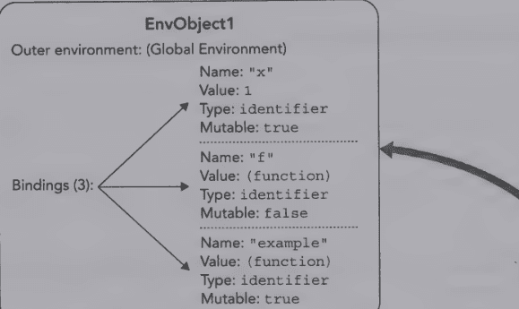
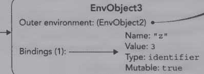
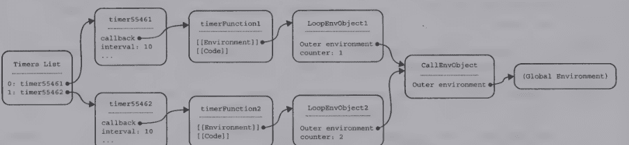
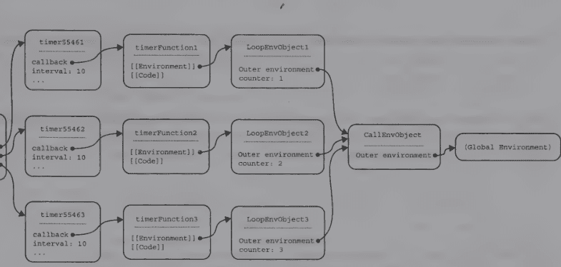
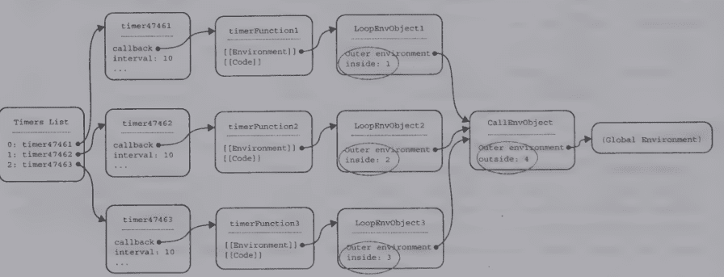
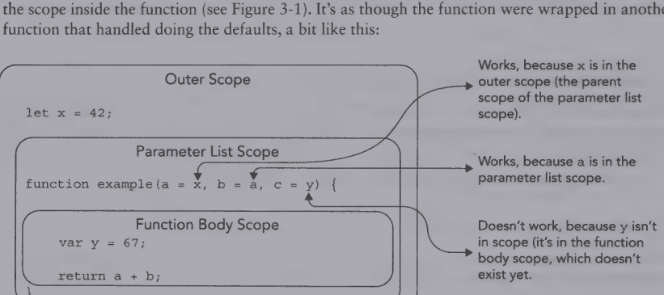
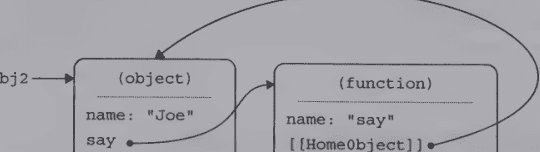
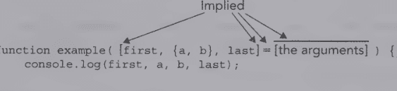

# JavaScript：新玩具


T.J. Crowder

JavaScript 自 1995 年诞生以来已经经历了巨大的演变。它最初作为一种用于浏览器的简单脚本语言，如今已成为强大且多功能的语言，驱动着现代 Web 应用。在本书中，我们将探索 JavaScript 的最新特性和技术，以及如何使用它们来构建稳健且可扩展的 Web 应用。

Web 世界正在不断变化。新的框架和库层出不穷，最佳实践也在不断演进。对于开发者来说，跟上 JavaScript 最新进展至关重要。本书旨在帮助你处于潮流前沿。

在第一章中，我们将回顾 JavaScript 的基础。我们将涵盖变量、数据类型、操作符和函数。然后，我们将转向更高级的主题，如面向对象编程、异步编程和函数式编程。


# 关于作者

感谢 Wendy 和 James，在深夜和周末给予无私的支持和爱心的鼓励。

作者在行业内活跃了三十多年，帮助公司初创、扩大规模并上市。作为该领域最受尊敬的声音之一，他编写了许多关于软件架构、设计和领导力的著作，以及如何构建优秀团队和平衡工作与生活。

他在加利福尼亚获得博士学位，在开始为各类 500 强公司咨询之前，在那里进行了多年的教学和研究。他多年来指导了一代工程师和领导者，并在全球范围内进行演讲。他写了关于行业过去、现在和未来的各种内容。在职业生涯中，他见证了技术的多次变革，从桌面到移动，从本地到云端，并开发并构建了包括最早浏览器在内的各种产品。

目前，他担任临时首席技术官（CTO），与公司进行短期合作，精炼并扩展其增长策略。他还在参与更多项目，包括软件设计、SQL、Jira 以及架构咨询。

从那时起，他通过各种公司和组织建立了世界级的职业生涯，与各类公司合作、指导后辈并写作。他对社区的奉献使他获得了许多奖项和荣誉，并取得了许多成功的职业。

他出生于美国，现在与妻子住在加利福尼亚的岸边。

# 古代最早玩具

古代人类为他们的孩子制作玩具。

我们目前还不知道最早的玩具是什么样的。

考古学家认为，玩具是由骨头、木头、石头和粘土制成的。

其中许多玩具被制成动物或人形的形状。

有些玩具甚至有轮子并且可以移动。

古代玩具还包括娃娃、球和陀螺。

这些玩具在孩子的成长过程中起着重要作用。

在随后的时代里，玩具变得更加复杂和多样化。

现在的玩具是由塑料和金属等各种材料制成的。

现代玩具的设计旨在激发想象力和创造力。

玩具的历史为我们窥视人类文化提供了一个迷人的视角。

# 关于作者

**T.J. CROWDER** 是一位拥有 30 年专业经验的软件工程师，其中至少一半的时间在从事 JavaScript。他经营着 Farsight Software，这是一家英国的软件咨询和产品公司。作为 Stack Overflow 的前 10 位贡献者之一以及 JavaScript 标签的核心贡献者，他喜欢运用所学知识帮助他人应对他们面临的技术挑战，重点不在于传授知识，而在于帮助解决问题的过程。

T.J. 在加利福尼亚的青少年早期开始编程，在 `Apple II` 以及 `Sinclair ZX-80` 和 `-81` 上使用 `BASIC` 和汇编语言。多年后，他获得了第一份正式的计算机工作，在一家为法院记录员提供 PC (DOS) 产品的公司担任技术支持职位。在开发部门接纳他并在随后几年里给予他机会、资源和责任成长为一名程序员，并最终成为他们的首席工程师，创建了包括他们的第一个 Windows 产品在内的各种产品。在支持工作期间，他在办公室里自学了 `TurboC` 手册，逆向工程了未记录的压缩二进制文件格式，并利用这些知识在空闲时间创建了一个深受需求的功能。

在下一家公司，他承担了专业服务和开发者教育角色，为客户现场定制公司的企业级产品（使用 `VB6`、`JavaScript` 和 `HTML`），并为客户开发者教授培训课程；最终，他开始编写培训课程了。从美国搬到伦敦让他回到了纯开发岗位，在那里他能够提升自己的软件设计、SQL、Java 和 JavaScript 技能，然后转向了独立承包。

从那时起，由于各种原因，他主要为各种公司和机构（包括一个北约机构、英国地方政府当局和多家私营公司）从事闭源远程工作，主要使用 `JavaScript`、`SQL`、`C#` 和（最近的）`TypeScript`。对社区的渴望最初让他加入了当年的 `PrototypeJS` 邮件列表，然后是 `Stack Overflow`，现在是各种平台。

出生于英国和美国，在美国长大，T.J. 住在英中部的一个村庄，与妻子和儿子在一起。

敏捷的棕色狐狸...

Lorem ipsum dolor sit amet, consectetur adipiscing elit. Sed do eiusmod tempor incididunt ut labore et dolore magna aliqua. Ut enim ad minim veniam, quis nostrud exercitation ullamco nisi ut aliquip ex ea commodo consequat. Duis aute irure dolor in reprehenderit in voluptate velit esse cillum dolore eu fugiat nulla pariatur. Excepteur sint occaecat cupidatat non proident, sunt in culpa qui officia deserunt mollit anim id est laborum.

Dabitur pretium, nulla. Nulla gravida orci a. Nullam sollicus, turpis et dapibus ultices, turpis risus bibendum luctus, a varius turpis, nec felis odio, risus in luctus, in mauris eu, nibh euismod, dapibus a quam.

# 关于技术编辑

**CHAIM KRAUSE** 是一位专家计算机程序员，拥有超过三十年的经验来证明这一点。他早在 1995 年就担任 ISP 的首席技术支持工程师，在 Borland 担任 Delphi 的高级开发支持工程师，并在硅谷工作了十多年，担任过多种角色，包括技术支持工程师和开发者支持工程师。他目前是美国陆军指挥参谋学院的军事模拟专家，负责开发用于训练演习的严肃游戏等项目。他目前致力于为美国军方的课程。

Duis aute irure dolor in reprehenderit in voluptate velit esse cillum dolore eu fugiat nulla pariatur.

# 关于技术校对

**MARCIA WILBUR** 是一位经验丰富的技术校对员。她拥有计算机科学、通信和技术学位。作为 User Group 的主席，她专注于 IoT（物联网）领域。

# 致谢

“我写了这本书”几乎是不准确的。

Duis aute irure dolor in reprehenderit in voluptate velit esse cillum dolore eu fugiat nulla pariatur.

- 使用生成器消耗值
- `return` 和 `throw` 方法：终止一个...
- 在不使用 `arguments` 时，对回调函数使用箭头函数
- 当调用者需要控制 `this` 的值时不要使用箭头函数
- 使用剩余参数代替 `arguments`
- 对象解构 166
- 循环中的解构 175
- 仅在对象时使用解构 179
- Promise 基础 182

# 旧习立新 219

- 使用 Promise 代替成功失败回调 219

# 第 9 章：异步函数、迭代器与生成器 221

## async 函数 222

- `async` 函数创建 Promise 224
- `await` 消耗 Promise 225
- 当使用 `await` 时标准逻辑是异步的 225
- 拒绝是异常，异常是拒绝；履行 227
- 结果是返回是解析 227
- `async` 函数中的并行操作 229
- 不需要 `return await` 230
- 陷阱：在意外之处使用 `async` 函数 231

### 基础用法 279

### 值转换细节 280

### ArrayBuffer：类型数组使用的存储器 282

### 字节序 (Endianness) 284

### DataView：对缓冲区的原始访问 286

- 解析时使用 Sticky 标记 (`y`) 代替创建字符串 413
- 使用命名捕获组代替匿名组 414
- 此处有龙！ 418
- 共享内存基础 420
- 竞态条件、无序存储、过时值 427
- 撕裂 (Tearing) 以及更多 429
- Atoms 对象 432
- 使用 Atoms 挂起和恢复线程 334
- 此处有龙！（再次） 460
- 空值合并 475
- 可选 catch 绑定 478
- 通过 `JSON.stringify` 生成良好的 JSON 479
- `Symbol.hasInstance` 479
- 正则表达式微调 483
- 控制字符转义 (`\cX`) 扩展 483
- `RegExp.prototype.compile` 484
- 各种松散或晦涩语法 486

本书适用于任何想要快速掌握过去几年 JavaScript 中添加的最新特性的 JavaScript（或 TypeScript）程序员，也适用于想要了解在语言不断演进和增长的过程中如何保持精通的人。只要你找得足够仔细，并且对你信任的网站保持谨慎态度，你几乎可以在互联网的某个地方找到书中的大部分信息；本书在一个地方提供了所有的技术细节，并向你展示了如何跟踪不断更新的变更。你可以通过本书的网站 `https://thentoys.dev` 保持更新，我那里将继续对新增的新特性进行介绍。

以下是每章内容的简介：

- **第 1 章：ES2015-ES2020 及后续中的新特性** —— 从介绍 JavaScript 世界的参与者和一些重要术语开始。然后描述了就本书而言的“新特性”的定义；涵盖了添加到 JavaScript 的新特性、该过程是如何管理的以及由谁管理；并解释了如何关注和参与这一过程。最后介绍了一些在旧环境中使用新特性（或在当前环境中使用最新特性）的工具。

- **第 2 章：块级作用域声明：let 和 const** —— 涵盖了新的声明关键字 `let` 和 `const` 以及它们支持的新作用域概念，包括对循环中作用域的深度覆盖，特别是 for 循环中的新处理方式。

- **第 3 章：新函数特性** —— 涵盖了与函数相关的各种新特性：箭头函数、默认参数值、剩余参数、`name` 属性以及各种语法改进。

- **第 4 章：类** —— 涵盖了新的类特性：基础、它是什么以及不是什么、子类、`super`、内置实例（如 `Array` 和 `Error`）以及新的 `target` 特性。第 4 章将正在提案阶段的私有字段等特性留到了第 18 章。

- **第 5 章：新对象特性** —— 涵盖了计算属性名、简写属性、获取和设置对象的原型、新的 `Symbol` 类型以及它如何与对象的关系、方法语法、属性顺序、展开语法以及一系列新对象函数。

- **第 6 章：迭代器、迭代器、for-of、可迭代展开、生成器** —— 涵盖了迭代（一种用于集合和列表的强大新工具）以及生成器（一种与函数交互的强大新方式）。

- **第 7 章：解构** —— 涵盖了这一重要的新语法，以及如何从对象、数组和其他迭代器中提取数据，带有默认值、深度取值等。

- **第 8 章：Promises** —— 深入研究这一处理异步过程的重要新工具。

- **第 9 章：异步函数、迭代器和生成器** —— 详细介绍了新的 `async/await` 语法，让你能够使用熟悉的流结构来处理异步代码，以及异步迭代器和生成器的工作原理，以及新的 `for-await-of` 循环。

- **第 10 章：模板、标签函数和新字符串特性** —— 描述了模板语法、标签函数以及许多新字符串特性，如更好的 Unicode 支持、常用方法的更新以及许多新方法。

- **第 11 章：新数组、类型化数组** —— 涵盖了广泛的新数组方法、各种其他数组类型、作为 `Int32Array` 的类型化数组，以及与类型化数据交互的高级特性。

- **第 12 章：Maps 和 Sets** —— 教你所有关于新的键值集合 `Map` 和 `Set`，以及它们所有的“弱”引用 `WeakMap` 和 `WeakSet`。

- **第 13 章：模块** —— 深入研究这种令人兴奋且强大的代码组织方式。

- **第 14 章：反射 Reflect 与 代理 Proxy** —— 涵盖了 Reflection 和 Proxy 对象的强大动态元编程特性以及它们是如何相互相关的。

- **第 15 章：正则表达式更新** —— 描述了过去几年中对正则表达式进行的所有更新，如新标志、命名捕获组、后行引用断言和 Unicode 特性。

- **第 16 章：共享内存** —— 涵盖了 JavaScript 程序中跨线程共享内存这一复杂且潜在困难的领域，涵盖 `SharedArrayBuffer` 和 `Atomics` 对象，以及基础概念和陷阱注意事项。

- **第 17 章：杂项** —— 涵盖了许多无法归入其他章节的内容：`BigInt`、新的整数字面量（二进制、八进制）、可选链、新方法、幂运算符、`Math` 对象的各种添加、尾调用优化、空值合并、可选链以及为了兼容性考虑而定义的“Annex B”（仅限浏览器）特性。

- **第 18 章：即将推出的类特性** —— 带我们稍微进入未来，描述了尚未完成但已处于很后期阶段的类增强：公有字段声明、私有字段和私有方法。

- **第 19 章：展望** —— 以展望目前正在流水线中的进一步特性结束：顶层 `await`、`WeakRefs` 与清理回调、正则匹配索引、`Atomics.asyncAwait`、几个新的语法特性、正则特性以及即将推出的标准库扩展。

- **附录：惊艳特性以及在哪里找到它们** —— （向 J.K. Rowling 致歉）提供了列表并告知你哪些章节涵盖了它们。列表为：字母顺序、基础知识、关键字、运算符、循环、以及杂项。

第 16 章是一个比较特殊的情况：它是关于线程之间内存共享的。大多数 JavaScript 程序员并不需要在线程之间共享内存。由于你们中的某些人可能需要，这就是为什么会有第 16 章的原因，但大多数人不需要。如果你属于后一类，只需把这个事实记在心里即可：如果你认为在未来的某个时刻你可能需要共享内存，可以回来在第 16 章学习它。这完全没问题。

除此之外：运行示例代码，对它们进行实验，最重要的是要享受其中。

# 如何联系作者

我非常乐意听到你的反馈。请随时与我联系：

- 如果你认为发现了错误，请写邮件至 `errata@wiley.com`。
- 你可以在 `https://thenew-toys.dev/bookcode` 或 `https://www.wiley.com/go/javascript-newtoys` 下载示例和代码列表。
- 你可以在 `https://thenew-toys.dev` 上向我提问并/或与其他读者交流。
- 你可以在 Twitter 上通过 `@tjcrowder` 找到我。
- 我通常活跃在 `https://stackoverflow.com` 的 JavaScript 标签下。

本章包含哪些内容？

JavaScript 在过去几年里发生了巨大的变化。

如果你是 2000 年代活跃的 JavaScript 开发者，那么在很长一段时间内，你可能会认为 JavaScript 已经停滞不前。在 1999 年 12 月发布第 3 版规范后，开发者们足足等了 10 年才等到下一个版本的规范。从表面上看，似乎什么都没有发生。但实际上，大量工作正在进行；这些工作不仅仅是进入了官方规范和多个 JavaScript 引擎。我们本可以（但不会）花一整章——甚至一整本书——来讨论处于 JavaScript 关键地位的各个小组在做什么，以及他们如何在一段时间内无法对共同路径达成共识。关键在于，他们最终在 2008 年 7 月于奥斯陆的一次具有决定性的会议上，经过大量的预谈判，对发展道路达成了一致。这种共识被 Brendan Eich（JavaScript 的创造者）后来称为“Harmony”（和谐），它为 2009 年 12 月的第 5 版规范（第 4 版从未完成）铺平了道路，并为持续的进步奠定了基础。

在本章中，你将对新特性进行概述（书的其他部分将进行详细介绍）。你将了解到谁负责推动 JavaScript 的发展，现在使用什么流程来实现这一目标，以及你如何跟踪即将推出的特性并在如果你愿意的话参与其中。你将了解到今天编写现代 JavaScript 时可以使用的工具，即使你必须针对尚未跟进的环境。

为了讨论 JavaScript 的发展状况，我们需要定义一些名称和常用术语。

我们所想的“JavaScript”由 Ecma International（欧洲电子工业协会）标准化为“ECMAScript”，这是一个负责多个计算标准的组织。ECMAScript 标准即为 ECMA-262。负责该标准的人是 Ecma International 技术委员会 TC39（“TC39”）的成员，他们负责“通用、跨平台、厂商中立编程语言 ECMAScript 的标准化。这包括语言的语法、语义，以及支持该语言的库和补充技术。”他们还管理其他标准，例如 JSON 语法规范（ECMA-404），以及值得关注的 ECMAScript 国际 API 规范（ECMA-402）。

本书和日常用法中，JavaScript 就是 ECMAScript，反之亦然。在某些时期，特别是在不同小组做不同事情的十年里，“JavaScript”特指 Mozilla 正在开发的语言（它具有几个功能从未进入 ECMAScript，或者在进入之前发生了显著变化），但自从 Harmony 之后，这种用法已越来越过时。

拥有所有这些不同的缩写可能会令人困惑，尤其是有些带有版本号，而另一些带有年份。这个解释说明了它们是什么以及为什么会有两种分类。

直到第 5 版，TC39 通过版本号指代规范版本。第 5 版规范的完整标题是：

> ¹ 以前称为欧洲计算机制造商协会（ECMA），但现在该组织名称中只有 Ecma 的 E 是大写的。
> ² http://www.ecma-international.org/memento/tc39.htm

由于“ECMAScript 第 5 版”读起来有点有点绕口，所以说“ES5”是很自然的事情。从 2015 年的第 6 版开始，TC39 采用了持续改进流程，使规范成为带有年度快照的活动编辑草稿。（更多内容见本章稍后部分）。当他们这样做时：

- `class`：极其简单、声明式的语法，用于创建构造函数和原型对象，同时保留了 JavaScript 原生的原型链。
- 异步编程改进：Promises、`async` 函数和 `await`；这些显著减少了“回调地狱”。
- 对象字面量改进：计算属性名、简写属性、方法语法、作为属性定义的尾随逗号。
- 模板字符串字面量：一种创建带有动态内容字符串的简单声明式方式，并可以通过标签函数超越字符串的限制。
- 类型数组：用于原生 API（及更多）的低级数组。
- 共享内存：在 JavaScript 线程之间真正共享内存的能力（包括线程间协调的原始语）。
- Unicode 字符串改进：Unicode 代码点转义序列；支持访问代码点而非代码单元。
- 正则表达式改进：后行查找断言、命名捕获组；索引；Unicode 属性转义；Unicode 不区分大小写。
- Maps：键/值对集合，其键类型不需要是字符串。
- Sets：具有良好定义语义的唯一值集合。
- `WeakMap`、`WeakSet` 和 `WeakRef`：用于仅持有对象弱引用的内置类型（允许它们被垃圾回收）。
- 标准库新增：`Object`、`Array`、`Array.prototype`、`String`、`String.prototype`、`Math` 等其他新方法。
- 支持动态元编程：`Proxy` 和 `Reflect`。
- `Symbols`：保证唯一的数值（特别对于唯一的属性名非常有用）。
- `BigInt`：任意精度整数。
- 许多许多其他。

所有这些新特性，特别是新语法，可能会让人目不应接。别担心！

在你准备好并有需求之前，没有必要采纳新特性。TC39 遵循的核心原则之一是“不破坏 Web”。这意味着 JavaScript 必须保持“Web 兼容”——即与当今世界上存在的代码兼容。

如果你需要某个新特性，或者你不喜欢某个新特性，你就不必使用它。你处理该特性功能的旧方法将一直有效。但在许多情况下，你可能会发现新特性具有令人信服的理由，特别是新语法特性：让使用和理解变得更简单、更不容易出错，或者（在 `Proxy`、`WeakMap`/`WeakSet`、共享内存等情况下）使它们能够实现大多数功能在没有它们的情况下无法完成的任务。

由于空间原因，本书仅涵盖 JavaScript 规范本身（ECMA-262）中的新玩物。ECMAScript 国际化 API 规范以及 ECMA-402 中也有令人兴奋的新玩物，非常值得阅读。你可以在本书的网站 `https://thenewtoys.dev/internationalization` 上找到这部分的介绍。

在本节中，你将学习谁负责推动 JavaScript 的发展，他们使用什么过程来实现，以及如何遵循并参与该过程。

你之前已经了解到，国际电子标准组织（Ecma International）的技术委员会 39（TC39）负责创建和发布 ECMAScript 标准的更新规范。该委员会由 JavaScript 开发者、框架作者、大型网站作者/维护者、编程语言研究人员以及各个领域的代表组成。

这就是提议成为 JavaScript 一部分的流程。但并非所有更改都是提议。较小的更改可以通过 TC39 会议上基于规范的 pull request 达成共识来实现。例如，`Date.prototype.toString` 在 ES2017 和 ES2018 之间的输出结果（见第 17 章）是对某个 pull request 达成共识的结果，而不是分阶段的提议。通常，这些编辑更改，或者对 JavaScript 引擎需要执行但未在规范中的现实的更改，或者规范规定要执行但被 TC39 认为既符合理想又“Web 兼容性”（不会破坏大量现有代码）的更改都会达成共识，例如 ES2019 中 `Array.prototype.sort` 变为稳定排序（见第 11 章）。如果你想知道更改是如何通过这种方式被考虑或实现的，请关注 `https://github.com/tc39/ecma262` 仓库中的“consensus”（共识）标签（同样，针对 ECMA-402 更改的 `https://github.com/tc39/ecma402` 仓库也是如此）。要找到已完成的更改，请查看“has consensus”、“editorial change”和/或“normative change”（规范性更改）标签。在某些情况下，这些“需要共识”的更改可能会有一个更正式的流程，但目前这就是关注它们的方法。

如果你看到感兴趣的提议并想要参与，应该什么时候这样做呢？参与的形式应该是怎样的？

其中关键的一点是：一旦提议达到第 3 阶段，通常只考虑基于实现经验的更改。参与的最佳时机是第 0、1 和 2 阶段。在这些阶段，你可以根据自己的经验提供见解，帮助定义语义，使用 Babel 等工具（你将在稍后的章节中学习）尝试所提议的内容等。并不是说你无法在第 3 阶段的提议中找到有用的角色（有时会有任务需要敲定规范文本或帮助编写开发者文档），只需注意，在第 3 阶段建议更改通常是不必要的，除非你是 JavaScript 引擎中实现它的人之一，并且你遇到了问题。

¹15 https://github.com/tc39/test262

所以：你找到了一个想要参与的提议；现在该怎么办？取决于你，但这里有一些建议：

- **做你的研究。** 仔细、仔细地阅读提议的说明文件（从 TC39 提议列表链接到的 README.md）和其他文档。如果它们提到了先有技术（art，例如另一种语言中的类似功能），那么阅读先有技术是有帮助的。如果有任何规范文本，请阅读它。（本指南在此处可能有所帮助：`https://timothy.me/es-how-to/`）你想要确保你提供的输入是有充分根据的。

- **尝试一下该功能！** 即使你无法使用它，你也可以编写推测性代码（你无法运行但可以思考的代码），看看该提议在多大程度上解决了它想要解决的问题。如果有对应的 Babel 插件，尝试编写并运行代码。观察该功能对你是如何起作用，并提供反馈。

- **寻找你可以帮助的方法。** 除了建议和反馈外，还有许多帮助提议的方法。例如，你可以寻找那些已经对如何做什么达成共识但没有人时间去做的 issue（研究先有技术、更新规范文本）。如果你擅长这些工作，就可以进行那些更新。你可以通过在 GitHub 上讨论贡献来与提议作者协调。在参与时，请尊重所有人，保持友好、包容和体贴。谨慎选择你使用的词汇。通过展示合作精神比显得轻视或阻碍更有影响力。请注意，TC39 的会议和用于开发提议的在线空间受行为准则约束。请参考 TC39 的行为准则（链接文档）。

你不需要跟上所有的新玩具。正如我提到的，大多数事情都会消失。但如果你正在阅读这本书，可能会让你感到惊讶的一点是，该流程在这些功能被添加到规范之前就保证了它们进入现实世界。相比之下，当 ES5 在 2009 年发布时，这种做法并不存在。如何跟上那些尚未进入规范、但 JavaScript 引擎已经开始支持的特性呢？这里有一些方法：

一旦你安装了它们：

```bash
npm init
```

并按回车。npm 会向你提出一系列问题；你可以根据喜意回答这些问题（或者在回答所有问题时都直接按回车）。完成后，它将为你的示例目录写入 `package.json`。

4. 接下来，安装 Babel。（以下步骤来自访问 `https://babeljs.io/docs/setup/#installation` 并点击 CLI 按钮；你可能想检查那里是否有更新。）输入：

```bash
npm install --save-dev @babel/core @babel/cli
```

并按回车。npm 将下载并安装 Babel、其命令行界面以及所有的依赖项。（你可能会收到与名为 `events` 的模块相关的警告和或一些弃用警告；没关系）。

5. 在此时，你可以开始通过直接调用来使用 Babel，但让我们通过在 `package.json` 中添加一个 npm 脚本条目让它变得简单。用你喜欢的编辑器打开 `package.json`。如果没有顶层 `scripts` 条目，请创建一个（但当前版本的 npm 会包含一个带有显示错误的 `test` 条目）。在 `scripts` 条目中，添加此设置：

```json
"build": "babel src -d lib"
```

现在你的 `package.json` 应该看起来像列表 I-1 一样。（你的 `scripts` 中可能仍然有一个 `test` 条目；没关系。它也可能有不同的许可证，我总是将默认值改为 MIT）。确保保存文件。

列表 1-1：示例 package.json—package.json

```json
{
  "name": "example",
  "version": "1.0.0",
  "description": "",
  "main": "index.js",
  "scripts": {
    "build": "babel src -d lib"
  },
  "author": "",
  "license": "MIT",
  "devDependencies": {
    "@babel/cli": "^7.2.3",
    "@babel/core": "^7.2.2"
  }
}
```

6. Babel 是高度模块化的。尽管我们安装了它，但我们还没有告诉它执行任何操作。对于这个示例，我们将使用一个预设（preset）来告诉它将 ES2015 代码转换为 ES5 代码，通过安装和配置该预设。要安装该预设，输入：

```bash
npm install --save-dev babel-preset-env
```

并按回车。在下一步中我们将对其进行配置。

7. 现在，我们需要为 Babel 创建一个配置文件 `.babelrc`（注意开头的点）。创建包含以下内容的文件（或使用章节下载中的文件）：

```json
{
  "presets": [
    "env",
    "targets": {
      "ie": "11"
    }
  ]
}
```

该配置告诉 Babel 使用它的 `env` 预设，Babel 文档将其描述为“……一个允许你使用最新的 JavaScript 而无需微操语法转换的预设……由你的目标环境满足”。在此配置中，设置目标 `"ie": "11"` 告诉预设你的目标是 IE11，这对于接下来的示例是合适的。对于实际使用，你可能需要查看 `env` 预设² 和/或你可能需要的其他预设或插件的文档。

这就是本示例的 Babel 设置。现在让我们创建一些代码供它编译。在你的示例目录下创建一个名为 `src` 的子目录，并在其中创建一个名为 `index.js` 的文件，内容见列表 1-2。（在过程结束时，我将向你展示文件应该是什么样子的列表，所以如果你稍有不确定，不必太担心；只需创建文件，如果它最终落在了错误的地方，再移动它即可。）

# 列表 1-2：ES2015 转换示例输入—index.js

```javascript
var obj = {
  rex: /d/,
  checkArray: function(array) {
    return array.some(entry => this.rex.test(entry));
  }
};
console.log(obj.checkArray(["no", "digits", "in", "this", "array"])); // false
console.log(obj.checkArray(["this", "array", "has", "1", "digit"])); // true
```

> ² https://babeljs.io/docs/en/babel-preset-env#docsNav

列表 1-2 中的代码使用了一处 ES2015+ 特性：箭头函数，即 `some` 调用内部的 `entry => this.rex.test(entry)`，我在代码中高亮了它。（是的，那确实是一个函数。）你将在第 3 章中学习箭头函数。简短且不完整的版本是：它们提供了一个定义函数的副本（如你所见），并且它们像闭包变量一样闭包了 `this`（而不是通过它们被调用的方式来设置 `this`）。当调用 `obj.checkArray(...)` 时，回调函数中的 `this` 即使在 `some` 回调内部也指向 `obj`，因此它指向 `obj` 上的 `rex` 属性。如果回调是传统函数，情况就不同了。

此时，你的示例目录应该包含：

```text
example/
node_modules/
src/
.babelrc
package.json
package-lock.json
```

列表 1-2 中的代码使用了一处 ES2015+ 特性：箭头函数，即 `some` 调用内部的 `entry => this.rex.test(entry)`，我在代码中高亮了它。（是的，那确实是一个函数。）你将在第 3 章中学习箭头函数。简短且不完整的版本是：它们提供了一个定义函数的副本（如你所见），并且它们像闭包变量一样闭包了 `this`（而不是通过它们被调用的方式来设置 `this`）。当调用 `obj.checkArray(...)` 时，回调函数中的 `this` 即使在 `some` 回调内部也指向 `obj`，因此它指向 `obj` 上的 `rex` 属性。如果回调是传统函数，情况就不同了。

# 第 2 章 块作用域声明：let 和 const

## 本章包含内容

- let 和 const 简介
- 带示例的“块作用域”定义
- 变量屏蔽与提升：暂时性死区
- 对不应改变的变量使用 const
- 创建不在全局对象上的全局变量
- 在循环中使用块作用域

## 本章代码下载

你可以在 `https://thenewtoys.dev/bookcode` 或 `https://www.wiley.com/go/javascript-newtoys` 下载本章的代码。

在本章中，你将学习新的 `let` 和 `const` 声明是如何工作的，以及它们解决了哪些问题。在整个章节中，你将看到 `var` 的某些证明存在问题的行为，并将学习 let 和 const 如何解决这些问题。你将看到 let 和 const 如何提供真正的块级变量，并防止由重复声明或在初始化变量之前使用变量引起的混乱。你将发现块作用域意味着你可以使用 `let` 来避免可以避免的“循环闭包”问题，以及 `const` 如何让你创建常量：值不能改变的变量。你将学习 `let` 和 `const` 如何避免在已经负担过重的全局对象上添加更多属性。简而言之，你将了解为什么 `let` 和 `const` 是新的 `var`，以及为什么 `var` 在现代 JavaScript 编程中不再有一席。

## let 和 const 简介

和 `var` 一样，`let` 声明变量：

```javascript
let x = 2;
x += 40;
console.log(x); // 42
```

你可以在任何可以使用 `var` 的地方使用 `let`。就像 `var` 一样，你不需要对 `let` 使用初始化器；如果你这样做，变量的值将默认为 `undefined`：

```javascript
let a;
console.log(a); // undefined
```

`let` 和 `var` 相似之处就此结束。正如你在本章中所学的，除了这些基本的相似之处，`var` 和 `let` 的行为非常不同。稍后详细介绍；让我们来看看 `const`。

`const` 声明值：

```javascript
const value = Math.random();
console.log(value < 0.5 ? "Heads" : "Tails");
```

常量类似于变量，不同之处值不能改变。正如此，你需要提供一个初始化器；`const` 没有默认值。除了创建常量而非变量以及要求初始化器外，`const` 和 `let` 一样。它比你预期的要有用得多，正如你在本章中看到的那样。

## 真正的块作用域

`var` 会跳出块。如果你在块内部使用 `var` 声明变量，它不仅在那个块内具有作用域，而且在块之外也是：

```javascript
function jumpOut() {
  var a = [1, 2, 3];
  for (var i = 0; i < a.length; i++) {
    var value = a[i];
    console.log(value);
  }
  console.log("Outside loop " + value); // 为什么我们在这里可以使用 'value'？
}
jumpOut();
```

`jumpOut` 的作者可能并不是想让 `value` 在循环外部访问，但它确实可以（`i` 也是）。为什么这是一个问题？有两个原因。首先，出于维护性的考虑，变量的作用域应该尽可能窄；它们的生命周期应该只和你需要的那么长，不再延长。其次，当代码的表面意图与其实际效果不符时，你就是在招揽 Bug 和维护问题。

## 重复声明是一个错误

`let` 和 `const` 通过具有真正的块作用域解决了这个问题；它们只存在于声明它们的块内部。这里有一个关于 `let` 的示例：

```javascript
function stayContained() {
  var a = [1, 2, 3];
  for (var i = 0; i < a.length; i++) {
    let value = a[i];
    console.log(value);
  }
  console.log("Outside loop" + value); // ReferenceError: 'value' is not defined
}
stayContained();
```

现在，`value` 的作用域限制在它所在的块。它在函数的其余部分不存在。它只在需要时存在，且表面意图与实际效果相符。

## 提升与暂时性死区

`var` 声明是著名的提升的。使用 `var`，你可以在声明变量之前使用它：

```javascript
function example() {
  console.log(answer);
  answer = 42;
  console.log(answer);
  var answer = 67;
}
```

当你运行 `example` 时，输出如下内容：

```
undefined
42
```

这是因为在进入 `example` 函数时，JavaScript 引擎扫描所有的 `var` 声明，并在开始执行步进执行代码之前创建必要的变量；它将声明“提升”到函数的顶部。当它这样做时，会将声明的变量初始化为 `undefined` 默认值。再次，代码的意图与其实际效果不同步，这可能意味着这里有一个 Bug。看起来第一行试图给一个位于包含作用域中（甚至是全局）的 `answer` 变量赋值，但它的初始值应该是 67。

使用 `let` 和 `const`，你无法在代码步进执行处理其声明之前使用变量：

```javascript
function boringOldLinearTime() {
  answer = 42; // ReferenceError: 'answer' is not defined
  console.log(answer);
  let answer;
}
boringOldLinearTime();
```

考虑之前的观察结果，代码可能正尝试给包含作用域中的一个答案赋值。让我们来看这种情况：

```javascript
let answer; // 外部的 'answer'
function hoisting() {
  answer = 42; // ReferenceError: 'answer' is not defined
  console.log(answer); // 内部的 'answer'
  let answer;
}
hoisting();
```

如果内部的 `answer` 直到最后的 `let answer;` 语句之前不存在，那么在函数开头 `answer = 42;` 所在的那行，难道不是在赋值给外部的 `answer` 吗？

是的，它可以设计成那样；但那样会有多困惑？在作用域早期使用一个标识表示某物，而在作用域后期表示另一个物，这极易产生 Bug。

相反，`let` 和 `const` 使用了一个被称为“暂时性死区”（Temporal Dead Zone, TDZ）的概念，这是代码执行期间的一段时间，在此期间该标识完全无法被使用，即使是引用包含作用域中的内容也不行。就像 `var` 一样，JavaScript 引擎在开始逐步执行代码之前，会遍历代码寻找 `let` 和 `const` 声明。但引擎并没有让 `answer` 可用并赋予它 `undefined` 值，而是将 `answer` 标记为“尚未初始化”：

```javascript
let answer; // 外部的 'answer'
function notInitializedYet() { // 在这里留 'answer'
  answer = 42; // ReferenceError: 'answer' is not defined
  console.log(answer); // 内部的 'answer'
  let answer;
}
notInitializedYet();
```

TDZ 开始于执行进入声明出现的作用域，并一直持续到声明运行（以及与之关联的任何初始化器运行）。在这个例子中，内部的 `answer` 在 `notInitializedYet` 开始时被预留（这是 TDZ 开始的地方），并在声明所在处被初始化（这是 TDZ 结束的地方）。因此，`let` 和 `const` 仍然被提升了，只是它们被提升的方式与 `var` 不同。

理解 TDZ 是时间上的（相对于时间），而不是空间上的（相对于空间/位置），这非常重要。它不是作用域顶部某个无法使用标识符的区域，而是代码执行期间的一段时间。

## 列表 2-1：TDZ 的时间特性的示例—tdz-is-temporal.js

```javascript
function temporalExample() {
  const f = () => {
    console.log(value);
  };
  let value = 42;
  f();
}
temporalExample();
```

如果 TDZ 是空间上的，如果它是 `temporalExample` 顶部的一个代码块导致 `value` 无法使用，那么这段代码将无法工作。但 TDZ 是时间上的，当 `f` 使用 `value` 的时候，声明已经运行过了，所以没有问题。如果你交换函数的最后两行，将 `f();` 行移动到 `let value = 42;` 行之前，那么它就会失败，因为 `f` 会尝试在 `value` 初始化之前使用它。（试一试！）

TDZ 对块的适用范围与它对函数的适用范围一样：

```javascript
function blockExample(str) {
  let p = "prefix"; // 外部 'p' 声明
  if (str) {
    p = p.toUpperCase(); // ReferenceError: 'p' is not defined
    str = str.toUpperCase();
    let p = str.indexOf("X"); // 内部 'p' 声明
    if (p != -1) {
      str = str.substring(0, 0);
    }
  }
  return p + str;
}
```

你不能在块内部的第一行使用 `p`，尽管它在函数中已经声明，但因为有一个遮蔽声明夺取了 `p` 标识符的所有权。因此，标识符只能引用内部的 `p`，并且只有在 `let` 声明运行之后才能引用。这防止了关于 `p` 代码在使用什么样的困惑。

## 一种新的全局变量

当你在全局作用域使用 `var` 时，它会创建一个全局变量。在 ES5 及更早版本中，所有全局变量也是全局对象的属性。但这种情况在 ES2015 中发生了变化：使用 `var` 创建的新 JavaScript 传统全局变量（也是全局对象的属性）以及新式的全局变量（不是全局对象的属性）。全局作用域下的 `let` 和 `const` 创建了这种新的全局变量。

### 访问全局对象

你会记得有一个全局对象，你可以在全局作用域通过 `this` 访问它，或者使用环境为它定义的全局（如果有的话），例如浏览器上的 `window` 或 `self`，或者 Node.js 上的 `global`。（在某些环境中，如浏览器，它并不是真正的全局对象，而是全局对象的门面，但已经足够了。）

这是一个使用 `var` 创建既是全局变量又是全局对象属性的示例；注意你必须在全局作用域运行它（如果你使用 Node.js 或 jsfiddle.net，请记住确保你在第 1 章描述的全局作用域中工作，而不是模块作用域或函数作用域）。

```javascript
var answer = 42;
console.log("answer = " + answer);
console.log("this.answer = " + this.answer);
console.log("this.has property? " + (("answer" in this));
```

当你运行它时，你会看到：

```
answer = 42
this.answer = undefined
```

## 列表 2-2: ES5 版本的 div 更新—element-loop-es5.js

```javascript
var list, n, element, text;
list = document.querySelectorAll("div.foo");
for (n = 0; n < list.length; n++) {
  element = list[n];
  text = element.classList.contains("bar") ? "bar" : "[not bar]";
  element.appendChild(document.createTextNode(text));
}
```

这段代码中有四个变量。如果你仔细观察，会发现其中一个与另外三个不同。你能看出区别之处所在吗？

其中一个的值永远不会改变：`list`。其他的（`n`、`element` 和 `text`）实际上是变量，但 `list` 是一个常量。

在介绍另外几个关于 `const` 的方面之后，我们会回到这段代码。在此期间，请先在脑中考虑，根据你目前所掌握的知识，你可能会如何将 `const` 应用到这段代码中（且不删除任何标识符）。

## const 引用的对象仍然是可变的

需要记住这一点是：不能通过常量来改变常量的值。如果该值是一个对象引用，这并不意味着该对象在任何方面都是不可变的（即其状态不能被改变）；该对象仍然是可变的（它仍然可以被改变）。这只是意味着不能让常量指向一个不同的对象（因为这将改变常量的值）。让我们探索一下：

```javascript
const obj = {
  value: "before"
};
console.log(obj.value);    // "before"
```

到目前为止，你在常量中拥有一个对象的引用。在内存中，你的情况类似于图 2-1。

图 2-1

`obj` 常量并不直接包含对象，它包含指向对象的引用（在图 2-1 中显示为 `Ref555462`），但当然这只是概念上的（你永远看不到对象引用的真实值）。所以如果你更改了对象的状态：

```javascript
obj.value = "after";
console.log(obj.value);    // "after"
```

你并没有改变 `obj` 常量的值；它仍然指向同一个对象（`Ref555462`）。只是对象的状态被更新了，使其 `value` 属性存储了不同的值；见图 2-2。

图 2-2

`const` 防止了你改变 `obj` 的实际值，无论是让它指向不同的对象，还是将其设置为 `null` 或其他任何内容：

```javascript
obj = {}; // TypeError: invalid assignment to const 'obj'
```

这是一个实用的示例，该函数向父元素添加带有给定 HTML 的段落：

```javascript
function addParagraph(parent, html) {
  const p = document.createElement("p");
  p.innerHTML = html;
  parent.appendChild(p);
  return p;
}
```

由于代码只改变了段落的状态（通过设置其 `innerHTML` 属性），而不是 `p` 指向哪个段落，因此你可以让 `p` 成为常量。

## 循环中的块作用域

你在在本章前面已经看到了块作用域。从上看，它非常简单——在块内部用 `let` 或 `const` 的变量只在块内部可访问：

```javascript
function anotherBlockExample(str) {
  if (str) {
    let index = str.indexOf("X"); // 'index' 只存在于块内部
    if (index != -1) {
      str = str.substring(0, index);
    }
  } // 在这里无法使用 'index'，它超出了作用域
  return str;
}
```

如果块附载到循环中会怎样？所有的循环迭代都使用同一个变量吗？还是每次迭代都创建了独立的变量？循环内部创建的闭包表现如何？

JavaScript 设计块作用域时做了很聪明的事：每次迭代都有自己的块变量，就像不同的函数调用拥有自己的局部变量一样。这意味着可以使用块作用域来解决经典的“循环闭包”问题。

## “循环闭包”问题

你可能熟悉“循环闭包”问题，尽管可能不是这个名字；运行列表 2-3 中的代码来观察该问题。

## 列表 2-3: 循环闭包问题—closures-in-loops.js

```javascript
function closuresLoopsProblem() {
  for (var counter = 1; counter <= 3; ++counter) {
    setTimeout(function() {
      console.log(counter);
    }, 10);
  }
}
closuresLoopsProblem();
```

（忽略 `setTimeout` 为我们解决此问题提供的任何功能；它只是任何异步操作的占位符。）

你可能期望这段代码输出 1、2、3，但它实际上输出的是 4、4、4。原因是每个定时器在循环结束之前不会执行回调。当它们调用回调时，`counter` 的值是 4，由于它是用 `var` 定义的，`counter` 在整个 `closuresLoopsProblem` 函数中都是有效的。三个定时器回调都闭包了同一个 `counter` 变量，因此它们看到的都是 4。

在 ES5 及之前的版本中，解决问题的常用方法是引入另一个函数并将 `counter` 作为参数传递，在 `console.log` 中使用该参数而不是 `counter`。经常通过立即调用的匿名函数来实现，如列表 2-4所示。

## 列表 2-4: 循环闭包，标准的 ES5 解决方案—closures-in-loops-es5.js

```javascript
function closuresLoopsES5() {
  for (var counter = 1; counter <= 3; ++counter) {
    (function(value) { // 匿名函数的开始
      setTimeout(function() {
        console.log(value);
      }, 10);
    })(counter); // 匿名函数的结束及其调用
  }
}
closuresLoopsES5();
```

当你运行这段代码时，它输出 1、2、3，因为定时器函数使用的是 `value` 而不是 `counter`。因为每个匿名函数都创建了自己的作用域，每次迭代都拥有自己的 `value` 变量。

如果代码需要一个当前环境对象中不存在的标识符，它将沿着链接到外部环境对象来查找它（根据需要重复此过程，直到到达全局环境——这也是全局变量的工作原理）。

外部环境通过多种方式设置。例如，当代码执行进入一个包含块级作用域标识符的块时，该块的环境对象会将包含该块的代码的环境对象作为其外部环境。当函数被调用时，该调用的环境对象会将函数创建时的环境（该环境保存在函数上；规范将其称为函数的 `[[Environment]]` 内部槽位）作为其外部环境。这就是闭包的工作原理。

例如，考虑以下代码（假设它在全局作用域下）：

```
let x = 1;
function example() {
  const y = 2;
  return function() {
    let z = 3;
    console.log(z, y, x);
  }
}
const f = example();
f();
```

在 `f()` 调用内部，当代码执行到 `console.log` 这一行时，环境对象链看起来类似于图 2-4（见下页）。

让我们跟踪一下过程：

- JavaScript 引擎创建了全局环境（EnvObject1）并将绑定 `x`、`f` 添加到其中。
- 它创建了 `example` 函数，将 `example` 保存的环境链接设置为当前环境（即全局环境，EnvObject1），并将 `example` 绑定的值设置为该函数。
- 它运行 `let x = 1;` 这一行，将 `x` 设置为 1。
- 它运行 `const f = example();` 这一行：
    - 它为该调用创建了一个新的环境对象（EnvObject2），将其外部环境设置为 `example` 保存的环境（EnvObject1）。
    - 它在该环境对象中创建一个绑定 `y`。
    - 它运行 `const y = 2;` 这一行，将 `y` 设置为 2。
    - 它创建该函数，将当前环境（EnvObject2，即调用 `example` 的环境）设置为其保存的环境。
    - 它从调用中返回函数。
    - 它将该函数赋值给 `f`。
最后，引擎运行 `f();` 这一行；调用函数 `f` 指向的是：
- 它为该调用创建一个新的环境对象（EnvObject3），将其外部环境设置为函数保存的环境（EnvObject2，即之前调用 `example` 的环境），并在其上创建 `z` 绑定。
- 它将 `z` 设置为 3。
- 它运行 `console.log` 这一行。






`console.log(z, y, x);` 的当前环境对象

图 2-4

在 `console.log` 这一行，引擎在当前环境中找到了 `z`，但必须去外部环境（调用 `example` 的环境）寻找 `y`，并且必须向上查找两层才能找到 `x`。

这一切如何帮助我们理解 `closuresInLoopsWithLet`？让我们再次看看那个函数；参见列表 2-6。

# 列表 2-6: 循环中的闭包，用 let 解决（再次）——closures-in-loops-with-let.js

```javascript
function closuresInLoopsWithLet() {
  for (let counter = 1; counter <= 3; counter++) {
    setTimeout(function() {
      console.log(counter);
    }, 10);
  }
}
closuresInLoopsWithLet();
```

执行 `for` 循环时，JavaScript 引擎会为每次循环迭代创建一个新的环境对象，每个对象都有自己的、独立的 `counter` 变量，并且每个定时器回调都闭获了不同的 `counter` 变量。以下是 JavaScript 引擎处理这些过程：

1. 它为调用创建一个环境对象；我们称其为 `CallEnv`。
2. 它将 `CallEnvObject` 的外部环境引用设置为 `closuresInLoopsWithLet` 函数上保存的环境（创建它所在的环境；在此例中为全局环境）。
3. 它开始处理 `for` 循环，通过记住在 `for` 初始化部分用 `let` 声明的变量列表；在此情况下，只有一个 `counter`，尽管你可能有更多。
4. 它为循环的初始化部分创建一个新的环境对象，使用 `CallEnvObject` 作为其外部环境，并为 `counter` 创建一个值为 1 的绑定。
5. 它为第一次迭代创建一个新的环境对象（`LoopEnvObject1`），使用 `CallEnvObject` 作为其外部环境对象。
6. 引用步骤 3，它在 `LoopEnvObject1` 上为 `counter` 创建绑定，将其值设为 1（来自初始化环境对象的值）。
7. 它将 `LoopEnvObject1` 设置为当前环境对象。
8. 因为测试条件 `counter <= 3` 为真，它通过创建第一个定时器函数来执行 `for` 循环体（我们称之为 `timerFunction1`），并给它一个指向 `LoopEnvObject1` 的引用作为其保存的环境对象。
9. 它调用 `setTimeout` 并传递 `timerFunction1` 的引用。

此时，你得到了类似于图 2-5 的结果。


图 2-5

现在引擎准备进行下一次迭代：

10. 它使用 `CallEnvObject` 作为外部环境创建一个新的环境对象（`LoopEnv2`）。
11. 使用步骤 3，它在 `LoopEnv2` 上为 `counter` 创建绑定并将其设置为 `counter` 的当前值。
12. 它将 `LoopEnv2` 设置为当前环境对象。
13. 它执行循环的“递增”部分：`++counter`。
14. 因为条件为真，它执行循环体创建第二个定时器函数（`timer2`），给它一个指向 `LoopEnv2` 的引用作为其保存的环境对象。
15. 它调用 `setTimeout` 并传递 `timer2` 的引用。

正如你看到的，定时器函数使用了不同的环境对象以及它们自己的 `counter` 拷贝，我们得到的是 1, 2, 3 而不是 4, 4, 4。



图 2-6

当定时器函数被调用时，由于每个函数都使用不同的环境，你得到了类似于图 2-7 的结果。



图 2-7

你刚刚学到的行为特定于 `for` 循环的部分是它跟踪 `for` 初始化部分创建了哪些 `let` 变量，并将这些绑定的值从外部环境拷贝到下一个。但块拥有自己的环境对象不仅限于 `for` 循环，其他特性意味着 `while` 和 `do-while` 循环也从块拥有自己的环境中获益。让我们看看它是如何实现的。

## while 和 do-while 循环

`while` 和 `do-while` 循环也从块拥有自己的环境对象的事实中获益。由于它们没有 `for` 的初始化表达式，所以它们不需要执行将那里声明的绑定值向后拷贝的操作，但与每次循环迭代相关的块仍然拥有自己的环境。让我们来看看它的实际效果。运行列表 2-7。

> 列表 2-7: closures in while-in-while-loops.js

```javascript
function closuresInWhileLoops() {
  let outside = 1;
  while (outside <= 3) {
    let inside = outside;
    setTimeout(function() {
      console.log("inside = " + inside + ", outside = " + outside);
    }, 10);
    ++outside;
  }
}
closuresInWhileLoops();
```

当你运行 `closuresInWhileLoops` 时，控制台输出如下：

```
inside = 1, outside = 4
inside = 2, outside = 4
inside = 3, outside = 4
```

所有的计时器函数都作用于同一个 `outside` 变量（因为它是在循环外声明的），但每个函数都作用在它们自己的 `inside` 变量上。见图 2-8。



图 2-8

## 性能影响

在思考循环中块作用域的工作原理时，你可能会想：“等一下，如果我在循环中使用变量，而它必须创建一个新的环境对象来存放它们并建立链，并且（对于 `for` 循环）将迭代绑定值从上一次拷贝到下一次，这不会减慢我的循环吗？”

关于这个问题有两个答案：

1. 你可能不在乎。记住，过早优化仅仅是过早。只有当你遇到需要解决的真实性能问题时，再去担心它。
2. 既是又不是。如果 JavaScript 引擎没有优化掉差异，那么开销确实更大，而且在某些情况下（包括我们在循环中使用闭包的示例），它无法优化掉差异。在其他情况下，如果我们没有创建闭包，或者引擎可以确定闭包没有使用循环迭代变量，它可能能够优化掉这种差异。现代引擎做了大量的优化。当 ES2015 的 `let` 还是一个新特性时，Chrome 的 V8 引擎在用 `let` 作为循环变量时，循环速度明显比用 `var` 慢得多。随着 V8 工程师找到了优化方法，这种速度差异（在没有创建闭包等情况下）就消失了。

如果你在循环中遇到实际问题，而且你是否拥有变量的独立副本并不重要，只需将它们移动到外层作用域中：

```javascript
let n;
for (n = 0; n < aReallyBigNumber; ++n) {
  // ...
}
```

或者如果你不想让它在那个作用域中，可以将整个循环封装在一个匿名块中，并在该块中声明变量：

```javascript
function wrappingInAnonymousBlock() {
  // ...一些无关的代码;

  // 现在我们识别了每次迭代初始化 'n' 带来的性能/内存问题，所以我们使用匿名块来只保留一个 'n'
  let n;
  for (n = 0; n < aReallyBigNumber; ++n) {
    // ...
  }
  // ...更多无关的代码;
}
wrappingInAnonymousBlock();
```

## 循环块中的 const

在之前关于 `const` 的节中，你看到过一个简单的 `div` 更新循环（在列表 2-8 中重复），其中一个变量（`list`）实际上从未改变过，我要求你思考如何将 `let` 和 `const` 应用到代码中（移除任何标识符）。

代码列表 2-8：ES5 版本的 `div` 更新循环—element-loop-es5.js

```javascript
var list, element, text;
list = document.querySelectorAll("div.foo");
for (n = 0; n < list.length; ++n) {
  element = list[n];
  text = element.classList.contains("bar") ? "[bar]" : "[not bar]";
  element.appendChild(document.createTextNodeNode(text));
}
```

你写出了类似代码列表 2-9 的代码吗？

代码列表 2-9：ES2015 版本的 `div` 更新循环—element-loop-es2015.js

```javascript
const list = document.querySelectorAll("div.foo");
for (let n = 0; n < list.length; ++n) {
  const element = list[n];
  const text = element.classList.contains("bar") ? "[bar]" : "[not bar]";
  element.appendChild(document.createTextNode(text));
}
```

当时，你可能没有考虑到将 `element` 和 `text` 移动到 `for` 循环的块中，或者如果你这样做了，可能只是将它们留为了类似于 `const` 的声明。它们在块内部的值永远不会改变，而且每个块都有它自己的副本，所以它们在自己的作用域内是常量，我们可以通过将其声明为 `const` 来标记我们使用它们而非修改它们的意图。

你不仅仅不改变它就将其声明为 `const`。这可能涉及到风格问题，是你的团队应该讨论并达成共识的（使用 `const`、不使用 `const` 或留给个人风格）。在开发中使用它有务实的益处（当你尝试更改声明为 `const` 的东西时，你会获得早期错误；然后你要么有意地更改声明，要么更改该常量的值），但你的团队可能在使用完整的测试，这也会发现该错误（尽管稍晚一些）。

## for-in 循环中的 const

除了带有四个部分（初始化、测试、递增、主体）的普通 `for` 循环外，JavaScript 还有其他类型的 `for` 循环：`for-in`、`for-of` 和 `for-await-of`。（你将在第 6 章学习 `for-in`；在第 9 章学习 `for-await-of`。）让我们快速看一下典型的 `for-in`：

```javascript
var obj = {a: 1, b: 2};
for (var key in obj) {
  console.log(key + ": " + obj[key]);
}
```


```javascript
const list = document.querySelectorAll("div.foo");
for (let n = 0; n < list.length; ++n) {
  const element = list[n];
  const text = element.classList.contains("bar") ? "[bar]" : "[not bar]";
  element.appendChild(document.createTextNode(text));
}
```

# 第 2 章 块作用域声明：LET 和 CONST

当时，你可能没有考虑到将 `element` 和 `text` 移动到 `for` 循环的块中，或者如果你这样做了，可能只是将它们留为了类似于 `const` 的声明。它们在块内部的值永远不会改变，而且每个块都有它自己的副本，所以它们在自己的作用域内是常量，我们可以通过将其声明为 `const` 来标记我们使用它们而非修改它们的意图。

你不仅仅不改变它就将其声明为 `const`。这可能涉及到风格问题，是你的团队应该讨论并达成共识的（使用 `const`、不使用 `const` 或留给个人风格）。在开发中使用它有务实的益处（当你尝试更改声明为 `const` 的东西时，你会获得早期错误；然后你要么有意地更改声明，要么更改该常量的值），但你的团队可能在使用完整的测试，这也会发现该错误（尽管稍晚一些）。

## for-in 循环中的 const

除了带有四个部分（初始化、测试、递增、主体）的普通 `for` 循环外，JavaScript 还有其他类型的 `for` 循环：`for-in`、`for-of` 和 `for-await-of`。（你将在第 6 章学习 `for-in`；在第 9 章学习 `for-await-of`。）让我们快速看一下典型的 `for-in`：

```javascript
var obj = {a: 1, b: 2};
for (var key in obj) {
  console.log(key + " ": " + obj[key]);
}
```

# 第 3 章 新函数特性

## 本章内容

- 箭头函数以及词法作用域 `this`、`super` 等
- 默认参数值
- “剩余”参数
- 参数列表和函数调用中的尾逗号
- 函数名称属性
- 块中的函数声明

## 本章代码下载

你可以从 `https://thenewetoys.dev/bookcode` 或 `https://www.wiley.com/go/javascript-toys` 下载本章的代码。

在本章中你将学习现代 JavaScript 函数许多令人兴奋的新特性，例如箭头函数，这种轻量、简洁的新函数形式解决了一整类回调问题；默认参数值简化了函数代码并改进了工具的支持；剩余参数为函数中命名参数之后的“剩余”参数提供了真实的数组；新的官方函数名称属性及其多种设置方式；以及流程控制块中函数声明的工作原理。

有三个函数相关的内容推迟到了后续章节：

- 解构参数将在第 7 章介绍。
- 生成器函数将在第 6 章介绍。
- `async` 函数将在第 9 章介绍。

## 参数 VS 实参数

在编程中，我们有两个紧密相关且经常混用的术语：参数（parameter）和实参数（argument）。函数声明并使用参数。当你调用该函数时，为这些参数提供的特定值称为实参数。让我们来看一个简单的例子：

```javascript
function foo(bar) {
  console.log(bar * 6);
}
foo(7);
```

该函数声明并使用了一个名为 `bar` 的参数。代码调用 `foo` 时传入的实参数是 7。

## 箭头函数与作用域 this、super 等

ES2015 为 JavaScript 增加了箭头函数。箭头函数解决了一整类问题，特别是在回调函数中：确保函数内部的 `this` 与外部的 `this` 相同。它们比使用 `function` 关键字创建的传统函数更轻量、更简洁（有时更加简洁）。

让我们从语法开始，更仔细地查看箭头函数与传统函数不同的这一点以及其他方面。

## 箭头函数语法

箭头函数有两种形式：具有简洁主体的（通常称为简洁箭头函数）和具有标准函数主体的（我称它们为冗长箭头函数，尽管它们仍然不像传统函数那样长）。我们先来看控制台输出。

假设你想过滤一个数组，只保留值小于 30 的条目。你可能会通过 `Array.prototype.filter` 并传递一个回调函数来实现。在 ES5 中，它看起来像这样：

```javascript
var array = [42, 67, 3, 23, 14];
var filtered = array.filter(function(entry) {
  return entry < 30;
});
console.log(filtered); // [3, 23, 14];
```

这是回调函数的常见用途：需要执行简单操作并返回值的回调。箭头函数提供了一种非常简洁的方法来实现：

```javascript
const array = [42, 67, 3, 23, 14];
const filtered = array.filter(entry => entry < 30);
console.log(filtered); // [3, 23, 14];
```

当你和你熟悉的传统函数相比时，它看起来完全不像函数！别担心，你很快就会习惯的。

正如你所见，箭头函数的简洁形式字面上仅仅是它接受的参数，然后是一个箭头 (`=>`) 告诉解析器这是一个箭头函数，接着是一个定义其返回值的表达式。没有 `function` 关键字，没有用于定义函数主体的大括号，没有 `return` 关键字；只有参数和主体表达式。

当你使用箭头函数接受多个参数时，你需要将参数列表封装在括号中，以明确它们都是箭头函数的参数。例如，如果你想对数组进行排序而不是过滤，你会这样做：

```javascript
const array = [42, 67, 3, 23, 14];
array.sort((a, b) => a - b);
console.log(array); // [3, 14, 23, 42, 67]
```

注意参数周围的括号。你认为为什么语法必须要求它们？

考虑一下如果没有它们会是什么样：

```javascript
array.sort(a, b => a - b);
```

看到问题了吗？右边看起来我们正在向 `sort` 方法传递两个实参数：一个名为 `a` 的变量和一个箭头函数 `b => a - b`。因此，如果你有多个参数，括号是必须的。（如果你只有一个参数，你也可以始终包含它们以保持一致性。）

当你不需要接受任何参数时也会使用参数，例如在定时器回调函数中——让它们留空：

```javascript
setTimeout(() => console.log("timer fired"), 200);
```

虽然箭头函数经常写成不换行，但这并不是代码语法的要求；如果你在 `array.sort` 回调中需要进行复杂的计算，你可以将其放在同一行：

```javascript
const array = [42, 67, 3, 23, 14];
array.sort((a, b) => {
  a % 2 !== b % 2 ? a - b : a < b ? 1 : -1
});
console.log(array); // [3, 14, 23, 42, 67]
```

这段代码将数组分为两组：首先是奇数，然后是偶数。函数主体是一个单条（复杂的）表达式，这对于简洁箭头排序至关重要。

但如果你的箭头函数需要多个语句而不仅仅是单个表达式呢？也许你认为如果拆分那个复杂的表达式，`sort` 调用会更清晰（我确实认为是这样）。为此，你可以使用函数主体形式（或我所称的冗长形式），通过在箭头后使用大括号提供函数主体：

```javascript
const array = [42, 67, 3, 23, 14];
array.sort((a, b) => {
  const aIsOdd = a % 2;
  const bIsOdd = b % 2;
  if (aIsOdd) {
    return bIsOdd ? a - b : -1;
  }
  return bIsOdd ? 1 : a - b;
});
console.log(array); // [3, 14, 23, 42, 67]
```

答案是将对象字面量包裹在括号中，这样解析器就不会在箭头之后直接使用大括号，并且知道你正在使用简洁形式：

```javascript
const a = ["Joe", "Mohammed", "María"];
const b = a.map(name => ({name: name})); // 正常工作
console.log(b);
```

或者，当然，使用冗长的形式并加上 `return`。在你编写时觉得哪种方式最清晰。

短插：得益于简写属性，调用中的对象字面量可能会更短，你将在第 5 章学习它们。

## 箭头函数与作用域 this (Lexical this)

到目前为止，你已经看到箭头函数让你的代码更加简洁。这本身是有用的，但并不是它们的核心技巧。它们的核心技巧在于，与传统函数不同，它们没有自己的 `this` 版本。相反，它们会闭包创建时所在的 `this`，就像闭包变量一样。

这有什么用？让我们来看一个常见的问题：你正在对象方法中编写代码，并想使用回调函数，但你希望回调内部的 `this` 指向你的对象。使用传统函数时，它做不到，因为传统函数的 `this` 是根据调用方式来设置的。因此，通常会使用一个可以闭包变通方案的回调函数，如下 ES5 代码所示：

```javascript
Thingy.prototype.delayedPrepShow = function() {
  var self = this;
  this.showTimer = setTimeout(function() {
    self.prep();
    self.show();
  }, this.showDelay);
};
```

现在你在回调内部使用箭头函数代替 `this`，所以回调拥有具有不同值的 `this` 版本就无关紧了。

由于箭头函数没有自己的 `this`，它们闭包 `this` 就像 ES5 示例闭包变量 `self` 一样。因此你可以将回调重写为箭头函数，而无需 `self` 变量：

```javascript
Thingy.prototype.delayedPrepShow = function() {
  this.showTimer = setTimeout(() => {
    this.prep();
    this.show();
  }, this.showDelay);
};
```

简单得多。（在第 4 章中，你将学习创建该方法的新方法，而不是赋值给 `Thingy.prototype`。）

这并不是箭头函数闭包的唯一内容。它们还闭包 `arguments`（所有函数的自动伪参数），以及你在第 4 章将学习的其他两个内容（`super` 和 `new.target`）。

## 箭头函数不能作为构造函数

由于它们没有自己的 `this`，逻辑上箭头函数不能作为构造函数。也就是说，你不能将它们与以下代码配合：

```javascript
const Doomed = () => {};
const d = new Doomed(); // TypeError: Doomed 不是一个构造函数
```

毕竟，构造函数的主要目的是填充新构造的对象，该对象被作为 `this` 传递给函数。如果函数没有自己的 `this`，它就无法在新对象上设置属性，作为构造函数也就没有意义。作为构造函数使用是被显式禁止的。

显式禁止使得箭头函数比传统函数更轻量，因为它们没有附带对象的 `prototype` 属性。你会记得，当你将函数作为构造函数使用时，新对象的原型是从该函数的原型赋值的：

```javascript
function Thingy() {}
var t = new Thingy();
console.log(Object.getPrototypeOf(t) === Thingy.prototype); // true
```

由于 JavaScript 引擎无法预先知道你是否会将传统函数作为构造函数，它必须在你创建的每个传统函数上放置 `prototype` 属性和一个供引用的对象。（取决于优化，当然。）

但由于箭头函数不能作为构造函数，它们没有 `prototype` 属性：

```javascript
function traditional() {}
const arrow = () => {};
console.log("prototype" in traditional); // true
console.log("prototype" in arrow); // false
```

箭头函数并不是现代 JavaScript 中函数的唯一新特性，完全不是。

## 默认参数值

从 ES2015 开始，你可以为参数提供默认值。在 ES5 及更早版本中，你必须通过代码来实现，如下：

```javascript
function animate(type, duration) {
  if (duration === undefined) { // 或者任何类似的检查
    duration = 300;
  }
  // ...执行工作...
}
```

现在你可以声明式地这样做：

```javascript
function animate(type, duration = 300) {
  // ...执行工作...
}
```

这种方式简洁且更容易被工具支持。

当调用函数时参数的值为 `undefined`，默认值就会生效。如果你在调用函数时完全留空参数，参数的值就是 `undefined`。如果你提供 `undefined` 作为其值，它的值也是 `undefined`（当然）。无论哪种，函数都会使用默认值。

让我们看看实际效果：运行列表 3-1 中的代码。

## 列表 3-1：基础默认参数——basic-default-parameters.js

```javascript
function animate(type, duration = 300) {
  console.log(type + ", " + duration);
}
animate("fadeout", 200); // "fadeout, 200"
animate("fadeout", undefined); // "fadeout, 300"
animate("fadein", 300); // "fadein, 300"
animate(); // "undefined, 300"
```

## 列表 3-3：默认值不能引用函数体中的内容——default-access-body.js

```javascript
function example(value = x) {
  var x = 42;
  console.log(value);
}
example(); // ReferenceError: x is not defined
```

我使用 `var` 是因为它没有“暂时性死区”（Temporal Dead Zone）；它会被提升到声明所在的作用域顶部。但默认值表达式仍然无法使用它。原因为默认值是在它们自己的作用域中求值的，该作用域位于包含函数的作用域和函数内部作用域之间（见图 3-1）。这就像是函数被包装在另一个处理默认值的函数中，类似于如下所示：



图 3-1

```javascript
function example(value) {
  if (value === undefined) {
    value = x;
  }
  const exampleImplementation = () => {
    var x = 42;
    console.log(value);
  };
  return exampleImplementation();
}
example(); // ReferenceError: x is not defined
```

当然，这并不是字面的实现方式，但在概念上非常接近。

幸运的是，仅仅看一个带有参数列表的函数，这些部分在视觉上是区分的（参数列表与函数体隔离开），因此很容易理解参数列表拥有自己独立的作用域。

## 非简单参数列表与更改严格模式

如果参数列表仅仅是参数的裸列表，没有默认值或你将学到的其他 ES2015+ 参数功能，则它被称为“简单”参数列表。如果参数列表使用了任何新功能，它就被称为“非简单”参数列表（很有创意，对吧？）。

可能让你惊讶的是，带有非简单参数列表的函数不能包含 `"use strict"` 指令：

```javascript
function example(answer = 42) {
  // SyntaxError: 非法的 'use strict' 指
  "use strict";  // 在带有非简单参数列表的函数中
  console.log(answer);
}
```

为什么这是一个错误？如果该函数定义在宽松模式的代码中，该指令将在函数内部启用严格模式。问题在于，非简单参数列表实际上涉及了在参数列表内部发生的自动处理（例如应用默认值）。如果一个函数出现在宽松模式中，但函数以 `"use strict"` 开头，那么参数列表中的代码应该是严格模式还是宽松模式呢？考虑这个例子：

```javascript
function example(callback = o => { 
  (o) { return answer; }
  "use strict";
  console.log(callback({answer: 42}));
}
```

这应该是一个语法错误（因为在严格模式下是不允许的），还是不应该是？

为了避免该问题引起困惑，函数不允许这样做。此外，为了避免解析复杂性，即使函数定义出现在已经严格的上下文中，如果它具有非简单参数列表，它仍然不能拥有 `"use strict"` 指令。它只能继承其定义所在上下文的严格性。

## 默认值不会增加函数的元数（Arity）

函数的元数通常定义为它拥有的形式声明参数的数量，在 JavaScript 中，你可以通过函数的 `length` 属性获取该值：

```javascript
function none() {
}
console.log(none.length); // 0
function one(a) {
}
console.log(one.length); // 1
function two(a, b) {
}
console.log(two.length); // 2
```

在 JavaScript 中，带有默认值的参数在计算元数时不会被计入，事实上它们还会导致其后的参数也不被计入：

```javascript
function stillOne(a, b = 42) {
  console.log(stillOne.length); // 1
}
function oneYetAgain(a, b = 42, c) {
  console.log(oneYetAgain.length); // 1
}
```

`stillOne` 函数的结果足够简单：它有一个没有默认值的参数和一个，所以它的元数是 1。`oneYetAgain` 函数的结果更有趣，它的 `c` 参数没有显式默认值，但因为它前面的参数有默认值，所以它也没有被计入。

## 函数调用中的尾逗号

ES2017 允许在函数调用的实参数列表中使用尾逗号，就像在数组和对象字面量中一样。这使得向函数调用添加新参数变得更容易，因为你不需要修改之前最后一行的代码。

旧习惯：在参数列表和函数调用时不包含末尾逗号（因为以前这是不允许的）：

```javascript
function example(
    question,      // (string) 问题，必须以问号结尾
    answer         // (string) 答案，必须以适当的标点结尾
) {
    // ...
}

// ...
example(
    "Do you like building software?",
    "Big time!"
);
```

新习惯：根据你的风格或团队的风格，你可以考虑使用末尾逗号，这样随着代码的演进添加更多参数/参数时，不需要修改定义原本最后一个参数/参数的行：

```javascript
function example(
    question,      // (string) 问题，必须以问号结尾
    answer,        // (string) 答案，必须以适当的标点结尾
) {
    // ...
}

// ...
example(
    "Do you like building software?",
    "Big time!",
);
```

然而，这是一种风格问题。

## 函数名属性

ES2015 标准化了函数名属性（在过去的多年里，它在某些 JavaScript 引擎中一直作为一种非标准扩展存在），其实现方式非常有趣且强大，这使得许多以前是匿名的函数现在不再是匿名的。

函数获取名称的显然方式是通过函数声明或具名的函数表达式：

```javascript
// 声明
function foo() {
  console.log(foo.name); // "foo"
}
// 命名函数表达式
const f = function bar() {
  console.log(f.name); // "bar"
};
```

名称对于报告目的非常有用，特别是在错误调用栈中大有用场。

有趣的是，如果你使用匿名函数表达式，你也可以给函数命名。例如，如果你将表达式的结果赋值给一个常量或变量：

```javascript
let foo = function() {
};
console.log(foo.name); // "foo"
```

这并不是 JavaScript 引擎的魔法猜测。它在规范中清晰且仔细地定义了名称设置的具体位置。

无论你是在赋值函数时声明变量，还是稍后赋值函数都没有关系，重要的是你何时创建这个函数：

```javascript
let foo;
foo = function() {
}
console.log(foo.name); // "foo"
```

箭头函数表达式的工作方式与匿名函数表达式一样：

```javascript
let foo = () => {
}
console.log(foo.name); // "foo"
```

然而不仅仅是变量/常量赋值；还有很多地方是从文中推导出名称。

例如，在对象字面量中，如果你将匿名函数表达式的结果赋值给属性，该函数将获得该属性的名字：

```javascript
const obj = {
  foo: function() {
  }
}
console.log(obj.foo.name); // "foo"
```

（如果你使用将在第 5 章中学习到的方法语法，它同样有效。）

即使在使用函数作为默认参数值时，它也有效：

```javascript
(function(callback = function() {
  console.log(callback.name); // "callback"
})())();
```

然而，有一个操作可能令人惊讶地并没有设置函数的名称——即给现有对象的属性进行赋值。例如：

```javascript
const obj = {};
obj.foo = function() {
}
console.log(obj.foo.name); // - 没有名称
```

为什么 TC39 认为这种用法会导致严重的信息泄露呢？假设应用程序有一个以与用户相关的秘密信息为键的处理器缓存，并且需要将处理器传递给某些外部代码。如果它是这样创建处理器的：

```javascript
cache[getUserSecret(user)] = function() {};
```

如果函数名是由该操作设置的，那么将处理器函数提供给第三方代码就会泄露 `getUserSecret(user)` 的值。因此，委员会故意在设置函数名时忽略了这一特定操作。

## 块中的函数声明

多年来，在块内部放置函数声明并没有被规范涵盖，但也没有被禁止。JavaScript 引擎可以将其作为“允许的扩展”来处理。从 ES2015 开始，块中的函数声明是规范的一部分。它们有标准的规则，还有仅适用于 Web 浏览器宽松模式（loose mode）的“遗留语义”。

首先，让我们看看块中的函数声明是什么：

```javascript
function simple() {
  if (someCondition) {
    function doSomething() {
      setInterval(doSomething, 1000);
    }
  }
}
simple();
```

这在块内部有一个函数声明（而不是函数表达式）。但函数声明是会被提升（hoisted）的，在任何逐步步进代码之前被处理。那么，块内部的函数声明意味着什么呢？

由于语法没有规定但也没有禁止，JavaScript 引擎的开发者自由在自己的引擎中为该语法定义自己的含义。自然，这导致了问题，因为不同的引擎执行不同的操作。前面的 `simple` 函数并不特别困扰，但考虑这个：

```javascript
function branching(num) {
  console.log(num);
  if (num < 0.5) {
    function doSomething() {
      console.log("true");
    }
  } else {
    function doSomething() {
      console.log("false");
    }
  }
  doSomething();
}
branching(Math.random());
```

在 ES 世界中，处理这种情况至少有三种方法。

第一种最明显的选项是将其视为声明实际上是函数表达式，如下所示：

```javascript
function branching(num) {
  console.log(num);
  var doSomething;
  if (num < 0.5) {
    doSomething = function doSomething() {
      console.log("true");
    };
  } else {
    doSomething = function doSomething() {
      console.log("false");
    };
  }
  doSomething();
}
branching(Math.random());
```

这会根据随机数打印 "true" 或 "false"，这可能是作者的意图所在。

第三种选项是将其处理为同一作用域内多个提升的声明：

```javascript
function branching(num) {
  function doSomething() {
    console.log("true");
  }
  function doSomething() {
    console.log("false");
  }
  console.log(num);
  if (Math.random() < 0.5) {
  } else {
  }
  doSomething();
}
branching(Math.random());
```

这总是打印 "false"（因为在同一作用域内有重复的声明——后者胜出）。这可能不是作者的意图（在这种特定情况下），但更符合函数声明是提升的而不是逐步代码的一部分的事实。

所以 JavaScript 引擎做了什么？做了三种。

- 他们定义了符合 ES2015 其他部分的标准的语义。
- 他们为 Web 浏览器的宽松模式定义了“遗留语义”。

## 块中的函数声明：标准语义

最简单的处理是标准语义，这种语义在严格模式下（即使在 Web 浏览器中）始终有效。建议使用严格模式以避免意外编写依赖遗留语义的代码。在标准语义下，函数声明实际上被转换为函数表达式。让我们取之前的 `branching` 函数增加一些日志以查看提升情况：

```javascript
"use strict";

function branching(num) {
  console.log(num);
  if (num < 0.5) {
    console.log("true branch, typeof doSomething = " + typeof doSomething);
    function doSomething() {
      console.log("true");
    }
  } else {
    console.log("false branch, typeof doSomething = " + typeof doSomething);
    function doSomething() {
      console.log("false");
    }
  }
  doSomething();
}

branching(Math.random());
```

在严格模式下，JavaScript 引擎将该代码视为：

```javascript
"use strict";

function branching(num) {
  console.log(num);
  if (num < 0.5) {
    let doSomething = function doSomething() {
      console.log("true");
    };
    console.log("true branch, typeof doSomething = " + typeof doSomething);
  } else {
    let doSomething = function doSomething() {
      console.log("false");
    };
    console.log("false branch, typeof doSomething = " + typeof doSomething);
  }
  doSomething();
}

branching(Math.random());
```

注意每个声明是如何在块内部被有效提升的，位于 `console.log` 调用之前。

自然，如果你运行它，它会失败，因为最后的 `doSomething` 不是函数顶层的已声明标识符，因为每个块中的 `doSomething` 都是块作用域的。所以，让我们更改示例使其可以运行，并运行它；参见列表 3-4。

## 列表 3-4：块中的函数声明：严格模式——func-decl-block-strict.js

```javascript
"use strict";

function branching(num) {
  let f;
  console.log(num);
  if (num < 0.5) {
    console.log("true branch, typeof doSomething = " + typeof doSomething);
    f = doSomething;
    function doSomething() {
      console.log("true");
    }
  } else {
    console.log("false branch, typeof doSomething = " + typeof doSomething);
    f = doSomething;
    function doSomething() {
      console.log("false");
    }
  }
  f();
}

branching(Math.random());
```

现在，当你运行它时，`f` 最终会指向其中一个函数，并打印 "true" 或 "false"。由于变量提升提升（hoisting），当 `doSomething` 被赋值给 `f` 时，它指向的是该函数，即使该赋值位于声明之上。

## 块中的函数声明：遗留 Web 语义

在 Web 浏览器的宽松模式下，适用于规范附件 B 定义的遗留 Web 语义。（某些引擎即使在 Web 浏览器之外也会应用它们）。规范指出，当不将块中的函数声明视为语法错误时，不同引擎的处理方式意味着，只有那些被这些 JavaScript 引擎交集处理相同的场景才是可靠的。这三种场景是：

1. 函数在单个块内声明且仅在单块内被引用。
2. 函数在单个块内声明并可能在该块内使用，但也被未包含在该块内的内部函数定义引用。
3. 函数在单个块内声明并可能在该块内使用，但在随后的块中被引用。

我们在本章使用的 `branching` 函数不符合这三个场景中的任何一个，因为它在两个不同的块中使用了相同的名称声明函数，然后在这些块之后的代码中引用了该名称。但如果你有符合这些场景之一的遗留宽松模式代码，你可以预期它是可以跨浏览器运行的。这并不意味着你应该编写依赖于遗留 Web 语义的新代码。相反，应该编写仅依赖标准语义的代码（或许使用严格模式来确保这一点）。

遗留语义与标准块语义非常相似，但除了块内用于已声明函数的 `let` 变量外，在包含它的函数作用域中还有一个对应的 `var` 变量（如果这一切不在函数内部，则为全局作用域）。与 `let` 块不同，`var` 的赋值没有提升到块顶部，而是在代码执行到函数声明时完成的。（这看起来很奇怪，但它是为了支持标准化之前主要引擎行为交集的第 2 种情况）。

再次，`branching` 示例并不符合遗留语义旨在解决的常见处理列表，但遗留语义确实说明了现在可能如何被处理（而在引擎中可能不会这样处理）：函数作用域处有一个 `doingSomething` var 类型的变量，结尾有 `doingSomething` 调用。让我们再次查看该示例，去掉 `"use strict";`，并在函数声明前后都记录日志。运行列表 3-5。

## 列表 3-5：块中的函数声明：Web 兼容性——func-decl-block-web-compat.js

```javascript
function branching(num) {
  console.log("*num = " + num + ", typeof doSomething = " + typeof doSomething);
  if (num < 0.5) {
    console.log("*true branch, typeof doSomething = " + typeof doSomething);
    function doSomething() {
      console.log("true");
    }
    console.log("end of true block");
  } else {
    console.log("*false branch, typeof doSomething = " + typeof doSomething);
    function doSomething() {
      console.log("false");
    }
    console.log("end of false block");
  }
  doSomething();
}

branching(Math.random());
```

如你所见，这次结尾的 `doSomething` 不在作用域之外。在宽松模式下，JavaScript 引擎的行为类似于以下代码（当然，`varDoSomething` 和 `letDoSomething` 都是 `doSomething`）：

```javascript
function branching(num) {
  var doSomething;
  console.log("*num = " + num + ", typeof varDoSomething = " + typeof varDoSomething);
  if (num < 0.5) {
    let letDoSomething = function doSomething() {
      console.log("true");
    };
    console.log("*true branch, typeof doSomething = " + typeof letDoSomething);
    varDoSomething = letDoSomething; // 声明处
    console.log("end of true block");
  } else {
    let letDoSomething = function doSomething() {
      console.log("false");
    }
    console.log("false branch, typeof doSomething = " + typeof letDoSomething);
    varDoSomething = letDoSomething; // 声明处
    console.log("end of false block");
  }
  varDoSomething();
}

branching(Math.random());
```

由于函数被赋值给函数作用域变量，因此在块外部是可以访问的。但声明仍然在它们的块内被提升。

但再次，最好不要编写依赖这些遗留语义的新代码。相反，编写仅依赖标准语义的代码。

# 第 4 章 类

## 本章内容概览

- 什么是类？
- 引入新的类语法
- 与旧语法进行比较
- 创建子类
- 继承方法和属性（原型和静态）
- 访问继承的方法和属性
- 内置对象的子类化
- 计算方法名
- 移除 `Object.prototype`
- `new.target` 是什么以及为什么要使用它
- 第 18 章将会有更多内容

## 本章代码下载

可以在 `https://thenewtoys.dev/bookcode` 或 `https://www.wiley.com/go/javascript-newtoys` 下载本章的代码。

在本章中，你将学习如何使用类语法创建 JavaScript 构造函数和关联的原型对象。我们将对比新语法与旧语法，强调它仍然是 JavaScript 所闻名的原型继承，并探索这种新语法有多强大。你将看到如何创建子类，包括内置对象的子类（即使是 ES5 及更早版本无法子类化的对象，如 `Array` 和 `Error`），`super` 如何工作，以及 `new.target` 的用途和如何使用。

本章不涵盖 ES2020 或 ES2021 中的特性，如公共类字段、私有类字段和私有方法。请参考第 18 章。

# 第 4 章 类

## 什么是类？

在查看新语法之前，让我们先来看这个问题：JavaScript 并没有类，对吧？它是通过原型模拟类的，对吧？

这是一个流行的观点，因为人们将 Java 或 C# 等基于类的语言提供的类与计算机科学术语中类的通用概念混淆了。但类不仅仅是某些语言提供的静态构造结构。从更广泛的意义上说，一种语言要拥有类，它必须提供两点：封装（将数据和方法结合在一起¹）和继承。拥有类等同于基于类，它只是该语言支持封装和继承。原型语言可以（并且已经）拥有类，而且在 JavaScript 发明之前就已经了；它们用于提供第二个要求（继承）的机制是原型对象。

JavaScript 一直是你能找到的最面向对象的语言之一。至少从 ECMAScript 1 开始，它就能以类类的方式完成某些事情。有些人可能会认为，在 ES5 添加 `Object.create` 来直接支持继承之前，它在计算机科学意义上还没有类（即使你也可以用辅助函数来模拟 `Object.create`）。另一些人可能会认为 ES5 不符合条件，因为它缺乏声明式构造结构以及引用父类方法的简单方法。

但平民们可以停止争论了。从 ES2015 开始，这些异议都消失了：JavaScript 有类了。

让我们看看它们在现代 JavaScript 中是如何工作的。在此过程中，我们将新语法与旧的 ES5 及更早语法进行比较。

## 引入新的类语法

列表 4-1 显示了类的基本示例：一个实例为 RGB 格式表示颜色的类（该列表省略了一些方法体代码，这里的目的是为了显示整体语法。方法代码在下载的文件中，你可以运行它，稍后会显示）。

> ¹ “封装”一词也可以指代数据隐藏（私有属性等），但对于一种语言拥有“类”来说这并不是必要的。（不过，JavaScript 确实通过闭包和 `WeakMap` 提供了数据隐藏，你将在 12 章学习这些，很快就会通过私有字段，你将在 18 章学习。）

## 列表 4-1：使用类语法的基本类——basic-class.js

```javascript
class Color {
  constructor(r = 0, g = 0, b = 0) {
    this.r = r;
    this.g = g;
    this.b = b;
  }
  get rgb() {
    return "rgb(" + this.r + ", " + this.g + ", " + this.b + ")";
  }
  set rgb(value) {
    // ...稍后显示代码...
  }
  toString() {
    return this.rgb;
  }
  static fromCSS(css) {
    // ...稍后显示代码...
  }
}

let c = new Color(30, 144, 255);
console.log(String(c)); // "rgb(30, 144, 255)"
c = Color.fromCSS("0");
console.log(String(c)); // "rgb(0, 0, 0)"
```

这定义了一个具有：

- 一个构造函数
- 三个数据属性 (`r`, `g`, 和 `b`)
- 一个访问器属性 (`rgb`)
- 一个原型方法 (`toString`)（这些也称为实例方法，因为它们通常位于原型上而不是实例）
- 一个静态方法 (`fromCSS`)（这些也称为类方法）

让我们分部分构建它。

首先写的是类定义本身，正如你看到的，这是一个新的结构。对于函数，你通过声明或表达式定义类：

```javascript
// 类声明
class Color {
}
```

```javascript
// 匿名类表达式
let Color = class {
};

// 命名类表达式
let C = class Color {
};
```

我们现在坚持声明，稍后回到表达式。类声明不是提升的，只有标识符是提升的。对于 `let` 和 `const`，如果你在全局作用域声明类，类的标识符是全局的但不是全局对象的属性。

## 添加构造函数

即使对于我们目前拥有的，类也有默认构造函数，因为我们还没有提供显式的构造函数；稍后会详细介绍。现在，让我们为类添加一个可以实际操作的构造函数。如下：

```javascript
class Color {
  constructor(r = 0, g = 0, b = 0) {
    this.r = r;
    this.g = g;
    this.b = b;
  }
}
```

这定义了与类标识符 `Color` 关联的函数。注意这种语法：你不需要在任何地方使用 `function` 关键字，只需名称 `constructor`、左括号、任何参数列表（在本例中为 `r`、`g` 和 `b`）、右括号、定义构造函数体的大括号，以及大括号内的构造函数代码。（在实际代码中，你可能会验证 `r`、`g` 和 `b` 的值；为了保持简洁省略了这部分。）

> 注意构造函数定义的大括号后面没有分号。类体中的构造函数和方法定义类似于声明，它们后面没有分号。（但如果情况下，语法特殊允许这些分号，以避免将这种错误变成语法错误。）

在 ES5 及更早版本中，你可能会这样定义构造函数：

```javascript
// 旧版 (-ES5) 近等代码
function Color(r, g, b) {
  // ...
}
```

但由于类声明不像函数声明那样会被变量提升（hoisted），因此它们并不完全等同；它更像是一个赋值给变量的函数表达式：

```javascript
// 旧版 (-ES5) 近乎等价
var Color = function Color(r, g, b) {
  // ...
};
```

需要注意的是，在类类语法时，你为整个类编写一个结构，并在内部单独编写构造函数的定义；而在旧语法中，你只是定义了一个函数（至于它仅仅是一个函数还是类的构造函数，取决于你如何使用该函数）。新语法如下，允许你可以在同一个容器（即类结构）中以声明式的方式定义类的其他方面。

正如前面提到的，提供显式构造函数是可选的；即使没有它，类也是完全有效的（除了设置它的 `x`、`y` 和 `z` 属性之外）。如果你不提供构造函数，JavaScript 引擎会为你创建一个什么都不做的构造函数，就就像你在类中写了以下代码：

```javascript
constructor() {
}
```

（在子类中它是有用的，你稍后会学习。）

构造函数是一个函数，但你只能在对象创建过程中调用它：运行构造函数必须是使用 `new` 的结果（直接使用或间接通过对子类使用 `new`），或者是调用 `Reflect.construct` 的结果（你将在第 14 章中学习）。如果你尝试在未创建对象时调用它，它会抛出一个错误：

```javascript
Color(); // TypeError: Class constructor cannot be invoked without 'new'
```

这解决了旧语法未解决的一系列 Bug，即本用于构造函数的函数可以在不使用 `new` 的情况下被调用，导致极其困惑的结果（或者为了防止这种情况而导致代码膨肿）。

让我们假设 ES5 类示例可以使其（某种程度上）禁止通过 `new` 以外的调用：

```javascript
// 旧版 (-ES5) 近乎等价
var Color = function Color(r, g, b) {
  if (!(this instanceof Color)) {
    throw new TypeError("Class constructor cannot be invoked without 'new')")
  }
  // ...
};
```

这并没有真正强制作为对象构建过程的一部分来调用（你可以通过 `Color.call` 或 `Color.apply` 配合预存在的对象来调用它），但它至少做了尝试。

你已经看到，在一个极的类中，通过使用新语法，你在健壮性方面获得了真正的优势，同时减少了样板代码。

类内部的代码始终处于严格模式（strict mode），即使周围的代码不是的。因此，为了彻底处理 ES5 示例，我们必须将所有内容封装在一个作用域函数中并在其中使用严格模式。但让我们假设我们的代码已经处于严格模式，而不是进一步增加 ES5 示例的复杂度。

## 添加实例属性

至少对于构造函数，为类的新实例设置属性的标准方法是在构造函数中进行赋值，就像你在 ES5 中做一样：

```javascript
class Color {
  constructor(r = 0, g = 0, b = 0) {
    this.r = r;
    this.g = g;
    this.b = b;
  }
}
```

由于这些属性是通过基本赋值创建的，因此它们是可配置（configurable）、可写（writable）且枚举的（enumerable）。

自然，除了从参数获取属性之外（或代替之），你还可以使用字面量或来自其他地方的值来设置一个并非来自构造参数的属性。例如，如果你想让所有的 `Color` 实例初始都是黑色，你可以省略 `r`、`g` 和 `b` 属性，让它们都从零值开始：

```javascript
class Color {
  constructor() {
    this.r = 0;
    this.g = 0;
    this.b = 0;
  }
}
```

> 注意：在第 18 章你将学习一种可能出现在 ES2020 或 ES2021 中但已经通过编译广泛使用的特性：公共类字段（属性）声明。

## 添加原型方法

现在让我们添加一个将被放在类原型对象的方法，以便所有实例都能访问它：

```javascript
class Color {
  constructor(r = 0, g = 0, b = 0) {
    this.r = r;
    this.g = g;
    this.b = b;
  }
  toString() {
    return "rgb(" + this.r + ", " + this.g + ", " + this.b + ")";
  }
}
```

注意，构造函数定义和 `toString` 定义之间没有逗号，就像它们在对象字面量中会有逗号一样。类定义不像对象字面量；你不需要用逗号分隔。（如果这样做，你将得到语法错误）。

之前的方法语法将方法放在 `Color.prototype` 对象上，因此类的实例从原型继承它：

```javascript
const c = new Color(30, 144, 255);
console.log(c.toString()); // "rgb(30, 144, 255)"
```

新语法与 ES5 中通常添加原型函数的方式对比：

```javascript
// (-ES5) 近乎等价
Color.prototype.toString = function() {
  return "rgb(" + this.r + ", " + this.g + ", " + this.b + ")";
};
```

新语法（ES2015 的方法语法）更加声明式且简洁。它将函数专门标记为方法，从而使其拥有了简单函数不具备的功能（例如 `super`）。新语法还使方法变为不可枚举，这对于定义在原型上的方法是合理的。（要使其可枚举，必须使用 `Object.defineProperty` 而不是赋值。）

方法在定义上也不是构造函数，因此 JavaScript 引擎不会在其上放置原型属性和关联对象：

```javascript
class Color {
  //...
  toString() {
  }
}

const c = new Color(30, 144, 255);
console.log(typeof c.prototype); // "undefined"
```

由于方法不是构造函数，通过 `new` 调用它们会导致错误。相反，在 ES5 中，在引擎看来所有函数都可以被用作构造函数，因此它必须给它们提供原型属性和关联对象：

```javascript
// (-ES5) 近乎等价
var Color = function Color(r, g, b) {
  //...
};
Color.prototype.toString = function() {
  //...
};
var c = new Color(30, 144, 255);
console.log(typeof c.prototype); // "object"
```

理论上，方法语法比旧的函数语法更节省内存。在实践中，如果 JavaScript 引擎能够优化掉不需要的原型属性，即使在 ES5 中这也不会意外。

## 添加静态方法

在构建 `Color` 类到目前，你已经看到了构造函数、一些实例属性和原型方法。让我们添加一个静态方法，它是附加到 `Color` 本身而不是原型：

```javascript
class Color {
  // ...
  static fromCSS(css) {
    const match = /^#?([0-9a-f]{3}|[0-9a-f]{6})$/i.exec(css);
    if (!match) {
      throw new Error("Invalid CSS code: " + css);
    }
    let vals = match[1];
    if (vals.length === 3) {
      vals = vals[0] + vals[0] + vals[1] + vals[2];
    }
    return new Color(
      parseInt(vals.substring(0, 2), 16),
      parseInt(vals.substring(2, 4), 16),
      parseInt(vals.substring(4, 6), 16)
    );
  }
}
```

> 注意：这个特定的静态方法 `fromCSS` 创建并返回了类的新实例。显然，并不是所有静态方法都这样做，但这一个是。示例中的实现方式是通过调用 `new`，这有效是因为当你调用 `Color.fromCSS()` 时，调用内部的 `this` 被设置为被访问的对象（在这种情况下是 `Color`），因此 `new` 可以工作。稍后在子类章节中，你将学习在合适的地方可以使用替代方案。

`static` 关键字告诉 JavaScript 引擎将方法放在 `Color` 上，而不是 `Color.prototype`。你直接在 `Color` 上调用它：

```javascript
const c = Color.fromCSS("#1E90FF");
console.log(c.toString()); // "rgb(30, 144, 255)"
```

以前在 ES5 中你会通过赋值给 `Color` 函数的属性来完成此：

```javascript
Color.fromCSS = function fromCSS(css) {
  // ...
};
```

与原型方法一样，使用方法语法意味着 `fromCSS` 没有被分配了对象的 `prototype` 属性（ES5 版本会有），且不能作为构造函数调用。

## 添加访问器属性

让我们为 `Color` 类添加一个访问器属性。访问器属性是具有 getter 方法、setter 方法或两者兼具的属性。对于颜色，让我们提供一个 `rgb` 属性，将颜色获取为标准的 `rgb(r,g,b)` 字符串，并更新 `toString` 方法使用该属性而不是创建字符串：

```javascript
class Color {
  // ...
  get rgb() {
    return "rgb(" + this.r + ", " + this.g + ", " + this.b + ")";
  }
  toString() {
    return this.rgb;
  }
}

let c = new Color(30, 144, 255);
console.log(c.rgb); // "rgb(30, 144, 255)"
```

你可以看到，这就像在 ES5 对象字面量中定义访问器一样。有一个小区别：类构造中的访问器属性是不可枚举的，这对于定义在原型上的东西是有意义的，而对象字面量中定义的访问器属性是枚举的。

到为止，`Color` 的 `rgb` 是只读的（没有 setter 的 getter）。如果你想添加 setter，你还需要定义一个 setter 方法：

```javascript
class Color {
  // ...
  get rgb() {
    return "rgb(" + this.r + ", " + this.g + ", " + this.b + ")";
  }
  set rgb(value) {
    let s = String(value);
    let match = /^rgb\((\d{1,3}), (\d{1,3}), (\d{1,3})\)/i.exec(s);
    s.replace(/\s/g,"");
    if (!match) {
      throw new Error("Invalid rgb color string " + s + "");
      this.r = parseInt(match[1], 10);
      this.g = parseInt(match[2], 10);
      this.b = parseInt(match[3], 10);
    }
  }
}
```

现在，你可以像获取 `rgb` 一样设置 `rgb`：

```javascript
let c = new Color();
console.log(c.rgb); // "rgb(0, 0, 0)"
c.rgb = "rgb(30, 144, 255)";
console.log(c.r); // 30
console.log(c.g); // 144
console.log(c.b); // 255
console.log(c.rgb); // "rgb(30, 144, 255)";
```

在 ES5 中定义一个访问器属性（accessor），如果你想将其添加到原型属性上的现有对象上（而不是用一个新对象替换该对象），会有点痛苦：

```javascript
// 旧版 (-ES5) 近等实现
Object.defineProperty(Color.prototype, "rgb", {
  get: function() {
    return "rgb(" + this.r + ", " + this.g + ", " + this.b + ")";
  },
  set: function(value) {
    // ...
  },
  configurable: true
});
```

你也可以定义静态访问器属性，尽管这可能是罕见的用法。只需在它前面加上 `static` 定义一个访问器即可：

```javascript
class StaticAccessorExample {
  static get CappedName() {
    return this.name.toUpperCase();
  }
}

console.log(StaticAccessorExample.CappedName); // "STATICACCESOREXAMPLE"
```

## 计算属性名

有时，你希望创建一个名称在运行时确定而不是在代码中字面提供的方法。这在使用 Symbols 时尤为重要，你将在第 5 章学习到它。在 ES5 中，使用方括号属性访问器语法来这样做非常容易：

```javascript
// 旧版 (-ES5) 示例
var name = "foo" + Math.floor(Math.random() * 1000);
SomeClass.prototype[name] = function() {
  // ...
};
```

在 ES2015 中，你可以使用方法语法实现非常相似的操作：

```javascript
let name = "foo" + Math.floor(Math.random() * 1000);
class SomeClass {
  [name]() {
    // ...
  }
}
```

注意方法名周围的方括号。它们的工作方式与属性访问器中完全相同：

- 你可以在它们内部放入任何表达式。
- 表达式在类定义被求值时进行计算。
- 如果结果不是字符串或 Symbol（第 5 章），它会被转换为字符串。
- 结果被用作方法名。

静态方法和访问器属性方法也可以具有计算属性名。这是一个静态方法的示例，它的名称来自一个乘法表达式的结果：

```javascript
class Guide {
  static [6 * 7]() {
    console.log("Life, the Universe, and Everything");
  }
}

Guide["42"](); // "Life, the Universe, and Everything"
```

## 与旧语法进行比较

尽管在这一章的过程中你已经看到了新语法与旧语法的对比，但让我们把 ES2015 语法的完整类定义与其近等值的 ES5 版本进行对比。请对比列表 4-2 和列表 4-3。

## 列表 4-2：使用 class 语法的完整基础类——full-basic-class.js

```javascript
class Color {
  constructor(r = 0, g = 0, b = 0) {
    this.r = r;
    this.g = g;
    this.b = b;
  }
  get rgb() {
    return "rgb(" + this.r + ", " + this.g + ", " + this.b + ")";
  }
  set rgb(value) {
    let s = String(value);
    let match = /^rgb\((\d{1,3}),(\d{1,3}),(\d{1,3})\)$/i.exec(
      s.replace(/\s/g, "")
    );
    if (!match) {
      throw new Error("Invalid rgb color string '" + s + "'");
    }
    this.r = parseInt(match[1], 10);
    this.g = parseInt(match[2], 10);
    this.b = parseInt(match[3], 10);
  }
  toString() {
    return this.rgb;
  }
  static fromCSS(css) {
    const match = /^#?([0-9a-f]{3}|[0-9a-f]{6})$/i.exec(css);
    if (!match) {
      throw new Error("Invalid CSS code: '" + css + "'");
    }
    let vals = match[1];
    if (vals.length === 3) {
      vals = vals[0] + vals[0] + vals[1] + vals[1] + vals[2] + vals[2];
    }
    return new Color(
      parseInt(vals.substring(0, 2), 16),
      parseInt(vals.substring(2, 4), 16),
      parseInt(vals.substring(4, 6), 16)
    );
  }
}

// 使用
let c = new Color(30, 144, 255);
console.log(c.rgb); // "rgb(30, 144, 255)"
c = Color.fromCSS("00A");
console.log(c.rgb); // "rgb(0, 0, 170)"
```

## 列表 4-3：使用旧式的基础类——full-basic-class-old-style.js

```javascript
"use strict";

var Color = function(r, g, b) {
  if (!(this instanceof Color)) {
    throw new TypeError("Class constructor cannot be invoked without 'new'");
  }
  this.r = r || 0;
  this.g = g || 0;
  this.b = b || 0;
};

Object.defineProperty(Color.prototype, "rgb", {
  get: function() {
    return "rgb(" + this.r + ", " + this.g + ", " + this.b + ")";
  },
  set: function(value) {
    // ...
  },
  configurable: true
});

Color.prototype.toString = function() {
  return this.rgb;
};

Color.fromCSS = function(css) {
  const match = /^#?([0-9a-f]{3}|[0-9a-f]{6})$/i.exec(css);
  if (!match) {
    throw new Error("Invalid CSS code: '" + css + "'");
  }
  let vals = match[1];
  if (vals.length === 3) {
    vals = vals[0] + vals[0] + vals[1] + vals[1] + vals[2] + vals[2];
  }
  return new Color(
    parseInt(vals.substring(0, 2), 16),
    parseInt(vals.substring(2, 4), 16),
    parseInt(vals.substring(4, 6), 16)
  );
};

// 使用
var c = new Color(30, 144, 255);
console.log(c.rgb); // "rgb(30, 144, 255)"
c = Color.fromCSS("00A");
console.log(c.rgb); // "rgb(0, 0, 170)"
```

## 创建子类

新语法对于基础类很有用，但在处理子类时它大显身手。仅仅在 ES5 中设置继承就很出错；而在子类中使用“super”更是如此。

让我们创建一个 `Color` 的子类 `ColorAlpha`，带有一个 `opacity` 属性：

```javascript
class ColorAlpha extends Color {
}
```

是的，你只需要这样创建一个子类。虽然你还可以做更多并且可能也会这样做，但只需要这样。它执行了以下操作：

- 创建 `ColorAlpha` 子类
- 将 `Color`（父类构造函数）设置为 `ColorAlpha` 的原型，因此 `Color` 上的任何静态属性/方法都可以从 `ColorAlpha` 访问。（稍后会回到这里；函数具有 `Function.prototype` 其他原型的想法可能有点意外。）
- 创建子类原型对象 `ColorAlpha.prototype`。
- 将 `Color.prototype` 设置为该原型，以便通过 `new ColorAlpha` 创建的对象继承子类的属性和方法。

图 4-1 给出了 `Color`/`ColorAlpha` 的关系图。注意两条平行的继承线：一条是构造函数的继承（`ColorAlpha` 到 `Color` 到 `Function.prototype` 到 `Object.prototype`），另一条是创建的对象的继承（`ColorAlpha.prototype` 到 `Color.prototype` 到 `Object.prototype`）。


图 4-1

运行列表 4-4，查看子类的基础是如何通过简单的声明设置的。

## 列表 4-4：带基础子类的类——class-and-basic-subclass.js

```javascript
class Color {
  constructor(r = 0, g = 0, b = 0) {
    this.r = r;
    this.g = g;
    this.b = b;
  }
  rgb() {
    return "rgb(" + this.r + ", " + this.g + ", " + this.b + ")";
  }
}

class ColorAlpha extends Color {
}
```

² 为什么 "alpha" `ColorAlpha` 会使用 RGBA。在 RGBA 中，A 代表 "alpha"，指的是透明度信息是如何存储/传输的。

> 注意：如果你用过 Java 或 C# 或类似的语言，那么 JavaScript 的默认构造函数与 Java 或 C# 编译器为你提供的构造函数之间存在巨大差异。在 Java 和 C#（以及许多相关语言）中，默认构造函数不接受参数，并调用不带参数的父类构造函数：
>
> ```javascript
> // Java
> Subclass() {
>     super();
> }
> // C#
> Subclass() : base() {
> }
> ```
>
> 在 JavaScript 中，子类的默认构造函数接受任意数量的参数，并将它们全部传递给父类构造函数：
>
> ```javascript
> // JavaScript
> constructor(/*这里可以是任意数量的参数*/) {
>     super(/*全部传递给 super */);
> }
> ```
>
> （你将在下一节学习 `super`。）这是基于事实的自然延伸：JavaScript 不像 Java 和 C# 那样使用函数重载和签名，在那些语言中，你可以有多个“重载”的构造函数，每个接受不同数量或类型的参数。在 JavaScript 中，你只有一个构造函数，参数列表的任何变化都在构造函数内部处理。让默认的类父类接收所有参数而不是一个一个更符合逻辑，这样子类就不需要更改构造函数期望的内容，只需完全省略构造函数即可。

为了说明新语法是如何运作的，让我们来看子类的定义：

```javascript
class ColorAlpha extends Color {
}
```

并与 ES5 语法中近等价实现进行对比：

```javascript
// 旧版 (-ES5) 近等价实现
var ColorAlpha = function ColorAlpha() {
    Color.apply(this, arguments);
};
ColorAlpha.prototype = Object.create(Color.prototype);
ColorAlpha.prototype.constructor = ColorAlpha;
```

这部分是样板代码，为了设置一个子类有很多出错的机会，而且它并没有让 `Color` 的静态属性和方法在 `ColorAlpha` 上可用。这并不糟糕，但它并不直观且容易出错。新语法更清晰、更具声明性、提供了更多功能，并且更容易使用。

不过，如果我们不让子类与父类有所不同，那么创建一个子类就没有太大意义。让我们给 `ColorWithAlpha` 添加一些功能，这需要你了解 `super`。

## super 关键字

为了给 `ColorWithAlpha` 添加功能，在很多情况下你需要了解一个新关键字：`super`。你在构造函数和方法中使用 `super` 来引用父类的某些方面。有两种使用方式：

- `super()`：在子类构造函数中，你调用 `super` 就像调用函数一样来创建对象并让父类对对象进行初始化。
- `super.property` 和 `super.method()`：通过访问 `super` 而不是 `this` 来引用父类原型上的属性和方法。（当然，你可以使用点符号语法 `super.property` 或方括号语法 `super["property"]`）。

接下来两节将介绍使用 `super` 的细节。

> 注意：`super` 不仅用于类。在第 5 章中，你将看到 `super` 如何在通过对象字面量而不是 `new` 创建的对象的方法工作。

## 编写子类构造函数

`ColorWithAlpha` 需要一个 `Color` 没有的属性：不度。让我们给它一个名为 "alpha" 的属性来存储它。该属性的值范围在 0 到 1 之间（包含边界）；例如，值 0.7 颜色具有 70% 的不透明（30% 透明）。

由于 `ColorWithAlpha` 需要接受第四个构造函数参数，它不能直接使用默认构造函数。它需要自己的构造函数：

```javascript
class ColorWithAlpha extends Color {
  constructor(r = 0, g = 0, b = 0, a = 1) {
    super(r, g, b);
    this.a = a;
  }
}
```

第一个 `ColorWithAlpha` 调用 `super`，传递了 `r`、`g` 和 `b` 参数。这创建了对象并让 `Color` 对对象进行初始化。在 ES5 中，构造函数可能像这样：

```javascript
// 旧版 (ES5) 近等价实现
var ColorWithAlpha = function ColorWithAlpha(r, g, b, a) {
    this.a = a;
    Color.call(this, r, g, b);
};
```

`Color.call(this, r, g, b)` 是 `super(r, g, b)` 的近等价实现。但存在显著差异：在 ES5 中，对象在执行 `ColorWithAlpha` 的代码之前就已经创建了。如果你愿意，可以反转这两行（尽管这是一种糟糕的做法）：

```javascript
var ColorAlpha = function ColorWithAlpha(r, g, b, a) {
  this.a = a;
  // 虽然在调用 Color 之前，但可以有效
  Color.call(this, r, g, b);
}
```

在 `class` 中情况并非如此。在 `ColorAlpha` 代码开始时，对象尚未创建。如果你尝试使用它，将得到错误。你只有在对象创建后才能使用它，而对象在调用 `super` 之前是创建的。尝试运行列表 4-5 中的代码。

## 列表 4-5：在 super 之前访问 this——accessing-this-before-super.js

```javascript
class Color {
  constructor(r = 0, g = 0, b = 0) {
    this.r = r;
    this.g = g;
    this.b = b;
  }
}

class ColorWithAlpha extends Color {
  constructor(r = 0, g = 0, b = 0, a = 1) {
    // 错误
    this.a = a;
    super(r, g, b);
  }
}

// 使用:
const c = new ColorWithAlpha(30, 144, 255, 0.5);
```

具体的错误信息取决于 JavaScript 引擎。这里是一些示例：

- ReferenceError: 在访问 this 之前必须调用 super
- ReferenceError: this 未定义
- ReferenceError: 在派生类中必须调用 super

## 继承和访问父类属性和方法

有时，子类会重写方法的定义，提供自己的实现而不是使用继承来的。例如，`ColorWithAlpha` 应该有自己的 `toString`，使用 `rgba` 并包含属性：

```javascript
class ColorWithAlpha extends Color {
  // ...
  toString() {
    return "rgba(" + this.r + ", " +
      this.g + ", " +
      this.b + ", " +
      this.a + ")";
  }
}
```

这样在 `ColorWithAlpha` 实例上调用 `toString` 将使用该定义而非继承来的定义。

然而，有时子类方法 `this.methodName()` 将无法工作，因为它只是在调用自己；你需要向上跳一级。为了这一点，你可以通过 `super.methodName()` 调用父类方法。

让我们看看为 `Color` 添加一个计算颜色亮度（明度）的 `brightness` 方法：

```javascript
class Color {
  // ...
  brightness() {
    return Math.sqrt(
      (this.r * this.r * 0.299) +
      (this.g * this.g * 0.587) +
      (this.b * this.b * 0.114)
    );
  }
}
```

在不涉及数学原理的情况下（这只是亮度的一种定义；还有其他定义），这些常量调整了颜色以适应人眼对红、绿、蓝亮度的感知不同的事实。

该亮度定义适用于 `Color`，但不适用于 `ColorWithAlpha`，后者需要考虑其不透明度：至少需要根据透明度来调暗其亮度，理想情况下，它还想知道背景是什么颜色，以便考虑该颜色的亮度，因为背景颜色会部分显出来。因此，`ColorWithAlpha` 需要自己的 `brightness` 版本，如下所示：

```javascript
class ColorWithAlpha extends Color {
  // ...
  brightness(bgColor) {
    let result = super.brightness() * this.a;
    if (bgColor && this.a != 1) {
      result = (result + (bgColor.brightness() * (1 - this.a))) / 2;
    }
    return result;
  }
}
```


## 列表 4-6：通过 `super` 使用父类方法——using-super-class-method.js

```javascript
class Color {
  constructor(r = 0, g = 0, b = 0) {
    this.r = r;
    this.g = g;
    this.b = b;
  }

  get rgb() {
    return "rgb(" + this.r + ", " + this.g + ", " + this.b + ")";
  }

  set rgb(value) {
    let s = String(value);
    let match = /\rgb(\d{1,3}),(\d{1,3}),(\d{1,3})$/s.exec(
      s.replace(/\s+/g, "")
    );
    if (!match) {
      throw new Error("Invalid rgb color string " + s + "");
    }
    this.r = parseInt(match[1], 10);
    this.g = parseInt(match[2], 10);
    this.b = parseInt(match[3], 10);
  }

  toString() {
    return this.rgb;
  }

  brightness() {
    return Math.sqrt(
      (this.r * this.r * 0.299) +
      (this.g * this.g * 0.587) +
      (this.b * this.b * 0.114)
    );
  }

  static fromCSS(css) {
    const match = /\#?([0-9a-f]{3}|[0-9a-f]{6})$/i.exec(css);
    if (!match) {
      throw new Error("Invalid CSS code: " + css);
    }
    let vals = match[1];
    if (vals.length === 3) {
      vals = vals[0] + vals[0] + vals[1] + vals[1] + vals[2] + vals[2];
    }
    return new this(
      parseInt(vals.substring(0, 2), 16),
      parseInt(vals.substring(2, 4), 16),
      parseInt(vals.substring(4, 6), 16)
    );
  }
}

class ColorWithAlpha extends Color {
  constructor(r = 0, g = 0, b = 0, a = 1) {
    super(r, g, b);
    this.a = a;
  }

  brightness(bgColor) {
    let result = super.brightness() * this.a;
    if (bgColor && this.a !== 1) {
      result = (result + (bgColor.brightness() * (1 - this.a))) / 2;
    }
    return result;
  }

  toString() {
    return "rgba(" + this.r + ", " + this.g + ", " + this.b + ", " + this.a + ")";
  }
}

// 从深灰色开始，全透明
const ca = new ColorWithAlpha(169, 169, 169, 1); // rgba(169, 169, 169, 1)
console.log(String(ca));
console.log(ca.brightness()); // 169

// 设为半透明
ca.a = 0.5;
console.log(String(ca)); // rgba(169, 169, 169, 0.5)
console.log(ca.brightness()); // 84.5

// 位于蓝色背景上的亮度
const blue = new ColorWithAlpha(0, 0, 255);
console.log(ca.brightness(blue)); // 63.774477345571015
```

它使用 `Color` 的 `brightness()` 方法获取其颜色的基本亮度 (`super.brightness()`)，并应用了不透明度。如果是背景颜色且当前颜色不完全透明，它会考虑背景颜色的亮度。列表 4-6 列出了目前 `Color` 和 `ColorWithAlpha` 的完整代码，以及一些使用亮度的示例。运行它，并在调试器中反复逐步执行，以查看所有的操作。

让我们看看在 ES5 中是如何定义那个亮度方法的：

```javascript
// 旧版 (ES5) 似等效实现
ColorAlpha.prototype.brightness = function(bgColor) {
  var result = Color.prototype.brightness.call(this) * this.a;
  if (bgColor && this.a != 1) {
    result = (result + (bgColor.brightness()) * (1 - this.a)) / 2;
  }
  return result;
};
```

带有 `super.brightness()` 的高亮行可以用几种方式编写。这种方式显式地引用了 `Color`（父类），这并不理想，因为当你进行重构时你可能会更改父类。另一个选项是在 `ColorAlpha.prototype` 上使用 `Object.getPrototypeOf`：

```javascript
var superproto = Object.getPrototypeOf(ColorAlpha.prototype);
var result = superproto.brightness.call(this) * this.a;
```

或者使用两次 `Object.getPrototypeOf`：

```javascript
var superproto = Object.getPrototypeOf(Object.getPrototypeOf(this));
var result = superproto.brightness.call(this) * this.a;
```

它们都很笨劣，而且都有使用 `call` 的缺点。在 ES2015+ 中，直接使用 `super` 即可。这种语法不是用于方法的，你可以用它来访问原型上的非方法属性。但在对象上拥有非方法属性的情况很少，而想要直接访问它们（比通过实例访问）的情况更为罕见。

## 继承静态方法

早些时候我们学习了如何在类中创建静态方法。在 JavaScript 中，静态方法会被子类继承。列表 4-7 显示了在 `ColorAlpha` 上使用定义在 `Color` 上的 `fromCSS`。

> 列表 4-7：通过子类访问静态方法——accessing-static-method-through-subclass.js

```javascript
class Color {
  // ...与列表 4-6 相同...
}

class ColorAlpha extends Color {
  // ...与列表 4-6 相同...
}

const ca = ColorAlpha.fromCSS("#1E90FF");
console.log(String(ca)); // "rgba(30, 144, 255)"
console.log(ca.constructor.name); // "ColorAlpha"
console.log(ca instanceof Color); // true
```

注意，当在 `Color` 上调用 `fromCSS` 时，`this` 就是 `Color`；但如果你在 `ColorAlpha` 上调用它，`this` 就是 `ColorAlpha`，因此通过 `new this` 创建的是 `ColorAlpha` 实例。

关键点在于它使用 `new this` 创建对象，而不是 `new Color`。如果你在 `Color` 上调用 `fromCSS`，`this` 就是 `Color`；但如果你在 `ColorAlpha` 上调用，`this` 在调用时是 `ColorAlpha`，所以 `new this` 调用的构造函数是 `ColorAlpha`。

## 静态方法中的 `super`

由于子类继承了父类构造函数，你可以在静态方法中使用 `super` 来引用父类版本。假设你想为 `ColorAlpha` 的 `fromCSS` 允许第二个参数作为不透明度；参见列表 4-8。该实现只需调用 `super.fromCSS` 并向结果对象添加不透明度。

列表 4-8：在静态方法中使用 `super`——super-in-static-method.js

```javascript
class Color {
    // ...与列表 4-6 相同...
}

class ColorWithAlpha extends Color {
  constructor(r = 0, g = 0, b = 0, a = 1) {
    super(r, g, b);
    this.a = a;
  }

  brightness(bgColor) {
    let result = super.brightness() * this.a;
    if (bgColor && this.a !== 1) {
      result = (result + (bgColor.brightness() * (1 - this.a))) / 2;
    }
    return result;
  }

  toString() {
    return "rgba(" + this.r + ", " + this.g + ", " + this.b + ", " + this.a + ")";
  }

  static fromCSS(css, a = 1) {
    const result = super.fromCSS(css);
    result.a = a;
    return result;
  }
}

const ca = ColorWithAlpha.fromCSS("#1E90FF", 0.5);
console.log(String(ca)); // "rgba(30, 144, 255, 0.5)"
```

## 返回新实例的方法

在本节中，你将学习如何通过类的方法创建类新实例的模式，包括像 `Color.fromCSS` 这样的静态方法，以及数组上的 `slice` 和 `map` 这样的实例方法。

你已经看到一个使用某种模式创建 `Color` 类实例的静态方法：`Color.fromCSS`，它使用 `this(/*...*/)` 来创建新实例。它运行得很好。

当你调用 `Color.fromCSS` 时，你会得到一个 `Color` 实例。当你调用 `ColorWithAlpha.fromCSS` 时，你会得到一个 `ColorWithAlpha` 实例。这是你通常想要的行为。在实例方法中，你使用 `this.constructor` 而不是 `this`，因为 `this.constructor` 通常指向对象的构造函数。例如，这里有一个 `Color` 的方法返回一个比原始颜色亮的颜色：

```javascript
halfBright() {
  const ctor = this.constructor || Color;
  return new ctor(
    Math.round(this.r / 2),
    Math.round(this.g / 2),
    Math.round(this.b / 2)
  );
}
```

但假设你想创建一个 `Color` 子类，其中 `halfBright` 返回一个 `Color` 实例而不是子类实例呢？（让 `fromCSS` 有点奇怪，但我们暂时忽略它）。按照目前 `fromCSS` 和 `halfBright` 的实现，你必须在这些代码中重写它们并显式使用 `Color` 子类：

```javascript
class ColorSubclass extends Color {
  static CSS(css) {
    return Color.from(css);
  }

  halfBright() {
    return new Color(
      Math.round(this.r / 2),
      Math.round(this.g / 2),
      Math.round(this.b / 2)
    );
  }
}
```

对于一个或几个方法来说这没问题。但如果 `Color` 还有其他几个创建新实例的操作，而你想创建的是 `Color` 实例而不是 `ColorSubclass` 实例呢？你也必须重写所有它们。这可能会开始变得混乱。（考虑所有像 `slice` 和 `map` 这样创建新数组的数组方法，如果你不想想要默认行为，在数组子类中重写所有这些方法将是麻烦的）。

如果你想让大多数创建新实例的方法以易于子类重写的方式使用相同的构造函数，有一个更好的替代方案：`Symbol.species`。

`Symbol` 是我们还没有涵盖的内容。你将在第 5 章中学习它们。目前，你只需要知道它们是一种新类型的原始类型，可以用作属性键（类似于字符串，但它们不是字符串），并且在 `Symbol` 函数上作为属性可用的有一些“众知的”符号，包括我们将要使用的那个：`Symbol.species`。

`Symbol.species` 是一个模式的一部分，该模式允许子类控制在需要创建“该”类的新实例的方法中发生什么。在基类（此例中的 `Color`）中，方法不再像我们之前那样使用构造函数方法 `this` 或 `this.constructor`，使用 species 模式的方法将通过查找 `this`/`this.constructor` 上的 `Symbol.species` 属性来确定要使用的构造函数。如果结果是 `null` 或 `undefined`，类将定义一个默认值并替代使用。在 `fromCSS` 中它看起来像这样：

```javascript
static fromCSS(css) {
  // ...
  let ctor = this[Symbol.species];
  if (ctor === null || ctor === undefined) {
    ctor = Color;
  }
  return ctor(/*...*/);
}
```

由于 `null` 和 `undefined` 都是虚假的，而构造函数根据定义永远不会是虚假的，你可以通过以下方式简化它：

```javascript
static fromCSS(css) {
  // ...
  const ctor = this[Symbol.species] || Color;
  return ctor(/*...*/);
}
```

（稍后你将了解到我们那里使用了一个显式的回退值 `Color`，而不是使用 `this`。）

注意，代码有一点防御性，以确保这是真的（因为类代码在严格模式下运行，且 `this` 可以任何值，包括 `undefined`）。

尽管如此，静态方法这样做可能有点奇怪（取决于你的用例）。让我们看看原型方法 `halfBright` 中的它：

```javascript
halfBright() {
  const ctor = this.constructor &&
    this.constructor[Symbol.species] || Color;
  return new Color(
    Math.round(this.r / 2),
    Math.round(this.g / 2),
    Math.round(this.b / 2)
  );
}
```

在第 19 章中你将学习可选链，它会让 `halfBright` 中的第一条语句变得简单：`const ctor = this?.constructor?.[Symbol.species] || Color;`

当使用 `Symbol.species` 模式时，基类以一种巧妙的方式定义该属性——作为一个返回值的访问器：

```javascript
class Color {
  static get [Symbol.species]() {
    return this;
  }
  // ...
}
```

这样，如果子类没有重写 `Symbol.species` 属性，它就像类使用了 `this(/*...*/)` 一样：被调用的构造函数方法将被使用（取决于情况是 `Color` 或 `ColorWithAlpha`）。但如果子类重写了 `Symbol.species` 属性，则将使用来自该类的构造函数。

## 将所有部分组合在一起：

```javascript
class Color {
  static get [Symbol.species]() {
    return this;
  }

  static fromCSS(css) {
    const ctor = this && this[Symbol.species] || Color;
    return ctor(/*...*/);
  }

  halfBright() {
    const ctor = this && this.constructor &&
      this.constructor[Symbol.species] || Color;
    return new Color(
      Math.round(this.r / 2),
      Math.round(this.g / 2),
      Math.round(this.b / 2)
    );
  }
  // ...
}
```

使用此模式的标准库对象将其用于原型方法而不是静态方法。这是因为在静态方法中没有理由这样做，而且你最终会得到奇奇怪甚至误导性的代码，例如 `ColorWithAlpha.fromCSS` 返回一个 `Color` 实例而不是 `ColorWithAlpha` 实例。参见列表 4-9，关于标准库如何使用该模式的简单示例。

## 列表 4-9: 使用 `Symbol.species`——using-Symbol-species.js

```javascript
class Base {
  constructor(data) {
    this.data = data;
  }

  static get [Symbol.species]() {
    return this;
  }

  static create(data) {
    // 没有使用 `Symbol.species`
    const ctor = this || Base;
    return ctor(data);
  }

  clone() {
    // 使用了 `Symbol.species`
    const ctor = this.constructor &&
      this.constructor[Symbol.species] || Base;
    return new ctor(this.data);
  }
}
```

（注：翻译翻译，请翻译翻译翻译翻译。

## 列表 4-10: Subclassing Array——subclassing-array.js

```javascript
class Elements extends Array {
  select(source) {
    if (source) {
      if (typeof source === "string") {
        const list = document.querySelectorAll(source);
        list.forEach(element => this.push(element));
      } else {
        this.push(source);
      }
    }
    return this;
  }

  style(props) {
    this.forEach(element => {
      for (const name in props) {
        element.style[name] = props[name];
      }
    });
    return this;
  }
}

// 使用方法
new Elements()
  .select("div")
  .style({color: "green"})
  .slice(1)
  .style({border: "1px solid red"});
```

- 创建 `Elements` 实例，它是 `Array` 的子类
- 使用其 `select` 方法将页面上所有的 `div` 元素添加到实例中（使用数组方法 `push` 来添加）
- 使用绿色文本为这些元素设置样式
- 使用数组方法 `slice` 创建一个新的 `Elements` 实例，仅提取第二个和第三个 `div` 元素
- 使用 `style` 方法为这些 `div` 元素添加红色边框

（注意使用 `slice` 创建了一个新的 `Elements` 实例，而不仅仅是新的 `Array`。这是因为 `Array` 使用了你在上一节中学过的 `Symbol.species` 模式，而 `Elements` 没有覆盖默认值。）

当然 `Elements` 只是一个例子。在实际实现中，你可能会将选择器传入 `Elements` 构造函数，而不是在之后单独使用 `select` 来填充实例。要以健壮的方式实现这一点需要你尚未学习过的功能（第 6 章中的可迭代展开运算符）。如果你想看看它看起来是什么样（同样使用了第 6 章的 `for-of`、第 5 章的 `Object.entries` 和第 7 章的解构），请参考下载中的 `subclassing-array-using-later-chapter-features.js`。

## `super` 在何处可用

在 ES2015 之前，我们在 JavaScript 中泛泛使用该术语来指任何赋值给对象属性的函数（或者可能仅指使用 `this` 的那些）。从 ES2015 开始，虽然这在非正式场合仍然常见，但真正的方法与赋值给属性的函数之间没有区别：真正的方法内部的代码可以访问 `super`；而赋值给属性的传统函数中的代码则不能。让我们通过列表 4-11 来向自己证明这一点：阅读并运行它。

> 列表 4-11：方法 vs 函数——method-vs-function.js

```javascript
class SuperClass {
  test() {
    return "SuperClass's test";
  }
}

class SubClass extends SuperClass {
  test1() {
    return "SubClass's test1: " + super.test();
  }
}

SubClass.prototype.test2 = function() {
  return "SubClass's test2: " + super.test(); // 此处报错
};

const obj = new SubClass();
obj.test1();
obj.test2();
```

JavaScript 引擎将拒绝解析该代码，并对列表中标记的行报错称没有意外 `super`。为什么呢？

因为方法与其创建所属的对象有一个链接，但赋值给属性的传统函数没有。当用于像 `super.foo` 这样的属性查找操作时，`super` 依赖于包含函数的一个名为 `[[HomeObject]]` 的内部字段。JavaScript 引擎从方法的 `[[HomeObject]]` 字段获取对象，获取其原型，然后使用以下伪代码在 true对象上查找方法属性：

```javascript
// 伪代码
let method = (the running method);
let homeObject = method.[[HomeObject]];
let proto = Object.getPrototype(homeObject);
let value = proto.foo;
```

“等一下，”你说，“为什么 `super` 关心方法在哪里定义的？它只是指向 `this` 的原型，不是吗？还是指向 `this` 的原型的原型？”

不，它不能那样工作。为了了解原因，请考虑列表 4-12 中的三层层次结构。

## 列表 4-12：三层层次——three-layer-hierarchy.js

```javascript
class Base {
  test() {
    return "Base test";
  }
}

class Sub extends Base {
  test() {
    return "Sub test > " + super.test();
  }
}

class SubSub extends Sub {
  test() {
    return "SubSub test > " + super.test();
  }
}

// 使用：
const obj = new SubSub();
console.log(obj.test()); // Sub test > Sub test > Base test
```

当你创建 `obj` 实例时，它的原型链如图 4-3 所示。


图 4-3

假设 `super` 是这样工作的，它知道自己需要去 `this` 的原型的原型，因为它是在原型方法中使用的。当你调用 `obj.test` 时，`this` 等于 `obj`。当它使用 `super.test()` 时，获取原型的原型是可行的：`obj` 的原型是 `SubSub.prototype`，而 `SubSub.prototype` 的原型是 `Sub.prototype`，所以它从 `Sub.prototype` 获取了 `test`；到目前为止良好。然后，它调用 `Sub.prototype.test` 并将 `this` 设置为 `obj`。作为代码的一部分，`Sub.prototype.test` 也调用了 `super.test()`。现在 JavaScript 引擎卡住了。它无法执行之前从 `SubSub` get `Sub` 所执行的操作，因为这仍然是 `obj`，所以 `this.prototype` 的原型仍然是 `Sub.prototype`，它最终会回到同一个地方。查看列表 14-13 中的代码并运行它；最终会抛出栈溢出错误，因为 `Sub.prototype.test` 一直调用自己。

## 列表 14-13：损坏的三层层次结构——broken-three-layer-hierarchy.js

```javascript
function getFakeSuper(o) {
  return Object.getPrototypeOf(Object.getPrototypeOf(o));
}

class Base {
  test() {
    console.log("Base's test");
    return "Base test";
  }
}

class Sub extends Base {
  test() {
    console.log("Sub's test");
    return "Sub test > " + getFakeSuper(this);
  }
}

class SubSub extends Sub { // 注意：原文此处为 SubSub extends Sub
  test() {
    console.log("SubSub's test");
    return "SubSub test > " + getFakeSuper(this);
  }
}
```

当前函数是 `new` 操作符直接的目标，`new.target` 指向当前函数：

```javascript
class Base {
  constructor() {
    console.log(new.target.name);
  }
}

new Base(); // "Base"
```

如果当前函数是通过 `super` 调，`new.target` 指向作为 `new`目标的子类构造函数：

```javascript
class Base {
  constructor() {
    console.log(new.target.name);
  }
}

class Sub extends Base {
  // (这正是默认构造函数的写法，但为了清晰，
  // 我包含了它，以显式显示 `super()` 调用)
  constructor() {
    super();
  }
}

new Sub(); // "Sub"
```

（其他使用 `Reflect.construct` 的方法将在第14章中介绍。）

考虑到这些，让我们在本节介绍中提到的三个场景中使用它：抽象类、最终类以及一个根据作为构造函数调用还是函数调用而执行不同操作的函数。

列表 4-14 定义了一个抽象类 `Shape` 以及两个子类 `Triangle` 和 `Rectangle`。抽象类是一种无法直接实例化的类；只能通过子类实例化。在构造函数中，如果 `new.target === Shape` 为真，则通过抛出错误使 `Shape` 抽象，因为这意味着它是通过 `Shape`（或等效对象）创建的。在实例化 `Triangle` 时，`new.target` 是 `Triangle` 而不是 `Shape`，因此构造函数不会抛出错误。

## 列表 4-14: 抽象类——abstract-class.js

```javascript
class Shape {
  constructor(color) {
    if (new.target === Shape) {
      throw new Error("Shape can't be directly instantiated")
    }
    this.color = color;
  }

  toString() {
    return "[" + this.constructor.name + ", sides = " + 
    this.sides + ", color = " + this.color + "]";
  }
}

class Triangle extends Shape {
  get sides() {
    return 3;
  }
}

class Rectangle extends Shape {
  get sides() {
    return 4;
  }
}

const t = new Triangle("orange");
console.log(String(t)); // "[Triangle, sides = 3, color = orange]"
```

```javascript
const r = new Rectangle("blue");
console.log(String(r)); // "[Rectangle, sides = 4, color = blue]"
```

（即使使用了这种技巧，仍然可能创建一个使用 `Shape.prototype` 作为其原型的对象，因为你不需要调用 `Shape` 来这样做[你可以使用 `Object.create`]。但这前提是有人在积极绕过 `Shape` 的定义方式。）

最终类（final class）是反相反；它不允许子类实例。列表 4-15 显示了通过执行 `Shape` 相反的操作，当 `new.target` 等于类的构造函数时抛出错误。当你尝试创建 `InvalidThing` 的实例时，你会得到一个错误。（不幸的是，目前无法让该错误更加主动，即在定义 `InvalidThing` 类时抛出，而不是稍后在使用 `new InvalidThing` 时抛出。）

## 列表 4-15: 最终类——final-class.js

```javascript
class Tingy {
  constructor() {
    if (new.target !== Tingy) {
      throw new Error("Tingy subclasses aren't supported.");
    }
  }
}

class InvalidThing extends Tingy {
}

console.log("Creating Tingy...");
const t = new Tingy(); // works
console.log("Creating InvalidThing...");
const i = new InvalidThing(); // Error: "Tingy subclasses aren't supported."
```

（与 `Shape` 示例一样，通过 `Object.create` 仍然可以创建一个继承自 `Tingy.prototype` 原型的对象，并且在某些方面是子类对象，但再次前提是有人在积极绕过 `Tingy`。）

最后，列表 4-16 定义了一个函数，根据它是作为函数调用还是通过 `new` 调用来执行不同的操作；注意，你只能对传统函数执行此，因为通过 `class` 定义的构造函数除了对象构建的一部分外无法被调用。此示例检测是否没有通过 `new`（或等效方式）调用，并将其转换为带有 `new` 的调用。

## 列表 4-16: 根据调用方式改变的函数——function-or-constructor.js

```javascript
const TwoWays = function TwoWays() {
  if (new.target) {
    console.log("Called directly; using 'new' instead");
    return new TwoWays();
  }
  console.log("Called via 'new'");
}

let t1 = TwoWays();
// Called via 'new'
console.log("Without new:");
let t2 = TwoWays();
// Called directly; using 'new' instead
// Called via 'new'
```

## 类声明 VS. 类表达式

像函数一样，类可以用作声明，也可以用作表达式。像函数一样，它取决于它出现的上下文：如果它出现在语句或表达式都有效的地方，它就是一个声明；如果它出现在只有表达式有效的地方，它就是一个表达式。

```javascript
// 声明
class Class1 {
}

// 匿名类表达式
let Color = class {
};

// 命名类表达式
let C = class Color {
};
```

## 类声明 (Class Declarations)

类声明的工作方式与函数声明非常相似，尽管有一个重要的区别。像函数声明一样，它们：

- 将类名添加到作用域中
- 在大括号后不需要分号
- 不会被提升；在到达声明处之前不会初始化

列表 4-17 展示了类声明的情况。记住，由于时空区（Temporal Zone），你在此无法使用 `Class`。（参见第 19 页在 REPL 环境中运行。）

## 列表 4-17: class-declarations.js

```javascript
let name = "foo" + Math.floor(Math.random() * 1000);

// 声明
class Class {
  [name]() {
    console.log("This is the method " + name);
  }
} // 预期分号

// 使用使用 Class 会导致 ReferenceError
// 因为时空区
// 创建了全局
console.log(typeof Class);      // "function"
```

## 表达式 (Expressions)

类表达式的工作方式与函数表达式非常相似：

- 它们有命名和匿名的形式。
- 它们不会将类名添加到出现的作用域，但在类定义内部类名可用（如果它有名字）。

JavaScript 引擎将根据你在第 3 章中学到的相同规则，从上下文推断匿名类表达式创建的类的名字。

当用于赋值的右侧时，它们不会结束赋值表达式；如果类表达式是赋值的最后一项，后面应该跟一个分号。（在许多情况下，自动分号插入 [ASI] 可以修正缺失的分号，但并非总是可以。）

## 列表 4-18: class expressions——class-expressions.js

```javascript
let name = "foo" + Math.floor(Math.random() * 1000);

// 表达式
const C = class TheClass {
  [name]() {
    console.log("This is the method " + name +
      " in the class " + TheClass.name);
    // 类名在作用域内 .^
      // 在定义内部
  }
}; // 需要分号（尽管如果可能 ASI 会提供）

// 类名没有添加到此作用域
console.log(typeof TheClass);    // "undefined"

// 表达式的值是类
console.log(typeof C);          // "function"
```

## 从旧习惯到新

本章只介绍一个“从旧习惯到新习惯”。

## 在创建构造函数时使用 `class`

旧习惯：使用传统的函数语法来创建构造函数（因为你当时没有选择）；

```javascript
var Color = function Color(r, g, b) {
  this.r = r;
  this.g = g;
  this.b = b;
}
Color.prototype.toString = function toString() {
  return "rgb(" + this.r + ", " + this.g + ", " + this.b + ")";
}
console.log(String(new Color(30, 144, 255)));
```

新习惯：改用 `class`：

```javascript
class Color {
  constructor(r, g, b) {
    this.r = r;
    this.g = g;
    this.b = b;
  }
  toString() {
    return "rgb(" + this.r + ", " + this.g + ", " + this.b + ")";
  }
}
console.log(new Color(30, 144, 255));
```

这并不意味着如果你不使用构造函数就应该开始使用 `class`；构造函数及其它们的 `prototype` 属性（在 ES5 和 ES2015+ 中都是）只是使用 JavaScript 原型继承的一种方式。但如果你确实在使用构造函数，那么考虑到简洁性、表达力和功能性的所有优点，改用 `class` 显然是有益的。

## 5 种新对象特性

本章包含哪些内容？

- 计算属性名 (Computed property names)
- 属性简写属性 (Shorthand properties)
- 获取和设置对象的原型
- 浏览器上的 `__proto__`
- 方法语法以及类外部的 `super`
- Symbol
- 各种新对象工具函数
- `Symbol.toPrimitive`
- 属性顺序
- 属性展开语法

本章代码下载

你可以通过 https://thenewtoys.dev/bookcode 或 https://www.wiley.com/go/javascript-new-toys 下载本章的代码。

在本章中，你将学习 ES2015+ 中的新对象特性，从那些能让你写出更少重复或更简洁的代码特性，到那些能让你完成以前无法做的事情特性。

## 计算属性名

在 ES5 中，如果你想创建一个属性名来自变量的对象，你必须先创建对象，然后作为一个独立的操作向其添加属性，如下：

```javascript
var name = "answer";
var obj = {};
obj[name] = 42;
console.log(obj); // {answer: 42}
```

这有点笨拙，因此 ES2015 增加了*计算属性名*，它在属性定义本身中使用方括号（`[]`），就像前面的代码中使用的方括号一样：

```javascript
var name = "answer";
var obj = {
  [name]: 42
};
console.log(obj); // {answer: 42}
```

（我使用 `var` 是为了强调这与 `let` 无关，但现在我将回使用 `let` 和 `const`）。

属性定义中的括号作用方式与你一直以来获取/设置值时使用的括号完全相同。你可以在方括号中使用任何表达式，该表达式的结果将用作：

```javascript
let prefix = "ans";
let obj = {
  [prefix + "wer"]: 42
};
console.log(obj); // {answer: 42}
```

表达式会被立即求值，作为求值对象字面量的一部分，因为每个属性定义都会被求值（按照源代码顺序）。为了说明这一点，下面的示例执行的操作与上一个完全相同，除了多了额外的临时变量 `temp` 和 `name` 之外：

```javascript
let prefix = "ans";
let temp = {};
let name = prefix + "wer";
temp[name] = 42;
let obj = temp;
console.log(obj); // {answer: 42}
```

你可以在这里看到执行的顺序：

```javascript
let counter = 0;
let obj = {
  [counter++]: counter,
  [counter++]: counter
};
console.log(obj); // {"0": 1, "2": 3}
```

注意 `counter` 被使用和递增的顺序：先获取第一个属性的名字（0，在用作属性名时会被转换为 "0"），然后获取该属性的值（1），然后获取第二个属性的名字（2，会被转换为 "2"），最后获取该属性的值（3）。

## 属性简写属性

创建一个属性值来自同名变量（或其他作用域内的其他标识符，如参数）的对象是相当常见的。例如，假设你有一个 `getMinMax` 函数，它可以找到数组中的最小值和最大值，并返回一个带有 `min` 和 `max` 属性的对象。ES5 版本通常看起来如下：

```javascript
function getMinMax(nums) {
  var min, max;
  // (省略 - 通过遍历 `nums` 找到 `min` and `max`）
  return {min: min, max: max};
}
```

注意在结尾创建对象时的重复性，必须指定两次 `min` and `max`（一次作为属性名，另一次作为该属性的值）。

从 ES2015 开始，你可以使用简写属性。你只需要提供一次标识符，它既被用于命名，也被用作该属性的值。在创建对象时使用简写属性求值：

```javascript
function getMinMax(nums) {
  let min, max;
  // (省略 - 遍历 `nums` 找到 `min` 和 `max`）
  return {min, max};
}
```

## 获取和设置对象的原型

在创建对象时使用简写属性求值使用 `Object.getPrototypeOf` 和 `Object.setPrototypeOf` 来获取和设置原型是常用的方法。这里有一个使用示例：

```javascript
const p1 = {
  greet: function() {
    console.log(this.name);
  }
};
const p2 = {
  greet: function() {
    console.log("hello");
  }
};
const obj = Object.create(p1);
obj.name = "Joe";
obj.greet(); // "Joe"

// 修改原型
Object.setPrototypeOf(obj, p2);
obj.greet(); // "hello"
```

在这段代码中，`obj` 开始使用 `p1` 作为原型，然后第二次调用 `greet` 使用了 `p2`。

## 浏览器上的 `__proto__`

在浏览器环境中，你可以使用 `__proto__` 来获取和设置原型，但不要在代码中这样做；请改用 `getPrototypeOf` 和 `setPrototypeOf`。这里有一个使用 `__proto__` 的示例：

```javascript
const p1 = {
  greet: function() {
    console.log(this.name);
  }
};
const p2 = {
  greet: function() {
    console.log("hello");
  }
};
const obj = Object.create(p1);
obj.name = "Joe";
obj.greet(); // "Joe"

// 修改原型
obj.__proto__ = p2;
obj.greet(); // "hello"
```

`__proto__` 也可以在对象字面量设置结果对象的原型：

```javascript
const p = {
  hi() {
    console.log("hi");
  }
}
const obj = {
  __proto__: p
}
obj.hi(); // "hi",
```

这是显式语法，而不是 `__proto__` 访问器属性的副作用，并且只在字面量指定时有效。例如，你不能使用计算属性名来实现它：

```javascript
const p = {
  hi() {
    console.log("hi");
  }
}
const name = "__proto__";
const obj = {
  [name]: p
}
obj.hi(); // TypeError: obj.hi is not a function
```

再次，不要在新代码中使用 `__proto__`；请使用 `Object.create` 在创建对象时提供正确的原型，并在必要后获取或设置原型时使用 `Object.getPrototypeOf` 和 `Object.setPrototypeOf`。

## 方法语法以及类外部的 `super`

在第 4 章中，你学习了类构造中的方法定义。ES2015 也为对象字面量增加了方法语法。以前可能需要使用 `function` 关键字编写如下冗长的代码：

```javascript
var obj = {
  name: "Joe",
  say: function() {
    console.log(this.name);
  }
}
obj.say(); // "Joe",
```

新的方法语法允许你编写这样的代码：

```javascript
const obj2 = {
  name: "Joe",
  say() {
    console.log(this.name);
  }
}
obj2.say(); // "Joe"
```

这意味着你完全省略了冒号和 `function` 关键字。

方法语法不仅仅是在对象字面量中定义属性的简写，尽管在大多数情况下，把它当作那样处理是可以的。就像在类中一样，方法语法比用传统函数初始化的属性做的更多，也更少：

- 方法没有带有一个指向对象的 `prototype` 属性，且不能用作构造函数。
- 方法获取了其定义所在对象（即其宿主对象）的链接。使用传统函数的示例 (`obj1`) 仅通过对象的 `say` 属性创建了从对象到函数的链接；见图 5-1。方法语法的示例则两个方向都创建了链接：从对象（`obj2`）到函数（通过 `say` 属性），以及从函数通过你在第 4 章学过的 `[[HomeObject]]` 字段到其宿主对象（`obj2`）；见图 5-2。


图 5-1



图 5-2

从方法回对象的链接目的是支持在方法中使用 `super`。例如，你想创建一个对象，其 `toString` 使用原型的 `toString`，但将其转换为全大写。在 ES5 中，你必须显式地调用原型的函数，如下所示：

```javascript
var obj = {
  toString: function() {
    return Object.prototype.toString.call(this).toUpperCase();
  }
};
console.log(obj.toString()); // "[OBJECT OBJECT]"
```

在 ES2015+ 中，你可以使用方法语法和 `super` 来替代：

```javascript
const obj = {
  toString() {
    return super.toString().toUpperCase();
  }
};
console.log(obj.toString()); // "[OBJECT OBJECT]"
```

方法名不需要是字面标识符；作为属性键，它可以是带双引号或单引号的字符串，也可以是计算属性：

```javascript
const s = "ple";
const obj = {
  "biz-baz"() { // 字符串字面量方法名
    console.log("Ran biz-baz");
  },
  ["" + s]() { // 计算方法名
    console.log("Ran example");
  }
}
obj["biz-baz"](); // "Ran biz-baz"
obj.example(); // "Ran example"
```

起初，对象字面量方法中的 `super` 似乎非常有限，因为由对象字面量创建的原型是 `Object.prototype`。但正如你之前学过的，在 ES2015+ 中，你可以在对象创建后更改它的原型，在浏览器中，你可以在字面量中使用 `__proto__` 将原型初始设置为 `Object.prototype` 以外的内容（在新代码中最好不要这样做）。`super` 的实现方式确保了如果你这样做，它会按预期方式工作：

```javascript
const obj = {
  toString() {
    return super.toString().toUpperCase();
  }
};
Object.setPrototypeOf(obj, {
  toString() {
    return "a different string";
  }
});
console.log(obj.toString()); // "A DIFFERENT STRING"
```

这就是 `[[HomeObject]]` 起作用的地方。JavaScript 引擎处理 `super` 上的属性引用（如 `super.toString()`），为了清晰起见，省略了一些细节如下：

1. 它获取当前函数的 `[[HomeObject]]` 内部槽的值。在这个示例中，就是 `obj` 指向的对象。
2. 它获取该对象的当前原型（运行 `super.toString` 代码时，即函数创建时）。
3. 它在该原型对象上查找属性并使用它。

当示例调用 `obj.toString()` 时，代码已经更改了所引用对象的原型，因此使用的是新原型的 `toString` 而不是原始原型类型的 `toString`。

从理论上，无论方法是否使用 `super`，`[[HomeObject]]` 链接都存在。在实践中，如果你不使用 `super`（且不使用像 `eval` 这种限制其在方法优化能力的工具），JavaScript 引擎可能会优化掉该链接。

## Symbol

在 ES5 之前，属性名“键”始终是字符串（即使是那些经常写成数字的，如数组索引）。从 ES2015 开始，情况发生了变化：属性键现在可以是字符串或 `Symbol`。

`Symbol` 是一个唯一的原始值。唯一是它的主要目的和特征。虽然 `Symbol` 的使用超出了对象属性，但我将它们包含在本章中，因为你通常会在那里使用它们。

> "NAME" OR "KEY"?

是属性 "name" 还是属性 "key"？答案是：是的。规范是这样说的：

“属性通过键值进行标识。属性键值可以是 ECMAScript 字符串值或 Symbol 值。所有字符串值和 Symbol 值[都是唯一的]。”

## 创建和使用 Symbol

通过调用 `Symbol` 函数可以获取一个全新的、唯一的 Symbol。它不是一个构造函数——记住，Symbol 是原始类型——所以你不需要使用 `new`。一旦你有了 Symbol，你可以在创建对象时使用计算属性名表示法将其添加到对象中，或者在创建后使用方括号表示法：

```javascript
// 通过原型实现
const p = {
  [Symbol.toStringTag]: "Spiffy"
}
const obj2 = Object.create(p);
console.log(obj2.toString()); // [object Spiffy]
```

关于 Symbol 为什么要用就够了，让我们来看看如何使用。

```javascript
const mySymbol = Symbol();
const obj = {
  [mySymbol]: 6 // 计算属性名
}
const anotherSymbol = Symbol();
obj[anotherSymbol] = 7 // 方括号表示法
console.log(obj[mySymbol]); // 6
console.log(obj[anotherSymbol]); // 7
```

为了方便调试，你可以在创建 Symbol 时向 `Symbol` 传递一个字符串来为它提供一个描述：

```javascript
const mySymbol = Symbol("my symbol");
console.log(mySymbol); // Symbol(my symbol)
```

在 `console.log` 显示 Symbol 形式的环境中，该代码中 `myFunction` 的 `console.log` 可能会显示 "Symbol (my symbol)",这是 Symbol 返回给 `toString` 方法的字符串。

从 ES2019 开始，Symbol 的描述可以通过 Symbol 上的 `description` 属性获取：

该描述仅仅是一个描述，它没有意义。（稍后你将看到 `Symbol.for`，在其中描述也被用于另一个用途。）描述不是 Symbol 的值，两个 Symbol 可以具有相同的描述，但仍然是不同的 Symbol：

```javascript
const a = Symbol("my symbol");
console.log(a); // Symbol (my symbol)
const b = Symbol("my symbol");
console.log(b); // Symbol (my symbol)
console.log(a === b); // false
const obj = {
  [a]: 6,
  [b]: 7
}
console.log(obj[a]); // 6
console.log(obj[b]); // 7
```

以 Symbol 键而不是字符串键的属性不会包含在 `for-in` 循环或 `Object.keys` 返回的数组，即使它们是可枚举属性（对于 `Object.keys` 来说是²）。

## Symbol 并不是为了私有

关于 Symbol 的一个误解是它们是私有属性。例如，这段代码展示了这一点：

```javascript
const everUpward = (() => {
  const count = Symbol("count");
  return {
    [count]: 0,
    increment() {
      return ++this[count];
    },
    get() {
      return this[count];
    }
  };
})();
console.log(everUpward.get()); // 0
everUpward.increment(); // 1
console.log(everUpward.get()); // 1
console.log(everUpward["count"]); // undefined
console.log(everUpward(Symbol("count"))); // undefined
```

如果你无法访问存储在 `count` 中的 Symbol，你就无法获取该属性，对吧？毕竟这不是 "count" 属性，而且 `count` 常量对于它声明的函数来说是私有的。

不，存储在 `count` 中的 Symbol 并不是私有的（尽管有指向它的常量名），因为 Symbol 是可发现的。由于它们可发现的，你可以使用命名准确的 `Object.getOwnPropertySymbols()` 获取对象。Symbol 没有为属性提供私有性。这有些模糊性，特别是如果你给它们提供了描述；但并没有私有性。真正的私有属性将在 ES2020 或更高版本通过完全不同的机制引入（见第 18 章），或者你可以使用 `WeakMap`（第 12 章）为对象持有真正的私有信息。

那么为什么会有误解呢？部分是因为 Symbol 在添加到 JavaScript 过程中的路径；它们最初是“私有名称”对象，原本被期望用作创建对象私有属性的机制。随着时间的推移，它们的名称改变了，变成了原始类型，而且将它们用于私有属性的效果并不理想，但拥有一个保证唯一的标识符被证明是非常实用的，所以 Symbol 被留了下来。

## 全局 Symbol

当你调用 `Symbol` 创建自己的 Symbol 时，只有你的代码知道它，除非你让其他代码也能访问它（例如通过将其作为对象上属性的键）。

> ² 记住对象可以继承属性，并且可以拥有自己的属性。“拥有”属性是直接存在于对象上的属性，而不是继承而来的。

通常这就是你想要的。但可能会出现复杂的情况，特别是对于库作者来说，尤其是当你需要跨域（realms）使用 Symbol 时。

域（realm）是部分代码运行的整体容器，由全局环境、该环境的内生对象（Array、Object、Date 等）、加载到该环境中的所有代码以及其他状态组成。如果你把浏览器比作，你的域代码运行在所包含的页面的 `window` 中，以及该窗口的所有相关内容（原谅这些技术术语）。

不过，你的代码不仅可以访问它自己的域，还可以访问其他域中的内容：子窗口与其父窗口有不同的域，工作线程（worker）拥有自己独立于它创建的域的域，但在许多情况下，这些域中的代码可以在域之间传递对象。这不是问题，但如果两个不同的域需要共享访问由 Symbol 标识的属性，那么...

barkcounter-main-1.html 加载了一个 iframe，一旦它加载完成，就会创建一个 `BarkCounter` 实例 (b1)，并将其传递给 iframe 中一个名为 `useBarkCounter` 的全局函数。主窗口和 iframe 属于不同的执行域（realms）。

barkcounter-frame-1.html 中的 `useBarkCounter` 接收 `BarkCounter` 实例，并像之前所示的代码一样，调用 `BarkCounter` 构造函数，该构造函数尝试将 b1 中的 barks 数量复制到新实例中。

将这些文件连同 `barkcounter-version-1.js` 复制到你的本地 Web 服务器，然后在浏览器中打开开发者工具控制台并加载 `barkcounter-main-1.html`。输出结果如下：

```
main: Barks = 2
frame-b1: Barks = 2
frame-b2: Barks = 0
```

`barks` 属性没有被复制。（如果复制了，最后一行将显示 2 而不是 0。）为什么呢？

问题在于，加载到主窗口的 `BarkCounter` 副本与加载到 iframe 窗口的 `BarkCounter` 副本是独立的，它们都创建了各自的 `barks` Symbol。根据定义，这些 Symbol 是不相等的，因此当 `BarkCounter` 构造函数尝试从 b1 获取 barks 数量时，它并没有看到该值，并使用 0 作为起始点。

理想情况下，所有加载的 `BarkCounter` 副本应该应该共享同一个 `barks` Symbol。你可以通过仅将 Symbol 从主窗口传递给 iframe 来实现这一点，但这会很快变得复杂。在特定情况下，你也可以遍历 b1 的属性，检查是否有任何属性是以一个具有适当描述的 Symbol 命名的，但这在所有情况下都不奏行（特别是当 Symbol 没有描述，或者不同的 Symbol 具有相同的描述时）。

相反，你可以通过使用 `Symbol.for` 代替 `Symbol` 函数，将 Symbol 发布到与字符串键关联的全局 Symbol 注册表中来实现这一点。这是对 `BarkCounter` 代码的一处微小修改，将此行改为：

```javascript
const barks = Symbol("nifty-barks");
```

改为：

```javascript
const barks = Symbol.for("nifty-barks");
```

`Symbol.for` 会检查全局注册表中是否存在你提供的键对应的 Symbol，如果有，则返回它；如果没有，它会创建一个新的 Symbol（使用键作为描述），将其添加到注册表中，并返回该新 Symbol。

该更改位于文件的 "-2" 版本中（`barkcounter-version-2.js`、`barkcounter-main-2.html` 和 `barkcounter-frame-2.html`）。将这些文件加载到你的本地服务器并在浏览器中运行，你将看到：

```
main: Barks = 2
frame-b1: Barks = 2
frame-b2: Barks = 2
```

两个 `BarkCounter` 副本都使用同一个全局 Symbol：主文件对 `Symbol.for` 的调用注册了它，然后帧文件的 `Symbol.for` 调用检索了已注册的 Symbol。因此，从 b1 到 b2 复制 barks 数量是有效的，因为两个 `BarkCounter` 构造函数对属性使用了相同的 Symbol。

与全局变量一样，在有其他替代方案时避免使用全局 Symbol，但在它们是正确选择时使用它们。务必使用足够独特的名称，以避免与其他用途冲突，或与未来规范中可能定义的定义冲突。

在第 6 章学习迭代器（iterators）和迭代器（iterables）时，你将看到全局 Symbol 的一个特别方便用法。

关于全局 Symbol 的最后一点：如果你需要知道一个 Symbol 是否在全局注册表中，以及它赋值给了什么，可以使用 `Symbol.keyFor`。

```javascript
const s = Symbol.for("my-nifty-symbol");
const key = Symbol.keyFor(s);
console.log(key); // "my-nifty-symbol"
```

如果你传递的 Symbol 不在全局注册表中，`Symbol.keyFor` 将返回 `undefined`。

## 已知 Symbol (Well-Known Symbols)

规范定义了几个由语言各种操作使用的已知 Symbol。这些 Symbol可以通过 `Symbol` 函数上的属性访问。你在第 4 章见过其中一个（`Symbol.species`），在本章之前看到了另一个（`Symbol.toString`）。以下是 ES2015–ES2018 中所有已知 Symbol（ES2019 没有添加任何，ES2020 似乎也没有）以及它们所属的章节：

- `Symbol.asyncIterator`（第 9 章）
- `Symbol.hasInstance`（第 17 章）
- `Symbol.isConcatSpreadable`（第 17 章）
- `Symbol.iterator`（第 6 章）
- `Symbol.match`（第 10 章）
- `Symbol.replace`（第 10 章）
- `Symbol.search`（第 10 章）
- `Symbol.species`（第 4 章）
- `Symbol.split`（第 10 章）
- `Symbol.toPrimitive`（第 5 章）
- `Symbol.toString`（第 5 章）
- `Symbol.unscopables`（第 17 章）

所有当前定义的已知 Symbol 都是全局的（因此它们跨域共享），尽管规范为未来可能出现非全局 Symbol 留了空间。

## 新对象函数 (NEW OBJECT FUNCTIONS)

ES2015 和 ES2017 为 `Object` 构造函数添加了几个新函数。让我们过一遍它们。

## `Object.assign`

`Object.assign` 是 JavaScript 版本的常用“扩展”（extend）函数，将一个或多个源对象的属性复制到目标对象。假设你有一个函数可以向用户显示消息框，该函数支持 `title`、`text`、`icon`、`className` 和 `buttons` 选项，其中所有选项（甚至选项本身）都是可选的？这是一个相当多的选项。你可以将它们作为参数传递给函数，但这样做会引发问题：

- 在编写函数调用时你需要记住顺序（尽管你的 IDE 可能会有所帮助）。
- 如果大多数都是可选的，函数中用于判断调用者提供了哪些选项、省略了哪些代码可能会很快变得复杂。
- 如果多个选项具有相同类型（此示例中的大多数选项都是字符串），函数代码不仅可能复杂，而且可能无法确定调用者提供了哪几个。

尽管你可以使用在第 3 章中学到的默认参数值，并对你想要默认值的项传递 `undefined`，但这非常笨拙。

在这种情况下，通常使用一个带有属性的对象作为选项，而不是离散的参数。为了让其中一些属性可选，通常的方法是复制带有默认值的目标对象。在 ES5 中，它看起来像这样：

```javascript
function showDialog(opts) {
  var options = {};
  // ... (省略 OCR 损坏的逻辑)
}
```

（注：根据上下文，此处逻辑应遵循 `Object.assign` 的标准模式。）

## `Object.values`

ES5 添加了 `Object.keys`，它会返回一个包含对象自身可枚举属性名称的数组，这些属性的键是字符串（而不是 Symbol）。ES2017 添加的 `Object.values` 是其逻辑上的对应物：它提供一个包含这些相同属性值的数组。

```javascript
const obj = {
  a: 1,
  b: 2,
  c: 3
}
console.log(Object.values(obj)); // [1, 2, 3]
```

继承的属性、不可枚举属性以及以 Symbol 为键的属性不会包含在内。

## `Object.entries`

为了完善访问自身可枚举的字符串键属性的方法列表，ES2017 还添加了 `Object.entries`，它会返回一个包含 `[name, value]` 数组的数组：

```javascript
const obj = {
  a: 1,
  b: 2,
  c: 3
}
console.log(Object.entries(obj)); // [["a", 1], ["b", 2], ["c", 3]]
```

`Object.entries` 是一个非常强大的工具，特别是与你在第 6 章将学到的 `for-of` 循环结合时（解构将在第 7 章学习）；以及与 `Object.fromEntries` ——你现在就可以学它了！

## `Object.fromEntries`

`Object.fromEntries` 是 ES2019 添加的一个实用函数，它接受一个键值对列表（任何可迭代对象）并据此创建一个对象：

```javascript
const obj = Object.fromEntries([
  ["a", 1],
  ["b", 2],
  ["c", 3]
]);
console.log(obj);
// {a: 1, b: 2, c: 3}
```

`fromEntries` 是 `Object.entries` 的反操作。它对于将 `Map`（第 12 章）转换为对象也非常方便，因为 `Map.prototype.entries` 返回的正是 `fromEntries` 预期的列表类型。

## `Object.getOwnPropertySymbols`

ES2015 的 `Object.getOwnPropertySymbols` 是 ES5 方法 `Object.getOwnPropertyNames` 的对应物，顾如其名，它返回一个包含对象自身 Symbol 命名属性的 Symbol 数组（而 `Object.getOwnPropertyNames` 返回的是包含字符串命名属性的字符串数组）。

## `Object.getOwnPropertyDescriptors`

ES2017 的 `Object.getOwnPropertyDescriptors` 返回一个包含所有对象自身属性的属性描述符的对象（包括不可枚举属性以及以 Symbol 而不是字符串键的属性）。

可以使用它将返回的对象传递到另一个对象的 `Object.defineProperties` 中，从而将定义拷贝到该对象：

```javascript
const s = Symbol("example");
const ol = {
  // 以 Symbol 命名的属性
  [s]: "one",
  // 访问器属性
  get example() {
    return this[s];
  },
  set example(value) {
    this[s] = value;
  },
  // 数据属性
  data: "value"
};

// 一个不可枚举的属性
Object.defineProperty(ol, "nonEnum", {
  value: 42,
  writable: true,
  configurable: true
});

// 将这些属性拷贝到一个新对象
const descriptors = Object.getOwnPropertyDescriptors(ol);
const o2 = Object.defineProperties({}, descriptors);
console.log(o2.example); // "one"
o2.example = "updated";
console.log(o2[s]); // "updated", 访问器属性写入了 [s] 属性
console.log(o2.nonEnum); // 42
console.log(o2.data);
```

与之对比的是相同情况下使用 `Object.assign`，它不会将访问器属性作为访问器属性进行拷贝；相反，它会拷贝调用 `Object.assign` 时访问器属性返回的值。它也不会拷贝不可枚举属性。

## `Symbol.toPrimitive`

`Symbol.toPrimitive` 提供了一种新的、更强大的方式来挂钩对象到原始值的转换过程。

首先，介绍一下背景。众所周知，JavaScript 在各种上下文中都会进行值转换，包括将对象转换为原始值。所执行的操作可能倾向于数字或字符串结果（后者没有偏好）。例如，在 `n - obj` 中（`obj` 是一个对象），偏好是将 `obj` 转换为数字以便执行减法。在 `n + obj` 中，对于数字或字符串没有偏好。在其他时候，如 `String(obj)` 或 `someString.indexOf(obj)`，偏好是字符串。在规范术语中，原始操作（Primitive operation）有一个“提示”（hint），其值为 `Number`、`String` 或缺失（意味着没有偏好）。

对于你的对象，传统上你通过实现 `toString`（用于偏好字符串的操作）和/或 `valueOf`（用于所有其他操作，即偏好数字的操作和无偏好的操作）来挂钩这个转换过程。这种工作良好良好，但意味着当偏好是数字或完全没有偏好时，你的对象无法执行不同的操作；两件事被归类在了 `valueOf` 中。

`Symbol.toPrimitive` 解决了这个问题。如果你的对象有一个以 `Symbol.toPrimitive` 为键的方法（无论是“自身”方法还是继承的方法），则会使用该方法而不是 `valueOf` 或 `toString`。更好的是，它接收偏好的类型（类型提示）作为参数：`"number"`、`"string"` 或 `"default"`。

假设你有这样一个：

```javascript
const obj = {
  [Symbol.toPrimitive](hint) {
    let result = hint === "string" ? "str" : 42;
    return result;
  }
};
```

当你对 `obj` 使用加法 (+) 时，提示是 `"default"`：

```javascript
console.log(obj + obj); // 84
```

当你对 `obj` 使用减法 (-) 时，提示是 `"number"`：

```javascript
console.log(obj - obj); // 0
```

当你使用 `String(obj)` 时，提示是 `"string"`：

```javascript
console.log(String(obj)); // "str"
```

当你使用 `string.indexOf(obj)` 时，提示是 `"string"`：

```javascript
console.log("str".indexOf(obj)); // 0
```

等待，让我们看一个更复杂的例子：

```javascript
const obj = {
  [Symbol.toPrimitive](hint) {
    if (hint === "string") return "str";
    if (hint === "number") return 42;
    throw new TypeError("No hint provided");
  },
  toString() { return "str"; },
  valueOf() { return 42; }
};
console.log(obj + obj); // 84
console.log(obj - obj); // 0
console.log(String(obj)); // "str"
```


但 `Symbol.toPrimitive` 允许你为每个提示显式地定义逻辑。

## PROPERTY ORDER

这曾被用于一个大声疾呼的问题：“对象属性必须有顺序，特别是像 1、7 和 10 这样命名的属性（在键为字符串的数组中如此，记住参见“数组的神话”插图）”，即使在使用 `for-in` 这种对象（而非数组）迭代机制时，人们也预期它们按数字顺序排列。早期的 JavaScript 引擎会赋予属性顺序，后来的引擎复制了这一点（通常有细微差别），而人们依赖于此：

## 数组的神话

JavaScript 标准数组是一个神话，它们：根据规范定义，它们并不是经典计算意义上的划分为等大小槽的连续内存块。（JavaScript 现在以类型数组的形式拥有这些，你将在第 11 章学习）。它们是继承自 `Array.prototype` 的对象，与 `length` 属性有特殊关联，并拥有以字符串为键的属性。除此之外，数组就像任何其他对象一样。当然，JavaScript 引擎会在可能的情况下对数组进行深度优化使其实际数组，但它们被定义为对象，这产生了一些影响，例如当你对数组使用 `for-in` 时，它会将索引字符串化。

## 第 5 章 新对象特性

由于人们想要或依赖属性的顺序，而 JavaScript 引擎已经采用了两种相似（但不同）的顺序，为了使顺序具有预测性，ES2015 标准化了这种顺序，但仅针对某些操作以及“自身”属性（不包括继承的属性）。其遍历顺序如下：

- 键为整数索引字符串的属性，按数字顺序排列。整数索引是一个全数字的字符串，并且在转换为数字后，其范围在 0 ≤ value < 2³¹ 之间。（这与之前提到的“数组的迷话”略有不同，后者的上限较低）。
- 其次，是其他键为字符串的属性，按照这些属性在对象上创建的顺序排列。
- 然后，是键为 Symbol（符号）的属性，按照这些属性在对象上创建的顺序排列。

在 ES2015-ES2019 中，该顺序并不适用于 `for-in` 循环（不仅仅是“自身”属性的顺序），也不适用于 `Object.keys`、`Object.values` 或 `Object.entries` 返回的数组。这样是为了防止 JavaScript 引擎在实现者不想承担影响现有代码风险的情况下，更改这些现有属性的顺序。新的顺序规定了其他方法，例如 ES 中的 `Object.getOwnPropertyNames` 和 `JSON.stringify`，以及 ES2020 中的 `Object.getOwnPropertySymbols` 和 `Reflect.ownKeys`；对于上述列出的更新后的 `for-in` 方法，前提是该对象或其任何原型都不是 Proxy（第 14 章）、类型化数组或类似结构（第 11 章）、命名空间对象（第 13 章）或“异类”宿主对象（如 DOM 元素）。

在通常情况下，尽管存在定义的顺序，但依赖对象属性的顺序通常不是一个好主意。这样做是脆弱的。例如，假设你有一个函数，它向一个对象添加两个属性：

```javascript
function example(obj) {
  obj.answer = 42;
  obj.question = "Life, the Universe, and Everything";
  return obj;
}
```

如果你对一个没有 `answer` 或 `question` 属性的对象调用它，如下所示：

```javascript
const obj = example({});
```

那么顺序将可靠是 `answer`，然后是 `question`，因为这是代码添加属性的顺序。

但假设你传递了一个已经拥有 `question` 属性的对象：

```javascript
const obj = example({question: "What’s the meaning of life?"});
```

现在，顺序是 `question`，然后是 `answer`，因为 `question` 是先被添加到对象中的（`example` 只是更新了属性的值而不是创建它）。

## 属性展开语法

有时，你想创建一个包含另一个对象所有属性的对象，可能还会更新其中的几个值。这在使用“不可变”方法进行编程时尤为常见，在这种方法下，你永远不会修改对象；而是创建一个包含修改的新替换对象。

在 ES2018 之前，这需要显式指定要复制的属性，或者编写 `for-in` 循环或类似的代码，使用本章早期常用的扩展惯用法（辅助函数），甚至可以使用 JavaScript 自身的 `Object.assign`。在 ES2018+ 中，你可以改用属性展开语法。

让我们再次看看本章之前使用 `Object.assign` 的那个示例：

```javascript
function showDialog(opts) {
    const options = Object.assign({}, defaultOptions, opts);
    // (使用 "options.title", "options.text", 等)
}
```

ES2018 提供了一种使用展开而非函数调用的方法：在对象字面量内部，你可以在任何表达式前面使用省略号 (`...`) 来“展开”你的表达式结果的新、可枚举属性。这里是使用属性展开的 `showDialog` 示例：

```javascript
function showDialog(opts) {
    const options = {...defaultOptions, ...opts};
    // (使用 "options.title", "options.text", 等)
}
```

这创建了一个新对象，用 `defaultOptions` 的属性填充它，然后用 `opts` 的属性。像对象字面量中一样，属性按照源代码的顺序（从上到下，从左到右）处理，因此如果 `defaultOptions` 和 `opts` 具有同名的属性，则 `opts` 中的值胜出。

属性展开仅在对象字面量内部有效。它的工作原理与 `Object.assign` 几乎完全相同：如果属性展开的源（省略号后表达式的结果）是 `null` 或 `undefined`，则属性展开什么都不做（这*不是*一个错误）；并且属性展开只使用对象的自身的、可枚举的属性，而不是继承自原型的属性或不可枚举属性。

初看起来，似乎你可以在任何地方用属性展开代替 `Object.assign`，但 `Object.assign` 仍然有其作用：它可以赋值给一个已存在的对象，而属性展开只能在创建新对象时使用。

> ⁵ 如果表达式结果是原始类型（primitive），在开始展开操作之前，原始类型会被强制转换为对象。例如，原始类型字符串会被强制转换为 `String` 对象。

> 注意：人们很想将 `...` 视为一个运算符，但它不是运算符，也不可能是。运算符像函数一样：它有操作数（类似于函数的参数）并产生一个单一的结果值（类似于函数的返回值）。但没有哪个“结果值”可以“在对象中创建这些属性”。因此，省略号是原生语法/记法；而不是运算符。它就像 `while` 循环条件周围的括号：在那种情况下，()` 并不是分组运算符。

## 从旧习惯到新习惯

| 旧习惯 | 新习惯 |
| :--- | :--- |
| **使用计算语法处理动态名称**：在创建对象后作为第二步创建运行时确定的属性：<br> `let name = "answer"; let obj = {}; obj[name] = 42; console.log(obj[name]);` | **使用计算属性名**：<br> `let name = "answer"; let obj = { [name]: 42 }; console.log(obj[name]);` |
| **从同名变量初始化属性时使用简写**：当属性值来自同名的标识符（例如变量）时，提供属性名：<br> `function getMinMax() { let min, max; return {min: min, max: max}; }` | **使用属性简写语法**：<br> `function getMinMax() { let min, max; return {min, max}; }` |
| **使用 Object.assign 代替自定义扩展或手动复制所有属性**：使用自定义扩展（或类似）函数或通过循环从一个对象的所有（自身、可枚举）属性复制到另一个现有对象。 | （参见下文展开语法） |
| **根据现有对象的属性创建新对象时使用展开语法**：使用自定义扩展或 `Object.assign` 根据现有对象的属性创建新对象：<br> `const s1 = {a: 1, b: 2}; const s2 = {a: "updated", c: 3}; const dest = Object.assign({}, s1, s2);` | **使用属性展开语法**：<br> `const s1 = {a: 1, b: 2}; const s2 = {a: "updated", c: 3}; const dest = {...s1, ...s2};` |
| **使用 Symbol 避免命名冲突**：为了避免与无法控制的名称冲突，对属性使用晦涩的字符串名称。 | 使用 Symbol 代替 |
| **对 __proto__ 使用 Object.getPrototypeOf/setPrototypeOf**：通过之前非标准的扩展 `__proto__` 获取或设置对象的原型。 | **使用标准的 Object.getPrototypeOf 和 Object.setPrototypeOf 代替。** |

## 对方法使用方法语法

旧习惯：对于打算作为对象方法的函数，使用属性初始化：

```javascript
const obj = {
  example: function() {
    // ...
  }
};
```

新习惯：改用方法语法：

```javascript
const obj = {
  example() {
    // ...
  }
};
```

只需记住，如果你使用了 `super`，该方法将拥有指向其原始对象的链接；如果你将其复制到另一个对象中，它将继续使用其原始对象的原型，而不是新对象的原型。如果你不使用 `super`（且不使用 `eval`），良好的 JavaScript 引擎会优化掉该链接。

# 第 6 章 可迭代对象、迭代器、for-of、可迭代展开、生成器

本章内容

- 迭代器和可迭代对象
- for-of 循环
- 可迭代展开语法
- 生成器和生成器函数

## 本章代码下载

你可以从 https://thenewtoys.dev/bookcode 或 https://www.wiley.com/go/javascript-newtoys 下载本章的代码。

JavaScript 在 ES2015 中引入了一个新特性：通用迭代，这是在许多语言中流行的经典“for each”惯用法。在本章中，你将学习该特性的迭代器和可迭代对象，以及如何创建和使用它们。你还将学习 JavaScript 强大的新生成器，它让迭代器的创建变得简单，并进一步实现了双向通信的概念。

## 迭代器、可迭代对象、for-of 循环和可迭代展开语法

在本节中，你将学习 JavaScript 新的迭代器和可迭代对象、让使用迭代器变得简单的 for-of 循环以及用于可迭代对象的方便展开语法（……）。

### 迭代器和可迭代对象

许多语言使用某种“for each”结构来遍历数组、列表或其他集合对象的条目。多年来， JavaScript 只有 `for-in` 循环，而它并不是通用工具（它仅用于遍历对象的属性）。新的迭代器和可迭代对象“接口”（见注）以及使用它们的新语言结构 改变了这一点。

> 备注：从 ES2015 开始，规范首次提到了“接口”（代码接口意义上的接口）。由于 JavaScript 不是强类型语言，“接口”纯粹是一种约定。规范的描述是，“接口”……是一组属性键，其关联值匹配特定的规范。任何提供了接口所描述的所有属性的对象都符合该接口。接口并不由一个特定的对象表示。可能存在许多独立实现的对象符合任何接口。单个对象可能符合多个接口。

迭代器（iterator）是一个带有 `next` 方法的对象；你每次调用它时，它都会返回它所代表的序列中的下一个值（如果有），以及一个指示是否已完成的标志。

可迭代对象（iterable）是一个具有标准方法的对象，用于获取其内容的迭代器。JavaScript 标准库中所有列表型或集合型的对象都是可迭代的——数组、字符串、类型化数组（第 11 章）、Maps（第 12 章）和 Sets（第 12 章）。普通对象默认是不可迭代的。

让我们来看基础知识。

### for-of 循环：隐式使用迭代器

你可以直接获取并使用迭代器，但更常见的是间接使用它，例如使用新的 `for-of` 循环。`for-of` 从可迭代对象获取迭代器并使用它来遍历可迭代对象的内容。

> 备注：`for-of` 并不是你用来利用可迭代对象的唯一语言特性。有几个新特性在底层使用了可迭代对象，包括：可迭代展开语法（本章后文）；解构（第 7 章）；Promise.all（第 8 章）；Array.from（第 11 章），以及 Maps 和 Sets（第 12 章）。

数组是可迭代的，所以我们来看用 `for-of` 遍历数组：

```javascript
const a = ["a", "b", "c"];

for (const value of a) {
  console.log(value);
}

// =>
// "a"
// "b"
// "c"
```

运行该代码会显示 "a","b"，然后 "c"：`for-of` 语句在后台获取数组的迭代器，然后使用它来遍历值，使得每个值都能作为循环体内的 `value` 使用。

注意 `for-of` 与 `for-in` 不同。如果你在该数组上使用 `for-in`，你会得到 "0"、"1"，然后 "2"——即数组条目的属性名。`for-of` 提供条目的值，并且意味着 `for-of` 只会给你数组条目的值，而不是你可能添加的任何其他属性的值（因为数组是对象）。对比：

```javascript
const a = ["a", "b", "c"];
a.extra = "extra property";

for (const value of a) {
  console.log(value);
}
// 产生 "a", "b" 和 "c"

for (const key in a) {
  console.log(key);
}
// 产生 "0", "1", "2", 和 "extra"
```

### 显式地使用迭代器

假设你想显式地使用迭代器。你可以这样做：

```javascript
const a = ["a", "b", "c"];
const it = a[Symbol.iterator]();
let result = it.next();

while (!result.done) {
  console.log(result.value);
  result = it.next();
}
```

你可能注意到在两个地方调用 `result = it.next()` 引入了微小的代码维护风险。这就是尽可能使用 `for-of` 或其他自动化的结构的原因之一。你也可以在 `while` 循环的表达式中这样做：

```javascript
const a = ["a", "b", "c"];
const it = a[Symbol.iterator]();
let result;

while (!(result = it.next()).done) {
  console.log(result.value);
}
```

## 提前停止迭代

当你使用迭代器时，你可能有理由提前停止。例如，如果你在迭代器的序列中搜索某个内容，你可能会在找到它后停止。但如果你只是停止了链式调用（chaining），迭代器并不知道你已经完成了对它的操作。它可能持有着某些资源，如果你已经完成了使用，它本可以释放这些资源。虽然在被垃圾回收时它会释放这些资源（除非有垃圾回收无法处理的内容），但迭代器有一种更主动的方法：一个可选的方法返回值。它告诉迭代器你已经完成了对它的操作，它应该清理那些在到达序列末尾时通常会清理的资源。

由于它是可选的，你需要在调用它之前对其进行测试。这里有一个示例：

```javascript
const a = ["a", "b", "c", "d"];
const it = a[Symbol.iterator]();
let result;

while ((result = it.next()).value === "c") {
  if (it.return) {
    it.return();
  }
  break;
}
```

（在第 19 章中，你将学习可选链（optional chaining），它能让你写出更简洁的代码。不用它，你只需要写 `it.return?.()`；详情请参见该章节。）

规范规定，return 必须返回一个结果对象（就像 next 一样），且 `done` “通常”被设置为 true；并且如果你向 return 传递一个参数，那么结果对象的 `value` “通常”应该是该参数的值，但规范也提到该要求并不是强制执行的（稍后你将看到打破这一限制方法）。因此，你不应该依赖这两种行为中的。JavaScript 运行时本身提供的迭代器在它们有 return 方法时行为会是这样的，但你不能指望第三方库提供的迭代器也会这样做。

你可能会好奇，如果你在使用 `for-of`，如何调用迭代器，因为你没有迭代器的显式引用：

```javascript
const a = ["a", "b", "c", "d"];

for (const value of a) {
  if (value === "c") {
    if (???.return) {
      ???.return();
    }
    break;
  }
}
```

答案是：你不需要这样做，因为当你在未完成循环的情况下退出时（即通过使用 break、return 或抛出错误），`for-of` 会为你完成这一切。你完全不需要担心这个：

```javascript
const a = ["a", "b", "c", "d"];

for (const value of a) {
  if (value === "c") {
    break; // 这没问题，它会调用迭代器的 `return`
  }
}
```

还有第二个可选方法：throw。你通常不会在简单的迭代器中使用它，且 `for-of` 永远不会调用它（即使你在 `for-of` 的体中抛出错误）。你将在本章之后学习生成器函数时学习 throw。

## 迭代器原型对象

JavaScript 运行时提供的所有迭代器对象都继承自一个原型对象，该对象为你获取的迭代器提供了相应的 `next` 方法。例如，数组迭代器继承自数组迭代器原型，该原型为数组提供了相应的 `next`。该数组迭代器原型在规范中被称为 %ArrayIteratorPrototype%。字符串迭代器继承自 %StringIteratorPrototype%，Map（第 12 章）迭代器继承自 %MapIteratorPrototype%，以此类推。

> 注意：在标准运行时中没有公开定义的全局变量或属性来提供这些对象的直接引用，但你可以通过使用 `Object.getPrototypeOf` 一个你所需的类型的迭代器来轻松获取其引用。

所有这些迭代器原型都有一个底层的原型，规范创造性地称之为 %IteratorPrototype%。它只定义了一个原型，并且它定义的属性看起来有点奇怪，因为它并不是迭代器接口的一部分。它定义了一个返回此原型的 `Symbol.iterator` 方法；效果如下：

```javascript
const IteratorPrototype = { //（这个名称是概念性的，不是真实的）
  [Symbol.iterator]() {
    return this;
  }
};
```

你可能在想：“但那不是给可迭代对象（iterables）的吗？为什么要把它放在迭代器上呢？”

答案是：“是的”，以及“为了让它们也是可迭代的”。让迭代器变得可迭代，使得将迭代器传递给 `for-of` 或期待迭代器的构造成为可能。如果你想遍历数组中除第一个之外的所有项，而不使用 `slice` 获取数组的子集：

```javascript
const a = ["one", "two", "three", "four"];
const it = a[Symbol.iterator]();
it.next();

for (const value of it) {
  console.log(value);
}

// =>
// "two"
// "three"
// "four"
```

你将在本章稍后的“可迭代迭代器”部分学习更多相关内容，但我想解释一下这个由 %IteratorPrototype% 提供的看似很奇怪的方法。

大多数情况下，你不需要关心这些原型对象。然而，至少有两种情况你可能想要访问这些原型：

1. 如果你想为迭代器添加功能
2. 如果你正在手动实现一个迭代器（见下一节），而你通常不会那样做

你将在下一节中看到 #2。让我们来看 #1：添加功能。在我们在此之前，请注意所有的常规限制都适用：

- A. 确保你使用的名称可能与未来添加的功能发生冲突。
- B. 确保你使用的属性可能与未来添加的功能发生冲突。
- C. 确保你避免修改内置对象的原型。

要向迭代器添加方法，我们首先必须获取它的引用。没有公开的全局变量或属性可以直接引用它，但我们从规范中得知数组迭代器的原型是 %ArrayIteratorPrototype%。我们可以通过创建一个数组、获取它的迭代器，并获取它的原型来获取 %IteratorPrototype%：

```javascript
const iteratorPrototype = Object.getPrototypeOf(
  Object.getPrototypeOf([][Symbol.iterator]())
);
```

现在我们有了它的引用，可以添加我们的方法。通常，原型上的方法是不可枚举的，但是是可写和可配置的，因此我们将使用 `Object.defineProperty`。该方法非常简单：

```javascript
Object.defineProperty(iteratorPrototype, "myFind", {
  value(callback, thisArg) {
    let result;
    while (!result = this.next()).done) {
      if (callback.call(thisArg, result.value)) {
        break;
      }
    }
    return result;
  },
  writable: true,
  configurable: true
});
```

查看列表 6-1 中的代码以查看运行效果。一旦定义了新方法，示例将使用它在字符串数组中查找包含字母 "e" 的项。

### 列表 6-1：向迭代器添加 MyFind—adding-myFind.js

```javascript
// 添加它
const iteratorPrototype = Object.getPrototypeOf(
  Object.getPrototypeOf([][Symbol.iterator]())
);

Object.defineProperty(iteratorPrototype, "myFind", {
  value(callback, thisArg) {
    let result;
    while (!result = this.next()).done) {
      if (callback.call(thisArg, result.value)) {
        break;
      }
    }
    return result;
  },
  writable: true,
  configurable: true
});

// 使用它
const a = ["one", "two", "three", "four", "five", "six"];
const it = a[Symbol.iterator]();
let result;

while ((result = it.myFind(v => v.includes("e")))) {
  console.log(result.value);
}
```

不过，这种扩展只有在迭代器被显式使用时才有用。稍后当你学习生成器函数时，你将学习一种更简单的方法。

## 使某变为可迭代

你已经看到通过调用 `Symbol.iterator` 方法可以获取迭代器。并且你已经看到迭代器是一个至少包含一个 `next` 方法的对象，该方法返回一个带有 `value` 和 `done` 的结果对象。要使某变为可迭代的，你只需要提供 `Symbol.iterator` 即可。

让我们仅用一个普通对象创建一个伪数组：

```javascript
const a = {
  0: "a",
  1: "b",
  2: "c",
  length: 3
};
```

该对象是不可迭代的，因为普通对象默认是不可迭代的：

```javascript
for (const value of a) // TypeError: a is not iterable
  console.log(value);
```

要使其变为可迭代，你需要添加一个函数作为它的 `Symbol.iterator` 属性：

```javascript
a[Symbol.iterator] = /* 在此处写到函数 */;
```

## 不可迭代时的错误

在大多数 JavaScript 引擎中，现在当你尝试在期望迭代对象的地方使用一个不可迭代的对象时，你会得到一个相当清晰的错误——“x is not iterable”或类似的信息。但在某些引擎上，错误可能没那么清晰：“undefined is not a function.” 这种情况发生在 JavaScript 引擎对这种情况没有特殊处理时，因为它会在对象上查找 `Symbol.iterator` 并尝试调用返回的值；但如果该对象没有 `Symbol.iterator` 属性，查找结果将是 `undefined`，当你尝试将 `undefined` 作为函数调用时，就会得到该错误。坦率地说，大多数引擎现在增加了处理以使其更加清晰。

下一步是编写该函数，让它返回一个迭代器对象。在本章后面的部分，你将学习生成器函数（generator functions），你可能大部分都会使用它们来实现迭代器。但由于生成器函数为你完成了大部分工作，让我们先手动实现。

作为第一种方法，你可能会这样实现这个伪数组对象的迭代器：

```javascript
// 方案 1
a[Symbol.iterator] = function() {
  let index = 0;
  return {
    next: () => {
      if (index < this.length) {
        return {value: this[index++], done: false};
      }
      return {value: undefined, done: true};
    }
  };
};
```

（注意 `next` 是一个箭头函数。重要的是，它必须使用调用 `Symbol.iterator` 方法时的 `this`，无论它是如何调用的，这样 `this` 就指向伪数组。或者，你也可以使用方法语法，并在两个使用它的地方都使用 `function` 而不是箭头函数，因为在这个例子中 `next` 闭包了它。但如果你在类上执行此操作并需要访问像 `length` 这样的实例信息，通常只有 `this` 可以闭包，所以使用箭头函数是有意义的。）那个版本可行，但它并没有像 JavaScript 运行时获得的所有迭代器那样继承 %IteratorPrototype%。如果你像我们之前在 `myFind` 那样向 %IteratorPrototype% 添加内容，这个迭代器将没有该功能。它也没有继承让迭代器变得可迭代的 `prototype` 属性。让我们它继承 %IteratorPrototype%：

```javascript
// 方案 2
a[Symbol.iterator] = function() {
  let index = 0;
  const itPrototype = Object.getPrototypeOf(
    Object.getPrototypeOf([][Symbol.iterator]())
  );
  const it = Object.assign(Object.create(itPrototype), {
    next: () => {
      if (index < this.length) {
        return {value: this[index++], done: false};
      }
      return {value: undefined, done: true};
    }
  });
  return it;
}
```

如果你经常编写这些手动迭代器，你可能想要一个可用的函数来为你完成大部分工作，你只需将你的 `next` 实现传入即可。但同样，你可能会改用生成器函数。（我们会讲那部分的。）

尝试运行列表 6-2 中的代码。

### 列表 6-2：基础可迭代对象示例—basic-iterable-example.js

```javascript
// 不使用生成器函数时的基础迭代器示例
const a = {
  0: "a",
  1: "b",
  2: "c",
  length: 3,
  [Symbol.iterator]() {
    let index = 0;
    const itPrototype = Object.getPrototypeOf(
      Object.getPrototypeOf([][Symbol.iterator]())
    );
    const it = Object.assign(Object.create(itPrototype), {
      next: () => {
        if (index < this.length) {
          return {value: this[index++], done: false};
        }
        return {value: undefined, done: true};
      }
    });
    return it;
  }
};

for (const value of a) {
  console.log(value);
}
```

该示例仅针对单个对象，但你通常想要定义一个所有都可迭代的对象类。实现该点的典型方法是将 `Symbol.iterator` 函数放在对象类所使用的原型对象上。让我们看一个使用你在第4章学到的语法的示例：一个非常简单的可迭代的链表（LinkedList）类。参见列表 6-3。

### 列表 6-3：类上的迭代器—iterator-on-class.js

```javascript
// 不使用生成器函数时类上的基础迭代器示例
class LinkedList {
  constructor() {
    this.head = this.tail = null;
  }
  add(value) {
    const entry = {value, next: null};
    if (!this.head) {
      this.head = this.tail = entry;
    } else {
      this.tail.next = entry;
      this.tail = entry;
    }
  }
  [Symbol.iterator]() {
    let current = this.head;
    const itPrototype = Object.getPrototypeOf(
      Object.getPrototypeOf([][Symbol.iterator]())
    );
    const it = Object.assign(Object.create(itPrototype), {
      next: () => {
        if (current) {
          const value = current.value;
          current = current.next;
          return {value, done: false};
        }
        return {value: undefined, done: true};
      }
    });
    return it;
  }
}

const list = new LinkedList();
list.add("one");
list.add("two");
list.add("three");

for (const value of list) {
  console.log(value);
}
```

## 可迭代展开语法

可迭代展开语法（iterable spread syntax）允许你在数组字面量或函数调用中展开可迭代对象。例如：

```javascript
const original = [{a: 1}, {b: 2}];
const clone = [...original];
clone[0].a = 2;
console.log(original[0].a); // 2
```

那么，你如何将离散参数传递给 `Math.min` 呢？旧的 ES2015 之前是使用 `Function.prototype.apply`。它看起来很冗长且奇异：

```javascript
// ES5
var a = [27, 14, 12, 64];
console.log(Math.min.apply(Math, a)); // 12
```

使用展开语法（spread syntax），你可以根据需要展开参数：

```javascript
const a = [27, 14, 12, 64];
console.log(Math.min(...a)); // 12
```

如你所见，使用省略号（连续的三个点，就像你在第 3 章中学到的剩余参数和在第 5 章学到的属性展开一样）。

你可以在任何参数列表中使用展开语法。例如，如果你在单独变量中有两个数字，同时在数组中有一组数字列表：

```javascript
const num1 = 16;
const num2 = 50;
const a = [27, 14, 12, 64];
```

并且你想获取它们所有数字的最小值，你可以这样做：

```javascript
console.log(Math.min(num1, num2, ...a)); // Math.min(16, 50, 27, 14, 12, 64) == 12
console.log(Math.min(num1, ...a, num2)); // Math.min(16, 27, 14, 12, 64, 50) == 12
console.log(Math.min(...a, num1, num2)); // Math.min(27, 14, 12, 64, 16, 50) == 12
```

展开所在的位置会改变传递给 `Math.max` 的参数顺序。虽然 `Math.max` 不在乎顺序，但其他接受可变参数列表的函数可能会在意（例如，数组的 `push` 方法会将你想要放入数组的参数推入提供的数组）。

可迭代展开（iterable spread）的另一个用途是在数组字面量内部展开数组（或其他可迭代对象）：

```javascript
const defaultItems = ["a", "b", "c"];

function example(items) {
  const allItems = [...items, ...defaultItems];
  console.log(allItems);
}

example([1, 2, 3]); // 1, 2, 3, "a", "b", "c"
```

注意，顺序很重要。如果你将 `defaultItems` 放在第一个，你会得到不同的结果：

```javascript
const defaultItems = ["a", "b", "c"];

function example(items) {
  const allItems = [...defaultItems, ...items];
  console.log(allItems);
}

example([1, 2, 3]); // "a", "b", "c", 1, 2, 3
```

## 迭代器、for-of 和 DOM

JavaScript 的大部分用法是在浏览器或使用 Web 技术构建的应用中。DOM 拥有各种集合对象，例如 `querySelectorAll` 返回的 `NodeList`，以及 `getElementsByTagName` 等方法返回的旧版 `HTMLCollection`。你可能在想：“我可以在它们上使用 `for-of` 吗？它们是迭代的吗？”

`NodeList` 在现代、尖端浏览器（最新的 Chrome、Firefox、Edge 和 Safari）中是迭代的，`HTMLCollection` 在除了旧版 Edge 之外的所有浏览器中也是如此。WHAT-DOM 规范将 `NodeList` 标记为可迭代，但 `HTMLCollection` 则不是，因此旧版 Edge 符合规范，尽管其他浏览器已经额外为 `HTMLCollection` 添加了该功能。

列表 6-5 展示了一个遍历 `querySelectorAll` 返回的 `NodeList` 的（愚蠢）示例。


```html
<!doctype html>
<html>
<head>
<meta charset="UTF-8">
<title>Looping DOM Collections</title>
</head>
<body>
<p>
Lorem <span class="cap">ipsum</span> dolor sit amet, consectetur adipiscing elit, sed do eiusmod <span class="cap">tempor</span> incididunt ut <span class="labor"></span> et dolore <span class="cap">magna</span>
<span class="other">aliqua.</span>
</p>
<script>
for (const span of document.querySelectorAll("span.cap")) {
  span.textContent = span.textContent.toUpperCase();
}
</script>
</body>
</html>
```

你现在可能不再像过去那样频繁将 DOM 集合转换为数组了。例如，你过去必须将 DOM 集合转换为数组才能使用 `forEach`；在现代浏览器中，这不再必要，因为集合现在已经有了 `forEach`。如果你对数组有特殊需求（也许你想使用一些高级数组方法），可以使用可迭代展开将 DOM 集合转换为数组。例如，将一个 `NodeList` 转换为数组：

```javascript
const niftyLinkArray = [...document.querySelectorAll("div.nifty > a")];
```

## 使用生成器函数创建迭代器

由于生成器函数会创建生成器，而生成器是迭代器的一种形式，你可以使用生成器函数语法来编写自己的迭代器——这样做比你之前看到的所有通过正确的原型和实现 `next` 方法来创建迭代器对象的代码要简单且简洁得多。让我们再次看看之前的示例迭代器的实现；参见代码列表 6-8（它返回了之前的代码列表 6-2）。

### 代码列表 6-8：基础可迭代示例（再次）——basic-iterable-example.js

```javascript
// 不使用生成器函数时的基础迭代器示例
const a = {
  0: "a",
  1: "b",
  2: "c",
  length: 3,
  [Symbol.iterator]() {
    let index = 0;
    const itPrototype = Object.getPrototypeOf(
      Object.getPrototypeOf([][Symbol.iterator]())
    );
    const it = Object.assign(Object.create(itPrototype), {
      next: () => {
        if (index < this.length) {
          return {value: this[index++], done: false};
        }
        return {value: undefined, done: true};
      }
    });
    return it;
  }
};

for (const value of a) {
  console.log(value);
}
```

将其与代码列表 6-9 进行对比，后者使用生成器实现了相同的功能。

### 代码列表 6-9：使用生成器的基础可迭代示例——iterable-using-generator-example.js

```javascript
const a = {
  0: "a",
  1: "b",
  2: "c",
  length: 3,
  // 下一个示例展示了编写下一行的简单方法
  [Symbol.iterator]: function*() {
    for (let index = 0; index < this.length; ++index) {
      yield this[index];
    }
  }
};

for (const value of a) {
  console.log(value);
}
```

简单得多，清晰得多（一旦你知道 `yield` 的含义）。生成器函数为你完成了所有的繁重工作。你只需要编写逻辑，无需担心底层的细节。

该示例使用了属性定义语法：

```javascript
[Symbol.iterator]: function*() {
```

但它也可以使用方法语法，因为生成器函数可以是方法。让我们来看看...

## 作为方法的生成器函数

生成器函数可以是方法，具备方法的所有特征（例如可以使用 `super`）。之前你看到过一个非常简单的可迭代链表（LinkedList）类的示例，它手动实现了迭代器。我们现在使用方法语法，用生成器函数重新实现该类的迭代器。参见代码列表 6-10。

### 代码列表 6-10：带有生成器迭代方法的类——generator-method-example.js

```javascript
class LinkedList {
  constructor() {
    this.head = this.tail = null;
  }
  add(value) {
    const entry = {value, next: null};
    if (!this.head) {
      this.head = this.tail = entry;
    } else {
      this.tail = this.tail.next = entry;
    }
  }
  *[Symbol.iterator]() {
    for (let current = this.head; current; current = current.next) {
      yield current.value;
    }
  }
}

const list = new LinkedList();
list.add("one");
list.add("two");
list.add("three");

for (const value of list) {
  console.log(value);
}
```

注意生成器方法是如何声明的：你在方法名的前面加了一个星号（*），就像在 `function` 关键字后的函数名中使用星号一样。（在本示例中，方法名使用了你在第 4 章学到的计算属性语法，但如果我们不是定义 Symbol 命名的方法，可以使用简单的名称。）这镜像了 getter 和 setter 方法定义的语法，在 `get` 或 `set` 的位置使用 `*`。此外，注意生成器版本比手动编写的版本简单得多。

## 直接使用生成器

到目前为止，你一直在通过 `for-of` 从生成器获取值，就像它们仅仅是迭代器一样。像迭代器一样，也可以直接使用生成器；参见代码列表 6-11。

### 代码列表 6-11：直接使用的基础生成器——basic-generator-used-directly.js

```javascript
function* simple() {
  for (let n = 1; n <= 3; ++n) {
    yield n;
  }
}

const g = simple();
let result;

while (!(result = g.next()).done) {
  console.log(result.value);
}
```

这段代码从 `simple` 函数获取了生成器对象（g），它的使用方式与你之前看到迭代器的方式相同（因为生成器本身就是迭代器）。这并不有趣，但当你开始向生成器传递值而不仅仅是从它获取值时，它就会变得非常有趣了。

```html
<input class="hide-when-done" type="button" id="btn-yes" value="Yes">
<input class="hide-when-done" type="button" id="btn-no" value="No">
<input class="hide-when-running" type="button" id="btn-again" value="Go Again">
<script>
function guesser() {
  if (yield("Are you employed / self-employed at the moment?")) {
    if (yield("Do you work full-time?")) {
      return "You're in full-time employment.";
    } else {
      return "You're in part-time employment.";
    }
  } else {
    if (yield("Do you spend time taking care of someone instead of working?")) {
      if (yield("Are you a stay-at-home parent?")) {
        return "You're a parent.";
      } else {
        return "You must be a caregiver.";
      }
    } else {
      if (yield("Are you at school / studying?")) {
        return "You're a student.";
      } else {
        if (yield("Are you retired?")) {
          return "You're a retiree.";
        } else {
          return "You're a layabout! -)";
        }
      }
    }
  }
}

function init() {
  const text = document.getElementById("text");
  const btnYes = document.getElementById("btn-yes");
  const btnNo = document.getElementById("btn-no");
  const btnAgain = document.getElementById("btn-again");
  let gen;

  function start() {
    gen = guesser();
    update(gen.next());
    showRunning(true);
  }

  function update(result) {
    text.textContent = result.value;
    if (result.done) {
      showRunning(false);
    }
  }

  function showRunning(running) {
    const classList = document.body.classList;
    classList.remove(running ? "done" : "running");
    classList.add(running ? "running" : "done");
  }

  btnYes.addEventListener("click", () => {
    update(gen.next(true));
  });

  btnNo.addEventListener("click", () => {
    update(gen.next(false));
  });

  btnAgain.addEventListener("click", start);

  start();
  init();
}
</script>
</body>
</html>
```

# 15 | 第 6 章 可迭代对象、迭代器、for-of、可迭代对象展开、生成器

列表 6-13（续）

如你从列表中所示，生成器根据它所消耗的值进行了相当程度的分支。它是一个状态机，但它是使用你在其他 JavaScript 代码中使用的相同的逻辑流语法编写的。

生成器涉及循环是常见现象，有时甚至是无限循环。请看列表 6-14，它展示了一个“保持最后三个输入的运行之和”的生成器。

# 列表 6-14: “最后三个之和”生成器—sum-of-last-three-generator.js

```javascript
function* sumThree() {
  const lastThree = [];
  let sum = 0;
  while (true) {
    const value = yield sum;
    lastThree.push(value);
    sum += value;
    if (lastThree.length > 3) {
      sum -= lastThree.shift();
    }
  }
}

const it = sumThree();
console.log(it.next().value); // 0 (目前还没有任何值传入)
console.log(it.next(1).value); // 1 (1)
console.log(it.next(7).value); // 8 (1 + 7)
console.log(it.next(4).value); // 12 (1 + 7 + 4)
console.log(it.next(2).value); // 13 (7 + 4 + 2; 1 “移出了”)
console.log(it.next(3).value); // 9 (4 + 2 + 3; 7 “移出了”)
```

列表 6-14 中的生成器会跟踪你提供的最后三个值，每次当你使用它时，它都会返回这三个值更新后的和。当你使用它时，不需要一直跟踪这些值，也不需要担心维护运行和的逻辑（包括在它们失效时从中减去值）；只需向它推入值，并使用它产生的和即可。

## 在生成器函数中使用 return

正如你之前简要看到的，由生成器函数创建的生成器在你使用带有返回值的 `return` 语句时，它会产生一个包含返回值且 `done = true` 的结果对象。这里有一个例子：

```javascript
function* usingReturn() {
  yield 1;
  yield 2;
  return 3;
}

console.log("使用 for-of:");
for (const value of usingReturn()) {
  console.log(value);
}
// ->
// 1
// 2

console.log("直接使用生成器:");
const g = usingReturn();
let result;
while (!(result = g.next()).done) {
  console.log(result);
}
// ->
// {value: 1, done: false}
// {value: 2, done: false}
// {value: 3, done: true}
```


console.log(`it.next(4).value`); // 12 (1 + 7 + 4)

console.log(`it.next(2).value`); // 13 (7 + 4 + 2; 1 “移出了”)

console.log(`it.next(3).value`); // 9 (4 + 2 + 3; 7 “移出了”)

列表 6-14 中的生成器会跟踪你提供的最后三个值，每次当你使用它时，它都会返回这三个值更新后的和。当你使用它时，不需要一直跟踪这些值，也不需要担心维护运行和的逻辑（包括在它们失效时从中减去值）；只需向它推入值，并使用它产生的和即可。

## 在生成器函数中使用 return

正如你之前简要看到的，由生成器函数创建的生成器在你使用带有返回值的 `return` 语句时，它会产生一个包含返回值且 `done = true` 的结果对象。这里有一个例子：

```javascript
function* usingReturn() {
  yield 1;
  yield 2;
  return 3;
}

console.log("使用 for-of:");
for (const value of usingReturn()) {
  console.log(value);
}
// ->
// 1
// 2

console.log("直接使用生成器:");
const g = usingReturn();
let result;
while (!(result = g.next()).done) {
  console.log(result);
}
// ->
// {value: 1, done: false}
// {value: 2, done: false}
```

## 列表 6-16：生成器中的强制抛出——generator-forced-throw.js

```javascript
function example() {
  yield 1;
  yield 2;
  yield 3;
}

const gen = example();      // {value: 1, done: false}
console.log(gen.next());
console.log(gen.throw(new Error("boom"))); // Uncaught Error: boom
console.log(gen.next());                                     // (从未执行)
```

这正就像生成器在当前 `yield` 的逻辑处执行了 `throw Error("boom")`。

与 `return` 和 `throw` 语句一样，生成器可以使用 `try/catch/finally` 来与注入的返回和抛出进行交互。请运行列表 6-17。

## 列表 6-17：生成器中的捕获抛出——generator-catch-throw.js

```javascript
function example() {
  let n = 0;
  try {
    while (true) {
      yield n++;
    }
  } catch (e) {
    while (n >= 0) {
      yield n--;
    }
  }
}

const gen = example();      // {value: 0, done: false}
console.log(gen.next());
console.log(gen.next());      // {value: 1, done: false}
console.log(gen.throw(new Error("error"))); // {value: 2, done: false}
console.log(gen.next());      // {value: 1, done: false}
console.log(gen.next());      // {value: 0, done: false}
console.log(gen.next());      // {value: undefined, done: true}
```

注意生成器是如何处理该 `throw` 的：它通过将递增（在 `try` 块中）切换到递减（在 `catch` 块中）做出响应。这本身并没有特别大的用处，除非你有非常充分的理由（或者可以通过 `gen.next()` 传递值让生成器改变方向），否则通常不会这样做。但当生成器链到另一个生成器时，它是非常有用的，就像在在一个函数中调用另一个函数时 `try/catch` 的用处一样。下一节将介绍生成器之间的链式调用。

## 迭代生成器或可迭代对象

生成器可以通过 `yield*` 将控制权交给另一个生成器（或任何可迭代对象），并在该生成器（或迭代对象）完成后重新接管。请运行列表 6-18。

## 列表 6-18：yield* 示例——yield-star-example.js

```javascript
function* collect(count) {
  const data = [];
  if (count < 1 || Math.floor(count) !== count) {
    throw new Error("count 必须是大于1的整数");
  }
  do {
    let msg = "values needed: " + count;
    data.push(yield(msg));
  } while (--count > 0);
  return data;
}

function* outer() {
  // 收集两个值
  let datal = yield* collect(2);
  console.log("data collected by collect(2) =", datal);
  // 收集三个值
  let data2 = yield* collect(3);
  console.log("data collected by collect(3) =", data2);
  // 返回结果数组
  return [datal, data2];
}

let g = outer();
let result;
console.log("next got:", g.next());
console.log("next got:", g.next("a"));
console.log("next got:", g.next("b"));
console.log("next got:", g.next("c"));
console.log("next got:", g.next("d"));
console.log("next got:", g.next("e"));
```

运行列表 6-18 会产生以下输出：

```
next got: { value needed: "2", done: false }
next got: { value needed: "1", done: false }
data collected by collect(2) = ["a", "b"]
next got: { value needed: "3", done: false }
next got: { value needed: "2", done: false }
next got: { value needed: "1", done: false }
data collected by collect(3) = ["c", "d", "e"]
next got: { value: ["c", "d", "e"], done: true }
```

当 `outer` 使用 `yield*` 产出 `collect` 时，你调用 `outer` 的下一个 `next` 方法，就会调用 `collect` 生成器的 `next` 方法，从而产生这些值并将传递给它所消耗的值。例如，`outer` 中的这一行：

```javascript
let datal = yield* collect(2);
```

大致（但仅是大致）翻译为以下代码：

```javascript
// 示意性代码，并非完全相同
let gen1 = collect(2);
let result, input;
while (!(result = gen1.next(input)).done) {
  yield result.value;
}
let datal = result.value;
```

然而，此外，JavaScript 运行时确保当生成器执行 `yield*` 时，对 `throw` 和 `return` 的调用会向下传播到最深层的生成器/迭代器，并从那里开始向上生效。（而在较之前的“示意性”代码中，对该生成器调用 `throw` 或 `return` 不会向下传递；它只会在调用它的那个生成器中生效。）

列表 6-19 展示了使用 `return` 同时终止内部生成器及其外部生成器的示例。

## 列表 6-19：转发的返回——forwarded-return.js

```javascript
function* inner() {
  try {
    let n = 0;
    while (true) {
      yield "inner " + n++;
    }
  } finally {
    console.log("inner terminated");
  }
}

function* outer() {
  try {
    yield "outer before";
    yield* inner();
    yield "outer after";
  } finally {
    console.log("outer terminated");
  }
}

const gen = outer();
let result = gen.next();
console.log(result); // {value: "outer before", done: false}
result = gen.next();
console.log(result); // {value: "inner 0", done: false}
result = gen.next();
console.log(result); // {value: "inner 1", done: false}
result = gen.return(42); // "inner terminated"
// "outer terminated"
console.log(result); // {value: 42, done: true}
result = gen.next();
console.log(result); // {value: undefined, done: true}
```

运行上述代码，注意 `outer` 生成器使用 `yield*` 控制 `inner` 生成器时，对该生成器的 `return` 调用被转发到了 `inner` 生成器并在那里生效（你可以通过 `finally` 块中的 `console.log` 看到）。但它不仅终止了 `inner`，也导致了 `outer` 生成器的终止。这就像在 `inner` 生成器中返回了 42 一样，而 `outer` 生成器返回了 `inner` 的值，导致 `outer` 生成器在相应处挂起。

```javascript
yield* inner();
console.log("outer - done");
} finally {
console.log("outer - finally");
}
const gen = outer();
let result = gen.next();
result = gen.throw(new Error("boom")); // outer - finally
// Uncaught Error: "boom",
```

## 旧习惯到新习惯

根据你的个人风格选择，可以考虑在编码中进行以下一些更改。

### 使用消耗迭代对象的构造函数

**旧习惯：** 使用 `for` 循环或 `forEach` 循环遍历数组：

```javascript
for (let n = 0; n < array.length; ++n) {
  console.log(array[n]);
}
// 或者
array.forEach(entry => console.log(entry));
```

**新习惯：** 当你在循环体内部不需要索引时，请使用 `for-of`：

```javascript
for (const entry of array) {
  console.log(entry);
}
```

然而，`for` 和 `forEach` 仍然有用例：

- 如果你在循环体内部需要索引变量³
- 如果你向 `forEach` 传递一个预定义的函数，而不是创建一个新函数

### 使用 DOM 集合迭代特性

**旧习惯：** 为了遍历集合而将 DOM 集合转换为数组，或者在 DOM 集合上使用 `Array.prototype.forEach.call`：

```javascript
Array.prototype.slice.call(document.querySelectorAll("div")).forEach(div => {
  // ...
});
// 或者
Array.prototype.forEach.call(document.querySelectorAll("div"), div => {
  // ...
});
```

> ³ 在第 11 章中，你将学习数组的新 `entries` 方法，它结合你在第 7 章将学到的迭代器解构，即使你想获取索引，也可以使用 `for-of`。

**新习惯：** 确保你的环境中的 DOM 集合是可迭代的（可能通过填充/polyfill 实现），并直接使用这种可迭代性：

```javascript
for (const div of document.querySelectorAll("div")) {
  // ...
}
```

### 使用迭代器和迭代器接口

**旧习惯：** 在你自定义的集合类型上定义自定义迭代技术。

**新习惯：** 让集合类型变为可迭代的，而不是实现 `Symbol.iterator` 函数和迭代器（可以使用生成器函数编写）。

### 在大多数你过去使用 Function.prototype.apply 的地方使用迭代器扩展语法

**旧习惯：** 当用数组为函数提供离散参数时，使用 `Function.prototype.apply`：

```javascript
const array = [23, 42, 17, 27];
console.log(Math.min.apply(Math, array)); // 17
```

**新习惯：** 使用扩展语法：

```javascript
const array = [23, 42, 17, 27];
console.log(Math.min(...array)); // 17
```

### 使用生成器

**旧习惯：** 编写高度复杂的状态机，可以使用代码流语法进行更好的建模。

**新习惯：** 在生成器函数中定义逻辑，并使用生成的生成器对象。不过，对于不能用代码流语法更好地建模的状态机，生成器可能不是正确的选择。

## 解构

本章包含哪些内容？

- 对象解构
- 数组/迭代器解构
- 解构默认值
- 参数解构

本章代码下载

你可以从 https://thenewtoys.dev/bookcode 或 https://www.wiley.com/javascript-newtoys. 下载本章的代码。

在本章中，你将学习解构，它提供了一种强大的语法，用于将值从对象和数组中提取到变量中。你将学习这种新语法如何帮助你更简洁和/或更具表现力地访问对象和数组的内容。

## 概述

解构是从它们所处的结构中提取某个物，在本例中是通过语法来实现的。从你开始编程以来，你一直在进行某种手动解构（可能没有称之为解构！），例如，通过获取对象属性的值并将其放入变量中：

```javascript
var first = obj.first; // 手动解构
```

该代码通过将 `first` 从 `obj` 拷贝（从对象结构中提取它）来解构 `first`。

ES2015 引入并在 ES2018 中扩展的解构语法为你提供了此此的新方法，它可以更简洁（尽管不一定）且非常强大，提供了默认值、重命名、嵌套和剩余语法。它还提供了清晰度和表现力，特别是在应用于函数参数时。

## 基础对象解构

新语法为你提供了一种解构事物的新方法，通常重复更少，不必要的变量更少。（初看起来可能更冗长，但请听我说。）与其写：

```javascript
let obj = {first: 1, second: 2};
let a = obj.first;      // 旧的、手动解构
console.log(a);         // 1
```

你可以写：

```javascript
let obj = {first: 1, second: 2};
let {first: a} = obj;      // 新解构语法
console.log(a);             // 1
```

解构告诉 JavaScript 引擎将第一个属性的值放入变量 `a` 中。再次，目前这既比手动形式更长又更扭，但你很快就会看到它变得更简洁且更具表现力。

注意解构模式 `{first: a}` 看起来与对象字面量完全一样。这是刻意为之：它们的语法完全相同。

```javascript
let obj = {first: 1, second: 2};
let {first: a} = obj;      // 新解构语法
console.log(a);             // 1
```

解构告诉 JavaScript 引擎将第一个属性的值放入变量 `a` 中。再次，目前这既比手动形式更长又更扭，但你很快就会看到它变得更简洁且更具表现力。

注意解构模式 `{first: a}` 看起来与对象字面量完全一样。这是刻意为之：它们的语法完全相同。

这相当于：

```javascript
const obj = {first: 1, second: 2};
let first = obj.first, second = obj.second;
console.log(first, second); // 1 2
```

这正其表现力所在：在左侧使用 `{first, second}`，而在右侧仅保留对象，这非常清晰地（一旦你习惯了！）展示了你从对象中提取了什么。相比之下，在较长的形式中，`second` 埋在语句的中间，很容易被忽略。在那个例子中，它还节省了一些输入/读取的工作量：你不需要写两次 `first`、`second` 和 `obj`（或者在阅读代码时读取两次），你只需要输入/读取它们一次。

这不仅仅是为了简洁和详尽，还能帮助你避免不必要的变量。假设你需要调用一个返回对象的函数，而你只需要该对象中的两个属性。与其写：

```javascript
const obj = getSomeObject();
let first = obj.first;
let second = obj.second;
```

你可以这样做：

```javascript
let {first, second} = getSomeObject();
```

完全不需要 `obj` 变量了！

解构不仅限于变量/常量的初始化器；你可以在任何赋值中使用它（以及在参数列表中，你将在后面的章节中看到）。有一个小小的“坑”（gotcha）：如果你在 JavaScript 解析器正在解析一个语句（而不是表达式）时进行赋值，你需要将赋值表达式包裹在圆括号中，否则解析器会将初始的大括号 (`{`) 视为代码块的开始。

```javascript
let first, second;
// {first, second} = getSomeObject(); // SyntaxError: Unexpected token =
({first, second} = getSomeObject()); // Works
```

使用括号告诉解析器它处理的是一个表达式，因此开头的 `({` 不可能是代码块的开始。

解构是使用旧式等价代码提取属性的语法糖。知道这一点后，你认为以下代码会发生什么？

```javascript
let {first, second} = undefined;
```

考虑一下去糖后的版本看起来什么样会有帮助：

```javascript
const temp = undefined;
let first = temp.first, second = temp.second;
```

如果你认为这是一个错误，那么你完全正确：事实确实如此。尝试从 `undefined`（或 `null`）读取属性总是会产生 `TypeError`。

同样，这里的结果是什么？

```javascript
let {first, second} = 42;
```

不，是一个错误，这是一个小陷阱题。记住去糖后的版本：

```javascript
const temp = 42;
let first = temp.first, second = temp.second;
```

就像其他任何时候将数字当作对象处理一样，原始类型数字会被强制转换为 `Number` 对象，在示例中，从该对象上读取了属性 `first` 和 `second`。当然，它们并不存在（除非有人修改了 `Number.prototype`！），所以 `first` 和 `second` 得到了值 `undefined`。（不过，请尝试用 `toString` 代替 `first`，并打印你得到的结果类型。）

## 基础数组（以及可迭代对象）解构

你也可以解构数组和其他可迭代对象。惊讶的是，该语法使用了方括号 `[]` 而不是对象解构中使用的大括号 `{}`：

```javascript
const arr = [1, 2];
const [first, second] = arr;
console.log(first, second); // 1 2
```

事实上，由于对象解构使用的语法与对象字面量完全相同，数组解构使用的语法也与数组字面量完全相同。每个目标接收到的值取决于它在模式中的位置。对于 `[first, second]`，`first` 获取来自 `arr[0]` 的值，因为它在第 0 位；`second` 获取来自 `arr[1]` 的值，因为它在第 1 位。这就像你写过的一样：

```javascript
const arr = [1, 2];
const first = arr[0], second = arr[1];
console.log(first, second); // 1 2
```

跳过你不需要的元素是有效的。注意以下代码在第 0 位没有变量：

```javascript
const arr = [1, 2];
const [, second] = arr;
console.log(second); // 2
```

你也可以在中间留空隙：

```javascript
const arr = [1, 2, 3, 4, 5];
const [, b , e] = arr;
console.log(b, e); // 2 4
```

当然，就像数组字面量一样，如果你跳过了几个元素，可读性会大折扣。（参见本章后面的“不同名称”部分获取替代方案）。与解构不同，在预期语句而非初始化的地方进行赋值时，不需要将表达式包裹在圆括号中；初始的方括号 `[` 不像初始大括号 `{}` 那样具有歧义，至少在正常情况下不是：

```javascript
arr = [1, 2];
let first, second;
[first, second] = arr;
console.log(first, second); // 1 2
```

然而，如果你习惯依赖自动分号插入（ASI）而不是编写分号；请始终警惕不要以方括号开头语句，例如：

```javascript
arr = [1, 2];
let first, second;
[first, second] = arr;
console.log(first, second); // 1 2
```


# 第 7 章 解构

这相当于：

```javascript
const obj = {first: 1, second: 2};
let first = obj.first, second = obj.second;
console.log(first, second); // 1 2
```

这正其表现力所在：在左侧使用 `{first, second}`，而在右侧仅保留对象，这非常清晰（一旦你习惯了！）展示了你从对象中提取了什么。相比之下，在较长的形式中，`second` 埋在语句的中间，很容易被忽略。在那个例子中，它还节省了一些输入/读取的工作量：你不需要写两次 `first`、`second` 和 `obj`（或者在阅读代码时读取两次），你只需要输入/读取它们一次。

这不仅仅是为了简洁和详尽，还能帮助你避免不必要的变量。假设你需要调用一个返回对象的函数，而你只需要该对象中的两个属性。与其写：

```javascript
const obj = getSomeObject();
let first = obj.first;
let second = obj.second;
```

你可以这样做：

```javascript
let {first, second} = getSomeObject();
```

完全不需要 `obj` 变量了！

解构不仅限于变量/常量的初始化器；你可以在任何赋值中使用它（以及在参数列表中，你将在后面的章节中看到）。有一个小小的“坑”（gotcha）：如果你在 JavaScript 解析器正在解析一个语句（而不是表达式）时进行赋值，你需要将赋值表达式包裹在圆括号中，否则解析器会将初始的大括号 (`{`) 视为代码块的开始。

```javascript
let first, second;
// {first, second} = getSomeObject(); // SyntaxError: Unexpected token =
({first, second} = getSomeObject()); // Works
```

使用括号告诉解析器它处理的是一个表达式，因此开头的 `({` 不可能是代码块的开始。

解构是使用旧式等价代码提取属性的语法糖。知道这一点后，你认为以下代码会发生什么？

```javascript
let {first, second} = undefined;
```

考虑一下去糖后的版本看起来什么样会有帮助：

```javascript
const temp = undefined;
let first = temp.first, second = temp.second;
```

如果你认为这是一个错误，那么你完全正确：事实确实如此。尝试从 `undefined`（或 `null`）读取属性总是会产生 `TypeError`。

同样，这里的结果是什么？

```javascript
let {first, second} = 42;
```

不，是一个错误，这是一个小陷阱题。记住去糖后的版本：

```javascript
const temp = 42;
let first = temp.first, second = temp.second;
```

就像其他任何时候将数字当作对象处理一样，原始类型数字会被强制转换为 `Number` 对象，在示例中，从该对象上读取了属性 `first` 和 `second`。当然，它们并不存在（除非有人修改了 `Number.prototype`），所以 `first` 和 `second` 得到了值 `undefined`。（不过，请尝试用 `toString` 代替 `first`，并打印你得到的结果类型。）

## 基础数组（以及可迭代对象）解构

你也可以解构数组和其他可迭代对象。惊讶的是，该语法使用了方括号 `[]` 而不是对象解构中使用的大括号 `{}`：

```javascript
const arr = [1, 2];
const [first, second] = arr;
console.log(first, second); // 1 2
```

事实上，由于对象解构使用的语法与对象字面量完全相同，数组解构使用的语法与数组字面量完全相同。每个目标接收到的值取决于它在模式中的位置。对于 `[first, second]`，`first` 获取来自 `arr[0]` 的值，因为它在第 0 位；`second` 获取来自 `arr[1]` 的值，因为它在第 1 位。这就像你写过的一样：

```javascript
const arr = [1, 2];
const first = arr[0], second = arr[1];
console.log(first, second); // 1 2
```

跳过你不需要的元素是有效的。注意以下代码在第 0 位没有变量：

```javascript
const arr = [1, 2];
const [, second] = arr;
console.log(second); // 2
```

你也可以在中间留空隙：

```javascript
const arr = [1, 2, 3, 4, 5];
const [, b , e] = arr;
console.log(b, e); // 2 4
```

当然，就像数组字面量一样，如果你跳过了几个元素，可读性会大折扣。（参见本章后面的“不同名称”部分获取替代方案）。与解构不同，在预期语句而非初始化的地方进行赋值时，不需要将表达式包裹在圆括号中；初始的方括号 `[` 不像初始大括号 `{}` 那样具有歧义，至少在正常情况下不是：

```javascript
arr = [1, 2];
let first, second;
[first, second] = arr;
console.log(first, second); // 1 2
```

然而，如果你习惯依赖自动分号插入（ASI）而不是编写分号；请始终警惕不要以方括号开头语句，例如：

```javascript
arr = [1, 2];
let first, second;
[first, second] = arr;
console.log(first, second); // 1 2
```

由于解构是按照源代码的顺序执行的，因此后定义的目标可以在其默认值中引用先定义的目标的值（类似于参数列表中的默认值）。例如，如果你正在从一个对象中解构 a、b 和 c，并想让 c 的默认值为 `a * 3`，你可以用声明式的方法做到：

```javascript
const obj = {a: 10, b: 20};
const {a, b, c = a * 3} = obj;
console.log(c); // 30
```

你只能引用模式中较早定义的目标；例如，这种写法是行不通的：

```javascript
const obj = {a: 10, b: 20};
const {c = a * 3, b, a} = obj; // ReferenceError: a is not defined
console.log(c);
```

如果你考虑解糖后的版本，这是很合理的：a 还没有被声明：

```javascript
const obj = {a: 10, b: 20};
const c = typeof obj.a === "undefined"
? a * 3 : obj.c; // ReferenceError: a is not defined
const b = obj.b;
const a = obj.a;
console.log(c);
```

如果变量已经声明，你就可以使用它们。你认为运行这段代码的结果是什么？

```javascript
let a, b, c;
const obj = {a: 10, b: 20};
{c = a * 3, b, a} = obj;
console.log(c);
```

你觉得是 NaN 吗？没错！因为 c 的默认值是计算出来的，此时 a 的值为 `undefined`，而 `undefined * 3` 的结果是 `NaN`。

## 解构模式中的剩余语法

你在第 3 章学习在函数参数列表中使用剩余参数（rest parameter）时见过剩余语法。在解构时也可以使用剩余语法，它的工作原理是相同的：

```javascript
const a = [1, 2, 3, 4, 5];
const [first, second, ...rest] = a;
console.log(first); // 1
console.log(second); // 2
console.log(rest); // [3, 4, 5]
```

在那段代码中，`first` 获得数组第一个元素的值，`second` 获得第二个元素的值，而 `rest` 获得一个包含剩余所有值的新数组。剩余部分必须放在末尾（就像剩余参数需要放在函数列表的末尾一样）。

解构的剩余语法存在于 ES2015；ES2018 增加了对象解构的剩余语法，它是对象属性展开（第 5 章）的简洁写法：

```javascript
const obj = {a: 1, b: 2, c: 3, d: 4, e: 5};
const {a, d, ...rest} = obj;
console.log(a); // 1
console.log(d); // 4
console.log(rest); // {b: 2, c: 3, e: 5}
```

剩余项获得一个新对象，其中包含了原始对象中解构过程中未被其他项消耗的属性。例如，对象获得了 b、c 和 e 属性，但没有获得 a 和 d，因为 a 和 d 被模式的较早部分消耗了。与剩余的可迭代对象解构一样，它必须是模式中的最后一个项。

## 使用不同的名称

除了本章早期提到的外，你目前看到的所有对象解构都使用源属性名作为目标变量/常量的名称。让我们再次看看之前那个稍作更新的示例：

```javascript
const obj = {first: 1, second: 2};
let {first} = obj;
console.log(first); // 1
```

假设你有一个充分理由不使用该属性名作为变量名？例如，该属性名不是有效的标识符：

```javascript
const obj = {"my-name": 1};
// SyntaxError: Unexpected token
let {"my-name"} = obj;
```

属性名可以包含任何内容，但标识符有相当的规则（例如，不能有连字符），而且与属性名不同，标识符没有引号格式。

如果你是手动操作，只需使用一个不同的名字：

```javascript
const obj = {"my-name": 1};
const myArray = obj["my-name"];
console.log(myArray); // 1
```

你也可以通过解构来实现这一点，通过包含一个显式的变量名而不是使用短语法：

```javascript
const obj = {"my-name": 1};
const {"my-name": myArray} = obj;
console.log(myArray); // 1
```

这与之前的手动版本等效。记住，这种语法与对象初始化语法完全相同。它包含了属性名可以是某种形式。

如果属性名是有效的标识符，但你由于某些原因不想使用该名称，则不需要引号：

```javascript
const obj = {first: 1};
const {first: myArray} = obj;
console.log(myArray); // 1
```

这也是当你从数组中提取一组特定的索引时。回想之前在模式中留空隙的操作：

```javascript
const arr = [1, 2, 3, 4, 5];
const [, b] = arr;
console.log(b); // 2
```

这是可行的，但跟踪这些空隙（特别是 e 之前的）会变得困难。由于数组是对象，你或许可以通过使用对象解构而不是数组解构来让空隙更清晰：

```javascript
const arr = [1, 2, 3, 4, 5];
const {1: b, 4: e} = arr;
console.log(e); // 5
```

由于数字常量是属性名而不是有效的标识符（你不能拥有名为 1 和 4 的变量），因此不需要引号，但你需要重命名它们（重命名为 b 和 e）。这之所以有效是因为数组索引是属性名，所以这种技巧并不通用，仅适用于数组。如果可迭代对象是有限的，你可以使用 `Array.from` 获取其对应的数组，然后应用这种技巧。在指定目标时，解构的目标可以是任何内容。例如，它可以是一个对象：

```javascript
const source = {example: 42};
const {example: result} = source;
console.log(result); // 42
```

## 计算属性名

在第 5 章你学习了对象字面量中的计算属性名。由于解构使用了与字面量相同的语法，你也可以在解构时使用计算属性名：

```javascript
let source = {a: "ayy", b: "bee"};
let name = Math.random() < 0.5 ? "a" : "b";
let {[name]: dest} = source;
console.log(dest); // "ayy" 或 "bee"
```

## 嵌套解构

到为止你看到的都是数组项或对象属性的值，但解构可以通过模式中的嵌套进入更深层级：

```javascript
const obj = {a: [1, 2], b: [3, 4]};
let {a: [first, second]} = obj;
console.log(first, second); // 1 2
```

## 参数解构

解构不仅用于赋值。你也可以解构函数参数：

注意参数列表中使用的对象解构 (`{a, b}`)。它接受单个参数并将其解构为两个本地绑定，就好像你这样做：

```javascript
function example(obj) {
  let {a, b} = obj;
  console.log(a, b);
}
```

（它是“几乎”是因为有一个临时参数 `obj`，并且因为如果参数列表中包含任何默认参数值，它发生在参数列表特定的作用域内，而不是在函数内部）


```javascript
function example({a, b}) {
  console.log(a, b);
}
const o = {a: "ayy", b: "bee", c: "see", d: "dee"};
example(o); // "ayy" "bee"
example({a: 1, b: 2}); // 1 2
```

注意参数列表中使用的对象解构 (`{a, b}`)。它接受单个参数并将其解构为两个本地绑定，就好像你这样做：

```javascript
function example(obj) {
  let {a, b} = obj;
  console.log(a, b);
}
```

（它是“几乎”是因为有一个临时参数 `obj`，并且因为如果参数列表中包含任何默认参数值，它发生在参数列表特定的作用域内，而不是在函数内部……函数体。此外，由于历史原因，参数更像是用 `var` 声明的变量而不是用 `let` 声明的变量。）

被解构的参数不需要是第一个，也不是唯一的；它可以位于参数列表的任何位置：

```javascript
function example(first, {a, b}, last) {
  console.log(first, a, b, last);
}
const o = {a: "ayy", b: "bee", c: "see", d: "dee"};
example("alpha", o, "omega");
example("primero", {a: 1, b: 2}, "ultimo"); // primero 1 2 ultimo
```

从概念上来说，你可以将其想象为一个巨大的嵌套数组解构模式，其中参数列表被包裹在方括号中形成一个数组解构模式，然后等号和参数数组随其后。见图 7-2。



```javascript
function example([first, {a, b}, last] = [arguments]) {
  console.log(first, a, b, last);
}
```

**图 7-2**

所以这个函数和调用：

```javascript
function example(first, {a, b}, last) {
  console.log(first, a, b, last);
}

example(1, {a: 2, b: 3}, 4); // 1 2 3 4
```

其工作方式与将这些参数作为数组进行赋值完全相同：

```javascript
let [first, {a, b}, last] = [1, {a: 2, b: 3}, 4];
console.log(first, a, b, last); // 1 2 3 4
```

自然，你也可以使用迭代解构：

```javascript
function example([{a, b}]) {
  console.log(a, b);
}
const arr = [1, 2, 3, 4];
example(arr); // 1, 2
example("ayy", "bee"); // ayy, "bee"
```

同样，对于解构的默认值：

```javascript
function example({a, b = 2}) {
  console.log(a, b);
}
const o = {a: 1};
example(o); // 1 2
```

在这里，`b` 设置了默认值是因为 `o` 不包含它。如果 `o` 包含它但其值为 `undefined`，它也会被赋予默认值。

在那个示例中，虽然传入的对象中没有 `b`，但确实传入了一个对象。但如果完全没有传入任何对象会呢？给定同一个示例函数，你认为以下调用会发生什么？

```javascript
example();
```

如果你说这是一个错误，那完全正确。这就像是这样做：

```javascript
let {a, b = 2} = undefined;
```

或者，如果你考虑整个参数列表，这样做：

```javascript
let [{a, b = 2}] = [];
```

你不能从 `undefined` 中读取属性；尝试这样做会得到 `TypeError`。

回想你在第三章中学到的内容，是否有什么可以处理完全没有传入对象的情况？

有！默认参数。坐稳了：

```javascript
function example({a, b = "prop def b"} = {a: "param def a", b: "param def b"}) {
  console.log(a, b);
}
example(); // "param def a" "param def b"
example({a: "ayy"}); // "ayy" "prop def b"
```

这可能有点困惑，我们来画个图（见图 7-3）：

- `{a, b = "prop def b"}` 是参数解构模式。
- `= {a: "param def a", b: "param def b"}` 是解构属性的默认值（如果传入的对象中没有该属性，或者其值为 `undefined`）。
- `{a: "param def a", b: "param def b"}` 是默认参数值（如果没有传入参数，或者该参数的值为 `undefined`）。

参数解构 | 解构属性 | 默认参数 | 默认参数值
--- | --- | --- | ---
```javascript
function example({a, b = "prop def b"} = {a: "param def a", b: "param def b"}) {
  console.log(a, b);
}
example();
example({a: "ayy"});
```
图 7-3

利用这些知识，来看看这两个调用。第一次调用：

```javascript
example();
```

没有传入任何内容，所以默认参数值 `{a: "param def a", b: "param def b"}` 被使用了。

第二次调用：

```javascript
example({a: "ayy"});
```

传入了一个没有 `b` 的对象，所以默认参数没有生效（我们传入了参数，且其值不为 `undefined`），但解构属性 `b` 有默认值。

在你处理这个例子时，可能想到了默认参数。如果你没有，请停下来思考一下本节学到的各种内容（提示：这与参数列表的隐式解构有关）。懂了吗？当你像这样调用且不需要对象本身用于其他任何地方时，使用默认值是解构：

```javascript
let {a, b = "param def b"} = {a: "ayy"};
console.log(a, b); // ayy param def b
```

关于参数列表解构的最后一点：在参数列表中使用解构使其变得不简单。正如你在第三章中学到的，一个不简单的参数函数不能包含 `"use strict"` 指令；如果你想让它出现在严格模式下。

## 循环中的解构

在 JavaScript 中，有些赋值看起来不像赋值。特别是 `for-in` 和 `for-of` 循环在迭代开始时进行赋值。你也可以在它们中解构。在 `for-in` 循环中用不多（尽管字符串是可迭代的），但使用 `for-of` 非常方便。

假设你有一个对象数组并想使用 `name` 和 `value` 遍历它：

```javascript
const arr = [
  {name: "one", value: 1},
  {name: "two", value: 2},
  {name: "forty-two", value: 42}
];
for (const {name, value} of arr) {
  console.log("Name: " + name + ", " + value);
}
```

假设你有一个对象并想遍历它的（非继承的）属性名和值。你可能会使用 `for-in` 循环：

```javascript
const obj = {a: 1, b: 2, c: 3};
for (const name in obj) {
  const value = obj[name];
  console.log(name + " = " + value);
}
```

以及 `for-of`，你将在第九章学习。

## 旧习惯到新习惯

```javascript
if (obj.hasOwnProperty(name)) {
  const value = obj[name];
  console.log(name + " = " + value);
}
```

或者你可以通过使用 `for` 循环和第五章学到的 `Object.entries` 函数来去掉 `hasOwnProperty`：

```javascript
const obj = {a: 1, b: 2, c: 3};
for (const entry of Object.entries(obj)) {
  console.log(entry[0] + " = " + entry[1]);
}
```

但 `entry[0]` 和 `entry[1]` 不是很有意义的名字。通过解构，你可以使用迭代解构让代码更清晰：

```javascript
const obj = {a: 1, b: 2, c: 3};
for (const [name, value] of Object.entries(obj)) {
  console.log(name + " = " + value);
}
```

## 习惯到新习惯

实际上，这一节可以简单总结为“在任何合理的地方使用解构”。但是一些可能合适的例子。

### 从对象中获取某些属性时使用解构

旧习惯：从函数获取一个对象并将其存储在变量中，只为了使用它的少数属性：

```javascript
const person = getPerson();
console.log("The person is " + person.firstName + " " + person.lastName);
```

新习惯：在不需要对象本身用于其他任何地方的情况下，改用解构：

```javascript
const {firstName, lastName} = getPerson();
console.log("The person is " + firstName + " " + lastName);
```

### 为选项对象使用解构

旧习惯：为具有大量选项的函数使用对象。

新习惯：考虑使用解构。

在解构之前，一个接受五个选项的函数（其中第五个选项的默认值基于第一个选项的值）可能像这样：

```javascript
function doSomethingNifty(options) {
  options = Object.assign({}, options, {
    // 默认
    one: 1,
    two: 2,
    three: 3,
    four: 4
  });
  if (options.five === undefined) {
    options.five = options.one * 5;
  }
  console.log("The 'five' option is: " + options.five);
  // ...
}
doSomethingNifty(); // The 'five' option is: 5
```

这将默认值隐藏在函数代码内部，意味着任何复杂的值都需要特殊处理，并且意味着每次使用选项时都要对选项对象进行属性访问。

相反，你可以将默认选项定义为解构默认，在解构绑定中处理 `five` 的默认值，提供一个整体空对象作为参数默认值，并使用生成的 `doSomethingNifty()`：

```javascript
function doSomethingNifty({
  one = 1,
  two = 2,
  three = 3,
  four = 4,
  five = one * 5
} = {}) {
  console.log("The 'five' option is: " + five);
  // ...
}
```

# 第8章 Promises

### 本章包含哪些？

- 创建和使用 promises
- “Promises”与“thenables（具有 then 方法的对象）”
- Promise 模式
- Promise 反模式

### 本章演示代码下载

你可以在 <https://thenewtoys.dev/bookcode> 或 <https://www.wiley.com/go/javascript-newtoys> 下载本章的代码。

在本章中，你将学习 ES2015 的 promises，它们简化并标准化了一次性异步操作的处理，减少了“回调地狱”（并为第 9 章介绍的 ES2018 的 `async` 函数铺平了道路）。promise 是一个表示异步结果的对象（例如 HTTP 请求完成或一次性定时器触发）。你使用 promise 来观察异步操作的结果，并将 promise 传递给其他代码，以便其他代码观察该结果。Promises 是 JavaScript 版本的各种被统称为 promises、futures（未来）或 deferred（延迟）的模式。它们很大程度上基于之前的技术，特别是 Promises/A+ 规范¹以及在此之前产生的工作。

在我们开始之前：你可能听过 promises 已经过时了，因为 ES2018 添加了 `async` 函数（第 9 章）。这大部分是不正确的。确实，在使用 `async` 函数时你与 promises 的交互方式会有不同，但你仍然会与其交互，而且你仍然需要牢固地理解它们的工作原理。此外，有时你即使在 async 函数中也会使用 promises。

¹ <https://promisesaplus.com/>

# 为什么要用 Promises？

Promise 本身什么都不做，它只是观察某些异步结果的方法。Promises 不会让操作变成异步。它们只是提供了一种观察已经异步的操作何时完成的方法。那么它们有什么用呢？

在 promises 之前，通常使用简单的回调来实现，但它们存在一些问题：

- 组合多个异步操作（串行或并行）会导致深度嵌套的回调（“回调地狱”）。
- 回调没有标准的方式指示错误是否发生，你使用的每个函数或 API 都定义了如何报告错误。有几种常见的方法，它们互不相同，这在组合多个库或模块或在项目之间迁移时变得非常困难。
- 没有标准的方式指示成功/失败意味着你无法使用通用工具来管理复杂度。
- 向已完成的操作添加回调也没有标准。在某些情况下，这意味着回调永远不会被调用；在其他情况下，它是被同步调用的；在另一些情况下，它会被异步调用。每当你需要处理这种情况时，检查你使用的每个 API 的细节都是耗时的且容易忘记的。当你假设或记错时产生的 bug 往往是微妙且难以发现的。
- 向一个操作添加多个回调要么是不可能的，要么是不标准的。

Promises 通过提供简单、标准的语义来解决所有这些问题。在整个章节中学习这些语义的过程中，你将看到它是如何实现的。在此期间，你会看到使用 promises 与原始回调对比的示例，这些示例说明了上述问题。

# Promise 基础

在本节中，你将首先学习 promises 最基础的知识；在随后的章节中，你将学习创建和使用它们的各个方面的更多细节。开头有很多术语。

## 概述

promise 是具有三个可能状态的对象：

- **Pending（等待中）**：promise 处于等待/未决/尚未结算状态。
- **Fulfilled（已完成）**：promise 已通过一个值结算。这通常意味着成功。
- **Rejected（已拒绝）**：promise 已通过拒绝原因结算。这通常意味着失败。

promise 从 pending 状态开始，然后只能被结算一次（fulfilled 或 rejected）。已结算的 promise 永远不会回到 pending 状态。一个 fulfilled 的 promise 不能变为拒绝状态，反之亦然。一旦结算，promise 的状态永远不会改变。

一个 fulfilled 的 promise 有一个 fulfillment value（通常就是 value）；一个 rejected 的 promise 有一个 rejection reason（有时是简单的 reason，但 error 也很常见）。

当你 resolve 一个 promise 时，你是在用一个值来完成它，或者是在让它依赖于另一个 promise²。当你让它依赖于另一个 promise 时，将其“resolve 到”另一个 promise。这意味着取决于另一个 promise 的发生情况，它最终可能会被 fulfilled 或 rejected。

当你 reject 一个 promise 时，你是在用一个拒绝原因使其变为拒绝状态。

# 将错误作为拒绝原因

在本章的代码中，你会注意到所有的拒绝原因都是 `Error` 实例。我注意到这一点是因为拒绝一个 promise 就像使用 `throw` 一样。在这两种情况下，`Error` 提供的堆栈信息都是很有用的。这样做取决于风格和最佳实践；尽管你可以使用任何值作为拒绝原因，就像你可以在 `throw/catch` 中使用任何值一样。

你无法直接观察 promise 的状态和值/拒绝原因（如果有）；你只能通过添加 promise 调用的处理函数来获取它们。JavaScript promise 有三个方法来注册处理函数：

- `then`：添加一个 fulfillment handler，当 promise 完成时或完成后会被调用
- `catch`：添加一个 rejection handler，当 promise 被拒绝时或被拒绝后会被调用
- `finally`：添加一个 finally handler，无论发生什么，当 promise 结算时都会调用（ES2018 添加）

Promises 的关键方面之一是 `then`、`catch` 和 `finally` 会返回一个新的 promise。新的 promise 连接到你调用的那个 promise：它将根据该 promise 的发生情况而变为 fulfilled 或 rejected。

## 8-1：简单 Promise

```javascript
function example() {
  return new Promise((resolve, reject) => {
    setTimeout(() => {
      try {
        if (Math.random() < 0.5) {
          resolve(42);
        } else {
          throw new Error('failed');
        }
      } catch (e) {
        reject(e);
      }
    }, 100);
  });
}

example()
  .then(value => {
    console.log('fulfilled with', value);
  })
  .catch(error => {
    console.log('rejected with', error);
  })
  .finally(() => {
    console.log('finally');
  });
```

上面的代码显示了一个简单的 promise。`Promise` 构造函数接受一个函数（executor），它会被立即调用。executor 接收两个参数：`resolve` 和 `reject`。示例中，我们使用 `setTimeout` 来模拟异步操作。当计时器结束时，我们调用 `resolve(42)` 来完成 promise，或者抛出一个错误导致 promise 被拒绝。`.then()`、`.catch()` 和 `.finally()` 方法用于处理 promise 的结果。

# 链式调用 Promises

Promises 最强大的功能之一是可以对它们进行链式调用。这是因为 `.then()`、`.catch()` 和 `.finally()` 都返回一个新的 promise。这允许你按顺序执行多个异步操作，而无需嵌套回调。

```javascript
function step1() {
  return new Promise((resolve) => {
    setTimeout(() => {
      console.log('step 1 complete');
      resolve(1);
    }, 100);
  });
}

function step2(num) {
  return new Promise((resolve) => {
    setTimeout(() => {
      console.log('step 2 complete', num);
      resolve(num + 1);
    }, 100);
  });
}

function step3(num) {
  return new Promise((resolve) => {
    setTimeout(() => {
      console.log('step 3 complete', num);
      resolve(num * 2);
    }, 100);
  });
}

step1()
  .then(result => step2(result))
  .then(result => step3(result))
  .then(result => {
    console.log('final result:', result);
  })
  .catch(error => {
    console.log('error:', error);
  });
```

在上面的示例中，每个 `.then()` 都返回一个新的 promise，其结果取决于回调函数返回的值。这允许你将多个操作连接在一起。如果链中的任何 promise 失败，错误将向下传递直到遇到第一个 `.catch()`。

# 并行操作

有时你需要并行运行多个异步操作，而不是按顺序执行。对于这种情况，你可以使用 `Promise.all()`。

```javascript
function fetch1() {
  return new Promise((resolve) => {
    setTimeout(() => resolve('data 1'), 100);
  });
}

function fetch2() {
  return new Promise((resolve) => {
    setTimeout(() => resolve('data 2'), 200);
  });
}

function fetch3() {
  return new Promise((resolve) => {
    setTimeout(() => resolve('data 3'), 150);
  });
}

Promise.all([fetch1(), fetch2(), fetch3()])
  .then(results => {
    console.log('all results received:', results);
  })
  .catch(error => {
    console.log('error in parallel:', error);
  });
```

`Promise.all()` 接收一个 promise 数组并返回一个在所有输入 promise 都 resolve 后才 resolve 的单一 promise。如果任何一个 promise 被拒绝，`Promise.all()` 返回的 promise 将立即用第一个错误拒绝。

# Promise 反模式

虽然 promises 非常强大，但存在一些错误使用它们的方法。常见的反模式是“Promise 构造函数反模式”，即将一个已经返回 promise 的函数封装在另一个 Promise 构造函数中。

```javascript
// 反模式
function getData() {
  return new Promise((resolve, reject) => {
    fetchFromApi()
      .then(data => {
        resolve(data);
      })
      .catch(err => {
        reject(err);
      });
  });
}

// 正确写法
function getData() {
  return fetchFromApi();
}
```

另一个反模式是在 `.then()` 链中未捕获错误。

```javascript
// 反模式
getData()
  .then(data => {
    // 处理数据
  });
// 没有 .catch()，所以错误将未被处理。

// 正确写法
getData()
  .then(data => {
    // 处理数据
  })
  .catch(error => {
    console.error(error);
  });
```

与使用 API 函数返回的 promise 或通过 `then`、`catch` 和 `finally` 获取的 promise 相比，使用 `new Promise` 相当罕见，因此我们最初将关注使用 promises，然后回到创建它们的细节。

## Promises 与“可then对象”（Thenables）

JavaScript 的 promises 遵循 ECMAScript 规范定义的规则，这些规则很大程度上参考了之前的技术，特别是 Promises/A+ 规范以及在此之前的工作。JavaScript 的 promises 完全符合 Promises/A+ 规范，并包含了一些该规范刻意未涵盖的额外功能，例如 `catch` 和 `finally`。（Promises/A+ 规范刻意地保持了极简，只定义了 `then`，因为 `catch` 和 `finally` 的功能可以通过稍后章节将介绍的带有两个参数的 `then` 版本来实现。）

Promises/A+ 规范的一个方面是“thenables”的概念，它区别于“promises”。以下是我们对它们的定义：

- “promise”是一个具有 `then` 方法的对象或函数，其行为符合[the Promises/A+ 规范]。
- “thenable”是一个定义了 `then` 方法的对象或函数。

所以所有的 promises 都是 thenables，但并不是所有的 thenables 都是 promises。一个对象可能定义了一个名为 `then` 的方法，其工作方式与 promises 定义的不同；该对象是一个 thenable，但不是 promise。

为什么这很重要？互操作性。

有时，promise 的实现需要知道一个值是否是它可以用来完成 promise 的简单值。它是通过检查 promise 是否是一个具有 `then` 方法的对象来实现的；如果是，则该对象被认为是一个 thenable，promise 实现使用其 `then` 方法将 promise 解析为该 thenable。这种做法并不完美，因为一个对象可能有一个与 promises 完全无关的 `then` 方法，但在 promises 被添加到 JavaScript 的当时，这是解决问题的最佳方案，因为它允许当时存在（以及现在仍然存在）的多个 promise 库相互工作，而无需任何实现更新到某些其他功能来标记其 promises 为 promises。（例如，如果可以更新每个库来添加 `Symbol` [第 5 章]，那将是一个很棒的用法。）

到目前为止，我在几个地方使用了“promise”并注了脚注，在那些地方使用“thenable”会更准确。现在你已经知道什么是 thenable 了，我将在适当的地方使用它。

## 使用已有的 promise

正如你所看到的，通过在 `then`、`catch` 和 `finally` 中注册的处理器来研究 promise 的完成（fulfillment）、拒绝（rejection）或结束。在本节中，你将详细学习这些内容，学习使用 promises 的通用模式，并学习 promises 如何解决之前“为什么需要 Promises?”中提到的某些问题。

## then 方法

你已经简要地看到 `then` 方法的实际运行，它挂钩到 promise 的完成状态上。让我们更详细地查看 `then`。考虑这个非常基础的 `then` 调用：

```javascript
p2 = p1.then((result) => doSomethingWith(result.toUpperCase()));
```

正如你已经学到的那样，它注册了一个完成处理器，创建并返回一个新的 promise (p2)，该 promise 将根据原始 promise (p1) 发生的情况以及你在处理器中执行了什么来被完成或被拒绝。如果 `p1` 被拒绝，处理器就不会被调用，且 `p2` 将带有 `p1` 的拒绝原因被拒绝。如果 `p1` 被完成，处理器就会被调用。取决于你的处理器执行了什么，`p2` 会发生以下情况：

- 如果你返回一个 thenable，`p2` 将根据该 thenable 发生的情况被完成或拒绝。
- 如果你返回任何其他值，`p2` 将用该值完成。
- 如果你使用 `throw`（或会抛出异常的函数），`p2` 将使用你抛出的内容（通常是 `Error`）作为拒绝原因被拒绝。

这三个点可能看起来很熟悉。这是因为它们与你之前看到的点几乎相同，即你得到的 `resolve` 和 `reject` 函数。返回某个值就相当于调用 `resolve`，在处理器中使用 `throw` 就相当于调用 `reject`。这种返回 thenable 的能力是 promises 的一个特性，让我们仔细观察它。

## Promise 链式调用（Chaining）

可以返回一个 promise（或任何其他 thenable）的 `then` 处理器的事实意味着你可以对 promises 进行一系列异步操作。以下是需要多次操作的 promises 链式调用：

```javascript
firstOperation()
.then((firstResult) => secondOperation(firstResult))
.then((secondResult) => thirdOperation(secondResult * 2))
.then((thirdResult) => { /* use "thirdResult" */ })
.catch(error => { console.error(error); });
```

（图 8-1）

三个操作都成功，链调用最后的完成处理器

```javascript
firstOperation()
.then((firstResult) => secondOperation(firstResult))
.then((secondResult) => thirdOperation(secondResult * 2))
.then((thirdResult) => { /* use "thirdResult" */ })
.catch(error => { console.error(error); });
```

但如果第一个操作拒绝了它的 promise，它将拒绝第一个 `then`...

第一个操作失败。

```javascript
firstOperation()
.then((firstResult) => secondOperation(firstResult))
.then((secondResult) => thirdOperation(secondResult * 2))
.then((thirdResult) => { /* use "thirdResult" */ })
.catch(error => { console.error(error); });
```

（图 8-5）

如果第一个操作成功且完成处理器启动了第二个操作并返回了 promise，但第二个操作失败并拒绝了它的 promise，这会拒绝第一个 `then`，接着拒绝第二个 `then`，接着拒绝第三个 `then`，最终调用拒绝处理器。参见图 8-6。（同样，如果第一个操作成功但完成处理器抛出了异常，情况也是类似的：剩余的完成处理器将被跳过，并运行拒绝处理器。）

第一个操作成功但第二个失败。

```javascript
firstOperation()
.then((firstResult) => secondOperation(firstResult))
.then((secondResult) => thirdOperation(secondResult * 2))
.then((thirdResult) => { /* use "thirdResult" */ })
.catch(error => { console.error(error); });
```

（图 8-6）

当然，如果第一个和第二个操作履行了承诺，但第三个操作拒绝了承诺（或处理器抛出了异常），情况也是如此。参见图 8-7。

第一、第二个操作成功，但第三个失败

```javascript
firstOperation()
  .then(firstResult => secondOperation(firstResult))
  .then(secondResult => thirdOperation(secondResult * 2))
  .then(thirdResult => { /* Use 'thirdResult' */ })
  .catch(error => { console.error(error); });
```

图 8-7

如果所有三个操作、第二个和第三个都成功，将运行最终的完成处理器。如果该处理器抛出异常（通过直接调用一个抛出异常的函数），将运行拒绝处理器。参见图 8-8。

第一、二、第三个操作都成功，但最终处理器失败

```javascript
firstOperation()
  .then(firstResult => secondOperation(firstResult))
  .then(secondResult => thirdOperation(secondResult * 2))
  .then(thirdResult => { /* Use 'thirdResult' */ })
  .catch(error => { console.error(error); });
```

图 8-8

如你所见，这种 promise 链非常像在三个同步操作（以及一些最终代码）周围的 try/catch 块，如下：

```javascript
// 与同步操作相同的逻辑
try {
  const firstResult = firstOperation();
  const secondResult = secondOperation(firstResult);
  const thirdResult = thirdOperation(secondResult * 2);
  // 在此处使用 "thirdResult"
} catch (error) {
  console.error(error);
}
```

正如在 try/catch 同步代码中将主逻辑与错误逻辑分离是有用的，在 promise 链中将主（完成）逻辑与错误（拒绝）逻辑分离也是有用的。

你可以通过反复运行下载中的 `basic-promise-chain.js` 文件查看这些各种场景。该文件使用 `Math.random()` 让每个操作（第一个、第二个和第三个）有 20% 的失败概率，并让最终的完成处理器有 20% 的概率抛出异常。

## HANDLERS 函数只是函数

处理器函数只是函数；它们没有什么特别的。在本节的示例中，我在并不真正需要的地方使用了箭头函数：

```javascript
firstOperation()
  .then(firstResult => secondOperation(firstResult))
  .then(secondResult => thirdOperation(secondResult * 2))
  .then(thirdResult => { /* Use `thirdResult` */ })
  .catch(error => { console.error(error); });
```

这段代码可以写成：

```javascript
firstOperation()
  .then(secondOperation)
  .then(secondResult => thirdOperation(secondResult * 2))
  .then(thirdResult => { /* Use `thirdResult` */ })
  .catch(error => { console.error(error); });
```

如果你只是将从第一个操作的值传递给 `secondOperation`，那么不需要将 `secondOperation` 包装在箭头函数中；直接将函数引用传递进去。

对于接受可选第二个、第三个参数的函数，这样做是安全的；因为 promise 处理器函数始终接收好一个参数：值（then）或拒绝原因（catch）。这意味着你不会遇到像说的，数组 `map` 函数和 `parseInt` 这样的问题——`a.map(parseInt)` 无法正常工作，因为 `map` 调用回调时带有三个参数，而不是一个，而 `parseInt` 接受一个可选参数。

## 与回调的比较

让我们将上一节的 promise 链与原生回调进行比较。为了这种比较，我们假设启动异步操作的函数接受一个回调：如果操作成功，它们调用回调并将第一个参数设为 `null`，第二个参数为结果值；如果操作失败，它们将错误作为第一个参数调用回调。（这是回调最常见的模式之一，由 Node.js 等工具推广的。）使用这种约定，你之前的序列看起来像这样：

```javascript
firstOperation((error, firstResult) => {
  if (error) {
    console.error(error);
    // 也许你会在这里使用 `return` 来避免 `else`
  } else {
    secondOperation((error, secondResult) => {
      if (error) {
        console.error(error);
        // 也许：`return;`
      } else {
        thirdOperation(secondResult * 2, (error, thirdResult) => {
          if (error) {
            console.error(error);
            // 也许：`return`;`
          } else {
            try {
              /* 使用 `thirdResult` */
            } catch (error) {
              console.error(error);
            }
          }
        });
      }
    });
  }
});
```

你可以使用下载中的 `basic-callback-chain.js` 运行它。

注意每一步都必须嵌套在上一步的回调中。这就是著名的“回调地狱”，这也是某些程序员只使用两个字符缩进的原因之一——尽管这非常难以阅读——这样他们深层嵌套的回调就不会超出屏幕右侧。可以在不嵌套嵌套回调的情况下编写该代码，但那样会很笨拙且冗长。

实际上，更准确地说，在调用 `secondOperation` 的地方需要一个 try/catch 块，在调用 `thirdOperation` 的地方再需要一个。

## catch 方法

你已经学会了 `catch` 方法处理拒绝。如果你在 `catch` 处理器中抛出异常，promise 将被抛出的值拒绝。如果你返回一个值，promise 将被该值完成。这种一致性非常有用，你不需要为不同的机制记住不同的规则。

特别需要注意的一点是，如果你从 `catch` 处理器返回一个非 thenable 对象，来自 `catch` 的 promise 将被完成。这有一个小缺点：这意味着你可以通过放置位置错误的 catch 处理器来掩盖错误。考虑：

```javascript
someOperation()
  .catch(error => {
    reportError(error);
  }).then(result => {
    console.log(result.someProperty);
  });
```

在这段代码中，如果 `someOperation` 的操作失败，`reportError` 将接收错误（目前为止），但会在控制台中看到类似这样的错误：

Uncaught (in promise) TypeError: Cannot read property 'someProperty' of undefined

为什么它在尝试读取 undefined 的 `someProperty`？promise 被拒绝了，为什么会调用处理器？

让我们回到 try/catch/finally 类比。这段代码在逻辑上（而非字面上）等同于：

```javascript
let result;
try {
  result = someOperation();
} catch (error) {
  reportError(error);
  result = undefined;
}
console.log(result.someProperty);
```

`catch` 捕获了错误并输出了它，但没有做任何传播错误的操作。所以 try/catch 之后的代码仍然运行并尝试使用 `result.someProperty`，由于 `result` 是 `undefined`，导致了失败。

promise 版本做了相同的事情，拒绝处理器捕获了错误，处理了它，然后没有返回任何内容，这就像返回了 `undefined`。这使得来自 `catch` 的 promise 被 `undefined` 完成。该 promise 捕获了它的完成，并将 `undefined` 作为结果传入，当处理器尝试使用 `result.someProperty` 时，导致了新错误。

## 使用已有的 Promise

听起来熟悉吗？没错！这正是 `then` 所做的。

这通常是一个 bug。示例中的代码没有处理来自最终履行处理程序（即包含 `result.someProperty` 的那个）的错误，因此当尝试使用 `result.someProperty` 导致 promise 从 `reject` 时，它会变成一个“未处理的拒绝（Unhandled rejection）”，因为没有东西来处理它。

当然，有时你可能想在中间放置一个 `catch` 专门为了做到这一点：处理错误并允许链通过某些替换值或类似的值继续执行。如果你是故意这样做，那是完全没问题的。

## throw, catch, 和 finally 处理器

在本章中你已经听过几次，如果你在 `then`、`catch` 或 `finally` 处理器中抛出（throw），它会让由 `then/catch/finally` 创建的 promise 被抛出的值拒绝。让我们来看一个真实 Web 编程中的示例。

在现代浏览器中，XMLHttpRequest 已被新的 `fetch` 函数取代，它返回一个 promise 并且通常用法更简单。本质上，你执行 `fetch(url)` 会返回一个 promise，该 promise 根据网络操作的成功或失败而被完成（fulfilled）或拒绝（rejected）。如果成功，完成值是一个 `Response` 对象，它包含各种属性，以及一些方法（这些方法也返回 promise），用于将文本形式、作为 `ArrayBuffer`（见第 11 章）或解析为 JSON、blob 等读取响应体。因此，简单地使用 fetch 来获取某些 JSON 格式的数据，通常看起来这样：

```javascript
// 错误
fetch("/some/url")
  .then(response => response.json())
  .then(data => {
    // 对数据进行一些操作...
  })
  .catch(error => {
    // 对错误进行一些操作
  });
```

然而，这缺少了一个重要的步骤。就像使用 XMLHttpRequest 时必须检查 `status` 属性的结果一样，在使用 fetch 时，如果发生网络错误，必须（直接或间接地）检查响应状态，因为 fetch 返回的 promise 只有在发生网络错误时才会拒绝。任何其他情况——如 404、500 服务器错误等——都是带有状态码的完成，而不是拒绝，因为即使执行了 HTTP 操作，网络操作本身是成功的。

在 99.99% 的情况下，当你使用 fetch 时，你不在乎为什么没有拿到想要的东西（无论是网络错误还是 HTTP 错误）；你只在乎你没拿到。处理这种情况最简单的方法是从第一个处理器中抛出一个错误：

```javascript
fetch("/some/url")
  .then(response => {
    if (!response.ok) {
      throw new Error("HTTP error " + response.status);
    }
    return response.json();
  })
  .then(data => {
    // 对数据进行一些操作...
  })
  .catch(error => {
    // 对错误进行一些操作
  });
```

该处理器通过检查 `response.ok` 便利属性（如果 HTTP 响应状态码是成功码，则为 true，否则为 false）并在为 false 时抛出异常，从而将带有 HTTP 错误的完成转换为拒绝。由于你几乎总是想要检查它，你可能会自己写一个工具函数来执行此操作。由于错误处理器需要访问响应，你可能会创建一个自定义的 `Error` 子类来提供这些信息，因为 `Error` 的 `message` 是一个字符串，类似于列表 8-5（相反）。

## 列表 8-5：将 HTTP 错误转换为拒绝的 fetch 包装器——fetch-converting-http-errors.js

```javascript
class FetchError extends Error {
  constructor(response, message = "HTTP error " + response.status) {
    super(message);
    this.response = response;
  }
}
const myFetch = (...args) => {
  return fetch(...args).then(response => {
    if (!response.ok) {
      throw new FetchError(response);
    }
    return response;
  });
}
```

有了这个，你就可以用显而易的方式编写之前的示例：

```javascript
myFetch("/some/url")
  .then(response => response.json())
  .then(data => {
    // 对数据进行一些操作...
  })
  .catch(error => {
    // 对错误进行一些操作
  });
```

`myFetch` 中的 `then` 处理器通过在其处理器中使用 `throw` 将指向 HTTP 错误的完成转换为拒绝。

## 两个参数的 then 方法

你目前看到的所有 `then` 示例都只传递了一个处理器。但 `then` 可以接受两个处理器：一个用于完成，另一个用于拒绝。

```javascript
doSomething()
  .then(
    /*f1*/ value => {
      // 对 `value` 进行一些操作
    },
    /*f2*/ error => {
      // 对 `error` 进行一些操作
    }
  );
```

在那个示例中，如果 `doSomething` 返回的 promise 被完成，则调用第一个处理器；如果它被拒绝，则调用第二个处理器。

使用 `p.then(f1, f2)` 与使用 `p.then(f1).catch(f2)` 不同。它们之间有很大区别：两个参数版本的 `then` 将两个处理器都附加到你调用的那个 promise 上，而在 `then` 之后使用 `catch` 则将拒绝处理器附加到**返回的** promise 上。这意味着

## THEN 的两个参数都是可选的

- 使用 `p.then(f1, f2)` 时，只有当 p 被拒绝时 f2 才会被调用，如果 f1 抛出错误或返回一个被拒绝的 promise 则不会。
- 使用 `p.then(f1).catch(f2)` 时，当 p 被拒绝，或者当 f1 抛出错误或返回一个被拒绝的 promise 时，f2 都会被调用。

如果你只想挂钩拒绝处理器而不是完成处理器，可以通过将 `undefined` 作为第一个参数传递来实现：`.then(undefined, rejectionHandler)`。

“等一下，”你说，“这不就是 `catch` 的作用吗？” 是的。`catch` 字面量只是 `then` 的一个包装器，使用方法语法定义如下例所示：

```javascript
catch(rejectionHandler) {
  return this.then(undefined, rejectionHandler);
}
```

`catch` 和 `finally` 纯粹基于 `then` 构建这一事实稍后提到。通常情况下，你会倾向于使用 `.then(f1).catch(f2)` 结构，但在极少数情况下，如果你希望以不同的方式处理处理器错误和原始 promise 的拒绝（如本例所示），`then` 的两个参数版本供你使用。

# 脚本任务与 Promise

确保处理程序始终以异步方式调用（即使对于已经处于结算状态的 Promise），是 Promise 本身让尚未异步的操作变为异步的唯一方法。

JavaScript 引擎中的每个线程都运行着一个处理任务队列的循环。任务（job）是一个工作单元，线程将从头运行到尾，而不运行任何其他内容。有两个标准的任务队列：脚本任务（script jobs）和 Promise 任务（promise jobs）（或者如 HTML 规范所称的任务（tasks）和微任务（microtasks）。脚本求值、模块评估/脚本任务/任务（即“宏任务”）。Promise 反应（调用回调是 Promise 履行或拒绝处理程序的示例）是 Promise 任务/微任务：当调度对 Promise 任务队列的调用时。Promise 任务队列中的所有任务会在脚本任务结束后、在下一个脚本任务运行之前执行（即使该脚本任务加入任务队列的时间早于 Promise 任务加入任务）。这包含了由 Promise 任务添加的 Promise 任务。例如，Promise 任务队列中的第一个 Promise 任务调度另一个 Promise 反应，该反应将在它调度的 Promise 任务之后、但在下一个脚本任务运行之前发生。从概念上讲，它看起来如下：

```
// 仅为概念，并非字面量
while (running) {
  if (scriptJobs.isEmpty()) {
    sleepUntilScriptJobAdded();
  }
  assert(promiseJobs.isEmpty());
  const scriptJob = scriptJobs.pop();
  scriptJob.run(); // 可能向 promiseJobs 和/或 scriptJobs 添加任务
  while (!promiseJobs.isEmpty()) {
    const promiseJob = promiseJobs.pop();
    promiseJob.run(); // 可能向 promiseJobs 和/或 scriptJobs 添加任务
  }
}
```

实际上，Promise 反应的优先级高于其他任务。

（宿主环境可能有其他类型的任务。例如，Node.js 有 `setImmediate`，它调度工作的方式与脚本任务或 Promise 任务都不相同。）

# 创建 Promise

有几种方法可以创建 Promise。创建 Promise 的主要方法是你已经学过的：在现有的 Promise 上使用 `then`、`catch` 或 `finally`。在还没有 Promise 的情况下创建一个它，你可以使用 `Promise` 构造函数或几个工具函数之一。

# Promise 构造函数

`Promise` 构造函数创建一个 Promise。有一种常见的误解，认为 `new Promise` 会将同步操作转换为异步操作。它并没有。Promise 不会让操作变为异步；它们提供了一种一致的方法来报告某些已经异步的操作的结果。

使用 `new Promise` 是很少见的。这听起来可能很意外，但大多数情况下，你会通过其他方式获取一个 Promise：

- 你正在调用某个返回 Promise 的东西（一个 API 函数）。
- 你通过在现有 Promise 上使用 `then`、`catch` 或 `finally` 获取了它。
- 你通过一个工具函数获取它，该函数知道如何将特定风格的回调 API 转换为 Promise（这实际上是此列表中第一点的一个特定示例）。
- 你从 `Promise` 静态方法获取，例如 `Promise.resolve` 或 `Promise.reject`（这些将在在本节的稍后部分描述）。

每当你有一个 Promise 或类 Promise（thenable）时，你不需要 `new Promise`。使用 `then` 对其进行链式调用，或者如果它是 thenable 且你想要一个 Promise，请使用 `Promise.resolve`（你将在下一节学习）。

但有时你需要从零开始创建一个 Promise。例如，看上一个列表中的第三点，你正是编写那个将回调 API 转换为 Promise API 的工具函数的人。让我们来看这个。

假设你有一些基于 Promise 的代码，并且你需要处理一个不提供 Promise 的 API 函数；相反，它接受一个包含选项的对象，其中两个选项是成功和失败的回调：

```javascript
const hoop = () => { }; // 一个什么都不做的函数
/* 执行某些操作。
 * @param data      执行某些操作的数据
 * @param time      花费的时间
 * @param onSuccess 成功的回调，带两个参数调用：
 *                  结果和状态码
 * @param onError 失败的回调，带一个参数调用：
 *                  （字符串形式的错误消息）
 */
function doSomething({ data, time = 10, onSuccess = hoop, onError = hoop }) {
  // ...
}
```

由于你的代码是基于 Promise 的，如果有一个基于 Promise 版本的 `doSomething` 将很有用。你可能会为它写一个包装器，看起来就像列表 8-6 中的 `promiseSomething`。（尽管你可能希望给它起一个比这更好的名字。）

# 第 8 章 Promise

列表 8-6: mockSomething 的包装器—mock-api-function-wrapper.js

```javascript
function promiseSomething(options = {}) {
  return new Promise((resolve, reject) => {
    doSomething({
      // 由于 'doSomething' 用两个参数调用 'onSuccess'
      // 我们需要将它们封装在一个对象中
      // 传递给 'resolve'
      onSuccess(result, status) {
        resolve({ result, status });
      },
      // 'doSomething' 用一个字符串错误调用 'onError'
      // 我们将其封装在 Error 实例中
      onError(message) {
        reject(new Error(message));
      }
    });
  });
}
```

你可能记得在章节开头提到，传递给 `Promise` 构造函数的函数被称为执行器函数（executor function）。它在 Promise 创建时就会被立即调用。执行器负责调用 `resolve` 或 `reject`。如果你调用 `resolve`，Promise 将用给定的值被履行。如果你调用 `reject`，Promise 将用给定的原因被拒绝。

如果你两个都调用，第一个获胜，随后的调用将被忽略。如果你两个都不调用，Promise 将保持等待状态（pending）。

执行器是同步调用的。这意味着如果你在它内部抛出一个错误，Promise 将被拒绝：

```javascript
const p = new Promise((resolve, reject) => {
  throw new Error("sync error");
});

p.catch(err => {
  console.log(err.message); // "sync error"
});
```

执行器只能被调用一次。对 `resolve` 或 `reject` 的后续调用将被忽略：

```javascript
const p = new Promise((resolve, reject) => {
  resolve("first");
  resolve("second");
  reject("third");
});

p.then(val => console.log(val)); // "first"
```

执行器也可以是异步的。在这种情况下，Promise 会保持等待状态更久：

```javascript
const p = new Promise((resolve, reject) => {
  setTimeout(() => {
    resolve("after");
  }, 1000);
});

p.then(val => console.log(val)); // "after"
```

## Promise.resolve

`Promise.resolve(x)` 返回一个以 `x` 为值完成的 promise。如果 `x` 是一个 thenable，返回的 promise 将“跟随”该 thenable：如果 thenable 完成，它完成；如果 thenable 拒绝，它拒绝。这使得 `Promise.resolve` 成为将 thenable 转换为真正的 promise 的标准方式。

例如，假设你想要一个工具函数来记录一个值，可以是值本身，或者如果它是一个 thenable（承诺对象），则记录它的完成值或拒绝原因。你可以将参数通过 `Promise.resolve`：

```javascript
function pLog(x) {
  Promise.resolve(x)
  .then(value => {
    console.log(value);
  })
  .catch(error => {
    console.error(error);
  })
}
```

然后你可以用一个简单的值来调用它：

```javascript
pLog(42);
// => 在一个“事件”之后输出 42，因为它是保证异步的
```

或者用一个 promise 或其他 thenable：

```javascript
pLog(new Promise((resolve) => setTimeout(resolve, 1000, 42)));
// => (1000ms 后输出 42)
```

由于 promise/thenable 可能会拒绝，`Promise.resolve` 返回的 promise 也可能被拒绝：

```javascript
pLog(new Promise((resolve, reject) => {
  setTimeout(reject, 1000, new Error("failed"));
}));
// => error: failed (1000ms 后)
```

另一种情况是预处理一系列支持 promise 的异步操作，其中每个操作都链在在上一个操作的完成之后。你将在本章稍后的“串行中的 Promises”部分中学习更多相关内容。

## Promise.reject

`Promise.reject(x)` 是下面的内容的简写：

```javascript
new Promise((resolve, reject) => reject(x))
```

也就是说，它创建了一个带有你提供的拒绝原因的拒绝 promise。

`Promise.reject` 不像 `Promise.resolve` 那样通用，但它的一个用例是在处理函数中，你想将完成转换为拒绝时。有些程序员倾向于返回一个被拒绝的 promise，如下：

```javascript
.then(value => {
  if (value == null) {
    return Promise.reject(new Error());
  }
  return value;
})
```

而不是使用 `throw`，如下：

```javascript
.then(value => {
  if (value == null) {
    throw new Error();
  }
  return value;
})
```

它们最终实现的是相同的事情，但出于个人风格的原因，你可能会看到 `Promise.reject` 用于这种情况，特别是当它意味着可以使用一个简洁的箭头函数来代替冗长的函数时。例如，前面的示例可以用一个简洁的箭头函数重写：

```javascript
.then(value => value == null ? Promise.reject(new Error()) : value);
```

（目前）你不能在简洁的箭头函数中使用 `throw`

## 其他 Promise 工具方法

`Promise.resolve` 和 `Promise.reject` 并不是所有可用的 promise 工具函数；还有几个我们将在本节中查看的函数。

## Promise.all

假设你有三个需要执行的异步操作，它们之间互不依赖，所以它们之间重叠没有关系，而你只想在获得所有三个操作的结果后才使用它们。如果你使用 promise，它们将按顺序执行。那么该如何等待它们呢？你可以启动每一个操作，记住它的 promise，然后按顺序调用它们，但这样写会变得非常难看：

```javascript
let p1 = firstOperation();
let p2 = secondOperation();
let p3 = thirdOperation();
p1.then(firstResult => {
  return p2.then(secondResult => {
    return p3.then(thirdResult => {
      // 在这里使用 `firstResult`, `secondResult`, 和 `thirdResult`
    });
  });
}).catch(error => {
  // 处理错误
});
```

`Promise.all` 接受一个迭代器（如数组），并等待任何 thenable 状态（settle），返回一个 promise，该 promise 会 A) 在迭代器中的所有 thenable 都完成时被完成，或 B) 一旦其中任何一个被拒绝就立即被拒绝。当它被完成时，完成值是一个数组，包含了所有 thenable 的完成值以及原始迭代器中的任何非 thenable 值，其顺序与调用时的迭代器顺序一致。当它被拒绝时，它会使用被拒绝的 thenable 的拒绝原因（请记住，是第一个被拒绝的 thenable）。

你可以这样使用 `Promise.all` 等待三个可以并行运行的操作：

```javascript
Promise.all([firstOperation(), secondOperation(), thirdOperation()])
  .then(([firstResult, secondResult, thirdResult]) => {
    // 在这里使用 `firstResult`, `secondResult`, 和 `thirdResult`
  })
  .catch(error => {
    // 处理错误
  });
```

状态结算是否在 `firstOperation` 之前完成没有关系。`Promise.all` 确保完成值与它收到的 thenable 顺序一致；第一个 thenable 的结果始终在数组第一个位置，第二个的结果始终在第二个，以此类推。同样，原始迭代器中的任何非 thenable 值都在结果数组的相同位置。见图 8。

| 输入值 | 完成数组 |
|---|---|
| 0: "one" | 0: "one" |
| 1: thenableA | 1: thenableA 的完成值 |
| 2: thenableB | 2: thenableB 的完成值 |
| 3: "two" | 3: "two" |

图 8：输入到完成数组的顺序映射。

## Promise.allSettled

`Promise.allSettled`（ES2020）类似于 `Promise.all`，但它从不拒绝。它等待所有 thenable 结算（完成或拒绝），然后用一个对象数组完成，每个对象描述对应 thenable 的结果。每个对象都有一个 `status` 属性，值为 `"fulfilled"` 或 `"rejected"`。如果状态是 `"fulfilled"`，它有一个 `value` 属性；如果是 `"rejected"`，它有一个 `reason` 属性。与 `Promise.all` 类似，数组的顺序与提供的迭代器顺序一致，即使 thenable 的完成顺序不一致。

这里有一个示例：

```javascript
Promise.allSettled([Promise.resolve("v"), Promise.reject(new Error("e"))])
.then(results => {
  console.log(results);
});
// 输出类似的内容：
// [
  {status: "fulfilled", value: "v"},
  {status: "rejected", reason: Error("e")}
//]
```

## Promise.any

`Promise.any`（截至本文编写处于 Stage 3）是 `Promise.all` 的相反操作。与 `Promise.all` 类似，它接受一个值的迭代器并通过 `Promise.resolve` 它们并返回一个 promise。`Promise.all` 将成功定义为“所有 thenable 都完成”，而 `Promise.any` 将成功定义为“任意一个 thenable 完成”。它会用第一个完成的 thenable 的完成值来履行其 promise。如果所有 thenable 都被拒绝，它将以一个 `AggregateError` 拒绝其 promise，其 `errors` 属性是一个包含拒绝原因的数组。与 `Promise.all` 的完成值数组一样，拒绝原因数组的顺序与其接收的迭代器值始终一致。

## Promise 模式 (PATTERNS)

在本节中，你将学习一些处理 promise 时很有用的模式。

## 处理错误或返回 Promise

Promise 的一个基本规则是：要么处理错误，要么将 promise 链（例如通过返回 `then`、`catch` 或 `finally` 的最新结果）传递给调用者。在使用 promise 时，违反这一规则可能是程序出现错误最大的来源。

假设你有一个函数，在调用时获取并显示更新后的分数：

```javascript
function showScore(id) {
 myFetch("getscoreid" + id).then(displayScore);
}
```

如果 `myFetch` 遇到问题会怎样？没有任何地方在处理 promise 的拒绝。在浏览器中，未处理的拒绝将在控制台中报告。在 Node.js 中，它会在控制台中报告，并可能完全终止程序。此外，任何调用 `showUpdatedScore` 的地方都不知道执行失败了。相反，showshowUpdatedScore 应该返回程序：

```javascript
function showUpdatedScore(id) {
  return myFetch("getscore?id=" + id).then(displayScore);
}
```

然后，任何调用它的地方都可以根据需要处理错误或传递链式（可能与它正在进行的其他异步操作结合）。例如：

```javascript
function showUpdates(scoreId, nameId) {
  return Promise.all([showUpdatedScore(scoreId), showUpdatedName(nameId)]);
}
```

每一层都需要处理错误或向其调用者返回一个 promise，并期望调用者处理错误。顶层必须处理拒绝逻辑，因为它没有可以继续传递的链了：

```javascript
button.addEventListener("click", () => {
  const {scoreId, nameId} = this.dataset;
  showUpdatedScore(scoreId, nameId).catch(reportError);
});
```

对于同步异常，传播是内置在机制中的。而对于 promise，你需要通过返回链中的最后一个 promise 来确保传播的发生。但不要绝望！在第 9 章中，你将看到它在 `async` 函数中是如何变得自动处理的。

## 串行 Promise (Promises in Series)

如果你有一系列需要依次发生的操作，并想收集它们的所有结果或将每个结果馈到下一个操作中，有一种方便的方法：使用循环构建 promise 链。你从一个你想要调用的函数数组（或任何迭代器）开始（如果你在每个情况下都调用同一个函数，则是一个你想调用它时的参数数组/迭代器），遍历数组以创建 promise 链，将每个操作链接在前一个操作的完成之后。你从一个调用 `Promise.resolve` 并传入初始值开始。

许多人使用数组上的 `reduce` 函数来实现这一点，所以让我们快速回顾一下 `reduce` 的概念：我们在这里使用的方式是使用种子值和数组中的第一个项调用回调函数，然后使用第一次调用的返回值和数组中的下一个项再次调用回调函数，重复直到完成数组，返回回调的最终结果。

```javascript
console.log(["a", "b", "c"].reduce((acc, entry) => acc + " " + entry, "String:"));
console.log(value); // String: a b c
```

它使用 "String:"（种子值）和 "a"（数组第一项）调用回调函数，然后使用 "String: a"（上一次调用的结果）和 "b"（下一个项）再次调用回调，然后使用 "String: a b"（上一次调用的结果）和 "c"（最后一项）再次调用回调，最后返回最终结果："String: a b c"。它做的是与这段代码相同的事情：

```javascript
const callback = (acc, entry) => acc + " " + entry;
callback(callback(callback("String:", "a"), "b"), "c");
console.log(value); // String: a b c
```

尽管使用 `reduce` 读起来可能有点复杂。让我们看一个相同的版本：

```javascript
const callback = (acc, entry) => acc + " " + entry;
callback(callback(callback("String:", "a"), "b"), "c");
console.log(value); // String: a b c
```

由于你有一系列需要依次发生的操作，并想收集它们的所有结果或将每个结果馈到下一个操作中，有一种方便的方法：使用循环构建 promise 链。你从一个你想要调用的函数数组（或任何迭代器）开始（如果你在每个情况下都调用同一个函数，则是一个你想调用它时的参数数组/迭代器），遍历数组以创建 promise 链，将每个操作链接在前一个操作的完成之后。你从一个调用 `Promise.resolve` 并传入初始值开始。

许多人使用数组上的 `reduce` 函数来实现这一点，所以让我们快速回顾一下 `reduce` 的概念：我们在这里使用的方式是使用种子值和数组中的第一个项调用回调函数，然后使用第一次调用的返回值和数组中的下一个项再次调用回调函数，重复直到完成数组，返回回调的最终结果。

## 214 | 第 8 章 承诺 (Promises)

```javascript
// 使用结果数组
console.log(results);
} catch (error) {
  // 处理/报告错误
  console.error(error);
}
```

## PROMISE 反模式

在本节中，你将学习一些需要避免的与 Promise 相关的反模式。

## 不必要的 `new Promise(/*...*/)`

初学者 Promise 的程序员经常编写类似这样的代码：

```javascript
// 错误
function getData(id) {
  return new Promise((resolve, reject) => {
    myFetch("/url/for/data?id=" + id)
      .then(response => response.json())
      .then(data => resolve(data))
      .catch(error => reject(error));
  });
}
```

或者它的各种变体。如你所知，`then` 和 `catch` 已经返回了 Promise，因此完全不需要使用 `new Promise`。上述代码应该写成：

```javascript
function getData(id) {
  return myFetch("/url/for/data?id=" + id)
    .then(response => response.json());
}
```

## 未处理错误（或处理不当）

不处理错误或不当处理错误并不是使用 Promise 特有的问题。异常会在调用栈中自动传播，除非被 `catch` 块处理；但 Promise 的拒绝（rejection）不会，这会导致错误被隐藏。（或者在环境开始报告未处理的拒绝之前，它们一直是隐藏的错误。）

记住之前关于 Promise 模式章节中的规则：Promise 的基本规则要么处理错误，要么将 Promise 链传递给调用者，以便调用者处理它们。

## 在转换回调 API 时让错误被忽略

在将回调 API 封装在 Promise 包装器时，很容易意外允许错误处于未处理状态。例如，考虑这个用于返回数据库行的 API 的假设包装器：

```javascript
// 错误
function getAllRows(query) {
  return new Promise((resolve, reject) => {
    query.execute((err, resultSet) => {
      if (err) {
        reject(err); // 或 `reject(new Error(err))` 或类似
      } else {
        const results = [];
        while (resultSet.next()) {
          results.push(resultSet.getRow());
        }
        resolve(results);
      }
    });
  });
}
```

乍上看这看起来合理。它执行查询，如果查询返回错误，它使用它来拒绝；如果没有，它构建一个结果数组并用它们完成 Promise。

但如果 `resultSet.next()` 抛出错误呢？也许底层的数据库连接断开了。这将终止回调，导致 `resolve` 或 `reject` 都从未被调用，可能会静默失败，并让 Promise 处于未决状态（unsettled）。

确保回调中的错误被捕获并转换为拒绝：

```javascript
function getAllRows(query) {
  return new Promise((resolve, reject) => {
    query.execute((err, resultSet) => {
      try {
        if (err) {
          throw err; // 或 `throw new Error(err)` 或类似
        }
        const results = [];
        while (resultSet.next()) {
          results.push(resultSet.getRow());
        }
        resolve(results);
      } catch (error) {
        reject(error);
      }
    });
  });
}
```

你不需要在 `query.execute` 的调用周围使用 `try/catch`，因为如果是由 Promise 执行器本身抛出错误（而不是之后的回调），Promise 构造函数将使用该错误自动拒绝 Promise。

## 将拒绝（Rejection）隐转换为完成（Fulfillment）

听过基本规则（处理错误或返回 Promise 链）的 Promise 初学者有时会误听为“……并返回 Promise 链”，最终写出类似这样的代码：

```javascript
function getData(id) {
  return myFetch("/url/for/data?id=" + id)
    .then(response => response.json())
    .catch(error => {
      reportError(error);
    });
}
```

你看出这段代码的问题了吗？（这有点微妙。）

问题在于如果发生错误，`getData` 的 Promise 将用 `undefined` 值被完成，而永远不会被拒绝。`catch` 处理器没有返回值，因此调用它产生的值是 `undefined`，这意味着创建的 Promise 被 `undefined` 值完成了，而不是被拒绝。这使得 `getData` 使用起来变得很尴尬：在它上面的任何处理器都必须检查获取的是 `undefined` 还是它请求的数据。


规则是“……或返回 Promise 链”，这正是 `getData` 应该做的：

```javascript
function getData(id) {
  return getFetch(`/url/for?id=${id}`)
    .then(response => response.json());
}
```

这允许调用者在结果上使用 `then` 和 `catch`，并知道 `then` 处理器将接收数据，而 `catch` 处理器将处理拒绝。

## 尝试在链之外使用结果

异步编程的初学者经常编写像下这样的代码：

```javascript
let result;
startSomething()
  .then(response => {
    result = response.result;
  });
SomethingWith(result);
```

这里的问题是，当 `SomethingWith(result)` 运行时，`result` 将是 `undefined`，因为回调是异步的。对 `SomethingWith` 的调用应该在 `then` 回调内部（当然，代码需要处理拒绝，或者将 Promise 链返回给会处理它的东西）：

```javascript
startSomething()
  .then(response => {
    result = response.result;
    SomethingWith(result);
  });
```

## 使用无操作处理器

在使用 Promise 时，某些程序员会编写什么都不做的处理器，如下所示：

```javascript
// 错误
startSomething()
  .then(response => {
    // 什么都不做
  });
```

## 错误地分叉链

开始时的另一个常见问题是错误地分叉链，如下所示：

```javascript
// 错误
startSomething()
  .then(response => {
    SomethingWith(response.result);
  });
```

```javascript
const p2 = p1.then(() => { /*...*/ });
console.log(p1 instanceof MyPromise); // true
console.log(p2 instanceof MyPromise); // true
```

如果你决定为 Promise 的子类，这里有一些点需要注意：

- 不需要定义你自己的构造函数，默认的构造函数就足够了。但如果你定义了构造函数：
    - 确保将第一个参数（执行器函数）传递给 `super()`。
    - 确保你不要期望接收任何其他参数（因为你不会从任何使用构造函数的 Promise 方法实现（如 `then`）中接收到任何参数）。

- 如果你重写了 `then`、`catch` 和 `finally`，请确保你没有破坏它们提供的基本保证（例如，不要同步执行处理程序）。

- 记住 `then` 是 promise 实例的核心方法。`catch` 和 `finally` 都是通过 `then` 来完成它们的工作（字面上就是，而不仅仅是概念上）。如果你需要钩入将处理器到 promise 的过程，你只需要重写 `then`。

- 如果你重写了 `then`，请记住它有两个参数（习惯上称为 `onFilled` 和 `onRejected`），并且它们都是可选的。

- 如果你创建了创建 promise 的方法，那是你自己的直接构造函数（例如 `new MyPromise()`）；这对子类是不友好的。相反，请使用第 4 章中学到的 `Symbol.species` 模式（在静态方法中使用 `new this.constructor[Symbol.species](/*...*/)`）或 `new this[Symbol.species](/*...*/)`，或者在实例方法中直接使用 `new this.constructor(/*...*/)` 或在静态方法中直接使用 `new this(/*...*/)`。原生的 Promise 类实现的是后者，它没有使用 species 模式。

- 同样，如果你想在 MyPromise 方法的代码中使用 `MyPromise.resolve` 或 `MyPromise.reject`，不要直接使用它们，而是在实例方法中使用 `this.constructor.resolve/reject`，或者在静态方法中使用 `this.resolve/reject`。

尽管如此，你不太可能真的需要为 Promise 编写子类。

## 从旧习惯到新习惯

这里真的只有一个需要考虑改变的“旧习惯”。

## 使用 Promise 代替成功/失败回调

旧习惯：让一个启动一次性异步过程的函数接受一个回调（或两个、三个）来报告成功、失败和完成。

新习惯：改为返回一个 promise，显式或隐式的通过 `async` 函数（你将在第 9 章中学习它）。

Lorem ipsum dolor sit amet, consectetur adipiscing elit, sed do eiusmod tempor incididunt ut labore et dolore magna aliqua. Ut enim ad minim veniam, quis nostrud exercitation ullamco laboris nisi ut aliquip ex ea commodo consequat.

Duis irure dolor in reprehenderit in voluptate velit esse cillum dolore eu fugiat nulla pariatur. Excepteur sint occaecat cupidatat non proident, sunt in culpa qui officia deserunt mollit anim id est laborum.

Curabitur pretium tincidunt lacus. Nulla gravida orci a odio. Nullamam nulla, turpis turpis turpis, est, bibendum bibendum, luctus felis, in nibh mauris. Nulla ut tellus, eu turpis dapibus, luctus a odio, dapibus, mi.

# Amet ES

Sed ut perspiciatis, iste nimus error volupt accusantium, velit, sit aspernatur aut aut odit, doloremque laudantium,toLocale, ut in illo faccepteur duque non, in qui deserunt mollit anim id est laborum.

Maecenas fermentum, sem vel scisque. Nullam et tempor, risus et massa, nec vehicula massa. Donec ac risus vel neque. Pellentesque habitant morbi tristique senectus et netus et malesuada luctus fames.

At vero eos et adusam aut iusto odio, ducimus quas blanditiis praesentium voluptatum, deleniti atque, explicabo, similque sunt, neque, neque, quasi nes nesciunt, est.

Nam libero varius, turpis et commodo pharetra, est est bibendum elit, nec luctus in nulla mauris a mi. Integer in tellus, nibh a pharetra, dapibus, luctus ac turpis, dapibus a odio.

Aliquam erat volutpat. Inscibitur dui nulla, gravida non feugiat, gravida, dictum id, arcu. Sed scelerisque sem non risus, eu tempor dapibus, dictum luctus magna, in sollicitudin mauris.

Donec elementum, est a dictum nisl, vel, dictum elit, luctus a neque. Donec in mauris eu nibh, condimentum, a neque, interdiet, a odio, risus, turpis.

Pellentesque malesuada nulla. Sed non neque, neque a odio. Pellentesque habitant morbi tristique senectus et netus et malesuada luctus fames ac turpis et posuere.

Vivam elementum. Sed non neque, neque a odio. Pellentesque habitant morbi tristique senectus ac turpis et posuere.

Duis non quam, risus sit amet, consectetur adipiscing elit, nec gravida.

# 异步函数、迭代器和生成器

本章包含内容？

- async 函数
- await 运算符
- 异步迭代器和生成器
- for-await-of 语句

> 本章代码下载

你可以从 `https://thenewtoys.dev/bookcode` 或 `https://www.wiley.com/go/javascript-newtoys` 下载本章的代码。

在本章中，你将学习 ES2018 的异步函数和 `await` 运算符，它们为编写异步代码提供了语法，使你能够在编写异步代码时使用与编写同步代码时相同的熟悉的流控制结构（`for` 循环、语句、`try/catch/finally`、调用函数并等待其结果等）。你还将学习到异步迭代器、异步生成器以及 `for-await-of` 语句。

由于异步函数是构建在 promise 之上的，如果你还没有阅读第 8 章，你需要在继续之前阅读它。

# 第 9 章 异步函数、迭代器和生成器

## 异步函数

在某种意义上，async/await 语法只是创建和消费 promise 的“语法糖”，但它完全改变了你编写异步代码的方式，让你使用逻辑流而不是回调。async/await 从根本上改变并简化了异步代码的编写。

在非异步函数中，你编写的是一系列 引擎将执行的操作，而在执行期间不允许其他事情发生（参见“单线程区域”）。该代码可能会向某个地方传递回调，但该调用不会立即执行。

例如，考虑以下代码：

```javascript
function example() {
  let result = getSomething();
  if (result.flag) {
    doSomethingWithError(result);
  } else {
    reportAnError();
  }
}
```

在示例中，代码调用 `getSomething`，检查返回对象的标记，然后调用 `doSomethingWithError`，或者调用 `reportAnError`。所有这些操作都是一个接一个发生的，在此期间没有其他事情发生。

在 `async` 函数出现之前，通过异步操作执行类似任务需要传递回调函数，也许是 promise 回调。例如，使用 `fetch`（现代浏览器中 `XMLHttpRequest` 的替代方案），在非异步函数中，你可能会有如下代码：

```javascript
function getData(spinner) {
  spinner.start();
  return fetch("/some/resource")
    .then(response => {
      if (!response.ok) {
        throw new Error("HTTP status " + response.status);
      }
      return response.json();
    })
    .then(data => {
      useData(data);
      return data;
    })
    .finally(() => {
      spinner.stop();
    });
}
```

这会调用 `spinner.start`，然后调用 `fetch`，然后对它返回的 promise 调用 `then`，再对返回的 promise 调用 `then`，最后对返回的 promise 调用 `finally`，并返回 `finally` 返回的 promise。这一切都在一个连续的序列中发生，中间没有任何其他操作。稍后当请求完成后，这些回调会被执行，但是在 `getData` 返回之后。在 `getData` 返回之后这些操作完成之前，线程可以执行其他事情。

以下是相同代码在 `async` 函数中的形式：

```javascript
async function getData(spinner) {
  spinner.start();
  try {
    let response = await fetch("/some/resource")
    if (!response.ok) {
      throw new Error("HTTP status " + response.status);
    }
    let data = await response.json();
    useData(data);
    return data;
  } finally {
    spinner.stop();
  }
}
```

这段代码看起来是同步的，不是吗？但它并不是。它在某些地方暂停并等待异步过程完成。在等待期间，线程可以执行其他事情。这些地方由 `await` 关键字标记。

`async` 函数的四个关键特性是：

- `async` 函数隐式地创建并返回 promise。
- 在 `async` 函数中，`await` 消耗 promise，标记了代码将异步等待 promise 状态稳定（settle）的点。
- 当函数正在等待 promise 状态稳定时，线程可以运行其他代码。
- 在 `async` 函数中，你传统认为是同步的代码（如 `for` 循环、`a + b`、`try/catch/finally` 等）如果包含 `await`，它们就是异步的。逻辑是相同的，但时机不同：可能会有执行暂停以允许被等待的 promise 状态稳定。
- 异常（Exceptions）是拒绝（rejections），而拒绝是异常；返回（returns）是解析（resolutions），而完成（fulfillments）是结果（也就是说，如果你 `await` 一个 promise，你会看到该 promise 的完成值作为 `await` 表达式的结果）。

让我们详细查看每一个这些项。

# 第 9 章 异步函数、迭代器和生成器

### async 函数创建 Promise

`async` 函数在底层创建并返回一个 promise，根据函数内部的代码解析或拒绝该 promise。以下是关于之前所示的 `getData` `async` 函数如何在 JavaScript 引擎概念上处理的指示性翻译。它并不是字面上的正确，但能让你理解引擎是如何处理它的思路。

```javascript
// 这不是你编写代码的方式
function getData(spinner) {
  return new Promise((resolve, reject) => {
    spinner.start();
    // 这个内部 promise 的执行器函数就是 `try` 块
    new Promise(tryResolve => {
      tryResolve(
        Promise.resolve(fetch("/some/resource")
        .then(response => {
          if (response.ok) {
            throw new Error("HTTP status " + response.status);
          }
          return Promise.resolve(response.json())
        .then(data => {
          useData(data);
          return data;
        }));
      );
    })
    .finally(() => {
      spinner.stop();
    })
    .then(resolve, reject);
  });
}
```

如果你直接用 promise 编写，你不会那样写，尤其是考虑到——正如你在第 8 章中学到的那样——当你已经有了 `fetch` 返回的 promise 时，就不需要 `new Promise` 了。但它是对 `async` 函数底层工作原理的合理说明。

注意，`async` 函数在第一个 `await` 之前的部分（调用 `spinner.start` 和调用 `fetch` 的部分）是同步的；在翻译后的版本中，它们被移动到了 promise 执行器函数中，而这些函数是同步调用的。这是 `async` 函数工作机制的一个重要部分：它创建自己的 promise 并同步运行其代码，直到遇到第一个 `await` 或 `return`（或者逻辑在函数末尾处失败）。如果这段同步代码抛出异常，`async` 函数将拒绝其 promise。一旦同步代码完成（正常或报错），`async` 函数就会将其 promise 返回给调用者。这样它就可以同步地启动一个将异步完成的过程，就像 promise 执行器函数所的那样。

由于读过第 8 章及其关于反模式的章节，你对这段“翻译”代码的第一反应将是：“但你用了 `new Promise`（两次！）。它应该直接在 `fetch` 的 promise 上链式调用。”确实如此，但 `async` 函数的工作方式足够通用，允许存在一种可能性，即你的代码使用了 `await` 但没有 promise 可以链式调用，尽管没有理由使用一个永远不 `await` 的 `async` 函数。这个示例还必须展示如果在调用 `fetch` 时发生异常，`finally` 处理器会运行，如果函数只是在 `fetch` promise 上链式调用，这种情况就不会发生。如果你手动操作，你会用方式编写函数，而 `async` 函数有几点是：

- 如果调用 `fetch` 时发生异常，`finally` 处理器会运行。
- `finally` 处理器会运行。

## 拒绝是异常，异常是拒绝；完成是结果，返回是解析

与 `for-of`、`while` 以及其他控制流语句适配以处理 `async` 函数内部的异步工作类似，`try/catch/finally`、`throw` 和 `return` 也经过了适配：

- 拒绝（Rejections）是异常。当你 `await` 一个 promise 且该 promise 被拒绝时，它会被转换为异常，并可以使用 `try/catch/finally` 来捕获。
- 异常（Exceptions）是拒绝。如果你在 `async` 函数中 `throw`（且没有捕获它），它会被转换为该函数返回的 promise 的拒绝。
- 返回（returns）是解析。如果你从一个 `async` 函数中 `return`，它将用你返回的操作数的值解析该 promise（如果你提供一个非 thenable 值，则是完成它；如果你提供一个 thenable，则将其解析为该 thenable）。

你在 `getData` 示例中看到了这一点，该示例使用了 `try/finally` 来确保在操作完成后调用了 `spinner.stop`。让我们更仔细地观察。运行列表 9-1 中的代码。

### 列表 9-1: async 函数中的 try/catch——async-try-catch.js

```javascript
function delayedFailure() {
  return new Promise((resolve, reject) => {
    setTimeout(() => {
      reject(new Error("failed"));
    }, 800);
  });
}
async function example() {
  try {
    await delayedFailure();
    console.log("Done"); // (执行不会到达这里)
  } catch (error) {
    console.error("Caught:", error);
  }
}
example();
```

`delayedFailure` 返回了一个稍后拒绝的 promise，但当使用 `await` 时，`async` 函数 `example` 将其视为异常，并允许你使用 `try/catch/finally` 来处理。

## 顶层的 async 函数调用

列表 9-1 在脚本的顶层调用了一个 `async` 函数。在这样做时，至关重要的是你要知道该 `async` 函数永远不会抛出错误（即它返回的 promise 永远不会拒绝），或者为它返回的 promise 添加一个 `catch` 句柄。列表 9-1 的示例确实如此，因为整个函数体都在 `try` 块中，并附加了一个 `catch`（至少，除非由于某种原因 `console.error` 抛出了异常，否则它会触发）。在 `async` 函数可能会失败通常情况下，错误是这样处理的：

```javascript
example().catch(error => {
  // 处理/报告错误
});
```

让我们看看另一面：`throw`。运行列表 9-2 中的代码。

### 列表 9-2: async 函数中的 throw--async-sync.js

```javascript
function delay(ms, value) {
  return new Promise((resolve) => setTimeout(resolve, ms, value));
}
async function delayedFailure() {
  await delay(800);
  throw new Error("failed");
}
function example() {
  delayedFailure()
    .then(() => {
      console.log("Done"); // (执行不会到达这里
    })
    .catch(error => {
      console.error("Caught:", error);
    });
}
example();
```

这个版本的 `delayedFailure` 是一个 `async` 函数，它等待 800ms，然后使用 `throw` 抛出一个异常。这个非 `async` 版本使用了 promise 的方法而不是 `await`，并将该异常视为 promise 的拒绝，通过拒绝句柄对其进行捕获。

虽然列表 9-1 和 9-2 中的代码使用了 `new Error`，但这仅仅是习惯（也可以认为是最佳实践）；由于 JavaScript 允许你抛出任何值，并使用任何值作为拒绝原因，你并不非要使用 `Error`。例如列表 9-3，它而是使用了字符串。但正如你在第 8 章中学的到的，得益于调用堆栈，使用 `Error` 实例具有调试优势。

### 列表 9-3: async 函数错误示例—async-more-error-examples.js

```javascript
// 仅使用字符串 `reject`
function delayedFailure1() {
  return new Promise((resolve, reject) => {
    setTimeout(() => {
      reject("failed 1"); // 拒绝一个不是 Error 实例的值
    }, 800);
  });
}
async function example1() {
  try {
    await delayedFailure1();
    console.log("Done"); // (执行不会到达这里)
  } catch (error) {
    console.error("Caught:", error); // 捕获: "failed 1"
  }
}
example1();

// 仅使用字符串 `throw`
function delay(ms, value) {
  return new Promise((resolve) => setTimeout(resolve, ms, value));
}
async function delayedFailure2() {
  await delay(800);
  throw "failed 2"; // 抛出一个不是 Error 实例的值
}
function example2() {
  delayedFailure2()
    .then(() => {
      console.log("Done"); // (执行不会到达这里)
    })
    .catch(error => {
      console.error("Caught:", error); // 捕获: "failed 2"
    });
}
example2();
```

## async 函数中的并行操作

在 `async` 函数中使用 `await` 会挂起函数，直到你 `await` 的 promise 状态稳定。但你你想在 `async` 函数中执行一系列可以并行运行的操作？

这是你发现自己直接使用 `await`（或至少是 promise 方法）而不是并行使用的情况之一。假设你有一个这样的函数：

```javascript
// 第 9 章 异步函数、迭代器和生成器
async function fetch(url) {
  // ...
}
```

现在假设你有三个想要并行获取的资源。你可以使用 `Promise.all` 来：

```javascript
const results = await Promise.all([
  fetch(1),
  fetch(2),
  fetch(3)
]);
```

等待，如果你使用 `thenable` 而不是原生 `Promise`，`then` 回调可能会同步执行。这就是为什么使用 `await` 的原因——以确保异步。

```javascript
function thenableResolve(value) {
  return {
    then(onfilled) {
      // thenable 可能会像这样调用；原生的
      // promise 永远不会。
      onfilled(value);
      return;
    }
  };
}
```

而且你想在 `filter` 回调函数中使用异步操作的数据。也许你会在其中抛出一个 `await fetch(entry.url)`：

```javascript
// 失败的
filteredArray = theArray.filter((entry) => {
  const response = await fetch(entry.url);
  const keep = (await response.json()).keep : false;
  return keep;
});
```

但你会得到一个关于 `await` 关键字的错误，因为你正尝试在异步函数（async）之外使用它。这种情况下，人容易产生诱惑，给回调函数加上一个 `async` 标记：

```javascript
// 错误做法
filteredArray = theArray.filter(async (entry) => {
  const response = await fetch(entry.url);
  const keep = (await response.json()).keep : false;
  return keep;
});
```

现在你得到了错误……但你的 `filteredArray` 仍然保留了原始数组中的所有值！而且它并没有等待 `fetch` 操作完成。你为什么要这样做？（提示：`async` 函数返回什么，而 `filter` 期望得到什么？）

没错！问题在于 `async` 函数总是返回一个 `promise`，而 `filter` 并不期望一个 `promise`，它期望的是一个保留/不保留的标记。`Promise` 是对象，而对象是真值（truthy），所以 `filter` 将返回的 `promise` 视为指示保留内容的标记。

这在人们开始使用 `async/await` 时经常出现。这是一个强大的工具，但重要的是，当你编写的函数是一个回调函数时，你需要考虑回调函数的返回值将如何被使用。只有当调用它的函数（在此例中为 `filter`）期望从那里获取一个 `promise` 时，才将 `async` 函数作为回调。

在某些地方，将 `async` 函数作为针对特定 Promise 的 API 的回调是完全完全的。一个很好的例子是在数组上使用 `map` 来构建一个 `promise` 数组，然后将其传递给 `Promise.all` 或类似方法。但在大多数情况下，如果你发现自己正在为一个与 Promise 无关的东西编写 `async` 函数作为回调，请务必检查自己是否没有掉进这个陷阱。

# 异步迭代器、可迭代对象和生成器

在第 6 章中，你学习了迭代器（iterators）、可迭代对象（iterables）和生成器（generators）。截至 ES2018，所有这些内容都有异步版本。如果你还没有读过第 6 章，在继续本节之前你需要先阅读它。

你会记得，迭代器是一个具有 `next` 方法的对象，该方法返回一个包含 `done` 和 `value` 属性的结果对象。异步迭代器是一个迭代器，它返回的是结果对象的 `promise`，而不是直接返回结果对象。

你还会记得，可迭代对象是一个拥有 `Symbol.iterator` 方法的对象，该方法返回一个迭代器。异步可迭代对象具有一个类似的方法 `Symbol.asyncIterator`，它返回一个异步迭代器。

最后，你会记得生成器函数（generator function）提供了创建生成器对象的语法，生成器对象是那些能够产生和消耗值的对象，这些对象具有 `next`、`throw` 和 `return` 方法。异步生成器函数创建一个异步生成器，它产生的是值的 `promise` 而不是值本身。

在接下来的两个章节中，我们将更详细地查看异步迭代器和异步生成器。

## 异步迭代器

异步迭代器简单来说，仍然是一个迭代器，它的 `next` 方法提供结果对象的 `promise`，而不是结果对象本身。作为一个迭代器，你可以手动编写它（让 `next` 变为一个 `async` 方法或手动返回一个 `promise`），或者使用异步生成器函数（因为异步生成器也是异步迭代器）。你甚至可以根据需要完全手动使用 `Promise` 。

在大多数情况下，当你想要异步迭代器时，编写 `async` 生成器函数是最好的。不过对于迭代器，理解底层机制是有用的。你将在后面的章节中学习异步生成器；在本节中，让我们手动实现一个异步迭代器，以便让你直观了解它的机制。

你可能记得第 6 章中，从 JavaScript 本身获取的所有迭代器都继承自规范中称为 `%IteratorPrototype%` 的原型对象。`%IteratorPrototype%` 返回迭代器本身，因此它们是可迭代的，这对于 `for-of` 语句非常方便，同时也提供了为迭代器添加功能。异步迭代器的工作方式相同：你从 JavaScript 本身获取的任何异步迭代器（而非第三方代码）都继承自规范称为 `%AsyncIteratorPrototype%` 的对象。它提供了一个默认的 `Symbol.asyncIterator` 方法，返回迭代器本身，因此异步迭代器也是异步可迭代对象，这在你在本章稍后学习 `for-await-of` 时将非常有用。

与 `%IteratorPrototype%` 一样，没有公开访问的全局变量或属性指向 `%AsyncIteratorPrototype%`，而且获取 `%AsyncIteratorPrototype%` 稍微有点笨拙。方法如下：

```javascript
const asyncIteratorPrototype =
  Object.getPrototypeOf(
    Object.getPrototypeOf(
      (async function *(){}).prototype
    )
  );
```

也许由于通常不会手动实现异步迭代器，这反而是好事。如果你想知道背后的细节，请参阅插页“如何获取 %AsyncIteratorPrototype%”。

现在你已经知道如何获取你异步迭代器的原型，是时候创建它了。在本章的较早些时候，我们将看到一个 `fetchInSeries` 函数，它通过 `fetch` 一个接一个获取 URL 并提供一个包含所有结果的数组。假设你需要一个函数来单独获取，并在移动到下一个之前提供该结果。这就是异步迭代器的用例；参见列表 9-4。

### 如何获取 %AsyncIteratorPrototype%

由于没有公开访问的全局变量或属性直接指向 `%AsyncIteratorPrototype%`，如果你需要获取它，必须间接这样做。这样做的代码在正文中显示。为了便于理解，将其拆分为步骤：

```javascript
// 异步函数
let a = (async function *(){}).prototype;      // 生成器原型
let b = Object.getPrototypeOf(a);               // 它的原型
let asyncIteratorPrototype = Object.getPrototypeOf(b); // 异步迭代器原型
```

你创建一个异步生成器函数（在调用时会创建异步生成器）使用异步生成器语法（你将在后面的章节中学习）。然后你获取它的原型（生成器对象的 `%GeneratorPrototype%`）。然后你获取它的原型（迭代器的 `%IteratorPrototype%`）。

再次，对于 `%IteratorPrototype%`，也许你并不希望手动创建迭代器。相反，直接使用异步生成器函数。

### 列表 9-4：使用异步函数创建异步迭代器

```javascript
function fetchInSeries(...urls) {
  const asyncIteratorPrototype =
    Object.getPrototypeOf(
      Object.getPrototypeOf(
        (async function *(){}).prototype
      )
    );
  let index = 0;
  return Object.assign(asyncIteratorPrototype, {
    async next() {
      if (index >= urls.length) {
        return {done: true};
      }
      const url = urls[index++];
      const response = await fetch(url);
      if (!response.ok) {
        throw new Error("Error getting " + url);
      }
      return {value: await response.json(), done: false};
    }
  });
}
```

你可能对参数列表中的解构感到好奇。为什么是 `[urls]` 而不是 `urls`？通过解构，代码对传递的数组进行了防御性拷贝，因为调用代码可能会修改该数组。这与异步迭代器本身无关，只是遵循处理接收数组的标准做法。

这里是你如何通过手动获取迭代器并调用 `next` 来使用 `fetchInSeries`：

```javascript
// 在一个异步函数中
const it = fetchInSeries(["1.json", "2.json", "3.json"]);
let result;
while (!(result = await it.next()).done) {
  console.log(result.value);
}
```

注意代码使用 `await it.next()` 来获取下一个结果对象，因为 `next` 返回一个 `promise`。

你可以通过将 `async-iterator-fetchInSeries.html`、`async-iterator-fetchInSeries.js`、`1.json`、`2.json` 和 `3.json` 文件放入本地 Web 服务器的目录，并通过 HTTP 打开它们来演示这一点。再次，直接从文件系统打开 HTML 是不起的，因为有 ajax。

再次，在实际代码中你可能会编写异步生成器函数来创建异步迭代器。如果你手动实现，请注意由于 `next` 启动了一个异步操作迭代器并返回其 `promise`，你可以在上一次调用完成之前获取下一次调用。本节示例中的代码可以处理这种情况，但如果你使用下面这个版本的 `next` 就不行了：

```javascript
// 错误做法
async next() {
  if (index >= urls.length) {
    return {done: true};
  }
  const url = urls[index++];
  const response = await fetch(url);
  ++index;
  if (!response.ok) {
    throw new Error("Error getting URL: " + url);
  }
  return {value: await response.json()};
}
```

由于在检查 `urls.length` 与递增索引的 `++index` 之间存在一个 `await`，两个重叠的 `next` 调用都会获取同一个 URL（而第二个会被跳过）——这是一个难以调试的 bug。

让我们来看看如何编写异步生成器。

## 异步生成器

不出所料，异步生成器函数是 `async` 函数和生成器函数的结合。你使用 `async` 关键字和表示生成器函数的 `*` 符号来创建它。调用时，它会创建一个异步生成器。在异步生成器函数内部，你可以使用 `await` 等待异步操作完成，并 `yield` 一个值（非异步生成器函数则是消耗一个值）。

请参列表 9-5 `fetchInSeries` 的异步生成器版本（你可以通过下载中的 `async-generator-fetchInSeries.html` 运行它）。

### 列表 9-5：使用异步生成器函数—async-generator-fetchInSeries

```javascript
async function* fetchInSeries([...urls]) {
  for (const url of urls) {
    const response = await fetch(url);
    if (!response.ok) {
      throw new Error("HTTP error " + response.status);
    }
    yield response.json();
  }
}
```

这比手动编写要简单得多！基本逻辑仍然相同，但你不需要对 `index` 变量使用闭包，只需使用内部带有 `await` 的 `for-of` 循环来遍历 URL，并 `yield` 每个结果。生成器会自动获得适当的原型：`fetchInSeries.prototype`，它继承自 %AsyncGeneratorPrototype%，而后者继承自 %IteratorPrototype%。

使用它的代码（目前手动操作，在下一节你将学习使用 `for-await-of` 的更简单的方法）与之前相同：

```javascript
// 在一个 async 函数中
const g = fetchInSeries(["1.json", "2.json", "3.json"]);
let result;
while (!(result = await g.next()).done) {
  console.log(result.value);
}
```

再次查看前述异步生成器函数中的这一行：

```javascript
yield response.json();
```

它直接 yield 出了一个 promise。你可能会看到该行写成这样：

```javascript
yield await response.json(); // 不是最佳实践
```

但它们似乎在做相同的事情。为什么那里的 `await` 是可选的？因为在异步生成器函数中，`yield` 会自动对你给它的任何操作数应用 `await`，所以它是必须的。如果你在 `async` 函数中 `return await`：它会增加另一层的 promise 解析，可能会延迟另一个“节拍（tick）”（详情请参阅本章前面的部分“你不需要 await”）。

到目前为止，我们只使用异步生成器来产生值，但生成器也可以消耗值；你可以将值传递给 `next`，生成器会将这些值视为 `yield` 操作符的结果。非异步生成器生产者消耗值，而异步生成器会自动将你传递给 `yield` 的值包装成 yield 的 promise。你可能会想，如果你向 `next` 传递一个 promise，它是否会自动 `await` 这个 promise？不，如果你向 `next` 传递一个 promise，异步生成器代码会将该 promise 视为 `yield` 操作符，并且必须显式地 `await` 它（或使用 `then` 等）。尽管这与向异步生成器代码提供 promise 时发生的情况是不不对称的，但你可能想将多个值收集到一个数组中，然后对它们进行 `await`。通过不自动等待从 `yield` 接收到的值，你拥有了这种灵活性。

修改 `fetchInSeries`，允许向 `next` 传递一个标记，表示你想跳过下一个条目；参见列表 9-6。

### 列表 9-6：消耗值的异步生成器—async-generator-fetchInSeries-with-skip.js

```javascript
async function* fetchInSeries([...urls]) {
  let skipNext = false;
  for (const url of urls) {
    if (skipNext) {
      skipNext = false;
    } else {
      const response = await fetch(url);
      if (!response.ok) {
        throw new Error("HTTP error " + response.status);
      }
      skipNext = yield response.json();
    }
  }
}
```

为了看到实际效果，将文件 `async-generator-fetchInSeries-with-skip.html`、`async-generator-fetchInSeries-with-skip.js`、`1.json`、`2.json` 和 `3.json` 复制到你的本地 Web 服务器，并从那里打开该 HTML 文件。

关于异步生成器的最后一点：一旦生成器暂停并从 `next` 返回一个 promise，在该 promise 稳定之前，生成器的代码不会继续，即使你再次调用它。第二次调用 `next` 像常一样返回一个 promise，但不会推进生成器。当第一个 promise 稳定后，生成器才会推进并（最终）稳定第二个 promise。这对于生成器的 `return` 和 `throw` 方法的调用也是如此。

## for-await-of

你之前只见过显式使用异步迭代器的示例，获取迭代器对象并调用其 `next` 方法：

```javascript
// 在一个 async 函数中
const it = fetchInSeries("1.json", "2.json", "3.json");
let result;
while (!(result = await it.next()).done) {
  console.log(result.value);
}
```

但也有 `for-of` 循环可以更方便地使用同步迭代器（第 6 章）：

```javascript
// 在一个 async 函数中
for await (const result of fetchInSeries("1.json", "2.json", "3.json")) {
  console.log(result);
}
```

`for-await-of` 语句会自动调用 `next` 并 `await` 结果，直到 `done` 为 `true`。这使得代码更加简洁易读。

# 第 10 章 模板、标签函数和新字符串特性

带有反斜杠 (`/\s/`)。模板字符串字量使用反引号（`）定界，也称为重音。该字符在各种语言键盘布局中位于不同的位置；在英语键盘上，它通常位于左上角 Esc 附近，但位置各异。

模板字符串字量有两种类型：未标签的（untagged）和标签的（tagged）。我们将查看未标签（独立）模板字符串字量，然后详细介绍标签字量。

## 基础功能（未标签模板字符串字量）

未标签的模板字符串字量创建一个字符串。这是一个简单的示例：

```javascript
console.log(`This is a template literal`);
```

到目前为止，这似乎没有提供任何字符串字面量不具备的功能，但模板字符串字量有许多方便的。在模板字符串内部，你可以使用替换（substitutions）来从任何表达式填充内容。替换以美元符号 ($) 开始，紧跟一个左大括号 ({)，并以右大括号 (}) 结束；大括号之间的所有都是替换的主体：一个 JavaScript 表达式。该表达式在模板字符串被求值时被计算。其结果将用于替换。这是一个示例：

```javascript
const name = "Fred";
console.log(`My name is ${name}`); // My name is Fred
console.log(`Say it loud! ${name.toUpperCase()}!`); // Say it loud: FRED!
```

在未标签的模板字符串字量中，如果表达式的结果不是字符串，它会被转换为字符串。

如果你需要在文本中包含一个真正的美元符号后紧跟一个大括号，请转义美元符号：

```javascript
console.log(`Not a substitution: \${foo}`); // Not a substitution: ${foo}
```

另一个方便的功能是，与字符串字面量不同，模板字符串字量可以包含未转义的换行符，这些换行符会被保留在模板中。这段代码：

```javascript
console.log(`Line 1
Line 2`);
```

输出

```
Line 1
Line 2
```

注意，换行符之后行的任何前空格都会包含在模板中。因此这个：

```javascript
for (const n of [1, 2, 3]) {
  console.log(`Line ${n}-1
  Line ${n}-2`);
}
```

输出

```
Line 1-1
  Line 1-2
Line 2-1
  Line 2-2
Line 3-1
  Line 3-2
```

由于替换的内容可以是任何 JavaScript 表达式，如果你的替换主体复杂，你可以拥有换行符和缩进。那只是表达式中的空白字符，因此不会被包含在字符串中：

```javascript
const a = ["one", "two", "three"];
console.log(`Complex: ${
  a.reverse()
  .join('')
  .toUpperCase()}
}`); // Complex: THREE, TWO, ONE
```

替换主体中的表达式没有任何限制；它是一个完整的表达式。此外，你可以在模板字符串字量中嵌套另一个模板字符串字量，但这可能会迅速变得难以阅读和维护：

```javascript
const a = ["text", "from", "users"];
const lbl = "Label from user";
show(`<div>${escapeHTML(${lbl.join('')})}</div></div>`);
```

这运行得良好。但从风格上考虑，将该内部模板字符串字量移出外部函数可能更好：

```javascript
const a = ["text", "from", "users"];
const lbl = "Label from user";
const userContent = `${lbl.join('')}`;
show(`<div>${escapeHTML(userContent)}</div></div>`);
```

在模板字符串字量中，所有标准的转义序列的工作方式都与字符串字面量中一样：`\n` 创建换行符，`\u2122` 是 ™ 字符，等等。这意味着要在模板中放入一个真正的反斜杠，你需要像在字符串字面量中转义它：`\\`。

## 模板标签函数（标签模板字符串字量）

除了未标签用于创建字符串外，模板字符串字量结合标签函数还有其他用途。

标签函数（tag function）是一种设计为使用标签函数语法调用的函数，它不像普通调用那样使用括号 (())；相反，你在函数名后面写一个模板字符串字量（可选），中间留有空格：

```javascript
example`This is the template to pass to the function`;
// 或
example `This is the template to pass to the function`
```

这调用了 example 函数。这是 JavaScript 的一种新调用风格（从 ES2015 起）。当这样调用时，example 函数接收模板字符串字量（字量硬编码段的数组）作为其第一个参数，随后是由于求值替换表达式得到的值的离散参数。例如，见列表 10-1 中的代码。

### 列表 10-1：基础标签函数示例—function-example.js

```javascript
function example(template, value0, value1, value2) {
  console.log(template);
  console.log(value0, value1, value2);
}
const a = 1, b = 2, c = 3;
example`Testing ${a} ${b} ${c}`;
```

该代码输出以下内容：

```
["Testing ", " ", " ", ""]
1 2 3
```

但如果你想在正则表达式中使用变量的值，就必须使用正则表达式构造函数，并与反斜杠以及清晰度不足作斗争；你无法直接使用字面量。标签函数（Tag functions）来出现！

“但等一下，”你问，“模板参数中的字符串不只是字符串吗？反斜杠创建的转义序列（如果有的话）不是已经处理过了吗？”

问得好！它们确实已经处理过了；这就是为什么模板数组有一个名为 `raw` 的额外属性。（这利用了数组是对象的特性，因此它们可以拥有不是条目的属性。）`raw` 属性包含一个文本段原始文本的数组。运行列表 10-4 中的代码。

### 列表 10-4：显示原始字符串段的标签函数——tag-function-raw-strings.js

```javascript
function example(template) {
  const first = template.raw[0];
  console.log(first.length);
  console.log(first[0]);
}
example`\u000A\x0a\n`;
```

这段代码获取了你传递的第一个段（在示例中只有一个）的原始版本，并输出它、长度和第一个字符。它输出了以下：

```
\u000A\x0a\n
12
```

注意，反斜杠实际上就是反斜杠；转义序列没有被解释。还要注意它们没有被转换为某种规范形式；它们与模板字面量中的写法完全一致。你之所以这一点是因为 `\u000A`、`\x0a` 和 `\n` 编码完全相同的字符（U+000A，换行符）。但原始版本就是原始：它是字面量中该文本段的内容。

使用该 `raw` 数组，你可以构建一个标签函数来创建一个正则表达式，其中模板字面量的文本被直接使用：

```javascript
const createRegExp = (template, ...values) => {
  // 从原始文本段构建源
  // （在后面的章节中，你将看到可以替换
  // 此调用的内容）
  const source = template.raw.reduce(
    (acc, str, index) => acc + values[index - 1] + str
  );
  // 检查是否符合 /expr/flags 格式
  const match = /^\/((.+)\/([a-z]*)$/.exec(source);
  if (!match) {
    throw new Error("Invalid regular expression");
  }
  // 获取表达式和标志，创建
  const [, expr, flags = ""] = match;
  return new RegExp(expr, flags);
};
```

## 模板字面量中的无效转义序列

从 ES2015 到 ES2017，模板字面量中的转义序列被限于有效的 JavaScript 转义序列。例如，`\ufoo` 会导致语法错误，Unicode 转义序列必须包含数字，跟在 `\u` 之后。这对 DSL（领域特定语言）来说是一个限制，因此 ES2018 消除了这一限制。如果一个文本段包含无效的转义序列，它在模板中的条目值值为 `undefined`，而原始文本则是 `template.raw`：

```javascript
const show = (template) => {
  console.log("template");
  console.log(template);
  console.log(template.raw);
  console.log(template.raw);
};
show`Has invalid escape: \ufoo`, `Has only valid escapes: \n`;
```

此代码输出：

```
template:
[undefined, "Has only valid escapes: \n"]
template.raw:
["Has invalid escape: \ufoo", "Has only valid escapes: \n"]
```

通过该标签函数，你可以编写嵌入变量的正则表达式，而无需对内容进行双重转义：

```javascript
const alternatives = ["this", "that", "the other"];
const rex = createRegExp`\b?${alternatives.map(escapeRegExp).join('|')})\b/i`;
```

这段代码假设一个 `escapeRegExp` 函数并不是 JavaScript 标准库的一部分，但在许多程序员的工具箱中都有。运行列表 10-5 获取完整示例（包括 `escapeRegExp` 函数）。

### 列表 10-5: createRegExp(template, ...values)—createRegExp-example.js

```javascript
const createRegExp = (template, ...values) => {
  // 从原始文本段和值构建源
  // （在后面的章节中，你将看到可以替换
  // 此 reduce调用的内容）
  const source = template.raw.reduce(
    (acc, str, index) => acc + values[index - 1] + str
  );
  // 检查是否符合 /expr/flags 格式
  const match = /^\/(.*)\/([a-z]*)\$/.exec(source);
  if (!match) {
    throw new Error("Invalid regular expression");
  }
  // 获取表达式和标志，创建
  const [ , expr, flags ] = match || [];
  return new RegExp(expr, flags);
};
```

当问题是“我如何复用这个？”时，通常情况下，答案是将其封装在一个函数中：

```javascript
const formatUser = (firstName, lastName, handle) =>
  `${firstName} ${lastName} (${handle})`
console.log(formatUser("Joe", "Blogs", "@joeblogs"));
```

## 模板字符串字量与自动分号插入 (ASI)

如果你喜欢在编写代码时不使用分号（依赖自动分号插入），那么你最好避免出现以左括号 `(` 或左中括号 `[` 开头的行，因为它们可能会与上一行的末尾结合在一起。这可能会导致你意料之外的行为，例如意外的函数调用，或者本意是作为数组开头的属性访问器之类问题。

模板字符串字量增加了一个新的“ASI 风险”：如果你以反引号（`` ` ``）作为模板字符串字量行的开头，它可能被视为对上一行末尾引用的函数的标签调用（就像左括号一样）。

所以，如果你真的理解 ASI，请将反引号也加入你在行首前添加分号的字符列表中，就像对待 `(` 或 `[` 一样。

## 改进的 UN Unicode 支持

ES2015 显著改进了 JavaScript 的 Unicode 支持，为字符串和正则表达式添加了许多功能，使得处理完整的 Unicode 字符集变得更加。本节涵盖了字符串方面的改进。正则表达式的改进将在第 15 章介绍。

在介绍新特性之前，首先进行一些术语回顾。

## Unicode 以及什么是 JavaScript 字符串？

如果你对 Unicode 和转换格式（UTFs）、码点（code points）、码单元（code units）等有深入理解，那么：JavaScript 字符串是一系列容纳代理对（surrogate pairs）的 UTF-16 码单元。如果你是少数能够理解这句话的人，可以跳到下一节。对于大多数不理解的人（面对吧，这里有很多晦涩的术语！），请继续阅读。

人类语言是复杂的；人类的书写系统更是如此。英语是最简单的之一：忽略某些细节，每个英语原生字素（grapheme，“特定书写系统背景下的独特写作单位”）由 26 个字母或 10 个数字组成。但许多语言并不是这样工作的。某些语言（如法语）有一个基础字母表和少量的变音符号，用于修改某些字母（例如 voilà 中“à”上的重音符号），母语读者将其视为单个字素，尽管它是由多个部分组成的。天罗纳米语（Devanagari，一种用于印度和尼泊尔的书写系统）使用字母表表示带有辅音和默认元音值（如 about 中的“a”）的音节。例如，“na”是“字母” न。对于具有其他元音（无元音）的音节，天罗纳米语使用变音符号。为了写“ni”而不是“na”，“na”的基础字母（न）通过用于“i”音的变音符号（i）进行修改，该符号为六个字素创建的：“ni”（नि）。.नि 被母语读者视为单个字素，但再次（再次）它是由多个部分组成的。中文使用数千个不同的字素，而且（再次忽略细节）单词通常由一到三个字素组成。因此，即使在引入计算机之前，它已经很复杂了。

为了处理这种复杂性，Unicode 定义了范围 0x0000 (0) 到 0x1FFFF (1,114,111) 的码点，具有特定的含义和属性，通常以“U-”后跟十六进制数字的形式写入。码点可能是“字符”，尽管这是一个常见的误解。一个码点可以是一个独立的“字符”（例如英语字母“a”），也可以是一个“基础字符”（例如“a”，或天罗纳米语中的音节“na”），或者是一个“组合字符”（例如将“na”变为“ni”的变音符号），或者其他几种。Unicode 还有包含几个用于完全不是字素的事物的码点，例如零宽空格，以及用于不是单词部分的实体，例如 emoji。

Unicode 最初使用 0x0000 到 0xFFFF 的范围，这可以放入 16 位中（这被称为 UCS-2——字节通用集）。一个码点可以存储在 16 位的值中。现代（当时的）系统使用 16 位“字符”来存储字符串。当 Unicode 必须扩展到 16 位之外（0x00000 到 10FFFF）时，没有任何码点可以完全放入 16 位的值中。为了支持这些 16 位系统，创建了代理对的概念：范围在 0xD800 到 0xDBFF 之间的值是“领先代理”（或“高位代理”），后面预期一个范围在 0xDC00 到 0xDFFF 之间的值，即“尾随代理”（或“低位代理”）。这对组合在一起，可以使用简单的计算转换为单个码点。16 位的值是码单元，以便将其与码点区分来。这种从 21 位码点到 16 位码单元的“转换”被称为 UTF-16。在格式良好的 UTF-16 中，你永远不会遇到一个没有跟着尾随代理的领先代理，或者反之亦然。

JavaScript 是现代……之一 ... JavaScript 字符串是一系列容纳代理对的 UTF-16 码单元。如果你是少数能够理解这句话的人，可以跳到下一节。对于大多数不理解的人（面对吧，这里有很多晦涩的术语！），请继续阅读。

```javascript
const str = ""; // 两个相同的微笑脸表情
for (let i = 0; i < str.length; i++) {
  console.log(charToHex(str, i));
}
```

这输出了四个值（0x01F60A, 0x00F60A, 0x00DE0A），因为每个微笑脸在字符串中占据了两个“字符”，但代码每次迭代只允许处理一个。该值出现在第二个和第四个计数器中，即 0x00DE0A，它是定义微笑脸的对的尾随代理（trailing surrogate）。代码可能应该跳过这些代理，并仅列出（或）字符串中实际的代码点（code points）。

如果你是从开头开始循环，简单的解决方案是：使用 `for...of` 代替 `for` 循环。详情请参见本章后面的“迭代（Iteration）”章节。

如果你位于字符串中间并寻找下一个代码点的开头，这也不难：获取你当前所在的“代码点”，并检查它是否在 0xDC00 到 0xDFF（包含）范围内。如果是，那么它就是（假设的）一对中的尾随代理，向后退一步以到达该对的开头（必要时重复以允许无效的代理对），或向前移动到达下一个代码点的开头（必要时重复）。你可能还会检查孤立的代理，即 0xD800 到 0xDBFF 范围。这两个范围相邻，因此你可以使用 0xD800 到 0xDFF 进行检查，以包含任何独立的前导代理或尾随代理。

## String.prototype.normalize

为了完善对 Unicode 的改进支持，字符串的 `normalize` 方法使用 Unicode 联盟定义的归一化形式之一创建一个“归一化”的字符串。

在 Unicode 中，同一个字符串有多种写入方式。归一化（Normalization）是创建一个以“正常”形式编写的新字符串的过程（共定义了四种形式）。这对于比较或高级处理非常重要，让我们仔细观察一下。

在法语中，如果字母“c”后面跟着字母“a”，它就是“硬”的（读音类似英语的“k”）。在后面跟着“a”的单词中，如果可以是“软”的（读音类似字母“s”），则会在其下方添加变音符号。你可以在这种语言的名称中看到这一点：français。因为“c” 上有软音符号（cedilla），它的读音是“fransay”，而不是“franks”。当“c”带有标记时，它被创造性地创建为 c céd（法语为 *cédilla*）。

对于大多数历史情况，软音符号（“c”）有自己的代码点：U+00E7。但它也可以写为“c”（U+0063）和用于软音符号的组合标记（U+0327）的组合：

```javascript
console.log("Français"); // Français
console.log("Franc\u0327ais"); // Français
```

根据字体不同，它们看起来可能略有不同，但它们是同一个词——只是朴真的比较会反映出这一点：

```javascript
const f1 = "Français";
const f2 = "Franc\u0327ais";
console.log(f1 === f2); // false
```

从计算机历史来说，法语是计算机最早支持的语言之一，在字符集中为带有变音符号的字母设置单独的字符字符是支持它的简单方法。

归一化解决了这个问题：

```javascript
console.log(f1.normalize() === f2.normalize()); // true
```

这是字符串可能变化但编码相同文本的一种方式。某些语言可以对同一个“字母”应用多个不同的标记。如果一个字符串与另一个字符串的标记顺序不同，字符串在朴真的检查中将是不等的，但在归一化形式下是相等的。

Unicode 有两种类型的归一化：规范（Canonical）和兼容（Compatibility）。在每种类型中，它又有两种形式：分解（Decomposed）和组合（Composed）。在不详述过多细节的情况下，Unicode 标准对这两种归一化类型的说明如下：

- 规范等价（Canonical equivalence）是字符或字符序列之间一种基本的等价关系，它们代表相同的抽象字符，并且在正确显示时应该始终具有相同的视觉外观和行为……

- 兼容等价（Compatibility equivalence）是字符或字符序列之间一种较弱的等价关系，它们代表相同的抽象字符（或抽象字符序列），但可能有不同的视觉外观或行为。兼容等价形式的视觉外观通常构成了它们所相等的字符（或字符序列）预期视觉外观范围的子集。然而，这些变体形式可能在某些文本语文中具有重要的视觉区别，而在其他语文中则不然。因此，确定何时使用兼容等价物需要更多的谨慎。如果视觉区别是风格性的，则可以使用标记或样式来表示格式信息。然而，某些具有兼容分解的字符在数学符号中用于表示语义上的区别；在这些语境下，用格式替换不同的字符代码可能会导致问题……

## UNICODE STANDARD ANNEX #15: UNICODE NORMALIZATION FORMS

该标准提供了一个关于“兼容”类型何时导致问题的良好例子：字符串“i9”。在数学中，它是“9 次幂方”。如果你使用兼容归一化对字符串进行归一化，你会得到字符串“i9”；上标 ⁹ (U+2799)。

`normalize` 方法接受一个可选参数，允许你控制使用哪种形式：

- "NFD"（归一化 D）：规范分解。在这种形式下，字符串被分解为离散的部分。
- "NFC"（归一化 C）：规范组合。在这种形式下（默认值），字符串首先以规范方式分解（NFD），然后以规范方式重新组合。
- "NFKD"（归一化 KD）：兼容分解。这使用了兼容类型（将上标“⁹”变为普通的“9”）。
- "NFKC"（归一化 KC）：兼容组合。在这种形式下，字符串使用兼容类型分解，然后使用规范组合重新组合。

默认是 "NFC"。根据你的用例，你可能会选择四种形式之一，但对于大多数情况，默认的规范组合形式可能是最佳选择。它保持了字符串的完整信息，同时对像 cedille 这样的组合形式使用组合代码点。

你在第六章中学习过迭代对象和迭代器。从 ES2015 开始，字符串是可迭代的。迭代访问字符串中的每个代码点（而不是每个代码单元）。运行列表 10-6。

```javascript
for (const ch of "><") {
  console.log(`${ch} (${ch.length})`);
}
```

输出是：

```
> (1)
> (2)
> (1)
```

记住微笑脸是一个代码点，但需要两个 UTF-16 代码单元（JavaScript“字符”）。所以由于 `length` 代表代码单元的长度，第二次迭代输出 "© (2)”。

这产生的结果是，根据你的用例，你可能会决定改变通常将字符串转换为字符数组的方法。ES2015 之前的惯用方法是 `string.split("")`，它将字符串拆分为代码单元数组。从 ES2015 开始，你可能会选择使用 `Array.from(str)`，它会产生一个代码点数组（而不是代码单元）。你将在第 11 章学习 `Array.from`，但简来说，它通过遍历来创建数组。

你传递一个可迭代对象，它会将每个迭代出的值添加到数组中。因此，使用 `Array.from` 字符串会通过字符串迭代器将字符串分割为代码点的数组：

```javascript
const charToHex = ch =>
  "0x" + ch.charCodeAt(0).toString(16).toUpperCase().padStart(6, "0");
const show = array => {
  console.log(array.map(charToHex));
};
```

```javascript
const str = "><"; // ["0x00003E", "0x00D8D3", "0x000E0A", "0x00003C"]
show(Array.from(str)); // ["0x00003E", "0x01F6A0", "0x00003C"]
```

尽管如此，取决于你的用例，`Array.from(str)` 可能（对于某些“更好”的定义）比 `str.split("*")` 更好，它仍然会将组合成单个人类感知字符（grapheme）的代码点拆开。还记得天达拉语中的 "ni"（नि）吗？那个需要两个点（一个基础字母和一个变音符号）但被视为单个字符的字符？即使是拆分成代码点也会将它们分开。天达拉语的天达拉语单词“ असल्या”有五个感知的字符（देव व नागरी），但从 `Array.from` 的结果的是一个包含八个代码点的数组。更复杂的算法可以使用关于哪些代码点的 Unicode 信息（这些在 Unicode 数据库中可用），但字符串迭代并没有达到那种程度的复杂性。

## 新字符串方法

ES2015 为字符串添加了一些实用方法。

## String.prototype.repeat

光看名字猜它是干什么的都不值奖了！

没错，`repeat` 简单地将你调用的字符串按照指定的次数重复该字符串：

```javascript
console.log("n".repeat(3)); // nnn
```

如果你传递 0 或 `NaN`，你将得到一个空字符串。如果你传递小于 0 的值或 `Infinity`（正或负），你将得到一个错误。

## String.prototype.startsWith, endsWith

`startsWith` 和 `endsWith` 提供了一种简单的方法来检查字符串是否以子字符串开头或结尾（带有一个可选的起始或结束索引）：

```javascript
console.log("testing".startsWith("test")); // true
console.log("testing".endsWith("ing")); // true
console.log("testing".endsWith("foo")); // false
```

如果你传递一个空子字符串（`"foo".startsWith("")`），`startsWith` 和 `endsWith` 都会返回 `true`。

如果你给 `startsWith` 传递一个起始索引，它会将字符串处理为从该索引处开始：

```javascript
console.log("now testing".startsWith("test")); // false
console.log("now testing".startsWith("test", 4)); // true
// 索引 4
```

如果索引等于或大于字符串的长度，调用结果将为 `false`（如果你传递了非空子字符串），因为字符串在那个点没有可以匹配的内容。

如果你给 `endsWith` 传递一个结束索引，它会将字符串处理为在那个索引处结束：

```javascript
console.log("now testing".endsWith("test")); // false
console.log("now testing".endsWith("test", 8)); // true
// 索引 8
```

在示例中，使用索引 8 让 `endsWith` 就像字符串是 "now test" 而不是 "now testing"。

传递 0 意味着结果将是 `false`（如果你传递了非空子字符串），因为你所查找的字符串实际上是空的。

`startsWith` 和 `endsWith` 的检查总是区分大小写的。

在 ES2015-ES2020（到目前为止），如果你传递一个正则表达式而不是字符串，`startsWith` 和 `endsWith` 会被要求抛出错误。这样做是为了防止实现层为正则表达式提供自己的行为，以便后来的 JavaScript 规范可以定义该行为。

## String.prototype.includes

这是另一个名字几乎已经告诉了你需要知道的信息。`includes` 检查你传递的字符串，并可选地从字符串中的给定位置开始检查：

```javascript
console.log("testing".includes("test")); // true
console.log("testing".includes("test", 1)); // false
```

示例中的第二个调用返回 `false`，是因为它从字符串的索引 1 开始检查，因此跳过了开头的字母 "t"，因为你只是在检查 "esting" 而不是 "testing"。

如果你传递一个要查找的空子字符串，结果将是 `true`。

与 `startsWith` 和 `endsWith` 一样，如果你传递负索引或无限索引，或者传递正则表达式而不是字符串，你将得到错误（以便未来的规范版本可以定义该行为）。

## String.prototype.padStart, padEnd

ES2017 通过 `padStart` 和 `padEnd` 向标准库添加了字符串填充：

```javascript
const s = "example";
console.log(`${s.padStart(10)}`);
// -> "  example"
console.log(`${s.padEnd(10)}`);
// -> "example  "
```

你指定了想要的字符串总长度，以及可选的用于填充的字符串（默认是空格）。`padStart` 返回一个新字符串，在字符串开头添加任何必要的填充，以使结果符合你指定的长度；`padEnd` 则在末尾填充。

注意，你指定的是结果字符串的总长度，而不仅仅是你想要的填充量。

## String.prototype.trimStart, trimEnd

ES2019 为字符串添加了 `trimStart` 和 `trimEnd`。`trimStart` 移除字符串开头的空白，`trimEnd` 移除末尾的空白：

```javascript
const s = "  testing  ";
const startTrimmed = s.trimStart();
const endTrimmed = s.trimEnd();
console.log(`${startTrimmed}`); // "testing  "
console.log(`${endTrimmed}`); // "  testing"
```

## match、split、replace 方法的更新

JavaScript 字符串方法 match、split 和 replace 均在 ES2015 中变得更加通用。在 ES2015 之前，它们与正则表达式紧密相关：match 和 search 需要正则表达式，或者可以转换为正则表达式的字符串；split 和 replace 在接收到正则表达式时使用。

从 ES2015 开始，你可以创建对象来配合 match、search 和 replace 使用，如果对象具有这些方法寻找的特定特征，可以让这些方法交给你的对象。它们寻找的名称是著名的符号 Symbols（你在第 5 章中学习过的）：

- match: 查找 `Symbol.match`
- split: 查找 `Symbol.split`
- search: 查找 `Symbol.search`
- replace: 查找 `Symbol.replace`

如果你传递的对象具有相关方法，字符串方法会调用该方法，并传入字符串，然后返回结果。也就是说，它会将工作交给你的对象处理。

让我们以 split 为例。从 ES2015 开始，String 的 split 方法在概念上如下（忽略了一些细微细节）：


```javascript
// 在 String.prototype 中
split(separator) {
  if (separator != undefined && separator != null) {
    if (separator[Symbol.split] != undefined) {
      return separator[Symbol.split](this);
    }
  }
  const s = String(separator);
  const a = [];
  //...根据 `s` 分割字符串，添加到 `a` 中...
  return a;
}
```

如你所见，`String.prototype.split` 如果参数具有 `Symbol.split` 方法，则会交给该方法。否则，它将按照过去处理非正则表达式分隔符的方式进行。它仍然支持使用正则表达式作为分隔符，正则表达式现在有了 `Symbol.split` 方法，所以 `String` 的 `split` 会交给它处理。

让我们看看使用一种不同的搜索机制的 `replace`：这种机制在字符串中寻找类似 `{{token}}` 形式的令牌，并将其替换为对象中匹配的属性。参见列表 10-7。

### 列表 10-7: 非正则替换器——regex-replacer.js

```javascript
// 定义具有可配置 token 匹配的 token 替换器
class Replacer {
  constructor(reTokenMatcher = /\{\{(([^}]+))}\}/g) {
    this.reTokenMatcher = reTokenMatcher;
  }

  [Symbol.replace](str, replaceValue) {
    str = String(str);
    return str.replace(
      this.reTokenMatcher,
      (_, token) => replaceValue(token) || ""
    );
  }
  static default = new Replacer();
}

// 使用 replace 默认 token 替换器
const str = "Hello, my name is {{name}} and I'm {{age}}";
const replaced = str.replace(Replacer.default, {
  name: "María Gonzalez",
  age: 32
});
console.log(replaced); // "Hello, my name is María González and I'm 32."

// 使用自定义 token
const str2 = "Hello, my name is <name> and I'm <age>";
const replacer2 = new Replacer(/\<(([^>]+))>/g);
const replaced2 = str2.replace(replacer2, {
  name: "Joe Bloggs",
  age: 45
});
console.log(replaced2); // "Hello, my name is Joe Bloggs and I'm 45."
```

观察列表 10-7 的关键点是，`String` 的 `replace` 调用会触发 `Replacer` 的 `Symbol.replace` 方法；它不再接受 `RegExp` 实例或字符串。

你可以对 `match`、`split` 或 `search` 执行类似的操作。

## 从旧习惯到新

以下是一些你可能考虑更新的旧习惯。

### 使用模板字符串字面量代替字符串拼接（适用时）

旧习惯：使用字符串拼接来从作用域内的变量构建字符串：

```javascript
const formatUserName = user => {
  return user.firstName + " " + user.lastName + " (" + user.handle + ")";
};
```

这可能是一个风格问题，但你可以使用模板字符串字面量：

```javascript
const userName = user => {
  return `${user.firstName} ${user.lastName} (${user.handle})`;
};
```

事实上，有些人正在考虑使用模板字符串字面量代替字符串字面量的想法。尽管这在任何地方都不可行，但有少数地方只允许使用字符串字面量。主要的包括对象初始化器中带引号的属性名（你可以使用计算属性名代替）、静态导入/导出的模块指定符（第 13 章）以及使用 `"strict"`。但在其他任何你过去使用字符串字面量的地方，你都可以使用模板字符串字面量。

### 使用标签函数和模板字符串构建 DSL 代替自定义占位符机制

旧习惯：在创建 DSL 时创建自己的占位符机制。

新习惯：在合理的情况下使用标签函数和模板字符串字面量，利用模板提供的替换评估。

### 使用字符串迭代器

旧习惯：通过索引访问字符串中的字符：

```javascript
const str = "testing";
for (let i = 0; i < str.length; ++i) {
  console.log(str[i]);
}
```

新习惯：如果你想将字符串视为一系列代码点而非代码单元，请使用 `codePointAt` 或 `for-of` 或其他 Unicode 感知特性：

```javascript
const str = "testing";
for (const ch of str) {
  console.log(ch);
}
```

## 第 11 章 新数组特性，类型数组

本章包含内容？

- 新数组特性
- 类型数组
- 数据视图

### 本章代码

你可以从 `https://example.com/` 下载本章代码。

在本章中，你将学习关于数组的许多特性，包括新的 `https://example.dev/new` 数组。你将了解关于 JavaScript 的新特性，包括 `DataView` 对象。

在 2015 (主要), ES2016, 和 ES2019 增加了许多新的数组方法，用于创建数组以及访问和修改其内容。

### 数组方法

#### Array.of

签名：

```javascript
arrayObject = Array.of(value[, value1]])
```

`Array.of` 创建一个包含你传递的值的数组。

例如：

```javascript
const a = Array.of("one", "two", "three");
console.log(a); // ["one", "two", "three"]
```

乍一看，这似乎是没有必要的，因为你可以使用数组初始化器：

```javascript
const a = ["one", "two", "three"];
console.log(a); // ["one", "two", "three"]
```

但 `Array.of` 对于数组子类非常有用，因为它们没有字面量：

```javascript
class MyArray extends Array {
  // ...something...
}
const a = MyArray.of("one", "two", "three");
console.log(a instanceof MyArray); // true
console.log(a); // ["one", "two", "three"]
```

你已经在第 4 章学过 `MyArray` 的原型是 `Array`。这意味着 `Array.of` 足够聪明，如果它是作为构造函数调用的，它将使用该构造函数来创建实例。

#### Array.from

签名：

```javascript
arrayObject = Array.from(items[, mapFn[, thisArg]])
```

与 `Array.of` 类似，`Array.from` 根据你传递的项创建一个数组。但它不是接受离散的值，而是接受任何迭代器或数组类对象并从它们构建数组。如果你给 `Array.from` 传递 `null` 或 `undefined`，它会抛出错误。

数组类对象是一个具有 `length` 属性的对象，其条目在 0 到 `length - 1`（包含）的范围内。

#### 新数组方法

正如你从第 10 章所知的，字符串是可迭代的，因此 `Array.from` 可以从字符（代码点）创建一个数组：

```javascript
const str = "123"
const a = Array.from(str);
console.log(a); // ["1", "2", "3"]
```

这是一个构建数组类对象的示例：

```javascript
const a = Array.from({length: 2, "0": "one", "1": "two"});
console.log(a); // ["one", "two"]
```

虽然 `map` 只对源数组中存在的条目调用其回调（跳过稀疏数组中的“缺失”条目），但在处理数组类对象时，`from` 会对 0 到 `length - 1` 范围内的每个条目调用回调，即使在该索引处没有对应的条目。

由于映射函数接收索引作为第二个参数，你需要确保避免经典的 `map` 陷阱，即传递一个接受多个参数并可能被第二个参数误导的函数。经典的例子是在 `map` 中使用 `parseInt`：

```javascript
const str = "987654321"
const a = Array.from(str, parseInt);
console.log(a); // [9, NaN, NaN, NaN, NaN, 4, 3, 2, 1]
```

答案是使用箭头函数或其他手段来确保回调函数只接收适当的参数。对于 `parseInt`，你通常也希望显式指定进制（radix），所以：

```javascript
const str = "987654321";
const a = Array.from(str, (digit) => parseInt(digit, 10));
console.log(a); // [9, 8, 7, 6, 5, 4, 3, 2, 1]
```

除了从迭代器和类数组创建数组外，`Array.from` 的另一个用例是构建范围数组：填充了给定范围内数字的数组。例如，要创建一个包含 100 个元素且值从 0 到 99 的数组，可以使用：

```javascript
const a = Array.from({length: 100}, (_, index) => index);
// const a = Array.from(Array(100), (_, index) => index);
console.log(a); // [0, 1, 2, 3, ..., 99]
```

`{length: 100}` 和 `Array(100)` 都会创建一个具有值为 100 的 `length` 属性的对象（前者是普通对象，后者是稀疏数组）。`Array.from` 会为范围 0 到 99（包含）内的每个索引调用其映射回调函数，并将 `undefined` 作为第一个和第二个参数传入。由于回调函数返回索引，因此生成的数组在其条目中包含索引值。你可以将其泛化为 `rangeArray` 函数：

```javascript
function rangeArray(start, end, step) {
  return Array.from(
    {length: Math.abs(end - start) / Math.abs(step)},
    (_, i) => start + (i * step)
  );
}

console.log(rangeArray(0, 5)); // [0, 1, 2, 3, 4]
console.log(rangeArray(6, 11)); // [6, 7, 8, 9, 10]
console.log(rangeArray(10, 2, 2)); // [10, 12, 14, 16, 18]
console.log(rangeArray(4, -1, -1)); // [4, 3, 2, 1, 0]
```

最后，`Array.from` 接受第三个参数 `thisArg`，它决定了调用 `mapFn` 时 `this` 的值。如果你有一个对象（`example`）它包含一个方法（`method`），并想使用该方法作为回调，可以使用：

```javascript
const array = Array.from(Array(100), example.method, example);
```

以确保调用 `method` 时的 `this` 指向 `example` 对象。

#### Array.prototype.keys

签名：

```javascript
keysIterator = theArray.keys()
```

> ² 示例中的代码接收 `undefined` 作为 `_` *parameter* 参数。在 JavaScript 中，下划线是一个有效的标识符。它通常被用作函数未被使用的参数名。

`keys` 方法返回一个用于数组键的迭代器。数组的键是从 0 到 `length-1` 的数字。示例：

```javascript
const a = ["one", "two", "three"];
for (const index of a.keys()) {
  console.log(index);
}
```

这输出 0，然后 1，最后 2。

关于 `keys` 方法有几点需要注意：

- 它返回一个迭代器，而不是数组。
- 尽管数组条目的名称在技术上是字符串（正如你在第 5 章“属性顺序”章节中学到的，传统数组并不是数组），但 `keys` 方法返回的值是数字。
- 范围 `0 <= n < length` 内的所有值都由该迭代器返回，即使数组是稀疏的。
- 它不包含不是数组索引的可枚举属性的键（如果数组有这些属性的话）。

与 `Object.keys(someArray)` 对比，后者会返回一个数组，将键作为包含包含在，忽略稀疏数组中不存在的条目索引，并且如果数组有其他属性，它会包含其他自身的（非继承的）可枚举属性名称。

这里有一个稀疏数组的示例，以及 `keys` 迭代器如何包含间隙的索引：

```javascript
const a = [, "x", , , "y"];
for (const index of a.keys()) {
  console.log(index, index in a ? "present" : "absent");
}
```

数组在索引 0、2 或 3 处没有条目；它在索引 1 和 4 处有条目。该代码输出：

- 0 "absent"
- 1 "present"
- 2 "absent"
- 3 "absent"
- 4 "present"

#### Array.prototype.values

签名：

```javascript
valuesIterator = theArray.values()
```

`values` 方法与 `keys` 相似，但它返回的是数组值的迭代器，而不是键。它是你从数组本身得到的完全相同的迭代器。示例：

```javascript
const a = ["one", "two", "three"];
for (const index of a.values()) {
  console.log(index);
}
```

这输出 "one"，然后是 "two"，然后是 "three"。与 `keys` 包含缺失条目的索引一样，`values` 会为数组中的缺失条目包含 `undefined` 值：

```javascript
const a = [, "x", "y"];
for (const value of a.values()) {
  console.log(value);
}
```

该代码输出：

```
undefined
"x"
undefined
```

结果是在是从 `values` 迭代器获取 `undefined` 时，你不知道它是数组中值为 `undefined` 的条目，还是稀疏数组中的间隙。如果你需要知道，你可能不想使用 `values` 方法（可以使用下一节）。

#### Array.prototype.entries()

签名：

```javascript
entriesIterator = theArray.entries()
```

`entries` 方法实际上是 `keys` 和 `values` 方法的结合：它返回一个数组条目的迭代器，其提供的每个条目都是一个 `[index, value]` 数组。示例：

```javascript
const a = ["one", "two", "three"];
for (const entry of a.entries()) {
  console.log(entry);
}
```

输出：

```
[0, "one"]
[1, "two"]
[2, "three"]
```

在遍历条目时，通常使用解构来获取值：

```javascript
const a = ["one", "two", "three"];
for (const [index, value] of a.entries()) {
  console.log(index, value);
}
```

#### Array.prototype.copyWithin

签名：

```javascript
copyWithin(target, start, end)
```

`copyWithin()` 方法将数组的一部分浅拷贝到同一个数组中，并原地修改。它不返回任何元素。示例：

```javascript
const a = ["a", "b", "c", "d", "e", "f", "g"];
a.copyWithin(2, 0, 3);
console.log(a); // ["a", "b", "a", "b", "e", "f", "g"]
```

注意它覆盖了之前的条目，而不是插入了拷贝。

在该示例中需要注意以下两点：

- 复制操作并不是简单的正向移动循环。如果是的话，操作会在将 "c" 覆盖到 "e" 时发生自我冲突，并在稍后使用那个被复制的 "c" 作为最后一个条目，而不是（正确地）复制 "e"。相反，`copyWithin` 确保了被复制的条目在操作开始前保持原样。
- 复制操作停止了数组的扩展。代码中没有终点（第三个参数），因此终点默认为数组的长度。该操作没有复制 "f" 和 "g"，因为这样做会让数组变大。这就是为什么在图 11-2 中，尽管有五个条目被圈出（调用指定了索引 2 到 6 的条目），但在方法运行到数组末尾之前只有三个条目被复制了。

这看起来像是一个非常特定的操作——事实如此。但它是图形应用程序中常见的操作。它被包含在 `Array` 中是因为它包含在类型数组中（你将在本章稍后的部分学习），类型数组被用于（不仅限于）图形操作。TC39 决定让数组和类型数组的 API 尽可能相似。由于类型数组有 `copyWithin` 方法，因此数组也有。

关于 `copyWithin` 的一个有趣的特性，它并非源于类型数组，而是它如何处理稀疏数组的（正如你之后将学的，类型数组永远不是稀疏的）。`copyWithin` “复制”条目时，是通过删除你复制条目目标位置的条目来实现的：

```javascript
function arrayString(a) {
  return Array.from(a.keys(), key => {
    return key in a ? a[key] : "*gap*";
  }).join(", ");
}

const a = ["a", "b", "c", "d", "f", "g"];
console.log("before", arrayString(a));
a.copyWithin(1, 3);
console.log("after", arrayString(a));
```

注意数组中的空隙，索引 4 处没有（"e" 缺失了）。它的输出为：

```
before a, b, c, d, *gap*, f, g
after a, d, *gap*, f, g, g
```

索引 4 处的空隙被复制到了索引 2（稍后当索引 6 的值被复制进去时，索引 4 的空隙被填充了）。

#### Array.prototype.find

签名：

```javascript
result = theArray.find(predicateFn, thisArg)
```

`find` 方法用于通过谓词函数找到数组第一个条目的值。它对数组中的每个条目调用谓词函数，使用给定的 `thisArg` 作为所有调用的值，在第一个谓词返回真值的条目处停止并返回该条目的值；如果用完条目则返回 `undefined`。示例：

```javascript
const a = [1, 2, 3, 4, 5, 6];
const firstEven = a.find(value => value % 2 == 0);
console.log(firstEven); // 2
```

谓词函数调用时带有三个参数（与 `forEach`、`map`、`some` 等相同）：该调用的值、其索引，以及调用 `find` 的对象的引用（通常是数组）。`find` 在谓词第一次返回真值时就会停止，不再访问数组中的后续条目。

当你在空数组上调用 `find` 时，它返回 `undefined`，在谓词返回真值之前 `find` 就用完了条目（因为谓词从未被调用）：

```javascript
const x = [].find(value => true);
// undefined
console.log(x);
```

在 `find` 操作期间修改数组通常不是最佳实践，但将访问的条目范围在 `find` 开始循环之前就已经确定了；条目的值将是其被访问时的值。这意味着：

- 如果你在末尾添加新条目，它们将不会被访问。
- 如果你修改已经访问过的条目，它不会再次被访问。
- 如果你修改尚未访问的条目，它的新值在被访问时处于范围之外。
- 如果你从数组中删除条目缩短了其长度，末尾的空隙将被访问，其数组的默认值为 `undefined`。

例如，考虑以下示例：

```javascript
const a = ["one", "two", "three"];
const x = a.find((value, index) => {
  console.log(`Visiting index ${index}: ${value}`);
  if (index === 0) {
    a[2] = a[2].toUpperCase();
  } else if (index === 1) {
    a.push("four");
  }
  return value === "four";
});
```

输出为：

```
Visiting index 0: one
Visiting index 1: two
Visiting index 2: THREE
undefined
```

你没有看到 "four" 条目被访问，因为它在 `find` 开始时处于将访问的条目范围之外，但你看到了大写的 "THREE"，是因为它在被访问之前就已经被修改了。

#### Array.prototype.findIndex

签名：

```javascript
result = theArray.findIndex(predicateFn, thisArg)
```

`findIndex` 方法与 `find` 类似，但它返回第一个匹配条目的索引而不是值本身。如果没有找到条目，它返回 `-1`。示例：

```javascript
const a = [1, 2, 3, 4, 5, 6];
const firstEvenIndex = a.findIndex(value => value % 2 == 0);
console.log(firstEvenIndex); // 1
```

谓词函数调用时带有三个参数（与 `forEach`、`map`、`some` 等相同）：该调用的值、其索引，以及调用 `findIndex` 的对象的引用（通常是数组）。`findIndex` 在谓词第一次返回真值时停止，不再访问数组中的后续条目。

你在空数组上调用 `findIndex` 时，它返回 `-1`，在谓词返回真值之前 `findIndex` 就用完了条目（因为谓词从未被调用）：

```javascript
const x = [].findIndex(value => true);
// -1
console.log(x);
```

在 `findIndex` 操作期间修改数组通常不是最佳实践，但访问的条目范围在 `findIndex` 开始循环之前就已经确定了；条目的值将是其被访问时的值。这意味着：

- 如果你在末尾添加新条目，它们将不会被访问。
- 如果你修改已经访问过的条目，它不会再次被访问。
- 如果你修改尚未访问的条目，它的新值在被访问时处于范围之外。
- 如果你从数组中删除条目缩短了其长度，末尾的空隙将被访问，其数组的默认值为 `undefined`。

例如，考虑以下示例：

```javascript
const a = ["one", "two", "three"];
const x = a.findIndex((value, index) => {
  console.log(`Visiting index ${index}: ${value}`);
  if (index === 0) {
    a[2] = a[2].toUpperCase();
  } else if (index === 1) {
    a.push("four");
  }
  return value === "four";
});
console.log(x);
```

输出为：

```
Visiting index 0: one
Visiting index 1: two
Visiting index 2: THREE
-1
```

你没有看到 "four" 条目被访问，因为它在 `findIndex` 开始时处于将访问的条目范围之外，但你看到了大写的 "THREE"，是因为它在被访问之前就已经被修改了。

#### Array.prototype.filter

签名：

```javascript
result = theArray.filter(predicateFn, thisArg)
```

`filter` 方法创建一个包含所有通过谓词函数测试的元素的新数组。它对数组中的每个元素调用一次谓词函数。示例：

```javascript
const a = [1, 2, 3, 4, 5, 6];
const evens = a.filter(value => value % 2 == 0);
console.log(evens); // [2, 4, 6]
```

谓词函数调用时带有三个参数（与 `forEach`、`map`、`some` 等相同）：该调用的值、其索引，以及调用 `filter` 的对象的引用（通常是数组）。如果谓词返回 `true`，则该元素包含在新数组中；否则包含。

在 `filter` 操作期间修改数组通常不是最佳实践，但访问的条目范围在 `filter` 开始循环之前就已经确定了；条目的值将是其被访问时的值。这意味着：

- 如果你在末尾添加新条目，它们将不会被访问。
- 如果你修改已经访问过的条目，它不会再次被访问。
- 如果你修改尚未访问的条目，它的新值在被访问时处于范围之外。
- 如果你从数组中删除条目缩短了其长度，末尾的空隙将被访问，其数组的默认值为 `undefined`。

例如，考虑以下示例：

```javascript
const a = ["one", "two", "three"];
const x = a.filter((value, index) => {
  console.log(`Visiting index ${index}: ${value}`);
  if (index === 0) {
    a[2] = a[2].toUpperCase();
  } else if (index === 1) {
    a.push("four");
  }
  return value === "four";
});
console.log(x);
```

输出为：

```
Visiting index 0: one
Visiting index 1: two
Visiting index 2: THREE
[]
```

你没有看到 "four" 条目被访问，因为它在 `filter` 开始时处于将访问的条目范围之外，但你看到了大写的 "THREE"，是因为它在被访问之前就已经被修改了。

#### Array.prototype.map

签名：

```javascript
result = theArray.map(predicateFn, thisArg)
```

`map` 方法通过对数组中的每个元素调用提供的函数来创建一个新数组。新数组与原数组长度相同。示例：

```javascript
const a = [1, 2, 3, 4, 5, 6];
const doubled = a.map(value => value * 2);
console.log(doubled); // [2, 4, 6, 8, 10, 12]
```

谓词函数调用时带有三个参数（与 `forEach`、`filter`、`some` 等相同）：该调用的值、其索引，以及调用 `map` 的对象的引用（通常是数组）。在 `map` 操作期间修改数组通常不是最佳实践，但访问的条目范围在 `map` 开始之前就已经确定了；条目的值将是其被访问时的值。这意味着：

- 如果你在末尾添加新条目，它们将不会被访问。
- 如果你修改已经访问过的条目，它不会再次被访问。
- 如果你修改尚未访问的条目，它的新值在被访问时处于范围之外。
- 如果你从数组中删除条目缩短了其长度，末尾的空隙将被访问，其数组的默认值为 `undefined`。

例如，考虑以下示例：

```javascript
const a = ["one", "two", "three"];
const x = a.map((value, index) => {
  console.log(`Visiting index ${index}: ${value}`);
  if (index === 0) {
    a[2] = a[2].toUpperCase();
  } else if (index === 1) {
    a.push("four");
  }
  return value === "four";
});
console.log(x);
```

输出为：

```
Visiting index 0: one
Visiting index 1: two
Visiting index 2: THREE
["one", "two", "THREE"]
```

你没有看到 "four" 条目被访问，因为它在 `map` 开始时处于将访问的条目范围之外，但你看到了大写的 "THREE"，是因为它在被访问之前就已经被修改了。

#### Array.prototype.reduce

签名：

```javascript
result = theArray.reduce(predicateFn, initialValue)
```

`reduce` 方法对数组的每个元素执行一个约简函数，产生单个输出值。示例：

```javascript
const a = [1, 2, 3, 4, 5, 6];
const sum = a.reduce((accumulator, currentValue) => accumulator + currentValue, 0);
console.log(sum); // 21
```

谓词函数调用时带有四个参数：累加器、当前值、索引以及数组本身。如果提供了 `initialValue`，则累加器用它初始化；否则，累加器用数组的第一个元素初始化，循环从第二个元素开始。

在 `reduce` 操作期间修改数组通常不是最佳实践，但访问的条目范围在 `reduce` 开始循环之前就已经确定了；条目的值将是其被访问时的值。这意味着：

- 如果你在末尾添加新条目，它们将不会被访问。
- 如果你修改已经访问过的条目，它不会再次被访问。
- 如果你修改尚未访问的条目，它的新值在被访问时处于范围之外。
- 如果你从数组中删除条目缩短了其长度，末尾的空隙将被访问，其数组的默认值为 `undefined`。

#### Array.prototype.some

签名：

```javascript
result = theArray.some(predicateFn, thisArg)
```

`some` 方法测试数组中至少有一个元素通过了谓词函数实现的测试。示例：

```javascript
const a = [1, 2, 3, 4, 5, 6];
const hasEven = a.some(value => value % 2 == 0);
console.log(hasEven); // true
```

谓词函数调用时带有三个参数（与 `forEach`、`map`、`filter` 等相同）：该调用的值、其索引，以及调用 `some` 的对象的引用（通常是数组）。`some` 在找到真值的条目时立即返回 `true`。

在 `some` 操作期间修改数组通常不是最佳实践，但访问的条目范围在 `some` 开始之前就已经确定了；条目的值将是其被访问时的值。

#### Array.prototype.forEach

签名：

```javascript
result = theArray.forEach(predicateFn, thisArg)
```

`forEach` 方法对数组中的每个元素执行一次提供的函数。它不返回新数组。

```javascript
const a = [1, 2, 3, 4, 5, 6];
a.forEach(value => console.log(value));
// logs: 1, 2, 3, 4, 5, 6
```

谓词函数调用时带有三个参数（与 `map`、`filter`、`some` 等相同）：该调用的值、其索引，以及调用 `forEach` 的对象的引用（通常是数组）。

在 `forEach` 操作期间修改数组通常不是最佳实践，但访问的条目范围在 `forEach` 开始之前就已经确定了；条目的值将是其被访问时的值。

### 新数组方法

除了 `NaN` 之外，`ValueZero` 的行为类似于严格相等（Strict Equality），这意味着负零和正零是相等的，因为 `[-0].includes(0)` 返回 `true`。

#### Array.prototype.flat

`flat` 添加于 ES2019，它通过获取原始数组中的每个值，并创建一个新的“扁平化”数组；如果该值是数组，则将其值放入结果中，而不是数组本身：

```javascript
const original = [
  [1, 2, 3],
  4,
  5,
  [6, 7, 8]
];
const flattened = original.flat();
console.log(flattened);
// => [1, 2, 3, 4, 5, 6, 7, 8]
```

这取代了使用 `concat` 扁平化数组的常用写法：

```javascript
const flattened = [].concat([], original);
// 或
const flattened = Array.prototype.concat.apply([], original);
```

而且效率更高（尽管通常并不重要），因为它不会创建并丢弃数组。然而，`flat` 不创建 `Symbol.isConcatSpreadable`（第 17 章），如果你有一个 `Symbol.isConcatSpreadable` 设置为 `true` 的类数组对象，`concat` 会展开它们但 `flat` 不会；`flat` 只展开实际的数组。（如果你需要那种行为，可以继续使用 `concat` 并配合扩展语法：`flattened = [].concat(...original)`）。

默认情况下，`flat` 只扁平化一层（像 `concat` 一样），所以嵌套超过一层的数组不会被扁平化：

```javascript
const original = [
  [1, 2, 3],
  [
    [4, 5, 6],
    [7, 8, 9]
  ]
];
const flattened = original.flat();
console.log(flattened);
// => [1, 2, 3, [4, 5, 6], [7, 8, 9]]
```

你可以提供一个可选参数来告诉 `flat` 递归扁平化到指定的深度：1 = 仅一层（默认值），2 = 两层。你可以使用 `Infinity` 来完全扁平化结构，无论它有多深：

```javascript
const original = [
  "a",
  [
    "b",
    "c",
    [
      "d"
    ]
  ],
  "e",
  [
    "f",
    "g",
    [
      "h",
      "i"
    ],
    "j"
  ]
];
const flattened = original.flat(Infinity);
console.log(flattened);
// => ["a", "b", "c", "d", "e", "f", "g", "h", "j"]
```

#### Array.prototype.flatMap

`flatMap` 也添加于 ES2019，它与 `flat` 相似，不同在于它会在扁平化结果之前先将每个值传递给映射函数，并且只扁平化一层：

```javascript
const original = [1, 2, 3, 4];
const flattened = original.flatMap(e => e === 3 ? ["3a", "3b", "3c"] : e);
console.log(flattened);
// => [1, 2, "3a", "3b", "3c", 4]
```

其结果与先调用 `map` 然后对结果调用 `flat`（且仅进行一层扁平化，默认值）完全相同：

```javascript
const original = [1, 2, 3, 4];
const flattened = original.map(e => e === 3 ? ["3a", "3b", "3c"] : e).flat();
console.log(flattened);
// => [1, 2, "3a", "3b", "3c", 4]
```

功能上的唯一区别是 `flatMap` 只需遍历数组一次而不是两次。

### 迭代、扩展、解构

在 ES2019 之后（注：原文误），数组获得了一些其他功能，这些在书的其他地方有介绍：

- 数组变为可迭代的（见第 6 章）。
- 数组字面量可以使用扩展语法。
- 数组参与解构。

### 稳定排序 (STABLE SORT)

在 ES2019 之前，`Array.prototype.sort` 方法使用的排序算法被定义为“不稳定的”，这意味着如果两个元素相等，它们在结果数组中的相对位置可能会被反转（这也是类型数组的情况）。从 ES2019 开始，`sort` 要求是稳定的："a" 必须在 "A" 之前。

例如，在旧代码中，这种排序是不稳定的：

```javascript
const a = ["b", "B", "a", "A"];
a.sort((left, right) => left.localeCompare(right));
console.log(a);
```

## 类型数组 (TYPED ARRAYS)

### 概述

JavaScript 的“数组”并不是传统计算机科学中那种分为固定大小单元的连续内存块。相反，JavaScript 数组是对象，像其他对象一样，使用方括号进行索引，并继承自 `Array.prototype` 的方法。JavaScript 数组强大且有用，但有时你需要真正的数组（特别是读取/写入文件或与图形、数学交互）。因此，ES2015 在语言中引入了类型数组。

类型数组与 JavaScript 数组的相同之处在于：

- 它们的元素值总是原始数值值：8 位整数、32 位浮点数等。
- 类型数组中的所有值都是相同的类型（取决于数组的类型：`Uint8Array`, `Float32Array` 等）。
- 它们是固定长度的：一旦构造数组，就无法更改其长度。
- 它们的值存储在指定二进制格式的连续内存缓冲区。

> 转换为 0 <= n < 2³² 范围内的整数。

> 你将在第 16 章学习一个小的注意事项。

类型数组是非稀疏的（它们中间不能有空隙），而传统数组可以。例如，使用传统数组你可以这样做：

```javascript
const a = [];
a[9] = "nine";

// 数组在索引 9 处只有一个元素，而 0 到 8 没有任何
console.log(9 in a); // true
console.log(8 in a); // false
console.log(7 in a); // false（等等）
```

这在类型数组中是不可能的。类型数组可以与其他类型数组共享内存（它们的底层数据缓冲区），即使类型不同。类型数组的数据缓冲区可以在线程之间传输或共享（例如，浏览器中的 Workers 或 Node.js 中的工作线程）；你将在第 16 章学习这些。

在获取或设置类型数组值时，总是涉及某种形式的转换（使用 `Float64Array` 除外，因为 JavaScript 的数字就是 Float64）。

表 11-1 列出了十一种类型数组（基于规范中的“TypedArray 构造函数”），提供了类型名称（也是其构造函数的全局名称）、值的概念名称、该数组占用的内存字节、将值转换为该类型的抽象规范操作以及简要描述。

### 表 11-1：十一种类型数组

| 名称 (NAME) | 值类型 (VALUE TYPE) | 元素大小 (ENTRY SIZE) | 转换操作 (CONVERSION OPERATION) | 描述 (DESCRIPTION) |
|---|---|---|---|---|
| Int8Array | Int8 | 1 | ToInt8 | 8 位补码整数 |
| Uint8Array | Uint8 | 1 | ToUint8 | 8 位无符号整数 |
| Uint8ClampedArray | Uint8C | 1 | Uint8Clamp | 8 位无符号整数（饱和转换） |
| Int16Array | Int16 | 2 | ToInt16 | 16 位补码整数 |
| Uint16Array | Uint16 | 2 | ToUint16 | 16 位无符号整数 |
| Int32Array | Int32 | 4 | ToInt32 | 32 位补码整数 |
| Uint32Array | Uint32 | 4 | ToUint32 | 32 位无符号整数 |
| Float32Array | Float32 | 4 | 见脚注* | 32 位 IEEE-754 浮点数 |
| Float64Array | Float64 | 8 | (不需要) | 64 位 IEEE-754 浮点数 |
| BigInt64Array | BigInt64 | 8 | ToBigInt | ES2020 新增，第 17 章 |
| BigUint64Array | BigUint64 | 8 | ToBigInt | ES2020 新增，第 17 章 |

### 基本用法

类型数组没有字面量形式。你可以通过调用其构造函数或使用构造函数的方法来创建类型数组。

每种类型数组（`Int8Array`, `Uint32Array` 等）的构造函数都具有相同的可用形式。这里使用 `#TypedArray#` 作为各种特定类型（`Int8Array` 等）的占位符：

* `new #TypedArray#()`：创建一个带有长度的数组
* `new #TypedArray#(length)`：创建一个具有长度的数组，每个元素初始设置为所有位全关（零）。
* `new #TypedArray#(object)`：通过从给定对象复制值来创建数组，使用对象的构造函数（如果有），或将其视为类数组并使用其长度和索引属性读取其内容。
* `new #TypedArray#(typedArray)`：通过从给定的类型数组复制值来创建数组。这不通过类型数组的迭代器；它直接处理底层的缓冲区。（当数组类型相同时，这是一种极其高效的内存拷贝）。
* `new #TypedArray#(buffer, start, length)`：使用给定的缓冲区创建数组（这将在稍后的 `ArrayBuffer` 章节中介绍）。

如果你在提供长度时构造数组，条目值将设置为所有位全关（all-bits-off），对于所有类型的数组来说，该值均为 0：

```javascript
const ai = new Int8Array(3);
console.log(ai); // Int8Array(3): [0, 0, 0]
```

当给类型数组的条目赋值时（在通过提供对象或其他类型数组进行构造期间，或此后），JavaScript 引擎会向它们传递表 11-1 中列出的转换函数。这里是这样构造的示例：

```javascript
const ai = new Int8Array(3);
ai[0] = 1;
ai[1] = "2"; // 注意这是一个字符串
ai[2] = 3;
console.log(ai); // Int8Array(3): [1, 2, 3] - 注意 2 变成了数字
```

在这个示例中，所有三个值都被转换了，但值 "2" 的转换最为明显，它从字符串转换为了整数（理论上，1 和 3 也从 JavaScript 标准类型 `number`——IEEE-754 双精度浮点数——转换为了 8 位整数）。

同样，这里是使用 `of` 和 `from` 的示例：

```javascript
// 使用 "of:
const a2 = Int8Array.of(1, 2, "3");
console.log(a2); // Int8Array(3): [1, 2, 3] - "3" 被转换成了 3
// 使用 "from" 配合类数组对象:
const a3 = Int8Array.from({length: 3, 0: 1, "2"});
console.log(a3); // Int8Array(3): [1, 2, 0] - undefined 被转换成了 0
// 使用 "from" 配合数组:
const a4 = Int8Array.from([1, 2, 3]);
console.log(a4); // Int8Array(3): [1, 2, 3]
```

在示例 a3 中，尽管长度为 3，但类数组对象中没有 "2" 属性的值，因此方法在获取 "2" 属性时得到 `undefined`，并使用 `Int8Array` 的转换操作将其转换为 0。（再次，理论上所有这些值都经过了转换，但字符串和 `undefined` 的转换最为明显）。

稍后在学习了 `ArrayBuffer` 之后，你将看到一个更复杂的例子；让我们详细查看转换转换。

### 数值转换细节

让我们详细查看转换。

在给数组条目赋值时执行的转换操作始终会产生一个值，如果提供的值无法转换，则不会抛出异常。例如，给 `Int8Array` 的条目赋值字符串 "foo" 会将该条目值设置为 0，而不是抛出错误。在本节中，你将学习转换是如何实现的。

对于浮点数数组，非常简单：

1. 当赋值给 `Float64` 条目时，如果需要，首先按通常方式将值转换为标准的 JavaScript 数字，然后原样存储，因为 JavaScript 的数字本身就是 `Float64` 值。
2. 当赋值给 `Float32` 条目时，如果需要，首先将值转换为标准的 JavaScript 数字，然后使用 IEEE-754-2008 规范中的“舍入最近，平局取偶”的舍入模式转换为 `Float32`。

在给整数类型条目赋值时，情况更为复杂：

1. 如果输入值不是标准的 JavaScript 数字，则将其转换。
2. 如果步骤 1 的结果是 `NaN`、正无穷、零或负无穷，则使用值 0 并跳过后续步骤。如果步骤 1 的结果是正无穷，则使用值 0，除非数组是 `Uint8ClampedArray`，在这种情况下使用值 255；在这两种情况下，都会跳过后续步骤。
3. 小数值向零截断。
4. 如果数组是 `Uint8ClampedArray`，则使用范围检查来确定条目值：
   a) 如果步骤 3 的值小于 0，则使用 0；如果大于 255，则使用 255。
   b) 否则，原样使用该值。
5. 否则（数组未经过范围限制！）：
   a) 使用模运算（不是余数运算，见“模运算与余数”插图）以 $2^n$ 为除数，确保值在整数条目大小的整个无符号范围内（$n$ 是位数，例如对于 `Int8Array` 是 $2^8$）。
   b) 对于符号条目数组，模运算的结果（由于 $2^n$ 是正数，结果始终为零或正）在目的正范围之外，从中减去 $2^n$ 并使用结果。

#### 模运算 VS 余数

类型数组整数值转换在某个阶段使用了模运算。这与余数运算符（`%`）不是同一个操作，尽管该运算符通常被（错误地）称为“模运算符”。当两个操作数均为正数时，模运算和余数运算是相同的操作，否则它们取决于你使用的哪种模运算。规范定义其抽象模运算如下：

```
符号“x modulo y”（y 必须是有限且非零）计算出一个与 y 符号相同的值 k，使得 abs(k) < abs(y) 且 x - k = q * y（对于整数 q）。
```

由于与类型数组值相关的模运算始终使用正数 $y$（例如，$y = 2^8$，对于 `Uint8`），这些操作的结果始终在条目大小可能的完整无符号范围内。对于符号数组，后续操作会将超出正范围的值转换为负数。例如，给 `Int8Array` 的条目赋值 25.4 变成 25，-25.4 变成 -25：

```javascript
const a = new Int8Array(1);
a[0] = 25.4;
console.log(a[0]); // 25
a[0] = -25.4;
console.log(a[0]); // -25
```

对于无符号类型（`Uint8ClampedArray` 除外），值的转换可能令人惊讶：

```javascript
const a = new Uint8Array(1);
a[0] = -25.4;
console.log(a[0]); // 25
```

-25.4 是如何变成 25 的？前面的部分是：-25.4 已经是数字，所以不需要将其转换，并且当向零截断时，你得到 -25。计算模运算的一种方法是下面的代码段，其中 `value` 是 (-25)，`max` 是 $2^8$，即 256：

```javascript
const value = -25;
const max = 256;
const negative = value < 0;
const remainder = Math.abs(value) % max;
const result = negative ? max - remainder : remainder;
```

如果你跟下去，还有另一种直接获取的方法：符号 8 位整数值 -25 在类型数组的补码形式中与无符号 8 位整数具有相同的模式。该模式是 11100011。规范使用数学方法而不是位模式。

### ArrayBuffer: 类型数组使用的存储

所有类型数组都使用 `ArrayBuffer` 来存储它们的值。`ArrayBuffer` 是一个带有指定字节连续数据块的对象。类型数组根据提供的类型读写其 `ArrayBuffer` 的数据块：`Int8Array` 访问缓冲区中的字节并将其作为符号（补码）8 位整数等。你无法直接访问缓冲区中的数据，只能通过类型数组或 `DataView`（你将学习它）访问。

早期示例中的代码在没有显式创建 Buffer 的情况下创建了类型数组。这样做会自动为你创建一个大小合适的缓冲区。所以，创建 `Int8Array(5)` 会创建一个 5 字节的缓冲区；`new Uint32Array(5)` 会创建一个 20 字节的缓冲区（因为五个条目中的每个占用四个字节）。

你可以通过数组的 `buffer` 属性访问到类型数组的缓冲区：

```javascript
const a = new Int32Array(5);
console.log(a.buffer.byteLength); // 20 (bytes)
console.log(a.length); // 5 (每个四个字节)
```

你也可以显式创建 `ArrayBuffer`，并在创建数组时将其传递给类型数组构造函数：

```javascript
const buf = new ArrayBuffer(20);
const a = new Int32Array(buf);
console.log(a.buffer.byteLength); // 20 (bytes)
console.log(a.length); // 5 (每个四个字节)
```

如果你使用的 `ArrayBuffer` 构造函数大小与创建的类型数组不匹配，你会得到错误：

```javascript
const buf = new ArrayBuffer(18);
const a = new Int32Array(buf); // RangeError: byte length of Int32Array should be a multiple of 4
```

（在本章后面，你将看到如何只使用缓冲区的一部分。）

为了帮助你创建大小合适的缓冲区，类型数组构造函数有一个可以在创建缓冲区时使用的属性：`BYTES_PER_ELEMENT`。所以，为包含五个条目的 `Int32Array` 创建缓冲区，你可以这样做：

```javascript
const buf = new ArrayBuffer(Int32Array.BYTES_PER_ELEMENT * 5);
```

现在你已经看到了 `ArrayBuffer`，让我们来看一个类型数组的真实示例：在网络浏览器中读取文件并检查其是否为网络图形（PNG）文件。参见列表 11-1。你也可以运行列表 11-1 中的代码（`read-file-as-arraybuffer.js`）以及 `read-file-as-arraybuffer.html`，它们都在该章节的下载中。

### 列表 11-1: 读取文件并检查其是否为 PNG——read-file-as-arraybuffer.js

```javascript
const PNG_HEADER = Uint8Array.of(0x89, 0x50, 0x4E, 0x47, 0x0D, 0x0A, 0x1A, 0x1A);
function isPNG(byteData) {
  return byteData.length >= PNG_HEADER.length &&
  PNG_HEADER.every((b, i) => b === byteData[i]);
}
```

继续

> ⁶ 记得在本章开始时，JavaScript 标准库中与类型数组相关的某个地方使用了“element”一词吗？这就是这个地方，这个属性的名字。

### 列表 11-1（续）

```javascript
function show(msg) {
  const p = document.createElement("p");
  p.appendChild(document.createTextNode(msg));
  document.body.append(p);
}
document.getElementById("file-input").addEventListener(
  "change",
  function(event) {
    const file = this.files[0];
    if (!file) {
      return;
    }
    const fr = new FileReader();
    fr.readAsArrayBuffer(file);
    fr.onload = () => {
      const byteData = new Uint8Array(fr.result);
      show(`${file.name} is ${isPNG(byteData) ? "is" : "is not"} PNG file.`);
    };
    fr.onerror = error => {
      show(`File read failed: ${error}`);
    };
  }
);
```

PNG 文件以特定的 8 字节文件头开始。列表 11-1 中的代码响应于用户在 `type="file"` 输入框中选择文件的操作，使用 File API 的 `FileReader` 对象将其读取为 `ArrayBuffer`（通过 `FileReader` 属性访问），然后在接收到的原始数据中检查该 8 字节文件头。由于示例中的代码处理的是无符号字节，因此它使用了由 `FileReader` 提供的 `Uint8Array`。

请注意，`FileReader` 是无关的：它只提供 `ArrayBuffer`，由代码来决定是按字节访问（如列表 11-1 示例所示），还是按 16 位字、32 位字或它们的组合访问。稍后你将看到单个 `ArrayBuffer` 如何被多个类型数组使用，以便你可以在一个部分使用（例如）`Uint8Array`，在另一个部分使用（例如）`Uint32Array`。

### 端序（字节顺序）

`ArrayBuffer` 存储字节。大多数类型数组的条目都包含多个字节的存储。例如，`Uint16Array` 中的每个条目需要两个字节的存储：一个*高位字节*（或“高字节”）包含 256 的倍数，和一个*低位字节*（或“低字节”）包含 1 的倍数，这就像我们大多数人使用的十进制计数系统中的“十位”和“个位”。在数值 258（十六进制表示为 0x0102）中，高位字节包含 0x01，低位字节包含 0x02。要得到该值，取高位字节的值乘以 256，加上低位字节的值：1 * 256 + 2 等于 258。

到目前为止很好，但字节在内存中的顺序应该是怎样的呢？是高字节在前，还是低字节在前？这没有标准答案；两种方式都得到了使用。如果值以高字节/低字节的顺序存储，它就是*大端序*（big-endian）（较大的一端——高位字节——在前）。如果值以低字节/高字节的顺序存储，它就是*小端序*（little-endian）（较小的一端——低位字节在前）。见图 11-3。

| 字节（从前到后） | 数值 |
| :--- | :--- |
| 大端序: | 89 50 4E 47 0D 0A 1A 0A 00 00 00 0D 49 48 44 52 |
| 小端序: | 0A 1A 0A 0D 47 4E 50 89 0D 00 00 00 ...（已交换） |

**图 11-3：数值 0x0102（十进制为 258）在上下文中的表示，对应大端序和小端序**

你可能在想：如果两种都被使用，那么什么决定了使用哪一种？这里有两个根本性的答案：

- 机器计算机架构（特别是 CPU 架构）通常决定了该系统中内存中数值的端序。如果你告诉计算机在特定的内存地址存储 0x0102，CPU 将使用其固有的端序来处理该值。Intel 和 AMD 主流 CPU 使用的 x86 架构使用小端序。Apple 在切换到 x86 之前旧版 Macintosh 电脑使用的 PowerPC 架构原生是大端序的，尽管它有一个可以将其变为小端序的开关。
- 文件格式、网络协议等需要指定端序，以确保它们在不同架构之间能够被正确处理。在相同的情况下，格式决定了端序：可变网络图形（PNG）图像格式使用大端序，传输控制协议（TCP/IP）中报头里的整数（如端口号）也使用大端序。（事实上，大端序有时被称为“网络字节序”）。在其他情况下，格式或协议允许指定数据内部的端序：标记图像文件格式（TIFF）以两个字节开头，这两个字节是 II（代表“Intel”字节序，小端序）或 MM（代表“Motorola”字节序，大端序），因为当该格式在 20 世纪 80 年开发时，Intel CPU 使用小端序，而 Motorola CPU 使用大端序。

### DataView: 缓冲区的访问

`DataView` 对象提供了对 `ArrayBuffer` 中数据的访问，并提供了可以以类型数组提供的任何数值形式（`Int8`、`Uint16` 等）读取数据的方法，并可以选择以小端序或大端序读取多字节数据。

假设你正在读取一个 PNG 文件。你在列表 11-1 中看到 PNG 以一个固定的 8 字节签名开始。之后，PNG 是一系列“数据块”（chunks），每个数据块的格式如下：

- length：段的长度（`Uint32`，大端序）
- type：块的类型（四个字符，每个字符一个字节）
- data：块的数据（如果有的话）
- crc：块的 CRC 值（`Uint32`，大端序）

PNG 规范还要求第一个块（紧跟在 8 字节文件头之后）必须是“图像头部”（“IHDR”）块，提供关于图像的基本信息，例如像素为单位的宽度和高度、颜色深度等。宽度是块数据中的第一个 `Uint32`；高度是第二个 `Uint32`。两者同样都是大端序。

假设你想从 `FileReader` 提供的 `ArrayBuffer` 获取 PNG 的宽度和高度。你必须检查文件头是否正确，并且可能还要检查第一个块类型确实为 IHDR；如果是，你就知道宽度是偏移量 16 处的 `Uint32`（前 8 字节是头，接下来的 4 字节是长度，再接 4 字节是类型，8+4+4=16），而高度是偏移量 20 处的 `Uint32`。你可以使用 `DataView` 的方法在大端序或小端序机器上读取这些 `Uint32` 值：

```javascript
const PNG_HEADER_1 = 0x89504E47; // 大端序 PNG第一个 Uint32
const PNG_HEADER_2 = 0x0D0A1A0A; // 大端序 PNG第二个 Uint32
const TYPE_IHDR = 0x49484452; // 大端序 IHDR 类型
// ...

fr.onload = () => {
  const dv = new DataView(fr.result);
  if (dv.byteLength >= 24 &&
    dv.getUint32(0) === PNG_HEADER_1 &&
    dv.getUint32(4) === PNG_HEADER_2 &&
    dv.getUint32(12) === TYPE_IHDR) {
    const width = dv.getUint32(16);
    const height = dv.getUint32(20);
    show(`${file.name} is ${width}x${height} pixels`);
  } else {
    show(`${file.name} is not a PNG file.`);
  }
};
```

（下载内容包含此内容的运行版本：`read-png-info.html` 和 `read-png-info.js`；有一个名为 `sample.png` 的 PNG。）

`getUint32` 接受一个可选的第二个参数 `littleEndian`，你可以将其设置为 `true` 以小端序格式读取值。如果不提供（如示例所示），默认为大端序。

如果你得到了一个包含你需要访问的数据的缓冲区，可能会执行如下操作：你需要将第一部分作为无符号字节进行访问，第二部分作为无符号 16 位字（按平台特定的字节序）进行访问。

为了使用缓冲区的任何部分，代码使用了前面提到（但未描述）的最终构造函数签名：

```
new %TypedArray%(buffer[, start[, length]]);
```

这些参数是：

- buffer: 要使用的 `ArrayBuffer`
- start: 从缓冲区开始开始使用的偏移量（以字节为单位）；默认值为 0（开头）
- length: 新类型数组的长度（以元素为单位，而不是字节为单位）；默认值为 `ArrayBuffer` 剩余部分可以容纳的元素数量

当使用 `new Uint8Array(buf, 0, 8)` 创建 `Uint8Array` 时，`0` 表示从 `ArrayBuffer` 的开头开始，`8` 表示 `Uint8Array` 的长度为 8 个元素。当使用 `new Uint16Array(buf, 8)` 创建 `Uint16Array` 时，`8` 表示从偏移量 8 开始，通过省略长度参数，它将使用 `ArrayBuffer` 的剩余部分。你可以通过查看它们的 `byteOffset` 和 `byteLength` 属性来确定你在使用缓冲区的哪部分：

```javascript
console.log(bytes.byteOffset); // 0
console.log(bytes.byteLength); // 8
console.log(words.byteOffset); // 8
console.log(words.byteLength); // 12
```

记住第三个参数是元素的计数而不是字节数，如果你想在不改变代码功能的情况下显式提供，你会使用什么作为 `Uint16Array` 构造函数的第三个参数？

如果你说是 6，做得好！长度是以元素为单位的，而不是字节。人们很想说 12（要使用的字节数）或（如果不是为了叫 "length" 这个名字的话） 20（你想使用的缓冲区部分的偏移量），但长度始终为元素数量，这与 `%TypedArray%(length)` 构造函数是一致的。

### 与重叠共享

代码列表 11-3 显示了两个数组，一个 `Uint8Array` 和一个 `Uint16Array`，它们共享同一个 `ArrayBuffer`（整个缓冲区）。

> 代码列表 11-3：带有重叠的 ArrayBuffer ——array-buffer-with-overlap.js

```javascript
const buf = new ArrayBuffer(12);
const bytes = new Uint8Array(buf);
const words = new Uint16Array(buf);
console.log(words[0]); // 0
bytes[0] = 1;
bytes[1] = 1;

console.log(bytes[0]); // 1
console.log(bytes[1]); // 1
console.log(words[0]); // 257
```

注意 `words[0]` 初始为 0，但在赋值给 `bytes[0]` 和 `bytes[1]` 后，`words[0]` 变成了 257（十六进制的 0x0101）。这是因为两个数组正在使用相同的存储（`ArrayBuffer`）。因此，通过向 `bytes[0]` 和 `bytes[1]` 写入 1，我们向组成单个 `words[0]` 元素的两个字节都写入了 1。正如之前在“字节序”中讨论的那样，其中是一个高字节，另一个是低字节。通过在它们中都放入值 1，16 位的值 1 * 256 + 1 等 257 (0x0101)。这就是你从 `words[0]` 得到的值。

假设你更改了代码，不再给 `bytes[1]` 赋值 1，而是赋值 2。你会在 `words[0]` 中得到什么值？

如果你说是“取决于平台”，你可能可能会得到 513 (0x0201)，因为你可能在小端平台上运行代码，因此 `bytes[1]` 是高字节，所以结果是 2 * 256 + 1 = 513。但如果你使用的是大端平台，你将得到 258 (0x0102)，因为 `bytes[1]` 是低字节，所以结果是 1 * 256 + 2 = 258。

### 类型数组的子类

你可以通过通常的方法对类型数组进行子类化（以便你拥有自己的自定义方法）：`class` 语法或使用 `Reflect.construct`（你将在第 14 章学习 `Reflect`）。这可能仅用于添加额外的实用方法。通常情况下，最好通过聚合（作为类在后台使用的字段）而不是通过继承来将类型数组包含在类中。

如果你对类型数组类进行子类化，它将受到在低级“标准数组方法”部分中讨论的 `map` 和 `filter` 限制。

### 类型数组方法

类型数组具有大多数数组方法，但不是全部，以及一些类型数组特有的方法。

#### 标准数组方法

类型数组实现了与传统数组许多相同的方法，在某些情况下通过本节中讨论的微调。然而，由于类型数组是固定长度的，它们不具备 `pop`、`push`、`shift`、`unshift` 等方法。类型数组也不具备 `flat`、`flatMap` 或 `concat`。`flat` 和 `flatMap` 对于类型数组来说没有意义，因为类型数组是固定长度的。类型数组的平铺操作可以使用扩展运算符来实现：

```javascript
const a1 = new Uint8Array([1, 2]);
const a2 = new Uint8Array([4, 5]);
const a3 = new Uint8Array([7, 8]);
```

第 11 章，新特性，类型数组：

```javascript
const a1 = new Uint8Array([1, 2]);
const a2 = new Uint8Array([4, 5]);
const a3 = new Uint8Array([7, 8]);
const all = a1.concat(a2, a3); // 错误，类型数组没有 concat 方法
```

类型数组的 `slice` 和 `subarray` 方法会创建新的数组或视图。例如：

```javascript
const wholeArray = new Uint8Array([0, 1, 2, 3, 4, 5, 6, 7, 8, 9]);
const firstHalf = wholeArray.subarray(0, 5);
console.log(wholeArray); // Uint8Array [0, 1, 2, 3, 4, 5, 6, 7, 8, 9]
console.log(firstHalf); // Uint8Array [0, 1, 2, 3, 4]
```

类型数组的 `subarray` 属性：`byteOffset` 和 `byteLength` 属性可以让你知道正在使用缓冲区的哪部分。

```javascript
const bytes = new Uint8Array(buf);
const words = new Uint16Array(buf);
console.log(bytes.byteOffset); // 0
console.log(bytes.byteLength); // 8
console.log(words.byteOffset); // 8
console.log(words.byteLength); // 12
```

## 从旧习惯到新习惯

你在这一章中学的大部分内容都与你以前无法做的新事物有关，但仍然有几个习惯你可能会改进。

### 在适当的情况下，使用 find 和 findIndex 搜索数组而不是使用循环

旧习惯：使用 `for` 循环或 `some` 方法等在数组中查找项（或其索引）。

```javascript
let found;
for (let n = 0; n < array.length; ++n) {
  if (array[n].id === desiredId) {
    found = array[n];
    break;
  }
}
```

新习惯：考虑使用 `find`（或 `findIndex`）：

```javascript
let found = array.find(value => value.id === desiredId);
```

### 使用 Array.fill 填充数组而不是使用循环

旧习惯：使用循环为数组填充值：

```javascript
// 静态值
const array = [];
while (array.length < desiredLength) {
  array[array.length] = value;
}

// 动态值
const array = [];
while (array.length < desiredLength) {
  array[array.length] = determineValue(array.length);
}
```

新习惯：使用 `Array.fill` 或 `Array.from`：

```javascript
// 静态值
const array = Array(desiredLength).fill(value);

// 动态值
const array = Array.from(
  Array(desiredLength),
  (_, index) => determineValue(index)
);
```

### 使用 readAsArrayBuffer 代替 readAsBinaryString

旧习惯：在 `FileReader` 实例上使用 `readAsBinaryString`，通过 `charCode` 处理结果数据。

新习惯：改用 `readAsArrayBuffer`，通过类型数组（typed arrays）处理数据。

## 第 12 章 Maps 和 Sets

本章内容

- Maps
- Sets
- WeakMaps
- WeakSets

### 本章的代码下载

你可以从 `https://thenewtoys.dev/bookcode` 或 `https://www.wiley.com/go/new-toys` 下载本章的代码。

在这一章中，你将学习 Maps、Sets、WeakMaps 和 WeakSets。Maps 类似于对象，但键（keys）和值（values）可以是（几乎）任何类型。Sets 存储唯一值。WeakMaps 类似于 Maps，但其键会被垃圾回收，从而从 map 中移除该项。

# MAPS

你通常想要创建一个从一个事物到另一个事物的映射，例如，从 ID 到对象的映射。但由于对象并不是为此设计的，使用对象作为 map 会产生一些实际上的问题：

- 键只能是字符串（从 ES2015 起也可以是 Symbol）。
- 在 ES2015 之前，如果你需要遍历它们，将无法统计项的数量；而且正如你在第 5 章中学习到的，依赖它取决于添加的顺序以及规范索引是否数值靠前。
- JavaScript 引擎对对象的优化假设是：它们大部分是在添加和更新属性，而不是删除属性。
- 键和值可以是任何值（包括对象）。
- 项的顺序是有定义的：Maps 与对象不同，对象默认是空的。

## 基础 Map 操作

Maps 的基础操作（创建、添加、访问和删除项）非常直观；让我们使用下载的 `basic-map-operations.js` 文件快速过一遍。

要创建一个 map，请使用构造函数：

```javascript
const m = new Map();
```

要向其添加项，请使用 `set` 方法将键与值关联：

```javascript
m.set(0, "sixty");
m.set(4, "four");
```

示例中的键是数字 0 和 4（每个 `set` 调用的第一个参数）；值是 "sixty" 和 "four"（第二个参数）。`set` 方法返回 map，所以如果你喜欢，可以链式调用多次调用：

```javascript
m.set(0, "fifty").set(3, "three");
```

要查看 map 中有多少个项，使用它的 `size` 属性：

```javascript
console.log(`Entries: ${m.size}`); // Entries: 4
```

要获取某个键的值，请使用 `get` 方法：

```javascript
let value = m.get(0);
console.log(`0: ${value}`); // 0: sixty
console.log(`3: ${m.get(3)}`); // 3: three
```

> ¹ 这里有一个细微的注意事项；详情请参见“键的等性”章节。

`get` 方法在键不存在时会返回 `undefined`：

```javascript
console.log(`14: ${m.get(14)}`); // 14: undefined
```

此示例中的所有键都是数字。如果你用对象而不是 Map 来执行此操作，键会被转换为字符串，但在 Map 中情况并非如此：

```javascript
console.log(`Look for key "4" instead of 4:`);
console.log(`"4": ${m.get("4")}`); // "4": undefined（键是 4，而不是 "4"）
console.log(`Look for key 4:`);
console.log(`4: ${m.get(4)}`); // 4: four
```

要更新项，请使用 `set`；它会更新已有的项：

```javascript
m.set(3, "THREE");
console.log(`3: ${m.get(3)}`); // 3: THREE
console.log(`Entries: ${m.size}`); // Entries: 4
```

要删除一个项，请使用 `delete` 方法：

```javascript
m.delete(4);
```

`delete` 在删除了项时返回 `true`，如果没有匹配键的项则返回 `false`。注意 `delete` 是 Maps 的方法；你不需要使用 `delete` 运算符。`m[2]` 会尝试从 map 对象中删除属性 "2"，但 map 中的项并不是 map 对象的属性，因此它不会产生任何影响。

要检查 map 中是否存在某个项，请使用 `has` 方法，它返回一个布尔值（如果 map 拥有它则返回 true，否则返回 false）：


```javascript
console.log(`Entry for 7? ${m.has(7)}`); // Entry for 7 false
console.log(`Entry for 3? ${m.has(3)}`); // Entry for 3 true
```

再次注意，项并不是属性，所以你不需要使用运算符或 `hasOwnProperty`。

到目前为止，示例中的所有键都是数字，但顺序取决于添加的顺序以及索引是否数值靠前。JavaScript 引擎对对象的优化假设是：它们大部分是在添加和更新属性，而不是删除属性。键和值可以是任何值（包括对象）。项的顺序是有定义的：Maps 与对象不同，对象默认是空的。

# 从可迭代对象创建 Map

此前，你已经看到，如果不向 `Map` 构造函数传递任何参数，它会创建一个空 Map。你也可以通过传递一个对象的可迭代数组（通常是数组的数组）来为 Map 提供条目。这里有一个简单的示例，将英语单词映射到意大利语：

```javascript
const m = new Map([
  ["one", "uno"],
  ["two", "due"],
  ["three", "tre"]
]);
console.log(m.size); // 3
console.log(m.get("two")); // due
```

然而，可迭代对象或其条目**并不一定**被使用，任何具有 "0" 和 "1" 属性的对象都可以作为其条目。实际上，Map 的构造函数看起来类似于这样（概念性描述，并非完全如此）：

```javascript
constructor(entries) {
  if (entries) {
    for (const entry of entries) {
      this.set(entry["0"], entry["1"]);
    }
  }
}
```

注意，条目是按照可迭代对象迭代器提供的顺序创建的。

如果你通过仅将一个 Map 传递给 Map 构造函数来复制它（关于其工作原理将在下一节介绍）：

```javascript
const m1 = new Map([
  [1, "one"],
  [2, "two"],
  [3, "three"]
]);
const m2 = new Map(m1);
console.log(m2.get(2)); // two
```

# 遍历 Map 内容

Map 是可迭代的。它们的默认迭代器为每个条目生成一个 `[key, value]` 数组（你可以通过将其传递给 Map 构造函数来复制 Map）。Map 还提供了 `keys` 方法来遍历键，以及 `values` 方法来遍历值。

当你同时需要键和值时，可以使用默认迭代器。例如，在带有解构的 `for-of` 循环中：

```javascript
const m = new Map([
  ["one", "uno"],
  ["two", "due"],
  ["three", "tre"]
]);
```

```javascript
for (const [key, value] of m) {
  console.log(`${key} => ${value}`);
}
// one => uno
// two => due
// three => tre
```

当然，你不需要使用解构，可以直接在循环体中使用数组：

```javascript
for (const entry of m) {
  console.log(`${entry[0]} => ${entry[1]}`);
}
// one => uno
// two => due
// three => tre
```

默认迭代器也可以通过 `entries` 方法使用（事实上，`Map.prototype.entries` 和 `Map.prototype[Symbol.iterator]` 指向同一个函数）。

Map 条目是有顺序的：即条目被创建的顺序。这就是为什么这两个示例中条目的显示顺序与它们在 Map 构造函数调用数组中出现的顺序相同。更新条目的值不会改变它的顺序。然而，如果你删除一个条目，然后添加另一个具有相同键的条目，新条目将被放在 Map 的“末尾”（因为你删除了旧条目，它不再存在于 Map 中了）。以下是这些规则的示例：

```javascript
const m = new Map([
  ["one", "uno"],
  ["two", "due"],
  ["three", "tre"]
]);
```

```javascript
// 修改现有条目
m.set("two", "due (updated)");
for (const [key, value] of m) {
  console.log(`${key} => ${value}`);
}
// one => uno
// two => due (updated)
// three => tre
```

```javascript
// 删除条目，然后添加具有相同键的新条目
m.delete("one");
m.set("one", "uno (new)");
for (const [key, value] of m) {
  console.log(`${key} => ${value}`);
}
// two => due (updated)
// three => tre
// one => uno (new)
```

顺序适用于 Map 的所有可迭代对象（entries, keys 和 values）：

```javascript
const m = new Map([
  ["one", "uno"],
  ["two", "due"],
  ["three", "tre"]
]);
```

```javascript
for (const key of m.keys()) {
  console.log(key);
}
// one
// two
// three

for (const value of m.values()) {
  console.log(value);
}
// uno
// due
// tre
```

你也可以使用其 `forEach` 方法遍历 Map 中的条目，这与数组提供的相同：

```javascript
const m = new Map([
  ["one", "uno"],
  ["two", "due"],
  ["three", "tre"]
]);
m.forEach((value, key) => {
  console.log(`${key} => ${value}`);
});
// one => uno
// two => due
// three => tre
```

就像数组一样，如果你想控制回调的调用，可以传递第二个参数，回调接收三个参数：被访问的值、它的键，以及正在遍历的 map。（示例中仅使用了 key 和 value。）

# 子类化 Map

像其他内置一样，Map 可以被子类化。例如，内置的 Map 类没有像数组那样的 `filter` 函数。因此在你的代码中可能需要过滤 Map。虽然扩展原型（特别是在库中是有问题的），相反，可以使用子类。例如，子类化 Map 创建了带有 `filter` 函数的 `MyMap`。列表 12-1: 子类化 Map—subclass-map.js

```javascript
class MyMap extends Map {
  filter(predicate, thisArg) {
    const newMap = new (this.constructor[Symbol.species] || Map)();
    for (const [key, value] of this) {
      if (predicate.call(thisArg, key, value)) {
        newMap.set(key, value);
      }
    }
    return newMap;
  }
}
```

用法：

```javascript
const m1 = new MyMap([
  ["one", "uno"],
  ["two", "due"],
  ["three", "tre"]
]);
const m2 = m1.filter(key => key !== "one");
for (const [key, value] of m2) {
  console.log(`${key} => ${value}`);
}
// two => due
// three => tre
```

注意在第 4 章中学到的 `Symbol.species` 使用。Map 构造函数有一个默认返回 `this` 的 species getter，所以它的 `filter` 会创建该子类的实例（或其他其他东西，尽管看起来不像）。

# 性能

Map 的实现自然提供了随元素数量呈亚线性的访问时间，使用了哈希表或其他机制。这意味着，例如，添加条目的平均速度要比遍历数组检查是否包含该条目并添加它要快。在代码中，这意味着：

```javascript
map.set(key, value);

const entry = array.find(e => e.key === key);
if (entry) {
  entry.value = value;
} else {
  array.push({key, value});
}
```

# SET

Set 是唯一值的集合。你关于 Map 键的所有知识都适用于值。Set 可以包含除零以外的任何值（类似于 Map 键）。值的比较使用 SameValueZero 操作（类似于 Map 键）。Set 中值的顺序是它们被添加到 Set 的顺序；添加相同的值不会改变它的位置（删除一个值稍后再次添加则会）。当你向 Set 添加一个值时，Set 首先检查它是否已持有该值，只有在不在时才添加。

在 Set 出现之前，有时使用对象来实现此目的（将值存储为转换为字符串的属性名），但这具有对象相同的缺点。或者，数组或类数组经常被用来代替集合，在向其添加之前搜索数组以检查它是否已包含要添加的值。（例如，Array 是类数组的，但向它添加相同的元素不会再次添加）。如果你在 ES2015+ 中实现类似 Set 的库，可能会考虑使用 Set。你甚至可以将其作为 Set 的子类，只要你接受它由于里氏替换原则而可能包含元素之外的其他内容（Set 允许这样做，尽管并不为人知）。

# 基本 Set 操作

让我们快速过一遍 Set 的基础知识：创建、访问和删除条目。（你可以使用下载的 `basic-set-operations.js` 文件运行本节的所有代码。）

要创建一个 Set，使用构造函数（本章稍后会详细介绍）：

```javascript
const s = new Set();
```

要添加条目，使用方法：

```javascript
s.add("two");
s.add("four");
```

`add` 方法只接受单个值。传递多个值不会添加随后的值。但它返回 Set，因此可以链式多次调用 add 方法：

```javascript
s.add("one").add("three");
```

检查 Set 是否包含某个值，使用 `has` 方法：

```javascript
console.log(`Has "two"? ${s.has("two")}`); // Has "two"? true
```

Set 不是属性，所以你不会使用 `in` 运算符或 `hasOwnProperty` 方法。

获取 Set 中的条目数量，使用 `size` 属性：

```javascript
console.log(`Entries: ${s.size}`); // Entries: 4
```

Set 根据本质永远不会包含两个相同的值。如果你尝试添加一个已经存在的值，它不会再次添加：

```javascript
s.add("one").add("three");
console.log(`Entries: ${s.size}`); // Entries: 4 (仍然)
```

要从 Set 中删除条目，使用 `delete` 方法：

```javascript
s.delete("two");
console.log(`Has "two"? ${s.has("two")}`); // Has "two"? false
```

要清除整个 Set，使用 `clear` 方法：

```javascript
s.clear();
console.log(`Entries: ${s.size}`); // Entries: 0
```

## 从可迭代对象创建 Set

Set 构造函数接受一个可迭代对象，如果你提供了一个，它将用可迭代对象中的值（按顺序）填充 Set：

```javascript
const s = new Set(["one", "two", "three"]);
console.log(s.has("two")); // true
```

自然地，如果可迭代对象返回了两次值，Set 中也只会保留一次：

```javascript
const s = new Set(["one", "two", "three", "one", "two", "three"]);
console.log(s.size); // 3
```

## 遍历 Set 的内容

Set 是可迭代的，迭代的顺序是值被添加到 Set 的顺序：

```javascript
const s = new Set(["one", "two", "three"]);
for (const value of s) {
  console.log(value);
}
// one
// two
// three
```

向已存在的 Set 中添加该值不会改变它在 Set 中的位置；将其完全删除并重新添加（自你再次添加它起，它就不在 Set 中了）：

```javascript
const s = new Set(["one", "two", "three"]);
for (const value of s) {
  console.log(value);
}
s.add("one"); // Again
for (const value of s) {
  console.log(value);
}
// one
// two
// three
```

```javascript
s.delete("one");
s.add("one");
for (const value of s) {
  console.log(value);
}
// two
// three
```

由于 Set 是从可迭代对象构建的，且 Set 是可迭代的，你可以通过将其传递构造函数来拷贝 Set：

```javascript
const s1 = new Set(["a", "b", "c"]);
const s2 = new Set(s1);
console.log(s2.has("b")); // true
s1.delete("b");
console.log(s2.has("b")); // true (仍然，从 s1 中删除不会从 s2 中移除)
```

使用 Set 的可迭代性也是在移除重复项的同时拷贝数组的方便方法（许多程序员工具箱中都有的经典函数）：

```javascript
const al = [1, 2, 3, 4, 1, 2, 3, 4];
const a2 = Array.from(new Set(al));
console.log(a2.length); // 4
console.log(a2.join(",")); // 1, 2, 3, 4
```

话虽如此，如果你只需要唯一值，你可能一开始就可以使用 Set 而不是数组。

Set 的默认迭代器会遍历它的值。同一个迭代器也可以通过 `values` 方法访问。为了让 Map 和 Set 的接口相似，该同一个迭代器也可以通过 `keys` 方法访问。事实上，`Set.prototype[Symbol.iterator]`、`Set.prototype.values` 和 `Set.prototype.keys` 都指向同一个函数。Set 提供了一个 `entries` 方法，它返回包含两个元素的数组（类似于 Map 的 `entries`），其中两个元素都包含来自 Set 的值，就好像 Set 是一个 Map，其中键映射到：

```javascript
const s = new Set(["a", "b", "c"]);
for (const value of s) { // 或者使用 s.values()
  console.log(value);
}
// a
// b
// c
for (const key of s.keys()) {
  console.log(key);
}
// a
// b
// c
for (const [key, value] of s.entries()) {
  console.log(`${key} => ${value}`);
}
// a => a
// b => b
// c => c
```

## Set 的子类

Set 很容易子类化。例如，如果你想创建一个子类，添加一个已存在的值不会改变它在 Set 中的位置；将其完全删除并重新添加（自你再次添加它起，它就不在 Set 中了）：

> LISTING 12-1: Subclassing Set—subclassing.js

```javascript
class MySet extends Set {
  constructor(iterable) {
    super(iterable);
    for (const value of this) {
      console.log(value);
    }
  }
  add(value) {
    super.delete(value);
    return super.add(value);
  }
}

const s = new MySet(["one", "two", "three"]);
for (const value of s) {
  console.log(value);
}
s.add("one"); // Again
for (const value of s) {
  console.log(value);
}
// one
// two
// three
// one
// two
// three

s.delete("one");
s.add("one");
for (const value of s) {
  console.log(value);
}
// two
// three
```

## WEAKS

WeakMaps 允许在不阻止垃圾回收的情况下存储键值对。当键没有其他强引用时，该条目会被移除。

## Performance

WeakMaps 的性能通常比 Map 更好，因为它们不需要维护迭代器。

## WeakMaps Are Not Iterable

WeakMaps 的一个显著特点是它们**不可**迭代。这是因为键是弱引用的，引擎可以随时回收它们。因此，你无法遍历 WeakMap 或获取其大小。

## 用例：为你无法控制的对象存储信息

WeakMap 的另一个用例是为你无法控制的对象存储信息。假设你正在处理一个向你提供对象的 API，并且你需要跟踪与这些对象相关的你自己的信息。向这些对象添加属性通常是一个坏主意（API 甚至可能通过提供代理对象或冻结对象来使这变得不可能）。

WeakMap 来救急了！你只需以对象为键存储信息即可。由于 WeakMap 弱引用持有键，它不会阻止 API 对象被垃圾回收。

列表 12-4 和 12-5 展示了一个示例，即使用 DOM 元素作为 WeakMap 中的键来跟踪有关 DOM 元素的信息。

列表 12-4：为 DOM 元素存储数据（HTML）—storing-data-for-dom.html

```html
<!doctype html>
<html>
<head>
  <meta charset="UTF-8">
  <title>Storing Data for DOM Elements</title>
</head>
<style>
  .person {
    cursor: pointer;
  }
</style>
<body>
  <label>
    <div id="status"></div>
    <div id="people"></div>
    <div id="person"></div>
  </label>
  <script src="storing-data-for-dom.js"></script>
</body>
</html>
```

列表 12-5：为 DOM 元素存储数据（JavaScript）—storing-data-for-dom.js

```javascript
(async() => {
  const statusDisplay = document.getElementById("status");
  const personDisplay = document.getElementById("person");
  try {
    // 用于存储与我们的 DOM 元素相关信息的 WeakMap
    const personMap = new WeakMap();
    await init();

    async function init() {
      const peopleList = document.getElementById("people");
      const people = await getPeople();
      // 在此循环中，我们使用 div 作为键，在 WeakMap 中存储
      // 与每个 div 关联的人员
      for (const person of people) {
        const personDiv = createPersonElement(person);
        personMap.set(personDiv, person);
        peopleList.appendChild(personDiv);
      }
    }

    async function getPeople() {
      // 这是一个从服务器或类似地方获取人员
      // 数据的占位操作
      return [
        { name: "Joe Blogs", position: "Front-End Developer" },
        { name: "Abha Patel", position: "Senior Software Architect" },
        { name: "Guo Wong", position: "Database Analyst" }
      ];
    }

    function createElement(person) {
      const div = document.createElement("div");
      div.className = "person";
      div.innerHTML = '<a href="#show" class="remove">X/</a> <span class="name"></span>';
      div.querySelector("span").textContent = person.name;
      div.querySelector("a").addEventListener("click", removePerson);
      div.addEventListener("click", showPerson);
      return div;
    }

    function stopEvent(e) {
      e.preventDefault();
      e.stopPropagation();
    }

    function showPerson(e) {
      stopEvent(e);
      // 这里，我们通过在 WeakMap 中查找被点击的元素
      // 来获取要显示的人
      const person = personMap.get(this);
      if (person) {
        const {name, position} = person;
        personDisplay.textContent = `${name}'s position is: ${position}`;
      }
    }

    function removePerson(e) {
      stopEvent(e);
      this.closest("div").remove();
    }
  } catch (error) {
    statusDisplay.textContent = `Error: ${error.message}`;
  }
})();
```

## WEAKSETS

WeakSets 是 WeakMaps 的 Set 等价物：一组对象的集合，其中在集合中会防止该对象被清理。你可以将 WeakSet 视为一个 WeakMap，其中键是集合中的值，而值（概念上）是 true——意味着“是的，该对象在集合中”。或者，如果你将 Sets 看作键和值是相同内容的 Map（正如 Set 条目所暗示的那样），那也可以，尽管 WeakSet 没有 `.entries()` 迭代器。

WeakSets 是不可迭代的，其原因与 WeakMaps 不可迭代的原因相同。它们只提供：

- `add`: 向集合添加一个对象。
- `has`: 检查对象是否在集合中。
- `delete`: 从集合中删除（移除）对象。

因此，WeakSet 不是 Set 的子类，但与 WeakMap 和 Map 一样，它们 API 的共同部分是刻意对齐的。

那么 WeakSet 的目的是什么？如果你在已经拥有这些对象的情况下就无法访问集合中的对象，那么它有什么用处呢？

答案是本节第一段的类比：你可以检查一个对象是否在集合中。这对于检查你之前是否在代码的特定部分（即将其添加到集合中的代码部分）见过某个对象非常有用。让我们来看这种通用用例的几个例子。

## 用例：追踪

假设在“使用”一个对象之前，你需要知道该对象在过去是否被“使用”过，但又不想将其存储为对象上的标记（可能因为如果它是对象上的标记，其他代码就能看到它；或者它不是你的对象）。例如，这可能是某种访问令牌。WeakSet 是实现这一点的简便方法，而不会强制对象留存在内存中。参见列表 12-7。

列表 12-7：单次使用对象—single-use-object.js

```javascript
const SingleUseObject = (() => {
  used = new WeakSet();

  return class SingleUseObject {
    constructor(name) {
      this.name = name;
    }
    use() {
      if (used.has(this)) {
        throw new Error(`${this.name} has already been used`);
      }
      console.log(`Using ${this.name}`);
      used.add(this);
    }
  };
})();
```

```javascript
const suol = new SingleUseObject("suol");
const suo2 = new SingleUseObject("suo2");
suol.use(); // Using suol
try {
  suol.use();
} catch (e) {
  console.error("Error: " + e.message); // Error: suol has already been used
}
suo2.use(); // Using suo2
```

## 用例：品牌标记

品牌标记是另一种追踪形式：假设你正在设计一个提供对象的库，以后接受这些对象并对其进行某些操作。如果库需要绝对确定它得到的对象源自库代码，即它没有被使用库的代码伪造，那么可以使用 WeakSet 来实现这一点。参见列表 12-8。

列表 12-8：只接受已知对象—only-accept-known-objects.js

```javascript
const Thingy = (() => {
  const known = new WeakSet();
  let nextId = 1;
  return class Thingy {
    constructor(name) {
      this.name = name;
      this.id = nextId++;
      Object.freeze(this);
      known.add(this);
    }
    action() {
      if (!known.has(this)) {
        throw new Error("Unknown Thingy");
      }
      // 此处的代码知道这个对象是由
      // 这个类创建的
      console.log(`Action on Thingy ${this.id} (${this.name})`);
    }
  };
})();
```

```javascript
// 在其他代码中使用它：

// 使用真实的对象
const t1 = new Thingy("t1");
t1.action(); // Action on Thingy #1 (t1)
const t2 = new Thingy("t2");
t2.action(); // Action on Thingy #2 (t2)
```

```javascript
// 尝试使用伪造的对象
const faket2 = Object.create(Thingy.prototype);
faket2.name = "faket2";
faket2.id = 2;
Object.freeze(faket2);
faket2.action(); // Error: Unknown Thingy
```

Thingy 类创建带有 id 和 name 属性的对象，然后冻结这些对象，以便它们无法以任何方式被更改：它们的属性是只读的且无法重新配置，不能添加或删除属性，且原型无法更改。

随后，action 方法检查它所操作的对象是否是由该类创建的。

# 13 模块

## 模块

本章内容

- 模块简介
- import 和 export
- 模块是如何加载的
- 动态导入：import()
- 树摇优化 (Tree shaking)
- 打包工具 (Bundlers)
- import.meta

> 本章代码下载

你可以从 https://thenewtoys.dev/bookcode 或 https://www.wiley.com/go/javascript-toys 下载本章的代码。

# 第 13 章 模块

在任何规模的项目中，程序员都会遇到命名冲突、复杂的依赖关系以及将代码拆分为适当大小的文件等问题。这些问题导致了多种不同且不兼容的解决方案，用于定义和组合代码模块，例如 CommonJS (CJS)、异步模块定义 (AMD) 及其变体。多个互不兼容的标准让程序员、工具构建者、库作者以及任何试图从不同来源使用模块的人的工作变得困难。

幸运的是，ES2015 为 JavaScript 标准化了模块，为工具和作者提供了大部分情况下通用的语法和语义。（我们稍后会讨论这个“大部分时候”。）在之前的缩写词列表中增加的是，原生模块通常被称为 ESM 模块（ESM = ECMAScript Module），以区别于 CJS 模块、AMD 模块或其他类型。

## 模块基础

本节提供了模块的快速概述，随后的章节将在此基础上介绍更多细节。

模块是存在于其自身的“编译单元”（模糊地地说，即“文件”）中的一个代码单元。它有自己的作用域，可以像脚本一样在全局作用域运行其代码。它可以加载其他模块，包括从这些其他模块导入内容（如函数和变量）。它可以导出内容供其他模块导入。一组相互导入导出的模块形成一个图，通常称为模块树。见图 13-1。

在导入时，你使用“模块规范符”（module specifier）来说明从哪个模块导入，这是一个说明在哪里找到该模块的字符串。JavaScript 引擎与宿主环境协作加载你指定的模块。JavaScript 引擎每个 realm（领域）只加载一次模块；如果有多个其他模块使用它，它们使用的都是该模块的副本。模块可以具有命名导出和/或单个默认导出。

> 你可以参考第 5 章的内容，realm 是一段代码生存的整体容器：它的全局环境、该环境的固有对象（Array、Object、Date 等）、所有加载到环境中的代码，以及其他状态等。浏览器窗口（无论是标签页、全窗口还是 iframe）都是一个 realm。Web Worker 是一个 realm，与它创建的标签页 realm 分开。

## 模块基础

要从模块导出某些内容，你使用导出声明，它以 `export` 关键字开头。以下是两个命名导出的示例：

```javascript
export function example() {
  // ...
}
export let answer = 42;
```

要加载模块并（可选地）从中导入内容，你使用导入声明或动态导入。你将在本章稍后的部分学习关于动态导入的内容；现在，我们先看看导入声明（也称为静态导入）。它们使用 `import` 关键字，后面跟着你想要导入的内容，然后是单词 `from`，最后跟上一个模块规范符字符串字面量，说明从哪个模块导入，如下：

```javascript
import { example } from "./mod.js";
import { answer } from "./mod.js";
// 或者
import { example, answer } from "./mod.js";
```

这些声明中的大括号表示它们导入的是命名导出。（你稍后会学习其中的细节。）

这是一个默认导出示例（注意 `default` 单词）：

```javascript
export default function example() {
  // ...
}
```

一个模块只能有一个导出（或没有）。你可以像这样导入它（注意没有大括号）；同样，你稍后会学习其中的细节：

```javascript
import example from "./mod.js";
```

你也可以仅仅为了副作用而导入模块，只需不列出任何要从中导入的内容：

```javascript
import "./mod.js";
```

这会加载模块（以及它依赖的模块）并运行其代码，但不会从中导入任何内容。

这些是最常见的导出和导入形式。你将在本章稍后学习更多变体和细节。

只有代码可以使用这些声明式的导出和导入形式；非模块代码不行。非模块代码可以使用稍后学习的动态导入，但不能导出任何内容。

`import` 和 `export` 声明只能出现在模块的顶层作用域；它们不能位于任何控制流结构中（如循环或 if 语句）：

```javascript
if (a < b) {
  import example from "./mod.js"; // SyntaxError: Unexpected identifier
  example();
}
```

模块只能导出它声明的内容，或重新导出它导入的内容。例如，模块不能导出全局变量，因为它没有声明它。模块不能声明全局变量，因为模块代码不在全局作用域下运行。（例如，它可以通过赋值向全局对象添加属性，如浏览器中的 `window.varName = 42`，或使用第 17 章将学习的 `globalThis`，但这并不是声明。）

总结这一概述：导入一个导出项会创建一个指向导出项的只读“活动”间接绑定。该绑定是只读的：模块可以读取它导入的项目的值，如果原始模块更改了项目的值，它会看到新值，但不能直接更改该值。

呼！让我们更仔细地观察各种事物。

# 模块规范符

在前面的示例中，`"./mod.js"` 就是模块规范符。

```javascript
import { example } from "./mod.js";
```

模块规范符是一个告诉引擎去哪里查找模块的字符串。它可以是相对路径、绝对路径或裸规范符（通过导入映射 `import map` 解析）。

## 命名导出

你可能在引言中记得，大括号表示你正在导入命名导出，而不是默认导出。你不需要在创建内容的地方直接导出它；你可以使用单独的声明来代替。这里是之前相同的模块，但使用单个导出声明（在这种情况下在末尾）：

```javascript
let answer = 42;
var question = "Life, the Universe, and Everything";
const author = "Douglas Adams";
function fn() {
  //...
}
class Example {
  //...
}
export { answer, question, author, fn, Example };
```

你可以有多个单独的声明，如下：

```javascript
export { answer };
export { question, author, fn, Example };
```

尽管单独声明的主要用途是为了那些将所有导出集中在一个地方的编码风格。

```javascript
export function fn() {
  // ...
}
class Example {
  // ...
}
export { question, author, Example };
```

唯一的限制是导出名称必须是唯一的；你不能在上一个示例中多次使用 `answer` 名称来导出一个答案，或者导出一个名为 `answer` 的变量并导出一个名为 `answer` 的函数。尽管如此，也可以（虽然不寻常）多次导出相同的内容，方法是通过重命名其中一个导出（后文章节将详细介绍）或将某些内容作为命名导出和默认导出来实现。例如，你可以用它的主要名称导出一个函数，同时将其作为别名导出。

你使用哪种方式——内联导出、末尾声明、开头声明或某种组合——完全取决于风格。像往常一样，在代码库中保持一致可能是最好的。

## 默认导出

除了命名导出外，模块还可以选择性地有一个唯一的默认导出。默认导出就像使用 `default` 名称的命名导出，但它有自己专门的语法（并且不会创建本地绑定 `default`）。你通过在 `export` 之后添加 `default` 关键字来设置默认导出：

```javascript
export default function example() {
  // ...
}
```

另一个模块通过作者喜欢的任何名称来导入它，而不需要加大括号：

```javascript
import x from "./mod.js";
```

如果你导出的内容有名称，该名称在导出时不会使用，因为这种形式导出的是默认值。例如，对于前面导出的名为 `example` 的函数，其他代码可以通过这种方式导入它：

```javascript
import example from "./mod.js";
// 或者
import ex from "./mod.js"; // 导入的名称不必是 "example"
```

但不能像这样，因为它不是命名导出：

```javascript
// 错误（用于导入默认导出）
import { example } from "./mod.js";
```

模块中出现多个 `export default` 是错误；模块只能有一个默认导出。

你可以单独声明某些内容并将其作为默认导出：

```javascript
function example() {
}
export default example;
```

默认导出的还有第二种形式，允许你导出任意表达式的结果：

```javascript
export default 6 * 7;
```

## 导出匿名函数或类声明

这几乎只是一个好奇，但请注意此点：

```javascript
export default function() { /*...*/ }
```

这是一个导出的**函数声明**，而不是函数表达式。默认导出的函数将是你唯一可以拥有没有名称的函数声明的地方；因为它是函数声明，它会像所有其他函数声明一样被提升（函数在模块开始逐步执行之前就已经创建了），尽管这通常并不重要。

你也可以拥有匿名类声明，同样仅在进行默认导出时：

```javascript
export default class { /*...*/ }
```

但由于它是类声明，在代码执行到达该声明之前，该类不会被创建；此时它处于 TDZ（暂时性死区）（本章稍后会详细介绍关于模块的 TDZ）。

这种形式的默认导出与 `let` 导出完全一样，只是没有模块代码可以用来访问它的标识符。如果你可以把变量命名为 `default`，那么：

```javascript
export default 6 * 7;
```

将等同于

```javascript
// 概念性代码，无效语法
let default = 6 * 7;
export default default;
```

但 `default` 无法被模块代码访问。（稍后当我们讨论绑定时，你会知道为什么我使用 `default`）。

尽管技术上规范让这个任意表达式创建等同于 `let` 变量（而不是 `const`），但没有代码可以更改它的值，因此它实际上是常数。

由于这以前计算一个表达式，就像 `let` 导出一样，在代码的逐步执行到达导出声明语句之前，它没有值。在此之前，它处于 TDZ 中。

## 在浏览器中使用模块

在网页应用中，你通常使用单一的入口点来启动模块树（尽管可能有多个）。入口点模块从其他模块导入（这些模块又从其他模块导入，以此类推）。要告诉浏览器 `script` 元素的代码是一个模块，你需要使用 `type="module"`：

```html
<script src="main.js" type="module"></script>
```

让我们来看一个简单的基于浏览器的示例；参见列表 13-1、13-2 和 13-3。你可以使用任何现代浏览器中的下载的文件运行此示例。

### 列表 13-1：一个简单的模块示例 (HTML)—simple.html

```html
<!doctype html>
<html>
<head>
  <meta charset="UTF-8">
  <title>Simple Module Example</title>
</head>
<body>
  <script src="./simple.js" type="module"></script>
</body>
</html>
```

### 列表 13-2：一个简单的模块示例 (入口点模块)—simple.js

```javascript
import { log } from "./log.js";

log("Hello, modules!");
```

### 列表 13-3：一个简单的模块示例 (log 模块)—log.js

```javascript
export function log(msg) {
  const p = document.createElement("pre");
  p.textContent = msg;
  document.body.appendChild(p);
}
```

# Web 上的模块标识符

截至写作时，HTML 规范对模块标识符的定义非常常规，以便随着时间的推移进行增强：模块标识符可以是绝对 URL，也可以是以 /（斜杠，规范中称为 "solidus"）、./（点）或 ../（双点）开头的相对 URL。与 CSS 文件中的 URL 一样，相对 URL 是相对于资源导入声明进行解析的，而不是相对于基础文档。模块通过其解析后的 URL 来标识（因此，指向模块的不同相对路径会解析到同一个模块）。

以下导入语句中的标识符都是有效的：

```javascript
import "//.../a.js"; // Absolute URL
import "/a.js"; // Starts with /
import "./b.js"; // Starts with ./
import "../c.js"; // Starts with ..
import "../modules/d.js"; // Starts with ../
```

以下导入语句中的标识符目前在浏览器中是无效的，因为它们不是绝对的，且没有以 /、./ 或 ../ 开头（但正在发生变化，见下文）：

```javascript
import "FS";
import "E.js";
```

对于与导入它的模块位于相同位置的模块，需要 . 前缀而不是仅仅是裸名（是 "./mod.js"，而不仅仅是 "mod.js"）。这意味着像 "mod.js" 或 "mod" 这样的基础名称可以在日后定义。目前的一项提案——导入映射（import maps），允许定义模块标识符到 URL 的映射，这样这些模块的内容可以使用名称，而实际上位于特定位置。该提案仍在变动中，但似乎很有进展。

如果你使用其中一个文件，必须包含文件扩展名；没有默认扩展名或多个扩展名。你使用哪种扩展名取决于你，就像非模块标识符一样。许多程序坚持使用 .js。然而，有些人正选择 .mjs，以标记该文件包含一个模块，而不仅仅是一个脚本。如果你这样做，请务必配置服务器以正确的 MIME 类型 `text/javascript` 提供该文件，因为模块没有自己的 MIME 类型。就其价值而言，我的观点是模块是新常态，我将坚持使用 .js。

除了下一节关于 Node.js 的内容外，本章所示的标识符都是由 HTML 规范为 Web 定义。

# 在 Node.js 中使用模块

Node.js 支持 JavaScript 的原生模块 (ESM)，此外还有其原始的类 CommonJS (CJS) 模块。截至写作时，ESM 的支持仍被标记为“实验性”，但已经非常完善。在 v12（包括 v12 长期支持版本）中，它位于 `--experimental-modules` 标志之后，而在 v13 及以上版本中不再需要标志。

# V8 到 V11 与 V12 及以上版本的变化

Node.js 在 v8 到 v11 中的 ESM 支持主要基于文件扩展名；本节描述了 v12 及以上版本的更新行为。

> 3 https://wic.github.io/import-maps/
> 4 https://nodejs.org/api/esm.html

由于 Node.js 长期以来拥有自己的基于 CJS 的模块系统，当你使用 ESM 时必须手动开启。你可以通过以下三种方式实现：

1. 在你的项目中包含一个 `package.json`，其中 `type` 字段值为 "module"：
   ```json
   {
     "name": "mypackage",
     "type": "module",
     ...other usual fields...
   }
   ```
2. 使用 .mjs 作为你的 ESM 模块文件的扩展名
3. 当向 node 传递字符串（作为参数）给 `--eval`、`--print` 或将文本管道到 node 时，指定 `--input-type=module`

这适用于你提供的 node 命令行入口点以及你 ESM 代码中导入的任何模块。

参见列表 13-4、13-5 和 13-6 以获取带有 "type": "module" 的 `package.json` 示例。你可以像这样运行 v12 示例：

```bash
node --experimental-modules index.js
```

在 v13 及以上版本中，不再需要该标志：

```bash
node index.js
```

### 列表 13-4: 一个简单的 Node.js 模块示例（主入口点）—index.js

```javascript
import { sum } from "./sum.js";
console.log(`1 + 2 = ${sum(1, 2)}`);
```

### 列表 13-5: 一个简单的 Node.js 模块示例（sum 模块）—sum.js

```javascript
export function sum(...numbers) {
  return numbers.reduce((a, b) => a + b);
}
```

### 列表 13-6: 一个简单的 Node.js 模块示例（package）—package.json

```json
{
  "name": "modexample",
  "type": "module"
}
```

或者，如果你从 `package.json` 中删除 `type` 字段（或将其改为 "commonjs"），你可以通过将名称改为 index.mjs 和 sum.mjs 来使用 ESM（在文件名中以及 index 中的导入语句中均如此）。

默认情况下，使用 ESM 从文件导入模块时，必须在导入语句中包含文件扩展名。（稍后在“模块标识符”章节中会有详细介绍。）

正如你之前学到的，默认导出（default export）就像使用导出的默认值的命名导出，因此它等同于你之前学习的默认特定形式：

```javascript
export default exportStart;
```

## 从另一个模块重新导出

一个模块可以重新导出另一个模块的导出：

```javascript
export { example } from "./example.js";
```

这些是间接导出。

这种用法用到的一个地方是在“汇总（roll-up）”模块中。假设你正在编写一个像 jQuery 这样的 DOM 操作库。虽然你可以将其写为一个包含库提供的所有内容的单模块，但这意味着任何使用该库的代码都会引用该模块，导致即使某些代码不会被使用，也会将整个模块加载到内存中。（可能吧；稍后当我们讨论摇树优化 tree shaking 时）。相反，你可能会将库分成较小的部分，让消费者从这些部分导入：

```javascript
import selectAll, selectFirst from "./lib-select.js";
import { animate } from "./lib-animate.js";
// ...使用 selectAll, selectFirst 的代码
```

然后，对于需要使用库的所有功能的项目，或者不在意将整个库加载到内存的项目，该库可以提供一个将其所有部分收集在一起的汇总模块，也许命名为 lib-select。

```javascript
export { selectAll, selectFirst, selectN } from "./lib-select.js";
export { animate, AnimationType, Animator } from "./lib-animate.js";
export { attr, hasSattr } from "./lib-manipulate.js";
// /..
```

这样代码在导入所有函数时就可以使用 `lib`：

```javascript
import { selectAll, selectFirst, animate } from "./lib-select.js";
// ...使用 selectAll, selectFirst 的代码
```

不过，显式列出会引入维护问题：例如，如果你在 `lib-select.js` 中添加了新的导出，很容易更新 `lib-select` 来导出该新项。为了避免这种情况，有一种使用星号 (*) 的特殊形式，它表示“导出此模块中的所有命名导出”：

```javascript
export * from "./lib-select.js";
export * from "./lib-animate.js";
export * from "./lib-manipulate.js";
// /..
```

- 它不会导出模块的默认导出，只导出命名的。
- 重新导出仅创建一个导出；它不会将该项导入到重新导出它的模块作用域中：

```javascript
export { example } from "./mod.js";
console.log(example); // ReferenceError: example is not defined
```

如果你既需要导出又导入该项，需要分别执行这两个部分吗？

```javascript
import { example } from "./mod.js";
export { example };
console.log(example);
```

重新导出时，你可以使用 `as` 子句更改导出的名称：

```javascript
export { example as mod1_example } from "./mod1.js";
export { example as mod2_example } from "./mod2.js";
```

正如语法字面意思所示，将 `mod1.js` 的 `example` 导出为 `mod1_example`，将 `mod2.js` 的 `example` 导出为 `mod2_example`。

模块还有另一种导出另一个模块导出的方法，你将在本章节后面的“导出另一个模块的命名空间对象”中学习。

## 重命名导入

假设你有两个模块都导出一个 `example` 函数，而你希望在你的模块中使用这两个函数。或者使用的模块名称与你代码中的某些内容冲突。如果你读过关于重命名导入的早期章节，你可能猜到可以使用相同的方法进行重命名——使用 `as` 子句：

```javascript
import { example as aExample } from "./a.js";
import { example as bExample } from "./b.js";
```

```javascript
// 使用它们
aExample();
bExample();
```

在导入默认导出时，正如你已经学到的，你始终在使用你自己的名称，所以 `as` 子句并非无关：

```javascript
import someName from "./mod.js";
import someOtherName from "./mod.js";
console.log(someName === someOtherName); // true
```

与导出的重命名形式一样，如果你喜欢，也可以使用导入的重命名形式来导入默认导出，尽管这不是最佳实践：

```javascript
import { default as someOtherName } from "./mod.js"; // 不是最佳实践
```

## 导入模块的命名空间对象

与其（或之外）单独导入导出，你可以导入整个模块的模块命名空间对象。模块命名空间对象是一个对象，其属性对应于模块的所有导出（如果有默认导出，其属性名称自然是 `default`）。所以如果你有这个 `module.js`：

```javascript
export function example() {
  console.log("example called");
}
export let something = "something";
export default function() {
  console.log("default called");
}
```

你可以使用一种以前没过的导入声明形式来导入模块的命名空间对象：

```javascript
import * as mod from "./module.js";
mod.example();                   // example called
console.log(mod.something); // something
mod.default();              // default
```

`* as mod` 方法允许导入模块的命名空间对象并与本地标识符关联。模块命名空间对象是只读的；其属性无法更改。

## 导出另一个命名空间对象

一个模块可以将另一个模块的导出作为命名空间对象导出，你将在本章节后面的“导出另一个模块的命名空间对象”中学习。

## 表 13-1: 导入语句与导入项

| 导入语句形式 | [[MODULEREQUEST]] | [[IMPORTNAME]] | [[LOCALNAME]] |
| --- | --- | --- | --- |
| import v from "mod"; | "mod" | "default" | "v" |
| import * as ns from "mod"; | "mod" | * | "ns" |
| import (x) as "mod"; | "mod" | "x" | "x" |
| import (x as v) from "mod"; | "mod" | "x" | "v" |
| import "mod"; | | | |

不会创建 `ImportEntryRecord`。

当你在列表末尾仅为了副作用而导入一个模块时，没有创建导入项的原因是，该列表专门关于模块所导入的内容（绑定）。对于其他仅为了副作用而导入的模块，其请求列表在解析这些模块时会创建一个单独的列表，并包含在该列表中。

此条项列表告诉 JavaScript 引擎该模块在加载时需要什么内容。

## 导出项

模块的导出项列表描述了它导出了什么。每个导出项包含四个字段：

- [[ExportName]]: 导出的名称。这是其他模块在导入时使用的名称。对于默认导出，它为字符串 "default"。对于 `export * as from` 声明（该声明重新导出另一个模块的所有内容），它为 `null`（相反，将使用来自另一个模块的导出列表）。
- [[LocalName]]: 被导出的本地标识符（绑定）的名称。这通常与 [[ExportName]] 相同，但如果你重命名了导出项，它们可能会不同。对于 `export ... from` 声明（该声明重新导出另一个模块的导出项），它为 `null`，因为不涉及任何本地名称。
- [[ModuleRequest]]: 对于重新导出，它是导出声明中的模块规范符字符串。对于模块自身的导出，它为 `null`。
- [[ImportName]]: 对于重新导出，这是模块中要重导出的导出名称。这与上述的 [[ExportName]] 相同，但如果你在重导出声明中使用了 `as` 子句，它们可能会不同。对于模块自身的导出，它为 `null`。

这些字段如何与不同的导出语句形式相关，请参见表 13-2，该表严格基于规范中的“表 4e (信息性):导出形式到 ExportEntryRecord 的映射”。

此条项列表告诉 JavaScript 引擎该模块在加载时提供了什么内容。

## 表 13-2:

| 导出语句形式 | [[EXPORTNAME]] | [[MODULEREQUEST]] | [[IMPORTNAME]] | [[LOCALNAME]] |
|---|---|---|---|---|
| export var v1; | "v" | null | null | "v" |
| export default function () {} | "default" | null | null | "f*" |
| export default function () {} | "default" | null | null | "*default*" |
| export default 42; | "default" | null | null | "*default*" |
| export (x); | "x" | null | null | "X" |
| export (v as x); | "x" | null | null | "v" |
| export (x) from "mod"; | "x" | "mod" | null | "X" |
| export (v as x) from "mod"; | "x" | "mod" | null | "null" |
| export * from "mod"; | null | "mod" | null | "null" |
| export * as ns from "mod"; | "ns" | "mod" | null | "null" |

## 导入是实时的且只读的

当你从模块导入某些内容时，你获得了一个原始项目的只读活绑定，称为*间接绑定*（indirect binding）。由于它是只读的，你的代码无法为绑定分配新值；但由于它是活绑定，你的代码可以看到原始模块分配给它的任何新值。例如，假设列表 13-7所示所示 mod.js 和列表 13-8 所示的 main.js（你可以使用提供的 main.html 文件从下载中运行它们）。

### 列表 13-7：带有计数器的简单模块—mod.js

```javascript
const a = 1;
let c = 0;
export { c as counter };
export function increment() {
  ++c;
}
```

### 列表 13-8：使用计数器的模块—main.js

```javascript
import { counter, increment as inc } from "./mod.js";
console.log(counter); // 0
inc();
console.log(counter); // 1
counter = 42; // TypeError: Assignment to constant variable.
```

你可以看到，main.js 中的代码可以看到 counter 变化，而 mod.js 无法直接设置其值。列表显示的错误信息是 V8 当前的消息（在 Chrome 中）；SpiderMonkey（在 Firefox 中）则显示 `TypeError: "counter" is read-only`。

你可能记得第 2 章的“绑定：变量、常量和其他标识符是如何工作的”，变量、常量和其他标识符是*环境对象*（environment object）中的概念绑定（非常类似于对象中的属性）。每个绑定都有一个名称，以及一个标记其是否可变的标志（`mutable = true`）。

例如，如果你有一个包含 `iframe` 的窗口，主窗口和 `iframe` 窗口具有不同的 realm（实域）。如果两个窗口中的代码都加载了 `mod.js`，它会被加载两次：一次在主窗口的 realm 中，另一次在 `iframe` 窗口中。这两个模块副本是完全独立的，优于窗口中的两个全局环境（它们之间通过主窗口的 `frames` 数组和 `iframe` 窗口的 `parent` 关联）。`mod.js` 加载的任何模块也会加载两次，其依赖项也是如此。模块仅在 realm 内部共享，realm 之间不共享。

## 模块是如何加载的

JavaScript 模块系统的设计旨在保持用例简单，同时良好地处理复杂情况。为了实现这一点，模块分三个阶段加载：

- 获取与解析（Fetching and Parsing）：获取模块的源码并对其进行解析，确定其导入（imports）和导出（exports）。
- 实例化（Instantiation）：创建模块的环境及其绑定（bindings），包括其所有导入和导出的绑定。
- 执行（Evaluation）：运行模块的代码。

为了说明这一过程，我们将引用列表 13-9 到 13-12 中的代码。

### 列表 13-9：模块加载示例的 HTML 页面—loading.html

```html
<!doctype html>
<html>
<head>
  <meta charset="UTF-8">
  <title>Module Loading</title>
</head>
<body>
  <script src="entry.js" type="module"></script>
</body>
</html>
```

### 列表 13-10：模块加载入口—entry.js

```javascript
import { fn1 } from "./mod1.js";
import def, { fn2 } from "./mod2.js";

fn1();
fn2();
def();
```

### 列表 13-11：模块加载 mod1—mod1.js

```javascript
import def from "./mod2.js";

const indentString = " ";

export function indent(nest = 0) {
  return indentString.repeat(nest);
}

export function fn1(nest = 0) {
  console.log(`${indent(nest)}mod1 - fn1`);
  def(nest + 1);
}
```

### 列表 13-12：模块加载 mod2—mod2.js

```javascript
import fn1, indent from "./mod1.js";

export function fn2(nest = 0) {
  console.log(`${indent(nest)}mod2 - fn2`);
  fn1(nest + 1);
}

export default function(nest = 0) {
  console.log(`${indent(nest)}mod2 - default`);
}
```

从列表中可以看出，`entry.js` 模块从另外两个模块导入，它们是相互依赖的：`mod1.js` 使用了 `mod2.js` 的默认导出，而 `mod2.js` 使用了 `mod1` 的命名导出 `fn1` 和 `indent`。这两个模块处于循环关系中。大多数模块不会有这样的循环关系，但拥有这种关系可以让示例展示如何处理这种关系的基础。

当你从下载处运行列表代码时，你会在控制台中看到以下结果：


# 第 13 章 模块

## 获取与解析

当宿主（浏览器）看到 `<script src="entry.js" type="module"></script>` 标签时，它获取 `entry.js` 并将源码传递给 JavaScript 引擎解析为模块。与非模块脚本不同，模块脚本不会阻塞 HTML 解析器，因此在解析和加载模块完成之前，HTML 解析器会继续运行。具体来说，模块脚本默认是延迟的（deferred），就像有 `defer` 属性），这意味着它在 HTML 解析器完成工作之前不会执行。

当浏览器将 `entry.js` 的内容解析给 JavaScript 引擎时，引擎会解析并为其创建一个模块记录。模块记录包含了解析后的代码、该模块所需的模块列表、模块的导入列表和导出列表（你在之前的几个节中学习过），以及其他各种细节，例如模块的状态（处于加载和执行过程中）。并不是所有这些信息都是通过解析模块代码确定的，而不是执行它。`entry.js` 模块记录的关键部分看起来如图 13-5 所示（图中的名称来自规范，使用方括号 `[Name]`——用于对象中的字段）。

```javascript
[[ECMAScriptCode]:
import { fn1 } from "./module.js";
import { fn2 } from "./module.js";

fn1();
fn2();
def();

[[RequestedModules]:
"./mod1.js"
"./mod2.js"

[[ImportEntries]:
ModuleSpecifier: "./module.js"
ImportName: "fn1"
LocalName: "fn1"
ModuleSpecifier: "./mod2.js"
ImportName: "default"
LocalName: "def"
ModuleSpecifier: "./module.js"
ImportName: "fn2"
LocalName: "fn2"

[[LocalExportEntries]:
(none)

[[IndirectExportEntries]:
(none)
...
```

图 13-5

```javascript
[[ECMAScriptCode]:
import { fn1 } from "./module.js";
import { fn2 } from "./module.js";

fn1();
fn2();
def();

[[RequestedModules]:
"./mod1.js"
"./mod2.js"

[[ImportEntries]:...
```

图 13-6

JavaScript 引擎将该记录返回给宿主，宿主将其保存在已解析模块的映射（module map）中，位于其完全解析的模块标识符下（例如，如果 `loading.html` 是 `entry.js`）。见图 13-6。

稍后，当需要模块记录时，JavaScript 引擎向宿主请求；宿主在模块映射中查找，如果找到则返回。此时 `entry.js` 已被获取并解析，因此 JavaScript 引擎开始 `entry.js` 的实例化阶段（见下一节）。它做的第一件事是让浏览器解析 `mod1.js` 和 `mod2.js`，一旦它们获取并解析，浏览器就有了包含三个模块条目的模块映射；见图 13-7。

## 模块映射

图 13-7 模块记录中的信息让 JavaScript 引擎确定需要实例化和执行的模块树。在示例中，该树类似于图 13-8。现在，实例化可以开始了。

## 实例化

在此阶段，JavaScript 引擎创建每个模块的环境及其内部的顶层绑定，包括模块所有导入和导出的绑定（以及它可能有的其他局部变量，如 `mod1.js` 中的 `indentString`）。完美主义者喜欢指出这是一个图而不是树，因为它可以存在循环关系。但几乎每个人都称之为模块树。

图 13-8 对于局部变量（包括导出的），这些是直接绑定。对于导入，这些是引擎将其连接到导出模块导出绑定的间接绑定。实例化使用深度优先遍历完成，以便最底层的模块先被实例化。在当前示例中，结果环境类似于图 13-9。

图 13-9

如果你仔细观察图 13-9，可能会对那个名为 `default` 的绑定感到好奇。这是当默认导出为匿名内容时（匿名函数声明、匿名类声明或任意表达式的结果），默认导出所拥有的本地绑定。由于 `mod.js` 的默认导出是一个匿名函数声明，因此它的本地绑定被称为 `default`。（但再次，在模块内部实际上无法直接使用它。）

实例化模块会创建它的作用域（其环境和绑定），但不会运行其代码。这意味着可提升的声明（如同此模块中的所有函数一样）会被处理，为它们创建函数，但词法绑定被留为未初始化——它们处于你在第 2 章中学习的临时死区（TDZ）中。这就是为什么在图 13-9 中，你看到 `indent` 和 `default` 有值（函数），但 `indent` 是未初始化的。关于这一点稍后会介绍。

环境被创建以及在步进代码执行之前处理可提升声明的想法听起来熟悉吗？这就像调用函数的第一部分，它也为函数调用创建环境，并在开始步进工作之前完成所有可提升的工作。

一旦所有模块都实例化，第三阶段就可以开始：执行。

## 执行

在此阶段，JavaScript 引擎运行模块的顶层代码，同样按照深度优先顺序，并在执行过程中将每一个模块标记为“已执行”。随着代码运行，任何顶层未初始化绑定（如 `mod.js` 的 `indent`）会在执行代码到达时被初始化。

JavaScript 模块系统确保每个模块的顶层代码只运行一次。这很重要，因为模块可能会产生，尽管通常情况下最好没有（除了页面/应用程序的主模块外）。

如前所述，在浏览器中，如果入口点的脚本标签没有 `async` 属性，则执行在 HTML 解析器完成文档之前不会开始。如果存在 `async` 属性，执行将在实例化完成后尽早开始，即使 HTML 解析器仍在处理文档。

## 临时死区 (TDZ)

模块可以包含（导入/导出）顶层绑定（使用 `let`、`const` 和 `class` 创建的）。你会在第 2 章中记得，局部绑定是在它们出现的作用域的环境创建时创建，但在代码步进执行到达声明处才被初始化。在创建和初始化之间，它们处于临时死区；如果你尝试使用它们，会得到错误：

```javascript
function example() {
  console.log(a); // ReferenceError: a is not defined
  const a = 42;
}
example();
```

在该示例中，调用 `example` 的环境对象在进入 `example` 时创建，因此它拥有其局部 `const` 的绑定，但该绑定尚未初始化。代码开始执行并运行了 `console.log`，由于 `a` 的绑定尚未初始化，使用 `a` 的尝试失败了。

你可能记得“暂时性死区”（Temporal Dead Zone）之所以被称为“暂时性”，是因为它与创建和初始化之间的时间有关，而不是代码在声明语句“上方”或“下方”的相对位置。以下代码可以正常运行：

```javascript
function example() {
  const fn = () => {
    console.log(a); // 42
  };
  const a = 42;
  fn();
}
example();
```

尽管代码中引用 `a` 的 `console.log` 行位于声明上方，但它是有效的，因为在代码的逐步执行过程中，该行在声明创建之后才被执行。

最后，你会记得 TDZ 仅作用于词法绑定（lexical bindings），而不适用于通过提升声明的 `var` 变量或函数声明创建的绑定。通过 `var` 创建的绑定会立即初始化为 `undefined`，而通过函数声明创建的绑定会立即初始化为它所声明的函数。

这与模块（modules）有什么关系？TDZ 应用于任何环境对象创建及其绑的情况——包括模块的环境。正如你在之前的章节中所学的，模块的环境对象是在模块实例化（instantiation）期间创建的，其代码在之后的模块评估（evaluation）期间运行。因此，模块在顶层作用域中的任何词法绑定，从实例化到评估过程中到达声明语句，都处于 TDZ 中。

这意味着如果一个模块导出一个词法绑定，在某些情况下，这可能导致代码在绑定初始化之前就使用了它。例如，如果模块从模块 B 导入，而模块 B 又从模块 A 导入（直接或间接）——这就是循环依赖。让我们来看这种情况。

## 循环依赖与 TDZ

在模块加载示例中，`mod1.js` 和 `mod2.js` 相互引用；它们处于循环依赖中（一个简单的直接循环）。对于 JavaScript 模块系统来说这不是问题，因为加载和评估模块经历着三个阶段的过程。

注意 `mod1.js` 和 `mod2.js` 都没有在其顶层代码中使用从对方那里导入的内容；它们只在响应函数调用时才使用导入的内容。假设你修改了这一点：修改你本地的 `mod2.js` 副本，在顶层添加如列表 13-13 所示的 `console.log` 调用。

### 列表 13-13: 加载模块 mod2（更新后）—mod2-updated.js

```javascript
import { fn1, indent } from "./mod1.js";
console.log(`${indent(0)}hi there`);

export function fn2(nest = 0) {
    console.log(`${indent(nest)}mod2 - fn2`);
    fn1(nest + 1);
}

export default function(nest = 0) {
    console.log(`${indent(nest)}mod2 - default`);
}
```

现在重新加载 `loading.html`。你得到：

`ReferenceError: indent is not defined`

因为 `mod2.js` 在 `mod1.js` 被评估之前就尝试使用 `indent`。当 `mod2.js` 被实例化且其可提升声明被处理后，`indent` 的调用是有效的；当 `indent` 尝试使用 `indentString` 时，它失败了，因为 `indentString` 仍在 TDZ 中。

现在，尝试将 `indentString` 的声明从 `const` 改为 `var`，并重新加载 `loading.html`。你得到了不同的错误：

`TypeError: Cannot read property 'repeat' of undefined`

因为该绑定在实例化期间被初始化为 `undefined`（因为是用 `var` 声明的），并且尚未赋值包含两个空格的字符串，因为 `mod1.js` 中的顶层代码尚未被评估。

通常，循环依赖意味着你可能想要进行重构。但当你无法避免它们时，只需记住提升声明是安全的（`var` 声明的变量值为 `undefined` 除外），并且 `indent` 仅在函数内部使用（这些函数没有从顶层代码直接调用），而不是在顶层代码中使用。

## 导出语法复习

在本章中，你学习了导入和导出的几种语法选项。让我们快速回顾一下，向你展示所有的选项。

### 导出变体

以下是各种导出形式的概述。

以下每一项都声明了一个局部绑定（变量、常量、函数或类）并对其导出，使用绑定的名称作为导出：

```javascript
export var a;
export var b = /*...某些值...*/;

export let c;
export let d = /*...某些值...*/;
export const e = /*...某些值...*/;
export function f() { // （以及异步函数和生成器函数）
}

export class G() {
```

以下每一项都对模块中其他地方声明的局部绑定进行导出（它们可以在导出语句上方或下方声明）：

```javascript
export { a };
export { b, c };
export { d as delta }; // 导出的名称是 "delta"
export { e as epsilon, f }; // 局部变量 "e" 被导出为 "epsilon"
export { g, h as hotel, i }; // 你可以混合各种形式
```

对于每个绑定，除非包含子句，否则将使用绑定的名称进行导出，如果是……（注意：OCR 文本在这里似乎有重复伪迹，但我遵循所提供文本逻辑）。

### 导入变体

以下是各种导入形式的概述。

这是从 `mod.js` 导入命名导出，使用 `example` 作为局部名称：

```javascript
import { example } from "./mod.js";
```

这是从 `mod.js` 导入命名导出，使用 `e` 代替 `example`：

```javascript
import { example as e } from "./mod.js";
```

这是导入 `mod.js` 的默认导出，使用 `example` 作为局部名称：

```javascript
import example from "./mod.js";
```

这是导入 `mod.js` 的命名空间对象，使用局部名称：

```javascript
import * as mod from "./mod.js";
```

你可以结合默认导入与命名空间导入或命名导入；为了避免解析复杂，你不能结合命名空间与命名导出；默认必须在前：

```javascript
import def, * as ns from "./mod.js";      // 有效
import * as ns, def from "./mod.js";         // 无效，默认在前
import def, { a, b as bee } from "./mod.js";     // 有效
import * as ns, { a, b as bee } from "./mod.js"; // 无效，不能结合这些
```

最后，仅为了副作用导入 `mod.js`，而不导入它的任何导出：

```javascript
import "./mod.js";
```

## 动态导入

本章目前描述的导入机制是一种静态机制：

- 模块标识符是字符串字面量，而不是产生字符串的表达式。
- 导入和导出只能在模块的顶层声明，不能位于控制流语句 `if` 或 `while` 中。
- 模块的导入和导出可以通过解析代码而不运行代码来确定（它们可以被静态分析）。

因此，模块无法使用运行时获取的信息来决定导入什么或从哪里导入。

在大多数情况下，这正是你想要的。这使得工具能够执行非常强大的功能，例如树摇（你稍后会学习）和自动打包（无需单独的包清单即可确定要包含在包中的模块，这是一种维护麻烦，等）。

然而，某些情况需要模块在运行时决定导入什么或从何处导入。因此，ES2020 增加了动态导入。截至编写本文时，它已获得广泛支持；在主流浏览器中，只有旧的非 Chromium 的 Edge 版本以及 Internet Explorer 不支持它。

## 动态导入模块

动态导入引入了新语法，允许像调用函数一样调用 `import`。调用时，`import` 返回一个模块命名空间对象的 Promise：

```javascript
import(/*...some runtime-determined name...*/)
.then(ns => {
  // ...use "ns..."
}).catch(error => {
  // 处理/报告错误
});
```

请注意，尽管它看起来像是一个函数调用，但 `import(...)` 并不是函数调用；它的新语法被称为导入调用（ImportCall）。因此，你不能执行以下操作：

```javascript
// 无法工作
const imp = import;
imp(/*...some runtime-determined name...*/)
.then(/* ... */)
```

对此有两个原因：

- 调用需要携带上下文信息
- 禁止对其进行别名赋值（如之前的 `imp` 示例），这使得静态分析能够知道模块中是否使用了动态导入（即使它无法确定该动态导入具体做了什么）。你将在稍后关于树摇（tree shaking）的章节中学习更多为什么这非常重要。

动态导入的一个明显应用是插件：假设你正在使用 JavaScript 编写一个 Electron 或 Windows 应用或类似的图形编辑器，并允许扩展提供变换或自定义画笔。你的代码可以在某些位置查找插件，并使用类似于代码加载它们：

```javascript
// 并行加载插件，返回一个包含已加载插件 "plugins" 数组
// 以及加载失败的 "failed" 数组（带有 "error"
// 和 "pluginFile" 属性）。
async function plugins(editor, discoveredPluginFiles) {
  const plugins = [];
  const failed = [];
  await Promise.all(
    async (pluginFile) => {
      try {
        const plugin = await import(pluginFile);
        plugin.init(editor);
        plugins.push(plugin);
      } catch (error) {
        failed.push({error, pluginFile});
      }
    }
  );
  return (plugins, failed);
}
```

或者，你可能根据语言区域为应用加载本地化器：

```javascript
async function loadLocalizer(editor, locale) {
  const localizer = await import(`./localizers/${locale}.js`);
  localizer.localize(editor);
}
```

动态加载的模块与静态加载的模块一样被缓存。

动态导入模块会启动加载其所表达的任何静态依赖及其依赖项的过程，就像入口模块执行一样。

让我们来看一个示例。

## 动态模块示例

运行 `dynamic-example.html` 来执行列表 13-14 到 13-19 代码。

### 列表 13-14: 动态模块加载 (HTML)—dynamic-example.html

```html
<!DOCTYPE html>
<html>
<head>
  <meta charset="UTF-8">
  <title>动态模块加载示例</title>
</head>
<body>
  <script src="dynamic-example.js" type="module"></script>
</body>
</html>
```

### 列表 13-15: 动态模块加载示例（静态入口点）—dynamic-example.js

```javascript
import { log } from "./dynamic-mod-log.js";

log("entry point module top-level evaluation begin");
(async () => {
  try {
    const modName = `./dynamic-mod${Math.random() < 0.5 ? 1 : 2}`;
    log(`entry point module requesting ${modName}`);
    const mod = await import(modName);
    log(`entry point module got module ${modName}, calling mod.example`);
    mod.example(log);
  } catch (error) {
    console.error(error);
  }
})();
log("entry point module top-level evaluation end");
```

### 列表 13-16: 动态模块加载示例（静态导入）—dynamic-mod-log.js

```javascript
log("log module evaluated");
export function log(msg) {
  const p = document.createElement("pre");
  p.appendChild(document.createTextNode(msg));
  document.body.appendChild(p);
}
```

### 列表 13-17: 动态模块加载示例（动态导入 1）—dynamic-mod1.js

```javascript
import { log } from "./dynamic-mod-log.js";
import { showTime } from "./dynamic-mod-showtime.js";

log("dynamic module 1 evaluated");
export function example(logFromEntry) {
  log("Number 1 Number 1! Number 1!");
  log(`log === logFromEntry? ${logFromEntry}`);
  showTime();
}
```

### 列表 13-18: 动态模块加载示例（动态导入 2）—dynamic-mod2.js

```javascript
import { log } from "./dynamic-mod-log.js";
import { showTime } from "./dynamic-mod-showtime.js";

log("dynamic module 2 evaluated");
export function example(logFromEntry) {
  log("Number 2 Number 2! Number 2!");
  log(`log === logFromEntry? ${logFromEntry}`);
  showTime();
}
```

### 列表 13-19: 动态模块加载示例（动态导入 3）—dynamic-showtime.js

```javascript
export function showTime() {
  const now = new Date();
  console.log(now.toLocaleTimeString());
}
```

动态模块的示例函数正在运行，输出其模块特定的消息，然后输出 "log==logFromEntry true"。这个 `true` 表示静态和动态过程使用同一组模块记录和关联环境；加载的 log 模块只有一份，因此也只有一个 log 函数。

最后，动态模块调用了 `showTime`。

## 非模块脚本中的动态导入

与静态导入不同，动态导入也可以用于脚本中，而不仅仅是模块中。请看代码列表 13-20 和 13-21，它们为之前的动态示例提供了不同的 HTML 页面和入口点（重用了其余的文件）。

### 列表 13-20: 脚本中的动态模块加载（HTML）—dynamic-example-2.html

```html
<!DOCTYPE html>
<html>
<head>
  <meta charset="UTF-8">
  <title>Dynamic Module Loading in Script - Example</title>
</head>
<body>
  <script src="dynamic-example-2.js"></script>
</body>
</html>
```

### 列表 13-21: 脚本中的动态模块加载示例（入口点）—dynamic-example-2.js

```javascript
(async() => {
  try {
    const {log} = await import("./dynamic-mod-log.js");
    log("entry point module got log");
    const modName = `./dynamic-mod${Math.random() < 0.5 ? 1 : 2}.js`;
    log(`entry point module requesting ${modName}`);
    const mod = await import(modName);
    log(`entry point module got ${modName}, calling example.example`);
    mod.log(log);
  } catch (error) {
    console.error(error);
  }
})()
```

你可以看到，`dynamic-example-2.js` 是作为脚本加载的；其 `script` 标签上没有有 `type="module"`。如果你查看它的代码，它在许多方面与之前的 `dynamic-example.js` 代码相似，但它使用 `import()` 调用而不是静态导入声明。当你运行它时，输出与之前相同，不同之处在于入口点代码无法记录顶层评估的开始和结束，因为它必须等待 `log` 模块，而该模块在顶层评估完成后才到达：

```text
log module evaluated
entry point module get log
entry point module requesting ./dynamic-mod1.js
showtime module evaluated
dynamic module number 1 evaluated
entry point module get module ./dynamic-mod1.js, calling mod.example
Number 1! Number 1! Number 1!
log === logFromEntry?true
Time is 12:44
```

在底层，它的工作方式也基本相同，只是入口点与 `log` 模块之间的关系无法再通过静态分析确定（尽管由于代码使用字符串字面量调用 `import()`，聪明的工具可以计算出来）。

然而，一个关键区别是，动态版本不是从 `log` 模块导入命名导出，而是导入 `log` 模块的整个命名空间对象（使用解构提取出 `log` 函数）。相比之下，静态示例从未创建模块命名空间对象，因为从未请求过它。

## 树摇优化（TREE SHAKING）

树摇（Tree shaking）是死代码消除的一种形式。活代码是页面或应用程序可能使用的代码；死代码是确定不会被页面或应用程序（以其当前形式）使用的代码。树摇是分析模块树以消除死代码的过程。（“shaking”一词源于用力摇晃树以让死木掉落，而活木留在原处的形象。）

让我们通过向它使用的 `log` 模块添加一个函数来修改本章的第一个示例；列表 13-22 到 13-24。

### 列表 13-22: 更新后的简单模块示例（HTML）—simple2.html

```html
<!doctype html>
<html>
<head>
<meta charset="UTF-8">
<title>Revised Simple Module Example</title>
</head>
<body>
<script src="simple2.js" type="module"></script>
</body>
</html>
```

### 列表 13-23: 更新后的简单模块示例（入口点模块）—simple2.js

```javascript
import { log } from "./log.js";

log("Hello, modules!");
```

### 列表 13-24: 更新后的简单模块示例（log 模块）—log2.js

```javascript
export function log(msg) {
  const p = document.createElement("pre");
  p.appendChild(document.createTextNode(msg));
  document.body.appendChild(p);
}

export function stamplog(msg) {
  return log(`${new Date().toISOString()}: ${msg}`);
}
```

从未请求过命名导出 `stamplog`。
从未请求过 `log` 模块的命名空间对象（如果请求了，聪明的树摇工具可能对结果对象进行逃逸分析，查看其 `stamplog` 属性是否被使用）。
`log` 模块的顶层代码未使用 `stamplog`。
`log` 模块的其他导出函数或它们调用的函数均未使用 `stamplog`。
仅使用了静态导入声明，没有 `import()` 调用。

如果你阅读列表中的代码，有五点需要注意：

此外，所有信息都可以通过静态分析确定（只需解析和检查代码，而无需运行）。这意味着如果你将一个 JavaScript 打包器指向 `simple.html` 并告诉它将所有代码打包成一个优化的文件，它可以在不运行代码的情况下确定 `stamplog` 在任何地方都没有被使用，并将其排除。

树摇是 JavaScript 打包器在可预见的未来不会消失的原因之一，尽管浏览器对模块有原生支持。在这个简单示例中使用一个打包器的结果（在本例中，使用 Rollup，并将其输出选项设置为 `iife`（立即执行函数），你将使用任何支持树摇的打包器获得类似的结果，更多内容请见下一节：

```javascript
(function () {
  "use strict";

function log(msg) {
  const p = document.createElement("pre");
  p.appendChild(document.createTextNode(msg));
  document.body.appendChild(p);
}

  log("Hello, modules!");
}());
```

该代码块是 `simple.js` 加上 `log.js` 的优化（但未压缩）的组合。`stamplog` 函数无处可见。

记得之前“五点注意事项”中的最后一点吗？

- 仅使用了静态导入声明，没有 `import()` 调用。

在理论上，任何使用字符串字面量调用 `import()` 的情况无法导致树摇，因为它们无法证明其确实未未使用。在实践中，不同的打包器将以不同的方式优化动态导入的影响，并可能提供配置选项，让你控制它们尝试树摇的程度。

## 打包（BUNDLING）

尽管现代浏览器原生支持模块，但人们一直在使用 JavaScript 打包器的语法，将模块转换为不支持模块的浏览器的优化文件。像 Rollup (https://rollup.org) 和 Webpack (https://webpack.org/) 都是流行的且功能丰富的项目。

对于任何规模的项目，如果你只针对原生模块支持，你真的仍然希望使用打包器。另一个原因是通过 HTTP（即使是 HTTP/2）传输所有单独资源仍然比传输单个资源慢。

# 导入元数据 (IMPORT METADATA)

模块有时需要了解关于自身的信息，例如它是从哪个 URL 或路径加载的、它是否是“主”模块（在存在主模块的环境中，如 Node.js）等。ES2015 模块尚未提供任何获取这些信息的方法。ES2020 增加了一种模块获取自身信息的方法：`import.meta`.

`import.meta` 是一个特定于模块的对象，包含了关于该模块的属性。这些属性本身是由宿主（host）提供的，并会随环境而异（例如，浏览器与 Node.js）。

在 Web 环境中，`import.meta` 的属性由 HTML规范中的 `HostImportMetaProperties` 节定义.¹⁴ 目前，只定义了一个属性：`url`。它是一个字符串，提供了模块的完全解析后的 URL。例如，从 http://localhost 加载的 `mod.js` 中的 `import.meta.url` 值将是 "http://localhost/mod.js"。Node.js 通过提供模块的绝对文件 URL 来支持 `url`¹⁵。随着时间的推移，可能会在其中一个或两个环境中添加更多属性。

`import.meta` 对象在首次被访问时通过 JavaScript 引擎与宿主之间的协调创建。由于它是模块特定的，因此它很大程度上归模块所有，这体现在它没有被任何方式锁定：你可以根据自己的需要向其添加属性（尽管不清楚你为什么要这样做），甚至可以更改它自带的默认属性（除非宿主阻止这样做，这是被允许的）。

# Worker 模块 (WORKER MODULES)

默认情况下，workers 是被作为经典脚本加载的，而不是模块。它们可以通过 `importScripts` 加载其他脚本，但那是老办法，与加载脚本的通信是通过 worker 的全局环境完成的。但 Web Workers 可以是模块，这样它们就可以使用 `import` 和 `export` 声明。

同样，Node.js 的 workers 现在也可以是 ESM 模块了。
让我们来看每一个。

## 将 Worker 作为模块加载 (Loading a Worker as a Module)

要将一个 worker 作为模块加载，以便获得作为模块的所有常规优势，你需要在传递给 `Worker` 构造函数的配置对象中使用 `type` 选项：

```javascript
const worker = new Worker("./worker.js", {type: "module"});
```

你可以从模块或经典脚本内部通过这种方式启动 worker。此外，与经典脚本 worker 不同，只要它们提供的跨源资源共享 (CORS) 信息允许源使用它们，你就可以跨源启动 worker。

> ¹³https://github.com/tc39/proposal-import-meta
> ¹⁴https://spec.whatwg.org/multipage/webappapis.html#hostimportmetaproperties
> ¹⁵https://nodejs.org/api/esm.html#esm_import_meta

如果浏览器支持模块化的 worker，则 worker 将作为模块加载。截至本文写作的 2020 年初，浏览器对 worker 模块的支持并不广泛，尽管 Chrome 和基于 Chromium 项目的其他浏览器（Chromium、较版本的 Edge）支持它们。列表 13-25 到 13-27 显示了将 worker 作为模块加载的示例。

### 列表 13-25：作为模块的 Web worker (HTML)—worker-example.html

```html
<!doctype html>
<html>
<head>
<meta charset="UTF-8">
<title>Web Worker Module Example</title>
</head>
<body>
<script>
const worker = new Worker("./worker-example-worker.js", {type: "module"});
worker.addEventListener("message", e => {
  console.log(`Message from worker: ${e.data}`);
});
</script>
</body>
</html>
```

### 列表 13-26：作为模块的 Web worker (worker)—worker-example-worker.js

```javascript
import { example } from "./worker-example-mod.js";
postMessage(example(4)) = ${example(4)};
```

### 列表 13-27：作为模块的 Web worker (module)—worker-example-mod.js

```javascript
export const example = a => a * 2;
```

## 将 Node.js Worker 作为模块加载 (Loading a Node.js Worker as a Module)

Node.js 对 ESM 模块的支持扩展到了工作线程（worker threads）。规则与其他运行代码的其他方式相同。你可以通过在最近的 `package.json` 文件中设置 `type: "module"`，或者通过给 worker 提供 `.mjs` 扩展名来作为模块启动 worker。

## Worker 处于它自己的领域 (A Worker Is in Its Own Realm)

当 worker 被创建时，它处于一个全新的领域（realm）：它有自己的全局环境、内建对象等。如果 worker 是模块，它加载的任何模块都将在该领域内加载，与其他领域中加载的模块分开。例如，在浏览器中，如果主窗口中的一个模块加载了 `mod.js` 并启动了一个也加载 `mod1.js` 的 worker，那么 `mod1.js` 被加载两次：一次在主窗口领域中，另在 worker 领域中。如果 worker 加载另一个模块（例如 `mod2.js`），该模块也从 `mod1.js` 导入，那么该模块和 worker 模块将共享 `mod1.js` 池；但它们*不会*共享主窗口加载的内容。见图 13-12。


图 13-12：Workers 不仅与主窗口隔离，彼此之间也隔离。

# 旧习惯到新习惯 (OLD HABITS TO NEW)

这里是你可能考虑更新的一些习惯。

## 使用模块代替命名空间 (Use Modules Instead of Namespaces)

旧习惯：使用“命名空间”对象提供单个全局变量（如 jQuery）：

```javascript
var MyLib = (function() {
  function privateFunction() {
    // ...
  }
  return lib;
})({});
```

新习惯：使用命名导出。

## 使用模块代替封装 (Use Modules Instead of Wrapping Code)

旧习惯：在代码周围使用“作用域函数”来避免全局变量：

```javascript
(function() {
  var x = /* ... */;
  function doSomething() {
    // ...
  }
})
```

新习惯：使用模块，因为顶层作用域是：

```javascript
let x = /* ... */;
function doSomething() {
  // ...
}
```

## 使用模块避免巨大文件 (Use Modules to Avoid Megalith Files)

旧习惯：拥有一个巨大的文件以避免担心合并文件。
新习惯：使用各种合适的模块，并在它们之间声明静态依赖关系。

## 转换 CJS、AMD 和其他模块 (Convert CJS, AMD, and Other Modules)

旧习惯：使用 CJS、AMD 和其他模块（因为没有原生 JavaScript 格式）。
新习惯：使用 ESM，转换你的旧模块（一次性大跨越，或者可能随着时间推移进行）。

## 使用维护良好的打包工具而非自制 (Use a Well-Maintained Bundler Rather Than Going Home)

旧习惯：使用多种临时机制将开发环境的单个文件（或小文件集）合并为生产环境的合并文件。
新习惯：使用维护良好、社区支持的打包工具。

# 第 14 章 反射（Reflect）与代理（Proxy）

## 本章包含什么？

- `Reflect` 对象
- `Proxy` 对象

> 本章代码下载
> 你可以在 https://thenewtoys.dev/bookcode 或 https://www.wiley.com/go/javascript-newtoys 下载本章的代码。

在本章中，你将学习到 `Reflect` 对象，它为构建和交互对象提供了一系列实用的工具功能；以及 `Proxy`，它为 JavaScript 提供了外模式模式（facade pattern）——这种模式对于为客户端代码提供 API 非常重要。

`Reflect` 和 `Proxy` 设计上是配合使用的，尽管它们中的每一个都可以单独使用。本章将简要介绍 `Reflect`，但大部分会在介绍 `Proxy` 的背景下详细讲解它。

## 反射 (REFLECT)

`Reflect`是在 ES2015 中引入的，包含了多种方法，对应于对象执行的基本操作：获取和设置属性值、获取和设置对象的原型、从对象中删除属性等。

你可能第一个反应是：“我们为什么对这些操作需要工具函数？我们已经可以直接使用对象上的操作符来完成这些工作了。”这部分正确，而在不成立的情况下，通常 `Object` 上也有某个函数（或函数组合）可以完成工作；不过，`Reflect` 带来了一些处理方式：

- 它为所有基础对象操作提供了薄的封装函数，而不是让某些操作通过语法实现，另一些通过 `Object` 函数或 `Object` 函数组合。这意味着你可以执行基础对象操作，而不需要为 `in` 或 `delete` 操作符编写自己的封装。
- 在某些情况下，`Reflect` 的函数提供成功/失败的返回值，而对应的 `Object` 函数会抛出错误（而不是）。
- 正如你在代理节中将看到的，它提供了与代理对象可以钩入每个“拦截器”（trap）完美匹配的函数，实现了拦截器的默认行为，使得正确实现那些只修改行为而非完全替换行为的拦截器变得简单。
- 它提供了一种在类语法之外无法无法实现的操作：带有 `newTarget` 参数的 `Reflect.construct`。

`Reflect` 和 `Object` 有几个同名的函数，且在很大程度上具有相同的目的：

- `defineProperty`
- `getOwnPropertyDescriptor`
- `getPrototypeOf`
- `setPrototypeOf`
- `preventExtensions`

它们在根本上做的是相同的事情，但之间存在细微差异：

- 通常情况下，如果你向 `Reflect` 版本传递一个它期望的对象的非对象，它会抛出错误；而 `Object` 版本（在许多但并非所有情况下）会将原始类型转换为对象并对结果进行操作，或者直接忽略该调用。（例外是 `Object.defineProperty`，如果你传递一个非对象，它会抛出错误，就像 `Reflect` 函数一样。）
- 通常情况下，修改函数的 `Reflect` 版本返回一个成功/失败的标志，而 `Object` 版本返回你传递给它修改的对象（如果你传递的是原始类型，则返回它转换后的对象，或者如果调用对原始类型没有产生任何操作，则原样返回原始类型）。`Object` 版本在失败时通常会抛出错误。

此外，`Reflect` 还有一个函数 `Object.keys`，它在表面上与 `Object.keys` 相似，但你稍会学到两个重大差异。

虽然 `Reflect` 的大多数函数主要用于实现代理，但让我们来看一些单独也很有用的函数。

### Reflect.apply

`Reflect.apply` 是一个工具函数，其作用与函数上的 `apply` 方法相同。它使用特定的值和参数列表调用函数，参数列表是以数组（或数组对象）的形式提供的：

```javascript
function example(a, b, c) {
  console.log(`${this.name}, a = ${a}, b = ${b}, c = ${c}`);
}

const thisArg = { name: "test" };
const args = [1, 2, 3];

Reflect.apply(example, thisArg, args); // this.name = test, a = 1, b = 2, c = 3
```

在示例中，你可以将对 `Reflect.apply` 的调用替换为简单的示例：
`example.apply(thisArg, args); // this.name = test, a = 1, b = 2, c = 3`

然而，`Reflect.apply` 有几个优势：

- 如果 `example` 上的属性被 `Function.prototype` 以外的内容覆盖或重写，它依然有效。
- 这一点的小微变体：在函数原型被修改的棘手情况下（例如通过 `Object.setPrototypeOf`），导致函数不再继承自 `Function.prototype` 无法 apply，它依然有效。
- 它对任何可调用对象（具有 `[[Call]]` 内部操作的对象）都有效，即使它不是真正的 JavaScript 函数。这类对象比以前少了，但也不久以前，宿主托管的“函数”往往不是真正的 JavaScript 函数，并且没有 `apply` 等方法。（现在仍然有一些）。

### Reflect.construct

`Reflect.construct` 使用构造函数创建新实例，就像 `new` 操作符一样。然而，它有不同之处：

- 它以数组（或数组对象）的形式接收构造函数的参数。
- 它允许你将 `new.target` 设置为所调用的函数以外的内容。

让我们先看参数，因为它非常简单。假设你有一个数组包含了你想在构造函数 (`Thing`) 中使用的参数。在 ES5 中，在数组中调用构造函数 (`Thing`) 是很的。ES2015+ 有两种实现方式：展开语法和 `Reflect.construct`：

```javascript
// 在 ES2015 中
let o = new Thing(...args);
// 或者
let o = Reflect.construct(Thing, args);
```

由于展开语法会通过迭代器，它的工作量比 `Reflect.construct` 多，后者直接访问“数组”的 `length` 等属性（尽管通常并不重要）。这意味着展开语法在处理非数组类对象时有效，而 `Reflect.construct` 则不然。

`Reflect.construct` 提供了 `new` 不具备的功能：控制 `new.target`，它在与 `Reflect` 配合使用时主要有用（见后文章节），并可用于创建 `Error` 或 `Array` 等内置对象的子类（在仅使用 ES5 特性时无法子类），适用于不使用类或倾向于其他方式创建对象的程序员。他们可能想要创建具有不同原型（带有额外功能）的自定义 Error、Array 或 HTMLElement（用于自定义组件）。如果你不想使用类和 `new` 来这样做，`Reflect.construct` 是你的方法：

```javascript
// 定义构建自定义错误的函数
function buildCustomError(...args) {
  return Reflect.construct(Error, args, buildCustomError);
}

buildCustomError.prototype = Object.assign(Object.create(Error.prototype), {
  constructor: buildCustomError,
  report() {
    console.log(`this.message = ${this.message}`);
  }
});
```

```javascript
// 使用
const e = buildCustomError("error message here");
console.log(instanceof Error, instanceof Error);
e.report();
console.log(e);
```

高亮行调用了 `Error` 但将 `buildCustomError` 传递给 `new.target` 参数，这意味着 `buildCustomError.prototype` 被分配给新对象，而不是 `Error.prototype`。生成的实例继承了自定义的 `report` 方法。

### Reflect.ownKeys

`Reflect.ownKeys` 函数与 `Object.keys` 非常相似，但它返回对象所有自有属性键的数组，包括不可枚举的以及使用 Symbol 而非字符串的键。尽管名称相似，它更像是 `Object.getOwnPropertyNames` 和 `Object.getOwnPropertySymbols` 的组合，而不是像 `Object.keys`。

### Reflect.get, Reflect.set

这些函数用于获取和设置对象的属性，但有一个非常方便的特性：如果被访问的属性是访问器属性（accessor property），你可以在调用访问器时控制 `this` 的。实际上，它们是 `Reflect.apply` 的访问器属性版本。

将此值设置为与获取访问器的来源不同的对象似乎是一件奇怪的事，但如果你仔细想想，你在第 4 节的 `super` 中已经做过类似的操作了。考虑这个计算构造参数乘积的基类，以及一个返回并处理该结果的子类：

```javascript
class Product {
  constructor(x, y) {
    this.x = x;
    this.y = y;
  }
  get result() {
    return this.x * this.y;
  }
}

class DoubleProduct extends Product {
  get result() {
    return super.result * 2;
  }
}

const d = new DoubleProduct(10, 2);
console.log(d.result); // 40
```

`DoubleProduct` 的 `result` 访问器需要使用 `super.result` 来运行来自 `Product` 的访问器，因为如果它使用了 `DoubleProduct` 的版本，就会递归调用自己并导致栈溢出。但在调用 `result` 访问器版本时，它必须确保将此项设置为实例（d1），这样才能使用正确的 `x` 和 `y` 值。它获取访问器的对象（`Product.prototype`，即 `d1` 原型的原型）和应该位于访问器调用中的对象（`d1`）是不同的对象。

如果你需要在没有 `super` 的情况下执行操作，你会使用 `Reflect.get`。如果没有 `Reflect.get`，你必须获取 `result` 的属性描述符，并通过 `Reflect.call/apply` 或 `Reflect.apply` 调用其方法，这显得非常繁琐：

```javascript
get result() {
  const proto = Object.getPrototypeOf(Object.getPrototypeOf(this));
  const descriptor = Object.getOwnPropertyDescriptor(proto, "result");
  const superResult = descriptor.get.call(this);
  return superResult * 2;
}
```

使用 `Reflect.get` 则要简单得多：

```javascript
get result() {
  const proto = Object.getPrototypeOf(Object.getPrototypeOf(this));
  return Reflect.get(proto, "result", this) * 2;
}
```

当然，在这一特定情况下你不需要这样做，因为你有 `super`。`Reflect.get` 允许你处理那些没有 `super` 的情况（例如，在你稍后将学到的 Proxy 处理器中）或 `super` 不适用的情况。

`Reflect.get` 有如下签名：

```javascript
value = Reflect.get(target, propertyName[, receiver]);
```

- `target` 是要从中获取属性的对象。
- `propertyName` 是要获取的属性名称。
- `receiver` 是可选对象，如果该属性是访问器属性，则在访问器调用期间将其用作 `this`。

它返回属性的值。

`Reflect.get` 从 `target` 获取 `propertyName` 的属性描述符，如果该描述符对应数据属性（data property），则返回该属性的值。但如果描述符对应访问器，`Reflect.get` 将使用 `receiver` 作为 `this` 调用访问器函数（之前的“繁琐”代码正是这样做）。

`Reflect.set` 的工作方式与 `Reflect.get` 相同，只是设置属性而不是获取属性。它的签名如下：

```javascript
result = Reflect.set(target, propertyName, value[, receiver]);
```

`target`、`propertyName` 和 `receiver` 均相同；`value` 是要设置的值。如果设置成功，函数返回 `true`，否则返回 `false`。

这两者在代理（proxies）中特别有用，你将在在本节的后面学到。

### 其他 Reflect 函数

剩余的 `Reflect` 函数列在表 14-1 中。

#### 表 14-1：其他 Reflect 函数

| 方法 | 说明 |
| :--- | :--- |
| `defineProperty` | 类似于 `Object.defineProperty`，但成功时返回 `true` 或失败返回 `false`，而不是抛出错误 |
| `deleteProperty` | `delete` 运算符的函数版本，不同之处在于它总是成功返回 `true`，失败返回 `false`（而在严格模式下，`delete` 运算符在失败时会抛出错误）。 |
| `getOwnPropertyDescriptor` | 类似于 `Object.getOwnPropertyDescriptor`，但当你传递非对象时它会抛出异常（而不是进行强制类型转换）。 |
| `getPrototypeOf` | 类似于 `Object.getPrototypeOf`，但当你传递非对象时它会抛出异常（而不是进行强制类型转换）。 |
| `has` | `in` 运算符的函数版本。 |
| `isExtensible` | 类似于 `Object.isExtensible`，但当你传递非对象时它会抛出异常（而不是进行强制类型转换）。 |
| `ownKeys` | 类似于 `Reflect.ownKeys`（即它本身）。 |
| `preventExtensions` | 类似于 `Object.preventExtensions`，但成功时返回 `true`，失败返回 `false`，而不是抛出错误。 |
| `setPrototypeOf` | 类似于 `Object.setPrototypeOf`，但成功时返回 `true`，失败返回 `false`，而不是抛出错误。 |

## 代理 (PROXY)

代理对象（Proxy objects）是你可以使用它们来拦截路由到目标对象的底层操作的对象。在创建代理时，你可以为要处理的操作（s）的一个或多个陷阱（traps）定义处理器，例如获取属性值或定义新属性。

代理有许多用例：

- 记录发生在对象上的操作
- 让读取/写入不存在的属性变为一个错误（而不是返回 `undefined` 或创建该属性）
- 在两段代码之间提供边界（例如 API 及其使用者之间）
- 为可变对象创建只读视图
- 隐藏对象中的信息，或者让对象看起来比实际拥有的信息更多

……以及更多。由于代理允许你钩入（大多数情况下）并修改底层操作，因此你对它们做的事情几乎没有限制。

让我们来看一个简单的示例；参见列表 14-1。

### 列表 14-1：初始代理示例 —initial-proxy-example.js

```javascript
const obj = {
  testing: "abc"
};

const p = new Proxy(obj, {
  get(target, name, receiver) {
    console.log(`getting property '${name}'`);
    return Reflect.get(target, name, receiver);
  }
});

console.log('Getting \'testing\' directly...');
console.log(`Got ${obj.testing}`);
console.log('Getting \'testing\' via proxy...');
console.log(`Got ${p.testing}`);
console.log('Getting non-existent property \'foo\' via proxy...');
console.log(`Got ${p.foo}`);
```

列表 14-1 中的代码创建了一个代理，为 `get` 陷阱（获取属性值）定义了处理器。当你运行它时，你会看到：

```text
Getting 'testing' directly...
Got abc
Getting 'testing' via proxy...
(getting property 'testing')
Got abc
Getting non-existent property 'foo' via proxy...
(getting property 'foo')
Got undefined
```

### 列表 14-2：带修改的代理示例—mod-proxy-example.js

```javascript
const obj = {
  testing: "abc"
};

const p = new Proxy(obj, {
  get(target, name, receiver) {
    console.log(`getting property '${name}'`);
    let value = Reflect.get(target, name, receiver);
    if (value && typeof value === "function") {
      value = value.toUpperCase();
    }
    return value;
  }
});

console.log("Getting directly...");
console.log(`Got ${obj.testing}`);
console.log("Getting via proxy...");
console.log(`Got ${p.testing}`);
```

在 14-2 示例中，处理器在返回之前修改了值（如果它有 `toUpperCase` 方法），产生如下输出：

```text
Getting directly...
Got abc
Getting via proxy...
(getting property 'testing')
Got ABC
```

## 代理陷阱

代理在调用中作为函数使用（仅在代理函数时可用）。代理被用构造函数使用（仅在代理构造函数时可用）。在代理上定义或重新定义了一个属性（包括在设置其值时，如果它是一个数据属性）。一个属性正在从集合中删除。从代理中检索属性的值。从代理中检索属性的描述符（这发生的频率比你想象的要高得多）。正在检索代理的原型。通过代理检查属性是否存在（例如，使用 `in` 运算符或类似操作）。检查代理以查看其是否可扩展（即它没有被阻止扩展）。代理的属性名在代理上被阻止。扩展阻止了属性的设置。代理的原型正在被设置。

#### 表 14-2: 代理陷阱

| 陷阱名称 | 操作名称 |
| :--- | :--- |
| `apply` | `[[Call]]` |
| `construct` | `[[Construct]]` |
| `defineProperty` | `[[DefineOwnProperty]]` |
| `deleteProperty` | `[[Delete]]` |
| `get` | `[[Get]]` |
| `getOwnPropertyDescriptor` | `[[OwnPropertyDescriptor]]` |
| `getPrototypeOf` | `[[GetPrototype]]` |
| `has` | `[[Has]]` |
| `isExtensible` | `[[isExtensible]]` |
| `ownKeys` | `[[OwnPropertyKeys]]` |
| `preventExtensions` | `[[PreventExtensions]]` |
| `set` | `[[Set]]` |
| `setPrototypeOf` | `[[SetPrototype]]` |

代码从一个执行日志记录的新 `log` 函数开始：

```javascript
const names = new WeakMap();

function log(label, params) {
  console.log(label + " : " + Object.getOwnPropertyNames(params).map(key => {
    const value = params[key];
    const name = names.get(value);
    const display = name ? name : JSON.stringify(value);
    return `${key} = ${display}`;
  }).join(", "));
}
```

`names` 映射是代码用于跟踪对象名称。例如，这段代码：

```javascript
const example = { "answer": "" };
names.set(example, "example");
log("Testing 1 2 3", {value: example});
```

将输出名称 "example" 而不是对象的内容：

`Testing 1 2 3: value = example`

在 `log` 函数之后，代码通过定义一个 `handlers` 对象，其中包含所有陷阱的处理器函数继续执行：

```javascript
const handlers = {
  apply(target, thisValue, args) {
    log("apply", {target, thisValue, args});
    return Reflect.apply(target, thisValue, args);
  },
  construct(target, args, newTarget) {
    log("construct", {target, args, newTarget});
    return Reflect.construct(target, args, newTarget);
  },
  defineProperty(target, propName, descriptor) {
    log("defineProperty", {target, propName, descriptor});
    return Reflect.defineProperty(target, propName, descriptor);
  },
  deleteProperty(target, propName) {
    log("deleteProperty", {target, propName});
    return Reflect.deleteProperty(target, propName);
  },
  get(target, propName, receiver) {
    log("get", {target, propName, receiver});
    return Reflect.get(target, propName, receiver);
  },
  getOwnPropertyDescriptor(target, propName) {
    log("getOwnPropertyDescriptor", {target, propName});
    return Reflect.getOwnPropertyDescriptor(target, propName);
  },
  getPrototypeOf(target) {
    log("getPrototypeOf", {target});
    return Reflect.getPrototypeOf(target);
  },
  has(target, propName) {
    log("has", {target, propName});
    return Reflect.has(target, propName);
  },
  isExtensible(target) {
    log("isExtensible", {target});
    return Reflect.isExtensible(target);
  },
  ownKeys(target) {
    log("ownKeys", {target});
    return Reflect.ownKeys(target);
  },
  preventExtensions(target) {
    log("preventExtensions", {target});
    return Reflect.preventExtensions(target);
  },
  set(target, propName, value, receiver) {
    log("set", {target, propName, value, receiver});
    return Reflect.set(target, propName, value, receiver);
  },
  setPrototypeOf(target, newProto) {
    log("setPrototype", {target, newProto});
    return Reflect.setPrototypeOf(target, newProto);
  }
};
```

这种定义方式既是为了清晰，也是为了让 `log` 能够显示值陷阱处理器的名称。如果我们不想这样做，可以在单个循环中挂钩它们，因为 `Reflect` 方法的名字与代理陷阱相同，且它们期望的参数恰好是陷阱提供的。

接下来，代码定义了一个简单的计数器类：

```javascript
class Counter {
  constructor(name) {
    this.name = name;
    this.value = 0;
  }
  increment() {
    return ++this.value;
  }
}
```

然后它创建了该类的实例，在其周围包装了一个代理，并将这两个对象保存在 `names` 映射中：

```javascript
const c = new Counter("counter");
const cProxy = new Proxy(c, handlers);
names.set(c, "counter");
names.set(cProxy, "cProxy");
```

现在代码开始在代理上执行操作，触发陷阱。首先，它获取代理的初始值：

```javascript
console.log("Getting cProxy.value (before):");
console.log(cProxy.value);
```

输出如下：

```text
Getting cProxy.value (before):
get: target: c, propName: "value", receiver: cProxy
value = 0
```

然后调用 `increment` 方法：

```javascript
console.log("Getting cProxy.value (increment):");
cProxy.increment();
```

输出如下：

```text
Getting cProxy.value (increment):
get: target: c, propName: "value", receiver: cProxy
value = 1
```

接下来，代码获取了对象的原型：

```javascript
console.log(`----- Getting the prototype of cProxy:`);
const sameProto = Object.getPrototypeOf(cProxy) === Counter.prototype;
console.log(`Object.getPrototypeOf(cProxy) === Counter.prototype? ${sameProto}`);
```

这触发了 `getPrototypeOf` 陷阱：

```text
----- Getting the prototype of cProxy:
getPrototypeOf: target = c
Object.getPrototypeOf(cProxy) === Counter.prototype? true
```

记住，代理会将操作传递给其目标（除非陷阱处理器干预），所以返回的是 c 的原型，而不是代理的原型。（事实上，由于代理的这种方式是这样的，它们根本没有被分配原型，且 `Proxy` 构造函数也没有原型）

为了触发下一个陷阱，代码设置了对象的原型：

```javascript
console.log(`----- Setting the prototype of cProxy to Object.prototype:`);
Object.setPrototypeOf(cProxy, Object.prototype);
```

确实，`setPrototypeOf` 陷阱处理器被触发了：

```text
-----
```

然后它检查 cProxy 的原型是否仍然是 `Counter.prototype`：

```javascript
console.log(`----- Getting the prototype of cProxy again:`);
const sameProto2 = Object.getPrototypeOf(cProxy) === Counter.prototype;
console.log(`Object.getPrototypeOf(cProxy) === Counter.prototype? ${sameProto2}`);
```

它不是，因为代码刚刚才将其更改为 `Object.prototype`：

```text
-----
```

接下来，代码检查了扩展性：

```javascript
console.log(`----- Is cProxy extensible?`);
console.log(`Object.isExtensible(cProxy) (before)? ${Object.isExtensible(cProxy)}`);
```

扩展性检查是一个非常直接的操作；只需调用一次 `isExtensible` 陷阱处理器就涉及：

```text
-----
```

接下来，代码阻止了扩展：

```javascript
console.log(`----- Preventing extensions on cProxy:`);
Object.preventExtensions(cProxy);
```

触发了 `preventExtensions` 陷阱：

然后它检查对象是否仍然可扩展：

```javascript
console.log(`---- Is cProxy still extensible?:`);
console.log(`Object.isExtensible(cProxy) (after)? ${Object.isExtensible(cProxy)}`);
```

它不再可扩展了，因为陷阱并没有阻止该操作：

```text
---- Is cProxy still extensible?
isExtensible: target = c
Object.isExtensible(cProxy) (after)? false
```

到为止，你已经看到了 13 个陷阱中的 11 个。剩下的两个陷阱仅对于函数对象的代理有意义，因为示例代码创建了一个函数并在其周围包装了一个代理（并将它们注册在名称中，以便它知道记录它们的名称而不是内容）：

```javascript
const func = function() { console.log(`func ran`); };
const funcProxy = new Proxy(func, handlers);
names.set(func, "func");
names.set(funcProxy, "funcProxy");
```

然后它调用了函数：

```javascript
console.log(`---- Calling funcProxy as a function:`);
funcProxy();
```

这触发了 `apply` 陷阱处理器：

```text
---- Calling funcProxy as a function:
apply: target = func, thisValue = undefined, args = {}
func ran
```

然后它通过将函数作为构造函数调用来演示最后一个陷阱 `construct`：

```javascript
console.log(`---- Calling funcProxy as a constructor:`);
new funcProxy();
```

结果如下：

```text
---- Calling funcProxy as a constructor:
construct: target = args, newTarget = funcProxy
get: target = func, propName = "prototype", receiver = funcProxy
func ran
```

这是可以行的，因为传统函数可以作为构造函数使用。但如果你尝试调用非构造函数（如箭头函数或方法），陷阱将不会触发，因为代理根本没有 `[[Construct]]` 内部函数；相反，该尝试会失败。示例通过创建一个箭头函数及其对应的代理来演示这一点：

```javascript
const arrowFunc = () => { console.log(`arrowFunc ran`); };
const arrowFuncProxy = new Proxy(arrowFunc, handlers);
names.set(arrowFunc, "arrowFunc");
names.set(arrowFuncProxy, "arrowFuncProxy");
```

并尝试作为函数和构造函数调用它：

```javascript
console.log(`---- Calling arrowFuncProxy as a function:`);
arrowFuncProxy();
console.log(`---- Calling arrowFuncProxy as a constructor:`);
try {
  new arrowFuncProxy();
} catch (error) {
  console.error(`${error.name}: ${error.message}`);
}
```

结果为：

```text
--- Calling arrowFuncProxy as a function:
apply: target = arrowFunc, thisValue = undefined, args = []
arrowFunc ran
--- Calling arrowFuncProxy as a constructor:
TypeError: arrowFuncProxy is not a constructor
```

最后，为了强调，请记住函数也是对象，所以所有其他陷阱也适用于它们。示例是通过获取箭头函数的 `name` 属性：

```javascript
console.log(`-- Getting name of arrowFuncProxy;`);
console.log(`arrowFuncProxy.name = ${arrowFuncProxy.name}`);
```

这触发了陷阱：

```text
--- Getting name of arrowFuncProxy:
get: target = arrowFunc, propName = "name", receiver = arrowFuncProxy
arrowFuncProxy.name = arrowFunc
```

### 代理陷阱详解

你已经看到了示例中的陷阱。本节将详细介绍每个陷阱，包括其限制。

#### 通用特性

通常情况下，陷阱处理器可以做几乎任何事情，尽管某些会有限制。通常陷阱处理器可以：

- 处理操作本身
- 调整操作（有时有限制）
- 拒绝操作，返回错误或抛出错误

#### apply 陷阱

`apply` 陷阱用于可调用对象的 `[[Call]]` 操作（如函数）。代理只有在目标具有 `[[Call]]` 操作时才有效（否则调用代理将抛出类型错误），因此 `apply` 陷阱适用于目标为函数的代理。

`apply` 陷阱接收三个参数：

- `target`: 代理的目标
- `thisValue`: 调用时使用的 `this` 值
- `args`: 调用参数数组

其返回值将作为调用操作的结果（无论它是否实际调用了目标函数）。

与其他陷阱处理器不同，apply 处理器没有限制。

#### construct 陷阱

`construct` 陷阱用于构造函数的 `[[Construct]]` 内部操作。代理只有在目标具有 `[[Construct]]` 操作时才有效（否则作为构造函数调用代理将抛出类型错误），因此 `construct` 陷阱适用于目标为构造器的代理（无论是类构造函数还是可以作为构造函数的传统函数）。

`construct` 陷阱接收三个参数：


- `target`: 代理的目标
- `args`: 调用参数数组
- `newTarget`: `new.target` 的值（你在第 4 章学过的）

其返回值将作为构造操作的结果（无论是否实际执行了构造）。

它可以执行*几乎*任何操作。构造陷阱处理器的唯一限制是，如果它返回了（而不是抛出错误），返回值必须是一个对象（而不是 null 或原始类型）。如果返回 null 或原始类型，代理将抛出错误。

## defineProperty 陷阱

`defineProperty` 陷阱用于 `[[OwnProperty]]` 内部对象操作。正如你在日志中所看到的，`[[OwnProperty]]` 不仅在设置调用 `Object.defineProperty`（或 `Reflect.defineProperty`）时使用，也用于设置数据属性或通过赋值创建属性。

`defineProperty` 陷阱接收三个参数：

- `target`: 代理的目标
- `propName`: 要定义或重新定义的属性名
- `descriptor`: 要应用的描述符

它预期在成功时返回 `true`（属性定义成功或已匹配现有属性），或在错误时返回 `false`。（真值和假值将进行相应的强制转换。）

陷阱处理器可以拒绝更改（返回 `false` 或抛出错误）、在应用更改之前调整属性描述符，或者执行陷阱可以执行的任何其他操作。

即使陷阱处理器返回 `true`（成功），它也受到限制。从根本上说，如果可以观察到操作没有执行，它就不能谎称操作已成功了。具体来说，如果它报告成功，而在处理器返回时属性满足以下条件，将抛出错误：

- 它不存在且目标不可扩展。
- 它不存在且描述符将该属性标记为不可配置。
- 它存在且可配置的，但描述符会抛出错误（例如，如果属性存在且不可配置，而描述符正在更改其配置）。

这些规则之所以存在是因为前面提到的对对象的本质行为约束。不过，它们将留下很大的灵活性。例如，当属性的值是（现在）本被设置的值时，即使它是一个可写属性，陷阱也可以说对该属性值的调用是执行的。

当陷阱处理器返回 `false`（失败）时，没有任何限制，即使属性与描述符描述的完全一致（这通常意味着它应该返回 `true`）。

正如你之前学到的，`defineProperty` 陷阱在设置数据属性的值时触发（而不是访问器属性），但这并不意味着 `set` 陷阱多余。`set` 陷阱在设置访问器属性的值时也会触发，而 `defineProperty` 则不会。

列表 14-3 显示了一个简单的 `defineProperty` 陷阱，它禁止将目标上的任何属性设为不可写。

### 列表 14-3：defineProperty 陷阱示例——defineProperty-trap-example.js

```javascript
const obj = {};
const p = new Proxy(obj, {
  defineProperty(target, propName, descriptor) {
    if ("writable" in descriptor && !descriptor.writable) {
      const currentDescriptor = Reflect.getOwnPropertyDescriptor(target, propName);
      if (currentDescriptor && currentDescriptor.writable) {
        return false;
      }
    }
    return Reflect.defineProperty(target, propName, descriptor);
  }
});
```

### 列表 14-3（继续）

```javascript
p.a = 1;
console.log(`p.a = ${p.a}`);
console.log("Trying to make a p non-writable...");
console.log(
  `Result of defineProperty: ${Reflect.defineProperty(p, "a", {writable: false})}`
);
console.log("Setting pa.a to 2...");
p.a = 2;
console.log(`p.a = ${p.a}`);
```

在列表 14-3 中，注意在使用属性时，代码使用了 `Reflect.defineProperty` 来尝试标记属性为不可写，而不是 `Object.defineProperty`。你能想到为什么这样写吗？这与 `Object` 版本和 `Reflect` 版本函数之间的许多差异有关……

这是因为我想向你展示 `false` 结果，以及 `defineProperty` 之后属性仍然可写的事实。如果我使用 `Object.defineProperty`，它在返回 `false` 后会抛出一个错误，所以我必须写一个 `try/catch` 块。在这种情况下使用哪种取决于你是想要返回值还是错误；这两种调用都有相应的用途。

最后最后一点：如果陷阱是由调用 `defineProperty` 触发的（无论是原生还是 `Reflect` 版本），陷阱不会接收传入该函数的描述符对象的直接引用；相反，它接收的是一个专门为陷阱创建的对象，该对象上只有有效的属性名。即使传递给函数的对象中包含了额外的非描述符属性，陷阱也不会接收。

### deleteProperty 陷阱

`deleteProperty` 陷阱用于 `[[Delete]]` 内部操作，该操作从对象中删除属性。

`deleteProperty` 处理器接收两个参数：

- `target`: 代理的目标
- `propName`: 要删除属性的名字

它预期在成功时返回 `true`，在错误时返回 `false`，就像 `delete` 运算符在宽松模式下的行为一样（在严格模式下，删除失败会抛出错误）。真值和假值将根据需要进行强制转换。

处理器可以拒绝删除属性（返回 `false` 或抛出错误），或执行所有陷阱可以执行的任何其他操作。

如果属性存在于目标上且不可配置，它不能返回 `true`，因为这将违反其中一个基本的不变性。这样做会导致抛出错误。

列表 14-4 显示了一个 `deleteProperty` 陷阱，它拒绝删除 `value` 属性。

### 列表 14-4：deleteProperty 陷阱示例——deleteProperty-trap-example.js

```javascript
const obj = {value: 42};
const p = new Proxy(obj, {
  deleteProperty(target, propName) {
    if (propName === "value") {
      return false;
    }
    return Reflect.deleteProperty(target, propName);
  }
});
console.log(`p.value = ${p.value}`);
console.log("deleting 'value' from p in loose mode:");
console.log(delete p.value); // false
(() => {
  "use strict";
  console.log("deleting 'value' from p in strict mode:");
  try {
    delete p.value;
  } catch (error) {
    // TypeError: delete property 'value'
    console.error(error);
  }
})();
```

### get 陷阱

正如你所记得，`get` 陷阱用于 `[[Get]]` 内部操作，即获取属性值。`get` 处理器接收三个参数：

- `target`: 代理的目标
- `propName`: 属性的名字
- `receiver`: 接收者

它预期返回属性的值，或者如果属性不存在则返回 `undefined`。当是访问器属性时，其返回值是 `[[Get]]` 操作的结果。

`get` 陷阱可以几乎执行任何事情，修改值，但不能违反不变性，这意味着会抛出错误：

- 返回的值与目标属性的值不同，如果该属性是不可配置的只读数据属性。
- 返回非 `undefined` 的值，如果目标属性是不可配置的只写访问器（没有 getter，只有 setter）。

### getPropertyDescriptor 陷阱

`getPropertyDescriptor` 陷阱用于 `[[OwnPropertyDescriptor]]` 内部操作，该操作从对象中获取属性的描述符。正如你在日志示例中所学到的，`[[getPropertyDescriptor]]` 在处理许多其他对象操作过程中被调用，而不仅仅是在使用 `Object.getOwnPropertyDescriptor` 或 `Reflect.getOwnPropertyDescriptor` 时。

`getPropertyDescriptor` 处理器接收两个参数：

- `target`: 代理的目标
- `propName`: 属性的名字

它预期返回一个属性描述符对象，如果属性不存在则返回 `undefined`；返回任何其他内容（包括 `null`）都会导致错误。通常你会从 `Reflect.getOwnPropertyDescriptor` 获取描述符对象，但你也可以手动构建描述符对象，或修改返回的结果（在限制范围内）。这里是描述符对象的属性列表，它们根据属性以各种组合：

- `writable`: 如果属性是可写的，为 true，否则为 false（数据属性，访问访问属性）；缺失为 false。
- `enumerable`: 如果属性是可枚举的，为 true，否则为 false；缺失为 false。
- `configurable`: 如果属性是可配置的，为 true，否则为 false；缺失为 false。
- `value`: 如果是数据属性，则是属性的值；否则不存在。
- `get`: 访问器属性的 getter 函数（不能与 `value` 或 `writable` 组合）。
- `set`: 访问器属性的 setter 函数（不能与 `value` 或 `writable` 组合）。

该陷阱为了维护基本不变性，对其功能实施了某些限制。在以下情况下会抛出异常：

- 处理器返回 `undefined`，且目标对象拥有该属性且目标是不可扩展。
- 处理器返回 `undefined`，且目标对象拥有该属性且该属性是不可配置的。
- 处理器返回了一个不可配置属性的描述符，但该属性不存在或是可配置的。
- 处理器返回了属性的描述符，但该属性不存在且目标是不可扩展的。

`getDescriptor` 陷阱的主要用例可能是向使用代理的代码隐藏目标对象拥有的属性。这样做并非易事，且涉及多个陷阱的处理器；不过，请参阅本章节稍后出现的“示例：隐藏属性”部分。

### getPrototype 陷阱

`getPrototypeOf` 陷阱用于 `[[getPrototypeOf]]` 内部操作。当使用 `Object` 或 `Reflect` 的 `getPrototypeOf` 函数时（直接使用，或通过浏览器中的 `Object.prototype.__proto__` 访问器间接使用），或者另一个内部操作需要获取代理的属性时，会触发该陷阱。当在代理上使用 `[[Get]]` 时，不会调用该陷阱（即使遵循了原型链也是如此），因为代理本身没有该属性，而 `[[Get]]` 调用被转发到了目标（在正常情况下），因此在此时追溯原型链时使用的 `[[getPrototypeOf]]` 操作是在目标上调用的，而不是在代理上。

它只接收一个参数：

- `target`: 代理的目标

它预期返回一个对象或 `null`。它可以返回任何你需要的对象，除非目标是不可扩展的；在这种情况下，你必须返回目标的原型。

列表 14-5 显示了一个隐藏目标原型的代理，尽管该原型被用于属性解析。

### 列表 14-5：getPrototypeOf 陷阱示例——getPrototypeOf-trap-example.js

```javascript
const proto = {
  testing: "one two three"
};
const obj = Object.create(proto);
const p = new Proxy(obj, {
  getPrototypeOf(target) {
    return null;
  }
});
console.log(p.testing); // one two three
console.log(Object.getPrototypeOf(p)); // null
```

### has 陷阱

`has` 陷阱用于 `[[HasProperty]]` 内部对象操作，该操作确定对象是否具有给定属性（自身或通过其原型）。

它接收两个参数：

- `target`: 代理的目标
- `propName`: 属性名称

如果它拥有该属性（直接或通过其原型），则预期返回 `true`；否则返回 `false`（真值和假值会进行强制转换）。

根据对陷阱限制的限制，你可能猜出 `has` 陷阱的限制是什么：

- 对于已存在且不可配置的属性返回 `false` 会抛出异常。
- 对于不可扩展目标对象上存在的属性返回 `false` 会抛出异常。

处理器*允许*对不可扩展目标对象上一个*不存在*的属性返回 `true`。

`has` 陷阱的显而易见的用法是隐藏对象或声称对象拥有它并不具备的属性。请参阅本章节稍后的“示例：隐藏属性”部分获取示例。

### isExtensible 陷阱

`isExtensible` 陷阱用于 `[[IsExtensible]]` 内部对象操作：检查对象是否可扩展（即是否未对其执行过 `[[PreventExtensions]]` 操作）。

`isExtensible` 陷阱处理器只接收一个参数：

- `target`: 代理的目标

它预期在对象是可扩展时返回 `true`，否则返回 `false`（真值和假值会进行强制转换）。这是限制最严格的陷阱之一：它必须返回与目标对象本身返回相同的值。因此，此陷阱仅对副作用有用（例如日志），正如你在前面的示例中看到的那样。

### ownKeys 陷阱

`ownKeys` 陷阱用于 `[[OwnPropertyKeys]]` 内部对象操作，该操作创建一个对象属性键的数组，包括不可枚举属性以及使用 Symbol 而非字符串命名的属性。

`ownKeys` 陷阱处理器只接收一个参数：

- `target`: 代理的目标

它预期返回一个数组或类数组对象（不能只返回迭代器，必须是类数组）。

如果陷阱处理器返回的数组满足以下条件，将抛出异常：

- 包含重复项
- 包含任何非字符串、非 Symbol 的条目
- 如果目标对象不可扩展，则包含缺失或额外的条目
- 缺少目标上存在的不可配置属性的条目

这意味着处理器可以隐藏属性（只要它们是可配置的且目标是扩展的），或者包含额外的属性（只要目标是扩展的）。

`Keys` 的一个常见用例是隐藏属性，正如你将在“示例：隐藏属性”中看到的。

### preventExtensions 陷阱

`preventExtensions` 陷阱用于 `[[PreventExtensions]]` 内部对象操作，该操作标记对象为不可扩展。

它的处理器接收一个参数：

- `target`: 代理的目标

它预期成功时返回 `true`，失败时返回 `false`（真值和假值会进行强制转换）。如果它返回 `true` 但目标对象是可扩展的，则是一个异常，但在目标是不可扩展时允许返回 `false`。

陷阱处理器可以通过像列表 14-6 那样返回 `false` 来防止目标变为不可扩展。

### 列表 14-6：preventExtensions 陷阱——preventExtensions-trap-example.js

```javascript
const obj = {};
const p = new Proxy(obj, {
  preventExtensions(target) {
    return false;
  }
});
console.log(Reflect.isExtensible(p)); // true
console.log(Reflect.preventExtensions(p)); // false
console.log(Reflect.isExtensible(p)); // true
```

### set 陷阱

`set` 陷阱用于 `[[Set]]` 内部对象操作：设置属性值。当设置数据属性或访问器属性时会触发它。正如你之前学到的，如果陷阱处理器允许该操作且被设置的属性是数据属性，还会触发 `defineProperty` 陷阱来设置属性的值。

处理器接收四个参数：

- `target`: 代理的目标
- `propName`: 属性名称
- `value`: 要设置的值
- `receiver`: 接收操作的对象

它预期成功时返回 `true`，失败时返回 `false`（真值和假值会进行强制转换）。基本不变性的约束意味着，如果处理器返回 `true` 满足以下条件，则是一个异常：

- 属性存在于目标对象、不可配置、不可写的数据属性且其值与设置的值不匹配
- 属性存在于目标上、不可配置的访问器属性且没有 setter 函数

注意，`set` 可以通过返回 `false` 防止设置值，即使对于不可配置的属性和不可扩展的对象也是。你将在本章节稍后的“示例：隐藏属性”部分看到相关的示例。

### setPrototype 陷阱

`setPrototypeOf` 陷阱用于 `[[SetPrototype]]` 内部操作，它（我知道这让你惊讶）设置对象的原型。

它的处理器接收两个参数：

- `target`: 代理的目标
- `newProto`: 要设置的原型

它预期成功时返回 `true`，失败时返回 `false`（真值和假值会进行强制转换）。为了强制基本不变性，如果目标是不可扩展的，除非设置的原型已经是目标的原型，否则它不能返回 `true`。然而，它可以拒绝设置新的原型，如列表 14-7 所示。

### 列表 14-7：setPrototype 陷阱示例——setPrototype-of-trap-example.js

```javascript
const obj = {foo: 42};
const p = new Proxy(obj, {
  setPrototypeOf(target, newProto) {
    // 只有当 newProto 已经是目标的原型时返回 true
    return Reflect.getPrototypeOf(target) === newProto;
  }
});
console.log(Reflect.getPrototypeOf(p) === Object.prototype); // true
console.log(Reflect.setPrototypeOf(p, Object.prototype)); // true
console.log(Reflect.setPrototypeOf(p, Array.prototype)); // false
```

## 示例：隐藏属性

本节通过一个隐藏属性的示例来介绍。在不可变对象中隐藏属性相当容易；但当对对象的操作可能会改变隐藏属性时，隐藏属性就会变得复杂得多。

在我们开始之前，值得注意的是，隐藏属性并不总是必要的。大多数具有声明式私有属性的语言都提供了一个后门（通过反射），如果作者真的想获取私有信息，可以使用该后门。（尽管有趣的是，JavaScript 自身的私有字段——你将在第 18 章中学习到它们——并没有提供后门。）对于大多数用例，简单的命名约定或在文档中说明“不要访问此属性”通常就足够了。对于那些这种方法不够用的情况，你至少有四种可选方案：

- 在构造函数中将属性创建为闭包，而不是将它们放在原型上，并将这些“属性”存储在构造函数调用范围的变量/参数中。
- 使用如第 12 章所示的 `WeakMap`，这样你想要隐藏的属性根本不在对象上。
- 当私有字段进入实现阶段（编写本文时，它们处于第 3 阶段）或通过转译实现时，使用私有字段（你将在第 18 章中学习）。
- 使用代理（proxy）来隐藏属性。

第四种方案（使用代理）在你由于某种原因无法使用其他三种方案中的任何一种时是很有用的，可能是因为你无法修改你所代理的对象的实现。

让我们来看看它的实际运行。假设你有如下这样一个简单的计数器类：

```javascript
class Counter {
  constructor(name) {
    this._value = 0;
    this.name = name;
  }
  increment() {
    return ++this._value;
  }
  get value() {
    return this._value;
  }
}
```

使用该类的代码可以直接观察并修改 `_value`：

```javascript
const c = new Counter("c");
console.log("c.value before increment:");
console.log(c.value); // 0
console.log("c._value before increment:");
console.log(c._value); // 0
c.increment();
console.log("c.value after increment:");
console.log(c.value); // 1
console.log("c._value after increment:");
console.log(c._value); // 1
```

```javascript
console.log('value' in c);
console.log('_value' in c); // true
console.log(Object.keys(c));
console.log(Object.keys(c)); // ["_name", "_value"]
c._value = 42;
console.log("c._value after changing _value:");
console.log(c.value); // 42
```

（你可以从下载文件夹中的 `not-hiding-properties.js` 文件运行它。）

假设你想隐藏 `_value` 属性，以便使用该计数器实例的代码无法直接观察或更改它，而且你无法或不想使用其他机制。要做到这一点，你至少需要钩入以下几个操作：

- `get`：让该属性返回 `undefined` 而不是它的值
- `getOwnPropertyDescriptor`：让它返回 `undefined` 而不是属性的描述符
- `has`：让它不要报告该属性的存在
- `ownKeys`：原因相同
- `defineProperty`：防止设置该属性（无论是直接设置还是通过 `Object.defineProperty` 或 `Reflect.defineProperty`），并防止更改属性的枚举性等。
- `deleteProperty`：让该属性无法被删除

不需要使用 `set` 陷阱，正如你之前学到的，所有修改属性的操作最终都会通过 `defineProperty` 陷阱。（如果你隐藏的是一个访问器属性，那么你就需要使用 `set` 陷阱，因为只有数据属性的变化会通过 `defineProperty`。）

让我们从这里开始，看看如何实现：

```javascript
function getCounter(name) {
  const p = new Proxy(new Counter(name), {
    get(target, name, receiver) {
      if (name === "_value") {
        return undefined;
      }
      return Reflect.get(target, name, receiver);
    },
    getOwnPropertyDescriptor(target, propName) {
      if (propName === "_value") {
        return undefined;
      }
      return Reflect.getOwnPropertyDescriptor(target, propName);
    },
    defineProperty(target, name, descriptor) {
      if (name === "_value") {
        return false;
      }
      return Reflect.defineProperty(target, name, descriptor);
    },
    has(target, name) {
      if (name === "_value") {
        return false;
      }
      return Reflect.has(target, name);
    },
    ownKeys(target) {
      return Reflect.ownKeys(target).filter(key => key !== "_value");
    }
  });
  return p;
}
```

这似乎可以起作用，对吧？让我们对它执行之前相同的一系列操作，但使用 `const p = getCounter("p")` 代替 `const c = new Counter("c")`。

```javascript
const p = getCounter("p");
console.log("p.value before increment:");
console.log(p.value); // 0
console.log("p._value before increment:");
console.log(p._value); // undefined
p.increment(); // 抛出错误！
```

刚开始还好，但随后对 `increment` 的调用失败了（尝试运行 `hiding-properties-1.js`），指向了 `this._value` 行：

> TypeError: 'defineProperty' on proxy: trap returned falsish for property '_value'

为什么 `Counter` 代码中的代理调用会这样呢？

让我们看看 `p.increment()` 执行时发生了什么：

- `[[Get]]` 在对象上被调用以获取属性；由于 `name` 不是 `"_value"`，我们的陷阱通过 `Reflect.get` 返回。
- `[[Call]]` 在 `increment` 上被调用，此时 `this` 指向……你看到问题了吗？它指向了代理，而不是目标。所有的 `p.increment()` 都是在 `increment` 的调用内部。

那么 `increment` 是如何对目标而不是代理工作的？你有两种可选方案：为 `increment` 封装一个函数，或者……封装一个代理（这毕竟是这一节的）。

```javascript
function getCounter(name) {
  const counterProxies = new WeakMap();
  const p = new Proxy(new Counter(name), {
    get(target, name, receiver) {
      if (name === "_value") {
        return undefined;
      }
      if (name === "increment") {
        return function() {
          return target.increment();
        };
      }
      return Reflect.get(target, name, receiver);
    },
    getOwnPropertyDescriptor(target, propName) {
      if (propName === "_value") {
        return undefined;
      }
      return Reflect.getOwnPropertyDescriptor(target, propName);
    },
    defineProperty(target, name, descriptor) {
      if (name === "_value") {
        return false;
      }
      return Reflect.defineProperty(target, name, descriptor);
    },
    has(target, name) {
      if (name === "_value") {
        return false;
      }
      return Reflect.has(target, name);
    },
    ownKeys(target) {
      return Reflect.ownKeys(target).filter(key => key !== "_value");
    }
  });
  return p;
}
```

## 392 | 第 14 章 反射——反射与代理

## 可撤销的代理

在本章的开头，你学到了代理在两部分代码（例如 API 和其消费者）之间提供边界是有用的。可撤销代理对于这种情况特别有用，因为你可以在时机撤销你提供的对象（代理）。撤销代理做了两件重要的事：

- 让对代理的所有操作报错。最顶级的守卫！
- 释放对目标对象的链接。代理释放对目标的链接意味着，尽管消费者代码仍然引用该代理，但目标对象可以被垃圾回收。这最小化了被消费者代码强引用的撤销代理对内存的影响。例如，一个快速测试表明了撤销

在 Chrome 的 V8 引擎中，proxy 仅占 32 字节（这可能会改变），而目标对象可能大得多。

要创建一个可撤销的代理，你需要调用 `Proxy.revocable` 方法而不是使用 `new Proxy`。`Proxy.revocable` 方法返回一个包含 `proxy` 属性（代理本身）和一个 `revoke` 方法（用于撤销代理）的对象。参见列表 14-8。

### 列表 14-8：可撤销代理示例——revocable-proxy-example.js

```javascript
const obj = {answer: 42};
const {proxy, revoke} = Proxy.revocable(obj, {});
console.log(proxy.answer); // 42
revoke();
console.log(proxy.answer); // TypeError: Cannot perform 'get' on a proxy that has been revoked
```

注意，一旦代理被撤销，尝试使用它就会失败。

列表 14-8 中的示例没有指定任何陷阱处理器，这只是为了保持示例简短。它可以使用与你在本章中看到的代理相同的处理器和行为。

## 从旧习惯到新习惯

Reflect 和 Proxy 提供的功能对于 JavaScript 来说是全新的特性，它们通常是为了解决新问题，而不是为旧问题提供新解决方案。仍然有一些你可能考虑改变的习惯。

### 使用代理而不是依赖消费端代码不修改 API 对象

**旧习惯：** 直接将 API 对象提供给消费端代码。

**新习惯：** 反而提供代理——也许是可撤销的代理。这让你能够控制消费端代码对对象的访问，包括（如果你提供了可撤销的代理）在代码适宜的时候取消对对象的所有访问。

### 使用代理将实现代码与插桩代码分离

**旧习惯：** 将插桩代码（旨在帮助确定对象使用模式、性能等的代码）与实现代码（确保对象正确工作的代码）混合在一起。

**新习惯：** 使用代理来添加插桩层，让对象自身的代码保持整洁。

---

# 第 15 章 正则表达式更新

## 本章包含哪些？

- `flags` 属性
- `y`、`u` 和 `s` 标志
- 命名捕获组
- 后行断言
- Unicode 编码点转义
- Unicode 属性转义

## 本章代码下载

你可以通过 https://thenewtoys.dev/bookcode 或 https://www.wiley.com/go/javascript-toys 下载本章的代码。

在这一章中，你将学习在 ES2015 和 ES2018 中添加的许多新正则表达式特性，包括在实例上反射的反映该实例所有标志的 `flags` 属性；为了让正则表达式更具可读性和可维护性而提供的**命名捕获组**；**后行断言**；以及提供强大匹配类的 **Unicode 属性转义**。

## flags 属性

在 ES2015 中，正则表达式得到了 `flags` 访问器属性，它返回一个包含表达式标志的字符串。在 `flags` 属性出现之前，知道 `RegExp` 对象拥有哪些标志的唯一方法是查看反映其各个标志的属性（`rex.global`、`rex.multiline` 等），或者使用其 `toString` 方法并查看字符串末尾。`flags` 属性让它们直接作为字符串可用：

```javascript
const rex = /example/ig;
console.log(rex.flags); // "gi"
```

规范定义标志是按字母顺序提供的，无论创建表达式时是如何指定的：`gimsuy`。（在接下来的章节中，你将学习三个新标志：`s`、`u` 和 `y`。）你可以在示例中看到该顺序被应用。

## 新标志

在 ES2015 和 ES2018 中，TC39 添加了新的正则表达式标志：

- **y**：“粘性”标志（ES2015），意味着正则表达式只从对象的 `lastIndex` 处开始匹配。
- **u**：“Unicode”标志（ES2015），启用了默认情况下禁用的各种 Unicode 特性。
- **s**：“全匹配”标志（ES2018），让“任意字符”标记（`.`）匹配终止符。

让我们详细查看这些每一个标志。

## 粘性标志 (y)

当对字符串评估正则表达式时，`y` 标志让 JavaScript 引擎不会搜索字符串，而是从正则表达式对象的 `lastIndex` 处查找匹配。参见列表 15-1。

### 列表 15-1：粘性标志示例——sticky-example.js

```javascript
function tryRex(rex, str) {
  console.log(`lastIndex: ${rex.lastIndex}`);
  const match = rex.exec(str);
  if (match) {
    console.log(`Match: ${match[0]}`);
    console.log(`At: ${match.index}`);
  } else {
    console.log("No match");
  }
}
```

```javascript
const str = "this is a test";

// 非粘性，搜索：
tryRex(/test/, str);
// lastIndex: 0
// Match: test
// At: 10

// 粘性，不搜索，仅在 lastIndex 匹配
const regex = /test/y; // regex.lastIndex 默认为 0
tryRex(regex, str);
// lastIndex: 0
// No match

const rex2 = /test/y;
rex2.lastIndex = 10; // 设置我们想要匹配的位置
tryRex(rex2, str);
// lastIndex: 10
// Match: test
// At: 10
```

运行列表 15-1 中的代码，你可以发现：没有粘性标志的正则表达式（`/test/`）会整个字符串找到索引 10 处的 "test"。使用粘性标志（`/test/y`），当 `lastIndex` 为 0 时，它找不到 "test"。

这在通过标记遍历字符串并对一组可能的模式（正则表达式）检查匹配项时非常有用。在添加粘性标志之前，你必须在表达式开头使用 `^`（输入开始）锚点，并在匹配前手动截断字符串；粘性标志更简单，通过允许避免创建截断字符串提高了处理效率。你可以查看 `flags` 或检查表达式的 `sticky` 属性来判断粘性标志是否已设置，如果是则结果为 `true`。

## Unicode 标志 (u)

ES2015 引入了 JavaScript 对许多区域的 Unicode 支持（见第 10 章关于字符串的改进），包括正则表达式。为了避免给现有代码引入问题，正则表达式中的新 Unicode 特性默认是禁用的，通过 `u` 标志启用。你将在本章后面的“Unicode 特性”部分学习需要 `u` 标志的特性。

你可以查看 `flags` 或检查表达式的 `unicode` 属性来判断 Unicode 标志是否已设置，如果是则结果为 `true`。

## 全匹配 (s)

ES2018 为 JavaScript 的正则表达式添加了 `dotAll` 标志。在许多正则表达式（包括 JavaScript 的）中，“任意字符”标记（`.`）不匹配 `\r` 和 `\n` 等终止字符（以及另外两个 Unicode 字符 `\u2028` 和 `\u2029`）。“全匹配”是一种常见的解决方案，修改 `.` 的行为使其匹配终止符。在 ES2018 之前，JavaScript 不支持它，迫使人们使用变通方法，如 `[\s\S]`、`[\w\W]`（任何不是“单词字符”的字符），或 JavaScript 特有的 `[^]`（任何否定字符类；“不是”等于“任何”）等。参见列表 15-2 的“全匹配”示例。

### 列表 15-2：dotAll 标志示例——dotAll-example.js

```javascript
const str = "Alpha\nBravo\nCharlie\nJavaScript";
console.log(str.match(/[A-Z]/)); // ["A"]
console.log(str.match(/[A-Z]/gs)); // ["A", "B", "C", "J", "S"]
```

在示例中，你可以看到如果没有 `s` 标志，只匹配到 "A"。有了 `s` 标志，“Alpha" 中的 "A"、"Bravo" 中的 "B" 以及 "Charlie" 中的 "C" 以及 "JavaScript" 中的 "J" 和 "S" 之前的行终止符也匹配了。

你可以查看 `flags` 或检查 `dotAll` 属性来判断表达式上设置了“全匹配”标志，如果是则结果为 `true`。

## 命名捕获组

ES2018 为 JavaScript 的正则表达式添加了命名捕获组，合并了现有的匿名捕获组。命名捕获组以如下形式工作：

```javascript
(?<name>pattern)
```

你在组开头的问号 (`?`) 之后的尖括号内放入组名。命名捕获组的工作方式与匿名捕获组完全相同，因此可以在匹配结果中访问（`result[1]` 等）、作为表达式中的反向引用（`\1` 等）、以及在用于 `replace` 的替换标记中使用（`$1` 等）。你也可以使用其名称来引用命名组，你将在接下来的章节中学习。

## 基本功能

命名捕获组出现在匹配结果的常规位置，并出现在新的 `groups` 对象上，使用组名作为属性。

例如，查看带有此匿名捕获组的输出：

```javascript
const rex = /testing(\d+)/g;
const result = rex.exec("This is a test: testing 123");
console.log(result[0]); // testing 123
console.log(result[1]); // 123
console.log(result.index); // 16
console.log(result.input); // This is a test: testing 123
```

由于匹配成功，结果是一个增强后的数组，其中索引 0 包含完整的匹配文本，索引 1 包含捕获组，`index` 属性包含匹配项在字符串中的索引，而 `input` 属性包含用于匹配操作的输入字符串。

让我们使用一个名为 `<number>` 的命名捕获组：

```javascript
const rex = /testing(?<number>\d+)/g;
const result = rex.exec("This is a testing: 123 testing");
console.log(result[0]); // testing 123
console.log(result[1]); // 123
console.log(result.index); // 16
console.log(result.input); // This is a test: 123 testing
console.log(result.groups); // {number: "123"}
```

捕获组的值出现在索引 1，但请注意新的属性 `groups`，它是一个对象，包含每个命名捕获组的属性（在本例中，是 `number`）。

这些新组没有原型，尽管它们是通过 `Object.create(null)` 创建的。这样做是为了让它完全没有任何属性，即使是大多数对象从 `Object.prototype` 继承的属性，如 `toString` 和 `hasOwnProperty`。这样，你就不必担心命名捕获组的名称与 `Object.prototype` 定义的属性之间可能发生冲突。（当你运行之前的示例时，取决于你的环境，你可能会在输出中看到 `groups` 具有 `null` 原型。）

为捕获组命名非常有用。假设你正在解析一个美国格式的 `mm/dd/yyyy` 日期。使用匿名捕获组，你可能会如列表 15-3 所示操作。

### 列表 15-3：使用匿名捕获组解析美国日期格式——anonymous-capture-groups1.js

```javascript
const usDateRegex = /^(\d{1,2})\/(\d{1,2})\/(\d{4})$/;
function parseDate(str) {
  const parts = usDateRegex.exec(str);
  if (parts) {
    let year = +parts[3];
    let month = +parts[1] - 1;
    let day = +parts[2];
    if (!isNaN(year) && !isNaN(month) && !isNaN(day)) {
      if (year < 50) {
        year += 2000;
      } else if (year < 100) {
        year += 1900;
      }
      return new Date(year, month, day);
    }
  }
  return null;
}
function test(str) {
  let result = parseDate(str);
  console.log(result ? result.toISOString() : "invalid format");
}
test("12/25/2019"); // 解析此日期
test("2019/25/12"); // 不解析，显示 "invalid format"
```

必须记住年份在索引 3 (`parts[3]`)，月份在索引 1，这已经有点不太理想了，而且你决定通过让表达式先匹配 `yyyy-mm-dd` 格式，在不匹配时回退到美国格式来增强表达式。如列表 15-4 所示，这变得有点痛苦。

### 列表 15-4：使用匿名捕获组添加第二日期格式——anonymous-capture-groups2.js

```javascript
const usDateRex = /^(\d{1,2})\/(\d{1,2})\/(\d{4})$/;
const yearFirstDateRex = /^(\d{4})\/(\d{1,2})\/(\d{1,2})$/;
function parseDate(dateStr) {
  let year, month, day;
  let parts = yearFirstDateRex.exec(dateStr);
  if (parts) {
    year = +parts[1];
    month = +parts[2] - 1;
    day = +parts[3];
  } else {
    parts = usDateRex.exec(dateStr);
    if (parts) {
      year = +parts[3];
      month = +parts[1] - 1;
      day = +parts[2];
    }
  }
  if (parts && !isNaN(year) && !isNaN(month) && !isNaN(day)) {
    if (year < 50) {
      year += 2000;
    } else if (year < 100) {
      year += 1900;
    }
    return new Date(year, month, day);
  }
  return null;
}
function test(str) {
  let result = parseDate(str);
  console.log(result ? result.toISOString() : "invalid format");
}
test("12/25/2019"); // 解析；显示日期
test("2019-12-25"); // 解析；显示日期
test("12/25/19"); // 不解析；显示 "invalid format"
```

这种方法虽然可行，但你必须根据哪个正则表达式匹配了项，基于它们在表达式中的顺序，通过匹配数组的索引来提取不同捕获组的值。这非常笨拙且难以阅读，维护起来既笨拙又容易出错。

假设原始版本使用了命名捕获组，如列表 15-5 所示。

### 列表 15-5：使用命名捕获组解析美国日期格式——named-capture-groups.js

```javascript
const usDateRex = /^(?<month>\d{1,2})[-/](?<day>\d{1,2})[-/](?<year>\d{4})$/;
function parseDate(dateStr) {
  const parts = usDateRex.exec(dateStr);
  if (parts) {
    let year = +parts.groups.year;
    let month = +parts.groups.month - 1;
    let day = +parts.groups.day;
    if (!isNaN(year) && !isNaN(month) && !isNaN(day)) {
      if (year < 50) {
        year += 2000;
      } else if (year < 100) {
        year += 1900;
      }
      return new Date(year, month, day);
    }
  }
  return null;
}
function test(str) {
  let result = parseDate(str);
  console.log(result ? result.toISOString() : "invalid format");
}
test("12/25/2019"); // 解析；显示日期
test("12/25/19"); // 不解析；显示 "invalid format"
```

## 后行断言

ES2018 为 JavaScript 正则表达式添加了后行断言。后行断言允许你断言某个模式之前（或不之前）有特定内容，而不将该内容包含在匹配中。这对于解析和验证非常有用。

### 正向后行断言

正向后行断言的形式为 `(?<=Y)`，其中 Y 是应该出现的内容。例如，如果你想匹配货币符号后面的数字：

```javascript
const str = "We sold 10 cases for £20 each, and 5 cases for £12.99 each";
const rex = /(?<=£)\d+(\.\d+)?/g;
console.log(str.match(rex)); // ["20", "12.99"]
```

匹配项前的文本是逐部分地从右向左移动的。在这个示例中，先行断言 `(?<=)` 中只有一个部分，但它可能更复杂：

```javascript
const str2 = '1E7 ("blue fidget"), 2G ("white flugel")' + 
  '1777 ("black diamond")';
const rex2 = /(?<=\d+[a-zA-Z]\d+").+?(?=\))/;
console.log(str2.match(rex2));
// ['blue fidget', 'white flugel', 'black diamond']
```

该表达式包含：

- 一个正向后行断言，匹配代码格式（1E7, 2G 等）以及一个左括号-引号的组合：`(?<=\d+[a-zA-Z]\d+")`
- 用于匹配描述的表达式：`.+?`
- 一个正向先行断言，用于匹配右括号组合：`(?=\))`

引擎找到 `.+?` 的匹配部分，然后检查紧邻其之前的文本是否符合后行断言 `(?<=\d+[a-zA-Z]\d+")` 的各个部分，匹配方向是从右向左的。（再次，引擎可能会对其进行优化，但这为该操作提供了一个良好的心理模型。）

### 负向后行断言

负向后行断言的形式为 `(?<!Y)`，其中 Y 是不应该出现的内容。如果你想匹配匹配上一个示例中的 10 和 5，而不是匹配货币符号后面的数字，你的第一反应可能是直接将 `(?<=)` 改为 `(?<!£)`：

```javascript
const str3 = "We sold 10 cases for £20 each, and 5 cases for £12.99 each";
const rex3 = /(?<!£)\d+/g;
console.log(str3.match(rex3)); // ["10", "0", "5", "2.99"]
```

咦？为什么它匹配了额外的数字？

如果你还没有预料到，请思考一下原因（例如，£20 中的 0 为什么被匹配了）。

没错！因为 £20 中的 0 前面没有 £（紧邻在其前面的字符是 2），£12.99 中的 2.99 也是如此（紧邻在 2.99 前面的字符是 1）。因此，你需要向负向后行断言中添加数字和小数（再次，为了保持示例简单，这并没有生产代码中那样严谨）：

```javascript
const str4 = "We sold 10 cases for £20 each, and 5 cases for £12.99 each";
const rex4 = /(?<![£\d.])\d+(\.\d+)?/g;
console.log(str4.match(rex4)); // ["10", "5"]
```

与正向后行断言一样，负向后行断言也是逐部分从右向左处理的。

### 后行断言中的从右向左贪婪性

在使用了贪婪量词的后行断言中，贪婪性是从右向左的，而不是正常的从左到右。这自然源于后行断言从右向左的处理机制。

如果你在后行断言中再增加一个捕获组，就可以观察到这一点：

```javascript
const ahead = /(?<left>\w+)(?<right>\w+)\d$/;
const aheadMatch = "ABCD1".match(ahead);
console.log(aheadMatch.groups.left); // "A"
console.log(aheadMatch.groups.right); // "BCD"
```

注意，“left” `\w+` 获得了一个字符，但 "right" `\w+` 拿了所有其他字符——贪婪性是从右向左的。在后行断言之外（包括先行断言中），贪婪性是从左到右的：

```javascript
const ahead = /(?<left>\w+)(?<right>\w+)\d$/;
const aheadMatch = "ABCD1".match(ahead);
console.log(aheadMatch.groups.left); // "ABC"
console.log(aheadMatch.groups.right); // "D"
```

这部分是 JavaScript 中后行断言从右向左特性的一部分。

### 捕获组编号与引用

尽管 JavaScript 中的后行断言是从右向左处理的，但捕获组的编号保持不变（即它们在正则表达式中开始的顺序，从左到右）。之前的示例使用了命名捕获组，并通过名称引用它们。让我们来看这个使用匿名捕获的示例，通过位置引用它们：

```javascript
const beginAhead = /(?<=(\w))(\w+)$/;
const beginMatch = "ABCD1".match(beginAhead);
console.log(beginMatch[1]); // "A"
console.log(beginMatch[2]); // "BCD"
```

贪婪性是从右向左的，但组编号仍然是从左到右的。这是为了保持编号简单。根据它们在表达式中的位置进行编号，而不是根据被处理的顺序。

尽管它们在现实中是这样排序的，但它们仍然是从右向左求值的。你可以通过反向引用看到这一点。在后行断言之外，如果引用位于目标组的左侧，你通常无法引用该组：

```javascript
const rex = /(\1)(\w+)/; // 没有意义
```

这不是语法错误，但 `\1` 的值将不会匹配任何内容。对于相同的情况，在后行断言中，引用不能位于捕获内容的右侧：

```javascript
const referencing1 = /(?<=(\w))\1/; // 没有意义
console.log(referencing1.test("testingX")); // false
```

相反，由于处理是从右向左的，你可以在右侧捕获并在左侧引用它：

```javascript
const referencing2 = /(?<=(\w))\1/;
console.log(referencing2.test("testingX")); // true
```

无论它是匿名捕获组还是命名的，都是如此：

```javascript
const referencing3 = /(?<quote>\w)\k<quote>/;
console.log(referencing3.test("testingX")); // true
```

“反向引用”这一术语仍然在使用。将“backreference”中的“back”理解为回溯表达式的处理过程，而不是回溯表达式的定义。

## Unicode 特性

在第 10 章中你学到 JavaScript 对 Unicode 的处理在 ES2015 之后有了显著改进。这种改进扩展到了正则表达式。为了启用这些特性，正则表达式必须带有 `u` 标志。例如，`\p{...}` 和 `\P{...}` 序列可以匹配特定的属性。在带有 `u` 标志的表达式中使用 `\p` 或 `\P` 是因为这些各种值被称为 Unicode 属性。

## 代码点转义

旧的 Unicode 序列 `\uNNNN` 定义的是单个 UTF-16 单元。正如你可能在第 10 章记得的，这可能是代理对的一半，匹配“带笑眼的脸 emoji”（U+1F60A）需要 Unicode 转义序列（0xD83D 和 0xDE0A）：

```javascript
const rex = /\uD83D\uDE0A/;
const str = "Testing 🙂";
console.log(rex.test(str)); // true
```

推算 UTF-16 单元是很麻烦的。从 ES2015 开始，使用 `u` 标志的正则表达式可以使用大括号 `{}` 转义序列，在 `u` 后面跟随十六进制值：

```javascript
const rex = /\u{1F60A}/u;
const str = "Testing 🙂";
console.log(rex.test(str)); // true
```

代码点转义不仅单独有效；你还可以在字符类中使用它们来匹配代码点范围。以下表达式匹配整个“表情”Unicode 块：`/\u{1F600}-\u{1F64F}/u`。

## Unicode 属性转义

Unicode 标准不仅为字符分配数值，它还提供了关于字符本身的大量信息。例如，Unicode 标准可以告诉你（以及其他信息）字符“i”是拉丁字母、字母、非数字和标点符号；它还可以告诉你该字符是多个脚本通用的标点符号；此类推。这些各种值被称为 Unicode 属性。从 ES2018 开始，使用 `u` 标志的正则表达式可以包含 Unicode 属性转义，根据其 Unicode 属性匹配字符。这是非常新的功能，请务必检查目标环境的支持情况。

属性有多种；与 JavaScript 正则表达式相关的两种是二进制属性（如名所示，真或假）以及具有一组可能取值的枚举属性。例如，表达式 `/\p{Alphabetic}/u` 使用二进制属性 `Alphabetic` 来匹配任何 Unicode 标准认为是字母的字符：

```javascript
const rex1 = /\p{Alphabetic}/gu;
const s1 = "Hello, James.";
console.log(s1.match(rex1));
// => ["H", "e", "l", "l", "o", "J", "a", "m", "e", "s"]
```

`\p` 用于正向 Unicode 匹配。对于否定匹配（例如，匹配所有非字母字符），你使用大写的 `\P` 而不是小写的 `\p`（这与其他转义字符一致，例如用于数字的 `\d` 和用于非数字的 `\D`）：

```javascript
const rex2 = /\P{Alphabetic}/gu;
const s2 = "Hello, I'm James.";
console.log(s2.match(rex2));
// => [",", " ", "'", "m", " ", "."]
```

你也可以使用脚本别名（例如，使用 `Alpha` 代替 `Alphabetic`）。你可以使用的布尔属性属性值和别名列在规范的“二进制 Unicode 别名及其规范属性名”表格中列出。

一共有三个可以使用的枚举属性：

- **General_Category**（别名 `gc`）：最基础的整体字符属性，将 Unicode 字符分类为字母、标点符号、符号、标记、数字、分隔符和其他（带有各种子类）。你可以使用的 General_Category 值和别名列在规范的“Unicode 属性 General_Category 的值别名和规范值”表格中。你可以在 Unicode 技术标准 #18 中找到关于 General_Category 属性的更多信息。
- **Script**（别名 `sc`）：为字符分配单个脚本类别，例如拉丁语、希腊语、西里尔语等；Common 用于跨多个脚本的字符；Inherited 用于跨多个脚本且从先前的基础字符继承脚本的字符；或用于不符合脚本分类的未知代码点。你可以使用的值和别名列在“Unicode 属性 Script 和 Script_Extensions 的值别名和规范值”表格中。你可以在 Unicode 技术标准 #24 的“The Script Property”章节中找到关于 Script 属性的更多信息。
- **Script_Extensions**（别名 `scx`）：这将脚本字符集设置为字符（而不仅仅是 Common），以便更精确地指定字符出现的脚本。有效的值名称和别名与 Script 相同。你可以在 Unicode 技术标准 #24 的“The Script_Extensions Property”章节中找到关于 Script 属性的更多信息。

例如，要在字符串中找到所有希腊脚本字符：

```javascript
const rex3 = /\p{Script_Extensions=Greek}/gu;
const s3 = "The greek letters alpha (α), beta (β), and gamma (γ) are used...";
console.log(s3.match(rex3));
// => ["α", "β", "γ"]
```

（你可以使用别名 `scx`：`\p{scx=Greek}/u`。）

最实用的枚举属性是 General_Category，因此有一个你可以使用的简写形式：你可以省略 `General_Category=` 部分。例如，`\p{General_Category=Punctuation}` 和 `\p{Punctuation}` 都能找到字符串中的标点符号：

```javascript
const rexa = /\p{General_Category=Punctuation}/gu;
const rexb = /\p{Punctuation}/gu;
const s4 = "Hello, my name is Pranay. It means \"romance\" in Hindi.";
console.log(s4.match(rexa));
// [",", ",", ".", "."]
console.log(s4.match(rexb));
// [",", ",", ".", "."]
```

你可能会想：“但这不像指定 Alphabetic 那样指定二进制属性吗？”是的，确实是。由于有效的 General_Category 值/别名与二进制属性名称/别名之间没有重叠，对于正则表达式解析器来说没有歧义，尽管如果未来的代码阅读者不知道该别名，这可能稍微不太清楚。是否对 General_Category 属性使用简写形式取决于代码风格。

属性名称是区分大小写的；`Script` 是有效的属性名称，而 `script` 则不是。

如果你习惯其他正则表达式变体中的类似功能，请注意 JavaScript 的 Unicode 转义非常严格且目标狭窄（至少目前如此）。规范不支持简写或替代形式，也不支持额外的 Unicode 属性（它允许引擎作为插件支持它们）。例如：

- 在正则变体中省略大括号。`\p[L]`（使用 General_Category 中的 Lower 值）可以写成 `\pL`。这在 JavaScript 中不支持。
- 在指定名称和值时使用 `-` 代替 `=`。某些正则变体允许在使用 `\p{scx=Greek}` 的同时使用 `\pscx-Greek`。在 JavaScript 中，必须使用等号 (`=`)。
- 在各处允许 "is"。某些正则变体允许在属性名称或值上添加 "is"，例如 `\p{Script=IsGreek}`。这在 JavaScript 中是不允许的。
- 除二进制属性、General_Category、Script 和 Script_Extensions 外的属性。某些正则变体支持其他属性，例如 Name。目前 JavaScript 不支持。

添加新的属性转义符...

## 从旧习惯到新习惯

### 使用 Dot All 标志 (s) 代替匹配所有字符（包括换行符）的变通方案

**旧习惯：** 使用各种变通方案来匹配所有字符，例如 `[\s\S]` 或 `[\d\D]` 或高度特定于 JavaScript 的 `[^]`

```javascript
const inParens = /\(([\s\S]+)\)/;
const str = 'This is a test of\nline breaks inside\nparens)';
const match = inParens.exec(str);
console.log(match ? match[1] : "no match");
// => "of line breaks inside\nparens"
```

**新习惯：** 使用“dot all” (s) 标志来代替：

```javascript
const inParens = /\((.+?)\)/s;
const str = 'This is a test of\nline breaks inside\nparens)';
const match = inParens.exec(str);
console.log(match ? match[1] : "no match");
// => "of line breaks inside\nparens"
```

### 使用具名捕获组代替匿名捕获组

**旧习惯：** 使用多个匿名捕获组（因为你别无选择），并费力地确保使用正确的索引——在结果中，你在正则表达式本身中捕获了引用：

```javascript
// 如果你更改了这里，请确保后续更改解构赋值！
const reParseDate = /^(\d{2}|\d{4})-(\d{1,2})-(\d{1,2})$/;
const match = "2019-02-14".match(reParseDate);
if (match) {
  // 取决于正则表达式的捕获顺序！
  const [, year, month, day] = match;
  console.log(`day: ${day}, month: ${month}, year: ${year}`);
} else {
  console.log("no match");
}
// => "day: 14, month: 02, year: 2019"
```

**新习惯：** 使用具名捕获组（`(?<captureName>content)`）、组对象上的命名属性（`match.groups`）或正则表达式中的具名引用（`\k<captureName>`）等：

```javascript
const reParseDate = /^(?<year>\d{2}|\d{4})-(?<month>\d{1,2})-(?<day>\d{1,2})$/;
const match = "2019-02-14".match(reParseDate);
if (match) {
  const { day, month, year } = match.groups;
  console.log(`day: ${day}, month: ${month}, year: ${year}`);
} else {
  console.log("no match");
}
// => "day: 14, month: 02, year: 2019"
```

### 使用后行断言代替各种变通方案

**旧习惯：** 使用各种变通方案（不必要的捕获等），因为当时 JavaScript 还不支持后行断言。

**新习惯：** 使用 JavaScript 强大的后行断言。

### 在正则表达式中使用代码点转义符代替代理对

**旧习惯：** 在正则表达式中使用代理对，这有时会显著增加其复杂性，而不是使用代码点（因为你别无选择）。例如，要在正则表达式中同时匹配“表情符号”Unicode 块（之前提到的）和“装饰符号块”：

```javascript
const rex = /(?:\uD83D[\uDE00-\uDE4F]|[\u2700-\u27BF])/;
```

注意到这需要使用分支选择，因为它需要处理用于表情符号的代理对，然后为装饰符号提供一个单独的范围。

**新习惯：** 使用代码点转义符代替：

```javascript
const rex = /[\u{1F600}-\u{1F64F}\u{2700}-\u{27BF}]/u;
```

注意，现在它是一个包含范围类的单个字符。

### 使用 Unicode 属性转义代替变通方案

**旧习惯：** 由于缺乏 Unicode 属性转义，使用大型且难以维护的字符类来选取 Unicode 范围进行匹配的变通方案。

**新习惯：** 使用 Unicode 属性转义符（首先确保你的目标环境或转编译器支持它们）。

---

# 第 16 章 共享内存

## 使用共享内存：你真的需要吗？

在线程之间共享内存引发了程序员以前从未遇到过的问题：数据竞态、存储重排序、CPU 缓存等。在本章中，我们只介绍这些问题的基础知识。

在引入共享内存之前，最好问问自己是否真的需要它。深入研究共享内存不是小事。对于大多数情况，你不需要共享内存；可以使用可传输对象：各种对象都是可传输的（包括 `ArrayBuffer`、某些画布）。如果你有数据需要在线程之间来回，可以通过传输它来避免拷贝开销。例如，以下代码创建了一个 `Uint8Array` 并将其传递给工作线程，通过其缓冲区传输其底层数据：

```javascript
const MB = 1024 * 1024;
let array = new Uint8Array(20 * MB);
// ...填充 20MB 的数据...
worker.postMessage({array}, [array.buffer]);
```

第一个参数是数据（数组）；第二个是需要传输而非拷贝的可传输对象数组。工作线程接收数组对象的克隆，但其数据被传输了：克隆不再拥有原始数组的数据，因为其 `ArrayBuffer` 已在可传输列表中。这就像接力赛中的交接棒：发送线程将缓冲区（棒）传递给工作线程，工作线程接过去并运行。在 `postMessage` 调用后，发送线程的数组不再能够访问该缓冲区：示例中的 `array` 变成了一个零长度数组。

当工作线程接收数据时，它可以使用并操作数据，而不必担心其他线程对其进行操作，然后如果合适可以将其传回原始线程（或其他线程）。

以这种方式来回传输数据非常高效，并且避免了在线程间字面上共享底层缓冲区时可能出现的所有问题。要使用共享内存，你需要彻底理解这些内容，或者至少遵循最佳实践。

## 浏览器支持

在我们进入共享内存的细节之前的最后一点：2018 年 1 月，浏览器针对 CPU 上的 Spectre 和 Meltdown 漏洞禁用了共享内存。Chrome 增加了

在当年七月，在启用站点隔离特性的平台上已支持某些用例，但在 2019 年底，通过大量人员的努力，出现了一种更通用的方法，并从 2020 年初开始在浏览器中出现。现在可以共享内存，但仅限于安全上下文。

如果你不在乎“为什么”，只感兴趣“怎么做”，简短的版本是：要共享内存，你需要做两件事：A) 安全或本地提供你的文档（即通过 https 或类似协议，或 localhost 或类似地址），以及 B) 为它们包含这两个 HTTP 头部：

```
Cross-Origin-Opener-Policy: same-origin
Cross-Origin-Embedder-Policy: require-corp
```

（第一个头部对于用于框架的内容或脚本是不需要的，但即使在那里也没问题）。

如果你对细节感兴趣，现在可以跳到下一节。

（稍作停顿……）

还在看吗？很好！

简而言之，上下文是一个 Web 规范概念，指窗口/标签页/框架或工作线程（如 web worker、专用 worker 或 service worker）的容器。创建窗口的上下文在窗口导航时会被复用，即使是从一个窗口移动到另一个窗口。在导航期间，DOM 和 JavaScript 会被回收并创建新的，但仍在相同的上下文——至少在传统上如此。

浏览器将上下文组合成上下文组。例如，如果一个窗口包含一个 iframe，窗口和 iframe 的上下文传统上处于同一个上下文组中，因为它们可以相互交互（通过 `window.parent`、`window.frames` 等）。同样，窗口和弹出窗口的上下文传统上处于同一个上下文组中，因为它们可以交互。如果上下文来自不同的源，它们的交互默认受到限制，但仍然存在某些可能的交互。

为什么上下文和上下文组很重要？因为一个上下文组中的所有上下文都使用操作系统进程内的内存。现代浏览器是多进程应用程序，至少有一个总括的协调进程，然后为每个上下文组分配一个独立的进程。这种架构使得浏览器更加健壮：一个上下文组的崩溃不会影响其他任何组或协调进程，因为它们在完全不同的进程中。相同上下文组中的所有内容通常在同一个进程中。

而 Spectre（幽灵漏洞）和 Meltdown（熔断漏洞）就在这里。

Spectre 和 Meltdown 是硬件漏洞。它们利用现代 CPU 中的分支预测机制，使得代码可以访问当前进程中的所有内存，绕过任何进程内的访问检查。它们不仅限于浏览器，但在浏览器中，共享内存和高精度计时器使得通过 JavaScript 利用漏洞成为可能。这意味着恶意代码可以读取进程中的任何内存，甚至是另一个窗口或 web worker 的内存。它可以绕过浏览器可能实施的任何进程内访问检查，因为它们是来自不同源的。

解决方案是确保资源（脚本、文档）的内容未被篡改（通过要求它们安全或本地提供），并允许资源限制它们可以加载到的上下文组（通过头部实现）。

让我们来看看这些头部。

第一个头部 `Cross-Origin-Opener-Policy`（跨源打开器策略）允许顶层窗口确保它只处于与具有相同源且具有相同相同值（通常是同源）的其他顶层窗口的上下文中。当发生顶层导航时，如果新内容的源和头部与之前的不匹配，浏览器将在新上下文中创建一个新窗口来承载新资源的内容。

第二个头部 `Cross-Origin-Embedder-Policy`（跨源嵌入策略）允许资源指定它只能被同源窗口或该资源通过跨源资源策略 (CORP) 头部或跨源资源共享 (CORS) 显式授权的窗口加载。这确保了资源不会被嵌入到它不信任的容器中。

合起来来说，这些措施可以防止通过共享内存和高精度计时器利用 Spectre 或 Meltdown 来访问代码不应具有权限的数据。如果你想了解更多细节，我推荐 Artur Janc、Charlie Reis 和 Anne van Kesteren 写的《COOP 和 COEP 详解》。

## 共享内存基础

在本节中，你将学习共享内存的一些基础知识，例如什么是临界区；如何创建、共享和使用共享内存；以及如何使用锁和条件变量来保护代码的临界区。

## 临界区、锁和条件变量

临界区是一段代码：为了执行该操作而不可能破坏它，线程需要对它进行临时的排他性访问。你不能让两个线程同时更改代码的内部状态，否则它们会互相覆盖更改。

锁是保护临界区的手段，使其在同一时间不会被多个线程修改。条件变量提供了一种方法，让使用锁的线程等待某个条件变为真，并在条件变为真时相互通知。

如果队列中没有工作，消费者必须等待直到工作被添加到队列中。由于队列的大小有限的（假设它可以容纳 100 个条目），生产者必须等待队列未满才能向其添加工作。与同一个锁相关有两个不同的条件：消费者等待的“队列有工作”条件，以及生产者等待的“队列有空间”条件。

虽然仅用一个条件（“锁可用”）就可以实现这个生产者/消费者队列，但它的效率会很低，原因有以下几点：

- 如果只有一个条件变量，生产者和消费者线程都需要为了各自不同的原因等待该条件，即使当条件变为真时，并不意味着它们都能开始执行工作。例如，如果有四个工作线程在等待任务，当添加了一项任务时，它们都会收到通知并竞争锁，然后获取锁的那个线程提取任务，而其他三个则返回等待状态。当该线程从队列中取走任务后，它...


> 如果只有一个条件，所有使用该锁的线程都必须被通知该条件已为真（生产者和所有消费者）。相比之下，如果有两个独立的条件（“队列有任务”和“队列有空间”），那么当其中任何一个条件变为真时，仅需通知一个线程。当“队列有任务”变为真时，不需要唤醒所有消费者线程，因为它们都将竞争同一个锁，而只有一个线程能赢得那场竞争。而且，为了“队列有空间”条件唤醒任何消费者线程也是没有意义的；因为只有生产者关心这一点。

这就是为什么锁和条件变量是两个独立的概念，但它们又密切相关。在本章的后半部分，你将看到一个完全符合这种生产者/消费者情况的示例。

## 创建共享内存

要创建一个共享内存的数组，你首先需要创建一个 `SharedArrayBuffer`，然后在创建数组时使用它。由于你指定的是 `SharedArrayBuffer` 的字节数而不是条目，因此你通常将条目数乘以数组的 `BYTES_PER_ELEMENT` 属性。例如，要创建一个包含 5 个条目的 `Uint16Array`：

```javascript
const sharedBuffer = new SharedArrayBuffer(5 * Uint16Array.BYTES_PER_ELEMENT);
const sharedArray = new Uint16Array(sharedBuffer);
```

要在浏览器中与 worker 共享数组，可以通过 `postMessage` 将其包含在消息中。例如，假设 worker 指的是一个 web worker，你可以这样共享之前的 `sharedArray`：

```javascript
worker.postMessage(sharedArray);
```

worker 通过消息事件对象的 `data` 属性接收该共享数组。通常，与其仅仅发送数组，不如在发送时带上某种对消息内容的指示，这样更有用，并将数组作为该对象的属性：

```javascript
worker.postMessage({type: "init", sharedArray});
```

这会发送一个具有 `type` ("init") 和 `sharedArray` 属性的对象；worker 将在事件的 `data` 属性上接收该对象。（稍后会详细介绍实际共享了哪些内容）

让我们把这些内容整合到一个基础示例中。列表 16-1 显示了主线程代码与 worker 线程共享一个 `Uint16Array`。

### 列表 16-1：基础 `SharedArrayBuffer` 使用（主线程）—basic-SharedArrayBuffer-main.js

```javascript
const sharedBuffer = new SharedArrayBuffer(5 * Uint16Array.BYTES_PER_ELEMENT);
const sharedArray = new Uint16Array(sharedBuffer);
```

条目（Entries）通常被称为元素（elements），这解释了为什么属性名为 `BYTES_PER_ELEMENT`。我在本书中使用条目一词，是为了避免与 DOM 元素混淆。

```javascript
const worker = new Worker("./basic-SharedArrayBuffer-worker.js");
let counter = 0;
console.log("initial: " + formatArray(sharedArray));
worker.addEventListener("message", e => {
  if (e.data && e.data.type === "ping") {
    console.log("updated: " + formatArray(sharedArray));
    if (counter < 10) {
      worker.postMessage({type: "pong"});
    } else {
      console.log("done");
    }
  }
});
worker.postMessage({type: "init", sharedArray});

function formatArray(array) {
  return Array.from(
    array,
    b => b.toString(16).toUpperCase().padStart(4, "0")
  ).join(" ");
}
```

### 列表 16-2：基础 `SharedArray` 使用（worker）—basic-SharedArrayBuffer-worker

```javascript
let shared;
let index;
const updatePing = () => {
  ++shared[index];
  index = (index + 1) % shared.length;
  this.postMessage({type: "ping"});
};
this.addEventListener("message", e => {
  if (e.data) {
    switch (e.data.type) {
      case "init":
        shared = e.data.sharedArray;
        index = 0;
        updatePing();
        break;
      case "pong":
        updatePing();
        break;
    }
  }
});
```

当 worker 接收到“init”消息时，它会通过它的 `shared` 变量记住该共享数组。此时，主线程和 worker 共享了该数组的内存；请参见图 16-1。

然后 worker 将其索引设置为 0 并调用其 `updatePing` 函数。`updatePing` 增加数组中索引位置的条目，增加索引（在末尾时绕回 0），并向主线程发送 "ping" 消息。由于 worker 更新的条目位于共享内存中，worker 和主线程都能看到该更新；参见图 16-2。

主线程通过增加其计数器并发送 "pong" 消息来响应 "ping" 消息；worker 通过再次调用 `updatePing` 来响应 "pong"；依此类推，直到主线程的计数器达到 10 并停止发送 "ping"。发送给 worker 的每条消息都会增加共享数组中的下一个条目，到达末尾时进行回绕。

使用列表 `basic-SharedArrayBuffer-example.html` 在浏览器中运行此代码。请记住，你必须从 Web 服务器提供文件（你不能直接从文件系统打开 .html 文件），它们必须使用你在“浏览器设置”节中学过的标头进行安全传输。如果你愿意，可以使用托管在书籍网站上的版本，而不是运行自己的副本。在控制台中，你应该能看到来自主线程的如下输出（前提是你的浏览器启用了 `SharedArrayBuffer`）：

```
initial: 0000 0000 0000
updated: 0001 0000 0000
updated: 0001 0001 0000
updated: 0001 0001 0001
updated: 0001 0001 0001
updated: 0002 0002 0001
updated: 0002 0002 0001
updated: 0002 0002 0002
updated: 0002 0002 0002
```

输出显示主线程看到了 worker 对共享内存的更新。如果你已经……（此处原文在此处似乎不完整）

如果你愿意，可以通过向 buffer 和数组对象添加/自定义属性来轻松地向自己证明这一点，然后你会发现你没有在 worker 中看到这些属性。请参见列表 16-3 和 16-4，你可以使用下载内容中的 `objects-not-shared.html` 运行它们（或者在你书籍的网站 https://thenewtoy.dev/bookcode/live/16/objects-not-shared.html 上运行，因为再次强调，你需要以安全的方式并带有正确的标头来提供它）。

### 列表 16-3：对象未共享（主线程）—objects-not-shared-js

```javascript
const sharedBuf = new SharedArrayBuffer(5 * Uint16Array.BYTES_PER_ELEMENT);
const sharedArray = new Uint16Array(sharedBuf);
sharedArray[0] = 42;
sharedBuf.foo = "foo";
sharedArray.bar = "bar";
const worker = new Worker('./objects-not-shared-worker.js');
console.log('(main) sharedArray[0] = ' + sharedArray[0]);
console.log('(main) sharedArray.buffer.foo = ' + sharedArray.buffer.foo);
console.log('(main) sharedArray.bar = ' + sharedArray.bar);
worker.postMessage({type: "init"}, sharedArray);
```

### 列表 16-4：对象未共享（worker）—objects-not-shared-worker

```javascript
this.addEventListener("message", e => {
  if (e.data && e.data.type === "init") {
    let {sharedArray} = e.data;
    console.log('(worker) sharedArray[0] = ' + sharedArray[0]);
    console.log('(worker) sharedArray.buffer.foo = ' + sharedArray.buffer.foo);
    console.log('(worker) sharedArray.bar = ' + sharedArray.bar);
  }
});
```

运行示例程序时的输出为：

(main) sharedArray[0] = 42

(main) sharedArray.buffer.foo = foo

(main) sharedArray.bar = bar

(worker) sharedArray[0] = 42

(worker) sharedArray.buffer.foo = undefined

(worker) sharedArray.bar = undefined

你可以看到，尽管 buffer 使用的内存共享共享，但 buffer 对象和数组对象并没有共享它。

## 竞态条件、乱序存储、过时值、撕裂以及更多

再次强调：此地有巨龙（Here There Be Dragons）。我们将非常浅地介绍一些“巨龙”，但请记住，有整本书都是关于如何跨线程正确处理共享内存的。

让我们来看一个场景。假设你有一个 `Uint8Array` 使用 `SharedArrayBuffer` 进行存储，并且你将前几个条目设置了特定的值：

```javascript
const sharedBuf = new SharedArrayBuffer(10);
const sharedArray = new Uint8Array(sharedBuf);
sharedArray[0] = 100;
sharedArray[1] = 200;
```

设置好后，你将其共享给另一个。现在，两个线程都在运行，为了这个示例，你没有在它们之间进行任何同步或协调。在某个时刻，主线程写入那两个条目（先是索引 0，然后是索引 1）：

```javascript
sharedArray[0] = 110;
sharedArray[1] = 220;
```

同一时间，worker 线程以相反顺序读取那两个条目（先是索引 1，然后是索引 0）：

```javascript
console.log('1 is ${sharedArray[1]}');
console.log('0 is ${sharedArray[0]}');
```

worker 线程完全可能输出：

```
1 is 220
0 is 110
```

很简单：worker 线程在主线程完成更新后读取了值，worker 看到了更新后的值。

同样可能的它可能会输出：

```
1 is 200
0 is 100
```

也许 worker 线程在主线程执行更新之前读取了这些值。（但这可能令人惊讶）它也可能是 worker 读取了它们的旧值。为了最大化性能，操作系统、CPU 和/或 JavaScript 引擎可能会为每个线程短时间保留内存某些部分的缓存副本。（或者说，持续一段不那么短的时期）。除非你这样做是为了确保内存同步，否则可能会出现 worker 在写入新值后仍看到旧值的这种不合直觉的结果。

然而，真正棘手的是——worker 可能还会输出以下：

```
1 is 220
0 is 100
```

再次查看最后一次输出。worker 怎么会在看到 220（`sharedArray[1]` 的更新值）*之后*看到 100（`sharedArray[0]` 的原始值）？！主线程在向 `sharedArray[1]` 写入新值之前向 `sharedArray[0]` 写入新值，而 worker 在读取 `sharedArray[0]` 之前读取了 `sharedArray[1]`！

答案是，为了优化，所有的读写都可以被 JavaScript 编译器或 CPU 重排序。在一个线程内部，重排序是不可见的，但当你在线程之间共享内存时，如果你不在线程之间正确进行同步，它就会变得可见。

## Atomics 对象

取决于你代码运行的平台架构，除了值过时或类似情况外，Atomics 提供了可以解决竞态条件、乱序存储、过时值、撕裂等问题的工具。

### 1. 线程 A:

```javascript
const old = Atomics.load(sharedArray, index); // old = 40
```

| Shared | Value |
| :--- | :--- |
| 0 | 115 |
| 1 | 27 |
| 2 | 40 |
| 3 | 226 |

### 2. 线程 B:

```javascript
const old = Atomics.load(sharedArray, index); // old = 40
```

| Shared | Value |
| :--- | :--- |
| 0 | 115 |
| 1 | 27 |
| 2 | 40 |
| 3 | 226 |

### 3. 线程 B:

```javascript
Atomics.store(sharedArray, index, old + 1); // stores 41
```

| Shared | Value |
| :--- | :--- |
| 0 | 115 |
| 1 | 27 |
| 2 | 41 |
| 3 | 226 |

### 4. 线程 A:

```javascript
Atomics.store(sharedArray, index, old + 1); // stores 41
```

| Shared | Value |
| :--- | :--- |
| 0 | 115 |
| 1 | 27 |
| 2 | 41 |
| 3 | 226 |

### 5. 结果:

值为 41，本应为 42

| Shared | Value |
| :--- | :--- |
| 0 | 115 |
| 1 | 27 |
| 2 | 41 |
| 3 | 226 |

图 16-5

Atomics 提供了几种操作，其工作方式与 `add` 方法完全相同，除了它们对条目值执行的操作不同外：它们接受一个值；根据操作修改条目的值；存储结果；并返回条目的旧值。见表 16-1。

### 表 16-1

| 方法 | 操作 | 的原子版本 |
| :--- | :--- | :--- |
| Atomics.add | 加法 | array[index] = array[index] + newValue |
| Atomics.sub | 减法 | array[index] = array[index] - newValue |
| Atomics.and | 按位与 | array[index] = array[index] & newValue |
| Atomics.or | 按位或 | array[index] = array[index] | newValue |
| Atomics.xor | 按位异或 | array[index] = array[index] ^ newValue |

## 低级原子特性

高级共享内存算法可能仅限于简单的 `load`、`store`、`add` 等方法。Atomics 包含了这些算法的构建块。

“原子交换”（atomic exchange）操作是多线程进程中相当经典的构建块之一：原子地交换一个值另一个值。该操作由 `Atomics.exchange(array, index, value)` 提供：它读取数组中的值，存储给的值，并返回之前的值，所有操作都是原子性完成的。

“原子比较交换”（atomic compare and exchange）操作是另一个经典构建块：只有当旧值匹配预期值时，才原子地交换一个值另一个值。这由 `Atomics.compareExchange(array, index, expectedValue, replacementValue)` 提供：它从数组条目读取旧值，只有当它匹配 `expectedValue` 时才替换为 `replacementValue`。它返回旧值（无论是否匹配）。`compareExchange` 用于实现锁非常方便：

```javascript
if (Atomics.compareExchange(locksArray, DATA_LOCK_INDEX, 0, 1) == 0) {
    //
    //
    // 期望它是 0 --/
    // 如果是，则写入 1 --/
    // 检查之前的值是否为预期值 (0) --/
    // 获得锁，对数据锁保护的数据进行某些操作
    for (let i = 0; i < dataArray.length; ++i) {
        dataArray[i] *= 2;
    }
    // 释放锁
    Atomics.store(locksArray, DATA_LOCK_INDEX, 0);
}
```

在这个示例中，`locksArray` 中的一个条目被用作 `dataArray` 的守门员：只有当线程成功原子地将 `DATA_LOCK_INDEX` 处的条目从 0 变为 1 时，才允许访问/修改 `dataArray`。在此示例中，拥有锁后，代码将数组中每个条目的值翻倍；程序员知道由于锁的存在他们可以安全地这样做。更新数组后，代码向锁索引写入 0 以释放锁。

重要的一点：只有当你确保所有访问 `dataArray` 的部分都使用同一个锁时，该锁才有效。像这样使用 `compareExchange` 可以确保当前线程“拥有”该共享数组，并且数组是最新的（CPU 线程线程缓存中没有待处理的更改等）。

你为什么想自己写这样一个锁，而不是使用原子特性中的之一（例如在循环中使用 `Atomics.load` 呢）？有两个原因：

- 为了确保你以原子方式处理整个数组：`Atomics.load` 等方法仅仅确保它们的单个操作是原子性处理的；否则，数组的其他部分可能会被其他代码同时访问，即使它们尝试几乎在同一时间操作同一个条目。

- 为了效率：当你访问多个条目时，对整个操作锁定一次，比在每个单独操作上进行同步要高效得多。

## Atomics 对象

假设早期的代码使用 `Atomics` 调用来修改 `dataArray`：

```javascript
for (let i = 0; i < dataArray.length; i++) {
  let v;
  do {
    v = Atomics.load(dataArray[i]);
  } while (v !== Atomics.compareExchange(dataArray, i, v, 2));
}
```

这与早期的代码略有不同：在 `locksArray` 的第二个版本中，两个线程操作数组的不同部分。（取决于你的用例，除非明确允许并发访问，可能会出问题）。

这个第二个版本的代码也很复杂。现在每次迭代 `do-while` 循环都会更新其条目，因为其他代码可能会在获取和尝试保存之间更改值（回想图 16-5，这会导致竞态条件）。最后，这个第二个版本还需要许多低级的锁定/解锁操作（对于 `dataArray` 中的每个条目，如果 `do-while` 循环需要）。

## 使用 Atomics 挂起和恢复

从 ES2017 开始，线程可以在任务中间被挂起并在继续处理时恢复。大多数环境不允许挂起主线程，但允许工作线程。Atomics 对象提供了实现这一点的方法。要挂起线程，在 `Int32Array` 的条目上调用 `Atomics.wait`：

```javascript
result = Atomics.wait(dataArray, index, expectedValue, timeout);
```

例如：

```javascript
result = Atomics.wait(sharedArray, index, 42, 30000);
```

示例中，`Atomics.wait` 从 `sharedArray[index]` 读取值，如果值等于 42，则挂起线程。线程将直到返回或超时（示例中的超时为 30000ms；即 30 秒）。`Atomics.wait` 返回一个字符串：

- "ok"，如果线程被挂起并随后恢复（而不是超时）
- "timed-out"，如果线程被挂起是因为达到了超时
- "not-equal"，如果线程没有挂起，因为数组中的值与给定值不相等

要恢复等待条目上的线程，你调用 `Atomics.notify`：

```javascript
result = Atomics.notify(dataArray, index, numberToResume);
```

> 这种机制。浏览器上过时的函数如 `alert`、`confirm` 和 `prompt` 会在模态框显示之前阻塞 UI 线程，尽管浏览器正在削弱它们提供的绝对阻塞（例如，Chrome 不会在后台标签页中阻塞 alert）。

例如：

```javascript
result = Atomics.notify(sharedArray, index, 1);
```

你传入的数字（示例中的 `i`）是要恢复多少个等待线程；示例中，如果多个线程等待该条目，你请求只恢复一个。`Atomics.notify` 返回实际恢复的线程数量（如果没有则返回 0）。

在挂起期间，线程不会处理其任务队列中的后续任务。这是由于 JavaScript 的运行完成语义；线程在完成正在执行的任务之前无法从队列中选取下一个任务，如果它在任务中间被挂起。这就是为什么大多数环境中的主线程不能被挂起；通常它会继续处理任务（例如，浏览器中的主线程是 UI 线程。挂起 UI 会导致 UI 无响应）。

在下一节中，你将看到挂起/恢复线程的示例。

## 共享内存示例

本节的示例结合了你在本章中学到的关于共享内存和 Atomics 方法的各种知识。它实现了“共享内存基础”中提到的生产者/消费者队列，其目标（在本示例中）是计算内存块的哈希（MD5、SHA-1 等）。它在主线程、填充块并将其推入队列的生产者线程，以及从队列获取块并计算内容哈希并将结果发送到主线程的多个消费者线程之间共享内存。（有两个队列，一个用于等待哈希的另一个加载新数据的块）。它使用了锁保护的临界区；用于信号条件变为真的变量；使用 `Atomics.notify` 挂起等待条件变为真的线程；以及

让我们从复用 Lock 和 Condition 类开始；见列表 16-5。

### 列表 16-5：Lock 和 Condition 类——lock-condition.js

- Lock 和 Condition 的灵感来自 Lars T. Hansen 在此 github 仓库中的工作：
- https://github.com/lars-tansen/js-lock-and-condition
- 此处的 API 与那里的不同，但内部原理非常相似。如果你发现了错误，假设是我的，而不是 Hansen 的。

```javascript
/**
 * "Lock" 和 "Condition" 使用的实用函数，用于检查构造函数
 * 以及某些接收此函数参数方法的。
 * @param {SharedArrayBuffer} sab 需要检查的缓冲区。
 * @param {number} byteOffset 需要验证的偏移量。
 * @param {number} bytesNeeded 在该偏移处需要的字节数。
 * @throws {Error} 如果满足了任何要求。
 */
function checkArguments(sab, byteOffset, bytesNeeded) {
  if (!(sab instanceof SharedArrayBuffer)) {
    throw new Error("arg must be a SharedArrayBuffer");
  }
  // 偏移量必须是一个标识缓冲区内位置的整数，
  // 且必须是 4 的倍数，因为我们使用了 Int32Array，这样就可以使用
  // "Atomics.compareExchange"; 它在该位置至少需要指定数量的
  // 字节。
  if ((byteOffset | 0) != byteOffset || byteOffset % 4 != 0 || byteOffset < 0 || byteOffset + bytesNeeded > sab.byteLength) {
    throw new Error(`${byteOffset} 必须是 4 的倍数整数，并标识一个 ` +
    `具有 ${bytesNeeded} 可用缓冲区位置`);
  }
}

// `Lock` 和 `Condition` 使用的状态值；这些值必须是下面的 0, 1,
// 和 2，否则 `unlock` 的实现将会失败（名称只是为了
// 代码的可读性而设置）；
const UNLOCKED = 0; // 锁未解锁，可以被获取。
const LOCKED = 1; // 锁已锁定，且没有线程在等待。
const CONTENTED = 2; // 锁已锁定，并且可能至少有一个
// 线程正在等待通知锁已释放;;

/**
* 使用 `SharedArrayBuffer` 的给定区域实现锁的类。
* 你通过 `new Lock` 在 SAB 中创建一个新锁来初始化 SAB
* 并获取一个 `Lock` 实例来访问它。要使用 SAB 中现有的
* `Lock` ，你必须使用 `Lock.deserialize` 来反序列化由
* `serialize`, `new Lock` 创建的对象。
 */
export class Lock {
  // 实现备注：
  // Lock 状态是 SharedArrayBuffer 中的一个单 32 位条目（通过
  // Int32Array）。该条目在被用于锁定 `Lock.initialize()` 之前
  // 必须被初始化为已知状态。一旦初始化，该条目的
  // 值可以为 `UNLOCKED`、`LOCKED` 或 `CONTENTED`。
  // 此类并未尝试确保解锁锁的代码就是最初获取锁的代码。
  // 这是出于简单性和性能考虑。

  /**
   * 在给定的 `SharedArrayBuffer` 中创建一个锁，并返回一个 `Lock`
   * 实例，可以使用该锁或将其序列化以便给其他代码
   * 通过 `Lock.deserialize()` 使用。
   *
   * @param {SharedArrayBuffer} sab byteOffset 缓冲区中使用的区域偏移量。`Lock` 对象
   * @param {number} will 将使用 `Lock.BYTES_NEEDED`
   * 字节。
   */
  constructor(sab, byteOffset) {
    checkArguments(sab, byteOffset, Lock.BYTES_NEEDED);
    this.sharedState = new Int32Array(sab);
    this.index = byteOffset / 4; // 字节偏移量 => Int32Array 索引
    Atomics.store(this.sharedState, this.index, UNLOCKED);
  }

  /**
   * 获取此 `Lock` 实例使用的 `SharedArrayBuffer`。
   */
  getBuffer() {
    return this.sharedState.buffer;
  }

  /**
   * 获取锁。等待直到成功。在许多环境（包括浏览器）的
   * 主线程中无法使用，因为该线程可能需要
   * 进入等待状态，而主线程在许多环境中是不允许这样做的。
   */
  lock() {
    const {sharedState, index} = this;
    //尝试通过将现有的 `UNLOCKED` 值替换为
    // `LOCKED` 来获取锁。`compareExchange` 返回交换发生前
    // 指定索引处的值，无论是否发生了交换。
    let c = Atomics.compareExchange(
      sharedState,
      index,
      UNLOCKED, // 如果条目包含 `UNLOCKED`，
      LOCKED // 将其替换为 `LOCKED`。
    );
    // 如果 `c` 是 `UNLOCKED`，则此线程获得了锁。否则，循环直到
    while (c !== UNLOCKED) {
      // 如果 `c` 已经是 `CONTENTED`，或者此线程尝试
      // 将 `LOCKED` 替换为 `CONTENTED` 未发现它在
      // 期间被替换为 `UNLOCKED`。
      const wait =
        c === CONTENTED || Atomics.compareExchange(
          sharedState,
          index,
          LOCKED, // 如果条目包含 `LOCKED`，
          CONTENTED // 将其替换为 `CONTENTED`。
        ) != UNLOCKED;
      if (wait) {
        // 只有当此线程开始等待时的值
        // 为 `CONTENTED` 时才进入等待状态。
        Atomics.wait(sharedState, index, CONTENTED);
      }
    }

    // 线程通过三种方式到达这里：
    // 1. 它等待并收通知，或者
    // 2. 它尝试将 `LOCKED` 替换为 `CONTENTED` 并发现
    // 它在期间被替换为 `UNLOCKED`。
    // 3. 它尝试等待，但此时值
    // 是 `CONTENTED`。
    c = Atomics.compareExchange(sharedState, index, CONTENTED, UNLOCKED);
  }

  /**
   * 释放锁。
   */
  unlock() {
    const {sharedState, index} = this;
    // 如果状态是 `CONTENTED`，则通知等待的线程。
    if (Atomics.compareExchange(sharedState, index, CONTENTED, UNLOCKED) === CONTENTED) {
      Atomics.notify(sharedState, index, 1);
    } else {
      Atomics.store(sharedState, index, UNLOCKED);
    }
  }

  /**
   * 序列化锁。
   */
  serialize() {
    return {
      isLocked: true,
      sharedState: this.sharedState,
      index: this.index
    };
  }

  /**
   * 反序列化锁。
   */
  static deserialize(obj) {
    if (!obj || !obj.isLocked) {
        throw new Error("obj must be a serialized Lock");
    }
    const lock = new Lock(obj.sharedState, obj.index * 4);
    return lock;
  }
}

Lock.BYTES_NEEDED = Int32Array.BYTES_PER_ELEMENT;

/**
 * 使用 `SharedArrayBuffer` 的给定区域实现条件变量的类。
 * 你通过 `new Condition` 在 SAB 中创建一个新条件来初始化 SAB
 * 并获取一个 `Condition` 实例来访问它。要使用 SAB 中现有的
 * `Condition` ，你必须使用 `Condition.deserialize` 来反序列化由
 * `serialize`, `new Condition` 创建的对象。
 */
export class Condition {
  /**
   * 在给定的 `SharedArrayBuffer` 中创建一个条件，并返回一个 `Condition`
   * 实例，可以使用该条件或将其序列化以便给其他代码
   * 通过 `Condition.deserialize()` 使用。
   *
   * @param {Lock} lock 与该条件关联的锁。
   * @param {number} byteOffset 缓冲区中使用的区域偏移量。
   */
  constructor(lock, byteOffset) {
    checkArguments(lock.getBuffer(), byteOffset, Condition.BYTES_NEEDED);
    this.sharedState = new Int32Array(lock.getBuffer());
    this.index = byteOffset / 4;
    this.lock = lock;
  }

  /**
   * 等待条件变为真。调用时必须持有关联的锁。
   */
  wait() {
    const {sharedState, index, lock} = this;
    lock.unlock();
    try {
      Atomics.wait(sharedState, index, 0);
    } finally {
      lock.lock();
    }
  }

  /**
   * 通知一个等待的线程条件可能已变为真。
   */
  notify() {
    Atomics.notify(this.sharedState, this.index, 1);
  }

  /**
   * 序列化条件。
   */
  serialize() {
    return {
      isCondition: true,
      sharedState: this.sharedState,
      index: this.index,
      lock: this.lock.serialize()
    };
  }

  /**
   * 反序列化条件。
   */
  static deserialize(obj) {
    if (!obj || !obj.isCondition || !(obj.sharedState instanceof Int32Array) || typeof obj.index != "number") {
      throw new Error("obj is not a serialized Condition object");
    }
    const condition = Object.create(Condition.prototype);
    condition.sharedState = obj.sharedState;
    condition.index = obj.index;
    condition.lock = Lock.deserialize(obj.lock);
    return condition;
  }
}

Condition.BYTES_NEEDED = Int32Array.BYTES_PER_ELEMENT;
```

## 440 | 第 16 章节 共享内存

Lock 提供了一个基础且简单的锁。你可以使用 `Lock` 构造函数在 `SharedArrayBuffer` 中创建一个锁，并传入 SharedArrayBuffer 以及创建锁的偏移量：

```javascript
const lock = new Lock(sab, offset);
```

Lock 构造函数会在 SharedArrayBuffer 中设置锁的初始状态信息，并返回供使用的 `Lock` 实例。由于 `Int32Array` 实例的要求，偏移量必须被 4 整除，以确保数组元素是对齐的（否则你将得到 `RangeError`；请参见本章前面“创建共享内存”部分关于对齐的讨论）。`Lock` 类通过 `Lock.BYTES_NEEDED` 属性告诉你需要多少字节的 `SharedArrayBuffer`（以防你在缓冲区中存储了其他内容，或者需要让锁的大小足够大）。

由于锁的目的是跨线程共享的，要共享一个 `Lock`，你需要调用它的 `serialize` 方法来获取一个可以通过 `postMessage` 发送简单对象：

```javascript
worker.postMessage({type: "init", lock: lock.serialize()});
```

在接收端线程中，你使用 `Lock.deserialize` 获取供线程使用的 `Lock` 实例：

```javascript
const lock = Lock.deserialize(message.lock);
```

发送线程的 `Lock` 实例和接收线程的 `Lock` 实例将共享 `SharedArrayBuffer` 中的相同数据。

为了获取锁（获得其所有权）以防止其他线程获取，你调用它的 `lock` 方法：

```javascript
lock.lock();
```

Lock 将等待到它可以获取锁为止。（更复杂的 `Lock` 类可以提供超时机制）。由于它会通过 `Atomics.wait` 阻塞当前线程，因此在大多数环境中你不能在主线程上调用它；你必须使用 worker。这个示例将在你稍后看到的生产者和消费者线程中进行锁定。

一旦代码拥有了锁，就可以继续执行其临界区。完成后，它通过 `unlock` 释放锁：

```javascript
lock.unlock();
```

Condition 的工作方式与 `Lock` 类似。你使用 `Condition` 构造函数创建一个 `Condition`，传入它应该使用的 `Lock` 实例，以及在 `SharedArrayBuffer` 中存放条件状态信息的偏移量：

```javascript
const myCondition = new Condition(lock, conditionOffset);
```

注意，你为 `Condition` 构造函数提供了一个 `Lock` 实例。这是因为条件必须使用与同一共享内存相关的其他条件或代码的锁。例如，在生产者/消费者线程中，队列有一个锁用于基本操作（如存入值和取出值），以及用于这些操作用作“队列有空间”和“队列有任务”的条件。

与 `Lock` 一样，`Condition` 使用 `Int32Array`，你在构造函数中提供的偏移量必须被 4 整除；它通过 `Condition.BYTES_NEEDED` 属性告诉你它需要 `SharedArrayBuffer` 中的多少空间。

要对条件进行等待，队列会调用条件的 `wait` 方法。线程在调用它时必须锁定该条件所使用的锁，这看起来可能很奇怪，但当你看到条件是如何工作时，它就有道理了。例如，如此示例所示的共享队列中，“put”操作（将值存入队列）是一个临界区，因为它需要访问并更新队列的数据。因此，执行“put”操作的线程在执行工作之前必须获得锁的所有权。如果队列满了，它必须等待“队列有空间”的条件变为真。这样做需要释放锁，等待条件变为真的通知，然后重新获取锁。`Condition` 的 `wait` 方法会以恰当的方式处理这些工作，因此它必须在线程已经拥有锁的情况下才被调用。这里有一个简化的示例：

```javascript
put(value) {
  this.lock.lock();
  try {
    while (/*队列满了*/) {
      this.hasRoomCondition.wait();
    }
    //...将值存入队列...
  } finally {
    this.lock.unlock();
  }
}
```

（再次注意，`this.lock` 必须是 `this.hasRoomCondition` 使用的同一个锁，即保护队列的锁。）由于不可避免会出现一个条件变为真但等待线程尚未拥有锁的短暂时刻，它无法假设在拥有锁时条件仍然为真；另一个线程可能已经插队进来！这就是为什么 `put` 代码段中的代码在一个 `while` 循环中，而不仅仅是 `if`。

那么条件会变为真吗？在“队列有空间”条件的情况下，另一个线程必须执行从队列中移除项的操作，然后通知任何等待的线程队列又有空间了。这将位于队列的 `take` 方法中，它看起来如下：

```javascript
take() {
  this.lock.lock();
  try {
    // ...确保队列不空...
    const value = /*取出值 */;
    // ...
  } finally {
    this.lock.unlock();
    this.hasRoomCondition.notify();
  }
}
```

## 442 | 第 16 章节 共享内存

// 用于 Locking32 的工具函数
// 这些将作为私有方法。

/**
 * 将数字转换为 32 位无符号整数。
 * @param {number} n 要转换的数字。
 * @returns 结果。
 */
function Uint32(n) {
  return n >>> 0;
}

/**
 * 获取队列的大小（未消费项的数量）。
 * **必须** 仅在持有队列锁的情况下调用。
 * @param {Locking32Queue} queue 要获取的队列。
 * @returns 队列中的数量。
 */
function size(queue) {
  // 转换为 Uint32 处理了必要的循环，
  // 当头索引为例如 1 且尾索引为例如 4294967295 时，
  // 结果为 2（在索引 4294967295 % capacity 处以及索引 0），而不是 -4294967294。
  return Uint32(queue.index[TAIL]);
}

/**
 * 判断给定队列是否满。
 * **必须** 仅在持有队列锁的情况下调用。
 * @param {Locking32Queue} queue 要检查的队列。
 * @returns 如果队列满则返回 'true'否则返回 'false'。
 */
function full(queue) {
  return size(queue) == queue.data.length;
}

/**
 * 判断队列是否为空。
 * **必须** 仅在持有队列锁的情况下调用。
 * @param {Locking32Queue} queue 要检查的队列。
 * @returns 如果队列满则返回 'true'否则返回 'false'。
 */
function empty(queue) {
  return queue.index[HEAD] === queue.index[TAIL];
}

/**
 * 检查该值是否对队列有效。
 * 如果值无效则抛出错误。
 * @param {number} v 要检查的值。
 */
function checkValue(v) {
  if (typeof v != "number" || (v | 0) != v) {
    throw new Error(
      "队列值必须是于 -(2**32) 到 2**32-1 之间的整数"
    );
  }
}

/**
 * 将给定的值放入给定的队列。调用者在调用此方法之前，**必须**在锁定队列的情况下
 * 检查队列中是否有剩余空间。此方法**必须**仅在锁定队列后的代码中被调用。
 * @param {LockingInt32Queue} queue 要放入数值的队列。
 * @param {number} value 要放入的值。
 */
function internalPut(queue, value) {
  queue.data[queue.indexes[HEAD] % queue.data.length] = value;
  queue.indexes[HEAD]++;
}

/**
 * 一个存储 Int32 值的队列，关联了一个 `Lock` 实例。该实例的 `put` 方法
 * 会阻塞直到队列有空间，而 `take` 方法会阻塞直到
 * 队列中有条目可以返回。
 */
export class LockingInt32Queue {
  /**
   * 获取此队列实现在 `SharedArrayBuffer` 内部所需的字节数，
   * 以支持给定容量的队列。
   * @param {number} capacity 期望的队列容量。
   */
  static getBytesNeeded(capacity) {
    validateCapacity(capacity);
    const bytesNeeded = Lock.BYTES_NEEDED +
    (Condition.BYTES_NEEDED * 2) +
    (Int32Array.BYTES_PER_ELEMENT * 2) +
    (Int32Array.BYTES_PER_ELEMENT * capacity);
    return bytesNeeded;
  }

  /**
   * 根据给定容量创建一个新队列，可选地在指定的字节偏移量处使用给定的 `SharedArrayBuffer`（如果未提供，则创建一个相应大小的 `buffer`）。
   * 构造函数**仅**用于创建新队列，而不是使用现有的队列；对于后者，请在队列实例的
   * `serialize` 方法返回的对象上使用 `LockingInt32Queue.deserialize`。
   * @param {number} capacity 队列最多包含的条目数。
   * @param {SharedArrayBuffer} sab 队列应维护的 `SharedArrayBuffer`。如果你提供了此参数，
   * 请使用静态方法 `getBytesNeeded` 来获取队列所需的字节数。
   * @param {number} byteOffset
   * 在 SAB 内部用于存储队列状态信息的字节偏移量。
   * @param {number[]} initialEntries 初始条目。
   */
  constructor(capacity, sab = null, byteOffset = 0, initialEntries = null) {
    const bytesNeeded = LockingInt32Queue.getBytesNeeded(capacity);
    if (sab === null) {
      if (byteOffset !== 0) {
        throw new Error(
          "当 `sab` 为 null 时，`byteOffset` 必须省略或为 0"
        );
      }
      sab = new SharedArrayBuffer(byteOffset + bytesNeeded);
    }
    // 必须是标识缓冲区内位置的整数，
    // 必须被 4 整除，因为我们使用了 Int32Array，这样就可以使用
    // Atomics.compareExchange。它在该位置至少需要给定的字节数。
    if ((byteOffset | 0) != byteOffset
      || byteOffset % 4 != 0
      || byteOffset < 0
      || bytesNeeded > sab.byteLength) {
      throw new Error(
        "`offset` 必须是能 4 整除的整数，且标识一个有 ${bytesNeeded} 空间的缓冲区位置"
      );
    }
    // 创建锁和条件
    this.byteOffset = byteOffset;
    let n = byteOffset;
    this.lock = new Lock(sab, n);
    n += Lock.BYTES_NEEDED;
    this.hasWorkCondition = new Condition(this.lock, n);
    n += Condition.BYTES_NEEDED;
    this.hasRoomCondition = new Condition(this.lock, n);
    n += Condition.BYTES_NEEDED;
    // 创建索引和数据数组
    this.indexes = new Uint32Array(sab, n, 2);
    Atomics.store(this.indexes, HEAD, 0);
    Atomics.store(this.indexes, TAIL, 0);
    n += Uint32Array.BYTES_PER_ELEMENT * 2;
    this.data = new Int32Array(sab, n, capacity);
    if (initialEntries) {
      if (initialEntries.length > capacity) {
        throw new Error(
          "`initialEntries` 有 ${initialEntries.length} 个条目，队列仅支持 ${capacity} 个条目"
        );
      }
      for (const value of initialEntries) {
        checkValue(value);
        internalPut(this, value);
      }
    }
  }

  /**
   * 此队列的容量。
   */
  get capacity() {
    return this.data.length;
  }

  /**
   * 锁定队列，将给定值放入其中并释放锁。
   * 永久等待锁（无超时）以及队列是否有空间容纳新条目。
   * @param {number} value 要放入的值。必须是整数。
   * @returns {number} 队列的大小。
   */
  put(value) {
    this.lock.lock();
    try {
      while (this.full()) {
        this.hasRoomCondition.wait();
      }
      internalPut(this, value);
      this.hasWorkCondition.notify();
    } finally {
      this.lock.unlock();
    }
  }

  /**
   * 检查队列是否满。
   * @returns {boolean} 如果队列已满则为 true，否则为 false。
   */
  full() {
    return ((this.indexes[TAIL] + 1) % this.data.length) === this.indexes[HEAD];
  }

  /**
   * 检查队列是否为空。
   * @returns {boolean} 如果队列为空则为 true，否则为 false。
   */
  empty() {
    return this.indexes[HEAD] === this.indexes[TAIL];
  }

  /**
   * 锁定队列，从队列中取出值并释放锁。
   * 永久等待锁以及队列中有条目可以返回。
   * @returns {number} 取出的值。
   */
  get() {
    this.lock.lock();
    try {
      while (this.empty()) {
        this.hasWorkCondition.wait();
      }
      const value = this.data[this.indexes[HEAD]];
      this.indexes[HEAD] = (this.indexes[HEAD] + 1) % this.data.length;
      this.hasRoomCondition.notify();
      return value;
    } finally {
      this.lock.unlock();
    }
  }
}
```

### 列表 16-7: 示例主模块—example-main.js

```javascript
// 此示例使用一个生产者 worker 和多个消费者 worker 来计算
// 数据缓冲区的哈希值。工作通过两个队列进行管理。这些队列和
// 数据缓冲区都包含在单个 `SharedArrayBuffer` 中。生产者
// 从 `availableBuffersQueue` 获取一个可用的缓冲区 ID，用随机数据
// 填充该缓冲区，然后将缓冲区的 ID 添加到 `pendingBuffersQueue` 中，
// 以待消费者处理。当消费者从待处理队列中取出一个缓冲区 ID
// 时，它计算哈希值，然后将缓冲区 ID 推回可用
// 队列，并将哈希值推送到主线程。
import {log, setTimeout} from "./example-misc.js";
import {LockingInt32Queue} from "./locking-int32-queue.js";

const fullspeed = location.search.includes("fullspeed");
setLogging(fullspeed);

// 队列的容量
const capacity = 8;

// 每个数据缓冲区的大小
const dataLength = 4096;

// 缓冲区数量，必须至少等于队列容量
const bufferCount = capacity;

// 我们需要的 SAB 大小；注意由于数据缓冲区是字节数组，
// 无需使用 Uint8Array.BYTES_PER_ELEMENT。
const bufferSize = (LockingInt32Queue.getBytesNeeded(capacity) * 2) +
dataLength * bufferCount;

// 我们创建的消费者数量
const consumerCount = 4;

// 从消费者接收到的哈希数量
let hashesReceived = 0;

// 创建 SAB、数据缓冲区和队列。再次，由于数据缓冲区
// 是字节数组，这段代码不需要使用 Uint8Array.BYTES_PER_ELEMENT。
let bufferOffset = 0;
const sab = new SharedArrayBuffer(bufferSize);
const buffers = [];
for (let n = 0; n < bufferCount; n++) {
  buffers[n] = new Uint8Array(sab, bufferOffset, dataLength);
  bufferOffset += dataLength;
}

const availableBuffersQueue = new LockingInt32Queue(
  capacity, sab, bufferOffset, [...buffers.keys()]
); // 初始状态，所有缓冲区都是可用的

bufferOffset += LockingInt32Queue.getBytesNeeded(capacity);

const pendingBuffersQueue = new LockingInt32Queue(
  capacity, sab, bufferOffset // 初始状态为空
);

// 处理从消费者处发布的消息。
function handleConsumerMessage({data}) {
  const type = data && data.type;
  if (type === "hash") {
    const {consumerId, bufferId, hash} = data;
    ++hashesReceived;
    log(
      "main",
      `消费者 ${consumerId} 缓冲区 ${bufferId} 的哈希: ${hash}`,
      `共接收 ${hashesReceived}`
    );
  }
}

// 创建生产者和消费者，并启动它们
const initMessage = {
  type: "init",
  availableBuffersQueue: availableBuffersQueue.serialize(),
  pendingBuffersQueue: pendingBuffersQueue.serialize(),
  buffers,
  fullspeed
};

const producer = new Worker("./example-producer.js", {type: "module"});
producer.postMessage({...initMessage, consumerCount});

const consumers = [];
for (let n = 0; n < consumerCount; n++) {
  const consumer = new Worker("./example-worker.js", {type: "module"});
  consumers[n] = consumer;
  consumer.postMessage({...initMessage, consumerId: n});
  consumer.addEventListener("message", handleConsumerMessage);
}

// 一秒后告诉生产者停止生产新数据
setTimeout(() => {
  producer.postMessage({type: "stop"});
  setLogging(true);
  const spinner = document.querySelector(".spinner-border");
  spinner.classList.remove("spinning");
  spinner.role = "presentation";
  document.getElementById("message").textContent = "Done";
}, 1000);

// 显示主线程未被阻塞
let ticks = 0;
function tick() {
  const ticker = document.getElementById("ticker");
  if (ticker) {
    ticker.textContent = ++ticks;
    setTimeout(tick, 10);
  }
}
tick();
```

### 列表 16-8: 示例杂项模块—example-misc.js

```javascript
let logging = true;
export function log(id, message) {
  if (logging) {
    console.log(String(id).padEnd(10, " "), message);
  }
}
export function setLogging(flag) {
  logging = flag;
}
```

生产者线程位于列表 16-9 中。它从初始化中获取缓冲区和队列并开始一个循环，从 `availableBuffersQueue` 获取一个可用的缓冲区 ID（如果消费者运行落后，则可能会等待），用随机数据填充该缓冲区（在此示例中），并将其放入 `pendingBuffersQueue`。每隔 500ms 它停止循环并使用 `setTimeout` 调度立即重新启动；这样它就可以接收任何通过 `postMessage` 发布给它的消息。当它收到停止消息时，它用标志位值填充 `pendingBuffersQueue` 以告诉消费者停止。

### 列表 16-9: 示例生产者—example-producer.js

```javascript
import {log, setLogging} from "./example-misc.js";
import {LockingInt32Queue} from "./locking-int32-queue.js";

// 生产者保持运行的基本因子。由
// `actions.init` 设置（由主线程的 `init` 消息调用），由
// `stop` 消息或接收到 -1 的缓冲区 ID 时清除。
let running = false;

// 生产者在调用 `log` 时使用的 ID，由 `actions.init` 设置
let logId = "producer";

// 要使用的队列和缓冲区，以及消费者数量（由
// `actions.init` 设置）。
let availableBuffersQueue;
let pendingBuffersQueue;
let buffers;
let consumerCount;
let fullspeed;

// 填充缓冲区，直到 `running` 标志不再为真，或者到了
// 短暂让给事件循环的时间以便接收任何待处理的消息。
function fillBuffers() {
  const yieldAt = Date.now() + 500;
  while (running) {
    log(logId, "正在从队列获取可用的缓冲区");
    const bufferId = availableBuffersQueue.take();
    log(logId, "正在填充缓冲区");
    for (let i = 0; i < dataLength; i++) {
      buffers[bufferId][i] = Math.floor(Math.random() * 256);
    }
    pendingBuffersQueue.put(bufferId);
    log(logId, "已将缓冲区放入待处理队列");
    if (now() >= yieldAt) {
      log(logId, "正在让权给事件循环");
      break;
    }
  }
}

// 消息处理逻辑
const actions = {
  // 初始化生产者
  init(data) {
    running = true;
    availableBuffersQueue = data.availableBuffersQueue;
    pendingBuffersQueue = data.pendingBuffersQueue;
    buffers = data.buffers;
    consumerCount = data.consumerCount;
    fullspeed = data.fullspeed;
    log(logId, "生产者已初始化");
    fillBuffers();
  },
  // 停止生产者
  stop() {
    running = false;
    log(logId, "生产者已停止");
    for (let i = 0; i < consumerCount; i++) {
      pendingBuffersQueue.put(-1);
    }
  }
};

// 接收消息
self.addEventListener("message", (e) => {
  const data = e.data;
  if (data.type === "init") {
    actions.init(data);
  } else if (data.type === "stop") {
    actions.stop();
  }
});

// 获取当前时间
function now() {
  return Date.now();
}
export { now };
```

### 列表 16-10: 示例消费者—example-consumer.js

```javascript
import {log, setLogging} from "./example-misc.js";
import {LockingInt32Queue} from "./locking-int32-queue.js";

// 消费者保持运行的基本因子
let running = false;

// 消费者在调用 `log` 时使用的 ID
let logId;

// 消费者的 ID，以及要使用的队列和缓冲区
let consumerID = null;
let availableBuffersQueue;
let pendingBuffersQueue;
let buffers;
let consumerCount;
let fullspeed;

// 我们用于等待队列操作的时间函数
const now = typeof performance !== "undefined" && performance.now
  ? performance.now.bind(performance)
  : Date.now.bind(Date);

// 一个用于等待 `calculateHash` 的数组
const a = new Int32Array(new SharedArrayBuffer(Int32Array.BYTES_PER_ELEMENT));

// 计算给定缓冲区的哈希
function calculateHash(buffer) {
  // 真正的哈希计算如 SHA-256 或甚至 MD5 需要比下面
  // 长得多，因此在完成简单的异或（这不是一个可靠的哈希）后，
  // 这为了保持简单，这段代码等待几毫秒
  // 避免完全过载主线程。真实的代码
  // 可能无法工作，因为将任务过载到一个
  // worker 的目的是将大量工作移出主线程。
  const hash = buffer.reduce((acc, val) => acc ^ val, 0);
  if (!fullspeed) {
    Atomics.wait(a, 0, 0, 10);
  }
  return hash;
}

// 处理缓冲区，直到 `running` 不再为真，或者到了
// 短暂让权给处理循环以便接收任何待处理的消息。
function processBuffers() {
  const yieldAt = Date.now() + 500;
  while (running) {
    log(logId, "正在获取待处理的缓冲区");
    const bufferId = pendingBuffersQueue.take();
    if (bufferId === -1) {
      log(logId, "收到停止信号");
      for (let i = 0; i < consumerCount; i++) {
        availableBuffersQueue.put(-1);
      }
      break;
    }
    log(logId, `正在计算缓冲区 ${bufferId} 的哈希`);
    const hash = calculateHash(buffers[bufferId]);
    log(
      "main",
      `消费者 ${consumerID} 缓冲区 ${bufferId} 的哈希: ${hash}`,
      null // 简化示例输出
    );
    availableBuffersQueue.put(bufferId);
    log(logId, "已将缓冲区 ID 推回可用队列");
    if (now() >= yieldAt) {
      log(logId, "正在让权给处理循环");
      break;
    }
  }
}

// 消息处理
const actions = {
  // 初始化消费者
  init(data) {
    running = true;
    consumerID = data.consumerId;
    availableBuffersQueue = data.availableBuffersQueue;
    pendingBuffersQueue = data.pendingBuffersQueue;
    buffers = data.buffers;
    consumerCount = data.consumerCount;
    fullspeed = data.fullspeed;
    log(logId, `消费者 ${consumerID} 已初始化`);
    processBuffers();
  },
  // 停止消费者
  stop() {
    running = false;
    log(logId, "消费者已停止");
  }
};

// 接收消息
self.addEventListener("message", (e) => {
  const data = e.data;
  if (data.type === "init") {
    actions.init(data);
  }
});

// 注意：这里简化了主线程的 handleConsumerMessage 逻辑
self.addEventListener("message", (e) => {
  const {data} = e.data;
  if (data && data.type === "hash") {
    // 实际逻辑在主线程中处理
  }
});
```

消费者的代码在 16-10 中与生产者代码非常相似，只是从待处理队列中取出缓冲区 ID（可能会等待一个变得可用），计算“哈希”（为了模拟更复杂的函数，使用任意的延迟），将缓冲区的 ID 推回可用队列，并将哈希值推送到主线程。消费者在看到缓冲区 ID 为 -1 时停止。

```javascript
const bufferID = pendingBuffersQueue.take();
let elapsed = now() - waitStart;
log(logId, `Got bufferID ${bufferID} (elapsed: ${elapsed})`);
if (bufferID === -1) {
  // This is a flag from the producer that this consumer should stop
  actions.stop();
  break;
}
log(logId, `Hashing buffer ${bufferID}`);
const hash = calculateHash(buffers[bufferID]);
postMessage({type: "hash", consumerId, bufferID, hash});
waitStart = now();
availableBuffersQueue.put(bufferID);
elapsed = now() - buffer.waitStart;
log(logId, `Done with buffer ${bufferID} (elapsed: ${elapsed})`);
if (Date.now() >= yieldAt) {
  log(logId, `Yielding to handle messages`);
  setTimeout(processBuffers, 0);
  break;
}

// Handle messages, take appropriate action
const actions = {
  // Initialize this consumer with data from the message
  init(data) {
    {consumerId, buffers, fullspeed} = data;
    setLogging(!fullspeed);
    logId = `consumer${consumerId}`;
    availableBuffersQueue = LockingBuffers32Queue.deserialize(data.availableBuffersQueue);
    pendingBuffersQueue = LockingBuffers32Queue.deserialize(data.pendingBuffersQueue);
    log(logId, "Running");
    running = true;
    processBuffers();
  },
  // Stop this consumer
  stop() {
    if (running) {
      running = false;
      log(logId, "Stopped");
    }
  }
};
self.addEventListener("message", ({data}) => {
  const action = data && data.type && actions[data.type];
  if (action) {
    action(data);
  }
});
```

使用下载的 `example.html` 文件，在控制台中使用较新版本的 Chrome 运行该示例。（你也可以从 https://thenewtoys.dev/bookmarkcode/live/16/example.html 运行，该站点可以安全地提供服务并带有正确的响应头。）你将看到示例运行了一秒多时间，并计算了几数百个缓冲区，通过 JavaScript 共享内存和通知功能在各个 worker 线程之间高效地调度工作。正如你通过主线程显示的旋转器和计数器看到的，所有操作都在没有阻塞浏览器 UI 的情况下完成（得益于 worker）。

# 这里有巨龙！（再次）

或者：不。说真的，你真的需要共享内存吗？

值得重复的是：跨窗口共享内存会带来大量的数据同步问题，在典型的 JavaScript 环境中工作的程序员以前从未处理过这些问题。

对于大多数情况，你不需要共享内存，这部分归功于可传输对象（transferables）。列表 16-11 到 16-13 提供了示例中相同阻塞哈希的另一种实现，使用了 `postMessage` 和可传输缓冲区，而不是共享内存以及 `Atomics.wait/Atomics.notify`。不需要锁、条件变量或 `LockingInt32Queue`（它没有使用那些文件；它复用了 `example-misc.js`），而且剩余文件的代码要简单得多且易于理解。

### 列表 16-11：示例 postMessage 主程序—pm-example-main.js

```javascript
// 这是 example-main.js 的 `postMessage`+transferables 版本
import {log, logging} from "./example-misc.js";
const fullspeed = location.search.includes("fullspeed");
logging(fullspeed);

// 队列的容量（这也是我们数据缓冲区的数量，
// 这实际上是示例中队列的限制方式）
const capacity = 8;

// 每个数据缓冲区的大小
const dataBufferLength = 4096;

// 缓冲区数量，必须与容量一样多
const dataBufferCount = capacity;

// 将创建的消费者数量
const consumerCount = 4;

// 从消费者接收到的哈希数量
let hashesReceived = 0;

// 是否正在运行的标记（生产者和消费者不再需要这个标记，
// 它们只需要对发送的内容响应）
let running = false;

//
// 创建数据缓冲区和队列（可以是简单的数组，因为
// 只有此线程访问它们）
const buffers = [];
const availableBuffersQueue = [];
for (let id = 0; id < dataBufferCount; ++id) {
  buffers[id] = new Uint8Array(dataBufferLength);
  availableBuffersQueue.push(id);
}
const producingBuffersQueue = [];

// 处理消息，采取适当行动
const actions = {
  hash(data) {
    // 从消费者处获取一个哈希
    const {consumerId, bufferId, buffer, hash} = data;
    buffers[bufferId] = buffer;
    availableBuffersQueue.push(bufferId);
    availableConsumersQueue.push(consumerId);
    ++hashesReceived;
    log(
      "main",
      `来自消费者 ${consumerId} 的缓冲区 ${bufferId} 的哈希：` +
      `总共计算了 ${hashesReceived} 个哈希`
    );
  },
  data(data) {
    // 从生产者处获取一个缓冲区
    const {buffer, bufferId} = data;
    buffers[bufferId] = buffer;
    availableBuffersQueue.push(bufferId);
    availableConsumersQueue.push(consumerId);
    if (running) {
      sendBufferToProducer();
      sendBufferToConsumer();
    }
  }
};

function handleMessage({data}) {
  // 处理来自 worker 的消息
}
```


```javascript
const action = data && data.type && actions[data.type];

if (action) {
  action(data);
}
```

```javascript
// 这是 example-main.js 的 `postMessage`+transferables 版本
import {log, logging} from "./example-misc.js";
```

（注：由于提供的 OCR 文本是碎片化的，我将根据上下文合并逻辑，并提供修正后的代码块。）

```javascript
// 这是 example-main.js 的 `postMessage`+transferables 版本
import {log, logging} from "./example-misc.js";
const fullspeed = location.search.includes("fullspeed");
logging(fullspeed);

// 队列的容量（这也是我们数据缓冲区的数量，
// 这实际上是示例中队列的限制方式）
const capacity = 8;

// 每个数据缓冲区的大小
const dataBufferLength = 4096;

// 缓冲区数量，必须与容量一样多
const dataBufferCount = capacity;

// 将创建的消费者数量
const consumerCount = 4;

// 从消费者接收到的哈希数量
let hashesReceived = 0;

// 是否正在运行的标记（生产者和消费者不再需要这个标记，
// 它们只需要对发送的内容响应）
let running = false;

//
// 创建数据缓冲区和队列（可以是简单的数组，因为
// 只有此线程访问它们）
const buffers = [];
const availableBuffersQueue = [];
for (let id = 0; id < dataBufferCount; ++id) {
  buffers[id] = new Uint8Array(dataBufferLength);
  availableBuffersQueue.push(id);
}
const producingBuffersQueue = [];

// 处理消息，采取适当行动
const actions = {
  hash(data) {
    // 从消费者处获取一个哈希
    const {consumerId, bufferId, buffer, hash} = data;
    buffers[bufferId] = buffer;
    availableBuffersQueue.push(bufferId);
    availableConsumersQueue.push(consumerId);
    ++hashesReceived;
    log(
      "main",
      `来自消费者 ${consumerId} 的缓冲区 ${bufferId} 的哈希：` +
      `总共计算了 ${hashesReceived} 个哈希`
    );
  },
  data(data) {
    // 从生产者处获取一个缓冲区
    const {buffer, bufferId} = data;
    buffers[bufferId] = buffer;
    availableBuffersQueue.push(bufferId);
    availableConsumersQueue.push(consumerId);
    if (running) {
      sendBufferToProducer();
      sendBufferToConsumer();
    }
  }
};

function handleMessage({data}) {
  // 处理来自 worker 的消息
  const action = data && data.type && actions[data.type];
  if (action) {
    action(data);
  }
}
```

```javascript
// 这个消费者的 ID 和全速标志位
let consumerId = null;
let fullspeed;

// 一个用于在 `calculateHash` 中等待的数组，见下方
const a = new Int32Array(new SharedArrayBuffer(Int32Array.BYTES_PER_ELEMENT));

// 计算给定缓冲区的哈希
function calculateHash(buffer) {
  // 真实的哈希（如 SHA-256 甚至 MD5）耗时比下面长得多
  // 所以在进行异或哈希（这不是一个可靠的哈希）之后，
  // 为了保持简单，这段代码等待几毫秒以
  // 避免消息完全过载线程。真实代码
  // 可能这样做，因为将工作卸载到线程的意义在于
  const hash = buffer.reduce((acc, val) => acc ^ val, 0);
  if (fullspeed) {
    Atomics.wait(a, 0, 0, 10);
  }
  return hash;
}

// 处理消息，采取适当操作
const actions = {
  // 使用消息中的数据初始化此消费者
  init(data) {
    ({consumerId, fullspeed}) = data;
    setLogging(!fullspeed);
    logId = `consumer${consumerId}`;
    log(logId, "Running");
  },
  // 对给定缓冲区哈希
  hash(data) {
    const {buffer, bufferId} = data;
    log(logId, `Hashing buffer ${bufferId}`);
    const hash = calculateHash(buffer);
    self.postMessage(
      {type: "hash", hash, consumerId, buffer, bufferId},
      [buffer.buffer] // 将底层的 ArrayBuffer 传回
    );
  }
};
self.addEventListener("message", ({data}) => {
  const action = data && data.type && actions[data.type];
  if (action) {
    action(data);
  }
});
```

将这些列表中的文件放在你的本地服务器上，并像你之前运行 `example.html` 的方式一样通过 `pm-example.html` 运行它们。（或者使用 `https://thennewtoys.dev/bookcode/live/16/pm-example.html`）。

# 第 16 章 共享内存

就像 `example.html` 一样，运行 `pm-example.html` 在运行时不会阻塞浏览器的 UI。它计算出的哈希数量也是相同的（例如，取决于你的硬件，总共大约有 350 个，而共享内存版本为 380 个）。现在尝试在 URL 中添加查询字符串 `?speed`（例如，`http://localhost/example.html?fullspeed` 和 `http://localhost/pm-example.html?fullspeed`，以及 `https://newtoys.dev/bookmark/16/pm-example.fullspeed`）。这将禁用某些日志记录，并移除对消费者哈希计算的限制。在这个全速版本中，你可能会看到更大的差异（`postMessage`+transferable 版本大约执行了 1 万次哈希，而共享内存版本更快，再次取决于你的硬件）。因此，在这种情况下，两个版本可能都可以进一步优化。要传的核心信息是：在确定你真的需要使用共享内存之前，不要使用它，因为它的复杂性和细微漏洞的机会会让它变得非常现实。不过，如果你确实需要它，希望这一章能为你提供一些基础工具来掌握它。

## 从旧习惯到新习惯

你在本章中学的大部分内容与你以前无法做到的新事物有关，除非在非常特殊的情况下，否则你可能不需要。但在那些情况下，你可以做几件事。

### 使用共享块而不是反复交换大块

旧习惯：在线程之间来回发送大块数据。

新习惯：如果确实需要（即可传输对象 `transferables` 不够用），则在线程之间通过适当的同步/协调来共享数据块。

### 适当使用 `Atomics.wait` 和 `Atomics.notify` 而不是拆分 Worker 任务来支持事件循环（适当的情况下）

旧习惯：人为地将 worker 中的工作拆分为它可以完成的任务，以便它能够处理任务队列中的下一条消息。

新习惯：在适当的情况下（有时可能需要，其他时候则可能不需要），考虑通过 `Atomics.wait` 和 `Atomics.notify` 来挂起/恢复 worker。

# 17

# 杂记

本章包含什么内容？

- BigInt
- 二进制整数字面量
- 八进制整数字面量（第二部分）
- 可选 catch 绑定
- 新 Math 方法
- 幂运算符
- 尾调用优化
- 空值合并运算符
- 可选链
- 其他语法微调和标准库新增
- 附件 B：仅限浏览的功能

## 本章代码下载

你可以在 `https://thenewtoys.dev/bookcode` 或 `https://www.wiley.com/go/javascript-new-toys` 下载本章的代码。

在 BigInt 中，你将学习到书中其他地方无法容纳的各种内容：数字字面量的新形式；各种新的 Math 方法；新的幂运算符（以及关于其优先级的“陷阱”）；尾调用优化（包括为什么你不能依赖它，或者可能永远不能）；一些其他细微变化；最后是添加到附件 B 的某些仅限浏览器的功能，用于记录那些本就存在的特性。

# BIGINT

BigInt 是 JavaScript 中用于处理大整数的新型原始类型，在 ES2020 中引入。BigInt 可以持有任何大小的整数，仅限于可用内存或 JavaScript 引擎实现者的合理限制（V8 目前允许多达十亿位）。你想在变量中存储数字 1,234,567,890,123,456,789,012,345,678（28 位数字）吗？JavaScript 的普通数字类型（`Number`）无法做到；BigInt 搞定了。

由于 BigInt 是一个新的原始类型，`typeof` 将其识别为 `"bigint"`。BigInt 具有字面量形式（带有 `n` 后缀等），并且所有的数学运算符（`*`、`+`）都可以作用于它们。例如：

```javascript
let a = 10000000000000000000n / 2;
let b = a * 2n;
console.log(b); // 10000000000000000000n
let c = b * 3n;
console.log(c); // 30000000000000000000n
```

标准 Math 方法 `Math.min` 不作用于它们；那些方法是针对 `Number` 的。（可能会为 BigInt 提供一些方法如 `min`、`max`，其他的 `sin` 和 `cos` 则可能适用于整数类型。）

为什么要使用 BigInt？主要有两个用例：

- 名称本身就说明了：你正在处理 `Number` 类型无法准确表示的大整数（即大于 $2^{53}$）。
- 你正在处理财务信息。`Number` 类型的浮点精度（著名的 `0.1 + 0.2 != 0.3`）使其成为财务任务的糟糕选择；相反，原生 JavaScript 代码通常使用 BigInt，使用货币的最小单位（在某些情况下甚至更小）。例如，在美国，你可能会使用 `$1000`——分。类型从 Stage 1 开始的可能适用于财务数据。如此，考虑到 C# 和 Java 等语言中小数类型的先例，我不确定该提案是否会进展。

让我们更详细查看 BigInt。

## 创建 BigInt

创建 BigInt 的简单方法是使用它的字面量表示，类似于 `Number` 的字面量表示（对于大多数情况），后面加上 `n` 字母：

```javascript
let i = 12345678901234567890123456789n;
console.log(i); // 12345678901234567890123456789n
```

小数、十六进制和现代八进制（不是旧的！）都支持：

```javascript
console.log(10n); // 10n
console.log(0x10n); // 16n
console.log(0o10n); // 8n
```

科学计数法（特别是 `e` 计数法，如 `e3` 表示 1000）不受支持；你不能用 `9n` 代替 `1000000000n`。这主要是因为具有类似表示法的其他语言不支持它，尽管这些语言没有 `n` 后缀，所以它们不支持的原因可能没有那么明确。如果用例合理，后续提案可能会添加 `e` 计数法的支持。

你还可以使用 `BigInt()` 函数创建 BigInt，传递字符串或数字：

```javascript
let i;

// 使用字符串调用 BigInt:
i = BigInt("12345678901234567890123456789");
console.log(i);

// 使用数字调用 BigInt:
i = BigInt(9007199254740992);
console.log(i);
```

你可能会奇怪，为什么在用字符串调用 `BigInt` 时示例中是一个 28 位的数字，而在用数字调用 `BigInt` 时却是一个小得多的数字。你能想到我那样做的原因吗？

对！BigInt 的整个重点在于它可以可靠地持有比 `Number` 类型大得多的数字，持有与示例中巨大数字数量级的数字，但无法无法保持任何精度的情况下这样做。如果你想以 `Number` 获取该数字，你实际得到的值超过了 610 亿：

```javascript
// 不要这样做
let i = BigInt(12345678901234567890123456789); //!!!
console.log(i); // 12345678901234568451776n
```

原因是数值型的 `123456789012345678901234567` 是一个 `Number`；当它通过 `BigInt` 函数时，它已经丢失了精度——它已经是 1,234,567,890,123,456,245,451,776，而不是 1,234,567,890,123,456,789,012,345,678。这就是为什么我们有 BigInt。

## 显式和隐式转换

BigInt 或 `Number` 都不会隐式地转换为对方；你不能在数学操作中混合使用它们：

```javascript
console.log(i + 1);
// => TypeError: Cannot mix BigInt and other types, use explicit conversions
```

允许显式转换。正如你之前看到的，你可以使用 `BigInt` 函数将 `Number` 显式转换为 `BigInt`。如果 `Number` 带有小数部分，BigInt 将抛出错误：

```javascript
console.log(BigInt(1.7));
// The number 1.7 cannot be converted to a BigInt
// RangeError: because it is not an integer
```

你可以使用 `Number` 函数将 `BigInt` 转换为 `Number`。如果 `Number` 因为数值太大无法精确容纳该值，那么作为 `Number` 类型，它将选择最接近的值，这会导致 `Number` 类型经常出现的精度丢失。如果你需要一个不丢失精度（或返回 `NaN`）的转换，可以为其编写一个工具函数：

```javascript
function toNumber(b) {
  const n = Number(b);
  if (BigInt(n) !== b) {
    const msg = typeof b === "bigint"
      ? `Can't convert BigInt ${b} to Number, loss of precision`
      : `toNumber expects a BigInt`;
    throw new Error(msg);
  }
  // (或返回 NaN，取决于你的需求)
  return n;
}
```

与字符串不同，BigInt 无法通过一元减号或一元加号转换为 `Number`：

```javascript
console.log(+"20"); // => 20
console.log(+20n); // => TypeError: Cannot convert a BigInt value to a number
```

这起初看起来可能很奇怪，直到现在 `+` 和 `Number(n)` 始终是一致的（假设 `Number` 没有被遮蔽，且在函数调用之外如此），但事实证明这对 `asm.js` 是重要的。(`asm.js` 是 JavaScript 的子集，设计用于具有极高的优化性)。虽然你可以手动编写 `asm.js`，但它的主要目的是作为那些接收 C、C++、Java、Python 等其他语言作为输入的编译器的输出。不破坏 `asm.js` 所做的假设是 BigInt 设计中的一个重要考量。

BigInt 可以通过通常方式隐式转换为字符串：

```javascript
console.log("$" + 2n); // => $2
```

BigInt 也支持 `toString` 和 `toLocaleString`。

BigInt 可以隐式转换为布尔值：`0` 为 `false`，所有其他 BigInt 均为真值。

最后，BigInt 只有一种零（而 `Number` 有“零”和“负零”），BigInt 始终是有限的（因此 BigInt 没有 `Infinity` 或 `-Infinity`），并且它们始终具有数值（BigInt 没有 `NaN`）。

## 性能

由于 `BigInt` 不像 32 位或 64 位整数类型那样具有固定大小，它可以根据需要任意大，BigInt 的性能不是恒定的，`Number` 的性能才是。通常情况下，BigInt 越大，对其进行操作所需的时间就越长，尽管这取决于实现的具体方式。此外，像大多数新功能一样，随着 JavaScript 引擎收集真实世界的使用信息并将优化目标针对能提供实际收益的事物，BigInt 的性能无疑随着时间的推移而提高。

## `BigInt64Array` 和 `BigUint64Array`

许多应用需要比 `Number` 能容纳的大但在 64 位整数类型可以容纳的整数。因此，BigInt 提议提供了额外的类型数组：`BigInt64Array` 和 `BigUint64Array`。这些是 64 位整数数组，当在 JavaScript 代码中检索它们时，它们是 `BigInt`（类似于 `Int32Array` 和 `Uint32Array` 是 32 位整数数组，在 JavaScript 代码中检索时它们是 `Number`）。

## 工具函数

BigInt 有两个方法，它们提供了一种将 BigInt 包装到指定位数的方法，可以是有符号的（`asIntN`）或无符号的（`asUintN`）：

```javascript
console.log(BigInt.asIntN(16, -20000n)); // -20000n
console.log(BigInt.asIntN(16, 20000n)); // 20000n
console.log(BigInt.asIntN(16, 100000n)); // -31072n
console.log(BigInt.asUintN(16, 100000n)); // 34464n
```

第一个操作数是位数，第二个是要（可能地）包装的 BigInt。注意，由于 100,000 无法放入 16 位整数中，该值将以通常的补码方式进行包装。

当将 BigInt 包装为有符号值时，BigInt 的处理就像被写入一个补码 N 位类型。当包装为无符号值时，它类似于与 $2^n$ 的取模运算，其中 $n$ 是位数。

# 新整数字面量

从 BigInt 开始……ES2015 添加了两种新形式的整数字面量（不带小数部分的数字字面量）：二进制和八进制。

## 二进制整数字面量

二进制整数字面量是二进制（基2）数字字面量；即使用数字 0 和 1。它以 `0b`（一个零后面跟着一个 b）开头。

```javascript
console.log(0b101); // 5
```

与十六进制字面量一样，你可以使用下划线对数字进行分组以提高可读性：

```javascript
console.log(0b1010_1010); // 170
```

二进制整数字面量也支持后缀：

```javascript
console.log(0b101n); // 5n (BigInt)
```

## 八进制字面量

八进制字面量是八进制（基8）数字字面量；即使用数字 0 到 7。它以 `0o`（一个零后面跟着一个 o）开头。

```javascript
console.log(0o75); // 61
```

就像二进制字面量一样，八进制字面量也支持下划线：

```javascript
console.log(0o123_456); // 42582
```

## 十六进制字面量

十六进制字面量是十六进制（基16）数字字面量；即使用数字 0-9 和 A-F。它以 `0x`（一个零后面跟着一个 x）开头。

```javascript
console.log(0x1FF); // 511
```

与其他的一样，十六进制字面量也支持下划线：

```javascript
console.log(0x1F_FF); // 8191
```

## 科学计数法

你也可以对数字字面量使用科学计数法，它使用 `e` 或 `E` 后跟 10 的指数。

```javascript
console.log(1.2e3); // 1200
console.log(1.2e-2); // 0.012
```

## 低级数学函数

这些新方法中的大多数提供了基础三角函数和对数运算。`Math.expm1(x)` 和 `Math.log1p(x)` 起初看起来很奇怪，因为逻辑上 `Math.expm1(x)` 等同于 `Math.exp(x) - 1`，而 `Math.log1p(x)` 逻辑上等同于 `Math.log(x + 1)`。在两种情况下，当 `x` 接近 0 时，由于 JavaScript 数字类型的限制，`expm1` 和 `log1p` 提供的结果比使用等价算式更精确。实现过程可以使用比 JavaScript 数字类型更高的精度来执行 `Math.exp(x)` 计算，然后将最终结果转换为 JavaScript 数字（此时丢失精度），而不是先执行 `Math.exp(x)`，将结果转换为 JavaScript 数字（丢失部分精度），然后在数字精度的范围内减去 1。对于这些操作，当 `x` 接近 0 时，延迟精度丢失到完成 `- 1` 或 `+1` 部分之后是有帮助的。

在过去的几年里，人们对将 JavaScript 作为从其他语言（如 C 和 C++）进行交叉编译的目标产生了极大兴趣并开始使用。通常编译 `asm.js` 的工具是 JavaScript 的一个高度可优化子集（它们也有输出 WebAssembly 代替或输出 JavaScript 的能力）。例如，有两个此点的项目：Emscripten（它是 LLVM 编译器的后端）和 Cheerp（以前名为 Duetto）。为了实现目标为 `asm.js`，这些工具需要以既快速又与具有内置 32 位整数和浮点数的语言一致的方式执行一些低级操作。低级操作在压缩和数字处理中也经常有用。

2015 年增加了一些函数来支持这些工具。通过为它们提供特定的函数，除外，它们还为 JavaScript 引擎提供了一个优化目标，有时可以将函数调用替换为单条 CPU 指令。函数在表 17-2（按字母顺序）列出。

与所有其他 Math 函数一样，如果输入不是数字，则在操作之前会将其转换为数字。

## 幂运算符 (`**`)

幂运算符 (`**`) 是 `Math.pow` 函数的等效运算符：它将一个数字提升到另一个数字的幂。（事实上，`Math.pow` 已更新为简单说明它返回使用 `**` 的结果）。这里有一个示例：

```javascript
console.log(2**8); // 256
```

有一点需要注意：在基数 `(x)` 之前结合一元运算符使用 `x**`，例如 `-2**2`。在数学中，等效的 `-2²` 意味着 `-(2²)`，即 -4。但在 JavaScript 中，我们习惯于认为 `-` 有非常高的优先级，我们中的许多人（大部分？）会将 `-2**2` 理解为 `(-2)**2`（结果为 4），尽管在数学中你会这样读它。

## 低级数学支持函数

| 函数 | 说明 |
| :--- | :--- |
| `Math.clz32(x)` | 转换为 32 位整数，然后计算前导零位。例如，当 `035000` 转换为 32 位整数时，结果为 28。这对于 DSP、压缩、加密等非常有用；在许多具有内置 32 位整数类型的语言（如 C 和 Java）中具有原生支持。 |
| `Math.fround(x)` | 获取 32 位浮点数中接近 `x` 的值。回想 JavaScript 的数字是 64 位浮点数（IEEE-754 规范中的 "binary64"，通常称为 "double"）。此操作提供了许多语言中的浮点运算，该运算将双精度 `(x)` 转换为单精度。 |
| `Math.imul(x, y)` | 使用 32 位整数乘法 `x` 和 `y`。 |
| `Math.sign(x)` | 返回 `x` 的符号。 |
| `Math.trunc(x)` | 将 `x` 截断为整数形式，去掉小数部分。 |

## 17 杂项

在大量的讨论和辩论后，TC39 将 `-2**2` 设为错误，因此你必须使用 `(-2)**2` 来消除歧义。在最后，而不是在比赛中选出一个胜者的情况下，TC39 将其定义为错误。

不同的实现在这种情况下使用不同的错误信息，用语不一：

- 未加括号的 `**`
- 未加括号的一元表达式不能出现在 `**` 的左侧
- 紧跟幂运算符之前的一元运算符

所以如果你发现自己盯着一个看起来完全合理的 `**` 运算符的错误，请检查你是否在前面有一个负号或加号。

## `Function.prototype.toString` 更改

最近的 JavaScript 规范标准化了 `Function.prototype.toString`，ES2019 继续通过增加返回内容的保真度来处理，其方法是：在可用时，使用创建该函数的实际源码，但要求宿主环境保留源码（出于内存消耗考虑，在解析后可能会将其丢弃）。绑定函数以及由 JavaScript 引擎或环境提供的函数将返回以下“原生函数”形式的函数定义：

```javascript
function name(parameters) { [native code] }
```

由 JavaScript 源代码定义的函数将返回定义它们的实际源码（如果可用），或者返回如上例所示的“原生函数”形式。这与 ES2018 的不同，ES2018 说 JavaScript 引擎将提供一个匹配标准的“...由实现定义的字符串...”。

（还有一个 Stage 2 的提议，它为作者提供了一种选择“受过滤”形式的方法，在这种情况下，函数的源码永远不会被存储，因此 `toString` 将始终返回“原生函数”形式。）

## 数字的加法

ES2015 为 `Number` 构造函数添加了一些新属性和方法。

### 安全整数

你可能知道 JavaScript 数字类型并不是完全精确的；它无法在仅使用 64 位的情况下处理其极其巨大的数值范围（包括小数）。通常，数字类型存储的不是精确的数字，而是与该数字非常接近的近似值。例如，数字类型无法完美地存储 0.1；它存储的是一个非常、非常接近 0.1 的数字。0.2 和 0.3 的情况也是如此，这导致了著名的例子 `0.1 + 0.2 != 0.3`。我们倾向于在处理小数时产生这种印象，但如果你有一个足够大的数字，即使是整数也会出现不完美的情况。

```javascript
console.log(33333333333333333333); // 33333333333333330000
```

通过将字面量 `33333333333333333333` 解析为 JavaScript 数字而创建的数字，明显低于数字在该数量级上精确时的值。但数字类型无法精确处理数字；它会将其舍入到它能够精确处理的最邻数字，这丢失了数千个。

为了考虑到这一点，JavaScript 引入了“安全整数”的概念。如果一个整数的值大于 $-(2^{53} - 1)$ 且小于 $2^{53} - 1$，那么它就是一个安全整数。（这里的 53 源于数字类型实际上具有 53 位二进制精度；剩余的位是指数）。在这一范围内，你可以确保：

- 该整数在数字类型中是精确表示的，且
- 保证该整数不是由于浮点精度问题导致另一个整数被舍入到该值而得到的结果。

第二条规则非常重要。因为，$2^{53}$ 在数字类型中是精确表示的，但数字类型无法表示 $2^{53} + 1$。如果你尝试这样做，结果是 $2^{53}$：

```javascript
const a = 2**53;
console.log(a); // 9007199254740992 (2**53)
const b = a + 1;
console.log(b); // 9007199254740992 (2**53) (再次)
```

由于它可能是舍入的结果，所以 $2^{53}$ 不是“安全的”。$2^{53} - 1$ 是安全的，因为数字类型不会将你不精确的整数舍入为：

```javascript
const a = 2**53 - 1;
console.log(a); // 9007199254740991
const b = a + 1;
console.log(b); // 9007199254740992
const c = a + 2;
console.log(c); // 9007199254740992
const d = a + 3;
console.log(d); // 9007199254740994
```

为了帮助你避免在代码中编写像 `2**53` 和 `-(2**53)` 这样晦涩的数字，`Number` 构造函数有两个属性，可能还有一个重要的方法可以帮助你。让我们来看看它们。

### `Number.MAX_SAFE_INTEGER`, `Number.MIN_SAFE_INTEGER`

`Number.MAX_SAFE_INTEGER` 是 $2^{53} - 1$，即最大安全整数。
`Number.MIN_SAFE_INTEGER` 是 $-(2^{53} - 1)$，即最小安全整数。

`Number.isSafeInteger` 是静态方法，接受一个参数。如果参数是数字类型、是整数且在安全整数范围内，则返回 `true`；如果它不是数字或超出范围，`isSafeInteger` 返回 `false`：

```javascript
console.log(Number.isSafeInteger(42)); // true
console.log(Number.isSafeInteger(2**53 - 1)); // true
console.log(Number.isSafeInteger(-(2**53) + 1)); // true
console.log(Number.isSafeInteger(2**53)); // false (不安全)
```

```javascript
Example.prototype[Symbol.isConcatSpreadable] = true;

const a = ["one", "two"];
const e = new Example("four", "five");
console.log(a.concat("three", e));
// => ["one", "two", "three", "four", "five"]
```

当 ES2015 定义时，曾讨论过 DOM 的 `NodeList` 以及类似对象是否可能添加属性，以便它们可以合并（concatable）和展开（spreadable），但到目前尚未发生这种情况。

JavaScript 标准库中没有一个对象默认具有 `Symbol.isConcatSpreadable` 属性。（甚至数组也没有，但正如文所述，`concat` 会显式地检查数组。）

## 各种语法微调

在这一节中，你将学习一些最近的语法微调——其中一些非常有用。

## 空值合并运算符 (Nullish Coalescing)

在处理对象中的可选属性时，程序员经常使用奇特且强大的逻辑或运算符 (`||`) 来为可能缺失的属性提供默认值：

```javascript
const delay = this.settings.delay || 300;
```

正如你可能知道的，`||` 运算符评估其左侧的操作数，如果该值为假（falsy），则评估其右侧的操作数并取其作为结果。因此，如果 `this.settings.delay` 是真值，示例会将 `delay` 常量设置成该值；如果 `this.settings.delay` 为假值，则设置为 300。但存在一个问题：程序员可能本意是在属性不存在或值为 `undefined` 时才使用 300，但如果 `this.settings.delay` 为 0，该代码也会使用 300，因为 0 是假值。

ES2020 中的一个新运算符解决了这个问题——空值合并运算符 (`??`)：

```javascript
const delay = this.settings.delay ?? 300;
```

该示例中如果 `this.settings.delay` 不是 `null` 或 `undefined`，则将 `delay` 设置为该值；如果 `this.settings.delay` 是 `null` 或 `undefined`，则设置为 300。该使用 `??` 的语句类似于：

```javascript
// 回想 `==`（松散相等）会同时检查 `null` 和 `undefined`
const delay = this.settings.delay == null ? 300 : this.settings.delay;
```

区别在于 `this.settings.delay` 在 `??` 表达式中仅评估一次。

由于空值合并运算符像 `||` 一样会短路，如果左侧的操作数是 `null` 或 `undefined`，则右侧的操作数不会被评估。这意味着如果右侧的操作数未被使用，则它的任何副作用都不会执行。例如：

```javascript
obj.id = obj.id ?? nextId++;
```

在代码中，如果 `obj.id` 是 `null` 或 `undefined`，`nextId` 会递增。

## 可选链 (Optional Chaining)

你是否曾经写过这样的代码？

```javascript
x = some.deeply && some.deeply.nested && some.deeply.nested.value;
y = some && some[key] && some[key].prop;
```

或者像这样？

```javascript
if (x.callback) {
  x.callback();
}
```

使用 ES2020 中的可选链运算符，你可以写成：

```javascript
x = some?.deeply?.nested?.value;
y = some?.[key]?.prop;
```

以及这样：

```javascript
x.callback?.();
```

相反，`?.` 运算符评估其左侧的操作数，如果该值为 `null` 或 `undefined`，则结果为 `undefined` 并短路链剩余部分；否则，它执行属性访问并允许链继续。在第二种形式 (`x.callback?.()`) 中，如果左侧的操作数不是 `null` 或 `undefined`，它允许调用继续。

当对象上可能不存在属性（或者属性值为 `undefined` 或 `null`），或者当你从一个可能返回 `null` 的 API 函数获取对象并想从该对象获取属性时，这非常有用：

```javascript
const x = document.getElementById("#optional")?.value;
```

在代码中，如果元素不存在，`getElementById` 返回 `null`，因此可选链运算符的结果是 `undefined` 并存储在 `x` 中。但如果元素存在，`getElementById` 返回该元素，`x` 被设置为元素属性 `value` 的值。

同样，如果元素可能存在也可能不存在，且你想在它上调用方法时：

```javascript
document.getElementById("optional")?.addEventListener("click", function() {
  // ...
});
```

以下是更多示例：

```javascript
const some = {
  deeply: {
    nested: {
      value: 42,
      func() {
        return "example";
      },
      nullAtEnd: null
    },
    null1: null,
    null2: undefined
  }
};

console.log(some?.deeply?.nested?.value); // 42
console.log(some?.missing?.value); // undefined, 不是错误
console.log(some?.null1?.value); // undefined, 不是错误, 不是 null
console.log(some?.null2?.value); // undefined, 不是错误
let k = "nested";
console.log(some?.deeply?.[k]?.value); // 42
k = "null1";
console.log(some?.deeply?.[k]?.value); // undefined, 不是错误, 不是 null
k = "null2";
console.log(some?.deeply?.[k]?.value); // undefined, 不是错误
k = "coops";
console.log(some?.deeply?.[k]?.value); // undefined, 不是错误
console.log(some?.deeply?.nested?.func()); // "example"
console.log(some?.missing?.stuff?.func()); // undefined, 不是错误
console.log(some?.deeply?.nullAtEnd?.func()); // undefined, 不是错误
console.log(some?.null1?.func()); // undefined, 不是错误
k = "null2";
console.log(some?.[k]?.func()); // undefined, 不是错误
```

注意当测试的属性为 `null` 或 `undefined` 时，可选链的结果是 `undefined`。在上一个示例中，你可以看到这一点：

```javascript
console.log(some?.null1?.value); // undefined, 不是错误, 不是 null
```

此外注意，在开头使用可选链并不会让“可选性”传递到后续的访问器或调用。例如：

```javascript
const obj = {
  foo: {
    val: 42
  }
};

console.log(obj?.foo.val); // TypeError: Cannot read property 'val' of undefined
```

如果 `obj` 是 `null` 或 `undefined`，它将输出 `undefined`，因为可选链运算符用于防御 `obj` 为 `null` 或 `undefined`。但如果 `obj` 是一个对象，`obj.bar` 被评估。`obj` 上没有属性，导致了 `undefined`。为了避免这种情况，在访问 `val` 时使用可选链：

```javascript
console.log(obj?.bar?.val);
```

同样，对于同一个对象，这将失败：

```javascript
obj?.bar(); // TypeError: obj.bar is not a function
```

## 可选 Catch 绑定 (Optional Catch Bindings)

你不关心发生了什么错误，只需要知道操作是成功还是失败。在这种情况下，经常看到这样的代码：

```javascript
try {
  operation();
} catch (e) {
  doSomethingElse();
}
```

注意代码没有使用错误 `(e)`。从 ES2019 开始，你可以完全省略括号和绑定 `(e)`：

```javascript
try {
  operation();
} catch {
  doSomethingElse();
}
```

这在现代浏览器中几乎是通用支持，只有旧版 Edge 不支持（Chromium 版本的 Edge 支持）。

## JSON 中的 Unicode 换行

好吧，这不太可能影响你的日常编码。理想情况下，JSON 是 JavaScript 的子集，但直到 ES2019 才真正如此，允许两个此前必须转义的字符出现在字符串字面量中：JSON 的“行分隔符”（U+2028）和“段落分隔符”（U+2029）。JSON 允许它们不转义，但 JavaScript 不，这增加了规范的复杂性。从 ES2019 开始，它们在 JavaScript 字符串字面量中都是有效的。

## 来自 `JSON.stringify` 的良好 JSON

这个可能不会出现在你的范围内，但技术上在某些边缘情况下，`JSON.stringify` 会产生无效的 JSON。你可能记得第10章提到 JavaScript 字符串是一系列 UTF-16 代码单元，它们容忍无效（未配对的）代理项。如果被序列化的字符串值包含未配对的代理项，生成的 JSON 将包含作为字符的未配对代理项，这使其成为无效 JSON。更改（ES2019）是让未配对的代理项输出为 Unicode 转义。例如，它不再输出未配对的代理项 U+DEAD 作为字符，而是输出 Unicode 序列 `\uDEAD`。

## 各种标准库/全局新增

在这一节中，你将学习 JavaScript 标准库中可用的新方法，以及现有方法的某些更改。

## `Symbol.hasInstance`

你可以使用 `Symbol.hasInstance` 来自定义函数的 `instanceof` 行为。通常，`x instanceof F` 检查 `F.prototype` 是否在 `x` 的原型链中。但如果 `F[Symbol.hasInstance]` 是一个函数，则改为调用该函数，无论它返回什么都会转换为布尔值并用作结果：

```javascript
function Date() { }
Object.defineProperty(Date, Symbol.hasInstance, {
  value: (value) => value instanceof Date;
});
console.log(new Date() instanceof Date); // true
```

这对于宿主对象以及那些不使用原型和构造函数，而是使用工厂函数（直接为每个对象分配所有属性和方法）的代码库非常有用。它们可以使用 `Symbol.hasInstance` 让具有相应属性/方法的对象返回 `true`，即使它们没有匹配的原型。

## `Symbol.unscopables`

此符号允许支持旧代码；在编写库时你可能不需要它，但你的库 (A) 可能会被添加到带有旧代码的网站，并且 (B) 为内置原型添加方法。

`Symbol.unscopables` 允许你指定当对象与 `with` 语句一起使用时，应该排除哪些属性。现代 JavaScript 代码通常不使用 `with` 语句，且在严格模式下被禁用，但你可能知道 `with` 将对象的所有属性添加到块内的作用域链中，甚至是不可枚举和继承的属性（如 `toString`）：

```javascript
const obj = {
  a: 1,
  b: 2
};

with (obj) {
  console.log(a, b, typeof obj); // 1 2 "function"
}
```

你可以通过在 `Symbol.unscopables` 属性的属性上列出具有真值的属性来排除一个或多个属性：

```javascript
const obj = {
  a: 1,
  b: 2,
  [Symbol.unscopables]: {
    b: true // 使 `b` 不可作用，将其从 `with` 块中排除
  }
};

with (obj) {
  console.log(a, b, typeof obj); // ReferenceError: b is not defined
}
```

你为什么需要这样的东西？也许正如 TC39 所做的那样：TC39 在为 `Array.prototype` 添加方法时需要它；新方法与使用 `with` 的现有代码发生了冲突。例如，假设某些遗留代码是这样的：

```javascript
function findKeys(arrayLike) {
  var keys = [];
  with (arrayLike) {
    forEach.call(arrayLike, function(arrayLike) {
      push.apply(keys, filter.call(arrayLike, function(value) {
        return isKey.test(value);
      }));
    });
  }
  return keys;
}
```

该代码在块内部使用了 `with` 用于 `forEach`、`push` 和 `filter`，这样它们就可以方便地用于传入的类对象。当 ES2015 添加 `keys` 方法时，这段代码就会崩溃，因为在 `with` 块中，`keys` 标识将解析为属性而不是函数 `isKey`。

多亏了 `Symbol.unscopables`，这段代码不会被 `keys` 方法破坏，因为 `Array.prototype[Symbol.unscopables]` 属性列出了从 ES2015 开始之后添加到 `Array.prototype` 的所有字符串命名方法，包括 `keys`；因此在块中跳过了 `keys`。

## `globalThis`

JavaScript 正在获得一个新的默认全局变量：`globalThis`。`globalThis` 与 `this` 在全局作用域下的值相同，它通常是指向全局对象的引用，尽管宿主（例如浏览器）可以在此全局作用域下定义任何值并作为 `globalThis`。如果你习惯于在浏览器上编写代码，你可能知道浏览器已经为此提供了一个全局变量：`window`。（实际上，它们至少有三个，但这不是重点。）但直到 `globalThis` 出现之前，浏览器之外没有标准的全局变量，在需要在跨环境代码中这种（相对罕见）的情况下，访问全局对象是非常尴尬的：

- Node.js 提供了 `global`（结果证明无法在浏览器中标准化，因为会破坏 Web 上的某些现有代码）。
- 在全局作用域下，你可以使用 `this`（这就是 `globalThis` 名称的由来），但很多代码并不是在全局作用域运行的（例如在模块中，正如你在第 13 章中学到的）。

`globalThis` 可以轻松访问与 `this` 在全局作用域下的相同值，在所有环境中，该值都是指向全局对象的引用。

## `Symbol.description` 属性

正如你在第 5 章中学到的，Symbol 可以拥有描述信息：

```javascript
const s = Symbol("example");
console.log(s); // Symbol(example)
```

最初，你只能通过 `toString` 访问该描述。从 ES2019 开始，Symbol 有了 `description` 属性，你可以从中获取：

```javascript
const s = Symbol("example");
console.log(s.description); // example
```

## `String.prototype.matchAll`

通常，如果你有一个带有全局标志（`g` flag）的正则表达式，你想要处理字符串中的所有匹配项。你可以使用 `RegExp` 对象的 `exec` 函数和循环来实现：

```javascript
const s = "Testing 1 2 3";
const rex = /\d/g;
let m;
while ((m = rex.exec(s)) !== null) {
  console.log(`${m[0]} at ${m.index}, lastIndex: ${m.lastIndex}`);
  // => "1" at 8, lastIndex: 9
  // => "2" at 10, lastIndex: 11
  // => "3" at 12, lastIndex: 13
}
```

不过，这有点冗长了，并且涉及到对 `RegExp` 对象的 `lastIndex` 属性的修改。相反，ES2020 添加了 `String.prototype.matchAll` 方法，它返回一个匹配项的迭代器，并保持 `RegExp` 属性不变。

```javascript
const rex = /\d/g;
for (const m of "Testing 1 2 3".matchAll(rex)) {
  console.log(`${m[0]} at ${m.index}, lastIndex: ${m.lastIndex}`);
}
// => "1" at 8, rex.lastIndex: 0
// => "2" at 10, rex.lastIndex: 0
// => "3" at 12, rex.lastIndex: 0
```

除了保持 `lastIndex` 不变，它更加紧凑，提供了一个方便的迭代器。它在配合解构命名捕获组时特别强大：

```javascript
const s = "Testing 1 2 3, a,b,c";
for (const {0: match, index, groups: {type}} of s.matchAll(/(?<type>\w+)/g)) {
  console.log(`${match} at ${index}, lastIndex: ${rex.lastIndex}`);
}
// => "Testing" at 0, lastIndex: 0
// => "1" at 8, lastIndex: 0
// => "2" at 10, lastIndex: 0
// => "3" at 12, lastIndex: 0
// => "a" at 14, lastIndex: 0
// => "b" at 16, lastIndex: 0
// => "c" at 18, lastIndex: 0
```

# 附录 B：浏览器专用特性

在进入正文之前，本节涵盖主要针对浏览器的特性。

## HTML 风格注释

JavaScript 长期以来一直允许 HTML “注释掉”脚本标签。这主要是为了支持某些非常旧的浏览器。

## 附录 B 的意义是什么？

## 为什么要包含这些特性？

## 宽松语法

Annex B 允许一些主规范中不允许的宽松语法。例如，你可以在函数前面放置标签：

```javascript
label: function() {
    // ...
}
```

同样，你可以在 `if` 语句中放置函数声明，但在块中不行：

```javascript
if (Math.random() < 0.5) {
    function example() {
        console.log("1");
    }
} else {
    function example() {
        console.log("2");
    }
}
```

你永远不会在新代码中写这种代码。但可能存在 1996 年的遗留代码仍然包含它。

最后（这是一个奇用法），你知道可以在 `for-in` 循环的变量中放置初始化器吗？使用 Annex B 语法可以：

```javascript
const obj = {
  a: 1,
  b: 2
};

for (var name = 42 in obj) {
  console.log(name);
}
// =>
// "a"
// "b"
```

它只适用于 `var`，不支持 `let` 或 `const`，并且在严格模式下不起作用。初始化器被求值并赋值给变量，然后被对象的第一个属性名覆盖，因此你在循环中看到了它。但具有副作用的初始化器是可以观察的：

```javascript
for (var name = console.log("hi")) {} // "hi"
let n = 1;
for (var name2 = n = 42 in {}) {
  console.log(n);
} // => 42
```

## 当 `document.all` 不存在时……或者它存在？

这个故事足够有趣，值得花点讲一下。

在 Web 早期，`document.all` 是 Microsoft Internet Explorer (IE) 的一个特性：文档中所有元素的集合（带有用于元素子集集合的各种属性）。你可以通过 ID 或名称迭代或查找元素。相比之下，Netscape Navigator（当时的另一个主流浏览器）使用了初级的 DOM 标准（`getElementById` 等）。为了同时兼容这两者而编写的代码必须选择使用其中一个。程序员有时会这样做：

```javascript
if (document.getElementById) { // 各种变体
  // ...使用 getElementById 和其他 DOM 特性...
} else {
  // ...使用 document.all 和其他微软 特性...
}
```

其他情况下他们又反过来这样做，这正是问题所在：

```javascript
if (document.all) {
  // ...使用 document.all 和其他微软 特性...
} else {
  // ...使用 getElementById 和其他 DOM 特性...
}
```

他们可能会使用 `if (typeof document.all !== "undefined")` 或 `if (document.all != undefined)` 来代替 `(document.all)`，但意图相同。

当然，时代在进步，微软也实现了 DOM 标准，但并非所有的网页都更新了它们的脚本。较新的（指当时的）浏览器如 Chrome，为了支持即使是为 IE 编写的页面，也包含了对 `document.all`（以及全局事件变量等）微软特性的支持。

几年后，任何检查 `getElementById` 的页面都能正常工作，因为它检查的是其 DOM 路径而不是其微软路径，而浏览器厂商也希望实现这一点。当然，一种方法是弃用 `document.all`。但浏览器厂商并没有完全放弃对 `document.all` 的支持，因为他们想要继续支持那些没有检查就使用的页面。该怎么办？

这个解决方案既巧妙又可怕：他们让 `document.all` 变成了唯一的“假”（falsy）对象。具体来说，他们赋予了它非常有趣的特性：

- 当你将其转换为布尔值时，它会转换为 `false`。
- 当你对它使用 `typeof` 时，结果是 `"undefined"`。
- 当你使用 `==` 比较 null 或 undefined 时，结果为 `true`（当然，`!=` 比较为 `false`）。

这样，`if (document.all)` 和类似的检查表现得就像 `document.all` 不存在一样，但完全不进行检查的代码仍然有效，因为 `document.all` 确实在那里且（目前）仍然有效。

附录 B 定义了这种具有内部槽位 `[[IsHTMLDDA]]` 的对象的功能。`document.all` 是唯一的此类对象，至少目前是这样。

## 尾部调用优化

理论上，ES2015+ 要求 JavaScript 引擎实现尾部调用优化（TCO），这在涉及递归的情况下特别有用。事实上，只有一个 JavaScript 引擎支持 TCO，而且这种情况短期内不太可能改变。稍后将详细介绍。

### 尾部调用优化

首先，简单回顾一下栈和栈帧。考虑这段代码：

```javascript
"use strict";

function first(n) {
  n = n - 1;
  return second(n);
}

function second(m) {
  return m * 2;
}

const result = first(22);
console.log(result); // 42
```

如果没有 TCO，JavaScript 引擎在处理对 `first` 的调用时，会在栈上推入一个带有返回地址的*栈帧*、用于传递给 `first(22)` 的参数、以及可能的其他保留信息，然后跳转到 `first` 代码的开头。当 `first` 调用 `second` 时，引擎会在栈上推入另一个带有返回地址的栈帧，等等。当 `second` 返回时，它的栈帧从栈上弹出。当 `first` 返回时，它的栈帧从栈上弹出。见图 17-1。

由于栈不是无限的，在内存耗尽之前只能容纳有限的栈帧。你可能无意中写了无限调用自身（直接或间接）的代码，并看到了这样的栈溢出错误：

`RangeError: Maximum call stack size exceeded`

但是，如果你*仔细观察*，那个调用 `second` 是 `first` 在返回之前执行的最后一件事，而且 `first` 返回了调用 `second` 的结果。这意味着对 `second` 的调用是一个*尾部调用*（位于尾部位置的调用）。

有了 TCO，引擎可以在调用 `second` 之前从栈上弹出 `first` 的栈帧；这只是为了给 `second` 的栈帧提供本该返回的返回地址。或者说，除了返回地址，`first` 的栈帧并没有太大用处，TCO 可以将其消除。见图 17-2。

在这个特定的示例中，在调用 `second` 之前去掉 `first` 的栈帧并没有多大区别。但特别是当你处理递归时，避免栈上产生栈帧可以产生巨大的影响。例如，考虑这个经典的阶乘函数：

```javascript
function fact(v) {
  if (v <= 1n) {
    return v;
  }
  return v * fact(v - 1n);
}

console.log(fact(5n)); // 120
```

我在代码中使用 BigInt，是为了这样它不受数字容量的限制。栈的大小限制了阶乘的深度。

## 旧习惯到新习惯

所有这些杂项都为你提供了一些可以更新的习惯。

### 使用二进制字面量

旧习惯：在位标志等情况下使用十六进制数字可能不够清晰：

```javascript
const flags = {
  something: 0x01,
  somethingElse: 0x02,
  anotherThing: 0x04,
  yetAnotherThing: 0x08
};
```

新习惯：在合适的情况下，使用新的二进制字面量：

```javascript
const flags = {
  something: 0b00000001,
  somethingElse: 0b00000010,
  anotherThing: 0b00000100,
  yetAnotherThing: 0b00001000
};
```

### 使用新的 Math 函数代替各种替代方案

旧习惯：使用各种替代方案，例如模拟 32 位整数运算，或通过 `value = value < 0 ? Math.ceil(value) : Math.floor(value)` 来截断。

新习惯：在适当的情况下使用新的 Math 函数，例如 `Math.imul` 或 `Math.trunc`。

### 使用空值合并运算符处理默认值

旧习惯：在提供默认值时使用逻辑或运算符 (`||`) 或显式的 null/undefined 检查：

```javascript
const delay = this.settings.delay || 300;
// 或
const delay = this.settings.delay == null ? 300 : this.settings.delay;
```

新习惯：在适当的情况下使用空值合并运算符，这样不是所有的假值（如 0）都会触发默认值：

```javascript
const delay = this.settings.delay ?? 300;
```

### 使用可选链代替 `&&` 检查

旧习惯：在访问可能存在也可能不存在的对象的嵌套属性时，使用逻辑与运算符 (`&&`) 或类似操作：

```javascript
const element = document.getElementById("optional");
if (element) {
  element.addEventListener("click", function() {
    // ...
  });
}
```

新习惯：在适当的地方使用可选链：

```javascript
document.getElementById("optional")?.addEventListener("click", function() {
  // ...
});
```

### 当不使用错误对象时，在 `catch` 中省略错误绑定

旧习惯：在不使用 `e` 时编写 `catch (e)`（因为你当时没有选择）：

```javascript
try {
  theOperation();
} catch (e) {
  doSomethingElse();
}
```

新习惯：在使用现代语法（转译，或仅针对已知支持可选 catch 绑定的环境）时不写出 `(e)` 部分：

```javascript
try {
  theOperation();
} catch {
  doSomethingElse();
}
```

### 使用幂运算符 (`**`) 代替 `Math.pow`

旧习惯：使用 `Math.pow` 进行幂运算，例如：

```javascript
x = Math.pow(y, 32);
```

新习惯：考虑使用幂运算符，因为 `Math.pow` 可能会被覆盖，且使用幂运算符不需要对 `Math` 标识符查找，也不需要对 `pow` 属性查找：

```javascript
x = y**32;
```

# 18

## 即将推出的类特性

本章内容：

- 公有类字段
- 私有类字段、实例方法和访问器
- 静态类字段和私有静态方法

## 本章代码下载

你可以在 `https://thenewtoys.dev/bookcode` 或 `https://www.wiley.com/go/javascript-toys` 下载本章的代码。

在本章中，你将学习即将推出的类特性，这些特性几乎确定会包含在 ES2021 中，并且它们已经稳定（或足够稳定），可以在今天通过转译使用（在某些现代环境下甚至无需转译）：类字段；私有字段和方法/访问器；以及静态字段和私有静态方法/访问器。

## 公有和私有类字段、方法和访问器

ES2015 的类语法刻意设计只是一个起点。多个可能在 ES2021 中被采纳提案通过额外的实用功能扩展了它：

- 公有字段（属性）定义
- 私有字段
- 私有实例方法和访问器
- 私有静态字段
- 私有静态方法

这些已经非常有用了！类语法变得明显有用得多，它将过去需要通过闭包隐藏内容、事后赋值、在 `WeakMap` 幕后操作、笨拙的语法的任务转变为简单的语法，并可能改进 JavaScript 引擎优化结果的方式。

这些增强分布在多个提案中，这些提案的进展速度可能不同，但它们在 2020 年都处于第 3 阶段：

- 用于 JavaScript 的类字段声明（通常称为“类字段提案”）：`https://github.com/tc39/proposal-class-fields`
- JavaScript 类的私有方法和 getter：`https://github.com/tc39/proposal-private-methods`
- 静态类特性：`https://github.com/tc39/proposal-static-class-features/`

本节将介绍这些各种新增。这些特性目前已被转译器支持。JavaScript 引擎正在原生实现这些特性（例如，私有和公有字段在 V8 中可用，并在 Chrome 74 及更高版本中在不带标志的情况下发布）。

### 公有字段（属性）定义

在 ES2015 的类语法中，构造函数、方法和访问器属性是声明式定义的；数据属性是通过赋值临时地创建的，通常（但并非总是）在构造函数中创建：

```javascript
class Example {
  constructor() {
    this.answer = 42;
  }
}
```

类字段提案为语言添加了公有字段定义（本质上是属性定义）。以下定义了与之前示例完全相同的类：

```javascript
class Example {
  answer = 42;
}
```

定义仅仅是属性的名称，可选地跟着一个等号 (`=`) 和一个初始化表达式，并分号 (`;`) 结束。（稍后会介绍初始化器。）注意，在定义中属性名称前面没有 `this.`。

> 如果你使用构造函数，那么这很有用；也就是说 JavaScript 也支持不使用构造函数的编程范式，因此不使用类语法。

### “公有字段” VS “属性”

由于类字段提案为语言添加了私有字段，而私有字段并不是属性（你将在下一节中学到），因此，将属性和私有字段统称为*字段*（fields）变得越来越常见，并推此将属性称为*公有字段*（public fields）。公有字段仍然是属性；这只是它们的另一个名称。

如果你有多个属性要定义，必须分别定义；你不能像使用 `var`、`let` 和 `const` 那样链式定义：

```javascript
class Example {
    answer = 42, question = "...";
    // SyntaxError: Unexpected token, expected ";"
}
```

相反，独立编写每个定义：

```javascript
class Example {
    answer = 42;
    question = "...";
}
```

对于初始值不依赖构造函数参数值的属性，新语法更简洁。如果初始值*确实*依赖构造函数参数，那么添加定义会稍微冗长（至少目前如此）：

```javascript
class Example {
    answer;
    constructor(answer) {
        this.answer = answer;
    }
}
```

在这个示例中，公有字段定义是多余的。但向语言中添加属性定义有几个原因：

- 提前告诉 JavaScript 引擎对象将拥有哪些属性，可以减少对象经历的形状（shape）改变次数，从而提高引擎的优化能力。
- 提前定义对象的形状对人类阅读者很有用；记住你阅读代码比编写代码多得多，因此额外的努力通常是有用的。
- 为属性提供这种语法，可以与下一节将学习的私有字段定义保持一致性。
- 如果装饰器提案推进，它为属性提供了应用装饰器的地方。

何时以及是否声明式而非赋值来定义公有属性取决于你的风格和你团队的风格。

### 对象的“形状”以及形状变化

JavaScript 对象的形状是它拥有的字段和属性以及它拥有的原型。现代 JavaScript 引擎激进地优化；对象的形状是其中重要的一部分。避免随时间改变对象的形状有助于引擎更高效工作。例如，查看以下类：

```javascript
class Example {
  constructor(a) {
    this.a = a;
  }
  addB(b) {
    this.b = b;
  }
  addC(c) {
    this.c = c;
  }
}
```

一个新构造的 `Example` 实例只有一个属性：`a`。（事实上，在极短时间内，在 `a` 赋值之前它一个也没有，但在许多情况下，如果赋值在构造函数的开头，JavaScript 引擎可以避免重新优化。）但后来，你可能会获得 `b` 属性、`c` 属性或两者都有。如果发生这种情况，JavaScript 引擎每次都必须调整优化。如果你提前告诉引擎对象将拥有哪些属性（通过在构造函数的无条件早期部分赋值，或通过属性定义语法定义它们），它就可以在开始时考虑到这些属性。

如果属性有初始化器，初始化器代码的执行方式就像你在构造函数内部一样（尽管它无法访问构造函数的参数，如果有的话）。这意味着如果你在初始化器中使用 `this`，它的值与在构造函数中的相同：指向正在初始化的对象。通过这种方式创建的实例属性是可配置、可写且可枚举的，就像在构造函数中通过赋值创建一样。

如果属性没有初始化器，它将用默认值 `undefined` 创建：

```javascript
class Example {
  field;
}

const e = new Example();
console.log("field" in e); // true
console.log(typeof e.field); // "undefined"
```


虽然类提案目前仅处于第 3 阶段，但本节描述的一些基本功能已经通过转译被使用了。在 JavaScript 引擎原生支持此特性之前（`V8` 和 `SpiderMonkey` 已经支持，其他引擎很快就会支持），你需要通过转译来使用它；而且，取决于你的目标环境，你可能需要通过转译在一段时间内支持旧的引擎。

# 初始化器中的箭头函数

由于初始化器的运行方式就像在构造函数内部一样，一些程序员已经开始使用指向箭头函数的属性作为创建绑定到实例的函数的方便方法。例如：

```javascript
class Example {
  handler = event => {
    event.currentTarget.textContent = this.text;
  };

  constructor(text) {
    this.text = text;
  }

  attachTo(element) {
    element.addEventListener("click", this.handler);
  }
}
```

这种方法之所以有效，是因为箭头函数闭包了 `this`，并且箭头函数的定义指向正在初始化的实例（就像初始化器在构造函数内部一样）。

虽然初看起来看起来很方便，但也有一些反对这样做的理由。它将处理器放在了实例本身上，而不是 `Example.prototype` 上，这意味着：

- 很难为测试进行 mock（模拟）。许多测试框架工作在原型级别。
- 它会干扰继承。假设你有一个类 `class BetterExample extends Example` 并定义了一个新的/更好的处理器呢？它将无法通过 `super` 访问 `Example` 的版本。

替代方案是将方法放在原型上，这样它就可以被重用并（可能）为测试进行 mock，并在需要的时候的地方将其绑定到实例。在这种情况下，你可以在构造函数中、`attachTo` 方法中，或者……在属性定义的属性初始化器中这样做！如下：

```javascript
class Example {
  handler = this.handler.bind(this);

  constructor(text) {
    this.text = text;
  }

  handler(event) {
    event.currentTarget.textContent = this.text;
  }

  attachTo(element) {
    element.addEventListener("click", this.handler);
  }
}
```

这获取了原型上的处理器，将其绑定到 `this`，并将结果赋值为实例属性。由于初始化器在属性创建之前运行，初始化器中的 `this.handler` 指向原型上的那一个。
这种模式足够复杂，以至于它是装饰器的示例用例之一（通常被称为 `@bound` 装饰器）。

公共字段的名称是可以计算的；要进行此操作，你可以像在对象字面量中那样，在定义属性键的表达式周围使用括号。这在属性键为 `Symbol` 时特别特别有用：

```javascript
const sharedUsefulProperty = Symbol.for("usefulProperty");

class Example {
  [sharedUsefulProperty] = "example";

  show() {
    console.log(this[sharedUsefulProperty]);
  }
}

const ex = new Example(1);
ex.show(); // "example"
```

早些你学过，如果公共字段定义有一个初始化器，它的运行方式完全就像在构造函数中一样。具体来说，它们按照源代码的顺序执行，尽管它们被写在构造函数的开头（在基类中）或紧接在 `super()` 调用之后（在子类中——记住新实例是由 `super()` 调用创建的，因此在调用之前无法访问它）。这种顺序意味着后定义的属性可以依赖于先定义的属性；先定义的属性会先创建并初始化。参见列表 18-1 的示例，该示例显示了顺序，也显示了初始化是在调用 `super()` 之后完成的。

# 列表 18.1: 公共属性定义顺序—property-definition-order.js

```javascript
function logAndReturn(str) {
  console.log(str);
  return str;
}

class BaseExample {
  baseProp = logAndReturn("baseProp");

  constructor() {
    console.log("BaseExample");
  }
}

class SubExample extends BaseExample {
  subProp1 = logAndReturn("example");
  subProp2 = logAndReturn(this.subProp1.toUpperCase());

  constructor() {
    console.log("SubExample before super()");
    super();
    console.log("SubExample after super()");
    console.log(`${this.subProp1} = ${this.subProp1}`);
    console.log(`${this.subProp2} = ${this.subProp2}`);
  }
}

new SubExample();
```

当你运行列表 18-1 时，它的输出如下：

```
SubExample before super()
baseProp
BaseExample
example
EXAMPLE
SubExample after super()
subProp1 = example
subProp2 = EXAMPLE
```

# 私有字段

类字段提案还在类语法中增加了私有字段。私有字段与对象属性（公共字段）有几点不同。关键区别在于，正如名称所暗示，只有类内部的代码可以访问类的私有字段。参见列表 18-2 的示例。记住，你可能需要转译器（以及适当的插件）来运行此示例；取决于你阅读本文的时间，你的浏览器 JavaScript 引擎可能已经原生支持私有字段。（`Babel v7` 的插件是 `@babel/plugin-proposal-class-properties`。）

# 列表 18-2: 简单私有字段示例—private-fields.js

```javascript
class Counter {
  #value;

  constructor(start = 0) {
    this.#value = start;
  }

  increment() {
    return ++this.#value;
  }

  get value() {
    return this.#value;
  }
}

const c = new Counter();
console.log(c.value); // 0
c.increment();
console.log(c.value); // 1
// console.log(c.#value); // 将导致语法错误
```

列表 18-2 定义了一个带有名为 `#value` 的私有实例字段的 `Counter` 类。该类在调用方法时增加 `#value`，并通过访问器属性返回 `#value` 的值，但不允许外部代码直接查看或修改 `#value`。

该示例中的一些注意点：

- 使用哈希前缀定义私有字段。
- 私有字段仅在类体内部可见。
- 类外部无法访问私有字段。
- 子类无法访问私有字段。
- 无法通过反射访问私有字段。
- 无法使用括号符号访问私有字段。
- 私有字段无法被删除。

```javascript
class Counter {
  #value;
  // ...
  increment() {
    return ++this.#value;
  }
}

const c = new Counter();
c.increment();
console.log(c.value); // 1
```

图 18-1

代码列表 18-3: 嵌套类中的私有字段—private-fields-in-nested-classes.js

```javascript
class Outer {
  #outerField;

  constructor(value) {
    this.#outerField = value;
  }

  static createInner() {
    return class Inner {
      #innerField;

      constructor(value) {
        this.#innerField = value;
      }

      access(o) {
        console.log(`this.#innerField = ${this.#innerField}`);
        // 可以，因为 #outerField 在作用域内；
        console.log(`o.#outerField = ${o.#outerField}`);
      }
    };
  }
}

const Inner = Outer.createInner();
const o = new Outer(1);
const i = new Inner(2);
i.access(o);
// this.#innerField = 2
// o.#outerField = 1
```

`Inner` 中的代码可以看到 `Outer` 中的私有字段，因为 `Inner` 是在 `Outer` 内部定义的。作用域规则适用于私有标识符 (`#outerField`)。基于作用域的私有标识符解析确保了它们与其定义的类紧密绑定。即使你多次求值同一个类定义导致产生两个类的副本，其中一个副本中的私有字段也无法被另一个副本访问，因为一个类作用域内的私有标识符具有的 `Name` 值与另一个类作用域内的私有标识符不同。这就像你有一个返回闭包某个变量或常量的函数的函数时一样：

```javascript
let nextId = 0;
function outer() {
  const id = ++nextId;
  return function inner() {
    return id;
  };
}
const f1 = outer();
const f2 = outer();
```

在那里创建的两个函数（`f1` 和 `f2`）都闭包了一个名为 `id` 的常量，但这些常量是相互独立的且具有不同的值。类中的私有标识符的情况完全相同。

你可能会多次求值类定义的一种方法是在多个领域（realms）中加载该类（例如，分别在主窗口和 `iframe` 中加载），然后在两者之间交换数据。你也可以在单个领域内拥有该类的多个副本，只需多次求值该类定义即可（就像之前的示例中多次求值了内部函数定义一样）。参见代码列表 18-4。

> 代码列表 18-4: 类副本中的私有字段—private-fields-in-class-copies.js

```javascript
function makeCounterClass() {
  return class Counter {
    #value;

    constructor(start = 0) {
      this.#value = start;
    }

    increment() {
      return ++this.#value;
    }

    get value() {
      return this.#value;
    }

    static show(counter) {
      console.log(`counter.#value = ${counter.#value}`);
    }
  };
}

const Counter1 = makeCounterClass();
const Counter2 = makeCounterClass();

const c = new Counter1();
c.increment();
Counter1.show(c); // "counter.#value = 1"
// Counter2.show(c); // TypeError: class did not declare it
```

（具体错误取决于 JavaScript 引擎或你使用的转换器。另一个版本是 "TypeError: attempted to get private field on non-instance"）

`Counter1` 和 `Counter2` 是同一个类的两个独立副本，因此 `Counter1` 中的 `#value` 与 `Counter2` 中的 `#value` 相同。它们持有不同的 `Private Name` 值，因此 `Counter1` 中的代码无法访问由 `Counter2` 创建的实例中的 `#value` 字段，反之亦然。这意味着代码可以通过两种不同的方式无法访问私有字段：

1. 如果标识符在使用的作用域内未定义，这是一个很好的早期语法错误。
2. 如果标识符在使用的作用域内已定义，但其 `Private Name` 使用于一个没有该 `Private Name` 私有字段的对象上。

`Counter1` 和 `Counter2` 属于第二种情况。几页前代码列表 18-2 中注释掉的代码（在完全不在作用域内时尝试使用 `#value`）属于第一种情况。

这就是你关于类中私有字段所需要的所有知识。如果你想更深入地了解双步机制（将私有标识符解析为 `Private Name`，然后使用 `Private Name` 查找字段），请参见代码列表 18-5：它展示了代码列表 18-4 中的代码，并使用规范中描述的抽象操作等价物模拟了私有字段（这种模拟纯粹是为了帮助你理解私有字段的工作原理；它不是补丁或类似的东西）。

代码列表 18-5: 带有模拟的类副本私有字段—private-fields-in-class-copies.js

# 私有方法与访问器

“JavaScript 类的私有方法和 getter/setters”提案在类字段提案的私有机制的基础上，通过（如其名所示）私有方法和访问器增强了类语法。

# 私有方法

你只需在方法名称前加一个 `#` 即可定义一个私有方法。参见列表 18-6。

列表 18-6：私有方法—private-methods.js

```javascript
class Example {
  #value;
  #x;
  #y;

  constructor(x, y) {
    this.#x = x;
    this.#y = y;
    this.#calculate();
  }

  #calculate() {
    // Imagine an expensive operation here
    this.#value = this.#x * this.#y;
  }

  get x() {
    return this.#x;
  }

  set x(x) {
    this.#x = x;
    this.#calculate();
  }

  get y() {
    return this.#y;
  }

  set y(y) {
    this.#y = y;
    this.#calculate();
  }

  get value() {
    return this.#value;
  }
}

const ex = new Example(21, 2);
console.log(`ex.value = ${ex.value}`); // 42
// This would be a syntax error:
// ex.#calculate();
```

# 第 18 章：即将推出的类特性

与私有字段一样，私有方法必须定义在类的构造中；你不能像添加公共原型方法那样之后将它们添加到类中（例如通过 `MyClass.prototype.newMethod = function(...){...}`）。同样类似于私有字段，方法标识符 (`#calculate`) 是词法作用域的。

与私有字段不同，私有方法并不存储在类（对象）本身中；它们在对象（类的实例）之间共享。这意味着前一个示例中的 `#calculate` 并不等同于定义一个私有字段并为其赋值一个函数。后者会为每个实例创建一个新函数，而不是在实例间共享该函数。

你可能认为私有方法会被放在类的原型对象（`MyClass.prototype`）上，但它们在实例间共享的方式并非如此。在实例间共享私有方法的确切机制在本文编写到提案被采纳之间可能会略有变化，因此深入研究其意义不大；如果你感兴趣，请参见插图。核心要点是：它们与类绑定，但在实例间是共享的。

# 私有方法是如何与对象关联的

与私有字段一样，私有方法的私有标识符是词法作用域的；其值是一个私有名称（Private Name）。但私有名称并不像私有字段那样仅仅列表中的一个键；相反，私有名称持有该方法。因此，JavaScript 引擎在私有名称环境中查找私有标识符以获取私有名称，然后直接从私有名称获取方法。如果引擎只做这些，你就可以从“任何”对象获取私有方法，例如 `x.#privateMethod`，无论 `x` 是什么（即使它不是该类的实例），因为该方法是 `#privateMethod` 所解析的私有名称的一部分。这至少会引起困惑，并限制语言的进一步增强，因此规范有一个显式检查，以确保你获取的方法带有内部标识符（称为 `[[Brand]]`），该标识符属于它们所属的类，而实例拥有一个其所属类的 `[[PrivateBrands]]` 列表。在允许代码从实例获取私有方法之前，JavaScript 引擎会确保带有 `[[Brand]]` 的方法在该实例的 `[[PrivateBrands]]` 列表中。当然，这是一种规范机制；只要外部结果由规范定义，引擎可以自由进行优化。

该机制在提案被采纳之前可能会发生变化，因为有多种方法可以相同的结果。但私有方法在实例间共享的事实将不会改变。

私有方法可以使用任何 `this` 值进行调用，就像任何其他方法一样。`this` 并不一定指向它所属的类的实例。例如，你可以将私有方法作为 DOM 事件处理器使用：

```javascript
class Example {
  constructor(element) {
    element.addEventListener("click", this.#clickHandler);
  }

  #clickHandler(event) {
    // 因为挂载的方式，这里的 `this` 是 DOM 元素
    // 此方法被附加到了事件处理器上
    console.log(`Clicked, element's contents are: ${this.textContent}`);
  }
}
```

尽管如此，将方法绑定到类的实例上是常见的，这样你就可以访问实例的属性、字段和其他方法。（否则，你将定义一个静态私有方法，你将在本章稍后的部分学习它。）对于公共方法，你之前可能已经用过这种模式来实现：

```javascript
class Example {
  clickHandler = this.clickHandler.bind(this);

  constructor(element) {
    element.addEventListener("click", this.clickHandler);
  }

  clickHandler(event) {
    // ...
  }
}
```

或者你可能会在构造函数中这样做：

```javascript
class Example {
  constructor(element) {
    this.clickHandler = this.clickHandler.bind(this);
    element.addEventListener("click", this.clickHandler);
  }

  clickHandler(event) {
    // ...
  }
}
```

在这两种情况下，它们都读取 clickHandler [注：原文文本在此处似乎出现了重复或乱码，但根据上下文，它是在讨论绑定方法]。

当有几个代码可能想要复用的“标准”实例时，你可以在类构造函数执行之后通过给这些属性赋值，从而将它们作为类的属性变为可用：

```javascript
class Thingy {
  constructor(label) {
    this.label = label;
  }
}

Thingy.standardThingy = new Thingy("A standard Thingy");
Thingy.anotherStandardThingy = new Thingy("Another standard Thingy");

console.log(Thingy.standardThingy.label); // "A standard Thingy"
console.log(Thingy.anotherStandardThingy.label); // "Another standard Thingy"
```

使用来自静态类特性提案的新语法，你可以通过 `static` 关键字声明式地实现这一点：

```javascript
class Thingy {
  static standardThingy = new Thingy("A standard Thingy");
  static anotherStandardThingy = new Thingy("Another standard Thingy");

  constructor(label) {
    this.label = label;
  }
}

console.log(Thingy.standardThingy.label); // "A standard Thingy"
console.log(Thingy.anotherStandardThingy.label); // "Another standard Thingy"
```

公共字段按照源代码的顺序初始化，因此后定义字段的初始化器可以引用先定义的字段：

```javascript
class Thingy {
  static standardThingy = new Thingy("A standard Thingy");
  static anotherStandardThingy = new Thingy(
    Thingy.standardThingy.label.replace("A*", "Another")
  );

  constructor(label) {
    this.label = label;
  }
}

console.log(Thingy.standardThingy.label); // "A standard Thingy"
console.log(Thingy.anotherStandardThingy.label); // "Another standard Thingy"
```

尽管如此，早期字段的初始化器不能引用后续字段；它将得到 `undefined` 值，因为该属性（尚）不存在。

使用新语法，静态字段初始化器可以访问类的私有特性。如果你在事后将其添加到类构造函数中，它将无法拥有该功能，因为该代码不在私有名称环境所在的类作用域内。

# 私有静态字段

令人惊讶的是，定义私有静态字段的方法是像定义公共静态字段一样定义它，但使用私有标识符命名。例如，如果你正在编写一个根据构造函数接收的参数值来复用实例的类，你可能会在一个私有静态字段上持有已知实例的缓存：

```javascript
class Example {
  static #cache = new WeakMap();

  constructor(thingy) {
    const cache = Example.#cache;
    const previous = cache.get(thingy);
    if (previous) {
      return previous;
    }
    cache.set(thingy, this);
  }
}

const obj1 = {};
const el = new Example(obj1);
const elagain = new Example(obj1);
console.log(el === elagain); // true, 返回了同一个实例

const obj2 = {};
const e2 = new Example(obj2);
console.log(obj2 === e2); // false, 创建了新实例
```

# 私有静态方法

最后你还可以定义与类构造函数而非实例相关的私有静态方法，用于不需要操作 `this` 的私有工具方法：

```javascript
class Example {
  static #log(...msgs) {
    console.log(`${new Date().toISOString()}:`, ...msgs);
  }

  constructor(a) {
    Example.#log(`Initializing instance, a = ${a}`);
  }
}

const e = new Example("one");
// = "2018-12-20T14:03:12.302Z: Initializing instance, a = one"
```

与 ES2015 的公共静态方法一样，你需要通过类构造函数来访问它们（即 `Example.#log` 而不是 `#log`），因为它们与类构造函数相关。（可能会有一个后续提案，允许在具有类作用域的独立工具函数中使用私有方法，你就可以直接调用它们。）

> https://github.com/tc39/proposal-static-class-features/blob/master/FOLLOWOWNS.md#lexical-declarations-in-class-bodies

## 从旧习惯到新习惯

以下是你可能考虑使用这些新特性切换到新习惯的旧习惯。

## 使用属性定义代替在构造函数中创建属性（适用时）

旧习惯：始终在构造函数中创建属性，因为你别无选择：

```javascript
class Example {
  constructor() {
    this.created = new Date();
  }
}
```

新习惯：改为定义你的类属性，以最小程度减少对类形状的更改，保持简洁，并且你可以根据需要对它们应用装饰器：

```javascript
class Example {
  created = new Date();
}
```

## 使用私有字段代替前缀（适用时）

旧习惯：使用前缀模拟私有字段：

```javascript
let nextExampleId = 1;
class Example {
  constructor() {
    this.id = ++nextExampleId;
  }
  get id() {
    return this._id;
  }
}
```

新习惯：使用真正的私有字段：

```javascript
let nextExampleId = 1;
class Example {
  #id = ++nextExampleId;
}
```

## 使用私有方法代替类外函数（适用时）

旧习惯：对于不需要操作 `this` 的私有工具方法，在类外定义函数，即使必须将实例传递给它们：

```javascript
// ES2015 风格
function expensiveCalculation(ex) {
  return ex.a + ex.b;
}

class Example {
  constructor(a, b) {
    this.a = a;
    this.b = b;
  }
  get c() {
    return expensiveCalculation(this);
  }
}
```

新习惯：在类内定义私有方法，这通常不需要包装器即可：

```javascript
class Example {
  #a;
  #b;

  constructor(a, b) {
    this.#a = a;
    this.#b = b;
  }

  #expensiveCalculation() {
    return this.#a + this.#b;
  }

  get c() {
    return this.#expensiveCalculation();
  }
}
```

感谢！

# 19

# 展望 . . .

本章包含内容：

- 顶层等待 (Top-Level await)
- 弱引用 (WeakRefs) 与清理回调
- 正则表达式匹配索引 (RegExp match indices)
- `String.prototype.replaceAll`
- `Atomics.asyncWait`
- 各种语法更改
- 废弃的正则表达式特性
- 感谢！

本章代码可以从 https://thenewtoys.dev/bookcode 或 https://www.wiley.com/go/javascript-newtoys 下载。

这些更改和新增涵盖了从相对微小（但有用）的语法调整、数字分隔符到顶层等待等重大新增。最后一章在第 18 章对未来类特性的预览之后，进一步介绍了即将到来的特性（截至本文编写处于 Stage 3 的特性）。但未来的趋势在不断变化。你可以通过第 1 章中学到的资源来跟进动态，包括本书的网站 https://thentoys.dev。

# 518 | 第 19 章 展望...

这里涵盖了大多数正在开发中的特性，尽管某些特性已经介绍过：
- 几个即将推出的 promise 实用程序功能在第 8 章中介绍过。
- `import.meta` 在第 13 章中公开介绍过。
- 你刚刚在第 18 章学习了公共和私有类字段以及私有方法和访问器（包括静态方法）。

某些读者可能对在本章中没有看到装饰器（Decorators）感到惊讶。装饰器已经在提案过程中持续了一段时间，该提案的某个版本已经通过转译器和 TypeScript 被广泛使用。但该提案仍处于阶段 2 阶段，并且经历了三次重大修订，其中第三个版本的初始版本（“静态装饰器”）在推进之前可能还会发生显著变化，因此遗憾的是，它是一个变动太大的目标，无法在本章中进行介绍。

# 阶段 3 提案可能会更改

请记住，阶段 3 的特性在完成之前可能会发生变化，在少数情况下可能永远无法完成。在本章中，你将学习 2020 年初状态下的提案，但它们在之后可能会发生变化。请参考每个提案的 GitHub 仓库（位于 https://thenewtoys.dev）获取最新信息。

# 顶层 Await

Top-Level await 提案² 在 2020 年初处于阶段 3，它将允许在模块的顶层使用 `await`。让我们来看。

# 概述与用例

你可能还记得第 9 章中，在异步函数中，你可以使用 `await` 等待 promise 落地后再继续执行函数的逻辑。Top-Level await 提案将这一特性引入模块，允许顶层模块代码在顶层模块逻辑继续之前等待 promise 落地。

让我们简要回顾一下 `await` 在异步函数中如何工作。考虑这个 `fetchJSON` 函数：

```javascript
function fetchJSON(url, options) {
  const response = await fetch(url, options);
  if (!response.ok) {
    throw new Error("HTTP error " + response.status);
  }
  return response.json();
}
```

当你调用 `fetchJSON` 时，函数中的代码会同步运行，直到调用 `fetch`。`fetch` 返回一个 promise，这会挂起执行...

> ¹ https://github.com/tc39/proposal-decorators
> ² https://github.com/tc39/proposal-top-level-await

# 顶层 await

`fetchJSON`，返回一个新的 promise。一旦来自 `fetch` 的 promise 落地，`fetchJSON` 中的逻辑就会继续执行，最终使其返回的 promise 落地。

在模块中使用顶层 await 的工作原理基本相同：当模块被求值时，它会一直运行直到它等待一个 promise。然后它的执行被挂起，并在该 promise 落地后恢复执行。大致来说，模块返回的是其导出的 promise，而不是直接返回它们，就像异步函数返回其返回值的 promise 而不是直接返回值一样。

对于 `fetchJSON`，任何等待使用其返回数据的代码都必须等待 `fetchJSON` 的 promise 落地。从概念上说，这正是模块中顶层 await 发生的情况：任何等待使用模块导出内容的代码都会等待模块的 promise 落地。在模块的情况下，等待模块 promise 落地并不是你的代码（至少不是直接这样），而是宿主环境中的模块加载器（例如浏览器或 Node.js）。模块加载器会在完成任何依赖于它的模块之前等待模块 promise 落地。

你什么时候需要顶层 await？

通用的答案是：任何当你的模块导出在模块加载可用之前没有用处的时候。但让我们来看几个具体的例子。

如果你从动态加载的模块（即你通过“调用” `import()` 加载的模块，这是你在第 13 章学过的）中导入内容，并且你需要在导出使用之前这些导入的内容，你可能需要 `await` `import()` 返回的 promise。该提案提供了一个很好的示例：根据当前浏览器语言加载本地化信息。这里是示例（稍作修改）：

```javascript
const strings = await import(`./i18n/${navigator.language}.js`);
```

假设例如，这出现在导出翻译函数的模块中，该函数预计在获取字符串之前无法被使用，因此在模块获取字符串之前阻止其被完全加载是有意义的。

不过，模块等待的 promise 不一定得是 `import()`，它可以是任何 promise。例如，如果字符串来自 Node.js 模块中的数据库：

```javascript
const strings = await getStringsFromDatabase(languageToUse);
```

另一种情况是当主模块不可用时使用带有备用模块的 `import()`。继续我们之前的示例，如果不存在 `navigator.language` 的本地化文件，导入字符串的模块可以回退到默认语言：

```javascript
const strings = await import(`./i18n/${navigator.language}.js`).catch(() => import(`./i18n/${defaultLanguage}.js`));
```

或者

```javascript
let strings;
try {
  strings = await import(`./i18n/${navigator.language}.js`);
} catch {
  strings = await import(`./i18n/${defaultLanguage}.js`);
}
```

在模块顶层使用 `await` 有两个重要的影响：

- 延迟任何依赖它的模块的求值，直到它正在等待的 promise 落地。
- 如果它正在等待的 promise 被拒绝（reject）且你的代码没有处理拒绝，它就像是。

由于这些原因，当你的模块导出在等待 promise 落地之前无法使用时，使用顶层 await 是重要的。

# 示例

让我们来看顶层 await 的示例。19-1 有一个入口（main.js），它从 19-2 导入，19-2 使用了顶层 await，19-4 使用。

```javascript
// 19-1: main.js
import { strings } from './19-2';
console.log(strings);
```

```javascript
// 19-2: 19.js
const strings = await import(`./i18n/${navigator.language}.js`);
export { strings };
```

```javascript
// 19-3: 19.js
const strings = await getStringsFromDatabase(languageToUse);
export { strings };
```

```javascript
// 19-4: 19.js
let strings;
try {
  strings = await import(`./i18n/${navigator.language}.js`);
} catch {
  strings = await import(`./i18n/${defaultLanguage}.js`);
}
export { strings };
```

当我最初写这一章时，Node.js 或任何浏览器都没有顶层 await，要运行此示例你需要安装 V8 引擎（见附录）。但在我们准备发布时，Node.js v14 已经通过 `--harmony-top-await` 标志支持了它（当你读到这里时它可能已经不需要标志了）。直接安装和使用 V8 有时是有用的，如果你感兴趣，请查看附录。

# 安装 V8

如果你无法找到包含你想尝试的已在 V8 中支持的前沿功能的浏览器或 Node.js 版本，你可以轻松安装并使用 V8。安装 V8 的一种方法是使用 JavaScript（引擎）更新器工具（`jsvu`）。³ 要安装 `jsvu`，请参考项目页上的说明。根据 2020 年初的情况：

1. 打开 shell（命令提示符/终端窗口）。
2. 使用 `npm install jsvu -g` 安装 `jsvu`。
3. 将 PATH 更新到 `jsvu` 放置执行文件的目录：
   - Windows：目录是 `%USERPROFILE%\jsvu`。使用 Windows UI 更新 PATH 以包含该目录。在 Windows 10 上，你可以点击搜索图标、输入“environment”，从本地搜索结果选择“编辑系统环境变量”。在生成的系统属性对话框中，点击“环境变量...”按钮。在系统变量框中双击 PATH。点击“新建”在列表中添加新项：`%USERPROFILE%\jsvu`
   - nix：目录是 `${HOME}/.jsvu`。通过在 shell 的初始化脚本（例如 `~/.bashrc`）中添加以下行将其添加到路径：`export PATH="${HOME}/.jsvu:$PATH`
4. 如果你打开了 shell，请关闭它并打开一个新的，以便读取新的 PATH。

> ³https://github.com/GoogleChromeLabs/jsvu

## 52 | 第 19 章 展望...

现在你可以通过 `jsvu` 安装 V8：
1. 在终端中，运行 `jsvu --engines=v8`。
2. 因为这是你第一次运行它，它会要求你确认操作系统；按回车键（假设它已正确检测到你的系统）。
3. 如果你正在使用 Windows：一旦安装 V8，`.jsvu` 目录下将有一个 `v8.cmd` 文件。输入 `%USERPROFILE%\.jsvu\cmd` 进行检查；它应该列出 `v8.cmd`。但截至 2020 年初，`jsvu` 有一个 Windows 特有的问题，会导致无法创建 `v8.cmd` 文件。如果该文件不存在，请从章节下载中复制，或使用以下内容创建它：

```
echo off
"%USERPROFILE%\.jsvu\engines\v8" --snapshot_blob="%USERPROFILE%\.jsvu\engines\v8\snapshot_blob.bin"
```

4. 注意，只有两行；以 `%USERPROFILE%` 开头的第二行很长，在文本中会自动换行。

运行示例中的 `main.js` 文件。如果你直接使用 V8（插图中），请运行 `v8 --harmony-top-level-await main.js`。

如果你正在使用 Node.js v14 或更高版本，请确保你有一个包含 `"type": "module"` 的 `package.json`，并且你学习了第 13 章（章节下载中有一个），然后运行：`node main.js`。

或者，如果你的版本需要该标志：`node --harmony-top-level-await main.js`。

如果你使用支持顶层 await 的浏览器（可能需要开启标志，也可能不需要），请在 HTML 文件中使用带有 `type="module"` 的脚本引入 `main.js` 并运行它。
控制台输出：

```
mod1 evaluation - begin
mod1 evaluation - end
mod2 evaluation - begin
mod3 evaluation - begin
mod3 evaluation - end
mod2 evaluation - end
main evaluation - begin
one two three
main evaluation - end
```

宿主环境中的模块加载器获取并解析模块，实例化它们（参见第 13 章）并构建依赖树，然后开始评估它们。如果没有任何模块使用 `await`，由于树只是 `main.js` 从这三个模块导入，它们将按照它们在 `main.js` 中出现的顺序逐一评估。但观察输出，你可以发现 `mod2` 在 `mod3` 完成之前就开始了。以下是发生的情况：

- 模块加载器评估 `mod1` 中的顶层代码（`main.js` 导入的第一个模块）；由于它没有使用 `await`，它会一直执行：

## 顶层 await | 523

| mod1 evaluation - begin |
| mod1 evaluation - end |

- 加载器开始评估 `mod2` 的顶层代码：

| mod2 evaluation - begin |

- 当代码到达 `await` 时，它会被挂起，等待 promise（承诺）就绪。

- 与此同时，由于 `mod3` 没有等待，加载器评估了它；`mod3` 没有任何 `await`；它会执行到底：

| mod3 evaluation - begin |
| mod3 evaluation - end |

- 当 `mod2` 等待的 promise 就绪后，`mod2` 的评估继续；由于那是它唯一的 `await`，它会运行到结束：

| mod2 evaluation - end |

- 由于它所有的依赖项现在都已完成评估，加载器评估 `main.js`，它使用了从模块中导入的内容：

| main evaluation - begin |
| one two three |
| main evaluation - end |

让我们对比一下如果 `mod2` 不使用顶层 await 会发生什么。在编辑器中打开 `mod2.js` 并找到这两行：

```javascript
// export const two = "two"; // 未使用顶层 `await`
export const two = await delay(10, "two"); // 使用了顶层 `await`
```

将注释标记符号从第一行的开头移动到第二行的开头，这样你就拥有了：

```javascript
export const two = "two"; // 未使用顶层 `await`
// export const two = await delay(10, "two"); // 使用了顶层 `await`
```

现在模块不再使用顶层 await。运行 `main.js`。再次查看控制台输出：

```
mod1 evaluation - begin
mod1 evaluation - end
mod2 evaluation - begin
mod2 evaluation - end
mod3 evaluation - begin
mod3 evaluation - end
main evaluation - begin
one two three
main evaluation - end
```

注意 `mod2` 在 `mod3` 开始评估之前是如何完成整个评估的，因为 `mod2` 没有在等待一个 promise。

在原始代码中，注意 `mod1` 如何能够导出一个值来自被等待项的 `const`：

```javascript
export const two = await delay(10, "two"); // 使用了顶层 `await`
```

## 第 19 章 展望...

在这个示例中，所有操作都是通过一个带有导出声明的单条语句完成的，但它们并不非要在一起。例如，使用动态 `import()`，promise 将被加载模块的模块命名空间对象所填充。假设你的模块需要在本地使用该模块的示例函数，并且还需要重新导出 `export` 值。

## 26 | 第 19 章 展望...

为什么你想要拥有一个可能被垃圾回收器回收内存的对象的引用呢？其主要用例之一是缓存。假设你的页面/应用程序有一些从存储器中获取代价高昂的数据资源（且这些资源不会被你的宿主环境缓存），并且它所需的特定资源在页面/应用的生命周期内会不断变化。当你第一次获取这些数据时，可以使用弱引用（weak reference）将其保存在缓存中，这样如果页面以后再次需要它，只要该资源在此期间未被回收，你就可以避免再次昂贵的获取过程。（真实世界中的缓存可能会保留频率最高或最近使用的的条目，并对其余条目使用弱引用。）

另一个用例是通过 `WeakRefs` 和清理回调（cleanup-backs）结合来检测资源泄漏；你将在下一节中学习相关内容。

让我们来看一个使用 `WeakRef` 的基本示例。参见列表 19-5。它创建了一个占用 1 亿字节的 `ArrayBuffer` 以及一个对它的弱引用。然后，它会周期性地分配另一个 `ArrayBuffer` 实例，并对它们保持强引用，同时检查被弱持有的 `ArrayBuffer`（通过 `WeakRef` 持有的那个）是否已被回收。最终，JavaScript 引擎的垃圾回收器可能会决定回收那个弱持有的巨大初始 `ArrayBuffer`。

# 列表 19-5: WeakRef 示例—weakref-example.js

```javascript
const firstSize = 100000000;
console.log(`main Allocating ${firstSize} bytes of data to hold weakly...`);
let data = new ArrayBuffer(firstSize);
let ref = new WeakRef(data);
data = null; // 释放强引用，只留下弱引用
let moreData = [];
let counter = 0;
let size = 50000;
setTimeout(tick, 10);

function tick() {
  counter++;
  if (size < 100000000) {
    size *= 10;
  }
  console.log(`tick ${counter}: Allocating ${size} bytes more data...`);
  moreData.push(new ArrayBuffer(size));
  console.log(`tick ${counter}: Getting the weakly held data...`);
  const data = ref.deref();
  if (data) {
    console.log(`tick ${counter}: weakly held data still in memory.`);
    // 这个 `if` 只是一个健全检查，防止在弱持有的数据
    // 永远不被回收时无限循环。
    if (counter < 100) {
      setTimeout(tick, 10);
    }
  } else {
    console.log(`tick(${counter}): Giving up`);
  }
} else {
  console.log(`tick(${counter}): weakly held data was garbage collected.`);
}
```

Node.js v14 在标志位后支持 `WeakRefs`（在你读这段文字时，它可能已经不再需要标志位），并且从 2020 年初的 Firefox 夜间版本开始支持它们。在 Node.js v14 中运行该示例：

```bash
node --harmony-weak-refs weakref-example.js
```

如果你单独安装了 V8（参见本章前面“Top-Level await”部分中的“安装 V8”插页），你可以在 V8 中运行：

```bash
v8 --harmony-weak-refs weakref-example.js
```

输出将取决于你的系统，但看起来大致所示：

```text
main: Allocating 100000000 bytes of data to hold weakly...
tick(1): Allocating 50000 bytes more data...
tick(1): Getting the weakly held data...
tick(1): weakly held data still in memory.
tick(2): Allocating 500000 bytes more data...
tick(2): Getting the weakly held data...
tick(2): weakly held data still in memory.
tick(3): Allocating 50000000 bytes more data...
tick(3): Getting the weakly held data...
tick(3): weakly held data still in memory.
tick(4): Allocating 500000000 bytes more data...
tick(4): Getting the weakly held data...
tick(4): weakly held data still in memory.
tick(5): Allocating 5000000000 bytes more data...
tick(5): Getting the weakly held data...
tick(5): weakly held data still in memory.
tick(5): weakly held data was garbage collected.
```

## 清理回调

`WeakRef` 提议还提供了清理回调，也称为终结器（finalizers）。

清理回调是垃圾回收器在对象被回收后可能调用的函数。与其他语言中的终结器、析构函数和类似不同不同 `JavaScript` `JavaScript` 清理回调不会接收被回收对象的引用。事实上，就你所知，在调用清理回调之前，对象已经被回收了（而且很可能实际上已经回收了）。这样设计（不向清理回调提供对象）使得推理清理回调变得更容易，并为引擎工程师提供了更大的灵活性。

为什么你需要清理回调呢？

一种情况是释放与回收对象相关的其他对象。例如，如果你有一个持有对象的 `WeakRefs` 缓存，其中一个对象被回收了，缓存仍然保留了关于它的条目——至少有键和 `WeakRef`，可能还有其他信息。你可以使用清理回调在相关的目标对象被回收时释放该缓存。这种情况仅限于 `WeakRefs`；尽管在其他某些情况下，当另一个对象被回收时，你也不需要任何其他对象了，例如当相应的 JavaScript 对象被垃圾回收时可以释放的 Wasm，或者跨线程代理，即你在一个线程（通常是主线程）中为 worker 线程中的对象创建一个代理。如果代理被垃圾回收，worker 对象就可以释放。

另一种情况是检测和报告资源泄漏。假设你有一个表示已打开的文件或数据库连接或类似内容的类。使用该类的开发者应该在完成工作后调用其 `close` 方法，从而释放文件描述符或关闭数据库，等等。如果用户没有关闭而直接释放了对象，你的类将不会释放文件描述符或底层数据库连接。在长时间运行的程序中，这最终可能导致进程耗尽文件描述符，或者数据库达到来自同一客户端的并发连接限制时出现问题。你可以使用清理回调（cleanup callback）向开发者提供警告信息，告知他们他们没有调用 `close`。清理回调也可以能够释放文件描述符或数据库连接，但其主要目的是提醒开发者他们的错误，以便他们能通过调用 `close` 来修正代码。

稍后我们将再详细讨论这两种情况，包括为什么在第二个示例中，你不会直接使用清理回调来释放外部资源。现在，让我们看看具体如何使用清理回调。

要请求清理回调，你可以在调用的函数中通过 `FinalizationRegistry` 构造函数创建一个最终化注册表：

```javascript
const registry = new FinalizationRegistry((heldValue) => {
  // ...在此处执行你的清理工作...
});
```

然后，使用它的 `register` 方法将回调注册到表中。对于每个目标对象，你传递该对象和它的持有值（held value，在此示例中为 "some value"），如下所示：

```javascript
registry.register(theObject, "some value");
```

`register` 方法接受三个参数：

- target: 你为之提供最终化回调的对象。注册表不会持有对该对象的强引用，因为那会阻止它被垃圾回收。
- heldValue: 注册表将持有的一个值，以便在目标对象被回收时将该值传递给你的清理回调。这可以是一个原始类型或一个对象。如果你不提供任何值，则将使用 `undefined`。
- unregisterToken: （在前面的示例中未显示）一个可选对象，稍后在你不再需要对该对象的清理回调时，用于取消注销该目标。关于此点的更多信息请...

一旦你注册了目标对象，如果它被回收，你的清理回调可能会在未来的某个点被调用，并带有你为其提供的持有值。你可以在那里执行清理工作，也许使用来自持有值的某些信息。持有值（也称为“备录”）可以是任何值，如原始类型或对象，甚至是 `undefined`。如果持有值是一个对象，注册表会保留对该对象的强引用（以便将其传递给你的清理回调），除非目标对象被回收（这会移除注册表中的条目）或你取消注册了目标对象，否则该值不会被回收。

如果你以后想取消注册一个对象，可以向 `register` 传递第三个参数，即提到的注销令牌。将对象本身作为注销令牌是很常见的，这没有问题。当你不再需要该对象的清理回调时，使用注销令牌调用 `unregister`。这里有一个使用目标对象的示例：

```javascript
registry.register(theObject, "some value", theObject);
// ...过了一段时间后，如果你不再关心 `theObject` 了。
registry.unregister(theObject);
```

不过，它不必是目标对象，也可以是另一个：

```javascript
registry.register(theObject, "some value", tokenObject);
// ...过了一段时间后，如果你不再关心 `theObject` 了...
registry.unregister(tokenObject);
```

注册表仅对注销令牌保留弱引用，至少因为它可能就是目标对象本身。

让我们看看提案中的一个示例（稍作修改），一个假设的 `FileStream` 类：

```javascript
class FileStream {
  static #cleanup(fileName) {
    console.error(`File leaked: ${fileName}!`);
  }
  static #finalizationGroup = new FinalizationRegistry(FileStream.#cleanup);
  #file;
  constructor(fileName) {
    const file = File.open(fileName);
    FileStream.#finalizationGroup.register(this, fileName, this);
    // ...尽早异步读取文件内容...
  }
  close() {
    FileStream.#finalizationGroup.unregister(this);
    File.close(this.#file);
    // ...其他清理...
  }
  async *[Symbol.iterator]() {
    // ...从文件产生数据...
  }
}
```

你可以看到所有这些部分的作用：`FinalizationRegistry`、向其中添加对象、响应清理回调，以及在对象被显式关闭时从注册表中取消注册。

这是你之前学过的第二种用例示例。如果 `FileStream` 类的用户没有调用 `close`，底层的 `File` 对象永远不会关闭，可能导致文件描述符泄露。因此，清理回调向开发者记录了从未关闭的文件名，以便他们修复代码。

看到这里，你可能会在想：“为什么不直接用清理回调来释放资源呢？干脆不要设置一个 `close` 方法？”

答案是：因为你可能永远收不到清理调用，即使收到了，也可能比你预期的要晚得多。之前我说过“……一个垃圾回收器在对象回收后可能会调用的函数……”而不是“……一个垃圾回收器在对象回收后会调用的函数……”无法保证垃圾回收器在任何实现中都会调用清理回调。根据提案：

> 提议的规范允许符合规范的实现出于任何原因或无原因跳过调用最终化回调。

这意味着你不能使用清理回调来管理外部资源。在那个用例方面……

最后，`FinalizationRegistry` 对象有一个可选方法 `cleanupSome`，可以通过调用它来触发注册表中某些对象的调函数。这些对象已经被回收但尚未调用调函数，触发的数量由实现决定：

```javascript
registry.cleanupSome();
```

通常情况下，你不会调用这个函数。请让 JavaScript 垃圾回收器在适当的时候进行清理。此函数主要存在的目的是支持那些不会让出给事件循环的长运行代码，这类代码在 WebAssembly 中比普通的 JavaScript 更常见。

你可以为 `cleanupSome` 提供一个与在注册表对象上注册的回调，以覆盖这些清理回调时使用的回调：

```javascript
registry.cleanupSome?.(heldValue => {
  // ...
});
```

即使存在待处理的回调，通过调用 `cleanupSome` 触发的数量也是由实现定义的。实现可能不执行任何一个，也可能执行所有待处理的回调，或者介于两者之间。

请注意，前面的示例使用了你在第 17 章中学过的可选链语法，因此如果实现没有定义 `cleanupSome`，则该调用将被跳过而不会报错。

## 正则表达式匹配索引 (REGEXP MATCH INDICES)

`RegExp.prototype.exec` 返回的数组有一个 `index` 属性，提供匹配发生在字符串中的索引，但并没有说明捕获组发生的位置。`RegExp Match Indices` 提案通过添加 `indices` 属性改变了这一点。`indices` 属性包含一个由 `[start, end]` 数组组成的数组。第一个项用于整体匹配；随后的项用于捕获组。

这是一个示例：

```javascript
const rex = /(\w+) (\d+)/;
const str = "== Testing 123";
const match = rex.exec(str);
for (const [start, end] of match.indices) {
  console.log(`${start}, ${end}]: ${str.substring(start, end)}`);
}
```

正则表达式搜索一系列“单词”字符，后面紧跟一个空格以及一个带有匹配索引的实现，单词和数字都被捕获了。该输出的一个示例是：

| [4, 15]: "Testing" |
| [4, 11]: "Testing" |
| [12, 15]: "123" |

> https://github.com/tc39/proposal-regexp-match-indices

新功能也支持命名捕获组。你可能记得第 15 章提到，如果你在表达式中有命名捕获组，匹配数组将有一个名为 `groups` 的对象属性，其中包含匹配组的内容。此提案通过在 `match.indices.groups` 上提供匹配时组内容的索引来实现相同的功能：

```javascript
const rex = /(?<word>\w+) (?<num>\d+)/;
const str = "Testing 123";
const match = rex.exec(str);
for (const key of Object.keys(match.groups)) {
  const [start, end] = match.indices.groups[key];
  console.log(`"Group ${key}" - [${start}, ${end}]: "${str.substring(start, end)}"`);
}
```

这个示例为上一个中的两个捕获组指定了名称，并使用 `match.groups` 和 `match.indices.groups` 获取关于这些命名组的信息。输出是：

| Group "word" - [4, 11]: "Testing" |
| Group "num" - [12, 15]: "123" |

通过命名捕获组和索引数组，匹配数组已经变成了一个丰富的对象。这里是前一个示例的完整匹配数组（包含其非数组属性），采用伪 JSON 格式（"pseudo"）表示，因为它使用了方括号表示数组，但也为数组的额外非数组属性提供了名称:值值对：

```json
[
  "Testing 123",
  "Testing",
  "123",
  index: 4,
  input: "== Testing 123",
  "groups": {
    word: "Testing",
    num: "123"
  },
  "indices": [
    [4, 15],
    [4, 11],
    [12, 15],
    "groups": {
      "word": [4, 11],
      "num": [12, 15]
    }
  ]
]
```

## STRING.PROTOTYPE.REPLACEALL

多年来，接触 JavaScript `String.prototype.replace` 方法的新手一直在犯同一个错误：没有意识到如果你传递一个字符串或非全局正则表达式，它只会替换第一个出现项。例如：

```javascript
console.log("a a".replace("a", "b")); // "b a a", 而不是 "b b b"
```

要替换所有出现项，你必须传入一个带有全局标志（g）的正则表达式：

```javascript
console.log("a a".replace(/a/g, "b")); // "b b b"
```

当你想要更改的文本是你直接输入的字时，这并不糟糕，但如果是来自用户输入或类似的来源，你必须转义在正则表达式中具有特殊含义的字符（尽管年前尝试添加过此类内置函数，但并没有实现）。

`ReplaceAll` 提案通过替换所有出现项，使得这变得简单得多：

```javascript
console.log("a a".replaceAll("a", "b")); // "b b b"
```

`replace` 方法的行为与 `replaceAll` 相同，但有两点不同：

- 如果你传递一个字符串作为参数，它会替换所有出现项。
- 如果你传递一个没有全局标志的正则表达式，它会抛出 `TypeError`。

你可以在任何地方放置分隔符，但以下位置除：

- 紧跟数字前缀之后：
  无效：`0x_AAAA_BBBB`
  有效：`0xAAAA_BBBB`

- 紧邻小数点：
  无效：`12_345_.733_444`
  无效：`12_345._733_444`
  有效：`12_345.733_444`

- 在数字末尾，即最后一位数字之后：
  无效：`12_345_`
  有效：`12_345`

- 紧邻另一个分隔符：
  无效：`10__123_456`
  有效：`10_123_456`

你也可以用下划线开头数字，例如：`_1234`。这是一个标识符，而不是数字。

## Hashbang 支持

命令行界面（CLI）宿主机（如 Node.js）允许 JavaScript 文件以如下“hashbang”开头，这是很常见的：

```
#!/home/tjc/bin/bin/node
console.log("Hello from Node.js command line script");
```

从技术上讲，这在规范中是无效语法。因此，规范正在更新¹⁰以允许这种写法（目前处于 Stage 3）。

## 遗留废弃 RegExp 特性

这是一个 Stage 3 提案¹¹，旨在标准化但正式废弃某些已支持很久、且不在规范中的 RegExp “特性”。例如，捕获组不仅存在于从匹配结果中获取的对象中，还可以作为 `RegExp` 函数本身的属性（注意不是 `RegExp` 实例，而是函数）存在，通过 `$1` 表示第一个捕获组，`$2` 表示第二个捕获组，等，以此类推直到 `$9`：

```javascript
const s = "Testing a-1 b-2 c-3";
const rex = /(\w) - (\d))/g;
while (rex.exec(s)) {
  // 不建议使用！
  console.log(`${RegExp.$1}`); `${RegExp.$2}`);
  // => => "a": "1"
  // => "b": "2"
  // => "c": "3"
}
```

> ¹⁰ https://github.com/tc39/proposal-hashbang
> ¹¹ https://github.com/tc39/proposal-regexp-legacy-features


该提案也可能对另一个遗留特性进行编码，但在早在 2020 年尚不确定。

不要在 `RegExp` 中使用这些静态属性。将它们标准化的目的是确保在不同实现之间的行为一致，特别是考虑到能够删除它们：该提案使得通过 `delete` 删除这些属性成为可能。请考虑到，如果你的代码使用了捕获组，代码库中的任何地方都可以看到通过 `RegExp.$1` 等静态属性进行的最后一次匹配结果。该提案重新定义了它们，以便对安全敏感的代码可以在执行匹配后删除它们。

该提案还确保这些遗留特性不会由 `RegExp` 的子类提供，因为 `RegExp` 的子类可能会调整它们提供的信息，而不考虑其对遗留特性的影响。

## 感谢阅读！

本章涵盖的大多数提案都是你以前无法实现的功能，因此没有特别的新习惯需要强调，除了：在认为合适的地方使用这些新特性，并注意文中几处的警告。

所以，与其说“从旧习惯到新”，我会说：感谢阅读！我希望你发现这本书是有用的。别忘记像你在第 1 章中学的那样，关注即将发布的新内容，并访问书籍网站 `https://thenewtoys.dev`。编码愉快！

## 奇幻特性及查找位置

（向 J.K. 致歉）

## 按字母顺序排列的特性

- `__defineGetter__` (附录): 第 17 章
- `__defineSetter__` (附录): 第 17 章
- `__lookupGetter__` (附录): 第 17 章
- `__lookupSetter__` (附录): 第 17 章
- `__proto__` (附录): 第 5 章
- `...` 参见可迭代扩展语法、剩余参数、剩余语法（解构）、剩余语法
- `:::` 幂运算符
- `#`: 参见私有字段（类）、私有方法和访问器（类）、私有静态方法和访问器（类）
- 数组解构：第 7 章
- 数组迭代：第 6 章
- `Array.from`: 第 11 章
- `Array.of`: 第 11 章
- `Array.prototype.copyWithin`: 第 17 章
- `Array.prototype.entries`: 第 11 章
- `Array.prototype.fill`: 第 17 章
- `Array.prototype.find`: 第 11 章
- `Array.prototype.findIndex`: 第 11 章
- `Array.prototype.flat`: 第 11 章
- `Array.prototype.flatMap`: 第 11 章
- `Array.prototype.includes`: 第 11 章
- `Array.prototype.keys`: 第 11 章
- `Array.prototype.values`: 第 11 章
- `ArrayBuffer`: 第 11 章
- 箭头函数：第 3 章
- `async`: 第 9 章
- `async` 函数：第 9 章
- 异步生成器：第 9 章
- 异步迭代器：第 9 章
- `Atomics` 对象：第 16 章
- `Atomics.asyncWait`: 第 19 章
- `await`: 第 9 章
- `await` 顶层：第 19 章
- `BigInt`: 第 17 章
- 二进制数字字面量：第 17 章
- 块作用域：第 2 章
- `class`: 第 4 章
- 回调函数：第 19 章
- 计算属性名：第 4 章、第 5 章
- 计算属性名：第 5 章
- `const`: 第 2 章
- `DataView`: 第 11 章
- `Date.prototype.toString` change: 第 17 章
- 默认导出：第 13 章
- 默认导入：第 13 章
- 默认参数值：第 3 章
- 解构：第 7 章
- 解构默认值：第 7 章
- 解构剩余语法：第 7 章
- `document.all` 行为 (附录): 第 17 章
- 动态导入：第 13 章
- 幂运算符：第 17 章
- `export`: 第 13 章
- `extends`: 第 4 章
- 字段（类）：第 18 章
- 终结器：参见回调函数
- `FinalizationRegistry`: 第 19 章
- `flags` 属性 (`RegExp`): 第 15 章
- `for-await-of`: 第 9 章
- `for-of`: 第 6 章
- 块中的函数声明：第 3 章
- 函数属性：第 3 章
- `Function.prototype.toString` change: 第 17 章
- 生成器：第 6 章
- 全局变量：第 2 章
- `globalThis`: 第 17 章
- HTML 样式注释 (附录): 第 17 章
- `import.meta`: 第 13 章
- 进制数字字面量：第 17 章
- 八进制数字字面量：第 17 章
- 可迭代解构：第 7 章
- 可迭代扩展语法：第 6 章
- 迭代器：第 6 章
- `JSON`: 第 6 章
- `let`: 第 2 章
- 词法 `this`: 第 3 章
- 后行断言 (`RegExp`): 第 15 章
- `Map`: 第 12 章
- 匹配索引 (`RegExp`): 第 19 章
- `Math.acos`: 第 17 章
- `Math.asin`: 第 17 章
- `Math.atan`: 第 17 章
- `Math.cbrt`: 第 17 章
- `Math.clz32`: 第 17 章
- `Math.cosh`: 第 17 章
- `Math.expm1`: 第 17 章
- `Math.floor`: 第 17 章
- `Math.hypot`: 第 17 章
- `Math.imul`: 第 17 章
- `Math.log10`: 第 17 章
- `Math.log1p`: 第 17 章
- `Math.log2`: 第 17 章
- `Math.sign`: 第 17 章
- `Math.sinh`: 第 17 章
- `Math.tanh`: 第 17 章
- `Math.trunc`: 第 17 章
- 方法语法：第 5 章
- 模块：第 13 章
- 命名捕获组 (`RegExp`): 第 15 章
- 命名导出：第 13 章
- 命名导入：第 13 章
- `new.target`: 第 4 章
- 空值合并：第 17 章
- `Number.EPSILON`: 第 17 章
- `Number.isFinite`: 第 17 章
- `Number.isInteger`: 第 17 章
- `Number.isNaN`: 第 17 章
- `Number.isSafeInteger`: 第 17 章
- `Number.MAX_SAFE_INTEGER`: 第 17 章
- `Number.MIN_SAFE_INTEGER`: 第 17 章
- `Number.parseFloat`: 第 17 章
- `Number.parseInt`: 第 17 章
- 数字分隔符：第 17 章
- 对象解构：第 7 章
- `Object.assign`: 第 5 章
- `Object.entries`: 第 5 章
- `Object.fromEntries`: 第 5 章
- `Object.getOwnPropertyDescriptors`: 第 5 章
- `Object.getOwnPropertySymbols`: 第 5 章
- `Object.is`: 第 5 章
- `Object.setPrototypeOf`: 第 5 章
- `Object.values`: 第 5 章
- 八进制数字字面量：第 17 章
- 可选 `catch` 绑定：第 17 章
- 可选链：第 17 章
- 参数解构：第 7 章
- 私有字段（类）：第 18 章
- 私有方法和访问器（类）：第 18 章
- 私有静态方法和访问器（类）：第 18 章
- 承诺：第 18 章
- 公有属性声明（类）：第 18 章
- 属性顺序：第 5 章
- 属性扩展语法：第 5 章
- `Proxy`: 第 14 章
- 公有属性声明（字段）（类）：第 18 章
- `Reflect`: 第 14 章
- `RegExp` 标志属性：第 15 章
- `RegExp` 后行断言：第 15 章
- `RegExp` 匹配索引：第 19 章
- `RegExp` 命名捕获组：第 15 章
- `RegExp` `s` 标志：第 15 章
- `RegExp` 调整 (附录): 第 17 章
- `RegExp` `u` 标志：第 15 章
- `RegExp` Unicode 代码点转义：第 15 章
- `RegExp` Unicode 属性转义：第 15 章
- `RegExp` `y` 标志：第 15 章
- 剩余参数：第 3 章
- 剩余语法：第 7 章
- 剩余语法（解构）：第 7 章
- 静态方法：第 4 章
- 静态属性（“字段”）、方法和访问器（类）：第 18 章
- `String` HTML 方法（附录 B）：第 17 章
- 字符串迭代：第 10 章
- 字符串改进的 Unicode 支持：第 10 章
- `String.fromCodePoint`: 第 10 章
- `String.prototype.codePointAt`: 第 10 章
- `String.prototype.endsWith`: 第 10 章
- `String.prototype.includes`: 第 10 章
- `String.prototype.match` 更新：第 10 章
- `String.prototype.matchAll`: 第 17 章
- `String.prototype.normalize`: 第 10 章
- `String.prototype.padEnd`: 第 10 章
- `String.prototype.padStart`: 第 10 章
- `String.prototype.repeat`: 第 10 章
- `String.prototype.replace` 更新：第 10 章
- `String.prototype.replaceAll`: 第 19 章
- `String.prototype.search` 更新：第 10 章
- `String.prototype.split` 更新：第 10 章
- `String.prototype.startsWith`: 第 10 章
- `String.prototype.substr`（附录 B）：第 17 章
- `String.prototype.trimEnd`: 第 10 章
- `String.prototype.trimLeft`（附录 B）：第 10 章
- `String.prototype.trimRight`（附录 B）：第 10 章
- `String.prototype.trimStart`: 第 10 章
- `String.raw`: 第 10 章
- 内置对象的子类：第 4 章
- `super`: 第 4 章
- 类外的 `super`: 第 5 章
- 挂起线程：第 16 章
- `Symbol`: 第 5 章
- `Symbol` 描述属性：第 17 章
- `Symbol.asyncIterator`: 第 9 章
- `Symbol.hasInstance`: 第 17 章
- `Symbol.isConcatSpreadable`: 第 17 章
- `Symbol.iterator`: 第 6 章
- `Symbol.match`: 第 10 章
- `Symbol.replace`: 第 10 章
- `Symbol.search`: 第 10 章
- `Symbol.species`: 第 4 章
- `Symbol.split`: 第 10 章
- `Symbol.toPrimitive`: 第 5 章
- `Symbol.toStringTag`: 第 5 章
- `Symbol.unscopables`: 第 17 章
- 尾调用优化：第 17 章
- TDZ（暂时性死区）：第 2 章
- 模板字面量：第 10 章
- 模板函数 / 标签模板字面量：第 10 章
- 暂时性死区 (TDZ)：第 2 章
- 顶层 `await`: 第 19 章
- 参数列表中的尾逗号：第 3 章
- 类型数组：第 11 章
- 未标签模板字面量：第 10 章
- `u` 标志（正则表达式）：第 15 章
- Unicode 码点转义（正则表达式）：第 15 章
- Unicode 属性转义（正则表达式）：第 15 章
- `WeakMap`: 第 12 章
- `WeakRef`: 第 19 章
- `WeakSet`: 第 12 章
- 符号 `Symbol`: 第 5 章
- 模块化的 workers：第 13 章
- `y` 标志（正则表达式）：第 15 章
- `yield`: 第 6 章

# 新基础知识

- `##`: 参见私有字段（类）、私有方法和访问器（类）、私有静态方法和访问器（类）
- 箭头函数：第 3 章
- 异步函数：第 9 章
- 异步生成器：第 9 章
- 异步迭代器：第 9 章
- `Atomics` 对象：第 16 章
- `Atomics.asyncWait`: 第 19 章
- 顶层 `await`: 第 19 章
- `BigInt`: 第 17 章
- 块级作用域：第 2 章
- 清理回调：第 19 章
- `const`: 第 2 章
- `DataView`: 第 11 章
- 默认导出：第 13 章
- 默认导入：第 13 章
- 默认参数值：第 3 章
- 动态导入：第 13 章
- 字段（类）：第 18 章
- `FinalizationRegistry`: 第 19 章
- 终结器：参见清理回调
- 生成器函数：第 6 章
- 生成器：第 6 章
- 全局变量——新类型：第 2 章
- 可迭代对象：第 6 章
- 迭代器：第 6 章
- `let`: 第 2 章
- 词法 `this`: 第 3 章
- 模块：导出：第 13 章
- 命名导出：第 13 章
- 命名导入：第 13 章
- `Object.setPrototypeOf`: 第 5 章
- 私有字段（类）：第 18 章
- 私有方法和访问器（类）：第 18 章
- 私有静态方法和访问器（类）：第 18 章
- 承诺：第 8 章
- 属性声明（类）：第 18 章
- 属性顺序：第 5 章
- `Proxy`: 第 14 章
- 公共属性声明（“字段”）（类）：第 18 章
- `Reflect`: 第 14 章
- 恢复线程：第 16 章
- 可撤销 `Proxy`: 第 14 章
- 设置对象原型：第 5 章
- 共享内存：第 16 章
- 静态方法：第 4 章
- 静态属性（“字段”）、方法和访问器（类）：第 18 章
- 内置对象的子类：第 4 章
- 挂起线程：第 16 章
- `Symbol`: 第 5 章
- TDZ（暂时性死区）：第 2 章
- 模板字面量：第 10 章
- 模板标签函数 / 标签模板字面量：第 10 章
- 暂时性死区 (TDZ)：第 2 章
- 顶层 `await`: 第 19 章
- 类型数组：第 11 章

# 新语法、关键字、运算符、循环及相似

- 未标签模板字面量：第 10 章
- `WeakMap`: 第 12 章
- `WeakRef`: 第 19 章
- `WeakSet`: 第 12 章
- 知名符号 `Symbol`: 第 5 章
- `...` 查看可迭代扩展语法、属性扩展语法、剩余参数（解构）、扩展语法
- `...` 查看私有字段（类）、私有方法和访问器（类）、私有静态方法和访问器（类）
- 数组解构：第 7 章
- `async`: 第 9 章
- `await`: 第 9 章
- 顶层 `await`: 第 19 章
- `class`: 第 4 章
- 计算方法名：第 4 章，第 5 章
- 计算属性名：第 5 章
- `const`: 第 2 章
- 默认参数值：第 3 章
- 解构：第 7 章
- 解构默认值：第 7 章
- 解构剩余语法：第 7 章
- 动态导入：第 3 章
- 指数运算符：第 17 章
- `export`: 第 13 章
- `extends`: 第 4 章
- 字段（类）：第 18 章
- `for-await`: 第 9 章
- `for-of`: 第 6 章
- 生成器函数：第 6 章
- HTML 风格的注释（附录 B）：第 17 章
- 生成器：第 6 章
- `import()`: 第 13 章
- `import.meta`: 第 13 章
- 可迭代扩展语法：第 6 章
- 方法语法：第 5 章
- `new.target`: 第 4 章
- `let`: 第 2 章
- 空值合并：第 17 章
- 数字分隔符：第 19 章
- 对象的解构：第 7 章
- 可选 `catch` 绑定：第 17 章
- 可选链：第 17 章
- 静态方法：第 4 章
- 静态属性（“字段”）、方法和访问器（类）：第 18 章
- 扩展语法：第 5，第 6 章
- 剩余参数：第 3 章
- 剩余语法（解构）：第 7 章
- 模板字面量：第 10 章
- 模板标签函数 / 标签模板字面量：第 10 章
- 顶层 `await`: 第 19 章
- 参数列表中的尾逗号：第 3 章
- 未标签模板字面量：第 10 章
- `yield`: 第 6 章

# 新字面量

- `BigInt`: 第 17 章
- 二进制字面量：第 17 章
- 数字分隔符：第 19 章
- 进制字面量：第 17 章
- 模板字面量：第 10 章

# 标准库新增与更改

- `Array.from`: 第 11 章
- `Array.of`: 第 11 章
- `Array.prototype.copyWithin`: 第 11 章
- `Array.prototype.entries`: 第 11 章
- `Array.prototype.fill`: 第 11 章
- `Array.prototype.find`: 第 11 章
- `Array.prototype.findIndex`: 第 11 章
- `Array.prototype.flat`: 第 11 章
- `Array.prototype.flatMap`: 第 11 章
- `Array.prototype.includes`: 第 11 章
- `Array.prototype.keys`: 第 11 章
- `Array.prototype.values`: 第 11 章
- `ArrayBuffer`: 第 11 章
- `Atomics` 对象：第 16 章
- `Atomics.asyncWait`: 第 19 章
- `DataView`: 第 11 章
- `Date.prototype.toString`: 第 17 章
- `FinalizationRegistry`: 第 19 章
- `flags` 属性（正则表达式）：第 15 章
- `name` 属性：第 3 章
- `Function.prototype.toString`: 第 17 章
- `globalThis`: 第 17 章
- 后行断言（正则表达式）：第 15 章
- 遗留弃用功能文档：第 19 章
- `Map`: 第 12 章
- 匹配索引（正则表达式）：第 19 章
- `Math.acos`: 第 17 章
- `Math.asin`: 第 17 章
- `Math.atan`: 第 17 章
- `Math.cbrt`: 第 17 章
- `Math.clz32`: 第 17 章
- `Math.cosh`: 第 17 章
- `Math.expm1`: 第 17 章
- `Math.round`: 第 17 章
- `Math.hypot`: 第 17 章
- `Math.imul`: 第 17 章
- `Math.log10`: 第 17 章
- `Math.log1p`: 第 17 章
- `Math.log2`: 第 17 章
- `Math.sign`: 第 17 章
- `Math.sinh`: 第 17 章
- `Math.tanh`: 第 17 章
- `Math.trunc`: 第 17 章
- 命名捕获组（正则表达式）：第 15 章
- `Number.EPSILON`: 第 17 章
- `Number.isFinite`: 第 17 章
- `Number.isInteger`: 第 17 章
- `Number.isNaN`: 第 17 章
- `Number.isSafeInteger`: 第 17 章
- `Number.MAX_SAFE_INTEGER`: 第 17 章
- `Number.MIN_SAFE_INTEGER`: 第 17 章
- `Number.parseFloat`: 第 17 章
- `Number.parseInt`: 第 17 章
- `Object.assign`: 第 5 章
- `Object.entries`: 第 5 章
- `Object.fromEntries`: 第 5 章
- `Object.getOwnPropertyDescriptors`: 第 5 章
- `Object.getOwnPropertySymbols`: 第 5 章
- `Object.is`: 第 5 章
- `Object.setPrototypeOf`: 第 5 章
- `Object.values`: 第 5 章
- `flag` (`RegExp`): 第 15 章
- “安全”整数 (`number`): 第 17 章（参见 `BigInt`，另见第 17 章）
- `Set`: 第 12 章
- 设置对象原型: 第 5 章
- `SharedArrayBuffer`: 第 16 章
- 稳定数组排序: 第 11 章
- `String` HTML 方法 (附录 B): 第 17 章
- `String.fromCodePoint`: 第 10 章
- `String.prototype.codePointAt`: 第 10 章
- `String.prototype.endsWith`: 第 10 章
- `String.prototype.includes`: 第 10 章
- `String.prototype.match` 更新: 第 17 章
- `String.prototype.matchAll`: 第 17 章
- `String.prototype.normalize`: 第 10 章
- `String.prototype.padEnd`: 第 10 章
- `String.prototype.padStart`: 第 10 章
- `String.prototype.repeat`: 第 10 章
- `String.prototype.replace` 更新: 第 10 章
- `String.prototype.replaceAll`: 第 19 章
- `String.prototype.search` 更新: 第 10 章
- `String.prototype.split` 更新: 第 10 章
- `String.prototype.startsWith`: 第 10 章
- `String.prototype.substr` (附录 B): 第 17 章
- `String.prototype.trimEnd`: 第 10 章
- `String.prototype.trimLeft` (附录 B): 第 10 章
- `String.prototype.trimRight` (附录 B): 第 10 章
- `String.prototype.trimStart`: 第 10 章
- `String.raw`: 第 10 章
- `Symbol`: 第 5 章
- `Symbol` 描述属性: 第 17 章
- `Symbol.asyncIterator`: 第 9 章
- `Symbol.hasInstance`: 第 17 章
- `Symbol.isConcatSpreadable`: 第 17 章
- `Symbol.iterator`: 第 6 章
- `Symbol.match`: 第 10 章
- `Symbol.replace`: 第 10 章
- `Symbol.search`: 第 10 章
- `Symbol.species`: 第 4 章
- `Symbol.split`: 第 10 章
- `Symbol.toPrimitive`: 第 5 章
- `Symbol.toStringTag`: 第 5 章
- `Symbol.unscopables`: 第 17 章
- 类型数组: 第 11 章
- `u` flag (`RegExp`): 第 15 章
- Unicode 码点转义 (`RegExp`): 第 15 章
- Unicode 属性转义 (`RegExp`): 第 15 章
- `WeakMap`: 第 12 章
- `WeakRef`: 第 19 章
- `WeakSet`: 第 12 章
- 符号 `Symbol`: 第 5 章
- `y` flag (`RegExp`): 第 15 章

## 杂项

- `__defineGetter__` (附录 B): 第 17 章
- `__defineSetter__` (附录 B): 第 17 章
- `__lookupGetter__` (附录 B): 第 17 章
- `__lookupSetter__` (附录 B): 第 17 章
- `__proto__` (附录 B): 第 5 章
- 数组迭代: 第 6 章
- `document.all` 行为 (附录 B): 第 17 章
- 块中的函数声明: 第 3 章
- `hashbang` 支持: 第 19 章
- HTML 类注释 (附录 B): 第 17 章
- `JSON`: 用于未配对代理的 Unicode 转义: 第 17 章
- `JSON`: Unicode 换行: 第 17 章
- `RegExp` 调整 (附录 B): 第 17 章
- 字符串迭代: 第 10 章
- 尾调用优化: 第 17 章
- 模块化的 workers: 第 13 章

## 索引

## Symbol

- `...` (剩余语法, 展开语法), 51, 127–128, 143–144, 164, 172–173
- `[ ]` (方括号), 74–75, 106–107
- `{ }` (花括号), 321
- `**` (幂运算符), 468–470
- `#!` (hashbang), 536–537
- `%AsyncIteratorPrototype%`, 234
- `%IteratorPrototype%`, 233–234
- `%TypedArray%.prototype.set`, 290–291
- `%TypedArray%.prototype.subarray`, 291
- `` ` `` (反引号), 242
- `||` (逻辑或运算符), 475–476
- `??` (空值运算符), 171, 475–476
- `?` (可选链运算符), 135–476
- `Array.of` 方法, 264
- `Array.prototype.copyWithin` 方法, 269–271
- `Array.prototype.entries` 方法,
- `Array.prototype.fill` 方法, 273–274
- `Array.prototype.find` 方法, 271–272
- `Array.prototype.flat` 方法, 275–276
- `Array.prototype.includes` 方法, 274–275
- 抽象类, 99–100
- 访问器属性, 67–734
- `Reflect`, 369
- 访问有, 511
- `AMD` (异步模块定义), 322
- 动画函数, 47
- 附录 B, 481–488
- 匿名函数
- 块作用域, 37–382
- `name` 属性, 53–54
- 参数列表, 尾逗号, 52–53
- 伪数组, 50–51
- 参数与参数, 40
- 函数的 arity, 49–50
- 数组索引, 125
- `Array.from` 方法, 262–266
- `Array.prototype.keys` 方法, 266–267
- `Array.prototype.values` 方法, 268
- `ArrayBuffer`, 282–284, 418
- 字节序, 284–285
- 共享, 287–289
- 数组
- 解构, 169–170
- 过滤, 箭头函数, 40–81
- `for-in` 和, 163–276
- 方法, 264–276
- 范围数组, 266
- 类型化数组, 5, 277–282
- 箭头函数, 4, 11–12, 14, 39
- arity, 49–50
- 回调箭头函数, 61
- 逗号运算符, 43
- 简洁的, 43
- 默认参数值, 39
- 剩余参数, 39
- 语法, 40–44
- `this` 和, 44–60, 62
- 冗长的箭头函数, 40–44, 41–42
- `ASI` (自动插入分号插入), 码点 (Unicode)
- 模板字面量, 250
- 异步函数, 181, 222–324
- 异常, 227–229
- 逻辑, 225–226
- `Promise` 创建, 224–225
- 拒绝, 227–229
- 意外, 231–232
- 异步生成器, 233, 238
- 异步迭代器, 332
- 异步迭代器, 232, 233–236
- 异步编程, 5
- 原子操作, 429–430
- `Atomics` 关键字, 223, 225–231
- 回调箭头函数, 61
- `Promises`, 191–192
- `catch` 方法, 192–194
- 链式, 可选, 135, 476–478
- `Chakra` 引擎, 4
- `Chrome`, 3
- `Chromium`, 3
- `CJS` (CommonJS), 320
- 类, 5
- 类构造, 69
- 类声明, 68–69
- 类声明, 101–102
- 类表达式, 102–133
- 类方法, 67
- 类, 66
- 抽象, 99–100
- `Condition`, 444–555
- 构造函数, 67
- 字段
- `Babel`, 11–15
- 反引号 (`'`), 5, 242
- `BigInt`, 5, 462–465
- 二进制整数字面量, 465–466
- 二进制字面量, 491
- 绑定, 28–33
- `Int64Array`, 279
- `BigInt64Array`, 279
- 块作用域, 18–19
- 内联匿名函数, 37–38
- 循环, 26
- `const` 和, 35–36
- 性能, 34–35
- 块, 函数声明, 55–60
- 分支函数, 57
- 浏览器, 3–4
- `Chrome`, 3
- 模块和, 325–328
- `safari`, 3
- 内置, 子类化, 93–94
- 打包, 359
- 字节序, 类型数组, 284–285
- 私有, 493–494, 499–506
- 公有, 493–499
- 实例, 70, 70
- 迭代器, 141–142
- `Lock`, 434–455
- 方法
- 类方法, 67
- 原型方法, 67
- 原型方法, 70–72
- 静态方法, 67, 72–73, 88–926
- 属性
- 访问器属性, 67, 73–74
- 数据属性, 67
- 子类, 77–78
- 构造函数, 79
- 定义, 80
- `Promises`, 218–219
- 语法, 66–75
- `closuresInLoopsWithLet`, 310–361
- 码点 (Unicode), 251–252
- 转义序列, 252, 408–409
- `String.prototype.codePointAt`, 252–253
- `String.prototype.normalize`, 253–254
- 逗号运算符, 箭头函数, 43
- 逗号, 尾逗号, 52–53, 63
- 计算方法, 74–75
- 计算属性, 106–107, 174
- 计算语法, 128
- `concat` 方法, 474
- 简洁箭头函数, 43
- `Condition` 类, 434–455
- 条件变量, 220–422
- `console.log`, 114–115
- `const`, 24–25, 35–37
- 常量, 28–33
- 绑定, 构造函数定义, 68
- 构造函数, 类和, 104
- 箭头函数作为, 45
- 继承, 79
- `handleTransforms`, 212–213
- `hashbang` (`#`), 536–537
- `hoisting`, 20–22, 57
- `home objects`, 110
- `iteration`, 255–256
- `Map` contents, 297–299
- `Set` contents, 302–303
- `Iterator` interface, 132, 164
- `IteratorResult` interface, 134
- `iterators`, 132
- asynchronous, 233–236
- classes, 141–142
- creating, generator functions, 148–149
- early stop, 135–136
- explicit use, 133–134
- `for-of-loop`, 132–133
- objects, prototypes, 136–138
- `identifier bindings`, 28–33
- `IIFE` (立即内调函数表达式), 306
- `implicit conversion`, 463–464
- `import` keyword, 321
- `index.js`, 13–14
- `instance`, constructors, 79
- `instances`
- `JavaScriptCore`, engine, 3
- `JSON.stringify`, 480
- `private`, 507–511
- `properties`, 70
- `returning new`, 88–93
- `subclasses`, disallowing, 100
- `Int16Array`, 278
- `Int32Array`, 279
- `Int8Array`, 278
- `integer indexes`, 126
- `integers`
- binary integer literals, 465–466
- octal literals, 466
- safe, 471–473
- `keywords`
- `await`, 223, 230–231
- `context-sensitive`, 147–148
- `export`, 321
- `function`, 41, 62
- `import`, 321
- `new`, 548–550
- `return`, 41
- `static`, 72
- `super`, 81
- `interfaces`
- `Iterable`, 132, 164
- `Iterator`, 132, 164
- `IteratorResult`, 134
- `iterable interface`, 132, 164
- `iterable iterators`, 142–143
- `iterable objects`, 4
- `iterable spread syntax`, 143–144
- `iterables`, 132, 136
- asynchronous, 232
- consuming, 163
- destructuring, 169–170
- `for-of-loop`, 132–133
- `Maps` and, 297
- `Sets`, 302
- `WeakMap`, 305
- `yielding`, 158–163
- `let`, 18
- `TDZ` (暂时性死区), 20–22
- `versus var`, 36–37
- `libraries`
- `additions`, 550–554
- `standard`, 5
- `literals`, 5
- binary integer literals, 465–466
- `new forms`, 550
- `numeric`, 465, 536
- `Lock` class – modules
- octal integer literals, 466
- template literals, 5, 241–250
- `versus placeholders`, 261
- `versus string concatenation`, 260
- `Lock` class, 434–455
- `locks`, 420–422
- `logical OR (||) operator`, 475–476, 491
- `lookbehind assertions`, 405–408
- `loops`
- block scope, 24–36
- closures in, 26–28
- destructing in, 178–179
- `do-while`, 33–34
- `for-in`, 133
- `const`, 36
- `for-of`, 132–135, 142–163
- `for-wait-of`, 238
- `new`, 548–550
- `while`, 33–134
- `private`, 493–494, 507–510
- `prototype`, inheriting, 83–86
- `prototype method`, 67, 70–72
- `public`, 493–494
- `sort`, 41
- `static methods`, 67, 72–73
- inheriting, 86–88
- `private`, 513
- `String.prototype.replace`, 534
- `super` and, 94–97
- `Symbol.iterator`, 136, 138–140
- `syntax`, 54, 71, 109, 130
- `then`, 187, 199–201
- `typed arrays`, 289–291
- `Microsoft Edge v79`, 3
- `module scope`, `Node.js`, 10
- `module specifies`, string literals, 322
- `module tree`, 320
- `modules`, 319–320
- browsers and, 325–328
- bundling, 359
- default exports, 320, 324–325
- exports, 322–359
- anonymous functions, 325
- class declarations, 325
- entries, 336–337
- forms, 348–349
- re-exporting from
- module, 332–333
- imports, 320–321
- dynamic, 350–357
- entries, 335–336
- indirect binding, 338
- module environment object, 338–339
- renaming imports, 333
- side effects, 335
- instances, 340–341
- loading, 341–348
- module environment object, 338–339
- module records, 343
- named exports, 320, 322–324
- renaming, 331–332
- `Map`
- `map` method, 88–89
- concise arrow function and, 43
- `Maps`, 5, 293–300
- `match` method, 259
- `Math` object, 467–468, 491
- `Meltdown`, 419–420
- `shared`, 5
- `memory alignment`, 426
- `metadata`, importing, 360
- `memory programming`, dynamic, 5
- `methods`
- arrays, 264–276
- `catch`, 192–194
- `finally`, 194–197
- generator functions, as, 149–150
- `private`, 507–511
- `new new`, 88–93
- `next`, 136
- `namespace object`, 333–334, 340
- `node.js`, 328–331
- `specifiers`, 320, 322
- `Object`, 366
- `Object.assign` function, 120–121, 129
- `Object.entries` function, 122
- `Object.fromEntries` function, 122, 479
- `Object.getOwnPropertyDescriptors`, 123
- `Object.getOwnProperty` function, 122
- `Object.getPrototypeOf`, 129
- `Object.prototype`, 97–98
- `Object.setPrototypeOf`, 129
- `Object.values` function, 122
- `objects`
- `name`, 53–54
- `named capture groups`, 400–405
- `named exports`, 322–324
- `namespace object`, 319
- exporting, 334–335
- `properties`, 340
- `narrow scope`, 37
- `nested destruction`, 174–175
- `scoped events`, 28–29
- `new Promise`, 203, 214
- `new.target`, 98–101
- `next` function, 134
- `next` method, 136
- `Node Version Manager`, 11–12
- `node.js`, 10
- `Atomics`, 535
- `DataView`, 286–287
- `destructuring`, 166–169
- `environment objects`, 28
- `generator objects`, 146
- `global objects`, accessing, 22
- `home object`, 110
- `iterable`, 4
- `literals`, 5
- `mutable`, `const` and, 25–26
- `namespace`,
- `private methods`, 508
- `prototype`, 70–72
- `prototype`, iterators and, 136–138
- `otypes`, 107–109
- `module specifiers`, 330–331
- `modules`, 328–329
- `NodeList`, iterators and, 144–146
- `non-simple parameter list`, 49
- `destructuring` and, 178
- `npm`, 12
- `nullish coalescing operator`, 171, 475–476
- `Number.EPSILON`, 470
- `Number.isFinite`, 473
- `Number.isInteger`, 473
- `Number.isNaN`, 473
- `Number.isSafeInteger`, 472–473
- `Number.MAX_SAFE_INTEGER`, 472
- `Number.MIN_SAFE_INTEGER`, 472
- `Number.parseFloat`, 473
- `Number.parseInt`, 473
- `numeric literals`, 465
- `separators`, 536
- `result objects`, 134
- `shared memory and`, 426–427
- `octal literals`, 466
- `Opera`, 3
- `operators`
- `**` (幂), 468–470
- `**` (逻辑或 `||`), 476–491
- `comma`, 43
- `new`, 548–550
- `??` (空值合并), 171, 475–476
- `?.` (可选链式), 135, 476–478
- `yield`, 155–157
- `in-block scope`, 4
- `optional chaining`, 135, 476–479
- `ordering properties`, 125–126
- `Promise`
- `package.json`, 12–13
- `non-simple`, `destructuring`, 178
- `trailing commas`, 52–53
- `arguments`, 40
- `versus`, 40
- `default values`, 39–50
- `destructuring`, 175
- `function parameters`, 4
- `non-simple parameter list`, 49
- `rest parameters`, 39–51
- `placeholders`, template literals, 261
- `private accessors`, 511
- `private class fields`, 306
- `private methods`, 507–510
- `private static fields`, 513
- `producer threads`, 222
- `programming`, asynchronous, 5
- `constructor`, 184–185, 203–205
- `Promise.all`, 207–209
- `Promise.allSettled`, 210
- `Promise.any`, 210
- `Promise.race`, 209
- `Promise.reject(x)`, 206–207
- `Promise.resolve(x)`, 205–206
- `promises`, 182
- `callbacks`, 191–192
- `chaining`, 187–191, 217–218
- `consuming`, 225
- `creating`, 202–207, 222–225
- `error handling`, 210–211, 234
- `errors`, 183
- `finally handler`, 183
- `finally method`, 194–197
- `fulfilled`, 182, 183
- `fulfillment handler`, 183
- `rejection handler`, 183
- `resolved`, 183
- `returning`, 210–211
- `running in parallel`, 213–214
- `series`, 211–213
- `settled`, 183, 201–202
- `subclasses`, 218–219
- `then` method, 187
- `properties`
- `accessor properties`, 67, 73–74
- `class instances`, 70
- `computed property names`, 106–107, 174
- `description`, 481
- `done`, 134
- `name`, 53–54
- `order`, 125–126
- `prototype`, 71–72
- `prototype`, inheriting, 83–86
- `prototype objects`, 70–72, 136–138
- `prototype property`, 71–72, 83–86
- `proxy objects`, 371–373
- `logging proxy`, 373–381
- `properties`, 391–394
- `revocable proxies`, 394–395
- `traps`, 381–390
- `public static fields`, 511–512
- `range arrays`, 266
- `raw text`, 248–249
- `realms`, 320
- `modules` and, 340–341
- `single threads`, 222
- `Symbols` and, 116
- `reduce` function, 211–212
- `new Promise`, 214
- `pending`, 182
- `rejected`, 182, 183
- `converting to fulfillment`, 215–216
- `unhandled`, 194
- `Reflect` – stages of proposals
- `Reflect`, 365–366
- `functions.apply`, 370–371
- `Reflect.construct`, 367
- `nested scopes`, 28–29
- `scoping function`, 319
- `script jobs`, 202
- `search` method, 259
- `series`, promises, 211–213
- `Sets`, 5, 300–304
- `shared memory`, 5
- `alignment`, 426
- `atomics object`, 429–434
- `blocks`, 460
- `browsers and`, 418–420
- `condition variables`, 420–422
- `context groups`, 419
- `creating`, 422–426
- `critical sections`, 420–429
- `example`, 434–455
- `locks`, 420–429
- `need`, 455–460
- `Reflect.get`, 369–370
- `Reflect.ownKeys`, 368
- `Reflect.set`, 369–399
- `RegExp`
- `legacy deprecated functions`, 537
- `match indices`, 533–534
- `regular expressions`, 5
- `lookbehind assertions`, 405–408
- `named capture groups`, 400–405
- `properties`, `flags`, 398
- `s` flag, 400
- `flag`, 399
- `Unicode`, 408–413
- `y` flag, 398–399
- `reject function`, 184–185
- `unhandled rejections`, 194
- `handled`, 194
- `requires`, async functions, 227–229
- `remainder operator`, 281
- `REPL` (读取/评估/打印循环), 10
- `replace` method, 259
- `resolve function`, 184–185
- `标准库` – 展开语法
- `标准库`, 5
- `静态分析`, 358
- `静态字段`, 公有, 511–512
- `static` 关键字, 72
- `静态方法`, 67, 72–73
- 继承, 86–88
- `私有`, 493–494, 513
- `公有`, 493–494
- `super`, 88
- `存储`, 类型数组, 282–284
- `字符串拼接`, 与字符串字面量对比, 260
- `字符串字面量`, 模块标识符, 322
- `字符串方法`
- `match`, 259
- `replace`, 259
- `search`, 259
- `split`, 259
- `String.prototype.endsWith`, 256–257
- `String.prototype.includes`, 257
- `String.prototype.padEnd`, 257–258
- `String.prototype.padStart`, 257–258
- `String.prototype.repeat`, 256
- `String.prototype.startsWith`, 256–257
- `String.prototype.trimEnd`, 258
- `String.prototype.trimStart`, 258
- `String.prototype.matchAll`, 481–482
- `String.prototype.replace` 方法, 534
- `String.raw`, 248–249
- `Sets`, 303–304
- `super` 关键字, 81
- `类型数组`, 289
- `super`
- `方法语法`, 109–112
- `方法`, 94–97
- `静态方法和 and`, 88
- `super` 关键字, 81
- `父类`, 83–86
- `Symbol` 函数, 114–115
- `Symbol.asyncIterator`, 119
- `Symbol.hasInstance`, 119, 479
- `Symbol.isConcatable`, 119, 474–475
- `Symbol.iterator` 方法, 119, 136, 138–140
- `Symbol.match`, 119
- `Symbol.replace`, 119
- `Symbol.search`, 119
- `Symbol.species`, 119
- `Symbol.split`, 119
- `Symbol.toPrimitive`, 119
- `Symbol.toPrimitive` 函数, 123–125
- `Symbol.toString`, 119
- `Symbol.unscopables`, 119, 479–480
- `Symbols`, 5, 74–75, 112–139
- `name` 调用标识符, 129
- `符号符号`, 119
- `symbols description` 属性, 481
- `同步边缘`, 425
- `字符串`
- `字符`, 通过索引评估, 261–262
- `整数索引`, 126
- `Unicode`, 5
- `子类`, 77–78
- `内置`, 93–94
- `构造函数`
- `继承`, 79
- `写入`, 81–82
- `定义`, 80
- `禁止实例化`, 100
- `Maps`, 299–300
- `promises`, 218–219
- `原型对象`, 78
- `附录 B`, 482–488
- `计算的`, 128
- `改进`, 5
- `方法语法`, 54, 71, 109–112, 130
- `new`, 548–550
- `属性展开语法`, 127–128
- `rest`, 5
- `解构赋值和 and`, 172–173
- `展开语法`, 5, 129
- `可迭代的`, 143–144, 164
- `属性展开语法`, 143
- `标签模板字符串` — `var`
- `标签模板字符串`, 243–248
- `尾调用优化`, 488
- `TC39`, 2
- `TCO` (尾递归优化), 488–490
- `TDZ` (时间空死区), 20–22
- `模块加载`, 346–348
- `模板字符串`, 5, 241–250
- `与占位符对比`, 261
- `与字符串拼接对比`, 260
- `then` 处理器, 198–199
- `then` 方法, 187, 199–201
- `thenables`, 186
- `this`
- `箭头函数和`, 44, 60–61, 62
- `globalThis`, 480–481
- `线程`
- `原子操作和`, 433–434
- `消费者`, 422
- `生产者`, 422
- `throw` 语句
- `生成器函数`, 157–158
- `yield*` 和, 160
- `顶层等待 (Top-Level Await)`, 518–524
- `toString` 函数, 110, 113
- `Trace`, 11
- `尾逗号`, 52–53, 63
- `可传输的`, 418
- `Babel` `Babel`, 11–15
- `树摇优化`, 357–359
- `真值`, 171
- `类型数组`, 5, 277–278
- `BigInt64Array`, 279
- `BigUint64Array`, 279
- `字节顺序`, 284–285
- `构造函数`, 279
- `Float32Array`, 279
- `Float64Array`, 279
- `Int16Array`, 278
- `Int32Array`, 279
- `Int8Array`, 278
- `方法`, 289–291
- `稀疏`, 278
- `存储`, 282–284
- `子类`, 289
- `Uint16Array`, 278
- `Uint32Array`, 279
- `Uint8Array`, 278
- `Uint8ClampedArray`, 278
- `值转换`, 280–282
- `Unicode`, 250–255
- `规范一化`, 254
- `代码转义`, 408–409
- `代码点`, 251–254
- `兼容性规范一化`, 254
- `换行符`, 478
- `NFC` (规范 C), 255
- `NFD` (规范 D), 254
- `NFKC` (规范 KC), 255
- `NFKD` (规范 KD), 255
- `属性转义`, 409–413
- `字符串`, 5
- `代理对`, 251
- `标签模板字符串`, 242–243
- `strict` 指令, 49
- `UTF` (Unicode 格式), 250
- `V8` 引擎, 3, 521–522
- `值属性`, 134
- `值`
- `假值`, 171
- `生成器函数`, 146–148
- `yield`, 151–155
- `真`, 171
- `var` – `yield*`
- `var`
- `全局作用域`, 变量, 22–24
- `提升和`, 20–22
- `与 let 对`, 36–37
- `重复声明`, 19–20
- `变量`, 28–33
- `条件变量`, 420–422
- `全局`, 22–24
- `作用域`, 狭域, 37
- `冗长箭头函数`, 40–44, 41–42
- `示例`, 526–528
- `终结器`, 528–532
- `垃圾收集`, 525
- `强引用`, 525
- `弱引用`, 225
- `WeakSet`, 5, 314
- `品牌化`, 315–316
- `跟踪和`, 314–315
- `Web` 语义, 旧版, 58–60
- `Web Workers`, 417
- `while` 循环, 134
- `while` 循环, 33–34
- `Worker` 模块, 360–362
- `包装对象`, 共享内存和, 426–427
- `WeakMap`, 5, 304–305
- `可迭代对象`, 305
- `键`, 308–313
- `用例`, 305–308
- `WeakRef`, 5
- `清理回调`, 528–532
- `yield` 运算符, 生成器函数, 155–157
- `yield*`, 158–163
- `ext`
- 卷的一部分, 修订 02-06
- 1. 概述
- 2.07
- 版本 14.1-11
- 硬件模块, 18C-165-0
- 上层对象, 共享于
- `Switch 4.1: 9,306-106-`
- `数据运算符`, 函数后的处理器
- `数据 124-11`
- `状态-5305-10`
- 145-15
- `缓冲区 2`
- `版本提示`, 126-532
- `vi-13`

# JavaScript 所有最新特性，深度解析，易于理解

JavaScript 是一门快速变化的语言，对于经验丰富的开发者来说，要跟上所有新增的新特性可能具有挑战性。本书探索了这一世界上最流行编程语言的最新特性，同时展示了如何跟踪即将推出的特性。在涵盖了如何管理 JavaScript 改进过程、新特性如何引入、术语以及新特性的高级概述以铺垫背景后，书中深入介绍了每个新项或更新的条目，并提供了示例用法、可能的陷阱以及根据新特性更新旧习惯的专家建议。

# 新的“新玩具”（特性）:

* 涵盖了 ES2015-ES2020 中 JavaScript 的细节，并对即将推出的特性进行了预览
* 探索了最新的语法：空值合并、可选链、`let` 和 `const` 语法、私有方法、私有字段、`new.target`、数字字面量、解构赋值、默认参数、箭头函数、异步函数、`await`、生成器函数、`...`（展开和剩余）、模板库、二进制和八进制字面量、`**`（幂运算）、计算属性/方法名、`for-of` 配合 `for-await`、简写属性等
* 详细阐述了新特性和模式：模块、承诺、迭代、生成器、`Symbol`、反射、类型数组、原子操作、共享内存、`WeakMap` 和 `Set` 等仅是冰山一角
* 突出了常见的陷阱并解释了如何避免它们
* 展示了如何跟踪——并参与——这一过程
* 解释了如何在新特性被广泛支持之前使用它们

```
