# JavaScript：初学者指南：今天开始编码

## 前言

感谢你购买这本书《JavaScript：初学者终极指南，今天就开始编码》。

本书将帮助你理解什么是 JavaScript、它的重要性，以及你如何利用这些知识为你的网站创建自己的脚本。

与其他编程语言不同，JavaScript 是网站基础元素中至关重要的一部分。这种特定的语言甚至全球网（WWW）中的巨头（如 Google、Yahoo 和 Bing）都在使用。这就是 JavaScript 的多么重要。

我知道作为一名初学者，你可能在理解计算机语言方面遇到困难，因此我以简单的方式呈现了课程。我也包含了一些图片，让你能够直观地看到代码并更好地记住它们。

此外，我希望你在学习这种新而有趣的语言时能获得乐趣。谁知道呢？未来你可能会设计出属于自己的网站。

因此，让我们开始学习吧。再次感谢下载这本书，希望你读得愉快！

## 第 1 章：JavaScript 简介

当你浏览网页时，可能不时会听到“JavaScript”这个词。你对学习它的一切感兴趣，这正是你获得这本书的原因。因此，我们必须首先知道 JavaScript 是什么。

### 什么是 JavaScript？

JavaScript 是一种网络开发者和计算机程序员结合 `HTML` 和 `CSS` 使用的计算机语言，用于创建和开发交互式网站。它仅用于网页目的，如果你计划建立自己的网站，学习 JavaScript 是一个很好的开始。

尽管如此，即使你不是专业的程序员，你也可以学习如何使用这种基础语言。你需要的只是渴望学习一门新语言。

请注意，JavaScript 与 Java 不同。Java 是一种标记语言，与 C 或 C++ 属于同一类别，并且比 JavaScript 更复杂。

### JavaScript 语句

JavaScript 命令、语言或程序指令被称为语句。这些语句必须遵循正确的 JavaScript 语法才能正确执行，并显示正确的输出。

JavaScript 语句可以由关键字、值、运算符、表达式和注释组成。

### JavaScript 的其他用途

你可以：

1. 通过简单、动态且响应式的界面提高用户体验。
2. 解决浏览器问题。
3. 允许用户离线工作。
4. 让用户快速从网站加载内容。
5. 创建弹出窗口或警报，以最大化用户在你网站/博客上的浏览体验。
6. 允许用户提供反馈。
7. 通知用户其输入或请求中的错误。
8. 让用户在活动中获得即时反馈。例如当用户在线填写表单时。使用 JavaScript，用户将能够知道自己是否填写得正确。
9. 允许用户与你的网站进行交互。
10. 制作网站中的元素以获得更好的用户体验。
11. 与 Java、HTML 和 CSS 等其他网络技术创建一致的界面。
12. 在任何浏览器中使用 JavaScript。
13. 通过操作网站的元素创建动态网站。

> **注意：** 务必确保用户有权跳过弹出窗口，因为某些用户在浏览时不希望受到干扰。

如果你学习过其他计算机语言（如 Python、Java、CSS 和 HTML），你将很快发现程序之间存在相似之处。你所要做的就是联系这些相似之处，与其他语言一起工作，并处理它们之间的差异。

## 第 2 章：设置 Google Chrome 控制台

作为一名初学者，你必须学会如何正确设置和使用控制台。Google Chrome 提供了一个可以让你免费练习 JavaScript (JS) 的控制台。

### 步骤

1. **下载并安装 Google Chrome**
   你可以从官方网站 (`www.google.com/chrome`) 下载 Google Chrome。它将作为你的浏览器。你不仅可以将其作为控制台，它还能提供更网页浏览。下载后，你现在可以安装了。最好使用台式电脑或笔记本电脑。网站本身提供了下载和安装说明，因此你在这一步上不会遇到困难。

2. **点击 Google Chrome 页面右上角的（棕黄色圆圈）**
   这将显示几个选项。

3. **点击“更多工具”**

4. **点击“开发者工具”**
   点击“控制台”。这将显示带有 `>` 符号的控制台面板。这就是你输入 JavaScript 的地方。

   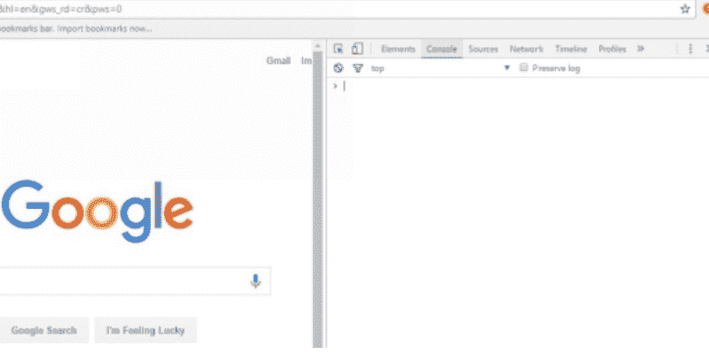

   这里是该图片的详细视图：

   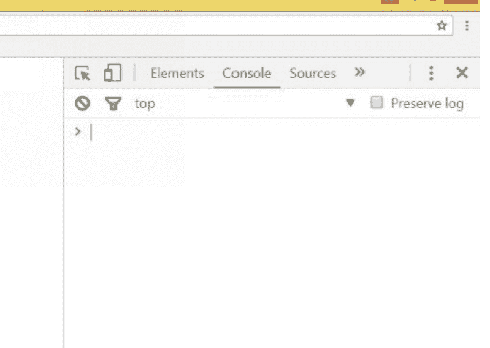

5. **点击“控制台”**
   这将显示控制台面板，你可以在这里输入代码。你可以放大你想要的视图。还有一些按键/按钮可以用于删除或编辑你的条目。

   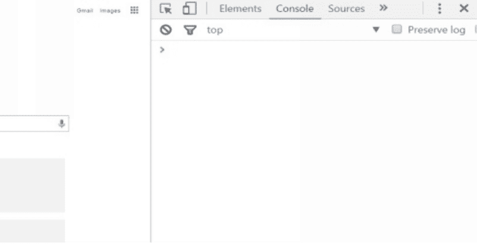

6. **你现在可以开始使用控制台**
   在空白的控制台中探索 JavaScript 语言。

### 打开“控制台”的快捷方法

**方法一：通过 `about:blank`**

1. 在你的设备上下载并安装 Google Chrome。
2. 在 URL 地址栏中（这是你找到 `http://...` 的地方），输入 `about:blank`，不要加引号。
3. 按回车键将出现一个完全空白的页面。

**方法二：快捷键**

- **Windows/Linux：** 使用快捷命令 `Ctrl + Shift + J` 来打开控制台。
- **Mozilla Firefox：** 按 `F12`，然后选择“控制台”。
- **Mac：** 使用命令 `Alt + J`。

接下来，点击右上角的小正方形或圆形。这将显示菜单，就像长方法一样，选择“更多工具”，然后选择“开发者工具”。

选择“更多工具”，然后选择“开发者工具”。会出现另一个框。点击“控制台”，即可输入你的 JavaScript 语言。

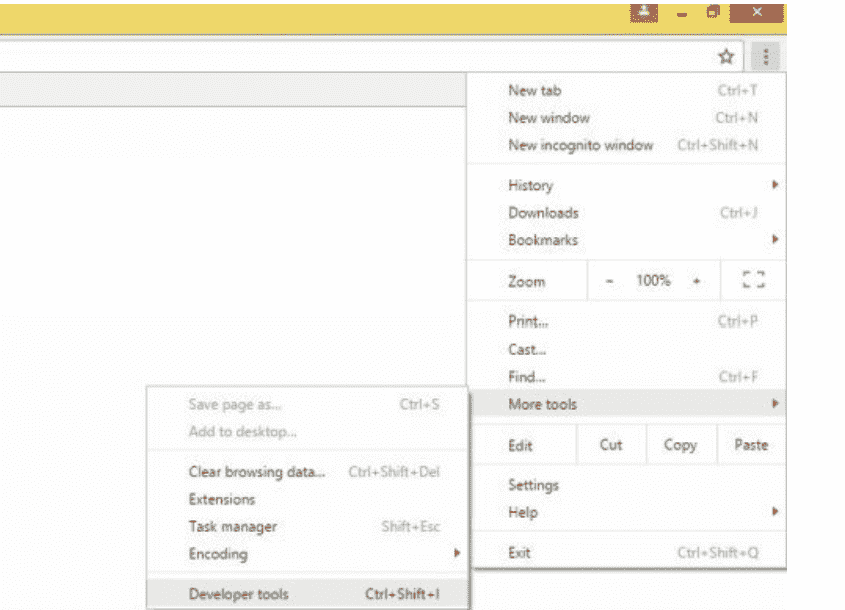

7. **你现在可以登录（使用 `console.log()`），并在“控制台”上开始输入和练习你的 JavaScript。** 你可以探索 JavaScript 代码，并观察符号和标记如何影响你的代码。我们将在后面的章节中进行练习，所以请先不要急。

8. **你还可以点击“控制台”右上角的“保留日志”（Preserve log），以便在你编写代码时保留你的消息。** 但你可能更喜欢不保留日志。这取决于你。

9. **你可以通过右键点击并选择滚动条上的“另存为”（Save as）选项来保存消息。**

   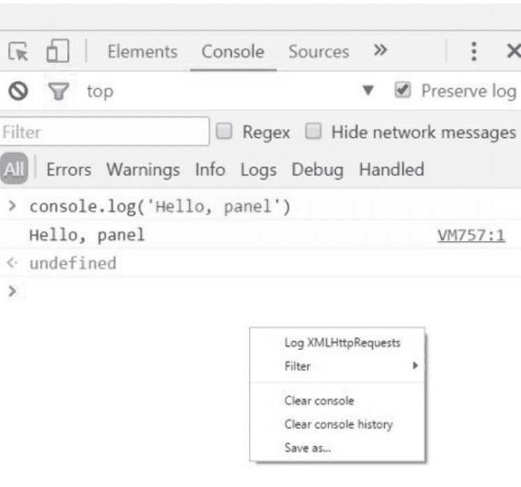

现在，你可以开始编写代码了！

## 第 3 章：设置 Mozilla 控制台

如上一章提到的，你可以通过按键盘上的 `F12` 来访问 Mozilla 上的控制台。这将显示你的开发者工具，你可以在其中选择“控制台”。

假设你在 Mozilla“控制台”中创建了一个 alert。

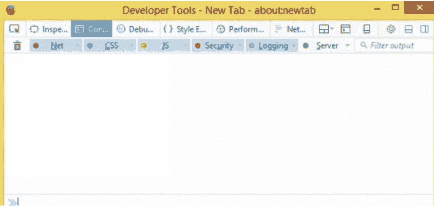

### 示例

```javascript
alert("It is my first time to use JavaScript.");
```

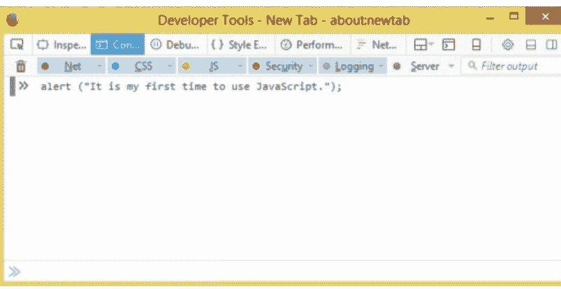

没有出现错误，因为代码是正确的，因此 alert 将显示在你的页面上：

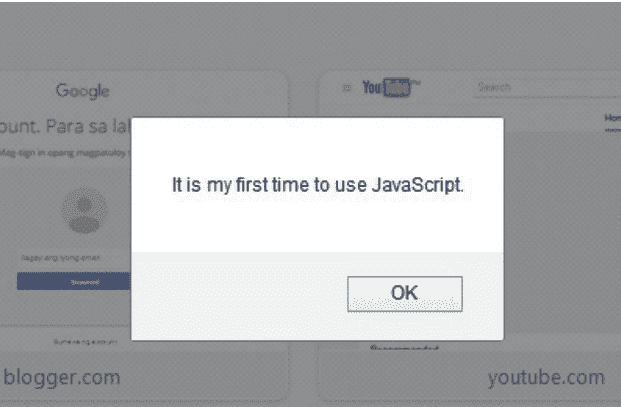

但如果你提交了错误，例如没有使用匹配的引号，“控制台”会快速检测到。


错误被指示出来，你有选项了解更多信息。当你点击“了解更多”时，链接将带你进入一个解释你的代码到底出了问题的页面。

在这个特定的示例中，错误是因为引号不匹配（起始引号是单引号，而结束引号是双引号）。你可以据此纠正你的错误。

## 第 4 章：JavaScript 基础

有一些你应该记住的 JavaScript 基础规则。随着章节的进行，我们将学习它们，让我们先建立最重要的基础基石。

1. **创建 JavaScript 程序时使用 Unicode 字符集。**
   Unicode 字符集包含了大多数通用字符、标点符号和符号。因此，你可以轻松地在编写程序语句中使用它们来创建 JavaScript 代码。

2. **你可以在每个语句后添加分号 `;`。**
   如果你不确定是否要添加，最好的选择是添加。你可以在每个语句后添加分号。在某些情况下，浏览器即使没有分号也能识别 JavaScript 代码，但最好添加分号，以确保该语句被任何浏览器正确执行。这并不是“必须”的，但只是为了万无一失。

   **示例：**
   ```javascript
   alert("My name is Jekyll.");
   ```

3. **你可以使用单引号或双引号表示字符串。**
   单引号或双引号都可以用于字符串。但你必须确保，如果你在字符串之前使用单引号，那么在字符串之后也必须使用单引号。双引号也是如此。你将在第 13 到第 21 章中了解更多关于字符串的内容。

   **字符串示例：**
   ```text
   'My name is Jekyll.'
   "My name is Jekyll."
   ```

4. **有三种原始数据类型。**
   这些是数字（`1, 21.50, 3.4...`）、字符串（`"My name is Jekyll."`）和布尔（`true` 或 `false`）。

5. **所有数字都是浮点值。**
   与其他语言不同，JavaScript 不区分整数（整数字）和浮点值（带有小数点的数字），因为对于 JavaScript 来说，所有数字都是浮点值。

6. **注意 JavaScript 使用 `-` 符号和连字符进行减法，而不是用于连接单词。**
   **示例：** 这些无法被 JavaScript 识别。
   ```text
   student-number
   student-name
   employee-name
   patients-name
   ```

7. **你可以在命名变量时使用驼峰命名法（camel case）。**
   驼峰命名法可以通过连接两个单词来实现，第一个单词的首字母用小写，第二个单词的首字母用大写。

   **示例：**
   ```text
   studentNumber
   studentName
   employeeName
   patientsName
   ```
   你也可以使用下划线来分隔名称，但很少使用。

   **示例：**
   ```text
   Student_Number
   Student_Name
   Employee_Name
   Patients_Name
   ```

8. **你可以在运算符之间添加或不添加空格。**
   尽管 JavaScript 不在意空格，但使用空格更利于可读性。

   **示例：**
   ```javascript
   var number = 7;
   // 或
   var number=7;
   ```
   注意在第一个示例中，数学运算符和数字之间有空格。在第二段代码中，数学运算符 (`=`) 和数字之间没有空格。

9. **“对象”（Object）是 JavaScript 中至关重要的柱。**
   这是因为对象包含了文档、数组以及许多在对象中才能找到。它们有属性和方法。更多将在后续章节讨论。

10. **你可以将 JavaScript 添加到 HTML 页面的 `<head>` 或 `<body>` 部分。**
    然而，你必须使用 `<script>` 标签；起始 `<script>` 和结束 `</script>` 标签。你的代码必须插入在这些起始和结束标签之间。JavaScript 也可以放在外部文件中。需要时，可以通过你的 HTML 文件进行访问。这将导致网站加载更快，并更易于读取、识别和维护 HTML 和 JavaScript 代码。示例将在后续章节中给出。

11. **代码行的理想长度为 80 个字符。**
    这是为了便于编码和阅读。如果你无法避免，且语句超过 80 个字符，那么你必须选择在运算符后断行。

12. **JavaScript 标识符的首字符必须是字母。**
    它也可以美元符号 `$` 和下划线 `_`，但不能是数字。标识符用于命名关键字、变量、标签和函数。

13. **值有两种类型。**
    在 JavaScript 语法中，有两种类型的值：“变量”（variable）和“固定值”（fixed）。变量值正如其名，具有可变的（不定的）值；这正是为什么它们被称为变量。相反，固定值是保持不变不改变的值。它们也被称为字面量（literals）。

14. **JavaScript 中的标识符对大小写敏感。**
    在使用标识符时要小心，因为在小写和大写之间进行转换时可能会出现错误。

    **示例：**
    ```javascript
    idNumber is different from idnumber
    ```
    关键字 `var` 是区分大小写的，但 `VAR` 或 `Var` 则不是。请始终使用 `var`。每次输入或执行代码时，请检查大小写。

15. **网页浏览器可以在 HTML 中执行 JavaScript 命令。**
    如前所述，JavaScript 无法独立存在；它必须与 HTML 或 CSS 一起运行。你可以将 JavaScript 插入 HTML 中，或者创建一个从 HTML 到你 JavaScript 的链接。请注意，JavaScript 语句是网页浏览器必须执行的命令或指令。一个 JavaScript 程序可以包含各种语句，并按照你编写的顺序等待执行。

16. **你可以在一行内编写多个语句。**
    你可以这样做，但要确保每个语句都用分号隔开。

    **示例：**
    ```javascript
    x = 2; y = 3; z = x + y;
    ```

这些是 JavaScript 编程语言最基础的规则。随着你继续阅读，你会发现 JavaScript 远比这里提到的丰富。

## 第 5 章：JavaScript 中的重要术语

每种计算机语言都有自己的重要术语和关键字。JavaScript 也不例外。JavaScript 中的关键字被视为保留字。这是因为你不能使用这些关键字来命名变量。你必须了解这些关键字，以便正确地编写代码。

1. `var` - 它声明一个变量。
2. `debugger` - 它停止 JavaScript 语句的执行，并可以访问调试函数。
3. `function` - 定义一个函数。
4. `break` - 结束循环或 switch 语句。
5. `for` - 表示一个循环。
6. `continue` - 在退出循环后继续执行顶部的语句。
7. `if...else` - 表示当 `if` 语句为真且 `else` 语句为假时将执行的语句块。
8. `try...catch` - 处理语句块的错误修正。
9. `do...while` - 只要条件为真，它就会执行并重复语句块。
10. `switch` - 它根据各种情况指示语句块的执行。
11. `return` - 它允许退出函数。
12. `loop` - 使用某些关键字对函数进行重复。

### 其他术语

1. **foo** - 代表 foobar, bar, fubar 或 qux。Foobars 是元语法变量，计算机编程中名称的占位符。你可以用它获取变量的属性值，而不是使用索引。它在访问变量中的元素值非常有用。

   **示例：**
   ```javascript
   Apparel = {type: "dress", color: "red"};
   // Object {type: "dress", color: "red"}
   var apparel = {foo: "apparel"};
   var valueFromArrayIndex = apparel[foo];
   var valueFromProperty = apparel.foo;
   // undefined
   ```

2. **`push()` 函数** 是向数组中添加元素的另一种方法。

   **示例：**
   ```javascript
   var students = new Array('Damien', 'Lucy', 'Mona', 'Andrew');
   students.push('Tom');
   ```

   如果你想查看你的额外元素是否已添加，可以使用命令：
   ```javascript
   document.write(students);
   ```
   这将返回此数据。

   看下一张图片：
   ```text
   Damien, Lucy, Mona, Andrew, Tom top
   var students = new Array('Damien', 'Lucy', 'Mona', 'Andrew'); undefined students.push('Tom');
   // <- 5
   document.write(students);
   ```

### 使用 JavaScript 关键字的注意事项

- 你可以使用 4 个空格缩进你的代码块。
- 大多数代码块用于函数。
- 记住在代码块时使用花括号 `{ }`。代码块是花括号内的语句组。

## 第 6 章：JavaScript 代码的注释

尽管在其他章节中简要提到了注释，但我想讨论 JavaScript 的注释样式。这个简单的操作将为初学者提供更轻松的学习体验，因为他们可以在 JavaScript 代码中任何需要的地方编写笔记，而不会破坏代码。这将方便脚本编写者回忆可能需要的某些数据。

### 注释方法

#### 使用双斜杠 `//`

当你想要写注释，以免忘记代码中的某项内容时，只需在注释前添加 `//` 符号即可。此符号通常用于单行注释。

**示例：**
```javascript
var patients = [
  "Elsa", //你可以在数组中创建数组。（这是一个注释）。
  "Ana",
  "Lily",
  "Leo"
]; //此符号表示语句已结束。（这是一个注释。）
```
> **注意：** 浏览器不会执行注释。

#### 使用 `/* */`

当你有多行注释时使用它。只需在注释前添加 `/*`，在注释后添加 `*/` 即可。

**示例：**
```javascript
var patients = {
  'Elsa', /*你可以在数组中创建数组。添加相关的元素，
  'Ana'    如年龄、性别、状态和其他相关信息到
  'Lily'   这些元素中的任何一个.*/
  'Leo'
  //此符号表示语句已结束。（这是一个注释。）
};
```

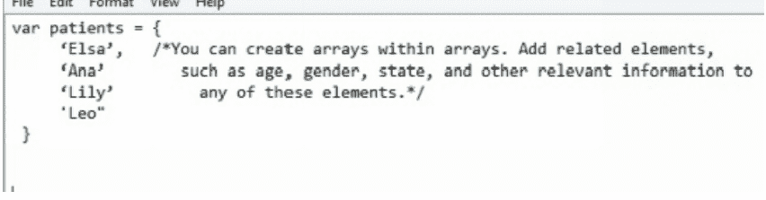

## 第 8 章：JavaScript 函数

在开始编写代码之前，你必须学习如何创建你自己的 JavaScript 函数。这是因为几乎在任何情况下，你的语句都会使用函数。如果不使用函数，你就无法编写代码。

在 JavaScript 中，函数具有属性和方法，它们被视为具有这些特征的对象。它们还必须返回一个值。

使用函数的通常步骤是：调用它，然后传递参数并等待返回值。参数可以是数字、字符串或其他数据类型。

### 函数语句/声明/定义

这用于声明一个函数。你可以通过使用关键字 `function` 来声明一个函数。声明函数的通用公式为：

```javascript
function functionName(argument1, argument2, argument3...) {
  // 要执行的语句/多个语句;
}
```

如果你要将其插入到 HTML 脚本中，可以这样写：

```html
<script type="text/javascript">
<!--
function functionName(argument1, argument2, argument3...) {
  // 要执行的语句/多个语句;
}
//-->
</script>
```

查看下图：

```html
<script type="text/javascript">
<!--
  functionName(argument1, argument2, argument3...) {
  // 要执行的语句/多个语句;
  }
-->
</script>
```

#### 示例 1

假设你想创建一个计算两个数字之和的函数。你首先需要给你的函数命名。对于这个函数，我想给它命名为 `gettingSum`。

`functionName = gettingSum`

所以，你可以这样创建你的函数 (`gettingSum`)：

```javascript
function gettingSum (x, y) {
  return (x+y);
}
```

当你需要使用它时，只需输入函数名并替换你的数字，它就会算出总和。

查看下一图：

#### 示例 2


这是一个在你的网页上问候访问者的函数。

```javascript
function greetings() {
  document.write('Welcome to my page!');
}
```

查看下图：

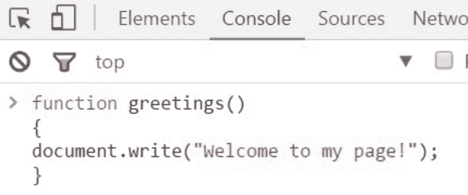

这段 JavaScript 代码将在你的屏幕上显示你的问候。

#### 示例 3

```javascript
function amAlert() {
  prompt("How are you this morning?");
}
```

在将其插入 HTML 代码时，记得添加 `<script>` 标签：

```html
<script type="text/javascript">
function amAlert() {
  prompt("How are you this morning?");
}
</script>
```

查看下图：

| 文件 | 编辑 | 格式 | 视图 | 帮助 |
|---|---|---|---|---|
| `<script type="text/javascript">function amAlert() { prompt("How are you this morning?"); }</script>` | | | | |

如何将这些函数插入你的 HTML 代码中？将在第 36 章讨论，该章节将解释如何将 JavaScript 代码插入 HTML 代码中。

#### 示例 4

你可以使用函数创建系列 alert。例如，你创建了一个可以反映当前用户内心想法的 alert。你可以通过这段代码创建函数：

```javascript
function knowingYou(x) {
  alert("I dream of " + x);
}

knowingYou("you");
knowingYou("Paris");
knowingYou("being in love");
```

查看下图：

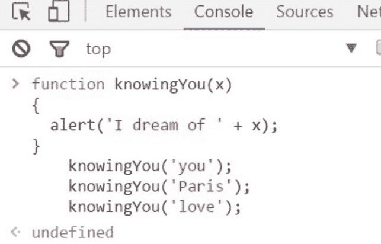

当代码执行时，它显示了代码指定的 `knowingYou` 语句。

查看下面的系列图片：

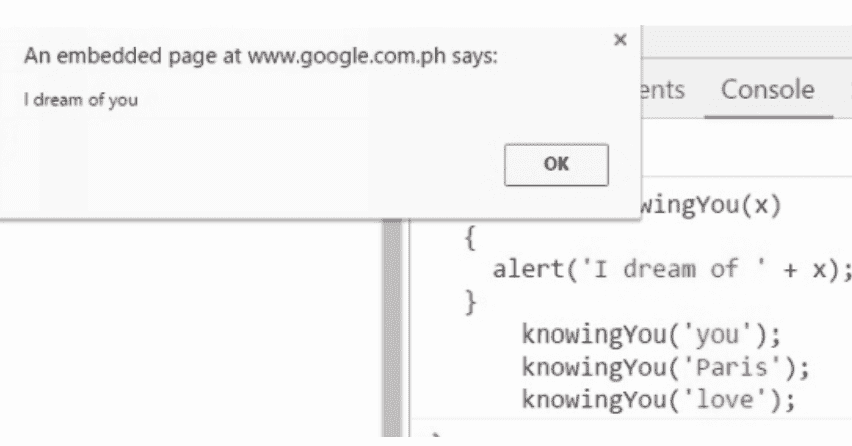

第二条语句：

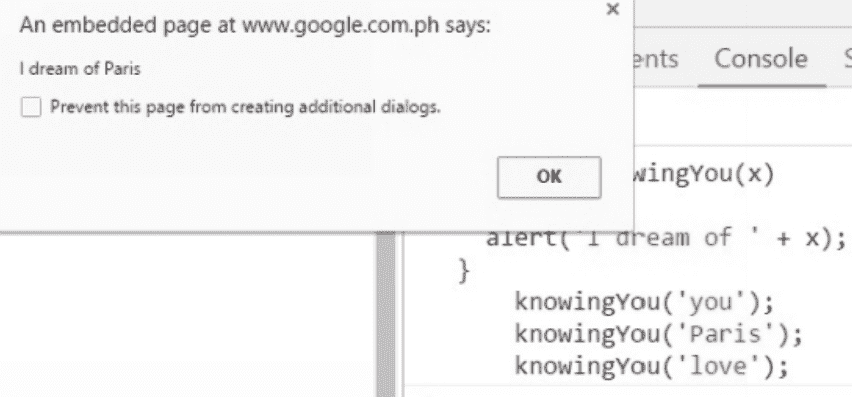

第三条语句：

现在你可以在需要使用它时调用这个 `knowingYou` 函数了。看到了吗？JavaScript 在网页上为我们开发交互的小惊喜是有多棒。

### 提示

- 函数可以被多次利用，只要你在使用之前先定义了它们。这会很快，因为你只需要定义一次。
- 函数后面总是跟着括号和/或大括号。
- 参数与形参相同。参数是包含在函数定义中的名称。
- 值将在语句执行后成为返回值。
- 函数具有原型（Prototype）属性。
- 在浏览器“调用”（使用）并执行函数之前，你必须先定义它。
- 你可以通过在 HTML 代码的 body 部分中创建按钮来调用函数。这是通过在 JavaScript 代码之外创建一个“表单”（form）来输入按钮来实现的。

**示例：**
```html
<form>
  <input type="button" value="press me " onclick="amAlert()">
</form>
```

这段 HTML 代码将在网页上提供一个标签为 "press me" 的按钮。当你点击它时，我们之前创建的 `amAlert` 提示框就会出现。

你可以根据需要声明任意数量的函数。只需确保你通过变量为它们命名即可。你必须记住它们的名字，并知道如何利用这些函数来让自己受益。

## 第 9 章：变量的定义与用法

与其他计算机语言一样，JavaScript 使用变量。与字符串不同，变量不包含引号，你不需要声明它们是什么类型。

### 什么是变量？

变量充当你数据的容器。通过变量，你可以轻松地存储或保存数据，并在以后需要时访问它们。你可以通过使用“容器”（变量）的名称来访问数据。但在使用或访问它之前，你必须先声明并命名变量。

### 变量的用途

它们充当你数据的容器。它们与文件名相似，拥有相应的内容。

关键字 `var` 用于声明变量，而等号 (`=`) 用于定义变量的值。

#### 示例 1

```javascript
var x;
x = 1;
```

#### 示例 2

```javascript
var carOwners;
carOwners = "Rachel Newsome", "Luke Tell", "Sarah Colton";
```

### 变量在哪里？

`carOwners` 是变量名。`carOwners` 是变量的值。查看下图：

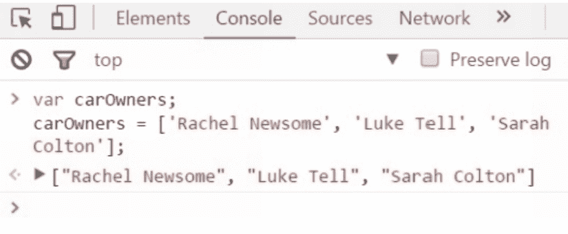

现在你可以通过它的名称使用变量。假设你想使用 `document.write` 打印或显示：

**示例：**
```javascript
document.write(carOwners);
```

当命令执行时，名称出现在页面上：

查看下一图：

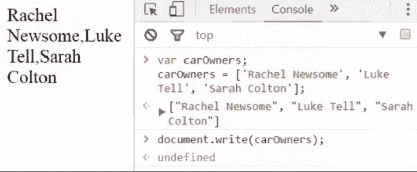

### 变量初始化

这是向变量存储值的过程。你可以在创建后进行，也可以在以后需要时进行。索引 (`0, 1, 3...`) 将赋值给每个变量，以便访问它们。通常，变量被初始化为 `undefined`。

一旦变量被声明，就不允许再次声明同名变量。

### 创建或声明变量

通过记住以下点可以轻松创建或声明变量：

- 变量可以以下划线 `_`、美元 `$` 或字母（大小写）开头，在这些选项之后可以使用任何符号或字母。
- 变量不能使用关键字。这会让用户困惑用户的执行命令。
- 使用关键字 `var`。记得使用小写字母。
- 最好在编写语句或代码之前声明变量。如果不这样做，JavaScript 将显示你的变量为 `undefined`。然而，如果变量未定义，控制台可能会执行命令。你需要通过自己的浏览器发现这一点。
- 给变量赋值时，请使用等号 (`=`)。你的值可以是字符串、数字或其他数据类型。
- 重要的是记住，左侧是变量名，右侧是变量的值。交换它们将导致错误。

**示例：**
```javascript
var studentName = "Fritzgerald";
```
输出或返回值将是："Fritzgerald"。查看下图：

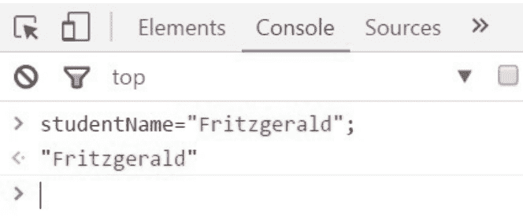

你也可以这样做：
```javascript
var studentName;
studentName = "Fritzgerald";
```
查看下图：

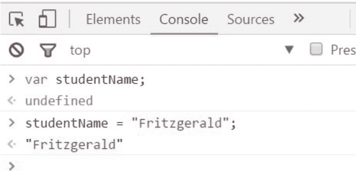

- 正如提到的，双单词变量的命名应遵循驼峰命名法（第一个单词小写，第二个单词的首字母大写）。

**示例：**
```text
studentsNames previousDate
studentName petName
patientsName homeAddress
firstName schoolID
lastName homeViewers
idNumber lateShow
```
如果你浏览这些名称，你会发现你可以按照任何想要的方式为变量命名。然而，使用一个你容易记住的名字更好，因为名称描述了你变量的内容。如果你把汽车的数据命名为 `lastDate`，那将会很困惑，对吧？

- 对于变量的赋值值，你可以使用大写字母或小写字母，取决于你的喜好。但要确保字符串被包含在匹配的引号中。

**示例：**
```javascript
var patientsName;
patientsName = "Luke Walker";
```

- 你可以在每个变量后使用逗号，在一条语句中声明变量。仅在变量名之前使用关键字。这通常用于数组变量。

**示例：**
```javascript
var studentsNames;
studentsNames = ["Fritzgerald", "Walker", "Dixon", "Palmer"];
```
查看下一张图片：

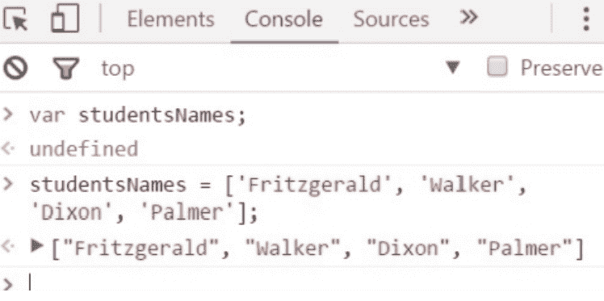

你可能想实验一下看看它在网页上的显示效果。你可以使用代码：
```javascript
document.write(studentsNames);
```

### 访问变量

你可以通过名称来访问变量的值，而不是一个一个地输入值。

查看下图：

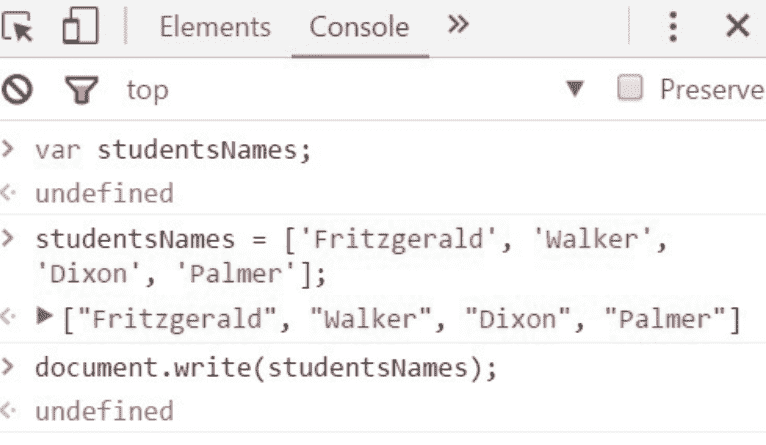

`document.write` 命令将在网页上写入变量 `studentsNames` 的内容。

```text
Fritzgerald, Walker, Dixon, Palmer
var students
undefined
studentsName
["Fritzger"
```
当然，如果你愿意，可以使用多行来创建你的代码。这取决于你的喜好。关于多行代码的示例将在第 29 到 34 章中详细讨论，主题是——数组。

函数——可以允许你只写一次代码并使用多次。

### 变量的基本数据类型（将在它们各自的章节中逐一讨论）

1. 数字 (Numbers)
2. 字符串 (Strings)
3. 布尔值 (Booleans)
4. 对象 (Objects)——数组属于此类

### 提记

JavaScript 的变量和函数是区分大小写的。因此，你必须在整个代码中遵守相同的大小写（大写或小写）。

`"studentName"` 与 `"studentname"` 是不同的。当你使用与你输入的大写名称不同的小写名称时，你将收到一个错误。

JavaScript 的数字长度通常为 16 位，以便浏览器能够正确执行数字代码。

## 第 10 章：变量的基本数据类型

变量具有基本数据类型。这些是数字、字符串、布尔和对象。我们将简单介绍这些类型，因为深入研究它们将使我们没有足够的时间学习基础代码。

### 1. 数字 (Numbers)

在 JavaScript 中，通常所有数字都被视为 64 位浮点数。当小数点后没有值时，该数字将呈现为整数。JavaScript 和其他计算机语言基于 IEEE 754 浮点算术标准。

**浮点数的示例：**
- `4.5`
- `9.16`
- `6.0`

**整数的示例：**
- `9.000`
- `6.000`
- `2`

### 2. 字符串 (Strings)

字符串是通常包含在匹配的单引号或双引号中的数据类型。元素可以是数字或文本。字符串将在第 13 章进行更多讨论。

### 3. 布尔值 (Boolean)

这些数据类型表示 `true`（真）或 `false`（假）。通过使用布尔值，你可以发现 JavaScript 表达式是 `true` 还是 `false`。`true` 返回通常从具有真值的表达式获得。相比之下，`false` 返回从不具有真值的表达式获得。

### 4. 对象 (Objects)

对象在意义上包含了所有数据类型，因为数字、布尔值和字符串都可以是对象。如数组、正则表达式和日期等数据都是对象。对象包含许多值并具有属性。因此，它们是命名值对容器。这种“名称:值”值对被称为属性（property）。它们可以是各种不同数据的集合。

**示例：**
- `student: "Johnson"`
- `country: "Sweden"`
- `street: "Reed Avenue"`

**示例：**
```javascript
var students = {firstName: "Lena", lastName: "Dean"};
```
查看下图：

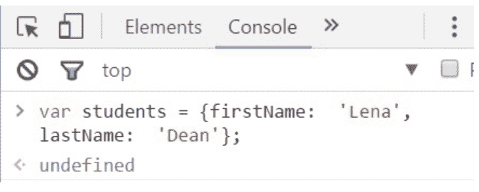

它们通常以 `name:value` 对的形式表示。注意每对之间的冒号，以及每对后的逗号。属性值在引号中，整个语句在括号中。你可以在下一章以及关于数组的章节中了解关于对象的知识。由于变量的数据类型在各个章节中讨论，当你发现它们在 JavaScript 编码中的重要作用时，你将了解更多变量。

## 第 11 章：使用原型

你有时会听到脚本人员谈论 JavaScript 中的原型（Prototypes），你可能会好奇它们是什么。请继续阅读。

### 什么是 JavaScript 原型？

在理解原型之前，你必须理解对象。在上一章中，你读过关于对象以及它们如何包含属性、方法、如何工作以及如何创建的内容。

与可扩展属性和类一起，原型是对象的属性之一。

正如提到的，你可以使用 `name:"values"` 值对来创建对象。让我们创建一个学生的对象：

#### 示例 1

```javascript
var student1 = {firstName: "Daniel", lastName: "Johnson", gender: "male"};
```

#### 示例 2

```javascript
var student2 = Object.create(new Object());
student2.firstName = 'Daniel';
student2.lastName = 'Johnson';
student2.gender = 'male';
```

```javascript
var student1 = {firstName: 'Daniel', lastName: 'Johnson', gender: 'male'};
// undefined
var student2 = Object.create(new Object());
// undefined
student1.firstName = 'Daniel';
// "Daniel"
student2.firstName = 'Daniel';
// "Daniel"
student2.lastName = 'Johnson';
// "Johnson"
student2.gender = 'male';
```

现在，在下一个示例中，使用以下程序/代码/语句调用了 `function student`：

```javascript
function student(lastName, gender) {
  this.lastname = lastName;
  this.gender = gender;
}

student.prototype.gender = "male";
// "male"
var student3 = new student("lastName", "gender");
```

如你所见，函数 student 就像调用第一个学生的函数。函数和对象具有 Prototype 属性，尽管它们的使用不同，但它们仍然是 JavaScript 编码中的关键部分。

### 两种通用原型

#### 1. 函数的原型（Prototype 属性）

这些原型（Prototypes）可以基于对象的实例，作为函数构造函数创建新对象。请记住，Prototype 属性默认是空的。这也称为基于原型的继承（Prototype-based inheritance），因为它可以从父原型函数中继承属性。

#### 2. 对象的原型（Prototype 属性）

这些原型是对象所自继承的这些实例。这意味着每个对象都有一个“父”对象，它从该对象继承了属性。因此，它可以访问对象的属性。父对象包含在 `__proto__` 这个“伪”属性中。这些对象从 `Object.prototype` “继承”了所有属性。

### 示例

```javascript
function Apparel() {
  this.store = "Walden";
  this.isFashion = true;
}
```
查看下一图：

```javascript
function Apparel () {
  this.store = "Walden"
  this.isFashion = true;
}
// undefined
```

```javascript
Apparel.prototype.showNameAndColor = function () {
  console.log("Walk the ramp with me," + this.name + " and my color is " + this.store);
}
```
查看下方图：

```text
> Apparel.prototype.showNameAndColor = function () {
  console.log('Walk the ramp with me,' + this.name + ' and my color is ' + this.store);
}
// > function () {
  console.log('Walk the ramp with me,' + this.name + ' and my color is ' + this.store);
```

我知道这看起来可能很复杂，但可以这样理解：它是从一个对象原型产生出一个函数原型。最后一个原型经过一系列处理后，从“父”原型（第一个函数 – `function Apparel`）创建了一个新对象。注意添加属性（如名称和颜色）的过程。

一个更简单的例子是这样的：

```javascript
function Apparel (type) {
  this.type = type;
}
```
这是父函数，你的原型将源于这里。

查看下方图：

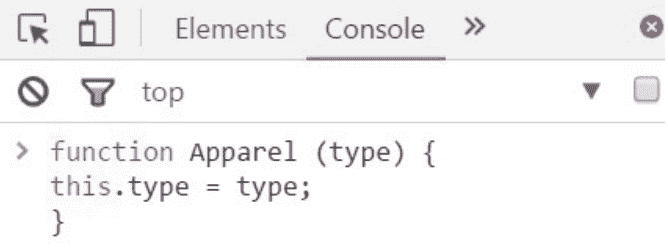

正如我们所见，每个函数都有一个 Prototype 属性，Apparel 函数也有。

让我们尝试向 apparel 的函数属性添加属性。我们添加的属性是 `fashionable`。

当我们创建一个新变量 `cotton` 时，这个新变量等于 Apparel 原型。这就是当执行语句（按下 Enter 键）时，它返回值 `true` 的原因。这意味着 cotton 也是 `fashionable`，这是 Apparel 原型的属性。新变量（cotton）继承了父函数和 Apparel 原型的属性。

```javascript
Apparel.prototype.fashionable = 'apparel';
// "apparel"
var cotton = new Apparel('cotton');
// undefined
cotton.__proto__ == Apparel.prototype
// true
```
> **注意：** 紫色的字母是按下 Enter 键后的返回值。所有代码都是如此。返回值包含在某些 JavaScript 语句中，所以请留意它们。

查看下方图：

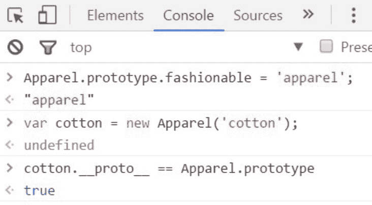

希望这有助于你理解原型的功能。

### 提示

- 在 JavaScript 中，所有函数都有原型。
- `__proto__` 单词由两个下划线符号 + proto + 两个下划线组成。
- 因为原型的存在，用户现在可以访问变量的属性。

## 第 12 章：程序流程控制

JavaScript 有自己组织良好的程序流。语句的执行顺序通常从程序/脚本/代码的顶部向下开始。但是——这是在第一条语句没有必须执行的其他动作/命令的情况下。

例如，使用函数 `prompt` 时，浏览器必须等待用户与 prompt 交互，然后才能执行下一个命令。

函数主要控制程序的流向。某些函数可能会将流转向到不同的方向。一个函数可以引导另一个函数，从而减慢流速。

在这条语句中：

```javascript
var myString = '12345678';
var length = myString.length;
document.write('This is the length of my string: ' + length);
```

程序流可能是：
- 输入新变量
- 测量字符串的长度
- 在屏幕上写入“This is the length of my string...”的返回值。

此条语句中的流是有组织的，但你还必须考虑你的浏览器的快慢。

流程控制控制 JavaScript 程序的流程。流程控制有两种类型：

### 1. 循环类型

这些通过动作的迭代、重复或连续性或代码执行来表示。它利用了 `for`, `for-in`, `while`, `do-while`。这将在第 32 章关于循环的话题中讨论。

同样，循环的 `break` 和 `continue` 可以影响程序流。`break` 停止并终止循环，而 `continue` 允许循环继续其动作。

**示例：**
```javascript
for (number=0; number<10; number++)
  if (number==6) break; else document.write(number+'<br>');
```
查看下方图：

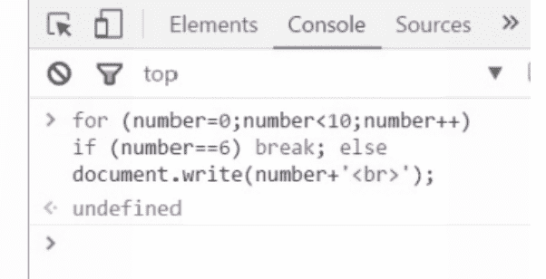

如果你查看上面的图片，循环被中断了，返回值只在屏幕上显示 0 到 5 的数字。

如果你将此内容插入 HTML 代码中，可以使用这段代码：

```html
<html>
<head>
<script>
for (number=0; number<10; number++)
  if (number==6) break; else document.write(number+'<br>');
</script>
</head>
</html>
```
查看下方图：

| 文件 | 编辑 | 格式 | 查看 | 帮助 |
|---|---|---|---|---|
| `<html><br><head><br><title>Break</title><br><script><br>for (number=0;number<10;number++)<br>if (number==6) break; else document.write(number+'<br>');<br></script></head></html>` | | | | |

### 2. 决策类型

在这种类型中，程序根据条件流。这些语句使用了 `if`, `else-if`, `else` 用于 `while`/`do-while`。

`if` 语句是最简单的。

```javascript
if (condition) {
  statement
}
```

循环和决策控制的区别在于循环具有持续动作，而决策控制只执行一次。

## 第 13 章：创建字符串

字符串是什么？它们在 JavaScript 中的作用是什么？我们必须学习字符串，因为它们是代码的重要部分。

### 什么是字符串？

字符串是一个单词、一组单词或文本，被包含在引号 (`' '`) 或双引号 (`""`) 内部。你可以通过关键字 `var` 存储它们。

**示例：**

- `alert ("My name is Jekyll")` -> 示例中的字符串是 `"My name is Jekyll"`
- `var name="Jekyll"` -> 第二个示例中的字符串是 `"Jekyll"`

注意双引号可以用单引号替换，仍然被称为字符串。

**示例：使用相同的示例，我们得出了单引号的示例：**

- `alert ('My name is Jekyll.')` -> 示例中的字符串是 `'My name is Jekyll.'`
- `var name='Jekyll'` -> 第二个示例中的字符串是 `'Jekyll'`

### 字符串的用途

#### 1. 字符串可以使用 `alert` 创建警告。

**示例：**
```javascript
alert ("Hello, enjoy your stay here.")
```

> **注意：** `alert` 通常是一个供用户阅读的弹出窗口。你现在可以使用你的 Mozilla 或 Google Chrome ‘Console’ 测试你的代码是否工作。你可能想清除之前的输入条目，可以通过点击控制台上部分的符号来实现。在 'Console' 中，输入 `alert("Hello, enjoy your stay here.")`。查看上面的示例。在你按下 'enter' 后，弹出窗口或警告将显示你输入的字符串。有些程序员使用关键字 `window.alert`。在本书中，我们将使用形式形式 `alert`。

#### 2. 你可以切割你的字符串并组合创建新的。

旧的字符串没有被删除，但你可以从之前的字符串创建一个新的。

**示例：**

你有这两个字符串：尝试在你的 Google Chrome 控制台输入它们：

```javascript
mystring1="My name is Jekyll.",
mystring2="I am twenty years old.",
```
查看下方图片：

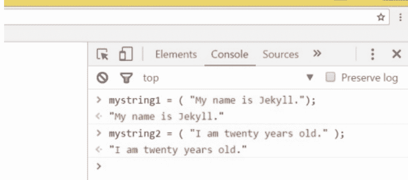

你想合并你的字符串，特别是“Jekyll”和“twenty years old”这两个单词。你的代码如下：

```javascript
alert("Jekyll." + " twenty years old.");
```

在你按下‘Enter’键后，将弹出 alert 框。

查看下方图片：

```javascript
mystring1 = ( "My name is Jekyll." );
// "My name is Jekyll."
mystring2 = ( "I am twenty years old." );
// "I am twenty years old."
alert ("Jekyll," + " twenty years old.");
```
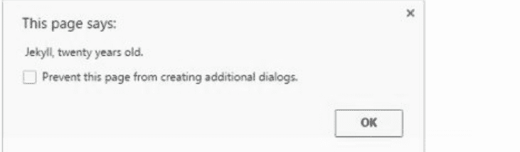

#### 3. 你可以在一行内创建两个警框。

用分号隔开第一个警框，以表示它已经结束，并且你正在创建一个新的：

**示例：**
```javascript
alert('Good morning!'); alert('How are you today?');
```
查看下方图片：

```javascript
alert('Good morning!'); alert('How are you today?');
```

在 Mozilla 'Console' 控制台中，alert 将以这种方式显示：

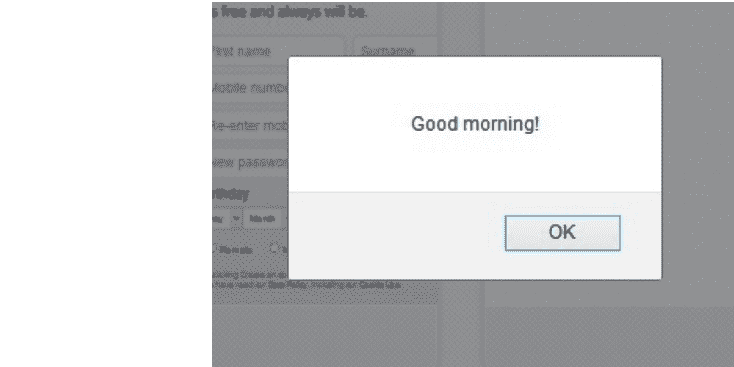

在你按下 'OK' 后，第二个 alert 将出现。

对于 Chrome，请查看下方图片：

对于 Mozilla：

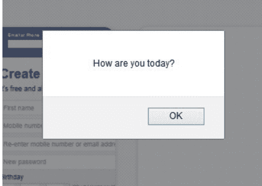

### 提示

- 使用匹配的双引号或单引号包裹你的单词字符串。
- 如果旧字符串中单词前面有单词，请在单词前添加一个空格；如果旧字符串后面后面单词，请在单词后添加一个空格。
- 添加分号来表示语句/命令/代码已结束。
- 在某些浏览器中，当你必须添加带有引号的单词时，在单引号前使用反斜杠 `\`，或者在双引号前以及闭合的双引号之前使用反斜杠。

**示例 1：**
```javascript
var message1 = "I don't want to come.";
```
无论你是像上面的示例语句那样创建代码，还是像下面的示例语句那样编写语句，Mozilla 和 Google Chrome 都会执行它们，并产生正确的结果/返回数据。

```javascript
var message1 = "I don't want to come."
```

**示例 2：**
```javascript
var message2 = "Never mention the \"neopoliticians\" because this is dangerous.";
```
在某些浏览器中，为了为上述语句正确创建代码，请这样编写你的代码：

```javascript
var message2 = "Never mention the \"neopoliticians\" because this is dangerous."
```
查看后续图片：斜杠不会显示。

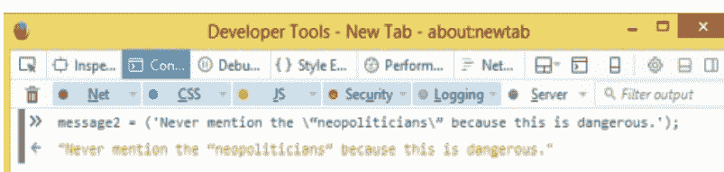

- 反斜杠 `\` 也用于分割文本字符串中的代码行。然而，你不能使用相同的符号来分割代码行。尽管并不是所有的浏览器都识别这个符号，因此你可能想使用加号 (`+`) 来添加你的字符串。

**示例：**
```javascript
alert('I am excited to learn about JavaScript\. It is so interesting.');
```
查看后续图片：

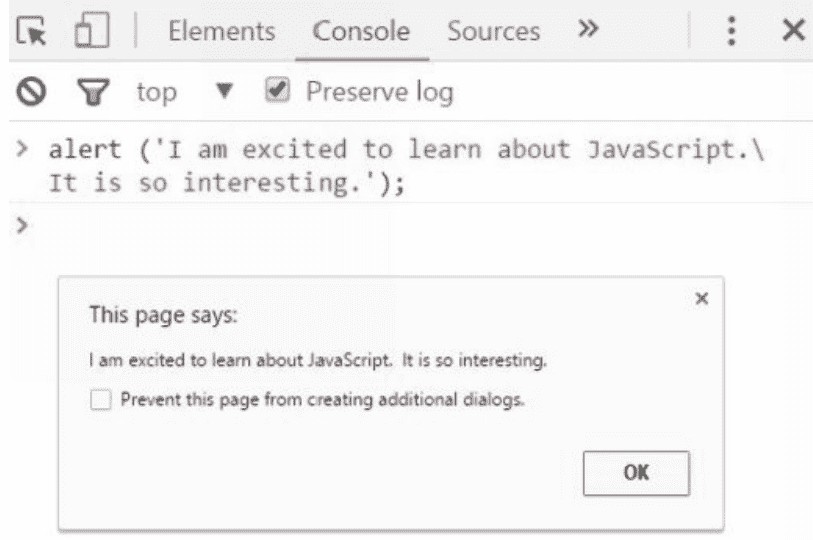

### 提示

- 在你的 Chrome 和 Mozilla 的 JavaScript 中不需要反斜杠，因为即使文本中带有引号，浏览器也会执行字符串的代码。
- 反斜杠更多地用于 JavaScript 代码的注释以及阻止代码的执行。

## 第 14 章：查找和替换字符串

如果你想的话，可以查找一个字符串并替换它。你只需要使用正确的方法。此过程的关键字是：`string.replace(searchvalue, newvalue)`。

**示例：**
```javascript
var str = 'He went to Okinawa yesterday.';
var set = str.replace(/Okinawa/g, 'Seoul');
```
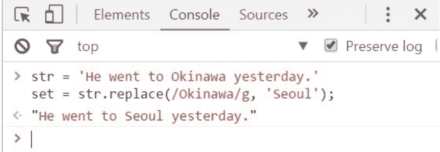

注意 `Okinawa` 被替换为 `Seoul`。替换单词后的小 `g` 代表 `global`（全局）。浏览器可以是局部的也可以是全局的。建议使用全局的以防止错误。你可以通过 `function` 和 `return` 关键字返回替换后的文本或单词。

## 第 15 章：字符串拼接

你可以将字符串或字符串的部分相互拼接（合并）。你可以通过加号 (`+`) 运算符来拼接字符串。假设你有这个原始 alert 语句：“My name is Jekyll.”

查看下方图片：

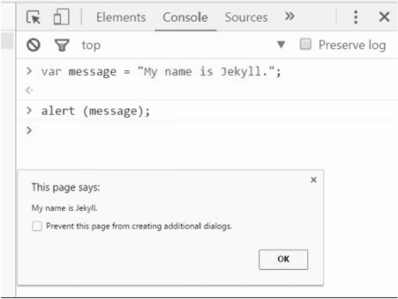

因此，你想拼接另一个字符串，并在你的网站上添加用户的输入（关于她的名字）。你可以使用另一个代码为此创建一个另一个变量。

```javascript
userName = "Susan";
```

所以，如果你想在 alert 中合并消息和 userName，你可以这样写 JavaScript 脚本：

```javascript
message = "My name is Jekyll";
username = "Jean";
alert("My name is " + username);
```

请记住，当你在控制台上按下 'Enter' 时，你的输入将出现在你的脚本正下方，最后，alert 框将弹出，因为你创建了一个 alert。

查看下方图片：

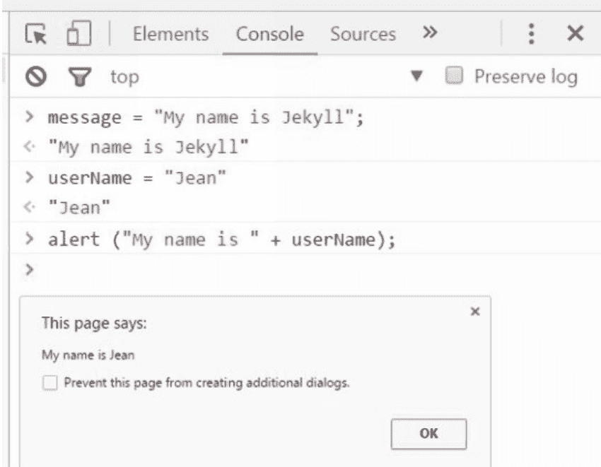

注意代码中闭合的双引号之前有一个空格。这将允许两个字符串的正确组合。如果你不留空格，你生成的 alert 将以这种方式显示：“My name isJean.”

查看下方图片：

```javascript
alert("My name is " + username);
```
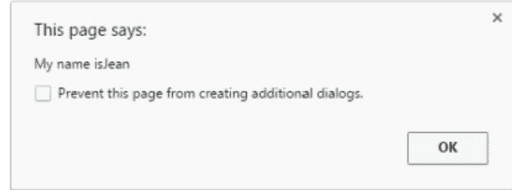

## 第 18 章：字符串的转换

学习如何将你的数据转换为字符串对你来说是一个额外的优势。秘诀在于知道使用哪些关键字以及如何正确编写代码。

**此操作的通用代码：**
`String(object);`

### 1. 将数字转换为字符串

```javascript
var myNumber = 10;
var myString = myNumber.toString();
```
尽管在下面的代码没有关键字 `var`，但浏览器（Chrome）仍然能够识别该脚本。问题是，数据无法被存储。

查看下面的图片：

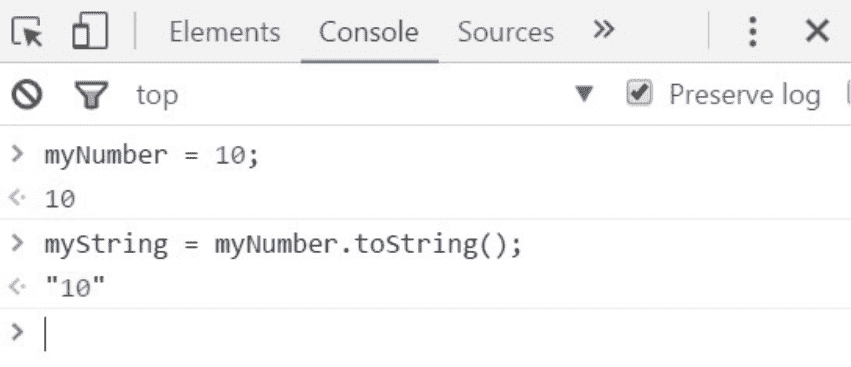

你也可以使用这段代码：
```javascript
myNumber = 10;
myString = String(myNumber);
```
这两段代码将为你提供相同的结果 - `"10"`。

### 2. 将字符串转换为小写或大写

是的，你可以通过正确的代码快速完成这一点。

**示例：**
```javascript
var myString1 = "I enjoy writing my JavaScript codes."
var myString2 = myString1.toUpperCase();
```
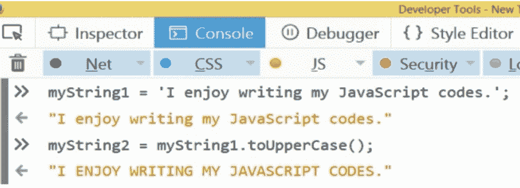

你也可以通过此语句将字符串转换为本地区域大写：
```javascript
myString3 = myString1.toLocaleUpperCase();
```
查看下面的图片（最后一行）：

```text
myString1 = 'I enjoy writing my JavaScript codes.';
"I enjoy writing my JavaScript codes."
myString2 = myString1.toUpperCase();
"I ENJOY WRITING MY JAVASCRIPT CODES."
myString3 = myString1.toLocaleUpperCase();
"I ENJOY WRITING MY JAVASCRIPT CODES."
```
当不确定 Locale 的 JavaScript 能力时，由于浏览器的差异，结果可能不同。但通常情况下，当你使用 `toUpperCase()` 时，结果是一致的。

### 3. 将字符串转换为小写

将字符串转换为小写，这与将其转换为大写相似。

**示例：**
```javascript
myString1 = 'I enjoy writing my JavaScript codes.';
myString2 = myString1.toLowerCase();
myString3 = myString1.toLocaleLowerCase();
```
当你按下 'Enter' 时，结果就会显示：

使用 `toLowerCase()` 时，结果如下：
```javascript
myString1 = 'I enjoy writing my JavaScript codes.';
myString2 = myString1.toLowerCase();
myString3 = myString1.toLocaleLowerCase();
```
按下 'Enter' 后，控制台显示的结果：
> “i enjoy writing my codes.”

所有的大写字母都转换为小写了。

查看下一图：

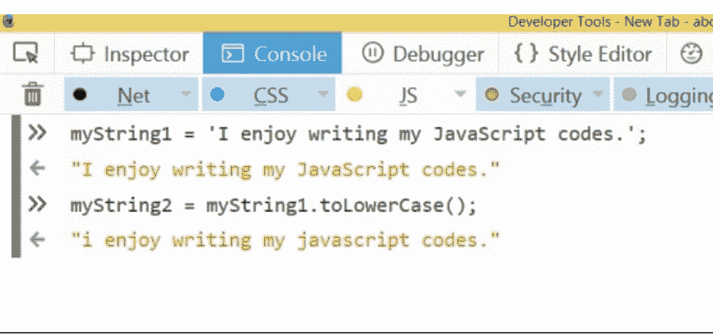

当使用 Locale 时，它产生了相同的结果：
> "i enjoy writing my codes."

查看下面的图片：第 5 行和第 6 行

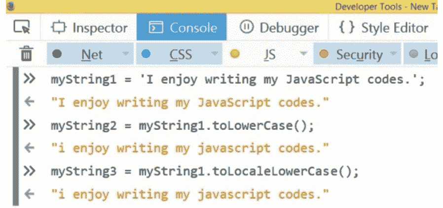

这些简单的指令对高级程序员来说可能微不足道，但对于初学者来说，我知道这对你有多困难。这就像在走路之前先学爬。所以，我以简单的方式呈现了它们。但是，加油！如果你坚持坚持下去，你可以学到更多。

请注意，与上一个例子一样，代码中并没有使用关键字 `var`。由于它们没有被保存，所以这方面没有问题。但在这些示例中我包含了关键字 `var`，因为你的浏览器可能需要它。如果你使用了它但浏览器返回了错误，那么你可以将其删除。学习的一部分就是犯错并从错误中学习，对吧吗？

现在，让我们来看另一个例子。

## 第 19 章：确定字符串值的开头

最常用的字符串方法在之前的章节中解释过了。这里是你在编写 JavaScript 代码时可能需要的其他方法。

- `startsWith()` – 该功能的作用是判断字符串是否以指定的字符开头。如果不是，结果将显示 `false`。

假设你想判断字符串是否以 “I” 开头，你可以写这样的 JavaScript 代码：

**示例：**
```javascript
var res = myString1.startsWith (“I”); 
str.startsWith ('I');
```
由于我已经在代码的前早部分为我的字符串分配了值，即 `myString1 = 'I enjoy writing my JavaScript codes.'`，所以我能够迅速获得结果。

查看下面的图片：（来自 Mozilla）

如上面的示例所示，结果是棕色的文字。

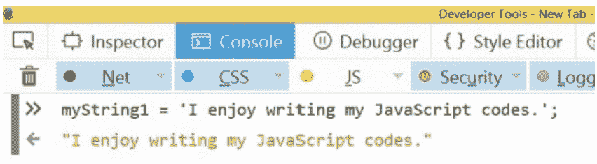

当你按下 'Enter' 时，结果就会显示：

```javascript
var res = myString1.startsWith('M');
```
查看下图：

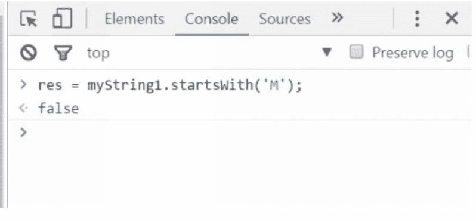

根据 `myString1` 的值，得到的结果是 `false`，它的值是 `I enjoy writing my JavaScript codes.`。

注意，你也可以这样写代码：
```javascript
var res = str.startsWith();
```

### 示例：（来自 Chrome）

```javascript
res = str.startsWith('M')
// Uncaught ReferenceError: str is not defined(...)
```
在上面的图片中，我获得了一个错误返回，因为我的 `str` 没有定义。

如果你遇到了这种情况，那么你必须先给你的字符串赋值。

假设你给字符串赋值了这个值：
```javascript
var str = 'It is wonderful to be alive!';
```
你必须将其输入到你的 'Console'（控制台）中，这样你或用户以后就可以使用它。

查看下一张图片：
```javascript
str = 'It is wonderful to be alive!'
// "It is wonderful to be alive!"
```
现在，你或用户可以使用它用于 `res = str.startsWith();` 方法。

**示例：**
```javascript
var str = 'It is wonderful to be alive!';
```
这将返回：
> "It is wonderful to be alive!"

```javascript
var res= str.startsWith('M');
```
这将返回：
> false

```javascript
var res = str.startsWith('I');
```
这将返回：
> true

查看下一张图片：

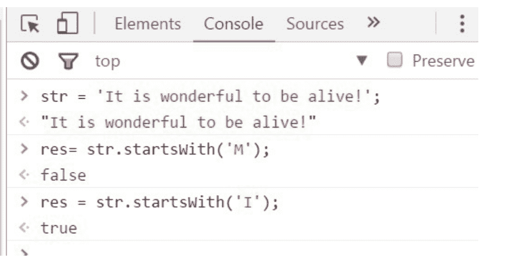

该语句也可以这样表述：
```javascript
var res = string.startsWith(searchValue, start);
```

### 参数说明

- `searchValue` 是要搜索的字符/字符串
- `start` = 指明从哪个位置开始搜索。这是可选的，如果你想搜索整个字符串，可以省略。

#### 示例 1

```javascript
var res = str.startsWith('I',4);
```
布尔结果为：`false`
这是因为 `str` 的值（`It is wonderful to be alive!`，从位置 4 开始）并不以 `I` 开头。注意：位置 4 开头的是 `s`。

#### 示例 2

```javascript
var res = str.startsWith('is', 3);
```
查看下图：

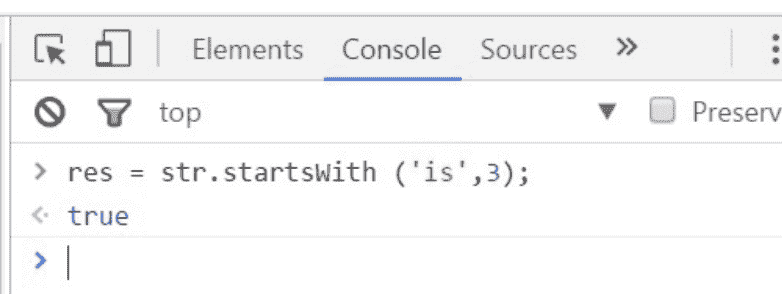

返回值为 `true`，因为 `is` 是字符串中的第 3 个值。

记住，如果没有指定 `start` 值，整个字符串将包含在布尔（`true` 或 `false`）返回中。

## 第 20 章：搜索字符串

你可以使用以下语句在字符串中搜索正则表达式或指定值：`search()` 或 `string.search(searchValue)`。这将返回指定值的位置。搜索值将是一个正则表达式（RegExp）。

**示例：**
```javascript
var myString1 = 'I enjoy writing my Javascript codes.';
var res = myString1.search('my');
```
让我们使用之前示例中的相同值并输入它们：

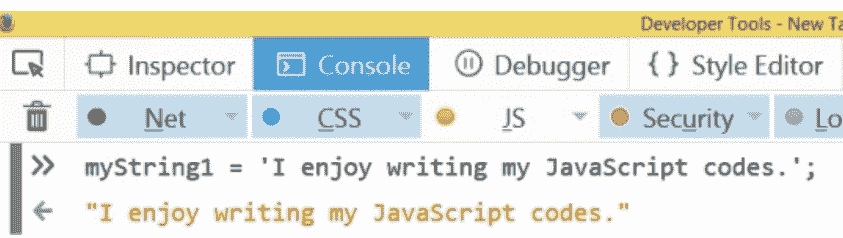

现在让我们使用我们的搜索语句：
```javascript
var res = myString1.search('my');
```
结果是 16。

查看下图：

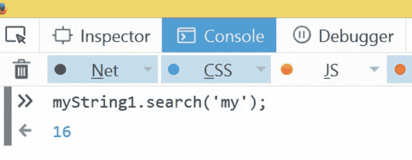

这是因为 `my` 在字符串中的索引是 16。记住从 0 开始计数，并包含空格。

### 示例 2

```javascript
var str = 'It is wonderful to be alive!';
res = str.search('a');
```
结果将是 22，表示指定字符的位置。

查看下一张图片：

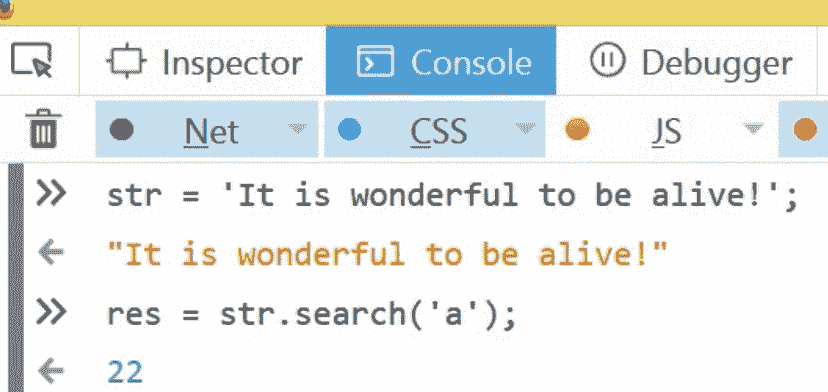

### 提醒

- 字符串可以是任何内容，从数字到文本。
- 在执行命令之前，必须先为字符串值赋值。
- 在此示例中，我逐条编写了语句并按‘Enter’，所以结果（棕色的单词和蓝色的数字）出现在图片中 JavaScript 语句之间。
- 只要你定义了字符串，就可以使用 `string.search()`。
- 如果没有识别到匹配项，结果将返回值 `-1`。
- 以防你没有注意到：Mozilla 的输入区域位于‘Console’的底部。它是一条带有两个箭头 `>>` 的白色窄条，指示了你应该从哪里开始输入。Chrome 则提供了整个‘Console’ 供你输入。
- 如果搜索区分大小写，请在代码用字母 `i` 标明。

**示例：**
```javascript
var res = myList1.search(/my/i);
```
这将返回值 16。

查看下图：
```javascript
myString1.search(/my/i);
// 16
```
如前所述，字符串 `myString1` 已经分配了值，这就是为什么浏览器没有返回错误。

## 第 21 章：重复字符串

可以使用正确的 JavaScript 语句/代码按照你需要的次数重复字符串。你可以通过这种语法来实现：

```javascript
string.repeat(count) or str.repeat(count)
```


## 第 22 章：JavaScript 和数学运算符

JavaScript 中可以使用一些常用的运算符。最常用或最基础的运算符就是你小学时期就熟悉的那些。

### 基础运算符

- `+` 用于数字相加，以及字符串——充当连接运算符
- `*` 用于乘法
- `-` 用于减法
- `/` 除法
- `%` 用于余数 - 这是一个模运算运算符。它给出答案的余数，而不是除法的结果。当一个数字被另一个数字整除时，它返回值 0。
- `++` 递增——这递增地将整数值增加。
- `--` 递减——这递减地将整数值减少。

你的 JavaScript 控制台也可以作为你的计算器。JavaScript 会观察数学表达式，识别表达式中的符号。值是表达式中的数字。你可以通过引用字母来保存你的表达式。

#### 加法示例

在你的控制台上输入 `6 + 4`，当你按下 Enter 时，答案 10 就会出现。

在你的控制台上输入 `1234 + 4567`，当你按下 Enter 时，答案 5801 就会出现。

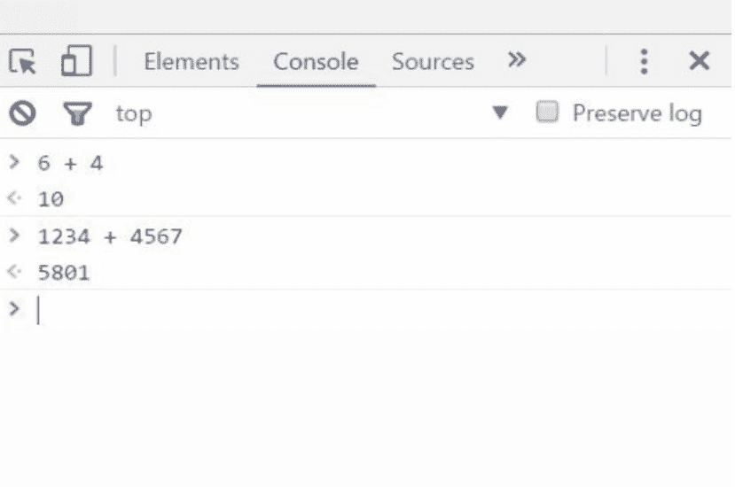

#### 乘法示例

- 在你的控制台中输入 `723 * 137` 并按“回车键”，将出现答案 99051。
- 在你的控制台中输入 `3190 * 287` 并按“回车键”，将出现答案 91530。

查看下方图片：

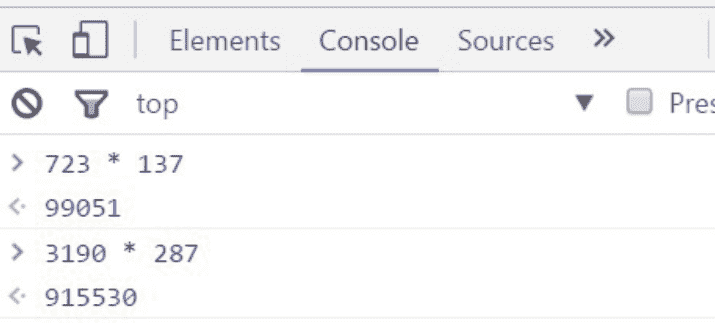

#### 减法和乘法示例

查看下方图片：

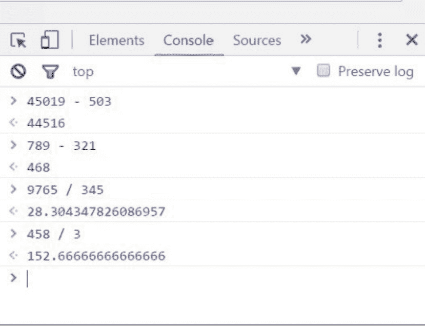

你也可以计算复杂的表达式：

示例：

```
(456 + 786) / (235 - 123) = 11.08285714285714
```

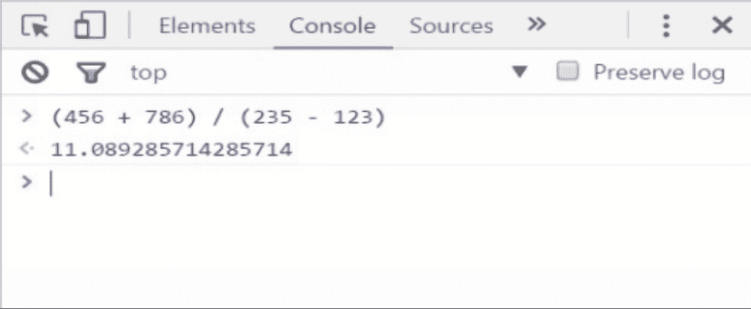

示例：

```
[(456 * 786) + (235 - 134)]/3 = 119505.6666666666
```

查看下方图片：

### 顶部

```
> [(456 * 786) + (235 - 134)]/3
119505.6666666667
```

在上述问题中，由于 `(456*786)` 和 `(235-134)` 被包含在括号内，它们会被计算。是括号内结果的相加，最后是除以 3。这会给你最终答案：119505.6666666667

JavaScript 控制台将按照数学顺序 PEMDAS（括号、指数、乘法、除法、加法和减法）解决问题。因此，你可以通过将它们包含在括号内来指示 JavaScript 你想要求解的顺序。如果你不指定，JavaScript 将先计算指数，然后是乘法，接着是除法，最后是加法。

JavaScript 的奇妙之处在于你可以向变量添加数字，或者只添加变量，并得到一个数字。我不会详细阐述这一点，因为我假设你已经了基础数学和代数。

在 JavaScript 中发生错误时，红色字母将显示你所犯的错误。JavaScript 不要求你将项转换为类似的项，只要变量已正确赋值和定义。对于 `6 + 4 = 10`，你也可以执行这些：

示例：

```
commonNumber = 6;
commonNumber + 4;
```

查看下方图片：


如果你注意到，第二个语句 `commonNumber + 4` 后面没有分号，但 JavaScript 仍然计算了它。其他程序员可能这样表示该语句：

```
var commonNumber = 6;
var commonNumber + 4;
```

上面的语句将给你相同的答案 10。你添加了一个变量和一个数字，并得到了答案。你也可以添加变量，不使用数字并得到相同的答案。你可以随意地操作变量。只要你按下“回车键”，JavaScript 控制台就会给你答案。这比计算器更酷了。

示例：

```
commonNumber = 6;
anotherNumber = 4;
finalNumber = commonNumber + anotherNumber;
anotherNumber = finalNumber - commonNumber;
```

查看后续图片：


其他程序员可能如下表示上述语句：

```
var commonNumber = 6;
var anotherNumber = 4;
var finalNumber = commonNumber + anotherNumber;
var anotherNumber = finalNumber - commonNumber;
```

你也可以将你的语句转换为 alert。

示例：

```
alert(commonNumber + anotherNumber);
或 alert(6+4);
```

查看下方图片：


不要忘记，如果数字包含在匹配的引号内，它们将被视为字符串；因此，在语句执行期间会被视为字符串。

## 第 23 章：表达式中的其他运算符

JavaScript 中包含了你必须知道的其他数学运算符。

### 1. 使用 `++` 符号

```
num++;
```

`++` 符号表示变量上加 1。

查看下方图片：


### 2. 使用 `--`

这是 `num++` 的相反操作。它从变量的值中减 1。

查看下方图片：


注意：“表达式”仅适用于数学。表达式也可以适用于值的组合，例如数字和字符串。当你在控制台中输入数字时，它会自动响应并进行计算。如果你不想发生这种情况，请将数字转换为字符串。

### 赋值运算符

| 运算符 | 示例 | 等效于 |
| :--- | :--- | :--- |
| `=` (简单赋值) | `c = a` | 变量 c 分配了 a 的值 |
| `+=` (加赋值) | `b += a` | `b = b + a` |
| `-=` (减赋值) | `b -= a` | `b = b - a` |
| `/=` (除赋值) | `b /= a` | `b = b / a` |
| `*=` (乘赋值) | `b *= a` | `b = b * a` |
| `%=` (取模/取模赋值) | `b %= a` | `b = b % a` |

### 类型运算符

- `instanceof` 运算符当对象是该构造的实例时返回 `true`。
- `typeof` 返回变量的类型。

### 比较和逻辑运算符

- `==` 等于
- `===` 值和类型相等
- `>` 大于
- `>=` 大于等于
- `<` 小于
- `<=` 小于等于
- `!=` 不等于
- `!==` 不相等
- `?` 三元运算符

## 第 24 章：创建和显示日期

在 JavaScript 中，你可以在页面上创建并显示日期和时间。你可以以字符串形式创建日期：

```
var dateObjectName = new Date();
```

示例：

```
var summer2022 = new Date("April 15, 2022 12:20");
```

查看下方图片：


如果你注意到，在 JavaScript 中，创建日期有其他方式。

示例：

```
var today = new Date();
```

这会返回星期几、月、日、小时、分钟和秒。


你也可以使用整数（数字）作为你的参数：

示例：

```
var summer2022 = new Date(2022, 4, 12, 20, 0);
```

查看下方图片：


当你不包含小时、分钟和秒时，时间将被设置为零（0）。

查看下方图片：


提醒：

- 如果日期参数包含在匹配的引号内，它们被视为字符串。
- 对于整数，不需要引号。

## 第 25 章：Date 对象方法

当你成为一名成熟的 Web 开发人员和程序员时，学习如何使用方法来操作日期时间元素将非常有帮助。梦想是免费的，所以为什么不梦想得大大一些呢？毕竟，成为一名高级脚本编写是从初学者开始的。

### 1. 'get' 方法

该方法用于“获取”日期对象的值。代码如下：

`var dateObjectName.getParameter();`

示例：

`var summer2022.getMonth();`

返回的数据将是 2，因为在 JavaScript 中，3 月是 2。

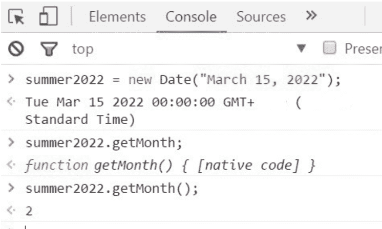

我在第一个 'get' 代码中犯了一个错误，因为我遗漏了括号。因此，它返回了正确的函数代码。

查看上方图片中的第二个项目。当我纠正错误后，“控制台”（Console）返回了正确答案，即 2。请记住，月份是从 0 开始的。

通过 'get' 方法，你可以从日期对象中获取你需要的任何信息。

当你输入函数词 'get' 时，浏览器的“Console”会提供一个列表。你只需要点击它们即可。

以下是你可以从 'get' 获取的一些数据：

查看下方图片：

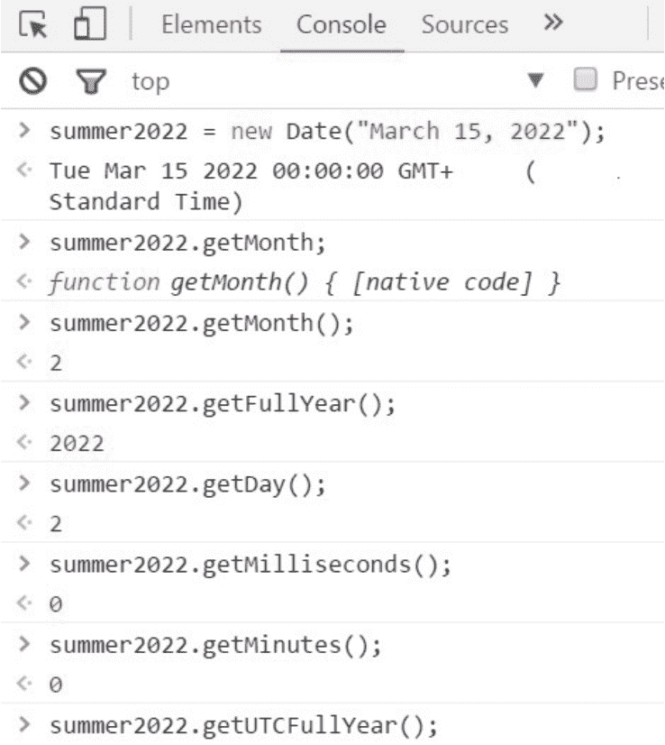

```
summer2022 = new Date("March 15, 2022");
< Mar 15 2022 00:00:00 GMT+ (Standard Time)
summer2022.getMonth();
function getMonth() { [native code] }
summer2022.getMonth();
< 2
summer2022.getFullYear();
< 2022
summer2022.getDay();
< 0
summer2022.getMilliseconds();
< 0
summer2022.getMinutes();
< 0
summer2022.getUTCFullYear();
```

### 2. 'set' 方法

该方法用于设置日期对象的值。你可以通过此代码快速设置日期对象的值：

```
var dateObjectName.setParameter();
```

#### 示例

假设你创建了一个新的日期对象：

```
var newYear = ("January 1, 2017");
```


如果你想设置月份，你的通用代码看起来如下所示：

```
newYear.setMonth();
```

#### 示例

我想将月份设置为 2 月；我的代码将是：

```
newYear.setMonth(1);
```

这将返回值：


该数字表示毫秒。一天等于 86,400,000 毫秒。

在获得日期后，你可以检查输入是否被接受。由于整数可能难以解释，你可以使用函数：

```
getMonth();
```

示例：

```
newYear.getMonth();
```

当你执行此语句时，你将得到 (1)，代表“2 月”，“1 月”是 0。因此，你成功地更改了日期对象的月份。

查看下方图片：


你可以使用下面的代码打印出来进一步确认：

```
document.write(newYear);
```

查看下方图片：

### Wed Feb 01 2017 00:00:00 GMT+ (Standard Time)


根据上方的返回图片，月份确实从原始元素“1 月”更改为了“2 月”。

### 3. 'to' 方法

该方法用于获取日期对象的字符串值。通用代码为：

`var dateObjectName.toParameter();`

示例：

```
var newYear.toString();
```

当上述代码执行或运行时，查看下方图片中的结果或返回数据：


有各种 'to' 方法会在你输入关键字 'to' 时由“Console”自动呈现展示，你可以从这些选项中选择，或者继续输入代码剩余部分。

以下是你可以做的更多 'to' 命令：

```
var newYear.toUTCString();
var newYear.toLocaleDateString();
var newYear.toGMTString();
```

查看下方图片：


不要忘记在分号之前加上匹配的括号。

### 4. parse 方法 (UTC)

该方法用于解析（分析）日期对象字符串。为此，让我们创建一个新的日期对象。

示例：

```
var lastYear = new Date("October 20, 2019");
```

我们已经创建了 `lastYear` 作为新的 `dateObjectName`，值为 "October 20, 2019"。

现在，我们可以从新的日期对象中访问 UTC、GMT 和 JSON 时间版本。

查看下方执行或运行代码后的返回图片。在你的“Console”上，你只需要按回车键即可。


还有更复杂的方法可以将你的日期对象整合到你的逻辑中。

## 第 26 章：Prompt（提示框）的定义与用法

Prompt 用于与用户交互。Prompt 与 alert（警告框）类似，但它们允许用户提供输入。

示例：

1. `question = prompt("What is your`
2. `defaultAnswer = "college";`
3. `if (defaultAnswer) ...`

查看下方图片：


Prompt 用于提问用户可以回答的问题。

```javascript
var message = prompt("What is your name?");
document.write(message);
var date = Date();
document.write(date);
var location = window.location;
document.write(location);
```


## 第 27 章：创建 ‘if’ 语句

'if' 语句用于用户可以回答的问题中。当正确答案被验证时，它们会做出反应。

示例：

```javascript
var x = prompt("What is the common name of sodium?");
if (x === "table salt") {
  alert("Correct!");
}
```


当用户用正确答案 'table salt' 回答 prompt 问题并点击 OK 时，alert 将弹出显示你创建的消息。

```javascript
var x = prompt('What is the common name of sodium chloride?');
if (x === 'table salt') {
  alert('Correct!');
}
```


提示：

- 'if' 语句的关键字是单词 'if'。
- 'if' 语句的第一行以左大括号 `{` 结尾。
- 整个“语句”以位于同一行末的右大括号 `}` 结尾。
- 当使用大括号 `{ }` 时，不能使用普通的分号结尾。大括号是代码块标识符，它们表示内部的语句必须一起执行。
- 在关键字 'if' 之后留一个空格，然后用圆括号括起你的条件。
- 使用 `===` 代替 `=` 符号，因为 `=` 通常用于给变量赋值。`===` 表示相等性。
- 你可以修改代码，只要达到你的目标即可。你可以通过使用字符串类型的变量名来实现。
- 在 `alert` 代码之前可以提供两个空格。这不是强制要求的，但当你在执行 JavaScript 代码时遇到错误，可以此此作为一种修改方式。


示例：

```
var question = "What is the common name of sodium chloride?"
prompt(question);
```


如果你在上面的图片中，上面的命令/语句没有添加分号，但“控制台”（Console）和浏览器仍然执行了它们。

当发生错误时（如上图中红字错误所示），你可以及时纠正指示出的错误；在这种情况下——在变量名中包含了 'var'。变量名应该只有 'question'，而不包含 'var' 单词。

见下面的图：

```
var question = "What is the common name of sodium chloride";
< undefined
> prompt(question);
```


- 如果你想对用户的其他答案提供多个响应，你也可以创建多个要执行的语句。这取决于你。你现在拥有执行这一过程的能力。

## 第 28 章：创建‘if...else’ 条件语句

‘if...else' 语句与 ‘if' 语句相同，区别在于 ‘else' 语句提供了另一种替代方案。

‘if...else' 意味着如果指定的条件不是“真”（true）或“可能的”（possible），则将执行 ‘else' 语句。这就像是页面提供了另一个选项。

'if...else' 语句最简单的代码如下：

```
if (condition)
statement 1
else
statement 2}
```

### 示例 1

此脚本用于第 37 章中的图片切换。

```html
<script type = "text/javascript">
var imageCloud =['pic1.jpg', 'pic2.jpg'];
var pics = new Array();
for (var a in imageCloud) {
  pics[a] = new image();
  pics[a].src = imageClouds[a];
  var onPicImg = 0;
}
function swapImage (elemId) {
  switch (elemId) {
if(onPicImg1 ==0) {
  onPicImg1 = 1;
} else if (onPicImg1 ==1) {
  onPicImg1=0;
}
}
</script>
```

见下面的图：


脚本有时可能会让人困惑。请记住正确地编写 'if' 和 'else' 语句。

这里有一个更简单的例子（让我们利用上一章的 'if' 示例）。

### 示例 2

```
var x = prompt('What is the common name of sodium chloride?');
if (x ==='table salt') {
alert ('Correct!');
}
else {
alert ('Incorrect');
}
```

这段代码已执行，且提示框出现在页面上：

见下面的图：


假设用户没有给出正确答案。假设她回答了‘sugar'（糖）。当用户输入答案时；让我们看看发生了什么：


如果用户点击'OK'，另一个警框将会出现，带有判定（verdict）——“Incorrect”（错误）。

见下面的图：


你可以根据网页的需求创建更多的 'if...else...if' 语句。尽管尝试其他语句吧。

### if...else...if 语句

这些语句用于判断指定的条件是否为真，如果不是，则执行 'else' 语句。这与 'if...else' 相同，只是增加了语句。

示例：

```
var x = prompt("What is the common name of sodium chloride?");
if (x === "table salt") {
  alert("Correct!");
} else if (x === "salt") {
  alert("partially correct!");
} else {
  alert("Incorrect!");
}
```

见下一张图：

```
var x = prompt("What is the common name of sodium chloride?");
if (x === "table salt") {
  alert("Correct!");
} else if (x === "salt") {
  alert("partially correct!");
} else {
  alert("Incorrect");
}
```

当用户执行上面的代码时，提示框将出现。

随后将执行 'else if' 语句并带有指定的 alert：

见下面的图：


假设用户回答了'salt'（盐）。

见下一张图：


## 第 29 章：创建和访问数组

JavaScript 中的数组方法有重要的用途，你在编写代码时会发现它们。在本章中，我们将讨论常用的方法。你准备好了吗？

### 什么是数组？

数组用于在一个对象或变量中存储几个或多个值。

示例：

```
var places = ['Seoul', 'Bangkok', 'Venice', 'Cheyenne', 'New York'];
var luckyNumbers = [7, 9, 13];
var favorites = ['ice cream', 'chocolates', 'cakes', 'fruits'];
```

Mozilla 'Console' 立即识别该输入为数组并将其标识为数组。

见下面的图：


如果你创建了所有提到的示例，它将如下所示：

```
places = ['Seoul', 'Bangkok', 'Venice', 'Cheyenne', 'New York'];
Array = ['Seoul', 'Bangkok', 'Venice', 'Cheyenne', 'New York']
luckyNumbers = [7, 9, 13]
Array = [7, 9, 13]
favorites = ['ice cream', 'chocolates', 'cakes', 'fruits']
Array = ['ice cream', 'chocolates', 'cakes', 'fruits']
```

如果你不使用数组，你就一个一个地命名变量，就像下面的示例。那样将是繁琐且耗时的。

示例：

```
var places1 = 'Seoul';
var places2 = 'Bangkok';
var places3 = 'Venice';
var places4 = 'Cheyenne';
var places5 = 'New York';
```

在创建数组时，你也可以使用这种格式编写 JavaScript 语句：它可以跨多行，但要确保你用逗号分隔值，并使用括号开始和结束数组。

```
var placesToSee = [
'Seoul',
'Bangkok',
'Venice',
'Cheyenne',
'New York'
];
```

见下面的图：


创建数组的通用语法是：

```
var arrayName = [element1, element2, element3];
```

元素/值可以是文本或数字。使用括号是因为，通常它们表示元素被作为一个整体同时处理。

你也可以使用这种语句，但有些新的浏览器不识别它。尝试你的浏览器，直到获得理想的 JavaScript 代码：

```
var arrayName = new Array();
```

### 访问数组

你可以通过以下语句访问数组的元素：

```
var name = arrayName[index number]
```

数组元素或值的索引从 0 开始。

因此，在 'places' 中，0 索引分配给 'Seoul'；1 对应 'Bangkok'；2 对应 'Venice'；3 对应 'Cheyenne'以此类推。

#### 示例

如果你想访问 'Cheyenne'你的语句应该是：

```
var res = places[3];
```

见图片最后一行的结果：

```
Array [ "Seoul", "Bangkok", "Venice", "Cheyenne", "New York" ]
luckyNumbers = [7, 9, 13];
Array [ 7, 9, 13 ]
favories = ['ice cream', 'chocolates', 'cakes', 'fruits'];
Array [ 'ice cream', 'chocolates', 'cakes', 'fruits' ]
res = places[3];
"Cheyenne"
```

你可以通过以下语句从数组（favorites）中获取索引 1 的值：

示例：

```
var favorites = ['ice cream', 'chocolates', 'cakes', 'fruits'];
favorites[1];
```

所以，要访问数组中任何索引的值，语句就是：

```
arrayName[index];
```

这段代码将返回值“chocolates”。

见下面的图：

```javascript
favorites = ['ice cream', 'chocolate', 'cake', 'fruits'];
```

```javascript
Array = [ "ice cream", "chocolate", "cake", "fruits" ]
```

```javascript
favorites[1];
```

`"chocolate"`

如果你有一个名为：'Elsa', 'Ana', 'Lily', 'Leo' 的患者数组，你可以使用此语句创建一个数组：

```javascript
var patients = ['Elsa', 'Ana', 'Lily', 'Leo'];
```

这将返回该值：

- ["Elsa", "Ana", "Lily", "Leo"]

如果你直接在浏览器中操作，并想在网页上写下 'Leo'你可以使用这段代码。

```javascript
Document.write(patients[3]);
```

此命令将允许 "Leo" 出现在网页上（见下方的图片）。“Console”相反的空白区域就是页面。

你也可以将脚本插入到你的 HTML 代码中。

因此，你可以根据索引访问并写入数组的值。请记住，在计算机世界中，索引从 0, 1, 2, 3 等开始。

所以，你数组中值的索引是：

'Elsa' = 0
'Ana' = 1
'Lily' = 2
'Leo' = 3

在编写语句时要小心，因为可能会返回错误，如下图所示的错误。缺少了右括号 ) 符号。

添加括号并在浏览器上运行代码后，结果在页面上显示了 'Leo' 的名字。

见下方图片：


提示：

- 数组可以用于对象。
- 数组简化了你值的语句。
- 当在数组中为数组赋值时，深层数组也被包含在括号中。
- 在 document.write 中，数组名位于括号内，索引位于括号内。

了解如何操作数组以实现你的目标是一项随时间推移而获得的技能。

这是因为学习计算机语言需要重复和练习。你必须不断练习才能完善这项技能。

## 第 30 章：测量数组

知道如何测量你的数组是有用的。程序员和 Web 开发人员通常测量数组的长度（length）属性。当你以后决定创建自己的交互式网站时，你会需要它。

你如何测量你的数组？这里是使用语句实现的方法：

```javascript
arrayName.length;
```

### 示例 1

```javascript
var patients = ["Elsa", "Ana", "Lily", "Leo"];
patients.length;
```

返回结果为 = 4
因为你的数组中有 4 个元素。

见下方图片：


### 示例 2

```javascript
var students = ["Thompson", "Lyndon", "Cruise", "Trump", "Clinton"];
students.length;
```

这将返回 5。


### 提示

- 你必须先输入或识别你的‘patients’数组。这意味着在测量长度之前，你需要先将‘patients’的元素输入‘Console’并按‘Enter’键。
- 如果你获得错误返回/报告，你可以识别错误是什么内容。
- 如果你找不到任何错误，尝试更改引号；检查你的引号是否匹配；检查你是否有闭合引号或开启引号；检查语句末尾是否有分号；检查你的元素是否用逗号分隔；检查你的数组是否被包含在匹配的括号中。有时，‘Console’不识别‘var’ term，你必须省略它。

这是学习过程的一部分，你探索得越多，学得越多。
学习让你拥有犯错的权利。但不要反反复复地犯同样的错误，那不再是学习了。

## 第 31 章：分割数组

可以使用关键字 'splice' 对数组进行分割。'Splice' 的意思是从你的数组中移除元素。你可以移除你不需要的元素，同时保持数组的完整性。

示例：

让我们使用上一个章节中的相同数组。

```javascript
var students = [
  'Thompson', 'male', 'passed',
  'Lyndon', 'female', 'passed',
  'Cruise', 'male', 'failed'
];
```

你想对它进行分割。

```javascript
students.splice(0,2);
```

其中：

0 – 你想要开始的索引
2 – 你想要移除的元素数量

因此，在代码中，`students.splice(0,2);` 表示你想从“Thompson”开始并移除 2 个元素。

见下方图片：

```javascript
var students = [
  'Thompson', 'male', 'passed',
  'Lyndon', 'female', 'passed',
  'Cruise', 'male', 'failed'
];
students.splice(0,2);
["Thompson", "male"]
```

再次，索引是这样分配的，对于第一个索引：

"Thompson" = 0
"Lyndon" = 1

第二个索引的索引是：

Name = 0
Gender = 1

因此，代码 `students.splice(0,2)` 显示了 ["Thompson", "male"]。

## 第 32 章：循环数组

你也可以对数组进行循环。循环按照你需要的次数重复数组。循环在维护记录和数据方面非常有用。

### for 循环

示例：

```javascript
var students = ["Landon", "Putin", "Clinton", "Walker"];
for (var x = 0; x < students.length; x++) {
  console.log(students[x]);
}
```

见下方图片：


### 元素

```javascript
var students = ['Landon', 'Putin', 'Clinton', 'Walker'];
for (var x = 0; x < students.length; x++) {
  console.log(students[x]);
}
for (var x = 0; x < students.length; x++) {
  console.log(students[x]);
}
```

| Landon | 2 |
| :--- | :--- |
| Putin | 2 |
| Trump | 2 |
| Clinton | 2 |
| Walker | 2 |

### while 循环

示例：

```javascript
var t = 0;
while (t < 10) {
  console.log("Iteration: " + t);
  t++;
}
```

当执行或输入此命令或代码时，结果将是：

```javascript
var t = 0;
while (t < 10) {
    console.log('Iteration: ' + t);
    t++;
}
```

Iteration: 0
Iteration: 1
Iteration: 2
Iteration: 3
Iteration: 4
Iteration: 5
Iteration: 6
Iteration: 7
Iteration: 8
Iteration: 9

指定的迭代（重复）小于 10，所以返回了最多 9 次迭代。如果你将 JavaScript 代码更改为：

```javascript
var t = 0;
while (t < 15) {
    console.log('Iteration: ' + t);
    t++;
}
```

返回值将是：

Iteration: 0
Iteration: 1
Iteration: 2
Iteration: 3
Iteration: 4
Iteration: 5
Iteration: 6
Iteration: 7
Iteration: 8
Iteration: 9
Iteration: 10
Iteration: 11
Iteration: 12
Iteration: 13
Iteration: 14

### do - while 循环

你可以通过以下语句进行此类循环：

示例：

```javascript
var t = 0;
do {
  console.log("Iteration: " + t);
  t++;
}
while (t < 10);
```

当执行此代码时，结果如下：

见下方图片

```javascript
var t = 0;
do {
  console.log("Iteration: " + t);
  t++;
} while (t < 10);
```

- Iteration: 0
- Iteration: 1
- Iteration: 2
- Iteration: 3
- Iteration: 4
- Iteration: 5
- Iteration: 6
- Iteration: 7
- Iteration: 8
- Iteration: 9

根据上述示例，你可以按照意愿重复数组中的特定元素多次。只需注意正确的代码。

你可以根据自己的偏好更改数组名称，只要确保整个代码中使用的名称是正确且一致的。字母 ‘t' 只是我的偏好。

## 第 33 章：多维数组和二维数组

多维或二维数组表示涉及两个或多个索引，因为会有多个或两个数组被利用。总而言之，会有嵌套数组，或者数组中的数组。

我们将使用简单数组中的第一个示例来演示二维或多维数组。我们之前使用了单引号，但这次开始使用双引号，向你展示它们在 JavaScript 代码中均有效。

### 如果是我们的简单数组

```javascript
var patients = ["Elsa", "Ana", "Lily", "Leo"];
```

现在，让我们为简单数组的每个值/元素创建数组。我们可以这样编写语句的结构，以方便创建多维或二维数组。

你应该正确地编写语句，以便轻松地在数组中创建数组。

### 示例

```javascript
var patients = [
  "Elsa",
  "Ana",
  "Lily",
  "Leo"
];
```

["Elsa", "married", 30, "Chicago", "idiopathic anemia"],
["Ana", "single", 18, "Laramie", "viral hepatitis"],
["Lily", "married", 38, "San Diego", "diabetes mellitus"],
["Leo", "married", 45, "San Francisco", "essential hypertension"],

你通过添加更多关于患者的相关信息，从简单的数组创建了多维数组。

当你的网站中有各种用户的数据，并想要存储它们，以便你随时访问它们时，这是至关重要的。

### 访问多维或二维数组

你可以通过此语句 `patients[][]` 来此操作：

```javascript
document.write(patients[][0]);
```

两个匹配的括号表示两个数组的索引。第一个括号表示你从主数组中需要的值或元素的索引，第二个括号表示你想要打印的第二个数组中某个值的索引。

不要忘记默认的规则，即所有索引都从 0, 1, 2, 3 等以此类推开始。

### 来自我们上一个数组的示例

```javascript
var patients = [
  ['Elsa', 'married', 30, 'Chicago', 'idiopathic anemia'],
  ['Ana', 'single', 18, 'Laramie', 'viral hepatitis'],
  ['Lily', 'married', 38, 'San Diego', 'diabetes mellitus'],
  ['Leo', 'married', 45, 'San Francisco', 'essential hypertension']
];
```

见下方：（来自 Mozilla）


假设你想访问、显示或打印“Elsa”的数据，特别是她的疾病，“特发性贫血”。

你可以这样写你的 JavaScript：

```javascript
document.write(patients[0][4]);
```

其中：

- `[0]` – 表示你 patients 数组中的第一个索引，该索引是‘Elsa’，第二个括号 `[4]` 表示索引 4，即 Elsa 的疾病——‘特发性贫血’。

此语句 `document.write(patients[0][4]);` 将会在你的网页上写入“特发性贫血”。

见下方：（来自 Chrome）


因此，你数组的索引为：

对于第一个括号：

- ‘Elsa’ = 0
- ‘Ana’ = 1
- ‘Lily’ = 2
- ‘Leo’ = 3

对于第二个括号：

- 名称 = 0
- 婚姻状况 = 1
- 年龄 = 2
- 州 = 3
- 疾病 = 4

如果你能跟到这里，我们现在可以继续添加第三个括号。你可以站起来伸伸肌肉。你不是在跑步。慢慢来，按照你自己的节奏学习。这就是使用书籍的一个优势。

你可以再次看一遍上面的课程，或者看几次，直到你能完全理解为止。

尽管如此，这里是添加第三个括号的方法。这些被称为“嵌套”数组。你可以根据需要进入任意深度。

第三个括号可能来自原始数组的数组中的数组；你可能会说这非常困惑。

是的，确实如此。思考嵌套项目并视觉化数组会更容易。

让我们使用上面的第二个示例：

你可以在 patients 数据的括号内部插入另一个括号，创建一个第三个嵌套数组。假设你决定包含疾病的严重程度（‘轻’）以及对它的治疗方法（‘铁’）。

```javascript
var patients = [
  ['Elsa', 'married', 30, 'Chicago', 'idiopathic anemia', ['mild', 'iron']],
  ['Ana', 'single', 18, 'Laramie', 'viral hepatitis', ['severe', 'antiviral']],
  ['Lily', 'married', 38, 'San Diego', 'diabetes mellitus'],
  ['Leo', 'married', 45, 'San Francisco', 'essential hypertension']
];
```

见下方图片：

```javascript
patients = [
  ['Elsa', 'married', 30, 'Chicago', 'idiopathic anemia', ['mild', 'iron']],
  ['Ana', 'single', 18, 'Laramie', 'viral hepatitis', ['severe', 'antiviral']],
  ['Lily', 'married', 38, 'San Diego', 'diabetes mellitus'],
  ['Leo', 'married', 45, 'San Francisco', 'essential hypertension']
];
```

在 Elsa 的数据中，我们添加了括号来描述她疾病的严重程度（‘轻’）以及她接受的治疗类型（‘铁’）。

你可以不不将这些信息添加到其余数组中，这取决于你。

当你想要访问 Elsa 关于疾病的数据及其严重程度时，你可以使用此语句：

`document.write(patients[0][5][0]);`

### 其中

- patients – 数组名
- `[0]` – Elsa 的索引数字

索引：

- 0 ['Elsa', 'married', 30, 'Chicago', 'idiopathic anemia', ['mild', 'iron']]
- 1 ['Ana', 'single', 18, 'Laramie', 'viral hepatitis', ['severe', 'antiviral']]
- 2 ['Lily', 'married', 38, 'San Diego', 'diabetes mellitus']
- 3 ['Leo', 'married', 45, 'San Francisco', 'essential hypertension']

或者，使用原始数组：

```javascript
var patients = ['Elsa', 'Ana', 'Lily', 'Leo'];
```

索引：0 1 2 3

- `[5]` – 描述疾病 ‘Elsa’,‘married’, 30，‘Chicago’,‘idiopathic anemia’ ['mild']，‘iron’的数组索引
索引：0 1 2 3 4 5

- `[0]` – 第五个数组‘mild’‘iron’的元素索引数字
索引：0 1

第三个括号的索引为：

- 疾病严重程度 = 0（‘mild’）
- 治疗类型 = 1（‘iron’）

因此，第三个括号内部的索引是 0，因为你想访问疾病的严重程度。你的代码 `document.write(patients[0][5][0]);` 的返回值是“mild”。

见下方图片：

```javascript
patients = [
  ["Elsa", "married", 30, "Chicago", "idiopathic anemia", ["mild", "iron"],
  ["Ana", "single", 18, "Laramie", "viral hepatitis", ["severe", "antiviral"]
  ["Lily", "married", 38, "San Diego", "diabetes mellitus"],
  ["Leo", "married", 45, "San Francisco", "essential hypertension"]
];
```

你可以添加或插入任意数量的数组。只需遵循访问它们的方法，即可获得正确的数据。关键是要记住索引始终从 0 开始。

为你能走到这一步干了一杯。专家们会轻松读完这一章，但对你这个初学者来说，我知道你会认为学习多维数组是一次胜利。太棒了！

## 第 34 章：更改多维数组中的元素

尽管这对你来说是一个复杂的过程，但你仍然可以在这里学习基础。

在更改数组中的元素时，访问数组的程序是简单的——你只需要指定想要更改哪些元素以及想要执行哪些更改。

让我们使用之前的数组，为了本章以便你更好地理解：

```javascript
var patients = [
  ['Elsa', 'married', 30, 'Chicago', 'idiopathic anemia', ['mild', 'iron']],
  ['Ana', 'single', 18, 'Laramie', 'viral hepatitis', ['severe', 'antiviral']],
  ['Lily', 'married', 38, 'San Diego', 'diabetes mellitus'],
  ['Leo', 'married', 45, 'San Francisco', 'essential hypertension']
];
```

当你想要访问 Elsa 关于疾病的数据及其严重程度时，你可以使用此语句：

`document.write(patients[0][5][0]);`

其中：

- patients = 数组名
- `[0]` – Elsa 的索引数字
- `[5]` – 严重程度和治疗的索引
- `[1]` – 治疗的索引
- ‘proper nutrition’ – 要更改的文本

当你将治疗从‘iron’更改为‘proper nutrition’时可以使用此代码：

```javascript
patients[0][5][1] = 'proper nutrition';
```

非常简单，对吧！多练习你就会过之于心。识别索引在上一章中解释过。

## 第 35 章：文档对象模型 (DOM)

DOM 或文档对象模型用于所有网页。HTML 和 XML 都拥有这种编程接口。该模型就像一个谱树，从父级延伸到子级、孙级和曾孙级。

这个“树”拥有节点，每个节点都可以根据网页语言程序员的结构方式进行分支或深入。

一个网页具有文档，元素具有可以使用 JavaScript 更改的属性。

我们为什么在这里讨论它？因为 JavaScript 是一种强大的语言，可以修改、增强并帮助构建网页变得更具交互性、友好且对用户更有吸引力，借助 DOM。

JavaScript 可以找到网页内容中的元素并通过 DOM 通过 API（应用程序接口）与之交互。注意所有浏览器的 API 都是相同的。

### 访问 DOM

你可以通过 API 访问 DOM。由于所有浏览器都有相同的 DOM，这对你来说将不是问题。

### DOM 方法

这些是你对 HTML 元素的操作。元素包含在段落中。

#### 示例

```javascript
document.getElementById(id)
```

一旦你开始输入 `document.get...` 其余选项将下拉菜单中，你可以从中选择。

不要忘记在结尾添加括号，指定你想要交互或修改的元素，以及分号，表示语句结束。

### 其他方法有

- `Element.removeAttribute(attribute);`
- `element.setAttribute(attribute, value);`
- `element.innerHTML;`
- `element.style;`

### DOM 属性

这些是你可以更改或设置的 HTML 元素的值。这些元素中的每一个都有 JavaScript 可以交互的属性。


## 第 36 章：将 JavaScript 代码插入到 HTML 中

在之前的课程中你已经读到，JavaScript 无法独立构建一个网页。你必须将 JavaScript 插入到 HTML 代码的 `<head>` 或 `<body>` 中，或者将 JavaScript 外部链接到页面。

既然你已经掌握了关键信息，现在是时候学习一些关于插入脚本的基础知识了。

如果你实际上无法将它们插入到 HTML 中，你费力学习 JavaScript 代码是为了什么呢？

可以理解，关于 HTML 代码的信息对于你做到这一点非常重要，但 HTML 代码完全是另一种类型的编程语言，同样值得一整本书。

我无法一次性介绍所有内容，因为仅仅 HTML 就可以引发数小时的讨论。

所以，我将展示页面最基础的 HTML 代码，仅用于展示你在哪里以及如何插入你的 JavaScript 代码。

1. 在 HTML 中，有起始标签和结束标签。

每当你打开一个元素、值或数据时，都有对应的打开和关闭的标签。起始标签被包含在箭头，或者说大于和小于符号 `<>` 之中。结束标签使用斜杠配合箭头来表示它是结束标签 `</>`。

示例：

```html
<script>
</script>
```

2. 基础的 HTML 代码如下：

```html
<html>
<head></head>
<body></body>
</html>
```

看下方的图：


由于你可以将 JavaScript 插入到 HTML 的 `<body>` 或 `<head>` 中，你可以这样操作：

### 在何处插入你的 JavaScript 代码

```html
<html>
<head>
<script>
在此处插入 JavaScript
</script>
</head>
<body>
</body>
</html>
```

看下方的图：


或者这种方式：

```html
<html>
<head></head>
<body>
<script>在此处插入 JavaScript</script>
</body>
</html>
```

看下方的图：

```html
<html>
<head></head>
<body>
<script>
在此处插入 JavaScript
</script>
</body>
</html>
```

注意，HTML 代码的所有元素都有起始标签和结束标签。

### 3. 插入一个‘Prompt（提示框）’

如果你决定插入一个‘Prompt’，你所做的就是将代码插入到 ‘script’ 标签所在的地方：

看下方的示例：

```html
<html>
<head>
<script>
var welcome = prompt("你叫什么名字？");
document.write(welcome);
console.log(welcome);
</script>
</head>
<body>
</body>
</html>
```

看下方的图：


### 4. 你可能也想用这种方法

```html
<html>
<head></head>
<body>
<p id="demo"></p>
<script>
document.getElementById("demo").innerHTML="Hello World!";
</script>
</body>
</html>
```

看下方的图：

```html
<html>
<head></head>
<body>
  <p id="demo"></p>
  <script>
    document.getElementById("demo").innerHTML="Hello World!";
  </script>
</body>
</html>
```

将任何类型的 JavaScript 代码插入到 `<script> </script>` 标签中，你就没问题了。

好了。你现在知道在何处以及如何插入 JavaScript 代码了吗？如果你愿意，可以多加练习。

## 第 37 章：操作和切换图片

在维护你网站良好的外观的同时，你可能需要操作和切换图片。你可以通过以下方法实现：

使用 `getElementById()`;

你可以通过使用插入/嵌入到 HTML 代码中的 JavaScript 代码来更改或切换图片。

示例：

```html
<!DOCTYPE html>
<html>
<head>
  <meta charset="utf-8" />
  <script type="text/javascript">
  function change() {
    var image = document.getElementById('landscape');
  }
</script>
</head>
<body>

</body>
</html>
```

看下一张图：

```html
<!DOCTYPE html>
<html>
<head>
    <meta charset="utf-8"/>
    <script type="text/javascript">
    function change() {
        var image = document.getElementById('landscape');
    }
    </script>
</head>
<body>
    
</body>
</html>
```

注意与我们之前使用的 HTML 代码之间的区别。你可以看到：

`<!DOCTYPE html><html><head>` 和 `<script type="text/javascript">`

这与 `<script>` 标签的开头相同，即 `<script>`。

`//` 表示该文本是注释，不是 HTML 的一部分。记得添加你 JavaScript 的结束标签 `</script>`。这里的 HTML 仅仅是基础代码，所以你会看到可以在哪里插入 JavaScript 代码。在这种情况下，当用户点击图片时，它将发生改变。

另一个要插入的 JavaScript 示例是：`<script type="text/javascript">`

```javascript
function changeImage(imageID, fileName) {
    var image = document.getElementById(imageID).src = fileName;
}
```

看下方的图：

### 使用 'if-else' 语句

你可以使用 JavaScript 的 'if-else' 语句来来回切换图片。

然而，这些图片必须具有相同的尺寸。

```javascript
nameOfWindow.close();
```

在这种情况下，你的 JavaScript 代码将是：

```javascript
amazingWorld.close();
```

访问其他页面的全局帧和全局变量仍有更复杂的代码，但你可以在 JavaScript 高级课程中学习所有这些内容。如果我们现在就开始学习，你可能会忘记基础代码并在过程中感到困惑。

### 注意

- 高（height）、宽（width）、顶（top）、左（left）元素用数字表示。
- 不同的窗口栏（工具栏、滚动条、菜单栏、标题栏）、位置（location）、状态（status）和可调整（resizable）元素用布尔值（yes 或 no）表示。
- 许多浏览器不允许创建宽度和高度小于 100 像素的窗口。然而，不要让窗口充满整个屏幕，这样不符合用户习惯。
- 如果没有，建议不要移动和定位你的窗口。让浏览器将其放置在可以移动的位置。

## 第 39 章：使用 JavaScript 访问样式表

当你成为 Web 开发者和程序员后，以后可能需要为网站创建新的样式表。

JavaScript 可以为你从浏览器访问样式表。

CSS 或级联样式表负责使用标记语言在网站上显示 HTML 元素。HTML 和 CSS 对于构建网站至关重要。

### 访问样式表

JavaScript可以通过此代码访问样式表：

```javascript
document.styleSheets
```

你也可以使用此代码：

```javascript
document.createElement
```

如果你想创建新的样式表，请使用此代码：

```javascript
var sheet = document.createElement('style')
sheet.innerHTML = "div{border: 3px navy blue; background color: yellow;}"
document.body.appendChild(sheet);
```

看下一图：

```javascript
var sheet = 
document.createElement('style')
sheet.innerHTML = "div{border: 3px navy blue; background color: yellow};"
document.body.appendChild(sheet);
<style>div{border: 3px navy blue; background color: yellow;}</style>
```

### 移除样式表

你可能因为某些重要原因需要移除样式表。如果你需要，可以使用代码快速移除样式表：

```javascript
var sheetRemove = document.getElementById('styleId');
var sheetParent = sheetRemove.parentNode;
sheetParent.removeChild(sheetRemove);
```

### 修改元素样式

你也可以使用此代码更改元素样式：

```javascript
document.styleSheets[0].addRule(elements);
document.styleSheets[0].insertRule(elements);
```

或者单独更改它们：

```javascript
var title=document.getElementById("page-title");
title.setAttribute("style", "left: 30px");
title.style.color = "red";
title.style.backgroundColor = "green"
```

CSS 本身是一种不同的语言，所以你可能想在另一本书中学习它。

重要的是，你现在知道如何使用 JavaScript 修改、添加和删除样式表了。

## 第 40 章：测试弹出拦截器

通过 JavaScript，你可以测试弹出拦截器。你可以创建一个 'if – else' 语句，并将其插入 HTML 代码的 `<head>` 部分。见下例：

```html
<!DOCTYPE html>
<html
<head>
<script>
function checkPopup() {
  var windowName = 'jsBeginner';
  var winCheck = window.open('/popup-page.php, jsBeginner',height=350,width=540,left=24,top=24,menubar=no,resizable=no,scrollbars=no);
  if(!winCheck) {
    alert('请禁用弹出拦截器并再次点击“打开”。');
  } else {
    winCheck.close();
    alert('感谢访问。未检测到弹出拦截器。');
  }
}
window.onload = checkPopup;
</script>
</head>
<body>
</body>
</html>
```

看下方的图：

```html
<!DOCTYPE html>
<html
<head>
<script>
function checkPopup() {
  var windowName = 'jsBeginner';
  var winCheck = window.open('/popup-page.php, jsBeginner',
  height=350,width=540,left=24,top=24,
  menubar=no,resizable=no,scrollbars=no');
  if (!winCheck) {
    alert("Please disable the popup blocker and click "Open" again.");
  } else {
    winCheck.close();
    alert("Thanks for the visit. Popup blocker is not detected.");
  }
}
window.onload = checkPopup;
</script>
</head>
<body>
</body>
</html>
```

你还可以创建其他代码来插入你的弹出拦截器检查器。正如我在所有章节中反复提到的，JavaScript 代码在你的浏览器上可能无法正常工作，因此你必须调查并学习原因。

错误提示将指示哪里出了问题，你可以根据那里的指令并纠正你的代码。

有时，错误是由琐碎的事情引起的，例如漏掉引号；或者将双引号转换为单引号；引号匹配错误（本没有使用双引号）；

## 第 41 章：处理错误和异常

JavaScript 错误是不可避免的。

## 第 42 章：JavaScript 编码者的重要提示

为了帮助你享受作为 JavaScript 编码者的新角色，这里是你必须遵循的重要提示总结：

1. **相信你自己**

如果你不相信自己，你就无法完成任何简单的任务。如果你熟悉那句名言：“信念可以移山”，那么现在是运用它的时候了。大脑是你开发技能的强大工具。每天尝试给自己打气，相信你可以做到，而且你确实可以。

2. **按照自己的节奏学习。**

学习不是一场赛跑，所以请按照自己的节奏学习。你可以阅读一两个章节，并在继续之前理解它们。如果你在这个过程中感到困倦，那么务必睡个午觉。这就是通过书本学习的优势。

3. **让学习变得有趣。**

学习是有趣的。抛弃那种在学习困难内容时必须皱眉苦脸的念头吧。在阅读章节时保持微笑，热情地欢迎新技术。写代码时可以听听柔和的音乐。你可以尝试各种语句，并在执行它们或按下“回车”键时，观察返回值中发生了什么。

4. **不要害怕失败。**

失败是胜利的一部分。如果你没有尝过失败的滋味，如何能感激胜利？感谢你的失败，因为它们是你通往成功的垫脚石。

5. **定期回顾章节。**

每当你忘记任何信息时，都可以随时回顾章节。你不应该死记硬背，而是应该理解这些信息，这样你就不需要记忆它们。

6. **愿意探索。**

探索其他语言和应用，如 Python、HTML、CSS 和 JAVA，因为这些都是相互关联的。当然，你的知识将变得更加丰富。

7. **工事好做（条路多一条）。**

如果你发现某个程序有其他编写代码的方法，请准备好学习它。JavaScript 是一种动态语言，随着技术的不断发展，预计也将随时代演进。

8. **适应你浏览器的能力。**

浏览器会帮助你编写语句，所以要和它友好。了解它的能力和局限性，并绕过这些限制。对于 JavaScript 编码，我推荐 Google Chrome 和 Mozilla。

9. **括号是给数组的。**

这是你应该记住的一个重要事实。如果你不为数组使用括号，它们将不会被识别为数组。代码最初可能是有效的，但随后的语句将站不住脚。

10. **引号是给字符串的。**

引号可以用于数组内部元素以及其他用途。但指示文本或一组文本为字符串的唯一特征，是单词前后的引号。

11. **分号是给语句的。**

如果你写完了语句，始终务必加上分号。如果你在写数组，双检你是否在语句后添加了分号。对于某些浏览器来说，分号可能是可选的，但谨慎行事总是有好处的。

12. **JavaScript 与 JAVA 不同。**

JAVA 与 JavaScript 没有任何关系。它们是不同的东西。

13. **多学习一些 HTML。**

如果你还没有学习过 HTML，请继续学习 JavaScript 并转向 HTML。这是因为 HTML 是 JavaScript 的永恒宿主。它们之间强大且不可避免的关系将持续很长时间。因此，也请学习 HTML。

14. **继续获取知识。**

计算机语言非常广博，学习永无止境。养成阅读关于 JavaScript 新信息的习惯。

### 15. JavaScript 事件对于网页的交互性至关重要。

但事件不仅涉及 JavaScript，还涉及 CSS 和 HTML 标记语言。因此，事件比较复杂，建议放在进阶课程中学习。事件包括用户在网站上的活动、鼠标点击、与提示框的交互、鼠标悬停以及类似的事件。

### 16. 建立你自己的网页。

现在，采取大胆的一步，在你的网页上创建你自己的 JavaScript。建立你自己的网站，享受掌握编写 JavaScript 代码带来的益处。

好了！现在，作为一名 JavaScript 初学者，你已经有了充足的信息。现在是时候你伸展翅膀，飞向 JavaScript 的奇妙世界了。高飞飞吧！

## 第 43 章：JavaScript 基础测验

为了评估你是否从这本书书中中学到了某些东西，让我们做一个简单的测验。

记住，如果你没有通过测验，并不意味着你是一个失败者。这只是意味着你需要再次回顾这本书的内容。学习一种新语言需要重复和练习。

除非你停止尝试，否则你还没有失败。磨好你的铅笔——比喻一下——拿一张纸或使用你的笔记本电脑。

### 测验

说明：在检查正确答案之前，先回答所有问题。

编写以下内容的 JavaScript 代码：

1. 在你的网页上显示一个欢迎访问者的提示框。
2. 一个显示：“你今天好吗？”的提示框。
3. 一个包含美国旅游景点的数组。
4. 你对第 3 题答案的多维数组。
5. 获取并显示你第 3 题答案中索引为 3 的值。
6. 显示你回答此测验时的时间。
7. 定义一个名为‘employees’的变量并定义该变量。
8. 将你第 3 题答案中索引为 2 的内容改为“黄石国家公园”。
9. 使用 JavaScript 的‘Console’求解表达式 $10^{15}$。
10. 打印或显示你第 8 题答案的结果。

### 匹配题

将 B 列配对 A 列

| A 列 | B 列 |
| :--- | :--- |
| 1. 数据的容器 | A. 程序/代码 |
| 2. 布尔值数据 | B. ( = ) |
| 3. 包围字符串的符号 | C. 括号 |
| 4. 包围数组的符号 | D. 逗号 |
| 5. 等值的符号 | E. var |
| 6. 赋值的符号 | F. 语句 |
| 7. 表示语句结束的符号 | G. 变量 |
| 8. 分隔不同值的符号 | H. 分号 |
| 9. 变量的关键字 | I. ( = ) |
| 10. 一组 JavaScript 语句 | J. 圆括号 |
| | K. Boolean |
| | L. VAR |
| | M. strings |
| | N. <=> |

## 第 44 章：JavaScript 测验答案

这里是 JavaScript 测验的答案：

**说明：**编写以下内容的 JavaScript 代码：

### 1. 在你的网页上显示一个欢迎访问者的提示框。

`alert("Hello, welcome website!");`

这段 JavaScript 代码随后插入 `<script>` 和 `</script>` 之间，位于页面 HTML 的 `<head>` 或 `<body>` 中。

```html
<html>
<head>
  <script>
    alert("Hello, welcome website!");
  </script>
</head>
<body>
</body>
</html>
```

见下文：

```html
<html>
<head>
<script>
alert("Hello, welcome website!");
</script>
</head>
<body>
</body>
</html>
```

这仅仅是一个例子。显然，你可以创建你自己的文本。你想向访问者提示什么词都无所谓。

但要确保你的函数单词是小写的 'alert'；你的字符串在匹配的引号内；并且整个字符串被包含在左右括号中。

### 2. 显示为 "你今天好吗？”的提示框。

`prompt('How are you today?');`

提示：

你可以使用双引号或单引号包围你的字符串，只要它们是匹配的。引号不匹配会导致错误。

### 3. 一个包含美国旅游景点的数组。

```javascript
var touristPlacesUs;
touristPlacesUs = ['Hollywood', 'Statue of Liberty', 'Grand Canyon', 'Walt Disney World', 'Golden Gate Bridge'];
```

见下文：

```javascript
var touristPlacesUs;
touristPlacesUs = ['Hollywood', 'Statue of Liberty', 'Grand Canyon', 'Walt Disney World', 'Golden Gate Bridge'];
Array [ "Hollywood", "Statue of Liberty", "Grand Canyon", "Walt Disney World", "Golden Gate Bridge" ]
```

### 4. 你对第 3 题答案的多维数组。

```javascript
var touristPlacesUs;
touristPlacesUs = [
  ['Hollywood', 'actors', 'actresses'],
  ['Statue of Liberty', 'democracy', 'torch'],
  ['Grand Canyon', 'rock formations', 'trails'],
  ['Walt Disney World', 'Lion King', 'Aladdin'],
  ['Golden Gate Bridge', 'structure', 'landmark']
];
```

```javascript
var touristPlacesUs = [
  "Hollywood", "actors", "actresses",
  "statue of Liberty", "democracy", "torch",
  "Grand Canyon", "rock formations", "trails",
  "Walt Disney World", "Lion King", "Aladdin",
  "Golden Gate Bridge", "structure", "landmark"
];
// [Array[3], Array[3], Array[3], Array[3], Array[3]]
```

### 5. 获取并显示你第 3 题中索引为 3 的值。

`document.write(touristPlacesUs[3]);`

查看下方图片：


### 6. 将你第 3 题答案中的索引 2 的改为“Yellowstone National Park”。

`touristPlacesUs[2] = 'Yellowstone National Park';`

查看下方图片：

```javascript
var touristPlaces;
touristPlaces = [
  "Hollywood", "actors", "actresses",
  "Statue of Liberty", "democracy", "torch",
  "Grand Canyon", "rock formations", "trails",
  "Walt Disney World", "Lion King", "Aladdin",
  "Golden Gate Bridge", "structure",
  "landmark"
];
// [Array[3], Array[3], Array[3], Array[3], Array[3]]
touristPlaces[2] = 'Yellowstone National Park';
// 'Yellowstone National Park'
// document.write(touristPlaces);
```

你可以使用以下代码显示更改，以检查数据是否已改为 Yellowstone National Park：

`document.write(touristPlacesUs);`

当你执行或按下 'Enter' 键时，数组的值将出现在页面上。查看下方图片：


确实，“'Yellowstone National Park'现在已包含在列表中。

### 7. 显示你回答此测验时的日期和时间。

```javascript
var today = new Date();
document.write(today);
```

这将在你的网页上显示日期和时间。

### 8. 创建名为 'employees' 的变量并定义该变量；

```javascript
var employees;
employees = ["Callaghan", "Denton", "Statham"];
```

查看下方图片：


### 9. 使用 JavaScript 'Console' 解 10^{15} 表达式。

```javascript
10**15
```


查看下方图片：


10. 打印或显示你第 8 题答案的结果。

```
document.write(employees);
```

查看下方图片：


### 匹配题

将 B 列与 A 列匹配

| A 列 | B 列 |
| --- | --- |
| 1. `G` 数据的容器 | A. 程序/代码 |
| 2. `K` 真或假值数据 | B. `=` |
| 3. `J` 包围字符串的符号 | C. 括号 |
| 4. `C` 包围数组的符号 | D. 逗号 |
| 5. `I` 表示相等值的符号 | E. `var` |
| 6. `B` 赋值符号 | F. 语句 |
| 7. `H` 表示语句结束 | H. 分号 |
| 8. `D` 分隔不同的值 | I. `==` |
| 9. `E` 变量的关键字 | J. 引号 |
| 10. `A` 一组 JavaScript 语句 | K. 布尔值 |
| | L. `VAR` |
| | M. 字符串 |
| | N. `<=>` |

## 结论

你现在掌握了关于 JavaScript 的基础知识，这将有助于你进入更高级的课程。

此外，你将能够自己编写简单的 JavaScript 代码。尝试在你的 Google Chrome 和 Mozilla “Console” 中操作，并实验你的代码以发现你可以做什么。

显然，这本书对于高级学习者来说还有未讨论的困难主题，例如“电子邮件、文本字段以及网页用户其他数据的表单验证”，以及关于 JavaScript 的深度主题。但无疑，你已经学习了基础知识。

最终，你必须接受一个巨大的挑战：创建你自己的网页并使用你从书中学到的所有代码。

现在开始编码吧，玩得开心！
