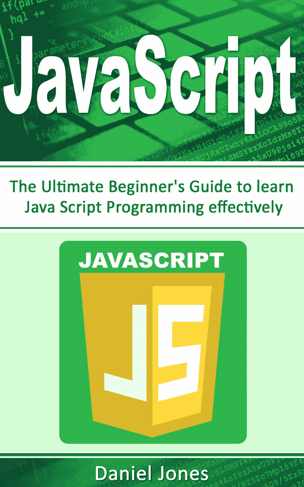

# JavaScript：初学者高效学习 JavaScript 编程终极指南



## 引言

恭喜你下载本书，感谢你的支持。

后续章节将讨论你如何有效地学习 JavaScript。虽然这些章节不一定教你 JavaScript（尽管包含一些快速技巧），但它们将教你学习它的正确方法。

市场上有很多许多关于这个主题的书，再次感谢你选择这一本！我们已尽一切努力确保它包含尽可能有用的信息，请尽情享受！

## 第 1 章：学习准备

当你考虑学习如何编写 JavaScript 时，采取的最重要步骤是准备好学习你需要做的事情。准备工作的一部分包括了解 `JavaScript` 究竟是什么以及它是如何起源的。你还应该通过学习 `JavaScript` 相比其他编程语言的优势，确保你真的为你的网站选择了正确的语言。

### 它是什么？

`JavaScript` 是一种语言。它与你熟悉或听过的大多数语言不同，因为它以书面形式存在，并且基于技术。它是与网页另一端的人交流信息的方式，让你有机会确保你已经在网站上传达了你的观点。你不能“说” `JavaScript`。如果你这样做，听起来会断断续续的，而且可能没有意义。

当你从网站的后端用 `JavaScript` 编写内容时，访问你网站的人看来，就像是你真的在上面写了东西。如果你不使用编程语言，你的网站看起来就像是许多随机的数字、符号和字母，这不仅会让访问者感到困惑，还可能对任何想要享受你网站的人产生不利影响。它可能会损害你通过该网站想要实现的目标。

你可以使用许多不同的编程语言，但 `JavaScript` 是最流行的语言之一。它允许你更改字体的外观，添加可点击的按钮，并在当人们想在网站上执行不同的操作时，让你的网站具有完全的功能性。它也是你可以学习的最简单的编程语言之一。

### 它从哪里来？

`JavaScript` 于 1995 年正式在操作系统上可用。这是它首次在计算机上使用的时候，`Netscape`（网景）是第一个意识到这种代码所功能的实体。它被用于帮助创建网页以及人们在使用个人和办公计算机时会看到的其他内容。

由于该名称与其他不同类型的编码名称相似，某些程序选择将其命名为 `JScript` 而不是 `JavaScript`。这是制造操作系统的者的决定，但这种做法并没有流行起来。现在大多数公司都称其为 `JavaScript`，它们不会与市场上的其他程序混淆，因为它已经与现在可用的一些其他事物大不相同。

当 `JavaScript` 最初创建时，是为了让每个人都能使用它。在过去，在 1995 年之前，编码非常困难，很少有人知道这样做。它是一种罕见的东西。

### 有优势吗？

在使用 `JavaScript` 带来的许多优势中，易用性是最大的之一。它允许人们利用现有的资源做更多事情，并提供了比市面上使用的任何其他语言更快学习编程语言的机会。

`JavaScript` 几乎是不会出错的，因为之前已经有人创建了必要的开发工作，只需在需要的地方插入代码。虽然对于想要一直使用它的人，学习编写 `JavaScript` 是重要的，但他们也可以直接使用已经编写的代码。任何人都可以以这种方式开始 `JavaScript`，因为它很容易用。

其他优势还包括能够让网页元素变得可点击、创建交互式网页，以及利用 `JavaScript` 平台提供的功能做更多事情。任何知道并想使用 `JavaScript` 的人都可以利用它来增加他们网站的外观。他们还可以利用它来帮助自己营造更加用户友好的氛围。

总而言之，`JavaScript` 是最好的编程语言之一，因为人们可以轻松地使用它，并且因为它带了许多功能。对于刚开始编程的人来说，从 `JavaScript` 开始是一个好主意。

### 你会使用它吗？

几乎每个学习过 `JavaScript` 的人发现他们都会使用它。无论是在自己的网站上经常使用，还是帮助他人处理网站，`JavaScript` 确实非常有用。

一旦你学会了这种语言，你可能就会知道在未来的网络世界中你要用它做什么了。请确保尽可能地学习它，这样你就能利用所学知识完成更多事情。在 `JavaScript` 以及你如何使用它方面，有许多不同的选择。请务必尽力为为你的网站提供尽可能好的用户体验。

毫无疑问，如果你学习了 `JavaScript`，你就会使用它。它的设计初衷是用户友好，你可以利用 `JavaScript` 中使用的代码创建你几乎想要的任何内容。请务必尽全力，并尝试寻找使用 `JavaScript` 的不同方法。使用最创新的方法，将让你在通过 `JavaScript` 编写的选项中拥有一个最出色的网站。

尽管它易于使用，但你仍然应该为学习 `JavaScript` 做好准备，为这个过程做好规划。在决定开始学习之前，先想清楚你想用它做什么，理解使用它的意义，并尽可能多学习关于它的知识。给自己设定一个坚实的起点总是一个好主意，这样你就能利用这种语言以及随 `JavaScript` 一起产生的代码完成更多事情。

## 第 2 章：基础知识

几乎任何拥有电脑的人都可以开始学习 `JavaScript`。由于这门语言相当简单，你不需要使用额外的软件。这在你刚开始时尤为如此，因为你起初只需要用 `JavaScript` 做一些简单的事情，所以不需要太多的额外工具。当你开始尝试更多事情时，可以考虑获取不同的软件和额外的程序，但在刚开始阶段，这些基础知识就足够让你在 `JavaScript` 上发挥最大作用了。

### Web 浏览器

当这门语言首次提供给程序员使用时，它只能在特定的浏览器中使用。现在，它已经发展得非常强大，成为了唯一可以在每个浏览器中使用的语言。它被每个浏览器和平台支持，并可以用于创建无论访问者使用何种浏览器都能正常 way 的 页面。

正因如此，你可以使用任何类型的浏览器来实现你的 `JavaScript` 目标。大多数人会选择他们最喜欢的浏览器，或者他们为了个人用途浏览网站时常用的某一个。另一些人则会选择不同的浏览器，这些浏览器对于查看他们创建的网页来说可能更好或功能更全。

人们最常见的做法之一就是直接使用默认浏览器。这是当你点击网站链接或尝试打开网页时自动弹出的浏览器。编写 `JavaScript` 的人这样做是为了避免在每次打开自己制作的页面时都要费心处理兼容性问题。这是一种简单的方法，而且能让他们完成更多操作。

### 编辑器

在开始阶段，你选择的编写 `JavaScript` 的编辑器并不会产生太大影响。它仅仅是一个让你把所有信息输入到其中并保存的地方，以便你可以在网页上使用，并且它能与你创建的网页良好地配合。

你可以下载多个程序到电脑上，它们可以用来编辑你的 `JavaScript`。其中大多数程序都是免费且易于使用的，这样你就不需要为了开始编写 `JavaScript` 而得担心学习一个完全全新的程序了。你可以在网上找到它们，或者如果你使用的是较新的电脑，可以在电脑自带的应用商店中找到它们。每个程序都有不同的优点，但大多数它们只是简单的纯文本处理器。

如果你运行的是 Windows，你可能会惊讶地发现你已经有一款软件可以让你开始编辑 `JavaScript` 了。`记事本`（Notepad）并不是为此创建的，但可以用于此目的。它是纯文本的，在你编写文本时，它不会像 Word 或其他处理器那样对文本进行修改。你可以直接使用电脑自带的 `记事本` 在笔记中编写并保存所有的 `JavaScript`。

### 脚本标签

编写 `JavaScript` 有两种主要方式，第一是创建脚本标签（script tags）。这些是你写在网页上的标签，你将代码放入脚本中，这样你的网站就完成了所有代码的实现。对于想要基础代码且只需要一个基础网站的初学者来说，这很容易，因为只需要将代码放入每个脚本中即可。对于那些不想频繁编辑网站或对网站没有太多改动需求的人来说，这是理想的。

要做到这一点，你只需要编写：

```html
<script type= “text/JavaScript"> 在这里写下你想包含的所有信息，并确保它是纯文本。这就是你的记事本编辑器的用途，也是你为了确保操作正确而可以做的事情。</script>
```

当人们点击它时，这些信息就会出现在你的网站上。如果你只是直接写它而不加 `script` 标签，文字将不会显示。如果你运气好，它可能只是一串符号和数字，中间夹杂一些字母。

如果你只想开始练习 `JavaScript`，这是最好的方法。它将让你有机会真正开始编写它，并让它出现在网页上。

### 脚本链接

一旦你对 `JavaScript` 以及你用它能做的事情越来越熟悉，你就可以开始链接到你编写的脚本了。如果你计划进行很多更改、有很多信息，或者想让你的网站具有交互性以便人们点击并获得结果，这是一个非常好用的方法。

要使用链接，方法类似。你在纯文本编辑器（如 `记事本`）中编写代码。然后保存你刚刚编写的代码，使其有一个易于识别的名字。确保你使用 `.js` 结尾，这样它在链接时就会被转换。

当你准备好链接你保存的 `JavaScript` 时，你只需要编写：

```html
<script type= “text/JavaScript” src= “scripts/choosisfile.js"></script>
```

在 `choosisfile.js` 的位置你需要你需要自己的文件名，即你刚刚保存到电脑的文件，以便它与你编写的内容链接起来。

### 变量

网页有很多不同的变量，这就是网页如何通过显示不同信息让人们在不同页面上看到它们。你还可以利用已有的内容做许多不同的事情，展示给决定访问你网页的游客。

变量是你向网站传达你想说的内容。它们是代码的“核心”，也是游客来到你的网站时所关注的内容。你只需要编写：

```javascript
var grapes = 7;
```

当然，如果你是在谈论苹果的话。这会告诉你的代码你有 7 个苹果可用。结尾处的分号用于告诉你的代码你已经说完了，它可以继续处理代码中的下一项内容。它就像句末的句号，但它是为了让你的代码知道何时停止。

如果你想告诉游客有 7 个苹果，你只需要写一个变量警框：

```javascript
alert('We have’ + grapes + ‘ grapes!');
```

“We have”和第二个“grapes!”就是访问者进入网站时会看到的内容。他们不会看到其中编写的各种标点符号和 `+ grapes`。`+grapes` 是用来告诉代码在那个位置显示你实际拥有的葡萄数量。

在编写代码时，请记住它是区分大小写的。这是因为不同的大小写可能意味着不同的含义，所以确保你编写的方式与预期的写法完全一致非常重要。这是使用 `Notepad` 的用处之一，因为它不会自动将单词转为大写。

## 提示框（Prompts）

现在你已经告诉访问者，你的网站上有 7 颗葡萄可以挑选了，你现在可以让他们在访问网站时选择他们想吃几颗。显而易见，他们并不是真的吃，但当访问者选择在网站上进行某些操作时，这是展示交互效果的最简单方法之一。

编写提示框：

```javascript
var eat = prompt(‘How many grapes do you want? ‘3’)
```

如果访问者想吃 3 颗葡萄，就会显示这个内容，它会进行调整并告诉你剩余多少颗葡萄。如果你编写代码：

```javascript
grapes -= parseInt(eat);
alert(‘We only have ‘ + grapes + ‘ grapes left!')
```

这就会向访问者显示只剩下 4 颗葡萄了。然后你可以选择添加另一个提示框，询问他们是否想吃更多葡萄或想继续离开。

你可以对网页上的任何内容执行此操作，它会向访问者展示不同的可用选项。确保为他们提供尽可能的信息并让他们通过提示框进行选择，始终是一个明智的决定。

当你编写 `-=` 时，你正在使用一个运算符。它的作用与实际数学题完全相同。可以使用的各种运算符有 `+`、`-`、`*` 和 `/`。它们被用于加、减、乘、除，可以轻松用在你编写的任何 `JavaScript` 代码中。它们告诉访问者执行了什么操作，并教你的代码在处理网页上各种选项时，应该如何对不同的项目进行加减运算。

## 第 3 章：测试

在编写 `JavaScript` 的不同部分时，你会想要对其进行测试以确保它运行正常。如果你是在网站的 `script` 标签内编写代码，你只需要做的就是保存已做的更改，并在另一个窗口甚至不同的浏览器中打开它，以确保它看起来正确且没有问题。如果你将其链接到网站或电脑上的某个位置，你还需要做更多工作来确保它运行正常。你需要将它保存到原有的文件中，然后在不同的浏览器中打开它时尝试查看。

### 充当访问者

测试 `JavaScript` 时，你可以做的最重要的一件事就是假装自己是网站的访问者。确保你感觉自己是第一次访问它，并点击它的每一个部分，这样你就能知道自己在寻找什么。这样做将让你看到你网站上的许多不同选项，并对你的网站执行不同的操作。

访问网页并环顾四周。看看哪里可以点击，你可以做什么。如果你设置了变量和提示框，点击它们并确保它们运行正常。留心网站上可能出现的任何遗漏代码或字母。如果你看到了，就记录下来，这样你以后回来就知道要修改它们。这是你了解自己对网站做了什么，以及需要对它做哪些处理的简单方法。

如果你想真正确保捕捉到网站上的所有问题，可以考虑让别人来做。第二双眼睛会很有帮助，因为他们没有盯着这些东西看了几个小时，他们能够挑出你在编写代码时可能犯的更多错误。务必告诉他们你的网站还没有完成，如果他们帮助你的话，你可以做得更好。

### 出现的问题

当你查看网页并进行测试时，可能会出现很多问题。最常见的问题是内容编写不正确，或者没有放在你希望所在的位置。例如，你需要确保你的 `JavaScript` 编写方式正确，这样你才能把它放在正确的位置。

你的提示框可能没有出现，或者出现时旁边没有警报框（alert）。当它出现时，可能会有问题。它看起来可能不同，可能会有你不想要的单词，或者代码取决于你真正想要写的内容而不同。

在查看网站时，确保你记录下所有问题。这将节省你的时间，并避免你不断在查看已完成的代码和编写让代码完成后呈现成那样的代码之间进行切换。如果你在电脑上工作且旁边有一部智能手机，你甚至可以在访问网站时为你看到的内容拍几照片，这样当你回来开始编写时就能确定自己在寻找什么。

### 检查错误

人们在编写代码时最常犯的错误是将不该大写的地方写了大写，或者忘记大写该大写的地方。这种错误不仅会改变你网站的外观，还可能使其变得无法识别。确保你始终检查大小写。

现在有一些可用程序会将你写的单词自动大写，即使这些程序是专门为制作代码和编写 `JavaScript` 设计的。一个不会为你进行自动大写的程序是 `Notepad`。这是为什么它对初学者来说是一个很好程序的众多原因之一。

如果你使用了 `Notepad` 程序并确保所有大小写都正确，你可以尝试代码中可能存在的其他问题。某些可能拼写错误，你可能使用了错误的运算符，或者只是在编写方式有问题。这并不意味着你代码写得不好，而是你可能溜进了一些额外的字母。

### 确保保存

如果你使用的是保存到不同文件的方法，你始终需要确保保存。除了其他错误（如大小写错误或额外字母）之外，这是你在查看网页时发现的最常见问题之一。只需确保你已保存所有内容，并且它们处于你想要的状态即可。

直接在标签中编写代码略有不同，但你仍然需要确保尽可能地保存它。你可以将其保存在网络浏览器中，也可以将其保存到不同的区域，以便你能够尽可能完美地完成工作。如果你决定直接在标签内编写，你始终可以用一种方便你的方式来保存，这样你就不必担心各种问题了。

## 尝试更多

当你测试了你的网站，并且一切都运行正常时，你可能想向它添加更多内容。你可以为它添加不同的提示框（prompts）和警告框（alerts），这会让它看起来更专业。它还将带给你一个机会来扩展页面，使其与你网站上的其他页面相匹配。你甚至可以编写代码将你的页面连接起来，并在访问者点击其中一个页面时，将他们引导到不同的页面。

当你学会如何编写 `JavaScript` 时，你可以在网页上做很多更多事情。考虑一下当你尝试为网页添加不同选项时可以做的一切事情。你可能会发现，通过向网页中添加更多信息，你可以做更多，并从你的网站中获得更多。

即使是最简单的命令，如 `alerts` 和 `prompts`，你也可以让你的页面变得多维度。始终尽力为页面添加更多内容，并不断学习关于 `JavaScript` 的知识，这样你就能添加更多功能。

## 添加不同的变量

虽然 `alerts` 和 `prompts` 非常棒，但你的网站需要的不仅仅是问人们想吃多少颗你的葡萄。它需要有不同的页面、不同的提示框，甚至有人们可以点击的不同按钮。在这些之中，你可能想要更改颜色、字体以及在页面上的位置。幸运的是，这些都是你通过 `JavaScript` 可以实现的内容。

一旦你掌握了 `JavaScript` 的基础及其工作原理，你就可以对它进行重大更改。你可以通过“文本颜色”标签以及“文本样式”字体来更改文本颜色。你可以使用 `<b>`、`<u>` 和 `<i>` 标签对网站上的内容进行加粗、下划线和斜体处理。要停止使用这些标签，你只需要输入 `</style>` 或 `</b>`、`</u>` 和 `</i>`。

这些每一个操作都会让你的文本与众不同。你甚至可以使用标签来更改警告框的颜色、背景以及你的文本在页面上的位置方式。

随着你学习更多 `JavaScript`，你会发现你的网页上执行不同事情的选项是完全无尽的。任何你想在页面上编写或更改的内容触手可及。是否能够使用这些不同的功能完全取决于你的想象力。

不过，在进行这些操作之前，你需要确保你始终在测试你的网站。测试它以找出哪里出了问题。测试它以确保它看起来良好，并测试它以发现你还可以添加什么。随着你越来越熟悉 `JavaScript`，你会发现测试是可以很有趣的，甚至可以让你在页面上做得更多。测试是确保你的网站出色的关键。

## 第 4 章：付诸行动

如果没有人能看到那些页面，那么了解 `JavaScript` 和构建网页又有什么用呢？你和 `JavaScript` 之间可以做很多事情，但如果你想成功并让你的 `JavaScript` 知识为你服务，你就需要能够将这一切付诸行动。采取以下步骤将你的 `JavaScript` 能力付诸实践。

### 获取网站

如果你想让人们能够访问你的网站，你需要一个域名。那些没有使用你同一台电脑的人无法通过点击你创建的文件来看到你用创建的内容。即使你使用 `Notepad` 创建的 `JavaScript` 是完美的，如果访问者无法通过网站查看它，他们也无法看到。

你可以从许多不同的来源购买域名。有些平台，比如 `Goaddy`，以非常低的价格出售域名。这些通常是允许你为网站命名的域名，并确保你通过创建一些你能够提供给想要访问你网站的人的东西，从而获得最大价值。确保该域名是你和你和你的访问者都能轻松记住的。

某些域名可能因为其流行程度而非常昂贵。例如，你可以使用你的名字作为域名，但 `joseph.com` 可能已经被占用，或者可能花费数千美元，因为它是一个非常受欢迎且可能耗费大量资金的东西。网站的变体，如 `facebookses.com`，可能也很贵。如果你想要一些基础的，比如 `iliketocode.com`，价格可能会便宜一些，因为它们并不极端常见。

研究一下你打算托管 `JavaScript` 的域名类型是一个好主意。这对于你的网站以及确保你的 `JavaScript` 能够被看到来说是非常重要的。找到一个与你的网页主题以及你希望人们在访问时看到的内容相匹配的域名是一个好主意。如果你刚刚开始学习 `JavaScript` 和构建页面，考虑只从获取一个非常便宜的域名开始。即使它不是你喜爱的，它也将是你利用它练习 `JavaScript` 的绝佳方式。

### 使用托管主机

互联网并不完全像你的电脑。你不能只是打开一个网页就开始在上面打字，除非你有一个域名。你需要确保你正在使用托管主机。托管主机将为你提供一个放置信息以及构建 JavaScript 的平台。托管主机是信息进入的地方，而页面是人们访问网站时看到的内容。

寻找与 `JavaScript` 兼容的托管主机。与其他某些编程语言不同，几乎所有的托管主机都能支持 `JavaScript`，因为它是一种通用编程语言。这意味着可以在任何类型的浏览器上使用，所以你选择的托管主机应该都能兼容。

有很多不同的托管主机供你选择。对于所有这些主机，你都需要电脑上下载一些软件。最常见的是 `WordPress`。你只需要下载软件，就可以托管你的网站，`JavaScript` 也可以被放入该托管主机中，以便你的访问者看到它。通过你的托管主机，你可以控制一切，包括你用于电脑的代码。

### 输入你的 JavaScript

将你的 `JavaScript` 放入你为域名选择的托管主机中是整个过程中最重要的部分，特别是如果你想拥有一个功能完备的网站。你的网站应该呈现在访问者面前，并且应该比网络上提供的其他选项更好。确保你尽力将你的 `JavaScript` 放入其中，并以正确的方式放入。

如果你使用链接法，请确保你的网站以正确的方式链接到你编写的 `JavaScript`。始终确保你更新文件，这样当人们看到网站时，看到的是 `JavaScript` 的结果，而不是仅仅看到在其中的大量的代码。

取决于你使用的主机类型，使用标签方法可能会对你来说更容易。当你使用这种方法甚至链接方法时，你会想要确保你已经保存了存入其中的信息。在平台上进行工作时，你可以保存正在处理的工作，而无需向访问者展示未完成的产品。如果你正在开发网站，你的网站将不会显示为已上线，访问者只会看到错误信息或空白页面。

一旦你完成了工作并添加了所有你需要的 `JavaScript`（并在此过程中进行了保存），你就可以发布它了。在你决定在主机上对该页面使用 `publish` 函数之前，访问者不会看到你所做的更改或你放入网站的 `JavaScript`。

## 格式化它

你可以对 `JavaScript` 中的不同内容进行格式化。你想要做的第一件事是使用 `JavaScript` 设计落地页。你可以通过 `alerts` 和 `prompts` 实现这一点，也可以从一个“脚本背景”标签开始。你可以将背景设置为你喜欢的任何。它可以是纯色，也可以是你拍摄的照片。在将图片作为网页的背景时，请务必确保你拥有相应的权利。

然后，你可以向页面添加各种不同的内容。你可以使用在人们访问你的页面时立即弹出的欢迎 `alert`。你还可以使用你学过的不同 `prompts`，确保人们知道他们在页面上应该做什么。

一旦你完全学习了可以用于你网站的所有 `JavaScript`，你就可以开始更改人们首次访问你网站时的颜色和外观了。这将让你有机会确保某些事情看起来更好，并且它们是以正确的方式执行的。

在完成网页的基础部分后再进行这样做是一个好主意。例如，在决定更改网页的颜色或字体之前，务要确保你已经使用 `JavaScript` 将所有信息都放在了网页上。在开始对你创建的页面进行任何类型的深度定制之前，始终务要确保你已经通过 `JavaScript` 完成了所有可能的操作。

## 作为模板使用

在编写 `JavaScript` 时，要确保所有的格式都正确可能是困难的。由于完成所有这些工作非常耗时，你应该经常保存你的工作。如果你用 `JavaScript` 制作了一个你喜欢的网页，可以将其保存为模板，稍后用于你在相同域名下甚至不同域名下创建的其他页面。这些可以作为模板或起始点，你可以在其基础上进行添加或调整，但你就不需要每次在创建一个新页面时都完全重写页面了。

你编写 `JavaScript` 的经验越丰富，就越可能拥有许多这样的模板。你可能会有几个不同的模板，供你在拥有的不同页面中使用，这将让你有机会利用现有的工具做更多事情。它还会让你在开始制作网页时确保少做一些工作。除了这些模板，你还可以找到别人用 `JavaScript` 制作的模板并使用它们。虽然这是一个快速起步绝佳“捷径”方法，但它并不会教你你所需的关于 `JavaScript` 的所有知识。

你尽可能学习更多 `JavaScript` 知识的最简单方法是开始自己动手。即使你不需要网站或网页，也创建一个，以便在你学习如何利用这项技能完成更多事情时可以练习你的 `JavaScript`。

# 第 5 章：文档化 JavaScript

如果你不记录你做了什么以及你所做的 `JavaScript` 起了什么作用，你永远无法完全掌握你在 `JavaScript` 中在做什么。请确保尽可能多地学习 `JavaScript`，并始终跟踪你如何使用它以及你用它做了什么。这将向你展示你已经学了什么以及你还需要学习什么。它还可以作为你的参考字典，方便你跟踪你已经掌握的 `JavaScript` 以及你学会如何做的 `JavaScript`。

有两种记录记录方法。你可以在电脑上记录，也可以实时记录。如果你想在电脑上记录，请从打开一个 Word 文档或其他类型的处理文档开始。不要使用 `Notepad` 文档，因为可能效果不好，并且最终可能会被标记。在学习时，把它写下来。如果你学习了许多 `JavaScript` 知识，开始以符合你逻辑的方式来组织文档。你可以通过简单的代码、不同的观察结果甚至 `prompts` 来组织它。确保你包含了：

- 如何编写背景代码
- 如何更改字体颜色（或任何颜色）
- 如何更改字体样式
- 将内容移动到哪里
- 如何创建一个 `alert` 并对其进行格式化
- 如何创建一个 `prompt` 并对其进行格式化
- 编写不同内容的方式的变化
- 字体、对象甚至页面的尺寸

你可以通过将 Word 文档组织成不同的“章节”并对其标记标签来实现这一点。这很容易，因为如果你在电脑上工作，它会一直带在身边，你将能够找到所需的确切指令，以确保你以正确的方式完成任务。

你可以做的另一件事是将你的 `JavaScript` 文档放在电脑之外，放在“现实生活中”。你可以使用学科笔记本来跟踪信息。当你刚开始时，将其划分为不同的章节，如字体、警报和格式。当你学习不同的内容时，将它们添加到相应的章节中。

## 学习时

当你学习更多关于 `JavaScript` 并发现可以使用不同的代码时，请把它们写下来。不要只是用过它们就忘记了。

例如，当你学习如何使用 `JavaScript` 创建 `alert` 时，你可能在编码时就开始使用它了。这是一个确保你有大量练习的好极方法，但如果你忘记了是如何做的，你仍然需要回到这本书。把它写在不在你实际 JavaScript 页面上的地方。

由于编码时通常会有很多事情需要处理，而且你需要记住许多不同的事情，因此你应该在操作过程中记录下信息，因为如果没有这些信息，你可能会忘记自己是如何正确地编写代码的。始终对已有的代码进行不同的操作，并始终尝试确保它们是以正确的方式编写的。

## 新尝试

在编码时，不要害怕尝试新事物。如果你发现了一些想要尝试但目前用不上的代码，始终回到你最初的那个练习网页。

即使是最经验丰富的开发者，在发现新事物时也会尝试一下。自己尝试编写代码可能也会有帮助。尝试输入不同的信息并看看会发生什么。这很棒，但请将其记录下来，这样如果它不起作用或导致你的页面丢失大量信息，你可以回来并将其删除。你永远不知道调整代码会产生什么影响，所以要记录下来，以便以后回来删除它。

如果你发现了你非常喜欢对现有代码进行的某些操作，你应该将其标记。考虑在你的文档中开辟一个地方存放你尝试过并真正喜欢的内容。虽然这些可能是你记得最深的事情，但在学习如何进行更多操作时，你仍然需要为它们一个参考点。一旦你在 `JavaScript` 中发现了新东西，你就应该尽一切努力将其包含在你的文档中。

如果你发现了你不喜欢的东西，请将其列入黑名单。这意味着你应该在文档中留出一个地方存放你不喜欢的东西。这样，当你想要在文档中寻找新的操作方法时，你就知道不要从那里获取，因为你上次尝试时并不喜欢它。

## 改变事物

改变是 `JavaScript` 最棒的地方，它将让你能够颜色和样式看起来不同。

要更改你的 `JavaScript` 中的颜色，你只需要做：

```javascript
var color = documentname.col.style.color = "color"
```

你使用的颜色可以是红色、蓝色或黄色等基础颜色。如果你想使用不同的颜色或脱颖而出且自定义的颜色，请使用调色轮。你在网上以及编写 `JavaScript` 时可能会使用的调色轮被称为 `hex`。这是你想要使用的颜色的代码。每种颜色都有一组独特的字母和数字使其独一无二。它以 `FFFF` 代表白色，以 `000000` 代表黑色。之间有数百种颜色，最复杂的 `hex` 代码将包含每种颜色的许多深浅色。找到你喜欢的那个，并将其放在代码中“color”所在的位置。

当你想要让文本不再显示那种颜色，或者让你 `JavaScript` 标记中的不同对象不再显示那种颜色时，你只需要做 `</color>`。通常，在 `<>` 括号之间使用 `/` 会停止某种效果并恢复自动颜色。如果你想再次更改颜色，只需编写新的 `var color` 代码即可。

要更改大小，你只需要做：

```javascript
var str = "Words that you want to have the same font."
var result = str.fontsize(14)
```

字体大小具有不同的含义，取决于你查看网页时使用的浏览器。一定要学习字体大小并跟踪它们的工作方式。准备一种可以比较字体大小 1 和 14 之间差异的方法是一个好主意。对于很多内容，你将使用 10 到 16 之间的数字，标题通常在 20 左右。较小的字体（如 1-6）将用于你不一定希望人们能轻松阅读的小信息。

## 制作笔记

当你制作网页并享受可以使用它所做的不同事情时，你应该确保自己正在做笔记。

如果你正在使用文档来跟踪一切，请确保你保留了一个“笔记”部分。笔记将让你有机会写下不同的可能没有编写代码的内容。

例如，你可以在笔记中包含这些内容：

“使用了颜色代码 `FF5581`，并且喜欢这种颜色与 `000000` 的组合。这种组合看起来很好，并使用了加粗标签 `<b>` 让它在页面上更加突出。字体大小没有区别，因为它看起来很棒而且在几乎每种颜色下显示。”

你做的 `JavaScript` 越多，创建的页面越多，笔记就会越多，所以请为笔记部分包含的不同内容留出足够的空间。

# 第 6 章：聘请专业

当你考虑 `JavaScript` 以及你能从中学到的所有东西时，你可能会想找一个可以教你所有所需知识的人。专业人士既可以教你 `JavaScript` 的方法，也可以直接为你完成。这是一种省事的方法，许多人选择这样做，这样他们就不需要学习新东西。你可以聘请专业，但如果你可以自己学，为什么要请他们呢？当然是为了节省时间。

然而，自己动手并不适合所有人。关于聘请专业的信息将帮助你决定这是否是你的正确决定。如果是这样，你应该继续阅读本章，但不应该继续阅读该系列教程了。这样做将教你如何编写 `JavaScript`……而这并不是你想做的，对吧？

## 为你做

有专业人士可以为你完成你能学到的一切内容……（根据教学流程，此处已省略）。

与其自己去寻找需要的知识，你将需要学习老师教你的内容。这可能花费很长时间，代价高昂，而且你可能无法学到你需要的全部知识。

## 学习一项技能

对于那些读过那两个章节的人，你可能已经知道，如果自己学习 `JavaScript`，情况会好得多。你不需要老师，不需要专业人士。你只需要一些能够向你展示你可以所做的所有不同内容，并以一种让你理解的方式来呈现它们。

自己动手做是一个好主意，因为你将学到一项宝贵的技能。学习这项技能将为你提供所需的思路，让你能够在自己的网页上创建内容，并并在 `JavaScript` 的学习过程中发挥创意。

一旦你掌握了关于 `JavaScript` 的所有知识，你甚至可以成为那些专业人士或老师之一。他们的收费非常高，这意味着他们只需花一点精力就能赚到很多钱。如果你对自己的 `JavaScript` 技能有信心，你也可以做同样的事情并从中赚钱。即使你不想通过教学或为他人编写 `JavaScript` 来赚钱，拥有这项技能对你也会非常有帮助。

## 昂贵

雇人为你完成工作或请老师教你如何操作并不是解决办法。从本系列课程中尽可能多学习是一个好主意。购买该系列中关于 `JavaScript` 的其余书籍，其价格可能比向老师上的第一课还要便宜得多。这仅仅是雇佣专业人士处理你的 `JavaScript` 任务费用的一小部分。

由于你可以按照自己的进度进行，自己做甚至可能更快。这让你有机会学习得更多、做更多事情，并开始从中赚钱。通过不雇佣专业人士，你可以节省大量资金，但通过成为 `JavaScript` 专家，你可以赚到很多钱。请确保你已经准备好学习，并对在书中学到的每项 `JavaScript` 知识继续保持良好的表现。

如果你觉得你已经从这本书中学到了你需要的知识，那么恭喜你。你不再是一个初学者了，可以转向 `JavaScript` 的其他领域了。尝试书中教给你的所有内容，准备开始成为一名 `JavaScript` 专业人士。你现在就能从中获益。仅仅学习书中包含的几段代码就足够让你入门了。事实上，你完全可以利用这些代码构建一个整个网页。它可能不会非常有趣或具有互动性，但它是你可以独立完成的。

当你开始学习更多内容时，请记住书中教给你的一切。始终记录你所做的更改，将内容保持在一个地方，并利用你学到的信息进行回顾参考。即使是专业人士有时也会忘记如何更改文本颜色或字体大小。跟踪并记录一切将让你始终有一个可以回溯的地方，那里会比你以后将学习的高级 `JavaScript` 要简单。

## 结

感谢你读完这本书，希望它为你提供了许多有益的信息，并能够为你提供实现目标（无论这些目标为何）所需的所有工具。

下一步是开始使用你所学到的 `JavaScript` 并开始准备。你也可以查看该系列中的其他书籍，学习比 `JavaScript` 基础知识更多的内容。你关于它读得越多，就越能学会如何编写它以及可以用它来做什么。

最后，如果你发现这本书在任何方面都有用，我们非常欢迎你在 Amazon 上给出评价！
