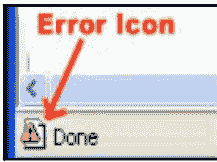
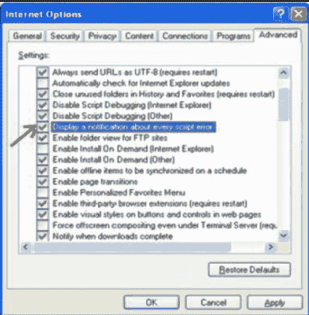

# JavaScript：初学者指南！

## 引言

感谢你的购买并祝贺你购买了我的书……

《JavaScript：终极入门指南！》

这本书将帮助你成为一名高效的 JavaScript 用户。如果你想快速轻松地学习 JavaScript 语言的基础知识，那么你现在必须拥有这本书。

这本书将解释有关 JavaScript 语言的重要事实。它不包含任何无关信息。每一页都包含了宝贵的课程、指令和示例。阅读完这本书后，你将熟悉对象、函数、变量、语句和其他 JavaScript 元素。

再次感谢购买此书，希望你喜欢它！

## 第一章：通用信息

JavaScript 是一种面向对象的脚本语言，你可以在不同的平台上使用它。在宿主环境（例如，网络浏览器）中，你可以使用 JavaScript 对对象进行程序化控制。

这种脚本语言带有一个丰富的标准库。该库包含了对象（例如 `Math`、`Date`、`Array` 等）和核心语言元素（例如语句、操作符、控制结构等）。截至目前，程序员们通过添加额外的对象来扩展 JavaScript 的基本功能。他们这样做是为了提高该语言在完成某些任务时的效率。

以下是 JavaScript 最流行的两种变体：

- **服务端 JavaScript** – 该变体旨在帮助程序员运行 JavaScript 或 Web 服务器。例如，服务端扩展可以帮助应用程序与数据库交互、进行文件更改并提供连续的信息流。

- **客户端 JavaScript** – 这种形式的 JavaScript 是为浏览器及其相应的 DOM（即文档对象模型）创建的。例如，客户端 JavaScript 可以帮助应用程序将元素保存到 HTML 文档中，并对用户操作做出响应（例如表单输入、鼠标点击、页面导航等）。

## JavaScript 与 Java 语言

Java 和 JavaScript 是两种不同的编程语言。JavaScript 与 Java 有一些相似之处（例如命名规范、表达式语法、控制流结构等）。然而，它不具备 Java 的两个独特特征：强大的类型检查和静态类型检查。

根据许多人的观点，这两种语言是完全无关的。Netscape（开发 JavaScript 的公司）将语言名称从 LiveScript 改为 JavaScript，以利用 Java 的流行性；因此，这些语言名称之间的相似性是因为营销考虑而产生的。

在此，我们将讨论这些编程语言之间的主要区别。这些信息将帮助你加深对 JavaScript 和通用编程的了解。

**JavaScript** – 这是一种自由形式的计算机语言。在使用 JavaScript 时，你不需要声明所有的方法、类和变量。你不需要担心你将使用的方法类型（例如它们是私有的、公有的还是保护的）。此外，你不需要为 JavaScript 实现任何接口。

**Java** – 这种基于类的计算机语言是为了类型安全和快速实现而创建。这意味着你必须使用类及其对应的方法来创建程序。Java 的数据类型和类继承需要严格的对象层次结构。简单来说，Java 语言比 JavaScript 更复杂。

## 如何开始？

你不需要为了使用 JavaScript 而下载文件或在电脑上安装程序。你只需要访问你喜爱的网络浏览器来创建自己的 JavaScript 应用程序。在 JavaScript 编程方面，Firefox 是最好的浏览器之一。因此，这本书将关注 Firefox 浏览器中提供的工具。如果你的电脑没有 Firefox，建议你访问此网站：`https://www.mozilla.org`。该浏览器免费且易用；因此，你可以轻松掌握 JavaScript 基础而无需付费。

一旦下载了 Firefox，你将看到两个专门为 JavaScript 编程创建的强大工具。这些工具是：

### 1. Web 控制台

此工具显示屏幕上加载的网页信息。它还具有一个命令行功能，你可以用它在加载的页面上运行 JavaScript 语句。要访问 Web 控制台，你必须启动 Firefox，点击“工具”，并在名为“开发者”菜单中选择“Web 控制台”。激活 Web 控制台后，你会在屏幕底部看到一个命令行。你可以在该行输入 JavaScript 表达式，然后屏幕中间的面板将向你显示输入表达式的结果。此功能会立即显示结果——你将迅速判断自己是否输入了错误。

### 2. 笔记本

Firefox 的 Web 控制台非常适合运行单个 JavaScript 表达式。虽然你可以用它运行多行，但你会发现这项任务极其不便。此外，你无法使用该工具保存代码。

幸运的是，Firefox 还有另一个解决上述问题的工具。使用此工具，你需要执行以下操作：

访问此工具：

1. 启动 Firefox 浏览器。
2. 点击工具。
3. 寻找“开发者”部分并选择“笔记本”。

此工具是一个独立的 Firefox 窗口，类似于文本编辑器。你可以用它在浏览器中编写和运行 JavaScript 代码。此外，你可以使用笔记本保存新代码或加载现有代码。

## 你的第一个 JavaScript 应用程序

在本节中，你将使用 JavaScript 编写你的第一个应用程序。这个简单的活动将让你体验 JavaScript 的功能和编程环境。

启动笔记本并输入以下代码：

```javascript
function greetMe(userName) {
    alert("Hello " + userName);
}
greetMe("World");
```

选中 JavaScript 代码并按 `Ctrl+R` 在你的屏幕上查看结果。

下一章将讨论 JavaScript 的语法和特性；因此，你将能够创建比上面更复杂的应用程序。

## 第 2 章：JavaScript 语言的基础元素

在本章中，你将学习 JavaScript 的语法、变量、数据类型以及常量/字面量。

### 通用信息

这种编程语言的语法与 Awk、Perl、Java 和 Python 相似。此外，它是区分大小写的，并使用 Unicode 字符。

在使用 JavaScript 时，程序员将计算机指令称为“语句”。你应该使用分号分隔语句。JavaScript 还支持空白字符（例如制表符、空格和换行符）。这意味着你可以使用这些字符来提高 JavaScript 语句的可读性。

JavaScript 编译器从左到右扫描源代码，并将其转换为一组输入对象（即注释、空白字符、标记、行终止符和控制字符）。

### 注释

JavaScript 编写注释的语法与大多数编程语言相似。你必须使用两个斜杠（即 `//`）来创建单行注释。然而，要创建跨行注释，你必须在注释的开头和结尾分别使用 `/*` 和 `*/`。下面的截图将向你如何在编写自己的代码时使用这些字符：

```javascript
// 一行单行注释

/* 这是一个较长的、
   多行注释
   */
```

重要提示：JavaScript 不支持嵌套注释（即放在另一个注释内部的注释）。

### JavaScript 中的声明

JavaScript 编程语言支持三种类型的声明。这些是：

- `var` – 使用此声明创建一个新变量。在声明期间，你可以为变量赋值。
- `let` – 此声明允许你创建一个局部变量。你可以在声明阶段为变量放置值。
- `const` – 使用此创建一个常量。常量是只读的：在声明之后，你不能更改它们的值。

让我们详细讨论一下这些声明：

### `var` 声明

该声明的语法为：

```javascript
var varname1 [= value1 [, varname2 [, varname3 ... [, varnameN]]]
```

你可以将 “varname1” 替换为任何有效的标识符。JavaScript 拥有保留关键字 —— 即那些不能用于命名变量、常量、对象等的单词。你将在稍后学习这些关键字。

在此语法中，“value1” 代表变量的值。你可以将其替换为任何有效的 JavaScript 表达式。

### 它是如何工作的？

JavaScript 解释器将变量声明优于任何类型的代码。通过 `var` 声明的变量作用域充当它的活动执行上下文（即局部或全局）。

如果你为一个尚未声明的变量赋值，你将得到一个全局变量（即可以在程序的任何部分访问的变量）。以下是已声明变量与未声明变量之间的主要区别：

- 已声明的变量局限于声明它的函数。这意味着函数无法访问在其他函数内部创建的已声明变量。相反，未声明的变量 100% 的情况下都是全局的。
- JavaScript 解释器会在运行任何代码之前创建已声明变量。然而，未声明的变量只有在解释器运行了必要的代码后才能存在。
- 已声明的变量是相应函数的一个不可更改的属性。因此，函数不能编辑或删除它包含的已声明变量。相反，未声明的变量允许修改。这意味着你可以根据需要编辑或删除它们。

由于上述差异，如果你未能正确声明变量，你的程序可能会产生意想不到的或不符合意愿的结果。因此，无论作用域如何，声明变量都是良好的编程习惯。

### `let` 声明

此声明的语法为：

```javascript
let var1 = value1[], var2 = value2[], ..., varN = valueN];
```

你可以将 “var1” 替换为你想要为变量使用的名称。

如果你想为新变量赋值，只需将 “value1” 替换为适当的数据。

### 它是如何工作的？

此声明允许你创建变量，其作用域限制在使用它的表达式、块或语句中。

如果你使用 `let`，你得到的变量会将其容器视为作用域。在这方面，`let` 与 `var` 相似。主要区别是 `var` 的作用域是包含它的整个函数。

### `const` 声明

通过此声明，你可以创建一个指向任何值的只读引用。基本上，你仍然可以在需要时编辑这些引用。只是在声明阶段之后你将无法转移或重新分配它们。此声明的语法为：

```javascript
const name1 = value1 [, name2 = value2 [, ... name = valueN]];
```

### 它是如何工作的？

通过此声明，你可以生成一个局部或全局的常量（也称为字面量）。上述语法需要一个初始化值。这意味着你必须在声明时指定变量的值。

常量是块作用域的。在这方面，常量与通过 `let` 声明的变量相似。重要提示：你不能通过重新赋值更改常量的值。

### JavaScript 变量

程序所需的符号标识符。在命名变量时，你必须记住这些规则：

- 使用字母、美元符号（即 `$`）或下划线（即 `_`）作为变量名。你可以在名称中包含数字。然而，你不能用数字开头。例如：“javascript1” 是有效的，但 “1javascript” 不是。
- JavaScript 语言是区分大小写的。这意味着在命名变量时必须保持大小写一致。例如，JavaScript 将 “LETTER”、“Letter”、“letter” 视为三个不同的变量。

### 如何声明变量

在 JavaScript 中，你可以通过三种方式声明变量：

- 使用 `var` 关键字 - 例如，`var z = 99`。你可以使用该语法创建局部或全局变量。
- 为未存在的变量赋值 - 例如，`z = 99`。这种方法比上一种简单得多。
- 使用 `let` 关键字 - 例如，`let z = 99`。

你不能通过赋值或重新声明常量来改变它的值。这意味着在声明常量时，你必须 100% 确定你将赋值给常量的数据。

此外，你不能在同一作用范围内创建一个与变量或函数标识符相同的常量。

### 数据类型与结构

在本书的这一部分中，你将学习 JavaScript 支持的不同数据类型和数据结构。请仔细学习这些材料，因为它将为你提供有关该编程语言的重要信息。

### JavaScript 中的不同数据类型

目前，JavaScript 支持七种数据类型。这些是：

- `null` – 这是一个表示空值的关键字。由于这种编程语言是大小敏感的，`null` 与 `NULL`、`Null` 以及其他版本的单词不同。
- `Number` – 数字——69 或 999.99。
- `Boolean` – 这种数据类型有两个可能的值：`true` 和 `false`。
- `String` – 这种类型涉及字母。例如：Hello。
- `undefined` – 这种数据类型被视为任何程序的顶级属性。
- `Symbol` – 这种类型涉及独特且不可变的实例。
- `Object` – 程序员使用这种数据类型来存储与数据处理和使用相关的信息和指令。

尽管这些数据类型数量很少，但它们允许你在 JavaScript 程序中运行酷且实用的函数。函数和对象是该语言最基础的两个元素。你可以将对象视为存储信息的容器，将函数视为你的程序可以执行的过程。

### 将一种数据类型转换为另一种数据类型

JavaScript 语言是动态类型语言；因此，你可以声明变量而不指定它们可以包含的数据类型。此外，JavaScript 会在代码执行期间根据需要自动转换数据类型。这意味着你可以这样声明变量：

```javascript
var apple = 5;
```

稍后，你可能会回到同一个变量并给它赋一个新值。例如：

```javascript
apple = "This is delicious";
```

通过上述代码，你创建了一个名为 "apple" 的变量，并给它赋值了 "5"（即数字数据类型），然后你用一个字符串替换了数字（即 "This is delicious."）。由于 JavaScript 的值重新赋值不会给你带来错误信息。

对于涉及字符串和数值值并使用 `+` 的表达式（即一种 JavaScript 运算符之一），该语言会将数字转换为字符串。下面的代码将帮助你理解这个概念：

```javascript
A = "My age is" + 18 // "My age is 18"
```

```javascript
B = 18 + "is my age" // "18 is my age"
```

JavaScript 不会在涉及其他运算符（例如 `-`、`*`、`/`、`%` 等）的表达式中将数字转换为字符串。例如：

```javascript
"69" - 9 // 60
```

```javascript
"69" + 9 // "699"
```

### 字符串到数字的转换

如果你使用字符串值表示数字，可以使用以下函数转换数据类型：

- `parseFloat()`
- `parseInt()`

`parseInt()` 函数返回整数。这意味着你可以用它来简化小数。此外，在使用 `parseInt()` 的时候包含“进制”（radix，即 `parseInt()` 函数的参数）是一个良好的编程习惯。基本上，radix 允许你指定必须使用的数值系统。

### JavaScript 中的字面量

在 JavaScript 语言中，你使用字面量来表示一个值。我们所说的的值是固定的。除了变量之外，你还可以在 JavaScript 代码中添加固定值。在本节中，你将学习以下类型的字面量：

- 整数
- 数组字面量
- 对象字面量
- 布尔字面量
- 字符串字面量
- 浮点字面量

### 整数

在 JavaScript 中，你可以用二进制、十进制、八进制或十六进制表示整数。

- 十进制形式的整数字面量涉及一组不以零作为第一个字符的数字。
- 八进制整数使用零作为第一个字符。根据规则，这种类型的整数字面量只能使用数字：0-7。
- 十六进制整数以 `0X` 或 `0x` 开头。它们可以包含数字（即 0 到 9）和字母（即 a-f）。
- 二进制整数始终以 `0b` 或 `0B` 开头。它们只能使用两个数字：1 和 0。

以下是一些整数字面量的示例：

- 十进制 – 1, 223 和 -360
- 八进制 – 022, 0004 和 -045
- 十六进制 – 0x2231, 0x99111 和 -0xF2A4
- 二进制 – 0b11, 0b1100 和 -0b10

### 数组字面量

基本上，这种类型的字面量由 0 个或多个表达式组成。每个表达式都代表一个数组对象，放在一对方括号（即 `[ ]`）中。如果你通过数组字面量生成数组，系统将用你指定的值作为对象初始化它。数组的长度等于指定参数的数量。

下面的代码创建了一个四个元素且长度为四的数组 `Countries`：

```javascript
var Countries = ["Bulgaria", "Colombia", "Philippines", "United States of America"];
```

### 数组中的额外逗号

```javascript
var Cars = ["BMW", , "Toyota"];
```

在此数组中，有三个元素，但长度为四（因为中间的空位会被计算在内）。

### 对象字面量

对象字面量是包含在一对花括号（`{ }`）中的零个或多个属性名-值对。以下是一个示例：

```javascript
var car = { make: "Toyota", model: "Camry", year: 2020 };
```

### 布尔字面量

这种数据类型有两个可能的值：`true` 和 `false`。

### 字符串字面量

字符串字面量是由双引号（`"`）或单引号（`'`）括起来的零个或多个字符。例如：`"Hello"`、`'World'`。

### 如何在字符串中使用特殊字符

JavaScript 允许你在字符串中包含特殊字符。这是一个例子：

`"第一行 \n第二行"`

下面的表显示了 JavaScript 支持的特殊字符：

| 特殊字符 | 用途 |
|---|---|
| `\0` | 该字符在代码中添加空字节。 |
| `\b` | 使用这种特殊字符就像按下键盘上的退格键。 |
| `\f` | 使用这种字符你可以在语句中添加分页符。 |
| `\n` | 如果你想在代码中添加换行符，请使用它。输入这种特殊字符就像按下键盘上的回车键。 |
| `\r` | 该字符允许你在代码中应用回车。 |
| `\t` | 这种特殊字符在代码中添加制表符（即按下键盘上的 Tab 键后得到的字符）。 |
| `\v` | 使用这种字符你可以快速地在语句中添加垂直制表符。 |
| `\'` | 使用这种字符在你的语句中添加撇号或单引号。 |
| `\"` | 如果你想在代码中添加双引号，请使用该字符。 |
| `\\` | 该字符允许你在 JavaScript 语句中包含反斜杠字符。 |
| `\xxx` | 你可以使用这种字符为你的代码添加 Latin-1 符号。这种特殊字符需要 0-377 范围内的八进制数字。例如，`\251` 将在你的语句中添加“©”（即版权符号）。 |
| `\xXX` | 这与上一个相似。你可以使用这种字符为你的代码添加 Latin-1 符号。唯一的区别是这个特定字符需要 00-FF 范围内的两个十六进制值。例如，`\xA9` 在你的 JavaScript 代码中添加 ©。 |
| `\uXXXX` | 该字符为你的代码中添加 Unicode 符号。它需要四个十六进制值。例如，`\u00A9` 会添加 © 到你的代码中。 |

### 如何转义字符

在 JavaScript 中，双引号用于开始和结束字符串。然而，在某些情况下，你必须在代码中包含引号——也就是说，你想要一个普通的引号（而不是 JavaScript 符号）。在这种情况下，你必须使用反斜杠（即 `\`）来引入引号。这种技术被称为“字符转义”。在特殊符号之前输入反斜杠，可以将该符号转换为普通符号。

**重要提示：** 有时，你必须在语句中添加一个普通的反斜杠。嗯，你可以快速方便地这样做。你只需要输入两个反斜杠（即 `\\`）。此操作会“转义”反斜杠字符本身。

### 浮点字面量

浮点数字面量包含以下部分：

- 十进制整数
- 指数
- 分数
- 小数点

你必须使用 "E" 或 "e" 来表示浮点字面量的指数部分。在标明指数后，你应该放置整数（前面可以带有 "-" 或 "+"）。通常，浮点数字面量至少有一个数字，并且包含一个指数或小数点。

以下是浮点数字面量的语法：

```javascript
[digits][.digits][(E|e)[(+|-)]digits]
```

以下是一些浮点数字面量的示例：

- `2e-34`
- `3.15`
- `-.145`
- `4.6E+69`

### JavaScript 关键字

本书的目的将向你展示 JavaScript 中所有的关键字。这些词在 JavaScript 编程语言中都有特殊用途；因此，你不能在命名变量、函数、对象等时使用其中任何一个。

| switch | abstract | instanceof | else |
|---|---|---|---|
| int | enum | synchronized | boolean |
| this | break | interface | export |
| long | byte | throw | extends |
| throws | case | native | false |
| new | transient | final | catch |
| true | class | package | char |
| finally | null | finally | try |
| private | const | typeof | for |
| function | continue | var | protected |
| void | debugger | public | goto |
| return | default | volatile | if |
| implements | while | delete | short |
| do | with | static | import |
| super | double | in | |

## 第 3 章：JavaScript 控制流语句

这种语言提供了一组紧凑的控制流语句，你可以将其添加到代码中。通常，控制流语句会增强 JavaScript 程序的功能和交互性。本书的部分专注于控制流语句。

### 块语句

程序员认为这是 JavaScript 中最基本的语句。使用它来分组你的 JavaScript 语句。在编写程序时，使用一对括号封装块语句。

下图显示了块语句的语法：

```javascript
{
  statement_1;
  statement_2;
  statement_n;
}
```

通常，程序员将块语句用于控制流语句（例如 `for`、`if`、`while` 等）。这里有一个示例：

```javascript
while (y > 69) {
  123;
}
```

在上面的代码段中，“123;”充当块语句。

### 条件语句

条件语句是在所赋值的条件为真时运行的命令集。JavaScript 语言提供了两种条件语句：(1) `if… else` 和 (2) `switch`。

让我们详细讨论这些条件语句：

### `if… else` 语句

通过此语句，只要所赋值的条件为真，你就可以运行命令。它包含一个“else”子句（可选）。“else”子句包含一个在所赋值条件为假时运行的语句。基础 `if… else` 语句的语法是：

```javascript
if (condition) {
  statement_1;
} else {
  statement_2;
}
```

由于你的条件必须是“true”或“false”，因此在编写条件语句时，必须使用布尔表达式。如果条件为真，则执行第一条语句；否则，执行第二条语句。

JavaScript 允许你在条件语句中设置多个条件。你只需要在条件语句中组合多个 `if` 和 `else` 子句即可。你必须使用的语法如下：

```javascript
if (condition_1) {
  statement_1;
} else if (condition_2) {
  statement_2;
} else if (condition_n) {
  statement_n;
} else {
  statement_last;
}
```

要运行多个语句，你必须将它们放在块语句内部（即 `{ ... }`）。编程专家声称，利用块语句是最好的，特别是在组合 `if` 语句时。查看以下示例：

```javascript
if (condition) {
  statement_1_runs_if_condition_is_true;
  statement_2_runs_if_condition_is_true;
} else {
  statement_3_runs_if_condition_is_false;
}
```

（注：原文中 `statement_1_runs_if_condition_is_true` 意为条件为真时执行语句 1，`statement_2_runs_if_condition_is_true` 意为条件为真时执行语句 2，`statement_3_runs_if_condition_is_false` 意为条件为假时执行语句 3）

### `switch` 语句

这种语句允许应用程序查找匹配的表达式。它还指定了在找到匹配时使用的响应。这里是 `switch` 的语法：

```javascript
switch (expression) {
  case label_1:
    statements_1;
    break;
  case label_2:
    statements_2;
    break;
  default:
    statements_default;
}
```

首先，应用程序将搜索具有匹配的 `case` 项。如果找到了匹配，它将执行指定的语句。如果没有找到匹配，它将执行 `default` 子句。`default` 部分在 `switch` 语句中是可选的。

### 异常处理

JavaScript 允许你抛出并管理异常。为了完成这些工作，你必须使用：

- `throw` 语句
- `try... catch` 语句

### 不同类型的异常

JavaScript 允许你抛出任何类型的对象。然而，抛出的对象可能具有不同的特征。虽然通常抛出字符串或数字作为错误消息，但使用为此目的设计的类型更好。这里是两种最常用的异常：

- `DOMError` – 此异常表示命名的错误对象。
- `DOMException` - 此异常在使用属性或方法时发生的异常情况。

### `throw` 语句

显然，此语句允许你抛出异常。在抛出异常时，你必须指定持有数据的表达式。其语法如下：

```javascript
throw expression;
```

上述语法可以抛出任何类型的表达式。以下列表显示了一些示例：

- `throw "error";` // 字符串类型异常
- `throw 1;` // 数字类型异常
- `throw false;` // 布尔类型异常

**重要提示：** 你可以在抛出异常时指定对象。然后，你可以在语句的 `catch` 部分中指定对象的属性。

### `try... catch` 语句

`try... catch` 语句标记了一段要尝试的语句块，并指定了一个或多个应在抛出异常时执行的响应。其语法如下：

```javascript
try {
  statements;
} catch (catchID) {
  statements;
} finally {
  statements;
}
```

在上述语法中，“catchID”代表包含赋值给你的语句的值的标识符。你可以使用此标识符来获取有关抛出的异常的数据。每当 `catch` 块执行时，JavaScript 都会生成此标识符。标识符的寿命仅限于 `catch` 块激活期间。这意味着一旦 `catch` 块执行完毕，该标识符将失效。

例如，下面的代码生成了一个异常。一旦抛出异常，程序控制将进入 `catch` 块。

```javascript
try {
  throw "Exception"; // 生成异常
}
catch (e) {
  // 处理任何异常的语句
  logErrors(e); // 将异常对象传递给错误处理器
}
```

### `finally` 部分

- 3. `finally` 部分 – 它包含在执行完之前的部分后将运行的语句。放置在 `finally` 部分的语句无论程序是否遇到异常，都会运行。此外，即使语句没有 `catch` 部分，该部分内的语句仍然会运行。

通常情况下，程序员使用此部分在发生异常时为项目设置优雅退出。例如，他们可能需要释放受问题脚本影响的一些资源。下图将帮助你理解该部分是如何运作的。

```javascript
openFile();
try {
  writeFile(theData); // 这可能会抛出错误
} catch (e) {
  handleError(e); // 如果遇到错误，我们就处理它
} finally {
  closeFile(); // 始终关闭资源
}
```

使用上述代码，JavaScript 打开一个文件并运行使用文件的语句。当 JavaScript 遇到错误时，“finally" 部分会在整个代码终止之前关闭文件。

### 如何利用错误对象

在某些情况下，你可以通过检查其属性（例如其 `name` 和 `message`）来获取更多关于错误的信息。如果你的代码 `catch` 块无法判断错误是由用户还是系统本身生成的，此功能将非常有用。你必须使用一种名为“错误构造函数”的 JavaScript 工具。这里有一个示例：

```javascript
function doSomethingErrorProne () {
  if (ourCodeMakesMistake()) {
    throw new Error('The message');
  } else {
    doSomethingToGetAJavaScriptError();
  }
}

try {
  doSomethingErrorProne();
} catch (e) {
  console.log(e.name); // 记录 'Error'
  console.log(e.message); // 记录 'The message' 或 JavaScript 错误
}
```

### JavaScript Promises

JavaScript 语言现在支持“promises”（即允许程序员管理延迟和异步过程流程的对象）。

Promises 会经历以下状态：

- **Pending（等待中）** – 这是 promise 的初始状态。在此状态下，promise 可能被拒绝或完成。
- **Fulfilled（已完成）** – 如果系统成功完成了所有分配的任务，promise 将变为“fulfilled”。
- **Settled（已定）** – 一个已定的 promise 可以被拒绝或完成。
- **Rejected（已拒绝）** – 在拒绝的 promise 中，系统未能完成分配的任务。

## 第 4 章：JavaScript 中不同类型的循环

循环允许你快速简单地重复代码段。本章将专注于 JavaScript 提供的不同类型的。

### 通用信息

在编写代码时，你会发现某些情况需要反复使用相同的代码。这种任务是枯燥且耗时的。然而，你不能跳过它，因为没有适当的代码，你的应用程序将无法正常工作。

幸运的是，JavaScript 支持循环语句。循环语句允许你自动重复代码块。这意味着你不需要花费大量精力和精力完成你的 JavaScript 代码。

循环的设计是为了重复代码。它们具有不同的机制，可以通过调整来提高它们复制代码的效率。此外，每种循环类型都有独特的特征，使得它们在某些情况下极其有用且方便。以下是你会在 JavaScript 中找到的循环语句：

- `for`
- `while`
- `do... while`
- `label`
- `break`
- `for... of`
- `for... in`
- `continue`

### `for` 循环

基本上，`for` 循环重复执行语句，直到分配的条件结果为假。JavaScript `for` 循环的语法与 C 和 Java 相似。以下是语法：

```javascript
for ([initialExpression]; [condition]; [incrementExpression]) {
  statement
}
```

每当 `for` 循环运行时，都会发生以下情况：

1. 循环的初始化表达式（在上述语法中用 `initialExpression` 表示）执行其功能。通常，初始化表达式会触发多个循环计数器。这意味着提供的语法接受不同级别的复杂性。你也可以使用此表达式来声明变量。
   **重要说明：** 初始化表达式是可选的；因此，你可以在不使用初始化表达式的情况下创建有效的 `for` 循环。

2. 系统评估条件表达式。如果评估为真，循环包含的语句将运行。然而，如果评估为假，整个循环将停止。
   **重要说明：** 条件表达式是可选的。如果你不在你的 `for` 循环中添加条件表达式，系统将假设评估结果为真。

3. 执行语句。如果你想运行多个语句，必须将它们分组为一个代码块（即用大括号将它们括起来）。

4. 最终表达式（在上述语法中用 `incrementExpression` 表示）更新循环，控制流将回到第二步。

### `while` 循环

`while` 循环在分配的条件为真时执行其语句。以下是 `while` 循环的语法：

```javascript
while (condition)
  statement
```

在这里，系统在运行循环之前评估条件。如果评估为真，循环内部的语句将运行。如果评估为假，整个循环将停止。

**重要说明：** 由于测试首先发生，`while` 循环可能永远不会运行。这意味着在 JavaScript 程序中创建 `while` 循环时必须格外小心。

### `do... while` 循环

这种循环在检查分配的条件之前会运行一次语句。在创建 `do... while` 循环时，你必须使用以下代码：

```javascript
do
  statement
while (condition);
```

此过程将持续直到条件变为假。一旦条件评估为假，控制流将跳转到循环后的语句。

### `label` 语句

这种语句允许你对语句进行“标记”（即分配一个标识符）。通过标记你的 JavaScript 语句，你可以轻松地在应用程序的任何部分重复它们。例如，你可以标记某个循环，并利用其他语句来继续或中断它的执行。

以下是 `label` 语句的语法：

```javascript
label :
  statement
```

在创建标签时，可以使用任何不是 JavaScript 关键字的标识符。你可以对任何语句使用上述语法。

### `break` 语句

程序员使用此语句来结束循环或 `switch` 语句。在使用 `break` 语句时，必须记住以下规则：

- 如果你的 `break` 语句没有标签，它将终止最内层的循环/`switch`，并将控制流传递给下一个语句。
- 如果你的 `break` 语句有标签，它将终止被标记的语句。

`break` 语句的语法是：

1. `break`
2. `break Label;`

如果你不需要指定标签，请使用语法的第一种变体。这将终止最内层的循环/`switch`。如果你想终止特定的循环/`switch`，使用第二种变体。只需输入特定循环或 `switch` 的标签。使用第二种变体时，只有指定的循环/`switch` 会终止。

### `for… of` 语句

此语句是 JavaScript 语言最近添加的内容。它创建了一个可以重复“可迭代对象”（例如 `Map`、`Set`、数组、参数等）的循环。它还会为对象的每个不同属性调用一次迭代钩子。JavaScript 允许自定义 `for… of` 语句的迭代钩子。以下是你必须使用的语法：

```javascript
for (variable of object) {
  statement
}
```

### `for... in` 语句

`for... in` 语句会在任何对象的属性上重复执行赋值的语句。JavaScript 将为每个属性执行赋值的语句。`for... in` 语句的语法如下：

```javascript
for (variable in object) {
  statements
}
```

### `continue` 语句

你可以使用此语句来重启其他语句（例如 `for`、`while`、`do... while` 和 `label`）。在使用 `continue` 语句时，你必须记住以下两个规则：

- 如果你不在 `continue` 语句中包含标签，它将终止当前内层循环的进程，并继续执行下一个。与 `break` 语句不同，`continue` 语句不能终止整个循环。如果用于 `while` 循环，控制流将返回到赋值的条件。另一方面，如果用于 `for` 循环，控制流将返回到增量表达式。
- 如果你在 `continue` 语句中包含标签，它将只影响与该标签关联的语句。

`continue` 语句的语法有两种形式，如下：

```javascript
1. continue;
2. continue label;
```

## 第 5 章：JavaScript 函数

通常情况下，函数充当“子程序”，你可以通过内部/外部代码调用它们。与完整程序类似，函数有一组被称为“体”的语句。JavaScript 允许你向函数传递值。此外，函数可以返回一个值。

JavaScript 将函数视为一等对象，因为它们拥有在其他编程对象中发现的方法和属性。函数与其他 JavaScript 对象之间的主要区别是，你可以在需要时调用它们。

### 什么是函数？

在 JavaScript 中，每个函数都被视为一个唯一的对象。此外，函数与过程不同。函数 100% 的情况下都会返回值，而某些过程不会。

如果你希望函数返回值，必须在函数中添加 `return` 语句。`return` 语句指定了必须返回的值。没有 `return` 语句的函数给出一个默认值。在大多数情况下，函数的默认值是 `undefined`。

函数的参数是在调用函数时使用的参数。JavaScript 使用值来传递给函数的参数。如果函数修改了参数的值，该修改不会在全局或函数内部出现。然而，对象引用也是一种值（而且是特殊的引用）——如果函数更改了所引用对象的属性，这些更改将在全局生效。

### 如何定义函数

在 JavaScript 中，你可以以不同的方式定义函数。让我们详细讨论每种方法：

- **使用函数声明**——JavaScript 提供了一种你可以用于声明函数的特殊语法。该语法如下：

```javascript
function name([param, param[, ... param]]) {
  statements
}
```

该语法有三个不同的部分，分别是：

- `name` – 这是函数的名称。你可以将其替换为任何有效的标识符。
- `param` – 这是你想传递给函数的参数/参数。JavaScript 允许每个函数中包含最多 255 个参数。
- `statements` – 这部分包含函数的语句（即函数体）。

- **通过函数表达式**——这种方法与上一种方法类似。事实上，它使用了下面的语法：

```javascript
function [name]([param, ... param]) {
  statements
}
```

- **JavaScript 的“函数构造函数”**——JavaScript 允许你使用 `new`（即 JavaScript 运算符）来生成函数。你必须使用的语法如下：

```javascript
new Function(arg1, arg2, ... argN, functionBody)
```

上述语法包含以下部分：

- `arg1, arg2, ... argN` – 这部分包含你想用作形式参数的名字。
- `functionBody` – 这是一个包含 JavaScript 语句的字符串（即函数体）。

### 如何调用函数

在定义函数时，你正在为该函数命名，并分配了一旦函数被调用/执行时要执行的操作。如果你想让它执行分配的操作，请调用该函数。例如，如果你定义了 `square` 函数，你可以使用以下代码调用它：

```javascript
square(2);
```

上面的代码调用了 `square` 函数并将 2 作为参数传递。函数运行其语句并给出 4 作为结果值。在调用函数时，你的函数必须在适当的作用域内。但是，你可以对函数声明进行提升。这里有一个例子：

```javascript
console.log(square(5));
/* ... */
function square(n) { return n*n }
```

函数的参数可以包含不同的编程元素（即不仅仅是数字和字符串）。JavaScript 允许你将整个对象赋值给函数。例如，`show_props()`（即一个内置的 JavaScript 函数）接受对象作为参数。

### 函数的作用域

如果你在函数内部定义变量，你将无法从函数外部访问该变量。这是因为你只在函数的作用域内定义了变量。然而，函数可以访问在其定义所在的作用域内创建的所有变量和其他函数。简单来说，全局函数可以访问全局变量。嵌套函数（即放置在另一个内部的函数）可以访问在其“母函数”内部创建的变量。

### 函数的参数

JavaScript 将参数视为数组对象。在函数内部，你可以使用以下语法访问 `arguments[i]`：

```javascript
arguments[n]
```

在此语法中，“n”代表参数的序号，从零开始。这意味着函数的初始参数是 `arguments[0]`。

如果你使用名为 `arguments` 的 JavaScript 对象，你可以调用参数比代码中声明的参数更多的函数。这个对象可能非常有用，特别是当你不知道必须给函数分配多少个参数时。要确定函数内部参数的数量，你可以使用 `arguments.length`。然后，你可以使用 `arguments` 对象来访问函数的参数。

### 函数的形式参数

目前，JavaScript 支持两种类型的参数：默认参数和剩余参数。

### 默认参数

在 JavaScript 语言中，任何函数的默认参数都是 `undefined`。但在大多数情况下，更改此默认值是有益的。默认参数可以在这方面为你提供帮助。

以前，设置默认值的常用方法是在函数体内部检查参数值并分配新值。有了默认参数，你就不再需要检查函数体了。你只需要将数字或字符串赋值为函数的默认值。

### 剩余参数

这种参数允许你将任意数量的参数表示为一个简单的数组。在下面的代码中，你将使用剩余参数获取第二个、第三和第四个参数。然后可以使用第一个参数对它们进行乘法。

```javascript
function multiply(multiplier, ...theArgs) {
  return theArgs.map(x => multiplier * x);
}

var arr = multiply(2, 1, 2, 3);
console.log(arr); // [2, 4, 6]
```

## 第 6 章：事件

### 事件基础

当用户或浏览器控制网页时，JavaScript 代码与 HTML 内容交互。系统将这些交互处理为事件。

基本上，“事件”一词指的是在网页上进行的任何操作（例如点击按钮、调整网页大小、按下按键、关闭弹出窗口等）。

作为一名 JavaScript 程序员，你可以使用事件来运行某些响应（例如关闭窗口、显示消息、验证记录等）。

事件属于 DOM（文档对象模型）3 级。此外，每个 HTML 元素都包含可以触发 JavaScript 代码的事件集合。

本章将讨论一些流行的网页事件。这些材料将帮助你理解事件与 JavaScript 语言之间的关系。

### `onclick` 事件

JavaScript 用户经常遇到这种事件。基本上，`onclick` 事件发生在用户点击其鼠标左侧按钮时。你可以将警告、验证和其他内容关联到此事件中。

这里有一个例子：

```html
<html>
<head>
<script type="text/javascript">
<!--
function sayHello() {
  document.write("Hello World")
}
-->
</script>
</head>
<body>
<p> 点击下面的按钮并查看结果</p>
<input type="button" onclick="sayHello()" value="Say Hello" />
</body>
</html>
```

如果你运行该代码，你将得到以下输出。

### `onsubmit` 事件

当用户提交表单时，就会发生此事件。通常，程序员会将表单验证链接到此类事件上。

### `onmouseout` 和 `onmouseover` 事件

这两种事件可以帮助你向 HTML 文档添加酷炫的效果（例如文本、图像等）。基本上，当用户将鼠标移出元素时，`onmouseout` 运行一次。另一方面，当用户将鼠标悬在元素上时，`onmouseover` 运行一次。

### HTML 5 中的标准事件

下表列出了 HTML 5 支持的标准事件。

| 属性 | 说明 |
|---|---|
| `onblur` | 当窗口失去焦点时，发生此事件。 |
| `onoffline` | 当 HTML 文件离线时，发生此事件。 |
| `oncanplay` | 当存在可播放的媒体时发生。可播放的媒体可能因为缓冲而停止。 |
| `onabort` | 在中止期间发生。 |
| `onbeforeprint` | 在系统打印 HTML 文档之前发生此事件。 |
| `onafterprint` | 在系统打印完 HTML 文档后发生此事件。 |
| `onclick` | 当用户点击鼠标左键时发生。 |
| `ondblclick` | 当用户双击鼠标左键时，发生此事件。 |
| `ondrag` | 当用户拖动 HTML 元素时发生。 |
| `onchange` | 当 HTML 元素发生变化时发生此事件。 |
| `ondragend` | 当用户停止拖动 HTML 元素时，发生此事件。 |
| `onmouseup` | 当用户释放鼠标按钮时，发生此事件。 |
| `onmousewheel` | 当用户滚动鼠标轮时发生。 |
| `onpagehide` | 当用户隐藏时，发生此事件。 |
| `onredo` | 当用户对 HTML 文档执行重做时，发生此事件。 |
| `onstorage` | 当 HTML 文件加载时，发生此事件。 |
| `onmessage` | 当用户触发分配的消息时发生此事件。 |
| `onmousedown` | 当用户按下鼠标按钮时，发生此事件。 |
| `ononline` | 当 HTML 文件上线时，发生此事件。 |

## 第 7 章：JavaScript 与 Cookies

### 什么是 Cookie？

Web 服务器和浏览器利用 HTTP 进行通信。然而，HTTP 协议是无状态的（即它将请求视为独立的事务）。这意味着系统不会记住任何之前的事务。这对于商业网站来说是一个巨大的问题，因为它们需要在不同的网页之间共享用户信息。

在大多数情况下，cookies 帮助网站跟踪和记住事务；因此，cookies 可以帮助你提高网站的用户友好性和整体流量。

### Cookie 是如何工作的？

Web 服务器将信息作为 Cookie 发送给用户的互联网浏览器。如果浏览器接受了该 Cookie，该信息将会在用户的硬盘中转换为明文。一旦用户访问了你网站上的另一个网页，他们的浏览器将把相同的 Cookie 发送到 Web 服务器进行检索。一旦检索了数据，你的 Web 服务器就会知道之前发生了什么。

基本上，cookie 是一个包含 5 个字段（长度可变）的明文数据记录。这些字段是：

- **Domain（域）**——这是你网站的域名。
- **Secure（安全）**——如果标记为“secure”，则只有安全的 Web 服务器可以检索 Cookie。如果为空，任何 Web 服务器都可以访问该 Cookie。
- **Expires（过期时间）**——此字段指定 Cookie 过期的日期。如果此字段为空，Cookie将在用户关闭浏览器时立即过期。
- **Path（路径）**——这是创建 Cookie 的网页或目录的路径。如果你想从任何页面或目录检索 Cookie，可以留此此字段为空。
- **Name=Value（名=值）**——每个 Cookie 都以键值对的形式进行设置和检索。

Cookies 是为了 CGI（即通用网关接口）编程创建的。存储在 cookie 中的信息会在 Web 服务器和用户浏览器之间自动传输。这意味着编写在 Web 服务器上的 CGI 脚本可以读取和编辑存储在用户硬盘上的 cookie 信息。

JavaScript 允许你使用 `Document` 对象的 `cookie` 属性来管理 cookies。JavaScript 语言可以创建、读取、修改和删除应用于活动网页的 cookies。

### 如何创建 Cookie？

生成 Cookie 最简单的方法向名为 `document.cookie` 的对象放置一个字符串值。

```javascript
document.cookie = "key1=value1;key2=value2;expires=date";
```

在此语法中，`expires` 是可选的。如果你在该字段中输入了值或日期，Cookie 将在该特定的时间或日期过期。你将无法访问存储在过期 Cookie 中的值。

重要提示：你不能在 Cookie 中保存空格、逗号或分号。因此，在将这些字符保存到 Cookie 之前，必须使用 `escape()` 函数对它们进行编码。

如果你以此方式编码了字符，还应该使用 `unescape()` 以允许系统读取存储的值。

### 如何读取 Cookie

你可以轻松地读取 Cookie。这是因为 Cookie 是存储在名为 `document.cookie` 对象上的值。这意味着你可以在任何时候使用该字符串来访问 Cookie。基本上，`document.cookie` 包含一组由分号分隔的 `name=value` 值对。在这里，**name** 是 cookie 的名称，**value** 是 cookie 的字符串值。

### 如何设置 Cookie 的过期日期

在某些情况下，你必须将 Cookie 的生命周期扩展到当前浏览会话之外。通过这种方式，你可以完成长时间的过程，而无需重新输入任何信息。JavaScript 允许你设置偏好的过期日期，并将该信息保存在 Cookie 内部。你可以通过自定义 Cookie 的 `expires` 属性来实现这一点。

下面的代码显示了如何设置 Cookie 的过期日期。它将当前的过期日期延长了一个月。

```html
<html>
<head>
<script type="text/javascript">
<!--
function WriteCookie() {
  var now = new Date();
  now.setMonth(now.getMonth() + 1);
  cookievalue = escape(document.myform.customer.value) + ";";
  document.cookie="name=" + cookievalue;
  document.cookie = "expires=" + now.toUTCString() + ";";
  document.write("Setting Cookies: " + name + "=" + cookievalue);
}
-->
</script>
</head>
<body>
<form name="formname" action="">
  Enter name: <input type="text" name="customer"/>
  <input type="button" value="Set Cookie" onclick="WriteCookie()"/>
</form>
</body>
</html>
```

### 如何删除 Cookie

在大多数情况下，你必须在使用 Cookie 后将其删除。这确保了 Web 服务器不会获取任何不必要的信息。删除 Cookie 是非常简单的。你只需要将过期日期设置为过去即可。

## 第 8 章：页面重定向

### 页面重定向——基础

你可能尝试访问某个网页，但被重定向到了另一个页面。这种事件是由页面重定向引起的。不要将其与页面刷新混淆。

有很多你需要重定向用户的原因，以下是常见的：

- 你正在将网站迁移到新域名。在这种情况下，你需要将所有的网站流量重定向到新域名。你不需要删除旧网站。你可以保留它并对所有流量进行页面重定向。这种方法可以帮助你留住可能不知道新站的老客户。
- 你根据某些标准创建网页（例如浏览器类型、客户姓名、客户所在地等）。与其通过服务器端机制重定向，不如采用客户端重定向将游客引导到正确的网页。
- 即使你切换了新网站，你也想保留来自 SEO 活动的流量。如果你使用重定向获取非法网络流量，搜索引擎可能会从搜索结果中禁用你的网站。

### 页面刷新

在 JavaScript 中，你可以使用 `location.reload` 方法刷新网页。你可以自动调用此方法，也可以在用户点击特定链接时调用。如果你喜欢根据鼠标点击刷新页面，请使用以下代码：

```html
<a href="javascript:location.reload(true)">刷新页面</a>
```

### 自动刷新

JavaScript 允许你在一段时间后刷新网页。你只需要使用 `setTimeout()`（一个预装的 JavaScript 函数）在预定的时间间隔后运行另一个函数。

### 页面重定向是如何工作的？

程序员以不同的方式实现页面重定向。这里是一些示例：

1. 你可以使用 JavaScript 实现客户端页面重定向。为了将游客引导到新网页，你只需要在 HTML 文档的头部部分添加一行。这里有一个示例：

```html
<html>
<head>
<script type="text/javascript">
<!--
function Redirect() {
  window.location="http://www.tutorialspoint.com";
}
-->
</script>
</head>
<body>
<p>点击下方按钮，您将被重定向到首页。</p>
<form>
<input type="button" value="Redirect Me" onclick="Redirect();" />
</form>
</body>
</html>
```

2. 您可以在将用户重定向到新网页之前，先向您的网站访问者显示一条消息。这种方法涉及延迟：旧网页必须加载您想要显示的消息。下面的代码将向您展示如何使用 JavaScript 语言使用这种方法。

```html
<html>
<head>
<script type="text/javascript">
<!--
function Redirect() {
  window.location="http://www.tutorialspoint.com";
}
document.write("You will be redirected to our main page in 10 seconds!");
setTimeout('Redirect()', 10000);
-->
</script>
</head>
<body>
</body>
</html>
```

3. 您可以根据用户使用的浏览器对用户进行重定向。下面的示例将向您展示如何实现：

```html
<html>
<head>
<script type="text/javascript">
<!--
var browsername=navigator.appName;
if (browsername == "Netscape") {
  window.location="http://www.location.com/ns.htm";
}
else if (browsername === "Microsoft Internet Explorer") {
  window.location="http://www.location.com/ie.htm";
}
else {
  window.location="http://www.location.com/other.htm";
}
-->
</script>
</head>
<body>
</body>
</html>
```

## 第 9 章：对话框

JavaScript 语言支持三种类型的对话框。您可以使用这些对话框来发出警报、确认任何输入，或要求用户输入某些信息。本章将详细讨论每种对话框。

### 警告框

使用此框为您的网站访问者显示警告消息。例如，如果用户没有在必填字段中输入任何内容，您可以使用警告对话框来警告该用户。

重要提示：您也可以使用警告框来显示友好的消息。此外，警告框只有一个按钮（即“OK”按钮）。用户需要在点击该按钮后才能继续。

### 确认框

通常情况下，您将使用此对话框来征求用户的同意。此对话框有两个按钮：OK 和 取消。

网站开发者使用此对话框来确认访问者继续执行某操作的意图。您将在所有网站以及需要敏感信息的网站上看到确认框。

### 提示框

如果您需要显示一个可以接受用户输入的文本框，那么这个对话框将非常有用。这意味着您可以使用提示框与您的网站访问者进行交互。访问者必须输入所需信息并点击 OK 按钮。

要在网页上显示提示框，您必须使用 `prompt()` 方法。该方法接受两个参数：(1) 您想在对话框中显示的标签，以及 (2) 您想在对话框中显示的文本字符串。另一方面，`prompt()` 方法将提交输入的数据。

与确认框类似，提示框有一个 OK 按钮和一个取消按钮。如果访问者点击 OK，`prompt()` 方法将提交输入到文本框中的数据。如果访问者点击取消，另一方面，`prompt()` 方法将向 Web 服务器提交 `null`。

## 第 10 章：如何使用 void 关键字

`void` 关键字在 JavaScript 语言中起着重要作用。您可以将 `void` 作为一元运算符（即作用于单个操作数的运算符）用于任何类型的操作数。基本上，`void` 标识了要检查的表达式，但不返回任何值。

### 语法

该关键字的语法有两种形式：

```javascript
void func()
javascript:void func()
```

或

```javascript
void(func())
javascript:void(func())
```

为了帮助您理解这个关键字，让我们分析两个实际的示例：

- 程序员经常在 JavaScript 的客户端表单中使用此关键字。例如，他们可以在 URL 上使用 `void` 来获取表达式的副作用，而不会在网络浏览器中显示结果。

- 分析下面的代码。该链接将不会产生任何反应，因为表达式 `0` 在 JavaScript 语言中是没有意义的。JavaScript 评估了 `0`，但没有将该表达式加载到 HTML 文档中。

```html
<html>
<head>
<script type="text/javascript">
<!---->
</script>
</head>
<body>
<p>点击这里，这完全没有反应...</p>
<a href="javascript:void(0)">点击我！</a>
</body>
</html>
```

## 第 11 章：调试

程序员也是人——他们偶尔会犯错。脚本或程序中的错误被称为“错误”。

寻找并解决错误的行为被称为“调试”。程序员认为调试是开发过程的一个重要方面。本章将讨论您用于执行调试任务的工具和方法。

### Internet Explorer 中的错误消息

找到错误简单的方法是激活 浏览器的“错误信息”选项。例如，Internet Explorer 每当网页发生错误时，都会在其状态栏中显示一个图标。




如果您双击该图标，Internet Explorer 将显示一个包含其遇到的错误详细信息的对话框。

由于您可以很容易忽略此图标，Internet Explorer 允许您设置系统，以便每次发生错误时都显示错误对话框。要打开该选项，只需点击“工具”并点击“Internet 选项”。点击“高级”选项卡，并勾选“显示有关脚本错误的通知”框。

这是一个截图：



### Netscape 和 Firefox 中的错误消息

Netscape 和 Firefox 将错误详情发送到名为“错误控制台”或“JavaScript 控制台”的窗口。您可以通过点击“工具”并选择“错误控制台”来查看此窗口。

然而，由于这两个浏览器没有错误图标，您在执行 JavaScript 代码时必须保持错误控制台打开。

### 错误通知

您在浏览器（例如 Internet Explorer、Netscape、Firefox 等）上看到的错误通知是由运行时错误和语法错误引起的。这些通知包含了有关错误的详细信息（例如行号）。这意味着可以使用这些通知来快速查找并解决错误。

如果您正在使用 Mozilla Firefox，可以点击控制台中列出的错误，以检查导致问题的准确行。

### 调试您的脚本

JavaScript 提供了一种强大的调试方法：

**使用验证器** – 在 JavaScript 中，您可以使用验证器来确保您的代码遵循该语言的语法规则。验证器（也称为验证通过器）通常随高级 JavaScript 和 HTML 编辑器一起。

由 Douglas Crockford 开发的 JavaScript Lint 是目前最领先的验证器之一。您可以在这里免费使用它：http://www.jslint.com/

只需访问该网页，将 JavaScript 代码粘贴到编辑区域，然后点击写“JSLint”的按钮。该计算机程序将分析您的代码，确保每个部分都符合正确的语法。

## 结语

感谢阅读本书！

希望这本书让您学会了 JavaScript 的基础知识。

下一步是使用 JavaScript 编程语言编写您自己的网页和应用程序。

## 能帮我个忙吗？

最后，如果您喜欢这本书，请花点时间分享您的想法并在 Amazon 上发表正面评价。我将不胜感激！

感谢并祝您好运！
