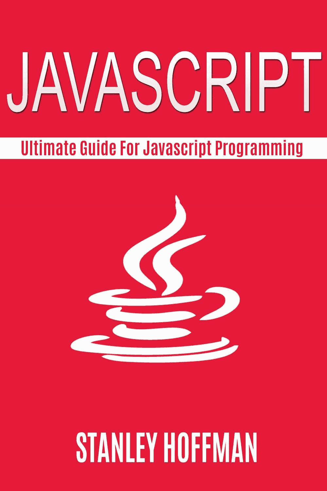
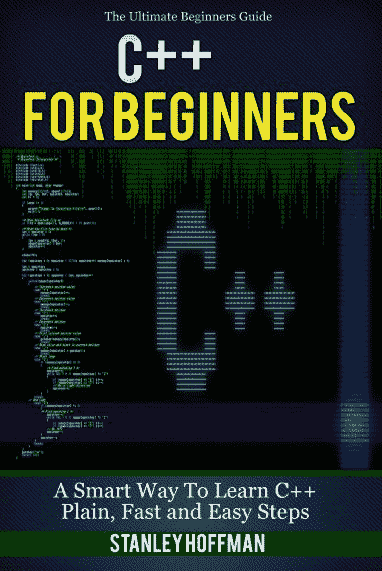
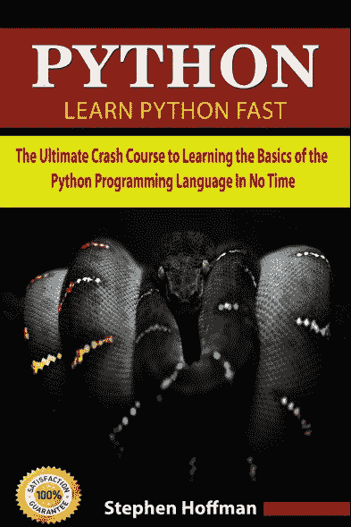
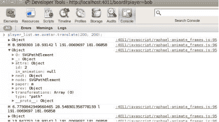
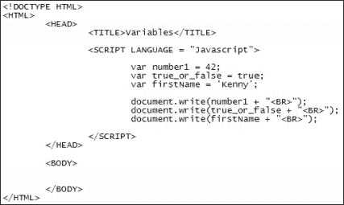

# JavaScript：JavaScript 编程终极指南（JavaScript 初学者指南、如何编程、软件开发、基础 JavaScript、浏览器... 编码、CSS、Java、PHP）（第 7 卷）



我认为接下来的书对你可能也会感兴趣。

[C++](http://www.amazon.com/Beginners-Simple-programming-coding-Developers-ebook/dp/B014MT5ME8/ref=sr_1_fkmr0_1?s=digital-text&ie=UTF8&qid=1442833820&sr=1-1-fkmr0&keywords=C%2B%2B%3A+C%2B%2B+for+Beginners%2C+C%2B%2B+in+24+Hours%2C+Learn+C%2B%2B+fast%21+A+smart+w)



[Python](http://www.amazon.com/Python-Ultimate-Learning-Programming-Hands--ebook/dp/B014MV238Y/ref=sr_1_1?s=digital-text&ie=UTF8&qid=1442836729&sr=1-1&keywords=Python%3A+Learn+Python+FAST+-+The+Ultimate+Crash+Course+to+Learning+the+Basics+of+the+Python+Programming+)



[计算机黑客](http://www.amazon.com/dp/B010965F36)


[傻瓜黑客入门](http://www.amazon.com/Computer-Hacking-beginners-computer-security-ebook/dp/B015T8FZYI/ref=sr_1_1?s=digital-text&ie=UTF8&qid=1446193044&sr=1-1&keywords=hacking+for+dummies+matt+benton)

![HACKING2(images/00004.jpeg)

# 引言

在这一代，计算机似乎不再令人畏惧了。它们现在正成为我们日常的工具之一——让我们让事情变得简单且高效。尽管今天最新的计算机操作对用户非常友好，但仍然存在许多隐藏的复杂性。大多数人会发现它们很难理解。因此，这本书是为那些想要以最简单的方式发现计算机最大潜力的人而编写的。

为了实现这一点，你必须记住通信是计算机过程的一个至关重要的部分。这并不是计算机之间的过程，而是键盘后的用户与运行机器之间的过程。基本元素当然是语言。学习像 `C` 这样的语言将让你能够按照你想要以及你要求的方式命令机器。

在书中，你将学习计算机最重要的语言之一——`JavaScript`。

## 编程简述

在学习 `JavaScript` 之前，首先理解什么是编程至关重要。

计算机程序可以是任何东西。你用来阅读这本电子书的软件是一个程序。你使用的浏览器是一个程序。播放音乐文件的应用程序是一个程序。你玩的游戏是一个程序。换句话说，你在计算机中看到和使用的一切都是程序。这一切都是一个被称为“编程”的单一过程的产物。

![Computer-Programming2(images/00005.jpeg)

编程是一门艺术。程序员在这里输入一段文本，命令计算机执行特定的操作。让我们以人体作为类比。

如果你被给你一个数学题来解决，你的大脑必须处理它。根据方程的规模，你可能会发现自己正在数手指或在纸上解公式。简而言之，有几种身体功能在工作。

从编程的角度来看，所有这些身体功能都是程序，你的整个身体就是机器。你大脑的机械对应物是机器内存。方程就是我们要处理的数据。

我们这里的主要目标是处理数据。在上面的场景中，那就是得到数学题的正确答案。为了让我们身体能够做到这一点，你的眼睛需要看到问题并将其传递给大脑。对于机器，你需要一个程序将该信号传递到计算机内存中。

回到人体，你的眼睛需要看到问题并将其传递给大脑。对于机器，你需要一个程序将该信号传递到计算机内存中。

## 介绍 JavaScript

![javascript(images/00006.jpeg)

在一切之前，你可能已经熟悉另一种名为 `Java` 的编程语言。记住 `JavaScript` 和 `Java` 之间几乎没有任何关系。

`JavaScript` 最初被命名为 `Mocha`，创建于 1995 年 5 月。它是 `Brendan Eich` 在当时工作于 `Netscape` 时十天艰苦工作的成果。`Mocha` 这个名字是由 `Netscape` 的 `Marc Andreessen` 定的。

在同年 9 月，语言的名字更改为 `LiveScript`。同年 12 月，在获得 `Sun` 的商标许可后，名称再次更改为 `JavaScript`。显然，这是一个营销手段，因为当时 `Java` 语言正在大力推广并变得越来越流行。

今天，`JavaScript` 是初学者可以轻松学会的编程语言之一。它是网页开发者除了 `CSS` 和 `HTML` 之外必学习语言。网页开发者使用 `HTML` 定义网页内容。使用 `CSS` 指定网页布局。最后，他们使用 `JavaScript` 编写网站的行为。因此，`JavaScript` 被认为是 Web 的编程语言。

尽管 `JavaScript` 的理念是为初学者提供更简单的编程领域，但该语言提供的灵活性对资深程序员也有巨大的优势。它为在更僵化的编程语言中无法实现的编程技术提供了大量的空间。你将在本书后面看到更多此类技术。

程序在正确编写时是美的。

## 你在书中可以找到什么？

这本书是《简单英语学 JavaScript》系列的第一部分。该部分包含 3 章。第一章将向你介绍值以及如何在 `JavaScript` 语言中处理这些值。你将学习使用运算符、比较符以及创建字符串。第二章讨论变量。在这一章中，你将学习向变量赋值。你还将学习如何通过组合多个变量创建多变的信息。最后一章讨论 `JavaScript` 源文件的创建。在这一章中，你将学习如何正确地在源文件中编写 `JavaScript` 代码。你还将学习如何在 `HTML` 文件中执行此文件。

`The JavaScript in Simple Words` 系列书籍分为几个部分，帮助你掌握这门编程语言而不会感到不知所措。许多初学者放弃了，是因为他们认为 JavaScript 太难处理。整个系列旨在以最简单的方式带你直击 JavaScript 的核心。

# 第 1 章 – 认识数字、运算符和字符串

仅仅是浏览网络就能接触到数百万行的 JavaScript 代码。当你启动你喜爱的网络浏览器（例如 Google Chrome、Mozilla Firefox 和 Internet Explorer）并开始访问某个网站时，你已经在使用 JavaScript 语言进行通信了。

在本章中，我们将讨论 JavaScript 语言的底层构建模块。这将帮助你在转向如 `jQuery` 等高级框架时建立坚实的基础。

你将学习更多关于数字、运算符和字符串的知识。本章还将涵盖使用运算符操作值的过程，以及如何将这些值存储在变量中。最后，你还将学习如何在 HTML 代码中创建、运行和查找 JavaScript 代码。

## 控制台

在进行任何操作之前，访问网页浏览器控制台至关重要。网页浏览器控制台是开发者工具之一，它记录与当前网页相关的信息。这些信息包括 CSS、安全错误和 JavaScript。控制台还允许你通过断言 JavaScript 表达式与网页交互。

这就是我们将执行书中示例 JavaScript 代码的地方。你可以通过按下键盘上的 `F12` 键来访问它。寻找 `Console` 标签页，现在你可以准备开始了。



## 基础数字与提示符

在你开始学习 JavaScript 之初，有两个符号需要熟悉：

- `>` 大于符号；以及，
- `→` 箭头符号

`>` 符号代表 JavaScript 提示符。我们想要输入到控制台的所有代码将写在这个符号之后。`→` 符号指代我们输入的代码所产生的结果。

在 JavaScript 语言中，数字会被自动识别。在提示符后输入数字并按下键盘上的回车键（Enter key），你将得到相同的值作为结果。尝试在控制台中输入数字 `13`，它将返回相同的值。

| `> 13→` `13` |

带有小数值的数字也是如此。

| `> 13.29→` `13.29` |

## 运算符

在 JavaScript 中，数学运算也是被允许的。JavaScript 语法中常用的运算符如下：

- 加法 (`+`)
- 减法 (`-`)
- 乘法 (`*`)
- 除法 (`/`)
- 取模 (`%`)

加法通过 `+` 符号表示。

| `> 1 + 3→` `4` |

减法通过 `-` 符号表示。

| `> 10 – 5→` `5` |

乘法通过 `*` 符号表示。

| `> 2 * 9→` `18` |

除法通过 `/` 符号表示。

| `> 25 / 5→` `5` |

而取模是 JavaScript 语言中的一种特殊运算。它通过 `%` 符号表示。你得到的结果是两个数字相除后的余数。

| `> 23 % 2→` `1` |

在上面的取模示例中，控制台将 `23` 除以 `2`。即使在 `23` 中除了 `11` 次，控制台也只显示余数作为结果，即 `1`。

### PEMDAS 顺序

JavaScript 编程遵循流行的数学运算顺序：`PEMDAS`。这个缩写代表：

- `P` - 括号 (Parentheses)
- `E` - 幂指数 (Exponents)
- `M` - 乘法 (Multiplication)
- `D` - 除法 (Division)
- `A` - 加法 (Addition)
- `S` - 减法 (Subtraction)

让我们以以下表达式为例。

| `> (10 + 5) * 3` |

按下回车后，控制台将给你这个答案。

| `→ 45` |

括号内部的运算优先求解。在我们的情况下，是 `10 + 5`，得到 `15`。之后，将该总和乘以 `3`。因此，控制台给了你 `45`。

让我们尝试一个更长的表达式。

| `> (7 * 2) + 5 – 10 / 2` |

遵循 `PEMDAS` 顺序，表达式将按如下方式求解：

```
(7 * 2) + 5 - 10 / 2
14 + 5 - 10 / 2
19 - 10 / 2
19 - 5
14
```

因此，控制台将给得到这个答案。

| `→ 14` |

## 比较符

除了运算符，JavaScript 语言还识别逻辑运算符，我们称之为比较符。JavaScript 中常用的比较符通过以下语法表示：

- `>` 大于
- `<` 小于
- `==` 等于
- `!=` 不等于
- `>=` 大于等于
- `<=` 小于等于

在 JavaScript 中使用这些比较符发送一个表达式，就像是在向控制台提一个逻辑问题。你从控制台得到的答案可能是 `true`（真）或 `false`（假）。这些答案被称为 `Boolean`（布尔）值。

让我们尝试向控制台发送以下表达式。

| `> 10 != 9` |

这个表达式就像是在问控制台 `10` 是否不等于 `9`。由于 `10` 确实不等于 `9`，控制台会返回 `true`。

## 字符串


JavaScript 处理、存储并处理文本作为字符串。为了通知控制台我们要处理文本，我们需要将它们封装在引号内。这允许控制台识别文本并返回字符串。

| `> "The quick brown fox jumps over the dog"→"The quick brown fox jumps over the dog"` |

字符串可以通过合并方法组合。我们通过在字符串之间添加 `+` 符号来合并。控制台会将所有字符串合并成单个字符串。

| `> "Lee" + "and" + "Haide"→"Lee and Haide"` |

你注意到字符串开头有一个空格吗？这是因为合并操作不会自动将 `+` 符号视为空格。让我们尝试一个组合字符串和数字的示例。

| `> "I will deliver this at" + 5 + "PM"→"I will deliver this at5PM"` |

这里注意两点。第一，在与字符串合并数字时不需要引号。第二，我们得到的结果不是我们想要的。因此，我们应该在一个字符串的末尾和第二个字符串的开头添加空格。应该是这样的。

| `> "I will deliver this at " + 5 + " PM"→"I will deliver this at 5 PM"` |

除了数字，你还可以合并字符串、数字和表达式。但注意，控制台会自动计算数学表达式。

| `> "The rooftop needs to be " + 15 + " feetand + 1/4→"The rooftop needs to be 15 feet and 0.25"` |

JavaScript 代码中的分数被转换成了数值。如果你需要保持表达式原样，你需要将它们封装在字符串中。应该是这样的。

| `> "The rooftop needs to be " + 15 + " feet and 1/4"→"The rooftop needs to be 15 feet and 1/4"` |

### 使用特殊字符格式化字符串

你可以使用特殊字符来格式化字符串。一个很好的例子是反斜杠 `\` 后跟字母 `t`。

- `\t` 通知控制台跳转到下一个制表位

使用此额外命令编写字符串，你得到的结果应该像这样。

| `> "Height:\t6 ft.\t\t\tWidth:\t26 ft."→"Height:      6 ft.Width:      26 ft."` |

在字符串内部添加引号时也应该使用反斜杠转义。

`\"` 告诉控制台接下来的引号不是字符串的开始或结束。

当在字符串内部断言引号时，你的字符串行看起来如下，以及你将得到的输出。

| `> "Nicknames:\t\"The Geek\" \"Com Wiz\" \"Backslasher\""→"Nicknames:     \"The Geek\" \"Com Wiz\" \"Backslasher\""` |

如果你想在字符串输出中断言反斜杠符号，适用于相同的规则。

`\\` 告诉控制台在输出中原样添加接下来的反斜杠。

编写此命令时，字符串和输出应该显示如下。

| `> "Target Folder:\t\"C:\\Program Files\\Directory 1\\Directory 2\""→"Target Folder:     \"C:\Program Files\Directory 1\Directory 2\""` |

你还可以通过简单在反斜杠后添加字母“n”来命令控制台将值放在新行。

`\n` 告诉控制台在新行中断言接下来的值。

这是你的代码和输出应该的样子。

| `> "Member 1:\tFebz\nMember 2:\tDonz\nMember 3:\tTaz"→"Member 1:     Febz\nMember 2:     Donz\nMember 3:     Taz"` |

## 比较运算符与字符串

除了数字，比较运算符也可以用于比较字符串以获取布尔值作为输出。让我们尝试使用等号运算符。

| `> "Obi-Wan Kenobi" == "Obi-Wan Kenobi"→true` |

根据上面的示例，我们得到了布尔值“true”，因为第一个字符串与第二个字符串完全相同。让我们尝试修改其中一个字符串。

| `> "Obi-Wan Kenobi" == "Obi-Wan Kinobi"→false` |

记住 JavaScript 语言是大小写敏感的。因此，如果第一个字符串用大写字母编写，而第二个字符串完全用小写字母编写；那么控制台将它们视为不相等。

| `> "Obi-Wan Kenobi" == "obi-wan kenobi"→false` |

## 计算字符串长度

在 JavaScript 语言中，你可以轻松访问字符串的长度。这样做将命令控制台计算引号之间的所有字符，包括空格和非字母字符。我们通过在字符串后紧跟以下属性来实现。

`.length` 命令控制台计算其后跟字符串内的字符。

这是我们编写的方式以及我们将得到的输出。

| `> "Pneumonoultramicroscopicsilicovolcanoconiosis".length→45` |

现在让我们尝试使用带有空格和非字母字符的字符串。

| `> "Pink, Blue, Black, Red, Purple, White, and Green".length→48` |

# 第 2 章 – 发现变量

现在你已经知道如何在 JavaScript 语言中编写、格式化和处理数据，现在是时候学习变量了。在本章中，你将学习如何使用变量存储值。如果不学习如何编写变量，你就无法做到这一点。话不多说，让我们开始变量世界的之旅。



## 值的存储

为了在 JavaScript 语言中管理数据，你需要将它们存储在变量中。让我向你展示一个名为“Learn Easy”的变量的基本赋值语法。

| `> var learnEasy = 6` |

这里的代码 `var` 指的是变量关键字。它命令浏览器为此变量预留特定空间。下一个是 `learnEasy`，指的是变量名。我们将赋值给此示例变量语法的名称。等号在这里充当赋值运算符。注意这里只使用单个等号，与我们之前用于比较的双等号不同。最后，这里的数字 `6` 是我们存储在名为 `learnEasy` 的变量中的值。

现在我们已经在变量中存储了一个值，现在只需使用变量名即可调用它。在控制台中断言变量名 `learnEasy` 将带给我们赋值的值作为输出。

| `> learnEasy→ 6` |

在为变量命名时，JavaScript 语言中有我们需要遵循的规则。这些规则如下：

1. 变量名中不能有空格。（例如 `var learn easy`, `var sweet java`）
2. 变量名开头不能是数字。（例如 `var 4`）
3. 你可以使用特殊字符，但最好使用下划线。（例如 `var_easy`）
4. 你可以使用美元符号。（例如 `var ea$`）
5. 这被称为驼峰命名法（Camel Case）（例如 `var simpleAndClean`）

## 字符串索引

在进行索引时，JavaScript 使用数值 `0` 来索引第一个字符。这与 `.length` 属性不同，因为 JavaScript 使用数值 `1` 来计数第一个字符。换句话说，最后一个索引值总是比长度值小 1。

使用存储在 `hello` 变量中的字符串，其 `length` 属性的值为 `22`，最后一个索引号为 `21`。现在，你可能会问，我们为什么需要索引号呢？

我们使用它来查找字符串中的特定字符。这是通过 `charAt()` 方法实现的，我们将其放在变量之后，就像使用 `.length` 属性一样。例如，我们想知道变量 `hello` 中索引号为 20 的字符是什么。我们只需输入以下内容：

```
hello.charAt(20)→ "e"
```

## 使用变量创建消息

现在你已经知道如何在变量中存储值了，让我们使用变量创建消息吧。再创建一个变量，与我们现有的变量 `hello` 结合。

```
var enjoy = "Please enjoy your visit!"
```

现在我们已经有了第二个变量，让我们将它们合并并创建一个新变量，作为我们的欢迎消息。

```
var welcome = hello + enjoy
```

每当我们调用变量 `welcome` 时，都将得到以下输出。

```
welcome→"Welcome to my website! Please enjoy your visit!"
```

# 第 3 章 – 构建与运行 JavaScript

学习变量很有趣，不是吗？然而，没有人想在控制台中编写 JavaScript 语言。在本章中，你将学习如何构建 JavaScript 文件。你还将学习如何在 HTML 中运行这些文件。那么，让我们开始吧。


## 创建源文件

仅在控制台中编写 JavaScript 代码无法将我们想要传达给用户浏览器的内容。因此，我们需要找到一种方法将想要的内容呈现给用户。为了做到这一点，我们需要创建 JavaScript 源文件并在 HTML 文件中运行这些文件。以下是一个最常见的 HTML 文件 `index.html` 示例。

```html
<html>
<head>
<script src="greetings.js"></script>
</head>
<body>
<h1>WELCOME TO JAVASCRIPT!</h1>
</body>
</html>
```

如你所见，我们在这个文件中包含了一个 `<script>` 标签。该标签命令此 HTML 文件加载特定的 JavaScript 源文件，这样访问者的网络浏览器就能以你想要的方式查看你的网站。注意我们在 `<script>` 标签内部使用了 `src` 关键字。这是给 HTML 文件的命令，指示它从哪里加载 JavaScript 源文件。

在这个示例中，我们正在命令 `index.html` 文件加载保存在 `greetings.js` 中的所有变量和值。

为了创建此 `.js` 文件，你只需要打开任何文本编辑器（如记事本或 Text Edit）。在里面编写所有的 JavaScript 代码，并将文件保存为 `.js` 格式。在该文件中，我们断言访问者浏览器在访问我们的网站时立即执行的所有 JavaScript 代码。

### 源文件放在什么位置？

在浏览网站的文件管理器时，你永远不会错过一个名为 `root/` 的文件夹。这是我们找到网站内所有内容的地方。这也是你网站 `index.html` 的默认位置。

根据上面的 `index.html` 文件，我们引导它在同一个位置文件夹内寻找 JavaScript 源文件——即 `root/` 文件夹。因此，我们应该将 `greetings.js` 放在同一个位置。

```
+ root/
    - index.html
    - greetings.js
```

然而，有些网站会将所有的 JavaScript 源文件放在子文件夹中。它们源文件最常见的目录是 `scripts/` 文件夹下。以下是它们在你的网站目录中的结构。

```
+ root/
    - index.html
    + scripts/
        - greetings.js
```

如果你想这样组织源文件，那么我们需要修改示例中 `index.html` 的 `<script>` 标签。你的 HTML 代码看起来应该是这样的。

```html
<html>
<head>
<script src="scripts/greetings.js"></script>
</head>
<body>
<h1>WELCOME TO JAVASCRIPT!</h1>
</body>
</html>
```

注意，在这段代码中，我们正在指示 `index.html` 从 `scripts/` 子文件夹加载 `greetings.js`。

### 在源文件中编写代码

在 `greetings.js` 直接书写控制台风格的表达式只会导致错误。让我们尝试在源文件中编写以下几行作为示例。

```javascript
var hello = "Welcome to my website! ";
var enjoy = "Please enjoy your visit!";
hello + enjoy;
```

一旦我们打开 `index.html` 并进入浏览器的控制台，我们将什么也看不到，只有错误。这是因为网络浏览器对你真正想要显示的内容感到困惑。错误来自我们的 JavaScript 源文件。与控制台不同，我们需要在源文件中以不同的方式断言 JavaScript 代码。我们通过在每个语句后添加分号（`;`）来实现。因此，我们应该这样写 JavaScript 代码。

```javascript
var hello = "Welcome to my website! ";
var enjoy = "Please enjoy your visit!";
hello + enjoy;
```

用带有分号的代码编写后，当你尝试访问控制台时将不再看到错误。然而，你会在控制台中看不到任何东西。这意味着我们的代码尚未被传递到控制台。为了解决这个问题，我们需要使用 `console.log()`。

我们在这里想要做的是显示来自 `hello` 和 `enjoy` 连接的字符串。我们将如下操作：

```javascript
console.log(hello + enjoy);
```

通过使用 `console.log()`，你现在可以在控制台中看到字符串了。换句话说，我们现在有了一个由我们的 `index.html` 文件运行的 JavaScript 语言。

## 总结

此时，你已经知道如何在 JavaScript 语言中编写值。你刚刚学会了 JavaScript 如何解释数字和纯文本，以及如何将文本转换为字符串值。你还学会了如何使用运算符和比较符将这些值转换为表达式和语句。

在第 2 章中，你被介绍了变量。你学习了如何在变量中存储值以及连接方法，你学习了如何以变量的形式快速处理值。还介绍了一些方法，例如 `charAt()` 方法和 `.length` 属性——这些都是帮助你高效分析值的工具。

在第 3 章中，你学习了如何创建自己的源文件。注意与控制台相比，需要在源文件中以不同的方式断言 JavaScript 代码。你还了解了 `console.log()` 方法，允许你在浏览器控制台中打印值。然而，这并不是交付 JavaScript 代码的最有效方法。想象一下要向浏览器传递成百上千个值？

在《易学 JavaScript》系列的下一部分中，我们将带你进入 JavaScript 的循环，你将学习如何高效地管理重复代码。书的第二部分还将讨论几个主题，包括条件的使用和对话框的创建。

感谢阅读。希望你喜欢。我请求你留下诚恳的反馈。
