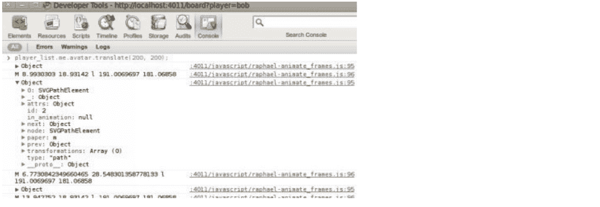
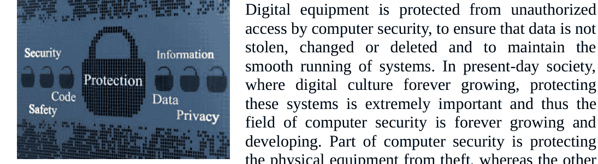
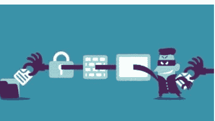
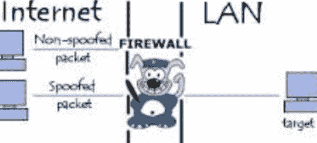
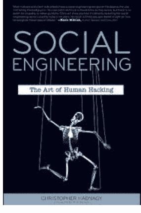

# JavaScript：JavaScript 编程与计算机黑客终极指南（初学者指南、如何编程、黑客揭秘、黑客、如何...（C 语言编程、HTML、编码、CSS、Java、PHP））

我认为接下来的书籍对你也会很有帮助：

- C++
- Python
- 黑客入门

## 引言

在这一代，计算机似乎不再令人生畏。它们现在正成为我们日常的工具之一——让我们让事情变得更简单高效。尽管今天的计算机操作非常用户友好，但仍然存在许多隐藏的复杂性。大多数人会觉得它们难以理解。因此，这本书是为那些想要以最简单的方法发现计算机最大潜力的人编写的。

为了做到这一点，你必须记住通信是计算机过程中至关重要的部分。这不是计算机之间的过程，而是键盘后的用户与运行的机器之间的过程。基础元素当然是语言。学习像 C 这样的语言将让你能够以你想要以及你要求的方式命令机器。

在这本书中，你将学习计算机最重要的语言之一——JavaScript。

## 编程简述

在继续学习 JavaScript 之前，首先理解什么是编程至关重要。

计算机程序可以是任何东西。你用来阅读这本电子书的软件是一个程序。你使用的网络浏览器是一个程序。播放你音乐文件的应用程序是一个程序。你玩的游戏是一个程序。换句话说，你在计算机中看到和使用的一切都是程序。所有这些都是一个被称为“编程”的单一过程产物。

编程是一门艺术。程序员输入一段文本，命令计算机执行特定操作。让我们以人体来类比。

如果交给你一个数学题来解决，你的大脑必须处理它。根据方程的规模，你可能会发现自己正在数手指，或者在纸上求解一个公式。简而言之，有几种身体功能在工作。

从编程的角度来看，所有这些身体功能都是程序，你的整个身体就是机器。你大脑的机械对应物是机器的内存。方程式是我们想要处理的数据。

我们这里的主要目标是处理数据。在上面的场景中，那就是为数学题提供正确答案。为了让身体能够做到这一点，你的眼睛需要看到问题并将其传递给大脑。对于机器来说，你需要一个程序将该信号传递到计算机的内存中。

回到人体，你可能需要使用手指或纸来求解方程。为了控制你的手指，你的大脑必须发送信号，让它们以有助于你解决当前问题的方式运行。对于机器来说，你需要一个单独的程序来这样做。

换句话说，机器及其部分是人体及其部分的非理性版本。只是机器可以在一秒钟内处理一切。为了将这些部分连接到计算机内存中，你需要断言成千上万个程序。因此，编程是我们在无生命的躯体内创造生命的艺术。

到这里，你可能发现编程的概念更容易理解了。然而，过程本身非常复杂，甚至连程序员都会在自己的创作中迷失。

程序在正确编写时是美丽的。讽刺的是，写得糟糕的程序是可怕的。

## 介绍 JavaScript

在开始任何其他事情之前，你可能已经熟悉另一种名为 Java 的编程语言。记住，JavaScript 和 Java 之间几乎毫无关系。

JavaScript 最初名为 Mocha，创建于 1995 年 5 月。它是当时在 Netscape 工作的 Brendan Eich 经过 10 天艰苦工作的成果。Mocha 这个名字是由 Netscape 的创始人 Marc Andreessen 选定的。

同年的 9 月，该语言的名字更改为 JavaScript。同年 12 月，在收到 Sun 的商标许可后，它的名字再次更改为 JavaScript。显然，这个名字更有吸引力，因为 Java 语言在当时正被大力推广并变得越来越流行。

今天，JavaScript 是初学者可以轻松学习的编程语言之一。它也是 Web 开发者除 CSS 和 HTML 之外的必学语言。Web 开发者使用 HTML 定义网页内容。使用 CSS 指定他们的网页内容。最后，使用 JavaScript 编写他们的行为。因此，JavaScript 被认为是 Web 的编程语言。尽管 JavaScript 背后的理念是为初学者提供简单的编程，但该语言提供的灵活性对资深程序员来说也有巨大的优势。你将在本书的后面看到更多这些技术。所以，如果你是编程新手且刚开始，不要讨厌它通常会解释你给出的代码。你只需要耐心并保持开放态度，因为 JavaScript 不仅有趣，它还将带你进入一个新世界。

## 在这本书中你可以发现什么？

这本书是《Javascript in Words》系列的第一部分。该系列的这一部分包含 3 章。第一章将向你介绍值以及如何在 JavaScript 语言中处理这些值。你将学习如何使用运算符、比较符以及如何创建字符串。第二章讨论变量。在本章中，你将学习如何在变量内部赋值。你还将学习通过组合多个变量来创建多功能信息。最后一章讨论 JavaScript 源文件的创建。在本章中，你将学习如何在源文件中编写 JavaScript 代码。此外，你还将学习如何在 HTML 文件中执行此文件。

## 第 1 章——认识数字、运算符和字符串

仅仅浏览互联网就能接触到数百万行 JavaScript 代码。当你启动喜爱的网络浏览器（例如 Google Chrome、Mozilla Firefox 和 Internet Explorer）并访问某个网站时，你已经在使用 JavaScript 语言进行通信了。

在本章中，我们将讨论 JavaScript 语言的基础构建块。这将在帮助你转向 jQuery 等高级框架时建立坚实的基础。

你将学习更多关于数字、运算符和字符串的知识。本章还将涵盖使用运算符操作值的不同过程，以及你如何将这些值存储在变量中。最后，你还将学习如何在 HTML 代码中创建、运行和查找 JavaScript 代码。

### 控制台

除此之外，访问浏览器控制台对你来说至关重要。浏览器控制台是开发者工具之一。它记录了与当前网页相关的信息。这些信息包括 CSS、安全错误和 JavaScript。控制台还允许你通过断言 JavaScript 表达式与网页交互。

这就是我们将在书中执行示例 JavaScript 代码的地方。你可以通过按下键盘上的 `F12` 来访问它。找到 Console（控制台）标签页，你现在准备好开始了。



### 基础数字与提示符

在开始学习 JavaScript 之前，有两个符号需要你熟悉：

- `>` 大于符号；以及，
- `→` 箭头符号

`>` 符号代表 JavaScript 提示符。我们想要输入控制台的所有代码都将写在这个符号之后。`→` 符号指的是我们输入的代码产生的结果。

在 JavaScript 语言中，数字会被自动识别。在提示符后输入数字并按下键盘上的回车键，你将得到相同的值作为结果。尝试在控制台输入数字 13，它将返回相同的值。

```
> 13
→ 13
```

带有小数的数字也是一样。

```
> 13.29
→ 13.29
```

### 运算符

在 JavaScript 中，数学运算也是允许的。JavaScript 语法中常用的操作有以下：

- 加法
- 减法
- 乘法
- 除法
- 取模

加法通过 `+` 号表示。

```
> 1 + 3
→ 4
```

减法通过 `-` 号表示。

```
> 10 - 5
→ 5
```

乘法通过 `*` 号表示。

```
> 2 * 9
→ 18
```

除法通过 `/` 号表示。

```
> 25 / 5
→ 5
```

另一方面，取模是 JavaScript 语言中的一种特殊操作。它通过 `%` 号表示。你得到的结果将是两个数字相除后的余数。

```
> 23 % 2
→ 1
```

在上面的取模示例中，控制台将 23 除以 2。即使在 23 中可以 11 次，控制台也只显示余数作为结果，即 1。

#### PEMDAS 顺序

JavaScript 编程遵循流行的数学运算顺序：PEMDAS。这个缩写代表：

- P - 括号
- E - 幂
- M - 乘法
- D - 除法
- A - 加法
- S - 减法

让我们以以下表达式为例。

```
> (10 + 5) * 3
```

按下回车键后，控制台将返回这个答案给你。

```
→ 45
```

括号内的操作将首先被求解。在我们的情况下，它是 10 + 5，得到 15。之后，将该总和乘以 3。因此，控制台给了你 45。

让我们尝试一个更长的表达式。

```
> (7 * 2) + 5 - 10 / 2
```

按照 PEMDAS 顺序，该表达式的求解方式如下：

```
14 + 5 - 10 / 2
14 + 5 - 5
19 - 5
```

因此，控制台将返回这个答案给你。

```
→ 14
```

#### 比较运算符

除了运算符之外，JavaScript 语言还识别逻辑运算符，也就是我们所说的比较运算符。JavaScript 中常用的比较运算符通过以下语法表示：

- `>` 大于
- `<` 小于
- `==` 等于
- `!=` 不等于
- `>=` 大于等于
- `<=` 小于等于

使用这些比较运算符在 JavaScript 中发送表达式就像是向控制台提问一个逻辑问题。你从控制台得到的答案可能是 `true`（真）或 `false`（假）。这些答案被称为布尔值。

让我们尝试向控制台发送以下表达式。

```
> 10 != 9
```

这个表达式就像是在问控制台在 JavaScript 语言中 10 是否等于 9。因此，由于 10 在数值上不等于 9，控制台将给你一个 `true` 作为答案。

#### 字符串

```html
<!DOCTYPE html>
<html>
<body>
<script type="text/javascript">
var str="Split String example("*") + "<br/>";
document.write(str.split("*") + "<br/>");
document.write(str.split("*",1) + "<br/>");
</script>
</body>
</html>
```

JavaScript 处理字符串，并将平直文本作为字符串处理。为了告诉控制台我们想要处理平直文本，我们需要将它们封装在引号内。这将允许控制台将文本识别为字符串，并将字符串返回给我们。

```
> "The quick brown fox jumps over the lazy dog"
→ "The quick brown fox jumps over the lazy dog"
```

多个字符串可以使用拼接方法组合。我们通过简单地在字符串之间添加一个 `+` 号来拼接两个或多个字符串。控制台会将所有拼接的字符串合并成单个字符串。

```
> "Lee" + "and" + "Haide"
→ "Lee and Haide"
```

你注意到字符串 `" and "` 的开头和结尾都有一个空格吗？这是因为拼接不会自动将 `+` 号视为空格。让我们尝试另一个使用字符串和数字组合的示例。

```
> "I will deliver this at" + 5 + "PM"
→ "I will deliver this at5PM"
```

这里你应该注意到的两点。第一，在与字符串拼接时，数字不需要引号。第二，我们收到的结果不是我们想要的样式。因此，我们应该在第一个字符串的结尾和第二个字符串的开头添加一个空格。应该是这样的。

```
> "I will deliver this at " + 5 + " PM"
→ "I will deliver this at 5 PM"
```

## 统计字符串长度

在 JavaScript 语言中，你可以轻松访问字符串的长度。这样做会命令控制台统计所有字符，包括引号开始和结束引号之间的空格和非字母字符。我们通过在字符串紧后面添加以下属性来实现。

```
.length 命令让控制台统计其后字符串内的字符数。
```

这是我们的编写方式以及我们将得到的输出结果。

```
> "Pneumonoultramicroscopicsilicovolcanoconiosis".length
→ 45
```

现在让我们尝试使用一个带有空格和非字母字符的字符串。

```
> "Pink, Blue, Black, Red, Purple, White, and Green".length
→ 48
```

## 第 2 章 – 发现变量

现在你已经了解了如何在 JavaScript 语言中编写、格式化和处理数据，现在是学习变量了。在本章中，你将学习如何使用变量存储值。如果不先学习如何编写变量，你将无法做到这一点。话不多说，让我们开始变量世界之旅。

```html
<!DOCTYPE HTML>
<html>
<HEAD>
<TITLE>Variables</TITLE>
<SCRIPT LANGUAGE="Javascript">
var number1 = 21;
var true_or_false = true;
var firstName = 'Kenny';
document.write(number1 + "<BR>");
document.write(true_or_false + "<BR>");
document.write(firstName + "<BR>");
</SCRIPT>
</HEAD>
<BODY>
</BODY>
</html>
```

### 值的存储

为了管理 JavaScript 语言中的数据，你需要将它们存储在变量中。让我向你展示一个名为 `learnEasy` 的变量的基础赋值语法。

```
> var learnEasy = 6
```

代码中的 `var` 指的是变量关键字。它命令浏览器为此变量留出特定的空间。下一个是 `learnEasy`，指的是变量名。这是我们将分配给此示例变量语法的名称。这里的等号充当赋值运算符。请注意，我们只使用单个等号，这与我们之前用于比较的双重等号不同。最后，数字 6 是我们要存储在名为 `learnEasy` 变量中的值。

现在我们已经在变量中存储了一个值，现在只需要通过变量名就可以调用它了。在控制台中输入变量名 `learnEasy` 将为我们返回分配的值作为输出。

```
> learnEasy
→ 6
```

在为变量命名时，在 JavaScript 语言中一些我们需要遵循的规则。这些规则如下：

1. 变量名中不能有空格。（例如：`var learn easy`, `var sweet java`）
2. 变量名开头不能有数字。（例如：`var 4life`, `var 1piece`）

你可以在变量名中使用特殊字符。但是，最好使用简单的名称以免让 JavaScript 语言变得复杂。

1. 你可以在变量名中使用下划线 `_`。（例如：`var learn_easy`）
2. 你可以在变量名中使用美元符号 `$`。（例如：`var learnE$y`）
3. 你可以同时使用下划线和美元符号。（例如：`var learn_ea$y`）

一个良好的变量名应该是这样的。它被称为“驼峰命名法”，以小写字母开头，后续单词的首字母大写。

```
> var simpleAndClean
```

如果你想重用变量名来存储不同的值，你可以通过在末尾添加数字来简化一切，如下所示：

```
> var simpleAndClean2
```

### 修改变量中的赋值值

让我们回到我们的示例变量 `learnEasy`。目前，它被分配了数值 3。假设例如，你想更改分配给该变量的值。你可以通过输入变量名、紧跟赋值运算符、然后是你想分配给该变量的新值来轻松实现。

```
> learnEasy = 13
```

请注意，我们在这里不再使用变量关键字。这是因为控制台记得该值已经存在于它的内存中了。一旦你调用此变量，你现在将获得分配给它的新值。

```
> learnEasy
→ 13
```

你也可以在数学表达式中使用变量自身的变量名来更改现有变量的值。格式应该是变量名后跟赋值运算符。你在运算符后插入数学表达式。它应该是这样的：

```
> learnEasy = learnEasy + 16
```

这将把我们存储的值改为 29，因为该表达式调用了当前的变量值（13）加上 16。这使得它变成了 29。

还有另一种方法可以实现此点。我们将使用不同的语法来更改存储的值。它的写法如下：

```
> learnEasy += 2
```

这里的 `+=` 运算符命令控制台先将变量的当前值加上数字 2。然后它命令控制台将新值存储到同一个变量中。由于我们当前的值是 29，我们现在得到 31 作为存储在变量 `learnEasy` 中的新值。

所有的运算符都可以。

### 存储字符串

除了数值，你还可以存储字符串。这使用相同的格式。让我们创建一个。

```
> var hello = "Welcome to website!"
```

通过将字符串存储在变量中，你不再需要输入。只需调用名称，控制台就会给你。

```
> hello
→ "Welcome to website!"
```

### 在字符串查找字符

JavaScript 语言有它自己的索引每个字符的方法。让我们以变量 `hello` 为例。

```
" W e l c o m e   t o   m y   w e b i t e !"
0 1 2 3 4 5 6 7 8 9 10 11 12 13 14 15 16 17 18 19 20 21
```

在索引时，JavaScript 使用数值 0 索引第一个字符。这与 `.length` 属性不同，因为 JavaScript 使用数值 1 索引第一个字符。换句话说，最后一个索引数字总是比长度值小 1。

使用存储在 `hello` 中的字符串，我们的长度属性为 22，最后一个索引号为 21。现在，你问我们为什么需要索引号呢？

我们用它来查找字符串中的特定字符。这是通过在变量后放置 `charAt()` 方法实现的，就像放置 `.length` 属性一样。例如，我们想知道我们的变量中索引号为 20 的是哪个字符。我们只需输入：

```
> hello.charAt(20)
→ "e"
```

### 使用变量创建消息

现在你已经知道如何在变量内部存储值了，让我们现在使用变量创建消息。让我们再创建一个变量与我们现有的变量 `hello` 结合。

```
> var enjoy = "Please enjoy your visit!"
```

现在我们有了第二个变量，让我们将它们结合，并创建一个作为我们欢迎消息的新变量。

```
> var welcome = hello + enjoy
```

每当我们调用变量 `welcome` 时，都会带给我们以下输出。

```
> welcome
→ "Welcome to website! Please enjoy your visit!"
```

## 第 3 章–构建和运行 JavaScript

学习变量很有趣，不是吗？但是，没有人想在控制台中编写 JavaScript 语言。在本章中，你将学习如何构建 JavaScript 文件。你还将学习如何在 HTML 中运行这些文件。所以，让我们开始吧。

### 创建源文件

仅在控制台中编写 JavaScript 代码并向我们将想要传达给用户浏览器显示的内容。因此，我们需要找到一种将我们想要的内容传递给用户的方法。为了实现这一点，我们需要创建 JavaScript 源并在 HTML 文件中运行这些文件。以下是最常见的 HTML 文件 `index.html` 的示例。

```html
<html>
<head>
<script src="greetings.js"></script>
</head>
<body>
<h1>WELCOME TO JAVASCRIPT!</h1>
...
</body>
</html>
```

如你所见，我们在此文件中使用了 `<script>` 标签。该标签命令此 HTML 文件加载特定的 JavaScript 源文件，以便访问者的 Web 浏览器能够让他们以你希望他们看到的方式来查看你的网站。请注意，我们在 `<script>` 标签内部写有 `src` 关键字。这是对 HTML 文件的一条指令，指导它从哪里加载 JavaScript 源文件。

在这个示例中，我们正在命令 `index.html` 文件加载 `greetings.js` 内部的所有变量和值。

为了创建此 `.js` 文件，你只需要打开任何文本编辑器（如记事本或文本编辑）。在其中编写所有的 JavaScript 代码，并将文件保存为 `.js` 格式。在此文件中，我们断言我们希望访问者的浏览器在访问我们的网站时立即执行的所有 JavaScript 代码。

### 源文件放置于何处

在浏览网站的文件管理器时，你永远不会错过看到一个名为“root”（根目录）的文件夹。我们可以在这里找到网站内部的所有内容。这也是你网站 `index.html` 的默认位置。

基于我们上面的 `index.html` 文件，我们正在引导它在相同的路径文件夹内查找 JavaScript 源文件——即 `root/` 文件夹。因此，我们应该将 `greetings.js` 放在相同的位置。

- root/
  - index.html
  - greetings.js

然而，有些网站会将所有的 JavaScript 源文件放在子文件夹中。它们源文件最常见的目录是 `scripts/` 文件夹。以下是它们在你的网站目录中的样子。

- root/
  - index.html
  - scripts/
    - greetings.js

如果你想这样组织源文件，那么我们需要修改示例 `index.html` 中的 `<script>` 标签。你的 HTML 代码应该如下所示。

```html
<html>
<head>
<script src="scripts/greetings.js"></script>
</head>
<body>
<h1>WELCOME TO JAVASCRIPT!</h1>
...
</body>
</html>
```

注意，在这段代码中，我们指示 `index.html` 从 `scripts/` 子文件夹加载 `greetings.js`。

### 在源文件中编写代码

直接在 `greetings.js` 中原样编写控制台风格的表达式会导致错误。让我们尝试在源文件中编写以下行作为示例。

```javascript
var hello = "Welcome to my website! "
var enjoy = "Please enjoy your visit!"
hello + enjoy
```

一旦我们打开 `index.html` 并进入浏览器的控制台，我们将看到错误空无所获。这是因为我们对你到底想要显示什么感到困惑。错误来自我们的 JavaScript 源文件。与控制台不同，我们需要在源文件中以不同的方式断言 JavaScript 代码。我们通过在每个语句后添加分号 `;` 来这样做。因此，我们应该这样写 JavaScript 代码。

```javascript
var hello = "Welcome to my website! "
var enjoy = "Please enjoy your visit!"
hello + enjoy;
```

使用带有分号编写的代码后，当你尝试访问控制台时将不再看到错误。然而，你不会在控制台中看到任何内容。这意味着我们的代码尚未传递到浏览器的控制台中。JavaScript 代码的执行仅发生在源文件内部。为了修复这个问题，我们需要使用 `console.log()` 方法。

我们想要的是显示来自变量 `hello` 和 `enjoy` 拼接的字符串。以下是我们将这样做。

```javascript
var hello = "Welcome to my website! ";
var enjoy = "Please enjoy your visit!";
console.log(hello + enjoy);
```

通过使用 `console.log()` 方法，你现在可以在控制台中看到该字符串了。换句话说，我们现在有一个由我们的 `index.html` 文件运行的有效 JavaScript 编程语言。

### 结论

到此时，你已经知道了如何在 JavaScript 语言中编写值。你刚刚学习了 JavaScript 如何解释数字和平直文本，以及如何将文本转换为字符串值。你还学习了如何使用运算符和比较符将这些值转换为表达式和语句。

在第二章中，你接触变量。你学习了如何将值存储在变量中，以及拼接方法（通过该方法学习了如何以变量的形式快速处理值）。还介绍了一些方法，例如 `charAt()` 方法和 `.length` 属性——这些都是帮助你高效分析值的工具。

在第三章中，你学习了如何创建自己的 JavaScript 源文件。请注意，与控制台相比，需要在源文件中不同的断言 JavaScript 代码。你还了解了 `console.log()` 方法，它允许你在浏览器的控制台中打印值。然而，这并不是传递 JavaScript 代码的最有效方法。想象一下如果你要向浏览器传递成百上千个值？那意味着重复编程且毫无意义。

在《浅易懂 JavaScript》系列的下一部分，我们将带你进入 JavaScript 循环，你将学习如何高效地管理重复代码。该书系列的第二部分还将讨论几个主题，包括但不限于条件的使用和对话框的创建。

---

# 计算机黑客

面向初学者的黑客指南

## 目录

- 引言 – 什么是黑客？
- 第一章 – 黑客与赛博朋克的影响
- 第二章 – 不同类型的黑客
- 第三章 – 计算机安全
- 第四章 – 黑客技术
- 结论

## 引言 – 什么是黑客？

黑客行为是指未经授权访问计算机系统的行为，可以包括查看或复制数据，甚至创建新数据。通常，黑客行为被理解为恶意破坏计算机系统、复制信息或留下销毁数据的病毒的方式。

黑客行为发生有许多不同的原因，这些原因范围从由于意识形态而想要破坏系统（因此将黑客作为抗议的手段）；例如为了获取利润而进行信用卡欺诈；或者仅仅为了乐趣和消遣而黑客。

关于“黑客”一词的定义存在一些争议，因为那些试图防止此类安全漏洞发生或寻求恢复丢失文件的人也可以被称为黑客。有些人认为，对于恶意系统安全漏洞的正确术语实际上是“破解”，而“黑客攻击”是用于那些对抗计算机漏洞恶意利用的正确词汇。

然而，在公众的想象和日常对话中，“黑客”一词主要被理解为突破计算机安全的“坏”方法。无论动机如何（是为了偷取还是保护、为了进入还是拯救计算机数据），这两个过程共享许多共同技能，并且需要对计算机有相同的理解。

在计算机地下世界中，有许多黑客小组和会议，例如 SummerCon、DEF CON、HoHoCon、ShmoooCon、BlackHat、Chaos Communication 和 Hacker Halted，以及本地的 Mine*

黑客社区非常严肃地对待参加黑客大赛。不出所料的是，还有许多致力于黑客主题的在线小组和论坛，而且那些具有相似黑客理念的人之间确实有着强烈的社区精神。

此外，黑客通常对黑客社区的文学描写充满热情，并热衷于阅读虚构的赛博朋克小说和真实的黑客杂志。

本书将作为黑客世界的介绍，并提供对黑客的一些关键影响、意识形态、群体、概念和技术的见解。

第一章将探讨黑客的起源以及文学流派——赛博朋克的影响。第二章将介绍不同类型的黑客，并区分伦理黑客与不伦理黑客。第三章将探讨计算机安全问题，这对于理解黑客至关重要。

最后一章将提供各种黑客技术的概述，包括自动化和手动方法，以及被称为“社会工程学”的网络信任骗术的重要性。

## 第 1 章 – 黑客与赛博朋克的影响

美国科幻作家迈克尔·布鲁斯·斯特林帮助建立了赛博朋克这一流行流派。赛博朋克是科幻的一个分支，专注于技术在未来设定中的作用。在这种文学和电影流派中，描绘了底层阶级公民，他们接触并对先进技术有深入的理解。

赛博朋克经常探索社会秩序崩溃期间技术的作用，此时存在一个压迫性的政府正在限制和损害普通民众的生活。此外，人工智能（如机器人或智能计算机）在赛博朋克故事中也扮演着重要角色，而近在未来的地球被描绘成后工业时代的反乌托邦（乌托邦的反面，因此是一个以压迫和经常的社会动荡为特征的惨淡世界）。

赛博朋克对当代黑客理解的影响是巨大的。当我们能够在虚构表现中认出自己的世界时，科幻小说尤为有效，通过赛博朋克，我们可以意识到当代技术时代的许多忧虑。劳伦斯·彼森（科幻杂志《Nova Express》的编辑）描述了赛博朋克中的典型人物：

> “经典的赛博朋克角色是边缘化的、疏离的孤独者，他们生活在通常反乌托邦的未来边缘，在那里日常生活受到快速技术变化、无处不在的计算机信息数据球以及对人体进行侵入性改造的影响。”

对于现代读者来说，这种对赛博朋克角色的描述让人想起人们在流行想象中对黑客的看法，以及在书籍和电影中的描写。因此，赛博朋克角色与我们看待现实世界黑客的方式之间的相互作用是巨大的：在许多方面，我们对黑客样子的理解是基于虚构中对赛博朋克角色的描绘。一个例子是，赛博朋克角色通常住在肮脏的环境中，晚上工作白天睡觉，除了聊天室外没有任何社交生活。

在当代的想象中，当我们想起黑客时，往往会想到一个出生在电脑屏幕后昏暗房间里的孤独青少年男孩。事实上，作为首批处理赛博朋克的科幻作家之一，迈克尔·布鲁斯·斯特林也对理解黑客的发展表现出了极大的兴趣。

斯特林将黑客的出现以及相关的地下计算机网络追溯到“嬉皮士”，这是一群活跃在 20 世纪 60 年代的反文化团体，他们出版了《技术援助计划》，这封简报向读者教授未经授权访问电话的技术，这种技术被称为“电话拨骗”。

许多参与电话拨骗社区的个人也是地下黑客社区的活跃部分，这暗示了这两个群体之间的关系。

## 第 2 章 – 不同类型的黑客

计算机黑客地下包含了各种不同的黑客子类。这主要是由于意识形态的冲突，使得某些小组通过特定名称称呼自己，或用特定名称称为他人，以强调他们不同意他人的意识形态。

因此，“黑客”这个通用词虽然是指代那些具有技术知识并能够未经授权访问计算机系统的人，但它相当模糊，无法区分使用不同方法或持有某些观点的人。

相反，出现了一些独立的名称以区分不同的群体，并表明并非所有黑客都遵循相同的规则或意识形态。正如之前讨论过的，看到这一点的一种方法是埃里克·S·雷蒙德在《新黑客词典》中提倡的黑客与“破解者”之间的区别。

在书中，雷蒙德汇编了一份黑客计算机编程术语表，但来自黑客社区的人认为，这本书偏向于雷蒙德将黑客视为一种恶意行为的个人观点。

与其遵循雷蒙德建议的黑客/破解者二元对立，普通黑客社区认为这种划分过于简单，而是主张使用更广泛的名称列表来反映大型黑客社区信仰和实践的光谱。

黑客的一个子类被称为“白帽黑客”，他们在没有恶意动机的情况下突破计算机安全。可能这样做的例子包括：为了测试自己的安全有效性，或者在从事开发计算机安全软件的工作时。

这些安全漏洞可能作为合同协议的一部分对计算机软件进行漏洞评估时发生，因此是合法的。在这里，俚语“白帽”指的是为了正当原因而行事的伦理黑客，目的是保护而非破坏。有一些公认的组织，例如国际电子商业消费者协会，为这一伦理黑客领域提供培训和认证。

另一方面，还有“黑帽黑客”，他们仅仅为了恶意或利润而突破计算机安全系统。这些黑客也被称为破解者。这一子类的前黑客经常在电影和电视中出现，代表了公众恐惧的难以捉摸且难以理解的计算机罪犯。

这些类型的黑客违反计算机安全是为了破坏、改变或盗取信息，或者防止授权用户能够访问系统。在某种程度上，他们会造成混乱、浪费时间并引起痛苦，但他们也可以窃取大量资金或访问机密信息。

通常，黑帽黑客会花时间寻找并发现程序的故障或计算机系统的漏洞，但并不是向公众报告这些问题，而是为了个人利益或乐趣而利用它们。一旦访问了计算机系统，他们就可以进行阻止授权用户使用系统的调整，从而使黑帽黑客保持控制权。

处于两者之间，既不是完全的白帽也不是完全的黑帽的是“灰帽黑客”。这是在没有被要求的情况下搜索互联网具有弱点或安全漏洞的系统，然后通知管理员并收取费用来修复问题。

通过这种方式，他们不像白帽黑客（因为他们要收费，且他们的服务从未被请求）但他们也没有像黑帽黑客那样糟糕，因为他们并不会利用这些漏洞来防止数据中断或窃取数据。灰帽黑客发现安全漏洞后可能采取的另一种方式是在网上发布他们的发现结果，以便普通公众能够获取这些信息。

通过这种方式，他们本身并没有进行恶意黑客，但他们发布了信息，这使得他们的目标面临安全泄露的风险。这种类型的黑客行为是非法的，也被认为是不符合道德的，无论灰帽黑客是否为了个人利益而破坏了安全，因为他们已经获取了未经授权的数据访问权限，并使系统受到恶意黑客小组的攻击。

除了黑客的这三个主要分类（根据黑客的动机以及对发现的信息的处理方式进行区分）外，还有其他特定类型的黑客。黑客内部存在一种等级制度，他们根据自己的技能获得认可。


地位最高的是精英黑客，他们有时会形成精英小组，例如“欺骗大师”。天平的另一端是脚本小子，他们仍处于学习阶段，尚未开发出突破安全系统的技能。脚本小子使用他人编写的自动化工具，因此他们只是在遵循由技能更丰富的黑帽黑客所提供的代码，而不需要自己去钻研。通常，脚本小子对复杂的底层技术概念并没有任何知识或理解，只是简单地遵循经验更丰富的黑客所提供的计划。

比脚本小子经验还更少的是初学者，他们是完全的新黑客，对计算机技术或黑客行为背后的逻辑和概念知之甚少。蓝帽是指安全咨询公司使用的人，但他们实际上并不是公司的一部分；蓝帽被用于在系统发布之前对其进行测试，以确定其是否具有足够的安全性，或是否容易受到攻击。

黑客主义者（由“hacker”和“activist”两个词组合而成的）是指一种利用其技术知识和黑客技能来传播政治、社会或宗教信息的黑客。黑客主义本身又分为两个子类：网络恐怖主义（其行为会导致网站损坏或服务无法访问）和信息自由（向公众公开此前未披露或以加密格式存储的信息）。

集体工作的黑客小组可能包括有组织的犯罪团伙、国家间的网络战争。黑客的不同子类反映了黑客社区中存在的各种意识形态、动机和技术。

## 第 3 章 – 计算机安全

在我们开始探索黑客的关键概念和技术之前，首先理解计算机安全的基础将会有帮助。由于黑客行为是突破计算机系统安全措施的行为，对于任何希望渗透这些系统的黑客来说，理解这些系统都是至关重要的。计算机安全应用于计算机、智能手机、计算机网络（公有和私有）以及整个互联网，以保护设备、数据和服务。



计算机安全保护数字设备免受未经授权的访问，以确保数据不被盗取、更改或删除，并保持系统的顺利运行。在当今社会，随着数字文化的不断增长，保护这些系统极其重要，且计算机安全领域也在不断增长和发展。计算机安全的一部分是保护物理设备免受盗窃，而另一部分是信息安全，旨在保护数据本身（这正是黑客行为发挥作用的地方）。

然而，这两个领域有时会重叠，因为如果物理安全发生泄露（例如，笔记本电脑被盗），个人将更容易成功实施信息安全泄露，因为他们拥有了该设备，因此访问数据比远程访问要容易得多。

网络安全涵盖了保护计算机数据的所有安全措施，包括意识培训、渗透测试以及使用密码确认授权等程序，以确保数据在传输过程中和仅仅是存储时都能得到保护。成为计算机安全泄露受害者的财务成本是巨大的，因此防病毒和计算机安全保护市场利润丰厚。

由于我们对技术的依赖，计算机安全是一个巨大的领域。几乎每个行业都在很大程度上使用计算机，因此计算机安全措施的范围和种类非常广泛。然而，在某些领域，计算机安全特别重要，因为这些领域特别容易受到安全漏洞的影响。



其中之一就是金融系统，因为黑客可以通过窃取数据并随后访问资金来获利。任何要求用户输入信用卡号的网站通常都是目标，因为黑客可以立即将钱转入他们自己的账户，或者在网上花掉受害者的钱。

即使黑客本人没有直接使用个人的银行详情，他们也可能非法出售这些信息，以与犯罪撇清关系并避免被捕。不仅人的数据可能被盗取；店内的刷卡机和 ATM 机也可以被动手脚收集个人信息，从而获得资金访问权限。

人们在在线购物或输入信用卡详情时越来越发觉到这种风险，因此采取了各种措施，包括使用密码。航空工业是另一个计算机安全极其至关重要的领域，因为安全泄露的后果从发布机密信息到设备和人类生命的损失不等。计算机安全可能成为攻击目标有多种原因，取决于动机；这些包括军事领域的破坏活动和间谍活动，以及商业航空业的工业竞争。


有人寻求利用漏洞（无论是出于追求刺激、为了发表政治/社会声明还是为了财务利益），当然，另一侧则是致力于通过识别威胁、改进安全措施以及提醒公司防范此类非法且不道德的黑客行为（又被称为破解）来维护计算机安全的人。

对于那些目标是保护计算机安全的人，有各种针对黑客的反制措施，通过这些措施可以将计算机安全风险降至最低或消除。这些措施在成本和复杂性上不相同，但包括：入侵检测系统（用于检测威胁并在事件后分析攻击）、账户控制（密码和数据加密）以及防火墙（提供硬件或软件包对某些形式的攻击进行过滤）。

防止计算机系统被攻击的预防措施包括采取预防攻击的步骤、确保任何潜在攻击被检测，以及响应攻击的能力以防止进一步损害。

组织可能会面临许多攻击，因此无法应对每种安全威胁。计算机用户应当采取预防性措施以确保其计算机安全，因为一旦发生安全泄露，就没多少事可以做来补救了。

## 第 4 章 – 黑客技术

黑客可以使用各种技术来获取对计算机系统的未经授权的访问，以制造破坏、盗取金钱或数据，或阻止系统按其预期运行。攻击连接到互联网的系统主要有三种方法：网络枚举、漏洞分析和利用。

网络枚举器是一种用于从网络化计算机中发现用户名和其他信息的程序。该程序会发现计算机网络安全中的任何弱点，并将结果报告给黑客，黑客随后可能会利用这些信息访问网络并造成损害（通过盗取数据或破坏网络）。


另一方面，伦理黑客可以使用相同的过程仅为了发现其系统中的任何弱点以加强安全性。另一种使用方法是漏洞分析，它能识别系统中的任何漏洞点；这些信息可以用于攻击系统，也可以用于消除弱点。漏洞分析可以导致利用，即黑客利用漏洞信息来破译计算机或系统的安全性。

有很多具体的技术可以使用，但它们都采用了上述描述的主要概念和方法。黑客技术的首一个更具体的例子是漏洞扫描器，它是一种用于检查网络是否易受攻击的程序。端口扫描器也可以使用，它能识别访问计算机的途径，并确定如何绕过防火墙。

除了这些机械设备外，黑客还可以自己发现这些漏洞，这可以通过手动搜索计算机代码并测试其正确性来实现。暴力破解攻击是黑客获取计算机网络未经授权访问的另一种方法，这涉及猜测密码。密码破解是另一种利用密码的黑客技术，但黑客并不是猜测密码，而是恢复存储在计算机中或传输的密码信息。

### 互联网局域网



欺骗攻击（也称为钓鱼）是一种伪装成受信任对象的恶意程序、系统或网站。通过伪造数据，黑客能够伪装成受信任的系统，从而诱骗程序或用户泄露密码或银行详情等机密信息。操作系统常用的另一种黑客技术是根工具包，它是一个能够接管操作系统控制权的程序。

特洛伊木马是另一种技术，它是一种能够欺骗系统和用户的程序；它的工作方式是表面上看起来在做另一件事情。通过这种方法，黑客能够获得对系统的未经授权访问，并创建一个访问点，以便他们以后可以通过该建立的路由重新进入。计算机病毒是最广为人知的黑客形式，因为它是大多数人都能意识到的计算机威胁。

病毒通过自我复制并将自己植入文档和代码来工作；虽然某些计算机病毒是有恶意的，但某些仅仅是烦人的或无害的。计算机蠕虫与其相似之处在于它可以自我复制，但它能够在用户无意允许的情况下进入计算机程序，且不需要插入到现有的程序中。

最后，键盘记录器是一种记录给定机器上每次击键的工具，黑客随后可以访问并查看。这通常是为了让黑客能够获取受害者输入的机密信息。事实上，这种技术也有一些合法用途，例如，某些公司使用键盘记录器来检测员工的任何不实或欺诈行为。

计算机黑客的一个大领域涉及社会工程学，为了绕过信息安全，操纵某人泄露机密信息或授予网络访问。这种技术（包括钓鱼）通常只是更广泛计划中复杂流程的一部分，但它也是危险的，因为人类比机器更容易被令人信服的骗子所说服。


社会工程学依赖于决策的心理方面，可以被认为是计算机安全系统中最重要的漏洞之一。社会工程学有很多种应用于获取计算机系统未经授权的方法，这包括犯罪分子伪装成 IT 技术人员，假装正在修理公司的电脑的同时盗取数据。

另一个例子是骗子告诉公司 IT 帮助热线的号码已更改，这样当员工拨打该号码时，他们就会乐意透露自己的账户详情。这类场景属于“设法”范畴，因为编造一个可信的场景可以让犯罪分子获取所需的信息。其他身份可以是警察或银行经理，因为我们认为这些人员有权获得他们请求的信息。诱饵是社会工程学的一个子类，因为它利用了人类的好奇和贪婪；诱饵的一个例子是犯罪分子将受感染的 USB 盘放在别人的门下，此时恶意软件会自动安装并感染他们的计算机。



凯文·米特尼曾是一个计算机犯罪，后来成为安全顾问，他指出欺骗人员透露机密信息比使用技术知识破解系统更容易且更快。克里斯托夫·哈德纳吉写了一本名为《社会工程学：黑客艺术》的书，强调人类是任何安全系统中最脆弱的部分。

## 结论

本书提供了有关黑客的一些核心概念的概述。我们考虑了黑客的起源以及它是如何受赛博朋克文学的影响。有趣的是，曾经在科幻小说中被描绘的反乌托邦社会的想象活动已变成了现实，并对计算机安全构成了重大威胁。

在这里我们看到了黑客真正的起源，以及曾经的虚构概念如何变成现实。接下来我们查看了不同类型的黑客，并区分了合法且为了提高计算机安全而进行黑客活动的伦理黑客（被称为白帽黑客），以及非法利用技能以制造破坏、中断服务并盗取信息数据的不伦理黑客（被称为黑帽黑客）。

任何关于黑客的介绍，如果没有对计算机安全的检查就是不完整的，因为维护计算机安全的价值是伦理黑客的动力，也是不伦理黑客对抗的对象。通过学习计算机安全，可以理解对抗安全措施的黑客所面临的挑战，以及寻求维护计算机系统安全的人所面临的挑战。

在本章中，我们还考虑了社会工程这一庞大的黑客领域，黑客通过这种方式非法获取所需的信息来访问安全网络。在当今的数字文化中，我们所做的一切正变得日益依赖技术。

随着技术的进步，我们的生活在许多方面变得更加便利，但随着这一产业的蓬勃发展，也产生了新型的犯罪分子。犯罪分子甚至不需要出门就能窃取钱财，只需通过黑入受害者的计算机并访问机密数据即可。

然而，黑客行为并不总是违法的。本书还探讨了市场对计算机专家成为伦理黑客的日益增长的需求，以进一步促进和保护计算机安全。这段对黑客世界的介绍表明，黑客行为并不是一项简单的活动，而是一系列涉及广泛技术和动机的巨大行为光谱。

此外，黑客活动显示是一项具有强烈崇拜归属感的活动，黑客们强烈感觉到自己是黑客社区的一部分。随着数字文化的不断增长，无论是伦理还是不伦理的黑客行为似乎都会变得越来越精进，其影响也愈发重大。

感谢阅读。希望你喜欢。请留下你诚恳的反馈。
