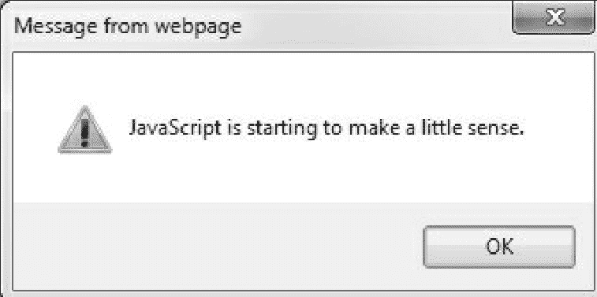
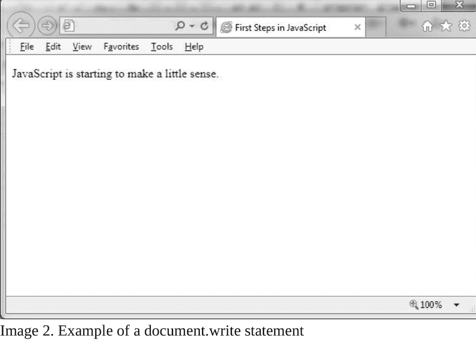
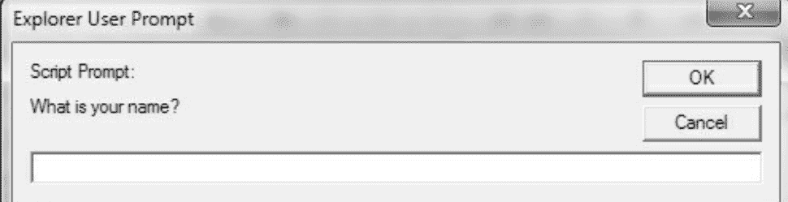
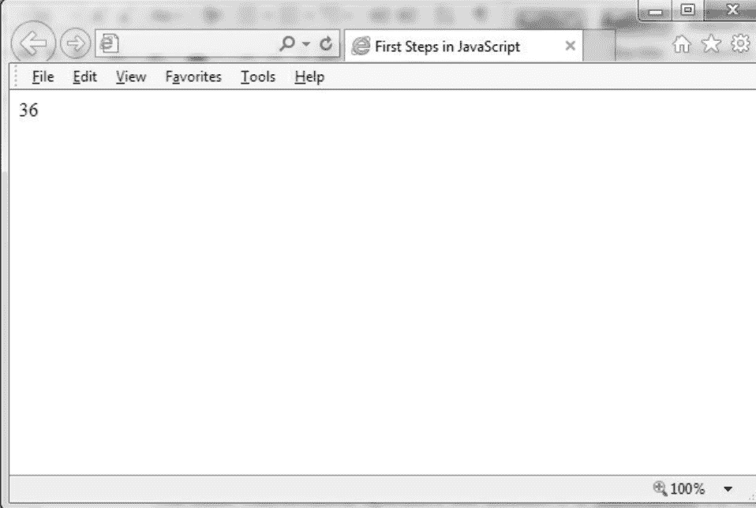
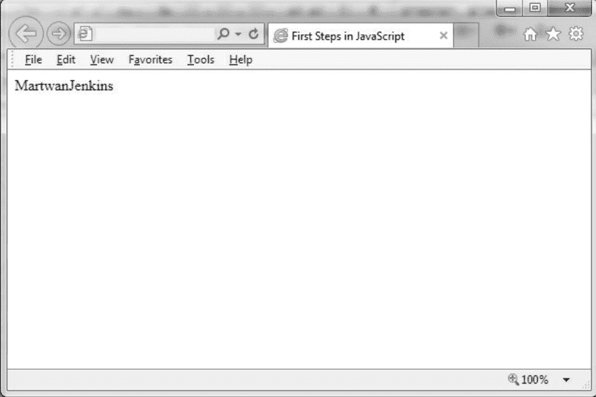
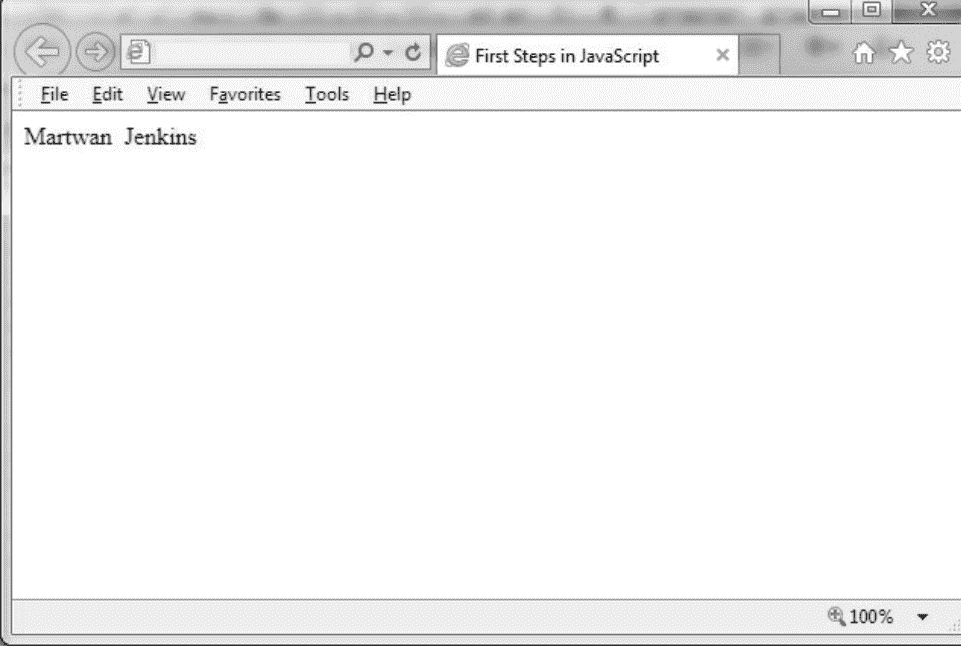
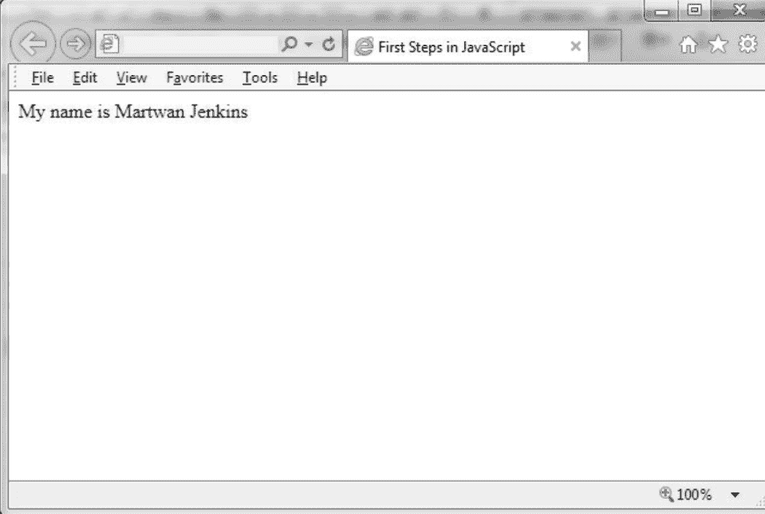
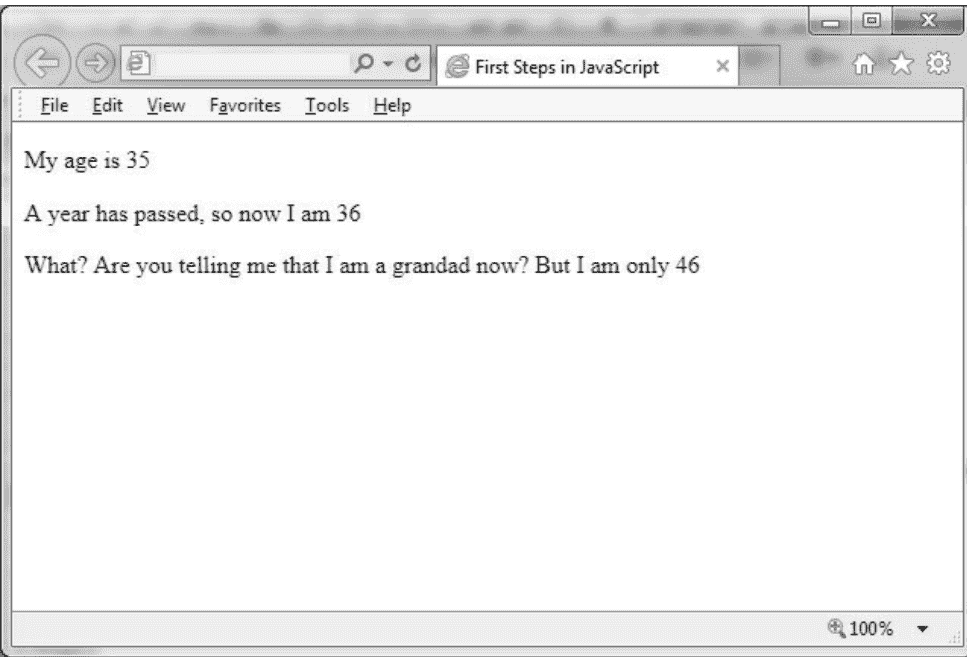
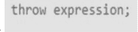

# JavaScript：理解 JavaScript 代码及其基础终极指南

理解 JavaScript 代码及其基础知识的终极指南。探索字面量和控制流。学习变量、函数、对象以及最佳 jQuery。

# 引言

HTML 并不聪明。它主要让人们查看文本和图像，并允许他们移动到其他页面进行更多类似的操作。为网页增加智能的是 JavaScript。它通过让页面在访问者与内容交互时做出响应，使网站更具吸引力、高效且实用。

本书假设我们已经知道如何使用 HTML 指定网页的结构和内容。如果我们熟悉如何使用 CSS 对页面进行样式设计（独立于网页结构），将额外有益。如果是这样，我们就准备好为页面添加一些行为，并通过 JavaScript 使其更具动态性和交互性。否则，没有 HTML 和 CSS，JavaScript 对我们不会产生太大帮助。它们被视为网页的三大支柱：结构、表现和行为。

# 什么是 JavaScript？

JavaScript 是 Web 的脚本语言，唯一目的是为页面添加交互性。除了交互性外，现代版本的 JavaScript 还可以从外部源甚至网站用户加载并解析信息。JavaScript 本质上是嵌入在网页 HTML 结构中的一段代码。当浏览器读取这段代码时，它会激活一个内置解释器，该解释器理解如何解码这种语言并处理其命令。

虽然编码过程中涉及编程，但 JavaScript 并不是一种编程语言。在传统的 Web 编程语言（如 Java 或 .NET）中，代码在执行之前必须经过编译。编译意味着代码必须先发送到运行在服务器上的特殊程序。该程序也称为应用程序服务器软件，会翻译代码，创建请求的页面或功能，并将其作为 HTML 返回。像 JavaScript 这样的脚本语言不是编译的，而是被即时解释的。这意味着当用户的浏览器运行并执行遇到的代码时，不需要涉及任何特殊的软件。

> **注意**：JavaScript 创建于 Java 是一种非常流行的语言的时代。除名字相似外，这些语言之间没有关系，除了基本的编程逻辑外，几乎没有任何共同点。

# 实现 JavaScript

现在我们对 JavaScript 是什么有了大致了解，就可以开始学习这种语言了。由于 JavaScript 代码是 HTML 文档的一部分，我们需要知道如何告诉浏览器运行我们的脚本。当我们想要在 Web 文档中包含 JavaScript 时，有两种常用的选项，在这两种情况下我们都会使用 `<script>` 元素。当我们需要告诉浏览器在 HTML 文档中 JavaScript 代码从何时开始、何时结束时，就会使用 `<script>` 标签。因此，此标签可以包含在页面的 `head` 或 `body` 部分。

第一个选项是将代码内联文档结构中。要做到这一点，我们首先打开 `<script>` 标签，输入 JavaScript 代码，然后通过 `</script>` 标签结束。从理论上讲，我们可以让文档保持这样，因为几乎所有的浏览器都会默认 `<script>` 标签之间的脚本语言是 JavaScript。尽管如此，为了最大的兼容性，我们将使用 `type` 属性扩展此标签，并指示浏览器如何解释 `text/javascript` 值。

```html
<script type="text/javascript">
// JavaScript 代码
</script>
```

第二个选项是从外部文件加载 JavaScript 代码到 HTML 文档。为了这个目的，我们可以再次使用 `<script>` 元素，但这次除了 `type` 属性外，我们将在 `<script>` 元素的 `src` 属性中包含文件的 URL。外部文件必须是带有 `.js` 扩展名的文本文件，仅纯 JavaScript 代码，而不包含任何 HTML 元素或 CSS 规则。例如，我们将 `script.js` 文件加载到浏览器中将使用以下代码：

```html
<script src="script.js" type="text/javascript">
</script>
```

当我们想在整个网站共享功能时，我们将 JavaScript 放在外部文件中并包含在网页中。否则，如果我们只需要添加一些本地交互行为，我们将代码嵌入页面中。

> **注意**：脚本文件按照它们在 HTML 代码中的放置顺序加载。

# 第 1 章 JavaScript 基础概念

通常，当我们听到“编程”一词时，会立即想到其他人输入无法理解的字母和数字字符串。编程看起来像是超凡脱俗的魔法。尽管如此，编程概念并不难理解，因为它们一直都是现实应用。JavaScript 虽然不像 HTML 或 CSS 那么简单，但并不是过度复杂的语言。与其他语言不同，它的“语法”更具描述性和直观性，适合作为第一种编程语言。基本上，学习 JavaScript 就像学习一种新语言，但是一种类似于英语的新语言。一旦我们学会了新词汇并理解了如何将它们组合成“句子”，就可以了。

## 语法

每种语言都有自己的一组字符和单词，并有一套如何将这些字符和单词组合成良好句子的规则。这些规则被称为语言语法，它是将语言结合在一起并赋予其意义的基础。

在开始学习 JavaScript 语法的示例之前，让我们先为 JavaScript 准备环境。如前所述，JavaScript 代码始终是 HTML 代码的一部分。因此，为了使用 JavaScript，我们首先需要创建一个基础 HTML 文档。首先，让我们打开一个文本编辑器（如记事本）并输入基础网页的 HTML 代码。除了基础 HTML 标签外，我们将在 `<head>` 部分包含一个 `<script>` 元素，从那里开始放置 JavaScript 代码。

```html
<!doctype html>
<html>
<head>
<title>JavaScript 第一步</title>
<script type="text/javascript">
</script>
</head>
<body>
</body>
</html>
```

让我们将此文档保存为 `firststeps.html`。如果我们使用的是记事本，我们必须记得将“保存类型”字段更改为“所有文件”。

### 语句

在日常常用语言中表达观点时，我们使用句子作为通信的基本形式。同样，在 JavaScript 中，我们也构建句子来表达我们的意图，这些句子正式被称为“语句”（statements）。JavaScript 语句是通信的基本单元，通常代表程序中的单个步骤。就像我们组合句子来表达观点一样，我们将语句组合在一起创建一个程序。

让我们来看一个简单的 JavaScript 语句看看它的作用。在 html 文档的起始和结束 `<script>` 标签之间，放置以下文本：

```javascript
alert("JavaScript is starting to make a little sense.");
```

在随后的示例中，除非必要，否则我们不会显示完整的 HTML 代码，但为了初始参考，你的文档应该如下所示：

```html
<!doctype html>
<html>
<head>
<title>First Steps in JavaScript</title>
<script type="text/javascript">
alert("JavaScript is starting to make a little sense.");
</script>
</head>
<body>
</body>
</html>
```

我们可以保存 `firststeps.html` 文档并在网页浏览器中打开它。一旦页面打开，我们将得到一个带有消息“JavaScript starting to make a little sense”的警报窗口。



图 1 警报窗口

现在我们知道了效果是什么，让我们回到 JavaScript 语句并将其翻译成普通语言，以便使其更容易理解。

```javascript
alert("JavaScript is starting to make a little sense.");
```

JavaScript 语句是由网络浏览器执行的指令。语句以关键字表示的命令开始。关键字标识了需要执行的操作。在这种情况下，关键字 `alert` 命令网络浏览器打开一个对话框并显示一条消息。如果我们只有 `alert();` 语句，那么对话框将是空的，但在我们的情况下，该语句包含一个特定的输入，即实际的消息文本，也称为“参数”（argument）。最后，就像每个句子都以句号结尾一样，JavaScript 语句以分号结尾。分号清楚地表明语句已结束，一旦解释器执行了它，它就应该移动到下一个项目。

现在我们准备好翻译这个 JavaScript 语句了。它的普通英语解释是：“打开一个对话框，并在框中显示文本 JavaScript is starting to make a little sense”。

> **注意**：在传递文本参数时，我们可以使用双引号（`"sense"`）或单引号（`'sense'`）来表示文本。

在继续之前，让我们来看另一个 JavaScript 语句。在 `<script>` 元素中，将之前的代码替换为以下内容，并在网页浏览器中预览以查看结果：

```javascript
document.write("<p>JavaScript is starting to make a little sense.</p>");
```



我们从结果中看到，之前空的文档现在有一段文本。根据之前对 JavaScript 如何工作的解释以及来自网页浏览器的结果，我们可以正确地假设 `document.write` 关键字命令浏览器直接写入网页。与 `alert()` 类似，它写入放置在起始和结束括号之间的任何内容。

### 变量

JavaScript（以及任何编程语言）的基本方面之一是变量（variables）的概念。变量是声明和存储以后可以使用的信息的方法。这些信息会随情况而变化，因此得名变量。

让我们来看下面的语句。

```javascript
var name = "Martin";
```

用普通语言来说，这等同于说“我的名字是 Martin”。关键字 `var` 是 JavaScript 语言中“创建一个变量”，或者在编程方言中是“声明一个变量”。后面的是变量名，我们在某些限制范围内选择的任何内容。使用 `=` 符号对变量赋值并不是立即必要的，因为这可以在以后发生。我们可以在一个语句中声明未定义的变量，并在后面的语句中为它赋值。例如：

```javascript
var name;
name = "Martin";
```

正如之前提到的，变量名可以是任何内容，如 `name`、`abc`、`R2D2`，但遵循一些规则。变量名可以包含字母、数字、美元符号 (`$`) 或下划线 (`_`)，不允许特殊字符。此外，变量名不能与数字开头，任何其他允许的值都是可以。最后，变量名对大小写敏感，这意味着网络浏览器中的解释器区分大写字母和小写字母，使得 `score` 与 `Score` 不同。

> **注意**：虽然我们可以使用任何内容作为变量名，但使用有意义的名称是明智的，这将帮助我们和其他程序员更好地理解编写的代码。

### 变量类型

根据数据类型，变量可以有不同的种类。三个最基本的类型是数字（number）、字符串（string）和布尔值（boolean）。

数字变量由数字字符表示。此变量可以接受整数、负整数和分数整数。数字经常用于计算中，因此我们的数字变量通常包含在数学运算中。下面的语句声明了一个名为 `age` 的变量，并为其赋值为 35。

```javascript
var age = 35;
```

字符串变量用于表示任何系列字母，如单词或句子。字符串表示为封装在引号内的系列字符，引号告诉解释器后面跟着的是字符串变量。JavaScript 允许我们使用双引号（`""`）或单引号（`''`），但我们必须留心使用相同类型的引号。

```javascript
var location = "California";
```

布尔值变量要简单得多，因为它只能接受两个值之一：`true`（真）或 `false`（假）。当我们创建想要智能响应用户操作的 JavaScript 程序时，就会使用这种变量。

### 用户变量

如果 JavaScript 不允许我们分享想法并动态地创建或更改变量，那它将毫无趣味。“给予”我们输入的最简单方法之一是使用 `prompt()` 命令。

```javascript
var name = prompt("What is your name?", "");
document.write(name);
```



图 3 自定义提示对话框

`prompt()` 命令的结果是一个对话框。不像 alert 对话框那样只显示消息，prompt 对话框还可以接收答案。因此，在 prompt 对话框的语法中，在括号之间提供两个用逗号分隔的参数。第一个参数是显示在框中的提示文本，第二个参数是文本框的默认值，因此也是变量的赋值。

在上面的示例中，显示在框中的提示文本将是“What is your name?”，框中的默认值为空，因为引号之间显然没有内容。一旦我们在框中输入内容并点击确定或按下 Enter 键，变量就会接收在字段中输入的值。因此，`name` 将显示在网页上。否则，如果我们点击取消、按下 Esc 键或关闭提示框，返回的值将为空，屏幕上将没有文本。

> **注意**：除了 `prompt()`，我们还可以使用更正式的 `window.prompt` 命令。

### 运算符

将信息存储在变量中是第一步，编程的魅力在于能够以许多创意方式处理这些信息。为此，JavaScript 提供了不同的运算符，允许我们修改数据。运算符由符号或单词表示，是可以将一个或多个值更改为其他东西。可用运算符的类型根据数据类型而异。

#### 数学运算符

基本的数学运算符，如加法 (`+`)、减法 (`-`)、乘法 (`*`) 和除法 (`/`) 在 JavaScript 中随处可用。它们可以用于独立语句或在声明变量时使用。例如，通过对变量 `currentYear` 和 `yearofBirth` 运行“操作”，我们可以确定变量 `age` 的值。

```javascript
var currentYear = 2015;
var yearofBirth = 1979;
var age = currentYear - yearofBirth;
document.write(age);
```



图 4. 使用变量计算年龄

> **注意**：在网页上“调用”变量进行显示是很容易的。只需使用 `document.write()` 命令即可。

数学运算符，特别是加法运算符，可以用于组合两个或多个字符串。这种组合字符串的过程被称为字符串拼接。在下面的示例中：

```javascript
var firstName = "Martwan";
var lastName = "Jenkins";
var fullName = firstName + lastName;
document.write(fullName);
```



`fullName` 的值将结果是 MartwanJenkins。为了确保所有内容都格式正确，我们需要在引号中将空格作为字符串包含进来。例如，我们可以使用以下声明：

```javascript
var fullName = firstName + " " + lastName;
```



我们可以看到，当我们想要连接文本和/或组合变量时，运算符也非常有用。事实上，我们可以用此来构建更具逻辑的句子。例如，我们可以将“My name is”文本与来自计算变量的值结合。

```javascript
var firstName = "Martwan";
var lastName = "Jenkins";
var fullName = firstName + " " + lastName;
document.write("My name is " + fullName);
```



图 7. 拼接完整句子

> **注意**：在一条语句中执行多个数学操作时，将适用优先级规则。

#### 赋值运算符

就像现实生活中的事物会变化，JavaScript 程序中的变量也会变化。为了改变 JavaScript 中的变量，我们将使用赋值运算符。我们已经熟悉基本的赋值运算符——等号 (`=`)，它用于给变量赋予初始值或新值。还有其他的赋值运算符也可以改变变量的值，但它们的方式略有不同。

例如，随着岁月的增长，我们变得越来越老，我们的年龄逐年增加一。要在 JavaScript 中实现这种变化，我们有几种不同的方法可以采用，它们的结果都是相同的。为了尝试改变变量的可能性，我们可以尝试以下代码，其中 `age` 变量值的更改将在浏览器中显示：

```javascript
var age = 35;
document.write("<p>My age is " + age + "</p>");

age = age + 1;
document.write("<p>A year has passed, so now I am " + age + "</p>");

age += 10;
document.write("<p>What? Are you telling me that I am a grandad now? But I am only " + age + "</p>");
```



图 8. 使用赋值运算符改变操作

虽然这些操作初看起来有些困惑，但从编程角度来看它们仍然是有逻辑。例如，如果我们反过来读取 `age = age + 1` 语句，发生的是将 `1` 加到当前 `35` 的 `age` 上，这将 `36` 成为 `age` 的新值。此外，我们可以在 `age += 10` 语句中使用复合赋值运算符如 `+=`，将变量的值增加 `10`。我们也可以将相同的逻辑用于减法、除法和乘法等操作。

```javascript
age -= 5;  // 等同于 age = age - 5;
age *= 5;  // 等同于 age = age * 5;
age /= 5;  // 等同于 age = age / 5;
```

此外，当我们要增加/减少变量的值 `1` 时，我们还可以使用以下赋值运算符：

```javascript
age++;  // 等同于 age = age + 1;
age--;  // 等同于 age = age - 1;
```

#### 比较运算符

正如名称所示，比较运算符用于比较两个值。比较完成后，将根据比较是否精确返回 `true` 或 `false` 值。

下表总结了最常用的比较运算符。

| 运算符 | 含义 | 示例 | 返回值 |
|---|---|---|---|
| `==` | 等于 | `4 == 4` | True |
| `>` | 大于 | `3 > 4` | False |
| `<` | 小于 | `3 < 4` | True |
| `>=` | 大于或等于 | `4 >= 4` | True |
| `<=` | 小于或等于 | `4 <= 5` | True |
| `!=` | 不等于 | `3 != 4` | True |

表 1. 比较运算符

# 第 2 章 HTML 概述

HTML、CSS 和 JavaScript 协同工作，为用户提供无缝的网页体验。许多初出 Web 开发者会将这三者搞混。如果你对 Web 开发世界完全陌生，本章将带你快速浏览 HTML。另一方面，如果你已经了解 HTML，可以随意跳过或略读本章。

## 选择文本编辑器

在开始创建交互式网页之前，你必须下载一个良好的文本编辑器。虽然 Mac 和 PC 通常内置了可以以 html 格式保存文件的文本编辑器，但它们缺乏许多让 Web 开发变得更方便的实用工具，例如语法高亮和自动补全。尽管如此，以下是一些用于 Web 开发的最佳文本编辑器：

- **Atom** – Atom 是 Github 出的一款较新的文本编辑器。它是免费、开源的，并且有许多自定义选项。基本上，Atom 就像一个可编程的文本编辑器；只要有正确的插件，它可以完成你想要的一切。它的许多功能中包括模糊查找（Fuzzy finder），它允许你通过简单的 `cmd+t` 命令在不同文件之间跳转，以及广泛的可用主题。它适用于 Mac OS X、Windows 和 Linux，且免费，所以试一下看看它是否适合你。

- **Sublime Text** – Sublime Text 的命名非常贴切，由于其直观的命令和优界面，它提供了一种卓越的写作体验。和 Atom 一样，Sublime Text 也是高度自定义的，并适用于 Mac OSX、Windows 和 Linux。它的试用版是免费，但完整版价格约为 70 美元。

- **Notepad++** – Notepad++ 长期以来一直受欢迎，因为它具有无与伦比的简单和快速。如果你只需要一个实实在在的编辑器来编辑几个 html 文件，而不需要复杂的目录结构，你可以尝试一下这个文本编辑器。但记住，此文本编辑器仅在 Windows 上可用。

- **Brackets** – Brackets 是 Adobe 一款非常独特的文本编辑器，它设计用于与 Adobe 的其他产品（特别是 Photoshop）协同工作。如果你感兴趣从 Photoshop 创建精美的用户界面，Brackets 允许你从你创建的 PSD 中无缝提取信息并将其转换为 CSS 代码。此文本编辑器适用于 Windows、Linux 和 Mac OS，所以如果你对网页设计感兴趣，你将希望在系统中安装它。

如果你不打算节省系统空间，我建议下载这四种文本编辑器并亲自尝试，假设你运行的是兼容的操作系统。书中的练习和代码段不需要特定的文本编辑器，所以请在不同的文本编辑器之间切换，直到找到一个适合你需求的编辑器。

## 什么是 HTML？

HTML 基本上允许你以结构化的方式展示网站内容。将它想象成建筑的蓝图；它告诉你是客厅、浴室、厨房等房间将如何放置以及如何和谐地连接。

学习 HTML 文件的结构非常简单；它的结构几乎像文章一样——你提供标题、骨架结构以及在结构内贯穿的内容。每当你阅读一篇文章时，标题告诉你文章讨论的主题，内容以特定的方式组织，通常以一句引起你兴趣的句子开头，随后是轶事、事实数据、论点和结论。当你开始编写 HTML 时，你会发现它的结构与你阅读或编写的文章非常相似。

那么，创建一个 HTML 文件只需将你的文件保存为 `.html` 扩展名即可。当你使用 Microsoft Word 等文字处理器创建文档时，你会发现保存文件时文件名带有 `.odt`、`.doc`、`.docx` 或类似的后缀。这告诉计算机以非常特定的方式读取和格式化文件内容。这是因为每当你使用文字处理器保存内容时，你不仅仅保存了输入的字；你还保存了你使用的字体大小、字体样式和其他格式样式，这样当你打开文件时，计算机就会检查文件扩展名，根据指定的扩展名读取内容并向你呈现你创建的文件，确保它在保存后看起来完全相同。

HTML 的基本工作原理也是一样，但这次你使用标签来告诉计算机如何处理标签内包含的数据；这允许你轻松地更改网页的字体和其他属性。将 HTML 想象成一个更精确的 Word 文档。例如，看看下面的文本：

> This is a sentence.

如果你将其保存为 Word 文档，它保存的不仅是文本，还有它的字体、大小和结构。你刚刚保存的文档属性被整齐地封装在文件中，并且只能通过文字处理器的菜单进行访问。然而，如果你想以 HTML 格式显示相同的句子，HTML 文件看起来像这样：

```html
<html>
<head>
</head>
<body>
<p>This is a sentence.</p>
</body>
</html>
```

通过以 `.html` 扩展名保存此文件，你就获得了一个显示“This is a sentence.”的基础网页。请注意，它与之前的文本框具有相同的文本字符串，但它包含了你可能熟悉或不熟悉的额外标签。当你的浏览器打开此文件时，它会理解标签并只显示之前文本框中的内容；它实际上不会向用户显示标签。最基本的标签在代码示例中：

- `<html>` 标签 - 包含你网页中的所有内容。它从字面上说就是开头和终结；永远不要忘记 `<html>` 标签，否则你的网站将无法正常工作！
- `<head>` 标签 - 保留标题以及 body 可能会使用的其他初步脚本。例如，如果你想使用一组设计协议（通常以 CSS 的形式存在）来规定使用什么种字体、它们的颜色等，你可以将代码或其引用放在这里。
- `<body>` 标签 - 这是你内容所在的地方。从文本、图像到视频，一切都发生在这里。

如果你还没有完全理解这些标签是如何运作的，不要太担心；你将在未来的示例代码和练习通过尝试它们来更好地学习它们是如何运作的。

## HTML 基础

现在你已经对 HTML 的工作原理有了大致的了解，我们将快速回顾一下基础知识，足以帮助你学习如何将 JavaScript 无缝地集成其中。

我们已经讨论过 HTML 文件如何像带有额外标签的 Word 文档，让我们从一行简单的文本开始。在你的文本编辑器中输入以下内容：

> Hi There!

现在在你的计算机上创建一个文件夹，用于存储创建的所有 html 文件，并将你刚刚输入的内容以 `.html` 扩展名保存（例如，“My First Website.html”）。程序员的标准做法是创建一个名为 `Developer` 的文件夹——这是你存储所有与编程相关文件的地方。你可以将其放在主目录中。在 `Developer` 文件夹内部，创建一个名为 `Web Development` 的文件夹，现在将你所有的 html 文件都放在这里。如果使用的编辑器不是专门为 html 文件构建的，请记住检查设置并确保选中了“Plain text”（纯文本）。

现在你已经创建了你的第一个 html 文件，请使用你所拥有的任何网络浏览器打开它，看着一个简单的文本字符串出现在你眼前！然而，请注意，你在文本编辑器中输入的内容（称为“源代码”）看起来和浏览器显示的内容一模一样；它没有 `<html>` 标签和其他东西。这是怎么回事呢？

现在，尝试通过添加几个标签来更改你的 html 文件。它看起来应该像这样：

```html
<!DOCTYPE html>
<html>
<body>
  Hi There!
</body>
</html>
```

现在重新加载你的浏览器并看看发生了什么。

你的浏览器没有故障；尽管源代码中添加了标签，网页看起来几乎完全一样。在这一点，你可能还没有完全理解为什么要使用标签，但不要担心；当你开始更多地进行 HTML 编程时，你就会看到它们的用途了。

## 结论

你刚刚对 HTML 进行了首次尝试——并不深入，只需足够的的基础知识来帮助你正确将 JavaScript 与 HTML 使用。如果你对学习更多 HTML 感兴趣，你会想要查看在线教程和参考，并查看其他网页开发者如何编写他们自己的网站代码。你可以通过右键点击网站并点击“查看页面源代码”（view page source）或类似的操作来实现。如果你准备好投身 JavaScript 的世界，请前往。

# 第 3 章 JavaScript 控制流语句

这种语言提供了一组紧凑的控制流语句，你可以将其添加到代码中。通常情况下，控制流语句会增强 JavaScript 程序的功能和交互性。本书的这一部分重点介绍控制流语句。

## 块语句

程序员认为这是 JavaScript 中最基本的语句。使用它来组合你的 JavaScript 语句。在编写程序时，使用一对括号包裹块语句。

```javascript
{
  statement_1;
  statement_2;
  // ...
  statement_n;
}
```

下面的图片显示了块语句的语法：

通常情况下，程序员使用块语句用于控制流语句（即用于 `for`、`if`、`while` 等）。这里有一个示例：

```javascript
while (y > 69) {
  123;
}
```

在给出的代码段中，“123;”充当了块语句。

## 条件语句

条件语句是一组在分配的条件为真时运行的命令。JavaScript 语言提供了两种条件语句：(1) `if...else` 和 (2) `switch`。

让我们详细讨论这些条件语句：

### “if...else”语句

通过此语句，只要分配的条件为真，你就可以运行命令。它包含一个“else”子句（可选）。“else”子句包含一个在分配的条件为假时运行的语句。

```javascript
if (condition) {
  statement_1;
} else {
  statement_2;
}
```

基础“if...else”语句的语法是：

由于你的条件必须是“真”或“假”，因此在编写条件语句时，必须使用布尔表达式。如果条件为真，则运行第一条语句；否则，运行第二条语句。

JavaScript 允许在条件语句中设置多个条件。你只需要在条件语句中组合多个“if”和“else”子句即可。以下是你必须使用的语法：

```javascript
if (condition_1) {
  statement_1;
} else if (condition_2) {
  statement_2;
} else if (condition_n) {
  statement_n;
} else {
  statement_last;
}
```

要运行多条语句，你必须将它们放在块语句内部（即 `{ ... }`）。编程专家声称，利用块语句是最好的，特别是在组合语句时。

```javascript
if (condition) {
  statement_1_runs_if_condition_is_true;
  statement_2_runs_if_condition_is_true;
} else {
  statement_3_runs_if_condition_is_false;
  statement_4_runs_if_condition_is_false;
}
```

检查以下示例：

如果可能，避免在你的条件表达式中使用简单赋值。这是因为在检查 JavaScript 代码时，简单赋值经常与等值判断混淆。例如，你不能在你的语句中添加以下代码：

```javascript
if (a = b) {
  /* sample_statement */
}
```

如果你确实需要在你的条件表达式中使用简单赋值，请将其放在一对括号之间。这是一个示例：

```javascript
if ((x = y)) {
  /* sample_statement */
}
```

### 假值

假值是指评估为假的值。以下是你在使用 JavaScript 时会遇到的假值：

- `null`
- `false`
- `undefined`
- `NaN`
- `""`（即空字符串）

未列出的任何值在条件语句中使用都会评估为真。

### “Switch”语句

这种语句允许应用程序检查一个表达式并与预定义的一组情况进行比较。如果匹配，应用程序将运行分配的命令。这是基础 `switch` 语句的语法：

```javascript
switch (expression) {
  case label_1:
    statements_1;
    break;
  case label_2:
    statements_2;
    break;
  // ...
  default:
    statements_def;
    break;
}
```

首先，应用程序将搜索与表达式值匹配的标签。然后，它将控制流传递给该特定的子句，执行分配的语句/语句。如果没有找到匹配，应用程序将检查默认子句（可选）并将控制流传递给该子句，运行分配的语句/语句。如果语句没有默认子句，应用程序将直接运行 `switch` 之后的语句。

## 如何处理异常

JavaScript 允许你抛出和管理异常。为了执行这些操作，你必须使用以下语句：

- `throw` 语句
- `try...catch` 语句

### 异常的不同类型

在 JavaScript 中，你可以抛出任何类型的对象。然而，抛出的对象可能具有不同的特征。虽然通常抛出字符串并将数字或或数字作为错误消息，通常利用专为此目的设计的异常类型会更有益处。以下是 JavaScript 中最常用的两种异常：

- `DOMError` – 此异常表示一个命名的错误对象。
- `DOMException` - 此异常表示在使用属性或方法时发生的异常情况。若要使用此异常，你必须在代码中添加 `DOMError()`。

### “throw” 语句

显然，该语句允许你抛出异常。在抛出异常时，你必须指定持有要抛出的数据表达式。其语法如下：



上述语法可以抛出任何类型的表达式。以下列表显示了一些示例：

- `throw "Error1";` // 字符串类型异常
- `throw 1;` // 数字类型异常
- `throw false;` // 布尔类型异常

> **注意**：你可以在抛出异常时指定对象。然后，你可以在语句的 `catch` 部分指定该对象或多个对象的属性。

### “try…catch” 语句

该语句寻找你可以尝试的块语句。它还指定了在抛出异常时使用的响应。`try...catch` 语句用于捕获异常。

`try...catch` 语句包含三个部分，分别是：

1. **“try” 部分** – 它包含一个或多个 JavaScript 语句。这部分是强制性的。
2. **“catch” 部分** – 该部分包含语句，指示在抛出异常时程序必须执行的操作。

这意味着，如果 “try” 部分没有成功，程序将进入 “catch” 部分。如果 “try” 部分内部的语句抛出了异常，程序控制将立即跳转到 `catch` 部分。然而，如果没有发生异常，系统将跳过语句的 `catch` 部分。

在 JavaScript 中，你可以使用 `catch` 部分来管理在 `try` 部分可能抛出的所有异常。

```javascript
catch (catchID) {
  statements
}
```

语法如下。

在上述语法中，“catchID” 代表包含赋值给你的 `throw` 语句的值的标识符。你可以利用此标识符来获取有关所抛出异常的数据。每当 `catch` 部分执行时，JavaScript 都会生成此标识符。该标识符仅在 `catch` 部分激活期间存在。这意味着一旦 `catch` 部分完成执行，该标识符将不再存在。

例如，下面的代码会生成一个异常。一旦异常被抛出，程序控制进入 `catch` 部分。

```javascript
try {
  throw "myException"; // 生成异常
} catch (e) {
  // 处理任何异常的语句
  logErrors(e); // 将异常对象传递给错误处理器
}
```

> **注意**：此部分是完全可选的。

3. **“finally” 部分** – 它包含在执行完之前的部分后运行的语句。无论程序是否遇到异常，位于 “finally” 部分内部的语句都会运行。此外，即使语句没有 “catch” 部分，`finally` 部分的语句仍然会运行。

通常，程序员使用此部分在发生异常时为他们的项目设置优雅的退出。例如，他们可能需要释放受问题脚本影响的资源：

```javascript
openMyFile();
try {
  writeFile(theData); // 这可能会抛出错误
} catch(e) {
  handleError(e); // 如果我们错误，我们就处理它
} finally {
  closeMyFile(); // 始终关闭资源
}
```

下面的图片将帮助你理解该部分是如何工作的。

使用上述代码，JavaScript 打开一个文件并运行使用该文件的语句。如果 JavaScript 遇到错误，“finally” 部分将在整个代码终止之前关闭文件。

## 如何利用错误对象

在某些情况下，你可以通过检查其属性（即 `name` 和 `message`）来获取有关错误的更多信息。如果你的代码的 `catch` 部分没有指示错误是由用户还是系统本身生成的，此功能将非常有用。要利用错误对象，你必须使用一种名为 “Error构造函数”的 JavaScript 工具。

```javascript
function somethingErrorprone() {
  if (ourCodesAMistake()) {
    throw new Error('The message');
  } else {
    doSomethingToGoAjavascriptError();
  }
}
try {
  doSomethingErrorprone();
} catch (e) {
  console.log(e.name); // 打印 'Error'
  console.log(e.message); // 打印 The 'message' 或 JavaScript 错误
}
```

示例如下：

## JavaScript Promises

JavaScript 语言现在支持 “promises”（即一种允许程序员管理延迟和异步过程流程的对象）。

Promises 经历以下状态：

- **Pending（等待中）** – 这是 promise 的初始状态。在此状态下，promise 可能会被拒绝或完成。
- **Fulfilled（已完成）** – 如果系统成功完成了所有分配的过程，promise 就会变为 “fulfilled”。
- **Settled（已就绪）** – 一个就绪的 promise 可以是被拒绝的，也可以是完成的。
- **Rejected（已拒绝）** – 在被拒绝的 promise 中，系统未能完成分配的过程。

# 第 4 章 JavaScript 中不同类型的循环

循环允许你快速方便地重复代码段。本章将集中于 JavaScript 提供的不同类型的循环。

## 通用信息

在编写代码时，你会发现某些必须反复使用相同代码的情况。这种任务是枯燥且耗时的。然而，你不能跳过它，因为如果没有适当的代码，你的应用程序无法正常工作。

幸运的是，JavaScript 支持循环语句。循环语句允许你自动重复代码块。这意味着你不需要花费大量精力和来完成你的 JavaScript 代码。

循环的设计是为了重复代码。它们具有不同的机制，可以通过调整这些机制来提高复制代码的有效性。此外，每种循环类型都有独特的特征，使得它们在某些情况下非常有用且方便。以下是你在 JavaScript 中找到的循环语句：

- `for`
- `while`
- `do...while`
- `label`
- `break`
- `for...of`
- `for...in`
- `continue`

## “for” 循环

基本上，“for” 循环会重复语句，直到分配的条件变为假。“for” 循环的语法类似于 C 和 Java。语法如下：

```javascript
for ([initialExpression]; [condition]; [incrementExpression])
  statement
```

每当 “for” 循环运行时，会发生以下情况：

1. 循环的初始化表达式（上述语法中的 `initialExpression`）执行其功能。通常，初始化表达式会触发多个循环计数器。这意味着上述语法接受不同复杂程度的操作。你也可以使用此表达式来声明变量。

> **注意**：初始化表达式是可选的；因此你可以在不使用任何初始化表达式的情况下创建有效的 “for”循环。

2. 系统评估条件表达式。如果评估为真，循环中的语句将运行。然而，如果评估为假，整个循环将停止。

> **注意**：条件表达式是可选的。如果你在 “for” 循环中没有添加条件表达式，系统将假设评估为真。

3. 语句运行。如果你想运行多个语句，你必须将它们分组为一个块（即通过使用大括号括起来）。

4. 最终表达式（语法中的 `incrementExpression`）更新整个循环，然后控制流将返回第二步（见上文）。

## “while” 循环

“while” 循环在分配的条件为 “true” 时执行其语句。这是 “while” 循环的语法：

```javascript
while (condition)
  statement
```

一旦条件结果为 “false”，循环将停止运行分配给它的赋值，然后控制流将跳转到 “while” 循环之后的语句。

系统在运行循环本身之前先评估条件。如果条件为真，循环内的语句将执行，系统将再次检查该条件。如果条件为假，循环将停止，控制流将移动到下一个语句。

> **重要说明**：由于条件测试首先进行，“while”循环可能永远不会执行。这意味着在 JavaScript 程序中创建“while”循环时，必须极其小心。

JavaScript 允许你使用一对大括号来包围多个语句。如果你想在“while”循环中包含各种语句，请使用此选项。

## “do…while”循环

这种循环会执行其语句，直到赋值的条件变为假。当在创建“do…while”循环时，你必须使用以下语法：

```javascript
do
  statement
while (condition);
```

在这里，系统会在检查赋值的条件之前执行一次语句。如果条件为真，系统将再次执行这些语句。这个过程将一直持续，直到条件变为假。一旦条件求值为假，控制流将跳转到“do…while”循环之后的语句。

在此类循环中，即使条件为假，语句也能保证至少执行一次。

## “label”（标签）语句

这种语句允许你对语句进行“标记”（即分配一个标识符）。通过对 JavaScript 语句进行标记，你可以轻松地在应用程序任何部分重复它们。例如，你可能对某个循环进行标记，并利用其他语句来继续或中断它的执行。

```javascript
label:
  statement
```

这里是“label”语句的语法：

在创建标签时，你可以使用任何不是关键字的标识符。你可以对任何语句使用上述语法。

## “break”语句

程序员使用此语句来结束循环或 `switch` 语句。当使用“break”语句时，你必须记住以下规则：

- 如果你的 `break` 语句没有标签，它将终止最内层的循环/`switch`，并将控制流传递给下一个语句。
- 如果你的 `break` 语句有标签，它将终止被标记的语句。

`break` 语句的语法为：如果你不需要指定标签，请使用语法的第一种变体。如果你想终止特定的循环/`switch`，请使用第二种变体。使用第二种变体时，只有指定的循环/`switch` 会终止。

1. `break;`
2. `break Label;`

## “for...of”语句

该语句是 JavaScript 语言最近添加的特性。它创建一个可以重复迭代对象（例如 maps、sets 等）的循环。它还会调用一个迭代钩子，该钩子会在对象的每个不同属性上运行。

```javascript
for (variable of object) {
  statement
}
```

这是你必须为“for...of”使用的语法：

## “for...in”语句

“for...in”语句在对象的属性上重复语句/语句。JavaScript 将为每个属性执行赋值的语句。

```javascript
for (variable in object) {
  statements
}
```

“for...in”的语法是：

## “continue”语句

你可以使用此语句来重启其他语句（例如 `for`、`while`、`do while` 和 `label`）。在使用“continue” 语句时，你必须记住以下两个规则：

- 如果在 `continue` 语句中没有包含标签，它将终止最内层循环的当前过程，并继续下一个。与 `break` 语句不同，`continue` 语句无法终止整个循环。如果用于“while”循环，控制流将返回到赋值的条件。
- 如果你在 `continue` 语句中包含了标签，它将只会影响与该标签关联的语句。

1. `continue;`
2. `continue Label;`

`continue` 语句的语法有两种形式，它们是：

# 第 5 章 语法

如前所述，JavaScript 需要嵌入 HTML 文档中，或者从同一个文件中引用。为了嵌入脚本，需要将脚本放置在 `script` 标签中，如下所示：

```html
<script>...</script>
```

这些标签内的脚本必须放置在 HTML 文档内部。虽然此脚本可以出现在 HTML 文档的任何地方，但建议将其放在 `<head>...</head>` 中。在 `<script>...</script>` 块中编写的 JavaScript 代码由浏览器解释。`script` 标签可以提供两个属性：

- **Type**：`type` 属性用于指定正在使用的脚本语言。在这种情况下，`type` 必须设置为值“text/javascript”。
- **Language**：此属性现在已逐渐废弃。然而，较早版本的 HTML 仍在使用它。它的值通常必须设置为“javascript”。

代码的 JavaScript 部分现在看起来如下：

```html
<script language="javascript" type="text/javascript">
...
</script>
```

## 编写你的第一个 JavaScript

假设你已经了一些 HTML 编码经验，让我们来看第一个示例。这段代码打印“Hello World!”。正如你所见，代码被嵌入到 HTML 文档中。代码的输出在下方显示的图中。

```html
<html>
<body>
<script language="javascript" type="text/javascript">
<!--
document.write("Hello World..")
//-->
</script>
</body>
</html>
```


JavaScript 代码被封装在 `<script></script>` 标签内。此脚本通过将其放置在 `<html></html>` 的 `<body></body>` 内部来嵌入 HTML 文件。

# 第 6 章 在浏览器中启用 JavaScript

今天使用的大多数浏览器都支持 JavaScript。然而，你可能需要禁用或启用浏览器的此功能。你可以手动执行此操作。本章将带你快速了解如何在 Firefox、Google Chrome 和 Internet Explorer 等浏览器中手动启用和禁用 JavaScript。

## Internet Explorer (IE)

要在 IE 中启用或禁用 JavaScript，你需要按照以下步骤操作——

在 IE 面板中，转到“工具”，从菜单打开“Internet 选项”。找到“安全”选项卡并选择它。选择“自定义级别”按钮。现在向下滚动，你会看到一个名为“脚本”的选项。在此标题下，选择“活动脚本”单选按钮。点击确定，你将返回浏览器。

如果你想禁用 JavaScript，需要按照相同的步骤操作，在选择“活动脚本”时，你必须选择“禁用”按钮。

## Firefox

要在 Firefox 中启用或禁用 JavaScript，你需要按照以下步骤操作——

打开新窗口，并在标签页的地址栏中输入 – `about:config`。这将为你弹出一个对话框，并向你发出警告。选择写有“我很小心，我保证！”的选项。一旦选择此选项，浏览器将向你列出配置选项。在搜索栏中输入 - `javascript.enabled` -。如果你右键点击此值，你会看到“选择切换”选项。选择此选项将简单切换值。如果 JavaScript 已启用，选择此选项将将其禁用，否则将启用。

## Chrome

要在 Google Chrome 中启用或禁用 JavaScript，你需要按照以下步骤操作——

点击窗口右上角的图标进入 Chrome 菜单。在可用选项中，选择“设置”并点击“显示高级设置”。之后出现的窗口将有一个名为“隐私”的部分。寻找“内容设置”按钮。你可以在此按钮下找到 JavaScript 部分。要启用 JavaScript，选择“允许网站运行 JavaScript (推荐)”，否则选择“不允许任何网站运行 JavaScript”。

## 为非 JavaScript 浏览器编写 JavaScript 代码

如果你正在编写 JavaScript，且用户在非 JavaScript 浏览器上运行它，那么你可以借助 `<noscript>` 标签为用户打印消息。这一概念可以通过以下方式实现。

```html
<html>
<body>
<script language="javascript" type="text/javascript"><!--
document.write("Hello World...")
//-->
</script>
<noscript>
Warning: JavaScript Required!（需要 JavaScript！）
</noscript>
</body>
</html>
```

如果用户尝试在非 JavaScript 浏览器上运行脚本，将向用户显示此消息“Warning: JavaScript Required!”。

# 第 7 章 JavaScript 在文件中的位置

虽然用户可以将 JavaScript 代码封装在 `<script></script>` 标签内，并包含在 HTML 文档的任何位置，但存在一些首选的包含方式。这些实践在下方所示。

## 在 `<head></head>` 部分包含 JavaScript 代码

通常，如果你想捕获用户点击，相关代码将位于 HTML 文档的 head 部分。为了帮助你理解这一概念，下面提供了一个示例代码。

```html
<html>
<head>
<script type="text/javascript">
<!--
function pHWorld() {
  alert("HelloWorld!")
}
-->
</script>
</head>
<body>
<input type="button" onclick="pHWorld()" value="Print HelloWorld!" />
</body>
</html>
```

## 在 `<body></body>` 部分包含 JavaScript 代码

如果你有一些要在页面加载后运行的 JavaScript 功能，那么此脚本应该出现在 HTML 文档的 body 中。下面的代码显示了如何将 JavaScript 代码嵌入 HTML 文档的 body 中。

```html
<html>
<head>
</head>
<body>
<script type="text/javascript">
<!--
document.write("HelloWorld!")
//-->
</script>
<p>Body of HTML document</p>
</body>
</html>
```

## 在 `<head></head>` 和 `<body></body>` 部分包含 JavaScript 代码

可以在同一个 HTML 文档的 head 和 body 部分嵌入不同的 JavaScript 代码。下面提供了说明如何操作的示例代码。

```html
<html>
<head>
<script type="text/javascript">
<!--
function printHW() {
  alert("HelloWorld!")
}
//--
</script>
</head>
<body>
<script type="text/javascript">
<!--
document.write("HelloWorld!")
//-->
</script>
<input type="button" onclick="printHW()" value="Print Hello World" />
</body>
</html>
```

## 将 JavaScript 写入外部文件

你的网站页面越多，你就越会意识到你在所有这些不同页面或至少是某些页面中编写相同的 JavaScript 代码。JavaScript 允许你通过在外部文件中编写 JavaScript 代码来管理在不同 HTML 文档使用的相同代码，然后将其与页面链接以调用所需的 JavaScript 功能。你可以通过 `script` 标签的 `src` 属性来链接外部文件。下面提供了说明此项功能的示例代码。

```html
<html>
<head>
<script type="text/javascript" src="sample.js"></script>
</head>
<body>
</body>
</html>
```

在这里，`sample.js` 是包含脚本的 JavaScript 文件。该文件中的代码可以被 HTML 使用。请注意，脚本标签内的 JavaScript 代码需要写入文本文件并以 `.js` 扩展名保存。例如，你的 `sample.js` 可以如下所示：

```javascript
function printHW() {
  alert("HelloWorld!")
}
```

# 第 8 章 弹出消息

JavaScript 具有许多内置方法可以帮助出于各种目的显示消息。让我们讨论 JavaScript 提供的各种弹出框：

## Alert 框

用于向用户显示消息，特别是在需要强调的情况下。它带有一个 OK 按钮，点击后关闭弹出。它是通过调用 JavaScript 的 `alert()` 函数创建的。

例如：

```html
<body>
  <h1>Popup World!</h1>
  <script>
    alert("Hello World!"); // 显示字符串
    alert(12); // 显示数字
    alert(true); // 显示布尔值
  </script>
</body>
```

当你运行代码时，它将显示第一个带有字符串 Hello World! 的 alert 框。点击 OK 按钮将显示 12。再次点击 OK 按钮将显示 true。这表明 alert 框可以显示任何类型的消息。

## Confirm 框

有时，需要用户确认以便继续。例如，你可能希望用户在完成删除之前删除或更新可以使用提供的 `confirm()` 函数来实现。此函数将向用户显示一个带有确定和取消按钮的弹出框。下一步由用户点击的按钮决定。

例如：

```html
<html>
<body>
  <h1>confirm()</h1>
  <p id="del"></p>
  <script>
    var userChoice;
    if (confirm("Do you really want to delete the data?") == true) {
      userChoice = "Data deleted successfully";
    } else {
      userChoice = "Delete Canceled!";
    }
    document.getElementById("del").innerHTML = userChoice;
  </script>
</body>
</html>
```

## Prompt 框

在某些情况下，你可能需要接收用户的输入并将其用于网页上执行进一步的操作。例如，你可能需要根据用户想要结算贷款的月数计算每月还款金额。在这种情况下，你可以使用 JavaScript 提供的 `prompt()` 函数。

该函数接受两个字符串参数。第一个是将被显示的消息，第二个是消息显示后输入框中的默认值：

```javascript
prompt([string display_message], [string default_Value]);
```

例如：

```html
<html>
<body>
  <h1>prompt()</h1>
  <p id="pro"></p>
  <script>
    var age = prompt("What is your age?", "26");
    document.getElementById("pro").innerHTML = "You are " + age + " years old";
  </script>
</body>
</html>
```

该代码提示你输入年龄。如果你不输入并点击 OK 按钮，将使用 26 作为你的默认年龄。

# 第 9 章 JavaScript 变量

变量是存储位置的名称。从它的名称可以变化。变量存储可以变化的值。在 JavaScript 中，我们使用 `var` 关键字来声明变量。每个变量必须被赋予一个唯一的名称。你可以在声明时给变量赋值。这可以使用等号符号 (`=`) 来完成。

以下是在 JavaScript 中声明和初始化变量的语法：

```javascript
var variable-name;
```

```javascript
var variable-name = value;
```

以下是这些有效示例：

```javascript
var x = 1; // 存储数值的变量
var y = 'nicholas'; // 存储字符串的变量
var z; // 声明一个变量但不赋值
```

我们使用了 `var` 关键字声明了三个变量。其中两个变量被赋值了值。注意，这是在声明时完成的。

我们也可以在一行中声明多个变量，并用逗号 (`,`) 将它们隔开。如下所示：

```javascript
var x = 1, y = 'nicholas', z;
```

注意，在 JavaScript 中，可以不使用 `var` 关键字声明变量。然而，如果你这样做，请确保立即为变量赋值。如下所示：

```javascript
x = 1;
y = 'nicholas';
```

但是，我不建议你在不使用 `var` 关键字的情况下声明任何变量。这是因为你可能会在不知情的情况下覆盖了一个全局变量。

如果声明变量时没有使用 `var` 关键字，它将自动变成全局变量，无论它在哪里被声明。

以下是规范 JavaScript 中变量名声明的规则：

1. 变量名应该以下划线 (`_`)、字母（A 到 Z 或 a 到 z）或美元符号 (`$`) 开头。
2. 在第一个字母之后，可以在变量名中使用数字。
3. JavaScript 变量名是大小写敏感的，例如，`p` 与 `P` 不同。

下面的示例演示了如何在 JavaScript 中使用变量：

```javascript
<script>
var a = 12;
var b = 11;
var c = a + b;
document.write(c);
</script>
```

该代码将返回两个变量值的和，结果为 23。

## 局部变量

这些是在块或函数内部定义的变量。它们只能在定义它们的块或函数内部被访问。

这是一个示例：

```javascript
<script>
function xyz() {
  var a = 12; // 局部变量
}
</script>
```

变量 `a` 只能在函数 `xyz()` 内部被访问。

这是另一个局部变量声明的示例：

```javascript
<script>
if (5 < 10) {
  var a = 12; // 一个 JavaScript 局部变量
}
</script>
```

上述示例中的变量 `a` 只能在其声明的块内部被访问。

## 全局变量

这些是可以从任何函数访问的变量。全局变量通常在函数外部声明，或者通过 JavaScript 的 `window` 对象声明。

例如：

```javascript
<script>
var val = 12; // 一个全局变量
function x() {
  document.writeln(val);
}
function y() {
  document.writeln(val);
}
x(); // 调用一个 JavaScript 函数
y(); // 调用一个 JavaScript 函数
</script>
```


该代码将返回以下：

代码演示了函数可以从不同的函数中引用，且其值将保持不变。

如果你需要在函数内部声明全局变量，必须使用 `window` 对象。例如：

```javascript
window.val = 12;
```

这样的变量可以在任何函数内部声明，并从任何函数中访问。

例如：

```javascript
<script>
function xy() {
  window.val = 12; // 使用 window 对象声明全局变量
}
function xz() {
  alert(window.val); // 从另一个函数访问全局变量
}
xy();
xz();
</script>
```

我们在函数 `xy()` 中声明了变量 `val` 并给其赋值为 12。然后我们在函数 `xz()` 中访问了同一个变量。这返回了值 12。

在函数外部声明变量后，它在内部被添加到 `window` 对象中。该对象可以同时通过 `window` 对象访问。

这是一个示例：

```javascript
<script>
var val = 12;
function xy() {
  alert(val); // 访问全局变量
}
</script>
```

代码演示了函数可以从不同的函数中引用，且其值将保持不变。

JavaScript 支持各种数据类型：

1. 数值，如 `10`、`345`
2. 字符串，即 `"text"`
3. 布尔值，即 `true` 或 `false`
4. 对象，包括 `null` 和 `undefined`
5. `undefined`，即已声明但未赋值的变量
6. 函数，即代码块
7. 符号（Symbol），一种唯一且不可变的标识符
8. `BigInt`，用于大于 `2^53 - 1` 的整数的原始类型

```javascript
a = 1; d = a + 4; // d = 5
First = "Edwin";
Last = "Peter";
Name = First + " " + Last; // Name = Edwin Peter
a = 3 * 7; // a = 21
b = 10 / 2; // b = 5
c = (10 / 2) * 2; // c = 10
d = 10 / (1 * 2); // d = 5
</script>
```

各行的结果已显示在注释部分，即 `//` 之后。双正斜杠（`//`）在 JavaScript 中表示注释的开始。

## 赋值运算符

这些是帮助我们为变量赋值的运算符。它们包括：

- `=` 将右操作数的值赋值给左操作数。
- `+=` 将左操作数的值和右操作数的值相加，并将结果赋值给左操作数。
- `-=` 从左操作数的值中减去右操作数的值，并将结果赋值给左操作数。
- `*=` 将左操作数和右操作数的值相乘，并将结果赋值给左操作数。
- `/=` 将左操作数的值除以右操作数的值，并将结果赋值给左操作数。
- `%=` 获取左操作数除以右操作数后的模数，并将得到的模数赋值给左操作数。

这里有一个示例：

```html
<html>
<body>
  <p id="pg1"></p>
  <p id="pg2"></p>
  <p id="pg3"></p>
  <p id="pg4"></p>
  <p id="pg5"></p>
  <p id="pg6"></p>

  <script>
    var a = 10, b = 20;
    a = b;
    document.getElementById("pg1").innerHTML = a;
    a += 1;
    document.getElementById("pg2").innerHTML = a;
    a -= 1;
    document.getElementById("pg3").innerHTML = a;
    a *= 5;
    document.getElementById("pg4").innerHTML = a;
    a /= 5;
    document.getElementById("pg5").innerHTML = a;
    a %= 2;
    document.getElementById("pg6").innerHTML = a;
  </script>
</body>
</html>
```

代码将返回以下结果：

```text
20
21
20
100
20
0
```

表达式 `a = b;` 将变量 `a` 的值从 10 改为 20。这就是为什么第一个语句打印出 20。然后我们开始处理 `a` 值为 20 的。表达式 `a += 1;` 将 `a` 的值增加 1，使其变为 21。这成为了变量 `a` 的新值。表达式 `a -= 1;` 从 `a` 的当前值（21）中减去 1，返回 20。这变成了 `a` 的新值。表达式 `a *= 5;` 将 `a` 的新值 20 乘以 5，返回 100。这变成了 `a` 的新值。表达式 `a /= 5;` 将 `a` 的值除以 5，返回 20。这变成了 `a` 的新值。表达式 `a %= 2;` 返回 `a` 的值除以 2 后的余数，返回 0。

# 第 10 章 JavaScript ECMAScript 标准

ECMAScript 是由 ECMA 国际组织规范的脚本语言约定规范。它是 JavaScript、ActionScript 和 Jscript 等几种脚本语言的核心。

在本指南中，我们不会回顾 ES 标准化的历史。我们要做的的是通过 ECMAScript 进一步了解 JavaScript 的演变。

不过，你可以通过访问资源页面学习更多关于 ECMAScript 标准的内容：

<https://bit.ly/2DZiHQb>

## JavaScript 简介

JavaScript 是 Brendan Eich 的创造，他在创建该脚本语言时是 Netscape Communications 公司的员工。Wikipedia 提到，该公司雇佣 Eich 将这种脚本语言嵌入到 Netscape Navigator（这是 1990 年代最流行的浏览器之一）。

Wikipedia 还提到，在 Eich 于 1995 年开始在 Netscape 工作之前，该公司与 Sun Systems 合作使用 Java 的静态编程语言，以便这两种语言可以互补，允许 Netscape 创建出能够与微软（1990 年代的巨头之一）竞争的 Web 技术。

Netscape 派遣 Eich 创建这种脚本语言的原型。在 1995 年 5 月的开发阶段，JavaScript 曾名为 Mocha，随后在 1995 年 12 月的 beta 测试阶段，名称改为 LiveScript，后来改为 JavaScript。这种命名可能会引起混淆。JavaScript 遵循由 ECMAScript 发布并维护的版本。在本书中，我们将关注基于最新版本的 JavaScript，它比之前的版本有了显著改进。

## 环境搭建

在本节中，我们将介绍用于编写 JavaScript 程序的一些工具。JavaScript 并不提供复杂的环境；要有效地使用它，你需要一个文本编辑器和一个浏览器。

在这些教程中，我们将使用最新版本的 Google Chrome 作为浏览器，使用 Brackets 作为文本编辑器。你可以从以下资源页面下载这两个软件：

- <https://www.google.com/chrome/>
- <http://brackets.io/>

你可以使用任何你熟悉的文本编辑器或浏览器。为了启用浏览器中的 JavaScript，可以在浏览器中点击右键并选择“开发者选项”，然后导航到控制台。

```javascript
var newName = "JavaScript";
```

学习使用 JavaScript 创建动态和响应式网页及应用程序，你需要具备关于 Web 工作原理的基础知识，以及如何使用 HTML 和 CSS。

# 第 11 章 使用 JavaScript：初学者 HTML 简介

在本章中，我们将介绍学习 JavaScript 所需理解的一些基础 HTML 元素，以及本书中的各种实操教程。

> **注意**：这不是 HTML 教程。这只是关于使用 HTML 的基础介绍，因为要学习 JavaScript 并高效地使用 JavaScript 创建 Web 应用和页面，你需要具备一些 HTML 的基础知识。

HTML（超文本标记语言）是一种我们通常用于定义 Web 文档结构的标记语言，如标题、子标题、段落等。自从万维网诞生以来，HTML 就有了很久的历史，并在多年取得了巨大变化。今天，我们通常使用 HTML 来格式化 Web 文档以共享信息。

为了让你具备开始使用 JavaScript 的基础 HTML 知识，我们将查看 HTML 文档的几个关键方面：

## HTML 结构

所有的 HTML 文档都有标准的结构，也称为模板代码（boilerplate）。以下标签出现在大多数文档中：

```html
<!DOCTYPE html>
<html>
<head>
  <title></title>
</head>
<body>
</body>
</html>
```

让我们探索上面的文档。

- `<!DOCTYPE html>`：在 HTML 中这不是一个原始的标签（稍后讨论）。我们用它通知浏览器 HTML 使用的版本。
- `<html>`：这是 HTML 文档的根标签。HTML 文档中的所有其他标签必须位于 `<html>` 标签内。
- `<head>`：在 HTML 文档中，我们将 `head` 标签作为页面元数据的容器。我们将此标签放在 `head` 标签之后、`body` 标签之前。
- `<body>`：我们使用此标签表示 HTML 文档的开始。并不是所有的标签都在这里，但文档中的几乎每个其他标签（如图像、文本和其他媒体都在标签内。
- `<title>`：我们使用此标签设置 HTML 文档的标题。我们将标题放在起始和结束标签之间，例如 `<title>标题</title>`。

> **注意**：大多数 HTML 标签都需要关闭，HTML5 和某些浏览器可能会识别并修复未关闭的标签。然而，养成始终关闭需要关闭标签的习惯是提高编程技能的好方法。

```html
<!DOCTYPE html>
<html>
<head>
  <script src="Files/index.js"></script>
  <title></title>
</head>
<body>
</body>
</html>
```

## 括号与引用

此脚本告诉浏览器在 `Files` 目录下查找名为 `index.js` 的文件。脚本可能具有许多其他属性；我们只是用它来说明最重要的 HTML 标签，在创建 JavaScript 网页和应用程序之前，你必须掌握这些标签的知识。

> **注意**：如前所述，在没有一些 HTML 和 CSS 知识的情况下，你无法使用 JavaScript。

## 使用 JavaScript：初学者 CSS 简明指南

级联样式表（CSS，或简称 CSS）是一种用于展示和修改网页外观的设计语言。它允许网页开发者更改页面特征，例如字体、图像展示以及各种 html 元素的位置。

与 HTML、JavaScript、PHP、Python 以及其他编程语言一样，CSS 随着时间的不断演进，每次演进都会添加新功能。本书关注 CSS 的最新版本，即 CSS3。

## CSS 叠加

CSS 文件在 html 页面上以外部链接的方式引入。然而，你可以将 CSS 代码包含在 HTML 中（内联 CSS），但我们不建议这样做。CSS 代码主要包含三个部分。

它由一组主要关注样式部分的规则组成，这些规则由浏览器解释，然后应用到相应的元素上。

CSS 的三个部分是：

- **选择器**——CSS 选择器是应用样式的 HTML 标签。它可以是一个段落（使用 `<p>` 标签）。
- **属性**——属性是 HTML 标签的一个特征。属性包括：颜色、边框、导航等。
- **值**——值是分配给变量的定义值。边框可以是 `2px` 宽。`2px` 就是分配给边框属性的值。

典型的 CSS 语法如下：

```css
Selector: {
  Property: value;
  Property2: value;
}
```

```css
h1 {
  color: aquamarine;
  border-bottom: 2px;
}
p {
  font-family: "Times New Roman", Times, serif;
}
```

从上面的示例可以看出，`h1` 和 `p` 分别代表一级标题和段落，它们代表选择器。接下来，当我们想要进行操作时，可以选择该元素并设置属性和值，例如将颜色设置为蓝色、红色或水蓝绿色（aquamarine）。在颜色方面，你可以使用 RGB 或 HEX 代码进行设置。

有许多类型的 CSS 选择器和选择方法。例如，你可以使用 `*`（星号）作为全局选择器。你也可以使用元素名来在存在多个元素时选择某个特定的元素。

> **注意**：这不是一本关于 CSS 的书，因此 CSS 超出了本书的范围。本章的目的是让你对最重要的 CSS 元素有一个基础的了解，以便你知道如何使用它们，从而开始学习如何创建 JavaScript 代码、网页和 Web 应用。

现在你已经对如何操作 HTML 和 CSS 有了基础的了解，我们可以继续学习如何操作 JavaScript 了，在你追求掌握这种重要的脚本语言的过程中，特别是如果你的意图是学习 JavaScript 以创建动态网页、响应式 Web 应用程序以及网站。

# 第 12 章 使用 DOM 更改 HTML 元素的内容

为了制作动态 Web 应用或网站，我们经常需要更改 HTML 元素的内容。一些示例场景包括：

- 给用户反馈。替换 HTML 元素的内容而不是使用 `alert` 函数是提供反馈的更好替代方案，因为你可以修改元素的外观，从而让你的反馈在视觉上显示更好。这将会带来更愉快的用户体验。
- 你在 Web 应用上见过实时时钟或倒计时吗？它们在运行的时间单位发生变化时，都会替换其 HTML 元素的内容。
- 在点击按钮时不刷新页面就更改页面内容。`innerHTML` 属性。

这可能是更改 HTML 元素内容最简单且最频繁的方法。DOM 中元素对象的此属性代表该元素当前的内容，并用于获取或设置该元素的内容。如果给元素对象的此属性分配一个值，那么该元素的内容就会变为新分配的值。

语法：

```javascript
elementObject.innerHTML = 'new value'; // 设置
var x = elementObject.innerHTML; // 获取
```

注意，该属性代表元素标签内的所有内容，甚至是它的子元素和孙子元素。

获取元素内容的示例：

```html
<body>
<div id='outer'>
  <div id='inner'>
    Hey there
  </div>
</div>
<script>
var innerContent = document.getElementById('inner').innerHTML;
var outerContent = document.getElementById('outer').innerHTML;

console.log(innerContent);
console.log(outerContent);
</script>
</body>
```

上述代码在控制台屏幕上产生以下输出：

```text
Hey there

<div id="inner">
  Hey there
</div>
```

如你所见，输出包含了空格和制表符。

> **提示**：如果你希望消除内容开头和结尾的额外空格和制表符，可以使用字符串类的 `.trim()` 方法对它们进行处理！

更改元素内容的示例：

```html
<body>
<div id='outer'>
  <div id='inner'>
    Hey there
  </div>
</div>

<script>
var innerElement = document.getElementById('inner');
innerElement.innerHTML = 'Hola amigos';

// id 为 inner 的 div 元素的内容已更改为 ‘Hola amigos’
</script>
</body>
```

## `textContent` 属性

此属性与 `innerHTML` 属性几乎相同。该属性与 `innerHTML` 属性的区别在于，它仅用于获取或设置文本内容（意味着获取内容时不包含子元素和孙子元素的标签名），而在 `innerHTML` 属性的情况下，标签名也会返回。

让我们通过使用在 `innerHTML` 属性情况下使用的相同示例来理解这一点——但在这里我们将 `innerHTML` 属性替换为 `textContent` 属性。

```html
<body>
<div id='outer'>
  <div id='inner'>
    Hey there
  </div>
</div>
<script>
var innerContent = document.getElementById('inner').textContent;
var outerContent = document.getElementById('outer').textContent;

console.log(innerContent);
console.log(outerContent);
</script>
</body>
```

上述代码在控制台屏幕上产生以下输出：

```text
Hey there
Hey there
```

开头和结尾的空格和制表符也包含在结果输出中，但注意 `<div>` 标签没有包含！

这两个属性的另一个区别是，使用 `innerHTML` 属性获取的内容会将 `&`、`<` 或 `>` 分别替换为 `&amp;`、`&lt;` 和 `&gt;`，而使用 `textContent` 属性获取的内容中这些字符保持原样。

这两个属性的设置操作是相同的。这里有一个示例：

```html
<body>
<div id='outer'>
  <div id='inner'>
    Hey there
  </div>
</div>
<script>
var innerElement = document.getElementById('inner');
innerElement.textContent = 'Hola amigos';

// id 为 inner 的 div 元素的内容已更改为 ‘Hola amigos’
</script>
</body>
```


这两个属性之间另一个重大的区别是，当你使用 `.innerHTML` 属性设置元素内容时，它会被解释为 HTML 代码，而在 `.textContent` 的情况下，它会被解释为原始文本。

示例：

```html
<body>
<div id='outer'>
<div id='inner'>
Hey there
</div>
</div>
<script>
var innerElement = document.getElementById('inner');

// 在这种情况下不会弹出警告框：
innerElement.textContent = "<script>alert('hey')</script>";
// 在这种情况下会弹出警告框：
innerElement.innerHTML = "<script>alert('hey')</script>";

// 这是因为在后者中，文本被解释为 HTML 代码
</script>
</body>
```

# 第 13 章 使用 DOM 修改 CSS

CSS 用于为我们的网页进行样式设置。现代网站上你看到的几乎所有内容都是使用 CSS 进行样式化的。因此，学习如何更改 CSS 对我们来说非常重要，这可以帮助我们动态地更改网页的样式。这样做会让我们的网页更具交互性，为用户提供更好的体验。一个示例场景——当用户在文本框中输入内容时，你可以让文本框背景变为红色以表示输入无效，变为绿色以表示输入有效。你是否注意到在某些网站上注册时，填写密码后，密码输入框的框颜色会从红色变为橙色，然后变为绿色，以表示密码强度？这是通过 JavaScript 实现的。

## element.style 属性

我们并不直接向此属性分配一个包含 CSS 样式定义的字符串。相反，我们向该属性的“子属性”赋值。从技术上讲，这个属性本身就是一个对象。你可以通过 `element.style.propertyName` 的约定来访问属性。这些“子属性”的命名约定与 CSS 中的几乎相同。例如：要更改文本颜色，我们在 CSS 中使用 `color` 属性。在 DOM 中访问或修改它时，我们可以使用 `element.style.color`。此外，注意 DOM 中这些 CSS “子属性”的命名约定是驼峰命名（camelcase），而不是 CSS 中的横线命名（kebab-case），例如属性 `border-bottom` 变成了 `borderBottom`。

给这些“子属性”的值应与 CSS 中的格式相同。

下面讨论了一些重要的 CSS 属性以及你如何使用 DOM 获取和设置它们。

### 修改元素的背景颜色

你可以使用元素 `style` 属性的 `background` 子属性获取或设置元素的背景。

语法：

```javascript
var getVal = element.style.background // 获取
element.style.background = set // 设置
```

示例用法：

```html
<body>
<p style='background:red' id='changeBg'>
此段落的背景颜色原本是红色的，但将通过 JavaScript 代码变为蓝色！
</p>
<script>
var pElement = document.getElementById('changeBg');

console.log(pElement.style.background); // 在控制台屏幕打印 'red'

// 现在让它的背景变为蓝色
pElement.style.background = 'blue';

console.log(pElement.style.background); // 在控制台屏幕打印 'blue'
</script>
</body>
```

你也可以像在 CSS 中那样使用短格式直接为 `.background` 子属性赋值。示例：

`pElement.style.background = "#00ff00 url('image.png') no-repeat fixed center";`

注意：如果在任何 CSS 属性中以 HEX 格式(#RRGGBB) 指定颜色，那么当从 DOM 访问它时，它将以 'rgb(rrr, ggg, bbb)' 格式出现。

示例：

```javascript
var pElement = document.getElementById('changeBg');
pElement.style.background = '#0000ff'; // 蓝色的 HEX 表示
console.log(pElement.style.background); // 在控制台屏幕打印 ‘rgb(0, 0, 255)’
```

### 修改元素的文本颜色

你可以使用元素 `style` 属性的 `color` 子属性获取或设置元素的文本颜色。

语法：

```javascript
var getVal = element.style.color // 获取
element.style.color = set // 设置
```

### 修改元素的字体大小

你可以使用元素 `style` 属性的 `fontSize` 子属性（注意这里是驼峰命名）获取或设置元素的字体大小。

语法：

```javascript
var getVal = element.style.fontSize // 获取
element.style.fontSize = set // 设置
```

注意：向任何与大小相关的属性（如字体大小、高度、宽度等）赋值时，应连同其单位（px, em, hv 等）一起赋值。否则会导致错误。

示例：

```javascript
element.style.fontSize = 40; // 错误
element.style.fontSize = '40'; // 错误
element.style.fontSize = '40px'; // 正确
```

### ‘float’ 属性，DOM 命名约定中的一个例外

CSS 中的 `float` 属性用于指定元素在布局中的位置。但 `float` 也是 JavaScript 中的一个保留字。因此，我们不能在 JavaScript 中将 `float` 作为属性名。我们在 JavaScript 中使用 `cssFloat` 名称来指代 `float` 属性。

语法：

```javascript
var getVal = element.style.cssFloat // 获取
element.style.cssFloat = set // 设置
```

### 使用 element.setAttribute() 方法修改 CSS 样式

`.setAttribute()` 方法用于更改元素的属性。我们可以通过修改元素的 `style` 属性来更改其 CSS 样式。该属性的值是纯 CSS。

语法：

```javascript
element.setAttribute('style', '这里是纯 CSS')
```

示例：

```javascript
element.setAttribute('style', 'background:red; height:15px');
```

### 通过添加 CSS 类修改 CSS 样式

你还可以通过 JavaScript 为元素添加预定义的 CSS 类来修改其 CSS 样式。你可以通过将类添加到元素的 `className` 属性中来实现。

添加新 CSS 类的语法：

```javascript
element.className += ' newClassName'
```

注意，在 CSS 类名之前的字符串中必须存在空格，因为该属性仅仅是包含由空格分隔的所有元素类名的字符串。

示例：

```html
<body>
<p style='background:red' id='changeClass'>
此段落的样式将通过 JavaScript 添加一个 CSS 类来更改！
</p>
<style>
/* 我们的自定义 CSS 类: */
.myClass {
background:blue;
height:10px;
}
</style>

<script>
var pElement = document.getElementById('changeClass');
pElement.className += ' myClass';
</script>
</body>
```

你可以使用任何喜欢的方法来更改 CSS 样式，但通过 CSS 类名进行更改被认为是更好的实践。这有助于使代码库更具结构化，类似于状态架构，其中每个类在概念上代表一个状态。考虑本章开头描述的弱密码和强密码的场景。当密码强度弱时，你可以为密码文本框添加一个名为 `weakPassword` 的类，当强度为中等时添加一个名为 `mildPassword` 的类。这有助于我们编写更有组织的代码。

# 第 14 章 指针

指针使某些任务变得更简单，而且它们非常容易使用。指针被定义为持有另一个变量地址的变量。与变量一样，在使用之前必须定义它。

```cpp
type *var-name;
```

当使用指针时，类型取决于基础类型的类型。例如，如果我的指针指向一个 `double` 变量，那么我的指针必须是 `double`。`var-name` 是你的指针的名称。必须使用星号来表示指针。

```cpp
int *int_point; // 指向整数的指针
double *dou_point; // 指向双精度数的指针
float *flo_point; // 指向浮点数的指针
char *ch_point; // 指向字符的指针
```

下面的示例显示了存储在指针中的信息，运行以下代码以便理解。

```cpp
#include <iostream>
using namespace std;
int main () {
    int variable = 10; // 实际变量
    int *pointer; // 指针变量
    pointer = &variable; // 存储变量地址
    cout << "变量的值: ";
    cout << variable << endl;
    // 访问地址的值
    cout << "指针指向的值: ";
    cout << *pointer << endl;
    return 0;
}
```

## 空指针

赋值为 `NULL` 的指针被称为空指针。空指针在声明时赋值。空指针通常是常量且其值为零。

# 第 15 章 表达式和运算符

表达式可以粗略定义为产生值的代码块。你已经看到了一些简单表达式的示例：

- 字面量值，例如 5、"Hit"、true、null 和 undefined。（在书的后面你将学习如何构造对象、数组和函数的字面量。这些也构成表达式。）

- 变量。例如，如果你声明了一个变量 x，那么代码中出现的 x 就是一个表达式。该表达式的值是赋值给变量的当前值。

- 函数调用。函数调用的值是返回值，如果函数没有返回值，则是 undefined。例如，`parseFloat(str)` 是一个具有数值值的表达式。

## 注意

当表达式形成赋值语句的左侧时（例如 `x = 5;` 中的 `x`），更准确的说是该表达式产生了值的位置或地址。该位置的值通过赋值替换为新值。

不要混淆表达式和语句。语句是 JavaScript 代码的基本单元，通常以分号结束。

某些语句不包含表达式，例如变量声明：

```javascript
var x;
```

表达式通常形成语句的一部分，例如在下面的 if 语句中变量 `valid` 的出现：

```javascript
if (valid)
/* 执行某些操作... */
```

而且任何表达式作为完整的语句出现都是合法的，尽管它可能没有用处：

```javascript
/* 这个字面量字符串表达式形成了一个合法但无用的语句： */
"Hello";
```

"Hello";

```
/* this statement, which consists of an occurrence of the previously declared
variable 'x', is also legal but futile: */
```

x;

```
/* this function call expression likewise forms a legal statement, but has a
useful side effect: */
alert("an alert message");
```

~ ~ ~

你可以使用运算符组合表达式来形成更复杂的表达式。例如，假设变量 x 包含一个数字，以下表达式由两个数值表达式组成，其中一个变量，另一个字面量数字，通过 +（加法）运算符组合：

x + 5

如果 x 的值为 2，那么所得的更复杂的表达式的值为 7。使用运算符组合的表达式（在本例中为 x 和 2）被称为操作数。

## 运算符优先级

你可以在单个表达式中包含多个运算符：

2 * x + 3 * y + z

此类表达式的值取决于操作执行的顺序。为了定义操作顺序，JavaScript 运算符被分配了不同的优先级级别。例如，`*` 运算符（乘法）的优先级高于 `+` 运算符（加法），因此在上面的表达式中，乘法会在加法之前执行。

你可以使用括号指定任何计算顺序。如果你不确定运算符的优先级，或者如果你只是想通过显式操作顺序来清晰代码，就可以对表达式加上括号：

```javascript
/* 这里的括号澄清了默认的计算顺序： */
(2 * x) + (3 * y) + z
```

你还可以使用括号来改变默认的计算顺序。例如，如果你想在示例表达式中先执行加法后执行乘法，你可以这样加上括号：

```javascript
/* 这里的括号改变了计算顺序： */
2 * (x + 3) * (y + z)
```

下表描述了书中使用的基础 JavaScript 运算符，并按优先级顺序列出。水平线将表格分为不同的优先级区域。同一区域的运算符（如 `.` 和 `[]`）具有相同的优先级。不同区域的运算符（如 `()` 和 `++`）优先级不同，第一个区域的运算符优先级更高。“A”列将在表格之后进行解释。你可以在 http://bit.ly/OpTable 找到包含更冷门运算符的完整运算符优先级表。

| 运算符 | 说明 | A |
|---|---|---|
| . | 访问对象的属性 | L |
| [] | 访问数组的元素 | L |
| () | 调用函数 | L |
| new | 创建新对象 | R |
| ++ | 增 | R |
| -- | 减 | R |
| - | 否定（一元） | R |
| ! | 逻辑非 | R |
| delete | 从对象中删除属性 | R |
| typeof | 获取数据类型 | R |
| * / % | 乘、除、取余数 | L |
| + - | 加、减 | L |
| + | 字符串连接 | L |
| <= | 小于、小于或等于 | L |
| >= | 大于、大于等于 | L |
| instanceof | 测试对象继承 | L |
| in | 测试属性是否存在，或构建 for/in 循环 | L |
| == | 测试相等性（松散） | L |
| != | 测试不等性（松散） | L |
| === | 测试相等性（严格） | L |
| !== | 测试不等性（严格） | L |
| && | 逻辑与 | L |
| || | 逻辑或 | L |
| ?: | 条件运算符 | R |
| = | 赋值 | R |
| += -= *= /= %= | 赋值并带操作 | R |
| , | 返回右操作数 | L |

如果运算符具有相同的优先级，它们的计算顺序由它们的结合性决定，结合性在“A”列给出。具有“L”结合性的运算符从左到右计算。例如，因为 `+` 运算符具有从左到右结合性，表达式

a + b + c + d

的计算方式如下：

((a + b) + c) + d

具有“R”结合性的运算符从右到左计算。因为 `=` 运算符具有从右到左结合性，表达式

p = q = r = s;

的计算方式为

p = (q = (r = s));

（正如你稍后看到的，单个赋值表达式（如 r = s）的值简单就是右操作数。）

## 注意

书中使用“赋值语句”一术语作为对更准确术语“由赋值表达式组成的语句”的简短描述。

一个运算符期望的操作数数量可能是 1（一元运算符）、2（二元运算符）或 3（三元运算符）。一元运算符、唯一的三元运算符（?:）以及各种赋值运算符都具有从右到左的结合性。其余二元运算符具有从左到右的结合性。

后续章节将解释表中给许多运算符。某些运算符与对象、数组或函数结合使用，将在涵盖这些主题的后续章节中讨论。`typeof` 运算符在前一节中解释过。

## 数字运算符

运算符 `+` `-` `*` `/` `%` 执行加、减、乘、除和取余操作，如下表达式所示：

2 * a + b / 3 - 7 * c

记住，乘法、除法和取余操作是在加减法之前执行的。

在某些语言中，如果两个操作数都是整数，`/` 运算符将执行整数除法——即它返回一个整数结果。例如，5 / 2 等 2。然而，JavaScript 不会因为操作数都是整数就将除法结果截断为整数，因此在 JavaScript 中 5 / 2 等 2.5。

取余运算符 (`%`) 将第一个操作数除以第二个操作数，并返回除法的余数。例如：

| 表达式 | 值 |
|---|---|
| 10 % 4 | 2 |
| -10 % 4 | -2 |
| 10 % -4 | 2 |
| -10 % -4 | -2 |

注意，结果的符号始终与第一个操作数的符号相同。

作为使用 `%` 运算符的示例，如果 n 是一个数字，可以使用以下表达式来测试 n 是否为奇数：

n % 2 != 0

## 特殊数值：Infinity 和 NaN

JavaScript 中有两个特殊的数值：`Infinity` 和 `NaN`。

`Infinity` 表示无穷大。当一个数值超出 JavaScript 能表示的范围时，就会得到 `Infinity`。例如：

```javascript
var x = 1e300 * 100; // 结果为 Infinity
```

`NaN` 表示“非数字”。当一个数学运算无法产生有效数字时，就会得到 `NaN`。例如：

```javascript
var x = 0 / 0; // 结果为 NaN
var y = parseInt("abc"); // 结果为 NaN
```

`NaN` 有一个独特的性质：它不等于任何值，包括它本身。`NaN === NaN` 为 `false`。要检测 `NaN`，必须使用 `isNaN()` 函数。

```javascript
isNaN(NaN); // true
isNaN(123); // false
```

## 字符串拼接运算符

`+` 运算符也可以将两个字符串合并为一个字符串：

```javascript
var s = prompt("Enter your name.", "");
alert("Your name is " + s + ".");
```

字符串拼接的一个常见用途是将非字符串值转换为字符串并与另一个字符串组合，所有操作在单个操作中完成：

```javascript
var count = 0;
/* 增加 count 的代码... */
alert("Final count: " + count);
```

如果两个操作数中只有一个是字符串，`+` 会将另一个操作数转换为字符串并连接这两个字符串。（`+` 运算符倾向字符串而非数字。如果一个操作数是字符串而另一个是数字，`+` 不尝试将字符串转换为数值并将两个数字相加！）

请记住，数字、布尔值、`null` 或 `undefined` 到字符串的自动转换符合预期，并且它是自动转换的良形式之一。进行这种转换的简单方法是使用 `+` 加上空字符串。如果你不想添加任何字符，可以只与空字符串拼接：

```javascript
var count = 0;
/* 增加 count 的代码... */
/* 'count' 增加完成；现在将其转换为字符串: */
var s = count + "";
```

## 布尔运算符

布尔运算符返回布尔值，分为两种：关系运算符和逻辑运算符。

## 关系运算符

`==` 和 `!=` 是标准的相等和不相等运算符。例如，如果 a、b 和 c 如下声明并初始化，

```javascript
var a = 1;
var b = 1;
var c = 2;
```

那么：

| a == b | true |
|---|---|
| a == c | false |
| b != c | true |

标准相等和不相等运算符的问题在于，如果两个操作数不是相同类型，该运算符将遵循一套复杂的、某种程度上任意且难以记忆的规则，这些规则决定了是否发生转换、哪个操作数被转换，以及执行转换的方式。

虽然你可以养成在标准运算符上使用相同类型操作数的习惯，但更安全的方法是使用严格相等和严格不相等运算符 `===` 和 `!==`，它们不执行类型转换。`===` 仅当以下三个条件均 true 时才返回 true：

- 两个操作数具有相同的类型。
- 两个操作数具有相同的值。
- 任一操作数都不是 NaN。

如果这些条件中的一个或多个失败，`!==` 返回 true。

只要两个操作数具有相同的数据类型，你就可以对任何类型使用严格相等和不相等运算符——例如：

| 5 === 5 | true |
|---|---|
| 5 !== 10 | true |
| "abc" === "abc" | true |
| "ABC" === "abc" | false |
| true === true | true |
| true !== false | true |
| undefined === undefined | true |
| null === null | true |
| NaN === NaN | false |

你可以使用比较运算符比较两个字符串或两个数字：

| < 小于 | 5 < 12 (true), "5" < "12" (false) |
|---|---|
| <= 小于等于 | 5 <= 5 (true) |
| > 大于 | "abc" > "ABC" (true) |
| >= 大于等于 | "1" >= "A" (false) |

字符串根据字符的 Unicode 值按字母顺序比较。例如，在标准 ASCII 字符集中，所有数字都小于字母，所有大写字母都小于小写字母。

数字当然是按数值比较的。在比较数字时，如果任一操作数为 NaN，运算符始终返回 false。

JavaScript 并没有提供比较运算符的严格版本。如果你提供的操作数既不是两个都是字符串，也不是两个都是数字，比较运算符将根据相当复杂且任意的规则进行转换。再次，为了避免错误并创建清晰的代码，最好显式地进行任何必要的转换，以便让两个操作数具有相同的类型。

## 逻辑运算符

有时你需要表达一个比简单关系测试更复杂的真值条件。例如，在代码搜索某项时，你可能只想在找到该项（即布尔变量为 true）且用户希望显示结果（即布尔变量 show 为 true）时才显示结果。这可以使用逻辑与运算符 `&&` 来表示：

```javascript
if (found && showResults)
/* 然后显示搜索结果... */
```

以下是三个逻辑运算符：

| Op | 说明 | 示例 |
|---|---|---|
| && | 与 (当两个操作数都为 true 时为 true) | a && b |
| || | 或 (当任一或两个操作数为 true 时为 true) | a || b |
| ! | 非 (当单个操作数为 false 时为 true，当操作数为 true 时为 false) | !a |

如果操作数不是布尔值，它将根据“任何类型到布尔值”中解释的简单规则转换为布尔值。

一个表达式中可以使用多个逻辑操作数，如下例所示：

!(a && b) === (!a || !b)

此特定表达式无论操作数的真值如何始终为 true（根据德摩根定律）。

## 短路逻辑

当评估 `&&` 表达式时，如果第一个操作数为 false，则不会评估第二个操作数。这种策略非常有用。同样，当评估 `||` 表达式时，如果第一个操作数为 true，则不会评估第二个操作数。

## 关于 && 和 || 运算符的注意

`&&` 和 `||` 运算符并不一定返回布尔值。考虑 `&&` 表达式：

A && B

如果 A 为 false，返回 A。如果 A 为真，表达式返回 B。现在考虑 `||` 表达式：

A || B

如果 A 为真，表达式返回 A。如果 A 为假，它返回 B。假设你想在 x 为零时使用默认值。可以通过以下紧凑表达式来实现：

```javascript
x = x || 100;
```

## 赋值运算符

标准赋值运算符 `=` 具有以下形式，

lval = expression;

其中左操作数 `lval` 被赋值右操作数 `expression` 的值。例如：

x = 2 * y + z + 5;

与之前解释的 `++` `--` 操作数一样，赋值运算符的左操作数必须是一个 lvalue——即指定可以更改数值的数据项，例如变量。（你将在书中学习另外两种 lvalue：对象的属性和数组元素。）

赋值运算符是具有重要副作用（即赋值）的运算符示例。像所有运算符一样，它也返回一个值，即右操作数的值。这种评估方法结合运算符的右结合性，允许你链式赋值：

a = b = c = 5;

当 JavaScript 评估此表达式时，首先将 5 赋值给 c，然后取该赋值的值（即 5）赋值给 b，然后取该赋值的值（再次为 5）赋值给 a。结果变量被设置为 5。

JavaScript 还提供一组快捷运算符，执行操作并进行赋值。以下是最常用的：

| 运算符 | 示例 | 等价于 |
| --- | --- | --- |
| += | x += 5; s += " ft"; | x = x + 5; s = s + " ft"; |
| -= | x -= 5; | x = x - 5; |
| *= | x *= 10; | x = x * 10; |
| /= | x /= 2; | x = x / 2; |
| %= | x %= 4; | x = x % 4; |

## 其他运算符

本章讨论的最后两个运算符是条件运算符和逗号运算符。

## 条件运算符

条件运算符 (`?:`) 是 JavaScript 中唯一的三元运算符（一种具有三个操作数的运算符）。其表达式的格式如下：

```
bool_val ? val1 : val2
```

如果 bool_val 为真（或转换为真），JavaScript 将评估并返回 val1。如果 bool_val 为假（或转换为假），JavaScript 将评估并返回 val2。注意，第二个部分（val1 或 val2）中只有一个会被评估，而不会两个都被评估。关于值如何转换为布尔值的解释，请参阅“任何类型到布尔值”。你将在书的后部分看到该运算符的使用示例。

## 逗号运算符

最后是奇怪的逗号运算符 (,)，这是一个二元运算符，用法如下：

```
op1, op2
```

该运算符评估 op1，评估 op2，返回 op2 的值，并丢弃 op1 的值。该运算符在 `for` 循环语句中有一个常见的用途。

# JavaScript 变量有哪些？

在编写 JavaScript 代码时，你有许多不同的部分可以处理。如果你想写出出色的代码，你需要让所有部分都到位，但在组合它们之前，单独学习每个部分将对你理解它们的程度产生巨大影响。在本章中，我们将学习如何在 JavaScript 内部编写变量。

变量基本上是 JavaScript 中具有值的部分，并且只有在你对其赋值后，它们才会拥有该值。它们是你在代码内部使用的不同类型的字符。这样做的好处是，只要你在编译器内部设置了它，就可以让变量等于任何想要的值。在代码中处理变量时，有几种数据类型可以使用。这些数据类型包括：

- 文本（Text）：这种数据类型是组成语句的单词序列。如果你希望程序在输入信息时在屏幕上显示内容，可以使用文本变量。你可以保持简单，如“Hello!”，也可以写得长一点，如“感谢访问我的页面。欢迎再次光！”

- 数字（Numbers）：你可以将变量转换为数字。你可以在代码内部在整数或小数之间进行选择，以符合你的需求。

- 布尔值（Boolean）：你可以在 JavaScript 变量使用的第三种数据类型是布尔变量。它们基于真和假的基础上工作，并基于你放入代码中的信息。例如，如果你希望只有在输入被视为真时才在屏幕上显示某些内容，这些变量非常有帮助。

在使用 JavaScript 语言时你应该记住这一点：你所使用的浮点值或整数值之间几乎没有区别。你会发现 JavaScript 不认为它们有区别，你可以在代码中以相同的方式使用它们。你不需要花费大量时间担心它们在代码内部是如何运行的。

## 操作你的变量

在大多数情况下，你会发现 JavaScript 内部的变量非常好处理。在处理这些变量时，你应该记住它们是你用来存储代码中所有数据的“容器”。你可以选择如何使用这些容器以及每个容器中将放入什么信息。这里需要记住的是使用正确的关键字，在 JavaScript 语言中是 `var` 关键字，这样你就可以告诉编译器你现在正在处理变量。这有助于编译器知道它应该为你提供哪个容器供你使用。

如果这从刚开始看起来有点难以理解，也没关系。这里有一个使用变量关键字的良好示例，你可以看到它将如何满足你的需求：

```html
<!DOCTYPE html>
<html>
<head>
<meta charset = "ISO-8859-1">
<title>JavaScript Variables</title>
<script type="text/javascript">
var name = "Appy";
var age = 21
var salary = 10000, expenses = 12000;
alert("Name:" + "Age:" + age + "/nSalary:" + salary +"Expenses:" + expenses)
</script>
</head>
<body>
</body>
</html>
```

尽管这段代码并不长，量也不大，但其中包含相当大量的信息。当你查看变量时，你需要从变量初始化开始。这可以帮助你创建一个带值的新变量。你也可以在选择使用变量时这样做，而不是在代码的开头。我们上面列出的语法将更便于引出你想要使用的某些变量，例如 `age`、`name` 和 `salary`。请记住，根据你如何设置代码，你可以使用任意你需要的这些变量。

当你处理上述代码时，你会注意到几个变量，用户可以在其中放置他们想要的输入。例如，当系统询问他们的年龄时，用户可以选择输入任何他们想要的答案。当这段特定代码在屏幕上执行时，使用放置在上方代码中的输入，将输出以下信息：

Name: Appy

Age: 21

Salary: 10000

Expenses: 12000

## 学习变量的作用域

我们将讨论变量的一点是它们的作用域。这会产生影响，因为它决定了变量的位置以及你在代码中何处可以看到该变量。它将帮助你找到变量的位置，并让你对谁有权限查看这些变量有一定的控制力。变量可以有两种类型的作用域，包括全局变量和局部变量：

- 局部变量（Local variables）：你处理的第一种变量是局部变量。你只有在查看代码时才能看到它们。

- 全局变量（Global variable）：你可以使用的另一种变量。通过此选项，你可以在任何时候看到它，而不仅仅是在它的常规位置。

当你选择想要使用的哪种变量类型时，你应该确保给它们命名不仅有助于你判断内部的内容，而且这些名称不相似。例如，如果你有一个既是局部又是全局的变量，你应该为它们分别命名，否则程序将始终选择局部变量而不是全局变量。

## 变量命名

虽然我们花了一些时间学习变量以及它们在系统内部如何工作，但学习应该如何命名它们也同样重要。变量看起来可能很简单，但以正确的方式命名对于帮助程序按你想要的方式运行至关重要。你不希望最后命名错误的变量并在以后创建一个错误。在命名变量时，你需要记住的几点包括：

- 选择一个有意义的名字：因为如果你以后看这个名字却不知道它里面装了什么，那么它可能不是最好的选择。使用一个能告诉你内部包含内容的变量名，这样更容易日后查找和使用该变量。

- 避开关键字：在你使用的每种编程语言中，某些关键字是保留用于发布命令的。如果你使用了这些关键字，将会遇到麻烦，因为编译器会对你的用法感到困惑。在命名变量时，确保避开 JavaScript 的保留关键字。

- 避开数字：虽然你可以在变量名称中使用数字，但不允许使用它们作为开头。你可以将数字的名字写出来使其全为字母，但开头不允许有数字。以字母或下划线开始变量名，然后其余可以是数字、字母和下划线的任意组合。

- 记住，当你编写变量名时，它们是**区分大小写**的。这种语言中大写和小写之间存在差异，请确保正确使用它们，否则你可能会混淆编译器或无法得到你想要的结果。

如果你在命名变量时能够记住这些关于变量的简单规则，你会发现命名某些变量比你想象的要容易。这些规则可以帮助你获得想要的结果，帮助你记住变量存储了什么，甚至可以确保在你的程序中工作的其他程序员也能理解该变量在做什么。

在此期间，你可能想过一遍并为你正在处理的变量赋值一个你想要的值。如果你没有为它添加值，那么变量就是空的。这里的用处是，对于你想要赋值的值，你可以拥有一定的自由度。你可以保持简单，给变量一个数字，你也可以给它一个单词，例如颜色、名称或其他将分配给变量的其他内容。你赋值给变量的值将取决于你正在编写的代码中想要完成的任务。

在 JavaScript 编程语言中，使用变量是非常重要的。它们将帮助你在编程中进行一些分类，并帮助你将不同的类别存储在一个地方。只要你学会了如何正确地使用变量，使用本章中提供的一些代码，并正确地命名变量，你会发现变量将完美符合你的需求。

# 第 16 章 变量、数据类型与常量

## 变量

变量始终是任何编程语言的重要方面。它们被用于存储值，稍后可以使用变量名访问。JavaScript 也是如此。让我们来看创建变量的语法：

### 语法

```
var <variableName>; // 声明变量
```

```
<variableName> = value; // 给变量赋值
```

或者

```
var <variableName> = value; // 在同一行内进行声明和赋值
```

在第一种方法中，我们声明变量，然后在程序的后续位置给它赋值。这里必须记住唯一的一是声明必须始终在赋值之前。然而，在第二种方法中，声明和赋值都在单行中完成。

让我们来看一些示例

```javascript
var abc; // 声明
abc = "New variable"; // 赋值
```

```
var num = 33; // 声明和赋值
```

在上面的示例中，变量 "abc" 将存储字符串值 "New variable"，而变量 "num" 将存储数字值 33。

让我们再看一个示例：

```javascript
var marksScience = 85; // 变量名
var marksMaths = 100;
var total = marksScience + marksMaths; // 相加并存储结果
```

在上面的示例中，变量 total 将存储计算后的值，即 185。

程序中使用的所有变量必须具有唯一的名称，否则在执行代码时可能会产生混乱。这些唯一的名称被称为标识符。命名变量时，必须遵循某些规则。

### 变量命名的规则

- 名字必须以字母、美元符号 ($) 或下划线 (_) 开头。
- 变量名可以包含字母、数字、下划线和美元符号。
- JavaScript 中的变量名是区分大小写的。
- 你不能使用保留字/关键字作为变量名。

有效变量名的示例如下：

`Marks1`

`$abc`

`_fun`

`marks2`

你可能已经注意到我们使用“等号”符号给变量分配某些值。这个“等号”符号被称为赋值运算符，用于初始化变量。

需要记住的几个重要点：

1. 当你仅仅声明一个变量时，它不持有值。

例如：

```javascript
var abc;
```

在这里，变量 “abc” 在我们为它赋值之前，将不会包含任何值。

2. 可以在一个语句中声明多个变量。要做到这一点，我们以 `var` 开始语句并用逗号分隔变量。

例如：

```javascript
var firstName="Amitabh", lastName="Kumar", age=70;
```

3. 变量的声明可以跨多行。

```javascript
var firstName="Amitabh",
lastName="Kumar",
age=70;
```

4. 大多数时候，变量只是被声明，并在程序的后续某一点进行初始化。正如第一点提到的，声明之后，变量不持有任何值。准确地说，它持有的是值 `undefined`。例如：

```javascript
var name;
```

在执行上述语句后，变量 "name" 将包含值 `undefined`。

5. 即使你重新声明一个 JavaScript 变量，它也会保留其之前的值。

例如：

```javascript
var name="Amitabh"
var name;
```

即使在执行这些语句后，变量 "name" 仍然具有值 "Amitabh"。

## 数据类型

数据类型，正如其名，表示变量可以持有的数据类型。JavaScript 变量可以持有多种类型的数据。例如字符串、数字、对象、布尔等。

```javascript
var age = 70 // 存储一个数字 (Number)
var lastName = "Kumar" // 存储一个字符串 (String)
```

```javascript
var name = {"firstName":"Amitabh", "lastName":"Kumar"}; // 存储一个对象 (Object)
```

```javascript
var status = true; // 存储一个布尔值 (Boolean)
```

## 字符串

字符串是一系列字符，用单引号或双引号括起来。

```javascript
var name = "Amit Kumar";
```

```javascript
var name2 = "Javed";
```

字符串内部的引号只要与包裹字符串的引号不同就不是问题。例如：

```javascript
var xyz = "It's done";
```

```javascript
var xyz1 = 'Friends call him "James"';
```

## 数字

与大多数其他编程语言不同，JavaScript 没有整数、浮点数等概念。相反，它只有一个单一的数字概念，该数字可能包含也不包含小数。

```javascript
var x = 74.00; // 包含小数
```

```javascript
var y = 33; // 不包含小数
```

如果数字非常大，可以使用科学计数法来写。例如：

```javascript
var x = 333e5; // 33300000
```

```javascript
var y = 23e-5; // 0.00023
```

## 布尔值

布尔的概念与其他编程语言几乎相同。布尔值只有两个值——“true”（真）和“false”（假）。这些值的主要用途是在构建条件语句。

```javascript
var a = true;
```

```javascript
var b = false;
```

## Null

Null 意味着“无”。值 `null` 表示有意地不包含任何对象值。可以通过将其设置为 `null` 来清空一个对象。

```javascript
var name = null; // 值变为 null
```

## Undefined

未分配任何值的变量将包含 `undefined`。例如：

```javascript
var abc; // 值为 undefined
```

我们也可以给变量赋值“undefined”。

`abc = undefined;`

人们通常会混淆 `null` 和 `undefined`。我将在本章的稍后某处解释它们之间的区别。

这些是原始类型（primitive types）。现在让我们看一些非原始数据类型。

## 数组

数组无非是某些值的集合。这些值的集合使用方括号编写。与所有其他编程语言一样，索引从 0 开始。

```javascript
var names = ["Ram", "Rahim", "Jaspaal"];
```

## 对象

JavaScript 中的对象以键值对的形式编写。例如：

```javascript
var person = {firstName:"Amit", lastName:"Kumar", age:70};
```

在结束关于数据类型的讨论之前，我必须解释一个名为“typeof”的运算符。由于 JavaScript 是动态类型的，在程序的各个点，我们需要知道变量包含什么类型的数据。我们可以使用 `typeof` 运算符来确定。

## typeof 运算符

正如我之前提到的，`typeof` 运算符用于确定变量所持有的数据类型。例如：

```javascript
typeof "Amit" // "string"
typeof "" // "string" (空字符串)
typeof 314 // "number"
typeof 3.14 // "number"
typeof (3 + 4) // "number"
typeof false // "boolean"
typeof [1,2,3,4] // "object" 因为数组在 JavaScript 中被视为对象
typeof {name:'Amit', age:70} // "object"
```

现在我已经解释了 `typeof` 运算符，让我们看看 `undefined` 和 `null` 之间具体的区别。如果对 `null` 执行 `typeof` 操作，它会返回 "object"；而如果对 `undefined` 执行 `typeof` 操作，则返回 "undefined"。

## 常量

常量正如其名，是那些值无法更改的变量。它们使用 `const` 关键字声明，并且在声明时必须赋值。它们可以是函数的局部变量，也可以是全局变量。常量一旦赋值就无法更改。它们的值在整个程序中保持只读。例如：

```javascript
const pi = 3.14; // 声明并初始化常量
```

本章解释了变量、数据类型和常量。我希望你读得愉快并发现它很有帮助。

# 第 17 章 JavaScript 中的闭包和回调

本章将涉及 JavaScript 的两个非常基础的概念：闭包（closures）和回调（callbacks）。它们允许我们的代码更加简洁、干练且富有创意。你在开发过程中会反复遇到这些概念。让我们来看看。

## JavaScript 中的闭包

闭包在最基本的形式是能够访问其作用域外部变量的内部函数。闭包的概念对嵌套函数有真正的理解。

嵌套函数是“包含函数的函数”。让我们来看一个例子来扩展这一点：

```javascript
// function 1 是一个外部函数
function outer(){ // function 1 的定义
// outer() 的函数体
// function 2 是一个内部函数
function inner(){// function 2 的定义
// inner() 的函数体
}
}
```

在上面的示例中，function 2 (inner()) 位于 function 1 (outer()) 的函数体内部，因此被称为嵌套函数。同样，我们可以在外部函数内部有多个嵌套函数。

```javascript
// function 1 是一个外部函数
function outer(){ // function 1 的定义
// outer() 的函数体
// function inner1 是一个内部函数
function inner1(){// 内部函数 1 的定义
// inner() 的函数体
}
// function inner2 是一个内部函数
function inner2(){// 内部函数 2 的定义
// inner() 的函数体
}
// function innerN 是一个内部函数
function innerN(){// 第 N 个内部函数的定义
// inner() 的函数体
}
```

内部函数对外部函数中定义的变量或参数进行求值或计算的能力就是闭包。让我们来看一个非常基本的 JavaScript 代码示例。

```javascript
// 示例 1
// 定义变量 a = 5
var a = 5;
// 定义函数 add，它将 a 加上 5 并返回值
var add = function(val){
a = a + val; // 将 val 加到 a 上
return a; // 返回 a
}
var result = add(5); // 将使 result = 10
```

在代码中，函数 `add()` 将从其外部作用域获取变量 `a` 的值，并加上 5 然后返回结果。所以，我们的输出将显示 10。这是闭包最基本的用法。感到惊讶吗？你现在开发代码时可能已经使用多次了。

闭包非常流行，因为内部函数能够检索其作用域外的变量、修改其值并返回结果。闭包可以访问以下变量：

- 其作用域内部的变量，即函数体内部定义的变量
- 外部函数的变量，即包含函数的变量
- 全局变量

让我们来看一个更复杂的场景：

// 示例 2

```javascript
// 定义函数 addTo()它接收一个参数
var addTo = function(param_outer){
// 定义一个值为 10 的变量 sample
var sample = 10;
// 定义函数 add，它接收另一个参数
var add = function(){
return sample + param_outer;
}
// 返回内部函数
return add;
}
```

在这里，我们有一个嵌套函数 `add()`，它可以从外部函数接收参数。当用户带有某些参数调用 `addTo()` 时，他将获得内部函数作为返回，该函数反过来执行加法并返回值。

```javascript
var test = addTo(10);
```

在内部，`param_outer` 将等于 10，`add` 将取 `sample` 的相加值并求得为 20。

```javascript
var add = 20;
```

让我们来看一个更复杂的例子：

// 示例 3

```javascript
// 定义函数 addTo()它接收一个参数
var addTo = function(param_outer){
// 定义函数 add，它接收另一个参数
var add = function(param_inner){
return param_inner + param_outer;
}
// 返回内部函数
return add;
}

var test = addTo(10); // 值将不是 20
```

在这里，`test` 将获取内部函数的值并本身变成函数，它将拥有一个由我们设置的 10 的保留变量 `param_outer`。

所以，`test` 内部如下：

```javascript
// 这仅仅是它看起来的表示
var test = function(param_inner){
return param_inner + 10;
}
```

如果我们想给任何数字加上 10，只需写道：

```javascript
var x = 10;
var y = test(x);
```

这将使 `y` 的值等于 20，或者 10 + 10。

一个很好的用例是当我们想给某些数字加上常量时。我们可以使用这种方法来实现闭包。

示例：

```javascript
var addThree = addTo(3);

var a = addThree(10); // a 的结果为 3 + 10 = 13
var a = addThree(20); // a 的结果为 3 + 20 = 23
var a = addThree(30); // a 的结果为 3 + 30 = 33
```

- 内部函数在执行后仍然可以访问外部函数的变量，正如我们在第三个示例中所看到的。我们在调用内部函数之前调用了外部函数，甚至在返回值后，我们仍然可以在内部函数内部使用外部函数的参数，因为这些参数被保留了。
- 闭包存储的是对外部函数变量的引用而非实际值，如果需要，可以进行编辑（参见示例 4）。
- 闭包提供了一种处理某些数据的安全方法，因为我们可以保存变量的引用并防止意外更改。

```javascript
// 示例 4
// 定义变量 a = 5
var a = 5;
// 定义函数 add，它向 a 增加 5 并返回值
var add = function(val){
a = a + val; // 将 val 加到 a 上
return a;
}
a = 10; // 更新 a 的值
var result = add(5); // 将使 result 等于 15 而不是 10，因为 a 的值在闭包关闭之前被更新了，所以保存的引用已更新为新的引用
```

闭包非常强大，但需要格外小心，因为更新的引用可能会让你的代码充满错误。务必确保谨慎使用该功能。

注意：闭包是函数或内部函数，它们保留了从全局或外部作用域引用的内部数据。

## JavaScript 中的回调 (Callbacks)

JavaScript 函数是一等对象。“一等对象”意味着它们可以在函数体内像其他对象一样使用。就像变量一样，我们可以保存它们的引用，将它们作为参数传递，声明嵌套函数（参见前面的章节），并像我们之前看到的那样，作为函数的返回值。

函数可以作为参数传递给另一个函数的能力使得 JavaScript 函数变得特殊。被传递的函数可以在稍后的阶段执行，或者作为一个函数被返回，由其他函数稍后执行。这构成了 JavaScript 回调（JavaScript Callbacks）。

回调是指作为参数传递给另一个函数的函数，并在包含该函数的体内部执行。由于这种此类功能用途的场景有限，它们可以被称为回调模式。

```javascript
// 定义一个回调函数
var sum = function (num1, num2){
return num1 + num2;
}

// 定义一个使用 sum() 作为参数的函数
var calling_func = function (a, b, callback){
return callback(a, b); // 带有参数调用回调函数
}

var sample = calling_func(5, 5, sum); // sample 将赋值为 10
```

让我们来看上面的代码。首先，我们声明了一个简单的函数，将两个值相加并返回结果。接下来，我们定义了一个接收两个参数以及第三个参数“callback”的函数。回调基本上是一个变量，它将存储我们将传递的函数名称并相应地执行它。它可以是任何名称。为了方便理解，我将其命名为 callback。

需要注意的是，当我们把函数作为变量传递时，我们只发送函数调用的名称（例如 `sum`），而不是带括号的函数调用。该函数只有在包含它的体内部被调用时才会被执行。

正如我们看到的，回调函数并不是立即调用的，而是作为引用被保留的，并且只有在调用函数指定时才被调用，因此它们正如前一节详细描述的那样是闭包。

回调函数不仅可以接受现有函数作为参数，还可以在参数中定义完全全新的函数。它将作为回调被包含函数调用。让我们来看一个例子：

```javascript
// 没有预先定义回调函数
var sum = function(a,b){
return a+b;
}

var some_func = function(a, b, callback){
return callback(a,b);
}

console.log(some_func(5, 5, function(a,b){
return a-b;
})));

// 输出
0
```

在这里，函数直接通过返回值进行指定。这种工作运行良好，适用于我们知道在开发过程中某个函数只会被使用一次或两次的情况。

另一个需要学习的重要点是，我们可以从包含函数的内部向回调函数传递参数。

```javascript
var sum = function(a,b){
return a+b;
}

var b = 10; // 定义一个全局变量

var some_func = function(a, callback){
return callback(a, b); // 将全局变量作为参数传递
}

console.log(some_func(5, sum));

// 输出
15
```

在这里，我们可以向回调函数传递一些预留或预定义的参数，回调函数可以使用它们。这带来了更好的代码质量和更高的安全性。

有一个必要条件是，无论回调函数是什么，它必须合法地是一个函数。为了防止意外将回调变量传递为函数以外的内容，我们可以放置一个“if”条件来检查 callback 的类型，只有当它的类型为“function”时才继续执行。

```javascript
if(typeof callback === "function"){
// 我们的函数体
}
```

回调可以是多个函数，并且可以作为单个回调的参数传递。

```javascript
var sum = function(a,b){
console.log("Callback")
}

var sum1 = function(a,b){
console.log("Callback2")
}

var b = 10;

var some_func = function(a, callback){
console.log("containing func")
callback();
}

some_func(sum, sum1);

// output
Callback
Callback2
```

## apply、call 和 bind 方法

JavaScript 提供了三个重要的方法来控制函数执行时的 `this` 上下文：`apply()`、`call()` 和 `bind()`。

### apply 方法

`apply()` 方法调用一个函数，并将 `this` 设置为指定的值，参数以数组或类数组对象的形式传递。

语法：

```javascript
functionName.apply(thisArgument, [argumentsArray])
```

参数：

- `thisArgument`：调用 `functionName` 时 `this` 的值。
- `argumentsArray`：一个数组或类数组对象，其元素将作为参数传递给函数。

示例：

```javascript
var student1 = {firstName: 'Abhishek', lastName: 'Kumar'};
var student2 = {firstName: 'Ashok', lastName: 'Mehta'};

function text(hello) {
  console.log(hello + ' ' + this.firstName + ' ' + this.lastName + ' ?');
}

text.apply(student1, ['How are you?']); // How are you Abhishek Kumar ?
text.apply(student2, ['How are you?']); // How are you Ashok Mehta ?
```

### call 方法

`call()` 方法调用一个函数，并将 `this` 设置为指定的值，参数逐个传递。

语法：

```javascript
functionName.call(thisArgument, argument1, argument2, ...)
```

参数：

- `thisArgument`：调用 `functionName` 时 `this` 的值。
- `argument1, argument2, ...`：传递给函数的参数列表。

示例：

```javascript
var student1 = {firstName: 'Abhishek', lastName: 'Kumar'};
var student2 = {firstName: 'Ashok', lastName: 'Mehta'};

function text(hello) {
  console.log(hello + ' ' + this.firstName + ' ' + this.lastName + ' ?');
}

text.call(student1, 'How are you?'); // How are you Abhishek Kumar ?
text.call(student2, 'How are you?'); // How are you Ashok Mehta ?
```

### bind 方法

`bind()` 方法创建一个新函数，当调用该新函数时，其 `this` 被绑定到指定的值，并预设了参数。

语法：

```javascript
function.bind(thisArgument, argument1[, argument2[, ...]])
```

参数：

- `thisArgument`：调用绑定函数时作为 `this` 传递的值。
- `argument1, argument2, ...`：预设的参数。

示例：

```javascript
var student1 = {firstName: 'Abhishek', lastName: 'Kumar'};
var student2 = {firstName: 'Ashok', lastName: 'Mehta'};

function text() {
  console.log('hello ' + this.firstName + ' ' + this.lastName + ' ?');
}

var textHelloAbhishek = text.bind(student1);
var textHelloAshok = text.bind(student2);

textHelloAbhishek(); // hello Abhishek Kumar ?
textHelloAshok(); // hello Ashok Mehta ?
```

## apply、call 和 bind 之间的区别

- `apply()` 方法调用函数并允许你以数组或类数组的形式传递参数。
- `call()` 方法调用函数并允许你一个一个地传递参数。
- `bind()` 方法返回一个新创建的函数并允许你传递任意数量的参数。

`call()` 方法和 `apply()` 方法在某种程度上是可以交换的，取决于程序员决定如何利用它们。你可以选择发送逗号分隔的参数列表还是参数数组。

`bind()` 方法与另外两个有所不同。`apply()` 和 `call()` 方法在现场执行当前函数，而 `bind()` 方法返回一个新创建的函数。`bind()` 方法可以用于如 `onClick` 等事件，这些事件的触发是不确定的。作为程序员，我们无法预测这些事件何时触发，但我们可以为它们提供上下文。

# 第 19 章 事件

到目前为止，创建的应用程序和脚本有一个共同点：它们从第一条指令到最后一条指令顺序执行。得益于流程控制结构（if, for, while），可以稍微修改这种行为，并根据某些条件重复某些脚本部分并跳过其他部分。

这类应用程序并不有用，因为它们不与用户交互，也无法对应用程序执行期间发生的不同事件做出响应。幸运的是，使用 JavaScript 语言创建的应用程序可以使用基于事件的编程模型。

在这种编程中，脚本专门等待用户“做某些事情”（按下键、移动鼠标、关闭浏览器窗口）。接下来，通过处理信息并生成结果来响应用户的操作。

事件使用户向程序传输信息。JavaScript 定义了许多事件，允许用户与网页/应用程序之间的完全交互。按下键构成一个事件，点击或移动鼠标、选择表单元素、调整浏览器窗口大小等也是。

JavaScript 允许你为每个事件分配一个函数。这样，当任何事件发生时，JavaScript 都会执行与其相关的函数。这些函数在英语中被称为 "event handlers"，通常翻译为“事件处理器”。

## 事件模型

由于浏览器之间的不兼容性，创建网页和应用程序一直比应该的复杂得多。尽管对于使用的技术有几十种标准，但浏览器并没有完全支持它们，甚至忽略了它们。

主要的不兼容性发生在 XHTML、对 CSS 样式表的支持以及最重要的是 JavaScript 的实现中。在所有这些中，最重要的不兼容性恰恰发生在浏览器的事件模型中。因此，根据运行应用程序的浏览器，最多有三种不同的模型来处理事件。

## 基础事件模型

这个简单的事件模型是为 HTML 标准第 4 版本引入的，被认为是 DOM 最基础层次的一部分。尽管它的功能有限，但它是唯一兼容的模型。

## 标准事件模型

标准事件模型（DOM 2）比原始模型更强大。它在现代浏览器中使用。

## Internet Explorer 事件模型

Internet Explorer 使用它自己的事件模型，与标准模型相似但不兼容。

## 事件类型

在事件模型中，每个 XML 元素定义了可能的事件。相同的 HTML 元素可以具有不同的事件（例如，点击左鼠标按钮）。

事件的名称是以 `on` 为前缀，后面是动作的英文名称。因此，点击事件是 `onclick`。

在应用程序中最常用的事件是 `onload`（等待页面加载）、`onclick`、`onmouseover`（鼠标移入）、`onmouseout`（鼠标移出）以及 `onsubmit`（表单提交）。

用户在网页上执行的典型操作会导致一系列事件。例如按下 `type="submit"` 的按钮会触发 `mousedown`、`click`、`mouseup` 和 `submit`。

## 事件处理器

事件本身没有用处。为了让事件有用，必须与每个事件关联 JavaScript 函数或代码。这样，当事件发生时，就会执行指示的代码，因此应用程序可以响应执行期间发生的任何事件。

为每个事件定义的函数或 JavaScript 代码被称为“事件处理器”，由于 JavaScript 是一种非常灵活的语言，有几种方法来指示处理器：

- 作为 XHTML 元素的属性
- 作为外部 JavaScript 函数
- “语义”处理器

## 作为 XML 属性的事件处理器

这是指示执行时执行的 JavaScript 代码的最简单且不专业的方法。在这种情况下，代码包含在元素本身的一个属性中。在下面，我们要在用户点击按钮时显示消息：

```html
<input type="button" value="Click me and you will see" onclick="alert('Thanks for clicking');" />
```

在这种方法中，XHTML 属性与要处理的事件具有相同的名称。上一个示例只想控制点击鼠标的事件，其名称为 `onclick`。因此，你想要定义此事件的 XHTML 元素必须包含名为 `onclick` 的属性。

属性的内容是一个文本字符串，包含了在事件发生时执行的所有 JavaScript 指令。在这种情况下，JavaScript 代码非常简单（`alert('Thanks for clicking')`），因为它只是关于描述一条消息。

在另一个示例中，当用户点击 `<div>` 元素时会显示消息，当用户鼠标悬停在元素上时会显示另一条消息：

```html
<div onclick="alert('You clicked with the mouse');" onmouseover="alert('You just ran over the mouse');">
你可以点击此元素或只需将鼠标悬停在鼠标上
</div>
```

另一个示例包含了旧版 JavaScript 应用中最常用的指令之一：

```html
<body onload="alert('The page has been fully loaded');">
...
</body>
```

上一消息会在页面完全加载后显示，即在下载完 HTML 代码、图像以及页面中包含的任何其他对象之后。

`onload` 事件是自以来常用的事件之一，正如 DOM 章节所示，允许访问和操作 DOM 树节点的函数只有在页面完全加载后才可用。

## 事件处理器与 ‘this’ 变量

JavaScript 定义了一个名为 `this` 的特殊变量，它是被自动创建的，并被用于一些高级编程技术。在事件中，该变量可以用来引用触发事件的 XHTML 元素。

## 作为外部函数的事件处理器

在 XHTML 属性中定义事件处理器是处理 JavaScript 事件最简单但最不建议的方法。其主要缺点是，一旦添加了几条指令，它就会变得异常复杂，因此只建议用于最简单的情况。

如果开发复杂的应用程序（例如表单验证），建议将所有的 JavaScript 代码分组到一个外部函数中，并从 XHTML 元素调用该函数。

接上一个示例显示了点击按钮时显示的消息：

```html
<input type="button" value="Click me and you will see" onclick="alert('Thanks for clicking');" />
```

使用外部函数可以转换为：

```javascript
function sampleMessage() {
    alert("Thanks for clicking");
}
```

```html
<input type="button" value="Click me and you will see" onclick="sampleMessage()" />
```

这种技术由提取 JavaScript 指令并将其分组到一个外部函数组成。一旦定义了函数，就可以在 XHTML 元素的属性中标识该函数名，以指示它是在事件发生时执行的函数。

函数调用按通常的方式进行，指明其名称后跟括号，并可选地包含所有必要的参数和参数。

这种方法的主要缺点是，在外部函数无法继续使用 `this` 变量，因此必须将此变量作为参数传递给函数。

在上一个示例中，调用外部函数时使用了参数 `this`，它在函数内部被命名为 `element`。示例的复杂性主要由于不同浏览器存储 `borderColor` 属性值的方式不同。

Firefox 存储（四边颜色匹配）黑色值，Internet Explorer 将其存储为 `black black black black`，而 Opera 则存储其十六进制表示 `#000000`。

## 语义事件处理器

之前看到的添加事件处理器的方法（作为 XHTML 属性和作为外部函数）有一个严重的缺点：它们会“污染”页面的 XHTML 代码。

就目前而言，网页和应用程序设计的基本良好实践之一是内容（XHTML）与其外观或呈现（CSS）的分离。尽可能，还建议将内容（XHTML）与其行为或编程（JavaScript）分离。

将 JavaScript 代码与 HTML 元素混合只会增加页面源代码的复杂性，难以修改和维护页面，并降低最终生成文档的语义化。

幸运的是，还有另一种定义 JavaScript 事件处理器的方法。这种技术是外部函数方法的演进，因为它基于使用 XHTML 元素的 DOM 属性来分配所有作为事件处理器的外部函数。因此，下面的示例：

```html
<input id="clickable" type="button" value="Click me and you will see" onclick="alert('Thanks for clicking');" />
```

可以转换为：

```javascript
// External function
function sampleMessage() {
    alert('Thanks for clicking');
}

// 将外部函数赋值给 document.getElementById("clickable") 元素
document.getElementById("clickable").onclick = sampleMessage;
```

```html
<!-- XHTML element -->
<input id="clickable" type="button" value="Click and see" />
```

语义化处理器的技术包括：

1. 使用 `id` 属性为 XHTML 元素分配唯一标识符。
2. 创建一个处理事件的 JavaScript 函数。
3. 将外部函数分配到目标元素中对应的事件上。

最后一步是这种技术的关键。首先，你获取想要关联外部函数的元素：`document.getElementById("clickable");`

接下来，使用与要处理的事件同名的元素属性。在这种情况下，该属性是 `onclick`：`document.getElementById("clickable").onclick = ...`

最后，通过其名称（不带括号）分配外部函数。最重要的一点（也是最常见的错误原因）是仅指示函数名，即在分配函数时省略括号：`document.getElementById("clickable").onclick = sampleMessage;`

如果在函数名后添加括号，函数实际上在运行，并将函数返回的值保存到元素的 `onclick` 属性中。

```javascript
// 将外部函数赋值给 document.getElementById("clickable") 元素的事件
document.getElementById("clickable").onclick = sampleMessage;

// 执行函数并将其结果保存到 document.getElementById("clickable") 元素的属性中
document.getElementById("clickable").onclick = sampleMessage();
```

这种方法的巨大优点是生成的 XHTML 代码是“整洁”的，因为它没有与 JavaScript 代码混合。此外，在分配的外部函数内部可以使用 `this` 变量。这种方法的唯一缺点是页面必须先加载。为了确保某些代码在页面加载后执行，你只需要使用：

```javascript
window.onload = function() {
    document.getElementById("clickable").onclick = sampleMessage;
};
```

## 获取事件信息

通常，事件处理器需要额外信息来处理它们的任务。例如，如果函数负责处理 `onclick` 事件，你可能需要知道点击按钮时鼠标所在的位置。

然而，需要了解事件额外信息的常见情况是与键盘相关的事件。通常，知道按了哪个键非常重要，例如，以区分普通键和特殊键（ENTER、Tab、Alt、Ctrl 等）。

JavaScript 允许你使用一个名为 `event` 的特殊对象获取有关鼠标和键盘的信息。遗憾的是，不同浏览器在处理事件方面有非常显著的差异。

主要区别在于获取事件对象的方式。Internet Explorer 认为该对象是窗口对象的一部分，而其他浏览器将其视为事件处理函数的唯一参数。

虽然这种行为初看起来非常奇怪，但除了 Internet Explorer 之外，所有现代浏览器都会神奇地自动创建一个传递给管理函数的参数，因此没有必要在调用管理函数时包含它。因此，要使用“魔术参数”，只需为其命名，因为浏览器会自动创建它。

总结，在 Internet Explorer 类型的浏览器中，通过以下方式直接获取事件对象：`var event = window.event;`

相反，在其他浏览器中，从浏览器自动创建的参数中获取事件对象：

```javascript
function handlerEvents(theEvent) {
    var event = theEvent;
}
```

在接下来的示例中，你为文本类型的元素添加了事件：

```javascript
function highlights() {
    // JavaScript code
    window.onload = function() {
        var form = document.getElementById("form");
        var fieldsInput = form.getElementsByTagName("input");
        for (var i = 0; i < fieldsInput.length; i++) {
            if (fieldsInput[i].type == "text") {
                fieldsInput[i].onclick = highlights;
            }
        }
    }
}
```

如果你想编写一个在所有浏览器中都能正常工作的应用程序，根据每个浏览器正确获取事件对象是必要的。以下代码展示了在任何浏览器中获取事件对象的正确方法：

```javascript
function handlerEvents(elEvent) {
    var event = elEvent || window.event;
}
```

一旦获取了事件对象，就可以访问与事件相关的所有信息，这取决于产生的事件类型。

## 事件信息

`type` 属性指示产生的事件类型，当使用同一个函数处理多个事件时，它非常有用：`var type = event.type;`

`type` 属性返回产生的事件类型，它等于事件名称，但不带有 `on` 前缀。

使用此属性，当你的鼠标悬停在某个元素上时，目录中的上一个示例会被高亮。

## 关于键盘事件的信息

在 JavaScript 可用的所有事件中，键盘相关的事件在不同浏览器之间的兼容性差，因此也最难处理。首先，浏览器、键盘和用户操作系统之间存在许多差异，主要是由于语言之间的差异。

此外，按键有三个不同的事件：`onkeyup`、`onkeypress` 和 `onkeydown`。最后，键分为两种：普通键（如字母、数字和普通符号）和特殊键（如 ENTER、Alt、Shift 等）。

当用户按下普通键时，会连续发生三个事件，其顺序为：`onkeydown`、`onkeypress` 和 `onkeyup`。`onkeydown` 事件对应于按下键未松开的状态；`onkeypress` 事件是按键本身的过程，而 `onkeyup` 则指被按按键的释放。

获取已按下按键信息最简单的方法是通过 `onkeypress` 事件。由 `onkeydown` 和 `onkeyup` 事件提供的信息被认为更具技术性，因为它们返回的是每个键的内部代码，而不是按下的字符。

下面列出了 Internet Explorer 和其他浏览器中所有键盘事件的所有不同属性列表：

### Keydown 事件：

- 在所有浏览器中行为相同：
    - `keyCode` 属性：键的内部代码
    - `charCode` 属性：未定义

### Keypress 事件：

Internet Explorer:

- `keyCode` 属性：被按下按键的字符编码
- `charCode` 属性：未定义

其他浏览器:
- `keyCode` 属性：对于普通键，未定义。对于特殊键，则是键的内部代码。
- `charCode` 属性：对于普通键，是被按下按键的字符编码。对于特殊键，值为 0。

### Keyup 事件：

- 在所有浏览器中行为相同：
    - `keyCode` 属性：键的内部代码
    - `charCode` 属性：未定义

在表示被按下键时（不要与内部代码混淆），为了转换字符代码使用了 `String.fromCharCode()` 函数。

当你在 Firefox 浏览器中按下键时，会显示以下事件序列：

```
Event type: keydown KeyCode property: 65
charCode property: 0
Character pressed: ?
```

```
Event type: keypress
KeyCode property: 0
charCode property: 97
Character pressed: a
```

```
Event type: keyup KeyCode property: 65
charCode property: 0
Character pressed: ?
```

按下 A 键（同一个键，但之前激活了大写锁定）在 Firefox 浏览器中会显示以下事件序列：

```
Event type: keydown KeyCode property: 65
charCode property: 0
Character pressed: ?
```

```
Event type: keypress
KeyCode property: 0
charCode property: 65
Character pressed: A
```

```
Event type: keyup KeyCode property: 65
charCode property: 0
Character pressed: ?
```

在 `keydown` 和 `keyup` 事件中，`keyCode` 属性在两种情况下都是有效的。这是因为 `keyCode` 存储了键的内部代码，因此如果按下同一个键，就会获得相同的代码，无论同一个键是否产生不同的字符（例如，大和小写）。

在 `keypress` 事件中，`charCode` 属性的值是变化的，因为字符 a 和字符 A 是不相同的。在这种情况下，`charCode` 的值匹配被按下字符的 ASCII 码。

跟随 Firefox 浏览器，如果按下特殊键（如 Tab），将显示以下信息：

```
Event type: keydown KeyCode property: 9
charCode property: 0
Character pressed: ?
```

```
Event type: keypress
KeyCode property: 9
charCode property: 0
Character pressed: ?
```

```
Event type: keyup KeyCode property: 9
charCode property: 0
Character pressed: ?
```

特殊键没有 `charCode` 属性，因为 `keyCode` 属性中只保存了被按下键的内部代码，在本例中为代码 9。如果按下 Enter 键，将获得代码 13，上方向键产生代码 38 等。然而，取决于用于按键的键盘以及根据键盘语言的按键布局，这些代码可能会有所变化。

上述示例在 Internet Explorer 中执行的结果如下所示。按下按键时，将获得以下信息：

```
Event type: keydown KeyCode property: 65
```


# JavaScript 键盘事件与数组详解

## 键盘事件属性

### 事件类型与属性对比

**无修饰键按下 A 键时的事件序列：**

```
Event type: keydown
KeyCode property: 65
charCode property: 0
Character pressed:

Event type: keypress
KeyCode property: 0
charCode property: 0
Character pressed:

Event type: keyup
Key property: 65
charCode property: 0
Character pressed:
```

在 `keypress` 事件中，`keyCode` 属性包含了被按下键的字符编码。如果按下 A 键，显示的信息与之前相同，不同之处在于字符：

```
Event type: keydown
KeyCode property: 65
charCode property: undefined
Character pressed:

Event type: keypress
KeyCode property: 97
charCode property: undefined
Character pressed:

Event type: keyup
Key property: 65
charCode property: undefined
Character pressed:
```

当你按下像 `tab` 这样的特殊键时，Internet Explorer 显示以下信息：

```
Event type: keydown
KeyCode property: 9
charCode property: undefined
Character pressed:
```

特殊键没有 `charCode` 属性，因为 `keyCode` 属性中只保存了被按下键的内部代码，在本例中为代码 9。如果按下 `Enter` 键，将获得代码 13，上方向键产生代码 38 等。然而，取决于用于按键的键盘以及根据键盘语言的按键布局，这些代码可能会有所变化。

`altKey`、`ctrlKey` 和 `shiftKey` 属性存储布尔值，指示在事件发生时这些键是否被按下。

```javascript
if (event.altKey) {
  alert('The ALT key was pressed');
}
```

### 组合键示例：Shift + 2

下面是按下 `Shift` 键且不松开的情况下，按下包含数字 2 的键的情况（在这种情况下，它指的不是数字键盘上的键）。Internet Explorer 和 Firefox 都显示相同的事件序列：

```
Event type: keydown
KeyCode property: 16
charCode property: 0
Character pressed: ?

Event type: keydown
KeyCode property: 50
charCode property: 0
Character pressed: ?

Event type: keypress
KeyCode property: 0
charCode property: 34
Character pressed: "
```

`keypress` 事件是唯一允许获取真正按下的字符的事件，因为在之前按下 `Shift` 键的情况下按下 2 键，获得的字符是 `"`，这正是 `keypress` 事件显示的字符。

### 跨浏览器获取按键字符

以下 JavaScript 代码允许在任何浏览器中正确获取与按键对应的字符：

```javascript
function handler(elEvent) {
  var event = elEvent || window.event;
  var charCode = event.charCode || event.keyCode;
  alert("The clicked character is:" + String.fromCharCode(charCode));
}
document.onkeypress = handler;
```

## 鼠标事件坐标

### 客户区坐标

```javascript
function showsInformation(event) {
  var event = event || window.event;
  var coordinateX = event.clientX;
  var coordinateY = event.clientY;
  alert("You clicked on the position:" + coordinateX + "," + coordinateY);
}
document.onclick = showsInformation;
```

获取鼠标指针相对于用户计算机全屏的坐标的方法是相同的，只需使用 `screenX` 和 `screenY` 属性：

```javascript
var coordinateX = event.screenX;
var coordinateY = event.screenY;
```

### 页面坐标（相对于文档原点）

在许多情况下，需要获取另一对不同的坐标：即鼠标相对于页面原点的坐标。这些坐标并不总是与浏览器窗口原点的坐标重合，因为用户可以对网页进行滚动操作。Internet Explorer 不直接提供这些坐标，而其他浏览器可以。因此，有必要检测浏览器是否为 Internet Explorer 类型，如果是，则进行简单的计算。

如果运行脚本的浏览器是 Internet Explorer（任何版本），则 `ie` 变量为 `true`，否则为 `false`。对于其他浏览器，相对于页面原点的坐标通过 `pageX` 和 `pageY` 属性获取。在 Internet Explorer 中，它们通过将相对于浏览器窗口的位置 (`clientX`, `clientY`) 与页面滚动距离 (`document.body.scrollLeft`, `document.body.scrollTop`) 相加得到。

---

# 第 20 章 JavaScript 中的数组

## 什么是数组？

数组是项的集合。它本质上是一个 JavaScript 对象，用于存储有序的项集合。所有项都可以通过数组名称这一单一名称来访问。与 Java 不同，JavaScript 中的数组可以存储非同质数据，即数组中的项可以是不同的数据类型。

数组是任何编程语言中最实用的实体之一；没有数组，编程语言就是不完整的。我们经常需要一个项列表，而使用数组比为每个项设置单独的变量要容易得多，如果你使用数组，只需要一个变量就可以引用整个列表。

## 在 JavaScript 中初始化数组

下面列出了在 JavaScript 中初始化数组的两种方法：

### 方法 1：数组字面量

这是创建数组最常用的方法，在此方法中，使用方括号 `[]` 声明数组，数组项放在这些方括号之间并用逗号隔开。

示例：

```javascript
var myArray = []; // 初始化空数组
```

```javascript
var myArray2 = ['this', 'is', 'an', 'array'];
```

### 方法 2：Array 构造函数

此方法涉及使用 `new` 关键字来初始化数组，该关键字用于初始化 `Array` 类的对象。

示例：

```javascript
var myArray = new Array(); // 初始化空数组
```

```javascript
var myArray2 = new Array('this', 'is', 'an', 'array');
```

## 访问数组元素

通过引用索引访问数组元素或项，索引是元素或项在数组中的位置。JavaScript 中的索引从 0 开始而不是从 1，所以第一个元素的索引为 0，第二个索引为 1，依此类推。

可以通过输入数组名后跟在方括号 `[]` 内的所需数字来访问元素。

示例：

```javascript
var myArray = ['this', 'is', 'an', 'array'];
```

```javascript
console.log(myArray[0]); // 语法正确，在控制台屏幕打印 'this'
```

```javascript
console.log(myArray[2]); // 语法正确，在控制台屏幕打印 'an'
```

与对象不同，数组中的元素不能通过字符串索引引用。但数组可以将对象作为其元素之一存储，而对象具有字符串索引。

示例：

```javascript
var myArray = ['this', 'is', { 'an': 'example' }];
```

```javascript
console.log(myArray[2].an); // 语法正确，在控制台屏幕打印 'example'
```

## 嵌套数组

JavaScript 中可以嵌套数组，即数组中的数组。你只需要像通常一样声明一个数组作为另一个数组的元素即可。

示例：

```javascript
var myArray = ['an array', ['nested', 'array']];
```

```javascript
console.log(myArray[0]); // 在控制台屏幕打印 'an array'
console.log(myArray[1][0]); // 在控制台屏幕打印 'nested'
```

## 修改并向数组添加元素

你可以通过引用索引直接为数组元素赋值，方法与访问元素的方法相同。

示例：

```javascript
var myArray = ['this', 'is', 'an', 'array'];
console.log(myArray[2]); // 在控制台屏幕打印 'an'
myArray[2] = 'change';
console.log(myArray[2]); // 在控制台屏幕打印 'change'
```

你可以以完全相同于为数组元素赋值的方式向数组添加值，如果该特定索引大于数组的大小，它将自动创建。

示例：

```javascript
var myArray = ['this', 'is', 'an', 'array'];
myArray[4] = 'new element';
console.log(myArray[4]); // 在控制台屏幕打印 'new element'
```

## 数组的大小或长度

你可以使用数组对象的 `length` 属性获取数组的大小。在 JavaScript 中遍历数组相当简单，有许多方法可以实现，下面讨论了一些最常见且最简单的方法。

### 使用数组的长度

这种方法简单直接；它涉及获取数组的长度，然后从 0 循环到长度。

示例：

```javascript
var myArray = ['this', 'is', 'an', 'array'];
var len = myArray.length;
for (var i = 0; i < len; i++) {
  console.log(myArray[i]);
}
```

### 使用 .forEach() 方法

示例：

```javascript
var myArray = ['this', 'is', 'an', 'array'];
myArray.forEach(function(item, index, array) {
  console.log(index, item);
});
```

### for-of 方法

这种方法涉及在 for 循环中使用 `of` 关键字。

示例：

```javascript
var myArray = ['this', 'is', 'an', 'array'];
for (var item of myArray) {
  console.log(item);
}
```

## 一些常用的数组对象方法

### .pop()

此方法从数组删除最后一个元素并返回它。

示例：

```javascript
var myArray = ['this', 'is', 'an', 'array', 'example'];
console.log(myArray.length); // 在控制台屏幕打印 '5'
console.log(myArray.pop()); // 在控制台屏幕打印 'example'
console.log(myArray.length); // 在控制台屏幕打印 '4'，因为使用 .pop() 方法删除了最后一个元素，现在长度变为 4
```

### .push(item1, item2 ... itemN)

此方法向数组末尾添加元素。要添加的元素作为此数组的参数传递。

示例：

```javascript
var myArray = ['this', 'is', 'an', 'array', 'example'];
console.log(myArray.length); // 在控制台屏幕打印 '5'
myArray.push('more', 'elements'); // 在末尾添加了 2 个新元素
console.log(myArray.length); // 在控制台打印 '7'，因为添加了两个新元素
```

### .shift()

与 `.pop()` 方法类似，但该方法移除数组的第一个元素并返回它。

示例：

```javascript
var myArray = ['this', 'is', 'an', 'array', 'example'];
console.log(myArray.length); // 在控制台打印 '5'
console.log(myArray.shift()); // 在控制台打印 'this'
console.log(myArray.length); // 在控制台打印 '4'，因为第一个元素通过 .shift() 方法移除了，所以长度变为 4
```

### .unshift(item1, item2 ... itemN)

与 `.push()` 方法类似，但该方法在数组的开头添加元素。

用法示例：

```javascript
var myArray = ['this', 'is', 'an', 'array', 'example'];
console.log(myArray.length); // 在控制台打印 '5'
myArray.unshift('more', 'elements'); // 在数组开头添加 2 个新元素
console.log(myArray[0]); // 在控制台打印 'more'
console.log(myArray.length); // 在控制台打印 '7'，因为添加了新元素
```

### .join(separator)

该方法返回一个由数组元素组成的字符串，并将参数作为元素之间的分隔符。分隔符参数是可选的，如果没有传递，则使用逗号。

示例：

```javascript
var myArray = ['this', 'is', 'an', 'array', 'example'];
console.log(myArray.join('-')); // 在控制台打印 "this-is-an-array-example"
```

### .slice(startIndex, endIndex)

该方法从 `startIndex` 开始到 `(endIndex - 1)` 结束提取数组的部分，并返回一个新数组；原始数组不受影响。两个参数都是可选的，如果没有指定，则返回整个数组的拷贝。

示例：

```javascript
var myArray = ['this', 'is', 'an', 'array', 'example'];
var newArray = myArray.slice(1, 3);
console.log(newArray); // 在控制台打印 ['is', 'an']
```

### .indexOf(searchItem)

该方法根据传递的参数返回搜索元素的第一个索引，如果没有找到该元素，返回 -1。

```javascript
var myArray = ['this', 'is', 'an', 'array', 'an', 'example'];
console.log(myArray.indexOf('an')); // 在控制台打印 '2'
console.log(myArray.indexOf('random')); // 在控制台打印 '-1'，数组中没有该元素
```

### .lastIndexOf(searchItem)

该方法类似于 `.indexOf()` 方法，但不是返回搜索元素的第一个索引，而是返回最后一个索引，如果没有找到匹配项，它返回 -1。

```javascript
var myArray = ['this', 'is', 'an', 'array', 'an', 'example'];
console.log(myArray.lastIndexOf('an')); // 在控制台打印 '4'
console.log(myArray.lastIndexOf('random')); // 在控制台打印 '-1'，数组中没有该元素
```

数组非常有用。好好学习数组概念。希望这一章对你有帮助。

---

# 第 21 章 值、类型和运算符

## 值

在计算机世界中，存在数据。你可以创建新数据、读取数据和更改数据，它们都存储为类似的长比特序列。将比特定义为 0 和 1，它们代表计算机内部的强信号或弱电荷。所有数据和信息都被描述为 0 和 1 的序列，并用比特表示。

深呼吸，想象一片比特海洋。最新的 PC 存储中包含超过 300 亿比特。我们使用比特来创建值。计算机可以正常工作，因为每个比特信息都被分成值。每个值由影响其作用的类型组成，值可以是数字、文本或函数等。要生成一个值，你需要调用它的名称，它会出现在存储的地方。

## 算术

算术是处理数字的主要方法。多个数字的乘、加、减法产生另一个数字是算术运算。这是它们的示例：

```javascript
100 + 4 * 11
```

`+` 和 `*` 符号被称为运算符，第一个表示加法，而另一个表示乘法。在两个值之间插入运算符会产生另一个值。`-` 运算符用于减法，`/` 运算符用于除法。如果运算符在没有括号的情况下一起出现，运算符的优先级决定了它们的应用方式。如果多个具有相同优先级的运算符相邻（例如 `1 - 2 + 1`），从左到右应用：`(1 - 2) + 1`。

## 特殊数字

JavaScript 有三个不像数字但被视为数字的唯一值。`Infinity` 和 `-Infinity` 是前两个，意味着正无穷和负无穷，最后一个值是 `NaN`。`NaN` 表示“不是数字”，尽管它是数字类型的值。

## 字符串

字符串是字符的序列。字符串用于表示文本。字符串括在单引号、双引号或反引号（backticks）中。字符串是不可变的，意味着一旦创建就无法更改其字符。然而，你可以创建一个带有修改字符的新字符串。

```javascript
var str = "Hello world";
console.log(str.length); // 打印 11
console.log(str.charAt(0)); // 打印 'H'
console.log(str.toUpperCase()); // 打印 "HELLO WORLD"
console.log(str.toLowerCase()); // 打印 "hello world"
```

字符串还可以使用 `+` 运算符进行拼接。

```javascript
var firstName = "John";
var lastName = "Doe";
var fullName = firstName + " " + lastName;
console.log(fullName); // 打印 "John Doe"
```

有许多方法可以处理字符串：

```javascript
var text = "The quick brown fox jumps over the lazy dog";
console.log(text.slice(0, 10)); // 打印 "The quick"
console.log(text.includes("fox")); // 打印 true
console.log(text.startsWith("The")); // 打印 true
console.log(text.replace("fox", "cat")); // 打印 "The quick brown cat jumps over the lazy dog"
```

## 模板字符串 (Template Literals)

模板字符串是创建字符串的现代方法，允许变量插值和多行字符串。它们使用反引号 `` ` ``。

```javascript
var name = "Alice";
var age = 25;
var message = `Hello, ${name}, you are ${age} years old.`;
console.log(message); // 打印 "Hello Alice, you are 25 years old."
```

## 数字

JavaScript 有单一的数字类型，表示整数和浮点数。

```javascript
var int = 42;
var float = 3.14;
var scientific = 2e3; // 2000
```

还有特殊的数值值：

- `Infinity`: 正无穷。
- `-Infinity`: 负无穷。
- `NaN`: "Not a Number"，表示未定义数学运算的结果。

```javascript
console.log(Infinity); // Infinity
console.log(NaN); // NaN
```

## 运算符

运算符用于对变量和值进行操作。

### 算术运算符

- `+`: 加法
- `-`: 减法
- `*`: 乘法
- `/`: 除法
- `%`: 取模（余数）
- `**`: 幂
- `++`: 递增
- `--`: 递减

### 赋值运算符

- `=`: 赋值
- `+=`: 加法赋值
- `-=`: 减法赋值
- `*=`: 乘法赋值
- `/=`: 除法赋值

### 比较运算符

- `==`: 等（类型转换）
- `===`: 严格相等（值和类型检查）
- `!=`: 不等于
- `!==`: 严格不相等
- `<`: 小于
- `<=`: 小于等于
- `>`: 大于
- `>=`: 大于等于

### 逻辑运算符

- `&&`: 与
- `||`: 或
- `!`: 非

### 位运算符

- `&`: 位按与
- `|`: 位按或
- `^`: 位按异或
- `~`: 位按取反
- `<<`: 左移
- `>>`: 右移

### 三元运算符

三元运算符是 JavaScript 中唯一接受三个操作数的运算符。它是一个 if-else 语句的简写。

语法：`condition ? expressionIfTrue : expressionFalse;`

```javascript
var age = 20;
var status = (age >= 18) ? "Adult" : "Minor";
console.log(status); // 打印 "Adult"
```

## 类型检查

`typeof` 运算符用于确定未求值操作数的类型。

| 表达式 | `typeof` | 说明 |
| :--- | :--- | :--- |
| `42` | `"number"` | 数值 |
| `"Hello"` | `"string"` | 字符串值 |
| `true` | `"boolean"` | 布尔值 |
| `undefined` | `"undefined"` | 未定义变量 |
| `null` | `"object"` | 对象（JS 中的已知 bug） |
| `{}` | `"object"` | 对象字面量 |
| `[]` | `"object"` | 数组字面量 |
| `function(){}` | `"function"` | 函数 |

## instanceof

`instanceof` 运算符用于检查对象是否是某个类的实例。

```javascript
var date = new Date();
console.log(date instanceof Date); // true
console.log(date instanceof Array); // false
```

## 类型转换

类型转换是值从一种类型到另一种类型的自动或隐式转换。

```javascript
console.log("5" + 2); // "52" (字符串转换)
console.log("5" - 2); // 3 (数字转换)
console.log(true == 1); // true (布尔转数字转换)
```

当你给运算符分配了错误的值时，JavaScript 会使用类型转换规则，静默地返回其所需的精确类型的值。在第一个表达式中，`null` 转换为 `0`，而第二个表达式中的 `"5"` 保持为 `5`（从字符串到数字）。在第三个表达式中，在数字相加之前存在字符串拼接，这会将 `1` 转换为 `"1"`（从数字到字符串）。当奇数（如 `"five"` 或 `undefined`）转换为数字时，它将得到 `NaN`。如果你想使用 `==` 来区分相同类型的值，如果值除 `NaN` 之外相似，输出应为 `true`。如果你想测试一个值是否包含真实值，请使用 `==`（或 `!=`）运算符进行比较。为了避免意外的类型转换，请使用三字符比较运算符（`===` 和 `!==`）。

## 逻辑运算符的短路

`&&` 和 `||` 被称为逻辑运算符。它们用于以特定方式持有多种类型的值。它们会将左侧的值转换为布尔类型以便判断，尽管这取决于运算符和生成结果的类型，但总是恢复左侧或右侧的值。

### `||` 运算符

`||` 运算符在左侧值可以转换为 `true` 时返回左侧值，否则返回右侧值。

```javascript
console.log(null || "user"); // → "user"
console.log("Kate" || "user"); // → "Kate"
```

此函数用于返回其默认值，并作为空值的内部替换。字符串和数字到布尔的转换规则表明，`0`、`NaN` 和空字符串 (`""`) 被视为 `false`，而其他值均为 `true`。

### `&&` 运算符

`&&` 运算符的操作相同，但方向相反。当左侧的值可以转换为 `false` 时，返回该值，或者将值发送到右侧。例如，`true && -1` 输出 `-1`。

两个运算符只有在需要时才会评估右侧的值。例如，我们有如下值 `true || X`，`X` 的值将不会被考虑。同样的规则适用于 `false && X`，它是 `false` 并将忽略右侧。你可以将此过程称为短路求值。

## 总结

本章介绍了 JavaScript 的四种值：字符串、数字、`undefined` 值和布尔值。这些值通过插入它们的名称作为 `true`、`null` 或值（`13`, `"ABC"`）来产生。运算符可以整合并更改值。我们查看了算术运算符（`+`, `-`, `/`, `%`）、字符串拼接（`+`）、比较（`==`, `!=`, `===`, `<`, `<=`, `>=`）和逻辑（`&&`, `||`），以及各种一元运算符（`-` 用于数值取反，`!` 用于逻辑取反，`typeof` 用于查找类型）和一个三元运算符（`?:`），根据第三个值从两个值中选择一个。你将获得足够的信息来像小型计算器一样使用 JavaScript，你将在后续章节中不断提高。

## 练习

编写一个 JavaScript 练习，通过用户定义的名称构建变量。

## 解决方案

*（此处待补充）*

---

# 第 22 章 JavaScript 中数组的定义

当我们使用这种语言时，需要查看的另一件事是关于数组。简单来说，数组只是一个能够包含一组元素的数据结构。在包括 JavaScript 在内的大多数编程语言中，我们会发现这些元素将是相同类型的数据，例如字符串或整数。数组将用于帮助计算机程序或你的编程语言组织数据，以便一组相关的值可以被排序或搜索。

无论你决定使用哪种编程语言，你都会发现保持数据和对象的组织将是重要的。如果你不组织这些对象和数据类型，它们将在你工作的内容中漂浮，你会在代码中遇到一些问题。代码的某个部分将无法找到它们需要的对象和类，你的代码将无法运行。

但当你使用许多现代类型的编程语言时（包括 JavaScript 和其他几种），你将依赖于比我们在某些旧语言中发现的更多的组织工作。你需要确保事物是有组织的，并且相关的值集可以根据你随心意愿地进行搜索和排序。

例如，当我们回顾数组时，我们可能会发现搜索引擎将依靠这些数组之一来帮助存储用户在执行的多次搜索中找到的某些网页。当这个相同的搜索引擎显示其结果时，程序将一次输出数组的一个元素。这将通过几种不同的方法完成。搜索引擎将对指定数量的值这样做，并将最重要的放在最上面，或者它将继续这样做，直到数组中存储的所有值都显示出来。

虽然程序可以根据需要为找到的所有结果创建一个新变量，但在你编写的一些代码中，这真的会占用大量的时间空间，这绝对不是你在这里可以使用的最有效方法。相反，你会发现将所有结果（我们仍在搜索引擎示例）存储在数组中将是提取你想要的结果更有效的方法，同时还能管理你的内存。

现在，数组可能会带有几个不同的参数和属性供你使用：

- **Constructor（构造函数）**：这将帮助我们创建数组实例。
- **Index（索引）**：这将返回值在数组中的位置。
- **Input（输入）**：这将是正则表达式匹配时的原始字符串（主要用于正则匹配结果数组）。
- **Length（长度）**：这将显示数组中元素的数量。
- **Prototype（原型）**：我们将讨论这个，它允许向数组添加新的属性和方法。
- **Concat（合并）**：这将返回一个新数组，由原数组与参数数组合并而成。
- **Every（每一个）**：如果数组中每一个元素都满足测试函数，则返回 `true`。
- **Filter（过滤）**：负责创建一个新数组，包含所有通过测试函数的元素。
- **forEach（每次）**：负责为数组的每个元素调用一次提供的函数。
- **indexOf（索引查找）**：这将返回在数组中找到的第一个指定元素的索引。
- **Join（连接）**：这将把数组的所有元素连接成一个字符串。
- **lastIndexOf（最后索引查找）**：这将返回在数组中找到的最后一个指定元素的索引。
- **Map（映射）**：负责帮助我们创建一个新数组，其结果是该数组中的每个元素调用函数的返回值。
- **Pop（弹出）**：这将帮助我们移除数组的最后一个元素，并返回该元素。
- **Push（推入）**：能够添加一个或多个元素到数组的末尾，并返回新的长度。
- **Reduce（还原）**：这将应用函数对累加器和数组中的每个元素（从左到右）执行减少操作，将其减少为单个值。
- **reduceRight（从右侧还原）**：这是相同的思想，但从右到左执行。
- **Reverse（反转）**：这将负责反转数组中元素的顺序。第一个元素将变为最后一个元素，而原先最后一个元素将移动到数组的开头。
- **Shift()**：这个方法将从你的数组中移除第一个元素，并返回该元素。
- **Slice()**：这个方法将提取数组的一个部分，并返回一个包含该提取部分的新数组。
- **Some()**：只要你的数组中有一个或多个元素能够满足你提供的测试函数，该方法就会返回 `true`。
- **toSource()**：这个方法将帮助我们表示对象的源代码（非标准，主要用于 Firefox）。
- **Sort()**：这个方法非常有用，因为它可以帮助我们对数组中的所有元素进行排序。
- **Splice()**：这个方法将帮助我们添加或删除数组的元素。
- **toString()**：这个方法将返回一个表示数组及其内部所有元素的字符串。
- **Unshift()**：最后一个方法将在数组的开头添加一个或多个元素，并返回数组的新长度。

正如我们在这里看到的，在处理代码中出现的数组时，我们有很多种方法可以使用。这些数组将帮助我们更有效地存储某些数据，并确保我们能够整合并提取我们需要的和想要的元素，而在这个过程中无需费力。请务必查看这些数组可用的一些方法和函数，特别是 JavaScript 中的方法，以便你也知道如何根据自己的需求来使用它们。

## 结论

下一步是开始学习 JavaScript 语言，以及使用这种编程语言可以实现的所有酷炫功能。与其他一些选项相比，JavaScript 对于你想要编写的代码来说层次更高，这将让我们有机会处理你将创建的所有网站和网页。没有其他语言能像所有操作系统一样运行得如此良好，同时确保我们能够获得我们看到的结果。

在本书中，我为你提供了开始使用 JavaScript 开启编程之旅所需的基础知识。这里教授的不同概念，如函数、循环、分支和对象，将使你具备创建第一个 JavaScript 项目所需的技能。

此外，请继续练习并着手小型项目以开始提高你的技能。通过书中所传授的知识结合实践，你将能够构建自己的网站或编写你自己的项目。

在随后的学习中，我建议你学习并尝试高级主题，例如 JavaScript 中的故障排除、探索不同的框架和库，并扩展你在使用正则表达式方面的知识。
