# JavaScript 第三版

```javascript
function startMarquee() {
  window.scrollSpeed = 50;
  var marquee = document.getElementById("marquee");
  marquee.innerHTML = marquee.innerHTML.substring(1) + marquee.innerHTML.substring(0);
  setTimeout(startMarquee, window.scrollSpeed);
}
```

```html
<script>
body.onload = startMarquee;
</script>
<center>
<marquee onclick="javascript:startMarquee()"></marquee>
<form name="testform">
  <input type="text" size="15" value="CLICK HERE TO SEAP"
  onfocus="javascript:this.value='';this.scrollSpeed=99999;">
</form>
</center>
```

前言 xiii

## 第一章：JavaScript 简介 1

- 万维网 2
- 网页浏览器 3
- HTML 文档 5
- 基础 HTML 语法 5
- 创建 HTML 文档 8
- 良好的网页操作 11
- XHTML 文档类型定义 (DTDs) 12
- 编写良好的文档 14
- 验证网页 17
- JavaScript 编程语言 20
- `<script>` 元素 21
- 了解 JavaScript 对象 23
- 使用 `write()` 和 `writeln()` 方法 24
- JavaScript 中的大小敏感性 27
- 在 JavaScript 程序中添加注释 28
- JavaScript 代码的结构 29
- 为每个代码段包含一个 `<script>` 元素 29
- 将 JavaScript 放在 Head 或文档主体中 31
- 创建 JavaScript 源文件 31
- 隐藏 JavaScript 代码 34
- 逻辑与调试 36
- 章总结 37
- 复习题 38
- 动手项目 41
- 案例项目 49

## 第二章：数据类型与运算符 51

- 变量 52
- 变量名 52
- 声明变量 53
- 修改变量 56
- 数据类型 58
- 数值数据类型 61
- 布尔值 62
- 数组 63
- 表达式与运算符 67
- 算术运算符 68
- 赋值运算符 76
- 比较与条件运算符 80
- 逻辑运算符 83
- 字符串 86
- 转义字符与序列 87
- 字符串运算符 91
- 特殊运算符 92
- 运算符优先级 95
- 章总结 96
- 复习题 98
- 动手项目 101
- 案例项目 105

## 第三章：函数、事件与控制结构 107

- 使用函数 108
- 定义函数 108
- 调用函数 109
- 变量作用域 113
- 内置 JavaScript 事件 115
- 了解事件 116
- 元素与事件 117
- 事件处理器 117
- 决策 122
- `if` 语句 122
- `if...else` 语句 128
- 嵌套 `if` 和 `if...else` 语句 131
- `switch` 语句 135
- 重复 138
- `while` 语句 138
- `do...while` 语句 145
- `for` 语句 147
- `continue` 语句 151
- 章总结 152
- 复习题 153
- 动手项目 157
- 案例项目 164

## 第四章：浏览器对象模型 167

- 了解浏览器对象模型 168
- `Document` 对象 169
- 引用 JavaScript 对象 170
- `Window` 对象 173
- 事件 175
- 打开和关闭框架 179
- 定时与间隔间隔 191
- `History` 对象 194
- `Location` 对象 196
- `Navigator` 对象 198
- `parent` 属性 200
- `top` 属性 202
- 章总结 205
- 复习题 205
- 动手项目 209

## 第五章：JavaScript 与表单 221

- 表单概述 222
- 表单元素与对象 224
- `<form>` 元素 224
- 控件 225
- 在表单中使用 JavaScript 226
- 输入字段 232
- 文本框 233
- 密码框 237
- 推射按钮 240
- 单选按钮 241
- 复选框 245
- `Select` 和 `Option` 对象 249
- 向选择列表添加选项 251
- 从选择列表中移除选项 253
- 提交和重置表单 255
- 提交按钮 258
- 重置按钮 259
- 数据验证 260
- 验证文本框和密码框 262
- 验证单选按钮 264
- 验证复选框 266
- 验证选择列表 266
- 章总结 267
- 复习题 268
- 动手项目 271
- 案例项目 277

## 第六章：面向对象的 JavaScript 279

- 面向对象编程简介 280
- 可复用软件 281
- 封装 280
- 类 283
- 内置 JavaScript 类 284
- 实例化对象 285
- 垃圾回收 286
- 数组类 286
- 数组方法 286
- `length` 属性 294
- `Date` 类 294
- `Number` 类 301
- `Number` 方法 302
- `Number` 属性 303
- `Math` 类 305
- `Math` 方法 305
- `Math` 属性 306
- 自定义 JavaScript 对象 309
- 构造函数 309
- 属性 311
- 方法 314
- `prototype` 属性 318
- 章总结 320
- 复习题 321
- 动手项目 324
- 案例项目 331

## 第七章：JavaScript 调试 333

- JavaScript 调试 333
- 了解调试 334
- 错误消息 336
- 使用 `window.alert()` 方法跟踪 341
- 使用 `write()` 和 `writeln()` 方法跟踪 345
- 使用注释定位 Bug 349
- 组合调试技术 350
- 微软脚本调试器 352
- 脚本调试器窗口 353
- 步骤命令 355
- 断点 356
- 跟踪变量和表达式 358
- 调用栈窗口 360
- 额外的调试技术 362
- 检查 XHTML 元素 362
- 分析分析 363
- 使用 JavaScript URL 测试语句 364
- 重新加载网页 365
- 使用 `for...in` 语句检查对象属性 365
- 章总结 366
- 复习题 368
- 动手项目 372
- 案例项目 380

## 第八章：Cookies 与安全 383

- Cookies 与安全 383
- 了解状态信息 384
- 使用隐藏表单字段保存状态信息 386
- 使用查询字符串保存状态信息 392
- 操作字符串 395
- `String` 对象 395
- 解析字符串 400
- 使用 Cookies 保存状态信息 403
- 创建 Cookies 404
- 读取 Cookies 411
- 安全问题 414
- JavaScript 安全考量 414
- 同源策略 415
- 章节总结 418
- 复习题 419
- 动手项目 422
- 案例项目 427

## 第九章：文档对象模型 (DOM) 简介 429

- 创建动态网页 430
- 文档对象模型 432
- 文档对象属性 432
- 文档对象方法 433
- `Image` 对象 437
- 使用图像对象创建动画 440
- 图片缓存 446
- 章节总结 451
- 复习题 452
- 动手项目 453
- 案例项目 462

## 第十章：动态 HTML (DHTML) 465

- JavaScript 与 CSS 466
- 使用 `this` 引用修改样式 466
- 使用 `getElementById()` 方法修改样式 471
- CSS 定位 474
- 动态定位 475
- 移动动画 477
- DHTML 菜单 480
- 可扩展菜单 480
- 导航菜单 484
- 滑动菜单 491
- 章节总结 496
- 复习题 497
- 动手项目 498
- 案例项目 500
- 案例项目 506

## 第十一章：ASP.NET 507

- 客户端/服务器架构 508
- 服务端脚本 511
- 创建 ASP.NET 514
- 代码声明块 515
- 代码渲染块 517
- 混合 XHTML 和 ASP.NET 521
- 对象集合 524
- ASP.NET 对象 526
- 请求对象 526
- 响应对象 529
- `Session` 对象 529
- 应用程序对象 531
- 服务器对象 534
- 创建留言板 535
- 章节总结 540
- 复习题 541
- 动手项目 543
- 案例项目 549

## 第十二章：与 ASP.NET 的连接 551

- 理解数据库 552
- 数据库管理系统 556
- 结构化查询语言 560
- 使用 ASP.NET 连接数据库 564
- ADO.NET 对象模型 567
- ADO.NET 连接对象 567
- 通过 ASP.NET 执行 SQL 命令 571
- `Command` 对象 571
- `DataReader` 577
- 章节总结 582
- 复习题 584
- 动手项目 587
- 案例项目 593

# 附录：JavaScript 参考 595

- 注释类型 595
- 行注释 595
- 块注释 595
- JavaScript 保留关键字 595
- 事件 596
- JavaScript 事件 596
- 元素及相关事件 596
- 原生数据类型 597
- JavaScript 转义序列 597
- 运算符 598
- JavaScript 运算符类型 598
- 算术二元运算符 598
- 算术一元运算符 598
- 赋值运算符 599
- 比较运算符 599
- 逻辑运算符 599
- 运算符优先级 600
- 控制结构和语句 600
- `if` 语句 601
- `if...else` 语句 601
- `switch` 语句 601
- `while` 语句 601
- `do...while` 语句 601
- `for` 语句 602
- `for...in` 语句 602
- `with` 语句 602
- `break` 语句 602
- `continue` 语句 602
- 内置 JavaScript 函数 602
- 内置 JavaScript 类 603
- `Array` 类 603
- `Date` 类 603
- `Math` 类 605
- `Number` 类 606
- `String` 类 606
- 浏览器对象模型对象 608
- `Document` 对象 608
- `History` 对象 609
- `Location` 对象 609
- `Navigator` 对象 610
- `Screen` 对象 610
- `Window` 对象 610
- 文档对象模型对象 612
- `Form` 对象 612
- `Image` 对象 612
- `Input` 对象 613

## 前言

JavaScript 旨在为初级程序员提供指南，使用 JavaScript 编程语言开发 Web 应用程序。本书专注于 ECMAScript 3，它与最近 Web 浏览器兼容，包括 Microsoft Internet Explorer 4.0 及更高版本以及 Netscape 6.0 及更高版本。它讨论了万维网联盟（W3C）发布的文档对象模型（DOM）规范，并介绍了使用兼容 XHTML 的网页的 JavaScript 技术。

## 本书概述

本书介绍了各种技术，重点关注你开始编写 JavaScript 程序时需要的知识。在每一章中，你将执行专注于构建和创建 JavaScript 程序所需的特定技术的任务。书中的示例和练习将帮助你实现以下目标：

- 学习如何结合良好的网页使用 JavaScript
- 理解 JavaScript 变量、数据类型以及对它们可以执行的操作
- 在你的 JavaScript 程序中添加函数、事件和控制结构
- 编写通过浏览器对象模型控制浏览器的 JavaScript 代码
- 使用 JavaScript 确保数据正确输入到表单字段中，并在数据发送到服务器之前执行其他类型的预处理
- 在你的 JavaScript 程序中引入面向对象的编程技术
- 学习可以用于跟踪和解决 JavaScript 程序中错误的技术和工具
- 使用隐藏表单字段、查询字符串和 Cookies 保存状态信息
- 使用文档对象模型 (DOM) 和动态 HTML (DHTML) 为你的网页添加动画和交互性
- 学习使用 ASP.NET 进行服务端脚本的基础
- 使用 ASP.NET 为你的网页添加数据库连接

JavaScript 一共包含 12 章，涵盖了 JavaScript 编程的特定方面。第 1 章讨论了万维网的基本概念，介绍了 XHTML 文档，并涵盖了如何在良好的网页中添加 JavaScript 的基础。第 2 章讨论了变量、数据类型、表达式和运算符。早期对这些关键概念的介绍为学生后续理解书中的高级概念和技术提供了一个框架，并让他们从一开始就能处理更全面的项目。第 3 章涵盖了函数和输入，引入了使用控制结构和语句的结构化逻辑。第 4 章教授如何使用 JavaScript 通过 `Window`、`History`、`Location` 和 `Navigator` 对象来操作 Web。第 5 章解释了如何使用 JavaScript 确保数据正确输入到表单，以及在表单数据发送到服务器之前如何执行其他类型的预处理。第 6 章介绍了面向对象的编程概念，包括如何使用 JavaScript 的 `Array`、`Date` 和 `Math` 类。第 7 章提供了调试技术，包括 Internet Explorer 的调试。第 8 章解释了如何使用隐藏表单、查询字符串和 Cookies 保存状态，并讨论了安全问题。第 9 和 10 章教授如何使用文档对象模型 (DOM) 和动态 HTML (DHTML) 为网页添加动画和交互性。第 11 章介绍了使用 ASP.NET 进行服务端脚本的基础。第 12 章通过解释如何使用 ASP.NET 为网页添加数据库连接来继续讨论服务端脚本。

## 本版新变化

旧版对 Internet Explorer 和 Netscape Navigator 浏览器投入了相等的时间。然而，在本书编写时，Internet Explorer 的市场份额占 95%。因此，书中的大多数 Web 示例现在针对最新版本的 Internet Explorer。

本书的一个重大改进是，练习现在使用了可扩展 HTML（简称 XHTML），虽然成功学习本书需要熟悉 HTML，但不需要是 XHTML 专家。由于 XHTML 与 HTML 非常相似，你可以轻松地将任何 HTML 技能应用到 XHTML，反之亦然。

其他改进还包括：

- 完善且全面的章节末练习，分为“动手项目”和“案例项目”。
- 在每一章中，将 A 部分和 B 部分章节合并为一个全面的章节。
- 对章节内容进行了重大重构，以提供更符合逻辑的材料介绍：
  - 第 2 章现在致力于变量、数据类型和运算符
  - 第 3 章专注于函数、事件和控制结构
  - 第 4 章提供了浏览器对象模型的全面介绍
  - 新章节（第 5 章）不再关注表单创建，而是主要讨论如何使用 JavaScript 验证和处理表单数据
  - 第 6 章现在包含了如何使用面向对象编程技术的详细讨论
  - 原本的 HTML 章拆分为两章：第 9 章“DOM 模型简介”和第 10 章“动态 HTML (DHTML)”
  - 服务端 JavaScript 章（第 11 章和第 12 章）现在完全专注于 ASP.NET

## 浏览器环境

你可以使用任何喜欢的浏览器来查看书中练习的解答，只要该浏览器兼容万维网联盟（W3C）推荐的标准化 DOM 版本即可。在本书编写时，Internet Explorer 5.0 及更高版本以及 Netscape 6 及更高版本均兼容 W3C DOM，尽管其他浏览器也兼容。

## 特性

JavaScript 还包括以下特性：

- 章节目标：本书的每个章节开头都会列出在该章节内需要掌握的重要概念列表。该列表为你提供了对章节内容的快速参考，并是一份实用的学习工具。
- 插图和表格：插图可以帮助你视觉化常见的组件和关系。表格以视觉化且易于阅读的格式列出概念项目和示例。
- 提示：这些有用的辅助工具为你提供了与所讨论概念相关的实用建议和经过验证的策略。
- 备注：注释针对特定技术和概念提供了额外的有用信息。
- 警告：这些简短的警告指出了开发 Web 页面时需要注意的麻烦问题。
- 章节总结：这些简要的概述回顾了每个章节涵盖的思想。
- 复习题：这组大约 15 到 20 个问题加强了每个章节中引入的主要思想。这些问题有助于判断你是否掌握了该章节涵盖的概念。
- 实践项目：虽然理解 JavaScript 编程背后的概念至关重要，但任何理论都无法比拟现实经验。为此，除了概念解释外，每个章节都提供了与每个主要主题相关的实践项目。因为实践项目要求你超越文本本身的边界，它们为你提供了在现实情况中实现 JavaScript 技能的机会。
- 案例项目：每个章节末的案例项目旨在帮助你将所学知识应用到业务场景中，就像你作为 JavaScript 程序员可能会遇到的那些。它们让你有机会独立地综合和评估信息、检查潜在解决方案并提出建议，就像你在实际编程情况下做的那样。

## 教学工具

在课堂环境中使用本书时，可以使用以下补充材料。书中附带的所有教学工具都以单张光盘的形式提供给教师。

- **电子版教师手册**。随教材附带的教师手册包括：
  - 辅助课堂准备的额外教学材料，包括讲座主题的建议。
  - 所有章节末材料的解答，包括复习题（如适用）、实践项目和案例项目。

- **ExamView®**。本教科书附有 ExamView，这是一个功能强大的软件包，允许教师创建和管理纸质、计算机（基于局域网）和 Internet 考试。ExamView 包含了数百个与本文涵盖的主题对应的问题，使学生能够生成包含页码引用以便进一步复习的详细学习指南。基于计算机和 Internet 测试组件允许学生在计算机上参加考试，并通过自动批改每份考试来节省教师的时间。

- **PowerPoint 演示文稿**。每个章节都有 Microsoft PowerPoint 幻灯片，可用于课堂演示。它们也可以打印或通过网络提供给学生。教师可以添加自己的幻灯片以纳入额外主题。

- **数据文件**。包含实践项目和案例项目所需的所有数据的文件通过 Course Technology 网站 (www.course.com) 提供，也可以在教学工具光盘上获得。

- **解决方案文件**。章节末复习题、实践项目和案例项目的解答提供在教学工具光盘上，并可以在 Course Technology 网站 (www.course.com) 上找到。这些解答受密码保护。

- **远程学习**。Course Technology 已证明可以在 WebCT 和 Blackboard 中提供在线课程，以提供最完整、最动态的学习体验。当你向课程中添加在线内容时，你增加了很多东西：主题回顾、练习测试、复习题、作业、PowerPoint 演示文稿，以及最重要的——一个通往 21 世纪最重要的信息资源的门户。我们希望你能够充分利用在线和离线的课程。有关如何将远程学习引入你的课程的更多信息，请联系当地的 Course Technology 销售代表。

## 致谢

这样一本书代表了许多人的辛勤工作，而不只是作者。我想首先，重要的是，我想感谢所有帮助这本书成为现实的人。我要感谢开发编辑 Ann Shaffer、产品经理 Alyssa Pratt 和制作编辑 Brooke Booth 帮助我完成了工作。我还要感谢质量保证部门，特别是 Nicole Ashton、Ashlee Welz、Shawn Day、Burt Lafontaine、Danielle Shaw 和 Christian Kunciwc。

非常感谢在本书开发期间提供大量意见积极指导的评审员：Lynn Aaron（Rockland Community College）；Glenys Gustin（Delaware County Community College）；Doug Hulsey（Virtual Professor Corporation）；Betsy Jones（Gaston College）；以及 Edward Kaplan（Bentley College）。

在个人方面，我要感谢我的家人和朋友在职业生涯中支持我；我并没有我想象中那样经常见到你们，但你们一直在我的脑海中。我最重要的感谢始终留给我爱的 Kathy，感谢她无尽的支持和鼓励，并感谢我的狗 Noah，它提醒我生活中什么是重要的。

我将此作品献给已故的祖母 Rose Gosselin，她曾自豪地将这本书的第一版显著展示给所有人看。*Adieu Mère. Je me rappellerai toujours.*

## JAVASCRIPT 简介

在本章节中，你将：

- 研究万维网的历史
- 处理结构化的 Web 页面
- 学习 JavaScript 编程语言
- 为你的 JavaScript 程序添加结构
- 学习逻辑和调试

万维网 (WWW) 的最初目的是定位和显示信息。然而，一旦 Web 增长到超出一个小型学术和科学社区范围，人们开始意识到更强的交互性，这会让 Web 变得更有用。随着 Web 商业应用的增长，对更具交互性和视觉吸引力的网站的需求也随之增长。

但 Web 开发者将如何应对这种需求呢？他们已经受限于使用基础超文本标记语言 (HTML) 创建的文档是静态的这一事实。你可以将使用 HTML 编写的 Web 页面等同于在文字处理或桌面出版软件中创建的文档；你对其能做的只是查看或打印它。因此，为了响应对交互性的需求，需要一种全新的编程语言。Netscape 通过开发 JavaScript 编程语言填补了这一需求。JavaScript 最初设计用于 Navigator Web 浏览器，现在也被用于包括 Internet Explorer 在内的大多数 Web 浏览器。

尽管 JavaScript 被认为是一种编程语言，但它也是 Web 页面设计和授权的关键部分。这是因为 JavaScript 语言“活”在 Web 页面的元素之中。JavaScript 可以将静态文档转换为游戏或计算器之类的应用程序。JavaScript 代码可以在浏览器渲染页面之后更改 Web 页面的内容。它还可以创建动画等视觉效果，并可以控制 Web 浏览器窗口本身。在 JavaScript 出现之前，这一切都是不可能的。

## 第 1 章 JavaScript 简介

在本章节中，你将学习万维网的历史和 JavaScript 的基本方面。为了在 JavaScript 学习中成功，你应该已经具备 HTML 和 Web 页面编写技术的深厚知识。本章的第一部分对万维网进行了快速回顾。

互联网是一个连接全球计算机的庞大网络。互联网的最初计划源于马萨诸塞理工学院 (MIT) 的 J.C.R. Lickider 在 1962 年的一系列备忘录讨论了他对“银河网络”的概念。Lickider 设想了一个全球网络，通过这个网络，用户可以从任何站点访问数据和程序。互联网实际上是由 20 世纪 60 年代的美国国防部高级计划署（或 ARPA）开发的，用于连接由 ARPA 资助的各个大学和研究所的主要计算机系统。互联网的首次实现被称为 ARPANET。在 20 世纪 60 年最初开发后的几年，更多的计算机连接到了 ARPANET，尽管对 ARPANET 的访问仍然限于研究人员、科学家和军方。

> 与一种持续流传的传言相反，ARPANET 最初并不是被设计成能够抵御核攻击的通信网络。那个传言源于 RAND 机构对通信网络的一项独立研究，该研究考虑了核攻击的威胁。RAND 研究在 ARPANET 开发之前就已经完成了。

20 世纪 80 年代经历了局域网 (LAN) 和个人电脑的广泛发展。尽管曾局限于学术和军事，计算机和网络已成为业务和日常生活的共同特征。20 世纪 80 年代末，企业和个人计算机用户开始意识到互联网的全球通信能力和潜力，并说服美国政府允许商业访问互联网。

1990 年，Tim Berners-Lee 在位于瑞士日内瓦的欧洲核物理实验室 (CERN) 创建了后来成为万维网（或 Web）的东西，作为一种轻松访问 CERN 计算机网络上交叉引用文档的方法。其他网络和科学家看到了使用 Berners-Lee 系统轻松访问交叉引用文档的用处，我们今天所熟知的 Web 就诞生了。事实上，这种访问交叉引用文档通过超文本链接（hypertext linking）可能是 Web 上最重要的方面之一，因为它允许你快速打开其他 Web 页面。超文本链接（或超链接）包含指向特定 Web 页面的引用，你可以点击它来快速打开该 Web 页面。

如果你想了解更多关于互联网的历史，互联网学会（ISOC）在 www.isoc.org/internet/history/ 维护了一份指向互联网历史的列表。


一个常见的误解是“Web（万维网）”和“Internet（互联网）”是同义词。然而，Web 只是互联网的一部分，它是与互联网通信的手段。互联网还由其他通信方式组成，例如用于发送和接收消息的电子邮件系统。由于其对计算、通信和经济的巨大影响，万维网（World Wide Web）可以说是今天互联网最重要的部分，也是本书关注的重点。

Web 上的文档被称为 Web 页面（Web page），通过一个称为统一资源定位符（Uniform Resource Locator，简称 URL）的唯一地址进行标识。URL 也称为 Web 地址。URL 是统一资源标识符（Uniform Resource Identifier，简称 URI）的一种，它是万维网上许多类型名称和地址的通用术语。网站（Web site）指的是互联网上属于某个公司、组织或个人的 Web 页面和相关文件（如图形文件）所在地。你使用一个称为 Web 浏览器（Web browser）的程序在计算机屏幕上显示 Web 页面。通过在 Web 浏览器的地址栏中输入 URL 或点击超文本链接，可以在 Web 浏览器中定位并打开 Web 页面。

你可以选择许多不同的浏览器，但在写作时，Microsoft Internet Explorer 被几乎 95% 的市场使用。由于这个原因，书中大多数 Web 页面示例都是在 Internet Explorer 的最新版本——第 6 版中呈现的。尽管 Internet Explorer 到目前为止是最流行的浏览器，但它并不是第一个浏览器。NCSA Mosaic 于 1993 年创建于伊利诺伊大学，它是第一个允许用户使用图形用户界面（GUI）浏览 Web 的程序。1994 年，Netscape Navigator 问世，它很快控制了 75% 的市场，Netscape 直到 1996 年微软发布 Internet Explorer 进入市场才失去对浏览器市场的控制，那时，所谓的“浏览器大战”开始了，微软和 Netscape 为争夺浏览器市场展开战斗。

尽管 NCSA Mosaic 浏览器不再开发，但你可以在 archive.ncsa.uiuc.edu/SDG/Software/Mosaic/ 下载最后一个版本。


在第 6 版之前，Netscape Web 浏览器被称为 Navigator 或 Netscape Navigator。然而，随着第 6 版的发布，Netscape 从浏览器名称中删除了“Navigator”，现在简单地将其浏览器称为“Netscape”。由于这个原因，在书中，“Navigator Web browser”指的是第 6 版之前的版本，而“Netscape Web browser”指的是第 6 版及更高版本。

DHTML 实际上是 HTML、级联样式表（Cascading Style Sheets）和 JavaScript 的结合。级联样式表（CSS）或样式表是指 W3C 为管理 Web 格式设定的标准。

W3C 实际上并不发布某个特定技术版本。相反，它对某技术发布正式建议，这基本上意味着该技术是（或将成为）公认的行业标准。

浏览器大战的一个巨大益处是，它迫使 Web 行业快速开发并采用高级 Web 页面标准（包括 JavaScript、CSS 和 HTML），这些标准在不同浏览器类型之间保持一致。尽管微软似乎正在赢得浏览器大战，但这并不意味着浏览器大战已经结束。尽管 Internet Explorer、Netscape、Amaya 和 Opera 等浏览器都提供了新技术支持，三个值得注意的额外浏览器是：

- Amaya (访问 www.w3.org/amaya)
- Mozilla (访问 www.mozilla.org)
- Opera (访问 www.opera.com)

大多数浏览器（包括 Internet Explorer、Netscape、Amaya 和 Opera）使用图形用户界面。然而，一个著名的浏览器 Lynx 是基于文本的。Lynx 浏览器的用途之一是为残障人士提供 Web 访问。有关 Lynx 浏览器的更多信息，请访问 lynxb.org。


最初人们使用超文本标记语言创建 Web 页面。标记语言（或 HTML）是一种用于创建万维网页面的简单语言。Web 页面也常被称为 HTML Pages 或文档。标记语言是一组定义文档逻辑结构的字符或符号——也就是说，它指定了文档应如何打印或显示。HTML 基于一种名为标准通用标记语言（或 SGML）的较旧语言，该语言独立于格式定义文档中的数据。换句话说，SGML 将文档中的数据与其格式方式分开。SGML 文档中的每个元素根据其类型进行标记，例如段落、标题等。与 SGML 类似，HTML 最初的设计是作为一种独立于外观的定义元素的方法。HTML 之初并非用于设计浏览器中的实际外观。HTML 逐渐演变为一种能够定义元素在 Web 浏览器中外观的语言。

HTML 文档是包含格式指令（称为标签）的文本文档，这些指令决定了数据在 Web 页面上的显示方式。HTML 标签从使文本加粗或斜体的格式命令，到允许用户输入的控件（如按钮和复选框）不等。其他 HTML 标签允许你在文档或页面中显示图形和其他对象。标签包含在括号（`< >`）中，大多数标签由一个起始标签和一个结束标签组成，用于包裹它们所控制的文本或其他元素。结束标签必须在左括号后紧跟一个斜杠（/）以定义其为结束标签。例如，要使某行文本加粗，使用标签 `<b>` 和结束标签 `</b>`。当你在 Web 浏览器中打开 HTML 文档时，这对标签之间的任何文本都会以加粗显示。

标签对及其包含的数据被称为元素。包含在元素起始标签和结束标签之间的信息被称为其内容。某些元素不需要结束标签。不需要结束标签的元素被称为**空元素**。它们之所以被称为空元素，是因为你不能使用标签对来包围文本或其他元素。例如，`<hr>` 元素用于在 Web 页面上插入水平线，它不包含结束标签。你只需要在 HTML 文档中任何想要显示水平线的地方放置 `<hr>` 元素即可。

HTML 文档必须具有 `.html` 或 `.htm` 文件扩展名。

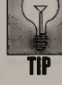

HTML 元素实际上多达数百个。表 1-1 列出了一些常用的元素。

| HTML 元素 | 说明 |
| --- | --- |
| `<b></b>` | 将包含的文本格式化为粗体 |
| `<body>` | 包含 HTML 文档的主体 |
| `<br>` | 插入换行符 |
| `<center>` | 将段落在 Web 页面中间居中 |
| `<head></head>` | 包含页面页头和关于整个页的信息 |
| `<hn></hn>` | 标题级别，其中 n 代表 1 到 6 的数字 |
| `<hr>` | 插入水平线 |
| `<html></html>` | 必需元素，用于开始和结束 HTML 文档 |
| `<i></i>` | 将包含的文本格式化为斜体 |
| `` | 插入图像文件 |
| `<p>` | 将包含的文本识别为段落 |
| `<u></u>` | 将包含的文本格式化为下划线 |

所有 HTML 文档必须使用 `<html>` 元素作为根元素。**根元素**包含文档中的所有其他元素。该元素告诉 Web 浏览器将标签之间的任何指令组装成 Web 页面。起始和结束的 `<html>...</html>` 标签是必须的，它们包含了构成 HTML 文档的所有文本和其他元素。

两个重要的 HTML 元素是 `<head>` 元素和 `<body>` 元素。`<head>` 元素包含 Web 浏览器使用的信息，你将其放在 HTML 文档的开头，位于起始 `<html>` 标签之后。你在 `<head>` 元素中放置几个元素来帮助管理文档，包括 `<title>` 元素，它包含出现在浏览器标题栏中的文本。`<head>` 元素必须包含一个 `<title>` 元素。除了 `<title>` 元素外，包含在 `<head>` 中的元素不会影响 HTML 文档的显示。`<head>` 元素及其包含的元素被称为**文档头**。

紧随文档头之后的是 `<body>` 元素，它包含文档主体。`<body>` 元素及其包含的文本元素被称为文档主体。

当你在 Web 浏览器中打开 HTML 文档时，文档将根据其元素中的指令进行组装和格式化。Web 浏览器组装或格式化 HTML 文档的过程被称为**解析**或**渲染**。下一行代码是一个如何在 Web HTML 文档中让段落以粗体显示的示例：

```html
<p><b>此段落在 Web 浏览器中将以粗体显示。</b></p>
```

HTML 是不敏感的，因此你可以用 `<B>` 代替 `<b>`。然而，下一代 HTML（一种称为 XHTML 的语言）是敏感的，你必须对元素使用小写字母。它的目标之一是向符合 XHTML 标准的 Web 页面添加 JavaScript。出于此原因，本书对所有元素都使用小写字母。（你很快就会学习 XHTML。）

你使用各种称为**属性**的参数来配置许多 HTML 元素。你将属性放在起始标签的结束括号之前，并用空格与其他名称或其他属性分开。你使用 `属性="值"` 的语法为属性赋值。例如，你可以用许多属性配置 `` 元素（该元素在 HTML 文档中嵌入图像），包括 `src` 属性，它指定图像文件或视频片段的文件名。要在 `` 元素中包含 `src` 属性，你输入 ``。

当 Web 浏览器解析或渲染 HTML 文档时，它会忽略标签和换行符等字符；Web 浏览器中显示的最终文档仅包含识别的 HTML 元素和文本。你不能在 HTML 文档主体中使用换行符在段落前后插入空格；浏览器为此仅识别 `<p>` 和换行元素 `<br>`。此外，大多数 Web 浏览器会忽略 Web 页面上的多个连续空白，并将其替换为单个空格。以下代码显示了一个简单的 HTML 文档，图 1-1 显示了它在 Web 浏览器中的显示情况。

```html
<html>
<head>
<title>此文本出现在标题栏中</title>
</head>
<body>
<h1>这一行使用 Heading 1 元素格式化</h1>
<h2>这一行使用 Heading 2 元素格式化</h2>
<p><center>这个段落是居中的。</center></p>
<p>这个段落包含 <i>斜体</i>、<u>下划线</u>和 <b>粗体</b>格式化元素。以下代码行创建一个换行符，后面是一条水平线：</p>
<hr>
<p>这个段落包含一张图像。</p>
</body>
</html>
```

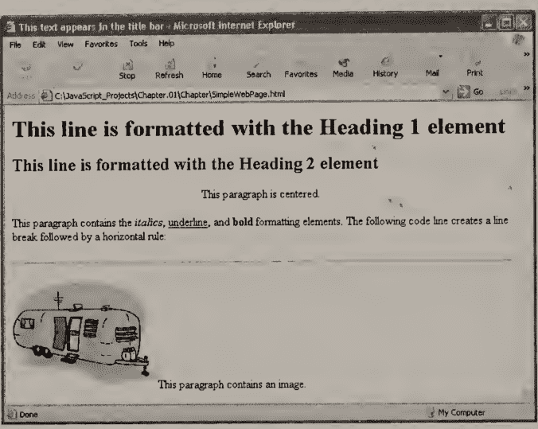

这个段落是居中的。这个段落包含居中、下划线和粗体格式。以下代码行创建一个换行符，后面是一条水平线。

因为 HTML 文档是文本文件，你可以在任何文本编辑器（如记事本或 WordPad）或任何能够创建文本的文字系统中创建它们。如果你使用 HTML 编辑器，可以立即查看结果。某些 HTML 编辑器（如 Microsoft FrontPage 和 Macromedia Dreamweaver）具有允许你创建 Web 页面的图形界面。像 Word 一样，你可以将文件保存为 HTML。然而，HTML 编辑器向文档添加许多你不熟悉的元素和属性，这可能会干扰你并分散学习过程。出于此原因，在书中你将使用文本编辑器创建 Web 页面。在体验过创建网页之后，你可以切换到使用 HTML 编辑器。

创建一个简单的 HTML 文档：

1. 启动你的文本编辑器并在必要时创建一个新文档。
2. 输入以下元素开始 HTML 文档。记住，所有 HTML 文档必须以 `<html>` 元素开始和结束。
3. 接下来，在 `<html>...</html>` 标签对之间添加以下 `<head>` 和 `<title>` 元素。标题出现在你的 Web 浏览器的标题栏中。`<head>` 元素必须包含 `<title>` 元素。`<title>` 元素不能存在于 `<head>` 元素之外。
4. 接下来，在结束标签 `</html>` 上添加以下元素。`<body>` 元素包含在 Web 浏览器中渲染的所有元素。`<basefont>` 元素为 Web 页面定义 Arial 字体。

```html
<html>
</html>
```

```html
<head>
<title>中谷复印中心</title>
</head>
```

```html
<body>
<basefont face="Arial">
</body>
```

5. 在 `</body>` 元素上方添加以下元素和文本。代码包含了标准的 HTML 元素以及在 Web 浏览器中显示的文本。

```html
<font color="olive"><h1>Central Valley Copy Center</h1><h2>Hours of Operation</h2></font>
<font color="blue"><p>p.m.m..<br>
Monday through Thursday,<br>
7:45 a.m. - 9:45 p.m.<br>
Friday, 7:45 a.m. - 4:30 p.m.<br>
Saturday, 9:00 a.m. - 4:00 p.m.<br>
Sunday, Noon - 9:00 p.m.</p></font>
<font color="olive"><h2>What's in the Copy Center</h2></font>
<font color="blue">
<ul>
<li>Copiers</li>
<li>Fax machines</li>
<li>Binding equipment</li>
</ul></font>
<font color="olive"><h2>Forms of Payment</h2></font>
<font color="blue"><p>Cash, ATM, Visa, American Express,
Discover Card, and MasterCard.</p></font>
```

6. 将文档保存为 `CopyCenter.html` 并放在第 1 章的文件夹中。某些文本编辑器会自动为文档添加自己的扩展名。例如，记事本会添加 `.txt` 扩展名。确保你的文档是以 `.html` 扩展名保存的。在文本编辑器中保持文档打开。

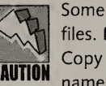

某些 Web 服务器无法正确解释 HTML 文件名中的空格。例如，某些 Web 服务器可能无法正确解释 Copy 和 Center 之间带有空格的文件名 `Copy Center.html`。为了解决这个问题，书中的名称不包含空格。

7. 在 Internet Explorer 或其他浏览器中打开 `CopyCenter.html` 文档。（通过文件菜单选择“打开”可以在 Internet Explorer 中打开本地文档；其他 Web 浏览器也有类似的命令。）图 1–2 显示了 Internet Explorer 中显示的 `CopyCenter.html` 文档。
8. 关闭你的 Web 浏览器窗口。

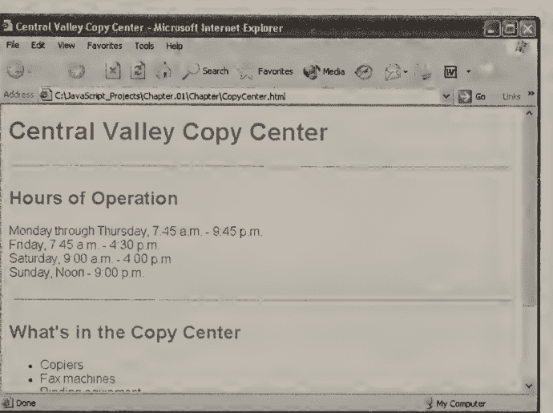

HTML 于 1993 年随着核心版本 1.0 的发布首次成为 Internet 标准。HTML 的下一个版本 2.0 于 1994 年发布，并包含了许多核心 HTML 特性，如表单以及加粗和斜体文本的能力。然而，许多今天广泛使用的标准功能（例如用于组织页面上文本和图形的表格）直到 1996 年 HTML 3.2 发布后才可用。HTML 的当前版本 4.01 于 1999 年发布。然而，HTML 4.01 是 HTML 语言的最后一个版本，因为它正在被**可扩展超文本标记语言**（即 XHTML）取代。

HTML 正在被取代，是因为它在传统的 Web 浏览器中渲染文档非常有用。然而，Web 正在扩展到其他媒体，被称为**用户代理**（user agents），即能够检索和处理 HTML 和 XHTML 文档的设备。用户代理可以是传统的 Web 浏览器，也可以是手机或 PDA 等设备，甚至是一个仅仅收集和处理数据而不显示数据的应用程序。

HTML 不适用于 Web 浏览器之外的用户代理主要有两个原因。第一，尽管 HTML 最初设计用于显示数据，但它已经演变成一种标记语言，它更关注数据的外观而不是数据本身。记住，HTML 是基于 SGML 的，SGML 独立定义文档中的数据，而不取决于其显示方式。还请记住在浏览器大战中，每个 Web 浏览器都需要为 HTML 添加扩展（元素和属性），以提供显示和格式化 Web 页面的功能。例如，原始 HTML 语言的一个扩展是 `<font>` 元素，它允许你指定 HTML 文档中数据的字体。`<font>` 元素与 HTML 文档中的数据类型无关。

相反，它仅作为一种设计元素，在 Web 浏览器中以特定的字体显示数据。然而，请记住，HTML 是基于 SGML 的，应该独立于显示方式来定义数据。像 `<font>` 这样的元素违反了这一规则。继续使用 HTML 和像 `<font>` 等设计元素编写你的 Web 页面并没有问题——只要你的 Web 页面仅在 Web 浏览器中打开。然而，许多用户代理（如手机和 PDA）无法处理处理显示、白字或灰度文本以及数据格式的 HTML 元素。此类用户代理需要一种独立于显示方式来定义数据（如段落或标题）的语言。

其次，旧版本的 Web 浏览器允许你编写粗糙的 HTML 代码。例如，你已经了解到所有 HTML 文档都以 `<html>` 开始并以 `</html>` 结束。更准确地说，所有 HTML 文档应该以 `<html>` 开始并以 `</html>` 结束。此外，所有 HTML 文档应该包含 `<head>` 和 `<body>` 元素。在实践中，你可以从 HTML 文档中省略这些元素，Web 浏览器仍然会正确渲染页面。事实上，尽管元素需要闭合标签，但你通常可以（有意或无意）省略闭合标签，Web 页面通常会正常渲染。

> XHTML 基于 XML，XML 用于创建 Web 页面以及在应用程序之间定义和传输数据。

注意

书中的 Web 页面示例和练习是用 XHTML 编写的。虽然你需要对 HTML 有深入理解才能成功学习这本书，但你不一定是 XHTML 专家。因为 XHTML 与 HTML 几乎相同，你可以轻松地将任何现有的 HTML 技能适应到 XHTML，反之亦然。


> 为了确保与旧浏览器的后向兼容，你应该像保存 HTML 文档一样使用 `.html` 或 `.htm` 扩展名保存 XHTML 文档。

提示

当文档符合 XHTML 的规则和要求时，被称为“良好的”（well formed）。除其他因素外，良好的文档必须包含 `<!DOCTYPE>` 声明以及 `<html>`、`<head>` 和 `<body>` 元素。`<!DOCTYPE>` 声明属于 XHTML 文档的第一行，决定了文档所遵循的 XHTML DTD。文档类型定义（或 DTD）定义了文档可以使用的元素和属性，以及文档在包含它们时必须遵循的规则。你可以对 XHTML 文档使用三种类型的 DTD：过渡型（transitional）、严格型（strict）和框架型（frameset）。

为了理解不同 DTD 之间的差异，你需要理解废弃 HTML 元素的概念。XHTML 的目标之一是将 HTML 的结构化方式与解析后的 Web 页面在浏览器中的显示方式分开。为了实现这一目标，W3C 宣布用于显示和格式化的常用 HTML 元素和属性将不再用于 XHTML 1.0。被认为过时并最终将被消除的元素和属性将被**废弃**（deprecated）。表 1-2 列出了 XHTML 1.0 中被废弃 HTML 元素。

## 表 1-2 XHTML 1.0 中废弃 HTML 元素

| 元素 | 描述 |
| --- | --- |
| `<applet>` | 执行 Java applet |
| `<basefont>` | 指定基本字体大小 |
| `<center>` | 文本居中对齐 |
| `<dir>` | 定义目录列表 |
| `<font>` | 指定字体名称、大小和颜色 |
| `<isindex>` | 创建自动文档索引表 |
| `<menu>` | 定义菜单列表 |
| `<s>` 或 `<strike>` | 格式化删除线文本 |
| `<u>` | 格式化下划线文本 |

这三种 DTD 的区别部分在于它们允许或不允许使用废弃 HTML 元素的程度。将在后续章节中进行详细解释。

**过渡型 DTD** 允许在 XHTML 文档中使用废弃样式元素。过渡型 DTD 的 `<!DOCTYPE>` 声明如下：

```html
<!DOCTYPE html PUBLIC
  "//W3C//DTD XHTML 1.0 Transitional//EN"
  "http://www.w3.org/TR/xhtml1/DTD/xhtml1-transitional.dtd">
```

只有当你需要创建使用表 1-2 中列出的废弃元素的 Web 页面时才使用过渡型 DTD。

**框架型 DTD** 与过渡型 DTD 相同，但包含了 `<frameset>` 和 `<frame>` 元素，允许你将浏览器窗口分为两个或多个帧。框架型 DTD 的 `<!DOCTYPE>` 声明如下：

```html
<!DOCTYPE html PUBLIC
  "//W3C//DTD XHTML 1.0 Frameset//EN"
  "http://www.w3.org/TR/xhtml1/DTD/xhtml1-frameset.dtd">
```

你应该理解，框架（frames）已经被废弃并被表格（tables）取代。然而，框架集（frameset）文档仍被广泛使用，如果你需要修改使用框架创建的现有 Web 页面，你需要能够识别并处理它们。

你将在第 5 章中学习如何使用 JavaScript 来操作框架。

**严格型 DTD** 删除了过渡型 DTD 和框架集 DTD 中已废弃的元素。严格型 DTD 的 `<!DOCTYPE>` 声明如下：

```html
<!DOCTYPE html PUBLIC
"//W3C//DTD XHTML 1.0 Strict//EN"
"http://www.w3.org/TR/xhtml1/DTD/xhtml1-strict.dtd">
```

按照原则，你应该始终尝试使用严格型 DTD。这确保了你的页面符合最新的 Web 页面编写技术。接下来，你将为 Central Valley Center Web 页面添加一个严格型 DTD 的 `<!DOCTYPE>` 声明。

为 Central Valley Center Web 页面添加严格型 DTD 的 `<!DOCTYPE>` 声明：

1. 在文本编辑器中返回 `CopyCenter.html` 文档。
2. 将以下严格型 DTD 的 `<!DOCTYPE>` 声明作为文档的第一行（位于 `<html>` 开启标签上方）：
3. 保存对文档的更改。

```html
<!DOCTYPE html PUBLIC
"//W3C//DTD XHTML 1.0 Strict//EN"
"http://www.w3.org/TR/xhtml1/DTD/xhtml1-strict.dtd">
```

正如你之前学到的那样，一个良好的文档必须包含一个 `<!DOCTYPE>` 声明以及 `<html>`、`<head>` 和 `<body>` 元素。以下列表描述了良好文档的一些其他重要组件：

- 所有的 XHTML 文档必须使用 `<html>` 作为根元素。
- XHTML 是大小敏感的。
- 所有的 XHTML 元素必须有闭合标签。
- 属性值必须出现在引号内。
- 空元素必须闭合。
- XHTML 元素必须正确地嵌套。

## 处理良好的 Web 页面

之前的多数规则都是自明易懂的。然而，最后一条需要进一步的解释。**嵌套**（Nesting）指的是元素放置在其他元素内部的方式。例如，在以下代码中，`<i>` 元素嵌套在 `<b>` 元素内部，而 `<b>` 元素嵌套在 `<p>` 元素内部。

```html
<p><b><i>此段落文字是加粗且斜体的。</i></b></p>
```

在 HTML 文档中，元素如何嵌套没有区别。请查看该陈述的以下修改版本：

```html
<p><i><b>此段落文字是加粗且斜体的。</b></i></p>
```

在上述代码中，开启的 `<i>` 元素嵌套在 `<b>` 元素内部，而 `<b>` 又嵌套在 `<p>` 元素内部。注意，闭合的 `</i>` 标签在 `</b>` 标签之外。`<b>` 是最内层的元素。在 XHTML 中，最内层的元素必须在外层元素闭合之前闭合。在上述语句中，`<b>` 和 `<p>` 元素在 `<i>` 元素之前闭合。虽然元素闭合的顺序在 HTML 中没有区别，但上述代码会导致 XHTML 文档无法良好。

列表中的第二规则（“空元素必须闭合。”）需要进一步的解释。HTML 中最常见的三个空元素是：`<hr>` 元素（在文档中插入水平线）、`<br>` 元素（插入换行符）以及 `` 元素（向文档中添加图像）。在 XHTML 中，你通过在闭合括号之前添加一个空格和一个斜杠来闭合空元素。例如，以下代码显示了如何在 XHTML 文档中使用 `<hr>` 和 `<br>` 元素。图 1-3 显示了代码在 Web 浏览器中的外观。

```html
<hr />
<p><b>羊驼来自南美洲，<br />
<b>袋鼠</b>来自澳大利亚，<br />
而<b>熊猫</b>来自中国</b></p>
<hr />
```

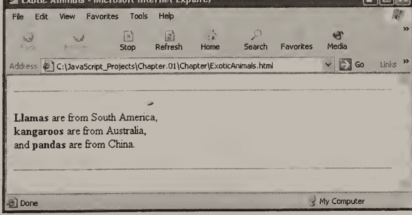

你可能奇怪为什么 XHTML 文档不使用 `<xhtml>` 作为根元素。`<html>` 元素是必要的，以兼容不识别 `<!DOCTYPE>` 元素的旧版浏览器，该元素声明了 XHTML 元素所使用的 DTD。

接下来，你将修改 Central Valley Copy Center Web 页面使其变为良好。要修改 Central Valley Copy Center Web 页面使其良好：

1. 在文本编辑器中返回 `CopyCenter.html` 文档。
2. 删除 `<basefont>` 元素以及六个 `<font>` 元素。确保也删除了 `</font>` 标签。（你必须这样做，因为 `<basefont>` 和 `<font>` 元素在 XHTML 中已被废弃，并由 CSS 代替）。
3. 在闭合的 `</head>` 上方添加以下 `<style>` 元素。`<style>` 元素包含了一些 CSS 格式指令，将 Web 页面格式化为 Arial 字体，标题设置为橄榄色，文本设置为蓝色。

```html
<style type="text/css">
body { font-family: Arial; color: blue; background-color: white }
h1, h2 { font-family: Arial; color: olive }
</style>
```

4. 在三个 `<hr>` 元素的闭合括号之前添加一个空格和一个斜杠。同样，在“营业时间”（Hours of Operation）标题下方的三个 `<br>` 元素的闭合括号之前添加一个空格和一个斜杠。你修改后的文档如下：

```html
<!DOCTYPE html PUBLIC
"//W3C//DTD XHTML 1.0 Strict//EN"
"http://www.w3.org/TR/xhtml1/DTD/xhtml1-strict.dtd">
<html>
<head>
<title>Central Valley Copy Center</title>
<style type="text/css">
body { font-family: Arial; color: blue;
background-color: transparent }
h1, h2 { font-family: Arial; color: olive }
</style>
</head>
<body>
<h1>Central Valley Copy Center</h1><hr />
<h2>营业时间</h2>
<p>周一至周四，上午 7:45 - 晚上 9:45。<br />
周五，上午 7:45 - 下午 4:45。<br />
周六，上午 9:00 - 下午 4:00。<br />
周日，中午 - 晚上 9:00。</p><hr />

<ul>
  <li>复印机</li>
  <li>传真机</li>
  <li>装订设备</li>
</ul>

<h2>付款方式</h2>
<p>现金、ATM、Visa、美国运通、发现卡和万事达卡。</p>
</body>
</html>
```

5. 保存 `CopyCenter.html` 文档并在 Web 浏览器中打开它。该文档应该与你使其良好之前相同。
6. 关闭 Web 浏览器窗口。

## 验证 Web 页面

当你在 Web 浏览器中打开一个不良好的 XHTML 文档时，浏览器只会忽略错误并按其能力渲染 Web 页面。浏览器无法判断 XHTML 文档是否良好。要确保你的 XHTML 文档良好，请使用验证解析器。**验证解析器**是一个检查 XHTML 文档是否良好以及是否符合特定 DTD 的程序。**验证**（validation）一词是指验证你的 XHTML 文档是否良好，并检查文档中的元素是否根据特定 DTD 的定义正确编写的过程。如果你不验证 XHTML 文档且它包含错误，大多数浏览器可能会将其视为 HTML 文档，忽略错误并按现状渲染。然而，验证可以帮助你发现代码中的错误。

网上可以找到多种 XHTML 验证服务。目前最好的服务之一是 W3C 验证服务，这是一个可以验证 HTML 和 XHTML 的免费服务。W3C 验证服务位于 http://validator.w3.org/。该服务的主页如图 1-4 所示，允许你通过输入 URI 或从计算机上传文档来验证 Web 页面。

W3C 验证服务还包含一个独立的页面，提供了从计算机上传文档的更详细选项。你可以通过点击主页底部的“扩展文件接口”（Extended Files Interface）链接或输入 Web 地址：http://validator.w3.org/file-upload.html 来打开 W3C 验证服务的上传页面。图 1-5 显示了 W3C 验证服务上传页面的示例。

## 第 1 章 JavaScript 简介

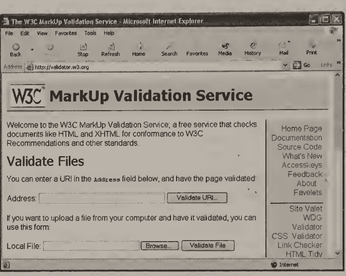

图 1-4 W3C 标记验证服务

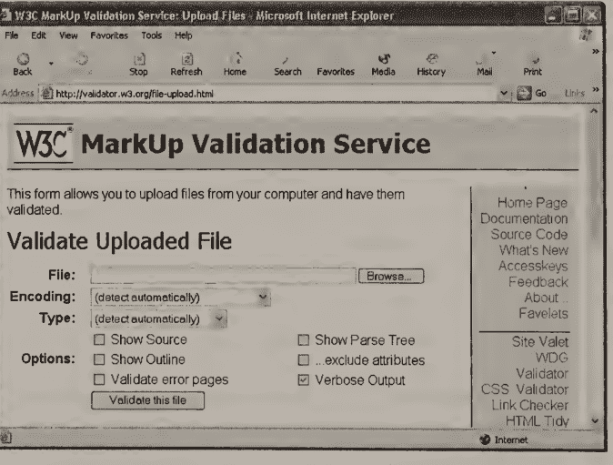

图 1-5 W3C 标记验证服务的上传页面

点击上传页面上的浏览（Browse）按钮来选择你要验证的文档。在编码（Encoding）列表框中，选择网页使用的语言字符集。许多西方语言使用 iso-8859-1 字符集，尽管你也可以从编码列表中选择其他多种字符。例如，如果你创建的页面是用希腊语编写的，你可以从列表中选择 iso-8859-7（它代表希腊语字符集）。类型（Type）列表框是用于选择你想要用于验证文档的 DTD 类型。选项（Options）部分中的复选框允许你选择文档在经过服务验证后的显示方式。

接下来，你将使用 W3C 标记验证服务验证 Central Valley Copy Center 网页。

使用 W3C 标记验证服务验证 Central Valley Copy Center 网页：

1. 启动 Web 浏览器，输入 W3C 标记验证服务的上传页面地址：http://validator.w3.org/file-upload.html。
2. 点击浏览按钮显示文件上传对话框。在选择文件对话框中，找到 `CopyCenter.html` 文档。（如果你的数据文件存储在 C 盘，文件路径将为 `C:\Java_Projects\Chapter01\Chapter`。）一旦找到文档，双击它或点击它并选择打开按钮。驱动器、文件夹路径和名称将出现在上传页面的 File 文本中。在编码列表框中，选择 iso-8859-1（西欧）。由于文档类型由 `<!DOCTYPE>` 声明指定，你可以将类型框保持为默认设置（自动检测）。不勾选显示选项复选框，并点击验证（Validate this）按钮。W3C 标记验证服务将验证文档并返回图 1-6 所示的结果。如果你收到任何错误，请修复它们、重新加载文档并验证页面。

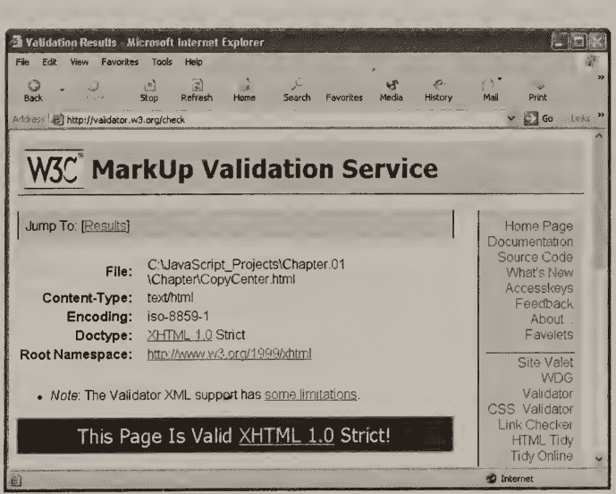

图 1-6 Central Valley Copy Center 网页的验证结果

3. 关闭你的 Web 浏览器窗口。

## JavaScript 编程语言

如所述，HTML 的设计初衷并不是为了控制 Web 浏览器中网页的外观。在当时，网页是静态的，在被浏览器渲染后就无法进行更改。然而，一旦 Web 的增长超出了小型学术和科学社区范围，人们开始意识到，更强的交互性和更好的视觉设计将使 Web 变得更有用。随着 Web 商业应用程序的增长，对更具交互性和视觉上吸引力的 Web 网站的需求也随之增长了。

满足这一需求最大的挑战是 HTML 和 XHTML 只能用于生成静态文档。你可以将使用 HTML 或 XHTML 编写的静态网页等同于在文字处理或桌面出版程序中创建的文档；你对其能做的就是查看或打印它。因此，为了响应对更高交互性的需求，需要一种全新的编程语言。Netscape 通过开发 JavaScript 填补了这一空白。

JavaScript 是一种客户端脚本语言，允许 Web 开发者开发交互式网页和站点。JavaScript 最初设计用于 Navigator Web 浏览器，现在已被包括 Internet Explorer 在内的大多数 Web 浏览器使用。

客户端脚本是指运行在本地浏览器（客户端）而非 Web 服务器（一种用于托管 Web 网站的计算机）上的脚本语言。尽管此书的主要重点是研究客户端 JavaScript 编程，但还有其他类型的客户端脚本程序。例如，微软的 VBScript 是另一种基于 Visual Basic 编程语言的脚本语言。相比之下，服务端脚本是指运行在 Web 服务器上执行的脚本语言。用于处理数据的一些流行的服务端脚本语言包括通用网关接口 (CGI)、活动服务器页面 (ASP) 和 Java 编写页面 (JSP)。“脚本语言”一词是一个通用术语，最初指的是不具备 Java 或 C++ 等语言的高级编程能力的简单编程语言。在 Web 开发中，脚本语言指的是任何能够通过程序化控制网页或向 Web 浏览器返回某种响应的语言类型。需要注意的是，虽然“脚本”一词最初是指简单的编程语言，但今天基于 Web 的脚本语言绝非简单。

本书的综合版包含了关于使用 ASP 进行服务端脚本的基础信息。如果你想了解更多关于用于处理数据的某些服务端脚本语言，请参考由 Course Technology 出版的《Web Warrior Guide to Web Programming》。

> 注意
>
> 浏览器中执行脚本语言代码的部分是浏览器的脚本引擎。（脚本引擎只是解释器的一种，该术语泛指任何执行脚本语言的程序。）当脚本引擎加载网页时，它会解释任何用 JavaScript 等脚本语言编写的程序。包含脚本引擎的 Web 浏览器被称为脚本主机。Internet Explorer 和 Netscape 是运行 JavaScript 程序的脚本主机示例。

JavaScript 首次在 Navigator 中引入，最初名为 LiveScript。随着 Navigator 2.0 的发布，名称更改为 JavaScript 1.0。随后，微软在 Internet Explorer 4.0 中发布了自己的版本的 JavaScript，并将其命名为 JScript。每个实现的目前的最新版本分别是 Navigator 中的 JavaScript 1.5 和适用于 Internet Explorer 4 及更高版本的 JScript 5.5。

当微软发布 JScript 时，发生了几个主要问题。例如，Netscape 版本和微软版本的 JavaScript 语言存在差异，导致程序员需要为 Navigator 和 Internet Explorer 编写几乎完全不同的 JavaScript 程序。为了避免将来出现类似问题，创建了国际标准化的 ECMAScript 版本。ECMAScript 的最新版本是第 3 版。Netscape JavaScript 1.5 和微软 JScript 5.5 都符合 ECMAScript 第 3 版。尽管如此，Netscape JavaScript 和微软 JScript 各自包含了另一种语言不支持的独特编程特性。在本书中，你将学习如何使用 ECMAScript 第 3 版创建 JavaScript 程序，该版本由 Netscape 6 及更高版本以及 Internet Explorer 4 及更高版本支持。

很多人认为 JavaScript 与 Java 编程语言相关或是其简化版。然而，它们是完全不同的。Java 是由 Sun Systems 创建的一种高级编程语言，比 JavaScript 难掌握得多。虽然 Java 常用于创建可以从网页运行的程序，但 Java 程序是独立于浏览器执行的外部程序。相比之下，JavaScript 程序运行在网页内部并控制浏览器。

> 注意

## `<script>` 元素

JavaScript 程序运行在网页内（HTML 或 XHTML 文档）。也就是说，你直接将代码作为一个独立章节输入到网页代码中。在网页内包含的 JavaScript 程序通常被称为脚本。`<script>` 元素告诉 Web 浏览器脚本引擎必须解释它包含的内容。`<script>` 元素的 `type` 属性告诉浏览器脚本语言以及所使用的脚本语言版本。你为 `type` 属性赋值 `"text/javascript"` 以表示该脚本是用 JavaScript 编写的。你需要在文档中包含以下代码，以告诉 Web 浏览器必须由 JavaScript 脚本引擎解释的语句：

```html
<script type="text/javascript">
statements
</script>
```

接下来，你为 Central Valley Copy Center Web 页面添加一个脚本部分。

为 Central Valley Copy Center Web 页面添加脚本部分：

1. 在文本编辑器中返回 `CopyCenter.html` 文档。
2. 在“营业时间”（Hours of Operation）标题的 `<h2>` 元素之后立即添加以下脚本部分：

```html
<script type="text/javascript">
</script>
```

3. 保存 `CopyCenter.html` 文档。

构成文档中 JavaScript 程序的单行代码或语句包含在 `<script>` 元素中。以下脚本包含一个语句，它使用 `Document` 对象的 `write()` 方法向 Web 浏览器窗口写入“Welcome to Nashville!”，你很快就会学习该方法：

```javascript
document.write("<p>Welcome to Nashville!</p>");
```

注意前面的语句以分号结尾。许多编程语言（包括 C++ 和 Java）要求你用分号结束所有语句。JavaScript 语句并不强制要求以分号结尾。只有当你想要分隔放置在同一行上的语句时，分号才是绝对必需的。例如，以下脚本在同一行上包含两个语句，每个语句都以分号结尾：

```html
<script type="text/javascript">
document.write("<p>Welcome ");
document.write("to Nashville!</p>");
</script>
```

只要每个语句都单独占一行，并用换行符与其他行分开，就不需要用分号结束语句。以下代码显示了前面代码的另一个示例，但这次每个语句都单独占一行，且没有结束分号。

```html
<script type="text/javascript">
document.write("<p>Welcome ")
document.write("to Nashville!</p>");
</script>
```

尽管语句没有以分号结尾，但前面的脚本是合法的。然而，故事并没有到此结束。程序员通常会在代码中采用约定，使代码在文本编辑器中更易读。关于分号，在任何语句末尾加上分号被认为是良好的 JavaScript 编程实践。分号的作用是标识每个语句的结束，使程序员更容易阅读自己的代码（也便于其他程序员以后阅读这些代码）。因此，请确保你所有的 JavaScript 语句都以分号结尾。

尽管本书涵盖了 JavaScript，但你可以在 Web 页面上使用其他脚本语言。以下代码：`<script type="text/vbscript">VBScript code</script>`。不要将 JavaScript 与 JScript 混淆。JScript 是微软版本的 JavaScript 脚本语言。要指定 JScript 属性，请将 JavaScript 指定为 `type` 属性。

如果你预判你的 JavaScript 程序将只在 Internet Explorer 中运行，可以使用语句 `<script type="text/jscript">` 将 "JScript" 指定为你的脚本语言。然而，比 Internet Explorer 更少的浏览器会将 "JScript" 作为 `<script>` 元素的有效 `type` 属性；始终使用 "JavaScript" 更安全。

HTML 文档使用 `language` 属性告诉浏览器脚本语言以及正在使用的脚本语言版本。然而，`language` 属性已废弃，因此在 XHTML 文档中请务必使用 `type` 属性。

## 理解 JavaScript 对象

在用 `<script>` 元素创建 JavaScript 程序之前，你需要学习一些在 JavaScript 编程和其他类型编程语言中常用的基础术语。除了是解释型脚本语言外，JavaScript 被认为是一种基于对象的编程语言。对象是可以被视为单个单元或组件的编程代码和数据。例如，你可能会创建一个 `Loan` 对象，用于计算还清贷款所需的付款次数。`Loan` 对象可以存储如贷款本金和利率等信息。计算机程序中的单个语句通常被分组为执行特定任务的逻辑单元。例如，一个过程（procedure）可能包含一组根据销售总额计算销售额的语句。与相关的过程称为方法（methods）。属性是一段数据，例如与对象相关的颜色或名称。在 `Loan` 对象示例中，计算还清贷款所需付款数的编程代码就是一个方法。贷款本金和利率是 `Loan` 对象的属性。

要在 JavaScript 代码中引入对象和关联方法，你输入对象的名称，后面跟一个点（.），然后是方法。例如，以下代码显示了 `Loan` 对象，接着是一个点，然后是名为 `calcPayments()` 的方法，该方法计算还清贷款所需的付款次数：

```javascript
loan.calcPayments();
```

对于许多方法，你还需要括号内提供一些特定信息，称为参数（argument）。某些方法需要参数，而另一些不需要。为方法提供参数被称为传递参数。例如，`calcPayments()` 方法可能需要指定每月还款的参数。在这种情况下，JavaScript 语句如下：

```javascript
loan.calcPayments(800);
```

以相同的方式使用对象的属性：在对象后附加属性名。然而，属性名后面没有括号。方法和属性之间最大的区别之一是属性实际上并不执行任何操作；你使用属性存储数据。你使用等号为属性赋值，如下例：

```javascript
loan.interest = .08;
```

本章后续部分将关注 `write()` 和 `writeln()` 方法，以帮助你理解如何使用 JavaScript。

## 使用 `write()` 和 `writeln()` 方法

JavaScript 将许多事物视为对象。JavaScript 编程中最常用的对象之一是 `Document` 对象。`Document` 对象表示浏览器窗口的内容。Web 页面上的任何文本、图形或其他信息都是 `Document` 对象的一部分。`Document` 对象的用途之一是向 Web 页面添加新文本。你使用 `Document` 对象的 `write()`/`writeln()` 方法在 Web 页面上创建新文本。例如，你可以使用 `write()` 方法渲染包含用户名称或计算结果等信息的页面。

你应该理解，使用 `write()` 和 `writeln()` 方法的唯一理由是在渲染过程中添加新文本。例如，你可能根据用户在表单输入的信息显示一个新的 Web 页面。例如，用户可能在在线交易表单中输入销售信息。使用输入的信息，你可以创建一个显示他们的总额、订单、确认等的页面。如果你想在文档首次渲染时在浏览器中显示文本，则不需要使用任何标准 XHTML 元素。动态获取信息的程序对于这个介绍性章节来说有点复杂。然而，在本章中你将使用 `write()` 和 `writeln()` 方法在文档首次渲染时在 Web 浏览器中显示文本，以学习创建 JavaScript 程序的基础。

不同的方法需要不同类型的参数。例如，`Document` 对象的 `write()` 和 `writeln()` 方法需要一个文本字符串作为参数。文本字符串（字面量字符串）是包含在双引号或单引号内的文本。对象 `write()` 和 `writeln()` 的字符串参数指定了 `Document` 对象用于在 Web 页面创建新文本的文本。例如，`document.write("Welcome to Nashville");` 会在 Web 浏览器中显示文本 "Welcome to Nashville"（不带引号）。注意，你必须将字面量放在单行上。如果你在字面量中包含换行符，将收到错误消息。

> 如果你使用的是高于 4 的 Internet Explorer，你需要通过从“工具”菜单中选择“Internet 选项”，并在“高级”选项卡上点击“浏览”类别来关闭错误通知，确保勾选“对每个脚本错误显示通知”复选框，然后点击“确定”按钮关闭对话框。

> 程序员经常谈论代码“写入”或“打印到”浏览器窗口。例如，你可能会说某段代码将字符串写入 Web 浏览器窗口。这只是说代码在 Web 浏览器窗口中显示该文本字符串的另一种方式。

`write()` 和 `writeln()` 方法执行的功能实际上与你手动向标准 Web 页面文档的主体添加文本时执行的操作相同。无论你是使用标准元素（如 `<p>` 元素）向文档添加文本，还是使用 `write()` 或 `writeln()` 方法添加文本，文本都会按照该语句在文档中出现的顺序被添加。

`write()` 和 `writeln()` 方法之间的唯一区别是 `writeln()` 方法在文本行之后添加一个换行符。然而，换行符只有在 `<pre>` 元素内部会被识别。在其他地方，要使用 `writeln()` 方法使用换行，你必须将该方法放在 `<pre>` 元素中。以下代码包含一个使用 `Document` 对象 `writeln()` 方法在 Web 浏览器中打印某些文本的脚本。注意 `<script>` 元素被封装在 `<pre>` 元素中。图 1-7 显示了输出。

```html
<pre>
<script type="text/javascript">
document.writeln("Mahatma Gandhi once said:");
document.writeln("<em>Honest differences are often a healthy sign of progress.</em>");
</script>
</pre>
```

## 第 1 章 JavaScript 简介

**图 1-7** 使用 `Document` 对象 `writeln()` 方法的脚本输出

注意每个语句末尾的分号使用。记住，在任何语句结束处使用分号被认为是一种良好的 JavaScript 编程习惯。

注意 `writeln()` 语句包含了 XHTML 元素 `<em>`。你可以将任何元素作为 `write()` 或 `writeln()` 方法参数的一部分，包括 `<p>` 和 `<br>` 元素等元素。这意味着你可以使用 `write()` 语句为你通过脚本创建的文本添加换行符，而不是在 `<pre>` 元素中使用 `writeln()` 语句。以下代码显示了之前脚本的修改版本，但这次它不包含 `<pre>` 元素。文本中的换行符通过在第一行文本末尾添加 `<br />` 创建。由于语句不再包含在 `<pre>` 元素中，文本将使用浏览器的默认字体渲染，如图 1-8 所示。

```html
<script type="text/javascript">
document.write("<p>Mahatma Gandhi once said:<br />");
document.write("<em>Honest differences are often a healthy sign of progress.</em></p>");
</script>
```

**图 1-8** 使用 `Document` 对象 `document.write()` 方法的脚本输出


# 第 1 章 JavaScript 简介

## JavaScript 编程语言

接下来，你将使用 `write()` 和 `writeln()` 方法在文档首次渲染时在 Web 浏览器中显示文本，以学习创建 JavaScript 程序的基础。

不同的方法需要不同类型的参数。例如，`Document` 对象的 `write()` 和 `writeln()` 方法需要一个文本字符串作为参数。文本字符串（字面量字符串）是包含在双引号或单引号内的文本。对象 `write()` 和 `writeln()` 的字符串参数指定了 `Document` 对象用于在 Web 页面创建新文本的文本。例如，`document.write("Welcome to Nashville");` 会在 Web 浏览器中显示文本 "Welcome to Nashville"（不带引号）。注意，你必须将字面量放在单行上。如果你在字面量中包含换行符，将收到错误消息。

- 如果你使用的是高于 4 的 Internet Explorer，你需要通过从“工具”菜单中选择“Internet 选项”，并在“高级”选项卡上点击“浏览”类别来关闭错误通知，确保勾选“对每个脚本错误显示通知”复选框，然后点击“确定”按钮关闭对话框。

- 程序员经常谈论代码“写入”或“打印到”浏览器窗口。例如，你可能会说某段代码将字符串写入 Web 浏览器窗口。这只是说代码在 Web 浏览器窗口中显示该文本字符串的另一种方式。

`write()` 和 `writeln()` 方法执行的功能实际上与你手动向标准 Web 页面文档的主体添加文本时执行的操作相同。无论你是使用标准元素（如 `<p>` 元素）向文档添加文本，还是使用 `write()` 或 `writeln()` 方法添加文本，文本都会按照该语句在文档中出现的顺序被添加。

`write()` 和 `writeln()` 方法之间的唯一区别是 `writeln()` 方法在文本行之后添加一个换行符。然而，换行符只有在 `<pre>` 元素内部会被识别。在其他地方，要使用 `writeln()` 方法使用换行，你必须将该方法放在 `<pre>` 元素中。以下代码包含一个使用 `Document` 对象 `writeln()` 方法在 Web 浏览器中打印某些文本的脚本。注意 `<script>` 元素被封装在 `<pre>` 元素中。图 1-7 显示了输出。

```
<pre>
<script type="text/javascript">
document.writeln("Mahatma Gandhi once said:");
document.writeln("<em>Honest differences are often a healthy sign of progress.</em>");
</script>
</pre>
```

**图 1-7** 使用 `Document` 对象 `writeln()` 方法的脚本输出

注意每个语句末尾的分号使用。记住，在任何语句结束处使用分号被认为是一种良好的 JavaScript 编程习惯。

注意 `writeln()` 语句包含了 XHTML 元素 `<em>`。你可以将任何元素作为 `write()` 或 `writeln()` 方法参数的一部分，包括 `<p>` 和 `<br>` 元素等元素。这意味着你可以使用 `write()` 语句为你通过脚本创建的文本添加换行符，而不是在 `<pre>` 元素中使用 `writeln()` 语句。以下代码显示了之前脚本的修改版本，但这次它不包含 `<pre>` 元素。文本中的换行符通过在第一行文本末尾添加 `<br />` 创建。由于语句不再包含在 `<pre>` 元素中，文本将使用浏览器的默认字体渲染，如图 1-8 所示。

```
<script type="text/javascript">
document.write("<p>Mahatma Gandhi once said:<br />");
document.write("<em>Honest differences are often a healthy sign
of progress.</em></p>");
</script>
```

**图 1-8** 使用 `Document` 对象 `document.write()` 方法的脚本输出

## 结构化 JavaScript 代码

当你向文档中添加 JavaScript 代码时，你需要遵循关于其位置和每段代码组织的某些规则。接下来的章节描述了在结构化 JavaScript 代码时需要记住的一些重要规则。

### 为每个代码段包含 `<script>` 元素

你可以在文档中包含任意数量的脚本部分。然而，当你在文档中包含多个脚本部分时，必须为每个部分包含一个 `<script>` 元素。以下文档包含了两个独立的脚本部分。这些脚本部分创建了显示在 `<h2>` 标题元素下方的信息。图 1-9 显示了输出。

```
<h1>Multiple Script Sections</h1>
<h2>First Script Section</h2>
<script type="text/javascript">
document.write("<p>Output from the first script section.</p>");
</script>
<h2>Second Script Section</h2>
<script type="text/javascript">
document.write("<p>Output from the second script section.</p>");
</script>
```

**图 1-9** 带有两个 JavaScript 部分的文档输出

接下来，你将修改“What’s in the Copy Center”（复印中心有什么）和“Forms of Payment”（支付方式）标题下方的文本和注释，以便它们从脚本部分添加到页面中。

若要修改“What’s in the Copy Center”和“Forms of Payment”标题下方的文本和注释，使其从脚本部分添加到页面中：

1. 回到文本编辑器中的 **CopyCenter.html** 文档。
2. 修改“What’s in the Copy Center”标题下方的文本和元素，使其从脚本部分添加到页面中，如下：

```
<script type="text/javascript">
document.write("<ul>");
document.write("<li>Copiers</li>");
document.write("<li>Fax machines</li>");
document.write("<li>Binding equipment</li>");
document.write("</ul><hr />");
</script>
```

3. 修改“Forms of Payment”标题下方的文本和段落元素，使其从脚本部分添加到页面中，如下。确保将整个 `document.write()` 语句写在一行上。

```
<script type="text/javascript">
document.write("<p>Cash, ATM, Visa, American Express Discover Card, and MasterCard.</p>");
</script>
```

4. 保存 **CopyCenter.html** 文档并在你的 Web 浏览器中打开它。文档看起来应该与你添加新脚本部分之前相同。
5. 关闭你的 Web 浏览器窗口。

### 将 JavaScript 放置在文档头部或正文

你可以将 `<script>` 元素放置在文档头部（head）或正文（body）。你放置 `<script>` 元素的位置取决于你编写的程序。脚本中的语句按照它们在文档中出现的顺序进行渲染。作为一个一般规则，将尽可能多的 JavaScript 代码放置在文档头部是一个好主意，因为文档头部会在文档正文之前渲染。当放置在文档头部时，JavaScript 在文档正文显示之前就会处理。当你的代码执行正文中的脚本部分所需的后台任务时，将 JavaScript 代码放置在文档头部尤为重要。

接下来，你将修改 `<h1>` 元素及其随后的 `<hr>` 元素，使其从文档头部的脚本部分添加到页面中。

若要修改 `<h1>` 元素及其随后的 `<hr>` 元素，使其从文档头部的脚本部分添加到页面中：

1. 回到文本编辑器中的 CopyCenter.html 文档。
2. 在 `</head>` 标签之后立即创建一个新的脚本部分，如下：

```
<script type="text/javascript">
</script>
```

3. 向新的脚本部分添加以下 `document.write()` 语句，它将打印 `<h1>` 元素、其包含的文本以及 `<hr>` 元素：`document.write("<h1>Central Valley Copy Center</h1><hr>");`
4. 删除位于 `<body>` 标签之后的 `<h1>` 和 `<hr>` 元素。
5. 保存 CopyCenter.html 文档并在你的 Web 浏览器中打开它。文档看起来应该和你添加新脚本部分之前相同。
6. 关闭你的 Web 浏览器窗口。

### 创建 JavaScript 源文件

JavaScript 经常直接整合到 Web 页面中。然而，你也可以将 JavaScript 代码保存在名为 JavaScript 源文件的外部文件中。你可以在文档中编写语句来执行（“调用”）保存在源文件中代码。当浏览器遇到调用 JavaScript 源文件的行时，它会查找该源文件并执行它。

JavaScript 源文件通常由扩展名 `js` 指定，仅包含 JavaScript 语句；它不包含 `<script>` 元素。相反，`<script>` 元素位于调用源文件的文档中。要访问保存在外部文件的 JavaScript 代码，你使用 `<script>` 元素的 `src` 属性。为 `src` 分配 JavaScript 源文件的统一资源定位符 (URL)。例如，要调用名为 `scripts.js` 的 JavaScript 源文件，你需要在文档中包含以下代码：

```
<script type="text/javascript" src="scripts.js">
</script>
```

JavaScript 源文件不能包含 XHTML 元素。如果你在 JavaScript 源文件中包含 XHTML 元素，你的 Web 页面将生成错误消息。此外，当你使用 `src` 属性在文档中指定源文件时，浏览器会忽略 `<script>` 元素内的任何其他 JavaScript 代码。例如，考虑以下 JavaScript 源代码。在这种情况下，`<script>` 元素 `src` 属性指定的 JavaScript 源文件正常执行，但 `write()` 语句被忽略了。

```
<script type="text/javascript" src="scripts.js">
document.write('<p>This statement will be ignored.</p>');
</script>
```

如果你打算在文档使用的 JavaScript 代码非常短，那么在文档文件内的 `<script>` 元素中包含 JavaScript 代码通常更容易。然而，对于较长的 JavaScript 代码，将代码包含在 `.js` 源文件中更容易。有几个原因你可能希望使用 .js 源文件而不是直接将代码添加到文档中：

- 你的文档将更整洁。大量的 JavaScript 代码可能会让人困惑。你可能无法一眼看出 XHTML 代码在哪里结束，JavaScript 代码从何处开始。
- JavaScript 代码可以在多个 Web 页面之间共享。例如，你的 Web 页面显示不同的项目但使用相同的 JavaScript 代码顺序信息。与其在每个文档中重新创建 JavaScript 代码顺序信息，Web 页面可以共享一个中央 JavaScript 源文件。在多个文档之间共享单个源文件可以减少磁盘空间。此外，当在多个文档之间共享源文件时，Web 浏览器只需要在内存中保留一份拷贝，减少了系统开销。
- JavaScript 源文件向不兼容的浏览器隐藏 JavaScript 代码。如果你的文档包含 JavaScript 代码，不兼容的浏览器会将其显示为标准文本。相反，如果你将代码放在源文件中，不兼容的浏览器将简单地忽略它。

你可以在文档中使用嵌入式 JavaScript 代码和 JavaScript 源文件的组合。在一个 Web 页面中结合嵌入式 JavaScript 代码和 JavaScript 源文件对于如果你有多个 Web 页面且每个页面都需要单个 JavaScript 代码语句，但所有这些语句都共享同一个 JavaScript 源文件非常有优势。

假设你有一个包含多个网页的网站。每个页面都显示一种你公司销售的产品。你可能有一个 JavaScript 源文件，用于收集订单信息（例如人的姓名和地址），该文件被每个产品网页共享。每个单独的产品页面可能还需要其他类型的订单信息，你需要使用 JavaScript 代码来收集这些信息。例如，你的产品之一可能是衬衫，你需要为它收集尺码和颜色信息。在另一个网页上，你可能销售软豆糖，你需要收集数量和口味信息。这些产品中的每一个都可以包含嵌入的 JavaScript 代码，以收集特定的产品信息。

接下来，你将创建一个 JavaScript 源文件，用于打印“复印中心里有什么（What's in the Copy Center）”标题的内容。

要创建一个用于打印“复印中心里有什么”标题内容的的 JavaScript 源文件：

1. 在你的文本编辑器中创建一个新文档。
2. 添加以下语句，这些语句将打印显示在“复印中心里有什么”标题下方的文本。这些是文档中唯一的语句。记住，不要在源文件中包含脚本部分。

```javascript
document.write("<ul>");
document.write("<li>Copiers</li>");
document.write("<li>Fax machines</li>");
document.write("<li>Binding equipment</li>");
document.write("</ul><hr />");
```

3. 将文档保存为 `copies.js` 并存放在第一章文件夹中，然后关闭。
4. 回到文本编辑器中的 `CopyCenter.html` 文档。
5. 删除“复印中心里有什么”标题脚本部分内的语句。
6. 为“复印中心里有什么”标题的起始 `<script>` 标签添加一个 `src` 属性如下所示，以便它调用外部 JavaScript 源文件：

```html
<script type="text/javascript" src="copies.js">
</script>
```

7. 保存 `CopyCenter.html` 文档并在浏览器中打开它。该文档显示应该与你添加新脚本部分之前相同。
8. 关闭你的浏览器窗口。

### 隐藏 JavaScript 代码

JavaScript 并不兼容所有的浏览器。如果旧版浏览器包含嵌入的 JavaScript 代码，那么不兼容的浏览器会将代码显示得像标准文本一样。为了避免这个问题，你可以采取两种方法之一。一种方法是将你的 JavaScript 代码移动到源文件中，在这种情况下，不兼容的浏览器会忽略这些行。或者，如果你希望将 JavaScript 代码保留在文档中，可以将代码封装在 XML 注释块中的 `<script>` 元素中。这会向不兼容的浏览器隐藏嵌入代码。然而，兼容 JavaScript 的浏览器将忽略 XML 注释标签并正常执行 JavaScript 代码。记住，兼容 JavaScript 的浏览器是由浏览器的脚本引擎解释的。相反，只有 JavaScript 注释标签可以用来向解释器隐藏 JavaScript 代码。

以下文档包含了对不兼容浏览器隐藏的（使用 HTML 注释）的 JavaScript 代码，但这些代码会被兼容的浏览器执行。图 1-10 显示了文档在 Web 浏览器中的渲染情况。

```html
...
<body>
<script type="text/javascript">
<!-- HIDE FROM INCOMPATIBLE BROWSERS --
document.write("<h1>Order Confirmation</h1>");
document.write("<p>Your order has been received.</p>");
document.write("<p>Thank you for your business!</p>");
// STOP HIDING FROM INCOMPATIBLE BROWSERS --
</script>
</body>
</html>
```

**图 1-10** 带有隐藏 JavaScript 代码的网页输出

注意前面的代码中，包含闭合 XHTML 注释 (`-->`) 的该行以 JavaScript 注释行 (`//`) 开始。该行指示 JavaScript 编译器忽略闭合 XHTML 注释，并提供了一个机会留下一个标识 XHTML 注释块结束的注释。不兼容的浏览器会忽略行注释，并将闭合 XHTML 注释识别为 XHTML 注释块的结束。

使用 XHTML 注释隐藏 JavaScript 代码还有另外两个原因。首先，JavaScript 代码可能包含如小于号 (`<`)、大于号 (`>`) 和和符号 (`&`) 等符号。在 XHTML 文档中包含这些符号会导致文档无法良好格式（well formed）。你可以通过将 JavaScript 代码（如上例所示）封装在 XHTML 注释中来解决这个问题，使其被像 W3C 标记验证服务之类的验证服务忽略。其次，使用 XHTML 注释隐藏你的 JavaScript 代码还可以防止代码被搜索引擎索引。

接下来，你将修改 Central Valley Copy Center 网页中的脚本部分，使其对不兼容的浏览器隐藏并且良好格式。

要修改 Central Valley Copy Center 网页中的脚本部分使其对不兼容的浏览器隐藏并且良好格式：

1. 回到文本编辑器中的 `CopyCenter.html` 文档。
2. 修改文档头部中的脚本部分（打印 `<h1>` 元素的部分）如下，以便包含向不兼容的浏览器隐藏内容的代码，并确保网页可以通过验证：

```html
<script type="text/javascript">
<!-- HIDE FROM INCOMPATIBLE BROWSERS
document.write("<h1>Central Valley Copy Center</h1><hr>");
// STOP HIDING FROM INCOMPATIBLE BROWSERS -->
</script>
```

3. 添加营业时间和支付方式形式的脚本部分（你不需要添加外部 JavaScript 文件，因为它调用了“复印中心里有什么”标题）。
4. 保存 `CopyCenter.html` 文档，使用 W3C 标记验证服务对其进行验证，并在浏览器中打开。该文档应该正确渲染。
5. 关闭浏览器窗口。

## 逻辑与调试

所有的编程语言（包括 JavaScript）都有自己的语法。为了编写程序，你必须理解语法。你还必须理解逻辑。逻辑指的是程序各个部分执行的顺序。程序中的语句必须按正确的顺序执行以产生结果。在类比的情况下，尽管你会开车，但如果不遵循正确的路线，你就无法到达目的地。同样，你可能能够编写语法正确的语句，但无法构建可执行的程序。同样，你可能能够正确使用语言语法，但无法执行可工作的程序。一个典型的逻辑错误可能是本该相除时使用了乘法。另一个可能是在获取适当输入之前就产生了输出（例如，在用户输入必要信息之前在屏幕上打印订单确认）。

程序中任何导致功能错误的错误（无论是语法错误还是逻辑缺陷）被称为 bug。调试（debugging）指的是追踪和解决程序错误的行为。格蕾丝·霍珀（Grace Hopper）是一位对开发通用业务语言（COBOL）起关键作用的数学家，据说是她创造了“调试”一词。根据 1940 年代的一个故事，一只蛾子导致一台正在使用的计算机短路。从计算机中取出大蛾子“调试”了系统并解决了问题。今天，bug 指程序设计和运行中的问题。

- 不要将 bug 与计算机病毒混淆。bug 是程序内部由于语法错误、设计缺陷或运行时错误引起的问题。病毒是独立的程序，旨在“感染”计算机系统并造成恶作或恶意破坏。病毒程序本身如果包含语法错误或未按照创建者的设想执行，也可能包含 bug。

在你学习这本书时，请记住调试不是一门精确科学——你编写的每个程序都是不同的，需要不同的调试方法。虽然有一些工具可以帮助你调试 JavaScript 代码，但你自己的逻辑和分析能力是你拥有的最好的资源。

## 章节总结

- 1990年和1991年，Tim Berners-Lee 在瑞士日内瓦的欧洲核子研究中心（CERN）创建了后来的世界维网（World Wide Web，简称 Web），目的是方便访问存在 CERN 计算机网络上的交叉引用文档。
- 世界维网联盟（W3C）于1994年在马萨诸塞理工学院（MIT）成立，负责监督 Web 技术标准的开发。
- HTML 文档是包含格式指令的文本文档，这些指令被称为标签（tags），它们决定了数据在网页上的显示方式。
- 标签及其包含的数据被称为一个元素（element）。
- `<head>` 元素及其包含的元素被称为文档头（header）。
- `<body>` 元素及其包含的文本和元素被称为文档主体（body）。
- 当一个文档符合 XHTML 的规则和要求时，称它是格式良好的（well formed）。
- 文档类型定义（DTD）定义了文档中可以使用的元素和属性，以及文档在包含这些元素时必须遵循的规则。
- 过渡 DTD（transitional DTD）允许你在 XHTML 文档中使用已弃的样式元素。
- frameset DTD 与过渡 DTD 相同，但它包含了 `<frameset>` 和 `<frame>` 元素，这些元素允许你将浏览器窗口拆分为两个或多个帧。
- 严格 DTD（strict DTD）消除了过渡 DTD 和 frameset DTD 中已弃用的元素。
- 验证解析器（validating parser）是一种检查 XHTML 文档是否格式良好以及是否符合特定 DTD 的程序。
- JavaScript 是一种客户端脚本语言，允许网页作者开发交互式网页和站点。
- `<script>` 元素告诉脚本引擎必须解释其包含的命令。
- 文档中组成 JavaScript 程序的单行代码（或语句）包含在 `<script>` 元素中。
- 对象（object）是可以被视为单个单元或组件的程序代码和数据。
- 对于许多方法，你还需要在括号之间提供一些更具体的信息，即参数（argument）。
- Document 对象代表浏览器窗口的内容。
- 你可以使用 Document 对象的 `write()` 方法或 `writeln()` 方法在网页上创建新文本。
- 注释是非打印行，你将其放置在代码中以包含各种类型的备注，包括程序名称、你的姓名和创建程序的日期、给自己的笔记，或者给可能需要修改你工作的未来程序员的指令。
- 你可以将 `<script>` 元素放置在文档的头部或主体中。
- 你可以将 JavaScript 代码保存在名为 JavaScript 源文件的外部文件中。
- 你可以将代码封装在 XHTML 注释块中的 `<script>` 元素中，以使其对不兼容的浏览器隐藏，并确保网页格式良好。
- 所有的编程语言（包括 JavaScript）都有它们自己的语法或规则。
- “逻辑”（logic）一词是指程序不同部分运行或执行的顺序。
- 程序中任何导致其运行不准确的错误，无论是因为语法错误还是逻辑缺陷，都称为 bug（缺陷）。
- “调试”（debugging）一词是指追踪和解决程序中错误的行为。

## 复习题

1. `<head>` 元素中需要哪个元素？
   a. `<hr>`
   b. `<meta>`
   c. `<body>`
   d. `<title>`

2. 下列哪个属于 XHTML 文档的第一行？
   a. 一个 `<html>` 标签
   b. 一个 `<xhtml>` 标签
   c. 一个 `<title>` 标签
   d. 一个 `<!DOCTYPE>` 声明

3. DTD 代表 ________。
   a. data transfer display
   b. digital technology definition
   c. decimal type determinant
   d. document type definition

4. 哪些 XHTML DTD 允许你使用已弃元素？选择所有适用项。
   a. XML
   b. transitional
   c. strict
   d. frameset

5. 下列哪个关闭 XHTML 文档中的空 `<hr>` 元素？
   a. `<hr>`
   b. `<hr >`
   c. `<hr/>`
   d. `<hr />`

6. 元素的起始和结束标签之间的信息被称为其 ________。
   a. content（内容）
   b. data（数据）
   c. attribute（属性）
   d. meta information（元信息）

7. JavaScript 是 Java 编程语言的简化版。对或错？

8. 组成 JavaScript 程序的代码行被称为 ________。
   a. properties（属性）
   b. methods（方法）
   c. statements（语句）
   d. macros（宏）

9. 下列哪个值可以赋予 `<script>` 元素的 type 属性？（选择所有适用项）。
   a. text/javascript
   b. text/java
   c. text/vbscript
   d. text/scripting

10. 文档中的脚本代码位于
    a. `<script>` 标签的结束右括号内
    b. 在 `<script>...</script>` 标签对之间
    c. 在起始 `<script>` 标签之前
    d. 在结束 `<script>` 标签之后

11. 按正确顺序执行程序的各种语句和过程以产生预期结果，称为
    a. reasoning（推理）
    b. directional assembly（定向汇装）
    c. syntax（语法）
    d. logic（逻辑）

12. 通过在想要用注释的行中添加 `//` 在 JavaScript 代码中创建行注释
    a. `||`
    b. `**`
    c. `\\`
    d. `//`

13. 块注释以 `/*` 开头，并 ________ 结束
    a. `*/`
    b. `/*`
    c. `//`
    d. `**`

14. JavaScript 代码不能同时包含行注释和块注释。对或错？

15. 使用 JavaScript 中的哪些方法在网页上创建新文本？（选择所有适用项。）
    a. `write()`
    b. `writeln()`
    c. `print()`
    d. `println()`

16. JavaScript 是大小敏感的。对或错？

## 动手项目

17. JavaScript 代码在文档中是如何执行的？
    a. 所有嵌入代码都会执行。
    b. 所有源文件都会执行。
    c. 按照你将其添加到文档的顺序执行每个 JavaScript 部分。
    d. 每个 JavaScript 部分按照它们出现的顺序执行。

18. 解释你为什么会使用 JavaScript 文件。

19. 解释你为什么要使用 XHTML 注释隐藏你的代码。

20. 术语 __________是指程序不同部分运行或执行的顺序。
    a. reasoning
    b. directional assembly
    c. syntax
    d. logic

### 项目 1-1

在这个项目中，你将创建一个显示婚礼邀请的网页。该网页将符合过渡 DTD。

1. 在你的文本编辑器中创建一个新文档，并输入 `<!DOCTYPE>` 声明、`<html>` 元素、文档头和 `<body>` 元素。使用过渡 DTD 并“Wedding Invitation”作为 `<title>` 元素的内容。你的文档应该显示如下：

```html
<!DOCTYPE html PUBLIC "-//W3C//DTD HTML 1.0 Transitional//EN" "http://www.w3.org/TR/xhtml1/DTD/xhtml1-transitional.dtd">
<html>
<head>
<title>Wedding Invitation</title>
</head>
<body>
</body>
</html>
```

2. 接下来，在文档主体中添加以下文本和元素：

```html
<p>Mr. and Mrs. Harold Shaw<br /> request the pleasure of your company<br /> at the marriage of their daughter<br /> Isabelle Shaw</p>

<p>to</p>

<p>Mr. David Noah Shapiro</p>

<p>Saturday, the fourteenth of April<br /> Two thousand and five<br /> at half after two o'clock</p>

<p>Loomis Chaffee Chapel<br /> Batchelder Road<br /> Windsor, Connecticut</p>
```

3. 将文档保存为 `WeddingInvitation.html`，存放在第1章的Projects文件夹中。
4. 使用 W3C 标记验证服务验证 `WeddingInvitation.html` 文档，并在浏览器中打开它，检查元素是如何渲染的。图 1-11 显示了文档在网络浏览器中的外观。
5. 关闭你的浏览器窗口。

### 项目 1-2

在这个项目中，你将为一家服装公司创建一个简单的网页。该网页将符合过渡性 DTD 标准。

1. 在你的文本编辑器中创建一个新文档，输入 `<!DOCTYPE>` 声明、`<html>` 元素、文档头（head）和 `<body>` 元素。使用严格 DTD，并将“Coast City Clothing Company”作为 `<title>` 元素的内容。你的文档应该显示如下：

```html
<!DOCTYPE html PUBLIC "//W3C//DTD XHTML 1.0 Strict//EN" "http://www.w3.org/TR/xhtml1/xhtml1-strict.dtd">
<html>
<head>
<title>Coast City Clothing Company</title>
</head>
<body>
</body>
</html>
```

2. 在文档正体中添加以下文本和元素：

```html
<h1>Coast City Clothing Company</h1>
<h2>精选服装特价优惠!</h2>
<p><em>现至 2005 年 8 月 31 日</em></p>
<h3>男士特惠</h3>
<ul><li>休闲裤：$17.49</li><li>双排扣西装：$149.99 到 $229.99</li></ul>
<h3>女士特惠</h3>
<ul><li>设计师鞋履：75 折优惠</li><li>所有连衣裙：<strong>5 折优惠!</strong></li></ul>
```

3. 将文档保存为 `ClothingSale.html`。
4. 使用 W3C 标记验证服务验证 `ClothingSale.html` 文档，然后在你的 Web 浏览器中打开它，并检查元素是如何渲染的。图 1–12 显示了文档在 Web 浏览器中的外观。
5. 关闭你的 Web 浏览器。

### 项目 1-3

在这个项目中，你将为一家窗户公司创建一个简单的网页。该网页将符合严格 DTD 标准。

1. 在你的文本编辑器中创建一个新文档，输入 `<!DOCTYPE>` 声明、`<html>` 元素、文档头和 `<body>` 元素。使用严格 DTD，并将“Forestville Window Specialists”作为 `<title>` 元素的内容。
2. 在文档正体中添加以下文本和元素：

```html
<h1>Forestville Window Specialists</h1>
<h2>橱窗购物</h2>
<p>来到小镇顶尖的窗户专家处。<strong><em>Forestville Window Specialists</em></strong> 已由家族经营了超过 35 年。致电获取免费上门报价。</p>
<p>从现在到 9 月 30 日，我们为前 90 天提供 0% 利率贷款。*<br>
* <em>仅限新客户。不可与其他任何优惠同时使用。</em></p>
```

3. 将文档 `ForestvilleWindows.html` 保存到第 1 章的 Projects 文件夹中，然后在你的 Web 浏览器中打开它，并检查元素是如何渲染的。图 1-13 显示了文档在 Web 浏览器中的外观。
4. 尽管你添加到文档正体中的文本和元素渲染正常，但代码包含几个错误，导致文档无法符合严格 DTD。修复这些错误，然后使用 W3C 标记验证服务确保文档符合严格 DTD。
5. 关闭你的 Web 浏览器窗口。

### 项目 1-4

在项目中，你将创建一个一个 JavaScript 程序，使用 `write()` 方法打印马克·吐温（Mark Twain）的名言。

1. 在你的文本编辑器中创建一个新文档。
2. 输入 `<!DOCTYPE html>` 声明、文档头和 `<body>` 元素。使用严格 DTD，并将“Mark Twain”作为 `<title>` 元素的内容。
3. 在文档正体中创建一个脚本部分。添加 XHTML 注释来隐藏 JavaScript 代码，并添加一个包含你的名字、日期和“Project 1–4”文本的注释块。
4. 使用 `write()` 方法创建图 1-14 所示的文本。确保你的文档包含相同的格式和换行。
5. 将文档保存为 `MarkTwain.html` 并在 Projects 文件夹中。
6. 使用 W3C 验证服务验证 `MarkTwain.html`，然后在 Web 浏览器中打开它。

### 项目 1-5

在这个项目中，你将创建一个显示两行的简单文档。

1. 在你的文本编辑器中创建一个新文档。
2. 输入 `<!DOCTYPE>` 声明、`<html>` 元素、文档头和 `<body>` 元素。使用严格 DTD，并将“Two Lines”作为 `<title>` 元素的内容。
3. 在文档正体中创建一个脚本部分。
4. 添加以下文本：
5. 将文档保存为 `TwoLines.html`，将文件保存为 `lines.js`，位于第 1 章的 Projects 文件夹。
6. 使用 W3C 标记验证服务验证 `TwoLines.html` 文档，然后在 Web 浏览器中打开它并检查元素是如何渲染的。
7. 关闭浏览器窗口。

### 项目 1-6

在这个项目中，你将创建一个包含两个脚本部分的文档。两个脚本部分都有跟踪和修复的项目。

1. 在你的文本编辑器中创建一个新文档。
2. 输入 `<!DOCTYPE>` 声明、`<html>` 元素、文档头和 `<body>` 元素。使用严格 DTD，并将“Central College”作为 `<title>` 元素的内容。
3. 在文档头中添加以下脚本部分，在需要的地方添加你的名字和日期：

```html
<script type="text/javascript">
/*
你的名字
日期
Project 1-6
*/
document.write("<em>Excellence in education</em>");
<!-- 为不支持 JavaScript 的浏览器隐藏 -->
</script>
```

4. 现在在文档正体中添加以下标题元素和脚本部分：

```html
<h1>Central College</h1>
<script type="text/javascript">
<!-- 为不支持 JavaScript 的浏览器隐藏 -->
document.write("<h2>开放日</h2>");
document.write("<p><strong>8 月 6 日，星期三，下午 6:00 至晚上 8:00</strong></p>");
document.write("<p>了解更多关于以下学位的信息</p>");
document.write("<ul><li>工商管理学士学位</li>");
document.write("<li>职业发展硕士学位</li>");
document.write("<li>执行工商 MBA</li></ul>");
<!-- 为不支持 JavaScript 的浏览器隐藏 -->
</script>
```

5. 将 XHTML 文档保存为 `CVC.html` 并在第 1 章的 Projects 文件夹中。
6. 你添加到文档头的两个脚本部分在尝试在 Web 浏览器中打开文档时会导致错误。请定位并修复每个错误。
7. 一旦修复了 JavaScript 错误，使用 W3C 标记验证服务验证 `CVC.html` 文档，然后在 Web 浏览器中打开它，并检查元素是如何渲染的。

## 案例项目

将第 1 章的案例项目文件保存在 Cases 文件夹中。请确保使用 W3C 标记验证服务对你创建的文件进行验证。

### 案例项目 1-1

为一个接受车辆捐赠的慈善机构创建一个 XHTML 文档。你可以使用现有慈善机构的名称或任何你喜欢的名称。包含一个项目列表，列出如果你捐赠汽车，你和慈善机构将获得的好处。编写文档以符合严格 DTD。务必使用一些已废弃的元素，例如 `<html>` 和 `<center>` 元素。将文档保存为 `Donation.html`。

### 案例项目 1-2

为一家旧书店创建一个 XHTML 文档。使用 `<h1>` 元素包含书店名称。包含一段介绍文字，描述该书店经营的旧书类别，如浪漫、科幻和悬疑小说。使用 `<h2>` 元素表示每个书籍类别。在每个类别标题下方，包含书店目前收藏的稀有书籍的标题和描述，包括书籍的状况（品相、一般、有折角等）。编写文档以符合严格 DTD。将文档保存为 `Bookshop.html`。

### 案例项目 1-3

创建一个在文档头部中包含 script 部分的文档。在 script 部分中，使用 `document.write()` 方法将你的姓名、地址、出生日期和社会安全号码打印到屏幕上。添加包含你的姓名、日期和 Case Project 1-3 的 JavaScript 注释。包含 XHTML 代码以向不兼容的浏览器隐藏 JavaScript 代码。编写文档以符合严格 DTD。将文档保存为 `PersonalInfo.html`。

### 案例项目 1-4

创建一个包含 `<h1>` 元素（内容为 "Central Valley Bank"）和 `<h2>` 元素（内容为 "CD Rates"）的文档。在 script 部分中，使用 `document.write()` 语句打印以下 CD 利率信息：3.85%（60个月期 CD）、3.25%（36 个月 CD）和 2.10%（12 个月期 CD）。使用 `<ul>` 和 `<li>` 元素将每行作为无序列表的项目打印。在无序列表后使用 `<p>` 元素，包含文本 "$1,000 minimum deposit."。添加包含你的姓名、日期和 Case Project 1-4 的 JavaScript 注释。包含 XHTML 代码以向不兼容的浏览器隐藏 JavaScript 代码。编写文档以符合严格 DTD。将文档保存为 `CDRates.html`。

### 案例项目 1-5

创建一个包含三个 script 部分的文档：一个在文档头部，两个在正文中。在文档头部 script 部分中，包含一个 `document.write()` 语句，打印一行内容为 `<h1>Custom Travel Adventures</h1>`。务必包含标题元素。添加包含你的姓名、日期和 Case Project 1-5 的 JavaScript 注释。在正文中的第一个 script 部分中，使用两个 `document.write()` 语句打印以下两行："Fully escorted custom tours" 和 "Private guides and drivers"。正文中的第二个 script 部分应该调用一个 JavaScript 源文件，打印以下两行："Best quality and price" 和 "Authentic in-country experience"。将 Web 文档保存为 `AdventureTravel.html`，并将 JavaScript 源文件保存为 `travel.js`。编写 `AdventureTravel.html` 文档以符合严格 DTD。

# 第 2 章 数据类型与运算符

在本章中，你将：

- 处理变量
- 研究数据类型
- 使用表达式和运算符
- 处理字符串
- 研究运算符优先级

编程最重要的方面之一是在计算机内存中存储值并操作这些值。变量中包含的值（或数据）被分为若干类数据类型。在本章中，你将学习 JavaScript 变量和数据类型，以及可以在它们上执行的操作。

## 变量

程序存储在内存中的值通常被称为变量。从技术上说，变量实际上是计算机内存中的一个特定位置。存储在特定变量中的数据经常会变化。你可以将变量想象成储物柜——程序可以向其中放入任何值，然后检索该值用于计算。要在程序中使用变量，你必须先编写一条语句来创建变量并为其命名。例如，你可能有一个程序，它会创建一个名为 `currentTime` 的变量，并将当前时间存储在该变量中。程序每次运行时，当前时间都是不同的，所以值也会发生变化。程序员经常讨论“给变量赋值”，这与在变量中存储值是相同的。例如，一个工资发放程序可能会将员工姓名赋值给名为 `employeeName` 的变量。变量 `employeeName` 在不同时间可能包含不同的值（公司每位员工对应一个不同的值）。

ECMAScript 3 允许你使用 `const` 关键字创建常量。常量包含在程序执行过程中不会改变的信息。（你可以将常量想象成值不变的变量。）然而，在本文编写时，支持 `const` 关键字的浏览器较少，因此你不会在本章中学习它。

### 变量名

你赋予变量的名称称为标识符。在命名变量时，必须遵守以下规则：

- 标识符必须以大写或小写字母、美元符号 (`$`) 或下划线 (`_`) 开头。
- 可以在标识符中使用数字，但不能作为第一个字符。
- 标识符不能包含空格。
- 你不能使用保留字作为标识符。

旧版本的 Web 浏览器（Navigator 2.0 和 Internet Explorer 3.0）不识别美元符号。如果你希望你的脚本与旧版浏览器无缝交互，请避免在变量名中使用美元符号。

保留字也称为关键字，是 JavaScript 语法的一部分的特殊单词。表 2-1 列出了这些保留字。

**表 2-1 JavaScript 关键字**

| abstract | else | instanceof | switch |
| :--- | :--- | :--- | :--- |
| boolean | enum | int | synchronized |
| break | export | interface | this |
| byte | extends | long | throw |
| case | false | native | throws |
| catch | final | new | transient |
| char | finally | null | true |
| class | float | package | try |
| const | for | private | typeof |
| continue | function | protected | var |
| debugger | goto | public | var |
| default | if | return | void |
| delete | implements | short | volatile |
| do | import | static | while |
| double | in | super | with |

> 在变量名中使用下划线 (`_`) 分隔单个单词是一种常见的做法，例如 `my_variable_name`。另一种选项是变量名中第一个单词的首字母使用小写字母，随后的单词以字母大写字母开头，例如 `myVariableName`。

变量名和其他 JavaScript 代码一样，对大小写敏感。因此，变量名 `myName` 与名为 `myvariable`、`MyVariable` 或 `VARIABLE` 的变量是完全不同的。如果你在运行脚本时遇到错误，请确保在代码中引用任何变量时使用了正确的大小写。

### 声明变量

在代码中使用变量之前，你必须先创建它。在 JavaScript 中，你通常使用保留关键字 `var` 来创建变量。例如，要创建一个名为 `myVariable` 的变量，你使用以下语句：

```
var myVariable;
```

使用上述语句创建变量被称为**声明**变量。当你声明变量时，可以使用该语法为变量分配一个特定值，或对其进行**初始化**。变量声明中的等号用于为变量赋值。

```
var variable_name = value;
```

你赋值给变量的值可以是字面量字符串，也可以是数值。例如，以下语句将字面量字符串 "Hello" 赋值给变量 `myVariable`：

```
var myVariable = "Hello";
```

当你给变量赋值字面量字符串值时，必须将文本括在引号中，这与你在 `document.write()` 或 `document.writeln()` 方法中使用字面量字符串的情况相同。然而，当你给变量赋值数值时，不要将该值括在引号中，否则 JavaScript 将该值视为字符串而不是数字。以下语句将数值 100 赋值给变量 `myVariable`：

```
var myVariable = 100;
```

> 你并不需要使用 `var` 关键字来声明变量。但是，省略 `var` 关键字会影响变量在脚本中的作用范围。无论你打算在脚本的哪个位置使用变量，声明变量时始终使用 `var` 关键字都是良好的做法。

你可以通过单个 `var` 关键字以及一系列用逗号分隔的变量名和赋值值，在语句中声明多个变量。例如，以下语句使用单个 `var` 关键字创建了几个变量。

```
var customerName = "Don Gosselin", orderQuantity = 100, salesTax = .05;
```

注意示例，每个变量都被赋值了值。虽然你可以在声明变量时赋值，或者使用变量存储用户输入，但当你稍后才赋值，或者在声明变量时不赋值时，必须使用 `var` 关键字。

除了给变量赋值字面量字符串和数值外，你还可以将一个变量的值赋值给另一个变量。例如，在以下代码中，第一个语句创建一个名为 `salesTotal` 的变量但没有赋初始值。第二个语句创建另一个名为 `curOrder` 的变量并为其赋值数值 40。第三个语句将 `curOrder` 变量的值赋值给 `salesTotal` 变量。最后一个语句将 `salesTotal` 变量和两个字符串写入屏幕。图 2-1 显示了脚本在 Web 浏览器中的外观。

```
var salesTotal;
var curOrder = 40;
salesTotal = curOrder;
document.write("<p>Your sales total is $" + salesTotal + "</p>");
```

**图 2-1** 将一个变量的值赋值另一个变量的脚本结果

注意前面的代码，`document.write()` 方法使用加号将字面量字符串与包含数值的变量结合。随着本章的进行，你将学习更多关于执行此类操作的内容。然而，你需要理解，使用加号将字面量字符串与包含数值的变量结合并不是在算术运算中将它们相加，而是结合这些值创建一个新字符串，然后将其打印到屏幕。

除了使用加号将字面量字符串与变量的数值结合外，你还可以使用加号对涉及包含数值的变量进行算术运算。例如，以下代码声明两个变量并为它们赋值数值。第三个语句声明另一个变量并为其赋值其他变量所存储的值之和。如果你在将 `grandTotal` 赋值为 `salesTotal` 和 `shipping` 变量的和后打印它的值，它将打印值“50”，如图 2-2 所示。

```
var salesTotal = 40;
var shipping = 10;
var grandTotal = salesTotal + shipping;
document.write("<p>Your sales total plus shipping is $" + grandTotal + ".</p>");
```

**图 2-2** 相加两个变量值的脚本结果

### 修改变量

无论你是在声明变量时是否给它赋值，你都可以在脚本的任何时候通过包含变量名、等号、以及你想要赋值给该变量的值的语句来更改变量的值。以下代码声明了一个名为 `salesTotal` 的变量，为其赋了 40 的初始值，并使用 `document.write()` 方法打印它。第四个语句通过将其值与另一个名为 `shipping` 的变量的值相加来更改 `salesTotal` 变量的值。第五个语句打印 `salesTotal` 变量的值。注意，只需要声明一次 `salesTotal` 变量（使用 `var` 关键字）。图 2-3 显示了浏览器中的输出。

```
var salesTotal = 40;
document.write("<p>Your sales is $" + salesTotal + "</p>");
var shipping = 10;
salesTotal = salesTotal + shipping;
document.write("<p>Your total plus shipping is $" + salesTotal + "</p>");
```

**图 2-3** 包含变化变量的脚本结果

程序员之间有一个传统，即通过编写一个打印或显示“Hello World!”文本的脚本来练习新语言。创建一个 Hello World 程序出奇地具有吸引力。如果你是一位经验程序员，你无疑创建过 Hello World 程序。如果你是编程新手，那么在将来学习新语言时，你可能会发现自己也在创建 Hello World 程序。现在你将用 JavaScript 创建自己的 Hello World 程序。你将创建一个简单的脚本，打印“Hello World!”，同时也向太阳和月亮问好，并打印关于每个天体的科学信息。你将使用变量来存储和打印每条信息。

创建 Hello World 程序：

1. 在文本编辑器中创建一个新文档。
2. 输入 `<!DOCTYPE>` 声明、`<html>` 元素、头部信息和 `<body>` 元素。使用严格 DTD 和 "Hello World" 作为 `<title>` 元素的内容。你的文档应该如下所示：

```html
<!DOCTYPE html PUBLIC "-//W3C//DTD XHTML 1.0 Strict//EN"
"http://www.w3.org/TR/xhtml1/DTD/xhtml1-strict.dtd">
<html>
<head>
<title>Hello World</title>
</head>
<body>
</html>
```

3. 在文档 `<body>` 中添加以下脚本部分：

```html
<script type="text/javascript">
<!-- HIDE FROM INCOMPATIBLE BROWSERS -->
// STOP HIDING FROM INCOMPATIBLE BROWSERS -->
</script>
```

4. 在脚本部分，输入以下语句声明包含每个天体名称的变量以及包含每个天体科学信息的变量：

```
var worldVar = "World"
var sunVar = "Sun"
var moonVar = "Moon"
var worldInfo = 92897000;
var sunInfo = 7200000;
var moonInfo = 3456;
```

5. 接下来，在脚本最后添加以下语句，打印你在上一步中声明并初始化的变量的值：

```
document.write("<Hello " + worldVar + "!br />");
document.write("The " + worldVar + " is " + worldInfo + " miles from the " + sunVar + ".\br />");
document.write("Hello " + sunVar + "!br />");
document.write("The " + sunVar + "' core temperature is approximately " + sunInfo + " degrees Fahrenheit.\br />");
document.write("Hello " + moonVar + "!br />");
document.write("The " + moonVar + " is " + moonInfo + " miles in diameter.\p>");
```

6. 将文档保存为 `HelloWorld.html` 并存放在第2章文件夹中，然后使用 validator.w3.org/file-upload W3C 服务进行验证。一旦文件有效，在文本编辑器中关闭它。
7. 在浏览器中打开 `HelloWorld.html` 文档。图 2-4 显示了文档在 Web 浏览器中的外观。

**图 2-4** HelloWorld.html 的输出

> 如果收到错误消息，请确保你在代码中输入了正确的 JavaScript 代码。（记住 JavaScript 是区分大小写的）。还要检查你是否输入了每个元素的所有开始和结束标签。

8. 关闭 Web 浏览器窗口。

## 数据类型

变量可以包含许多不同类型的值——例如时间、金额或人的姓名。**数据类型**是变量包含的信息的特定类别。数据类型的概念对于初学者来说往往难以理解，因为在现实生活中，你并不经常区分不同类型的信息。如果有人问你要名字、类型或当前时间，你通常会停下来考虑你的名字是一个字符串，而当前时间是数字。然而，变量的特定数据类型在编程中非常重要，因为数据类型有助于确定计算机为变量中存储的数据分配内存。数据类型还决定了可以在变量上执行的操作类型。

### 原始数据类型

可以分配单个值的数据类型称为原始类型。JavaScript 支持表 2-2 中描述的六种原始数据类型。

**表 2-2 JavaScript 原始数据类型**

| 数据类型 | 说明 |
| :--- | :--- |
| 整数 (Integer numbers) | 无小数位的正负数 |
| 浮点数 (Floating-point numbers) | 带有小数位的正负数或使用指数计数法的数字 |
| 布尔值 (Boolean) | 真或错的逻辑值 |
| 字符串 (String) | 像 "Hello World" 这样的文本 |
| 未定义 (Undefined) | 从未赋值过值、未声明或不存在的变量 |
| 空 (Null) | 一个空值 |

`null` 值既是一种数据类型，也是可以赋值给变量的值。赋值值 "null" 表示变量不包含任何值。赋值为 "null" 的变量已经被赋予了值——`null` 实际上是“无值”的值。当你将 "null" 值赋给变量时，你可以确保该变量不包含任何数据。例如，对于你之前定义的 `salesTotal` 变量，在你使用它创建另一个购买订单之前，你可能想确保 `sales` 不包含任何数据。相比之下，`undefined` 变量是一个从未赋值过值、未声明或不存在的变量。`undefined` 的值表示变量没有被赋任何值——甚至不是 `null` 值。`undefined` 变量的一个用途是判断某个值是否正在被脚本的其他部分使用。作为 `undefined` 变量的示例，以下代码显示了声明但未赋值的 `salesTotal`。当第二个语句使用 `document.write()` 方法打印 `salesTotal` 变量时，会打印出 "undefined"，因为该变量尚未赋值。随后该变量被赋值为 40 并打印到屏幕上，同时也会在屏幕上打印 "null" 值。图 2-5 显示了输出：

```
var salesTotal;
document.write("<p>sales total is $" + salesTotal + ".</p>");
var salesTotal = 40;
document.write("<p>sales total is $" + salesTotal + ".</p>");
salesTotal = null;
document.write("<p>sales total is $" + salesTotal + ".</p>");
```

**图 2-5** 变量被赋值为 "undefined" 和 "null" 值

JavaScript 语言还支持**引用（reference）**或**复合（composite）**数据类型，它可以包含多个值或复杂类型的信息，与原始数据类型存储的单个值不同。JavaScript 支持的三种引用类型是函数、对象和数组。你将在本节的后面学习数组，并在后面的章节中学习函数和对象。

许多编程语言要求你声明变量所包含的数据类型。要求声明变量类型的编程语言称为**强类型编程语言（strongly typed programming languages）**。强类型也称为**静态类型（static typing）**，因为数据类型在声明后不会改变。不需要你声明变量类型的编程语言是**弱类型（loosely typed）**数据类型，它们在声明后可以更改。JavaScript 是一种弱类型编程语言。弱类型也称为**动态类型（dynamic typing）**，因为在 JavaScript 中你不需要声明变量的类型，事实上你也不允许这样做。相反，JavaScript 解释器会自动确定存储在变量中的什么类型的数据，并相应地分配变量的数据类型。以下代码演示了变量每次在分配新字面量时数据是如何变化的。


# JavaScript 数据类型与运算符

## 变量赋值示例

```javascript
changingVariable = "Hello World"; // String
changingVariable = 8; // Integer number
changingVariable = 5.367; // Floating-point number
changingVariable = true; // Boolean
changingVariable = null; // null
```

接下来的两个章节将关注两个特别重要的数据类型：数值类型和布尔类型。

## 数值数据类型

数值数据类型是任何编程语言的重要部分，对于算术计算非常有用。JavaScript 支持两种数值类型：整数和浮点数。整数是没有小数位的正负数。JavaScript 中的整数值范围从 `-9007199254740992 (-2⁵³)` 到 `9007199254740991 (2⁵³)`。数字 `-25`、`-13.0`、`2`、`6`、`10` 和 `1000` 都是整数的示例。数字 `-6.16`、`-4.4`、`3.17`、`52.5` 和 `2.754` 不是整数；浮点数是包含小数或以指数计数法写的数字。指数计数法（或科学计数法）是编写大数或带有许多小数数字的简短格式。指数计数法表示的数字由 1 到 10 之间的值乘以 10 的某个幂来表示。10 的幂用大写或小写的 `E` 表示。例如，数字 `200,000,000,000` 可以用指数计数法写为 `2.0e11`，这意味着“2 的十一次幂方”。JavaScript 中的浮点值范围大约从 `-1.797693148623157 × 10³⁰⁸` 到 `5 × 10⁻³²⁴`。

> `-1.797693148623157 × 10³⁰⁸`

超过最大正值 `+1.797693148623157 × 10³⁰⁸` 的浮点值将导致特殊值 `Infinity`（无穷大）。超过最小负值 `-5 × 10⁻³²⁴` 的浮点值将导致值 `-Infinity`（负无穷）。

接下来你将创建一个脚本，将整数和指数赋给变量并打印这些值。

### 创建打印数字的脚本

1. 在你的文本编辑器中创建一个新文档。
2. 输入 `<!DOCTYPE>` 声明、`<html>` 元素、头部信息和 `<body>` 元素。使用严格 DTD，“Print Numbers” 作为 `<title>` 元素的内容。
3. 在文档主体中添加以下脚本部分：
4. 在脚本部分添加以下行，声明一个整数变量和一个浮点数变量：

```html
<script type="text/javascript">
<!-- 对不兼容的浏览器隐藏 -->
</script>
```

```javascript
var integerVar = 150;
var floatingPointVar = 3.0e7; // 浮点数 30000000
```

## 第 2 章 数据类型与运算符

5. 现在在脚本末尾添加以下语句来打印变量：

```javascript
document.write("<p>" + integerVar + "<br />");
document.write(floatingPointVar + "</p>");
```

6. 将文档保存为 `PrintNumbers.html` 并放在第 2 章文件夹中，然后使用 W3C 验证服务 `validator.w3.org/file-upload` 对其进行验证。文件有效后，在文本编辑器中关闭它。
7. 在浏览器中打开 `PrintNumbers.html` 文档。整数 `150` 和数字 `30000000`（指数表达式 `3.0e7`）应该出现在你的网络浏览器中，如图 2-6 所示。
8. 关闭你的浏览器窗口。

## 布尔值

布尔值是真或错的逻辑值。你可以将布尔值理解为是或否，或开启或关闭。布尔值主要用于判断程序应该执行哪些部分以及比较数据。在 JavaScript 编程中，你只能使用 `true` 和 `false` 单词来表示布尔值。在其他编程语言中，你可以使用整数值 `1` 和 `0` 来表示布尔值真和假——`1` 表示真，`0` 表示假。JavaScript 在需要时会将 `true` 和 `false` 转换为整数 `1` 和 `0`。例如，当你尝试在数学运算中使用布尔变量 `true` 时，JavaScript 会将该变量转换为整数值 `1`。以下显示了两个赋值了布尔值的变量简单示例，一个为真，另一个为假。图 2-7 显示了浏览器中的输出。

### 数据类型 63

```javascript
var repeatCustomer = true;
var corporateDiscount = false;
document.write("<p>Repeat customer: " + repeatCustomer + "</p>");
document.write("<p>Corporate discount: " + corporateDiscount + "</p>");
```

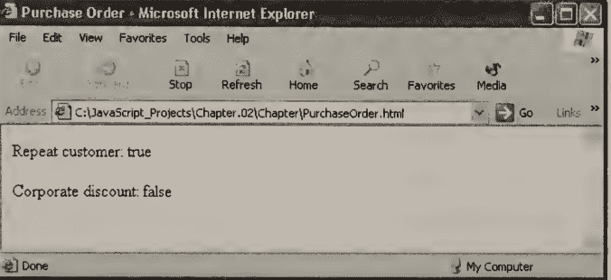

图 2-7 布尔值

## 数组

数组包含了一组由单个变量名表示的数据。你可以将数组想象成包含在单个变量中的变量集合。当你希望在一个单一、易于管理的区域存储一组或一个相关列表的列表时，你就会使用数组。名称列表、课程列表、测试成绩和价格列表通常存储在数组中。例如，图 2-8 所示，你可以使用名为 `hospitalDepts` 的单个数组来管理冗长且难以拼写的医院科室名称。你可以使用数组来引用每个部门，而无需重新输入名称，并可能因拼写错误而引入语法错误。

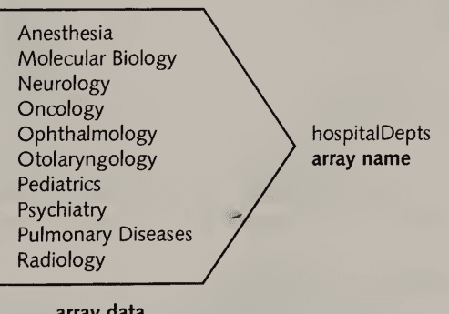

图 2-8 数组的概念示例

## 第 2 章 数据类型和运算符

JavaScript 中通过 `Array` 对象表示数组。`Array` 对象包含一个名为 `Array()` 的特殊构造函数，用于创建数组。构造函数是一种特殊类型的函数，用作引用变量的基础（即数据类型为引用类型的变量）。你使用关键字 `new` 和 `Array()` 构造函数按照以下语法创建新数组：

```javascript
var arrayName = new Array(number of elements);
```

在 `Array()` 构造的括号内，你包含一个表示数组包含元素数量的整数。数组中包含的每个数据单元被称为元素（element）。以下代码创建一个名为 `hospitalDepts` 且有 10 个元素的数组：

```javascript
var hospitalDepts = new Array(10);
```

数组内元素的编号从索引零 (0) 开始。这种编号方案对于初学者来说可能非常困惑。索引是元素在数组中的数字位置。你通过在数组末尾的括号中包含索引来引用特定元素。例如，`hospitalDepts` 数组中的第一个元素是 `hospitalDepts[0]`，第二个元素是 `hospitalDepts[1]`，第三个元素是 `hospitalDepts[2]`，依此类推。这意味着如果你有一个由十个元素组成的数组，数组中的第十个元素将使用索引 9 来引用。你为单个数组元素赋值的方式与为标准变量赋值相同，不同之处你包含了数组中单个元素的索引。以下代码为 `hospitalDepts` 数组中的前三个元素赋值：

```javascript
hospitalDepts[0] = "Anesthesia"; // 第一个元素
hospitalDepts[1] = "Molecular Biology"; // 第二个元素
hospitalDepts[2] = "Neurology"; // 第三个元素
```

你使用数组元素的方式与使用其他类型变量的方式相同。例如，以下代码打印 `hospitalDepts` 数组前三个元素中包含的值：

```javascript
document.println(hospitalDepts[0]); // 打印 "Anesthesia"
document.println(hospitalDepts[1]); // 打印 "Molecular Biology"
document.println(hospitalDepts[2]); // 打印 "Neurology"
```

一旦你为数组元素赋值，你就可以稍后更改它，就像你可以更改脚本中的其他变量一样。要将 `hospitalDepts` 数组中的第一个数组元素从 "Anesthesia" 改为 "Anesthesiology"，你使用以下语句：

```javascript
hospitalDepts[0] = "Anesthesiology";
```

大多数编程语言要求数组中的所有元素必须具有相同的数据类型。然而在 JavaScript 中，赋值给数组的值可以是不同的数据类型。例如，以下代码创建了一个数组并在元素中存储了不同数据类型的值：

```javascript
var hotelReservation = new Array(4);
hotelReservation[0] = "Don Gosselin"; // 客人姓名（字符串）
hotelReservation[1] = 2; // 晚数（整数）
hotelReservation[2] = 89.95; // 每晚价格（浮点数）
hotelReservation[3] = true; // 非烟房（布尔值）
```

当你使用 `Array()` 构造函数创建数组时，声明元素数量是可选的。你可以创建一个不包含任何元素的数组，并根据需要向数组添加新元素。例如，第一条语句为尚未创建的元素赋值时，该元素会自动创建，并创建任何可能在其之前的元素。例如，以下代码创建了不包含任何元素的 `hospitalDepths` 数组。第二条语句将 "Anesthesia" 分给第三个元素，在此过程中创建了前两个元素（`hospitalDepths[0]` 和 `hospitalDepths[1]`）。但请注意，在为它们赋值之前，`hospitalDepths[0]` 和 `hospitalDepths[1]` 都将包含 `undefined`。

```javascript
hospitalDepths = new Array();
hospitalDepths[2] = "Anesthesia";
```

你也可以在创建数组时为数组元素赋值。以下代码在创建 `hospitalDepths` 数组时为其赋值了一些值，然后使用索引打印每个值：

```javascript
hospitalDepths = new Array("Anesthesia", "Molecular Biology", "Neurology");
document.write(hospitalDeths[0]); // 打印 "Anesthesia"
document.write(hospitalDeths[1]); // 打印 "Molecular Biology"
document.write(hospitalDeths[2]); // 打印 "Neurology"
```

你将在第 6 章学习高级数组技术。

### 创建月份数组脚本

在你的文本编辑器中创建一个文档：

1. 创建一个新的文档。
2. 输入 `<!DOCTYPE>` 声明、`<html>` 元素、头部信息以及 `<body>` 元素。使用 "Months of the Year" 作为 `<title>` 元素的内容。
3. 在 body 中以下脚本部分：

```html
<script type="text/javascript">
<!-- INCOMPATIBLE BROWSERS -->
</script>
```

4. 在脚本部分声明以下数组：

```javascript
var monthsOfYear = new Array(12);
```

5. 在脚本部分末尾添加以下语句，将月份赋值给数组元素。记住数组的第一个元素从 0 开始。因此，数组中持有月份的元素是 `monthsOfYear[0]`。

```javascript
monthsOfYear[0] = "January"
monthsOfYear[1] = "February"
monthsOfYear[2] = "March"
monthsOfYear[3] = "April"
monthsOfYear[4] = "May"
monthsOfYear[5] = "June"
monthsOfYear[6] = "July"
monthsOfYear[7] = "August"
monthsOfYear[8] = "September"
monthsOfYear[9] = "October"
monthsOfYear[10] = "November"
monthsOfYear[11] = "December";
```

6. 接下来，在脚本部分末尾添加以下语句打印数组的每个元素：

```javascript
document.write("<p>" + monthsOfYear[0] + "<br />");
document.write(monthsOfYear[1] + "<br />");
document.write(monthsOfYear[2] + "<br />");
document.write(monthsOfYear[3] + "<br />");
document.write(monthsOfYear[4] + "<br />");
document.write(monthsOfYear[5] + "<br />");
document.write(monthsOfYear[6] + "<br />");
document.write(monthsOfYear[7] + "<br />");
document.write(monthsOfYear[8] + "<br />");
document.write(monthsOfYear[9] + "<br />");
document.write(monthsOfYear[10] + "<br />");
document.write(monthsOfYear[11] + "</p>");
```

> 循环语句为打印所有元素提供了一种更高效的方法。你将在第 3 章学习循环语句。

7. 将文档保存为 `MonthsOfYear.html` 并放在第 2 章的文件夹中，然后使用 W3C 标记验证服务（`validator.w3.org/file-upload.html`）对其进行验证。一旦文件有效，请在文本编辑器中关闭它。
8. 在 Web 浏览器中打开 `MonthsOfYear.html` 文档。你应该能看到图 2-9 所示的行。

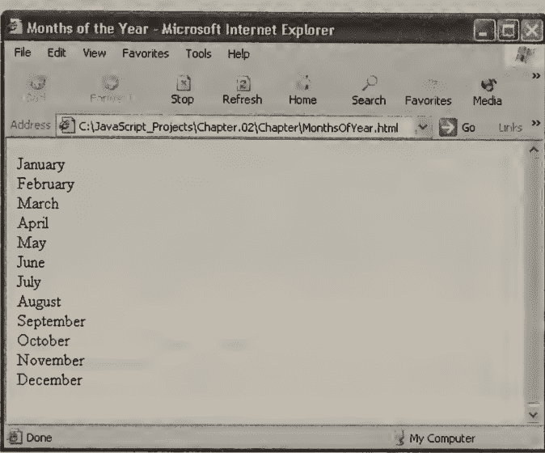

**图 2-9** MonthsOfYear.html 的输出

9. 关闭你的 Web 浏览器窗口。

# 表达式与运算符

当你在表达式中使用变量和数据时，它们变得最有用。**表达式**是一个字面量、变量，或者是字面量、变量、运算符与其他表达式的组合，JavaScript 解释器可以对其进行求值并产生结果。你在 JavaScript 中使用操作数和运算符创建表达式。**操作数**是表达式中包含的变量和字面量。**字面量**是一个值，例如字面量字符串或数字。**运算符**是表达式中用于操作操作数的符号，例如加法运算符 `+` 和乘法运算符 `*`。到目前为止你已经处理了几个结合运算符和操作数的简单表达式。考虑以下内容：

```javascript
myNumber = 100;
```

该语句是一个表达式，结果是将值 "100" 赋值给 **myNumber**。表达式中的操作数是变量名 **myNumber** 和整数值 "100"。运算符是等号 `=`。等号是一种特殊的运算符，称为赋值运算符，因为它将表达式右侧的值 100 赋值给表达式左侧的变量 (myNumber)。表 2-3 列出了 JavaScript 运算符的主要类型。你将在后续章节中学习更多关于特定运算符的知识。

### 表 2-3 JavaScript 运算符类型

| 运算符类型 | 描述 |
|---|---|
| 算术 | 用于执行数学计算 |
| 赋值 | 为变量赋值 |
| 比较 | 比较操作数并返回布尔值 |
| 逻辑 | 用于对布尔操作数执行布尔运算 |
| 字符串 | 对字符串执行操作 |
| 特殊 | 特殊运算符用于各种目的，不属于其他运算符类别 |

其他类型的 JavaScript 运算符包括位运算符，它们对整数值进行操作，这是一个相当复杂的话题。位运算符和其他复杂运算符超出了本书的讨论范围。

JavaScript 运算符可以是二元或一元的。二元运算符要求在运算符前后都各有一个操作数。语句 `myNumber = 100` 中的等号就是二元运算符的示例。一元运算符在运算符之前或之后只需要单个操作数。例如，自增运算符 `++` 是一种算术运算符，用于将操作数增加 1。语句 `myNumber++;` 将变量 `myNumber` 的值改为“101”。

运算符左侧的部分称为左操作数，运算符右侧的操作数称为右操作数。

接下来你将学习更多关于不同类型的 JavaScript 运算符。

## 算术运算符

JavaScript 中的算术运算符用于执行执行数学计算，如加法、乘法和除法。你还可以使用算术运算符返回计算的模（modulus），即一个数除以另一个数时留下的余数。

### 算术二元运算符

JavaScript 二元算术运算符及其描述列在表 2-4 中。

#### 表 2-4 算术二元运算符

| 运算符 | 名称 | 描述 |
|---|---|---|
| `+` | 加法 | 将两个操作数相加 |
| `-` | 减法 | 从一个操作数中减去另一个操作数 |
| `*` | 乘法 | 将一个操作数乘以另一个操作数 |
| `/` | 除法 | 将一个操作数除以另一个操作数 |
| `%` | 模 | 将一个操作数除以另一个操作数并返回余数 |

以下代码了包含算术二元运算符的表达式示例。图 2-10 显示了这些表达式在 Web 浏览器中的外观。

```javascript
var x, y, returnValue;
// 加法
x = 100;
y = x + y; // returnValue 变为 300
document.write("<p>returnValue after addition expression: " \
  + returnValue + "</p>");\n// 减法
x = 10;
y = 7;
returnValue = x - y; // returnValue 变为 3
document.write("<p>returnValue after subtraction expression: " \
  + returnValue + "</p>");\n// 乘法
x = 2;
y = 6;
returnValue = x * y; // returnValue 变为 12
document.write("<p>returnValue after multiplication expression: " \
  + returnValue + "</p>");\
// 除法
x = 24;
y = 3;
returnValue = x / y; // returnValue 变为 8
document.write("<p>returnValue after division expression: " \
  + returnValue + "</p>");\n// 模
x = 3;
y = 2;
returnValue = x % y; // returnValue 变为 1
document.write("<p>returnValue after modulus expression: " \
  + returnValue + "</p>");
```

# 第2章 数据类型与运算符

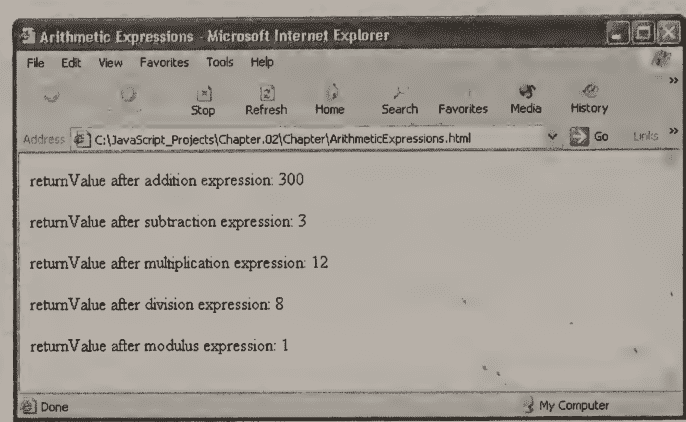

**图 2-10** 算术表达式的结果

在前面的代码中，当 JavaScript 执行算术计算时，它会在赋值运算符的右侧执行操作，然后将值赋值给赋值运算符左侧的变量。例如语句 `returnValue = x + y;`，操作数 `x` 和 `y` 相加，然后将结果赋值给左侧的 `returnValue` 变量。对于 `returnValue = x + y;` 语句，操作数 `x` 和 `y` 相加，然后将结果赋值给左侧的 `returnValue` 变量。你可能对除法运算符和模运算符之间的区别感到困惑。例如，除法运算符 15 除以 6 得到 2.5。但如果你只允许整数，6 进入 15 正好是 2 次，余数为 3。因此，15 除以 6 的模是 3，因为 3 是除法运算留下的余数。图 2-11 显示了输出。

```javascript
var divisionResult = 15 / 6;
var modulusResult = 15 % 6;
document.write("<p>15 divided by 6 is "
  + divisionResult + "</p>"); // 输出 '2'
document.write("The whole number 6 goes into 15 twice, with a remainder of " + modulusResult + "</p>"); // 输出 '3'
```

# 算术表达式与运算符 71

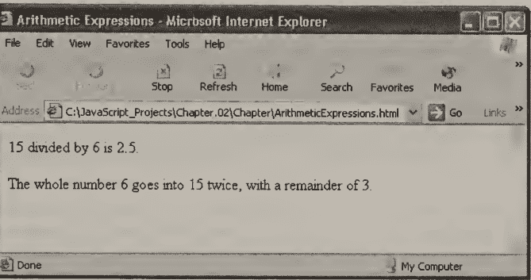

15 除以 2.5。

整数进入 15 两次，余数为 3

除法与模表达式

你可以在赋值语句的右侧包含变量和字面量的组合。例如，以下任何加法语句都是正确的：

```javascript
returnValue = 100 + y;
returnValue = x + 200;
returnValue = 100 + 200;
```

然而，你不能将字面量作为左操作数，因为 JavaScript 解释器需要一个变量来赋值。因此，语句 `100 = x + y;` 会引起错误。

对字符串值进行算术运算时，JavaScript 解释器尝试将字符串值转换为数字。在以下示例中，变量被赋予字符串值而不是数字，因为它们包含在引号中。然而，解释器正确地执行了乘法运算并返回值 "6"。

```javascript
x = "2";
y = "3";
returnValue = x * y; // 返回值为 6
```

当你使用加法运算符时，JavaScript 解释器不会将字符串转换为数字。当你相字符串时，字符串会被合并在一起而不是相加。在下面的示例中，操作返回了值 "23"，因为 x 和 y 包含字符串而不是数字：

```javascript
x = "2";
y = "3";
returnValue = x + y; // 返回字符串值 23
```

# 第 2 章 数据类型与运算符

### 表 2-5 算术一元运算符

| 运算符 | 名称 | 描述 |
| :--- | :--- | :--- |
| `++` | 递增 | 将操作数增加 1 |
| `--` | 递减 | 将操作数减少 1 |
| `-` | 取反 | 返回操作数的相反值（负或正） |

递增 `++` 和递减 `--` 一元运算符可以作为前缀运算符或后置运算符使用。前缀运算符放在变量之前。后置运算符放在变量之后。语句 `++myVariable;` 和 `myVariable++;` 会将 `myVariable` 增加 1。然而，这两个语句返回的值不同。当你将递增运算符作为前缀运算符使用时，操作数的值在增加 1 *之后*被返回。当你将递增运算符作为后置运算符使用时，操作数的值在增加 1 *之前*被返回。同样，当你将递减运算符作为前缀运算符使用时，操作数的值在减少 1 *之后*被返回；而当你将递减运算符作为后置运算符使用时，操作数的值在减少 1 *之前*被返回。如果你打算将递增或递减后的值赋值给变量，使用前缀还是后置运算符是有区别的。

在任何需要使用简化表达式来增加或减少 1 的情况下，你都会使用算术一元运算符。例如，语句 `count = count + 1;` 与语句 `count++;` 是等价。如你所见，如果你的目标只是让变量增加 1，那么使用一元递增运算符更容易。但请记住，使用前缀运算符时，操作数的值在增加或减少 1 后返回，而使用后置运算符时，操作数的值在增加或减少 1 前返回。

关于使用前缀或后置运算符的示例，考虑一个名为 `student` 的整数，用于在课程注册脚本中分配学生 ID。创建新学生 ID 的一种方法是将最后一个分配的学生 ID 存储在 `studentID` 变量中。当需要分配新学生时，脚本可以获取 `studentID` 变量中存储的值并加 1。换句话说，`studentID` 变量中存储的值将是下一个用于学生 ID 的数字。在这种情况下，你会使用后置运算符在表达式增加 *之前*返回其值，语句为 `currentID = studentID++;`。如果你将最后一个学生 ID 存储在 `studentID` 变量中，你将希望将值增加 1 并并将结果作为下一个学生 ID。在这种情况下，你会使用前缀运算符，它在表达式增加*后*返回其值，语句类似于 `currentID = ++studentID;`

图 2-12 显示了一个简单的脚本，该脚本使用前缀递增运算符为名为 `curStudentID` 的变量分配三个学生 ID。初始 ID 存储在 `studentID` 变量中并初始化为起始值“100”。图 2-13 显示了输出。

```javascript
var studentID = 100;
var curStudentID;
curStudentID = ++studentID; // 分配 '101' 
document.write("<p>The first student ID is " + curStudentID + "</p>");
curStudentID = ++studentID; // 分配 '102' 
document.write("<p>The second student ID is " + curStudentID + "</p>");
curStudentID = ++studentID; // 分配 '103' 
document.write("<p>The third student ID is " + curStudentID + "</p>");
```

前缀递增运算符

图 2-12 使用前缀递增运算符的脚本

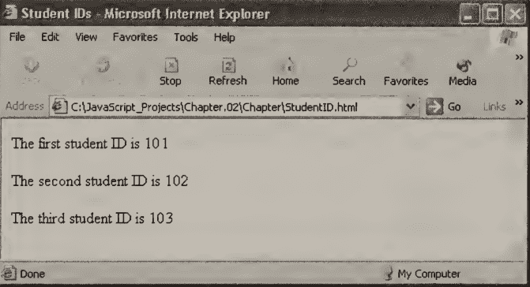

图 2-13 学生 ID 脚本前缀版本的输出

图 2-14 中的脚本执行相同的任务，但使用了后置递增运算符。注意，图 2-15 中的输出与图 2-13 的输出不同。因为第一个第一个示例使用了前缀递增运算符，在将 `studentID` 变量赋值给 `curStudentID` 之前对其进行了增加，因此脚本没有使用起始值“100”。相反，它首先增加 `studentID` 变量，并将“101”作为第一个学生 ID。相比之下，脚本的第二个示例使用了初始值“100”，因为后置递增运算符在 `studentID` 变量赋值给 `curStudentID` 变量之后才对其增加。

```javascript
var studentID = 100;
var curStudentID;
curStudentID = studentID++; // 分配 '100'
document.write("<p>The first student ID is " + curStudentID + "</p>");
```

后置递增运算符

图 2-14 使用后置递增运算符的脚本

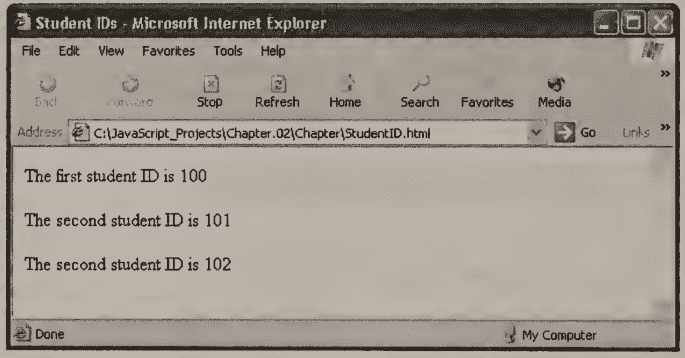

图 2-15 学生 ID 脚本后置版本的输出

接下来，你将创建一个执行算术计算的脚本。

### 创建算术计算脚本

1. 在你的文本编辑器中创建一个新文档。
2. 输入 `<!DOCTYPE>` 声明、`html` 元素、头部信息和 `<body>` 元素。使用严格 DTD 并“Arithmetic Examples”作为 `<title>` 元素的内容。
3. 在文档主体中添加以下脚本部分：

```html
<script type="text/javascript">
<!-- HIDE FROM INCOMPATIBLE BROWSERS
// STOP HIDING FROM INCOMPATIBLE BROWSERS -->
</script>
```

4. 在脚本部分添加以下语句以声明两个变量：一个包含数字的数字变量（你将在多次算术操作中使用它），以及一个包含每次算术操作结果的结果变量。

```javascript
var number = 100;
var result;
```

5. 现在添加以下语句，对 `number` 变量执行加、减、乘、除操作，并将每个值赋值给 `result`。每当结果变化时都会打印结果。

```javascript
result = number + 50;
document.write("Result after addition = " + result + "<br />");
result = number / 4;
document.write("Result after division = " + result + "<br />");
result = number - 25;
document.write("Result after subtraction = " + result + "<br />");
result = number * 2;
document.write("Result after multiplication = " + result + "<br />");
```

6. 接下来添加以下两个语句。第一条语句使用递增运算符将 `number` 变量的值增加 1，并将新值赋值给 `result` 变量。第二条语句打印 `result` 变量。注意递增运算符作为前缀使用，因此新值被赋值给 `result` 变量。如果你使用后置递增运算符，你会在 `++number` 变量增加 1 之前，将 `number` 变量的旧值赋值给 `result` 变量。

```javascript
result = ++number;
document.write("Result after increment = " + result + "</p>");
```

7. 将 `ArithmeticExamples.html` 保存到第 2 章文件夹中，并在 `validator.w3.org/file-upload.html` 使用 W3C 标记验证服务进行验证。一旦文件有效，在你的文本编辑器中关闭它。
8. 在你的 浏览器文件夹中打开 `ArithmeticExamples.html` 文档。图 2-16 显示了输出。
9. 关闭你的 浏览器窗口。

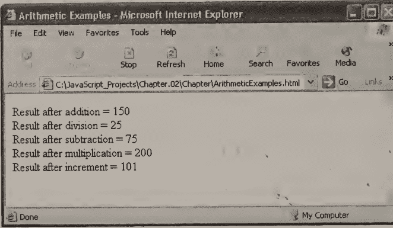

图 2-16 ArithmeticExamples.html 的输出

## 赋值运算符

赋值运算符用于给变量赋值。你已经使用过最常用的赋值运算符等号 `=` 来给使用 `var` 语句声明的变量赋值。等号为新变量分配初始值，或为现有变量分配新值。例如，以下代码创建了对名为 `myCar` 变量的赋值，使用等号为其分配初始值，然后再次使用等号为其分配一个新值。

```javascript
var myCar = "Ford";
myCar = "Chevy";
```

JavaScript 除了等号还包含其他赋值运算符。这些额外的赋值运算符被称为复合赋值运算符，会对表达式中的变量和字面量进行数学计算，并将新值赋值给左操作数。表 2-6 显示了常用的 JavaScript 赋值运算符列表。

### 表 2-6 赋值运算符

| 运算符 | 名称 | 描述 |
| :--- | :--- | :--- |
| `=` | 赋值 | 将右操作数的值分配给左操作数 |
| `+=` | 复合加赋值 | 将右操作数的值与左操作数的值合并，或将右操作数的值加到左操作数的值上并将新值赋值给左操作数 |

## 表 2-6 赋值运算符（续）

| 运算符 | 名称 | 描述 |
| --- | --- | --- |
| `-=` | 复合减法赋值 | 从左操作数的值中减去右操作数的值，并将新值赋值给左操作数 |
| `*=` | 复合乘法赋值 | 将左操作数的值乘以右操作数的值，并将 new_value 赋值给左操作数 |
| `/=` | 复合除法赋值 | 将左操作数的值除以右操作数的值，并将新值赋值给左操作数 |
| `%=` | 复合取模赋值 | 将左操作数的值除以右操作数的值，并将余数赋值给左操作数 |

`+=` 运算符用于组合两个字符串以及相加数字。在字符串的情况下，运算符左侧的字符串与右侧的字符串合并，并将新值赋值给左操作数。在合并操作数之前，JavaScript 解释器会尝试将非数字操作数（如字符串）转换为数字。如果非数字操作数无法转换为数字，你将得到 "NaN" 值，它代表“不是一个数字”，当数学运算没有产生数值时会返回该值。以下代码展示了不同赋值运算符的示例。图 2-17 显示了输出。

```javascript
var x, y;
x = "Hello ";
x += "World"; // x 变为 "Hello World"
document.write("<p>" + x + "<br />");
x = 100;
y = 200;
x += 300; // x 变为 300
document.write(x + "<br />");
x = 10;
y = 7;
x -= y; // x 变为 3
document.write(x + "<br />");
x = 2;
y = 6;
x *= y; // x 变为 12
document.write(x + "<br />");
x = 24;
y = 3;
x /= y; // x 变为 8
document.write(x + "<br />");
```

## 第 2 章 数据类型和运算符

```javascript
x = 3;
y = y; // x 变为 1
document.write(x + "<br />");
x = "100";
y = 5;
x *= y; // x 变为 500
document.write(x + "<br />");
x = "one hundred";
y = 5;
x *= y; // x 变为 NaN
document.write(x + "</p>");
```

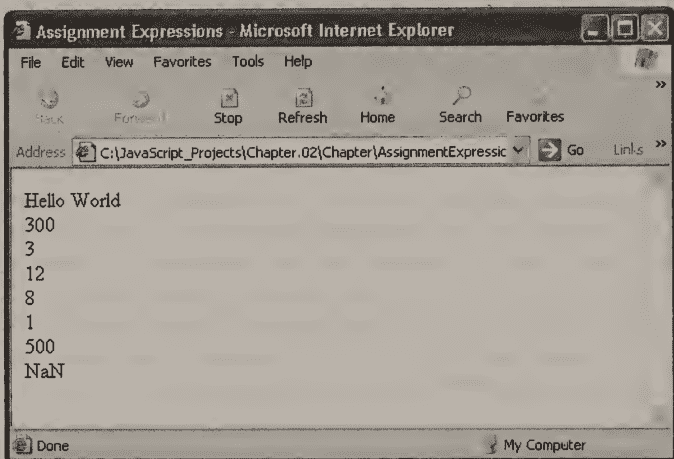

图 2-17 赋值表达式

接下来，你将创建一个使用赋值运算符的脚本。

### 创建赋值运算符脚本

1. 在你的文本编辑器中创建一个新文档。
2. 输入 `<!DOCTYPE>` 声明、<html> 元素、头部信息和 `<body>` 元素。使用严格 DTD，并将“Assignment Examples”作为 `<title>` 元素的内容。
3. 在文档主体中添加以下脚本部分：

```html
<script type="text/javascript">
<!-- HIDE FROM INCOMPATIBLE BROWSERS
// STOP HIDING FROM INCOMPATIBLE BROWSERS -->
</script>
```

4. 在脚本部分输入以下语句。这些语句对变量 `changingVar` 执行了多次复合赋值操作。在每次赋值操作后，都会打印结果。

```javascript
var changingVar = "text string 1";
changingVar += " & text string 2";
document.write("<p>Variable after addition assignment = \n" + changingVar + "<br/>");
changingVar = 100;
changingVar += 50;
document.write("Variable after addition assignment = \n" + changingVar + "<br/>");
changingVar = 30;
document.write("Variable after subtraction assignment = \n" + changingVar + "<br/>");
changingVar /= 3;
document.write("Variable after division assignment = \n" + changingVar + "<br/>");
changingVar *= 8;
document.write("Variable after multiplication assignment = \n" + changingVar + "<br/>");
changingVar %= 300;
document.write("Variable after modulus assignment = \n" + changingVar + "</p>");
```

5. 将文档保存为第 2 章文件夹中的 `AssignmentExamples.html`，然后使用 `validator.w3.org/file-upload.html` W3C 标记验证服务进行验证。文件有效后，在文本编辑器中关闭它。
6. 在浏览器中打开 `AssignmentExamples.html` 文档。图 2-18 显示了输出。

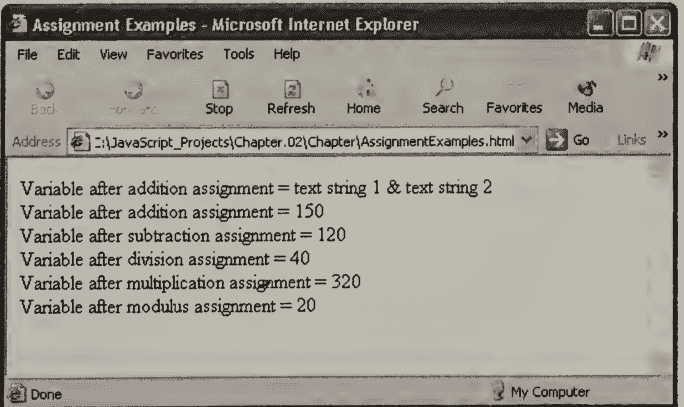

7. 关闭浏览器窗口。

## 比较运算符和条件运算符

比较运算符用于比较两个操作数，并判断一个数值是否大于另一个数值。两个操作数比较后会返回一个 `true` 或 `false` 的布尔值。例如，语句 `5 < 3` 将返回布尔值 `false`，因为 5 并不小于 3。表 2-7 列出了 JavaScript 比较运算符。

### 表 2-7 比较运算符

| 运算符 | 名称 | 描述 |
| --- | --- | --- |
| `==` | 等于 | 如果操作数相等则返回 true |
| `===` | 严格相等 | 如果操作数相等且类型相同则返回 true |
| `!=` | 不等于 | 如果操作数不等则返回 true |
| `!==` | 严格不相等 | 如果操作数不等或类型不同则返回 true |
| `>` | 大于 | 如果左操作数大于右操作数则返回 true |
| `<` | 小于 | 如果左操作数小于右操作数则返回 true |
| `>=` | 大于等于 | 如果左操作数大于或等于右操作数则返回 true |
| `<=` | 小于等于 | 如果左操作数小于或等于右操作数则返回 true |

> 比较运算符 `==` 由两个等号组成，其功能与单个等号 `=` 的赋值运算符不同。比较运算符比较值，而赋值运算符赋值值。

> 比较运算符通常与两种特殊语句一起使用：条件语句和循环语句。你将在第 3 章中学习如何使用它们。

你可以使用数字或字符串值作为比较运算符的操作数。当使用两个值作为操作数时，JavaScript 解释器会对它们进行数值比较。例如，语句 `5 > 4;` 返回 true，因为数字 5 大于数字 4。当使用两个非数字值作为操作数时，JavaScript 解释器会按字母顺序对它们进行比较。例如，语句 `"b" > "a";` 返回 true，因为字母 b 在字母表上大于字母 a。当一个操作数是数字而另一个是字符串时，JavaScript 解释器会尝试将字符串值转换为数字。如果字符串无法转换为数字，则返回 false 值。例如，语句 `10 == "ten";` 返回 false 值，因为 JavaScript 解释器无法将字符串 "ten" 转换为数字。

比较运算符通常与另一种运算符——条件运算符配合使用。条件运算符根据条件表达式的结果执行两个表达式中的一个。条件运算符的语法为 `conditional expression?expression2;`。如果条件表达式求值为 true，则执行 `expression1`。如果条件表达式求值为 false，则执行 `expression2`。

以下代码展示了条件运算符的示例。在示例中，条件表达式检查 `intVariable` 变量是否大于 100。如果 `intVariable` 大于 100，则将文本 "intVariable is greater than 100" 赋值给结果变量 `result`。如果 `intVariable` 不大于 100，则将文本 "intVariable is less or equal to 100" 赋值给结果变量 `result`。因为 `intVariable` 等于 100，条件语句返回 true 值，第一个表达式执行，"intVariable is greater than 100" 打印到屏幕上。图 2-19

```javascript
var intVariable = 150;
var result;
(intVariable > 100) ? result =
  "intVariable is greater than 100" : result =
  "intVariable is less or equal to 100";
document.write(result);
```

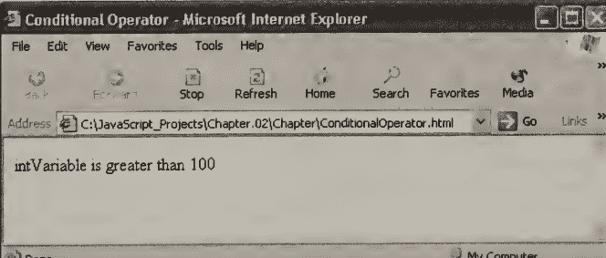

图 2-19 使用条件运算符的脚本输出

接下来，你将创建一个使用比较运算符和条件运算符的脚本。

### 创建比较运算符脚本

1. 在你的文本编辑器中创建一个新文档。
2. 输入 `<!DOCTYPE>` 声明、<html> 元素、头部信息和 `<body>` 元素。使用严格 DTD，并将“Comparison Examples”作为 `<title>` 元素的内容。

# 第 2 章 数据类型与运算符

3. 将以下脚本部分添加到文档中：

```html
<script type="text/javascript">
<!-- HIDE FROM INCOMPATIBLE BROWERS --
  // STOP HIDING FROM INCOMPATIBLE BROWSERS --
</script>
```

4. 在脚本部分中添加以下语句，对两个变量执行各种比较操作。结果被赋值给 `returnValue` 变量并打印。注意，第一次比较使用了条件操作符。

```javascript
var returnValue;
var value1 = "first text string";
var value2 = "second text string";
value1 == value2 ? document.write("<p>value1 equal to value2: true<br />")
  : document.write("<p>value1 equal to value2: false<br />");
value1 = 50;
value2 = 75;
returnValue = value1 == value2;
document.write("value1 equal to value2: "
  + returnValue + "<br />");
returnValue = value1 != value2;
document.write("value1 not equal to value2: "
  + returnValue + "<br />");
returnValue = value1 > value2;
document.write("value1 greater than value2: "
  + returnValue + "<br />");
returnValue = value1 < value2;
document.write("value1 less than value2: "
  + returnValue + "<br />");
returnValue = value1 >= value2;
document.write("value1 greater than or equal to value2: "
  + returnValue + "<br />");
returnValue = value1 <= value2;
document.write("value1 less than or equal to value2: "
  + returnValue + "<br />");
value1 = 25;
value2 = 25;
returnValue = value1 === value2;
document.write("value1 equal to value2 AND the same data type: "
  + returnValue + "<br />");
returnValue = value1 != value2;
document.write("value1 not equal to value2 AND the same data type: "
  + returnValue + "</p>");
```

# 表达式与运算符

5. 将文档保存为第 2 章文件夹下的 `ComparisonExamples.html`，然后使用 `validator.w3.org/file-upload` 验证它。文件有效后，用你的文本编辑器关闭它。
6. 在 浏览器中打开 `ComparisonExamples.html` 文档。图 2-20 显示了输出。

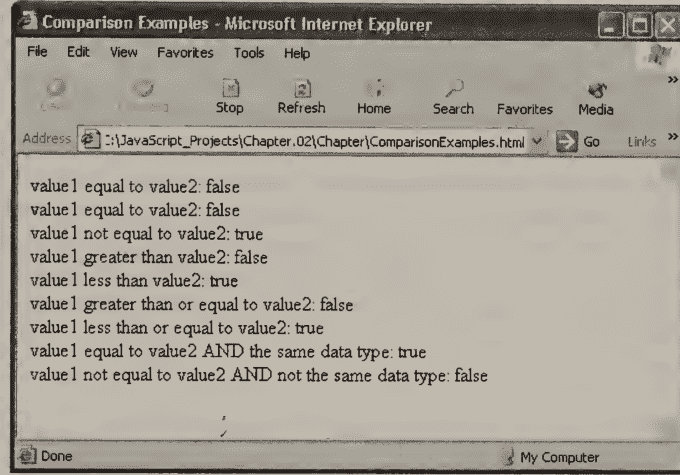

图 2-20 ComparisonExamples.html 的输出

## 逻辑运算符

逻辑运算符用于比较两个布尔操作数的相等性。例如，汽车保险公司的脚本可能需要判断客户是否为21岁的男性以确定正确的保险报价。作为比较运算符，在比较两个操作数后，会返回 `true` 或 `false` 的布尔值。表 2-8 列出了 JavaScript 逻辑运算符。

### 表 2-8 逻辑运算符

| 运算符 | 名称 | 说明 |
|---|---|---|
| `&&` | 与 (And) | 如果左操作数和右操作数都返回 `true` 值，则返回 `true`；否则返回 `false`。 |
| `||` | 或 (Or) | 如果左操作数或右操作数任一返回 `true` 值，则返回 `true`；如果两个操作数都不返回 `true`，则包含该或运算符的表达式返回 `false`。 |
| `!` | 非 (Not) | 如果表达式为 `false` 则返回 `true`，如果为 `true` 则返回 `false`。 |

# 第 2 章 数据类型与运算符

`||` 和 `&&` 运算符是二元运算符（需要两个操作数），而 `!` 是一元运算符（需要单个操作数）。逻辑运算符通常与比较运算符配合使用评估表达式，允许将多个表达式的结果合并到一个语句中。例如，`&&` 运算符用于判断两个操作数返回相同的值。操作数本身通常是表达式。以下代码使用 `&&` 运算符比较两个独立的表达式：

```javascript
var gender = "male"
var age = 17
var riskFactor = gender=="male" && age<=21; // returns false
```

在示例中，`gender` 变量为 `true` 因为它是 "male"，`age` 变量为 `true` 因为它小于等于 21。由于两个表达式都为 `true`，`riskFactor` 被赋值为 `true`。包含 `&&` 运算符的语句如果 `gender` 等于 "male" 且 `age` 小于等于 21，则给 `riskFactor` 赋值为 `true`；否则赋值为 `false`。在后续代码中，`riskFactor` 被赋值为 `false`，因为 `age` 表达式不为 `true`：

```javascript
var gender = "male"
var age = 28
var riskFactor = gender=="male" && // returns true
```

`||` 运算符检查表达式是否为 `true`。例如，后续代码中的语句表示如果变量 `speedingTicket` 为 `true` 或 `age` 小于等于 21，则给 `riskFactor` 赋值为 `true`；否则赋值为 `false`。

```javascript
var speedingTicket = 2
var age = 28
var riskFactor = speedingTicket>0 || age<=21; // returns true
```

示例中的 `riskFactor` 变量被赋值为 `true`，尽管 `age` 变量表达式为 `false`，这是因为 `speedingTicket` 变量为 `true`。`||` 语句当左操作数或右操作数任一为 `true`时返回 `true`。

以下代码是 `!` 运算符的示例，如果操作数为 `false` 则返回 `true`，如果为 `true` 则返回 `false`。注意由于 `!` 运算符是一元的，它只需要单个操作数。

```javascript
var trafficViolations = true
var safeDriverDiscount = !trafficViolations; // returns false
```

逻辑运算符经常用于 `if...else`、`for` 和 `while` 等条件循环语句中。你将在第 3 章学习条件循环语句。


## 表达式与运算符 85

接下来你将创建一个使用逻辑运算符的脚本。

1. 在你的文本编辑器中创建一个新文档。
2. 输入 `<!DOCTYPE>` 声明、`<html>` 元素、头部信息和 `<body>` 元素。使用严格 DTD 和 "Logical Examples" 作为 `<title>` 元素的内容。
3. 在文档主体中添加以下脚本部分：

```html
<script type="text/javascript">
<!-- HIDE FROM INCOMPATIBLE BROWERS
// STOP HIDING FROM INCOMPATIBLE BROWSERS -->
</script>
```

4. 在脚本部分中添加以下对两个变量使用逻辑运算符的语句：

```javascript
var trueValue = true;
var falseValue = false;
document.write(trueValue + "<br />");
document.write(!falseValue + "<br />");
document.write(falseValue || falseValue);
document.write("<br />&& falseValue + "</p>");
```

5. 将 `LogicalExamples.html` 保存到第 2 章，并使用 W3C Markup Validation Service 验证。文件有效后，在文本编辑器中关闭它。
6. 在浏览器中打开 `LogicalExamples.html` 文档。

图 2-21 显示了输出。

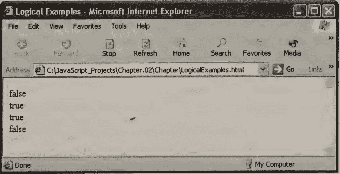

**图 2-21 LogicalExamples.html 的输出**

7. 关闭浏览器。

# 第 2 章 数据类型与运算符

## 字符串的操作

如第 1 章所学，文本字符串包含由双引号或单引号括的零或多个字符。脚本中可能使用的字符串示例包括公司名、用户名、注释和其他文本。你可以将字符串作为字面量，或将其赋值给变量。

字面量可以赋值一个长度为零的值，称为空字符串。例如，以下语句声明了一个名为 `customerName` 的变量并赋值赋值空字符串：

```javascript
var customerName = "";
```

空字符串是字面量的有效值，且不被视为 `null` 或 `undefined`。你什么时候想赋值一个空字符串？考虑一下 `prompt()` 方法，它会显示一个包含消息、确定按钮和取消按钮的对话框。你可以向 `prompt()` 方法传递两个字符串：第一个参数是给用户的指令，而第二个参数是显示在提示对话框中的默认文本。如果你不包含第二个参数，值 `"undefined"` 将作为默认文本出现。为了防止 `"undefined"` 在提示框中显示为默认文本，你将空字符串作为 `prompt()` 的第二个参数传递。

当你想在双引号括的字面量字符串内部包含引用字符串时，使用单引号括该字符串。当你想在单引号括的字面量字符串内部包含引用字符串时，使用双引号括该字符串。无论你在何时使用字符串，开头和结尾都使用相同类型的引号。例如，`document.write("This is a string.")` 是有效的，因为它以双引号开头和结尾，而语句 `document.write("This is a text string.")` 是无效的，因为它以双引号开头并单引号结尾。在第二种情况下你会收到错误消息，因为浏览器无法判断字面量字符串的开始和结束。以下代码编码了一个打印字符串的脚本示例。图 2-22 显示了输出。

```javascript
<script type="text/javascript">
<!-- HIDE FROM INCOMPATIBLE BROWERS
document.write("This is a literal string.<br />")
document.write("This string contains a 'quoted' string.<br />")
document.write("This is another example of a \"quoted\" string.<br />");
var firstString = "This literal string was assigned to a variable.<br/>";
var secondString = 'This literal string was also assigned to a variable.<p>';
document.write(firstString);
```

# 字符串 87

```javascript
document.write(secondString);
// 停止对不兼容浏览器的隐藏处理 --
</script>
```

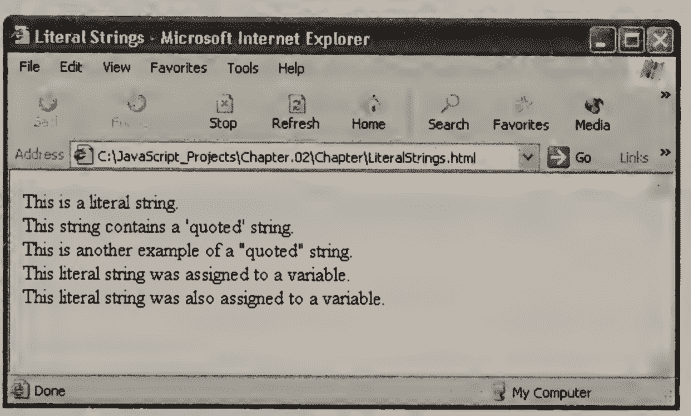

图 2-22 字面量字符串脚本的输出

与其他编程语言不同，JavaScript 中没有用于单个字符的特殊数据类型，例如 C、C++ 和 Java 编程语言中的 `char` 数据类型。

> 注意

## 转义字符和序列

在字符串中使用单引号处理所有格和缩写时，您需要格外小心，因为 JavaScript 解释器总是寻找第一个闭合的单引号或双引号来匹配开启的单引号或双引号。例如，考虑以下语句：

```javascript
document.write('<p>My city\'s zip code is 01562.</p>');
```

此语句会导致错误。JavaScript 解释器认为字面量字符串以 city 之后的撇号结束，并紧接着寻找 "city" 之后 document.write() 语句的结束括号。为了解决这个问题，您必须在 "city's" 中的撇号之前包含一个转义字符。转义字符告诉编译器或解释器该字符具有特殊用途。在 JavaScript 中，转义字符是反斜杠 `\`。在撇号前放置反斜杠告诉 JavaScript 解释器撇号应被视为普通的键盘字符（例如 "a""b""1" 或 "2"），而不是字符串单引号对的一部分。以下语句中的反斜杠告诉 JavaScript 解释器将单词 "city" 之后的撇号作为撇号打印。

```javascript
document.write('<p>My city\'s zip code is 01562.</p>');
```

# 88 第 2 章 数据类型和运算符

您还可以将转义字符与其他字符结合，在字符串中插入特殊字符。当将转义字符与其他字符结合时，这种组合被称为转义序列。反斜杠后撇号 `\'` 和反斜杠后双引号 `\"` 都是转义序列的示例。大多数序列执行特殊功能。例如，转义序列 `\t` 在字符串中插入一个制表符。表 2-9 描述了可以添加到 JavaScript 字符串中的转义序列。

### 表 2-9 JavaScript 转义序列

| 转义序列 | 字符 |
| --- | --- |
| `\\` | 反斜杠 |
| `\b` | 退格 |
| `\r` | 回车符 |
| `\"` | 双引号 |
| `\f` | 分页符 |
| `\t` | 水平制表符 |
| `\n` | 换行 |
| `\0` | 空字符 |
| `\'` | 单引号 |
| `\v` | 垂直制表符 |
| `\XXX` | 由 XX 字符指定的 Latin-1 字符，XX 代表两个十六进制数字 |
| `\XXXX` | 由 XXXX 字符指定的 Unicode 字符，XXXX 代表四个十六进制数字 |

> 如果您在表 2-9 列出的任何字符之外之前放置反斜杠，该反斜杠将被忽略。

请注意，转义序列生成的字符之一是反斜杠。由于转义字符本身是反斜杠，所以您必须使用转义序列 `\\` 将反斜杠作为字符包含在字符串中。例如，要在字符串中包含路径 "C:\JavaScript_Projects\Files"，您必须为字符串中想要显示的每一个反斜杠包含两个反斜杠，如下例所示：

```javascript
document.write("<p>My JavaScript files are located in C:\\JavaScript_Projects\\Files\\</p>");
```

## 字符串

以下代码展示了一个包含若干转义序列字符串的脚本示例。图 2-23 显示了输出。

```javascript
<script type="text/javascript">
<!-- 对不兼容浏览器的隐藏 -->
document.write("<p>This line is printed \n two lines.</p>");
// 换行
document.write("<p>\tThis line includes a horizontal tab.</p>");
// 水平制表符
document.write("<p>My personal files are in c:\\personal.</p>");
// 反斜杠
document.write("<p>My dog's name is \"Noah.\"</p>");
// 双引号
document.write('<p>Massachusetts\' capital is Boston.</p>');
// 单引号
// 停止对不兼容浏览器的隐藏处理 -->
</script>
```

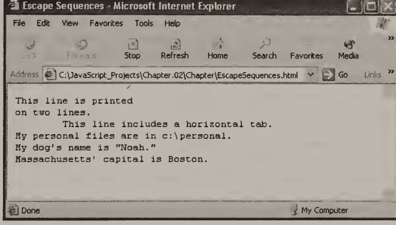

图 2-23 包含转义序列字符串的脚本输出

> 某些转义序列（包括换行和水平制表符转义序列）仅在 `<pre>` 元素等容器元素内部识别。

接下来，您将创建一个脚本，显示由名为 Central Opera 的剧院演出的歌剧《魔笛》的部分评论。该评论将使用结合字符串和转义字符的 `document.write()` 语句进行渲染。注意，仅使用 XHTML 元素可以更容易地创建相同的文档。此练习的目的是演示字符串如何与转义字符结合。

# 第 2 章 数据类型和运算符

### 创建 MagicFlute 脚本

1. 在您的文本编辑器中创建一个新文档。
2. 输入 `<!DOCTYPE>` 声明、`<html>` 元素、头部信息和 `<body>` 元素。使用严格 DTD 并“The Magic Flute”作为 `<title>` 元素的内容。
3. 在文档头中添加以下脚本部分：

```html
<style type="text/css">
body { font-family: 'Trebuchet MS', Arial, Helvetica, sans-serif
}
</style>
```

4. 在文档体中添加以下脚本部分：

```html
<script type="text/javascript">
<!-- 对不兼容浏览器的隐藏 -->
// 停止对不兼容浏览器的隐藏处理 -->
</script>
```

5. 添加以下包含文本、元素和转义字符组合的 `document.write()` 语句。

```javascript
document.write("<p>Central Valley Opera presents</p>");
document.write("<p>The Magic Flute<|p|>");
document.write("<p><strong>by Wolfgang Amadeus Mozart</strong></p><hr/>");
document.write("<p>The Foresville Daily calls the Central Valley Opera\\s production</p>");
document.write("<p>of Mozart's <em>The Magic Flute</em> a \"spectacular product\" ");
document.write("that will take your breath away\\.");
```

确保在上述代码中在同一行输入文本字符串。由于空间限制，此处包含换行符。

6. 将文档保存为 Chapter 文件夹中的 `MagicFlute.html`，并使用 W3C Validation Service (`validator.w3.org/file-html`) 进行验证。文件有效后，在编辑器中关闭它。
7. 在您的 浏览器中打开 `MagicFlute.html` 文档。您应该看到图 2-24 所示的行。


# 字符串 91


图 2-24 MagicFlute.html 的输出

8. 关闭您的浏览器窗口。

## 字符串运算符

JavaScript 有两个可以与字符串使用的运算符：`+` 和 `+=`。在与字符串使用时，加号被称为连接运算符。**连接运算符 `+`** 用于组合两个字符串。例如，您已经学习了如何使用连接运算符。以下代码结合了一个字符串变量并将新值赋值给另一个变量：

```javascript
var destination = "Paris"
var location = "France"
destination = destination + " is in " + location;
```

**location** 变量的组合值赋值给 **destination** 变量的是 "Paris in France"。

您还可以使用复合赋值运算符 `+=` 连接两个字符串。以下代码结合了两个文本字符串，但没有使用 **location** 变量：

```javascript
var destination = "Paris"
destination += " is in France";
```

注意，该符号——加号——既是连接运算符也是加运算符。与数字或包含数字的变量一起时，使用连接运算符的表达式返回两个数字的和。正如您在本章早些时候学到的，如果你将连接运算符与字符串一起使用

# 第 2 章 数据类型与运算符

以及一个数值，字符串值和数值将组合成一个新的字符串值，如下例所示：

```javascript
var textString = "The legal voting age is ";
var votingAge = 18;
newString = textString + votingAge;
```

## 特殊运算符

JavaScript 还包含了表 2-10 中列出的特殊运算符。这些运算符用于各种用途，且不属于任何其他类别。

### 表 2-10 特殊运算符

| 运算符 | 描述 |
| --- | --- |
| `.` | 将一个对象、方法或属性附加到另一个对象 |
| `[]` | 访问数组的元素 |
| `()` | 调用函数或更改表达式中单个操作的求值顺序 |
| `,` | 允许在同一条语句中包含多个表达式 |
| `?:` | 根据条件表达式的结果执行两个表达式之一 |
| `delete` | 删除数组元素、未使用 var 关键字创建的变量以及自定义对象的属性 |
| `in` | 如果对象中包含指定的属性，则返回 true |
| `instanceof` | 如果对象属于指定的对象类型，则返回 true |
| `new` | 创建用户定义对象类型或预定义 JavaScript 对象类型的新实例 |
| `typeof` | 确定变量的数据类型 |
| `void` | 求值表达式但不返回结果 |

在本书中，你将在需要时学习 JavaScript 特殊运算符。在本节中你将使用的一个特殊运算符是 `typeof` 运算符。该运算符非常有用，因为变量的数据类型在程序执行过程中可能会发生。如果你尝试执行算术运算而其中一个变量是字符串或 null 值，可能会导致问题。为了避免此类问题，可以使用 `typeof` 运算符来确定变量的数据类型。`typeof` 运算符的语法为 `typeof(variablename)`。当你需要确保变量是正确的数据类型时，应该使用 `typeof` 运算符。`typeof` 运算符返回的值见表 2-11。

## 操作字符串

### 表 2-11 typeof 运算符返回的值

| 返回值 | 适用于 |
|---|---|
| Number | 整数和浮点数 |
| String | 文本字符串 |
| Boolean | true 或 false |
| Object | 对象、数组和 null |
| Function | 函数 |
| Undefined | undefined |

接下来你将创建一个脚本，为变量分配不同的数据类型并打印变量的数据类型。你将使用 `typeof` 运算符来确定每个变量的数据类型。

### 创建打印数据类型脚本

1. 在你的文本编辑器中创建一个新文档。
2. 添加 `<DOCTYPE>` 声明、`<html>` 元素、头部信息和 `<body>` 元素。使用严格 DTD 并“Print Data Types”作为 `<title>` 元素的内容。
3. 在文档主体中添加以下脚本部分：

```html
<script type="javascript">
<!-- HIDE FROM INCOMPATIBLE BROWSERS
// STOP HIDING FROM INCOMPATIBLE BROWSERS -->
</script>
```

4. 在脚本部分声明一个名为 `differentType` 的变量：

```javascript
var differentType;
```

5. 在脚本部分的末尾输入以下行，打印 `differentType` 中的数据。目前数据为“undefined”，因为 `differentType` 尚未赋值。

```javascript
document.write("The differentType variable is " + typeof(differentType) + "<br />");
```

6. 在脚本部分的末尾添加以下两行，为 `differentType` 变量分配字符串并重复打印数据类型的语句：

```javascript
differentType = "This is a text string";
document.write("The differentType variable is " + typeof(differentType) + "<br />");
```

7. 在脚本部分的末尾添加以下行，将 `differentType` 变量更改为整数、浮点数、布尔和 null 数据类型。打印每个数据类型的语句会在每次变量数据类型更改时重复一次。

```javascript
differentType = 100;
document.write("the differentType variable is " + typeof(differentType) + "<br />");
differentType = 3.679;
document.write("the differentType variable is " + typeof(differentType) + "<br />");
differentType = false;
document.write("the differentType variable is " + typeof(differentType) + "<br />");
differentType = null;
document.write("the differentType variable is " + typeof(differentType) + "</p>");
```

8. 将 `DataTypes.html` 保存到第 2 章的文件夹中，并使用 `validator.w3.org/file-upload.html` W3 Markup Validation Service 进行验证。一旦文件有效，在文本编辑器中关闭它。
9. 在 Web 浏览器中打开 `DataTypes.html` 文档。你应该看到图 2-25 所示的内容。

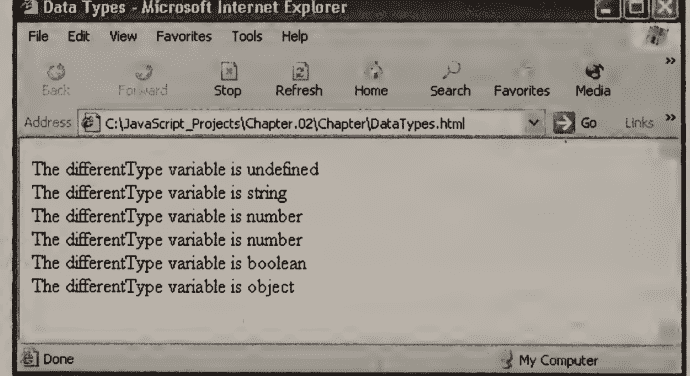

图 2-25 DataTypes.html 的输出

10. 关闭 Web 浏览器窗口。

## 运算符优先级

使用运算符时，你需要意识到运算符的优先级。表 2-12 显示了操作的求值顺序。高优先级运算符会在低优先级运算符之前执行。例如，乘法运算符 `*` 的优先级高于加法运算符 `+`。因此，语句 `5 + 2 * 8` 的求值如下：先乘以 2 和 8 得到 16，然后加 5，结果为21。如果加法运算符的优先级高于乘法运算符，该语句的求值结果将是 56，因为 5 在乘以 8 之前就会加了 2。

### 表 2-12 运算符优先级

| 运算符 | 描述 | 结合性 |
| --- | --- | --- |
| `()` | 对象—最高优先级 | 右 |
| `[]` | 数组—最高优先级 | 左 |
| `.` | 函数—最高优先级 | 左 |
| `new` | 新实例—最高优先级 | 右 |
| `!` | 否定 | 右 |
| `++` | 递增 | 右 |
| `--` | 递减 | 右 |
| `typeof` | 数据类型 | 右 |
| `delete` | 删除 | 右 |
| `*` | 乘法/除法/取模 | 左 |
| `+` | 加法/减法 | 左 |
| `-` | 加法/减法 | 左 |
| `%` | 拼接 | 左 |
| `<` | 比较 | 左 |
| `>=` | 比较 | 左 |
| `<=` | 比较 | 左 |
| `>` | 比较 | 左 |
| `==` | 等于 | 左 |
| `===` | 等于 | 左 |
| `!==` | 不等于 | 左 |
| `&&` | 逻辑与 | 左 |
| `||` | 逻辑或 | 左 |
| `?` | 条件 | 右 |
| `=` | 赋值—最低优先级 | 右 |
| `+=` | 复合赋值 | 左 |
| `-=` | 复合赋值 | 左 |
| `*=` | 复合赋值 | 左 |
| `/=` | 复合赋值 | 左 |
| `%=` | 复合赋值 | 左 |
| `&=` | 复合赋值 | 左 |
| `|=` | 赋值 | 左 |
| `<<=` | 复合赋值 | 左 |
| `>>=` | 复合赋值 | 左 |
| `,` | 逗号—最低优先级 | 左 |

前面的列表不包含位运算符。


- 浮点数是包含小数位或以科学计数法表示的数字。
- 布尔值是真（true）或假（false）的逻辑值。
- 数组包含一组由单个变量名表示的数据集。
- 构造函数是一种特殊的函数类型，用于创建引用数据类型变量的基础。
- 数组中包含的每个数据被称为元素。
- 表达式是一个单一字面量、变量，或者字面量、变量、运算符和其他表达式的组合，可以通过 JavaScript 解释器求值产生结果。
- 操作数是表达式中包含变量和字面量。字面量是指像字符串或数字这样的值。
- 运算符是表达式中用于操作操作数的符号，例如加法运算符 `+` 和乘法运算符 `*`。
- 二元运算符在运算符之前之后各需要一个操作数。
- 一元运算符在运算符之前或之后需要一个操作数。
- 算术运算符用于 JavaScript 中执行数学计算，如加法、减法、乘法和除法。
- 赋值运算符用于为变量分配值。
- 比较运算符用于比较两个操作数，并判断一个数值是否大于另一个数值。
- 条件运算符根据条件表达式的结果，执行两个表达式中的一个。
- 逻辑运算符用于比较两个布尔操作数的相等性。
- 转义字符告诉编译器或解释器，紧随其后的字符具有特殊用途。
- 拼接运算符 `+` 用于组合两个字符串。
- 运算符优先级是表达式中操作执行求值的顺序。

## 复习题

1. 下列哪些是有效的变量名？（选择所有适用项）。
   a. salesOrder
   b. $salesOrder
   c. _salesOrder
   d. Sales Order

2. 下列哪些指的是 JavaScript 语言语法部分的特殊单词？（选择所有适用项）。
   a. super words
   b. reserved words（保留字）
   c. keywords（关键字）
   d. identifiers（标识符）

3. 你不需要使用 var 关键字来声明变量。对或错？

4. 声明变量并为其赋值字符串的正确语法是哪个？
   a. var myVariable = "Hello";
   b. var myVariable = Hello;
   c. "Hello" = varVariable;
   d. var "Hello" = myVariable;

5. 解释数据类型的概念。

6. 你可以在语句中使用单个 var 关键字，后跟一系列由逗号分隔的变量名和赋值值，来声明多个变量。对或错？

7. null 数据类型表示变量从未被赋予过值。对或错？

8. 解释 undefined 数据类型的用途。________________。

9. 弱类型编程语言 ________________。
   a. 不需要声明变量的数据类型
   b. 需要声明变量的数据类型
   c. 没有不同的数据类型
   d. 没有变量

10. 整数存储多少位小数？
    a. 0
    b. 1
    c. 2
    d. 根据需要存储多少位

11. 下列哪不是浮点数？
    a. -439.35
    b. 3.17
    c. 10
    d. -7e11

12. 下列哪些值可以赋值给布尔变量？
    a. true
    b. false
    c. 1
    d. yes

13. 解释构造函数的用途。

14. 数组内元素的编号从索引数字开始：
    a. -1
    b. 0
    c. 1
    d. 2

15. 创建数组的正确语法是什么？
    a. variable_name = new Array;
    b. variable_name = Array(number of elements);
    c. variable_name = new Array(number of elements);
    d. new Array(number of elements);

16. 下列指的是名为 employees[] 数组中的第一个元素？
    a. employees[0]
    b. employees[1]
    c. employees[first]
    d. employees[a]

17. 解释二元运算符和一元运算符之间的区别。

18. 模运算符 % \_\_\_\_\_
    a. 将操作数转换为十六进制（16进制）格式
    b. 返回操作数的绝对值
    c. 计算一个操作数相对于另一个操作数的百分比
    d. 除两个操作数并返回余数

19. 在语句 returnValue = 100!= 200? 中，returnValue 变量被赋值什么值？
    a. First String
    b. Second String
    c. true
    d. false

20. 哪些算术运算符可以既作为前缀又作为后缀运算符？（选择所有适用项。）
    a. ++
    b. --
    c. +
    d. -

21. 与逻辑 && 运算符在 ____________________ 时返回 true。
    a. 左操作数返回值为 true
    b. 右操作数返回值为 true
    c. 左操作数和右操作数都返回值为 true
    d. 左操作数和右操作数都返回值为 false

22. 在语句 returnValue = !x; 中，假设 x 的值为 true，那么 returnValue 变量被赋值了什么值？
    a. true
    b. false
    c. null
    d. undefined

23. 解释如何使用条件运算符。

24. 下列哪是在已经在双引号包围的字符串内包含双引号的的正确语法？
    a. "Some computers have \"artificial\" intelligence.
    b. "Some computers have "artificial\ intelligence.
    c. "Some computers have /"artificial/" intelligence.
    d. "Some computers have \""artificial"" intelligence."

25. 下列哪种字符组合在字符串中插入回车符？
    a. \b
    b. \f
    c. \n
    d. \r

26. 你可以使用 ____________________ Determine变量的数据类型。
    a. returnValue 函数
    b. typeof() 运算符
    c. parseFloat() 函数
    d. toString 运算符

27. 表达式中操作求值的优先级顺序被称为 ________________________________________________
    a. prerogative precedence
    b. operator precedence（运算符优先级）
    c. expression evaluation（表达式求值）
    d. priority evaluation（优先级评估）

28. 表达式 4 * (2 + 3) 的值是多少？
    a. 11
    b. -11
    c. 20
    d. 14

## 动手项目

### 项目 2-1

在这个项目中，你将创建一个脚本，为多个变量赋值，然后使用 `document.write()` 方法在文档中打印每个变量的值。

1. 在你的文本编辑器中创建一个新文档。


# 第 2 章 数据类型与运算符

## 项目 2-1

1. 进入 `/path/to/xxx` 目录，找到 `xxx.json`。

2. 输入 `<!DOCTYPE>` 声明、`<html>` 元素、头部信息和 `<body>` 元素。使用严格 DTD，并将“Project 2-1”作为 `<title>` 元素的内容。你的文档应该显示如下：

```html
<!DOCTYPE html PUBLIC "//W3C//DTD XHTML 1.0 Strict//EN" "http://www.w3.org/TR/xhtml1/DTD/xhtml1-strict.dtd">
<html>
<head>
<title>Project 2-1</title>
</head>
<body>
</body>
</html>
```

3. 在文档主体中添加以下脚本部分：

```html
<script type="text/javascript">
<!-- HIDE FROM INCOMPATIBLE BROWERS
  // STOP HIDING FROM INCOMPATIBLE BROWERS -->
</script>
```

4. 在脚本部分中，为股票名称声明五个变量。每个变量独占一行。

5. 在变量声明之后，添加语句为每个变量赋值。

6. 最后，编写代码使用 `document.write()` 方法打印每个变量，从你选择的股票开始。同时使用拼接运算符在股票名称之前包含描述性文本。例如，如果你选择的股票是 Microsoft，你应该打印“My first stock choice is Microsoft”。

7. 将文档保存为 `Stocks.html` 放在第 2 章文件夹中，然后在 `validator.w3.org/file-upload` 上进行验证。一旦 `Stocks.html` 文档有效，在文本编辑器中关闭它，并在浏览器中打开。

8. 关闭你的浏览器窗口。

## 项目 2-2

识别以下语句中赋值给 `result` 变量的数据类型：

- `var result;`
- `var result = 3e10;`
- `var result = 10;`
- `var result = null;`
- `var result = 874.0;`
- `var result = new Array();`
- `var result = true;`

## 项目 2-3

在这个项目中，你创建并修改脚本，使用字符串变量和字符串字面量构建字符串变量。

1. 在你的文本编辑器中创建一个新文档。

2. 输入 `<!DOCTYPE>` 声明、`<html>` 元素、头部信息和 `<body>` 元素。使用严格 DTD，并将“Project 2-3”作为 `<title>` 元素的内容。

```html
<!DOCTYPE html PUBLIC "//W3C//DTD XHTML 1.0 Strict//EN" "http://www.w3.org/TR/xhtml1/DTD/xhtml1-strict.dtd">
<html>
<head>
<title>Project 2-3</title>
</head>
<body>
</body>
</html>
```

3. 在文档正文中添加以下脚本部分：

```html
<script type="text/javascript">
<!-- 针对不兼容浏览器的隐藏处理 -->
// 停止对不兼容浏览器的隐藏（此处为逻辑注释） -->
</script>
```

4. 在脚本部分中添加以下语句：

```javascript
var areaCode, exchange, number, phoneNumber;
areaCode = 212;
exchange = 555;
number = 1212;
```

5. 在程序中添加代码，将 `areaCode`、`exchange` 和 `number` 变量赋值给 `phoneNumber` 变量，并用连字符分隔开。你的代码应该使用 `document.write(statement)` 显示电话号码。

6. 将文档保存为第 2 章文件夹下的 `PhoneNumber.html`，并使用 `validator.w3.org/file-upload.html` 上的 W3C 标记进行服务。一旦 `PhoneNumber.html` 文档有效，在文本编辑器中关闭它，并在 Web 浏览器中打开它。

7. 关闭浏览器窗口。

## 项目 2-4

对于以下每个表达式，`returnValue` 被赋值了什么值：

- `returnValue = 2 == 3;`
- `returnValue = "2" + "3";`
- `returnValue = 2 >= 3;`
- `returnValue = 2 <= 3;`
- `returnValue = 2 + 3;`
- `returnValue = (2 >= 3) && (2 > 3);`
- `returnValue = (2 >= 3) || (2 > 3);`

## 项目 2-5

使用括号修改以下代码的优先级顺序，使得 `x` 的最终值为 `581.25`。（使用当前语法时 `x` 的值为 `637.5`。）

```javascript
var x = 75;
x = x + 30 * x / 4;
```

## 项目 2-6

在此项目中，你将创建并修改一个脚本，将利率存储在数组中。

1. 在你的文本编辑器中创建一个新文档。

2. 输入 `<!DOCTYPE>` 声明、`<html>` 元素、头部信息和 `<body>` 元素。使用严格 DTD，并将 "Project 2-6" 作为 `<title>` 元素的内容。

```html
<!DOCTYPE HTML PUBLIC "-//W3C//DTD HTML 1.0//EN" "http://www.w3.org/TR/xhtml/DTD/xhtml-strict.dtd">
<html>
<head>
<title>Project 2-6</title>
</head>
<body>
</body>
</html>
```

3. 在文档正文中添加以下脚本部分：

```html
<script type="text/javascript">
<!-- 针对不兼容浏览器的隐藏处理 -->
// 停止对不兼容浏览器的隐藏（此处为逻辑注释） -->
</script>
```

4. 在脚本部分中添加以下语句：

```javascript
var interestRate1 = .0725;
var interestRate2 = .0750;
var interestRate3 = .0775;
var interestRate4 = .0800;
var interestRate5 = .0825;
var interestRate6 = .0850;
var interestRate7 = .0875;
```

5. 修改上一步中添加的语句，使变量保存在一个名为 `ratesArray` 的数组中。在数组声明中指定元素的数量。同时，在程序中添加打印每个数组元素内容的语句。

6. 将文档保存为第 2 章文件夹下的 `InterestArray.html`，并使用 `validator.w3.org/file-upload.html` 上的 W3C 标记进行服务。一旦 `InterestArray.html` 有效，在文本编辑器中关闭它，并在 Web 浏览器中打开它。

7. 关闭浏览器窗口。

## 案例项目

将你的案例项目文档保存到第 2 章的 `Cases` 文件夹中。创建文档时，确保它们符合严格 DTD 的规范。务必使用 W3C 标记验证服务对每个文档进行验证。

### 案例项目 2-1

创建一个脚本，声明并赋值三个整数变量：一个用于门牌号或公寓号（不是街道名称），一个用于邮政编码，另一个用于区号代码。使用 `document.write()` 语句打印每个变量，并使用 `typeof()` 运算符确保每个变量都是数字数据类型。将文档保存为 `IntVariables.html`。

### 案例项目 2-2

创建一个脚本，声明并赋值浮点数变量，用于你支付的汽车贷款、信用卡、抵押贷款、学生贷款或其他类型贷款的利率。如果你没有利率的贷款，请查看当地报纸或互联网上当前的房贷和车贷利率。使用 `document.write()` 语句打印每个变量以及该贷款的描述，并使用 `typeof()` 运算符确保每个变量都是数字数据类型。将文档保存为 `DecimalVariables.html`。

### 案例项目 2-3

创建一个程序，声明并赋值三个整数变量：一个用于你的门牌号或公寓号（不是街道名称），一个用于邮政编码，另一个用于区号代码。使用 `document.write()` 语句打印每个变量，并使用 `typeof()` 运算符确保每个变量都是数字数据类型。将文档保存为 `BooleanVariables.html`。

### 案例项目 2-4

创建一个程序，声明并赋值三个字符串变量：一个用于街道名称，一个用于城市，另一个用于州名。使用 `document.write()` 语句打印每个变量，并使用 `typeof()` 运算符确保每个变量都是字符串数据类型。将文档保存为 `StringVariables.html`。

### 案例项目 2-5

创建一个脚本，声明并赋值一个包含你可以想象的所有家庭成员的数组。该脚本位于文档主体。将文档保存为 `FamilyArray.html`。

### 案例项目 2-6

创建一个脚本，使用数组打印 1990 年发布的歌曲及其年份。该脚本位于文档主体中。将第一个数组命名为 `songs`，第二个数组命名为 `years`。将文档保存为 `SongList.html`。

# 第 3 章 函数、事件与控制结构

在本章中，你将学习：

- 如何使用函数
- 如何使用事件
- 使用决策和流程控制

## 函数

在第一章中，你学习了与对象关联的过程称为方法。在 JavaScript 编程中，你可以编写自己的过程，称为函数。函数非常有用，因为它们可以将一组语句视为一个整体。函数必须包含在 `<script>` 元素中。在接下来的部分中，你将学习更多关于知识。

### 定义函数

在 JavaScript 中使用函数之前，必须先创建或定义它。构成函数的行的定义语法如下：

```javascript
function 函数名(参数) {
    语句;
}
```

参数放在函数名后面的括号内。参数是函数内部使用的变量。在函数定义中放置参数等同于声明新变量，但你不需要包含 `var` 关键字。例如，假设你想编写名为 `calculate_square_root()` 的函数，用于计算参数 `number` 中的平方根。那么函数名应写为 `calculate_square_root(number)`。在这种情况下，函数声明定义了一个名为 `number` 的新参数（变量）。函数可以包含多个参数，用逗号分隔。要为 `calculate_square_root()` 函数添加三个独立的参数，你可以将函数名写为 `calculate_square_root(number1,number2,number3)`。注意，参数（如 `number1`、`number2` 和 `number3`）是在你在程序的其他地方调用函数时接收值的（将在下一节学习如何调用函数）。

> 函数不一定包含参数。许多函数只执行任务而不需要外部数据。例如，你可能会创建一个每次用户访问你的网站时都显示相同信息的函数；这种函数只需要执行，不需要其他信息。

包含函数参数的括号是一组大括号（称为函数括号），它包含了函数语句。函数语句是执行函数实际工作的语句（例如计算参数的平方根或在屏幕上显示消息），必须包含在函数括号内。以下是一个打印名称的函数示例：

```javascript
function print_company_name(company1, company2, company3) {
  document.write("<p>" + company1 + "</p>");
  document.write("<p>" + company2 + "</p>");
  document.write("<p>" + company3 + "</p>");
}
```

注意前面函数的结构。左大括号是函数语句之后、独占一行的右大括号的配对。大括号之间的每条语句都缩进了半英寸。这种结构是许多 JavaScript 程序员首选的格式。然而，对于简单的函数，有时将函数名、大括号和语句放在同一行会更简单。记住 JavaScript 会忽略换行符、空格和制表符。JavaScript 中对间距的唯一语法要求是用分号分隔同一行上的语句。

### 调用函数

函数的定义不会自动执行。创建函数只是为该函数命名、指定了它的参数，并组织了它将执行的语句。要执行一个函数，你必须在程序的其他地方调用（invoke）它。调用函数的代码被称为函数调用，它由函数名后跟括号组成，括号内包含任何要给函数参数的变量或值。你放在函数调用括号中的变量或值称为参数（arguments）。当你将参数传递给函数时，每个参数的值会被赋值给函数定义中对应参数的值。（再次记住，参数仅仅是在函数内部声明的变量。）

始终将你的函数放在文档的头部（head）中，并将对函数的调用放在正文（body）部分。头部始终在文档正文之前渲染。因此，将函数放置在头部部分而将函数调用放在正文部分，可以确保函数在被实际调用之前已经创建。如果你的程序在函数创建之前尝试调用它，你将收到错误。以下代码显示了一个打印公司名称的脚本。图 3–1 显示了输出。注意该函数定义在文档头部并被调用。

```html
<!DOCTYPE html PUBLIC "//W3C//DTD HTML 1.0 Strict//EN" "http://www.w3.org/TR/xhtml1/DTD/xhtml1-strict.dtd">
<html>
<head>
<title>Course Technology</title>
<script type="text/javascript">
<!-- HIDE FROM INCOMPATIBLE BROWSERS
function print_company_name(company_name) {
    document.write("<p>" + company_name + "</p>");
}
// HIDING FROM INCOMPATIBLE BROWSERS --
</script>
</head>
<body>
<script type="text/javascript">
<!-- HIDE FROM INCOMPATIBLE BROWSERS
print_company_name("Course Technology");
// HIDING FROM INCOMPATIBLE BROWSERS --
</script>
</body>
</html>
```

**图 3-1** 从正文部分调用 JavaScript 函数的输出

图 3-1 中显示的脚本包含一条调用该函数的语句，并将字面量字符串 "Course Technology" 传递给该函数。当 `print_company_name()` 函数返回字面量字符串时，它将其赋值给 `company_name` 变量。

> 一个 JavaScript 程序由文档中所有的 `<script>` 区域组成；每个单独的 `<script>` 区域并不一定是一个一个独立的 JavaScript 程序（尽管如果文档中没有其他 `<script>` 区域，它可以是）。

在许多情况下，你可能希望你的程序接收来自其他代码的结果。例如，考虑一个计算作为参数传递给的一系列数字平均值的函数。如果你不能在其他地方打印或使用结果，那么这样的函数将是毫无用处的。另一个例子是假设你创建了一个简单打印公司名称的函数。现在，假设你想修改程序，以便在代码的另一个部分使用公司名称。你可以从函数返回一个值给调用语句。

### 从函数返回值

通过将调用语句赋值给变量来从函数返回值。以下语句调用了一个名为 `average_numbers()` 的函数，并将返回值赋值给变量 `returnValue`。该语句还向函数传递了三个字面量。

```javascript
var returnValue = average_numbers(1, 2, 3);
```

要实际向 `returnValue` 变量返回一个值，代码必须包含一个 `return` 语句，该语句将值返回给调用函数的语句。以下脚本包含了 `average_numbers()` 函数，它计算三个数字的平均值。脚本还包含一个 `return` 语句，将值（包含在 `result` 变量中）返回给调用语句：

```javascript
function average_numbers(a, b, c) {
  var sum_of_numbers = a + b + c;
  var result = sum_of_numbers / 3;
  return result;
}
```

函数并不一定需要返回值。

### 创建包含两个函数的脚本

接下来你将创建一个包含两个函数的脚本。第一个函数将在被调用时打印一条消息，第二个函数将返回一个值，并在调用语句后被打印。

要创建一个包含两个函数的脚本：

1. 打开你的文本编辑器并创建一个新文档。

2. 输入 `<!DOCTYPE>` 声明、`<html>` 元素、头部信息和 `<body>` 元素。使用严格 DTD 将 "Two Functions" 定义为 `<title>` 元素的内容。你的文档应该如下所示：

```html
<!DOCTYPE html PUBLIC "//W3C//DTD XHTML 1.0 Strict//EN" "http://www.w3.org/TR/xhtml1/DTD/xhtml1-strict.dtd">
<head>
  <title>Two Functions</title>
</head>
<body>
</body>
</html>
```

3. 向文档头部添加以下脚本区域：

```html
<script type="text/javascript">
<!-- HIDE FROM INCOMPATIBLE BROWSERS -->
// HIDING FROM INCOMPATIBLE BROWSERS --
</script>
```

4. 按照如下所示将第一个函数添加到脚本区域。该函数使用一个最终从调用语句传递给它的参数向屏幕上写入一条消息：

```javascript
function print_message(first_message) {
  document.write("<p>" + first_message + "</p>");
}
```

5. 添加第二个函数，该函数在脚本区域的末尾显示第二条消息。在这种情况下，"This message was returned from a function" 是在函数内部定义的。该函数的唯一目的是向调用语句返回字面量字符串 "This message was returned from a function"：

```javascript
function return_message() {
  return "<p>This message was returned from a function.</p>";
}
```

6. 将以下脚本区域和函数添加到正文中：

```html
<script type="text/javascript">
<!-- HIDE FROM INCOMPATIBLE BROWSERS
// HIDING FROM INCOMPATIBLE BROWSERS --
</script>
```

7. 在文档头部输入以下三条语句，调用这些函数。第一条语句传递 "This message was returned from a function."。第二条语句将函数赋值给变量 `return_value`。第三条语句将 `return_value` 的值写入屏幕。

```javascript
print_message("This message was returned from a function.");
var return_value = return_message();
document.write(return_value);
```

8. 将文档保存为 Chapter 3 文件夹下的 `TwoFunctions.html` 并关闭。

9. 启动浏览器并在 `w3.org/file-upload` 验证 `TwoFunctions.html`。

10. 在浏览器中打开 `TwoFunctions.html`。图 3-2 显示了 `TwoFunctions.html` 文档的样子。

**图 3-2** TwoFunctions.html 的输出

11. 关闭浏览器窗口。

### 变量作用域

当你在 JavaScript 程序中使用变量时（特别是复杂的 JavaScript 程序中），你需要注意**变量的作用域**——也就是说，你需要考虑声明的变量在程序的哪个部分可以使用。变量的作用域可以是全局的或局部的。**全局变量**是在函数外部声明的变量，对程序的各个部分可见。**局部变量**是在函数内部声明的变量，仅在声明它的函数内部可用。局部变量在函数结束时消失。如果你尝试在声明它的函数外部使用局部变量，你将收到错误消息。

> 注意：函数声明括号中的参数是局部变量。

以下脚本包含一个全局变量和一个包含局部变量的函数。全局变量和函数都位于文档头部的脚本区域中。当从正文调用该函数时，全局变量和局部变量在函数内部都能成功打印。在调用函数后，全局变量再次从正文成功打印。然而，当脚本尝试从正文打印局部变量时，会产生错误消息，因为局部变量在函数结束时就消失了。

```html
<!DOCTYPE html PUBLIC "//W3C//DTD XHTML 1.0//EN" "http://www.w3.org/TR/xhtml1/DTD/xhtml1-strict.dtd">
<html>
<head>
  <title>变量范围</title>
  <script type="text/javascript">
<!-- HIDE FROM INCOMPATIBLE BROWSERS --
var firstGlobalVariable = "First global variable";
function scopeScope() {
  secondGlobalVariable = "<p>Second global variable</p>";
  var localVariable = "<p>Local variable</p>";
  document.write(firstGlobalVariable); // 打印成功
  document.write(secondGlobalVariable); // 打印成功
  document.write(localVariable); // 打印成功
}
<!-- STOP HIDING FROM INCOMPATIBLE BROWSERS -->
  </script>
</head>
<body>
<script type="text/javascript">
<!-- HIDE FROM INCOMPATIBLE BROWSERS --
scopeScope();
document.write(firstGlobalVariable); // 打印成功
document.write(secondGlobalVariable); // 打印成功
document.write(localVariable); // 错误消息
// STOP HIDING FROM INCOMPATIBLE BROWSERS --
  </script>
</body>
</html>
```

程序包含一个与同名的全局变量和局部变量，当该函数被调用时，局部变量具有优先级。然而，赋值给同名局部变量的值不会赋值给同名的全局变量。在下面的代码中，在调用包含同名局部变量的函数之前，全局变量 `showDog` 被赋值为 "Golden Retriever"。一旦函数被调用，局部变量 `showDog` 就会被赋值为 "Irish Setter"。函数执行结束后，全局变量 `showDog` 的值仍然是 "Golden Retriever"。

```javascript
var showDog = "Golden Retriever";
function duplicateVariableNames() {
  var showDog = "Irish Setter";
  document.write("<p>" + showDog + "</p>");
  // 打印的值是 Irish Setter
}
duplicateVariableNames();
document.write("<p>" + showDog + "</p>");
// 打印的值是 Golden Retriever
```

**图 3-3** 包含同名全局变量和局部变量的程序的输出

> 虽然显示图 3-3 所示输出的代码在语法上是正确的，但对局部和全局变量使用相同的名称是一种糟糕的编程实践。

### JavaScript 内置函数

除了你自己创建的自定义函数外，JavaScript 还包含了表 3-1 中列出的内置函数。

**表 3-1** JavaScript 内置函数

| 函数 | 说明 |
| --- | --- |
| `eval()` | 计算字符串包含的表达式 |
| `isFinite()` | 确定数字是否是有限的 |
| `isNaN()` | 确定一个值是否为特殊值 NaN（不是数字） |
| `parseInt()` | 将字符串字面量转换为整数 |
| `parseFloat()` | 将字符串字面量转换为浮点数 |
| `encodeURI()` | 对文本字符串编码使其成为有效的 URI |
| `encodeURIComponent()` | 对文本字符串编码使其成为有效的 URI 组件 |
| `decodeURI()` | 解码用 `encodeURI()` 编码的文本字符串 |
| `decodeURIComponent()` | 解码用 `encodeURIComponent()` 编码的文本字符串 |

> 在这一章中，你还会学习 `window.prompt()` 和 `window.confirm()` 方法。然而，这些方法并不是 JavaScript 内置函数。它们实际上是 Window 对象的方法，你将在第 4 章学习它们。

在本书中，你可以根据需要检查几个 JavaScript 内置函数。现在起，你需要了解 JavaScript 内置函数，调用它们的方式与调用自定义函数相同。例如，代码调用 `isNaN()` 函数来确定 `socialSecurityNumber` 变量是否不是数字。由于分配给 `socialSecurityNumber` 变量的社会安全号码包含连字符，因此它不是真正的数字。因此，`isNaN()` 函数向 `checkVar` 返回值 `true`。

```javascript
var socialSecurityNumber = "000-00-0000";
var checkVar = isNaN(socialSecurityNumber);
document.write(checkVar);
```

你将在本章中使用的一个 JavaScript 内置函数是 `eval()` 函数，它可以计算字符串包含的表达式。你可以将字面量或字符串变量作为 `eval()` 函数的参数。如果字符串面量变量不包含可以计算的表达式，它将返回一个错误。语句 `var returnValue = eval("5 + 3")` 返回值 8 并将其赋值给变量 `returnValue`。`var returnValue = eval("10")` 也能正确计算并返回值 10，尽管 `eval()` 函数内的字符串不包含运算符。`eval()` 函数有一个限制：你不能向它发送不包含运算符或数字的文本。如果你向 `eval()` 函数发送不包含运算符或数字的文本，将返回一个空值。例如，语句 `var returnValue = eval("this is a")`...

## 理解事件

JavaScript 执行的主要方式之一是通过事件。事件是一种触发你的脚本的情况（例如用户执行的操作或浏览器执行的操作）。常见的事件是用户执行的操作。例如，当用户点击按钮时，就会产生一个 `click` 事件。然而，用户生成的事件并不是唯一的类型。不是操作直接结果的事件（例如 `load` 事件）也会监控。表 3-2 列出了一些事件。

**表 3-2** JavaScript 事件

| 事件 | 触发时机 |
| --- | --- |
| `abort` | 图像加载中断 |
| `blur` | 元素（如单选按钮）变为非活动 |
| `click` | 用户点击元素 |
| `change` | 元素（如文本框）的值发生变化 |
| `error` | 文档加载时发生错误 |
| `focus` | 元素（如命令按钮）变为活动 |
| `load` | 文档或图像加载 |
| `mouseout` | 鼠标移出元素 |
| `mouseover` | 鼠标悬过元素 |
| `reset` | 表单字段重置为默认值 |
| `select` | 用户选择表单中的一个字段 |
| `submit` | 用户提交表单 |
| `unload` | 文档卸载 |

### 元素与事件

事件与 XHTML 元素相关。不同元素可用的事件有所不同。例如，`click` 事件适用于 `<a>` 元素和使用 `<input>` 元素创建的表单控件。相比之下，`<body>` 元素没有 `click` 事件，但有 `load` 事件（当网页加载完成时触发）和 `unload` 事件（当网页卸载时触发）。

### 事件处理器

当事件发生时，你的脚本会执行响应该事件的代码。响应特定事件执行的代码被称为 `事件处理器`。你将事件处理器代码作为触发事件元素的属性包含进来。例如，你可以为 `<button>` 元素添加 `click` 属性，并分配某些 JavaScript 代码，作为更改网页某些部分颜色的代码。在元素内部事件处理器的语法为：

```html
<element event_handler="JavaScript code">
```

事件处理器名称与事件名称相同，前缀为 "on"。例如，`click` 事件的事件处理器是 `onclick`，`load` 事件的事件处理器是 `onload`。像 XHTML 代码一样，事件处理器对大小写敏感，并且必须全部小写以确保文档格式正确。

**表 3-3** XHTML 元素及其关联事件

| 元素 | 描述 | 事件 |
| --- | --- | --- |
| `<a>` | 锚点 | `onfocus`, `onblur`, `onclick`, `ondblclick`, `onmousedown`, `onmouseup`, `onmouseover`, `onmousemove`, `onmouseout`, `onkeypress`, `onkeyup` |
| `` | 图像 | `onclick`, `ondblclick`, `onmousedown`, `onmouseup`, `onmouseover`, `onmousemove`, `onmouseout`, `onkeypress`, `onkeyup` |
| `<body>` | 文档主体 | `onload`, `onunload`, `onclick`, `ondblclick`, `onmousedown`, `onmouseup`, `onmouseover`, `onmousemove`, `onmouseout`, `onkeypress`, `onkeyup` |
| `<form>` | 表单 | `onsubmit`, `onreset`, `onclick`, `ondblclick`, `onmousedown`, `onmouseup`, `onmouseover`, `onmousemove`, `onmouseout`, `onkeypress`, `onkeyup` |
| `<input>` | 表单控件 | `tabindex`, `accesskey`, `onfocus`, `onblur`, `onselect`, `onchange`, `onclick`, `ondblclick`, `onmousedown`, `onmouseup`, `onmouseover`, `onmousemove`, `onmouseout`, `onkeypress`, `onkeyup` |
| `<textarea>` | 文本区域 | `onfocus`, `onblur`, `onselect`, `onchange`, `onclick`, `ondblclick`, `onmousedown`, `onmouseup`, `onmouseover`, `onmousemove`, `onmouseout`, `onkeypress`, `onkeyup` |
| `<select>` | 选择 | `onfocus`, `onblur`, `onchange` |

事件处理程序的 JavaScript 代码包含在 JavaScript 事件处理程序后面的引号内。以下代码使用 `<input>` 元素创建一个推送按钮。该元素还包含一个事件处理程序，该程序执行 JavaScript `window.alert()` 方法，绑定到点击事件（当点击按钮时发生）。`window.alert()` 方法会显示一个带有 OK 按钮的弹出对话框。你可以将字符串字面量或变量作为 `window.alert()` 方法的参数。`alert()` 方法的语法是 `window.alert(message);`。字面量或变量的值随后显示在弹出对话框中。

```html
<input type="button" onclick="alert('You clicked a button!')">
```

**图 3-4** 对话框

通常，由 `onclick` 处理程序执行的代码——`window.alert` 方法——包含双引号内。在前面的示例中，字面量字符串在单引号内。这是因为 `window.alert()` 方法本身是事件处理程序中的唯一语句。然而，你可以在事件处理程序包含多个 JavaScript 语句，只要它们用分号隔开。

你可以使用 JavaScript 通过将元素的 `name` 附加到 `Document` 对象来引用 Web 页面上的任何元素。元素的特定属性可以用于设置或检索输入字段的值。例如，如文本框等表单具有 `value` 属性。假设你有一个属性为 "invoice" 的表单，包含一个属性为 "invoice_num" 的文本框。使用类似 `document.invoice.invoice_num=new` 的语句更改文本框的值。然而，`<form>` 元素的 `name` 属性在 XHTML 中已弃用，这意味着你只能使用过渡 DTD。这种语法存在于后续章节。在第 5 章，你将学习如何使用符合严格 DTD 的 XHTML 创建表单。

接下来你将使用按钮和事件处理程序创建一个计算器程序。使用一个名为 `inputString` 的变量来包含操作数和运算符。计算后，使用 `eval()` 函数执行计算。`inputString` 变量更新后，计算结果被赋值为文本框的值。

> 当你使用赋值给 `name` 属性引用表单时，`<form>` 元素的 `name` 属性在 XHTML 中已弃用。

### 创建一个计算器程序

1. 在你的编辑器中创建一个新文档。

2. 输入 `<!DOCTYPE html>` 声明、`<html>` 元素、头部信息并使用过渡 DTD 和“Calculator”作为 `<title>` 元素的内容。

3. 在文档头部添加以下脚本部分：

```html
<script type="text/javascript">
<!-- 对不兼容浏览器隐藏 -->
</script>
```

4. 在脚本部分添加以下函数。此函数用于更新 `inputString` 变量：

```javascript
var inputString = ""
function updateString(value) {
  inputString += value;
  document.Calculator.value = inputString;
}
```

5. 在文档主体中添加以下 `<form>` 元素：

```html
<form name="Calculator" action="">
</form>
```

6. 按照所示向表单添加框：

```html
<input type="text" name="Input" /><br />
```

7. 向表单添加以下 `<input>` 元素以创建表示计算运算符的按钮。每个元素和你创建的其他元素将值发送给 `updateString()` 函数，使用 `onclick` 方法：

```html
<input type="button" name="plus" value=" + " onclick="updateString('+')" />
<input type="button" name="minus" value=" - " onclick="updateString('-')" />
<input type="button" name="times" value=" * " onclick="updateString('*')" />
<input type="button" name="div" value=" / " onclick="updateString('/')" />
<input type="button" name="mod" value=" mod " onclick="updateString('%')" /><br />
```

8. 在表单末尾添加以下计算器数字的元素：

```html
<input type="button" name="zero" value="0 " onclick="updateString('0')" />
<input type="button" name="one" value="1 " onclick="updateString('1')" />
<input type="button" name="two" value="2 " onclick="updateString('2')" />
<input type="button" name="three" value="3 " onclick="updateString('3')" />
<input type="button" name="four" value="4 " onclick="updateString('4')" /><br />
<input type="button" name="five" value="5 " onclick="updateString('5')" />
<input type="button" name="six" value="6 " onclick="updateString('6')" />
<input type="button" name="seven" value="7 " onclick="updateString('7')" />
<input type="button" name="eight" value="8 " onclick="updateString('8')" />
<input type="button" name="nine" value="9 " onclick="updateString('9')" /><br />
```

9. 最后，在表单末尾添加以下小数点、清除和计算（等号）按钮的元素。注意 calc 按钮的 `onclick` 事件通过使用 `eval()` 函数和 `inputString` 变量执行计算。计算值随后赋值为 Input 框的值。

```html
<input type="button" name="point" value="." onclick="updateString('.')" />
<input type="button" name="clear" value="clear " onclick="document.Calculator.Input.value='';inputString=''" />
<input type="button" name="calc" value="=" onclick="document.Calculator.Input.value=eval(inputString);inputString=''" />
```

10. 将文档保存为第 3 章中的 `Calculator.html`，然后关闭它。

11. 启动浏览器并使用 W3C 标记验证服务（`validator.w3.org/file-upload`）验证 `Calculator.html` 文档。

12. 在你的浏览器中打开 `Calculator.html` 文档。图 3-5 显示了 `Calculator.html` 文档在浏览器中的外观。

**图 3-5** Calculator.html 的输出

13. 关闭你的浏览器窗口。

## 决策

当你编写计算机程序时，无论使用哪种编程语言，通常需要根据某些预定义的标准执行不同的语句集。例如，你可能会创建一个在早上执行一组代码，而在晚上执行另一组代码的程序。或者，你可能会创建一个在 Windows 资源管理器中运行时执行一组代码，在 Netscape 中运行时执行另一组的程序。此外，你可能创建一个取决于用户输入以确定具体运行哪些代码的程序。例如，假设你创建了一个用户可以在其中下单的 Web 页面。如果用户点击“添加到购物车”按钮，必须执行一组构建购买列表的语句。然而，如果用户点击“结账”按钮，则必须执行另一组完全不同的完成交易的语句。在程序中确定语句执行顺序的过程被称为决策或流控制。用于决策的特殊类型 JavaScript 语句称为决策语句或决策结构。最常见的决策语句类型是 `if` 语句，你将首先学习它。

### if 语句

`if` 语句是控制程序流常用方式之一。`if` 语句用于在条件表达式求值返回真（true）时执行特定的编程代码。简单 `if` 语句的语法如下：

```
if (conditional expression)
statement;
```

`if` 语句包含三个部分：关键字 `if`、括号内的条件表达式以及可执行的语句。注意，条件表达式必须包含在括号内。

如果评估的条件返回值为真，则执行紧随条件表达式的语句。`if` 语句执行后，任何后续代码都会正常执行。考虑以下代码。如果 `if` 语句使用 `==` 比较运算符来确定变量 `exampleVar` 是否等于 5。（你在第 2 章学过运算符。）因为条件返回值为真，当条件返回真时，`if` 语句会生成两个 alert 对话框，第二个 alert 对话框会在 `if` 语句完成后执行。

```javascript
var exampleVar = 5;
if (exampleVar == 5) // 条件求值为 'TRUE'
window.alert('<p>The variable is equal to \'5\'.</p>');
window.alert('<p>This dialog box is generated after the if statement.</p>');
```

> 上述代码中紧随 `if` 语句的语句可以与 `if` 语句本身写在同一行。然而，使用换行和缩进会让代码更容易阅读。

相比之下，以下代码仅显示第二个 alert 对话框。条件求值为假（false），因为 `exampleVar` 被赋值为 4 而不是 5。

```javascript
var exampleVar = 4;
if (exampleVar == 5) // 条件求值为 'FALSE'
window.alert('<p>This dialog box will not appear.</p>');
window.alert('<p>This is the only dialog box that appears.</p>');
```

你可以使用命令块通过多个 `if` 语句来构建决策结构。命令块是包含在大括号内的语句集。每个命令块必须有一个左大括号 `{` 和一个右大括号 `}`。如果命令块缺少左括号或右括号，就会发生错误。以下代码显示了当条件表达式求值为真时，命令块会运行。

```javascript
var exampleVar = 5;
if (exampleVar == 5) { // 条件求值为 'TRUE'
document.write('<p>The condition evaluates to true.</p>');
document.write('<p><code>exampleVar</code> is equal to 5.</p>');
document.write("<p>Each of these lines will be printed.</p>");
document.write("<p>This statement always executes after the if statement.</p>");
```

当 `if` 语句包含命令块时，如果 `if` 语句求值为真，在命令块执行后，后续代码将正常执行。当条件求值为假时，命令块被跳过，执行随后的语句。如果上述代码中 `if` 语句内的条件表达式求值为假，则只执行命令块之后的 `write()` 语句。

接下来你将开始创建一个恐龙测验程序。该程序将设定为用户通过用 `<input>` 标签创建的单选按钮来选择答案。

在这个测验中，每个问题都将立即评分。你将创建一个包含单选按钮的表单，并使用一系列语句为每个问题进行评分。为了避免过多的输入，你可以从用户数据中的第 0.03 文件夹将 `DinosaurQuiz.html` 文档复制到你第 3 章的章节文件夹中。将第 3 章文件夹中的 `DinosaurQuiz.html` 文档重命名为 `DinosaurQuiz1.html`。如果你无法访问数据磁盘文件，请完成以下步骤创建 `DinosaurQuiz1.html` 文档。如果有数据磁盘，请阅读以下步骤以了解 `DinosaurQuiz1.html` 文档是如何设置的。

#### 创建恐龙测验程序及其表单部分

1. 在你的文本编辑器中创建一个新文档。

2. 输入 `<!DOCTYPE>` 声明、`<html>` 元素、头部信息和 `<body>` 元素。使用严格 DTD 并 "Dinosaur Quiz" 作为 `<title>` 元素的内容。

3. 在文档头部中添加以下脚本部分：

```html
<script type="text/javascript">
<!-- HIDE FROM INCOMPATIBLE BROWSERS
// ADD CODE HERE
// STOP HIDING FROM INCOMPATIBLE BROWSERS -->
</script>
```

4. 在文档主体中添加以下元素：

```html
<h1>Dinosaur Quiz</h1>
<form action="">
</form>
```

5. 在 `<form>` 元素中为第一个问题添加以下行。这四个单选按钮代表答案。由于单选按钮组中的每个按钮都需要相同的 `Name` 属性，因此这四个单选按钮具有相同的名称 "question1"。每个按钮还被分配了一个响应其答案字母的值：a、b、c 或 d。对于每个按钮组，`onclick` 事件会将按钮值发送给一个为答案评分的独立函数。注意，每个按钮的值都是作为参数发送给函数。

```html
<p><b>1. Which dinosaur was the heaviest?</b></p>
<input type="radio" name="question1" value="a" onclick="scoreQuestion1('a')" />Tyrannosaurus <br />
<input type="radio" name="question1" value="b" onclick="scoreQuestion1('b')" />Brachiosaurus <br />
<input type="radio" name="question1" value="c" onclick="scoreQuestion1('c')" />Brontosaurus <br />
<input type="radio" name="question1" value="d" onclick="scoreQuestion1('d')" />Diplodocus
```

你可以通过点击第一个问题的输入按钮，将其粘贴到新文档中，然后进行编辑来创建第二个到第五个问题。如果你使用复制粘贴创建输入按钮，请确保更改每个输入按钮的问题编号及其调用的函数。

6. 为第二个问题添加行。如果你愿意，可以复制之前输入的代码，并进行必要的编辑。

```html
<p><b>2. When did dinosaurs become extinct?</b></p>
<input type="radio" name="question2" value="a" onclick="scoreQuestion2('a')" />1 billion years ago <br />
<input type="radio" name="question2" value="b" onclick="scoreQuestion2('b')" />65 million years ago <br />
<input type="radio" name="question2" value="c" onclick="scoreQuestion2('c')" />10 million years ago <br />
<input type="radio" name="question2" value="d" onclick="scoreQuestion2('d')" />15,000 years ago</p>
```

7. 为第三个问题添加行，如果这不是你偏好的，可以使用复制粘贴。

```html
<p><b>3. Which of these is not a dinosaur?</b></p>
<input type="radio" name="question3" value="a" onclick="scoreQuestion3('a')" />Megalosaurus <br />
<input type="radio" name="question3" value="b" onclick="scoreQuestion3('b')" />Apatosaurus <br />
<input type="radio" name="question3" value="c" onclick="scoreQuestion3('c')" />Pterodactyl <br />
<input type="radio" name="question3" value="d" onclick="scoreQuestion3('d')" />Triceratops</p>
```

8. 为第四个问题添加行：

```html
<p><b>4. In which period did the Diplodocus live?</b></p>
<input type="radio" name="question4" value="a" onclick="scoreQuestion4('a')" />Early Cretaceous <br />
<input type="radio" name="question4" value="b" onclick="scoreQuestion4('b')" />Early Triassic <br />
<input type="radio" name="question4" value="c" onclick="scoreQuestion4('c')" />Late Triassic <br />
<input type="radio" name="question4" value="d" onclick="scoreQuestion4('d')" />Late Jurassic
```

9. 为第五个问题添加以下行：

```html
<p><b>5. Which of the following dinosaurs was a carnivore?</b></p>
<input type="radio" name="question5" value="a" onclick="scoreQuestion5('a')" />Tyrannosaurus
<input type="radio" name="question5" value="b" onclick="scoreQuestion5('b')" />Triceratops
<input type="radio" name="question5" value="c" onclick="scoreQuestion5('c')" />Stegosaurus
<input type="radio" name="question5" value="d" onclick="scoreQuestion5('d')" />Brachiosaurus</p>
```

10. 将文档保存为 **Chapter** 文件夹中的 **DinosaurQuiz1.html**，用于第3章。

接下来，你将为每个问题添加函数。这些函数包含用于评估每个答案的 `if` 语句。

#### 为每个问题的计分添加 JavaScript 代码

1. 将文档头部中脚本部分里的 `// ADD CODE HERE` 所在替换为以下函数，该函数为第一个问题打分。如果用户提供了正确答案，将显示“Correct Answer”。如果用户提供了错误答案，将显示“Incorrect Answer”。

```javascript
function scoreQuestion1(answer) {
    if (answer == "a")
        window.alert("Incorrect Answer");
    if (answer == "b")
        window.alert("Correct Answer");
    if (answer == "c")
        window.alert("Incorrect Answer");
    if (answer == "d")
        window.alert("Incorrect Answer");
}
```

2. 在 `scoreQuestion1()` 函数之后添加以下 `scoreQuestion2()` 函数：

```javascript
function scoreQuestion2(answer) {
    if (answer == "a")
        window.alert("Incorrect Answer");
    if (answer == "b")
        window.alert("Correct Answer");
    if (answer == "c")
        window.alert("Incorrect Answer");
    if (answer == "d")
        window.alert("Incorrect Answer");
}
```

3. 在 `scoreQuestion2()` 函数之后添加以下 `scoreQuestion3()` 函数：

```javascript
function scoreQuestion3(answer) {
    if (answer == "a")
        window.alert("Incorrect Answer");
    if (answer == "b")
        window.alert("Incorrect Answer");
    if (answer == "c")
        window.alert("Correct Answer");
    if (answer == "d")
        window.alert("Incorrect Answer");
}
```

4. 在 `scoreQuestion3()` 函数之后添加以下 `scoreQuestion4()` 函数：

```javascript
function scoreQuestion4(answer) {
    if (answer == "a")
        window.alert("Incorrect Answer");
    if (answer == "b")
        window.alert("Incorrect Answer");
    if (answer == "c")
        window.alert("Incorrect Answer");
    if (answer == "d")
        window.alert("Correct Answer");
}
```

5. 在 `scoreQuestion4()` 函数之后添加以下 `scoreQuestion5()` 函数：

```javascript
function scoreQuestion5(answer) {
    if (answer == "a")
        window.alert("Correct Answer");
    if (answer == "b")
        window.alert("Incorrect Answer");
    if (answer == "c")
        window.alert("Incorrect Answer");
    if (answer == "d")
        window.alert("Incorrect Answer");
}
```

6. 保存 `DinosaurQuiz1.html` 文档。

7. 启动你的浏览器，并在 `validator.w3.org/file-upload.html` 上的 W3C Markup Service 验证 `DinosaurQuiz.html` 文档。

8. 在你的浏览器中打开 `DinosaurQuiz.html` 文档。当你为每个问题选择答案时，你将立即获知答案是否正确。图 3–6 显示了如果你为第1题选择错误答案时出现的输出。

**图 3-6** DinosaurQuiz1.window 的输出。

9. 关闭你的浏览器。

### if...else 语句

到目前为止，你已经学习了如何使用 `if` 语句在条件为真时执行一个语句（或多个语句）。然而，在某些情况下，你可能希望在条件为假时执行语句中的某一个，而在条件为真时执行另一组语句。在这种情况下，你需要为你的 `if` 语句添加一个 `else` 子句。例如，假设你创建了一个脚本，显示一个确认对话框，要求用户通过点击 OK 或 Cancel 单选按钮来指示他们是否投资了股市。脚本中的 `if` 语句可能包含一个评估用户输入的条件表达式。如果条件为真（用户点击了 OK 按钮），那么 `if` 语句将显示一个推荐股票的网页。如果条件为假（用户点击了 Cancel 按钮），则 `else` 子句中的语句将显示一个其他类型投资机会的网页。

`window.confirm()` 方法显示一个确认对话框，其中包含一个 OK 按钮和一个 Cancel 按钮。`window.confirm(message)` 的语法是 `window.confirm(message);`。当用户点击确认对话框中的 OK 按钮时，返回值为 `true`。当用户点击 Cancel 按钮时，返回值为 `false`。例如，以下语句显示了图 3-7所示对话框：

```javascript
var confirm("Would you like some coffee?");
```

**图 3-7** 确认对话框

包含 `else` 子句的 `if` 语句被称为 `if...else` 语句。你可以认为 `else` 是在条件返回假值时执行的备用计划。`if...else` 语句的语法如下：

```javascript
if (conditional expression)
statement;
else
statement;
```

你可以使用代码块按照如下方式构造 `if...else` 语句：

```javascript
if (conditional expression) {
  statements;
} else {
  statements;
 }
```

可以不带 `else` 子句构造 `if` 语句。然而，`else` 子句只能与 `if` 语句一起使用。

下面的代码显示 `if...else` 语句的示例：

```javascript
var today = "Tuesday"
if (today == "Monday")
  document.write("<p>Today is Monday</p>");
else
  document.write("<p>Today is not Monday</p>");
```

在前面的代码中，`today` 变量被赋值为 "Tuesday"。如果条件 `(today == "Monday")` 评估为假，程序将跳转到 `else` 子句，执行语句 `document.write("<p>Today is not Monday</p>");`，并打印字符串 "Today is not Monday"。如果 `today` 变量被赋值为 "Monday"，则条件 `(today == "Monday")` 将评估为真，且语句 `document.write("<p>Today is Monday</p>");` 将执行。

### 嵌套的 if 和...else 语句

正如你所见的，你可以使用控制结构（如 `if` 或 `if...else` 语句）来允许程序对执行哪些语句做出决策。然而，在某些情况下，你可能希望由控制结构执行的语句再次做出决策。例如，你可能有一个程序，使用 `if` 语句来询问用户是否喜欢运动。如果用户回答“是”，你可能需要运行另一个 `if` 语句，询问用户他们是喜欢团队运动还是个人运动。你可以在 `if` 语句或 `if...else` 语句的代码块中包含任何你喜欢的代码，这包括其他 `if` 语句或 `if...else` 语句。

当一个决策语句包含在另一个决策语句内部时，它们被称为**嵌套决策结构**。包含在 `if` 语句或 `if...else` 语句中的 `if` 语句被称为**嵌套 if 语句**（nested if statement）。同样，包含在 `if` 或 `if...else` 语句中的 `if...else` 语句被称为**嵌套 else 语句**（nested else statement）。你使用嵌套的 `if` 和...`else` 语句来执行必须在原始条件评估之后执行的条件评估。例如，以下代码在执行 `write()` 之前会评估两个条件表达式：

```javascript
var number = prompt("Enter a number between 1 and 10.");
if (number > 5)
  if (number < 10)
    document.write("<p>The number is between 5 and 10.</p>");
  else
    document.write("<p>The number is not between 5 and 10.</p>");
```

如果上述示例中的任一条件为假（false），则 JavaScript 解释器将跳过 `if` 语句的剩余部分，并立即执行最后一个语句，打印“The number is not between 5 and 10”。

前面的代码使用了 `window.prompt()` 方法，它会显示一个带有消息、文本框和“取消”按钮的提示对话框。用户在提示框中输入的任何文本都可以赋值给变量。`window.prompt()` 方法的语法为 `variable = window.prompt(message, defaultText);`。例如，代码显示了图 3-8 所示的对话框：

```javascript
var yourAge = prompt("How old are you?", "Enter your age here.");
```

`DinosaurQuiz2.html` 文档中的 JavaScript 代码有些低效，因为它包含了多个本质上执行相同测验评分任务的函数。更高效的测验评分方法是在单个函数内部嵌套决策结构。接下来，你将修改 `DinosaurQuiz2.html` 文档中的 JavaScript 代码，使其包含一个使用 `if...else` 语句来检查所有问题正确答案的单函数。

#### 向恐龙测验程序中添加嵌套的...else 语句

1. 返回文本编辑器中的 `DinosaurQuiz2.html` 文档，并将其另存为 `DinosaurQuiz3.html`。

2. 删除脚本部分中的函数，但务必保留用于向不兼容浏览器隐藏代码的 JavaScript 代码。

3. 在脚本部分添加用于检查所有答案的单函数的第一行代码。该函数将接收两个参数：`number` 参数（代表题目编号）和 `answer` 参数（它将为用户选择的答案评分）。函数体内的代码使用 `number` 参数来确定存储哪一个问题，使用 `answer` 参数来确定用户选择的答案。

```javascript
function scoreQuestions(number, answer) {
```

4. 添加以下代码评分第 1 题：

```javascript
if (number == 1) {
    if (answer == "b") {
        window.alert("Correct Answer");
    } else
        window.alert("Incorrect Answer");
}
```

5. 添加以下代码为第 2 题：

```javascript
else if (number == 2) {
    if (answer == "b") {
        window.alert("Correct Answer");
    } else
        window.alert("Incorrect Answer");
}
```

6. 添加以下代码为第 3 题：

```javascript
else if (number == 3) {
    if (answer == "c") {
        window.alert("Correct Answer");
    } else
        window.alert("Incorrect Answer");
}
```

7. 添加以下代码为第 4 题：

```javascript
else if (number == 4) {
    if (answer == "d")
        window.alert("Correct Answer");
    else
        window.alert("Incorrect Answer");
}
```

8. 添加以下代码为第 5 题：

```javascript
else if (number == 5) {
    if (answer == "a")
        window.alert("Correct Answer");
    else
        window.alert("Incorrect Answer");
}
```

9. 为 `scoreQuestions()` 函数添加一个右括号 `}`。完成后的函数在你的文档中显示如下：

```javascript
function scoreQuestions(number, answer) {
    if (number == 1) {
        if (answer == "b")
            window.alert("Correct Answer");
        else
            window.alert("Incorrect Answer");
    } else if (number == 2) {
        if (answer == "b")
            window.alert("Correct Answer");
        else
            window.alert("Incorrect Answer");
    } else if (number == 3) {
        if (answer == "c")
            window.alert("Correct Answer");
        else
            window.alert("Incorrect Answer");
    } else if (number == 4) {
        if (answer == "d")
            window.alert("Correct Answer");
        else
            window.alert("Incorrect Answer");
    } else if (number == 5) {
        if (answer == "a")
            window.alert("Correct Answer");
        else
            window.alert("Incorrect Answer");
    }
}
```

10. 在每个 `<input>` 元素中，将名为 `onclick` 的事件更改为 `scoreQuestions(number, answer)`，并将 `name` 参数更改为相应的题目。第 1 题的修改后 `<input>` 元素显示如下：

```html
<p><b>1. Which dinosaur was heaviest?</b></p>
<input type="radio" name="question1" value="a" onclick="scoreQuestions(1, 'a')">Tyrannosaurus
<input type="radio" name="question1" value="b" onclick="scoreQuestions(1, 'b')">Brachiosaurus
<input type="radio" name="question1" value="c" onclick="scoreQuestions(1, 'c')">Brontosaurus
<input type="radio" name="question1" value="d" onclick="scoreQuestions(1, 'd')">Diplodocus</p>

<p><b>2. Which dinosaurs become extinct?</b></p>
<input type="radio" name="question2" value="a" onclick="scoreQuestions(2, 'a')">1 billion years ago
<input type="radio" name="question2" value="b" onclick="scoreQuestions(2, 'b')">65 million years ago
<input type="radio" name="question2" value="c" onclick="scoreQuestions(2, 'c')">10 million years ago
<input type="radio" name="question2" value="d" onclick="scoreQuestions(2, 'd')">15,000 years ago</p>

<p><b>3. Which of these is not a dinosaur</b></p>
<input type="radio" name="question3" value="a" onclick="scoreQuestions(3, 'a')">Megalosaurus
<input type="radio" name="question3" value="b" onclick="scoreQuestions(3, 'b')">Apatosaurus
<input type="radio" name="question3" value="c" onclick="scoreQuestions(3, 'c')">Pterodactyl
<input type="radio" name="question3" value="d" onclick="scoreQuestions(3, 'd')">Triceratops</p>

<p><b>4. In which period did the Diplodocus live?</b></p>
<input type="radio" name="question4" value="a" onclick="scoreQuestions(4, 'a')">Early Cretaceous
<input type="radio" name="question4" value="b" onclick="scoreQuestions(4, 'b')">Early Triassic
<input type="radio" name="question4" value="c" onclick="scoreQuestions(4, 'c')">Late Triassic
<input type="radio" name="question4" value="d" onclick="scoreQuestions(4, 'd')">Late Jurassic</p>

<p><b>5. Which of the following dinosaurs was a carnivore?</b></p>
<input type="radio" name="question5" value="a" onclick="scoreQuestions(5, 'a')">Tyrannosaurus
<input type="radio" name="question5" value="b" onclick="scoreQuestions(5, 'b')">Triceratops
<input type="radio" name="question5" value="c" onclick="scoreQuestions(5, 'c')">Stegosaurus
<input type="radio" name="question5" value="d" onclick="scoreQuestions(5, 'd')">Brachiosaurus</p>
```

11. 保存 `DinosaurQuiz3.html` 文档。

12. 启动浏览器，并使用 `validator.w3.org/file-upload.html` 上的 W3C 标记验证服务验证 `DinosaurQuiz3.html` 文档。

13. 在浏览器中打开 `DinosaurQuiz3.html` 文档。程序的运行功能应该与之前使用多个 `if` 语句和多个函数时完全一致。

14. 关闭浏览器窗口。

### switch 语句

另一种用于控制程序流的 JavaScript 语句是 `switch` 语句。`switch` 语句根据表达式的值执行一组特定的语句来控制程序流。`switch` 语句将表达式的值与包含在 case 标签（case label）的特殊语句中的值进行比较。`switch` 语句中的 case 标签代表一个特定的值，当该 case 标签的值与 `switch` 表达式的值匹配时，将执行一个或多个语句。例如，你的脚本中有一个名为 `favoriteMusic` 的变量。`switch` 语句可以评估该变量并将其与 `switch` 结构中的 case 标签进行比较。`switch` 语句可以包含多个 case 标签，例如 Jazz、Rock 或 Gospel。如果 `favoriteMusic` 变量等于“Rock”，那么属于 Rock case 标签的语句就会执行。尽管可以使用 `if...else` 语句完成相同任务，但 `switch` 语句更容易组织可以执行的不同代码分支。

一个 `switch` 语句由以下组件组成：关键字 `switch`、一个表达式、左括号、case 标签、可执行的语句、关键字 `break` 和右括号。`switch` 语句的语法如下：

```javascript
switch (expression) {
  case label:
    statement(s);
    break;
  case label:
    statement(s);
    break;
  ..
  default:
    statement(s);
}
```

case 标签由关键字 `case` 后，后面跟着一个字面量或变量名，最后是冒号。JavaScript 将 `switch` 语句返回的值与 `case` 关键字后面的字面量或变量名进行比较。如果找到匹配，则执行 case 标签语句。例如，case 标签 `case 3.17:` 代表浮点整数值 3.17。如果 `switch` 表达式的值等于 3.17，则执行 `case 3.17` 标签的语句。你可以在同一个 `switch` 语句中使用各种数据类型来使用 case 标签。以下是四个 case 标签的代码示例：


```
case `exampleVar`:           // 变量名
    statement(s)
case "text string":      // 字符串字面量
    statement(s)
case 75:                 // 整数字面量
    statement(s)
case -273.4:            // 浮点字面量
    statement(s)
```

`case` 标签后面可以跟一个或多个语句。但与 `if` 语句不同，`case` 标签的多个语句不需要封装在命令块中。

其他编程语言（如 Java 和 C++）要求 `switch` 语句内的所有 `case` 标签必须是相同的数据类型。

`switch` 语句中使用的另一种标签是 `default` 标签。`default` 标签包含当 `switch` 表达式返回的值与任何 `case` 标签都不匹配时执行的语句。`default` 标签由关键字 `default` 后冒号组成。

当执行 `switch` 语句时，表达式返回的值将按照遇到的顺序与每个 `case` 标签进行比较。找到匹配的标签后，执行其语句。与 `if...else` 语句不同，`switch` 语句的执行在特定 `case` 标签执行后不会自动停止。相反，`switch` 语句继续评估列表中的剩余 `case` 标签。一旦找到匹配的标签，就没有必要再评估额外的 `case` 标签。如果你正在处理带有许多 `case` 标签的大型 `switch` 语句，评估额外的 `case` 标签可能会减慢程序速度。

为了避免性能缓慢，你需要考虑如何以及何时结束 `switch` 语句。当 JavaScript 解释器遇到右括号 `}` 时，`switch` 语句会自动结束。然而，你可以使用一种特殊的语句，即 `break` 语句；在 `switch` 语句完成其所需任务后结束它。为了在 `switch` 执行其所需任务后结束它，请在每个 `case` 标签中包含一个 `break` 语句。

`break` 语句也用于退出其他控制结构，如 `while`、`do...while` 和 `for` 循环语句。你将在本章后面学习这些语句。

以下代码显示了包含在函数中的 `switch` 语句。当调用函数时，会传入一个参数 `americanCity`。`switch` 语句将 `americanCity` 的内容与 `case` 标签进行比较。如果找到匹配，则返回城市所在的州，并通过 `break` 语句结束 `switch` 语句。如果没有找到匹配，则从 `default` 标签返回值“United States”。

```javascript
function city_location(americancity) {
    switch (americancity) {
        case "Boston":
            return "Massachusetts"
            break;
        case "Chicago":
            return "Illinois"
            break;
        case "Los Angeles":
            return "California"
            break;
        case "Miami":
            return "Florida"
            break;
        case "New York":
            return "New York"
            break;
        default:
            return "United States";
    }
}
document.write("<p>" + city_location("Boston") + "</p>");
```

接下来，你将修改 Dinosaur Quiz 程序，使 `scoreAnswers()` 函数包含一个 `switch` 语句代替 `if...else` 语句。修改后程序中的每个 `case` 语句将检查从函数编号传递的问题编号。`switch` 语句比需要 `if...else` 语句更符合编程逻辑，因为它消除了多次检查问题编号的需要。

要在 Dinosaur Quiz 程序中添加 `switch` 语句：

- 回到 `DinosaurQuiz3.html` 文档，并立即将其保存为 `DinosaurQuiz4.html`。

- 将 `scoreQuestions()` 函数内的 `if...else` 语句更改为以下 `switch` 语句。

```javascript
switch (number) {
  case 1:
    if (answer == 'b')
      window.alert("Correct Answer");
    else
      window.alert("Incorrect Answer");
    break;
  case 2:
    if (answer == 'b')
      window.alert("Correct Answer");
    else
      window.alert("Incorrect Answer");
    break;
  case 3:
    if (answer == 'c')
      window.alert("Correct Answer");
    else
      window.alert("Incorrect Answer");
    break;
  case 4:
    if (answer == 'd')
      window.alert("Correct Answer");
    else
      window.alert("Incorrect Answer");
    break;
  case 5:
    if (answer == 'a')
      window.alert("Correct Answer");
    else
      window.alert("Incorrect Answer");
    break;
}
```

- 3. 保存 `DinosaurQuiz4.html` 文档。

- 4. 启动浏览器，并使用 validator.w3.org/file-upload.html 上的 W3C 标记验证服务验证 `DinosaurQuiz4.html` 文档。

- 5. 在浏览器中打开 `DinosaurQuiz4.html` 文档。程序的运行功能应该与使用嵌套 `if...else` 语句时完全一致。

- 6. 关闭浏览器窗口。

## 重复

你目前为止所过的语句以线性方式一个接一个地执行。`if`、`if...else` 和 `switch` 语句只选择一个代码分支执行，然后继续执行后续语句。但如果你想重复相同的语句、函数或代码部分五、十次或百次呢？例如，你可能希望重复直到找到特定的数字。在这种情况下，你需要使用循环语句，一种当特定条件为真时重复执行语句的控制结构。在本章中，你将学习三种循环语句：`while` 语句、`do...while` 语句和 `for` 语句。

## while 语句

最简单的循环语句之一是 `while` 语句，只要给定的条件表达式为真，它就会重复语句或系列语句。`while` 语句的语法如下：

```javascript
while (conditional expression) {
  statement();
}
```

`while` 关键字后面的括号内条件表达式。只要条件表达式为真，就会执行语句或命令。循环的每次重复被称为迭代。当条件表达式为假时，循环结束并执行后续语句。

`while` 语句不断重复直到其条件表达式为假。为了确保 `while` 语句在完成所需任务后结束，你必须包含代码来跟踪循环进度并改变表达式产生的值。你使用计数器来跟踪 `while` 语句或任何其他循环的进度。计数器是在循环语句每次迭代中增加或减少的变量。

许多程序员将计数变量命名为 `count`、`counter` 或类似的名称。字母 `i`、`j`、`k`、`x`、`y`、`z` 也常用于计数器。使用 `count` 或递增字母作为名称有助于你记住（并让其他程序员知道）该变量用作计数器。

以下代码显示了一个包含 `while` 语句的简单脚本。脚本声明了一个名为 `count` 的变量并赋予初始值 1。`count` 变量被用于 `while` 语句条件表达式 `(count <= 5)`。只要 `count` 变量小于等于五，`while` 语句就会循环。在 `while` 语句体内部，`document.write()` 打印 `count` 的值，`count` 变量增加一。`while` 语句循环直到 `count` 变量增加到六。

```javascript
var count = 1;
while (count <= 5) {
  document.write(count + "<br />");
  count++;
}
document.write("<p>You have printed 5 numbers.</p>");
```

前面的代码打印了数字 1 到 5，每个数字代表循环的其中迭代。当计数器达到 6 时，会打印消息“You have printed 5 numbers”，这表明循环已经结束。图 3-9 显示了该简单脚本的输出。

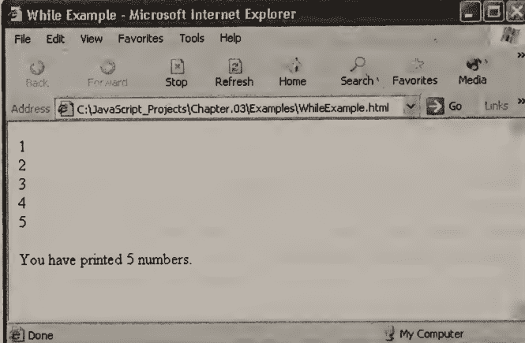

图 3-9 使用自增运算符的 while 语句的输出

你也可以通过递减（减少计数变量的值）来控制 `while` 循环的重复次数。考虑以下脚本：

```javascript
var count = 10;
while (count > 0) {
  document.write(count + "<br />");
  count--;
}
document.write("<p>We have liftoff.</p>");
```

在这个示例中，`count` 变量的初始值为 10，递减运算符（`--`）减少 1。当 `count` 变量大于 0 时，`while` 循环内部的语句打印 `count` 变量的值。当 `count` 的值等于 0 时，`while` 循环结束并执行紧随其后的语句。图 3-10 显示了脚本输出。

改变计数变量的值以及使用变量控制 `while` 循环重复的方法有很多种。接的示例使用了 `*=` 赋值运算符将 `count` 变量的值乘以 2。当 `count` 变量达到 128 时，`while` 语句结束。图 3-11 显示了脚本输出。

```javascript
var count = 1;
while (count <= 100) {
  document.write(count + "<br/>");
  count *= 2;
}
```

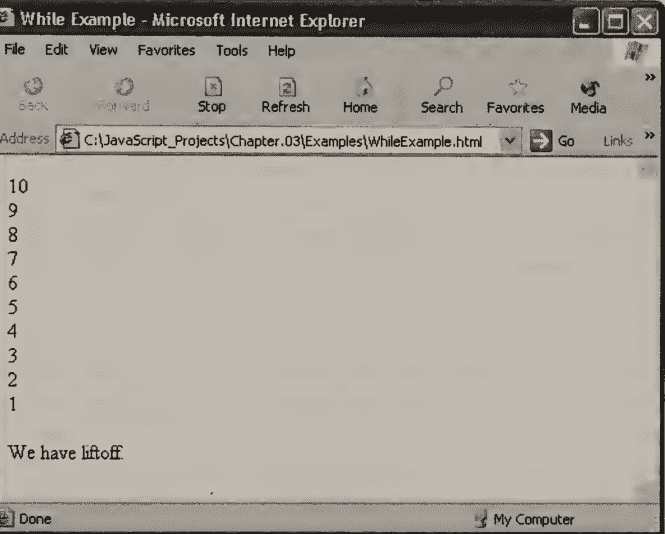

图 3-10 使用递减运算符的 while 语句的输出

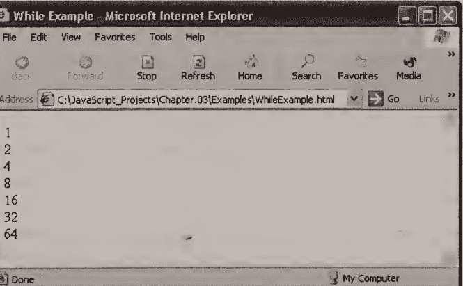

图 3-11 使用 `*=` 赋值运算符的 while 语句的输出

为了确保 `while` 语句最终结束，你必须在 `while` 语句体内部包含一段能够改变条件表达式的值的代码。

例如，你可能有一个打印 0 到 100 之间偶数的 `while` 语句。你可能没有在 `while` 语句体内部包含一个在最后一个偶数（100）打印后结束循环的代码。如果你不包含改变条件表达式所用值的代码，你的程序将陷入**死循环**。在死循环中，循环语句永远不会结束，因为其条件表达式从未为假。考虑以下 `while` 语句：

```javascript
var count = 1;
while (count <= 10) {
  window.alert("The number is " + count);
}
```

虽然前面示例中的语句包含一个检查 `count` 变量值的条件表达式，但 `while` 语句体内部没有改变 `count` 变量的代码。`count` 变量在循环的每次迭代中都将继续保持值为 1。这意味着无论用户点击多少次确定 按钮，包含“the number is 1”文本的警告对话框都会反复出现。

在大多数情况下，你必须强制关闭陷入死循环的 Web 浏览器。关闭方法因操作系统而异。对于 Windows XP，按下 `Ctrl+Alt+Delete` 打开 Windows 任务管理器，点击“应用程序”选项卡，选择包含浏览器名称的任务，点击“结束任务”。对于 Windows 2000，按下 `Ctrl+Alt+Delete`，点击任务管理器打开 Windows 任务管理器，点击“应用程序”选项卡，点击包含浏览器名称的任务，点击“结束任务”。

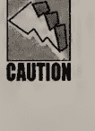

接下来你将创建一个新版本的恐龙测验程序，它由一个包含嵌套 `if` 语句的 `while` 语句进行评分。虽然这个 `while` 语句比你之前创建的 `if`、`if...else` 和 `switch` 语句复杂得多，但它需要的代码行少得多。你还将包含一个在完成后对测验进行评分的得分奖励（程序之前的版本是通过答案对测验评分的）。

要创建一个由 `while` 语句评分的恐龙测验程序版本：

- 回到 `DinosaurQuiz4.html` 文档并立即将其另存为 `DinosaurQuiz5.html`。

- 从 `<head>` 中删除整个 `scoreQuestions()` 函数，并添加以下行创建两个数组 `answers[]` 和 `correctAnswers[]`。`answers[]` 数组将存储每次测验运行时答案，而 `correctAnswers[]` 数组将存储每个问题的正确回答。代码还将将正确回答赋值给 `correctAnswers[]` 数组的每个元素。

```javascript
var answers = new Array(5);
var correctAnswers = new Array(5);
correctAnswers[0] = "b";
correctAnswers[1] = "b";
correctAnswers[2] = "c";
correctAnswers[3] = "d";
correctAnswers[4] = "a";
```

3. 添加以下函数，将每个响应分配给 `answers[]` 数组中的相应元素。程序通过每个单选按钮的 `onclick` 事件将实际题号（1-5）发送给函数。为了将问题响应分配给正确的元素，必须从问题变量中减去题号，因为数组元素从 0 开始。

```javascript
function recordAnswer(question, answer) {
  answers[question-1] = answer;
}
```

4. 添加以下函数定义，用于为测验评分。你将从一个新的 Score 按钮调用此函数。

```javascript
function scoreQuiz() {
}
```

5. 在 `scoreQuiz()` 函数中添加以下语句，声明一个新变量并将其赋予初始值 0。`totalCorrect` 变量存储正确答案的数量。

```javascript
var totalCorrect = 0;
```

6. 在 `scoreQuiz()` 函数末尾添加以下变量声明和 `while` 语句。在此代码中，声明了一个名为 `count` 的计数器并初始化为 0，因为 0 是数组的起始索引。在循环的每次迭代中，语句增加 `count` 变量的值。条件表达式检查 `count` 是否小于 5。

```javascript
var count = 0;
while (count < 5) {
  count++;
}
```

7. 在 `while` 循环开头、增加 `count` 变量的语句上方添加以下 语句。该语句将 `answers[]` 数组中的每个元素与 `correctAnswers[]` 数组中的每个元素进行比较。如果元素匹配，`totalCorrect` 变量加 1。

```javascript
if (answers[count] == correctAnswers[count])
  totalCorrect++;
```

8. 在 `while` 循环之后，添加以下用于警告对话框的代码，显示回答了多少问题：

```javascript
window.alert("You scored " + totalCorrect + " out of 5 answers correctly!");
```

以下代码显示了你的脚本部分应该如下：

```javascript
<script type="text/javascript">
<!-- 隐藏不兼容的浏览器
var answers = new Array(5);
var correctAnswers = new Array(5);
correctAnswers[0] = "b";
correctAnswers[1] = "b";
correctAnswers[2] = "c";
correctAnswers[3] = "d";
correctAnswers[4] = "a";
function recordAnswer(question, answer) {
  answers[question-1] = answer;
}
function scoreQuiz() {
  var totalCorrect = 0;
  var count = 0;
  while (count < 5) {
    if (answers[count] == correctAnswers[count])
      totalCorrect++;
    count++;
  }
  window.alert("You scored " + totalCorrect + " out of 5 answers correctly!");
}
// 结束不兼容浏览器--
</script>
```

9. 在每个单选按钮的 `onclick` 事件处理器中，将调用的函数名称从 `scoreQuestions()` 改为 `recordAnswer()`，并使用与用于 `scoreQuestions()` 函数相同的参数。例如，问题 1 单选按钮的 `onclick` 事件处理器现在应为 `onclick="recordAnswer(1,'b')`。

10. 最后，在 `</form>` 标签之后立即添加以下 `<input>` 元素。该 `<input>` 元素创建一个按钮，其事件处理器调用 `scoreQuiz()` 函数。

```html
<p><input type="button" value="Score" onclick="scoreQuiz();"></p>
```

11. 保存 `DinosaurQuiz5.html` 文档。

12. 启动你的 Web 浏览器并在 W3C 标记验证服务 (validator.w3.org/file-upload.html) 验证 `DinosaurQuiz5.html` 文档。

13. 在 浏览器中打开 `DinosaurQuiz5.html` 文档。回答所有五个问题并点击 Score 按钮来测试程序。图 3-12 显示了程序在 浏览器中的外观。

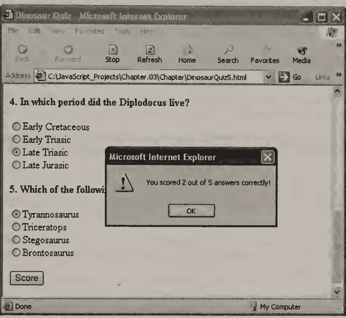

图 3-12 DinosaurQuiz5.html

14. 关闭你的 浏览器窗口和文本编辑器。

## do...while 语句

另一种 JavaScript 循环语句，与 `while` 语句类似，`do...while` 语句执行一次语句或多个语句，然后只要条件表达式求值为真，它就会重复执行。`do...while` 语句的语法如下：

```javascript
do {
  statement(s);
} while (conditional expression);
```

如你在语法描述中所看到的，语句在条件表达式求值之前执行。与更简单的 `while` 语句不同，`do...while` 语句中的语句在条件表达式求值之前总是执行一次。

以下 `do...while` 语句在条件表达式求值变量 `count` 之前执行一次。因此，会打印一行“The count is equal to 2”。在条件表达式 `(count < 2)` 执行后，变量 `count` 等于 2。这导致条件表达式返回假值，随后 `do...while` 语句结束。

```javascript
var count = 2;
do {
  document.write("<p>The count is equal to " + count + "</p>");
  count++;
} while (count < 2);
```

注意，这个 `do...while` 示例在 `do...while` 语句体内包含了一个计数器。与 `while` 语句一样，你需要包含更改 `count` 表达式的代码以防止无限循环。

在接下来的示例中，`while` 语句从不执行，因为变量 `count` 并不在条件表达式的范围内：

```javascript
var count = 2;
while (count > 2) {
  document.write("<p>The count is equal to " + count + "</p>");
  count++;
}
```

以下脚本展示了一个使用数组打印星期几的 `do...while` 语句示例：

```javascript
var daysOfWeek = new Array();
daysOfWeek[0] = "Monday"; daysOfWeek[1] = "Tuesday"
daysOfWeek[2] = "Wednesday"; daysOfWeek[3] = "Thursday"
daysOfWeek[4] = "Friday"; daysOfWeek[5] = "Saturday";
var count = 0;
do {
  document.write(daysOfWeek[count] + "<br />");
  count++;
} while (count < 7);
```

在前面的示例中，创建了一个包含星期几的数组。声明了一个名为 `count` 的变量并将其初始化为零。（记住，数组的第一个下标或索引为 0）。因此，在示例中 `daysOfWeek[0]` 指向 Monday。`do...while` 语句的第一次迭代打印“Monday”，然后将变量 `count` 增加 1。`while` 语句中的条件表达式检查何时打印完数组的最后一个元素。只要 `count` 小于 7（这比 `daysOfWeek[]` 数组中最大的元素大 1），循环就会继续。图 3-13 显示了脚本在 浏览器中的输出：

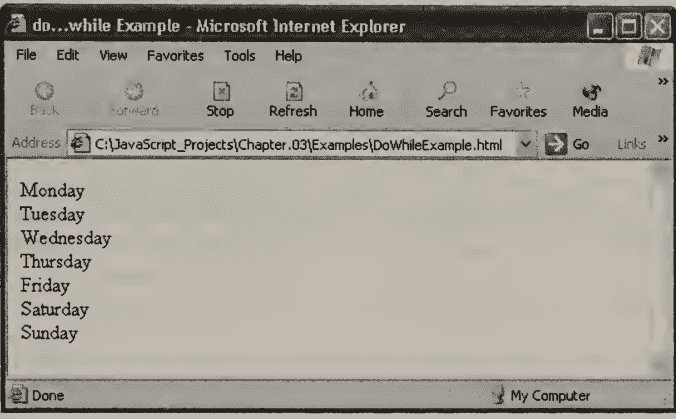

图 3-13 浏览器中的星期几程序

接下来，我们把把 Dinosaur Quiz 程序中的 `while` 语句替换为 `do...while` 语句。

要将 Dinosaur Quiz 程序中的 `while` 语句替换为 `do...while` 语句：

- 返回 `DinosaurQuiz5.html` 文档并立即将其另存为 `DinosaurQuiz6.html`。

- 将 `scoreQuiz()` 函数内部的 `while` 语句更改如下 `do...while` 语句：

- 保存 `DinosaurQuiz6.html` 文档。

- 启动你的 浏览器，并在 validator.w3.org/file-upload.html 使用 W3C Markup 验证服务验证 `DinosaurQuiz6.html`。

- 在 浏览器中打开 `DinosaurQuiz6.html` 文档。程序的功能应该与之前使用嵌套 `while` 语句时一样。

- 关闭你的 浏览器窗口。

```javascript
do {
    if (answers[count] == correctAnswers[count])
        ++totalCorrect;
    ++count;
} while (count < 5);
```

## for 语句

到目前，你已经学习了如何使用 `while` 和 `do...while` 语句来重复或循环执行代码。你也可以使用 `for` 语句循环执行代码。

`for` 语句用于在给定的条件表达式求值为真时重复执行语句或或系列语句。`for` 语句执行的功能与 `while` 语句本质相同：如果 `for` 语句内的条件表达式求值为真，则 `for` 语句执行并继续重复执行，直到条件表达式失败。

`while` 语句与 `for` 语句之间的主要区别之一是，除了条件表达式外，`for` 语句还可以包含初始化计数器并在每次迭代时更改其值的代码。这非常有用，因为它提供了一个特殊的地方来声明和初始化计数器，并更新其值，这有助于防止无限循环。`for` 语句的语法如下：

```javascript
for (counter declaration and initialization; condition;
    statement(s);
}
```

当 JavaScript 解释器遇到循环时，会发生以下步骤：

1. 计数器变量被声明并初始化。例如，如果初始化表达式在 `for` 循环中为 `var count = 1;`，则声明变量 `count` 并分配初始值 1。初始化表达式只在第一次遇到 `for` 循环时启动一次。

2. 求值 `for` 循环条件。

3. 如果步骤 2 中的条件求值返回真值，则执行 `for` 循环语句，发生步骤 4，然后从步骤 2 重新开始。如果步骤 2 中的条件求值返回假值，则 `for` 语句结束并执行下一个语句。

4. 执行 `for` 语句中的更新语句。例如，`count` 变量增加。

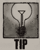

> 可以省略 `for` 语句的任何部分，但必须包含分隔每个部分的的分号。如果你省略了某部分，请确保在体内部包含结束循环的代码，否则程序可能会陷入无限循环。

以下脚本展示了一个使用数组打印内容的 `for` 语句示例：

```javascript
var fastFoods = new Array();
fastFoods[0] = "pizza"; fastFoods[1] = "burgers";
fastFoods[2] = "french fries"; fastFoods[3] = "tacos";
fastFoods[4];
for (var count = 0; count < 5; count++) {
    document.write(fastFoods[count] + "<br/>");
}
```

正如在该示例所示，计数器在括号内初始化、求值并增加。你不需要在 `for` 语句之前为 `count` 变量，也不需要在 `for` 语句体内增加 `count` 变量。图 3-14 显示了脚本的输出。

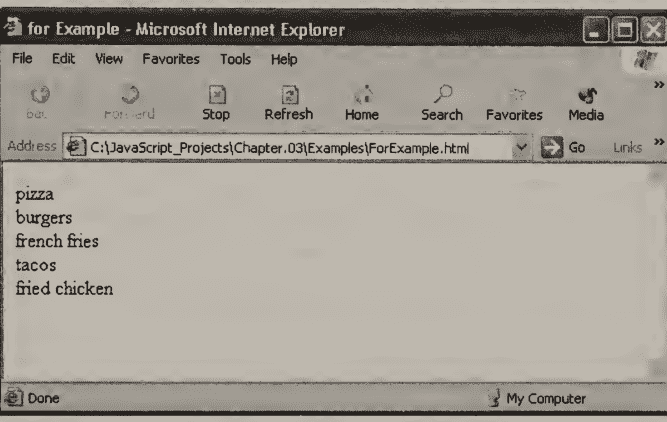

**图 3-14** 程序输出

使用 `for` 语句更高效，因为不需要那么多的代码。考虑以下 `while` 语句：

```javascript
var count = 1;
while (count <= 5) {
    document.write(count + "<br />");
    ++count;
}
```

你可以通过以下 `for` 语句更高效地实现相同的流程：

```javascript
for (var count = 1; count <= 5; ++count) {
    document.write(count + "<br />");
}
```

然而，某些情况下使用 `while` 语句比使用 `for` 语句更好，特别是对于需要声明、初始化或更新计数器变量的循环语句。以下代码依赖于确认对话框返回的布尔值，而不是计数器来控制程序。

```javascript
var i = true;
while (i == true) {
    i = window.confirm(
        "你想再次显示这个对话框吗？");
}
```

`window.confirm()` 方法；值为 `true` 将导致循环迭代，而值为 `false` 则将导致循环退出。因此，这段代码使用 `while` 语句编写会更好。如果你在前面的示例中使用 `for` 语句代替 `while` 语句，则你必须在 `for` 语句中包含更新部分。你还必须记住保留分隔条件语句的分号。如果你包含了更新部分，可能会创建一个无限循环。

以下代码展示了我们之前看到的“星期几”脚本的示例。但是，这次脚本使用了 `for` 语句代替 `do...while` 语句。注意变量 `count` 的声明、条件表达式以及递增 `count` 变量的语句现在都全部包含在 `for` 语句中。使用 `for` 语句代替 `do...while` 语句在某种程度上简化了脚本，因为你不需要那么多行代码。

```javascript
var daysOfWeek = new Array();
daysOfWeek[0] = "Monday"; daysOfWeek[1] = "Tuesday";
daysOfWeek[2] = "Wednesday"; daysOfWeek[3] = "Thursday";
daysOfWeek[4] = "Friday"; daysOfWeek[5] = "Saturday";
daysOfWeek[6] = "Sunday";
for (var count = 0; count < 7; ++count) {
  document.write(daysOfWeek[count] + "<br/>");
}
```

接下来，你将创建一个使用 `for` 语句代替 `do...while` 语句的恐龙测验最终版本。

要用 `for` 语句替换恐龙测试程序中的 `do...while` 语句：

- 返回 `DinosaurQuiz6.html` 文档并立即将其另存为 `DinosaurQuiz7.html`。

- 删除 `scoreQuiz()` 函数内部对变量 `count` 的声明。

- 将 `scoreQuiz()` 函数内的 `do...while` 语句更改为以下 `for` 语句：

```javascript
for (var count = 0; count < 5; ++count) {
  if (answers[count] == correctAnswers[count]) {
    ++totalCorrect;
  }
}
```

- 保存 `DinosaurQuiz7.html` 文档。

- 启动你的 Web 浏览器并在 validator.w3.org/file-upload.html 使用 W3C 标记验证服务验证 `DinosaurQuiz7.html` 文档。

- 6. 在 Web 浏览器中打开 `DinosaurQuiz7.html` 文档。程序语句的功能与使用嵌套的 `do...while` 语句时相同。

- 7. 关闭你的 Web 浏览器窗口和文本编辑器。

## continue 语句

当你学习 `switch` 语句时，你学习了如何使用 `break` 语句退出 `switch`、`while`、`do...while` 和 `for` 语句。另一种仅用于循环语句的语句——`continue` 语句，会停止循环语句并从新的迭代重启循环。当你想要停止当前迭代的循环但让循环继续进行新迭代时，就会使用 `continue` 语句。例如，你可能会编写一个使用 `for` 语句循环遍历包含股票列表的数组元素的脚本。对于价值超过 10 美元的股票，你会在屏幕上打印购买价格、股数等信息。然而，对于价值低于 10 美元的股票，你使用 `continue` 语句跳过该股票并进入新的迭代。以下脚本显示了一个包含 `break` 语句的 `for` 循环：

```javascript
for (var count = 1; count <= 5; ++count) {
    if (count == 3) {
        break;
        document.write("<p>" + count + "</p>");
    }
}
```

上述代码包含一个检查变量当前值是否等于 3 的 `if` 语句。当变量 `count` 等 3 时，`break` 语句立即结束 `for` 循环并显示图 3-15 所示的输出。

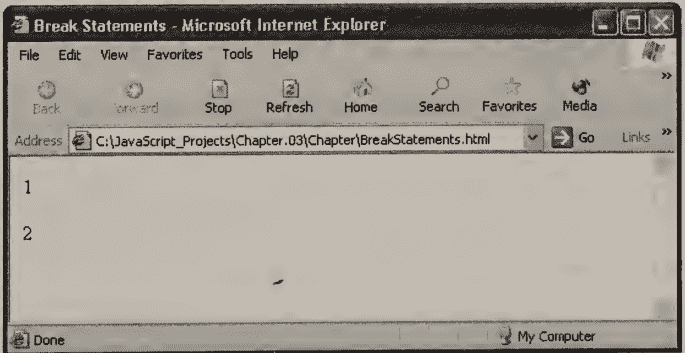

图 3-15 带有 break 语句的 for 循环的输出

以下代码显示了相同的 `for` 循环，但使用了 `continue` 语句：

```javascript
for (var count = 1; count<=5; ++count) {
  if (count == 3) {
    continue;
  }
  document.write("<p>" + count + "</p>");
}
```

在上述代码中，当变量 `count` 等于 3 时，`continue` 语句同样停止 `for` 循环的当前迭代，脚本跳过了数字 3。然而，`for` 循环继续迭代，直到条件表达式 `count <= 5` 为假。图 3-16 显示了 Web 浏览器中的输出。

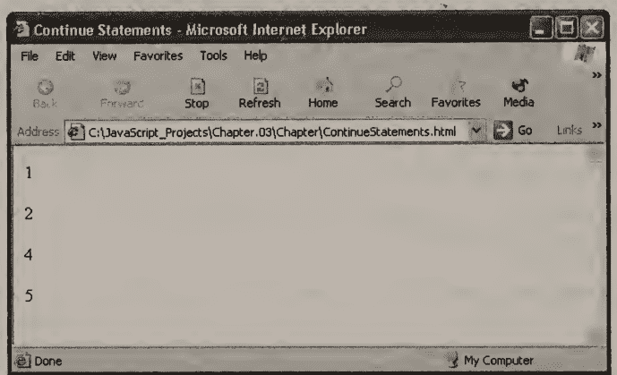

图 3-16 带有 continue 语句的 for 循环的输出

## 章节总结

- 在 JavaScript 编程中，你可以编写自己的过程，称为函数，它们与对象关联的方法相似。

- “变量作用域”一术是指声明的变量在程序的哪个位置可以使用。全局变量是在函数外部声明的变量，对程序的所有部分可用。局部变量是在函数内部声明的，仅在其声明的函数内部可用。

- 事件是一种特定的情况（例如，用户执行的操作或浏览器执行的操作），由 JavaScript 监控，你的脚本可以以某种方式做出响应。

- 响应特定事件执行的代码被称为事件处理器。

- `if` 语句用于根据条件执行特定的代码块。

- `switch` 语句根据特定值执行语句。

- `break` 语句用于退出 `switch`、`while`、`do...while` 和 `for` 语句。

- `do...while` 语句至少执行一次，然后只要条件表达式为真就重复执行。

- `while` 语句在条件表达式为真时重复执行语句。

- 循环的每次重复执行被称为迭代。

- `continue` 语句停止循环语句并从新的迭代重启循环。

- 无限循环是指循环条件表达式永远为真的情况。

- `for` 语句用于执行特定次数的语句。

## 习题

- 1. 一个(n)允许将一组相关的 JavaScript 命令视为一个单元。

  a. 语句

  b. 变量

  c. 函数

  d. 事件

- 2. 函数必须包含参数。是或否？

- 3. 说明如何使用 `return` 语句向调用它的函数返回值。

- 4. 在函数外部声明的变量被称为(n)变量。

  a. 局部

  b. 类

  c. 程序

  d. 全局

- 5. 局部变量必须在

  a. 函数之前

  b. 函数之后

  c. 函数定义的大括号内

  d. 使用 local 关键字

- 6. 声明局部变量时必须使用 `var` 关键字。是或否？

- 7. 哪些是内置函数？（选择所有适用项）

  a. `parseFloat()`

  b. `parseNum()`

  c. `encodeURI()`

  d. `encodeURL()`

- 8. JavaScript 监控的所有事件必须由用户的操作触发。是或否？

- 9. 该事件在 HTML 文档在 Web 浏览器中加载完成后发生。

  a. `load`

  b. `complete`

  c. `display`

  d. `click`

- 10. 以下哪项是正确的？

  a. `onclick="window.alert('You clicked a button!');"`,

  b. `onclick="window.alert('You clicked a button!');"`,

  c. `onclick="window.alert(You clicked a button!);"`,

  d. `onclick="window.alert('You clicked a button!');"`,

- 11. 以下何种是 `if` 语句的正确语法？

  a. `if (myVariable == 10); window.alert("Your variable is equal to 10.");`

  b. `if myVariable == 10 window.alert("Your variable is equal to 10.");`

  c. `if (myVariable == 10) window.alert("Your variable is equal to 10.");`

  d. `if (myVariable == 10), window.alert("Your variable is equal to 10.");`

12. `if` 语句可以包含多个语句，只要这些语句：

- a. 在 `if` 语句的结束分号后执行

- b. 不包含在命令块中

- c. 不包含其他的 `if` 语句

- d. 包含在命令块中

13. 解释如何构造带有 `else` 子句的 `if` 语句：

14. `else` 子句的正确语法是哪个？

- a. `else (document.write("Printed from an else clause."));`

- b. `document.write("Printed from an else clause.");`

- c. `else "document.write("Printed from an else clause.")";`

- d. `else; document.write("Printed from an else clause.");`

15. `switch` 语句通过执行特定的语句集来控制程序流，取决于：

- a. `an...else` 语句的结果

- b. 从函数内部执行的 JavaScript 版本

- c. `if` 语句是否执行条件表达式

- d. 条件结构返回的值。条件结构不能嵌套。真或假？

16. 决策结构

17. 当 `switch` 语句表达式返回的值与 `case` 标签不匹配时，则执行标签内的语句。

- a. `exception` (异常)

- b. `else`

- c. `error` (错误)

- d. `default` (默认)

18. 你可以使用某种语句退出 `switch` 语句。

- a. `break`

- b. `end`

- c. `quit`

- d. `complete`

19. 循环语句的每次重复被称为 ______________________。

- a. 递归 (recurrence)

- b. 迭代 (iteration)

- c. 重复 (duplication)

- d. 重执行 (reexecution)

20. 下列哪项是 `while` 语句的正确语法？

- a. `while (i <= 5, ++i) { document.write(i); }`

- b. `while (i <= 5) { document.write(i); ++i; }`

- c. `while (i <= 5); { document.write(i); ++i; }`

- d. `while (i <= 5; document.write(i)) { ++i; }`

21. 计数器变量 ______________________（选择所有适用）。

- a. 只能递增

- b. 只能递减

- c. 可以使用任何条件表达式进行更改

- d. 不改变

22. 解释无限循环是如何产生的。

23. 下列哪项是 `do...while` 语句的正确语法？

- a. `do while (i < 10) { window.alert("Printed from a do...while loop."); }`

- b. `do while (i < 10) { window.alert("Printed from a do...while loop."); }`

- c. `do { window.alert("Printed from a do...while loop."); while (i < 10) }`

- d. `do { window.alert("Printed from a do...while loop."); } while (i < 10);`

24. 下列哪项是 `for` 语句的正确语法？

- a. `for (var i = ; i < 10; ++i) window.alert("Printed from a for statement.");`

- b. `for (var i = 0, i < 10, ++i) window.alert("Printed from a for statement.");`

- c. `for { window.alert("Printed from a for statement."); } while (var i = 0; i < 10; ++i)`

- d. `for (var i = 0; i < 10); window.alert("Printed from a for statement."); ++i;`

25. `for` 语句的初始化表达式何时执行？

- a. 当 `for` 语句开始执行时

- b. 在 `for` 变量递增的每次重复时

- c. 当 `for` 语句结束时

26. `continue` 语句强制 JavaScript 忽略循环语句中的下一语句，然后继续执行循环中的剩余语句。真或假？

## 动手实践项目

## 项目 3-1

在这个项目中，你将创建一个带有返回字符串值的函数的脚本。

1. 创建一个 `<DOCTYPE>` 声明、`<html>` 元素、文档头（head）和 `<body>` 元素。使用 Strict DTD，并将“Company Name”作为 `<title>` 元素的内容。

2. 在头部部分创建一个脚本，其中包含以下 `getCompanyName()` 函数：

```javascript
<script type="text/javascript">
<!-- 针对兼容性不佳的浏览器 隐藏此内容 -->
function getCompanyName() {
  var companyName = "Course Technology";
  // 停止向兼容性不佳的浏览器显示内容 ---
}
</script>
```

4. 修改 `getCompanyName()` 函数，将公司名称返回给另一个调用函数。


5. 在 `getCompanyName()` 函数定义之后添加语句，调用 `getCompanyName()` 函数并将返回值赋值给名为 `returnValue` 的变量。

6. 最后，编写代码打印 `retValue` 变量的内容。

7. 将文档保存为 `CompanyName.html`，并存放在第 3 章的项目文件夹中，同时使用 W3C 标记验证服务进行验证。

8. 在 浏览器中打开 `CompanyName.html` 文档。

9. 关闭 浏览器。


## 项目 3-2

在这个项目中，你将创建一个使用函数打印你个人信息的脚本。

1. 在你的文本编辑器中创建一个新文档。

2. 输入 `<!DOCTYPE>` 声明、`<html>` 元素、文档头（head）和 `<body>` 元素。使用 Strict DTD，并将“Personal Information”作为 `<title>` 元素的内容。

3. 在文档头部创建一个脚本部分。

4. 在脚本部分添加一个名为 `printPersonalInfo()` 的函数。在 `printPersonalInfo()` 函数内部，使用 `document.write()` 方法打印你的姓名、地址、出生日期和社会安全号。

5. 在文档主体（body）中添加一个脚本部分，调用 `print()` 函数。

6. 将文档保存为 `PersonalInfo.html`，并存放在第 3 章的项目文件夹中，同时使用 W3C 标记验证服务进行验证。

7. 在 浏览器中打开 `PersonalInfo.html` 文档。

8. 关闭 浏览器。


## 项目 3-3

在这个项目中，你将修正一个简单程序中的错误。

1. 在你的文本编辑器中创建一个新文档。

2. 输入 `<!DOCTYPE>` 声明、`<html>` 元素、文档头（head）和 `<body>` 元素。使用 Strict DTD，并将“Sample Script”作为 `<title>` 元素的内容。

3. 在文档头部创建一个脚本部分，包含以下语句：

```javascript
<script type="text/javascript">
<!-- 针对兼容性不佳的浏览器 隐藏此内容 -->
document.write(sampleScript());
```

4. 在文档中创建一个脚本部分，包含以下 `sampleScript()` 函数：

```javascript
<script type="text/javascript">
<!-- 针对兼容性不佳的浏览器 隐藏此内容 -->
function sampleScript() {
  return "<p>This line is returned from the sampleScript>";
}
</script>
```

5. 你在上一步中输入的代码应该打印出一条内容为“This line is returned from the script.”的语句。然而，代码实际上包含一个设计错误，当你尝试在浏览器中打开程序会生成错误消息。修正错误并确保程序在浏览器中成功运行（提示：问题与脚本部分的位置有关）。

6. 将文档保存为 `ScriptErrors.html`，并存放在第 3 章的项目文件夹中，同时使用 W3C 标记验证服务进行验证。

7. 在 浏览器中打开 `ScriptErrors.html` 文档。

## 项目 3-4

在这个项目中，你将创建一个带有命令块 `if` 语句的简单文档头。

1. 在你的文本编辑器中创建一个新文档。

2. 输入 `<DOCTYPE>` 声明、`<html>` 元素、文档头（head）和 `<body>` 元素。使用 Strict DTD，并将“Command Block”作为 `<title>` 元素的内容。

3. 在文档中创建一个脚本部分，包含以下 `if` 语句：

```javascript
<script type="text/javascript">
<!-- 针对兼容性不佳的浏览器 隐藏此内容 -->
var boolValue = true;
if (boolValue == true)
  document.write("<p>The condition is equal to 'true'</p>");
</script>
```

4. 修改你在上一步中添加的 `if` 语句，使其能够多个语句。


5. 在打印 `boolValue` 变量值的语句后添加第二条语句。

6. 将文档保存为 `CommandBlock.html` 位于第3章的 Projects 文件夹中，并使用 W3C 标记验证服务对其进行验证。

7. 在网络浏览器中打开 `CommandBlock.html` 文档。

8. 关闭网络浏览器窗口。


## 项目 3-5

在这个项目中，你将创建一个包含条件运算符的简单文档，并将其重写为 `if...else` 语句。

1. 在你的文本编辑器中创建一个新文档。

2. 输入 `<DOCTYPE>` 声明、`<html>` 元素、文档头部（head）和 `<body>` 元素。使用 Strict DTD，并将“Conditional Script”作为 `<title>` 元素的内容。

3. 在文档头部中创建一个脚本部分，包含以下代码，但将条件表达式语句替换为 `if...else` 语句：

```javascript
<script type="text/javascript">
<!-- HIDE FROM INCOMPATIBLE BROWERS
var intVariable = 75;
var result;
(intVariable > 100) ? result = "variable is greater than 100"
: result = "variable is less than or equal to 100";
document.write(result);
// HIDING FROM INCOMPATIBLE BROWERS --
</script>
```

4. 将文档保存为 `ConditionalScript.html` 位于第3章的 Projects 文件夹中，并使用 W3C 标记验证服务对其进行验证。

5. 在网络浏览器中打开 `ConditionalScript.html` 文档。

6. 关闭网络浏览器窗口。


## 项目 3-6

在这个项目中，你将识别并修复 `if` 语句中的逻辑缺陷。

1. 在你的文本编辑器中创建一个新文档。

2. 输入 `<DOCTYPE>` 声明、`<html>` 元素、文档头部（head）和 `<body>` 元素。使用 Strict DTD，并将“Logic Flaws”作为 `<title>` 元素的内容。

3. 在文档头部中创建一个脚本部分，包含以下代码，但识别并修复 `if` 语句中的逻辑缺陷：

```javascript
<script type="text/javascript">
<!-- HIDE FROM INCOMPATIBLE BROWERS
var num = 100;
if (num >= 100)
  document.write("<p>The variable is greater than ");
  document.write("or equal to '100'.</p>");
// STOP HIDING FROM INCOMPATIBLE BROWSERS -->
</script>
```

4. 将文档保存为 `LogicFlaws.html` 位于第3章的 Projects 文件夹中，并使用 W3C 标记验证服务对其进行验证。

5. 在网络浏览器中打开 `LogicFlaws.html` 文档。

6. 关闭网络浏览器窗口。

## 项目 3-7

在这个项目中，你将编写一条语句，在屏幕上打印 1 到 100 之间的所有奇数。

1. 创建一个新的 `<!DOCTYPE>` 声明、`<html>` 元素、文档头部（head）和 `<body>` 元素。使用 Strict DTD并将“Odd Numbers”作为 `<title>` 元素的内容。

2. 创建一个带有 `while` 语句的脚本，在屏幕上打印 1 到 100 之间的所有奇数。

3. 将文档保存为 `OddNumbers.html` 位于第3章的 Projects 文件夹中，并使用 W3C 标记验证服务对其进行验证。

4. 在网络浏览器中打开 `OddNumbers.html` 文档。

5. 关闭网络浏览器窗口。

## 项目 3-8

在这个项目中，你将识别并修复 `while` 语句中的逻辑缺陷。

1. 在你的文本编辑器中创建一个新文档。

2. 输入 `<!DOCTYPE>` 声明、`<html>` 元素、文档头部（head）和 `<body>` 元素。使用 Strict DTD并将“While Logic”作为 `<title>` 元素的内容。

3. 在文档头部中创建一个脚本，包含以下代码：

```javascript
<script type="text/javascript">
<!-- HIDE FROM INCOMPATIBLE BROWERS -->
var count = 0;
var numbers = new Array(100);
while (count < 100) {
  numbers[count] = count;
  ++count;
}
while (count > 100) {
  document.write(numbers[count]);
  ++count;
}
// HIDING FROM INCOMPATIBLE BROWERS --
</script>
```

4. 你在上一步中输入的代码应该用 1 到 100 填充数组，然后将其打印到屏幕上。然而，代码包含了几个逻辑缺陷，导致无法正常运行。识别并修复这些逻辑缺陷。

5. 将文档保存为 `While.html` 位于第3章的 Projects 文件夹中，并使用 W3C 标记验证服务对其进行验证。

6. 在网络浏览器中打开 `While.html` 文档。

7. 关闭浏览器窗口。


## 项目 3-9

在这个项目中，你将创建一个简单的表单，显示字母等级的值。

1. 在你的文本编辑器中创建一个新文档。

2. 输入 `<!DOCTYPE>` 声明、`<html>` 元素、文档头部（head）和 `<body>` 元素。使用 Transitional DTD并将“Letter Grades”作为 `<title>` 元素的内容。

3. 在文档头部中创建一个脚本部分，包含以下 `checkGrade()` 函数和 `switch` 语句：

```javascript
<script type="text/javascript">
<!-- HIDE FROM INCOMPATIBLE BROWERS
function checkGrade(grade) {
  switch (grade) {
    case "A":
      window.alert("Your grade is excellent.");
    case "B":
      window.alert("Your grade is good.");
    case "C":
      window.alert("Your grade is fair.");
    case "D":
      window.alert("You are barely passing.");
    case "F":
      window.alert("You failed.");
  }
}
// HIDING FROM INCOMPATIBLE BROWERS --
</script>
```

4. 修改 `switch` 语句，使其显示默认值“You did not enter a valid grade”。

5. 在 body 中添加以下表单，包含一个调用 `checkGrade()` 的处理器。值传递给 `checkGrade()` 函数：

```html
<form name="gradeForm">
  <input type="text" name="grade">
  <input type="button" value="Check" onclick="checkGrade(gradeForm.grade.value)">
</form>
```

7. 将文档保存为 `LetterGrades.html` 位于第3章的 Projects 文件夹中，并使用 W3C 标记验证服务对其进行验证。

8. 在网络浏览器中打开 `LetterGrades.html` 文档并进行测试。

9. 关闭浏览器窗口。


## 项目 3-10

在这个项目中，你将识别并修复 `if` 语句中的逻辑缺陷。

1. 创建一个新的 `<!DOCTYPE>` 声明、`<html>` 元素、文档头部（head）和 `<body>` 元素。使用 Strict DTD并将“Gas Prices”作为 `<title>` 元素的内容。

2. 在文档头部中创建一个脚本部分，包含以下代码：

3. 在文档头部中创建一个脚本部分，包含以下 `switch` 语句：

4. 你在上一步中输入的代码应该用 1 到 100 填充数组，然后将其打印到屏幕上。然而，代码包含了几个导致无法运行的逻辑缺陷。识别并修复这些逻辑缺陷。

5. 将文档保存为 `GasPrices.html` 位于第3章的 Projects 文件夹中，并使用 W3C 标记验证服务对其进行验证。

```javascript
<script type="text/javascript">
<!-- HIDE FROM INCOMPATIBLE BROWERS
var gasPrice = 1.5;
if (gasPrice > 1) {
  document.write("<p>Gas prices are between $1.00 and $2.00.</p>");
}
// STOP HIDING FROM INCOMPATIBLE BROWSERS -->
</script>
```

6. 在网络浏览器中打开 `GasPrices.html` 文档。

7. 关闭浏览器窗口。

## 案例项目

将你创建的文档保存到第3章的 Cases 文件夹。（等等，文字说是“第 3文件夹”）。

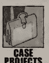

## 案例项目 3-1

创建一个脚本，根据工作时间和时薪计算员工的周总薪。使用带有两个文本框的表单。将超过40小时的任何小时按倍半计算。使用适当的决策结构创建程序。将文档保存为 `Paycheck.html`。

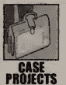

## 案例项目 3-2

编写一个脚本计算10,000美元投资的15%回报。计算单笔10,000美元投资在年收益15%的情况下达到1,000,000美元所需的年份。使用循环语句并假设每次迭代等同于一年。将文档保存为 `Investment.html`。

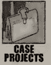

## 案例项目 3-3

使用适当的循环语句编写脚本，打印0度华氏到100度华氏的摄氏等值列表。将华氏转换为摄氏，从华氏温度减去32，然后将余数乘以.55。要将摄氏转换为华氏，将摄氏温度乘以1.8并加上32。将文档保存为 `TempConversion.html`。

## 案例项目 3-4

创建一个脚本计算覆盖房间所需的平方英尺毯。包含三个文本框。创建一个房间宽度（英尺）的框，另一个房间长度（英尺）的框。还创建一个每平方英尺地毯成本的文本框。计算成本时，将总平方英尺增加25%以考虑衣柜和其他房间特征。在警告对话框中显示总成本。将文档保存为 `CarpetCost.html`。

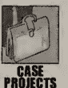

## 案例项目 3-5

编写一个脚本，允许用户在文本框中输入分位数。确定这些分值相当于多少美元，并将金额和剩余分值显示在警告对话框中。将文档保存为 `CentsToDollars.html`。

## 案例项目 3-6

你可以通过测试年份是否能被 4 整除来判断其是否为闰年。然而，被 100 整除的年份不是闰年，除非它们也能被 400 整除，在这种则是闰年。编写一个脚本，允许用户输入年份，然后确定输入的年份是否为闰年。包含一个带有文本框的表单，用户可以在其中输入年份。使用对话框告知用户输入的年份是普通年还是闰年。将文档保存为 `LeapYear.html`。

## 案例项目 3-7

三角形的任意两边必须大于第三边的长度，这些线段才能组成三角形。例如，8、6 和 12 可以组成三角形，因为三条线段中任意两条之和大于第三条线段。然而，25、5 和 15 不能组成三角形，因为线段 5 和 15 之和不大于线段 25 的长度。使用此逻辑，编写一个脚本允许用户输入三个整数作为三角形的每条边。在表单中创建三个文本框以收集用户的线段长度。你需要使用 JavaScript 内置的 `parseInt()` 函数将表单文本框中的字符串字量转换为整数。使用对话框告知用户线段是否可以组成三角形。将文档保存为 `Triangle.html`。

## 案例项目 3-8

编写一个脚本允许用户输入一个 1 到 999 之间的数字。确定该数字是否为质数，并在对话框中显示结果。包含一个带有单个文本框的表单，用户可以在其中输入数字。质数是只能被自身或 1 整除的数字。质数的示例包括 1、3、5、13 和 17。你需要使用循环语句来测试所有的除法可能性。将文档保存为 `PrimeNumbers.html`。

# 第 4 章

# 浏览器对象模型

在本章中，你将：

- 学习浏览器对象模型

- 学习 Window 对象

- 学习 History、Location 和 Navigator 对象

- 使用 JavaScript 引用窗口和框架（frames）

在某些情况下，你可能想要使用 JavaScript 控制 浏览器。例如，你可能想更改正在显示的 Web 页面，或向 浏览器的状态栏写入信息。或者，你可能想控制网页本身的元素。要控制浏览器窗口或网页页面，你需要使用浏览器对象模型。本章将讨论浏览器对象模型的组件。

# 深入浏览器对象模型

**浏览器对象模型（BOM）或客户端对象模型**是一个对象的层级结构，每个对象都提供对浏览器窗口或网页页面不同层面的程序化访问。你可以使用浏览器对象模型中对象的方法和属性来操作 Web 浏览器中显示的窗口、框架和元素。浏览器对象模型中最基础的对象如图 4–1 所示。

**图 4-1** 浏览器对象模型

> 提示：浏览器对象模型也被称为 JavaScript 对象模型或 Navigator 对象模型。然而，其他的脚本技术（如 VBScript）也可以控制浏览器窗口或网页的某些。因此，“浏览器对象模型”或“客户端对象模型”这些术语更为准确。

# 理解浏览器对象模型 169

对象模型的概念相当复杂。为了在 JavaScript 中使用浏览器对象模型，你并不需要理解操作对象模型的详细细节。相反，你只需要理解对象模型定义了一组相互相关的对象。

你不需要显式地创建浏览器模型中的任何对象或数组；当 Web 浏览器打开一个网页时，这些对象会自动创建。浏览器模型中的顶层对象是 Window 对象，它代表一个浏览器窗口或窗口内的单个框架。Web 浏览器会自动为你创建 Window 对象。Window 对象被称为全局对象，因为浏览器模型中的所有其他对象都包含在其中。例如，Window 对象包含 Document 对象，就像 Web 浏览器包含一个网页文档一样。你使用 Window 对象的方法和属性来控制浏览器窗口，而使用 Document 对象的方法和属性来控制网页。图 4–2 描述了 Window 对象和 Document 对象的概念。

由 Window 对象表示的浏览器窗口

由 Document 对象表示的网页

**图 4-2** Window 对象和 Document 对象

## Document 对象

Document 对象无疑是浏览器模型中最重要的对象，因为它代表了浏览器中显示的网页。你熟悉的 `write()` 和 `writeln()` 方法引用的就是 Document 对象。`document.write("Welcome to my Web page")` 语句在 浏览器渲染时会将“Welcome to my Web page”添加到网页中。网页上的所有元素都包含在 Document 对象中，每个元素在 JavaScript 中由其自己的对象表示。因此，Document 对象包含了你在网页上创建的所有元素。例如，JavaScript 用于表示用 `<form>` 元素创建的表单的 Form 对象包含在 Document 对象中，而 Document 对象又包含在 Window 对象中。JavaScript 用于表示用 `<input>` 元素创建的单选按钮的 Radio 对象包含在 Form 对象中，包含在 Document 对象中，包含在 Window 对象中。

浏览器对象模型的 Document 分支由其自己的对象表示，称为 Document 对象模型，或 DOM。你将在第 7 章学习更多关于 DOM 的知识。

在书中，浏览器对象模型中的对象首字母大写表示（Document 对象）。然而，在代码中使用对象名称时，必须始终使用小字母。例如，在 `document.write("Welcome to my Web page")` 语句中，“document”单词（小写 d）代表 Document 对象。

# 引用 JavaScript 对象

浏览器对象模型中的某些对象代表数组。在图 4-1 中，作为数组的对象后面跟着中括号，如 `frame[]`、`forms[]` 和 `images[]`。数组包含由网页上相应元素创建的对象。例如，`images[]` 数组包含代表网页上所有 `` 元素的 Image 对象。每个 `` 元素的 Image 对象按照它们在网页上出现的顺序分配到 `images[]` 数组中。第一个 Image 对象由 `images[0]` 表示，依此类推。

在代码中引用 JavaScript 对象时，必须引用包含它的所有对象，并用点分隔名称。考虑一个 Image 对象，它包含一个 `src` 属性，该属性包含分配给 `` 元素 `src` 属性的 URL。要引用 Image 对象的 `src` 属性，必须包含 Document 对象。以下 `` 元素包含一个 `onclick` 处理程序，该程序在对话框中处理 Document 对象：

```html

```

接下来，你将开始为一个名为“Central Valley Zoo”的动物园创建一个简单的网站。你将在第 4 章文件夹中找到重写的网页：`CentralValleyZoo.html`、`koala.html`、`manatee.html`、`panda.html`、`polarbear.html` 和 `rhino.html`。`CentralValleyZoo.html` 是首页，其余的显示不同动物的照片和信息。你将在整个章节中修改这些网页。

# 理解浏览器对象模型 171

在本次练习中，你将为中央动物园主页添加一个广告，该广告会在用户点击图像时发生变化。你将使用 `images[]` 数组来更改图像。

要在 CentralValley Zoo 主页添加一个在用户点击图像时会更改的广告：

1. 打开你的文本编辑器，然后打开位于第 4 章文件夹中的 `CentralValleyZoo.html` 文档。

2. 紧跟 `<body>` 标签之后的是一个包含两个单元格的行的标签。第一个单元格包含两个标题元素，第二个单元格包含一个不换行空格字符实体 `&nbsp;`。将该不换行空格字符实体替换为以下 `` 元素`<br>` 和文本。`` 元素显示名为 `safari1.gif` 的图像。当用户点击图像时，`onclick` 事件处理程序会将图像更改为另一个图像 `safari2.gif`。


# 第 4 章 浏览器对象模型

```html
<br />
```

（点击图像查看答案。）

- 3. 保存 `CentralValleyZoo.html` 文档并在 Web 浏览器中打开它。图 4-3 显示了网页的样式。点击图像以确保它更改为 `safari2.gif`。

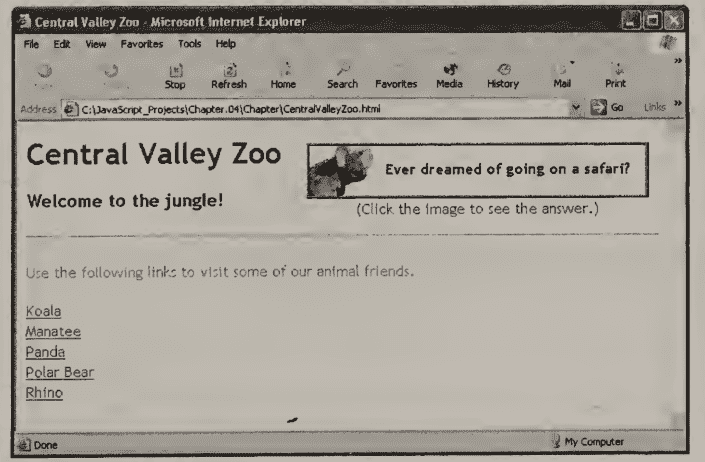

图 4-3 带有广告的中央动物园网页

- 4. 关闭你的 Web 浏览器。

你在上一个练习中输入的代码引用了 `images[]` 数组中的第一个元素 (0)，这假设图像是页面上的第一张图像。如果在前述语句之前网页上添加了其他图像，那么引用 `images[]` 数组中的第一个元素将导致显示错误的 URL。当引用当前对象（在本例中，前述语句的 `Image` 对象）时，你可以直接使用 `this` 关键字，而不是使用 `Document` 对象和 `images[]` 数组。该关键字指向当前对象。以下代码显示了相同的语句，这次使用 `this` 关键字编写：

```html

```

接下来，你将修改 `CentralValleyZoo.html` 文档中的 `onclick` 事件处理程序，使其使用 `this` 代替引用 `Document` 对象和 `images[]` 数组。

要修改 `CentralValleyZoo.html` 文档中的事件处理程序以便使用 `this` 代替引用 `Document` 对象和 `images[]` 数组：

- 1. 返回文本编辑器中的 `CentralValleyZoo.html` 文件。

- 2. 修改 `onclick` 事件处理程序，使其使用 `this` 代替引用 `Document` 对象和 `images[]` 数组：

```html
<br />
```

（点击图像查看答案。）

- 3. 保存 `CentralValleyZoo.html` 文档并在 Web 浏览器中打开它。图 4-4 显示了点击图像后的网页样式。

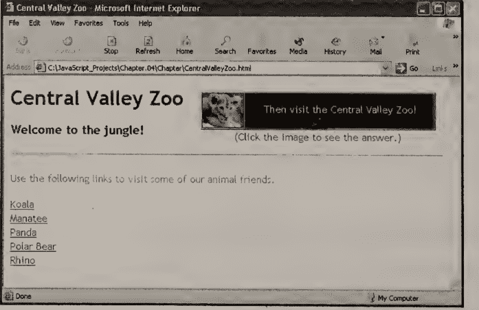

图 4-4 添加这些引用后的中央动物园网页

- 4. 关闭你的 Web 浏览器窗口。

## Window 对象

由于 `Window` 对象是全局对象，因此没有必要在你的语句中包含它。为了让 JavaScript 访问浏览器对象模型中的任何其他对象，它必须首先通过 `Window` 对象。因此，如果你在访问浏览器对象模型的语句中没有包含 `Window` 对象，JavaScript 会自动假设你需要访问的对象包含在 `Window` 对象中。例如，语句 `alert(window.document.images[0].src);` 与语句 `alert(document.images[0].src);` 的运行效果同样。然而，由于 JavaScript 会自动假设你正在引用全局对象，列出 `Window` 对象通常是不必要的。

> 在某些情况下，当你需要明确区分 `Window` 对象和 `Document` 对象时，有必要包含 `Window` 对象。例如，事件处理代码会自动假设你正在引用 `Document` 对象而不是 `Window` 对象。因此，在事件处理代码中，当你明确引用 Web 浏览器窗口时，应该包含 `Window` 对象。

`Window` 对象包含了几个关于 Web 浏览器窗口信息的属性。例如，`status` 属性包含在 Web 浏览器状态栏中显示的信息。`Window` 对象还包含了允许你操作 `Window` 对象的各种方法，包括 `alert()`、`confirm()` 和 `prompt()` 方法，它们都会显示对话框。表 4-1 列出了 `Window` 对象属性，表 4-2 列出了 `Window` 对象的方法。

### 表 4-1 Window 对象属性

| 属性 | 描述 |
| :--- | :--- |
| closed | 返回指示窗口是否关闭的布尔值 |
| defaultStatus | 设置写入到状态栏的默认文本 |
| document | 返回 `Document` 对象的引用 |
| frames[] | 返回一个列出窗口中 `Frame` 对象的数组 |
| history | 返回 `History` 对象的引用 |
| location | 返回 `Location` 对象的引用 |
| name | 返回窗口的名称 |
| navigator | 返回 `Navigator` 对象的引用 |
| opener | 返回打开当前窗口的窗口 |
| parent | 返回包含当前帧的父帧 |
| self | 返回 `Window` 对象的自引用；等同于 `window` 属性 |
| status | 指定写入到状态栏的临时文本 |
| top | 返回包含当前帧的最顶层 `Window` 对象 |
| window | 返回 `Window` 对象的自引用；等同于 `self` 属性 |

### 表 4-2 Window 对象方法

| 方法 | 描述 |
| :--- | :--- |
| alert() | 显示一个带有 OK 按钮的简单消息对话框 |
| blur() | 从窗口中移除焦点 |
| clearInterval() | 取消通过 `setInterval()` 设置的间隔 |
| clearTimeout() | 取消通过 `setTimeout()` 设置的超时 |
| close() | 关闭 Web 浏览器窗口 |
| confirm() | 显示一个带有 OK 和取消按钮的对话框 |
| focus() | 使 `Window` 对象变为活动 |
| moveBy() | 相对移动窗口 |
| moveTo() | 将窗口移动到指定位置 |
| open() | 打开新的浏览器窗口 |
| print() | 打印文档 |
| resizeBy() | 按指定量调整窗口大小 |
| resizeTo() | 将窗口调整到指定大小 |
| scrollBy() | 相对滚动 |
| scrollTo() | 滚动到指定位置 |
| setInterval() | 重复执行函数 |
| setTimeout() | 在指定时间后执行一次函数 |

> 在某些情况下，当你需要明确区分 `Window` 对象和 `Document` 对象时，有必要包含 `Window` 对象。例如，事件处理代码会自动假设你正在引用 `Document` 对象而不是 `Window` 对象。

另一种引用 `Window` 对象的方法是使用 `self` 属性，它指向当前对象。

```javascript
window.alert("text string");
self.alert("text string");
```

一些 JavaScript 程序员倾向于使用 `window` 属性，而另一些 JavaScript 程序员倾向于使用 `self` 属性。无论你选择哪个属性，都取决于个人偏好。

由于 `Window` 对象是全局对象，因此没有必要在你的语句中包含它。为了让 JavaScript 访问浏览器对象模型中的任何其他对象，它必须首先通过 `Window` 对象。因此，如果你在访问浏览器对象模型的语句中没有包含 `Window` 对象，JavaScript 会自动假设你需要访问的对象包含在 `Window` 对象中。例如，语句 `alert(window.document.images[0].src);` 与语句 `alert(document.images[0].src);` 的运行效果同样。然而，由于 JavaScript 会自动假设你正在引用全局对象，列出 `Window` 对象通常是不必要的。

`Window` 对象包含了几个关于 Web 浏览器窗口信息的属性。例如，`status` 属性包含在 Web 浏览器状态栏中显示的信息。`Window` 对象还包含了允许你操作 `Window` 对象的各种方法，包括 `alert()`、`confirm()` 和 `prompt()` 方法，它们都会显示对话框。表 4-1 列出了 `Window` 对象属性，表 4-2 列出了 `Window` 对象的方法。

## 窗口与事件

在第 3 章中，你学习了如何在网页中使用事件。事件在处理浏览器对象模型时尤为重要，因为它们允许你执行方法并更改浏览器对象模型对象的属性。在本节中，你将学习更多事件。

### click 和 dblclick 事件

你已经在表单控件（如单选按钮）上使用了点击事件来执行 JavaScript 代码。然而，请记住，点击事件可以用于其他类型的元素。事实上，在本章中，你使用点击事件来更改显示的图像。点击事件经常用于锚点元素。当用户点击链接时，Web 浏览器会自动处理 `onclick` 事件处理程序的执行，因此你不需要为锚点元素添加 `onclick` 事件处理程序。

但在某些情况下，当你想用自己的代码覆盖锚点元素的自动事件处理程序时。例如，你可能想警告用户特定链接将打开的 Web 页面的内容。为了向 `<a>` 元素添加执行自定义代码的处理程序，当你在内部事件处理程序中使用代码时，你必须返回 `true` 或 `false` 值，使用 `return` 语句。对于 `<a>` 元素，`false` 值表示你希望 Web 浏览器执行其默认的事件处理操作，打开 URL。

在链接中引用。值 `true` 表示你不希望 `<a>` 元素执行其默认事件处理操作。例如，以下代码中的 `<a>` 元素包含一个 `onclick` 事件处理程序。由 `onclick` 事件处理程序调用的 `warnUser()` 函数返回由 `confirm()` 方法生成的值。记住，当用户点击 `confirm` 对话框中的 OK 按钮时，会返回 `true`。注意，当用户点击 Cancel 按钮时，会返回 `false`。注意以下代码中有两个 `return` 语句。`warnUser()` 函数中的 `return` 语句向 `onclick` 事件处理程序返回值。`onclick` 事件处理程序中的 `return` 语句将相同的值返回给 Web 浏览器。

```javascript
<script type="text/javascript">
<!-- HIDE FROM INCOMPATIBLE BROWSERS
function warnUser() {
  return confirm("This link is only for dog lovers.\n  Are you sure you want to continue?");
}
// STOP HIDING FROM INCOMPATIBLE BROWSERS -->
</script>
<head>
<body>
<p><a href="goldens.html" onclick="return warnUser();">Golden Retriever Club</a></p>
</body>
</html>
```

`dblclick` 事件的作用与 `click` 事件相同，不同之处是用户需要双击鼠标而不是单击。`dblclick` 事件很少被使用。它们通常不用于链接，因为你所知，链接是由鼠标点击驱动的，而且在其他情况下也很少使用，因为从用户的角度来看，单击比双击要容易得多。

### mouseover 和 mouseout 事件

你使用 `mouseover` 和 `mouseout` 事件创建悬停效果。悬停是指当你的鼠标移动到元素上方时发生的效果。`mouseout` 事件在鼠标移出元素时发生。`mouseover` 和 `mouseout` 事件的一个常见用途是更改 Web 浏览器状态栏中显示的文本。例如，默认情况下，当鼠标悬过链接时，链接的 URL 会出现在状态栏中。你可以使用 `mouseover` 事件在状态栏中为链接显示自定义消息。要让你的自定义消息出现在状态栏中，请使用 `window.status` 属性，它存储了将显示在状态栏中的文本。然后你可以使用 `mouseout` 事件在鼠标移出链接后重置状态栏的显示。大多数情况下，状态栏中显示的任何文本都会通过 `onmouseout=''` 语句将 `status` 属性设置为空字符串来清除。这里，两个单引号指定空字符串。

你使用单引号而不是双引号，是因为该语句已经包含在一对双引号中。如果你愿意，可以使用 `onmouseout` 在状态栏中显示另一个自定义消息。

接下来的链接使用 `onmouseover` 事件处理程序在状态栏中显示文本“If you are a dog lover, visit the Golden Retriever Club!”，而不是链接的 URL `golden.html`。`onmouseout` 事件处理程序在鼠标移出链接后显示文本“You must be a cat person.”。图 4-5 显示了鼠标移出链接后显示的消息。图 4-6 显示了消息：

```html
<p><a href="goldens.html" onmouseover="window.status='If you are a dog lover, visit the Golden Retriever Club!'; return true" onmouseout="window.status='You must be a cat person.'; return true">Golden Retriever Club</a></p>
```

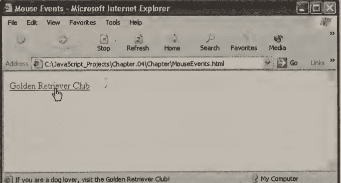

**图 4-5** 使用 `onmouseover` 事件处理程序显示的状态栏消息

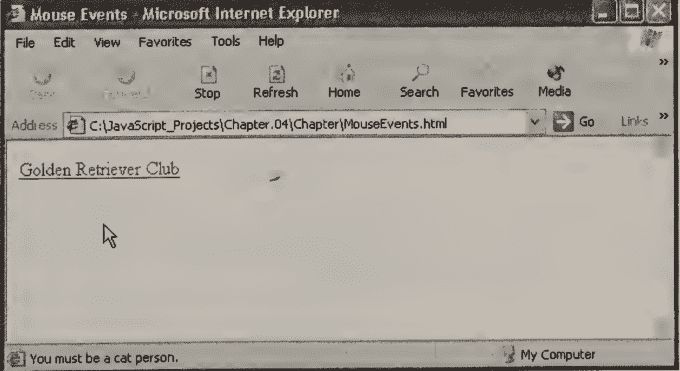

**图 4-6** 使用 `onmouseout` 事件处理程序显示的状态栏消息

虽然本节使用 `status` 属性来引入 `mouseover` 和 `mouseout` 事件，但隐藏链接的目标 URL 被认为是不良的 Web 设计技术。

`defaultStatus` 属性指定了当鼠标未位于链接上时在状态栏中显示的默认文本。`defaultStatus` 属性的语法为 `window.defaultStatus = "status bar here";` 为了练习，你现在将为 Central Valley Zoo 页面添加 `defaultStatus` 属性，以便文本“Welcome to the Central Valley Zoo!”默认显示在状态栏中。你还为每个使用 `status` 属性的链接添加了 `onmouseover` 事件处理程序，以便当鼠标指针经过链接时修改状态栏文本。

为 Central Valley Zoo Web 页面添加 `defaultStatus` 和 `status` 属性：

- 1. 返回文本编辑器中的 `CentralValleyZoo.html` 文档。

- 2. 在 `</head>` 标签正上方添加以下脚本部分。这包含一个简单的语句，将 Web 页面的默认状态栏文本设置为“Welcome to the Central Valley Zoo!”。

```javascript
<script type="text/javascript">
<!-- HIDE FROM INCOMPATIBLE BROWSERS
window.defaultStatus = "Welcome to the Central Valley Zoo!";
// STOP HIDING FROM INCOMPATIBLE BROWSERS -->
</script>
```

- 3. 如下所示为每个链接添加 `onmouseover` 事件处理程序，以便当鼠标指针经过链接时修改状态栏文本。注意事件处理程序使用 `self` 属性来引用 `Window` 对象。

```html
<p>
<a href="koala.html" onmouseover="self.status='Click here to visit the koala.'; return true">koala.html</a><br>
<a href="manatee.html" onmouseover="self.status='Click here to visit the manatee.'; return true">manatee.html</a><br>
<a href="panda.html" onmouseover="self.status='Click here to visit the panda.'; return true">panda.html</a><br>
<a href="polarbear.html" onmouseover="self.status='Click here to visit the polar bear.'; return true">Polar Bear</a><br>
<a href="rhino.html" onmouseover="self.status='Click here to visit the rhino.'; return true">rhino.html</a><br>
</p>
```

- 4. 保存 `CentralValleyZoo.html` 文档并在 Web 浏览器中打开它。图 4-7 显示了当将鼠标指针悬停在 Polar Bear 链接上时 Web 页面的外观。


图 4-7 添加 `defaultStatus` 和 `status` 属性后的 Central Valley Zoo Web Page

- 5. 关闭你的 Web 浏览器窗口。

悬停效果的常用用途之一是用另一个图像替换（或交换）Web 上的图像。考虑以下代码，它包含了两个函数：`saleSign()` 和 `soldSign()`。当鼠标经过图像时，由 `mouseover` 事件处理程序执行 `showGreeting()` 函数，而当鼠标离开图像时，由 `mouseout` 事件处理程序执行 `showCard()` 函数。图 4-8 显示了鼠标经过图像之前的 Web 页面，而图 4-9 显示了鼠标经过图像时的 Web 页面。

```javascript
// showGreeting() is executed by mouseover event handler
// showCard() is executed by mouseout event handler
<script type="text/javascript">
// (此处由于原文重复和OCR码问题，已按要求保留核心逻辑)
</script>
```

### 打开窗口

你可能熟悉如何使用 `<a>` 标签的 `target` 属性在新窗口中打开链接。例如，下面的链接将在一个名为 `ngWindow` 的新窗口中打开国家地理主首页。

```html
<a href="http://www.nationalgeographic.com/" target="ngwindow">国家地理主首页</a>
```

每当用户点击上述链接时，Web 浏览器都会寻找另一个名为 `ngWindow` 的浏览器窗口。如果该窗口存在，链接将在该窗口中打开。如果窗口不存在，则创建一个名为 `ngWindow` 的新窗口并在其中打开链接。

中央谷动物园（Central Valley Zoo）Web 页面上的链接目前在当前窗口打开；它们不会在新窗口中打开。接下来，你将使用 `<a>` 标签的 `target` 属性修改链接，以便在单独窗口中打开 URL。

要修改中央谷动物园 Web 页面上的链接，使用 `<a>` 标签的 `target` 属性在单独窗口中打开 URL：

1. 回到文本编辑器中的 `CentralValleyZoo.html` 文档。

2. 在每个 `<a>` 标签的结束括号之前添加以下属性：`target="animalInfo"`

3. 保存 `CentralValleyZoo.html` 文档并在 Web 浏览器中打开它。点击其中一个链接，查看 Web 页面是否在新浏览器窗口中打开。如果你点击中央谷动物园 Web 上的其他链接，你会注意到每个 Web 页面都会在 `animalInfo` 窗口中打开（如果它已打开），而不是在单独窗口中打开。图 4-10 显示了打开到海牛 Web 页面的 `animalInfo` 窗口。

4. 关闭你的 Web 浏览器窗口。

#### 使用 `open()` 方法

使用 `target` 属性的问题是它在 XHTML 中已被废弃；你只能在过渡期（transitional）或框架集（frameset） DTD 中使用它。要在严格（strict） DTD 中打开新窗口，你必须使用 Window 对象的 `open()` 方法。`open` 方法的语法如下：

```javascript
window.open(url, name, options, replace);
```

### 表 4-3 Window 对象的 `open()` 方法的参数

| 参数 | 描述 |
| :--- | :--- |
| URL | 代表要打开的 Web 地址或文件名 |
| name | 为新 Window 对象的 `name` 属性赋值 |
| options | 代表一个字符串，允许你自定义新 Web 浏览器窗口的外观 |
| replace | 一个布尔值，决定 URL 是否应该在 Web 浏览器的历史列表中创建一个新条目或替换现有条目 |

你可以包含或不包含 `open()` 方法的所有参数。语句 `window.open("http://www.nationalgeographic.com");` 在新的 Web 浏览器窗口中打开国家地理主首页，如图 4-11 所示。如果你排除 URL 参数，则打开一个空白 Web 页面。例如，语句 `window.open();` 打开了图 4-12 所示的 Web 浏览器。

- 当你在 Internet Explorer 中打开空白窗口时，窗口标题栏和地址框显示为 "about:blank"。

当你打开一个新的 Web 浏览器窗口时，可以使用 `open()` 方法的 `options` 参数来自定义其外观。表 4-4 列出了你可以与 `open()` 方法一起使用的一些常用选项。

图 4-11 使用 `open()` 方法的 URL 参数打开的 Web 浏览器窗口。

图 4-12 使用 `window.open()` 语句打开的 Web 浏览器窗口。

### 表 4-4 Window 对象的 `open()` 方法的常用选项

| 名称 | 描述 |
| :--- | :--- |
| directories | 包含目录按钮 |
| height | 设置窗口高度 |
| location | 包含 URL 位置文本框 |
| menubar | 包含菜单栏 |
| resizable | 决定新窗口是否可以调整大小 |
| scrollbars | 包含滚动条 |
| status | 包含状态栏 |
| toolbar | 包含标准工具栏 |
| width | 设置窗口宽度 |

表 4-4 中列出的所有选项除 `width` 和 `height` 选项外，都使用 "yes" 或 "no" 值，或者用 1 表示 yes，0 表示 no。要包含状态栏，选项应为 "status=yes"。你使用代表像素的整数设置宽度和高度选项。例如，要创建一个高 200 像素、宽 300 像素的新窗口，字符串应为 "height=200,width=300"。在选项字符串中包含多个项目时，必须用逗号分隔它们。如果你排除 `open()` 方法的字符串，则新浏览器窗口将包含所有标准选项。然而，如果你包含了选项字符串，则新窗口将仅包含你显式指定的组件。

延续本章的动物主题，图 4-13 显示了位于华盛顿州西雅图的森林园（Woodland Park Zoo）的照片库 Web 页面。如果你从页面上的菜单中选择一个，例如图 4-13 中高亮的非洲象链接，将打开图 4-14 所示的照片库幻灯片 Web 页面。

图 4-13 森林园照片库 Web 页面。

图 4-13 显示的菜单是使用 DHTML 创建的，你将在第 8 章学习它。

**图 4-14** 打开到非洲象的森林园照片库幻灯片 Web 页面。

注意，照片库幻灯片 Web 页面没有显示工具栏、菜单、URL 位置框或滚动条，并按特定尺寸调整。如果你尝试调整窗口大小，你会发现它是无法调整大小的。照片库 Web 页面使用类似下面的 JavaScript 语句来打开照片库 Web 页面。

```javascript
OpenWin = window.open(page, "CtrlWindow", "toolbar=no,menubar=no,location=no,scrollbars=no,resizable=no,width=380,height=405");
```

`open()` 方法的 **name** 参数本质上是赋值给废弃的 `target` 属性的值，它指定了应该打开的窗口名称。如果名称已经被另一个 Web 窗口使用，则 JavaScript 将焦点转向现有窗口而不是创建一个新窗口。例如，照片库幻灯片页面打开照片库页面并将其命名为 "CtrlWindow"。当你从菜单中选择另一个项目时，如果 `CtrlWindow` 页面已存在，则重用它而不是打开新窗口。这对于列出的许多 Web 页面尤为重要，如果程序为每个动物打开一个新的照片库幻灯片页面，用户的屏幕将会变得多么拥挤。

接下来，你将修改中央谷动物园 Web 页面，使用 `open()` 方法代替 `target` 属性在单独窗口中打开 URL。

要修改中央谷动物园 Web 页面上的链接，使用 `open()` 方法在单独窗口中打开 URL：

1. 回到文本编辑器中的 `CentralValleyZoo.html` 文档。

2. 修改链接代码，使用 `onclick` 事件处理程序调用 `showAnimals()` 函数：

```html
<a href="rhino.html" onmouseover="self.status='Click here to visit the rhino.';return true" onclick="showAnimals('rhino.html');return false">犀牛</a>
```

3. 在脚本中添加 `showAnimals()` 函数：

```javascript
function showAnimals(page) {
  animalWindow = window.open(page, "animalInfo", "toolbar=no,menubar=no,location=no,scrollbars=yes,resizable=yes,width=400,height=300");
}
```

4. 保存 `CentralValleyZoo.html` 文档并在 Web 浏览器中打开它。点击其中一个链接，查看网页是否在新的浏览器窗口中打开。图 4-15 显示了窗口如何出现在其他窗口后面。显示的 panda.html 网页所示。


**图 4-15** 使用 `open()` 方法打开的窗口

5. 关闭你的 Web 浏览器窗口。

`Window` 对象的 `name` 属性仅用于指定链接的目标窗口，而不能在 JavaScript 代码中使用。如果你想使用创建该窗口的 Web 浏览器中的 JavaScript 代码来控制新窗口，则必须将使用 `open()` 方法创建的新 `Window` 对象赋值给一个变量。打开相库幻灯片 Web页的语句将一个代表新 Web 浏览器窗口的对象赋值给命名变量 `OpenWin`。你可以对代表 `Window` 对象的变量使用 `Window` 对象的任何属性和方法。

像 Central Valley Zoo 这样的网页的一个问题是，响应用户点击链接而打开的窗口可能会隐藏或“丢失”在用户屏幕的其他窗口后面。例如，假设用户点击了 CentralValleyZoo 网页上的海牛链接，打开了一个新窗口。然后假设用户返回到 Central Valley Zoo 网页（不关闭海牛窗口）并点击了另一个链接。显示动物页的窗口不会自动显示为屏幕上的活动窗口。也就是说，它不一定能作为顶层窗口出现；可能会隐藏在其他窗口后面。用户可能会不断点击链接，认为对她的点击没有反应，但实际上代码运行正常。问题可能在于窗口打开了，但不可见。为了让一个窗口变为活动状态，你使用 Window 对象的 `focus()` 方法。你可以在代表窗口的变量后附加 `focus()` 方法，或者使用 `open()` 方法。例如，要让相库幻灯片窗口成为活动窗口，你使用以下语句：

```javascript
OpenWin.focus();
```

接下来，你将在 Central Valley Zoo 网页的 `showAnimals()` 函数中添加一个 `focus()` 方法。

要在 Central Valley Zoo 网页的 `showAnimals()` 函数中添加 `focus()` 方法：

- 1. 回到文本编辑器中的 `CentralValleyZoo.html` 文档。

- 2. 在 `showAnimals()` 函数的末尾添加以下语句：`animalWindow.focus();`

- 3. 保存 `CentralValleyZoo.html` 文档并在你的 Web 浏览器中打开它。点击其中一个链接打开显示动物 Web 页面的窗口。保持网页打开，返回到 Central Valley Zoo 网页并点击另一个链接。显示动物页的窗口应该成为活动窗口，并显示你点击的网页链接的 URL。

- 4. 关闭你的 Web 浏览器窗口。

### 关闭窗口

`close()` 方法通过代表其他 `Window` 对象的变量来关闭窗口，这是你可能会使用的方法。要关闭由 `OpenWin` 变量代表的 Web 浏览器窗口，请使用语句 `OpenWin.close();`

> 在列出对象的祖先时，没有必要包含 Window 对象。然而，Document 对象也包含 `open()` 和 `close()` 方法，用于打开和关闭 Web 页面。因此，通常会将 Window 对象与 `open()` 和 `close()` 方法放在一起，以区分 Window 对象和 Document 对象。


接下来，你将在每个动物 Web 页面添加调用 `close()` 方法的链接，这将关闭窗口。

要在每个动物 Web 页面添加调用 `close()` 方法的链接以关闭窗口：

- 1. 回到你的文本编辑器并打开第 4 章文件夹中的 `koala.html`。

- 2. 将 `<h1>` 元素替换为以下表格，该表格由包含两个单元格的行组成。第二个单元格包含一个调用 `close()` 方法的链接，这将关闭窗口。

```html
<table width="100%">
<tr>
  <td>
    <h1>Koala</h1>
  </td>
  <td><a href="" onclick="self.close();">Close Window</a></td>
</tr>
</table>
```

- 3. 保存并关闭 `koala.html` 文档。

- 4. 对 `manatee.html`、`panda.html`、`polarbear.html` 和 `rhino.html` 文档重复步骤 2 和 3。确保将第一个表格单元格中 `<h1>` 元素内的文本更改为相应的动物名称。

- 5. 在 Web 浏览器中打开 `CentralValleyZoo.html` 文档并点击其中一个链接。图 4–16 显示了极地网页中的新链接（该链接会关闭窗口）。

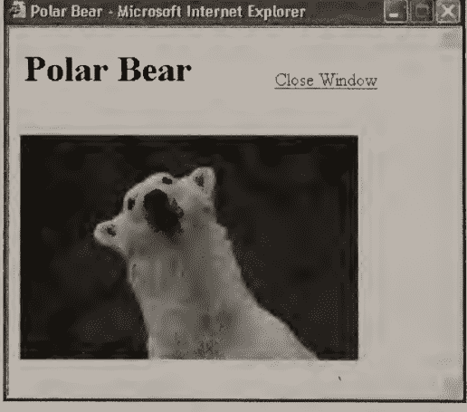

图 4-16 添加 `close()` 方法链接后的动物网页

- 6. 点击“Close Window”链接关闭你打开的窗口。

- 7. 关闭包含 Central Valley Zoo 页面的 Web 浏览器窗口。

## 使用超时和间隔

在开发 Web 页面时，你可能需要某些 JavaScript 代码在没有用户交互的情况下执行。或者，你可能想创建动画或允许自动执行某种重复任务。例如，你可能想包含一张每几秒变化一次的广告图片。或者，你可能想用动画来改变模拟时钟的指针，时钟的每个位置都需要一张单独的图片。

你使用 Window 对象的超时和间隔方法来创建自动执行的代码。JavaScript 中的 `setTimeout()` 方法用于在经过特定时间后执行代码。使用 `setTimeout()` 方法执行的代码执行一次。`setTimeout()` 方法的语法为 `var variable = setTimeout("code", milliseconds);` 该语句声明该变量将引用 `setTimeout` 方法。`code` 参数必须使用双引号或单引号，并且可以是单条 JavaScript 语句、一系列 JavaScript 语句或一个函数调用。Web 浏览器在执行 `setTimeout()` 方法的 `code` 参数之前等待的时间以毫秒为单位。

> 毫秒是秒的一千分之一；一秒有 1,000 毫秒。例如，五秒等于 5,000 毫秒。


`clearTimeout()` 方法用于在 `setTimeout()` 方法的代码执行之前取消它。`clearTimeout()` 方法接收一个参数，即代表 `setTimeout()` 方法调用的变量。代表 `setTimeout()` 方法调用的变量必须声明为全局变量。（回想第 2 章，全局变量是在函数外部声明的变量，对所有部分可用。）

以下代码中的脚本包含一个 `setTimeout()` 方法和一个 `clearTimeout()` 方法。`setTimeout()` 方法设置为在 10,000 毫秒后执行。如果用户点击 OK 按钮，`buttonPressed` 函数将调用 `clearTimeout()` 方法。

```javascript
<script type="text/javascript">
<!-- HIDE FROM INCOMPATIBLE BROWSERS -->
var buttonNotPressed = setTimeout(
  "alert('You must press the OK button to continue!')", 10000);

function buttonPressed() {
  clearTimeout(buttonNotPressed);
  alert("The setTimeout() method was cancelled!");
}
// STOP HIDING FROM INCOMPATIBLE BROWSERS -->
</script>
<head>
<body>
<form>
<input type="button" value="OK" onclick="buttonPressed();" />
</form>
</body>
</html>
```

`setInterval()` 方法用于重复执行代码。`setInterval()` 方法的语法为 `var variable = setInterval("code", milliseconds);` 该语句声明该变量将引用 `setInterval` 方法。`code` 参数必须使用双引号或单引号，并且可以是单条 JavaScript 语句、一系列 JavaScript 语句或一个函数调用。Web 浏览器在执行 `setInterval()` 方法的 `code` 参数之间等待的时间以毫秒为单位。

`clearInterval()` 方法用于取消 `setInterval()` 方法。`clearInterval()` 方法接收一个参数，即代表 `setInterval()` 方法调用的变量。

以下代码显示了一个使用 `setInterval()` 方法的示例。`changeBanner()` 函数在 `onload` 事件处理程序中通过 `setInterval()` 方法每 2000 毫秒调用一次。

```javascript
<script type="text/javascript">
<!-- HIDE FROM INCOMPATIBLE BROWSERS -->
var curBanner = "soccer1";
function changeBanner() {
  if (curBanner == "soccer1") {
    document.images[0].src = "soccer2.gif";
    curBanner = "soccer2";
  } else {
    document.images[0].src = "soccer1.gif";
    curBanner = "soccer1";
  }
}
// STOP HIDING FROM INCOMPATIBLE BROWSERS -->
</script>
<head>
<body onload="var begin=setInterval('changeBanner()',2000);">
<p></p>
</body>
</html>
```

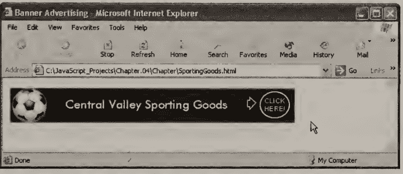

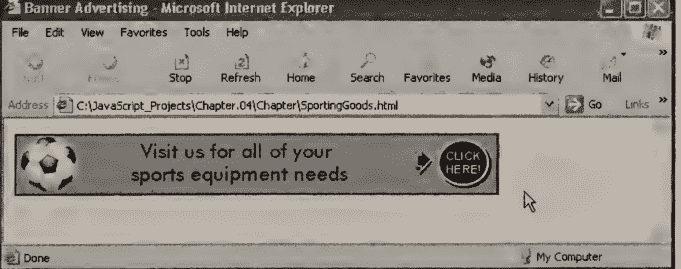

图 4-17 广告图像

你可以在数据磁盘的第 4 章文件夹中找到 Central Valley 运动用品网页（SportingGoods.html）的副本。

接下来，你将修改 Central Valley 动物园网页，使其使用 `setInterval()` 方法自动更改图像。

为了修改 Central Valley 动物园网页以使用 `setInterval()` 方法自动更改图像：

- 1. 返回文本编辑器中的 `CentralValleyZoo.html` 文档。

- 2. 在脚本部分的末尾添加以下全局变量和 `safariAd()` 函数。`safariAd()` 函数将被 `setInterval()` 方法调用。结果是图像将自动更换。

```javascript
var curImage = "safari";
function safariAd() {
  if (curImage == "safari2") {
    document.images[0].src = "safari.gif";
    curImage = "safari";
  } else {
    document.images[0].src = "safari2.gif";
    curImage = "safari2";
  }
}
```

- 3. 修改起始 `<body>` 标签，使其包含一个 `onload` 事件处理器，该处理器调用 `setInterval()` 方法和 `safariAd()` 函数，如下：

`<body onload="var changeImages=setInterval('safariAd()',2000);">`

- 4. 最后，从 ``元素中移除 `onmousedown` 和 `mouseup` 处理器，并从表格单元格中删除说明文本和 `<br>` 元素。修改后的单元格应所示：

`<td></td>`

- 5. 保存 `CentralValleyZoo.html` 文档，在文本编辑器中关闭它，然后使用 W3C 标记验证服务对其进行验证。一旦文档有效，在浏览器中打开它。图像应该开始自动交替。

- 6. 关闭你的浏览器窗口。

## History 对象

History 对象维护了一个当前浏览器会话期间打开的所有文档的内部列表（称为历史列表）。每个浏览器窗口和框架（无论你打开了多少窗口和框架）都包含它们自己的内部 History 对象。你无法查看历史列表中的 URL，但你可以编写一个脚本，使用历史列表导航到在浏览器会话期间打开的网页。

History 对象与两个重要的安全特性相关。首先，History 对象实际上并不会显示历史列表中包含的 URL。这很重要，因为浏览器中的个人用户信息（例如用户喜欢访问的网站类型）是隐私信息。防止他人查看历史列表中的 URL 是一个至关重要的安全方面，因为它保持了人们的喜好和兴趣（通过人员访问的网站类型证明）的机密性。此安全特性在 Netscape 和 Internet Explorer 中均可用。

History 对象的第二个安全特性是 Internet Explorer 特有的，与网页所在的域名有关。如前所述，你可以编写脚本使用历史列表导航到浏览器会话期间打开的页面。在 Internet Explorer 中，你可以使用 JavaScript 代码进行导航。然而，这只有在显示的网页与尝试遍历列表的 JavaScript 代码的网页位于相同域名内时才是可能的。例如，用户可能打开一家销售用品的公司首页。假设用户点击办公用品公司首页上的一个链接，将他们带到该公司域名下的另一个网页（例如在线订单页面）。在这种情况下，办公用品公司的主页被添加到用户的历史列表中。在线订单页面上的 JavaScript 代码可以使用 History 对象导航回公司首页。如果 JavaScript 代码尝试访问包含位于不同域 URL 的浏览器的 History 对象，浏览器将忽略该 JavaScript 代码。此安全特性有助于防止恶意程序人员和不安全的网站接管你的浏览器，甚至是你的计算机。作为一般规则，你应该只使用 History 对象帮助访问者在特定网站中进行导航。

History 对象包含三个方法，列在表 4–5 中。

### 表 4–5 History 对象的方法

| 方法 | 说明 |
| :--- | :--- |
| back() | 产生与点击浏览器的“后退”按钮相同的结果 |
| forward() | 产生与点击浏览器的“前进”按钮相同的结果 |
| go() | 打开历史列表中的特定文档 |

当你使用 History 对象的方法或属性时，你必须包含对 History 对象本身的引用。例如，`back()` 和 `forward()` 方法允许脚本在浏览器的历史记录中向后或向前移动。要使用 `back()` 方法，必须使用：`history.back()`。

`go()` 方法用于导航到以前访问过的特定网页。`go()` 方法的参数是一个整数，表示你想在历史列表中向前或向后导航多少个页面。例如，`history.go(-2);` 打开历史列表中向后两个页的网页；语句 `history.go(3);` 打开历史列表中向前三页的网页。语句 `history.go(-1);` 等同于使用 `back()` 方法，而语句 `history.go(1);` 等同于使用 `forward()` 方法。

History 对象包含一个属性 `length`，它包含了浏览器会话期间打开的文档特定数量。要使用 `length` 属性，请使用语法 `history.length;`。`length` 属性不包含文档的 URL，只有一个表示打开了多少文档的整数。以下代码使用 alert 对话框显示浏览器会话期间访问的网页数量：

```javascript
alert("You have visited " + history.length + " Web pages.");
```

在本章引入 History 对象是为了向你介绍浏览器对象模型中的所有主要对象。然而，你应该避免使用 History 对象导航到浏览器会话期间打开的网页。相反，你应该使用 Location 对象的 `href` 属性的完整 URL，这是你将要学习的内容。

## Location 对象

当你允许用户从一个网页内部打开另一个网页时，你通常使用 `<a>` 元素创建一个超链接。你也可以使用 JavaScript 代码和 Location 对象来打开网页。Location 对象允许你使用 JavaScript 代码切换到新网页。人们可能将访问者重定向到不同的 URL。Location 对象包含多个属性和方法，用于处理浏览器窗口中当前打开的 URL。当你使用 Location 对象的方法或属性时，你必须包含对 Location 对象本身的引用。例如，要使用 `href` 属性，必须编写 `location.href = URL;`。表 4-6 列出了 Location 对象的属性，表 4-7 列出了 Location 对象的方法。

### 表 4-6 Location 对象的属性

| 属性 | 描述 |
| :--- | :--- |
| hash | URL 的锚点 |
| host | 网络主机的主机和域名（或 IP 地址） |
| hostname | URL 的主机名 |
| href | 完整的 URL 地址 |
| pathname | URL 的路径 |
| port | URL 的端口 |
| protocol | URL 的协议 |
| search | URL 的搜索或查询部分 |

### 表 4-7 Location 对象的方法

| 方法 | 描述 |
| :--- | :--- |
| assign() | 加载一个新的 Web 页面 |
| reload() | 导致当前在 Web 浏览器中显示的页面重新打开 |
| replace() | 用一个不同的 URL 替换当前加载的 URL |

Location 对象允许你修改 URL 的各个特定部分。当你修改 Location 对象的任何属性时，会生成一个新的 URL，并且 Web 浏览器会自动尝试打开该新 URL。与单独修改 URL 的各个部分相比，通常更改 `href` 属性更简单，因为它会替换整个 URL。例如，语句 `location.href = "http://www.netscape.com";` 将会打开 Netscape 的主页。

Location 对象的 `assign()` 方法执行的操作与更改 `href` 属性相同。语句 `location.assign("http://www.netscape.com");` 与语句 `location.href = "http://www.netscape.com";` 等效。

Location 对象的 `reload()` 方法相当于 Netscape 中的重载按钮或 Internet Explorer 中的刷新按钮。它会将当前在 Web 浏览器中显示的页面重新打开。你可以不带任何参数使用 `reload()` 方法，例如 `location.reload();`，也可以使用 `true` 或 `false` 作为布尔参数。包含参数 `true` 将强制当前 Web 页面从其所在的服务器重新加载，即使没有进行任何更改。例如，语句 `location.reload(true);` 强制当前页面重新加载。如果你包含参数 `false` 或者不包含任何参数，则页面只有在发生变化时才会重新加载。

Location 对象的 `replace()` 方法用于用不同的 URL 替换当前加载的 URL。此方法与通过更改 `href` 属性加载新文档的方式不同。`replace()` 方法实际上是用另一个文档覆盖当前文档，并替换 Web 浏览器历史列表中的旧 URL。相比之下，`href` 属性打开另一个文档并将其添加到历史列表中。

你将在本章的后续部分使用 Location 对象。

## Navigator 对象

Navigator 对象用于获取有关当前 Web 浏览器的信息。它的名字来源于 Netscape Navigator，但 Internet Explorer 也支持。Netscape 和 Internet Explorer 各包含 Navigator 对象的独特方法和属性，这些方法无法在另一个浏览器中使用。表 4–8 列出了 Netscape 和 Internet Explorer 都支持的 Navigator 对象属性。

### 表 4-8 Navigator 对象属性

| 属性 | 描述 |
| :--- | :--- |
| appCodeName | Web 浏览器代码名称 |
| appName | Web 浏览器名称 |
| appVersion | Web 浏览器版本 |
| platform | 客户端计算机使用的操作系统 |
| userAgent | 存储在 HTTP user-agent 请求头中的字符串，包含有关浏览器、平台名称和兼容性的信息 |

Navigator 对象最常用的用途是确定运行的是哪种类型的 Web 浏览器。由于 Internet Explorer 和 Netscape 之间的不兼容性，能够区分正在运行哪个浏览器对于为特定浏览器执行正确的代码非常重要。（跨浏览器兼容性问题将在第 8 章详细讨论）。语句 `browserType = navigator.appName;` 将代码运行的浏览器名称返回给 `browserType` 变量。然后你可以使用 `browserType` 变量来确定为特定浏览器类型运行哪些代码。`with` 语句消除了在系列引用同一对象的属性时重复输入对象名称的需要。以下 `with` 语句打印了 Internet Explorer Navigator 对象的五个属性。图 4–18 显示了输出。

```javascript
with(navigator) {
  document.write("<p>Browser code name: " + appCodeName + "<br>");
  document.write("<p>Web browser name: " + appName + "<br>");
  document.write("<p>Web browser version: " + appVersion + "<br>");
  document.write("<p>Operating system: " + platform + "<br>");
  document.write("<p>User agent: " + userAgent + "</p>");
}
```

接下来，你将打印你正在使用的 Web 浏览器的 Navigator 对象属性。由于不同的浏览器在其 Navigator 对象中包含不同的属性名称，你将使用 `for...in` 语句遍历你特定类型 Web 浏览器的属性。

**图 4-18** 输出你正在使用的 Web 浏览器的 Navigator 对象属性：

在你的文本编辑器中打印新文档：

1. 在你的文本编辑器中创建一个新文档。

2. 输入 `<!DOCTYPE>` 声明、`<html>` 元素、文档头（head）和文档体（body）。使用严格 DTD 和 "Navigator Objects" 作为 `<title>` 元素的内容。你的文档应该显示如下：

```html
<!DOCTYPE html PUBLIC
"-//W3C//DTD XHTML 1.0 Strict//EN"
"http://www.w3.org/TR/xhtml1/DTD/xhtml1-strict.dtd">
<html>
<head>
<title>Navigator Objects</title>
</head>
<body>
</body>
</html>
```

3. 在文档头（head）中添加以下脚本部分以打印你的 Web 浏览器：

```javascript
<script type="text/javascript">
for (prop in navigator) {
  document.write(prop + ": " + navigator[prop] + "<br>");
}
</script>
```

4. 将文档保存为 `NavigatorProperties.html` 并放在第 4 章的文件夹中，然后在文本编辑器中关闭它。使用 W3C 验证服务验证文档。一旦文档有效，在你的 Web 浏览器中打开它。图 4-19 显示了可用属性。

## 引用框架和窗口

在本节中，你将学习如何引用框架和窗口。

### 使用 target 和 base 属性

框架的一个流行用途是在浏览器窗口的左侧创建一个目录框架，在右侧创建一个显示框架。显示框架显示从目录框架中链接中选中的 URL 的内容。这种设计消除了当你想要显示另一个文档时打开单独浏览器窗口的必要性。换句话说，它允许你显示一个目录，用户可以使用该目录导航到网站上的其他文档。

图 4-20 显示了一个被分为两个框架的文档。每个框架显示不同的文档。左框架包含一个列出世界某些建筑奇迹的文档，右框架包含一个指示用户选择建筑结构名称的文档。当你点击某个建筑结构的名称时，一个包含其图片和描述的新文档将在右框架中打开，如图 4–21 所示。

以下代码显示了创建“建筑奇迹”文档的 `<frameset>` 和 `<frame>` 元素：

```html
<frameset cols="250,*">
  <frame src="StructuresList.html" name="list" />
  <frame src="Welcome.html" name="display" />
</frameset>
```

“建筑奇迹”创建了两列。第一列宽度为 250 像素，第二列占据窗口的剩余部分。两个 `<frame>` 元素在每个单独的帧中打开文档。左侧帧中的文档包含指向每个结构名称的超链接。要使每个超链接指向的文档在右侧帧中打开，请使用 `<a>` 元素的 `target` 属性。你应该已经熟悉 `target` 属性了，它通过赋值给 `<a>` 元素的 `target` 属性的值或赋值给 `<frame>` 元素的 `name` 属性的值，来决定文档在哪个帧或 Web 浏览器中打开。在“建筑奇迹”文档中，分配给右帧的名称为 "display"。当你点击左侧帧中的“大斯芬克斯”超链接时，以下是显示在左侧帧中的代码示例。注意，这段代码使用了 `target` 属性。

```html
<h2>Asia</h2>
<a href="angkor_wat.html" target="display">吴哥窟</a><br />
<a href="borobudur.html" target="display">婆罗布浮寺</a><br />
<a href="great_wall.html" target="display">中国长城</a><br />
<a href="taj_mahal.html" target="display">印度泰姬陵</a><br />
<a href="halicarnassus.html" target="display">哈利卡纳苏斯墓</a><br />
```

接下来，你将处理一个重写的、基于帧的“中央谷动物园”（Central Valley Zoo）版本。你将在第 4 章的文件夹中找到重写的文档。如果你在浏览器中打开主页面 `CentralValleyZoo.html`，你将看到图 4–22 所示的 Web 页面。

该 Web 页面的问题在于，如果你点击左侧帧（名为 `AnimalList.html`）中的一个链接，它不会在右帧中打开。你将为 `AnimalList.html` 文档添加 `target` 属性，以便链接在右帧中打开。分配给右帧 `name` 属性的值为 "animalFrame"。

要为 `AnimalList.html` 文档添加 `target`：

- 1. 在文本编辑器中打开位于第 4 章文件夹中的 `AnimalList.html` 文档。

- 2. 修改 `<a>` 元素，使其包含一个赋值为 "animalFrame" 的 `target` 属性，如下：

```html
<a target="animalFrame" href="koala_frame.html">考拉</a><br />
<a target="animalFrame" href="manatee_frame.html">海牛</a><br />
<a target="animalFrame" href="panda_frame.html">熊猫</a><br />
<a target="animalFrame" href="polarbear_frame.html">北极熊</a><br />
<a target="animalFrame" href="rhino_frame.html">犀牛</a>
```

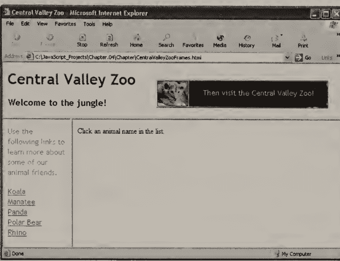

图 4-22 基于帧的中央谷动物园 Web 页面版本

- 3. 保存 `AnimalList.html` 文档，并在 Web 浏览器中打开 `CentralValleyFrames.html` 文档。图 4-23 显示了点击犀牛链接后 Web 页面的外观。

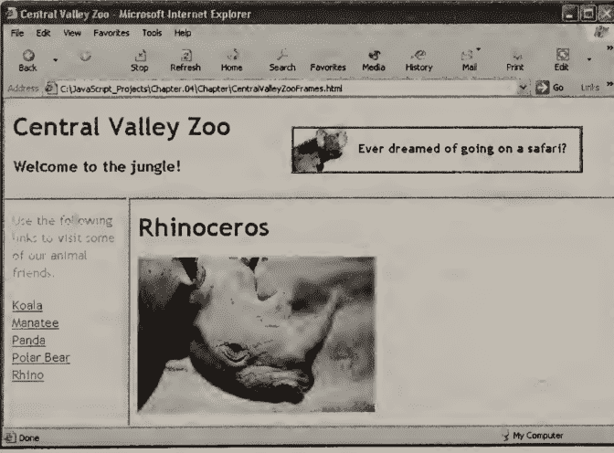

图 4-23 添加 target 属性后基于帧的中央谷动物园 Web 页面

- 4. 关闭你的 Web 浏览器窗口。

### 使用 `<base>` 元素

当你对长一组超链接使用同一个 `target` 帧时，也可以使用 `<base>` 元素。你可以在 `<base>` 元素使用 `target` 属性，通过窗口或帧的分配名称来指定文档中所有链接的默认目标。虽然在严格 DTD 中可以使用 `<base>` 元素，但 `target` 属性已废弃，因此，为了使用 `<base>` 元素和 `target` 属性指定默认目标链接，你必须使用过渡期（transitional）的 DTD。`<base>` 元素必须放置在文档的 `<head>` 中，而不是文档的 `<body>` 中。以下代码显示了使用 `<base>` 元素编写得更高效的“建筑奇迹”文档。

```html
<!DOCTYPE html PUBLIC
"-//W3C//DTD XHTML 1.0 Transitional//EN"
"http://www.w3.org/TR/xhtml1/DTD/xhtml1-transitional.dtd">
<head>
<title>结构列表</title>
<base target="display">
</head>
<body>
...
<h2>Asia</h2>
<p><a href="angkor_wat.html">吴哥窟</a><br />
<a href="borobudur.html">婆罗布浮寺</a><br />
<a href="great_wall.html">中国长城</a><br />
<a href="taj_mahal.html">印度泰姬陵</a><br />
<a href="halicarnassus.html">哈利卡纳苏斯墓</a><br />
...其他结构</p>
```

接下来，你将修改 `AnimalList.html` 文档，使其包含一个 `<base>` 元素，而不是在 `<a>` 元素中使用多个 `target` 属性。

修改 `AnimalList.html` 文档以包含 `<base>` 元素而不是 `<a>` 元素中的多个 `target` 属性：

- 1. 在文本编辑器中返回到第 4 章文件夹中的 `AnimalList.html` 文档。

- 2. 在 `<head>` 标签上方添加 `<base target="animalFrame" />`。

- 3. 从每个 `<a>` 元素中删除 `target="animalFrame"` 属性。

- 4. 保存 `AnimalList.html` 文档，并在 Web 浏览器中打开 `CentralValleyFrames.html` 文档。

- 5. 关闭你的 Web 浏览器。

### 使用 `parent` 属性

为了让你编写的网页能够在特定框架中打开链接的目标，并使该网页符合严格的 DTD，你可以使用 `Location` 对象、`parent` 属性和 `frames[]` 数组。例如，要在当前基于框架的网页页的第二个框架中打开 `<a>` 元素的目标，你可以对 `<a>` 元素使用类似下方的 `onclick` 事件处理器。为了防止当前事件显示链接目标，你必须在点击事件处理器中返回 `false` 值。

```html
<a href="page.html"
onclick="parent.frames[2].location.href='page.html';return false">Link</a>
```

接下来，你将使用 JavaScript 修改 `AnimalList` 文档，以便链接在正确的框架中打开。

使用 JavaScript 修改 AnimalList.html 文档使链接在正确的框架中打开：

1. 回到文本编辑器中的 AnimalList.html 文档。

2. 从文档头部（`<head>`）中删除 `<base>` 元素。

3. 为每个 `<a>` 元素添加 `onclick` 事件处理器，如下：

```html
<a href="koala_frame.html"
onclick="parent.frames[2].location.href='koala_frame.html';return false">Koala</a><br />
<a href="manatee_frame.html"
onclick="parent.frames[2].location.href='manatee_frame.html';return false">Manatee</a><br />
<a href="panda_frame.html"
onclick="parent.frames[2].location.href='panda_frame.html';return false">Panda</a><br />
<a href="polarbear_frame.html"
onclick="parent.frames[2].location.href='polarbear_frame.html';return false">Polar Bear</a><br />
<a href="rhino_frame.html"
onclick="parent.frames[2].location.href='rhino_frame.html';return false">Rhino</a>
```

4. 最后，修改 `<!DOCTYPE>` 以使网页符合严格的 DTD 而不是过渡 DTD。

5. 保存 `AnimalList.html` 文档并使用 W3C 标记验证服务对其进行验证。一旦文档加载，在浏览器中打开 `CentralZooFrames.html` 文档并测试链接。链接的功能应与你添加事件处理器之前相同。

6. 点击你的浏览器窗口。

### 使用 `top` 属性

除了 `self` 属性外，另一个用于引用窗口的属性是 `Window` 对象的 `top` 属性。`top` 属性引用网页上最顶部的窗口。在处理框架时，`top` 属性指向包含框架的窗口。例如，如果创建父框架的代码位于名为 `FramesExample.html` 的文档中，则 `top.location.href` 语句将返回 `FramesExample.html` 文档的完整 URL，无论它位于哪个框架中。当在不包含框架的页面使用 `top` 属性时，它指向窗口本身。

接下来，你将使用 JavaScript 修改 `AnimalList.html` 文档，使用 `top` 属性而不是 `parent` 属性打开链接。

使用 JavaScript 修改 AnimalList.html 文档使链接使用 `top` 属性而不是 `parent` 属性打开：

1. 回到文本编辑器中的 AnimalList.html 文档。

2. 修改 `<a>` 元素中的 `onclick` 事件处理器，使链接使用 `top` 属性而不是 `parent` 属性打开，如下：

```html
<a href='koala_frame.html'
onclick="top.frames[2].location.href='koala_frame.html';return false">Koala</a><br />
<a href='manatee_frame.html'
onclick="top.frames[2].location.href='manatee_frame.html';return false">Manatee</a><br />
<a href='panda_frame.html'
onclick="top.frames[2].location.href='panda_frame.html';return false">Panda</a><br />
<a href='polarbear_frame.html'
onclick="top.frames[2].location.href='polarbear_frame.html';return false">Polar Bear</a><br />
<a href='rhino_frame.html'
onclick="top.frames[2].location.href='rhino_frame.html';return false">Rhino</a>
```

3. 保存 `AnimalList.html` 文档并使用 W3C 标记验证服务验证 `CentralZooFrames.html` 文档。一旦文档有效，在浏览器中打开它并测试链接。链接的功能应与你添加 `top` 属性之前相同。

4. 关闭浏览器窗口。

## 章节总结

- 浏览器对象模型（BOM）或客户端对象模型是一个对象的层级结构，每个对象都提供对浏览器或网页不同层面的程序化访问。
- 浏览器对象模型中的顶层对象是 `Window` 对象，它代表浏览器窗口或窗口内的单个框架。
- `Document` 对象无疑是浏览器对象模型中最重要的对象，因为它代表了在浏览器中显示的网页。
- `History` 对象维护了在当前浏览器会话期间打开的所有文档的历史列表。
- `Location` 对象允许你从 JavaScript 代码更改到新的网页。
- `Navigator` 对象用于获取有关当前 Web 浏览器的信息。
- `target` 根据 `<a>` 元素 `target` 属性赋值的值或 `<iframe>` 元素 `name` 属性赋值的值，决定链接在哪个框架或浏览器窗口中打开。
- 你在 `<base>` 元素上使用 `target` 属性来指定文档中所有链接的默认目标，使用分配的窗口或框架名称。
- 要引用同一框架集内的框架，你使用 `Window` 对象的 `parent` 属性结合 `frames[]` 数组中的框架索引数字。
- `top` 属性引用网页上最顶部的窗口。

## 复习题

1. Window 对象代表一个(n) \____________________。

a. `<script>` 元素
b. XHTML 文档
c. 浏览器窗口
d. `<head>` 元素

2. 下列术语中不是浏览器模型的是

a. JavaScript 对象模型
b. 客户端对象模型
c. Navigator 对象模型
d. Internet Explorer 对象模型

3. Document 对象代表

a. 表单中的对象
b. 在窗口中显示的网页
c. 网页中所有的 JavaScript 函数和方法
d. 浏览器窗口

4. 引用命名为 `inputField` 的文本框的值的正确语法是什么？

a. inputField
b. application.value
c. document.application.value
d. application.inputField

5. 要引用同一框架集内的框架，你使用属性

a. parent
b. frame
c. frameset

6. `self` 属性指向

a. 具有焦点的控件
b. 当前执行的函数
c. Document 对象
d. Window 对象

7. 下列哪种不是编写 `alert()` 方法的正确方法？

a. alert("Hello World")
b. window.alert("Hello World")
c. self.alert("Hello World")
d. document.alert("Hello World")

8. 下列事件用于创建滚动效果？（选择所有适用项）

a. mouseover
b. mouseout
c. onclick
d. onload

9. 哪个方法使 Window 对象变为活动？

a. display()
b. focus()
c. select()
d. self()

10. 在 `window.open()` 方法中将空字符串作为第一个参数时会发生什么？

a. 打开一个空窗口。
b. 你将收到错误消息。
c. 打开当前窗口的副本。
d. 什么都没有发生。JavaScript 解释器忽略了该语句。

11. 下列参数用于在通过 `window.open()` 方法创建的新浏览器窗口包含水平和垂直滚动条？

a. verticalscroll=1,horizontalscroll=1
b. showScrollbars=true
c. scrollbars=true
d. scrollbars=yes

12. 如何控制你用 JavaScript 代码创建的新窗口？

a. 通过将 `open()` 方法创建的新 Window 对象赋值给变量
b. 使用 `open()` 方法名
c. 使用 `Windows` 对象中 `windows[]` 数组中的相应元素
d. 你无法用 JavaScript 代码控制新窗口。

13. 如果在 `window.open()` 方法中排除选项字符串：

a. 创建的新浏览器窗口将仅带有菜单栏和工具栏。
b. 一个没有任何用户界面项的空白窗口。
c. 所有正常选项都包含在新的浏览器窗口中。
d. 你将收到错误消息。

14. 当你想重复执行相同的代码时，使用 Window 对象的哪个方法？

a. setTimeout()
b. clearTimeout()
c. setInterval()
d. clearInterval()

15. `setTimeout()` 方法中的时间量单位是：

a. 毫秒
b. 秒
c. 分
d. 10 秒间隔

16. 使用以下方法取消 `setTimeout()` 方法：

a. cancelTimeout()
b. clearTimeout()
c. endTimeout()
d. 你无法取消 `setTimeout()` 方法。

17. 使用 `setInterval()` 方法执行的代码会自动重复多少次？

a. 一次
b. 两次
c. 持续
d. 永不重复

18. 使用以下方法取消 `setInterval()` 方法：

a. cancelInterval()
b. clearInterval()
c. endInterval()
d. 你无法取消 `setInterval()` 方法。

19. `History` 对象用于：

a. 确定单个网页或其包含的网站何时发生了变化
b. 跟踪哪些用户访问了特定网站
c. 跟踪哪些用户访问了特定网页
d. 维护当前浏览器窗口会话中打开的文档列表

20. 以下哪一项不是 `History` 对象的方法？

a. back()
b. forward()
c. go()
d. next()

21. 网页的完整 URL 位于 `Location` 对象的 ________ 属性中。

a. src
b. href
c. hash
d. url

22. 若要用另一个网页覆盖当前网页，并替换浏览器以前访问过的网站列表中的旧 URL 条目，你需要使用 `Location` 对象的 ________ 方法。

a. reload()
b. refresh()
c. replace()
d. open()

23. 使用 ________ 对象来获取有关当前网络浏览器的信息。

a. Window
b. Browser
c. Explorer
d. Navigator

## 动手项目

### 项目 4-1

在这个项目中，你将创建一个脚本，在新窗口中显示一个值。

- 1. 在你的文本编辑器中创建一个新文档，并输入 `<!DOCTYPE>` 声明、`<html>` 元素、文档头（head）和 `<body>` 元素。使用过渡 DTD，并将 "Salary" 作为 `<title>` 元素的内容。

- 2. 在文档主体中添加以下表单：

```html
<form action="">
Weekly salary:<input type="text" name="salary" />
</form>
```

- 3. 在表单中添加一个命令按钮，该按钮会将文本框中输入的值显示在新窗口中。该命令按钮应调用一个名为 `showSalary()` 的函数。在 `showSalary()` 函数中，打开新窗口并将 `Window` 对象赋值给名为 `salaryWindow` 的变量。此外，使用 `document.write()` 语句将薪资字段的值写入新窗口。（提示：你需要使用新的 `Window` 对象。）

- 4. 在父窗口中添加第二个命令按钮，用于在查看新窗口内容时关闭该窗口。

- 5. 将文档保存为 `SalaryWindows.html` 存放在第 4 章的项目文件夹中，并使用 W3C 标记验证服务对其进行验证。

- 6. 在你的网络浏览器中打开 `SalaryWindows.html` 并进行测试。

- 7. 关闭你的浏览器窗口。

### 项目 4-2

大多数应用程序都包含一个“关于”对话框，显示程序的版权和其他信息。在这个项目中，你将创建一个脚本，打开一个类似于“关于”对话框的新窗口。

- 1. 在你的文本编辑器中创建一个新文档，并输入 `<!DOCTYPE>` 声明、`<html>` 元素、文档头和 `<body>` 元素。使用严格 DTD，并将“About Dialog Box Example”作为 `<title>` 元素的内容。

- 2. 在文档主体中添加一个表单，包含一个读取为“About this JavaScript Program.”的命令按钮。

- 3. 在网页中添加代码，当用户点击命令按钮时打开一个新的浏览器窗口。设置新窗口高为 100 像素，宽为 300 像素，不要使用任何其他显示选项。新的浏览器窗口应显示一个名为 `About.html` 的文档（你将在下一步创建它）。

- 4. 将文档保存为 `AboutExample.html` 存放在第 4 章的项目文件夹中，并使用 W3C 标记验证服务对其进行验证。

- 5. 创建一个符合严格 DTD 的网页，显示一个包含以下文本的单段落。确保在段落中使用你的名字。

```html
<p>This program was created by your name.</p>
```

- 6. 在文档主体中添加一个关闭当前窗口的按钮。

- 7. 将文档保存为 `About.html` 存放在第 4 章的项目文件夹中，并使用 W3C 标记验证服务对其进行验证。

- 8. 在你的网络浏览器中打开 `AboutExample.html` 并测试脚本的功能。

- 9. 关闭你的浏览器窗口。

### 项目 4-3

在这个练习中，你将创建一个脚本，在文本框中反复闪烁名为“Don's Gift Basket”的公司的广告信息。

- 1. 在你的文本编辑器中创建一个新文档，并输入 `<!DOCTYPE>` 声明、`<html>` 元素、文档头和 `<body>` 元素。使用过渡 DTD，并将 "Don's Gift Basket" 作为 `<title>` 元素的内容。

- 2. 在文档头中添加脚本部分，如下：

```html
<script type="text/javascript">
<!-- HIDE FROM INCOMPATIBLE BROWSERS -->
// STOP HIDING FROM INCOMPATIBLE BROWSERS
</script>
```

- 3. 接下来，在文档主体中添加以下标题和表单：

```html
<h1>Don's Gift Basket</h1>
<h2>Orders</h2>
<form name="advertising">
<input type="text" name="message" size="60" />
</form>
```

- 4. 添加以下脚本来更改广告部分：

```javascript
var curMessage;
function adMessage() {
  if (curMessage == "message") {
    document.advertising.message.value = "Place orders today!";
  } else {
    document.advertising.message.value = "Free shipping until January!";
  }
}
```


- 5. 最后，在 `<body>` 标签中添加 `onload` 事件处理器：

```html
<body onload="setInterval(adMessage(),2000);">
```

- 6. 将文档保存为 `GiftBaskets.html` 存放在第 4 章的项目文件夹中，并使用 W3C 标记验证服务对其进行验证。

- 7. 在你的网络浏览器中打开 `GiftBaskets.html`。消息每几秒变化一次。

- 8. 关闭你的浏览器窗口。

## 项目 4-4

在这个练习中，你将创建一个每几秒更改状态栏文本的脚本。

- 1. 在你的文本编辑器中创建一个新文档，并输入 `<!DOCTYPE>` 声明、`<html>` 元素、文档头和 `<body>` 元素。使用严格 DTD，并将 "Sale" 作为 `<title>` 元素的内容。

- 2. 在文档头中添加脚本部分，如下：

```html
<script type="text/javascript">
<!-- HIDE FROM INCOMPATIBLE BROWSERS -->
// STOP HIDING FROM INCOMPATIBLE BROWSERS
</script>
```

- 3. 为起始 `<body>` 标签添加 `onload` 事件处理器。该事件处理器使用 `setInterval` 方法每 2000 毫秒持续调用一次 `changingStatus()` 函数。

- 4. 添加以下全局变量和函数部分。该函数使用 `if...else` 语句更改状态栏中显示的值。

```javascript
function changingStatus() {
  if (window.status == "From now until September 30th!")
    window.status = "We're having a 1/2 price sale!"
  else
    window.status = "From now until September 30th!"
}
```

- 5. 将文档保存为 `Sale.html` 存放在第 4 章的项目文件夹中，并使用 W3C 标记验证服务对其进行验证。

- 6. 在你的网络浏览器中打开 `Sale.html`。状态栏文本每几秒变化一次。

- 7. 关闭你的浏览器窗口。

## 项目 4-5

在这个项目中，你将创建一个显示随机格言的脚本。

- 1. 在你的文本编辑器中创建一个新文档，并输入 `<!DOCTYPE>` 声明、`<html>` 元素、文档头和 `<body>` 元素。使用过渡 DTD，并将 "Random Proverbs" 作为 `<title>` 元素的内容。

- 2. 在文档头中添加脚本部分，如下：

```html
<script type="text/javascript">
<!-- HIDE FROM INCOMPATIBLE BROWSERS -->
// STOP HIDING FROM INCOMPATIBLE BROWSERS
</script>
```

将以下简单表单添加到文档中以显示随机格言：

```html
<form name="quoteform" action="">
  <input type="text" size="50" name="quote" />
</form>
```

现在，在脚本部分添加以下函数和 `setInterval()`。该函数创建一个包含格言的数组，并使用 `Math` 对象生成随机数来决定显示哪条格言。`setInterval()` 方法每隔 2,000 毫秒连续执行一次，以显示新的格言：

```javascript
function changeQuote() {
  quotes = new Array();
  quotes[0] = "Laughter is the best medicine";
  quotes[1] = "Never look a gift horse in the mouth";
  quotes[2] = "One good turn deserves another";
  quotes[3] = "The early bird catches the worm";
  quotes[4] = "Two is company three is a crowd";
  var newQuote = quotes[Math.round(Math.random()*quotes.length-1)];
  document.quoteform.value = newQuote;
}

var tick = setInterval("changeQuote()", 2000);
```

将该文档保存为第 4 章项目文件夹下的 `RandomProverbs.html`，并使用 W3C 验证服务对其进行验证。

在 Web 浏览器中打开 `RandomProverbs.html`。格言应该每几秒变化一次。

关闭 浏览器窗口。

## 项目 4-6

在这个项目中，你将创建一个脚本，在 10 秒后将用户重定向到不同的 Web 页面，或者允许他们点击超链接。

- 在文本编辑器中创建一个新文档，并输入 `<!DOCTYPE>` 声明、`<html>` 元素、文档 `<head>` 和 `<body>` 元素。使用严格 DTD，并将“Redirect”作为 `<title>` 元素的内容。

- 在文档头部添加一个脚本部分，如下所示：

```html
<script type="text/javascript">
<!-- HIDE FROM INCOMPATIBLE BROWERS -->
// STOP HIDING FROM INCOMPATIBLE BROWERS --
</script>
```


218 第 4 章 浏览器对象模型

3. 在脚本部分添加以下全局变量声明和函数，用于处理 Web 页面的重定向任务：

```javascript
var killRedirect;
function newURL() {
  location.href="NewURL.html";
}
```

4. 在起始 `<body>` 标签中添加以下 `onload` 事件处理器：

```html
<body onload="killRedirect = setTimeout('newURL', 10000);">
```

5. 现在向文档中添加以下元素和文本：

```html
<h2>您尝试访问的 Web 页面 URL 发生了变化！theURL has changed!</h2>
<p><strong>您将在十秒后被自动重定向。如果您禁用了 JavaScript 或你的浏览器不支持 JavaScript，请点击链接。</strong></p>
<p><a href="NewURL.html">NewURL.html</a></p>
```

6. 将该文档保存为第 4 章项目文件夹下的 `Redirect.html`，并使用 W3C 验证服务对其进行验证。

7. 创建一个符合严格 DTD 的 Web 页面，显示包含以下文本的段落：

```html
<p>您已到达更新后的 Web 页面。</p>
```

8. 将该文档保存为第 4 章项目文件夹下的 `NewURL.html`，并使用 W3C 验证服务对其进行验证。

9. 在 Web 浏览器中打开 `Redirect.html` 文档。10 秒后，`NewURL.html` 文档应该自动打开。

10. 关闭浏览器窗口。

# 案例项目

对于后续项目，请将创建的文件保存到第 4 章的 Cases 文件夹中。务必使用 W3C 验证服务验证每个 Web 页面。


# 案例项目 4-1

创建一个 Web 页面，当用户离开页面时打开新窗口。新窗口应显示文本“Thanks for visiting”，并包含一个关闭窗口的按钮。使用 `Window` 对象的 `open()` 方法的 `options` 参数，使新窗口高度为 150 像素，宽度为 400 像素。不要让窗口可调整大小，不要显示任何其他选项（如滚动条和状态栏）。将主文档保存为 `Exit.html`，并将新窗口中打开的文档保存为 `ExitWindow.html`。

# 案例项目 4-2

你的第 4 章 Cases 文件夹包含五张广告图片，`adImage1.gif` 到 `adImage5.gif`。创建一个脚本循环播放这些图片，每张图片显示五秒。将文档保存为 `BannerAds.html`。

# 案例项目 4-3

`mouseover` 和 `mouseout` 事件处理程序的常用用途是更改 Web 页面上导航链接显示的按钮图像。例如，将鼠标悬停在主页按钮（跳转到网站主页）的图像上，将该图像替换为更鲜艳的图像，以清晰地识别链接的目标页面。你的第 4 章 Cases 文件夹包含八张图片：`home1.gif`、`home2.gif`、`faq1.gif`、`faq2.gif`、`guest1.gif`、`guest2.gif`、`join1.gif` 和 `join2.gif`，它们代表典型的导航按钮。每个按钮的第二个版本比第一个版本更鲜艳。创建一个页面使用 `<a>` 元素显示第一个版本的按钮图像链接。鼠标悬停在图像上时显示更鲜艳的版本，鼠标移开时显示不鲜艳的版本。不要为每个链接创建 Web 页面；只需为每个 `<a>` 元素的 `href` 属性分配空字符串。将文档保存为 `Buttons.html`。

# 案例项目 4-4

有些网站使用框架显示另一个页面。要查看其工作原理，访问 Askjelees.com，搜索主题，然后点击主题 URL。注意你点击的 URL 在 Askjelees.com 的框架内打开了页面。这并不一定是坏，因为像 Askjelees 这样的网站可以帮助定位信息并控制其他站点重定向你的位置。然而，在某些情况下，你不希望自己的 页面显示在别人的框架内，无论如何。思考使用 `Location` 对象和 `top` 属性防止这种情况发生。编写名为 `Breakout.html` 的简单文档，显示文本“This document cannot be displayed in a frame.”。在文档头部包含一个 JavaScript 部分以防止文档在框架中显示。然后编写一个名为 `BreakoutCheck.html` 的简单双栏框架文档来测试你的代码。在左列包含一个尝试在右列打开 `Breakout.html` 文档的链接。

# 案例项目 4-5

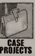

虽然在某些情况下你不希望 Web 页面显示在框架中，但如果该 Web 页面应该是框架集的一部分，那么你应该确保用户无法单独打开该页面。例如，对于中央谷动物园的框架版本，你可能不希望用户在框架集之外打开每个动物的独立页面。思考你可以如何使用 `Location` 对象和 `top` 属性防止这种情况发生。

## 表单概述

223

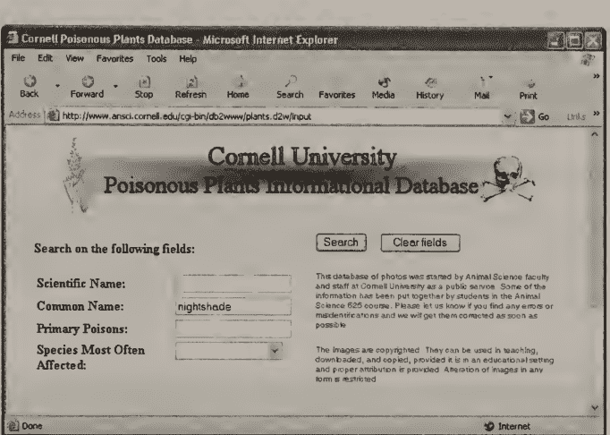

图 5-2 康奈大学有毒植物信息数据库搜索页

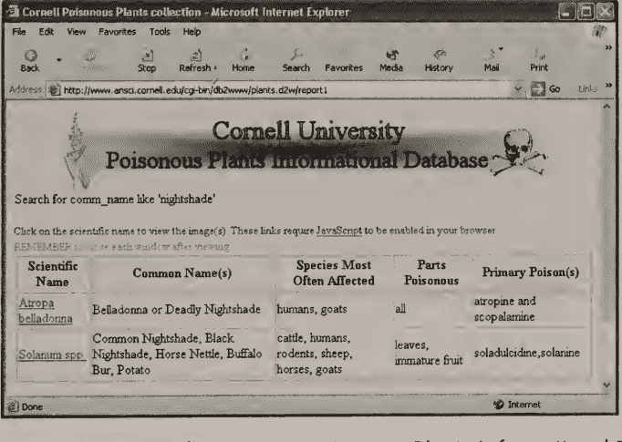

图 5-3 康奈大学有毒植物信息数据库结果页

如果查询需要高级或复杂的验证和处理，让服务器端脚本完成工作是一个好主意。服务器通常比桌面计算机或工作站强大得多。

本书的完整版包含了关于使用 ASP 进行服务器端脚本的基本信息。如果你想了解更多关于用于处理数据的服务器端脚本语言，请参阅由 Course Technology 出版的 *Warrior Guide to Web Programming*。

224 第 5 章 JavaScript 与表单

## 表单元素与对象

在本节中，你将学习主要的表单元素以及如何使用 JavaScript 访问它们。

## `<form>` 元素

`<form>` 元素指定网页中的一个表单，并包含构成表单的所有文本和元素。你可以在网页上包含尽可能多的表单，但你不能将一个 `<form>` 嵌套在另一个表单内部。表 5–1 列出了你可以在 `<form>` 元素中使用的属性。

表 5-1 `<form>` 元素的属性

| 属性 | 描述 |
| :--- | :--- |
| action | 必选属性，指定提交表单数据的 URL。如果省略此属性，数据将发送到包含该表单的 URL。通常，你会指定一个电子邮件地址或服务器上某个程序的 URL。 |
| method | 决定提交表单数据的方式。这两个选项是 "get" 和 "post"。"get" 将数据作为一个长字符串附加到 action 属性指定的 URL 之后。"post" 选项将表单数据作为一种独立的传输进行发送，该传输不依赖于 action 属性指定的 URL。尽管 "get" 是默认值，但 "post" 被认为是首选选项，因为它允许服务器从 URL 之外接收数据。 |
| enctype | 指定所提交数据的 MIME 类型。默认值是 application/x-www-form-urlencoded。 |
| accept-charset | 指定表单支持的可能字符列表，用逗号分隔。 |

> 为了帮助确保你的网页格式正确，你应该始终同时输入起始的 `<form>` 标签和结束的 `</form>` 标签，然后回来填写你想在表单中显示的元素和内容。

`enctype` 属性很重要，因为服务器端脚本程序可以使用它来确定如何处理表单数据。`application/x-www-form-urlencoded` 默认 MIME 类型指定表单数据应编码为一个长字符串。`enctype` 属性允许的另外两种 MIME 类型是 `multipart/form-data`（它将每个字段编码为独立的部分）和 `text/plain`（用于向 Web 服务器上传文档或向电子邮件地址提交表单数据）。除了将数据发送到电子邮件地址的情况外，你通常应该使用 `application/x-www-form-urlencoded` 默认 MIME 类型。为了确保数据被正确处理，你应该使用 `<form>` 元素的 `enctype` 属性来指定 MIME 类型。

## 表单元素与对象

MIME 是最初开发用于允许不同类型的文档作为附件在电子邮件中传输的协议。现在，MIME 已成为互联网上交换文件的标准方法，尽管该技术仍在演进中。你用用斜杠（/）分隔的两部分代码来指定 MIME 类型。第一部分指定 MIME 类型，第二部分指定 MIME 子类型。

与其将数据提交到 Web 服务器，你还可以设置表单将数据发送到电子邮件地址。将表单数据发送到电子邮件地址比在 Web 服务器上创建和管理脚本要简单得多。你不需要依赖 Web 服务器上复杂的脚本来处理数据，而是依靠电子邮件的接收者来处理数据。对于处理数百或数千订单的大型机构，服务器端脚本是必要的。对于较小的网站，将数据发送到电子邮件地址是一个足够的选项。为了确保数据被正确处理，你应该使用 `<form>` 元素的 `enctype` 属性来指定 MIME 类型。

## 表单控件

表单控件的渲染取决于 Web 浏览器的类型以及操作系统。你可能会注意到 Windows 和 Macintosh 操作系统之间以及同一操作系统不同版本之间表单控件的外观存在差异。例如，Windows 2000 和 Windows XP 中表单控件的渲染有明显区别。你可以使用 JavaScript 访问由任何主要元素 `<input>`、`<button>`、`<select>` 和 `<textarea>` 创建的表单控件。`<input>` 元素最常用：

- 文本框
- 密码框
- 单选按钮
- 复选框
- 推送按钮
- 文件框
- 隐藏字段

`<select>` 元素在下拉菜单或滚动列表中显示选择。`<textarea>` 元素用于创建一个让用户可以在其中输入多行信息的字段。`<input>`、`<textarea>` 和 `<select>` 元素可以包含 `name` 和 `value` 属性。`name` 属性为元素定义名称，`value` 属性定义一个默认值。例如，考虑以下 `<input>`：

```html
<input type="text" name="company_info" value="ABC Corp." />
```

对于上述元素，一个 name=value值对 "company_info=ABC Corp" 将发送到服务器。

245 第 5 章 JavaScript 表单

JavaScript 经常与表单配合使用，在表单数据提交到服务器端脚本之前对其进行验证或处理。例如，客户可能使用在线表单从你的网站订购商品。当客户点击按钮时，你需要确保他们的信息（如收货地址和信用卡号）输入得正确。要使用 JavaScript 访问表单控件并验证表单信息，请使用 `Form` 对象（表单对象）和 `Input` 对象（输入对象）。`Form` 对象代表网页上的表单，而 `Input` 对象代表表单控件（如文本框）。这两个对象都是浏览器对象模型的一部分，你在第 4 章中学习过。这两个对象都包含属性、方法和事件，你可以使用它们来操作和构建元素。

虽然 `Input` 对象使用了与 `<input>` 元素相同的名称，但它也代表由 `<button>`、`<select>` 和 `<textarea>` 元素创建的表单控件。

## 表单元素与对象 227

回顾第 4 节，浏览器对象模型中的某些对象是其他对象的数组。例如，`Window` 对象包含 `frames[]` 数组，其中包含了窗口中所有的帧。同样，`Document` 对象包含 `forms[]` 数组，其中包含了页面上所有的表单。如果窗口不包含任何表单，则 `forms[]` 为空。文档中的第一个表单称为 `document.forms[0]`，第二个表单称为 `document.forms[1]`，以此类推。

在 XHTML 出现之前，使用 JavaScript 引用表单最常见的方法是将赋值给 `<form>` 元素 `name` 属性的值附加到 `Document` 对象上。例如，如果你有一个 `name` 属性赋值为 `value="OrderForm"` 的表单，你可以在 JavaScript 中通过 `document.OrderForm` 来引用该表单。然而，在 XHTML 中，`<form>` 元素的 `name` 属性已弃用。尽管你仍然可以在过渡性 DTD 中使用它，但根据严格 DTD，它不再有效。如果你希望你的 Web 页面在严格 DTD 下保持有效，则必须避免在 `<form>` 元素的 `name` 属性。通过 `forms[]` 数组中的位置引用表单通常并不困难，因为 Web 页面很少会有多个一个表单。

就像 `Document` 对象拥有 `forms[]` 数组一样，`Form` 对象拥有 `elements[]` 数组。你可以引用表单上的每个元素。`elements[]` 数组包含代表表单中每个控件的 `Input` 对象。每个元素都按照 JavaScript 解释器遇到它们的顺序分配到 `elements[]` 数组。要引用表单上的元素，你先引用 `forms[]` 数组中的表单索引数字；接着引用 `elements[]` 数组中相应的元素索引。例如，如果你想引用 Web 页面上第一个表单的第一个元素，请使用语句 `document.forms[0].elements[0]`。第三个元素使用语句 `document.forms[1].elements[2]` 进行引用。以下代码显示了每个元素是如何分配给 `elements[]` 数组的：

```html
<form action="post">
// 下述元素分配给 elements[0]
Customer name: <input type="text" name="customer" /><br />
// 下述元素分配给 elements[1]
// E-mail address: <input type="text" name="email" /><br />
// 下述元素分配给 elements[2]
Telephone: <input type="text" name="phone" /><br />
// 下述元素分配给 elements[3]
Fax: <input type="text" name="fax" /><br />
</form>
```

虽然 `name` 属性在 XHTML 的 `<form>` 元素中已弃用，但它对于表单控件仍然可用。事实上，如果你计划让脚本将表单提交到服务器端脚本，你必须为每个表单元素包含 `name` 属性。这为服务器端脚本提供了一种识别每部分表单数据的方法。命名元素还为你提供了一种替代通过 `elements[]` 数组位置引用元素的备选方案，如果表单上有许多字段，位置引用方法会非常繁琐。例如，如果你在 Web 页面的第一个表单上有一个名为 `quantity` 的元素，你可以使用语句 `document.forms[0].quantity` 来引用它。

## Form 对象

表 5-2、5-3 和 5-4 列出了 `Form` 对象的属性、事件和方法。

表 5-2 Form 对象属性

| 属性 | 描述 |
| :--- | :--- |
| action | 返回提交表单数据所在的 URL |
| encoding | 设置并返回一个表示所提交数据 MIME 类型的字符串 |
| length | 返回一个表示表单中元素数量的整数 |
| method | 设置并返回一个表示数据提交方法的字符串：get 或 post |

表 5-3 Form 对象事件

| 事件 | 描述 |
| :--- | :--- |
| reset | 重置表单 |
| submit | 提交表单 |

表 5-4 Form 对象方法

| 方法 | 描述 |
| :--- | :--- |
| reset() | 重置表单 |
| submit() | 提交表单 |

## Input 对象

`elements[]` 数组包含代表表单中每个控件的 `Input` 对象。每个元素都按照 JavaScript 解释器遇到它们的顺序分配到 `elements[]` 数组。…… `elements[]` 数组的每个可用项都返回包含它的表单的引用。

表 5-5 Input 对象属性

| 属性 | 描述 |
| :--- | :--- |
| checked | 返回表单控件是否被勾选 |
| defaultValue | 指定在表单控件中显示的默认值 |
| form | 返回包含它的表单的引用 |
| length | 返回选择列表中的选项数量 |
| name | 返回分配给元素的名称 |
| selectedIndex | 返回表示选择列表中选中项的整数 |
| type | 返回元素的类型：button, checkbox, file, hidden, password, radio, select 或 text |
| value | 设置并返回表单控件的值 |

## 第 5 节 JavaScript 与表单

表 5-6 Input 对象事件

| 事件 | 描述 |
| :--- | :--- |
| blur | 元素（如文本框）失去焦点 |
| change | 元素（如文本框）的值发生变化 |
| click | 用户点击元素 |
| focus | 元素（如命令按钮）变为激活 |

表 5-7 Input 对象方法

| 方法 | 描述 |
| :--- | :--- |
| blur() | 移除表单控件的焦点 |
| click() | 激活表单控件的点击事件 |
| focus() | 将焦点切换到表单控件 |
| select() | 选择表单控件中的文本 |

代码显示了相同的函数，但这次函数中的最后一个语句使用 `forms[]` 和 `elements[]` 数组来设置文本框中的值：

```javascript
function updateString(value) {
  inputString += value;
  document.forms[0].elements[0].value = inputString;
}
```

接下来，你将为名为 The Forestville Daily 的报纸创建一个网页。该网页将包含一个订阅表单，你将在整个章节中对其进行开发。要开始 Forestville Daily 报纸订阅表单：

- 1. 启动你的文本编辑器并创建一个新文档。

- 2. 输入 `<DOCTYPE>` 声明、`<html>` 元素、文档头（head）和 `<body>` 元素。使用 Strict DTD，并将“Forestville Daily Subscription Form”作为 `<title>` 元素的内容。你的文档应该显示如下所示：

```html
<!DOCTYPE html PUBLIC "//W3C//DTD XHTML 1.0 Strict//EN"
"http://www.w3.org/TR/xhtml1/DTD/xhtml1-strict.dtd">
<head>
<title>Forestville Daily Subscription Form</title
<style type="text/css">
body { font-family: "Trebuchet MS", Arial, Helvetica,
sans-serif, serif }
h2 { font-size: 1.2em }
</style>
</head>
<body>
</body>
</html>
```

- 3. 在文档头（head）末尾添加以下脚本部分：

```html
<script type="text/javascript">
<!-- HIDE FROM INCOMPATIBLE BROWSERS -->

// STOP HIDING FROM INCOMPATIBLE BROWSERS -->
</script>
```

- 4. 在文档体（body）中添加以下标题元素：

<h1>Forestville Daily Subscription Form</h1>

<h2>Customer Information</h2>

- 5. 在文档体（body）末尾添加以下两个标签以创建表单部分。在本章节随后的部分中，你将在这些标签之间添加表单元素。注意，表单的 `action` 属性将表单数据发送到 `FormProcessor.html` 文档，而 `method` 属性使用“get”选项提交表单数据，以便将表单数据作为一个长字符串附加到 `FormProcessor.html` 的 URL 之后。这允许 `FormProcessor.html` 文档内的 JavaScript 代码在 浏览器中显示数据。

```html
<form action="FormProcessor.html" method="get"
ctype="application/x-www-form-urlencoded">
</form>
```

- 6. 将文档保存为第 5 章节文件夹中的 `Subscription.html`。不要在 Web 浏览器中打开 `Subscription.html` 文档，因为它不包含任何表单元素。

# 第 5 章节 JavaScript 与表单

## 输入字段

空的 `<input>` 元素用于创建创建不同类型界面元素的输入字段，例如文本框、单选按钮等。输入字段用于从用户处获取信息。表 5-8 列出了 `<input>` 元素的属性。

表 5-8 `<input>` 元素的属性

| 属性 | 描述 |
|---|---|
| accept | 确定通过文件框上传的文档的 MIME 类型 |
| alt | 为图像按钮提供替代文本 |
| checked | 确定单选按钮或复选框是否选中；布尔属性 |
| disabled | 禁用控件 |
| maxlength | 接受一个整数值，确定在字段中可以输入的字符数 |
| name | 为元素指定名称；用于向 Web 服务器提交数据的 `name=value` 键对的一部分 |
| readonly | 防止用户更改控件中的值 |
| size | 接受一个整数值，确定文本框的宽度（以字符计） |
| src | 指定图像的 URL |
| type | 指定要渲染的元素类型；type 是必需属性；有效值包括 text, radio, check box, reset, button, submit, image, file 和 hidden |
| value | 设置字段的初始值或按钮的标签；用于向 Web 服务器提交数据的 `name=value` 键对的一部分 |

表 5-8 仅列出了在严格 DTD 中可用的 `<input>` 元素属性。

# 输入字段 233

表 5-8 中的 `checked` 属性，以及你将在 HTML 和 XHTML 中遇到的其他几个属性，是一个布尔属性，它指定两个值之一：`true` 或 `false`。在 HTML 中，你可以通过在 `<input>` 元素中包含布尔属性 `checked` 来指定复选框默认被选中（或已选中），如下所示：

```html
<input type="checked" checked />
```

当布尔属性未分配值（如前面的代码所示）时，它被称为具有最小化形式。然而，回第 1 节，所有属性必须出现在引号内。这种语法也意味着属性必须赋值。由于此原因，在 XHTML 中最小化属性是非法的。你可以在 XHTML 中使用布尔属性来提供其完整形式。你通过将属性名称本身作为该属性的值来创建布尔属性的完整形式。例如，要在 XHTML 中使用 `<input>` 元素的 `checked` 属性，你使用的属性的完整形式为：

```html
<input type="checked" checked="checked" />
```

记住，要为布尔属性指定值，只需从元素中排除该属性即可。例如，如果你不想让复选框默认被选中，只需从 `<input>` 元素中排除 `checked` 属性：

```html
<input type="checked" />
```

`<input>` 元素最重要的属性之一是 `type` 属性，它决定了渲染的元素类型且是必需的。`type` 属性的有效值是 text, password, radio, check box, reset, button, submit, image, file 和 hidden。这些属性每个都创建一个不同的元素。接下来你将学习如何将 JavaScript 与使用 type、password、button 和 check box 值创建的控件配合使用。在本章节的较晚些时候，你将学习如何将 JavaScript 与使用 reset 和 submit 值创建的控件配合使用。

# 文本框

`<input type="text">` 元素 `<input type="text" />` 创建一个接受单行文本的简单文本框。与文本框配合使用时，`value` 属性指定在表单首次加载时使用什么文本作为默认值。以下代码显示包含 `name` 和 `size` 属性的文本框示例。

```html
<form action="FormProcessor.html" method="get"
ctype="application/x-www-form-urlencoded">
<input type="text" name="name" value="Elvis" size="50" />
<input type="text" name="address" value="1234 Main Street" size="50" />
<input type="text" name="city" value="Memphis" size="34" />
<input type="text" name="state" value="TN" size="2" />
<input type="text" name="zip" value="38101" size="5" />
</form>
```

接下来，你在订阅表单中添加 `<input>` 元素以收集数据。

- 1. 返回编辑器中的 `Subscription.html` 文档。

- 2. 在 `<form>` 元素中添加以下表格以包含账单和配送信息。该表格由行组成。

```html
<table border="0" cellpadding="3" cellspacing="0">
```

- 3. 在表格中添加以下 `<input>` 元素，用于收集客户的账单和配送信息。左单元格包含账单信息，右单元格包含配送信息。

```html
<tr>
<td valign="top"><h2>Billing Information</h2>
<p>Name<br />
<input type="text" name="name_billing" size="50" /></p>
<p>Address<br />
<input type="text" name="address_billing" size="50" /></p>
<p>City, State, Zip<br />
<input type="text" name="city_billing" size="34" />
<input type="text" name="state_billing" size="2" />
<input type="text" name="zip_billing" size="5" maxlength="5" /></p>
</td>
<td valign="top"><h2>Shipping Information</h2>
<p>Name<br />
<input type="text" name="name_shipping" size="50" /></p>
<p>Address<br />
<input type="text" name="address_shipping" size="50" /></p>
<p>City, State, Zip<br />
<input type="text" name="city_shipping" size="34" />
<input type="text" name="state_shipping" size="2" />
<input type="text" name="zip_shipping" size="5" maxlength="5" /></p>
</td>
</tr>
</table>
```

- 4. 在代码之后，添加以下用于号码的元素：

```html
<p>Telephone<br />
(<input type="text" name="area" size="3" maxlength="3" /> <input type="text" name="exchange" size="3" maxlength="3" />
<input type="text" name="phone" size="4" maxlength="4" />)</p>
```

- 5. 保存 `Subscription.html` 文档并在你的 Web 浏览器中打开它。你输入的文本 `<input>` 元素应该如图 5-5 所示。

- 6. 关闭你的浏览器窗口。

# 第5章 JavaScript 与表单


**图 5-5** 添加文本 `<input>` 元素后的订阅表单

大多数使用 JavaScript 的表单验证是在提交表单时进行的。你将在章末尾学习如何实现这种验证。然而，有一些技巧可以使用它们来确保用户从一开始就获得正确的信息。例如，对于任何需要数值的字段，你可以使用 JavaScript 的内置 `isNaN()` 函数来判断用户输入的值是否为数字。回想第3章，`isNaN()` 函数用于判断一个值是否为特殊值 NaN（非数字）。如果传递给它的值不是数字，则 `isNaN()` 函数返回 true；如果值是数字，则返回 false。以下函数显示了一个语句，将 Web 页面上第一个表单中名为“subtotal”的文本的值传递给 `isNaN()` 函数：

```javascript
isNaN(document.forms[0].subtotal.value);
```

接下来，你将在 Subscription.html 文档中添加一个函数，该函数使用 `isNaN()` 函数检查订阅表单中邮政编码或电话号码字段中输入的值是否为数字。该函数将在每个字段的 `change` 事件中调用。当控件的值发生变化时，就会调用 `change` 事件。如果输入的值不是数字，则函数返回 false 值，强制用户在字段中输入数值。

要向 Subscription.html 文档添加一个函数，以检查订阅表单中邮政编码或电话号码字段中输入的值是否为数字：

- 1. 返回文本编辑器中的 **Subscription.html** 文档。

- 2. 在文档头部的脚本部分添加以下 `checkForNumber()` 函数。该函数检查传递给它的参数是否为数字。如果不是数字，则显示警报消息并返回 false 值，以阻止更改事件的发生。否则，函数返回 true 值，允许更改事件的发生。

```javascript
function checkForNumber(fieldValue) {
  var numberCheck = isNaN(fieldValue);
  if (numberCheck == true) {
    window.alert("You must enter a numeric value!");
    return false;
  }
}
```

- 3. 接下来，为两个邮政编码字段和三个电话号码字段的 `<input>` 元素添加以下 onclick 事件处理程序。注意，传递给函数的是 `this.value` 的值，它使用此引用来引用当前元素的 value 属性。

`onchange="return checkFor(this.value);`

- 4. 保存 Subscription.html 文档并在 Web 浏览器中打开它。在区码和电话号码字段中输入一些非数字来测试验证代码。

- 5. 关闭浏览器窗口。

# 密码框

类型为 "password" 的 `<input>` 元素（`<input type="password" />`）会创建一个密码框，用于输入密码或其他敏感数据。用户在密码框中输入的每个字符都会根据操作系统和 Web 浏览器显示为星号或圆点，以防止任何可能从用户背后偷看密码。以下代码创建了一个最大长度为八个字符的密码框。图 5-6 显示了在 Web 浏览器中输入一些字符后密码框显示的样子。

```html
<form action="FormProcessor.html" method="get"
ctype="application/x-www-form-urlencoded">
<p>Please enter a password of 8 characters or less:<br />
<input type="password" name="password" maxlength="8" /></p>
</form>
```


图 **5-6** 你向 Subscription.html 文档添加了一个密码 `<input>` 元素以管理在线订阅。

接下来，提示用户输入管理订阅所需的密码。

要向 Subscription.html 文档添加密码 `<input>` 元素：

- 1. 返回文本编辑器中的 **Subscription.html** 文档。

- 2. 在闭合的 `</form>` 标签上方添加以下密码 `<input>` 元素的行，提示用户输入密码：

  `<p>Enter a password that you can use to manage your subscription online:<br />`

  `<input type="password" name="password" size="50" /><p>`

- 3. 保存 Subscription.html 文档并在 Web 浏览器中打开。测试密码字段，查看输入的密码是否显示为星号或圆点。图 5-7 显示了在 Web 浏览器中输入密码后表单的样子。


图 **5-7** 添加密码 `<input>` 元素后的订阅表单

- 4. 关闭你的 Web 浏览器窗口。

你可能可能在计算机系统中输入过密码，然后被要求在确认字段中再次输入密码以进行验证。在 JavaScript 中，你可以使用 if 语句比较每个字段中输入的两个值，检查用户是否在密码字段和确认字段中使用了相同的密码。你将在 Subscription.html 文档中添加一个密码确认字段。

要向 Subscription.html 文档添加密码确认字段：

- 1. 返回文本编辑器中的 Subscription.html 文档。

- 2. 在脚本部分的末尾添加以下 `confirmPassword()` 函数。该函数比较密码字段和密码确认字段中输入的值。如果值不同，函数将使用 `focus()` 方法将光标移回密码字段。

```javascript
function confirmPassword() {
  if (document.forms[0].password.value != 
      document.forms[0].password_confirm.value) {
    window.alert("You did not enter the same password!");
    document.forms[0].password.focus();
  }
}
```

- 3. 在闭合的 `</form>` 标签上方添加以下密码确认字段行。`<input>` 字段包含一个 onChange 处理程序以调用 `confirmPassword()` 函数。

```html
<p>Type the password again to confirm it.<br />
<input type="password" name="password_confirm" size="50"
onchange="confirmPassword(); /></p>
```

- 4. 现在在脚本部分的末尾添加以下 `ensurePasswordConfirm()` 函数。这确保了用户在密码框中确认密码。每当密码框中的值变化时，就会调用该函数。if 语句中的条件表达式使用非操作符 (!) 和 Input 对象的 `focus()` 方法来确认密码确认字段是否没有焦点，如果是，则显示警报消息并调用 `focus()` 方法将焦点切换到密码确认字段。

```javascript
function ensurePasswordConfirm() {
  if (!document.forms[0].password_confirm.focus()) {
    window.alert("You must confirm the password you entered!");
    document.forms[0].password_confirm.focus();
  }
}
```

- 5. 最后，如下所示为密码字段添加 onChange 事件处理程序以调用 `ensurePasswordConfirm()` 函数：

```html
<input type="password" name="password" size="50"
onchange="ensurePasswordConfirm();" /></p>
```

- 6. 保存 Subscription.html 文档并在 Web 浏览器中打开。测试密码字段以确保它们能够正确验证。

- 7. 关闭 Web 窗口。

## 按钮

类型为 "button" 的 `<input>` 元素（`<input type="button" />`）创建一个创建按钮，类似于对话框中的确定和取消按钮。你已经已经在书的几个项目中使用过按钮。因此，你可能已经理解了按钮的主要目的是执行某些功能的 JavaScript 代码。


按钮被称为“命令按钮”。

你可以在按钮 `<input>` 元素中使用 `name` 和 `value` 属性。分配给按钮 `value` 属性的文本是显示在按钮上的文本。使用 `<input type="button">` 元素创建的按钮宽度基于其 `value` 属性中的字符数。不需要包含 `name` 和 `value` 属性，因为用户无法更改按钮的值。如果你包含了 `name` 和 `value` 属性，那么通过 `value` 属性设置的默认值将与表单的其他数据一起传输到 Web 服务器。以下代码创建了一个使用 JavaScript 显示简单对话框的按钮：

```html
<p><input type="button" name="push_button"
value="Click Here" onclick="alert('You clicked a button.');</p>
```

该 `<input>` 元素的代码创建了一个值为 "Click Here" 名为 push_button 的按钮。如图 5-8 所示，如果你点击该按钮，将看到一个包含“You clicked a button.”文本的对话框。

## 输入字段

# 241


**图 5-8** Web 浏览器中的推按钮

## 单选按钮

类型为 "radio" 的 `<input>` 元素（`<input type="radio" />`）用于创建一组**单选按钮**（radio buttons）或**选项按钮**（option buttons），用户从中只能选择一个值。要创建一个单选按钮组，组中的所有单选按钮必须具有相同的 `name` 属性。每个单选按钮都需要一个 `value` 属性来标识与该按钮关联的唯一值。当表单提交到 Web 服务器时，组中只有一个被选中的单选按钮会创建一个 name=value 数据对。你也可以在单选 `<input>` 元素中包含 `checked` 属性，为一组单选按钮设置初始值。例如，你可能有一组列出杂志订阅费用的单选按钮。一个按钮列出三个月订阅的费用，另一个列出六个月订阅的费用，另一个列出一年订阅的费用。为了鼓励年度订阅，你可以在年度订阅的单选按钮中包含 `checked` 属性。如果单选组中的任何 `<input type="radio">` 都没有包含 `checked` 属性，则当表单加载时，组中的按钮被选中。以下代码创建了一个包含五个单选按钮的组。由于 "18-34" 单选按钮包含了 `checked` 属性，因此当第一个表单加载时它会被选中。图 5-9 显示了单选按钮在 Web 浏览器中的外观。

```html
<form action="FormProcessor.html" method="get">
<p>请选择您的年龄范围:<br>
<input type="radio" name="age_range" value="18" /> 18岁以下 <br />
<input type="radio" name="age_range" value="18-30" checked="checked" /> 18-34 岁 <br />
<input type="radio" name="age_range" value="31-45" /> 31-45 岁 <br />
```

# 第 5 章 JavaScript 与表单

```html
<input type="radio" name="age_range" value="46-64" /><br />
<input type="radio" name="age_range" value="65 and older"/></p>
</form>
```


图 5-9 带有单选按钮的表单

接下来，你向 Subscription.html 文档中添加单选按钮，允许用户选择他们所需的交付选项。你添加的单选按钮创建在表格内，以便在页面上更容易对齐这些单选按钮。

在文本编辑器中向 Subscription.html 文档添加单选按钮：

- 1. 回到文本编辑器中的 Subscription.html 文档。

- 2. 在表单末尾添加以下 `<p>` 元素、起始 `<table>` 元素以及表格的表头信息：

<h3>运费率</h3>

<table border="0" cellpadding="3" cellspacing="0">

<colgroup align="left" width="100" />

<colgroup align="center" width="100" />

<tr><th>&nbsp;</th>

<tr><th>4 周</th></th>

<tr><th>13 周</th></th>

<tr><th>26 周</th></th>

<tr><th>52 周</th></th>></tr>

- 3. 接下来，添加以下行元素，其中包含周一至周六交付的支付选项。注意，每个单选按钮的 `name` 属性被分配了相同的名称 "delivery"，这样单选按钮就属于同一个组。

```html
<tr><td><b>周一至周六</b></td>
<td><input type="radio" name="delivery" value="$12.60"></td>
<td><input type="radio" name="delivery" value="$40.95"></td>
<td><input type="radio" name="delivery" value="$81.90"></td>
<td><input type="radio" name="delivery" value="$156.00"></td></tr>
```

- 4. 接下来，是以下行元素，其中包含按每天交付的支付选项：

```html
<tr><td><b>每天</b></td>
<td><input type="radio" name="delivery" value="$13.56"></td>
<td><input type="radio" name="delivery" value="$44.07"></td>
<td><input type="radio" name="delivery" value="$88.14"></td>
<td><input type="radio" name="delivery" value="$159.74"></td></tr>
```

- 5. 输入结束的 `</table>` 标签。

- 6. 保存 Subscription.html 文档并在 Web 浏览器中打开它。测试单选按钮，检查是否一次只能选择一个按钮。图 5-10 显示了单选按钮在 Web 浏览器中的外观。


图 5-10 添加单选按钮后的订阅表单

- 7. 关闭你的 Web 窗口。

## 第 5 章 JavaScript 表单

当多个表单元素共享相同的名称时，JavaScript 会使用共享名称为这些元素创建一个数组。例如，单选按钮共享相同的名称，以便可以将单个 name=value 数据对提交到服务器端脚本。例如，假设你有一组名为 `ageGroup` 的单选按钮。你可以使用以下语句访问组中第二个单选按钮的值：

```javascript
document.forms[0].ageGroup[1].value;
```

当你有一个从共享相同名称的按钮组创建的数组时，你可以使用 `checked` 属性来确定组中的哪个元素被选中。如果复选框或单选按钮被选中，`checked` 属性返回值 `true`；如果没有，则返回 `false`。例如，如果你有一组名为 `maritalStatus` 的单选按钮，则可以使用类似下面的语句来确定组中的第一个单选按钮：

```javascript
document.forms[0].maritalStatus[0].value;
```

当多个表单元素共享相同的名称时，JavaScript 会使用共享名称为这些元素创建一个数组。例如，单选按钮共享相同的名称，以便可以将单个 name=value 数据对提交到服务器端脚本。例如，假设你有一组名为 `ageGroup` 的单选按钮。你可以使用以下语句访问组中第二个单选按钮的值：

```javascript
document.forms[0].ageGroup[1].value;
```

当你有一个从共享相同名称的按钮组创建的数组时，你可以使用 `checked` 属性来确定组中的哪个元素被选中。如果复选框或单选按钮被选中，`checked` 属性返回值 `true`；如果没有，则返回 `false`。例如，如果你有一组名为 `maritalStatus` 的单选按钮，则可以使用类似下面的语句来确定组中的第一个单选按钮：

```javascript
document.forms[0].maritalStatus[0].value;
```

当多个表单元素共享相同的名称时，JavaScript 会为这些元素创建一个数组...

## 复选框

类型为 "checkbox" 的 `<input>` 元素（`<input type="checkbox" />`）创建一个可以设置为“是”（已选中）或“否”（未选中）的框。当你想要选择是否包含某个项目，或者允许用户从项目列表中选择多个值时，请使用复选框。在框 `<input>` 元素中包含 `checked` 属性可以将框的初始值设置为“是”。当提交表单时，如果框被选中，则复选框的 name=value 数据对将包含在表单数据中。如果复选框未被选中，则提交的数据中将不包含 name=value 对。

以下代码创建了多个复选框。注意，科幻框在表单首次加载时是被选中的，因为它包含了 `checked` 属性。图 5-11 显示了复选框在 Web 浏览器中的外观。

# 246 第5章 JavaScript 与表单

```html
<form action="FormProcessor.html" method="get" enctype="application/x-www-form-urlencoded">
<h3>你喜欢读哪种类型的书籍？</h3>
<p><input type="checkbox" name="books" value="fiction" />小说<br />
<input type="checkbox" name="books" value="science_fiction" checked="checked" />科幻小说<br />
<input type="checkbox" name="books" value="romance" />浪漫小说<br />
<input type="checkbox" name="books" value="mysteries" />推理小说</p>
</form>
```


**5-11** 带有复选框的表单

与单选按钮（radio buttons）类似，你可以通过给每个复选框赋予相同的名称属性来将它们分组，尽管每个复选框可以有不同的值。与单选按钮不同，用户可以根据喜在一个组中选择任意多个复选框。当表单上的多个复选框共享相同的名称时，会有多个 `name=value` 对被提交到 Web 服务器。在前面的示例中，如果选择了“小说”和“浪漫小说”复选框，将提交两个名称值值对：`books=fiction` 和 `books=romance`。请注意，你并不要求使用相同的 `name` 属性对复选框分组。虽然公共组名称有助于识别和管理复选框组，但当每个复选框都有唯一的 `name` 属性时，跟踪单个值通常更为方便。

接下来，你在 Subscription.html 文档中添加复选框，允许用户选择他们当前订阅的其他报纸。

要在 Subscription.html 文档中添加复选框：

- 1. 回到文本编辑器中的 Subscription.html 文档。

# 输入字段 247

- 2. 在闭合的 `</form>` 标签上方添加以下复选框元素：

```html
<p>你还订阅了其他报纸吗？</p>
<p><input type="checkbox" name="newspapers" value="nytimes" />纽约时报<br />
<input type="checkbox" name="newspapers" value="bostonglobe" />波士顿环球<br />
<input type="checkbox" name="newspapers" value="sfchronicle" />旧金山纪报<br />
<input type="checkbox" name="newspapers" value="miamiherald" />迈阿密快报<br />
<input type="checkbox" name="newspapers" value="other" />其他</p>
```

- 3. 保存 Subscription.html 文档并在 Web 浏览器中打开它。图 5-12 显示了这些框的外。


**图 5-12** 添加复选框后的订阅表单

- 4. 关闭 Web 浏览器窗口。

你可以在 Subscription.html 文档顶部账单信息（Billing Information）和收货信息（Shipping Information）中使用复选框元素。由于账单地址和收货地址通常相同，因此你在订阅表单中添加了一个复选框元素，将账单信息字段的值复制到收货信息字段。

要在订阅表单中添加将账单信息字段的值复制到收货信息字段的复选框元素：

- 1. 回到文本编辑器中的 Subscription.html 文档。

- 2. 在脚本部分的最后添加以下 `sameShippingInfo()` 函数。该函数使用 `if...else` 语句在复选框被选中时将值从账单信息字段复制到收货信息字段。当取消选中复选框时，则为账单信息字段分配空字符串。

# 248 第5章 JavaScript 与表单

注意 `if` 语句中的条件表达式使用 `elements[]` 数组来引用复选框控件。你不会为复选框分配名称，因为你不希望它的值被提交到 Web 服务器。因此，你必须通过 `elements[]` 数组引用它。

```javascript
function sameShippingInfo() {
  if (document.forms[0].elements[5].checked == true) {
    document.forms[0].name_shipping_value = document.forms[0].name_billing_value;
    document.forms[0].address_shipping_value = document.forms[0].address_billing_value;
    document.forms[0].city_shipping_value = document.forms[0].city_billing_value;
    document.forms[0].state_shipping_value = document.forms[0].state_billing_value;
    document.forms[0].zip_shipping_value = document.forms[0].zip_billing_value;
  }
  else {
    document.forms[0].name_shipping_value = "";
    document.forms[0].address_shipping_value = "";
    document.forms[0].city_shipping_value = "";
    document.forms[0].state_shipping_value = "";
    document.forms[0].zip_shipping_value = "";
  }
}
```

- 3. 现在在包含账单信息字段的表格的闭合 `</td>` 标签上方添加以下复选框元素：

`<p><input type="checkbox" onclick="sameShippingInfo(); /> 相同的收货信息</p>`

- 4. 保存 Subscription.html 文档并在 Web 浏览器中打开它。在账单信息字段中输入一些内容并测试复选框，查看它是否将值带到收货信息字段。

- 5. 关闭 Web 浏览器窗口。

## 选择列表

`<select>` 元素创建了一个选择列表，为用户提供一组固定的选项供选择。选择列表中显示的选项是用 `<option>` 元素创建的，你接下来将学习它们。与其他表单元素一样，`<select>` 元素必须出现在块级元素内部（例如 `<p>` 元素）。选择列表可以以实际列表的形式出现，也可以作为下拉菜单。根据选项的数量，选择列表还可以包含滚动条。表 5–9 列出了 `<select>` 元素的属性。

## 选择列表

表 5-9 `<select>` 元素的属性

| 属性 | 描述 |
| --- | --- |
| multiple | 指定用户是否可以从列表中选择多个一个选项；一个布尔属性 |
| name | 为选择列表指定一个名称 |
| size | 决定选择列表显示的行数 |
| disabled | 禁用选择列表 |

与其他表单控件一样，`<select>` 元素包含一个提交到 Web 服务器的 `name` 属性。然而，`<select>` 元素值对的值部分分配给用 `<option>` 元素创建的选项（你接下来将学习）。如果 `<select>` 元素包含了布尔属性 `multiple`（指定用户是否可以从列表中选择多个一个选项），并且列表中有多个选项，那么 `<select>` 元素的多个 `name=value` 对将随表单提交。`<select>` 元素值对的每个实例包含分配给用 `<option>` 元素创建的所选列表选项的值。

`size` 属性指定了表单在 Web 浏览器中渲染时选择列表显示的行数。如果排除此属性或设置为 1，则选择列表为下拉样式菜单。

# 菜单选项

你使用 `<option>` 元素来指定选择列表中显示的选项。`<option>` 元素的内容作为选择列表中的菜单选项。表 5-10 列出了 `<option>` 元素的属性。

表 5-10 `<option>` 元素的属性

| 属性 | 描述 |
| --- | --- |
| label |为选择列表中的单个选项指定备用文本 |
| selected | 确定表单首次加载时选项在选择列表中是否初始被选中；一个布尔属性 |
| value | 指定提交到 Web 服务器的值 |
| disabled | 禁用该选项 |

你使用位于 `<select>` 元素内的 `<option>` 元素来指定选择列表的菜单选项。每个选择列表必须包含至少 `<option>` 元素。例如，以下代码创建了两个选择列表。图 5-13 显示了 Web 浏览器中的代码。注意，由于第一个列表的 `<select>` 元素包含了 `multiple` 属性，你可以选择多个选项，如图所示。同样注意，“$150,000 to $175,000”选项是第二个列表中的选定值。

# 中央谷地房地产

## 住宅物业

| 房产类型 | 价格范围 |
| --- | --- |
| 公寓 | $100,000 以下 |
| 单户住宅 | $100,000 到 $125,000 |
| 多户型住宅 | $125,000 到 $150,000 |
| 移动房屋 | $150,000 到 $175,000 |
| 土地 | $175,000 到 $200,000 |

图 5-13 两个选择列表

接下来，你在 Subscription.html 文档中添加一个选择列表，订阅者可以使用该列表来选择他们当前订阅的杂志。

要向 Subscription.html 文档中添加选择列表：

- 1. 返回文本编辑器中的 Subscription.html 文档。

- 2. 在文件末尾添加以下 select 列表：

```html
<p>您是否订阅了任何杂志？</p>

<select name="magazine" multiple="multiple">

<option value="time">Time</option>

<option value="newsweek">Newsweek</option>

<option value="harpers">Harpers</option>

<option value="bus">Business Week</option>

<option value="entrepreneur">Entrepreneur</option>

<option value="people">People</option>

<option value="cosmo">Cosmopolitan</option>

</select></p>
```

- 3. 保存 Subscription.html 文档并在 Web 浏览器中打开。你应该能在页面底部看到该选择列表。由于你没有在 `<select>` 元素中包含 size 属性，该选择列表以下拉菜单的形式出现。

- 4. 关闭 Web 浏览器窗口。

# Select 和 Option 对象

虽然 `<select>` 元素由 `Input` 对象表示，但它们也可以由 `Select` 对象表示。`Select` 对象包含一个 `options[]` 数组，该数组为选择列表中的每个 `<option>` 元素都包含一个 `Option` 对象。`Option` 对象代表选择列表中的一个选项。使用 JavaScript 配合 `Select` 和 `Option` 对象可以操作选择列表中显示的选项。

`Select` 对象包含表 5-11 中列出的属性。

表 5-11 Select 对象的属性

| 属性 |  |
|---|---|
| length | 返回 options[] 数组中的元素数量 |
| selectedIndex | 返回一个数字，代表选择列表中第一个被选中选项在 [] 数组中的元素索引；如果没有选择任何选项则返回 -1 |
| type | 返回选择列表的类型；如果 `<select>` 元素不包含 multiple 属性，则返回“select-one”，如果 `<select>` 元素包含 multiple 属性，则返回“select-multiple” |

# 第 5 章 JavaScript 与表单

你将表 5-11 中的属性附加到代表 `<select>` 元素的 name 上。例如，对于之前看到的 name 属性为 `property_type` 的选择列表，使用以下语句将选择列表中的元素数量赋值给名为 `numItems` 的变量：

```javascript
var numItems = document.forms[0].property_type.length;
```

同样，以下语句将选择列表中当前选中的选项赋值给名为 `currentSelection` 的变量：

```javascript
var numItems = document.forms[0].property_type.selectedIndex;
```

请注意，要判断选择列表中的选项是否被选中，请测试 `selectedIndex` 是否包含值 -1。如果是，则没有选择任何选项。例如，以下代码测试了 `property_type` 选择列表中是否有某个选项被选中：

```javascript
if (document.forms[0].property_type.selectedIndex == -1)
    window.alert("未选择任何选项.")
else
    window.alert("已选中一个选项.")
```

`Option` 对象包含表 5-12 中列出的属性。

| 属性 | 描述 |
| --- | --- |
| defaultSelected | 返回一个布尔值，用于确定代表当前选中项目的 `<option>` 元素是否包含 selected 属性 |
| index | 返回一个数字，代表 options[] 数组中的元素索引 |
| selected | 设置并返回一个布尔值，用于确定选择列表中是否选项被选中 |
| text | 设置并返回选择列表中选项显示的文本 |
| value | 设置并返回分配给 `<option>` 元素 value 属性的文本；这是提交到服务器的值 |

你将表 5-12 中的属性 附加到 options[] 数组上。例如，以下代码测试了 `property_type` 选择列表 options[] 数组中的第一个元素：

```javascript
if (document.forms[0].property_type
    .options[0].selected == true)
    window.alert("选择了第一个选项.")
else
    window.alert("未选择第一个选项.")
```

`Select` 和 `Option` 对象不包含方法。

# 向选择列表添加选项

要在 Web 页面渲染后向选择列表添加新选项，必须使用 `Option()` 构造创建一个创建一个选项。使用 `Option()` 构造函数创建新选项类似于使用 `Array()` 构造函数创建数组。`Option()` 构造函数的语法如下：

```javascript
var variable_name = new Option(text, value,
    defaultSelected, selected);
```

注意传递给 `Option()` 构造函数的参数与表 5-12 中列出的 `Option` 对象的多个属性匹配。参数允许你在单个语句中设置新选项的属性。例如，以下语句声明了一个新选项，并为 `Option` 对象的每个属性赋值：

```javascript
var shoppingItem = new Option("tomatoes", "tomatoes",
    false, false);
```

前述语句创建了一个由 `shoppingItem` 变量表示的新 `Option` 对象，并为该对象的属性赋值。你也可以在创建新的 `Option` 对象之后为属性赋值。以下代码执行了与前述语句相同的任务：

```javascript
var shoppingItem = new Option();
shoppingItem.text = "tomatoes"
shoppingItem.value = "tomatoes";
```

你不需要为新 `Option` 对象的所有属性赋值；只需为你需要的属性赋值即可。

在创建了新的 `Option` 对象并为其属性赋值后，你将该对象赋值给 `options[]` 数组中的一个空元素。例如，要将前述代码创建的对象赋值为名为 `shoppingList` 的选择列表中 `options[]` 数组中的第三个元素，使用以下语句：

```javascript
document.forms[0].shoppingList.options[2] = shoppingItem;
```

接下来，向 Subscription.html 文档中添加代码，允许订阅者构建他们当前订阅的杂志选择。

要向 Subscription.html 文档中添加代码允许订阅者构建他们当前订阅的杂志选择：

- 1. 返回文本编辑器中的 Subscription.html 文档。

- 2. 用以下元素替换当前的 `<select>` 和 `<option>` 元素。Add Magazine 按钮包含一个 onclick 事件处理器，它会调用一个名为 `addMagazine()` 的函数，你接下来将实现该函数。为了文档格式正确，`<select>` 元素必须至少包含一个 `<option>` 元素。因此，你添加了一个显示“输入您订阅的杂志”选择列表的单个 `<option>` 元素。

```html
Magazine <input type="text" size="68"
name="magazine_sub" />
<p><input type="button" value="Add Magazine"
onclick="addMagazine();" style="width:150px" /></p>
<p><select name="magazines" multiple="multiple"
size="10" style="width:500px">
<option value="none">输入您订阅的杂志</option>
</select>
```

- 3. 在脚本末尾添加 `addMagazine()` 函数。注意函数如何确定在 `options[]` 数组中添加新项目。`options[]` 数组中的数量通过 `Select` 对象的 `length` 属性获取并赋值给变量 `nextItem`。赋值给 `nextItem` 的值代表数组元素的数量。由于数组长度比元素数量多1（因为数组从0开始），你可以使用该值来确定下一个位置。

```javascript
function addMagazine() {
  if (document.forms[0].magazine_sub.value == "") {
    window.alert("必须输入杂志名称.")
  } else {
    var magazine = new Option();
    magazine.text = document.forms[0].magazine_sub.value;
    document.forms[0].magazine_sub.value=
    nextItem = document.forms[0].magazines.length;
    document.forms[0].magazines.options[nextItem]
= magazine;
    document.forms[0].magazine_sub.value = "";
  }
}
```

- 4. 添加 Subscription.html 文档并在 Web 浏览器中打开。滚动到页面底部并尝试向杂志列表添加一些杂志。你可能会注意到一个问题：在用户添加杂志后，“输入您订阅的杂志”选项仍然留在选择列表中。你将在下一节解决这个问题。

- 5. 关闭 Web 浏览器窗口。

## 选择列表

## 从选择列表中移除选项

要从选择列表中移除单个选项，请将 `options[]` 数组中与选项关联元素赋值为 `null`。例如，使用以下语句移除 `shoppingList` 选择列表 `options[]` 数组中的第一个元素：

```javascript
document.forms[0].shoppingList.options[0] = null;
```

当使用上述语句从 `options[]` 数组中删除元素时，剩余的元素将重新排序。换句话说，被删除元素之后的所有元素编号都会减 1。

你可以通过在 `options[]` 数组后面添加不带括号的 Selection 对象 `length` 属性，然后将 `length` 属性赋值为 0，来移除 数组中的所有选项。例如，要移除 `shoppingList` 选择列表 `options[]` 数组中的所有选项，请使用以下语句：

```javascript
document.forms[0].shoppingList.options.length = 0;
```

以下显示了一个完整的购物列表示例，你可以在其中添加新项目。表单中的“添加项目”（Add Item）按钮会调用名为 `addItem()` 的函数，向选择列表添加新项目。会创建一个名为 `shoppingList` 的新对象，其 `text` 和 `value` 属性被赋值为名为 `newItem` 的文本框的值。名为 `deleteItem()` 的函数由“删除”按钮调用，用于处理从列表中删除项目。“全部删除”（Delete All）按钮中的 `onclick` 事件处理程序被分配了一个删除列表中所有项目的语句。图 5-14 显示了该表单在 Web 浏览器中的外观。


# 购物列表

## 食杂

```html
<script type="text/javascript">
<!-- HIDE FROM INCOMPATIBLE BROWSERS
function addItem() {
  if (document.forms[0].newItem.value == "")
    window.alert("You must enter an item.");
  else {
    var shoppingItem = new Object();
    shoppingItem.text = document.forms[0].newItem.value;
    shoppingItem.value = document.forms[0].newItem.value;
    nextItem = document.forms[0].shoppingList.length;
    document.forms[0].shoppingList.options[nextItem] = shoppingItem;
    document.forms[0].newItem.value = "";
  }
}
function deleteItem() {
  var selectedItem
    = document.forms[0].shoppingList.selectedIndex;
  if (selectedItem == -1)
    window.alert("You must select an item in the list.");
  else
    document.forms[0].shoppingList.options[selectedItem] = null;
// STOP HIDING FROM INCOMPATIBLE BROWSERS -->
</script>
</head>
```

```html
<form action="">
<p>New Item <input type="text" size="68" name="newItem" /></p>
<p><input type="button" value="Add Item" onclick="addItem()" style="width: 150px" /></p>
<input type="button" value="Delete Item" onclick="deleteItem()" style="width: 150px" />
<input type="button" value="Clear List" style="width: 150px" /><br>
<select name="shoppingList" size="10" style="width: 500px">
<option value="Apples">Apples</option>
<option value="Oranges">Oranges</option>
</select></p>
</form>
```

**图 5-14** 购物列表表单

接下来，为 `Subscription.html` 文档添加代码，从选择列表中删除杂志名称。

要向 `Subscription.html` 文档添加代码以从选择列表中删除杂志名称：

1. 返回文本编辑器中的 `Subscription.html` 文档。
2. 在“添加杂志”（Add Magazine）按钮之后添加以下元素。“删除杂志”按钮包含一个 `onclick` 事件处理程序，处理名为 `deleteMagazine()` 的函数。你接下来将添加此按钮。在“清除列表”（Clear List）按钮的 `onclick` 事件处理程序中，将分配一个删除列表中所有项目的语句。

```html
<input type="button" value="Delete Magazine" onclick="deleteMagazine()" style="width:150px" />
```

```html
<input type="button" value="Clear List" onclick="document.forms[0].magazines.options.length = 0;" style="width:150px" />
```

3. 在脚本部分的末尾添加以下 `deleteMagazine()` 函数。该函数与你在购物列表中看到的 `deleteItem()` 函数非常相似。

```javascript
function deleteMagazine() {
  var selectedItem =
    document.forms[0].magazines.selectedIndex;
  if (selectedIndex == -1)
    window.alert("You must select a magazine name in the list.");
  else
    document.forms[0].magazines.options[selectedIndex] = null;
}
```

4. 最后，在 `addMagazine()` 函数的 `else` 语句开头添加以下 `if` 语句。这将删除默认显示的“输入你订阅的杂志”（Enter the magazine you subscribe to）选项：

```javascript
else {
  if (document.forms[0].magazines.options[0].value == "Enter the magazine you subscribe to")
    document.forms[0].magazines.options[0] = null;
}
```

5. 保存 `Subscription.html` 文档并在 Web 浏览器中打开它。在添加一些杂志后，“输入你订阅的杂志”应该被移除。测试“删除杂志”和“清除列表”按钮。图 5-15 显示了它的外观。
6. 关闭浏览器窗口。

# 第 5 章 JavaScript 与表单

## 提交和重置表单

在本节中，你将学习如何将表单提交到服务器端脚本以及如何重置表单字段。你还将学习如何使用 JavaScript 验证提交的数据，并确认用户是否真的想要重置。

## 提交按钮

`type="submit"` 的 `<input>` 元素 (`<input type="submit" />`) 创建一个提交按钮，将表单传输到服务器。`<form>` 元素的 `action` 属性决定了表单提交到的 URL。虽然你可以为提交按钮包含 `name` 属性，但这不是必须的，因为提交按钮没有作为表单数据部分被提交的值。使用提交 `<input>` 元素创建的按钮宽度根据其 `value` 属性中的字符数决定。如果你不包含 `value` 属性，将使用提交按钮的默认标签“Submit”（提交）。

以下语句创建了一个标签为“Place Order”（下订单）的提交按钮：

```html
<p><input type="submit" value="Place Order" /></p>
```

接下来，你将为 `Subscription.html` 文档添加一个提交按钮。

要向 `Subscription.html` 文档添加提交：

1. 返回文本编辑器中的 `Subscription.html` 文档。
2. 在闭合标签 `</form>` 之前添加以下元素以创建提交按钮：
```html
<p><input type="submit" value="Subscribe" /></p>
```
3. 保存 `Subscription.html` 文档并在 Web 浏览器中打开。提交按钮应该出现在页面底部。
4. 填写表单并点击“Subscribe”（订阅）按钮。`FormProcessor.html` 文档应该打开并显示你输入的数据。图 5-16 显示了 `FormProcessor.html` 文档在 Web 浏览器中的外观。

## 重置按钮

`type="reset"` 的 `<input>` 元素 (`<input type="reset" />`) 创建一个重置按钮，清除所有表单输入并将每个元素重置为由值属性指定的初始值。你也可以为重置按钮使用 `name` 属性，这不是必须的，因为重置按钮没有提交到服务器的值。你分配给重置按钮 `value` 属性的文本将作为按钮标签。如果你不包含 `value` 属性，将显示重置按钮的默认标签“Reset”（重置）。

以下语句重置一个标签为“重新开始”（Start Over）的重置按钮。

```html
<p><input type="reset" value="Start Over" /></p>
```

接下来，为 `Subscription.html` 文档添加一个重置按钮。

要在 `Subscription.html` 文档中添加重置按钮：

1. 返回文本编辑器中的 `Subscription.html` 文档。
2. 要创建重置按钮，在包含提交按钮的闭合 `</p>` 标签之前添加以下元素：
```html
<p><input type="submit" value="Subscribe" />
<input type="reset" />
```
3. 保存 `Subscription.html` 文档并在 浏览器中打开它。在表单字段中输入一些数据并测试重置按钮以查看其工作原理。图 5-17 显示了提交和重置按钮在 Web 浏览器中的外观。


5-17 添加提交和重置按钮后的订阅表单

4. 关闭 Web 浏览器窗口。

## 验证提交的数据

在第 3 章中，你学习了许多可以在 JavaScript 中使用的事件处理器。有两个额外的事件处理器 `onsubmit` 和 `onreset` 可用于 `<form>` 元素。`onsubmit` 事件处理器在表单提交到服务器端脚本时执行（换句话说，当选择表单上的提交按钮时执行）。`onsubmit` 事件处理器通常用于在表单数据发送到服务器之前进行验证或校验表单数据。`onreset` 事件处理器在选择表单上的重置按钮时执行。你使用 `onreset` 处理器来确认用户是否真的想重置表单内容。`onsubmit` 和 `onreset` 事件处理器都放置在起始 `<form>` 标签的闭合括号之前。以下代码显示了带有 `onsubmit` 和 `onreset` 事件处理器的表单标签如何编写：

```html
<form action="FormProcessor.html" method="post"
onsubmit="JavaScript statements;"
onreset="JavaScript statements;">
```

`onsubmit` 和 `onreset` 事件处理器必须返回 `true` 或 `false` 值，取决于表单是否应该提交（`true`）或重置（`false`）。例如，以下代码中的 `onsubmit` 和 `onreset` 事件处理器返回 `true` 或 `false` 值，取决于用户在确认对话框中点击“确定”按钮还是“取消”按钮。如果用户点击“确定”按钮，确认对话框返回 `true` 值，执行 `onsubmit` 或 `onreset` 事件。如果用户点击“取消”按钮，确认对话框返回 `false` 值，不执行 `onsubmit` 或 `onreset` 事件。

```html
<form action="FormProcessor.html" method="post"
onsubmit="return window.confirm('Are you sure you submit the form?');"
onreset="return window.confirm('Are you sure you want to reset the form?');">
```

接下来，你为 `Subscription.html` 文档添加 `onsubmit` 和 `onreset` 事件处理器，以确认用户是否真的想提交或重置表单。

要在 `Subscription.html` 文档中添加 `onsubmit` 和 `onreset` 事件处理器：

1. 返回文本编辑器中的 `Subscription.html` 文档。
2. 在脚本部分的最后添加以下 `confirmSubmit()` 和 `confirmReset()` 函数：

```javascript
function confirmSubmit() {
  var submitForm = window.confirm("Are you sure you want to submit the form?");
  if (submitForm == true) 
    return true;
  return false;
}

function confirmReset() {
  var resetForm = window.confirm("Are you sure you want to reset the form?");
  if (resetForm == true) 
    return true;
  return false;
}
```

3. 在 `<form>` 标签的闭合括号之前，添加以下调用 `confirmSubmit()` 和 `confirmReset()` 函数的 `onsubmit` 和 `onreset` 事件处理器：

```html
onsubmit="return confirmSubmit();"
onreset="return confirmReset();"
```

4. 保存 `Subscription.html` 文档并在 浏览器中打开它。在表单字段中输入一些数据并点击“重置”按钮，查看是否收到警告。点击“取消”按钮然后点击“提交”按钮，查看是否收到警告。点击确认对话框中的“确定”按钮。你输入的数据应该出现在 `FormProcessor.html` 文档中。
5. 关闭 Web 浏览器窗口。

虽然 `onsubmit` 事件处理器对于确认用户是否真的想提交表单很有用，但它最重要的用途是验证数据。表单数据的验证意味着许多含义，从简单确保字段不为空到对信用卡号进行复杂验证。当你编写代码时已经看到了几个表单级验证的示例，这些代码检查提交表单中邮政编码或电话字段中输入的值是否为数字。你还编写了代码来确认用户在密码和密码确认框中输入了相同的值。在下一节中，你将学习如何执行此类类型字段验证的最后一步，确保它们在表单提交时不为空。

## 验证文本框和密码框

为了验证文本框和密码框不为空，你可以在 `onsubmit` 事件处理器中使用一个语句来检查字段的 `value` 属性是否包含值。例如，以下代码（可以从 `onsubmit` 事件处理器调用）使用 `if` 语句来检查两个文本字段（`firstName` 和 `lastName`）是否包含文本。如果它们包含文本，则返回 `true` 值并提交表单。如果它们不包含文本，则返回 `false` 值且提交表单。注意条件表达式使用了 `||`（或）运算符来确认两个字段都已填写。

```javascript
function submitForm() {
    if (document.forms[0].firstName.value == ""
        || document.forms[0].lastName.value == "")
        return true;
    else {
            window.alert("You must enter your first and
            last names!");
            return false;
        }
}
```

接下来，你将在订阅表单的 `confirmSubmit()` 函数中添加代码，以验证文本框和密码框。

要在订阅表单的 `confirmSubmit()` 函数中添加验证文本框和密码框的代码：

1. 返回 `Subscription.html`
2. 将 `confirmSubmit()` 函数内的语句替换为以下语句，这些语句用于验证账单字段。条件语句使用多个 `||`（或）运算符在一个表达式中验证所有的账单字段。

```javascript
if (document.forms[0].name_billing.value == ""
  || document.forms[0].address_billing.value == ""
  || document.forms[0].city_billing.value == ""
  || document.forms[0].state_billing.value == ""
  || document.forms[0].zip_billing.value == ""
  || document.forms[0].phone_billing.value == "") {
  window.alert("You must enter your billing information!");
  return false;
}
```

3. 在 `confirmSubmit()` 函数的末尾添加以下语句，以验证收运字段：

```javascript
else if (document.forms[0].name_shipping.value == ""
  || document.forms[0].address_shipping.value == ""
  || document.forms[0].city_shipping.value == ""
  || document.forms[0].state_shipping.value == ""
  || document.forms[0].zip_shipping.value == ""
  || document.forms[0].phone_shipping.value == "") {
  window.alert("You must enter your shipping information!");
  return false;
}
```

4. 在 `confirmSubmit()` 函数的末尾添加以下语句，以验证电话字段：

```javascript
else if (document.forms[0].area.value == ""
  || document.forms[0].exchange.value == ""
  || document.forms[0].phone.value == "") {
  window.alert("You must enter your telephone number!");
  return false;
}
```

5. 在 `confirmSubmit()` 函数的末尾添加以下语句，以验证密码字段：

```javascript
else if (document.forms[0].password.value == ""
  || document.forms[0].password_confirm.value == "") {
  window.alert("You must enter a password!");
  return false;
}
```

## 验证单选按钮

6. 最后，在 `confirmSubmit()` 函数的末尾添加以下返回语句：
7. 保存 `Subscription.html` 文档，并在 浏览器中打开它。在表单的账单、运输、电话和密码字段中输入一些数据，但留空某些字段。点击“提交”按钮。根据你留空的字段，你应该会看到一条警告消息。
8. 点击“确定”按钮，填写你留空的字段，然后点击“提交”按钮。你输入的数据应该出现在 `FormProcessor.html` 文档中。
9. 关闭 Web 浏览器窗口。

回想当多个表单元素共享相同的名称时，JavaScript 会创建这些元素的数组。例如，单选按钮共享相同的名称，以便将单个名称=值对提交到服务器端脚本。当你从共享相同名称的按钮组创建数组时，你可以使用 `checked` 属性来确定组中的哪个元素被选中。`checked` 属性在复选框或单选按钮被选中时返回 `true` 值，在未选中时返回 `false` 值。

要验证按钮组是否已选中，你使用循环语句遍历表示按钮的数组，使用 `checked` 属性判断是否有一个按钮被选中。以下代码使用 `for` 语句检查名为 `ageGroup` 的单选按钮组是否有按钮被选中。

```javascript
document.forms[0].ageGroup[1].value;
```

```javascript
function submitForm() {
  var ageSelected = false;
  for (var i=0; i<5; i++) {
    if (document.forms[0].ageGroup[i].checked == true) {
      ageSelected = true;
      break;
    }
  }
}
```

```javascript
if (ageSelected == false) {
    window.alert("You must select your age group.");
    return true;
}
else {
    return false;
}
```

接下来，在订阅表单（Subscription form）的 `confirmSubmit()` 函数中添加代码，验证送达率（Delivery Rates）单选按钮。

要在订阅表单的 `confirmSubmit()` 函数中添加代码以验证送达率单选按钮：

1. 在你的文本编辑器中返回 **Subscription.html** 文档。
2. 送达率按钮包含在两个组中：`delivery` 和 `sunday`。需要确保其中一组中有一个按钮被选中。首先，添加以下变量声明。同时，在 `confirmSubmit()` 函数末尾的 `return true;` 语句上方添加以下 `for` 语句。该语句检查 `delivery` 组中是否选中了按钮：

```javascript
var deliverySelected = false;
for (var i=0; i<8; i++) {
    if (document.forms[0].delivery[i].checked == true) {
        deliverySelected = true;
        break;
    }
}
```

3. 接下来，在 `confirmSubmit()` 函数末尾的 `return true;` 语句上方添加以下 `for` 语句，以检查 `sunday` 组中是否选中了按钮：

```javascript
for (var j=0; j<2; j++) {
    if (document.forms[0].sunday[j].checked == true) {
        deliverySelected = true;
        break;
    }
}
```

4. 最后，在 `confirmSubmit()` 函数末尾的 `return true;` 语句上方添加以下代码，如果没有选中任何送达率单选按钮，则取消表单提交：

```javascript
if (deliverySelected != true) {
    window.alert("You must select a delivery rate option.");
    return false;
}
```

5. 保存 `Subscription.html` 文档，然后在 浏览器中打开它。在表单的账、邮、电话和密码字段中输入一些数据，然后点击订阅（Subscribe）按钮。你应该看到一个提示消息，指示你选择送达选项。点击确定提示框，选择一个送达选项，然后点击订阅按钮。你输入的数据应该出现在 `FormProcessor.html` 文档中。
6. 关闭你的浏览器窗口。

## 验证复选框

你可以使用 `checked` 属性来判断单个复选框是否选中。如果复选框是一个组的一部分，你可以使用与单选按钮验证代码相同的功能对它们进行验证，因为 JavaScript 会创建一个具有相同名称元素的数组。以下 `onsubmit` 事件处理程序确定名为 "books" 的复选框组中是否至少有一个复选框被选中：

```javascript
function submitForm() {
  var booksSelected = false;
  for (var i=0; i<4; i++) {
    if (document.forms[0].books[i].checked == true) {
      booksSelected = true;
      break;
    }
  }
  if (booksSelected == false) {
    window.alert("You must select at least one book.");
    return booksSelected;
  } else {
    return booksSelected;
  }
}
```

由于订阅表单中的通讯订阅复选框是可选的，你可以跳过为它们添加验证代码。

## 验证选择列表

验证选择列表比验证单选按钮和复选框稍微简单，因为你只需要测试选择列表的 `selectedIndex` 是否包含值 -1。如果是，则说明没有选项被选中。以下 `onsubmit` 事件处理程序确定名为 "property_type" 的选择列表中是否至少有一个选项被选中：

```javascript
function submitForm() {
  if (document.forms[0].property_type.selectedIndex == -1) {
    window.alert("You must select at least one property.");
    return false;
  } else {
    return true;
  }
}
```

订阅表单中的选择列表允许订阅者构建一个他们订阅的杂志列表。然而，一个或多个选项（取决于 `<select>` 元素是否包含 `multiple` 属性）必须在选择列表中选择一个或多个选项才能提交到 Web 服务器。由于你不能指望订阅者在点击订阅按钮之前选择选择列表中列出的所有杂志，因此你需要在订阅表单中添加代码，在表单提交时全选。你将通过在 `confirmSubmit()` 事件处理程序函数中添加循环语句来实现，该语句将使用 `selected` 属性选择选择列表中的每个选项。

向 `confirmSubmit()` 事件处理程序函数添加循环语句以选择选择列表中的每个选项：

1. 在你的文本编辑器中返回 `Subscription.html` 文档。
2. 找到 `confirmSubmit()` 函数末尾的 `return true;` 语句。在 `return true;` 上方添加以下代码，以便表单提交时选择表单中的所有杂志：

```javascript
for (var k=0; k<document.forms[0].options.length; k++) {
    document.forms[0].options[k].selected = true;
}
```

3. 保存 `Subscription.html` 文档并使用 W3C 标记验证对其进行验证。一旦文档有效，在 浏览器中打开它。在表单的所有字段中输入一些数据，并确保输入了一些杂志。点击订阅按钮。你输入的数据（包括杂志）应该出现在 `FormProcessor.html` 文档中。
4. 关闭你的浏览器窗口和文本编辑器。

- 表单从用户处收集信息并将该信息传输到服务器进行处理。
- `<form>` 元素指定页面中的表单，并包含了构成表单的所有元素。
- `<form>` 元素内使用了四个主要元素来创建表单控件：`<input>`、`<button>`、`<select>` 和 `<textarea>`。
- 用户可以输入数据的任何元素（如文本框）或用户可以选择或更改的元素（如单选按钮）称为字段（field）。
- `Form` 对象代表页面上的表单，而 `Input` 对象代表表单控件（例如文本框）。
- `Document` 对象包括 `forms[]` 数组，包含了页面上所有的表单。
- `<input>` 元素用于创建不同类型的输入字段，例如文本框、单选按钮和按钮。
- `<select>` 元素创建一个选择列表，为用户提供供选择的固定项目列表。
- 你使用 `<option>` 元素指定选择列表中的选项。
- `Select` 对象代表表单中的选择列表。
- `Option` 对象代表选择列表中的选项。
- `type="submit"` 的 `<input>` 元素创建一个提交按钮，将表单数据传输到服务器。
- `type="reset"` 的 `<input>` 元素创建一个重置按钮，将所有元素重置为其属性指定的值。
- `onsubmit` 事件处理程序在表单提交到服务器时执行。
- `onreset` 事件处理程序在点击重置按钮时执行。

## 复习题

1. 你可以为 `<form>` 元素的 `method` 属性分配哪些值？（选择所有适用）
   a. application/x-form-urlencoded
   b. text/plain
   c. multipart/form-data
   d. form-data

2. 默认 MIME 类型是什么？
   a. application/x-form-urlencoded
   b. text/plain
   c. multipart/form-data
   d. form-data

3. 你可以将表单数据提交到邮件地址。是/否

4. 用户可以输入数据的任何元素（如文本框）或用户可以选择或更改的元素（如单选按钮）称为________________________。
   a. container
   b. field
   c. cell
   d. module

5. 你可以使用 JavaScript 访问使用主要表单元素 `<input>`、`<button>`、`<select>` 和 `<textarea>` 创建的控件。是/否

6. 引用 `forms[]` 数组的文档不符合严格 DTD。是/否

7. 代表表单中每个控件的 Input 对象存储在________________________。
   a. `forms[]`
   b. `controls[]`
   c. `inputs[]`
   d. `elements[]`

8. 以下哪些项是 `Form` 对象事件？
   a. reset
   b. click
   c. load
   d. submit

9. 以下哪些元素在 XHTML 中正确使用了布尔 `checked` 属性？
   a. `<input type="checked" checked />`
   b. `<input type="checked" checked="checked" />`
   c. `<input type="checked" checked="true" />`
   d. `<input type="checked" checked="1" />`

10. 说明如何确保用户在文本字段中输入数字。

11. 组中被选中的单选按钮在表单提交到 Web 服务器时创建一个 `name=value` 对。是/否

12. 当多个表单元素共享相同的名称时，JavaScript 会根据共享名称创建元素的数组。是/否

# 第 5 章 JavaScript 与表单

13. 哪个属性设置并返回一个布尔值，表示选择列表中是否可以选择多个选项？
  a. select
  b. sizeable
  c. many
  d. multiple

14. 选择列表必须包含至少一个 `<option>` 元素。对，还是错？

15. 如果没有选中任何选项，Select 对象的 `selectedIndex` 属性返回什么值？
  a. -1
  b. 0
  c. 1
  d. false

16. 你如何使用 `Option()` 构造函数在页面渲染选择列表后添加新选项？

17. 从选择列表 `customers` 的 `options[]` 数组中删除第一个元素的正确语法是什么？
  a. `document.forms[0].customers.options[0] = 0;`
  b. `document.forms[0].customers.options[0] = "";`
  c. `document.forms[0].customers.options[0] = null;`
  d. `document.forms[0].customers.options[0] = -1;`

18. 你将 `onsubmit` 事件处理程序存放在哪里？
  a. 在起始 `<form>` 标签中
  b. 在结束 `</form>` 标签中
  c. 在提交 `<input>` 元素中
  d. 在调用提交事件的表单控件中

19. 解释如何验证文本框和密码框。
20. 解释如何验证单选按钮。
21. 解释如何验证复选框。
22. 解释如何验证选择列表。

## 项目 5-1

当你首次在浏览器中打开 Web 页面时，没有任何表单控件拥有焦点。在这个项目中，你将创建一个在 Web 首次打开时设置焦点的页面。

1. 在你的文本编辑器中创建一个新文档，输入 `<!DOCTYPE>` 声明、`<html>` 元素、文档头（head）和 `<body>` 元素。使用严格 DTD 并“Form Focus”作为 `<title>` 元素的焦点。
2. 在文档主体中添加以下表单：

```html
<form action="FormProcessor.html" method="get" enctype="application/x-www-form-urlencoded">
<p>Name<br />
<input type="text" name="visitor_name" size="50" /></p>
<input type="text" name="address" size="50" /></p>
<p>City, State, Zip<br />
<input type="text" name="city" size="30" />
<input type="text" name="state" size="2" maxLength="2" />
<input type="text" name="zip" size="5" maxLength="5" /></p>
</form>
```

3. 在文档头中添加一个脚本部分，如下：

```html
<script type="text/javascript">
<!-- HIDE INCOMPATIBLE BROWSERS --
// HIDING INCOMPATIBLE BROWSERS --
</script>
```

4. 在脚本部分添加以下 `setFocus()` 函数，该函数使用 `Input` 对象的 `focus()` 方法将焦点设置在表单中名为 `visitor_name` 的第一个控件上：

```javascript
function setFocus() {
  document.forms[0].visitor_name.focus();
}
```

5. 在起始 `<body>` 标签中添加 `onload` 事件处理程序，当第一个页面加载时调用 `setFocus()` 方法：
`onload="setFocus();"`
6. 将文档保存为第 5 章项目文件夹中的 `ControlFocus.html`，并使用 W3C 标记验证服务进行验证。
7. 在 Web 浏览器中打开 `ControlFocus.html`。表单渲染后，表单上的第一个控件应立即获得焦点。
8. 关闭你的浏览器窗口。

## 项目 5-2

在这个项目中，你将为上一个项目中创建的文本框添加默认值。你还将为每个文本框添加 `onfocus` 处理程序，在文本框获得焦点时移除默认值。

1. 返回上一个项目创建的 `ControlFocus.html` 文档，并立即将其保存为同一文件夹下的 `RemoveDefaults.html`。
2. 将 `<title>` 元素的内容从 "Form Focus" 改为 "Remove Defaults"。
3. 删除文档头中的脚本和 `setFormFocus()` 函数。
4. 删除起始 `<body>` 标签中的 `onload` 事件处理程序。
5. 为每个 `<input>` 元素添加 `value` 属性以创建默认值，如下：

```html
<p>Name<br />
<input type="text" value="Name" name="visitor_name" size="50" onclick="if (this.value == 'Name') this.value = '';" /></p>
<p>Address<br />
<input type="text" value="Address" name="address" size="50" /></p>
<p>City, State, Zip<br />
<input type="text" value="City" name="city" size="30" />
<input type="text" value="State" name="state" size="2" maxlength="2" />
<input type="text" value="Zip" name="zip" size="5" maxlength="5" /></p>
```

6. 为每个 `<input>` 元素添加 `onclick` 事件处理程序，检查控件的值是否等于其默认值。如果是，则将其值更改为空字符串（""）。例如，名为 `<input>` 元素的 `onclick` 处理程序如下：
```html
onclick="if (this.value == 'Name') this.value = '';",
```
7. 保存 `RemoveDefaults.html` 文档并使用 W3C 标记验证服务进行验证。
8. 在 Web 浏览器中打开 `RemoveDefaults.html`。选择每个控件应移除默认值。
9. 关闭浏览器窗口。

## 项目 5-3

创建表单时，JavaScript 的常见用途是检查用户输入的电子邮件地址是否有效。检查电子邮件地址有效的简单方法是检查它是否包含 `@` 字符。你使用 `String` 对象的方法来检查文本字符串中的有效字符。`String` 对象的 `indexOf()` 方法返回一个表示给定字符第一个位置的数字。

## 项目 5-5

在本项目中，你将创建一个包含复选框的表单，用户可以选择他们喜欢的运动。该网页包含一个“全选”复选框，允许用户通过单击即可选中所有其他复选框。

1. 在你的文本编辑器中创建一个新文档，并输入 `<!DOCTYPE>` 元素、文档头和 `<body>` 元素。使用严格的的 DTD，并将“Select All”作为 `<title>` 元素的内容。
2. 将以下表单添加到文档 `<body>` 中。注意，运动的复选框共享相同的名称“sports”。

```html
<form action="FormProcessor.html" method="get"
type="application/x-www-form-urlencoded">
<p>Select the sports you like:</p>
<input type="checkbox" name="sports" value="football" />
Football
<input type="checkbox" name="sports" value="baseball" /> Baseball
Basketball
<input type="checkbox" name="sports" value="soccer" /> Soccer
<input type="checkbox" name="sports" value="tennis" /> Tennis
<input type="checkbox" name="sports" value="bowling" /> Bowling
<input type="checkbox" name="sports" value="volleyball" /> Volleyball
<br />
</form>
```

3. 在文档头中添加脚本，如下：

```html
<script type="text/javascript">
<!-- HIDE FROM INCOMPATIBLE BROWSERS -->
// STOP HIDING FROM INCOMPATIBLE BROWSERS ---
</script>
```

4. 在脚本部分添加以下 `selectAllSports()` 函数，该函数将由你将添加的 `select_sports` 复选框调用。该函数使用 `for` 语句遍历由 `sports[]` 数组表示的复选框。复选框的选中或取消选中取决于 `select_sports` 复选框是否被选中或取消选中。

```javascript
function selectAllSports() {
  for(var i=0; i<7; i++) {
    if (document.forms[0].select_sports.checked == true)
      document.forms[0].sports[i].checked = true;
    else
      document.forms[0].sports[i].checked = false;
  }
}
```

5. 最后，在排球球复选框之后添加 `select_sports` 复选框。`select_sports` 复选框包含一个 `onclick` 事件处理程序，该程序会调用 `selectAllSports()` 函数：

```html
<input type="checkbox" name="select_sports"
onclick="selectAllSports();" /> Select All
```

6. 将文档保存为第 5 章文件夹中的 `SelectAll.html`，并使用 W3C 验证服务对其进行验证。
7. 在网络浏览器中打开 `SelectAll.html`。测试“全选”复选框，查看它是否取消了所有运动复选框。
8. 关闭网络浏览器。

## 项目 5-6

在这个项目中，你将修改在上项目中创建的网页，使用户最多可以选择三个复选框。

1. 回到文本编辑器中的 `SelectAll.html` 文档，并立即将其保存为 `MaxCheckboxes.html`。更改标题元素为“Sport Maximum.”。
2. 修改表单中的第一段，使其显示为：
<p>Select up to three of your favorite sports:</p>
3. 删除脚本部分的 `selectAllSports()` 函数和表单中的“全选”复选框。
4. 在复选框元素上添加以下 `onclick` 事件处理程序。这些 `onclick` 事件处理程序调用名为 `maxThreeSports()` 的函数。注意，每个 `maxThreeSports()` 函数都传递了一个值为 `"this"`，这会将当前的复选框对象传递给函数。

```html
<input type="checkbox" name="sports" value="football"
onclick="maxThreeSports(this);" /> Football
<input type="checkbox" name="sports" value="baseball"
onclick="maxThreeSports(this);" /> Baseball
<input type="checkbox" name="sports" value="basketball"
onclick="maxThreeSports(this);" /> Basketball
<input type="checkbox" name="sports" value="soccer"
onclick="maxThreeSports(this);" /> Soccer
<input type="checkbox" name="sports" value="tennis"
onclick="maxThreeSports(this);" /> Tennis
<input type="checkbox" name="sports" value="bowling"
onclick="maxThreeSports(this);" /> Bowling
<input type="checkbox" name="sports" value="volleyball"
onclick="maxThreeSports(this);" /> Volleyball<br />
```

5. 在脚本部分添加以下全局变量和函数。从 `onclick` 事件处理程序传递到 `maxThreeSports()` 函数的引用被赋值命名为 `curSport`。函数中的代码检查全局变量 `sportsNum` 是否等于三，这意味着已经选了超过三项运动。如果是，则弹出一个提示框提醒用户他们只能选择三项运动。然后将最后选中的复选框（使用 `curSport` 参数引用）被赋值为 `false` 以取消其选中。

```javascript
var sportsNum = 0;
function maxThreeSports(curSport) {
    if (sportsNum + 1 == 3) {
        alert("too many");
        curSport.checked = false;
    } else {
        ++sportsNum;
    }
}
```

6. 保存 `MaxCheckboxes.html` 文档并使用 W3C 验证服务对其进行验证。
7. 在网络浏览器中打开 `MaxCheckboxes.html` 并测试提示框。
8. 关闭你的网络浏览器窗口。

## 案例项目

对于后续项目，将你创建的文档保存到第 5 章的 Cases 文件夹中。确保使用 W3C 验证服务对每个网页进行验证。

# 案例项目 5-1

创建一个网页，其中包含一个表单，列出你喜欢的链接列表。每个选项显示的文本应该是网站的名称，例如“Yahoo!”，而选项的值应该是完整的 URL (http://www.yahoo.com)。当用户从列表中选择一个选项时，应打开相应的网页。将文档保存为 `LinkMenu.html`。

# 案例项目 5-2

为六年级班级创建一个数学测验。使用与你在第 3 章使用的相同格式，但包含提交和重置按钮。使用 `setTimeout()` 方法给学生 10 分钟来完成测验。如果学生花费的时间超过10 分钟，则在点击提交按钮时通知学生用时过长，必须重新开始。将文档保存为 `MathQuiz.html`。

# 案例项目 5-3

为五金店创建一个订单表单。包含标准项目的选择列表。使用 JavaScript 验证客户填写了必须的信息。将文档保存为 `PurchaseOrder.html`。

# 案例项目 5-4

创建一个网页，网站可以使用它来确保客户阅读并同意条款。包含一些法律文本（你可以自己编写）。包含一个显示为“进入网站”的按钮。包含一个显示为“我接受条款”的复选框。添加代码强制用户在点击进入按钮之前选择复选框。将文档保存为 `Terms.html`。

# 案例项目 5-5

创建一个包含两个选择列表的网页。第一个选择列表包含世界区域，如非洲、北美和欧洲。在用户从第一个列表中选择区域之前，第二个选择列表应保持为空。一旦用户选择了一个区域，第二个选择列表应显示该地区的国家列表。将文档保存为 `ChooseCountry.html`。

# 案例项目 5-6

创建一个允许人们注册专业会议的表单。包含 JavaScript 代码以验证用户已填写了所有字段。将文档保存为 `Conference.html`。

# 案例项目 5-7

为你正在举办的派对创建一个 RSVP 表单。你的宾客应该填写表单并将其发送到你的电子邮件地址。包含 JavaScript 以验证用户已填写了所有字段。将文档保存为 `RSVP.html`。

# 案例项目 5-8

创建一个处理员工休假申请的表单。使用 JavaScript 验证员工填写了必须的信息，例如休假日期。将文档保存为 `VacationRequest.html`。

# 第 6 章
# 面向对象的 JavaScript

- 在本章中，你将：
- 学习面向对象编程
- 学习 JavaScript 内置对象
- 使用 `Array`、`Date`、`Math` 和 `Number` 对象
- 定义自定义的 JavaScript 对象。

在本章中，你将学习如何在 JavaScript 程序中使用面向对象编程技术。从本质讲，面向对象编程允许你使用和创建自包含的“对象”，这些对象可以在你的程序中被重用。在第 4 章和第 5 章中处理过浏览器对象（包括 `Window`、`Document` 和 `Form` 对象）后，你已经具有了一些面向对象编程的经验。然而，浏览器对象属于 Web 浏览器本身。你在本章中学习的对象是 JavaScript 编程语言的一部分。此外，你还将学习如何创建自己的自定义 JavaScript 对象。

## 面向对象编程简介

你目前为止编写的 JavaScript 程序大部分是自包含的；代码（如变量、语句和函数）存在于某个区域。例如，你可能为一个在线零售商创建一个网页，使用 JavaScript 来计算包含州税和运费的销售订单总额。然而，该零售商可能在不同的网页上销售不同类型的产品；一个页面销售棒球服，另一个页面销售软糖，如果你想在多个网页上重用 JavaScript 销售总额代码，你必须复制所有语句，或者为每个网页从头重新创建它们。面向对象编程采取了不同的方法。它允许你无需复制或重新创建即可重用代码。

## 可重用软件

面向对象编程（OOP）是指创建可重用的软件对象，这些对象可以轻松地整合到多个程序中。该术语指的是可以作为单个单元或组件的编程代码和数据。对象也被组件。该术语指的是包含在变量或其他存储结构中的信息。在第 1 章中，你学习了与对象相关的函数称为方法（methods），与对象相关的变量称为属性（properties）或特征（attributes）。

对象的范围从按钮等简单控件到数据库应用程序等整个程序。事实上，有些程序完全由其他对象组成。你经常遇到设计用于执行特定任务的对象。例如，在一个零售销售程序中，你可以将所有计算销售总额的代码视为单个对象。然后你可以通过使用对象名称在同一个程序中反复重用该对象。

流行的面向对象编程语言包括 C++、Java 和 Visual Basic。使用这些或其他面向对象的语言中的任何一种，程序员都可以自己创建对象，或使用其他程序员创建的对象。

例如，如果你在 Visual Basic 中创建一个会计程序，你可以使用在 C++ 中创建的名为 Payroll（工资单）的对象。Payroll 对象可能包含一个计算要扣除的联邦和州税金额的方法，另一个计算要扣除 FICA 金额的函数等等。Payroll 对象可能包括员工的预收扣缴免额数量、联邦和州税的百分比以及保险费的成本。你不需要知道 Payroll 对象是如何在 C++ 中创建的，也不需要需要在 Visual Basic 中重新创建它。你只需要知道如何从 Visual Basic 程序访问 Payroll 对象的方法和属性即可。

> 当你在脚本中包含浏览器对象模型（BOM）对象时，你已经使用过面向对象编程技术。

## 面向对象编程简介

一个面向对象的会计程序在概念上如图 6-1 所示。在图中，会计程序由三个独立的对象（组件）组成：AccountsReceivable（应收账款）对象、Payroll（工资单）对象和 AccountsPayable（应付账款）对象。理解的是，你不需要为会计程序重写 Payroll、AccountsPayable 和 AccountsReceivable 对象；会计程序只需要调用它们的方法并为它们的属性提供正确的数据。


图 6-1 会计程序的概念图

图 6-1 中的图表是用统一建模语言（UML）创建的，UML 是一种用于视觉化设计和记录软件系统的符号语言。

## 封装

对象是被封装的，这意味着所有代码和所需数据都包含在对象内部。在大多数情况下，一个封装的对象由一个单一计算机文件组成，其中包含所有代码和所需数据。封装将程序员喜欢说的“黑盒”的内容放在了内部；当一个对象被封装时，你无法看到其“内部”——所有的内部工作机制都是隐藏的。封装对象中包含的代码（方法和语句）和数据（变量和常量）通过接口（interface）访问。接口代表了程序与对象通信所需的元素。例如，访问 Payroll 对象所需的接口元素可能是一个名为 `calcNetPay()` 的方法（该方法计算员工的净工资），以及包含员工姓名和工资的属性。

当你在程序中指定封装类时，用户只能看到你允许他们看到的类的方法和属性。从本质上说，信息隐藏原则规定，其他程序员不需要访问或了解任何类成员都应该被隐藏。通过移除查看黑盒内部的能力，封装降低了代码的复杂性，允许程序员使用代码专注于将代码集成到其程序中的任务。封装还可以防止其他程序员无意中向程序引入错误，或者可能窃取代码并声称其为自己所有。

你可以将编程对象及其接口比作手持计算器。计算器代表一个对象，你代表一个想要使用该对象的程序。你通过输入数字（对象所需的数据）并按下键（代表对象的方法）来与计算器对象建立接口。你不需要知道计算器内部如何工作，你只需要关注对象的方法和属性。以此类比，你只关注对象预期的结果。图 6-2 展示了计算器接口。


图 6-2 计算器接口

在 JavaScript 中，`Document` 对象是被封装的，使其成为黑盒。`write()` 和 `writeln()` 方法是 JavaScript 与其通信的接口。图 6-3 展示了使用 `Document` 对象的黑盒概念。

```javascript
<script language="JavaScript">
<!-- 来自浏览器 -->
var salesTotal = 40;
var shipping = 10;
var grandTotal = salesTotal + shipping;
document.write("<p>您的销售总额加运费为 $" + grandTotal + "</p>");
...
```


图 6-3 黑盒概念

另一个对象的例子是 Microsoft Word。Word 本身是由许多对象组成的。程序窗口（或用户界面）就是一个对象。界面上的项目（如菜单和工具栏）用于执行方法。例如，工具栏上的加粗按钮执行一个加粗方法。你的文档是你提供给程序的数据。Microsoft Word 是一个工具，你不需要知道方法是如何工作的。你只需要知道每个方法的作用。为了充分利用 Microsoft Word，你只需要提供数据（文本）并在时执行适当的方法（如加粗方法）。同样，在使用对象对象时，你只需要提供需要的数据（如员工的毛工资）并执行适当的方法（如 `calcNetPay()` 方法）。

## 类

在面向对象编程中，组成对象的代码、方法、属性和其他信息组织成类（classes）。本质上，类是新对象的模板或蓝图。当你在程序中使用对象时，你实际上是在创建该类的实例（instance）。实例是从现有类创建的对象。当你从现有类创建对象时，被称为在实例化该对象。

在本章的晚些部分，你将学习如何从内置 JavaScript 类以及你自己编写的自定义类来创建或实例化对象。然而，作为一个概念示例，考虑一个 BankAccount 对象，它包含了你可能用于记录支票或储蓄账户交易的方法和属性。BankAccount 对象是从 BankAccount 类创建的。要使用 BankAccount 类，你需要创建该类的实例。特定的对象实例从类继承方法和属性——也就是说，它继承了所基础类的特征。例如，BankAccount 对象继承 `Account` 类的所有方法和属性。另一个例子是，当你创建一个新的文字处理文档（这是一种对象）时，它通常会继承其所基于的模板的属性。模板是一种类。文档继承模板的特征，如字体大小、间距和正文文本。同样，包含对象实例的程序也会继承该对象的功能。

> 提示：在传统的面向对象编程中，类名通常以大写字母开头。JavaScript 也遵循这一约定。

由于浏览器对象模型中的对象实际上是 Web 浏览器的一部分，因此你不需要在程序中使用它们之前对其进行实例化。例如，你不需要在 JavaScript 程序中从 `Document` 类实例化一个 `Document` 对象，因为 Web 浏览器会自动为你实例化一个。然而，你确实需要对你接下来将使用的内置 JavaScript 类进行实例化。

## 内置 JavaScript 类

JavaScript 语言包含了表 6–1 所示的 11 个内置类。每个对象都包含用于执行特定类型任务的各种方法和属性。

表 6-1 内置 JavaScript 类
| 类 | 描述 |
| --- | --- |
| Array | 创建新的数组对象 |
| Boolean | 创建新的布尔对象 |
| Date | 获取和处理日期与时间 |
| Error | 返回运行时错误信息 |
| Function | 创建新的函数对象 |
| Global | 代表全局变量并包含各种内置 JavaScript 方法 |
| Math | 包含执行数学计算的方法和属性 |
| Number | 包含处理数字的方法和属性 |
| Object | 代表所有内置 JavaScript 类的基类；包含若干内置 JavaScript 方法 |
| RegExp | 包含在文本字符串中查找和替换字符的方法和属性 |
| String | 包含处理文本字符串的方法和属性 |

## 内置 JavaScript 类

你将在本章学习 `Array`、`Date`、`Number` 和 `Math` 类。
你将在第九十章学习 `String` 和 `RegExp` 类。

## 实例化对象

你可以直接在代码中使用某些内置 JavaScript 对象，而其他对象则需要你实例化新对象。`Math` 对象是你可以直接在程序中使用的对象，无需实例化新对象。下面的示例显示了如何在脚本中使用 `Math.PI` (π) 属性：

```javascript
<script type="text/javascript">
// 下述语句打印 3.141592653859793
document.write("The value of PI is " + Math.PI);
</script>
```

与 `Math` 对象不同，`Array` 对象要求你在使用它之前实例化一个新对象。正如你在第 2 章中所学习的，数组在 JavaScript 中由 `Array` 对象表示，该对象包含一个名为 `Array()` 的构造函数。你在代码中通过 `new` 关键字和 `Array()` 构造函数创建新数组。接下来的语句展示了如何实例化名为 `studentList` 的数组的示例：

```javascript
var studentList = new Array();
```

你可能会奇怪为什么前面的语句使用 `var` 关键字来实例化新对象。正如你所记忆的，`var` 关键字用于声明变量。你为实例化对象使用的名称实际上就是一个变量，就像整数或字符串变量一样。事实上，程序员经常交替使用“变量”和“对象”这两个词。区别在于该数据变量恰好是一个对象，而不是数字或字符串。回想第 2 章，JavaScript 语言还支持引用数据类型，它可以包含多个值或复杂类型的信息，而原始数据类型存储的是单一值。换句话之，就像你使用变量名表示计算机内存中的原始数据类型（如整数）一样，你也使用变量名来表示对象。由于你在 JavaScript 程序中声明的对象实际上是某种类型的变量，因此你可以使用 `var` 关键字将它们标识为变量，尽管这不是强制要求的。然而，在程序中声明任何变量或对象时，始终使用 `var` 关键字是一个良好的习惯。

`Option` 对象是 W3C 浏览器模型中唯一你可以从中实例化新对象的对象。Web 浏览器会自动创建浏览器模型中的所有对象。（你在第 5 章学习过 `Option` 对象。）

## 垃圾回收

如果你用过其他面向对象的编程语言，那么你可能熟悉“垃圾回收”这一术语，指的是清理和回收。当你声明变量或实例化新对象时，你实际上是在为该变量或对象预留内存。在某些编程语言中，你必须在使用完变量或对象后编写删除它的代码，以便释放内存供程序的其他部分或计算机运行的其他程序使用。在 JavaScript 中，你不需要担心回收为变量或对象预留的内存；JavaScript 知道程序何时不再需要某个变量或对象，并会自动为你清理内存。

## Array 类

`Array` 类创建新的数组对象。你已经知道如何使用 `new` 关键字和 `Array()` 构造函数在程序中创建数组。当你使用 `Array()` 构造函数在程序中创建数组时，你实际上是在实例化 `Array` 类的对象。除了 `Array()` 构造函数外，`Array` 类还包含用于操作数组元素的方法和属性。

## Array 方法

表 6-2 列出了 `Array` 类的方法。

表 6-2 Array 类方法
| 方法 | 描述 |
| --- | --- |
| `Array()` | 数组对象构造函数 |
| `concat()` | 将两个数组合并为一个数组 |
| `join()` | 将数组的所有元素合并为一个字符串 |
| `pop()` | 移除并返回数组的最后一个元素 |
| `push()` | 添加并返回一个新的数组元素 |
| `reverse()` | 反转数组元素的顺序 |
| `shift()` | 移除并返回数组的第一个元素 |
| `slice()` | 从现有数组的部分创建一个新数组 |
| `splice()` | 添加或删除数组元素 |
| `sort()` | 对数组元素进行排序 |
| `unshift()` | 在数组开头添加新元素并返回新数组长度 |

`Array` 类的方法不适用于 `forms[]` 数组。为了对 `options[]` 数组使用 `Array` 类的方法，你必须先创建一个新数组，并将元素从 `options[]` 数组复制到新数组中。一旦你在新数组上使用 `Array` 类的方法，必须将它的元素复制回 `options[]` 数组。

关于数组的完整说明超出了本书的范畴。然而，你会发现表 6-2 中列的一些方法非常有用。例如，`sort()` 方法非常适合按字母顺序对数组元素进行排序。你通过以下语法 `array_name.sort()` 将 `sort()` 方法附加到要排序的数组上。例如，下面的代码显示了如何使用 `sort()` 方法对名为 `scientificNames[]` 的数组进行排序。注意值赋值给数组元素的顺序。图 6-4 显示了执行 `sort()` 方法后的元素顺序。

```javascript
<script type="text/javascript">
scientificNames = new Array();
scientificNames[0] = "Quadratus taiwanae";
scientificNames[1] = "Macquaria australasica";
scientificNames[2] = "Jordania zonope";
scientificNames[3] = "Abuduf sparoides";
scientificNames[4] = "Dactylopterus volitans";
scientificNames[5] = "Wattsia mossambica";
scientificNames[6] = "Bagrus urostigma";
for(var i=0;i<7;i++) {
  document.write(scientificNames[i] + "<br />");
}
</script>
```

# 第 6 章 面向对象 JavaScript

`splice()` 方法用于添加或删除元素。`splice()` 方法的语法为 `array_name.splice(start, characters_to_delete, values_to_insert);`。`start` 参数表示数组中应从该点开始添加或删除元素的索引。`characters_to_delete` 参数是一个整数值，表示从数组中删除的元素个数，从 `start` 参数指定的元素开始计数。例如，若要删除 `scientificFishNames[]` 数组中的第二、第三和第四个元素，您可以使用以下语句：

```javascript
scientificFishNames.splice(1, 3);
```

如果不包含 `start` 参数，`splice()` 方法将删除从 `start` 参数到数组末尾的所有元素。

要向数组中添加元素，请在 `splice()` 方法的第二个参数中包含一个零的值。在第二个参数之后，包含尽可能多的逗号分隔的必要值，每个值对应您想要添加到数组的每个元素。例如，以下语句在 `scientificFishNames[]` 数组的第三和第四个元素之间添加了三个新元素：

```javascript
scientificFishNames.splice(3, 0, "Brevoortia patronus", "Brevoortia tyrannus", "Seriola dumermerii");
```

接下来，您将开始创建一个个人整理器（Personal Organizer）网页。该网页将包含您通常在电子整理器中看到的几个组织，包括您将用数组创建的待办列表（Do list）。个人整理器网页在实际网页上并不实用，因为它没有将信息存储在数据库中；您输入的数据在刷新或关闭网页后将会消失。然而，个人整理器网页对于学习面向对象 JavaScript 的基本方面非常有帮助。

第 11 章（在本本书的综合版中）介绍了如何使用 ASP（一种服务器端 JavaScript 形式）将网页信息保存到数据库中。

要创建一个数组来创建待办列表：

1. 打开您的文本编辑器并创建一个新文档。
2. 输入 `<!DOCTYPE>` 声明、`<html>` 元素、头部信息和 `<body>` 元素。使用严格的 DTD，并将 "Personal Organizer" 作为 `<title>` 元素的内容。您的文档应该如下所示：

```html
<!DOCTYPE html PUBLIC "//W3C//DTD HTML 1.0 Strict//EN" "http://www.w3.org/TR/xhtml1/DTD/xhtml1-strict.dtd">
<html>
<head>
<title>Personal Organizer</title>
</head>
<body>
</body>
</html>
```

3. 在文档主体中添加以下脚本部分：

```html
<script type="text/javascript">
<!-- HIDE HIDING FROM INCOMPATIBLE BROWSERS -->
// STOP HIDING FROM INCOMPATIBLE BROWSERS --
</script>
```

4. 在文档主体末尾添加以下标题级元素和表单。“删除所有任务”（Delete All Tasks）按钮具有一个 `onclick` 事件处理器，用于清除选择列表。“添加任务”（Add Task）和“删除已选任务”（Deleted Selected Tasks）按钮包含调用函数的 `onclick` 处理器，这些函数将在下一步中添加。

```html
<h1>Personal Organizer</h1>
<h2>Task List</h2>
<form action="">
<p>New Task <input type="text" size="68" name="newtask" /></p>
<input type="button" value="Add Task" onclick="addTask()" style="width:150px" />
<input type="button" value="Deleted Task" onclick="deleteTask()" style="width:150px" />
<input type="button" value="Delete All Tasks" onclick="document.forms[0].tasks.options.length = 0;" style="width:150px" /><br>
<input type="button" value="Ascending Sort" onclick="ascendingSort()" style="width:150px" />
</p>
<p><select name="tasks" size="10" style="width:500px">
<option value="tasks">Tasks</option></select></p>
</form>
```

5. 在 `addTask()` 函数之后添加脚本部分，用于向选择列表添加新任务。`if` 语句首先检查确保用户已在“新任务”（New Task）字段中输入了值。如果该字段不包含值，将弹出 `window.alert()` 对话框并通知用户必须在字段中输入一个值。如果字段包含值，`else` 语句首先检查默认选项 "Tasks" 是否作为 `options[]` 数组中的第一个元素存在。如果是，则将其删除，然后 `addTask()` 函数使用 `Object` 添加一个新任务。

```javascript
function addTask() {
  if (document.forms[0].newtask.value == "") {
    window.alert("You must enter a value in the New Task field.");
  }
  else {
    if (document.forms[0].tasks.options[0].value == "tasks")
      document.forms[0].tasks.options[0] = null;
    var newTask = new Option();
    newTask.value = document.forms[0].newtask.value;
    newTask.text = document.forms[0].newtask.value;
    var numTasks = document.forms[0].tasks.options.length;
    document.forms[0].tasks.options[numTasks] = newTask;
    document.forms[0].newtask.value = "";
  }
}
```

6. 添加以下 `deleteTask()` 函数，用于从选择列表中删除任务。该函数使用 `while` 语句遍历选择列表中的每个选项，以确定选中了哪个选项。一旦找到选中的选项，它将从 `options[]` 数组中删除。

```javascript
function deleteTask() {
    var selectedTask = 0;
    var selectedTask = false;
    while (selectedTask < document.forms[0].tasks.length) {
      if (document.forms[0].tasks
        options[selectedTask].selected == true) {
        selectedTask = true;
        break;
      }
      ++selectedTask;
    }
    if (selectedTask == true) {
        document.forms[0].tasks.options[selectedTask] = null;
    } else {
        window.alert("You must select a task in the list.");
    }
}
```

7. 在脚本部分的末尾添加以下函数，用于对任务列表进行排序。表单 `options[]` 数组的一个问题是，你无法使用适用于其他类型数组的任何数组方法。因此，以下函数创建一个新数组 `newTasks[]` 并从每个元素中复制它。然后，使用 `Object` 将排序后的任务重新添加到数组中。

```javascript
function ascendingSort() {
    var newTasks = new Array();
    for (var i = 0; i < document.forms[0].tasks.length; i++) {
        newTasks[i] = document.forms[0].tasks.options[i].value;
    }
    newTasks.sort();
    for (var j = 0; j < document.forms[0].tasks.length; j++) {
        document.forms[0].tasks.options[j] = newTasks[j];
    }
}
```

8. 将文档保存为 `Organizer.html` 并放在第 6 章的文件夹中，然后在浏览器中打开并测试代码。图 6-5 显示了文档的样子。
9. 关闭您的浏览器。

`reverse()` 方法反转数组中元素的顺序；它并不执行反序排序（从 Z 到 A）。如果你想对数组执行反序排序，首先需要执行 `sort()` 方法对数组进行字母排序，然后调用 `reverse()` 方法反转数组。以下代码显示了如何对 `scientificFishNames[]` 数组进行反序排序。图 6-6 显示了浏览器中的输出：

```javascript
<script type="text/javascript">
scientificFishNames = new Array();
scientificFishNames[0] = "Quadratus taiwanese";
scientificFishNames[1] = "Macquaria australasica";
scientificFishNames[2] = "Jordania zonope";
scientificFishNames[3] = "Abudef sparoides";
scientificFishNames[4] = "Dactylopter volitans";
scientificFishNames[5] = "Wattia mossambica";
scientificFishNames[6] = "Bagrus urostigma";
scientificFishNames.sort();
scientificFishNames.reverse();
for(var i=0;i<7;i++) {
  document.write(scientificFishNames[i] + "<br />\n);
}
</script>
```


**图 6-6** 反序排序数组的输出

在排序网页中对待办列表进行反序排序。

**6-5** 带有任务列表的 Organizer.html

在排序数组后，任何未定义的数组元素将列在数组的末尾。

**注意**

接下来您将为个人整理器网页添加代码对待办列表进行反序排序。

要为个人整理器网页添加对待办列表反序排序的代码：

1. 返回文本编辑器中的 **Organizer.html** 文档。
2. 在脚本部分的末尾添加以下函数，对待办列表执行反序排序：

```javascript
function descendingSort() {
  var newTasks = new Array();
  for (var i = 0; i<document.forms[0].tasks.length; i++) {
    newTasks[i] = document.forms[0].tasks.options[i].value;
  }
  newTasks.sort();
  newTasks.reverse();
  for (var j=0; j < document.forms[0].tasks.length; ++j) {
    document.forms[0].tasks.options[j].value = newTasks[j];
    document.forms[0].tasks.options[j].text = newTasks[j];
  }
}
```

3. 修改表单使其包含一个“降序排序”按钮，该按钮调用 `descendingSort()` 函数，如下：

```html
...
<input type="button" value="Ascending Sort" onclick="ascendingSort()" style="width: 150px" />
<input type="button" value="Descending Sort" onclick="descendingSort()" style="width: 150px" />
</p>
<p><select name="tasks" size="10" style="width: 500px">
  ...
```


# 第 6 章 面向对象的 JavaScript

## 反向排序数组

4. 保存 `Organizer.html` 文档并在浏览器中打开它。

图 6-7 显示了执行反向排序后的网页。


图 6-7 带有反向排序数组的脚本输出

5. 关闭你的浏览器窗口。

## `length` 属性

`Array` 类包含一个属性，即 `length` 属性，它返回数组中元素的数量。你可以使用以下语法 `array_name.length` 将 `length` 属性附加到你想要排序的数组名称后面。记住，属性名后面不需要跟括号，而方法名则需要。

`Array` 类 `length` 属性的常见用途是在遍历数组时确定元素的数量。如果没有 `length` 属性，你必须预先知道数组元素的精确数量，这并不总是可能的。例如，上一节中的代码包含一个 `for` 循环，用于打印 `scientificFishNames[]` 数组的值。`for` 循环中的条件表达式只要变量不等于 7（即数组元素的精确数量），就会遍历数组的元素。使用精确数字的问题处在于，你可能不知道数组中包含多少个元素，或者数组可能会随着元素的添加和删除而收缩或增长。为了解决这个问题，你可以将字面量替换为附加到数组名称的 `length` 属性，如下：

```javascript
<script type="text/javascript">
scientificFishNames[5] = "Wattia mossambica";
scientificFishNames[6] = "Bagrus urostigma";
scientificFishNames.sort();
scientificFishNames.reverse();
for(var i=0; i < scientificFishNames.length; i++) {
  document.write(scientificFishNames[i] + "<br />");
}
</script>
```

上述代码的功能与你将字面量替换为 `length` 属性之前完全相同。

## `Date` 类

你可以在程序中使用日期来创建日历、计算完成某事需要多长时间等。例如，一个干洗店的网页可能需要使用当前日期来计算客户的干洗订单何时准备好。`Date` 类包含了用于日期时间的方法和属性。`Date` 对象允许你在 JavaScript 程序中使用当前日期和时间（或特定的日期或时间元素，例如当前月份）。

你使用语法 `var objectAtIndex = new Date()` 创建 `Date` 类的新实例。创建一个新的 `Date` 对象会将本地计算机的当前日期和时间复制到指定的对象名称中。你可以使用 `Date` 类的方法来操作变量中的日期和时间。注意，`Date` 对象中的日期和时间不会像钟那样随时间更新。相反，`Date` 对象包含 JavaScript 代码执行时刻的静态（不变的）日期和时间。

### 表 6-3 Date 常用方法

| 方法 | 说明 |
| --- | --- |
| `Date()` | `Date` 对象构造函数 |
| `getDate()` | 返回 `Date` 对象的日期 |
| `getDay()` | 返回 `Date` 对象的星期几 |
| `getFullYear()` | 返回 4 位格式的 `Date` 对象年份 |
| `getHours()` | 返回 `Date` 对象的小时 |
| `getMilliseconds()` | 返回 `Date` 对象的毫秒 |
| `getMinutes()` | 返回 `Date` 对象的分钟 |
| `getMonth()` | 返回 `Date` 对象的月份 |
| `getSeconds()` | 返回 `Date` 对象的秒 |
| `getTime()` | 返回 `Date` 对象的时间 |
| `setDate()` | 设置 `Date` 对象的日期 |
| `setFullYear()` | 设置 `Date` 对象的 4 位年份 |
| `setHours()` | 设置 `Date` 对象的小时 |
| `setMilliseconds()` | 设置 `Date` 对象的毫秒 |
| `setMinutes()` | 设置 `Date` 对象的分钟 |
| `setMonth()` | 设置 `Date` 对象的月份 |
| `setSeconds()` | 设置 `Date` 对象的秒 |
| `setTimeout()` | 设置 `Date` 对象的时间 |
| `toLocaleString()` | 将 `Date` 对象转换为字符串，并设置为当前时区格式 |
| `toString()` | 将 `Date` 对象转换为字符串 |
| `valueOf()` | 将 `Date` 对象转换为毫秒格式 |

你可以在附录中找到 `Date` 类方法的完整列表。


如果你需要返回星期几的完整文本，你应该将星期几赋值给数组。例如，以下代码使用 `if-else` 结构打印星期几：

```javascript
<script type="text/javascript">
  var today = new Date();
  var curDay = today.getDay();
  if (curDay == 0)
    document.write("Sunday");
  else if (curDay == 1)
    document.write("Monday");
  else if (curDay == 2)
    document.write("Tuesday");
  else if (curDay == 3)
    document.write("Wednesday");
  else if (curDay == 4)
    document.write("Thursday");
  else if (curDay == 5)
    document.write("Friday");
  else if (curDay == 6)
    document.write("Saturday");
</script>
```

图 6-8 带有 `getDay()` 方法的脚本输出

如果你需要返回月份的完整文本，你应该将月份赋值给数组。例如，以下代码包含一个有 12 个元素的数组：

```javascript
<script type="text/javascript">
var date = new Date();
var months = new Array();
months[0] = "January"; months[1] = "February"; months[2] = "March";
months[3] = "April"; months[4] = "May"; months[5] = "June";
months[6] = "July"; months[7] = "August"; months[8] = "September";
months[9] = "October"; months[10] = "November"; months[11] = "December";
var curMonth = months[date.getMonth()];
document.write("The current month is " + curMonth);
</script>
```

图 6-9 带有 `getMonth()` 方法的脚本输出

## 创建日历

3. 将以下语句添加到脚本部分，创建一个打开的 `<table>` 标签，声明一个 `Date` 对象，返回代表当前月份的数字，并返回一个包含全年月份完整文本的数组：

```javascript
document.write("<table cellspacing='0' border='1'>");
var dateObject = new Date();
var month = dateObject.getMonth();
var monthArray = new Array("January", "February", "March", "April", "May", "June", "July", "August", "September", "October", "November", "December");
```

4. 在脚本部分的末尾添加以下语句开始构建表格。注意第二个语句使用了 `monthArray` 和变量来打印当前月份的名称。

```javascript
document.write("<caption><strong>" + monthArray[month] + "</strong></caption>");
document.write("<colgroup width='40' align='center' />");
document.write("<tr><td>Sun</td><td>Mon</td><td>Tue</td><td>Wed</td><td>Thu</td><td>Fri</td><td>Sat</td></tr>");
```

5. 在脚本部分的末尾添加以下语句。第一个语句使用 `setDate()` 函数将 `Date` 对象的日期设置为该月的第一天。第二个语句声明了一个名为 `dateCounter` 的变量，用于跟踪日历中的下一个日期。`switch` 语句中的表达式使用 `getDay()` 函数来确定该月份第一周是哪一天。然后 `switch` 语句使用 `getDay()` 函数返回的整数来决定如何创建表格的第一行，该行代表该月份的第一周。例如，如果 `getDay()` 返回值为 3，那么该月份的第一天是从周三开始的。第一周中属于上个月的任何表格单元格都被分配一个不换行字符 `&nbsp;`。

```javascript
dateObject.setDate(1);
var dateCounter = 1;
switch (dateObject.getDay()) {
case 0:
  document.write("<tr>");
  for(var i=0; i<7; i++) {
    document.write("<td>" + dateCounter + "</td>");
    ++dateCounter;
  }
  document.write("</tr>");
  break;
case 1:
  document.write("<tr><td>&nbsp;</td>");
  for(var i=0; i<6; i++) {
    document.write("<td>" + dateCounter + "</td>");
    ++dateCounter;
  }
  document.write("</tr>");
  break;
case 2:
  document.write("<tr><td>&nbsp;</td><td>&nbsp;</td>");
  for(var i=0; i<5; i++) {
    document.write("<td>" + dateCounter + "</td>");
    ++dateCounter;
  }
  document.write("</tr>");
  break;
case 3:
  document.write("<tr><td>&nbsp;</td><td>&nbsp;</td><td>&nbsp;</td>");
  for(var i=0; i<4; i++) {
    document.write("<td>" + dateCounter + "</td>");
    ++dateCounter;
  }
  document.write("</tr>");
  break;
case 4:
  document.write("<tr><td>&nbsp;</td><td>&nbsp;</td><td>&nbsp;</td><td>&nbsp;</td>");
  for(var i=0; i<3; i++) {
    document.write("<td>" + dateCounter + "</td>");
    ++dateCounter;
  }
  document.write("</tr>");
  break;
case 5:
  document.write("<tr><td>&nbsp;</td><td>&nbsp;</td><td>&nbsp;</td><td>&nbsp;</td><td>&nbsp;</td>");
  for(var i=0; i<2; i++) {
    document.write("<td>" + dateCounter + "</td>");
    ++dateCounter;
  }
  document.write("</tr>");
  break;
case 6:
  document.write("<tr><td>&nbsp;</td><td>&nbsp;</td><td>&nbsp;</td><td>&nbsp;</td><td>&nbsp;</td><td>&nbsp;</td>");
  for(var i=0; i<1; i++) {
    document.write("<td>" + dateCounter + "</td>");
    ++dateCounter;
  }
  document.write("</tr>");
  break;
}
```


请确保在前面的代码中传递给 `write()` 语句的字面字符串在同一行上。由于空间限制，它们在这里被断开了。

6. 接下来，添加以下变量声明和 `if...else` 语句来确定 `month` 变量的天数，该变量代表 `Date` 对象。你需要使用当前月份的天数，以便知道在日历中需要显示多少天。

```javascript
var numDays = 0;
// 一月、三月、五月、七月、八月、十月、十二月
if (month == 0 || month == 2 || month == 4 || month == 6 || month == 7 || month == 9 || month == 11) {
    numDays = 31;
}
// 二月
else if (month == 1) {
    numDays = 28;
}
// 四月、六月、九月、十一月
else if (month == 3 || month == 5 || month == 8 || month == 10) {
    numDays = 30;
}
```

7. 接下来，在脚本部分的末尾添加以下 `for` 语句来处理该月剩余的周数：

```javascript
for (var week = 2; week < 7; week++) {
  document.write("<tr>");
  for (var day = 0; day < 7; day++) {
    if (dateCounter <= numDays) {
      document.write("<td>" + dateCounter + "</td>");
      ++dateCounter;
    } else {
      document.write("<td>&nbsp;</td>");
    }
  }
  document.write("</tr>");
  if (dateCounter > numDays) break;
}
```

8. 最后，在脚本部分的末尾添加以下语句来关闭 `<table>` 元素：

```javascript
document.write("</table>");
```

9. 保存 `Organizer.html` 文档并在浏览器中打开它。图 6-10 显示了添加日历后的 Web 页面。


**图 6-10** 添加日历后的页面

10. 关闭你的浏览器窗口。

## `Number` 类

`Number` 类包含了表示静态值的方法和属性（例如最大的正数）。虽然你可以使用类似于 `var myNum = new Number()` 的语句创建一个 `Number` 对象，但你不需要这样做。相反，你只需将任何 `Number` 类方法或属性附加到变量名。

### `Number` 类方法

表 6-4 列出了 `Number` 类的方法。

| 方法 | 说明 |
| --- | --- |
| `Number()` | `Number` 对象构造函数 |
| `toExponential()` | 使用指定的位数将数字转换为指数计数字符串 |
| `toFixed()` | 使用指定的位数将数字转换为字符串 |
| `toLocaleString()` | 将数字转换为符合本地格式的字符串 |
| `toPrecision()` | 使用指定的位数将数字转换为字符串，可以是指数法或固定计数法 |
| `toString()` | 使用指定的进制将数字转换为字符串 |

最有用的 `Number` 类方法是 `toFixed()` 方法，你可以使用它来显示具有指定小数位的数值。例如，你的程序中可能有一个代表金额价值的数字。然而，根据计算结果或用户输入的值，该数字可能包含货币价值中不可接受的多个小数位。如果你对变量应用了 10% 的折扣，新数字等于 44.995。以下代码显示了一个名为 `salesTotal` 的数值变量的简单示例，其值被赋值为 49.95。在显示数值之前，`write()` 语句使用 `toFixed()` 方法将 `salesTotal` 的值转换为包含两个小数位的字符串。图 6-11 显示了 `salesTotal` 变量转换为字符串后的输出。

```javascript
var salesTotal = 49.95;
var discount = salesTotal * .1;
salesTotal -= discount; // 新值为 44.995
document.write("" + salesTotal.toFixed(2));
```


**图 6-11** 使用 `toFixed()` 方法的脚本输出

### `Number` 类属性

表 6-5 列出了 `Number` 类的属性。请注意，你没有理由使用这些属性。但是，为了完整起见，在这里列出了它们。

| 属性 | 描述 |
|---|---|
| `MAX_VALUE` | JavaScript 中使用的最大正数 |
| `MIN_VALUE` | JavaScript 中使用的最小正数 |
| `NaN` | 数值 `NaN`，表示“不是数字”（not-a-number） |
| `NEGATIVE_INFINITY` | 负无穷的值 |
| `POSITIVE_INFINITY` | 正无穷的值 |

接下来，你将为个人组织器页面添加一个小费计算器。该小费计算器将使用 `Number` 对象将计算值转换为两位小数。

### 为个人组织器页面添加小费计算器

1. 回到文本编辑器中的 `Organizer.html` 文档。
2. 在文档 body 的末尾添加以下标题和表单。该表单使用表格来显示字段。表单非常简单。其中几个字段使用 `onchange` 事件处理器来调用 `figureTip()` 方法，该方法将在下一步中添加。

```html
<h2>Tip Calculator</h2>
<form action="">
<table>
<tr><td>Bill:</td><td><input type="text" name="bill" value="0" onchange="figureTip();"></td></tr>
<tr><td>Tip %:</td><td><input type="text" name="tip_percent" value="0" onchange="figureTip();"></td><td>(enter as a whole number)</td></tr>
<tr><td>Amount:</td><td><input type="text" name="tip_amount" value="0" /></td></tr>
<tr><td>Total:</td><td><input type="text" name="total" value="0" /></td><td>(automatically calculated)</td></tr>
<tr><td># of People:</td><td><input type="text" name="num_people" value="1" onchange="figureTip();"></td></tr>
<tr><td>Total per Person:</td><td><input type="text" name="total_person" value="0" /></td><td>(automatically calculated)</td></tr>
</table>
</form>
```

3. 接下来，在上一步添加的表单上方添加以下脚本部分。该函数使用 `Document` 对象获取表单字段中输入的值。注意使用 `toFixed()` 方法将结果格式化为两位小数。还要注意代码引用了 `forms[1]` 数组（任务列表表单是第一个）。

```javascript
<script type="text/javascript">
<!-- HIDE FROM INCOMPATIBLE BROWSERS -->
function figureTip() {
  var bill = document.forms[1].bill.value;
  var tipPercent = document.forms[1].tip_percent.value;
  var numPeople = document.forms[1].num_people.value;
  var tipAmount = bill * ("." + tipPercent);
  var total = bill * (1 + "." + tipPercent);
  var totalPerson = total / numPeople;
  document.forms[1].tip_amount.value = tipAmount.toFixed(2);
  document.forms[1].total.value = total.toFixed(2);
  document.forms[1].total_person.value = totalPerson.toFixed(2);
}
// STOP HIDING FROM INCOMPATIBLE BROWSERS -->
</script>
```

4. 保存 `Organizer.html` 文档并在 Web 浏览器中打开它。图 6-12 显示了添加小费计算器后 Web 页面的外观。


图 6-12 添加小费计算器后的个人组织器 Web 页面

5. 关闭浏览器窗口。

## `Math` 类

`Math` 类包含了用于在程序中执行数学计算的方法和属性。

### `Math` 类方法

表 6-6 列出了 `Math` 类的方法。

| 方法 | 描述 |
|---|---|
| `abs(x)` | 返回 x 的绝对值 |
| `acos(x)` | 返回 x 的反余弦 |
| `asin(x)` | 返回 x 的反正弦 |
| `atan(x)` | 返回 x 的反正切 |
| `atan2(x,y)` | 返回与 x 轴的角 |
| `ceil(x)` | 返回向上取整到下一个整数的 x 值 |
| `cos(x)` | 返回 x 的余弦 |
| `exp(x)` | 返回 x 的指数 |
| `floor(x)` | 返回向下取整到下一个整数的 x 值 |
| `log(x)` | 返回 x 的自然对数 |
| `max(x,y)` | 返回两个数中较大的一个 |
| `min(x,y)` | 返回两个数中较小的一个 |
| `pow(x,y)` | 返回 x 的 y 次方的值 |
| `random()` | 返回一个随机数 |
| `round(x)` | 返回四舍五入到最近整数的 x 值 |
| `sin(x)` | 返回 x 的正弦 |
| `sqrt(x)` | 返回 x 的平方根 |
| `tan(x)` | 返回 x 的正切 |

与 `Array`、`Date` 和 `Number` 类不同，`Math` 类不包含构造函数。这意味着你不能使用语句 `var mathCalc = new Math()` 来实例化对象。相反，请直接在代码中使用 `Math` 对象及其方法或属性。例如，`sqrt()` 方法返回数字的平方根。以下代码显示了如何使用 `sqrt()` 方法确定 144 的平方根：

```javascript
var curNumber = 144;
squareRoot = Math.sqrt(curNumber); // 返回 '12'
document.write("The square root of " + curNumber + " is " + squareRoot); // 打印 '12'
```

### `Math` 类属性

表 6-7 列出了 `Math` 类的属性。

| 属性 | 描述 |
| --- | --- |
| `E` | 常数 e，自然对数的底；该值约为 2.718281828459045 |
| `LN10` | 10 的自然对数，约为 2.302585092994046 |
| `LN2` | 2 的自然对数，约为 0.6931471805599453 |
| `LOG10E` | 10 的常用对数，约为 0.4342944819032518 |
| `LOG2E` | 2 的二进制对数，约为 1.4426950408889634 |
| `PI` | 圆周与直径的比例，约为 3.141592653589793 |
| `SQRT1_2` | 1/2 的平方根，约为 0.7071067811865476 |
| `SQRT2` | 2 的平方根，约为 1.4142135623730951 |

作为使用 `Math` 属性的示例，以下代码显示了如何使用 `PI` 属性计算圆面积：

```javascript
var radius = 5;
var area = Math.PI * radius * radius;
document.write("The area of the circle is " + area);
```

## 扩展计算器功能

```html
<input type="button" name="mod" value="Mod " onclick="updateString('%')" /><br />
<input type="button" name="exp" value="Exp " onclick="document.forms[2].Input.value=Math.exp(inputString);" />
<input type="button" name="sqrt" value="Sqrt " onclick="document.forms[2].Input.value=Math.sqrt(inputString);" />
<input type="button" name="sin" value="Sin " onclick="document.forms[2].Input.value=Math.sin(inputString);" />
<input type="button" name="cos" value="Cos " onclick="document.forms[2].Input.value=Math.cos(inputString);" />
<br />
<input type="button" name="zero" value="0 " onclick="updateString('0')" />
```

3. 保存 `Organizer.html` 文档并在 Web 浏览器中打开它。测试新的计算器。图 6-13 显示了添加高级计算器后 Web 页面的外观。


**图 6-13** 添加高级计算器后的个人整理器 Web 页面

4. 关闭你的 Web 浏览器窗口。

## 自定义 JavaScript 对象

JavaScript 并不是真正的面向对象编程语言。你可以基于内置的 JavaScript 类（如 `Array` 和 `Date` 对象）在程序中创建对象。然而，你无法在 JavaScript 中创建自己的类。出于这个原因，JavaScript 被认为是一种基于对象的编程语言，而不是面向对象的编程语言。

你可以使用构造函数来定义你的自定义对象，构造函数是作为自定义对象基础的函数。（构造函数的另一种术语是对象定义）。与基于类的对象不同，基于构造函数的自定义对象不是被封装的，这意味着使用你自定义对象的其他程序员可以查看“黑盒”内部的结构。尽管构造函数不能被封装，但你可能会发现它们非常有用，特别是当你需要在脚本中无限次地重复实现相同的功能时。例如，你可能拥有一个允许客户订购糖果的网站。对于每一盒糖果，你可能想创建一个新对象来包含诸如客户姓名、收件人姓名、盒内的糖果类型等信息。该对象还可以包含计算销售税和总额的方法。你可以使用构造函数编写一次具有所需功能的代码，然后在需要时根据该构造函数实例化新对象。虽然你可以使用标准函数和变量来创建相同的功能，但将每个订单视为一个自包含对象的这种方式将让你作为程序员的工作变得轻松一点。

> JavaScript 语言的最新实现 ECMAScript 第 3 版已经包含了对真类的支持。然而，在编写本文时，还没有 Web 浏览器支持新的 JavaScript 类功能。

### 构造函数

与传统类对象中使用的继承一样，JavaScript 对象继承了它们所基于的构造函数的所有变量和语句。任何 JavaScript 函数都可以充当构造函数。以下代码定义了一个名为 `CandyOrder()` 的函数，带有三个参数，可以作为构造函数：

```javascript
function CandyOrder(customer, type, boxes) {
  // ...
}
```

使用类似下面的语句来实例化 `CandyOrder` 对象的实例：
`var Valentines = new CandyOrder();`

接下来，你将开始为个人整理器 Web 页面添加联系人页面。该联系人页面允许你保存人的联系信息，包括姓名、地址和电话号码。

### 为个人整理器 Web 页面添加联系人

1. 返回编辑器中的 `Organizer.html` 文档，并在文档主体末尾输入以下标题：
`<h2>Contacts</h2>`

2. 在 Contacts 标题之后添加以下表单。该表单在表格左侧单元格中创建一个列表，并在表格右侧单元格中创建多个文本框。

```html
<form action="">
<p><input type="button" value="Add Contact" style="width:150px" /></p>
<table border="0">
<tr>
<td>
<select name="contacts" size="13" style="width: 250px">
<option value="contacts">Contacts</option>
</select>
</td>
<td>
Last name<br />
<input type="text" name="lastname" size="50" />
First name<br />
<input type="text" name="firstname" size="50" />
Telephone<br />
<input type="text" name="telephone" size="50" />
Address<br />
<input type="text" name="address" size="50" />
City, State, Zip<br />
<input type="text" name="city" size="34" />
<input type="text" name="state" size="2" />
<input type="text" name="zip" size="10" />
</td>
</tr>
</table>
</form>
```

3. 接下来，在表单上方添加以下脚本。脚本部分包含该构造函数：

```javascript
<script type="text/javascript">
function Contact() {
    this.lastName = "";
    this.firstName = "";
    this.telephone = "";
    this.address = "";
    this.city = "";
    this.state = "";
    this.zip = "";
}
</script>
```

4. 在构造函数大括号 `}` 之后添加以下声明。数组将包含添加的对象：
`var contactList = new Array();`

5. 保存 `Organizer.html` 文档并在 Web 浏览器中打开。你仍然需要表单添加功能。图 6-14 显示了添加联系人后的 Web 页面。


**图 6-14** 添加联系人后的 Web 页面

6. 关闭你的 Web 浏览器窗口。

### 属性

要在构造函数中添加属性，你必须在函数体中添加使用以下语法的语句：`this.property = value;`。对于自定义对象，`this` 指向调用函数的对象。例如，以下函数包含了三个属性：

```javascript
function CandyOrder(customer, type, boxes) {
    this.customerName = customer; // 姓名
    this.candyType = type; // 糖果类型等等
    this.numBoxes = boxes; // 糖果数量
}
```

上述构造函数中的语句将三个参数 `customer`、`type` 和 `boxes` 的值赋值给调用对象的 `customerName`、`candyType` 和 `numBoxes` 属性。使用 `this` 是标准函数与构造函数的主要区别之一。标准函数不包含 `this` 引用，因为它们不是对象的基础。

以下代码声明了一个新的 `CandyOrder` 对象，为其属性赋值并打印这些属性。图 6-15 显示了输出。

```javascript
var valentinesDay = new CandyOrder();
valentinesDay.customerName = "Don";
valentinesDay.candyType = "chocolate";
valentinesDay.numBoxes = 5;
document.write("<p>Customer name: " + valentinesDay.customerName + "");
document.write("<br />Candy type: " + valentinesDay.candyType + "");
document.write("<br />Quantity: " + valentinesDay.numBoxes + "</p>");
```

如果你在 Web 浏览器中运行上述脚本，将看到与图 6-15 所示相同的输出。


**图 6-15** 当你使用类似下面的语句首次实例化对象时，带有自定义对象的脚本输出

```javascript
var valentinesDay = new CandyOrder("Don", "chocolate", 5);
document.write("<p>Customer name: " + valentinesDay.customerName + "");
document.write("<br />Candy type: " + valentinesDay.candyType + "");
document.write("<br />Quantity: " + valentinesDay.numBoxes + "</p>");
```

### 方法

你可以创建一个函数作为对象方法使用，通过 `this` 引用引用任何对象的属性，就像在构造函数中定义属性一样。例如，以下代码定义了一个方法，用于打印 `CandyOrder` 构造函数中的 `customerName`、`candyType` 和 `numBoxes` 属性：

```javascript
function displayOrder() {
    document.write("<p>Customer name: " + this.customerName);
    document.write("<br />Candy type: " + this.candyType);
    document.write("<br />Quantity: " + this.numBoxes + " boxes</p>");
}
```

> `displayOrder()` 方法不是构造函数，其方法名的第一个字母没有大写。

当你执行上述函数时，它引用的是它所调用的 `CandyOrder` 对象的属性。

创建方法后，必须使用语法 `this.methodName = functionName;` 将其添加到构造函数中。跟在 `this` 引用后面的 `methodName` 是赋值给函数名的名称，就像在 JavaScript 中引用函数时一样。`this.methodName = functionName();` 这种语句是错误的，因为它包含了括号。要将 `displayOrder()` 函数作为名为 `showOrder()` 的方法添加到 `CandyOrder` 函数的定义中，你需要在函数大括号内包含 `this.showOrder = displayOrder;` 语句。

以下代码显示了 `CandyOrder()` 构造函数、实例化两个 `CandyOrder` 对象的方法以及打印其属性值的方法。图 6-16 显示了输出结果。

```javascript
function CandyOrder(customer, type, boxes) {
  this.customerName = customer; // customer name
  this.candyType = type; // chocolate, caramel, and so on
  this.numBoxes = boxes; // number of boxes ordered
  this.showOrder = displayOrder;
}

function displayOrder() {
  document.write("<p>Customer name: " + this.customerName);
  document.write("<br>Candy type: " + this.candyType);
  document.write("<br>Quantity: " + this.numBoxes + "</p>");
}

var valentinesDay = new CandyOrder("Don", "chocolate", 5);
var birthday = new CandyOrder("Don", "caramel", 2);
valentinesDay.showOrder();
```

**图 6-16** 带有两个实例化构造对象的脚本的输出

现在你将为 `Contact` 构造函数添加方法。

### 向 `Contact` 构造函数添加方法

1. 返回文本编辑器中的 `Organizer.html` 文档，并在表单脚本部分的末尾添加以下函数。该函数使用所选 `Contact` 对象的属性更新联系人表单中的字段。你将在 `<select>` 元素上添加一个 `onclick` 事件处理程序来调用该函数。

```javascript
function getContactInfo() {
  document.forms[3].lastname.value = this.lastName;
  document.forms[3].firstname.value = this.firstName;
  document.forms[3].telephone.value = this.telephone;
  document.forms[3].address.value = this.address;
  document.forms[3].city.value = this.city;
  document.forms[3].state.value = this.state;
  document.forms[3].zip.value = this.zip;
}
```

2. 接下来，在脚本末尾添加以下函数，用于更新选定的联系人。你将通过 `selectedIndex` 传递被选选项的索引。

```javascript
function updateContact(curIndex) {
  contactList[curIndex].lastName = document.forms[3].lastname.value;
  contactList[curIndex].firstName = document.forms[3].firstname.value;
  contactList[curIndex].telephone = document.forms[3].telephone.value;
  contactList[curIndex].address = document.forms[3].address.value;
  contactList[curIndex].city = document.forms[3].city.value;
  contactList[curIndex].state = document.forms[3].state.value;
  contactList[curIndex].zip = document.forms[3].zip.value;
}
```

3. 现在，在脚本末尾添加以下函数，用于删除元素。该函数使用 `while` 循环遍历选择列表中的每个选项，以确定选中了哪个选项。

```javascript
function deleteContact() {
  var selectedContact = 0;
  var contactSelected = false;
  while (selectedContact < document.forms[3].contacts.length) {
    if (document.forms[3].contacts.options[selectedContact].selected == true) {
      contactSelected = true;
      break;
    }
    ++selectedContact;
  }
  if (contactSelected == true) {
    document.forms[3].contacts.options[selectedContact] = null;
    contactList.splice(selectedContact, 1);
  }
}
```

4. 在联系人表单的添加联系人按钮之后添加以下两个按钮。更新联系人按钮的 `onclick` 事件处理程序将选择列表中选中选项的 `selectedIndex` 属性传递给 `updateContact()` 函数。

```html
<input type="button" value="Delete Contact" onclick="deleteContact()" style="width:150px" />
<input type="button" value="Update Contact" onclick="contactList[document.forms[3].contacts.selectedIndex].updateContact(document.forms[3].contacts.selectedIndex)" style="width:150px" />
```

5. 最后，为 `<select>` 元素添加以下事件处理程序。当在选择列表中点击新选项后，该事件处理程序将更新联系人信息字段中显示的数据。

```html
onclick="contactList[this.selectedIndex].getContactInfo()"
```

## 对象继承与原型

对象继承自它们实例化的构造函数的属性和方法。当你根据 `CandyOrder` 构造函数实例化名为 `valentines` 的新对象时，该新对象包含了 `customerName`、`candyType` 和 `numBoxes` 属性，以及 `showOrder()` 方法。实例化新对象后，你可以使用点号为对象分配额外的属性。以下代码根据 `CandyOrder` 构造函数创建了一个新对象，然后为对象分配了一个名为 `orderDate` 的新属性：

```javascript
birthday = new CandyOrder("Don", "chocolate", 5);
birthday.orderDate = "June 1, 2005";
```

当你向已实例化的对象添加属性时，该属性对该特定对象可用；该属性对构造函数或任何从该构造函数实例化的其他对象不可用。然而，如果你使用构造函数名称的 `prototype` 属性，你创建的任何新属性对构造函数以及任何扩展它的对象可用。`prototype` 属性是一个内置属性，指定了扩展该对象的构造函数。以下代码使用 `prototype` 属性为 `CandyOrder` 构造函数添加了 `orderDate` 属性。通过使用 `prototype` 属性，你可以确保所有扩展 `CandyOrder` 构造函数的对象都拥有 `orderDate` 属性。

```javascript
birthday = new CandyOrder("Don", "chocolate", 5);
CandyOrder.prototype.orderDate = "June 1, 2005";
```

在这种情况下，所有的 `CandyOrder` 对象都具有 2005 年 6 月 1 日的订单日期。由于并非所有订单都在同一天发生，你可以使用此语句为属性分配空值：

```javascript
CandyOrder.prototype.orderDate = "";
```

你可以为每个单独的 `CandyOrder` 对象分配相应的日期。

对象定义可以使用 `prototype` 属性来扩展其他对象的定义。也就是说，你可以在现有对象的基础上创建一个新对象。新对象继承原始对象的属性和方法。然后你可以为新对象添加属性和方法，这些属性对现有对象不可用。考虑一个名为 `Event` 的对象定义，它包含了可能用于策划活动的通用属性和方法。你可能需要创建额外的对象定义来扩展 `Event`，并包含特定类型事件的属性和方法。要从一个对象定义（派生对象）扩展另一个对象定义（基对象定义），请在派生对象定义后附加 `prototype` 属性，然后是 `new` 关键字和基对象定义的名称，即 `derived_object.prototype = new base_object()`。以下代码显示了一个扩展 `Event` 定义的 `WeddingEvent` 对象示例。`Event` 对象包含了一些通用属性（`eventLocation`、`eventDate` 和 `eventCost`）以适用于所有类型的活动，以及一个计算活动成本的 `calcCost()` 方法。`WeddingEvent` 类包含了 `bridesName` 和 `groomsName` 以及一个 `showDetails()` 方法。图 6-18 显示了输出。

```javascript
<script type="text/javascript">
function Event(location, date) {
  this.eventLocation = location;
  this.eventDate = date;
  this.eventCost = 0;
  this.calcCost = calcCost;
}

function calcCost(guests) {
  this.eventCost = guests * 25; // $25 per guest
}

function WeddingEvent(bride, groom) {
  this.bridesName = bride;
  this.groomsName = groom;
  this.showDetails = weddingDetails;
}

function weddingDetails() {
  document.write("<br>Bride's name: " + this.bridesName);
  document.write("<br />Groom's name: " + this.groomsName);
  document.write("<br />Event date: " + this.eventDate);
  document.write("<br />Event location: " + this.eventLocation);
  document.write("<br />Event cost: $ " + this.eventCost + "</p>");
}

WeddingEvent.prototype = new Event();

var shinomuraWedding = new WeddingEvent("Rebecca Silverstein", "Bill Shinomura");
shinomuraWedding.eventLocation = "Greenwich, CT";
shinomuraWedding.eventDate = "April 15, 2005";
shinomuraWedding.calcCost(150);
shinomuraWedding.showDetails();
</script>
```

**图 6-18** 带有扩展对象定义的脚本输出

> 某些面向对象的编程语言允许对象继承自多个对象定义。然而，JavaScript 只允许对象继承自单一对象定义。

## 章节总结

- 面向对象编程（或 OOP）是指创建可重用的软件对象，这些对象可以轻松地整合到另一个程序中。
- 可重用的软件对象通常被称为组件。
- 在面向对象编程中，对象是程序代码和数据，可以被视为一个单元或组件。数据指的是包含在变量或其他类型存储结构中的信息。
- 对象是封装的，这意味着所有代码和所需数据都包含在对象内部。
- 接口代表了源程序与对象通信所需的元素。
- 信息隐藏原则指出，其他程序员不需要访问或了解的任何类成员都应该被隐藏。
- 在面向对象编程中，组成对象的代码、方法、属性和其他信息使用类进行组织。
- 实例是根据现有类创建的对象。当你从现有类创建对象时，被称为是在实例化该对象。
- 对象继承或采纳它所基于的类的特征。
- `Array` 创建新的数组对象。
- `Array` 类包含一个单一属性，即 `length` 属性，它返回数组中元素的个数。
- `Date` 类包含了用于处理日期和时间的方法和属性。
- `Number` 类包含了用于处理数字的方法，以及包含代表 JavaScript 语言中某些数值限制的静态值的属性（例如最大的正数）。
- `Math` 类包含了在程序中执行数学计算的方法。
- 你可以使用构造函数（也称为对象定义）定义你自己的自定义对象，构造函数用作对象的基础。
- `this` 关键字指向当前对象。
- `prototype` 属性是一个内置属性，指定了扩展该对象的构造函数。

## 复习题

1. 可重用的软件对象通常被称为：
   a. 方法
   b. **组件**
   c. 小部件
   d. 函数

2. 解释面向对象编程的益处。

3. 用作对象基础函数被称为对象定义或：
   a. 方法
   b. 类
   c. **构造函数**
   d. 对象变量

4. “黑盒”一词指的是：
   a. 属性
   b. 调试
   c. **封装**
   d. 接口

5. `Math` 对象必须实例化。对或错？**错**

6. JavaScript 自动执行垃圾回收。对或错？**对**

7. 解释如何对数组进行反向排序。使用 `reverse()` 方法。

8. 下列哪个是 `Array` 类的唯一属性？
   a. size
   b. **length**
   c. width
   d. height

9. `Date` 对象中的日期和时间不会像钟一样随时间更新。对或错？**对**

10. JavaScript 是一门面向对象的编程语言。对或错？**错**（它是基于对象的语言）

11. 当你基于类或其他对象创建对象，或从类或其他对象声明对象时，被称为是在一个对象。
    a. **实例化**
    b. 开发
    c. 调用
    d. 阐述

12. 任何函数，无论是内置 JavaScript 函数还是你创建的函数，当从对象内部调用时被称为：
    a. 过程
    b. **方法**
    c. 构造函数
    d. 语句

13. `this` 关键字指向：
    a. XHTML 文档
    b. 浏览器窗口
    c. 当前执行的 JavaScript 语句
    d. **调用构造函数的当前对象**

14. 从一个名为 `Chevrolet` 的构造函数创建一个名为 `my_car` 的对象，该构造函数需要两个参数：颜色和引擎，其正确语法是什么？
    a. my_car() = new Chevrolet "red", "V8"
    b. **my_car = new Chevrolet("red", "V8");**
    c. new Chevrolet("red", "V8") = my_car;
    d. my_car("red", "V8") = new Chevrolet;

15. 当你从一个在函数定义中包含两个参数的构造函数创建对象时，你
    a. 必须向构造函数传递两个参数。
    b. 必须向构造函数传递至少一个参数。
    c. **不需要向构造函数传递参数。**
    d. 必须在创建对象之前向构造函数传递参数。

16. 指定对象扩展自哪个构造函数的内置属性称为：
    a. origination
    b. default
    c. source
    d. **prototype**

17. 为名为 `Company` 的构造函数添加一个名为 `sales` 的新属性的正确语法是什么？
    a. **Company.prototype.sales = ""**
    b. prototype.Company.sales = ""
    c. sales.Company.prototype = ""
    d. Company.prototype = sales("");

18. 为名为 `myConstructorFunction` 的构造函数添加一个对象方法 `myMethod` 的正确语法是什么？
    a. myMethod = new myMethod();
    b. myMethod = this.myMethod;
    c. this.myMethod = myMethod();
    d. **this.myMethod = myMethod;**

## 实践项目

### 项目 6-1

个人组织器 Web 页面中日历的一个问题是，它在闰年期间不会显示二月有 29 天。在第 3 章中，你创建了一个测试闰年的简单表单。你可能还记得，可以通过测试年份是否能被 4 整除来判断某一年是否为闰年。然而，也能被 100 整除的年份不是闰年，除非它们也能被 400 整除，在这种情况下它们是闰年。在本项目中，你将为个人组织器 Web 页面添加代码，以便在闰年期间显示二月有 29 天。

1. 从第 6 章的文件夹将 `Organizer.html` 文档复制到第 6 章的项目文件夹中。将文档重命名为 `OrganizerLeapYear.html`。
2. 找到创建日历的 JavaScript 部分。在将当前月份天数赋值给 `numDays` 变量的代码部分，修改 `else...if` 语句以包含判断是否为闰年的计算，如下：

```javascript
else if (month == 1) {
    var thisYear = dateObject.getFullYear();
    if (thisYear % 400 == 0)
        numDays = 29;
    else if (thisYear % 100 == 0)
        numDays = 28;
    else if (thisYear % 4 == 0)
        numDays = 29;
    else
        numDays = 28;
}
```

3. 保存 `OrganizerLeapYear.html` 文档，并在 validator.w3.org/file-upload.html 使用 W3C 标记验证服务对其进行验证。
4. 在浏览器中打开 `OrganizerLeapYear.html` 文档之前，将你的电脑日期更改为 2004 年 2 月或其他闰年。在 Windows 计算机上，你可以通过控制面板更改日期和时间。
5. 在浏览器中打开 `OrganizerLeapYear.html` 文档。日历应该显示 29 天。
6. 关闭浏览器窗口。确保将你的电脑日期改回当前的月份和年份。

### 项目 6-2

个人组织器 Web 页面的另一个问题是日历没有指定当天。在本项目中，你将为个人组织器 Web 页面添加代码，使日历中的当天**加粗**。

1. 返回 `OrganizerLeapYear.html` 文档，并立即将其另存为 `OrganizerCurDate.html`。
2. 找到创建日历的脚本部分。在脚本部分中，找到以下语句：`dateObject.setDate(1);`。在该语句上方添加以下内容，将当前日期赋值给 `thisDate` 变量：
   `var thisDate = dateObject.getDate();`
3. 将每个 `case` 标签内 `for` 循环中的 `write` 语句替换为以下 `if...else` 语句：

```javascript
if (dateCounter == thisDate)
    document.write("<td><strong>" + dateCounter + "</strong></td>");
else
    document.write("<td>" + dateCounter + "</td>");
```

4. 对于替换剩余天数的 `for` 语句（脚本部分的末尾），将 `write("<td>" + dateCounter + "</td>");` 替换为你在第 3 步中添加的相同 `if...else` 语句。
5. 保存 `OrganizerCurDate.html` 文档并在 validator.w3.org/file-upload.html 使用 W3C 标记验证服务对其进行验证。一旦 `OrganizerCurDate.html` 文档有效，在编辑器中关闭它。
6. 在浏览器中打开 `OrganizerCurDate.html` 文档。当前日期应该加粗。
7. 关闭浏览器窗口。

### 项目 6-3

在本项目中，你将创建一个数字钟。

1. 在文本编辑器中创建一个新文档，创建 `<!DOCTYPE html>` 声明、`<html>` 标签、`<head>` 部分和 `<body>` 标签。在 `<title>` 标签中使用“Digital Clock”内容。
2. 在 `<head>` 部分添加以下内容：

```html
<script type="text/javascript">
<!-- HIDE FROM INCOMPATIBLE BROWSERS -->
function curTime() {
  var now = new Date();
  var day = now.getDay();
  var date = now.getDate();
  var year = now.getFullYear();
  var month = now.getMonth();
  var hours = now.getHours();
  var minutes = now.getMinutes();
  var seconds = now.getSeconds();
  var days = ["Sunday", "Monday", "Tuesday", "Wednesday", "Thursday", "Friday", "Saturday"];
  var display = days[day] + " " + (month + 1) + "/" + date + "/" + year + " " + hours + ":" + minutes + ":" + seconds;
  document.forms[0].readout.value = display;
}
var tick = setInterval(curTime, 1000);
// STOP HIDING FROM INCOMPATIBLE BROWSERS -->
</script>
```

3. 在 `<body>` 中添加以下表单以显示数字钟：

```html
<form action="">
<p><input type="text" name="readout" /></p>
</form>
```

4. 将文件保存为 `DigitalClock.html`。数字钟应该每秒更新一次。

### 项目 6-4

在本项目中，你将创建一个能够欢迎用户并显示当前日期的脚本。

1. 在文本编辑器中创建一个文档。
2. 输入 `<!DOCTYPE html>` 声明、`<html>` 标签、`<head>` 部分和 `<body>` 标签。在 `<title>` 标签中使用“Welcome”内容。
3. 在 `<head>` 部分添加以下内容：

```html
<script type="text/javascript">
<!-- HIDE FROM INCOMPATIBLE BROWSERS -->
var userName = prompt("Please enter your name:", "");
var now = new Date();
var day = now.getDay();
var date = now.getDate();
var year = now.getFullYear();
var month = now.getMonth();
var days = ["Sunday", "Monday", "Tuesday", "Wednesday", "Thursday", "Friday", "Saturday"];
var months = ["January", "February", "March", "April", "May", "June", "July", "August", "September", "October", "November", "December"];
document.write("<h1>Welcome, " + userName + "!</h1>");
document.write("<p>Today is " + days[day] + ", " + months[month] + " " + date + ", " + year + ".</p>");
// STOP HIDING FROM INCOMPATIBLE BROWSERS -->
</script>
```

4. 将文档保存为 `WelcomeDateTime.html` 并放入第 6 章的项目文件夹，并在 validator.w3.org/file-upload.html 使用 W3C 标记验证服务对其进行验证。一旦 `WelcomeDateTime.html` 文档有效，在浏览器中打开它。

### 项目 6-5

在本项目中，你将为 $1 到 $1000 的销售交易添加百分之八。使用 `toFixed()` 方法确保销售总额保留小数。

1. 在文本编辑器中创建一个文档。
2. 输入 `<!DOCTYPE html>` 声明、`<html>` 标签、`<head>` 部分和 `<body>` 标签。在 `<title>` 标签中使用“Sales Tax”内容。
3. 在 `<body>` 中添加脚本部分：

```html
<script type="text/javascript">
<!-- HIDE FROM INCOMPATIBLE BROWSERS -->
document.write("<table border='1'>");
document.write("<tr><th>Subtotal</th><th>Total (with 8% sales tax)</th></tr>");
for (var i=1; i <= 1000; i++) {
  var total = i * 1.08;
  document.write("<tr><td>$" + i.toFixed(2) + "</td><td>$" + total.toFixed(2) + "</td></tr>");
}
document.write("</table>");
// STOP HIDING FROM INCOMPATIBLE BROWSERS -->
</script>
```

### 项目 6-6

1. 在文本编辑器中创建一个新文档。
2. 输入 `<!DOCTYPE html>`、`<html>` 元素、文档头和 `<body>` 元素。使用严格 DTD，并将 "Real Estate" 作为 `<title>` 元素的内容。
3. 在文档中创建一个脚本，其中包含以下 `RealEstate` 对象的定义：

```html
<script type="text/javascript">
<!-- HIDE FROM INCOMPATIBLE BROWSERS -->
function RealEstate(location, value) {
  this.property_location = location;
  this.property_value = value;
}
// STOP HIDING FROM INCOMPATIBLE BROWSERS -->
</script>
```

4. `Commercial` 是一种基于 `RealEstate` 对象的更具体的对象类型。因此，在程序中添加一个名为 `Commercial` 的新对象定义。在 `Commercial` 对象定义中包含两个名为 `property_zoning` 和 `property_use` 的属性。

```javascript
function Commercial(location, value, zoning, use) {
  this.property_zoning = zoning;
  this.property_use = use;
}
```

5. 紧跟 `Commercial` 对象定义，添加一条语句从 `RealEstate` 对象扩展 `Commercial` 对象。

```javascript
Commercial.prototype = new RealEstate();
```

6. 添加语句来实例化一个新的 `Commercial` 对象并为其属性赋值。

```javascript
var myCommercial = new Commercial("123 Main St", 500000, "C-2", "Retail");
```

7. 最后，使用 `write()` 方法打印赋值给 `Commercial` 对象每个属性的值。

```javascript
document.write("<p>Location: " + myCommercial.property_location + "<br />");
document.write("Value: $" + myCommercial.property_value + "<br />");
document.write("Zoning: " + myCommercial.property_zoning + "<br />");
document.write("Use: " + myCommercial.property_use + "</p>");
```

8. 将文档保存为第 6 章 Projects 文件夹中的 `RealEstate.html`，并使用 W3C 标记验证服务 (validator.w3.org/file-upload.html) 进行验证。一旦 `RealEstate.html` 文档有效，在你的 Web 浏览器中打开它。
9. 关闭浏览器窗口。

### 项目 6-7

在这个项目中，你将为上一个项目中创建的文档添加一个对象方法。

1. 返回 `RealEstate.html` 文档。
2. 为你在上一个项目中创建的 `Commercial` 对象添加一个名为 `printCommercialProperties()` 的对象方法。该新方法应该打印赋值给 `Commercial` 对象属性的值。将 `write()` 方法替换为对 `printCommercialProperties()` 方法的调用。

```javascript
function printCommercialProperties() {
  document.write("<p>Location: " + this.property_location + "<br />");
  document.write("Value: $" + this.property_value + "<br />");
  document.write("Zoning: " + this.property_zoning + "<br />");
  document.write("Use: " + this.property_use + "</p>");
}

// 在 Commercial 构造函数中添加：
// this.printCommercialProperties = printCommercialProperties;

// 调用方式：
// myCommercial.printCommercialProperties();
```

3. 保存 `RealEstate.html` 文档并使用 W3C 标记验证服务 (validator.w3.org/file-upload.html) 进行验证。一旦 `RealEstate.html` 文档有效，在文本编辑器中关闭它，然后在 Web 浏览器中打开它。
4. 关闭浏览器窗口。

### 项目 6-8

在这个项目中，你将创建一个演示对象和继承的 JavaScript 程序。该程序将包含一个 `Company` 对象定义。`Company` 对象定义包含几个适用于公司内所有部门的属性。你还将创建两个对象定义：`Sales` 和 `Production`，它们都扩展了 `Company` 对象。`Sales` 和 `Production` 对象定义包含了每个部门特有的属性。在创建对象定义后，你将创建每个对象的实例，并在文本中打印相关的属性。

要创建一个演示对象和继承的脚本：

1. 在你的文本编辑器中创建一个新文档。
2. 输入 `<!DOCTYPE html>` 声明、`<html>` 元素、头部信息和 `<body>` 元素。使用严格 DTD，并将 "Company Objects Program" 作为 `<title>` 元素的内容。
3. 在文档头中添加以下脚本：

```html
<script type="text/javascript">
<!-- HIDE FROM INCOMPATIBLE BROWSERS -->
function Company() {
  this.company_name = "WebAdventure, Inc.";
  this.company_products = "Internet services";
}

function Sales() {
  this.territory = "North America";
  this.sales_reps = "50";
}
Sales.prototype = new Company();

function Production() {
  this.facilities = "New York, Chicago, and Los Angeles";
  this.personnel = "100";
}
Production.prototype = new Company();

var sales_object = new Sales();
document.write("<p>" + sales_object.company_name + "<br />");
document.write("Producer of " + sales_object.company_products + "<br />");
document.write(sales_object.sales_reps + " sales reps in " + sales_object.territory + "<br />");

var production_object = new Production();
document.write(production_object.company_name + " has " + production_object.personnel + " personnel<br />");
document.write("with facilities in " + production_object.facilities + "<br />");
// STOP HIDING FROM INCOMPATIBLE BROWSERS -->
</script>
```

4. 将文档保存为第 6 章 Projects 文件夹中的 `CompanyObjects.html`，并使用 W3C 标记验证服务 (validator.w3.org/file-upload.html) 进行验证。一旦 `CompanyObjects.html` 文档有效，在文本编辑器中关闭它，然后在 Web 浏览器中打开它。
5. 关闭浏览器窗口。

## 案例项目

对于后续项目，请将文件保存在第 6 章的 Cases 文件夹中。

### 案例项目 6-1

你使用以下公式将华氏度转换为摄氏度：`(Fahrenheit - 32) * 5/9`。然而，结果通常会出现小数。将结果四舍入到最近的整数。例如，当你转换 100 华氏度时，结果为 38。将文档保存为 `TemperatureConversion.html`。

```html
<!DOCTYPE html>
<html>
<head>
<title>Temperature Conversion</title>
<script type="text/javascript">
<!-- HIDE FROM INCOMPATIBLE BROWSERS -->
var fahrenheit = 100;
var celsius = Math.round((fahrenheit - 32) * 5/9);
document.write(fahrenheit + "°F = " + celsius + "°C");
// STOP HIDING FROM INCOMPATIBLE BROWSERS -->
</script>
</head>
<body>
</body>
</html>
```

### 案例项目 6-2

创建一个允许用户玩游戏的网页。使用 `Math` 对象为变量分配一个随机数。使用以下公式生成 1 到 100 之间的数字：

```javascript
Math.round(Math.random() * 100);
```

```html
<!DOCTYPE html>
<html>
<head>
<title>Guessing Game</title>
<script type="text/javascript">
<!-- HIDE FROM INCOMPATIBLE BROWSERS -->
var randomNumber = Math.round(Math.random() * 100) + 1;
var guess = 0;
var attempts = 0;

function checkGuess() {
  guess = parseInt(document.forms[0].guess.value);
  attempts++;
  if (guess === randomNumber) {
    alert("Correct! You guessed it in " + attempts + " attempts.");
  } else if (guess < randomNumber) {
    alert("Too low! Try again.");
  } else {
    alert("Too high! Try again.");
  }
}
// STOP HIDING FROM INCOMPATIBLE BROWSERS -->
</script>
</head>
<body>
<h1>Guess the Number (1-100)</h1>
<form action="">
<p><input type="text" name="guess" size="5" />
<input type="button" value="Guess" onclick="checkGuess()" /></p>
</form>
</body>
</html>
```


# 案例项目 6-3

创建一个文本框让用户输入数字，以及一个名为 `Guess` 的按钮。编写一个超时，如果用户没有按钮，则询问他们是否停止。如果用户决定继续（点击取消按钮），则重新开始。将文档保存为 `GuessingGame.html`。

# 案例项目 6-4

创建一个在头部中包含 `Automobile` 构造函数的文档。在对象定义中包含四个属性：品牌、型号、颜色和引擎。在正文中实例化一个新的 `Automobile` 对象，然后将汽车的值赋值给每个属性。将每个属性打印到屏幕上。将网页保存为 `CarObjects.html`。

# 案例项目 6-5

创建一个在头部中包含 `Company()` 构造函数的文档。在对象定义中包含四个属性：名称、产品、格言和 `numEmployees`（员工人数）。还创建一个打印员工人数的 `Employees()` 方法。在正文中实例化一个新的 `Company` 对象，为每个属性赋值。使用 `write()` 方法。使用 `Employees()` 方法将名称、产品和格言打印到屏幕。将每个属性与描述性字符串结合。例如，当打印公司名称时，它应该是“The Company name is MyCompany.”将文档保存为 `CompanyInfo.html`。

# 案例项目 6-6

将第 6 章 Projects 文件夹中的 `OrganizerDate.html` 文档复制到第 6 章的 Cases 文件夹中。重命名文档为 `OrganizerAppointments.html`。在 `OrganizerAppointments.html` 中添加一个新表单，允许用户输入每日预约。允许用户在当天上午 9 点到下午 5 点之间输入和删除预约。包含代码防止用户输入已预约的时间。

# 案例项目 6-7

为干洗衣公司创建一个网页。包含一个表单，允许公司职员为每位客户输入干洗衣订单。表单允许每个干洗衣订单输入一个物品。为不同的清洗类型包含单选按钮，如衬衫、西装和连衣裙。使用 `Date` 对象根据当前日期自动计算物品就绪的日期。例如，衬衫应在两天后准备好，西装应在三天后准备好，以此类推。将文档保存为 `DryCleaning.html`。

# 第 7 章：调试 JavaScript

## 本章目标

在本章中，你将：

- 学习调试概念
- 学习如何追踪错误消息
- 学习如何使用注释定位错误
- 学习使用 Microsoft 脚本调试器
- 学习额外的调试技术

你编写的 JavaScript 程序越多，就越可能写出生成错误信息的程序。有时，你的程序似乎永远无法按照你想要的方式运行。无论经验、知识和能力如何，所有程序员都会在程序的某个时候引入错误。因此，所有程序员都必须将编程教育的一部分投入到掌握调试艺术中。正如你在本书开头学到的，调试是追踪和解决程序中错误的行为。无论使用哪种编程语言，调试都是任何程序员的必备技能。

在本章中，你将学习用于解决 JavaScript 程序中错误的技巧和工具。然而，你不会创建任何新程序。相反，你将学习如何使用 JavaScript 调试技术定位名为“移动估算器”（Moving Estimator）的现有程序中的错误。移动估算器程序旨在供运输公司使用，根据距离、重量和其他几个因素计算从一个位置移动到另一个位置的费用。程序非常简单，使用函数来计算各种类型的费用，并使用一个 `calcTotalEstimate()` 函数来汇总估算费用。在继续本章之前，请尝试第 7 章文件夹中已完成的程序 `MovingEstimatorNoBugs.html`。它包含六个文本框。每当用户向其中一个文本框输入值时，`onChange` 事件处理程序就会调用一个计算项目费用的函数。每个函数然后调用名为 `calcTotalEstimate()` 的函数，该函数计算总费用并将其放在移动估算器文本框中。图 7-1 显示了在输入某些移动费用后在 Web 浏览器中运行程序的示例。


注意，在本章中你不会使用 `MovingEstimatorNoBugs.html` 文档。相反，你将处理一个包含错误的文档版本 `MovingEstimatorWithBugs.html`。你需要使用这个“有错误”的版本来学习本章介绍的技巧。如果你遇到困难，可以使用无错误的版本作为参考。

## 理解调试

程序中可能会发生三种类型的错误：语法错误、运行时错误和逻辑错误。

### 语法错误

当解释器无法识别代码时就会发生语法错误。在 JavaScript 中，浏览器脚本引擎无法识别的语句会产生语法错误。（回想第 1 章，脚本引擎只是解释器的一种，“解释器”一词通常泛指任何执行脚本语言的程序。）语法错误可能是由于对 JavaScript 代码的错误不当，或者对不存在的对象、方法和变量的引用而引起的。例如，如果程序员尝试使用一个不存在的方法或漏掉了方法的右圆括号，引擎就会生成语法错误。许多语法错误是由拼写错误或输入错误的单词引起的。例如，语句 `writeln("Hello World");` 会导致语法错误，因为该方法被误写为 `writeln()`。同样，语句 `Document.writeln("Hello World");` 会导致语法错误，因为对 `Document` 对象的引用使用了大写字母 `D`。（记住，JavaScript 对象（如 `Document` 对象）应该是全小写字母。）

编译型语言（如 C++）中的语法错误也被称为编译时错误，因为它们通常在程序编译时被发现。JavaScript 是一种解释型语言，语法错误直到程序执行时才被发现。

### 运行时错误

第二种错误是运行时错误，发生在 JavaScript 解释器在程序执行期间遇到问题时。运行时错误与语法错误的不同在于，它们并不代表 JavaScript 语言错误。相反，当解释器遇到它无法执行的代码时，就会发生运行时错误。例如，考虑语句 `customFunction();`，它调用一个名为 `customFunction()` 的 JavaScript 函数。该语句不会产生语法错误，因为在 JavaScript 程序中创建并调用所有自定义函数是合法的（通常也是必须的）。然而，如果你的程序包含了该调用语句但没有包含创建该函数的代码，你的程序就会产生运行时错误。当解释器尝试调用该函数但找不到该函数时，就会发生错误。

以下是运行时错误的另一个示例。在这个示例中，`write()` 方法尝试打印名为 `messageVar` 的变量的内容。由于 `messageVar` 变量未声明（你可以假设它没有在文档的其他部分被声明），因此会发生运行时错误。

```javascript
document.writeln(messageVar);
```

另一个需要记住的点是，运行时错误可能由语法错误引起，因为语法错误在解释器尝试执行代码之前不会发生。例如，你可能有一个函数，其中包含一个带有语法错误的语句。然而，该语法错误直到函数在运行时执行才会发生。当函数执行时，它会因为函数内部的语法错误产生运行时错误。

### 逻辑错误

第三种错误是逻辑错误，它是程序设计中的缺陷，导致程序无法按照你预期的那样运行。在这种背景下，“逻辑”指的是按照正确的顺序执行语句和过程。我们习惯了按照逻辑执行普通任务以产生预期的结果。例如，如果你决定熨烫、折叠、干燥、然后清洗，你最终得到的是一堆湿衣服，而不是干净平整的衣服。

逻辑错误的一个示例是在你想除两个值时使用了乘法，代码如下：

```javascript
var divisionResult = 10 * 2;
document.write("除二等于" + divisionResult);
```

另一个逻辑错误的示例是无限循环，循环因为条件永远不为假而永远结束。以下代码创建了无限循环。无限循环的原因是 `count` 变量从未更新。

```javascript
for(var count = 10; count > 0;) {
  window.alert("We have leftover in " + count);
}
```

由于在前面的示例中 `count` 变量从未更新，它在每次迭代中持续保持 10，导致重复显示包含“We have leftover in 10”文本的警告框。要修正此逻辑错误，你在 for 语句构造函数的第三参数中增加了递减运算符，如下：

```javascript
for(var count = 10; count >= 0; count--) {
  window.alert("We have leftover in " + count);
}
```

## 错误消息

定位 JavaScript 程序错误的第一防线是 JavaScript 解释器遇到语法或运行时错误时收到的错误消息。错误框显示的两个重要信息是错误的文档行号以及错误的描述。请注意，错误消息中的行号是从文档开始计算的，而不仅仅是从脚本部分的开始。Explorer 中的错误消息指向错误发生行的字符，并告诉你这是否为运行时错误。在 Explorer 中生成的所有错误消息都是运行时错误。然而，请记住，运行时错误可能由语法错误引起。逻辑错误不会产生错误消息，因为它们没有阻止脚本运行（如运行时错误那样）或正常执行。相反，它们阻止了程序按照你预期的方式运行。计算机还不够智能（目前）到能够识别程序逻辑中的缺陷。例如，如果你用 for 语句创建了无限循环，解释器无法判断你是否真的想持续执行该语句的代码。在本章的稍后部分，你将学习如何追踪程序的执行流以定位逻辑错误。

考虑以下函数，它由于缺少右圆括号导致了语法错误。图 7-2 显示了 Explorer 的错误消息。

```javascript
function missingClosingBrace() {
  var message = "This function is missing a closing brace";
  window.alert(message);
}
```


如果你使用的是高于 4.0 的 Internet Explorer 版本，需要开启错误通知。要验证错误通知是否已开启，点击菜单栏上的“工具(Tools)”，点击“Internet 选项(Internet Options)”，点击“高级(Advanced)”选项卡，在“浏览(Browsing)”类别下，勾选“对每个脚本错误显示通知(Display a notification about every script error)”复选框（如有必要），然后点击“确定”。其他 Web 浏览器也可能需要你开启错误通知。


取决于你使用的浏览器，你看到的错误消息与本文图中所示错误消息有所不同。

无论使用哪种浏览器，你只能依靠错误消息找到程序中错误的大致位置，而不能将其作为错误的确切指示。你不能假设错误消息指定的行就是你程序中的实际问题。例如，下文代码中的 `var result = amount * percentage;` 语句会导致运行时错误，因为解释器无法找到语句中包含的 `amount` 和 `percentage` 变量。`amount` 和 `percentage` 变量定义在 `variableDeclarations()` 函数内部，它们是局部变量，仅在函数内部可用。由于 `amount` 和 `percentage` 变量不是全局变量，因此对 `calculatePercentage()` 函数不可见，而 `var result = amount * percentage;` 语句生成了运行时错误，因为它尝试访问另一个函数的局部变量。然而，真正的问题是 `percentage` 和 `amount` 变量没有在全局级别声明。

```javascript
<script type="text/javascript">
function variableDeclarations() {
  var percentage = .25;
  var amount = 1600;
}

function calculatePercentage() {
  var result = amount * percentage;
  document.write("<p>Twenty-five percent of 1,600 is ");
  document.write(result + "</p>");
}
</script>
```

## 浏览器兼容性与调试

在调试 JavaScript 时，理解浏览器如何解释 Web 页面和 JavaScript 代码非常重要。专业程序员中一个常见的抱怨是，Web 浏览器并不严格执行 JavaScript 语法。例如，浏览器可以解释不以分号结尾的 JavaScript 语句。相比之下，在 C++ 和 Java 等高级语言中，你必须用分号结束语句，否则会收到错误。

你可以将 Web 浏览器渲染 XHTML 和解释 JavaScript 的方式与人类理解语言的方式进行比较。某人可以使用错误的语法或带有浓重的地区或外语口音与你交流。然而，只要对方使用的是与你同根的语言，你通常就能理解他在说什么。Web 浏览器和 JavaScript 也是如此：即使你写的 JavaScript 代码很草率，浏览器通常（但并非总是）也能弄懂代码意图执行什么。这意味着即使你的程序包含错误，Web 浏览器也可以运行 JavaScript 代码并渲染 XHTML。事实上，在某一个浏览器中生成错误消息的错误可能会在另一个浏览器中被忽略。例如，你通常使用以下语句来结束 XHTML 注释，用它向不兼容的浏览器隐藏 JavaScript 部分：

```javascript
// STOP HIDING FROM INCOMPATIBLE BROWSERS -->
```

语句开头的两个斜杠为你创建了一个行注释，用于描述语句的用途。从技术上讲，如果你不包含行注释，你的浏览器应该生成错误消息，因为文本 `STOP HIDING FROM INCOMPATIBLE BROWSERS` 不是有效的 JavaScript 语法。然而，Internet Explorer 正确地将以下语句解释为 XHTML 注释结束标签，尽管它包含在 JavaScript 区域并且在技术上是一个错误。

```javascript
STOP HIDING FROM INCOMPATIBLE BROWSERS -->
```

另一方面，Netscape 将该语句解释为错误并生成错误消息。

这种对共同错误执行机制的缺乏使得编写和调试程序变得更加困难。你可以做什么来减少 JavaScript 程序中的错误？首先，始终使用良好的语法，例如用分号结束语句并使用 `var` 关键字声明变量。你在编程技术上越自律，程序中发现的错误就越少。其次，确保在预期程序运行的每种浏览器类型和版本上对你的 JavaScript 进行彻底测试。在写本文时，Internet Explorer 占据了浏览器市场的大份额（近 95%）。由于这个原因，一些程序员完全忽略了 Netscape 和其他浏览器。然而，很难预测微软将主导浏览器市场多久。一个经验法则是，如果一个浏览器被市场超过百分之一的用户使用，那么你需要为该浏览器编写和调试你的 JavaScript 程序。

你可以通过在搜索引擎中搜索“browser statistics”找到有关各种浏览器流行程度的大量信息。

## 实战：使用错误消息定位 Moving Estimator 程序中的错误

接下来，你将使用错误消息帮助定位 Moving Estimator 程序中的错误。此练习中显示的错误消息是用 Internet Explorer 6.0 生成的。如果你使用不同的 Web 浏览器，你看到的错误消息会有不同。

**要使用错误消息帮助定位 Moving Estimator 程序中的错误：**

1. 从第 7 章文件夹将 `MovingEstimatorWithBugs.html` 文档复制到你的第 7 章目录。
2. 在 Web 浏览器中打开 `MovingEstimatorWithBugs.html` 文档。Internet Explorer 6.0 显示如图 7-3 所示的运行时错误消息，询问你是否想要调试该 Web 页面。点击**否** 按钮关闭对话框。


3. 在 Web 浏览器中保持 `MovingEstimatorWithBugs.html` 文档打开，同时在文本编辑器中打开该文档。如图 7-3 所示，错误位于第 10 行。找到第 10 行并注意声明 `appliancesCost` 变量的语句在 `var` 关键字中缺少了字母 `v`。
4. 添加缺失的 `v`，使语句读取如下：
   `var appliancesCost = 0;`
5. 在文本编辑器中保存 `MovingEstimatorWithBugs.html` 文档，然后返回 Web 浏览器并重新加载 Web 页面。如果你使用的是 Internet Explorer 6.0，你应该收到图 7-4 所示的错误消息。这次，对话框没有询问你是否想要调试 Web 页面。因为 Web 浏览器无法判断这是 JavaScript 问题还是 XHTML 问题，它仅通知你页面存在问题，位于第 18 行。


6. 点击确定关闭对话框。
7. 返回文本编辑器中的 `MovingEstimatorWithBugs.html` 文档，找到第 18 行，该行包含语句 `laborCost = pounds * .15;`。在此情况下，Web 浏览器期望在 `laborCost = pounds * .15;` 语句之前找到起始大括号 `{`。问题是 `calcLaborCosts()` 函数缺少起始大括号 `{`，它应该在 `laborCost = pounds * .15;` 语句之前。添加缺失的 `{`，使函数看起来如下：

```javascript
function calcLaborCosts(pounds) {
    laborCost = pounds * .15;
    calcTotalEstimate();
}
```

8. 在文本编辑器中保存 `MovingEstimatorWithBugs.html` 文档，然后返回 Web 浏览器并重新加载页面。如果你使用的是 Internet Explorer 6.0，你应该收到另一个运行时错误。点击**否** 按钮关闭对话框。
9. 返回文本编辑器中的 `MovingEstimatorWithBugs.html` 文档，找到 `calcFlightsCost()` 函数。问题是函数中的一个语句缺少赋值运算符。为语句添加赋值运算符，使其显示为：
   `flightsCost = flights * 50;`
10. 在文本编辑器中保存 `MovingEstimatorWithBugs.html` 文档，然后返回 Web 浏览器并重新加载 Web 页面。你应该会收到最后一个警告第 31 行存在问题的对话框。点击**确定** 按钮关闭对话框。
11. 回到编辑器中的 `MovingEstimatorWithBugs.html` 文档，并找到第 32 行，该行是 `calcPianosCost()` 函数中调用 `calcTotalEstimate()` 函数的语句。注意该函数缺少了右括号。补全缺失的括号，使语句显示如下：

```javascript
calcTotalEstimate();
```

12. 在编辑器中保存 `MovingEstimatorWithBugs.html` 文档，然后返回浏览器并最后加载一次网页。你不应该再收到任何错误消息了。然而，请不要尝试运行该程序，因为它仍然包含许多错误。将文档留存在浏览器中即可。

## 使用 `window.alert()` 方法追踪错误

当你无法通过错误消息定位程序中的错误时，或者如果你怀疑存在逻辑错误（逻辑错误不会生成错误消息），你必须对代码进行追踪。**追踪**（Tracing）是对正在执行的程序中的单个语句进行检查。`window.alert()` 方法是追踪 JavaScript 代码最有效的方法之一。你可以在程序的不同位置放置 `window.alert()` 方法，并用它来显示变量、数组的内容或函数返回。通过使用这种技术，你可以监控值在程序执行过程中的变化。

例如，检查以下函数，该函数计算周薪并四舍五入到最近的整数。该程序在语法上是正确的，不会生成错误消息。然而，该函数没有返回正确的结果（结果应该是 485），相反，它返回了值 516907。

```javascript
function calculatePay() {
    var payRate = 15; numHours = 40;
    var grossPay = payRate * numHours;
    var federalTaxes = grossPay * .06794;
    var stateTaxes = grossPay * .0476;
    var socialSecurity = grossPay * .0062;
    var medicare = grossPay * .0145;
    var netPay = grossPay - federalTaxes;
    netPay -= stateTaxes;
    netPay -= socialSecurity;
    netPay -= medicare;
    return Math.round(netPay);
}
```

为了追踪问题，你可以在认为错误可能存在的程序位置放置 `window.alert()` 方法。例如，在 `calculatePay()` 函数中可能想要检查的是 `grossPay` 变量是否计算正确。要检查程序是否正确计算了 `grossPay`，可以在函数中计算 `grossPay` 变量之后放置一个 `window.alert()` 方法，如下：

```javascript
function calculatePay() {
  var payRate = 15; numHours = 40;
  var grossPay = payRate * numHours;
  window.alert(grossPay);
  var federalTaxes = grossPay * .06794;
  var stateTaxes = grossPay * .0476;
  var socialSecurity = grossPay * .062;
  var medicare = grossPay * .0145;
  var netPay = grossPay - federalTaxes;
  netPay -= stateTaxes;
  netPay -= socialSecurity;
  return Math.round(netPay);
}
```

将用于追踪程序执行的 `window.alert()` 方法放置在不同的缩进级别，将有助于将其与实际程序区分开来。

由于 `grossPay` 变量包含了正确的值（600），你将移动 `window.alert()` 方法来检查 `netPay` 变量的值。然后继续使用这种技术，直到发现错误。你会发现 `calculatePay()` 函数没有正常运行，因为将 `stateTaxes`、`socialSecurity` 和 `medicare` 变量加到 `netPay` 变量中的行是错误的；它们使用了乘法赋值运算符 (`*=`) 而不是减法赋值运算符 (`-=`)。

除了使用 `window.alert()` 方法外，你还可以使用 Window 对象的 `status` 属性将信息写入状态栏。

使用单个 `window.alert()` 方法的替代方案是在代码中放置多个 `window.alert()` 方法，以便在代码执行时检查值。例如，你可以通过多个 `window.alert()` 方法追踪 `calculatePay()` 函数，如下：

```javascript
function calculatePay() {
  var payRate = 15; numHours = 40;
  var grossPay = payRate * numHours;
  window.alert(grossPay);
  var federalTaxes = grossPay * .06794;
  var stateTaxes = grossPay * .0476;
  var socialSecurity = grossPay * .062;
  var medicare = grossPay * .0145;
  var netPay = grossPay - federalTaxes;
  window.alert(netPay);
  netPay *= stateTaxes;
  window.alert(netPay);
  netPay *= socialSecurity;
  window.alert(netPay);
  netPay *= medicare;
  window.alert(netPay);
  return Math.round(netPay);
}
```

使用多个 `window.alert()` 方法的缺点是你必须关闭每个警告框。然而，使用多个 `window.alert()` 方法比单个 `window.alert()` 更有效。

## 使用 `write()` 和 `writeln()` 方法追踪错误

在某些情况下，你可能希望通过分析值列表来跟踪程序中的错误，而不是尝试逐个解释在 alert 对话框中显示的值。你可以通过打开一个新的浏览器窗口并使用 `write()` 和 `writeln()` 方法将值打印到单独窗口来创建这样一个列表。以下代码显示了 `calculatePay()` 函数向单独窗口打印值的示例。在整个函数中引入了多个向新窗口打印值的 `write()` 方法。图 7-5 显示了执行 `calculatePay()` 函数后新窗口的内容。

```javascript
function calculatePay() {
  valueWindow = window.open("", "height=300,width=400");
  var payRate = 15; numbers = 40;
  var grossPay = payRate * numbers;
  document.write("GrossPay is " + grossPay + "<br />");
  var federalTaxes = grossPay * .0694;
  var stateTaxes = grossPay * .0476;
  var socialSecurity = grossPay * .0662;
  var medicare = grossPay * .0145;
  var netPay = grossPay - federalTaxes;
  document.write("netPay minus Federal taxes is " + netPay + "<br />");
  netPay = stateTaxes;
  document.write("netPay minus State taxes is " + netPay + "<br />");
  netPay = socialSecurity;
  document.write("netPay minus Social Security is " + netPay + "<br />");
  netPay = medicare;
  document.write("netPay minus Medicare is " + netPay + "<br />");
  return Math.round(netPay);
}
```


使用图 7-5 中窗口的内容，你可以评估 `calculatePay()` 函数中每个变量在函数执行过程中的值。在单独窗口中快速查看变量值列表是测试许多类型代码的一种简单而有效的技术。

在使用 `write()` 和 `writeln()` 跟踪错误时，使用驱动程序（driver program）是有帮助的，驱动程序是用于测试函数和其他代码的简化的、临时的程序。驱动程序就是一个只包含你正在测试的代码的 JavaScript 程序。驱动程序不需要复杂；它们可以简单到只包含你正在测试的一个函数。这种技术允许你隔离并测试单个函数，而无需担心 Web 页面元素、事件处理程序、全局变量以及构成程序整体功能的其他代码。

## 实战：使用 `write()` 语句测试 `calcTotalEstimate()` 函数

接下来，你将使用 `write()` 语句和另一个浏览器窗口来帮助定位 Moving Estimator 程序中 `calcTotalEstimate()` 函数的错误。`calcTotalEstimate()` 函数应该计算 `mileageCost`、`laborCost`、`flightsCost`、`appliancesCost` 和 `pianosCost` 变量的总和。然而，在将该函数包含 Moving Estimator 程序之前，你需要确保计算执行是正确的。`calcTotalEstimate()` 函数是非常简单的函数，但它起到了演示如何使用驱动程序调试函数的作用。

**使用 `write()` 语句和另一个浏览器窗口来帮助定位 Moving Estimator 程序中 `calcTotalEstimate()` 函数的错误：**

1. 返回文本编辑器中的 `MovingEstimatorWithBugs.html` 文档，高亮 `calcTotalEstimate()` 函数，并点击编辑菜单上的“复制”将其复制到剪贴板（或按 `Ctrl+C`）。
2. 在文本编辑器中创建一个新文档，并如下向文档添加脚本部分。由于你仅将此文档用于测试，因此不需要包含 `<!DOCTYPE>` 声明、`<html>` 元素或头部和主体部分。

```html
<script type="javascript">
<!-- HIDE FROM INCOMPATIBLE BROWSERS
// STOP HIDING FROM INCOMPATIBLE BROWSERS -->
</script>
```

3. 点击编辑菜单上的“粘贴”（或按 `Ctrl+V`），将从 Moving Estimator 程序中复制的 `calcTotalEstimate()` 函数粘贴到脚本部分。
4. 在 `calcTotalEstimate()` 函数的结束括号之后，添加一条调用 `calcTotalEstimate()` 函数的语句，如下：`calcTotalEstimate();`
5. `total` 变量应该被赋值其他五个变量的组合值。因此，如果任何其他变量包含值为 100 的值，则 `total` 变量应被赋值总值 500。为了测试计算在这些条件下的性能，添加每个变量的声明和赋值，如下。在程序的实际版本中，变量是全局变量，从表单中的文本框接收值。每个文本框使用 `onchange` 事件处理程序调用赋值函数，该函数将输入到文本框的值分配给相关的全局函数。

```javascript
function calcTotalEstimate() {
var mileageCost = 100;
var laborCost = 100;
var flightsCost = 100;
var appliancesCost = 100;
var pianosCost = 100;
var total = mileageCost;
total += laborCost;
total += flightsCost;
total += appliancesCost;
document.forms[0].total.value = "$" + total;
}
```

6. 接下来，在 `calcTotalEstimate()` 函数中添加 `write()` 语句，每次变量被赋予新值时打印变量值。还为最后一条语句添加行注释，因为这个简单的驱动程序没有包含显示最终总计的表单。

```javascript
function calcTotalEstimate() {
...
var total = mileageCost;
document.write("total variable after adding mileageCost: " + total + "<br/>");
total += laborCost;
document.write("total variable after adding laborCost: " + total + "<br/>");
total += flightsCost;
document.write("total variable after adding flightsCost: " + total + "<br/>");
total += appliancesCost;
document.write("total variable after adding appliancesCost: " + total + "<br/>");
total += pianosCost;
document.write("total variable after adding pianosCost: " + total + "<br/>");
// document.forms[0].total.value = "$" + total;
}
```


7. 将文档保存为第 7 章文件夹中的 `MovingEstimatorFunctionTest.html`，然后在文本编辑器中关闭它。
8. 在 Web 浏览器中打开 `MovingEstimatorFunctionTest.html`。你的 Web 浏览器应该类似于图 7-6。你可以看到 `calcTotalEstimate()` 函数没有为 `total` 变量分配最终值 500。相反，它为 `total` 变量分配了值 200。回看每次赋值时打印 `total` 变量值的单独语句，你可以看到 `flightsCost` 和 `appliancesCost` 的值没有加到 `total` 变量的值中，而是替换了它。你可能已经注意到，两个给 `total` 变量赋值的语句使用了赋值运算符 (`=`) 而不是复合加赋值运算符 (`+=`)。虽然这是一个非常简单的例子，但它演示了输出语句如何帮助你理解变量的值的变化。


9. 关闭 `MovingEstimatorFunctionTest.html` 文档的浏览器窗口。
10. 返回文本编辑器中的 `MovingEstimatorWithBugs.html` 文档，修改 `calcTotalEstimate()` 函数，使得将 `flightsCost` 和 `appliancesCost` 值赋值给 `total` 变量的语句使用复合加赋值运算符 (`+=`) 而不是赋值运算符 (`=`)如下：

```javascript
function calcTotalEstimate() {
    var total = mileageCost;
    total += laborCost;
    total += flightsCost;
    total += appliancesCost;
    total += pianosCost;
    document.forms[0].total.value = "$" + total;
}
```

11. 保存 `MovingEstimatorWithBugs.html` 文档，但先不要尝试使用程序，因为它仍然包含一些错误。

## 使用注释定位错误

在 JavaScript 程序中定位错误的另一种方法是，将你可能会引起问题的代码放入注释中。换句话说，你可以“注释掉”有问题的行。这种技术帮助你隔离导致错误的语句。在某些情况下，你可能选择注释掉可能导致错误的单行，或者你可能选择注释掉除已知之外的所有行。当你收到错误消息时，从注释掉错误消息中指定的语句开始。保存文档，然后在 Web 浏览器中再次打开它，查看你是否还会收到错误。如果你收到额外的错误消息，也注释掉这些语句。一旦消除了错误消息，检查注释语句的错误原因。

> **提示** 特定语句中的错误原因通常是前一行代码错误的结果。

以下代码的最后五条语句被注释掉是因为它们生成了提示 `yearlyInterest` 未定义的错误消息。代码的问题是 `yearlyInterest` 变量在几个语句中被误写为 `yearlyIntrest`。注释掉这些行隔离了问题语句。

```javascript
var amount = 100000;
var percentage = .08;
document.write("<p>The interest rate for a loan in the amount of "
+ amount + " is " + percentage + "<br />\n");
var yearlyInterest = amount * percentage;
document.writeln("The amount of interest for one year is "
+ yearlyInterest + "<br />");
// monthlyInterest = yearlyIntrest / 12;
document.writeln("The amount of interest for one month is "
+ monthlyInterest + "<br />");
// var dailyInterest = yearlyIntrest / 365;
// document.writeln("The amount of interest for one day is "
+ dailyInterest + "</p>");
```

尽管前面代码中的错误看起来有些简单，但它们是你将遇到的这类错误的典型代表。通常情况下，你会立即发现错误，而不需要注释掉代码或使用任何其他追踪技术。然而，当你长时间盯着同一段代码时，像 `yearlyInterest` 这样的拼写错误并不总是容易发现的。注释掉你确定会产生问题的行是隔离和纠正此类 bug 的一种良好方法。

## 结合调试技术

你可以结合调试技术来帮助查找错误。例如，下面的代码使用了注释结合 `alert` 对话框来追踪 `calculatePay()` 函数中的错误。假设 `var grossPay = payRate * numHours;` 语句是函数中最后一个运行正常的的语句。因此，该语句之后的所有行都被注释掉了。你将使用 `alert` 框来检查每个语句的值，按顺序移除每个语句的注释，并在此过程中修正语法。

```javascript
function calculatePay() {
  var payRate = 15; numHours = 40;
  var grossPay = payRate * numHours;
  alert(grossPay);
  // var federalTaxes = grossPay * .06794;
  // var stateTaxes = grossPay * .0476;
  // var socialSecurity = grossPay * .062;
  // var medicare = grossPay * .0145;
  // var netPay = grossPay - federalTaxes;
  // netPay *= stateTaxes;
  // netPay = socialSecurity;
  // netPay *= medicare;
  return Math.round(netPay);
}
```

接下来，你将使用注释来定位 Moving Estimator 程序中的 bug。

**使用注释定位 Moving Estimator 程序中的 bug：**

1. 回到 Web 浏览器中的 `MovingEstimatorWithBugs.html` 文档，重新加载或刷新网页，然后输入以下数据：
   - 英里距离 (Distance in Miles): 400
   - 磅重 (Weight in Pounds): 900
   - 飞行次数 (No. Flights): 2
2. 查看 Moving Estimator 框中显示的总值。你看到的不是 735 的正确值，而是 3,135 的错误值。为了找到导致此问题的代码，你需要为 `calcTotalEstimate()` 函数添加注释。
3. 回到文本编辑器中的 `MovingEstimatorWithBugs.html` 文档，为 `calcTotalEstimate()` 函数中的所有语句添加注释，但第一个语句（将 `mileageCost` 变量赋值给 `total` 变量）和最后一个语句（将 `total` 变量的值赋值给表单中关联的文本框）。你的函数应该如下：

```javascript
function calcTotalEstimate() {
  var total = mileageCost;
  // total += laborCost;
  // total += flightsCost;
  // total += appliancesCost;
  // total += pianoCost;
  document.forms[0].total.value = "$ " + total;
}
```

4. 在文本编辑器中保存 `MovingEstimatorWithBugs.html` 文档，然后回到 Web 浏览器并重新加载或刷新网页。
5. 输入 400 作为英里距离并按 Tab 键。Moving Estimate 框分配了正确值 500。因此，`mileageCost` 没有问题。
6. 回到文本编辑器中的 `MovingEstimatorWithBugs.html` 文档，移除 `total += laborCost;` 语句的注释。在文本编辑器中保存 `MovingEstimatorWithBugs.html` 文档，然后回到 Web 浏览器并重新加载或刷新网页。
7. 输入 400 作为英里距离，按 Tab 键，输入 900 作为磅重并按 Tab 键。每磅 15 分钱，900 磅的成本为 $135。将 135 加到英里距离 500 上得到 635。因此，到目前为止程序运行正常。
8. 回到文本编辑器中的 `MovingEstimatorWithBugs.html` 文档，移除 `total += flightsCost;` 语句的注释。在文本编辑器中保存 `MovingEstimatorWithBugs.html` 文档，然后回到 Web 浏览器并重新加载或刷新网页。
9. 输入 400 作为英里距离，按 Tab 键，输入 2 作为飞行次数并按 Tab 键。每班飞行 50 美元，2 次应该只让移动估算增加 100，总计为 735。然而，Moving Estimate 框错误地显示为 3135。程序在尝试调用 `calcFlightsCost()` 函数之前运行都是正常的。
10. 滚动到文本编辑器中的 `calcFlightsCost()` 函数，注意该函数包含一个不必要的语句 `flights = 50;`，它导致了计算错误。不要认为这是一个微不足道的例子。在你开发自己的应用程序时，你会发现自己在不断添加和删除语句，这可能会在程序中引入简单难以调试的 bug。
11. 从 `calcFlightsCost()` 函数中删除 `flights = 50;` 语句。
12. 移除 `calcTotalEstimate()` 函数语句中剩余的所有注释，保存 `MovingEstimatorWithBugs.html` 文档，然后刷新 Web 浏览器。在步骤 1 的 Moving Estimate 框数据列表中应该出现正确值 735。不要为其他计算输入任何数字，因为程序仍然包含一些错误。

## Microsoft 脚本调试器

许多高级编程语言（如 Visual C++）在其开发环境中直接内置了调试功能。这些内置环境提供了用于追踪错误的复杂命令。JavaScript 编程语言除了你的文本编辑器外没有其他开发环境。你在 JavaScript 中拥有的唯一真实工具是浏览器生成的错误消息。为了给 JavaScript 提供调试功能，微软开发了一个名为脚本调试器的调试工具，它可以配合 Internet Explorer 调试 JavaScript 代码。脚本调试器还允许你在调试 JavaScript 程序之外，调试 VBScript、Java applets、JavaBeans 和 ActiveX 组件。本节将解释如何仅调试 JavaScript 程序。你可以从微软开发者网络 `msdn.microsoft.com/downloads/default.asp` 下载脚本调试器。注意脚本调试器将 JavaScript 称为 JScript。然而，本文始终使用语言的原始名称 JavaScript。

到为止，你已经学习了如何解释错误消息并修正导致错误的语句。尽管错误消息很有帮助，但它们仅在解决语法和运行时错误方面有效。

### 脚本调试器窗口

要使用脚本调试器调试 JavaScript，你需要在 Internet Explorer 中打开要调试的文档，并使用脚本调试器子菜单。脚本调试器子菜单包含两个命令：打开（Open）和在下一语句处断点（Break at Next Statement）。Open 命令打开文档。Break at Next Statement 命令指示脚本调试器在遇到 JavaScript 代码时立即进入断点模式。断点模式会挂起、暂停程序执行，以便你进行监控和追踪。在脚本调试器中打开文档并进入断点模式的步骤如下：

1. 在 Internet Explorer 中打开文档，并从脚本调试器子菜单选择“在下一语句处断点”。这告诉 Internet Explorer 你想调试当前文档。
2. 在 Internet Explorer 中，点击刷新按钮或执行某些触发 JavaScript 代码的事件（例如点击按钮）。文档将在脚本调试器中从第一语句打开。

一旦你在脚本调试器中打开了文档，左边距就会出现图标来指示各种元素。例如，一个黄色箭头指向下一个将执行的语句。JavaScript 程序中的代码类型通过语法颜色进行区分。代码着色有助于你理解 JavaScript 程序的结构和代码。例如，JavaScript 关键字的默认语法颜色是蓝色的。图 7-8 显示了在脚本调试器中打开的文档示例。虽然你在图中看不到颜色，但箭头和高亮语句是黄色的。


> **接下来，你将在脚本调试器中打开 Moving Estimator 程序。记住你必须使用 Internet Explorer 来完成本章的练习。此外，确保你已从微软开发者网络 `msdn.microsoft.com/downloads/default.aspx` 下载并安装了脚本调试器。**

**要在脚本调试器中打开 Moving Estimator 程序：**

1. 回到浏览器窗口中的 `MovingEstimatorWithBugs.html` 文档。
2. 在菜单栏上，点击 **Script Debugger**（脚本调试器），然后点击 **Open**（打开）。`MovingEstimatorWithBugs.html` 文档将在脚本调试器窗口中打开，如图 7-9 所示。


3. 点击脚本调试器菜单栏上的 **Debug**（调试），然后在 **Next Statement**（下一条语句）处点击 **Break**（断点）。
4. 切换回浏览器窗口。
5. 点击 Distance in Miles（英里距离）文本框，输入 400，然后按 Tab 键。焦点切换到脚本调试器窗口中的第一条 JavaScript 语句，即 `onChange` 事件处理器中的 `calcMileageCost(this.value)` 函数调用。保持脚本调试器窗口打开。

### 步执行命令

Debug 菜单上的 Step Into（单步进入）、Step Over（单步通过）和 Step Out（单步退出）命令允许你在进入断点模式后继续执行程序。Step Into 命令执行单行代码并暂停，直到你指示调试器继续执行。此功能让你有机会在代码执行时评估程序的执行流和结构。

当你使用 Step Into 遍历 JavaScript 程序的每个函数时，脚本调试器会在每行代码处停止；然而，在通过步进执行程序以跟踪逻辑错误时，能够跳过你已知运行正常的函数将是非常方便的。Step Over 命令允许你跳过函数调用。程序仍然执行你跳过的函数，但它在脚本调试器中表现为执行了单条语句。

Debug 菜单上的第三个单步执行命令是 Step Out 命令，它会执行当前函数中的所有剩余代码。如果当前函数是从另一个函数调用的，则执行当前函数中的所有剩余代码，脚本调试器将在调用函数的下一条语句处停止。

当程序进入断点模式时，程序执行并没有停止——只是被挂起。要在进入断点模式后恢复程序执行，请从 Debug 菜单中选择 Run From（从此处运行）。Run 命令将结束调试会话并正常执行程序的剩余部分。你也可以通过从 Debug 菜单中选择 Stop Debugging（停止调试）命令来结束调试会话，而不需要执行程序的剩余部分。

接下来，你将练习使用 Step 命令来跟踪程序的执行。

**要练习使用 Step 命令来跟踪程序的执行：**

1. 回到脚本调试器窗口中的 `MovingEstimatorWithBugs.html` 文档。
2. 点击菜单栏上的 Debug 并点击 Step Into（或按 `F8`）。执行 `calcMileageCost(this.value)` 函数，控制权转移到函数中的第一条语句 `mileageCost = miles * 1.25`。
3. 再次使用 Step Into 执行 `mileageCost = miles * 1.25`。控制权转移到 `calcTotalEstimate()` 语句。
4. 因为你已经知道 `calcTotalEstimate()` 函数运行正常，点击菜单栏上的 Debug，然后点击 Step Over（或按 `Shift+F8`）。
5. 点击菜单栏上的 Debug，然后点击 Step Over。

### 断点

另一种跟踪程序执行的方法是插入断点。断点是代码中程序执行进入断点模式的语句。你可以在脚本调试器中通过点击代码行左侧的边距来设置断点。当程序运行到断点时，会自动暂停，允许你检查变量值和程序状态。

### 命令窗口

脚本调试器包含一个命令窗口，允许你在调试过程中输入表达式并查看变量的当前值。这对于检查复杂计算的中间结果非常有用。

**接下来，你将使用命令窗口在移动估算（Moving Estimator）程序中查找错误。**

**要使用命令窗口在移动估算程序中查找错误：**

1. 回到浏览器中的 `MovingEstimatorWithBugs.html` 文档。
2. 为每项移动费用计算输入以下数据：
   - 里程（英里）：1000
   - 重量（磅）：500
   - 飞行次数：2
   - 电器数量：3
   - 钢琴数量：2
3. 在输入上述数字后，移动估算测试框显示的值为 $1,507，这是不对的。（正确值应为 $1,570.15）。由于你在本章之前的部分已经修正了里程（英里）、重量（磅）和飞行次数的计算，你将从检查电器数量的计算开始。你将检查电器计算所需的两个值：`appliances` 变量（它从关联的表单文本框接收值）和 `appliancesCost` 变量（它接收计算结果）。首先，返回到脚本调试器窗口中的 `MovingEstimatorWithBugs.html` 文档，并在 `appliancesCost = appliances * 25;` 语句上设置断点。
4. 回到浏览器窗口中的 `MovingEstimatorWithBugs.html` 文档，并将步骤 2 中的值输入到里程（英里）、重量（磅）和飞行次数框中。点击**电器数量**文本框，输入电器数量 `3`，然后按 **Tab** 键。程序会在 `appliancesCost = appliances * 25;` 语句处进入中断模式。选择单步进入（Step Into）命令执行函数计算。
5. 点击菜单栏上的**查看（View）**，点击**命令窗口（Command Window）**，输入 `appliancesCost`，然后按**回车**。命令窗口中出现了正确的值 75。因此，问题似乎与电器费用计算无关。
6. 选择菜单栏上的**调试（Debug）**，然后点击**停止调试（Stop Debugging）**（或按 `Shift+F5`）。
7. 从 `calcAppliances()` 函数中的 `appliancesCost = appliances * 25;` 语句移除断点。
8. 接下来，你将检查钢琴计算所需的两个值：`pianos` 变量和接收计算结果的 `pianosCost` 变量。在 `calcPianosCost()` 函数的 `pianosCost = pianos * 3.5;` 语句上设置断点。
9. 返回浏览器窗口中的 `MovingEstimatorWithBugs.html` 文档，并将步骤 2 中的值输入到里程（英里）、重量（磅）、飞行次数和电器数量文本框中。点击钢琴数量文本框，输入钢琴数量 `2`，然后按 Tab 键。程序会在 `pianosCost = pianos * 3.5;` 处进入中断模式。选择单步进入命令执行函数计算。
10. 由于移动单台钢琴的费用为 $35，在执行 `pianosCost = pianos * 3.5;` 语句后，`pianosCost` 变量应更新为 70。显示命令窗口，输入 `pianoCost`，然后按回车。命令窗口中应出现正确的值 75（注：原文此处逻辑可能有误，此处按原文翻译）。如果命令窗口中出现了值 7。如果你观察到了，你可能已经注意到计算是将 `pianos` 变量乘以 3.5 而不是 35。
11. 选择停止调试命令并关闭脚本调试器窗口。
12. 返回文本编辑器中的 `MovingEstimatorWithBugs.html` 文档，修改 `calcPianosCost()` 函数中错误的语句，使 `pianos` 变量乘以 35 而不是 3.5，如下：
    `pianoCost = pianos * 35;`
13. 在文本编辑器中保存 `MovingEstimatorWithBugs.html` 文档，返回浏览器并刷新网页。
14. 输入步骤 2 中的值。程序现在应该能够正常运行，计算出 $1,570 的移动估算。

### 调用堆栈窗口

当你处理包含多个函数的 JavaScript 程序时，计算机必须记住函数执行的顺序。例如，如果你有一个 `accountsPayable()` 函数调用了 `accountsReceivable()` 函数，计算机必须记住在 `accountsReceivable()` 函数执行完毕后返回 `accountsPayable()` 函数。同样，如果 `accountsReceivable()` 函数在被 `accountsPayable()` 函数调用后调用了 `depositFunds()` 函数，那么计算机必须记住在 `depositFunds()` 函数执行完毕后返回 `accountsReceivable()` 函数，然后完成 `accountsPayable()` 函数。调用堆栈（call stack）术语指的是程序执行过程（如函数、方法或事件处理器）的顺序。每当程序调用一个过程时，该过程就会添加到调用堆栈的顶部，并在执行完成后将其移除。

在具有多个函数的大型程序中追踪逻辑错误时，查看调用堆栈的内容非常有用。例如，假设有一个变量在多个函数之间作为参数传递。假设该变量被赋值了错误的值。通过查看调用堆栈结合跟踪命令，可以更容易定位导致问题的特定函数。脚本调试器包含一个调用堆栈窗口，可以在调试程序时提供查看调用堆栈内容的能力。要显示调用堆栈窗口，点击菜单栏上的**查看**并点击**调用堆栈**。

接下来，你将单步执行移动估算程序中的某些函数，以观察调用堆栈窗口的内容。

**要单步执行移动估算程序中的某些函数并观察调用堆栈窗口的内容：**

1. 回到浏览器窗口中的 `MovingEstimatorWithBugs.html` 文档，点击菜单栏上的**查看**，点击**脚本调试器（Script Debugger）**，然后点击**在下一语句处中断（Break at Next Statement）**。点击**里程（英里）**文本框，输入 **1000**并按 **Tab** 键。脚本调试器窗口打开并高亮 `onChange` 处理程序中的 `calcMileageCost(this.value)` 函数调用。
2. 点击菜单栏上的**查看**，然后点击**调用堆栈**。调用堆栈窗口包含以下语句，指向 `<Script> - JScript - ms__id1 anonymous function` 的函数调用。
3. 选择**单步进入**命令。当 `calcMileageCost()` 函数开始执行时，它会被添加到调用堆栈窗口。
4. 再次两次**单步进入**：执行 `mileCost = miles * 1.25;` 语句，最后一次执行的 `calcTotalEstimate()` 函数，当控制转移到它时会被添加到调用堆栈窗口。你的调用堆栈应显示图 7-11。


5. 选择**单步跳出（Step Out）**命令。执行 `calcTotalEstimate()`。控制传回 `calcMileageCost()` 函数，`calcTotalEstimate()` 函数调用从调用堆栈窗口中移除。在程序运行期间，函数将继续这样在调用堆栈窗口中添加和移除。
6. 选择**停止调试**命令结束调试模式。
7. 关闭脚本调试器窗口、浏览器窗口和文本编辑器。

## 额外的调试技术

本节其余部分讨论了定位和修正 JavaScript 程序错误的其他方法和技术，包括检查元素、分析逻辑、使用 JavaScript URL 测试语句以及重新加载网页。

### 检查 XHTML 元素

某些情况下，无论如何寻找都无法定位错误源。在这种情况下，缺陷可能不在你的 JavaScript 中。如果你无法使用本章描述的任何方法定位错误，请对你的 XHTML 代码进行逐行分析，确保所有标签都有开始和结束括号。此外，确保包含了所有必要的开始和结束标签，例如 `<script>` 标签对。更好的方法是使用 W3C 标记验证服务来验证你的网页；这通常比逐行分析要容易。

以下代码包含会导致 JavaScript 问题的缺陷 XHTML 元素。检查代码并寻找错误，该错误可能很难察觉。

```html
<!DOCTYPE html PUBLIC "//W3C//DTD XHTML 1.0 Strict//EN"
  "http://www.w3.org/TR/xhtml/DTD/xhtml-strict.dtd">
<html>
<head>
  <title>Error Example</title>
  <script type="text/javascript">
    document.write("<p>Hello World</p>");
  </script>
</head>
<body>
  <h2>Error Example</h2>
</body>
</html>
```

上述代码的问题在于起始的 `<script>` 元素缺少右括号。没有了右括号，浏览器将只看到你想包含在文档头部部分的脚本部分。由于内容的部分内容没有渲染，你永远接收不到错误信息，也看不到 `write()` 方法的输出。在调试过程中，你可能会认为 JavaScript 代码没有正常运行，但实际上它可能根本没有运行。值得提到的是，W3C 标记验证服务会立即捕获这个问题，因此请经常验证你的 Web 页面。

### 分析逻辑

有时，JavaScript 代码中的错误源于难以使用追踪技术发现的逻辑问题。当你怀疑代码包含逻辑错误时，你必须对每条语句进行逐一分析。例如，下面的代码包含一个逻辑缺陷，导致无法正常运行：

```javascript
var displayAlert = false, conditionTrue;
if (displayAlert == true) {
    conditionTrue = "condition is true";
    window.alert(conditionTrue);
}
```

如果你执行后续代码，你将始终看到 `displayAlert` 对话框，尽管它本不应该出现。然而，如果你仔细检查 `if` 语句，你会发现 `if` 语句在声明 `conditionTrue` 之后就结束了。变量声明后的 `window.alert()` 方法并不属于 `if` 结构的一部分，因为 `if` 语句没有包含一组括号来包裹在条件评估为真时执行的行。`alert()` 方法还会显示值 "undefined"。这是因为 `conditionTrue` 变量在第一语句声明时没有被赋值，而且给其赋值的语句被 `if` 语句跳过了（条件表达式为假）。为了让代码正常执行，`if` 语句必须包含如下括号：

```javascript
var displayAlert = false, conditionTrue;
if (displayAlert == true) {
    conditionTrue = "condition is true";
    window.alert(conditionTrue);
}
```

接下来的 `for` 语句显示了另一个容易被忽略的逻辑错误示例：

```javascript
var count = 0;
for (count = 1; count < 6; ++count)
    document.write(count + "<br />");
```

前面的代码会在屏幕上打印数字 1 到 5。然而，`for (var count = 1; count < 6; ++count)` 这一包含一个结束分号，这标记了 `for` 循环的结束。循环执行了五次并将 `count` 的值改为 6，但没有执行其他操作，因为在其结束分号之前没有其他语句。`document.write(count + "<br />");` 行是一个独立的语句，只执行一次，并将数字 6 打印到屏幕上。代码在语法上是正确的，但并没有按照你的预期运行。从这些示例可以看出，很容易忽略代码中非常细微的逻辑错误。

### 使用 JavaScript URL 测试语句

如果你发现代码中的错误是单条语句的结果，可以使用 JavaScript URL 测试该语句，而无需重新运行整个程序。JavaScript URL 用于在没有 XHTML 文档或 JavaScript 源文件的情况下测试和执行 JavaScript 语句。JavaScript URL 的语法为 `javascript:statement(s)`。你像输入普通 URL 一样在 Internet Explorer 地址框或 Netscape 位置框中输入 JavaScript URL。当你的浏览器看到 URL 的 `javascript:` 协议时，它会执行后面的 JavaScript 语句。例如，要在不执行脚本的情况下弹出对话框，请在浏览器地址或位置框中输入 `javascript:alert("Hello World")`。如果语句之间用分号分隔，你可以在 JavaScript URL 中包含多个语句。要声明变量并使用 alert 对话框显示其值，你可以使用以下语句：

```javascript
javascript:var stringVar="Hello World";alert(stringVar)
```

当你尝试为数学表达式构建正确的语法时，JavaScript URL 特别有用。下面的代码计算 100,000 美元贷款的应付总额。计算增加了 8% 的利息和 35 美元的滞纳金。然而，由于优先级问题，计算无法正常运行。

```javascript
mortgageBalance = 100000;
interest = .08;
lateFees = 35;
document.write(mortgageBalance + lateFees * 1 + interest);
```

虽然你可以在 JavaScript 程序中直接修改公式结构，也可以使用 JavaScript URL 测试计算。下面的语句使用 JavaScript URL 在 alert 对话框中显示公式的结果。公式中添加了括号来修正优先级问题。

```javascript
javascript:mortgageBalance=100000;interest=.08;lateFees=35;window.alert((mortgageBalance + lateFees) * (1 + interest));
```

> 上述代码示例由于本文空间限制被分成了多行。要使用 JavaScript URL 检查代码，你必须在按回车之前将 JavaScript 代码全部写在同一行。


### 刷新 Web 页面

编辑文档中的 JavaScript 代码时，通常只需保存文档并点击浏览器中的刷新或重新加载按钮即可测试更改。然而，重要的是，对于复杂的脚本，即使你修复了代码，Web 浏览器并不总是能清除内存中旧 bug 的残留部分。因此，有时需要使用浏览器文件菜单上的“打开”或“页面”命令重新打开文档。有时，即使重新打开文件无法完全清除浏览器内存中的旧 JavaScript 缓存。相反，你必须完全关闭窗口并启动新会话。你可能发现需要删除浏览器临时存储在计算机内存或硬盘上的经常访问的 Web 页面。在 Internet Explorer 中删除临时页面，点击菜单栏，点击“Internet 选项”，点击“常规”选项卡，然后点击“删除文件”按钮。在 Netscape 中删除临时页面，点击菜单栏上的“编辑”，点击“选项”，展开“高级”类别，点击“缓存”选项，然后点击“清除缓存”、“清除内存缓存”或“清除磁盘缓存”按钮。“清除内存缓存”删除存储在内存中的 Web 页面；“清除磁盘缓存”按钮删除存储在硬盘上的 Web 页面。如果你确定代码中有错误，但无法让程序运行，请不要忘记执行这些任务。

### 使用 `for...in` 语句检查对象属性

有时，程序错误是由使用错误的对象属性或给对象属性赋值了错误的值引起的。**for...in 语句** 是一种循环语句，对所有属性执行相同的语句或命令块。你可以使用 **for...in 循环** 遍历对象内的属性，以确定值是否已赋值给属性。考虑以下构造函数，它创建了一个 `CandyOrder` 对象：

```javascript
function CandyOrder(customer, candy, boxes) {
  this.customerName = customer; // 客户名称
  this.candyType = candy; // 巧克力、焦糖等
  this.numBoxes = boxes; // 盒子数量
}
```

当你使用语句 `var valentinesDay = CandyOrder("Don", 2, "chocolate");` 实例化一个新的 `CandyOrder` 时，你发现糖的类型被赋值给了 `numBoxes` 属性，而盒子的数量被赋值给了 `candyType` 属性。为了追踪问题，你可以使用以下 `for...in` 语句遍历属性并在 alert 框中显示它们的值：

```javascript
var valentinesDay = CandyOrder("Don", 2, "chocolate");
var propertiesList = "";
for (prop in valentinesDay) {
  propertiesList += prop + "=" + valentinesDay[prop] + "\n";
}
window.alert(propertiesList);
```

前面的代码创建了图 7-13 所示的对话框。


从 alert 对话框列出的值可以看出，`candyType` 和 `numBoxes` 属性被赋值了错误的值，因为实例化 `valentinesDay` 对象的语句参数列表是不正确的。与其 `var valentinesDay = CandyOrder("Don", 2, "chocolate")`，正确的语句应该是 `var valentinesDay = CandyOrder("Don", "chocolate", 2)`。虽然这个使用 for...in 语句追踪属性值的示例非常简单，但它让你了解了如何使用这种技术来定位对象属性赋值中的 bug。

## 章节总结

- 当解释器无法识别代码时，会发生语法错误。
- 当 JavaScript 解释器在程序执行期间遇到问题时，发生运行时错误。
- 逻辑错误是程序设计中的问题，导致程序无法按照你预期的方式运行。
- 定位 JavaScript 程序中 bug 的第一道防线是 JavaScript 解释器遇到语法或运行时错误时收到的错误信息。
- 追踪是对执行程序中单条语句的检查。
- `window.alert()` 方法提供了追踪 JavaScript 代码最有用的方法之一。
- 在某些情况下，你可能希望通过分析值列表来追踪程序中的错误，而不是逐个解释 alert 对话框中显示的值。你可以通过打开一个新的浏览器窗口并使用 `write()` 和 `writeln()` 方法将值打印到这个独立的窗口，从而创建这样的列表。
- 驱动程序（driver program）是一个简单的临时程序，用于测试函数和其他代码。
- 在 JavaScript 程序中定位错误的另一种方法是注释掉你认为可能导致问题的行。你可以注释可能导致错误的单行，也可以注释掉所有已知运行正常的行。
- 为了给 JavaScript 提供调试功能，微软开发了一个名为 Script Debugger 的调试工具，它可以配合 Internet Explorer 调试 JavaScript。
- 在 Script Debugger 中，断点模式（break mode）会暂停程序执行，以便你可以监控值并跟踪程序执行。
- 在 Script Debugger 中，单步进入（Step Into）命令会执行单行代码，然后暂停，直到你指示调试器继续。
- 在 Script Debugger 中，跳过（Step Over）命令允许你跳过函数调用。
- 在 Script Debugger 中，步出（Step Out）命令会执行当前函数中的所有剩余代码。
- 在 Script Debugger 中，运行（Run）命令结束调试会话并正常执行程序的剩余部分。
- 在 Script Debugger 中，你可以从调试菜单中选择停止调试（Stop Debugging）命令来结束调试会话而不执行程序的剩余部分。
- 在 Script Debugger 中，断点（breakpoint）是代码中程序执行进入断点模式的语句。
- 在 Script Debugger 中，你可以使用命令行窗口监控变量和表达式。
- 在 Script Debugger 中，调用栈（call stack）指的是程序中过程（如函数）或事件处理程序执行的先后顺序。
- 定位和修正 JavaScript 程序错误的其他方法和技术包括检查你的 XHTML 元素、分析逻辑、使用 JavaScript URL 测试语句以及重新加载网页。

## 复习题

1. 解释为什么错误信息是定位 JavaScript 程序错误的第一道防线。
2. JavaScript 错误信息有助于你找到程序中的逻辑错误。对或错？
3. 当你输入解释器无法识别的代码时，会发生 __________ 错误。
   a. 应用
   b. 逻辑
   c. 运行时
   d. 语法
4. 如果 JavaScript 解释器在程序执行期间遇到问题，该问题被称为 __________ 错误。
   a. 应用
   b. 逻辑
   c. 运行时
   d. 语法
5. __________ 错误是程序设计中的问题，导致程序无法按照你的预期运行。
   a. 应用
   b. 逻辑
   c. 运行时
   d. 语法
6. 下列哪个语句会导致语法错误？
   a. `window.alert("Hello World.")`
   b. `document.writeln("Hello World")`
   c. `Return true;`
   d. `myDate = new Date();`
7. 下列哪个函数会导致运行时错误？

```javascript
double calcMarginPercent() {
double dGrossProfit = 100;
double dNetProfit = 100;
double dMargin = dGrossProfit - dNetProfit;
double dMarginPercent = dMargin / dGrossProfit;
}
```

```javascript
double calcMarginPercent() {
double dGrossProfit = 200;
double dNetProfit = 100;
double dMargin = dGrossProfit - dNetProfit;
double dMarginPercent = dMargin / dGrossProfit;
}
```

```javascript
double calcMarginPercent() {
double dGrossProfit = 200;
double dNetProfit = 100;
double dMargin = dGrossProfit - dNetProfit;
double dMarginPercent = dMargin / dGrossProfit;
}
```

```javascript
double calcMarginPercent() {
double dGrossProfit = 0;
double dNetProfit = 100;
double dMargin = dGrossProfit - dNetProfit;
double dMarginPercent = dMargin / dGrossProfit;
}
```


# 选择题与练习

## 8. 下列哪个 if 语句在逻辑上是错误的？

a. `if (count < 5)`
   `document.write(count);`

b. `if (count <= 5)`
   `document.write(count);`

c. `if (count = 5);`
   `document.write(count);`

d. `if (count = 5) {`
   `document.write(count);`
   `}`

## 9. ________________ 指的是对执行程序中的单条语句进行检查。

a. 尾随 (Trailing)
b. 追踪 (Tracing)
c. 跟踪 (Tracking)
d. 注释 (Commenting)

## 10. 用于测试函数和其他代码的简单临时程序称为

a. 测试工具包
b. 桩函数
c. 驱动程序
d. 动态链接库

## 11. 下列哪个 JavaScript 元素未用于调试？（选择所有适用项。）

a. `switch` 语句
b. `window.alert()` 方法
c. `write()` 和 `writeln()` 方法
d. 注释

## 12. 解释如何使用驱动程序。

## 13. 下列哪个代码结构会打印五次 "Hello World"？

a. `for (var count = 1; count < 6; ++count)`
   `document.writeln("Hello World");`
   `document.writeln("Hello World");`
   `document.writeln("Hello World");`
   `document.writeln("Hello World");`
   `document.writeln("Hello World");`

b. `for (var count = 0; count < 6; ++count)`
   `document.writeln("Hello World");`

c. `for (var count = 0; count < 6; ++count) {`
   `document.writeln("Hello World");`
   `}`

d. `for (var count = 0; count < 6; ++count)`
   `document.writeln("Hello World");`

## 14. ________ 模式临时挂起或暂停程序执行，以便你可以监控值并跟踪程序执行。

a. 断点 (Break)
b. 停止 (Stop)
c. 挂起 (Suspend)
d. 等待 (Wait)

## 15. 哪个 Script Debugger 命令执行下一行代码？

a. 单步进入 (Step Into)
b. 步出 (Step Out)
c. 跳过 (Step Over)
d. 继续 (Continue)

## 16. 哪个 Script Debugger 命令执行下一个函数中的所有语句？

a. 单步进入 (Step Into)
b. 步出 (Step Out)
c. 跳过 (Step Over)
d. 继续 (Continue)

## 17. 哪个 Script Debugger 命令执行函数中的剩余命令，并移动到调用当前函数的语句之后的下一个语句？

a. 单步进入 (Step Into)
b. 步出 (Step Out)
c. 跳过 (Step Over)
d. 继续 (Continue)

## 18. 哪个 Script Debugger 命令继续程序的正常执行？

a. 继续 (Continue)
b. 进展 (Proceed)
c. 退出调试 (Exit Debug)
d. 运行 (Run)

## 19. (一个) 是程序执行进入断点模式的语句。

a. 停止标记
b. 断点 (breakpoint)
c. 暂停位置
d. 中断 (interrupt)

## 20. Script Debugger 允许你使用窗口监控变量和表达式。

a. 控制台 (Console)
b. 命令行 (Command)
c. 值 (Values)
d. 表达式 (Expressions)

## 21. 程序（如函数、方法或事件处理程序）在程序中执行的顺序是

a. 执行链
b. 过程堆
c. 调用栈 (call stack)
d. 方法批

## 22. 下列执行 JavaScript URL 的正确语法是？

a. `javascriptURL:alert("Hello World");`
b. `javascript:alert('Hello World');`
c. `javascript:"alert(Hello World)";`
d. `javascript:alert("Hello World");`

# 动手项目

## 项目 7-1

1. 在你的文本编辑器中创建一个新文档。
2. 输入 `<!DOCTYPE>` 声明、`<html>` 元素、头部信息和 `<body>` 元素。使用严格 DTD 并以 "Project 7-1" 作为 `<title>` 元素的内容。你的文档应如下：

```html
<!DOCTYPE html PUBLIC "-//W3C//DTD XHTML 1.0 Strict//EN" "http://www.w3.org/TR/xhtml1/DTD/xhtml1-strict.dtd">
<html>
<head>
<title>Project 7-1</title>
</head>
<body>
</body>
</html>
```

3. 在文档体中添加以下脚本部分：

```html
<script type="javascript">
<!-- HIDE INCOMPATIBLE BROWSERS -->
// STOP HIDING FROM INCOMPATIBLE BROWSERS --
</script>
```

4. 在脚本部分添加以下语句：

```javascript
document.write("<p>This is a text string.</p>");
document.write("<p>This is another text string.</p>");
document.write("<p>This should be a \"quoted\" text string.</p>");
```

5. 将文档保存为 `Project07-01.html` 存储在第 7 章的项目文件夹中，然后在你的浏览器中打开它。你应该收到一条错误信息。修复上一步中添加的语句中的错误。
6. 关闭你的浏览器窗口。

## 项目 7-2

1. 在你的文本编辑器中创建一个新文档。
2. 输入 `<!DOCTYPE>` 声明、`<html>` 元素、头部信息以及 `<body>` 元素。使用严格 DTD，并将 "Project 7-2" 作为 `<title>` 元素的内容。
3. 在文档正文中添加以下脚本部分：

```html
<script type="text/javascript">
<!-- HIDE INCOMPATIBLE BROWERS --
// STOP HIDING FROM INCOMPATIBLE BROWERS ---
</script>
```

4. 在脚本部分中添加以下语句：

```javascript
var iNumber = window.prompt("Please enter a number.", "");
if (iNumber <= 100) {
    document.write("<p>The number you entered is " + iNumber + "<br/>");
    document.write(iNumber + " is between 0 and 100<p>");
} else if (iNumber > 100) {
    document.write("<p>The number you entered is " + iNumber + "<br/>");
    document.write(iNumber + " is greater than 100</p>");
}
```

5. 将该文档保存为第 7 章项目文件夹中的 `Project07-2.html`，然后在 Web 浏览器中打开它。你应该会收到错误消息。请修复你在上一步中添加的语句中的错误。
6. 关闭你的 Web 浏览器。

## 项目 7-3

1. 在你的文本编辑器中创建一个新文档。
2. 输入 `<!DOCTYPE>` 声明、`<html>` 元素、头部信息以及 `<body>` 元素。使用严格 DTD，并将 "Project 7-3" 作为 `<title>` 元素的内容。
3. 在文档正文中添加以下脚本部分：

```html
<script type="text/javascript">
<!-- HIDE INCOMPATIBLE BROWERS --
// STOP HIDING FROM INCOMPATIBLE BROWERS ---
</script>
```

4. 在脚本部分中添加以下语句：

```javascript
var stockShares = 100;
var stockValue = 22.75;
document.write("<p>Current stock value: " + stockShares * stockValue + "</p>");
```

5. 将该文档保存为第 7 章项目文件夹中的 `Project07-03.html`，并在 Web 浏览器中打开它。你应该会收到错误消息。请修复你在上一步中添加的语句中的错误。
6. 关闭你的 Web 浏览器窗口。

## 项目 7-4

1. 在你的文本编辑器中创建一个新文档。
2. 输入 `<!DOCTYPE>` 声明、`<html>` 元素、头部信息以及 `<body>` 元素。使用严格 DTD，并将 “Project 7-4” 作为 `<title>` 元素的内容。
3. 在文档正文中添加以下脚本部分：

```html
<script type="text/javascript">
<!-- HIDE FROM INCOMPATIBLE BROWSERS
// STOP HIDING FROM INCOMPATIBLE BROWSERS -->
</script>
```

4. 在脚本部分中添加以下语句：

```javascript
var count = 1;
while (count < 10) {
  window.alert("The number is " + count);
}
```

5. 将该文档保存为第 7 章项目文件夹中的 `Project07-04.html`，但不要在 Web 浏览器中打开它。脚本将陷入死循环并持续显示 `window.alert()` 对话框。请修复你在上一步中添加的语句中的错误。

> 如果你的浏览器在 Windows 平台上陷入死循环，你可以按照以下方法强制关闭浏览器窗口：按下 `Ctrl+Alt+Delete` 显示任务管理器对话框。点击“应用程序”按钮，选择陷入死循环的浏览器实例，点击“结束任务”按钮。当你看到询问关闭应用程序的对话框时，点击“结束”。
6. 关闭你的 Web 浏览器窗口。

## 项目 7-5

1. 在你的文本编辑器中创建一个新文档。
2. 输入 `<!DOCTYPE>` 声明、`<html>` 元素、头部信息以及 `<body>` 元素。使用严格 DTD，并将 “Project 7-5” 作为 `<title>` 元素的内容。
3. 在文档正文中添加以下脚本部分：

```html
<script type="text/javascript">
<!-- HIDE FROM INCOMPATIBLE BROWSERS
// STOP HIDING FROM INCOMPATIBLE BROWSERS -->
</script>
```

4. 在脚本中添加以下语句：

```javascript
var mortgage = 120000;
var interest = .08;
document.write("At an interest rate of " + interest
+ ",the first year's interest on a mortgage of "
+ mortgage + " is " + "mortgage" * "interest");
```

5. 将该文档保存为第 7 章项目文件夹中的 `Project07-05.html`，然后在 Web 浏览器中打开它。在 8% 的利率下，120,000 贷款的第一年利息为 $9,600。然而，脚本返回 `NaN` 作为年度总利息。请修复文档中的错误。
6. 关闭你的 Web 浏览器窗口。

## 项目 7-6

1. 在你的文本编辑器中创建一个新文档。
2. 输入 `<!DOCTYPE>` 声明、`<html>` 元素、头部信息以及 `<body>` 元素。使用严格 DTD，并将 "Project 7-6" 作为 `<title>` 元素的内容。
3. 在文档正文中添加以下脚本部分：

```html
<script type="text/javascript">
<!-- HIDE FROM INCOMPATIBLE BROWSERS
// STOP HIDING FROM INCOMPATIBLE BROWSERS -->
</script>
```

4. 在脚本部分中添加以下语句：

```javascript
for(var count = 1; count<=5; ++count) {
if(count == 3)
break;
document.writeln(count);
}
```

5. 将该文档保存为第 7 章项目文件夹中的 `Project07-06.html`，然后在 Web 浏览器中打开它。你输入的代码本应在屏幕上打印值 1, 2, 4 和 5。但实际上，代码只在屏幕上打印了 1 和 2。请修复错误。
6. 关闭你的 Web 浏览器窗口。

## 项目 7-7

1. 在你的文本编辑器中创建一个新文档。
2. 输入 `<!DOCTYPE>` 声明、`<html>` 元素、头部信息以及 `<body>` 元素。使用严格 DTD，并将 "Project 7-7" 作为 `<title>` 元素的内容。
3. 在文档正文中添加以下脚本部分：

```html
<script type="text/javascript">
<!-- HIDE FROM INCOMPATIBLE BROWSERS
// STOP HIDING FROM INCOMPATIBLE BROWSERS -->
</script>
```

4. 在脚本部分中添加以下语句：

```javascript
function average_numbers(a, b, c) {
  var sum_of_numbers = a + b + c;
  var return = sum_of_numbers / 3;
  return return;
}
var retValue = average_numbers(3, 4, 5);
document.write(retValue);
```

5. 将该文档保存为第 7 章项目文件夹中的 `Project07-07.html`，然后在 Web 浏览器中打开它。你应该会收到错误消息。请修复你在上一步中编写的语句中的错误。
6. 关闭你的 Web 浏览器窗口。

## 项目 7-8

1. 在你的文本编辑器中创建一个新文档。
2. 输入 `<!DOCTYPE>` 声明、`<html>` 元素、头部信息以及 `<body>` 元素。使用严格 DTD，并将 "Project 7-8" 作为 `<title>` 元素的内容。
3. 在文档正文中添加以下脚本部分：

```html
<script type="text/javascript">
<!-- HIDE FROM INCOMPATIBLE BROWSERS
// STOP HIDING FROM INCOMPATIBLE BROWERS --
</script>
```

4. 在脚本部分中添加以下语句：

```javascript
var displayAlert = false;
var conditionState;
if (displayAlert = true) {
  conditionState = "condition is true";
  document.write(conditionState);
} else if (displayAlert = false) {
  conditionState = "condition is false"
  document.write(conditionState);
} else {
  conditionState = "no condition";
  document.write(conditionState);
}
```

5. 将该文档保存为第 7 章项目文件夹中的 `Project07-08.html`，然后在 Web 浏览器中打开它。你输入的代码本应在屏幕上打印“condition is false”。然而，代码在屏幕上打印了“condition is true”。请定位并修正错误。
6. 关闭你的 Web 浏览器窗口。

## 项目 7-9

1. 在你的文本编辑器中创建一个新文档。
2. 输入 `<!DOCTYPE>` 声明、`<html>` 元素、头部信息以及 `<body>` 元素。使用严格 DTD，并将 “Project 7-9” 作为 `<title>` 元素的内容。
3. 在文档正文中添加以下脚本部分：

```html
<script type="text/javascript">
<!-- HIDE FROM INCOMPATIBLE BROWSERS
// STOP HIDING FROM INCOMPATIBLE BROWSERS -->
</script>
```

4. 在脚本部分中添加以下语句：

```javascript
function print_company_name() {
  var company_name = "My Company"
  document.write(company_name);
}
```

5. 将该文档保存为第 7 章项目文件夹中的 `Project07-09.html`，然后在 Web 浏览器中打开它。文档本应在屏幕上打印“My Company”，但打开时没有任何反应。请修复你在上一步中添加的语句中的错误。
6. 关闭你的 Web 浏览器窗口。

## 项目 7-10

1. 在你的文本编辑器中创建一个新文档。
2. 输入 `<!DOCTYPE>` 声明、`<html>` 元素、头部信息以及 `<body>` 元素。使用严格 DTD，并将 “Project 7-10” 作为 `<title>` 元素的内容。
3. 在文档头部中添加以下脚本部分：

```html
<script type="text/javascript">
<!-- HIDE FROM INCOMPATIBLE BROWSERS
// STOP HIDING FROM INCOMPATIBLE BROWSERS -->
</script>
```

4. 在脚本部分添加以下语句：

```javascript
var showAlert;
function displayAlert() {
  clearTimeout(showAlert);
  window.alert("Hello World.");
}
```

5. 修改新文档的 `<body>` 标签，使其包含一个事件处理器，如下所示：

```html
<body onload="var showAlert=setTimeout('displayAlert()',5000);">
```

6. 向文档添加以下表单：

```html
<form action="">
  <p><input type="button" value="Click here to show an alert dialog box" onclick="displayalert(); /></p>
</form>
```

7. 将文档保存为第 7 章 Projects 文件夹中的 `Project07-10.html`，然后在 Web 浏览器中打开它。你输入的代码应该在五秒后（使用 `setTimeout()` 方法）或在用户点击命令按钮后显示警框。然而，如果你在五秒结束之前点击了命令按钮，在关闭第一个警框后会再次显示第二个警框，尽管 `displayAlert()` 函数调用了 `clearTimeout()` 方法。换句话说，`clearTimeout()` 方法没有被正确调用。找到并修正文档中的错误。
8. 关闭你的 Web 浏览器窗口。

## 项目 7-11

1. 在你的文本编辑器中创建一个新文档。
2. 输入 `<!DOCTYPE>` 声明、`<html>` 元素、头部信息和 `<body>` 元素。使用严格 DTD，并将 "Project 7-11" 作为 `<title>` 元素的内容。
3. 在文档主体中添加以下脚本部分：

```html
<script type="text/javascript">
<!-- HIDE FROM INCOMPATIBLE BROWSERS
// STOP HIDING FROM INCOMPATIBLE BROWSERS --
</script>
```

4. 在脚本部分添加以下语句：

```javascript
daysOfWeek = new Array(7);
daysOfWeek[0] = "Monday";
daysOfWeek[1] = "Tuesday";
daysOfWeek[2] = "Wednesday";
daysOfWeek[3] = "Thursday";
daysOfWeek[4] = "Friday";
daysOfWeek[5] = "Saturday";
daysOfWeek[6] = "Sunday";
var count = 1;
do {
  document.write(daysOfWeek[count] + "<br/>");
  count++;
} while (count <= 7);
```

5. 将文档保存为第 7 章 Projects 文件夹中的 `Project07-11.html`，然后在 Web 浏览器中打开它。你输入的代码应该打印内部的星期几，仅限周二到周日，并在周日之后打印出 "undefined"。找到并修正该错误。
6. 关闭你的 Web 浏览器窗口。

## 项目 7-12

1. 在你的文本编辑器中创建一个新文档。
2. 输入 `<!DOCTYPE>` 声明、`<html>` 元素、头部信息和 `<body>` 元素。使用严格 DTD，并将 "Project 7-12" 作为 `<title>` 元素的内容。
3. 在文档主体中添加以下脚本部分：

```html
<script type="text/javascript">
<!-- HIDE FROM INCOMPATIBLE BROWSERS
// STOP HIDING FROM INCOMPATIBLE BROWSERS -->
</script>
```

4. 在脚本部分添加以下语句：

```javascript
window.defaultStatus = "";
```

5. 在文档主体中添加以下锚点元素：

```html
<p href="http://www.course.com" onmouseover="Course Technology Home Page';return false;">Course Technology/</a></p>
```

6. 将文档保存为第 7 章 Projects 文件夹中的 `Project07-12.html`，然后在 Web 浏览器中打开它。当你将鼠标指针移动到链接上时，显示的是 URL 而不是赋值给 `window.status` 的值。修复文档中的错误。
7. 关闭你的 Web 浏览器窗口。

## 案例项目

在修复以下项目中的错误后，务必使用 W3C 标记验证服务验证每个文档。

### 案例项目 7-1

第 7 章 Cases 文件夹中的 `Calculator.html` 文档是你之前在本书中创建的相同程序。然而，该版本的程序包含一个与表单引用相关的错误。修复该错误并将文档保存为 `Calculator_Correct.html`。

### 案例项目 7-2

你数据盘上第 7 章 Cases 文件夹中的 `PrintDays.html` 文档包含一个名为 `PrintDays` 的函数。然而，该版本的程序包含一个与表单引用相关的错误。修复该错误并将文档保存为 `PrintDays_Correct.html`。

### 案例项目 7-3

你数据盘上第 7 章 Cases 文件夹中的 `PrintDays.html` 文档包含一个名为 `PrintDays` 的函数。然而，该版本的程序包含一个与表单引用相关的错误。修复该错误并将文档保存为 `PrintDays_Correct.html`。

### 案例项目 7-4

创建一个网站最重要的方面之一是设计和分析。请在互联网或图书馆上搜索这个主题。

### 案例项目 7-5

许多高级语言（包括 ECMAScript）包含一种名为“异常处理”的功能，它允许你处理错误。

### 案例项目 7-6

# 第 8 章 Cookies 与安全

## 理解状态信息


**图 8-1** 产品注册网页的客户信息表单


**图 8-2** 产品注册网页的产品信息表单

这些表单的设计使得用户在两个表单上输入的数据可以同时提交到 Web 服务器。这样做是合理的，因为这两个表单收集的数据实际上是同一个数据集的不同部分；将表单分为两个 Web 页面仅仅是为了方便用户输入必要的信息。但问题在于，如果用户从“客户信息”页面移动到“产品”Web 页面，在“客户信息”页面输入的数据就会丢失。在本章中，你将学习如何使用隐藏表单、查询字符串和 Cookie 来保存在两个 Web 页面输入的值。

## 使用隐藏表单字段保存状态信息

一种特殊的表单元素——隐藏字段，不会被 Web 浏览器显示，因此允许你向用户隐藏信息。你使用 `<input>` 元素创建隐藏表单字段。隐藏表单临时存储需要与表单其他部分一起发送到服务器的数据，但用户不需要看到。隐藏字段中存储的数据示例包括计算结果或 Web 服务器上的程序可能需要的其他类型的信息。你使用与其他字段相同的语法创建隐藏字段 `<input type="hidden">`。隐藏字段可以包含的唯一属性是 `name` 和 `value` 属性。

以下代码包含你在第 3 章中创建的计算器脚本版本。该脚本经过修改，使用隐藏表单字段来存储和召回数字。

```javascript
<script type="text/javascript">
<!-- 对不兼容的浏览器隐藏 -->
var inputString = ""
function updateString(value) {
inputString += value;
document.forms[0].Input.value = inputString;
}
// 停止对不兼容浏览器的隐藏 --
</script>
<body>
<div style="text-align: center">
<form name="Calculator" action="">
<input type="text" name="Input" /><br>
<input type="button" name="plus" value="+" onclick="updateString('+')" />
<input type="button" name="minus" value="--" onclick="updateString('-')" />
<input type="button" name="times" value="*" onclick="updateString('*')" />
<input type="button" name="div" value="/" onclick="updateString('/')" />
<input type="button" name="mod" value="%" onclick="updateString('%')" /><br>
<input type="button" name="zero" value="0" onclick="updateString('0')" />
```


### 使用隐藏字段保存状态信息

```html
<input type="button" name="one" value="1 " onclick="updateString('1')" />
<input type="button" name="two" value="2 " onclick="updateString('2')" />
<input type="button" name="three" value="3 " onclick="updateString('3')" />
<input type="button" name="four" value="4 " onclick="updateString('4')" /><br />
<input type="button" name="five" value="5 " onclick="updateString('5')" />
<input type="button" name="six" value="6 " onclick="updateString('6')" />
<input type="button" name="seven" value="7 " onclick="updateString('7')" />
<input type="button" name="eight" value="8 " onclick="updateString('8')" />
<input type="button" name="nine" value="9 " onclick="updateString('9')" /><br />
<input type="button" name="point" value=". " onclick="updateString('.')" />
<input type="button" name="clear" value="clear" onclick="document.Calculator.Input.value=''" />
<input type="button" name="calc" value="calc" onclick="document.Calculator.Input.value=eval(inputString);"/><br />
```

用于为脚本添加存储功能的新元素如下：

```html
<input type="button" name="M" value="M + " onclick="document.forms[0].storedValue.value += parseInt(document.forms[0].Input.value)" />
<input type="button" name="recall" value="MRC " onclick="updateString(document.forms[0].storedValue.value)" />
<input type="button" name="memClear" value="MC " onclick="document.forms[0].storedValue.value=0" />
<input type="hidden" name="storedValue" value="0" />
</form></div></body></html>
```

第一个新按钮（名为 mem）将 `Input` 文本框的值添加到存储在隐藏表单字段 `storedValue` 中的值中。注意，mem 按钮的 `onclick` 事件处理了两次对 `parseInt()` 函数的调用。表单文本字段仅以文本字符串的形式存储数据。由于这个原因，在 JavaScript 计算中使用它之前，你必须使用内置的 `parseInt()` 函数将文本字段的内容转换为整数。如果你不在按钮的 `onclick` 事件处理程序中使用 `parseInt()` 函数，那么当你尝试将另一个数字赋值给隐藏的 `storedValue` 字段时，数字将与 `storedValue` 字段的内容拼接，就像合并两个文本字段时一样。第二个按钮（名为 recall）检索存储在隐藏 `storedValue` 字段中的信息并将其传递给 `updateString()` 函数。第三个新按钮（名为 memclear）清除隐藏 `storedValue` 字段的内容。图 8-3 显示了脚本在 Web 浏览器中显示的样子。

你可以使用全局 JavaScript 变量为计算器脚本添加存储功能。

> **提示**


**图 8-3** Web 浏览器中的计算器脚本

接下来，你向产品注册程序中添加隐藏表单字段。这些字段将在用户从“客户信息”页面移动到“产品”Web 页面时存储客户信息。问题是，一旦你点击“下一步”按钮，“客户信息”页面中的值就会丢失。为了修复这个问题，你将在产品注册框架的顶部添加隐藏表单字段。这些字段将在用户从“客户信息”页面移动到“产品”Web 页面时存储客户信息。

### 使用隐藏字段保存状态信息

信息提交到 Web 服务器。使用 `submit()` 方法复制 `FormProcessor.html` 文档。（你在第 5 章使用的 `FormProcessor.html` 文档。）首先，你将在顶部添加隐藏表单字段。


你不会为产品注册表单添加验证代码；这样你可以专注于在本章介绍的技术。要在产品注册框架的顶部添加隐藏表单字段：

1. 在第 8 章文件夹中创建一个名为 `ProductRegistration` 的文件夹。（确保 "Product" 和 "Registration" 之间没有空格，因为某些 Web 服务器无法读取文件名中的空格。）虽然你通常不需要在单独的文件夹中创建 JavaScript 程序，在本章的几个程序包含了 Cookie。默认情况下，Cookie 适用于同一目录下的所有 Web 页面。为了避免程序存储的 Cookie 发生冲突，请为每个程序创建一个文件夹。
2. 复制第 8 章文件夹中的 `ProductRegistration.html`、`TopFrame.html` 和 `FormProcessor.html` 文档，将其放入 `ProductRegistration` 文件夹。
3. 启动编辑器并打开第 8 章文件夹中的 `TopFrame.html` 文档。
4. 在闭合的 `</body>` 标签上方添加以下表单和隐藏表单字段。该表单包含来自“客户信息”表单和“产品信息”表单的隐藏表单字段。注意，表单将提交到 `FormProcessor.html` 文档。

```html
<form action="FormProcessor.html" method="get" encType="application/x-www-form-urlencoded">
<input type="hidden" name="name" />
<input type="hidden" name="address" />
<input type="hidden" name="city" />
<input type="hidden" name="state" />
<input type="hidden" name="zip" />
<input type="hidden" name="email" />
<input type="hidden" name="password" />
<input type="hidden" name="platform" />
<input type="hidden" name="wp" value="false" />
<input type="hidden" name="ss" value="false" />
<input type="hidden" name="db" value="false" />
</form>
```

```html
<input type="hidden" name="gr" value="false" />
<input type="hidden" name="pr" value="false" />
<input type="hidden" name="comments" />
<input type="hidden" name="location" />
<input type="hidden" name="serial" />
<input type="hidden" name="date" />
<input type="hidden" name="where" />
```

5. 保存 `TopFrame.html` 文档并使用 W3C Markup Validation Service 对其进行验证。

接下来，你在客户信息（Customer Information）文档中添加代码，将其字段值复制到产品注册（Product Registration）框架集的 `top.frame` 隐藏表单字段中。

要将客户信息文档的表单字段复制到产品注册框架集顶端框架的隐藏表单字段中：

1. 在文本编辑器中打开第 8 章文件夹下的 `CustomerInfo.html` 文档。
2. 在表单中，`CustomerInfo.html` 文档包含一个“下一步”（Next）按钮，该按钮带有一个 `onclick` 事件处理程序，调用函数 `nextForm()`。该 `nextForm()` 函数包含一条语句，使用 Location 对象的 `href` 属性打开名为 `ProductInfo.html` 的产品信息文档。在 `nextForm()` 函数中的该语句上方添加以下语句。这些语句使用 `parent` 属性将客户信息表单的值复制到顶端框架中对应的隐藏表单字段中。

```javascript
parent.topframe.document.forms[0].name.value =
document.forms[0].name.value;
parent.topframe.document.forms[0].address.value =
document.forms[0].address.value;
parent.topframe.document.forms[0].city.value =
document.forms[0].city.value;
parent.topframe.document.forms[0].state.value =
document.forms[0].state.value;
parent.topframe.document.forms[0].zip.value =
document.forms[0].zip.value;
parent.topframe.document.forms[0].email.value =
document.forms[0].email.value;
parent.topframe.document.forms[0].password.value =
document.forms[0].password.value;
for (var i=0; i<document.forms[0].platform.length; i++) {
  if (document.forms[0].platform[i].checked == true)
    parent.topframe.document.forms[0].platform.value =
document.forms[0].platform[i].value;
}
if (document.forms[0].wp.checked == true)
  parent.topframe.document.forms[0].wp.value = true;
if (document.forms[0].ss.checked == true)
```

### 使用隐藏表单字段保存状态

```javascript
parent.topframe.document.forms[0].ss.value = true;
parent.topframe.document.forms[0].db.value = true;
if (document.forms[0].gr.checked == true)
parent.topframe.document.forms[0].gr.value = true;
if (document.forms[0].pr.checked == true)
parent.topframe.document.forms[0].pr.value = true;
parent.topframe.document.forms[0].location.value = 
document.forms[0].location.value;
parent.topframe.document.forms[0].comments.value = 
document.forms[0].comments.value;
```

3. 保存 `CustomerInfo.html` 文档并使用 W3C MarkUp Validation Service 对其进行验证。

接下来，你在产品信息文档中添加代码，在将表单提交到 `FormProcessor.html` 文档之前，将其表单字段值复制到产品注册框架集的表单顶部。

要在产品信息文档中添加代码，将其表单值复制到产品注册表单顶的隐藏表单字段中：

1. 打开第 8 章文件夹下的 `ProductInfo.html` 文档。
2. 在表单末尾添加一个提交按钮，如下：
`<input type="submit" value="Register Product" /></p>`
3. 在起始 `<form>` 标签中添加以下 `onSubmit` 事件处理程序，它调用名为 `submitForm()` 的函数：
`onsubmit="return submitForm();";`
4. 现在在文档头部脚本部分的末尾添加以下 `submitForm()` 函数。该函数开头的语句将产品信息表单的值复制到表单顶部的对应隐藏字段。倒数第二条语句使用 Form 对象的 `submit()` 函数将表单提交到 `FormProcessor.html` 文档的表单顶部（表单 `<form>` 元素中的 `action` 属性被赋值为 "FormProcessor"，这会将顶部的表单提交到 `FormProcessor.html` 文档）。注意，最后一条语句返回 `false`，这防止了 `ProductInfo.html` 文档中的表单提交其数据。

```javascript
function submitForm() {
    parent.topframe.document.forms[0].serial.value =
document.forms[0].serial.value;
    parent.topframe.document.forms[0].date.value =
document.forms[0].date.value;
    if (document.forms[0].where[0].checked == true)
        parent.topframe.document.forms[0].where[0].where.value =
document.forms[0].where[0].value;
```

### 第 8 章 Cookies 与安全

```javascript
if (document.forms[0].where[1].checked == true)
    parent.topframe.document.forms[0].value = document.forms[0].where[1].value);
if (document.forms[0].where[2].checked == true)
    parent.topframe.document.forms[0].value = document.forms[0].where[2].value);
if (document.forms[0].where[3].checked == true)
    parent.topframe.document.forms[0].value = document.forms[0].where[3].value);
parent.topframe.document.forms[0].submit();
return false;
```

5. 保存 `ProductInfo.html` 文档，使用 W3C Markup Validation Service 对其进行验证，然后在浏览器中打开 `ProductRegistration.html` 文档。在客户信息字段中输入一些数据并点击“下一步”按钮。然后，在产品信息字段中输入数据并点击“注册产品”按钮。`FormProcessor.html` 文档应该打开并显示你输入的数据。
6. 关闭浏览器窗口。

## 使用查询字符串保存状态

在访问网页期间保留信息的一种方法是在 URL 的末尾附加查询字符串。查询字符串是包含信息的 `name=value` 对集合。要将信息传递到另一个网页，请使用问号 (`?`) 后跟查询字符串。这种情况下，每个 `name=value` 对通过 `&` 符号分隔。以下代码提供了查询字符串的示例：

```html
<a href="http://www.com/TargetPage.html?firstName=Don&lastName=Goselin&occupation=writer">链接</a>
```

随后，将查询字符串赋值给 Location 对象的 `search` 属性。

### 使用隐藏表单字段保存状态

接下来，你修改产品注册，使信息通过查询字符串传递而不是存储在隐藏字段中。首先，你将修改 `TopFrame.html` 文档。

修改 `TopFrame.html` 文档以便注册信息通过查询字符串传递而不是存储在隐藏字段中：

1. 返回文本编辑器中的 `TopFrame.html` 文档。

# 第 8 章 Cookies 与安全

```javascript
if (document.forms[0].ss.checked == true)
savedData += "&ss=true";
if (document.forms[0].db.checked == true)
savedData += "&db=true";
if (document.forms[0].gr.checked == true)
savedData += "&gr=true";
if (document.forms[0].pr.checked == true)
savedData += "&pr=true";
savedData += "&location=" + document.forms[0].location.value;
savedData += "&comments=" + document.forms[0].comments.value;
location.href="ProductInfo.html + "?" + savedData;
```

3. 保存 `CustomerInfo.html` 并使用 W3C 验证服务对其进行验证。

最后，你将修改 `ProductInfo.html` 文档。

为了修改 `ProductInfo.html` 文档，使注册信息作为查询字符串传递而不是存储在隐藏字段中：

1. 回到文本编辑器中的 `ProductInfo.html` 文档。
2. 删除 `submitForm()` 函数中的所有语句。然后，添加以下代码，它创建了一个 `savedData` 变量。最后一条语句打开了 `FormProcessor.html` 文档。注意，`savedData` 变量被追加到了文件名中。

```javascript
savedData = location.search;
savedData += "&serial=" + document.forms[0].serial.value;
savedData += "&date=" + document.forms[0].date.value;
if (document.forms[0].where[0].checked == true)
savedData += "&where=retail";
else if (document.forms[0].where[1].checked == true)
savedData += "&where=catalog_mail";
else if (document.forms[0].where[2].checked == true)
savedData += "&where=internet";
else if (document.forms[0].where[3].checked == true)
savedData += "&where=other";
```

3. 为了向 Web 服务器上的 URL 发送查询字符串，你不能使用表单的提交事件，因为表单拥有追加的内容而不是你想提交的查询字符串。换句话说，如果你提交产品信息表，只有产品信息表上的字段（序列号、购买日期和购买地点）会被追加到 `FormProcessor.html` 文档中。因此，你需要用一个 `<input>` 按钮替换调用 `submitForm()` 事件的提交按钮。这样，你追加到 URL 的查询字符串将提交到 `FormProcessor.html` 文档，而不是表单数据。删除起始 `<form>` 标签中的 `onSubmit` 句柄。然后，将提交按钮替换为以下 `<input>` 按钮：

```html
<input type="button" value="Register Product"
onclick="submitForm();" />
```

4. 最后，在 `submitForm` 函数末尾添加以下语句。该语句使用 `top` 属性将主框架替换名为 `Register.html` 的文档（你稍后将创建它）。查询字符串会被追加到 URL 中。

5. 保存 `ProductInfo.html` 文档并使用 W3C 验证服务对其进行验证。

在测试代码之前，你需要创建 `Register.html` 文档。你将在下一步（想要操作字符串时）完成这一点。

## 操作字符串

要使用查询字符串中包含的数据，你必须使用 `String` 对象的方法和 `length` 属性来解析 `search` 属性中包含的字符串。（当你想要使用 cookie 中包含的数据时也是如此。你将在本章的后半部分学习 cookie。）当应用于文本字符串时，“解析”（parsing）一词指的是从较大的字符串中提取字符或子字符串的行为。这与 Web 浏览器在将网页显示在屏幕上之前，从网页中提取必要的格式信息时发生的“解析（渲染）”本质上是相同的概念。对于网页页面来说，文档本身就是一个巨大的文本字符串，在编程层面操作时，需要从中提取解析和其他信息。然而，在解析时，通常指的是从字符串字面量和变量中提取信息。

> **提示**
> 你在本章中学习 `String` 对象是因为操作字符串的能力对于成功处理查询字符串和 cookie 至关重要。但是，请记住，你并不限于在处理查询字符串和 cookie 时使用 `String` 对象。每当你需要在脚本中操作字符串时，都会发现 `String` 对象的方法和 `length` 属性非常有用。

# String 对象

JavaScript 中所有的字面量字符串和字符串变量都由 `String` 对象表示，该对象包含了操作文本字符串的方法。表 8–1 列出了 `String` 对象的方法。

## 表 8-1 String 对象的方法

| 方法 | 描述 |
| :--- | :--- |
| `charAt(index)` | 返回文本字符串中指定位置的字符；如果指定位置大于字符串长度，则返回空字符串 |
| `charCodeAt(index)` | 返回文本字符串中指定位置的 Unicode 字符；如果指定位置大于字符串长度，则返回 `NaN` |
| `concat(value1, value2, ...)` | 通过组合值参数创建一个新字符串 |
| `indexOf(text, index)` | 返回字符串中 text 参数的第一个字符的位置数字；如果包含了 index 参数，则 `indexOf()` 方法将从该索引开始搜索 |
| `lastIndexOf(text, index)` | 返回 text 参数最后一次出现的位置数字；如果包含了 index 参数，则 `lastIndexOf()` 方法将从该索引开始搜索 |
| `match(pattern)` | 返回一个包含匹配模式结果的数组 |
| `replace(text, pattern)` | 创建一个新字符串，将 text 参数的所有实例替换为 pattern 参数的值 |
| `search(pattern)` | 返回模式第一次出现的位置数字 |
| `slice(starting index, ending index)` | 从字符串中提取从起始索引位置开始到结束索引位置结束的文本；允许负数参数值 |

## 表 8-1 String 对象的方法（续）

| 方法 | 描述 |
| :--- | :--- |
| `split(text, limit)` | 根据 text 参数指定的字符或字符将字符串拆分为数组；limit 决定了数组的最大长度 |
| `substring(starting index, ending index)` | 从字符串中提取从起始索引位置开始到结束索引位置结束的文本；不允许使用负值 |
| `toLowerCase()` | 将文本转换为小写 |
| `toString()` | 返回字符串的原始值 |
| `toUpperCase()` | 将文本字符串转换为大写 |
| `valueOf()` | 返回字符串的原始值 |

表 8-1 仅列出了 ECMAScript 部分的 `String` 对象方法。

`String` 对象还包含一个单一属性，即 `length` 属性，它返回字符串中的字符数。你通过在字符串变量或字符串字面量后加上句号，然后调用 `String` 方法或 `length` 属性来操作字符串。注意，你使用索引数字 0 来引用字符串中的第一个字符，就像数组一样。例如，在字符串 "JavaScript" 中，你引用的字符 `J` 的索引为 0。第二个字符 `a` 的索引为 1，依此类推。要使用 `charAt()` 方法返回字面量 "JavaScript" 中的第一个字符 `J`，你使用语句 `"JavaScript".charAt(0);`。

以下代码展示了使用 `String` 对象的几种方法以及 `length` 属性的示例。每个语句末尾的注释显示了每个方法的结果。

```javascript
var newString = "JavaScript";
newString = "JavaScript".charAt(5); // c
newString = "JavaScript".indexOf("S"); // 4
newString = "JavaScript".lastIndexOf("a"); // 3
newString = "JavaScript".substring(4,10); // Script
newString = "JavaScript".toUpperCase(); // JAVASCRIPT
newString = newString.length; // 10
```

你使用了几个 `String` 对象方法和 `length` 属性来解析字符串。例如，上一个示例中的语句 `newString = "JavaScript".substring(4,10);` 使用 `substring()` 方法来解析 `newString` 变量，并从 JavaScript 字符串中提取文本字符串。

以下代码展示了几个 `String` 对象方法和 `length` 属性的示例。图 8-4 显示了脚本在 Web 浏览器中的外观。

```javascript
var myCity = "Boston";
document.write("<p>Length: " + myCity.length + "<br />");
document.write("Character at 3: " + myCity.charAt(3) + "<br />");
document.write("Index of 's': " + myCity.indexOf('s') + "<br />");
document.write("SubString 3, 6: " + myCity.substring(3,6) + "<br />");
document.write("San Francisco".toLowerCase() + "<br />");
document.write("San Francisco".toUpperCase() + "</p>");
```


**图 8-4** Web 浏览器中的 String 对象示例

接下来，你创建一个使用 `String` 对象方法和 `length` 属性的文档。要创建一个使用 `String` 对象方法和 `length` 属性的文档：

1. 在你的文本编辑器中创建一个新文档。
2. 输入 `<!DOCTYPE>` 声明、`<html>` 元素、文档头部（head）和文档主体（body）。使用严格 DTD，并将 "String Object Examples" 作为 `<title>` 元素的内容。你的文档应该显示如下：

```html
<!DOCTYPE html PUBLIC "-//W3C//DTD XHTML 1.0-Strict//EN" "http://www.w3.org/TR/xhtml1/DTD/xhtml1-strict.dtd">
<html>
<head>
<title>String Object Examples</title>
</head>
<body>
</body>
</html>
```

3. 在文档头部中添加以下脚本部分：

```javascript
<script type="text/javascript">
<!-- HIDE FROM INCOMPATIBLE BROWERS -->
// STOP HIDING FROM INCOMPATIBLE BROWSERS --
</script>
```

4. 在脚本部分添加以下包含字符串运算符示例的语句。在指示处使用你自己的名字和出生地。

```javascript
var name;
firstName = "your first name";
lastName = "your last name";
var placeOfBirth;
name = firstName + " ";
name += lastName;
placeOfBirth = "city where you were born";
placeOfBirth += ", state where you were born";
```

5. 在脚本部分的末尾添加以下语句（我们使用 String 对象方法和 `length` 属性的部分）：

```javascript
nameArray = name.split(" ");
```

6. 将文档保存为第 8 章文件夹中的 `StringExamples.html`，然后使用 W3C 标记验证服务对文档进行验证。一旦文档有效，在你的文本编辑器中关闭它并在 Web 浏览器中打开它。图 8-5 显示了输出应有的样子。

### 第 8 章 Cookies 与安全


**图 8-5** String 对象示例

7. 关闭你的 Web 浏览器窗口。

## 解析字符串

为了让 Web 页面使用查询字符串中的信息，你的 JavaScript 程序必须首先通过结合多种方法和 `String` 对象的 `length` 属性来解析字符串。第一个解析任务是移除查询字符串开头的问号，这使用了两个参数的 `substring()` 方法：起始索引数字和结束数字。字符串中的第一个字符的索引为 0，类似于数组中的第一个元素。因为你想排除字符串的第一个字符（问号，它的索引为 0），因此你使用 1 作为起始索引。对于结束索引数字，你使用 `length` 属性，它告诉 `substring()` 方法包含字符串的剩余部分（即长度）。以下代码将 Location 对象的 `search` 属性赋值给名为 `queryData` 的变量，并使用 `substring()` 方法和 `length` 属性移除开头的问号：

```javascript
// 将查询字符串赋值给 queryData 变量
queryData = location.search;
// 从字符串中移除问号
queryData = queryData.substring(1, queryData.length);
```

接一步是使用 `split()` 方法将 `queryData` 变量中的各个信息片段转换为数组元素。你向 `split()` 方法传递用于分隔每个独立信息的字符——`&` 符号，因为它是分隔查询字符串中 `name=value` 对的。

### 操作字符串

然而，请记住你可以在任何必要的字符处分割字符串。将 `queryData` 变量中的信息转换为名为 `queryArray[]` 数组的代码如下：

```javascript
// 将 queryData 拆分为数组
var queryArray = queryData.split("&");
```

以下代码显示了一个完整的解析脚本版本，该脚本使用 for 循环打印 `queryArray[]` 中的值：

```javascript
// 将查询字符串赋值给 queryData 变量
var queryData = location.search;
// 从字符串中移除开头的问号
queryData = queryData.substring(1, queryData.length);
// 将 queryData 拆分为数组
var queryArray = queryData.split("&");
for (var i=0; i<queryArray.length; i++) {
  document.write("<p>" + queryArray[i] + "</p>");
}
```

图 8-6 显示了当上述代码中的 `location.search` 属性包含以下字符串时，在 Web 浏览器中的输出：
`?firstName=Don&lastName=Gosselin&occupation=writer`


**图 8-6** Web 浏览器中的解析脚本

在本章和第 5 章中，你使用了 `FormProcessor.html` 文档来显示提交表单的结果。`FormProcessor.html` 文档唯一的目的是显示数据并对你通常从使用服务器端脚本语言创建的 Web 服务器收到的响应进行简单模拟。`FormProcessor.html` 文档包含 JavaScript，使用解析技术读取附加到 URL 中的数据的查询字符串。查询字符串在提交表单时附加到 URL 上。接下来，你将创建自己的解析脚本来提取并显示查询字符串中的数据。该脚本类似于你可能会编写的从查询字符串中提取数据的服务器端脚本程序。不同在于，数据没有存储在数据库中或用于某些操作，而是显示在 Web 页面上。

创建一个解析脚本：

1. 在你的文本编辑器中创建一个新文档。
2. 输入 `<!DOCTYPE>` 声明、`<html>` 元素、文档头部（head）和文档主体（body）。使用严格 DTD，并将 "Register" 作为 `<title>` 元素的内容。
3. 在文档主体中添加以下语句：

```html
<h2>Your product registration has been received.</h2>
<p><strong>you entered the following data:</strong></p>
```

4. 在文档主体的末尾添加以下脚本部分：

```javascript
<script type="text/javascript">
<!-- HIDE FROM INCOMPATIBLE BROWERS -->
// STOP HIDING FROM INCOMPATIBLE BROWSERS --
</script>
```

5. 在脚本部分添加以下语句。该语句将查询字符串 Location 对象的 `search` 属性赋值给名为 `formData` 的变量。

```javascript
var formData = location.search;
```

6. 在脚本部分的末尾添加以下语句，使用 `substring()` 方法结合 `length` 属性移除查询字符串开头的问号：

```javascript
var formData = formData.substring(1, formData.length);
```

7. 现在添加以下语句。该语句包含一个 `split()` 方法，将查询字符串中的 `name=value` 对拆分为名为 `myArray` 数组的元素：

```javascript
var myArray = formData.split("&");
```

8. 最后，添加 for 循环，打印 `myArray` 元素中的 `name=value` 对。

```javascript
for (var i=0; i < myArray.length; i++) {
  document.write(myArray[i] + "<br/>");
}
```

9. 将文档保存为第 8 章 `ProductRegistration` 文件夹中的 `Register.html`，并使用 W3C 标记验证服务对其进行验证。

## 使用 Cookies 保存状态信息

10. 在浏览器中打开 `ProductRegistration.html`。在客户信息表单字段中输入一些数据并点击 **Next**（下一步）按钮。然后在产品信息字段中输入一些数据并点击 **Register**（注册）按钮。`Register.html` 文档将打开并显示数据，如图 8-7 所示。


**图 8-7** Register.html

> 图 8-7 中名称字段中的 `%20` 字符是编码字符。你将在下一节中学习编码字符。

11. 关闭你的浏览器窗口。

## 使用 Cookies 保存状态信息

查询字符串不会永久地维护状态信息。查询字符串中包含的信息仅在 Web 页面的当前会话中可用。一旦读取查询字符串的 Web页面关闭，查询字符串就会丢失。隐藏表单字段可以在 Web 页面之间维持状态信息，但一旦获取这些字段页面关闭，它们包含的数据也会丢失。你可以通过使用服务器端脚本提交数据来保存查询字符串或隐藏表单的内容，这需要一个独立的服务器应用程序。为了能够在当前 Web 页面会话之外存储状态信息，使用了 Netscape cookies。**Cookies**（或魔法 cookie）是关于用户的小型信息，由 Web 服务器存储在用户计算机的文本文件中。W3C DOM 定义了 cookie 规范。

### 第 8 章 Cookies 与安全

每当 Web 客户端访问 Web 服务器时，请求的 Web 页面的保存 cookie 就会从客户端发送到服务器。服务器随后使用 cookie 为客户端定制 Web 页面。Cookies 最初是为 CGI 脚本创建的，现在被 JavaScript 使用。

如果你曾经访问过在提示对话框或文本字段中输入用户名的网站，然后发现下次访问该网站时用该用户名欢迎了你，那么你可能已经见过 cookie 的作用了。这会在每次后续访问同一个网站时发生，无论是在不同的浏览器会话中，还是几天或几周之后。Web 页面通过将信息存储在计算机的 cookie 中来记住这些信息。Cookie 的另一个示例是计数器，用于统计单个用户访问网站的次数。

Cookies 可以是临时的也可以是持久的。临时 cookie 仅在当前浏览器会话期间有效。持久 cookie 在当前浏览器会话之后仍然有效，并存储在客户端计算机的文本文件中。在本节中，你将同时创建持久性和临时 cookie。

cookie 的使用有很多限制。每个单独的服务器或域名在用户计算机上最多存储 20 个 cookie。此外，每个浏览器的 cookie 总数（与你在查询字符串中使用 `name=value` 对的方式相同）超过 300 个，且最大的 cookie 大小为 4 千字节。如果超过这些限制，Web 浏览器可能会开始丢弃旧 cookie。

## 创建 Cookie

你使用 Document 对象的 `cookie` 属性以 `name=value` 对的形式创建 cookie，与你在查询字符串中使用 `name=value` 对的方式相同。`cookie` 属性的语法如下：

```javascript
document.cookie = name + "=" + value;
```

创建 cookie 属性时需要一个必需的 `name` 属性和四个可选属性：`expires`、`path`、`domain` 和 `secure`。

### name 属性

cookie 属性唯一的必需参数是 `name` 属性，它指定了 cookie 的 `name=value` 对。仅使用 `name` 属性创建的 cookie 是临时 cookie，因为它们在当前浏览器会话中可用。以下代码创建一个 `name=value` 对为 `"firstName=Don"` 的 cookie：

```javascript
document.cookie = "firstName=" + "Don";
```

### 使用 Cookies 保存状态信息

Document 对象的 `cookie` 属性可能会让人产生困惑。对于 JavaScript 属性，为属性分配新值会替换旧值。在这里，为 `cookie` 属性分配新值是构建一个 cookie 列表，而不是替换最后一个值。以下示例构建了一个 cookie 列表：

```javascript
document.cookie = "firstName=" + "Don";
document.cookie = "lastName=" + "Gosselin";
document.cookie = "occupation=" + "writer";
```

Web 浏览器会自动用分号分隔 `cookie` 属性中的每个 `name=value` 对。因此，赋值给前面 cookie 的 `cookie` 属性的值包含以下内容：

`firstName=Don; lastName=Gosselin; occupation=writer`

默认情况下，cookie 不能包含分号或其他特殊字符（如逗号或空格）。cookie 不能包含特殊字符，因为它们使用 HTTP 在 Web 浏览器和 Web 服务器之间进行传输，而 HTTP 不允许某些非字母数字字符以原始格式传输。然而，如果你使用编码，就可以在文本中使用特殊字符，编码会将文本字符串中的特殊字符转换为其十六进制 ASCII 值，并在前面加上百分号。例如，`20` 是空格字符的十六进制 ASCII 值，`25` 是百分号 (`%`) 的十六进制 ASCII 值。在 URL 格式中，每个空格字符由 `%20` 表示，每个百分号由 `%25` 表示。经过编码后，字符串 `"tip=A standard tip is 15"` 的内容将如下：

```javascript
tip=A%20standard%20tip%20is%25
```

JavaScript 中内置的 `encodeURI()` 函数用于将文本字符串编码为有效的 URI。具体来说，`encodeURI()` 函数将文本字符串中的特殊字符转换为其对应的十六进制 ASCII 值，并在前面加上百分号。`encodeURI()` 函数的语法是 `encodeURI(text)`。它不编码标准的字母数字字符如 `A`, `B`, `C` 或 `1`, `2`, `3`，或以下任何特殊字符：`.`, `-`, `_`, `*`, `+`, `'`, `!`。它还不编码：`/`, `?`, `:`, `@`, `&`, `=`, `$`。例如，`/` 字符在 URI 中具有特殊含义；当你读取使用 `encodeURI()` 函数编码的 cookie 或其他文本字符串时，你必须先使用 `decodeURI()` 函数对其进行解码。`decodeURI()` 函数的语法是 `decodeURI(text)`。以下代码使用 `decodeURI()` 函数解码几个 cookie，并将它们赋值给 Document 对象的 `cookie` 属性：

```javascript
document.cookie = encodeURI("firstName") + "=" + "Don";
document.cookie = encodeURI("lastName") + "=" + "Gosselin";
document.cookie = encodeURI("occupation") + "=" + "writer";
```

如果你在第 6 或更高版本的 Internet Explorer 或 Netscape 中传输包含字符的 URI，Web 浏览器会在传输 cookie 之前自动为你编码空格。然而，百分号等特殊字符不会自动编码。

### 第 8 章 Cookies 与安全

这可能会导致旧浏览器和 Web 服务器出现问题，除非经过编码否则无法识别特殊字符。此外，旧的 Web 浏览器不会自动编码 URL 中的空格。由于这些原因，你应该使用 `encodeURI()` 和 `decodeURI()` 函数手动编码和解码 cookie。


> **注意** 旧版本的 JavaScript 使用过时的 `escape()` 和 `unescape()` 方法来编码和解码文本字符串。

接下来，你修改客户信息表单，使其字段保存到临时 cookie 而不是查询字符串。

要修改客户信息表单使其字段保存到临时 cookie 而不是查询字符串：

1. 返回文本编辑器中的 `CustomerInfo.html` 文档。
2. 删除 `nextForm()` 函数中声明 `savedData` 变量的第一语句。
3. 接下来，在构建 `savedData` 变量的每行中，将 `savedData +=` 部分替换为 `document.cookie = `。同时，使用 `encodeURI()` 方法对赋值给 cookie 的每个值进行编码。最后，删除 `location.href` 语句中用于附加查询字符串的部分，使其变为 `location.href = "ProductInfo.html";`。修改后的 `nextForm()` 函数应如下：

```javascript
document.cookie = encodeURI("name=") + document.forms[0].name.value;
document.cookie = encodeURI("address=") + document.forms[0].address.value;
document.cookie = encodeURI("city=") + document.forms[0].city.value;
document.cookie = encodeURI("state=") + document.forms[0].state.value;
document.cookie = encodeURI("zip=") + document.forms[0].zip.value;
document.cookie = encodeURI("email=") + document.forms[0].email.value;
document.cookie = encodeURI("password=") + document.forms[0].password.value;
for (var i=0; i<document.forms[0].platform.length; i++) {
  if (document.forms[0].platform[i].checked == true) {
    document.cookie = encodeURI("platform=") + document.forms[0].platform[i].value;
  }
}
if (document.forms[0].wp.checked == true) {
  document.cookie = encodeURI("wp=");
}
if (document.forms[0].ss.checked == true) {
  document.cookie = encodeURI("ss=");
}
```

### 使用 Cookies 保存状态信息

```javascript
document.cookie = encodeURI("ss=true");
if (document.forms[0].db.checked == true)
  document.cookie = encodeURI("db=true");
if (document.forms[0].gr.checked == true)
  document.cookie = encodeURI("gr=true");
if (document.forms[0].pr.checked == true)
  document.cookie = encodeURI("pr=true");
```


# 使用 Cookies 保存状态信息

```javascript
document.cookie = encodeURI("location=" + document.forms[0].location.value);
document.cookie = encodeURI("comments=" + document.forms[0].comments.value);
```

保存 `CustomerInfo.html`，使用 W3 标记验证服务对其进行验证，并在你的文本编辑器中将其关闭。在你可以打开 `ProductRegistrationSET` 之前，你需要学习如何读取 cookie。

在学习读取 cookie 之前，你将先学习其他 cookie 参数。

## expires 属性

为了让 cookie 在当前浏览器会话之后持久化，你必须使用 cookie 的 `expires` 属性。`expires` 属性决定了 cookie 在被删除之前可以在客户端系统上保留多久。没有创建 `expires` 属性的 cookie 仅对当前浏览器会话有效。将 `expires` 属性分配给 cookie 并关联 `name=value` 对的语法是 `expires=date`。`name=value` 对和 `expires=date` 之间用分号和空格分隔。`expires` 属性的日期部分必须是协调世界时（通常缩写为 UTC）格式的字符串，如下：

`Weekday Mon DD HH:MM:SS Time Zone YYYY`

以下是协调世界时的示例：

```
Mon Dec 27 14:15:18 PST 2003
```

协调世界时也称为格林尼治标准时间 (GMT)、祖鲁 时间和世界时间。

> **注意**
>
> 不要使用 `encodeURI()` 方法对 `expires` 属性进行编码。JavaScript 无法识别 URI 编码格式的 UTC 日期。如果你在 `expires` 属性上使用 `encodeURI()` 方法，JavaScript 将无法设置 cookie 的过期日期。

> **警告**
>
> 你可以手动输入一个 UTC 格式的字符串，也可以创建一个 `Date` 对象，它会自动创建一个 UTC 格式的字符串。要将 `Date` 对象与 `expires` 属性配合使用，通过 `Date` 对象的 "set" 和 "get" 方法的组合来指定 cookie 有效的时间。以下语句声明了一个名为 `cookieDate` 的 `Date` 对象，然后使用 `setDate()` 和 `getDate()` 方法更改新对象的日期部分。注意，你可以将 `Date` 对象嵌套在其他 `Date` 对象方法内部。在示例中，`setDate()` 方法使用 `getDate()` 获取日期并加 7 以增加一周，从而设置 cookie 的日期部分。你使用一个周后（或更短）过期的 cookie 来存储需要维护一段时间的数据。例如，旅行社可能会在 cookie 中存储临时旅行预订数据，该预订会在一周后过期。

```javascript
cookieDate.setDate(cookieDate.getDate() + 7);
```

在你创建了 `Date` 对象并指定了希望 cookie 过期的日期后，你必须使用 `toUTCString()` 将 `Date` 转换为字符串，并格式化为世界时间。以下代码创建了一个新 cookie 并分配了明年后的过期日期。在将 `expires` 属性分配给 cookie 之前，`Date` 对象使用 `toUTCString()` 将日期转换为世界时间格式的字符串。

```javascript
var expiresDate = new Date();
expiresDate.setFullYear(expiresDate.getFullYear() + 1);
document.cookie = encodeURI("Don") + "; expires=" + expiresDate.toUTCString();
```

> 在开发 JavaScript 程序时，你可能会意外创建但未删除程序并不需要的持久化 cookie。未使用的持久化 cookie 有时会干扰 JavaScript cookie 程序的执行。为此，在开发使用 cookie 的 JavaScript 程序时，你可能需要定期删除浏览器 cookie。在 Internet Explorer 中，点击栏上的“工具”，点击“Internet 选项”，点击“Internet 选项”对话框的“常规”选项卡，然后点击“删除 Cookie”按钮。在 Netscape 中删除 cookie，点击“编辑”菜单，点击“偏好”，展开“隐私和安全”类别，点击“Cookie”，然后点击“管理 Cookie”。在 Cookie 管理器对话框中，你可以使用“删除 Cookie”按钮删除单个 cookie，或使用“删除所有 Cookie”按钮删除所有 cookie。

接下来，你将创建一个文档，在持久化 cookie 中存储用户的姓名和喜欢的背景颜色。

### 创建存储用户姓名和喜欢背景颜色的文档步骤

1. 创建一个新的 `<!DOCTYPE>` 声明、`<html>` 元素、文档 `head` 和文档 `body`。
2. 使用严格的 DTD，并将 "Personal Preferences" 作为 `<title>` 元素的内容。

```html
<!DOCTYPE html PUBLIC "//W3C//DTD XHTML 1.0 Strict//EN"
"http://www.w3.org/TR/xhtml1/DTD/xhtml1-strict.dtd">
<html>
<head>
<title>Personal Preferences</title>
</head>
<body>
</body></html>
```

3. 在文档的 `head` 中添加以下脚本部分：

```html
<script type="JavaScript">
<!-- HIDE FROM INCOMPATIBLE BROWERS -->
// STOPPING FROM INCOMPATIBLE BROWERS --
</script>
```

4. 在文档 `body` 中添加以下表单，用户将使用它将他们的姓名和喜欢的颜色存储在 cookie 中。当用户点击“Set Cookie”按钮时，将设置该 cookie。

```html
<form action="">
<p>Name: <input type="text" name="user_name" /><br />
Favorite color: <input type="text" name="user_color" /><p>
<input type="button" value="Set Cookie" onclick="setCookie();" /></p>
</form>
```

5. 在脚本部分添加以下 `setCookie()` 函数，该函数创建一个包含从 `user_name` 和 `user_color` 字段输入的值的用户姓名和喜欢的颜色的 cookie。每个 cookie 都被设置为一年后过期。

```javascript
function setCookie() {
  var expiresDate = new Date();
  expiresDate.setFullYear(expiresDate.getFullYear() + 1);
  document.cookie = encodeURI("user_name=")
    + document.forms[0].user_name.value + "; expires="
    + expiresDate.toUTCString();
  document.cookie = encodeURI("user_color=")
    + document.forms[0].user_color.value
    + "; expires=" + expiresDate.toUTCString();
  window.alert("Your name and favorite color have been saved in a cookie.");
}
```

6. 将文档保存为 `PersonalPrefs.html`，存放在第 8 章文件夹中名为 `PersonalPrefs` 的新文件夹内，并使用 W3C 标记验证服务对其进行验证。在 Web 浏览器中打开该文档，输入你的姓名和喜欢的背景颜色（确保使用 Web 浏览器识别的标准颜色，如红色或蓝色），并点击“Set Cookie”按钮。虽然文档保存了 cookie，但在你编写可以在返回网页时显示用户个人选项的代码之前，你需要学习如何用 JavaScript 读取 cookie。你将在本节后面的部分学习如何读取 cookie。

## path 属性

`path` 属性决定了 cookie 对服务器上其他 Web 页面的可用性。`path` 属性通过 `path=path name` 语法分配给 cookie 并关联 `name=value` 对。默认情况下，cookie 对相同目录下的所有 Web 页面可用。但如果你指定了路径，则 cookie 对指定路径下的所有 Web 页面及其所有子目录下的 Web 页面可用。例如，以下语句使得名为 `firstName` 的 cookie 对 `/marketing` 目录或其任何子目录下的所有 Web 页面可用：

```javascript
document.cookie = "firstName=Don" + "; path=/marketing";
```

要让 cookie 对服务器上的所有目录可用，请使用斜杠来指示根目录：

```javascript
document.cookie = "firstName=Don" + "; path=/";
```

在开发创建 cookie 的 JavaScript 程序时，如果包含你的 Web 页面的目录包含其他创建 cookie 的程序，你的程序可能无法正常运行。存储在相同目录中的来自其他程序的 cookie 以及你在开发期间创建的未使用的 cookie 可能会导致你的 JavaScript 程序运行异常。因此，将 JavaScript cookie 程序放置在自己的目录中并使用 `path` 属性指定你的程序所需的任何子目录是一个好主意。

## domain 属性

使用 `path` 属性允许 cookie 跨服务器共享。然而，网站非常大并使用许多服务器。`domain` 属性用于在同一域内的多个服务器之间共享 cookie。例如，如果 Web 服务器 `programming.gossellin.com` 需要与 `writing.gossellin.com` 共享由 `programming.gossellin.com` 创建的 cookie，则由 `programming.gossellin.com` 设置的 cookie 的 `domain` 属性应设置为 `.gossellin.com`。这样，由 `programming.gossellin.com` 创建的 cookie 对 `writing.gossellin.com` 以及 `gossellin.com` 域下所有服务器可用。

以下代码显示了如何让 `programming.gossellin.com` 的 cookie 对 `gossellin.com` 域内的所有服务器可用：

```javascript
document.cookie = "firstName=Don" + "; domain=.gossellin.com";
```

## secure 属性

互联网连接对于传输敏感信息并不总是安全的。不法分子可能会在网上窃取个人信息，例如信用卡号、密码、社会安全号码和其他类型的私有信息。为了保护跨互联网传输的私有数据，Netscape 开发了安全套接字层（Secure Sockets Layer，简称 SSL），以加密数据并通过安全连接进行传输。支持 SSL 的网站通常使用 HTTPS 协议而不是 HTTP。`secure` 属性表示 cookie 只能通过 HTTPS 或其他安全协议在安全的互联网连接上传输。通常情况下应该省略 `secure` 属性。但是，如果你想使用此属性，可以将布尔值 `true` 或 `false` 赋值给 cookie 属性，并结合关联的 `name=value` 值对，使用 `secure=boolean value` 语法。例如，要为 cookie 激活该属性，你可以使用以下语句：

```javascript
document.cookie = "firstName=Don" + "; secure=true";
```

# 读取 Cookies

到此为止，你已经存储了临时 cookie 和持久性 cookie。接下来，你需要学习如何检索存储的 cookie 值。特定 Web 页面的 cookie 存储在 Document 对象的 `cookie` 属性中。Cookie 由一个连续的字符串组成，在使用其中的数据之前必须对其进行解析。要解析 cookie，你必须：

1. 使用 `decodeURI()` 函数对其解码。
2. 使用 String 对象的方法提取单独的 `name=value` 对。

为了让你了解从 cookie 中提取信息涉及的内容，以下代码创建了三个编码 cookie，然后从 `cookie` 属性中读取它们并进行解码。然后使用 `split()` 方法将每个 `name=value` 对复制到名为 `cookieArray[]` 的数组元素中。

```javascript
document.cookie = encodeURI("city=Boston");
document.cookie = encodeURI("team=Red Sox");
document.cookie = encodeURI("sport=baseball");

var cookieString = decodeURI(document.cookie);
cookieArray = cookieString.split("; ");
```

注意上述代码中的 `split()` 方法使用了两个字符来分割 cookie：分号和空格。记住，当你将 `name=value` 对赋值给 Document 对象的 `cookie` 属性时，JavaScript 会自动用分号和空格分隔 cookie。如果你在 `split()` 方法中不包含空格，那么新数组中每个 `name=value` 对的 name 部分前面会多出一个空格。一旦将 cookie 分割成单独数组元素，你仍然需要确定哪个 cookie 持有你所需的值。下面的循环遍历数组中的每个元素，使用 `if` 语句和几个字符串方法来检查每个名称对的 name 部分是否等于 `team`。`if` 语句中的条件表达式使用 `substring()` 方法返回变量 `yourTeam` 中 `name=value` 对的 name 部分。`substring()` 方法的第一个参数指定子字符串的起始点为第一个字符（0）。`substring()` 方法的第二个参数是附加到 `yourTeam` 变量上的 `indexOf()` 方法，它返回等号的索引数字。如果子字符串等于 `team`，则 `for` 循环执行到浏览器，此时 `name=value` 对的 value 部分也使用 `substring()` 方法以及 `indexOf()` 方法。然而，这个第一个参数是从等号索引加一开始的，即等号后面的字符。`substring()` 方法的第二个参数指定子字符串的结束点为 `data` 变量的长度。

```javascript
var yourTeam;
for (var count = 0; count < 3; ++count) {
  yourTeam = cookieArray[count];
  if (yourTeam.substring(0, yourTeam.indexOf("=")) == "team") {
    document.writeln("Your team is "
      + yourTeam.substring(yourTeam.indexOf("=") + 1, yourTeam.length));
    break;
  }
}
```

上面的代码起初有点难理解。如果你在理解如何操作字符串方面遇到困难，尝试不同的 String 方法并看看你会得到什么。使用字符串方法解析 cookie 是从长 cookie 字符串中提取单个信息的唯一方法，因此理解它们是如何工作的至关重要。

接下来，在 `ProductInfo.html` 文档中添加代码，将在客户信息表单中创建的 cookie 存储的信息与传递给 `Register.html` 文档的 `savedData` 字符串结合。

### 向 ProductInfo.html 添加代码步骤

1. 返回 `ProductInfo.html` 文档。
2. 将 `submitForm()` 函数中的第一个语句替换为以下语句，将解码后的 cookie 值赋值给 `savedData` 变量。注意在 cookie 代码之前的 `savedData` 字符串后面添加了一个问号。
3. 保存 `ProductInfo.html`，使用 W3C Markup Validation 服务进行验证，并在文本编辑器中关闭它。

```javascript
var savedData = "?" + decodeURI(document.cookie);
```

接下来，你需要在 `Register.html` 文档中添加 `decodeURI()` 方法以解码查询字符串。

### 在 Register.html 中添加 decodeURI() 方法步骤

1. 返回文本编辑器中的 `Register.html` 文档。
2. 修改脚本部分的第一个语句（该语句将查询字符串赋值给 `formData` 变量），使用 `decodeURI()` 方法对其进行解码，如下：
3. 保存 `Register.html` 文档，使用 W3C Markup Validation 服务进行验证，然后在文本编辑器中关闭它。
4. 在 Web 浏览器中打开 `Registration.html`。在客户信息表单字段中输入数据并点击 Next 按钮。然后，在产品信息表单字段中输入数据并点击 Register Product。`Register.html` 文档将打开并显示解码后的数据。
5. 关闭你的 Web 浏览器窗口。

```javascript
var formData = decodeURI(location.search);
```

接下来，你将修改 `PersonalPrefs.html` 文档，以便从存储的 cookie 中解码用户的用户名和喜好颜色。

### 修改 PersonalPrefs.html 以解码用户名和喜好颜色步骤

1. 返回文本编辑器中的 `PersonalPrefs.html` 文档。
2. 在脚本部分的 `setCookie()` 函数之后添加以下函数。新函数将由开头 `<body>` 标签中的 `onload` 事件处理器调用。首先，使用 `decodeURI()` 方法对 cookie 解码并赋值给变量 `userCookie`。下一个函数使用 `split()` 方法将 cookie 分分为数组 `prefs[]`。新 `prefs` 数组的每个元素都使用 `split()` 方法在等号处分割，创建两个数组，一个用于用户名，一个用于颜色。最后一条语句使用 `getElementById()` 方法更改被分配了 ID `docBody` 的 `<body>` 元素的 CSS `backgroundColor` 样式，将其设置为用户的幸运颜色。

```javascript
function getUser() {
  var userPrefs = decodeURI(document.cookie);
  var prefs = userPrefs.split(";");
  var userName = prefs[0].split("=");
  var userColor = prefs[1].split("=");
  window.alert("Welcome " + userName[1] + "\n. Click OK and I will set your favorite color.");
  document.getElementById("docBody").style.backgroundColor = userColor[1];
}
```

# 第 8 章 Cookies 与安全

你将在第 9 章中学习 `getElementById()` 方法。

3. 在开头的 `<body>` 元素中添加以下 `onload` 事件处理器，它会调用 `getUser()` 函数。`docBody` 的 ID 属性允许你通过程序控制 `<body>` 元素。

```html
<body onload="getUser()" id="docBody">
```

4. 保存 `PersonalPrefs.html` 文档并使用 W3C Markup Validation 服务进行验证。一旦 `PersonalPrefs.html` 有效，在文本编辑器中关闭它并在 Web 浏览器中打开它。你之前输入的名称应该作为提示消息出现。一旦你关闭提示消息，文档背景应该变为你选择的颜色。
5. 关闭你的 Web 浏览器窗口。

# 安全问题

本节讨论了与 Web 浏览器和 JavaScript 相关的安全问题。然而，请记住，互联网安全是一个巨大且不断发展的问题。本章仅讨论与 Web 浏览器和客户端 JavaScript 相关的安全。

## JavaScript 安全考量

今天，阅读有关互联网安全泄露的消息已很常见。企业和政府网站似乎经常被未经授权的访问者入侵，信用卡号和其他个人信息在互联网交易期间经常被盗取。为了对抗安全违规，已经开发了如防火墙等技术，它们结合软件和硬件防止访问连接互联网的私有网络。在保护信息的另一种尝试中，Netscape 开发了安全套接字层协议以加密数据并通过安全连接进行传输。这些安全技术在互联网领域运行良好。然而，JavaScript 程序是在客户端计算机的 Web 浏览器本地下载并执行的，不受防火墙和安全套接字层等安全技术的约束。

Web 最初被设计为只读的，也就是说它的主要目的是定位并显示位于 Web 其他区域的文档。随着 JavaScript 等编程语言的发展，Web 页面现在可以包含程序除了静态内容外还可以包含程序。这种在 Web 页面中执行程序的能力引起了若干安全考虑。JavaScript 程序最受关注的安全领域包括：

- 保护 Web 页面和 JavaScript 程序免受恶意篡改
- 个人客户端信息的隐私
- 保护客户端或网站的本地文件系统免受盗取或篡改

另一个安全考虑是 Web 浏览器窗口中个人客户端信息的隐私。你的电子邮件地址、书签和历史记录列表都是非常有价值的信息，许多直接营销人员非常希望获得这些信息，以便根据你的喜好投送广告轰炸。在没有安全限制的情况下，JavaScript 程序可以从你的 Web 浏览器中读取这些信息。JavaScript 最重要的特性之一是它缺乏某些类型的功能。例如，许多编程语言包含了对象和方法，使得程序能够读取、写入和删除文件。为了防止恶意脚本窃取信息或通过删除文件造成损害，JavaScript 不允许任何文件操作。同样，JavaScript 不包含任何创建网络连接的机制。这种限制防止了 JavaScript 程序渗透私有网络或局域网，从而防止信息被盗取或破坏。另一个有用的信息是，JavaScript 无法在客户端运行系统命令或执行程序。读取和写入 cookie 是 JavaScript 对客户端的唯一访问类型。然而，Web 浏览器严格管理 cookie，不允许从创建它们的域之外访问 cookie。

## 同源策略

另一个 JavaScript 安全特性与同源策略有关，它限制了 JavaScript 访问客户端计算机上另一个窗口或帧中 Web 页面的方式。为了让窗口和帧查看并修改在其他窗口和帧中显示的文档元素属性，它们必须具有相同的协议（如 HTTP）并存在相同的 Web 服务器上。例如，以下两个域的文档无法访问对方的元素和属性，因为它们使用了不同的协议。第一个域名的协议是 HTTP，第二个域名的协议是 HTTPS，如前所述，HTTPS 被用于安全网络（即运行 SSL 的网络）。

```
http://www.gosselin.com
https://www.gosselin.com
```

同源策略不仅适用于域名，还适用于文档所在的服务器。因此，来自以下两个域的文档无法访问对方的元素和属性，因为它们位于不同的服务器，尽管它们存在于 `gosselin.com` 的同一个域下：

```
http://www.programming.gosselin.com
http://www.writing.gosselin.com
```

同源策略防止了恶意脚本修改其他窗口和帧的内容，并防止了私有浏览器信息以及安全 Web 页面上显示信息的被窃。查看 Document 对象的 `src` 属性有多必要呢？该属性决定了窗口或帧中显示的 URL。如果客户端的系统中有多个窗口或帧，且不存在同源策略，那么一个窗口或帧中的页面就可以更改其他窗口或帧中显示的 Web 页面。有很多不道德或纯粹恶意的广告商会试图只查看自己的 Web 页面。如果没有同源策略，私有网络和局域网的安全将面临风险。考虑这样一个用户：他打开了一个 Web 浏览器访问互联网页面，另一个 Web 浏览器访问其私有网络或局域网的安全页面。如果没有同源策略，互联网 Web 页面就可以访问私有页面上显示的信息。

同源策略还保护 Web 页面设计的完整性。例如，一个窗口或帧中的帧可能会修改其他窗口和帧中 JavaScript 对象的元素和 HTML 代码。为了让你了解同源策略如何防止这种场景的发生，你将创建一个集合（frameset），其中一个帧使用 JavaScript 代码通过 Document 对象的 `status` 属性更改 Yahoo! Web 页面的状态栏。

### 测试同源策略步骤

1. 在你的文本编辑器中创建一个新文档。
2. 输入以下代码以创建 frameset 文档。该代码会导致 Yahoo! Web 页面出现在第二个帧中。

```html
<!DOCTYPE html PUBLIC "//W3C//DTD HTML 1.0 Frameset//EN"
"http://www.w3.org/TR/DTD/html1-frameset.dtd">
<html>
<head>
<title>Same Origin Policy</title>
</head>
<frameset cols="20%, *">
<frame src="WrongOrigin.html" name="wrongFrame" />
<frame src="http://www.yahoo.com" name="yahooFrame" />
</frameset>
</html>
```

3. 将新文档保存为第 8 章节文件夹中的 `MainFrame.html`，然后使用 W3C 标记验证服务对其进行验证。一旦 `MainFrame.html` 文档有效，在文本编辑器中关闭它。

4. 在你的文本编辑器中创建另一个文档。输入 `<!DOCTYPE>` 声明、文档头（head）和文档体（body）。使用严格 DTD，并将 "Same Origin Policy" 作为 `<title>` 元素的内容。

5. 添加以下简单表单，它包含一个名为 "Change Status" 的按钮。该按钮使用 `onclick` 事件，触发后会更改包含 Yahoo! Web 页面的帧的状态栏文本。

```html
<form action="">
<p><input type="button" value="Change Status"
onclick="parent.yahooFrame.document.status='Visit Don\'s Bait and Tackle Shop!'" /></p>
</form>
```

6. 将文档保存为第 8 章节文件夹中的 `WrongOrigin.html`，然后使用 W3C 标记验证服务对其进行验证。一旦 `WrongOrigin.html` 文档有效，在你的文本编辑器中关闭它。

7. 在 Web 浏览器中打开 `MainFrame.html` 文档并点击 "Change Status" 按钮。如果你使用的是 Internet Explorer，你应该会收到与图 8-8 所示类似的错误消息。


8. 关闭你的浏览器窗口。

在某些情况下，你希望来自相关网站的两个文档能够访问对方的元素和属性。考虑这种情况：`programming.gosselin.com` 域中的文档需要访问来自 `writing.gosselin.com` 域文档的内容（例如表单）。要允许同一域内不同源的文档访问对方的元素和属性，请使用 Document 对象的 `domain` 属性。

Document 对象的 `domain` 属性通过语句 `document.domain = "gosselin.com";` 将文档的源更改为根名称。通过在 `programming.gosselin.com` 和 `writing.gosselin.com` 文档中添加 `document.domain = "gosselin.com";`，即使它们位于不同的服务器，文档也可以访问对方的元素和属性。

## 本章总结

- Document 对象的 `domain` 属性通过语句 `document.domain = "gosselin.com";` 将文档的源更改为根名称。
- 个人访问网站时的信息被称为状态信息。
- HTTP 最初设计为无状态的，这意味着 Web 浏览器不存储关于访问的持久数据。
- 一种特殊的表单元素——隐藏字段，不会被 Web 浏览器显示。你可以在隐藏字段中隐藏信息。
- 维护状态信息的三个常用工具是隐藏表单、查询字符串和 cookie。
- 查询字符串是附加到目标 URL 的一组键值对。查询字符串由包含一个或多个信息的单一字符串组成。
- 应用于字符串时，“解析”是指从较大的字符串中提取字符或子字符串的行为。
- String 对象包含了处理字符串的方法。
- Cookie（或魔法 Cookie）是 Web 服务器存储在用户计算机文本文件中的小型用户信息。
- Cookie 可以是临时的或持久性的。临时 Cookie 仅在当前浏览器会话期间有效。持久 Cookie 在当前浏览器会话之后仍然有效，并存储在文本文件中。
- 创建 cookie 时，有一个必需的名称属性，以及四个可选属性：`expires`、`path`、`domain` 和 `secure`。
- 如果你使用编码，就可以在 cookie 中存储特殊字符。编码涉及将文本字符串中的特殊字符转换为相应的十六进制 ASCII 值，并在前面加上百分号。
- 内置 `encodeURI()` 函数用于 JavaScript 中将文本字符串编码为有效的 URI。
- 当读取使用 `encodeURI()` 函数编码的 cookie 或其他字符串时，必须先使用 `decodeURI()` 函数进行解码。

## 复习题

- 同源策略限制了在一个窗口或帧中的 JavaScript 代码访问另一个窗口、帧或客户端计算机上的 Web 页面。
- Document 对象的 `domain` 属性通过 `document.domain = "domain";` 语句将文档的源更改为其根域名。

### 复习题列表

1. HTTP 最初的设计目的是存储关于个人访问网站的单次访问的数据。正确或错误。
2. 存储关于之前访问网站的信息被称为 ________ 信息。
   a. HTTP
   b. 客户端
   c. 状态 (state)
   d. 先
3. 描述 Web 服务器可能需要存储关于用户的不同类型的信息。
4. 解释如何使用表单字段来临时存储用户信息。
5. 查询字符串中的项目以什么格式附加到目标 URL 之后？
   a. 逗号分隔格式
   b. 作为 name&value 值对
   c. 作为 name=value 值对
   d. name, value, length 格式
6. 使用什么字符将查询字符串附加到 URL？
   a. ?
   b. &
   c. $
   d. %
7. 查询字符串存储在目标 URL 的什么位置？
   a. Document 对象的 query 属性
   b. Window 对象的 query 属性
   c. 查询字符串的末尾
   d. Location 对象的 search 属性
8. 什么字符分隔查询字符串中的条目？（选择所有适用项）
   a. ?
   b. &
   c. $
   d. %
9. 使用 ________________ 方法将查询字符串中的各个信息部分拆分为数组元素。
   a. divide()
   b. toArray()
   c. queryToArray()
   d. split()
10. ________________ 属性返回字符串中字符的数量。
    a. chars
    b. length
    c. size
    d. sLength
11. 解释解析查询字符串涉及的步骤。
12. Cookie 存储在哪里？
    a. 在 Web 客户端上
    b. 在 Web 服务器上
    c. 在 HTTP 连接中
    d. Cookie 永远不存储。
13. 创建 cookie 的正确语法是什么？
    a. cookie = name + value;
    b. document.cookie = name + value;
    c. window.cookie = name + value;
    d. this.cookie = name + value;
14. cookie 属性唯一强制要求的属性是什么？
    a. name
    b. domain
    c. expires
    d. path
15. ________ 方法在 JavaScript 中用于编码文本字符串。
    a. protect()
    b. encode()
    c. encrypt()
    d. encodeURI()
16. 未创建 expires 属性的 cookie 称为 ________。
    a. 瞬时的 (transient)
    b. 临时的 (temporary)
    c. 永久的 (permanent)
    d. 持久的 (persistent)
17. expires 属性的日期部分必须是什么格式的文本字符串？
    a. DD-Mon-YY
    b. HH:MM:SS
    c. 协调世界时 (UTC)
    d. 它可以是任何时间格式。
18. Cookie 对服务器上其他 Web 页面的可用性由 ________ 属性决定。
    a. path
    b. directory
    c. system
    d. server
19. 哪个属性用于在域外共享 cookie？
    a. domain
    b. share
    c. secure
    d. 你不能在域外共享 cookie。
20. ________ 属性指定 cookie 可以通过 HTTPS 或其他安全协议跨安全的 Internet 连接进行传输。
    a. domain
    b. share
    c. secure
    d. expires
21. 解释同源策略。
22. Document 对象的哪一个属性可以将文档的源更改为其根域名？
    a. domain
    b. root
    c. server
    d. source

## 动手实操项目

### 项目 8-1

在这个项目中，你将创建一个存储用户姓名和职业的 Web 页面。

1. 在你的文本编辑器中创建一个新文档。
2. 输入 `<!DOCTYPE html>` 声明、`<html>` 元素、头部信息和 `<body>` 元素。使用严格 DTD，并将 "Client Information" 作为 `<title>` 元素的内容。
3. 在文档头部中添加以下脚本部分：
4. 在文档正文中添加以下表单，用户可以在其中输入其姓名和职业：
5. 为 `<form>` 元素添加 `onsubmit` 事件处理程序，并在文档的脚本部分添加代码，当点击提交按钮时打开一个名为 `ServerQueryString.html` 的新 Web 页面。
6. 将文档保存为 `ClientQueryString.html`，存放在第 8 章项目文件夹下的 `ClientQueryString` 文件夹中，并使用 W3C 标记语言验证服务对其进行验证。
7. 在你的文本编辑器中创建另一个文档。

```html
<script type="text/javascript">
<!-- HIDE FROM INCOMPATIBLE BROWSERS
// STOP HIDING FROM INCOMPATIBLE BROWSERS 
 -->
</script>
```

```html
<form action="">
<p>First <input type="text" name="firstName" /><br />
Last Name <input type="text" name="lastName" /></p>
<p>Occupation <input type="text" name="occupation" /></p>
<p><input type="submit" /></p>
</form>
```

8. 输入 `<!DOCTYPE html>`、`<html>` 元素、头部信息和 `<body>` 元素。使用严格 DTD，并将 "Server Program" 作为 `<title>` 元素的内容。
9. 在文档头部添加以下脚本部分：

```html
<script type="text/javascript">
<!-- HIDE FROM INCOMPATIBLE BROWSERS
// STOP HIDING FROM INCOMPATIBLE BROWSERS 
 -->
</script>
```

10. 在文档正文中添加你在 `ClientQueryString.html` 文档中添加的相同表单。

```html
<form action="">
<p>First Name <input type="text" name="firstName" /><br />
Last Name <input type="text" name="lastName" /></p>
<p>Occupation <input type="text" name="occupation" /></p>
<p><input type="submit" /></p>
</form>
```

11. 虽然你传递给基于服务器程序的程序值通常存储在数据库中，但你正在使用表单来练习使用查询字符串传递值。在脚本部分添加代码，解析查询字符串并将每个元素值对的值放置在相应的表单元素中。
12. 将文档保存为 `ServerQueryString.html`，存放在第 8 章项目文件夹下的 `ClientQueryString` 文件夹中，并使用 W3C 标记语言验证服务对其进行验证。一旦 `ServerQueryString.html` 文档有效，在浏览器中打开 `ClientQueryString.html` 文档，向其输入一些数据并点击提交查询按钮。当 `ServerQueryString.html` 文档加载时，你在 `ClientQueryString.html` 文档表单中输入的值应该填充到 `ServerQueryString.html` 的表单中。
13. 关闭浏览器窗口。

### 项目 8-2

在这个项目中，你将为你项目 8-1 中创建的程序创建一个基于 cookie 的版本。

1. 在你的文本编辑器中创建一个新文档。
2. 输入 `<!DOCTYPE html>` 声明、`<html>` 元素、头部信息和 `<body>` 元素。使用严格 DTD，并将 "Client Information" 作为 `<title>` 元素的内容。
3. 在文档头部添加以下脚本部分：

```html
<script type="text/javascript">
<!-- HIDE FROM INCOMPATIBLE BROWSERS
// STOP HIDING FROM INCOMPATIBLE BROWSERS 
 -->
</script>
```

4. 在文档正文中添加以下表单，用户可以在其中输入其姓名和职业：

```html
<form action="">
<p>First <input type="text" name="firstName" /><br />
Last Name <input type="text" name="lastName" /></p>
<p>Occupation <input type="text" name="occupation" /></p>
<p><input type="submit" /></p>
</form>
```

5. 为 `<form>` 元素添加 `onsubmit` 事件处理程序，并在文档的脚本部分添加代码，当点击提交按钮时打开一个名为 `ServerCookie.html` 的新 Web 页面。将每个表单的值保存为 cookie。确保对数据进行编码。
6. 将文档保存为 `ClientCookie.html`，存放在第 8 章项目文件夹下的 `Cookie` 文件夹中，并使用 W3C 标记语言验证服务对其进行验证。
7. 在你的文本编辑器中创建另一个文档。
8. 输入 `<!DOCTYPE html>`、`<html>` 元素、头部信息和 `<body>` 元素。使用严格 DTD，并将 "Server Program" 作为 `<title>` 元素的内容。
9. 在文档头部添加以下脚本部分：

```html
<script type="text/javascript">
<!-- HIDE FROM INCOMPATIBLE BROWSERS
// STOP HIDING FROM INCOMPATIBLE BROWSERS 
 -->
</script>
```

10. 在文档正文中添加你在 `ClientQueryString.html` 文档中添加的相同表单。

```html
<form action="">
<p>First Name <input type="text" name="firstName" /><br />
Last Name <input type="text" name="lastName" /></p>
<p>Occupation <input type="text" name="occupation" /></p>
<p><input type="submit" /></p>
</form>
```

11. 虽然你传递给基于服务器程程序的程序值通常存储在数据库中，但你正在使用表单来练习使用查询字符串传递值。在脚本部分添加代码，解析查询字符串并将每个元素值对的值放置在相应的表单元素中。

### 项目 8-3

在这个项目中，你将创建一个 cookies 程序，用于存储你最后一次访问的日期和时间。

1. 在你的文本编辑器中创建一个新文档。
2. 输入 `<!DOCTYPE>` 声明、`<html>` 元素、头部信息和 `<body>` 元素。使用严格 DTD，并将“Last Visit”（最后访问）作为 `<title>` 元素的内容。
3. 在文档主体中添加以下脚本部分：

```javascript
<script type="text/javascript">
<!-- HIDE INCOMPATIBLE BROWERS -->
// STOP HIDING INCOMPATIBLE BROWERS -->
</script>
```

4. 首先，在脚本部分添加以下语句，用于检查 Web 页面是否存在 cookie。如果存在，则 `if` 语句中的语句将显示上次访问的日期和时间。

```javascript
if (document.cookie) {
  var cookieString = decodeURI(document.cookie);
  var cookieArray = cookieString.split(";");
  var lastVisit =
    cookieArray[0].substring(cookieArray[0].indexOf("=")
    + 1, cookieArray[0].length);
  document.write("<p>Your last visit was " + lastVisit + "</p>");
} else {
  document.write("<p>This is your first visit.</p>");
}
```

5. 接下来，在脚本部分的末尾添加以下语句，使用 `Date` 对象将当前访问的日期和时间赋值给文档的 cookie：

```javascript
var now = new Date();
var day = now.getDay();
var date = now.getDate();
var year = now.getFullYear();
var month = now.getMonth();
var hours = now.getHours();
var minutes = now.getMinutes();
var seconds = now.getSeconds();
var days = new Array();
days[0] = "Sunday"; days[1] = "Monday"; days[2] = "Tuesday";
days[3] = "Wednesday"; days[4] = "Thursday"; days[5] = "Friday";
days[6] = "Saturday";
var thisVisit = days[day] + " / " + month + "/" + date + ""
  + year + " at " + hours + ":" + minutes + ":" + seconds;
document.cookie = encodeURI(thisVisit);
```

6. 将文档保存为第 8 章项目 `LastVisit` 文件夹下的 `LastVisit.html`，并使用 W3C 标记验证服务对其进行验证。一旦 `LastVisit.html` 文档有效，在你的 Web 浏览器中打开它。第一次打开文档时，你应该看到文本“This is your first visit.”。刷新你的 Web 浏览器，你应该看到上次访问的日期和时间。
7. 关闭 Web 浏览器窗口。

### 项目 8-4

在这个项目中，你将纠正 cookie 程序中的错误。

1. 创建包含 `<!DOCTYPE>` 声明、`<html>` 元素、头部信息和 `<body>` 元素的新文档。
2. 输入 `<!DOCTYPE html>` 声明。使用严格 DTD 并将“Cookie Errors”（Cookie 错误）作为 `<title>` 元素的内容。
3. 在文档主体中添加以下脚本部分：

```javascript
<script type="text/javascript">
<!-- HIDE FROM INCOMPATIBLE BROWSERS
var visitData = decodeURI(document.cookie);
if (visitData.length == 0)
  document.write("<p>You have visited before.</p>");
else
  document.write("<p>This is your first visit.</p>");
var expiresDate = new Date();
expiresDate.setFullYear(expiresDate.getFullYear() - 1);
document.cookie = encodeURI("expires=" + expiresDate.toUTCString());
// HIDING FROM INCOMPATIBLE BROWSERS -->
</script>
```

4. 将文档保存为第 8 章项目 `CookieErrors` 文件夹下的 `CookieErrors.html`，并使用 W3C 标记验证服务对其进行验证。一旦 `CookieErrors.html` 文档有效，在你的 Web 浏览器中打开它。第一次打开文档时，你应该看到文本“This is your first visit.”。如果你关闭并重新打开 Web 浏览器（而不是刷新浏览器窗口），你将继续收到消息“This is your first visit.”。修复文档中的错误。（提示：程序中有一个多个错误）。
5. 关闭 Web 浏览器窗口。

### 项目 8-5

你可能见过见过文本在状态栏或文本框内滚动的 Web 页面。滚动文本是使用 `String` 对象创建的。虽然你可能觉得它们在网页上很有用，但要少量使用，因为有些访问者觉得它们很烦人。在这个项目中，你将在状态栏创建滚动文本。

1. 在你的文本编辑器中创建一个新文档。
2. 输入 `<!DOCTYPE>` 声明、`<html>` 元素、头部信息和 `<body>` 元素。使用严格 DTD 并将“Scrolling Text”（滚动文本）作为 `<title>` 元素的内容。
3. 在文档主体中添加以下脚本部分：

```javascript
<script type="text/javascript">
<!-- HIDE FROM INCOMPATIBLE BROWSERS
// STOP HIDING FROM INCOMPATIBLE BROWSERS -->
</script>
```

4. 在脚本部分添加以下语句。第一条语句为 `Window` 对象的 `status` 属性赋值。然后 `scrollStatusBar()` 函数使用 `String` 对象的 `substring()` 方法修改文本字符串中字符的顺序。

```javascript
window.status = "Elvis has left the building ...";
function scrollStatusBar() {
  var message = window.status;
  window.status = message.substring(1)
    + message.substring(0, 1);
}
```

5. 最后，在打开的 `<body>` 标签上添加一个 `onload` 事件处理程序，使用 `setInterval()` 方法每秒连续调用 `scrollStatusBar()` 函数：

```html
<body onload="setInterval(scrollStatusBar, 100)">
```

6. 将文档保存为第 8 章文件夹下的 `ScrollingText.html`，并使用 W3C 标记验证服务对其进行验证。一旦 `ScrollingText.html` 文档有效，在你的 Web 浏览器中打开它。文本应该会在状态栏滚动。
7. 关闭 Web 浏览器窗口。

## 案例项目

对于后续项目，将你创建的文档保存在第 8 章的 `Cases` 文件夹中。确保使用 W3C 标记验证服务对创建的文档进行验证。此外，确保为每个文档创建独立的文件夹，以避免与其他 Web 页面设置的 cookie 冲突。

### 案例项目 8-1

创建一个文档，存储并读取包含用户名及其访问你网站次数的 cookie。每当用户访问网站时，在警框消息中显示 cookie，将计数器加一，并将计数 cookie 的过期日期重置为当前日期的一年后。将文档保存为 `Counter.html`。

### 案例项目 8-2

创建一个带有“提醒”计数器的文档，提醒用户注册。将计数器存储在 cookie 中，并在用户每五次访问你的网站时显示提醒注册的消息。在文档正文中创建一个表单，包含用户姓名和电子邮件地址的文本框以及一个“Register”（注册）按钮。当用户填写文本并点击“Register”按钮时，删除提醒计数器并将其替换为包含用户名和电子邮件地址的 cookie。注册后，每当用户再次访问网站时，显示警框消息。将文档保存为 `NagCounter.html`。

### 案例项目 8-3

创建一个文档提示用户输入用户名和密码，然后将信息存储在 cookie 中。当用户访问 Web 页面时，提示其输入存储的用户名和密码。如果用户三次尝试内未输入正确信息，允许其输入新的用户名和密码。将文档保存为 `Password.html`。

### 案例项目 8-4

创建一个表单，用于用户注册专业会议。当用户提交注册表单时，存储包含用户信息（如姓名、公司等）的 cookie。如果用户尝试使用相同的姓名再次注册，显示一个确认对话框询问其是否想再次注册。将文档保存为 `ConferenceRegistration.html`。

### 案例项目 8-5

创建一个表单，用于预订酒店房间。当用户创建预订时，存储包含用户行程的 cookie。此外，创建按钮以便在警框消息中再次显示用户的行程。设置 cookie 使其在访问一天后过期。将文档保存为 `HotelReservations.html`。

# 第 9 章：文档对象模型 (DOM) 简介

- 学习动态 Web 页
- 学习文档对象模型 (DOM)
- 使用 Image 对象（图像对象）
- 使用 Image 对象创建动画
- 学习如何缓存图像

今天，越来越多的企业希望其网站包含格式和图像，并且这些内容可以在用户无需从服务器重新加载网页的情况下进行更新。他们还希望通过创新的方式使用动画和交互式网页来吸引并留住访问者，使他们的网站导航既有效又具有扩展性。你无法使用标准的可扩展超文本标记语言 (XHTML) 创建这类效果；相反，你需要使用动态 HTML (DHTML)。DHTML 最重要的方面之一就是文档对象模型 (DOM)。在本章中，你将学习 DOM 以及它是如何与 DHTML 配合的。

## 创建动态网页

正如你可能已经意识到的，当网页是动态的，它们会有用得多。在互联网术语中，“动态”一词有多种含义。主要，它指的是通过按钮或其他控件响应用户请求的页面。除其他外，动态网页允许用户更改文档背景颜色、提交表单并处理查询，以及参与在线游戏或测验。“动态”一词也指在 Web 浏览器中自动出现的各种效果，如动画。

你可以通过简单的超文本链接模拟有限的动态和交互性。考虑图 9-1 所示的网页，它显示了一个由名为 Central Valley Weethervanes 公司销售的风向标照片。此网页包含指向其他六个网页的链接，这些网页与图 9-1 的完全相同，只是每个显示的是不同的风向标。


以下代码显示了显示飞猪风向标的网页的文档体（body）：

```html
<body>
<h1>Central Valley Weethervanes</h1>
<h2>Copper Weethervanes</h2>
<p>点击风向标的名字以查看其照片。</p>
<table border="1" width="100%">
<colgroup span="40%" />
<tr><td><a href="Weethavanes_rooster.html">Barn Rooster</a></td>
<td align="center" rowspan="7"></td>
</tr>
<tr><td><a href="Weethavanes_eagle.html">Eagle</a></td></tr>
<tr><td><a href="Weethavanes_duck.html">Landing Duck</a></td></tr>
<tr><td><a href="Weethavanes_flyingpig.html">Flying Pig</a></td></tr>
<tr><td><a href="Weethavanes_whale.html">Whale</a></td></tr>
<tr><td><a href="Weethavanes_ship.html">Clipper Ship</a></td></tr>
<tr><td><a href="Weethavanes_salmon.html">Salmon</a></td></tr>
</table>
</body>
```

你可以在数据磁盘上第 9 章的文件夹中找到 Central Valley Weethervanes 网站的文件。

> **提示**
>
> 像风向标文档那样的超链接不会更改当前显示的内容，而是从服务器加载新内容，它们无法产生真正的动态效果。当用户点击风向标页面上的链接时，看起来似乎只有图形变了。但实际上，整个页面都被替换了。这意味着 Web 浏览器必须在服务器上找到正确的网页，将该文件传输到你的计算机，并渲染新文档。虽然在这个简单的示例中，你可能没有注意到这些步骤所需的时间，但对于大型复杂的网页，传输和渲染时间可能是巨大的。如果 Central Valley Weethervanes 网页是动态的，只有由 `` 元素显示的图像会改变，工作将由 Web 浏览器在本地执行，而不是服务器。仅更改图像将更加有效高效。

要让网页真正变为动态，你不仅仅需要 XHTML。动态 HTML (DHTML) 指的是使 Web 页面动态化的技术组合。DHTML 一词实际上是 JavaScript、XHTML、CSS 和文档对象模型的组合。你应该已经熟悉 JavaScript、XHTML 和 CSS。为了在 JavaScript 上取得成功，你还需要学习文档对象模型。

> **注意**
>
> 记住，“DHTML”不是指某项技术，而是指几种组合的技术。

## 文档对象模型

HTML 的核心是文档对象模型，或 DOM，它代表在窗口中显示的网页。网页上的每个元素在 DOM 中都由其自己的对象表示。每个元素都是对象的这一事实，使得 JavaScript 程序能够访问网页上的各个独立元素并逐个更改它们，而无需从服务器重新加载页面。

有关如何与 DOM 工作的更多信息，请参阅 W3C 的 DHTML 教程：www.w3schools.com/html/default.asp。

尽管构成 DHTML 的技术已被接受了一段时间，但 DHTML 的实现一直进展缓慢。实现过程中的主要延迟之一与 DOM 有关。早期版本的 Internet Explorer 和 Navigator 包含的 DOM 之间几乎完全不兼容。这意味着你需要为不同的浏览器编写不同的 JavaScript 代码段。在编写本文手稿期间，Internet Explorer 5.0 及更高版本以及 Netscape 6 及更高版本与世界维网联盟 (W3C) 推荐的标准版 DOM 兼容。

在涉及网页制作时，DOM 最重要的部分是 Document 对象（文档对象）。通过 Document 对象，你可以访问网页上的其他元素。在整本书中，你通过 DOM 访问和操作表单元素。同样，你可以使用 JavaScript 通过 Image 对象操作网页上的图像。你分配给 `` 的 `name` 属性的值将成为关联的 Image 对象的名称。

要访问名为 `companyLogo` 的 Image 对象，你需要将该名称附加到 Document 对象上：`document.companyLogo`。（在下一节中将学习如何使用 Image）。

接下来，你将花一点时间研究 Document 对象的更多属性。

## 文档对象属性

Document 对象包含各种用于操作网页对象的属性。表 9-1 列出了 Document 对象的属性。

### 表 9-1 文档对象属性

| 属性 | 描述 |
| :--- | :--- |
| anchors | 返回锚点元素集合 |
| applets | 返回网页内的 Java 程序集合 |
| body | 返回 `<body>` 或 `<frameset>` 元素 |
| cookie | 返回当前的 cookie 字符串，包含 Web 服务器存储在用户计算机文件中的关于用户的小信息 |
| domain | 返回文档所在的服务器名称 |
| forms | 返回表单集合 |
| images | 返回图像集合 |
| links | 返回链接集合 |
| referrer | 返回提供当前文档链接的文档的资源定位符 (URL) |
| title | 返回或设置由 `<head>` 部分中的 `<title>` 元素指定的文档标题 |
| URL | 返回文档的 URL |

网页渲染后你可以动态更改的唯一属性是 `title` 属性，它允许你更改 `<head>` 部分中 `<title>` 元素指定的标题。例如，以下语句可以更改标题栏中显示的文本：

```javascript
document.title = "Don's Laundry and Dry Cleaning Home Page";
```

## 文档对象方法

Document 对象包含许多用于动态生成网页和操作元素的方法。表 9-2 列出了 DOM 指定的 Document 方法。

### 表 9-2 文档对象方法

| 方法 | 描述 |
| :--- | :--- |
| close() | 关闭用 open 方法创建的新文档 |
| getElementById(id) | 返回按 ID 的元素 |
| getElementsByName(name) | 返回按名称的元素集合 |
| open() | 在窗口或框架中打开新文档 |
| write(text) | 向文档写入新文本 |
| writeln(text) | 向文档写入新文本，后跟一个换行符 |

尽管文档对象的 `write()` 和 `writeln()` 方法是 DOM 的一部分，但它们不能在 Web 页面渲染后更改内容。你可以在文档渲染后，编写在当前文档中执行 `write()` 和 `writeln()` 方法的代码；它们将替换 Web 浏览器窗口中当前显示的内容。

然而，你可以使用 `open()` 方法在窗口或帧中创建一个新文档，然后使用 `write()` 和 `writeln()` 方法向新文档添加内容。`close()` 方法通知 Web 浏览器你已完成对窗口或帧的写入，并且应该显示文档。你可能已经意识到，可以省略 `open()` 和 `close()` 方法，仅通过 `write()` 和 `writeln()` 方法向窗口或帧添加内容。

你应当使用 `open()` 和 `close()` 方法来更新现有窗口或帧中显示的文本。如果不使用 `close()` 方法通知 Web 浏览器你已完成对窗口或帧的写入，那么任何对 `write()` 和 `writeln()` 方法的调用将追加到窗口或帧中当前显示的文本之后。例如，考虑下面代码中的链接。每个链接都使用 `write()` 方法来打印另一个帧中 Navigator 对象的属性。然而，每当你点击一次链接，Navigator 对象的值就会追加到帧中；帧的内容不会被替换。图 9-2 显示了点击 `appCodeName`、`appName` 和 `appVersion` 链接后目标帧的状况。

```html
<p>
<a href="#" onclick="top.frames[2].document.write(navigator.appCodeName); return false;">appCodeName</a><br />
<a href="#" onclick="top.frames[2].document.write(navigator.appName); return false;">appName</a><br />
<a href="#" onclick="top.frames[2].document.write(navigator.appVersion); return false;">appVersion</a><br />
<a href="#" onclick="top.frames[2].document.write(navigator.platform); return false;">platform</a><br />
<a href="#" onclick="top.frames[2].document.write(navigator.userAgent); return false;">userAgent</a>
</p>
```

### Navigator 对象属性

| 属性 | 值 |
| :--- | :--- |
| appName | Microsoft Internet Explorer 4.0 (compatible, MSI 6.0, Windows NT 5.1, .NET CLR 1.0.3705) |
| userAgent | |

**图 9-2** 未使用 `open()` 和 `close()` 方法时 `document.write()` 语句的输出。

为了让链接正常工作，你必须在每个事件处理器中添加 `open()` 和 `close()` 方法，如下：

```html
<p>
<a href="#" onclick="top.frames[2].document.open(); top.frames[2].document.write(navigator.appCodeName); top.frames[2].document.close(); return false;">appCodeName</a><br />
<a href="#" onclick="top.frames[2].document.open(); top.frames[2].document.write(navigator.appName); top.frames[2].document.close(); return false;">appName</a><br />
<a href="#" onclick="top.frames[2].document.open(); top.frames[2].document.write(navigator.appVersion); top.frames[2].document.close(); return false;">appVersion</a><br />
<a href="#" onclick="top.frames[2].document.open(); top.frames[2].document.write(navigator.platform); top.frames[2].document.close(); return false;">platform</a><br />
<a href="#" onclick="top.frames[2].document.open(); top.frames[2].document.write(navigator.userAgent); top.frames[2].document.close(); return false;">userAgent</a>
</p>
```

> 上述代码中赋值给每个 `onclick` 事件处理器的值必须在同一行输入，因为它们是字面量字符串的一部分；在这里由于空间限制它们被断行了。


你可以在数据磁盘上第 9 章的文件夹中找到 Navigator 对象属性帧集的副本。


你将在本章后半部分介绍 `getElementById()` 和 `getElementsByName()` 方法（在表 9-2 中讨论）。接下来，你将开始为一家名为 Skyward Aviation 的飞行训练学校制作网站。你将在第 9 章的文件夹中找到三个重写的页面：`Skyward.html`、`Pilot.html` 和 `Inst.html`。`Skyward.html` 文件是首页，`Pilot.html` 文件包含私人飞行员培训的信息，`Inst.html` 文件包含仪表训练的信息。你将在整个章节中修改这些页面。

Skyward Aviation Web 页面不包含 `<h1>` 元素。你将编写代码，使用每个 Skyward Aviation Web 页面的 `title` 属性作为 `<h1>` 元素。

### 编写使用 title 属性作为 h1 元素的代码步骤

1. 启动文本编辑器，从第 9 章的文件夹中打开 Skyward Aviation 的首页 **Skyward.html**，并立即将其保存为 **SkywardHome.html**。
2. 找到内容为“Welcome to Flight School!”的 `<h2>` 元素，并在其上方添加以下脚本部分。该脚本部分包含语句，用于将 Document 对象的 `title` 属性的值作为 `<h1>` 元素添加到 Web 页面中。

```html
<script type="text/javascript">
<!-- HIDE FROM INCOMPATIBLE BROWERS -->
document.open();
document.write("<h1>" + document.title + "</h1>");
document.close();
// STOP HIDING FROM INCOMPATIBLE BROWERS -->
</script>
```

3. 保存 **SkywardHome.html** 文件，但在文本编辑器中保留文档打开。
4. 打开 **Pilot.html** 文件并立即将其保存为 **PrivatePilot.html**。在其 `<h2>` 元素上方添加第 2 步所示的脚本部分。
5. 保存 **PrivatePilot.html** 文件并使用 W3C 标记验证服务对其验证。一旦文件有效，在你的 Web 浏览器中打开它。
5. 打开 **Inst.html** 文件并立即将其保存为 **Instrument.html**。在 `<h2>` 元素上方添加相同的脚本。
6. 在 Web 浏览器中保存 **SkywardHome.html** 文件。图 9-5 显示了它的外观。页面上的第一个标题 Skyward Aviation 是使用赋值给页面对象 `title` 属性的值创建的。


7. 关闭你的 Web 浏览器窗口。

## Image 对象

本章没有足够的空间来研究 DOM 中的所有对象，但你应该熟悉的一个对象是 Image 对象。Image 对象使用 `` 元素表示图像。如果你想动态更改在 Web 页面上显示的图像，则需要使用 Image 对象。正如你在第 4 章中所学的，`images[]` 数组包含了 Web 页面上的所有 `` 元素。第一个 Image 对象由 `images[0]` 表示，第二个由 `images[1]` 表示，依此类推。

Image 对象包含你可以用于操纵对象的各种属性和事件。表 9-3 列出了 Image 对象的属性，表 9-4 列出了 Image 对象的事件。

### 表 9-3 Image 对象属性

| 属性 | 说明 |
| :--- | :--- |
| border | 只读属性，包含由 `` 元素 `border` 属性指定的边宽（单位为像素） |
| complete | 布尔值，当图像完全加载时返回 true |
| height | 只读属性，包含由 `` 元素 `height` 属性指定的图像高度 |
| hspace | 只读属性，包含由 `` 元素 `hspace` 属性指定的图像左右的水平空间（单位为像素） |
| lowsrc | 备用低分辨率图像的 URL |
| name | 分配给元素的名称 |
| src | 显示图像的 URL |
| vspace | 只读属性，包含由 `` 元素 `vspace` 属性指定的图像上下垂直空间（单位为像素） |
| width | 只读属性，包含由 `` 元素 `width` 属性指定的图像宽度 |

### 表 9-4 Image 对象事件

| 事件 | 说明 |
| :--- | :--- |
| onabort | 当用户取消加载图像（通常通过点击停止按钮）时执行 |
| onerror | 当图像加载时发生错误时执行 |
| onload | 在图像加载后执行 |

你已经使用了 Image 对象最重要的部分之一——`src` 属性，它允许 JavaScript 动态更改图像。更改赋值给 `src` 属性的值也会更改与 `` 元素关联的 `src` 属性，从而动态更改在 Web 页面上显示的图像。例如，你可以使用类似 `document.companyLogo.src = "new_image.jpg";` 的语句来更改名为 `companyLogo` 的显示图像。

接下来，你将在 Skyward Aviation 页面上添加一张图像，如果访问者梦想过飞行，它将吸引他们。点击该图像将显示另一幅图像，建议 Skyward Aviation 提供免费的“体验性飞行”。你的第 9 章包含两个图像 `dream.gif` 和 `discovery.gif`，你可以将其用于练习。

### 在 Skyward Aviation 主页添加图像步骤

1. 在文本编辑器中返回 `SkywardHome.html` 文件。
2. 在文件的第一个表格中，找到包含不换行空格（`&nbsp;`）的 `<td>` 元素。将其替换为以下 `` 元素。注意 `onclick` 事件处理器使用 `this` 引用指向图像的 `src` 属性。记住，`this` 引用仅指向当前元素。

```html

```

3. 保存 `SkywardHome.html` 文件，在文本编辑器中关闭它，然后在 W3C 验证服务中进行验证。文件有效后，用 Web 浏览器打开它。当第一个文件打开时，它将显示图 9-6 中的所示图像。

**图 9-6** Skyward Aviation 主页上显示的默认图像

4. 点击图像。当前图像将被替换为图 9-7 所示的图像。

**图 9-7** 点击横幅图像后的 Skyward Aviation 主页

## 使用图像对象实现动画

正如你在第 4 章中学到的，你可以通过结合图像对象的 `src` 属性与 `setTimeout()` 或 `setInterval()` 方法在页面上创建简单的动画。在第 5 章中，你看到了以下代码，它使用 `setInterval()` 方法每隔几秒自动切换两个广告图像。图 9-8 显示了在浏览器中显示的图像。

```javascript
<script type="text/javascript">
<!-- HIDE FROM INCOMPATIBLE BROWSERS -->
var curBanner = "soccer1";
var begin;
function changeBanner() {
  if (curBanner == "soccer2") {
    document.images[0].src = "soccer1.gif";
    curBanner = "soccer1";
  } else {
    document.images[0].src = "soccer2.gif";
    curBanner = "soccer2";
  }
}
// STOP HIDING FROM INCOMPATIBLE BROWSERS -->
</script>
```

```html
<body onload="begin=setInterval(changeBanner, 2000);">
  <p></p>
</body>
</html>
```

**图 9-8** 广告图像

Central Valley Sporting Goods Web 页面以名为 `SportingGoods.html` 的文件提供，该文件位于你数据盘上第 9 章的文件夹中。

虽然广告图像可以被模糊地称为“动画”，但真正的动画需要为角色或物体的每一个动作准备不同的图像（或帧）。虽然切换两张图像足够简单，但当你需要动画包含多张图像时，你需要了解更多关于如何操作图像对象的知识。

本书并不教授创建动画序列中帧所需的艺术技能。相反，其目标是展示如何使用 JavaScript 和图像对象，通过切换由 `` 元素播放的帧来执行简单动画。

> **注意**
>
> 请勿将动画帧与 `<frameset>` 和 `<frame>` 元素创建的帧混淆。

作为一个更复杂动画序列的示例，图 9-9 显示了六个帧，每一帧都显示了风扇叶片略微不同的位置。

**图 9-9** 风扇动画帧

你使用 JavaScript 中的 `setInterval()` 或 `setTimeout()` 方法创建动画序列，以循环动画系列中的帧。`setInterval()` 或 `setTimeout()` 方法的每次迭代都会更改 `` 元素显示的帧。动画的速度取决于作为参数传递给 `setInterval()` 或 `setTimeout()` 方法的毫秒数。


以下代码演示了图 9-7 中的帧。代码将帧分配给 `windmill[]` 数组。一旦点击“Turn”（旋转）按钮，`setInterval()` 方法就会调用 `turn()` 函数，该函数执行一个 `if...else` 语句，根据 `curWindmill` 变量更改显示的帧。一旦 `curWindmill` 变量达到 5（六元素数组中的最高元素），它将重置为 0（数组中的第一个元素），动画序列将从头开始。每个帧的图像名称对应于 `windmill[]` 数组中的元素索引。“Stop”（停止）按钮使用 `clearInterval()` 方法停止动画。

### 使用图像对象实现动画（实现代码）

```html
<!DOCTYPE html PUBLIC "-//W3C//DTD HTML 4.0 Strict//EN" "http://www.w3.org/TR/html41/strict.dtd">
<html>
<head>
  <title>Windmill</title>
  <script type="text/javascript">
  // 针对不兼容浏览器的隐藏处理
  var turn;
  var windmill = new Array(6);
  var curWindmill = 0;
  windmill[0] = "windmill0.gif";
  windmill[1] = "windmill1.gif";
  windmill[2] = "windmill2.gif";
  windmill[3] = "windmill3.gif";
  windmill[4] = "windmill4.gif";
  windmill[5] = "windmill5.gif";
  function turn() {
    if (curWindmill == 5)
      curWindmill = 0;
    else
      curWindmill++;
    document.images[0].src = windmill[curWindmill];
  }
  function startTurning() {
    turn = setInterval(turn, 100);
  }
  // 结束针对不兼容浏览器的隐藏处理
  </script>
</head>
<body>
  <p></p>
  <form>
    <input type="button" value="Turn" onclick="startTurning();" />
    <input type="button" value="Stop" onclick="clearInterval(turn);" />
  </form>
</body>
</html>
```

# 第9章 文档对象模型 (DOM) 简介


添加了飞机动画图像后的 PrivatePilot.html

+ 6. 关闭你的网络浏览器。

## 图像缓存

在飞机程序中，你可能已经注意到每张图像的加载似乎是断断续续、不稳定或缓慢的，而且每次图像变化时状态栏中的每个图像 URL 都会闪烁一下。这是因为 JavaScript 没有在内存中保存图像副本以便在需要时使用。相反，每当 `` 元素加载不同的图像时，JavaScript 都必须从源文件打开或重新打开图像。如果你有一台特别快的计算机，并且直接从数据磁盘访问飞机图像文件，那么你可能没有注意到加载问题。如果你确实注意到了图像加载的不稳定，那么你可以想象，如果每次加载时都要从 Web 服务器下载图像，动画看起来将会是多么不稳定且缓慢。消除重复下载同一文件的技术被称为“图像缓存”。图像缓存将文件临时存储在本地计算机的内存中。这种技术允许 JavaScript 从内存中存储和检索图像，而不是每次需要时都下载图像。

使用 Image 对象的 `Image()` 构造函数进行缓存。`Image()` 构造函数创建一个新的 Image 对象。在 JavaScript 中缓存图像有三个步骤：

1. 使用 `Image()` 构造函数创建一个新对象。
2. 将图形文件赋值给新 Image 对象的 `src` 属性。
3. 将新 Image 对象的 `src` 属性赋值给 `` 元素的 `src` 属性。

在下面的代码中，名为 `myImage` 的 `` 元素的 `src` 属性最初设置为为空字符串 `""`。在脚本部分，创建了一个名为 `newImage` 的新对象。`newImage` 对象用于保存和访问包含图像文件的内存缓存。将名为 `graphic.jpg` 的文件赋值给 `newImage` 对象的 `src` 属性，并赋值给 `` 元素的 `src` 属性。

```html
<body>

<script type="text/javascript">
<!-- 隐藏于不支持的浏览器 -->
var newImage = new Image();
newImage.src = "graphic.jpg";
document.images[0].src = newImage.src;
// 隐藏于不支持的浏览器 -->
</script>
</body>
```

务必理解，在前面的代码中，`graphic.jpg` 文件没有直接赋值给 `` 元素的 `src` 属性。相反，`newImage` 对象被赋值给 `` 元素的 `src` 属性。如果你使用 `document.myImage.src = "graphic.jpg";` 语句直接将 `graphic.jpg` 文件赋值给 `` 元素的 `src` 属性，那么该文件在每次使用时都会重新加载。

下面的代码显示了修改后使用缓存的风扇动画代码。将每个图像文件添加到 `windmill[]` 数组的行被 `while` 循环替换，该循环为 `windmill[]` 数组的每个元素分配一个新对象，直到 `loadImages` 变量大于数组的长度。在 `while` 循环中，`windmill[]` 中的每个对象都使用 `src` 属性分配图像文件。在 `turn()` 函数中，语句中的 `windmill[curWindmill]` 操作符将 `src` 属性使得语句读取为 `document.images[0].src = windmill[curWindmill];`。

```html
<!DOCTYPE html PUBLIC "//W3C//DTD HTML 1.0//EN"
"http://www.w3.org/TR/xhtml/xhtml-strict.dtd">
<html>
<head>
<title>windmill</title>
<script type="text/javascript">
<!-- 隐藏于不支持的浏览器 -->
var turn;
var windmill = new Array(6);
```

```javascript
var curWindmill = 0;
var imagesLoaded = 0;
while (imagesLoaded <= 6) {
  windmill[imagesLoaded] = new Image();
  windmill[imagesLoaded].src = "windmill"
  + imagesLoaded + ".gif";
}

function turn() {
  if (curWindmill == 5)
    curWindmill = 0;
  else
    ++curWindmill;
    document.images[0].src = windmill[curWindmill].src;
}

function startTurning() {
  if (turnWindmill != null)
    clearInterval(turnWindmill);
  turnWindmill = setInterval("turn",1000);
}

// 停止隐藏于不支持的浏览器 -->
</script>
</head>
<body>
<p></p>
<form>
<p><input type="button" value="Turn" onclick="startTurning();" />
<input type="button" value="Stop" onclick="clearInterval(turnWindmill);" /></p>
</form>
</body>
</html>
```

> 你可以在你数据磁盘上第 9 章的 Chapter 文件夹中找到上述 Windmill Web 页面的副本，名为 `WindmillCache1.html`，包含所需的图像文件。

接下来，你将修改 `PrivatePilot.html` 文档中的飞机动画以包含图像缓存。

要修改 `PrivatePilot.html` 文档中的飞机动画以包含图像缓存：

1. 返回文本编辑器中的 `PrivatePilot.html` 文件。
2. 替换将每个飞机帧赋值给 `plane[]` 数组的两个语句，替换为下面的 `loadImages` 变量声明和 `while` 循环。`loadImages` 变量跟踪缓存图像的数量，`while` 循环为 `plane[]` 数组的每个元素创建一个新的 Image 对象。`plane[]` 数组中的每个对象都使用 `src` 属性分配图像文件。

```javascript
var imagesLoaded = 0;
while (imagesLoaded <= 12) {
plane[imagesLoaded] = new Image();
plane[imagesLoaded].src = "airplane" + imagesLoaded
 + ".gif";
++imagesLoaded;
}
```

3. 在 `fly()` 函数的 `document.images[0].src = plane[curPlane];` 语句中添加 `.src` 属性，使其如下：`document.images[0].src = plane[curPlane].src;`
4. 保存 `PrivatePilot.html` 文档并在浏览器中打开它。如果你之前遇到过不稳定的动画，新动画应该更加流畅。
5. 关闭你的浏览器窗口。

即使使用图像缓存，图像也必须先加载到 Image 对象中，动画才能正常工作。通常，你希望在页面加载完成后立即开始动画，就像飞机动画那样。然而，尽管页面已加载完成，图像可能还没有完成下载并存储在图像缓存中。如果你在互联网连接上运行飞机动画，`<body>` 元素的 `onload` 事件处理器可能会在所有帧传输并分配给 Image 对象之前执行动画序列（取决于互联网速度）。动画仍会运行，但在所有图像被成功存储在 Image 对象之前，它将将是不稳定的。为了确保在开始动画序列之前所有图像都已下载到缓存中，你使用 Image 对象的 `onload` 事件处理器。

下面的代码显示了风扇脚本的另一个修改版本。这次程序不包含旋转（Turn）或停止（Stop）按钮。`while` 循环现在包含一个 `if` 语句，检查 `imagesLoaded` 变量是否等于六，这表示所有图像均已下载。一旦 `imagesLoaded` 等于六，`turn()` 函数将使用最初位于 `onclick` 事件中的相同语句执行。注意，代码不再包含 `startTurning()` 函数，也没有在 `<body>` 元素中包含 `onload` 事件处理器。一旦图像缓存到 `windmill[]` 数组中，`turn()` 函数将自动执行。

```html
<!DOCTYPE html PUBLIC "//W3C//DTD HTML 1.0//EN"
"http://www.w3.org/TR/xhtml/xhtml-strict.dtd">
<html>
<head>
```

```html
<title>Windmill</title>
<script type="text/javascript">
<!-- 隐藏于不支持的浏览器 -->
var windmill = new Array(6);
var curWindmill = 0;
var imagesLoaded = 0;
while (imagesLoaded <= 6) {
  windmill[imagesLoaded] = new Image();
  windmill[imagesLoaded].src = "windmill" + imagesLoaded + ".gif";
  if (imagesLoaded == 6) {
    turnWindmill = setInterval("turn()",100);
    ++imagesLoaded;
  }
}
function turn() {
  if (curWindmill == 5)
    curWindmill = 0;
  else
    ++curWindmill;
    document.images[0].src = windmill[curWindmill].src;
}
// 停止隐藏于不支持的浏览器 -->
</script>
</head>
<body>
<p></p>
</body>
</html>
```

> 你可以在你数据磁盘上第 9 章的 Chapter 文件夹中找到上述 Windmill Web 页面的副本，名为 `WindmillCache2.html`，包含所需的图像文件。


### 提示

接下来，你为飞机动画添加一个 `onload` 事件处理器，以便在所有加载完成后执行动画。

要为飞机动画添加一个 `onload` 事件处理器以便在所有图像加载后执行动画：

1. 返回文本编辑器中的 `PrivatePilot.html` 文件。
2. 在 `while` 循环结束处的 `++imagesLoaded;` 语句上方添加下面的 `if` 语句。所有图像加载后，如果该语句使用 `setInterval()` 方法调用 `fly()` 函数。

```javascript
if (imagesLoaded == 12)
    setInterval("fly()", 200);
```

3. 从起始 `<body>` 标签中删除 `onload` 事件处理程序。你不再需要它，因为动画是由图像的 `onload` 处理程序启动的。
4. 保存 `PrivatePilot.html` 文件，在文本编辑器中关闭它，然后使用 W3C Markup Validation Service 进行验证。一旦文件有效，在 Web 浏览器中打开它。所有图像加载完成后，动画就会改变。
5. 关闭你的 Web 浏览器窗口。

## 章节总结

- 动态 HTML (DHTML) 指使 Web 页面动态化的技术组合。
- DHTML 是 JavaScript、XHTML、CSS 和文档对象模型（DOM）的结合。
- DHTML 的核心是文档对象模型（或 DOM），它代表了在窗口中显示的 Web 页面。
- 通过 `Document` 对象，你可以访问代表 Web 页面上元素的其他对象。
- `open()` 方法在窗口或帧中创建一个新文档。
- `close()` 方法通知 Web 浏览器你已完成对窗口或帧的写入，并且应该显示该文档。
- 当你想要使用 `write()` 和 `writeln()` 方法更新现有窗口或帧中显示的文本时，应该始终使用 `open()` 和 `close()` 方法。
- `Image` 对象代表使用 `` 元素创建的图像。
- `Image` 对象最重要的属性之一是 `src` 属性，它允许 JavaScript 动态更改图像。
- 通过将 `Image` 对象的 `src` 属性与 `setTimeout()` 或 `setInterval()` 方法结合，你可以在 Web 页面上创建简单的动画。
- 防止多次下载同一文件的技术称为图像缓存，将图像文件临时存储在内存中。这种技术允许 JavaScript 从内存中存储和检索图像，而不是每次需要时都下载图像。
- 使用 `Image` 对象的 `onload` 处理程序来确保在开始动画序列之前所有图像已下载到缓存中。

# 第 9 章 文档对象模型 (DOM) 简介

## 复习题

1. 解释互联网术语中“动态（dynamic）”一词的意思。
2. 你可以使用简单的超文本链接模拟有限的动态效果和交互性。对还是错？
3. HTML 是以下哪些技术的组合？（选择所有适用项。）
   a. JavaScript
   b. XML
   c. CSS
   d. DOM
4. Web 页面上唯一通过自身对象表示在 DOM 中的元素是 Document 对象。对还是错？
5. 哪个 `Document` 对象属性返回当前文档的 URL？
   a. href
   b. URL
   c. src
   d. referrer
6. 你必须使用 `open()` 和 `close()` 方法通过 `write()` 或 `writeln()` 方法向屏幕写入文本。对还是错？
7. 你使用 `` 元素的属性在 JavaScript 代码中引用图像。
   a. name
   b. id
   c. value
   d. src
8. `Image` 对象的哪个属性允许 JavaScript 动态更改图像？
   a. URL
   b. value
   c. href
   d. src
9. 当给 `Image` 对象分配一个新的文件名时，整个 Web 页面将被替换。对还是错？

## 实践项目

10. 以下哪项是图像缓存中必要的步骤？
a. 使用 `Image()` 构造函数创建一个新对象。
b. 将图像文件分配给新 `Image` 对象的 `src` 属性。
c. 将新 `Image` 对象的 `src` 属性分配给 `` 元素的 `src` 属性。
d. 将图像副本下载到本地硬盘。

11. 为了确保在开始动画序列之前所有图像已下载到缓存中，你使用 `Image` 对象的 ___________。
a. onload 事件处理程序
b. animation 属性
c. loadImages() 方法
d. images[] 数组

## 实践项目

# 项目 9-1

公司通常会跟踪包含指向其公司网站链接的 Web 页面。这提供了有用的营销数据，帮助公司确定其业务来源。例如，公司可能想知道其网站的大多数访问者是来自 Yahoo! 还是其他搜索引擎。在这个项目中，你将创建一个 Web 页面，使用 `Document` 的 `referrer` 属性来显示引用当前文档的 Web 面的 URL。注意，如果你从本地计算机打开文档，`Document` 的 `referrer` 属性将不包含值。因此，你必须访问 Web 服务器才能进行此练习。

1. 在你的文本编辑器中创建一个新文档。
2. 输入 `<!DOCTYPE>` 声明、`<html>` 元素、头部信息和 `<body>` 元素。使用严格 DTD，并将 "Referrer" 作为 `<title>` 元素的内容。
3. 在 body 的部分添加以下脚本：
```html
<script type="text/javascript">
<!-- HIDE FROM INCOMPATIBLE BROWSERS 
// HIDING FROM INCOMPATIBLE BROWSERS --
</script>
```
4. 在脚本中添加以下代码，以显示引导用户到当前 Web 页面的 Web URL。
```javascript
if (document.referrer != "") {
  document.write("<p>You were referred by the following URL: " + document.referrer + "</p>");
}
```
5. 将文档保存为 `Referrer.html` 位于第 9 章的项目文件夹中，并使用 W3C Markup Validation Service 进行验证。
6. 在你的文本编辑器中创建另一个文档，输入 `<!DOCTYPE>` 声明、`<html>` 元素、头部信息和 `<body>` 元素。使用严格 DTD，并将“Referring Page”作为 `<title>` 元素的内容。
7. 在 body 文档中添加以下链接以打开 `Referrer.html` 文档：
```html
<a href="Referrer.html">Target Web Page</a></p>
```
8. 将文档保存为 `ReferringPage.html` 位于第 9 章的项目文件夹中，并使用 W3C Markup Validation Service 进行验证。
9. 将 `Referrer.html` 和 `ReferringPage.html` 文档上传到你的 Web 服务器，然后在 Web 浏览器中打开 `ReferringPage.html` 文档（从你的 Web 服务器——而不是本地计算机）。点击 Target Web Page 链接打开 `Referrer.html` 文档。你应该看到 `ReferringPage.html` 文档的 URL。
10. 关闭你的 Web 浏览器窗口。


# 项目 9-2

在这个项目中，你将修复脚本中的 Document 错误。

1. 在你的文本编辑器中创建一个新文档。
2. 创建 `<!DOCTYPE>` 声明、`<html>` 元素、头部信息和 `<body>` 元素。使用严格 DTD，并将“Document Statistics”作为 `<title>` 元素的内容。
3. 在文档 body 中添加以下脚本部分：
```html
<script type="text/javascript">
<!-- HID FROM INCOMPATIBLE BROWSERS
// STOP HIDING FROM INCOMPATIBLE BROWSERS -->
</script>
```
4. 在脚本部分添加以下语句：
```javascript
var newWindow = window.open("");
newWindow.document.write("<p>Document title: ");
newWindow.document.write(document.title + "<br >");
newWindow.document.write("DOCUMENT URL: ");
newWindow.document.write(document.URL + "<br >");
newWindow.document.write("Last modified: ");
newWindow.document.write(document.lastModified + "</p>");
```
5. 你在上一步中添加的代码缺少了两个重要的语句，这可能会阻止它在其他浏览器中运行。添加缺失的语句。
6. 将文档保存为 `DocumentStats.html` 位于第 9 章的项目文件夹中，并使用 W3C Markup Validation Service 进行验证。一旦文档有效，在 Web 浏览器中打开它。
7. 关闭你的 Web 浏览器窗口。

# 第 9 章 文档对象模型 (DOM) 简介

# 项目 9-3

Internet Explorer 包含了另一个对象——Event 对象，它提供了关于 Web 页面上发生事件的信息。Event 对象的一个属性是 `button` 属性，点击左鼠标键时返回 0，点击中间键时（假设用户鼠标有中间键）返回 1，点击右鼠标键时返回 2。在 JavaScript 代码中无需使用 Document 对象即可引用 Event 对象，例如在警告框中显示点击的按钮数字，使用以下语句：`window.alert(event.button);` 用户通常通过右键点击显示快捷菜单，从那里可以选择“图片另存为”。JavaScript 程序员防止从 Web 页面复制受版权保护内容的技巧是使用 Event 对象禁用右键。在这个项目中，你将创建一个显示单个图像 `flying_pig.jpg` 的 Web 页面。你将添加代码防止用户复制并保存图像。你可以在第 9 章的项目中找到 `flying_pig.jpg` 文件。你必须使用 Internet Explorer 来探索此项目。

> 有关 Event 对象的更多信息，请参见 W3 教程中的 DOM Event 页面：www.w3schools.com/html/html_object_event.asp。


1. 在你的文本编辑器中创建一个新文档。
2. 输入 `<!DOCTYPE>` 声明、`<html>` 元素、头部信息和 `<body>` 元素。使用严格 DTD，并将“Disable Right Mouse Button”作为 `<title>` 元素的内容。
3. 在文档头部添加以下脚本部分：
```html
<script type="text/javascript">
<!-- HIDE FROM INCOMPATIBLE BROWSERS
// STOP HIDING FROM INCOMPATIBLE BROWERS -->
</script>
```
4. 在文档 body 中添加以下文本和元素以显示 `flying_pig.jpg` 图像。`` 元素包含一个 `onmousedown` 事件处理程序，它调用名为 `noImageSave()` 的函数：
<p></p>

# 第 9 章 文档对象模型 (DOM) 简介

5. 在脚本部分添加以下 `noImageSave()` 函数。该函数使用一个事件来判断是否点击了鼠标右键。如果是，则会弹出一个警告框并返回 `false` 值以防止显示快捷菜单。注意你是如何引用 `Event` 对象的。

```javascript
function noImageSave() {
  if (event.button == 2) {
    window.alert("Image saving is disabled!")
    return false;
  }
}
```

6. 将文档保存为第 9 章项目文件夹中的 `DisableRightMouse.html`，并使用 W3C 标记验证服务进行验证。该文档是有效的，在 Internet Explorer 中打开它并右键点击图像。你应该能看到一个提示已禁用图像保存的警告框。点击确定 按钮，警告对话框应该关闭，且快捷菜单不应显示。
7. 关闭你的浏览器窗口。


# 项目 9-4

表格（Table）是 DOM 中的另一个对象。你通过在 `<table>` 中包含 `id` 属性来引用表格对象。然后你将分配给 `id` 的值添加到表格对象中。表格包含了你可以用于设置和返回表格信息的各种方法和属性。一个非常有用的属性是 `border` 属性，你可以用它来动态更改表格框的宽度。作为 `Event` 对象，你在 JavaScript 代码中通过将表格附加到 `Document` 对象来引用它。在这个项目中，你将创建一个 Web 页面，其中包含一个表格、一个带有按钮的表单和一个文本框，后者可以动态更改表格框的宽度。除了 Internet Explorer 之外的浏览器对表格对象的支持并不一致。因此，你应该使用 Internet Explorer 来完成这个项目。


> 提示：关于表格对象的更多信息，请参阅 W3C HTML 教程中的 DOM Table 页面：[www.w3schools.com/dhtml/dhtml_table.asp](https://www.w3schools.com/dhtml/dhtml_table.asp)。

1. 在你的文本编辑器中创建一个新文档。
2. 输入 `<!DOCTYPE>` 声明、`<html>` 元素、头部信息和 `<body>` 元素。使用严格 DTD，并将 "Table Boards" 作为 `<title>` 元素的内容。
3. 在文档主体中添加以下文本和元素，这将创建一个包含欧洲国家统计数据的表格。注意 `<table>` 标签包含一个 `id` 属性，其值被分配为 "countries"。

## 欧洲国家统计
### 针对选定国家

```html
<table border="1" width="100%">
  <tr><th>国家</th><th>人口</th><th>英里</th></tr>
  <tr><td>法国</td><td>58,465</td><td>211,207</td></tr>
  <tr><td>德国</td><td>81,338</td><td>137,699</td></tr>
  <tr><td>希腊</td><td>10,648</td><td>50,944</td></tr>
  <tr><td>意大利</td><td>58,262</td><td>116,303</td></tr>
  <tr><td>挪威</td><td>4,374</td><td>125,181</td></tr>
</table>
```

4. 在文档主体末尾添加表单，你可以用它来更改表格框的大小。按钮中的 `onclick` 事件处理器使用分配给 `<table>` 标签 `id` 属性的 "countries" 值来更改其 `border` 属性的值。`border` 属性的值被赋值为在 文本框中输入的值。

```html
<form action="">
  <p>以像素为单位输入值 <input type="text" name="borderSize" /></p>
  <input type="button" value="Set Border" onclick="document.forms[0].borderSize.value" />
</form>
```

5. 将文档保存为第 9 章项目文件夹中的 `TableBorders.html`，并通过 W3C 标记验证服务进行验证。一旦文档有效，在 浏览器中打开它，在文本框中输入一个值并点击 **Set Border** 按钮。表格周围框的宽度应该变为你输入的值的大小。
6. 关闭你的浏览器窗口。

# 项目 9-5

在这个项目中，你将创建一个 Web 页面，其中有一个广告图像，该图像会每隔一段时间从页面的左侧“跳跃”到右侧。为了实现这一点，你需要两个图像：广告图像本身，以及一个作为占位符用于当前未显示广告的 Web 页面侧。你第 9 章的项目文件夹包含两个图像：`adimage.gif` 和 `blank.gif`，你可以使用它们进行练习。

1. 在你的文本编辑器中创建一个新文档。
2. 输入 `<!DOCTYPE html>` 声明、元素、头部信息和 `<body>` 元素。使用严格 DTD，并将 "Ad Image" 作为 `<title>` 元素的内容。


# 第 9 章 文档对象模型 (DOM) 简介

3. 在文档 `head` 中添加以下脚本部分：

```html
<script type="text/javascript">
<!-- 对不兼容的浏览器隐藏 -->
// 停止对不兼容浏览器的隐藏 --
</script>
```

4. 在文档 `body` 中添加以下表格。表格由两个单元格组成，用于显示图像。注意广告图像 `imageAd.gif` 默认显示在左单元格中。空白图像 `blank.gif` 默认显示在右单元格中。

```html
<table border="0" width="100%">
  <tr>
    <td align="left">
      
    </td>
    <td align="right">
      
    </td>
  </tr>
</table>
```

5. 在脚本部分添加以下变量声明和函数，它们将处理切换逻辑：

```javascript
var curImage = "left";
function swapImages() {
  if (curImage == "left") {
    document.images[0].src = "blank.gif";
    document.images[1].src = "imageAd.gif";
    curImage = "right";
  } else {
    document.images[1].src = "blank.gif";
    document.images[0].src = "imageAd.gif";
    curImage = "left";
  }
}
```

6. 在打开的 `<body>` 标签上添加一个 `onload` 事件处理器，如下。`onload` 事件处理器使用 `setInterval` 方法每两秒调用一次 `swapImages()`。

```html
<body onload="var change=setInterval(swapImages(),2000);">
```

7. 将文档保存为第 9 章项目文件夹中的 `AdImage.html`，并使用 W3C 标记验证服务进行验证。一旦文档有效，在 浏览器中打开它。广告图像应该每两秒来回跳跃一次。
8. 关闭你的浏览器窗口。

# 项目 9-6

在这个项目中，你将创建一个带有胖猫跳舞动画的 Web 页面。程序所需的三个图像 `fatcat0.gif`、`fatcat1.gif`、`fatcat2.gif` 在你第 9 章的项目文件夹中。

1. 在你的文本编辑器中创建一个新文档。
2. 输入 `<!DOCTYPE html>` 声明、`<html>` 元素、头部信息和 `<body>` 元素。使用严格 DTD，并将 "Fat Cat Dancing" 作为 `<title>` 元素的内容。
3. 在文档主体中添加以下文本和元素。文本和元素包含一个用于显示图像的 `` 元素，以及一个带有控制动画按钮的表单。

```html
<h1>Fat Cat Dancing</h1>

<form action="">
  <p>
    <input type="button" value="Start Dancing" onclick="startDancing();" />
    <input type="button" value="Stop Dancing" onclick="clearInterval(begin);" />
  </p>
</form>
```

5. 在脚本部分添加以下变量声明：

```javascript
var cats = new Array(3);
var fatCat = 0;
var direction;
var begin;
cats[0] = "fatcat0.gif";
cats[1] = "fatcat1.gif";
cats[2] = "fatcat2.gif";
```

6. 现在在脚本部分添加以下函数，用于控制动画：

```javascript
function dance() {
  if (fatCat == 0)
    direction = "right";
  else if (fatCat == 2)
    direction = "left";
  if (direction == "right")
    ++fatCat;
}
```

# 460 第 9 章 文档对象模型 (DOM) 简介

```javascript
else if (direction == "left")
    fatCat = fatCat - 1;
    document.images[0].src = cats[fatCat];
}
function startDancing() {
    if (begin)
        clearInterval(begin);
        begin = setInterval("dance",200);
}
```

7. 将文档保存为 **FatCatDancing.html** 到你第 9 章的项目文件夹中，并使用 W3C MarkUp Validation Service 进行验证。一旦文档通过验证，在浏览器中打开它并设置动画缓冲次数。
8. 关闭你的 浏览器窗口。


# 项目 9-7

在这个项目中，你将为胖猫跳舞动画添加图像缓存。

1. 返回文本编辑器中的 FatCatDancing.html 文档，并立即将其保存为 **FatCatDancingCache.html**。
2. 从脚本部分删除以下三个语句，这些语句将文件名赋值给 `cats[]` 数组：

```javascript
cats[0] = "fatcat0.gif";
cats[1] = "fatcat1.gif";
cats[2] = "fatcat2.gif";
```

3. 现在添加变量声明、for 循环和 `loadImages()` 函数来处理图像缓存。将代码添加到 `dance()` 函数上方。

```javascript
var imagesLoaded = 0;
for(var i = 0; i < 3; i++) {
    cats[i] = new Image();
    cats[i].src = "fatcat" + i + ".gif";
    cats[i].onload = loadImages;
}
function loadImages() {
    ++imagesLoaded;
    if (imagesLoaded == 2)
        begin = setInterval("dance",200);
}
```

4. 将 `dance()` 函数中的最后一个语句替换为以下语句，该语句将缓存的图像赋值给 `` 元素：

```javascript
document.images[0].src = cats[fatCat].src;
```

5. 删除脚本部分末尾的 `startDancing()` 函数。你不再需要这个函数了，因为在图像加载完成后，动画会自动启动。

# 动手项目 461

6. 删除文档正文中的表单。你不再需要动画按钮了，因为在图像加载完成后，动画会自动启动。
7. 保存 FatCatDancingCache.html 文档并使用 W3C MarkUp Validation Service 进行验证。一旦文档通过验证，在你的 Web 浏览器中打开它。动画应该在图像加载后立即开始。
8. 关闭浏览器窗口。

# 项目 9-8

在这个项目中，你将修复一个火人做开合跳动画中的某些错误。程序所需的四张图像（`jump0.gif` 到 `jump3.gif`）位于你第 9 章的项目文件夹中。

1. 在文本编辑器中创建一个新文档。
2. 输入 `<!DOCTYPE>` 声明、`<html>` 元素、头部信息和 `<body>` 元素。使用严格 DTD，并将 "Jumping Jacks" 作为 `<title>` 元素的内容。
3. 在文档头部中添加以下脚本部分：

```html
<script type="text/javascript">
<!-- HIDE FROM INCOMPATIBLE BROWSERS -->
// STOP HIDING FROM INCOMPATIBLE BROWSERS --
</script>
```

4. 在文档正文中添加以下表单和图像：

```html
<form action="">
<p><input type="button" value="Jump" onclick="startJumping();" /></p>
<input type="button" value="Stop" onclick="clearInterval(begin);" /></p></form>
<p></p>
```

5. 在脚本部分添加以下代码，用于处理动画：

```javascript
var position = new Array(2);
var curPosition = 0;
var direction;
var begin;
for(var i = 0; i < 4; i++) {
  position[i] = new Image();
  position[i] = "jump" + i + ".gif";
}
function jump() {
  if (curPosition == 0) {
    direction = "up";
  } else if (curPosition == 3) {
    direction = "down";
```


# 第 9 章 文档对象模型 (DOM) 简介

```javascript
if (direction == "up") {
  ++curPosition;
} else if (direction == "down") {
  --curPosition;
} else {
  curPosition = curPosition - 1;
}
document.images[0].src = position[curPosition];
}
function startJumping() {
  if (begin) {
    clearInterval(begin);
    begin = setInterval("jump",100);
  }
}
```

6. 你在上一步中添加的代码包含几个错误，导致动画无法正常运行。找到并修复这些错误。
7. 将文档保存为 JumpingJacks.html 到你第 9 章的项目文件夹中，并使用 W3C Markup Validation Service 进行验证。一旦文档通过验证，在你的 Web 浏览器中打开它。
8. 关闭你的 Web 浏览器窗口。

## 案例项目

对于后续项目，将你创建的文档保存到第 9 章的 Cases 文件夹中。确保使用 W3C Markup Validation Service 对你创建的文件进行验证。


# 案例项目 9-1

创建一个带有两个垂直框架的文档。在左侧框架中创建系列按钮。每个按钮应该代表你所在地区的一个州的名字。使用字典或百科全书来查找每个州的统计信息，例如名称、首府、人口等。当用户点击按钮时，使用 `open()`、`close()` 和 `write()` 方法向右侧框架写入内容。将文档保存为 StateStatistics。

# 案例项目 9-2

创建一个生成零到十加法表和乘法表的网页。两个表都应该重用同一个窗口。使用 JavaScript。将文档保存为 MathTables。

# 案例项目 9-3

你第 9 章的文件夹包含两张三角旗的图像：`pennant1.gif` 和 `pennant2.gif`。使用这些图像让三角旗看起来像是在随风飘。将文档保存为 Pennant。

# 案例项目 9-4

使用 Paint 或图形程序创建三张交通灯的图片。其中一个应该是是绿灯亮，另一个应该是是黄灯亮，另一个应该是是红灯亮。使用按钮控制图像的动画。将文档保存为 TrafficLight。

# 案例项目 9-5

你第 9 章的文件夹包含六张摇马的图像：`rocking0.jpg` 到 `rocking5.jpg`。使用这些图像让摇马看起来像在前后摇动。使用图像缓存来启动动画。将文档保存为 RockingHorse。

# 案例项目 9-6

使用互联网搜索引擎（如 Yahoo!）或你有权限的图形程序，为字母表中的每个字母寻找动物图像，例如 A 代表 aardvark，B 代表 beaver 等（搜索图像时，使用 clip art、images、jpg 或 .gif 等关键词。确保你找到的图像属于公有领域）。使用 Paint 或其他图形程序在每张图像上添加相应的字母表字母。使用 JavaScript 编写一个能够循环切换字母表字母的程序。将文档保存为 AnimalAlphabet。


# 第 10 章
# 动态 HTML (DHTML)

**在本章中你将：**

- 使用 JavaScript 修改 CSS 样式
- 处理 CSS 定位
- 创建 DHTML 菜单
- 学习如何检查兼容性

在上一章中，你学习了 DOM 以及它是如何与动态 HTML (DHTML) 的。在本章中，你将熟悉一些基本的 DHTML 技术。在学习本文时，请记住 DHTML 是一个巨大的主题，可以写一整本书。此外，DHTML 的学习曲线非常陡峭，因为它主要需要 XHTML、层级样式表 (CSS) 和 JavaScript 的深入知识。因此，本章仅涉及 DHTML 的基本方面。具体来说，你将学习如何使用 JavaScript 修改 CSS 样式并动态定位元素。你还将学习如何创建 DHTML 菜单以及检查浏览器兼容性。

## 第10章 动态 HTML (DHTML)

为了在本章中取得成功，你得对 CSS 有坚实的理解。


## JavaScript 与 CSS

你使用 JavaScript 在 Web 浏览器渲染文档后修改 CSS 样式。如前提到的，在 W3C 标准化版本的 DOM 发布之前，没有一种 DHTML 能够同时在 Internet Explorer 和 Netscape Navigator 中运行。这种不兼容性对于需要使用 JavaScript 操纵 CSS 样式的程序员来说是尤为明显的。早期版本的 Internet Explorer 和 Navigator 支持不兼容的文档（Document）属性和方法。由于 JavaScript 使用 Document 对象属性和方法来访问 CSS 样式，如果你想在旧版浏览器中操作 CSS，你有三个选择：

- 编写仅在 Navigator 中运行的代码。
- 编写仅在 Internet Explorer 中运行的代码。
- 编写两套代码，并设计脚本，以便根据哪个浏览器渲染页面来执行正确的代码集。

如果你预见到你的 DHTML 代码将在旧版浏览器中运行，你就需要学习每种类型浏览器的 DHTML 技术。本仅关注与 W3C 标准化版本 DOM 兼容的 DHTML 技术。

## 使用 this 引用修改样式

在 JavaScript 中引用 CSS 样式的最简单方法是在元素的事件处理器中使用 `this` 引用和 `style` 属性。你使用 `style` 属性通过 JavaScript 修改元素的 CSS 属性。为了使用 `this` 引用引用样式，你使用点号 `.` 将 `style` 属性追加到其后面，然后是另一个点号以及一个 CSS 属性。例如，以下语句包含一个 `onclick` 事件处理器，可以将当前段落元素的颜色更改为蓝色：

```html
<p onclick="this.style.color='blue'">蓝色段落。</p>
```

带有连字符的 CSS 属性在 JavaScript 中用全小写字母引用。然而，当你在 JavaScript 代码中引用包含连字符的 CSS 属性时，你需要移除连字符，将第一个单词转换为小写，并将后续每个单词的首字母转换为大写。例如，`text-decoration` 属性被引用为 `textDecoration`，`font-family` 被引用为 `fontFamily`，`font-size` 被引用为 `fontSize`，依此类推。要使用 `onclick` 事件处理器修改当前元素的字体大小，你使用语句 `onclick="this.style.fontSize = '2em'"`。

## JavaScript 和 CSS 467

以下代码展示了如何使用 `mouseover` 和 `mouseout` 事件处理器为用户提供增大字号以便阅读的选项示例。具体而言，它允许用户仅通过将鼠标指针悬停在格言上，即可将其字号增大到 22 点。鼠标指针移出格言时，将恢复到原始的 12 点字号。图 10-1 显示了当鼠标指针经过第三个格言时，Web 浏览器中的文档状态。

```html
<h1>格言</h1>
<p><strong>将您的鼠标悬停在任何一个短语上以增大其字号。</strong></p><link rel="stylesheet" href="style.css" />
<p id="p1" onmouseover="this.style.fontSize = '22pt';" onmouseout="this.style.fontSize = '12pt';">链条的长短取决于其最弱的环。</p>
<p id="p2" onmouseover="this.style.fontSize = '22pt';" onmouseout="this.style.fontSize = '12pt';">愚人和他的钱很快就会分家。</p>
<p id="p3" onmouseover="this.style.fontSize = '22pt';" onmouseout="this.style.fontSize = '12pt';">等待者多得。</p>
<p id="p4" onmouseover="this.style.fontSize = '22pt';" onmouseout="this.style.fontSize = '12pt';">空口之犬不咬人。</p>
<p id="p5" onmouseover="this.style.fontSize = '22pt';" onmouseout="this.style.fontSize = '12pt';">谨慎是价值的更高部分。</p>
```


**图 10-1** 具有 `mouseover` 和 `mouseout` 事件处理器的网页，可增大字号。

## 第10章 动态 HTML (DHTML)

出于样式考虑，你可能想为默认没有下划线的 `<a>` 元素将 `text-decoration` 属性赋值为 "none"。然而，你可能希望当用户将鼠标悬停在 `<a>` 元素上时在其下方出现下划线，以便在你使用 HTML 动态完成此任务时清晰地识别 `<a>` 元素。

在本章中，你将处理与第 9 章相同的 Skyward Aviation 网页。你可以在第 10 章的文件夹中找到这三个预写的 Web 页面：`Skyward.html`、`Pilot.html` 和 `Inst.html` 的副本。

接下来，你将修改 Skyward Aviation 网页中锚点元素的样式声明，使链接默认情况下不带下划线。你还将在向 `onmouseover` 和 `onmouseout` 事件添加语句，当鼠标指针经过链接时为链接添加下划线，当鼠标指针移开时移除下划线。

如需修改 Skyward Aviation 网页中的链接下划线：

1. 启动文本编辑器，从第 10 章的文件夹中打开 Skyward Aviation 主页 `Skyward.html`，并立即将其保存为 `SkywardHome.html`。
2. 为 `<a>` 元素的样式声明添加 `text-decoration` 属性并将其赋值为 "none"。你的 `<a>` 元素的样式声明应如下所示：

```css
{ color: #FFCC00; text-decoration: none }
```

3. 为三个 `<a>` 元素添加 `onmouseover` 和 `onmouseout` 事件处理器。在每个情况下，只有当鼠标指针经过链接时，事件处理器才会在链接下方显示下划线。

```html
<a href="SkywardHome.html" onmouseover="this.style.textDecoration='underline'" onmouseout="this.style.textDecoration='none';">首页</a>
<a href="PrivatePilot.html" onmouseover="this.style.textDecoration='underline'" onmouseout="this.style.textDecoration='none';">私人飞行员</a>
<a href="Instrument.html" onmouseover="this.style.textDecoration='underline'" onmouseout="this.style.textDecoration='none';">训练</a>
```

4. 保存 `SkywardHome.html` 文档。
5. 打开 `Pilot.html` 文档并立即将其保存为 `PrivatePilot.html`。为 `<a>` 元素的样式声明添加相同的 `text-decoration` 属性，并为每个 `<a>` 元素的 `onmouseover` 和 `onmouseout` 事件处理器添加相同的语句。

## JavaScript 与 CSS

6. 保存 `PrivatePilot.html` 文档。
7. 打开 `Inst.html` 文档并立即将其保存为 `Instrument.html`。为 `<a>` 元素的样式声明添加相同的 `text-decoration` 属性，并为每个 `<a>` 元素的 `onmouseover` 和 `onmouseout` 事件添加相同的语句。
8. 保存 `Instrument.html` 文档。
9. 在 Web 浏览器中打开 `SkywardHome.html` 文档，测试链接的 `mouseover` 和 `mouseout` 事件。图 10-2 显示了鼠标指针经过时显示的情况。


图 10-2 鼠标指针经过时显示。

10. 关闭你的 浏览器。

你也可以将 `this` 引用作为参数传递给函数。以下段落元素的 `onclick` 事件处理器调用名为 `getColor` 的函数并将 `this` 引用传递给它。当 `this` 引用传递给函数时，它将成为函数内部定义的 `curElement` 变量。函数内部的语句使用 `curElement` 变量将元素更改为：

```javascript
function getColor(curElement) {
    curElement.style.color = "blue";
}
<p onclick="getColor(this)">蓝色段落。</p>
```

以下代码显示了格言的修改版本。然而，这一次这些引用被传递给增加和减少格言字号的函数。

```html
<script type="text/javascript">
<!-- HIDE FROM INCOMPATIBLE BROWERS
function increasePoints(curProverb) {
  curProverb.style.fontSize = "22pt";
}
function decreasePoints(curProverb) {
  curProverb.style.fontSize = "12pt";
}
// HIDING FROM INCOMPATIBLE BROWERS --
</script>
<head>
<body>
<h1>格言</h1>
<p>将您的鼠标悬停在任何一个短语上以增大其字号。<strong></strong></p><hr>
<p id="p1" onmouseover="increasePoints(this)" onmouseout="decreasePoints(this)">链条的长短取决于其最弱的环。</p>
<p id="p2" onmouseover="increasePoints(this)" onmouseout="decreasePoints(this)">愚人和他的钱很快就会分家。</p>
<p id="p3" onmouseover="increasePoints(this)" onmouseout="decreasePoints(this)">等待者多得。</p>
<p id="p4" onmouseover="increasePoints(this)" onmouseout="decreasePoints(this)">空口之犬不咬人。</p>
<p id="p5" onmouseover="increasePoints(this)" onmouseout="decreasePoints(this)">谨慎是价值的更高部分。</p>
```

接下来，你将修改 Skyward Aviation 网页，以便使用函数开启锚点元素的下划线。

如需修改 Skyward Aviation 网页中链接下划线的代码：

1. 返回文本编辑器中的 `SkywardHome.html` 文档。
2. 在 `<body>` 标签之后立即添加以下脚本部分。这些函数使用此引用来开启和关闭链接的下划线。

```html
<script type="text/javascript ">
<!-- HIDE FROM INCOMPATIBLE BROWERS
function underlineOn(curLink) {
  curLink.style.textDecoration="underline";
}
```

```javascript
function underlineOff(curLink) {
  curLink.style.textDecoration="none";
}
// STOP HIDING INCOMPATIBLE BROWSERS -->
</script>
```

3. 接下来，修改每个锚点元素的 `onmouseover` 和 `onmouseout` 事件处理器，使其能够调用 `underlineOn()` 和 `underlineOff()`，并将此引用传递给每个函数。修改后的锚点应如下所示：

```html
<a href="SkywardHome.html"
onmouseover="underlineOn(this);"
onmouseout="underlineOff(this);">Home</a><br>
<a href="PrivatePilot.html"
onmouseover="underlineOn(this);">Private Pilot Training</a>
<a href="Instrument.html" onmouseover="underlineOn(this);"
onmouseout="underlineOff(this);">Instrument Training</a>
```

4. 保存 SkywardHome.html 文档。
5. 返回文本编辑器中的 PrivatePilot.html 文档。在脚本部分末尾添加与你在 SkywardHome.html 文档中添加相同的函数。同样，修改每个 `<a>` 元素的 `onmouseover` 和 `onmouseout` 事件处理器，使其调用新函数。
6. 保存 PrivatePilot.html 文档。
7. 返回文本编辑器中的 Instrument.html 文档。在脚本部分末尾添加与你在 SkywardHome.html 文档中添加相同的函数。同样，修改每个 `<a>` 元素的 `onmouseover` 和 `onmouseout` 事件处理器，使其调用新函数。
8. 保存 SkywardHome.html 文档。
9. 在网络浏览器中打开 SkywardHome.html 文档，并测试链接中的 `onmouseover` 和 `onmouseout` 事件处理器。网页应该可以工作，并且外观与你添加函数之前完全相同。
10. 关闭浏览器窗口。

## 使用 getElementById 方法修改样式

为了在不使用 `this` 引用的情况下修改 CSS 属性，你必须首先使用 `getElementById(ID)` 方法或 `getElementsByTagName(element)` 方法来访问样式。`getElementById(ID)` 方法返回由 ID 表示的元素。`getElementsByTagName(element)` 返回由元素 表示的元素集合。`getElementsByTagName()` 方法对于本章来说稍微有点高级了，因此你将重点关注 `getElementById(id)` 方法。

为了使用 `getElementById()` 方法，你必须通过点号将其附加到 Document 对象，然后将其传递给你想要操作的元素样式的 ID 属性的值。你将 `getElementById()` 方法返回的值赋值给变量，然后将样式属性和特定的 CSS 空间赋值给该变量，与你使用 `this` 引用的方法相同。以下函数中的语句了如何使用 `getElementById()` 方法访问 ID 属性为 `m1` 的元素，并修改其颜色和 `font-size` 属性：

```javascript
function changeStyle(curID) {
  var element = document.getElementById(curID);
  element.style.color = "blue";
  element.style.fontSize = "22pt";
}
<h1 id="m1" onclick="changeStyle('m1')">
  Coast City Sports
</h1>
```

以下代码显示了你之前看到的谚语网页示例。这次，每个谚语的样式是通过 `getElementById()` 方法访问的。此版本的网页还使用了 `mousedown` 和 `mouseup` 事件处理器，以便仅当用户在指针悬停在上方按住鼠标键时增加谚语的字号。一旦用户释放鼠标，谚语将恢复到原始大小。

```html
<script type="text/javascript">
<!-- HIDE INCOMPATIBLE BROWSERS
function increasePoints(curID) {
  var curProverb = document.getElementById(curID);
  curProverb.style.fontSize = "22pt";
}
function decreasePoints(curID) {
  var curProverb = document.getElementById(curID);
  curProverb.style.fontSize = "12pt";
}
// HIDING FROM INCOMPATIBLE BROWSERS --
</script>
<head>
<body>
<h1>Proverbs</h>
<p><<strong>>将鼠标悬停在任何短语上以增大其字号。</strong></p><hr />
<p id="p1" onmouseover="increasePoints('p1')" onmouseout="decreasePoints('p1')">链条的强弱取决于最薄弱的一环。</p>
<p id="p2" onmouseover="increasePoints('p2')" onmouseout="decreasePoints('p2')">浅学是危险的。</p>
<p id="p3" onmouseover="increasePoints('p3')" onmouseout="decreasePoints('p3')">好事往往属于等待者。</p>
<p id="p4" onmouseover="increasePoints('p4')" onmouseout="decreasePoints('p4')">吠狗不咬人。</p>
<p id="p5" onmouseover="increasePoints('p5')" onmouseout="decreasePoints('p5')">谨慎是勇气的更好部分。</p>
```

接下来，你将修改 Skyward Aviation 网页中的函数，使其使用 `getElementById()` 方法而不是引用来修改锚点元素的样式。

为了修改 Skyward Aviation 网页中的函数，以便使用 `getElementById()` 方法代替 `this` 引用：

1. 返回 SkywardHome.html 文档。
2. 修改 `underlineOn()` 和 `underlineOff()` 函数，使其使用 `getElementById()`，如下：

```javascript
function underlineOn(curID) {
  var selectedElement = document.getElementById(curID);
  selectedElement.style.textDecoration = "underline";
}
function underlineOff(curID) {
  var selectedElement = document.getElementById(curID);
  selectedElement.style.textDecoration = "none";
}
```

3. 修改链接以包含 `id` 属性。同样地，修改 `onmouseover` 和 `onmouseout` 事件处理器，使其调用新函数。修改后的锚点元素应如下所示：

```html
<a href="SkywardHome.html" id="home" onmouseover="underlineOn('home')" onmouseout="underlineOff('home')">Home</a><br>
<a href="PrivatePilot.html" id="pilot" onmouseover="underlineOn('pilot')" onmouseout="underlineOff('pilot')">Private Pilot Training</a>
<a href="Instrument.html" id="inst" onmouseover="underlineOn('inst')" onmouseout="underlineOff('inst')">Instrument Training</a>
```

4. 保存 SkywardHome.html 文档。
5. 返回文本编辑器中的 PrivatePilot.html 文档。修改函数和事件处理器，就像你处理 SkywardHome.html 文档时所做。
6. 保存 PrivatePilot.html 文档。
7. 返回文本编辑器中的 Instrument.html 文档。修改函数和事件处理器，就像你处理 SkywardHome.html 文档时所做。
8. 保存 Instrument.html 文档。
9. 在网络浏览器中打开 SkywardHome.html 文档，并测试链接中的 `onmouseover` 和 `onmouseout` 事件处理器。网页应该可以工作，并且外观与你添加函数之前完全相同。
10. 关闭浏览器窗口。

## 第 10 章 动态 HTML (DHTML)

尽管你已经使用 `` 元素通过 JavaScript 创建了简单的动画，但你只能用它创建静态动画。也就是说，用 `` 元素创建的动画不会跨越屏幕移动。实际上，除非使用 CSS 定位（用于在网页上定位元素），否则无法在网页上进行定位。表 10-1 列出了 CSS 定位中使用的属性。

### 表 10-1 CSS 定位属性

| 属性 | 描述 |
|---|---|
| clip | 确定元素显示的区域 |
| display | 指定是否显示元素 |
| height, width | 确定定图像的高度和宽度 |
| top, left | 确定元素左上角相对于文档窗口左上角的位置 |
| overflow | 确定如何处理大于其分配空间的图像 |
| position | 指定 CSS 定位的类型 |
| bottom, right | 确定元素右下角相对于文档窗口左上角的位置 |
| visibility | 指定元素是否可见 |
| z-index | 决定动态定位元素的层级顺序 |

> 注意：CSS 定位是一个冗长的话题，因此本章仅涉及非常基础知识。

最的 CSS 定位属性是 `position` 属性，它决定了应用于元素的定位类型。表 10-2 列出了可以赋值给 `position` 属性的值。

## CSS 定位

### 表 10-2 CSS 定位值

| 定位类型 | 描述 |
| --- | --- |
| absolute | 在 Web 上的特定位置定位元素 |
| fixed | 相对于浏览器窗口定位元素 |
| relative | 相对于网页上其他元素定位元素 |
| static | 根据网页上其他元素和文本的正常流定位元素；包含定位属性的元素可以通过 CSS 定位进行移动 |

值“static”本质上意味着你不能对该元素使用 CSS 定位。为了使用 CSS 定位，你必须使用其他三个值之一。

## 动态定位

使用 CSS 动态定位元素最简单的方法是使用 `left` 和 `top` 属性。`left` 属性指定元素距离窗口左上角的水平距离，而 `top` 属性指定元素距离窗口左上角的垂直距离。这两个属性都以像素（pixels）为单位。例如，以下代码使用这些引用在网页上动态定位三只鸟的图像。图 10-3 显示了图像在网页浏览器中的显示效果：

```html
<body>


</body>
```

你可以在第 10 章的文件夹中找到 `ThreeBirds.html` 文档以及 `up.gif` 和 `down.gif` 图像文件的副本。

接下来，你将在 Skyward Aviation 网站的 Instruments（仪表）页面动态定位一个图像。你的第 10 章文件夹包含一个名为 `airplane.gif` 的图像，你可以将其用于练习。

# 第 10 章 动态 HTML (DHTML)

**图 10-3** 三只鸟

要在 Skyward Aviation 网站的 Instruments 页面中动态定位图像：

1. 回到文本编辑器中的 **Instrument.html** 文档。
2. 在文档的第一个表格中，找到包含不换行空格（`&nbsp;`）的 `<td>` 元素。将不换行空格字符替换为以下带有 CSS 定位的 `` 元素。这些 CSS 属性将同一张图像放置在屏幕上的不同位置。

```html
<td>
<p></p>
<p></p>
<p></p>
</td>
```

3. 保存 **Instrument.html** 文档并在网页浏览器中打开它。图 10-4 显示了图像的呈现。
4. 关闭你的网页浏览器。

# Skyward Aviation

## 仪表训练

仪表训练为你参加仪表等级（Instrument Rating）测试做准备，这通过消除“恶天气”限制显著提升了私人飞行员证书的价值。持有该等级的人员允许在仅受自身判断和飞机设备限制的天气条件下飞行。仪表等级的申请人必须具备 40 小时的仪表飞行。

## 移动动画

以下代码了鸟脚本的另一个版本，但使用了移动动画。用户点击“Fly”（飞行）按钮启动移动动画。Fly 按钮处理程序的 `onclick` 事件调用 `setInterval` 方法，并执行 `flap()` 函数。如果 `flightPosition` 变量为 1 或 3，则名为 `bird` 的 `` 元素的 `src` 属性更改为 `up.gif`。如果 `flightPosition` 变量等于 2，则名为 `bird` 的 `` 元素的 `src` 属性更改为 `down.gif`。每个操作还会更改绝对定位的 `` 元素的 `left` 和 `top` 属性。然后将 `flightPosition` 变量设置为下一个数字 2 或 3。在第三个位置出现后，`flightPosition` 变量重置为 1，动画重新开始。

```html
<!DOCTYPE html PUBLIC "-//W3C//DTD XHTML 1.0 Strict//EN" "http://www.w3.org/TR/DTD/xhtml1-strict.dtd">
<html>
<head>
<title>Three Birds</title>
<script type="text/javascript">
<!-- INCOMPATIBLE BROWSERS -->
var startFlying = 0;
var down = 0;
var up = new Image();
up.src = "up.gif";
flightPosition = 1;
function flap() {
  var birdTag = document.getElementById("bird");
  if (flightPosition == 1) {
    birdTag.src = up.src;
    birdTag.style.left = "40px";
    birdTag.style.top = "200px";
    flightPosition = 2;
  } else if (flightPosition == 2) {
    birdTag.src = down.src;
    birdTag.style.left = "250px";
    birdTag.style.top = "80px";
    flightPosition = 3;
  } else if (flightPosition == 3) {
    birdTag.src = up.src;
    birdTag.style.left = "480px";
    birdTag.style.top = "10px";
    flightPosition = 1;
  }
}
// HIDING FROM INCOMPATIBLE BROWSERS -->
</script>
</head>
<body>
<p></p>
<p><input type="button" value="Fly" onclick="startFlying=setInterval('flap',500);" /></p>
```


<p><input type="button" value="Stop" onclick="clearInterval(startFlying);" /></p>

</body>

</html>

```

你可以在第 10 章的文件夹中找到名为 `ThreeBirdsAnimated.html` 的动画鸟文档副本。

接下来，你将为添加到 Skyward Aviation 网站 Instruments 页面上的飞机图像制作动画，使其看起来像在“飞越”屏幕。要为添加到 Skyward Aviation 网站 Instruments 页面上的飞机图像制作动画使其看起来像在“飞越”屏幕：

1. 回到文本编辑器中的 `Instrument.html` 文档。
2. 在文档头部添加一个新的脚本部分：
```html
<script type="text/javascript">
<!-- HIDE FROM INCOMPATIBLE BROWERS -->
<!-- STOP HIDING FROM INCOMPATIBLE BROWSERS -->
</script>
```
3. 添加一个 `flightPattern` 变量来跟踪飞机的位置：
```javascript
var flightPattern = 0;
```
4. 创建一个数组来存储 12 个位置，对应飞机飞越屏幕路径的左侧位置：
```javascript
var flightPatternLeft = new Array(12);
flightPatternLeft[0] = "300px";
flightPatternLeft[1] = "325px";
flightPatternLeft[2] = "350px";
flightPatternLeft[3] = "375px";
flightPatternLeft[4] = "400px";
flightPatternLeft[5] = "425px";
flightPatternLeft[6] = "450px";
flightPatternLeft[7] = "475px";
flightPatternLeft[8] = "500px";
flightPatternLeft[9] = "525px";
flightPatternLeft[10] = "550px";
flightPatternLeft[11] = "575px";
```
5. 创建一个数组来存储 12 个位置，对应飞机飞越屏幕路径的顶部位置：
```javascript
var flightPatternTop = new Array(12);
flightPatternTop[0] = "40px";
flightPatternTop[1] = "30px";
flightPatternTop[2] = "20px";
flightPatternTop[3] = "10px";
flightPatternTop[4] = "0px";
flightPatternTop[5] = "10px";
flightPatternTop[6] = "20px";
flightPatternTop[7] = "30px";
flightPatternTop[8] = "40px";
flightPatternTop[9] = "30px";
flightPatternTop[10] = "20px";
flightPatternTop[11] = "10px";
```
6. 添加以下 `flightCoordinates()` 函数，该函数通过 `flightPatternLeft[]` 和 `flightPatternTop[]` 数组中的 12 个位置循环切换飞机图像。通过 `<body>` 元素的 `onload` 事件处理程序使用 `setInterval()` 方法调用 `flightCoordinates()` 函数。
```javascript
function flightCoordinates() {
  var flight = document.getElementById("airplane");
  flight.style.left = flightPatternLeft[flightPattern];
  flight.style.top = flightPatternTop[flightPattern];
  ++flightPattern;
  if (flightPattern == 12)
    flightPattern = 0;
}
```
7. 将你在列表练习中添加的三个 `` 元素替换为以下元素，并为 `id` 属性赋值 "airplane"。
<p></p>
8. 最后，在起始的 `<body>` 标签上添加一个 `onload` 事件处理程序，如下所示调用 `setInterval()` 函数：
```html
<body onload="setInterval('flightCoordinates()', 300);">
```
9. 保存 `Instrument.html` 文档并在 Web 浏览器中打开它。飞机图像应该会飞过屏幕的右上部分。
10. 关闭你的 Web 浏览器窗口。

# 第 10 章 动态 HTML (DHTML)

# HTML 菜单

HTML 最受欢迎的用途之一是创建菜单。本章讨论的三种类型的菜单是可展开菜单、导航菜单和滑动菜单。HTML 菜单通常用于组织通往其他 Web 页面的导航链接，尽管它们对于显示和隐藏信息也很有用。在你学习此节内容时，请记住这些技术仅适用于兼容 W3C DOM 的浏览器。不支持 W3C DOM 的旧版浏览器需要不同的技术来实现此处描述的菜单效果。

# 可展开菜单

`display` 属性指定是否在 Web 页面上显示某个元素。你可以使用 `display` 属性在 Web 页面上模拟可展开和折叠的菜单。你通常将 `display` 属性与块级元素（block-level）使用，这为 Web 页面提供了结构。大多数 Web 浏览器以其元素独占一行的方式渲染块级元素。块级元素可以包含其他块级元素或内联元素。`<p>` 元素和标题元素（`<h1>`、`<h2>` 等）是你处理过的常见块级元素的示例。内联元素（inline elements）和文本级内联元素描述了出现在 Web 页面上的文本。与块级元素不同，内联元素不会独占一行，而是显示于它们所包含的块级元素内部。内联元素的示例包括 `<b>`（粗体）和 `<br />`（换行）元素。你可能青睐的一个块级元素是 `<div>` 元素，它用样式格式化一组块级和内联元素。通过在 `<div>` 中放置元素和文本，你可以使用 `display` 属性模拟可展开和折叠的菜单。

如果你将块级元素的 `display` 属性赋值为 "none"，则关联的元素将不会显示。事实上，Web 页面不会在页面上为该元素分配空间。然而，如果你使用 JavaScript 为块级元素的 `display` 属性赋值为 "block"，Web 页面将重新形成为该元素及其内容分配空间，然后显示它们。

以下代码显示了一个显示 2003 年美国大联盟棒球球队名单的 Web 页面。style 部分为 `<div>` 元素定义了一个类名 `collapsed`。你应该已经熟悉这个概念，但为了唤起你的记忆，类为同一个元素定义了不同的样式组。你在 `<style>` 元素内部通过在选择器后加上点并附加类名来创建一个类。然后，将该类名赋值给文档中你想要用该类的样式定义进行格式化的元素的属性。`collapsed` 类包含 `display` 属性，它在 Web 页面首次渲染时会关闭每个 `<div>` 元素的显示。文档中的锚点元素随后使用 `onmouseover` 和 `onmouseout` 事件处理程序来显示和隐藏 `<div>` 元素。图 10-5 显示了鼠标悬过纽约洋陆队时 Web 浏览器中的文档。

```html
<title>American League Baseball Team Rosters</title>
<style type="css">
div.collapsed { display: none }
</style>
</head>
<body>
<h1>American League</h1>
<h2>Rosters for 2003</h2>
<p><a href="#" onmouseover="document.getElementById('redox').style.display='block';" onmouseout="document.getElementById('redox').style.display='none';">Boston Red Sox</a></p>
<div id="redox" class="collapsed">
<p>Derek Lowe, Todd Jones, Pedro Martinez, Alan Emree,
John Burkett, Scott Williamson, Tim Wakefield, Scott Sauerbeck, Mike Timlin, Jeff Suppan, Bronson Arroyo, Todd Jones, Jason Varitek, Doug Mirabella, Todd Walker, Damian Jackson, David Ortiz, Cesar Crosby, Billy Mueller, Nomar Garciapar, Lou Merloni, Kevin Millar, Trot Nixon, Johnny Damon, Mandy Ramirez, Gabe Kabler, David McCarthy, Bob Howry, Robert Person, Brandon Lyon, Jeremy Giambi, Ramiro
</p>
</div>
<p><a href="#" onmouseover="document.getElementById('yankees').style.display='block';" onmouseout="document.getElementById('yankees').style.display='none';">New York Athletics</a></p>
<div id="yankees" class="collapsed">
</div>
<p><a href="#" onmouseover="document.getElementById('athletics').style.display='block';" onmouseout="document.getElementById('athletics').style.display='none';">Oakland Athletics</a></p>
<div id="athletics" class="collapsed">
</div>
</body>
</html>
```


图 10-5 带可展开菜单的 Web 页面

你可以在第 10 章的文件夹中找到 `BaseballTeamRosters.html` 的副本。

接下来，你将修改 Instrument Training Web 页面的右框架，使每个项目下方的内容包含在可展开菜单中。

要在 Instrument Training Web 页面中添加可展开菜单：

- 返回文本编辑器中的 `Instrument.html` 文档。
- 在 style 部分的 id 中添加以下类选择器。该类会在 Web 页面首次打开时隐藏应用到它的任何 `<div>` 元素的内容。
```css
div.collapseInfo { display: none }
```
- 将 Flight 标题下的元素和文本放置在 `<div>` 元素中，如下所示。`<div>` 元素具有 id 属性 "experience"，并被分配了 `collapseInfo` 类选择器。
```html
<div id="experience" class="collapseInfo">
<p>仪表等级申请者必须具有 40 小时的飞行时间。该要求中的 15 小时可以在批准的飞行训练设备中完成。学生还必须记录 50 小时的飞行员长跨途飞行时间。</p>
</div>
```
- 修改 Flight 标题，使文本包含在锚点元素中。还为锚点元素添加 id 属性以及 `onclick`、`onmouseover` 和 `onmouseout` 事件处理程序。点击事件处理程序调用名为 `showInfo()` 的函数，该函数显示并隐藏 `<div>` 元素中的信息。你接下来添加 `showInfo()` 函数。`onmouseover` 和 `onmouseout` 事件处理程序调用 `underlineOff()` 和 `underlineOn()` 函数，显示和隐藏锚点元素下的下划线。
```html
<h3><a href="#id=fe" onmouseover="underlineOn('fe');" onclick="underlineOff('fe');return showInfo('experience');">Flight Experience</a></h3>
```
- 将 `showInfo()` 函数添加到文档主体脚本部分的末尾。`showInfo()` 函数显示并隐藏 `<div>` 的内容。
```javascript
function showInfo(heading) {
  var curHeading = document.getElementById(id);
  if (curHeading.style.display == "block")
    curHeading.style.display = "none";
  else
    curHeading.style.display = "block";
  return false;
}
```
- 为页面上的其余标题和信息添加类似的元素和事件处理程序。
- 保存 `Instrument.html` 文档，然后使用 W3C 验证服务。一旦文档有效，在文本编辑器中关闭它，然后在 Web 浏览器中打开它。点击每个标题查看它们的展开和折叠。图 10–6 显示了点击 Syllabus 标题后 Web 页面的外观。

- 关闭你的 Web 浏览器窗口。

# 导航菜单

你可能已经熟悉下拉菜单（或拉菜单），类似于文件菜单或编辑菜单。菜单可以极大提高你 Web 页面的设计，并对于帮助访问者导航你的网站非常有用。在第 4 章中，你看过公园动物园的一些 Web 页面。图 10–7 所示的照片库 Web 页面包含一个下拉菜单，协助用户找到特定动物的 Web 页面。

# HTML 菜单 485


**图 10-7** Woodland 动物园图库网页

虽然有多种方法创建导航菜单，但最简单的方法是使用表格来包含你的菜单项。首先，你创建一个“主”表格，其中将包含每个单独菜单的嵌套表格。以下代码显示了一个为硬件五商店创建导航菜单的表格开头。style 部分定义了各种样式，以格式化表格使其看起来像一个菜单。图 10-8 显示了在 Web 浏览器中的该文档。

```html
<!DOCTYPE html PUBLIC "//W3C//DTD XHTML 1.0 Strict//EN"
"http://www.w3.org/TR/xhtml1/DTD/xhtml1-strict.dtd">
<html><head>
<title>Don's Hardware Store</title>
<style type="text/css">
  body { font-family: Tahoma }
  table { background-color: aqua; border-style: solid;
  border-width: thin; border-color: black }
  a.noDecor { text-decoration: none; color: black }
</style>
</head>
<body>
<table width="50%">
<tr align="center">
<td>
<a href="" class="noDecor">Electrical (电气)</a><br />
</td>
<td>
<a href="" class="noDecor">Plumbing (水路)</a><br />
</td>
<td>
<a href="" class="noDecor">Carpentry (木工)</a><br />
</td>
</tr>
</table>
<h1>Don's Hardware Store</h1>
<p>使用菜单帮助找到你正在寻找的内容。</p>
</body>
</html>
```


图 10-8 带有顶部导航菜单的文档

对于每个导航菜单，你可以在菜单标题所在的单元格内嵌套另一个表格。以下代码显示了嵌套在电气（Electrical）菜单单元格内的表格：

```html
...
<table width="75%">
<tr align="left">
<td><a href="" class="noDecor">Electrical (电气)</a><br />
<td><table id="electrical" width="100%">
<tr><td><a href="breakers.html">Breakers (断路器)</a></td></tr>
<tr><td><a href="fuses.html">Fuses (保险丝)</a></td></tr>
<tr><td><a href="tools.html">Tools (工具)</a></td></tr>
<tr><td><a href="wire.html">Wire (电线)</a></td></tr>
</table></td>
</tr>
</table>
...
```

要显示和隐藏每个菜单，你使用 `visibility`（可见度/可见性）属性，该属性决定了元素是否可见。`visibility` 属性与 `display` 属性的区别在于它会为 Web 页面上的元素分配空间。请记住，Web 浏览器不会为 `display` 属性赋值为 "none" 的元素分配空间。如果你为元素的 `visibility` 属性赋值为 "hidden"，则会为元素分配空间，但它不会被显示。通过为 `visibility` 属性赋值为 "visible"。以下代码显示了电气（Electrical）元素表格元素的另一个版本。这次，包含菜单的表格单元格包含了 `onmouseover` 和 `onmouseout` 事件处理程序，它们使用 `visibility` 属性来显示和隐藏菜单。`<td>` 元素包含名为 `noShow` 的类选择器。`noShow` 类选择器在 Web 页面首次渲染时也会隐藏嵌套表格。`noShow` 类选择器还将 `position` 属性赋值为 "absolute"（绝对定位），这防止了表格扩展以为隐藏的菜单留出空间。图 10-9 显示了在浏览器中鼠标指针悬停在“Heating and Cooling”（制暖与冷却）菜单上的网页。

```css
<style type="text/css">
table.noShow {visibility:hidden; position:absolute}
</style>
<table width="75%">
<tr align="left">
<td onmouseover="document.getElementById('electrical').style.visibility='visible';"
onmouseout="document.getElementById('electrical').style.visibility='hidden';">
<a href="#" class="noDecor">Electrical (电气)</a><br />
<table class="noShow" id="electrical" width="100%">
<tr><td><a href="breakers.html">Breakers (断路器)</a></td></tr>
<tr><td><a href="fuses.html">Fuses (保险丝)</a></td></tr>
<tr><td><a href="tools.html">Tools (工具)</a></td></tr>
<tr><td><a href="wire.html">Wire (电线)</a></td></tr>
</table></td>
</tr>
</table>
```


图 10-9 Heating and Cooling（制暖与冷却）菜单

# 第 10 章 动态 HTML (DHTML)

你可以在第 10 章的文件夹中找到 `Home.html` 文档的副本。（img/06916ff3c1dce19bd65c6e59e51a55c7_507_0.png）

接下来，你将在 `Home.html` 文档中添加一个导航菜单：

- 回到文本编辑器中的 `Home.html` 文档。
- 在 style 部分添加以下类声明。导航类选择器应用于包含嵌套表格的主表格上。`hideMenu` 类选择器应用于包含项目的的嵌套表格上。
```css
table.navigation { background-color: #033; }
table.hideMenu {visibility:hidden; position:relative; background-color: navy; border-style: solid; border-width:thin; border-color: yellow }
```
- 用以下代码替换提供到每个 Web 页面链接的三个 `<a>` 元素。确保不要删除包含 `<a>` 元素的 `<td>` 标签。该代码包含一个名为“Navigation”（导航）菜单的主表格，它将包含一个嵌套菜单：
```html
<table class="navigation" width="90%">
<td onmouseover="document.getElementById('navigation').style.visibility='visible'" onmouseout="style.visibility='hidden';">
</a>
```
- 在你上一步中添加的闭合 `</td>` 标签上方，添加包含到 Web 页面链接的嵌套表格：
```html
<table class="hideMenu" id="navigation" width="100%">
<tr><td><a href="home.html" id="home" onmouseover="underlineOn('home');" onmouseout="underlineOff('home');">Home (首页)</a></td></tr>
<tr><td><a href="PrivatePilot.html" id="pilot" onmouseover="underlineOn('pilot');" onmouseout="underlineOff('pilot');">Private Training (私人飞行训练)</a></td></tr>
<tr><td><a href="Instrument.html" id="inst" onmouseover="underlineOn('inst');" onmouseout="underlineOff('inst');">Instrument (仪表飞行)</a></td></tr>
</table>
```

# DHTML 菜单 489

```html
5. 保存 `Home.html` 文档并通过 W3C 验证它。在文本编辑器中关闭它，然后在 Web 浏览器中打开它。图 10-10 显示带有导航菜单的文档。
img/06916ff3c1dce19bd65c6e59e51a55c7_508_0.png
图 10-10 带有导航菜单的文档
6. 保存 `Home.html` 文档并通过 W3C 验证它。在文本编辑器中关闭它，然后在 Web 浏览器中打开它。图 10-10 显示带有导航菜单的文档。注意 `position` 属性被赋值为 "relative" 而不是 "absolute"，这允许主表格展开以显示隐藏的菜单。图 10-10 显示了侧侧菜单的网页。
```

```html
<table>
  <tr><td><a href="heaters.html">暖器</a></td></tr>
  <tr><td><a href="insulation.html">隔缘</a></td></tr>
  <tr><td><a href="thermostats.html">恒温器</a></td></tr>
  <tr><td><a href="ventilation.html">通风</a></td></tr>
  <tr><td><a href="waterheaters.html">热水器</a></td></tr>
</table>
```


# Don 的硬件五金店

使用菜单查找您正在寻找的内容。

- 电气
- 水路
- 软管夹
- 管道与配件
- 焊锡与助焊剂
- 工具
- 制暖与冷却

图 10-11 左侧导航菜单

你可以在第 10 章的文件夹中找到 `HardwareMenuSide.html` 文档副本。

# 滑动菜单

顾名思义，滑动菜单是能够滑动打开和关闭的菜单。虽然 `visibility`（可见）和 `display`（显示）属性在显示和隐藏菜单方面非常有效，但它们只是简单地显示关联元素，没有任何效果。

为了模拟滑动效果，你必须使用 `left` 和 `top` 属性（取决于你创建的是水平菜单还是垂直菜单）配合简单的动画技术。

对于水平导航菜单，你必须在每个单独的表格内创建菜单。以下代码展示了“电气”和“水路”菜单的表格示例：

```html
<h1>Don 的硬件五金店</h1>
<p>使用菜单帮助查找您正在寻找的内容。</p>
<table width="230px" class="navMenu" id="electrical"
onmouseover="showMenu('electrical')"
onmouseout="hideMenu('electrical')">
<tr><td><a href="breakers.html">断路器</a></td></tr>
<td rowspan="4" align="right" valign="center">

</td>
<tr><td><a href="fuses.html">保险丝</a></td></tr>
<tr><td><a href="tools.html">工具</a></td></tr>
<tr><td><a href="wire.html">电线</a></td></tr>
</table>
```

```html
<table width="230px" class="navMenu" id="plumbing"
onmouseover="showMenu('plumbing')"
onmouseout="hideMenu('plumbing')">
<tr><td><a href="hoseclamps.html">软管夹</a></td></tr>
<td rowspan="4" align="right" valign="center">

</td>
<tr><td><a href="pipe.html">管道与配件</a></td></tr>
<tr><td><a href="solders.html">焊锡与助焊剂</a></td></tr>
<tr><td><a href="tools.html">工具</a></td></tr>
</table>
```

> 在浏览器中尚无法创建垂直文本，此示例使用了 `electrical.gif` 和 `plumbing.gif` 两个图片，它们包含垂直文本。表格使用了 `rowspan` 属性使两个图片跨行显示。

为了隐藏水平导航菜单的内容，你必须为表格的 `left` 属性分配负值。前面的表格使用了 `navMenu` 选择器，将 `left` 属性的初始值设置为 `-134px`。你还必须将表格的 `position` 属性设置为 `relative`。`navMenu` 类样式定义如下：

```css
table.navMenu { left:-134px; position:relative; }
```

# DHTML 菜单 493

每个 `<table>` 元素的 `onmouseover` 事件处理器调用名为 `showMenu()` 的函数，该函数使用 `setInterval` 方法调用 `show()` 函数，使每个菜单可见。`show()` 函数持续改变 `<table>` 元素的 `left` 属性，直到其等于 `-12`，此时表格的左侧与浏览器边缘对齐。每个 `<table>` 元素的 `onmouseout` 事件处理器调用名为 `hideMenu()` 的函数。该函数使用 `setInterval` 方法调用 `hide()` 函数，从而隐藏每个菜单。`hide()` 函数中的代码与 `show()` 函数非常相似。以下代码包含了赋予滑动菜单功能的脚本。图 10 显示了打开了水路菜单的浏览器网页。

```javascript
<script type="text/javascript">
<!-- 隐藏不兼容的浏览器 -->
var curPosition=-100;
var curMenu;
var slider;
function showMenu(selectedMenu) {
  clearInterval(slider);
  curMenu = document.getElementById(selectedMenu);
  slider = setInterval("show", 10);
}
function show() {
  if (curPosition < -12) {
    curPosition = curPosition + 2;
    curMenu.style.left = curPosition + "px";
  }
}
function hideMenu(selectedMenu) {
  clearInterval(slider);
  curMenu = document.getElementById(selectedMenu);
  slider = setInterval("hide", 10);
}
function hide() {
  if (curPosition > -134) {
    curPosition = curPosition - 2;
    curMenu.style.left = curPosition + "px";
  }
}
// 停止隐藏不兼容的浏览器 -->
</script>
```

你可以在第 10 章的文件夹中找到 `HardwareMenuSliding.html` 文档以及 `electrical.gif` 和 `plumbing.gif` 图片文件。

接下来，你为 `PrivatePilot.html` 文档添加一个水平滑动菜单。

## 章节总结

以下代码中的浏览器嗅探脚本仅在浏览器兼容 W3C DOM 的情况下打开飞鸟动画脚本的 HTML 版本。如果浏览器不兼容 W3C DOM，则打开一个非 HTML 版本的网页。

```html
<script type="text/javascript">
<!-- 隐藏不兼容的浏览器 -->
function checkBrowser() {
  if (document.location.href == "FlyingBirdHTML.html");
  else
    document.location.href = "FlyingBirdNoHTML.html";
}
// 停止对不兼容浏览器的隐藏 --
</script>
<head>
<body onload="checkBrowser();">
</body>
</html>
```

## 章节总结

- 在 JavaScript 中引用 CSS 样式最简单的方法是在元素内部的事件处理器中使用引用（`this`）和 `style` 属性。
- 你使用 `style` 属性通过 JavaScript 修改元素的 CSS 属性。
- `getElementById(ID)` 方法返回由 ID 表示的元素。`getElementsByTagName(element)` 方法返回由 element 表示的元素集合。
- CSS 定位用于在网页上定位或布局元素。
- 最关键的 CSS 定位属性是 `position` 属性，它决定了应用于元素的定位类型。
- 使用 CSS 动态定位元素最简单的方法是使用 `left` 和 `top` 属性。
- HTML 元素通常用于组织指向其他网页的导航链接，尽管它们也用于显示和隐藏信息。
- `display` 属性指定是否在网页上显示元素。你可以使用 `display` 属性在网页上模拟可展开和折叠的菜单。你通常将 `display` 属性与块级元素配合使用，为网页提供了结构。
- 内联元素（或文本级元素）描述出现在网页上的文本。
- 你可能熟悉的一个块级元素是 `<div>` 元素，它通过样式对一组块级和内联元素进行格式化。通过在 `<div>` 元素放置元素和文本，你可以使用 `display` 属性模拟可展开和折叠的菜单。
- 类选择器为同一个元素定义不同的样式组。
- 要显示和隐藏每个菜单，你使用 `visibility` 属性，它决定元素是否可见。
- 滑动菜单是看起来会滑动打开和关闭的菜单。
- 为了模拟滑动效果，你必须使用 `left` 和 `top` 属性（取决于你创建的是水平菜单还是垂直菜单）以及简单的动画技术。
- 检查运行的是哪种浏览器的 JavaScript 程序通常被称为嗅探器（sniffer）。

## 复习题

1. 早期版本的 Internet Explorer 和 Navigator 支持不兼容的属性和方法。对或错？
2. 使用此引用将段落颜色改为红色的正确语法是什么？
   a. `<p onclick="this.color='red'">红色段落。</p>`
   b. `<p onclick="this.style.color='red'">红色段落。</p>`
   c. `<p onclick="document.style.color='red'">红色段落。</p>`
   d. `<p onclick="document.color='red'">红色段落。</p>`
3. 在 JavaScript 中如何引用 `background-color` 属性？
   a. background-color
   b. backgroundColor
   c. backgroundColor
   d. BackgroundColor
4. 解释如何使用 `getElementById()` 方法修改元素的 CSS 属性。
5. 解释如何使用 HTML 在用户将鼠标指针悬停在 `<a>` 元素上时显示或隐藏其下划线。
6. 将此引用传递给名为 `newColor()` 函数的正确语法是什么？
   a. `<p onmouseover="newColor(this.element)">段落文本。</p>`
   b. `<p onmouseover="newColor(document.this)">段落文本。</p>`
   c. `<p onmouseover="newColor(this)">段落文本。</p>`
   d. `<p onmouseover="newColor('this')">段落文本。</p>`
7. 除非使用 CSS 定位，否则无法重新定位网页上的图片。对或错？
8. 以下哪些 CSS 属性可以动态定位元素？（选择所有选项。）
   a. top
   b. left
   c. bottom
   d. right
9. 以下值（可以应用于 `position` 属性）哪个阻止你使用定位？
   a. absolute
   b. fixed
   c. relative
   d. static
10. 解释如何使用 CSS 创建移动动画。
11. 解释 `display` 和 `visibility` 属性之间的区别。
12. 无论你为 `display` 属性分配什么值，网页始终为元素分配空间。对或错？
13. 为 `display` 属性分配什么值可以防止元素显示？
   a. none
   b. hidden
   c. hide
   d. false
14. 为 `visibility` 属性分配什么值可以防止元素可见？
   a. none
   b. hidden
   c. hide
   d. false
15. 解释如何创建导航菜单。
16. 解释如何创建滑动菜单。
17. 你可以使用 `display` 或 `visibility` 属性来创建滑动菜单。对或错？
18. 解释如何创建一个浏览器嗅探器。

## 实践项目

## 项目 10-1

在这个项目中，你将创建一个允许用户动态更改网页背景颜色的文档。

1. 在文本编辑器中创建一个文档。
2. 输入 `<!DOCTYPE html>` 声明、`<head>` 元素和 `<body>` 元素。使用严格的 DTD，并将“Background Color”作为 `<title>` 元素的内容。
3. 在 `<body>` 中添加以下元素和文本。每个元素都包含一个设置 `cursor` 属性为不同值的 `style` 属性。当你的鼠标指针悬过元素时，每个光标会自动显示。
```html
<p>将鼠标悬停此处更改背景颜色</p>
<p onmouseover="document.body.style.backgroundColor='blue'" onmouseout="document.body.style.backgroundColor='transparent'">蓝色</p>
<p onmouseover="document.body.style.backgroundColor='red'" onmouseout="document.body.style.backgroundColor='transparent'">红色</p>
<p onmouseover="document.body.style.backgroundColor='green'" onmouseout="document.body.style.backgroundColor='transparent'">绿色</p>
```
4. 将文档保存为 `BackgroundColor.html` 到第 10 章文件夹中并使用 W3C 验证服务进行验证。验证通过后，在浏览器中打开它测试背景颜色。
5. 关闭浏览器窗口。

## 项目 10-2

你可以使用 CSS `cursor` 属性动态更改鼠标经过元素时显示的光标。在项目中，你将创建一个演示可用光标的文档。

1. 在文本编辑器中创建一个新文档。
2. 输入 `<!DOCTYPE html>` 声明、`<head>` 元素和 `<body>` 元素。使用严格的 DTD，并将“Cursors”作为 `<title>` 元素的内容。
3. 在 `<body>` 中添加以下元素和文本。每个元素都包含一个 `style` 属性，将 `cursor` 属性设置为不同的值。当你的鼠标指针经过元素时，每个光标都会显示。
```html
<p style="cursor: auto">Auto</p>
<p style="cursor: crosshair">Crosshair</p>
<p style="cursor: default">Default</p>
<p style="cursor: pointer">Pointer</p>
<p style="cursor: move">Move</p>
<p style="cursor: e-resize">e-resize</p>
<p style="cursor: ne-resize">ne-resize</p>
<p style="cursor: nw-resize">nw-resize</p>
<p style="cursor: n-resize">n-resize</p>
<p style="cursor: se-resize">se-resize</p>
<p style="cursor: sw-resize">sw-resize</p>
<p style="cursor: s-resize">s-resize</p>
<p style="cursor: w-resize">w-resize</p>
<p style="cursor: text">text</p>
<p style="cursor: wait">wait</p>
<p style="cursor: help">help</p>
```
4. 将文档保存为 `Cursors.html` 到第 10 章文件夹中并使用 W3C 验证服务进行验证。验证通过后，在浏览器中打开它测试光标。
5. 关闭浏览器窗口。

## 项目 10-3

`z-index` 属性决定了页面上动态定位元素的层叠顺序。你可以将多个动态定位元素想象成一副扑克牌。为了确定卡片的堆叠方式，你需要为它的 `z-index` 属性分配一个值。如果你没有指定 `z-index`，则动态定位元素将按照它们在页面上出现的顺序进行绘制，这意味着最后一个动态定位元素将绘制在其他元素之上。默认情况下，`z-index` 属性的赋值为零。赋给 `z-index` 属性的值决定了动态定位元素的绘制顺序。最高的 `z-index` 值将绘制在其他元素之上。在这个项目中，你将创建一个包含三个动态定位元素的文档：一朵花、一只蝴蝶和蜜蜂。你将使用 `z-index` 属性来确保蝴蝶位于花之上，蜜蜂位于蝴蝶之上。你可以在第 10 章的项目文件夹中找到该项目的图像文件 `flower.gif`、`bee.gif` 和 `butterfly.gif`。

1. 在你的文本编辑器中创建一个 `<!DOCTYPE>` 声明。
2. 输入 `<!DOCTYPE>` 声明、`<html>` 元素、`<head>` 和 `<body>` 元素。使用严格 DTD，“Stacking Order”（层叠顺序）作为 `<title>` 元素的内容。
3. 将以下元素添加到文档正文中。由于它们在 Web 页面上的出现顺序，默认情况下蝴蝶出现在蜜蜂之上，花出现在蝴蝶之上。然而，每个图像的 `z-index` 设置了正确的层叠顺序，使得蝴蝶位于花之上，蜜蜂位于蝴蝶之上。
```html


```
4. 将文档保存为 `StackingOrder.html` 并放在第 10 章的项目文件夹中，然后使用 W3C 验证服务进行验证。一旦文档有效，在 Web 浏览器中打开它。图像将在 Web 页面上正确地堆叠。
5. 关闭你的浏览器窗口。

## 项目 10-4

在这个项目中，你将创建一个文档，其中包含一个当将光标移动到其上方时看起来会抖动的链接。

1. 创建 `<!DOCTYPE>` 声明、`<html>` 元素、文档 `<head>` 和 `<body>` 元素。使用严格 DTD，“Shaking Link”（抖动链接）作为 `<title>` 元素的内容。
2. 在文档 `<head>` 中添加 `<script>` 部分：
```html
<script type="text/javascript">
<!-- HIDE FROM INCOMPATIBLE BROWSERS -->
</script>
```
3. 将以下链接添加到文档正文中。该链接包含一个 `onmouseover` 事件处理程序，它使用 `setInterval()` 方法调用一个名为 `shakeLink` 的函数，你稍后将添加该函数。`onmouseout` 事件处理程序会清除 `clearInterval()` 方法。
```html
<a id="earthquake" style="position: relative" href="http://www.earthquake.com" onmouseover="shakeVar=setInterval('shakeLink', 10);" onmouseout="clearTimeout(shakeVar)">Global Earthquake Response Center</a>
```
4. 在 `<script>` 部分添加以下代码。`shakeLink()` 函数由链接中的 `onmouseover` 事件处理程序调用，它为脚本提供了功能。
```javascript
var shakeVar;
var direction = "left";
function shakeLink() {
  if (direction == "left") {
    document.getElementById("earthquake").style.left="3px";
    direction = "right";
  } else {
    document.getElementById("earthquake").style.left="0px";
    direction = "left";
  }
}
```
5. 将文档保存为 `ShakingLink.html` 并放在第 10 章的项目文件夹中，然后使用 W3C 验证服务进行验证。一旦文档有效，在 Web 浏览器中打开它。将鼠标指针置于链接上方，验证链接是否开始抖动。将鼠标指针移出链接，验证它是否停止抖动。
6. 关闭你的浏览器窗口。

## 项目 10-5

Internet Explorer 4.0 及更高版本包含一个 `filter` 属性，你可以用它为文本和图像添加视觉效果。在这个项目中，你将创建一个演示多种过滤器的文档。注意，当你使用 `filter` 属性时，必须指定 `width` 属性，否则过滤器不起作用。记住，此项目必须使用 Internet Explorer 4.0 或更高版本。

1. 在你的文本编辑器创建一个新文档。
2. 输入 `<!DOCTYPE>` 声明、`<html>` 元素、文档 `<head>` 和 `<body>` 元素。使用严格 DTD，“Filters”（过滤器）作为 `<title>` 元素的内容。
3. 将以下 `<p>` 元素添加到文档正文中。该段使用了发光过滤器效果。注意，过滤器是通过与函数相同的语法应用的。
```html
<p style="filter:glow(); width:100%">Glow Filter</p>
```
4. 将以下 `<p>` 元素添加到文档正文中。该段使用了阴影过滤器，它应用了投影效果。
```html
<p style="filter:dropshadow(); width:100%">Drop Shadow Filter</p>
```
5. 将以下 `<p>` 元素添加到文档正文中。该段使用了模糊过滤器，它应用了模糊效果。
```html
<p style="filter:blur(); width:100%">Blur Filter</p>
```
6. 将以下 `<p>` 元素添加到文档正文中。该段使用了波浪过滤器，它应用了波浪效果。注意传递给 `wave()` 函数的参数，它决定了波浪的强度。
```html
<p style="filter:wave(Strength=2); width:100%">Wave Filter</p>
```
7. 将文档保存为 `Filters.html` 并放在第 10 章的项目文件夹中，然后使用 W3C 验证服务进行验证。一旦文档有效，在 Web 浏览器中打开它。你应该看到应用在页面段落上的过滤器效果。
8. 关闭你的浏览器窗口。

## 项目 10-6

Internet Explorer 4.0 及更高版本还允许使用多媒体页面切换。页面切换的示例包括淡入、帘效果和其他类型。页面切换使用 `<meta>` 元素创建，该元素定义了 Web 页面的元数据。（元数据一词用于指代关于的信息。在页面切换的情况下，`<meta>` 元素提供了关于切换类型的信息。）在这个项目中，你将创建一个类似于百叶窗的页面切换。

1. 在你的文本编辑器创建一个新文档。
2. 输入 `<!DOCTYPE>` 声明、`<html>` 元素、文档 `<head>` 和 `<body>` 元素。使用严格 DTD，“Page Transition”（页面切换）作为 `<title>` 元素的内容。
3. 将以下段添加到文档正文中：此页面演示了垂直切换效果。
4. 为了创建垂直切换效果，在文档 `<head>` 中添加以下 `<meta>` 元素：
```html
<meta http-equiv="Page-Enter" content="realtrans(duration=2,transition=8)" />
```
5. 在文档头部的结尾添加以下部分。这允许你在打开页面时看到切换效果。
```html
<style type="text/css">
body { background-color: cyan }
</style>
```
6. 将文档保存为 `PageTransition.html` 并放在第 10 章的项目文件夹中，然后使用 W3C 验证服务进行验证。
7. 为了执行页面切换，你必须从另一个 Web 页面内的链接打开该页面；不能直接在浏览器中打开文档。为了这一点，你必须创建一个使用 `PageTransition.html` 文档的文档。
8. 输入 `<!DOCTYPE>` 声明、`<html>` 元素、文档 `<head>` 和 `<body>` 元素。使用严格 DTD，“Test Page Transition”（测试页面切换）作为 `<title>` 元素的内容。
9. 在文档正文中添加链接，该链接打开 `PageTransition.html` Web 页面：
```html
<p><a href="PageTransition.html">Test Page Transition</a></p>
```
10. 将文档保存为 `TestTransition.html` 并放在第 10 章的 Projects 文件夹中，然后使用 W3C Markup Validation Service 对其进行验证。一旦文档有效，在 Web 浏览器中打开它并点击 **Test Page Transition** 链接。你应该能看到过滤效果应用于网页上的段落。
11. 关闭你的 Web 浏览器窗口。

> 有关 Internet Explorer 可使用的过滤器和过渡的更多信息，请参考 MSDN 上的 Introduction to Filters and Transitions 页面，网址：`http://msdn.microsoft.com/library/default.asp?url=/workshop/author/filter/filters.asp`。

## 案例项目

对于以下项目，请将创建的文档保存到第 10 章的 Cases 文件夹中。务必使用 W3C Markup Validation Service 对你创建的文档进行验证。

## 案例项目 10-1

你第 10 章的 Cases 文件夹包含三张雪花图片：`snowflake1.gif`、`snowflake2.gif` 和 `snowflake3.gif`。你可以根据需要多次使用每张图像，在网页上创建雪暴效果。它应该显示“雪”从屏幕顶部落到底。将文档保存为 `Blizzard.html`。

## 案例项目 10-2

你第 10 章的 Cases 文件夹包含一张袋鼠图片，`kangaroo.gif`。让图像动起来，使袋鼠看起来在屏幕上上下跳跃。将文档保存为 `Kangaroo.html`。

## 案例项目 10-3

你第 10 章的 Cases 文件夹包含三张鱼的图片：`fish1.gif`、`fish2.gif` 和 `fish3.gif`。使用这些图像在网页上创建一个鱼缸。鱼应该从两个方向游过屏幕。根据你认为的数量使用图像副本。将文档保存为 `FishTank.html`。

# 第 11 章 ASP.NET

- 在本章中，你将：
- 学习客户端/服务器架构
- 研究服务器端脚本
- 创建 ASP.NET 应用程序
- 学习对象集合
- 研究 ASP.NET 的核心对象
- 创建一个留言板

你的 Web 浏览器是 Web 客户端/服务器环境中的一个客户端。到目前为止，本书侧重于 Web 浏览器中的客户端 JavaScript 开发。为了让你具备全面的 Web 开发技能，你还需要理解 Web 的服务端——特别是服务器端脚本如何融入 Web 开发中。在本章中，你将学习使用 ASP.NET 进行服务器端脚本。但在进入服务器端脚本之前，回顾客户端/服务器架构的基础知识将会有很大帮助。

## 客户端/服务器架构

“客户端”（client）和“服务器”（server）这两个术语有许多定义。在传统的客户端/服务器架构中，服务器通常是某种数据库，客户端从中请求信息。服务器通过管理请求或所请求的信息向客户端满足信息请求——因此有了“客户端/服务器”一词。由客户端和服务器组成的系统被称为二层系统。

在二层系统中，客户端（或前端）的主要角色之一是向用户展示界面。用户界面从用户处收集信息并将其提交给服务器（或后端），接收、格式化并展示从服务器返回的结果。服务器的主要职责通常是数据存储和管理。在客户端/服务器系统中，计算等重型处理通常在服务器上进行。然而，随着桌面级电脑变得越来越强大，许多客户端/服务器系统将至少部分职责交给了客户端。在典型的客户端/服务器系统中，客户端计算机可能包含一个用于从数据库请求信息的前端。服务器找到符合客户端请求的记录，执行某种处理（如对数据进行计算），然后将信息返回给客户端。客户端计算机也可以执行一些处理，例如构建发送到服务器的查询，或格式化并展示返回的数据。图 11-1 展示了二层客户端/服务器系统的设计。


图 11-1 二层客户端/服务器系统的设计

Web 构建在二层客户端/服务器系统之上，Web 浏览器（客户端）向 Web 服务器请求文档。Web 浏览器是用户界面。你可以将 Web 服务器视为 Web 页的数据库。一旦 Web 服务器返回请求的文档，Web 浏览器（作为客户端用户界面）负责向用户格式化并展示文档。

一旦你开始向 Web 服务器添加数据库和其他类型的应用程序，客户端/服务器系统就会演变为所谓的三层架构。三层（或多层）客户端/服务器系统由三个不同的部分组成：客户端层、处理层和数据存储层。客户端层（或用户界面）仍然是 Web 浏览器。然而，二层客户端/服务器系统的数据库部分被分为处理层和数据存储层。处理层（或中间层）有时被称为处理桥接。它处理 Web 浏览器客户端与数据存储层之间的交互。本质上，客户端层向 Web 服务器上的数据库发出请求。处理层对来自客户端层的请求执行任何必要的计算，然后从数据存储层读取信息。处理层还负责将任何信息返回给客户端层。注意，处理层并不是执行处理的地方。Web 浏览器（客户端层）渲染网页文档（这需要处理），而数据存储层中的数据库或应用程序也可能执行某些处理。客户端 JavaScript 存在于客户端层，而服务器端 JavaScript 存在于处理层。图 11-2 展示了三层客户端/服务器系统的设计。

二层客户端/服务器架构是一种物理安排，客户端和服务器是两个独立的计算机。三层客户端/服务器架构更多是概念性的而非物理，因为处理层和数据存储层可以位于同一台服务器上。

多层客户端/服务器架构也被称为 n 层架构。


图 11-2 三层客户端/服务器系统的设计

任何客户端/服务器系统设计中的一个重要问题是决定在客户端上放置多少处理任务。在使用 JavaScript 进行 Web 开发的背景下，你必须决定使用客户端还是服务端。这个决定听起来可能令人困惑，因为客户端 JavaScript 和服务器端 JavaScript 共享许多语言特性。然而，使用客户端还是服务器端 JavaScript 是一个重要的考虑因素，因为你的选择会极大地影响程序的性能。一个通用的规则是允许客户端处理用户界面处理和轻量处理（如数据验证），但让服务器执行密集型计算和数据存储。这种分工在处理 Web 时尤为重要。与私有网络上的客户端不同，无法预知 Web 上每个客户端的计算能力。你不能假设每个访问你的客户端/服务器应用程序（网站）的客户端（浏览器）具有执行处理所需的性能。因此，密集处理应该放在服务器上。

由于服务器比客户端计算机强大得多，你的直觉可能是让服务器处理所有处理，而仅使用客户端显示用户界面。虽然你不想让客户端无法处理的任务压垮它们，但在服务器上尽可能多进行处理是非常重要的：

- 在多个客户端之间分配处理任务可以创建更强大的应用程序，因为处理能力不受限于单个客户端的能力。客户端计算机每天都变得强大，JavaScript 和 HTML 等高级功能现在在本地 Web 浏览器中可用。因此，使用 Web 应用程序来处理部分力量和能力是有意义的。（Web 应用程序是在服务器上执行但客户端通过浏览器中加载的 Web 页面访问的程序。）
- 在客户端计算机上进行本地处理可以减少跨 Internet 的传输，并创建更快的应用程序。如果客户端必须等待所有处理在服务器上完成，那么 Web 应用程序在繁忙的 Internet 连接上可能会变得极其缓慢。
- 在客户端计算机上执行处理可以减轻服务器的处理负载。如果三层客户端/服务器系统中的所有处理不在服务器上，那么热门网站的服务器可能会被来自大量客户端的请求所淹没。

“分布式应用程序”（distributed application）一词用于描述多个计算机共同共享单个应用程序的计算责任。


注意

## 服务器端脚本

第 5 章涉及了与在 Web 服务器上执行的服务器端脚本语言相关的三层客户端/服务器处理。用于处理表单数据的一些常用服务器端脚本语言包括通用网关接口 (CGI)、Java 页面 (JSP) 和活动服务器页 (ASP)。服务器端脚本语言存在于处理层，并具有处理客户端与数据存储层之间通信的能力。在处理层，脚本通常会在将数据提交到数据存储层之前，以某种方式对准备并处理数据。此外，服务器端 JavaScript 可以与客户端 JavaScript 紧密交互，因为它们共享相同的字节编程特性。由于这些原因，许多开发者倾向于使用服务器端脚本语言处理三层客户端/服务器系统的处理层。

服务器端脚本语言并非没有缺点。它们最大的缺点之一是服务器端脚本语言是专有的且特定厂商。没有类似于 ECMAScript 的服务器端脚本语言标准。尽管服务器端脚本语言是专有且特定厂商的，但实现使用了许多你学过的客户端 JavaScript 核心语言语法。无论你使用哪种服务器端脚本语言，都可以使用已经学过的客户端 JavaScript 技能来编写服务器端脚本。

在本章中，你将使用 ASP.NET，它是由微软创建的服务器端脚本语言。ASP.NET 是活动服务器页的最新版本，是微软 Visual Studio .NET 系列软件开发产品的一部分。你可以使用以下 Windows 平台之一创建 ASP.NET：

- Windows 2000（专业版、服务器版和高级服务器版）
- 适用于客户端和服务器应用的 Windows Server 2003 系列

要使用 ASP.NET，你必须安装 Internet 信息服务 (IIS)，它用于创建、配置和管理网站。上述每个平台都提供了 IIS。有关安装和配置 IIS 的信息，请参阅你的 Windows 文档。

本章中的示例和插图是用 Windows XP 专业版创建的。

微软 Visual Studio .NET 系列软件开发产品包含一个名为 .NET Framework 的平台，用于创建、部署和运行 Web 应用程序和服务。为了创建 ASP.NET，你必须安装 .NET Framework。ASP.NET 会作为 Windows Server 2003 系列的一部分自动安装。对于 Windows 2000 和 Windows XP 专业版，ASP.NET 和 .NET Framework 作为 Visual Studio .NET 的一部分或通过微软 .NET Framework SDK 安装。如果你没有 Visual Studio .NET，可以从 `http://msdn.microsoft.com/downloads/default.aspx` 下载微软 .NET Framework SDK。

由于本书的目标是教授 JavaScript，因此本章仅对 ASP.NET 进行简要概述。ASP.NET、.NET Framework 或 IIS 的安装和配置要求超出了本书的范围。有关安装和配置程序以及关于使用 ASP.NET 的更多信息，请访问微软 ASP.NET 页面：`http://msdn.microsoft.com/aspnet/`。如果你在教室环境中，请向老师询问有关如何操作 ASP.NET 的特定说明。

你在本章学习的 ASP.NET 技术在 ASP 和 ASP.NET 中是相同的。尽管本章侧重于 ASP.NET，但如果你没有 ASP.NET，也可以使用 ASP 完成本章中的练习。活动服务器页支持运行在 Windows NT Server 4.0 和 Windows 2000 上的 Internet 信息 Server 3.0 及更高版本、运行在 Windows NT Workstation 4.0 上的 Peer Web Services 以及运行在 Windows 95/98 上的 Personal Web Server。旧版本的 ASP 使用 `.asp` 文件扩展名。

你将 ASP.NET 文档保存在你在 IIS 中指定为虚拟目录的文件夹中。使用以下语法在 Web 浏览器中打开任何文件：`http://computer_name/directory/file`。例如，如果你的计算机名为 `personal_computer`，你创建一个名为 `index` 的虚拟目录，可以在 Web 浏览器地址栏中输入以下语句来打开名为 `index.html` 的文档：`http://personal_computer/interests/index.html`。或者，你可以将计算机名替换为 `localhost`，如下：`http://localhost/interests/index.html`。`localhost` 是计算机名的别名。

## 代码声明块

你可以在代码声明块中定义 ASP.NET 全局变量和函数，这些代码块是通过 `<script>` 元素作为客户端 JavaScript 创建的。你在代码声明块中使用三个属性：`runat="server"`、`language` 和 `src`。`runat="server"` 属性用于标识该脚本部分为 ASP.NET 脚本。`language` 属性用于标识代码声明块中使用的脚本语言。ASP.NET 支持三种脚本语言：VB（Visual Basic）、JavaScript 和 C#（一种作为 Visual Studio 的一部分的 .NET Framework 编程语言）。虽然 `language` 属性是可选的，但 ASP.NET 默认使用 Visual Basic；你可以包含 `language` 属性以便在 ASP.NET 中使用 JavaScript。`src` 属性与客户端 JavaScript 中使用的属性相同，用于标识包含脚本代码的源文档。

在 ASP.NET 中使用 `<script>` 元素而不是客户端 JavaScript 的区别在于，除了全局变量外，所有代码必须包含在函数内部。例如，下面的代码包含了一个代码声明块的示例，它在一个名为 `sayHello()` 的函数包含了 `Response` 对象的单个 `Write()` 方法。

```javascript
<script language="JavaScript" runat="server">
function sayHello() {
  Response.Write("Hello World");
}
</script>
```

相比之下，下面的代码声明脚本将产生编译错误，因为该语句没有包含在函数内部：

```javascript
<script language="JavaScript" runat="server">
Response.Write("Hello World");
</script>
```

由于 XHTML 不识别 ASP.NET 的 `runat` 属性且 `language` 属性已弃用，你无法验证 ASP.NET 文档。然而，尽管你无法验证 ASP.NET 文档，你仍然应该编写良好的 XHTML 元素和属性，特别是对于任何将作为响应返回给用户的元素和属性。

注意，前述示例中的 `Write()` 方法添加到 `Response` 对象的方式，与客户端 JavaScript 中的 `write()` 方法添加到 `Document` 对象的方式相同。此外请注意，`Response.Write()` 方法的首字母是大写的。在 ASP.NET 中，对象和方法通常以大写字母开头。你将在本节的后续部分学习 `Response` 对象。`Write()` 方法的作用与客户端 `write()` 方法相同，区别在于它不是指定输出到浏览器的文本，而是指定返回给客户端的信息。

你不能执行包含代码声明块中的函数。相反，你必须从代码渲染块中执行函数，你接下来将学习内容。

接下来，你将开始编写一个用作 WebAdventure 网站首页的文档。

要开始创建一个作为 WebAdventure 网站首页的文档：

1. 打开你的文本编辑器并创建一个新文档。
2. 输入 `<!DOCTYPE>` 声明、`<html>` 元素、头部信息和 `<body>` 元素。使用 DTD 和 "WebAdventure" 作为 `<title>` 元素的内容。你的文档应该如下：
```html
<!DOCTYPE html PUBLIC "//W3C//DTD HTML 1.0 Strict//EN" "http://www.w3.org/TR/xhtml1/DTD/xhtml1-strict.dtd">
<html>
<head>
<title>WebAdventure</title>
</head>
<body>
</body>
</html>
```
3. 在文档的头部（`<head>`）中添加以下 ASP.NET 代码声明块。该脚本部分使用 `Date` 对象生成日期，并通过 `Response.Write()` 将发送给客户端。
```javascript
<script language="JavaScript" runat="server">
function timestamp() {
  var now = new Date();
  var day = now.getDay();
  var date = now.getDate();
  var year = now.getFullYear();
  var month = now.getMonth();
  var hours = now.getHours();
  var minutes = now.getMinutes();
  var seconds = now.getSeconds();
  var days = new Array();
  days[0] = "Sunday"; days[1] = "Monday";
  days[2] = "Tuesday"; days[3] = "Wednesday";
  days[4] = "Thursday"; days[5] = "Friday";
  days[6]="Saturday";
  var display = days[day] + " " + month + "/" + date + "/" + year + " " + hours + ":" + minutes + ":" + seconds;
  Response.Write("The current date and time are ");
  Response.Write(display);
  Response.Write("<hr />");
}
</script>
```
4. 在文档主体（`<body>`）中添加以下标题元素、一个包含名字文本字段的表单，以及一个调用名为 `HomePage.aspx` 主文档的提交按钮。提交按钮将文本字段中的值提交到 `HomePage.aspx` 文档。
```html
<h3>Please enter your first name and click Continue to proceed to our home page.</h3>
<form method="post" action="HomePage.aspx">
<p>First Name: <input type="text" name="first" />
<input type="submit" value="Continue" /></p>
</form>
```
5. 将文档保存为 `StartPage.aspx` 并存放在第 11 章的文件夹中。

## 代码渲染块

ASP.NET 同样使用脚本分隔符 `<%` 和 `%>` 来指定服务器端 JavaScript 代码。分隔符是用于标记代码段开始和结束的字符或字符序列。你在脚本分隔符中包含任何对正在使用的脚本语言有效的命令。

```asp
<% Response.Write("Hello World"); %>
```

上述语句创建了一个代码渲染块，它在 Web 页面文档中执行 ASP.NET 代码。你可以在代码渲染块中声明 `language` 属性，但必须使用 ASP 处理指令，该指令为 Web 服务器提供有关如何处理 ASP 文档中脚本的信息。ASP 处理指令使用 `<%@ %>` 分隔符创建。一个页面上只能声明一个处理指令，因此它通常声明在文档顶部。例如，下面的语句包含一个 ASP 处理指令，声明该代码渲染块是用 JavaScript 编写的：

```asp
<%@ language="JavaScript" %>
<% Response.Write("Hello World"); %>
```

使用代码渲染块的主要原因之一是在 XHTML 元素中包含 ASP.NET。例如，考虑 `Session` 对象，它在 ASP.NET 中用于创建客户端属性。假设你在 `Session` 对象中创建了一个名为 `email` 的自定义属性，并且你想在使用 `mailto` 协议的链接中使用该属性。要返回 ASP.NET `Session` 对象的自定义 `email` 属性并将其用于链接，你使用类似下面的语法：

```html
<p><a href="mailto:<% Response.Write(Session("email")) %>">Click here to send an e-mail</a></p>
```

你不能在代码渲染块中声明函数。

代码声明块和代码渲染块的重要区别在于，你在代码渲染块中定义的变量仅对页面上的其他渲染块可用。你可以在文档中包含多个代码声明块和代码渲染块。然而，你希望对所有 ASP.NET 代码部分全局变量必须在代码声明块中声明。

尽管你可以在文档中包含多个代码声明块和代码渲染块，但你只能使用一种脚本语言：VB（Visual Basic）、JavaScript 或 C#。换句话说，赋值给多个部分的 `language` 属性的值必须一致。

输出指令将表达式的结果发送到用户的 Web 浏览器（客户端）。输出指令的语法为 `<%= expression %>`。例如，如果你的脚本包含名为 `salesTotal` 且被赋值为 `$24.95` 的变量，输出指令 `<%= salesTotal %>` 将值 `$24.95` 发送给客户端。

输出指令等同于 `Response` 对象的 `Write()` 方法。

## 创建 ASP.NET

以下代码显示了如何在代码渲染块中使用输出指令。该示例将输出指令与 `Response` 对象的 `Write()` 方法结合，并包含了 `language` 属性将 JavaScript 指定为默认脚本语言。输出指令中的表达式计算 `firstNum` 和 `secondNum`，然后将文本 "The result of 10 minus 2 is 8" 发送到用户的 Web 浏览器。图 11-4 显示了输出。

```html
<html>
<head>
<title>Code Render Block</title>
</head>
<body>
<p>
<%@ language="JavaScript" %>
<% var firstNum = 10, secondNum = 2;
Response.Write("The result of " + firstNum + " minus "
+ secondNum + " is ");
%= firstNum - secondNum %>
</p>
</body>
</html>
```


**图 11-4** ASP.NET 代码渲染块示例

# 第 11 章 ASP.NET

接下来，你向 `StartPage.aspx` 文档添加一个处理指令和一个代码渲染块。

要向 `StartPage.aspx` 文档添加处理指令和代码渲染块：

1. 在文本编辑器中返回 `StartPage.aspx` 文档。
2. 在文档顶部添加以下处理指令。该处理指令将 JavaScript 指定为脚本语言。
```asp
<%@ language="JavaScript" %>
```
3. 在文档中结束的 `</script>` 标签之后添加代码渲染块。该代码渲染块将执行你在上一个练习中添加的 `timestamp()` 函数。
```asp
<% timestamp() %>
```
4. 保存 `StartPage.aspx` 文档，然后在 Web 浏览器中输入以下 URL 打开它：`http://localhost/webadventure/Chapter.11/Chapter/StartPage.aspx`。你不能使用 Web 浏览器“文件”菜单中的“打开”命令将 `StartPage.aspx` 作为本地文件打开。你必须输入服务器的完整 URL。
5. 文档打开后，查看源代码。（在 Internet Explorer 中，从“查看”菜单选择“源代码”）。在打开的文本编辑器中，注意文档并不包含你添加的 ASP.NET 语句。相反，客户端只能看到 `Response.Write()` 语句的输出。图 11-5 显示了文档在 Web 浏览器中的显示情况。
6. 关闭你的 Web 浏览器窗口。


图 11-5 StartPage.aspx

## 混合 ASP.NET

代码声明块和代码渲染块中的 ASP.NET 代码在页面发送给用户之前会在 Web 服务器上执行。如果用户在接收到 ASP 文档后查看源代码，他们将看不到任何 `<script>` 元素、`<% %>` 脚本分隔符，或其中包含的 ASP.NET 代码。相反，客户端仅显示代码返回的结果。例如，以下代码显示了一个包含客户端 JavaScript 以及 ASP.NET 代码渲染块和代码声明块的 ASP 文档。注意，在代码块内声明的函数会在代码渲染块中执行。

```html
<html>
<head>
<title>Mixed Example</title>
<script type="text/javascript">
<!-- HIDE FROM INCOMPATIBLE BROWSERS -->
document.write("<h2>client-side JavaScript</h2>");
document.write("<p>This line is generated by client-side JavaScript.</p>");
// STOP HIDING FROM INCOMPATIBLE BROWSERS -->
</script>
</head>
<body>
<%@ language="JavaScript" %>
<% Response.Write("<h2>Code Render Block</h2>");
```


# 第 11 章 ASP.NET

## 代码示例：混合脚本与 HTML

```asp
Response.Write("<p>This line is generated by an ASP.NET render block.</p>");

%>

<script language="JavaScript" runat="server">

function code() {

  Response.Write("<h2>Code Declaration Block</h2>");

  Response.Write("<p>This line is generated by an ASP.NET code declaration block.</p>");

}

</script>

<% code(); %>

</body>

</html>
```

以下代码显示了当客户端接收到上述文档后，该文档的显示情况。注意，客户端 JavaScript 代码保持不变，但 ASP.NET 代码已转换为元素和文本。图 11-6 显示了文本和元素在 Web 浏览器中的显示情况。

```html
<html>
<head>
<title>Mixed Example</title>
<!-- 对不兼容的浏览器进行隐藏 -->
<script type="text/javascript">
document.write("<h2>client-side JavaScript</h2>");
document.write("<p>This line is generated by client-side JavaScript.</p>");
// 停止对不兼容浏览器的隐藏 --
</script>
</head>
<body>
<h2>Code Render Block</h2><p>This line is generated by an ASP.NET code block.</p>
<h2>Code Declaration Block</h2><p>This line is generated by an ASP.NET code declaration block.</p>
</body>
</html>
```


**图 11-6** 在 Web 浏览器中显示包含多个脚本部分的文档结果

你可以从前面的示例中看到，XHTML 元素和文本与脚本分隔符交错排列。然而，你可以更进一步，将 XHTML 元素和文本作为 ASP.NET 决策结构（例如 `if...else` 语句）的一部分。例如，在下面的代码中，由于 `if...else` 语句被脚本分隔符包裹，因此没有必要使用 `Response` 对象的 `Write()` 方法来输出正确的问候。根据 `if...else` 语句的结果只返回一个问候。

```asp
<% if (Request.Form("language") == "Spanish") %>
<p>Buenos Dias</p>
<% else if (Request.Form("language") == "German") %>
<p>Guten Tag</p>
```

```asp
<% else if (Request.Form("language") == "Italian") %>
<p>Buongiorno</p>
<% else if (Request.Form("language") == "French") %>
<p>Bonjour</p>
<% else %>
<p>I't speak your language!</p>
```

你可以编写如下代码，但由于问候被脚本分隔符包围，必须使用 `Response` 对象的 `Write()` 方法来输出：

```asp
<% 
if (Request.Form("language") == "Spanish") 
    Response.Write("<p>Buenos Dias</p>");
else if (Request.Form("language") == "German") 
    Response.Write("<p>Guten Tag</p>");
else if (Request.Form("language") == "Italian") 
    Response.Write("<p>Buongiorno</p>");
else if (Request.Form("language") == "French") 
    Response.Write("<p>Bonjour</p>");
else 
    Response.Write("<p>I't speak your language!</p>");
%>
```

下面的代码显示了通过将 ASP.NET 与 HTML 元素交错排列生成自定义页面的另一个示例。该示例使用了 `Request` 集合中的 `clientName` 属性。示例假设公司的电子邮件存储在 `Application` 对象的 `email` 属性中。图 11-7 显示了假设 `clientName` 属性值为 "Don" 的输出。

```html
<html>
<head>
<title>Mixed Example</title>
</head>
<body>
<p>Dear <%= Request.Form("clientName") %>:</p>
<p>感谢对我们 Web 开发服务的关注。如你所知，跟上快速变化的技术非常困难。在 WebAdventure 的帮助下，你可以相信你的网站将处于前沿。记住，<%= Request.Form("clientName") %> WebAdventure 为你提供服务。更多信息，请点击 <a href="mailto:<%= Application.Contents("email")">这里</a><a>向我们发送电子邮件。</a></p>
</body>
</html>
```


**图 11-7** Web 浏览器中 ASP.NET 与 XHTML 的混合

## 对象集合

在学习 ASP.NET 核心对象之前，你需要了解集合。集合是类似于数组的数据结构，用于在 ASP.NET 对象中存储变量。将变量赋值给集合的语法是 `object.collection("variable") = value;`。你可以通过 `object.collection("variable")` 在 ASP.NET 代码中引用该变量。例如，`Application` 和 `Session` 对象都包含独立的集合，用于存储自定义变量。以下代码在 `Session` 集合中创建一个 `name` 变量，并使用 `Response.Write()` 语句将其赋值给客户端浏览器：

```asp
<%@ Language="JScript" %>
<%
Session.Contents("name") = "Don Gosselin";
Response.Write("Your name is " + Session.Contents("name"));
%>
```

- 集合常在 Visual Basic 编程中使用。ASP.NET-JavaScript 语法源于 Visual Basic 编程，因为 ASP.NET 的默认脚本语言是 VBScript，它是派生于 Visual Basic。

如果你分配给集合的变量在对象的所有集合中都是唯一的，那么在代码中引用该对象时可以省略集合名称。例如，如果 `Session` 对象的所有集合中只包含一个变量，那么你可以使用像 `Response.Write("name")` 这样的语句在代码中引用 `name` 变量。通常情况下，包含集合名称更好，以消除对哪个集合包含特定变量的任何不确定性。此外，如果你以后向同一对象的另一个集合中添加相同的变量名，可能会导致程序出现逻辑错误。因此，本章的代码在引用变量时包含了集合名称。

集合中的每个变量都经过了编号，类似于给数组分配元素编号的方式。你可以使用数字而不是变量名来引用集合变量。例如，以下代码在 `Session` 对象的 `Contents` 集合中创建了三个变量 `firstName`、`lastName` 和 `email`，然后使用每个变量的数字将值返回给客户端。

```asp
<% Language="JavaScript" %>
Session.Contents("firstName") = "Don";
Session.Contents("lastName") = "Gosselin";
Session.Contents("email") = "dongosselin@compuserve.com";
Response.Write(Session.Contents(0));
Response.Write(Session.Contents(1));
Response.Write(Session.Contents(2));
%>
```

请注意，如果从集合中删除项，分配给变量的数字可能会发生变化。你不应该假设某个数字始终代表集合中的同一个变量。

> 你可以使用 `Contents` 集合的 `Remove()` 和 `RemoveAll()` 方法从集合中删除项。`Application` 对象和 `Session` 对象都包含 `Contents` 集合。

ASP.NET 集合支持 `count` 属性，它返回集合中变量的数量。你可以在循环语句中使用 `count` 属性来遍历集合中的变量。例如，以下代码使用 `for` 循环将 `Contents` 集合中的变量返回给客户端。`for` 循环的条件评估比较 `curVariable` 是否小于 `count` 属性，如果是，循环将继续遍历集合。

```asp
Session.Contents("firstName") = "Don";
Session.Contents("lastName") = "Gosselin";
Session.Contents("email") = "dongosselin@compuserve.com";
for (var curVariable = 0; curVariable < Session.Contents.Count; ++curVariable) {
    Response.Write(Session.Contents(curVariable));
}
```

## ASP.NET 核心对象

ASP.NET 不将 Web 浏览器的 `Document` 和 `Window` 对象视为客户端 JavaScript。相反，ASP.NET 识别五个内置对象：`Request`、`Response`、`Session`、`Application` 和 `Server` 对象，这些对象在客户端层和数据存储层（如果存在）之间运行。`Request`、`Response`、`Session`、`Application` 和 `Server` 对象都是内置的。但是，它们具有不同的生命周期和可用性。使用每个对象来访问处理层中的特定类型信息并在服务器上存储状态信息。现在你将详细学习这些对象。

### Request 对象

`Request` 对象代表来自客户端的当前 URL 请求。每当客户端请求 URL 时，ASP.NET 都会创建一个新的 `Request` 对象。例如，如果用户在浏览器中点击链接或选择新 URL，ASP.NET 就会创建一个 `Request` 对象。当客户端 JavaScript 使用 `document.location` 或 `history.go()` 方法时，ASP.NET 也会创建一个 `Request` 对象。`Request` 对象是所有 ASP.NET 内置对象中生命周期最短的。

| Request 集合 | 包含 |
| :--- | :--- |
| Client | 关于客户端的数据 |
| Cookies | 随请求发送 |
| Form | 请求中的数据 |
| QueryString | 附加到 URL 上 |
| ServerVariables | 环境 |

用户点击链接后，`TargetPage.aspx` 打开。任何 ASP.NET 代码读取器如下所示将 `firstName`、`lastName` 和 `occupation` 引用为 `QueryString` 集合中的变量：

```asp
Request.QueryString("firstName")
Request.QueryString("lastName")
Request.QueryString("occupation")
```


# WebAdventure 首页

欢迎

你好，Don！欢迎来到 WebAdventure 公司。我们是 JavaScript 开发领域的领导者。需更多信息，请向 info@webadventure.com 发送消息。

**图 11-8** HomePage.aspx

### Response 对象

**Response 对象**用于向客户端发送输出和信息。你已经使用了 `Response` 对象的 `Write()` 方法向客户端发送文本。虽然此书只讨论了 `Write()` 方法，但 `Response` 对象还包含了其他几个方法，以及用于构建返回给客户端的响应的属性。例如，`Response` 对象的 `Redirect()` 方法将客户端重定向到不同的 Web 页面，方式与客户端 JavaScript `Location` 对象的 `href` 属性相同。

> - 访问 mdn.microsoft.com 上的微软开发者网络，可以查看 `Response` 对象属性和方法的完整列表。
> - `Response` 对象包含一个 `Cookies` 集合，用于在客户端系统上设置 Cookie。`Cookies` 集合是 `Response` 对象中包含的集合。

### Session 对象

每当客户端请求 ASP.NET URL 时，都会实例化一个 `Request` 对象，并在 URL 交付给客户端后销毁。然而，一个 ASP.NET 应用程序可能由多个文档组成。由于 `Request` 对象在 URL 交付给客户端后就会销毁，你无法在应用程序的不同页面中使用同一个 `Request` 对象。如果你想在 ASP.NET 应用的多个页面之间保留客户端信息，必须使用 `Session` 对象。**Session 对象**临时存储特定的客户端信息，并使这些信息对 ASP.NET 应用中的所有页面可见。当客户端首次访问给定应用程序中的 URL 时，会实例化 `Session` 对象。

你使用 `Session` 对象的 `Contents` 集合来存储应用程序中的用户信息。例如，你可以将来自 `Request` 对象 `Form` 的值存储在 `Session` 对象的 `Contents` 集合中，以便表单信息在 ASP.NET 应用程序的所有页面中都可用。但是，你无法使用类似下面的语句直接将一个集合的值赋值给另一个集合：

```asp
Session.Contents("name") = Request.Form("name");
```

如果你使用上述语句，将收到编译错误，因为 ASP.NET 尝试将整个 `Request.Form("name")` 对象赋值给 `Session` 对象 `Contents` 集合中的 `name` 变量。为了强制 ASP.NET 赋值集合变量的值，你必须使用 `String()` 方法将其转换为字符串字面量。将集合变量转换为字符串的语法为 `String(object.collection("variable"))`。以下代码显示了一个 ASP.NET 应用程序示例，该示例将表单字段的值赋值给 `Session` 对象 `Contents` 集合的变量。语句使用 `String()` 将 `Request` 对象 `Form` 中的每次赋值转换为字符串字面量。

```asp
<%
Session.Contents("name") = String(Request.Form("name"));
Session.Contents("address") = String(Request.Form("address"));
Session.Contents("city") = String(Request.Form("city"));
Session.Contents("state") = String(Request.Form("state"));
Session.Contents("zip") = String(Request.Form("zip"));
Session.Contents("email") = String(Request.Form("email"));
%>
```

`Session` 对象包含几个属性。表 11-2 列出了 `Session` 对象的属性。

#### 表 11-2 Session 对象的常用属性

| 属性 | 描述 |
|---|---|
| CodePage | 用于指定语言的字符集 |
| LCID | 标识用户、区域或应用程序的首选人类语言 |
| SessionID | 用户的会话标识符 |
| Timeout | Session 对象的寿命 |

记住，ASP.NET `Session` 对象的默认寿命为 10 分钟。设置默认寿命是必要的，因为 Web 并不像真实网络那样包含客户端和服务器之间的任何链接；它而是依靠 HTTP 在互联网上往返发送请求和响应。因此，ASP.NET 无法得知客户端是否已离开网站。例如，当用户访问网站时，他们只是请求了一份文档。一旦 ASP.NET 服务器返回了请求的文档，它就无法知道客户端是否会请求其他 Web 页面。从服务器的角度来看，客户端离开网站的唯一可能指示是客户端请求另一个文档。如果客户端在十分钟内没有操作，则为客户端初始请求创建的 ASP.NET `Session` 对象将被删除。你可以使用 `Timeout` 属性，它决定了 `Session` 对象的寿命。`Timeout` 属性的语法为 `Session.Timeout = minutes;`。如果你想将 `Session` 寿命延长到 20 分钟，可以使用语句 `Session.Timeout = 20;`。

`Session` 对象的 `Contents` 集合还包含三个方法：`Abandon()`、`Remove()` 和 `RemoveAll()`。`Abandon()` 方法完全销毁 `Session` 对象。`Remove()` 和 `RemoveAll()` 方法从 `Session` 集合中删除项。


接下来，你为 WebAdventure 脚本为 `Session` 对象添加一个属性。在编辑器中为 `HomePage.aspx` 文档的 `Session` 对象添加属性。

1. 返回 `HomePage.aspx` 文档。
2. 在文档末尾添加以下代码块。该代码块包含一个使用逻辑运算符 (`!`) 检查 `Session` 对象是否存在 `sameClient` 变量。如果不存在，则创建它并设置为初始值 `true`。`sameClient` 变量表示客户端在会话中工作。在创建页面时使用此值。

```asp
if (!Session.Contents("sameClient")) {
    Session.Contents("sameClient") = "true";
}
```

3. 保存 `HomePage.aspx` 文档。

### Application 对象

**Application 对象**用于存储所有访问应用程序的客户端共享的全局信息。每个应用程序都有自己的 `Application` 对象。ASP.NET 应用程序在客户端首次请求一个页面时自动启动。应用程序一直运行到服务器关闭。

你在 `Contents` 集合中为 `Application` 对象创建自己的变量。`Application` 对象的一个常用属性是用于标识客户端的某种数字。你可以创建一个应用程序变量来跟踪分配的数字，然后使用函数更新该数字并赋值给客户端。例如，假设你有一个接收在线订单的 Web 应用程序。每当客户端访问应用程序时，你都要分配一个唯一的票号。以下代码将 `Application` 对象的 `lastInvoiceNum` 变量的 `curInvoiceNum` 变量加 1。然后，在 `Session` 对象中创建一个新的 `invoiceNum` 变量并赋予 `curInvoiceNum` 的值。你将此代码放在应用程序的第一个页面，为访问页面的客户端分配票号。

```asp
curInvoiceNum = Application.Contents("lastInvoiceNum");
curInvoiceNum = ++curInvoiceNum;
Application.Contents("lastInvoiceNum") = curInvoiceNum;
Session.Contents("invoiceNum") = curInvoiceNum;
```


你可以使用 `Contents` 集合的 `Remove()` 和 `RemoveAll()` 方法从应用程序对象中删除项。

ASP.NET 对象的变量对访问应用程序的所有客户端都可用，可能一个客户端在另一个客户端完成之前就尝试访问属性。为了防止一个客户端在你操作完成之前访问应用程序对象的变量，请使用应用程序对象的 `Lock()` 和 `Unlock()` 方法。`Lock()` 方法阻止其他客户端访问应用程序对象的属性，而 `Unlock()` 方法取消 `Lock()` 方法。在任何访问应用程序对象属性的代码之前放置 `Lock`。在访问应用程序对象属性的最后一个语句之后放置 `Application.UnLock();` 语句。例如，为了防止 `lastInvoiceNum` 代码示例中的完整性问题，你如下所示使用 `Lock()` 和 `Unlock()` 方法：

```asp
Application.Lock();
curInvoiceNum = Application.Contents("lastInvoiceNum");
curInvoiceNum = ++curInvoiceNum;
Application.Contents("lastInvoiceNum") = curInvoiceNum;
Session.Contents("invoiceNum") = curInvoiceNum;
Application.UnLock();
```

## ASP.NET 核心对象（续）

现在你已经理解了如何在多个用户会话之间保留变量，你将在 `HomePage.aspx` 文档中添加一个计数器，用于跟踪总访问次数。

要在 `HomePage.aspx` 文档中添加计数器：

1. 返回文本编辑器中的 `HomePage.aspx` 文档。
2. 在你上一个练习中添加的代码块渲染中，在 `Session.Contents("sameClient") = "true";` 语句上方添加以下语句。第一条语句锁定应用程序。该语句使用逻辑非 (`!`) 运算符检查 `Application` 对象的计数器变量是否存在。计数器变量将存储页面接收到的访问次数。如果计数器变量不存在，则创建它并赋予初始值零。如果计数器变量存在，则将其值赋值给 `curNumber` 变量，并将该值加 1。然后将 `curNumber` 变量中的新值赋值给计数器变量。最后，解锁应用程序。

```asp
Application.Lock();

if (!Application.Contents("counter")) {
    Application.Contents("counter") = 1;
} else {
    var curNumber = Application.Contents("counter");
    curNumber = ++curNumber;
    Application.Contents("counter") = curNumber;
}

Application.Unlock();
```

3. 接下来，在文档主体末尾添加以下代码，以显示页面访问的次数：

```html
<p>此页面已被访问 <%= Application.Contents("counter") %> 次。</p><hr />
```


**图 11-9** 带有访问计数器的 HomePage.aspx

### Server 对象

`Server` 对象为 ASP.NET 应用程序提供了对服务器上所有应用程序可访问的属性和方法。ASP.NET `Server` 对象不包含任何集合，你无法向其添加自定义变量。ASP.NET `Server` 对象主要用于管理 ASP.NET 应用程序在服务器上的行为方式。

ASP.NET `Server` 对象包含一个属性 `ScriptTimeout`。`ScriptTimeout` 属性决定了 ASP.NET 应用程序在服务器停止之前运行多长时间。默认情况下，服务器允许 ASP.NET 应用程序运行 90 秒。如果你预计你的应用程序需要更多运行时间，请使用语法 `ScriptTimeout = seconds` 增加其运行时间。例如，要将应用程序的最大运行时间增加到 2 分钟，请使用语句 `ScriptTimeout = 120`。表 11-3 列出了 `Server` 对象的常用方法。

> 注意：你将在第 12 章中使用 `Server` 对象的几种方法来访问数据库。

#### 表 11-3 Server 对象的常用方法

| 方法 | 说明 |
| --- | --- |
| `CreateObject()` | 实例化服务器组件 |
| `Execute()` | 执行 ASP.NET 文档 |
| `GetLastError()` | 返回 `Error` 对象，描述发生的错误 |
| `HtmlDecode()` | 解码编码字符串 |
| `HtmlEncode()` | 对指定的字符串进行编码 |
| `MapPath()` | 将相对或虚拟路径映射到服务器上对应的物理目录 |
| `Transfer()` | 将当前的 ASP.NET 应用程序变量和对象发送到另一个 ASP.NET 应用程序 |

## 创建留言板

接下来，你将为程序的 WebAdventure 版本添加一个留言板。你将把条目保存为 `Application` 对象中的变量。在 `Session` 对象中保存条目不是创建留言板的方法，因为如果需要重启服务器，条目将会丢失。将条目保存到数据库更高效。然而，本次练习的主要目的是帮助你理解如何操作 `Application` 对象。你将在第 12 章学习如何使用 `Application` 对象读写数据库。

首先，你将在 `HomePage.aspx` 中添加一些文本和一个表单。

1. 返回文本编辑器中的 `HomePage.aspx` 文档。
2. 在文档主体末尾添加以下元素和文本。文本包含一个 `Application` 对象的 `guestCounter` 变量，它返回签名留言板的人数。

```html
<h2>留言板</h2>
<p>请加入我们的留言板。目前有 <%= Application.Contents("guestCounter") %> 人签名了我们的留言板。我们已经为你输入了姓。请输入你的姓和电子邮件地址，然后点击**完成**（I'm Finished）按钮。如果你想查看其他留言者的列表，请点击**查看谁在这里**（See Who's Been Here）按钮。</p>
```

3. 接下来，在文档主体末尾添加以下用于签名留言的表单。姓文本框使用 `Request` 对象来设置姓字段的值。表单的 `action` 属性打开 `SignGuestBook.aspx` 文档，该文档包含 ASP.NET 代码，将表单值保存到留言板数据库中。

```html
<form method="post" action="SignGuestBook.aspx">
<p>First Name: <input type="text" name="firstName" size="10" value="<%= Request.Form("firstName") %> />
Last Name: <input type="text" name="lastName" />
E-mail: <input type="text" name="email" />
<input type="submit" value="I'm Finished" /></p>
</form>
```

4. 在文档主体末尾创建另一个表单，打开名为 `ShowGuestBook.aspx` 的文档，该文档将包含显示签名留言板人员列表的 ASP.NET 代码。

```html
<form method="post" action="ShowGuestBook.aspx">
<p><input type="submit" value="See Who's Been Here" /></p>
</form>
```

5. 保存 `HomePage.aspx` 文本编辑器中关闭它。

接下来，你将创建 `SignGuestBook.aspx` 文档。

要创建 `SignGuestBook.aspx` 文档：

1. 在文本编辑器中创建一个新文档。
2. 输入处理指令 JScript，如下：

```asp
<% language="JScript" %>
```

3. 现在输入 `<!DOCTYPE>` 声明、`<html>` 元素、头部信息和 `<body>` 元素。使用严格 DTD，并将 "Guest Book" 作为 `<title>` 元素的内容。
4. 在文档头部末尾添加以下代码块。第一条语句锁定应用程序。然后使用带有逻辑非 (`!`) 运算符的 `if` 语句检查 `Application` 对象中是否已创建 `guestCounter` 变量。如果不存在，`if` 语句将创建该变量。将 `guestCounter` 变量的值赋值给 `curGuestNum`，加 1，然后重新赋值给 `guestCounter` 变量。创建另一个变量 `guestInfo` 用于存储签名留言客的名字、姓和电子邮件地址。语句 `Application.Contents("guest" + curGuestNum) = guestInfo` 在 `Application` 对象集合中创建一个新属性，以存储当前访客的信息。在服务器部分，最后一条语句解锁应用程序。

```asp
<%
Application.Lock();

if (!Application.Contents("guestCounter")) {
    Application.Contents("guestCounter") = 0;
}

var curGuestNum = Application.Contents("guestCounter");
curGuestNum = ++curGuestNum;
Application.Contents("guestCounter") = curGuestNum;

var curGuestInfo = Request.Form("firstName") + " "
  + Request.Form("lastName")
  + ", " + Request.Form("email");

Application.Contents("guest" + curGuestNum) = curGuestInfo;

Application.Unlock();
%>
```

5. 在文档主体中添加以下元素和表单，使用 `Request` 对象集合的 `firstName` 属性向用户显示自定义消息。表单包含一个按钮，用于执行 `history.back()` 方法，这将重回到 `HomePage.aspx`。

```html
<p><strong>感谢 <%= Request.Form("firstName") %>！</strong> 你的名字和电子邮件地址已添加到留言板。</p>
<form action="">
<p><input type="button" value="Return to WebAdventure's Home Page" onclick="history.back();" /></p>
</form>
```

6. 将文档保存为 `SignGuestBook.aspx` 并存放在第 11 章的文件夹中，然后在文本编辑器中关闭它。

最后，你将创建 `ShowGuestBook.aspx` 文档。

要创建 `ShowGuestBook.aspx` 文档：

1. 在文本编辑器中创建一个新文档。
2. 输入处理指令，如下：

```asp
<%@ language="JavaScript" %>
```

3. 现在输入 `<!DOCTYPE>` 声明、`<html>` 元素、头部信息和 `<body>` 元素。使用严格 DTD，并将 "Guest Book" 作为 `<title>` 元素的内容。
4. 在文档正文中添加以下元素和文本：

```html
<h2>这是访客列表</h2>
<hr />
<p><strong>姓名，电子邮箱</strong></p>
```

5. 在文档正文末尾添加以下代码渲染块，该代码块用于锁定和解锁应用程序，并使用 `for` 循环返回 `Application` 对象 `Contents` 集合中每个访客变量的内容：

```asp
<%
Application.Lock();

var numGuests = Application.Contents("guestCounter");

for (var count = 1; count <= numGuests; ++count) {
    Response.Write(Application.Contents("guest" + count) + "<br />");
}

Application.UnLock();
%>
```

6. 最后，在文档正文末尾添加以下表单。该表单包含一个执行 `history.back()` 方法返回 `HomePage.aspx` 的按钮。

```html
<form action="">
<p><input type="button" value="Return to WebAdventure's Home Page" onclick="history.back();" /></p>
</form>
```

7. 将文档保存为第 11 章文件夹中的 `ShowGuestBook.aspx` 并在文本编辑器中关闭它。

8. 在浏览器中打开 `StartPage.aspx`。在“First Name”文本框中输入你的名字并点击“Continue”按钮打开 `HomePage.aspx`。填写姓和电子邮箱地址，然后点击“I'm Finished”按钮签名访客簿。图 11-10 显示了用户在 Internet Explorer 中输入姓名和电子邮箱后的 `SignGuestBook.aspx`。

## 创建访客簿


**图 11-10** SignGuestBook.aspx

9. 点击“Return to WebAdventure's Home Page”按钮返回 `HomePage.aspx`，然后点击“See Who's Been Here”按钮查看签名访客簿的人列表。图 11-11 显示了若干访客签名后 `ShowGuestBook.aspx` 的界面。


**图 11-11** ShowGuestBook.aspx

10. 关闭你的浏览器和文本编辑器。

## 章节总结

- 由客户端和服务器组成的系统被称为两层系统。
- 三层系统、多层、客户端/服务器系统由三个不同的部分组成：客户端层、处理层和数据存储层。
- 任何客户端/服务器系统设计中的一个重要问题是决定在客户端上进行多少处理。
- Web 应用程序是执行在服务器上的程序，客户端通过浏览器中加载的 Web 页面访问该程序。
- ASP.NET 是微软创建的一种服务器端脚本语言。
- 编译是指将编程代码处理并组装成可执行格式。
- ASP.NET 应用程序是指存在根目录下的相关 ASP.NET 文档集合。
- 你在页面声明块中定义 ASP.NET 全局变量和函数，这些块是用 `<script>` 元素创建，与客户端 JavaScript 相同。
- 分隔符是用于标记代码段开始和结束的字符或字符序列。
- 代码渲染块在 Web 页面文档中执行 ASP.NET 代码。
- ASP.NET 处理指令为 Web 服务器提供有关如何处理 ASP.NET 文档中脚本的信息。
- 集合是类似于数组的数据结构，用于在 ASP.NET 对象中存储变量。
- `Request` 对象代表来自客户端的 URL 请求。
- `Response` 对象将输出和信息发回客户端。
- `Session` 对象临时存储特定的客户端信息，并使信息对 ASP.NET 应用程序中的所有页面可用。
- `Application` 对象用于存储全局应用程序信息，可以由访问该应用程序的所有客户端共享。
- `Server` 对象为 ASP.NET 应用程序提供对服务器上所有应用程序可访问的属性和方法的访问。

# 复习

1. 由客户端和服务器组成的系统被称为 _____
   a. 主机拓扑
   b. 双系统架构
   c. 两层系统
   d. 广域网

2. 客户端的主要作用是什么？
   a. 定位匹配请求的记录
   b. 重度处理（如计算）
   c. 数据存储
   d. 向用户展示界面

3. 在三层客户端/服务器系统中，处理层不处理以下哪项功能？
   a. 处理和计算
   b. 向数据存储层读写信息
   c. 向客户端层返回任何信息
   d. 数据存储

4. 客户端可以安全地处理哪个功能？
   a. 数据验证
   b. 数据存储
   c. 密集处理
   d. 重度计算

5. 你使用以下哪些元素向文档添加 ASP.NET 代码？（选择所有适用项）
   a. `<asp>...</asp>`
   b. `<% ... %>`
   c. `<script>...</script>`
   d. `<aspserver>...</aspserver>`

6. 创建默认脚本语言为 JavaScript 的处理指令的正确语法是什么？
   a. `<% lang="JavaScript" %>`
   b. `<% default="JavaScript" %>`
   c. `<% language="JavaScript" %>`
   d. `<%@ language="JavaScript" %>`

7. 在元素内包含 ASP.NET `Write()` 方法的正确语法是什么？
   a. `<% Write("Hello World"); %>`
   b. `<% Write("Hello World"); %>`
   c. `<% Response.Write("Hello World"); %>`
   d. `<% Response.Write("Hello World"); %>`

8. 哪个集合同时存在 `Application` 和 `Session` 对象中？
   a. Contents
   b. Preferences
   c. Cookies
   d. Properties

9. 你可以在代码渲染块内部包含函数声明。对或错？

10. 哪个对象包含 `Form` 集合？
    a. Request
    b. Response
    c. Session
    d. Application

11. 以下哪个对象的生命周期最短？
    a. Request
    b. Response
    c. Session
    d. Application

12. 如何使用 `Request` 对象引用名为 "password" 的表单字段？
    a. `Request.password`
    b. `Request.Form.password`
    c. `Request.Form("password")`
    d. `Request.Contents("password")`

13. 使用哪个方法更改 `Session` 对象的生命周期？
    a. `timeout()` 方法
    b. `Timeout` 属性
    c. `lifespan` 属性
    d. `Duration()` 方法

14. 你会在哪个对象中存储一个递增的发票编号，该编号必须对所有访问 ASP.NET 应用程序的用户可访问？
    a. Request
    b. Session
    c. Application
    d. Server

15. 哪个方法防止其他客户端访问 `Application` 对象的属性？
    a. `lock()`
    b. `Lock()`
    c. `frozen()`
    d. `Preserve()`

# 项目 11-1

在这个项目中，你将创建一个 ASP.NET 程序，使用 `Response.Write()` 语句在屏幕上打印“Printed from an ASP program.”。

1. 在文本编辑器中创建一个新文档。
2. 输入 `<!DOCTYPE>` 声明、`<html>` 元素、头部信息和 `<body>` 元素。使用严格 DTD，并将 "Simple Output" 作为 `<title>` 元素的内容。
3. 添加以下处理指令和代码渲染块：

```asp
<%@ language="JavaScript" %>
<% Response.Write("<p>Printed from an ASP program.</p>"); %>
```

4. 将文档保存为名为 `SimpleOutput` 的文件夹中的 `SimpleOutput.aspx`，并从 ASP.NET 服务器打开它。你应该能看到写入屏幕的文本。
5. 关闭你的浏览器。

# 项目 11-2

在这个项目中，你将创建一个 ASP.NET 程序，使用 `Response.Write()` 语句打印五家科技公司的名称。

1. 在文本编辑器中创建一个新文档。
2. 输入 `<!DOCTYPE>` 声明、`<html>` 元素、头部信息和 `<body>` 元素。使用严格 DTD，并将 "Technology Companies" 作为 `<title>` 元素的内容。
3. 添加以下处理指令和代码渲染块：

```asp
<%@ Language="JavaScript" %>
<%
Response.Write("Microsoft<br />");
Response.Write("Cisco<br />");
Response.Write("Lucent<br />");
Response.Write("Sun Microsystems<br />");
Response.Write("Oracle</p>");
%>
```

4. 将文档保存为第 11 章文件夹中的 `TechCompanies.aspx`，并从你的 ASP.NET 服务器打开它。你将看到屏幕上五行文字。
5. 关闭你的浏览器。

# 项目 11-3

在这个项目中，你将创建一个 ASP.NET 程序，使用 `Response.Write()` 语句打印六行；每行使用六个标题元素之一进行格式化。

1. 在文本编辑器中创建一个新文档。
2. 输入 `<!DOCTYPE>` 声明、`<html>` 元素、头部信息和 `<body>` 元素。使用严格 DTD，并将 "Heading Elements" 作为 `<title>` 元素的内容。
3. 添加以下处理指令和代码渲染块：

```asp
<%@ language="JavaScript" %>
<%
Response.Write("<h1>Heading 1</h1>");
Response.Write("<h2>Heading 2</h2>");
Response.Write("<h3>Heading 3</h3>");
Response.Write("<h4>Heading 4</h4>");
Response.Write("<h5>Heading 5</h5>");
Response.Write("<h6>Heading 6</h6>");
%>
```

4. 将文档保存为 **Headings.aspx**，并存放在第 11 章的名为 **Headings** 的文件夹中，然后从你的 ASP.NET 服务器打开它。你应该能看到屏幕上显示的六行内容。
5. 关闭 Web 浏览器窗口。

# 项目 11-4

在这个项目中，你将创建一个 ASP.NET 程序，该程序使用 `Response.Write()` 语句打印使用各种文本格式化元素的行。

1. 在你的文本编辑器中创建一个新文档。
2. 输入 `<!DOCTYPE>` 声明、`<html>` 元素、头部信息以及 `<body>` 元素。使用严格 DTD，并将“Text-formatting Elements”作为 `<title>` 元素的内容。
3. 在文档主体（body）中添加以下处理指令和代码渲染块：

```asp
<%@ language="JavaScript" %>
<%
Response.Write("<p>Bold text</p><br />");
Response.Write("<i>Italicized text</i><br />");
Response.Write("<big>Big text</big><br />");
Response.Write("<small>Small text</small><br />");
Response.Write("<sub>subscripted</sub>&nbsp;text<br />");
Response.Write("<tt>Teletype text</tt><br />");
Response.Write("<sup>superscripted</sup>&nbsp;text</p>");
%>
```

4. 将文档保存为 **TextFormats.aspx**，并存放在第 11 章的名为 **TextFormats** 的文件夹中，然后从你的 ASP.NET 服务器打开它。你应该能看到屏幕上显示的内容。
5. 关闭 Web 浏览器窗口。

# 项目 11-5

在这个项目中，你将创建一个 ASP.NET 脚本，该脚本将一个全局变量的值赋值给 `<a>` 元素的 `href` 属性。

1. 在你的文本编辑器中创建一个新文档。
2. 输入 `<!DOCTYPE>` 声明、`<html>` 元素、头部信息以及 `<body>` 元素。使用严格 DTD，并将“Mail Variable”作为 `<title>` 元素的内容。
3. 在文档头部（head）中添加以下处理指令和代码声明块。将赋值给 `myEmail` 变量的值替换为个人电子邮件地址。

```asp
<script language="JavaScript" runat="server">
  var myEmail = "your e-mail address";
</script>
```

4. 在文档主体（body）中添加以下元素和文本：

```html
<h2>ASP.NET Variable</h2>
<p><a href="mailto:<%= myEmail %>">Click here to send an e-mail</a>.</p>
```

5. 修改 `<a>` 元素，使其引用 `myEmail` 变量。在 ASP.NET 将文档返回给用户之后，用户应该能够点击链接并向你发送消息。
6. 将文档保存为 `MailVariable.aspx`，并存放在你第 11 章项目文件夹中名为 `MailVariable` 的文件夹内，然后从你的 ASP.NET 服务器打开它。根据你电脑的设置，你用于发送电子邮件的软件应该打开一封地址为你的新邮件。
7. 关闭浏览器窗口。

# 项目 11-6

在这个项目中，你将创建一个 ASP.NET 脚本，用于欢迎用户访问网页并显示当前日期和时间。

1. 在你的文本编辑器中创建一个新文档。
2. 输入 `<!DOCTYPE>` 声明、`<html>` 元素、头部信息以及 `<body>` 元素。使用严格 DTD，并将“Welcome”作为 `<title>` 元素的内容。
3. 在文档主体（body）中添加以下处理指令和代码渲染块：

```asp
<%@ language="JavaScript" %>
<%
var dateObject = new Date();
var month = dateObject.getMonth();
var monthArray = new Array("January", "February", "March", "April", "May", "June", "July", "August", "September", "October", "November", "December");
Response.Write("<p>Welcome!</p>");
Response.Write("<p>The date is " + monthArray[month] + " " + dateObject.getDate() + ", " + dateObject.getFullYear() + "<br />");
Response.Write("<p>The time is " + dateObject.getHours() + ":" + dateObject.getMinutes() + ":" + dateObject.getSeconds() + "</p>");
%>
```

4. 将文档保存为 `Welcome.aspx`，存放在你第 11 章的项目文件夹中。从你的 ASP.NET 服务器打开 `Welcome.aspx` 文档。你应该能看到带有当前日期和时间的欢迎语。
5. 关闭 Web 浏览器窗口。

# 项目 11-7

在这个项目中，你将创建一个 ASP.NET 程序，向用户返回一个响应，其中包含表单中提交的信息。

1. 在你的文本编辑器中创建一个新文档。
2. 输入 `<!DOCTYPE>` 声明、`<html>` 元素、头部信息以及 `<body>` 元素。使用严格 DTD，并将“Profession”作为 `<title>` 元素的内容。
3. 在文档主体（body）中添加以下标题和表单：

```html
<h2>Profession</h2>
<form method="post" action="ProfessionScript.aspx">
<p>First:<input type="text" name="firstName" size="50"/></p>
<p>Last name:<input type="text" name="lastName" size="50"/></p>
<p>Profession:<input type="text" name="profession" size="50"/></p>
<p><input type="submit" /> <input type="reset"/></p>
</form>
```

4. 将文档保存为 `Profession.html`，存放在你第 11 章项目文件夹中名为 `Profession` 的文件夹内。
5. 在你的文本编辑器中创建另一个新文档。
6. 输入 `<!DOCTYPE>` 声明、`<html>` 元素、头部信息以及 `<body>` 元素。使用严格 DTD，并将“Profession”作为 `<title>` 元素的内容。
7. 在文档主体（body）中添加以下处理指令和渲染代码块：

```asp
<%@ language="JScript" %>
<%
Response.Write("<p>You submitted the following information:</p>");
Response.Write("<p>First name:&nbsp;" + Request.Form("firstName") + "<br />");
Response.Write("Last name:&nbsp;" + Request.Form("lastName") + "<br />");
Response.Write("Profession:&nbsp;" + Request.Form("profession") + "</p>");
%>
```

8. 将文档保存为 `ProfessionScript.aspx`，存放在你第 11 章的项目文件夹中，并从你的 ASP.NET 服务器打开 `Profession.html` 文档。在表单中输入数据并点击提交按钮，你应该看到结果。
9. 关闭浏览器窗口。

# 项目 11-8

在这个项目中，你将创建一个列出多种运动的网页，点击表单将由 ASP.NET 脚本返回所选的运动。

1. 在你的文本编辑器中创建一个新文档。
2. 输入 `<!DOCTYPE>` 声明、`<html>` 元素、头部信息以及 `<body>` 元素。使用严格 DTD，并将“Sports”作为 `<title>` 元素的内容。
3. 在文档主体（body）中添加以下段落和表单：

```html
<h2>Sports</h2>
<form method="post" action="SportsScript.aspx">
<p>What is your favorite sport?</p>
<input type="radio" name="sport" value="golf" checked="checked" />Golf <br />
<input type="radio" name="sport" value="tennis" />Tennis <br />
<input type="radio" name="sport" value="baseball" />Baseball <br />
<input type="radio" name="sport" value="basketball" />Basketball</p>
<p><input type="submit" /> <input type="reset"/></p>
</form>
```

4. 将文档保存为 `SportsForm.html`，存放在你第 11 章的项目文件夹中。
5. 在你的文本编辑器中创建另一个新文档。
6. 输入 `<!DOCTYPE>` 声明、`<html>` 元素、头部信息以及 `<body>` 元素。使用严格 DTD，并将“Sports”作为 `<title>` 元素的内容。
7. 在文档主体（body）中添加以下指令和代码块：

```asp
<%@ language="JScript" %>
<%
if (Request.Form("sport") == "golf")
    Response.Write("<p>Golf is played on a golf course.</p>");
else if (Request.Form("sport") == "tennis")
    Response.Write("<p>Tennis is played on a tennis court.</p>");
else if (Request.Form("sport") == "baseball")
    Response.Write("<p>Baseball is played on a baseball diamond.</p>");
else if (Request.Form("sport") == "basketball")
    Response.Write("<p>Basketball is played on a basketball court.</p>");
%>
```

8. 将文档保存为 `SportsScript.aspx`，存放在你第 11 章的项目文件夹中，并从你的 ASP.NET 服务器打开 `SportsForm.html` 文档。在表单中选择一项运动并点击提交按钮，你应该看到结果。
9. 关闭浏览器窗口。


- 8. 将文档保存为 `SportsScript.aspx`，存放在你第 11 章的项目文件夹中，然后从你的 ASP.NET 服务器打开 `SportsForm.html` 文档并选择一种运动。点击提交按钮。你应该收到关于该运动场地的响应。
- 9. 关闭你的浏览器。

# Case 项目

对于以下项目，将你创建的文档存在第 11 章的 Cases 文件夹中。

# 项目 11-1

创建一个通用的 ASP.NET 重定向页面，用于将客户端发送到请求的其他页面。你可以将此页面添加到你的 JavaScript 工具中。使用 ASP.NET Response 对象的 `redirect()` 方法。将文档保存为 `Redirection.aspx`。

# 项目 11-2

创建一个 ASP.NET 程序，允许用户玩数字游戏。使用 JavaScript Math 对象创建一个 0 到 100 之间的随机数。将该数赋值给 Session 对象的属性。包含一个带有允许用户输入数字字段的表单，并添加一个名为 Guess 的按钮。当用户输入数字并点击 Guess 按钮时，将打开另一个页面并进行评分。如果数字太高，评分页面应显示“You guessed too high!”；如果数字太低，则显示“You guessed too low!”。在 Session 对象中记录尝试次数。将主文档保存为 `GuessingGame.aspx`，评分页面保存为 `CheckNumber.aspx`。

# 案例项目 11-3

创建一个用于跟踪、记录和管理评论过程的 ASP.NET 程序。将程序的第一页面命名为 `Interview.html`，并包含一个表单，表单包含面试官姓名、职位和面试日期的字段。还要包含候选人姓名、沟通能力、职业形象、计算机技能、业务知识以及面试官意见的字段。点击提交按钮应将表单提交到名为 `SubmitApp.aspx` 的文档，并将数据保存在 `Application` 对象中。`Interview.html` 文档还应包含一个带有单个提交按钮的表单，该按钮打开名为 `Candidates.aspx` 的文档。`Candidates.aspx` 文档应显示包含候选人姓名以及每个候选人识别号的列表。`Candidates.aspx` 文档还应包含一个打开 `CandidateInfo.aspx` 的表单，允许面试官显示每个候选人的面试信息。

# 案例项目 11-4

创建一个用于记录公司发票的 ASP.NET 程序。将程序的第一页面命名为 `Invoice.html`。`Invoice.html` 文档应包含两个按钮：新建发票（New Invoice）和查看发票（Review Invoices）。新建发票按钮应打开一个包含表单的文档，表单包含发票中常见的字段，包括客户名称、发货地址、项目描述、数量和价格。点击表单的提交按钮应将表单提交到名为 `RecordInvoice.aspx` 的文档，并将数据保存在 `Application` 对象中。主页面上的查看发票按钮应打开一个按客户名称显示发票列表以及发票编号的文档。`ReviewInvoices.aspx` 文档还应包含一个打开 `InvoiceInfo.aspx` 的按钮，显示每张发票的信息。

## 第 12 章
## 使用 ASP.NET 进行数据库连接

- 在本章中，你将：
- 学习数据库
- 使用 ASP.NET 连接数据库
- 通过 ASP.NET 执行 SQL 命令

Web 页面的常见用途是收集存储在 Web 服务器数据库中的信息。大多数服务器端脚本语言（包括 ASP.NET）都具有创建可以读写数据库数据的 Web 页面的能力。在本章中，你将学习如何使用 ASP.NET 为你的 Web 页面添加数据库连接。

## 理解数据库

你本章的目标是学习如何使用 ASP.NET 读取、写入和修改数据库信息。为了实现这一目标，首先理解数据库的工作原理会有帮助。从形式上说，数据库是信息的一种有序集合，计算机程序可以从中快速访问信息。你可能能想到日常生活中使用的数据库。例如，你的地址录就是一个数据库。厨房里存放菜谱的卡片文件也是如此。数据库的其他示例还包括公司的员工目录和装有客户信息的文件柜。本质上，任何可以被组织成有序数据集并被快速检索的信息都可以被视为数据库。扔在鞋盒里的几百张棒球卡不是数据库，因为单张卡片无法被快速检索（除非运气好）。然而，如果将棒球卡组织在活夹中，然后根据每个球员的防守位置或击球区域进一步组织，那么它就可以被认为是数据库，因为你可以快速找到特定的卡片。

存储在计算机数据库中的信息实际上存储在类似于电子表格的表中。数据库表中的每一行都称为记录。数据库中的一条记录是一个单一完整的相关信息集合。例如，数据库中的每份菜谱都是一条数据库记录。数据库表中的每一列都称为字段。字段是存储在记录中的单独信息类别。菜谱数据库中可能存在的字段示例包括食材、烹饪时间、烹饪温度等。

总结来说，你可以认为数据库由表组成，表由记录组成，记录由字段组成。图 12-1 显示了一个应用程序开发公司程序员的员工目录示例。数据库由五条记录组成，每个员工一条。每条记录由五个字段：姓（`last_name`）、地址（`address`）、城市（`city`）、州（`state`）和邮编（`zip`）。

| last_name | first_name | address | city | state | zip |
| :--- | :--- | :--- | :--- | :--- | :--- |
| Blair | Dennis | 204 Spruce Lane | Bloomfield | MA | 01506 |
| Hernandez | Louis | 68 Boston Post Road | Spencer | MA | 01562 |
| Miller | Erica | 271 Hill Road | Bloomfield | MA | 01515 |
| Morin | Scott | 17 Ashley Road | Bloomfield | MA | 01515 |
| Picard | Raymond | 113 Oak Road | Barre | MA | 01531 |

**图 12-1 员工目录数据库**

存储在计算机数据库中的信息实际上存储在类似于电子表格的表中。数据库表中的每一行都称为记录。数据库中的一条记录是一个单一完整的相关信息集合。例如，数据库中的每份菜谱都是一条数据库记录。数据库表中的每一列都称为字段。字段是存储在记录中的单独信息类别。菜谱数据库中可能存在的字段示例包括食材、烹饪时间、烹饪温度等。

总结来说，你可以认为数据库由表组成，表由记录组成，记录由字段组成。图 12-1 显示了一个应用程序开发公司程序员的员工目录示例。数据库由五条记录组成，每个员工一条。每条记录由五个字段：姓（`last_name`）、地址（`address`）、城市（`city`）、州（`state`）和邮编（`zip`）。

图 12-1 中的数据库是扁文件数据库的一个示例，它是最简单的数据库类型之一。扁文件数据库将信息存储在表中。对于简单的信息集合，扁文件数据库通常足够了。对于大型且复杂的信息集合，扁文件数据库可能会变得难以管理。对于大型复杂数据库的更好解决方案是关系型数据库。关系型数据库将信息存储在多个表中。虽然你在本章中不会实际操作关系型数据库，但理解它们的工作原理是有帮助的，因为关系型数据库是最常用的数据库。

你可能会遇到的另外两种数据库系统是层次结构数据库和网络数据库。关系型数据库由一个或多个相关表组成。事实上，大型关系型数据库可以由几十或数百个相关表组成。虽然关系型数据库可能包含许多表，但你通过处理两个表在数据库内部创建关系。关系中的一个表始终被视为主表，而另一个表被视为关联表。主表是关系中被另一个表引用的主表。关联表（也称为子表）引用主表。主键是包含主表中每条记录唯一标识符的字段。外键是关联表中的引用主表中主键的字段。主键和外键链接了关系型数据库中多个表之间的记录。

关系型数据库中有三种基本关系类型：一对一、一对多和多对多。当关联表中的主表中的每条记录都恰好对应一条记录时，两个表之间存在一对一关系。当你想要将信息拆分为多个逻辑集合时，就会创建一对一关系。需要理解，一对一关系中表中的信息可以被放在单个表中，这一点很重要。使用一对一关系的另一个原因是它们允许你对其中一个表的信息进行保密，并仅允许特定人员访问。例如，你可能想创建一个包含员工信息的员工表，类似于图 12-1 表格中的信息。然而，你可能还想创建一个薪资表，其中包含关于每位员工工资、福利和其他类型薪酬的机密信息，且仅供人力资源和财务部门访问。图 12-2 显示了两个表：员工和薪资，具有一对一关系。主表是图 12-1 中的员工信息表。关联表是包含机密工资和薪酬信息的薪资表。

### 图 12-2 一对一关系

#### 员工表

| employee_id | last_name | first_name | address | city | state | zip |
|---|---|---|---|---|---|---|
| 101 | Blair | Dennis | 204 Spruce Lane | Brooklyn | MA | 01506 |
| 102 | Hernandez | Louis | 68 Boston Post Road | Spencer | MA | 01562 |
| 103 | Miller | Erica | 271 Baker Hill Road | Brooklyn | MA | 01515 |
| 104 | Morinaga | Scott | 17 Ashley Road | Brooklyn | MA | 01515 |
| 105 | Picard | Raymond | 1113 Oak Road | Barre | MA | 01531 |

#### 薪资表

| employee_id | start_date | pay_rate | health_coverage | year_vested | 401K |
|---|---|---|---|---|---|
| 101 | 2002 | $21.25 | none | na | no |
| 102 | 1999 | $28.00 | Family Plan | 2001 | yes |
| 103 | 1997 | $24.50 | Individual | na | yes |
| 104 | 1994 | $36.00 | Family Plan | 1996 | yes |
| 105 | 1995 | $31.00 | Individual | 1997 | yes |

在关系型数据库中，当主表中的一条记录与相关表中的许多记录相关时，就存在**一对多关系**。你创建一对多关系是为了消除单张表中的冗余信息。主键和外键是关系型数据库表中唯一允许重复的信息。将表拆分为多个相关的表，以减少冗余和重复信息的过程被称为**规范化**。消除冗余信息可以减小数据库的大小，并使数据更易处理。例如，考虑图 12-3 中的表。该表列出了程序员精通的每种编程语言。注意，每个程序员的名字在他或她熟悉的每种编程语言处重复出现。这种重复是单表中可能出现的冗余信息的示例。

一对多关系为在中查询这些信息提供了一种更高效、冗余更少的方法。图 12-4 显示了以一对多关系组织的相同信息。

> 在某些数据库中，包含一个实体多个记录的表（例如图 12-4 中的编程语言表）是主表。在这些情况下，这种关系被称为多对一关系。

#### 图 12-3 具有冗余信息的表

| employee_id | last_name | first_name | language |
|---|---|---|---|
| 101 | Blair | Dennis | JavaScript |
| 101 | Blair | Dennis | ASP.NET |
| 102 | Hernandez | Louis | JavaScript |
| 102 | Hernandez | Louis | ASP.NET |
| 102 | Hernandez | Louis | Java |
| 103 | Miller | Erica | JavaScript |
| 103 | Miller | Erica | ASP.NET |
| 103 | Miller | Erica | Java |
| 103 | Miller | Erica | C++ |
| 104 | Morinaga | Scott | JavaScript |
| 104 | Morinaga | Scott | ASP.NET |
| 104 | Morinaga | Scott | Java |
| 105 | Picard | Raymond | JavaScript |
| 105 | Picard | Raymond | ASP.NET |

#### 图 12-4 一对多关系

##### 员工表（“一”侧）

| employee_id | last_name | first_name | address | city | state | zip |
|---|---|---|---|---|---|---|
| 101 | Blair | Dennis | 204 Spruce Lane | Brooklyn | MA | 01506 |
| 102 | Hernandez | Louis | 68 Boston Road | Spencer | MA | 01562 |
| 103 | Miller | Erica | 271 Baker Hill Road | Brooklyn | MA | 01515 |
| 104 | Morinaga | Scott | 17 Ashley Road | Brooklyn | MA | 01515 |
| 105 | Picard | Raymond | 1113 Oak Road | Barre | MA | 01531 |

##### 语言表（“多”侧）

| employee_id | language |
|---|---|
| 101 | JavaScript |
| 101 | ASP.NET |
| 102 | JavaScript |
| 102 | ASP.NET |
| 102 | Java |
| 103 | JavaScript |
| 103 | ASP.NET |
| 103 | Java |
| 103 | C++ |
| 104 | JavaScript |
| 104 | ASP.NET |
| 104 | Java |
| 105 | JavaScript |
| 105 | ASP.NET |

虽然图 12-4 是一对多关系的示例，但这些表并没有规范化，因为语言字段包含重复值。记住，主键和外键是关系型数据库中唯一允许重复的信息。为了进一步减少重复，你可以将图 12-4 中的语言表组织成另一种一对多关系。然而，更好的选择是创建多对多关系，当关系型数据库中一个表中的许多记录与另一张表中的许多记录相关时，就存在这种关系。

考虑程序员与编程语言之间的关系。每个程序员都可以被许多编程语言使用。要创建多对多关系，必须使用连接表，因为大多数关系数据库系统无法直接处理多对多关系。连接表为多对多关系中的两个表中的每个都创建一个一对多关系。连接表包含多对多关系中两个表的外键，以及对应多对多关系的其他字段。图 12-5 包含了员工表和语言表之间多对多关系的示例。员工表包含一个名为 `employee_id` 的主键，语言表包含一个名为 `language_id` 的主键。连接表包含两个外键，一个对应员工表中的 `employee_id` 主键，另一个对应语言表中的 `language_id` 主键。Experience 连接表还包含一个名为 `years`（年份）的字段。你向 Experience 连接表添加记录，以建立每个程序员使用特定编程语言的年限列表。

#### 图 12-5 多对多关系

##### 员工表

| employee_id | last_name | first_name | address | city | state | zip |
|---|---|---|---|---|---|---|
| 101 | Blair | Dennis | 204 Spruce Lane | Brooklyn | MA | 01506 |
| 102 | Hernandez | Louis | 68 Boston Road | Spencer | MA | 01562 |
| 103 | Miller | Erica | 271 Baker Hill Road | Brooklyn | MA | 01515 |
| 104 | Morinaga | Scott | 17 Ashley Road | Brooklyn | MA | 01515 |
| 105 | Picard | Raymond | 1113 Oak Road | Barre | MA | 01531 |

##### 语言表

| language_id | language |
|---|---|
| 10 | JavaScript |
| 11 | ASP.NET |
| 12 | Java |
| 13 | C++ |

##### Experience 连接表

| employee_id | language_id | years |
|---|---|---|
| 101 | 10 | 5 |
| 101 | 11 | 4 |
| 102 | 10 | 3 |
| 102 | 11 | 2 |
| 102 | 12 | 3 |
| 103 | 10 | 2 |
| 103 | 11 | 3 |
| 103 | 13 | 6 |
| 104 | 10 | 7 |
| 104 | 11 | 5 |
| 104 | 12 | 8 |
| 105 | 10 | 4 |
| 105 | 11 | 2 |

## 数据库管理系统

在掌握了基础数据库设计后，你现在可以开始考虑如何创建和操作数据库。用于创建、访问和管理数据库的应用程序或应用程序集称为数据库管理系统，或 DBMS。数据库管理系统运行在许多平台上，从个人计算机到客户端/服务器再到大型机。不同格式的数据库管理系统存在。以文件格式存储数据的数据库管理系统称为文件数据库管理系统。以关系格式存储数据的数据库管理系统称为 RDBMS。

数据库管理系统执行的功能与你可能用过的其他类型应用程序许多相似，例如文字处理程序和电子表格程序。例如，数据库管理系统创建新的数据库文件，并包含允许用户输入和操作数据的界面。数据库管理系统最重要的功能之一是数据库文件结构的构建和维护。此外，数据库管理系统必须确保数据正确存储在数据库的表中，无论数据库格式如何（文件、关系型、层次型或网络）。在关系型数据库中，数据库管理系统确保根据数据库表的关系输入适当的信息。许多 DBMS 系统还具有安全功能，用于限制用户对特定类型数据的访问。

数据库管理系统的另外两个重要方面是它们的查询和报告能力。查询是用于检索、添加、修改和删除数据库信息的结构化指令和准则的集合。报告是数据库表或查询结果的格式化、打印后的输出。大多数数据库管理系统使用数据操作语言（或 DML）来创建查询。不同的数据库管理系统支持不同的数据操作语言。然而，结构化查询语言（或 SQL，读作 "sequel"）已成为许多数据库管理系统中某种标准的数据操作语言。

许多数据库管理系统通过在用户界面后隐藏数据操作语言，使用户更容易创建查询。图 12-6 显示了 Access 创建查询的示例，即通过从屏幕上部的表对象拖动字段到屏幕下部的准则网格中。在后台，Access 会创建图 12-7 所示的 SQL 代码。SQL 是 Access 的数据操作语言。

> **图 12-6** Access 查询设计界面
> **图 12-7** Access SQL 代码

虽然对于终端用户来说使用界面设计查询很好，但要通过编程处理数据库中的数据，你必须学习数据库管理系统的数据操作语言。例如，使用 ASP.NET 访问数据库时，必须使用数据操作语言。因为 SQL 是许多数据库管理系统的底层数据操作语言，你将在在本章后面学习更多关于 SQL 的知识，以便更好地理解 ASP.NET 如何与数据库管理系统通信。

> **提示** 快速编写——以及学习 SQL 代码的极佳方法是使用 Access 查询窗口来构建和测试你的查询。你可以将 Access 查询设计窗口生成的 SQL 字符串复制并粘贴到你的程序代码中。

许多数据库管理系统还使用定义语言（或 DDL）来创建数据库、表、字段以及数据库的其他组件。

重要的是，尽管许多数据库管理系统支持相同的数据库格式（平文件、关系型、层次型或网络），但每个数据库管理系统都是一个独立的应用程序，创建它们自己的专有文件类型。例如，尽管 Paradox 和 Access 都是关系数据库管理系统，但 Access 以扩展名为 .mdb 的专有格式创建其数据库文件。虽然 Paradox 和 Access 包含允许你导入对方文件格式的过滤器，但数据库在两个程序之间并不是完全可交换的。大多数数据库管理系统也是如此；它们可以导入对方的文件格式，但不能直接读取对方的文件。

在当今的环境中，应用程序通常需要访问基于不同数据库管理系统的多个数据库。例如，一家公司可能需要一个 ASP.NET 程序同时访问用 dBase 编写的大型数据库和一个用 Oracle 编写的新型数据库。将大型 dBase 数据库转换为 Oracle 的成本极高。另一方面，公司无法继续使用旧的 dBase 数据库，因为其需求已经超过了旧数据库的能力。尽管如此，公司必须能够访问这两个系统中的数据。

为了能够方便访问各种数据库格式的数据，微软制定了开放数据库连接标准。开放数据库连接（或 ODBC）允许符合 ODBC 的应用程序访问任何具有 ODBC 驱动程序的数据源。ODBC 使用 SQL 命令（称为 ODBC SQL）允许符合 ODBC 的应用程序访问数据库。从本质上，ODBC 应用程序连接到具有 ODBC 驱动程序的数据库，然后执行 ODBC SQL 命令。ODBC 驱动程序将 SQL 命令翻译成数据库可以理解的格式。

## 结构化查询语言

IBM 的程序员在 20 世纪 70 年发明了 SQL，作为一种查询数据库标准的方法。从那时，SQL 被运行在主机、微型计算机和 PC 上的许多数据库管理系统采用。1986 年美国国家协会（ANSI）批准了 SQL 语言的官方标准。1991 年，X/Open 和 SQL Access Group 创建了 SQL 的标准化版本，称为通用应用程序环境（CAE）SQL 草案规范。然而，尽管有两个主要标准可用，数据库管理系统仍使用自己的 SQL 语言版本。ODBC SQL 对应于 X/Open 和 SQL Access Group 的 CAE 草案规范。因此，特定数据库管理系统的 ODBC 驱动程序必须支持 ODBC SQL。

如果你直接与某个数据库管理系统工作，请记住在本章中学习的 SQL 可能并不直接对应该数据库管理系统的 SQL 版本。

SQL 使用相当易懂的语句来执行数据库命令。SQL 语句由对数据库执行操作的关键字组成。表 12-1 列出了大多数 SQL 版本通用的几个 SQL 关键字。

### 表 12-1 常用 SQL 关键字

| 关键字 | 说明 |
| :--- | :--- |
| DELETE | 从表中删除一行 |
| FROM | 指定从哪些表检索或删除记录 |
| INSERT | 向表中插入新的一行 |
| INTO | 确定应将记录插入到哪个表中 |
| ORDER BY | 对从表中返回的记录进行排序 |
| SELECT | 从表中返回信息 |
| UPDATE | 保存记录中字段的更改 |
| WHERE | 指定从查询中返回记录必须满足的条件 |

简单的 SQL 语句 `SELECT * FROM Employees` 从 `Employees` 表中选择所有记录（使用星号 `*`）。以下代码显示了一个复杂的 SQL 语句，如果记录的 `city` 字段等于 "Spencer"，则从 `Employees` 表中选择 `last_name` 和 `first_name` 字段。然后使用 `ORDER BY` 关键字按 `last_name` 和 `first_name` 字段进行排序。

```sql
SELECT last_name, first_name FROM Employees
WHERE city = "Spencer" ORDER BY last_name, first_name
```

## 使用 ASP.NET 连接数据库

包含空格的 SQL 表字段名需要用方括号括起来。例如，如果前述代码中的 `last_name` 和 `first_name` 字段名包含空格而不是下划线，你将如下编写语句：

```sql
SELECT [last name], [first name] FROM [Employees]
WHERE [city] = "Spencer" ORDER BY [last name], [first name]
```

> 并不是所有的数据库管理系统都允许在 SQL 表或字段名中使用空格。出于这个原因，许多程序员倾向于不在 SQL 表或字段名中包含空格，以便使他们的数据库和 SQL 代码能够与不允许空格的数据库管理系统兼容。

> 你将在本章中使用一些基本的 ODBC 关键字。有关 ODBC SQL 的深入信息，请访问微软开发者网络网站：http://msdn.microsoft.com。

## 使用 ASP.NET 连接数据库

使用 Active Server Pages（ASP），你使用 ActiveX Data Objects 访问数据库。ActiveX Data Objects（或 ADO）是微软的一种数据库连接技术，允许 ASP 和其他 Web 开发工具访问符合 ODBC 和 OLE DB 标准的数据库。OLE DB 是微软推广的作为 ODBC 后继者的源连接标准。OLE DB 和 ODBC 之间的主要区别之一是 ODBC 只支持关系型数据库，而 OLE DB 提供了访问关系型和非关系数据源（例如电子表格程序）的能力。ADO 的最新版本是 ADO.NET，它允许你访问符合 OLE DB 标准的数据源和 XML。你还可以使用 ADO.NET 直接访问 Microsoft SQL Server 数据库，无需经过 OLE DB。

在本章中，你将使用 ADO.NET 和 OLE DB 访问 Microsoft Access 数据库。虽然你正在学习数据库，你应该注意，Access 以及另一个流行的 DBMS Paradox 被视为数据库应用程序，适用于公司赖以管理的业务型企业级数据库系统。Access 和 Paradox 在小规模上创建和管理非常容易。然而，对于任务关键的数据库应用程序，大多数公司使用专业级、符合 ODBC 的数据库，如 SQL Server、Oracle、Sybase 或 Informix。

ADO 和 OLE DB 是微软用于访问数据的通用数据访问策略的一部分，无论其存储格式如何。构成通用数据访问技术的组件被称为微软数据组件（或 MDAC）。MDAC 与许多微软产品一起安装，包括 Internet Explorer、Internet Information Server、Microsoft Visual Studio 和 Microsoft .NET Framework SDK。大多数这些产品包括 Internet Explorer，自动安装 MDAC。如果你不确定系统是否安装了 MDAC，可以从 Microsoft Data Access Technologies 网站（www.microsoft.com/data）下载最新版本。

在本章中，你将与一个名为 `WebAdventureCourses.mdb` 的现有 Microsoft Access 数据库工作。WebAdventureCourses.mdb 数据库由以下表组成：Students 和 Registration。Students 表包含每个学生的 ID 和名称。

### 下一步：创建 Registration.html 文档

1. 打开你的文本编辑器并创建一个新文档。
2. 输入 `<!DOCTYPE>` 声明、`<html>` 元素、头部信息和 `<body>` 元素。使用严格 DTD，并将 "Registration" 作为 `<title>` 元素的内容。你的文档应该显示如下：

```html
<!DOCTYPE html PUBLIC "//W3C//DTD XHTML 1.0 Strict//EN" "http://www.w3.org/TR/xhtml1/DTD/xhtml1-strict.dtd">
<html>
<head>
<title>Registration</title>
</head>
<body>
</body>
</html>
```

3. 在文档头部添加以下 `style="text/css"`：

```css
<style type="text/css">
body { font-family: "Trebuchet MS", Arial, Helvetica, sans-serif, serif; }
h1 { font-size: 1.5em }
h2 { font-size: 1.2em }
p { font-size: .8em }
</style>
```

4. 在文档正文中添加以下元素和文本：
<h1>WebAdventure 计算机培训注册</h1>
<h2>欢迎</h2>
WebAdventure！我们提供各种侧重 Web 的计算机培训和技术课程。要报名课程，请填写 **获取学生 ID** 以获得学生 ID。如果你是是在读学生，请输入你的学生学号并点击“课程注册”（Class Registration）按钮以注册新课程或查看你当前的课表。

5. 在文档正文末尾添加以下标题元素和表单。表单调用名为 `GetStudentID.aspx` 的文档，该文档用于分配学生 ID。

```html
<h2>新学生注册</h2>
<form method="post" action="GetStudentID.aspx">
<p>姓：<input type="text" name="last_name" size="30" /> 名：<input type="text" name="first_name" size="30" /><br />地址：<input type="text" name="address" size="30" /> 城市：<input type="text" name="city" size="30" /></p>
<p>州：<input type="text" name="state" size="2" maxlength="2" /> 邮政编码：<input type="text" name="zip" size="5" maxlength="5" /><br />电子邮件：<input type="text" name="email" size="50" /></p>
<p><input type="submit" name="value" value="Get Student ID" /><input type="reset" /></p>
</form>
```

6. 在文档正文末尾添加以下标题元素和表单。该表单调用名为 `CourseListing.aspx` 的文档，现有学生用它注册新课程或查看他们当前的课表。在本章后面的内容中，你将创建被表单调用的 ASP.NET 文档。

```html
<h2>老学生注册</h2>
<form method="post" action="CourseListing.aspx">
<p>学生 ID：<input type="text" name="id" /> <input type="submit" value="Class Registration" /></p>
</form>
```

7. 将文档保存为 `Registration.html`，存放在你的第 12 章文件夹中，并使用 W3C 标记验证服务对其进行验证。一旦文档有效，在文本编辑器中关闭它，然后在地址框中输入 URL 在你的 IIS Web 服务器中打开它：`http://localhost/webadture/Chapter.12/Chapter/Registration.html`。图 12-8 显示了文档的样式。不要点击提交按钮，因为你仍然需要创建 ASP.NET 文档。

> 为了打开上一步中的 URL，你为 WebAdenture 网站设置 IIS 虚拟目录必须是你数据文件所在的路径。你可以在第 11 章中找到设置 WebAdenture 网站 IIS 虚拟目录的说明。

> **图 12-8** Registration.html

8. 关闭 Web 浏览器。

## ADO.NET 对象模型

ADO.NET 技术基于一种用于访问和操作数据源的对象模型。表 12-2 列出了 ADO.NET 对象模型中的核心对象。你将在本章中与几个 ADO.NET 对象工作。

### 表 12-2 核心 ADO.Net 对象

| 对象 | 说明 |
| --- | --- |
| Command | 对数据源执行命令（例如 SQL 命令） |
| Connection | 提供对数据源的访问 |
| DataAdapter | 控制 DataSet 对象与数据源的交互 |
| DataReader | 从数据源返回只读、顺序的数据 |
| DataSet | 代表从数据源检索的数据 |

本章仅简要介绍了如何使用 ASP.NET 和 AD.NET 访问数据库。有关如何使用 ADO.NET 进行 ASP.NET 数据库访问的更多信息，请访问微软开发者网络：http://msdn.microsoft.com/。

在学习如何使用 ADO.NET 访问数据库之前，你需要先创建 `CourseListing.aspx` 文件，学生将用它选择他们想修的课程。

### 创建 CourseListing.aspx 文件

1. 在你的文本编辑器中创建一个新文档。
2. 输入 `<!DOCTYPE>` 声明、`<html>` 元素、头部信息和 `<body>` 元素。使用严格 DTD，并将 "Course Listing" 作为 `<title>` 元素的内容。
3. 在文档头部添加以下样式部分：

```css
<style type="text/css">
body { font-family: "Trebuchet MS", Arial, Helvetica, sans-serif, serif; }
h1 { font-size: 1.5em }
h2 { font-size: 1.2em }
p { font-size: .8em }
</style>
```

4. 在文档头部末尾添加以下处理指令和代码块。该语句检查 Request 对象中是否存在 `id` 属性。如果 `id` 属性，则将其赋值给 Session 对象的 `studentID` 属性。Request 集合的 `id` 属性将包含学生在注册表单中输入的值。

```asp
<%@ language="JScript" %>
<%
if (Request.Form("id"))
    Session("studentID") = parseInt(Request.Form("id"));
%>
```

> ASP.NET 集合变量被保存为文本数据类型。因此，当你从 ASP.NET 集合将值复制到你打算在表达式使用的变量时，必须使用数据类型转换。

5. 在文档正文中添加以下标题元素和表单。表单包含两个用于显示学生课表的元素。提交表单会调用 `ReviewSchedule.aspx` 文档，该文档将使用输出指令 (`<%=`) 将学生 ID 打印到表单屏幕上。

```html
<h3>课程注册表</h3>
<form method="post" action="ReviewSchedule.aspx">
<p>学生 ID：<%= Session.Contents("studentID") %></p>
<input type="submit" value="Review Current Schedule " />
</form>
```

6. 在文档正文末尾添加下一个表单。此表单允许学生注册课程，并被提交给名为 `RegisterStudent.aspx` 的 ASP.NET 脚本。

```html
<form method="post" action="RegisterStudent.aspx">
</form>
```

7. 在表单中添加以下文本和元素，为可用课程创建单选按钮：

```html
<p>选择你想要修的课程：</p>
<br />
<input type="radio" name="course" value="Introduction to ASP.NET">Introduction to ASP.NET<br />
<input type="radio" name="course" value="Introduction to JavaScript">Introduction to JavaScript<br />
<input type="radio" name="course" value="Intermediate ASP.NET">Intermediate to ASP.NET<br />
<input type="radio" name="course" value="Intermediate to JavaScript">Intermediate to JavaScript<br />
<input type="radio" name="course" value="Advanced ASP.NET">Advanced ASP.NET<br />
<input type="radio" name="course" value="Advanced JavaScript">Advanced JavaScript</p>
```

8. 现在，在表单末尾添加以下文本和元素，这将创建两个包含课程可用日期和时间的选择列表：

```html
<p><strong>可用日期和时间：</strong><br />
<select name="days">
<option selected="selected" value="Mondays and Wednesdays">周一和周三</option>
<option value="Tuesdays and Thursdays">周二和周四</option>
<option value="Wednesdays and Fridays">周三和周五</option>
</select>
<select name="time">
<option selected="selected" value="9 a.m. - 11 a.m.">上午 9:00 - 上午 11:00</option>
<option value="1 p.m. - 3 p.m.">下午 1:00 - 下午 3:00</option>
<option value="6 p.m. - 8 p.m.">下午 6:00 - 晚上 8:00</option>
</select></p>
```

9. 最后，在表单末尾添加提交按钮和重置按钮：

```html
<p><input type="submit" value="注册 " />
<input type="reset" /></p>
```

10. 将文档保存为 `CourseListing.aspx`，存放在第 12 章的文件夹中，并在文本编辑器中关闭它。在打开该文件之前，你需要编写一个 ASP.NET 脚本来生成新的学生 ID。

为了让你的 ASP.NET 文档访问 ADO.NET 对象模型，你必须使用 import 指令来导入命名空间。命名空间用于管理 .NET 框架提供的提供的各种类，其中许多命名空间是由你的 ASP.NET 程序自动导入的。然而，其他命名空间（包括 ASP.NET 访问数据库连接类所需的命名空间）必须显式导入。要访问 OLE DB 命名空间（它包含了你在本章创建的练习中所需的类），你必须通过在 ASP.NET 文档中添加以下语句来导入 `System.Data.OleDb` 命名空间：

```asp
<%@ Import namespace="System.Data.OleDb" %>
```

## ADO.NET 连接对象

在 ADO.NET 中，你使用 Connection 对象：`SqlConnection` 对象（用于连接 SQL Server 7.0 或更高版本）以及 `OleDbConnection` 对象（用于连接 OLE DB 数据源）。你在本章中将与 `OleDbConnection` 对象工作。`OleDbConnection` 对象包含了访问和操作数据的各种方法和属性，如表 12-3 和 12-4 所示。

### 表 12-3 OleDbConnection 对象方法

| 方法 | 描述 |
| --- | --- |
| `BeginTransaction()` | 开始事务 |
| `ChangeDatabase()` | 更改当前打开的数据库 |
| `Close()` | 关闭数据源连接 |
| `CreateCommand()` | 创建并返回与 `OleDbConnection` 对象关联的 `Command` 对象 |
| `GetOleDbSchemaTable()` | 返回来自数据源的架构信息 |
| `Open()` | 打开数据源连接 |
| `ReleaseObjectPool()` | 清除 `OleDbConnection` 对象 |

### 表 12-4 OleDbConnection 对象属性

| 属性 | 描述 |
| --- | --- |
| `ConnectionString` | 用于打开数据源的字符串 |
| `ConnectionTimeout` | 在放弃客户端数据库连接尝试之前的等待时间 |
| `Database` | 连接建立后使用的当前数据库名称 |
| `DataSource` | 数据源的位置和文件名 |
| `Provider` | OLE .NET 数据提供程序的名称 |
| `ServerVersion` | 数据库所连接的服务器版本 |
| `State` | 表示数据库连接当前状态的字符串 |

在 ASP.NET 中处理数据库的第一步是使用以下语法创建 `OleDbConnection` 实例：

```csharp
var object = new OleDbConnection("connection string");
```

传递给 `OleDbConnection` 构造函数的连接字符串必须包含 `Provider` 和 `DataSource` 键值对。你为 `Provider` 分配 .NET 数据提供程序的名称，该名称标识了你想要访问的关系型数据库。在编写此内容时，表 12-5 中列出的数据提供程序已通过 ADO.NET 的测试。

### 表 12-5 .NET 数据提供程序

| 提供程序 | 描述 |
| --- | --- |
| `SQLOLEDB` | 用于 SQL Server 的 Microsoft O DB 提供程序 |
| `MSDAORA` | 用于 Oracle 的 Microsoft O DB 提供程序 |
| `Microsoft.Jet.OLEDB.4.0` | 用于 Microsoft Jet 的 OLE DB 提供程序 |

你使用 `Microsoft.Jet.OLEDB.4.0` 数据提供程序连接 Access 数据库。你为 `DataSource` 分配 Access 数据库文件的路径和文件名。以下语句创建了一个名为 `dbConnection` 的 `OleDbConnection` 对象，并指定 `Microsoft.Jet.OLEDB.4.0` 为数据提供程序，`C:\aspfiles\orders.aspx` 为数据源：

```csharp
var dbConnection = new OleDbConnection(
  "Provider=Microsoft.Jet.OLEDB.4.0;
  Data Source=C:\\aspfiles\\orders.aspx");
```

## 打开数据源

一旦你创建了 `OleDbConnection` 实例，就必须使用 `Open()` 方法打开特定的数据源。每当你使用 `Open()` 方法打开数据库连接时，都应该使用 `OleDbConnection` 对象来断开数据库连接。这是必要的，因为数据库连接在 ASPNET 程序结束时不会自动关闭。如果你不关闭数据库连接，它将无限开启（直到重启），并可能导致运行 ASPNET 程序的计算机出现性能问题。以下语句是关于连接和断开由名为 `dbConnection` 的变量表示的数据库的示例。

```csharp
var dbConnection = new OleDbConnection(
  "Provider=Microsoft.Jet.OLEDB.4.0;Data
  Source=C:\\aspfiles\\employees.aspx");
dbConnection.Open();
additional statements;
dbConnection.Close();
```

## 检查数据库连接

在尝试读取、写入、添加或修改记录之前，确保你的程序已连接到数据库是好的。`State` 属性包含一个表示数据库连接当前状态的字符串。表 12-6 列出了 ADO.NET 可以分配 `State` 属性的值。

### 表 12-6 State 属性值

| 值 | 描述 |
|---|---|
| Broken | 连接已损坏 |
| Closed | 连接已关闭 |
| Connecting | `Connection` 对象正在连接数据源 |
| Executing | 连接正在执行命令 |
| Fetching | 连接正在检索数据 |
| Open | 连接已打开 |

以下代码在新的 `OleDbConnection` 对象尝试连接数据库后，添加了一个 `if` 语句来检查 `State` 属性。如果连接失败，ASP.NET 的 `Response.Write()` 方法将向客户端返回消息。

```csharp
var dbConnection = new OleDbConnection(
    "Provider=Microsoft.Jet.OLEDB.4.0;Data
Source=C:\\aspfiles\\employees.aspx");
dbConnection.Open();
if (dbConnection.State != "Open") {
    Response.Write("数据库不可用.");
} else {
    additional statements;
    dbConnection.Close();
}
```

接下来，你将开始创建 `GetStudentID.aspx` 文档，用于生成新的学生 ID。

### 创建 GetStudentID.aspx 文档

1. 创建 `<!DOCTYPE>` 声明、`<html>` 元素、头部信息和 `<body>` 元素。使用严格 DTD 并“Student IDs”作为 `<title>` 元素的内容。
2. 在文档头中添加以下样式部分：

```css
<style type="text/css">
body { font-family: "Trebuchet MS", Arial, Helvetica, sans-serif, serif; }
h1 { font-size: 1.5em }
h2 { font-size: 1.2em }
p { font-size: .8em }
</style>
```

3. 在文档主体中添加以下语言、导入处理指令和代码渲染块。该代码锁定并解锁 Application 对象并生成新 ID。如果 `idNum` 变量不存在（如果存在），则当前数字加 1 并分配给 `projectID` 变量。

```asp
<%@ language="JScript" %>
<%@ Import namespace="System.Data.OleDb" %>
<%
Application.Lock();
if (!Application.Contents("idNum")) {
    Application.Contents("idNum") = 100;
}
var curID = Application.Contents("idNum");
Session.Contents("studentID") = curID;
else {
    var curID = Application.Contents("idNum");
    ++curID;
    Session.Contents("studentID") = curID;
    Application.Contents("idNum") = curID;
}
Application.UnLock();
%>
```

4. 将以下代码添加到代码渲染块的末尾，该代码打开到 `WebAdventure.mdb` 文件的数据库连接：

```csharp
var dbConnection = new
OleDbConnection("Provider=Microsoft.Jet.OLEDB.4.0;Data
Source=C:\\JavaScriptProjects\\Chapter.12\\Chapter\\
WebAdventureCourses.mdb");
dbConnection.Open();
if (dbConnection.State != "Open")
    var responseString = "The database is not available."
```

5. 将文档保存为 `GetStudentID.aspx`，放在第 12 章的 Chapter 文件夹中。

## 通过 ASP.NET 执行 SQL 命令

ADO 提供了四个用于访问和操作数据源的主要对象：`Command`、`Data`、`DataSet` 和 `DataAdapter` 对象。本节将讨论使用 `Command` 和 `DataReader` 对象的知识。有关使用 `DataSet` 和 `DataAdapter` 对象的信息，请参阅微软开发者网络 http://msdn.microsoft.com。

### Command 对象

`Command` 对象在数据源上执行命令（例如 SQL 命令）。ADO.NET 包含两个 `Connection` 对象：`SqlCommand` 对象（用于对 Microsoft SQL Server 7.0 或更高版本执行命令）和 `OleDbCommand` 对象（用于对 Ole DB 数据源执行命令）。在本章中，你将与 `OleDbConnection` 对象的实例一起。

你必须使用以下语法创建 `OleDbCommand` 对象的实例：

```csharp
var object = new OleDbCommand("command", connection);
```

传递给 `OleDbCommand` 对象的 `command` 参数是你想要执行的 SQL 命令。`connection` 参数代表表示数据库连接的 `OleDbConnection` 对象。

`OleDbCommand` 对象包含了多种用于对数据库执行命令的方法和属性。你将在本章中学习的方法是 `ExecuteNonQuery()` 方法，它在数据库上执行命令。`Command` 对象对于快速地向数据库中插入、更新或删除行最为有用。例如，以下代码中的代码使用 SQL `INSERT` 语句向 Employees 数据库表添加新的员工记录。如果连接成功，则 `else` 子句将执行必要的语句，在断开连接之前对数据库执行所需的操作。SQL 代码赋值给 `SQLString` 变量，然后传递给名为 `empCommand` 的 `OleDbCommand` 对象，其连接名称为 `dbConnection`。

```csharp
var dbConnection = new OleDbConnection(
    "Provider=Microsoft.Jet.OLEDB.4.0;Data Source=C:\\aspfiles\\employees.aspx");
dbConnection.Open();
if (dbConnection.State != "Open")
    Response.Write("The database is not available.");
else {
    var SQLString = "INSERT INTO Employees VALUES('106',
'Mbuti', 'Pierre', '106 Flag Road', 'Spencer',
'MA', '01562')";
    var empCommand = new OleDbCommand(SQLString,
    dbConnection);
    empCommand.ExecuteNonQuery();
    dbConnection.Close();
}
```

以下代码显示了 `ExecuteNonQuery()` 方法的另一个示例，它从 Employees 表中删除一行：

```csharp
var dbConnection = new OleDbConnection(
    "Provider=Microsoft.Jet.OLEDB.4.0;Data Source=C:\\aspfiles\\employees.aspx");
dbConnection.Open();
if (dbConnection.State != "Open")
    Response.Write("The database is not available.");
else {
    var SQLString = "DELETE FROM Employees WHERE last_name = 'Miller'";
    var empCommand = new OleDbCommand(SQLString,
    dbConnection);
    empCommand.ExecuteNonQuery();
    dbConnection.Close();
}
```

上述代码中的 SQL 字符串使用 `WHERE` 子句查找表中 `last_name` 字段为 Miller 的行。请注意，删除语句实际上会删除表中 `last_name` 字段包含 Miller 的所有行。在这个示例中，该语句是安全的，因为你知道 `last_name` 字段只有一个记录。然而，在执行 `DELETE` 语句之前，确切理解哪些记录将被删除是非常重要的。此外，在使用 `DELETE` 语句时必须包含 `WHERE` 子句，否则指定表中的所有行都将被删除。

接下来，你将在 `GetStudentID.aspx` 文件中添加代码，使用 `ExecuteNonQuery()` 方法向数据库写入记录。

### 向 GetStudentID.aspx 添加代码以写入记录

1. 返回编辑器中的 `GetStudentID.aspx` 文件。
2. 在代码渲染块的末尾添加以下语句。这些语句包含在一个 `else` 结构中，只有当使用 `State` 属性检查数据库是否连接的 `if` 语句返回 "Open" 值时，才会执行。

```csharp
var SQLString = "INSERT INTO STUDENTS VALUES('"
+ curID + ", '"
+ Request.Form("last_name") + ", '"
+ Request.Form("first_name") + ", '"
+ Request.Form("address") + ", '"
+ Request.Form("city") + ", '"
+ Request.Form("state") + ", '"
+ Request.Form("zip") + ", '"
+ Request.Form("email") + ", '')";
var dbCommand = new OleDbCommand(SQLString, dbConnection);
dbCommand.ExecuteNonQuery();
```

3. 在代码渲染块的末尾添加以下语句，构建 `responseString` 变量，该变量将作为响应返回客户端。确保不要在字面量字符串中包含换行符——下方的行由于空间限制被断开了。

```csharp
var responseString = "<h2>Registration</h2>";
responseString = responseString + "<p>Thanks "
+ Request.Form("first_name") + "! Your student ID is <strong>"
+ curID + "</strong></p>";
responseString = responseString + "<p>Click <a href='Registration.aspx'>Registration</a> to proceed to the course page.</p>";
```

4. 关闭数据库连接和 `if...else` 结构。

```csharp
dbConnection.Close();
```

5. 在文档主体添加语句，向用户返回响应：

```html
<p><%= responseString %></p>
```

6. 保存 `GetStudentID.aspx`，在编辑器中关闭它，然后从 ASP.NET 服务器在浏览器中打开它。填写注册信息并点击 Get ID 按钮。你应该收到一个类似于图 12-9 的响应。记下新的学生 ID；你将需要它。

> **图 12-9** GetStudentID.aspx

7. 关闭浏览器窗口。

接下来，你将创建 `RegisterStudent.aspx` 文档。

### 创建 RegisterStudent.aspx 文档

1. 创建 `<!DOCTYPE>` 声明、`<html>` 元素、头部信息和 `<body>` 元素。使用严格 DTD 并 "Register Student" 作为 `<title>` 元素的内容。
2. 在 head 中添加以下 style 部分：

```css
<style type="text/css">
body { font-family: "Trebuchet MS", Arial, Helvetica, sans-serif, serif }
h1 { font-size: 1.5em }
h2 { font-size: 1.2em }
p { font-size: .8em }
</style>
```

3. 在文档头部末尾添加以下语言、导入指令和代码渲染块。该代码打开数据库连接。

```asp
<%@ language="JScript" %>
<%@ Import namespace="System.Data.OleDb" %>
<%
var dbConnection = new
OleDbConnection("Provider=Microsoft.Jet.OLEDB.4.0;Data
Source=C:\\JavaScript_Projects\\Chapter.12\\Chapter\\
WebAdventuresCourses.mdb");
dbConnection.Open();
if (dbConnection.State != "Open")
    var responseString = "The database is not available."
%>
```

4. 接下来，在代码渲染块的末尾添加以下代码，使用 `ExecuteNonQuery()` 方法执行 SQL 语句：

```csharp
else {
var SQLString = "INSERT INTO Registration VALUES('"
+ Session.Contents("studentID") + ', '" +
+ Request.Form("course") + ', '" +
+ Request.Form("days") + ', '" +
+ Request.Form("time") + ', '')";
var dbCommand = new OleDbCommand(SQLString, dbConnection);
dbCommand.ExecuteNonQuery();
}
```

5. 在代码渲染块的末尾添加以下语句；这些语句向用户返回响应。确保在括号内单行输入字面量字符串。

```csharp
responseString = "<h2>WebAdventures Computer Training Registration</h2>";
responseString = responseString + "<p>You are registered for "
+ Request.Form("course") + " on "
+ Request.Form("days") + ", "
+ Request.Form("time") + ".";
responseString = responseString + " To register for another course, click <a href='CourseListing.aspx'>Course List</a>. Or
click <a href='ReviewSchedule.aspx'>Review Schedule</a> to review your current schedule.</p>";
```

6. 关闭数据库连接和代码渲染块。

```csharp
dbConnection.Close();
%>
```

7. 在文档正文部分添加以下语句，它将向用户返回响应：

```html
<p><%= responseString %></p>
```

8. 将 `RegisterStudent.aspx` 保存到你为第 12 章创建的文件夹中，在文本编辑器中关闭它，并从 ASP.NET 服务器打开 `Registration.html` 文档。输入你之前创建的 ID 并点击“课程注册”按钮打开 `CourseListing.aspx`。图 12-10 显示了文档应该出现的样子。

> **图 12-10** CourseListing.aspx

9. 填写课程信息并点击“注册”按钮。图 12-11 显示了 `RegisterStudent.aspx` 返回的响应示例。

> **图 12-11** RegisterStudent.aspx

10. 关闭你的 Web 浏览器窗口。

## DataReader 对象

`DataReader` 对象从数据源检索只读的、向前移动的数据。向前移动意味着程序只能通过返回数据中的记录向前移动，不能向后移动或跳转到特定记录。换言之，你的程序可以顺序从第一条记录读取到最后一条记录或特定记录。当你想要从数据库读取数据而不是添加、删除或修改记录时，就会使用 `DataReader` 对象。ADO.NET 包含了两个 `DataReader` 对象：`SqlDataReader` 对象（用于从 Microsoft SQL Server 7.0 或更高版本检索数据）和 `OleDbDataReader` 对象（从 OLE DB 数据源检索数据）。在本章将使用 `OleDbDataReader` 对象。

你使用 `OleDbCommand` 的 `ExecuteReader()` 方法来创建 `OleDbDataReader` 对象。其语法与 `ExecuteNonQuery()` 方法几乎相同，不同之处是你必须将返回的对象赋值给表示新对象的变量。下面的代码演示了如何创建一个名为 `empRecords` 的 `OleDbDataReader` 对象，该对象包含 Employees 表中的 `last_name` 和 `first_name` 字段。SQL 语句使用 `SELECT` 关键字来返回数据。

```csharp
var dbConnection = new OleDbConnection(
    "Provider=Microsoft.Jet.OLEDB.4.0;DataSource=C:\\aspfiles\\employees.aspx");
dbConnection.Open();
if (dbConnection.State != "Open")
    Response.Write("The database is not available.");
else {
    var SQLString = "SELECT * FROM Employees ORDER BY last_name, first_name";
    var empCommand = new OleDbCommand(SQLString, dbConnection);
    var empRecords = empCommand.ExecuteReader();
    dbConnection.Close();
}
```

`OleDbDataReader` 对象包含了用于读取返回数据的各种属性和方法。在本章中，将 `OleDbDataReader` 对象移动到下一条记录的一个方法是 `Read()` 方法。当你与 `OleDbDataReader` 对象一起工作时，你在记录集中的位置被称为“游标”。当 `OleDbDataReader` 对象首次被创建时，游标最初被放置在记录集的第一行之前。图 12-12 显示了当在 `OleDbDataReader` 对象中打开 Employees 表时，游标所在的位置。

> **图 12-12** OleDbDataReader 对象中的初始游标位置

### 创建 ReviewSchedule.aspx 文档

1. 创建 `<!DOCTYPE>` 声明、`<html>` 元素、头部信息和 `<body>` 元素。使用严格 DTD 并 "Review Schedule" 作为 `<title>` 元素的内容。
2. 在 head 中添加以下 style 部分：

```css
<style type="text/css">
body { font-family: "Trebuchet MS", Arial, Helvetica, sans-serif, serif }
h1 { font-size: 1.5em }
h2 { font-size: 1.2em }
p { font-size: .8em }
</style>
```

3. 在文档头部末尾添加以下语言定义、导入处理指令和代码渲染块。该代码打开了数据库连接。

```asp
<%@ language="JScript" %>
<%@ Import namespace="System.Data.OleDb" %>
<%
var dbConnection = new
OleDbConnection("Provider=Microsoft.Jet.OLEDB.4.0;Data Source=JavaScriptProjects\\Chapter.12\\Chapter\\WebAdventureCourses.mdb");
dbConnection.Open();
if (dbConnection.State != "Open")
    var responseString = "The database is not available.";
%>
```

4. 在代码渲染块末尾添加以下代码，以创建并执行 SQL 语句和 `OleDbDataReader` 对象。SQL 语句返回与学生 ID 匹配的记录。

```csharp
var sqlString = "SELECT * FROM Registration WHERE Student_ID = '" + Session.Contents("studentID") + "'";
var dbCommand = new OleDbCommand(sqlString, dbConnection);
var classData = dbCommand.ExecuteReader();
```

5. 在代码渲染块末尾添加以下语句，这些语句构建了 `responseString` 变量，并向学生返回响应：

```csharp
var responseString = "<h2>This is your current schedule</h2>";
if (classData.Read()) {
    do {
        responseString = responseString
        + classData("Course") + ", "
        + classData("Days") + ", "
        + classData("Time") + "<br />";
    } while (classData.Read());
} else {
    responseString = "Your query returned no records.";
}
```

6. 在代码渲染块末尾添加以下语句，关闭数据库连接和 `OleDbDataReader` 对象：

```csharp
classData.Close();
dbConnection.Close();
%>
```

7. 在文档主体添加以下语句，向用户返回响应：

```html
<p><%= responseString %></p>
```

8. 将文件保存为第 12 章 `Chapter` 文件夹中的 `ReviewSchedule.aspx`，在文本编辑器中关闭它，并从 ASP.NET 编辑器打开 `Registration.html` 文档。输入已注册某些课程的现有学生 ID，点击“Class Registration”按钮打开 `CourseListing.aspx`。点击 `CourseListing.aspx` 文档，点击“Review Current Schedule”按钮。图 12-14 显示了文档应外观。

> **图 12-14** ReviewSchedule.aspx

9. 关闭 Web 浏览器和文本编辑器。

## 章节总结

- 数据库是顺序排列的信息集合，计算机程序可以从中快速访问信息。
- 数据库中的记录包含一组单一、完整的相关信息。
- 字段是存储在记录中的各个信息类别。
- 平文件数据库在单张表中存储信息。
- 关系型数据库在多个相关的表之间存储信息。
- 主表是关系中的主表，它被另一个表所引用。
- 关联表（也称为子表）引用关系型数据库中的主表。
- 主键是主表中包含每条记录唯一标识符的字段。
- 外键是关联表中的字段，引用主表中的主键。
- 当关联表对于主表中的每个关系恰好包含一条记录时，两个表之间存在一对一关系。
- 当主表中的一条记录在关联表中具有许多相关记录时，关系型数据库中存在一对多的关系。
- 将表拆分为多个相关表以减少冗余和重复信息被称为**归一化**。
- 当一个表中的许多条记录与另一个表中的许多条记录相关时，关系型数据库中存在多对多关系。
- 用于创建、访问和管理数据库的应用程序或应用程序集合称为数据库管理系统，或 DBMS。
- 以平文件格式存储数据的数据库管理系统称为平文件数据库管理系统。
- 以关系型格式存储数据的数据库管理系统称为关系型数据库管理系统，或 RDBMS。
- 结构化查询语言（或 SQL）已成为许多数据库管理系统中的标准数据操作语言。
- ActiveX 数据对象（或 ADO）是微软的一种数据库连接技术，允许 ASP 和其他 Web 工具访问符合 ODBC 和 OLE DB 标准的数据库。

> 使用 ADO.NET 时，你使用 `Connection` 对象从 ASP.NET 访问数据库。ADO.NET 包含两个 `Connection` 对象：`SqlConnection` 对象（连接到 Microsoft SQL Server 7.0 或更高版本）和 `OleDbConnection` 对象（连接到 OLE DB 源）。

> `Command` 对象以 SQL 命令的形式对数据源执行命令。ADO.NET 包含两个 `Command` 对象：`SqlCommand` 对象（对 Microsoft SQL Server 7.0 或更高版本执行命令）和 `OleDbCommand` 对象（对 OLE DB 数据源执行命令）。

> `DataReader` 从数据源检索只读且仅限向前移动的数据。仅向前移动意味着程序只能在返回的数据中向前遍历记录，而不能向后移动或跳转到特定记录。

> ADO.NET 包含两个 `DataReader` 对象：`SqlDataReader` 对象（从 Microsoft SQL Server 7.0 或更高版本检索数据）和 `OleDbDataReader` 对象（从 OLE DB 数据源检索数据）。

## 复习题

1. 平文件数据库由单个表组成。对或错？
2. 解释关系型数据库是如何组织的。
3. 存储在数据库记录中的各个信息单元的正确术语是什么？
   a. element
   b. field
   c. section
   d. container
4. 当一个表的主键存储在另一个表中时，它称为什么？（选择所有适用项）
   a. key symbol
   b. record link
   c. foreign key
   d. unique identifier
5. 将表拆分为多个相关表以减少冗余重复信息被称为 ___________
   a. normalization
   b. redundancy design
   c. splitting
   d. simplification
6. 假设你有一个用于洗衣店的关系型数据库。该洗衣店的每位客户在清洗订单中都可以有多个项目。这是什么类型的关系？
   a. one-to-one
   b. one-to-many
   c. many-to-one
   d. many-to-many
7. __________ 已成为许多数据库管理系统的某种标准数据操作语言。
   a. Java
   b. SQL
   c. ASP.NET
   d. PERL
8. 下列哪个是过滤器的正确字符串，用于记录集缩小到仅包含 State 等于值的记录？
   a. "WHERE [State]"
   b. "-State'"
   c. "[State]"
   d. State="
9. 不同数据库管理系统创建的文件是完全互换的。对或错？
10. ODBC 和 OLE DB 之间的主要区别之一是什么？
    a. ODBC 只能在 Windows 上使用。
    b. OLE DB 仅与关系数据库配合。
    c. OLE DB 提供对关系型和非关系型数据库的访问。
    d. ODBC 仅与非关系数据库配合。
11. 下列哪些是 .NET Connection 对象？（选择所有适用项。）
    a. OleDbConnection
    b. DbConnection
    c. OleConnection
    d. SqlConnection
12. 下列哪些是 .NET 数据提供程序？（选择所有适用项。）
    a. SQLOLEDB
    b. MSDAO
    c. MDAC
    d. Microsoft.Jet.OLEDB.4.0
13. 在 ASP 中创建对象的正确语法是什么？

```javascript
a. var object = new OleDbConnection("connection string")
b. var object = new (OleDbConnection);
c. var OleDbConnection = new OleDbConnection("connection string")
d. var OleDbConnection = new OleDbConnection();
```


# 第 12 章 使用 ASP.NET 进行数据库连接

## 复习题

14. 解释打开和关闭数据源的步骤。

15. 如果成功建立了数据库连接，`State` 属性返回的值是什么？
   a. Closed
   b. Open
   c. Connecting
   d. Ready

16. 下列哪些是 ADO.NET `Command` 对象？（选择所有适用项。）
   a. `OleDbCommand`
   b. `DbCommand`
   c. `OleCommand`
   d. `SqlSqlCommand`

17. 传递给 `Command` 对象的第二个参数是什么？
   a. 要执行的 SQL 命令
   b. 赋值给 `Connection` 对象 `State` 属性的值
   c. 数据提供程序的名称
   d. 代表数据库连接的 `Connection` 对象

18. 下列哪些是 `Command` 对象的方法？（选择所有适用项。）
   a. `ExecuteReader()`
   b. `ExecuteReader()`
   c. `ExecuteQuery()`
   d. `ExecuteNonQuery()`

19. 下列哪些是 ADO.NET `DataReader` 对象？（选择所有适用项。）
   a. `OleDbDataReader`
   b. `DbDataReader`
   c. `OleDataReader`
   d. `SqlDataReader`

20. 最初创建 `DataReader` 对象时，光标放置在什么位置？
   a. 第一条记录之前
   b. 第一条记录上
   c. 最后一条记录上
   d. 最后一条记录之后

## 项目 12-1

重新设计表格以创建一个一对多的关系。使用任何允许创建表格的文字处理程序（如 Microsoft Word）。

| Employee_ID | Last_Name | First_Name | Hourly_Pay | Department |
|---|---|---|---|---|
| EMP001 | Smith | Lucille | $32.50 | Marketing |
| EMP002 | Perez | Frank | $40.00 | Legal |
| EMP003 | Okaybashi | Mike | $22.00 | Accounting |
| EMP004 | Korso | Anthony | $28.00 | Accounting |
| EMP005 | Singh | Tasneem | $37.00 | Legal |

## 项目 12-2

重新设计表格以创建一个多对多的关系。使用任何允许创建表格的文字处理程序（如 Microsoft Word）。

| Employee_ID | Last_Name | First_Name | Project_ID | Project_Name | Hours_On_Project |
|---|---|---|---|---|---|
| EMP001 | Smith | Lucille | 100-002 | Ad campaign | 14 |
| EMP001 | Smith | Lucille | 100-003 | Marketing brochure | 9 |
| EMP002 | Perez | Frank | 200-056 | Vendor contracts | 23 |
| EMP005 | Singh | Tasneem | 200-056 | Vendor contracts | 17 |
| EMP003 | Okaybashi | Mike | 300-010 | Accounts receivable integration | 8 |
| EMP004 | Korso | Anthony | 300-010 | Accounts receivable integration | 12 |
| EMP003 | Okaybashi | Mike | 300-012 | Year-end tax returns | 56 |

## 项目 12-3

你在本章中创建的注册程序中的新学生 ID 是从 `Application` 对象 `Contents` 集合中的 `idNum` 属性生成的。从 `Application` 对象的属性生成新学生 ID 并不一定是最好的方法，因为每次你重启注册程序时，`idNum` 的值都会重新初始化。在这个项目中，你将修改注册程序，使新学生 ID 从数据库中的 `Students` 表生成，而不是从 `Application` 对象 `Contents` 集合的 `idNum` 属性生成。

1. 在编辑器中打开第 12 章文件夹下的 `GetStudentID.aspx` 文档。
2. 从文档中删除以下语句。这些语句从 `Application` 对象 `Contents` 集合的 `idNum` 属性生成学生 ID。你不需要它们，因为你将添加从数据库中的 `Students` 表生成新学生 ID 的代码。

```javascript
Application.Lock();

if (Application.Contents("idNum")) {

    Application.Contents("idNum") = 100;

    var curID = Application.Contents("idNum");

    Session.Contents("studentID") = curID;

}
else {
```

3. 接下来，将以下代码添加到 `else` 语句中，紧接在声明 `SQLString` 变量的语句上方。该代码使用 `ExecuteReader()` 命令检查 `Students` 表中是否存在记录。如果存在记录，`if` 语句中的 `while` 语句将导航到记录集的最后记录，并将 `Student_ID` 的值复制到 `curID` 变量中，该变量加 1。如果没有记录，则使用 `curID` 变量的默认值 100。

```javascript
var checkID = "SELECT * FROM Students ORDER BY Student_ID";

var idCommand = new OleDbCommand(checkID, dbConnection);

var idInfo = idCommand.ExecuteReader();

var curID = 100;

if (idInfo.Read()) {

    do {

        curID = idInfo("Student_ID");

    } while (idInfo.Read())

    ++curID;

}

idInfo.Close();

Session.Contents("studentID") = curID;

Application.Contents("idNum") = curID;
```

4. 从 ASP.NET 服务器保存 `GetStudentID.aspx` 文档，并创建几个新的学生 ID 以检查它们是否自动生成。关闭浏览器并重新打开 `Registration.html` 文档，创建另一个学生 ID。新的学生 ID 应该是你上次创建的 ID 加 1。
5. 关闭 Web 浏览器窗口。

## 项目 12-4

在这个项目中，你将创建一个 ASP.NET 程序，将网站访问计数器保存到数据库中。你第 12 章的 Projects 文件夹包含一个子文件夹 `HitCounter`，其中包含一个 Access 数据库 `HitCounter.mdb`，你可以在此项目中使用。

1. 在你的文本编辑器中创建一个新文档。
2. 输入 `<!DOCTYPE html>` 声明、`<html>` 元素、头部信息和 `<body>` 元素。使用严格 DTD，并将“Hit Counter”作为 `<title>` 元素的内容。
3. 在文档体末尾添加以下语句：处理指令和代码渲染块。

```javascript
<%@ language="JavaScript" %>

<%@ Import namespace="System.Data.OleDb" %>
```

4. 在代码渲染块中添加以下语句以打开到 `HitCounter.mdb` 数据库的连接。根据需要修改路径以访问 `HitCounter.mdb` 数据库。

```javascript
var dbConnection = new OleDbConnection("Provider=Microsoft.Jet.OLEDB.4.0;Data Source=C:\\JavaScript_Projects\\Chapter.12\\Projects\\HitCounter.mdb");

dbConnection.Open();
```

5. 添加以下 `if...else` 语句。条件表达式检查数据库连接是否成功打开。如果是，则执行 `else` 语句并用信息更新 `HitCounter.mdb` 数据库。

```javascript
if (dbConnection.State != "Open") {

    Response.Write("The database is not available.");

}
else {

    var SQLString = "SELECT * FROM Hits";

    var checkCounter = new OleDbCommand(SQLString, dbConnection);

    var curID = 1;

    var checkInfo = checkCounter.ExecuteReader();

    if (checkInfo.Read()) {

        // 递增逻辑

        curID = checkInfo("Hits");

    }

    checkInfo.Close();

    SQLString = "INSERT INTO Hits VALUES(" + ++curID + ")";

    var updateCounter = new OleDbCommand(SQLString, dbConnection);

    updateCounter.ExecuteNonQuery();

    Response.Write("<h2>There have been " + curID + " hits</h2>");

}
```

## 实操练习

10. 将文档保存为 `GuestRegister.aspx`，并存放在第 12 章所示的 `GuestBook` 文件夹中，然后从你的 ASP.NET 服务器打开 `GuestBook.html` 文档。输入你的名和姓，然后点击 Submit 按钮。你应该收到一个感谢你注册的响应。点击浏览器的后退按钮，并在留言板中输入几个名称；在下一个项目中，你需要向数据库输入一些记录。

11. 关闭 Web 浏览器窗口。


## 项目 12-6

在这个项目中，你将为项目 12-5 中创建的 Guest Book 程序添加一个文档。该文档将显示留言板中的条目。

1. 在你的文本编辑器中创建一个文档。
2. 创建 `<!DOCTYPE html>` 声明、`<html>` 元素、头部信息和 `<body>` 元素。使用严格 DTD，并将“Guest Book”作为 `<title>` 元素的内容。
3. 在文档主体的末尾添加以下处理指令和代码渲染块：

```javascript
<%@ language="JavaScript" %>

<%@ Import namespace="System.Data.OleDb" %>

<%

%>
```

4. 在代码渲染块中添加以下语句以打开到 `GuestBook.mdb` 数据库的连接。根据需要修改路径以访问计算机上的 `GuestBook.mdb` 数据库。

```javascript
var dbConnection = new OleDbConnection("Provider=Microsoft.Jet.OLEDB.4.0;Data Source=C:\\JavaScript_Projects\\Chapter.12\\Projects\\GuestBook.mdb");

dbConnection.Open();
```

5. 添加 `if...else` 语句。`if` 语句中的条件表达式检查数据库连接是否成功打开。如果是，则执行 `else` 语句并显示留言板中的名称。

```javascript
if (dbConnection.State == "Open") {

    var SqlCommand = "SELECT * FROM Guests";

    var dbCommand = new OleDbCommand(SqlCommand, dbConnection);

    var guestData = dbCommand.ExecuteReader();

    if (guestData.Read()) {

        Response.Write("<p><strong>这里是客人列表</strong></p>");

        do {

            Response.Write(guestData("First_Name") + " " + guestData("Last_Name") + "<br />");

        } while (guestData.Read());

    }
    else {

        Response.Write("<p><strong>没有人签过留言板</strong></p>");

    }

    guestData.Close();

    dbConnection.Close();

}
```

将文档保存为 `ShowGuestBook.aspx`，存放在第 12 章 Projects 文件夹下的 `GuestBook` 文件夹中。

在你的文本编辑器中打开 `GuestBook.html` 文档，并在文档主体末尾添加以下简单表单。表单将打开 `ShowGuestBook.aspx` 文档。

```html
<form method="post" action="ShowGuestBook.aspx">
<p><input type="submit" value="Show Guest Book" /></p>
</form>
```

从 ASP.NET 服务器打开 `GuestBook.html` 文档并点击 Show Guest Book 按钮。你应该看到你在上一个项目中输入的名称。

关闭你的 Web 浏览器窗口。

## 案例项目

对于后续项目，请使用 Access、Paradox 或 SQL Server 等数据库管理系统来创建用于存储数据的数据库文件。将你创建的文件保存在第 12 章的 Cases 文件夹中。

### 案例项目 12-1

创建一个存储航空公司调查问卷的数据库应用程序。包括飞行日期时间、航班号等字段。还为以下问题添加单选按钮：

- 客户工作人员的友好程度？
- 行李存放空间？
- 座椅的舒适度？
- 飞机的清洁度？
- 飞机的噪音水平？
- 登机等待时间？

每个单选按钮组应包含以下按钮，允许用户为每个问题选择评分：否（No Opinion）、差（Poor）、中（Fair）、好（Good）或优（Excellent）。你创建的数据库中的每条记录都存储单次调查的结果。在主页上包含一个“查看过去的调查结果”按钮，显示过去结果列表。


### 案例项目 12-2

创建一个将条目保存到数据库的目录应用程序。你应该在数据库中包含标准的目录字段，如名称、地址、城市、州、邮政编码、电话等。创建一个作为“目录”的文档，可以在其中选择和检索记录。还要创建一个用于向数据库添加新条目的文档，以及另一个用于编辑条目的文档。


### 案例项目 12-3

为在线书店创建一个购物车应用程序。以课程注册程序为模型。不是将课程注册信息添加到数据库，而是添加购买信息。应用程序中使用不同的页面处理不同类型的书籍。购物车应该构建用户想要购买的书籍列表，并提供一种结账机制，将信息写入数据库并向用户返回响应。


### 案例项目 12-4

创建一个存储软件开发漏洞报告的数据库应用程序。包括产品名称和版本、硬件类型、操作系统、发生频率和建议解决方案等字段。在主页上包含两个按钮，允许创建新的漏洞报告和更新现有的漏洞报告。

# 附录 A JavaScript 参考

## 注释类型

### 行注释

```javascript
<script type="text/javascript">

// 行注释以两个斜杠开头

</script>
```

### 块注释

```javascript
<script type="text/javascript">

/*

这一行是块注释的一部分。

这一行也是块注释的一部分。

*/

/* 这种创建块注释的另一种方法。 */

</script>
```

## JavaScript 保留字

| abstract | else | instanceof | switch |
|---|---|---|---|
| boolean | enum | int | synchronized |
| break | export | interface | this |
| byte | extends | long | throw |
| case | false | native | throws |
| catch | final | new | transient |
| char | finally | null | true |
| class | float | package | try |
| const | for | private | typeof |
| continue | function | protected | var |
| debugger | goto | public | void |
| default | if | return | volatile |
| delete | implements | short | while |
| do | import | static | with |
| double | in | super | |

## JavaScript 事件

| 事件 | 描述 |
|---|---|
| abort | 图像加载被中断 |
| blur | 元素（如单选按钮）变为非活动状态 |
| click | 用户点击一次元素 |
| change | 元素（如文本框）的值发生变化 |
| error | 在加载文档或图像时发生错误 |
| focus | 元素（如命令按钮）变为激活状态 |
| load | 文档或图像加载 |
| mouseout | 鼠标离开元素 |
| mouseover | 鼠标悬停元素 |
| reset | 表单字段重置为默认值 |
| select | 用户选择表单中的字段 |
| submit | 用户提交表单 |
| unload | 文档卸载 |

## 元素及关联事件

| 元素 | 描述 | 事件 |
|---|---|---|
| `<a>` | 锚点 | `onclick`, `onblur`, `onclick`, `ondblclick`, `onmousedown`, `mouseup`, `onmouseover`, `onmousemove`, `onmouseout`, `onkeypress`, `onkeydown`, `keyup` |
| `` | 图像 | `onclick`, `ondblclick`, `onmousedown`, `mouseup`, `onmouseover`, `onmousemove`, `onmouseout`, `onkeypress`, `onkeydown`, `keyup` |
| `<body>` | 文档主体 | `onload`, `onunload`, `onclick`, `ondblclick`, `onmousedown`, `mouseup`, `onmouseover`, `onmousemove`, `onmouseout`, `onkeypress`, `onkeydown`, `keyup` |
| `<form>` | 表单 | `onsubmit`, `onreset`, `onclick`, `ondblclick`, `onmousedown`, `mouseup`, `onmouseover`, `onmousemove`, `onmouseout`, `onkeypress`, `onkeydown`, `keyup` |
| `<input>` | 表单控件 | `tabindex`, `accesskey`, `focus`, `onblur`, `onselect`, `onchange`, `onclick`, `ondblclick`, `onmousedown`, `mouseup`, `onmouseover`, `onmousemove`, `onmouseout`, `onkeypress`, `onkeydown`, `keyup` |
| `<textarea>` | 文本区域 | `focus`, `onblur`, `onselect`, `onchange`, `onclick`, `ondblclick`, `mousousedown`, `mouseup`, `onmouseover`, `onmousemove`, `onmouseout`, `onkeypress`, `onkeydown`, `keyup` |
| `<select>` | 选择 | `focus`, `onblur`, `onchange` |

## 原生数据类型

| 数据类型 | 描述 |
|---|---|
| 整数 | 不带小数的正负数 |
| 浮点数 | 带有小数或使用指数计数法的正负数 |
| 布尔值 | 逻辑值 `true` 或 `false` |
| 字符串 | 如 "Hello World" 的文本 |
| undefined | 未赋值值的变量、未声明的变量或不存在的变量 |
| null | 空值 |

## JavaScript 转义序列

| 转义序列 | 字符 |
|---|---|
| `\\` | 反斜杠 |
| `\b` | 退格 |
| `\r` | 回车 |
| `\"` | 双引号 |
| `\f` | 换符 |
| `\t` | 水平制表符 |
| `\n` | 换行 |
| `\0` | 空字符 |
| `\'` | 单引号 |
| `\v` | 垂直制表符 |
| `\xXX` | 由 XX 指定的 Latin-1 字符，XX 代表两个十六进制数字 |
| `\uXXXX` | 由 XXXX 指定的 Unicode 字符，XXXX 代表四个十六进制数字 |

## 运算符

### JavaScript 运算符类型

| 运算符类型 | 描述 |
|---|---|
| 算术 | 用于执行数学计算 |
| 赋值 | 给变量赋值 |
| 比较 | 比较操作数并返回布尔值 |
| 逻辑 | 用于对布尔操作数执行布尔操作 |
| 字符串 | 对字符串执行操作 |
| 特殊 | 特殊运算符用于各种目的，且不属于其他运算符类别 |

### 算术二元运算符

| 运算符 | 名称 | 描述 |
|---|---|---|
| `+` | 加法 | 将两个操作数相加 |
| `-` | 减法 | 从一个操作数中减去另一个操作数 |
| `*` | 乘法 | 将一个操作数乘以另一个操作数 |
| `/` | 除法 | 将一个操作数除以另一个操作数 |
| `%` | 取模 | 将一个操作数除以另一个操作数并返回余数 |

### 算术一元运算符

| 运算符 | 名称 | 描述 |
|---|---|---|
| `++` | 自增 | 将操作数增加 1 |
| `--` | 自减 | 将操作数减少 1 |
| `-` | 取反 | 返回操作数的相反值（负或正） |

### 赋值运算符

| 运算符 | 名称 | 描述 |
|---|---|---|
| `=` | 赋值 | 指定右操作数的值 |
| `+=` | 复合加赋值 | 将右操作数的值与左操作数的值合并，或将右操作数的值加到左操作数并将新值赋给左操作数 |
| `-=` | 复合减赋值 | 从左操作数的值中减去右操作数的值，并将新值赋给左操作数 |
| `*=` | 复合乘赋值 | 将右操作数的值乘以左操作数的值，并将新值赋给左操作数 |
| `/=` | 复合除赋值 | 将左操作数的值除以右操作数的值，并将新值赋给左操作数 |
| `%=` | 复合取模赋值 | 将左操作数的值除以右操作数的值并将余数赋给左操作数（取模） |

### 比较运算符

| 运算符 | 名称 | 描述 |
|---|---|---|
| `==` | 等于 | 如果操作数相等则返回 `true` |
| `===` | 严格相等 | 如果操作数相等且类型相同则返回 `true` |
| `!=` | 不等于 | 如果操作数不等则返回 `true` |
| `!==` | 严格不等于 | 如果操作数不等或类型不同则返回 `true` |
| `>` | 大于 | 如果左操作数大于右操作数则返回 `true` |
| `<` | 小于 | 如果左操作数小于右操作数则返回 `true` |
| `>=` | 大于等于 | 如果左操作数大于等于右操作数则返回 `true` |
| `<=` | 小于等于 | 如果左操作数小于等于右操作数则返回 `true` |

### 逻辑运算符

| 运算符 | 名称 | 描述 |
|---|---|---|
| `&&` | 与 | 如果左操作数和右操作数都返回 `true` 则返回 `true`；否则返回 `false` |
| `\|\|` | 或 | 如果左操作数或右操作数任一返回 `true` 则返回 `true`；如果两个操作数都不返回 `true`，则包含 `\|\|` 运算符的表达式返回 `false` |
| `!` | 否 | 如果表达式为 `false` 则返回 `true`，如果表达式为 `true` 则返回 `false` |

### 运算符优先级

| 运算符 | 描述 | 结合性 |
|---|---|---|
| `.` | 对象—最高优先级 | 从左到右 |
| `[]` | 数组元素—最高优先级 | 从左到右 |
| `()` | 函数/求值—最高优先级 | 从左到右 |
| `new` | 新对象—最高优先级 | 从左到右 |
| `!` | 否 | 从右到左 |
| `-` | 一元取反 | 从左到右 |
| `++` | 自增 | 从左到右 |
| `--` | 自减 | 从左到右 |
| `typeof` | 数据类型 | 从左到右 |
| `void` | Void | 从左到右 |
| `delete` | 删除对象 | 从左到右 |
| `* / %` | 乘/除/取模 | 从左到右 |
| `+ -` | 加/减/字符串拼接 | 从左到右 |
| `< <= > >=` | 比较 | 从左到右 |
| `instanceof` | 对象类型 | 从左到右 |
| `in` | 对象属性 | 从左到右 |
| `== != === !==` | 相等性 | 从左到右 |
| `&&` | 逻辑与 | 从左到右 |
| `\|\|` | 逻辑或 | 从左到右 |
| `? :` | 条件 | 从右到左 |
| `= += -= *= /= %=` | 复合赋值 | 从右到左 |
| `,` | 逗号—最低优先级 | 从左到右 |

## 控制结构与语句

### `if` 语句

```javascript
if (conditional expression) {

    statement(s);

}
```

### `if...else` 语句

```javascript
if (conditional expression) {

    statement(s);

} else {

    statement(s);

}
```

### `switch` 语句

```javascript
switch (expression) {

    case label:

        statement(s);

        break;

    case label:

        statement(s);

        break;

    ...

    default:

        statement(s);

}
```

### `while` 语句

```javascript
while (conditional expression) {

    statement(s);

}
```

### `do...while` 语句

```javascript
do {

    statement(s);

} while (conditional expression);
```

### `for` 语句

```javascript
for (initialization expression; condition; update statement) {

  statement(s);

}
```

### `for...in` 语句

```javascript
for (variable in object) {

  statement(s);

}
```

### `with` 语句

```javascript
with (object) {

  statement(s);

}
```


# break 语句

`break` 语句用于退出 `switch` 语句和其他程序控制状态，如 `while`、`do...while`、`for` 和 `for...in` 循环语句。为了在 `switch` 语句执行所需任务后结束，你应该在每个 `case` label 中包含 `break` 语句。

# continue 语句

`continue` 语句停止循环语句并使用新的迭代重新开始循环。当你想要停止当前迭代的循环但希望循环通过新迭代继续进行时，就会使用 `continue` 语句。

# 内置 JavaScript 函数

| 函数 | 描述 |
| --- | --- |
| `eval()` | 求值字符串包含的表达式 |
| `isFinite()` | 确定数字是否是有限的 |
| `isNaN()` | 确定一个值是否为特殊值 `NaN`（不是数字） |
| `parseInt()` | 将字符串转换为整数 |
| `parseFloat()` | 将字符串字面量转换为浮点数 |
| `encodeURI()` | 编码字符串使其有效的 URI |
| `encodeURIComponent()` | 编码文本字符串使其成为有效的 URI 组件 |
| `decodeURI()` | 解码用 `encodeURI()` 编码的文本字符串 |
| `decodeURIComponent()` | 解码用 `encodeURIComponent()` 编码的文本字符串 |

# 内置 JavaScript 类

## Array 类

### 方法

| 方法 | 描述 |
| --- | --- |
| `Array()` | 数组对象构造函数 |
| `concat()` | 将两个数组合并为一个数组 |
| `join()` | 将数组的所有元素合并为一个字符串 |
| `pop()` | 移除并返回数组的最后一个元素 |
| `push()` | 添加并返回一个新的数组元素 |
| `reverse()` | 反转数组元素的顺序 |
| `shift()` | 移除并返回数组的第一个元素 |
| `slice()` | 从现有数组的部分创建一个新数组 |
| `splice()` | 添加或删除数组元素 |
| `sort()` | 对数组元素进行排序 |
| `unshift()` | 在数组开头添加新元素并返回新数组 |

### 属性

| 属性 | 描述 |
| --- | --- |
| `length` | 返回数组中元素的数量 |

## Date 类

### 方法

| 方法 | 描述 |
| --- | --- |
| `Date()` | 日期对象构造函数 |
| `getDate()` | 返回 Date 对象的日期 |
| `getDay()` | 返回 Date 对象的星期 |
| `getFullYear()` | 返回四位格式的 Date 对象的年份 |
| `getHours()` | 返回 Date 对象的小时 |
| `getMilliseconds()` | 返回 Date 对象的毫秒 |
| `getMinutes()` | 返回 Date 对象的分钟 |
| `getMonth()` | 返回 Date 对象的月份 |
| `getSeconds()` | 返回 Date 对象的秒 |
| `getTime()` | 返回 Date 对象的时间 |
| `getTimezoneOffset()` | 返回用户计算机与 GMT 之间的时间差 |
| `getUTCDate()` | 返回通用时间下 Date 对象的日期 |
| `getUTCDay()` | 返回通用时间下 Date 对象的星期 |
| `getUTCFullYear()` | 返回通用时间下 Date 对象的四位年份 |
| `getUTCHours()` | 返回通用时间下 Date 对象的小时 |
| `getUTCMilliseconds()` | 返回通用时间下 Date 对象的毫秒 |
| `getUTCMinutes()` | 返回通用时间下 Date 对象的分钟 |
| `getUTCMonth()` | 返回通用时间下 Date 对象的月份 |
| `getUTCSeconds()` | 返回通用时间 Date 对象的秒 |
| `getYear()` | 返回 Date 对象的年份 |
| `parse()` | 返回一个包含自 1970 年 1 月 1 日以来毫秒数的字符串 |
| `setDate()` | 设置 Date 对象的日期 |
| `setFullYear()` | 设置 Date 对象的四位年份 |
| `setHours()` | 设置 Date 对象的小时 |
| `setMilliseconds()` | 设置 Date 对象的毫秒 |
| `setMinutes()` | 设置 Date 对象的分钟 |
| `setMonth()` | 设置 Date 对象的月份 |
| `setSeconds()` | 设置 Date 对象的秒 |
| `setTime()` | 设置 Date 对象的时间 |
| `setUTCDate()` | 设置通用时间下 Date 对象的日期 |
| `setUTCDay()` | 设置通用时间下 Date 对象的星期 |
| `setUTCFullYear()` | 设置通用时间下 Date 对象的四位年份 |
| `setUTCHours()` | 设置通用时间下 Date 对象的小时 |
| `setUTCMilliseconds()` | 设置通用时间下 Date 对象的毫秒 |
| `setUTCMinutes()` | 设置通用时间下 Date 对象的分钟 |
| `setUTCMonth()` | 设置通用时间下 Date 对象的月份 |
| `setUTCSeconds()` | 设置通用时间下 Date 对象的秒 |
| `setYear()` | 设置 Date 对象的两位年份 |
| `toGMTString()` | 将 Date 对象转换为 GMT 时区格式的字符串 |
| `toLocaleString()` | 将 Date 对象转换为设置为当前时区的格式的字符串 |
| `toString()` | 将 Date 对象转换为字符串 |

## Math 类

### 方法

| 方法 | 描述 |
| --- | --- |
| `abs(x)` | 返回 x 的绝对值 |
| `acos(x)` | 返回 x 的反余弦 |
| `asin(x)` | 返回 x 的反正弦 |
| `atan(x)` | 返回 x 的反正切 |
| `atan2(x,y)` | 返回与 x 轴的角 |
| `ceil(x)` | 返回向上取整到下一个整数的 x 值 |
| `cos(x)` | 返回 x 的余弦 |
| `exp(x)` | 返回 x 的指数 |
| `floor(x)` | 返回向下取整到下一个整数的 x 值 |
| `log(x)` | 返回 x 的自然对数 |
| `max(x,y)` | 返回两个数中较大的 |
| `min(x,y)` | 返回两个数中较小的 |
| `pow(x,y)` | 返回 x 的 y 次幂值 |
| `random()` | 返回一个随机数 |
| `round(x)` | 返回四舍五入到最近整数的 x 值 |
| `sin(x)` | 返回 x 的正弦 |
| `sqrt(x)` | 返回 x 的平方根 |
| `tan(x)` | 返回 x 的正切 |

### 属性

| 属性 | 描述 |
| --- | --- |
| `E` | 欧拉常数 e，自然对数的底；该值约为 2.718281828459042354 |
| `LN10` | 10 的自然对数，约为 2.302850929940406 |
| `LN2` | 2 的自然对数，约为 0.693147180559443 |
| `LOG10E` | 以 10 为底的 e 的对数，自然对数的底；该值约为 0.4342944819032518 |
| `LOG2E` | 以 2 为底的 e 的对数，自然对数的底；该值约为 1.4426950408869634 |
| `PI` | 表示圆周率与直径之比的常量，约为 3.1415926535897932 |
| `SQRT1_2` | 1/2 的平方根，约为 0.7071067811865476 |
| `SQRT2` | 2 的平方根，约为 1.4142135623730951 |

## Number 类

### 方法

| 方法 | 描述 |
| --- | --- |
| `Number()` | Number 对象构造函数 |
| `toExponential()` | 使用指定的小位数将数字转换为指数计数法的字符串 |
| `toFixed()` | 将数字转换为具有指定小数位数的字符串 |
| `toLocale()` | 将数字转换为符合本地数值格式规范的字符串 |
| `toPrecision()` | 将数字转换为具有特定小数位数的字符串，可以是指数计数法或固定点计数法 |
| `toString()` | 使用指定的进制将数字转换为字符串 |

### 属性

| 属性 | 描述 |
| --- | --- |
| `MAX_VALUE` | JavaScript 中可以使用的最大正数 |
| `MIN_VALUE` | JavaScript 中可以使用的最小正数 |
| `NaN` | 值 `NaN`，代表“不是一个数字”（Not a Number） |
| `NEGATIVE_INFINITY` | 负无穷的值 |
| `POSITIVE_INFINITY` | 正无穷的值 |

## String 类

### 方法

| 方法 | 描述 |
| --- | --- |
| `charAt(index)` | 返回文本字符串指定位置的字符；如果指定位置大于字符串长度，则返回空字符串 |
| `charCodeAt(index)` | 返回文本字符串指定位置的 Unicode 字符；如果指定位置大于字符串长度，则返回 `NaN` |
| `concat(value1, value2, ...)` | 通过组合值参数创建一个字符串 |
| `indexOf(text, index)` | 返回字符串中 `text` 参数的第一个字符的位置索引；如果包含了 `index` 参数，则 `indexOf()` 方法将从字符串中的该位置开始查找；如果未找到 `text`，则返回 -1 |
| `lastIndexOf(text, index)` | 返回字符串中 `text` 参数的最后一个字符的位置索引；如果包含了 `index` 参数，则 `lastIndexOf()` 方法将从字符串中的该位置开始查找；如果未找到 `text`，则返回 -1 |
| `match(pattern)` | 返回匹配 `pattern` 结果的数组 |
| `replace(text, pattern)` | 创建一个新的字符串，其中所有 `text` 实例都被替换为 `pattern` |
| `search(pattern)` | 返回字符串中 `pattern` 第一次出现的位置索引 |
| `slice(starting index, ending index)` | 提取从 `starting index` 到 `ending index` 之前的字符串部分 |
| `split(text, limit)` | 根据指定的 `text` 字符将字符串分割为数组；`limit` 参数决定数组的最大长度 |
| `substring(starting index, ending index)` | 提取从 `starting index` 开始到 `ending index` 之前的字符串部分 |
| `toLowerCase()` | 将字符串转换为小写 |
| `toString()` | 返回字符串的原始值 |
| `toUpperCase()` | 将字符串转换为大写 |

### 属性

| 属性 | 描述 |
| --- | --- |
| `length` | 返回字符串的字符数 |

# 浏览器对象模型

## Document 对象

### 方法

| 方法 | 描述 |
| --- | --- |
| `close()` | 关闭用 `open()` 方法创建的新文档 |
| `getElementById(ID)` | 根据 ID 获取元素 |
| `getElementsByName(name)` | 根据名称获取元素集合 |
| `open()` | 在窗口或帧中打开新文档 |
| `write(text)` | 向文档写入新文本 |
| `writeln(text)` | 向文档写入新文本，并在随后换行 |

### 属性

| 属性 | 描述 |
| --- | --- |
| `anchors` | 返回文档锚点元素集合 |
| `applets` | 返回文档 applet 集合，是在 Web 页面内运行的 Java 程序 |
| `body` | 返回文档的 `<body>` 或 `<frameset>` 元素 |
| `cookie` | 返回当前文档的 cookie 字符串，包含 Web 服务器存储在用户计算机文本文件的小信息 |
| `domain` | 返回当前文档所在服务器的域名 |
| `forms` | 返回文档表单集合 |
| `images` | 返回文档图像集合 |
| `links` | 返回文档链接集合 |
| `referrer` | 返回提供当前文档链接的文档 URL |
| `title` | 获取或设置文档 `<head>` 部分中 `<title>` 元素指定的文档标题 |
| `URL` | 返回当前文档的 URL |

## History 对象

### 方法

| 方法 | 描述 |
| --- | --- |
| `back()` | 产生与点击 Web 浏览器“后退”按钮相同的结果 |
| `forward()` | 产生与点击 Web 浏览器“前进”按钮相同的结果 |
| `go()` | 打开历史列表中特定的文档 |

### 属性

| 属性 | 描述 |
| --- | --- |
| `length` | 当前浏览器会话中已打开的文档数量 |

## Location 对象

### 方法

| 方法 | 描述 |
| --- | --- |
| `assign()` | 载入一个新的网页 |
| `reload()` | 使当前在 Web 浏览器中显示的页面重新打开 |
| `replace()` | 用不同的 URL 替换当前加载的 URL |

### 属性

| 属性 | 描述 |
| --- | --- |
| `hash` | URL 的锚点 |
| `host` | 网络主机名和域名（或 IP 地址） |
| `hostname` | 网络主机名 |
| `href` | 完整的 URL 地址 |
| `pathname` | URL 的路径 |
| `port` | URL 的端口 |
| `protocol` | URL 的协议 |
| `search` | URL 的搜索或查询部分 |

## Navigator 对象

### 属性

| 属性 | 描述 |
| --- | --- |
| `appCodeName` | 浏览器代码 |
| `appName` | 浏览器名称 |
| `appVersion` | 浏览器版本 |
| `platform` | 客户端计算机使用的操作系统 |
| `userAgent` | 用户代理请求字符串，包含浏览器、平台名称和兼容性信息 |

## Screen 对象

### 属性

| 属性 | 描述 |
| --- | --- |
| `availHeight` | 返回显示浏览器的可用高度（像素） |
| `availWidth` | 返回显示浏览器的可用宽度（像素） |
| `colorDepth` | 返回用于显示器上颜色的位深 |
| `height` | 返回显示浏览器的总高度（像素） |
| `width` | 返回显示浏览器的总宽度（像素） |

## Window 对象

### 方法

| 方法 | 描述 |
| --- | --- |
| `alert()` | 显示带有 OK 按钮的简单消息对话框 |
| `blur()` | 移除窗口焦点 |
| `clearInterval()` | 取消通过 `setInterval()` 设置的间隔 |
| `clearTimeout()` | 取消通过 `setTimeout()` 设置的超时 |
| `close()` | 关闭浏览器窗口 |
| `confirm()` | 显示带有 OK 和取消按钮的确认对话框 |
| `focus()` | 使窗口对象变为活动窗口 |
| `moveBy()` | 相对当前位置移动窗口 |
| `moveTo()` | 将窗口移动到绝对位置 |
| `open()` | 打开一个新的浏览器窗口 |
| `print()` | 打印窗口或帧中文档 |
| `prompt()` | 显示提示用户输入信息的对话框 |
| `resizeBy()` | 按指定量调整窗口大小 |
| `resizeTo()` | 将窗口调整为指定大小 |
| `scroll()` | 按指定量滚动窗口 |
| `scrollTo()` | 将窗口滚动到指定位置 |
| `setInterval()` | 在指定的毫秒后重复执行函数 |
| `setTimeout()` | 在指定的毫秒后执行一次函数 |

### 属性

| 属性 | 描述 |
| --- | --- |
| `closed` | 返回一个表示窗口已关闭的布尔值 |
| `defaultStatus` | 设置写入状态栏的默认文本 |
| `document` | 返回文档对象的引用 |
| `frames[]` | 返回窗口中的帧对象列表 |
| `history` | 返回历史对象的引用 |
| `location` | 返回位置对象的引用 |
| `name` | 返回窗口名称 |
| `navigator` | 返回导航对象的引用 |
| `opener` | 打开当前窗口的窗口 |
| `parent` | 返回包含当前帧的父帧 |
| `self` | 返回窗口对象的引用；与 `window` 相同 |
| `status` | 指定写入状态栏的临时文本 |
| `top` | 返回包含当前帧的最顶窗口对象 |
| `window` | 返回窗口对象的引用；与 `self` 相同 |

# 文档对象模型对象

## Form 对象

### 方法

| 方法 | 描述 |
| --- | --- |
| `reset()` | 使用重置按钮重置表单 |
| `submit()` | 使用提交按钮提交表单 |

### 属性

| 属性 | 描述 |
| --- | --- |
| `action` | 返回表单数据提交的 URL |
| `encoding` | 设置并返回表示提交数据的 MIME 字符串 |
| `length` | 返回表单中元素的数量 |
| `method` | 设置并返回表示提交表单两种选项之一的字符串："get" 或 "post" |

### 事件

| 事件 | 描述 |
| --- | --- |
| `reset` | 点击表单的重置按钮时执行 |
| `submit` | 点击表单的提交按钮时执行 |

## Image 对象

### 属性

| 属性 | 描述 |
| --- | --- |
| `border` | 只读属性，包含由 `` border 属性指定的边宽（像素） |
| `complete` | 当图像完全加载时返回 true 的布尔值 |
| `height` | 只读属性，包含由 `` height 属性指定的图像高度（像素） |
| `hspace` | 只读属性，包含由 `` hspace 属性指定的图像左右水平空间（像素） |
| `lowsrc` | 替代于 `src` 的备用低分辨率图像的 URL |
| `name` | 分配给元素的名称 |
| `src` | 显示的图像的 URL |
| `vspace` | 只读属性，包含由 `` vspace 属性指定的图像上下垂直空间（像素） |
| `width` | 返回由 `` width 属性指定的图像总宽度 |

### 事件

| 事件 | 描述 |
| --- | --- |
| `onabort` | 用户取消加载图像（通常通过点击“停止”按钮）时执行 |
| `onerror` | 图像加载过程中发生错误时执行 |
| `onload` | 图像加载后执行 |

## Input 对象

### 方法及其关联的表单控件

| 方法 | 描述 | 表单控件 |
| --- | --- | --- |
| `blur()` | 移除表单控件焦点 | 按钮、复选框、单选按钮、重置按钮、提交按钮、文本框、文本区域、密码框、文件框、选择列表 |
| `click()` | 激活表单控件的点击事件 | 按钮、复选框、单选按钮、重置按钮、提交按钮、选择列表 |
| `focus()` | 将焦点转移到表单控件 | 按钮、复选框、单选按钮、重置按钮、提交按钮、文本框、文本区域、密码框、文件框、选择列表 |
| `select()` | 选中表单控件中的文本 | 文本框、文本区域、密码框、文件框 |

### 属性及其关联的表单控件

| 属性 | 描述 | 表单控件 |
| --- | --- | --- |
| `checked` | 设置并返回复选框或单选按钮的状态 | 复选框、单选按钮 |
| `defaultChecked` | 确定复选框组或单选组中的默认控件 | 复选框、单选按钮 |
| `defaultValue` | 指定表单控件中出现的默认文本 | 文本框、文本区域、密码框、文件框 |
| `form` | 返回包含该控件的表单引用 | 按钮、复选框、单选按钮、重置按钮、提交按钮、文本框、文本区域、密码框、文件框、选择列表、隐藏框 |
| `length` | 返回选择列表 `options[]` 数组中的项目数量 | 选择列表 |
| `name` | 返回分配给元素的 `name` 属性的值 | 按钮、复选框、单选按钮、重置按钮、提交按钮、文本框、文本区域、密码框、文件框、选择列表、隐藏框 |
| `selectedIndex` | 返回表示选择列表中显示元素对应位置的整数 | 选择列表 |
| `type` | 返回表单元素类型：button、checkbox、hidden、password、radio、reset、select-one、select-multiple、submit、textarea | 按钮、复选框、单选按钮、重置按钮、提交按钮、文本框、文本区域、密码框、文件框、选择列表 |
| `value` | 设置并返回表单控件的值 | 按钮、复选框、单选按钮、重置按钮、提交按钮、文本框、文本区域、密码框、文件框、隐藏框 |

### 事件与其相关的表单控件

| 事件 | 描述 | 表单控件 |
| --- | --- | --- |
| `blur` | 元素（如单选按钮）变为非活动 | 按钮、复选框、单选按钮、重置按钮、提交按钮、文本框、文本区域、密码框、文件框、选择列表 |
| `change` | 元素（如文本框）的值发生变化 | 文本框、文本区域、密码框、文件框、选择列表 |
| `click` | 用户点击元素一次 | 按钮、复选框、单选按钮、重置按钮、提交按钮 |
| `focus` | 元素（如命令按钮）变为激活 | 按钮、复选框、单选按钮、重置按钮、提交按钮、文本框、文本区域、密码框、文件框、选择列表 |

# 索引

## A

`Abandon()` 方法, 531
Access
导入能力, 559
以及 Paradox, 561
以及 SQL, 558
会计程序，设计- 280–281
Active Server Pages (ASP), 222, 511
ActiveX, 调试
使用脚本调试器, 352
ActiveX Data Objects (ADO), 561
添加
数组元素, 288
向 JavaScript 程序添加注释, 28
向个人组织应用程序的 Web 页面添加联系人页, 310–311
可展开标记, 483
向主页添加击者, 533–534
水平滑动菜单, 493–496
导航菜单, 488–491
向 Web 页面渲染新文本, 24
向选择列表添加选项, 253
向起始页添加处理指令, 520
向 URL 添加查询字符串, 527–528
`addMagazine()` 函数, 254, 257
`addTask()` 函数, 289
ADO (ActiveX Data Objects), 561
ADO.NET
连接对象, 567–571
核心对象（表）, 565
技术, 564
`alert` 对话框, 119, 343–344, 365–366
Amaya (浏览器), 4
`And` 运算符, 84, 163
动画
结合 `Image` 对象, 440–446
移动, 477–480
应用程序对象, 531–534
应用程序
ASP.NET. 参见 ASP.NET 应用程序
表单及, 222
架构，客户端/服务器, 508–511
参数
以及方法, 24
传递, 109
算术运算
创建脚本以执行, 74–76
在变量中, 55
算术运算符
二进制, 68–71
单目, 71–76
ARPA (高级研究计划署), 2
ARPANET, 2
`Array` 类, 286–294
数组
以及在浏览器对象模型中, 170
反向排序, 291–292
以及变量, 63–67
ASP (Active Server Pages), 222
`.asp` 文件, 514
ASP 处理指令, 517, 520
ASP.NET
应用程序. 参见 ASP.NET 应用程序
核心对象, 526–535
创建应用程序, 514–524
数据库连接性，-552–556
通过执行 SQL 命令, 571–582
与 XML 混合, 521–524
描述的脚本语言, 511
会话寿命, 530
以及 SQL, 559–561
以及 Visual Basic, 524
ASP.NET 应用程序
应用程序对象, 531–534
代码声明块, 515–517
代码渲染块, 517–520
创建留言板, 535–539
创建发票记录, 550
ASP.NET 内部 XML 元素, 518
对象集合, 524–526
重定向客户端, 549
`request` 对象, 526–529
`response` 对象, 529
`server` 对象, 534–535
`session` 对象, 529–531
`.aspx` 文件, 514
将字面量值赋给变量, 54
向数组元素赋值, 65
赋值运算符
以及比较运算符, 80
使用, 76–79
`*=` 语句（图）, 141
结合性，运算符, 95–96
属性 (HTML) 参见特定属性
`<form>` 元素（表）, 224
`<input>` 元素（表）, 232
`<option>` 元素（表）, 249

## B

`back()` 方法, 195–196
`\` 转义字符, 88
`base` 属性, 200–204
`<base>` 元素, 204
棒球列表 Web 页面, 481–483
Berners-Lee, Tim, 2
二进制运算符, 68–71
位运算符, 68
黑色对象, 281–282
块注释, 28
ASP.NET 应用程序代码声明, 515–517
ASP.NET 应用程序代码渲染, 517–520
BOM. 参见对象模型
变量中的布尔值, 62–63
`{` 在函数语法中使用, 336
`< >`, HTML 语法, 5
`break` 语句
以及 `continue` 语句, 151–152
退出语句, 137
浏览器对象模型 (BOM) 简介, 167–170
以及面向对象编程 (OOP), 280
作为客户端/服务器环境的 Web, 507
ASP.NET 与 HTML 混合（图）, 524
在循环中捕捉, 142
与 HTML 兼容性, 496–497
描述, 3
以及 HTML 代码, 466
不同的表单控件, 226
JavaScript 兼容性, 34
JavaScript 自定义对象支持, 309
JavaScript 语法强制, 338
获取当前信息, 198
打开和关闭窗口, 181–191
密码框（图）, 238
状态信息，维护, 384
变化的错误消息, 337
流行的 Web 站点, 4
调试. 参见调试
创建, 336
内置 JavaScript 类（表）, 284
按钮参见特定按钮
属性 `focus`, 455

## C

C#, 代码代码声明块, 515
C++ 以及面向对象编程 (OOP), 280
缓存图像, 446–451
`calcTotalEstimate` (函数), 346
`calculatePay()` 函数, 345, 350
+ 计算器程序, 120–122
界面（图）, 282
带有隐藏表单字段, 386–392
向个人组织页面添加提示, 303–305
使用调用栈窗口, 360–361
调用函数, 109–112
Cancel 按钮和 `confirm()` 方法, 129
Cascading Sheets. 参见 CSS
`case` 语句, 135–136
ASP.NET, 549–550
ASP.NET, 数据库连接性, 593–594
`switch` 中的 `case` 标签, 427–428
XHTML 中的大小敏感性, 46, 338
章节总结, 418–419
字符集, 87
`escape` 以及序列, 77
创建复选框, 245–248
数据中的子表, 105–106
数据类型和运算符, 96–97
调试 JavaScript, 366–367
HTML, 497–498
文档对象模型 (DOM), 462–463
函数，以及控制, 152–153
JavaScript 和表单, 277–278
JavaScript 简介, 320–321
面向对象 JavaScript, 331–332
JavaScript, W3C 标记验证服务, 18
面向对象 JavaScript, 340–341
面向对象 JavaScript, 350–351
面向对象 JavaScript, 355–356
面向对象 JavaScript, 360–361
面向对象 JavaScript, 366–367
面向对象 JavaScript, 380–381
面向对象 JavaScript, 384–385
面向对象 JavaScript, 390–391
面向对象 JavaScript, 404–405
面向对象 JavaScript, 407–408
面向对象 JavaScript, 410–411
面向对象 JavaScript, 414–415
面向对象 JavaScript, 422–423
面向对象 JavaScript, 427–428
面向对象 JavaScript, 430–432
面向对象 JavaScript, 434–435
面向对象 JavaScript, 444–445
面向对象 JavaScript, 446–447
面向对象 JavaScript, 451–452
面向对象 JavaScript, 481–482
面向对象 JavaScript, 483–484
面向对象 JavaScript, 496–497
面向对象 JavaScript, 500–501
面向对象 JavaScript, 507–508
面向对象 JavaScript, 508–509
面向对象 JavaScript, 514–515
面向对象 JavaScript, 517–518
面向对象 JavaScript, 520–521
面向对象 JavaScript, 524–525
面向对象 JavaScript, 526–527
面向对象 JavaScript, 529–530
面向对象 JavaScript, 531–532
面向对象 JavaScript, 535–536
面向对象 JavaScript, 539–540
面向对象 JavaScript, 549–550
面向对象 JavaScript, 550–551
面向对象 JavaScript, 552–553
面向对象 JavaScript, 556–557
面向对象 JavaScript, 569–570
面向对象 JavaScript, 571–572
面向对象 JavaScript, 577–578
面向对象 JavaScript, 582–583
面向对象 JavaScript, 585–586
面向对象 JavaScript, 593–594
面向对象 JavaScript, 599–600
面向对象 JavaScript, 601–602
面向对象 JavaScript, 617–618
面向对象 JavaScript, 619–620
面向对象 JavaScript, 623–624
面向对象 JavaScript, 625–626
面向对象 JavaScript, 627–628
面向对象 JavaScript, 629–630
面向对象 JavaScript, 631–632
面向对象 JavaScript, 633–634

## D

使用条件运算符、比较运算符的脚本, 80–83
`customFunction()` 函数, 335
`Date` 类, 294–301
`day`, `Date` 对象, 295
主机 DB2, 556
dBase, 559
双击事件 (`dblclick`), 175–176
调试
结合不同技术, 350
cookie 程序, 426
描述, 36
脚本中的 `Document` 对象错误, 454
介绍, 333–336
用于执行算术计算的脚本, 74–76
起始页, 516
IIS 中的虚拟目录, 513–514
面向对象编程中的数据, 280
数据定义语言 (DDL), 559
数据操作语言 (DML), 558
数据提供程序, .NET (table), 568
数据类型
数组和变量, 63–67
Web 页面切换, 505
Web 页面邀请, 41–44
Web 页面, 8–11
WebAdventure 首页, 528–529
ASP.NET 集合变量, 566
布尔值, 62–63
`switch` 语句中的 `case` 标签描述, 58–60
CSS (层叠样式表)
HTML, 和 4
JavaScript 和, 466–474
定位, 474–480
属性, 471
CSS `cursor` 属性, 501
CSS 定位，动态定位, 475–477
属性, 474–475
语法错误, 334
使用注释定位 bug, 349–350
使用 Microsoft Script Debugger, 352–362
程序中的决策, 122–138
决策结构描述, 131
旅行移动动画, 477–480
当前日期和时间, 294
光标，动态, 501
光标 (`cursors`), 578
窗帘效果, 505
客户信息，隐私, 415
客户信息，收集, 403–404
数据库管理系统 (DBMS), 556–559
数据库
检查连接, 569–571
与 ASP.NET 连接, 561–564
描述, 552
归一化, 554
查询, 558
中的关系, 553–556
`DataReader` 对象, 577–582
在 Web 页面显示日期和时间, 546
`if` 语句, 123–128
中的重复, 138–139
声明块, 515–517
声明变量, 53–55
`decodeURI()` 函数, 405, 413
递减单目运算符, 72–73, 141
默认标签, 136
定义函数, 107–109
`deleteItem()` 函数, 255
`deleteTask()` 函数, 290
分隔符描述, 517
废弃元素，属性标记 (XHTML), 13
设计客户端/服务器系统, 508–511
DHTML (动态 HTML)
技术的结合, 431–432
描述, 465
以及 DOM, 429
介绍, 465
菜单创建, 480–496
在线教程, 455
恐龙测验程序, 124–128
指令，输出, 518
指令，处理
添加到起始页, 520
ASP, 517
导入, 567
输出, 518
`display` 属性, 480–481, 489
`displayAlert` 变量, 363
在 Web 页面上显示表单数据, 222–223
`<div>` 元素, 481
`div` / 运算符, 70
DML (数据操作语言), 558
`<!DOCTYPE>` 声明和格式良好的 Web 页面, 12–14
文档主体 (HTML), 7
文档页眉 (HTML), 6
浏览器对象模型中的 `Document` 对象, 169
文档模型 (Document Object Model)。见 DOM
文档类型定义。见 DTDs
在 Script Debugger 中打开的文档 (图); 35
变量中的美元 (`$`), 52
DOM (文档对象模型)
描述, 432
介绍, 429
方法, 433–437
属性, 432–433
`domain` 属性，`cookie` 属性, 410
字符串中的双引号 (`"`), 88
`do...while` 语句，使用, 15–147
下载站点
Microsoft 数据访问组件 (MDAC), 562
.NET Framework SDK, 512
Dreamweaver, HTML 编辑器, 8
驱动程序，使用它测试函数, 345
DTDs (文档类型定义), 12–14
动态 HTML。见 DHTML
动态定位, CSS, 475–477
动态类型, 60
创建动态 Web 页面, 430–432, 500

## E

电子邮件
向地址发送数据, 224
以及 Web, 3
ECMAScript 第 3 版, 52, 511
元素 `[]`, 数组控制和, 228
数组中的 (HTML) 元素, 97
描述, 5–
`if...` 语句中的 `else` 子句, 128
`mail` 属性, 518
`entype` 属性, 224
空字符串, 86–88
封装描述, 281
`encodeURI()` / 函数, 405, 507
错误消息和调试, 336–341
在 JavaScript 程序中修正, 158
运行时和逻辑, 335
脚本部分中的调试, 47
语法, 334
使用 `window.alert()` 方法跟踪, 341–344
使用 `write()` 和 `writeln()` 方法跟踪, 345–350
`ExecuteReader()` 方法, 577
创建可展开菜单, 480–884
数据库中的外键, 553
`for...in` 语句，用于检查对象属性 365–366
使用注释定位 bug, 349–350
`expires` 属性，`cookie` 属性, 407–410
指数计数法, 61 表达式

## F

表单控件
Web 页面，对话框, 340
XHTML 的处理, 17
字符串中的转义字符和序列, 87
`escape()` 方法, 406
创建复选框, 245–248
创建密码框, 237–240
赋值 (图), 78
和运算符, 67–85
跟踪, 358–362
可扩展超文本标记语言。见 XML
转义序列转义字符, 88
包含 (图) 的字符串输出, 89
创建单选按钮, 241–245
`eval()` 函数, 116, 119
事件处理器, 435–436
描述，使用, 117–122
`onmouseover`, `onmouseout`, 467, 469, 472, 481
创建选择列表, 248–258
创建文本框, 233–237
描述，使用, 225–228
(table) 的元素属性, 224
淡入入, 505
数据库中的字段, 552
在表单中, 225
表单中的输入, 232–234
文件框，表单控件和, 225
XML 中的 `name` 属性, 120
`onsubmit`, `onreset`, 261–262
关于, 455
`Form` 对象, 170
事件, 116
描述，使用, 227
表单控件, 226
`Form` 对象 (table), 228
`Form.html`, 401
`Input` 对象，以及表单控件, 230
JavaScript, 117
带有复选框 (图), 246
创建 ASP.NET 程序以, 547–548
鼠标, 176
`mousedown`, 180
`mouseout`, 177
订阅订阅, 231
带有文本, 232
带有窗口, 175
`ExecuteNonQuery()` 方法, 572
产品注册, 384–385
带有单选按钮 (图), 243
购物列表 (图), 250
提交和重置, 258–260
在, 137
`switch` 语句, 319

## G

垃圾回收, 286
`getDetails()` 方法, 408
`getDay()` 方法, 296
`getElementById()` 方法, 471–494, 496
`getMonth()` 方法, 297
全局对象, 169
全局变量, 113–115
`go()` 方法, 195
调试 JavaScript, 372–379
HTML, 500–506
文档模型 (DOM), 453–462
函数、事件和控制, 157–164
JavaScript 和表单, 271–277
JavaScript 介绍, 41–48
FoxPro, 556
`<frame>` 元素, 201–202
frames
动画, 441–442
描述, 200–207
以及表格, 14
`frames[]` 数组, 205
frameset DTD, 13
`<frameset>` 元素, 201
FrontPage, HTML 编辑器, 8
Boolean 属性的全称, 233
函数
另见特定函数
调用, 109–112
在代码渲染块中, 518
描述, 107
表单字段, 386–392
信息隐藏，代码编写原则, 282
JavaScript 代码, 34–35
层级数据库, 553
`History` 对象，使用 `back()` 方法, 194–196
请求, 526
ASP.NET, 543–549
ASP.NET, 数据库连接, 587–593

## H

访问计数（hit counters）
HTTP（超文本传输协议）描述, 384
`images[]` 数组, 170–172
添加到主页, 533–534
超链接（hyperlinks）描述, 1
超文本链接, 3, 430, 431
``, 441
创建程序将记录保存到数据库, 589
`import` processing 指令, 567
增量一元运算符, 72–73
房屋权益申请表（图）, 222
超文本标记语言（Hypertext Markup Language）。参见 HTML
首页添加访问计数, 533–534
超文本传输协议 (HTTP), 384
无限循环 142, 338
信息隐藏, 282
创建 WebAdventure, 528–529
Informix, 556, 561
继承（inheritance）
Hopper, Grace Murray, 36
水平制表符转义序列, 89
I 标识符, 变量, 52
`if` 语句（if statements）
检查 `State` 属性, 570
纠正逻辑流, 160
在决策结构中, 123–128
面向对象编程的类, 283–284
以及构造函数, 309
`href` 属性, 196–197
HTML 文档（HTML documents）
以及 `prototype` 属性, 318–320
创建-812 描述, 5
在 浏览器中 (), 8
初始化变量, 53
内联元素（inline elements）, 48
HTML（超文本标记语言）
编写良好的格式, 14–17
`<input>` 属性（表格）, 232
在表单控件中, 225
常用元素（表格）, 6。参见 HTML
表单控件中的输入字段, 232–248
ASP.NET 中的 `if...else` 语句, 5
在决策结构中, 128–135
IIS（Internet 信息服务）, 513–514, 561
图像缓存, 446–451
图像对象（Image objects）
`Input` 对象描述, 使用, 226
在表单控件中, 226
XML 1.0 中废弃的文档元素（表格）, 13
语法元素, 5–8
标准历史, 11
属性和相关的表单控件（表格）, 228–229
安装 MDAC, 560–561
`<html>` 元素以及浏览器的后兼容性, 16
添加视觉效果, 504–505
动态定位, 475–477
动态定位元素, 502
实例化对象, 285
整数（integers）
赋值给变量, 61–62
以及数据类型, 61
利率, 存储在
数组中, 104
内部的代码声明块, 518
cookies 参见 cookies
创建源文件, 31–33
自定义对象, 309–320
调试（debugging）。参见 debugging
事件（文件）, 117
表单（forms）。参见 forms
隐藏（iding）, 34–35
对象模型（object model）, 168
面向对象的, 279–284
运算符类型（表格）, 68
原始数据类型（表格）, 59
保留字（表格）, 53
同源策略, 415–418
代码结构化, 29–35

## L

`length` 属性, 294, 397–398, 399
行注释, 28
链接超文本, 3
链接（links）
当光标触碰时添加到 Web 页面, 503
`close()` 方法, 189–191
超, 3, 430, 431–432
修改未定义的 `undefined`, 468
字面量字符串描述, 25
表达式中的字面量, 67
局部变量, 113–115
`Location` 对象, 使用, 196–197
接口（interfaces）
计算器（图）, 282
在程序中, 描述, 282
互联网（Internet）描述, 2
Internet Explorer
错误消息显示, 338
引入, 3
对象属性（图）, 200
开启错误通知, 25
在（图）中显示的 Web 页面, 11
Internet 信息服务 (IIS), 513–544, 561
间隔和超时, 191–194
invoice ASP.NET 程序, 550
`isNaN()` 函数, 236
循环程序的的迭代, 153
语法, 36–366
使用 URLs, 测试语句, 364–366
使用 `write()`, `writeln()` 方法, 24–27
对比 HTML, 1 和 XML, 32, 34
`.js` 文件, 32
JSP（Java 服务器页面）, 222
交接表, 556
`Lock()` 方法, 532
逻辑（logic）, 计算机编程, 36
逻辑错误分析逻辑, 335, 363, 调试, 352
逻辑运算符描述, 83–85
循环语句描述, 139
数组中的循环语句, 66
无限循环, 336
Lynx（浏览器）, 5

## J

Java 服务器页面 (JSP), 222, 551
JavaScript
内置函数（表格）, 115
以及层叠样式表（Cascading Style Sheets）, 465–474
大小写敏感, 27
常用关键字（表格）, 560
在 JavaScript 语法中, 96

## M

Macintosh 操作系统,
Macromedia Dreamweaver, HTML 编辑器, 8
多对多关系, 554, 557, 587
`String` 对象（表格）的, 396–397
序列（series）描述, 508, 509
`Window` 对象（表格）, 174
`window.alert()`, 341–344
`window` 和 `writeln()`, 345–350
`Math` 类描述, 使用, 305–308
MDAC（微软数据组件）, 561
Microsoft Data Components (MDAC), 561
Microsoft Internet Explorer，参见 Internet Debugger
Microsoft 通用访问, 561
Microsoft Word, 对象和接口, 283
MIME 协议, 224
修改变量, 56–58
月份, `Date` 对象, 295
导航菜单, 创建, 484–491
`Server` 对象（表格）的常用, 535
`Navigator` 对象模型, 168
`Navigator` 对象, 198–200
`navMenu` 选择器, 492
嵌套 `if...else` 语句, 131–135
`Date` 类（表格）, 295
`Form` 对象（表格）, 228
`History` 对象（表格）, 195

## N

.NET 数据提供程序
`OleDbDataReader`（表格）, 568
.NET 框架
ADO.NET 连接, 平台描述, 511–512
SDK 下载站点, 512
`onchange` 事件处理器, 127
`onclick` 事件处理器, 435–436
ADO.NET 核心（表格）, 565
Netscape 应用程序, 531–534
cookies, 开发, 403
主页, 197
属性, 24
`Navigator`, 3, 4
ASP.NET Core, 526–535
安全开发, 415
黑盒, 281–282
网络数据库, 553
`command`, 571–577
事件处理器, 467, 469
换行序列转义, 89
自定义 JavaScript, 309–320, 472, 481
`DataReader`, 577–582
`onreset` 事件处理器, 294, 261–262
`null` 值和数据类型, 59
扩展定义的, 319
`onsubmit` 事件处理器, 261–262
`Image`, 437–440
实例化, 285
对象（面向对象编程）, 280)
`Number` 类, 使用, 301–304
数组中的数字元素, 286
OOP（面向对象编程）, 280
数值数据类型, 61
`OleDbConnection` 对象, 567
引用 JavaScript, 170
`response` 对象, 524
`session` 对象, 529

## O

操作系统。参见 operating system
Paradox
运算符的优先级, 95–96
特殊 JavaScript（表格）, 92
`string`, 91–92
在 JavaScript 中的类型（表格）, 68
`option` 按钮, 241
到选择列表, 253
`<option>` 元素, 249
`Option` 对象, 实例化, 285
属性（表格）, 252
以及选择列表, 251
`Or` | 运算符, 84
Oracle 数据库, 561
Oracle RDBMS, 555, 559
输出指令, 518

## P

页面过渡, 205
隐私问题, 415–418
编程指令 ASP, 517
`import`, 567
注册 Web 页面, 384–386
编程语言
DDL, 559
DML, 558
JavaScript, 1, 20
面向对象的 JavaScript, 279–284
服务器端脚本, 222
SGML, 5, 11
SQL, 558
描述, 5
and HTML, 11

## Q

查询，数据库, 558
查询字符串
添加到构造函数, 311–314
烹饪, 404
CSS 定位（表格）, 474
显示，HTML 菜单, 480–481
附加到 URL, 527–528
描述，用于保存信息, 392–395
信息的维护, 403
变量中的引号 (`"`) 字面量字符串值, 54
单引号，在字符串中, 87, 176
字符串内的单引号
`Document` 对象, 432–433
`Form` 对象（表格）, 228
`Image` 对象（表格）, 438
`length`, 294–397
`Location` 对象（表格）, 196
及方法, 24
`Navigator` 对象（表格）, 198
`Number` 类（表格）, 303
对象，使用 `for...` 语句检查, 365–366
(RDBMS), 556
关系，数据库描述, 553
多对多, 557, 587
一对多, 554, 587
一对一, 553–554
`reload()` 方法, 197
`Remove()`, `RemoveAll()` 方法, 525, 531
移除
数组元素, 288
断点, 357
`Object` 对象的, 252
`Select` 选项（表格）, 251
`session` 对象（表格）, 530
来自 `Application` 集合的项, 532
集合中的项, 525
选择列表中的选项, 255

## R

单选按钮
创建表单控件, 241–245
在 Dinosaur 测测程序中, 123–124
表单控件及, 595
验证, 262–564
`replace()` 方法, 197
报告，数据库, 558
`request` 对象，常用集合（表格）, 526
保留字, JavaScript 52–53
JavaScript 简介, 38–41
`<script>` 区域, 25, 36
JavaScript 程序及, 110
放置在文档头部、正文, 31
面向对象的 JavaScript, 321–323
重置按钮，使用, 259–260
重置表单, 258–260
悬停效果, 176, 179
根元素（HTML）描述, 6 以及 XML, 16
以及 `<script>` 元素，脚本编写，服务端，描述, 511–514
脚本 浏览器 网站, 4
Internet, 3
Web 页面制作, 2
Web网站. 参见 Web
响应对象 (Web response objects), 529
`rowspan` 属性, 492
`Run` 命令，调试及, 355
运行时错误, 335
为变量分配不同的数据类型, 90
为变量分配整数和指数数字, 61–62
`Response.()` 语句, 543, 545,
`return` 语句，使用, 111
为多个变量分配值, 101
ASP.NET, 541–543
ASP.NET, 数据库连接, 584–586
浏览器对象模型 (BOM), 209–213
调试带有错误的脚本区域, 47
使用 Script Debugger 调试, 352–362
cookies 与安全, 419–422
事件及, 116
数据类型和操作符, 98–101
调试 JavaScript, 356–372
字面量字符串，输出（图.）， 87
使用数组打印星期, 146
服务端, 222–223
文档对象模型 (DOM), 452–453
函数、事件和控制结构, 153–157
`Location` 的 `search` 属性, 393
`secure` 属性，`cookie` 属性, 411
同源策略, 415–418
保存
使用 cookies 保存状态信息, 403–414
使用隐藏表单字段保存状态信息, 386–392
使用查询字符串保存状态信息, 392–395
作为 `.html` 文件的 Web Pages, 10
科学计数法, 61
作用域, 113–115
`Script Debugger` 断点, 356
调用堆栈窗口，使用, 360–361
`step` 命令, 355–356
`window`，使用, 353
安全套接层 (SSL) 协议, 414
JavaScript 与表单, 268–270

## S

安全
cookies. 参见 cookies 414–445
JavaScript 关注, 415–418
同源策略，`<select>` 元素在选择列表中, 248–249
以及选择列表, 251
选择列表
向其添加选项, 253
描述的, 498
从选择列表中移除选项, 255
验证, 226–267
`self` 属性, 174
分号 (`;`), JavaScript 语法, 26
服务端对象, 534–335
服务端脚本, 511–514
语言, 222, 223
服务端脚本与 ASP.NET, 514
`session` 对象, 529–531
`setDate()`, 298, 408
`setInterval()`, 192–194, 442, 494
`setTimeout()` 方法, 191, 442
SGML（标准标记语言）描述, 5
以及 HTML, 1
购物列表（图.）， 256
`showMenu` 菜单, 492
网站，Web. 496
反斜杠 (`\`) 描述, 5
正斜杠 (`/`) 语法, 88
正斜杠 (`/`) 类型, 226
悬停菜单，创建, 491
嗅器，浏览器, 496
软件，浏览器, 3
To Do 列表, 292
源文件，创建, 31–33
在 HTML 文件内, 10
特殊操作符，使用, 92–94
字符串, 35
字符串 描述, 137–139
数组元素元素, 316, 288
`split()` 方法, 400–411
SQL 语言描述, 560–561
SQL Server, 561
SQL 命令, 571
`sqrt()` 方法，使用, 305–306
执行命令，通过 ASP.NET, 571–582
编程语言, 558
`switch` 语句，使用, 111
`switch` 语句, 123–135
`switch` 语句, 137–139
`switch` 语句, 147–151
`switch` 语句, 151–152
`switch` 语句, 155–156
`switch` 语句, 157–159
`switch` 语句, 173–175
`switch` 语句, 176–178
`switch` 语句, 179–181
`switch` 语句, 182–187
`switch` 语句, 187–191
`switch` 语句, 191–194
`switch` 语句, 194–197
`switch` 语句, 197–203
`switch` 语句, 203–206
`switch` 语句, 206–208
`switch` 语句, 208–211
`switch` 语句, 211–213
`switch` 语句, 213–225
`switch` 语句, 225–226
`switch` 语句, 226–227
`switch` 语句, 227–229
`switch` 语句, 229–231
`switch` 语句, 231–233
`switch` 语句, 233–235
`switch` 语句, 235–237
`switch` 语句, 237–240
`switch` 语句, 240–241
`switch` 语句, 241–243
`switch` 语句, 243–245
`switch` 语句, 245–247
`switch` 语句, 247–249
`switch` 语句, 249–250
`switch` 语句, 250–252
`switch` 语句, 252–253
`switch` 语句, 253–255
`switch` 语句, 255–256
`switch` 语句, 256–258
`switch` 语句, 258–260
`switch` 语句, 260–262
`switch` 语句, 262–263
`switch` 语句, 263–264
`switch` 语句, 264–265
`switch` 语句, 265–266
`switch` 语句, 266–267
`switch` 语句, 267–268
`switch` 语句, 268–270
`switch` 语句, 270–271
`switch` 语句, 271–272
`switch` 语句, 272–273
`switch` 语句, 273–274
`switch` 语句, 274–275
`switch` 语句, 275–276
`switch` 语句, 276–277
`switch` 语句, 277–278
`switch` 语句, 279–280
`switch` 语句, 280–281
`switch` 语句, 281–282
`switch` 语句, 282–283
`switch` 语句, 283–284
`switch` 语句, 284–285
`switch` 语句, 285–286
`switch` 语句, 286–287
`switch` 语句, 287–288
`switch` 语句, 288–289
`switch` 语句, 289–290
`switch` 语句, 290–291
`switch` 语句, 291–292
`switch` 语句, 292–293
`switch` 语句, 293–294
`switch` 语句, 294–295
`switch` 语句, 295–296
`switch` 语句, 296–297
`switch` 语句, 297–298
`switch` 语句, 298–300
`switch` 语句, 300–301
`switch` 语句, 301–302
`switch` 语句, 302–303
`switch` 语句, 303–304
`switch` 语句, 304–305
`switch` 语句, 305–306
`switch` 语句, 306–307
`switch` 语句, 307–308
`switch` 语句, 308–310
`switch` 语句, 310–311
`switch` 语句, 311–312
`switch` 语句, 312–313
`switch` 语句, 313–314
`switch` 语句, 314–315
`switch` 语句, 315–316
`switch` 语句, 316–317
`switch` 语句, 317–318
`switch` 语句, 318–320
`switch` 语句, 320–321
`switch` 语句, 321–322
`switch` 语句, 322–323
`switch` 语句, 323–324
`switch` 语句, 324–325
`switch` 语句, 325–326
`switch` 语句, 326–327
`switch` 语句, 327–328
`switch` 语句, 328–329
`switch` 语句, 329–330
`switch` 语句, 330–331
`switch` 语句, 331–332
`switch` 语句, 332–333
`switch` 语句, 333–334
`switch` 语句, 334–335
`switch` 语句, 335–336
`switch` 语句, 336–337
`switch` 语句, 337–338
`switch` 语句, 338–339
`switch` 语句, 339–340
`switch` 语句, 340–341
`switch` 语句, 341–342
`switch` 语句, 342–343
`switch` 语句, 343–344
`switch` 语句, 344–345
`switch` 语句, 345–346
`switch` 语句, 346–347
`switch` 语句, 347–348
`switch` 语句, 348–349
`switch` 语句, 349–350
`switch` 语句, 350–351
`switch` 语句, 351–352
`switch` 语句, 352–353
`switch` 语句, 353–354
`switch` 语句, 354–355
`switch` 语句, 355–356
`switch` 语句, 356–357
`switch` 语句, 357–358
`switch` 语句, 358–359
`switch` 语句, 359–360
`switch` 语句, 360–361
`switch` 语句, 361–362
`switch` 语句, 362–363
`switch` 语句, 363–364
`switch` 语句, 364–365
`switch` 语句, 365–366
`switch` 语句, 366–367
`switch` 语句, 367–368
`switch` 语句, 368–369
`switch` 语句, 369–370
`switch` 语句, 370–371
`switch` 语句, 371–372
`switch` 语句, 372–373
`switch` 语句, 373–374
`switch` 语句, 374–375
`switch` 语句, 375–376
`switch` 语句, 376–377
`switch` 语句, 377–378
`switch` 语句, 378–379
`switch` 语句, 379–380
`switch` 语句, 380–381
`switch` 语句, 381–382
`switch` 语句, 382–383
`switch` 语句, 383–384
`switch` 语句, 384–385
`switch` 语句, 385–386
`switch` 语句, 386–387
`switch` 语句, 387–388
`switch` 语句, 388–389
`switch` 语句, 389–390
`switch` 语句, 390–391
`switch` 语句, 391–392
`switch` 语句, 392–393
`switch` 语句, 393–394
`switch` 语句, 394–395
`switch` 语句, 395–396
`switch` 语句, 396–397
`switch` 语句, 397–398
`switch` 语句, 398–399
`switch` 语句, 399–400
`switch` 语句, 400–401
`switch` 语句, 401–402
`switch` 语句, 402–403
`switch` 语句, 403–404
`switch` 语句, 404–405
`switch` 语句, 405–406
`switch` 语句, 406–407
`switch` 语句, 407–408
`switch` 语句, 408–409
`switch` 语句, 409–410
`switch` 语句, 410–411
`switch` 语句, 411–412
`switch` 语句, 412–413
`switch` 语句, 413–414
`switch` 语句, 414–415
`switch` 语句, 415–416
`switch` 语句, 416–417
`switch` 语句, 417–418
`switch` 语句, 418–419
`switch` 语句, 419–420
`switch` 语句, 420–421
`switch` 语句, 421–422
`switch` 语句, 422–423
`switch` 语句, 423–424
`switch` 语句, 424–425
`switch` 语句, 425–426
`switch` 语句, 426–427
`switch` 语句, 427–428
`switch` 语句, 428–429
`switch` 语句, 429–430
`switch` 语句, 430–431
`switch` 语句, 431–432
`switch` 语句, 432–433
`switch` 语句, 433–434
`switch` 语句, 434–435
`switch` 语句, 435–436
`switch` 语句, 436–437
`switch` 语句, 437–438
`switch` 语句, 438–439
`switch` 语句, 439–440
`switch` 语句, 440–441
`switch` 语句, 441–442
`switch` 语句, 442–443
`switch` 语句, 443–444
`switch` 语句, 444–445
`switch` 语句, 445–446
`switch` 语句, 446–447
`switch` 语句, 447–448
`switch` 语句, 448–449
`switch` 语句, 449–450
`switch` 语句, 450–451
`switch` 语句, 451–452
`switch` 语句, 452–453
`switch` 语句, 453–454
`switch` 语句, 454–455
`switch` 语句, 455–456
`switch` 语句, 456–457
`switch` 语句, 457–458
`switch` 语句, 458–459
`switch` 语句, 459–460
`switch` 语句, 460–461
`switch` 语句, 461–462
`switch` 语句, 462–463
`switch` 语句, 463–464
`switch` 语句, 464–465
`switch` 语句, 465–466
`switch` 语句, 466–467
`switch` 语句, 467–468
`switch` 语句, 468–469
`switch` 语句, 469–470
`switch` 语句, 470–471
`switch` 语句, 471–472
`switch` 语句, 472–473
`switch` 语句, 473–474
`switch` 语句, 474–475
`switch` 语句, 475–476
`switch` 语句, 476–477
`switch` 语句, 477–478
`switch` 语句, 478–479
`switch` 语句, 479–480
`switch` 语句, 480–481
`switch` 语句, 481–482
`switch` 语句, 482–483
`switch` 语句, 483–484
`switch` 语句, 484–485
`switch` 语句, 485–486
`switch` 语句, 486–487
`switch` 语句, 487–488
`switch` 语句, 488–489
`switch` 语句, 489–490
`switch` 语句, 490–491
`switch` 语句, 491–492
`switch` 语句, 492–493
`switch` 语句, 493–494
`switch` 语句, 494–495
`switch` 语句, 495–496
`switch` 语句, 496–497
`switch` 语句, 497–498
`switch` 语句, 498–499
`switch` 语句, 499–500
`switch` 语句, 500–501
`switch` 语句, 501–502
`switch` 语句, 502–503
`switch` 语句, 503–504
`switch` 语句, 504–505
`switch` 语句, 505–506
`switch` 语句, 506–507
`switch` 语句, 507–508
`switch` 语句, 508–509
`switch` 语句, 509–510
`switch` 语句, 510–511
`switch` 语句, 511–512
`switch` 语句, 512–513
`switch` 语句, 513–514
`switch` 语句, 514–515
`switch` 语句, 515–516
`switch` 语句, 516–517
`switch` 语句, 517–518
`switch` 语句, 518–519
`switch` 语句, 519–520
`switch` 语句, 520–521
`switch` 语句, 521–522
`switch` 语句, 522–523
`switch` 语句, 523–524
`switch` 语句, 524–525
`switch` 语句, 525–526
`switch` 语句, 526–527
`switch` 语句, 527–528
`switch` 语句, 528–529
`switch` 语句, 529–530
`switch` 语句, 530–531
`switch` 语句, 531–532
`switch` 语句, 532–533
`switch` 语句, 533–534
`switch` 语句, 534–535
`switch` 语句, 535–536
`switch` 语句, 536–537
`switch` 语句, 537–538
`switch` 语句, 538–539
`switch` 语句, 539–540
`switch` 语句, 540–541
`switch` 语句, 541–542
`switch` 语句, 542–543
`switch` 语句, 543–544
`switch` 语句, 544–545
`switch` 语句, 545–546
`switch` 语句, 546–547
`switch` 语句, 547–548
`switch` 语句, 548–549
`switch` 语句, 549–550
`switch` 语句, 550–551
`switch` 语句, 551–552
`switch` 语句, 552–553
`switch` 语句, 553–554
`switch` 语句, 554–555
`switch` 语句, 555–556
`switch` 语句, 556–557
`switch` 语句, 557–558
`switch` 语句, 558–559
`switch` 语句, 559–560
`switch` 语句, 560–561
`switch` 语句, 561–562
`switch` 语句, 562–563
`switch` 语句, 563–564
`switch` 语句, 564–565
`switch` 语句, 565–566
`switch` 语句, 566–567
`switch` 语句, 567–568
`switch` 语句, 568–569
`switch` 语句, 569–570
`switch` 语句, 570–571
`switch` 语句, 571–572
`switch` 语句, 572–573
`switch` 语句, 573–574
`switch` 语句, 574–575
`switch` 语句, 575–576
`switch` 语句, 576–577
`switch` 语句, 577–578
`switch` 语句, 578–579
`switch` 语句, 579–580
`switch` 语句, 580–581
`switch` 语句, 581–582
`switch` 语句, 582–583
`switch` 语句, 583–584
`switch` 语句, 584–585
`switch` 语句, 585–586
`switch` 语句, 586–587
`switch` 语句, 587–588
`switch` 语句, 588–589
`switch` 语句, 589–590
`switch` 语句, 590–591
`switch` 语句, 591–592
`switch` 语句, 592–593
`switch` 语句, 593–594
`switch` 语句, 594–595
`switch` 语句, 595–596
`switch` 语句, 596–597
`switch` 语句, 597–598
`switch` 语句, 598–599
`switch` 语句, 599–600
`switch` 语句, 600–630

## T

引用元素，119
在内部引用框架和窗口，200–207
重新加载，365
安全问题，415
状态信息和，384
处理良好的格式，11–19
编写良好的文档，14–17
创建婚礼请柬
Web 页面，41
创建欢迎页，546
`while` 语句
纠正逻辑缺陷，161
描述，使用，139–145
在语句中的循环，142
使用递减和赋值运算符，输出（图.），141
不使用递增运算符，超出范围（图.），140
通配符，SQL，560
毫秒动画，440–446
Windows 2000
其中的表单控件，226
平台，使用 ASP.NET 创建，511
Windows Server 2003 平台，使用 ASP.NET 创建，511
Windows XP
其中的表单控件，226
平台，使用 ASP.NET 创建，511
`with` 语句，198
Woodland Park Zoo Photo Gallery Web 页面，184–185, 48–485
网站网站
ASP.NET 和 ADO，565
ASP.NET 页面，512
厨师，用途，404
描述，3
互联网历史，3
Lynx（浏览器），5
微软数据访问组件 (MDAC)，562–564
.NET Framework SDK 下载，512
弹出浏览器，4
W3C 标记验证服务 DHTML 教程，455
Web。参见 World Wide Web（万维网）
Web Warrior 编程指南 (Course Technology)，223
创建 WebAdventure 主页，528–529
Word 对象和接口充足地，283
使用 WordPad 创建 HTML 文档，8
万维网 (WWW) 的开发，2–3
Web 开发人员，以及 1
万维网联盟 (W3C)，4, 432
`write()` ,24–27, 434
以及 ASP.NET 应用程序，516
创建打印引用的程序，45
以及响应对象，529–531
`write()` 语句，123, 124
`writeln()` 方法，24–27, 434
`Window` 对象和 BOM，169
方法（表），173–174
`window` 属性，175
`window.alert()` 方法
分析逻辑，363
描述，118, 120
`window.confirm()` 方法，129
`window.prompt()` 方法，131
窗口
以及事件，175–178
打开和关闭，181–191
在单独窗口中打开 URL，182, 187
在 Web 页面内部引用，200–205
最顶层，208
编写良好的文档，14–17
WWW。参见 World Wide Web（万维网）
WYSIWYG，HTML 编辑器接口，8

## X

XHTML（可扩展超文本标记语言）
大小写敏感，7
其中的注释，46
调试，362–363
文档类型定义，12–14
带有闭合空元素的文档（图），15
元素和相关事件（表），118
事件，事件处理器，117–122
标准历史，11
在 1.0 版本中弃用的 HTML 元素（表），13
包括 ASP.NET 侧，518
以及 JavaScript 源文件，32
以及 JavaScript，语法错误，338
与 ASP.NET 混合使用，521–524
验证描述，17
XHTML (Gosselin)，2, 205
XML 和 XHTML，12

## Y

年份，`Date` 对象，295

## Z

`z-index` 属性，502

# JavaScript 第三版

Don Gosselin

这本市场领先的教材第三版继续为学生提供 JavaScript 语言的完整介绍。读者将学习从零开始构建 JavaScript 应用程序；不需要之前的编程经验。新版经过重新结构，以最大程度地提高学生的理解，每个章节都包含了大量的全新练习和项目。所有材料已更新以符合 XHTML 标准，确保学生充分准备好应对当今 Web 环境的需求。

## 成为课程 Web 战士吧！

- 针对 JavaScript 入门课程设计；不需要先前的编程课程
- 提供了全面的涵盖，包括客户端和服务器端 JavaScript
- 更新以符合新的 XHTML 标准
- 特色彻底修订的章末项目和练习，以强化概念

XHTML: 综合指南
Don Gosselin
ISBN: 0-619-06548-1

无线应用开发
Gordon Skilton
ISBN: 0-619-15931-6

## 与 Web Warrior 系列开启 Web 之旅吧！
