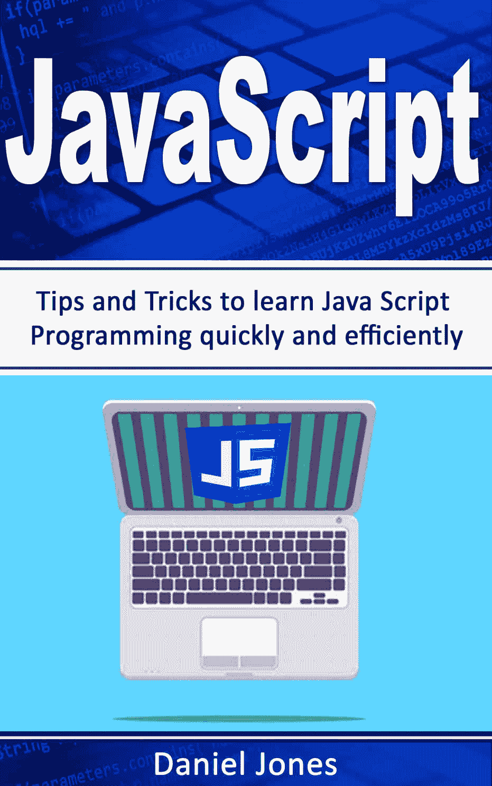

# JavaScript：快速高效学习 JavaScript 编程的技巧与窍门



## 引言

恭喜你下载本书，感谢你的支持。

接下来的章节将讨论帮助你更快、更高效学习 JavaScript 的最佳技巧和方法。

市场上有许多关于此主题的书，再次感谢你选择这一本！我们尽全力确保它包含尽可能有用的信息，请尽情享受！

## 第一章：路线图与实践

在阅读本书的过程中，你会发现它分为两个主要部分：学习编码的技巧与方法，以及将你学到的编码知识应用于实际编写 JavaScript 的技巧与方法。通过这种划分，你将能够学习更多并开始更高效地编码。在书的最后三章中，你将学习已经设计好并准备给你使用的编码技巧、快捷键和模板。请确保你知道在哪里找到这些内容以供参考，之后考虑使用我们在上一本书中提到的笔记本或文档，这样你就能随时知道信息在哪里。

在书的第一部分第一章中，我们将讨论你的路线图以及你可以采取的实践。如果你想确保从 JavaScript 体验中获得最大收益并尽可能学习，这些是你需要遵循的重要步骤。

### 你的路线图

如果你想去一个从未去过的地方，你就必须使用路线图才能到达。实际上，你可能会使用安装在手机和汽车上的 GPS，但 GPS 是取代了路线图的，如果没有路线图，它们是不可能的。为了到达你想达到的 JavaScript 目标，你需要使用路线图。这并不意味着你要旅行或必须去某个特定的地方，它仅意味着你将找到学习 JavaScript 的最佳行动方案。

如果你想学习 JavaScript 以便编写网站甚至成为前端开发人员，在进入 JavaScript 部分之前，你将需要几个步骤。如果你只是想学习它来完成任务或教别人如何做，请考虑简单地接触路线图中包含的每个步骤。

你至少需要学习基础的 `HTML`。你不需要成为它的专家，如果你以后要用 JavaScript，也完全不需要使用唯一的 `HTML`，但学习它是有益的，这样你可以利用所学的 `JavaScript` 和 `HTML` 结合创建一个完整的网页。了解这些将为你的网站提供所需的基础，并帮助你在进行网站 JavaScript 部分时做出一些更大、更重要的决定。

学习 `HTML` 之后，你还需要学习一些关于 `CSS` 的内容。这是大多数网站使用的语言，同时学习这两者将确保你能够以正确的方式进行编码并使用你所学的 `JavaScript`。`CSS` 比 `HTML` 和 `JavaScript` 都复杂得多，所以你可能只想了解表面。如果你计划成为一名开发人员，你最终需要学习 `CSS` 和 `HTML` 的所有方面，但如果你只想学习它来为 `JavaScript` 做准备，就不需要钻得太深。

学习这两种语言后，你就可以创建一个功能完整的网站。你只需要使用它们来制作网站即可。不过，你也可以为其添加一些 `JavaScript`。这就是你学习 `HTML` 和 `CSS` 的原因，对吧？你的 `JavaScript` 将完美融入你通过 `HTML` 和 `CSS` 完成的代码中。请确保在遇到问题时，检查你的 `JavaScript`、`HTML` 和 `CSS` 是否有错误。

每个人的路线图看起来都会不同。你应该确保为你自己创建的路线图是量身定制的。例如，你可能不需要担心 `HTML` 或 `CSS`，因为那是你已经熟悉的内容。你可能还需要了解由于你编写代码的方式而可能产生的不同事物，因为你是 `jQuery` 的专家。编写代码和开发网站有许多不同的方面，找出哪些适合你，并在开始编写代码时将其付诸实践。

### 高效实践

当你做出学习 JavaScript 的决定时，你可能对它非常兴奋，迫不及待开始编写自己的代码并创建自己的网站。随着时间的推移，这种兴奋可能会消退，特别是当你发现学习编写 `JavaScript` 需要大量的实践和步骤时。这可能会令人沮丧，但有一些方法可以帮助实践再次变得有趣。这些只是你在练习 `JavaScript` 时可以使用的一些简单心理技巧。（额外奖励：你实际上在练习任何想要学习的内容时都可以使用这些技巧）。

不要走捷径。虽然直接丢进预写好的代码看起来很容易，但如果你决定这样做，你只会是在伤害自己。这是因为你需要确保自己确实是在学习，而不仅仅是使用别人已经写好的代码。如果你抄了捷径或试图作弊，你将花费更长的时间才能学会你通过 `JavaScript` 需要的知识。这样做会带来很多问题，而且你将无法尽可能地学习。

如果你在寻找练习 `JavaScript` 的动力方面遇到困难，你只需要做的就是改变心态。想象一下，你刚刚学会了一些 `JavaScript` 却无法练习它或将其付诸实践。你可能很想能够使用它，对吧？保持这种心态。如果你只是想象自己无法练习它，你会比完全有能力随时练习时更想去练习它。

另一个你可以使用的心理技巧是尝试回想你第一次学习 `JavaScript` 时的感受。你当时充满了热情，想要一直做下去。让你的大脑回到那个时刻，并为此感到兴奋。即使你必须再次假装自己很兴奋，也要假装直到你真的感到兴奋为止。这将给你一个机会，让你再次像一个拥有新玩具的孩子一样——渴望并准备好玩你所学到的 `JavaScript`。

执行这些心理技巧中的每一个不能保证你有更多时间练习，也不能保证你能更高效地练习，但它们将帮助你进入练习 `JavaScript` 的正确心态。如果你处于正确的心态，你更有可能在实际练习中成功，并在你学习时尝试编写的 `JavaScript` 代码上取得进展。

## 第二章：Facebook 与大白话

现在你已经进入了可以练习的正确心态，你实际上需要开始练习了。即使你对这个过程充满热情，开始和产生动力可能是困难的部分之一。确保你已经在心理上做好了练习准备，然后开始使用这些技巧来完成练习。

本章的第一部分将告诉你该如何开始练习，以及你练习和学习你想要通过编写代码实现目标的最简单方法。

### Facebook

当你有空闲，并且想什么都不做时，你很可能实际上是在看手机浏览 `Facebook` 或你其他喜欢的社交媒体。回想一下你开始浏览的时候。你是怎么做的？你是刻意说自己要坐在沙发上看几个小时 `Facebook` 并反复刷新它吗？还是，你坐下来心里想，你只想看看某某人在做什么？如果是后者，请举手。现在，放下手，你看起来很傻。事实是，大多数人并没有刻意坐下来浪费 4 或 5 小时浏览 `Facebook`，但大多数人都这样做过。

如果你上 `Facebook` 只是为了快速看一眼，很容易掉入不断刷新并获取所有朋友最新消息的旋涡中。如果你试图完成某些任务，这种旋涡可能是危险的。`Facebook` 是对生产力最不利的事情之一，但有一种方法可以利用它来转化为你的优势。你可以利用 `Facebook` 旋涡来帮助自己开始练习 `JavaScript`。

坐下来告诉自己，你只写一段代码或看一眼与你的 `JavaScript` 练习相关的内容。开始处理那件事。你很有可能会被某些其他代码分散注意力，并在完成你原本打算坐下来做的“仅仅一个”之后开始写另一段代码。你现在已经进入了旋涡，可以一次性工作几个小时，而完全没有想过它。你通过只完成一个微小任务欺骗了自己去练习 `JavaScript`。

显然，这并不是每次都灵验。你做得越多，它不起作用的可能性就越高，所以确保只有在你真的找不到动力开始 `JavaScript` 练习时才使用它。你不会每次都掉进旋涡，但不要失望。那只意味着你现在真的不适合开始练习。休息一下，稍后回来练习，这样你就能确保自己确实处于开始练习的正确状态。

通过利用 `Facebook` 旋涡，你为自己提供了又一种练习方式。你可能会发现，一旦你这样做，你就会不断回来尝试更多。你可以陷入练习 `JavaScript` 的旋涡中，这并不是坏事。这正是你所希望的。你希望总是渴望练习，并在编写 `JavaScript` 代码的过程中随着所学的内容不断前进。确保你已经为这种情况的发生做好了准备，并设定了可以练习的时间。

在开始阶段，从日程表中抽出时间可能不是最好的做法，所以确保你不要这样做。如果你为它留了时间，你可能在那个时间并没有练习，从而失去了你一天中的那块时间。你应该只在进入旋涡并且知道自己很喜欢练习后才这样做。你执行它的时间应该是一个其他干扰极少、且你可以清晰思考的时间。

当你开始编写代码和学习 `JavaScript` 时，你可能不知道你的社交媒体习惯能帮助你学习更多，但你始终可以利用它来获得优势。一个可以迅速变成优势的一点是减少在社交媒体上的时间。几乎每个人都需要减少使用 `Facebook` 或 Instagram 的时间，在那里保持高效是一个好主意。如果你处于练习旋涡中，你会花更少的时间浏览 `Facebook`，花更多时间编写对以后有益的代码。

现在你已经知道了开始练习的正确方法，请继续阅读如何以最高效的方式进行练习。

### 大白话

当你和朋友聊天时，想要清楚地说出每个字，你不会在开始说话前停顿，对吧？当你编写代码时也不应该这样做。你应该确保开始时使用大白话，然后利用你对 `JavaScript` 的知识将其以正确的方式编码。

虽然你可能不会像在高中或大学课程中那样，写一篇关于乔治·华盛顿为什么有木头牙的 10 页论文，但你仍然需要写下关于你想做的事情。首先，写下这个网页将是什么样子的、它将包含什么、看起来是什么样以及具体的细节。这将让你有机会写下你对该网页的所有想法。

一旦你写下了所有这些信息，就可以开始撰写关于页面内容的信息了。它会是一个博客页面吗？一个问题区？一个测验网站？还是向人们介绍你的页面？或者是一个导航页面？所有这些都可以使用你的编程语言以及 `JavaScript` 来实现，所以请确保你清楚自己想写什么。在写页面外观信息的相同位置，用通俗的语言将其写下来。

随着你编写 `JavaScript` 越来越练，你可能会发现自己实际上正将代码直接插入到本应该编写的纯文本中。这样做是可以接受的，只要代码是顺着你的思路流出的，而不需要查阅。如果你发现自己停下写作去查找代码，那么是时候回到只用通俗语言写作了，这样你才不会在准备要做的代码草稿上浪费时间。

即使是经验丰富的开发者也会使用这个技巧，以便习惯非常复杂代码的样子。编写复杂的代码可能是困难的，所以请确保你能够先用通俗语言将它们写出来。如果你能先用通俗语言写，你将对自己正在操作的代码以及以后想用它做什么有更好的理解。如果你知道自己将编写复杂的代码，请务必确保这样做，以便你可以在回去检查错误之前就消除缺陷和错误。

你有许多不同的方法可以进行练习，但将这些原则中的每一项应用到你的实践中，将让你有机会确保在 `JavaScript` 学习过程中做出了所有正确的决定。始终务必确保你尽可能多地练习，并在尝试练习之前尽可能多地学习。有一句老话叫“熟能生巧”，这完全适用于学习 `JavaScript` 以及它能为你做的一切。

当你正在练习时，请确保你始终记得你最初开始时想做的事情。这样做会让你保持谦逊，并为你提供持续学习更多知识所需的动力。

## 第三章：慢下来思考，保持谦逊

编写代码可以非常快，尤其是当你清楚自己在做什么，并且对你在 `JavaScript` 字符串中编写的代码有丰富经验时。你可能会进展很快，而这可能导致你犯错。当你对 `JavaScript` 越来越精通，并且觉得能用它做更多事情时，情况尤为如此。你可能发现，当你编写代码变得越来越熟练时，你对所做的一切都非常有信心。自信并不是坏事，但它可能导致你忽略掉一些可能产生错误的地方。为了确保你在编写代码时尽最好的，即使在练习时也是如此，你也应该确保自己尽可能慢地思考，不要对自己的能力过度自信。

### 慢下来

在你编写脑海中的代码时，请确保尽可能慢。这在最初可能花费更多时间，但当你回过头处理你所犯错误时可能需要做的不同事情时，它将为你节省大量时间。通过慢下来，你产生错误的概率会更小。

即使在你回看代码并逐行检查每一行 `JavaScript` 时，也请缓慢地查看。阅读每一个字母和符号，这样你就会清楚自己在表达什么，并能够看到是否漏掉了任何内容。这就像你在高中或大学写论文时可能会校对一样。慢下来，逐行校对你写的作品和编写的代码。这种缓慢的节奏将帮助你发现你可能犯的任何错误。

值得注意的是，慢一点将帮助你避免工作中的任何重大错误。如果你以较慢的速度移动，你对每一次击键和输入到每一行代码中的每一件事都会更加敏感。缓慢的节奏不仅在你回看所写的内容时帮助你，也能在你编写内容时帮助你。确保你已经准备好尽可能慢，不要匆忙你的工作。

### 休息一下

从你正在做的工作中休息总是有利的。在连续几个小时代码后，你的眼睛不仅会疲劳，大脑也会开始感到疲惫。休息将帮助你刷新正在做的事情，并让你有机会带着空白大脑重新开始。在编写代码时保持大脑新鲜有很多好处，而休息将为你提供完美的刷新。

通常情况下，每工作一小时代码，你应该花 5-10 分钟离开电脑，站起来走走，做一些与 `JavaScript` 无关的事情。利用这段时间去外面呼吸新鲜空气，或者简单地走走是极好的主意。这两项活动都能帮助血液循环，并在决定坐回去再次工作时为大脑提供所需的氧气。

一个提醒：在你离开电脑屏幕休息期间，尽量不要玩手机。虽然手机小得多，但手机屏幕发出的蓝光与电脑屏幕一样有害。工作时留出专门的时间使用手机，这样你就不必占用休息时间来和朋友聊天或检查非工作邮件了。休息时，将手机放在够不到的地方是个好主意。

### 梳理一遍

一旦写完了你想写的代码，你需要确保你正在梳理它。像你编写过程一样慢地这样做，这样你就能发现你犯的任何错误。你应该在写完最后一行代码之后、在测试不同情况进行检查之前这样做。确保你缓慢进行并查看每一行代码总是极好的主意。

一种确保你查看了所写代码每一个字符的方法是将其大声读出来。对自己说每一个字母、数字和字符，这样你就能确保它们的编写方式是正确的。大声读出来总是很有用的，因为读出来会让你看到你实际写了什么。读出来比在脑子里读要花费更多时间。如果你在脑子里读，可能会错过很多东西。

虽然大声读出你写的每一行代码可能看起来很复杂，但你仍然应该尝试这样做。这样做将让你有机会发现你可能遗漏的细节。如果你擅长阅读，并且确保自己没有犯任何错误，你就能高效地完成任务，而不会浪费大量时间。实际上，这花费的时间比回去修复所有错误的时间要短得多。

### 调整信心

虽然在你刚开始或在学习代码时可能不会遇到这个问题，但对于那些编写 `JavaScript` 的人来说，过度自信可能是一个大问题。你认为自己对它已经足够了解了，而且本质上，你在编写它时放松了警惕。这是一个问题，因为你在编写代码时发现错误的速度不会那么敏锐，而且你可能会认为你写的代码没有任何问题。

保持信心在合理的范围内是非常重要的。即使你觉得自己的写代码能力非常出色，永远不会犯错，你犯错的概率仍然很高。在任何时间、编写任何类型的代码行时，错误都可能发生在任何人身上。确保你清楚自己在做什么，不要对自己的技能感到自傲。在编码方面，总有更多可以学习的东西，没有人能通晓一切。

你的自信甚至会欺骗你，让你忘记从代码中学到的东西。自信告诉你清楚自己在做什么，以及编写代码的最佳方法。它告诉你，对每一行代码反复编写相同的内容没有问题，但它也告诉你，不需要为你编写的代码尝试通过不同的方案来更加努力。确保你对自己的技能充满信心，但不要让这种信心高到以至于阻碍了你对成功的观察。

### 怀疑你自己

不要相信你自己。当你审视自己写的代码时，你的大脑会试图告诉你你没有犯错，也没有遗漏任何内容，但事实可能是你实际上遗漏了某些不同的行，并且犯了一些错误。务必始终质疑自己是否在尽可能最好的编码工作，这样你才能写出你期望的精确代码。不要相信自己能做到，而要始终检查你做的事情是否正确。

做到这一点的一种好方法是在编写和检查代码之间休息一下。确保休息时间足够长，让你能够真正刷新大脑。把它当成你的一次放松休息之一，但要花费更长的时间，这样当你开始测试和查看代码时，你才能真正以清醒的状态回来。如果你盯着同样的 100 行代码看了 5 小时，然后尝试编辑它们，你将很难挑选出你犯的错误。

在书的第一部分章节中的所有技巧都涉及练习以及在练习过程中你可以学到的东西。它们本质上是你可以用来让你的编码实践变得更顺畅的心理技巧。在书的其余部分，你将学习在开始编写代码时应用这些中的每一个。真正的乐趣在于你在本书的第二部分学习在这里使用的最佳代码。

## 第四章：基础

在能够真正参与 `JavaScript` 最高级的部分之前，你必须学习 `JavaScript` 的基础知识。学习基础是非常重要的，这样当你开始更多地使用它时，就会有一个坚实的基础。学习这些基础技巧并加入你的 `JavaScript` 知识库，将帮助你尽可能在 `JavaScript` 上获得成功，并以你能够真正创建出优秀的网站和网站选项的方式编写代码。

### 变量列表

在编写 `JavaScript` 代码时，你很可能某次需要列出变量。学习 `JavaScript` 后，似乎在每个变量标签下列出每一个变量是一个好主意，例如：

```javascript
var oneThing = 'a list';
var differentThing = 'different list';
var otherDifferentThing = 'other different list';
```

这些中的每一个都是不同的代码行，并且它们是分开的。与其这样做，你可以通过以下方式让你的代码看起来更好、更整洁：

```javascript
var oneThing = 'a list',
    differentThing = 'different list',
    otherDifferentThing = 'other different list';
```

注意，在上面的每一个中，每个变量后面都有一个分号。在下面，第二个和第三个变量之前有缩进。这表示有一个新的变量。在第一个和第二个变量之后还有一个逗号，表示它仍然是一个列表，但也必须被分开。分号只用在每个列出项的末尾，而不是在每个变量之间。

这是一个好主意，并不是因为它比使用典型的分号给页面带来更多速度，而是因为它让代码看起来更顺眼。当你查看它时，它更容易阅读，如果你需要回来编辑它以进行更改，这对你来说将要容易得多。你不需要筛选一行又一行的变量，因为它们都在一个地方。

### 分号的困境

在现代浏览器中，`JavaScript` 并不一定需要在文本字符串之间有分号，因为浏览器能够直接识别文本串。但这样做的问题在于，它们并不是万无一失的，浏览器经常会抓取错误的字符串。这可能会破坏整个代码，让你无论是作为开发者、老师还是仅仅是自己制作页面的人都显得不专业。无论你做什么，不要创建这样的字符串：

```javascript
var yourItem = "this string
function doIt () {
return 'it'
}
```

这里没有分号，你无法找到其中的错误，因为没有分号。那些无法识别字符串的系统会让你的网页看起来就像是坏了一样，这会让你看起来很糟糕。始终使用分号隔开，这样：

```javascript
var yourItem = 'this string';
function doIt () {
    return 'it';
}
```

分号是字符串的开始和结束。它告诉浏览器在哪里应该停止，以及在哪里可以获取新信息。通过确保放置了分号，你将能够告诉它哪里需要停止。

如果你正在使用某种测试软件，甚至是允许编写纯文本的软件，你应该更改设置。你可以选择允许程序能够确保字符串前后不要有分号的设置。系统可以识别分号需要所在的地方，并告诉你你需要修改字符串并对其添加分号。

### 编写注释

如果你读过该系列中之前的任何作品或书籍，你就会知道，将你创建的不同代码以及它们的作用记录在你在编码时作为参考的文档中是非常重要的，但同时也直接在代码中写下来也很重要。这样做将让你有机会轻松地浏览你的代码，以便找到你做了什么以及它产生了什么。如果你需要修复特定的内容，例如网站超时的方式，你随时可以回去找到你对此做过注释的代码。

要写注释，你唯一需要做的就是在注释前写两个反斜杠，并在结尾加一个句号。你的注释看起来应该像这样：

```javascript
// 开启计时器以跟踪网站加载需要多长时间。

function timeTracker () {
}
```

不要使用注释后面列出的函数。它只是一行代码的片段，如果你尝试实际寻找一个可以跟踪你网站加载耗时的计时器，它将无法正常工作。显示它仅仅是为了让你参考你的注释应该放在的位置。

你可以在你写的每一行代码上使用注释功能。虽然在你只写几行代码时，在开头这样做似乎是多此一举，但当你编写了更多代码时，你会很庆幸自己这样做了，因为你将能够确保在成百上千行代码的海洋中准确地找到你正在寻找的内容。

### Firebug 计时器

在很多情况下，找出你的网页加载需要多长时间以及在多久之后才能完全加载将是一个好主意。无论你是什么哪种类型的开发者，学习加载页面所需的时间都能从中受益。然后你可以利用此对它进行改进。虽然这不一定是你自己编写的代码，但它是 Firebug 创建的一个模板，你可以用它来找出加载需要多长时间：

```javascript
function timeTracker () {
    console.time("THE TIMER");
    for (x = 5000; x > 0; x--) {}
    console.timeEnd("THE TIMER");
}
```

这段代码在你刚开始或只是想找出你的页面加载需要多长时间时特别有用。

如果你发现页面加载需要很长时间，有几种不同的选项可以让它变快。你可以通过删掉一些不需要的内容来修改你编写的代码，使其更高效。你也可以花时间将所有内容移动到页面底部。

### 移动到底部

当你将内容移动到底部时，你的文本和内容将加载得更快。虽然你确实需要在页面顶部编写重要信息，但你可以在底部添加一些你不一定需要的内容。这将确保你能够让页面加载。

由于在所有必要信息加载到页面之前，页面将无法加载，因此你仍然需要将重要部分添加到页面顶部以便它们能够加载。在底部添加不那么重要的信息是可以接受的，因为它们加载所需的时间更短。顶部的内容越少，当你访问时页面加载的速度就越快。

### 消除语言标签

当 JavaScript 代码首次被编写时，它们包含了“language”（语言）标签。这样做是为了让浏览器识别代码语言并立即处理。由于现在大多数浏览器都具有直观性，而且 JavaScript 是人们编写代码时最流行的选项之一，代码的语言标签已不再需要了。事实上，使用它是很过时的，实际上会减慢系统并让你的页面加载变慢得多。你可能在 20 年前看到的常见代码：

```html
<script type="text/javascript" language="javascript"> 在此处放置你的所有信息</script>
```

由于语言标签是多余的，你只需要放：

```html
<script type="text/javascript"> 在此处放置你的所有信息</script>
```

这消除了语言标签，让你列表中的包含的代码行数更少，并且实际上可以提高你网页的加载速度。移除语言标签不仅可以让你更容易找到所需的信息，还能让你在人们访问时获得提供一个更快的网页的机会。

仅凭对 JavaScript 的基础知识，你就可以做很多事情。这是你入门和练习的极佳方法，但使用这些简单技巧将使你有机会利用现有的工具做得更多。在你刚开始时，尝试本节中包含的一些技巧，这样当你需要转向针对 JavaScript 代码的更大、更复杂的技巧时，就不必担心该做什么。

## 第五章：酷炫的 JavaScript 技巧

编写 JavaScript 不一定全是关于如何制作单选按钮和弹出窗口供人们访问你的网页时使用。你还可以利用 JavaScript 做一些酷炫的事情，让人们好奇你是如何让你的网页做到那样的。这是让你的网站在数百万网站中脱颖而出并声名大起的好方法。人们喜欢看到不寻常，而所有这些酷炫的技巧将带给你这些——与众不同在你执行时感到很棒的东西。

### 图片移动

你页面上的图像实际上是可以移动的。你甚至不需要使用常见的 GIF 图像来实现（尽管你可以像放入其他对象一样将它们放入代码中）。如果你想让静态图像在有人进入页面或鼠标悬停在图像上时开始移动并跳舞，你只需要在代码中放入几样。这个技巧将允许页面上所有的图像相互旋转跳舞：

```javascript
R=0; x1=.1; y1=.05; x2=.25; y2=.24; x3=.6; y3=.24; x4=300; y4=200; x5=300; y5=200; DI=document.getElementsByTagName("img"); DIL=DI.length; function A(){for(i=0; i<DIL; i++){DIS=DI[i].style; DIS.position='absolute'; DIS.left=(Math.sin(R*x1+i)*x2+x3)+"px"; DIS.top=(Math.cos(R*y1+i)*y2+y4)+"px"}R++}setInterval('A()',5); void(0);
```

确保将其放入文本生成器中以确保操作是正确的。直接复制粘贴是一个好主意，但如果你这样做，你需要记录下来以便发挥最大的作用。

如果你想让图像以不同的模式跳舞，考虑调整底部的数字。这些是它们跳舞的方向，并且很容易更改。为了找出哪种方式最适合你的浏览器，你需要进行更改，然后使用这些更改进行测试，看看图像以什么方向移动。

### 网站验证

可以将此代码添加到你的代码行中，这样人们就能一直知道自己处于一个合法的网站上。当有人访问你的网站时，不会弹出任何内容，他们甚至无法知道你已经在网站中编写了这种类型的代码。除非你的网站被他人克隆了，否则他们什么也看不见。服务器地址和 `URL` 必须完全匹配，才能被正确使用。你可以采取许多不同的方法来确保你的网站受到保护，但这是你可以编写的最简单的代码之一，而且你的访客甚至完全不会察觉到它的存在。

添加这段代码是一个好主意，因为这样你的访客将始终能够确信他们访问的是正确的网站。如果出于某种原因出现了警告信息，你应该让访客知道他们实际上并不在你的网站上，并且面临着被黑客或在线攻击者攻击的风险。他们应该知道，如果看到该消息，就需要离开浏览器或跳转到其他网站。

### 简单章节

你可以通过一行代码在网页上创建一个与其他部分隔离开的章节。它实际上由几行不同的代码组成，其中包含变量并可以更改网站上的显示方式，让你能够对其进行更多操作。模态框是一种让内容在网页上弹出的简单有效的方法，让人们能够看到你在做什么。编写方法如下：

```css
div#easyModal {
  width: 449px;
  position: absolute;
  top: 28px;
  left: 150px;
  padding: 15px;
  border: solid 1px #000;
  background: #fff;
  -webkit-box-shadow: 0px 4px 8px rgba(0, 0, 0, 0.25);
  -webkit-transition: opacity 0.25s ease-out;
}

div#simpleModal.shown {
}
```

你可以更改各种属性，如边框的大小以及页面上不同定位的大小，但要确保它不会变得太大，或者不会完全覆盖你已经编写好的作为其一部分页面。

除了边框的大小、框的大小以及它所在的位置，你还可以更改颜色。你可以使用简单或高级的十六进制比例来选择颜色，但要确保模态框内的文字不会因为背景颜色而变得不可见。你还应该确保框的颜色与你已经在网页上使用的其他颜色协调。

### 对象属性

有时你可能想让对象的所有属性都为人感知。这可能是因为你想展示可用的不同选项，或者你只是想让某物在许多其他相似物品中脱颖而出。当你这样做时，你可以确保自己以正确的方式处理对象，并可以确保人们在决定访问你的网页时能够看到不同的选项。如果你想让人们选择一个特定的对象，这样做是一个好主意。以下为对象编写属性迭代的代码：

```javascript
for (let i = 4; i < thisList.length; i++) {
  var thisItem = thisList[i];
  // this list does it
}
```

这不仅可以显示特定对象的自带属性，还包含了你在脚本注释中需要留下的说明。这样做将让你有机会引导你的网页访客选择你想要的对象，但也会向他们展示当他们选择访问你的页面时将要做什么。

选择其中一个能向他人展示你能做什么的属性高亮显示，将给你一个机会来确保你正在以正确的方式处理事务。它还将让人们在访问你的网站时看到可选的选项，并为他们提供做出良好选择所需的信息。这不一定能保证他们会做出选择，但可以引导他们做出那个选择。

### 用于其他网站

你不一定非要在自己的网站上工作才能使用 `JavaScript`。你可以使用 `JavaScript` 编辑一个甚至不是你自己的网站，使其呈现出你想要的样子。这种方法非常简单，你会对结果感到满意，因为在编辑页面时，你可以受益于许多不同的选项。要编辑你当前所在的页面，你需要做的就是删除浏览器栏中的信息并插入：

```javascript
javascript: document.body.contentEditable='true'; document.designMode='on'; void 0
```

它现在的运行方式与文字处理器或你可以使用的任何其他类型的编辑器完全相同，让它看起来和你想要的一样。除非你从服务器端使用这种技巧，否则在任何其他人的电脑上都不会以此方式显示；但如果你想为了自己的利益让某个网站呈现出特定的样子，它会非常有用。你能想象一下，如果 Google 上输入的是你的名字，而不是你所熟悉的“Google”标志，它会是什么样吗？

在改变内容并使用 `JavaScript` 实现这一点方面，有很多选择。无论你是在使用自己的网页、他人的网页，还是只是在尝试这样做，你都能从 `JavaScript` 提供的一切功能中受益。当你学会了这些技巧时，可以对它们进行定制，使其以适合你的方式工作。只需确保你总是善意使用它们，而不是对其他开发者或喜欢电脑的人进行恶意行为。

如果你使用了错误的代码，就会面临破坏你在代码中编写的其他字符串的风险。这可能导致你无法继续处理页面的其余部分，并让你在实际改进时变得更加困难。开头可能存在一个容易修复的问题，但如果它一直留在那里，即使是其余代码看起来也不对，你的页面也将无法按照你完成后预期的样子呈现。

### 额外字符

在编写代码时，你可能会发现代码中不小心混入了一些字母，这些字母可能会导致代码发生变化。这是一个问题，因为你需要确保充分利用代码的作用，而代码中额外的字符会改变整体的逻辑链条。除非你希望在代码之外出现额外的字符，否则你需要检查并再检查，确保你没有混入任何额外内容。

你还应该确保你编写的代码中没有无关字符。这可以是任何内容，从一个多余的逗号到整段完全不需要的单词字符串。

### 缺失字符

你始终需要在文本字符串后加上一个分号。这一点无论怎么强调都不为过，它是确保你每次都以正确的方式完成正确代码至关重要。即使你认为不需要分号，在那里加一个分号也是好主意。缺失分号会对代码的呈现方式产生严重影响，并可能导致你的页面看起来是不完全的。因此，你需要确保在每次更改文本字符串时都写上分号。

此外，确保包含所有必要的括号和大括号也很重要，这样你的代码才能保持良好的组织结构。如果你想用圆括号代替括号，你应该确保它们的方向正确，并放置在正确的位置，以便它们能够支撑起代码。

### 错误位置

如果你想确保网页尽可能美观，那么将部分代码放在错误的位置可能会是一个大问题。你应该确保信息被包含在正确的位置，无论是在顶部还是底部。通常，加载时间较长的内容应该放在底部，而你需要在页面上首先显示的内容应该放在靠前的位置。所有信息应该包含在 `<script>` 标签内，并应该放在一个中心位置。

如果你未能将信息包含在 `<script>` 标签中，可能需要另一个标签，或者一个与初始标签结合使用的标签。你还应该确保你的方法正确，并且你想要包含的所有信息都已包含在内。标签之外的代码将独立显示，在网页上显得格格不入。它不会被格式化，也不会与页面上的其他信息相融合。

### 格式错误

格式在 JavaScript 中至关重要。因为这是一门主要用于格式化的语言，所以你在编写网页代码时，需要确保这是你工作的重点。无论遇到什么种类型的错误，始终检查格式都是一个好主意。JavaScript 的格式以及文本格式，当你测试页面以查看是否有何问题（如果有问题的话）时，都可能是问题的根源。

有些东西与不同类型的代码是不兼容的。还有些东西无论你如何努力让它们结合，都无法运行。例如，你无法创建一个既是粗体又格式化为加粗的字体。那样太极端了，字体将因为太粗而无法阅读。这种错误可能表现为仅显示为纯文本，或者根本不显示。确保所有的格式化都正确完成，你就能在你创建的网页上准确地显示你想要的内容。

## 结论

感谢你读到这本书的最后，希望它提供了丰富的信息，并能够为你实现目标（无论目标是什么）提供所需的所有工具。

下一步是阅读系列中的下一本书，书中包含了简单的 JavaScript 策略。一旦你完成了这一点，你就已经在编程的道路上了，并开始使用 JavaScript 编写。

最后，如果你觉得这本书在任何方面都有帮助，非常感谢你在 Amazon 上给出评价！
