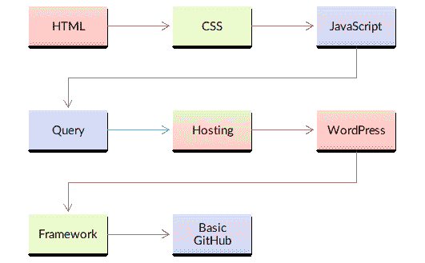
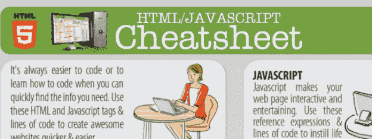
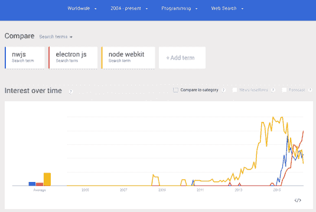
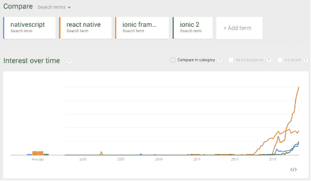
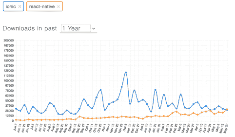
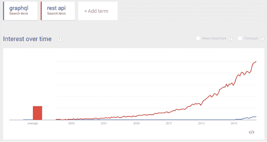

# JavaScript 编程技巧与技巧指南

## 介绍

`JavaScript` 是一种广泛使用的编程语言，是 Web 程序员生活和编程技能不可或缺的一部分。它是使网页具有交互性和动态的基础；它被用于创建表单、调查和测验，并经常用于轻量级编程。

它是从基础的 Internet Explorer 到先进的 Google Chrome 和 Safari 等所有主要浏览器中使用的常用的计算机语言。大多数计算机在安装系统时已经安装了 `JavaScript`，因此可以确保来自世界的访问者都能查看你在互联网上的内容、软件和计算机程序。

每个人任何人都可以使用 `JavaScript` 而无需购买许可证。

此外，如果你在好奇的话，`JavaScript` 和 `Java` 是两种完全不同的计算机语言，用于各种编程需求。

`JavaScript` 的特点在于，有许多预先写的 `JavaScript` 代码，你可以复制并直接插入到你的网页中以实现类似的效果，而无需自己重新编写所有代码。你唯一需要知道的是找出代码的作用，然后将这些代码复制并粘贴到特定的位置，以获得预期的效果，就像烘焙蛋糕一样。

如果你打开了这本书，我们不会进入 `JavaScript` 的细节，也不会教你基础知识、编码和编程的步骤，或如何将这些代码粘贴到你的网页中。

然而，这本书将为你提供大量的技巧和策略，帮助你成为一名更优秀的程序员，并更高效地使用 `JavaScript`。

### JavaScript 简史

回到 20 世纪 90 年代，当世界网仍处于发展阶段时，所有网页都是静态的——用户与网站之间没有交互。你看到的完全就是设置好的。

当时最流行的两个浏览器是 Internet Explorer 和 Netscape Navigator。虽然 Internet Explorer 名得多，但 Netscape 是第一个引入让网页能够与用户交互的编程语言的浏览器。这种语言被称为 `LiveScript`，并被集成在 Netscape 浏览器中。得益于这种语言，任何使用 Netscape 的现在都可以与页面进行交互了。`LiveScript` 不需要插件。

另一方面，还有另一种编程语言需要单独的插件才能运行，那被称为 `Java`。此时，`Java` 变得非常有名，Netscape 决定通过此大赚其利，将 `LiveScript` 重命名为 `JavaScript`。

正如前面提到的，`Java` 和 `JavaScript` 之间存在巨大差异，尽管它们的代码看起来相似。

然后，Internet Explorer 出于创新需求进行了更新，并受到了两种集成语言的支持，一种是基于 `BASIC` 编程的 `vbscript`，另一种是类似于 `JavaScript` 的 `Jscript`。

当 Internet Explorer 成为最常用的浏览器时，`JavaScript` 也成为了即将出现的浏览器中最受接受和最广泛使用的编程语言。

回到 1996 年，脚本语言变得如此重要，以至于将其交给竞争性的浏览器开发者是有风险的。在同年，`JavaScript` 被交给了 `ECMA`，这是一个负责编程语言开发的国际标准机构。这种语言被正式命名为 `ECMAScript`，但程序员和其他人仍然称它为 `JavaScript`。

它听起来也酷得多。

### JavaScript 的重要性

理解 `JavaScript` 如何使用，就是理解开发网页时其他编程语言的基础作用。

简单来说：

1. `HTML` 是用于标记内容的语言。`HTML` 定义内容是什么，而不是它在网页上什么样子。
2. `CSS` 用于定义网页的外观，这涉及到指定哪些媒体对应哪些命令。

只需使用这两种语言，你就可以创建一个易访问的静态网页，无论你在什么设备上查看网页以及使用什么浏览器访问。

然而，这类网页最大的缺点是，访问者与静态网站交互的唯一方式就是填写表单并等待新页面加载。

这就是 `JavaScript` 发挥用场的地方。

`JavaScript` 将静态页面转换为交互式，这样网站访问者每次提出请求都不需要等待新页面加载。`JavaScript` 使你的网页具有行为——让它们能够响应各种操作。

通过 `JavaScript`，你可以：

- 在用户输入信息时验证表单中的每个字段，而不是填完整个表单并在提交后才告诉用户拼写错误。
- 让你的页面具有比表单之外的更多交互方式。
- 为页面添加动画，吸引对特定部分的注意力或使网站更易用。
- 在网页上加载更新、更重的图像和脚本
- 帮助你提升访问者的体验

## 第一章：帮助你快速学习 JavaScript 的简单技巧

通常，在学习 JavaScript 或任何编码技能的道路上，人们往往会遇到以下问题：

- 概念混淆
- 学习的时间和动力
- 代码容易忘记
- 工具链不断变化

在本章中，我们将学习如何通过一些心理技巧来攻克这些挑战，这些技巧可以帮助你更快地掌握 JavaScript 领域，让你成为一名更高效的编码员。

### 技巧 1：为你想要学习的内容制定路线图

面对现实吧——有许多框架可以使用，新手总是处于“该从哪一个开始”的十字路口。与其研究从哪个框架开始，克服这一问题的最好方法之一就是为你需要了解的知识制定学习路线图。

例如，如果你想成为一名前端开发者，那么你的路线图可能如下：



在学习其他内容之前，HTML 和 CSS 是你需要掌握的最基础编码知识。然后你可以学习 JavaScript 和 jQuery。一旦你制定了路线图，它将让你更容易专注于最核心的内容，从而避免浪费精力和。

### 技巧 2：慢慢来

想要快速理解编码将是阻碍你学习编码和 JavaScript 进展的有害因素之一。

试图走马读某些内容然后跳到下一个问题，只会让你忘记得更彻底。你会忘记第一次读到的内容，回去重读一遍以加深记忆，然后继续。到那时，你又完全忘记了其他某些东西。这种循环会不断重复，最后你会发现自己灰心意丧。为了防止这种情况发生，你可以这样做：

- 将编码量限制在特定任务上。一次只学一件事
- 练习你所学的内容

通过学习和练习你的编码技能，你会发现随着学习新内容的深入，记忆和吸收它们会变得容易得多。这个过程看起来可能很长，但熟能生工。

### 技巧 3：带着正确的心态进行练习

记住：如果你试图在 JavaScript 练习中走捷径，最终只会花费更长时间来学习它。是的，练习是无聊且重复的，但这里有一些让它变得有趣的方法：

尝试将 JavaScript 中的每个新概念看作一个新玩具、汽车、iPhone 甚至一件新衣服。你会对尝试它感到兴奋，尤其是当它是新的而且你使用了几次之后。用你刚刚学到的概念应用一些酷酷的东西；让自己惊喜并展示给朋友们看。

### 技巧 4：划分你的时间

通过学习和练习你的编码技能，你会发现随着学习新内容的深入，记忆和吸收它们会变得容易得多。这个过程看起来可能很长，但熟能生工。

### 技巧 5：给自己留出时间

### 技巧 6：用通俗易懂的语言编写


[STEAMFEED HTML 与 JavaScript 快捷键备查表](http://www.steamfeed.com/html-and-javascript-cheat-sheet-for-site-designers/)

SteamFeed 的优秀们制作了一份非常棒的备查表，将 HTML 代码和 JavaScript 信息放在一个整洁且易于阅读的信息图中，你可以将其打印并放置在视线范围内，这样在练习编码时就可以轻松查阅。



[网页设计备查表](http://blog.sellfy.com/cheat-sheets-for-web-designers/)

如果你需要一个可以访问各种网页设计相关备查表的网站，那么 Sellfy 提供了关于 CSS、响应式网页设计备查表、HTML 标签等更多优质资源。


[终极 JavaScript 备查表](https://www.codementor.io/johnnyb/tutorials/javascript-cheatsheet-fb54lz08k)

这份来自 codementor 网站的备查列表提供了 JavaScript 语言的快速概述。你可以选择从头开始阅读，也可以跳转到感兴趣的话题。


## 第三章：设计和构建自己的 JavaScript 库的技巧与窍门

你说 JavaScript 库吗？

不，它并不包含书籍。但是，它包含了封装的代码，网页设计师、开发者和程序员可以在项目中使用这些代码，从而节省时间和精力。换句话说，当你想要将相同的代码应用到不同的网站和程序以实现相同的效果时，你不需要重复发明轮。

### 什么是 JavaScript 库？

以下是 JavaScript 库的几个显著特征：

- 它在单个文件夹中有一个或多个文件
- 当你使用它实现项目时，它的代码必须单独维护并保持原样
- 它应该允许用户设置项目特定的行为或配置

在本章中，我们将讨论为什么你应该构建 JavaScript 库，以及如何用最简单的方法构建它们。

### 为什么要构建自己的 JavaScript 库？

首先，它对程序员和网页开发者来说都非常方便，特别是当你编写和开发大量的程序、网站和 Web 应用程序时。拥有一个现有代码的库会让你的工作变得更容易并节省时间，因为你不需要不断地从硬盘中某个模糊的文件夹里翻找旧项目。你只需要从库中提取它们即可。你有一个方便的地方来存储所有的代码；你有一个地方来拆分所有的应用程序，并将它们都保持在一个更容易维护的位置。

本质上，任何让你的工作变得更容易且可以重用的代码都是添加到库中的极佳组件。其中一个很好的例子就是 `jQuery`。`jQuery` 的 `API` 是一个更简单的 DOM API。在跨浏览器 DOM 操作仍然困难的，`jQuery` 是必不可少的。

如果一个开源项目变得越来越流行，会有越来越多的开发者使用它，最终将鼓励更多开发者加入并通过贡献代码和提交问题来协助这项事业，这将帮助它变得更容易操作。这种贡献将使该库以及所有依赖于它的其他实验受益。

热门的开源项目也可以为开发者带来绝佳的机会。科技公司或任何组织可能会对某位开发者的工作质量留下深刻印象，并向他们提供工作。这可能意味着一家公司将提供一名开发者来合作某个项目，或者让他们将其项目集成到自己的应用程序中。

但对于大多数开发者或编码员来说，拥有自己的库是一种爱好；这种爱好使他们能够编写多个代码、帮助他人并对过程做出贡献。

### 你的目标和工作范围

在你开始编写代码之前，你需要明确你对这个库的目标是什么。这有助于帮助你专注于你遇到的问题，以及如何使用你的库来解决它们。

你的首要目标也是让你的库易于使用。本质上说，你的 `API` 越简单，任何人就越容易使用你的库。

所以问问自己——你的库解决了什么问题，你如何解决它？你会利用来自别人库的代码，还是会自己编写一切？

在第一章中，我们讨论了创建路线图。你库的这个路线图将是你开始任何其他代码开发时会使用的技术之一。

#### 你的库的路线图：

- 列出你想要在库中的功能
- 让这些功能保持最少且实用
- 为每个功能创建里程碑

你通过路线图所做的是为每个功能设定目标，本质上是将你的项目拆分成可管理的规模，使其更容易完成，并且创建过程会变得有趣得多。它还会让你保持清醒和专注。

### 你的库 API 设计

在创建库时，把自己想象成终端用户。通过把自己放在用户的位置，你朝着以用户为中心的设计努力。

#### 测试你的 API

测试你的 `API` 质量的最佳方法是将其用于你的项目。你可以做是用你的代码替换它，看看结果是否涵盖了你想要的功能。

这里是 UserAgent 库的一个示例：

```javascript
// 从空的 UserAgent 开始
var userAgent = new UserAgent();

// 创建并添加第一个产品：EvilCorpBrowser/1.2 (X11; Linux; en-us)
var application = new UserAgent.Product('EvilCorpBrowser', '1.2');
application.setComment('X11', 'Linux', 'en-us');
userAgent.addProduct(application);

// 创建并添加第二个产品：Blink/204210
var engine = new UserAgent.Product('Blink', '204210');
userAgent.addProduct(engine);

// EvilCorpBrowser/1.2 (X11; Linux; en-us) Blink/204210
userAgent.toString();

// 对引擎进行一些更多更改
engine.setComment('Hello World');

// EvilCorpBrowser/1.2 (X11; Linux; en-us) Blink/204210 (Hello World)
userAgent.toString();
```

根据你的库的复杂程度，你还需要考虑结构化。这种的方法是利用设计模式来构建你的库，并克服过程中可能遇到的任何技术问题。

结构化还减少了在库添加新功能时重新对齐大部分部分的风险。

### 灵活性与自定义

大多数 JavaScript 库的一个酷酷之处在于其灵活性。然而，许多开发者在决定哪些可以自定义哪些不能自定义时会遇到问题。其中就有 `chart.js` 和 `D3.js`。

这两个元素都是数据可视化很好的库。如果你需要对图形有更多控制权，那么 `D3.js` 是你想要的。如果你想要一种容易创建且提供不同类型内置图表的东西，那么 `Chart.js` 是你的选择。

你有三种方法可以让你的用户控制你的库：

1. 配置
2. 暴露公共方法
3. 回调与事件

库的配置通常在项目初始化阶段完成，但某些库也允许你在运行时进行设置。这些配置通常仅限于简单的问题，因为更改这些设置只会更新这些值以供后续使用。

代码：

```javascript
// 在初始化时配置
var userAgent = new UserAgent({
  commentSeparator: ';'
});

// 使用公共方法进行运行时配置
userAgent.setOption('commentSeparator', '-');

// 使用公共属性进行运行时配置
userAgent.commentSeparator = '-';
```

某些方法被刻意暴露出来以便与实例交互（getter），例如从实例中检索数据或向实例中写入数据（setter），以及执行某些操作。

代码：

```javascript
var userAgent = new UserAgent;

// 获取所有产品注释的 getter
userAgent.getComments();

// 打乱所有产品顺序的动作
userAgent.shuffleProducts();
```

回调有时也会通过公共方法接受并传递，它通常用于在异步任务后运行用户代码。

```javascript
var userAgent = new UserAgent;

userAgent.doAsyncThing(function asyncThingDone() {
  // 在异步任务完成后运行代码
});
```

事件在 JavaScript 库中具有巨大的潜力。它们与回调略相似，但区别在于添加事件处理器不会导致触发动作。事件还用于指示某些事件，并可以向用户提供额外信息，同时为库返回对应的特定值。

代码：

```javascript
var userAgent = new UserAgent;

// 在添加产品时进行验证
userAgent.on('product.add', function onProductAdd(e, product) {
  var shouldAddProduct = product.toString().length < 5;
  // 告诉库是否添加该产品
  return shouldAddProduct;
});
```

你还可以允许用户扩展你自己的库。为了实现这一点，你需要公开你的公共方法或属性，以便用户对其填充，例如 Angular 模块。

代码：

```javascript
(angular.module('myModule')) and jQuery’s fn(jQuery.fn.myPlugin)
```

你也可以对上述操作都不做，允许用户通过它的命名空间访问你的库。

代码：

```javascript
// AngryUserAgent 模块
// 拥有 UserAgent 命名空间的权限
(function AngryUserAgent(UserAgent) {
  // 创建新方法 .toAngryString()
  UserAgent.prototype.toAngryString = function() {
    return this.toString().toUpperCase();
  };
})(UserAgent);

// 应用代码
var userAgent = new UserAgent;

// ...
// EVILCORPBROWSER/1.2 (X11; LINUX; EN-US) BLINK/20420101
userAgent.toAngryString();
```

同样，这允许你覆盖方法。

```javascript
// AngryUserAgent 模块
(function AngryUserAgent(UserAgent) {
  // 存储旧的 .toString() 方法以备后用
  var _toString = UserAgent.prototype.toString;
  // 覆盖 .toString()
  UserAgent.prototype.toString = function() {
    return _toString.call(this).toUpperCase();
  };
})(UserAgent);

var userAgent = new UserAgent;

// ...
// EVILCORPBROWSER/1.2 (X11; LINUX; EN-US) BLINK/20420101
userAgent.toString();
```

在这种情况下，允许用户访问库的命名空间也意味着你对插件和扩展的定义控制力更小。

为了让扩展遵循某些约定，你需要编写文档。

#### 测试

对于测试驱动开发，大纲是必不可少的。换句话说，这是在你编写实际库之前，以测试的形式写下功能和标准的时间。

如果你的测试显示某功能行为符合预期，并且你在将其写入库中之前就已经写下了它，那么这种策略被称为行为驱动开发。

如果你的测试覆盖了库的每一个方面，并且你的代码通过了所有这些测试，那么你就可以安全地说你的库运行良好。

你可以使用的其他测试框架还有：

- [使用 Mocha 和 Chai 测试你的 JavaScript](http://www.sitepoint.com/unit-test-javascript-mocha-chai/) 由 Jani Hartikainen 编写，你可以在 Mocha 中编写单元测试。
- [使用 Jasmine、Travis 和 Karma 测试 JavaScript](http://www.sitepoint.com/testing-javascript-jasmine-travis-karma/) 由 Tim Evko 编写，向你展示如何与另一个名为 Jasmine 的框架协调地设置测试流水线。

下面是 Tim Severien 提供的另一个你可以尝试的大纲。他为他的库使用了 Jasmine 测试，看起来像这样：

代码：

```javascript
describe('Basic usage', function () {
  it('should generate a single product', function () {
    // 创建单个产品
    var product = new UserAgent.Product('EvilCorpBrowser', '1.2');
  });

  it('should combine several products', function () {
    var userAgent = new UserAgent;
    // 创建并添加产品
    var application = new UserAgent.Product('EvilCorpBrowser', '1.2');
  });

  it('should update products correctly', function () {
    var userAgent = new UserAgent;
    // 创建并添加产品
    var application = new UserAgent.Product('EvilCorpBrowser', '1.2');
  });
});
```

`API` 文档是文档中不可或缺的一部分，因为它会告诉用户具体如何使用你的库。其他很好的补充内容还有示例和教程。这可能会花费一些时间，因此你可以在库开发的过程中进行这些。

### 元任务 (Meta-tasks)

用户还可能想要对你的库进行更改，这通常以贡献的形式出现，但某些人可能想要仅供私下使用的自定义构建。对于这些用户，你可以包含关于元任务的文档，其中包含构建库、运行测试、生成、转换或下载数据的命令列表。

### 贡献 (Contribution)

贡献是非常棒的，尤其是当你开源你的库时。你可以添加的另一个文档是引导贡献者解释向库提交贡献的步骤，以及在提交贡献之前应该满足哪些标准。这将使你的审核过程更容易接受能够积极升级和增强你的库的贡献。

### 许可证 (License)

许可证同样重要。包含许可证，以便每个人都知道哪些材料受版权保护。[ChooseALicense.com](http://choosealicense.com/) 是一个在没有法律顾问的情况下获取许可证的优秀资源。将你选择的许可证以文本格式保存为项目根目录下的 `LICENSE.txt` 文件。

### 向 Git 仓库中添加版本/发布

版本控制对于一个良好的库来说是必要的。目前的版本命名标准是通过 `SemVer`，即 [Semantic Versioning](http://semver.org/)（语义化）的写。该版本由三个数字组成，表示主版本、次版本和补丁的不同更改。如果你有 git 仓库，也可以添加版本号。考虑你仓库的快照或 `Tags`。要创建一个标签，打开终端并执行以下操作：

```bash
git tag -a [version] -m [version message]
```

```bash
git tag -a v1.2.0 -m "Awesome Library v1.2.0"
```

例如，GitHub 提供了你所有版本的综合视图，以及每个版本的下载链接。

#### 发布到公共仓库

##### npm

大多数编程语言都配备了包管理器，或者它们至少有一个第三方包管理器，允许用户拉取特定编程语言的特定库。例如，PHP 的管理器是 [Composer](http://www.sitepoint.com/mastering-composer-tips-tricks/)，Ruby on Rails 的是 [RubyGems](https://rubygems.org/)。对于像 Node.js 这样的独立 JavaScript 引擎，你有 [npm](https://www.npmjs.com/)。默认情况下，你的 `npm` 包将公开可用。你也可以选择发布以下：

- [私有包](https://www.npmjs.com/npm/private-packages)
- [设置私有仓库](https://docs.npmjs.com/misc/registry#can-i-run-my-own-private-registry)
- [完全避免发布](https://docs.npmjs.com/misc/registry#i-dont-want-my-package-published-in-the-official-registry-its-private)

然而，如果你决定发布你的包，那么你需要一个 `package.json` 文件。你可以手动执行此操作，或使用交互式向导完成。要启动此向导，首先输入：

```bash
npm init
```

`version` 属性应该与你的 git tag 匹配。包含 `README.md` 文件。就像 GitHub 一样，`npm` 使用它作为展示你包的页面。

完成后，通过输入以下命令发布你的包：

```bash
npm publish
```

大喜！你已成功发布了你的 `npm` 包。

##### Bower

另一个名为 Bower 的实用包管理器几年前出现了。这是一个专为网页设计的包管理器。在这里，你可以找到所有主要的前端资源。唯一的是，如果你的库被设置为兼容浏览器，那么使用 Bower 发布你的包将会从中获益。

`npm` 包主要用于 JavaScript，许多前端包仍然在使用 npm，但 Bower 从根本上说仍然流行，所以也去使用 Bower 发布吧。

要生成 `bower.json` 文件，输入：

```bash
bower init
```

就像 `npm init` 一样，指令是自言自语的。最后，发布你的包：

```bash
bower register awesomelib [https://github.com/you/awesomelib]
```

现在，你的库可以供大家在他们的 Node 项目或网页上使用了！

## 结论

记住，你的代码开发就是库。确保你的库解决了问题，它是方便易用的，最重要的是它是稳定的。这将确保你和许多使用它的开发者都能感到开心。

上面解释的任务可以很容易自动化，例如运行测试和创建标签、更新版本以及发布你的包。

## 第 4 章：JavaScript 技巧与窍门

保持与记忆

在本章中，我们将介绍一些与提高 JavaScript 技能和增强代码写作相关的短小实用技巧。

| 使用 `===` 代替 `==` | `==`（或 `!=`）运算符在需要时会执行自动类型转换。`===`（或 `!==`）运算符不会执行任何转换。 |
| :--- | :--- |
| `charAt()` 简写 | 实现这一点，你可以利用 `eval()` 函数，但括号表示法比评估要简单得多：`"myString"[0]; // 返回 'm'` |
| 字符串转换为数字 | 最快且最简单的 ([jsPerf](https://jsperf.com/number-vs-parseint-vs-plus/29)) 方法是使用 `+`（加）运算符。`var one = '1'; var numberOne = +one; // 数字 1` 你也可以使用 `-`（减）运算符，它会将值转换为数字并取反。`var one = '1'; var negativeNumberOne = -one; // 数字 -1` |
| 真假值转换为布尔 | 你可以使用 `!!` 将真值或假值转换为布尔值。`!!"" // false !!0 // false !!null // false !!NaN // false!!"hello" // true !!1 // true !![] // true` |
| 使用 `JSON.Stringify` | 假设有一个具有“prop1”、“prop2”、“prop3”的对象。可以向 `stringify` 传递额外的参数以选择性地将对象的属性写入字符串，例如：`var obj = {'prop1': 'value1','prop2': 'value2','prop3': 'value3'}; var selectedProperties = ['prop1', 'prop2']; var str = JSON.stringify(obj, selectedProperties); // str {"prop1":"value1","prop2":"value2"}` `str` 将仅包含所选属性的信息。我们也可以传递函数。`function selectedProperties(key, val) { 第一个 val 将是整个对象，如果 key 为空字符串则 (!key) {return val;} 如果 (key === 'prop1' || key === 'prop2') {return val;} return;}` 最后一个可选参数是修改它将对象写入字符串的方式。`var str = JSON.stringify(obj, selectedProperties, '\t\t'); /* str 输出在每行都有双制表符。{"prop1": "value1","prop2": "value2"}*/` |

### 数组与单元素的单一处理方法

与其编写单独的方法来处理数组和单个元素参数，你也可以编写函数使其能够同时处理这两者。你只需要先将所有内容合并到一个数组中。`Array.concat` 可以接受数组或单个元素。

```javascript
function printUpperCase(words) {
  var elements = [].concat(words || []);
  for (var i = 0; i < elements.length; i++) {
    console.log(elements[i].toUpperCase());
  }
}
```

`printUpperCase` 现在已准备好接收单个节点或节点数组作为参数。它还避免了在未传递参数时可能抛出的 `TypeError`。

```javascript
printUpperCase("cactus"); // => CACTUS
printUpperCase(["cactus", "bear", "potato"]); // => CACTUS, BEAR, POTATO
```

### 测量 JavaScript 代码块的性能

为了快速测量 JavaScript 代码块的性能，我们可以使用控制台函数，如 [console.time(label)](https://developer.chrome.com/devtools/docs/console-api#consoletimabel) 和 [console.timeEnd(label)](https://developer.chrome.com/devtools/docs/console-api#consoletimeendlabel)

```javascript
console.time("Array initialize");
var arr = new Array(100),len = arr.length,i;
for (i = 0; i < len; i++) {
  arr[i] = new Object();
};
console.timeEnd("Array initialize"); // 输出: Array initialize: 0.711ms
```

### 提升 (Hoisting)

提升将帮助你管理函数作用域。变量声明和函数会被提升到顶部，而变量的定义则不会。

```javascript
function doTheThing() {
  // ReferenceError: notDeclared is not defined
  console.log(notDeclared); // 输出: undefined
  console.log(definedLater);
  var definedLater;
  definedLater = 'I am defined!' // 输出: 'I am defined!'
  console.log(definedLater); // 输出: undefined
  console.log(definedSimulateneously);
  var definedSimulateneously = 'I am defined!' // 输出: 'I am defined!'
  console.log(definedSimulateneously); // 输出: 'I did it!'
}
doSomethingElse();
function doSomethingElse(){
  console.log('I did it!');
}
// TypeError: undefined is not a function
functionVar();
var functionVar = function(){
  console.log('I did it!');
}
```

## 第 5 章：未来需要掌握的 JavaScript 技能

无论你是否喜欢，作为一名程序员或 Web 或 App 开发者，你都需要学习 JavaScript。它被认为是未来的计算机语言，仅仅是因为它是 Web 和 App 开发不可或缺的一部分。

尽管 JavaScript 非常常见，但它非常复杂，尤其是当趋势不断变化时，随之而来的是随之产生的混乱。尽管如此，JavaScript 领域正在不断改进，随着技术的演进，JavaScript 的旧问题得到了解决，毫无疑问会有新问题踵而至。

如果你是 2016 年的新开发者，你学习 JavaScript 的意愿和能力将有助于你职业生涯的成功，以及你作为程序员/编码员/黑客或开发者的技能。

那么，程序员未来应该关注 JavaScript 开发的哪些趋势？在本章中，我们将看看编程语言世界中将变得流行的各种事物。

### React & Redux

在 2015 年，React 获得了关注，特别是当 2014 年结束时，越来越多的程序员开始抱怨 `AngularJS` 框架。`Angular 2` 将无法与 `Angular 1` 同时运行的消息传出，让 Angular 社区的境地更加糟糕。React 在 2016 年填补了这一空白。

根据互联网存档的截图进行估计。也许更具说明力的指标是 `react`、`angular` 和 `Angular2` 包的 npm 下载次数：


在过去的一年里，React 从 JavaScript 社区中获得的关注比 `AngularJS` 多。所以，如果你查看上面的图表，你可能在好奇 8 月之后发生了什么？它显示 `React` 的 npm 下载量激增，并确切显示了 `React` 的 GitHub Star 数在何时追上 `AngularJS` 的 Star。

这种变化归功于 Dan Abramov 在 `ReactEurope2015` 大会上创建的 `Redux`。`Redux` 有一个简单的 flux 实现，说服了许多程序员是时候采用唯一一的 React 了。

在 `Redux` 出现之前，React 处于动荡中，因为人们正试图弄清楚如何执行执行“Flux”架构。从那时起，出现了许多实现，虽然它们并不坏，但并没有完全解决让大多数 JavaScript 开发者警惕的问题。

尽管有通用的渲染以及 `React` 及其虚拟 DOM 的广受赞誉，程序员们在项目中使用它时仍然非常谨慎。尽管如此，越来越多的人开始使用 `Redux` 并发现它让运行在 JavaScript 上的应用测试和调试变得简单得多。从那时起，`Redux` 从 Flux 脱颖而出成为真正的赢。`React` 和 `Redux` 绝对是 2016 年最热门的趋势，而且看起来在 2017 年也不会消失，就前端“框架”而言。

### 其他关注的框架

其他框架可能会进入这一领域，虽然它们并不完全对等，但这里是对现有框架的总体概述。再次，事情可能会随技术而改变。今年不理想的在明年可能会变成顶尖的。

#### Angular2

许多非技术公司将研究 Angular 2，特别是使用微软框架的企业。`Angular 2` 是由 Google 和微软合作开发的，旨在让 JavaScript 语言更易管理。去年微软积极推行 .NET，因为它开源了许多元素，并努力让微软工具对开发者可用。重写后，团队希望解决 `Angular 1` 应用的任何升级问题，到目前为止性能非常出色。`Angular2` 的开发是为了支持 Web 组件，根据 Google 的说法，它是 Web 开发的未来。尽管 Angular 团队投入精力帮助开发者正确从 `Angular 1` 迁移到 `Angular 2`，`Angular` 社区对 Angular 的发展方向持有不同意见。这种重写也让 `React` 得以发展和成熟，随着其社区日益增长。由于由于，程序员怀疑 `Angular 2` 会像 `Angular 1` 那样成功。然而，正如上面提到的，技术可能会变化，所以 `Angular 2` 在 2017 年可能有增长空间。`Angular2` 仍然被认为是 React 应用的替代方案。

#### Meteor

另一个值得关注的趋势是 Meteor，它一直拥有稳定的下载量和 GitHub Star。它与 `React` 和 `Angular` 集成良好，并具有许多巧妙的功能。作为一个轻量级的全栈 JavaScript 框架，开发者发现 Meteor 框架非常好用。Meteor 一直作为实用的初学者框架，也非常适合原型制作。

Meteor 没能取得主流成功的原因是随着时间推移不断出现的隐藏复杂性，特别是在涉及生产环境时。Meteor 尽管募集了大量资金，但它并没有像 `React` 和 `AngularJS` 那样拥有庞大工程师团队领先科技企业支持。尽管 `AngularJS` 有很多问题，但它有 Google 支撑；相比之下，Meteor 被认为一种投资风险，因为它是一个兼顾后端和前端开发的框架。为了充分利用部署的便利性，Meteor 还需要进行托管。

目前 Meteor 不理想的另一点是，许多开发者并不喜欢 `MongoDB`，而 Mongo 正恰是 Meteor 的默认数据库。在 2017 年，Meteor 可能仍然仅仅是一个不错的选择，因为更多开发者可能会在等待更可靠的证据，证明 Meteor 可用于大型、更复杂的应用程序开发。不言说，Meteor 在未来的 2016 年甚至 2017 年可能仍将保持小众地位。大多数专业开发者将等待任何关于它能开发大型、复杂应用的证据。

### ES6 终于到来

JavaScript 开发者在 2016 年及未来的 2017 年要做的事情之一，是确保他们所有的应用都符合 ES2015 标准。但与其他许多技术应用和编程语言的复杂问题一样，我们面临着 `Babel` 与 `TypeScript` 问题。

`Babel` 主要将 ES6 代码翻译为 ES5，而 `TypeScript` 实际上是 JavaScript 的超集，它为 JavaScript 增加了必要的但可选的静态类型，然后将所有内容编译为纯 JavaScript。`Babel` 和 `TypeScript` 的创建目的完全不同，因此不具有可比性。

由 Facebook 开发的 `Babel` 支持 `Flow`，后者也为 JavaScript 增加了静态类型检查。使用 `Babel` 更有意义，因为你可以连续使用两者。`Babel` 也是第一个帮助桥接 ES5 和 ES6 应用程序差异的工具。

另一方面，`TypeScript` 只支持 ES6，因此在进步性方面次于 `Babel`。查看 GitHub Stars 数，`Babel` 似乎是最受欢迎的转编译器。`React` 开发者也倾向于使用 `Babel` + `Webpack` 的组合。


尽管关注度很高，`TypeScript` 似乎要可行得多，有时甚至是更优的选择，特别是当你寻找一种能让你的 JavaScript 代码库更易于管理的解决方案时。JavaScript 一直以难以阅读而闻名，由于其弱类型检查系统，使其调试更加困难。因此在支持方面，`TypeScript` 拥有比 `Flow` 更多的追随者。


下面的图显示了 Google 趋势中 `TypeScript` 热度的增长。


`TypeScript` 可能流行的另一个原因是由于 `Angular2`，但仅仅因为 JavaScript 应用受到更多关注，并不是导致 `TypeScript` 流行的主要原因。

虽然 `Redux` 让测试变得简单得多，但 `TypeScript` 让代码库变得容易维护得多。此外，Google、Facebook 和微软正合作为 JavaScript 增加静态类型，从而为 ECMAScript 铺平道路。

与此同时，Google 放弃了 `AtScript` 和 `AngularJS`，转而采用微软的 `TypeScript`。另一方面，Facebook 的 `Flow` 并没有 `TypeScript` 那样的社区人气。

这表明静态类型 JavaScript 是一个活跃且不断增长的趋势，即使是 JavaScript 的否定者也会认可，而 `TypeScript` 是最可靠的解决方案。

### 函数式编程走向主流

许多函数式编程平台已经进入主流编程，但最近，“函数式编程模型”引起了大量关注，特别是随着复杂 Web 应用的兴。


`Scala` 回归想要拥抱函数式编程的后端开发者青睐语言。然而，Facebook 的 `React` 则鼓励前端 JavaScript 开发者使用实用的方法进行 UI 开发。

对于函数式编程的正面反馈越来越多，看起来它将在 2017 年成为主流。在此时，前端 Web 开发正处于响应式和函数式编程的前沿。

因此，`React`+`Redux` 方案对于那些习惯面向对象编程的人来说，是最受青的入门级解决方案。换句话说，`React` 只需要开发者对 UI 采用函数式方法，而 `Redux` 主要是一个鼓励使用实用方法处理数据的系统。其他事情都通过 OOP 风格完成。

### RxJS

但对于那些仍然想坚持完全函数式响应式编程（被认为是“真正的” FRP）并且仍然想使用 JavaScript 的人，`RxJS` 是一个必须学习的技能。`RxJS` 是 JavaScript 的响应式扩展，可以取代 `Flux` 架构。对于简单的小应用，这可能大得其实，但事实上，它为通过复杂处理流的 Web 应用构建了强大的基础。

Netflix 使用 `RxJS`，而 `Angular2` 也依赖 `RxJS`。由微软开发的 `RxJS` 与 `TypeScript` 配合得非常好，因此开发者可以预期 `RxJS` 将继续改进。

然而，学习 `RxJS` 是一个完全不同的领域。它陡峭的学习曲线让大多数开发者放弃在 JavaScript 中进行任何 FRP，转而学习与 JavaScript 兼容的其他函数式编程语言。


开发者选择替代 `RxJS` 使用的一些兼容语言是 `ClojureScript` 和 `Elm`。然而，所有程序的增长和人气与 `Redux`+`React` 相比都相形见绌。


事实考虑到函数式编程如何完美解决现代 Web 开发中的问题，人们必须承认函数式编程范式及其等概念将作为 JavaScript 开发者需要掌握和学习的技能生存。

### 桌面框架对决：Nw.js vs. Electron

如今许多数据需要从各种平台（如桌面和移动端）同步数据。然而，许多服务大多数作为 Web 应用启动，然后被转换为桌面应用以增强用户体验。这样做是因为 Web 应用开发要快得多且更于更新。此外，用户也可以立即尝试 Web 应用，而无需安装其他任何东西。

过去的开发者如果想使用 Web 技术创建桌面应用的前端 UI，受限于使用 `CEF`。这不是一个容易的过程，而且应用程序本身并不是真正的跨平台兼容。尽管如此，`Node.js` 让桌面框架的跨平台应用变得更简单。使用 Web 技术开发桌面应用的趋势从 2014 年开始兴起。

因此，让我们来看看这两个项目的 GitHub Stars 历史：


尽管 Nw.js 出现得早得多并被认为更老，但看起来 Electron 正在以爆炸性的速度增长，而 nw.js 则在以单调的线性速度增长。



虽然 Electron 还很新，但它已经被 Slack、微软（Visual Studio Code）、WordPress 和 Sencha 等多家成熟机构使用。但由于 Electron 易易用性，其网络和社区增长得非常快。这股热潮可能会持续到 2017 年，从而使 Electron 成为桌面和 Web 应用开发的首选框架。

### 移动应用框架对决：React Native vs Ionic

当 React Native 出世时，人们预测它将接管市场，并利用 Web 技术规划移动开发的路线，因为它可以用于开发原生跨平台应用。那么 2017 年是 React Native 的年吗？通过这张图表，可能会产生一些预期：



目前，React Native 尚未发布任何更新软件，其版本仍停留在 `0.26`。它是否会在 2017 年成为主流，很大程度上取决于开发者对处理应用开发变化的耐心，这些变化可能需要同时重构整个代码库以及处理其他问题。

因此，让我们来看 React Native 与 Ionic 的近似 npm 下载量：



从图表来看，React Native 有望超越 Ionic，成为使用 Web 技术进行跨平台移动应用开发的首选框架。

在求职市场方面，React Native 的需求也正变得比 Ionic 更大：


对职位招聘的快速搜索显示，至少有 75 份招聘正在寻找具备 Ionic 技能的开发者，而 65 份招聘正在寻找具备 React 技能的开发者。这表明对 React Native 的熟悉度正日益激增，这可能会对 2017 年之后任何新颖的开发者提供巨大的推动力。

### Web API 的未来：GraphQL vs REST

在 Facebook 提到他们将开源 GraphQL 后不久，许多 JavaScript 开发者在 2016 年早期就跟上了这一热潮，尤其是考虑到 Facebook 在开源项目方面已变为了 JavaScript 界的“苹果公司”。


GraphQL 旨在取代 REST APIs，但考虑到 REST APIs 是多么无处不在，这种可能性较小：



GraphQL 与 REST APIs 配合得很好，但它绝对不会像某些开发者认为的那样取代 REST。更进一步的是，GraphQL 相对较新，且与 Facebook Relay 关联，因此程序员和开发者在其他地方没有足够的可以掌握该技能的学习资源或最佳实践。尽管如此，尽管 GraphQL 现在有很强的炒作，但 2017 年对于它成为主流仍然为过早。

### JavaScript 趋势总结

结论是，JavaScript 社区移动和变化非常快，跟上任何即将到来的趋势并与主流技术保持一致，这意味着更多的支持、相关性和资源。根据本章讨论的趋势，JavaScript 开发者应该让自己配备 Redux & React，以及其他熟悉的函数式编程语言，如 `TypeScript`。不仅如此，拥有 React Native 和 Electron 的经验无疑将为未来的程序员求职时提供更多推动力和信誉。

## 结论

感谢你看到《JavaScript：使用 JavaScript 编程的技巧与窍门》。希望这本书能够具有启发性，并能为你提供实现目标所需的所有工具，无论你的目标是什么。

下一步是使用你学到的编码技能并将其应用到你自己的项目中。学习需要时间，但你应该保持耐心，因为就像学习任何新事物一样，你会犯错。

再次回顾书中的课程并重新阅读它们。由于你将学习所有不同的条件和异常，在学会如何编写代码之前，你会感到困惑。

感谢并祝你好运！

### 关于作者

Charlie Masterson 是一位计算机程序员和讲师，他开发过多个应用程序和计算机程序。

作为一名计算机科学学生，他很早就编程产生了兴趣，但在学习极其复杂的学科内容时感到挫败。

Charlie 想要一种他可以轻松学习并提高编程技能的教学方法。他很快发现了一系列让他学得更快、更好的教学课程。

通过同样的方法，Charlie 成功地学习了不同的编程语言，现在通过写书来教授这些主题。

通过他编写的计算机编程书籍，他希望提供巨大的价值，并帮助对学习计算机相关话题的读者。
