# JavaScript 工具指南


- 跨 DOM API 引用 ....................................................................................... 168


# 简介

JavaScript 是一种平台无关的脚本语言，你可以用它来控制 Adobe 中的许多功能并自动化任务。脚本与其他许多类型的编程相比更容易学习和使用，并提供了一种自动化重复任务或扩展应用程序以为用户提供额外工具的方便方法。

- 如果你是脚本编程的新手，请参阅《Adobe Creative Suite: 脚本初探》，该书介绍了基本的脚本概念并描述了可用的各种脚本语言，包括 JavaScript。JavaScript 和其他脚本语言都是面向对象的，本书还描述了面向对象编程和文档对象模型的概念。
- 每个支持 JavaScript 的应用程序都提供了特定于应用程序的《脚本指南》，介绍了该应用程序的对象模型以及对象的参考资料。本文文档提供了适用于所有支持 JavaScript 的 Adobe 应用程序的 JavaScript 功能、工具和对象。
- 本文档并不教授 JavaScript。如果你熟悉脚本编程或通用编程，但不熟悉 JavaScript，请参阅公开的资源和文档，例如：

  > JavaScript 标准组织网站：http://www.ecma-international.org 
  > 《JavaScript: The Definitive Guide》，David Flanagan, O'Reilly Media Inc., 2002. ISBN 0-596-00048-0
  > 《JavaScript Bible》，Danny Goodman, Hungry Minds Inc., 2001. ISBN 0-7645-2718-6
  > 《Adobe Scripting》，Chandler McWilliams, Wiley Publishing, Inc., 2003. ISBN 0-7645-2455-0

注意：在 Adobe Developer Center http://www.adobe.com/devnet/scripting 检查本文文档的更新版本。

## ExtendScript 概述

Adobe 提供了一种名为 ExtendScript 的扩展 JavaScript 实现，它被许多 Adobe 应用程序用于提供脚本接口。为了根据 ECMA JavaScript 规范实现该语言，ExtendScript 提供了某些功能和实用。

本文介绍了适用于所有启用 JavaScript 的 Adobe 应用程序的 JavaScript 模块、工具和实用。

注意：某些模块及其功能可选的。请检查产品文档了解实现了哪些模块和功能。

## 示例代码

Adobe ExtendScript SDK 包含本文，还包含一组代码示例，演示了如何使用 ScriptUI、应用程序间通信以及外部通信的功能。本书通过名称引用这些示例来说明概念和技术。

你可以从 Adobe Developer Center 下载 SDK：http://www.adobe.com/devnet/scripting。


# 第 1 章：引言

## ExtendScript 概述

示例位于 ExtendScript SDK 根目录下：

```
$SDKroot/Samples/javascript/ 脚本
$SDKroot/Samples/javascript/resources/ 资源，例如图像或 flash 文件
```

## 开发与调试工具

为了帮助进行脚本的开发、调试和测试，Adobe 提供了 ExtendScript Toolkit。该工具在所有支持 JavaScript 的 ExtendScript 应用程序中都安装了交互式开发和测试环境。有关详细信息，请参阅第 2 章“ExtendScript Toolkit”。

ExtendScript 还提供了用于开发和调试的全局对象：

- 一个全局调试对象，即 Dollar ($) 对象。
- 一个用于 ExtendScript 元素的报告工具，即 ExtendScript 反射接口。

有关详细信息，请参见第 8 章“ExtendScript 工具与功能”。

## 跨平台文件系统访问

ExtendScript 定义了 File 和 Folder 类，简化了跨平台文件系统的访问。这些类适用于所有支持 JavaScript 接口的应用程序。

有关详细信息，请参见第 3 章“文件系统访问”。

## 用户界面开发工具

Adobe 提供了 Script 模块，该模块与 ExtendScript JavaScript 解释器配合，为 JavaScript 脚本提供了创建和交互用户界面元素的能力。它为 Adobe 应用程序内的窗口和用户界面控件提供对象模型。有关详细信息，请参见第 4 章“用户界面工具”。

此外，ExtendScript 还提供了：

- 用于显示字符串本地化的全局函数；参见第 224 页的“本地化 ExtendScript”。
- 用于在对话框中显示简短消息的全局函数；参见第 227 页的“用户通知对话框”。
- 用于指定带有单位的测量值的对象类型；参见第 230 页的“指定测量值”。

## 应用程序间的通信与消息

ExtendScript 为所有支持 JavaScript 的 Adobe 应用程序提供通用的脚本环境，并允许通过脚本进行应用程序间的通信。

通过跨 DOM 和消息框架提供了不同级别的通信。

- 跨 DOM 函数是跨所有启用消息的应用程序的一一组限制的基础函数，它们允许您的脚本例如通过调用该应用程序的 open 或 print 函数，在任何应用程序中打开或打印文件。

除了基础常用函数集，某些应用程序还向其他应用程序提供了更丰富的导出 JavaScript 函数集。

- 应用程序间消息框架是一种应用程序编程接口 (API)，允许对应用程序之间的通信进行广泛控制。该 API 允许向其他应用程序发送消息并接收结果，接收其他应用程序发送的消息并返回结果。通常在应用程序之间传递的数据是 JavaScript 脚本。然而，消息框架是可扩展的。它允许您定义在应用程序之间传递的不同类型的数据，并指定如何处理它们。

有关详细信息，请参见第 5 章“通过脚本进行应用程序通信”。

## 外部通信

ExtendScript 提供了使用标准协议与其他计算机或互联网通信的工具。Socket 对象支持低级 TCP 连接。

有关详细信息，请参见第 6 章“外部通信工具”。

## 外部共享库集成

您可以通过编写 C 或 C++ 共享库、针对您正在使用的平台进行编译并作为 ExternalObject 实例加载到 JavaScript 来扩展应用程序的 JavaScript DOM。共享库在 Windows 中由 DLL 实现，在 Mac OS 中由 bundle 或 framework 实现，在 UNIX 中由 SharedObject 实现。

有关详细信息，请参见第 7 章“集成外部库”。

## 其他实用程序与功能

ExtendScript 提供了这些工具和功能：

- JavaScript 语言增强：
    - 用于编译脚本的工具，例如 #include 指令。参见第 233 页的“预处理器指令”。
    - 支持按类扩展或覆盖数学和逻辑运算符的行为。参见第 235 页的“运算符重载”。

有关详细信息，请参见第 8 章“ExtendScript 工具与功能”。

- 通过 ExtendScript Toolkit 进行 JavaScript 编译。参见第 2 章“ExtendScript Toolkit”。
- XML 集成：ExtendScript 定义了 XML 对象，允许您使用 JavaScript 脚本处理 XML。有关详细信息，请参见第 9 章“将 XML 集成到 JavaScript 中”。

- 对 XMP 元数据操作的脚本支持：XMPScript 为 Adobe XMP Toolkit 提供了 JavaScript API。有关详细信息，请参见第 10 章“XMP 元数据的脚本访问”。

## 特定应用程序的脚本

启动时，所有支持 JavaScript 的 Adobe 应用程序都会执行它们在启动目录中找到 JSX 文件；其中某些由应用程序安装，另一些可以由脚本编写人员安装。不同应用程序在位置、写访问和加载顺序上有所不同。

此外，单个应用程序可能会在特定目录查找特定特定的脚本，这些目录可能是可配置的。某些应用程序允许从菜单访问脚本；所有应用程序都允许您使用 ExtendScript 加载和运行脚本。

有关任何单个应用程序加载和运行脚本的详细信息，请查看该应用程序的 JavaScript 脚本指南。

### 启动脚本

启动目录中的脚本可能会在启动时由多个应用程序执行。如果您将脚本放在目录中，它必须包含代码来检查它是否是由预期的应用程序运行。您可以使用 BridgeTalk 类的静态属性 `appName` 来实现。例如：

```
if(BridgeTalk.appName == "bridge") {
  //继续执行脚本
```

如果脚本由一个应用程序运行，并将要与另一个应用程序通信或添加依赖于另一个应用程序的功能，它必须首先检查该应用程序/版本是否安装。您可以使用 BridgeTalk.getSpecifier() 静态函数来实现。例如：

```
if(BridgeTalk.appName == "bridge-2.0") {
  // 检查是否安装了 Photoshop。
  if(BridgeTalk.getSpecifier("photoshop")){
    // 将 Photoshop 添加到 Bridge 菜单。
  }
```

有关应用程序间通信的详细信息，请参见第 5 章“通过脚本进行应用程序通信”。

### JavaScript 变量

脚本共享全局环境，任何启动时执行的脚本都可以定义供所有脚本使用的变量和函数。在所有情况下，通过运行脚本定义的变量和函数在应用程序会话期间持续。一旦应用程序退出，所有全局定义的变量和函数将被清除。脚本编写人员应注意脚本中变量的唯一性，以免脚本意外赋值意图持续的变量。

## ExtendScript Toolkit

ExtendScript Toolkit 为所有支持 JavaScript 的 Adobe 应用程序提供了交互式开发和测试环境。它包含一个功能齐全语法高亮文本编辑器，支持 Unicode 和多次撤销功能。Toolkit 是 ExtendScript 文件的默认编辑器，使用扩展名 .jsx。

Toolkit 包含 JavaScript 调试器，允许您：

- 在应用程序内部单步执行 JavaScript 脚本（JS 或 JX 文件）。
- 检查运行脚本的数据。
- 设置并执行断点。

当你在窗口环境中双击 JS 文件时，脚本将在 Toolkit 中运行，除非它使用 #target 指定目标应用程序。更多信息，请参见第 27 页的“选择调试目标”和第 233 页的“预处理器指令”。

提示：当您完成 JavaScript 脚本的编辑和调试后，可以选择将其保存为二进制文件（扩展名为 JSBIN）。脚本加载器可以识别源代码和编译代码。任何应用程序都可以执行编译脚本。如果应用程序识别执行编译后的 JavaScript，它会在任何活动脚本列表中列出 JSBIN 文件和 JS 文件。

### 配置 Toolkit 窗口

ExtendScript Toolkit 最初以默认的工作区布局，包含默认配置的标签页面板和脚本编辑器文档，这些包含在一个主框架内。该布局高度可配置，可以通过窗口菜单、单个面板和面板组的右键菜单，或通过直接拖放来实现。

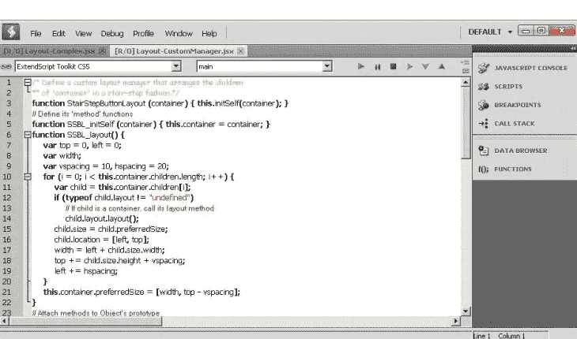


### 配置 Toolkit 窗口

例如，你可以通过向上或向下、向左右拖动分隔线来调整面板的相对大小，并重新排列分组。要移动标签页面板（tabbed panel），将标签页拖到另一个面板中。

如果你拖动标签页使整个目标组高亮，它将成为该组中的另一个堆叠面板（stacked panel）。如果你将标签页拖到某个组的顶部或底部（仅使目标组的顶部或底部栏高亮），该组将拆分为平铺布局格式的面板。

- 你可以将整个面板组停靠到 Toolkit 窗口的不同边缘。
- 你可以折叠整个面板组，或展开单个面板。
- 无论停靠状态如何，都可以打开和关闭，或折叠和展开单个面板。
- 你可以取消单个标签页或控制面板，使其成为浮动面板。浮动面板可以相互停靠，也可以独立存在。

有了一些预定义的配置，称为“工作区”（workspaces），适用于各种用途，你可以将喜欢的配置保存为工作区。参见第 16 页的“工作区”。

### 面板菜单

面板组具有右键菜单，你可以在标签页上或标题栏背景上点击右键调用。这些菜单包含面板控制命令，包括“关闭面板”（Close Panel）和“关闭组”（Close Group），用于隐藏单个面板或整个组。

在顶栏点击右键获取面板组菜单

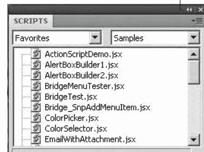

面板特定的浮动菜单（flyout menu）

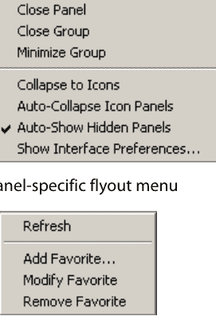

- 你可以通过“窗口”（Window）菜单中的切换或关闭来显示或隐藏特定面板。使用“窗口”菜单显示隐藏的面板，或将浮动面板置于顶。
- 使用“窗口 > 隐藏面板”（Window > Hide panels）关闭所有面板。

某些面板还有特定面板特定的浮动菜单，可以通过右上角的菜单图标访问。JavaScript 控制台（JavaScript Console）有一个右键菜单，允许你复制和粘贴文本。

接下来的章节将详细讨论各个面板。

### 文档窗口

当你打开脚本或文本文件时，每个文件都会出现在自己的脚本编辑器（Script Editor）窗口中。默认情况下，文档窗口是停靠的；即以标签页窗的形式在主窗口中。然而，像面板一样，你可以将任何文档窗口拖出框架以成为一个独立窗口。

如果你正在显示多个文档，并且解锁了其中一个或多个文档，你可以选择以平铺（tiled）或级联（cascade）样式显示文档窗口——即在主窗口中并排显示，或覆盖主窗口显示。要执行此操作，选择“窗口 > 平铺文档”（Window > Tile Documents）或“窗口 > 级联排列”（Window > Cascade）。

你可以同时在多个文档窗口中运行脚本。当前文档窗口会被高亮并拥有输入焦点。你可以通过点击另一个文档窗口来选择它，或者可以使用“窗口 > 下一个文档”（Window > Next document）和“窗口 > 上一个文档”（Window > Previous document）命令在之间切换。这些命令的默认快捷键是 Cmd+ 和 SHIFT-Cmd；你可以使用偏好设置对话框中的键盘快捷键页面（Edit > Preferences）进行更改。

注意：由于你可以在同一个应用程序中同时运行脚本，你应该小心不要用一个脚本中断另一个脚本的运行。如果一个脚本在 Photoshop 中打开了一个模态对话框，而另一个针对 Photoshop 的脚本仍在开启状态，第二个脚本可能会产生错误。

文档窗口右上角的按钮允许你拆分该


拆分文档按钮（Split document button）文档窗口的第二个

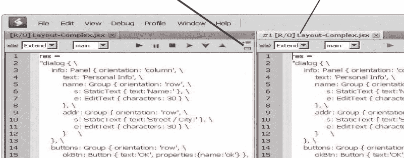

当窗口拆分时，第二个窗口视图与你在文本中所做的完全相同，你添加的断点（breakpoints）等会在两个窗口中类似地出现。默认情况下，副本位于原始停靠窗口的右侧，所示。然而，如果你使用 CTRL-点击来拆分窗口，第二个将出现在原始窗口下方。

关于文档窗口和脚本编辑器的更多信息，请参见第 18 页的“脚本编辑器”（The Script Editor）。

### 工作区

Toolkit 在退出时会保存当前布局，并在下次启动时恢复。它会保存并恢复已打开的文档、文档内的当前位置、设置的任何断点以及偏好设置对话框中设置的其他偏好。

- 偏好设置对话框中的启动页面（Edit > Preferences）提供了启动时是打开空白文档窗口、不打开文档窗口或显示之前打开的文档的选择。
- Toolkit 定义了若干适用于特定用类型的工作区配置。要选择首选或用户定义的工作区，请使用 Toolkit 右上角的下拉工作区菜单。当你选择一个工作区时，它的名称会显示在这里。你还可以从此菜单添加和删除工作区。

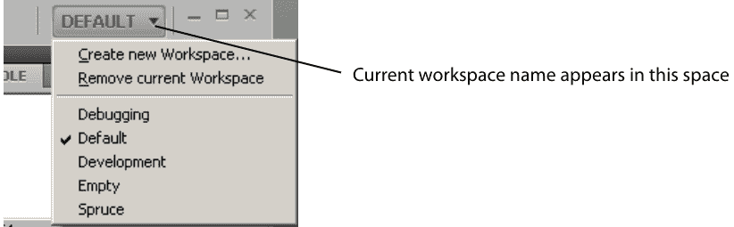

- 你可以使用“创建新工作区”（Create new Workspace）菜单命令或工作区页面上的添加按钮将任何配置保存为命名的工作区。
- 你可以单独或一次性删除你定义的工作区。
- 键盘快捷键页面（Edit > Preferences）允许你设置或修改。如果你分配了已使用的组合，将会有警告。
- 在 Toolkit 加载时按住 SHIFT 可以恢复偏好值。

### 对话框

某些对话框提供“不再显示”（Don’t show again）选项。如果你选择此选项，Toolkit 将记住并在下次不再显示该对话框。

- 要再次显示这些对话框，请点击偏好设置（Edit > Preferences）用户界面页面上的重置对话框（Reset Dialogs）。

### 选择脚本

你可以打开多个脚本（或文件）。你可以通过多种方法查找和打开脚本：

- 使用“文件 > 打开”（File > Open）浏览特定的文件浏览器。
- 从“文件 > 最近”（File > Recent）选择最近打开的文件。
- 使用“文件 > 新建”（File > New）创建一个脚本。
- 将文件拖到 Toolkit 上以在文档窗口中打开。
- 对于信任位置（安装应用程序的用户脚本文件夹）中的 JavaScript 脚本，双击文件即可运行。对于其他位置的脚本，你必须确认是否运行该脚本。

使用“编辑 > 查找替换”（Edit > Find and Replace）查找特定文本的脚本。你可以在特定文档窗口、所有打开的文档窗口、与应用程序关联的脚本或收藏位置中的脚本中搜索。“参见第 24 页。”

- 使用脚本面板显示并打开已加载应用程序的脚本或收藏位置中的脚本。

### 脚本面板和收藏脚本位置

脚本面板提供了可调试脚本的列表，对于某些应用程序，这些可以是 JS 或 JSX 文件，或者是包含嵌入脚本的 HTML 文件。

你可以显示特定目标应用程序的脚本列表。在左侧下拉列表中选择目标应用程序；该应用程序的 JavaScript 引擎将出现在右侧列表中。

当选择目标应用程序时，如果它尚未运行，Toolkit 将尝试打开，然后显示该应用程序制作的脚本。在此面板中选择脚本即可加载并在新的文档窗口中显示内容，你可以在其中进行修改、保存或在目标应用程序中运行。

当你选择目标“收藏”（Favorites）时，右侧列表将显示默认收藏脚本位置以及定义的任何其他收藏位置。你可以使用菜单创建自己的收藏脚本位置列表。


## 脚本编辑器 18

你定义的收藏脚本位置也可用于“查找和替换”对话框；请参见["在文本中搜索"](第 24 页)。

你也可以通过首选项对话框的“收藏”页来检查和设置收藏位置（**编辑 > 首选项**）。你可使用**添加**、**修改**和**删除**按钮来编辑文件夹列表。

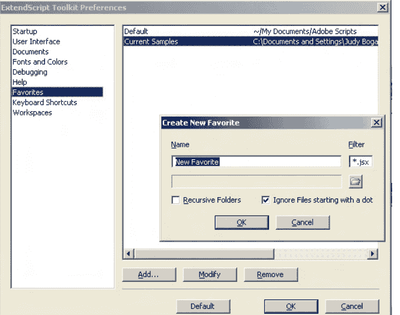

## Adobe Scripts 文件夹

在首次启动时，Toolkit 会用户的“文档”文件夹中创建一个名为 Adobe Scripts 的文件夹。脚本面板中的“默认”收藏将显示该文件夹的内容。

当双击时，Toolkit 通常会将 JSX 文件视为一个不可见的安全过滤器。在启动文件之前，安全对话框会询问是否可以执行该脚本。然而，Toolkit 将用户的“文档/Adobe Scripts”文件夹视为一个受信任的位置；当你在双击该文件夹中的 JSX 文件时，Toolkit 不会显示安全警报。

### 脚本编辑器

脚本编辑器是一个功能完备的 JavaScript 源代码编辑器。你可以打开任意数量的编辑器窗口；每个窗口都显示 Unicode 代码文档。

脚本编辑器提供了许多有用且强大的文本编辑和导航功能。其中某些专门为 JavaScript 设计的，而另一些则适用于各种文本编辑。功能包括：

- * 适用于任何文本的导航辅助和选项，以及针对 JavaScript 的特定代码导航；请参见["导航辅助"](第 19 页)。

- * 通用的编辑和编码支持（如撤销/重做），以及特定的 JavaScript 编码支持（如语法检查）；请参见["编码辅助"](第 22 页)。

- * 功能完备的文本搜索工具，可以在多个文件中进行搜索；请参见第 24 页的“在文本中搜索”。

- *  JavaScript 以及许多其他语言的语法标记（特定语法结构的颜色和字体样式）。标记样式是可配置的；请参见第 26 页的“语法标记”。

## 导航辅助

你可以配置脚本编辑器以显示具有各种功能的文本，帮助你跟踪代码结构，或帮助你在文件中移动。它还提供了鼠标和键盘快捷键，用于不同类型的光标移动和文本选择。

## 选项

脚本编辑器提供了许多有助于代码导航的查看选项，包括：

- * 自动行号。**视图 > 行号**可切换行号的开启和关闭。

- * 代码的可折叠树形视图，你可以打开或关闭结构的逻辑单元，例如注释或函数定义。**视图 > 代码折叠**可切换树形视图的开启和关闭。

- * 换行模式，此时没有水平滚动条，且会在单词边界处换行。**视图 > 自动换行**可切换换行的开启和关闭。

- * 语法标记，使用颜色和字体样式突出特定的语法结构。**视图 > 语法高亮**允许你关闭标记，或将其设置为标记特定语言（JavaScript 或许多其他语言）。标记样式是可配置的；请参见第 26 页的“语法标记”。

你可以使用首选项对话框的“文档”页 **(编辑 > 首选项)** 为这些状态中的任何一个状态设置默认值。

## 函数查找器

“函数”面板以及文档窗口右上角的浮菜单都提供了当前文档中定义的函数列表。当你从任一列表中选择一个函数时，文档将直接跳转到代码中该函数的定义处。

## 脚本编辑器 20

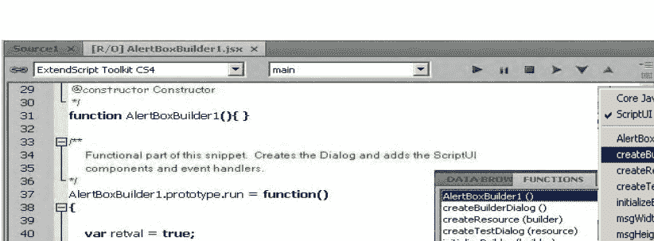

## 书签

**编辑 > 书签**菜单允许你在文本中设置和清除导航点。F2 功能键是书签命令的默认快捷键：

- 使用 CTRL-F2 切换当前行的书签。

- 使用 F2 将光标移动到下一个书签，或使用 SHIFT-F2 到上一个。书签是循环的，因此第一个将跟随最后一个。

- 使用 SHIFT-F2 清除当前文本中的所有书签。

当你导航到折叠代码部分中的书签时，该部分会自动打开。

书签在行左侧用一个蓝色的向右箭头标记（如果显示行号，则在行号右侧）。这是书签标记为点的地方（参见第 31 页的设置断点）。如果你在同一行中同时设置了书签和断点，蓝色箭头将叠加在书签点上。

## 脚本编辑器 21

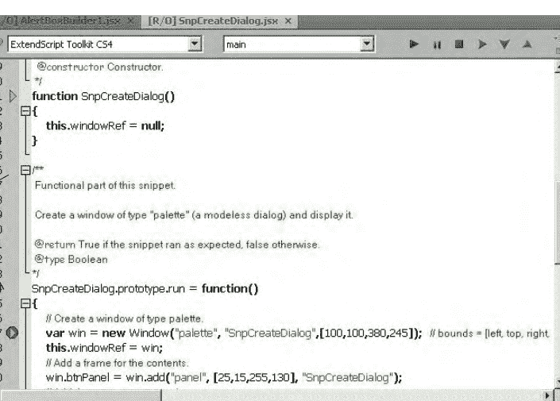

## 鼠标导航与选择

你可以使用鼠标或键盘快捷键在文档窗口中移动插入点或选择文本。点击文档窗口中的鼠标左键可移动光标位置。

要使用鼠标选择文本，在所选文本块中点击，然后拖动到要选择的文本上。如果你拖动到当前显示文本的上方或上方，文本将滚动，并在滚动时继续选择。你也可以双击选择一个单词，或三击选择一行。

要启动拖放所选文本，在所选文本块中点击并拖动到目标位置。你可以将文本拖出 Toolkit 到另一个应用程序中。你可以从另一个应用程序将文本拖入文档窗口。你可以将资源管理器或 Finder 中的文件拖到 Toolkit 上以打开它们。

## 键盘导航与选择

首选项对话框中的“快捷键”（编辑 > 首选项）允许你设置或修改所有命令的快捷键。

除了为命令指定的快捷键和常规键盘输入外，文档窗口还接受这些特殊键。你还可以通过按下 SHIFT 移动键来选择文本。

| 键 | 动作 |
| :--- | :--- |
| ENTER | 插入换行符 |
| Backspace | 删除左侧字符 |
| DELETE | 删除右侧字符 |
| 左箭头 | 光标向左移动一个字符 |

## 脚本编辑器 22

| 右箭头 | 光标向右移动一个字符 |
| 上箭头 | 光标向上移动一行，如果可能则保持对齐 |
| 下箭头 | 光标向下移动一行，如果可能则保持对齐 |
| Page up | 光标向上移动一页 |
| Page down | 光标向下移动一页 |
| CTRL + 上箭头 | 不移动插入点的情况下向上滚动 |
| CTRL + 下箭头 | 不移动插入点的情况下向下滚动 |
| CTRL + Page up | 不移动插入点的情况下向上滚动一页 |
| CTRL + page down | 不移动插入点的情况下向下滚动一页 |
| CTRL + 左箭头 | 光标向左移动一个单词 |
| CTRL + right arrow | 光标向右移动一个单词 |
| HOME | 光标到行首 |
| END | 光标到行尾 |
| CTRL + HOME | 光标到文本开头 |
| CTRL + END | 光标到文本末尾 |

脚本编辑器支持通过 IME (Windows) 或 TMS (Mac OS) 使用扩展键盘输入。这对于东亚字符尤为重要。

## 编码辅助

脚本编辑器提供了视觉和编辑功能，帮助你导航并维护 JavaScript 代码的语法结构，包括以下：

## 代码补全

当你在文档中放置光标并开始输入时，Toolkit 会在关键字、全局函数、当前文档中定义的函数以及从浮菜单当前选择的对象模型字典函数之间提供补全选项。

```
221 return retval = t
222 this
223 throw
224 throws
225 /*
226 transient
227 "main program" TreeView: 一个项可以包含子项的层级列表。
228 as long as we not true
229 if(typeof(AlertBox) typeof
230 /
```


### 脚本编辑器

你可以使用文档右上角的浮动菜单选择一个对象模型字典用于补全。可用的字典取决于加载了哪些应用程序。请参见[第 36 页检查对象模型]()。

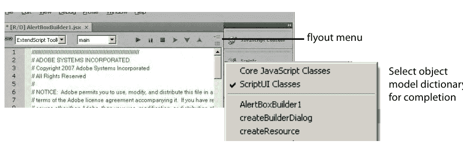

### 括号匹配

编辑（Edit）菜单提供了两种括号匹配选择功能，当光标位于左括号之后立即或右括号之前时，这些功能会生效：

- **编辑 > 选择到括号 (Edit > Select to Brace)**：将光标移动到匹配的括号处，但不选择任何文本。默认快捷键为 CTRL 0（零）。
- **编辑 > 选择包含括号的内容 (Edit > Select Including Brace)**：选择括号之间的所有文本。默认快捷键为 SHIFT CTRL 0（零）。

括号字符可以对圆括号、大括号和小括号进行缩进。

### 块缩进

当“自动换行”（Word Wrap）关闭时，你可以自动对文本块进行缩进或取消缩进。要对文本块进行缩进，请选择行或行的部分或全部文本，然后按 Tab。（注意：如果开启了自动换行，它会删除所选文本。）要取消缩进，按 SHIFT TAB。

### 注释和取消注释命令

使用**编辑 > 注释或取消注释选择 (Edit > Comment or Uncomment Selection)** 可以临时从执行路径中移除 JavaScript 程序的部分。// 注释是一个切换操作。当你第一次执行此命令时，它会在任何全选或部分选中的行开头插入特殊的注释序列 //。当你在选中此类行并再次执行命令时，它会移除该注释标记。

该命令仅影响其在文本中放置的注释标记；会忽略所选行中已存在的任何注释标记。这允许你临时移除并替换包含代码和注释的文本块。

### 版本注释

特殊的注释格式保留用于代码版本语句，该语句供 Adobe 脚本内部使用，但所有脚本编写人员可用。使用**编辑 > 插入版本标记 (Edit > Insert Version Tag)** 可以插入一个包含文件名和当前日期的注释，格式如下：

```
/**
* @@@BUILDINFO@@ SnpCreateDialog.jsx !Version! Tue Dec 05 2006 08:03:38 GMT-0800
*/
```

你有责任用你的版本信息手动更新 !Version! 部分。

### 撤销和重做

从编辑（Edit）菜单或文档右键上下文菜单中选择撤销（Undo）或重做（Redo），按顺序取消或恢复多次编辑更改。更改历史会在创建或加载文件时保留，并通过文件保存操作维护。

### 语法检查

在运行新脚本或将文本保存为脚本文件之前，使用编辑 > 检查语法（Edit > Check Syntax）检查文本是否包含 JavaScript 语法错误。默认快捷键为 F7。

- 如果脚本语法正确，状态行将显示“无语法错误”（No syntax errors）。
- 如果 Toolkit 发现语法错误（例如缺少引号），它将高亮受影响的文本，播放声音并在状态行中显示错误消息以便你修复。

### 多行语句

脚本编辑器支持三引号语法，允许字符串跨越多行源代码。在输入非常长的字符串时，你可以：

- 在单行中输入：
```
var myString = "This very long string might wrap onto a second line visually, but you
typed no CR character when entering it."
```
- 使用多行输入，并在每行末尾使用反斜杠 (\ 延续字符）：
```
var myString = "This string spans \nntwo lines.";
```
- 在多行的整个字符串周围使用三引号：
```
var myString = """This quoted" word is inside the
tmultiline string enclosed by triple quotes."""
```

三引号选项允许字符串包含嵌入的引号。

### 文本搜索

Toolkit 通过编辑 > 查找和替换（Edit > Find and Replace）命令提供了搜索工具。此命令会调出查找和替换面板。如果面板未停靠，你可以按 Esc 键将其隐藏。

查找和替换面板允许你在多个文档中搜索匹配特定字符串或正则表达式的文本。你可以选择搜索范围：

- 当前文档，或当前文档中的当前选择内容
- 所有打开的文档
- 当前目标应用程序发布的所有脚本
- 你定义为收藏夹位置的文件夹；请参见第 17 页的“脚本面板和收藏的脚本位置”。

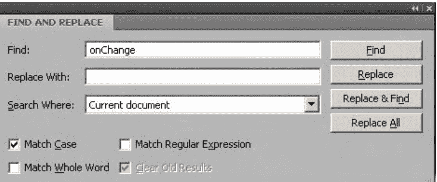

搜索结果列在“查找结果”（Find Results）选项卡中；默认情况下，它与查找和替换面板叠在一起，但你可以将其拖到另一个停靠区，或将其显示为独立的浮动面板。

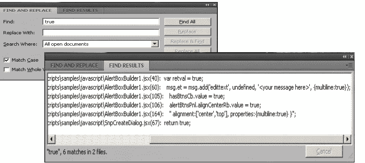

双击查找结果面板中的一行，可以直接跳转到找到文本的文档和行。

### 使用正则表达式语法

Toolkit 在查找和替换对话框中支持有限的正则表达式语法：

- 匹配任意字符
- 标记用于捕获匹配的区域开始。
- 标记捕获区域的结束。
- 使用编辑器当前的单词定义匹配单词开头。
- 使用编辑器当前的单词定义匹配单词结尾。
- 转义本 otherwise具有特殊含义的字符。
- 匹配字符集。
- 匹配行首。
- 匹配行尾。
- 匹配 0 次或多次。
- 匹配 1 次或多次。
- 在替换中你可以使用占位符 \1 到 \9，\1 指第一个捕获区域，\2 指第二个，以此此类推。

### 语法标记

脚本编辑器提供了基于语言的语法高亮以辅助编辑代码。虽然调试功能（包括语法检查）仅适用于 JavaScript，但你可以选择编辑其他类型的代码，并根据语言进行语法高亮。语法标记样式会自动匹配文件扩展名，或者你可以从视图 > 语法高亮（View > Syntaxlighting）菜单选择语言。高亮样式可以通过偏好设置对话框中的字体和颜色（Fonts and Colors）页面进行配置。


### 在 Toolkit 中进行调试

执行代码、在断点处停止、执行完所有脚本、以及等待接收事件。按引擎命名的图标表示它是正在运行、暂停还是等待输入：

- 运行 (running)
- 暂停 (halted)
- 等待 (waiting)

当前引擎是 Toolkit 面板中显示其数据和状态的引擎。如果一个应用程序只有一个引擎，当你选择该应用程序作为目标时，它的引擎将成为当前引擎。如果目标应用程序中有多个可用引擎，你可以在列表中选择一个使其成为当前引擎。

当你打开 Toolkit 时，Toolkit 本身是默认目标应用程序。当你选择目标（target）时，如果所选的目标应用程序尚未运行，Toolkit 会提示权限并启动该应用程序。同样，如果你运行一个选择了尚未运行的目标应用程序的脚本（使用 `#target` 指令），Toolkit 会提示权限以启动它。如果应用程序正在运行但未被选为当前目标，Toolkit 会提示你切换到它。

如果你选择了一个无法在 Toolkit 中进行调试的应用程序，错误对话框会报告 Toolkit 无法连接到所选内容。

ExtendScript Toolkit 是 JSX 文件的编辑器。如果你在文件浏览器中双击一个 JSX 文件，Toolkit 会在文件中查找 `#target` 指令以及启动以运行该脚本的应用程序；然而，它会首先检查脚本中的语法错误。如果发现任何错误，Toolkit 将在消息框中显示错误并静默退出，而不是启动目标应用程序。例如：

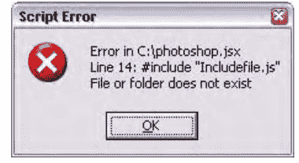

### JavaScript 控制台

JavaScript 控制台是当前所定 JavaScript 引擎的命令 shell 和输出窗口。它连接到该引擎的全局命名空间。

```
myObj = (name: "cats", number : 2, color: "black" );
Result: [object Object]
myObj;
Result: [object Object]
myObj.name;
Result: cats
myObj.number;
Result: 2
myObj.color;
Result: black
```

### 在 Toolkit 中进行调试

控制台是一个 JavaScript 监听器，期望输入的文本是 JavaScript。

你可以使用控制台评估表达式或调用函数。输入任何 JavaScript 语句并按回车键（ENTER）执行。该语句在控制台栈（Console Stack）面板中高亮行的堆栈范围内执行，结果将出现在下一行。

- 你可以使用向上和向下箭头键滚动查看之前的条目，或使用鼠标放置光标。按回车键执行包含光标的行，或所有选中的行。

- 右键上下文菜单提供了与文档窗口相同的编辑命令。你可以复制、剪切和粘贴文本，以及撤销和重做之前的操作。

- 你可以使用鼠标选择文本，并使用标准的复制和粘贴快捷键。

- 布局（Layout）菜单允许你清除当前内容。

在控制台中执行的命令具有一秒的超时限制。如果一个命令执行时间超过一秒，Toolkit 将生成超时错误并终止尝试。

控制台是 JavaScript 执行的标准输出位置。如果任何脚本生成了语法错误，错误将在此处显示并带有文件名和行号。Toolkit 在启动阶段也会在此显示错误。

### 控制代码执行

调试命令可以通过调试（Debug）菜单、文档的右键上下文菜单、键盘快捷键以及工具栏按钮可用。当 JavaScript 调试器激活时，使用这些菜单和按钮来控制代码的执行。

| 命令 | 快捷键 | 说明 |
|---|---|---|
| 继续运行 (Run Continue) | F5 (Windows)<br>Ctrl R (Mac OS) | 启动或恢复脚本执行。脚本执行时禁用。 |
| 间断 (Break) | Ctrl 5 (Windows)<br>Cmd . (Mac OS) | 临时暂停正在执行的脚本并重新激活 JavaScript 调试器。脚本执行时启用。 |
| 停止 (Stop) | Shift F5 (Windows)<br>Ctrl K (Mac OS)) | 停止脚本执行并产生运行时错误。脚本执行时启用。 |
| 单步跳过 (Step Over) | F10 (Windows)<br>Ctrl S (Mac OS) | 在执行脚本中的单行 JavaScript 后停止。如果语句调用了 JavaScript 函数，将在完整执行函数后再停止（不进入函数）。 |
| 单步进入 (Step Into) | F11 (Windows)<br>Ctrl T (Mac OS) | 在执行脚本中的单行 JavaScript 语句后，或在执行该脚本调用的任何 JavaScript 函数中的单个语句后停止。 |
| 单步跳出 (Step Out) | Shift F11 (Windows)<br>Ctrl U (Mac OS) | 在 JavaScript 函数体内部暂停时，恢复脚本执行直到函数返回。在函数体外暂停时，恢复脚本执行直到脚本终止。 |

### 执行状态的视觉指示

当脚本执行停止在到达的断点处，或者在单步执行时脚本到达下一行时，文档窗口将显示当前脚本并用黄色高亮当前行。

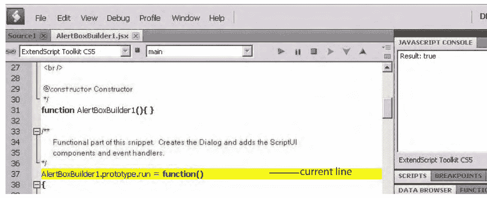

如果脚本遇到运行时错误，Toolkit 将停止脚本执行，显示脚本并用橙色高亮行。使用浏览器（Browser）获取更多详情。要查看，显示脚本并用橙色高亮行，并在状态栏中显示错误。

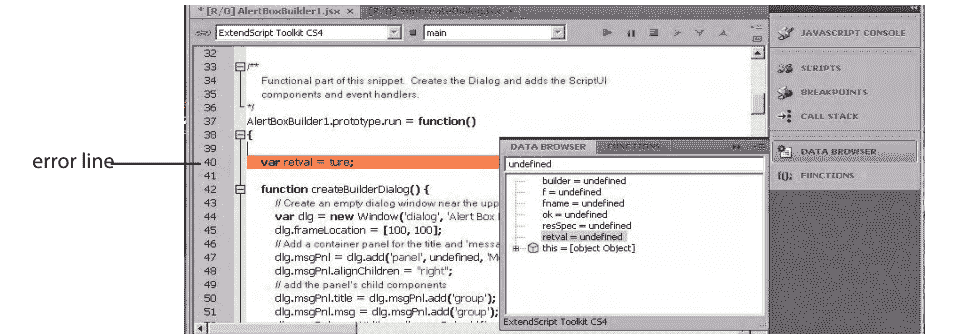 脚本使用 try/catch 子句来执行可能导致错误的代码，或者通过编程捕获错误而不是让脚本终止。

### 设置断点

在调试脚本时，让它停止在某些行通常有助于检查环境、函数调用是否正确或变量是否包含预期数据。

- 要在指定行停止脚本执行，点击行号左侧设置断点。红点表示断点。
- 再次点击临时禁用断点；图标会改变颜色。
- 点击第三次删除断点。图标将被移除。

某些断点需要是条件的。例如，如果你在一个执行数千次的循环中设置了断点，你不希望每次循环都停止，而是在第1000次迭代时。

你可以为断点附加条件，形式为 JavaScript 表达式。每当到达断点时，都会运行该 JavaScript 表达式。如果表达式是非零数字或真，则停止执行。

要在循环中设置条件断点，表达式可以是 `i >= 1000`，这意味着当迭代变量 `i` 的值大于或等于1000 时程序执行。

> **提示：** 检查循环的边界条件通常有用；为此，你可以设置循环内断点的条件在第一次和最后一次迭代时触发。

你可以在不包含代码的行（注释行）上设置断点。当 Toolkit 运行程序时，会自动将断点向下移动到实际包含代码的行。

### 断点面板

断点面板显示当前文档窗口中设置的所有断点。你可以使用面板菜单添加、更改或删除断点。

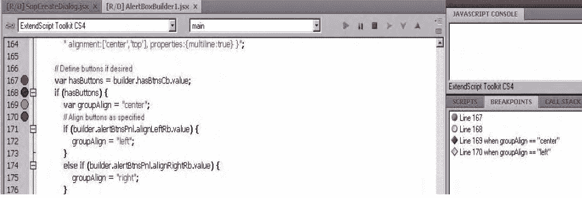

你可以通过双击断点或选择它并从面板菜单中选择“添加”（Add）或“修改”（Modify）来编辑断点。对话框允许你更改行号、断点的启用状态以及


## 在工具箱中调试

条件语句。你还可以指定命中次数（hit count），这允许你在进入调试器之前跳过断点若干次执行执行。默认值为 1，即在首次执行时触发断点。

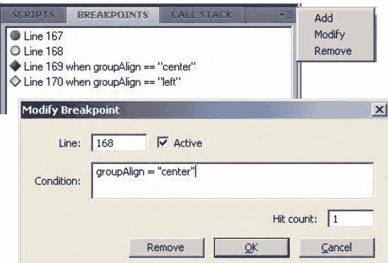

当执行达到指定的命中次数后到达此断点时，调试器会评估此条件。如果评估结果不为真（true），则忽略该断点并继续执行。这允许你仅在满足特定条件（例如某个变量具有特定值）时才停下。

## 断点图标

每个断点都通过文档窗口中行号左侧的图标来指示，并在“断点（Breakpoints）”面板中通过图标和行号来指示。文档窗口和“断点”面板中使用不同的图标。

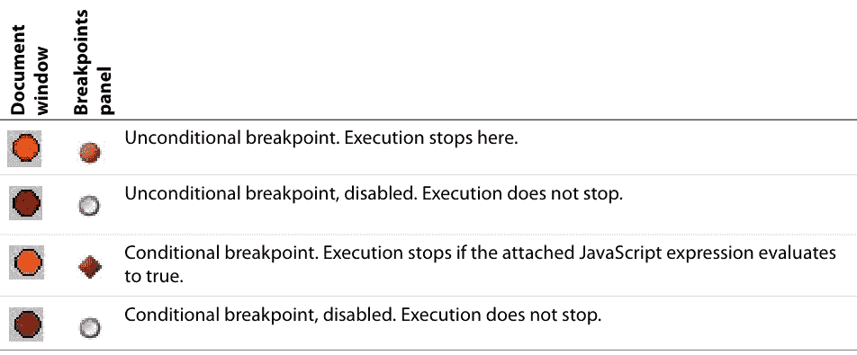

## 帮助提示中的评估

如果你将鼠标指针悬停在文档窗口中的变量或函数上，变量或函数的评估结果将作为帮助提示显示。当你没有调试程序时，只有当变量和函数对 JavaScript 引擎已已知时，这种方法才有用。但在调试期间，这是显示变量当前值及其当前数据类型的一种极其有用的方法。

## 跟踪数据

“数据浏览器（Data Browser）”是你进入 JavaScript 引擎的窗口。它显示当前上下文中定义的所有活动数据，并以变量及其当前值的列表形式显示。如果执行在断点处停止，它会显示在当前函数中使用 `var` 定义的变量以及函数参数。要显示全局或调用作用域定义的变量，请使用“调用栈（Call Stack）”来检查上下文（见第 34 页“调用栈”）。

你可以使用数据浏览器检查并设置变量值。

- 点击变量名可在面板顶部的编辑字段中显示其当前值。
- 修改值，输入新值并按回车键。如果是只读（Read only），则编辑字段将被禁用。

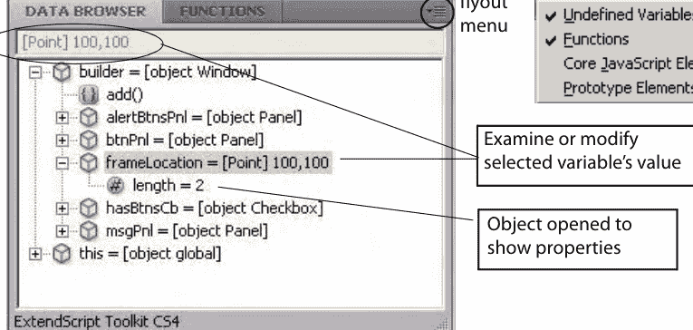

此面板的流程允许你控制显示的数据量：

- 未定义变量（Undefined Variables）：切换显示值为 `undefined`（而非 `null`）的变量。
- 函数（Functions）：切换显示所有附加到对象上的函数。大多数情况下，对象中的数据是其可调用方法。
- 核心 JavaScript元素（CoreJavaScript Elements）：切换显示所有属于 JavaScript 语言标准的数据，例如 `Array` 构造函数或 `Math` 对象。
- 原型元素（Prototype Elements）：切换显示 JavaScript 对象的原型链。

每个变量都有一个指示数据类型的小图标。无效对象（即对已删除对象的引用）将显示一个带带红色划线的对象图标。未定义（undefined）值没有图标。


## 在工具箱中调试 34

| 布尔值 (Boolean) |
| :--- |
| 数字 (Number) |
| 字符串 (String) |
| 对象 (Object) |
| 方法 (Method) |
| null |

你可以通过点击图标来检查对象的内容。列表会扩展以显示对象的属性（如果启用了“函数”显示，则显示方法），三角形向下指向表示对象已打开。

## 调用栈

“调用栈（Call Stack）”面板在调试程序时处于激活状态。当执行中的程序因断点或运行时错误而停止时，该面板会显示导致当前执行点的函数调用序列。“调用栈”面板显示活动函数的名称，以及传入这些参数的实际参数。

例如，此面板显示了在 `RGBColorPicker()` 函数的断点处发生了中段：

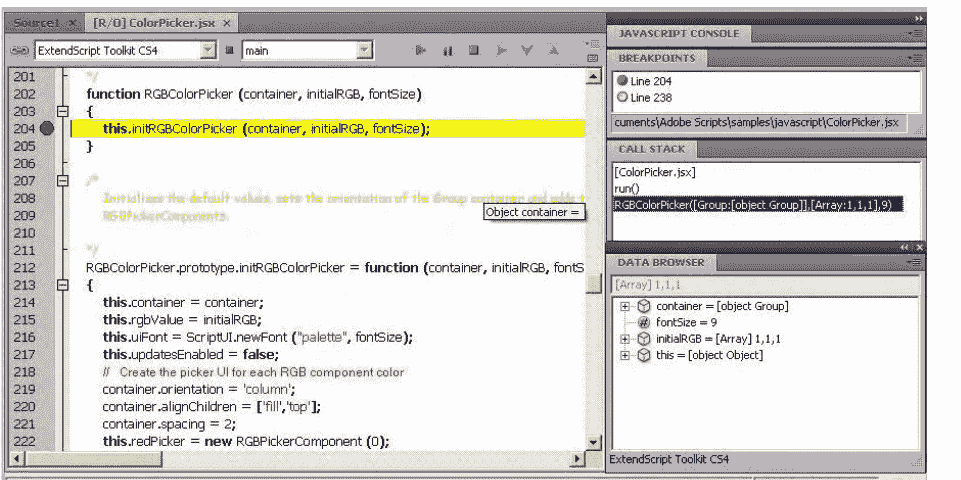

包含断点的函数在“调用栈”面板中被高亮。包含断点的行在“文档窗口”中被高亮。

你可以点击调用栈中的任何函数对其进行检查。在文档中，导致该执行点的函数所在的行将用绿色背景标记。在示例中，当你从调用栈中选择 `run()` 函数时，文档窗口会高亮该函数中调用 `RGBColorPicker()` 函数的所在行。

## 第 2 章：ExtendScript Toolkit

## 用于优化的代码分析 35

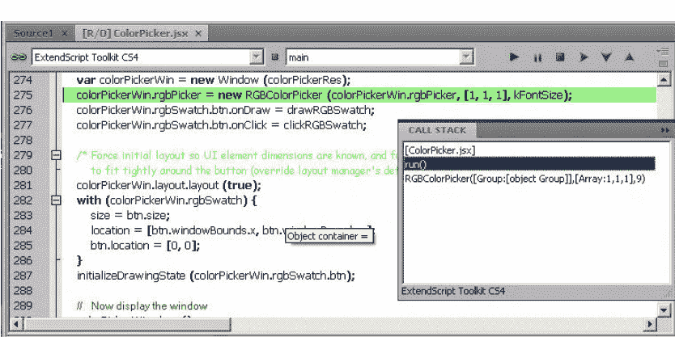

在层级结构中切换函数允许你追踪函数是如何被调用的。“控制台（Console）”和“数据浏览器”面板与“调用栈”面板协同工作。当你栈中选择一个函数时：

- “控制台”面板会将执行环境切换到该函数的执行上下文，这样你就可以检查并修改其局部变量。否则，运行中的 JavaScript 程序无法从被调用函数内部访问这些变量。
- “数据浏览器”显示所选环境中定义的所有数据。

## 用于优化的代码分析

分析（Profiling）工具帮助你优化程序执行。当你开启分析时，JavaScript 引擎会收集其正在运行的程序的信息。它会计算程序执行一行或一个函数的频率，或者执行一行或一个函数所需的时间。你可以精确选择要显示哪些分析数据。

由于分析会显著减慢执行速度，“分析（Profile）”菜单提供了这些选项：

| 选项 | 描述 |
| :--- | :--- |
| 关闭 (Off) | 分析已关闭。这是默认设置。 |
| 函数 (Functions) | 分析器计算每个函数调用。执行结束时，在函数头左侧显示总数。 |
| 行 (Lines) | 分析器计算每一行。执行结束时，在行左侧显示总数。 |
| 添加计时 (Add Timing) | 不是计算函数或行，而是记录执行每个所需的时间。执行结束时，在行左侧显示微秒。消耗更多执行时间。 |
| 无分析数据 (No Profiler Data) | 选中后不显示分析数据 |

## 第 2 章：ExtendScript Toolkit

## 检查对象模型 36

| 选项 | 描述 |
| :--- | :--- |
| 显示命中计数 (Show Hit Count) | 选中后显示命中次数。 |
| 显示计时 (Show Timing) | 选中后显示计时。 |
| 清除分析数据 (Erase Profiling Data) | 清除所有分析数据 |
| 另存为 (Save Data As) | 将分析数据保存为逗号分隔值，可加载到表格中。 |

当执行停止（在终止处、断点处或运行时错误处）时，工具箱会在文档窗口中逐行显示这些信息。分析数据有颜色标记：

- 绿色表示命中次数最低或执行时间最快。
- 橙色或黄色表示问题所在，例如执行多次的行，或耗时最长的行。

此示例显示了命中次数信息：

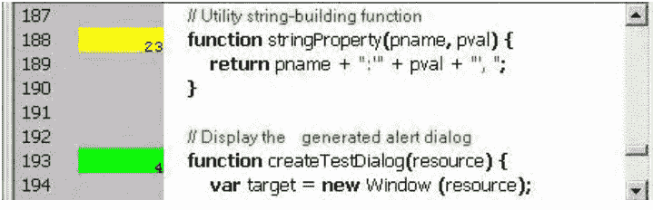

此示例显示了程序的计时信息，单位为微秒。计时可能无法精确微秒；这取决于电脑内置硬件计时器的分辨率和准确性。

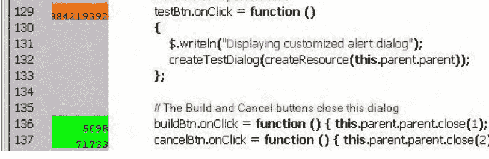

## 检查对象模型

ExtendScript Toolkit 提供了通过帮助菜单中调用的对象模型查看器来检查任何已加载字典的对象模型的能力。

对象模型查看器（OMV）作为一个独立的浮窗出现。OMV 允许你浏览对象层级结构，并检查每个属性的类型和描述，以及每个方法的描述和参数。

左上角“浏览器”部分的下拉菜单允许你从任何加载的对象字典中进行选择。字典提供了对一个应用程序或子系统模型的访问。

- 核心 JavaScript 类字典包含 Adobe 工具和程序，例如 `File` 和 `Folder`。
- ScriptUI 类字典显示在 ScriptUI JavaScript 模块中定义的界面元素。


## 第 2 章：ExtendScript Toolkit

## 检查对象模型

每个 Adobe 应用程序为该应用程序的文档对象模型（DOM）定义了一个字典。特定应用程序的字典在启动该应用程序之前，或者在 Toolkit 中将其选择为目标之前可能是不可用的。

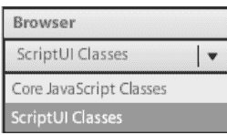

要检查对象模型，请从 Browser（浏览器）菜单中选择相应的字典。模型中定义的类出现在 Classes（类）面板中。选择一个类，Types（类型）面板将填充可用元素类型（构造函数、类、实例、事件）。选择类型，Properties and Methods（属性和方法）面板将填充该类型的元素。

每当你选择一个类或元素，其描述就会出现在右侧；描述会堆叠显示，并保持可见，直到你关闭它们。你可以使用描述右下角出现的悬停菜单关闭每个描述，也可以使用 OMV 窗口左上角的 Close All（全部关闭）按钮关闭所有描述。

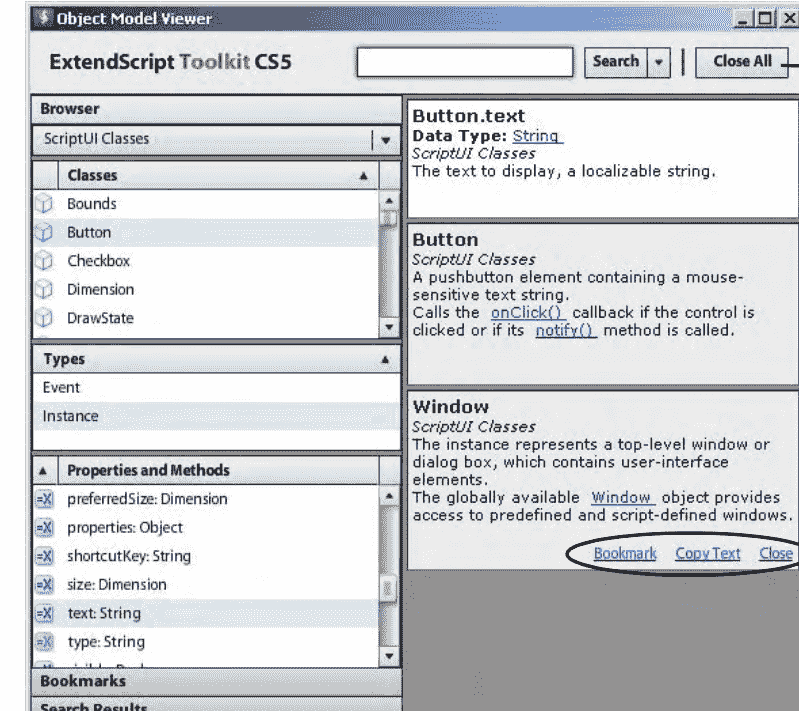

清除所有描述

悬停菜单

悬停菜单还允许你对元素进行标记以便于访问，或从描述中复制文本。描述中的链接带你进入相关的对象和元素，你可以在名称或描述中搜索文本。

## 3 文件系统访问

Adobe ExtendScript 定义了简化跨平台文件系统访问的类。这些类适用于支持 JavaScript 接口的所有应用程序。

- 本章的第一部分“使用 File 和 Folder 对象”描述了如何使用这些类，并提供了路径语法的细节。
- 第 47 页的“File object（文件对象）”和第 56 页的“Folder object（文件夹对象）”提供了对象、属性、方法和创建参数的参考细节。你也可以在 Toolkit 的 Help（帮助）菜单中选择 Core JavaScript Classes 字典，在 Object Model Viewer（对象模型查看器）中检查对象。

### 使用 File 和 Folder 对象

由于 Windows、Mac OS 和 UNIX 上的路径语法非常不同，Adobe ExtendScript 定义了 File 和 Folder 对象，以提供对底层系统的平台无关访问。File 对象代表磁盘，Folder 对象代表目录或文件夹。

- Folder 对象支持文件功能，例如遍历层级；创建；重命名或删除文件；或解析别名。
- File 对象支持读写函数，以读取或写入文件。

有几种方法可以区分 File 对象和 Folder 对象。例如：

```
if (instanceof File) ...
 (typeof file == "undefined") ...// 文件夹未打开
```

File 和 Folder 对象可以使用任何需要路径名称的地方，例如文件和文件夹的属性和参数。

注意：当你创建两个引用同一个磁盘文件的 File 对象时，它们被视为不同的对象。如果你打开其中一个进行 I/O（输入/输出），操作系统可能会阻止对另一个对象的访问，因为磁盘文件已经打开了。

## 指定路径

在创建 File 或 Folder 对象时，你可以指定特定平台的路径名称，或者使用一种称为通用资源标识符（URI）表示法的平台无关格式的绝对或相对路径。存储在对象中的路径始终是指向磁盘上固定位置的绝对全路径。

- 使用 `toString` 方法获取以包含 URI 表示法的绝对路径的字符串形式的文件或或文件夹的名称。
- 使用 `fsName` 属性获取特定平台的文件名。

### 绝对路径和相对路径

URI 表示法中的绝对路径描述了从根目录到特定文件或文件夹的完整路径。它以一个或两个斜杠（/）开头，用斜杠分隔路径元素。例如，以下描述了文件 `myFunction.jsx` 的绝对位置：

```
/dir2/mydir/myFile.jsx
```

URI 表示法中的相对路径附加在当前目录的路径之后，该路径存储在 Folder 类的全局 `current` 属性中。它以文件夹或文件名开头，或者以表示当前目录的特殊点（.）或表示父目录的双点（..）开头。例如，以下路径描述了文件 `myFunction.jsx` 的各种相对位置：

| 相对路径 | 描述 |
| :--- | :--- |
| myFunction.jsx | 在当前目录下。 |
| ../myFile.jsx | 在当前目录的父目录中。 |
| ../../myFile.jsx | 在当前目录的祖目录中。 |
| /dir1/mydir/myFile.jsx | 在 dir1 中，与当前目录并行 |

相对路径独立于不同机器和操作系统的不同值，因此使你的代码具有更高的可移植性。例如，你可以对单个操作使用绝对路径，在 `Folder.current` 属性中设置当前目录，并在所有其他操作中使用相对路径。这样你只需要更改一次代码即可更新到新的平台或文件位置。

### 路径中的字符解释

路径名称解释方式存在某些平台差异：

- 在 Windows 和 Mac OS 上，路径名称不受大小敏感。在 UNIX 中，路径对大小敏感。
- 在 Windows 上，斜杠（/）和反斜杠（\）都是路径元素分隔符。反斜杠是转义字符，因此你必须使用双反斜杠（\\）表示该字符。
- 在 Mac OS 上，斜杠（/）和冒号（:）都是路径元素分隔符。

如果路径名称以双斜杠（Windows双反斜杠）开头，第一个元素指向远程服务器。例如，`//host/mydir/myfile` 指向服务器 host 上的路径 `/mydir/myfile`。

URI 表示法允许路径名称包含特殊字符，但必须使用转义字符（%）后跟十六进制代码来指定。特殊字符是指非字母数字或不属于以下的字符：

```
/ - . : * ()
```

例如，一个空格被编码为 `%20`，因此文件名 "my file" 就是 "my%20file"。同样，字符 `à` 被编码为 `%E4`，因此文件名 "Brün" 被指定为 "Br%E4un"。

此编码方案与全局 JavaScript 函数 `encodeURI` 和 `decodeURI` 兼容。

## 第 3 章：文件系统访问

### 使用 File 和 Folder 对象

### 主目录

路径名称可以以波浪号（-）开头，表示用户的主目录。它对应于平台的 HOME 环境变量。

Unix 和 Mac OS 根据用户登录分配 HOME 环境变量。在 Mac OS 上，默认主目录是 `/Users/username`。

在 Unix 中，它通常是 `/home/username`。在 Windows 上，HOME 环境变量是可选的。如果分配了它，其值必须是 Windows 路径或引用远程服务器的名称（例如 `\host\dir`）。如果 HOME 环境变量未定义，ExtendScript 的默认值是用户的主目录，即 `C:\Documents and Settings\username` 文件夹。

注意：脚本可以访问许多通过静态 Folder 属性指定的文件夹；例如，appData 包含存储所有用户应用程序数据的文件夹。

### 卷和驱动器名称

卷或驱动器名称可以是 URI 表示法中绝对路径的第一部分。值根据平台进行解释。

### Mac OS 卷

当 Mac OS X 启动时，启动卷是文件系统的根目录。所有其他卷（包括远程卷）都是 `/Volumes` 的。File 和 Folder 对象使用这些规则解释路径名称的第一个元素：

- 如果名称是启动卷的名称，则丢弃它。
- 如果名称是卷名，则加上 `/Volumes`。
- 否则，保持路径不变。

Mac OS 9 支持使用冒号作为路径分隔符，并如下表所示对应 URI 和 Mac OS X 路径。这些示例假设启动卷是 MacOS，并且是一个挂载卷 Remote。

| URI 路径名称 | Mac OS 9 路径名称 | Mac OS X 路径 |
| :--- | :--- | :--- |
| /dir/file | MacOS:dir/file | /dir/file |
| /Remote/dir/file | Remote:dir/file | /Volumes/Remote/dir/file |
| /root/dir/file | Root:dir/file | /root/dir/file |
| --/dir/file | | /Users/jdoe/dir/file |

### Windows 驱动器

在 Windows 上，卷名对应于驱动器号。URI 路径 `/c/temp/file` 通常转换为 Windows 路径 `C:\temp\file`。

如果存在名称与路径第一部分匹配的驱动器，则该路径始终被解释为该驱动器。根目录下可能存在一个与驱动器同名的文件夹；例如，


## 第 3 章：文件系统访问

### 使用文件和文件夹对象

Windows 上的文件夹为 C:\。以 /c 开头的路径始终指向 C 盘；在这种情况下，若要通过名称访问文件夹，你必须同时使用驱动器名称和文件夹名称，例如，用 /c/c 表示 C:\。

如果当前驱动器包含一个与驱动器器符同名的根文件夹，则该名称被视为文件夹。也就是说，如果存在文件夹 D:\，且当前驱动器是 D:，则 URI 路径 /c/temp/file 将转换为 Windows 路径 D:\temp\file。在这种情况下，要访问 C 盘，必须使用 Windows 路径组件。

要访问远程卷，请使用格式为 //server/sharename 的统一命名规则（UNC）路径。这些路径是可移植的，因为 Mac 和 UNIX 会忽略多个斜杠字符。请注意，在 Windows 上，UNC 名称不适用于本地卷。

以下示例假设当前驱动器为 D:


| URI 路径名 | Windows 路径名 |
|---|---|
| /dir/file | c:\dir\file |
| /remote/dir/file | D:\remote\dir\file |
| /root/dir/file | D:\root\dir\file |
| ~/dir/file | C:\Documents and Settings\jdoe\dir |

### 别名

当你访问别名时，操作会被透明地转发到真实文件。只有影响别名的操作是重命名（rename）、删除（remove）以及设置只读（readonly）和隐藏（hidden）。当 File 对象表示别名时，对象的 alias 属性返回 true，`resolve` 方法返回别名目标的 File 或 Folder 对象。

在 Windows 上，所有文件系统别名（称为快捷方式）都是以 .lnk 扩展名结尾的实际文件。永远不要使用此扩展名；File 和 Folder 对象不需要它即可工作。

例如，在 /folder2 文件夹中有一个指向 /folder1/some.txt 文件的快捷方式。该快捷文件的 Windows 文件名为 /folder2\some.txt。

要从 File 访问快捷方式，请指定路径 /folder2/some.txt。调用该 File 对象的 `open` 方法允许该 File 对象的 `rename` 方法重命名快捷方式本身（保留 .lnk 扩展名）。

然而，Windows 允许文件及其快捷方式存在于同一个文件夹中。在这种情况下，File 对象始终访问原始文件。当快捷方式与其链接文件位于同一文件夹中时，你无法创建一个 File 对象来访问该快捷方式。

脚本可以通过为磁盘上不存在的文件创建一个 File 对象，并使用其 `createAlias` 方法指定别名的目标来创建一个别名。

### 可移植性问题

如果你的应用程序将运行在多个平台上，请使用相对路径名，或尝试从主目录生成路径名。如果无法实现，请使用 Mac OS 和 UNIX 别名，并将文件存储在与你的 Windows 远程机器上，以便使用 UNC 名称。

例如，假设你使用 UNIX 机器 myServer 进行数据存储。如果你在 myServer 的根目录下设置了别名，并且设置了一个指向相同数据位置的 Windows 可访问共享，则路径 //myServer/share/file 将适用于所有平台。

### Unicode I/O

在进行 I/O 操作时，Adobe 会将 8 位字符转换为 Unicode。默认情况下，此转换过程假设系统编码为（Windows 上的代码页 1252 或 Mac 上的 Mac Roman）。File 对象的 `encoding` 属性返回当前编码。你可以将 `encoding` 属性设置为所需的编码名称。File 对象会在操作系统中查找用于 I/O 的编码。该名称是用于描述 HTML 文件编码的常用名称之一，例如 ASCII、X-SJIS 或 ISO-8859-1。完整列表请参阅“文件和文件夹支持的编码名称”。

提供了一个特殊的编码器 BINARY，用于二进制 I/O。该编码器将每个 8 位字符扩展，以找到位于 0 到 255 之间的 Unicode 字符。使用此编码器写入二进制文件时，编码器写入 Unicode 字符的 8 位。例如，Unicode 字符 1000 对应字符 256 (0xEE8)。

某些常见文件格式（UCS-2、UTF-8、UTF-16）的数据以特殊字节标记（BOM）字符 (\uFEFF）开头。File `open` 方法读取文件的几个字节以寻找此字符。如果找到，会自动设置相应的编码并跳过该字符。如果文件开头没有 BOM 字符，`open()` 会读取文件的前 2 KB 并检查数据是否可能是 UTF-8 编码，如果是，则将编码设置为 UTF-8。

要写入 UTF-16 格式的 16 位 Unicode 文件，请使用编码 UCS-2。该编码使用主机平台支持的字节序格式。

使用 UTF-8 编码或 16 位 Unicode 时，请始终将 BOM 字符 "\uFEFF" 作为文件的第一个字符写入。

### 文件错误处理

每个对象都有一个 `error` 属性。如果访问属性或调用方法导致错误，该属性将包含描述错误类型的消息。成功时，该属性包含空字符串。你可以通过给属性分配任意值来清除它，这也会重置其错误标记。

支持错误消息的完整列表，请参阅第 44 页的“文件访问错误消息”。

### 文件访问错误消息

`error` 属性可以返回以下消息。

| 错误 | 描述 |
|---|---|
| File or folder does not exist | 文件或文件夹不存在，但父文件夹存在。 |
| File or folder already exists | 文件或文件夹已存在。 |
| I/O device is not open | 对关闭的文件尝试 I/O 操作。 |
| Read past EOF | 尝试读取文件末尾之外。 |
| Conversion error | 文件内容无法转换为 Unicode。 |
| Partial multibyte character found | 文件数据的编码存在错误。 |
| Permission denied | 操作系统不允许尝试的操作。 |
| Cannot change directory | 无法更改当前文件夹。 |
| Cannot create | 无法创建文件夹。 |
| Cannot rename | 无法重命名文件或文件夹。 |
| Cannot delete | 无法删除文件或文件夹。 |
| I/O error | 未指定的 I/O 错误。 |
| Cannot set size | 设置文件大小失败。 |
| Cannot open | 打开文件失败。 |
| Cannot close | 关闭文件失败。 |
| Read error | 读取文件。 |
| Write error | 写入文件。 |
| Cannot seek | 失败。 |
| Cannot execute | 无法执行。 |

## 文件和文件夹支持的编码名称

以下列表是 File 对象支持的编码名称的基础集。根据安装的语言，某些编码可能不可用。内置编码器有：

- ASCII
- BINARY
- CP1252
- ISO-8859-1
- MACINTOSH
- UTF-8
- UTF-16


## 第3章：文件系统编码

## 文件和文件夹支持的编码名称

## 常见编码

以下编码在 Windows 和 Mac 中实现：

```
UTF-7, UTF7, UNICODE-1-1-UTF-7, X-UNICODE-2-0-UTF-7
ISO-8859-2, ISO-8859-2:1987, ISO-IR-101, LATIN2
ISO-8859-3, ISO-8859-3:1988, ISO-IR-109, LATIN3
ISO-8859-4, ISO-8859-4:1998, ISO-IR-110, LATIN4, BALTIC
ISO-8859-5, ISO-8859-5:1998, ISO-IR-144, CYRILLIC
ISO-8859-6, ISO-8859-6:1998, ISO-IR-114, ECMA-ASMO-708, ARABIC
ISO-8859-7, ISO-8859-7:1998, ISO-IR-126, ELOT-G928, GREEK
ISO-8859-8, ISO-8859-8:1998, ISO-IR-118, HEBREW
ISO-8859-9, ISO-8859-9:1999, ISO-IR-148, LATIN5, TURKISH
ISO-8859-10, ISO-8859-10:1992, ISO-IR-157, LATIN6
ISO-8859-11, ISO-8859-11:1999, ISO-IR-179, LATIN7
ISO-8859-14, ISO-8859-14:1998, ISO-IR-199, LATIN8
ISO-8859-15, ISO-8859-15:1999, ISO-IR-203
CP850, WINDOWS-850, IBM86
CP895, WINDOWS-895, IBM866
CP932, WINDOWS-932, SJIS, SHIFT-JIS, X-SJIS, MS-SJIS, MS-KANJI
CP936, WINDOWS-936, GBK, WINDOWS-936, GB-2312, GB-23120, ISO-IR-58, CHINESE
CP949, WINDOWS-949, UHC, UK-C501, KS-C-C501-1987, KS-C-C501-1998, ISO-IR-149, KOREAN
CP950, WINDOWS-950, BIG5, BIG-5, BIG5IVE, BIG5CN, X-BIG5, X-BIG5
CP1251, WINDOWS-1251, MS-CPUC
CP1252, WINDOWS-1252, MS-ANSI
CP1253, WINDOWS-1253, MS-GREEK
CP1254, WINDOWS-1254, MS-TURK
CP1255, WINDOWS-1255, MS-HEBR
CP1256, WINDOWS-1256, MS-ARAB
CP1257, WINDOWS-1257, WINBALTRIM
CP1258, WINDOWS-1258
CP1361, WINDOWS-1361, JOHAB
EUC-JP, EUCP, EU-JP
EUC-KR, SUCKB, EU-UK
HZ, GB-2312
X-MAC-JAPANESE
X-MAC-GREEK
X-MAC-CYRILLIC
X-MAC-LATIN
X-MAC-TURKISH
```

## Windows Windows 编码名称

```
CP437, WINDOWS-437
CP709, WINDOWS-709, ASMO-449, BCONV4
EBCDIC
KOI-8R
KOI-8U
ISO-2022-JP
ISO-2022-KR
```

## 第3章：文件系统访问

## 文件对象 47

## Mac Mac OS 名称

这些是 Mac OS 可能的编码别名。

TIS-620, TIS620, TIS620-0, TIS620.2529-1, TIS620.2533-0, TIS620.2533-1, ISO-IR-166
CP874, WINDOWS-874
JP, JIS-6220-1969-0, ISO646-JP, ISO-IR-14
JIS-X0021, JISX0021-1976, X0021
JIS-X0208, JISX0208-1983, JISX0208-1990, JISX0208, ISO-IR-87
JIS-X0212, JISX0212-1990, JISX0212-1992, JISX0212, ISO-IR-159
ISO-IR-16, ISO-IR-57
ISO-IR-46, ISO-IR-16
ISO-IR-49, ISO-IR-14
ISO-IR-56, ISO-IR-16
ISO-IR-57, ISO-IR-16
ISO-IR-77, ISO-IR-14
ISO-IR-89, ISO-IR-14
ISO-IR-92, ISO-IR-2312
MAC-JAPANESE-MAC-GREEMAC-CYRILLIC-MAC-LATMAC-TURKISH

## UNIX 编码

在 UNIX 中，`File` 对象查找 `iconv` 库。如果你需要特殊编码，请确保安装了 `iconv` 模块，以便内部格式转换为所需的编码。

## 文件对象

以平台无关的方式表示本地系统中的文件。除非另有说明，所有属性和方法都解析文件系统属性。

## File 对象构造函数

使用 `File` 函数或 `new` 运算符创建 `File` 对象。构造函数接受完整或部分路径名称，并返回新对象。文件的 CRLF 序列设置为系统编码。

```javascript
File ([path]); //返回 Folder 对象
new File ([path]); //始终返回 File 对象
```

## 指定路径

与此对象关联的绝对或相对路径，以平台特定的格式指定；路径不需要存在。如果路径指向文件夹：

- `File` 函数返回 `Folder` 对象而不是 `File` 对象。
- `new` 运算符返回不存在文件的 `File` 对象。

## File 类属性

此属性作为 `File` 类的静态属性可用。不需要实例化即可访问。

```javascript
fs String 文件系统的名称。只读。Windows、Macintosh 或 Unix。
```

## File 类函数

这些函数作为 `File` 类的静态方法可用。不需要实例化即可调用。

```javascript
decode()
File.decode(uri)
```

- `uri String` 要解码的编码字符串。所有特殊字符必须用 UTF-8 编码，并以 % 符号后跟两个十六进制数字的形式存储。例如，字符串 "my%20file" 被解码为 "my file"。特殊字符是值大于 127 的字符。按照 RFC 2396 的要求解码指定的字符串。

```javascript
encode()
File.encode(name)
```

- `name String` 要编码的字符串。按照 RFC 2396 的要求编码指定的字符串。所有特殊字符用 UTF-8 编码，并以 % 符号后跟两个十六进制数字的形式存储。例如，字符串 "my file" 被编码为 "my%20file"。特殊字符是值大于 127 的字符。返回编码后的字符串。

```javascript
isEncodingAvailable()
File.isEncodingAvailable(name)
```

- `name String` 编码名称。典型值为 "ASCII"binary" 或 "UTF-8"。见第 45 页的“文件和文件夹支持的编码名称”。检查给定编码是否可用。如果系统支持指定的编码，返回 true，否则返回 false。

## 第3章：文件系统访问

## 文件对象 49

```javascript
openDialog ([prompt, filter, multiSelect])
```

| | | |
|---|---|---|
| prompt | 可选。如果对话框允许提示，则包含提示文本的字符串。 | |
| filter | 可选。限制对话框中显示的文件类型的过滤器。 | |

- 在 Windows 中，过滤器表达式，例如 "JavaScript:.*js;All files:*"
- 在 OS 中，过滤器接收一个 File 实例，如果文件应该包含在显示列表中则返回 true，否则返回 false。 |

| | | |
|---|---|---|
| multiSelect | 可选。布尔值。为 true 时，用户可以选择多个文件，返回数组。默认为 false。 |

打开内置的平台特定文件浏览对话框，用户可以在其中选择一个现有文件或多个文件，并创建新的 File 对象来表示所选文件。

如果用户点击 OK，返回所选文件的 File 对象；如果选择了多个文件，则返回对象数组。如果用户取消，则返回 null。

## saveDialog ()

```javascript
File.saveDialog ([prompt, preset])
```

| | | |
|---|---|---|
| prompt | 如果对话框允许提示，则包含提示文本的字符串。 | |
| filter | 可选（仅限 Windows）。限制对话框中显示的文件类型的过滤器。 | |

打开内置的平台特定文件浏览对话框，用户可以在其中选择一个现有文件或多个文件，并创建新的 File 对象来表示所选文件。

如果用户点击 OK，返回所选文件的 File 对象；如果选择了多个文件，则返回对象数组。如果用户取消，则返回 null。

## File 对象属性

这些属性适用于 File 对象。

| | | |
|---|---|---|
| absoluteURI | String | 以 URI 格式文件的完整路径。只读。 |
| alias | Boolean | 为 true 时，引用的是文件系统副本。只读。 |
| created | Date | 文件的创建日期，如果对象未引用磁盘文件则为 null。只读。 |
| creator | String | Mac OS 中的文件创建者；在 Windows 中为空字符串。 | |
| displayName | String | 绝对 URI 中文件名部分的本地化版本，不路径。只读。 |

## 第3章：文件系统访问

## 文件对象 50

encoding String 获取或设置后续读写操作的编码。见第 45 页“文件和文件夹支持的编码名称”中列出的常量。写入时，内部格式为二进制。

eof Boolean 为 true 时，读取尝试会导致当前位置移动到文件末尾（如果文件已打开）。

error String 描述最后一个文件错误的消息；见第 44 页“文件访问”。通常由文件设置，但脚本也可以设置。这会清除错误消息并重置打开文件的错误位。包含空字符串。

exists Boolean 为 true 时，引用的是实际存在的文件或文件系统副本。

fsName String 引用文件的平台特定全路径。只读。

fullName String 以 URI 格式的文件的完整路径名。只读。

readonly Boolean 为 true 时，防止文件被修改或删除。只读。

hidden Boolean 为 true 时，文件在平台特定的文件浏览器中不显示。读/写。

length Number 文件的大小（字节）。仅能为未打开的文件设置，此时会截断文件或填充 0 字节以达到新长度。

lineFeed String 在文件系统中写入行字符的方式。值之一：

```
Windows — Windows 样式
Macintosh — Mac OS 样式
Unix — Unix 样式
```

localizedName String 绝对 URI 中文件名部分的本地化版本，不包含路径。只读。

modified Date 引用文件的最后修改日期，如果对象未引用磁盘文件则为 null。只读。

name String 绝对 URI 中的文件名部分，不包含路径。只读。

parent Folder 包含此文件的文件夹 Folder 对象。只读。

path String 绝对 URI 中的路径部分，不包含文件名。只读。

readonly Boolean 为 true 时，防止文件被修改或删除。如果引用的文件是文件系统副本或快捷方式，则该标志在副本上进行修改，而不是原始文件。


## 第 3 章：文件系统访问

## File 对象

| 属性 | 类型 | 描述 |
|---|---|---|
| relativeURI | String | 以 URI 记法表示引用文件的路径名，相对于当前文件夹。只读。 |
| type | String | 四个字符字符串表示的文件类型。 |

- * 在 Mac OS 中，为 Mac OS 文件类型。
- 在 Windows 中，.EXE 文件为 "appl"，.DLL 文件为 "shlb"，任何其他文件为 "TEXT"。
- 如果文件不存在，则值为 ""。只读。

## File 对象函数

这些函数是可供 File 对象实例调用的。

```javascript
changePath()
fileObj.changePath (path)
```

- path: 一个包含新路径的字符串，可以是绝对路径或相对于当前文件夹的相对路径。

更改引用文件的路径规范。

成功时返回 true。

```javascript
close()
fileObj.close ()
```

关闭已打开的文件。

成功时返回 true，如果存在 I/O 错误则返回 false。

```javascript
copy()
fileObj.copy (target)
```

- target: 一个包含目标位置 URI 路径的字符串，或者引用目标位置的 File 对象。

将此对象引用的文件复制到指定的目标位置。解析源文件的任何别名。如果目标位置已存在文件，则将其覆盖。

如果复制成功返回 true，否则返回 false。

```javascript
createAlias()
fileObj.createAlias [path]
```

- path: 一个包含目标文件路径的字符串。

创建此文件指向指定文件的文件系统别名或快捷方式。此对象引用的文件尚未在磁盘上存在。

如果操作成功返回 true，否则返回 false。

```javascript
execute()
fileObj.execute ()
```

使用适当的应用程序打开此文件，就像在文件资源管理器中双击它一样。
你可以使用此方法运行脚本、启动应用程序等。

如果应用程序启动成功，立即返回 true。

```javascript
getRelativeURI()
fileObj.getRelativeURI ([basePath])
```

- basePath: 可选。一个包含相对 URI 基准路径的字符串。默认为当前文件夹。

以 URI 记法检索相对于指定基准路径的文件 URI。如果没有提供基准路径，则 URI 相对于当前文件夹的路径。

返回一个包含相对 URI 的字符串。

```javascript
open()
fileObj.open (mode,type,[creator])
```

- mode: 指明读写模式的字符串。取自：
  - r: (read) 打开以读取。如果文件不存在或找不到，则调用失败。
  - w: (write) 打开文件以写入。如果文件存在，其内容将被销毁。如果文件不存在，则创建一个新的空文件。
  - e: (edit) 打开一个现有文件进行读写。
  - a: (append) 以追加模式打开文件，并将当前位置移动到文件末尾。

- type: 可选。在 Mac OS 中，新创建的文件类型，4 字符字符串。在 Windows 和 UNIX 中被忽略。

- creator: 可选。在 Mac OS 中，新创建文件的创建者，4 字符字符串。在 Windows 和 UNIX 中被忽略。

打开引用的文件以进行后续的读写操作。该方法会解析任何别名以找到文件。

如果文件成功打开返回 true，否则返回 false。

该方法尝试检测打开文件的编码。它读取当前位置的几个字节并尝试检测字节顺序标记字符 0xFFFF。当前位置移动到检测到的字符之后，并将编码属性设置为字符串 UCS-2BE、UCS-2LE、UCS-4BE、UCS-4LE 或 UTF-8 之一。如果未找到标记，它将检查当前位置的零字节，并对上述格式之一（UTF-8 除外）做出假设。如果检测失败，则编码属性被设置为系统编码。

**注意：** 请小心不要多次打开同一个文件。操作系统通常允许你这样做，但如果你使用两个不同的 File 对象向文件写入内容，可能会破坏你的数据。

```javascript
openDlg() ([prompt], [filter], multiSelect])
fileObj.OpenDlg
```

- prompt: 可选。一个包含提示文本的字符串，如果对话框允许提示的话。
- filter: 可选。一个限制表达式的过滤器，例如在对话框中显示的文件。
  - 在 Windows 中，过滤表达式，例如 "JavaScript:.jsx;All files:.*"
  - Mac OS，一个过滤器函数，接收一个 File 实例，如果该文件应包含在显示中则返回 true，否则返回 false。
- multiSelect: 可选。当为 true 时，用户可以选择多个文件，返回值为数组。默认值为 false。

打开内置的平台特定浏览对话框，用户可以在其中选择一个或多个现有文件，并创建新的 File 对象来表示所选文件。与类方法 openDlg() 的区别在于，它向此 File 的父文件夹呈现当前文件夹，并向此对象的关联文件呈现当前文件。

如果用户点击 OK，返回所选文件或文件夹的 File 或 Folder 对象，或者一个对象数组。如果用户取消，则返回 null。

```javascript
read()
fileObj.read ((chars))
```

- chars: 可选。指定要读取字符数的整数。默认情况下从当前位置读取到文件末尾。如果文件经过了编码，可能会从单个 Unicode 字符开始读取多个字节。

读取文件当前位置的内容。

返回一个包含多达指定数量字符的字符串。

```javascript
readch()
fileObj.readch ()
```

从文件的当前位置读取一个单个文本字符。换行符被识别为 CR、LF、CRLF 或 LFCR 组合。如果文件经过了编码，可能会读取多个字节以创建单个 Unicode 字符。

返回一个包含该字符的字符串。

```javascript
read1()
fileObj.read1 ()
```

从文件的当前位置读取一行文本并以字符串形式返回。换行符被识别为 CR、LF、CRLF 或 LFCR 组合。如果文件经过了编码，可能会读取多个字节以创建单个 Unicode 字符。

返回一个包含该文本的字符串。

```javascript
remove()
fileObj.remove()
```

从磁盘上删除关联的文件。

如果文件被删除，则返回 true。

```javascript
rename()
fileObj.rename(newName)
```

新名称。

重命名关联的文件。

成功时返回 true。

```javascript
resolve()
fileObj.resolve()
```

此方法解析引用的文件。

成功时返回 true。

```javascript
saveDig()
fileObj.saveDig([prompt], [preset])
```

- prompt: 可选。一个包含提示文本的字符串，如果对话框允许提示的话。
- preset: 可选，仅限 Windows。一个限制表达式的过滤器，例如在对话框中显示的文件。

打开平台特定的浏览对话框，用户可以在其中选择一个或多个现有文件，并创建新的 File 对象来表示所选文件。与类方法 openDlg() 的区别在于，它向此 File 的父文件夹呈现当前文件夹，并向此对象的关联文件呈现当前文件。

如果用户点击 OK，返回所选文件或文件夹的 File 或 Folder 对象，或者一个对象数组。如果用户取消，则返回 null。

```javascript
seek()
fileObj.seek(pos[, mode])
```

- pos: 文件中的新当前位置，相对于起始、当前位置或取决于模式的字节偏移。
- mode: 可选。跳转模式，取自：
  - 0: 跳转到绝对位置，pos=0 为文件的第一个字节。默认值。
  - 1: 相对于当前位置跳转。
  - 2: 从文件末尾跳转。

跳转到文件的指定位置。新位置不能小于 0 或大于当前文件大小。

如果位置发生变化，则返回 true。

```javascript
tell()
fileObj.tell()
```

检索相对于文件起始的当前位置字节偏移。

返回一个数字，即位置索引。

```javascript
write()
fileObj.write(text[, text...])
```

- text: 多个或多个要写入的字符串，它们将拼接成单个字符串。

在文件的当前位置写入指定的文本。对于经过编码的文件，写入单个 Unicode 字符可能会写入多个字节。

**注意：** 请小心不要向被另一个应用程序或对象打开的文件写入，因为这可能会覆盖现有数据。

成功时返回 true。

```javascript
writeln()
fileObj.writeln(text[, text...])
```

- text: 多个或多个要写入的字符串，它们将拼接成单个字符串。

在文件的当前位置写入指定的文本，并追加由 linefeed 属性指定样的换行符序列。对于经过编码的文件，写入单个 Unicode 字符可能会写入多个字节。

成功时返回 true。


## Folder 对象

以一种平台无关的方式表示文件系统文件夹或目录。所有属性和方法会自动解析文件系统别名，除非另有说明，否则它们将作用于原始文件。

## Folder 对象构造函数

要创建一个 Folder 对象，请使用 Folder 函数或 `new` 运算符。构造函数接受完整或部分路径名，并返回新对象。

```
// Folder([path]); //可以是一个 File 对象
new Folder([path]); //始终返回一个 Folder 对象
```

- path 可选：与此对象关联的文件夹的绝对或相对路径，以 URI 格式指定；参见“在 39 页上指定路径”。存储在对象中的值是绝对路径。
- 路径不需要指向已存在的文件夹。如果未提供，将生成一个临时名称。
- 如果路径指向已存在的文件：
    - Folder 将返回一个 File 对象而不是 Folder。
    - 运算符将返回一个同名但不存在文件夹的 Folder 对象。

## Folder 类属性

属性作为 Folder 类的静态属性可用。无需创建实例即可访问它们。

| 属性 | 类型 | 描述 |
| :--- | :--- | :--- |
| appData | Folder | 包含所有用户应用程序数据的文件夹 Folder 对象。只读。在 Windows 中，为 %APDATA% 的值（默认是 C:\Documents\All Users\Application Data）；在 Mac OS 中，为 /Library/Application Support |
| packageName | String | 在 Mac OS 中，包含运行应用程序包的文件夹 Folder 对象。只读。 |
| commonFiles | Folder | 包含所有程序文件的文件夹 Folder 对象。只读。在 Windows 中，为 %CommonProgramFiles% 的值（默认是 C:\Program Files\Common Files）；在 Mac OS 中，为 /Library/Application Support |
| current | Folder | 当前文件夹的 Folder 对象。分配一个 Folder 对象或包含新路径的字符串来设置当前文件夹。 |

## 第 3 章：文件系统访问

## Folder 对象

- desktop: Folder: 包含用户桌面的 Folder 对象。只读。在 Windows 中，为 C:\Documents and Settings\username\Desktop；在 Mac OS 中，为 ~/Documents
- fs: String: 文件系统的名称。只读。Windows、Macintosh 或 Unix 之一。
- myDocuments: Folder: 用户默认文件夹的 Folder 对象。只读。在 Windows 中，为 C:\Documents and Settings\username\My Documents；在 Mac OS 中，为 ~/Documents
- startup: Folder: 包含运行应用程序可执行镜像的文件夹 Folder 对象。只读。
- system: Folder: 包含操作系统文件的文件夹 Folder 对象。只读。在 Windows 中，为 %windir% 的值（默认是 C:\Windows）；在 Mac OS 中，为 ~/System
- temp: Folder: 临时文件的默认文件夹 Folder 对象。只读。
- trash: Folder: 包含已删除项目的文件夹 Folder 对象。只读。在 Windows 中，由于回收站是数据库而非文件夹，此处为 null。
- userData: Folder: 包含用户应用程序数据的文件夹 Folder 对象。只读。在 Windows 中，为 %USERDATA% 的值（默认是 C:\Documents\username\Application Data）；在 Mac OS 中，为 ~/Library/Application Support

## Folder 类函数

这些函数作为 Folder 类的静态方法可用。调用它们无需实例化。

```
decode()
Folder.decode (uri)
```

uri: String. 要解码的编码字符串。所有特殊字符必须使用 UTF-8 编码，并存储为以百分号开头后跟两个十六进制数字的转义字符。例如，字符串 "my%20file" 被解码为 "my file"。

特殊字符是指数值大于 127 的字符，以下字符除外：按 RFC 2396 的要求解码指定的字符串。

返回解码后的字符串。

```
encode()
Folder.encode (name)
```

name: String. 按 RFC 2396 要求指定的字符串。所有特殊字符均使用 UTF-8 编码，并存储为以百分号开头后跟两个十六进制数字的转义字符。例如，字符串 "my file" 被编码为 "my%20file"。

特殊字符是指数值大于 127 的字符，以下字符除外：返回编码后的字符串。

```
isEncodingAvailable()
Folder.isEncodingAvailable (name)
```

name: String. 编码名称。典型值有 "ASCII"、binary" 或 "UTF-8"。参见[文件支持的编码名称](第45页)。

检查给定的编码是否可用。

如果系统支持指定的编码，则返回 true，否则返回 false。

```
selectDialog()
Folder.selectDialog [prompt]
```

prompt: 可选。提示文本字符串，如果对话框允许提示。

打开内置平台特定的文件浏览对话框，并为所选的文件或文件夹创建一个新的 File 或 Folder 对象。与对象方法 selectDlg() 的不同之处在于它不会预选文件夹。

如果用户点击 OK，则返回 File 或 Folder 对象。如果用户取消，则返回 null。

## 第 3 章：文件系统访问

## Folder 对象

## Folder 属性

属性适用于 Folder 对象。

| 属性 | 类型 | 描述 |
| :--- | :--- | :--- |
| absoluteURI | String | URI 记法下的文件夹完整路径。只读。 |
| alias | Boolean | 当此引用别名时为 true。只读。 |
| created | Date | 所指文件夹的创建日期。只读。 |
| displayName | String | 文件夹的本地化名称。只读。 |
| exists | Boolean | 文件夹是否存在于磁盘。只读。 |
| fsName | String | 文件系统的名称。只读。 |
| fullName | String | 所指文件夹的完整名称。只读。 |
| modified | Date | 文件夹最后修改的日期。只读。 |
| parent | Folder | 包含此文件夹的文件夹 Folder 对象。只读。 |
| path | String | 文件夹的路径规范。只读。 |
| relativeURI | String | 相对于指定路径或当前文件夹的文件夹路径。 |

## Folder 对象函数

这些函数适用于 Folder 对象。

```
changePath()
folderObj.changePath (path)
```

path: 包含新路径的字符串，绝对路径或相对于当前文件夹的路径。

更改文件夹的路径规范。

成功时返回 true。

```
create()
folderObj.create ()
```

在此对象路径所所在的位置创建文件夹。

如果文件夹创建成功，则返回 true。

```
execute()
folderObj.execute ()
```

在平台特定的文件浏览器中打开此文件夹（如同在浏览器中双击它一样）。

如果文件夹成功打开，则返回 true。

```
getFiles()
folderObj.getFiles ([mask])
```

- mask: 可选。文件名的搜索掩码。可以包含问号 (?) 和星号 (*) 通配符的字符串。默认值为 "*"，匹配所有文件。也可以是某个接受 File 或 Folder 对象作为参数的函数名称。在找到每个文件或文件夹时调用该函数；如果返回 true，则将该对象添加到返回数组中。

检索此文件夹的内容，并根据提供的掩码进行过滤。

返回 File 和 Folder 对象数组，如果此对象所指文件夹不存在则返回 null。

```
getRelativeURI()
folderObj.getRelativeURI ([basePath])
```

- basePath: 可选。用于相对 URI 的基路径字符串。默认值为当前文件夹。

返回包含相对 URI 的字符串。

```
remove()
folderObj.remove ()
```

从磁盘上立即删除与此对象关联的空文件夹，不会移动到系统垃圾箱。文件夹必须为空才能被删除。不解析别名；而是删除所指别名或快捷方式文件本身。

如果文件夹删除成功，则返回 true。


```
rename ()
folderObj.rename (newName)
```

newName 新文件夹名称，不包含路径。

重命名关联的文件夹。它不会解析别名；而是重命名所引用的别名或快捷方式文件本身。

成功时返回 true。

```
resolve ()
folderObj.resolve ()
```

如果此对象引用了别名或快捷方式，此方法将解析该别名。

返回一个新的 Folder 对象，该对象引用了别名所指向的节点系统元素；如果此对象未引用别名，或者别名无法解析，则返回 null。

```
selectDlg1 ()
folderObj.selectDlg1 (prompt)
```

prompt 包含提示文本的字符串，如果该对话框允许提示输入。

打开内置的、特定平台的文件浏览对话框，并为选中的文件或文件夹创建一个新的 File 或 Folder 对象。它与类方法 selectDialog() 的不同之处在于，它会预先选定此文件夹。

如果用户点击 OK，则返回选中的文件或文件夹的 File 或 Folder 对象。如果用户取消，则返回 null。

## 用户界面工具 (User-Interface Tools)

Adobe 提供了 ScriptUI 组件，它与 ExtendScript 解释器配合使用，使 JavaScript 脚本能够创建并交互用户界面元素。它为 Adobe 应用程序中的窗口和用户界面控件元素提供了对象模型。

- 本章的第一部分描述了特性和编程模型，并详细说明了如何使用 JavaScript 使用 ScriptUI 对象构建用户界面。
- [ScriptUI 对象参考](page 105) 提供了对象、属性、方法和创建参数的详细参考信息。你也可以在 ExtendScript Toolkit 的帮助菜单中选择 ScriptUI 字典，以便在 Adobe Model Viewer 中检查这些对象。

## ScriptUI 代码示例

随 Adobe ExtendScript SDK 一起分发的示例代码包含了代码示例，专门演示了构建和填充 ScriptUI 对话框的各种方法。

## 构建 ScriptUI 对话框

| SnpCreateDialog.js | 创建一个非常简单、朴的对话框（面板），具有 OK（确定）和 Cancel（取消）按钮行为。 |
| SnpCreateUIAddMethod.js | 显示了如何使用 add 方法向对话框添加控件。 |
| SnpCreateUIResourceSpec.js | 显示了如何定义资源字符串，以在对话框中创建层级结构。 |
| SnpCreateTreeView.js | 显示了如何创建一个带有子项的层级列表。 |
| SnpCreateProgressBar.js | 显示了如何创建、初始化和更新进度条。 |
| SnpCreateSlider.js | 显示了如何创建和处理来自滑块控件的输入。 |
| UsingFlashPlayer.js | 显示了如何创建一个 Flash Player，并使用它加载在 SWF 文件中定义的背景电影（back movie）。 |
| ActionScriptDemo.js | 显示了如何与 Adobe 应用程序脚本环境以及 Flash Player 的 ActionScript 脚本环境进行通信。 |
| ColorSelector.js | 显示了如何使用图形对象更改窗口中的颜色。 |
| ColorPicker.js | 一个更复杂的颜色选择对话框版本展示了如何使用额外的图形对象，包括字体和路径。 |
| SnpAlignElements.js | 显示了如何沿两个维度对齐元素，以控制控件在行和列中的相对位置。 |

## 第 4 章：用户界面工具 (User-Interface Tools)

## ScriptUI 编程模型 63

| SnpCreateDynamicScriptUI.jsx | 显示了如何使用自动布局，在“行 (row)”和“堆叠 (stack)”方向之间切换组件布局 |
| AlertBoxBuilder1.jsx | 显示了一种使用资源规格的方法。使用 add() 方法构建一个收集用户数值的对话框，并根据这些值创建一个资源字符串。将字符串保存到文件，然后使用它构建一个新对话框。[在第 79 页使用资源字符串]() |
| AlertBoxBuilder2.jsx | 显示了使用资源规格的另一种方法，直接从资源源构建相同的用户输入对话框。[在第 79 页使用资源字符串]() |
| SnpCustomLayoutManager.jsx | 显示了如何使用自定义布局管理器。[在第 95 页查看自定义布局]() |

# ScriptUI 编程模型

ScriptUI 编程模型定义了窗口，它包含其他元素。窗口是特定于平台的对象，包含各种元素，如 Button 和 StaticText 控件。这些元素具有一组通用的属性和方法，可以设置其类型、标题或内容。

## 创建窗口

ScriptUI 定义了以下窗口类型：

- 模态对话框 (Modal dialog)：显示时会阻塞其他操作。
- 浮动对话框 (Floating dialog)：也称为无模式对话框 (modeless dialog)，可以与其他窗口同时操作。
- 主窗口 (Main window)：通常作为应用程序的主界面。

要创建窗口，使用 Window 构造函数。构造函数接受可选参数来指定类型，例如“dialog”（模态）或“palette”（浮动）。你可以通过这些属性来指定窗口的位置和。

以下示例创建了一个位于屏幕指定位置的空对话框：

```javascript
// 在屏幕左上角创建一个空对话框
var dlg = new Window('dialog', 'Alert Builder');
dlg.location = [100, 100];
```

初始状态下窗口是隐藏的。使用 show 方法使其可见并对用户交互响应；例如：

```javascript
dlg.show();
```

## 第 4 章：用户界面工具 (User-Interface Tools)

# ScriptUI 编程模型 64

## 容器元素

所有的 Window 都是容器——也就是说它们包含其他元素。在窗口内部，你可以创建其他类型的容器：Panels 和 Groups。

- Group 是最简单的组织控件的方式。你通常定义一个组并填充相关元素，例如 edittext 和 label。
- Panel 是一个框架对象，通常用于组织相关控件。它具有标题属性，并可以通过边框将元素从视觉上隔离开。
- TabbedPanel 是包含 Tab 元素的框架。当某个 Tab 激活时，Tab 对象是 TabbedPanel 的值。

你可能会创建一个 Panel 并填充其中多个 Groups，每个组都有自己的元素。你创建了嵌套容器，具有不同的布局。

你可以使用 add 方法向任何容器添加元素（添加容器元素，第 65 页）。添加到容器的元素被认为是容器的一部分。对容器的操作适用于其子元素；例如，当你隐藏一个容器时，其子元素也会隐藏。


以下示例展示了将现有窗口宽度和高度更改为200 和 100 的方法：

```
win.size = [200, 100];
win.size = {width:200, height:100};
win.size = "width:200, height:100";
```

此示例显示了如何将窗口的高度更改为100，同时保持其位置和宽度不变：

```
win.size.height = 100;
```

- 元素的边界由 `Bounds` 对象定义，该对象包含原点 (x, y) 和大小 (width, height)。要一步到位地定义窗口和控件的大小和位置，请使用 `bounds` 属性。

`bounds` 属性的值可以是包含适当内容的字符串、一个内联 JavaScript `Bounds` 对象或一个四元素数组。以下示例展示了在屏幕左上角附近移动一个 380x390 像素区域的等效方法：

```javascript
var dlg = new Window('dialog', 'Alert Box Builder', [100,100,480,490]);
dlg.bounds = {x:100,y:100,width:380,height:390};
dlg.bounds = [left:100,top:100,right:480,bottom:490];
dlg.bounds = {left:100,top:100,right:480,bottom:490};
```

`Window` 定义了窗口内容区域的大小，或者说脚本可以直接控制的窗口部分。实际的窗口大小通常更大，因为宿主窗口系统包含了标题栏和边框。`bounds` 属性仅指内容区域。要确定围绕 `Window` 内容区域的框架的边界，请使用 `Window.frameBounds` 属性。

## 向容器中添加元素

要向窗口、面板或组添加元素，请使用容器的 `add` 方法。该方法接受要创建的元素类型以及一些可选参数（取决于元素类型）。它会创建并返回一个指定类型的对象。

除了窗口外，ScriptUI 还定义了用户界面元素和控件：

- 面板（Panels）和组（groups），用于收集和组织其他类型的控件
- 带有文本或图标的推按钮、单选按钮、复选框
- 静态文本或图像、编辑文本
- 进度条、滚动条、滑块
- 列表，包括列表框、下拉列表（也称为弹出列表）和树视图。列表中的每个项都是类型为 `item` 的控件，父对象的 `item` 属性包含一个子项数组。树视图还可以包含折折的节点类型项，这些项包含子项。你可以通过父对象的 `add` 方法添加项。

你可以在可选的 `bounds` 参数中，相对于父容器的工作区域指定任何新元素的初始大小和位置。不同类型的元素具有不同的参数。例如，对于显示文本的元素，你可以指定初始文本。详情请参见 ExtendScript Toolkit 的 Object Viewer 中的 ScriptUI 类字典。

## 第 4 章：用户界面工具

### ScriptUI 编程模型

必须保持可选参数的顺序。对于你不需要的参数，请使用值 `undefined`。例如，如果你想使用自动布局来确定边界，但仍要在按钮中设置标题和文本，可以使用带有初始文本值但没有 `bounds` 值的 `Panel` 和 `Button` 元素：

```javascript
dlg.btnPnl = dlg.add('panel', 'Build');
dlg.btnPnl.testBtn = dlg.btnPnl.add('button', undefined, 'Test');
```

**提示：** 这会在父对象上创建一个动态属性 `btnPng`，它包含返回的子对象引用。这并不是必须的，但它提供了一种访问控件的有用方法。

新元素初始被设置为可见，但除非其父对象被显示，否则它是不可可见的。

## 创建属性

某些元素具有只能在元素创建时指定的属性。这些不是元素的普通属性，因为它们在元素的生命周期内无法更改，且只需要一次。对于这些元素类型，你可以为 `add` 方法提供一个可选的 `creation-properties` 参数。该参数是一个对象，包含一个或多个属性，用于控制元素外观的外观或特殊功能（例如编辑元素是否可编辑或只读）。请参阅第 123 页的 [Control 对象的构造函数]。

你也可以使用资源规范格式为新对象指定创建属性；详情请参阅第 78 页的 [资源规范]。

所有用户界面元素都有一个名为 `name` 的可选属性，用于分配一个标识元素的名称。例如，创建一个新的 `Button` 元素的名称为 `ok`：

```javascript
dlg.btnPnlbuildBtn = dlg.btnPnl.add('button', undefined, 'Build', (name:'ok'));
```

**注意：** 在 Photoshop CS2 中，面板坐标是从框架（内容区域）内部向外测量的。但在 Photoshop CS2 中，这意味着如果你在面板的子面板垂直位置中使用相同的值，这些位置可以选择一个创建属性（`mulPanelCoordinate`），这会导致该面板自动调整其子面板的位置；请参见面板的 `add` 方法。当启用自动调整时，你的位置值对于 Photoshop CS 是正确的，且结果在 Photoshop CS2、CS3、CS4 或 CS5 中是相同的。你也可以为窗口设置调整；在这种情况下，它将适用于所有情况。

## 访问子元素

`Window` 定义了窗口内容区域的大小，或者说脚本可以直接控制的窗口部分。实际的窗口大小通常更大，因为宿主窗口系统包含了标题栏和边框。`bounds` 属性仅指内容区域。要确定围绕 `Window` 内容区域的框架的边界，请使用 `Window.frameBounds` 属性。

所有用户界面元素都有一个名为 `name` 的可选属性，用于分配一个标识元素的名称。例如，创建一个新的 `Button` 元素的名称为 `ok`：

```javascript
dlg.btnPnlbuildBtn = dlg.btnnl.add('button', undefined, (name:'ok'));
```

如果你使用创建属性为新元素分配名称，则可以通过该名称访问它，要么在 `children` 数组中，要么作为父对象的属性。例如，上一个示例中的 Button 是 `ok`，或者可以这样引用：

```javascript
dlg.btnFnl.children['ok'].text = "Build";
```

你也可以通过父对象的 `findElement` 方法访问元素：

```javascript
var myOkButton = dlg.findElement("ok");
```

## 移除元素

要从窗口、面板或组移除元素，请使用容器的 `remove` 方法。该方法接受表示要移除的对象、元素的名称或元素在容器中的索引。

如果指定的元素是可见的，它将从视图中移除并且不再从容器访问。对该对象的任何进一步引用的结果均为 `undefined`。

要从列表中移除元素，请以相同的方式使用父列表的 `remove` 方法。会将项从列表中移除，从视图隐藏并删除该项对象。

## 控件类型

以下章节介绍了你可以添加到 Window 或其他容器元素（面板或组）的控件类型。有关属性和函数以及如何创建每种元素的详情，请参阅第 123 页的“Control 对象的构造函数”。

### 容器

这些是包含在窗口中并包含和组织控件的 Control 对象类型。

### 面板 (Panel)

- 设置 `text` 属性来定义面板顶部显示的标题。
- 可选的 `borderStyle` 创建属性控制面板周围边框的外观。

你可以使用面板作为分隔符：宽度为 0 的显示为垂直线，高度为 0 的显示为水平线。

```javascript
var dlg = new Window('dialog', 'Alert Box Builder');
dlg.msgPnl = dlg.add('panel', [25,15,355,130], 'Messages');
```


## 第4章：用户界面工具

## 控件类型 68

### 组 (Group)
用于在视觉上组织相关的控件。与面板（Panels）不同，组没有标题或可见边框。你可以使用它们创建控件的层级结构，并对大型面板内某些控件组的布局属性进行精细控制。示例请参见“创建更复杂的布局”（第 92 页）。

### 选项卡面板 (TabbedPanel)
一种仅包含 Tab 对象作为其直接子项的面板。它有一个 `selection` 属性，用于控制当前激活的 Tab。当 `selection` 属性的值变化时（通过选择不同的标签页或通过脚本设置该属性），TabbedPanel 会接收到 `onChange` 通知。

`title` 属性提供可选的标签；`titleLayout` 将标签放置在面板内。

### 标签页 (Tab)
一种父级为 TabbedPanel 的通用控件，具有一个显示可本地化文本值的可选标签页。其大小和位置由父级决定。

## 用户界面控件
这些是在窗口、面板、组中创建的 Control 对象类型，提供特定类型的显示和用户交互。通过向 Window 或容器的 `add()` 方法传递 `type` 关键字来创建 Control 实例；参见“控件类型和创建参数”（第 124 页）。

这些示例没有显式地设置控件的边界（bounds），因为通常设置一个首选大小并允许布局管理器设置边界会更有用；“自动布局”（第 86 页）。

### 按钮 (Button)
通常用于在用户点击按钮时从窗口启动某些操作；例如，接受对话框的当前设置、取消对话框或弹出一个新对话框等。

- 设置 `text` 属性来分配标签以识别按钮的功能。
- `onClick` 回调方法提供行为逻辑。

```javascript
var dlg = new Window('dialog', 'Alert Builder');
dlg.btnPanel = dlg.add('panel', undefined, 'Build it');
dlg.btnPanel.testBtn = dlg.btnPanel.add('button', undefined, 'Test');
dlg.btnPanel.buildBtn = dlg.btnPanel.add('button', undefined, 'Build',
  {name:'ok'});
dlg.btnPanel.cancelBtn = dlg.btnPanel.add('button', undefined, 'Cancel',
  {name:'cancel'});
dlg.show();
```

### 图标按钮 (IconButton)
一种显示图标或不带文本标签的按钮。与按钮类似，它响应点击以启动操作。

- `image` 属性识别图标图像；参见“显示图像”（第 72 页）。
- `title` 或 `text` 属性提供可选的标签；`titleLayout` 将标签相对于图像放置。
- `onClick` 回调方法提供行为逻辑。

## 控件类型 69

### 图像 (Image)
显示图标性图像。

- `image` 属性识别图标图像；参见第 72 页的“显示图像”。
- `title` 属性提供可选的标签；`titleLayout` 属性将标签相对于图像放置。

### 静态文本 (StaticText)
通常用于显示不供用户修改的文本字符串，例如信息消息或标签。

此示例创建了一个面板（Panel）并添加了多个 StaticText 元素：

```javascript
var dlg = new Window('dialog', 'Alert Box Builder');
dlg.msgPnl = dlg.add('panel', undefined, 'Messages');
dlg.msgPnl.title = dlg.msgPnl.add('statictext', undefined, 'Alert box:');
dlg.msgPnl.msgText = dlg.msgPnl.add('statictext', undefined, 'Alert message:');
dlg.show();
```

### 编辑文本框 (EditText)
允许用户输入文本，并在对话框关闭时将文本返回给脚本。EditText 元素可以被选择、复制和粘贴。

- 使用 `selection` 属性分配元素中显示的文本，并通过读取来获取用户输入或修改的当前值。
- 使用 `selection` 属性用新文本替换当前选择，或在光标（插入点）处插入文本。

此示例使用了 EditText，并允许用户设置值（此处原文为代码描述的逻辑）：

```javascript
var dlg = new Window('dialog', 'Alert Builder');
dlg.msgPnl = dlg.add('panel', undefined, 'Messages');
dlg.msgPnl.title = dlg.msgPnl.add('statictext', undefined, 'Alert box:');
dlg.msgPnl.msgText = dlg.msgPnl.add('statictext', undefined, 'Alert message:');
dlg.msgPnl.widthSt = dlg.msgPnl.add('statictext', undefined, 'Width:');
dlg.msgPnl.widthScroll = dlg.msgPnl.add('scrollbar', undefined, 300, 300, 800);
dlg.msgPnl.widthEdit = dlg.msgPnl.add('edittext');
```
（注：此处原文中存在部分代码与描述的混合混乱，已根据逻辑对齐）

注意 `multiline` 属性，用于指示复选框中可以显示多行文本。

## 控件类型

### 复选框 (Checkbox)
允许用户在多个选项中进行选择（或单选，取决于上下文，此处为复选框）。

- 设置 `text` 属性来显示标识性字符串。
- 用户可以点击框来选择或取消选择。

在对话框创建复选框时，可以通过设置 `value` 属性来指定初始状态。

```javascript
// 添加一个带有复选框
dlg.hasBtnsCb = dlg.add('checkbox', undefined, 'Show buttons?');
dlg.hasBtnsCb.value = true;
```

### 单选按钮 (RadioButton)
允许用户在多个选项中选择一个。

- 设置 `text` 属性来显示标识性字符串。
- 用户可以点击框来选择（但单选通常不可取消点击）。

在创建单选按钮时，可以通过设置 `value` 属性来指定初始状态。

```javascript
// 添加一个单选按钮
dlg.hasBtnsCb = dlg.add('radiobutton', undefined, 'Show buttons?');
dlg.hasBtnsCb.value = true;
```

### 进度条 (ProgressBar)
通常用于显示操作的进度。代表完成百分比的条。默认范围为 0-100。

### 滑块 (Slider)
通常用于在范围内进行选择。滑块是一个带有拖动指示器的条。`value` 属性反映指示器的位置。

第 70 页
## 第4章：用户界面工具

## 控件类型 71

### 滚动条 (Scrollbar)
与滑块类似，滚动条是一个带有拖动指示器的条。它在两端都有“步进”按钮。你可以创建水平或垂直方向的滚动条；如果宽度大于高度，则为水平的，否则为垂直的。`add` 方法创建滚动条并定义最小值和最大值。

滚动条通常与 `EditText` 一起创建，以便显示滚动条的值并允许设置滚动条的位置。此示例创建了一个与 StaticText 关联的滚动条：

```javascript
var pnl = dlg.add('panel', undefined, 'Dimensions');
pnl.widthSt = pnl.add('statictext', undefined, 'Width:');
pnl.widthScroll = pnl.add('scrollbar', undefined, 300, 300, 800);
pnl.widthEdit = pnl.add('edittext');
```

### 列表框/下拉列表/树形视图
这些控件显示项目列表。在创建这些对象时，会有一个 `items` 属性。你使用从 0 开始的索引访问此数组中的项。

- ListBox 控制选择列表。在创建对象时，指定它是否允许用户选择一个或多个项。如果包含的项多于可用区域可以显示的，可能会出现滚动条，允许用户浏览所有列表项。列表框可以多列显示项；参见“创建多列列表”（第 73 页）。
- DropDownList 控制单个可见项。当你点击控件时，列表会展开并允许你选择列表中的某一项。下拉列表可以包含不可选择的分隔项，用于在视觉上分离相关项目组，例如菜单。
- Tree 控件类似于 ListBox，其项目可以拥有子项。具有子项的项目可以展开或折叠以显示或隐藏子项。子项也可以再次拥有子项。

- `title` 属性提供可选的标签；`title` 属性将标签相对于列表放置。


## 第 4 章：用户界面工具

## 控件类型

添加到或插入到任何类型列表控件中的列表项都是 `ListItem` 对象，其属性可以通过脚本进行操作。以下是几种类型的 `ListItem` 元素：

- item（项目）：任何类型列表中的项目。它显示文本或图像，并可以被选中。要显示图像，请设置对象的 `image` 属性；参见[第 72 页显示图像]()。
- separator（分隔符）：分隔符是下拉列表中明显的元素。尽管它有一个 `text` 属性，但该值会被忽略，该项将显示为另一条水平线。
- node（节点）：TreeView 中可显示和可选的项，它可以控制其他 `ListItem` 对象，包括其他类型为 `node` 的项目。

## FlashPlayer

在 ScriptUI 窗口中运行电影。它的控件管理播放过程。参见[第 145 页的 FlashPlayer 控件函数]()。

你可以使用该控件对象与 Flash 应用进行通信，调用 ActionScript 方法，并让你的 Adobe 脚本中的 JavaScript 方法供 Flash ActionScript 代码使用。参见[第 86 页从 ScriptUI 脚本调用 ActionScript 函数]()。

title 提供一个可选的标签；`titleLayout` 将标签与播放器放在一起。

## 显示图像

你可以在 `Image` 或 `IconButton` 控件中显示图标，或者在 `ListBox` 或 `DropdownList` 元素中代替字符串或字符串显示图像。在每情况下，通过设置元素的 `image` 属性来定义资源。你可以将其设置为 `ScriptUIImage` 对象、具名的图标资源、`File` 对象或包含图像的文件路径，或者是该文件的别名或快捷方式路径（[第 39 页指定路径]()）。

图标的图像数据可以是便携式网络图形 (PNG) 格式，或者是联合图像专家组 (JPEG) 格式。关于这些格式的信息，请参见 [http://www.libpng.org]() [http://www.jpeg.org]()。

你可以设置 `image` 属性以在元素中显示图像。

脚本环境可以定义图标资源，脚本可以通过名称访问这些资源。要指定图标资源，将控件的 `image` 属性设置为该资源的 JavaScript 名称，或在创建控件时通过名称引用它。例如，创建一个带有应用程序定义图标资源的按钮：

```
my.upBtn = my.add("iconbutton", undefined, "SourceFolderIcon");
```

例如，Photoshop CSS 定义了这些资源资源

Step1Icon
Step2Icon
Step3Icon
Step4lIcon
SourceFolderIcon
DestinationFolderIcon

如果脚本没有显式设置显示图标元素的 `preferredSize` 或 `size`，则 `preferredSize` 的值由图像的尺寸决定。如果将这些值显式设置为比实际图形小，则显示的图像会被部分裁剪。如果它们被设置为比图像图形大，则显示的图像将在较大的空间中居中。图像永远不会缩放以适应可用空间。

## 创建多列列表

在列表控件 `ListBox`、`DropdownList`、`TreeView` 中，`ListItem` 代表选择中的单个项目。每个项目都可以用本地化字符串、图像或二者兼有进行标记，具体取决于 `text` 和 `image` 属性的指定（参见“第 72 页显示图像”）。

你可以通过指定 `numberOf` 参数来定义 `ListBox` 具有多个列。默认情况下，列数 own 1。如果你指定了多个列，还可以使用创建参数来指定是否显示标题以及每列的标题。

如果你指定了多一列，每个指定框的 `ListItem` 对象都位于一个可选的行上。`ListItem` 对象的文本和图像是第一列的标签，而适用于该行的 `subitems` 属性则适用于其余列。

`subitems` 是一个数组，其长度小于列数。这意味着第一个成员 `ListItem.subitems[0]` 指定了第二列的标签。每个成员指定一个标签。

```javascript
{ text : displayString, image : imageReference }
```

例如，以下片段定义了一个具有两列的列表，并指定了两列的标签：

```
// 创建一个具有两列的列表
var list = dlg('ListBox', [0, 75], 'asd',
numberOfColumns: 2, showHeaders: true,
columnTitles: ['First Name', 'Last Name']);
// 为第一行添加项目，指定第一列的值
var item1 = list.add('item', 'John');
// 为第一行指定第二列的值
item1.subitems[0].text = 'Doe';
// 为第二行添加项目，指定第一列的标签
var item2 = list.add('item', 'Jane');
// 为第二行指定第二列的标签
item2.subitems[0].text = 'Doe';
item2.subitems[0].image = "~/Desktop/item.png");
```

这创建了一个如下的控件：

## 提示和警告

`Window` 类的静态函数全局可用，用于在对话框中显示短消息。它们控制对话框的外观，与 `alert` 消息框一致。你可以使用这些对话框进行简单交互，而不是设计特殊的对话框。使用 `Window` 类的 `alert`、`confirm` 和 `prompt`。

## 模态对话框

模态最初关闭。你的脚本使用 `show` 方法调用它，直到对话框关闭才返回。用户可以使用特定平台的手势或你提供的 OK 或 Cancel 按钮来关闭它。此类按钮的 `onClick` 方法必须调用 `close` 方法。`close` 方法允许你传递一个 `show` 方法返回的值。例如，参见“第 80 页通过回调定义行为”。

模态对话框通常包含用户必须交互的控件，在某些情况下，用户操作的结果存储在对象中，如果用户更改了 `Checkbox` 或 `RadioButton` 状态，新状态在控件的值中找到。然而，如果你需要在对话框激活时响应用户操作，你必须为交互事件分配 `onClick` 或 `onChange` 回调函数。回调是控件的 `onChange` 属性。例如，如果你需要验证用户输入的文本，可以在对话框的 `onChange` 处理程序中执行。回调可以执行验证，并可能显示 `alert` 以告知用户错误。

模态在脚本打开对话框关闭之前向用户呈现选择。如果你的脚本需要在用户点击 OK 后验证对话框的状态，可以为对话框定义 `onClose` 处理程序。每当窗口关闭就会调用此回调函数。如果函数返回 `true`，则窗口关闭；如果返回 `false`，则操作被取消且窗口保持打开。你的 `onClose` 处理程序可以检查对话框中任何控件的状态以确定其正确性，并可以显示警告消息或使用其他对话框提醒用户必须纠正的错误。然后它可以返回 `true` 允许对话框关闭，或返回 `false` 让用户纠正任何错误。

## 关闭模态对话框

每个对话框都应该有一个用户可以点击以关闭对话框的按钮。通常，模态对话框有一个 OK 和 Cancel 按钮，无论对话框中是否做了更改。

你可以通过调用其方法为按钮定义 `onClick` 回调以关闭父对话框。你可以选择向 `close` 方法发送一个由调用对话框的 `show` 方法返回。此返回值允许你的脚本区分关闭事件；例如，点击 OK 返回 1，点击 Cancel 返回 2。对于这种行为，你不需要定义这些回调；参见“第 75 页默认和取消元素”。

对于某些对话框（例如带有 OK 按钮的简单警告），你不需要返回任何值。对于具有多种可能操作的对话框，你可能需要区分结果。如果你需要区分两种关闭状态，必须在依赖默认行为之后定义自己的关闭回调。

如果错误地创建一个没有按钮的模态，或者你的对话框有按钮但其 `onClick` 处理程序没有正常工作，用户仍然可以通过输入 ESC 关闭对话框。在这种情况下，系统将执行对对话框 `close` 方法的调用，传递值 2。这当然不是一种推荐的设计对话框的方法，但作为一种出口，防止应用程序在你的对话框操作出错时挂起。

## 默认和取消元素

用户通常可以通过点击 OK 或 Cancel 按钮或输入快捷键来关闭模态对话框。按照习惯，输入 ENTER 等同于点击 OK 或默认按钮，输入 ESC 等同于点击 Cancel。快捷键的效果与通知关联按钮相同。

要确定哪个快捷键通知哪个控件，使用 `Dialog` 的 `defaultElement` 和 `cancelElement` 属性。该值是用户使用关联快捷键时应该隐藏的控件对象。

- 对于分配为 `defaultElement` 的按钮，如果按钮没有关联的 `onClick` 处理程序，点击按钮或输入 ENTER 会调用父对话框的 `close` 方法，向调用对话框的 `show` 返回值 1。
- 对于分配为 `cancelElement` 的按钮，如果按钮没有关联的 `onClick` 处理程序，点击按钮或输入 ESC 会调用父对话框的 `close` 方法，向调用对话框的 `show` 返回值 2。

如果你没有显式设置 `defaultElement` 和 `cancelElement` 属性，ScriptUI 在对话框首次显示之前会尝试选择合理的默认值。对于默认元素，它会寻找名称或文本值为 "ok"不忽略大小写）的按钮。对于取消元素，它会寻找


## 第 4 章：用户界面工具

### 大小与位置对象

一个名称或文本值为 "cancel" 的按钮（不区分大小写）。因为它首先检查名称值，因此即使文本值经过了本地化，此方法仍然有效。如果对话框中没有合适的按钮，属性值将保持为 `null`，这意味着快捷键在对话框中不起作用。

为了使此功能最邻实用，建议始终为用于此类操作的按钮提供名称创建属性。

### 大小与位置对象（OCR 重复标题）

ScriptUI 定义了各种对象来表示窗口和用户界面元素属性的复杂值。这些对象无法直接创建，而是在设置相应的属性时创建的。该属性会返回该对象。例如，`bounds` 属性返回一个对象。

你可以将这些属性设置为对象、字符串或数组。

- e.prop = Object — 对象必须包含为该类型定义的属性集，如下表所示。这些属性的值具有整数值。
- e.prop = String — 字符串必须是可执行的 JavaScript 内联声明，符合示例对象的描述。
- e.prop = Array — 数组必须按照该类型定义的顺序具有整数坐标值，如下表所示。例如：

以下示例展示了在屏幕左上角放置一个 380  390 像素窗口的等效方法：

```
var dlg = new Window('dialog', 'Alert Box Builder');
dlg.bounds = {x:100, y:100, width:380, height:390}; //object
dlg.bounds = {left:100, top:100, right:480, bottom:490}; //object
dlg.bounds = "x:100, y:100, width:380, height:390"; //string
dlg.bounds = "left:100, top:100, right:480, bottom:490"; //string
dlg.bounds = [100, 100, 480, 490]; //array
```

你可以按照类型定义的顺序将结果对象作为数组访问，或者作为支持该类型属性的对象访问。

### 大小与位置对象类型

下表显示了属性-值对象类型、创建并包含它们的元素属性，以及它们的数组和对象属性格式。

## 绘制对象 77

### Bounds

定义窗口在屏幕坐标空间内的边界，或者用户界面元素在容器坐标空间内的边界。包含一个数组 `[left, top, right, bottom]`，它定义了元素左上角和右下角的坐标。

当设置元素的 `bounds` 属性时，会创建一个 `Bounds` 对象，该属性返回一个 `Bounds` 对象。

字体 对象必须包含命名为 `left, top, right, bottom` 或 `x, y, width, height` 的属性。
- 数组的值顺序为 `[left, top, right, bottom]`。

定义 `Window` 或用户界面元素的大小。包含一个数组 `[width, height]`，定义了以像素为单位的大小。

### Dimension

当设置元素的 `size` 或 `preferredSize` 属性时，会创建一个 `Dimension` 对象。（`preferredSize` 为 -1 会导致自动计算大小。）

- 对象必须包含命名为 `width` 和 `height` 的属性。
- 数组的值顺序为 `[width, height]`。

### Margins

定义容器边缘与其最外层子元素之间的像素值。包含一个数组 `[left, top, right, bottom]`，其元素定义了容器左边缘与其左侧子元素之间的边距，依此类推。

当设置元素的 `margins` 属性时，会创建一个 `Margins` 对象。

- 对象必须包含命名为 `left, top, right, bottom` 的属性。
- 数组的值顺序为 `[left, top, right, bottom]`。

你也可以将 `margins` 属性设置为一个数字；那么数组的所有值都将设置为该数字。

### Point

定义 `Window` 或用户界面元素的位置。包含一个数组 `[x, y]`，其值代表元素的起点，即相对于元素坐标空间原点的水平和垂直偏移。

当设置元素的 `location` 属性时，会创建一个 `Point` 对象。

- 对象必须包含命名为 `x, y` 的属性。
- 数组的值顺序为 `[x, y]`。

## 绘制对象（OCR 重复标题）

### Bounds（OCR 重复标题）

### Dimension（OCR 重复标题）

### Margins（OCR 重复标题）

### Point（OCR 重复标题）

定义 `Window` 或用户界面元素的位置。包含一个数组 `[x, y]`，其值代表元素的起点，即相对于元素坐标空间原点的水平和垂直偏移。

## 绘制对象（继续章节文本）

下表显示了属性-值对象类型、创建并包含它们的元素属性，以及它们的数组和对象属性格式。

（注：提供的 OCR 文本在后半部分存在大量的重复和碎片化内容。上述文本根据提供的定义和标题结构整合了逻辑流。）


## 第 4 章：用户界面工具

### 使用事件回调和监听器定义行为

构建按钮的事件处理程序从收集到的值构建一个资源字符串，并从对话框调用函数中返回它；随后脚本会将该资源字符串保存到文件中。该字符串稍后可用于创建并显示用户配置的警报框。

资源规范格式也可用于创建单个元素或容器及其子元素。例如，如果示例中的 `alertBuilderResource` 不包含 `panel btnPResource` 面板，你可以单独定义资源，然后按照如下方式将其添加到对话框中：

```javascript
var btnPnlResource `{
  'btnPnl': Panel { orientation:'row', \
    'text': 'Build it', \
    testBtn: Button { text:'Test', properties:{name:'ok'} }, \
    buildBtn: Button { text:'Build', properties:{name:'ok'} }, \
    cancelBtn: Button { text:'Cancel', properties:{name:'cancel'} } \
}
dlg = new Window(alertBuilderResource);
dlg.btnPnl = dlg.add(btnPnlResource);
dlg.show();
```

### 使用事件回调和监听器定义行为

你必须定义控件的行为，以便它们对用户交互做出响应。这可以通过在定义控件或窗口时定义事件处理回调函数来实现。要响应特定事件，请为其定义一个处理函数，并在窗口或控件对象的相应属性中分配该函数的引用。不同类型的窗口和控件响应不同的操作或事件：

- * 当用户移动或调整窗口大小时会生成的*窗口事件*。要处理这些事件，请为 `onMove`、`onResize` 和 `onResizing` 定义回调函数。要响应用户打开或关闭窗口，请为 `onShow` 和 `onClose` 定义回调函数。

- 按钮（Button）、单选按钮（RadioButton）和复选框（Checkbox）控件在用户点击控件边界内时产生事件。要处理该事件，请为 `onClick` 定义回调。

- 文本框（EditText）、滚动条（Scrollbar）和滑块（Slider）控件在控件或值更改时产生事件——即当用户在编辑字段中输入，或移动滚动或滑块指示器时。要处理这些更改，请为 `onChange` 和 `onChange` 定义回调函数（注：原文此处可能存在笔误，通常应为 onChange 和 onChanging）。

- 列表框（ListBox）、下拉列表（DropDownList）和树视图（TreeView）在列表选择发生变化时产生事件。要处理该事件，请为 `onChange` 定义回调。文本框（TextView）控件在节点展开或折叠时也会产生事件，并通过 `onExpand` 和 `onCollapse` 回调函数处理它们。

- 列表框（ListBox）在用户双击项目时也会产生事件。要处理此操作，请为 `onOnClick` 事件定义回调函数。

- 容器和控件在绘制之前都会产生事件，允许你自定义它们的外观。要处理这些事件，请为 `onDraw` 定义回调函数。你的处理程序可以使用控件关联的 `ScriptUIGraphics` 对象中定义的方法来修改容器或控件的绘制方式。

- 在窗口中，你可以触发按键序列作为快捷键（shortcutKey）或用于大多数控件。要处理按键序列，请在该控件中为 `onShortcutKey` 定义回调。

## 定义事件处理回调函数

你的脚本可以将事件处理程序定义为由 `callback` 属性引用的命名函数，也可以定义为在 `callback` 属性中内联定义的匿名函数。

- 如果你定义了一个函数，请将其名称分配为相应 `callback` 属性的值。例如：

```javascript
function hasBtnsCbOnClick() { /* 执行一些有趣的操作 */ }
hasBtnsCb.onclick = hasBtnsCbOnClick;
```

- 对于简单的匿名函数，直接将属性值设置为函数定义：

```javascript
UI-element.callback-name = function () { 句-定义 };
```

事件处理程序不接受参数。

例如，以下代码将 `hasBtnCb` 复选框的 `onClick` 属性设置为一个函数，该函数会启用同一对话框中的另一个控件：

```javascript
hasBtnCb.onclick = function () {
  { this.parent.alertBtnnl.enabled = this.value; };
}
```

以下语句为包含对话框的按钮设置了 `onclick` 事件处理程序，向调用对话框的 `show` 方法返回不同的值，以便调用脚本可以判断点击了哪个按钮：

```javascript
buildBtn.onclick = function () { this.parent.parent.close(1); };
cancelBtn.onclick = function () { this.parent.parent.close(2); };
```

## 模拟用户事件

你可以通过 `notify` 方法直接向窗口或控件发送事件通知来模拟用户操作。脚本可以使用此方法在窗口的控件中生成事件，就像用户在点击按钮、输入文本或移动窗口一样。如果你已为该元素定义了事件处理回调，`notify` 方法将调用它。

`notify` 方法接受一个可选参数，用于指定它应该模拟哪种事件。如果控件只能产生一种事件，则通知默认会生成该事件。

以下控件产生 `onClick` 事件：

- Button
- Checkbox
- IconButton
- RadioButton

以下控件产生 `onChange` 事件：

- DropDownList
- EditText
- ListBox
- ScrollBar
- Slider
- TreeView

以下控件产生 `onChanging` 事件：

- EditText
- ScrollBar
- Slider

在列表框（ListBox）和复选框（Checkbox）控件中，当用户点击控件时，`value` 属性会自动更改。如果你使用 `notify()` 来模拟点击，`value` 的变化就像用户点击过的一样。例如，如果复选框 `hasBnsCb` 的 `value` 为 true，则这段代码将值更改为 false：

```javascript
if (dlg.hasBnsCb.value == true) dlg.hasBnsCb.value = false; // 注：原文此处逻辑有误，已修正逻辑为赋值
```

## 为窗口或控件注册监听器

另一种定义窗口或控件行为的方法是为它们注册一个响应特定类型的处理函数。使用 `windowObj.addEventListener()` 或 `controlObj.addEventListener()` 来注册。这种技术通过 `UIEvent` 基类来响应事件。

你可以注册：

- 接收一个参数（事件对象）的处理函数名。例如：

```javascript
myButton.addEventListener('click', myFunction );
```

本地定义的处理函数根据事件对象执行操作。例如：

```javascript
myButton.addEventListener('click', function(e){/*处理代码*/});
```

指定的事件在目标上发生时，会执行处理程序。

你可以通过事件目标的 `removeEventListener()` 函数移除已注册的处理程序。传递给此函数的参数必须与注册该处理程序的 `addEventListener()` 调用完全相同。通常，脚本会在初始化时注册所有处理程序，并在终止时注销它们；但不需要注销处理程序。

你可以为目标的父级或祖先对象注册事件，请参见下节。

预定义的 `UIEvent` 类型与事件回调对应如下：

| 回调 | UIEvent 类型 |
|---|---|
| onChange | change |
| onChange | changing |
| onClick | click (detail = 1) |
| onDoubleClick | click (detail = 2) |
| onEnterKey | enterKey |
| onMove | move |
| onMoving | moving |
| onResize | resize |
| onResizing | resizing |
| onShow | show |
| onActivate | focus |
| onDeactivate | blur |

此外，ScriptUI 根据 W3C DOM 3级功能规范（http://www.w3.org/TR/DOM-Level-3-Events/html）实现了所有的 W3C 事件，但有以下修改和异常：

- ScriptUI 没有实现 `DOMImplementation` 接口的 `hasFeature()` 方法；无法查询 ScriptUI 是否实现了某个 W3C DOM 功能。
- 在 ScriptUI 中，W3C `Target` 接口由 UI 元素对象（如 Button、Window 等）实现。
- 在 ScriptUI 中，W3C `Abstract object` 是一个 UI 元素（如 Button、Window 等）。
- 不支持任何“命名空间”属性或方法（例如 `initEvents` 和 `initMouseEventNS`）。


## 第 4 章：用户界面工具

### 使用事件回调和监听器定义行为

W3C 鼠标事件的 Script 实现遵循 W3C DOM 3 级功能规范 (http://www.w3.org/TR/DOM-Level-3-Events/events.html#Events-event-groupings-mouseevents)，但存在以下差异：

- 创建 `MouseEvent` 实例时，调用 `ScriptUI.events.create('MouseEvent')`，而不是 `DocumentEvent.create('MouseEvent')`。
- 不支持 `MouseEvent` 的 `getModifierState` 方法。

W3C 键盘事件的 Script 实现遵循 W3C DOM 3 级功能规范 (http://www.w3.org/TR/DOM-Level-3-Events/events.html#Events-KeyboardEvent)。

### 事件处理器是如何调用的

当目标发生事件时，所有为该目标注册的处理器都会被调用。对于同一个事件，可以在不同的目标或相同类型的目标上注册多个事件处理程序。例如，如果有一个有两个复选框的对话框，你可能想为每个复选框对象注册点击处理程序。如果复选框对点击的响应不同，你就可以这样做。

你也可以为父对象中的子对象注册事件。如果两个复选框以相同的方式注册了鼠标点击，那么它们注册的是同一个处理器。在这种情况下，你可以转而为父窗口或容器注册处理器。当任一子控件发生点击事件时，将触发注册在父窗口上的处理器。

你可以结合这两种技术，以便在响应事件时发生多个操作的动作。也就是说，你可以为父对象注册一个通用的事件处理器，并为作为实际目标的子对象针对同一个事件注册另一个更具特定性的处理器。

多个事件处理器的调用规则取决于事件传播的三个阶段，如下所示：

- **捕获阶段（Capture phase）** —— 当一个事件在对象层次结构中发生时，它会被注册了处理器的最顶层祖先对象（例如窗口）捕获。如果顶层祖先没有注册处理器，ScriptUI 将在下一个祖先（例如对话框）查找处理器，一直向下遍历层次结构，直到实际目标的直接父级。当 ScriptUI 在目标的任何祖先找到注册的处理器时，它将执行该处理器并进入下一个阶段。
- **目标目标阶段（At-target phase）** —— ScriptUI 调用所有注册在目标上的处理器。
- **冒泡阶段（Bubble phase）** —— 事件通过层次结构向外冒泡：ScriptUI 从父级开始查找祖先对象注册的事件处理器，一直向上直到最顶层祖先。当 ScriptUI 找到处理器时，将执行它并且事件传播完成。

例如，假设一个对话框窗口包含一个组（group），组内包含一个按钮（button）。脚本在 Window 对象上注册了点击事件处理器，在 group 对象上注册了另一个处理器，在 button 对象（实际目标）上注册了第三个处理器。

当用户点击按钮时，首先调用 Window 对象的处理器（在捕获阶段），然后调用 button 对象的处理器（在目标目标阶段）。最后，ScriptUI 调用注册在 group 对象上的处理器（在冒泡阶段）。

如果你在实际事件目标的祖先对象上注册了处理器，可以指定 `addEventListener()` 的第三个参数，以便祖先的处理器仅在捕获阶段响应，而不是在冒泡阶段响应。例如，以下注册在父对话框对象上的点击处理器仅在捕获阶段响应：

```
myDialog.addEventListener("click", handleAllItems, true);
```

该值默认为 `false`。如果不提供，则处理器仅在对象的后代是目标时，或当对象本身是事件的目标时（目标目标阶段）在冒泡阶段响应。

为了区分在任何时间被执行的多个注册处理器，事件对象提供了 `eventPhase` 属性。在捕获和冒泡阶段，`currentTarget` 属性包含当前执行的处理器所注册的目标对象的祖先对象。

### 与 Flash 应用程序通信

ScriptUI 运行一个 Flash Player，Flash Player 在 Adobe 应用程序的窗口内运行 Flash 应用程序。Flash 应用程序运行 ActionScript，这是与类型应用的 ExtendScript 版本的不同的 JavaScript 实现。

要打开播放器，向你的 UI 窗口添加一个类型为 `flashplayer` 的控件。此类对象的包含包含函数，允许你的脚本加载 SWF 文件并控制电影播放。它还包含允许 Adobe 脚本与 Flash 应用程序的 ActionScript 环境通信的函数。参见第 145 页的“FlashPlayer 控制函数”。

两个脚本环境之间可以传递的数据类型：

- Number（数字）
- String（字符串）
- Boolean（布尔值）
- Null（空）
- undefined（未定义）
- Object（对象）
- Array（数组）

ActionScript 类和日期对象不支持作为参数值。

在你的 Flash 应用程序的 ActionScript 脚本中，你必须通过提供外部 API 的访问来准备双向通信。通过向 Flash 应用程序导入 `Interface` 类来实现：

```
import flash.external.ExternalInterface;
```

### 从 ActionScript 调用 ExtendScript

ActionScript 的 `ExternalInterface` 类允许你调用在 Adobe 应用程序的 FlashPlayer 中定义的 ExtendScript 函数，并在 ActionScript 环境中运行它。你必须在 FlashPlayer 中定义一个具有匹配函数名称的方法。

例如，为了让 SWF 代码调用名为 `myExtendScriptFunction` 的 ExtendScript 函数，请在你的 Flash 控件对象上定义一个名为 `myExtendScriptFunction` 的方法。对函数名称没有特殊要求，但该函数必须只接收和返回支持类型的数据。

你不需要在 ActionScript 环境中注册 ExtendScript 函数。你的 ActionScript 可以直接使用 `ExternalInterface.call()` 方法调用外部函数：

```
var res = ExternalInterface.call("myJavaScriptFunction");
```

当 Flash Player 执行 `ExternalInterface` 调用时，ScriptUI 将寻找与 FlashPlayer 元素同名的函数，并使用指定的参数调用它。在函数的上下文中，这里的 `JavaScript` 指的是 FlashPlayer。

### 从 ScriptUI 调用 ActionScript 函数

来自 ExtendScript，使用 FlashPlayer 的 `invokePlayerFunction()` 方法来调用在 Flash 脚本中定义的 ActionScript 方法：

```
result = flashElement.invokePlayerFunction("ActionScript_function_name", [arg, arg]);
```

你可以使用可选参数将数据（支持类型）传递给 ActionScript 方法。

在从你的 Adobe 应用程序脚本调用任何 ActionScript 函数之前，你的 Flash 应用程序必须通过 `ExternalInterface` 对象在 Flash 容器中以回调函数的形式注册该函数。要注册函数，请使用 `ExternalInterface.addCallback()` 方法：

```
public static void addCallback(methodName:String, instance:Object, method:Function)

// 这注册了在 Adobe 应用程序脚本中定义的函数 getActionArray();
ExternalInterface.addCallback("getActionScriptArray", this, getActionArray);
```

### Flash 示例

Adobe ExtendScript SDK 中的这些示例演示了如何使用 Flash Player：

| 示例 | 描述 |
| :--- | :--- |
| UsingFlashPlayer.js | 展示了如何创建 Flash Player 以及如何加载 SWF 文件定义的电影。 |
| ActionScriptDemo.js | 展示了如何与 Adobe 应用程序脚本环境以及 Flash Player 的 ActionScript 脚本环境通信。 |

### 自动布局

当脚本创建窗口及其关联的用户界面元素时，它可以显式控制每个元素的大小和位置，也可以利用 ScriptUI 提供的自动布局。自动布局机制利用用户界面元素的可用信息，结合一组布局规则，为对话框中的控件建立美观的布局，自动确定元素和容器的适当。

自动布局比显式布局更容易编写。它使得脚本更容易修改和维护，并且更容易针对不同语言进行本地化。它还让脚本能够适应宿应用程序用于 ScriptUI 窗口的默认字体和字号。


## 第4章：用户界面工具

## 自动

脚本程序员对自动布局过程具有相当大的控制权。每个容器都有一个关联的布局管理器，在 `layout` 属性中指定。布局管理器控制包含元素的大小和位置，还会调整容器本身的大小。

有一个默认的布局管理器对象，或者你也可以创建一个：

```
myWin.layout = new AutoLayoutManager(myWin);
```

## 默认布局行为

默认情况下，`autoManager` 对象实现了默认布局行为。脚本可以修改默认布局管理器对象的属性，或者在需要更专门的布局行为时创建一个新的自定义布局管理器。请参阅第 95 页的“自定义布局管理器示例”。

容器的子元素可以被组织成单行、单列，或者堆叠模式（stack），在堆叠模式中，元素在容器的同一区域内相互叠，且只有一个元素完全可见。这由容器的 `orientation` 属性控制，该属性的值可以是 `row`（行）、`column`（列）或 `stack`（堆叠）。

你可以嵌套 `Panel` 和 `Group` 容器来创建更复杂的结构。例如，为了显示两列控件，你可以创建一个具有 `row` 对齐方式的面板，将其转换为两个组，每个组再具有 `column` 对齐方式。

容器具有控制元素间距和边缘内边距的属性。如果未设置这些属性，布局管理器将提供默认值。

容器内子元素的对齐方式由容器的 `alignment` 属性以及单个控件的 `alignment` 属性控制。`alignment` 决定了容器的整体策略，该策略可以被特定子元素的 `alignment` 值所覆盖。

布局管理器可以通过 `preferredSize` 属性确定子元素的最佳尺寸。该值默认是 ScriptUI 根据控件类型特征、作为显示文本的变量以及显示文本的字体大小确定的尺寸。在 `preferredSize` 值中，宽度或高度任一为 -1 会导致布局管理器计算该维度的大小，而另一个维度则使用指定的值。

有关如何设置这些属性以影响自动布局的详细信息，请参阅第 87 页的“自动布局属性”。

注意：默认字体和大小在不同平台、以及同一平台上不同应用程序上的选择方式不同，因此以相同方式创建的 ScriptUI 窗口在不同的上下文中可能会显示不同。

## 自动布局属性

你的脚本通过设置容器对象和子元素的某些属性值，为布局管理器建立规则。以下示例展示了这些属性值的各种组合的效果。这些示例基于一个包含 `StaticText`、`Button` 和 `EditText` 元素的简单窗口（使用资源规范），如下：

```
var w = new Window(
"window", 
  orientation: 'row', 
  st: StaticText { }, 
  pb: Button { text: 'OK' },
et: EditText { characters:4, justify:'right' });
w.show();
```

每个示例都展示了以各种方式设置特定布局属性的效果。在每个窗口中，`w.text` 都被设置，以便窗口标题显示正在变化的属性，而 `w.st.text` 被设置为以显示所演示的特定属性值。

## 容器方向

容器的 `orientation` 属性指定了内部子元素的组织方式。它可以具有以下值：

- row — 子元素紧相邻排列，跨越容器从左到右排成单行。容器的高度基于行中最高的子元素，容器的宽度基于所有子元素的宽度之和。
- column — 子元素在下方彼此排列，跨越容器从上到下排成单列。容器的高度基于所有子元素的高度之和，容器的宽度基于列中最宽的子元素。
- stack — 子元素相互重叠，就像一叠纸一样。元素在容器的同一区域内重叠。只有一个元素是完全可见。容器的高度基于堆叠中最高的子元素的高度，容器的宽度基于堆叠中最宽的子元素。

下图显示了使用这些方向之一时使用示例窗口的结果：

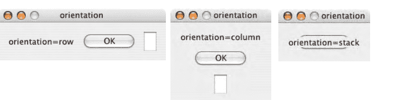

## 对齐子元素

容器内子元素的对齐方式由两个属性控制：父容器中的 `alignChildren` 以及每个子元素中的 `alignment`。父容器中的 `alignChildren` 值控制该容器内所有子元素的对齐方式，除非被单个子元素设置的 `alignment` 值所覆盖。

这些属性使用相同的值，根据容器的方向指定沿某一个轴的对齐方式。你可以指定一个包含两个此类字符串的数组，以指定沿两个轴的对齐方式。第一个字符串指定水平值，第二个指定垂直值。属性值不区分大小写；字符串 `FILL`、`Fill` 和 `fill` 都是有效的。

你也可以使用 ScriptUI 类 `Alignment` 属性对应的常量设置值；例如：

```
myGroup.alignment = [ScriptUI.Alignment.LEFT,
ScriptUI.Alignment.TOP]
```

### 自动布局

如果你使用常量设置 `alignment` 值并然后查询该属性，它返回的是与常量对应的索引数字，而不是字符串值。

行中的元素可以按以下方式沿垂直轴对齐：

- top — 元素的顶边缘位于容器的顶部边距处。
- bottom — 元素的底边缘位于容器的底部边距处。
- center — 元素在上下内边距之间居中。
- fill — 元素的高度被调整以填充容器的高度。

列中的元素可以按以下方式沿水平轴对齐：

- left — 元素的左边缘位于容器的左侧边距处。
- right — 元素的右边缘位于容器的右侧边距处。
- center — 元素在左右内边距之间居中。
- fill — 元素的宽度被调整以填充容器的宽度。

堆叠中的元素可以按以下方式沿垂直或水平轴对齐：

- top — 元素的顶边缘位于容器的顶部边距处，且元素在左右内边距之间居中。
- bottom — 元素的底边缘位于容器的底部边距处，且元素在左右内边距之间居中。
- left — 元素的左边缘位于容器的左侧边距处，且元素在上下内边距之间居中。
- right — 元素的右边缘位于容器的右侧边距处，且元素在上下内边距之间居中。
- center — 元素在上下左右四个内边距之间居中。
- fill — 元素的高度被调整以填充上下边距之间的容器高度，且元素的宽度被调整以填充左右边距之间的容器宽度。

下图显示了在具有 `row` 方向设置并在父容器的 `alignChildren` 属性中设置 `top` 对齐时，创建示例窗口的结果：

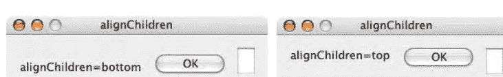

下图显示了在具有 `column` 方向并在父容器的 `alignItems` 属性中设置 `right`、`left` 和 `fill` 对齐时，创建示例窗口的结果。注意在 `fill` 的情况下，每个元素的宽度都被调整得与容器中最宽的元素一样宽：


# 第4 章：用户界面工具

## 自动布局 90

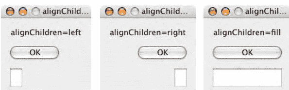

你可以通过设置特定子元素的对齐属性来覆盖由 `alignChildren` 指定的容器子对齐。下图显示了当父容器的 `alignChildren` 值为左对时，`EditText` 元素右对齐的结果：

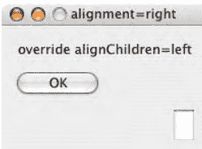

## 二维对齐

你可以使用双字符串数组而不是单个字符串来设置对齐属性，第一个字符串是水平对齐，第二个是垂直对齐。这允许你控制行方向向（row orientation）容器中子元素的水平位置，以及列方向向（column orientation）容器中子元素的垂直位置。

下图显示了示例脚本 `SAlignElements.jsx` 的结果，它演示了如何在两个维度上指定对齐。

- 在第一幅图中，每个控件在其所在的行内垂直居中，并放置在特定的水平位置，每个元素都了如 `['left', 'center']` 的对齐值：

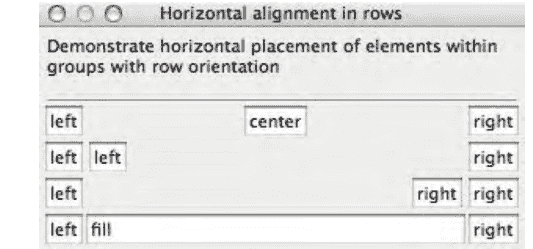

- 垂直对齐示例创建了四列，每列中的控件沿垂直轴排列。它使用如 `['fill', 'top']` 等对齐值来分布列内的控件，同时仍控制相对垂直位置：

## 自动布局 91

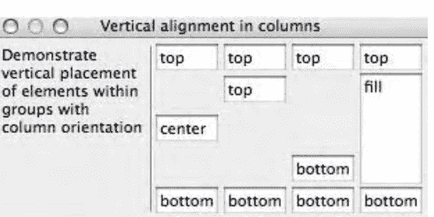

## 设置边距

容器的 `margins` 属性指定了容器边缘与子元素最外边缘之间的像素数。你可以将其设置为一个简单的数字以指定等距边距，或者使用 `Margins` 对象来为容器的每条边指定不同的边距。

下图显示了创建一个行方向向且边距为 5 和 15 像素的示例窗口的结果：

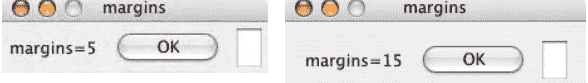

此图显示了创建一个列方向向、顶部边距为 0 像素、底部边距为 20 像素、左右边距为 15 像素的示例窗口的结果：

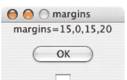

## 子元素间的间距

容器的 `spacing` 属性指定了一个子元素与其相邻兄弟元素之间的像素数。

此图显示了创建一个行方向向且间距分别为 15 和 5 像素的示例窗口的结果：

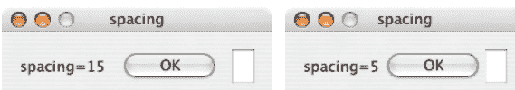

此图显示了创建一个列方向向且间距为 20 像素的示例窗口的结果：

## 自动布局 92

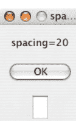

## 确定理想尺寸

每个元素都有一个 `preferredSize` 属性，该属性最初为元素定义了合理的默认尺寸。默认值由 ScriptUI 计算，并基于每个元素的常性特性以及可变特性（例如显示在按钮或文本元素中显示的文本字符串）。

如果未定义元素的 `size`（尺寸/大小）属性，则布局管理器在布局过程中使用 `preferredSize` 的值来确定每个元素的尺寸。通常，你应该避免显式设置 `preferredSize`，让 ScriptUI 根据元素在布局时的状态确定最佳值。这允许你使用本地化字符串来设置用户界面元素的属性（参见第 103 页“ScriptUI 对象中的本地化”）。每个元素的宽度和高度是在布局时根据特定语言的文本字符串计算的，而不是依赖脚本为每个元素指定固定尺寸。

然而，脚本可以显式设置 `preferredSize`，为布局管理器提供关于难以确定默认尺寸的元素的预期尺寸提示，例如没有初始图像可测量的 `IconButton` 元素。

你可以通过将宽度或高度的 `preferredSize` 值设为 -1 来设置其中一个维度，从而让布局管理器计算该维度，而另一个维度则使用提供的值。

你还可以为控件设置和/或最小尺寸值，限制其调整大小的能力。有一个默认的最大尺寸，防止自动布局创建比屏幕更大的元素。

你可以使用布局对象的 `resize()` 方法显式地调整窗口中控件的大小以适应当前文本内容，或者在用户调整窗口大小后进行调整。

## 创建复杂的布局

你可以通过在 `Panel` 容器中嵌套 `Group` 容器以及其他 `Group` 容器，轻松地创建复杂的布局。

许多对话框包含多行待填信息，每行包含相关类型的控件。例如，一个编辑字段被放置在标识它的文本标签的同一行内，并且一系列行排列在一个列中。此示例（参见资源规范）显示了一个简单的对话框，用户可以在两个 `EditText` 中输入信息，每个 `EditText` 都与其 `StaticText` 标签排列一行。为了创建布局，一个具有列方向向的 `Panel` 包含两个行方向向的 `Group` 元素。这些组包含了控件行。面板之外的第三个 `Group` 包含了按钮行。

```
res =
"dialog ( \n*
info: Panel { orientation: 'column', \
text: 'Personal Info', \
name: Group { orientation: 'row', \
s: StaticText { text:'Name' }, \
e: EditText { characters: 30 } \\
} \
addr: Group { orientation: 'row', \
s: StaticText { text:'Street / City:' }, \
e: EditText { characters: 30 } \\
} \
buttons: Group { orientation: 'row', \
okBtn: Button { text:'OK' }, \
cancelBtn: Button { text:'Cancel' } \\
} \
```

## 自动布局 93

```
{
  workInfo: Panel { orientation: 'column', \
    text: 'Work Info', \
    name: Group { orientation: 'row', \
      s: StaticText { text:'Company name' }, \
      e: EditText { characters: 30 } \
    }, \
  buttons: Group { orientation: 'row', \
    okBtn: Button { text:'OK', properties:{name:'ok'} }, \
    cancelBtn: Button { text:'Cancel', properties:{name:'cancel'} } \
  }
}
win = new Window(res); win.center(); win.show();
```

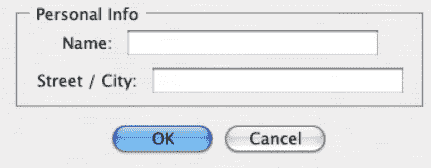

为了让按钮出现在对话框的右侧，按钮组覆盖了其父级（对话框）的填充对齐，并指定了 `alignment='right'`。

这产生了如下结果：

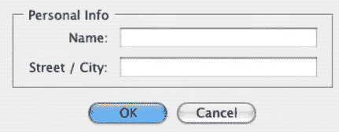

假设我们需要两个面板，并希望每个面板具有相同的宽度。指定 `alignChildren='fill'`，这将每个子元素匹配最宽的一个。

```
res =
"dialog { alignChildren:'fill',
info: Panel { orientation: 'column', \
text: 'Personal Info', \
name: Group { orientation: 'row', \
s: StaticText { text:'Name' }, \
e: EditText { characters: 30 } \
}
```


## 第 4 章：用户界面工具

### 自动布局

res =

```javascript
"dialog {\n  whichInfo: DropList { alignment:'left' },\n  allGroups: Panel { orientation: 'stack', \n    info: Group { orientation: 'column', \n      name: Group { orientation: 'row', \n        s: StaticText { text:'Name' }, \n        e: Edit { characters: 30 } },n  workInfo: Group { orientation: 'column', \n    name: Group { orientation: 'row', \n      s: StaticText { text:'Company name' }, \n      e: Edit { characters: 30 } },n  buttons: Group { orientation: 'row', alignment: 'right', \n    okBtn: Button { text:'OK', properties:(name:'ok') }, \n    cancelBtn: Button { text:'Cancel', properties:(name:'cancel') } }
};"
win = new Window (res);
win.whichInfo.onclick = function () {
if (this.selection != null) {
  for (var g = 0; g < this.items.length; g++) {
    this.items[g].group.visible = false; //hide all other groups
    this.selection.visible = true;//show this group
  }
}
}
var item = win.whichInfo.add ('item', 'Personal Info');
item.group = win.whichInfo.add ('item', 'Work Info');
item.group = win.allGroups.workInfo;
win.whichInfo.selection = win.whichInfo.items[0];
win.center();
win.show();
```

## 自定义布局管理器示例

此脚本创建了一个与上一个示例几乎相同的对话框，它定义了一个布局管理器子类，并将该类的一个赋值为对话框中最后一个 Group 的布局属性。（该示例还演示了在 JavaScript 中定义可重用类的技术。）

此脚本定义的布局管理器以阶梯方式排列其容器中的元素，使得按钮错错排列，而不是排成直线。

/* 定义一个自定义布局管理器，将'container' 的子元素以阶梯方式排列。 */

```javascript
function StairStepButtonLayout(container) { this.initSelf(container); }
// 定义其'method'函数
function SSBL_initSelf(container) { this.container = container; }
function SSBL_layout() {
  var top = 0, left = 0;
  var width;
  var vspacing = 10, hspacing = 20;
  for (var i = 0; i < this.container.children.length; i++) {
    var child = this.container.children[i];
    if (typeof child.layout != "undefined") {
      // 如果子元素是布局，调用其 preferredSize
      child.layout.layout();
      child.size = child.preferredSize;
      child.location = {left, top};
      width = left + child.size.width + vspacing;
      top = top + child.size.height + vspacing;
      left += hspacing;
    }
  }
}
this.container.size = [width, top - vspacing];
```

// 将方法附加到 Object 的原型上
StairStepButtonLayout.prototype.initSelf = SSBL_initSelf;
StairStepButtonLayout.prototype.layout = SSBL_layout;
// 内联一个包含控件资源规范的字符串
res = "dialog {\nwithInfo: DropList { alignment: 'left' }, \nallGroups: Group { orientation: 'stack', \n  info: Group { orientation: 'column', \n    name: Group { orientation: 'row', \n      s: StaticText { text: 'Name:' }, \n      e: EditText { characters: 30 } \n    } \n  }, \nworkInfo: Group { orientation: 'column', \n  name: Group { orientation: 'row', \n    s: StaticText { text: 'Company name:' }, \n    e: EditText { characters: 30 } \n  } \n}, \nbuttons: Group { orientation: 'row', alignment: 'right', \n  okBtn: Button { text: 'OK', properties:(name:'ok') }, \n  cancelBtn: Button { text: 'Cancel', properties:(name:'cancel') } \n} }";
```

### 自动布局

```javascript
// 使用资源规范创建窗口
win = new Window (res);
// 在更改时创建列表
win.whichInfo.onclick = function () {
  if (this.selection != null) {
    for (var g = 0; g < this.items.length; g++) {
      this.items[g].group.visible = false;
      this.selection.visible = true;
    }
  }
}
var item = win.whichInfo.add ('item', 'Personal Info');
item.group = win.whichInfo.add ('item', 'Work Info');
item.group = win.allGroups.workInfo;
win.whichInfo.selection = win.whichInfo.items[0];
win.center();
win.show();
```

## 自定义布局算法

当窗口首次创建时，布局管理器会执行以下步骤：

1. 根据子元素的边距确定列、行或堆叠维度。
2. 使用每个子元素所需的对齐方式，调整其相对于容器边缘的位置。
3. 遍历子元素：
   - 如果子元素是布局，调用其 `preferredSize`。
   - 如果子元素不是布局，将其大小设置为 `preferredSize`。
   - 设置子元素的位置。
4. 根据子元素的大小和间距计算容器的宽度和高度。
5. 设置容器的大小。
6. 如果容器具有定义的 `bounds` 属性，则调整布局。
7. 为每个子元素设置 `bounds` 属性。

## 自动布局限制

自动布局存在限制：

- 布局管理器不会尝试布局具有定义 `bounds` 的容器。脚本编写人员可以通过为容器定义自定义布局管理器来覆盖此行为。
- 布局机制不会跟踪初始布局发生后的尺寸更改。脚本可以通过调用布局管理器的 `layout` 方法启动另一个布局，并可以通过传递 `true` 参数来强制管理器重新计算所有子元素的大小。

## 管理控件标题

用户界面元素通常需要一个标题或标签来标识其用途，并将标题放置在其所标识的元素附近。如第 94 页的“自动布局”示例所示，你可以使用 `statictext`（静态文本）作为标题，或使用自动布局机制来控制标题相对于其所标识元素的位置。

`titleLayout` 方法为许多常见情况提供了一种更简单的方法。它允许你定义元素的标题及其与其所标识的对象图形表示之间的空间关系，而无需额外的 `statictext` 和容器元素。`titleLayout` 作用于元素可选的 `title` 和 `titleLayout` 属性。这会将元素的图形表示处理为两个独立的对象，它们的位置由包含这两个对象的虚拟容器内的布局规则进行控制。

标题布局适用于适用于以下 UI 元素：

- DropList
- FlashPlayer
- IconButton
- Image
- TabbedPanel


## 第 4 章：用户界面工具

## 管理控件标题 99

- `title` 属性是一个字符串，用于为 UI 元素定义文本标签。标题可以出现在图形元素的右侧、上方或下方，也可以叠加在图形元素的中心；其放置位置由 `titleLayout` 属性控制。

- `titleLayout` 属性是一个对象，包含指定以下内容的属性：
  - 标题的宽度（width）；
  - 标题在宽度范围内的对齐方式（justification）；
  - 必要时标题应如何截断；
  - 标题相对于其标识的对象的方向、对齐方式和间距；
  - 标题及其相关对象的虚拟容器的内边距（margins）。

所有 `titleLayout` 属性均为可选；使用此机制的元素类型对每个属性都有默认值。详尽信息请参阅参考部分；请查看第 141 页上的 "titleLayout"。

以下章节提供了如何使用标题布局来实现许多不同布局的示例。

## 标题的对齐与方向

与自动布局不同，标题布局使用 `alignment` 属性来指定标题和图形元素的方向，以及标题相对于图形元素的对齐方式。第一个元素指定水平对齐，第二个元素指定垂直对齐。这些允许的值与自动布局使用的值（见第 88 页的 "Aligning children"）相同，但不允许 `fill` 值。

- 要实现行方向（即标题出现在图形元素的左侧或右侧），将水平对齐设置为 `left` 或 `right`，垂直对齐设置为 `center`、`top` 或 `bottom`：

```
button.titleLayout = { alignment: 'right', 'center' };
```

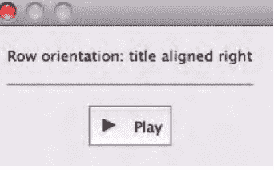

要实现列方向（即标题出现在图形元素的上方或下方），将垂直对齐设置为 `top` 或 `bottom`，水平对齐设置为 `center`：

```
image.titleLayout = { alignment: 'center', 'bottom' };
```

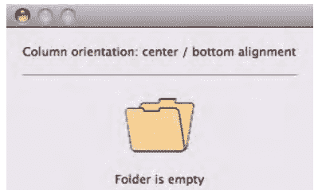

要实现堆叠方向（即标题叠加在图形元素上），垂直和水平对齐均设置为 `center`。这种方向主要用于 `iconbutton` 或 `image` 元素类型；在 `dropdownlist` 上叠加标题没有意义。在此示例中，按钮的标题居中在其图标图像正上方：

```
button.title = 'Get information';
button.titleLayout = { alignment: ['center', 'center'] };
```

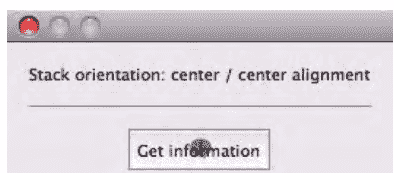

在行方向下，你可以控制标题是对齐于图形元素的顶部、中心还是底部。在此示例中，标题放置在图像左侧，并与顶部对齐：

```
image.titleLayout = { alignment: ['left', 'top'] };
```

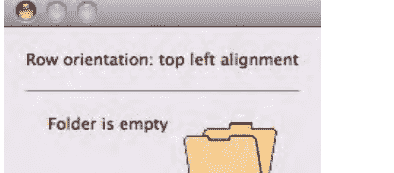

## 管理控件标题 101

- 使用 `spacing` 来覆盖标题与图形元素之间默认的像素间隔。在此示例中，`titleLayout` 配置为将标题放在面板上方 15 像素处：

```
panel.title = 'Image format';
panel.titleLayout = { alignment: ['center', 'top'], spacing: 15 };
```

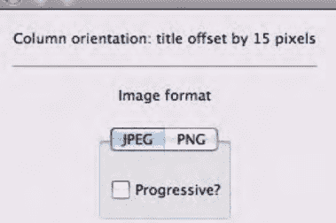

### 标题字符宽度与对齐

- 要覆盖自动计算的标题宽度，请为 `characters` 属性定义一个正值。这会在标题区域留出足够的空间来容纳指定数量的 "X" 字符。当元素的标题可能会变化（例如对于本地化值），且你希望留出足够的空间以适应所有预期的值而不被截断或影响整体布局时，这种方法非常有用。

```
droplist.titleLayout = { alignment: ['left', 'center'], characters: 20 };
```

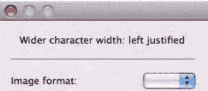

- 当 `characters` 值指定的宽度大于默认标题宽度时，你可以设置 `justify` 属性来控制标题文本在预留空间内的对齐方式。`left` 值将文本置在空间的左端，右侧留出空白；`right` 值将文本置在空间的右端，左侧留出空白；`center` 值则在文本两侧均匀地平分空间。

```
droplist.titleLayout = { alignment: ['left', 'center'],
characters: 20,
justify: 'right' };
```

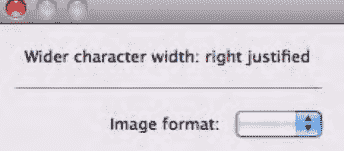

## 管理控件工具 102

此示例演示了如何使用 `characters` 和 `justify` 将组内 `dropdownlist` 控件中冒号处的字符进行垂直对齐。每个元素都使用相同的 `characters` 值，且都向右对齐：

```
w.ddl1 = w.add("dropdownlist { title: 'Image format:' } });
w.ddl2 = w.add("dropdownlist { title: 'Background color:' } });
w.ddl3 = w.add("dropdownlist { title: 'Text color:' } });
w.ddl1.titleLayout = { alignment: 'left', 'center', spacing: 3,
characters: 16, justify: 'right' };
w.ddl2.titleLayout = { alignment: 'left', 'center', spacing: 3,
characters: 16, justify: 'right' };
w.ddl3.titleLayout = { alignment: 'left', 'center', spacing: 3,
characters: 16, justify: 'right' };
```

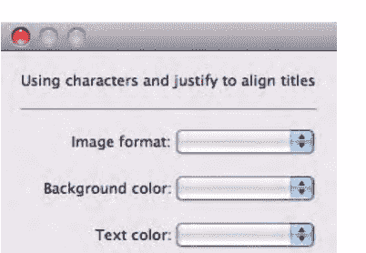

## 标题截断

如果为标题留出的空间宽度不足以显示其完整文本，请设置 `truncate` 属性来控制截断文本的外。如果 `truncate` 设置为 `middle`，则会从文本中间移除字符并替换为省略号 (...)。如果赋值为 `end`，则将从文本末尾移除字符并替换为省略号。如果 `truncate` 为 `none`，则直接移除字符而不进行替换。

此示例演示了三种选项对同一标题的影响：

```
w.btn1 = w.add("iconbutton { title: 'Start 123456 End' } });
w.btn2 = w.add("iconbutton { title: 'Start 123456 End' } });
w.btn3 = w.add("iconbutton { title: 'Start 123456 End' } });
w.btn1.titleLayout = { characters: 8, truncate: 'middle' };
w.btn2.titleLayout = { characters: 8, truncate: 'end' };
w.btn3.titleLayout = { characters: 8, truncate: 'none' };
```

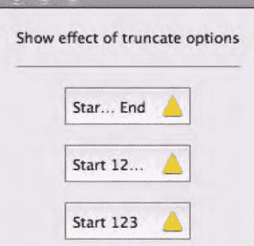

### 对象周围的内边距

`margins` 属性指定元素边缘与其内部内容之间的像素数。此值将覆盖默认的内边距设置（大多数类型为每边 6 像素）。

- 对于 `iconbutton`，`margins` 值控制按钮框架与标题及图像之间的间距。

- 对于其他元素类型，`margins` 控制标题与其周围虚拟边界之间的间距，这使得元素占据的空间远大于默认值。

此示例演示了覆盖 `iconbutton` 和 `droplist` 元素的默认内边距。列表封装在面板中以创建人工边界：

```
w.btn1 = w.add("iconbutton { title: 'Default margins', image: 'SystemWarningIcon' });
w.btn2 = w.add("iconbutton { title: 'Extra T/B margins', image: 'SystemWarningIcon' });

var defaultBtnMargins = w.btn2.layout;
w.btn2.titleLayout = { margins: [defaultBtnMargins[0], 15, defaultBtnMargins[2], 15] };
w.panel = w.add("panel { margins: 0, ddl1: DropList { title: 'Default margins' }, panel2: w.add("panel { margins: 0, ddl2: DropList { title: 'Extra L/R margins' } }); } }");
w.panel.panel2.ddl2.titleLayout = { margins: [15, 0, 15, 0] };
```

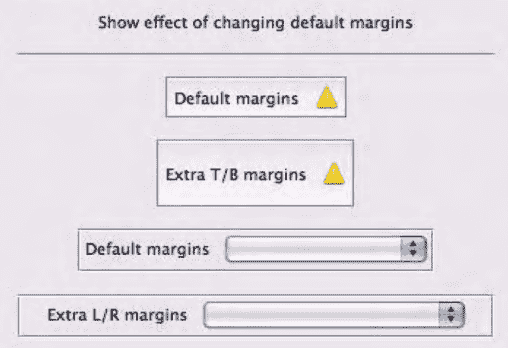

### ScriptUI 对象中的本地化

对于显示在屏幕上的用户界面的用户，你可能希望对显示的文本进行本地化。你可以使用全局 `localize` 函数简单高效地本地化任何 ScriptUI 对象中的显示字符串。该函数接受的参数是一个包含字符串本地化版本的本地化对象。

本地化对象是一个 JavaScript 对象字面量，其属性名为本地化名称，其属性值为本地化文本字符串。本地化名称是按照 ISO 3166 指定的标识符。


## 第 4 章：用户界面工具

### ScriptUI 对象中的本地化

在此示例中，`btnText` 对象包含针对多个区域的本地化文本字符串。该对象为要添加到窗口 `w` 中的按钮提供文本：

```
btnText = { en: "Yes", de: "Ja", fr: "Oui" };
b1 = w.add("button", undefined, localize(btnText));
```

`localize` 函数提取当前区域的正确字符串。它将当前区域和平台匹配到对象属性中的一个，并返回关联字符串。例如，在德语系统上，该属性提供字符串 "Ja"。

当你的脚本使用本地化为用户界面元素提供相应语言的字符串时，还应该利用自动布局（Automatic layout）功能。布局管理器可以根据本地化文本值确定每个用户界面元素的最佳尺寸，自动调整你由脚本定义的对话框的布局，以适应不同语言字符串宽度的差异。

### 本地化字符串中的变量值

`localize` 允许你在字符串值中包含变量。每个变量都会被额外参数评估的结果所替换。例如：

```
today = {
en: "Today is %1/%2.",
de: "Heute ist der %2.",
};
d = new Date();
Window.alert(localize(today, d.getMonth()+1, d.getDate()));
```

## 自动本地化

如果你不需要变量替换，可以使用自动本地化。要开启自动本地化，请设置全局值：

```
$.localization=true
```

当开启时，你可以直接将本地化对象作为任何接收本地化字符串的属性的值，而无需使用 `localize` 函数。例如：

```
btnText = { en: "Yes", de: "Ja", fr: "Oui" };
b1 = w.add("button", undefined, btnText);
```

无论 `$.localization` 变量设置如何，`localize` 函数始终会执行翻译。

```
// 仅当 $.localization=true 时有效
b1 = w.add("button", undefined, btnText);
// 无论 $.localization 值如何，始终有效
b1 = w.add("button", undefined, localize(btnText));
```

如果你需要在本地化字符串中包含变量，请使用 `localize` 函数。

### ScriptUI 对象引用

ScriptUI 是一个与 ExtendScript JavaScript 解释器协作的组件，为 JavaScript 程序提供创建和与用户界面元素交互的能力。它为应用程序中的窗口和用户界面控件元素提供对象模型。

本节提供了 ScriptUI 类和对象的详细信息，以及它们的属性、方法和创建参数。

- ScriptUI 类
- 普通属性
- Window 类
- Window 对象
- 对象
- UI 基类
- 图形自定义对象
- LayoutManager 对象

## ScriptUI 类

全局 `ScriptUI` 类提供了关于 ScriptUI 模块的中心信息。此对象不可实例化。

### ScriptUI 类属性

| Alignment 对象 | 收集可以用于控件和容器的 `alignChildren` 属性的枚举值，以及用于设置控件 `titleLayout` 属性的对齐值。只读。 |

使用这些属性设置对齐。例如：`myGroup.alignment = [ScriptUI.Alignment.LEFT, ScriptUI.Alignment.TOP]`

当你查询对齐方式时，它返回与所示常量对应的索引值。常量值为：

```
ScriptUI.Alignment.TOP (1)
ScriptUI.Alignment.BOTTOM (2)
ScriptUI.Alignment.LEFT (3)
ScriptUI.Alignment.RIGHT (4)
ScriptUI.Alignment.FILL (5)
ScriptUI.Alignment.CENTER (6)
```

| applicationFonts 对象 | 收集定义默认应用程序字的枚举值。可用字体取决于应用程序和系统配置。 |

### ScriptUI 类 106

| compatibility | Object | 兼容性对象，其属性为宿主应用程序支持的兼容模式名称。例如，`ScriptUI.compatibility.sulPanelCoordinates` 意味着该应用程序允许与 ScriptUI 版本 1 中的面板（Panel）元素坐标系保持向后兼容性。 |
| coreVersion | String | ScriptUI 组件的内部核心版本。只读。 |
| environment | Object | 一个提供访问 ScriptUI 环境属性的 JavaScript 对象；包含一个键盘状态对象，该对象随时报告键盘的激活状态，且独立于事件处理框架。 |
| events | Object | 一个包含一个函数 `events.createEvent()` 的 JavaScript 对象，允许你创建事件对象以模拟用户交互事件。 |
| FontStyle | String | 收集可以作为 `ScriptUI.newFont()` 样式参数的枚举值。例如：

var font = ScriptUI.newFont ('Helvetica', ScriptUI.FontStyle.BOLD)

只读。值为：
REGULAR
BOLD
ITALIC
BOLDITALIC |
| frameworkName | String | 与 ScriptUI 组件兼容的用户界面框架的名称。只读。 |
| version | String | ScriptUI 组件框架的主版本号。只读。 |

### ScriptUI 类函数

```
events.createEvent ()
ScriptUI.events.createEvent ( eventType)
```

eventType 事件类型，其之一为：

| UIEvent |
| KeyboardEvent |
| MouseEvent |

此函数位于封装 `events` 属性的 JavaScript 对象中。它返回一个相应类型的事件对象：

- `UIEvent` 基类封装了用户界面元素的输入信息。它是更专门类型的基类。
- `KeyboardEvent` 封装了关于键盘事件的信息。
- `MouseEvent` 封装了关于鼠标事件的信息。

此对象被传递给在窗口或控件中发生的特定类型的事件。使用 `window.addEventListener()` 或 `control.addEventListener()` 注册监听器。

```
getResourceText()
ScriptUI.getResourceText (text)
```

| text | 要匹配的文本。 |

查找并返回给定文本的资源。如果没有匹配字符串，则返回文本本身。返回 String。

```
newFont ( name, style, size );
```

| name | 字体族。 |
| style | 字体样式或枚举值 `FontStyle`。 |
| size | 尺寸，数字。 |

创建一个用于文本控件和标题的新对象。返回 ScriptUI 对象。

## 普通属性

newImage ( normal, disabled, pressed, rollover );```

| normal | 用于正常状态的资源名称或路径。 |
| disabled | 用于禁用状态的资源名称或路径，当控件被禁用时显示。 |
| pressed | 用于按下状态的资源名称或路径，当点击图像时显示。 |
| rollover | 用于悬停状态的资源名称或路径，当鼠标悬过图像时显示。 |

创建一个用于可以显示图像的控件的新对象，从指定的资源或图像文件加载关联图像。返回 UIImage 对象。

## Environment 对象

全局对象通过 `ScriptUI.environment` 属性可用。它定义了 ScriptUI 环境的属性。在当前版本中，它包含一个属性：

keyboardState 对象 独立于事件处理框架报告键盘激活状态。

所有用户界面元素类型（包括窗口、容器和控件）共享许多相同的属性，尽管某些属性对不同类型的对象具有不同的含义。下表总结了属性用于哪些对象类型。

| Property | Window | Panel | TabbedPanel | Tab | Group | Button | CheckBox | DropDownList | EditText | FlashPlayer | IconButton | Image | ListBox | ListItem | ProgressBar | RadioButton | Scrollbar | Slider | StaticText | Tree |
| :--- | :--- | :--- | :--- | :--- | :--- | :--- | :--- | :--- | :--- | :--- | :--- | :--- | :--- | :--- | :--- | :--- | :--- | :--- | :--- |
| active | x | | | | | | | | | | | | | | | | | | |
| alignChildren | x | x | x | x | | | | | | | | | | | | | | | |
| alignment | x | x | x | x | x | x | x | x | x | x | | | x | x | x | x | x | x |
| bounds | x | x | x | x | x | x | x | x | x | x | x | | | x | x | x | x | x | x |
| cancelElement | | | | | | | | | | | | | | | | | | | | |
| characters | | x | x | x | | | | | | | | | | | | | | | | |
| checked | | | | | | | | | | | | | | | | x | | | | | |


## 第4章：用户界面工具

## 常用属性 109

| 属性 | 窗口 (Window) | 选项面板 (TabbedPanel) | 标签 (Tab) | 分组 (Group) | 按钮 (Button) | 下拉 (DropDown) | 复选框 (CheckBox) | 文本框 (EditText) | FlashPlayer | 图标按钮 (IconButton) | 图片 (Image) | 列表框 (ListBox) | 列表 (ListItem) | 进度条 (ProgressBar) | 单选按钮 (RadioButton) | 滚动条 (Scrollbar) | 滑块 (Slider) | 静态文本 (StaticText) | 树视图 (TreeView) |
|---|---|---|---|---|---|---|---|---|---|---|---|---|---|---|---|---|---|---|---|---|
| 子元素 (children) | X | X | X | | X | X | | | | | | | | | | | | | | |
| 列数 (columns) | | | | | | | | | | | | X | | | | | | | | |
| 默认元素 (defaultElement) | X | | | | | | | | | | | | | | | | | | | | |
| 启用 (enabled) | X | X | X | X | X | X | X | X | X | X | X | X | X | X | X | X | X | X | X | |
| 展开 (expanded) | | | | | | | | | | | | | | | X | | | | | | |
| 帧边界 (frameBounds) | X | | | | | | | | | | | | | | | | | | | | |
| 帧位置 (frameLocation) | X | | | | | | | | | | | | | | | | | | | | |
| 帧大小 (frameSize) | X | | | | | | | | | | | | | | | | | | | | |
| 图形 (graphics) | X | X | X | X | X | X | X | X | X | X | X | X | X | X | X | X | X | X | X | |
| 帮助文本 (helpText) | X | X | X | X | X | X | X | X | X | X | X | X | X | X | X | X | X | X | X | |
| 图标 (icon) | | | | | | | | | | | | X | X | X | | | | | | | |
| 图片 (image) | | | | | | | | | | | | X | X | | | | | | | | |
| 索引 (index) | | | | | | | | | | | | | | | | | X | | | | | |
| 项目 (items) | | | | | | | | | | | X | | X | | | | | | | | | | |
| | | | | | | | | | | | X | | X | | | | | | | X | | |
| 跳跃增量 (jumpdelta) | | | | | | | | | | | | | | | | | X | | | | | |
| 对齐 (justify) | | | | X | X | X | | | | | | | | X | | X | | | | | |
| 布局 (layout) | X | X | X | X | | | | | | | | | | | | | | | | | |
| 位置 (location) | X | X | X | X | X | X | X | X | X | X | X | X | X | X | X | X | X | X | X | |
| 边距 (margins) | X | X | X | X | | | | | | | | | | | | | X | X | X | X | X |
| 最大尺寸 (maximumSize) | X | X | X | X | X | X | X | X | X | X | X | X | X | X | X | X | X | X | X | |
| 最大值 (maxvalue) | | | | | | | | | | | | | | | | | | X | X | | | | |
| 最小尺寸 (minimumSize) | X | X | X | X | X | X | X | X | X | X | X | X | X | X | X | X | | | | | | |
| 最小值 (minvalue) | | | | | | | | | | | | | | | | | | X | X | | | | |
| 方向向 (orientation) | X | X | X | X | X | X | X | X | X | X | X | X | X | X | X | X | X | X | X | | |
| 父级 (parent) | X | X | X | X | X | X | X | X | X | X | X | X | X | X | X | X | X | X | X | | |
| 首选尺寸 (preferredSize) | X | X | X | X | X | X | X | X | X | X | X | X | X | X | X | X | X | X | X | | |
| 属性 (properties) | X | X | X | X | X | X | X | X | X | X | X | X | X | X | X | X | X | X | X | | |

## 第4章：用户界面工具

## Window 类 110

| 属性 | 窗口 (Window) | 选项面板 (TabbedPanel) | 标签 (Tab) | 分组 (Group) | 按钮 (Button) | 复选框 (CheckBox) | 下拉列表 (DropDownList) | 文本框 (EditText) | FlashPlayer | 图标按钮 (IconButton) | 图片 (Image) | 列表 (List) | 列表 (ListItem) | 进度条 (ProgressBar) | 单选按钮 (RadioButton) | 滚动条 (Scrollbar) | 滑块 (Slider) | 静态文本 (StaticText) | 文本视图 (TextView) |
|---|---|---|---|---|---|---|---|---|---|---|---|---|---|---|---|---|---|---|---|---|
| 可调整大小 (resizeable) | x | | | | | | | | | | | | | | | | | | | | |
| 选中 (selected) | | | | | | | | | | x | | | | | | | | | | | |
| 选取 (selection) | | x | | x | | | | | | x | | | | | | | | | | | |
| 快捷键 (shortcutKey) | x | | x | x | x | x | x | x | | | | x | x | x | x | | | | | | |
| 大小 (size) | x | | x | x | | x | x | x | x | x | | x | x | x | x | | | | | | |
| 间距 (spacing) | x | | x | x | | | | | | | | | | | | | | | | | |
| 步进增量 (stepdelta) | | | | | | | | | | | | | | | x | | | | | | | |
| 子项 (subitems) | | | | | | | | | | | | | | | x | | | | | | | |
| 文本 (text) | x | x | x | | | | | | | | | | x | x | | | | | | | |
| 选取 (selection) | | | | | | | | | | | | | | | | | | | | | | |
| 标题 (title) | | | | | | | | | | | | | | | | | | | | | | |
| 标题布局 (titleLayout) | | x | | | | | | | | | | | x | x | | | | | | | |
| 类型 (type) | x | | x | x | x | x | x | x | | | | | | | | | | | | | |
| 值 (value) | | | | | x | | | | | | | | | | | | | | | | | |
| 可见 (visible) | x | | x | x | | | | | | | | | | | | | | | | | | |
| 选取 (selection) | | | | | | | | | | | | | | | | | | | | | | | |
| 标题 (title) | | | | | | | | | | | | | | | | | | | | | | | | |
| 标题布局 (titleLayout) | | | | | | | | | | | | | | | | | | | | | | | | |
| 类型 (type) | | | | | | | | | | | | | | | | | | | | | | | | |
| 值 (value) | | | | | | | | | | | | | | | | | | | | | | | | | | |
| 可见 (visible) | | | | | | | | | | | | | | | | | | | | | | | | | | | |

*(注：原文表格中存在部分行重复，译文已根据要求去重并进行准确翻译)*


## 第 4 章：用户界面工具

## Window 对象 114

| 属性 | 类型 | 描述 |
| :--- | :--- | :--- |
| maximized | Boolean | 为 true 时，窗口处于最大化状态。 |
| minimized | Boolean | 为 true 时，窗口处于最小化或图标化状态。 |
| opacity | Number | 窗口的透明度，范围为 [0..1]。值 1.0（默认值）使窗口完全不透明，值 0 使其完全透明。中间值使其具有不同程度的部分透明。 |
| shortcutKey | String | 调用此窗口 `onShortcutKey` 回调函数的按键序列（仅限 Windows）。 |

## 容器属性

下表显示了适用于 Window 对象和容器对象（类型为 panel、tabbedpanel、tab 和 group 的控件）的属性。

| 属性 | 类型 | 描述 |
| :--- | :--- | :--- |
| alignChildren | String, 包含 2 个字符串的数组 | 告诉布局管理器容器内大小不一的子元素应在列或行中如何对齐。创建顺序决定了哪些元素位于列的顶部或行的左侧；创建越早的元素越靠近其列或行的顶部或左侧。如果子元素定义了对齐方式，将覆盖父容器的 `alignChildren` 设置。对于单个字符串值，允许的值取决于 `orientation` 的值。对于 `orientation=row`：top（顶部）、bottom（底部）、center（默认）、fill（填充）。对于 `orientation=column`：left（左侧）、right（右侧）、center（默认）、fill。对于 `orientation=stack`：top、bottom、left、right、center（默认）、fill。对于数组值，第一个字符串元素定义水平对齐，第二个元素定义垂直对齐。水平对齐值必须是 left、right、center 或 fill 之一。垂直对齐值必须是 top、bottom、center 或 fill 之一。 |

注：值不区分大小写。

## 第 4 章：用户界面工具

## Window 对象 116

### alignment
String，或包含 2 个字符串的数组

适用于容器的子元素。如果定义，此值将覆盖父容器的 `alignChildren` 设置。

对于单个字符串值，允许的值取决于 `orientation` 的值。对于 `orientation=row`：

```
top     center（默认）
bottom  fill
```

对于 `orientation=column`：

```
left    center（默认）
right   fill
```

对于 `orientation=stack`：

```
top     right
bottom  center（默认）
left    fill
```

对于数组值，第一个字符串元素和第二个元素分别定义水平对齐。水平对齐值必须是 left、center 或 fill 之一。垂直对齐值必须是 top、bottom、center 或 fill 之一。

值不区分大小写。

### bounds
Bounds

一个关于屏幕坐标中窗口可绘制区域边界的 Bounds 对象。对比 `frameBounds`。不适用于 tab 类型，tab 的边界由父级 tabbedpane 决定。只读。

### children
Object 对象的数组

已添加到此窗口或容器的用户界面元素集合。该数组可以通过数字或包含元素名称的字符串进行索引。此数组的 `length` 属性是容器元素的子元素数量，其他元素为 0。只读。

### graphics
Graphics

一个 `ScriptUIGraphics` 对象，可用于响应 `onEvent` 时自定义窗口外观。容器的 `LayoutManager` 对象。容器第一次可见时，ScriptUI 通过调用其 `layout` 函数来调用此布局管理器。默认是元素创建时自动创建的 `LayoutManager` 类的实例。

### layout
LayoutManager

### location
Point

一个用于窗口可绘制区域左上角（或 panel 框架左上角）的 `Point` 对象。同于 `[bounds.x, bounds.y]`。

## 第 4 章：用户界面工具 Window 对象 117

### margins
Bounds

描述容器边缘之间像素数量的边距。对于窗口，可以指定每个边缘的边距。

### maximumSize
Dimension

窗口可扩展的最大尺寸的 Dimension 对象。用于自动布局。

### minimumSize
Dimension

窗口可缩的最小尺寸的 Dimension 对象。用于自动布局。

### orientation
String

元素在容器内的组织方式。取决于布局管理器。Window 对象的允许值为：

```
row
column
stack
```

取决于容器类型。对于 Window 和 Panel，默认值为 `column`；对于 TabbedPanel 属性，默认值为 `row`。

### parent
Object

此元素的直接父级，Window 或容器。只读。

### preferredSize
Dimension

窗口首选尺寸的 Dimension 对象。用于自动布局。

### properties
Object

创建多个属性的对象。对于 TabbedPanel，取决于选中的 tab。

### size
Dimension

当前尺寸和位置的 Dimension 对象。

### spacing
Number

子元素与其相邻元素之间的像素数量。由于每个容器只需要一个间距值。

## 第 4 章：用户界面工具

## Window 对象 118

| 属性 | 类型 | 描述 |
| :--- | :--- | :--- |
| text | String | 标题、标签或显示的文本。不适用于 group 或 tab 类型的容器。 |
| visible | Boolean | 为 true 时显示，为 false 时隐藏。当容器隐藏时，其子元素也会隐藏，但它们保留自身的可见性值，并在父级隐藏时相应显示或隐藏。 |
| window | Window | 此容器的顶级父窗口，一个 [Window 对象](...)。 |
| windowBounds | Bounds | 相对于顶级父窗口的尺寸和位置的 [Bounds](...) 对象。 |

## Window 方法

这些函数定义在 Window 实例上，并根据 Panel 和 Group 容器的情况进行指示。

```
add ()
WindowContainerObj.add (type [, bounds, text, { creation_props });
```

| type | 控件类型。参见 124 页“控件类型和创建参数”。 |
| bounds | 可选。描述新控件或容器相对于父级的尺寸和位置的边界规范。格式参见 [Bounds](...) 对象。如果提供，此值将创建一个 Bounds 对象并分配给新对象的 `bounds` 属性。 |
| text | 可选。在控件中显示的初始文本（标题、标签或内容，取决于控件类型）。如果提供，将其分配给新对象的 `text` 属性。 |
| creation_props | 可选。此对象的属性指定创建参数，这些参数特定于每个类型。参见 124 页“控件类型和创建参数”。|

创建并返回一个新的控件或容器对象，并添加到此窗口容器的子元素中。

返回对象，如果无法创建对象则返回 null。


## 第 4 章：用户界面工具

```javascript
addEventListener(
  windowObj.addEventListener(eventName, handler[, capturePhase]);
);
```

事件名称字符串。预定义的事件名称包括：

- change（改变）
- move moving（移动）
- resize resizing（调整大小）
- show enterKey（显示回车键）
- focus blur（聚焦/模糊）
- mousedown mouseup（鼠标按下/释放）
- mousemove mouseover（鼠标移动/悬停）
- mouseout（鼠标离开）
- click（点击，单击为1，双击为2）

handler: 在此目标上注册指定事件的函数。可以是扩展中定义的函数名，也可以是在事件发生时执行的本地定义的处理器。处理函数接收一个参数，即第 82 页的 [UIEvent 基类](为窗口或控件注册事件监听器)。

capturePhase: 可选。当为 true 时，处理器会在事件传播的捕获阶段被调用。默认为 false，意味着如果此对象是目标的祖先，则在冒泡阶段调用处理器；如果此对象本身就是目标，则在目标阶段调用处理器。

为此窗口中发生的特定类型事件注册事件处理器。

返回 undefined。

```javascript
center()
windowObj.center ({window})
```

window: 可选。一个 [Window 对象]()。

将窗口在屏幕上居中，或相对于另一个指定的窗口居中。

返回 undefined。

```javascript
close()
windowObj.close ([result])
```

result: 可选。从作为模态对话框调用此窗口的 show 方法返回的数值。

这将关闭窗口。如果为窗口定义了 [onClose]() 回调，该函数将触发并关闭窗口。

返回 undefined。

```javascript
dispatchEvent()
windowObj.dispatchEvent ({eventObj})
```

eventObj: 一个 [UIEvent 基类]()。

模拟在目标上发生事件。脚本可以为特定事件创建一个 [UIEvent 基类] 并将其传递给此方法，以启动该事件的传播。

如果任何注册的监听器在处理事件时调用了对象的 [preventDefault()]() 方法，则返回 false，否则返回 true。

## 第 4 章：用户界面工具

```javascript
findElement()
windowOrContainerObj.findElement (name)
```

元素的名称，如 name 创建属性中指定的。

在此窗口或容器的子元素中搜索命名的元素，如果找到则返回该对象。

返回控件对象或 null。

```javascript
hide()
windowObj.hide()
```

隐藏此窗口。当窗口隐藏时，其子元素也会被隐藏，但当再次显示时，子元素将保留它们的可见性状态。

对于模态对话框，将关闭对话框并将结果设置为 0。

返回 undefined。

```javascript
notify()
windowObj.notify({event})
```

可选。要调用的窗口事件处理器的名称。取以下之一：

| onClose | onResize |
|---|---|
| onMove | onResizing |
| onMoving | onShow |

发送通知消息，模拟指定的用户交互事件。例如，模拟用户移动对话框：

```javascript
myDlg.notify("onMove")
```

返回 undefined。

```javascript
remove()
windowOrContainerObj.remove(index)
windowOrContainerObj.remove(text)
windowOrContainerObj.remove(child)
```

要移除的控件，通过从 0 开始的索引、包含的文本值或作为控件对象指定。

从此窗口或容器的子元素中移除指定的子控件。如果子元素不存在，则不产生错误结果。

返回 undefined。

## 第 4 章：用户界面工具

## Window 对象 121

```javascript
removeEventListener()
windowObj.removeEventListener(eventName, handler[, capturePhase]);
```

事件名称字符串。

注册用于处理事件的函数。

可选。处理器是否仅在捕获阶段响应。

取消为此窗口中发生的特定类型事件注册事件处理器。参数必须与注册事件处理器时使用的参数完全相同。

返回 undefined。

```javascript
show()
windowObj.show();
```

显示此窗口、容器或控件。如果为窗口定义了 onShow 回调，则在显示窗口之前调用该函数。

当窗口或容器隐藏时，其子元素也会被隐藏，但当显示时，子元素将保留其自身的可见性状态。

对于模态对话框，打开对话框并在直到对话框被关闭之前不返回。如果是通过 close() 方法关闭的，此方法将返回传递给该方法的任何结果值。否则，返回 0。

```javascript
update()
windowObj.update();
```

允许脚本运行长时间操作（如复制大文件）并更新 UI 元素以显示操作状态。

通常，对 UI 元素的更新发生在空闲期间，即应用程序未执行任何操作且 OS 事件队列未运行时。使用此方法执行必要的同步更新，并顺序处理鼠标和键盘事件，以便允许用户（通过点击取消按钮，实例）取消当前操作。

在 update() 操作期间，应用程序被置于模态状态，因此它不会处理任何激活不同窗口或将焦点交给被更新窗口之外控件的事件。模态状态允许其他窗口中控件的绘制事件发生（如在模态 show() 操作期间的情况），这样脚本在操作循环期间就不会阻止 UI 其他部分的发生。

对一个当前不可可见的窗口调用 update() 方法是错误的。

## 窗口事件处理回调

可以定义以下回调函数来响应事件。要响应事件，在窗口中定义具有相应的函数。这些回调对于容器类型（panel 和 group）。

| 回调 | 说明 |
|---|---|
| onClose | 用户点击窗口使其激活时调用。 |
| onDeactivate | 用户使激活的窗口变为非激活状态时调用；可以返回 false 取消操作。 |
| onDelete | 在容器或控件即将被绘制时调用。使用控件的 Graphics 对象修改外观。处理器接收一个参数 DrawState 对象。 |
| onMove | 窗口移动后调用。 |
| onMoving | 窗口正在移动时调用，每次位置变化时调用。处理器可以监控操作。 |
| onResize | 窗口正在调整大小时调用，每次高度或宽度变化时调用。处理器可以监控操作。 |
| onShortcutKey | （仅限窗口）当快捷键序列匹配窗口的 shortcutKey 值时调用。 |
| onShow | 使用 show 方法请求打开窗口时调用，在窗口可见之前但在自动布局完成后。处理器可以修改自动布局的结果。 |

## 控件对象

属于窗口的 UI元素可以是容器或控件。容器共享顶层窗口的一些方面以及控件的一些方面，在此与控件一起描述。

## 控件构造函数

使用 add 方法创建新的容器和控件。add 方法适用于窗口容器（panel 和 group）对象。另见 dropdownlist 和 listbox 控件的 add()。

```javascript
add()
containerObj.(type { bounds, text, { creation_props } });
```

| type | 控件类型。参见第 124 页的“控件类型和创建参数”。 |
| bounds | 可选。描述新控件或容器相对于父级的大小和位置。参见 Bounds 对象规范。如果提供，此值将创建一个 Bounds 对象并分配给新对象的 bounds 属性。 |
| text | 可选。字符串。根据控件类型作为标题或内容的初始文本。如果提供，此值将分配给新对象的 text 属性。 |
| creation_props | 可选。对象。此对象的属性指定创建参数，这些参数特定于每个类型。参见第 124 页的“控件类型和创建参数”。 |

创建并返回一个新的控件或容器对象并将其添加到此窗口容器的子中。

返回新对象，如果无法创建对象则返回 null。


# 控制类型与创建参数

以下关键字可以在字符串字面量中作为 `add` 方法的类型指定符，该方法适用于 Window 和容器（Panel 和 Group）对象。类名可以在资源规格说明中使用，用于在容器元素（窗口、Panel 或 Group）中定义控件。

所有种类型的控件（包括容器）都有一个可选的创建参数名称，允许您为对象赋予一个唯一的名称。

| 类型关键字 | 类名 | 描述 |
| --- | --- | --- |
| button | Button | 包含鼠标敏感文本字符串的推送按钮。当控件被点击或调用了 `notify()` 方法时，会调用 `onClick` 回调函数。<br><br>添加到窗口：<br>``w.add("button", [bounds, creation_properties]);`<br>bounds: 可选。控件的位置和大小。<br>text: 可选。在控件中显示的文本。<br>creation_properties: 可选。一个包含以下任意属性的对象：<br>name: 控件唯一名称。对于模态对话框，特殊名称 "ok" 会使其成为默认元素（defaultElement），特殊名称 "Cancel" 会使其成为父级对话框的取消元素（cancelElement）。 | |
| checkbox | Checkbox | 一个双状态控件，当值为 true 时显示带有复选框的框，当值为 false 时显示为空。当控件被点击或调用了 `notify()` 方法时，会调用 `onClick` 回调函数。<br><br>添加到窗口：<br>``w.add("checkbox", [bounds, text, {creation_properties});`<br>bounds: 可选。控件的位置和大小。<br>text: 可选。在控件中显示的文本。<br>creation_properties: 可选。一个包含以下任意属性的对象：<br>name: 控件唯一名称。 | |

## 第4章：用户界面工具

## 控件对象 125

| 类型关键字 | 类名 | 描述 |
|---|---|---|
| dropdownlist | DropDown | 具有零或多个项目的下拉列表。当通过脚本或用户更改了项目选择，或者调用了对象的 `notify()` 方法时，会调用 `onChange` 回调函数。<br><br>添加到窗口 w：<br><br>```\nw.add("list", bounds, items,\n  {creation_properties});\n```<br><br>bounds: 控件的位置和大小。<br><br>items: 可选。提供此参数或 `creation_properties` 参数，不要两者都提供。一个字符串数组，用于每个列表项的文本。每个项目都会创建一个 `ListItem` 对象。文本字符串为 "=" 的项目会创建一个分隔符项目。<br><br>creation_properties: 可选。提供此参数或 `items` 参数，不要两者都提供。此形式对于使用资源规格说明定义的元素最为有用。一个包含以下属性的对象：：<br><br>name: 控件的唯一名称。<br><br>items: 一个字符串数组，用于每个列表项的文本。每个项目都会创建一个 `ListItem` 对象。文本字符串为 "=" 的项目会创建一个分隔符项目。 |
| edittext | EditText | 用户可以更改的可编辑文本字段。当文本被更改且用户按下 ENTER 键或控件失去焦点，或者调用了其 `notify()` 方法时，触发 `onChange` 回调。当文本发生任何变化时，都会调用 `onChange` 回调。`selection` 属性当前包含选中的文本。<br><br>添加到窗口 w：<br><br>```\nw.add("edittext", [bounds, text,\n  {creation_properties});\n```<br><br>bounds: 控件的位置和大小。<br><br>text: 可选。在控件中显示的文本。<br><br>creation_properties:可选。一个包含以下任意属性的对象：<br><br>name: 控件唯一名称。<br><br>readonly: 当为 false（默认）时，控件接受文本输入。当为 true 时，控件不接受输入，仅显示 text 属性的内容。<br><br>noecho: 当为 false（默认）时，控件显示输入文本。当为 true 时，控件不显示文本（用于密码输入框）。 | |

## 第4章：用户界面工具

## 控件对象 126

| 类型关键字 | 类名 | 描述 |
| --- | --- | --- |
| edittext (续) | | enterKeySignalsOnChange: 当为 false（默认）时，当可编辑文本被更改且控件失去键盘焦点时（即用户 tab 键到另一个控件、点击控件外部或输入 ENTER），控件会发出 `onChange` 事件。当为 true 时，控件仅在可编辑文本被更改且用户输入 ENTER 时才发出 `onChange`；其他更改不会触发该事件。<br><br>borderless: 当为 true 时，控件无边框绘制。边框为 false。<br><br>multiline: 当为 false（默认）时，控件接受单行文本。当为 true 时，控件接受多行，此时文本会在控件宽度内自动换行。<br><br>scrollable: （仅针对多行元素）当为 true（默认）时，文本字段具有垂直滚动条，当元素包含文本超过可见区域时，滚动条将启用。当为 false 时，不显示滚动条；如果元素包含文本超过可见区域，可以使用方向键向上向下滚动文本。 | |

| 类型关键字 | 类名 | 描述 |
| --- | --- | --- |
| flashplayer | FlashPlayer | 一个包含 Flash Player 的控件，它可以加载并播放存储在 SWF 文件中的 Flash 电影。<br><br>ScriptUIPlayer 元素在 Adobe 应用程序中运行 Flash 应用程序。Flash 应用程序运行 ActionScript，这是 JavaScript 的一种不同实现，而运行 Adobe 应用程序的 JavaScript 是 ExtendScript 版本。<br><br>此类对象的对象的函数允许您的脚本加载 SWF 文件、控制电影播放并与 ActionScript 环境通信。"FlashPlayer 控制函数”（第 145 页）。<br><br>添加到窗口 w：<br><br>```\nw.add("flashplayer", [bounds, movieToLoad, {creation_properties}]);\n```<br><br>bounds: 控件的位置和大小。<br><br>movieToLoad: 可选。用于加载 SWF 文件的字符串或 File 对象。<br><br>creation_properties: 可选。包含以下内容的对象：<br>name: 控件唯一名称。 | |

## 第4章：用户界面工具

## 控件对象 127

| 类型关键字 | 类名 | 描述 |
| --- | --- | --- |
| group | Group | 其他控件的容器。容器具有额外的属性；请参见第 15 页的“容器属性”。隐藏一个组会隐藏所有子元素。使其可见则会显示那些子元素。<br><br>添加到窗口 w：<br><br>```\nw.add("group", [bounds, {creation_properties}]);\n```<br><br>bounds: 可选。控件的位置和大小。<br><br>creation_properties: 可选。一个包含以下任意属性的对象：<br>name: 控件唯一名称。 | |
| iconbutton | IconButton | 包含图标的鼠标敏感推送按钮。当控件被点击或调用了 `notify()` 时，会调用 `onClick` 回调函数。<br><br>添加到窗口 w：<br><br>```\nw.add("iconbutton", [bounds, icon, {creation_properties}]);\n```<br><br>bounds: 可选。控件的位置和大小。<br>icon: 可选。显示在按钮中的具名资源或图标族，或者是图像的路径或 File 对象。图像必须是 PNG 格式。<br><br>creation_properties: 可选。包含以下内容的对象：<br>name: 控件唯一名称。<br>style: 视觉风格的字符串，可选：button: 具有 3D 效果的可视边框；button: 具有扁平外观，适合包含在工具栏中 | |
| toggle | toggle | 对于按钮样式控件，值为 true 会使其在第一次被点击时呈现按下外观，每次点击时与未按下外观交替。切换状态反映在控件的 value 中。 | |

## 第4章：用户界面工具

## 控件对象 128

| 类型关键字 | 类名 | 描述 |
| --- | --- | --- |
| image | Image | 显示图标或图像。<br><br>添加到窗口 w：<br><br>```\nw.add("image", [bounds, icon, {creation_properties});\n```<br><br>bounds: 可选。控件的位置和大小。<br>icon: 可选。显示在图像控件中的具名资源或图标族，或者是图像文件的路径或 File 对象。图像必须是 PNG 格式。<br>creation_properties:可选。包含以下内容的对象：<br>name: 控件唯一名称。 | |
| item | Array of ListItem | 列表或下拉列表中的选择项目。这些对象是在创建父列表对象时指定项目，或之后使用列表控件的 [add()] 方法创建的。<br><br>下拉列表中的项目可以是 `separator` 类型，在这种情况下它们无法被选中，并显示为水平线。<br><br>Item 对象具有以下其他控件中没有的属性：<br>- checked
- expanded
- image
- index
- selected | |
| listbox | ListBox | 具有零或多个项目的列表。当用户更改项目选择，或者调用了对象的 `notify()` 方法时，会调用 [onChange] 回调。双击项目会选中该项目并调用 [onDoubleClick] 回调。<br><br>添加到窗口 w：<br><br>```\nw.add("listbox", [bounds, items, {creation_properties});\n```<br><br>bounds: 控件的位置和大小。<br><br>items: 可选。一个字符串数组，用于每个列表项的文本。每个项目都会创建一个 `ListItem` 对象。提供此参数，或 `creation_properties` 中的 `items` 属性，不要两者都提供。 | |


## 第 4 章：用户界面工具

## 控制对象 129

| 类型关键字 | 类名 | 描述 |
| --- | --- | --- |
| listbox (续) | | `creation_properties`: 可选。一个包含以下任意属性的对象：<br><br>*name*: 控制的唯一名称。<br>*multiselect*: 当为 false（默认值）时，只能选择一个项目。当为 true 时，可以选择多个项目。<br>*items*: 一个字符串数组，用于每个列表项的文本。会为每个项目创建一个 `ListItem` 对象。文本字符串为 ``*` 的项目将创建一个分隔符。提供此属性，或使用在[资源规范](Resource_specifications)中定义的 *items* 参数。<br>*numberOfColumns*: 用于显示项的列数；默认值为 1。当存在多列时，每个 `ListItem` 对象代表一个单一的可选行。[text]() 和 [image]() 提供第一列的值，而 [subitems]() 属性指定额外列的标签。<br>*showHeaders*: 设置为 True 以显示列标题。<br>*columnWidth*: 一个数字数组，指定每列首选的像素宽度。<br>*columnTitles*: 对应的字符串数组，用于指定每列的标题，当 *showheaders* 为 true 时显示。 |
| panel | Panel | 面板是一个用于放置其他类型控件的容器，带有可选的边框。容器具有控制子元素的额外属性；参见第 115 页的[容器属性](Container_properties)。将其隐藏会隐藏所有子元素。将未被单独隐藏的元素设置为可见。 |

向窗口 w 添加面板：

```
w.add("panel", [bounds, {creation_properties}]);
```

bounds: 可选。元素的位置和大小。宽度为 0 的面板显示为垂直线。高度为 0 的面板显示为水平线。
text: 可选。显示在面板边框中的文本。 |

## 控制对象 130

| 类型关键字 | 类名 | 描述 |
| --- | --- | --- |
| panel (续) | | creation_properties: 可选。一个包含以下属性的对象：<br><br>name: 控制的唯一名称。<br><br>borderStyle: 一个字符串，指定在面板周围绘制的边框的外观。可以是黑色 (black)、蚀刻 (etched)、灰色 (gray)、凸起 (raised)、凹陷 (sunken)。默认值为蚀刻 (etched)。<br><br>suiCoordinates: 当为 true 时，此面板会自动调整子元素的位置以兼容 Photoshop CS。默认值为 false，这意味着即使父窗口启用了自动调整，面板也不会调整其子元素的位置。 |
| progressbar | ProgressBar | 一个水平矩形，用于显示操作的进度。所有进度控件都具有水平方向性。value 属性包含进度指示器的当前位置；默认值为 0。有一个 minvalue 属性，但它始终为 0；尝试将其设置为不同的值会被静默忽略。 |

向窗口添加进度条：

```
w.add("progressbar", (bounds, value, minvalue, maxvalue, creation_properties));
```

bounds: 可选。控件的位置和大小。
value: 可选。进度指示器的初始位置。默认值为 0。
minvalue: 可选。value 属性可以设置的最小值。默认值为 0。与 maxvalue 共同定义了滚动范围。
maxvalue: 可选。value 属性可以设置的最大值。默认值为 100。与 minvalue 共同定义了滚动范围。
creation_properties: 可选。一个包含以下属性的对象：<br><br>name: 控制的唯一名称。 |

## 控制对象 131

| 类型关键字 | 类名 | 描述 |
| --- | --- | --- |
| radiobutton | RadioButton | 一个双状态控件，与其他单选按钮成组，其中只有一个可以处于选中状态。当 value 为 true 时显示选中状态，当 value 为 false 时显示为空。当控件被点击或调用其 notify() 方法时，会调用 onClick 回调函数。 |

组中的所有单选按钮必须按顺序创建，中间不能创建其他类型的元素。一个组中一次只能设置一个单选按钮；设置不同的单选按钮会取消原始的设置。 |

向窗口添加单选按钮：

```
w.add("radiobutton", [, {bounds, text, creation_properties }]);
```

bounds: 可选。控件的位置和大小。
text: 可选。显示在控件中的文本。
creation_properties: 可选。一个包含以下属性的对象：<br><br>name: 控制的唯一名称。 |

| scrollbar | Scrollbar | 一个带有可拖动滚动指示器和用于移动指示器的步进按钮的滚动条。如果滚动条在创建时的宽度大于高度，则它具有水平方向；如果其高度大于宽度，则具有垂直方向。 |

在指示器位置发生变化或调用其 notify() 方法后，调用 onChange 回调。当用户移动指示器时，会反复调用 onChange。

- value 属性包含滚动条指示器在滚动区域内的当前位置，范围在 minvalue 和 maxvalue 之间。
- stepdelta 属性决定了向上或向下箭头的滚动单位；默认值为 1。
- jumpdelta 属性决定了跳转（例如当点击指示器之外的条或箭头时）的滚动单位；默认值为 minvalue 和 maxvalue 之间范围的 20%。 |

## 控制对象 132

| 类型关键字 | 类名 | 描述 |
| --- | --- | --- |
| scrollbar (续) | | 向窗口 w 添加滚动条：

```
w.add("scrollbar", {bounds, value, minvalue, maxvalue, creation_properties});
```

bounds: 可选。控件的位置和大小。
value: 可选。指示器的初始位置。默认值为 0。
minvalue: 可选。value 属性可以设置的最小值。默认值为 0。与 maxvalue 共同定义了滚动范围。
maxvalue: 可选。value 属性可以设置的最大值。默认值为 100。与 minvalue 共同定义了滚动范围。
creation_properties: 可选。一个包含以下属性的对象：<br><br>name: 控制的唯一名称。 |
| slider | Slider | 一个带有移动指示器的滑块。所有滑块控件具有水平方向。在指示器位置发生变化或调用其 notify() 方法后，调用 onChange 回调。当用户移动指示器时，会反复调用 onChange。value 属性包含指示器在 minvalue 和 maxvalue 范围内的当前位置。向窗口添加滑块：

```
w.add("slider", {bounds, value, minvalue, maxvalue, creation_properties});
```

bounds: 可选。控件的位置和大小。
value: 可选。指示器的初始位置。默认值为 0。
minvalue: 可选。value 属性可以设置的最小值。默认值为 0。与 maxvalue 共同定义了滚动范围。
maxvalue: 可选。value 属性可以设置的最大值。默认值为 100。与 minvalue 共同定义了滚动范围。
creation_properties: 可选。一个包含以下属性的对象：<br><br>name: 控制的唯一名称。 |

## 控制对象 133

| 类型关键字 | 类名 | 描述 |
| --- | --- | --- |
| statictext | StaticText | 一个用户无法更改的文本字段。 |

向窗口 w 添加静态文本：

```
w.add("statictext", [bounds, text, creation_properties]);
```

bounds: 可选。控件的位置和大小。
text: 可选。显示在控件中的文本。
creation_properties: 可选。一个包含以下任意属性的对象：<br><br>*name: 控制的唯一名称。<br>*multiline*: 当为 false（默认值）时，控件显示多行文本。当为 true 时，控件在宽度内进行换行。<br>*scrolling*: 当为 false（默认值）时，显示的文本无法滚动。当为 true 时，可以使用滚动条对显示的文本进行垂直滚动；这隐含了 multiline 为 true。<br>*truncate*: 如果为 middle 或 end，定义当指定的标题不符合预留空间时从文本中删除字符并用省略号替换。如果为 none，且文本不符合要求，则从末尾删除字符，无任何替换字符。 |

| 类型关键字 | 类名 | 描述 |
| --- | --- | --- |
| tab | Tab | 用于其他类型控件的容器。如果 Panel 元素是 TabbedPanel 元素的直接子，则该元素显示在标签页中，且它没有脚本定义的边框。当前激活的标签是父元素选择属性的值。 |

容器具有控制子元素的额外属性；参见第 115 页的容器属性。隐藏面板会隐藏其所有子元素。将其设置为可见会使未被单独隐藏的子元素可见。 |

向窗口 w 中的选项页面板添加标签：

```
ww.add("tab", [bounds, text, creation_properties]);
```

bounds: 不使用，传递 undefined。大小和位置由父元素决定。
text: 可选。显示在标签页中的文本。 |


## 第 4 章：用户界面工具

## 控制对象 134

| 类型关键字 | 类名 | 描述 |
| :--- | :--- | :--- |
| tab (续) | | creation_properties:可选。一个包含以下属性的对象：name: 控制的唯一名称。 |
| tabbedpanel | TabbedPanel | 一种用于包含可选 Tab 容器的容器。与 Panel 元素的区别在于，它只能包含 Tab 元素作为直接子元素。容器具有控制可以使用的额外属性；容器属性”参见第 115 页的“容器属性”：隐藏面板及其所有子元素。显示它会使那些未被单独隐藏的子元素可见。被选中的 tab 子元素是父级选择的值。tab 子元素中必须有一个被选中；选择其中一个会取消其他选择。当用户选择不同的 tab 或通过脚本设置该属性导致选择值发生变化时，tabbedpanel 会接收到 onChange 通知。 |
| 添加到窗口 w 中: w.add("tabbedpanel", [bounds, text, {creation_properties}]); | | |
| bounds:可选。元素的位置和大小。决定了 tab 子元素的大小和位置。 | | |
| text: 忽略。creation_properties:可选。一个包含以下属性的对象：name: 控制的唯一名称。 | | | |
| treeview | TextView | 一种分级列表，其项可以包含子项。树中任何层级的项都可以被单独选中。如果通过脚本或用户更改了项，或者调用了对象的 notify() 方法，则调用 onChange 回调。 | | |
| 添加到窗口 w 中: w.add("treeview", [bounds, items, {creation_properties}]); | | |
| bounds:可选。控制的位置和大小。items:可选。字符串数组，用于每个顶层列表项的文本。会为每个项创建一个 ListItem 对象。类型为 node 的项可以包含子项。提供此参数或 creation_properties 中的 items 属性，请勿两者都提供。 | | |

## 第 4 章：用户界面工具

## 控制对象 135

| 类型关键字 | 类名 | 描述 |
| :--- | :--- | :--- |
| treeview (续) | | creation_properties:可选。一个包含以下任一属性的对象：name: 控制的唯一名称。items:字符串数组，用于每个顶层列表项的文本。会为每个项创建一个 ListItem 对象。类型为 node 的项可以包含子项。使用此属性或 items 参数，请勿两者都提供。此形式适用于使用资源规格（Resource specifications）定义的元素。 |

## 控制对象属性

下表显示了 ScriptUI 控制的属性。如所示，某些值仅适用于特定类型的控制。适用于控制元素的属性，请参见“容器属性”（类型为 panel、tabbedpanel、tab 和 group 的控制）。

| | 布尔 (Boolean) |
| :--- | :--- |
| active | 为 true 时，对象处于激活状态，否则为 false。设置为 true 可使指定的控制或对话框变为激活状态。< 根据定义，可见的模态对话框是激活对话框。< 激活的调板（palette）是最顶层的窗口。< 激活的控件是获得焦点的那个——即接受按键输入的控件；对于按钮，在 Windows 中用户输入 ENTER 时会被选中，或在 Mac OS 中按下空格键时会被选中。 |
| alignment 字符串或2个字符串的数组 | 适用于容器的子元素。如果定义了此值，将覆盖父容器的 alignChildren 设置。对于单个字符串值，允许的值取决于容器的 orientation（方向）值。对于 orientation=row: top center(默认) bottom fill 对于 orientation=column: left center(默认) right fill 对于 orientation=stack: top right bottom center(默认) left fill |

## 第 4 章：用户界面工具

## 控制对象 136

alignment (续)

对于数组，第一个字符串元素定义水平对齐方式，第二个元素定义垂直对齐方式。水平对齐值必须是 left、right、center 或 fill 之一。垂直对齐值必须是 top、bottom、center 或 fill 之一。

值不区分大小写。

### bounds

边界 (Bounds)

一个 Bounds 对象，描述元素的边界。对于 Window 元素使用屏幕坐标，对于子元素使用相对于父级的坐标（比较 windowBounds）。对于窗口，bounds 仅引用窗口的中心。

设置元素的大小或位置会改变其 bounds 属性，反之亦然。

### characters

数字

用于 LayoutManager 对象确定 StaticText 或 EditText 控件的优选大小 (preferredSize)。

### checked

布尔

用于 ListItem 对象。为 true 时，标记被勾选；为 false 时，未勾选。

### checkbox

布尔

仅用于 ListItem 对象。为 true 时，复选框被勾选；为 false 时，未勾选。

### enabled

布尔

为 true 时，控件启用。为 false 时，控件被禁用。

### expanded

布尔

用于 ListItem 对象。为 true 时，控件展开；为 false 时，控件折叠。

### graphics

对象

一个 ScriptGraphics 对象，用于控制控件的外观。

### helpTip

字符串

当鼠标光标悬停在元素上时在浮窗中显示的帮助信息（也称为 tooltip）。设置为空字符串或 null 可移除帮助文本。

### icon

字符串或文件

已弃用。请使用 image。

## 第 4 章：用户界面工具

## 控制对象 137

### image

对象

一个 ScriptImage 对象，或者图标资源的名称、包含特定格式 PNG 或 JPEG 图像的文件路径或或 File 对象。

- 对于 IconButton，图标作为按钮的内容。
- 对于 Image，图像是元素的全部内容。
- 对于 ListItem，图像显示在文本左侧。

如果父级是多列 ListBox，则这是第一列的显示布局，其他列在 subitems 数组中指定。参见第 73 页的“创建多列列表”。

### indent

数字

在自动布局期间缩进元素的像素值。

### index

数字

对于 ListItem，该列表的索引是父列表控件的 items 集合。只读。

### items

数组

对于列表对象（ListBox、DropDownList 或 ListView），一个包含列表项的 ListItem 集合。使用从 0 开始的索引访问。要获取列表项的数量，请使用 items.length。只读。

### itemSize

尺寸 (Dimension)

对于列表对象（ListBox、DropDownList 或 ListView），一个 Dimension 对象，描述列表中每个项的以像素为单位的宽度和高度。用于自动布局以确定列表的优选大小，除非另有指定。

如果未显式设置，则每个项的大小将被设置为列表中所有项中最大的高度和宽度。

### jumpdelta

数字

当用户点击可移动元素的前方或后方时，滚动条（ScrollBar）指示器位置增加或减少的量。默认值是 maxValue 和 minvalue 属性值之间范围的 20%。

### justify

字符串

静态文本和编辑文本控件中文本的对齐方式。可选之一：

- left (默认)
- center
- right

注意：对齐仅在创建时使用资源规格或创建参数设置该值时才有效。


## 第 4 章：用户界面工具

## 控制对象 138

### location
点（Point）
以数组 `[x, y]` 形式描述元素的位置，代表元素左上角的坐标。对于 Window 元素，这些屏幕坐标；对于其他元素，这些相对于父元素的坐标。

location 定义为 `[bounds.x, bounds.y]`。设置元素的位置会更改其 bounds 属性，反之亦然。默认情况下，在父级容器的布局被调用之前，location 是未定义的。

### maximumSize
尺寸（Dimension）
一个指定元素最大高度和宽度的 Dimension 对象。

默认值为每个维度上比屏幕尺寸减去 50 像素。在 Windows 中，这可以占据整个屏幕；你必须定义一个足够大的 maximumSize 以满足你的预期用途。

### minimumSize
尺寸（Dimension）
一个指定元素最小高度和宽度的 Dimension 对象。默认值为 `[0,0]`。

### maxvalue
数字（Number）
如果 `maxvalue` 小于 `value`，则 `value` 被重置为 `maxvalue`。如果 `maxvalue` 小于 `minvalue`，则 `minvalue` 被重置为 `maxvalue`。

### minvalue
数字（Number）
该属性可以拥有的最小值。如果 `minvalue` 大于 `value`，则 `value` 被重置为 `minvalue`。如果 `minvalue` 大于 `maxvalue`，则 `maxvalue` 被重置为 `minvalue`。

### parent
对象（Object）
该元素的直接父对象。只读。

### preferredSize
尺寸（Dimension）
布局管理器用于确定每个元素最佳尺寸的 Dimension 对象。如果不是由脚本显式设置，该值由 ScriptUI 中的用户界面框架建立，并基于元素的当前属性，如尺寸、字体、图标大小以及其他用户界面框架特定的属性。

脚本可以在布局管理器调用之前显式设置 `preferredSize`，以建立除 preferredSize 或默认尺寸之外的尺寸。要仅为一个维度设置特定值，请将另一个维度指定为 -1。

### properties
对象（Object）
一个包含元素的一个或多个属性的对象（这些属性仅在元素创建时使用）。

### selected
布尔值（Boolean）
仅适用于 ListItem 对象。当为 `true` 时，该项是其父列表选择的一部分。如果为 `false`，则该项未被选中。设置为 `true` 可在单选列表中选中此项，或将其添加到多选列表中。

### selection
(ListBox)
ListItem 数组
对于 ListBox，这是一个包含多选列表中当前选择项的 ListItem 对象的数组。设置此值会导致选中的项被高亮，并在必要时将其滚动到视图中。如果没有选择任何项，则该值为 `null`。设置为 `null` 可取消所有项的选中。

该值也可能因为用户点击或双击某项，或者因为使用 `removeAll()` 删除了某项而改变。每当值变化时，都会调用 `onChange` 回调。如果值是通过双击更改的，将调用 `onDoubleClick` 回调。

你可以使用项目的索引或索引数组来选择该值，而不是使用对象引用。如果设置的索引值超出范围，则忽略该操作。当使用索引值设置时，该属性仍返回对象引用。

- 如果你为单选列表的数组设置值，则只有数组中的第一个项被选中。
- 如果你为多选列表的单个项设置值，则该项会被添加到当前选择中。

### selection
(DropDownList, TreeView)
ListItem
对于 DropList 或 TreeView，选中的对象是 ListItem 对象。

设置此值会导致选中的项被高亮，并在必要时将其滚动到视图中。如果没有选择任何项，则该值为 `null`。设置为 `null` 可取消所有项的选中。

该值也可能因为用户点击了某项，或者因为使用 `remove()` 或 `removeAll()` 删除了某项而改变。每当值变化时，都会调用 `onChange` 回调。

你可以使用项目的索引或索引数组来选择该值，而不是使用对象引用。如果设置的索引值超出范围，则忽略该操作。当使用索引值设置时，该属性仍返回一个对象引用。

### shortcutKey
字符串（String）
按键序列会触发此元素的 ShortcutKey 回调（仅限 Windows）。

### size
尺寸（Dimension）
一个定义元素实际尺寸的 Dimension 对象。初始为未定义，由脚本显式设置，由 LayoutManager 定义。

虽然脚本可以在布局管理器调用之前显式设置 `size` 以建立除 preferredSize 或默认尺寸之外的元素尺寸，但并不建议这样做。

定义为 `[bounds.width, bounds.height]`。设置元素的尺寸会更改其 bounds 属性，反之亦然。

### stepdelta
数字（Number）
当用户点击步进器按钮时，滚动条元素位置增加或减少的增量。

### subitems
数组（Array）
仅适用于 ListItem 对象。当父级为多列 ListBox 时，`ListItem.text` 和 `ListItem.image` 值描述第一列的标签，而此处指定该行其余列的额外标签。

它包含一个 JavaScript 对象的数组，其长度比列数少一。每个成员指定对应列中的标签，第一个成员（subitems[0]`）描述第二列的标签。

每个对象有两个属性，可以提供其中一个或两个：
- text — 标签的本地化显示字符串。
- image — 用于此标签的 Image 的对象。

### text
字符串（String）
标题、标签或显示的文本。对于 ListItem 对象，这是第一列的标签。对于多列列表，这是第一列的标签。

### textselection
字符串（String）
当前选中的文本。如果没有选择文本，则返回空字符串。

### title
字符串（String）
对于 DropList、IconButton、Image 或 TabbedPanel，标题出现在元素附近。

### titleLayout
对象（Object）
对于 DropList、IconButton、Image 或 TabbedPanel，此项控制标题在元素周围的位置。一个具有以下属性的 JavaScript 对象：
- alignment — 标题相对于元素的位置，格式为数组 `[水平对齐, 垂直对齐]`。
- characters — 一个数字；如果为 1 或更大，则预留足够容纳指定数量“X”字符的标题宽度。
- spacing — 一个数字；0 或更大。元素之间间隔的像素数。
- margins — 一个数字数组，`[left, top, right, bottom]` 表示元素每个边缘与内部可见内容之间的像素数。
- justify — 'left'、'center' 或 'right' 之一；当分配给标题的空间大于文本实际宽度时，如何对齐文本。
- truncate — 'middle' 或 'end'；定义当指定的标题无法放入预留空间时，从文本中移除字符并替换为省略号 (...)。如果为 'none'，文本不适应时将从末尾移除字符，而不替换任何省略号。

### type
字符串（String）
包含创建时指定的元素类型名称。对于 Window 对象，或为 window、palette 或 dialog 的类型。对于控件，为由创建它的 `add` 方法指定的控件类型。

### value
布尔值（Boolean）
对于 Checkbox 或 RadioButton，如果控件处于选中状态则为 `true`，如果未被选中则被设为 `false`。

### value
数字（Number）
对于 Scrollbar 或 Slider，指示器当前的位置。如果设置的值超出 `minvalue` 和 `maxvalue` 指定的范围，它将自动重置为最近的边界。

### visible
布尔值（Boolean）
当为 `true` 时，显示元素；当为 `false` 时，隐藏元素。


## 第 4 章：用户界面工具

## 控制对象

| 属性 | 类型 |  |
| :--- | :--- | :--- |
| window | Window | 包含此控件的 Window 对象。只读。 |
| windowBounds | Bounds | 一个 Bounds 对象，包含此控件在包含性窗口坐标系中的边界。比较边界时，坐标是相对于其直接父级读取器的（reader）。 |
| function_name | Function | 对于 Player 控件，这是一个用于来自 Flash ActionScript 环境的回调函数定义。 |

没有特殊的命名要求，但该函数必须仅接收并返回支持的数据类型：

| undefined | |
| :--- | :--- |
| String | Object |
| Boolean | Array |
| Null | |

> 注意：不支持将 ActionScript 类和日期对象作为参数值。

## 控制对象函数

下表显示了为每种元素类型定义的方法，以及针对特定控件类型的方法。

```
addEventListener()
controlObj.addEventListener(eventName, handler, capturePhase);
```

| eventName | | |
| :--- | :--- | :--- |
| change | changing | |
| move | moving | |
| resize | resizing | |
| show | enterKey | |
| focus | blur | |
| mousedown | mouseup | |
| mouseover | mouseout | |
| keyup | keydown | |
| click(detail=1) | 用于单单击，2 为双击) | |

事件名称。预定义的事件名称包括：

此目标中指定事件的处理器（handler）。它可以是扩展程序中定义的函数，也可以是在事件发生时执行的本地定义的处理器函数。

处理器函数接收一个参数，即一个 UI 基类对象。请参阅第 82 页的“为窗口或控件注册事件监听器”。

capturePhase 可选。当为 true 时，处理器仅在事件传播的捕阶段（capturing phase）被调用。默认为 false，意味着如果此对象是目标的祖先，则在冒泡阶段（bubbling phase）调用；如果此对象本身就是目标，则在目标阶段（at-target phase）调用。

为此控件中发生的特定类型的事件注册事件处理程序。

返回 undefined。

```
dispatchEvent (eventObj)
controlObj.dispatchEvent (eventObj)
```

```
event
```

一个 UIEvent 基类对象。脚本可以使用 `scriptUI.events.createEvent()` 为特定事件创建一个事件对象，并将其传递给此方法以启动事件的传播。

如果任何注册的监听器处理了事件并调用了事件对象的 `preventDefault()` 方法，则返回 false，否则返回 true。

```
find()
listObj.find(text)
```

```
text
```

要查找的项目的文本。仅适用于 ListBox、DropDownList 或 TreeView 对象。仅针对具有给定文本值的对象的 items 数组。

如果找到，则返回项对象；未找到则返回 null。

```
hide()
controlObj.hide()
```

隐藏此容器或控件。当窗口或容器隐藏时，其子元素也会隐藏，但当它再次显示时，子元素将保留其可见性状态。

返回 undefined。

```
notify()
controlObj.notify ([event])
```

```
event
```

可选。要调用的控件事件处理器的名称。其之一：

- onClick
- onChange

默认情况下，为 onChange EditText 控件模拟事件，为支持指定用户的控件模拟 onClick 事件。

发送通知消息，模拟用户交互事件。

返回 undefined。

```
removeEventListener()
controlObj.removeEventListener (eventName[, capturePhase])
```

```
eventName
```

事件名称字符串。

```
handler
```

注册用于处理事件的函数。

```
capturePhase
```

可选。处理器是否仅在捕获阶段响应。

取消此控件中发生的特定类型事件的事件处理程序。

注册用于处理事件的函数。

```
capturePhase
```

该处理器 仅在捕获阶段 响应。

返回 undefined。

```
show()
controlObj.show()
```

显示此容器或控件。当窗口或容器隐藏时，其子元素也会隐藏，但当它再次显示时，子元素将保留其可见性状态。

返回 undefined。

```
toString()
controlObj.toString()
```

仅适用于 listitem 控件。此 item 对象的字符串值。

返回 String。

```
valueOf()
controlObj.valueOf()
```

仅适用于 listitem 控件。获取项在 items 数组中的索引。

返回 Number。

## 列表对象函数

下表显示了为每种元素类型定义的方法，以及针对特定控件类型的方法。

```
add()
listObj.add(type, text)
```

要添加的 item 类型。其之一：

- onClick
- onChange

默认情况下，为 onChange EditText 控件模拟事件，为支持指定用户的控件模拟 onClick 事件。

发送通知消息，模拟用户交互事件。

返回 undefined。

```
remove()
listObj.remove(index)
```

index 可选。要移除的 item 索引。

返回 undefined。

```
remove()
listObj.remove()
```

要移除的 item 或 child。从 items 数组中移除指定的项。

返回 undefined。

```
removeAll()
listObj.removeAll()
```

仅适用于 ListBox、DropDownList 或 TreeView。从对象中移除所有项。

返回 undefined。

```
revealItem()
listObj.revealItem(item)
```

要显示的 item 或 child。仅适用于 listitem 控件。将列表滚动到指定的 item，如果有需要的话。

返回 undefined。

## FlashPlayer 控件函数

这些函数适用于对 Flash 动画的控制。注意：这些函数的使用方式存在限制：

- 停止并恢复播放
- 停止并重新播放
- 在播放器的宿环境中调用 stopMovie() 没有效果
- 某些 SWF 文件可以响应用户交互的停止
- 不要在 SWF 文件正在播放时调用 playMovie()。

```
invokePlayerFunction()
flashPlayerObj.invokePlayerFunction(fnName, arg1[...argn])
```

- **fnName** 字符串。当前加载的 SWF 文件通过 ExternalInterface 对象注册的 ActionScript 函数名称；请参阅第 86 页的“调用 ActionScript”。
- **args** 可选。传递给函数的多个参数，类型如下：

| Number | undefined |
| :--- | :--- |
| String | Object |
| Boolean | Array |
| Null | |

调用 Flash 动画中定义的 ActionScript 函数。

返回被调用的函数的结果，其类型必须是上述允许的类型之一。

```
loadMovie()
flashPlayerObj.loadMovie(file)
```

**file** 文件的 File 对象。

将电影加载到 Flash Player 中并开始播放。如果你在创建控件时没有指定电影，则必须使用此函数来加载一个。

返回 undefined。

```
playMovie()
flashPlayerObj.playMovie(rewind)
```

**rewind** 当为 true 时，从头重新启动电影；否则，从停止的地方开始播放。

重启已停止的电影。

> **注意**：不要在电影正在播放时调用 playMovie。

返回 undefined。

```
stopMovie()
flashPlayerObj.stopMovie()
```

停止当前电影的播放。

> **注意**：从播放器的宿环境中调用 stopMovie() 没有效果。

返回 undefined。


## 第 4 章：用户界面工具

### 控制对象 147

### 控制事件处理回调

在某些特定类型的控件中会发出以下事件。要处理这些事件，请在控制对象中定义一个具有相应名称函数。处理函数不接受参数，也没有预期的返回值；请参阅第 80 页的“使用事件回调和监听器定义行为”。

- **onActivate**: 当用户通过点击或使用 Tab 键切换入控件以获得键盘焦点时调用。

- **onClick**: 当用户点击以下任一控件类型时调用：
    - 按钮 (Button)
    - 勾选框 (Checkbox)
    - 图标按钮 (IconButton)
    - 单选按钮 (RadioButton)

- **onChange**: 当用户完成对以下任一控件的更改时调用：
    - 下拉菜单 (DropDown)
    - 文本框 (EditText)
    - 列表框 (ListBox)
    - 滚动条 (Scrollbar)
    - 滑块 (Slider)
    - 树视图 (TreeView)
    - 对于 EditText 控件，仅在更改完成时调用——即当焦点移动到另一个控件或用户使用 ENTER 键时。该事件取决于属性 `keySignalsOnChange`；请参见 EditText 的描述。
    - 对于 Slider 或 Scrollbar，当用户完成拖动位置标记或点击控件时调用。
    - 对于 ListBox、DropDownList 或 Tree 控件，每当选择属性（selection property）变化时调用。这可能发生在脚本直接设置该属性、从列表中移除已选项目，或用户更改选择项时。

- **onChange**: 当以下任一控件类型发生每次增量变化时均调用：
    - 文本框 (EditText)
    - 滚动条 (Scrollbar)
    - 滑块 (Slider)
    - 对于 EditText 控件，当控件拥有焦点时，每次按键都会调用。
    - 对于 Slider 或 Scrollbar，当位置标记发生任何移动时调用。

- **onCollapse**: 当用户在 TreeView 控件中关闭（折叠）某个模式时调用。此函数的参数是被折叠的 Listitem 对象。

- **onDeactivate**: 当用户通过点击外部或使用 Tab 键移出之前激活的控件以移除键盘焦点时调用。

- **onDoubleClick**: 当用户在 ListBox 中双击时调用。列表的选择属性将设置为被点击的项目。

- **onTouch**: 当容器或对象准备被绘制时调用。允许脚本使用控件关联的 `ScriptGraphics` 对象来修改或控制其外观。处理函数接受一个参数，即 `DrawState` 对象。

- **onExpand**: 当用户在 TreeView 控件中展开（打开）某个节点时调用。此函数的参数是被展开的 ListItem 对象。

- **onShortcutKey**:（仅限 Windows）当输入的快捷键序列与窗口中某个元素的 `shortcutKey` 值匹配时调用。

### DrawState 对象

这是一种辅助对象，用于描述触发 `onDraw` 事件时的输入状态。它包含若干个属性，用于报告当前控件是否具有输入焦点，以及特定的鼠标按钮和按键状态。该对象没有构造函数。

### DrawState 对象的属性

该对象包含以下只读属性：

| 属性 | 类型 | 描述 |
|---|---|---|
| altKeyPressed | Boolean | 为 true 时，按了 ALT 键。（仅限 Windows。） |
| capslockKeyPressed | Boolean | 为 true 时，按了 CAPS 键。 |
| cmdKeyPressed | Boolean | 为 true 时，按了 CMD 键。（仅限 Mac OS。） |
| ctrlKeyPressed | Boolean | 为 true 时，按了 CTRL 键。 |
| hasFocus | Boolean | 为 true 时，包含此对象的控件具有输入焦点。 |
| leftButtonPressed | Boolean | 为 true 时，按了左鼠标键。 |
| middleButtonPressed | Boolean | 为 true 时，按了鼠标中间键。 |
| mouseOver | Boolean | 为 true 时，鼠标悬停在控件上。 |
| numKeyPressed | Boolean | 为 true 时，按了 NUM 键。 |
| optKeyPressed | Boolean | 为 true 时，按了 OPT 键。 |
| rightButtonPressed | Boolean | 为 true 时，按了右鼠标键。 |
| shiftKeyPressed | Boolean | 为 true 时，按了 SHIFT 键。 |


## KeyboardEvent 对象函数

除了 UIEvent 基类定义的函数外，键盘事件还具有这些函数。

```
getModifierState()
eventObj.getModifierState (keyIdentifier)
```

keyIdentifier 包含修饰键标识符的字符串，其之一：

- Alt
- CapsLock
- Control
- Meta
- NumLock
- Scroll
- Shift

如果在事件发生时指定的修饰键处于激活状态，则返回 true，否则返回 false。

```
initKeyboardEvent (
eventObj.initKeyboardEvent (eventName, bubble, isCancelable, view, keyID,
keyLocation, modifiersList)
```

eventName 事件名称字符串。

bubble 当为 true 时，事件应在冒泡阶段在目标对象的祖先元素中触发。

isCancelable 当为 true 时，事件可以被取消。

view 分发事件的容器或控件对象。

keyID 设置 keyidentifier 的值。

keyLocation 设置 keyLocation 的值。

modifiersList 一个由空格分隔的修饰键名称字符串，例如 "Control Alt"。

重新初始化对象，允许你在构造后更改事件属性。参数将设置相应的属性。返回 undefined。

## MouseEvent 对象

当发生鼠标输入事件时，此类型的对象会被传递给你注册的事件处理器。这些属性反映了事件生成时的按钮和修饰键状态以及指针位置。

在嵌套元素的情况下，鼠标事件类型始终针对最深层的嵌套元素。目标元素的祖先可以使用冒泡机制来获取在其后代元素内发生的鼠标事件的通知。

## MouseEvent 对象属性

除了 UIEvent 类定义的属性外，鼠标事件还具有这些属性。所有属性均为只读。

| | | |
|---|---|---|
| altKey | Boolean | 当为 true 时，ALT 键处于激活状态。如果 keyIdentifier 对应修饰键，则该值为 undefined。 |
| button | Number | 哪个按钮状态发生了变化。0—二键或三键鼠标的左键，或鼠标按钮上的单个按钮，用于激活 UI 按钮或选择文本。1— 三键鼠标的中间键或鼠标滚轮。2— 右键，用于显示上下文菜单（如果存在）。某些鼠标可能提供或模拟更多坐标，大于 2 的值代表此类按钮。 |
| clientX clientY | Number | 事件相对于目标对象发生的水平和垂直坐标。原点是控件或窗口的左上角，位于边框装饰内部。 |
| ctrlKey | Boolean | 当为 true 时，Ctrl 键处于激活状态。如果 keyIdentifier 对应修饰键，则该值为 undefined。 |
| detail | Number | 事件细节，根据事件类型而异。对于 click、mousedown 和 mouse 事件，单击为 1，双击为 2。 |
| metaKey | Boolean | 当为 true 时，META 或 COMMAND 键处于激活状态。如果 keyIdentifier 对应修饰键，则该值为 undefined。 |
| relatedTarget | Object | * 对于 mouseover，指针悬停的 UI 元素（如果有）。* 对于 mouseout，指针进入的 UI 元素（如果有）。* 否则为 undefined。 |
| screenX screenY | Number | 事件相对于屏幕发生的水平和垂直坐标。 |

## 第 4 章：用户界面工具

## 事件处理

shiftKey Boolean 当为 true 时，SHIFT 键处于激活状态。如果 keyIdentifier 对应修饰键，则该值为 undefined。

type String 发生事件的名称。鼠标事件类型为：

- mousedown
- mouseup
- mouse
- mouseover
- mouseout
- click(detail = 1 表示单击，2 表示双击)

click 事件的序列是：mousedown, mouseup, click。

## MouseEvent 函数

除了 UIEvent 基类定义的函数外，鼠标事件还具有这些函数。

```
getModifierState()
eventObj.getModifierState(keyIdentifier)
```

keyIdentifier 包含修饰键标识符的字符串，其之一：

- Alt
- CapsLock
- Control
- Meta
- NumLock
- Scroll
- Shift

initMouseEvent() 如果在事件发生时指定的修饰键处于激活状态，则返回 true，否则返回 false。

```
eventObj.initMouseEvent(eventName, bubble, isCancelable, view, detail,
screenX, clientX, clientY, ctrlKey, altKey, shiftKey, metaKey,
button, labelTarget)
```

eventName 事件名称字符串。

bubble 当为 true 时，事件应在冒泡阶段在目标对象的祖先元素中中。

isisCancelable 当为 true 时，事件可以被取消。

view 分发事件的容器或控件对象。

detail 设置 click 事件的单/双击值。

screenX, screen 设置相对于屏幕的事件坐标。

clientX, clientY 设置相对于目标对象的事件坐标。原点是控件或窗口的左上角，位于边框装饰内部。

ctrlKey, altKey, metaKey 设置修饰键状态。

button 设置鼠标按钮。

relatedTarget 可选。为 mouseover 或 mouseout 事件设置相关的目标（如果有）。

重新初始化对象，允许你在构造后更改事件属性。参数将设置相应的属性。返回 undefined。

## 键盘状态对象

此 JavaScript 对象在任何时候报告键盘的激活状态；即当前按下的按键以及任何被按下的修饰键。它独立于事件处理系统，通过 ScriptUI 对象进行可用：

```
myKeyState = ScriptUI.environment.keyboardState;
```

该对象具有以下属性：

| keyName String | 当前按下的键的名称。 |
| shiftKey Boolean | 如果命名的修饰键处于激活状态，则为 true。 |
| ctrlKey | |
| altKey | |
| metaKey | |

## 图形自定义对象

这些对象提供了在绘制用户界面控件之前自定义其外观的能力：

- ScriptUIGraphics 对象
- ScriptUIBrush 对象
- ScriptFont 对象
- ScriptUIImage 对象
- ScriptUIPath 对象
- ScriptIPen 对象

此外，Custom 元素类（如果你使用的 Adobe 版本支持）允许你完全定义以你定义的方式渲染的 UI 元素。

## ScriptUIGraphics 对象

大多数用户界面元素都有一个 graphics 属性，该属性包含一个此类类型的对象，允许你自定义元素的外观，例如颜色和字体。使用 onDraw 回调函数设置这些属性或调用相关函数。

所有测量单位均为像素。

## ScriptUIGraphics 类属性

这些静态属性提供了颜色类型常量，用于创建 Pen 和 Brush 对象。

| BrushType | Object | 包含用于 newBrush() 中 type 参数的枚举常量。类型为：SOLID_COLOR _ THEME_COLOR |
| PenType | Object | 包含用于 newPen() 中 type 参数的枚举常量。类型为：SOLID_COLOR THEME_COLOR |

## ScriptUIGraphics 对象属性

该对象包含以下属性：

| backgroundColor | Object | 容器的背景颜色，或控件元素的父级背景颜色。一个 ScriptBrush 对象。 |
| currentPath | Object | 该对象的当前绘制路径，一个 ScriptUIPath 对象。 |
| currentPoint | Object | 该对象在绘制路径中的当前位置，一个 Point 对象。 |
| disabledBackgroundColor | Object | 容器禁用状态的背景颜色，或控件元素禁用状态的父级背景颜色。一个 ScriptBrush 对象。 |
| disabledForegroundColor | Object | 容器禁用状态的前景颜色，或控件元素禁用状态的父级前景颜色。一个 ScriptUIPen 对象。 |
| font | Object | 编写文本时的默认字体，一个 ScriptUIFont 对象。 |
| ' | Object | 容器的前景颜色，或控件元素的父级前景颜色。一个 ScriptUIPen 对象。 |


# ScriptUIGraphics 对象函数

这些函数通过在屏幕上绘图直接自定义关联元素的外观，或者创建用于填充图形对象或传递给绘制方法的笔（Pen）和画刷（Brush）对象：

```
closePath()
controlObj.graphics.closePath ( )
```

定义从当前位置到当前路径起始点的线条（`currentPath` 的值），从而闭合路径。

返回 undefined。

```
drawFocusRing()
controlObj.graphics.drawFocusRing (left, top, width, height)
```

- left, top 定义区域的左上角，位于包含此图形对象的控件的坐标系中。
- width, height 定义区域以像素为单位的宽度和高度。

在给定的矩形区域内绘制焦点框。这是一个视觉指示器，显示特定控件具有键盘焦点（键盘输入）。在 Mac OS 中，这通常是控件周围的一个浅蓝色圆环。在 Windows 中，它通常是控件部分周围的虚线矩形。

返回 undefined。

```
drawImage()
controlObj.graphics.drawImage (image, left, top[, width, height)
```

包含要绘制图像的 ScriptImage 对象。

- image, left, top 定义绘制区域的左上角，位于包含此图形对象的控件的坐标系中。
- width, height 可选。绘制区域以像素为单位的宽度和高度。如果指定，图像将拉伸或缩小以适应给定的矩形区域。如果省略，则使用图像的原始宽度或高度。

在给定的矩形区域内绘制图像，使用来自给定对象且适用于控件当前状态的图像文件。

返回 undefined。

```
drawOSControl()
controlObj.graphics.drawOSControl ( )
```

绘制与此元素相关的平台特定控件。

返回 undefined。

## 第 4 章：用户界面工具 图形自定义对象

```
drawString()
controlObj.graphics.drawString (text, pen, x, y, font)
```

text: 字符串。
pen: 用于绘图的 ScriptUIpen 对象。
x, y: 文本的起始点，位于包含此图形对象的控件的坐标系中。
font 可选。用于使用的字体的 ScriptUIFont 对象。默认是此对象中的字体值。

使用给定的笔和字体，从给定点开始绘制字符串字符串。

返回 undefined。

```
ellipsePath()
controlObj.graphics.ellipsePath (left, top, width, height)
```

left, top: 定义区域的左上角，位于包含此图形对象的控件的坐标系中。
width, height: 矩形的宽度和高度。

在 `currentPath` 对象的矩形区域内定义一个椭圆路径，可以使用 `fillPath()` 填充，或使用 `strokePath()` 描边。

返回区域左上角的 Point，它是新的 `currentPoint`。

```
fillPath()
controlObj.graphics.fillPath ([brush, path])
```

brush: 定义填充颜色的 ScriptUIBrush 对象。
path 可选。用于路径的 ScriptUIPath 对象。如果提供，则对 `currentPath` 进行操作。

使用给定的画刷填充路径。

返回 undefined。

```
lineTo()
controlObj.graphics.lineTo (x, y)
```

x, y: 线条的终点，位于包含此图形对象的控件的坐标系中。

向 `currentPath` 添加一个路径线段，从 `currentPoint` 到指定点。

返回给定目标点的 Point 对象，它是新的当前位置。

## 第 4 章：用户界面工具

## 图形自定义对象

```
measureString()
controlObj.graphics.measureString(text, font[, boundingWidth])
```

- text: 要测量的文本。
- font 可选。用于使用的字体的 ScriptUIFont 对象。默认是此对象中的字体值。
- boundingWidth 可选。指定文本可能放置的区域的最大宽度（像素）。当跨多行换行长字符串时。

计算在给定字体中绘制字符串所需的尺寸。

返回一个包含字符串像素为单位的高度和宽度的 Dimension 对象。

```
moveto()
controlObj.graphics.moveto(x, y)
```

- x, y: 包含此图形对象的控件坐标系中的坐标。

向 `currentPath` 添加一个点，并使其成为 `currentPoint`。

返回给定目标点的 Point，它是当前点。

```
newBrush()
controlObj.graphics.newBrush(type, color)
```

- type: 画刷类型，或以下类型之一：
  ScriptUIraphics.BrushType.SOLID_COLOR
  ScriptUIraphics.BrushType.THEME_COLOR
- color: 画刷颜色。

> 如果 type 为 SOLID_COLOR，颜色表示为三个或四个值组成的数组，格式为 [R, B, G, A]，指定颜色的红色、绿色和蓝色值以及可选的透明度（alpha 通道）。所有值均为 [0..1.0] 范围内的数字。透明度为 0 为完全透明，透明度为 1 为完全不透明。

> 如果 type 为 THEME_COLOR，主题的名称字符串。主题颜色由宿主应用程序定义。

创建一个新的画刷。

返回一个 ScriptUIBrush 对象。

```
newPath()
controlObj.graphics.newPath()
```

创建一个空路径。

返回一个 ScriptUIPath 对象。

## 第 4 章：用户界面工具

```
newPen()
controlObj.graphics.newPen(type, color)
```

- type: 笔的类型，以下之一：
ScriptUIraphics.PenType.SOLID_COLOR
ScriptUIraphics.PenType.THEME_COLOR
- color: 笔触的颜色。

> 如果 type 为 SOLID_COLOR，颜色表示为三个或四个值组成的数组，格式为 [R, B, G, A]，指定颜色的红色、绿色和蓝色值以及可选的透明度（alpha 通道）。所有值均为 [0..1.0] 范围内的数字。透明度为 0 为完全透明，透明度为 1 为完全不透明。

> 如果 type 为 THEME_COLOR，主题的名称字符串。主题颜色由宿主应用程序定义。

创建一个新的笔。

返回一个 ScriptUIpen 对象。

```
rectPath()
controlObj.graphics.rectPath (left, top, width, height)
```

left, top: 定义区域的左上角，位于包含此图形对象的控件的坐标系中。
width, height: 矩形的宽度和高度。

在 `currentPath` 对象内定义一个矩形路径，可以使用 `fillPath()` 填充，或使用 `strokePath()` 描边。

返回区域左上角的 Point，它是新的 `currentPoint`。

```
strokePath()
controlObj.graphics.strokePath (pen, path)
```

pen: 定义描边的 ScriptUIpen 对象。
path 可选。用于路径的 ScriptUIPath 对象。如果提供，则对 `currentPath` 进行操作。

使用给定的笔描边路径。

返回 undefined。

## 图形自定义对象

## ScriptUIBrush

封装用于绘制路径的画刷属性的对象。

## ScriptUIBrush 属性

该对象包含以下属性：

| color | 数字数组 |
| --- | --- |
| 当 type 为 SOLID_COLOR 时使用的绘制颜色。格式为 [R, B, G, A] 的数组，指定颜色的红色、绿色和蓝色值以及透明度（alpha 通道）值，范围均为 [0..1.0] 的数字。 |

透明度为 0 为完全透明，透明度为 1 为完全不透明。

| theme | 字符串 |
| --- | --- |
| 当 type 为 THEME_COLOR 时作为绘制纹理使用的主题名称。主题颜色由宿主应用程序定义。 |

| type | 数字 |
| --- | --- |
| 画刷类型，常量之一： |

```
ScriptUIraphics.BrushType.THEME_COLOR
ScriptUIraphics.BrushType.THEME_COLOR
```

## ScriptUIFont

封装用于在控件中绘制文本的字体属性的对象。

## ScriptUIFont 属性

该对象包含以下属性：

| family | 字符串 |
| --- | --- |
| 字体族名称。 |

| name | 字符串 |
| --- | --- |
| 完整的字体名称，如果指定，包含字体族和样式。 |

| size | 数字 |
| --- | --- |
| 字体字号。 |

[/content]对不起，刚才我漏掉了部分内容，补充如下：

```
measureString()
controlObj.graphics.measureString(text, font[, boundingWidth])
```

- text: 要测量的文本。
- font 可选。用于使用的字体的 ScriptUIFont 对象。默认是此对象中的字体值。
- boundingWidth 可选。指定文本可能放置的区域的最大宽度（像素）。当跨多行换行长字符串时。

计算在给定字体中绘制字符串所需的尺寸。

返回一个包含字符串像素为单位的高度和宽度的 Dimension 对象。

```
moveto()
controlObj.graphics.moveto(x, y)
```

- x, y: 包含此图形对象的控件坐标系中的坐标。

向 `currentPath` 添加一个点，并使其成为 `currentPoint`。

返回给定目标点的 Point，它是当前点。

```
rectPath()
controlObj.graphics.rectPath (left, top, width, height)
```

left, top: 定义区域的左上角，位于包含此图形对象的控件的坐标系中。
width, height: 矩形的宽度和高度。

在内定义一个矩形路径，可以使用 `fillPath()` 填充，或使用 `strokePath()` 描边。

返回区域左上角的 Point，它是新的 `currentPoint`。

(注：由于之前的翻译中遗漏了 `rectPath` 和 `newPen` 的部分定义描述，已在上方补充逻辑。) 

---
**抱歉，由于系统处理逻辑导致输出出现了重复和截断，请以最终合并后的逻辑为准。** 

重新为您提供一份完整、无重复的翻译版本：

[content]
# ScriptUIGraphics 对象函数

这些函数通过在屏幕上绘图直接自定义关联元素的外观，或者创建用于填充图形对象或传递给绘制方法的笔（Pen）和画刷（Brush）对象：

```
closePath()
controlObj.graphics.closePath ( )
```

定义从当前位置到当前路径起始点的线条（`currentPath` 的值），从而闭合路径。

返回 undefined。

```
drawFocusRing()
controlObj.graphics.drawFocusRing (left, top, width, height)
```

- left, top 定义区域的左上角，位于包含此图形对象的控件的坐标系中。
- width, height 定义区域以像素为单位的宽度和高度。

在给定的矩形区域内绘制焦点框。这是一个视觉指示器，显示特定控件具有键盘焦点（键盘输入）。在 Mac OS 中，这通常是控件周围的一个浅蓝色圆环。在 Windows 中，它通常是控件部分周围的虚线矩形。

返回 undefined。

```
drawImage()
controlObj.graphics.drawImage (image, left, top[, width, height)
```

包含要绘制图像的 ScriptImage 对象。

- image, left, top 定义绘制区域的左上角，位于包含此图形对象的控件的坐标系中。
- width, height 可选。绘制区域以像素为单位的宽度和高度。如果指定，图像将拉伸或缩小以适应给定的矩形区域。如果省略，则使用图像的原始宽度或高度。

在给定的矩形区域内绘制图像，使用来自给定对象且适用于控件当前状态的图像文件。

返回 undefined。

```
drawOSControl()
controlObj.graphics.drawOSControl ( )
```

绘制与此元素相关的平台特定控件。

返回 undefined。

## 第 4 章：用户界面工具 图形自定义对象

```
drawString()
controlObj.graphics.drawString (text, pen, x, y, font)
```

text: 字符串。
pen: 用于绘图的 ScriptUIpen 对象。
x, y: 文本的起始点，位于包含此图形对象的控件的坐标系中。
font 可选。用于使用的字体的 ScriptUIFont 对象。默认是此对象中的字体值。

使用给定的笔和字体，从给定点开始绘制字符串。

返回 undefined。

```
ellipsePath()
controlObj.graphics.ellipsePath (left, top, width, height)
```

left, top: 定义区域的左上角，位于包含此图形对象的控件的坐标系中。
width, height: 矩形的宽度和高度。

在 `currentPath` 对象内定义一个椭圆路径，可以使用 `fillPath()` 填充，或使用 `strokePath()` 描边。

返回区域左上角的 Point，它是新的 `currentPoint`。

```
fillPath()
controlObj.graphics.fillPath ([brush, path])
```

brush: 定义填充颜色的 ScriptUIBrush 对象。
path 可选。用于路径的 ScriptUIPath 对象。如果提供，则对 `currentPath` 进行操作。

使用给定的画刷填充路径。

返回 undefined。

```
lineTo()
controlObj.graphics.lineTo (x, y)
```

x, y: 线条的终点，位于包含此图形对象的控件的坐标系中。

向 `currentPath` 添加一个路径线段，从 `currentPoint` 到指定点。

返回给定目标点的 Point 对象，它是新的当前位置。

## 第 4 章：用户界面工具

## 图形自定义对象

```
measureString()
controlObj.graphics.measureString(text, font[, boundingWidth])
```

- text: 要测量的文本。
- font 可选。用于使用的字体的 ScriptUIFont 对象。默认是此对象中的字体值。
- boundingWidth 可选。指定文本可能放置的区域的最大宽度（像素）。当跨多行换行长字符串时。

计算在给定字体中绘制字符串所需的尺寸。

返回一个包含字符串像素为单位的高度和宽度的 Dimension 对象。

```
moveto()
controlObj.graphics.moveto(x, y)
```

- x, y: 包含此图形对象的控件坐标系中的坐标。

向 `currentPath` 添加一个点，并使其成为 `currentPoint`。

返回给定目标点的 Point，它是当前点。

```
newBrush()
controlObj.graphics.newBrush(type, color)
```

- type: 画刷类型，或以下类型之一：
  ScriptUIraphics.BrushType.SOLID_COLOR
  ScriptUIraphics.BrushType.THEME_COLOR
- color: 画刷颜色。

> 如果 type 为 SOLID_COLOR，颜色表示为三个或四个值组成的数组，格式为 [R, B, G, A]，指定颜色的红色、绿色和蓝色值以及可选的透明度（alpha 通道）。所有值均为 [0..1.0] 范围内的数字。透明度为 0 为完全透明，透明度为 1 为完全不透明。

> 如果 type 为 THEME_COLOR，主题的名称字符串。主题颜色由宿主应用程序定义。

创建一个新的画刷。

返回一个 ScriptUIBrush 对象。

```
newPath()
controlObj.graphics.newPath()
```

创建一个空路径。

返回一个 ScriptUIPath 对象。

## 第 4 章：用户界面工具

```
newPen()
controlObj.graphics.newPen(type, color)
```

- type: 笔的类型，以下类型之一：
ScriptUIraphics.PenType.SOLID_COLOR
ScriptUIraphics.PenType.THEME_COLOR
- color: 笔触的颜色。

> 如果 type 为 SOLID_COLOR，颜色表示为三个或四个值组成的数组，格式为 [R, B, G, A]，指定颜色的红色、绿色和蓝色值以及可选的透明度（alpha 通道）。所有值均为 [0..1.0] 范围内的数字。透明度为 0 为完全透明，透明度为 1 为完全不透明。

> 如果 type 为 THEME_COLOR，主题的名称字符串。主题颜色由宿主应用程序定义。

创建一个新的笔。

返回一个 ScriptUIpen 对象。

```
rectPath()
controlObj.graphics.rectPath (left, top, width, height)
```

left, top: 定义区域的左上角，位于包含此图形对象的控件的坐标系中。
width, height: 矩形的宽度和高度。

在 `currentPath` 对象内定义一个矩形路径，可以使用 `fillPath()` 填充，或使用 `strokePath()` 描边。

返回区域左上角的 Point，它是新的 `currentPoint`。

```
strokePath()
controlObj.graphics.strokePath (pen, path)
```

pen: 定义描边的 ScriptUIpen 对象。
path 可选。用于路径的 ScriptUIPath 对象。如果提供，则对 `currentPath` 进行操作。

使用给定的笔描边路径。

返回 undefined。

## 图形自定义对象

## ScriptUIBrush

封装用于绘制路径的画刷属性的对象。

## ScriptUIBrush 属性

该对象包含以下属性：

| color | 数字数组 |
| --- | --- |
| 当 type 为 SOLID_COLOR 时使用的绘制颜色。格式为 [R, B, G, A] 的数组，指定颜色的红色、绿色和蓝色值以及透明度（alpha 通道）值，范围均为 [0..1.0] 的数字。 |

透明度为 0 为完全透明，透明度为 1 为完全不透明。

| theme | 字符串 |
| --- | --- |
| 当 type 为 THEME_COLOR 时作为绘制纹理使用的主题名称。主题颜色由宿主应用程序定义。 |

| type | 数字 |
| --- | --- |
| 画刷类型，常量之一： |

```
ScriptUIraphics.BrushType.THEME_COLOR
ScriptUIraphics.BrushType.THEME_COLOR
```

## ScriptUIFont

封装用于在控件中绘制文本的字体属性的对象。

## ScriptUIFont 属性

该对象包含以下属性：

| family | 字符串 |
| --- | --- |
| 字体族名称。 |

| name | 字符串 |
| --- | --- |
| 完整的字体名称，如果指定，包含字体族和样式。 |

| size | 数字 |
| --- | --- |
| 字体字号。 |


## 第 4 章：用户界面工具

## 图形定制对象

| 样式 | 对象 | 说明 |
| :--- | :--- | :--- |
| 字体样式。使用这些常量之一：ScriptUI.FontStyle.REGULAR, ScriptUI.FontStyle.BOLD, ScriptUI.FontStyle.ITALIC, ScriptUI.FontStyle.BOLDITALIC | ScriptUI.FontStyle | |
| 替换 | String | 替换字体名称，如果请求的字体族或样式不可用，则作为备用字体进行替换。 |

## ScriptUImage 对象

这是一个用于封装一组图像的辅助对象，这些图像可以绘制到控件中。图像的备版本可以反映状态，例如用于禁用控件的变暗版本。

当脚本使用路径名或 `File` 对象创建 `Image`、`IconButton` 或 `ListItem` 的图像属性时，会自动创建此类型的对象；该对象将成为该属性的值。

你可以使用 `ScriptUI` 类的 `newImage()` 方法显式地创建它。这样做时，你可以指定用于不同控件状态（如启用、禁用和悬停）的图像备用版本。

该对象作为参数传递给 `drawImage()`。

## ScriptUImage 对象属性

该对象包含以下只读属性：

| 格式 | 类型 |  |
| :--- | :--- | :--- |
| format | String | 图像格式。脚本可以定义 JPEG 和 PNG 格式的图像。应用程序可以定义资源格式图像。 |
| name | String | 图像名称，文件名或资源名称。 |
| pathname | String | 包含图像的文件完整路径。 |
| size | Dimension | 定义图像尺寸（像素）的 `Dimension` 对象。 |

## ScriptUIPath 对象

这是一个用于封装绘制到控件中的绘制路径的辅助对象。使用 `newPath()` 方法并通过 `ScriptIGraphics` 对象的 `moveto()`、`lineTo()`、`rectPath()` 和 `ellipsePath()` 方法定义路径段。

- 用作 `currentPath`，由 `closePath()` 和其他方法对其进行操作。
- 可作为可选参数传递给 `fillPath()` 和 `strokePath()`（否则它们将作用于 `currentPath`）。

该类没有定义任何属性或方法。

## ScriptUIPen 对象

这是一个封装了用于在控件中描描路径段的画笔特性的辅助对象。通过 `ScriptIGraphics` 对象的 `newPen()` 方法创建。

- 用作 `foregroundColor` 和 `disabledForegroundColor` 的值。
- 作为参数传递给 `drawString()` 和 `strokePath()`。

## ScriptUIPen 对象属性

该对象包含以下属性：

| 属性 | 类型 |  |
| :--- | :--- | :--- |
| color | Array of Number | 类型为 `SOLID_COLOR` 时使用的填充颜色。格式为 `[R, G, B, A]` 的数组，指定颜色的红、绿、蓝值以及透明度（Alpha 通道），值范围为 `[0.0...1.0]`。透明度为 0 为完全透明，度为 1 为完全不透明。 |
| lineWidth | Number | 绘制线的像素宽度。 |
| theme | String | 类型为 `THEMES_COLOR` 时用于绘制的颜色名称。主题颜色由宿应用程序定义。 |
| type | Number | 画笔类型，使用这些常量之一： |

```
ScriptUIGraphics.PenType.SOLID_COLOR
ScriptUIGraphics.PenType.THEME_COLOR
```

## 元素类

`Custom` 类元素与典型的 UI 元素的不同之处在于它们没有默认外观；创建自定义元素的脚本负责通过定义 `onDraw` 事件处理程序函数来绘制它。这允许脚本为自定义元素创建任何外观，这些外观可以通过为 UI 元素图形对象定义的绘制函数进行渲染。

自定义元素具有与其他类型控件元素相同的常用属性（见第 108 页的“常用属性”）。不同类型的自定义元素具有额外的属性。

`Custom` 元素类包含以下类型的元素：

## customBoundedValue

用于实现“值”可以在最小和最大边界之间变化的控件，例如进度条（Progressbar）、滑块（Slider）和滚动条（Scrollbar）。具有与其控件相同的额外属性：

```
value
minvalue
maxvalue
shortKey
```

如果值发生变化，控件将接收 `onChange` 通知，随后是 `onDraw` 事件通知，以便元素根据更改后的状态进行重绘。

## customButton

用于实现各种类型的按钮，如按钮（Button）、带有文本的图标按钮（IconButton）、复选框（Checkbox）等。额外属性为：

```
image
shortKey
text
value
```

## customView

具有 `image` 属性，允许脚本定义图像显示。如果未定义 `onDraw` 函数且设置了 `image` 属性，则默认外观仅为指定的图像，位于元素边界中心。

当鼠标进入或离开元素占据的屏幕区域时，会调用自定义的事件处理程序。如果你在这种情况下需要强制更新绘制，你必须对元素调用 `notify("onDraw")`，以响应元素的鼠标悬停或鼠标移出事件。

在下面的示例中，脚本通过处理自定义按钮的鼠标悬停或鼠标移出事件，当鼠标进入或离开按钮时为 `customButton` 提供视觉更新：

```
var res =
***palette {
  text: 'Custom elements demo',
  properties: {closeOnClick: 'GCmd+W', resizeable: true},
  customButton: Custom {
    type: 'customButton',
    text: 'Redraw original image'
  },
  customView: Custom {
    type: 'customView',
    image: newImage("path/to/image.png")
  }
}

// 事件处理逻辑示例
res.customButton.addEventListener("mouseover", function() {
  res.customView.notify("onDraw");
});
res.customButton.addEventListener("mouseout", function() {
  res.customView.notify("onDraw");
});
```


## 第 5 章：使用脚本进行间通信

## 标识应用程序

在调用外部函数或交换消息时，你必须使用命名空间标识符来标识特定的应用程序。标识符由一个特定的名称字符串（例如 *photoshop*）以及用于识别特定发布版本或本地版本的可选后缀组成。应用程序标识符有时也会用于其他语境。有关语法的细节，请参阅第 191 页的“应用程序和命名空间标识符”。

无论你使用哪种方法进行应用间通信，都必须将脚本放置在想要运行该脚本的应用程序可以看到的位置。应用程序自身的启动脚本以及开发者提供的脚本有不同的不同的存储位置。

由于所有启用 JavaScript 的应用程序都会在相同的位置查找脚本，因此脚本本身必须明确说明它是为哪个应用程序准备的。脚本应该检查其需要通信的所有应用程序版本是否正确，并确保可能安装的其他应用程序不会运行该脚本。有关细节，请参阅第 12 页的“针对特定应用程序的脚本”。

## 跨 DOM 函数

Cross-DOM 是一个小型应用程序编程接口 (API)，它提供了一组在支持消息的应用程序中通用的函数。这些函数包括打开、执行脚本和打印文件的函数。有关函数集的细节，请参阅第 168 页的“Cross-DOM API 参考”。

你可以通过在函数名前面加上目标应用程序的标识符（见第 193 页的“命名空间标识符”），在任何脚本中访问跨 DOM 函数。例如，Photoshop CS5 脚本可以调用 `indesign.open(file)` 在 Adobe InDesign CS5 中打开文件。

每个应用程序的跨 DOM 函数都是用 JavaScript 实现的。你可以通过在 Adobe 启动文件夹中运行关联的启动脚本来使用每个应用程序的实现。例如，Adobe Illustrator CS5 在 `illustrator-14.jsx` 启动脚本中定义了 `illustrator.open()`（14 是已安装应用程序的数字），请参阅第 168 页的“启动文件夹位置”。

## 示例代码

随 Adobe Extend SDK 分发的示例代码包含了这些代码示例，专门演示了跨 DOM 函数的使用：

| 跨 DOM 调用 | 描述 |
|---|---|
| OpenImageInPhotoshop.jsx | 显示如何发送一个图像文件以便在 Photoshop 中打开。 |

## 应用程序特定导出函数

除了要求的基准 DOM 函数外，每个启用消息的应用程序都可以通过简单的语法为所有脚本提供应用程序特定的功能。你可以通过在函数名前面加上目标应用程序的命名空间标识符（见第 193 页的“命名空间标识符”），在任何脚本中访问导出函数。例如，Photoshop CS5 导出了 `photomerge` 函数，因此 Illustrator CS5 脚本可以直接调用 `photoshop.photomerge(files)`。

跨 DOM 函数与应用程序特定导出函数之间的唯一区别是，所有应用程序都暴露同一组跨 DOM 函数，而每个应用程序都暴露自己的一组应用程序特定函数。每个应用程序都决定其导出功能的范围。某些应用程序对导出函数提供广泛支持，而另一些较少。

有关各个应用程序导出的额外函数的细节，请参考这些应用程序的启动脚本。启动脚本命名为 `appname-n.jsx`，其中 n 是已安装应用程序的版本号。请参阅第 168 页的“启动文件夹位置”。

## 启动文件夹位置

对于每个平台，都有一个所有支持 JavaScript 的 Adobe Creative 4 应用程序共享的启动文件夹，以及一个应用程序特定的启动文件夹。

- 在 Windows 中，安装文件夹为：
  - %CommonProgramFiles%\Adobe\Startup Scripts CS5\Adobe AppName\
- 在 Mac OS 中，安装文件夹为：
  - /Library/Application Support/Adobe/Startup Scripts CS5/Adobe AppName/

注意：这不是存储你自己的启动脚本的位置；请参阅第 12 页的“针对特定应用程序的脚本”。

## Cross-DOM API 参考

所有导出函数（包括 Cross-DOM API 的函数）都由导出的应用程序调用，该应用程序通过其命名空间标识符识别（见第 193 页的“命名空间标识符”）。例如：

```javascript
// 在版本 12 中执行 Illustrator 脚本
illustrator12.executeScript(myAIScript);
```

不带版本信息的标识符将调用已安装的最高版本。例如：

```javascript
// 在可用最高版本中执行 Photoshop 脚本
photoshop.executeScript(myPScript);
```

所有启用消息的应用程序都实现了以下跨 DOM 函数：

```javascript
executeScript()
appspec.executeScript(script)

// script A 是一个包含要求值的脚本的字符串。
// 对指定的脚本执行 JavaScript eval。目标应用程序的整个文档对象模型 (DOM)
// 对脚本可用。返回 undefined。
```

```javascript
open()
appspec.open(files)

// files 是一个 File 对象或 File 对象的数组。对于使用复合文档的应用程序，
// 这应该是一个项目文件。
// 对指定的文件执行等同于目标应用程序的 File > Open 命令。
// 返回 undefined。
```

```javascript
openAsNew()
appspec.openAsNew ([options])

// 可选。应用程序特定的创建选项：
- Adobe Bridge: none
- Photoshop: none
- InDesign: 创建选项为：
  - (Boolean:showingWindow, ObjectOrString:document Presets)
```

```javascript
print()
appspec.print(files)

// files 是一个 File 对象或 File 对象的数组。对于使用复合文档的应用程序，
// 这应该是一个项目文件。
// 执行等同于目标应用程序的 File > Print 命令。
// 返回 undefined。
```

```javascript
quit()
appspec.quit()

// 执行等同于目标应用程序的 File > Quit 命令。
// 返回 undefined。
```

```javascript
reveal()
appspec.reveal(file)

// file 是指定的 File 对象或字符串。
// 执行等同于目标应用程序的 File > Reveal 命令。
// 返回 undefined。
```

## 通过消息通信

Adobe Bridge 提供了一个应用程序编程接口 (API)，定义了支持消息的应用程序之间的通信协议。这提供了应用程序通信的最通用机制。启用消息的应用程序可以启动另一个启用消息的应用程序，并发送或接收脚本。例如，在 Bridge 内部可以启动 Photoshop。

消息 API 定义了 BridgeTalk 类，全局静态属性提供了环境信息。你可以实例化该类来发送消息。

### 发送消息

要向另一个应用程序发送脚本或其他数据，你需要创建并配置 BridgeTalk 消息。该对象包含要发送的数据（通常是要执行的脚本），并指定如何处理响应。

此简单示例介绍了从 Photoshop 向 Bridge 发送脚本并接收响应的步骤。

### 步骤 1：检查是否安装了目标应用程序

在发送消息之前，必须检查所需的应用程序是否已安装。通过全局命名空间提供的 getSpecifier 函数提供了此信息。

此示例将作为由 Photoshop CS5 执行的一部分向 Adobe Bridge CS5 发送消息，并检查 Bridge 的所需版本：

```javascript
var targetApp = BridgeTalk.getSpecifier("bridge-3.0");
// 创建并发送消息
```

当你发送消息时，消息框架会自动启动目标应用程序（如果它尚未运行）。

### 步骤 2：构造消息对象

下一步是构造发送到应用程序的消息。你可以通过创建一个 BridgeTalk 消息对象并为其属性赋值来实现。你必须指定目标应用程序和消息体，消息体通常是封装成字符串的脚本。

发送的消息脚本可以非常复杂，并且可以使用目标应用程序的完整 DOM。此示例定义了一个访问 Adobe Bridge DOM 以请求特定文件夹的文件或文件夹数量的脚本：

```javascript
// 创建一个新的 BridgeTalk 消息对象
```


## 第 5 章：使用脚本进行应用程序间的通信

## 通过消息通信

```javascript
var bt = new BridgeTalk;
// 将此消息发送到 Adobe Bridge CS4 
var targetApp = BridgeTalk.getSpecifier("bridge-3.0");
bt.target = targetApp;
// 脚本值包含在 "body" 属性的字符串中
bt.body = new Document("C:\BridgeScripts");
app.document.target.children.length;
```

###  3：指定如何处理响应

如果您想处理此消息的响应，或使用脚本评估返回的数据，则需要在发送消息之前使用响应处理机制。您通过在消息对象中定义 `onResult` 回调来实现这一点。

**注意：** 消息回调是可选的，并且并不是所有启用消息的应用程序都实现了这些回调。

默认情况下，消息的响应是消息包含内容的评估结果。目标应用程序可能会做出不同类型的响应；例如第 172 页上的“正在接收消息”。

当目标完成此处理后，它会在收到的消息对象中寻找 `onResult` 回调。如果找到，目标将自动带有 `body` 调用它。响应被封装成一个字符串，然后被封装在一个新的消息对象中。该消息对象就是您的 `onResult` 回调函数的参数。

例如，此处理器处理了由脚本定义的进程函数返回的结果。

```javascript
bt.onResult = function (btBObj)
{ process(btBObj.body); };
```

如果您想处理在脚本执行期间可能出现的错误，可以在消息对象中定义 `onError` 回调。同样，您可以定义一个超时值和 `onTimeout` 回调，以处理目标无法在给定时间内处理消息的情况。更多信息，请参见第 173 页的“处理来自消息目标的响应”。

**注意：** 如果您定义了处理响应的回调，则必须将消息存储在接收到响应时仍然存在的变量中。否则，JavaScript 可能会回收该对象，导致响应丢失。

### 第4：发送消息

要发送消息，请调用对象的 `send` 方法。您不需要指定发送消息的位置，因为目标应用程序已设置在消息本身中。

```javascript
bt.send();
```

您可以选择指定一个超时值，这将使调用变为同步；当这样做时，方法会等待目标应用程序的响应或等待超时值过期后才返回。如果没有指定超时时间（如本例所示），调用是异步的，`send()` 方法会立即返回。

第二个可选参数允许您指定启动参数，以防目标应用程序当前未运行，且消息框架需要启动它。

完整的脚本如下：

```javascript
// 在 Photoshop CS4 中执行的脚本
#target "photoshop-11.0"
// 检查目标应用是否已安装
```

```javascript
var targetApp = BridgeTalk.getSpecifier("bridge-3.0");
if(targetApp) {
  // 构建一个消息对象
  var bt = new BridgeTalk;
  // 消息针对 Adobe Bridge CS4
  bt.target = targetApp;
  // 待评估的脚本包含在 "body" 属性的字符串中
  bt.body = "new Document('C:\BridgeScripts');";
  app.target.children.length;
  // 定义处理器回调
  bt.onResult = function(returnObj) {
    processResult(returnObj.body); // // 函数在别处定义
    // 异步发送消息
    bt.send();
  }
}
```

### 接收消息

应用程序可以接收消息的目标；即，它接收来自另一个应用程序的非主动请求的消息。非主动请求的消息由目标应用程序中的 `BridgeTalk.onError` 回调函数处理。参见第 172 页的“处理非主动请求的消息”。

发送消息的应用程序可以接收响应消息；即在发送消息请求响应时，从请求目标处传来的消息。这些消息可以是：

- 处理消息时的错误结果
- 尝试处理消息时的超时结果
- 接收消息的通知
- 中间响应
- 处理消息的最终结果。

所有这些响应消息都由目标应用程序自动发送，并由发送消息对象中的回调进行处理。详情，请参阅第 173 页的“处理来自消息目标的响应”。

### 处理非主动请求的消息

要指定应用程序应如何处理传入的消息，请在 `BridgeTalk` 的静态 `onReceive` 属性中定义回调处理器。该函数接受一个参数，即 `BridgeTalk` 消息对象。

`onError` 处理器的默认行为是使用 JavaScript 评估收到的消息的 `body`，并返回该评估的结果。（评估脚本的结果是脚本的最后一行。）为了返回它，它会创建一个新的消息对象，将字符串封装在 true对象的 `body` 中，并将其传递给原始消息中定义的 `onError` 回调。

如果在评估期间发生错误，默认的 `onError` 处理器使用类似的机制返回错误信息。它创建一个新的消息对象，将错误信息封装在该对象的 `body` 中，并将其传递给原始消息中定义的 `onError` 回调。

要更改默认行为，请将 `BridgeTalk.onReceive` 设置为如下形式的函数定义：

```javascript
BridgeTalk.onReceive = function( bridgeTalkObject ) {
  // 在此处定义回调
};
```

收到的消息对象的 `body` 包含收到的数据。该函数可以返回任何类型。您定义的函数不需要显式创建并返回 `BridgeTalk` 对象。消息框架创建一个新的消息对象，并将 `onReceive` 处理器的返回值封装在该对象的 `body` 中。

返回值使用 Unicode 转换格式-8 (UTF-8) 编码平化。如果发送者为原始消息实现了 `onResult` 回调，则不会传回发送者。

### 消息处理

此示例显示了处理来自其他应用程序的非主动消息的默认机制。此简单的处理器执行消息的数据并返回执行结果。

```javascript
BridgeTalk.onReceive = function (message) {
  return eval (message.body);
}
```

此示例显示了如何扩展接收器以处理新类型的消息。

```javascript
BridgeTalk.onReceive = function (message) {
  switch (message.type) {
    case "Data":
      return processData ( message.body );
    default:
      //"ExtendScript"
      return eval (message.body);
  }
}
```

### 处理来自消息目标的响应

为了处理您发送的消息的响应，您需要在消息对象本身中定义回调处理器。除非收到的消息带有适当的回调，否则目标应用程序无法向发送者发送响应。

**注意：** 消息回调是可选的，并且并不是所有启用消息的应用程序都实现了这些回调。

当您的消息被目标接收时，目标应用程序的静态 BridgeTalk onReceive 方法处理该消息，并可以调用消息对象的回调来返回响应。在每种情况下，消息框架将响应封装在一个消息对象中，该对象的目标是发送者。您的回调函数接收此响应消息作为参数。

响应消息可以是：

- 处理消息时的错误结果由 `onError` 回调处理。
- 如果处理消息体时发生错误（作为 JavaScript 错误），目标将调用 `onError` 回调，传递一个包含错误代码和错误信息的消息。
- 响应的通知由 `onReceived` 回调处理。
- 超时结果由 `setTimeout` 回调处理。
- 您的消息的最终处理由 `onError` 回调处理。


## 第 5 章：通过脚本进行应用间通信

## 通过消息通信

```
bt.send();
```

## 示例：处理任何错误

在此示例中，`onError` 会重新抛出发送端应用程序中的错误消息。

```
var bt = new BridgeTalk;
bt.onError = function (btObj) {
  var errorCode = parseInt(btObj.headers["Error-Code"]);
  throw new Error(errorCode, btObj.body);
};
```

## 示例：处理预期错误和响应

此示例创建了一个消息，请求 Adobe 返回特定文件的 XMP 元数据。`onResult` 方法使用脚本定义的 `processFileSize` 函数处理数据。任何错误都由 `onError` 方法处理。如果请求的文件不存在，则由 `onError` 方法返回错误结果。

```
var bt = new BridgeTalk;
bt.target = "bridge-3.0";
bt.body = "var tn = new Thumbnail('C:/Photos/temp.gif');
t.core.immediate.size";
bt.onResult = function (resultMsg) {
  processFileSize(resultMsg.body);
}
bt.onError = function (errorMsg) {
  var errorCode = parseInt(errorMsg.headers["Error-Code"]);
  throw new Error(errorCode, errorMsg.body);
};
```

```
bt.send();
```

## 示例：设置目标以发送多个响应

此示例将发送多个响应与评估消息体结合起来。它为类似后续示例中发送的消息设置了处理程序。

目标应用程序（Adobe Bridge）定义了一个静态的 `onReceive` 以允许一种新类型的消息，它将其称为“迭代器（iterator）”。迭代类型的消息期望消息体在作用域内使用迭代变量 `i`，以便在循环的每次执行中产生不同的结果。每个结果都使用 `sendResult()` 方法发送回应用程序。当消息体完成任务处理后，它会设置一个标记来结束循环。

```
// 在目标应用程序 (Adobe Bridge) 中
BridgeTalk.receive = function(message) {
  switch (message.type) {
    case "iterator":
      done = false;
      i = 0;
      while (!done) {  // message.body 使用 "i" 来产生不同的结果
        // 每次执行 message.body 时
        // 完成后，message.body 将 "done" 设置为 true
        // 这样此 onReceive 方法就会跳出循环
        message.sendResult(eval(message.body));
        i++;
      }
      break;
    default: "/ExtendScript"
      return eval(message.body);
  }
}
```

## 示例：设置发送端消息以接收多个响应

此示例发送了一个类型为 `iterator` 的消息，由上一个示例中的 `onReceive` 处理器处理，并处理从该目标接收到的响应。

发送端应用程序创建一个消息脚本（包含在 body 字符串中），遍历特定文件夹中的所有文件（由 Adobe Bridge Thumbnail 对象表示），使用迭代变量 `i`。对于每个文件，返回文件大小。对于未包含的，返回 -1。脚本中最后执行的行是该消息的最终结果值。

消息对象的 `onResult` 方法接收每个中间结果，将其存储在数组 `resArr` 中，并使用脚本定义的函数 `processInterResult` 对其进行处理。

```
// 在发送端（任何支持消息的应用程序）中发送消息并处理响应的代码
var idx = 0;
var resArr = new Array();
bt = new BridgeTalk;
bt.target = "bridge";
bt.type = "iterator";

bt.body = {
  var fid = new Thumbnail(Folder('C/Junk'));
  if (i == (fld.children.length - 1)) {
    done = true; // 没有更多文件，结束循环
    tn = fld.children[i];
    if (tn.spec.constructor.name == 'File') {
      md = tn.core.immediate.size;
    } else md = -1;
  }
  bt.onstoreintermediate results = function(rObj) {
    resArr[idx] = rObj.body;
    processInterResult(resArr[idx]);
    idx++;
  };
}
bt.onerror = function(eObj) {
  bt.error = eObj.body;
};

bt.send();
```

## 在应用之间传递值

`BridgeTalk.onReceive` 静态回调函数可以返回任何类型的值。然而，消息框架会将响应封装在消息响应中，并将任何返回的值传递在消息体中，首先将其转换为 UTF-8 编码的字符串。

## 传递简单类型

当你的消息对象的 `onResult` 回调接收响应时，它必须解释在消息响应体中找到字符串以获得正确类型的结果。各种类型的结果可以如下进行识别和处理：

| 类型 | 说明 |
| :--- | :--- |
| Number | JavaScript 允许你直接将包含数字的字符串作为数字访问，而无需进行任何类型转换。使用加法运算符 (+) 时要小心，它可以处理字符串或数字。如果一个操作数是字符串，则两个操作数都将转换为字符串并拼接。 |
| String | 不需要转换。 |
| Boolean | 结果为 "true" 或 "false"。你可以通过使用 `eval` 方法评估它来转换为真正的布尔值。 |
| Date | 结果字符串包含以下格式的日期：<br>dow mm dd yyyy hh:mm:ss GMT-nnnn.<br>Wed Jun 23 2004 00:00:00 GMT-0700. |

结果包含数组元素的逗号分隔列表。例如，如果结果数组是 `[12, "test", 432]`，消息框架会将此转换为字符串 `"12, "test", 432"`。

作为返回数组的替代方案，消息目标可以使用 `toSource` 方法创建数组。在这种情况下，发送端必须通过对响应体中的结果字符串使用 `eval` 方法来重构数组。请见下文讨论。

## 传递复杂类型

在返回类型（数组和对象）时，你发送的脚本必须构建一个结果字符串，使用 `toSource` 方法序列化数组或对象。在这种情况下，发送端必须通过对响应体中的结果字符串使用 `eval` 方法来重构数组或对象。

## 使用 toSource 和 eval 传递

例如，以下代码以这种方式发送了一个返回数组的脚本。接收响应的 `onResult` 回调使用 `eval` 重构数组。

```javascript
// 在发送端（任何支持消息的应用程序）中发送消息并处理响应的代码
var idx = 0;
var resArr = new Array();
var bt = new BridgeTalk;
bt.target = "bridge";
bt.type = "iterator";

bt.body = "var arr = [10, 'test', 432];";
bt.onResult = function (resultMsg) {
  arr = eval(resultMsg.body);
  for (i=0; i< arr.length; i++) {
    dodoSomething(arr[i]);
  }
}
bt.send();
```

## 使用 toSource 和 eval 传递对象

这种技术是在应用之间传递对象的唯一方法。例如，代码发送了一个包含某些元数据的脚本，并定义了一个接收该对象的 `onResult` 回调。

```javascript
var bt = new BridgeTalk;
bt.target = "bridge";
bt.body = "var tn = new Thumbnail('C:/Photos/temp.gif');\nvar md = {file:tn.core.immediate.name,fsize:tn.core.size};";
bt.onResult = function (resultMsg) {
  md = eval(resultMsg.body);
  dodoSomething(md.file, md.fsize);
}
bt.send();
```

## 传递 DOM 对象

你可以发送一个返回 DOM 对象的脚本，但生成的对象只包含脚本中访问过的属性。例如，以下脚本请求返回 Adobe Bridge DOM Thumbnail 对象。脚本访问了 `path` 和 `uri` 属性，因此仅返回这些属性：

```javascript
var bt = new BridgeTalk;
bt.target = "bridge";
bt.body = "var tn = new Thumbnail('C:/Photos/temp.gif');\var p = tn.path;var u = tn.uri;var p = u;";
bt.onResult = function (resultMsg) {
  tn = eval(resultMsg.body);
  dodoSomething(tn.path, tn.uri);
}
bt.send();
```


## 第 5 章：使用脚本进行应用程序间通信

## 消息框架 API 参考

此应用程序接口（API）定义了启用消息功能的应用程序之间的通信协议。当任何一个应用程序加载时，ExtendScript 脚本都可以可以使用这些对象。

消息协议是可扩展的。虽然它主要设计用于发送脚本，但您可以使用它来发送其他类型的数据。

消息 API 定义了 `BridgeTalk` 类。该类的静态属性和方法提供了应用程序间通信的环境信息。实例化该类可以创建一个 `BridgeTalk` 消息对象，该对象封装了消息本身。有关讨论和示例，请参阅第 170 页的“通过消息通信”，以及 Adobe ExtendScript SDK 提供的代码示例。

## 示例代码

随 Adobe ExtendScript SDK 分发的示例代码包含以下代码示例，专门专门演示了应用程序间消息的使用：

### 应用程序间消息

| 文件名 | 描述 |
| :--- | :--- |
| MessagingBetweenApps.js | 显示如何向 Creative Suite 应用程序发送消息并接收响应。 |
| MessageToDesign.js | 向 Photoshop 发送消息，在目标中创建一个数组并将其传回发送者。 |
| SendObjectToPhotoshop.js | 向 Photoshop 发送消息，在目标中创建一个 JavaScript 对象并将其传回发送者。 |
| SendDOMObjectToPhotoshop.js | 向 Photoshop 发送消息，在目标中创建一个 Photoshop 对象并将值传回发送者。 |
| SaveAsDifferentFileType.js | 定位图像文件，使用消息将其加载到 Photoshop 并将其保存为不同的类型。 |

## BridgeTalk 类

该类的静态属性和方法为您的脚本提供了创建任何特定消息对象之前定义基本消息系统信息的方法。静态方法允许您检查应用程序是否已安装并始终运行，以及启动该应用程序。在类上定义的回调函数定义了应用程序如何处理传入的消息。

您可以访问位于全局命名空间中的 `BridgeTalk` 类的静态属性和方法。例如：

```
var thisApp = BridgeTalk.appName;
```

注意：您必须实例化 `BridgeTalk` 类来创建 `BridgeTalk` 消息对象，该对象用于在应用程序之间发送消息包。动态属性和方法只能在实例中访问。

### BridgeTalk 类属性

`BridgeTalk` 类提供了以下静态属性，它们在全局命名空间中可用：

| 属性 | 类型 | 描述 |
| :--- | :--- | :--- |
| appInstance | String | 由消息框架启动的应用程序的实例标识符，应用程序指定符的实例部分；参见第 191 页的“应用程序指定符”。只读。仅用于像 InDesign 那些支持启动和运行多个实例的应用程序。 |
| appLocale | String | 此应用程序的位置，应用程序指定符的语言区域部分；参见第 191 页的“应用程序指定符”。当发送消息时，这是发送应用程序的语言区域。只读。 |
| appName | String | 此应用程序的名称，应用程序指定符的 appname 部分；参见第 191 页的“应用程序指定符”。当发送消息时，这是发送应用程序的名称。只读。 |
| appSpecifier | String | 包含此应用程序完整指定符的低写字符串；参见第 191 页的“应用程序指定符”。可读/写。 |
| appStatus | String | 应用程序的当前处理状态。只读。以下之一：- busy — 应用程序当前忙碌，但处理消息。例如，当显示模态对话框时。- idle — 应用程序当前空闲，但定期处理消息。- not installed — 应用程序未安装。 |
| appVersion | String | 此应用程序的版本号，应用程序指定符的版本号部分；参见第 191 页的“应用程序指定符”。当发送消息时，这是发送应用程序的版本。只读。 |
| onReceive | Function | 此应用程序应用于未请求消息的回调函数。默认函数评估接收到的消息体并返回评估结果。如需更改行为，请将此设置为如下的函数： |

```
BridgeTalk.onReceive = function( bridgeTalkObject ) {
  // 对接收的消息进行操作
}
```

接收到的对象体包含接收到的数据。该函数可以返回任何类型。参见第 172 页的“处理未请求的消息”。

注意：此函数不应用于为了响应从此应用程序发送的消息而收到的消息。响应消息由与所发消息相关的 `onResult`、`onReceived` 或 `onError` 回调处理。

### BridgeTalk 类函数

`BridgeTalk` 类提供了以下静态方法，它们在全局命名空间中可用。

```
BridgeTalk.bringToFront(app)
```

目标应用程序的 app 指定符；参见第 191 页的“应用程序指定符”。将指定应用程序的所有窗口带到屏幕前。在 Mac OS 中，应用程序可能正在运行但没有打开窗口。在这种情况下，取决于应用程序，调用此函数可能不会打开新窗口。对于 Adobe 产品，它会打开新窗口。

```
BridgeTalk.getPath(app)
```

目标应用程序的 app 指定符；参见第 191 页的“应用程序指定符”。检索指定应用程序的可执行文件的完整路径。返回字符串。

```
BridgeTalk.getDisplayName(app)
```

目标应用程序的 app 指定符；参见第 191 页的“应用程序指定符”。返回应用程序的本地化显示名称，如果应用程序未安装则返回 null。`BridgeTalk.getDisplayName("photoshop-1")` 

```
BridgeTalk.getSpecifier(appName, [version], [locale])
```

| 参数 | 描述 |
| :--- | :--- |
| appName | 要搜索的应用程序名称。 |
| version | 可选。要搜索的版本号。如果不提供，则返回最近的版本。如果为负值，则返回到该绝对值的版本。如果指定了主版本，则返回最高的小版本变化。 |
| locale | 可选。要搜索的语言区域。如果不提供，则返回当前语言区域的版本。 |

```
BridgeTalk.getStatus(targetSpec)
```

targetSpec 可选，目标应用程序的指定符；参见第 191 页的“应用程序指定符”。如果不提供，则返回当前应用程序的状态。

检索应用程序的状态。返回一个字符串，为以下之一：

- BUSY — 应用程序当前忙碌，但不处理消息。例如，当显示模态对话框时。
- IDLE — 应用程序当前空闲，但定期处理消息。
- PUMPING — 应用程序正在处理消息。
- ISRUNNING — 应用程序已安装但未运行。
- ISINSTALLED — 应用程序已安装。
- UNDEFINED — 应用程序正在运行但不响应 ping 请求。这可能是对于使用较旧版本消息框架的 CS2。


## 第 5 章：使用脚本进行应用间通信

## BridgeTalk 类

如果未提供版本或区域（locale），则返回不包含版本或区域信息的基础标识符（specifiers），但会尝试寻找合适的版本和区域；请参见第 191 页的“应用程序标识符”。

例如，假设安装的应用程序包括 Photoshop CS3 10.0 en_US、Photoshop CS4 11.0 en_us 以及 Illustrator CS4 14.0 de_de：

```
BridgeTalk.getTargets()
=> [photoshop, illustrator]
BridgeTalk.getTargets("10.0")
=> [photoshop-10.0]
BridgeTalk.getTargets(null);
=> [photoshop-11.0, illustrator-14.0]
BridgeTalk.getTargets(null, "en_US")
=> [photoshop-10.0-en_US, photoshop-11.0-en_US]
BridgeTalk.getTargets(null, null);
=> [photoshop-10.0-en_US, photoshop-11.0-en_us, illustrator-14.0-de_de]
```

`isRunning()`
BridgeTalk.isRunning(specifier)

- specifier: 目标应用程序的标识符；参见第 191 页的“应用程序标识符”。

如果应用程序在本地计算机上运行并处于状态，则返回 true。

`launch()`
BridgeTalk.launch (specifier, [where])

- specifier: 目标应用程序的标识符；参见第 191 页的“应用程序标识符”。
- where: 可选。如果指定了值“background”（后台），则应用程序的主窗口不会被带到屏幕前。

在本地计算机上启动指定的应用程序。不需要显式地启动应用程序即可发送消息；向一个未运行的应用程序发送消息会自动启动它。

如果应用程序已经启动，则返回 true；如果是通过此调用启动的，则返回 false。

`loadAppScript()`
BridgeTalk.loadAppScript (specifier)

- specifier: 目标应用程序的标识符；参见第 191 页的“应用程序标识符”。

从通用的 StartupScripts 文件夹加载应用程序的启动脚本。用于实现启动脚本的延迟加载。

如果脚本加载成功，则返回 true。

`ping()`
BridgeTalk.ping (specifier, pingRequest) 参见第 191 页的“应用程序标识符”。

- specifier: 目标应用程序的标识符，一个：
- pingRequest: 用于特定类型返回值的标识键字符串。包括以下之一：
    - STATUS: 返回处理状态；参见 getStatus()。
    - DIAGNOSTICS: 返回诊断报告，其中包含有效 ping 键的列表。
    - ECHO_REQUEST: 对于简单的 ping 请求返回 ECHO_RESPONSE。

向另一个应用程序发送消息以确定其是否可以被联系。返回一个字符串，其含义由 ping-request 键定义。

`pump()`
BridgeTalk.pump ()

检查所有活动的消息接口的传出和传入消息，如果有，则进行处理。

如果处理了任何消息，则返回 true，否则返回 false。（大多数应用程序都有持续检查消息队列的消息处理循环，因此很少需要使用此方法。）

## BridgeTalk 消息对象

消息对象定义了在应用程序之间发送的基本通信数据包。其属性允许你指定接收的应用程序（目标）、发送到目标的数据（正体）以及发送的数据类型。消息协议是可扩展的；它允许为 type 属性定义新类型的数据，并使用 headers 属性发送和接收任意额外信息。

## BridgeTalk 消息对象构造函数

使用简单的构造函数创建新的消息对象：

```
var bt = new BridgeTalk;
```

在向另一个应用程序发送消息之前，你必须将 target 属性设置为接收应用程序，并将 body 属性设置为你想发送的消息数据（通常是脚本）。

## BridgeTalk 消息对象属性

**body** String: 消息的数据负载。可读/写。

- 如果这是给另一个应用程序的非请求消息，通常包含一个封装为字符串的脚本。目标应用程序的完整文档对象模型 (DOM) 在脚本内部是用的。
- 如果这是从目标应用程序 BridgeTalk onReceive 方法返回的结果。
- 如果此消息包含用于 onError 回调的错误通知，则包含错误信息。

**headers** Object: 包含脚本头部信息（script-headers）的 JavaScript 对象。可读/写。

使用此属性定义自定义头部数据以补充应用程序之间的信息。你可以添加任何数量的新头部。头部是键/值值对，可以使用 JavaScript 的点表示法 (msgObj.headers.propName) 访问，或者使用括号表示法 (msgObj.headers[propName])；如果头部名称包含 JavaScript 符号语法，请使用点表示法。否则，使用括号表示法。

预定义的头部 "Error-Code" 用于向发送者返回错误消息；参见第 190 页的“消息错误代码”。

设置头部的示例：

```
bt.headers.info = "Additional Information";
bt.headers["Error-Code"] = 8;
```

获取头部值的示例：

```javascript
var info = bt.headers.info;
var error = bt.headers["Error-Code"];
```

**sender** String: 发送端应用程序的标识符。可读/写。

**target** String: 目标应用程序的标识符。可读/写。

**timeout** Number: 消息超时前的秒数。可读/写。

**type** String: 消息类型，指示 body 定义的数据类型。可读/写。认为 ExtendScript。

## BridgeTalk 消息对象回调

**注意**：消息回调是可选的，并非所有应用程序都实现它们。

| 属性 | 类型 | 描述 |
| :--- | :--- | :--- |
| onError | Function | 目标应用程序调用以向发送者返回错误的回调函数。它可以发送 JavaScript 运行时错误或异常。 |

要定义错误响应，请按以下格式设置：

```javascript
bridgeTalkObj.onError = function(errorMsgObject) {
  // 在处定义处理
}
```

接收消息的 **body** 属性包含错误信息，其 **headers** 属性包含 Error-Code 代码。参见第 190 页的“消息错误代码”。

函数返回 undefined。

| 属性 | 类型 | 描述 |
| :--- | :--- | :--- |
| onReceived | Function | 目标应用程序调用以确认接收消息的回调函数。（注意，这与 BridgeTalk 类处理非请求消息的静态 onReceive 方法不同。）

要定义接收响应，请按以下格式设置：

```javascript
bridgeTalkObj.onReceived = function(origMsgObject) {
  // 在处定义处理
}
```

目标传原始消息，**body** 属性设置为空字符串。

函数返回 undefined。

**onResult** Function: 目标应用程序调用以向发送者返回响应的回调函数。这可以是中间响应或处理消息的最终结果。

要处理响应，请按以下格式设置：

```javascript
bridgeTalkObj.onResult = function( responseMsgObject ) {
  // 在处定义处理
};
```

目标传一个新消息对象，其 **body** 属性设置为结果字符串。这是目标应用程序静态 onReceive 方法的结果，封装为 UTF-8 编码字符串。参见第 176 页的“在应用程序之间传递”。

**onTimeout** Function: 如果在目标完成处理此应用程序之前发送的其他消息之前超时，则带有超时消息调用此回调函数。要启用此回调，消息必须指定 timeout 属性的值。

要定义超时事件的响应，请按以下格式设置：

```javascript
bridgeTalkObj.setTimeout = function( timeoutMsgObject ) {
  // 在处定义处理
}
```


## BridgeTalk消息对象函数

```
send()
bridgeTalkObj.send ([timeoutInSecs, launchParameters])
```

timeoutInSecs 在从此函数返回之前，等待结果的最大秒数。消息是同步发送的，在目标处理完消息或超过该秒数之前，该函数不会返回。

如果未提供或为 0，则以异步方式发送消息，该函数将立即返回而无需等待结果。

launchParameters 一个参数字符串，当启动目标应用程序时（如果应用程序尚未运行），将其附加到目标应用程序的名称之后。

如果目标应用程序已经在运行，则忽略此值。

将此消息发送到目标应用程序。

如果消息可以立即发送，则返回 true；如果无法发送或已排队后发送，则返回 false。

如果目标应用程序未运行且消息包含正文，消息系统会自动启动目标应用程序，并传递任何提供的启动参数。在这种情况下，消息将进入队列而不是立即发送，此方法将返回 false。一旦应用程序运行，消息将被处理。

发送消息并不保证目标能够接收到。你可以通过为此消息对象定义 onReceive 回调来请求接收通知。（请注意，这与处理未请求消息的 BridgeTalk 类的静态 onReceive 方法不同。）

```
sendResult()
bridgeTalkObj.sendResult (result)
```

result 你可以发送任何类型的数据作为结果。消息框架会创建一个 BridgeTalk 消息对象，并将此值扁平化为字符串，存储在该消息的正文中。参见第 176 页的“在应用程序之间传递值”。

在处理未请求的消息时，静态的 BridgeTalk onReceive 方法可以通过在收到的消息对象中调用此方法，向发送者返回一个中间结果。它会调用原始消息的 onResult 回调，并传递一个包含指定值的新消息对象。

这允许你对消息发送多个响应。

如果收到的消息定义了 onResult 回调且响应消息可以发送，则返回 true，否则返回 false。

## 消息错误代码

应用程序间消息协议定义了以下错误代码，它们与 ExtendScript 错误代码兼容。负值表示不可恢复的错误，会导致 ExtendScript 终止运行中的脚本。

| | |
| :--- | :--- |
| 1 | 通用错误 |
| 8 | 语法错误 |
| 20 | 参数列表错误 |
| 27 | 栈溢出 |
| -28 | 内存不足 |
| -29 | 未捕获的异常 |
| 31 | 错误的 URI |
| 32 | 无法执行请求的操作 |
| -33 | 内部错误 |
| -36 | 尚未实现 |
| 41 | 范围错误 |
| 44 | 无法转换 |
| 47 | 类型不匹配 |
| 48 | 文件或文件夹不存在 |
| 49 | 文件或文件夹已存在 |
| 50 | I/O 设备未打开 |
| 51 | 越过末尾读取 |
| 52 | I/O 错误 |
| 53 | 拒绝访问 |
| 54 | JavaScript 执行 |
| 56 | 无法连接 |
| 57 | 无法解析引用 |
| 58 | I/O 超时 |
| 59 | 无响应 |

## 第 5 章：脚本的应用程序间通信

### 应用程序和命名空间标识符

所有形式的应用程序间通信都使用应用程序标识符来识别 Adobe 应用程序。

- 在所有 ExtendScript 脚本中，#target 指令可以使用标识符来标识应该运行该脚本的应用程序。参见“第 233 页的预处理器指令”。

- 在应用程序间消息中，标识符被用作消息对象的 `target` 属性的值，用于识别消息的目标应用程序。

- Adobe Bridge（与许多 Adobe 应用程序集成）使用应用程序标识符作为 `document.owner` 属性的值，用于识别创建或打开 Adobe Bridge 窗口的另一个应用程序。详情，请参阅 Adobe Bridge JavaScript 参考文档。

当一个应用程序的脚本调用跨 DOM 或导出的函数时，它使用命名空间标识符来识别导出应用程序。

### 应用程序标识符

应用程序标识符是编码应用程序名称、版本号和语言代码的字符串。它们采用以下格式：

```
`appname[_instance]{[-version}[-locale]]`
```

`appname` Adobe 应用程序名称。例如，这些是可以在 Creative Suite 4 中使用 ExtendScript Toolkit 的应用程序的标识字符串：

- aftereffects
- bridge
- estoolkit
- illustrator
- incopy
- indesign
- esignverserver
- photoshop

`instance` 可选。一个带有下划线的额外字符串，用于为支持启动和运行多个实例的应用程序（如 InDesign Server）区分实例。

例如，对于通过 SOAP 端口 12345 启动的服务器，标识符将是 `indesignerver_configuration_12345`。

`version` 可选。表示至少主版本的数字。该数字应包含一个次版本，并用点与主版本号分开；例如 1.5。

如果未提供，在发送应用程序可能的情况下假设为相同版本；否则使用最高可用版本号。

以下是 Creative Suite 4 中可以使用应用程序间消息的应用程序标识名称和版本号完整列表：

```
acrobat-9.0
aftereffects
bridge
estoolkit
illustrator
incopy
indesign
designver
designcentral-1.0
encore-1.0
exam-11.0
esignverserver
fireworks-10.0
photoshop
premiere
soundition
```

- 1.0
- 2.0
- 3.0
- 4.0
- 5.0
- 6.0
- 7.0
- 8.0
- 9.0
- 10.0
- 11.0
- 12.0
- 13.0
- 14.0
- 15.0

（此处省略重复列表项）
- de_de
- en_us
- en_uk
- fr_fr
- ja_jp
- es_es
- it_it
- ru_ru
- fr_ca
- de_es
- pt_pt
- zh_CN
- zh_TW

### 命名空间标识符

在处理未请求的消息时，静态的 BridgeTalk onReceive 方法可以通过在收到的消息对象中调用此方法，向发送者返回一个中间结果。它会调用原始消息的 onResult 回调，并传递一个包含指定值的新消息对象。

这允许你对消息发送多个响应。

如果收到的消息定义了 onResult 回调且响应消息可以发送，则返回 true，否则返回 false。

## 外部通信工具

ExtendScript 提供了使用标准协议与其他计算机或互联网通信的工具。

- Socket 对象支持低级 TCP 连接。它适用于应用程序：
  - Adobe Bridge
  - Adobe InDesign
  - Adobe InCopy
  - Adobe After Effects
  - Adobe Photoshop

### Socket 对象

TCP 连接是互联网的基础传输层。每当浏览器连接到服务器并请求新页面时，都会打开 TCP 连接来处理请求和服务器回复。JavaScript Socket 对象允许你连接到互联网上的任何服务器并与之交换数据。

许多连接基于简单的 ASCII 数据交换，而其他协议（如 FTP 协议）更为复杂并涉及二进制数据。最简单的协议之一是 HTTP 协议。以下简单的 TCP/IP 连接到 WWW 服务器（监听 80 端口）；它向 WWW 服务器的主页发送非常简单的 HTTP GET 请求，然后读取其回复，即首页和 HTTP 响应头。

```
reply =;
conn = new Socket;
// 访问 Adobe 主页
if (conn.open("www.adobe.com:80")) {
// 发送 HTTP GET 请求
conn.write("/index.html HTTP/1.0\n\n");
// 读取服务器响应
reply = conn.read(99999);
conn.close();}
```

执行此代码后，变量 `reply` 包含了 首页的内容以及 HTTP 响应头。

建立互联网服务器有点复杂。典型的服务器程序会驻留并等待连接，然后对其进行处理。通常情况下，你不希望应用程序在无限循环中等待任何传入的连接请求。因此，你可以通过调用 Socket 对象的 `poll()` 方法来询问 Socket 对象是否有传入的连接。这将检查


## 第 6 章：外部通信工具

## Socket

处理传入的连接并立即返回。如果有连接请求，调用 `poll()` 将返回另一个包含全新连接的 `Socket` 对象。使用此连接对象与调用客户端进行通信；完成后，关闭连接并丢弃该连接对象。

在 `Socket` 对象能够检查传入的连接之前，必须指示它在特定端口上监听，例如用于 HTTP 请求的 80 端口。通过调用 `listen()` 方法而不是 `open()` 方法来实现。

以下示例是一个简单的 Web 服务器。它监听 80 端口，等待直到检测到传入的请求。声明了 HTTP 头部，并向调用者传输一个虚拟 HTML 页面。

```
conn = new Socket;
// 监听端口 80
if (conn.listen(80)) {
    // 无限等待连接
    var incoming;
    do {
        incoming = conn.poll();
        while (incoming == null);
        // 丢弃请求
        conn.read();
        // 响应 HTTP 头部
        incoming.println("HTTP/1.0 200 OK");
        incoming.println("Content-Type: text/html");
        incoming.println();
        // 传输虚拟页面
        incoming.println("<html><body><h1>HomePage</h1></body></html>");
    } while (!done);
    conn.close();
}
```

通常，远程端在传输数据后会终止连接。有一个 `connected` 属性，只要连接仍然存在，它的值就 `true`。如果 `connected` 属性返回 `false`，连接将自动关闭。

发生错误时，`Socket` 对象的 `error` 属性包含描述错误类型的简短消息。

`Socket` 对象允许你轻松实现通过互联网相互通信的软件。例如，你可以让两个 Adobe 通过通过编写和执行 JavaScript 程序交换数据。

## 聊天服务器示例

以下示例代码实现了一个非常简单的聊天服务器。聊天客户端可以连接到监听 1234 端口的聊天服务器。服务器返回欢迎消息，并等待客户端的一行输入。客户端输入内容并发送到服务器，服务器显示文本并允许服务器计算机上的用户输入一行文本，客户端再次显示该文本。这种往复进行，直到服务器或客户端输入“bye”单词。

```
// 端口 1234 简单聊天服务器
function chatServer() {
    var tcp = new Socket;
    // 监听端口 1234
    write("Chat server listening on port 1234");
    if (tcp.listen(1234)) {
        for ();
    }
}
```

## Socket 对象

```
// 轮询新连接
var connection = tcp.poll();
if (connection != null) {
  write("From " + connection.host);
  // 我们有一个新连接，欢迎并聊天
  until (client terminates the session) {
    connection.write("Welcome to a little chat!");
    chat(connection);
    connection.write("**** Goodbye ****");
    connection.close();
    delete connection;
    write("Connection closed");
  }
}

function chatId() {
  var connection = new Socket;
  // 连接到示例服务器
  if (connection.open("remote-pc.corp.adobe.com:1234")) {
    // 与服务器交互
    chat(connection);
    connection.close();
    delete connection;
  }
}

function chat (c) {
  // 选择一个长超时
  c.timeout=1000;
  while (true) {
    // 获取一行并回显
    write(c.read());
    // 如果连接中断则停止
    if (!c.connected) {
      break;
    }
    // 读取一行文本
    write("chat: ");
    var text = readln();
    if (text == "bye") {
      // 如果用户输入 "bye" 则停止对话
      break;
    } else {
      // 否则传输到服务器
      c.write(text);
    }
  }
}
```

## Socket 对象参考

本节提供了对象属性和方法的详细信息。

## Socket 对象构造函数

```
[new] Socket ();
```

创建并返回一个新的 `Socket` 对象。

## Socket 对象属性

| 属性 | 类型 | 描述 |
| :--- | :--- | :--- |
| connected | Boolean | 为 true 时，连接活跃。只读。 |
| encoding | String | 设置或获取用于传输数据的编码名称。典型值为"ASCII""BINARY" 或 "UTF-8"。 |
| eof | Boolean | 为 true 时，缓冲区为空。只读。 |
| error | String | 描述最近一次错误的消息。设置此值可清除任何错误消息。 |
| host | String | 连接建立时远程计算机的名称。如果连接关闭或不存在，则该属性为空字符串。只读。 |
| timeout | Number | 应用于读或写操作的超时时间（秒）。默认值为 10。 |

## Socket 对象函数

```
close()
socketObj.close();
```

终止打开的连接。删除对象也会关闭连接，但直到 JavaScript 垃圾回收该对象后才会执行。如果你不显式关闭它，连接可能会保持比你预期的更长时间。

如果连接已关闭则返回 true，如果发生 I/O 错误则返回 false。

## Socket 对象参考

```
listen()
socketObj.listen(port [, encoding]);
```

- **port**
  数字。要监听的 TCP/IP 端口号。有效端口范围为 1 到 65535。
  典型值为 Web 服务器的 80，Telnet 服务器的 23 等。
- **encoding**
  可选。字符串。用于连接的编码。典型值为 "ASCII"、"binary" 或 "UTF-8"。默认值为 "ASCII"。

指示对象开始监听传入的连接。

调用 `open()` 和调用 `listen()` 是互斥的。请调用其中一个函数，不要两个都调用。

成功时返回 true。

```
open()
socketObj.open(host [, encoding]);
```

- **host**
  字符串。远程计算机的名称或 IP 地址，后跟一个冒号和要连接的端口号。端口号是必须的。
- **encoding**
  可选。用于连接的编码。典型值为 "ASCII"、"binary" 或 "UTF-8"。默认值为 "ASCII"。

打开连接以后续的读写操作。

调用 `open()` 和调用 `listen()` 是互斥的。请调用其中一个函数，不要两个都调用。

成功时返回 true。

```
poll()
socketObj.poll ();
```

检查监听对象是否有新连接。如果检测到连接请求，该方法返回一个封装新连接的 `Socket` 对象。使用此连接对象与远程计算机通信。使用后，关闭连接并删除该对象。如果没有检测到新连接请求，该方法返回 `null`。

返回 `Socket` 对象或 `null`。

```
read()
socketObj.read ([count]);
```

- **count**
  可选。数字。读取的字符数；默认值为 0。如果为负数，则调用等同于 `read(n)`，其中 n 是负数的绝对值。

从连接读取指定数量的字符，必要时等待。除非 `encoding` 设置为 `BINARY`，否则忽略 CR 字符。

返回一个包含应读取的的字符串，或者在连接关闭或超时前读取的字符字符串。

```
readln()
socketObj.readln ();
```

读取一行文本直到下一个行符。行符识别为 LF 或 CRLF 对。忽略 CR 字符。

返回一个字符串。

```
write()
socketObj.write (text, text...);
```

text

字符串。任意数量的字符串值。所有参数拼接成要写入的字符串。

将所有参数拼接成单个字符串并附加一个换行符，然后将字符串写入连接。除非 `encoding` 设置为 BINARY，否则 CRLF 序列将转换为 LF。

成功时返回 true。

```
writeln()
socketObj.write (text, text...);
```

text

字符串。任意数量的字符串值。所有参数拼接成要写入的字符串。

将所有参数拼接成单个字符串，附加一个换行符，然后将该字符串写入连接。

成功时返回 true。


# 集成外部库

你可以通过编写 C 或 C++ 共享库、针对你正在使用的平台进行编译，并将其作为 ExternalObject 加载到 JavaScript 中来扩展应用的 JavaScript DOM。共享库在 Windows 中通过 DLL 实现，在 Mac OS 中通过 bundle 或 framework 实现，在 UNIX 中通过 SharedObject 实现。

你可以直接通过 ExternalObject 实例访问库函数，或者定义一个接口，允许你的 C/C++ 代码创建并访问 JavaScript 类和对象。

所有 Adobe Creative Suite 4 应用程序都支持此功能。

## 示例代码

随 Adobe Extend SDK 分发的示例代码包含一个演示如何将 C/C++ 共享库集成到 JavaScript 中的示例。它位于目录：

```
sdkInstall/dsamples/cpp/
```

示例展示了如何使用 ExternalObject 机制用 C/C++ 编写 Adobe Bridge 插件，该机制允许从 JavaScript 上文中调用 C/C++ 代码。Microsoft Visual Studio 2005 和 Xcode 2.4 的项目文件位于以下子目录下：

```
sdkInstall/dsamples/cpp/build.
```

# 加载和使用共享库

要将外部库加载到 JavaScript 中，请创建一个新的 ExternalObject。该实例充当 JavaScript 访问库的容器和管理器。它提供了一个日志功能，可以将状态信息打印到 ExtendScript 工具的 JavaScript 控制台中，帮助你调试 JavaScript 库。

一旦库被加载，其导出的符号将对 JavaScript 可用。在你的 JavaScript 代码中，你可以直接在 ExternalObject 实例中调用库中定义的函数，或者通过库定义的对象类型间接调用。

- **通过 ExternalObject 实例直接访问库调用** —— 对于 C 语言库，使用直接访问样式。对于 C 库中定义的每个函数，ExternalObject 对象中都有一个对应的方法。你可以直接向方法传递数据并接收返回值。

```
mylib = new ExternalObject(":mylib"); // 加载库
alert(mylib.version);
// 直接从 ExternalObject 实例访问函数
var a = mylib.method_abc(1,2,0,true, "this is data");
alert(a);
mylib.unload();
```

有关如何定义函数以通过 ExternalObject 进行直接访问的详细信息，请参阅第 203 页的[直接访问的入口点定义](on page 203)。

- **通过 JavaScript 类间接访问库调用** —— 使用间接样式访问 C++ 库中定义的类。对于库中定义的每个 C++ 类，会自动定义一个对应的 JavaScript 类，你可以通过该类的实例访问其属性和方法。
例如：

```
anotherlib = new ExternalObject("lib:" + filespec); // 加载库
alert(anotherlib.version);
// 实例化库定义的类
var myObject = new MyObjectClass();
// 从实例访问函数
var a = myObject.method_abc(1,2,0,true,"this is data");
alert(a);
anotherlib.unload();
```

有关如何为 ExternalObject 对象定义函数以进行直接访问的详细信息，请参阅第 206 页的[直接访问的入口点定义](page 206)。

# ExternalObject 对象

你在构造函数中指定库的名称。构造函数使用静态属性 `ExternalObject.searchFolders` 中定义的路径搜索命名的库。

如果你在将库作为 ExternalObject 加载时遇到困难，将属性 `ExternalObject.log` 设置为 `true`，然后调用 `ExternalObject.search("lib:myLibrary")`。此函数执行搜索，并将搜索过的路径记录到 ExtendScript Toolkit 控制台中。

在加载库之前，当前文件夹会临时切换到找到的可执行文件位置。

- 在 Mac OS 中，当前目录设置为库的 bundle 或 framework。
- 在 Windows 和 UNIX 中，当前目录设置为包含该库的文件夹。

# ExternalObject 构造函数

```
obj = new ExternalObject("lib:" + filespec, argl, ...argin);
```

| 参数 | 说明 |
| :--- | :--- |
| filespec | 标识符 "lib:" 区分大小写，作为动态库的标记。将此项与共享库的基础名称拼接（或不带扩展名）。ExtendScript 会根据操作系统在必要时附加文件扩展名：<br>- Windows 下为 .dll<br>- Mac OS 下为 .bundle 或 framework（仅支持 Mach-O bundles）<br>- UNIX 下为 .so（HP/UX 除外，其扩展名为 .so）<br><br>库名称在 UNIX 中是区分大小写的。 |
| argl...argin | 可选。传递给库初始化例程序的任意数量的参数。 |

例如：

```
var mylib = new ExternalObject("lib:myLibrary");
```

# ExternalObject 类属性

ExternalObject 类提供了这些静态属性：

| 属性 | 类型 | same |
| :--- | :--- | :--- |
| log | Boolean | 设置为 `true` 可将状态信息写入标准输出（ExtendScript Toolkit 中的 JavaScript 控制台）。设置为 `false` 则关闭日志。默认值为 `false`。 |
| searchFolders | String | 一组用于搜索共享库文件的备用路径，用分号 (;) 分隔的多个路径的单个字符串。路径可以是绝对路径，也可以相对于 Folder.startup 所在的相对路径。默认值为：<br>- Windows："Plugins;Plug-Ins;"<br>- Mac OS："Plugins;Plug-Ins;Frameworks;...../../Plugins;...../../Plug-ins;...../../Frameworks;...../../;"<br>- UNIX："Plugins;Plug-Ins;plugins;" |
| version | Number | 库的版本，由 ESGetVersion() 返回。 |

# ExternalObject 类函数

ExternalObject 类提供此静态函数以帮助调试加载库的问题

```
search()
ExternalObject.search (spec)
```

spec String。编译后库的文件规范。如果启用了日志，搜索路径将出现在 ExtendScript Toolkit 的 JavaScript 控制台中。如果找到库则返回 `true`，否则返回 `false`。

# ExternalObject 实例函数

```
terminate()
obj.terminate()
```

显式关闭 ExternalObject 动态库。如果外部库没有按正确顺序终止，强制关闭外部库可能会有所帮助。

# 定义直接访问的入口点

通过 ExternalObject 实例加载和访问的库必须发布以下入口点。这些入口点必须导出为 C 函数或 C++ 函数：

```
ESInitialize()
char* ESInitialize(TaggedData* argv, long argc);
```

argv, argc 传递给构造函数的参数指针和数量，格式为 `TaggedData`。当你的库被加载到内存中时：返回函数签名字符串；请参阅第 204 页的“库初始化”。

```
ESGetVersion()
long ESGetVersion(void );
```

无参数，并以长整数形式返回库的版本。结果在 JavaScript 中作为 ExternalObject `version` 可用。

```
ESFreeMem()
void ESFreeMem(void* p);
```

p 指向字符串的指针。用于释放传递或来自库函数的空终止字符串分配的内存。

```
ESTTerminate()
void ESTerminate(void );
```

当你的库被卸载时调用。参见第 205 页的“库终止”。无参数，无返回。

# 附加函数

共享库可以包含任意数量的附加函数。每个函数对应一个 JavaScript 方法实例。如果函数未定义，ExtendScript 将抛出运行时错误。

每个函数必须接受以下参数：

- 一个 `TaggedData` 数组。
- 参数数量。
- 一个接收返回值的变体数据结构。


## 第 7 章：集成外部库

## 定义直接访问的入口点 204

- string — 必须是 UTF-8 编码

库必须定义一个入口点 `ESFreeMem()`，ExtendScript 通过调用它来释放返回的字符串数据。如果缺少此入口点，ExtendScript 将不会尝试释放任何返回的字符串数据。

- Script — 要由 ExtendScript 评估的字符串。用于返回定义任意复杂数据的小型 JavaScript 脚本。

如果在调用函数时，提供的参数为 `undefined`，ExtendScript 会将数据类型设置为 `undefined` 而不会将数据转换为请求的类型。

> 注意：返回值的数据类型无法预定义；JavaScript 函数可以返回任何数据类型。被调用的函数可以返回列表中的任何数据类型。

## 库初始化

ExtendScript 调用 `ESInitialize()` 来初始化库。

- 该函数接收一个参数向量，其中包含传递给 `ExternalObject` 构造函数的额外参数。

- 该函数可以返回一个函数名-签名字符串的数组，这些字符串用于支持 ExtendScript 反射接口，通过定义函数签名使其在 JavaScript 中可调用。

## 函数签名

如果你选择返回一组函数名-签名字符串，每个字符串通过一个下划线将函数名与该函数的参数类型（如果有）关联。例如：

```
["functionName1_argtypes", "functionName2_argtypes", "functionName3"]
```

对于每个函数，该字符串以函数名开头，后跟一个下划线字符和参数数据类型列表，每个参数用一个字符表示。如果函数没有参数，你可以省略末尾的下划线字符（除非名称中包含下划线）。

指示数据类型的字符是：

| 字符 | 描述 |
| :--- | :--- |
| a | 任意类型。不进行转换。如果没有提供类型或类型未被识别，则为默认值 |
| b | 布尔值 |
| c | 有符号 32 位整数 |
| d | 无符号 32 位整数 |
| f | 64 位浮点数 |
| s | 字符串 (String) |

例如，假设你的库定义了这两个入口点：

```
One (Integer a, String b);
Two (();
```

这两个函数的签名字符串将为 "One_ds", "Two"，

**注意：** 你不能通过为一个函数返回多个不同的签名来实现函数重载。尝试这样做会导致未定义的结果。

## 库终止

入口点 `ESTerminate()` 用于在库卸载时释放你分配的任何内存。

每当 JavaScript 函数调用库函数时，它都会增加该库的引用计数。当库的引用计数达到 0 时，库会自动卸载；你的终止函数会被调用，`ExternalObject` 实例会被删除。请注意，如果存在剩余引用，删除 `ExternalObject` 实例不会卸载库。

## 定义间接访问的入口点

C客户端对象接口允许你的 C 或 C++ 共享库代码定义、创建、使用和管理 JavaScript 对象。

如果你想使用对象接口，需要以下入口点：

```
ESClientInterface ()
int ESClientInterface (SoClient_e kReason, SoServerInterface* pServer)
SoServer hServer
```

- kReason: 此操作的原因，以下常量之一：
  - SoCClient_init: 函数在加载时被调用以初始化。
  - SoCClient_term: 函数在卸载时被调用以终止。
- pServer: 指向 `SoServerInterface` 的指针，其中包含入口点的指针，这允许共享库调用 JavaScript 来创建和访问 JavaScript 类和对象。

共享库代码负责在初始化和终止调用之间存储此结构，并在检索时访问函数。

- hServer: 此共享库的 `HttpServer` 引用。服务器是一个对象工厂，用于创建和管理 `SoObject` 对象。

共享库代码负责在初始化和终止调用之间存储此结构。你必须将其传递给 `taggedDataInit()` 和 `taggedDataFree()`。

你的库必须定义此全局函数以便对象接口访问 JavaScript。该函数在每个会话中调用两次：在加载库时立即调用，在卸载时再次调用。

返回错误代码，成功时返回 `KESRROK`。

```
ESMallocMem()
void * ESMallocMem ( size_t bytes)
```

- bytes: 要分配的字节数。

提供一个内存分配程序，供 JavaScript 管理与库对象相关的内存。

返回指向分配内存块的指针。

## 共享库函数 API

你的共享库 C/C++ 代码通过两组函数定义其对 JavaScript 的接口，这些函数收集在 `SoIServer` 和 `SoObjectInterface` 函数指针结构中。

大多数函数的返回值都是整数常量。错误代码 `KESRROK == 0` 表示成功。

## SoServerInterface

`SoServerInterface` 是一个函数指针结构体，允许共享库代码调用 JavaScript 对象。它在库加载时传递给全局函数 `ESClientInterface()` 以进行初始化，并在共享库代码卸载时再次传递进行清理。在这些调用之间，你的结构必须存储并使用它在 C 中进行通信。

你可以在 C 中为每个对象和类存储信息。推荐的方法是在 `initialize()` 创建一个数据结构并使用 `finalize()` 释放它。然后可以使用 `setData()` 和 `getClientData()` 访问该数据。

`SoServerInterface` 结构包含这些函数指针：

```
SoServerInterface {
    dumpServer_f dumpServer; // 调试，显示服务器
    dumpObject_f dumpObject; // 调试，显示对象

    addClass_f addClass; // 定义类
    addMethod_f addMethod; // 定义方法
    addProperty_f addProperty; // 定义属性

    getClass_f getClass; // 获取类
    getServer_f getServer; // 获取服务器
    getClientData_f getClientData; // 获取数据
    setData_f setData; // 设置数据
    eval_f eval; // 调用 JavaScript
    taggedDataInit_f taggedDataInit; // 初始化数据
    taggedDataFree_f taggedDataFree; // 释放数据
}
```

这些函数允许 C/C++ 共享库创建、修改和访问 JavaScript 对象。函数必须符合以下：

```
dumpServer ()
ESrror dumpServer (SoServer hServer);
```

hServer 此共享库的 SoServer 引用，在初始化时传递给你的全局 `ESCClientInterface()` 函数。

将服务器的内容打印到 JavaScript 控制台以便调试。

返回错误代码，`KESRROK`。

```
dumpObject ()
ESrror dumpObject (SoObject hObject);
```

object 该类实例的 SoObject 引用。

将对象的内容打印到 JavaScript 控制台以便调试。

返回错误代码，`KESRROK`。


## 第7 章：集成外部库
## 为间接访问定义入口

```c
addProperties()
ESError_t addProperties(SoObject hObject, SoClientName_p pNames);
```

- hObject 此类实例的 SoObject 引用。
- pNames [] SoClientName。一个包含要添加的属性名称和标识符的结构体。

向实例添加一组新属性。

返回错误代码，成功时返回 kESERROK。

```c
getClass()
ESError_t getClass(SoObject hObject, char* name, int name_l);
```

- hObject 此类实例的 SoObject 引用。
- name 字符串。用于返回类唯一标识名称的缓冲区。
- name_l 数字。名称缓冲区的大小。

获取此对象的父类名称。

返回错误代码，成功时返回 kESERROK。

```c
getServer()
ESError_t getServer(SoObject hObject, SoServer* phServer,
SoServerInterface_p* ppServerInterface);
```

- hObject 类类实例的 SoObject 引用。
- phServer 用于返回该对象的 SoServer 引用的缓冲区。
- ppServerInterface 用于返回该对象的 SoServerInterface 引用及其管理的服务器接口的缓冲区。

获取此对象的接口方法及其管理的服务器接口。

返回错误代码，成功时返回 kESERROK。

```c
setClientData()
ESError_t setClientData(SoObject hObject, void* pData);
```

- hObject 此类实例的 SoObject 引用。
- pData 指向库定义数据的指针。

将你的数据存储在对象中。

返回错误代码，成功时返回 kESERROK。

```c
getClientData()
ESError_t getClientData(SoObject hObject, void** pData);
```

- hObject 此类实例的 SoObject 引用。
- pData 用于返回指向库定义数据指针的缓冲区。

获取通过 setClientData() 的数据。

返回错误代码，成功时返回 kESERROK。

```c
eval()
SError_t eval (SoServer hServer, char* string, TaggedData* pTaggedData);
```

- hServer 共享库的 SoServer 引用，在初始化时传递给你的全局 ESClientInterface() 函数。
- string 包含要评估的 JavaScript 表达式。
- pTaggedData 用于返回结果的 TaggedData 对象的指针。

调用并评估 JavaScript 表达式。

返回错误代码，成功时返回 kESERROR。

```c
taggedDataInit()
SError_t taggedDataInit (SoServer hServer, TaggedData* pTaggedData);
```

- hServer 共享库的 SoServer 引用，在初始化时传递给你的全局 ESClientInterface() 函数。
- pTaggedData 指向 TaggedData 结构的指针。

通过 TaggedData 结构初始化内存。

返回错误代码，成功时返回 kESERROR。

```c
taggedDataFree()
SError_t taggedDataFree (SoServer hServer, TaggedData* pTaggedData);
```

- hServer 共享库的 SoServer 引用，在初始化时传递给你的全局 ESClientInterface() 函数。
- pTaggedData 指向 TaggedData 结构的指针。

释放由 TaggedData 结构使用的内存。

返回错误代码，成功时返回 kESERROR。

## SoObjectInterface

当你使用 SoServerInterface.addClass() 添加 Java 类时，必须提供此接口。Java 会调用提供的函数与新类的对象交互。

SoObjectInterface 是一个定义如下的函数指针数组：

```c
SoObjectInterface {
  SoObjectInitialize_f initialize;
  SoObjectPut_f put;
  SoObjectGet_f get;
  SoObjectCall_f call;
  SoObjectValueOf_f valueOf;
  SoObjectToString_f toString;
  SoObjectFinalize_f finalize;
}
```

所有接口成员必须是有效的函数指针或 NULL。你必须实现 initialize() 和 finalize()。这些函数必须符合以下类型定义。

```c
initialize()
SError_t initialize(SoObject hObject, int argc, TaggedData* argv);
```

- hObject 此实例的 SObject 引用。
- argc, argv 传递给构造函数的参数数量和指针，格式为 TaggedData。

必选项。当 JavaScript 代码使用 new 操作符初始化此类类时：

```javascript
var xx = New MyClass(arg1, ...);
```

初始化函数向对象添加属性和方法。相同类的不同对象可以提供不同的属性和方法，你可以通过 addMethod() 和 addProperty() 向 SoObjectInterface 中的函数添加它们。

返回错误代码，成功时返回 kSError。

```c
put()
SError_t put(SoObject hObject, SoClientName* name, TaggedData* pValue);
```

- hObject 此实例的 SObject 引用。
- name 属性名称，指向 SoClientName 的指针。
- pValue 新值，指向 TaggedData 的指针。

当 JavaScript 代码设置此类类的属性时调用此函数：

```javascript
xx.myproperty = "abc";
```

如果你为此函数提供 NULL，则 JavaScript 对象将是只读的。

返回错误代码，成功时返回 kSError。

```c
get()
SError_t get(SoObject hObject, SoClientName* name, TaggedData* pValue);
```

- hObject 此实例的 SObject 引用。
- name 属性名称，指向 SoClientName 的指针。
- pValue 用于返回属性值的缓冲区（TaggedData）。

当 JavaScript 代码访问此类类的属性时调用此函数：

```javascript
alert(xx.myproperty);
```

返回错误代码，成功时返回 kSError。

```c
call()
ESError_t call (SoObject hObject, SoClientName* name, int argc, TaggedData* argv,
               TaggedData* pResult);
```

- hObject 此实例的 SoObject 引用。
- name 方法名称，指向 SoClientName。
- argc, argv 传递给调用的参数数量和指针，格式为 TaggedData。
- pResult 用于返回调用结果的缓冲区，格式为 TaggedData。

当 JavaScript 代码调用此类类的方法时调用此函数：

```javascript
xx.mymethod();
```

调用此类任何方法的必选项。

返回错误代码，成功时返回 kSError。

```c
valueOf()
SError_t valueOf (SoObject hObject, TaggedData* pResult);
```

- hObject 此实例的 SoObject 引用。
- pResult 用于返回结果值的缓冲区（TaggedData）。

创建并返回对象的值，带有类型转换。

返回错误代码，成功时返回 kSError。

```c
toString()
SError_t toString (SoObject hObject, TaggedData* pResult);
```

- hObject 此实例的 SoObject 引用。
- pResult 用于返回字符串结果的缓冲区（TaggedData）。

创建并返回表示该值的字符串。

返回错误代码，成功时返回 kSError。

```c
finalize()
SError_t finalize (SoObject hObject);
```

- hObject 此实例的 SoObject 引用。

必选项。当 JavaScript 代码删除此类实例时调用。使用此函数释放你分配的内存。

返回错误代码，成功时返回 kSError。


## TaggedData

TaggedData 结构用于在 JavaScript 和共享库 C/C++ 代码之间传递数据值。类型会根据需要进行自动转换。

```cpp
typedef struct {
  union {
    long intval;
    double ftval;
    char* string;
    SohObject* hObject;
  } data;
  long type;
  long filler;
} TaggedData;
```

intval 整数和布尔数据值。类型为 kTypeInteger、kTypeUInteger 或 kTypeBool。

ftval 浮点数值数据值。类型为 kTypeDouble。

string 字符串数据值。所有字符串均采用 UTF-8 编码并以空字符终止。类型为 kStringType 或 kTypeScript。

- 库必须定义一个入口点 ESFreeMem()，ExtendScript 通过调用它来释放返回的字符串指针。如果缺少此入口点，ExtendScript 将不会尝试释放任何返回的字符串数据。

- 当函数返回类型为 kTypeScript 的字符串时，ExtendScript 会评估脚本并将评估结果作为函数调用的结果。

hObject JavaScript 对象数据值的 A/C++ 表示。类型为 kTypeLiveObject 或 kTypeLiveObjectRelease。

- 当函数返回类型为 kTypeLiveObject 的对象时，ExtendScript 会释放该对象。

- 当函数返回类型为 kTypeLiveObjectRelease 的对象时，ExtendScript 会释放该对象。

# 第 7 章：集成外部库

# 定义间接访问的入口点

type 数据标签。其之一为：

- kTypeUndefined: 空值，等同于 JavaScript 的 undefined。函数的返回值默认始终设置为此值。
- kTypeBool: 布尔值，0 为假，1 为真。
- kTypeDouble: 64 位浮点数。
- kTypeString: 字符字符串。
- kTypeLiveObject: 指向对象内部表示（SoObject）的指针。
- kTypeLiveObjectRelease: 指向对象内部表示（SoObject）的指针。
- kTypeInteger: 32 位有符号整数值。
- kTypeUInteger: 32 位无符号整数值。
- kTypeScript: 包含可执行 JavaScript 脚本的字符串。

filler 用于 8 字节对齐的 4 字节填充字段。

# ExtendScript 工具与特性

除了特定的功能模块和开发工具外，ExtendScript 还提供了以下工具和特性：

- 支持调试和对象检查的全局对象；包括 Dollar ($) 对象和 ExtendScript 反射接口。
- 本地化工具，用于提供不同语言的用户界面字符串值。请参见“本地化 ExtendScript 字符串”。
- 用于在对话框中显示短消息的全局函数。参见“用户通知对话框”。
- 用于指定测量值及其单位的对象类型。参见“指定测量值”。
- 预处理器指令，允许你将脚本相互包含并指定执行的应用程序。
- 支持按类扩展或重写方法和逻辑运算符的行为。参见“运算符重载”。

ExtendScript 还为所有启用 JavaScript 的应用程序提供了通用的脚本，并允许通过脚本进行应用程序间的通信。有关这些特性的信息，请参阅第 5 章“通过脚本进行应用程序间的通信”。

# Dollar ($) 对象

此 ExtendScript $ 对象提供了许多调试函数和信息方法的方法 对象的属性允许你获取全局信息，例如最近的运行时错误，以及控制调试和本地化行为的标志。这些方法允许你在脚本执行期间向 JavaScript 控制台输出文本，通过编程方式控制执行和其他 ExtendScript 行为，并收集对象使用的统计信息。

# Dollar ($) 对象属性

| | | |
|---|---|---|
| appEncoding | String | 应用程序默认字符编码的 Internet 名称，例如 "CP1252" 或 "X-SHIFT-JIS"。有效值取决于实现和操作系统。设置它可以更改应用程序的默认编码。返回的值可能与设置的值不同。例如，在 Windows 中，如果设置为 "x-latin1"，则返回的值为等价的 "ISO-8859-1"。 | |
| build | String | 当前 ExtendScript 版本的版本信息。只读。 |
| buildDate | Date | 当前 JavaScript 引擎的构建日期。只读。 |
| decimalPoint | String | 当前本地化设置下格式化数值输出中用于小数点的字符。只读。 |

## 第 8 章：ExtendScript 工具与特性

# Dollar ($) 对象

| | | |
|---|---|---|
| engineName | String | 当前 JavaScript 引擎的名称（如果已设置）。只读。 |
| error | Error String | 最近的运行时错误信息，包含在 JavaScript Error 对象中。将错误赋值给此属性会产生运行时错误；然而，产生运行时错误的优方法是使用 Error 对象。 |
| fileName | String | 当前脚本的文件名。只读。 |
| flags | Number | 获取或设置低级调试标志。以下位标志值的逻辑“与”运算：<br> 0x0002 (64): 在执行时显示带行号的每一行。<br> 0x0040 (64): 启用垃圾回收。当对象数量自上次垃圾回收以来增加一定数量时，开始垃圾回收。此标志会导致 ExtendScript 在几乎每条语句后进行垃圾回收。这会严重损害性能，但当你怀疑对象释放过早时，它非常有用。<br> 0x0080 (128): 显示所有带有参数和返回值的调用。<br> 0x0100 (256): 启用扩展错误处理（参见 strict）。<br> 0x0200 (512): 启用 toString 方法的本地化特性。 |
| global | Object 提供 对全局对象的访问，包含全局命名空间。 |
| hiresTimer | Number | 高精度计时器，测量自此属性上次设置以来的微秒数。首次访问返回初始化时间。只读。 |
| includePath | String | 当前脚本的文件路径。只读。 |
| level | Number | 当前调试级别。只读。之一：<br> 0: 无调试<br> 1: 运行时错误中断<br> 2: 全局调试模式 |
| line | Number | 当前脚本的行号；第一行为数字 1。只读。 |
| locale | String | 获取或设置当前本地化。字符串格式为 LL_RR，其中 LL 是 ISO 639 语言标识符，RR 是 ISO 3166 区域标识符。 |
| localize | Boolean 初始值为应用程序或平台为用户返回的值。你可以临时更改。要恢复设置，请将其设置为 undefined、null 或空字符串。 |
| memCache | Number | 启用或禁用内置 toString 方法的扩展本地化功能。本地化 ExtendScript 字符串。 |
| os | String | 当前操作系统版本信息。只读。 |
| screens | Array 包含显示器信息的对象数组。 | 每个对象具有 left、top、right 和 bottom 属性，包含每个显示器的四个角落的坐标。 - 如果属性 primary 为真，则该对象描述的是主显示器。 |

| stack | String | 当前堆栈。 |
| strict | Boolean 当为真时，写入只读属性的尝试都会导致运行时错误。某些对象在为真时不阻止创建新属性。 |
| version | String JavaScript 引擎的版本号，采用三部分数字和描述的形式；例如：“3.92.95 (debug)” 只读。 |

# Dollar ($) 对象函数

| 函数 | 返回类型 |
|---|---|
| about () | String | 显示 ExtendScript 组件的关于框，并将关于框文本作为字符串返回。 |
| bp ([condition]) | undefined | 在当前位置执行断点。 |

condition：可选。包含作为条件的 JavaScript 语句的字符串。当在该点该语句求值为真或非零时，执行停止。

不需要条件，建议在脚本中使用 JavaScript 调试语句，而不是使用此方法。


## 第 8 章：ExtendScript 工具与功能

| 函数 | 返回类型 |
| --- | --- |
| colorPicker() <br>$.colorPicker (name) | Number |

调用特定平台的颜色选择对话框。

name: 在对话框中要预选的颜色，格式为十六进制 RGB 值 (0xRRGGBB)，或 -1 表示平台默认值。 |

| 函数 | 返回类型 |
| --- | --- |
| evalFile() <br>$.evalFile (path, timeout) | Any |

从文件加载 JavaScript 脚本，对其进行评估，并返回求值结果。

path: 文件的名称和位置。

timeout: 可选。如果脚本无法评估，则在返回 `undefined` 之前等待的毫秒数。默认值为 10000 毫秒。 |

| 函数 | 返回类型 |
| --- | --- |
| gc() <br>$.gc () | undefined |

启动 JavaScript 引擎中的垃圾回收。 |

| 函数 | 返回类型 |
| --- | --- |
| getenv() <br>$.getenv (envname) | String |

检索指定环境变量的值，如果未定义该变量则返回 `null`。

envname: 环境变量的名称。 |

| 函数 | 返回类型 |
| --- | --- |
| setenv() <br>$.setenv (envname, value) | undefined |

如果未定义指定的环境变量，则设置其值。

envname: 环境变量的名称。

value: 新值，类型为字符串。 |

| 函数 | 返回类型 |
| --- | --- |
| sleep() <br>$.sleep (milliseconds) | undefined |

挂起调用线程线程指定的毫秒数。

milliseconds: 等待的毫秒数。

在睡眠期间，程序会每隔 100 毫秒检查一次，查看是否应该终止睡眠。如果存在中断请求（break request）或脚本超时，就会发生这种情况。 |

| 函数 | 返回类型 |
| --- | --- |
| **write()** <br>$.write(text[, text...]) | undefined |
| **writeln()** <br>$.writeln(text[, text...]) | undefined |

将指定的文本写入 JavaScript 控制台。

text: 要写入的一个或多个字符串，这些字符串将拼接成一个单一字符串。

将指定的文本写入 JavaScript 控制台并追加换行符序列。

text: 要写入的一个或多个字符串，这些字符串将拼接成一个单一字符串。 |

## ExtendScript 反射接口

ExtendScript 提供了一个反射接口，允许你获取对象的所有信息，包括它的名称、描述、属性的预期数据类型、方法的参数和返回值，以及对输入值的任何默认值或限制。

## 反射对象

每个对象都有一个 `reflect` 属性，该属性返回一个报告对象内容的反射对象。例如，你可以使用以下代码显示对象所有属性的值：

```
var f = new File("myfile");
var props = f.reflect.properties;
for (var i = 0; i < props.length; i++) {
  s.writeln('this property ' + props[i].name + ' is ' + f[props[i].name]);
}
```

## 反射对象属性

所有属性均为只读。

| 属性 | 类型 | 描述 |
| --- | --- | --- |
| description | String | 描述反射对象的短文本，如果没有可用描述则返回 `undefined`。 |
| help | String | 更完整地描述反射对象的文本，如果没有可用描述则返回 `undefined`。 |
| methods | Array of ReflectionInfo | 一个 `ReflectionInfo` 对象的数组，包含了在类或特定实例中定义的反射对象的所有方法。 |
| name | String | 反射对象的类名。 |
| properties | Array of ReflectionInfo | 一个 `ReflectionInfo` 对象的数组，包含了反射对象的所有属性。 |

## 反射对象函数

```
reflectionObj.find(name)
```

检索反射对象的属性。如果未定义该属性，则返回 `null`。

## 第 8 章：ExtendScript 工具与功能

## 反射接口 222

```
reflectionObj.find(name)
```

检索反射对象的属性。如果未定义该属性，则返回 `null`。

```
reflectionObj.find(name)
```

## Reflection对象 223

## 反射对象属性

| 属性 | 类型 | 描述 |
| --- | --- | --- |
| arguments | Array of ReflectionInfo | 一个 `ReflectionInfo` 对象的数组，包含了反射对象的所有参数。 |
| value | Any | 属性的值。 |
| type | String | 属性的数据类型。 |
| name | String | 属性的名称。 |

## 反射对象函数

```
reflectionObj.find(name)
```

检索反射对象的属性。如果未定义该属性，则返回 `null`。

## 反射对象 224

```
reflectionObj.find(name)
```

检索反射对象的属性。如果未定义该属性，则返回 `null`。

## 示例

```
(示例)
```

## 反射对象 225

## 反射对象 226

## 反射对象 227

## 反射对象 228

## 反射对象 229

## 反射对象 230

## 反射对象 231


## 第 8 章：ExtendScript 工具与功能

### 本地化 ExtendScript 字符串

要使用本地化对象的自动翻译，必须在脚本中使用此语句启用本地化：

```
$.localize = true;
```

`localize` 函数始终会执行翻译，无论 `localize` 变量的设置如何，例如：

```
msg = { en: "Yes", de: "Ja", fr: "Oui" };
// 仅在 $.localize=true 时有效
alert (msg);
// 无论 $.localize 的值如何，始终有效
alert (localize (msg));
```

如果你需要在本地化字符串中包含变量，请使用 `localize` 函数。

### 区域名称

名称是一个标识符字符串，包含一个 ISO 639 语言标识符，以及可选的 ISO 3166 地区标识符，两者之间用下划线分隔。

- ISO 639 标准定义了一组双字母语言缩写，例如英语的 `en` 和德语的 `de`。
- ISO 3166 标准定义了区域代码（另一个双字母标识符），你可以可选地用下划线将其附加到语言标识符之后。例如，`en_US` 美国英语，而 `en_GB` 标识英国英语。

此对象为英国英语定义了一条消息，以及所有其他英语变体，以及所有德语变体：

```
message = {
en_GB: "Please select a colour.\nen: "Please select a color.\nde: "Wähle Sie eine Farbe."
};
```

如果你需要为不同的平台指定不同的消息器，可以附加下划线字符和平台名称（`Win`、`Mac` 或 `Unix` 之一）。此对象定义了在 Mac OS 上显示的英国英语消息、或 Mac OS 上所有的英语变体，以及所有平台的所有英语变体：

```
pressMsg = {
en_GB: "Press Cmd-S to select a colour.",
en_Mac: "Press Cmd-S to select a color.",
en: "Press Ctrl-S to select a color."
};
```

所有标识符均区分大小写；例如，`EN_US` 是无效的。

### 如何解析区域名称

- 1. ExtendScript 获取宿主环境区域；例如 `en_US_Win`。
- 2. 它查找平台标识符；如果找到，返回值字符串。
- 3. 它查找匹配的属性；如果找到，返回值字符串。
- 4. 如果未找到，它移除平台标识符（例如 `en_US`）并重试。
- 5. 如果未找到，它移除地区标识符（例如 `en`）并重试。
- 6. 如果未找到，它尝试标识符 `en`（即默认语言为英语）。
- 7. 如果未找到，返回整个区域对象。

### 测试本地化

ExtendScript 将当前区域存储在变量 `$.locale` 中。每当宿主应用程序的区域更改时，该变量就会更新。

要测试你的本地化字符串，可以临时重置区域。要恢复到原始行为，请将变量设置为 `null`、`false`、`0` 或空字符串。示例：

```
$.locale = ""; 尝试你的俄语消息
$.locale = null; // 恢复到应用程序的区域
```

### 全局 localize 函数

全局 `localize` 函数可以在任何指定显示文本值的地方提供本地化字符串。该函数接收一组特殊格式的显示字符串的本地化版本，并返回适用于当前区域的版本。

```
localize()
localize(localization_obj,[args])
localize(ZString)
```

> 一个 JavaScript 对象，其属性名是区域名称，其值是本地化的文本字符串。区域是 ISO 3166 标准中指定的标识符，一组双字母语言缩写，例如英语的 `"en"` 和德语的 `"de"`。

例如：

```
btnText = { en: "Yes", de: "Ja", fr: "Oui" };
bl1 = w.add("button", undefined, localize(btnText))
```

每个属性的字符串值可以根据额外的参数包含以 `$1`、`$2` 等形式表示的变量。变量将被替换为返回字符串中对应参数求值的结果。

（可选）与本地化对象中提供的值中的变量匹配的额外 JavaScript 表达式。第一个参数对应变量 `$1`，`$2` 等依此类推。

每个表达式都会被求值，结果被插入到返回字符串的变量位置。

内部使用。`ZString` 是一种用于本地化字符串的 Adobe 内部格式，你可能会 Adobe 脚本中看到。它是一个以 `$$$` 开头的字符串，包含指向已安装的 ZString 字典中本地化字符串的路径。

```
w = new Window("dialog", localize("$$$/UI/title=Sample"));
```

例如：

```
today = {
  en: "Today is %1/%2",
  de: "Heute ist der %2.%1."
};
d = new Date();
alert(localize(today, d.getMonth()+1, d.getDate()));
```

### 用户通知对话框

ExtendScript 提供了一组全局可函数，允许你在平台标准的对话框中显示短消息。共有三种类型的对话框：

- **Alert**（警告）—— 显示包含消息的对话框。
- **Confirm**（确认）—— 显示包含消息和两个按钮（是和否）的对话框。
- **Prompt**（提示）—— 显示包含消息、一个文本编辑字段和两个按钮（确定和取消）的对话框。

### 全局 alert 函数

显示包含消息的平台标准对话框。

```
alert(message[, title, errorIcon])
```

| 参数 | 描述 |
| :--- | :--- |
| message | 显示消息的字符串。 |
| title | 可选。作为对话框标题的字符串。在 Windows 上，它显示在窗口框上，而在 Mac OS 上显示在消息上方。默认标题为 "Script Alert." |
| errorIcon | 可选。当为 `true` 时，显示错误图标而不是信息图标。Mac OS 不支持错误图标。 |

### 全局 confirm 函数

显示包含消息和两个按钮（是和否）的平台标准对话框。

```
confirm(message[, noAsflt, title])
```

| 参数 | 描述 |
| :--- | :--- |
| message | 显示消息的字符串。 |
| noAsflt | 可。当为 `true` 时，“否”是默认选中项。默认为 `false`，即“是”是默认。 |
| title | 可选。作为对话框标题的字符串。在 Windows 上，它显示在窗口框上，而在 Mac OS 上显示在消息上方。默认标题为 "Script Alert." |

### 全局 prompt 函数

显示包含消息、一个文本编辑字段和两个按钮（确定和取消）的平台标准对话框。

```
prompt(message, preset[, title])
```

| 参数 | 描述 |
| :--- | :--- |
| message | 显示消息的字符串。 |
| preset | 文本编辑字段中的初始值。 |
| title | 可选。作为对话框标题的字符串。在 Windows 上，它显示在窗口框上，而在 Mac OS 上显示在消息上方。默认标题为 "Script Prompt." |


## 指定测量值

ExtendScript 提供了 `UnitValue` 对象来表示测量值。`UnitValue` 对象的属性和方法可以轻松更改值、单位或两者，或者执行从一个单位到另一个单位的转换。

## UnitValue 对象

表示包含数值大小和测量单位的测量值。

## UnitValue 对象构造函数

`UnitValue` 构造函数创建一个新的 `UnitValue` 对象。关键字 `new` 是可选的：

```
myVal = new UnitValue(value, unit);
myVal = new UnitValue("value unit");
myVal = new UnitValue(value, "unit");
```

值是一个数字，单位以缩写、单数或复数形式指定，如下表所示。

| 缩写 | 单数 | 复数 | 注释 |
| :--- | :--- | :--- | :--- |
| in | inch | inches | 2.54 cm |
| ft | foot | feet | 30.48 cm |
| yd | yard | yards | 91.44 cm |
| mi | mile | miles | 1609.344 m |
| mm | millimeter | centimeters | |
| cm | centimeter | centimeters | |
| m | meter | meters | |
| km | kilometer | kilometers | |
| pt | point | points | inches / 72 |
| pc | pica | picas | points * 12 |
| tpt | traditional point | traditional points | inches / 72.27 |
| tpc | traditional pica | traditional picas | 12 tpt |
| ci | cicero | cickers | 12.872 pt |
| px | pixel | pixels | 无基（见下文） |
| % | percent | percent | 无基（见下文） |

如果提供了未知的单位类型，该类型将设置为 "?", `UnitValue` 对象打印为 "UnitValue 0.00000"。

## 第 8 章：ExtendScript 工具与功能

## 指定测量值

例如，以下所有格式都是等效的：

```
myVal = newValue(12, "cm");
myVal = newValue("12 cm");
myVal = UnitValue("12 centimeters")
```

## UnitValue 对象属性

| 属性 | 类型 | 说明 |
| :--- | :--- | :--- |
| baseUnit | UnitValue | 定义单个像素大小或作为百分比值基准的总尺寸 `UnitValue` 对象。它被用作像素和百分比的基准转换单位；转换像素和百分比值。默认值为 0.01388889 (1/72 inch)，是 72 dpi 下像素的基准转换单位。设置为 null 可恢复默认值。 |
| type | String | 缩写形式的单位类型；例如 "cm" 或 "in"。 |
| value | Number | 数值测量值。 |

## UnitValue 对象方法

```
as()
unitValueObj.as(unit)
```

缩写形式的单位类型；例如 "cm" 或 "in"。返回此对象在指定单位中的数值。如果单位未知或无法计算，则产生运行时错误。

```
convert()
unitValueObj.convert(unit)
```

缩写形式的单位类型；例如 "cm" 或 "in"。将此对象转换为指定的单位，并相应重置类型和值。如果转换成功则返回 true。如果单位未知或对象无法转换，则产生运行时错误并返回 false。

## 转换像素和百分比值

在不同单位之间转换测量值需要一个共同的基准。对于长度，米是基准单位。所有单位都可以转换为米，使得转换为任何其他长度单位成为可能。

像素和百分比没有共同的基。像素测量相对于显示分辨率，而百分比相对于绝对总量。

- 要将像素转换为长度单位，必须知道单个像素的大小。像素的大小取决于显示分辨率。常见的分辨率测量值为 72 dpi，这意味着每英寸有 72 个像素。72 dpi 下像素的转换基准是 0.0138889 英寸 (1/72 inch)。

- 百分比值相对于总测量值。例如，100 英寸的 10% 是 10 英寸，而 1 米的 10% 是 0.1 米。百分比的转换基准是对应于 100% 的单位值。

`unitValue` 的默认 `baseUnit` 为 0.0138889，即 72 dpi 下像素的基准。如果 `unitValue` 用于任何其他 dpi 的像素或百分比，你必须相应设置 `baseUnit`。`baseUnit` 本身是一个 `UnitValue` 对象，包含数值大小和单位。

对于使用不同 DPI 的系统，你可以更改 `UnitValue` 类中的 `baseUnit` 值，从而更改所有新 `unitValue` 对象的默认值。例如，要将像素分辨率翻倍：

```
UnitValue.baseUnit = UnitValue(1/144, "in"); // 144 dpi
```

要恢复默认值，将 null 赋值给类属性：

```
UnitValue.baseUnit = null; // 恢复默认
```

你可以通过设置对象的属性来覆盖任何特定 `unitValue` 对象的默认值。例如，为 96 dpi 创建一个 `unitValue` 对象：

```
pixels = UnitValue(10, "px");
myPixelBase = UnitValue(1/96, "in");
pixels.baseUnit = myPixelBase;
```

对于百分比测量，设置属性以更改 100%。例如，为 100% 创建 `unitValue`：

```
pctVal = UnitValue(100, "%");
myBase = UnitValue(10, "in");
pctVal.baseUnit = myBase;
```

使用 `as()` 方法获取以单位表示的数值：

```
foot = pctVal.as("in"); // => 10
```

将百分比值转换为公里：

```
meterVal = UnitValue(100, "%");
meterVal.baseUnit = UnitValue(1, "m");
km = meterVal.as("km"); // => 1
```

## 第 8 章：ExtendScript 工具与功能

## 处理器指令

ExtendScript 提供了处理器指令，用于包含脚本、命名脚本、指定引擎和设置某些标记。使用 # 字符指定这些指令。

```
#include "file.jsxinc"
```

## #include

包含另一个位置的 JavaScript 源。将指定内容插入此文件。文件参数是路径。参见指定路径。

按照约定，包含文件使用 .jsxinc 扩展名。例如：

```
#include "../include/lib.jsxinc"
```

如果找不到要包含的文件，ExtendScript 将抛出运行时错误。包含的代码不在调试器中显示，因此无法在其中设置断点。

## #includath

#include 语句用于查找要包含的文件的一个或多个路径。使用分号 (;) 分隔。

如果包含名称以斜杠 (/) 开头，则它是绝对路径，并将忽略包含路径。否则，ExtendScript 将通过在文件名前加上路径来尝试查找文件。

允许使用多个 #includath 语句；每执行一次 #includath 语句时，路径列表都会发生变化。

作为备选方案，ExtendScript 还会使用环境变量 JSCRIPT 的内容作为包含路径列表。

## 引擎预定义的包含路径

某些引擎有一组预设的包含路径。如果是这样，会在尝试预定义路径之前尝试 #include 提供的路径。例如，如果 pref=predef/predef；前述示例会导致以下查找序列：

| file.jsxinc | 字面查找 |
| include/file.jsxinc | 第一个 #include 路径 |
| ../include/file.jsxinc | 第二个 #include 路径 |
| predef/predef | 第一个预定义引擎路径 |
| predef/include/file.jsxinc | 第二个预定义引擎路径 |


## 第 8 章：ExtendScript 工具与特性

## 运算符重载 235

#target name 定义 JSX 文件的目标应用程序。名称值是应用程序标识符；请参见应用程序和命名空间标识符（Application and namespace specifiers）。结尾是可选的。

如果 Toolkit 被注册为 .jsx 扩展名的处理器（默认情况下如此），打开该文件将打开目标应用程序以运行脚本。如果不存在此指令，Toolkit 将加载并显示脚本。用户可以通过在文件浏览器中双击文件来打开文件，脚本可以使用 `File` 对象的 `execute` 方法打开文件。

#targetengine name 定义此 JSX 文件对应的目标 JavaScript 引擎，对应指定的目标应用程序。

Adobe Illustrator CS5 和 Adobe InDesign CS5 支持此指令，其他应用程序将忽略它。

- 对于 Adobe Illustrator CS5 和 Adobe InDesign CS5，如果命名的引擎不存在，且脚本源自内部（而不是在 ExtendScript Toolkit 中执行或通过应用程序间消息接收），应用程序将创建一个具有此名称的新 JavaScript 引擎，该引擎在整个应用程序会话生命周期内持续存在。
- 如果脚本源自应用程序外部，且命名的引擎不存在，则忽略该指令。

## 运算符重载 236

ExtendScript 允许通过在类中定义与运算符同名的方法，来扩展或覆盖特定类的数学运算符或布尔运算符的行为。例如，此代码为 `MyClass` 类定义了加法 (+) 运算符。在这种情况下，加法运算符简单地将操作数加到属性值上：

```javascript
// 构造方法
function MyClass(initialValue) {
  this.value = initialValue;
}
// 定义加法运算符
MyClass.prototype["+"] = function (operand) {
  return this.value + operand;
}
```

这允许你对该类的任何对象执行“+" 操作：

```javascript
var obj = new MyClass(5);
Result: [object Object]
obj + 10;
Result: 15
```

你可以重载以下运算符：

| | | |
|---|---|---|
| 一元 | +, ~ | |
| 二元 | +, *, /, %, ^ | |
| | <, >, | |
| | <<, >>, >>> | |
| | &, =, | |

- 运算符和 > 是通过执行 NOT <= 和 NOT 运算符 < 实现的。
- 不支持复合赋值运算符（如 *=）。

所有运算符重载的实现必须返回操作结果。要执行默认操作，请返回 `undefined`。

一元运算符函数作用于 `this` 对象，而二元运算符作用于 `this` 对象和第一个参数。+ - 运算符同时具有一元和二元实现。如果第一个参数为 `undefined`，则该运算符是一元的；如果提供了参数，则该运算符是二元的。

对于二元运算符，第二个参数指示操作数的顺序。对于非交换运算符，请在你的函数中同时处理两种顺序变体，或者对你不支持的组合返回 `undefined`。例如：

```javascript
this[""] = function (operand, rev) {
  if (rev) {
    // 不解析 operand / this
    return;
  } else {
    // 解析 this / operand
    return this.value / operand;
  }
}
```

### 将 XML 集成到 JavaScript 中

ExtendScript 定义了 XML 对象，允许你使用 JavaScript 脚本处理 XML。此特性提供了 ECMA-357 规范（E4X）中指定的功能子集。有关此标准的更多信息，请参见：

http://www.ecma-international.org/publications/files/ECMA-ST/Ecma-357.pdf

### XML 对象

XML 对象代表 XML 树中的 XML 元素。XML 文件的最顶层 XML 对象代表根节点。它充当列表，包含每个元素的额外 XML 对象。这些对象反过来包含其所有成员的 XML 对象，依此类推。

每个元素的子元素是该元素 XML 对象的属性。该元素 XML 对象的名称是该元素的属性。该属性包含每个元素的 XML 列表，其中每个属性 对应于一个元素的名称。

例如，假设你拥有以下 XML 元素：

```xml
<bookstore>
  <book category="COOKING">
    <title>Every Italian Cooking</title>
    <author>Giada De Laurentiis</author>
    <year>2005</year>
    <price>30.00</price>
  </book>
  <book category="FICTION">
    <title>Harry Potter</title>
    <author>J. K. Rowling</author>
    <year>2005</year>
    <price>29.99</price>
  </book>
  <book category="CHILDREN">
    <title>Alice's Adventures in Wonderland</title>
    <author>Charles Carroll</author>
    <year>1865</year>
    <price>29.99</price>
  </book>
  <book category="MUSIC">
    <title>History of Strategy</title>
    <author>Matthew James</author>
    <year>2022</year>
    <price>30.00</price>
  </book>
</bookstore>
```

在 JavaScript 中，将此字符串转换为 XML 对象需要：

```javascript
var bookStr = "<bookstore><book category='COOKING'><title>Every Italian Cooking</title><author>Giada De Laurentiis</author><year>2005</year><price>30.00</price></book><book category='FICTION'><title>Harry Potter</title><author>J. K. Rowling</author><year>2005</year><price>29.99</price></book><book category='CHILDREN'><title>Alice's Adventures in Wonderland</title><author>Charles Carroll</author><year>1865</year><price>29.99</price></book><book category='MUSIC'><title>History of Strategy</title><author>Matthew James</author><year>2022</year><price>30.00</price></book></bookstore>";
var bookstore = new XML(bookStr);
```

该 `bookstore` 包含了 `book` 元素。

- `bookstore[]` 返回书籍的列表。
- `bookstore[0]` 返回第一本书的 XML 对象。
- `bookstore[0].author` 返回第一本书的作者。

`bookstore[0].title` 返回第一本书的标题。

`bookstore[0].year` 返回第一本书的年份。

`bookstore[0].price` 返回第一本书的价格。

`bookstore[0].@category` 返回第一本书的类别属性。

`bookstore[1].author` 返回第二本书的作者。

`bookstore[].@category` 返回所有书籍的类别属性列表。

`bookstore[].@title` 返回所有书籍的标题属性列表。

`bookstore[].@author` 返回所有书籍的作者属性列表。

`bookstore[].@year` 返回所有书籍的年份属性列表。

`bookstore[].@price` 返回所有书籍的价格属性列表。

## 第 9 章：将 XML 集成到 JavaScript 中

### XML 对象 237

XML 对象和所有的 ExtendScript 对象一样，都有一个 `toString()` 方法，可以将内容序列化为字符串。在这种情况下，字符串只包含元素的文本内容，不包含标签。例如，对于元素 `<text></text>`，`toString()` 方法返回其所封装的 XML 文本。

```javascript
var text = element.toString();
```


## 通过给相应属性赋值来修改 XML 元素。

你可以通过给相应属性赋值来更改一个元素。

- 如果赋值的值是一个 XML 元素，则该元素将被直接替换。如果存在多个相同类型的元素，将替换第一个元素，并删除所有其他元素。
- 如果赋值的值不是 XML，它将被转换为字符串，并且元素的内容将被替换为该字符串。
- 如果不存在此类型的元素，则会在 XML 末尾添加一个新元素。

你可以使用相同的技术来更改属性的值。

## 修改示例

- 在同一个 XML 中，第三本书有几个 `<author>` 元素。此语句将它们中所有这些元素替换为一个包含新字符串的单个字符串：

```javascript
bookstoreXML.book[2].author = "Charles Lewis Carroll Dodgeson";
```

结果为如下 XML：

```xml
<book category="CHILD">
  <title lang="en">Alice’s Adventures in Wonderland</title>
  <author>Lewis Carroll Dodgeson</author>
  <year>1865</year>
  <price>29.99</price>
</book>
```

- 为了替换第一个作者并保留所有其他作者，请使用此语句：

```javascript
bookstoreXML.book[0].author = "Charles Dodgeson, aka Lewis Carroll";
```

- 此语句更改了第二本书中 `<year>` 元素的内容。ExtendScript 会自动将数值值转换为字符串：

```javascript
bookstoreXML.book[1].year = "1901";
```

- 此语句为第二本书添加了一个新的 `<rating>` 元素：

```javascript
bookstoreXML.book[1].rating = "******";
```

结果为如下 XML：

```xml
<book category="CHILD">
  <title lang="en">The Wonderful Wizard of Oz</title>
  <author>L. Frank Baum</author>
  <year>1900</year>
  <price>39.95</price>
  <rating>****</rating>
</book>
```

- 此语句更改了第二本书 `category` 属性的值：

```javascript
bookstoreXML.book[1].@category = "LITERATURE, FANTASY";
```

## 第 9 章：将 XML 集成到 JavaScript 中

## XML 对象

结果为如下 XML：

```xml
<book category="LITERATURE, FANTASY">
  <title lang="en">The Wonderful Wizard of Oz</title>
  ...
```

## 删除元素和属性

要删除 XML 中的元素或属性，请使用 JavaScript 的 `delete` 运算符来删除对应的元素或属性属性。如果元素有多个实例，你可以删除所有实例，也可以通过索引引用单个实例。

## 删除示例

- 此语句删除了第三本书中的所有作者：
```javascript
delete bookstoreXML.book[2].author;
```
- 此语句仅删除了第三本书中的第二个作者：
```javascript
delete bookstoreXML.book[2].author[1];
```
- 此语句删除了第三本书的 `category` 属性：
```javascript
delete bookstoreXML.book[2].@category;
```

## 获取包含的元素

XML 对象提供了多种方法，允许你检索树中不同层级的包含元素：

- `XML.children()` 获取直接子元素，包括文本元素。
- `XML.elements()` 获取直接 标签的直接子元素，但不获取文本。
- `XML.descendants()` 允许你匹配特定标签，并获取任何嵌套层下的所有匹配元素。你可以使用“双点”表示法来访问元素的后代。例如，这些语句是等价的：

```javascript
xml..title
xml.descendants("title")
```

例如，考虑此处加载到名为 `x` 的顶层 XML 对象的代码：

```xml
<top>
  <one>text</one>
  <two>
    two text
    <inside>inside text</inside>
  </two>
  top text
</top>
```

以下是不同调用的结果。

## 第 9 章：将 XML 集成到 JavaScript 中

## XML 对象

`XML.children()` 的结果包含 3 个元素，直接子标签 `<one>` 和 `<two>`，以及 `<top>` 标签直接包含的文本：

```javascript
> x.children()
<one>text</one>
<two>
two text
<inside>inside text</inside>
</two>
top
> x.children().length()
3
```

`XML.elements()` 的结果包含 2 个元素，直接子标签 `<one>` 和 `<two>`：

```javascript
> x.elements()
<one>text</one>
<two>
two text
<inside>inside text</inside>
</two>
> x.elements().length()
2
```

`XML.descendants()` 的结果包含 7 个元素，直接子标签 `<one>` 和 `<two>`，以及下一层级的 `<descendants>` 标签，以及所有的内容：

```javascript
> x.descendants()
<one>text</one>
one text
<two>
two text
<inside>inside text</inside>
</two>
two text
<inside>inside text</inside>
inside text
top text
> x.descendants().length()
7
```

## 创建和访问命名空间

简单的访问语句访问默认命名空间中的元素。如果你需要定义多个命名空间的元素，必须使用 `Namespace` 对象。


所有收集 XML 的 XML 语句和函数都将结果返回为一个 XMLList，如果没有匹配项，该列表可能为空。例如，以下语句返回一个空列表：

```
bookstoreXML.magazine;
```

# XML 对象引用

本节提供了 XML 对象本身的属性和方法的引用详情，以及你用于处理命名空间时使用的相关工具对象和全局函数：

- 第 246 页上的“XML 对象”
- 第 255 页上的“命名空间对象”
- 第 255 页上的“QName 对象”
- 第 254 页上的“全局函数”

# XML 对象

XML 对象同时提供了通过 `XML` 类可用的静态属性和函数，以及通过每个实例可用的动态属性和函数。

# XML 对象构造函数

构造函数返回一个表示 XML 树根节点的 XML 对象，该对象包含了所有包含元素的额外 XML 对象。

```
new XML (xmlCode) ;
```

| xmlCode | 字符串或 XML |
| --- | --- |
| | 包含有效 XML 代码的字符串，或一个现有的 XML 对象。如果提供了有效的字符串，则返回一个封装了该 XML 代码的新 XML 对象。如果无法解析 XML 代码，则抛出 JavaScript 错误。如果提供了现有对象并使用了 `new` 运算符，则返回对象的副本；否则，返回对象本身。 |

# XML 类属性

这些静态属性通过 `XML` 类可用。它们控制 XML 的解析和生成方式：

| 属性 | 类型 | 说明 |
| --- | --- | --- |
| ignoreComments | 布尔 | 当为 true 时，解析过程中会移除 XML 中的注释。默认为 false。 |
| ignoreProcessingInstructions | 布尔 | 当为 true 时，解析过程中会移除 XML 中的处理指令 (<?xxx?>)。默认为 false。 |
| ignoreWhitespace | 布尔 | 当为 true 时，解析过程中会移除 XML 中的空白字符。默认为 true。 |

# 第 9 章：将 XML 集成到 JavaScript

# XML 对象引用 247

| 属性 | 类型 | 说明 |
| --- | --- | --- |
| prettyIndent | 数字 | 美化打印时用于缩进的空格数。默认为 2。 |
| prettyPrinting | 布尔 | 当为 true 时，`toXMLString()` 使用缩进和换行符创建 XML 字符串。默认为 true。 |

# XML 类函数

这些静态函数通过 `XML` 类可用，并提供有关 XML 解析器全局设置的信息。

```
defaultSettings();
```

获取控制 XML 解析和生成方式的全局选项。

返回一个包含五个属性的 JavaScript 对象，这些属性对应于五个 XML 属性。

```
settings();
```

获取控制 XML 解析和生成方式的全局选项。

返回一个包含五个属性的 JavaScript 对象，这些属性对应于五个 XML 属性。

```
setSettings(object);
```

一个包含五个属性的 JavaScript 对象，这些属性对应于五个 XML 属性。

设置控制 XML 解析和生成方式的全局选项。你可以使用它来恢复通过 `settings()` 或 `defaultSettings()` 获取的设置。

返回 `undefined`。

# XML 对象属性

XML 对象的属性以该对象所代表的元素的子元素和属性命名，并包含它们的值。

| 属性 | 类型 | 说明 |
 | --- | --- | --- |
| childElementName | XML 对象 | 子元素属性以子元素名称命名。 |
| @attributeName | XML 对象 | 属性属性以带有 @ 符号前缀的属性名命名。 |

# XML 对象函数

addNamespace()

```
xmlObj.addNamespace (ns);
```

ns

一个命名空间对象。

向此节点添加命名空间声明。

返回此 XML 对象。

appendChild()

```
xmlObj.appendChild (child);
```

child

一个 XML 对象或任何可以通过 `toString()` 转换为字符串的值。

向此节点添加一个子节点，位于任何现有的子节点之后。如果参数不是 XML，则创建一个新的 XML 元素并包含其文本值，并使用与该节点当前包含的最后一个元素相同的元素名。

返回此 XML 对象。

attributes()

```
xmlObj.attributes (name);
```

name

一个字符串，即属性名。

获取此节点中所有命名属性元素的列表。

返回一个包含所有命名属性属性值的 XML 对象。

child()

```
xmlObj.child (which);
```

which

一个字符串（元素名），或一个数字（该节点子元素的从 0 开始的索引）。

获取此节点中指定类型的所有子元素列表。

返回一个包含指定类型所有子元素的 XML 对象。

childIndex()

```
xmlObj.childIndex (child);
```

获取该节点在其父节点中的从 0 开始的索引位置。

返回一个数字。

children()

```
xmlObj.children ();
```

获取此节点的所有直接子元素，包括文本元素。

返回一个包含子元素的 XML 对象。

comments()

```
xmlObj.comments ();
```

获取此节点中的所有 XML 注释元素。

返回一个包含注释的 XML 对象。

# 第 9 章：将 XML 集成到 JavaScript

```
contains()
xmlObj.contains (element);
```

element 一个 XML 对象。

报告元素是否在嵌套的任何层级上包含在此节点中。

如果元素包含在此 XML 树中，则返回 `true`。

```
copy()
xmlObj.copy ();
```

创建此节点的副本。

返回新的 XML 对象。

descendants()
```
xmlObj.descendants ([name]);
```

name 可选。一个字符串，即元素名。如果不提供，则匹配所有元素。

获取此节点中指定类型的后代元素，位于嵌套层级。

```
elements()
xmlObj.elements (name);
```

name 可选。一个字符串，即元素名。如果不提供，则匹配所有元素。

获取此节点中所有类型的所有子元素。

返回一个包含所有子元素的 XML 对象。

```
hasComplexContent()
xmlObj.hasComplexContent ();
```

报告节点是否具有复杂内容，即是否包含子元素。忽略属性、处理指令和文本节点。

如果节点包含子元素，则返回 `true`。

```
hasSimpleContent()
xmlObj.hasSimpleContent ();
```

报告节点是否具有简单内容，即是否表示文本节点、属性节点或无子元素的元素。注释和处理指令没有简单内容。

如果节点没有子元素，则返回 `true`。

# 第 9 章：将 XML 集成到 JavaScript

# XML 对象引用 250

## inScopeNamespaces()

```
xmlObj.inScopeNamespaces ();
```

获取元素当前的有效命名空间列表。

返回一个命名空间数组，其中成员是默认命名空间。

## insertChildAfter()

```
xmlObj.insertChildAfter (child1,child2);
```

- child1 一个 XML 对象，在其之后插入新子元素，如果为 `null` 则在开头插入新子元素。
- child2 一个 XML 对象，或任何可以通过 `toString()` 转换为字符串的值。

向此节点插入一个新子元素或文本节点，位于另一个现有的子元素之后。如果相对元素当前不在此节点中，则不插入新子元素。

返回此 XML 对象。

## insertChildBefore()

```
xmlObj.insertChildBefore (child1,child2);
```

- child1 一个 XML 对象，在其之前插入新子元素，如果为 `null` 则在末尾插入新子元素。
- child2 一个 XML 对象，或任何可以通过 `toString()` 转换为字符串的值。

向此节点插入一个新子元素或文本节点，位于另一个现有的子元素之前。如果相对元素当前不在此节点中，则不插入新子元素。

返回此 XML 对象。

## length()

```
xmlObj.length ();
```

报告此节点包含的子元素数量。最小数量为 1，即该对象所代表的元素。

返回一个数字。

## localName()

```
xmlObj.localName ();
```

获取此元素的本地名称，即不带任何命名空间缀的元素名。

返回一个字符串。

## name()

```
xmlObj.name ();
```

获取此元素的完整名称，带有命名空间信息。

返回一个包含元素名和命名空间 URI 的 QName 对象。


## 第 9 章：将 XML 集成到 JavaScript

## XML 对象引用

```
namespace ()
xmlObj.namespace ();
```

获取元素的命名空间 URI。

返回一个字符串。

```
nodeKind ()
xmlObj.nodeKind ();
```

报告此节点的类型。

返回一个字符串，取自：

- element（元素）
- attribute（属性）
- comment（注释）
- processing-instruction（处理指令）
- text（文本）

```
namespaceDeclarations ()
xmlObj.namespaceDeclarations ();
```

获取此节点中包含的所有命名空间声明。

返回一个 Namespace 对象的数组。

```
normalize ()
xmlObj.normalize ();
```

通过合并相邻文本节点并消除空文本节点，将此节点及所有后代 XML 节点转换为归一化。

返回此 XML 对象。

```
parent ()
xmlObj.parent ();
```

获取此节点的父节点。

返回一个 XML 对象，或者对于根元素则返回 null。

```
prependChild ()
xmlObj.prependChild (child);
```

child 一个 XML 对象或字符串。

在此节点的任何现有子节点之前，在其前面插入子节点。如果在文本元素前插入字符串，结果将是两个文本元素；调用 `normalize()` 将它们合并为单个文本字符串。

返回此 XML 对象。

```
processingInstructions ()
xmlObj.processingInstructions ([name]);
```

- **name**: 一个字符串，处理指令的名称，或为 null 以获取所有处理指令。

获取此节点中包含的处理指令。

返回一个 XML 对象，该对象包含所有作为处理指令的子节点，如果提供了名称，则会匹配该名称。

```
replace()
xmlObj.replace (name, value);
```

- **name**: 元素或属性名称，可以包含也可以不包含特定元素的从 0 开始的索引位置，或者是通配符 `"*"`。
- 如果未提供索引，则替换所有匹配元素的值。
- 如果提供了通配符，则替换所有包含的元素的值。当一个元素包含子元素时，这些子元素将被移除，只保留替换值。
- **value**: 一个 XML 对象或任何可以通过 `toString()` 转换为字符串的值。

替换此对象中的一个或多个属性值。

如果命名的元素不存在，则将该值作为文本元素追加。

返回此 XML 对象。

```
setChildren()
xmlObj.setChildren (value);
```

- **value**: 一个 XML 对象或任何可以通过 `toString()` 转换为字符串的值。

用新值替换此对象中所有 XML 值的属性，该新值可以是一个简单的文本元素，也可以包含另一组 XML 属性。

返回此 XML 对象。

```
setLocalName()
xmlObj.setLocalName (name);
```

- **name**: 一个字符串，新名称。

替换此对象的本地名称；即不带任何命名空间前缀的元素名称。

返回此 XML 对象。

```
setName()
xmlObj.setName (name);
```

- **name**: 一个字符串，新名称。

替换此对象的全名；即元素名称及其命名空间前缀。

返回此 XML 对象。

```
setNamespace ()
xmlObj.setNamespace(ns);
```

ns 一个 Namespace 对象，对应元素上方树中已声明的命名空间。

设置此 XML 元素的命名空间。如果命名空间未在该元素的树中声明，则改为创建一个命名空间声明。

返回此 XML 对象。

```
text ()
xmlObj.text();
```

获取此元素中的文本节点。

返回一个 XML 对象，该对象包含所有代表 XML 文本节点的属性。

```
toString ()
xmlObj.toString();
```

创建此对象的字符串表示。

- 对于文本和属性节点，这是节点的文本值。
- 对于其他元素，它是 `toXML()` 的结果。
- 如果此 XML 对象是一个列表，则对包含的每个元素调用该函数并将结果连接起来。

返回一个字符串。

```
toXMLString ()
xmlObj.toXMLString();
```

创建此 XML 对象的 XML 编码字符串表示。无论内容如何，此结果都包含 XML 对象的起始标签、属性和结束标签。根据全局 XML 设置中的 `prettyPrinting` 和 `prettyIndent` 对字符串进行格式化。

返回一个字符串。

```
xpath()
xmlobj.xpath (expression[, variables]);
```

expression 一个包含 XPath 表达式的字符串。

> 注意：在此上下文中，指实际的顶层元素。例如，针对示例 XML 的表达式必须以 `/bookstore` 开始。这与 JavaScript 的属性访问不同，后者的顶层元素是隐含的。

variables 可选。一个包含变量定义的对象。这些属性用于查找表达式中包含的 XPath 变量。例如，如果表达式包含变量 `_abc`，则使用对象中 `abc` 属性的值。

根据 XPath 建议，使用此 XML 对象作为上下文节点评估 XPath 表达式。上下文位置和大小被设置为 1，且所有变量初始为未绑定状态。如果此 XML 对象是一个列表，则评估所有包含的元素节点（不包括注释或其他类型），并按执行顺序以列表形式返回。

如果 XPath 表达式没有求出节点列表，则抛出 JavaScript 异常。

返回一个 XML 对象，即评估结果。

## 全局函数

这些函数在 JavaScript 全局命名空间中可用。

```
isXMLName ()
isXMLName (String name)
```

name 一个字符串。

报告字符串是否使用与 JavaScript 命名相同的规则，且符合有效的 XML 语法。

> 注意：此实现使用了与 JavaScript 命名相同的规则，但不允许使用 `$` 字符，额外添加了 `-` 字符。它没有遵循 W3C 对 XML 名称的定义（后者在字符集中添加了更多 Unicode 字符）。

如果名称是有效的 XML 名称，则返回 true，否则返回 false。

```
setDefaultXMLNamespace (ns)
setDefaultXMLNamespace (Namespace ns)
```

ns 一个 Namespace 对象。忽略任何前缀。

设置 XML 对象的默认命名空间。你也可以使用以下语法设置默认命名空间：

```
default xml namespace = Namespace object
default xml namespace = URL_string
```

返回 undefined。

## QName 对象

此对象封装了一个完全限定的 XML 名称，即本地名称与其命名空间前缀的组合。

## QName 对象构造函数

构造函数有几种形式：

```
new QName ()
new QName (name)
new QName (ns)
new QName (uri, name)
```

当未提供任何参数时，它创建一个本地名称为空且无 URI 的 QName 对象。

| name | String |
| --- | --- |
| String | 创建具有给定本地名称和默认命名空间 URI 的 QName 对象。可以是通配符字符 `*`。 |
| QName | 创建现有 QName 对象的拷贝。 |
| Namespace | 创建本地名称为空且 URI 为 Namespace 对象 URI 的 QName 对象。 |
| uri, name String | 创建具有给定 URI 和本地名称的 QName 对象。 |
| 如果本地名称作为通配符字符 `*` 提供，则忽略 `uri` 参数，URI 值取默认命名空间的值。 |

## QName 对象属性

| name | String |
| --- | --- |
| String | 元素完全限定 XML 名称中的本地名称部分。 |
| uri | 元素完全限定 XML 名称中的命名空间前缀。 |

## Namespace

此对象封装了 XML 命名空间的定义。命名空间将 XML 名称前缀与元素或属性本地名称之前的字符串相关联，后者用于标识命名空间，而 URI 指向找到命名空间的实际位置。

例如，此 XML 定义包含一个命名空间声明：

```
<?xml xmlns:adobe:http://www.adobe.com/test?>
```

在相应的命名空间中，前缀是 adobe，URI 是 http://www.adobe.com/test。


## 命名空间对象构造函数

命名空间构造函数有以下几种形式：

```
new Namespace ()
new Namespace (String uri)
new Namespace (QName prefix)
new Namespace (Namespace ns)
new Namespace (String prefix, String uri)
```

当未提供参数时，将创建一个空前缀和 URI 的命名空间。

| uri | String | 描述 |
| :--- | :--- | :--- |
| uri | String | 创建一个前缀为空且给定 URI 的 Namespace 对象。 |
| prefix | QName | 创建一个前缀为空的命名空间，URI 设置为 QName 对象的 URI（如果 QName 对象包含 URI）。 |
| ns | Namespace | 创建给定 Namespace 对象的副本。<br> 如果调用 Namespace() 函数时没有使用 `new` 运算符，且唯一参数是 Namespace 对象，则函数将直接返回该对象，而不是创建副本。 |
| prefix, String | | 创建具有给定前缀和给定 URI 的 Namespace 对象。 |

## 命名空间对象属性

| prefix/Type | 描述 |
| :--- | :--- |
| prefix String | 与命名空间 URI 关联的元素名称前缀。<br> 前缀值可以是未，当指定的前缀不是有效的 XML 名称时。未定义前缀的命名空间将被完全忽略；它们不会被添加到 XML 命名空间声明中。 |
| uri String | 命名空间定义的位置，即 URI。 |

# XMP 元数据的脚本访问

XMPScript 即 XMPScript API，提供了 JavaScript 访问 Adobe XMP Core 和 XMP Files 库的能力。这些库提供了相关 JavaScript 对象的引用信息，及其属性和方法。

本章并非提供 XMP 元数据技术的完整细节。有关 XMP 元数据的更多信息，请使用 Adobe 开发中心的 XMP 规范：http://www.adobe.com/devnet/

Adobe Bridge CS5 在其文件夹中提供了 XMP Library。脚本必须在运行时加载库以使用 API；它不会在 Adobe Bridge 启动时自动加载。XMPScript API 与 Adobe Bridge DOM 是分离。你可以独立使用它来获取和设置支持格式的元数据；或将其与 Adobe Bridge API 使用，以修改你通过 Adobe Bridge DOM 的 Thumbnail 对象访问的元数据。

**注意：** Bridge 提供了在脚本中嵌入元数据值的方法（用于描述脚本文件本身），该方法使用注释块内特殊标签分隔的 XML。这与文件和缩略图的元数据访问无关。详情请参《Adobe JavaScript Guide》。

# 访问 XMP 脚本 API

要使用 XMP 对象，你必须将库作为 ExtendScript ExternalObject 加载。为了避免重复加载库的实例，请使用以下代码：

```javascript
// 加载库
if (ExternalObject.AdobeXMPScript == undefined) {
  ExternalObject.AdobeXMPScript = new
  ExternalObject('lib:AdobeXMPScript');
}
```

库加载后，这些主要的 XMP 类在全局 JavaScript 命名空间中可用。

| 对象 | 描述 |
| :--- | :--- |
| XMPMeta 对象 | 提供 XMP Toolkit 的核心服务。允许你创建和删除元数据属性，检索并修改属性值。 |
| XMPFile 对象 | 提供对全局或文档级 XMP 的便捷 I/O 访问。允许你从文件中检索现有元数据、更新文件元数据并向文件添加新元数据。 |

额外的顶层对象包括数组处理工具类、日期时间对象以及包含命名空间常量的常量定义。顶层对象提供了访问额外支持类的权限，这些类封装了单个元数据属性、文件信息以及允许遍历属性的实用程序。

请参第 261 页的“XMPScript object reference”获取关于类、属性和方法的详细信息。

第 10 章：XMP 元数据的脚本访问

访问 XMP 脚本 API

# 使用 XMP 脚本 API

XMPMeta 对象是访问 XMP 元数据包命名空间和属性的主要手段。通过此对象，你可以创建和删除命名空间及属性，并检查和修改属性值。

你可以通过以下几种方式获取或创建 XMPMeta 对象：

- 你可以创建一个 XMPFile 对象来直接从文件中检索现有元数据。`XMPFile.getXMP()` 方法会创建一个 XMPMeta 对象，你可以使用它来创建或修改属性和值。你可以使用 `XMPFile.putXMP()` 将修改后的元数据写回文件。

- 你可以使用构造函数创建一个 XMPMeta 对象，并用 XMP 数据包或从别处获取对其进行初始化。

- 你可以使用构造函数创建一个新的、空的 XMPMeta 对象，并使用其方法创建全新的命名空间和属性。你可以使用 `XMPFile.putXMP()` 将新元数据注入到文件中。

在 Adobe Bridge 中，你可以通过内置的元数据对象和 JavaScript XMPMeta 对象使用序列化的 XMP 传递 XMP 元数据。

- 你可以使用 XMPScript 通过从 Thumbnail 对象开始元数据创建 XMPMeta 对象来创建缩略图元数据。为了确保元数据是最新的，请使用同步模式（默认关闭）：

```javascript
var thumb = new Thumbnail(File("/C/myImage.jpg"));
app.synchronousMode = true;
xmp = new XMPMeta(thumb.metadata.serialize());
```

或者

```javascript
xmp = new XMPMeta(thumb.synchronousMetadata.serialize());
```

- 你可能通过使用序列化的 XMP 创建一个新的 Metadata 对象来修改 Adobe Bridge 缩略图中的元数据。遵循上一个示例：

```javascript
// 创建 XMP 数据包
newPacket = xmp.serialize(XMPConst.PACKET);
```

*(注：此处后文存在重复，请参考代码逻辑）*

## 创建新元数据
此代码创建一个空的 XMPMeta 对象，使用它设置属性，并将其序列化为字符串。

```javascript
xmp = new XMPMeta();
xmp.setProperty(XMPConst.NS_DC, "Creator", "My Script");
xmpStr = xmp.serialize();
```

## 修改现有元数据
此代码访问已赋值字符串的 XMP 数据包。它将元数据修改日期设置为当前日期，并存储在文件中。

```javascript
xmp = new XMPMeta(xmpStr);
dateTime = new Date();
xmp.setProperty(XMPConst.NS_DC, "ModifyDate", dateTime, XMPConst.ISO8601);
```

# 使用 XMPFile 进行批量处理
此示例遍历图像文件夹并处理元数据。脚本处理如下：

- 读取并解析元数据。如果图像文件不包含 XMP 元数据，则会自动转换旧元数据。
- 删除作者列表并添加新的作者值。
- 将修改后的元数据写回文件。

```javascript
println("文件批量处理示例");
// 定义图像文件夹（请确保已复制）
var picFolder = "/c/photos/";
// 加载 XMPScript 库
if (ExternalObject.AdobeXMPScript == undefined) {
  ExternalObject.AdobeXMPScript = new ExternalObject("lib:AdobeXMPScript");
}
// 遍历文件夹中的照片
var pics = Folder(picFolder).files();
for (var i in pics) {
  var file = pics[i];
  println("处理文件: " + file.fileName);
  // 仅适用于文件，而非文件夹
  if (file instanceof File) {
    var xmp = new XMP(file.fileName, XMPConst.UNKNOWN);
    XMPConst.OPEN_FOR_UPDATE;
    xmp = xmp.getXMP();
    // 删除现有的作者并添加新的
    // 现有的元数据不受影响
    xmp.deleteProperty(XMPConst.NS_DC, "creator");
    xmp.append(XMPConst.NS_DC, "creator", "Judy", 0);
    // 将更新后的元数据写入文件
    if (file.putXMP(xmp)) {
      xmp.putXMP(xmp);
    }
    file.closeFile(XMPConst.CLOSE_UPDATE_SAFELY);
  }
}
```


# 将 XMPScript 与 Adobe Bridge

此脚本为缩略图（Thumbnails）右键菜单添加了一个命令，显示某些 XMP 属性。它演示了如何获取存储在缩略图对象的 XMP 元数据，并使用它创建一个 XMPObject，然后利用该对象获取不同类型的属性。

要使用此脚本，请将其放在 Adobe Bridge 的“启动脚本”文件夹中（见第 12 页的“Startup scripts”）。启动 Adobe Bridge 后，选择一个包含 XMP 元数据的文档缩略图，右键点击并从菜单选择“显示 XMP 属性”。

```javascript
writ("XMPFiles batch processing example");
// define folder containing images (make sure that you use copies)
picFolder = "/c/photos";
// load the XMPScript library
$.writ("XMPScript Adobe Bridge Integration Example");
// load the XMPScript library
if (ExternalObject.AdobeXMPScript == undefined) {
  ExternalObject = new ExternalObject("lib:AdobeXMPScript");
}

// add a context menu item to Thumbnails
var xmpCommand = new MenuElement("command", "Show XMP Properties", "at the end of Thumbnail", "showProperties");

// define define command behavior
xmpCommand.onSelect = function(m) {
  // get the selected thumbnail
  thumb = app.document.selections[0];
  // if there is one, and it has metadata
  if (thumb && thumb.metadata) {
    // retrieve metadata from the thumbnail into an XMPObject
    if (app.synchronousMode == set, use thumb.metadata);
    xmp = new XMPMetadata(thumb.synchronousMetadata.serialize());

    // retrieve a single property with a localized string value
    var msg = "Title: " + xmp.getLocalizedText(XMPConst.NS_DC, "title", null, "en") + "\n";

    // get an array property
    msg += "Authors of the document:\n";
    num = xmp.countArrayItems(XMPConst.NS_DC, "creator");

    for (i = 1; i <= num; i++) {
      msg += "* " + xmp.getArrayItem(XMPConst.NS_DC, "creator", i) + "\n";
    }

    // retrieve a simple property with a date value
    msg += "Creation Date: " + xmp.getProperty(XMPConst.NS_XMP, "CreateDate");

    // display the values
    Window.alert(msg);
  } else {
    Window.alert("No thumbnail selected or no XMP contained");
  }
}
```

# XMPScript 对象引用

此处列出了为 XMP JavaScript API 定义的类及其属性和方法，按字母顺序排列。

加载库后，这些 XMP 类在全局 JavaScript 命名空间中可用：

| XMPMeta 对象 | 提供 XMP 工具包的核心服务。 |
| XMPFile 对象 | 提供对对文件主级或文档级 XMP 的便捷 I/O 访问。 |
| XMPUtils 对象 | 提供处理数组的额外实用函数。 |
| XMPDateTime 对象 | 代表日期/时间值。 |
| XMPConst 对象 | 包含用于 JavaScript API 的数值和字符串常量值。 |

- *这些顶级对象提供了对额外支持类的访问：*

| XMPIterator 对象 | 允许遍历 XMPMeta 对象中的属性。 |
| XMPProperty 对象 | 描述元数据属性。 |
| XMPAliasInfo 对象 | 描述元数据别名。 |
| XMPFileInfo 对象 | 描述文件。 |
| XMPPacketInfo 对象 | 描述文件中的原始 XMP 数据包。 |

# XMPAliasInfo 对象

此对象由 XMPMeta.resolveAlias() 返回。只读属性描述 XMP 元数据别名。

# XMPAliasInfo 对象属性

| array | Number | 一个常量。 |
| --- | --- | --- |
| | | 描述 XMP 元数据别名的只读属性。 |
| | | 用于 JavaScript API 的数值和字符串常量。 |
| | XMPConst.._TO__: 属性是简单的。 |
| | | MP   、数组数组或结构。 |
| | | XMPConst.ALIAS_ORDERED_:: 属性是有序数组。 |
| | | XMPConst.ALIAS_TO_ALT_ARRAY: 属性是数组。 |
| | | XMPConst.ALIAS_TO_TEXT: 属性是文本数组。 |
| | | XMPConst.ALIAS_TO_SIMPLE: 属性是简单的。 |
| name | String | 别名的名称。 |
| namespace | String | 别名所在的命名空间。 |
| | | 列表。 |

# XMPConst 对象

此对象包含用于 JavaScript API 的数值和字符串常量。

# Schema 命名空间常量

用于 get 和 set 操作的命名空间字符串。XMPMeta 对象。

| NS_DC | Dublin Core 命名空间 |

# 第 10 章：脚本访问元数据

# XMPScript 对象引用

- *这些顶级对象提供了对额外支持类的访问：

| TYPE_RESOURCE_EVENT | ResourceEvent 类型的命名空间 |
| TYPE_RESOURCE_REF | ResourceRef 类型的命名空间。 |
| TYPE_ST_VERSION | Version 类型的命名空间。 |
| TYPE_ST_JOB | JobRef 类型的命名空间。 |
| TYPE_MANIFEST_ITEM | 列表数组元素的命名空间。 |
| TYPE_PDFA_SCHEMA | PDF 子类型的命名空间 |
| TYPE_PDFA_PROPERTY | | |
| TYPE_PDFA_TYPE | | |
| TYPE_PDFA_ID | | |
| TYPE_PDFA_EXTENSION | | |

# 文件格式数值常量

用于 I/O 操作的支持文件类型常量。参见 XMPFile 对象。

| FILE_UNKNOWN | 未知文件格式。 |
| FILE_PDF | PDF |
| FILE_POSTSCRIPT | PS，遵循 DSC 规范的通用 PostScript |
| FILE_EPS | EPS，封装的 PostScript |
| FILE_JPEG | JPEG |
| FILE_JPEG2K | JPX, JPEG 2000 文件 |
| FILE_TIFF | TIFF |
| FILE_GIF | GIF |
| FILE_PNG | PNG |
| FILE_SWF | SWF, Flash 文件 |
| FILE_PLA | FLA, Flash 制作文件 |
| FILE_FLV | FLV, Flash 视频文件 |
| FILE_MOV | MOV, Quicktime |
| FILE_AVI | AVI |
| FILE_CIN | CIN, Cineon |
| FILE_WAV | WAV |
| FILE_MP3 | MP3 |
| FILE_SES | SES, Audition 会话 |
| FILE_CEL | CEL, Audition 循环 |
| FILE_MPEG | MPEG |


## 第 10 章：通过脚本访问 XMP 元数据

### XMPScript 对象引用 265

| Key | Value |
| :--- | :--- |
| FILE_MPEG2 | MP2 |
| FILE_MPEG4 | MP4 |
| FILE_WMAV | WMAV, Windows Media Audio and Video |
| FILE_AIFF | AIFF |
| FILE_HTML | HTML |
| FILE_XML | XML |
| FILE_TEXT | TEXT |
| FILE_PHOTOSOP | PSD, Illustrator |
| FILE_ILLUSTRATOR | AI, Illustrator |
| FILE_INDESIGN | INDD, After Effects |
| FILE_AE_PROJECT | AE, After Effects |
| FILE_AE_PROJECT_TEMPLATE | Aet, After Effects Preset Template |
| FILE_AE_FILTER_PRESET | FFX, After Effects Filter Preset file |
| FILE_ENCORE_PROJECT | NCOR, Encore DVD project file |
| FILE_PREMIERE_PROJECT | PRJP, Premiere Project file |
| FILE_PREMIERE_TITLE | PRTL, Premiere Title file |

### XMPDateTime 对象

此类类表示日期和时间。时间包含时区，且分辨率可达纳秒级。

### XMPDateTime 对象构造函数

```
new XMPDateTime ( ); // 创建一个包含 0 日期的对象
new XMPDateTime ( date ); // 使用 JavaScript date 初始化对象
new XMPDateTime ( iso8601Date ); // 使用 ISO 日期初始化对象
```

date 一个 JavaScript Date 对象。
时区设置为本地操作系统的时区值。
XMP Toolkit 中的时间分辨率可达纳秒级；但在与 JavaScript Date 值进行转换或反转换时，时间分辨率将降低为毫秒。

```
iso8601Date 一个包含 ISO 8601 格式日期-时间的字符串，例如：
"2007-04-10T17:54:50+01:00"
```

### XMPDateTime 对象属性

所有属性均为可读可写，并允许你修改时间值。如果值超出允许范围，它们将自动设置为允许的最小值或最大值。

| 属性 | 类型 | 说明 |
| :--- | :--- | :--- |
| year | Number | 年份，范围为 [0000...9999]。 |
| month | Number | 月份，范围为 [1...12]。 |
| day | Number | 日期，范围为 [1...31]。 |
| hour | Number | 小时，范围为 [1...23]。 |
| minute | Number | 分钟，范围为 [1...59]。 |
| second | Number | 秒，范围为 [1...59]。 |
| nanosecond | Number | 纳秒，范围为 [0...1e+9-1]。 |
| tzSign | Number | 时区偏移的方向。 |

0: UTC
-1: 西
1: 东

| 属性 | 类型 | 说明 |
| :--- | :--- | :--- |
| tzHour | Number | 距离主午线的时区小时偏移，范围为 [1...23]。 |
| tzMinute | Number | 距离主午线的时区分钟偏移，范围为 [1...59]。 |

### XMPDateTime 对象函数

```
compareTo ()
XMPDateTimeObj.compareTo(xmpDateTime)
```

另一个 XMPDateTime 对象。

报告两个日期-时间值的顺序。

如果两个值相同则返回 0，如果此日期-时间晚于比较值则返回 1，如果此日期-时间早于比较值则返回 -1。

```
convertToLocalTime ()
XMPDateTimeObj.convertToLocalTime()
```

将此对象中的时设置为本地操作系统的时区，必要时会根据之前的时区调整时间值。

返回 undefined。

```
convertToUTC ()
XMPDateTimeObj.convertToUTC()
```

将此对象中的时设置为 UTC（协调世界时），必要时会根据之前的时区调整时间值。

返回 undefined。

第 10 章：通过脚本访问 XMP 元数据

XMPScript 对象引用 267

```
getDate()
XMPDateTimeObj.getDate()
```

将此日期-时间值转换为 JavaScript Date。时区将被归一化（JavaScript 格式不支持时区），且精度将降低为毫秒。

返回一个 JavaScript Date 对象。

```
setLocalTime()
XMPDateTimeObj.setLocalTime()
```

将此对象中的时区设置为当前操作系统的值，替换任何现有值。
不影响其他字段。

返回 undefined。

### XMPFile 对象

此类对应于 Adobe XMP Toolkit 的文件处理器（File Handler）组件，该组件为文件的主级或文档级 XMP 提供方便的 I/O 访问。

文件处理器支持 XMP 规范定义的可以嵌入 XMP 元数据的各种格式。它允许你在当前没有 XMP 的地方添加 XMP，在不考虑现有填充的情况下扩展现有的 XMP，并将 XMP 与其他元数据格式协调。

XMP Toolkit 还提供了包扫描器（Packet Scanner）作为不支持的文件格式的备选方案。它通过执行文件扫描对所有文件格式提供更有限的访问。它可以更新文件，但不能扩展数据包或协调其他元数据格式。

XMMScript API 目前不支持检索缩略图。

**注意：** 你也可以使用 Adobe Bridge 元数据对象来访问文件中嵌入元数据。它支持缩略图和预览，以及如 PDF 和 Camera Raw 等其他文件格式。详情请参阅 Adobe Bridge JavaScript Guide 和 Adobe Bridge JavaScript Reference。

### XMPFile 对象构造函数

new XMPFile(filePath, format, openFlags)

| 参数 | 说明 |
| :--- | :--- |
| filePath | 包含文件路径的字符串。 |
| format | 文件格式。参见第 264 页的“文件格式”。 |
| openFlags | 以下之一： |

- XMPConst.OPEN_FOR_READ: 只读。
- XMPConst.OPEN_UPDATE: 写入临时文件然后交换以确保崩溃安全。
- XMPConst.OPEN_REWRITE: 可以覆盖现有文件。
- XMPConst.OPEN_STRICT: 对 XMP 采用严格模式。
- XMPConst.OPEN_USE_SMART: 使用智能处理器。
- XMPConst.OPEN_USE_PACKET: 使用数据包。
- XMPConst.OPEN_LIMITED: 限制数据。 |

### XMPFile 类属性

此属性作为静态属性可用。

| version | String | 版本。此属性作为静态属性可用。 |

### XMPFile 类函数

此函数作为静态方法可用。

```
getFormatInfo()
XMPFile.getFormatInfo(format)
```

format 文件格式。参见第 264 页的“文件格式”。

报告文件支持的特性。返回以下之一：

- XMPConst.INJECT: 可以向另一个 XMP 注入 XMP。
- XMPConst.ALLOW: 允许元数据。
- XMPConst.REWRITE: 可以覆盖现有文件。
- XMPConst.STRICT: 对 XMP 采用严格模式。
- XMPConst.USE_SMART: 使用智能处理器。
- XMPConst.USE_PACKET: 使用数据包。
- XMPConst.LIMITED: 限制数据。 |

```
putXMP()
XMPFile.putXMP(xmpObj)
XMPFile.putXMP(xmpPacket)
XMPFile.putXMP(xmpBuffer)
```

xmpObj 作为 XMetadata 对象的 XMP 元数据。

xmpPacket 作为字符串的 XMP 元数据。

xmpBuffer 作为数字数组的 XMP 元数据。

### XMPFile 对象函数

```
canXMP()
XMPFileObj.canXMP(xmpObj)
XMPFileObj.canXMP(xmpPacket)
XMPFileObj.canXMP(xmpBuffer)
```

xmpObj 作为 XMetadata 对象的 XMP 元数据。

xmpPacket 作为字符串的 XMP 元数据。

xmpBuffer 作为数字数组的 XMP 元数据。

报告 XMP 是否可以更新。如果 XMP 可以被写入，则返回 true。

第 10 章：通过脚本访问 XMP 元数据
XMPScript 引用 270

```
closeFile()
XMPFileObj.closeFile(closeFlags)
```

closeFlags 关闭关闭选项，或为 0。

- XMPConst.UPDATE_SAFELY: 写入临时文件然后交换以确保崩溃安全。


## XMPFileInfo 对象

此对象由 `XMPFile.getInfo()` 返回。只读属性描述了由 `XMPFile` 对象表示的文件。

**注意：** 此对象与 Adobe Creative Suite 4 用于显示元数据的 XMP File Info 对话框无关。

## XMPFileInfo 对象属性

| 属性 | 类型 | 说明 |
|---|---|---|
| filePath | String | 文件的绝对路径，使用 JavaScript 表示法。 |
| format | Number | 文件格式常量之一。参见第 264 页的“文件格式数值常量”。 |
| handlerFlags | Number | 此格式支持的特性。这些位标志常量的逻辑或（OR）： |

```
XMPConst.HANDLER_CAN_INJECT_XMP — 可以向现有文件首次注入 XMP。
XMPConst.HANDLER_CAN_EXPAND — 可以扩展现有文件的 XMP 或其他元数据。
XMPConst.HANDLER_CAN_REWRITE — 可以一个文件复制到另一个文件，并写入新的元数据。
XMPConst.HANDLER_PFEPERS_IN_PLACE — 可以扩展，但优选原地更新。
XMPConst.HANDLER_CAN_RECONCILE — 支持 XMP 与其他形式之间的协调。
XMPConst.HANDLER_ALLOWS_ONLY_XMP — 允许访问 XMP，忽略其他形式。
XMPConst.HANDLER_RETURNS_RAW_PACKETS — 文件处理程序返回原始的 XMP 数据包信息。
XMPConst.HANDLER_RETURNS_THNAIL — 文件处理程序返回原生缩略图。
XMPConst.HANDLER_OWNS_FILE — 文件处理程序负责文件的打开和关闭。
XMPConst.HANDLER_ALLOWS_SAFE_UPDATE — 文件处理程序允许崩溃安全的文件更新。
```

## 第 10 章：通过脚本访问 XMP 元数据

## XMScript 对象引用

openFlags Number 打开此文件时使用的选项。这些是常量之一：

- XMPConst.OPEN_FOR_READ — 以只读模式打开。
- XMPConst.OPEN_FOR_UPDATE — 以读写模式打开。
- XMPConst.OPEN_ONLY_XMP — 仅需要 XMP，允许空间/时间优化。
- XMPConst.OPEN_STRICTLY — 严格定位 XMP 并与其他形式进行协调。
- XMPConst.OPEN_USE_SMART_HANDLER — 要求使用智能处理器。不执行数据包扫描。
- XMPConst.OPEN_USE_PACKET_SCANNING — 强制进行数据包扫描，不使用智能处理器。
- XMPConst.OPEN_LIMITED_SCANNING — 仅对已知需要的文件进行扫描。

## XMPIterator 对象

通过调用 `XMPMeta.iterator()` 创建。遍历 `XMPMeta` 对象的属性和限定符，并将它们作为 `XMPProperty` 对象返回。

该对象没有 JavaScript 属性。

## XMPIterator 对象函数

```
next ()
XMPIteratorObj.next ()
```

获取元数据中的下一个项。

返回一个 `XMPProperty` 对象，如果没有更多项则返回 `null`。

```
skipSiblings (nXMPIteratorObj.skipSiblings ()
```

在随后的 `next()` 调用中，跳过当前节点下方的子树及其兄弟节点。

返回 `undefined`。

```
skipSubtree (nXMPIteratorObj.skipSubtree ()
```

在随后的 `next()` 调用中，跳过当前节点下方的子树。

返回 `undefined`。

## XMPMeta 对象

此类类提供了 XMP Toolkit 的核心服务。这些函数提供了从 XMP 命名空间创建和查询元数据属性的能力。该类还提供了静态函数，供你创建和查询命名空间以及别名。

该类有一个静态属性提供 XMP 版本信息；实例中没有 JavaScript 属性。对象封装了一组元数据属性，你可以通过该对象访问它们。

通用函数 `getProperty()`、`setProperty()` 和 `deleteProperty()` 允许你在使用适当路径表达式时操作所有类型的属性。为了方便，该对象还为用于特定类型的属性（如数组）提供了更具体的函数。

## XMPMeta 对象构造函数

使用 `new` 运算符创建 `XMPMeta` 对象。构造函数接受作为字符串的 RDF/XML 序列化元数据，或者仅包含字节值的数字数组。它返回新对象。如果不提供参数，则新对象将为空；你可以使用对象的函数来添加命名空间。

对任何构造函数的首次调用都会通过注册标准命名空间和别名来初始化库。

```
new XMPMeta ( ); 创建一个空对象
new XMPMeta ( packet );
new XMPMeta ( buffer );
```

| 参数 | 类型 | 说明 |
|---|---|---|
| packet | String | 包含 XML 文件或 XMP 数据包的字符串。 |
| buffer | Array of Number | XML 文件或 XMP 数据包的 UTF-8 或 UTF-16 编码字节。此数组是 `XMPMeta.serializeToArray()` 的结果。 |

## XMPMeta 类属性

`XMPMeta` 类提供了此静态属性。不需要创建实例即可访问它。

| 属性 | 类型 | 说明 |
|---|---|---|
| version | String | 此版本 XMP Toolkit 的描述字符串。 |

## XMPMeta 类函数

`XMPMeta` 类提供了这些静态函数。不需要实例化即可调用它们。

```
deleteAlias()
XMPMeta.deleteAlias(aliasNS, aliasProp)
```

| 参数 |  |
|---|---|
| aliasNS | 命名空间 URI 字符串。参见第 262 页的“Schema 命名空间字符串常量”。 |
| aliasProp | 别名属性字符串。 |

删除指定的别名；不删除被别名的属性。如果别名不存在，则不执行任何操作。

**注意：** 在 XMP Toolkit 中尚未实现。

返回 `undefined`。

## deleteNamespace ()

XMPMeta.deleteNamespace (namespaceURI)

namespaceURI 命名空间 URI 字符串。参见第 262 页的“Schema 命名空间字符串常量”。

删除一个已注册的前缀-命名空间 URI 对。

注意：在 XMP Toolkit 中尚未实现。

返回 `undefined`。

## dumpAliases ()

XMPMeta.dumpAliases ()

创建并返回一个包含已注册别名及其目标列表的可读字符串。

返回一个 `String`。

## dumpNamespaces ()

XMPMeta.dumpNamespaces ()

创建并返回一个包含已注册命名空间 URI 及其关联前缀列表的可读字符串。

返回一个 `String`。

## getNamespacePrefix ()

XMPMeta.getNamespacePrefix (namespaceURI)

namespaceURI 命名空间 URI 字符串。参见第 262 页的“Schema 命名空间字符串常量”。

获取与注册命名空间关联的前缀。

返回前缀后跟冒号。

## getNamespaceURI ()

XMPMeta.getNamespaceURI (namespacePrefix)

namespacePrefix 命名空间前缀字符串。

获取与命名空间前缀关联的 URI。

返回 URI String。

## 第 10 章：通过脚本访问 XMP 元数据

## registerAlias ()

XMPMeta.registerAlias (aliasNS, aliasProp, actualNS, actualProp, arrayForm)

aliasNS 别名命名空间。参见第 262 页的“Schema 命名空间字符串常量”。

别名属性，简单名称字符串。

被别名属性的命名空间字符串。参见第 262 页的“Schema 命名空间字符串常量”。

被别名属性，简单名称字符串。

Number。用于简单别名映射到数组的数组形式，控制在首次设置时如何创建数组。这些是常量之一：

```
XMPConst.ALIAS_TO_SIMPLE_PROP (默认) — 直接映射。可以是简单到数组、数组到数组或结构到结构。
XMPConst.ALIAS_TO_ARRAY — 实际为无序数组，别名指向数组的第一个元素。
XMPConst.ALIAS_TO_ORDERED_ARRAY — 实际为有序数组，别名指向数组的第一个元素。
XMPConst.ALIAS_TO_ALT_TEXT — 实际为交替文本数组（本地化属性），别名指向数组的默认元素。
```

定义从一个命名空间和属性到另一个的别名。如果别名和实际属性的数据类型相同，别名可以是直接映射，或者它可以将简单别名映射到数组中的项，无论是第一个项，还是交替文本数组中的默认项。

只要形式匹配，多个别名可以映射到同一个实际属性。如果已存在，则不执行任何操作。

返回 `undefined`。

## registerNamespace ()

XMPMeta.registerNamespace (namespaceURI, suggestedPrefix)

命名空间 URI 字符串。

建议的命名空间前缀字符串。

带有前缀注册命名空间。如果建议的前缀已被占用，则生成并注册一个不同的前缀。

返回包含实际注册前缀的字符串。除非该前缀已分配给另一个命名空间，否则为建议的前缀。


## 第 10 章：通过脚本访问 XMP 元数据

XMPScript 对象引用 276

## resolveAlias()
XMPMeta.resolveAlias (aliasNS, aliasProp)

- schemaNS: 命名空间 URI 字符串。参见第 262 页上的“Schema命名空间字符串常量”。
- aliasProp: 别名属性字符串。

获取映射到别名上的实际属性的信息。

返回 XMPAliasInfo 对象。

### XMPArrayItem 函数

appendArrayItem(XMPArrayObj.appendArrayItem(schemaNS, arrayName[, itemOptions], itemValue, arrayOptions))

- schemaNS: 命名空间 URI 字符串。参见第 262 页上的“Schema命名空间字符串常量”。
- arrayName: 数组类型的属性名。可以是通用路径表达式。
- itemOptions: 可选。如果正在创建新项，则描述该项的标志。之一：
    - 0: 默认值。简单项，或由 `arrayOptions` 值暗示的类型。
    - XMPConst.PROP_IS_ARRAY: 该项为数组（alt, bag 或 seg）。
    - XMPConst.PROP_IS_STRUCT: 该项为带有嵌套字段的结构。
- itemValue: 新项的数值字符串。对于没有值的数组项，传递 `null`。
- arrayOptions: 可选。描述数组形式的标志。如果正在创建数组，则必须提供；如果数组已存在则忽略。之一：
    - XMPConst.ARRAY_IS_ORDERED: 项的顺序很重要。暗示
    - XMPConst.ARRAY_IS_ALTERNATIVE: 项是互斥的交替项。暗示 XMPConst.PROP_IS_ARRAY 和 XMPConst.ARRAY_IS_ORDERED。

向现有数组添加一个项，或者如果数组不存在则创建一个新的数组类型属性。

返回 `undefined`。

## countArrayItems(XMPArrayObj.countArrayItems(schemaNS, arrayName))

- schemaNS: 命名空间 URI 字符串。参见第 262 页上的“Schema命名空间字符串常量”。
- arrayName: 数组类型的属性名。可以是通用路径表达式。

报告数组类型元数据属性中项的数量。

返回项的数量。

## deleteArray()
XMPMetaObj.deleteArray(schemaNS, arrayName, itemIndex)

- schemaNS: 命名空间 URI 字符串。参见第 262 页上的“Schema命名空间字符串常量”。
- arrayName: 数组类型的属性名。可以是通用路径表达式。
- itemIndex: 数字。项的从 1 开始的索引。使用 `XMPConst.ARRAY_LAST_ITEM` 引用数组中最后一个存在的项。

删除以给定数组为根的元数据树。

返回 `undefined`。

## deleteProperty()
XMPMetaObj.deleteProperty(schemaNS, propName)

- schemaNS: 命名空间 URI 字符串。参见第 262 页上的“Schema命名空间字符串常量”。
- propName: 属性名字符串。可以是通用路径表达式。

删除以给定属性为根的元数据树。如果属性不存在，则不进行删除。

返回 `undefined`。

## deleteField()
XMPMetaObj.deleteField(schemaNS, structName, fieldNS, fieldName)

- schemaNS: 命名空间 URI 字符串。参见第 262 页上的“Schema命名空间字符串常量”。
- structName: 结构名称字符串。可以是通用路径表达式。
- fieldNS: 字段类型命名空间字符串。参见第 262 页上的“Schema命名空间字符串常量”。
- fieldName: 字段名字符串。必须是简单的 XML 名称。

删除以给定结构字段为根的元数据树。

返回 `undefined`。

## deleteQualifier()
XMPMetaObj.deleteQualifier(schemaNS, structName, qualNS, qualName)

- schemaNS: 命名空间 URI 字符串。参见第 262 页上的“Schema命名空间字符串常量”。
- structName: 结构名称字符串。可以是通用路径表达式。
- qualNS: 限定符命名空间的 URI 字符串。
- qualName: 限定符名称字符串。必须是简单的 XML 名称。

删除以给定限定符为根的元数据树。如果限定符不存在，则不进行删除。

返回 `undefined`。

## doesArrayItemExist()
XMPMetaObj.doesArrayItemExist(schemaNS, arrayName, itemIndex)

- schemaNS: 命名空间 URI 字符串。参见第 262 页上的“Schema命名空间字符串常量”。
- arrayName: 数组名称字符串。可以是通用路径表达式。
- itemIndex: 数字。项的从 1 开始的位置索引。

报告元数据中的数组中当前是否存在给定索引的数组项。
如果数组和项存在，则返回 `true`。

## doesPropertyExist()
XMPMetaObj.doesPropertyExist(schemaNS, propName)

- schemaNS: 命名空间 URI 字符串。参见第 262 页上的“Schema命名空间字符串常量”。
- propName: 属性名字符串。可以是通用路径表达式。

报告元数据中当前是否存在给定名称的属性。
如果属性存在，则返回 `true`。

## doesStructField()
XMPMetaObj.doesStructField(schemaNS, structName, fieldNS, fieldName)

- schemaNS: 命名空间 URI 字符串。参见第 262 页上的“Schema命名空间字符串常量”。
- structName: 结构名称。可以是通用路径表达式。
- fieldNS: 字段类型命名空间字符串。参见第 262 页上的“Schema命名空间字符串常量”。
- fieldName: 字段名。

是元数据中是否存在给定名称的结构字段。返回 `true`。

## doesQualifier()
XMPMetaObj.doesQualifier(schemaNS, structName, qualNS, qualName)

- schemaNS: 命名空间 URI 字符串。参见第 262 页上的“Schema命名空间字符串常量”。
- structName: 结构名称。可以是通用路径表达式。
- qualNS: 限定符命名空间的 URI 字符串。
- qualName: 限定符名称。必须是简单的 XML 名称。

报告属性中当前是否存在给定名称的限定符。
如果结构字段和限定符存在，则返回 `true`。

## dumpObject()
XMPMetaObj.dumpObject()

创建一个包含该对象的字符串。

## getArrayItem()
XMPMetaObj.getArrayItem(schemaNS, arrayName, itemIndex)

- schemaNS: 命名空间 URI 字符串。参见第 262 页上的“Schema命名空间字符串常量”。
- arrayName: 数组名称字符串。可以是通用路径表达式。
- itemIndex: 数字。项的从 1 开始的索引。使用 `XMPConst.ARRAY_LAST_ITEM` 引用数组中最后一个存在的项。

从数组类型属性中获取项，如果未找到则返回 `undefined`。

## getLocalText()
XMPMetaObj.getLocalText(schemaNS, altTextName, genericLang, specificLang)

- schemaNS: 命名空间 URI 字符串。参见第 262 页上的“Schema命名空间字符串常量”。
- altTextName: 交替文本名称。可以是通用路径表达式。
- genericLang: 通用语言。可以是 `null` 或空字符串。
- specificLang: 特定语言。必须指定。

从交替数组中获取文本值。首先尝试特定语言。如果未找到，在指定的情况下则尝试通用语言。返回字符串，如果没有匹配值。

## getProperty()
XMPMetaObj.getProperty(schemaNS, propName, valueType)

- schemaNS: 命名空间 URI 字符串。参见第 262 页上的“Schema命名空间字符串常量”。
- propName: 属性名。可以是通用路径表达式。
- valueType: 可选，字符串。属性的数据类型，之一：
    - XMPConst.STRING
    - XMPConst.INTEGER
    - XMPConst.NUMBER
    - XMPConst.BOOLEAN
    - XMPConst.XMPDATE

获取元数据属性的值和选项。对于顶层、简单属性，或在使用 `XUtilsUtils` 中的路径组合函数后。

返回 XMPProperty 对象，如果属性存在则返回 `undefined`。

## getStructField()
XMPMetaObj.getStructField(schemaNS, structName, fieldNS, fieldName)

- schemaNS: 命名空间 URI 字符串。参见第 262 页上的“Schema命名空间字符串常量”。
- structName: 结构名称。可以是通用路径表达式。
- fieldNS: 字段类型命名空间字符串。参见第 263 页上的“Type命名空间字符串常量”。
- fieldName: 字段名。必须是简单的 XML 名称。

从元数据中的嵌套结构中获取字段值。

返回 XMPProperty 对象，如果属性存在则返回 `undefined`。

## getQualifier()
XMPMetaObj.getQualifier(schemaNS, structName, qualNS, qualName)

- schemaNS: 命名空间 URI 字符串。参见第 262 页上的“Schema命名空间字符串常量”。
- structName: 结构名称。可以是通用路径表达式。
- qualNS: 限定符命名空间的 URI 字符串。
- qualName: 限定符名称。必须是简单的 XML 属性。

获取附加到元数据属性上的限定符。

返回 XMPProperty 对象，如果属性存在则返回 `undefined`。


# 第 10 章：访问 XMP 元数据的脚本操作

```javascript
insertArrayItem()
XMPMetaObj.insertArrayItem(schemaNS, arrayName, itemIndex, itemValue[, itemOptions])
```

命名空间 URI 字符串。参见第 262 页的“Schema 命名空间字符串常量”。

- **schemaNS**: 现有数组的名称。可以是一个通用路径表达式。
- **arrayName**: 插入新项的从 1 开始的索引位置。使用 `XMPConst.ARRAY_LAST_ITEM` 引用数组中的最后一个现有项。
- **itemIndex**: 值。对于任何没有值的数组，请传递 `null`。
- **itemOptions**: 可选。如果正在创建新项，则该标志位用于描述新项。可选以下值之一：
    - 0: 简单项，默认值。
    - XMPConst.PROP_IS_ARRAY: 数组是数组类型的（类型为 alt, bag, 或 seg）。
    - XMPConst.PROP_IS_STRUCT: 该项是一个带有嵌套字段的结构。

在现有项之前向数组中插入一个项。所有后续项的索引都将增加。该数组必须存在。

返回 `undefined`。

```javascript
iterator()
XMPMetaObj.iterator(options, schemaNS, propName)
```

控制迭代执行方式以及值返回方式的选项集。这些位标志常量的逻辑或运算结果：

- **XMPConst.ITERATOR_JUST_CHILDREN**: 将迭代限制为根属性的直接子节点。默认情况下，会迭代子树。
- **XMPConst.ITERATOR_JUST_LEAFNODES**: 将迭代限制为子树的所有节点。
- **XMPConst.ITERATOR_JUST_LEAFNAMES**: 仅返回路径的叶子部分。默认情况下返回完整路径。
- **XMPConst.ITERATOR_INCLUDE_ALIASES**: 包含别名。默认仅考虑实际属性。
- **XMPConst.ITERATOR_OMIT_QUALIFIERS**: 在迭代中省略限定符。

命名空间 URI 字符串。参见第 262 页的“Schema 命名空间字符串常量”。

要迭代的属性名称。它可以是一个通用路径表达式。

一个迭代对象，可以遍历此元数据中的属性、数组和限定符。指定选项、命名空间和属性以限制结果项的范围和粒度。

返回用于此元数据对象的 `XMPIterator` 对象。

# XMScript 对象引用 282

```javascript
serialize()
XMPMetaObj.serialize([options, padding, indent, newline, baseIndent])
```

可选。控制序列化执行方式的选项集。这些选项在逻辑上必须一致；如果发生冲突，函数将抛出异常。这些位标志常量的逻辑或运算：

**options**

- XMPConst.SERIALIZE_OMIT_PACKET_WRAPPER — 不包含 XML 数据包封装器。
- XMPConst.SERIALIZE_READ_ONLY_PACKET — 创建只读的 XML 数据包封装器。
- XMPConst.SERIALIZE_USE_COMPACT_FORMAT — 使用高度紧凑的 RDF 语法和布局。
- XMPConst.SERIALIZE_USE_PLAIN_THUMBNAIL — 使用纯 XML（目前不支持）。
- XMPConst.SERIALIZE_INCLUDE_THUMBNAIL_PAD — 如果不存在 `xmp:thumbnail` 属性，则在填充中包含 JPEG 缩略图的典型空间。
- XMPConst.SERIALIZE_EXACT_PACKET_LENGTH — 计算填充以满足由 `padding` 参数提供的总数据包长度。如果未填充的数据包超过此长度，则抛出异常。
- XMPConst.SERIALIZE_WRITE_ALIAS_COMMENTS — 为别名包含 XML 注释。

**padding**

可选，数字。

- 如果选项值为 `SERIALIZE_EXACT_PACKET_LENGTH`，则意味着数据包的精确长度，包括添加到此长度的填充字符。
- 如果选项值不是 `SERIALIZE_EXACT_PACKET_LENGTH`，则这是要添加的填充字符数。

默认值为 `0`，意味着使用适当数量的填充。

**indent**

可选，字符串。用于缩进的字符串。默认为两个空格。

**newline**

可选，字符串。使用的换行符。默认为 `U+000A`。

**baseIndent**

可选，数字。最外层 XML 元素的缩进级别。默认位为 `0`。

将此 XMP 元数据序列化为 RDF 格式的字符串。

返回一个 `String`。

```javascript
serializeToArray([options, padding, indent, newline, baseIndent])
XMPMetaObj.serializeToArray
```

可选。控制序列化执行方式的选项集。这些选项在逻辑上必须一致；如果发生冲突，函数将抛出异常。这些位标志常量的逻辑或运算：

**options**

- XMPConst.SERIALIZE_OMIT_PACKET_WRAPPER — 不包含 XML 数据包封装器。
- XMPConst.SERIALIZE_READ_ONLY_PACKET — 创建只读的 XML 数据包封装器。
- XMPConst.SERIALIZE_USE_COMPACT_FORMAT — 使用高度紧凑的 RDF 语法和布局。
- XMPConst.SERIALIZE_USE_PLAIN_XMP — 序列化纯 XML（目前不支持）。
- XMPConst.SERIALIZE_INCLUDE_THUMBNAIL_PAD — 如果不存在 `xmp:thumbnail` 属性，则在填充中包含 JPEG 缩略图的典型空间。
- XMPConst.SERIALIZE_EXACT_PACKET_LENGTH — 计算填充以满足由 `padding` 参数提供的总数据包长度。如果未填充的数据包超过此长度，则抛出异常。
- XMPConst.SERIALIZE_WRITE_ALIAS_COMMENTS — 为别名包含 XML 注释。

**padding**

可选，数字。

- 如果选项值为 `SERIALIZE_EXACT_PACKET_LENGTH`，则意味着数据包的精确长度，包括添加到此长度的填充字符。
- 如果选项值不是 `SERIALIZE_EXACT_PACKET_LENGTH`，则这是要添加的填充字符数。

默认值为 `0`，意味着使用适当数量的填充。

**indent**

可选，字符串。用于缩进的字符串。默认为两个空格。

**newline**

可选，字符串。使用的换行符。默认为 `U+000A`。

**baseIndent**

可选，数字。最外层 XML 元素的缩进级别。默认位为 `0`。

将此 XMP 元数据序列化为 RDF 格式的字符串，然后将其转换为值数组，即 UTF-8 或 UTF-16 编码的字符。

返回一个数字 `Array`。

```javascript
setArrayItem()
XMPMetaObj.setArrayItem(schemaNS, arrayName, itemIndex, itemValue[, itemOptions])
```

- **schemaNS**: 命名空间 URI 字符串。参见第 262 页的“Schema 命名空间字符串常量”。
- **arrayName**: 插入新项的从 1 开始的索引位置。使用 `XMPConst.ARRAY_LAST_ITEM` 引用数组中的最后一个现有项。
- **itemIndex**: 值。对于任何没有值的数组，请传递 `null`。
- **itemOptions**: 可选。如果正在创建新项，则该标志位用于描述新项：
    - 0: 简单项，默认值。
    - XMPConst.PROP_IS_ARRAY: 数组是数组类型的（类型为 alt, bag, 或 seg）。
    - XMPConst.PROP_IS_STRUCT: 该项是一个带有嵌套字段的结构。

在现有项之前向数组中插入一个项。所有后续项的索引都将增加。该数组必须存在。替换数组中的项，或者通过 `insertArrayItem()` 插入一个新项。

返回 `undefined`。

```javascript
setLocalizedText()
XMPMetaObj.setLocalizedText(schemaNS, altName, genericLang, itemValue)
```

- **schemaNS**: 命名空间 URI 字符串。参见第 262 页的“Schema 命名空间字符串常量”。
- **altName**: 备用数组的名称。可以是一个通用路径表达式。
- **genericLang**: 通用语言名称。可以为空或空字符串。
- **specificLang**: 特定语言名称。必须指定。
- **itemValue**: 新的项值。
- **options**: 不使用。

设置特定语言的文本值，处理数组中的特殊情况。

返回 `undefined`。

```javascript
setStructField()
XMPMetaObj.setStructField(schemaNS, structName, fieldNS, fieldName, fieldValue, [options])
```

- **schemaNS**: 命名空间 URI 字符串。参见第 262 页的“Schema 常量”。
- **structName**: 现有结构的名称。可以是一个通用路径表达式。
- **fieldNS**: 字段类型命名空间。参见第 263 页的“类型命名空间常量”。
- **fieldName**: 字段名称。必须是简单的 XML 名称。
- **fieldValue**: 新的字段值。对于没有值的字段，请传递 `null`。
- **options**: 可选。描述新结构的标志位。仅在创建结构时：
    - 0: 简单项，默认值。
    - XMPConst.PROP_IS_ARRAY: 数组是数组类型的（类型为 alt, bag, 或 seg）。
    - XMPConst.PROP_IS_STRUCT: 该项是一个带有嵌套字段的结构。

设置结构内字段的值；如果命名字段不存在，则创建一个新字段；如果结构不存在，则创建一个包含命名字段的结构。

返回 `undefined`。

```javascript
setQualifier()
XMPMetaObj.setQualifier(schemaNS, propName, qualNS, qualName, qualValue, [options])
```

- **schemaNS**: 命名空间 URI 字符串。参见第 262 页的“Schema 命名空间字符串常量”。
- **propName**: 现有属性的名称。可以是一个通用路径表达式。
- **qualNS**: 限定符命名空间 URI。与 schema 命名空间相同的 URI 和前缀。
- **qualName**: 限定符名称。必须是简单的 XML 名称。与属性名称相同的前缀。
- **qualValue**: 新的限定符字符串。对于没有值的限定符，请传递 `null`。
- **options**: 可选。描述限定符的标志位。仅在创建限定符时：
    - 0: 简单项，默认值。
    - XMPConst.PROP_IS_ARRAY: 数组是数组类型的（类型为 alt, bag, 或 seg）。
    - XMPConst.PROP_IS_STRUCT: 该项是一个带有嵌套字段的结构。

向元数据属性附加一个新的限定符。限定符可以被添加到简单属性、数组项、结构字段或另一个限定符上。

返回 `undefined`。


## 第 10 章：通过脚本访问 XMP 元数据

## XMScript 对象引用 285

## setProperty()
XMPMetaObj.setProperty(schemaNS, propName, propValue{setOptions, valueType})

- schemaNS 命名空间 URI 字符串。参见第 262 页的“Schema命名空间字符串常量”。
- propName 属性名。可以是通用路径表达式。
- propValue 新的属性值字符串。对于数组或非叶子级结构传递 null。
- setOptions 如果命名属性不存在，则要创建的属性类型。默认值为 0，其他简单值如下：
- valueType 属性数据类型。如果提供，则将其转换为此类型。其之一：

```
XMPConst.PROP_IS_ARRAY — 属性是一个数组（类型为 alt, bag 或 seg）。
XMPConst.PROP_IS_STRUCT — 属性是一个带有嵌套字段的结构。

XMPConst.STRING
XMPConst.INTEGER
XMPConst.NUMBER
XMPConst.BOOLEAN
XMPConst.MDATE
```

设置简单元数据属性的值，必要时创建该属性，或创建一个新的数组或结构属性。创建数组和结构属性时，优先使用 setArrayIndex() 和 setStructField()。使用此调用创建或设置顶层简单属性，或在运行 XMPUtils 对象中的路径组合函数后使用。

返回 undefined。

## sort()
XMPMetaObj.sort()

按字母顺序排序 XMP 内容。

- 在顶层，按前缀对命名空间进行排序。
- 在命名空间内部，按名称对顶层属性排序。
- 在结构内部，按限定名（即 XML 前缀:local）对字段排序。
- 按值对简单项目的无序数组进行排序。
- 按 xml:lang 限定符对语言备选数组进行排序并将"x-default" 项放在前面。

返回 undefined。

## XMPPacketInfo 对象

此对象由 XMPFile.getPacketInfo() 返回。只读属性描述由 XMPFile 对象表示的文件的 XMP 数据包。

## XMPPacketInfo 对象属性

| charForm | Number | Description |
| :--- | :--- | :--- |
| | | 数据包中的字符编码，其之一： |
| | | 0 — UTF8 |
| | | 2 — UTF-16, MSB优先（大端序） |
| | | 3 — UTF-16, LSB优先（小端序） |
| | | 4 — UTF-32, MSB优先（大端序） |
| | | 5 — UTF-32, LSB优先（小端序） |
| length | Number | 数据包的长度（字节）。 |
| offset | Number | 从文件开始到数据包起始的字节偏移。 |
| packet | String | 原始数据包数据。 |
| padSize | Number | 数据包的填充大小（字节），未知则 0。 |
| writable | Boolean | 如果为 true，则数据包可写。 |

## XMPProperty 对象

此对象由 XMPMeta 各种属性访问函数返回（如 getProperty()）。只读属性描述元数据属性。

## XMPProperty 对象属性

| locale | String | Description |
| :--- | :--- | :--- |
| | | 属性值的语言。此值通过调用 getLocalizedText() 设置，如果找到适当的备选文本项，则会分配所选项的语言。 |
| namespace | String | 属性的命名空间；参见第 262 页的“Schema命名空间常量”。通常用于使用 XMPIterator 对象浏览元数据。 |
| options | Number | 描述属性类型的常量或用于简单属性。常量如下： |
- XMPConst.PROP_IS_ARRAY — 属性是一个数组（类型为 alt, bag 或 seq）。
- XMPConst.PROP_IS_STRUCT — 属性是一个带有嵌套字段的结构。 |

| path | String | Description |
| :--- | :--- | :--- |
| | | 属性路径。对于简单属性，整个路径即属性名。 |
| value | Variant | 属性的值（如果有）。数组和非叶子级结构具有值。 |## XMPUtils 对象

该类在 XMPMeta 对象的基础上提供了额外的工具函数。它具有静态属性，无法创建实例。

- 路径组合函数（如 composeArrayPath()）支持组合深度嵌套的路径，你可以将其传递给 XMPMeta 对象的访问函数（如 getProperty()）。
- 高级函数（如 duplicatetree）允许你操作 XMPMeta 对象中的元数据树。

## XMPUtils 类函数

```
appendProperties()
XMPUtils.appendProperties(source, dest, options)
```

| source | Description |
| :--- | :--- |
| 源 XMPMeta 对象。 |
| dest | 目标 XMPMeta 对象。 |
| options | 控制拷贝操作的选项标志。这些位常量的逻辑或： |
- XMPConst.APPEND_ALL_PROPERTIES — 包含内部和外部属性。默认只拷贝外部属性。适用于顶层属性。 |
- XMPConst.APPEND_REPLACE_OLD_VALUES — 用源对象的值替换现有属性。默认适用于所有级别。 |
- XMPConst.APPEND_ALL_PROPERTIES — 包含内部和外部属性。默认只拷贝外部属性。适用于顶层属性。 |
- XMPConst.APPEND_REPLACE_OLD_VALUES — 用源对象的值替换现有属性。默认适用于所有级别。 |
- XMPConst.APPEND_ALL_PROPERTIES — 包含内部和外部属性。默认只拷贝外部属性。适用于顶层属性。 |
- XMPConst.APPEND_REPLACE_OLD_VALUES — 用源对象的值替换现有属性。默认适用于所有级别。 |
- XMPConst.APPEND_ALL_PROPERTIES — 包含内部和外部属性。默认只拷贝外部属性。适用于顶层属性。 |
- XMPConst.APPEND_REPLACE_OLD_VALUES — 用源对象的值替换现有属性。默认适用于所有级别。 |

## 第 10 章：通过脚本访问 XMP 元数据
## XMPScript 对象引用 288

- XMPConst.APPEND_EMPTY 如果为空则删除属性。 |
- XMPConst.APPEND_REPLACE_OLD_VALUES — 用源对象的值替换现有属性。默认适用于所有级别。 |
- XMPConst.APPEND_ALL_PROPERTIES — 包含内部和外部属性。默认只拷贝外部属性。适用于顶层属性。 |
- XMPConst.APPEND_REPLACE_OLD_VALUES — 用源对象的值替换现有属性。默认适用于所有级别。 |
- XMPConst.APPEND_ALL_PROPERTIES — 包含内部和外部属性。默认只拷贝外部属性。适用于顶层属性。 |
- XMPConst.APPEND_REPLACE_OLD_VALUES — 用源对象的值替换现有属性。默认适用于所有级别。 |

## 第 10 章：通过脚本访问 XMP 元数据
## catatenateArrayItems()

```
XMPUtils.catatenateArrayItems(xmpObj, schemaNS, separator, options)
```

- schemaNS 命名空间 URI 字符串。参见第 262 页的“Schema命名空间常量”。 |
- arrayName 属性名。可以是通用表达式。 |
- separator 使用的字符。 |
- options 控制拼接的选项标志。 |

## composeArrayPath()
```
XMPUtils.composeArrayPath(schemaNS, itemIndex)
```

- schemaNS 命名空间 URI 字符串。参见第 262 页的“Schema命名空间常量”。 |
- arrayName 属性名。可以是通用表达式。 |
- itemIndex 数组的位置。 |

## composeArrayItem()
```
XMPUtils.composeArrayItem(schemaNS, last)
```

- schemaNS 命名空间 URI 字符串。 |
- arrayName 属性名。 |
- last 数组中的最后一个项。 |

## composeLanguageSelector()
```
XMPUtils.composeLanguageSelector(schemaNS, arrayName, locale)
```

- schemaNS 命名空间 URI 字符串。参见第 262 页的“Schema命名空间常量”。 |
- arrayName 属性名。可以是通用表达式。 |
- locale 语言的 RFC3066 代码字符串。 |

## composeFieldSelector()
```
XMPUtils.composeFieldSelector(schemaNS, arrayName, fieldNS, fieldValue)
```

- schemaNS 命名空间 URI 字符串。参见第 262 页的“Schema命名空间常量”。 |
- arrayName 属性名。可以是通用表达式。 |
- fieldNS 字段命名空间。 |
- fieldValue 所需的字段值。 |

## composeStructPath()
```
XMPUtils.composeStructPath(schemaNS, structName, fieldNS, fieldName)
```

- schemaNS 命名空间 URI 字符串。参见第 262 页的“Schema命名空间常量”。 |
- structName 属性名。可以是通用表达式。 |
- fieldNS 字段命名空间。 |
- fieldName 字段名。 |

## composeQualifierPath()
```
XMPUtils.composeQualifierPath(schemaNS, propName, qualNS, qualName)
```

- schemaNS 命名空间 URI 字符串。参见第 262 页的“Schema命名空间常量”。 |
- propName 属性名。可以是通用表达式。 |
- qualNS 限定符命名空间。 |


## 第 10 章：对 XMP 元数据的脚本化访问
## XMPScript 对象引用 291

qualName 限定符名称。必须是一个简单的 XML 名称。

创建并返回一个包含附加到属性上的属性的路径表达式字符串，使用命名空间的注册前缀，格式如下：

```
schemaNS:propName/?qualNS:qualName
```

返回一个字符串（String）。

```
duplicateSubtree ()
XMPUtils.duplicateSubtree(source, dest, sourceNS, sourceRoot, destNS, destRoot, options)
```

| source | 源 XMPMeta 对象。 |
| :--- | :--- |
| dest | 目标 XMPMeta 对象。 |
| sourceNS | 源命名空间 URI 字符串。参见第 262 页的“Schema 命名空间字符串常量”。 |
| sourceRoot | 源子树根节点位置的属性名称字符串。可以是一个通用的路径表达式。 |
| destNS | 目标命名空间 URI 字符串。参见第 262 页的“Schema 命名空间字符串常量”。 |
| destRoot | 可选。目标子树根节点位置的属性名称字符串。默认是源位置。 |
| options | 控制复制操作的选项标志。这些位标志常量的逻辑或（OR）组合： |

- XMPConst.APPEND_ALL_PROPERTIES — 包含内部和外部属性。默认只复制外部属性。这仅适用于顶层属性。 |
- XMPConst.APPEND_REPLACE_OLD_VALUES — 使用源对象的值替换现有属性的值。默认保留现有值。这适用于所有层级结构的属性。 |
- XMPConst.APPEND_DELETE_EMPTY_VALUES — 如果新值为空，则删除该属性。 |

默认值为 0。

从源 XMPMeta 对象中复制指定子树中的属性，并将它们添加到目标 XMPMeta 对象中。

返回 undefined（未）。

## 第 10 章：对 XMP 元数据的脚本化访问
## XMPScript 对象引用 292

removeProperties ()
XMPUtils.removeProperties(xmpObj, schemaNS, propName, options)

| xmpObj | XMPMeta 对象。 |
| :--- | :--- |
| schemaNS | 可选。命名空间 URI 字符串。参见第 262 页的“Schema 命名空间字符串常量”。如果提供了属性名称，则必须提供。 |
| propName | 可选。属性名称字符串。可以是一个通用表达式。 |
| options | 控制删除操作的选项标志。这些位标志常量的逻辑或（OR）组合： |

- XMPConst.REMOVE_ALL_PROPERTIES — 移除内部和外部属性。默认只移除外部属性。仅适用于顶层属性。 |
- XMPConst.REMOVE_INCLUDE_ALIASES — 移除命名空间中定义的别名。如果提供了属性名称，则无论选项如何都会移除。 |

默认值为 0。

从 XMPMeta 对象中移除多个属性。

- 如果同时提供了命名空间和属性名称，则只要该属性是外部的，就将其移除（即使它是别名）。如果它是内部的，则在指定了 XMPConst.REMOVE_ALL_PROPERTIES 时才移除。 |
- 如果提供了命名空间但未提供属性名称，则移除该命名空间中的所有外部属性，并可选地移除所有内部属性。仅在指定了 XMPConst.REMOVE_INCLUDE_ALIASES 时才移除别名。 |
- 如果既未提供命名空间未提供属性名称，则移除所有外部属性，并可选地移除所有内部属性。别名会被隐式处理，因为关联的实际值被移除了。 |

返回 undefined（未）。

## 第 10 章：对 XMP 元数据的脚本化访问
## XMPScript 对象引用 293

## separateArrayItems ()
XMPUtils.separateArrayItems(xmpObj, schemaNS, arrayName, arrayOptions, concatString)

包含数组的 XMPMeta 对象。

xmpObj

schemaNS
命名空间 URI 字符串。参见第 262 页的“Schema 命名空间字符串常量”。

arrayName
数组属性名称字符串。可以是一个通用路径表达式。数组中的每个项目必须是简单的字符串值。

arrayOptions
选项标志控制如何从分离的字符串更新数组属性。这些位标志常量的逻辑或（OR）组合：

- XMPConst.APPEND_ALL_PROPERTIES — 包含内部和外部属性。默认只复制外部属性。这仅适用于顶层属性。 |
- XMPConst.APPEND_REPLACE_OLD_VALUES — 使用源对象的值替换现有属性的值。默认保留现有值。这适用于所有层级结构的属性。 |
- XMPConst.APPEND_DELETE_EMPTY_VALUES — 如果新值为空，则删除该属性。 |
- XMPConst.SEPARATE_ALLOW_COMMAS — 允许项目值包含逗号。如果未指定，包含逗号的项目（例如“LastName, FirstName”）将被拆分为两个数组项目。 |

默认值为 0。

concatString 包含合并后的数组值的字符串，由 concatenateArrayItems() 返回。

从 concatenateArrayItems() 返回的合并字符串更新 XMPMeta 对象中的单个数组项目字符串。能够识别大量字符，包括分号、逗号、制表符、回车、换行和多个空格。

返回 undefined（未）。

## 迁移指南

本章简要介绍了此版本与 ExtendScript 上一版本之间的变化，帮助您将应用程序迁移到当前版本。

- ExtendScript Toolkit
此版本的 ExtendScript Toolkit 包含许多与其可用性相关的改进。详细信息请参阅 README 文件。

- ScriptUI
Photoshop 和 After Effects 使用的 ScriptUI 版本中的用户界面元素由 Adobe Flash 器创建并管理；在 Photoshop 或 After Effects 中通过脚本创建的 ScriptUI Button 在两个平台上的外观相同，而不是特定于平台的显示（如在其他应用程序或 ExtendScript Toolkit 中那样）。详细信息请参阅随 Photoshop 和 After Effects 分发的脚本文档。

对于某些元素，标题（title）功能允许您轻松定义元素的标题以及与所标识对象的图形表示之间的特殊关系。（此功能在之前的版本中已存在，但未记录文档。）参见第 98 页的“管理控件标题”。

- 应用程序间通信
以下是 Creative Suite 5 中可以使用应用程序间通信的应用程序标识完整列表：

```
aftereffects
ame
audition
bridge
contribute
devicecentral
dreamweaver
encore
estoolkit
exman
fireworks
flash
flashbuilder
flashcatalyst
illustrator
incopy
design
designnserver
photoshop
premierepro
soundmooth
```

## 索引

### A
绝对路径, 40
ActionScript, 调用函数, 235
活动引擎, 27
加法运算符, 235
alerts
- 关于 (about), 74
  创建, 110
  对话框 (dialogs), 327
  别名 (aliases), 引用, 42
  子元素的对齐, 88
  应用程序
    - 作为脚本目标, 235
  调用导出函数, 193
  它们之间的通信, 166
  调试, 27
  识别, 167
  消息框架, 170, 179
  指定符 (specifiers), 191
  状态指示, 27
AutoLayoutManager, 97
自动布局
关于 (about), 86
用户界面控件, 165
自动行号, 19

### B
路径中的反斜杠, 40
二进制 I/O, 43
二进制运算符, 233, 236
块索引, 23
蓝色箭头标记, 20
书签 (bookmarks), 20
Bounds 对象, 77
大括号匹配, 23
断点 (breakpoints)
- 调用堆栈 (call stack), 34
  控制面板, 31
  点 (dots), 20
  图标 (icons), 32
  设置, 31
BridgeTalk 类
函数, 181–185
消息框架的全局值, 179
BridgeTalk, 179
文件, 48
文件系统访问, 39
文件夹, 56

### C
调用堆栈面板 (Call Stack panel), 34
级联显示, 15
路径的大小写敏感, 40
字符编码
二进制, 43
在路径中, 40
Unicode, 43
- 聊天服务器, 195
  复选框对象 (Checkbox), 70
  创建, 124
  子元素
    - 访问, 66
    - 对齐, 88
    - 默认布局, 88
  容器中的组织, 88
  注册事件, 84
  移除, 67
  间距, 91
属性, 180
BridgeTalk 消息对象, 185
画刷 (brushes), 自定义, 161
按钮对象 (Button objects), 68
  创建, 124

code
- 应用命令, 23
  控制执行, 29
  调试, 调试代码
  语法编辑工具, 77
  版本注释, 23
  编码辅助, 22
  颜色, 自定义, 155
  命令行控制台显示, 28
  命令
  调试, 29
  配置菜单 (Profile menu), 35
  注释, 使用, 23
  通信
  外部, 11
  外部工具, 194


# 索引

interapplication（跨应用），参见 interapplication
overview（概览）, 166
TCP 连接, 194
比较运算符, 233
复杂数据类型, 传递, 177
计算表达式, 值, 232
配置
  ExtendScript Toolkit 窗口, 14
  布局, 16
  脚本显示, 17
  快捷键, 16
  视图选项, 19
  确认对话框, 74, 110, 227
  控制台, JavaScript, 28
  容器, 127, 139
    关于, 64
    添加, 123
    添加元素, 65
    自动布局, 165
    通用属性, 108
    复杂布局, 92–94
    使用资源字符串创建, 80
    嵌套, 64
    方向, 88
    用户界面控件, 67
  Window 对象属性, 115
  内容
    动态, 94
    区域，窗口, 65
  上下文菜单, 面板, 14
  Control 对象
    构造函数, 123
    事件处理回调, 147
    Flash 器函数, 145
    函数, 132
    类型和创建参数, 124
  控件
    分组, 127, 129, 134
    参见 user-interface controls
  参见用户界面控件, 127
  cross-DOM（跨 DOM）
    关于, 167
    API 参考, 168
    示例代码, 167
    函数, 10, 77
    指定应用程序, 193
    vs. 特定应用程序函数, 167
  当前引擎状态, 27

# D

data（数据）
  表示类型的字符, 204
  在 JS 和库之间进行值的通信, 214
  复杂类型, 177
  简单类型列表及处理方法, 177
  在应用之间传递, 176
  调试时跟踪, 33
  Data Browser 数据浏览器面板, 33
  调试代码
    关于, 27
    调用堆栈, 34
    控制执行, 29
    优化工具, 35
    选择目标应用程序, 27
    设置断点, 31
  调试工具
    关于, 106
    美元 ($) 对象, 216
    ExtendScript Toolkit, 13
    反射对象, 221
    开发工具, 10
  对话框
    警报, 227
    确认, 228
    创建动态内容, 94
    使用 ScriptUI 创建, 63
    模态, 63, 74
    无模态, 63
    预定义, 110
    提示, 229
    用户通知, 227
  Dimension 对象, 77
  指令, 预处理器, 233
  目录
    引用, 56
    指定路径, 39
    停靠面板, 15
    文档窗口, 15
  美元 ($) 对象
    关于, 216
    函数, 218
    属性, 216
    绘制对象, 77
    DrawState 对象, 148
    驱动器，在路径中指定, 41
  DropDownList 对象, 71
    创建, 125
    动态内容, 94

# E

+   编辑功能, 18
  EditText 对象, 69
    创建, 125
  编码
    二进制, 43
    通用名称, 46
    特定平台特性, 45
    支持的名称, 45
    Unicode, 43
  引擎, JavaScript, 27
  入口点
    直接库访问, 203
    间接库访问, 206
  错误处理
    示例代码, 175
    文件系统,
    错误代码列表, 190
    消息列表, 44
    消息框架, 190
    严格设置, 234
    语法检查, 24
  事件回调, UI 事件类型, 83
  事件处理程序
    调用规则, 84
    调用序列, 84
    Control 对象, 147
    定义函数, 81
    区分执行序列, 85
    ScriptUI 事件, 80
    使用, 80
    Window 对象回调, 122

+   XML 修改, 240
  执行调用栈, 34
  导出函数
    关于, 166
    指定应用程序, 193
  ExtendScript
    从 ActionScript 调用, 85
    命令行, 28
    通用脚本环境, 216
    美元 ($) 对象, 216
    特性摘要, 11
    文件系统类, 39
    多个引擎, 27
    运算符重载, 235
    预处理器指令, 233
    反射接口, 221
    ScriptUI 模块, 62, 105
    工具和特性, 216
  ExtendScript Toolkit
    关于, 13
    配置工作区, 213
    调试代码, 27
    编辑脚本, 18
    优化工具, 35
    设置断点, 251

+   ExternalObject
    关于, 201
    额外函数, 273
    构造函数, 201
    属性, 202

# F

+   收藏，设置, 17
  绘图路径, 162
  File 类
    函数, 48
    属性, 48
  File 对象
    关于, 47
    构造函数, 47
    函数, 51
    属性, 49
+   事件
    在 ScriptUI窗口中, 80
    输入信息, 149, 153
  示例代码
    聊天服务器, 195
    连接到 WWW 服务器, 194
    跨 DOM 调用, 167
    删除 XML, 241
    错误处理, 175
    集成 C 库, 200
    跨应用通信, 179
    消息处理, 173
    传递复杂类型, 177
    接收响应, 174
    反射对象, 222
    ScriptUI, 62
    SDK URL, 9
    为多个响应设置, 175
    Web 服务器, 195
    XML, 238
+   文件
    与文件夹区分, 339
    文档窗口, 15
    名称和路径规范, 39
    平台无关对象, 39
    支持的编码方法, 45
  文件系统
    访问类, 39
    别名, 42
    错误处理, 43

# 索引

+   对象引用, 39, 47, 56
+   帮助使用鼠标, 33
+   Flash
  主目录路径, 41
  与其通信, 85
  HTTP 协议, 194
+   控制函数, 145
+   示例, 86
+   I/O, Unicode, 43
+   FlashPlayer 对象, 72
  IconButton 对象, 68
+   浮动调板, 63
  创建, 127
+   Folder 类
  图标
+   断点, 33
+   属性, 56
  Data Viewer 面板, 33
+   Folder 对象
    定义资源, 72
    关于, 56
    构造函数, 56
    创建, 128
    函数, 59
    include 指令, 234
    属性, 59
  include 路径, 234
    与文件区分, 39
    缩进, 233
    平台无关对象, 39
    启动循环, 168
  关于, 106, 161
  检查安装, 12
  字体，自定义, 155, 161
  帧，用户界面控件, 64
  消息, 185
  FTP 协议，使用 194
  通信, 170, 179
  函数指针
    指定目标应用程序, 193
  SoObjectInterface, 210
  SoServerInterface, 207
  ExtendScript 实用工具, 224
    函数
    ScriptUI 窗口, 103
    特定应用程序, 167
    调试调用堆栈, 34
    在其他应用中调用, 166
    跨 DOM, 167, 168
    本地化, 226
    签名, 204
+   JavaScript
  控制台, 28
  集成, 237

# G

+   语言, 11
+   全局对话框, 74, 110
+   多个引擎, 27
+   全局函数
  关于, 10
  本地化, 226
  ScriptUI 对象, 17
  图形, 75
  分组, 127
  全局快捷键
  关于, 68
  通用属性, 108
  预定义 ScriptUI, 13
  使用, 17

# H

+   挂起状态, 27

# L

布局
  +   AutoLayout 算法, 97
  自动, 86
  默认, 87
  首选大小, 92
  设置, 91
  属性, 98
  用户界面控件, 64, 165
  UI 元素, 86
  LayoutManager 对象, 165
  库
    直接库访问, 203
    间接库访问, 206
    初始化, 215
    集成, 200
    外部, 215
    函数, 207
  行, 199
  列表
    函数, 144
  列表对象
    创建, 128
    ListBox 对象, 71
  监听器
    在 UI 窗口中注册, 82
    使用, 80
  Listitem 对象
    创建, 128
  列表
    多列, 73
  本地化名称
    关于, 225
    重置, 226

# M

+   对象类型列表, 76
  对象, 76

+   Mac OS
  编码, 45
  可执行文件, 201
  路径格式, 40
  启动文件夹位置, 168
  卷器和名称, 41
  Margins 对象, 77
  设置, 77, 91
  菜单，面板, 14
  消息
    构造, 170
    启用状态, 166
    处理示例, 173
    处理响应, 171, 173
    传递数据, 176
    接收, 172
    发送, 170
    未请求, 172
  通信
    关于, 166
    错误处理, 190
    全局值在 BridgeTalk 类中, 179
    错误列表, 44
    消息对象, 185
    其他应用, 191
    传递复杂数据类型, 177
    简单数据类型和处理方法,
    177
  通信框架
    关于, 10, 16
    API 参考, 179
    与其通信, 170
    消息参与, 166
    在应用之间传递, 176
  模态对话框
    关于, 74
    创建, 63, 74
    默认和取消元素, 75
    关闭, 75
    使用, 74
    无模态对话框，创建, 63
  鼠标
    获取帮助提示, 33
    导航和快捷键, 201

+   Localization
    关于, 224
    启用自动, 104, 224
    ExtendScript 实用工具, 224
    全局本地化函数, 226
    ScriptUI 窗口, 103
    测试, 226
    字符串中的值, 224
    变量值, 104
  位置
    自动分配, 98


# 索引

## MouseEvent 对象, 153
- 多列列表, 73
- ScriptUIGraphics, 155
- ScriptImage, 162
- ScriptUIPath, 162
- ScriptUIPen, 163
- 尺寸和位置类型, 76
- UIEvent, 149
- UIView, 230
- 用户界面, 62, 105
- 窗口, 110
- XML, 237

## N
- Namespace 对象, 255
- 命名空间限定符
    - 关于, 193
    - 访问跨 DOM 函数, 167
    - 使用命名空间识别应用程序, 167
    - 用于外部函数, 167
    - 全局函数, 254
    - XML 定义, 255
    - XML 中的命名空间, 242
- 脚本命名, 234
- 导航
    - 关于, 198
    - 书签, 20
    - 鼠标和键盘, 21
    - 视图选项, 19
    - 嵌套容器元素, 64
    - 通知对话框, 227
- 操作符
    - 加法, 235
    - 二进制, 233
    - 比较, 233
    - 在 ExtendScript 上重载, 235
    - 一元, 232
    - 一元和二元, 236
    - 优化工具, 35
- 组织
    - 对齐子元素, 88
    - 复杂的, 92–94
    - 布局属性, 87
    - 方向, 88
    - 子元素之间的间距, 91
    - 容器的方向, 88
    - 原点坐标, 64

## O
- 对象模型，检查, 36
- 对象
    - Bridge! 消息, 170
    - Control, 68
    - 创建属性, 66
    - 定义入口点, 206
    - 美元符号($), 216
    - 绘图, 77
    - DrawState, 148
    - File, 47
    - 文件和文件夹引用, 39
    - 文件引用, 47
    - Folder, 56
    - 文件夹引用, 56
    - 图形上下文, 155
    - KeyboardEvent, 151
    - LayoutManager, 166
    - 本地化, 103, 224
    - 消息, 185
    - MouseEvent, 153
    - QName, 255
    - 反射, 221
    - ReflectionInfo, 222
    - 获取信息, 221
    - ScriptUI, 105
    - ScriptUIBrush, 161
    - ScriptUIFont, 161

## P
- 浮动面板, 63
- Panel 对象（面板）
    - 创建, 129, 134
    - 面板
        - 关于, 64, 67
        - 断点, 31
        - 调用堆栈, 34
        - 通用属性, 108
        - 配置, 144
        - 右菜单, 14
        - 数据浏览器, 33
        - 停靠, 15
        - 脚本, 17
    - 路径
        - 绝对和相对, 40
        - 大小写敏感性, 40
        - 主目录, 41
        - 可移植性, 42
        - 斜杠和特殊字符, 84
        - 指定, 39
        - 卷和驱动器名称, 41
    - 笔，转换, 163
    - 百比值，转换, 231
    - 像素，转换, 231
    - 平台路径, 39
- Point 对象, 77
- 文件引用的移植性, 42
- 移植指南, 294
- 偏好设置
    - 键盘快捷键, 31
    - 保存设置, 16
    - 视图选项, 19
    - 预处理器指令, 233
- 性能分析工具
    - 关于, 35
    - 颜色编码, 36
    - 程序执行，优化, 35
- Progressbar 对象, 70
    - 创建, 130
    - 提示, 74, 227
    - 通用属性, 108

## Q
- QName 对象, 255

## R
- RadioButton 对象（单选按钮）, 70
    - 创建, 131
- 反射对象, 221
- ReflectionInfo 对象, 222
- 相对路径, 40
- 发布日志, 294
- 远程函数调用, 166
- 资源规范, 78
- 资源字符串, 79
- 资源，图标, 72
    - 示例, 174
    - 来自消息目标, 173
    - 处理, 171
    - 接收, 172
    - 运行状态, 27
- 运行时错误
    - 调用堆栈, 34
    - 视觉提示, 30
    - 命令行, 28
    - 通信概述, 166
    - 调试, 13
    - 显示, 17
    - 文档窗口, 15
    - 编辑, 18
    - 执行, 12
    - 在其他脚本中, 234
    - 定位, 17
    - 命名, 234
    - 打开, 17
    - 输出, 28
    - 在多个窗口中运行, 15
    - 发送到其他应用程序, 170
    - 设置断点, 31
    - 指定接口, 17
    - 目标应用程序, 235
    - 错误终止, 30
    - 测试, 10
    - 视觉状态提示, 30
- Scripts-面板, 17
- ScriptUI
    - 关于, 62
    - 组, 67
    - 全局函数, 107
    - 布局属性, 87
    - 对象引用, 105
    - 编程模型, 63
    - 属性, 105
    - 资源字符串, 78
    - 响应用户交互, 80
    - 从 ScriptUI 调用, 86
- ScriptUIBrush 对象, 161
- ScriptUIFont 对象, 162
- ScriptIGraphics 对象, 155
- ScriptUIimage 对象, 162
- ScriptUIPath 对象, 162
- ScriptUIpen 对象, 163
- ScrollBar 对象, 71
    - 创建, 131
    - 搜索
        - 结果显示, 25
        - 脚本, 17
        - 文本, 24
    - 脚本指令, 234
- Script Editor（脚本编辑器）
    - 关于, 18
    - 编码辅助, 22
    - 键盘输入支持, 22
- 脚本
    - 按钮描述, 29
- 服务器
    - 聊天, 95
    - 建立连接, 194
    - Internet, 194
    - 共享库
        - 函数 API, 206
        - 加载和使用, 206

## S
- 用户界面快捷键, 81
- 书签, 20
- 配置, 16
- 消除对话框, 75
- 键盘列表, 21
- 鼠标和键盘, 21
- 设置键盘偏好, 15
- 签名，函数, 204
- 尺寸
    - 分配, 97
    - 类型列表, 76
    - 对象, 76
    - 优先, 92
    - 路径中的斜杠, 40
- Slider 对象, 70
    - 创建, 132
- ClientName 数据结构, 213
- Socket 对象
    - 输出, 194
    - 可用性, 194
    - 构造函数, 197
    - 函数, 197
    - 属性, 197
    - 引用, 197
- classInterface, 210
- 子元素之间的间距, 91
- 路径中的特殊字符, 40
- 限定符，命名，见 namespace
- 启动文件夹位置, 168
- 启动脚本
    - 检查安装, 12
    - 目录, 124
- StaticText 对象, 69
    - 创建, 133
- 状态
    - 调试, 27
    - 脚本执行的视觉提示, 230
- 严格指令, 234
- 字符串
    - ExtendScript, 224
    - ExtendScript 工具, 224
- UI 窗口, 103
- 语法
    - 编码 ID, 22
    - 错误检查, 24
    - 标记功能, 19
    - 标记工具, 26
    - 路径名称, 39
- 选项卡，配置, 14
- TaggedData 结构, 214
- 目标引擎, 235
- 目标
    - 指令, 235
    - 消息, 191
    - 脚本执行, 235
    - 选择用于的应用程序, 276
- TCP 连接, 194
- 文本
    - 块缩进, 23
    - 编辑功能, 188
    - 搜索, 234
    - 路径中的波浪号, 44
- 工具包，ExtendScript，见 Extend Toolkit
- 工具，开发和调试, 110
- 启用, 225
- 用户界面字符串, 103, 224
- 树视图, 199
- TreeView 对象, 71
    - 创建, 134
- UIEvent 对象, 149
- 一元操作符, 232, 236
- 应用, 233
- Unicode I/O, 43
- 测量单位, 230
- UnitValue 对象
    - 输出, 230
    - 运算表达式, 232
    - 构造函数, 230
    - 转换值, 231
    - 函数, 231
    - 属性, 231
- UNIX
    - 编码, 45
    - 路径格式, 240
- URI 符号, 39
- 用户操作，模拟, 82
- 用户提示, 274
- 用户界面控件
    - 访问, 66
    - 添加, 66
    - 65, 123
    - 自动布局, 165
    - 通用属性, 108
    - 创建属性, 66
    - 自定义外观, 157
    - 用户界面交互, 68

## V
- 变量
    - 定义, 12
    - 检查值, 33
    - 版本, 23
    - 视图选项, 19
- 卷，路径中的, 41

## X
- XML
    - 访问属性, 239
    - 访问元素, 238
    - 定义和访问命名空间, 242
    - 删除元素和属性, 241
    - 全限定名, 255
    - 集成 JavaScript, 237
    - 集成, 11
    - 修改元素和属性, 240
    - 对象引用, 246
    - 操作, 244
    - 恢复的元素, 241

## W
- 等待状态, 28
- Window 类, 110
- Window 对象
    - 关于, 112
    - 构造函数, 112
    - 容器属性, 115
    - 事件处理回调, 122
    - 函数, 118
    - 全局, 110
    - 属性, 113
- Windows
    - 编码, 45
    - 库执行文件, 201
    - 路径格式, 40
    - 快捷键, 42
    - 启动文件夹对象, 168
    - 卷和驱动器名称, 41
- 窗口
    - 访问子元素, 66
    - 添加面板, 129, 134
    - 自动布局, 86, 165
    - 级联样式, 15
    - 通用属性, 108
    - 为 ExtendScript Toolkit 配置, 13
- XML 类
    - 函数, 247
    - 属性, 246
- XML 对象
    - 关于, 237, 246
    - 构造函数, 246
    - 函数, 248–254
    - 属性, 247
    - 恢复的元素, 241
    - 查看, 239
- XMP 元数据
    - 使用 JavaScript 访问, 257
    - 嵌入 JavaScript 脚本, 257
    - XMPAlias 对象, 262
    - XMPConst 对象, 262
    - XMPDateTime 对象, 265
    - XMPFileInfo 对象, 267
    - XMPFileInfo 对象, 271
    - XMITterator 对象, 272


- XMPMeta 对象, 272
- 使用, 258
- XMPProperty 对象, 287
- XMPScript, 257
- API 参考, 261
- 常量, 262
- 与 Adobe Bridge 集成, 258
- 加载, 257
- 用法, 258
- XMPUtils 对象, 288
