# JavaScript 教程 - Herong 的教程示例


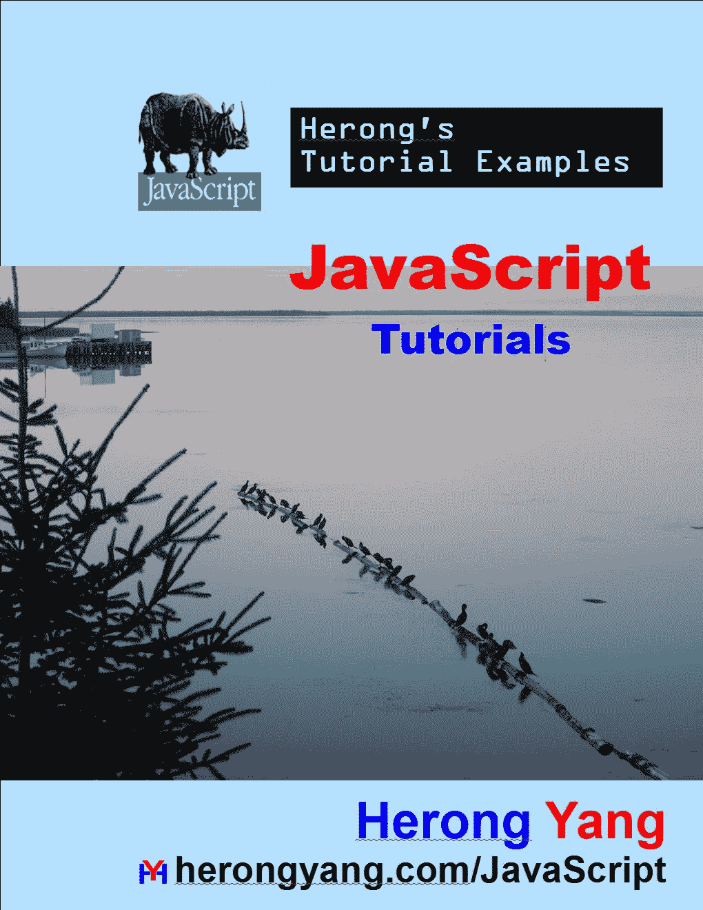


2.31, 2020


本书是作者在学习 JavaScript 期间编写的教程示例和笔记集。主题包括 ECMAScript 规范；数据类型、变量和表达式；流程控制语句：`if`、`for`、`switch` 和 `while`；数组和对象的使用；函数的定义与调用；在 HTML 文档中嵌入 JavaScript 代码；`DOM`（文档对象模型）API 级别；在 Web 浏览器中使用 JavaScript 控制台；使用原型创建新对象类型；构建原型继承层次结构；将函数作为对象管理；`jrunscript` JavaScript 壳程序。已于 2020 年更新（版本 2.31），并进行了细微修正。欲获取最新更新和免费示例章节，请访问 http://www.herongyang.com/JavaScript。


- 下载和安装 JDK 10
- "jrunscript" - 脚本壳命令与选项
- 使用 jrunscript 运行 JavaScript 代码
- 交互式使用 jrunscript 评估 JavaScript 代码
- 使用 jrunscript 运行 JavaScript 代码文件
- 将函数作为 "Function" 对象使用


# JavaScript 教程 - Herong 的教程示例

## 关于本书

本节提供了关于本书 -《JavaScript 教程 - Herong 的教程示例》的详细信息。

**标题：** JavaScript 教程 - Herong 的教程示例

**作者：** Herong Yang 博士 - 通过电子邮件 herong_yang@yahoo.com 联系。

**类别：** JavaScript

**版本/编辑：** 2.31, 2020

**PDF 格式页数：** 204

**描述：** 本书是作者在学习 JavaScript 期间编写的教程示例和笔记。主题包括 ECMAScript 规范；数据类型、变量和表达式；流程控制语句：`if`、`for`、`switch` 和 `while`；数组和对象；定义和调用函数；在 HTML 文档中嵌入 JavaScript 代码；DOM（文档对象模型）API 级别；在 Web 浏览器中使用 JavaScript 控制台；使用原型创建新对象类型；构建原型继承体系；将函数作为对象管理；`jrunscript` JavaScript Shell。已于 2020 年更新（版本 2.31）并进行了微调。

**关键词：** JavaScript, `jrunscript`, DOM, JSON

**版权：**

*   本书的版权所有 © 2020 由 Herong Yang 博士所有。保留所有权利。
*   书中的材料不得以任何形式进行出版、广播、重写或分发。
*   代码示例按原样提供，不提供任何形式的保证。

**修订历史：**

*   版本 2.31，2020 年。微调。
*   版本 2.20，2013 年。增加了 JDK `jrunscript` 教程。
*   版本 2.00，2008 年。添加了对象相关的教程。
*   版本 1.00，2002 年。第一版。

**网页版本：** [`www.herongyang.com/JavaScript`](http://www.herongyang.com/JavaScript) - 提供免费示例章节、最新更新和读者评论。本书的网页版总访问次数为：

*   截至 2018 年 12 月为 881,332 次。
*   截至 2017 年 12 月为 840,080 次。
*   截至 2016 年 12 月为 800,814 次。
*   截至 2015 年 12 月为 755,274 次。
*   截至 2014 年 12 月为 695,428 次。
*   截至 2013 年 12 月为 613,644 次。
*   截至 2012 年 12 月为 522,056 次。
*   截至 2011 年 12 月为 408,260 次。
*   截至 2011 年 12 月为 408,260 次。
*   截至 2010 年 12 月为 294,918 次。
*   截至 2009 年 12 月为 195,636 次。
*   截至 2008 年 12 月为 90,948 次。

**PDF/EPUB 版本：** [`www.herongyang.com/JavaScript/Full-Version.html`](http://www.herongyang.com/JavaScript/Full-Version.html) - 提供如何获取 PDF、EPUB 或其他格式完整版书籍的信息。


---

# JavaScript 简介

## 引言

本章快速介绍了 JavaScript。主题包括什么是 JavaScript；在 HTML 文档中编写 JavaScript 代码；在浏览器中运行 JavaScript 代码；浏览器内置的 `document`。

## 什么是 JavaScript

本节对什么是 JavaScript 进行快速描述。

**什么是 JavaScript？** JavaScript 是一种主要用于编写动态 Web 页面的脚本语言。当用 JavaScript 编写的脚本嵌入 Web 页面时，它由客户端的 Web 浏览器执行。

JavaScript 的历史在 wikipedia.org 上有很好的总结：

JavaScript 最初由 Netscape 的 Brendan Eich 开发，最初名为 Mocha，后来称为 LiveScript，最后重命名为 JavaScript。从 LiveScript 到 JavaScript 的更名恰好与 Netscape 在其 Netscape Navigator Web 浏览器中增加了对 Java 技术的支持。JavaScript 早于 1995 年 12 月在 Netscape 浏览器 2.0B3 版本中首次引入并部署。这一命名引起了困惑，给人一种该语言是 Java 衍生语言的印象，许多人将其视为 Netscape 的营销手段，旨在赋予 JavaScript 当时热门 Web 编程语言的光誉。

为了避免商标问题，微软将其语言的实现命名为 JScript。JScript 在 1996 年 8 月发布的 Internet Explorer 3.0 版本中首次支持，并包含了符合 Y2K 的日期函数，与当时 JavaScript 中基于 `java.util.Date` 的函数不同。

Netscape 将 JavaScript 提交给国际电子组织进行标准化，产生了标准化版本 ECMAScript。

## 总结

*   JavaScript 是一种主要用于编写动态 Web 页面的脚本语言。
*   官方 JavaScript 规范称为“Standard ECMA-262 - ECMAScript 2019 Language Specification”。
*   学习 JavaScript 的最佳方法是将 JavaScript 代码嵌入 HTML 文档中并在浏览器中运行。
*   `<script type="text/javascript">` 是在 HTML 文档中嵌入 JavaScript 代码的标签。
*   `document.write()` 是在 HTML 文档中生成动态内容的方法。


```
 JavaScript 1.8.5 July 2010 - ECMA-262 5th edition
JavaScript 1.8   June 2008
JavaScript 1.7   October 2006
JavaScript 1.6   November 2005
JavaScript 1.5   November 2000 - ECMA-262 3rd edition
JavaScript 1.4	 
JavaScript 1.3	 October 1998 - ECMA-262 1st + 2nd 
JavaScript 1.2	 June 1997
JavaScript 1.1	 August 1996
JavaScript 1.0   March 1996
```

作为一种编程语言，JavaScript 具有以下独特特性：

* JavaScript 是一种脚本语言 - 源代码是被解释执行的，而不是编译执行。和其他大多数解释型语言一样，它确实支持 `eval(source_code)` 函数。

* JavaScript 是一种动态类型语言 - 数据类型与值关联，而不是与变量关联。换说，声明变量不需要指定特定的数据类型。它可以被赋予任何数据类型的值。

* JavaScript 是一种基于原型的语言 - 使用原型而不是类来定义对象的属性、方法和继承关系。

* JavaScript 使用关联数组来表示对象 - 属性名和值以关联数组元素的形式存储。属性及其值可以在运行时被添加、修改或删除。

* JavaScript 支持函数作为一等公民 - 函数实际上是对象。像普通对象一样，函数可以在执行期间创建、存储在数据结构中并作为参数传递给其他函数。

截至 2020 年，JavaScript 的最新版本是 1.8.5。

JavaScript 教程 - Herong' 教程示例

∟JavaScript 简介

∟第一个 JavaScript - "Hello World!"

本节提供了第一个 JavaScript 教程示例 - 'Hello World!'。

学习 JavaScript 的最佳方法是将 JavaScript 代码嵌入到 HTML 文档并在 Web 浏览器中运行它。以下是我编写并运行第一个 JavaScript 代码 "Hello World!" 所采取的步骤：

1. 输入以下包含一行 JavaScript 代码的 HTML 文档：

```
 <html>
<head><title>Hello World!</title></head>
<body>
<script type="text/javascript">
   document.write('Hello World!');
</script>
</body>
</</html>
```

2. 将此 HTML 文档保存为 `Hello_World.html`。

3. 在 Web 浏览器中打开 `Hello_World.html`。你将看到：

```
 Hello World! 
```

恭喜你，你成功创建并执行了你的第一个 JavaScript 代码！

JavaScript 教程 - Herong' 教程示例

∟JavaScript 简介

∟逐步解析第一个 JavaScript

本节对第一个 JavaScript 'Hello World!' 进行逐步解析。

现在让我逐步解析上一个教程中提供的第一个 JavaScript 代码 "Hello World!"：

```
 1 <html>
2 <head><title>Hello World!</title></head>
3 <body>
4 <script type="text/javascript">
5    document.write('Hello World!');
6 </script>
7 </body>
8 </html>
```

前 3 行是普通的 HTML 标签。

第 4 行有一个特殊的 HTML 标签 `<script>`，它开始了一段 JavaScript 代码。注意 `type="text/javascript"` 属性表示标签中包含的是是 JavaScript 代码。

第 5 行是该 HTML 文档中唯一的 JavaScript 语句，它调用了内置对象 `document` 的 `write()` 函数。此调用会将字符串 "Hello World!" 输出到 HTML 文档中。

第 6 行结束了 JavaScript 代码。

当 Web 浏览器处理此 HTML 文档时，它会解释 `<script>` 标签内所有的 JavaScript 语句。

JavaScript 教程 - Herong' 教程示例

∟JavaScript 简介

∟document.write() 方法

本节提供了 `document.write()` 方法的简要描述以及一个使用 `document.write()` 方法的简单教程示例。

从上一节的 JavaScript 示例可以看出，`document.write(string)` 方法是一个非常实用的方法。关于该方法的一些说明：

* `document` 是一个内置对象，代表嵌入 JavaScript 的 HTML 文档。

* `write(string)` 是由 `document` 对象提供的方法。它将指定的字符串写入由 `document` 对象表示的 HTML 文档中。

你可以使用 `document.write(string)` 方法向 HTML 文档写入任何内容，包括 HTML 标签。

这是一个教程示例，展示了如何使用 `document.write()` 方法写入 HTML 文档的一大部分内容：

```
 <html>
<!-- Document_Write.html
   Copyright (c) HerongYang.com. All Rights Reserved.
-->
<head><title>The document.write() Method</title></head>
<body>
<script type="text/javascript">
   document.write('<center>');
   document.write('Summer summer oh so hot,<br/>');
   document.write('Summer summer trapped in a pot.<br/>');
   document.write('When I open the lid I let you out,<br/>');
   document.write('You make me so happy<br/>');
   document.write('I want to shout!<br/>');
   document.write('</center>');
</script>
</body>
</</html>
```

[JavaScript 教程 - Herong' 教程示例

∟[ECMAScript 语言规范与 JavaScript 方言]

本章介绍了 ECMAScript 语言规范和 JavaScript 方言的介绍及教程示例。主题包括：JavaScript 历史；方言版本：LiveScript, JavaScript, JScript, JScript .NET；与宿主环境的交互；自动分号插入。

> JavaScript 历史与版本

> 

> ECMAScript 语言规范

> 

> 自动插入分号以结束语句

结论：

* ECMAScript (ECMA-262) 是 JavaScript 语言规范的官方名称。

* JavaScript 最初在 Netscape 中实现，是 ECMAScript 语言规范的源自方言。

* JScript 是微软的 ECMAScript 语言规范方言。

* ECMAScript 在自动插入分号以结束语句方面有非常有趣的规则。

JavaScript 教程 - Herong' 教程示例

∟ECMAScript 语言规范与 JavaScript 方言

∟[JavaScript 历史与版本]

本节对 JavaScript 语言规范标准、ECMAScript、JavaScript、LiveScript、JScript 以及版本历史进行了简要描述。

JavaScript 有一个规范和几种方言：

* ECMAScript - JavaScript 语言规范的官方名称，ECMA-262 规范。

* JavaScript - ECMAScript 语言规范的源自方言。JavaScript 在 Netscape 中实现。

* LiveScript - JavaScript 的前身。LiveScript 在 Netscape 3.0 中重命名为 JavaScript。

* JScript - 微软的 ECMAScript 语言规范方言。JScript 最初实现在 1996 年 8 月发布的 Internet Explorer 3.0 浏览器中。

* JScript .NET - 微软 .NET 框架下 JScript 的继任者。

以下是 JavaScript 历史及其方言版本的简要总结：


```
 1994   Netscape 1.0 
199?   Netscape 2.0/JavaScript 1.0   ECMA-262 Edition 1, 1997
1996   IE 3.0/JScript 1.0            ECMA-262 Edition 1, 1997
199?   Netscape 3.0/JavaScript 1.1   ECMA-262 Edition 1, 1997
1997   IE 4.0/JScript 3.0            ECMA-262 Edition 1, 1997
199?   Netscape 4.0/JavaScript 1.2   ECMA-262 Edition 1, 1997
1999   IE 5.0/JScript 5.0            ECMA-262 Edition 1, 1997
2000   Netscape 6.0/JavaScript 1.5   ECMA-262 Edition 3, 1999
2000   IE 5.5/JScript 5.5            ECMA-262 Edition 3, 1999
2001   IE 6.0/JScript 5.6            ECMA-262 Edition 3, 1999
2002   Netscape 7.0/JavaScript 1.5   ECMA-262 Edition 3, 1999
2004   Firefox 1.0                   ECMA-262 Edition 3, 1999
2006   IE 7.0/JScript ?              ECMA-262 Edition 3, 1999
2006   Firefox 2.0/JavaScript 1.7    ECMA-262 Edition 3, 1999
2007   Netscape 8.0/JavaScript ?     ECMA-262 Edition ?
2008   IE 8.0/JScript ?              ECMA-262 Edition ?
200?   Firefox 3.0/JavaScript 1.8    ECMA-262 Edition ?
2011   Firefox 4.0/JavaScript 1.8.5  ECMA-262 Edition ?
                                     ECMA-262 Edition 9, 2018
                                     ECMA-262 Edition 10, 2019
```

最新版本的 JavaScript 规范是 `ECMA-262 Edition 10`。因此，我们应该将其作为主要的参考来学习 JavaScript。

JavaScript 教程 - Herong 的教程示例

∟ECMAScript 语言规范和 JavaScript 方言

## ECMAScript 语言规范

本节快速介绍了 ECMAScript 语言规范及其版本历史。

ECMAScript 语言规范由 `ECMA`（欧洲计算机制造商协会）开发和维护。它定义了一种基于几种源自技术的脚本语言标准，其中最为人知的是 `JavaScript`（Netscape）和 `JScript`（Microsoft）。

### ECMAScript 版本历史：

```
 1997   ECMA-262 Edition 1 - 第一版
1998   ECMA-262 Edition 2 - 仅编辑更改
1999   ECMA-262 Edition 3 - 添加了许多新功能
   ?   ECMA-262 Edition 4 - 废弃
2009   ECMA-262 Edition 5 - 添加了“严格模式”
2011   ECMA-262 Edition 5.1 - 与 ISO/IEC 16262:2011 标准
2018   ECMA-262 Edition 9
2019   ECMA-262 Edition 10
```

ECMA 当前对 ECMAScript 的定义：`ECMAScript` 是一种面向对象的编程语言，用于在主机环境中执行计算和操作计算对象。

关于 ECMAScript 规范，一个非常重要的说明是，它没有提供任何与主机环境交互的设施。换句话说，仅用规范描述的规则和对象编写的纯 `ECMAScript` 代码只能在内存中进行计算和操作对象。它无法与主机环境交换数据。

为了与主机环境交换数据，每种 ECMAScript 方言都必须扩展规范，以添加与主机环境交互的新设施。

例如，专为 `Firefox` 浏览器主机环境设计的 ECMAScript `JavaScript` 方言添加了 `"document"` 对象及其属性和方法，提供了对浏览器当前文档的访问。

另一个例子，为 Internet 信息服务器 (`IIS`) Web 服务器主机环境设计的 ECMAScript `JScript` 方言添加了 `"request"` 对象及其属性和方法，提供了对服务器当前 HTTP 请求的访问。

如果你想获取 `ECMA-262` (`ECMAScript 语言规范`）第 9 版，请访问 [`www.ecma-international.org/publications/standards/Ecma-262.htm`](http://www.ecma-international.org/publications/standards/Ecma-262.htm)。

JavaScript 教程 - Herong 的教程示例

∟ECMAScript 语言规范和 JavaScript 方言

## ECMAScript 语言规范 自动分号插入

本节详细介绍了 JavaScript 自动分号插入的规则。

ECMAScript 自动分号插入规则允许在解析代码时自动添加分号，这使得开发者在编写代码时可以省略分号。

这种规则是基于 JavaScript 语法规则（ASI, Automatic Semicolon Insertion）的。解析器在扫描代码时，如果发现缺少分号，它会根据特定的规则尝试插入一个分号。

以下是自动分号插入的常见场景：

```javascript
function foo() {
  return
  {
    a: 1
  };
}
```

在上面的例子中，`return` 后面会被插入一个分号，导致函数返回 `undefined`，而不是后面的对象。为了修复这个问题，应该写成：

```javascript
function foo() {
  return {
    a: 1
  };
}
```

同样地，在 `if` 语句、`for` 循环或 `return` 语句中，如果紧跟大括号，可能会由于自动插入分号导致非预期的错误。

例如：

```javascript
var a = 1
var b =
a
{
  console.log(b)
}
```

```javascript
var a = 1
var b = a
{
  console.log(b) // 输出 1
}
```

在第二个例子中，`b = a` 后面没有插入分号，因此 `b` 被赋值为 `a`，而后面的 `{...}` 则被视为代码块。

为了避免这些问题，建议在编写 JavaScript 代码时始终显式地使用分号。


JavaScript 是一种动态类型语言。数据类型与值相关，而不是与变量相关。换句话说，声明变量不需要指定特定的数据类型。它们被赋值任何类型的值。

在 JavaScript 源代码中，可以像下面描述的那样以字面量的形式提供不同类型的值。

JavaScript 教程 - Herong 的教程示例

数据类型、变量和表达式

#### 数值字面量
本节提供了对数值字面量的描述，以及一个关于如何在 JavaScript 代码中使用它们的教程示例。为了在 JavaScript 源代码中提供数字值，你需要使用以下 3 种格式的数值字面量：

#### 整数字面量
跟在可选符号字符之后的数字序列，用于表示从 `-9007199254740991` 到 `9007199254740991` 之间的整数值。例如：`2008`、`-12`。

#### 十进制字面量
跟在 `0x` 或 `0X` 之后的十六进制数字序列，表示正整数或浮点值。十六进制字面量也可以带有符号字符。例如：`0x07D8`、`-0x0C`、`0xffffffffffffffff`。

#### 浮点字面量
实数的科学计数法，语法如下：`(sign)(digits).e(sign)(digits)`。例如：`4.1`、`0.333333`、`-1.5e10`、`4.1e-29`。

在 JavaScript 中，所有数字（包括整数）都以 IEEE754 标准规定的 64 位浮点格式存储。这里有一个 JavaScript 教程示例，展示了如何在 JavaScript 代码中使用不同类型的数字字面量：

```html
<html>
<!-- Number_Literals.html
   Copyright (c) HerongYang.com. All Rights Reserved.
-->
<head><title>Number Literals</title></head>
<<body>
<pre>
<script type="text/javascript">
	document.write(2020);
	document.write('\n');

	document.write(0x07E4);
	document.write('\n');

   document.write(-0x0C);
   document.write('\n');

   document.write(0xffffffffffffffff);
   document.write('\n');

   document.write(-1.51e10);
   document.write('\n');

   document.write(4.10e-29);
   document.write('\n');
</script>
</pre>
</body>
</html>
```

该 JavaScript 示例的输出结果为：

```
2020
2020
-12
1.208925819614292e+24
-1510000000
4.1e-29
```

#### 字符串字面量
本节提供了对字符串字面量的描述，以及一个关于如何在 JavaScript 代码中使用它们的教程示例。为了在 JavaScript 源代码中提供字符串值，你需要按照以下规则使用字符串值字面量：

1. 字符串字面量是 Unicode 字符序列。
2. 字符串字面量必须包含在单引号 `'...'` 或双引号 `"..."` 中。
3. 某些字符前面必须带有转义字符反斜杠 (`\`)：`\b`、`\f`、`\n`、`\r`、`\t`、`\v`、`\'`、`\"` 和 `\\`。
4. Latin-1 字符可以用十六进制转义序列表示。例如，`\xA9` 表示版权符号。
5. Unicode 字符可以用 Unicode 转义序列表示。例如，`\u4E16` 表示一个汉字。

这里有一个 JavaScript 教程示例，展示了如何在 JavaScript 代码中使用字符串字面量：

```html
<html
<!-- String_Literals.html
   Copyright (c) HerongYang.com. All Rights Reserved.
-->
<head><title>String Literals</title></head>
<body>
<pre>
<script type="text/javascript">
   document.write("Hello World!");
   document.write('\n');

   document.write('Herong\'s Tutorial');
   document.write('\n');

   document.write("Double quote \"");
   document.write('\n');

   document.write("Copyright \xA9 2020.");
   document.write('\n');

   document.write("\u4E16\u754C\u4F60\u597D\uFF01");
   document.write('\n');
</script>
</pre>
</body>
</html>
```

该 JavaScript 示例的输出结果为：

```
Hello World!
Herong's Tutorial
Double quote (")
Copyright © 2020.
世界你好！
```

#### 声明变量 - "var" 语句
本节提供了关于变量的描述，以及一个如何使用 `var` 语句声明变量的教程示例。

**什么是变量？** 变量是指指向存储值的符号名称。

变量声明不需要特定的数据类型。它们可以被赋值任何类型的值。在 JavaScript 源代码中，可以像前面章节描述的那样以字面量的形式提供不同类型的值。

这里有一个 JavaScript 教程示例，展示了如何使用 `var` 语句声明变量：

```html
<html
<!-- Variables.html
   Copyright (c) HerongYang.com. All Rights Reserved.
-->
<head><title>Variables</title></head>
<body>
<pre>
<script type="text/javascript">
var url = 'herongyang.com';
var rank = 9;
var title = "Herong's Tutorial Examples";
var content = undefined;

document.write(url);
document.write('\n');

document.write(title);
document.write('\n');

document.write(rank);
document.write('\n');

document.write(content);
document.write('\n');
</script>
</pre>
</body>
</html>
```

该 JavaScript 示例的输出结果为：

```
herongyang.com
Herong's Tutorial Examples
9
undefined
```


# 运算符与表达式 - 示例

本节提供了一个关于使用算术、比较、位运算和赋值运算符的 JavaScript 教程示例。

根据上一节对运算符和表达式的描述，这里有一个 JavaScript 教程示例，向你展示了不同类型的运算符：

```html
 <html>
<!-- Operators.html
   Copyright (c) HerongYang.com. All Rights Reserved.
-->
<head><title>Operators and Expressions</title></head>
<<body>
<pre>
<script type="text/javascript">
   document.write(10/3);
   document.write('\n');
   document.write(10%3);
   document.write('\n');

   document.write(1>0);
   document.write('\n');
   document.write('Five'>'One');
   document.write('\n');

   document.write(10=='10');
   document.write('\n');
   document.write(10==='10');
   document.write('\n');

   document.write(1<<3);
   document.write('\n');
   document.write(8>>3);
   document.write('\n');

   var comment;
   document.write(comment='Assignment is expression');
   document.write('\n');
</script>
</pre>
</</body>
</html>
```

此 JavaScript 示例的输出为：

```
 3.3333333333333335
1
true
false
true
false
8
1
Assignment is expression
```

JavaScript 教程 - Herong 的教程示例

# 流程控制语句

本章快速介绍了 JavaScript 流程控制语句。主题包括 'if...then' 语句、'while' 语句、'for' 语句和 break 语句。

- 什么是语句
- 条件 "if" 语句
- 条件 "if" 语句示例
- "switch ... case" 语句
- "switch ... case" 语句示例
- "for" 循环语句
- "for" 循环语句示例
- "while" 循环语句
- "while" 循环语句示例

### 结论：

- JavaScript 有两种类型的语句：表达式语句（Expression Statement）和关键字语句（Keyword Statement）。
- 一个 JavaScript 语句必须以分号（`;`）结束。
- 换行不会结束 JavaScript 语句。
- JavaScript 支持两种类型的条件语句："if ... else if ... else ..." 语句和 "switch ... case ... default ..." 语句。
- JavaScript 支持两种类型的循环语句："for ..." 语句和 "while ..." 语句。

JavaScript 教程 - Herong 的教程示例

# 流程控制语句](#part0019.xhtml) ](##part0019.xhtml)

## 什么是语句

本节快速提供了不同类型语句的描述，以及一个关于如何编写表达式和其他语句的教程示例。

**什么是语句？** 语句是 JavaScript 中的基本执行单元。关于 JavaScript 语句的几点说明：

- 语句必须以分号（`;`）结束。
- 换行不会结束语句。换句话说，一个语句可以写在多行，多个语句也可以写在同一行。
- 语句可以由非常简单的表达式组成，例如单个字面量；也可以由包含赋值或或逗号运算符的复杂表达式组成。
- 大多数语句都有关键字，如 `var`、`if`、`while`、`break` 等。
- 多个语句可以组合成格式为 `{s1; s2; ...; }` 的语句块。
- 在 `"/* ... */"` 或 `"// ... (行尾)"` 中的注释可以插入语句的任何位置。

这是一个 JavaScript 教程示例，向你展示了不同类型的语句：

```html
 <html>
<!-- Statements.html
   Copyright (c) HerongYang.com. All Rights Reserved.
-->
<head><title>Statements</title></head>
<body>
<pre>
<script type="text/javascript">
   var x,y,z; // 一个 "var" 语句

   x=1, y=4, z=9; /* 一个表达式语句 
      包含 3 个逗号运算符和 3 个赋值运算符。
      该表达式的结果是 9.*/ 

   x*x; y*y; z*z; // 1 行中的 3 条语句

   { // 一个语句块
      x *= x; 
      y *= y;
      z *= z;
   }

   if (true) // 一个 "if" 语句 
      document.write("7 statements in total.");
</script>
</pre>
</body>
</</html>
```

JavaScript 教程 - Herong 的教程示例

# 流程控制语句](#part0019.xhtml)

## 条件 "if" 语句

本节快速提供了不同类型的条件 'if' 语句的描述。

"if" 语句被称为条件语句。一个 "if" 语句允许你创建一个或多个语句块。执行流将根据条件通过这些语句中的之一。JavaScript 支持 4 种类型的 "if" 语句：

1. 单语句 "if":
```javascript
if (condition)
```
其中 `condition` 是布尔值。

2. 多语句 "if":
```javascript
if (condition) {
   statement1;
   statement2;
}
```
其中 `condition` 是布尔值。

3. "if ... else" 语句:
```javascript
if (condition) 
   statement
else
   statement
```
指定了两个语句或块。但只有其中一个会被执行。

4. "if ... else if" 语句:
```javascript
if (condition_1)
   statement
else if (condition_2)
   statement
...
else
   statement
```
指定了多个语句或块。

下一节将提供一个教程示例。

JavaScript 教程 - Herong 的教程示例


```
 新年快乐！

打开日志文件。
写入日志消息。
关闭日志文件。

显示视图按钮。

图书馆的开放时间为上午 9:00 到下午 9:00。
```

# JavaScript 教程 - Herong 的教程示例

# 流程控制语句

## "switch ... case" 语句

本节提供了 `switch ... case` 语句的简要描述。

`"switch case"` 语句根据某些条件选择性执行语句的另一种方式。`switch case` 语句具有以下通用语法格式：

```
 switch (test_expression) {
   case expected_value_1:
      statement_11;
      statement_12;
      ...
      [break;]
   case expected_value_2:
      statement_21;
      statement_22;
      ...
      [break;]
   ...
      ...
   default:
      statement_x1;
      statement_x2;
      ...
      [break;]
}
```

其中 `"test_expression"` 用于生成一个测试值，该值将与 `"case"` 子句中指定的预期值进行比较。`switch case` 语句的执行过程如下：

*   `"case"` 子句是可能的执行起始点。每个 `"case"` 子句将从上到下顺序依次访问。
*   如果某个 `"case"` 子句的预期值等于 switch 表达式产生的测试值，则执行从该 `"case"` 子句中列出的语句开始。
*   一旦开始执行，它将继续执行，直到遇到 `break` 语句或到达 `switch` 块的结束。
*   `"default"` 子句是可选的。但如果提供了它，当 `"default"` 子句之前的所有 case 测试都失败时，它将成为执行的起始点。

与许多其他编程语言不同，JavaScript 支持将数值表达式和字符串表达式作为 switch 测试表达式。

下一节将提供一个教程示例，展示 `switch ... case` 语句的示例。

# JavaScript 教程 - Herong 的教程示例

# 流程控制语句

### "switch ... case" 语句示例

本节提供了一个 JavaScript 教程示例，展示如何编写 `switch ... case` 语句。

为了帮助你理解 `switch ... case` 语句的工作原理，我编写了以下 JavaScript 教程示例 `Switch_Case_Statements.html`：

```
 <html>
<!-- Switch_Case_Statements.html
   Copyright (c) HerongYang.com. All Rights Reserved.
-->
<head><title>Switch Case Statements</title></head>
<body
<pre>
<script type="text/javascript">

// 使用数值表达式的 switch 语句
   var week_day = 4;
   var day, open_hours;
   switch (week_day) {

      case 0:
         day = "Sunday";
         open_hours = "closed";
         break;

      case 1:
      case 2:
      case 3:
      case 4:
      case 5:
         day = "a weekday";
         open_hours = "open from 9:00am to 9:00pm";
         break;

      case 6:
         day = "unknown";
         open_hours = "open from 9:00am to 5:00pm";
         break;

      default:
         day = "unknown"
         open_hours = "undefined";
   }
   document.write('\n');
   document.write("Today is " + day + ".\n");
   document.write("The library is " + open_hours + ".\n");
</script>
</pre>
</</body>
</html>
```

该 JavaScript 示例的输出是：

```
 Today is a weekday.
The library is open from 9:00am to 9:00pm.
```

# JavaScript 教程 - Herong 的教程示例

# 流程控制语句

## "for" 循环语句

本节提供了 `for` 循环语句的简要描述。

`for` 语句是许多编程语言中非常常见的循环语句。JavaScript 的 `for` 语句具有以下通用语法格式：

```
 for ([initial_exp]; [loop_condition]; [increment_exp])
   statement or statement_block
```

如果你想确切知道 `for` 语句将如何执行，这里是我的理解：

*   步骤 1：评估 `"intial_exp"`（通常是一个赋值表达式）。
*   步骤 2：评估 `"loop_condition"`（一个布尔表达式）。
*   步骤 3：如果 `"loop_condition"` 评估结果为 `"true"`，则继续第 5 步。
*   步骤 4：如果 `"loop_condition"` 评估结果为 `"false"`，则终止循环。
*   步骤 5：执行 `statement` 或 `statement_block`。
*   步骤 6：评估 `"increment_exp"`（通常是一个赋值表达式）。
*   步骤 7：继续第 2 步。

如果 `"loop_condition"` 始终评估为 `"true"`，`for` 循环语句可能会无限执行。

可以在循环语句块中使用 `break` 语句来提前终止循环。

可以在循环语句块中使用 `continue` 语句来跳过块的剩余部分并开始循环的下一次迭代。

下一节将提供一个教程示例，展示 `for` 循环语句的示例。

# JavaScript 教程 - Herong 的教程示例

# 流程控制语句

### "for" 循环语句示例

本节提供了一个 JavaScript 教程示例，展示如何编写 `for` 循环语句。

为了帮助你理解 `for` 循环语句的工作原理，我编写了以下 `Switch_Case_Statements.html`：

```
 <html>
<!-- Switch_Case_Statements.html
   Copyright (c) HerongYang.com. All Rights Reserved.
-->
<head><title>Switch Case Statements</title></head>
<body>
<pre>
<script type="text/javascript">
   var i, j, is_prime;
   for ( i=3; i<=30; i+=2 ) {
      is_prime = true;
      for ( j=2; j<=i/2; j++) {
         if (i%j == 0) {
            is_prime = false;
            break;
         }
      }
      if (is_prime) {
         document.write("Found prime number: " + i + ".\n");
      }
   }
</script>
</pre>
</body>
</html
```

注意：

*   此 JavaScript 使用嵌套的 `for` 循环来计算质数。
*   外层 `for` 循环使用变量 `i` 控制执行。
*   内层 `for` 循环使用变量 `j` 控制执行。
*   外层 `for` 循环的停止条件是 `i<=30`。每次迭代中 `i` 的值增加 2。
*   内层 `for` 循环的停止条件是 `j<=i/2`。每次迭代中 `j` 的值增加 1。
*   内层 `for` 循环有一个 `break` 语句，当 `is_prime` 为 false 时将跳出循环。

该 JavaScript 示例的输出是：

```
 Found prime number: 3.
Found prime number: 5.
Found prime number: 7.
Found prime number: 11.
Found prime number: 13.
Found prime number: 17.
Found prime number: 19.
Found prime number: 23.
Found prime number: 29.
```

# JavaScript 教程 - Herong 的教程示例

# 流程控制语句

## "while" 循环语句

本节提供了 `while` 循环语句的简要描述。

`while` 语句是许多编程语言中非常常见的循环语句。JavaScript 的 `while` 语句具有以下通用语法格式：

```
 while (loop_condition)
   statement or statement_block
```

`while` 语句的执行如下：

*   步骤 1：评估 `"loop_condition"` 表达式为布尔值。
*   步骤 2：如果 `"loop_condition"` 评估为 `"true"`，则继续第 4 步。
*   步骤 3：如果 `"loop_condition"` 评估结果为 `"false"`，则终止循环。
*   步骤 4：执行 `statement` 或 `statement_block`。
*   步骤 5：继续第 1 步。

另一种形式的 `while` 循环称为 `do ... while` 循环语句，具有以下语法格式：

```
 do
   statement or statement_block
while (loop_condition);
```

如果 `"loop_condition"` 始终评估为 `"true"`，`while` 循环语句可能会无限执行。

可以在循环语句块中使用 `break` 语句来提前终止循环。

可以在循环语句块中使用 `continue` 语句来跳过块的剩余部分并开始循环的下一次迭代。

下一节将提供一个教程示例，展示 `while` 循环语句的示例。


# JavaScript 教程 - Herong 的教程示例(#part0001.xhtml)

## 控制语句

### "while" 循环语句示例

本节提供了一个 JavaScript 教程示例，展示如何编写 `while` 循环语句。

为了帮助你理解 `while` 循环语句的工作，我编写了以下 JavaScript 教程示例：`For_Loop_Statements.html`：

```html
 <>
<!-- While_Loop_Statements.html
   Copyright (c) HerongYang.com. All Rights Reserved.
-->
<head><title>While Loop Statements</title></head>
<body
<pre>
<script type="text/javascript">
   var i, j, is_prime;
   i = 3;
   while ( i<=30 ) {
      is_prime = true;
      j = 2;
      while ( j<=i/2 ) {
         is_prime = i%j > 0;
         if (!is_prime) break;
         j++;
      }
      if (is_prime)
         document.write("Found a prime number: " + i + ".\n");
      i += 2;
   }
</script>
</pre>
</body
</>
```

此 JavaScript 使用嵌套的 `while` 语句来计算质数。它的执行逻辑与 `While_Loop_Statements.html` 中的 JavaScript 相同。

此示例 JavaScript 的输出为：

```
 Found a prime number: 3.
Found a prime number: 5.
Found a prime number: 7.
Found a prime number: 11.
Found a prime number: 13.
Found a prime number: 17.
Found a prime number: 19.
Found a prime number: 23.
Found a prime number: 29.
```

# JavaScript 教程 - Herong 的教程示例(#part0001.xhtml)

## 创建、访问和操作数组

本章简要介绍了创建和操作数组的方法。主题包括：什么是数组；创建数组；访问数组元素；扩展和截断数组；调用数组对象方法。

- 什么是数组
- 创建数组对象
- 通过索引访问数组元素
- 截断和迭代数组元素
- 数组对象实例方法
- 数组对象实例方法示例

结论：

- 数组是一个对象，而不是原始数据类型。
- 数组的元素不需要是相同的数据类型。
- 可以使用数组字面量创建数组：`[a, b, ..., x]`。
- 可以使用 `Array` 构造函数创建数组：`New Array()`。
- 可以使用内置函数创建数组：`Array()`。
- 使用索引访问数组元素：`users[i]`。
- 数组有许多对象方法，如 `users.sort()`、`users.push("Herong")` 等。

# JavaScript 教程 - Herong 的教程示例(#part0001.xhtml)

## 创建、访问和操作数组

### 什么是数组

本节简要描述了 JavaScript 中什么是数组，并提供了一个展示 JavaScript 数组特性的教程示例。

与其他编程语言一样，JavaScript 支持数组，允许你存储和检索元素列表。

但与许多语言不同，JavaScript 没有显式的数组数据类型。相反，它提供了一个 `Array` 对象类型，让你像对象一样创建数组。以下是 JavaScript 数组的主要特征：

- 数组不是原始数据类型。
- 数组是一个对象。
- 数组元素是有索引的。可以通过索引存储和检索元素。
- 数组索引从 0 开始。换句话说，索引 0 表示第一个元素。
- 数组的大小不是静态定义的。它可以动态地扩展或截断。
- 数组的元素不需要是相同的数据类型。
- 数组对象提供了多种方法，允许你直接操作数组。

以下是一个 JavaScript 教程示例，展示了上述的一些特征：

```html
 <>
<!-- Array_Features.html
   Copyright (c) HerongYang.com. All Rights Reserved.
-->
<head><title>Array Features</title></head>
<body
<pre>
<script type="text/javascript">

   // 创建一个混合数据类型的新数组
   var account = ["Saving", 999.99, true];

   // 向数组中存储新值
   account[2] = false;

   // 获取一个元素
   document.write("Account type: "+account[0]+"\n");

   // 调用数组方法
   account.push(5.25/100);
   document.write("Interest rate: "+account[3]*100+"%\n");
</script>
</pre>
</body
</>
```

此示例 JavaScript 的输出为：

```
 Account type: Saving
Interest rate: 5.25%
```

# JavaScript 教程 - Herong 的教程示例(#part0001.xhtml)

## 创建、访问和操作数组

### 创建数组对象

本节提供了一个关于如何创建数组对象的教程示例。

有 3 方法创建数组：

1. 使用数组字面量：`[a, b, ..., x]`。
2. 使用 `Array` 构造函数：`new Array()`。
3. 使用 `Array` 函数：`Array()`。

以下是一个展示如何创建数组对象的 JavaScript 教程示例：

```html
 <>
<!-- Create_Arrays.html
   Copyright (c) HerongYang.com. All Rights Reserved.
-->
<head><title>Create Arrays</title></head>
<body
<pre>
<script type="text/javascript">

   // 使用数组字面量
   var my_saving = ["Saving", 999.99, true];

   // 使用构造函数
   var my_checking = new Array("Checking", 9.99);

   // 使用函数
   var my_stock = Array("Stock", 99999.99);

   // 创建一个空数组
   var new_account = [];

   document.write(my_checking[0]+": "+my_checking[1]+"\n");
   document.write(my_saving[0]+": "+my_saving[1]+"\n");
   document.write(my_stock[0]+": "+my_stock[1]+"\n");
   document.write(new_account[0]+": "+new_account[1]+"\n");
</script>
</pre>
</body
</>
```

此示例 JavaScript 的输出为：

```
 Checking: 9.99
Saving: 999.99
Stock: 99999.99
undefined: undefined
```

# JavaScript 教程 - Herong 的教程示例(#part0001.xhtml)

## 创建、访问和操作数组

### 通过索引访问数组元素

本节提供了一个关于如何通过索引访问数组元素的教程示例。

可以通过以下简单规则通过索引访问数组元素：

- 与许多其他语言一样，可以使用 `array_name[index]` 语法访问数组元素。
- 数组索引从 0 开始。
- 数组长度定义为所有元素索引加 1。
- JavaScript 中没有越界异常。
- 如果检索数组元素时指定的索引大于数组长度，将返回 `undefined` 值。
- 如果存储数组元素时指定的索引大于数组长度，数组将扩展以便在指定的索引处存储元素。


```html
 <html>
<!-- Access_Array_Elements.html
   Copyright (c) HerongYang.com. All Rights Reserved.
-->
<head><title>Access Array Elements</title></head>
<body>
<pre>
<script type="text/javascript">

   // Creating an empty array
   var glossary = new Array();

   // Adding the first element
   glossary[0] = "JavaScript";

   // Adding the second element at index 10
   // This extends the array length to 11
   glossary[10] = "Web";

   document.write("Element at index of 0: "+glossary[0]+"\n");
   document.write("Element at index of 5: "+glossary[5]+"\n");
   document.write("Element at index of 10: "+glossary[10]+"\n");
   document.write("Element at index of 15: "+glossary[15]+"\n");
</script>
</pre>
</body>
</html>
```

此 JavaScript 示例的输出是：

```
 Element at index of 0: JavaScript
Element at index of 5: undefined
Element at index of 10: Web
Element at index of 15: undefined
```

JavaScript 教程 - Herong 的教程示例

∟创建、访问和操作数组

∟截断和遍历数组元素

本节提供了一个教程示例，介绍了如何使用数组的 `length` 属性来截断和遍历数组元素。

作为一个一个对象，数组有一个名为 `length` 的特殊属性。你可以使用对象点 (`.`) 运算符来获取长度值：`array_name.length`。

数组的 `length` 属性可以通过将 `length` 属性设置为较低的值来截断数组。

当你想要遍历数组中的所有元素时，数组的 `length` 属性也非常有用。

例如，使用 `for` 循环遍历数组的所有元素可以这样写：

```javascript
 for (var i = 0; i < array_name.length; i++) {
  ... array_name[i];
}
```

这里有一个 JavaScript 教程示例，向你展示如何使用 `length` 属性截断和遍历数组元素：

```html
 <html>
<!-- Loop_Array_Elements.html
    Copyright (c) HerongYang.com. All Rights Reserved.
->
<head><title>Loop Array Elements</title></head>
<body>
<pre>
<script type="text/javascript">

   // 创建一个空数组
   var even_numbers = new Array();

   // 在数组中存储 20 个元素
   for (var i=0; i<20; i++) {
      even_numbers[i] = i*2;
   }

   // 将数组长度截断为 10
   even_numbers.length = 10;

   // 遍历所有的 10 个元素
   document.write("First 10 even numbers: ");
   for (var i=0; i<even_numbers.length; i++) {
      document.write(even_numbers[i]+", ");
   }
</script>
</pre>
</body>
</html>
```

此 JavaScript 示例的输出是：

```
 First 10 even numbers: 0, 2, 4, 6, 8, 10, 12, 14, 16, 18, 
```

JavaScript 教程 - Herong 的教程示例

∟创建、访问和操作数组

∟数组对象实例方法

本节提供了常用数组对象实例方法的列表，包括 `split()`、`join()`、`sort()` 等。

作为一个对象，数组有几个常用的对象实例方法：

* `this_array.concat(second_array)` - `concat()` 方法通过将指定的第二个数组连接到此数组的末尾来返回一个新数组。

* `this_array.join(delimiter)` - `join()` 方法通过用指定的 `delimiter` 连接数组中的所有元素来返回一个字符串。

* `this_array.pop()` - `pop()` 方法返回数组的最后一个元素，并将其从数组中删除，使数组长度减 1。

* `this_array.push(element)` - `push()` 方法将元素添加到数组的末尾并返回新长度。

* `this_array.shift()` - `shift()` 方法从数组中移除第一个元素并返回它。

* `this_array.reverse()` - `reverse()` 方法反转数组元素的顺序。

* `this_array.splice(start, deleteCount, item1)` - `splice()` 方法删除或替换数组中的元素。

* `this_array.slice(start, end)` - `slice()` 方法将数组一部分的浅拷贝返回到一个新的数组对象中。

* `this_array.indexOf(element)` - `indexOf()` 方法返回在数组中找到给定元素的第一个索引。

* `this_array.lastIndexOf(element)` - `lastIndexOf()` 方法返回在数组中找到给定元素的最后一个索引。

* `this_array.forEach(callback)` - `forEach()` 方法为数组的每个元素执行一次提供的函数。

* `this_array.map(callback)` - `map()` 方法为数组的每个元素执行一次提供的函数，并结果创建一个新数组。

* `this_array.filter(callback)` - `filter()` 方法创建一个包含所有通过提供函数测试的元素的数组。

* `this_array.reduce(callback, initialValue)` - `reduce()` 方法对数组的每个元素执行用户提供的归约函数，产生单个输出值。


*   `function (...) {...}` 语句允许你定义自己的函数。
*   调用函数时，基本类型参数通过值传递。而对象参数通过引用传递。
*   调用函数后，得到的结果是返回的基类型值的副本，或者是返回的对象的引用。
*   参数可以是命名的，也可以是非命名的。
*   未命名参数可以通过函数内部的内置数组 `arguments[]`访问。
*   在函数内部声明的变量具有局部作用域，局限于函数体。

# JavaScript 教程 - Herong 的教程示例

#### 定义和调用函数

### 定义你自己的函数

本节简要描述了如何定义自己的函数以及 JavaScript 函数的一些基本特征。

与许多许多编程语言一样，JavaScript 允许你定义自己的函数。JavaScript 使用以下语法格式来定义新函数：

```javascript
 function function_name(parameter_1, parameter_2, ...) {
   statement_1; 
   statement_2;
   ...
   return return_expression
}
```

为了定义新函数，你需要了解以下 4 个区域：

*   **函数名称**：你应该为函数命名，以便稍后调用它。上述语法格式中的 `function_name`。
*   **参数列表**：如果你想通过名称引用参数，则应该为函数的参数命名。上述语法格式中的 `parameter_1`, `parameter_2`, ...`。
*   **函数体**：在花括号 `{}` 内部提供的语句列表构成了函数体。上述语法格式中的 `statement_1`, `statement_2`, ...`。
*   **返回值**：你应该在函数体中使用 `return` 语句来结束函数的执行，并向调用语句返回一个返回值。

JavaScript 函数具有以下基本特征：

*   基本类型参数通过值传递。
*   对象参数通过引用传递。
*   额外的参数可以传递给函数，而无需在函数定义中列出它们。
*   参数可以通过函数体中的内置数组 `arguments[]` 访问。
*   函数可以被递归调用。
*   函数为它的局部变量提供了一个作用域边界。

下一节将给出一个教程示例，展示你如何定义新函数。

# JavaScript 教程 - Herong 的教程示例

#### 定义和调用函数

### 定义你自己的函数 - 示例

本节提供了一个关于如何定义自己的 JavaScript 函数的教程示例。

这是一个定义用户函数的 JavaScript 教程示例。

```html
 <html>
<!-- Define_Functions.html
   Copyright (c) HerongYang.com. All Rights Reserved.
-->
<head><title>Define Functions</title></head>
<body>
<pre>
<script type="text/javascript">
// 定义一个什么都不做的空函数
function null() {
}

// 定义一个简单的函数
function hello() {
   document.write('Hello World!');
}

// 定义一个用于将华氏度转换为摄氏度的函数
function f2c(fahrenheit) {
   document.write("Converting Fahrenheit = "+fahrenheit+"\n");
   var celsius = (fahrenheit - 32.0 ) / 1.8;
   document.write("Returning Celsius = "+celsius+"\n");
   return celsius;
}
</script>
</pre>
</body>
</html>
```

如果你在 Web 浏览器中运行此 JavaScript 页面，你会得到一个空白窗口，因为它只定义了 3 个函数，但没有调用其中任何一个来运行。因此，没有语句被执行。

第一个函数 `null()` 被定义为什么都不做。

第二个函数 `hello()` 被定义为向 HTML 文档写入 "Hello World!"。

第三个函数 `f2c()` 被定义为执行几件事：接收参数 `fahrenheit`，声明局部变量 `celsius`，将从 `fahrenheit` 转换来的摄氏度值赋值给 `celsius`，向 HTML 文档写入两行文本，返回 `celsius` 中的值。

# JavaScript 教程 - Herong 的教程示例

#### 定义和调用函数

### 调用你自己的函数 - 示例

本节简要描述了如何调用自己的 JavaScript 函数以及一个调用温度转换函数的教程示例。

一旦定义了函数，你就可以作为表达式的一部分调用它，如此语法格式所示：

```javascript
 ... function_name(exp1, exp2, ...) ...;
```

当求值上述表达式时，将遵循以下步骤：

*   **步骤 1**：指定的参数表达式在传递到函数体之前，会被求值为基类型值或对象引用。
*   **步骤 2**：执行指定函数的函数体。
*   **步骤 3**：收集返回值，它将用于用于求值调用表达式的其他部分。

这是一个教程示例，它定义了一个简单的函数，用于将华氏度温度值转换为摄氏度：

```html
 <html>
<!-- Define_Call_Functions.html
   Copyright (c) HerongYang.com. All Rights Reserved.
-->
<head><title>Define and Call Functions</title></head>
<body>
<pre>
<script type="text/javascript">
// 定义一个新函数
function f2c(fahrenheit) {
   document.write("Converting Fahrenheit = "+fahrenheit+"\n");
   var celsius = (fahrenheit - 32.0 ) / 1.8;
   document.write("Returning Celsius = "+celsius+"\n");
   return celsius;
}

// 调用新函数
   var received;

   document.write("\nTest 1:\n");
   received = f2c(70.0)
   document.write("Received Celsius = "+received+"\n");

   document.write("\nTest 2:\n");
   received = f2c(212.0)
   document.write("Received Celsius = "+received+"\n");

   document.write("\nTest 3:\n");
   received = f2c(0.0)
   document.write("Received Celsius = "+received+"\n");
</script>
</pre>
</body>
</html>
```

此教程示例的输出并没有出任何意外：

```
 Test 1:
Converting Fahrenheit = 70
Returning Celsius = 21.11111111111111
Received Celsius = 21.11111111111111

Test 2:
Converting Fahrenheit = 212
Returning Celsius = 100
Received Celsius = 100

Test 3:
Converting Fahrenheit = 0
Returning Celsius = -17.77777777777778
Received Celsius = -17.77777777777778
```

# JavaScript 教程 - Herong 的教程示例

#### 定义和调用函数

### 按值或按引用传递参数

本节提供了一个教程示例，展示基本类型参数通过值传递，对象参数通过引用传递。

正如我在上一个节中提到的，JavaScript 文档说基本类型参数通过值传递，对象参数通过引用传递。我想用以下 JavaScript 教程示例来测试这些规则：

```html
 <html>
<!-- Swap_Values_and_Arrays.html
   Copyright (c) HerongYang.com. All Rights Reserved.
-->
<head><title>Swap Values and Arrays</title></head>
<body>
<pre>
<script type="text/javascript">
// 定义一个交换值的函数
function swap_values(left, right) {
   var temp;
   temp = left;
   left = right;
   right = temp;
}

// 定义一个交换数组的函数
function swap_arrays(left, right) {
   var temp;
   for (var i=0; i<left.length; i++) {
      temp = left[i];
      left[i] = right[i];
      right[i] = temp;
   }
}

   var first = "Black";
   var second = "White";
   document.write("\nTest 1: Swapping two string variables\n");
   document.write("   Before call: "+first+" | "+second+"\n");
   swap_values(first,second);
   document.write("   After call: "+first+" | "+second+"\n");

   var colors = new Array("Red", "Green", "Blue", "Yellow");
   var animals = new Array("Dog", "Cat", "Fish", "Bird");
   document.write("\nTest 2: Swapping two array objects\n");
   document.write("   Before call: "+colors+"\n");
   swap_arrays(colors,animals);
   document.write("   After call: "+colors+"\n");
</script>
</pre>
</body>
</html>
```

这里是该教程示例的输出：


```
 Test 1: Swapping two string variables
   Before call: Black | White
   After call: Black | White

Test 2: Swapping two array objects
   Before call: Red,Green,Blue,Yellow
   After call: Dog,Cat,Fish,Bird
```

输出结果符合意料。当执行语句 `swap_values(first,second);` 时，`first` 和 `second` 中存储的值副本会被传递到 `swap_values()` 函数中。`swap_values()` 内部的交换是在复制的值上进行的，而不是 `first` 和 `second` 中的原始值上。这就是为什么在函数调用后，`first` 仍然包含 `Black`。

当执行语句 `swap_arrays(colors,animals);` 时，存储在 `colors` 和 `animals` 中的数组引用会被传递到 `swap_arrays()` 函数中。`swap_arrays()` 内部的交换是在原始数组上进行的。这就是为什么 `colors` 数组现在包含了动物。

# JavaScript 教程 - Herong 的教程示例

#### ∟定义和调用函数](#part0036.xhtml)

##### ∟函数参数作为局部副本传递

本节简要描述了基本类型参数和对象参数是如何作为原始变量所存储内容的局部副本进行传递的。

如前一节所示，JavaScript 函数调用遵循两条规则：基本类型参数按值传递，对象参数按引用传递。

但实际上，这两条规则都源于同一个规则：参数是作为原始变量存储内容的局部副本传递的：

*   如果参数是一个基本类型变量，函数内部会创建该变量的局部副本。由于基本类型变量直接包含值，因此局部副本是值的副本。因此我们说基本类型参数是按值传递。
*   如果参数是一个对象变量，函数内部会创建该变量的局部副本。由于对象变量包含对对象的引用，因此局部副本是引用的副本。因此我们说对象参数按引用传递。

注意，上述解释使用了这些假设：

*   基本类型变量直接包含值。
*   对象变量包含对对象的引用。换句话说，对象变量包含存储该对象的地址。

说参数作为局部副本传递的实际上更准确，因为按引用传递参数是一个完全不同的编程特性。

以 VBScript 为例，它支持 `ByRef` 关键字，允许你将任何数据类型（包括基本类型）作为真正的引用传递函数参数。VBScript 函数不会为 `ByRef` 参数创建局部副本。它将 `ByRef` 参数作为原始变量的别名。

以下 VBScript 代码将使用 `ByRef` 参数交换原始变量：

```
 vFirst = "Dog"
vSecond = "Cat"
Call SwapByRef(vFirst, vSecond)
document.writeln(" After Sub: " & vFirst & " | " & vSecond)

Sub SwapByRef(ByRef vLeft, ByRef vRight)
vTemp = vLeft
vLeft = vRight
vRight = vTemp
End Sub
```

如果你尝试编写一个 JavaScript 函数来交换两个对象，你将会失败。请查看下一节我的示例。

# JavaScript 教程 - Herong 的教程示例

#### ∟定义和调用函数](#part0036.xhtml)

##### ∟函数参数作为局部副本传递 - 示例

本节提供了一个关于在函数中交换原始基本类型和对象变量的教程示例。

为了证明 JavaScript 函数始终为对象参数创建局部副本，我编写了以下教程示例来尝试交换两个对象：

```
 <html>
<!-- Swap_Function.html
   Copyright (c) HerongYang.com. All Rights Reserved.
-->
<head><title>Swap Function</title></head>
<body>
<pre>
<script type="text/javascript">
// 定义一个交换函数
function swap(left, right) {
   var temp = left;
   left = right;
   right = temp;
   document.write("   Inside swap(): "+left+" | "+right+"\n");
   document.write("   Type of argument: "+(typeof left)+"\n"); 
}

   var first = "Dog";
   var second = "Cat";
   document.write("\nTest 1: Swapping two string variables\n");
   document.write("   Before call: "+first+" | "+second+"\n");
   swap(first,second);
   document.write("   After call: "+first+" | "+second+"\n");

   var one = new String("White");
   var two = new String("Black");
   document.write("\nTest 2: Swapping two string objects\n");
   document.write("   Before call: "+one+" | "+two+"\n");
   swap(one,two);
   document.write("   After call: "+one+" | "+two+"\n");
</script>
</pre>
</body>
</html>
```

输出显示，函数参数始终作为原始变量的局部副本传递：

```
 Test 1: Swapping two string variables
   Before call: Dog | Cat
   Inside swap(): Cat | Dog
   Type of argument: string
   After call: Dog | Cat

Test 2: Swapping two string objects
   Before call: White | Black
   Inside swap(): Black | White
   Type of argument: object
   After call: White | Black
```

无论是基本类型变量还是对象变量，没有方法在函数中交换两个原始变量。

# JavaScript 教程 - Herong 的教程示例

#### ∟定义和调用函数](#part0036.xhtml)

##### ∟全局变量和局部变量 - 作用域规则

本节简要描述全局变量和局部变量。提供了关于变量作用域的基本规则。

当在 JavaScript 代码中使用函数时，变量在两个级别进行声明。以下是一些基本规则：

1.  脚本级作用域 - 在任何函数外部使用 `var` 语句声明的变量具有脚本级作用域。脚本级作用域的变量称为全局变量，在脚本的任何地方都有效，即使在函数内部。
2.  函数级作用域 - 在函数内部使用 `var` 语句声明的变量具有函数级作用域。函数级作用域的变量称为局部变量，在定义的函数内部有效。
3.  自动声明 - 如果使用变量时不使用 `var` 声明语句，它将自动声明为脚本级作用域，变成全局变量，即使是在函数内部也是如此。但不建议使用这种自动声明全局变量的方法。
4.  冲突 - 如果在函数内部显式定义的变量与函数外部定义的变量同名，则外部变量在函数函数内将无法访问。

这些规则产生了一些有趣的后果：

*   规则 1 的优点是，主代码中定义的变量在所有过程中都是自动可的。你不需要将它们作为引用参数传递以便在过程中共享。
*   规则 2 的缺点是，如果你在过程中没有显式声明的情况下使用了临时变量，可能会无意中更改同名全局变量的值。
*   规则 3 帮助我们避免规则 3 的负面影响，前提是你在过程中显式地声明所有临时变量。

请查看下一节关于变量作用域规则应用的示例。

#### 全局变量 - 示例

本节提供了一个关于全局变量在函数内部和外部行为的教程示例。

为了观察全局变量在函数内部和外部的行为，我编写了以下教程示例：


```html
 <html>
<!-- Global_Variable_Scope.html
   Copyright (c) HerongYang.com. All Rights Reserved.
-->
<head><title>全局变量范围</title></head>
<body>
<pre>
<script type="text/javascript">
   var globalVar;
   globalVar = "Cat";
   globalNoVar = "Dog";

   scopeCheck();

   document.write("\n\nAfter function call:");
   document.write("\n   globalVar = " + globalVar);
   document.write("\n   globalNoVar = " + globalNoVar);

function scopeCheck() {
   globalVar = globalVar + " - Updated";
   globalNoVar = globalNoVar + " - Updated";

   document.write("\n\nUpdated value in function:");
   document.write("\n   globalVar = " + globalVar);
   document.write("\n   globalNoVar = " + globalNoVar);
}
</script>
</pre>
</body>
</html>
```

这个教程示例测试了两个全局变量：一个使用 `var` 语句声明，另一个没有。这两个变量的行为完全相同。它们在函数内部均有效且可访问。查看输出：

```
 Updated value in function:
   globalVar = Cat - Updated
   globalNoVar = Dog - Updated

After function call:
   globalVar = Cat - Updated
   globalNoVar = Dog - Updated
```

JavaScript 教程 - Herong 的教程示例

∟定义和调用函数

# 局部变量 - 示例

本节提供了一个关于局部变量在函数内部外部行为的教程示例。

为了查看局部变量在函数内部和外部的行为，我编写了以下教程示例：

```html
 <html
<!-- Local_Variable_Scope.html
   Copyright (c) HerongYang.com. All Rights Reserved.
-->
<head><title>局部变量范围</title></head>
<body>
<pre>
<script type="text/javascript">

   scopeCheck();

   document.write("\n\nAfter function call:");

   // localVar 不是一个有效的变量
   // document.write("\n   localVar = " + localVar);
   document.write("\n   localVar is not valid");

   // localNoVar 是一个有效的变量，由 scopeCheck() 自动声明
   document.write("\n   localNoVar = " + localNoVar);

function scopeCheck() {
   var localVar;
   localVar = "Apple";
   localNoVar = "Orange";

   localVar = localVar + " - Updated";
   localNoVar = localNoVar + " - Updated";

   document.write("\n\nUpdated value in function:");
   document.write("\n   localVar = " + localVar);
   document.write("\n   localNoVar = " + localNoVar);
}
</script>
</pre>
</body>
</html>
```

这个教程示例测试了两个“局部”变量：一个使用 `var` 语句声明，另一个没有。它们的行为不同。使用 `var` 语句声明的 `localVar` 是真正的局部变量。未使用 `var` 语句自动声明的 `localNoVar` 变成了全局变量。查看输出：

```
 Updated value in function:
   localVar = Apple - Updated
   localNoVar = Orange - Updated

After function call:
   localVar is not valid
   localNoVar = Orange - Updated
```

JavaScript 教程 - Herong 的教程示例

∟定义和调用函数

# 全局变量与局部变量的冲突 - 示例

本节提供了一个关于 JavaScript 如何处理局部变量与全局变量冲突的教程示例。

为了查看 JavaScript 如何处理函数内部外部具有相同名称的全局和局部变量，我编写了以下教程示例：

```html
 <html
<!-- Variable_Collision.html
   Copyright (c) HerongYang.com. All Rights Reserved.
-->
<head><title>变量冲突</title></head>
<body>
<pre>
<script type="text/javascript">
   var tempVar;
   tempVar = "Bird";
   tempNoVar = "Fish";

   scopeCheck();

   document.write("\n\nAfter function call:");
   document.write("\n   tempVar = " + tempVar);
   document.write("\n   tempNoVar = " + tempNoVar);

function scopeCheck() {
   var tempVar;
   tempVar = "Bird";
   tempNoVar = "Fish";

   tempVar = tempVar + " - Updated";
   tempNoVar = tempNoVar + " - Updated";

   document.write("\n\nUpdated value in function:");
   document.write("\n   tempVar = " + tempVar);
   document.write("\n   tempNoVar = " + tempNoVar);
}
</script>
</pre>
</body>
</html>
```

这个教程示例测试了两组变量。一组在函数外部引入，一组在函数内部。一组的变量名与另一组冲突。两个使用 `var` 语句声明的 `tempVar` 保持为两个变量。但两个未使用 `var` 自动声明的 `tempNoVar` 变成了一个变量。查看输出：

```
 Updated value in function:
   tempVar = Bird - Updated
   tempNoVar = Fish - Updated

After function call:
   tempVar = Bird
   tempNoVar = Fish - Updated
```

JavaScript 教程 - Herong 的教程示例

∟定义和调用函数

# "return" 语句与返回值

本节提供了一个关于 `return` 语句如何传递值的教程示例。为了帮助你理解不同类型的返回值，我编写了此教程示例：

```html
 <html
<!-- Return_Values.html
   Copyright (c) HerongYang.com. All Rights Reserved.
-->
<head><title>返回值</title></head>
<body>
<pre>
<script type="text/javascript">

   var resValue = valueReturn();
   var resObject = objectReturn();
   var resUndefined = noReturn();

   document.write("\n\nAfter function calls:");
   document.write("\n   resValue = " + resValue);
   document.write("\n   resObject = " + resObject);
   document.write("\n   resUndefined = " + resUndefined);

function valueReturn() {
   var value = "String value";
   return value;
}

function objectReturn() {
   var object = new Array("Array object");
   return object;
}

function noReturn() {
}
</script>
</pre>
</body>
</html>
```

此教程示例的输出并没有任何意外：

```
 valueReturn()
objectReturn()
noReturn()

After function calls:
   resValue = String value
   resObject = Array object
   resUndefined = undefined
```

JavaScript 教程 - Herong 的教程示例

# 浏览器支持 JavaScript

本章介绍了 Web 浏览器如何支持嵌入在 HTML 文档中的 JavaScript 代码。主题包括：执行嵌入 `script` 标签中的 JavaScript 代码；通过外部文件引入 JavaScript 代码；DOM API `document` 和 `window` 对象；浏览器事件触发器和监听器；Web 浏览器中的 JavaScript 控制台。


#### Google Chrome 中的 JavaScript 控制台
## Mozilla Firefox 中的 JavaScript 控制台
## Apple Safari 中的 JavaScript 控制台
## IE (Internet Explorer) 中的 JavaScript 控制台

## 结论

- 所有流行的 Web 浏览器都支持在 HTML 文档中使用 `<script>` 标签在渲染 HTML 文档时执行 JavaScript 代码。
- 所有流行的 Web 浏览器都支持 `DOM`（文档对象模型）`API`（应用程序接口），允许 JavaScript 代码与浏览器及 HTML 文档交互。
- 所有流行的 Web 浏览器都支持事件，在用户与浏览器交互时触发 JavaScript 代码的执行。
- 所有流行的 Web 浏览器都支持 `"javascript:"` 伪 URL - 在浏览器地址栏中评估 JavaScript 代码。
- 在 HTML 文档中嵌入 JavaScript 代码时，不应在 JavaScript 代码内部任何地方直接使用 `</script>`。
- JavaScript 代码可以存储在外部文件中并链接到任何 HTML 文档。
- 内置对象 `document` 代表嵌入的 HTML 文档，并为你提供操作 HTML 文档的 `DOM`（文档对象模型）`API`。
- 内置对象 `window` 代表浏览器窗口，并提供属性和方法让你与浏览器窗口交互。
- 流行的 Web 浏览器都提供了 JavaScript 控制台，允许查看执行错误和日志消息。它还允许你运行 JavaScript 语句与 Web 文档交互。

## JavaScript 教程 - Heron 的教程示例

### 支持 JavaScript 的 Web 浏览器

#### 浏览器对 JavaScript 的支持

本节简要描述 Web 浏览器如何执行 JavaScript 代码、提供用于文档交互的 `DOM API` 以及提供触发 JavaScript 代码执行的事件。

典型的 Web 浏览器通常会在 4 个方面提供 JavaScript 支持：

- 支持 HTML 文档中的 `<script>` 标签，在渲染 HTML 文档时执行 JavaScript 代码。
- 支持 `DOM`（文档对象模型）`API`（应用程序接口），允许 JavaScript 代码与浏览器及 HTML 文档交互。
- 支持事件，在用户与浏览器交互时触发 JavaScript 代码的执行。
- 支持 `"javascript:"` 伪 URL - 在浏览器地址栏中评估 JavaScript 代码。

让我们用一个简单的 JavaScript 示例来说说明这些领域：

```html
 <html>
<!-- DOM_and_Event.html
   Copyright (c) HerongYang.com. All Rights Reserved.
-->
<head>
<title>DOM and Event</title>
<script type="text/javascript">
var colorID = 0;
function changeColor() {
   if (colorID == 0 )
      document.body.bgColor = "lightgrey";
   else if (colorID == 1 )
      document.body.bgColor = "lightblue";
   else if (colorID == 2 )
      document.body.bgColor = "lightgreen";
   else if (colorID == 3 )
      document.body.bgColor = "lightyellow";
   colorID = (colorID+1)%4;
}
</script>
</head>
<body>
<p>
<script type="text/javascript">
   document.write('Hello World!');
</script>
</p>
<form>
  <input type="button" value="Click to change background color"
   onClick="changeColor();"/>
</form>
<p>Want to know the color code? 
<a href="javascript:alert(document.body.bgColor)">Click here.</a>
</p>
</body>
</html>
```

在 Web 浏览器中运行此 JavaScript 示例，并点击更改颜色按钮。每当你点击按钮时，浏览器都会改变页面的背景颜色。

如果你想知道当前背景色的代码值，可以点击页面附近的超链接。

现在再次查看 JavaScript 示例。浏览器确实在 4 个方面提供了支持：

1. 在渲染 HTML 文档时执行包含在 `"script"` 标签中的 JavaScript 代码：

```html
 <script type="text/javascript">
   document.write('Hello World!');
</script>
```

2. 将 `"document"` 对象作为 `DOM API` 的一部分，允许 JavaScript 代码与 HTML 文档交互：

```javascript
 document.write('Hello World!');
   document.body.bgColor = "lightgrey";
   ...
```

3. 提供 `"onClick"` 事件以允许执行 JavaScript 代码：

```html
 <input type="button" value="Click to change background color"
   onClick="changeColor();"/>
```

4. 执行包含在 `"javascript:"` 伪 URL 中的 JavaScript 代码。

```html
 <a href="javascript:alert(document.body.bgColor)">Click here.</a>
```

## JavaScript 教程 - Heron 的教程示例

### 支持 JavaScript 的 Web 浏览器

#### 使用 HTML "script" 标签包含 JavaScript 代码

本节简要描述如何使用 `'script'` 标签将 JavaScript 代码包含到 HTML 文档中。提供了一个调用 `'head'` 标签中定义函数的教程示例。

JavaScript 代码的设计初衷主要是由客户端系统的 Web 浏览器执行。因此，JavaScript 代码需要嵌入 HTML 文档中以便传递给浏览器。

HTML 文档语言标准支持 `"script"` 标签，允许你在 HTML 文档中包含 JavaScript 代码。`"script"` 标签的语法如下：

```html
 <script type="text/javascript" ...>
   ... JavaScript 语句 ...
</script>
```

在单个 HTML 文档中，可以将多个带有 JavaScript 代码的 `"script"` 标签放置在不同的位置。`"script"` 标签的确切位置和关系由以下简单规则描述：

- `"script"` 标签可以放置在 `"head"` 标签内部。
- `"script"` 标签可以放置在许多块级标签内部，如 `"body"`、`p`、`pre`、`div` 等。
- `"script"` 标签可以放置在许多行内标签内部，如 `"strong"`、`em`、`span` 等。
- 包含在 `"head"` 标签内 `"script"` 标签中的 JavaScript 代码将在网页主体处理之前执行。
- 包含在块级和行内标签内 `"script"` 标签中的 JavaScript 代码将在网页主体处理期间执行。
- 包含在 `"script"` 标签中的 JavaScript 代码将按照它们在 HTML 文档中出现的顺序执行。
- 来自所有 `"script"` 标签的 JavaScript 代码将被视为同一个执行会话，就像它们包含在单个 `"script"` 标签中一样。

基于这些规则，我们可以在文档的 `"head"` 标签中定义用户函数，稍后在同一文档的 `"pre"` 标签中调用它。这是一个显示这种有趣行为的简单教程示例：

```html
 <html>
<!-- Hello_World_Head.html
   Copyright (c) HerongYang.com. All Rights Reserved.
-->
<head>
<title>printHello() Function in the "head" Tag</title>
<script type="text/javascript">
function printHello() {
   document.write('Hello World!');
}
</script>
</head>
<body>
<pre>
<script type="text/javascript">
   printHello();
</script>
</pre>
</body>
</html>
```

当然，这个示例 JavaScript 页面的输出将是页面上的简单文本：“Hello World!”

## JavaScript 教程 - Heron 的教程示例

### 支持 JavaScript 的 Web 浏览器

#### type="text/javascript" 或 language="JavaScript"

本节描述了 `type='text/javascript'` 或 `language='JavaScript'` 属性的区别。

在使用 `<script>` 标签在 HTML 文档中嵌入脚本代码时，可以通过多种方式指定脚本语言：

1. 仅使用 `type="text/javascript"` 属性 - 浏览器将脚本代码作为 JavaScript 执行：

```html
 <script type="text/javascript">
   ... JavaScript 代码 ...
</script>
```

2. 仅使用 `language="JavaScript"` 属性 - 浏览器将脚本代码作为 JavaScript 执行：

```html
 <script language="JavaScript">
   ... JavaScript 代码 ...
</script>
```

3. 仅使用 `language="JavaScript1.8"` 属性 - 只有当浏览器支持 JavaScript 1.7 版本时，才会将脚本代码作为 JavaScript 执行：

```html
 <script language="JavaScript1.8">
   ... JavaScript 代码 ...
</script>
```


# 4. 使用 type="text/javascript" 和 language="JavaScript1.8" 属性 - 网页浏览器将执行 JavaScript 代码，并且 `language="JavaScript1.8"` 属性会被忽略。

```html
 <script type="text/javascript" language="JavaScript1.8">
   ... JavaScript code ...
</script>
```

JavaScript 教程 - Herong 的教程示例

∟支持 JavaScript 的网页浏览器

∟浏览器支持的 JavaScript 版本

本节描述了 `type='text/javascript'` 或 `language='JavaScript'` 属性之间的差异。

如果你想测试 Web 浏览器支持哪个版本的 JavaScript，可以使用以下脚本示例：

```
 <html>
<!-- JavaScript_Version_Test.html
   Copyright (c) HerongYang.com. All Rights Reserved.
-->
<head>
<title>JavaScript Version Test</title>
<script type="text/javascript">
   version = "Unknown";
</script>
<script language="JavaScript1.1">
   version = "JavaScript1.1";
</script>
<script language="JavaScript1.2">
   version = "JavaScript1.2";
</script>
<script language="JavaScript1.3">
   version = "JavaScript1.3";
</script>
<script language="JavaScript1.4">
   version = "JavaScript1.4";
</script>
<script language="JavaScript1.5">
   version = "JavaScript1.5";
</script>
<script language="JavaScript1.6">
   version = "JavaScript1.6";
</script>
<script language="JavaScript1.7">
   version = "JavaScript1.7";
</script>
<script language="JavaScript1.8">
   version = "JavaScript1.8";
</script>
</head>
<body>
<p>Version supported: 
<script type="text/javascript">
   document.writeln(version);
</script>
</p>
</body>
</html>
```

以下是我的测试结果：

```
 Google Chrome: JavaScript1.7
Apple Safari: JavaScript1.7
Mozilla Firefox: JavaScript1.5 
Internet Explorer 11: JavaScript1.3 
```

JavaScript 教程 - Herong 的教程示例

∟支持 JavaScript 的网页浏览器

∟在字符串面量中包含 'script' 标签

本节提供了一个教程示例，展示了在 HTML 文档字符串面量中包含 'script' 标签的问题。

正如我们在上一节中学到的，JavaScript 代码必须包含在 HTML 文档的 "script" 标签中，例如：`<script ...> JavaScript 代码 </script>`。这对 JavaScript 代码增加了额外的限制：

*切勿在你的 JavaScript 代码的任何地方直接包含 `</script>`。*

如果你在 JavaScript 代码中直接使用 `</script>`，将导致网页浏览器或服务器提前结束你的 JavaScript 代码，并引起执行错误。以下是直接包含 `</script>` 的教程示例：

```html
 <html>
<!-- Escape_Script_Tag.html
   Copyright (c) HerongYang.com. All Rights Reserved.
-->
<head><title>Escaping Script Tags</title></head>
<body><pre>
<script type="text/javascript">
   document.writeln("Question: How to use the <script> tag?");
   document.writeln("Answer: <script>...Script Code...</script>");
   document.writeln("Rate this answer: 1 | 2 | 3 | 4 | 5");
</script>
</pre></body>
</html>
```

如果你在浏览器中运行此示例脚本，你将得到：

```
 ");
   document.writeln("Rate this answer: 1 | 2 | 3 | 4 | 5");
```

感到惊讶吗？并不如此。以下是浏览器处理此 HTML 文档时发生的情况：

*   当浏览器到达 `document.writeln()` 语句字符串面量中包含的 `</script>` 标签时，它将结束 JavaScript 代码。
*   提前结束的 JavaScript 代码不会向 HTML 文档写入任何内容，因为最后一条语句是不完整的。
*   `</script>` 之后的剩余 JavaScript 代码将作为 HTML 文档的静态文本处理。这就是为什么它会在浏览器窗口中显示出来。

请查看下一节了解如何解决这个问题。

JavaScript 教程 - Herong 的教程示例

∟支持 JavaScript 的网页浏览器

∟在字符串面量中转义 'script' 标签

本节提供了一个教程示例，介绍如何在 'script' 标签中使用转义字符来防止浏览器提前结束嵌入的 JavaScript 代码。

现在让我们尝试修复在上一节中发现的问题。

第一个修复方法是使用反斜杠字符（\`）来转义 `</script>` 标签中的（/`。这个额外的反斜杠将阻止浏览器将此标签识别为 JavaScript 代码的结束。同时，JavaScript 引擎将忽略这个反斜杠，并以与没有额外反斜杠相同评估字符串面量。

以下是带有额外反斜杠字符修改后的 HTML 文档：

```html
 <html>
<!-- Escape_Script_Tag_Backslash.html
   Copyright (c) HerongYang.com. All Rights Reserved.
-->
<head><title>Escaping Script Tags</title></head>
<body><pre>
<script type="text/javascript">
   document.writeln("Question: How to use the <script> tag?");
   document.writeln("Answer: <script>...Script Code...<\/script>");
   document.writeln("Rate this answer: 1 | 2 | 3 | 4 | 5");
</script>
</pre></body>
</html>
```

如果你在浏览器中运行此示例脚本，你将得到：

```
 Question: How to use the 
Rate this answer: 1 | 2 | 3 | 4 | 5
```

好些了吗？是的。但仍然不是我们预期的。这里是浏览器处理此 HTML 文档时发生的情况：

*   浏览器正确跳过了 `<\/script>` 并到达 JavaScript 代码的结尾。
*   整个 JavaScript 代码现在正确执行，没有报错。

换句话说，现在 JavaScript 代码中没有错误。JavaScript 代码插入了以下内容：

```
 Question: How to use the <script>
Answer: <script>...Script Code...
Rate this answer: 1 | 2 | 3 | 4 | 5
```

当浏览器渲染此内容时，它会将 "script" 标签视为 HTML 标签。

请查看下一节如何在 HTML 文档中保护 "script" 标签。

JavaScript 教程 - Herong 的教程示例

∟支持 JavaScript 的网页浏览器

∟使用 HTML 实体来保护 HTML 标签

本节提供了一个教程示例，介绍如何使用 HTML 实体 `&lt;` 和 `&gt;` 来保护 HTML 标签。

为了完全解决我们在上一节看到的问题，我们需要使用 HTML 实体来替换 `<` 和 `>`, 如果你想让某些 HTML 标签显示页面。

以下是使用 `&lt;` 和 `&gt;` 实体的修改后的 HTML 文档：

```html
 <html>
<!-- Escape_Script_Tag_HTML_Entity.html
   Copyright (c) HerongYang.com. All Rights Reserved.
-->
<head><title>Escaping Script Tags</title></head>
<body><pre>
<script type="text/javascript">
   document.writeln("Q: How to use the &lt;script&gt; tag?");
   document.writeln("A: &lt;script&gt;...Code...&lt;\/script&gt;");
   document.writeln("Rate this answer: 1 | 2 | 3 | 4 | 5");
</script>
</pre></body>
</html>
```

如果你在浏览器中运行此示例脚本，你将得到：

```
 Q: How to use the <script> tag?
A: <script>...Code...</script>
Rate this answer: 1 | 2 | 3 | 4 | 5
```

最后，我们得到了想要的！

JavaScript 教程 - Herong 的教程示例

∟支持 JavaScript 的网页浏览器

∟将 JavaScript 代码作为外部文件引入

本节简要介绍了如何将 JavaScript 代码保存到单独的文件并使用 'script' 标签将其包含在 HTML 文档中提供了一个调用存储在单独 JavaScript 文件中的函数的教程示例。

为了测试此功能，我编写了以下 JavaScript 代码并保存为文件 `Hello_World_Function.js`：

```javascript
 function printHello() {
   document.write('Hello World!');
}
```


现在我可以修改上一节中的 HTML 文档，使用 `"script"` 标签来此文件：

```
 <html>
<!-- Hello_World_Head_Include.html
   Copyright (c) HerongYang.com. All Rights Reserved.
-->
<head>
<title>printHello() Function in an Include File</title>
<script type="text/javascript" src="Hello_World_Function.js">
</script>
</head>
<body>
<pre>
<script type="text/javascript">
   printHello();
</script>
</pre>
</body>
</html
```

当然，修改后的 JavaScript 页面的输出将仍然是文本："Hello World!"。

在测试此 `"script"` 标签的 `"src"` 属性时，我注意到空标签的简写形式不起作用：

```
 <script type="text/javascript" src="JavaScript_file_URL"/>
```

你必须显式使用结束标签 `</script>`！

JavaScript 教程 - Herong 的教程示例

∟支持 JavaScript 的 Web 浏览器

### DOM API - "document" 对象

本节提供了对 DOM API 中 `'document'` 对象的简要描述。还提供了一个关于使用 `'document'` 对象构建简单 HTML 文档的教程示例。

典型的 Web 浏览器提供了 DOM（文档对象模型）API（应用程序编程接口），允许 JavaScript 代码与浏览器以及 HTML 文档进行交互。

DOM API 中最常用的对象是 `"document"` 对象，它具有以下特性：

*   `"document"` 对象是浏览器内置的对象，代表浏览器中当前的的 HTML 文档。
*   `"document"` 对象以 `"node"` 对象的树形结构表示 HTML 文档中的所有元素。
*   `"document"` 对象及其它的 `"node"` 对象提供了多种方法，允许你操纵 HTML 文档。
*   `"document"` 对象在 JavaScript 和其他编程语言中共享相同的编程接口。

为了演示 `"document"` 对象的一些优秀特性，我编写了以下 JavaScript 教程示例：

```
 <html>
<!-- Document_Object.html
   Copyright (c) HerongYang.com. All Rights Reserved.
-->
<head>
<title>Document Object</title>
<script type="text/javascript">
function buildDocument() {
   // 构建一个 <p> 标签
   var paragraph = document.createElement("p");
   var text = document.createTextNode("Hello World!");
   paragraph.appendChild(text);

   // 插入 <p> 标签
   document.body.appendChild(paragraph);
   document.body.bgColor = "lightblue";
}
</script>
</head>
<body onLoad="buildDocument();"/>
</html
```

如果你在浏览器中运行此 JavaScript ，你将看到浅蓝色背景的 "Hello World!" 段落。

更多关于 `"document"` 对象的教程示例，请参阅本书中的 DOM API 章节。

JavaScript 教程 - Herong 的教程示例

∟支持 JavaScript 的 Web 浏览器

### DOM API - "window" 对象

本节提供了对 DOM API 中 `'window'` 对象的简要描述。还提供了一个关于从当前浏览器窗口获取属性的教程示例。

Web 浏览器提供的 DOM API 包含另一个名为 `"window"` 的有用对象，它具有以下特性：

*   `"window"` 对象是浏览器内置的对象，代表包含当前 HTML 文档的浏览器窗口。
*   `"window"` 对象提供了许多属性，允许你获取有关当前窗口的信息。
*   `"window"` 对象提供了一个名为 `open()` 的方法，允许你创建一个新窗口并获取一个新的窗口对象。
*   你自己创建的新窗口对象提供了许多方法允许你对其进行操纵。
*   出于安全考虑，窗口操纵方法将无法作用于当前窗口对象 `"window"`。

为了演示如何从当前窗口获取属性，我编写了以下 JavaScript 教程示例：

```
 <html>
<!-- Window_Properties.html
   Copyright (c) HerongYang.com. All Rights Reserved.
-->
<head>
<title>Window Properties</title>
<script type="text/javascript">
function getWindowProperties() {
   var text = "";
   text += "'document' property: "+ window.document.title+"\n";
   text += "'location' property: "+ window.location.pathname+"\n";
   text += "'history' property: "+ window.history.length+"\n";
   text += "'navigator' property: "+ window.navigator.appCodeName+"\n";
   text += "'outerWidth,outerHeight' property: "
      + window.outerWidth+","+ window.outerHeight+"\n";
   text += "'innerWidth,innerHeight' property: "
      + window.innerWidth+","+ window.innerHeight+"\n";
   text += "'screenX,screenY' property: "
      + window.screenX+","+ window.screenY+"\n";
   return text;
}
</script>
</head>
<body>
<pre>
<script type="text/javascript">
   document.write(getWindowProperties());
</script>
</pre>
</body>
</html
```

在 Firefox 浏览器中运行此 JavaScript 示例，你将得到类似的内容：

```
 'document' property: Window Properties
'location' property: /C:/herong/Window_Properties.html
'history' property: 1
'navigator' property: Mozilla
'outerWidth,outerHeight' property: 1024
768
'innerWidth,innerHeight' property: 1024
754
'screenX,screenY' property: 0
0
```


*   点击“关闭窗口”（Close Window）按钮，新的浏览器窗口将被关闭。

关于 `window` 对象的更多教程示例，请参阅本书中的 DOM API 章节。

JavaScript 教程 - 荷教程示例

### ∟支持 JavaScript 的 Web 浏览器

#### #### 事件监听器与对象

本节快速描述了不同 HTML 标签上的事件触发属性，以及代表事件并包含事件详细信息的 `event` 对象。提供了一个教程示例，通过在鼠标按下事件上添加监听器来显示鼠标位置。

典型的 Web 浏览器还支持特殊的 HTML 属性，允许您添加事件监听器并传递事件对象。以下是各种 HTML 标签上常用的 HTML 属性：

*   `<body onLoad="listener_code" ...>` - 当浏览器开始加载 HTML 文档并触发 `onLoad` 事件时，将执行指定的监听器代码。
*   `<body onMouseDown="listener_code" ...>` - 当用户在浏览器窗口的任何位置按下鼠标按钮触发 `onMouseDown` 事件时，将执行指定的监听器代码。
*   `<a onMouseOver="listener_code" ...>` - 当用户将鼠标移动过此超链接触发 `onMouseOver` 事件时，将执行指定的监听器代码。
*   `<input type="button" onClick="listener_code" ...>` - 当用户点击此按钮触发 `onClick` 事件时，将执行指定的监听器代码。

本书的其他章节将介绍更多事件触发属性。

在每个事件触发属性中，浏览器都会提供一个名为 `event` 的对象，该对象表示此事件并包含有关此事件的详细信息。此 `event` 对象具有多种属性和方法供您使用。

为了演示事件触发和 `event` 对象的一些优秀特性，我编写了这个 JavaScript 教程示例：

```
 <html>
<!-- Event_Object_and_Trigger.html
   Copyright (c) HerongYang.com. All Rights Reserved.
-->
<head>
<title>Event Object and Trigger</title>
</head>
<body onMouseDown=
   "window.alert('X: '+event.clientX+', Y: '+event.clientY);">
<p>点击页面任意位置查看位置坐标。</p>
</body>
</</html>>
```

在此教程示例中，`body` 标签上的 `onMouseDown` 事件触发属性被用于添加一段短的监听器代码，当用户在页面上按下鼠标时执行。监听器代码使用浏览器提供的 `event` 对象来获取位置的 x 和 y 坐标。

通过调用 `window` 对象上的 `alert()` 方法，通过警报框向用户报告坐标。见下图：

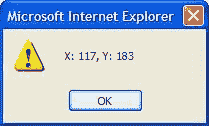

窗口警报框

JavaScript 教程 - 荷教程示例

### ∟支持 JavaScript 的 Web 浏览器

#### #### ####'javascript:' 伪 URL 地址

本节描述了什么是 `javascript:` 伪 URL 地址，并提供了若干几个有趣的 `javascript:` URL 示例。

许多 Web 浏览器还支持形式如下的 `javascript:` 伪 URL 地址：

```
 javascript:statement;statement;...
```

当给浏览器提供 `javascript:` 伪 URL 时，它将开始评估 URL 中包含的 JavaScript 语句。以下是一些您可以尝试的 `javascript:` 伪 URL 地址示例：

1. 下列 URL 将导致浏览器在小型对话框中显示文本消息。

```
 javascript:alert("Hello World!");
```

2. 下列 URL 将导致浏览器显示一个带有文本消息的新页面。

```
 javascript:document.write("<html><body>Hello World!</body></html>");
```

3. 下列 URL 将导致浏览器执行复杂的 JavaScript 代码，从而生成一个包含质数的 HTML 页面。注意，整个 URL 地址必须写在单行中。因此，您需要合并以下行，将其复制并粘贴到浏览器。

```
 javascript:var i, j, is_prime; document.write('<body><pre>'); 
   for ( i=3; i<=30; i+=2 ) { is_prime = true; for ( j=2; j<=i/2; j++)
   { is_prime = i%j > 0; if (!is_prime) break;} 
   if (is_prime) document.writeln('Found a prime number: ' + i); } 
   document.write('</pre></body>');
```

现在轮到你编写更多 `javascript:` URL 示例了。

JavaScript 教程 - 荷教程示例

### ∟支持 JavaScript 的 Web 浏览器

#### #### #### Google Chrome 中的 JavaScript 控制台

本节提供了教程示例，介绍如何使用 Google Chrome 中的 JavaScript 控制台来查看 JavaScript 执行结果执行错误和日志消息。你也可以用它运行任何 JavaScript 语句来与 HTML 文档进行交互。

**什么是 Google Chrome 中的 JavaScript 控制台？** Google Chrome 中的 JavaScript 控制台是浏览器为您提供的一个控制台，用于：

*   查看浏览器在执行嵌入 JavaScript 代码时生成的任何错误或日志消息。
*   运行任何 JavaScript 代码以交互方式与 Web 文档交互。

以下是我测试 Google Chrome 中 JavaScript 控制台的操作步骤：

1. 运行 Google Chrome 并加载以下 HTML 代码：

```
 <html>
<head><title>Hello World!</title></head>
<body>
<script type="text/javascript">
   document.write('Hello World! - Document');
   console.log('Hello World! - Console');
</script>
</body>
</</html>
```

2. 按下 F12 键。我看到屏幕上显示了开发者面板。
3. 点击开发者面板上的“Console”选项卡。我看到控制台日志消息显示：“Hello World! - Console”。
4. 在控制台中输入一些 JavaScript 语句并运行：

```
 Hello World! - Console
> var msg = document.title;
< undefined
> console.log(msg.length);
  12
< undefined
> 
```

很酷。控制台是排查 Google Chrome 上运行的 HTML 页面中 JavaScript 代码问题的很好的工具。

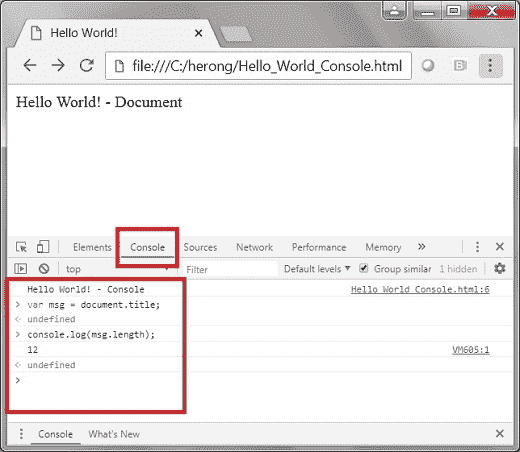

JavaScript 控制台


本节提供了教程示例，介绍如何使用 Apple Safari 中的 JavaScript 控制台（Console）来查看 JavaScript 执行产生的错误和日志消息。你也可以使用它来运行任何 JavaScript 语句以与 HTML 文档进行交互。

## 什么是 Apple Safari 中的 JavaScript 控制台？

Apple Safari 中的 JavaScript 控制台是浏览器为你提供的一个控制台：

* 查看浏览器在执行嵌入 JavaScript 代码时生成的任何错误或日志消息。
* 运行任何 JavaScript 代码以交互式的方式与 Web 文交互。

以下是我测试 Apple Safari 中 JavaScript 控制台的操作：

1. 运行 Apple Safari 并加载以下 HTML 代码：

```html
 <html>
<head><title>Hello World!</title></head>
<<body>
<script type="text/javascript">
   document.write('Hello World! - Document');
   console.log('Hello World! - Console');
</script>
</body>
</html>
```

2. 按“Option-Command-C”组合键（或选择“开发 > 显示 JavaScript 控制台”菜单）。我在屏幕上显示的开发者面板中看到了“Console”选项卡，上面显示了日志消息：“Hello World! - Console”。

3. 在控制台中输入一些 JavaScript 语句并运行：

```
 Hello World! - Console
>> var msg = document.title;
< undefined
>> console.log(msg.length);
  12
< undefined
> 
```

酷酷。控制台是排查在 Apple Safari 上运行的 HTML 页面中 JavaScript 代码问题的很好工具。

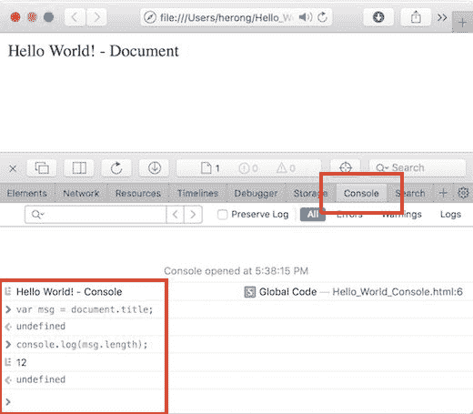

Apple Safari 中的 JavaScript 控制台

JavaScript 教程 - Herong 的教程示例

∟支持 JavaScript 的 Web 浏览器

∟ IE (Internet Explorer) 中的 JavaScript 控制台

本节提供了教程示例，介绍如何使用 IE (Internet Explorer) 中的 JavaScript 控制台来查看 JavaScript 执行产生的错误和日志消息。你也可以使用它来运行任何 JavaScript 语句以与 HTML 文档进行交互。

## 什么是 IE (Internet Explorer) 中的 JavaScript 控制台？

IE 中的 JavaScript 控制台是浏览器为你提供的一个控制台：

* 查看浏览器在执行嵌入 JavaScript 代码时生成的任何错误或日志消息。
* 运行任何 JavaScript 代码以交互式的方式与 Web 文交互。

以下是我测试 IE 中 JavaScript 控制台的操作：

1. 运行 IE 并加载以下 HTML 代码：

```html
 <html>
<head><title>Hello World!</title></head>
<body>
<script type="text/javascript">
   document.write('Hello World! - Document');
   console.log('Hello World! - Console');
</script>
</body>
</html>
```

2. 按 F12 键。我看到屏幕上显示了开发者窗口。

3. 点击开发者窗口上的“Console”选项卡。我看到了控制台日志消息：“Hello World! - Console”。

4. 在控制台中输入一些 JavaScript 语句并运行：

```
 >> var msg = document.title;
< undefined
>> console.log(msg.length);
  12
< undefined
> 
```

酷酷。控制台是排查在 IE 上运行的 HTML 页面中 JavaScript 代码问题的很好工具。

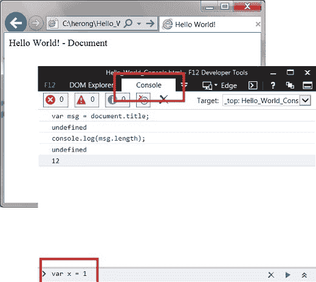

IE (Internet Explorer) 中的 JavaScript 控制台

JavaScript 教程 - Herong 的教程示例

∟服务端和客户端 Web 脚本

本章提供了关于服务端和客户端 Web 脚本的介绍和教程示例。主题包括：Web 脚本处理架构概述；服务端和客户端脚本的处理步骤；事件处理脚本；脚本代码返回新的脚本代码。

> Web 脚本架构概览
> 服务端脚本概述
> 用于文档更新的客户端脚本
> 用于事件处理的客户端脚本
> 经过多次处理的客户端脚本
> 由两个原始脚本产生的新脚本

结论：

* Web 应用程序可以在三个领域使用脚本：服务端脚本、用于页面文档构建的客户端脚本，以及用于浏览器事件处理的客户端脚本。
* 在页面文档构建过程中使用 JavaScript 时，浏览器将多轮扫描并执行脚本。

JavaScript 教程 - Herong 的教程示例

∟服务端和客户端 Web 脚本

## Web 脚本架构概览

本节提供了典型的 Web 脚本处理流程架构概述，显示了服务端和客户端的脚本步骤。

正如我们在之前的章节中看到的，JavaScript 代码可以用于三个领域来帮助构建网站或基于 Web 的应用程序：

* 服务端脚本 - 嵌入在 HTML 文档中的脚本，在发送到客户端（Web 浏览器）之前由 Web 服务器处理。服务端脚本通常用于与数据库或其他后端应用程序交互，并将动态数据引入 HTML 文档。
* 用于页面文档构建的客户端脚本 - 嵌入在 HTML 文档中的脚本，在浏览器窗口上渲染页面文档之前由 Web 浏览器处理。
* 用于浏览器事件处理的客户端脚本 - 嵌入在 HTML 文档中的脚本，当用户与浏览器窗口交互时由 Web 浏览器处理。

下面的图显示了服务端脚本和客户端脚本如何共同工作，在典型的 Web 应用程序流程架构中执行不同的功能：

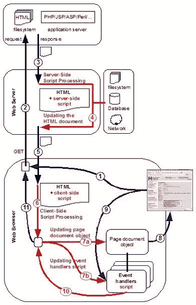

Web 脚本流程架构

图中使用的红线表示可以使用 JavaScript 的地方。此 Web 脚本流程架构图的不同部分将在稍后进行解释。

JavaScript 教程 - Herong 的教程示例

∟服务端和客户端 Web 脚本

## 服务端脚本概述

本节提供了 Web 服务端脚本处理流程的概述。Web 服务器会移除脚本代码并执行它。

服务端脚本发生在下方所示的第 4 步：

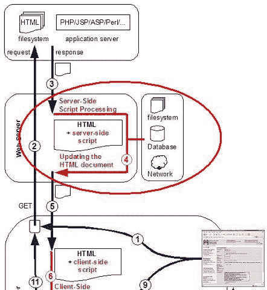

服务端脚本流程

步骤 1：用户输入新的 Web 页面地址或点击需要从 Web 服务器获取新 Web 页面的链接。
步骤 2：Web 浏览器连接到 Web 服务器并发送带有请求 Web 页面路径名的 `HTTP GET` 命令。
步骤 3： Web 服务器获取请求页面的 HTML 文档，或请求应用程序服务器生成 HTML 文档。
步骤 4：服务端脚本步骤：Web 服务器扫描 HTML 文档查找其中嵌入的任何服务端脚本代码。Web 服务器将移除嵌入的脚本代码并执行它。

当 Web 服务器执行嵌入的脚本代码时，它将提供许多代表主机环境的主机对象。通过这些主机对象，服务端脚本可以轻松访问载的 HTML 文档、服务器文件系统、任何数据库以及网络计算机。

通常，服务端脚本代码将根据其计算产生的动态数据更新载的 HTML 文档。

在服务端脚本处理步骤结束时，更新后的 HTML 文档准备好发送回客户端——Web 浏览器。

JavaScript 教程 - Herong 的教程示例

∟服务端和客户端 Web 脚本

## 用于文档更新的客户端脚本

本节提供了客户端脚本的概述。某些脚本被执行以更新页面文档的最终渲染。某些脚本被注册为事件处理程序以便稍后执行。

用于页面文档更新的服务端脚本发生在下方所示的第 6 步和 7a 步：

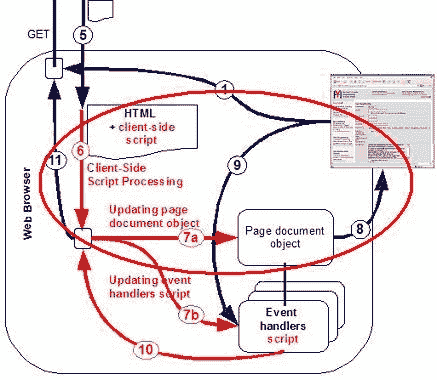

用于文档更新的客户端脚本

步骤 5：Web 服务器将最终的 HTML 文档发送给 Web 浏览器。


# 第 6 ：客户端脚本步骤
Web 浏览器扫描 HTML 文档，查找其中嵌入的任何客户端脚本代码。Web 浏览器将移除嵌入的脚本代码并执行它。当浏览器执行嵌入的脚本代码时，它会提供许多代表客户端宿主环境机对象。通过这些主机对象，客户端脚本代码可以访问承载的 HTML 文档和浏览器窗口。出于安全考虑，客户端脚本代码无法访问文件系统或客户端机器浏览器之外的任何内容。

### 第 7a 
某些客户端脚本会在浏览器窗口渲染之前更新页面文档对象（document object）。

### 第 7b 
某些客户端脚本将被注册为各种事件的处理器，这些事件会在浏览器窗口及其页面 UI 控件上触发。在终端用户触发这些事件之前，这些脚本将不会执行。

JavaScript 教程 - Herong 的教程示例

∟服务器端与客户端 Web 脚本

∟用于事件处理的客户端脚本

本节提供了用于事件处理的客户端脚本的概述。当终端用户在最终的 Web 页面上触发事件时，注册为事件处理程序的脚本将会被执行。

用于窗口事件处理的服务器端脚本发生在第 7b 步和第 10 步，如下所示：

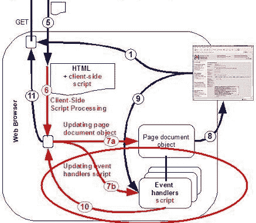

### 用于事件处理的客户端脚本

### 第 7b
某些客户端脚本将被注册为各种事件的处理器，这些事件会在浏览器窗口及其页面 UI 控件上触发。在终端用户触发这些事件之前，这些脚本将不会执行。

### 第 8
由某些客户端脚本更新的页面文档对象由 Web 浏览器在浏览器窗口上渲染，向用户显示最终的 Web 页面。

### 第 9 
用户在 Web 页面上输入某些内容或点击某些 UI 控件。这将触发一个或多个事件。

### 第 10
Web 浏览器执行注册为触发事件处理器的客户端脚本。Web 浏览器将提供许多代表客户端宿主环境机对象。通过这些主机对象，事件处理器脚本可以访问页面文档和浏览器窗口。出于安全考虑，客户端脚本代码无法访问文件系统或客户端机器浏览器之外的任何内容。

### 第 7a 
某些事件处理器脚本将更新在浏览器窗口上渲染的页面文档对象。

### 第 11 
某些事件处理器脚本将强制 Web 浏览器请求一个新的 Web 页面。

JavaScript 教程 - Herong 的教程示例

∟服务器端与客户端 Web 脚本

∟多次处理的客户端脚本过程

本节提供了一个 JavaScript 代码教程示例，该代码将另一段 JavaScript 代码插入回 HTML 文档中。Web 浏览器会多次执行脚本代码。

正如我们之前学到的，当 Web 浏览器从 Web 服务器接收 HTML 文档时，它会移除所有嵌入的脚本代码并执行它们。

如果在第一轮脚本执行期间向 HTML 文档中插入了新的脚本代码会发生什么？Web 浏览器将移除插入的脚本代码并再次执行它。

这是一个有趣的 JavaScript 代码教程示例，它将另一段 JavaScript 代码插入 HTML 文档中：

```javascript
 <html
<!-- Hello_Nested_Scripts.html
   Copyright (c) HerongYang.com. All Rights Reserved.
-->
<head><title>Hello from Nested Scripts</title></head>
<body><pre>
<script type="text/javascript">
   document.writeln("Hello World!");
   document.writeln("<script type=\"text/javascript\">");
   document.writeln("document.writeln(\" Hello World!\");");
   document.writeln("<\/script>");
</script>
</pre></body>
</</html>
```

猜猜如果你运行这个 HTML 文档，你会在浏览器窗口上看到什么。

```
 Hello World!
 Hello World!
```

发生的情况是，当浏览器完成嵌入的 JavaScript 代码的执行时，它将得到如下 HTML 文档：

```html
 Hello World!
<script type="text/javascript">
document.writeln(" Hello World!");
</script>
```

输出中还有另一个 JavaScript 代码。浏览器将再次执行它，导致你之前看到的最终 HTML 文档。

JavaScript 教程 - Herong 的教程示例

∟服务器端与客户端 Web 脚本

∟由两个原始脚本产生的新脚本

本节提供了一个教程示例，展示了 Web 浏览器如何无法执行由两个原始 JavaScript 代码产生的 JavaScript 代码。

实际上，只有当新脚本代码是单次执行的结果时，Web 浏览器才能正确处理它。

这里有一个包含两个 JavaScript 代码的 HTML 文档，它们协同工作返回一个新的 JavaScript 代码：

```html
 <html
<!-- Hello_Nested_Script_Error.html
   Copyright (c) HerongYang.com. All Rights Reserved.
-->
<head><title>Hello from Nested Script Error</title></head>
<body><pre>
<script type="text/javascript">
   document.writeln("-- Before the new script.");
   document.writeln("<script type=\"text/javascript\">");
</script>
document.writeln(\"Hello World!\");
<script type="text/javascript">
   document.writeln("<\/script>");
   document.writeln("-- After the new script.");
</script>
</pre></body>
</</html>
```

在第一轮 JavaScript 执行后，HTML 文档将拥有一个新的 JavaScript 代码：

```
 -- Before the new script.
<script type="text/javascript">
document.writeln(\"Hello World!\");
</script>
-- After the new script.
```

如果 Web 浏览器再次执行 JavaScript 代码，最终的 HTML 文档将如下所示：

```
 -- Before the new script.
Hello World!
-- After the new script.
```

但 Internet Explorer 和 Firefox 得到的结果是：

```
 -- Before the new script.
```

结论：如果脚本代码是由两个原始脚本代码产生的，Web 浏览器将无法执行它。

JavaScript 教程 - Herong 的教程示例

∟对象简介

本章提供了 JavaScript 中“对象”类型的介绍和教程示例。主题包括创建“对象”；添加属性和运行方法；命名属性和索引属性；数组的比较。

> 什么是对象？
> Object 类型的对象
> 添加和删除属性
> 添加和删除方法
> 使用 this 关键字表示当前对象
> 对象字面量
> 对象与关联数组
> 具有索引属性的对象
> 数组与对象的区别
> 将数组对象作为对象使用

结论：

* 对象是特殊类型“Object”或任何“原型”类型的实例。
* “Object”类型是所有“原型”类型的根。
* 使用对象字面量创建新对象：`{n:v, ...}`。
* 使用 `Object` 构造函数创建新对象：`New Object()`。
* 使用点 `.` 操作访问对象的属性或方法。
* 使用点 `delete` 操作删除对象的属性或方法。


## 什么是对象？

本节简要介绍了 JavaScript 中什么是对象，以及创建和使用对象的一些有趣特性。此外还提供了一个教程示例。

## 什么是对象？

对象是特殊数据类型 `"Object"` 或任何 `"prototype"` 数据类型的实例。

JavaScript 支持具有以下有趣特性的对象：

*   对象是从 `"prototype"` 实例化的，而不是像其他语言那样从 `"class"` 或 `"struct"` 实例化。
*   `"Object"` 数据类型的对象可以使用对象初始化运算符 (`{}`) 创建。
*   `"Object"` 数据类型和任何 `"prototype"` 数据类型的对象可以使用构造函数运算符 (`new`) 创建。
*   当将对象赋值给变量时，变量中存储的是对象的引用。这与将基本值赋值给变量不同，后者是值本身被存储在变量中的。
*   对象只能有公共属性和公共方法。
*   可以使用点运算符 (`.`) 访问属性和方法。
*   JavaScript 中的对象等同于其他语言中的关联数组（associate array）。
*   可以使用数组运算符 (`[]`) 访问属性和方法。
*   可以动态地为单个原型的所有对象添加新的属性和方法。
*   可以动态地从单个原型的所有对象中删除现有的属性和方法。
*   可以动态地为一个对象添加新的属性和方法，而不影响同一原型的其他对象。
*   可以动态地从一个对象删除现有的属性和方法，而不影响同一原型的其他对象。
*   JavaScript 提供了几个内置自定义数据类型：`Array`、`Boolean`、`Date`、`Function`、`Math`、`Number`、`RegExp` 和 `String`。

为了向这些特性，我编写了这个简单的教程示例来创建一个 `"Object"` 数据类型的对象，并在这个新对象上添加新属性：

```
 <html>
<!-- Object_Data_Type_and_Value.html
   Copyright (c) HerongYang.com. All Rights Reserved.
-->
<head>
<title>Object Data Type and Value</title>
</head>
<body>
<pre>
<script type="text/javascript">

   // 将基本值赋值给变量
   var jsSite = "mozilla.org";

   // 创建对象并将其赋值给变量
   var mySite = new Object();

   // 为一个对象添加新属性
   mySite.name = "herongyang.com";

   // 获取对象属性的值
   document.writeln('"mySite.name" property: '+mySite.name); 

   // 检查 mySite 的数据类型
   document.writeln('"mySite" data type: '+(typeof mySite)); 

   // 检查 jsSite 的数据类型
   document.writeln('"jsSite" data type: '+(typeof jsSite)); 
</script>
</pre>
</body>
</html>
```

运行此示例，你将得到：

```
 "mySite.Name" property: herongyang.com
"mySite" data type: object
"jsSite" data type: string
```

JavaScript 教程 - Herong 的教程示例

# 对象介绍

## "Object" 数据类型的对象

本节简要介绍了 `'Object'` 数据类型及其属性和方法。提供了一个如何创建和测试 `'Object'` 数据类型对象的教程示例。要学习如何在 JavaScript 中使用对象，我们需要从 `'Object'` 数据类型开始，它具有以下特性：

*   `"Object"` 数据类型的对象可以使用对象初始化运算符 (`{}`) 创建。
*   `"Object"` 数据类型和任何 `"prototype"` 数据类型的对象可以使用构造函数运算符 (`new`) 创建。
*   可以使用点运算符 (`.`) 访问属性和方法。
*   可以使用数组运算符 (`[]`) 访问属性和方法。

这里是一个显示其中一些特性的教程示例：

```
 <html>
<!-- Object_Data_Type_and_Value.html
   Copyright (c) HerongYang.com. All Rights Reserved.
-->
<head>
<title>Object Data Type and Value</title>
</head>
<body>
<pre>
<script type="text/javascript">

   // 将基本值赋值给变量
   var jsSite = "mozilla.org";

   // 创建对象并将其赋值给变量
   var mySite = new Object();

   // 为一个对象添加新属性
   mySite.name = "herongyang.com";

   // 获取对象属性的值
   document.writeln('"mySite.name" property: '+mySite.name); 

   // 检查 mySite 的数据类型
   document.writeln('"mySite" data type: '+(typeof mySite)); 

   // 检查 jsSite 的数据类型
   document.writeln('"jsSite" data type: '+(typeof jsSite)); 
</script>
</pre>
</body>
</html>
```

运行此示例，你将得到：

```
 "mySite.Name" property: herongyang.com
"mySite" data type: object
"jsSite" data type: string
```

# 添加和删除对象属性

本节简要介绍了如何添加、更新和删除属性。

*   可以动态地为一个对象添加新的属性和方法，而不影响同一原型的其他对象。
*   可以动态地从一个对象删除现有的属性和方法，而不影响同一原型的其他对象。

这里有一个教程示例，展示了如何添加新属性、更新属性值以及删除属性：

```
 <html>
<!-- Object_Property.html
   Copyright (c) HerongYang.com. All Rights Reserved.
-->
<head>
<title>Object Properties of "Object"</title>
</head>
<body>
<pre>
<script type="text/javascript">

   // 创建 "Object" 类型的对象
   var mySite = new Object();
   var myBook = new Object();

   // 仅为一个对象添加新属性
   mySite.url = "herongyang.com";
   myBook.author = "Herong Yang";

   // 更新属性值
   mySite.url = "www.herongyang.com";

   // 显示属性值
   document.writeln('mySite.url: '+mySite.url);
   document.writeln('myBoot.url: '+myBook.url);
   document.writeln('mySite.author: '+mySite.author);
   document.writeln('myBook.author: '+myBook.author);

   // 这个属性仅属于一个对象吗？
   document.writeln('mySite.hasOwnProperty("url"): '
      +mySite.hasOwnProperty("url"));

   // 仅从一个对象删除属性
   document.writeln('Deleting mySite.url...');
   delete mySite.url;
   document.writeln('mySite.url: '+mySite.url);
</script>
</pre>
</body>
</html>
```

结果符合我的预期：

```
 mySite.url: www.herongyang.com
myBoot.url: undefined
mySite.author: undefined
myBook.author: Herong Yang
mySite.hasOwnProperty("url"): true
Deleting mySite.url...
mySite.url: undefined
```


# JavaScript 教程 - Herong 的教程示例(#part0001.xhtml)

## 对象介绍(#part0073.xhtml)

### 添加和删除对象方法

本节对对象的自有方法进行了简要描述。提供了一个如何添加、调用和删除对象自有方法的教程示例。

当你从 `Object` 构造函数创建一个新对象时，你将得到一个仅包含某些方法的对象：

- `toString()` - 这个默认方法输出 `[object Object]`。它需要被真实的方法所替换。
- `valueOf()` - 这个默认方法输出 `[object Object]`。它需要被真实的方法所替换。

但你可以随时使用所示的赋值操作为一个对象添加更多方法：

```
 object_name.method_name = function_name;
```

添加的方法仅适用于该特定对象。其他对象将没有此方法。

在对象上调用方法与如下所示调用分配的函数是相同的：

```
 object_name.method_name(param1, param2, ...);
```

你也可以随时使用所示的删除操作从对象中删除方法：

```
 delete object_name.method_name;
```

这里有一个教程示例，向你如何添加新方法、调用方法以及删除方法。

```html
 <html>
<!-- Object_Method.html
   Copyright (c) HerongYang.com. All Rights Reserved.
-->
<head>
<title>"Object" 的方法</title>
</head>
<body>
<pre>
<script type="text/javascript">
// 我用来打招呼的函数
function sayHello(name) {
   window.alert("Hello "+name);
}

   // 准备两个 "Object" 类型的对象
   var mySite = new Object();
   var myBook = new Object();
   mySite.url = "herongyang.com";
   myBook.author = "Herong Yang";

   // 仅为一个对象添加方法
   myBook.greet = sayHello;

   // 在 "myBook" 上调用方法
   myBook.greet(myBook.author);

   // 在 "mySite" 上调用方法 - 将无法作用
//   mySite.greet(myBook.author);

   // 删除 "myBook" 上的方法
   delete myBook.greet;

   // 在对象上调用方法 - 将无法作用
//   myBook.greet(myBook.author);
</script>
</pre>
</body>
</html>
```

如果你运行这个 JavaScript 页面，你会在屏幕上看到一个警告框，显示：“Hello Herong Yang”。

### 使用 "this" 关键字表示当前对象

本节对 `this` 关键字进行了简要描述，它在对象方法中表示当前对象。提供了一个如何访问当前对象的属性和方法的教程示例。

在定义作为对象方法的方法时，你可以使用关键字 `this` 来表示调用方法所在的对象。JavaScript 中 `this` 关键字的用法与 Java 中相同。

这里是使用 `this` 关键字访问当前对象属性和方法的教程示例：

```html
 <html>
<!-- Object_this_Keyword.html
   Copyright (c) HerongYang.com. All Rights Reserved.
-->
<head>
<title>对象方法中的 "this" 关键字</title>
</head>
<body>
<pre>
<script type="text/javascript">

// 使用 "this" 获取属性
function myToString() {
   return '"'+this.title + '" by '+this.author;
}

// 使用 "this" 获取 "toString" 方法
function showAll() {
   window.alert(this.toString());
}

   // 准备一个 "Object" 类型的对象
   var myBook = new Object();
   myBook.author = "Herong Yang";
   myBook.title = "JavaScript Tutorials";

   // 仅为一个对象添加新方法
   myBook.print = showAll;

   // 仅在一个对象上重写 "toString()"
   myBook.toString = myToString;

   // 在 "myBook" 上调用方法
   myBook.print();
</script>
</pre>
</body>
</html>
```

如果你运行这个 "this" 关键字示例，你将得到一个警告框，消息内容为："JavaScript Tutorials" by Herong Yang。

### "Object" 类型对象字面量

本节对用于创建 `Object` 类型新对象的对象字面量或初始化器进行了简要描述。提供了一个如何初始化具有两个属性和两个方法的对象的教程示例。

在之前的章节中，我们学习了 `Object` 类型对象可以通过构造函数函数 `new Object()` 创建。

JavaScript 还支持使用如下格式的对象字面量创建 `Object` 类型对象的简单方法：

```
 {property1: value1, property2: value2, ...}
```

其中 `property1` 和 `property2` 是属性或方法名。在 JavaScript 语言中，对象中的属性和方法是以相同的方式管理的。

对象字面量也被称为对象初始化器，因为它允许你在单次操作中创建新对象并用属性和方法对其进行初始化。

使用对象字面量创建对象的结果与使用构造函数相同。但对象字面量要易于使用得多。以下两个代码段是完全相同的，但第一个要简单得多：

```javascript
 // 使用对象字面量创建对象
   var obj = {property1: value1, property2: value2, ...};

   // 使用构造函数创建对象
   var obj = new Object();
   obj.property1 = value1;
   obj.property2 = value2;
   ...;
```

这里是使用对象字面量或初始化器创建 "Object" 类型对象的教程示例：

```html
 <html>
<!-- Object_Literal.html
   Copyright (c) HerongYang.com. All Rights Reserved.
-->
<head>
<title>"Object" 类型的对象字面量</title>
</head>
<body>
<pre>
<script type="text/javascript">

// 使用 "this" 获取属性
function myToString() {
   return '"'+this.title + '" by '+this.author;
}

// 使用 "this" 获取 "toString" 方法
function showAll() {
   window.alert(this.toString());
}

   // 使用对象字面量
   var myBook = {
      author: "Herong Yang",
      title: "JavaScript Tutorials",
      print: showAll,
      toString: myToString
   };

   // 在 "myBook" 上调用方法
   myBook.print();
</script>
</pre>
</body>
</html>
```

如果你运行这个教程示例，你将得到与上一节示例相同的结果："JavaScript Tutorials" by Herong Yang。

### 对象与关联数组

本节对如何使用关联数组格式 `object_name['property_name']` 访问对象属性进行了简要描述。提供了一个如何将对象作为关联数组使用的教程示例。

在上一节中，我提到 JavaScript 中对象的方法管理方式与属性相同。这引出了 JavaScript 对象的另一个很棒特性：

JavaScript 中的对象实际上是关联数组，它们包含一个键值对的集合。键（Keys）代表属性名和方法名，值（Values）代表属性值和函数定义。

现在你知道如何通过两种方式引用方法属性或方法了：

- 点运算符 (`.`) - 示例：`object_name.property_name`。
- 关联数组运算符 - 示例：`object_name["property_name"]`。

这里有一个关于如何以关联数组格式访问对象属性和方法的教程示例：


```html
 <html>
<!-- Object_Associate_Array.html
   Copyright (c) HerongYang.com. All Rights Reserved.
-->
<head>
<title>对象与关联数组</title>
</head>
<body>
<pre>
<script type="text/javascript">
// 使用 "this" 来获取属性
function myToString() {
   return '"'+this.title + '" by '+this.author;
}

   // 使用对象字面量格式
   var myBook = {
      author: "Herong Yang",
      title: "JavaScript Tutorials",
      toString: myToString
   };

   // 添加一个新属性
   myBook['date'] = 2008;

   // 通过不同的格式获取属性值
   document.writeln("myBook.title: "+myBook.title);
   document.writeln("myBook['title']: "+myBook['title']);
   document.writeln("myBook.date: "+myBook.date);
   document.writeln("myBook['date']: "+myBook['date']);
   document.writeln("myBook.toString: "+myBook.toString);
   document.writeln("myBook['toString']: "+myBook['toString']);

   // 检查属性数据类型
   document.writeln();
   document.writeln("myBook.title Type: "+(typeof myBook.title));
   document.writeln("myBook['date'] Type: "+(typeof myBook['date']));
   document.writeln("myBook.toString Type: "
      +(typeof myBook.toString));
</script>
</pre>
</body>
</html>
```

运行此教程示例，你将看到以下输出，这证实了我的理解：点运算符（`.`）和关联数组运算符（`[]`）是可以互换的。

```text
 myBook.title: JavaScript Tutorials
myBook['title']: JavaScript Tutorials
myBook.date: 2008
myBook['date']: 2008
myBook.toString: function myToString() {
    return "\"" + this.title + "\" by " + this.author;
}
myBook['toString']: function myToString() {
    return "\"" + this.title + "\" by " + this.author;
}

myBook.title Type: string
myBook['date'] Type: number
myBook.toString Type: function
```

输出还表明，作为对象的属性，方法的值是函数的定义。

JavaScript 教程 - Herong 的教程示例

∟对象简介

### 带有索引属性的对象

本节对索引属性和索引方法进行了简要描述。提供了一个教程示例，说明如何创建和访问索引属性以及索引方法。

JavaScript 还支持具有以下特征的带有索引属性的对象：

- 索引属性是以索引数字而不是属性命名的属性。
- 索引属性不能用点运算符（`.`）访问。
- 索引属性可以使用关联数组运算符（`['index']`）访问。
- 索引属性可以使用数组运算符（`[index]`）访问。
- 索引属性可以赋值一个函数以成为索引方法。

这是一个教程示例，展示了如何以两种格式（数组格式和关联数组格式）定义和访问对象的索引属性和索引方法：

```html
 <html>
<!-- Object_Indexed_Properties.html
   Copyright (c) HerongYang.com. All Rights Reserved.
-->
<head>
<title>带有索引属性的对象</title>
</head>
<body>
<pre>
<script type="text/javascript">
// 使用 "this" 来获取属性
function myToString() {
   return '"'+this.title + '" by '+this.author;
}

   // 使用对象字面量格式
   var myBook = {
      author: "Herong Yang",
      title: "JavaScript Tutorials",
      3: 2008,
      price: "Free",
      4: myToString
   };

   // 添加一个新的索引属性   
   myBook[9] = "Programming";

   // 索引属性不能通过 (.) 访问
   // document.writeln("myBook.3: "+myBook.3);

   // 获取索引属性值
   document.writeln("myBook[3]: "+myBook[3]);
   document.writeln("myBook['3']: "+myBook['3']);
   document.writeln("myBook[4]: "+myBook[4]);
   document.writeln("myBook[9]: "+myBook[9]);

   // 检查属性数据类型
   document.writeln();
   document.writeln(myBook[4]());
</script>
</pre>
</body>
</html>
```

此教程示例的输出符合我的预期：

```text
 myBook[3]: 2008
myBook['3']: 2008
myBook[4]: function myToString() {
    return "\"" + this.title + "\" by " + this.author;
}
myBook[9]: Programming

"JavaScript Tutorials" by Herong Yang
```

JavaScript 教程 - Herong 的教程示例

∟对象简介

### “对象”与“数组”之间的区别

本节对 `Array` 和 `Object` 的相似之处和不同进行了简要描述。提供了一个教程示例，说明如何比较 `Array` 对象和 `Object` 对象。

JavaScript 支持许多预定义的核心对象类型。其中，`Object` 和 `Array` 之间的关系非常紧密。如果你将 `Array` 与 `Object` 进行比较，你应该看到以下相似点和不同点：

- `Array` 是 `Object` 的子类，或子原型。因此 `Array` 继承了 `Object` 的所有特征。
- `Array` 不是一种新的数据类型。`Array` 和 `Object` 共享相同的数据类型 `object`。
- 在 `Array` 对象上的 `typeof` 运算符返回 `object`。
- 在 `Array` 对象上的 `instanceof` 运算符匹配 `Array`。它也匹配 `Object`，因为 `Array` 是 `Object` 的子类。
- `Object` 类型的对象可以使用与 `Array` 对象相同的语法拥有索引属性。
- `Object` 类型的对象不是 `Array` 对象。
- `Array` 创建的对象也是 `Object` 对象。

这是一个 JavaScript 教程示例，展示了 `Array` 和 `Object` 之间是相似的：

```html
 <html>
<!-- Object_Associate_Array.html
   Copyright (c) HerongYang.com. All Rights Reserved.
-->
<head>
<title>比较对象与数组</title>
</head>
<body>
<pre>
<script type="text/javascript">
   // 创建一个“Array”对象 - 数组字面量
   var bookArray = [
      "JavaScript Tutorials",
      "Herong Yang",
      2008,
      "Programming"
   ];

   // 创建一个“Object”对象 - 对象字面量
   var bookObject = {
      title: "JavaScript Tutorials",
      author: "Herong Yang",
      year: 2008,
      category: "Programming"
   };

   // 检查 bookArray
   document.writeln("About the \"Array\" object:");
   document.writeln("   Type: "+(typeof bookArray));
   document.writeln("   Instance of Object: "+bookArray instanceof Object));
   document.writeln("   Instance of Array: "+bookArray instanceof Array));
   document.writeln("   Members:");
   for (var item in bookArray) {
      document.writeln("      "+item+": "+bookArray[item]);
   }

   // 检查 bookObject
   document.writeln();
   document.writeln("About the \"Object\" object:");
   document.writeln("   Type: "+(typeof bookObject));
   document.writeln("   Instance of Object: "+bookObject instanceof Object));
   document.writeln("   Instance of Array: "+bookObject instanceof Array));
   document.writeln("   Members:");
   for (var item in bookObject) {
      document.writeln("      "+item+": "+bookObject[item]);
   }
</script>
</pre>
</body>
</html>
```

此教程示例的输出展示了 `Array` 对象与 `Object` 对象是如何相似的：

```text
 About the "Array" object:
   Type: object
   Instance of Object: true
   Instance of Array: true
   Members:
      0: JavaScript Tutorials
      1: Herong Yang
      2: 2008
      3: Programming

About the "Object" object:
   Type: object
   Instance of Object: true
   Instance of Array: false
   Members:
      title: JavaScript Tutorials
      author: Herong Yang
      year: 2008
      category: Programming
```

JavaScript 教程 - Herong 的教程示例

∟对象简介

### 将“数组”对象作为“对象”使用

本节提供了一个教程示例，说明如何将 `Array` 对象作为 `Object` 对象来命名属性和方法。

正如我在上一节中提到的，`Array` 是 `Object` 的子类。因此，`Array` 对象可以作为 `Object` 对象使用。


*   可以为 `"Array"` 对象添加命名属性。
*   `"Array"` 对象的元素实际上是索引属性。
*   可以使用关联数组格式访问命名属性和索引属性。
*   方法可以作为命名属性或索引属性被添加。

下面是一个 JavaScript 教程示例，向你展示了如何将 `"Array"` 对象当作 `"Object"` 对象使用：

```
 <html>
<!-- Object_Array_as_Object.html
   Copyright (c) HerongYang.com. All Rights Reserved.
-->
<head>
<title>Using an Array as an Object</title>
</head>
<body>
<pre>
<script type="text/javascript">
// Using "this" to get the properties
function myToString() {
   return '"'+this.title + '" by '+this.author;
}

   // Creating an object of "Array"
   var bookArray = new Array();
   bookArray[3] = 2008;
   bookArray[9] = "Programming";

   // Adding named properties to "bookArray"
   bookArray.author = "Herong Yang";
   bookArray.title = "JavaScript Tutorials";

   // Adding methods in 2 ways
   bookArray.toString = myToString;
   bookArray[4] = myToString;

   // Checking "bookArray"
   document.writeln();
   document.writeln("About the \"Array\" object:");
   document.writeln("   Type: "+(typeof bookArray));
   document.writeln("   Instance Of Object: "
      +(bookArray instanceof Object));
   document.writeln("   Instance Of Array: "
      +(bookArray instanceof Array));
   document.writeln("   Array Length: "+bookArray.length);

   // Looping through all properties and methods
   document.writeln("   Members:");
   var count = 0; 
   for (var item in bookArray) {
      document.writeln("      "+item+": "+bookArray[item]);
      count++;
   }
   document.writeln("   # of properties and methods: "+count);

   // Calling its methods
   document.writeln();
   document.writeln("Calling its methods:");
   document.writeln("   bookArray.toString(): "
      +bookArray.toString());
   document.writeln("   bookArray[4](): "+bookArray[4]());
</script>
</pre>
</body>
</html>
```

这是该教程示例的输出。请注意，作为一个 `"Array"` 对象，`bookArray.length` 返回 10 个元素。但它只有 6 个属性和方法。

```
 About the "Array" object:
   Type: object
   Instance Of Object: true
   Instance Of Array: true
   Array Length: 10
   Members:
      3: 2008
      9: Programming
      author: Herong Yang
      title: JavaScript Tutorials
      toString: function myToString() {
    return "\"" + this.title + "\" by " + this.author;
}
      4: function myToString() {
    return "\"" + this.title + "\" by " + this.author;
}
   # of properties and methods: 6

Calling its methods:
   bookArray.toString(): "JavaScript Tutorials" by Herong Yang
   bookArray[4](): "JavaScript Tutorials" by Herong Yang
```

# JavaScript 教程 - Herong 的教程示例

##  定义你自己的对象类型

本章提供了关于如何定义你自己的对象类型的介绍和教程示例。主题包括定义构造函数；向对象或构造函数原型添加属性和方法；遍历属性和方法；使用 `'instanceof'` 和 `'typeof'` 运算符。

*   基于原型的面向对象编程风格
*   JavaScript 中基于原型的编程特性
*   定义对象构造函数
*   向对象添加属性和方法
*   "for ... in" 和 "for each ... in" 语句
*   构造函数对象对象的 "prototype" 属性
*   "instanceof" 运算符 - 确定对象类型
*   "typeof" 运算符和数据类型

### 结论：

*   JavaScript 是一种基于原型的编程语言，支持对象的封装、多态和继承。
*   JavaScript 没有类定义。
*   对象通过调用构造函数创建：`New Abc()`。
*   可以在构造函数中添加对象属性和方法。
*   也可以向单个实例添加对象属性和方法。
*   可以使用 `for (var item in object_name)` 和 `for each (var value in object_name)` 语句来遍历对象中的属性和方法。
*   构造函数本身是一个对象，它有一个名为 `"prototype"` 的属性，指向原型定义。

# JavaScript 教程 - Herong 的教程示例

## ∟定义你自己的对象类型](#part0084.xhtml)

### 基于原型的面向对象编程风格

本节提供了面向对象编程和基于原型的编程风格的快速描述。

面向对象编程有三个主要目标：

*   **封装**：在接口后隐藏对象功能细节的能力——换句话说，封装是向发送消息的对象隐藏对象功能细节的能力。
*   **继承**：派生类型对象从父类型继承属性的能力。
*   **多态**：相同类型的两个对象以自己的行为响应相同接口的能力。

这些目标可以通过两种不同的编程风格实现：

*   **基于类的编程**：对象通过基于指定类的实例化过程创建，该类静态地定义了结果对象的结构和行为。
*   **基于原型的编程**：对象通过基于另一个对象作为原型的克隆过程创建，该原型可以被动态修改。

JavaScript 是一种基于原型的编程语言，支持如下所述的封装、多态和继承：

*   封装：对象的功能细节隐藏在属性和方法内部。
*   继承：父类型的属性和方法通过原型对象被继承。
*   多态：继承的属性和方法可以被特定于该对象的重写。

请查看本章的其他章节，获取有关 JavaScript 基于原型的编程特性的详细描述和教程示例。

# JavaScript 教程 - Herong 的教程示例

## ∟定义你自己的对象类型

### ∟JavaScript 中基于原型的编程特性

本节提供了 JavaScript 中一些基于原型的编程特性的列表，例如构造函数、原型对象、对象属性和方法。

正如我在上一节提到的，JavaScript 是一种基于原型的编程语言。它通过许多特性支持面向对象编程：

*   没有类定义。JavaScript 不使用类。
*   对象是从构造函数创建的。
*   每个构造函数代表一种唯一的对象类型。
*   构造函数可以为从该构造函数创建的所有对象定义属性和方法。
*   每个构造函数都可以与一个原型对象关联。
*   对象会自动继承与其构造函数关联的原型对象的属性和方法。
*   每个对象都可以有它自己的属性和方法。
*   继承的属性和方法可以被特定对象或原型对象重写。
*   有一个名为 `Object()` 的内置构造函数，它为所有其他对象类型提供了基础对象类型。
*   所有函数实际上都是从基础构造函数 `Function()` 创建的对象。
*   所有类型的对象都继承了由基础构造函数 `Object()` 定义的属性和方法。


- 有几个主要的内置对象，它们表示构造函数，包括 `Array()`、`Boolean()`、`Date()`、`Error()`、`Function()`、`Math()`、`Number()`、`Object()`、`RegExp()` 和 `String()`。
- JavaScript 似乎不支持多重继承。
- JavaScript 以特殊方式支持私有属性和方法。

本章稍后将提供几个教程示例来阐明其中一些特性。

JavaScript 教程 - Herong 的教程示例

### ∟定义你自己的对象类型](#part0084.xhtml)

## 定义对象构造函数

本节简要介绍了如何定义对象构造函数。提供了一个教程示例，演示了如何创建一个具有 3 个属性和 1 个方法的 `'Book'` 构造函数。

学习 JavaScript 原型编程风格的第一要点是构造函数。在编写构造函数时，我们需要记住：

- 构造函数的名称将作为对象的类型名称。因此，请为构造函数选择一个好的名称。
- 在构造函数中，`this` 关键字可以表示要构建的对象。
- 属性应该在构造函数中使用赋值表达式添加，如 `this.property_name = initial_value`。
- 构造函数应该接受一些参数来初始化属性。
- 方法应该在构造函数中使用赋值表达式添加，如 `this.method_name = function_name`，其中 `function_name` 指向一个现有函数。
- 不要在构造函数中使用任何 `return` 语句。当使用 `new` 运算符将其作为对象构造函数调用时，返回值将被忽略。

这里有一个定义了名为 `Book(...)` 构造函数的教程示例，它定义了 3 个属性和 1 个方法：

```html
 <html>
<!-- Prototype_Constructor_Function.html
   Copyright (c) HerongYang.com. All Rights Reserved.
-->
<head>
<title>Defining Object Constructor Functions</title>
</head>
<body>
<pre>
<script type="text/javascript">

// Defining the constructor function for a new object type
function Book(title, author) {
   document.writeln("\nConstructing a \"Book\" object...");
   this.title = title;
   this.author = author;
   this.price = undefined;
   this.getDesc = getDescription;
}

// Defining a function to be used as a method
function getDescription() {
   return "\""+this.title+"\" by "+this.author;
}

   // Creating an object of "Book"
   var myBook = new Book("JavaScript Tutorials", "Herong Yang");
   document.writeln("\nChecking the \"Book\" object");
   document.writeln("   Type: "+(typeof myBook));
   document.writeln("   Instance of \"Book\": "
      +(myBook instanceof Book));

   // Testing properties and methods
   document.writeln("   myBook.title: "+myBook.title);
   document.writeln("   myBook.author: "+myBook.author);
   document.writeln("   myBook.price: "+myBook.price);
   document.writeln("   myBook.getDesc(): "+myBook.getDesc());

   // Trying to call a constructor function as a normal function
   Book("JavaScript Cookbook", "Yosef Cohen");
</script>
</pre>
</body>
</html>
```

教程示例的输出打印所示：

```
 Constructing a "Book" object...

Checking the "Book" object
   Type: object
   Instance of "Book": true
   myBook.title: JavaScript Tutorials
   myBook.author: Herong Yang
   myBook.price: undefined
   myBook.getDesc(): "JavaScript Tutorials" by Herong Yang

Constructing a "Book" object...
```

注意，最后一个测试语句证明构造函数只是一个普通函数，你可以直接调用它。但直接调用构造函数不会产生任何结果。

简单总结：

- 构造函数等于函数。构造函数是一个函数。而函数也是构造函数。
- 构造函数可以使用 `new` 运算符创建一个新对象。
- 任何构造函数都可以被调用并作为函数执行。
- 任何函数都可以作为构造函数创建对象。

JavaScript 教程 - Herong 的教程示例

### ∟定义你自己的对象类型](#part0084.xhtml)

## 向对象添加属性和方法

本节仅简要介绍了向对象添加属性和方法。提供了一个教程示例，演示了如何向 1 个对象添加 1 个额外的属性和 1 个额外的方法。

从构造函数创建对象后，可以使用以下格式向该对象添加额外的属性和方法：

```
 object_name.property_name = initial_value;
   object_name.method_name = function_name;
```

这里有一个教程示例，它从 `Book()` 创建了两个对象，并仅向对象 `myBook` 添加了 1 个额外的属性和 1 个额外的方法：

```html
 <html>
<!-- Prototype_Add_Property_and_Method.html
   Copyright (c) HerongYang.com. All Rights Reserved.
-->
<head>
<title>Adding Additional Properties and Methods to Objects</title>
</head>
<body>
<pre>
<script type="text/javascript">

// Defining the constructor function for a new object type
function Book(title, author) {
   this.title = title;
   this.author = author;
   this.price = undefined;
   this.getDesc = getDescription;
}

// Defining a function to be used as a method
function getDescription() {
   return "\""+this.title+"\" by "+this.author;
}

   // Creating an object of "Book"
   var myBook = new Book("JavaScript Tutorials", "Herong Yang");
   var ckBook = new Book("JavaScript Cookbook", "Yosef Cohen");

   // Adding additional property and method to myBook
   myBook.price = 99.99;
   myBook.getDesc = getDescription;

   function showObject(object, name) {
      document.writeln("\nShowing object \""+name+"\\"");
      document.writeln("   Own Properties and Methods:");
      for (var item in object) {
          document.writeln("      "+item+": "+object[item]);
      }
   }

   showObject(myBook, "myBook");
   showObject(ckBook, "ckBook");
</script>
</pre>
</body>
</html>
```

教程示例的输出显示，构造函数中定义的属性被添加到两个对象。但添加到 `myBook` 的属性和方法仅适用于 `myBook`。

```
 Showing object "myBook"
   Own Properties and Methods:
      title: JavaScript Tutorials
      author: Herong Yang
      price: 99.99
      getDesc: function() {
    return "\"" + this.title + "\" by + this.author;
}

Showing object "ckBook"
   Own Properties and Methods:
      title: JavaScript Cookbook
      author: Yosef Cohen
```

JavaScript 教程 - Herong 的教程示例

### ∟定义你自己的对象类型](#part0084.xhtml)

## "for ... in" 和 "for each ... in" 语句

本节简要介绍了用于遍历对象属性和方法的特殊循环语句。提供了一个教程示例来展示相同类型对象的额外属性和方法。

JavaScript 支持两种特殊的循环语句，允许遍历对象中所有的属性和方法：

1. `for ... in` 语句的语法如下：

```
for (var item in object_name) {
      ... statements with object_name[item] ...
}
```

在 `for ... in` 语句中，嵌入语句会对每个属性和方法执行。变量 `item` 将包含当前的属性或方法名称。表达式 `object_name[item]` 使用关联数组格式获取属性值。

2. `for each ... in` 语句的语法如下：

```
for each (var value in object_name) {
      ... statements with value ...
}
```

在 `for each ... in` 语句中，嵌入语句会对每个属性和方法执行。变量 `value` 将包含当前属性的值或当前方法的函数。

这里有一个教程示例，它同时使用 `for ... in` 和 `for each ... in` 语句来遍历所有属性和方法：


```html
<html
<!-- Prototype_Property_Method_Loop.html
   Copyright (c) HerongYang.com. All Rights Reserved.
-->
<head>
<title>为对象添加额外的属性和方法</title>
</head>
<body>
<pre>
<script type="text/javascript">

// 为新对象类型定义构造函数
function Book(title, author) {
   this.title = title;
   this.author = author;
}

// 定义一个用作方法的函数
function getDescription() {
   return "\""+this.title+"\" by "+this.author;
}

   // 创建一个 "Book" 的对象
   var myBook = new Book("JavaScript Tutorials", "Herong Yang");

   // 为一个对象添加额外的属性和方法
   myBook.price = 99.99;
   myBook.getDesc = getDescription;

   // 显示对象的属性和方法
   showObject(myBook, "myBook");

function showObject(object, name) {
   document.writeln("\nShowing object \""+name+"\"");
   document.writeln("   Property/method names and values:");
   for (var item in object) {
      document.writeln("      "+item+": "+object[item]);
   }

   document.writeln("\nShowing object \""+name+"\"");
   document.writeln("   Property/method values:");
   for each (var v in object) {
      document.writeln("      "+v);
   }
}
</script>
</pre>
</body>
</html>
```

此教程示例的输出如下：

```
 Showing object "myBook"
   Property/method names and values:
      title: JavaScript Tutorials
      author: Herong Yang
      price: 99.99
      getDesc: function getDescription() {
    return "\"" + this.title + "\" by " + this.author;
}

Showing object "myBook"
   Property/method values:
      JavaScript Tutorials
      Herong Yang
      99.99
      function getDescription() {
    return "\"" + this.title + "\" by " + this.author;
}
```

请注意 `for each ... in` 语句已废用。请不要再使用它。

JavaScript 教程 - Herong 的教程示例

∟定义你自己的对象类型

## 构造函数对象的 "prototype" 属性

本节快速介绍了构造函数上内置的 `prototype` 属性。提供了一个教程示例，说明了如何在 `prototype` 属性中存储属性和方法，以便由该构造函数创建的所有对象继承它们。

在之前的章节中，我们学习了可以使用构造函数来创建新对象。但构造函数还带有一个内置属性名为 `prototype`，它提供了允许对象共享和继承属性及方法的机制。

*   构造函数也是一个 `Function` 类型的对象。
*   构造函数可以作为对象拥有自己的属性。
*   每个构造函数都有一个名为 `prototype` 的默认属性。
*   构造函数的默认 `prototype` 属性是一个对象。
*   可以向构造函数的 `prototype` 对象中添加新的属性和方法。
* 构造函数的 `prototype` 对象的所有属性和方法都由从该构造函数创建的所有对象共享。

让我们使用以下教程示例来测试一下：

```html
 <html>
<!-- Prototype_Property_on_Constructor.html
   Copyright (c) HerongYang.com. All Rights Reserved.
-->
<head>
<title>构造函数上的 "prototype" 属性</title>
</head>
<body>
<pre>
<script type="text/javascript">

// 定义对象类型构造函数
function Book(title, author) {
   this.title = title;
   this.author = author;
}

   // 向 "prototype" 添加属性和方法
   Book.prototype.price = 9.99;
   Book.prototype.getDesc = getDescription;

// 定义一个用作方法的函数
function getDescription() {
   return "\""+this.title+"\" by "+this.author;
}

   // 创建一个 "Book" 的对象
   var myBook = new Book("JavaScript Tutorials", "Herong Yang");

   // 显示对象、构造函数和原型
   showObject(myBook, "myBook");
   showObject(Book, "Book");
   showObject(Book.prototype, "Book.prototype");

function showObject(object, name) {
   document.writeln("\nShowing object \""+name+"\"");
   document.writeln("   Type: "+(typeof object));
   document.writeln("   Property/method names and values:");
   for (var item in object) {
      document.writeln("      "+item+": "+object[item]);
   }
}
</script>
</pre>
</body>
</html>
```

此教程示例的输出显示了 "prototype" 是是如何被对象继承的：

 Showing object "myBook"
   Type: object
   Property/method names and values:
      title: JavaScript Tutorials
      author: Herong Yang
      price: 99.99
      getDesc: function getDescription() {
    return "\"" + this.title + "\" by " + this.author;
}

Showing object "Book"
   Type: function
   Property/method names and values:
      prototype: Object

Showing object "Book.prototype"
   Type: object
   Property/method names and values:
      price: 9.99
      getDesc: function getDescription() {
    return "\"" + this.title + "\" by " + this.author;
}

JavaScript 教程 - Herong 的教程示例

∟定义你自己的对象类型

## "instanceof" 运算符 - 确定对象类型

本节介绍了 `instanceof` 运算符。提供了一个教程示例，说明了如何使用 `instanceof` 运算符确定对象的类型。

到目前为止，我们通过使用构造函数创建了多种类型的对象，如 `Object`、`Array`、`Function` 和 `Book`（我们自己的对象类型）。

但如果我们有一个对象，如何测试它的对象类型？JavaScript 提供了 `instanceof` 运算符来帮助我们完成这个表达式：

```
 object instanceof constructor
```

此 `instanceof` 表达式返回一个布尔值，指示指定的对象是否是指定类型（构造函数名称）的实例。

下面的示例使用 `instanceof` 运算符测试之前示例中使用的 3 个对象：

```html
 <html>
<!-- Prototype_instanceof_Operator.html
   Copyright (c) HerongYang.com. All Rights Reserved.
-->
<head>
<title>"instanceof" 运算符 - 确定对象类型</title>
</head>
<body>
<pre>
<script type="text/javascript">

// 定义对象类型构造函数
function Book(title, author) {
   this.title = title;
   this.author = author;
}

   // 向原型 添加属性和方法
   Book.prototype.price = 9.99;
   Book.prototype.getDesc = getDescription;

// 定义一个用作方法的函数
function getDescription() {
   return "\""+this.title+"\" by "+this.author;
}

   // 创建一个 "Book" 的对象
   var myBook = new Book("JavaScript Tutorials", "Herong Yang");

   // 显示对象、构造函数和原型
   showObject(myBook, "myBook");
   showObject(Book, "Book");
   showObject(Book.prototype, "Book.prototype");

function showObject(object, name) {
   document.writeln("\nShowing object \""+name+"\"");

   // 使用 "instanceof" 确定对象类型
   document.writeln("   Instance of Object: "
      +(object instanceof Object));
   document.writeln("   Instance of Function: "
      +(object instanceof Function));
   document.writeln("   Instance of Book: "
      +(object instanceof Book));
}
</script>
</pre>
</body>
</html>
```


```
 Showing object "myBook"
   Instance of Object: true
   Instance of Function: false
   Instance of Book: true

Showing object "Book"
   Instance of Object: true
   Instance of Function: true
   Instance of Book: false

Showing object "Book.prototype"
   Instance of Object: true
   Instance of Function: false
   Instance of Book: false

Showing object "Object"
   Instance of Object: true
   Instance of Function: true
   Instance of Book: false

Showing object "Object.prototype"
   Instance of Object: false
   Instance of Function: false
   Instance of Book: false
```

## 关于输出的几点有趣说明

- `"myBook"` 是一个通过 `Book()` 创建的对象。因此，它是 `"Book"` 的实例。
- 但 `"myBook"` 也是 `"Object"` 的实例，因为 `"Book"` 是 `"Object"` 的子类型。所有使用的定义的对象类型默认情况下都是基础 `"Object"` 类型的子类型。
- `"Book"` 是一个函数。因此它是 `"Function"` 的实例。
- 但 `"Book"` 也是 `"Object"` 的实例，因为 `"Function"` 是 `"Object"` 的子类型。
- `"Book.prototype"` 是基础对象类型：`"Object"` 的实例。
- `"Object"` 是一个函数。因此它是两个对象类型的实例：`"Function"` 和 `"Object"`。
- 然而 `"Object.prototype"`是一个对象。所以它应该是 `"Object"` 的实例。但输出显示不是。JavaScript 可能为 `"Object.prototype"` 分配了一个内部对象类型。

JavaScript 教程 - Herong 的教程示例

### 定义自己的对象类型

#### "typeof" 运算符和数据类型

本节快速介绍了 `typeof` 运算符和 JavaScript 支持的数据类型。提供了一个教程示例来列出所有数据类型：数字、字符串、布尔、对象、函数和未定义。

在上一节中，我们学习了如何使用 `instanceof` 运算符。但 JavaScript 另一个名为 `typeof` 的运算符，它的工作方式与 `instanceof` 。以下是它们的对比：

1. `object_name instanceof constructor_name` 如果指定的对象是指定类型的实例，则返回 true。
2. `typeof expression` 返回指定表达式的数据类型名称。记住 JavaScript 支持几种数据类型：`"number"`、`"string"`、`"boolean"`、`"object"`、`"function"` 和 `""undefined"`。

为了向你展示这些数据类型以及如何使用 `typeof`，我写了这个教程示例：

```html
 <html>
<!-- Prototype_typeof_Operator.html
   Copyright (c) HerongYang.com. All Rights Reserved.
-->
<head>
<title>"typeof" 运算符</title>
</head>
<body>
<pre>
<script type="text/javascript">
   // 创建一个 "Book" 对象
   var myBook = new Book("JavaScript Tutorials", "Herong Yang");

   // 显示不同的数据类型
   showDatatype(9, "9");
   showDatatype(3.14, "3.14");
   showDatatype("Hello", "\"Hello\"");
   showDatatype(true, "true");
   showDatatype(undefined, "undefined");
   showDatatype(null, "null");
   showDatatype(myBook, "myBook");
   showDatatype(Book, "Book");

function showDatatype(x, name) {
   document.writeln(name+": "+(typeof x));
}

function Book(title, author) {
   this.title = title;
   this.author = author;
}
</script>
</pre>
</body>
</html>
```

这是该教程示例的输出。注意 `"null"` 的数据类型是 `"object"`。

```
 9: number
3.14: number
"Hello": string
true: boolean
undefined: undefined
null: object
myBook: object
Book: function
```

JavaScript 教程 - Herong 的教程示例

### ### 通过原型对象链实现属性和方法的继承

本章提供了对象属性和方法继承的介绍和教程示例。主题包括：从构造函数的原型继承属性和方法；回顾内置默认属性和方法；使用 `constructor` 属性；添加本地和继承的属性；覆盖继承的属性。

- 从构造函数的原型对象继承
- 更改构造函数的原型对象
- 从两级原型对象继承属性
- "Object.prototype" 中的内置属性和方法
- 使用 "hasOwnProperty()" 方法测试继承的属性
- 在 "prototype" 对象中设置 "constructor" 属性
- 在对象级别添加本地方法
- 在原型级别添加继承方法
- 构建多级原型对象
- 原型对象链总结](#part0103.xhtml)

**结论：**

- 当定义一个构造函数时，你实际上是在定义一个 `"prototype"` 对象。
 当 当调用构造函数创建新对象时，你正在从构造函数定义的原型中继承属性和方法。
- 你可以随时修改构造函数的原型。
- 对象从它的原型以及原型的原型继承属性和方法，以此此类推。
- 根原型有一些内置的属性和方法：`constructor`、`hasOwnProperty()`、`isPrototypeOf()`、`toString()` 和 `valueOf()`。
- 属性和方法可以本地添加到单个对象实例中。

JavaScript 教程 - Herong 的教程示例

### ### 通过原型对象链实现属性和方法的继承](#part0093.xhtml)

#### #### 从构造函数的原型对象继承

本节快速介绍了对象如何从其构造函数的原型对象继承属性和方法。提供了一个教程示例和图表来展示对象、其构造函数以及构造函数的原型对象之间的关系。

通过书中之前的章节，我们了解到：

- 构造函数是一个函数。但它也是一个对象。
- 每个构造函数都有一个名为 `"prototype"` 的内置默认属性。
- 构造函数的 `"prototype"` 是一个对象。
- 属性和方法可以添加到构造函数的原型对象中。
- 每个对象将从其构造函数的原型对象继承属性和方法。

为了演示这些规则，我写了以下教程示例，允许 `"myBook"` 从构造函数的原型对象中继承 `"price"` 属性：

```html
 <html>
<!-- Inheritance_from_Prototype.html
   Copyright (c) HerongYang.com. All Rights Reserved.
-->
<head>
<title>从原型继承</title>
</head>
<body>
<pre>
<script type="text/javascript">

// 定义构造函数: "Book"
function Book(title, author) {
   this.title = title;
   this.author = author;
}

   // 向 "prototype" 添加属性
   Book.prototype.price = 9.99;

   // 创建一个对象: "myBook"
   var myBook = new Book("JavaScript Tutorials", "Herong Yang");

   // 显示对象、构造函数和原型
   showObject(myBook, "myBook");
   showObject(Book, "Book");
   showObject(Book.prototype, "Book.prototype");

function showObject(object, name) {
   document.writeln("\n\""+name+"\" properties:");
   for (var item in object) {
      document.writeln("   "+item+": "+object[item]);
   }
}
</script>
</pre>
</body>
</html>
```

该教程示例的输出确认了我们之前学到的内容：

```
 "myBook" properties:
   title: JavaScript Tutorials
   author: Herong Yang
   price: 9.99

"Book" properties:
   prototype: [object Object]

"Book.prototype" properties:
   price: 9.99
```

输出也可以用此图表表示：

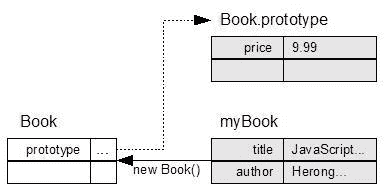

从原型继承

JavaScript 教程 - Herong 的教程示例

### ### 通过原型对象链实现属性和方法的继承](#part0093.xhtml)

#### #### 更改构造函数的原型对象


本节简要描述什么是默认原型对象以及如何更改它。文中提供了一个教程示例，用于创建你自己的原型对象并替换默认原型对象。

在节一节中，我们看到当定义一个构造函数时，会自动创建一个对象并将其赋值给构造函数的 `prototype` 属性。

但如果你不喜欢系统创建的对象，可以自己创建一个对象并将其赋值给 `prototype` 属性。

为了向你展示如何替换默认的 `prototype` 对象，我编写了以下教程示例，允许 `myBook` 继承我自己创建的原型对象中存储的 `year` 属性：

```javascript
 <html>
<!-- Inheritance_Change_Prototype.html
   Copyright (c) HerongYang.com. All Rights Reserved.
-->
<head>
<title>Changing Prototype Object</title>
</head>
<body
<pre>
<script type="text/javascript">

// Define the constructor: "Book"
function Book(title, author) {
   this.title = title;
   this.author = author;
}

   // Adding a property to the "prototype"
Book.prototype.price = 9.99;

   // Creating my own prototype object
   myPrototype = new Object();
   myPrototype.year = 2008;

   // Changing the constructor's prototype object
   Book.prototype = myPrototype;

   // Creating an object: "myBook"
   var myBook = new Book("JavaScript Tutorials", "Herong Yang");

   // Showing the object, constructor, and prototype
   showObject(myBook, "myBook");
   showObject(Book, "Book");
   showObject(Book.prototype, "Book.prototype");

function showObject(object, name) {
   document.writeln("\n\""+name+"\" properties:");
   for (var item in object) {
      document.writeln("   "+item+": "+object[item]);
   }
}
</script>
</pre>
</body>
</html>
```

该教程示例的输出确认了默认的 `prototype` 对象已被我名为 `myPrototype` 的对象所替换：

```
 "myBook" properties:
   title: JavaScript Tutorials
   author: Herong Yang
   year: 2008

"Book" properties:
   prototype: [object Object]

"Book.prototype" properties:
   year: 2008
```

下图显示了在执行此教程示例期间发生的情况。起初赋值给 `Book.prototype` 的默认对象在图中显示为灰色。

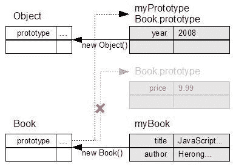

# 修改原型对象

JavaScript Tutorials - Herong's Tutorial Examples

∟通过原型对象链继承属性和方法

∟从两级原型对象继承属性

本节简要描述了构造函数的原型对象如何形成两级继承。文中提供了一个教程示例，用于展示对象如何从第一级和第二级原型对象继承属性。

现在我们知道对象如何从其构造函数的原型对象继承属性。

由于构造函数的原型对象也可以从其自己的构造函数的原型对象继承属性，因此一个对象可以从它自己的原型对象以及原型的原型对象继承属性。

为了向你展示这种两级继承，我在下面编写了此教程示例，允许 `myBook` 继承第一级原型中的 `price` 属性和第二级原型中的 `copyright` 属性：

```javascript
 <html>
<!-- Inheritance_from_Second_Level_Prototype.html
   Copyright (c) HerongYang.com. All Rights Reserved.
-->
<head>
<title>Inheriting Properties from the Second-Level Prototype Object
</title>
</head>
<body>
<pre>
<script type="text/javascript">

// Define the constructor: "Book"
function Book(title, author) {
   this.title = title;
   this.author = author;
}

   // Adding a property to the "prototype"
Book.prototype.price = 9.99;

   // Adding a property to the prototype's "prototype"
   // Book.prototype's constructor is Object
Object.prototype.copyright = "herongyang.com";

   // Creating an object: "myBook"
   var myBook = new Book("JavaScript Tutorials", "Herong Yang");

   // Showing the object, constructor, and prototype
   showObject(myBook, "myBook");
   showObject(Book, "Book");
   showObject(Book.prototype, "Book.prototype");
   showObject(Object.prototype, "Object.prototype");

function showObject(object, name) {
   document.writeln("\n\""+name+"\" properties:");
   for (var item in object) {
      document.writeln("   "+item+": "+object[item]);
   }
}
</script>
</pre>
</body>
</html>
```

该教程示例的输出确认了 JavaScript 允许对象从其多级父原型对象继承属性：

```
 "myBook" properties:
   title: JavaScript Tutorials
   author: Herong Yang
   price: 9.99
   copyright: herongyang.com

"Book" properties:
   prototype: [object Object]
   copyright: herongyang.com

"Book.prototype" properties:
   price: 9.99
   copyright: herongyang.com

"Object.prototype" properties:
   copyright: herongyang.com
```

下图展示了对象如何从两级原型对象继承属性。

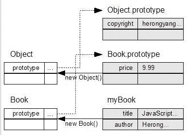

# 两级原型继承

JavaScript Tutorials - Herong's Tutorial Examples

∟通过原型对象链继承属性和方法

∟"Object.prototype" 中的内置属性和方法

本节简要描述了 `Object.prototype` 中的内置默认属性和方法。提供了一个教程示例来列出 `Object.prototype` 中的内容。

正如我在节一节中提到的，默认原型对象是由 `Object()` 构造函数创建的。它的原型对象 `Object.prototype` 是所有其他原型对象的基原型对象。因此，`Object.prototype` 的属性将被所有对象继承。

由于这种特性，JavaScript 在 `Object.prototype` 中提供了许多内置属性和方法，所有对象都可以继承树访问它们。其中一些列如下：

- `constructor`: 指向该对象构造函数的属性。
- `hasOwnProperty(prop)`: 如果指定的属性属于该对象而不是从其原型链继承，则该方法返回 `true`。
- `isPrototypeOf(obj)`: 如果此对象是子对象的父原型对象之一，该方法返回 `true`。
- `toString()`: 返回该对象的字符串表示的方法。
- `valueOf()`: 返回该对象所代表的原始值的方法。

让我们先确认这些属性和方法确实存在于 `Object.prototype` 中。为了做到这一点，我编写了以下教程示例来打印它们的值。注意我 `hasOwnProperty()` 方法来区分

```javascript
 <html>
<!-- Inheritance_Built_in_Propertie_and_Method.html
   Copyright (c) HerongYang.com. All Rights Reserved.
-->
<head>
<title>Built-in Properties and Methods in Object.prototype</title>
</head>
<body>
<pre>
<script type="text/javascript">

   // Adding a property to the base prototype
Object.prototype.copyright = "herongyang.com";

   // Dumping some built-in properties
   document.writeln("\nObject.prototype's built-in properties:");
   dumpProperty(Object.prototype, "constructor");
   dumpProperty(Object.prototype, "hasOwnProperty");
   dumpProperty(Object.prototype, "isPrototypeOf");
   dumpProperty(Object.prototype, "toString");
   dumpProperty(Object.prototype, "valueOf");

   // Dumping the user added property
   document.writeln("\nObject.prototype's user added properties:");
   dumpProperty(Object.prototype, "copyright");

function dumpProperty(object, property) {
   var inheritance; 
   if (object.hasOwnProperty(property)) 
      inheritance = "Local";
   else 
      inheritance = "Inherited";
   document.writeln("   "+property+": "+inheritance+": "
      +object[property]);
}
</script>
</pre>
</body>
</html>
```


此教程示例的输出告诉我们，这些属性和方法确实存在并存在于 `Object.prototype` 对象。然而，JavaScript 并不会在所有情况下向我们展示它们的值（即函数的定义）。

```
 Object.prototype's built-in properties:
   constructor: Local: function Object() {
    [native code]
}
   hasOwnProperty: Local: function hasOwnProperty() {
    [native code]
}
   isPrototypeOf: Local: function isPrototypeOf() {
    [native code]
}
   toString: Local: function toString() {
    [native code]
}
   valueOf: Local: function valueOf() {
    [native code]
}

Object.prototype's added properties:
   copyright: Local: herongyang.com
```

我现在准备更新我的 JavaScript 对象继承模型：


## 属性和方法

∟通过原型链继承属性和方法

### 使用 "hasOwnProperty()" 方法测试属性

本节简要描述内置方法 `hasOwnProperty()`。教程示例演示了如何使用 `hasOwnProperty()` 方法来测试属性是对象的本地属性还是继承的。

从之前的章节中了解到，`Object.prototype` 拥有一个名为 `hasOwnProperty()` 的方法，它会被所有对象继承。

对于任何对象，你都可以使用 `hasOwnProperty(prop)` 方法来测试指定的属性是否为该对象的本地属性。

通过这个工具，我想回顾 `Book` 对象示例，检查不同继承层级的属性：

```html
<html>
<!-- Inheritance_Method.html
   Copyright (c) HerongYang. All Reserved.
-->
<head>
<title>Using "hasOwnProperty" Method</title>
</head>
<body>
<pre>
<script type="text/javascript">

// 设置构造函数、原型和对象
function Book(title, author) {
   this.title = title;
   this.author = author;
}
   Book.prototype.price = 99;
   Object.prototype.copyright = "herongyang.com";
   var myBook = new Book("JavaScript Tutorials", "Herong Yang");

   // 在基础原型层打印内置属性
   document.writeln("\nObject.prototype's built-in properties:");
   dumpProperty(Object.prototype, "constructor");
   dumpProperty(Object.prototype, "hasOwnProperty");
   dumpProperty(Object.prototype, "isPrototypeOf");
   dumpProperty(Object.prototype, "toString");
   dumpProperty(Object.prototype, "valueOf");

   // 在原型层打印内置属性
   document.writeln("\nBook.prototype's built-in properties:");
   dumpProperty(Book.prototype, "constructor");
   dumpProperty(Book.prototype, "hasOwnProperty");
   dumpProperty(Book.prototype, "isPrototypeOf");
   dumpProperty(Book.prototype, "toString");
   dumpProperty(Book.prototype, "valueOf");

   // 在对象层打印内置属性
   document.writeln("\nmyBook's built-in properties:");
   dumpProperty(myBook, "constructor");
   dumpProperty(myBook, "hasOwnProperty");
   dumpProperty(myBook, "isPrototypeOf");
   dumpProperty(myBook, "toString");
   dumpProperty(myBook, "valueOf");

function dumpProperty(object, property) {
   var inheritance; 
   if (object.hasOwnProperty(property)) 
      inheritance = "Local";
   else 
      inheritance = "Inherited";
   document.writeln("   "+property+": "+inheritance+": "
      +object[property]);
}
</script>
</pre>
</body>
</html>
```

这是该教程示例的输出：

```
 Object.prototype's built-in properties:
   constructor: Local: function Object() {
    [native code]
}
   hasOwnProperty: Local: function hasOwnProperty() {
    [native code]
}
   isPrototypeOf: Local: function isPrototypeOf() {
    [native code]
}
   toString: Local: function toString() {
    [native code]
}
   valueOf: Local: function valueOf() {
    [native code]
}

Book.prototype's built-in properties:
   constructor: Local: function Book(title, author) {
    this.title = title;
    this.author = author;
}
   hasOwnProperty: Inherited: function hasOwnProperty() {
    [native code]
}
   ...

myBook's built-in properties:
   constructor: Inherited: function Book(title, author) {
    this.title = title;
    this.author = author;
}
   ...
```

请注意：

* 内置默认属性和方法确实被 `Book.prototype` 和 `myBook` 继承了。

* 但有一个例外。`Book.prototype` 拥有 `constructor` 的本地副本，指向 `Book()`。这告诉我们 JavaScript 在 `Book.prototype` 中创建了一个本地属性 `constructor`，而不是从 `Object.prototype` 继承而来的。

JavaScript 教程 - Herong 的教程示例

∟通过原型对象链继承属性和方法

### 在 "prototype" 对象中设置 "constructor" 属性

本节简要描述原型对象中 `constructor` 属性的本地副本。教程示例演示了如果你替换了默认的原型对象，应该如何添加 `constructor` 属性。

从之前的教程示例中，我们注意到当创建一个新的构造函数时，JavaScript 会自动为你创建一个默认的原型对象并将其赋值给构造函数。在这个默认的原型对象中，会添加一个指向构造函数本身的 `constructor` 属性的本地副本。

换句话说，一个构造函数（例如 `Book()`）和它的默认原型对象之间形成了一个循环引用。以下表达式应该返回 "true"：

```
 Book === Book.prototype.constructor 
```

但如果你用自己的原型对象替换了默认的原型对象，你需要通过类似语句手动添加本地 `constructor` 属性：

```javascript
 Book.prototype.constructor = Book;
```


```html
 <html>
<!-- Inheritance_prototype_constructor_Property.html
   Copyright (c) HerongYang.com. All Rights Reserved.
-->
<head>
<title>在原型对象中设置 "constructor" 属性</title>
</head>
<body>
<pre>
<script type="text/javascript">

// 设置我的构造函数、原型和对象
function Book(title, author) {
   this.title = title;
   this.author = author;
}

   // 替换默认的原型对象
   myPrototype = new Object();
   Book.prototype = myPrototype;
   Book.prototype.price = 9.99;
   Book.prototype.constructor = Book;

   // 修改基础原型对象
   Object.prototype.copyright = "herongyang.com";

   // 从我的构造函数创建对象
   var myBook = new Book("JavaScript Tutorials", "Herong Yang");

   // 在基础原型层级转储（打印）内置属性
   document.writeln("\nObject.prototype's built-in properties:");
   dumpProperty(Object.prototype, "constructor");
   dumpProperty(Object.prototype, "hasOwnProperty");
   dumpProperty(Object.prototype, "isPrototypeOf");
   dumpProperty(Object.prototype, "toString");
   dumpProperty(Object.prototype, "valueOf");

   // 在我的原型层级转储内置属性
   document.writeln("\nBook.prototype's built-in properties:");
   dumpProperty(Book.prototype, "constructor");
   dumpProperty(Book.prototype, "hasOwnProperty");
   dumpProperty(Book.prototype, "isPrototypeOf");
   dumpProperty(Book.prototype, "toString");
   dumpProperty(Book.prototype, "valueOf");

   // 在对象层级转储内置属性
   document.writeln("\nmyBook's built-in properties:");
   dumpProperty(myBook, "constructor");
   dumpProperty(myBook, "hasOwnProperty");
   dumpProperty(myBook, "isPrototypeOf");
   dumpProperty(myBook, "toString");
   dumpProperty(myBook, "valueOf");

function dumpProperty(object, property) {
   var inheritance; 
   if (object.hasOwnProperty(property)) 
      inheritance = "Local";
   else 
      inheritance = "Inherited";
   document.writeln("   "+property+": "+inheritance+": "
      +object[property]);
}
</script>
</pre>
</body>
</</html>
```

修改后的教程示例的输出与之前相同。但现在我们对属性存储在原型层次树中的位置有了更深入的理解。请看下图：

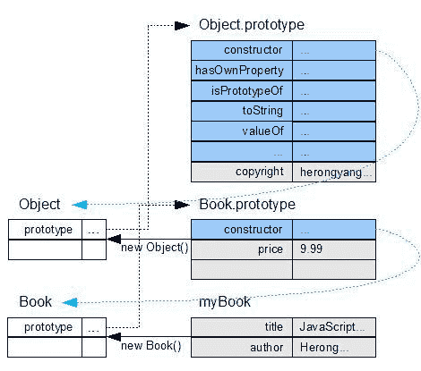

### 原型对象的 constructor 属性

JavaScript 教程 - Herong 的教程示例

∟通过原型对象链继承属性和方法

### ... 在对象层级添加本地方法

本节简要描述了如何通过构造函数在所有对象上添加本地方法，或直接在某个对象上添加本地方法。

现在我们对属性和方法如何通过继承路径进行存储和访问有了清晰的认识。我们准备好在对象层级添加本地方法——即在对象本身中，而不是它们的原型对象中。这可以通过两种方式实现：

*   在构造函数中添加本地方法，这样由该构造函数创建的所有对象都将拥有此本地方法。
*   仅为一个对象添加本地方法，这样其他对象将不会此本地方法。

让我们尝试像教程示例所示，在 `Book()` 构造函数中添加一个名为 `getDesc` 的方法：

```html
 <html>
<!-- Inheritance_Add_Local_Method.html
   Copyright (c) HerongYang.com. All Rights Reserved.
-->
<head>
<title>通过构造函数添加本地方法</title>
</head>
<body>
<pre>
<script type="text/javascript">

// 设置我的构造函数、原型和对象
function Book(title, author) {
   this.title = title;
   this.author = author;
   this.getDesc = getDescription;
}

// 定义一个用作方法的函数
function getDescription() {
   return "\""+this.title+"\" by "+this.author;
}

   // 替换默认的原型对象
   myPrototype = new Object();
   Book.prototype = myPrototype;
   Book.prototype.price = 9.99;
   Book.prototype.constructor = Book;

   // 修改基础原型对象
   Object.prototype.copyright = "herongyang.com";

   // 从我的构造函数创建对象
   var myBook = new Book("JavaScript Tutorials", "Herong Yang");

   // 此方法位于何处
   document.writeln("\nChecking Object.prototype...");
   dumpProperty(Object.prototype, "getDesc");
   document.writeln("\nChecking Book.prototype...");
   dumpProperty(Book.prototype, "getDesc");
   document.writeln("\nChecking myBook...");
   dumpProperty(myBook, "getDesc");

   // 运行此方法
   document.writeln("\nRunning myBook.getDesc()...");
   document.writeln("   "+myBook.getDesc());

function dumpProperty(object, property) {
   var inheritance; 
   if (object.hasOwnProperty(property)) 
      inheritance = "Local";
   else 
      inheritance = "Inherited";
   document.writeln("   "+property+": "+inheritance+": "
      +object[property]);
}
</script>
</pre>
</body>
</</html>
```

此教程示例的输出证实了 `getDesc` 是对象层级的本地方法：

```
 Checking Object.prototype...
   getDesc: Inherited: undefined

Checking Book.prototype...
   getDesc: Inherited: undefined

Checking myBook...
   getDesc: Local: function getDescription() {
    return "\"" + this.title + "\" by " + this.author;
}

Running myBook.getDesc()...
   "JavaScript Tutorials" by Herong Yang
```

请参下一节关于如何在原型层级添加方法。

JavaScript 教程 - Herong 的教程示例

∟通过原型对象链继承属性和方法


` 开始处截断了），我将根据你提供的格式和要求，对已出现的内容进行翻译。如果后续还有内容，请继续提供完整的文本。

[content]

```html
 <html>
<!-- Inheritance_Add_Inherited_Method.html
   Copyright (c) HerongYang.com. All Rights Reserved.
-->
<head>
<title>在原型中添加继承方法</title>
</head>
<body
<pre>
<script type="text/javascript">

// 设置我的构造函数、原型和对象
function Book(title, author) {
   this.title = title;
   this.author = author;
   this.getDesc = getDescription;
}

// 定义一个被用作本地方法的函数
function getDescription() {
   return "\""+this.title+"\" by "+this.author;
}

   // 替换默认的原型对象
   myPrototype = new Object();
   Book.prototype = myPrototype;
   Book.prototype.price = 9.99;
   Book.prototype.constructor = Book;

   // 在原型中添加继承方法
   Book.prototype.toString = getString;

// 定义一个被用作继承方法的函数
function getString() {
   return this.author+"/"+this.title+"/"+this.price;
}

   // 修改基础原型对象
   Object.prototype.copyright = "herongyang.com";

   // 从我的构造函数创建对象
   var myBook = new Book("JavaScript Tutorials", "Herong Yang");

   // 这些方法位于何处
   document.writeln("\nChecking Object.prototype...");
   dumpProperty(Object.prototype, "getDesc");
   dumpProperty(Object.prototype, "toString");
   document.writeln("\nChecking Book.prototype...");
   dumpProperty(Book.prototype, "getDesc");
   dumpProperty(Book.prototype, "toString");
   document.writeln("\nChecking myBook...");
   dumpProperty(myBook, "getDesc");
   dumpProperty(myBook, "toString");

   // 执行这些方法
   document.writeln("\nRunning myBook.getDesc()...");
   document.writeln("   "+myBook.getDesc());
   document.writeln("\nRunning myBook.toString()...");
   document.writeln("   "+myBook.toString());

function dumpProperty(object, property) {
   var inheritance; 
   if (object.hasOwnProperty(property)) 
      inheritance = "Local";
   else 
      inheritance = "Inherited";
   document.writeln("   "+property+": "+inheritance+": "
      +object[property]);
}
</script>
</pre>
</</body>
</</html>
```

此教程示例的输出确认了 `toString` 是原型层面的继承方法：

```
 Checking Object.prototype...
   getDesc: Inherited: undefined
   toString: Local: function toString() {
    [native code]
}

Checking Book.prototype...
   getDesc: Inherited: undefined
   toString: Local: function getString() {
    return this.author + "/" + this.title + "/" + this.price;
}

Checking myBook...
   getDesc: Local: function getDescription() {
    return "\"" + this.title + "\" by " + this.author;
}
   toString: Inherited: function getString() {
    return this.author + "/" + this.title + "/" + this.price;
}

Running myBook.getDesc()...
   "JavaScript Tutorials" by Herong Yang

Running myBook.toString()...
   Herong Yang/JavaScript Tutorials/9.99
```

现在我们知道本地方法和继承方法所在的位置了。这是我更新后的对象继承树结构图：

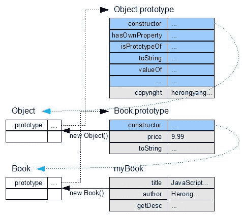

JavaScript 教程 - Herong 的教程示例

∟通过原型对象链继承属性和方法

∟构建多级原型对象

本节提供了一个关于如何构建多级级原型对象的教程示例。它还展示了如何用本地属性覆盖继承属性。

作为通过多级原型对象对象属性继承的总结，我编写了此教程示例，使用 `myBook` 作为原型来定义一个 `EBook` 构造函数：

```html
 <html
<!-- Inheritance_Multiple_Level_Prototypes.html
   Copyright (c) HerongYang.com. All Rights Reserved.
-->
<head>
<title>构建多级原型</title>
</head>
<body>
<pre>
<script type="text/javascript">
// 修改基础原型对象

   Object.prototype.copyright = "herongyang.com";
</script>
<script type="text/javascript">
// 定义 "Book" 构造函数

function Book(title, author) {
   this.title = title;
   this.author = author;
   this.getDesc = getDescription;
}

function getDescription() {
   return "\""+this.title+"\" by "+this.author;
}

   var myPrototype = new Object();
   Book.prototype = myPrototype;
   Book.prototype.price = 9.99;
   Book.prototype.constructor = Book;
   Book.prototype.toString = getString;

function getString() {
   return this.author+"/"+this.title+"/"+this.price;
}
</script>
<script type="text/javascript">
// 定义第二级构造函数 "EBook"

function EBook(url) {
   this.url = url;
}

   var myBook = new Book("JavaScript Tutorials", "Herong Yang");
   EBook.prototype = myBook;
   EBook.prototype.constructor = EBook;

   // 从我的构造函数创建对象
   var myEBook = new EBook("www.example.com");

   // 这些方法位于何处
   document.writeln("\nChecking Object.prototype...");
   dumpProperty(Object.prototype, "getDesc");
   dumpProperty(Object.prototype, "toString");
   document.writeln("\nChecking Book.prototype...");
   dumpProperty(Book.prototype, "getDesc");
   dumpProperty(Book.prototype, "toString");
   document.writeln("\nChecking myBook.prototype...");
   dumpProperty(myBook.prototype, "getDesc");
   dumpProperty(myBook.prototype, "toString");
   document.writeln("\nChecking myEBook...");
   dumpProperty(myEBook, "getDesc");
   dumpProperty(myEBook, "toString");

   // 执行这些方法
   document.writeln("\nRunning myEBook.getDesc()...");
   document.writeln("   "+myEBook.getDesc());
   document.writeln("\nRunning myEBook.toString()...");
   document.writeln("   "+myEBook.toString());

function dumpProperty(object, property) {
   var inheritance; 
   if (object.hasOwnProperty(property)) 
      inheritance = "Local";
   else 
      inheritance = "Inherited";
   document.writeln("   "+property+": "+inheritance+": "
      +object[property]);
}
</script>
</pre>
</body>
</html>
```


本章介绍了 JDK 软件包中包含的 JavaScript 命令行命令及其教程示例。主题包括下载和安装 JDK；`jrunscript` 命令中使用的 ECMAScript (JavaScript) 引擎；在命令行中运行 JavaScript 代码；交互模式或批模式。

- 下载和安装 JDK 10
- "jrunscript" - 脚本命令行及选项
- 使用 'jrunscript' 运行 JavaScript 代码
- 交互式使用 'jrunscript' 评估 JavaScript 代码
- 使用 'jrunscript' 运行 JavaScript 代码文件

### 结论：

- JDK（Java 开发工具包）软件包包含一个名为 `jrunscript` 的 JavaScript 执行工具。
- 你可以使用 `jrunscript` 命令交互式地运行 JavaScript 代码。
- 你可以使用 `jrunscript -e` 选项在命令行中运行嵌入 JavaScript 代码。
- 你可以使用 `jrunscript -f` 命令运行存储在文件中的 JavaScript 代码。

# JavaScript 教程 - Herong 的教程示例

∟'jrunscript' - 来自 JDK 的 JavaScript 命令行

### 下载和安装 JDK 10

本节描述了如何在 Windows 上下载和安装 Java SE 1.6 Update 2。

`jrunscript`：来自 Oracle.com 的当前版本 JDK（Java 开发工具包）包含的命令行脚本 shell。`jrunscript` 支持交互式（读取-评估-打印）模式和批（`-f` 选项）脚本执行模式。这是一个与脚本语言无关的 shell。默认使用的是 JavaScript，但可以使用 `-l` 选项指定不同的语言。

`jrunscript` 允许你在不使用任何网络浏览器的情况下独立运行运行 JavaScript 代码。为了尝试 `jrunscript`，你需要在机器上安装 JDK。

以下是我在 Windows 机器上下载并安装 JDK 10 的步骤：

- 使用此 URL 打开 Java SE 下载页面：`http://www.oracle.com/technetwork/java/javase/downloads/`
- 点击 "Java Platform (JDK) 10" 旁边的下载按钮。你会看到一个列出 JDK 10 不同下载文件的的新页面。
- 接受许可协议。
- 点击 "Windows 390.19 MB" 旁 `jdk-10.0.1_windows-x64_bin.exe` 的链接。
- 将 `jdk-10.0.1_windows-x64_bin.exe` 保存到临时目录。
- 双击 `jdk-10.0.1_windows-x64_bin.exe` 启动安装向导。
- 安装向导将引导你完成安装。

要测试安装，打开命令行窗口尝试 `java` 命令。如果你看到以下输出，说明安装成功：

```
C:\herong>\progra~1\java\jdk-10.0.1\bin\java -version
java version "10.0.1" 2018-04-17
Java(TM) SE Runtime Environment 18.3 (build 10.0.1+10)
Java HotSpot(TM) 64-Bit Server VM 18.3 (build 10.0.1+10, mixed mode)
```

# JavaScript 教程 - Herong 的教程示例

∟'jrunscript' - 来自 JDK 的 JavaScript 命令行

### "jrunscript" - 脚本命令行及选项

本节描述了脚本 shell `jrunscript` 命令及其选项。默认的脚本引擎是 JavaScript - ECMAScript 1.6 实现版本 'Mozilla Rhino' 1.6 release 2。

在我的机器上安装 JDK 后，我想通过带有 `-help` 选项运行它来获取关于如何使用 `jrunscript` 命令的帮助信息：

```
C:\herong>\progra~1\java\jdk-10.0.1\bin\jrunscript -help

用法: jrunscript [options] [arguments...]

其中 [options] 包括：
 -classpath <path>    指定查找用户类文件的路径
 -cp <path>           指定查找用户类文件的路径
 -D<name>=<value>     设置系统属性
 -J<flag>             将 <flag> 直接传递给运行时系统
 -l <language>        使用指定的脚本语言
 -e <script>          评估给定的脚本
 -encoding <encoding> 指定脚本文件使用的字符编码
 -f <script file>     评估给定的脚本文件
 -f -                 交互模式，从标准
                      输入读取脚本。如果使用此项，这应是最后的
                      -f 选项
 -help                打印此用法信息并退出
 -?                   打印此用法信息并退出
 -q                   列出所有可用脚本引擎并退出
```

如果存在 `[arguments..]` 且没有使用 `-e` 或 `-f` 选项，则第一个参数为脚本文件，其余参数（如果有）将作为脚本参数传递。如果 `[arguments..]` 且使用了 `-e` 或 `-f` 选项，则...


请注意，所有的 `jrunscript` 命令都是在单命令行中输入的。我将它们分成多行，是因为书籍的页面宽度有限。

# JavaScript 教程 - Herong 的教程示例

## ['jrunscript' - JDK 中的 JavaScript 壳命令

### 使用 'jrunscript' 交互式评估 JavaScript 代码

本节提供了一个如何使用 `jrunscript` 以交互模式评估 JavaScript 代码的教程示例。每一行都会作为表达式进行评估。结果将打印在屏幕上。

使用 `jrunscript` 运行 JavaScript 代码的另一种方法是使用交互模式。关于使用 `jrunscript` 交互模式的几点注意事项：

- 每一行代码都会立即作为表达式进行评估。
- 每一行代码必须是一个或多个完整的语句。单个语句不能跨行输入。
- 如果单行代码中涉及多个表达式，则最后一个表达式的值会在评估结束时打印在屏幕上。

我对 `jrunscript` 交互模式进行了多次测试，并将其中一些结果记录在下方：

```
 C:\herong>\progra~1\java\jdk-10.0.1\bin\jrunscript 

nashorn> println("Hello World!");
Hello World!

nashorn> x = "Apple"; y = "Orange";
Orange

nashorn> println(x + ' and ' + y);
Apple and Orange

nashorn> var s = 0;

nashorn> for ( i=1; i<=100; i++) {
script error: sun.org.mozilla.javascript.internal.EvaluatorException: 
   missing } in compound statement (<STDIN>#1) in <STDIN> at 
   line number 1

nashorn> for ( i=1; i<=100; i++) { s += i; }
5050.0

nashorn> println(s);
5050

js> exit();
```

# JavaScript 教程 - Herong 的教程示例

## ['jrunscript' - JDK 中的 JavaScript 壳命令

### 使用 'jrunscript' 运行 JavaScript 代码文件

本节提供了一个如何使用 `jrunscript` 以批模式运行 JavaScript 代码文件的教程示例。

使用 `jrunscript` 的最佳方法可能是以批模式运行，即在命令行中指定 JavaScript 代码文件。`jrunscript` 将一次性处理整个代码文件。

为了测试批模式下的 `jrunscript`，我将我现有的一个 JavaScript Web 页面文件修改为纯 JavaScript 代码文件，`For_Loop_Statements.js`：

```
 // For_Loop_Statements.js
// Copyright (c) HerongYang.com. All Rights Reserved.

   var i, j, is_prime;
   for ( i=3; i<=30; i+=2 ) {
      is_prime = true;
      for ( j=2; j<=i/2; j++) {
         is_prime = i%j > 0;
         if (!is_prime) break;
      }
      if (is_prime)
//       document.write("Found a prime number: " + i + ".\n");
         print("Found a prime number: " + i + ".\n");
   }
```

注意，我必须将 `document.write()` 方法更改为 `print()` 方法，因为只有在 Web 浏览器中执行脚本时 `document` 对象才可用。以下是我如何使用 `jrunscript` 运行此脚本文件的：

```
 C:\herong>\progra~1\java\jdk-10.0.1\bin\jrunscript \
   -f For_Loop_Statements.js

Found a prime number: 3.
Found a prime number: 5.
Found a prime number: 7.
Found a prime number: 11.
Found a prime number: 13.
Found a prime number: 17.
Found a prime number: 19.
Found a prime number: 23.
Found a prime number: 29.
```

# JavaScript 教程 - Herong 的教程示例

## 将函数作为“函数”对象使用

本章介绍了作为对象的函数的教程示例。主题包括内置对象类型 `Function`；使用 `Function()` 构造函数创建函数；函数实例以及继承的属性和方法；`function` 语句和运算符。

- 函数是“Function”类型的对象
- 使用 Function 构造函数
- 函数对象的继承属性和方法
- 函数对象的实例属性
- 使用 "function" 语句创建函数对象
- 使用 "function" 运算符创建函数对象
- 比较创建的三种方法

结论：

- JavaScript 函数实际上是 `Function` 对象类型的实例。
- 你可以通过调用 `Function` 构造函数来创建一个新函数：`new Function("arg_1", "arg_2", ..., "function_body")`。
- `Function` 对象具有内置属性和方法：`length`、`apply()`、`call()` 和 `toString()`。
- 你可以为 `Function` 对象实例添加额外的属性和方法。
- `function` 语句实际上是 `function` 操作的一个表达式，它返回一个指向新 `Function` 对象的引用。

# JavaScript 教程 - Herong 的教程示例

## 将函数作为“函数”对象使用

### 函数是“Function”类型的对象

本节提供了 JavaScript 语言一个独特性的概述：函数是 `Function` 类型的对象。

JavaScript 语言一个非常有趣的特性是，函数是 `Function` 对象类型的对象。将函数视为对象可以带来若干编程影响：

- JavaScript 支持一种名为 `Function` 的特殊内置对象类型。
- 可以使用 `Function()` 构造函数创建函数。
- 函数具有继承的属性和方法：`length`、`apply()`、`call()` 和 `toString()`。
- 函数可以有自己的实例属性 - 在多次函数调用之间共享值的一种良好方法。
- 函数可以作为表达式的一部分创建。
- 函数可以作为参数传递给其他函数。

函数可以通过 3 种不同的方式创建：

- 使用 `function` 声明语句 - 以传统方式创建函数。
- 使用 `function` 运算符 - 在评估表达式时作为函数字面量动态创建函数。
- 使用 `Function()` 构造函数 - 以面向对象的方式创建函数。

# JavaScript 教程 - Herong 的教程示例

## 将函数作为“函数”对象使用

### 使用 Function 构造函数

本节提供了一个如何使用 `Function` 对象类型构造函数定义新函数的教程示例。

JavaScript 提供了 `Function` 作为内置对象类型。`Function` 类型的构造函数具有以下调用签名：

```
 new Function("arg_1", "arg_2", ..., "function_body");
```

其中最后一个参数是形成新函数体的语句列表，而所有其他参数都是新函数的参数名称。

下面的教程示例向你展示如何使用 `Function` 对象类型构造函数定义新函数：

```
 // Function_Constructor.js
// Copyright (c) HerongYang.com. All Rights Reserved.

// 定义一个没有参数的新函数
   var hello = new Function(
      "println(\"Hello World!\");"
   )

// 调用函数
   hello();

// 定义一个带有一个参数的新函数
   var f2c = new Function("fahrenheit",
      "println(\"Converting Fahrenheit = \"+fahrenheit);"
      + "var celsius = (fahrenheit - 32.0 ) / 1.8;"
      + "println(\"Returning Celsius = \"+celsius);"
      + "return celsius;"
   )

// 调用函数
   var received = f2c(212.0);
   println("Received Celsius = "+received);
```

在命令行窗口中使用 `jrunscript` 运行此 JavaScript 文件，你将得到：

```
 Hello World!
Converting Fahrenheit = 212
Returning Celsius = 100
Received Celsius = 100
```

结论：`Function` 对象类型构造函数是有效的。但它非常难以使用，主要因为新函数的语句必须作为单个字符串字面量输入。这些语句中的所有引号都必须用反斜杠 (\) 进行转义。仍然最好使用 `function` 语句通过传统方式来定义新函数。


# 函数对象的继承属性和方法

本节提供了一个关于如何使用 `Function` 对象继承的属性和方法的教程示例。

由于函数是 `Function` 类型的对象，因此它具有一些有趣的继承的属性和方法：

- `"length"` - 该属性表示此函数预期的参数个数。
- `"apply()"` - 一个方法，用于在指定的对象上使用数组指定的参数调用（执行）此函数。
- `"call()"` - 一个方法，用于在指定的对象上使用指定的参数调用（执行）此函数。
- `"toString()"` - 一个方法，将函数的体体作为字符串返回。

下面的教程示例向你展示了如何使用 `Function` 对象继承的属性和方法：

``` // Function_Properties_and_Methods.js
// Copyright (c) HerongYang.com. All Rights Reserved.

   var sign = new Function("name",
      "this.signature = name;"
   )

   println("Function body: " + sign.toString());

   println("# of parameters: " + sign.length);

// 在当前对象上执行
   sign("Herong");
   println("this.signature: " + this.signature);

// 在另一个对象上应用
   var java = new Object();
   sign.apply(java, new Array("Sun"));
   println("java.signature: " + java.signature);

// 在另一个对象上调用
   var pc = new Object();
   sign.call(pc, "IBM");
   println("pc.signature: " + pc.signature);
```

在命令行窗口中使用 `jrunscript` 运行此 JavaScript 文件，你将得到：

```
 Function body:
function anonymous(name) {
    this.signature = name;
}

# of parameters: 1
this.signature: Herong
java.signature: Sun
pc.signature: IBM
```

非常酷。一切都符合我的预期。一个小小的惊喜是，用 `Function` 构造函数创建的函数对象的名称是 "anonymous"。

JavaScript 教程 - Herong 的教程示例

将函数作为“函数”对象使用

# 函数实例属性

本节提供了一个关于如何使用函数的实例属性在多次函数调用之间共享值的教程示例。

作为一个对象，函数也可以拥有它自己的实例属性。函数的实例属性也可以被看是一个静态变量，其值在多次函数调用之间持续。

下面的教程示例向你展示了如何使用函数的实例属性在多次函数调用之间共享值。

``` // Function_Own_Properties.js
// Copyright (c) HerongYang.com. All Rights Reserved.

   var sign = new Function("name",
      "this.signature = name;"
      + "sign.count++;"
   )
   sign.count = 0;

// 在当前对象上执行
   sign("Herong");

// 在另一个对象上应用
   var java = new Object();
   sign.apply(java, new Array("Sun"));

// 在另一个对象上调用
   var pc = new Object();
   sign.call(pc, "IBM");

// 函数被调用的次数
   println("Call counts: " + sign.count);
```

在命令行窗口中使用 `jrunscript` 运行此 JavaScript 文件，你将得到：

```
 Call counts: 3
```

JavaScript 教程 - Herong 的教程示例

将函数作为“函数”对象使用

# 使用 "function" 语句创建函数对象

本节提供了一个关于如何用 'function' 语句创建函数对象的教程示例，该语句还将将对象赋值给变量。

根据定义，函数是 `Function` 对象类型的一个对象实例。在之前的章节中，我们学习了如何使用 `Function` 构造函数创建函数。

函数也可以用 "function" 语句来创建：

```
 function function_name(parameter_1, parameter_2, ...) {
   statement_1; 
   statement_2;
   ...
   return return_expression
}
```

"function" 语句实际上执行了 4 件事：

- 创建了一个 `Function` 对象。
- 使用 `"function_name"` 为 `Function` 对象命名。
- 声明了一个名为 `"fucntion_name"` 的变量。
- 将 `Function` 对象赋值给变量 `"function_name"`。

下面的教程示例向你展示了如何使用 "function" 语句来创建 `Function` 对象：

``` // Function_Statements.js
// Copyright (c) HerongYang.com. All Rights Reserved.

// 使用 "function" 语句
function f2c(fahrenheit) {
   println("Converting Fahrenheit = "+fahrenheit);
   var celsius = (fahrenheit - 32.0 ) / 1.8;
   println("Returning Celsius = "+celsius);
   return celsius;
}

   println("Function body: " + f2c.toString());

   println("# of parameters: " + f2c.length);

   var received = f2c.call(this, 70.0);
   println("Received Celsius = "+received);
```

在命令行窗口中使用 `jrunscript` 运行此 JavaScript 文件，你将得到：

```
 # of parameters: 1
Converting Fahrenheit = 70
Returning Celsius = 21.11111111111111
Received Celsius = 21.11111111111111
```

JavaScript 教程 - Herong 的教程示例

将函数作为“函数”对象使用

# 使用 "function" 运算符创建函数对象

本节提供了一个关于如何用 'function' 运算符创建函数对象的教程示例。用 'function' 运算符定义的函数也称为函数字面量（function literal）或表达式（function expression）。

根据定义，函数是 `Function` 对象类型的一个对象实例。在之前的章节中，我们学习了如何使用 `Function` 构造函数创建函数。

函数也可以用 "function" 运算符来创建：

```
 function function_name {
   statement_1; 
   statement_2;
   ...
   return return_expression
};
```

"function" 运算符实际上只执行了 2 件事：

- 创建了一个 `Function` 对象。
- 使用 `"function_name"` 为 `Function` 对象命名。如果没有提供名称，则该 `Function` 对象将没有名称。

用 "function" 运算符定义的函数也称为函数字面量或函数表达式。

用 "function" 运算符定义的函数应该被赋值给变量。否则，它无法在运算符使用的地方之外访问。

下面的教程示例向你展示了如何使用 "function" 运算符创建 `Function` 对象：

``` // Function_Operator.js
// Copyright (c) HerongYang.com. All Rights Reserved.

// 没有引用变量也没有名称的函数
   function() { println('Apple'); };
   // 在表达式之外无法调用

   // 作为表达式的一部分调用是可以的
   (function() { println('Banana'); }).call(this);

// 有引用变量但没有名称的函数
   var orange = function() { println('Orange'); };
   orange();

// 有引用变量也有名称的函数
   var hello = function allo() { println('Hello'); };
   hello();
   // allo(); // 不允许通过函数调用调用

// 有引用变量、参数但没有名称的函数
   var f2c = function (fahrenheit) {
      println("Converting Fahrenheit = "+fahrenheit);
      var celsius = (fahrenheit - 32.0 ) / 1.8;
      println("Returning Celsius = "+celsius);
      return celsius;
      };
   f2c(70.0);
```

在命令行窗口中使用 `jrunscript` 运行此 JavaScript 文件，你将得到：

```
 Banana
Orange
Hello
Converting Fahrenheit = 70
Returning Celsius = 21.11111111111111
```

JavaScript 教程 - Herong 的教程示例

将函数作为“函数”对象使用

# 比较创建的三种方法

本节提供了一个教程示例，用于比较创建函数对象的不同方法：'function' 语句、'function' 运算符和 `Function()` 构造函数。

现在我们知道有 3 种创建函数的方法：

- 使用 "function" 声明语句 - 以传统方式创建函数。
- 使用 "function" 运算符 - 在计算表达式时作为函数字面量动态创建函数。
- 使用 "Function()" 构造函数 - 以面向对象的方式创建函数。


下方的教程示例展示了如何通过 3 种不同的创建函数：

```javascript
 // Function_Creation_Facilities.js
// Copyright (c) HerongYang.com. All Rights Reserved.

// 使用 "function" 声明语句创建函数
   function convert_1(fahrenheit) {
      println("Converting Fahrenheit = "+fahrenheit);
      var celsius = (fahrenheit - 32.0 ) / 1.8;
      println("Returning Celsius = "+celsius);
      return celsius;
      }

// 使用 "function" 运算符创建函数
   var convert_2 = function (fahrenheit) {
      println("Converting Fahrenheit = "+fahrenheit);
      var celsius = (fahrenheit - 32.0 ) / 1.8;
      println("Returning Celsius = "+celsius);
      return celsius;
      };

// 使用 "Function()" 构造函数创建函数
   var convert_3 = new Function("fahrenheit",
      "println(\"Converting Fahrenheit = \"+fahrenheit);"
      + "var celsius = (fahrenheit - 32.0 ) / 1.8;"
      + "println(\"Returning Celsius = \"+celsius);"
      + "return celsius;"
      );

// 调用所有 3 个
   convert_1(70.0);
   convert_2(70.0);
   convert_3(70.0);
```

在命令行窗口中使用 `jrunscript` 此 JavaScript 文件，你将得到：

```
 Converting Fahrenheit = 70
Returning Celsius = 21.11111111111111
 Converting Fahrenheit = 70
Returning Celsius = 21.11111111111111
Converting Fahrenheit = 70
Returning Celsius = 21.11111111111111
```

JavaScript 教程 - Herong 的教程示例

# 内置对象类型简介

本章快速介绍 JavaScript 内置对象。主题包括全局对象及其宿主环境提供的属性；`Math` 对象及其属性；内置对象类型：`Function`、`Array`、`String`、`Boolean`、`Number`、`Date`、`RegExp` 和 `Error`。

* 内置对象类型概述
* "Object" 对象类型 - 根对象类型
* "Global" 对象类型 - 不见的全局容器
* 在 ECMAScript 中定义的全局属性和函数
* "jrunscript" 提供的全局属性和函数
* "Function" 对象类型 - 函数是对象
* "Array" 对象类型 - 数组是对象
* "JSON" 对象类型 - `parse()` 和 `stringify()`
* "String" 对象类型 - 不等于字符串原始类型
* "Boolean" 对象类型 - 将布尔值封装为对象
* "Number" 对象类型 - 不等于数字原始类型
* "Date" 对象类型 - 管理日期和时间
* "RegExp" 对象类型 - 正则表达式模式
* "Error" 对象类型 - 运行时异常
* "Math" 对象类型 - 数学容器

结论：

* JavaScript 规范自 ECMAScript 第 3 版起，支持这些内置对象类型：`Object`、`Global`、`Function`、`Array`、`String`、`Boolean`、`Number`、`Date`、`RegExp`、`Error`、`Math`。
* "Global" 是一个特殊的对象类型，只有一个没有引用变量的默认实例。但你可以通过全局上下文中的 `this` 关键字访问它。
* "Global" 对象实例用于持有所有内置属性和方法，如 `undefined`、`eval()` 等。

JavaScript 教程 - Herong 的教程示例

# 内置对象类型简介

## 内置对象类型概述

本节提供了 ECMAScript 规范定义的所有内置对象类型列表。

当前的 Mozilla JavaScript 规范定义了以下内置对象类型：

* `Global`: 一个特殊的对象类型，用于创建一个且仅创建一个对象来持有全局内置属性和函数。注意，ECMAScript 仅支持一个 `Global` 类型的单一对象。不允许使用 `Global()` 构造函数创建其他 Global 对象。
* `Object`: 对象类型树中的根对象类型。所有其他对象类型都继承自 `Object` 对象类型。
* `Function`: 用于创建函数的对象类型。所有函数都是 `Function` 对象类型的实例。
* `Boolean`: 用于创建 `Boolean` 对象的对象类型。`Boolean` 对象类型允许将布尔原始值作为对象处理。
* `Symbol`: 用于存储所有可能用 `Object` 属性键的非字符串值的对象类型。
* `Error`、`AggregateError`、`EvalError`、`InternalError`、`RangeError`、`ReferenceError`、`SyntaxError`、`TypeError`、`URIError`: 用于异常处理过程中错误对象的对象类型。
* `Number`: 用于创建数字对象的对象类型。`Boolean` 对象类型允许将数字原始值作为对象处理。（注：此处原文可能有误，应为 Number）
* `BigInt`: 用于创建大于 `2⁵³ - 1` 的整数的对象类型。
* `Math`: 一个特殊的对象类型，用于创建一个且仅创建一个对象来持有数学相关的属性和函数。
* `Date`: 用于创建日期和时间对象的对象类型。
* `String`: 用于创建字符串对象的对象类型。`String` 对象类型允许将字符串原始值作为对象处理。
* `RegExp`: 用于文本处理正则表达式对象的对象类型。
* `Array`、`Int8Array`、`Uint8Array`、`Uint8ClampedArray`、`Int16Array`、`Uint16Array`、`Int32Array`、`Uint32Array`、`Float32Array`、`Float64Array`、`BigInt64Array`、`BigUint64Array`: 用于创建数组的对象类型。所有数组都是 `Array` 类型的对象。
* `Map`: 用于存储键值对并记住键的原始插入顺序的对象类型。任何值（对象和原始值）都可以作为键或值。
* `Set`: 用于存储任何类型的唯一值（无论是原始值还是对象引用）的对象类型。
* `ArrayBuffer`、`SharedArrayBuffer`、`Atomics`、`DataView`: 用于表示通用固定长度原始二进制数据的对象类型。
* `JSON`: 用于解析 JavaScript 对象表示法 (JSON) 和将值转换为 JSON 的对象类型。
* `Promise`: 用于表示异步操作最终完成（或失败）及其结果值的对象类型。
* `Generator`、`GeneratorFunction`: 生成器函数返回对象的对象类型。
* `AsyncFunction`: 创建异步异步函数的对象类型。在 JavaScript 中，每个异步函数实际上都是 `AsyncFunction` 对象。
* `Reflect`: 提供可拦截的 JavaScript 操作方法的对象类型。这些方法与代理处理器（proxy handlers）的方法相同。`Reflect` 不是函数对象，因此不可构造的。
* `Proxy`: 用于为基本操作（例如属性查找、赋值、枚举、函数调用等）定义自定义行为的对象类型。

查看后续章节以获取上述某些内置对象类型的快速介绍。

JavaScript 教程 - Herong 的教程示例

# "Object" 对象类型 - 根对象类型

本节提供了 `Object` 内置对象类型的快速描述和教程示例脚本，它是所有其他对象类型的根或基对象类型。

"Object" 对象类型可能是最重要的内置对象类型。它具有以下主要特征：

* `Object` 是对象类型树中的根（或基）对象类型。所有其他对象类型都继承自 `Object` 对象类型。
* `Object` 对象可以通过 `Object()` 构造函数创建。
* `Object` 对象也可以通过对象字面量创建：`{property: value, ...}`。

这是一个教程示例脚本，向你展示了其中一些特征：


```
 // Object_Object_Type.js
// Copyright (c) HerongYang.com. All Rights Reserved.

   // 创建一个 "Object" 类型的对象
   var myObject = new Object();

   // 为对象添加属性
   myObject.name = "Unknown";
   myObject.size = "1.71m";
   myObject.weigth = "65kg";

   // 检查对象
   println("About the myObject:");
   println("   Type: "+(typeof myObject));
   println("   Instance Of Object: "+(myObject instanceof Object));
   println("   Properties:");
   for (var item in myObject) {
      println("      "+item+": "+myObject[item]);
   }

   // 创建一个 "Book" 类型的对象
   var myBook = new Book("JavaScript Tutorial", "Herong Yang");

   // 检查对象
   println("About the myBook:");
   println("   Type: "+(typeof myBook));
   println("   Instance Of Object: "+(myBook instanceof Object));
   println("   Instance Of Book: "+(myBook instanceof Book));
   println("   Properties:");
   for (var item in myBook) {
      println("      "+item+": "+myBook[item]);
   }

// 定义新对象类型的构造函数
function Book(title, author) {
   this.title = title;
   this.author = author;
}
```

如果你使用 `jrunscript` 运行此脚本，将得到：

```
 About the myObject:
   Type: object
   Instance Of Object: true
   Properties:
      weigth: 65kg
      name: Unknown
      size: 1.71m

About the myBook:
   Type: object
   Instance Of Object: true
   Instance Of Book: true
   Properties:
      title: JavaScript Tutorial
      author: Herong Yang
```

`myBook` 是 `Book` 和 `Object` 的实例，因为 `Book` 默认是 `Object` 的子类型。

阅读其他与 "Object" 相关的章节查看更多教程示例。

JavaScript 教程 - Herong 的教程示例

∟内置对象类型介绍

## "Global" 对象类型 - 不见的全局容器

本节提供了 `Global` 内置对象类型的简要描述和一个教程示例脚本，该类型用于创建一个默认的不可见全局对象，以存储所有的全局属性和函数。

"Global" 对象可能是最神秘的内置对象类型。它具有以下主要特征：

- "Global" 是一个保留对象类型。你不能创建自己的 "Global" 对象。`Global()` 构造函数是不可用的。
- 主环境会创建一个默认的 "Global" 对象，它没有赋值给任何引用变量。因此这个 "Global" 对象是不可见的。
- 然而，通过使用 `this` 关键字，可以在全局执行上下文（任何函数之外）看到这个不可见的 "Global" 对象。
- 你可以使用表达式 `this instanceof Global` 来检查 `this` 的对象类型，因为 `Global()` 是不可用的。
- 创建 "Global" 对象是为了存储主环境提供的所有内置属性和函数，例如 `NaN`、`eval()` 等。
- 从技术上讲，内置属性或函数都定义为 "Global" 对象的属性。但你可以直接使用它们，而无需引用 `Global` 对象。

这里有一个显示其中一些特的教程示例脚本：

```
 // Global_Object_Type.js
// Copyright (c) HerongYang.com. All Rights Reserved.

   // Global() 构造函数不可用 
   // var myGlobal = new Global();

   println("\nAbout this \"this\":");
   println("   Type = "+(typeof this));
   println("   Instance Of Object: "+(this instanceof Object));

   // 不允许使用 "instanceof Global"
   // println("   Instance Of Global: "+(this instanceof Global));

   // toString() 将提供更多信息
   println("   toString() = "+this.toString());

   // 直接访问全局属性
   println("\nChecking NaN:");
   println("   NaN: Type = "+(typeof NaN) 
      + ", Value = "+NaN);

   // 间接访问全局属性
   println("\nChecking this.NaN:");
   println("   this.NaN: Type = "+(typeof this.NaN) 
      + ", Value = "+this.NaN);

   // 测试全局函数
   println("\nTesting eval() in two ways:");
   println("   eval('7*7') = "+eval('7*7')); 
   println("   this.eval('7*7') = "+this.eval('7*7'));
```

如果你使用 `jrunscript` 运行此脚本，将得到：

```
 About this "this":
   Type = object
   Instance Of Object: true
   toString() = [object Global]

Checking NaN:
   NaN: Type = number, Value = NaN

Checking this.NaN:
   this.NaN: Type = number, Value = NaN

Testing eval() in two ways:
   eval('7*7') = 49
   this.eval('7*7') = 49
```

`this.toString()` 证明 `this` 是一个 `Global` 对象。

JavaScript 教程 - Herong 的教程示例

∟内置对象类型介绍

## ECMAScript 中定义的全局属性和函数

本节提供了 ECMAScript 规范中提到的所有全局属性和函数的简要描述。

在 ECMAScript 规范中提到的不可见 "Global" 对象中，有 3 个包含原始值的内置全局属性：

- "NaN" - 全局属性，持有特殊的数字值：`NaN`（非数字）。
- "Infinity" - 全局属性，持有特殊的数字值：`Infinity`（无穷大）。
- "undefined" - 全局属性，持有未定义值：`undefined`。

在 ECMAScript 规范中提到的不可见 "Global" 对象中，包含 9 个常规内置全局函数：

- `eval(x)` - 将指定的字符串作为 JavaScript 表达式求值并返回结果。
- `parseInt(string, radix)` - 根据指定的基数解释字符串参数的内容，产生一个整数值。
- `parseFloat(string)` - 根据对字符串参数内容作为十进制字面量的解释，产生一个数值。
- `isNaN(number)` - 如果指定的数字是 `NaN` 则返回 `true`。
- `isFinite(number)` - 如果指定的数字是有限数字，则返回 `true`。
- `decodeURI(encodedURI)` - 将编码的 URI 字符串解码回 URI 字符串。
- `decodeURIComponent(encodedURIComponent)` - 将编码的 URI 组件字符串解码回 URI 组件字符串。
- `encodeURI(uri)` - 通过将除以下字符的所有字符（字母、数字、- _ . ! ~ * ' ( ) # ; , / ? : @ & = = + $）替换为转义序列，对 URI 字符串进行编码。
- `encodeURIComponent(uriComponent)` - 通过将除以下字符的所有字符（字母、数字、- _ . ! ~ * ' ( )）替换为转义序列，对 URI 组件字符串进行编码。

在 ECMAScript 规范中提到的不可见 "Global" 对象中，包含 9 个特殊的内置全局函数。这些函数实际上是内置对象类型的构造函数：

- `Object()` - Object 类型的构造函数。
- `Function(...)` - Function 类型的构造函数。
- `Array(...)` - Array 类型的构造函数。
- `String(...)` - String 类型的构造函数。
- `Boolean(...)` - Boolean 类型的构造函数。
- `Number(...)` - Number 类型的构造函数。
- `Date(...)` - Date 类型的构造函数。
- `RegExp(...)` - RegExp 类型的构造函数。
- `Error(...)` - Error 类型的构造函数。

在 ECMAScript 规范中提到的不可见 "Global" 对象中，包含 1 个带有对象值的全局属性：

- "Math" - 全局属性，持有默认的 "Math" 对象，该对象包含了所有与数学相关的属性和函数。

为了验证这些全局属性和函数，我编写了这个简单的脚本：


```javascript
 // Global_Object_Properties.js
// Copyright (c) HerongYang.com. All Rights Reserved.

   println("\nGlobal primitive-value properties:");
   println("   NaN: Type = "+(typeof this.NaN) 
      + ", Value = "+this.NaN);
   println("   Infinity: Type = "+(typeof this.Infinity) 
      + ", Value: "+this.Infinity);
   println("   undefined: Type = "+(typeof this.undefined) 
      + ", Value = "+this.undefined);

   println("\nGlobal functions:");
   println("   eval: Value = "+this.eval);
   println("   parseInt: Value = "+this.parseInt);
   println("   parseFloat: Value = "+this.parseFloat);
   println("   isNaN: Value = "+this.isNaN);
   println("   isFinite: Value = "+this.isFinite);
   println("   decodeURI: Value = "+this.decodeURI);
   println("   decodeURIComponent: Value = "+this.decodeURIComponent);
   println("   encodeURI: Value = "+this.encodeURI);
   println("   encodeURIComponent: Value = "+this.encodeURIComponent);

   println("\nGlobal constructors:");
   println("   Object: Value = "+this.Object);
   println("   Function: Value = "+this.Function);
   println("   Array: Value = "+this.Array);
   println("   String: Value = "+this.String);
   println("   Boolean: Value = "+this.Boolean);
   println("   Number: Value = "+this.Number);
   println("   Date: Value = "+this.Object);
   println("   RegExp: Value = "+this.RegExp);
   println("   Error: Value = "+this.Error);

   println("\nGlobal object-value property:");
   println("   Math: Type = "+(typeof this.Math) 
      + ", Value = "+this.Math);
```

如果你使用 `jrunscript` 运行此脚本，将得到：

```
 Global primitive-value properties:
   NaN: Type = number, Value = NaN
   Infinity: Type = number, Value = Infinity
   undefined: Type = undefined, Value = undefined

Global functions:
   eval: Value = function eval() { [native code
   parseInt: Value = function parseInt() { [native code
   parseFloat: Value = function parseFloat() { [native code
   isNaN: Value = function isNaN() { [native code
   isFinite: Value = function isFinite() { [native code
   decodeURI: Value = function decodeURI() { [native code
   decodeURIComponent: Value = function decodeURIComponent() { [native
   encodeURI: Value = function encodeURI() { [native code
   encodeURIComponent: Value = function encodeURIComponent() { [native

Global constructors:
   Object: Value = function Object() { [native code
   Function: Value = function Function() { [native code
   Array: Value = function Array() { [native code
   String: Value = function String() { [native code
   Boolean: Value = function Boolean() { [native code
   Number: Value = function Number() { [native code
   Date: Value = function Object() { [native code
   RegExp: Value = function RegExp() { [native code
   Error: Value = function Error() { [native code

Global object-value property:
   Math: Type = object, Value = [object Math]
```

这证实了 `jrunscript` 支持 `ECMAScript` 规范中提到的所有全局属性和函数。

# JavaScript 教程 - Herong 的教程示例

## 内置对象类型介绍

### "jrunscript" 提供的全局属性和函数

本节提供了 `jrunscript` 宿环境提供的所有额外全局属性和函数的快速描述。

除了 `ECMAScript` 规范中定义的全局属性和函数外，每个 JavaScript 实现都可能向不可见的 `Global` 对象中添加自己的全局属性和函数。

这里是一个教程示例脚本，它列出了 JavaScript 实现提供的所有全局属性和函数：

```javascript
 // Global_Object_Properties_jrunscript.js
// Copyright (c) HerongYang.com. All Rights Reserved.

   println("\nList of global properties:");
   for (item in this) {
      println("   "+item+": "+this[item]);
   }
```

如果你使用 `jrunscript` 运行此脚本，将得到一个包含 59 个属性和函数的列表。全局函数的函数体也列在输出中。以下是一些示例：

```
 List of global properties:
   ...

   javax.script.filename: Global_Object_Properties_jrunscript.js

   months: Jan,Feb,Mar,Apr,May,Jun,Jul,Aug,Sep,Oct,Nov,Dec

   cp: 
function cp(from, to) {
    if (from == to) {
        println("file " + from + " cannot be copied onto itself!");
        return;
    }
    var inp = inStream(from);
    var out = outStream(to);
    var binp = new BufferedInputStream(inp);
    var bout = new BufferedOutputStream(out);
    var buff = javaByteArray(1024);
    var len;
    while ((len = binp.read(buff)) > 0) {
        bout.write(buff, 0, len);
    }
    bout.flush();
    streamClose(inp);
    streamClose(out);
}

   read: 
function read(prompt, multiline) {
    if (!prompt) {
        prompt = ">";
    }
    var inp = java.lang.System["in"];
    var reader = new BufferedReader(new InputStreamReader(inp));
    if (multiline) {
        var line = "";
        while (true) {
            java.lang.System.err.print(prompt);
            java.lang.System.err.flush();
            var tmp = reader.readLine();
            if (tmp == "" || tmp == null) {
                break;
            }
            line += tmp + "\n";
        }
        return line;
    } else {
        java.lang.System.err.print(prompt);
        java.lang.System.err.flush();
        return reader.readLine();
    }
}

   print: 
function print(str, newline) {
    if (typeof (str) == "undefined") {
        str = "undefined";
    } else {
        if (str == null) {
            str = "null";
        }
    }
    var out = context.getWriter();
    out.print(String(str));
    if (newline) {
        out.print("\n");
    }
    out.flush();
}

   println: 
function println(str) {
    print(str, true);
}

   ...
```

现在我们知道了 `println()` 在 `jrunscript` 中是如何实现的。

# JavaScript 教程 - Herong 的教程示例

## 内置对象类型介绍

### "Function" 对象类型 - 函数也是对象

本节提供了关于用于创建函数的 `Function` 对象类型的快速描述和教程示例脚本。

`Function` 对象类型是一种用于创建新函数的特殊内置对象类型。它具有以下主要特性：

* 可以使用 `Function()` 构造函数创建新函数。
* 所有 `Function` 对象都有一个名为 `length` 的继承属性，表示函数的参数个数。
* 所有 `Function` 对象都有 3 个继承的方法：`apply()`、`call()` 和 `toString()`。
* `Function` 对象可以拥有自己的属性，以便在多次调用之间共享值。
* `Function` 对象也可以通过函数字面量创建：`function name(param...) {body...}`。
* 当然，`Function` 对象也可以传统的方式创建——函数声明语句：`function name(param...) {body...}`。

```javascript
function function_name { statement_1; statement_2; ... return return_expression };
```

这里是一个展示其中一些特性的教程示例脚本：


```javascript
 // Function_Object_Type.js
// Copyright (c) HerongYang.com. All Rights Reserved.

   // 使用 "Function()" 构造创建一个新函数
   var sign = new Function("name",
      "this.signature = name;"
      + "sign.count++;"
   )

   // 为函数添加一个实例属性
   sign.count = 0;

   // 检查此对象
   println("\nAbout this \"sign\":");
   println("   Type = "+(typeof sign));
   println("   Instance Of Object: "+(sign instanceof Object));
   println("   Instance Of Function: "+(sign instanceof Function));

   // 在当前对象上执行
   sign("Herong");

   // 在另一个对象上调用
   var pc = new Object();
   sign.call(pc, "IBM");

   // 检查签名
   println("\nExecution result:");
   println("   this.signature = " + this.signature);
   println("   pc.signature = " + pc.signature);
   println("   # of calls = " + sign.count);
```

如果你使用 `jrunscript` 运行此脚本，你将得到：

```
 About this "sign":
   Type = function
   Instance Of Object: true
   Instance Of Function: true

Execution result:
   this.signature = Herong
   pc.signature = IBM
   # of calls = 2
```

现在我们知道如何使用 `Function()` 构造函数创建函数了。

阅读其他关于 "Function" 的章节以查看更多教程示例。

JavaScript Tutorials - Herong's Tutorial Examples

∟内置对象类型介绍

## "Array" 对象类型 - 数组是对象

本节提供了关于 `Array` 内置对象类型的简要描述和教程示例脚本，该类型用于创建数组。

`Array` 对象类型是一种特殊的内置对象类型，用于创建新数组。它具有以下主要特征：

-   可以使用 `Array()` 构造函数创建新数组。
-   所有的 `Array` 对象都拥有一个名为 `length` 的继承属性，表示数组的元素个数。
-   所有的 `Array` 对象都有许多继承的方法：`reverse()`、`sort()`、`indexOf()`、`push()`、`pop()`、`shift()` 等。
-   数组中的所有元素实际上都是以索引为属性名的属性。
-   可以使用数组字面量 `[elements...]` 创建 `Array` 对象。
-   可以使用 `Array` 函数 `Array(elements...)` 创建 `Array` 对象。

以下是一个展示了其中一些特征的教程示例脚本：

```javascript
 // Array_Object_Type.js
// Copyright (c) HerongYang.com. All Rights Reserved.

   // 创建新数组
   var colors = new Array("Red", "Green", "Blue");

   // 检查此对象
   println("\nAbout this \"colors\":");
   println("   Type = "+(typeof colors));
   println("   Instance Of Object: "+(colors instanceof Object));
   println("   Instance Of Array: "+(colors instanceof Array));

   println("\nList of array properties:");
   for (item in colors) {
      println("   "+item+" = "+colors[item]);
   }

   // 使用数组继承的属性和方法
   colors.push("Yellow");
   colors.sort();

   // 通过索引访问元素
   println("\nAfter push() and sort():");
   for (var i=0; i<colors.length; i++) {
      println("   "+i+" = "+colors[i]);
   }
```

如果你使用 `jrunscript` 运行此脚本，你将得到：

```
 About this "colors":
   Type = object
   Instance Of Object: true
   Instance Of Array: true

List of array properties:
   0 = Red
   1 = Green
   2 = Blue

After push() and sort():
   0 = Blue
   1 = Green
   2 = Red
   3 = Yellow
```

现在我们知道如何使用 `Array()` 构造函数创建数组了。

阅读其他关于 "Array" 的章节以查看更多教程示例。

JavaScript Tutorials - Herong's Tutorial Examples

∟内置对象类型介绍

## "JSON" 对象类型 - parse() 和 stringify

本节提供了关于 `JSON` 内置对象类型的简要描述和教程示例脚本，该类型用于解析 JSON 字符串以创建 JavaScript 结构化值，并将 JavaScript 结构化值转换为 JSON 字符串。

`JSON` 类型提供了两个静态函数来解析和生成 JSON 文本字符串：

1. `JSON.parse()` - 从 JSON 文本字符串解析文本字符串，构建 JavaScript 值。可以提供一个可选的 `reviver` 函数在返回结果对象之前对其进行转换。
2. `JSON.stringify()` - 将 JavaScript 值转换为 JSON 文本字符串。指定一个可选的 `replacer` 函数来替换某些值。

以下是一个 JavaScript 代码示例 `JSON.html`，它向你展示如何使用内置的 `JSON` 对象：

```html
 <html>
<body>
<script type="text/javascript">
   var object = {"msg":"Hello World!"};
   var str = JSON.stringify(object);

   document.write("<p>JSON text string from JSON.stringify():</p>");
   document.write("<pre>str = "+str+"</pre>");

   var val = JSON.parse(str);
   document.write("<p>Value from JSON.parse():</p>");
   document.write("<pre>val.msg = "+val.msg+"</pre>");
</script>
</body>
</html>
```

在 浏览器中打开此示例 `JSON.html`。你会看到以下内容：

```
 JSON text string from JSON.stringify():
   str = {"msg":"Hello World!"}

Value from JSON.parse():
   val.msg = Hello World!
```

JavaScript Tutorials - Herong's Tutorial Examples

∟内置对象类型介绍

## "String" 对象类型 - 不等于字符串原始类型

本节提供了关于 `String` 内置对象类型的简要描述和教程示例脚本，该类型用于创建 `String` 对象。注意：`String` 对象不是字符串值。

`String` 对象类型是一种特殊的内置对象类型，用于创建 `String` 对象，这与字符串原始类型的字符串值不同。它具有以下主要特征：

-   可以使用 `String()` 构造函数创建新的 `String` 对象。注意 `String()` 也是一个普通函数，返回的是字符串值而不是 `String` 对象。
-   所有的 `String` 对象都拥有一个名为 `length` 的继承属性，表示字符串的字符个数。
-   所有的 `String` 对象都有许多继承的方法：`toString()`、`charAt()`、`charCodeAt()`、`concat()`、`indexOf()` 等。访问这些继承方法是使用 `String` 对象而不是字符串值的主要原因。
-   字符串字面量 `"..."` 创建的是字符串值，而不是 `String` 对象。
-   可以使用 `.` 运算符临时将字符串值转换为 `String` 对象，例如：`"string".length`。

以下是一个展示了其中一些特征的教程示例脚本：

```javascript
 // String_Object_Type.js
// Copyright (c) HerongYang.com. All Rights Reserved.

   // 创建一个新的新的 String 对象
   var message = new String("Hello World!");

   // 检查此对象
   println("\nAbout this \"message\":");
   println("   Type = "+(typeof message));
   println("   Instance Of Object: "+(message instanceof Object));
   println("   Instance Of String: "+(message instanceof String));

   // 使用 String 继承的属性和方法
   var upperMessage = message.toUpperCase();
   var l = message.length;
   var subMessage = message.substring(0,l-7);

   println("\nExecution result:");
   println("   typeof message = "+(typeof message));
   println("   message.toString() = "+message.toString());
   println("   typeof upperMessage = "+(typeof upperMessage));
   println("   upperMessage = "+upperMessage);
   println("   typeof subMessage = "+(typeof subMessage));
   println("   subMessage = "+subMessage);

   println("\nConverting to String objects on the fly:");
   println("   \"...\".length = "+("Hello World!".length));
   println("   \"...\".toUpperCase() = "
      +("Hello World!".toUpperCase()));
```

如果你使用 `jrunscript` 运行此脚本，你将得到：


```
 About this "message":
   Type = object
   Instance Of Object: true
   Instance Of String: true

Execution result:
   typeof message = object
   message.toString() = Hello World!
   typeof upperMessage = string
   upperMessage = HELLO WORLD!
   typeof subMessage = string
   subMessage = Hello

Converting to String objects on the fly:
   "...".length = 12
   "...".toUpperCase() = HELLO WORLD!
```

现在我们知道如何使用 `String()` 构造函数来创建 "String" 对象了。

阅读与其他 "String" 相关的章节查看更多教程示例。

JavaScript 教程 - Herong 的 教程示例

∟内置对象类型介绍

## "Boolean" 对象类型 - 将布尔值封装成对象

本节提供了关于 'Boolean' 内置对象的简要描述以及一个教程示例脚本，该类型用于创建 'Boolean' 对象。

"Boolean" 对象类型是一种特殊的内置对象类型，用于创建 "Boolean" 对象，它与 Boolean 原始类型的 Boolean 值不同。它具有以下主要特征：

-   可以使用 `Boolean()` 构造函数创建新的 "Boolean" 对象。注意 `Boolean()` 也是一个普通函数，它返回一个布尔值，而不是 "Boolean" 对象。
-   所有 "Boolean 对象"都有 2 个继承的方法：`toString()` 和 `valueOf()`。
-   可以使用 `.` 运算符临时地将字符串值转换为 "Boolean" 对象，例如：`(2>1).toString()`。
-   "Boolean" 对象类型用于将布尔值封装成对象。使用 "Boolean" 对象没有其他好处。

这里是一个显示其中一些特征的教程示例脚本：

```
 // Boolean_Object_Type.js
// Copyright (c) HerongYang.com. All Rights Reserved.

   // 创建一个新的 Boolean 对象
   var isBetter = new Boolean("JavaScript">"Java");

   // 检查此对象
   println("\nAbout this \"isBetter\":");
   println("   Type = "+(typeof isBetter));
   println("   Instance Of Object: "+(isBetter instanceof Object));
   println("   Instance Of Boolean: "+(isBetter instanceof Boolean));

   // 使用 Boolean 继承的方法
   var v = isBetter.valueOf();
   var s = isBetter.toString();

   println("\nExecution result:");
   println("   typeof isBetter = "+(typeof isBetter));
   println("   typeof isBetter.valueOf() = "+(typeof v));
   println("   typeof isBetter.toString() = "+(typeof s));

   println("\nConverting to Boolean objects on the fly:");
   println("   \"...\".toString() = "
      +(("JavaScript">"Java").toString()));
```

如果你用 `jrunscript` 运行此脚本，将得到：

```
 About this "isBetter":
   Type = object
   Instance Of Object: true
   Instance Of Boolean: true

Execution result:
   typeof isBetter = object
   typeof isBetter.valueOf() = boolean
   typeof isBetter.toString() = string

Converting to Boolean objects on the fly:
   "...".toString() = true
```

现在我们知道如何使用 `Boolean()` 构造函数来创建 "Boolean" 对象了。

JavaScript 教程 - Herong 的 教程示例

∟内置对象类型介绍

## "Number" 对象类型 - 不等于 Number 原始类型

本节提供了关于 'Number' 内置对象的简要描述以及一个教程示例脚本，该类型用于创建 'Number' 对象。

"Number" 对象类型是一种特殊的内置对象类型，用于创建 "Number" 对象，它与 Number 原始类型的 Number 值不同。它具有以下主要特征：

-   可以使用 `Number()` 构造函数创建新的 "Number" 对象。注意 `Number()` 也是一个普通函数，它返回一个 Number 值，而不是 "Number" 对象。
-   所有 "Number 对象"都有多个继承的方法：`toString()`、`valueOf()`、`toFixed()` 等。
-   可以使用 `.` 运算符临时地将数字值转换为 "Number" 对象，例如：`(2/3).toFixed(2)`。
-   `Number` 构造函数提供了自己的属性：`Number.MAX_VALUE`、`Number.MIN_VALUE` 等。

这里是一个显示其中一些特征的教程示例脚本：

```
 // Number_Object_Type.js
// Copyright (c) HerongYang.com. All Rights Reserved.

   // 创建一个新的 Number 对象
   var myObject = new Number(3.14159);

   // 检查此对象
   println("\nAbout this \"myObject\":");
   println("   Type = "+(typeof myObject));
   println("   Instance Of Object: "+(myObject instanceof Object));
   println("   Instance Of Number: "+(myObject instanceof Number));

   // 使用 Number 继承的方法
   var v = myObject.valueOf();
   var s = myObject.toString();
   var f = myObject.toFixed(2);

   println("\nExecution result:");
   println("   typeof myObject = "+(typeof myObject));
   println("   typeof myObject.valueOf() = "+(typeof v));
   println("   typeof myObject.toString() = "+(typeof s));
   println("   typeof myObject.toFixed() = "+(typeof f));
   println("   value of myObject.valueOf() = "+v);
   println("   value of myObject.toString() = "+s);
   println("   value of myObject.toFixed() = "+f);

   println("\nConverting to Number objects on the fly:");
   println("   (2/3).toFixed() = "+((2/3).toFixed(2)));

   println("\nUsing properties of the Number constructor:");
   println("   Number.MAX_VALUE = "+Number.MAX_VALUE);
   println("   Number.MIN_VALUE = "+Number.MIN_VALUE);
```

如果你用 `jrunscript` 运行此脚本，将得到：

```
 About this "myObject":
   Type = object
   Instance Of Object: true
   Instance Of Number: true

Execution result:
   typeof myObject = object
   typeof myObject.valueOf() = number
   typeof myObject.toString() = string
   typeof myObject.toFixed() = string
   value of myObject.valueOf() = 3.14159
   value of myObject.toString() = 3.14159
   value of myObject.toFixed() = 3.14

Converting to Number objects on the fly:
   (2/3).toFixed() = 0.67

Using properties of the Number constructor:
   Number.MAX_VALUE = 1.7976931348623157e+308
   Number.MIN_VALUE = 5e-324
```

现在我们知道如何使用 `Number()` 构造函数来创建 "Number" 对象了。


```javascript
 // Date_Object_Type.js
// Copyright (c) HerongYang.com. All Rights Reserved.

   // Creating a new Date object
   var myObject = new Date(2008, 0, 1, 2, 3, 4);

   // Checking this object
   println("\nAbout this \"myObject\":");
   println("   Type = "+(typeof myObject));
   println("   Instance Of Object: "+(myObject instanceof Object));
   println("   Instance Of Date: "+(myObject instanceof Date));

   // Using Number's inherited methods
   var v = myObject.valueOf();
   var s = myObject.toString();
   var h = myObject.getHours();

   println("\nExecution result:");
   println("   typeof myObject = "+(typeof myObject));
   println("   typeof myObject.valueOf() = "+(typeof v));
   println("   typeof myObject.toString() = "+(typeof s));
   println("   typeof myObject.getHours(() = "+(typeof h));
   println("   value of myObject.valueOf() = "+v);
   println("   value of myObject.toString() = "+s);
   println("   value of myObject.toString() = "+h);

   println("\nUsing methods of the Date constructor:");
   var myTime = Date.parse("Tue Jan 01 2008");
   var myDate = new Date(myTime);
   println("   typeof myTime = "+(typeof myTime));
   println("   typeof myDate = "+(typeof myDate));
   println("   myTime = "+myTime);
   println("   myDate.toString() = "+myDate.toString());
```

如果你使用 `jrunscript` 运行此脚本，将得到：

```
 About this "myObject":
   Type = object
   Instance Of Object: true
   Instance Of Date: true

Execution result:
   typeof myObject = object
   typeof myObject.valueOf() = number
   typeof myObject.toString() = string
   typeof myObject.getHours(() = number
   value of myObject.valueOf() = 1199170984000
   value of myObject.toString() = Tue Jan 01 2008 02:03:04 GMT-0000 
   value of myObject.toString() = 2

Using methods of the Date constructor:
   typeof myTime = number
   typeof myDate = object
   myTime = 1199163600000
   myDate.toString() = Tue Jan 01 2008 00:00:00 GMT-0000 
```

现在我们知道如何使用 `Date()` 构造函数创建 "Date" 对象了。

阅读与其他 "Date" 相关的章节查看更多教程示例。

JavaScript 教程 - Herong 的教程示例

∟内置对象类型简介

∟"RegExp" 对象类型 - 正则表达式模式

本节提供了关于 `RegExp` 内置对象类型的快速描述和教程示例脚本，该类型用于创建用于模式匹配操作的 `RegExp` 对象。

`RegExp` 对象类型是一个内置对象类型，用于创建表示正则表达式模式的 `RegExp` 对象。它具有以下主要特征：

*   可以使用 `RegExp()` 构造函数创建新的 `RegExp` 对象。`RegExp()` 也可以用作普通函数，它也会返回一个 `RegExp` 对象。

*   所有的 `RegExp` 对象都有自己的属性：`source`、`global`、`ignoreCase`、`multiline` 和 `lastIndex`。

*   所有的 `RegExp` 对象都有 3 个继承的方法：`test()`、`exec()` 和 `toString()`。

*   可以使用 RegExp 字字量 `/.../i` 创建 `RegExp` 对象。

以下是一个显示这些特征的教程示例脚本：

```javascript
 // RegExp_Object_Type.js
// Copyright (c) HerongYang.com. All Rights Reserved.

   // Creating a new RegExp object
   var myObject = new RegExp('\\S+@.*\.com','i');

   // Checking this object
   println("\nAbout this \"myObject\":");
   println("   Type = "+(typeof myObject));
   println("   Instance Of Object: "+(myObject instanceof Object));
   println("   Instance Of RegExp: "+(myObject instanceof RegExp));

   println("\nProperties of this \"myObject\":");
   println("   myObject.source = "+myObject.source);
   println("   myObject.global = "+myObject.global);
   println("   myObject.ignoreCase = "+myObject.ignoreCase);
   println("   myObject.multiline = "+myObject.multiline);
   println("   myObject.lastIndex = "+myObject.lastIndex);

   // Using RegExp's inherited methods
   var text = "Please write to me@herongyang.com for help.";
   var t = myObject.test(text);
   var e = myObject.exec(text);

   println("\nExecution result:");
   println("   typeof myObject = "+(typeof myObject));
   println("   typeof myObject.test() = "+(typeof t));
   println("   myObject.toString() = "+myObject.toString());
   println("   myObject.test() = "+t);

   println("\nAbout myObject.exec():");
   println("   typeof myObject.exec() = "+(typeof e));
   println("   myObject.exec() instanceOf Array: "+(e instanceof Array));
   for (var item in e) {
      println("   "+item+" = "+e[item]);
   }
```

如果你使用 `jrunscript` 运行此脚本，将得到：

```
 About this "myObject":
   Type = function
   Instance Of Object: true
   Instance Of RegExp: true

Properties of this "myObject":
   myObject.source = \S+@.*.com
   myObject.global = false
   myObject.ignoreCase = true
   myObject.multiline = false
   myObject.lastIndex = 0

Execution result:
   typeof myObject = function
   typeof myObject.test() = boolean
   myObject.toString() = /\S+@.*.com/i
   myObject.test() = true

About myObject.exec():
   typeof myObject.exec() = object
   myObject.exec() instanceOf Array: true
   0 = me@her.com
   1 = 16
   input = Please write to me@herongyang.com
```

现在我们知道如何使用 `RegExp()` 构造函数创建 "Date" 对象了（注：原文此处应为 RegExp）。输出显示 `typeof myObject` 返回 "function"。


```
 About this "myObject":
   Type = object
   Instance Of Object: true
   Instance Of Error: true

About this "myError":
   Type = object
   Instance Of Error: true
   myError.name: Error
   myError.message: Too many users on herongyang.com

About this "realError":
   Type = object
   Instance Of Error: true
   realError.name: TypeError
   realError.message: Cannot call method "toString" of null
```

现在我们知道如何使用 `Error()` 构造函数创建 "Error" 对象。

阅读其他关于 "Error" 的章节查看更多教程示例。

JavaScript 教程 - Herong 的教程示例

∟内置对象类型介绍

## "Math" 对象类型 - Math 容器

本节提供了关于 'Math' 内置对象类型的简要描述和教程示例脚本。只有一个名为 `Math` 的默认 'Math' 对象，它包含了所有的数学属性和函数。

"Math" 对象类型是一个特殊的内置对象类型，由宿主环境创建一个单一的 "Math" 对象，作为许多数学相关属性和函数的容器。它具有以下主要特征：

- 你无法创建自己的 "Math" 对象，因为 `Math()` 构造函数是不可用的。
- 宿主环境创建默认的 `Math` 对象。
- 默认的 `Math` 对象具有几个值属性：`E`、`LN10`、`LN2`、`PI`、`SQRT2` 等。
- 默认的 `Math` 对象有许多函数属性（方法）：`abs()`、`floor()`、`ceil()`、`round()`、`sin()`、`cos()`、`random()` 等。这是一个显示某些功能的教程示例脚本：

```javascript
 // Math_Object_Type.js
// Copyright (c) HerongYang.com. All Rights Reserved.

   // 不允许创建自己的 "Math" 对象
   // var myObject = new Math();

   // 检查此对象
   println("\nAbout this \"Math\":");
   println("   Type = "+(typeof Math));
   println("   Instance Of Object: "+(Math instanceof Object));
   println("   Instance Of Function: "+(Math instanceof Function));
   println("   Instance Of Math: "+(Math instanceof Math));
   println("   toString(): "+Math.toString());

   println("\n\"Math\" value properties:");
      println("   Math.E = "+Math.E);
      println("   Math.PI = "+Math.PI);
      println("   Math.SQRT2 = "+Math.SQRT2);

   println("\nCalling \"Math\" function properties - methods:");
      println("   Math.sqrt(2) = "+Math.sqrt(2));
      println("   Math.sin(Math.PI) = "+Math.sin(Math.PI));
      println("   Math.abs(-17.78) = "+Math.abs(-17.78));
      println("   Math.ceil(-17.78) = "+Math.ceil(-17.78));
      println("   Math.floor(-17.78) = "+Math.floor(-17.78));
      println("   Math.round(-17.78) = "+Math.round(-17.78));
      println("   Math.random() = "+Math.random());
```

如果你用 "jrunscript" 运行此脚本，你将得到：

```
 About this "Math":
   Type = object
   Instance Of Object: true
   Instance Of Function: false
   Instance Of Math: false
   toString(): [object Math]

"Math" value properties:
   Math.E = 2.718281828459045
   Math.PI = 3.141592653589793
   Math.SQRT2 = 1.4142135623730951

Calling "Math" function properties - methods:
   Math.sqrt(2) = 1.4142135623730951
   Math.sin(Math.PI) = 1.2246467991473532e-16
   Math.abs(-17.78) = 17.78
   Math.ceil(-17.78) = -17
   Math.floor(-17.78) = -18
   Math.round(-17.78) = -18
   Math.random() = 0.4715524330340368
```

现在我们知道如何使用 "Math" 对象。

阅读其他关于 "Math" 的章节查看更多教程示例。

JavaScript 教程 - Herong 的教程示例

## W3C 文档对象模型 (DOM) 规范

本节介绍了 W3C 的文档对象模型 (DOM) 规范。主题包括 DOM 规范概述；DOM Level 0, 1, 2 和 3 功能的示例；Web 浏览器支持的 DOM 级别；'Node' 以及其他 DOM API 接口；使用 DOM API 倾储 `document` 对象。

- DOM 规范概述
- DOM Level 0 - 示例
- DOM Level 1 - 示例
- DOM Level 2 - 示例
- DOM Level 3 - 示例
- DOM 节点 - document.implementation.hasFeature
- API 的继承与扁平化视图对比
- 作为不同接口树的 Web 文档
- 作为节点树的 Web 文档
- 在新窗口中输出文档 - JavaScript 源码
- 在新窗口中输出文档 - 浏览器结果
- 在新窗口中输出文档 - IE 6.0 结果

### 结论：

- DOM（文档对象模型）是 W3C（万维网联盟）推荐的一套规范，用于为有效的 HTML 和格式良好的 XML 文档定义 API（应用程序编程接口）。
- 最新的 DOM 规范是 DOM Level 3，分为 21 个模块。它于 2004 年发布。
- 所有流行的 Web 浏览器都支持 DOM Level 3。

JavaScript 教程 - Herong 的教程示例

∟W3C 文档对象模型 (DOM) 规范

## DOM 规范概述

本节提供了 DOM（文档对象模型）规范的概述，这是一套被分为多个级别和模块（功能）的 API。

DOM（文档对象模型）是 W3C（万维网联盟）推荐的一套规范，用于为有效的 HTML 和格式良好的 XML [p.208] 文档定义 API（应用程序编程接口）。

目前，DOM 有 4 个级别的规范：

**DOM Level 0** - 未发布正式规范：一组由 Netscape Navigator 3.0 版本和 Microsoft Internet Explorer 3.0 版本提供的 HTML 文档功能集。
DOM Level 0 功能示例：`document.bgColor` 和 `document.alinkColor`。

**DOM Level 1** - 最新版本于 1998 年 10 月发布：包含 2 个模块的 API：Core 和 HTML。DOM Level 1 Core 代表用于 XML 文档的功能。DOM Level 1 HTML 将 DOM Level 1 Core 扩展到特定 HTML 文档的功能。
DOM Level 1 功能示例：`document.createElement()` 和 `document.body.bgColor`。

**DOM Level 2** - 于 2000 年 11 月发布：包含 14 个模块的 API：Core, XML, HTML, Views, StyleSheets, CSS, CSS2, Events, User interface Events, Mouse Events, Mutation Events, HTML Events, Range 和 Traversal。
DOM Level 2 功能示例：`document.defaultView`、`document.styleSheets`、`document.getElementById()` 和 `document.body.style`。

**DOM Level 3** - 于 2004 年 4 月发布：包含 21 个模块的 API：Core, XML, HTML, XPath, Travesal, Range, Validation, Load and Save, Asynchronous Load, Views, Stylesheets, CSS, CSS2, Events, HTML Events, Mutation Events, Mutation Name Events, UI Events, Mouse Events, Text Events 和 Keyboard Events。
DOM Level 3 功能示例：`document.xmlVersion`、`document.inputEncoding` 和 `document.title.textContent`。

JavaScript 教程 - Herong 的教程示例

∟DOM Level 0 - 示例

本节提供了在 Netscape 3 和 IE 3 中的 DOM Level 0 对象和属性的教程示例。

这是一个使用 DOM Level 0 对象和属性的教程示例：


```html
 <html>
<!-- DOM_Level_0_Example.html
   Copyright (c) HerongYang.com. All Rights Reserved.
-->
<head>
<title>DOM Level 0 Example</title>
<script type="text/javascript">
var colorID = 0;
function changeColor() {
   if (colorID == 0 )
      document.bgColor = "#ff8888";
   else if (colorID == 1 )
      document.bgColor = "#88ff88";
   else if (colorID == 2 )
      document.bgColor = "#8888ff";
   else if (colorID == 3 )
      document.bgColor = "#888888";
   document.forms[0].elements[0].value = document.bgColor;
   colorID = (colorID+1)%4;
}
</script>
</head>
<body>
<pre>
<script type="text/javascript">
   document.writeln("\"documnet\" attribute initial values:");
   document.writeln("   alinkColor = "+document.alinkColor);
   document.writeln("   background = "+document.background);
   document.writeln("   bgColor = "+document.bgColor);
   document.writeln("   fgColor = "+document.fgColor);
   document.writeln("   linkColor = "+document.linkColor);
   document.writeln("   vlinkColor = "+document.vlinkColor);
</script>
</pre>
<form>
  Current document.bgColor: 
  <input type="text" name="bgcolor" value="#ffffff"><br/>
  <input type="button" value="Click to change background color"
   onClick="changeColor();"/>
</form>
</body>
</html>
```

我们应该在 Netscape Navigator 3.0 版本或 Microsoft Internet Explorer (IE) 3.0 版本中测试此 JavaScript。但 IE 版本 11 仍然支持 DOM Level 0。以下是该 JavaScript 页面在 IE 11 上的外观：

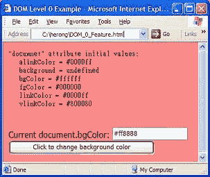

# DOM Level 0 示例

JavaScript 教程 - Herong 的教程示例

∟W3C 的文档对象模型 (DOM) 规范

∟DOM Level 1 - 示例

本节提供了 Firefox 2.0 支持的 DOM Level 1 对象和属性的教程示例。

`DOM Level 1` - 1998 年 10 月发布的最新版本：包含 2 个模块的 API：Core 和 HTML。DOM Level 1 Core 代表用于 XML 文档的功能。DOM Level 1 HTML 将 DOM Level 1 Core 扩展以代表特定 HTML 文档的功能。

这是一个使用 DOM Level 1 对象和属性的教程示例：

```html
 <html>
<!-- DOM_Level_1_Example.html
   Copyright (c) HerongYang.com. All Rights Reserved.
-->
<head>
<title>DOM Level 1 示例</title>
<script type="text/javascript">
var colorID = 0;
function changeColor() {
   var body = document.body;
   if (colorID == 0 )
      body.bgColor = "#ff8888";
   else if (colorID == 1 )
      body.bgColor = "#88ff88";
   else if (colorID == 2 )
      body.bgColor = "#8888ff";
   else if (colorID == 3 )
      body.bgColor = "#888888";
   document.forms.item(0).elements.item(0).value 
      = document.body.bgColor;
   colorID = (colorID+1)%4;
}
</script>
</head>
<body color="#000000">
<pre>
<script type="text/javascript">
   var body = document.body;
   document.writeln("\"documnet.body\" attribute initial values:");
   document.writeln("   aLink = "+body.aLink);
   document.writeln("   background = "+body.background);
   document.writeln("   bgColor = "+body.bgColor);
   document.writeln("   color = "+body.color);
   document.writeln("   link = "+body.link);
   document.writeln("   vLink = "+body.vLink);
</script>
</pre>
<form>
  Current document.body.bgColor: 
  <input type="text" name="bgcolor" value="#ffffff"><br/>
  <input type="button" value="Click to change background color"
   onClick="changeColor();"/>
</form>
</body>
</html>
```

这是该 JavaScript 页面在 Firefox 2.0 上的外观：

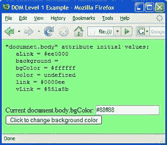

# DOM Level 1 示例

有趣的是，`document.body.color` 在 Firefox 2.0 中未定义。我的猜测是 `document.body.color` 仅在 DOM HTML Level 1 中支持，而不是 Level 2。由于 Firefox 支持 DOM HTML Level 2，因此 `document.body.color` 是未定义的。

JavaScript 教程 - Herong 的教程示例

∟W3C 的文档对象模型 (DOM) 规范

∟DOM Level 2 - 示例

本节提供了 Firefox 2.0 支持的 DOM Level 1 对象和属性的教程示例。（注：此处原文描述可能有误，应为 Level 2 对象）

`DOM Level 2` - 2000 年 11 月发布：包含 14 个模块的 API：Core, HTML, Views, Stylesheets。这是一个使用 DOM Level 2 对象和属性的教程示例：

```html
 <html>
<!-- DOM_Level_1_Example.html
   Copyright (c) HerongYang.com. All Rights Reserved.
-->
<head>
<title>DOM Level 1 示例</title>
<script type="text/javascript">
var colorID = 0;
function changeColor() {
   var body = document.body;
   if (colorID == 0 )
      body.bgColor = "#ff8888";
   else if (colorID == 1 )
      body.bgColor = "#88ff88";
   else if (colorID == 2 )
      body.bgColor = "#8888ff";
   else if (colorID == 3 )
      body.bgColor = "#888888";
   document.forms.item(0).elements.item(0).value 
      = document.body.bgColor;
   colorID = (colorID+1)%4;
}
</script>
</head>
<body color="#000000">
<pre>
<script type="text/javascript">
   var body = document.body;
   document.writeln("\"documnet.body\" attribute initial values:");
   document.writeln("   aLink = "+body.aLink);
   document.writeln("   background = "+body.background);
   document.writeln("   bgColor = "+body.bgColor);
   document.writeln("   color = "+body.color);
   document.writeln("   link = "+body.link);
   document.writeln("   vLink = "+body.vLink);
</script>
</pre>
<form>
  Current document.body.bgColor: 
  <input type="text" name="bgcolor" value="#ffffff"><br/>
  <input type="button" value="Click to change background color"
   onClick="changeColor();"/>
</form>
</body>
</html>
```

在 Firefox 2.0 中查看此 JavaScript 页面，支持 DOM 2，将看到：

```html
 <html>
<!-- DOM_Level_1_Example.html
   Copyright (c) HerongYang.com. All Rights Reserved.
-->
<head>
<title>DOM Level 1 示例</title>
<script type="text/javascript">
var colorID = 0;
function changeColor() {
   var body = document.body;
   if (colorID == 0 )
      body.bgColor = "#ff8888";
   else if (colorID == 1 )
      body.bgColor = "#88ff88";
   else if (colorID == 2 )
      body.bgColor = "#8888ff";
   else if (colorID == 3 )
      body.bgColor = "#888888";
   document.forms.item(0).elements.item(0).value 
      = document.body.bgColor;
   colorID = (colorID+1)%4;
}
</script>
</head>
<body color="#000000">
<pre>
<script type="text/javascript">
   var body = document.body;
   document.writeln("\"documnet.body\" attribute initial values:");
   document.writeln("   aLink = "+body.aLink);
   document.writeln("   background = "+body.background);
   document.writeln("   bgColor = "+body.bgColor);
   document.writeln("   color = "+body.color);
   document.writeln("   link = "+body.link);
   document.writeln("   vLink = "+body.vLink);
</script>
</pre>
<form>
  Current document.body.bgColor: 
  <input type="text" name="bgcolor" value="#ffffff"><br/>
  <input type="button" value="Click to change background color"
   onClick="changeColor();"/>
</form>
</body>
</html>
```

在 IE 11 中查看此 JavaScript 页面将显示相同的结果。但 IE 6 不显示任何值，因为它不支持 DOM 2。

JavaScript 教程 - Herong 的教程示例

∟W3C 的文档对象模型 (DOM) 规范

∟DOM Level 3 - 示例

本节提供了 DOM Level 3 对象和属性的教程示例。目前没有浏览器支持 DOM 3。

`DOM Level 3` - 2004 年 4 月发布：包含 21 个模块的 API：Core, HTML, XPath, Travesal, Range, Validation, Load and Save, Asynchronous Load, Views, Stylesheets, CSS, CSS2, Events, HTML Events, Mutation Events, Mutation Name Events, UI Events, Mouse Events, Text Events, and Keyboard Events.

这是一个使用 DOM Level 3 对象和属性的教程示例：

```html
 <html>
<!-- DOM_Level_3_Example.html
   Copyright (c) HerongYang.com. All Rights Reserved.
-->
<head>
<title>DOM Level 3 示例</title>
</head>
<body><pre>
<script type="text/javascript">
   document.writeln("\nNew attributes:");
   document.writeln("   document.xmlVersion="+document.xmlVersion);
   document.writeln("   document.inputEncoding="+document.inputEncoding);
   document.writeln("   document.xmlEncoding="+document.xmlEncoding);
   document.writeln("   document.title.textContent="
      +document.title.textContent);

   var feature = document.implementation.getFeature("HTML","3.0");
   document.writeln("\nNew methods:");
   document.writeln("   document.implementation.getFeature()="
      +feature.toString());
</script>
</pre></body>
</html>
```

在 Chrome 68 中，我得到了以下输出：

```
 New attributes:
   document.xmlVersion=null
   document.inputEncoding=windows-1252
   document.xmlEncoding=null
   document.title.textContent=undefined
```

在 Firefox 61 中，我得到了以下输出：


```
 New attributes:
   document.xmlVersion=undefined
   document.inputEncoding=windows-1252
   document.xmlEncoding=undefined
   document.title.textContent=undefined
```

在 IE 11 上，我得到了以下输出：

```
 New attributes:
   document.xmlVersion=
   document.inputEncoding=WINDOWS-1252
   document.xmlEncoding=
   document.title.textContent=undefined
```

我无法在旧版本的浏览器中测试这个 JavaScript 示例页面，因为它们不支持 DOM Level 3。

JavaScript 教程 - Herong 的教程示例

∟W3C 文档对象模型 (DOM) 规范

∟DOM Level 测试 - document.implementation.hasFeature

本节提供了一个使用 `document.implementation.hasFeature()` 方法的教程示例，用于测试特定 Web 浏览器支持的 DOM 级别。

在 DOM Level 1、2 和 3 规范中，有一个方法可以让你测试特定 Web 浏览器支持多哪些 DOM 规范级别：`document.implementation.hasFeature(feature, level)`。如果 Web 浏览器支持指定的特性和级别，它返回 true。请注意，级别必须以点格式指定，如 `1.0`、`2.0` 或 `3.0`。

我在教程示例使用了此方法来测试我机器上 Web 浏览器支持的 DOM 级别。

```
 <html>
<!-- DOM_Level_Test.html
   Copyright (c) HerongYang.com. All Rights Reserved.
-->
<head>
<title>DOM Level Test</title>
</head>
<body><pre>
<script type="text/javascript">
   document.writeln("\nDOM Level 0 Test:");
   document.writeln("   document.bgColor = "+document.bgColor);

   for (var i=1; i<4; i++) {
      document.writeln("\nDOM Level "+i+".0 Test:");
      document.writeln("   Core "+i+".0 = "
         + document.implementation.hasFeature("Core", i+".0"));
      document.writeln("   HTML "+i+".0 = "
         + document.implementation.hasFeature("HTML", i+".0"));
   }
</script>
</pre></body>
</html
```

当我使用此脚本测试 Chrome 68 和 Firefox 61 时，结果显示它们支持 DOM Level 1、2 和 3。

```
 DOM Level 0 Test:
   document.bgColor = 

DOM Level 1.0 Test:
   Core 1.0 = true
   HTML 1.0 = true

DOM Level 2.0 Test:
   Core 2.0 = true
   HTML 2.0 = true

DOM Level 3.0 Test:
   Core 3.0 = true
   HTML 3.0 = true
```

当我使用此脚本测试 IE 11 时，结果显示它们支持 DOM Level 1 和 2。Level 3 不支持。

```
 DOM Level 0 Test:
   document.bgColor = #ffffff

DOM Level 1.0 Test:
   Core 1.0 = true
   HTML 1.0 = true

DOM Level 2.0 Test:
   Core 2.0 = true
   HTML 2.0 = true

DOM Level 3.0 Test:
   Core 3.0 = false
   HTML 3.0 = false
```

IE 6.0 只支持 Level 1：

```
 DOM Level 0 Test:
   document.bgColor = #ffffff

DOM Level 1.0 Test:
   Core 1.0 = false
   HTML 1.0 = true

DOM Level 2.0 Test:
   Core 2.0 = false
   HTML 2.0 = false

DOM Level 3.0 Test:
   Core 3.0 = false
   HTML 3.0 = false
```

Firefox 2.0 支持 Level 2：

```
 DOM Level 0 Test:
   document.bgColor = #ffffff

DOM Level 1.0 Test:
   Core 1.0 = false
   HTML 1.0 = true

DOM Level 2.0 Test:
   Core 2.0 = true
   HTML 2.0 = true

DOM Level 3.0 Test:
   Core 3.0 = false
   HTML 3.0 = false
```

JavaScript 教程 - Herong 的教程示例

∟W3C 文档对象模型 (DOM) 规范

∟继承视图与 API 的扁平化视图

本节提供了 DOM API 的两种不同视图：扁平化视图 - 一切都是节点，以及继承视图 - 继承接口的层级结构。

DOM API 提供了两种表示 XML/HTML 文档的不同方法：

1. “面向对象”方法 - 文档由一组链接对象表示，这些对象具有具有层级结构的不同接口。换句话说，整个 DOM API 可以被视为一个继承接口的层级结构。这被称为“DOM 的继承视图”。

在“DOM 的继承视图”中，你只需要学习一组相关的接口：

```
 interface Node
^
|- interface Document : Node
|  ^
|  |- interface HTMLDocument : Document
|
|- interface Element : Node
   ^
   |- interface  HTMLElement : Element
      ^
      |- interface HTMLHtmlElement : HTMLElement
      |- interface HTMLHeadElement : HTMLElement
      |- interface HTMLTitleElement : HTMLElement
      |- interface HTMLBodyElement : HTMLElement
      |- interface HTMLParagraphElement : HTMLElement
      |- interface HTMLFormElement : HTMLElement
      |- interface HTMLImageElement : HTMLElement
      ...
```

2. “一切都是节点”方法 - 文档由对象树表示，这些对象具有名为“Node”的单一接口。换句话说，整个 DOM API 可以被视为单一接口 - `Node` 接口。这被称为“DOM 的扁平化视图”。

在“DOM 的扁平化视图”中，你只需要学习一个接口，“Node”：

```
 interface Node {
  readonly attribute DOMString        nodeName;
           attribute DOMString        nodeValue;
  readonly attribute unsigned short   nodeType;
  readonly attribute Node             parentNode;
  readonly attribute NodeList         childNodes;
  readonly attribute NamedNodeMap     attributes;
  readonly attribute Document         ownerDocument;
  Node               removeChild(in Node oldChild);
  Node               appendChild(in Node newChild);
  ...
};
```

JavaScript 教程 - Herong 的教程示例

∟W3C 文档对象模型 (DOM) 规范

∟Web 文档 接口接口树

本节提供了一个 JavaScript 教程示例，用于显示元素的 DOM 接口。我们知道一个 Web 页面（文档）是一个元素树（忽略属性）。从面向对象的角度来看，不同的元素由不同类型的对象表示。

现在通过一个简单的 JavaScript 示例遍历树，确定每个元素支持的接口：

```
 <html
<!-- DOM_API_Oriented_View.html
   Copyright (c) HerongYang.com. All Rights Reserved.
-->
<head>
<title>DOM API - 面向视图</title>
<style type="text/css">body {background-color: #aaaaff}</style>
<script type="text/javascript">
function showInterface(node, prefix, out) {
   out += prefix+node.constructor+"\n";
   var list = node.childNodes;
   for (var i=0; i<list.length; i++) {
      out = showInterface(list.item(i), prefix+"   ", out);
   }
   return out;
}
function show() {
   var text = document.createTextNode(showInterface(document,"",""));
   var display = document.getElementById("display");
   display.replaceChild(text,display.firstChild);
}
</script>
</head>
<body>
这段第一个文本直接在“body”元素中。
<p>这段第二个文本在“p”元素中。</p>
<form action="nothing" method="get">
   <input type="button" value="View" onClick="show();"/>
</form>
<pre id="display">
点击 View 按钮查看接口名称...
</pre>
</body>
</html>
```

请注意，我使用了一个特殊属性 `node.constructor` 来获取构造函数的名称，这通常也是实现 DOM 接口的 JavaScript 类名。`node.constructor` 并不是有效的 DOM 属性。

我尝试过使用 DOM 属性 `node.className` 来获取实现类名，但 Firefox 返回“undefined”。

如果你在 Firefox 18 中运行这个 JavaScript 页面并点击“View”按钮，你将获得该 Web 页面使用的 DOM 接口的漂亮树列表：


```
 [object HTMLDocument]
   [object HTMLHtmlElement]
      [object Comment]
      [object HTMLHeadElement]
         [object Text]
         [object HTMLTitleElement]
            [object Text]
         [object Text]
         [object HTMLStyleElement]
            [object Text]
         [object Text]
         [object HTMLScriptElement]
            [object Text]
         [object Text]
      [object Text]
      [object HTMLBodyElement]
         [object Text]
         [object HTMLParagraphElement]
            [object Text]
         [object Text]
         [object HTMLFormElement]
            [object Text]
            [object HTMLInputElement]
            [object Text]
         [object Text]
         [object HTMLPreElement]
            [object Text]
         [object Text]
```

# JavaScript 教程 - Herong 的教程示例

## W3C 文档对象模型 (DOM) 规范

## 将 Web 文档视为节点树

本节提供了一个 JavaScript 教程示例用于展示 页面是一个节点树。这展示了 DOM API 的简化扁平化视图。

我们知道 Web 页面（一个 HTML 文档）是一个元素树（暂时忽略属性）。从简化的角度来看，所有元素都由 `Node` 接口表示。为了区分不同类型的节点，我们可以检查“type”（类型）和“name”（名称）属性。

现在，让我们通过一个简单的 JavaScript 示例遍历树，并将每个元素呈现为带有类型和名称的节点：

```
 <html>
<!-- DOM_API_Simplified_Node_View.html
   Copyright (c) HerongYang.com. All Rights Reserved.
-->
<head>
<title>DOM API - Simplified Node View</title>
<style type="text/css">body {background-color: #aaaaff}</style>
<script type="text/javascript">
function showInterface(node, prefix, out) {
   var typeName = new Array("NULL", "ELEMENT", "ATTRIBUTE", "TEXT",
      "CDATA", "ENTITY_REFERENCE", "ENTITY", "RROCESSING_INSTRUCTION",
      "COMMENT", "DOCUMENT", "DOCUMENT_TYPE", "DOCUMENT_FRAGMENT",
      "NOTATION");
   out += prefix+"[Node type="+typeName[node.nodeType]
      +" name="+node.nodeName+"]\n";
   var list = node.childNodes;
   for (var i=0; i<list.length; i++) {
      out = showInterface(list.item(i), prefix+"   ", out);
   }
   return out;
}
function show() {
   var text = document.createTextNode(showInterface(document,"",""));
   var display = document.getElementById("display");
   display.replaceChild(text,display.firstChild);
}
</script>
</head>
<body>
第一段文本直接位于 "body" 元素中。
<p>第二段文本位于 "p" 元素中。</p>
<form action="nothing" method="get">
   <input type="button" value="View" onClick="show();"/>
</form>
<pre id="display">
点击 View 按钮查看接口名称...
</pre>
</body>
</html>
```

注意，我正在使用数组将 `node.nodeType` 从整数转换为字符串。

如果你在 Firefox 2.0 中运行此 JavaScript 页面并点击 "View" 按钮，你将获得一个包含该 Web 页面节点类型和名称的漂亮树列表：

```
 [Node type=DOCUMENT name=#document]
   [Node type=ELEMENT name=HTML]
      [Node type=ELEMENT name=HEAD]
         [Node type=COMMENT name=#comment]
         [Node type=ELEMENT name=TITLE]
            [Node type=TEXT name=#text]
         [Node type=TEXT name=#text]
         [Node type=ELEMENT name=STYLE]
            [Node type=TEXT name=#text]
         [Node type=TEXT name=#text]
         [Node type=ELEMENT name=SCRIPT]
            [Node type=TEXT name=#text]
      [Node type=ELEMENT name=BODY]
         [Node type=TEXT name=#text]
         [Node type=ELEMENT name=P]
            [Node type=TEXT name=#text]
         [Node type=TEXT name=#text]
         [Node type=ELEMENT name=FORM]
            [Node type=TEXT name=#text]
            [Node type=ELEMENT name=INPUT]
            [Node type=TEXT name=#text]
         [Node type=TEXT name=#text]
         [Node type=ELEMENT name=PRE]
            [Node type=TEXT name=#text]
         [Node type=TEXT name=#text]
```

# JavaScript 教程 - Herong 的教程示例

## W3C 文档对象模型 (DOM) 规范

## 在新窗口中导出文档 - JavaScript 源码

本节提供了一个 JavaScript 教程示例，使用 DOM API 属性和方法将浏览器内置的 `document` 对象作为 XML 消息导出到新浏览器窗口。

为了总结我目前学到的关于 DOM API 规范的知识，我写了一个 JavaScript 页面 `DOM_HTML_Document_Dump.html` 来用 DOM 属性和方法导出浏览器内置的 "document" 对象：

```
 <html>
<head>
<!-- DOM_HTML_Document_Dump.html
   Copyright (c) HerongYang.com. All Rights Reserved.
-->
<title>在新窗口中导出 HTML 文档</title>
<script type="text/javascript">
function nodeToXML(node, indentation, out) {
   out += indentation+"<"+node.nodeName.toLowerCase();
   if (node.attributes!=null) {
      for (var i=0; i<node.attributes.length; i++) {
         var item = node.attributes.item(i);
         var value = item.nodeValue;
         if (value==null) value = "";
         out += " "+item.nodeName+"=\""+value+"\"";
      }
   }
   out += ">\n";
   for (var i=0; i<node.childNodes.length; i++) {
      var item = node.childNodes.item(i);
      out = nodeToXML(item, indentation+"   ", out);
   }
   if (node.nodeValue!=null) 
      out += indentation+"   "+node.nodeValue+"\n";
   out += indentation+"</"+node.nodeName.toLowerCase()+">\n";
   return out;
}
function show() {
   var w = window.open('', 'Popup', '');
   w.document.write('<html><head><title>Document Dump</title>');
   w.document.write('</head><body><pre>');

   var s = nodeToXML(document, '', '');
   s = s.replace(new RegExp('&','g'),'&amp;');
   s = s.replace(new RegExp('<','g'),'&lt;');
   s = s.replace(new RegExp('>','g'),'&gt;');
   w.document.write(s);
   w.document.write('</pre></body></html>');
   w.document.close();
}
</script>
</head>
<body>
<script type="text/javascript">
   document.write('<p>点击在新窗口中显示文档：</p>');
</script>
<form>
<input type="button" value="Show" onClick="show();"/>
</form>
</body>
</html>
```

这段 JavaScript 的思路非常简单：

*   使用递归函数 `nodeToXML()` 遍历文档树。
*   对于每个节点，将其作为 XML 元素导出。节点名称变为元素名称。节点属性变为元素属性。节点子列表变为元素子列表。节点值变为元素内容。
*   导出的 XML 字符串随后在新窗口中显示。

阅读后续章节查看某些流行 浏览器的结果。

# JavaScript 教程 - Herong 的教程示例

## W3C 文档对象模型 (DOM) 规范

## 在新窗口中导出文档 - 浏览器结果

本节提供了教程示例的 Web 浏览器测试结果，该示例使用 DOM API 属性和方法将浏览器内置的 `document` 对象作为 XML 消息导出到新浏览器窗口。

如果你在 Chrome、Firefox 和 IE (Internet Explorer) Web 浏览器中运行 JavaScript 页面 `DOM_HTML_Document_Dump.html`，你将在新窗口中获得 "document" XML 导出结果：


```
 <#document>
   <html>
      <head>
         <#text>

         </#text>
         <#comment>
             DOM_HTML_Document_Dump.html
   Copyright (c) HerongYang.com. All Rights Reserved.

         </#comment>
         <#text>

         </#text>
         <title>
            <#text>
               在新窗口中导出 HTML 文档
            </#text>
         </title>
         <#text>

         </#text>
         <script type="text/javascript">
            <#text>

function nodeToXML(node, indentation, out) {
   out += indentation+"<"+node.nodeName.toLowerCase();
   if (node.attributes!=null) {
      for (var i=0; i<node.attributes.length; i++) {
         var item = node.attributes.item(i);
         var value = item.nodeValue;
         if (value==null) value = "";
         out += " "+item.nodeName+"=\""+value+"\"";
      }
   }
   out += ">\n";
   for (var i=0; i<node.childNodes.length; i++) {
      var item = node.childNodes.item(i);
      out = nodeToXML(item, indentation+"   ", out);
   }
   if (node.nodeValue!=null) 
      out += indentation+"   "+node.nodeValue+"\n";
   out += indentation+"</"+node.nodeName.toLowerCase()+">\n";
   return out;
}
function show() {
   var w = window.open('', 'Popup', '');
   w.document.write('<html><head><title>Document Dump</title>');
   w.document.write('</head><body><pre>');

   var s = nodeToXML(document, '', '');
   s = s.replace(new RegExp('&','g'),'&amp;');
   s = s.replace(new RegExp('<','g'),'&lt;');
   s = s.replace(new RegExp('>','g'),'&gt;');
   w.document.write(s);
   w.document.write('</pre></body></html>');
   w.document.close();
}

            </#text>
         </script>
         <#text>

         </#text>
      </head>
      <#text>

      </#text>
      <body>
         <#text>

         </#text>
         <script type="text/javascript">
            <#text>

   document.write('<p>点击在新窗口中显示文档：</p>');

            </#text>
         </script>
         <p>
            <#text>
               点击在新窗口中显示文档：
            </#text>
         </p>
         <#text>

         </#text>
         <form>
            <#text>

            </#text>
            <input value="Show" onclick="show();" type="button">
            </input>
            <#text>

            </#text>
         </form>
         <#text>

         </#text>
      </body>
   </html>
</#document>
```

### 关于此 Firefox 结果的几点说明：

- HTML 标签之间的换行符被保留为空的“text”节点。
- 由“body”部分中短 JavaScript 的 `document.write()` 函数生成的“p”节点紧接插入在“script”节点之后。

JavaScript 教程 - Herong 的教程示例

∟W3C 文档对象模型 (DOM) 规范

### 在新窗口中导出文档 - IE 6.0 结果

本节提供了该教程示例的 IE 6.0 结果。该示例使用 DOM API 属性和方法将浏览器内置的 `document` 对象作为 XML 消息在新浏览器窗口中导出。

如果你在 IE 6.0 中运行 JavaScript 页面 `DOM_HTML_Document_Dump.html`，你将在新窗口中获得“document” XML 导出结果：

```
 <#document>
   <html language="" dataFld="" onmouseup="" class="" oncontextmenu=""...
      <head language="" dataFld="" onmouseup="" class="" oncontextmenu...
         <title language="" dataFld="" onmouseup="" class="" oncontext...
         </title>
         <#comment>
             DOM_HTML_Document_Dump.html
   Copyright (c) HerongYang.com. All Rights Reserved.

         </#comment>
         <script language="" dataFld="" onmouseup="" class="" oncontex...
         </script>
      </head>
      <body language="" dataFld="" onmouseup="" class="" oncontextmenu...
         <script language="" dataFld="" onmouseup="" class="" oncontex...
         </script>
         <p language="" dataFld="" onmouseup="" class="" oncontextmenu...
            <#text>
               点击在新窗口中显示文档： 
            </#text>
            <form language="" dataFld="" onmouseup="" class="" onconte...
               <input language="" dataFld="" onmouseup="" class="" onc...
               </input>
               <#text>

               </#text>
            </form>
         </p>
      </body>
   </html>
</#document>
```

### 关于此 IE 6.0 结果的几点说明：

- 对于每个节点，IE 添加了许多默认属性，如 `language`、`dataFld`、`onmouseup`、`class`、`oncontextmenu` 等。
- “script”标签的内容未表示为 `nodeValue`。这就是为什么输出中没有包含源代码。
- HTML 标签之间的换行符被忽略了。

JavaScript 教程 - Herong 的教程示例

### 参考文献

本书使用的参考资料。

- *ECMA-262 - ECMAScript Language 规范*，第三版，1999 年 12 月，ECMA，[`www.ecma-international.org/publications/Ecma-262.htm`](http://www.ecma-international.org/publications/Ecma-262.htm)
- *JavaScript 参考*，Mozilla，2020 年，[`developer.mozilla.org/en-US/docs/Web/Reference`](https://developer.mozilla.org/en-US/docs/Web/Reference)
- *JavaScript 1.8 中的新特性*，Mozilla，2008 年，[`developer.mozilla.org/en/docs/New_in_JavaScript_1.8`](http://developer.mozilla.org/en/docs/New_in_JavaScript_1.8)
- *Core JavaScript 1.5 指南*，Mozilla，[`developer.mozilla.org/en/docs/Core_JavaScript_1.5_Guide`](http://developer.mozilla.org/en/docs/Core_JavaScript_1.5_Guide)
- *Core JavaScript 1.5 参考*，Mozilla，[`developer.mozilla.org/en/docs/Core_JavaScript_1.5_Reference`](http://developer.mozilla.org/en/docs/Core_JavaScript_1.5_Reference)
- *文档对象模型 (DOM) 技术报告*，W3C，[`www.w3.org/DOM/DOMTR`](http://www.w3.org/DOM/DOMTR)
- *Gecko DOM 引用*，Mozilla，2007 年，[`developer.mozilla.org/en/docs/Gecko_DOM_Reference`](http://developer.mozilla.org/en/docs/Gecko_DOM_Reference)
- *JavaScript 中的私有成员*，Douglas Crockford，2001 年，[`www.crockford.com/javascript/private.html`](http://www.crockford.com/javascript/private.html)

