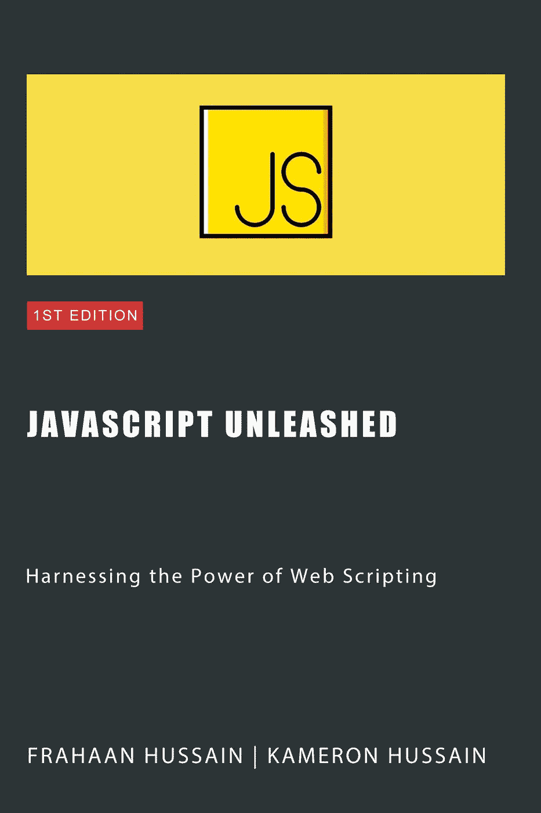

# JavaScript Unleashed：释放 Web 脚本的力量





## 第 1 章：JavaScript 简介

### 1.1 什么是 JavaScript?
#### JavaScript 的核心特性
#### JavaScript 在 Web 开发中的角色

### 1.2 JavaScript 简史
#### 起源于 Netscape 
#### ECMAScript 的诞生
#### 浏览器大战与 DOM
#### AJAX 与 Web 2.0
#### JavaScript 库和框架的兴起
#### 现状

### 1.3 为什么 JavaScript 很重要
- 1. 多功能与无不在
- 2. 增强用户体验
- 3. 异步通信
- 4. 跨平台兼容性
- 5. 生态系统与社区
- 6. 服务器端开发
- 7. 持续演进
- 8. 职业机会

### 1.4 配置你的开发环境
- 1. 编辑器或集成开发环境 (IDE)
- 2. 浏览器
- 3. Node.js（可选）
- 4. 版本控制系统（可选）
- 5. 浏览器扩展
- 6. 代码检查工具与格式化工具
- 7. JavaScript 框架和库
- 8. 配置本地开发服务器
- 9. 学习资源

### 1.5 你的第一个 JavaScript 程序
- 1. 创建 HTML 文件
- 2. 创建 JavaScript 文件
- 3. 将 JavaScript 链接到 HTML
- 4. 在浏览器中打开

## 第 2 章：JavaScript 基础 

### 2.1 变量与数据类型
- 1. 变量声明
- 2. 数据类型
- 3. 变量赋值与重新赋值
- 4. 变量命名规则
- 5. 动态类型

### 2.2 运算符与表达式
- 1. 算术运算符
- 2. 赋值运算符
- 3. 比较运算符
- 4. 逻辑运算符

### 2.3 控制结构：if, else 和 switch
- 1. if 语句
- 2. else 语句
- 3. else if 语句
- 4. switch 语句

### 2.4 循环：for, while 和 do-while
- 1. for 循环
- 2. while 循环
- 3. do-while 循环

### 2.5 函数与作用域
- 1. 函数声明
- 2. 函数表达式
- 3. 箭头函数
- 4. 函数作用域
- 5. 函数参数与参数
- 6. 返回值

## 第 3 章：操作 DOM 

### 3.1 理解文档对象模型 (DOM)
- 1. 什么是 DOM?
- 2. 为什么 DOM 重要？
- 3. 如何访问 DOM
- 4. 修改 DOM

### 3.2 选择与操作元素
- 1. 选择元素
- 2. 修改元素
- 3. 添加与移除元素
- 4. 事件处理

### 3.3 修改元素内容和属性
- 1. 修改元素内容
- 2. 修改元素属性
- 3. 使用数据属性
- 4. 添加与移除元素

### 3.4 JavaScript 中的事件处理
- 1. 理解事件
- 2. 添加事件监听器
- 3. 事件对象
- 4. 事件冒泡与捕获
- 5. 移除事件监听器
- 6. 事件委托

### 3.5 处理表单与用户输入
- 1. 访问表单元素
- 2. 表单提交
- 3. 输入验证
- 4. 使用输入字段
- 5. 动态表单元素
- 6. 处理用户输入事件

## 第 4 章：JavaScript 和 HTML5 

### 4.1 用于图形和动画的 Canvas
- 1. `<canvas>` 元素
- 2. 访问 Canvas
- 3. 绘制形状
- 4. 绘制路径
- 5. 绘制文本
- 6. 动画

### 4.2 音频与视频集成
- 1. `<audio>` 元素
- 2. `<video>` 元素
- 3. 使用 JavaScript 控制播放
- 4. 事件与回调
- 5. 多媒体 API
- 6. 无障碍与兼容性

### 4.3 地理定位与地图


#### 1. 地理定位 API
#### 2. 处理地理定位错误
#### 3. 使用 JavaScript 集成地图
#### 4. 地图库与 API
#### 5. 实际应用中的地理定位
#### 6. 隐私考量

### 4.4 本地存储 (Local Storage) 与网络存储 (Web Storage)
#### 1. 本地存储 vs 网络存储
#### 2. 存储数据
#### 3. 获取数据
#### 4. 删除数据
#### 5. 清除存储
#### 6. 存储事件
#### 7. 局限性与考虑

### 4.5 用于多线程的 Web Workers
#### 1. 创建 Web Worker
#### 2. 在主线程中使用 Web Worker
#### 3. Web Workers 的优势
#### 4. 局限性与考虑

## 第 5 章：高级 JavaScript 概念
### 5.1 闭包与词法作用域
#### 1. 词法作用域
#### 2. 闭包
#### 3. 闭包的实际用途
#### 4. 内存管理
#### 5. 箭头函数中的词法作用域
#### 6. 结论

### 5.2 JavaScript 中的面向对象编程
#### 1. JavaScript 中的对象
#### 2. 原型继承
#### 3. 构造函数
#### 4. ES6 类 (Classes)
#### 5. 类继承
#### 6. 封装与抽象
#### 7. 多态与继承
#### 8. 结论

### 5.3 原型与继承
#### 1. JavaScript 中的原型
#### 2. 原型链
#### 3. 构造函数与原型
#### 4. 在原型上添加属性和方法
#### 5. 通过原型实现继承
#### 6. ES6 类与继承
#### 7. 结论

### 5.4 Promises 与异步编程
#### 1. 理解异步 JavaScript
#### 2. 回调函数与回调地狱
#### 3. 引入 Promises
#### 4. Promise 链式调用
#### 5. `Promise.all` 与 `Promise.race`
#### 6. `Async/Await`
#### 7. `try...catch` 语句
#### 8. `throw` 语句
#### 9. `finally` 块
#### 10. 调试工具
#### 11. 使用 `console.assert`
#### 12. 调试技巧

## 第 6 章：JavaScript 库与框架
### 6.1 流行库简介
#### 1. `jQuery`
#### 2. `React`
#### 3. `Angular`
#### 4. `Vue.js`
#### 5. `Ember.js`
#### 6. 其他库与框架

### 6.2 使用 jQuery 
#### 1. `jQuery` 入门
#### 2. 选择元素
#### 3. 修改元素
#### 4. 事件处理
#### 5. 使用 `jQuery` 进行 `AJAX`
#### 6. 插件与扩展性

### 6.3 React：构建界面
#### 1. `React` 简介
#### 2. 虚拟 DOM
#### 3. `JSX`: JavaScript + XML
#### 4. 组件化架构
#### 5. 单向数据流
#### 6. `React` 生态系统

### 6.4 Angular：创建 Web 应用
#### 1. `Angular` 简介
#### 2. `TypeScript`
#### 3. 依赖注入
#### 4. 双向数据绑定
#### 5. 路由与导航
#### 6. 响应式表单
#### 7. `Angular` CLI
#### 8. `Angular` 生态系统

### 6.5 Vue.js：渐进框架
#### 1. `Vue.js` 简介
#### 2. 组件化架构
#### 3. `Vue Router`
#### 4. `Vue` CLI
#### 5. 用于状态管理的 `Vuex`
#### 6. `Vue.js` 生态系统

### 7.1 Node.js：简介
#### 1. 什么是 `Node.js`？
#### 2. `Node.js` 的特性
#### 3. `Node.js` 中的 Hello World
#### 4. 使用 `Node.js` 构建 API

### 7.2 创建简单的 Node.js 服务器
#### 1. 设置 `Node.js` 服务器
#### 2. 示例：创建一个简单的 HTTP 服务器

### 7.3 NPM：包管理器
#### 1. 安装 `NPM`
#### 2. `package.json`
#### 3. 安装依赖
#### 4. 管理依赖项
#### 5. 运行脚本

### 7.4 使用 Express 构建 RESTful API
#### 1. 安装 `Express`
#### 2. 创建 `Express` 应用
#### 3. 定义路由
#### 4. 启动服务器
#### 5. 运行 `Express` 应用
#### 6. 处理不同的 HTTP 方法
#### 7. `Express` 中的中间件
#### 8. 错误处理

### 7.5 使用 WebSocket 构建实时应用
#### 1. 安装 `Socket.io`
#### 2. 设置 `WebSocket` 服务器
#### 3. 创建 `WebSocket` 客户端
#### 4. 广播消息
#### 5. 向特定客户端广播
#### 6. 实时应用

### 8.1 与 JSON 数据处理
#### 1. `JSON` 基础
#### 2. 解析 JSON 数据
#### 3. 创建 JSON 数据
#### 4. `JSON` Schema 与验证
#### 5. 在 Web API 中使用 `JSON`

### 8.2 AJAX 与 Fetch API
#### 1. `AJAX` 基础
#### 2. `Fetch` API
### 3. 发送 `POST` 请求
### 4. 跨域请求
### 5. `Fetch` API 对比 `XMLHttpRequest`

### 8.3 消费 RESTful API


# 发送 GET 请求
## 身份验证
## 发送 POST 请求
## 错误处理
## 频率限制与分页
## 文档与客户端

### 8.4 数据处理与转换
### 数组与迭代
### 对象转换
### 字符串处理
### 数据验证与清洗
### JSON 操作
### 数据转换库

## 8.5 使用 D3.js 进行数据可视化
### D3.js 简介
### 基础绑定
### 创建基于 SVG 的可视化
### 交互与过渡
### D3.js 生态系统

## 9.1 Web 应用常见安全威胁
### 跨站脚本 (XSS)
### 跨站请求伪造 (CSRF)
### 内容安全策略 (CSP)
### 注入

### 9.2 防止跨站脚本 (XSS)
### 输入验证与清洗
### 内容安全策略 (CSP)
### 转义用户生成的内容
### HTTP-Only 和 Secure Cookies
### 使用信任的库和框架

## 9.3 跨站请求伪造 (CSRF) 保护
### 使用 Anti-CSRF Token
### Same-Site Cookies
### 双重提交 Cookie

### 9.4 内容安全策略 (CSP)
### 定义 CSP 头部
### CSP 指令
### 违规报告

### 9.5 安全编码最佳实践
1. 输入验证
2. 避免使用 Eval
3. 安全密码处理
4. 避免在 Cookie 中存储敏感数据
5. 定期更新依赖项
6. 防止跨站请求伪造 (CSRF)
7. 实现内容安全策略 (CSP)
8. 错误处理
9. 安全 API
10. 定期安全审计
11. 关注安全新闻
12. 遵循安全标准

## 第 10 章：测试与调试
## 10.1 使用 Mocha 和 Chai 进行单元测试
### 什么是 Mocha？
### 配置 Mocha
### 使用 Mocha 编写测试
### 什么是 Chai？
### 配置 Chai
### 使用 Chai 编写测试
### 运行测试
### 10.2 调试工具与技巧
### 浏览器开发者工具
### Node.js 调试器
控制 Console 方法
### 使用 `debugger` 语句
### 日志记录与错误处理
### 10.3 性能分析
### 为什么性能分析很重要？
### 性能分析工具
### JavaScript 执行分析
### 内存使用分析
### 有效分析的技巧
### 10.4 持续集成与部署 (CI/CD)
### 为什么 CI/CD 重要？
### CI/CD 流线组件
### JavaScript 的 CI/CD 工具
### 创建简单的 CI/CD 流线

### 10.5 代码质量与审查
### 代码质量的重要性
### 进行代码审查
### 代码工作流

## 第 11 章：构建单页应用 (SPA)
### 11.1 SPA 简介
### SPA 的特性
### SPA 的挑战
### 11.2 客户端路由
### 客户端路由原理
###get 路由库
### 路由最佳实践
### 11.3 使用 Redux 进行状态管理
### 状态管理的性
### Redux 概念
### 使用 Redux
### 11.4 使用 React 构建 SPA
### 配置 React 项目
### 创建组件
### 获取数据
### 部署
### 11.5 SPA 最佳实践
### 代码分割
### 代码压缩
### 客户端图像
### 缓存策略
### 安全

# 第 12 章：移动应用开发
## 12.1 移动应用开发概述
### 12.2 用于跨平台应用的 React Native
### React Native 的核心特性
### 入门 React Native
### 构建你的 React Native 应用
## 12.3 用于混合应用的 Ionic Framework
### Ionic 的核心特性
### 入门 Ionic
### 构建你的 Ionic 应用
### 12.4 PWA：渐进式 Web 应用
### PWA 的核心特性
### 构建 PWA
### PWA 示例
## 12.5 应用商店部署
### Native 应用部署
### PWA 部署
### 分发考虑因素


# 第 13.1 节：理解 Web 性能

## 为什么 Web 性能很重要
## 关键性能指标
## 性能分析工具
## 结论

# 第 13.2 节：加载与渲染优化
## 图片懒加载
## 代码压缩与压缩
## 内容交付网络 (CDN)
## 浏览器缓存
## 关键渲染路径优化
## 预加载与预取
## 结论

# 第 13.3 节：网络与服务端优化
## 内容交付网络 (CDNs)
## HTTP/2 与 HTTP/3
## 资源打包与代码分割
## 服务端渲染 (SSR) 与静态站点生成 (SSG)
## 内容压缩
## 高效数据库查询
## 服务端缓存
## 结论

# 第 13.4 节：缓存与压缩技术
## 浏览器缓存
## 服务端缓存
## 内容压缩
## 图片压缩
## 结论

# 第 13.5 节：性能衡量与监控
## 性能指标
## Web 性能工具
## 真实用户监控 (RUM)
## 合成监控
## 持续集成与部署 (CI/CD) 集成
## 结论

# 第 14 章：JavaScript 与无障碍性

## 第 14.1 节：Web 无障碍性原则
## 为什么 Web 无障碍性很重要
## 关键无障碍原则
#### 辅助技术
## 无障碍测试
## 结论

## 第 14.2 节：构建无障碍 Web 界面
## 语义化 HTML
## 键盘访问
## ARIA (可访问富互联网应用程序)
## 用于障碍的 CSS
## JavaScript 与无障碍性
## 测试与用户反馈
## 结论

## 第 14.3 节：辅助技术与测试
## 辅助技术的类型
## 使用辅助技术进行测试
## 持续无障碍测试

## 第 14.4 节：ARIA：可访问富互联网应用程序
## ARIA 的需求
## ARIA 角色、状态与属性
## ARIA 如何辅助无
## ARIA 最佳实践

## 第 14.5 节：法律与伦理考量
## 法律框架
## 伦理考量
## 结论

## 第 15 章：国际化与本地化

## 第 15.1 节：国际化的性
## 为什么国际化很重要
## 国际化的关键组件

## 第 15.2 节：JavaScript 国际化 API (Intl)
## 关键 Intl 对象
## 浏览器兼容性

## 第 15.3 节：语言与区域检测
## Navigator 语言
## `Intl.getCanonicalLocales()`
## 语言与区域匹配
## 语言与区域切换
## 浏览器兼容性

## 第 15.4 节：本地化技术
## 使用 `Intl` 进行格式化
## 字符串包
## 响应语言变化
## 工具

## 第 15.5 节：挑战与实践
## 本地化的挑战
## 最佳实践

## 第 16 章：专题

## 第 16.1 节：Web Components
## 理解 Web Components
## 创建自定义元素
## 浏览器支持

## 第 16.2 节：使用 Lambda 进行无服务器计算
## 什么是无服务器计算？
## Lambda 基础
## 创建简单的 Lambda 函数
## 触发 Lambda

## 第 16.3 节：WebAssembly
## WebAssembly 模块
## 与 JavaScript 的互操作性

## 第 16.4 节：JavaScript 中的机器学习
## ML 的兴起
## JavaScript 库
## 用场景

## 第 16.5 节：区块链与加密货币
## 区块链基础
## JavaScript 与区块链
## 加密货币钱包
## 区块链与加密货币的应用

## 第 17 章：构建实战项目
## 第 17.1 节：项目规划与架构
## 项目规划
## 项目架构
## 文档与沟通

## 第 17.2 节：前端开发
## 用户界面 (UI) 设计
## 响应式设计
## 基于组件的
## 状态管理
## 性能优化
## 前端测试
## 无障碍性
## 跨浏览器兼容
## 国际化 (i18n) 与本地化 (l10n)
## 渐进式 Web 应用 (PWA)

## 第 17.3 节：后端开发


# 技术栈
# 服务端设置
# API 设计
# 数据管理
# 身份验证与授权
# 中间件
# 测试与调试
# 可扩展性与性能
# API 安全
# 文档

# 第 17.4 节：集成与测试
## 前端与后端集成
## 单元测试
## 端到端测试
## 持续集成 (CI) 与持续部署 (CD)
## 负载测试
## 安全测试
## 用户验收测试 (UAT)

# 第 17.5 节：部署与维护
## 部署策略
## 持续监控与维护
## 版本控制与回滚
## 用户支持与反馈
## 文档
## 生命周期规划

# 第 18 章：JavaScript 趋势与未来
## 第 18.1 节：ECMAScript 演进
## 第 18.2 节：WebAssembly 及未来
## 第 18.3 节：渐进式 Web 应用 (PWAs)
## 第 18.4 节：IoT 和嵌入式系统中的 JavaScript
### IoT 中的 JavaScript
### 嵌入式系统中的 JavaScript
### 挑战与考虑
## 第 18.5 节：Web 开发的未来
1. WebAssembly (Wasm)
2. 渐进式 Web 应用 (PWAs)
3. 无服务器计算
4. JAMstack 架构
5. 机器学习集成
6. Web 3.0 与区块链集成
7. 关注 Web 无障碍与包容性
8. 跨浏览器兼容性

## 第 19 章：JavaScript 开发者的技巧
## 第 19.1 节：使用 IDE 提高生产力
### 为什么选择 IDE？
### 流行的 JavaScript IDE
### IDE 定制
## 第 19.2 节：版本控制与 Git 最佳实践
### 为什么使用版本控制？
### Git 基础
### Git 最佳实践
## 第 19.3 节：学习资源与社区
### 在线学习平台
### 书籍
### 文档与参考
### 编程挑战与实践
### 在线社区
### 聚会与会议
### YouTube 频道
## 第 19.4 节：保持生态系统的更新
### 时事通讯与博客
### Twitter 与社交媒体
### 播客与 YouTube
### GitHub 趋势与仓库
### 会议与聚会
### 在线课程与学习平台
### 书籍与出版
### 行业报告
### 在线课程与认证
## 第 19.5 节：职业机会与增长
1. 多元的职业路径
2. 持续学习
3. 贡献开源项目
4. 构建作品集
5. 人脉建立
6. 就业市场
7. 远程办公
8. 自由职业与咨询
9. 软技能
10. 资增长
11. 导师指导与教练
12. 职业转型
13. 工作满意度
14. 工作与生活的平衡
15. 多样性与包容性

## 第 20 章：总结与展望
## 第 20.1 节：核心概念回顾
1. JavaScript 基础
2. DOM 操作
3. 高级 JavaScript
4. 前端库与框架
5. 服务端 JavaScript
6. 数据处理与可视化
7. 安全与最佳实践
8. 测试与调试
9. 单页应用 (SPAs)
10. 移动应用开发
11. Web 性能优化
12. 无障碍性
13. 国际化与本地化
14. 高级 JavaScript 主题
15. 实战项目
16. JavaScript 趋势与未来
17. JavaScript 开发者的技巧
18. 总结与展望
## 第 20.2 节：成为 JavaScript 专家之路
1. 精通基础
2. 探索高级主题
3. 构建实战项目
4. 深化 Web 开发技能
5. 探索框架与库
6. 练习解决问题
7. 贡献开源项目
8. 保持更新
9. 同伴协作与代码审查
10. 教学与分享
11. 人脉建立与社区参与
12. 适应行业趋势
13. 认证与正式教育
14. 持续学习
## 第 20.3 节：拥抱 Web 开发的变化
1. 持续学习新技术
2. 关注行业趋势
3. 参加会议与聚会
4. 参与在线社区
5. 定期更新技能
6. 尝试新功能
7. 保持安全意识
8. 采用敏捷与 DevOps 实践
9. 从错误中学习
10. 协作并寻求反馈
11. 个人品牌
12. 探索跨平台开发
13. 适应浏览器更新
14. 迁移遗留代码


# 15. 拥抱 JavaScript 生态系统
# 16. 享受旅程

# [章节 20.4：作为 JavaScript 开发人员的下一步

## 1. 专精或多元化
## 2. 构建作品集
## 3. 开源贡献
## 4. 持续学习
## 5. 人脉建立
## 6. 职位搜索与自由职业
## 7. 认证
## 8. 保持更新
## 9. 软技能
## 10. 导师指导
## 11. 副项目
## 12. 考虑高级主题
## 13. 为社区贡献
## 14. 评估工作机会
## 15. 设置目标

# [章节 20.5：感谢与致谢

# 第一章：JavaScript 简介

### 1.1 什么是 JavaScript?

JavaScript 是 Web 开发中一种广泛使用的编程语言。它主要以为网页添加交互性和动态行为而闻名。在本节中，我们将深入探讨 JavaScript 的基础，并理解它在现代 Web 开发中的作用。

JavaScript 是一种高级的解释型脚本语言。这意味着你可以用 JavaScript 编写代码并直接在 浏览器中执行，而无需编译。它通常嵌入在 HTML 文档中并在客户端运行，允许你创建交互式 Web  应用程序。

#### JavaScript 的核心特性

JavaScript 提供了一系列丰富的功能，使其成为 Web 开发的强大语言：

1. **变量和数据类型**：JavaScript 支持多种数据类型，包括数字、字符串、布尔值和对象。你可以声明变量来存储和操作数据。
2. **函数**：函数是可重用的代码块，可以在程序的任何地方定义和调用。它们对于组织和模块化你的代码至关重要。
3. **控制结构**：JavaScript 支持 `if`、`else` 和 `switch` 等条件语句，以及 `for`、`while` 和 `do-while` 等循环结构。
4. **对象与原型**：JavaScript 是一种面向对象的语言，对象是其设计的中心。对象可以拥有属性和方法，你可以创建自定义对象和原型。
5. **事件处理**：JavaScript 允许你响应网页上的用户交互和事件，例如鼠标点击和键盘输入。
6. **DOM 操作**：文档对象模型（`DOM`）以树状结构表示 HTML 文档的结构。JavaScript 可以与 `DOM` 交互并对其操作，从而动态更改网页的内容和外观。
7. **异步编程**：JavaScript 支持使用回调、`promises` 和 `async/await` 进行异步操作，允许你执行如从服务器获取数据等任务，而不会阻塞用户界面。

#### JavaScript 在 Web 开发中的角色

JavaScript 在现代 Web 开发中起着至关重要的作用：

* **增强用户体验**：它允许开发者创建动态且响应式的用户界面，提升整体用户体验。
* **客户端交互**：JavaScript 在用户的浏览器中执行，减少了对服务器往返的需求，这使得 Web 应用程序感觉更加灵敏。
* **Web 应用程序**：JavaScript 通过处理复杂的功能，驱动了从社交媒体平台到在线编辑器的许多 Web 应用程序。
* **框架与库**：出现了广泛的 JavaScript 框架和库，如 `React`、`Angular` 和 `Vue.js`，旨在简化和优化 Web 开发。

在本章的接下来的章节中，我们将探索 JavaScript 的历史、它为什么重要，以及如何设置你的开发环境以开始编写 JavaScript 代码。准备好开启 JavaScript 的世界之旅吧！

### 1.2 JavaScript 简史

JavaScript 拥有一段迷人的历史，这段历史塑造了它今天这种多功能的语言形态。在本节中，我们将回顾对 JavaScript 开发做出贡献的关键里程碑和事件。

### 起于 Netscape

JavaScript 最初由 Brendan Eich 在 20 世纪 90 年代初于 Netscape Communications 公司工作期间开发。最初的目标是为 Web 浏览器创建一种脚本语言，使网页更具交互性。1995 年 9 月，Netscape 作为 Netscape Navigator 2.0 的一部分发布了 JavaScript，这标志着 JavaScript 的诞生。

#### ECMAScript 的诞生

为了标准化 JavaScript，Netscape 在 1996 年将其提交给欧洲计算机厂商协会（`ECMA`）。这项标准化努力导致了 `ECMAScript` 的诞生，这是一份定义了 JavaScript 核心特性的规范。`ECMAScript 1` 作为规范的官方版本于 1997 年 6 月发布。随后的版本，如 `ECMAScript 3`（1999 年）和 `ECMAScript 5`（2009 年），引入了重要的特性和改进。

#### 浏览器大战与 DOM

在 20 世纪 90 年代后期和 21 世纪初，Web 经历了 Netscape Navigator 和微软 Internet Explorer 之间的“浏览器大战”。这种竞争导致了 Web  技术的快速进步，包括 JavaScript。这两个浏览器都引入了自己的增强功能和专有特性。

与此同时，文档对象模型（`DOM`）作为 Web 开发的关键组件出现。`DOM` 提供了一种与 Web 文档结构和内容交互的标准化方法，允许网页发生动态变化。JavaScript 在操作 `DOM` 中起着核心作用。

#### AJAX 与 Web 2.0

在 21 世纪 20 年代中期，一种被称为异步 JavaScript 和 XML（`AJAX`）的技术备受关注。`AJAX` 允许 Web 应用程序在后台与服务器交换数据，而无需刷新页面。这标志着 Web 开发的重大转变，使得创建更有响应性和交互性的 Web 应用程序成为可能。`AJAX` 对 Web 2.0 应用程序的发展具有推动作用。

#### JavaScript 库和框架的兴起

随着 Web 应用程序变得越来越复杂，人们开始寻找简化开发的方法。这导致了 JavaScript 库和框架的兴起。2006 年发布的 `jQuery` 因简化了 `DOM` 操作并提供了跨浏览器兼容性而变得极其流行。

在随后的几年里，像 `AngularJS`（后来的 `Angular`）、`React` 和 `Vue.js` 等框架彻底改变了前端开发，为构建 Web 应用程序提供了结构化的方法。


# JavaScript 是一种运行在 Web 浏览器中的多功能语言，使其无处不在。所有主流 Web 浏览器，包括 Google Chrome、Mozilla Firefox、Microsoft Edge 和 Apple Safari，都支持 JavaScript。这种普及性确保了 JavaScript 驱动的 Web 应用程序无需用户安装额外软件即可触及广泛观众。

## 2. 增强用户体验
JavaScript 允许开发者创建丰富、交互且动态的用户界面。平滑动画、实时更新和交互式表单等功能可以增强用户体验。通过 JavaScript，Web 应用程序可以模拟传统桌面应用的响应和交互性。

```javascript
// Example of simple animation using JavaScript

const element = document.getElementById("animated-element");

element.style.transition = "transform 1s";

element.addEventListener("click", () => {

element.style.transform = "translateX(100px)";

});
```

## 3. 异步通信
JavaScript 的异步能力对于构建现代 Web 应用程序至关重要。通过 AJAX（异步 JavaScript 和 XML）和 `Fetch` API 等技术，Web 应用程序可以在不阻塞用户界面的情况下从服务器发送和接收数据。这种异步行为允许实时更新和更流畅的用户体验。

```javascript
// Example of making an asynchronous HTTP request with Fetch API

fetch("https://api.example.com/data")

.then((response) => response.json())
.then((data) => {

console.log(data);

})

.catch((error) => {

console.error("Error:", error);

});
```

## 4. 跨平台兼容性
JavaScript 在不同平台和设备的 Web 浏览器中运行的能力使其成为跨平台开发的价值工具。无论用户是从桌面电脑、平板电脑还是智能手机访问 Web 应用，JavaScript 都能确保一致的体验。

## 5. 生态系统与社区
JavaScript 拥有庞大且活跃的开发者社区。该社区创建了丰富的库、框架和工具生态系统，简化并加速了 Web 开发。像 `jQuery` 这样的流行库以及 `React` 和 `Angular` 等强大的框架对生态系统的增长做出了巨大贡献。

## 6. 服务端开发
除了客户端 Web 开发外，JavaScript 还通过 `Node.js` 等技术将其触角扩展到服务端开发。这允许开发者同时使用 JavaScript 进行前端和后端开发，从而用单一语言实现全栈开发。

## 7. 持续演进
JavaScript 不是一种停滞的语言。它通过 `ECMAScript` 规范的定期更新不断进化。这些更新引入了新功能和改进，帮助开发者编写更简洁、高效的代码。箭头函数、`async/await` 和模块导入等功能提高了开发者的效率。

## 8. 职业机会
精通 JavaScript 开启了广泛的职业机会大门。Web 开发仍然是一个高需求领域，各种规模的公司都在寻求 JavaScript 开发者。无论你渴望成为前端开发人员、全栈开发人员，还是精通特定的 JavaScript 框架，你在 JavaScript 中获得的技能在就业市场上都非常有价值。

总之，JavaScript 之所以重要是因为它赋予了开发者创建交互且吸引人的 Web 应用程序的能力，提供了跨平台兼容性，拥有强大的生态系统，并持续演进以满足现代 Web 开发的需求。它在科技行业中的性是不言而疑的，学习 JavaScript 是任何对 Web 开发感兴趣的人极有价值的一步。

## 1.4 设置你的开发环境
在开始编写 JavaScript 代码之前，设置开发环境至关重要。在本节中，我们将介绍准备开发环境的步骤，以便有效地使用 JavaScript。

### 1.1 编辑器或集成开发环境 (IDE)
你需要做的第一个决策是选择一个用于编写 JavaScript 代码的编辑器或集成开发环境 (IDE)。一些流行的选项包括：

- `Visual Studio Code` (VS Code)：一个免费的开源代码编辑器，具有出色的 JavaScript 支持，包括调试和代码检查的扩展。
- `Sublime Text`：一个轻量且高度自定义的文本编辑器，拥有强大的开发者社区和许多 JavaScript 相关的包。
- `Atom`：另一个免费的开源文本编辑器，具有广泛的自定义选项，并通过插件支持 JavaScript。
- `WebStorm`：专为 Web 开发设计的商业级 IDE，包含强大的 JavaScript 工具和功能。

选择一个最适合你的偏好和工作流的。许多开发者偏好 `VS Code` 是其多功能性，但最终取决于你的需求。

### 1.2 Web 浏览器
由于 JavaScript 主要运行在 Web 浏览器中，因此安装一个现代 Web 浏览器对于测试和调试你的代码至关重要。流行的 Web 浏览器如 Google Chrome、Mozilla Firefox、Microsoft Edge 和 Apple Safari 都带有内置的开发者工具，用于检查和调试 JavaScript。

### 1.3 Node.js（可选）
虽然 JavaScript 通常与 Web 浏览器相关联，但 `Node.js` 允许你在服务器端运行 JavaScript。根据你的项目需求，你可能想要安装 `Node.js` 和 `npm`。`Node.js` 对于构建服务端应用和使用 JavaScript 任务特别有用。

### 1.4 版本控制系统（可选）
强烈建议使用如 `Git` 等版本控制系统，特别是当你处理协作项目或想要跟踪代码更改时。你可以安装 `Git` 并将其与文本编辑器或 IDE 配合使用，以高效管理代码库。

### 1.5 浏览器插件
考虑安装可以帮助你 Web 开发的浏览器插件。例如，在处理特定的 JavaScript 库或框架时，“React Developer Tools”或“Redux DevTools”等插件非常有帮助。这些工具提供了组件层次结构和状态管理的见解，使调试变得更容易。

### 1.6 代码检查工具和格式化工具
为了保持代码整洁一致，考虑使用代码检查工具和格式化工具。流行的 JavaScript 代码检查工具如 `ESLint` 和 `JSHint` 可以帮助你识别并修复代码风格问题和潜在错误。此外，像 `Prettier` 这样的代码格式化工具可以根据预定义规则自动格式化代码。

### 1.7 JavaScript 框架和库
根据你的项目，你可能需要安装特定的 JavaScript 框架或库。其中许多可以通过 `npm` 添加到项目中，或直接从内容分发网络 (CDN) 引入。

例如，使用 `React` 构建用户界面，可以使用 `npm` 安装它：

```bash
npm install react react-dom
```

或者，你可以通过 HTML 文件中的 CDN 链接引入 `React`。

### 1.8 设置本地开发服务器
在开发 Web 应用程序时，运行本地开发服务器通常是有益的。这确保你的 JavaScript 代码在 Web 环境中的行为符合预期。像 `http-server` 或 `live-server` 等工具可以在本地提供你的 Web 文件，并提供检测到更改时自动加载等功能。

```bash
npm install -g http-server
```

### 1.9 学习资源
最后，收集学习资源，如书籍、教程、在线课程和文档。JavaScript 拥有庞大且支持良好的社区，对于初学者和经验丰富的开发者都有大量资源可用。

设置好开发环境后，你就可以开始你的 JavaScript 之旅了。在下一节中，我们将引导你编写第一个 JavaScript 程序，以便你能够开始尝试这种语言及其功能。

### 1.5 你的第一个 JavaScript 程序


现在你已经准备好了开发环境，是时候编写你的第一个 JavaScript 程序了。在本节中，我们将逐步引导你完成这一过程。

### 1. 创建一个 HTML 文件

首先，创建一个 HTML 文件，在其中包含你的 JavaScript 代码。你可以使用如 Visual Studio Code 等文本编辑器创建一个新文件，并以 `.html` 扩展名保存。例如，你可以将其命名为 `index.html`。

```html
<!DOCTYPE html>
<html lang="en">
<head>
<meta charset="UTF-8">
<meta name="viewport" content="width=device-width, initial-scale=1.0">
<title>My First JavaScript Program</title>
</head>
<body>
<h1><h1>Hello, JavaScript!</h1>
<p>This is my first JavaScript program.</p>
<script src="script.js"></script>
</body>
</html>
```

在这个 HTML 文件中，我们包含了一个带有标题、主标题和段落的简单结构。我们还包含了一个 `<script>` 标签来引用一个名为 `script.js` 的外部 JavaScript 文件，我们将在下一步中创建它。

### 2. 创建 JavaScript 文件

接下来，在与你的 HTML 文件相同的目录下创建一个名为 `script.js` 的 JavaScript 文件。这里就是你编写 JavaScript 代码的地方。

```javascript
// script.js
// 这是一个单行注释
/*
这是一个多行注释。
你可以添加注释来解释你的代码。
*/
// 在浏览器控制台中显示一条消息
console.log("Hello, JavaScript!");
// 在弹出对话框中弹出一个消息
alert("Welcome to JavaScript!");
```

在这个 JavaScript 文件中，我们从添加注释开始。注释对于解释你的代码以及为你自己和其他开发者提供背景信息至关重要。

我们使用 `console.log()` 向浏览器的控制台打印消息，这是调试和检查 JavaScript 代码的有用工具。`alert()` 函数会显示一个带有消息的弹出对话框。

### 3. 将 JavaScript 链接到 HTML

要将你的 JavaScript 文件连接到 HTML 文档，请确保包含一个 `<script>` 标签，并使用 `src` 属性指向你的 `script.js` 文件，如上面的 HTML 代码所示。这会告诉浏览器加载并执行你的 JavaScript 代码。

### 4. 在网络浏览器中打开

现在，在网络浏览器中打开你的 `index.html` 文件。你可以通过右键点击文件并选择“打开方式”，或简单地将文件拖入浏览器窗口。

你应该能看到显示的 HTML 内容，其中有“Hello, JavaScript!”主标题和下方的段落。此外，你会注意到你在 `script.js` 中编写的 JavaScript 代码已经执行。你可能会在浏览器控制台中看到打印的“Hello, JavaScript!”消息，并且会弹出一个带有“Welcome to JavaScript!”消息的警对话框。

恭喜你！你成功编写并执行了你的第一个 JavaScript 程序。这个简单的示例演示了 JavaScript 如何与网页交互并增强其功能。你现在准备好进一步探索 JavaScript 并开始构建更复杂的应用程序了。

|  |  |  |


# 第 2 章：JavaScript 基础


### 2.1 变量与数据类型

在 JavaScript 中，变量是存储和管理数据的根本。理解变量和数据类型是你掌握 JavaScript 之旅上的关键第一步。

### 1. 变量声明

在 JavaScript 中，你使用 `var`、`let` 或 `const` 关键字来声明变量。你可以这样声明变量：

```javascript
// 使用 'var'（旧式，不推荐）
var age = 30;
// 使用 'let'（用于可变变量优先）
let name = "John";
// 使用 'const'（用于常量优先）
const pi = 3.1415;
```

- `var` 在历史上曾用于声明变量，但它有一些特殊之处，且在现代 JavaScript 中通常会被避免使用。
- `let` 是声明可变变量的首选。你可以更改赋值给 `let` 变量的值。
- `const` 用于声明常量，一旦赋值，其值就不能再更改。

### 2. 数据类型

JavaScript 具有几种内置数据类型，包括：

- **Number（数字）**：表示数值，包括整数和浮点数。例如：
  ```javascript
  let age = 30;
  let price = 19.99;
  ```
- **String（字符串）**：表示文本，并用单引号（''）或双引号（”）括起来。例如：
  ```javascript
  let name = "John";
  let message = 'Hello, World!';
  ```
- **Boolean（布尔值）**：表示真或假值。例如：
  ```javascript
  let isStudent = true;
  let hasAccount = false;
  ```
- **Undefined（未定义）**：表示已声明但尚未赋值的变量。例如：
  ```javascript
  let firstName;
  console.log(firstName); // 输出: undefined
  ```
- **Null（空）**：表示刻意缺失任何对象值。例如：
  ```javascript
  let emptyValue = null;
  ```
- **Object（对象）**：表示键值对集合，其中键是字符串（或符号），值可以是任何数据类型。例如：
  ```javascript
  let person = {
    name: "Alice",
    age: 25,
    isStudent: true,
  };
  ```
- **Array（数组）**：表示有序的值列表，通常具有相同的数据类型。例如：
  ```javascript
  let colors = ["red", "green", "blue"];
  let scores = [98, 85, 72, 91];
  ```
- **Function（函数）**：表示可重用的代码块。函数可以接收参数并返回。例如：
  ```javascript
  function add(a, b) {
    return a + b;
  }
  ```

### 3. 变量的赋值与重新赋值

你可以使用赋值运算符 `=` 给变量赋值：

```javascript
let age = 30;
let name = "John";
```

也可以用新值对变量重新赋值：

```javascript
let score = 85; // 初始赋值
score = 92; // 重新赋值
```

### 4. 变量命名规则

在 JavaScript 中命名变量时：

- 变量名是区分大小写的（`myVariable` 与 `myvariable` 不相同）。
- 变量名只能包含字母、数字、下划线或美元符号。
- 变量名必须以字母、下划线或美元符号开头（不能是数字开头）。
- 如 `if`、`for` 和 `function` 等保留字不能作为变量名。

### 5. 动态类型

JavaScript 是一种动态类型语言，这意味着变量可以在运行时更改数据类型。例如：

```javascript
let value = 42; // 'value' 是数字
value = "Hello"; // 现在 'value' 是字符串
value = true; // 现在 'value' 是布尔值
```

理解变量和数据类型是处理 JavaScript 的基础在本章的后续章节中，我们将探索如何对变量进行操作、处理运算符和表达式，以及使用条件语句控制代码流。

### 2.2 运算符与表达式

JavaScript 中的运算符用于对操作数执行操作的符号或关键字。操作数可以是变量、值或表达式。理解运算符对于在 JavaScript 代码中执行各种计算和操作非常重要。

### 1. 算术运算符

算术运算符用于基础数学运算：

- **加 (+)**：将两个值相加。
  ```javascript
  let sum = 5 + 3; // sum 为 8
  ```
- **减 (-)**：从左操作数中减去右操作数。
  ```javascript
  let difference = 10 - 4; // difference 为 6
  ```
- **乘 (*)**：两个值相乘。
  ```javascript
  let product = 6 * 7; // product 为 42
  ```
- **除 (/)**：用左操作数除以右操作数。
  ```javascript
  let quotient = 20 / 4; // quotient 为 5
  ```
- **取模 (%)**：返回左操作数除以右操作数的余数。
  ```javascript
  let remainder = 17 % 5; // remainder 为 2
  ```

### 2. 赋值运算符

运算符用于给变量赋值：

- **赋值 (=)**：将右侧的值赋予左侧变量。
  ```javascript
  let x = 10;
  ```
- **加赋值 (+=)**：将右操作数加到左侧变量上，并将结果赋给左操作数。
  ```javascript
  let y = 5;
  y += 3; // y 现在是 8
  ```
- **减赋值 (-=)**：从左侧变量中减去右操作数，并将结果赋给左操作数。
  ```javascript
  let z = 15;
  z -= 4; // z 现在是 11
  ```


- **乘法赋值 (*=):** 将左侧的变量乘以右侧的操作数，并将结果赋值给左侧的操作数。

```javascript
let w = 7;
w *= 2; // w 现在是 14
```

- **除法赋值 (/=):** 将左侧的变量除以右侧的操作数，并将结果赋值给左侧的操作数。

```javascript
let a = 20;
a /= 5; // a 现在是 4
```

### 3. 比较运算符

比较运算符用于比较值并返回布尔（true 或 false）结果：

- **等于 (==):** 检查两个值是否相等，但它会执行类型转换（将值转换为相同类型）。

```javascript
let isEqual = 5 == "5"; // isEqual 为 true
```

- **不等于 (!=):** 检查两个值是否相等（带有类型转换）。

```javascript
let isNotEqual = 10 != "5"; // isNotEqual 为 false
```

- **严格相等 (===):** 检查两个值是否相等而不进行类型转换（必须是相同类型且具有相同值）。

```javascript
let isStrictEqual = 5 === 5; // isStrictEqual 为 true
```

- **严格不等于 (!==):** 检查两个值是否相等而不进行类型转换。

```javascript
let isStrictNotEqual = 10 !== "5"; // isStrictNotEqual 为 true
```

- **大于 (>):** 检查左侧的操作数是否大于右侧的操作数。

```javascript
let isGreaterThan = 8 > 3; // isGreaterThan 为 true
```

- **小于 (<):** 检查左侧的操作数是否小于右侧的操作数。

```javascript
let isLessThan = 4 < 7; // isLessThan 为 true
```

- **大于等于 (>=):** 检查左侧的操作数是否大于或等于右侧的操作数。

```javascript
let isGreaterOrEqual = 5 >= 5; // isGreaterOrEqual 为 true
```

- **小于等于 (<=):** 检查左侧的操作数是否小于或等于右侧的操作数。

```javascript
let isLessOrEqual = 3 <= 3; // isLessOrEqual 为 true
```

### 4. 逻辑运算符

逻辑运算符用于执行逻辑操作并返回布尔结果：

- **逻辑与 (&&):** 如果两个操作数都为真，则返回 true。

```javascript
let isBothTrue = true && true; // isBothTrue 为 true
```

- **逻辑或 (||):** 如果至少有一个操作数为真，则返回 true。

```javascript
let isEitherTrue = true || false; // isEitherTrue 为 true
```

- **逻辑非 (!):** 返回操作数相反的布尔值。

```javascript
let isNotTrue = !true; // isNotTrue 为 false
```

这些是 JavaScript 中一些常用的运算符。它们允许你执行广泛的操作，从基础的算术计算到复杂的逻辑评估。理解如何使用运算符是编写能够有效操作和处理数据的 JavaScript 代码的基础。在接下来的章节中，我们将探索控制结构，例如条件语句和循环，这些结构允许你在代码中做出决策并重复操作。

### 2.3 控制结构：if, else 和 switch

JavaScript 中的控制结构对于确定代码的执行流至关重要。它们允许你根据条件做出决策并执行不同的代码块。在本节中，我们将探索 if、else 和 switch 语句，这些是控制你的 JavaScript 程序行为的基础。

### 1. if 语句

if 语句用于在指定条件为真时执行代码块。以下是基本语法：

```javascript
if (condition) {
  // 如果条件为真，则执行的代码
}
```

例如，你可以使用 if 语句来检查用户是否足够大以访问某个网站：

```javascript
const age = 18;
if (age >= 18) {
  console.log("你年龄足够可以访问此网站。");
}
```

在这个示例中，由于条件 `age >= 18` 为真，因此 if 块内部的代码被执行。

### 2. else 语句

else 语句与 if 结合使用，在 if 条件为假时执行不同的代码块。工作原理如下：

```javascript
if (condition) {
  // 如果条件为真，则执行的代码
} else {
  // 如果条件为假，则执行的代码
}
```

例如，你可以修改之前的示例，为年龄不足的用户显示消息：

```javascript
const age = 16;
if (age >= 18) {
  console.log("你年龄足够可以访问此网站。");
} else {
  console.log("你年龄不足以访问此网站。");
}
```

在这种情况下，由于 `age` 为 16，因此 else 块内部的代码被执行。

### 3. else if 语句

你可以使用 else if 语句在初始 if 语句之后按顺序检查多个条件。以下是语法：

```javascript
if (condition1) {
  // 如果 condition1 为真，则执行的代码
} else if (condition2) {
  // 如果 condition2 为真，则执行的代码
} else {
  // 如果没有任何一个条件为真，则执行的代码
}
```

例如，你可以使用 else if 根据年龄对用户进行分类：

```javascript
const age = 25;
if (age < 18) {
  console.log("你是未成年人。");
} else if (age >= 18 && age < 65) {
  console.log("你是成年人。");
} else {
  console.log("你是老年人。");
}
```

在这个示例中，由于条件 `age >= 18 && age < 65` 为真，因此第二个 if 块内部的代码被执行。

### 4. switch 语句

switch 语句用于当你想要从许多代码块中选择一个执行时。它通常用于你有一个具有多种情况的单一值时。以下是基本语法：

```javascript
switch (expression) {
  case value1:
    // 如果 expression 等于 value1，则执行的代码
    break;
  case value2:
    // 如果 expression 等于 value2，则执行的代码
    break;
  // 根据需要添加更多 cases
  default:
    // 如果没有任何 case 匹配 expression，则执行的代码
}
```

这是一个使用 switch 语句根据数字确定星几示例：

```javascript
const dayNumber = 3;
let dayName;
switch (dayNumber) {
  case 1:
    dayName = "Monday";
    break;
  case 2:
    dayName = "Tuesday";
    break;
  case 3:
    dayName = "Wednesday";
    break;
  case 4:
    dayName = "Thursday";
    break;
  case 5:
    dayName = "Friday";
    break;
  case 6:
    dayName = "Saturday";
    break;
  case 7:
    dayName = "Sunday";
    break;
  default:
    dayName = "Invalid day number";
}
console.log(`Today is ${dayName}.`);
```

在这个示例中，switch 语句评估 `dayNumber`。如果没有一个 case 匹配，则执行 default 块。if、else 和 switch 等控制结构对于为你的 JavaScript 程序添加逻辑和决策能力至关重要。它们允许你的代码适应并响应不同的情况，使你的应用程序变得更强大。

### 2.4 循环：for, while 和 do-while

循环在编程中对于重复执行代码块至关重要。JavaScript 提供了主要类型的循环：for、while 和 do-while。在本节中，我们将探索如何使用这些循环来高效地完成任务。

### 1. for 循环

for 循环通常用于在你知道想要执行代码块的次数时。它包含三个部分：初始化、条件和迭代。

```javascript
for (initialization; condition; iteration) {
  // 重复执行的代码
}
```

例如，你可以使用 for 循环打印从 1 到 5 的数字：

```javascript
for (let i = 1; i <= 5; i++) {
  console.log(i);
}
```

在这个示例中：- `let i = 1` 初始化变量 `i` 为 1。 - `i <= 5` 是检查 `i` 是否小于或等于 5 的条件。 - `i++` 是迭代步骤，在每次迭代中将 `i` 加 1。

### 2. while 循环

while 循环用于在你预先不知道需要执行代码块的次数时。它依赖于条件来控制循环的执行。

```javascript
while (condition) {
  // 重复执行的代码
}
```

例如，你可以使用 while 循环打印从 1 到 5 的数字：

```javascript
let i = 1;
while (i <= 5) {
  console.log(i);
  i++;
}
```

在这个示例中：- `let i = 1` 在循环之前初始化变量 `i` 为 1。 - `i <= 5` 是检查 `i` 是否小于或等于 5 的条件。 - `i++` 在循环内部用于增加 `i`。

只要条件 `i <= 5` 为真，循环就会继续运行。


### 3. do-while 循环

do-while 循环与 while 循环相似，但它确保代码块在检查条件之前至少执行一次。

以下是 do-while 循环的基本语法：

```javascript
do {
  // 要执行的代码（重复执行的代码）
} while (condition);
```

例如，你可以使用 do-while 循环来提示用户输入，直到他们输入有效的数字为止：

```javascript
let userInput;
let number;

do {
  userInput = prompt("Enter a number:");
  number = parseInt(userInput);
} while (isNaN(number));

console.log(`You entered a valid number: ${number}`);
```

在此示例中：
- 循环内部的代码会提示用户输入，并尝试将其转换为数字。
- 只要条件 `isNaN(number)` 为真，循环就会继续运行，这意味着用户尚未输入有效数字。一旦输入有效数字，循环就会退出。

这些是 JavaScript 中三种主要的循环类型，每种循环都有不同的用途。了解何时以及如何使用它们对于控制程序的流程和高效执行重复任务至关重要。循环是处理数组、遍历对象和管理程序逻辑的必备工具。

## 2.5 函数和作用域

函数是 JavaScript 中的一个基本概念，允许你封装和重用代码块。它们在定义程序内部变量作用域方面也起着至关重要的作用。在本节中，我们将探讨函数及其语法以及 JavaScript 中作用域是如何工作的。

### 1. 函数声明 (Function Declaration)

函数使用 `function` 关键字定义，后面跟着名称、圆括号括起来参数列表以及大括号括起来的代码块。以下是基本语法：

```javascript
function functionName(parameter1, parameter2, ...) {
  // 调用函数时执行的代码
}
```

例如，让我们创建一个数字两个数字的简单函数：

```javascript
function addNumbers(a, b) {
  return a + b;
}

const result = addNumbers(3, 5); // 调用函数并将结果存储在 'result' 中
console.log(result); // 输出: 8
```

在此示例中，`addNumbers` 是一个接受两个参数（`a` 和 `b`）并返回它们和的函数。当我们用 `addNumbers(3, 5)` 调用函数时，它返回 8，并存储在 `result` 变量中。

### 2. 函数表达式 (Function Expression)

定义函数的另一种方法是通过函数表达式。在这种方法中，你将函数赋值给变量。以下是语法：

```javascript
const functionName = function(parameter1, parameter2, ...) {
  // 调用函数时执行的代码
};
```

这是一个乘以两个数字的函数表达式示例：

```javascript
const multiplyNumbers = function(x, y) {
  return x * y;
};

const product = multiplyNumbers(4, 6);
console.log(product); // 输出: 24
```

当你需要将函数赋值给变量、将函数作为参数传递给其他函数或动态定义函数时，函数表达式非常有用。

### 3. 箭头函数 (Arrow Functions)

箭头函数为 JavaScript 中的函数提供了一种简洁的方法。它们对于小型单行函数特别有用。语法如下：

```javascript
const functionName = (parameter1, parameter2, ...) => {
  // 调用函数时执行的代码
};
```

这是一个计算数字平方的的箭头函数示例：

```javascript
const square = (num) => num * num;
const squaredValue = square(5);
console.log(squaredValue); // 输出: 25
```

箭头函数具有更紧凑的语法，并自动从周围环境中捕捉 `this` 的值，使其在现代 JavaScript 代码中流行。

### 4. 函数作用域 (Function Scope)

在 JavaScript 中，在函数内部声明的变量的作用域限于该函数。这意味着它们只能在函数内部访问。在任何函数外部声明的变量具有全局作用域，可以在代码的任何地方访问。

例如：

```javascript
function localScopeExample() {
  const localVar = "I am local!";
  console.log(localVar); // 输出: I am local!
}

localScopeExample();
console.log(localVar); // 抛错误：localVar is not defined
```

在此示例中，`localVar` 定义在 `localScopeExample` 函数内部，无法在外部访问。

### 5. 函数参数和参数 (Parameters and Arguments)

参数是函数在调用时期望的值的占位符。参数是在调用函数时传递给函数的实际值。

例如：

```javascript
function greet(name) {
  console.log(`Hello, ${name}!`);
}

greet("Alice"); // "Alice" 是传递给 'name' 参数的参数
```

在此示例中，`name` 是一个参数，而 `"Alice"` 是一个参数。

### 6. 返回 (Returning Values)

函数可以使用 `return` 语句返回值。当函数遇到 `return` 语句时，它会立即退出并将指定的值返回给调用者。

```javascript
function subtract(a, b) {
  return a - b;
}

const difference = subtract(10, 4);
console.log(difference); // 输出: 6
```

在此示例中，`subtract` 函数返回 `a - b` 的结果，即 6。

理解函数和作用域对于在 JavaScript 中有效地组织和重用代码至关重要。函数允许你将复杂任务分解为更小、更容易的部分并封装逻辑。作用域定义了变量的可访问区域，有助于防止代码不同部分之间的命名冲突。这些概念是构建可维护且结构化的 JavaScript 应用程序的基础。

|  |  |  |
[/content]


# 第 3 章：操作 DOM


### 3.1 理解文档对象模型 (DOM)

文档对象模型 (DOM) 是 Web 开发中的一个关键概念，特别是当使用 JavaScript 动态操作网页时。DOM 将网页的结构和内容表示为树形结构，允许你与之交互。

### 1. 什么是 DOM？

DOM 是 Web 文档的编程接口。它将文档表示为对象树，其中每个对象对应于网页的一部分，例如元素（标题、段落、图像）、属性和文本内容。这种树形结构被称为“DOM 树”，它提供了 HTML 内容的结构化表示。

这里是 DOM 树的简单示例：

- Document (根)
- HTML
- Head
- Title
- Body
- H1
- P
- Image

在这些树中，`Document` 对象是 DOM 的根，它包含 `HTML` 作为其子，而 `HTML` 又包含 `Head` 和 `Body` 作为其子，依此类推。树中的每个对象对应于网页的特定元素或部分。

### 2. 为什么 DOM 很重要？

DOM 对 Web 开发至关重要，因为它允许你：

- 访问和操作网页内容：你可以使用 JavaScript 访问并修改网页上的元素、属性和文本内容，使其具有交互性和动态性。
- 响应用户交互：通过 DOM，你可以创建事件监听器来响应点击、鼠标移动和键盘输入等用户操作。
- 动态更新和更改网页结构：你可以实时添加、删除或修改元素，允许你构建动态 Web 应用程序。
- 获取并将数据发送到服务器：JavaScript 可以使用 DOM 访问表单数据并发送到服务器进行处理。

### 3. 如何访问 DOM

要访问并交互 DOM，你可以使用 JavaScript。以下是通通常在网页中访问 DOM 的方法：

```javascript
// 访问整个 DOM 树 (Document 对象)
const documentRoot = document;

// 通过 ID 访问特定元素
const elementById = document.getElementById("elementId");

// 通过标签名访问元素
const elementsByTagName = document.getElementsByTagName("tagname");

// 通过类名访问元素
```


```javascript
const elementsByClassName = document.getElementsByClassName("classname");

// 使用 CSS 选择器访问元素

const elementBySelector = document.querySelector("selector");

const elementsBySelectorAll = document.querySelectorAll("selector");
```

这些方法允许你根据属性、标签或类名访问 DOM 树中的元素。一旦获取了元素的引用，你就可以使用 JavaScript 操作它的属性和内容。

## 修改 DOM

### 4. 修改 DOM

在访问 DOM 中的元素后，你可以通过多种方式对它们进行修改。常见操作包括：

- 更改元素内容：你可以更新元素的文本、HTML 或属性。
- 添加或删除元素：你可以创建新元素并将其追加到 DOM 中，或者删除现有元素。
- 为元素设置样式：你可以修改 CSS 属性来改变元素的外观。
- 处理事件：你可以为元素绑定事件监听器，以响应用户交互。

以下是一个使用 JavaScript 更改 HTML 元素文本内容的示例：

```javascript
// 通过 ID 访问元素

const element = document.getElementById("myElement");

// 更改元素的文本内容

element.textContent = "New text content";
```

在这个示例中，我们首先访问了 ID 为 `myElement` 的元素，然后使用 `textContent` 属性更改它的文本内容。

理解 DOM 对于 Web 开发者至关重要，因为它是创建交互性和动态 Web 应用的基础。它允许你访问、操作和更新网页内容，使网页能够响应用户操作并表现出动态行为。在接下来的章节中，我们将深入探讨 DOM 操作技术，包括选择和操作元素、修改它们的属性以及处理事件。

## 3.2 选择和操作元素

在 Web 开发中，一项常见任务是从文档对象模型（DOM）中选择 HTML 元素并使用 JavaScript 对它们进行操作。理解如何选择和与元素交互对于创建动态且交互的网页至关重要。在本节中，我们将探索选择元素和执行各种操作的不同技术。

### 1. 选择元素

#### 通过 ID

你可以使用 `getElementById` 方法通过唯一 ID 选择元素：

```javascript
const elementById = document.getElementById("elementId");
```

该方法返回具有指定 ID 的元素的引用。

#### 通过标签名

要通过标签名选择元素，可以使用 `getElementsByTagName` 方法：

```javascript
const elementsByTagName = document.getElementsByTagName("tagname");
```

该方法返回一个具有给定标签名的元素集合，例如 `div`、`p` 或 `a`。

#### 通过类名

通过类名选择元素是使用 `getElementsByClassName` 方法：

```javascript
const elementsByClassName = document.getElementsByClassName("classname");
```

该方法返回一个具有指定类名的元素集合。

#### 使用 CSS 选择器

`querySelector` 和 `querySelectorAll` 方法允许你使用 CSS 选择器选择元素：

```javascript
const elementBySelector = document.querySelector("selector");

const elementsBySelectorAll = document.querySelectorAll("selector");
```

这些方法功能多变，允许你根据复杂的 CSS 选择器模式来选择元素。

### 2. 修改元素

一旦你选择了元素，就可以操作它们的内容、属性和样式。

#### 更改文本内容

你可以使用 `textContent` 属性更改元素的文本内容：

```javascript
const element = document.getElementById("myElement");

element.textContent = "New text content";
```

这会更新元素内显示的文本。

#### 修改 HTML

要修改元素的 HTML 内容，你可以使用 `innerHTML` 属性：

```javascript
const element = document.getElementById("myElement");

element.innerHTML = "<strong>Updated</strong> content";
```

这允许向元素中插入 HTML 标记。

#### 更改属性

要修改元素属性，你可以直接访问它们并分配新值：

```javascript
const link = document.getElementById("myLink");

link.href = "https://example.com";
```

在这个示例中，我们更新了锚点（`<a>`）元素的 `href` 属性。

#### 为元素设置样式

你可以通过访问 `style` 属性并修改 CSS 属性来更改元素的样式：

```javascript
const element = document.getElementById("myElement");

element.style.color = "blue";

element.style.fontSize = "16px";
```

这允许你动态地为元素应用 CSS 样式。

### 3. 添加和删除元素

#### 创建新元素

要向 DOM 添加新元素，你可以使用 `createElement` 方法创建一个新元素，设置它的属性并将其追加到现有元素中：

```javascript
const newDiv = document.createElement("div");

newDiv.textContent = "Newly created div";

document.body.appendChild(newDiv);
```

在这个示例中，我们创建了一个新的 `<div>` 元素，设置了它的文本内容，并将其追加到 `<body>` 元素。

#### 删除元素

要从 DOM 中删除元素，可以使用 `remove` 方法：

```javascript
const elementToRemove = document.getElementById("elementId");

elementToRemove.remove();
```

这段代码从 DOM 中删除指定的元素及其后代。

#### 4. 事件处理

事件处理允许你对网页上的用户交互做出响应。你可以为元素附加事件监听器，指定当事件发生时执行哪个函数。

```javascript
const button = document.getElementById("myButton");

button.addEventListener("click", function() {

  alert("Button clicked!");

});
```

在这个示例中，我们为按钮元素添加了点击事件监听器，当按钮被点击时显示警框。

理解如何选择和操作 DOM 是 Web 开发的基础。它允许你通过响应用户操作和动态更新内容来创建动态网页。这些技术对于构建现代 Web 应用至关重要。

### 3.3 修改元素内容和属性

在 Web 开发中，经常需要根据用户交互动态修改 HTML 元素的内容和属性。本节将涵盖如何更改元素内容、添加、修改和删除属性，并探索数据属性的使用。

### 1. 更改元素内容

#### textContent 和 innerHTML

要更改 HTML 元素的文本内容，可以使用 `textContent` 属性。例如：

```javascript
const element = document.getElementById("myElement");

element.textContent = "New text content";
```

或者，如果你想修改元素内的 HTML 内容，可以使用 `innerHTML` 属性：

```javascript
const element = document.getElementById("myElement");

element.innerHTML = "<strong>Updated</strong> content";
```

在使用 `innerHTML` 处理用户生成或不可信的内容时要小心，以防止跨站脚本（XSS）等安全漏洞。

### 2. 修改元素属性

#### 更改属性

你可以通过访问属性并分配新值来更改 HTML 元素的属性。例如：

```javascript
const link = document.getElementById("myLink");

link.href = "https://example.com";
```

在这个示例中，我们更新了锚点（`<a>`）元素的 `href` 属性。

#### 添加和删除属性

要动态添加属性，可以使用 `setAttribute` 方法：

```javascript
const image = document.getElementById("myImage");

image.setAttribute("alt", "Alternative text");
```

这段代码添加或更新了图像元素的 `alt` 属性。

要删除属性，可以使用 `removeAttribute` 方法：

```javascript
const element = document.getElementById("myElement");

element.removeAttribute("attributeName");
```

将 `attributeName` 替换为你想要删除的属性名称。

### 3. 使用数据属性


HTML5 引入了使用 `data-` 前缀在 HTML 元素上定义自定义属性的功能。这些属性可以存储与元素相关的额外信息，并可以使用 JavaScript 进行访问和操作。

例如，你可以像这样在元素上定义 `data-id` 属性：

```html
<div id="myDiv" data-id="123">Custom data attribute</div
```

在 JavaScript 中访问并修改此数据属性：

```javascript
const element = document.getElementById("myDiv");
const dataId = element.getAttribute("data-id"); // 获取值
console.log(dataId); // 输出: "123"
element.setAttribute("data-id", "456"); // 设置新值
```

数据属性是实现数据与元素关联并通过 JavaScript 访问的方便方法。

## 3. 添加和删除元素

### 1. 创建新元素

要向 DOM 中添加新元素，你可以使用 `createElement` 方法创建一个新元素，设置其属性，并将其附加到现有元素：

```javascript
const newDiv = document.createElement("div");
newDiv.textContent = "Newly created div";
document.body.appendChild(newDiv);
```

在这个示例中，我们创建了一个新的 `<div>` 元素，设置了它的文本内容，并将其附加到 <body> 元素。

### 2. 删除元素

要从 DOM 中删除元素，你可以使用 `remove` 方法：

```javascript
const elementToRemove = document.getElementById("elementId");
elementToRemove.remove();
```

这段代码从 DOM 中删除指定的元素及其后代。

总而言之，理解如何修改元素内容和属性是 Web 开发的基础。这些技术允许你通过响应用户交互和动态更新内容来创建动态且交互式的网页。正确处理元素内容和属性对于构建现代 Web 应用、增强用户体验同时保持安全和性能最佳实践至关重要。

### 3.4 JavaScript 中的事件处理

事件处理是 Web 开发的基础部分，允许你创建交互式和响应式的 Web 应用。通过 JavaScript，你可以定义事件监听器来响应各种用户操作和浏览器事件，例如点击、键盘输入、鼠标移动等。在本节中，我们将探索 JavaScript 中的事件处理。

### 1. 理解事件

事件是网页上发生的事件或情况，可以触发 JavaScript 代码的执行。事件的示例包括：

- **点击 (Click)**：当用户点击元素时触发。
- **鼠标进入和离开 (Mouseout)**：当鼠标指针进入或离开元素时触发。
- **keydown, Keypress 和 Keys**：与键盘输入相关的事件。
- **提交 (Submit)**：当表单提交时触发。
- **加载 (Load)**：当网页或图像加载完成后触发。
- **调整大小 (Resize)**：当浏览器窗口大小改变时触发。

事件提供了一种通过响应用户操作和其他事件来使网页具有交互性的。

### 2. 添加事件监听器

为了响应事件，你可以使用 JavaScript 为 HTML 元素添加事件监听器。事件监听器是一个 JavaScript 函数，当元素上发生指定事件时会被执行。以下是添加事件监听器的基本语法：

```javascript
const element = document.getElementById("myElement");
element.addEventListener("eventName", eventHandlerFunction);
```

- `element`：你想要在其绑定事件监听器的 HTML 元素。
- `"eventName"`：你想要监听的事件名称（例如 `"click"`、`"keydown"`）。
- `eventHandlerFunction`：事件发生时将执行的 JavaScript 函数。

例如，为按钮元素添加点击事件监听器：

```javascript
const button = document.getElementById("myButton");
button.addEventListener("click", function() {
  alert("Button clicked!");
});
```

在这个示例中，当 ID 为 `"myButton"` 的按钮被点击时，将显示消息为 `"Button clicked!"` 的警告。

### 3. 事件对象

当事件发生时，会自动创建一个事件对象并作为参数传递给事件处理函数。该事件对象包含了有关事件的信息，例如事件类型、触发事件的目标元素等。

以下是在事件处理函数中访问事件对象的示例：

```javascript
const element = document.getElementById("myElement");
element.addEventListener("click", function(event) {
  console.log(event.type); // 输出: "click"
  console.log(event.target); // 输出被点击的元素
});
```

你可以使用事件对象来访问事件信息并根据此执行操作。

### 4. 事件冒泡与捕获

在 JavaScript 中，事件会在 DOM 树中传播，有两个阶段：捕获和冒泡。

- **捕获阶段 (Capturing Phase)**：事件从 DOM 树的根节点向下到达目标元素。
- **冒泡阶段 (Bubbling Phase)**：事件随后从目标元素回到 DOM 树的根节点。

你可以使用 `addEventListener` 方法的第三个参数（布尔值）来指定想在捕获阶段还是冒泡阶段处理事件：

```javascript
element.addEventListener("click", eventHandlerFunction, useCapture);
```

- `useCapture`：布尔值（默认为 `false`），决定处理事件的阶段。

### 5.移除事件监听器

你可以在不再需要事件监听器时移除它们，以防止内存泄漏和意外行为。要移除事件监听器，你需要指定与添加监听器时相同的事件类型和回调函数：

```javascript
const element = document.getElementById("myElement");
function eventHandler() {
  // 事件处理逻辑
}
element.addEventListener("click", eventHandler);
// 稍后，移除事件监听器
element.removeEventListener("click", eventHandler);
```

移除事件监听器可以确保在相关元素不再使用后，你的代码不会继续响应事件。

### 6. 事件委托

事件委托是一种技术，即在一个父元素上附加单个事件监听器，由该父元素处理其子元素的事件。当你有多个具有相同行为的元素（例如项目列表）时，这种方法非常有用。

```javascript
const parentElement = document.getElementById("parentList");
parentElement.addEventListener("click", function(event) {
  if (event.target.tagName === "LI") {
    // 处理 LI 元素的点击
    console.log("Item clicked:", event.target.textContent);
  }
});
```

在这个示例中，点击事件从父元素委托到其列表项 (`<li>`)，允许你在无需为每个列表项附加单独事件监听器的情况下处理对单个列表项的点击。

理解事件处理对于创建交互式 Web 应用至关重要。它允许你响应用户操作并使网页动态化。通过事件监听器，你可以创建响应式用户界面并构建提供流畅引人体验的 Web 应用。

## 3.5 处理表单和用户输入

表单是 Web 应用不可或的一部分，允许用户输入数据并与网站交互。JavaScript 在增强表单功能和验证用户输入方面起着至关重要的作用。在本节中，我们将探索如何使用 JavaScript 处理表单、访问表单元素并处理用户输入。

### 1. 访问表单元素

要在 JavaScript 中处理表单元素，可以使用多种方法访问它们，如 `getElementById`、`getElementsByName` 或 `querySelector`。例如，访问具有特定 id 的输入元素：

```javascript
const inputElement = document.getElementById("myInput");
```

你也可以通过 name 属性访问元素：

```javascript
const radioButtons = document.getElementsByName("gender");
```

一旦获取了表单元素的引用，你就可以操作其属性、验证输入并响应用户交互。

### 2. 表单提交


表单通常用于收集用户数据，当用户提交表单时，数据会被发送到服务器进行处理。你可以使用 JavaScript 拦截表单提交，以执行客户端验证或阻止默认的提交行为。

```javascript
const form = document.getElementById("myForm");

form.addEventListener("submit", function(event) {
  // Prevent the default form submission
  event.preventDefault();
  // Validate user input
  const input = document.getElementById("myInput");
  if (input.value === "") {
    alert("Please fill out the field");
    return;
  }
  // Perform other actions or submit data to the server
});
```

在这个示例中，我们通过调用 `event.preventDefault()` 来阻止默认的表单提交行为。然后，我们根据用户的输入进行验证并采取适当的操作。

### 3. 输入验证

JavaScript 通常用于客户端输入验证，为用户提供即时反馈并提升用户体验。你可以通过检查表单元素的值来验证输入，并在需要显示错误消息。

```javascript
const emailInput = document.getElementById("email");

emailInput.addEventListener("blur", function() {
  const email = emailInput.value;
  if (!isValidEmail(email)) {
    alert("Invalid email address");
  }
});

function isValidEmail(email) {
  // Implement email validation logic
  // (e.g., using regular expressions)
  return /^[^\s@]+@[^\s@]+\.[^\s@]+$/.test(email);
}
```

在这个示例中，我们为邮箱输入字段添加了 `blur` 事件监听器，以便在用户离开字段时验证邮箱地址。如果邮箱无效，我们将显示警告消息。

### 4. 处理输入字段

JavaScript 允许你处理各种类型的表单输入字段，包括文本输入、复选框、单选按钮和下拉列表。

```javascript
const textInput = document.getElementById("textInput");
const checkbox = document.getElementById("checkbox");
const radioButton = document.querySelector('input[name="gender"]:checked');
const selectElement = document.getElementById("mySelect");

// Accessing input values
const textValue = textInput.value;
const isChecked = checkbox.checked;
const selectedValue = selectElement.value;
```

你可以根据它们的类型和属性访问并操作输入值。

### 5. 动态表单元素

JavaScript 允许你动态修改表单元素，例如根据用户操作或应用程序逻辑添加或删除输入字段。这可以提供动态且用户型的表单体验。

```javascript
const addButton = document.getElementById("addButton");
const formContainer = document.getElementById("formContainer");

addButton.addEventListener("click", function() {
  const newInput = document.createElement("input");
  newInput.type = "text";
  formContainer.appendChild(newInput);
});
```

在这个示例中，点击按钮会动态地向表单添加一个新的文本输入字段。

### 6. 处理用户输入事件

你可以使用各种输入事件（如 `change`、`input`、`focus` 和 `blur`）来实时响应用户输入。这些事件允许你在用户与表单元素时执行操作。

```javascript
const inputElement = document.getElementById("myInput");

inputElement.addEventListener("input", function() {
  // Perform actions as the user types
  console.log("Input value changed:", inputElement.value);
});
```

通过在表单元素上绑定事件监听器，你可以创建动态且交互式的表单，从而增强用户体验并确保数据准确性。

理解如何处理表单和用户输入对于构建高效收集和处理数据的 Web 应用至关重要。JavaScript 允许你验证输入、响应用户操作并创建为用户提供即时反馈的动态表单。表单处理是 Web 开发人员创建吸引人且友好应用程序的关键技能。

# 第 4 章：JavaScript 与 HTML5

### 4.1 用于图形和动画的 Canvas

HTML5 引入了 `<canvas>` 元素，为 JavaScript 提供了绘制图形和创建动画的强大方法。通过 HTML5 canvas，你可以直接在网页中创建交互式视觉元素，例如图表、图形、游戏和动态插图。在本节中，我们将探索使用 HTML5 canvas 元素的基础，以及如何使用 JavaScript 绘制图形和动画。

### 1. <canvas> 元素

要使用 `<canvas>` 元素，你需要在 HTML 标记中包含它：

```html
<canvas id="myCanvas" width="400" height="200"></canvas>
```

- `id`: 此属性允许你唯一标识该画布元素。
- `width` 和 `height`: 这些属性设置画布的尺寸（单位像素）。

### 2. 访问画布

在 JavaScript 中，你可以通过 ID 访问 `<canvas>` 元素并获取绘制上下文（drawing context），这是一个提供了在画布上绘图方法的 JavaScript 对象：

```javascript
const canvas = document.getElementById("myCanvas");
const context = canvas.getContext("2d");
```

`getContext("2d")` 方法返回 2D 渲染上下文，这是处理画布最常用且支持最广泛的方法。

### 3. 绘制形状

你可以在画布上绘制各种形状，包括矩形、圆形、线条和路径。这里有一个绘制简单矩形的示例：

```javascript
// Draw a filled rectangle
context.fillStyle = "blue";
context.fillRect(50, 50, 100, 60);
```

在这段代码中，我们将填充颜色设置为蓝色，并绘制一个从坐标 `(50, 50)` 开始的填充矩形，宽度为 `100` 像素，高度为 `60` 像素。

### 4. 绘制路径

路径允许你创建自定义形状和复杂的图画。你通过指定一系列绘制命令来定义路径，如 `moveTo`、`lineTo` 和 `arc`，以创建线条和曲线。这里有一个绘制简单路径的示例：

```javascript
// Draw a triangle
context.beginPath();
context.moveTo(150, 100); // Move to the starting point
context.lineTo(200, 50); // Draw a line
context.lineTo(250, 100); // Draw another line
context.closePath(); // Close the path
context.stroke(); // Stroke the path outline
```

在这段代码中，我们定义了一个用于绘制三角形的路径，然后对其进行描边以创建轮廓。

### 5. 绘制文本

画布还允许你在屏幕上渲染文本。你可以为文本渲染设置字体、大小、颜色和对齐方式：

```javascript
context.font = "24px Arial";
context.fillStyle = "red";
context.textAlign = "center";
context.fillText("Hello, Canvas!", canvas.width / 2, canvas.height / 2);
```

在这个示例中，我们设置了字体、填充颜色和文本对齐方式，然后使用 `fillText` 方法在画布中心显示文本。

### 6. 动画

HTML5 canvas 非常适合创建动画。要创建动画，你通常使用 `requestAnimationFrame` 函数，它会重复调用指定的函数来更新画布内容。这里有一个基础的动画示例：

```javascript
function animate() {
  // Clear the canvas
  context.clearRect(0, 0, canvas.width, canvas.height);
  // Update the animation state
  // Draw objects or shapes
  // Perform other animation logic
  // Request the next animation frame
  requestAnimationFrame(animate);
}

// Start the animation loop
animate();
```

在这段代码中，`animate` 函数被重复调用以更新画布内容。你可以在 `animate` 函数中添加动画逻辑，例如移动物体、更改颜色或更新位置。


HTML5 canvas 是一种在 Web 上创建动态交互式图形和动画的强大工具。通过将`canvas`元素与`JavaScript` 结合，你可以构建游戏、数据可视化和交互式 Web 应用程序，用视觉吸引力内容吸引用户。对于对视觉设计和用户交互感兴趣的开发人员来说，理解如何在画布上绘制和创建动画是一项重要的技能。

## 4.2 音频和视频集成

HTML5 引入了对音频和视频元素的原生支持，使得在网页中包含多媒体内容变得比任何时候都容易，而无需依赖 Flash 等第三方插件。在本节中，我们将探索如何使用`<audio>`和`<video>`元素以及`JavaScript`将音频和视频集成到网页中。

### 1. `<audio>`元素

`<audio>`元素允许你在网页中直接嵌入音频内容。你可以使用`src`属性指定音频文件的源，用户可以播放、暂停并控制音频播放。

```html
<audio controls src="audio.mp3">
您的浏览器不支持音频元素。
</audio>
```

- `controls`: 此属性为播放器添加音频控制控件（播放、暂停、音量等）。
- `src`: 指定音频文件的路径。

### 2. `<video>`元素

`<video>`元素与`<audio>`元素类似，但用于嵌入视频内容。你可以指定多个视频源以确保与各种浏览器和设备的兼容。

```html
<video controls>
<source src="video.mp4" type="video/mp4">
<source src="video.webm" type="video/webm">
您的浏览器不支持视频元素。
</video>
```

在这个示例中，我们提供了两种不同格式（“mp4”和“webm”）的视频源，以确保跨浏览器兼容性。

### 3. 使用 JavaScript 控制播放

`JavaScript`允许你通过程序控制音频和视频的播放。你可以通过`DOM`访问`<audio>`和`<video>`元素，并调用它们的方法和属性。

```javascript
const audioElement = document.getElementById("myAudio");
const videoElement = document.getElementById("myVideo");

// 播放音频和视频
audioElement.play();
videoElement.play();

// 暂停音频和视频
audioElement.pause();
videoElement.pause();

// 调整音量 (0 到 1)
audioElement.volume = 0.5;
videoElement.volume = 0.7;

// 获取当前播放时间（秒）
const currentTime = audioElement.currentTime;

// 设置当前播放时间（跳转到特定位置）
audioElement.currentTime = 30; // 跳转到第 30 秒
```

使用`JavaScript`，你可以为音频和视频播放器创建自定义控制控件，实现播放逻辑，并响应用户交互。

### 4. 事件和回调函数

`<audio>`和`<video>`元素在播放期间都会触发多种事件，例如“play”（播放）、“pause”（暂停）、“ended”（结束）和“timeupdate”（时间更新）。你可以使用事件监听器响应这些事件。

```javascript
audioElement.addEventListener("play", function() {
  console.log("Audio playback started");
});

videoElement.addEventListener("ended", function() {
  console.log("Video playback ended");
});
```

这段代码监听音频元素上的“play”事件和视频元素上的“ended”事件，并在事件发生时记录消息。

### 5. 媒体 API

HTML5 提供了`JavaScript APIs`来更广泛地处理音频和视频元素。例如，`Web Audio API`允许实时音频处理、创建音频可视化以及更高级的音频操作。同样，`MediaStream API`允许访问设备摄像头和麦克风，用于视频会议和多媒体应用。

```javascript
// 使用 Web Audio API 的示例
const audioContext = new (window.AudioContext || window.webkitAudioContext)();
const audioSource = audioContext.createMediaElementSource(audioElement);
const analyser = audioContext.createAnalyser();

// 将音频源连接到分析器和扬声器
audioSource.connect(analyser);
analyser.connect(audioContext.destination);

// 分析音频数据（例如用于可视化）
analyser.fftSize = 256;
const bufferLength = analyser.frequencyBinCount;
const dataArray = new Uint8Array(bufferLength);
analyser.getByteFrequencyData(dataArray);
```

这些 API 提供了高级的音频视频处理功能，能够创建具有交互和实时功能的多媒体应用。

### 6. 可用性与兼容性

在将音频和视频集成到网页时，考虑可用性和兼容性至关重要。为多媒体内容提供替代文本和字幕，以确保残障用户也能访问。此外，使用在各种浏览器和平台上广泛支持的格式。

HTML5 对音频和视频的原生支持使得在 Web 应用程序中包含多媒体内容变得简单。通过理解如何使用`<audio>`和`<video>`元素、用`JavaScript`控制播放、响应事件并利用高级的`media APIs`，你可以为 Web 用户创建引人入胜的交互式多媒体体验，同时确保可用性和兼容性。

### 4.3 地理定位与地图

`Geolocation`是一个允许 Web 应用程序确定用户地理位置的功能。它非常非常用途，从提供基于位置的服务到跟踪订单。除了地理定位，将地图集成到 Web 应用程序中也变得越来越流行。在本节中，我们将探索地理定位以及如何使用`JavaScript`集成地图。

### 1. Geolocation API

`Geolocation API`提供了一种通过`JavaScript`访问用户位置的简单方法。你可以使用`navigator.geolocation`对象来获取用户的经度坐标。

```javascript
if ("geolocation" in navigator) {
  navigator.geolocation.getCurrentPosition(function(position) {
    const latitude = position.coords.latitude;
    const longitude = position.coords.longitude;
    console.log(`Latitude: ${latitude}, Longitude: ${longitude}`);
  });
} else {
  console.log("Geolocation is not supported by this browser.");
}
```

在段代码中，我们首先通过`navigator`中的 `"geolocation"`检查浏览器是否支持地理定位。如果支持，我们使用`getCurrentPosition`获取用户的坐标，然后就可以访问经纬度。

#### 2. 处理地理定位错误

在使用`Geolocation API`时，优雅地处理错误至关重要。用户可能会拒绝访问其位置，或者存在其他阻止获取位置的问题。

```javascript
navigator.geolocation.getCurrentPosition(
  function(position) {
    // 处理成功的位置获取
  },
  function(error) {
    switch (error.code) {
      case error.PERMISSION_DENIED:
        console.log("User denied geolocation request.");
        break;
      case error.POSITION_UNAVAILABLE:
        console.log("Location information is unavailable.");
        break;
      case error.TIMEOUT:
        console.log("Request to get user location timed out.");
        break;
      default:
        console.log("An unknown error occurred.");
        break;
    }
  }
);
```

在段代码中，我们向`getCurrentPosition`传递了第二个回调函数来处理错误。我们检查`error.code`来判断发生的特定错误。

#### 3. 使用 JavaScript 集成地图

将地图集成到 Web 应用程序通常使用第三方地图库，如`Google Maps`、`Mapbox`或`Leaflet`。这些库提供了 API，允许你嵌入地图、添加标记并创建交互式的地图体验。

这是一个使用`Google Maps JavaScript API`的简单示例：

```html
<!DOCTYPE html>
<html>
<head>
  <script src="https://maps.googleapis.com/maps/api/js?key=YOUR_API_KEY&libraries=places"></script>
</head>
<body>
  <div id="map" style="width: 100%; height: 400px;"></div>
  <script>
    function initMap() {
      const map = new google.maps.Map(document.getElementById("map"), {
        center: { lat: -34.397, lng: 150.644 },
        zoom: 8,
      });
      const marker = new google.maps.Marker({
```


```javascript
position: { lat: -34.397, lng: 150.644 },

map: map,

title: "Marker Title",

});

}

</script>

<script async defer

src="https://maps.googleapis.com/maps/api/js?key=YOUR_API_KEY&callback=initMap">

</script>

</body>

</html
```在此示例中，请将 `YOUR_API_KEY` 替换为您的 Google Maps API 密钥。代码初始化了地图并添加了一个标记。

## 4. 地图库和 API

有许多不同的地图库和 API 可用于创建交互地图。一些流行的包括：

- **Google Maps JavaScript API**: 为将 Google Maps 嵌入 Web 应用程序提供了广泛的功能。
- **Mapbox**: 提供可自定义地图、地理编码和位置搜索服务。
- **Leaflet**: 一个用于交互式地图的轻量开源 JavaScript 库。

每个库或 API 都有独特的特性和功能，因此你可以选择最适合项目要求的工具。

## 5. 现实世界应用中的地理定位

地理定位和地图被用于各种现实世界应用中，例如：

- **基于位置的服务**: 提供附近的餐厅推荐、天气更新或本地活动信息的应用。
- **共享出行和导航**: 诸如 `Uber` 和 `Lyft` 等服务依赖实时位置数据。
- **物流跟踪**: 像 `Amazon` 这样的公司使用地理定位来跟踪包裹的状态。
- **社交网络**: 像 `Instagram` 这样的应用允许用户在发布时标记位置信息。

通过在你的 Web 应用程序中利用地理定位和地图，你可以增强用户体验并提供价值基于位置的功能。

## 6. 隐私考虑

在使用地理定位时，考虑用户隐私至关重要。在访问用户位置之前，务必征得用户同意。此外，要透明地说明收集的位置数据的用途，并为用户提供控制隐私设置的选项。

地理定位和地图为 Web 应用程序开启了广泛的可能性。无论你需要提供基于位置的服务、创建交互地图，还是仅仅显示用户的当前位置，理解地理定位和地图集成对于 Web 开发人员来说都是一项宝贵的技能。

## 4.4 本地存储和 Web 存储

本地存储和 Web 存储是客户端存储解决方案，允许 Web 应用程序直接在用户浏览器中存储数据。这些数据可以用于持久用户偏好、缓存应用程序数据或提供离线功能。在本节中，我们将探索 `JavaScript` 中的本地存储和 Web 存储，以及如何在 Web 开发中使用它们。

### 1. 本地存储与 Web 存储

本地存储和 Web 存储是在浏览器中存储键值对的机制，但它们在范围和容量方面有所：

- **本地存储 (localStorage)**: 存储在本地存储中的数据跨浏览器会话持久化，可以在同一浏览器的不同标签页或窗口之间访问。与 Web 存储相比，它的存储容量更大（通常每个域名约 5-10 MB）。本地存储数据不会随每个 `HTTP request` 发送到服务器，因此适合缓存和存储用户设置。
- **会话存储 (sessionStorage)**: 存储在会话存储中的数据在单个页面会话期间有效。它仅限于页面生命周期，且不在不同标签页或窗口之间共享。会话存储适用于用户与 页面交互期间的临时数据存储。

#### 2. 存储数据

你可以使用 `setItem` 方法通过提供键值对在本地存储或会话存储中存储数据：

```javascript
// 在本地存储中存储数据
localStorage.setItem("username", "john_doe");

// 在会话存储中存储数据
sessionStorage.setItem("theme", "dark");
```

在此示例中，我们在本地存储中存储了用户名并在会话存储中存储了主题偏好。

#### 3. 获取数据

要从本地存储或会话存储中检索数据，可以使用相应的键使用 `getItem` 方法：

```javascript
// 从本地存储中获取数据
const username = localStorage.getItem("username");

// 从会话存储中获取数据
const theme = sessionStorage.getItem("theme");
```

`getItem` 方法返回与提供的键关联的存储值。

#### 4. 删除数据

你可以使用 `removeItem` 方法从本地存储或会话存储中删除数据：

```javascript
// 从本地存储中删除数据
localStorage.removeItem("username");

// 从会话存储中删除数据
sessionStorage.removeItem("theme");
```

这将删除了与指定键关联的键值对。

### 5. 清空存储

如果你需要删除存储在本地存储或会话存储中的所有数据，可以使用 `clear` 方法：

```javascript
// 清空本地存储
localStorage.clear();

// 清空会话存储
sessionStorage.clear();
```

清空存储时要小心，因为它将移除存储在相应存储区域中的所有数据。

#### 6. 存储事件

当本地存储和会话存储的数据被同源的其他窗口或标签页的脚本修改时，它们会触发存储事件。你可以监听这些事件，以便对应用程序其他部分的更改做出反应：

```javascript
window.addEventListener("storage", function(event) {
  console.log(`存储事件: ${event.key} 从 ${event.oldValue} 更改到 ${event.newValue}`);
});
```

当同源内的其他脚本修改本地存储或会话存储中的数据时，将调用此事件处理器。

### 7. 局限性和考虑

- 存储在本地存储和会话存储中的数据仅限于字符串。你可以在存储之前将对象等复杂数据结构序列化为 `JSON` 字符串，并在检索时将反反序列化。
- 两种存储机制都是同步的，这意味着读取和写入数据可能会阻塞主线程。请注意性能考虑，特别是在处理大量数据时。
- 存储空间是有限的（本地存储约 5-10 MB），因此避免在客户端存储中存储过多数据或敏感信息。
- 浏览器对本地存储和会话存储的支持几乎是无处不在，使得它们成为 Web 应用程序开发的可靠选择。

本地存储和 Web 存储提供了在客户端存储和管理数据的方便方法，减少了频繁服务器请求的需求并改进了用户体验。理解如何有效使用本地存储和会话存储，对于希望通过数据持久化和缓存功能增强 Web 应用程序的 Web 开发人员来说非常有价值。

### 4.5 用于多线程的 Web Workers

Web Workers 是现代浏览器的一项功能，允许在 Web 应用程序中实现多线程。它们允许 `JavaScript` 代码在后台并发运行，与负责处理用户界面和渲染的主线程分离。这可以显著提高 Web 应用程序的性能和响应速度，特别是对于涉及重计算、数据处理或长时间运行的任务。在本节中，我们将探索 Web Workers 以及如何在 Web 开发中使用它们。

#### 1. 创建 Web Worker

要创建 Web Worker，你需要创建一个专门用于该任务的独立 JavaScript 文件。假设我们想在 Web Worker 中执行一个耗时的计算。以下是创建工作文件 `calculation.js` 的方法：

```javascript
// calculation.js
self.addEventListener("message", function(e) {
  const data = e.data;
  // 执行耗时的计算
  const result = performCalculation(data);

  // 将结果传回主线程
  self.postMessage(result);
});

function performCalculation(data) {
  // 在此处执行计算
  return data * 2;
}
```


在本示例中，我们定义了一个事件监听器，用于监听来自主线程的消息。当接收到消息时，它触发 `performCalculation` 函数并使用 `self.postMessage` 将结果传回主线程。

#### 2. 在主线程中使用 Web Worker

若要在主线程中使用 Web Worker，你需要创建一个实例并发送和接收消息。以下是实现方法：

```javascript
// main.js

// 创建一个新的 Web Worker 实例
const worker = new Worker("calculation.js");

// 向 worker 发送数据
const inputData = 5;

worker.postMessage(inputData);

// 从 worker 接收结果
worker.addEventListener("message", function(e) {
  const result = e.data;
  console.log(`Result from Web Worker: ${result}`);
});
```

在这段代码中，我们通过提供 worker 脚本的路径来创建一个新的 Web Worker 实例。我们使用 `postMessage` 向 worker 发送数据，并使用事件监听器监听 worker 的消息。

#### 3. Web Workers 的优势

- **提高响应性**：Web Workers 防止耗时任务阻塞主线程，确保你的 Web 应用程序对用户交互保持响应能力。
- **并行处理**：你可以利用多个 Web Workers 进行并行处理，利用多核处理器的优势，加速数据处理和图像处理等任务。
- **卸载重型任务**：如图像过滤、加密或复杂计算等任务可以卸载给 Web Workers，减少主线程的负载并防止运行缓慢。

### 4. 局限性与注意事项

- **无法访问 DOM**：Web Workers 无法访问 DOM 或全局 `window` 对象。它们设计用于纯计算任务，不能直接操作 DOM 或与用户界面交互。
- **通信开销**：主线程和 Web Workers 之间传输的数据需要序列化和反序列化，这可能会引入一些通信开销。避免在线程之间发送大型数据对象。
- **同源策略**：Web Workers 遵循同源策略，这意味着它们只能与加载它们的相同域进行通信。该策略出于安全考虑至关重要。
- **资源重复**：每个 Web Worker 实例都有自己的全局作用域，无法与其他 worker 直接共享变量或数据。如有必要，你可以使用共享内存技术或为 worker 间通信设计的库。

Web Workers 是提高 Web 应用程序性能和响应性的有效工具，特别是对于 CPU 密集型任务。通过利用多线程的力量，你可以增强用户体验，并确保 Web 应用程序在处理计算密集型操作时保持顺畅和响应。

|  |  |  |


## 第 5 章：高级 JavaScript 概念


### 5.1 闭包与词法作用域

闭包和词法作用域是 JavaScript 中的基本概念，在其函数式特性和变量作用域管理中起着至关重要的作用。理解闭包和词法作用域对于编写整洁且可维护的 JavaScript 代码至关重要。

#### 1. 词法作用域

词法作用域（也称为静态作用域）定义了嵌套函数中如何解析变量名。在 JavaScript 中，变量的作用域根据其在源代码中的位置确定，且这种作用域是在编译时确定的。这意味着变量的作用域是由其周围的函数或代码块定义的。

```javascript
function outer() {
  const outerVar = "I'm in the outer function";
  function inner() {
    const innerVar = "I'm in the inner function";
    console.log(outerVar); // 从内部函数访问 outerVar
  }
  inner();
}

outer();
```

在这个示例中，由于词法作用域，`inner` 函数可以访问在其包含它的函数 `outer` 中声明的变量。它可以访问 `outerVar`，因为它位于 `outer` 的词法作用域内。

#### 2. 闭包

闭包是一个“捕获”了其词法作用域的函数，允许它在包含函数执行完毕后仍然访问该函数的变量。每当在另一个函数内部定义函数时，就会创建闭包。

```javascript
function createCounter() {
  let count = 0;
  return function () {
    count++;
    console.log(count);
  };
}

const counter = createCounter();
counter(); // 输出 1
counter(); // 输出 2
```

在这个示例中，`createCounter` 返回了一个内部函数，该函数在 `createCounter` 执行完毕后仍保持对 `count` 变量的访问。这就是闭包的本质。

#### 3. 闭包的实际用途

闭包在 JavaScript 中广泛用于各种用途：

- **数据封装**：闭包可以封装数据并仅暴露必要的部分，提供实现私有变量的方法。

```javascript
function createPerson(name) {
  let age = 0;
  return {
    getName: function () {
      return name;
    },
    getAge: function () {
      return age;
    },
    setAge: function (newAge) {
      if (newAge >= 0) {
        age = newAge;
      }
    },
  };
}

const person = createPerson("Alice");
console.log(person.getName()); // 输出 "Alice"
person.setAge(30);
console.log(person.getAge()); // 输出 30
```

- **函数工厂**：闭包允许创建函数工厂，根据输入参数生成具有不同行为的函数。

```javascript
function createMultiplier(factor) {
  return function (number) {
    return number * factor;
  };
}

const double = createMultiplier(2);
console.log(double(5)); // 输出 10
const triple = createMultiplier(3);
console.log(triple(5)); // 输出 15
```

- **回调函数**：闭包经常用于回调函数，以维护上下文并访问闭包作用域的变量。

```javascript
function fetchData(url, callback) {
  fetch(url)
    .then((response) => response.json())
    .then((data) => callback(data))
    .catch((error) => console.error(error));
}

const apiUrl = "https://api.example.com/data";
fetchData(apiUrl, function (data) {
  console.log(data);
});
```

理解闭包和词法作用域对于掌握 JavaScript 至关重要。这些概念允许开发者通过控制变量作用域、创建可复用函数和有效封装数据来编写整洁且高效的代码。特别是闭包，在许多高级 JavaScript 模式和函数性编程技术中起着关键作用。


#### 2. 闭包

闭包是一个与其所在的词法作用域中的变量结合在一起的函数。它允许函数“记住”并访问其父作用域中的变量，即使父函数已经执行完毕。

```javascript
function counter() {
  let count = 0;
  return function() {
    count++;
    console.log(count);
  };
}

const increment = counter();
increment(); // Output: 1
increment(); // Output: 2
```

在这段代码中，`increment` 函数对 `count` 变量形成了一个闭包，在调用之间保留了对该变量的访问。

### 3. 实际应用场景

闭包和词法作用域是 JavaScript 的基础，具有实际应用价值，例如：

- 数据封装：闭包允许你将数据和行为封装在函数内部，创建从外部无法访问的私有变量和方法。
- 模块模式：闭包常用于实现模块模式，将函数和变量限制在闭包作用域内以创建可重用且隔离的模块。
- 回调函数：闭包常用于回调函数，允许函数在稍后被调用时仍“记住”其上下文并访问父作用域的变量。
- 异步编程：闭包在处理异步代码时至关重要。它们有助于在回调函数、promises 和 `async/await` 中维护状态和上下文。

#### 4. 内存管理

虽然闭包非常强大，但如果管理不当，也会导致内存问题。当函数对父作用域的变量形成闭包时，只要闭包存在，这些变量就会保留在内存中。如果不再需要闭包未释放，可能会导致内存泄漏。

为了缓解内存问题，在长时间运行的应用注意闭包，并考虑使用事件取消和对象销毁等技术释放闭包及其关联内存。

#### 5. 箭头函数中的词法作用域

JavaScript 中的箭头函数的词法作用域行为与普通函数略有不同。它们从周围的代码块继承词法作用域，这意味着它们不会创建 `this`、`arguments` 或 `super` 绑定。根据箭头函数使用的上下文，这既可以是优势，也是挑战。

```javascript
function regularFunction() {
  return () => {
    console.log(this); // Lexical 'this' from regularFunction
  };
}

const arrowFunc = regularFunction();
arrowFunc(); // Output: regularFunction's 'this'
```

在这个示例中，箭头函数从其父作用域 `regularFunction` 继承了 `this` 值。这种行为对于在回调函数中维护上下文有用。

#### 6. 结论

闭包和词法作用域是 JavaScript 中强大的概念，能够实现高级编程技术和模式。通过理解词法作用域的工作原理、闭包的形成以及它们的实际应用，你可以编写更具维护性和表现力的 JavaScript 代码。然而，在处理长期闭包时要小心内存管理，以避免应用程序中潜在的内存泄漏。

### 5.2 JavaScript 中的面向对象编程

面向对象编程（OOP）是一种基础编程范式，强调使用对象和类来组织和构建代码。JavaScript 是一种多功能语言，支持经典继承和原型继承，使其成为 OOP 的强大选择。在本节中，我们将探索 JavaScript 中面向对象的原理，以及如何创建和操作对象与类。

#### 1. JavaScript 中的对象

在 JavaScript 中，对象是键值对的集合，其中键是字符串（或 Symbol），值可以是任何数据类型，包括其他对象。对象是 JavaScript 的核心，可以通过多种方式创建：

```javascript
// 使用对象字面量语法创建对象
const person = {
  firstName: "John",
  lastName: "Doe",
  age: 30,
};

// 使用 Object 构造函数创建对象
const car = new Object();
car.make = "Toyota";
car.model = "Camry";
car.year = 2022;
```

你可以使用点符号表示（`person.firstName`）或括号表示（`person["firstName"]`）访问对象属性。

#### 2. 原型继承

JavaScript 使用原型继承模型，对象可以从其他对象继承属性和方法。JavaScript 中的每个对象都有关联的原型对象，这个原型链构成了继承的基础。

```javascript
// 创建一个原型对象
const vehiclePrototype = {
  startEngine() {
    console.log("Engine started.");
  },
};

// 创建继承自原型的对象
const car = Object.create(vehiclePrototype);
car.make = "Toyota";
car.model = "Camry";
car.startEngine(); // Output: Engine started.
```

在这个示例中，`car` 对象从它的原型 `vehiclePrototype` 继承了 `startEngine` 方法。

#### 3. 构造函数

构造函数用于创建具有相似属性和方法的多个对象。它们通常以大写字母开头命名，并使用 `new` 关键字调用。

```javascript
// 创建人物对象的构造函数
function Person(firstName, lastName, age) {
  this.firstName = firstName;
  this.lastName = lastName;
  this.age = age;
}

// 使用构造函数创建人物对象
const person1 = new Person("Alice", "Johnson", 25);
const person2 = new Person("Bob", "Smith", 30);
```

构造函数可以被视为创建对象的蓝图，`this` 关键字指向正在创建的新对象。

### 4. ES6 中的类

ES6 引入了 `class` 语法，提供了一种更具结构化的方式来定义构造函数和管理原型。类是构造函数和原型的语法糖，使得 JavaScript 的 OOP 更加直观。

```javascript
// 定义一个创建人物对象的类
class Person {
  constructor(firstName, lastName, age) {
    this.firstName = firstName;
    this.lastName = lastName;
    this.age = age;
  }
}

// 使用类创建人物对象
const person1 = new Person("Alice", "Johnson", 25);
const person2 = new Person("Bob", "Smith", 30);
```

类还可以在其体内部定义方法，使得封装与类相关的行为变得更容易。

### 5. 类的继承

ES6 类通过 `extends` 关键字支持继承。你可以创建从父类继承属性和方法的子类。

```javascript
// 父类
class Vehicle {
  constructor(make, model) {
    this.make = make;
    this.model = model;
  }
  startEngine() {
    console.log("Engine started.");
  }
}

// 子类
class Car extends Vehicle {
  constructor(make, model, year) {
    super(make, model);
    this.year = year;
  }
}

const car = new Car("Toyota", "Camry", 2022);
car.startEngine(); // Output: Engine started.
```

在这个示例中，`Car` 类继承自 `Vehicle` 类并扩展了它的行为。

#### 6. 封装与抽象

OOP 原则如封装和抽象允许你创建整洁的可维护代码。封装涉及将数据（属性）和方法（函数）封装在对象内部，对其可访问性进行控制。抽象侧重于隐藏复杂的实现细节并暴露简化的接口。

#### 7. 多态与继承

多态允许不同类的对象被视为公共父类的对象。在 JavaScript 中，多态通过方法重写和动态方法绑定实现。

```javascript
class Animal {
  speak() {
    console.log("Animal makes a sound.");
  }
}

class Dog extends Animal {
  speak() {
    console.log("Dog barks.");
  }
}

const animal = new Animal();
const dog = new Dog();
animal.speak(); // Output: Animal makes a sound.
dog.speak(); // Output: Dog barks.
```


在这个例子中，`animal` 和 `dog` 都被视为 `Animal` 对象，但它们的 `speak` 方法行为各不相同。

### 5.3 原型与继承

原型和继承是 JavaScript 中的基础概念，允许对象与其他对象共享属性和方法。在处理对象时，理解原型对于创建高效且可维护的代码至关重要。在本节中，我们将深入探讨原型、它们如何与继承产生联系，以及如何在 JavaScript 中使用它们。

#### 1. JavaScript 中的原型

在 JavaScript 中，每个对象都拥有一个原型。原型是一个对象，其他对象从它那里继承属性和方法。原型关系形成了一个链，通常被称为**原型链**。

```javascript
// 创建一个对象
const person = {
  firstName: "John",
  lastName: "Doe",
};

// 使用原型链访问属性
console.log(person.firstName); // 输出: John
console.log(person.hasOwnProperty("firstName")); // 输出: true
```

在这个例子中，`person` 对象从其原型继承了属性和方法，该原型是内置的 `Object` 原型。

#### 2. 原型链

原型链允许对象将属性和方法的访问委托给它们的原型。当你尝试访问对象上的某个属性或方法时，JavaScript 首先检查该对象是否具有该属性或方法。如果没有，JavaScript 就会沿着原型链查找，直到找到该属性或方法或到达链的末端。

```javascript
// 创建一个原型对象
const vehiclePrototype = {
  startEngine() {
    console.log("Engine started.");
  },
};

// 创建一个继承自原型的对象
const car = Object.create(vehiclePrototype);

// 通过原型链访问方法
car.startEngine(); // 输出: Engine started.
```

在这个例子中，`car` 对象从它的原型 `vehiclePrototype` 继承了 `startEngine` 方法。

#### 3. 构造函数与原型

构造函数通常用于创建相同属性和方法的对象。当你使用构造函数创建对象时，它们会自动关联一个原型对象。

```javascript
// 构造函数
function Person(firstName, lastName) {
  this.firstName = firstName;
  this.lastName = lastName;
}

// 使用构造函数创建对象
const person1 = new Person("Alice", "Johnson");
const person2 = new Person("Bob", "Smith");
console.log(person1.firstName); // 输出: Alice
console.log(person2.lastName); // 输出: Smith
```

在这个例子中，`person1` 和 `person2` 是 `Person` 构造函数的实例，它们共享同一个原型。

### 4. 向原型上添加属性和方法

你可以向对象的原型添加属性和方法，使得该对象的所有实例都可以使用它们。

```javascript
// 构造函数
function Person(firstName, lastName) {
  this.firstName = firstName;
  this.lastName = lastName;
}

// 向原型上添加方法
Person.prototype.getFullName = function() {
  return this.firstName + " " + this.lastName;
};

const person1 = new Person("Alice", "Johnson");
const person2 = new Person("Bob", "Smith");

console.log(person1.getFullName()); // 输出: Alice Johnson
console.log(person2.getFullName()); // 输出: Bob Smith
```

在这个例子中，`getFullName` 方法被添加到 `Person` 构造函数的原型上，允许所有 `Person` 实例访问它。

#### 5. 通过原型实现继承

原型实现了 JavaScript 中的继承。你可以创建对象层次结构，让对象从原型链中的其他对象继承属性和方法。

```javascript
// 父类构造函数
function Animal(name) {
  this.name = name;
}

// 向父原型上添加方法
Animal.prototype.makeSound = function() {
  console.log("Animal makes a sound.");
};

// 子构造函数
function Dog(name) {
  Animal.call(this, name); // 调用父构造函数
}

// 从父原型继承
Dog.prototype = Object.create(Animal.prototype);
Dog.prototype.constructor = Dog;

// 向子原型上添加方法
Dog.prototype.bark = function() {
  console.log("Dog barks.");
};

const dog = new Dog("Rex");
dog.makeSound(); // 输出: Animal makes a sound.
dog.bark(); // 输出: Dog barks.
```

在这个例子中，`Dog` 构造函数通过它们的原型从 `Animal` 构造函数继承了属性和方法。

#### 6. ES6 类与继承

ES6 通过 `class` 语法引入了更具结构的方式来处理原型和继承。

```javascript
// 父类
class Animal {
  constructor(name) {
    this.name = name;
  }
  makeSound() {
    console.log("Animal makes a sound.");
  }
}

// 子类
class Dog extends Animal {
  constructor(name) {
    super(name); // 调用父构造函数
  }
  bark() {
    console.log("Dog barks.");
  }
}

const dog = new Dog("Rex");
dog.makeSound(); // 输出: Animal makes a sound.
dog.bark(); // 输出: Dog barks.
```

ES6 类提供了一种更简洁、直观的方式用于在 JavaScript 中创建和扩展类，同时仍然利用原型链来实现继承。

#### 7. 结论

原型和继承是 JavaScript 的核心概念，它们实现了面向对象编程中的代码复用和层次结构。理解原型如何工作、如何向它们上添加属性和方法以及如何创建对象层次结构，对于编写高效且可维护的 JavaScript 代码至关重要。无论你选择使用构造函数和原型，还是 ES6 类，这些概念都构成了 JavaScript 面向对象编程的基础。

### 5.4 Promises 与异步编程

Promises 是 JavaScript 中处理异步操作的关键特性。与传统的回调函数相比，它们提供了一种更清晰、更有结构化的方式来处理异步代码。在本节中，我们将探索 Promise、它们如何工作，以及它们如何实现 JavaScript 中的异步编程。

#### 1. 理解异步 JavaScript

异步操作是不阻塞程序主执行线程的任务。常见的用例包括发送 HTTP 请求、读取文件和等待用户交互。JavaScript 是单线程的，这意味着它一次只能执行一个操作。然而，它可以通过异步编程技术来模拟并发。

```javascript
// 异步操作示例
setTimeout(function() {
  console.log("Async operation completed.");
}, 1000);

console.log("Main thread continues.");
```

在这段代码中，`setTimeout` 函数安排在 `1000` 毫秒后运行异步任务。在等待任务完成期间，主线程继续执行其他代码。

### 2. 回调与回调地狱

回调传统一直用于管理 JavaScript 中的异步操作。回调是一个作为参数传递给另一个函数，并在操作完成时执行的函数。

```javascript
function fetchData(callback) {
  setTimeout(function() {
    const data = { message: "Data fetched." };
    callback(data);
  }, 1000);
}

fetchData(function(result) {
  console.log(result.message);
});
```

然而，随着应用程序增长并涉及多个异步操作，嵌套回调会导致被称为“回调地狱”或“金字塔”的现象。这使得代码变得难以阅读和维护。

#### 3. 引入 Promises

## 8. 结论（通用章节）

面向对象编程是一种用于构建和组织代码的强大范式，JavaScript 提供了利用原型和类来实现 OOP 原则的活性。理解如何创建和操作对象、使用继承以及应用 OOP 概念，将帮助你为复杂的应用程序编写更模块化、可维护且表达力强的 JavaScript 代码。


Promises 的引入是为了解决回调地狱（callback hell）问题，并提供一种更结构化的异步代码处理方式。Promise 代表一个尚未可用但未来可能的值。Promise 有三种状态：等待（pending）、已解析（resolved/fulfilled）和拒绝（rejected）。

```javascript
// Creating a promise
const fetchData = new Promise(function(resolve, reject) {
  setTimeout(function() {
    const data = { message: "Data fetched." };
    resolve(data); // Resolve the promise with data
  }, 1000);
});

// Using the promise
fetchData
  .then(function(result) {
    console.log(result.message);
  })
  .catch(function(error) {
    console.error(error);
  });
```

在这个示例中，`fetchData` 代表一个异步操作。它可以用数据解析，也可以用错误拒绝。`then` 方法用于处理已解析的状态，而 `catch` 方法用于处理拒绝。

## Promise 链式调用 (Chaining Promises)

Promise 的优势之一是能够以更易读、更易维护的方式将多个异步操作链式连接。

```javascript
function fetchData() {
  return new Promise(function(resolve, reject) {
    setTimeout(function() {
      const data = { message: "Data fetched." };
      resolve(data);
    }, 1000);
  });
}

function processData(data) {
  return new Promise(function(resolve, reject) {
    setTimeout(function() {
      data.processed = true;
      resolve(data);
    }, 1000);
  });
}

fetchData()
  .then(processData)
  .then(function(result) {
    console.log(result.message); // Output: Data fetched.
    console.log(result.processed); // Output: true
  })
  .catch(function(error) {
    console.error(error);
  });
```

在这个示例中，`fetchData` 和 `processData` 函数返回 Promise，允许它们被链式连接在一起。这使得异步操作的流程更加线性且具有可读性。

## Promise.all 和 Promise.race

当你有多个需要在继续执行之前全部解析的 Promise 时，就会使用 `Promise.all` 方法。

```javascript
const promise1 = fetchData();
const promise2 = processData();
Promise.all([promise1, promise2])
  .then(function(results) {
    console.log(results[0].message); // Output: Data fetched.
    console.log(results[1].processed); // Output: true
  })
  .catch(function(error) {
    console.error(error);
  });
```

`Promise.all` 会等待数组中的所有 Promise 都解析后才会调用 `.then` 处理器函数。

相反，`Promise.race` 用于当你希望在数组中第一个 Promise 解析或拒绝时立即执行任务。

```javascript
const promise1 = fetchData();
const promise2 = new Promise(function(resolve, reject) {
  setTimeout(function() {
    reject(new Error("Promise 2 rejected."));
  }, 500);
});
Promise.race([promise1, promise2])
  .then(function(result) {
    console.log(result.message); // Output: Data fetched.
  })
  .catch(function(error) {
    console.error(error); // Output: Error: Promise 2 rejected.
  });
```

`Promise.race` 只要数组中任何一个 Promise 解析或拒绝，它就会立即解析或拒绝。

## Async/Await

ES6 引入了 `async` 和 `await` 关键字，这进一步简化了 Promise 的使用。`async` 关键字用于声明异步函数，而 `await` 用于在异步函数内部暂停执行，直到 Promise 解析完成。

```javascript
async function fetchData() {
  return new Promise(function(resolve) {
    setTimeout(function() {
      const data = { message: "Data fetched." };
      resolve(data);
    }, 1000);
  });
}

async function processAsyncData() {
  const data = await fetchData();
  console.log(data.message); // Output: Data fetched.
}
```


## 错误处理与调试

错误处理和调试是任何 JavaScript 开发者的必备技能。随着代码变得越来越复杂，高效地识别并解决错误变得至关重要。在本节中，我们将探索各种错误处理技术和调试工具，帮助你排查 JavaScript 代码中的问题。

### 理解 JavaScript 错误

JavaScript 代码可能会遇到各种类型的错误，包括语法错误、运行时错误和逻辑错误。

- **语法错误 (Syntax Errors)：** 当你的代码违反语言的语法规则时发生。这些错误由 JavaScript 引擎在解析期间检测到，并阻止代码运行。


```javascript
// Syntax error: Missing closing parenthesis

console.log("Hello, World";
```

- **运行时错误 (Runtime Errors)**：这些错误在代码执行期间发生，通常由意外的条件或无效的操作引起。

```javascript
// Runtime error: Division by zero

const result = 10 / 0;
```

- **逻辑错误 (Logical Errors)**：这些错误最难检测，因为代码可以运行而不报错，但由于逻辑缺陷没有产生预期的输出。

```javascript
// Logical error: Incorrect variable assignment

const total = 10 + 5;

console.log("Total: " + total); // Output: Total: 105
```

### 2. try...catch 语句

`try...catch` 语句用于优雅地处理异常（运行时错误）。它允许你在 `try` 块中执行代码，并在发生错误时提供备选方案。

```javascript
try {
  // 可能会抛错误的代码
  const result = 10 / 0;
  console.log(result);
} catch (error) {
  // 处理错误
  console.error("An error occurred: " + error.message);
}
```

在此示例中，除以零的操作通常会抛出错误，但 `try...catch` 块阻止了程序崩溃，并显示了错误信息。

### 3. throw 语句

你可以使用 `throw` 语句手动抛出自定义错误。当你想要处理特定情况或提供更有意义的错误信息时，这非常有用。

```javascript
function divide(a, b) {
  if (b === 0) {
    throw new Error("Division by zero is not allowed.");
  }
  return a / b;
}

try {
  const result = divide(10, 0);
  console.log(result);
} catch (error) {
  console.error("An error occurred: " + error.message);
}
```

在这里，如果分母为零，`divide` 函数将抛出一个自定义错误，从而提供更丰富的错误信息。

### 4. finally 块

`try...catch` 语句可以使用 `finally` 块进行扩展，无论是否发生错误，该块都会执行。此块通常用于清理任务。

```javascript
try {
  // 可能会抛错误的代码
  const result = 10 / 2;
  console.log(result);
} catch (error) {
  // 处理错误
  console.error("An error occurred: " + error.message);
} finally {
  // 清理代码
  console.log("Execution complete.");
}
```

在此示例中，`finally` 块确保无论是否发生错误，“Execution complete” 消息始终会被记录。

### 5. 调试工具

调试是识别和修复代码中错误的过程。JavaScript 了一了一系列调试工具，包括浏览器开发工具和像 Visual Studio Code 这样的集成开发环境 (IDE)。

- **控制台 (Console)**：`console` 对象提供了 `log`、`error` 和 `info` 等方法，用于向控制台打印消息和调试信息。
  ```javascript
  console.log("Debugging message.");
  ```

- **断点 (Breakpoints)**：你可以使用浏览器开发工具或 IDE 在代码中设置断点。断点会暂停代码执行，允许你检查变量并逐行执行代码。

- **监视和变量面板 (Watch and Variables Panel)**：在开发工具中，你可以使用 `Watch` 面板监控变量的值。这对于跟踪执行期间的代码状态非常有帮助。

- **控制台错误 (Console Errors)**：开发工具中的控制台显示错误消息，使问题更容易被识别。点击错误消息通常会带你到导致错误的行。

- **逐行执行代码 (Step Through Code)**：调试工具允许你逐行执行代码，帮助追踪执行流并发现错误。

### 6. 使用 console.assert

`console.assert` 方法用于向你的代码中添加断言。如果断言为假，它将抛出一个带有可选错误消息的错误信息。

```javascript
const value = 5;
console.assert(value === 10, "Value should be 10.");
```

如果 `value` 不等于 10，控制台将显示一条错误信息。

### 7. 调试技巧

这里是一些额外的调试技巧：

- 使用具有描述性的变量名和函数名，使代码更易理解。
- 将你的代码拆分为具有单一职责的较小函数。这更容易隔离和调试问题。
- 对代码进行注释，以解释复杂的逻辑或你做出某些设计决策的原因。
- 增量测试你的代码并编写单元测试以尽早发现错误。
- 利用 IDE 中的调试功能，如自动补全和代码导航。

调试是一项随着练习而提高的技能。调试得越多，你识别和高效修复错误的能力就越熟练，从而产生更健壮、可靠的 JavaScript 代码。

# 第 6 章：JavaScript 库和框架

## 6.1 流行 JavaScript 库简介

JavaScript 库和框架是开发者必备的工具，提供了内置的解决方案和抽象，以简化常见任务并优化开发流程。在本节中，我们将介绍 Web 开发中一些最流行的 JavaScript 库和框架。

### 1. jQuery

[jQuery](https://jquery.com/) 是一个快速、轻量且功能丰富的 JavaScript 库。它简化了 HTML 文档遍历、事件处理、动画和 AJAX 交互，适用于快速 Web 开发。jQuery 提供了一种简洁且强大的方式来操作 DOM 和处理事件。

```javascript
// 示例：使用 jQuery 处理点击事件
$(document).ready(function () {
  $("button").click(function () {
    alert("Button clicked!");
  });
});
```

### 2. React

[React](https://reactjs.org/) 是一个广泛用于构建界面的 JavaScript 库。由 Facebook 开发，允许你创建可复用的组件并高效地更新 DOM。

```javascript
// 示例：创建一个 React 组件
import React from 'react';
function MyComponent(props) {
  return <div>Hello, {props.name}</div>;
}
```

### 3. Angular

[Angular](https://angular.io/) 是一个用于构建 Web 应用的强大框架。由 Google 开发，提供了双向数据绑定、依赖注入和基于组件的架构等功能。

```typescript
// 示例：创建一个 Angular 组件
import { Component } from '@angular/core';

@Component({
  selector: 'app-root',
  template: '<h1>Hello {{ name }}</h1>',
})
export class AppComponent {
  name = 'Angular';
}
``` (注：原文示例代码块有些乱，此处已根据逻辑调整格式)

### 4. Vue.js

[Vue.js](https://vuejs.org/) 是一个用于构建界面的渐进式 JavaScript 框架。以其简单性、活性和易于集成到现有项目中而闻名，允许你逐步采用其功能，适用于小型项目和大型应用。

```html
<!-- 示例：创建一个 Vue 组件 -->
<template>
  <div>
    <p>{{ message }}</p>
  </div>
</template>

<script>
export default {
  data() {
    return {
      message: 'Hello, Vue.js!',
    };
  }
};
</script>
```

### 5. Ember.js

[Ember.js](https://emberjs.com/) 是一个用于构建应用的框架。它遵循约定优于配置 (CoC) 和不要重复 (DRY) 的原则，提升了生产力。

```javascript
// 示例：创建一个 Ember.js 组件
import Component from '@glimmer/component';

export default class MyComponent extends Component {
  message = 'Hello, Ember.js!';
}
```

### 6. 其他库和框架

除了上述库，还有许多满足特定需求的 JavaScript 库和框架，例如用于构建应用的 [Backbone.js](https://backbonejs.org/)，用于全栈开发的 [Meteor](https://www.meteor.com/)，用于数据可视化的 [D3.js](https://d3js.org/) 以及用于构建 Web 服务器的 [Express.js](https://expressjs.com/)。

选择正确的库或框架取决于你的项目需求、团队经验和开发目标。这些工具都有自己的优势场景，尝试它们可以增强 Web 开发。

## 6.2 使用 jQuery

[jQuery](https://jquery.com/) 是一个流行的 JavaScript 库，简化了 DOM 操作和事件处理。它提供了一种方便的方法来选择元素、修改属性和内容并在网页上执行各种操作。在本节中，我们将深入如何使用 jQuery。

### 开始使用 jQuery

要开始使用 jQuery，你需要在 HTML 文件中包含它，在 `<head>` 或 `</body>` 标签之前添加脚本标签：

```html
<script src="https://code.jquery.com/jquery-3.6.0.min.js"></script>
```

一旦包含了 jQuery，就可以执行选择元素、处理事件和修改 DOM 等任务。

### 选择元素

jQuery 提供了使用 CSS 选择器的强大选择机制。你可以根据标签名、类、ID 等选择元素。例如：

```javascript
// 选择 ID 为 'my-element' 的元素
var element = $('#my-element');

// 选择所有类为 'btn' 的元素
var buttons = $('.btn');

// 选择所有 'div' 元素
var divs = $('div');
```

### 修改元素

你可以使用 jQuery 轻松修改元素。常见操作包括更改文本、属性和 CSS 样式。

```javascript
// 更改元素的文本
$('#my-element').text('New text');

// 修改属性（例如图片的 src）
$('img').attr('src', 'new-image.jpg');

// 为元素添加 CSS 类
$('.btn').addClass('active');
```

### 事件处理

jQuery 通过允许轻松为元素附加事件监听器简化了事件处理。例如：

```javascript
// 为按钮元素附加点击事件处理器
$('#my-button').click(function () {
  alert('Button clicked!');
});

// 点击事件的简写
$('#my-button').on('click', function () {
  alert('Button clicked!');
});
```

### 动画和效果

jQuery 包含了各种动画和效果函数，用于在网页上创建平滑的过渡和交互。你可以对透明度、宽度和高度等属性执行动画：

```javascript
// 元素的透明度
$('#fade-me').animate({ opacity: 0.25 }, 1000);

// 使用滑动效果切换可见性
$('#toggle-me').slideToggle(500);
```

### jQuery AJAX

jQuery 简化了异步请求 (AJAX)，从服务器获取数据或向其发送数据。你可以使用 `$.ajax()` 函数或 `$.get()`、`$.post()` 等快捷方法。

```javascript
// 使用 $.get() 从服务器获取数据
$.get('https://api.example.com/data', function (data) {
  console.log(data);
});

// 使用 $.post() 向服务器发送数据
$.post('https://api.example.com/submit', { name: 'John', age: 30 }, function (response) {
  console.log(response);
});
```

### 插件和扩展

jQuery 的优势之一是其丰富的插件和扩展生态系统。你可以轻松将这些插件集成到你的项目中以节省时间。

### 6.3 React：构建界面

[React](https://reactjs.org/) 是一个用于构建界面的流行 JavaScript 库。由 Facebook 开发，由于其基于组件的架构和高效的 DOM 管理方式，在社区中被广泛。

### React React

React 关注组件概念。组件是创建界面的自包含构建块，允许你将 UI 拆分为更小的可管理部分。这是一个 React 组件的简单示例：

```javascript
import React from 'react';

function Greeting(props) {
  return <h1>Hello, {props.name}</h1>;
}
export default Greeting;
```

### 虚拟 DOM

React 的关键特性之一是虚拟 DOM。React 维护实际 DOM 的内存表示。当数据变化时，React 会将虚拟 DOM 与之前的进行比较，并仅更新变化的部分。这种方法提高了性能。

### JSX

React 使用 JSX (JavaScript XML) 语法来定义结构。JSX 允许你在文件中直接编写类似 HTML 代码。Babel 是一个编译器，将 JSX 转换为 JavaScript。这是一个 React 组件中的 JSX 示例：

```javascript
import React, { useState } from 'react';

function Counter() {
  const [count, setCount] = useState(0);

  const increment = () => {
    setCount(count + 1);
  };

  return (
    <div>
      <p>Count: {count}</p>
      <button onClick={increment}>Increment</button>
    </div>
  );
}

export default Counter;
```
（注：原文提供的代码片段存在语法错误，已修复为有效的 JSX）。

### 基于组件的架构

React 鼓励将 UI 拆分为可复用的组件。每个组件都可以自己的状态、属性 (props) 和生命周期方法。

```javascript
import React, { Component } from 'react';

class Parent extends Component {
  constructor(props) {
    super(props);
    this.state = { message: '' };
  }

  handleMessageChange = (newMessage) => {
    this.setState({ message: newMessage });
  };

  render() {
    return (
      <Child message={this.state.message} />
    );
  }
}
```## 6.4 Angular：创建动态应用

[Angular](https://angular.io/) 是一个用于构建动态应用的强大强大框架。由 Google 开发并由社区维护，Angular 提供结构化的 Web 开发方法，适用于创建复杂且易维护的应用。

### Angular 简介

Angular 构建在组件概念之上，类似于 React。每个组件都是应用程序界面的自包含构建块，封装了 HTML 模板、CSS 样式和 TypeScript 代码，促进了模块化和可复用。这是一个 Angular 组件的简单示例：

```typescript
import { Component } from '@angular/core';

@Component({
  selector: 'app-hello-world',
  template: '<h1>Hello, World!</h1>',
})
export class HelloWorldComponent {}
```

### TypeScript

Angular 主要使用 TypeScript 编写，它是 JavaScript 的静态类型超。TypeScript 提供了强类型、接口和装饰器等功能，增强了代码质量和工具支持。

```typescript
class Person {
  constructor(public name: string, public age: number) {}
}

const person = new Person('John', 30);
console.log(person.name); // 输出: John
```

### 依赖注入

Angular 使用强大的依赖注入系统来管理组件的实例化。这种模式促进了松耦合和可测试性。

```typescript
import { Injectable } from '@angular/core';

@Injectable({
  providedIn: 'root',
})
export class DataService {
  getData() {
    return 'Some data';
  }
}
```

### 双向数据绑定

Angular 支持双向数据绑定，允许 UI 和模型之间的数据同步。在 UI 中进行的更改会自动反映在模型中，反亦然。

```html
<input [(ngModel)]="name">
<p>Hello, {{ name }}</p>
```

## 6.5 Vue.js：渐进式框架

[Vue.js](https://vuejs.org/) 是一个用于构建界面的渐进式 JavaScript 框架。它因简单、灵活和于集成到现有项目中深受赞誉。Vue.js 适用于单页应用和大型项目。

### Vue.js 简介

Vue.js 由 Evan You 创建，并在社区中被快速采用。它关注应用程序的视图层，并设计为可增量采用。这是一个 Vue 组件的简单示例：

```html
<template>
  <div>
    <p>{{ message }}</p>
    <button @click="changeMessage">Change Message</button>
  </div>
</template>

<script>
export default {
  data() {
    return {
      message: 'Hello, Vue.js!',
    };
  },
  methods: {
    changeMessage() {
      this.message = 'New Message';
    }
  }
};
</script>
```

### Vuex 状态管理

对于 Vue.js 应用的状态管理，`Vuex` 是一个流行的选择。它集中了共享数据的存储并提供了一种预测的状态管理模式。

```javascript
import Vue from 'vue';
import Vuex from 'vuex';

Vue.use(Vuex);

const store = new Vuex.Store({
  state: {
    count: 0
  },
  mutations: {
    increment(state) {
      state.count++;
    }
  },
  actions: {
    increment({ commit }) {
      commit('increment');
    }
  }
});
```### Vue Router

Vue Router 是一个强大的路由库，与 Vue.js 无缝集成，允许你构建单页应用。你可以定义路由并在视图之间导航。

```javascript
import Vue from 'vue';
import { Router, Routes } from 'vue-router';
import Home from './components/Home';
import About from './components/About';

const routes = [
  { path: '/', component: Home },
  { path: '/about', component: About }
];

const router = new Router({
  mode: 'history',
  routes
});

Vue.use(router);

new Vue({$router});
```

### Vue CLI

[Vue CLI](https://cli.vuejs.org/) 是一个命令行工具，简化了项目生成、开发、构建和部署。

```bash
# 创建一个新的 Vue 项目
vue create my-project

# 启动开发服务器
vue serve

# 构建项目
vue build
```

# 第 15 章：国际化和本地化

## 15.1 节：国际化的重要性

国际化（Internationalization，通常缩为 i18n）是现代开发中一个至关重要的方面。它指的是识别用户的偏好语言和设置以提供适当的内容的过程。

### 为什么国际化很重要

- **全球范围 (Global Reach)**：通过互联网连接全球，你的应用程序可以触及多样化的观众。
- **市场扩张 (Market Expansion)**：进入新的地理市场可以显著增加你的用户群。
- **法律合规 (Legal and Compliance)**：某些地区对语言有特定的法律要求。
- **增强用户体验 (Enhanced User Experience)**：用户倾向于使用他们的原生语言与应用程序交互。

### 国际化的关键

为了有效地实施国际化，请考虑以下组件：

- **内容翻译 (Content Translation)**：将文本内容翻译成多种语言。
- **日期和时间格式 (Date and Time Formatting)**：适配区域标准的日期格式（例如 MM/DD/YYYY 与 DD/MM/YYYY）。
- **货币格式 (Currency Formatting)**：处理不同的货币符号、位置和数字分隔符。
- **数字格式 (Number Formatting)**：调整数字分隔符和分组符号。
- **复数 (Pluralization)**：处理不同语言的复数规则。
- **方向 (Directionality)**：支持从左到右 (LTR) 和从右到左 (RTL) 的文本。## 15.2 节：JavaScript 国际化 API (Intl)

JavaScript 国际化 API（通常称为 `Intl`）是 ECMAScript 引入的一个内置功能。它提供了强大的工具来处理国际化和本地化。

### Key Intl 对象

`Intl` API 包含了几个用于国际化任务的对象：

- **Intl.DateTimeFormat**：根据区域格式化日期和时间。
- **Intl.NumberFormat**：格式化数字、百分比和货币。
- **Intl.Collator**：用于根据区域规则进行字符串比较和排序。
- **Intl.ListFormat**：用于格式化列表。
- **Intl.RelativeTimeFormat**：用于格式化相对时间（例如“3 天前”）。

### 使用示例

```javascript
// 格式化日期
const date = new Date();
const dateFormatter = new Intl.DateTimeFormat('en-US', { dateStyle: 'full' });
console.log(dateFormatter.format(date)); // "October 24, 2023"

// 格式化货币
const numberFormatter = new Intl.NumberFormat('de-DE', { style: 'currency', currency: 'EUR' });
console.log(numberFormatter.format(1234.56)); // "1.234,56 €"

// 排序字符串
const collator = new Intl.Collator('de');
const fruits = ['äpfel', 'banane', 'cherry'];
fruits.sort(collator.compare);
console.log(fruits); // ["äpfel", "banane", "cherry"]
```

## 15.3 节：语言和区域检测

语言和区域检测是国际化的关键部分。它涉及识别用户的偏好语言和设置以提供适当的内容。

### Navigator.language

`navigator.language` 属性是访问用户偏好语言的简单方法。它返回一个表示语言标签的字符串。

```javascript
console.log(navigator.language); // "en-US"
``

### Intl.getCanonicalLocales()

`Intl.getCanonicalLocales()` 方法将语言标签数组解析为规范形式。

```javascript
const canonicalLocales = Intl.getCanonicalLocales(['en-US']);
console.log(canonicalLocales); // ["en-US"]
```

### Intl.supportedLocales()

`Intl.supportedLocales()` 方法检查浏览器支持的语言标签。

```javascript
const supported = Intl.supportedLocales(['en-US', 'fr-FR']);
console.log(supported); // ["en-US", "fr-FR"]## 15.4 节：本地化技术
```

本地化是将你的应用程序适配特定的语言和文化。这不仅仅是翻译，还包括文化细差别。

### 字符串资源包

为了管理大量的翻译文本，使用资源包。这些通常是映射键到翻译值的 JSON 文件。

```javascript
const resources = {
  en: {
    greeting: "Hello, World!",
    welcome: "Welcome to our website."
  },
  fr: {
    greeting: "Bonjour, le Monde!",
    welcome: "Bienvenue sur notre site."
  }
};

const lang = 'fr';
console.log(resources[lang].greeting); // "Bonjour, le Monde!"### 处理语言更改
```

当用户切换语言时，应用程序应该动态更新内容。在 React 等框架中，你可以使用状态和上下文来传播选择的语言。

```javascript
// React 中切换语言的示例
import React, { useState } from 'react';

function App() {
  const [lang, setLang] = useState('en');

  const switchLanguage = (newLang) => {
    setLang(newLang);
  };

  return (
    <div>
      <p>Current Language: {lang}</p>
      <button onClick={() => switchLanguage('en')}>English</button>
      <button onClick={() => switchLanguage('fr')}>French</button>
    </div>
  );
}

export default App;
```
