# JavaScript Web Applications：jQuery 开发者迁移状态至客户端指南


www.allitebooks.com


构建能够为 Web 带来桌面体验的应用程序需要将状态从服务器移动到客户端——这并非一项简单任务。这本实操书籍将引导精通 JavaScript 的开发者完成创建尖端应用的所有步骤，包括结构、模板、框架、与服务器通信以及许多其他问题。

在整本书中，你将通过真实案例进行实践，帮助你掌握相关概念。学习如何创建提供更佳响应和改进体验的 JavaScript 应用程序。

- 使用模型-视图-控制器（MVC）模式，学习如何管理应用程序内部的依赖关系
- 了解模板和数据绑定简介
- 学习远程数据、Ajax 和跨域请求
- 使用 WebSockets 和 Node.js 创建实时应用程序
- 接收拖放的文件并带有进度指示的上传数据
- 使用主流框架和库，包括 jQuery、Spine 和 Backbone
- 使用控制台编写测试来调试你的应用程序
- 获取部署最佳实践，如缓存和压缩化

> “强烈推荐此书，《JavaScript Web Applications》对于希望使用最先进现代工具创建现代应用的开发者来说，是一份无价价值的参考书。我都不记得向多少读者推荐过这本书了！”
—Addy Osmani
JavaScript 开发者，AOL

Alex MacCaw 是一位 Ruby/JavaScript 开发者兼企业家。他编写过一个 JavaScript 框架（Spine），并开发过大型应用程序，包括 Taskforce 和 Socialmod。Alex 常在纽约、旧金山和柏林的 Ruby/Rails 大会议上演讲。


www.allitebooks.com


[LSI]

13108659

www.allitebooks.com


序言 ................................................................. . . . . . . . . . . . . . . . . . . . . . . . . . . . . . . xi


- FUBCs ... 80


# 前言

JavaScript 从 1995 年作为 Netscape 开发者工具的卑微起步，到如今的高性能 JIT 解释器已经走过了很长的道路。即使在五年前，开发者仍被 Ajax 和黄色渐变技术所震撼；而现在，复杂的 JavaScript 应用代码量已达数十万。

在过去的一年里，出现了一种新型 JavaScript 应用程序，它们提供了人们在桌面端习惯的体验，但在 Web 端曾是闻所未过的。每当用户与应用程序交互时缓慢的页面请求已经消失；取而代之的是，JavaScript 引擎现在如此强大，我们我们可以在客户端保持状态，从而提供更快速、更佳的体验。

改进的不只是 JavaScript 引擎；CSS3 和 HTML5 尚未完成草稿阶段，但它们已经被现代浏览器（如 Safari、Chrome、Firefox 以及在某种程度上的 IE）所支持。迁移到客户端并不是一项简单的任务，它需要与服务器端应用完全不同的开发方法。你需要考虑结构、模板等许多内容。

本书不是为初学者准备的，所以如果你不熟悉该语言的基础知识，我建议你读读关于该主题的许多优秀书籍之一，例如 Douglas Crockford 写的《JavaScript：精良部分》。本书针对具有某些 JavaScript 经验的开发者（可能在使用 jQuery 等库），他们希望开始构建更多的 JavaScript 应用程序。此外，书的某些章节——特别是附录——也将是有有用的参考。

# 本书的结构

## 第 1 章从讨论 JavaScript 的历史开始，涵盖了其当前实现方式的一些底层影响。随后，我们将为你介绍 MVC 模式，并探索 JavaScript 的构造函数、原型继承以及如何创建你自己的类库。

## 第 2 章对浏览器事件进行了简要入门介绍，包括它们的历史、API 和行为。我们将介绍如何使用 jQuery 绑定事件、使用委托以及创建自定义事件。我们还将通过 PubSub 模式探索非 DOM 事件。

## 第 3 章解释了如何在应用程序中使用模型，以及如何管理远程数据。我们将解释为什么命名空间很重要，然后构建我们自己的 ORM 库来管理数据。接下来，我们将涵盖如何使用 JSONP 和跨域技术加载远程数据。最后，你将学习如何使用 HTML5 Local Storage 持久化数据并将其提交到 RESTful 服务器。

## 第 4 章演示了如何使用控制器在客户端持久化状态。我们将讨论如何使用模块封装逻辑并防止全局污染，然后涵盖如何整洁地连接控制器与视图、监听事件并操作 DOM。最后，我们将讨论路由、使用 URL 的哈希片段（hash fragment），以及使用新的 HTML5 History API，确保揭示这两种方法的优缺点。

## 第 5 章我们将介绍 JavaScript 模板。我们涵盖了动态渲染视图的不同方式，以及模板库以及应该将模板存储在哪里（内联在页面中或远程）。随后，我们将介绍数据绑定——连接模型和视图。

## 第 6 章深入探讨使用 CommonJS 模块进行依赖管理。你将学习 CommonJS 后的后的历史、如何在浏览器中创建 CommonJS 模块以及各种模块加载器库（如 RequireJS）。接下来，我们将讨论如何自动封装、提高性能并节省时间。最后，我们将涵盖 CommonJS 的各种替代方案，如 Sprockets 和 LABjs。

## 第 7 章介绍 HTML5 File API。我们将涵盖浏览器支持、多文件上传、接收拖入的文件。接下来，我们将使用 blobs 和 slices 处理文件并在浏览器中显示结果。我们将涵盖使用新的 XMLHttpRequest Level 2 规范在浏览器中上传，最后介绍如何结合 jQuery 进行上传。

## 第 8 章回顾实时应用和 WebSockets 的激动进展。首先，本章涵盖了实时技术的波动历史及其在浏览器中的当前支持。然后，我们将进入 WebSockets 的细节及其实现、浏览器支持和 JavaScript API。接下来，我们将演示一个使用 WebSockets 连接服务器和客户端的简单 RPC 服务器。随后介绍 Socket.IO 并学习实时如何影响应用的架构和用户体验。

## 第 9 章涵盖测试与调试，这是 JavaScript 开发的关键组成部分。我们将看看跨浏览器测试的问题、应该测试哪些浏览器、单元测试以及 QUnit 和 Jasmine 等测试库。接下来，我们将介绍自动化测试和持续集成服务器（如 Selenium）。随后，我们将进入调试领域，探索 Firefox 和 WebKit 的检查器、控制台以及使用 JavaScript 调试。

## 第 10 章涵盖 JavaScript 应用的另一个重要但被忽视的部分：部署。我们主要考虑性能以及如何使用缓存、混压缩、Gzip 压缩和其他技术来减少应用程序的初始加载时间。最后，我们将简要介绍如何使用 CDN 代替提供静态内容以及如何使用浏览器内置审计器，这对于改进网站性能非常有帮助。

## 第 11 章接下来的三章将为你介绍一些流行的 JavaScript 开发库。Spine 是一个轻量级符合 MVC 的库，它使用了书中涵盖的许多概念：类、事件、模型和控制器。最后，我们将构建一个示例联系人管理器应用程序，以展示在本章中学到的内容。


# 第 12 章

Backbone 是一个用于构建 JavaScript 应用程序极其流行的库，本章将为你提供深入的介绍。我们将带你了解 Backbone 的核心概念和类，例如模型（models）、集合（collections）、控制器（controllers）和视图（views）。接下来，我们将探索使用 RESTful JSON 查询与服务器同步数据，以及如何对 Backbone 服务器做出适当响应。最后，我们将构建一个待事项列表应用程序示例，展示该库的大许多功能。

## 第 13 章

本章介绍了 JavaScriptMVC 库，这是一个基于 jQuery 的流行 JavaScript 应用程序框架。你将学习 JavaScriptMVC 的所有基础知识，如类、模型和控制器，以及如何使用客户端模板来渲染视图。本章以一个实用的 CRUD 列表示例结束，展示了如何使用 JavaScriptMVC 轻松地创建抽象、可复用且内存安全的组件。

## 附录 A

本附录提供了 jQuery 的简要介绍，如果你觉得需要复习一下该库，这将会非常有帮助。书中的大多数示例都使用了 jQuery，因此熟悉它非常重要。我们将涵盖大部分核心 API，例如 DOM 遍历、DOM 操作以及事件的绑定、触发和委托。接下来，我们将介绍 jQuery 的 AJAX API，进行 GET 和 POST JSON 请求。然后我们将介绍 jQuery 扩展以及如何使用封装来确保你正在构建一个良好的 Web 程序。最后，我们将查看一个实用示例：创建一个 Growl jQuery 插件。

## 附录 B

附录涵盖了 Less，它是 CSS 的超集，通过变量、混合（mixins）、操作和嵌套规则扩展了其语法。Less 确实可以减少你需要编写的 CSS 数量——尤其是涉及 CSS3 特定规则时。本附录涵盖了 Less 主要语法增强，以及如何使用命令行工具和 JavaScript 库将文件编译为 CSS。

## 附录 C

最后一个附录是 CSS3 参考。它提供了关于 CSS3 的背景，解释了供应商前缀，并带你了解规范中的主要新增。在 CSS3 特性中，本附录涵盖了圆角、rgba 颜色、投影投影、渐变和变换。它以关于使用 Modernizr 进行优雅降级（graceful degradation）的讨论以及使用新 box-sizing 规范的实用示例结束。

## 本书使用的约定

书中使用了以下排版约定：

- *斜体*
> 表示新术语、URL、电子邮件地址、文件名、文件扩展和事件。

- **等宽字体**
> 表示广义上的计算机代码，包括命令、数组、元素、语句、选项、开关、变量、属性、键、函数、类型、类、命名空间、方法、模块、属性、参数、值、对象、事件处理器、XML 标签、HTML 标签、宏、文件内容以及命令输出。

- **等宽粗体**
> 显示用户应字输入的命令或其他文本。

- *等宽斜体*
> 显示应由用户提供的值或由上下文确定的值替换的文本。

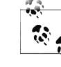

此图标表示提示、建议或普通注释。


此图标表示警告或注意。

## 辅助文件

本书的辅助文件[托管在 GitHub 上](https://github.com)。你可以在线查看或[本地下载 zip 包](https://github.com)。所有资源按章节分离，并包含了任何所需的库。书中的大多数示例也可以作为独立文件提供。

每当章节内部引用特定资源时，其格式将为 `assets/chapter_number/name`。

## 代码约定

在整本书中，我们将使用 `assert()` 和 `assertEquals()` 函数来演示变量的值或函数调用的结果。`assert()` 是指示特定变量解析为 `true` 的简写；这是一个常见的模式，在自动化测试中特别流行。`assert()` 两个参数：一个值和一个可选消息。如果值不等于 `true`，函数将抛出错误：

```javascript
var assert = function(value, msg) {
  if (! value ) {
    throw(msg || " does not equal true");
  }
};
```

`assertEquals()` 是指示一个变量等于另一个变量的简写。它的工作与 `assert()` 类似，但它接受两个值。如果值不等，测试将失败：

```javascript
var assertEquals = function(val1, val2, msg) {
  if (val1 != val2) {
    throw(msg || " does not equal " + val2);
  }
};
```

使用这些函数非常简单，正如下面的示例所示。如果断言失败，你将在浏览器控制台中看到错误消息：

```javascript
assert( true ); // 等同于 assertEquals()
assert( false === false );
assertEquals( 1, 1 );
```

我对 `assertEquals()` 稍微做了一点“糖衣处理”，因为在目前的情况下，除非对象在内存中共享相同的引用，否则对象比较将失败。解决方案是深度比较，我们在 `assets/ch00/deep_equality.html` 中包含了此类示例。

## jQuery 示例

书中的许多示例依赖于 jQuery，这是一个极其流行的 JavaScript 库，它简化了事件、DOM 遍历、操作和 Ajax。出于各种原因我决定这样做，但主要因为 jQuery 清晰地阐明了示例，并且更接近大多数人在现实世界中编写的 JavaScript。

如果你没有用过 jQuery，我强烈建议你去尝试。它有一个非常优秀的 API，为 DOM 提供了良好的抽象。附录 A 中包含了简短的 jQuery 入门指南。

## Holla

Holla 作为本书的配套应用，是一个 JS 群聊天应用。Holla 是一个很好的示例应用，因为它涵盖了书中涉及的各种最佳实践。其他方面，Holla 将向你展示如何：

- 使用 CSS3 和 HTML5 创建漂亮的界面
- 拖拽上传文件
- 使用 Less 布局代码
- 使用 WebSockets 向客户端推送数据
- 创建状态应用程序

从 Holla 的 GitHub 仓库下载代码。书中的许多示例取自 Holla；参见图 1。

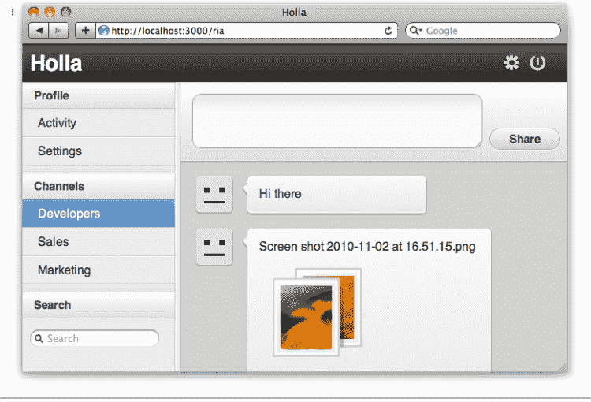

图 1. Holla，一个应用程序

## 作者说明

我在环游世界时写了这本书，有些是在非洲的小屋，有些在日本寺庙，有些在偏远的岛屿。简而言之，写这本书是一段很棒的经历，希望阅读它能带给你同样的快乐。

感谢技术评审人员，他们帮助塑造了这本书：Henrik Jort, Justin Meyer, Lea Verou, Ozzy Osman, Alex Barbara, Max Williams 以及 Julio Cesardy。

最重要的是，感谢我的父母的支持。

## Safari Books Online


Safari Books Online 是一个按需数字库，让你轻松搜索 7500 本技术书籍和视频以找到所需的答案。

订阅后，你可以在线阅读库中的任何页面或视频。在手机和移动设备上阅读书籍。在印刷前获取新书，并对开发中的稿提供反馈。复制代码示例、组织收藏、书签章节、创建笔记、下载章节、打印页面并受益于许多节省时间的特性。

O'Reilly Media 已本书上传到 Safari Books Online 服务。要完全数字访问本书以及 O'Reilly 其他出版者的类似主题，请在 http://www.safarookonline.com 注册。

## 如何联系我们

请将有关本书的意见和问题发送给出版社：

# 第1章
MVC 与类

## 早期阶段

JavaScript 开发的发展与其最初构想时的样子已经发生了巨大变化。人们很容易忘记这种语言从 Netscape 浏览器的最初实现，到如今像 Google V8 这样强大的引擎已经走了多远。这是一条充满坎坷的路，涉及重命名、合并以及最终的 ECMAScript 标准化。我们今天拥有的能力超出了早期创新者最疯狂的梦想。

尽管 JavaScript 成功并流行，但仍然被广泛误解。很少有人知道它是一种强大且动态的面向对象的语言。当他们了解到一些高级特性（如原型继承、模块和命名空间）时，会感到惊讶。那么，为什么 JavaScript 会被误解呢？

部分原因在于早期有很多错误的 JavaScript 实现，部分原因是因为这个名字——Java 前缀暗示它与 Java 有某种关系；而实际上，它是一门完全不同的语言。然而，我认为真正的原因是开发者接触这种语言的方式。对于 Python 和 Ruby 等其他语言，开发者通常会努力在书籍、录屏视频和教程的帮助下齐力学习这门语言。直到最近，JavaScript 还没有得到这种认可。开发者经常收到请求，要在现有代码中添加一些表单验证——可能是一个灯箱效果或照片库——而且通常时间紧迫。他们会从互联网上找一些脚本，用完就完事了，而对其背后的语言知之甚少。在有了这些基础的接触之后，他们中的甚至会将 JavaScript 加入到自己的简历中。

最近，JavaScript 引擎和浏览器变得如此强大，以至于使用 JavaScript 构建应用程序不仅可行，而且越来越流行。像 Gmail 和 Google Maps 这样的应用为完全不同的 Web 应用思维铺平了道路，用户也渴望着更多功能。公司正在招聘全职的 JavaScript 开发人员。JavaScript 不再是一个被局限于简单脚本和少量表单验证的子语言——它现在是一门完全独立的语言，发挥了它的全部潜力。

这种流行的涌入意味着许多新的 JavaScript 正在被构建。不幸的是，可能由于该语言的历史原因，许多应用程序的构建非常糟糕。出于某种原因，当涉及到 JavaScript 时，公认的模式和最佳实践就被抛之脑后。开发者忽略了像模型-视图控制器（MVC）模式这样的架构模型，而是将他们的应用程序混合成一团 HTML 和 JavaScript 的乱汤。

本书不会教你太多关于 JavaScript 语言本身的知识——其他书籍更适合这些，例如 Douglas Crockford 的《JavaScript: The Good Parts》（O'Reilly）。然而，本书将向你展示如何构建和构建复杂的 JavaScript 应用，让你能够创造惊人的 Web 体验。

## 添加结构

构建大型 JavaScript 应用的秘诀在于不要构建大型 JavaScript 应用。相反，你应该将应用程序解耦为一系列相当独立的组件。开发者经常犯的错误是创建具有许多相互依赖关系的应用程序，通过巨大的 JavaScript 文件生成一系列 HTML 标签。这类应用程序难以维护和扩展，因此应该不惜一切地避免。

在开始构建应用程序时，稍微关注应用程序的结构就能对最终结果产生巨大影响。忽略对 JavaScript 的任何固有观念，把它当成真正的面向对象语言来对待。使用类、对象和模式的方式，就像你在使用 Python 或 Ruby 等其他语言构建应用程序时一样。架构对于服务器端应用至关重要，那么为什么不能同样适用于客户端应用呢？

本书提倡的方法是 MVC 模式，一种经过测试的应用程序架构方法，可以确保它们能够得到有效的维护和扩展。它也是特别适用于 JavaScript 应用的模式。

## 什么是 MVC？

MVC 是一种设计模式，将应用程序分为三个部分：模型（Model）、表示层（View）和用户交互层（Controller）。换句话说，事件流如下：

1. 用户与应用程序交互。
2. 控制器的事件处理程序触发。
3. 控制器从模型请求数据，并将其交给视图。
4. 视图向用户展示数据。

或者，举一个真实的例子，图 1-1：

图 1-1. 发送新消息

1. 用户与应用程序交互。
2. 控制器的事件处理程序触发。
3. 控制器从模型请求数据，并将其交给视图。
4. 视图向用户展示数据。

MVC 可以在不使用框架的情况下实现。关键在于划分职责。让我们详细探索 MVC 的组件。

## 模型

模型是存储所有数据的地方。例如，我们可能有一个包含属性的 User（用户）。模型将在第 3 章中更深入地探讨，该章节将涵盖从服务器加载数据以及创建反序列化映射等主题。

## 视图

视图层是呈现给用户以及用户交互的内容。在 JavaScript 应用中，视图由 HTML、CSS 和 JavaScript 模板组成。除了模板中简单的条件语句外，视图不应包含任何逻辑。

事实上，模型也应该与应用程序的其他部分解耦。视图不应该知道控制器和模型的任何信息——它们应该是独立的。将视图与逻辑混合是通往灾难的径。这并不是说 MVC 不允许表示逻辑——只要它不是定义在视图内部即可。表示逻辑位于所谓的辅助函数（helpers）中：专门用于与视图相关的小型工具函数的脚本。

因此，而不是这样：

```javascript
var user = users["foo"];
destroyUser(user);
```

我们可以这样做：

```javascript
var user = User.find("foo");
user.destroy();
```


```javascript
own// helper.js
var helper = {};
helper.formatDate = function(){ /* ... */ };

// template.html
<div>
${helper.formatDate(this.date)}
</div
```

此外，所有的表现逻辑都命名在 `helper` 变量下，这防止了冲突并保持了代码的整洁和可扩展性。

不必过多担心关于视图和模板的细节——我们将在第 5 章中详细介绍。本节的目的是让你熟悉视图是如何与 MVC 架构模式关联的。

# 控制器 (The Controller)

控制器是模型和视图之间的胶水剂。控制器从视图接收事件和输入，处理这些输入（可能涉及模型），并相应地更新视图。控制器会在页面加载时为视图添加事件监听器，例如检测表单提交或按钮点击。然后，当用户与你的应用程序交互时，事件会触发控制器内部的动作。

你不需要任何特殊的库或框架来实现控制器；这里有一个使用原生 jQuery 的示例：

```javascript
var Controller = {};

// 使用匿名函数封装作用域
(Controller.users = function($) {

  var nameClick = function(){
    /* ... */
  });

  // 在页面加载时添加事件监听器
  $(function(){
    $("#view .name").click(nameClick);
  });
}(jquery));
```

我们正在创建一个命名在 `Controller` 变量下的用户控制器。然后，我们使用匿名函数来封装作用域，防止全局作用域被污染。当页面加载时，我们为视图元素添加了点击事件监听器。

如你所见，控制器不需要库或框架。然而，为了符合 MVC 的架构要求，它们必须与模型和视图分离。控制器和状态将在第 4 章中进行更详细的介绍。

# 迈向模块化：创建类 (Toward Modularity, Creating Classes)

在进入 MVC 的细节之前，我们将介绍一些基础概念，例如 JavaScript 类（classes）和事件。这将为你在学习一些更高级的概念之前奠下坚实的基础。

JavaScript 对象字面量对于静态类来说是没问题的，但创建具有继承和实例的经典类通常很有用。需要强调的是，JavaScript 是一种原型语言，并不包含原生的类实现。不过，可以很容易地模拟这种支持。

JavaScript 中的类经常声誉不佳，被批评为不是“JavaScript 方式”的一部分，而这个术语基本上没有任何意义。在结构化方法论或继承模式方面，jQuery 实际上是毫无用的。这可能导致 JavaScript 开发者认为他们不应该考虑结构——即类是不可用的或不应该被使用的。事实上，类只是另一种工具，作为一个实用主义者，我相信它们在 JavaScript 中的用法与其他任何其他现代语言是一样的。

相比于类定义，JavaScript 拥有构造函数（constructor functions）和 `new` 运算符。构造函数可以在实例化时指定对象的初始属性和值。任何 JavaScript 函数都可以用构造函数。我们使用 `new` 运算符配合构造函数来创建新实例。

`new` 运算符会改变函数的上下文，并改变 `return` 语句的行为。在实践中，使用 `new` 和构造函数与具有原生类实现的语言非常相似：

```javascript
var Person = function(name) {
  this.name = name;
}

// 实例化 Person
var alice = new Person('alice');
```

按照惯例，构造函数通常使用驼峰命名法，以区别于普通函数。这很重要，因为你永远不想在没有 `new` 前缀的情况下调用构造函数。

-   不要这样做！
Person('bob'); // => undefined

该函数将返回 `undefined`，由于上下文是全局（window）对象，你无意中创建了一个全局变量 `name`。请始终使用 `new` 关键字调用构造函数。

当使用 `new` 关键字调用构造函数时，上下文会从全局（window）切换到特定于该实例的新空上下文。因此，`this` 关键字指向当前实例。虽然听起来很复杂，但在实践中，你可以像对待其他语言中的原生类实现一样对待它。

默认情况下，你不需要从构造函数返回任何内容，将返回 `this`——当前的上下文。否则，你可以返回任何非原始类型。例如，你可以返回一个设置新类的函数，这是构建我们类模拟库的第一步：

```javascript
var Class = function() {
  var klass = function() {
    this.init.apply(this, arguments);
  };
  klass.prototype.init = function() {
    return klass;
  };
};

var Person = new Class;

```

```javascript
Person.prototype.init = function() {
  // 在 Person 实例化时被调用
};
```

```javascript
// 使用：
var person = new Person;
```

令人困惑的是，由于一个从未实现的 JavaScript 2 规范，`class` 是一个保留关键字。通用的惯例是将类变量命名为 `_class` 或 `klass`。

## 为类添加函数

向构造函数添加类函数与在 JavaScript 中向任何对象添加属性（property）是一致的：

```javascript
Person.find = function(id) { /*...*/ };
```

要向构造函数添加实例，你需要使用构造函数的原型（prototype）：

```javascript
Person.prototype.breath = function() { /*...*/ };
```

```javascript
var person = new Person;
person.breath();
```

一种常见的模式是将类的原型别命名为 `fn`，这样写起来会稍微简洁一点：

```javascript
Person.fn = Person.prototype;
```

```javascript
Person.fn.run = function() {/*...*/ };
```

事实上，我们现在已经有了对模块的支持。模块是可复用的代码段，它们可以作为继承的替代方案，用于在类之间共享常用属性。

```javascript
var ORMModule = {
  save: function()
  // 共享函数
}
```


```javascript
}
var Person = new Class;
var Asset = new Class;

Person.include(ORMModule);
Asset.include(ORMModule);
```

## 使用原型实现类继承

我们已经大量使用了原型（prototype），但还没有对其进行真正的解释。让我们仔细观察它到底是什么，以及如何使用它在类中实现某种形式的继承。

JavaScript 是一种基于原型的语言——而不是在类和实例之间做出区分——它具有“原型对象”的概念：一个作为模板来获取新对象初始属性的对象。任何对象都可以作为另一个对象的原型，并共享其属性。在实践中，你可以将其视为一种继承形式。

当你从对象上获取属性时，JavaScript 会在本地对象中搜索该属性。如果没找到，JavaScript 将开始搜索对象的原型，并继续沿着原型链向上查找，最终到达 `Object.prototype`。如果找到了该属性，则返回其值；否则将返回 `undefined`。

换句话说，如果你开始向 `Array.prototype` 添加属性，这些属性将反映在每一个 JavaScript 数组上。要子类一个类并继承它的属性，你需要首先定义一个构造函数。然后，你需要将父类的一个新实例赋值为你的构造函数的原型。它看起来像：

```javascript
var Animal = function(){};
```

```javascript
Animal.prototype.breath = function(){
  console.log('breath');
};
```

```javascript
var Dog = function(){};
```

```javascript
// Dog 继承自 Animal
Dog.prototype = new Animal;
```

```javascript
Dog.prototype.wag = function(){
  console.log('wag tail');
};
```

现在，我们可以检查继承是否生效：

```javascript
var dog = new Dog;
dog.wag();
dog.breath(); // 继承的属性
```

## 为我们的类库添加继承

让我们为自定义的类库添加继承。我们在创建新类时将传递一个可选的父类：

```javascript
var Class = function(parent){
  var klass = function(){
    this.init.apply(this, arguments);
  }

  // 修改 klass 的原型
  if (subclass) {
    var subclass = function() { };
    subclass.prototype = parent.prototype;
    klass.prototype = new subclass;
  }

  klass.prototype.init = function(){};

  // 快捷方式
  klass.fn.parent = klass;
  klass.super = klass.__proto__;

  /* include/extend 代码... */

  return klass;
}
```

如果向 `Class` 构造函数传递了父类，我们确保任何子类都共享该原型。这种创建临时匿名函数的技巧防止了在类被继承时创建实例。这里的缺陷在于，只有实例属性被继承，而不是类属性。目前还没有一种跨浏览器的方法来显示对象的 `__proto__`。像 Super.js 这样的库通过复制属性而不是实现真正的继承来解决这个问题。

现在，我们可以通过向 `Class` 传递父类来执行简单的继承：

```javascript
var Animal = new Class({
Animal.include({
  breath: function(){
    console.log('breath');
  }
});

var Cat = new Class(Animal)
```

```javascript
// 使用方法
var tommy = new Cat;
tommy.breath();
```

## 函数调用

和 JavaScript 中的其他一切一样，函数仅仅是对象。然而，与其他对象不同，它们是可以被调用的。函数内部的上下文（即 `this` 的值）取决于它在何处以及如何被调用。

除了使用括号外，还有两种调用函数的方法：`apply()` 和 `call()`。它们之间的区别在于如何处理你想传递给函数的参数。

`apply()` 函数接收两个参数：一个上下文和一个参数数组。如果上下文为 `null`，则使用全局上下文。例如：

```javascript
function.apply(this, [1, 2, 3]);
```

`call()` 函数具有完全相同的行为，但它的用法不同。第一个参数是上下文，随后的每个参数都委托给调用。换句话说，你使用多个参数——而不是像 `apply()` 那样的数组——将参数传递给函数。

```javascript
function.call(this, 1, 2, 3);
```

你为什么要想要改变上下文？这是一个很好的问题，因为语言在不允许显式更改上下文的情况下运行得很好。JavaScript 使用上下文来共享状态，特别是在处理事件回调时。（我个人觉得这是该语言设计中的一个错误，因为现在要改变它太晚了，所以你需要学习它是如何工作的。）

jQuery 在其整个 API 中利用 `apply()` 和 `call()` 来更改上下文——例如，在使用事件处理程序或使用 `each()` 迭代时。起初可能会令人困惑，但当你理解了发生了什么时，它是非常有用的：

```javascript
$('.click').click(function() {
  // this 指向元素
  $(this).hide();
});

$('.').each(function() {
  // this 指向当前的迭代
  $(this).remove();
});
```

为了访问原始上下文，一种模式是将 `this` 的值存储在局部变量中。例如：

```javascript
var clicky = {
  wasClicked: function() {
    /* */
  };
},

addListeners: function() {
  /* ... */
}
```（注：提供的 OCR 文本末尾包含重复循环，我已经根据提供的唯一片段清理了逻辑流。）


## 添加私有函数

到目前为止，我们在类中添加的任何属性对外界开放，并且可以随时更改。现在，让我们探索如何向类中添加私有属性。

许多开发者使用下划线 (_ ) 作为私有属性的前缀。虽然这些属性仍然可以被更改，但它们明显地表明自己是私有 API 的一部分。我尝试尽量避免这种方法，因为它看起来相当丑。

JavaScript 确实支持不可变属性；然而，这并没有在所有浏览器中实现，因此在在使用这种方法之前我们还需要等待。相反，我们将使用 JavaScript 匿名函数创建一个私有作用域，该作用域只能在内部访问：

```javascript
var Person = function(){

(function() {
  var findById = function() { /*...*/ };

  Person.find = function(id) {
    if (typeof id == "integer")
      return findById(id);
  };
})();
}
```

我们将类的属性封装在一个匿名函数中，然后创建局部变量 (findById)，这些变量只能在当前作用域内访问。Person 变量定义在全局作用域中，因此可以从任何地方访问。

永远不要在不使用 var 操作符的情况下定义变量，因为总是总是创建一个全局变量。如果你需要定义全局变量，请在全局作用域中定义或作为 window 的属性进行定义。

```javascript
(function(exports){
  var foo = "bar";

  // 暴露变量
  exports.foo = foo;
})(window);

assertEqual(foo, "bar");
```

## 类库

正如书中的许多概念一样，理解类背后的理论是好的，但在实践中，你通常会使用库。jQuery 不原生支持类，但可以通过像 HJS 这样的插件轻松添加。HJS 允许通过向 $.Class.create 传递一组属性来定义类：

```javascript
var Person = $.Class.create({
  // 构造函数
  initialize: function(name) {
    this.name = name;
  }
});
```

要继承类，在创建时将父类作为参数传递：
```javascript
var Student = $.Class.create(Person, {
  price: function() { /*...*/ }
});
```

```javascript
var alex = new Student("Alex");
alex.pay();
```

要添加属性，直接将其设置在类上：
```javascript
Person.find = function(id) { /*...*/ };
```

HJS 的 API 包含了几个工具函数，它们是 clone() 和 equal() 的灵感：

```javascript
var alex = new Student("Alex");
var bill = alex.clone();
```

```javascript
assert(alex.equal(bill));
```

HJS 不是你唯一的选择，Spine 也有类的实现。要使用它，请在页面中引入 spine.js：

```html
<script src="http://macman.github.com/spine/spine.js"></script>
<script>
var Person = Spine.Class.create();

Person.extend({
  find: function() { /*...*/ }
});

Person.include({
  init: function(attrs) {
    this.attributes = attrs || {};
  }
});

var person = Person.init();
</script>
```

Spine 的类 API 与我们在整个章节中构建的库相似。使用 extend() 添加类属性，使用 include() 添加实例属性。要进行继承，请将父类传递给 Spine.Classantiator。

如果你将目光扩大到 jQuery 之外，Prototype 绝对值得检查。它有一个出色的类 API，是许多其他库的灵感。

jQuery 的 John Resig 写了一篇关于实现库经典继承的有趣文章。它非常值得阅读，特别是如果你对 JavaScript 原型系统背后的细节感兴趣。

# 第 2 章

## 事件与观察

事件是你的 JavaScript 应用的核心，驱动着一切，并在用户与你的应用程序交互时提供第一个接触点。然而，这正是 JavaScript 非标准化的诞生暴露其丑陋之处。在浏览器战争的高峰时期，Netscape 和微软故意选择了不兼容的事件模型。尽管它们后来被 W3C 标准化，但 Internet Explorer 直到最新的发布版本 IE9 都保留了其不同的实现。

幸运的是，我们有像 jQuery 和 Prototype 这样优秀的库来平息这些混乱，为你提供一个适用于所有事件实现的 API。了解背后发生的事情是值得的，因此我在这里介绍各种流行库的 W3C 模型。

## 监听事件

事件围绕一个名为 addEventListener() 的函数展开，它接受三个参数：type（例如 click）、listener（即回调函数）和 useCapture（我们稍后会介绍）。使用前两个参数，我们可以将函数附加到 DOM 元素上，当该元素上触发特定事件（如点击）时，该函数会被调用：

```javascript
var button = document.getElementById("createButton");

button.addEventListener("click", function() { /*...*/ }, false);
```

我们可以使用 removeEventListener() 移除监听器，传递与 addEventListener 相同的参数。如果监听器是匿名的且没有它的引用，则在不销毁元素的情况下无法移除：

```javascript
var div = document.getElementById("div");

var listener = function(event) { /*...*/ };
div.addEventListener("click", listener, false);
div.removeEventListener("click", listener, false);
```

（注：原文中存在多处重复段落，已根据要求去重，仅翻译一次）


反映事件执行时环境的属性：

- button
  指示按了哪个（或哪些）鼠标按钮的值

- ctrlKey
  表示是否按下了 Ctrl 键的布尔值

- altKey
  表示是否按下了 Alt 键的布尔值

- shiftKey
  表示是否按下了 Shift 键的布尔值

- metaKey
  表示是否按下了 Meta 键的布尔值

键盘事件特定的属性：

- isChar
  表示事件是否包含键字符的布尔值

- charCode
  按下的按键的 Unicode 值（仅用于 keypress 事件）

- keyCode
  非字符按键的 Unicode 值

- which
  按下的按键的 Unicode 值，无论其是否为字符

事件发生的位置：

- pageX, pageY
  相对于页面（即视口）的事件坐标

- screenX, screenY
  相对于屏幕的事件坐标

与事件相关的元素：

- currentTarget
  在泡泡阶段内的当前 DOM 元素

- target, originalTarget
  原始 DOM 元素

- relatedTarget
  参与事件的另一个 DOM 元素（如果有）

这些属性在不同的浏览器中有所异，特别是是不符合 W3C 标准的浏览器。幸运的是，jQuery 和 Prototype 等库会平滑这些差异。

## 事件库

很有可能你最终会使用一个 JavaScript 库来进行事件管理——否则，浏览器之间的不性实在太多。我将向你展示如何使用 jQuery 的事件管理 API，尽管还有许多其他选择，例如 Prototype、MooTools 和 YUI。请参考它们各自的 API 获取深度文档。

jQuery 的 API 有一个用于跨浏览器事件监听器的 bind() 函数。在 jQuery 实例上调用此函数，传入事件名称和处理器：

```javascript
jQuery("#element").bind(eventName, handler);
```

例如，你可以在元素上注册一个点击处理器：

```javascript
jQuery("#element").bind("click", function(event) {
  // ...
});
```

jQuery 为 click、submit 和 mouseover 等事件类型提供了一些快捷方法。它们看起来像这样：

```javascript
jQuery("#myDiv").click(function() {
  // ...
});
```

注意的是，在开始向元素添加事件之前，该元素必须已经存在——也就是说，你应该在页面加载后执行此操作。你只需要监听窗口的 load 事件，然后开始添加监听器：

```javascript
jQuery(window).bind("load", function() {
  $("#signinForm").submit(checkForm);
});
```

然而，有一个 window's load 更好的可以监听的事件，那就是 DOMContentLoaded。它在 DOM 准备绪时触发，在页面图像和样式表下载之前触发。这意味着事件总会在用户与页面交互之前触发。

DOMContentLoaded 事件并不是每个浏览器中都支持，因此 jQuery 使用一个 ready() 函数对其进行了抽象，该函数具有跨浏览器支持：

```javascript
jQuery.ready(function() {
  $("#myForm").bind("submit", function() { /* ... */ });
});
```

事实上，你可以跳过 ready() 函数，直接将处理器传递给 jQuery 对象：

```javascript
jQuery(function() {
  // 当页面就绪时调用
});
```

## 上下文切换

关于事件，经常让人困惑的一点是处理器在被调用时上下文是如何变化的。当使用浏览器原生 addEventListener() 时，上下文会从本地切换到目标 HTML 元素：

```javascript
new function() {
  this.appName = "wem";

  document.body.addEventListener("click", function(e) {
    // 上下文已改变，所以 appName 将为 undefined
    alert(this.appName);
  }, false);
};
```

为了保留原始上下文，将处理器封装在一个匿名函数中并保留对它的引用。我们在第 1 章中介绍过这种模式，当时我们使用一个代理函数来维护当前上下文。这是一个常用模式，jQuery 包含一个 proxy() 函数——只需在你希望它被调用的函数和上下文中使用它即可：

```javascript
$("#signform").submit(.proxy(function() { /* ... */ }, this));
```

## 事件委托

你可能已经注意到，由于事件会向上泡泡，我们只需要在父元素上添加监听器并检查事件即可。这正是 SproutCore 等框架减少应用程序中事件监听器数量的技巧：

```javascript
// 在 ul 列表上委托事件
list.addEventListener("click", function(e) {
  if (e.currentTarget.tagName == "li") {
    /* ... */
    return false;
  }
}, false);
```

jQuery 有一种非常棒的方法来实现这一点：只需向 delegate() 函数传递一个子选择器、事件类型和处理器。这种方法的替代方案是为每个 li 添加点击事件。然而，通过使用 delegate()，你减少了事件监听器的数量，提升了性能：

```javascript
// 不要这样做！这为每个 'li' 元素添加了监听器（开销大）
$("ul li").click(function() { /* ... */ });
```

```javascript
// 这只添加了一个事件监听器
$("ul").delegate("li", "click", /* ... */);
```

事件委托的另一个优势是，动态添加到元素中的任何子元素仍然具有事件监听器。因此，在上面的示例中，页面加载后添加到列表的任何 li 元素仍然调用点击处理器。

## 自定义事件

除了原生事件，你还可以创建自己的自定义事件。这对于应用程序不同部分之间的通信非常有用。

要触发自定义事件，使用 trigger() 方法：

```javascript
$("#element").trigger("myEvent", { data: "value" });
```

监听自定义事件，使用与原生事件相同的方法：

```javascript
$("#element").bind("myEvent", function(event) {
  console.log(event.data.value);
});
```

你还可以使用命名空间来管理绑定到同一事件类型的多个处理器：

```javascript
$("#element").bind("click.plugin", function() {
  // 插件处理器
});

$("#element").off("click.plugin"); // 仅移除插件处理器
```


```javascript
));

// 绑定到自定义事件
element.bind("change.tabs", function(e, tagName){
  element.find("li").removeClass("active");
  element.find("[data-tab=" + tagName + "]");
});

// 激活第一个标签
var firstName = element.find("li:first").attr("data-tab");
element.trigger("change.tabs", firstName);

return this;
} // 从 ; 修正而来
```

看看使用自定义事件处理器后代码变得整洁了多少？这意味着我们可以拆分标签切换处理器，而且它具有让插件更易扩展的优势。例如，我们现在可以通过在观察的列表上触发 `change.tabs` 事件来程序化地更改标签：

```javascript
$("#tabs").trigger("change.tabs", "users");
```

我们还可以将标签与窗口的 hash 绑定，添加后退按钮支持：

```javascript
$("#tabs").bind("change.tabs", function(e, tagName){
  window.location.hash = tagName;
});
```

```javascript
$(window).bind("hashchange", function() {
  var tagName = window.location.hash.slice(1);
  $("#tabs").trigger("change.tabs", tagName);
});
```

我们使用自定义事件为他人扩展我们的工作提供了很大的空间。

## 非 DOM 事件

基于事件的编程非常强大，因为它解耦了你的应用程序架构，从而实现了更好的自包含性和可维护性。不过，事件并不限于 DOM，所以你可以轻松地编写自己的事件处理器库。这种模式被称为发布/订阅（Publish/Subscribe），是一个非常值得熟悉的模式。

发布/订阅，或称为 Pub/Sub，是一种包含两个参与者的消息模式：发布者和订阅者。发布者向特定通道发布消息，订阅者订阅通道，并在新消息发布时接收通知。这里的关键在于，发布者和订阅者是完全解耦的——他们不知道对方的存在。他们唯一共享的只是通道名称。

发布者和订阅者的解耦允许你的应用程序不断增长，而不会引入大量的依赖关系和耦合，从而提高了维护便利性并添加了额外功能。

那么，在应用程序中到底如何实现 Pub/Sub 呢？你只需要记录与事件关联的处理器，然后一种调用它们的方法。这是一个示例 PubSub 对象，你可以用它来添加和触发事件监听器：

```javascript
var PubSub = {
  subscribe: function(ev, callback) {
    // 创建回调对象，除非它已经存在
    var calls = this._callbacks || (this._callbacks = {});

    // 为给定的事件键创建一个数组，如果它不存在，
    // 将回调添加到数组中
    (this._callbacks[ev] || (this._callbacks[ev] = [])).push(callback);
    return this;
  },

  publish: function() {
    // 将参数对象转换为切片数组
    var args = Array.prototype.slice.call(arguments, 0);

    // 提取第一个参数，即事件名
    var ev = args.shift();

    // 如果没有 _callbacks 对象，或者
    // 不包含给定事件的数组，则返回
    var list, calls, i, l;
    if (!(calls = this._callbacks)) return this;
    if (!(list = this._callbacks[ev])) return this;

    // 调用回调
    for (i = 0, l = list.length; i < l; i++) {
      list[i].apply(this, args);
    }
    return this;
  }
};

// 使用示例
PubSub.subscribe("wem", function() {
  alert("wem!");
});

PubSub.publish("wem");
```

你可以通过分隔符（如冒号 `:`）来对事件命名命名：
`PubSub.subscribe("user:create", function(){ /* ... */ });`

如果你正在使用 jQuery，Ben Alman 提供了一个更简单的库。事实上它非常简单，以至于我们可以将其内联 Tiny：

```javascript
/*
* jQuery Tiny Pub/Sub - v0.3 - 11/4/2010
* http://benelman.com/
* Copyright (c) 2010 'Cowboy' Ben Alman
* 根据 MIT 和 GPL 协议双重许可
* http://benelman.com/about/license/
/

(function() {
  var o = $({});

  $.subscribe = function () {
    o.bind.apply(o, arguments);
  };

  $.unsubscribe = function() {
    o.unbind.apply(o, arguments);
  };

  $.publish = function () {
    o.trigger.apply(o, arguments);
  };
}(jQuery);
```

该 API 接收的参数与 jQuery 的 `bind()` 和 `trigger()` 函数相同。唯一的区别是函数直接位于 jQuery 对象上，并且被称为 `publish()` 和 `subscribe()`：

```javascript
$.subscribe("/some/topic", function(event, a, b, c) {
  console.log(event.type, a + b + c);
});

$.publish("/some/topic", "a", "b", "c");
```

我们一直在使用 Pub/Sub 处理全局事件，但将其范围化也同样简单。让我们取之前创建的 PubSub 对象并将其范围化到一个对象中：

```javascript
// 添加 PubSub
var myPubSub = Object.create(PubSub);

// 现在使用它
myPubSub.subscribe("test", function() {
  // ...
});
```

（注：原文中存在大量重复的段落，根据指令“不要重复输出原文”，此处仅保留核心逻辑并进行去重。）


JavaScript 数据类型。这个额外层的优势是，我们可以通过添加自定义的函数和属性来增强基础数据的功能。这使我们能够在添加诸如验证、观察者、持久化和服务器回调的同时，仍然能够复用大量代码。

## 原型继承

我们将使用 `Object.create()` 来构建 ORM，这与我们在第 1 章中介绍的基于类（class-based）示例有些不同。这将允许我们使用基于原型继承，而不是使用构造函数和 `new` 关键字。

`Object.create()` 接收一个参数，即原型对象，并返回一个带有指定原型对象的新对象。换句话说，如果你给它一个对象，它会返回一个新对象，该新对象继承自你指定的对象。

`Object.create()` 最近被添加到 ECMAScript 第 5 版中，因此在某些浏览器（如 IE）中尚未实现。然而，这并不是问题，因为如果满足条件，我们可以轻松添加支持：

```javascript
if (typeof Object.create !== "function") {
  Object.create = function(o) {
    function F() {
      F.prototype = o;
      return new F();
    }
  };
}
```

上面的示例取自 Douglas Crockford 关于原型继承的文章。如果你想了解关于 JavaScript 原型和继承背后的更深入的解释，可以查阅它。

我们将创建一个 `Model` 对象，它将负责创建新的模型和实例：

```javascript
var Model = {
  inherited: function(){},
  created: function(){},

  prototype: {
    init: function(){}
  },

  create: function(){
    var object = Object.create(this);
    object.parent = this;
    object.prototype = object.fn = Object.create(this.prototype);

    object.created();
    this.inherited(object);
    return object;
  }
},
```

```javascript
init: function() {
  var instance = Object.create(this.prototype);
  instance.parent = this;
  instance.init.apply(instance, arguments);
  return instance;
}
```

如果你不熟悉 `Object.create()`，这看起来可能很望而却步，让我们拆解一下。`create()` 函数返回一个继承自 `Model` 对象的新对象；我们将用它来创建新模型。`init()` 函数返回一个继承自 `Model.prototype` 的新对象——即 `Model` 对象的实例：

```javascript
var Asset = Model.create();
var User = Model.create();
var user = User.init();
```

## 添加 ORM 属性

现在，如果我们向 `Model` 添加属性，它们将出现在所有继承它的模型中：

```javascript
// 添加对象属性
jQuery.extend(Model, {
  find: function(){
});

// 添加实例属性
jQuery.extend(Model.prototype, {
  init: function(atts) {
    if (atts) this.load(atts);
  },

  load: function(attributes) {
    for (var name in attributes) {
      this[name] = attributes[name];
    }
  }
});
```

`jQuery.extend()` 只是手动对属性进行循环遍历的一种简写方式，这与我们在 `load()` 函数中执行的操作类似。现在，我们的对象属性和实例属性正在向下传播到各个模型中：
assertEqual(typeof Asset.find, "function");

事实上，我们将添加很多属性，所以我们不妨 `extend()` 和 `include()` `Model` 对象的一部分：

```javascript
var Model = {
  /* 略略 ... */
  extend: function(o) {
    var extended = o.extended;
    jQuery.extend(this, o);
    if (extended) extended(this);
  },

  include: function(o){
    var included = o.included;
    jQuery.extend(this.prototype, o);
    if (included) included(this);
  };
};
```

```javascript
// 添加对象属性
Model.extend({
  find: function() {}
});
```

```javascript
// 添加实例属性
Model.include({
  init: function(atts) { /* ... */ },
  load: function(attributes) { /* ... */ }
});
```

现在，我们可以创建新的资产并设置一些属性：

```javascript
var asset = Asset.init({"name": "foo.png"});
```

## 持久化记录

我们需要一种持久化记录的方法——即保存已创建实例的引用，以便以后访问它们。我们将使用设置在 `Model` 上的 `records` 对象来实现。当我们保存一个实例时，将其添加到该对象中；当删除实例时，将其从对象中移除：

```javascript
// 一个已保存资产的对象
Model.records = {};
```

```javascript
Model.include({
  newRecord: true,

  create: function(){
    this.newRecord = false;
    this.parent.records[this.id] = this;
  },

  destroy: function(){
    delete this.parent.records[this.id];
  }
});
```

更新现有实例呢？很简单——只需更新对象引用即可：

```javascript
Model.include({
  update: function(){
    this.parent.records[this.id] = this;
  }
});
```

让我们创建一个方便函数来保存实例，我们不需要检查实例是否已保存，或者它是否需要保存：

```javascript
Model.include({
  save: function(){
    if (this.newRecord) {
      this.create();
    } else {
      this.update();
    }
  }
});
```

关于获取实例，我们需要通过 ID 查找：

```javascript
Model.include({
  find: function(id) {
    return this.parent.records[id];
  }
});
```


如果你正在显示分页列表，为什么不预加载下一页并让过渡瞬时完成呢？或者，更好的方法是直接显示一个滚动列表，并在列表滚动时自动加载并插入数据（无限滚动模式）。用户感到的延迟越低就越好。

当你获取新数据时，请确保 UI 不会被阻塞。显示某种形式的加载指示器，但要确保界面仍然可用的。只有极少数（如果有的话，根本没有）场景需要阻塞 UI。

数据可以存在于初始页面中，也可以通过 Ajax 或 JSONP 使用单独的 HTTP 请求加载。就我个人而言，我推荐后两种技术，因为包含数据列表会增加页面大小，而并行请求加载速度更快。AJAX 和 JSON 还允许你缓存 HTML 页面，而不是为每个请求都动态渲染它。

## 内联包含数据 (Including Data Inline)

由于我在上一段中提到的原因，我并不依赖这种方法，但在特定情况下它是很有用的，特别是对于加载极少的数据量。这种技术的优点是实现起来非常简单。

你所做的只是将一个 JSON 对象直接渲染到页面中。例如，在 Ruby on Rails 中你可以这样操作：

```ruby
<script type="text/javascript">
var User = {};
User.records = <%= @users.to_json %>;
</script>
```

我们使用 ERB 标签来输出用户数据的 JSON 解释。`raw` 方法仅仅是为了防止 JSON 被转义。当页面被渲染时，生成的 HTML 如下：

```html
<script type="text/javascript">
var User = {};
User.records = [{"first_name": "Alex"}];
</script>
```

JavaScript 可以原封地评估该 JSON，因为它的结构与 JavaScript 对象相同。

## 使用 Ajax 加载数据 (Loading Data with Ajax)

当你有后台请求时，这可能是你首先想到的加载数据的方法，而且这很有道理：它是经过尝试、测试的，并且受到了所有现代浏览器的支持。但并不是说 Ajax 没有缺点——它非标准的历史导致了 API 不一致，而且由于浏览器的安全限制，从不同域加载数据是比较棘手的。

如果你需要一份关于 Ajax 和 `XMLHttpRequest` 类的简要入门指南，请阅读 Mozilla 开发者的文章“入门”。在很大情况下，你最终会使用像 jQuery 这样的库，它抽象了 Ajax 的 API，处理了浏览器之间的差异。正因如此，我们在这里将介绍 jQuery 的 API，而不是原始的 `XMLHttpRequest` 类。

jQuery 的 Ajax API 由一个低级函数 `jQuery.ajax()` 和它的几个高级抽象组成，这减少了你需要编写的代码量。`$.ajax()` 接收一个包含请求参数、内容类型和回调等设置的哈希（hash）。一旦你调用该函数，请求就会在后台异步发送。

- **url**: URL 所在。默认值为当前页面。
- **success**: 请求成功时被调用的函数。从服务器返回的任何数据将作为参数传递。
- **contentType**: 设置请求的 `Content-Type` 头部。如果请求包含数据，默认值为 `application/x-www-form-urlencoded`，这对于大多数情况都是的。
- **data**: 要发送到服务器的数据。如果它不是字符串，jQuery 将对其进行序列化和 URL 编码。
- **type**: 使用的 HTTP 方法：GET、POST 或 DELETE。默认值是 GET。
- **dataType**: 你期望从服务器返回的数据类型。jQuery 需要知道这一点，以便它知道如何处理结果。如果你没有指定 `dataType`，jQuery 将根据响应的 MIME 类型进行一些智能猜测。支持的值有：
    - **text**: 纯文本响应；不需要处理。
    - **script**: jQuery 将响应作为 JavaScript 进行评估。
    - **json**: jQuery 将响应作为 JSON 进行评估，使用严格解析器。
    - **jsonp**: 对于 JSON 响应，我们稍后详细介绍。

例如，让我们做一个简单的 Ajax 请求，它会提醒服务器返回的任何数据：

```javascript
jQuery.ajax({
  url: "ajax/endpoint",
  type: "GET",
  success: function(data) {
    alert(data);
  }
});
```

然而，所有这些选项都有点冗长。幸运的是，jQuery 有几个快捷方式。
`jQuery.get()` 接收一个 URL 以及可选的数据和回调：

```javascript
jquery.get("/ajax/endpoint", function(data){
  $("#ajaxResult").text(data);
});
```

或者，如果我们想在 GET 请求中发送几个查询参数：

```javascript
jquery.get("/ajax/endpoint", {foo: "bar"}, function(data){
  /* ... */
}
```

如果我们期望从服务器获取 JSON，我们需要改用 `jQuery.JSON()`，它会将结果的 `dataType` 选项设置为 "json"：

```javascript
jquery.JSON("/json/endpoint", function(json){
  /* ... */
}
```

同样，还有一个 `jQuery.post()` 函数，它也接收 URL、数据和回调：

```javascript
jquery.post("/users", {first_name: "Alex"}, function(result){
  /* AJAX POST 成功了 */
});
```

如果你想使用其他 HTTP 方法——DELETE、HEAD 和 OPTIONS——你将不得不使用更低级的 `jQuery.ajax()` 函数。

这是对 jQuery Ajax API 的简要概述，但如果你需要更多信息，请阅读完整文档。

Ajax 的局限性是同源策略（same origin policy），它限制了请求到同源域。虽然同源策略对于 Web 的安全至关重要，但对于尝试访问远程资源的开发者来说很不方便。其他技术（如 Flash 和 Java）已经实现了解决问题的方法，现在 Ajax 通过一个名为 CORS（跨源资源共享）的标准来追赶。CORS 允许你突破同源策略。

CORS 跨器的支持情况：

- IE >= 8（有权限制）
- Firefox >= 3
- Safari: 完全支持
- Chrome: 完全支持
- Opera: 不支持

使用 CORS 极其简单。如果你想授权访问你的服务器，只需在响应的 HTTP 头部中添加几行：

```
Access-Control-Allow-Origin: example.com
Access-Control-Request-Method: GET,POST
```

上述头部将授权来自 example.com 的 GET 和 POST 请求。你应该用逗号分隔多个值，就像上面的 GET、POST 值一样。要允许额外的域访问，只需在 `Access-Control-Allow-Origin` 头部中列出它们。或者，为了允许任何域访问，将 origin 设置星号 (*)。

某些浏览器（如 Safari）会先发送一个 OPTIONS 请求来检查请求是否允许。而 Firefox 则会发送请求，如果没有设置 CORS 头部，就会抛出安全异常。你需要在服务器端处理这种差异。

你可以使用 `Access-Control-Request-Headers` 头部来授权自定义请求头部：

```
Access-Control-Request-Headers: Authorization
```

这意味着你可以为 Ajax 请求添加自定义头部，例如使用 OAuth 对请求进行签名：

```javascript
var req = new XMLHttpRequest();
req.open("POST", "/endpoint", true);
req.setRequestHeader("Authorization", oauth_signature);
```

遗憾的是，虽然 CORS 适用于 Internet Explorer 8 及更高版本，但微软选择忽略该工作组。微软创建了自己的对象 `XMLHttpRequest`，并在跨域请求时替代 `XMLHttpRequest`。虽然它的接口与 `XMLHttpRequest` 相似，但它有许多限制和局限。例如，GET 和 POST 方法有效，不支持身份验证或自定义头部，最后是致命的一点——只支持 "Content-Type: text/plain"。


# JSONP

JSONP（或带填充的 JSONP）是在 CORS 标准化之前创建的，是从远程服务器获取数据的另一种方式。其核心思想是：使用一个 `<script>` 标签指向一个 JSON 端点，其中返回的数据被封装在一个函数调用中。`<script>` 标签不受任何跨域限制，且这种技术在几乎所有的浏览器中都得到了支持。

因此，我们有一个指向远程服务器的脚本：

```
<script src="http://example.com/data.json"></script>
```

然后，端点 `data.json` 返回一个被封装在函数调用中的 JSON 对象：
`jsonCallback({"data": "foo"})`

我们定义一个全局可用的函数。一旦脚本加载，该函数就会被调用：

```javascript
window.jsonCallback = function(result){
  // 对结果进行处理
}
```

就目前而言，这是一个相当复杂的过程。幸运的是，jQuery 将其封装在一个简洁的 API 中：
```javascript
$.getJSON("http://example.com/data.json?callback=", function(result){
  // 对结果进行处理
});
```

JSONP 将上述 URL 中的最后一个问号替换为它创建的临时函数的随机名称。你的服务器需要读取 `callback` 参数并将其作为返回的封装函数的名称。

# 跨域请求的安全

如果你向任何域名开放服务器以允许跨源请求或 JSONP，你必须认真考虑安全问题。通常，跨源策略策略会阻止攻击者调用 Twitter 的 API 并获取你的个人数据。CORS 和 JSONP 改变了这一切。在普通的 Ajax 请求中，你的会话 Cookie 会随请求一起，你将登录 Twitter API。任何潜在的攻击者对你的账户拥有完全控制权；因此，安全考虑至关重要。

考虑到这一点，如果你无法控制哪些域名可以访问你的 API，在使用 CORS/JSONP 时需要注意以下关键点：

- 不要泄露任何敏感信息，例如电子邮件地址。
- 不要允许任何操作（例如 Twitter 的“关注”）。

或者，为了缓解这些安全问题，只需建立允许连接的域名白名单，或者仅使用 OAuth 认证。

## 填充 ORM

向 ORM 填充数据非常简单。我们只需要从服务器获取数据，然后更新我们的模型记录。让我们为 Model 对象添加一个 `populate()` 函数，它将遍历任何给定的值，创建实例并更新记录对象：

```javascript
Model.extend({
  populate: function(values){
    // 重置模型和记录
    this.records = {};

    for (var i=0, len = values.length; i < len; i++) {
      var record = this.init(values[i]);
      record.newRecord = false;
      this.records[record.id] = record;
    }
  }
});
```

现在，我们可以使用数据请求的结果调用 `Model.populate()` 函数：
```javascript
$.getJSON("/assets", function(result){
  Asset.populate(result);
});
```

服务器返回的任何记录现在都可以在我们的 ORM 中可用。

## 本存储数据

在过去，本地数据存储非常麻烦。可用的选项只有 Cookies 和像 Adobe Flash 这样的插件。Cookies 的 API 过旧，无法存储更多数据，并且会在每次请求时将所有数据发送回服务器，增加了不必要的开销。对于 Flash，尽量避免使用插件。

幸运的是，HTML5 包含了对本地存储的支持并在主流浏览器中已实现。与 Cookie 不同，数据仅存储在客户端，永远不会发送到服务器。你还可以存储更多数据——最大容量取决于不同的浏览器（以及版本号，如下所示），但它们每个域名都至少提供 5 MB：

- IE >= 8
- Firefox >= 3.5
- Safari >= 4
- Chrome >= 4
- Opera >= 10.6

HTML5 存储属于 HTML Web Storage 规范，包含两种类型：本地存储（local storage）和会话存储（session storage）。本地存储在浏览器关闭后依然存在；会话存储仅在窗口寿命有效。任何存储的数据都限制域名范围，只有原始存储该数据的脚本可以访问。

你可以分别通过 `localStorage` 和 `sessionStorage` 对象访问并操作本地存储和会话存储。该 API 与设置 JavaScript 对象的属性非常相似，除了这两个对象外，本地存储和会话存储的操作是完全相同的：

```javascript
// 设置值
localStorage.setItem("someData", "wem");
```

WebStorage API 还有其他几个功能：

```javascript
// 存储了多少项
var itemsStored = localStorage.length;

// 设置项目（别名对应哈希语法）
localStorage.setItem("someData", "wem");

// 获取存储的项目，如果未知则返回 null
localStorage.getItem("someData") //= "wem"

// 删除项目，如果未知则返回 null
localStorage.removeItem("someData");

// 清空所有项目
localStorage.clear();
```

数据是以字符串形式存储的，如果你打算保存任何对象或整数，你必须自己进行转换。为了实现这一点，在保存对象之前将其序列化为 JSON，并在获取时将 JSON 字符串反序列化：

```javascript
var object = {some: "object"};

// 序列化并保存对象
localStorage.setItem("serData", JSON.stringify(object));

// 加载并反序列化对象
var result = JSON.parse(localStorage.getItem("serData"));
```

如果超过配额（通常为 5 MB），将抛出 QUOTA_EXCEEDED 错误。


如果我们遵循 REST 规范，我们希望在创建记录时使用 HTTP POST，在更新记录时使用 PUT。让我们为 Model 实例添加两个函数——`createRemote()` 和 `updateRemote()`——它们将向我们的服务器发送正确的 HTTP 请求：

```
Model.include({
  createRemote: function(url, callback){
    $.post(url, this.attributes(), callback);
  },

  updateRemote: function(url, callback){
    $.ajax({
      url: url,
      data: this.attributes(),
      success: callback,
      type: "PUT"
    });
  }
});
```

现在，如果我们在一个 `Asset` 实例上调用 `createRemote()`，它的属性将会被 POST 到服务器：

- // 使用方法：
  Asset.init({name: "jason.txt"}).createRemote("/assets");

# 第 4 章

## 控制器与状态

从历史上看，状态是通过 session cookie 在服务器端管理的。因此，每当用户导航到新页面时，上一个页面的状态就会丢失——只有 cookie 会持久化。然而，JavaScript 应用受限于单个页面，这意味着我们现在可以将状态存储在客户端内存中。

在客户端存储状态的一个主要优势是具有极高的响应式界面。用户在与页面交互时会获得立即反馈，而不需要等待几秒钟加载下一个页面。速度极大地提升了用户体验，让 JavaScript 应用的使用变得非常愉快。

然而，在客户端存储状态也带来了挑战。它究竟应该存储在何处？在局部变量中？也许在 DOM 中？这就是许多开发者迷失方向的地方，这是一个令人遗憾的状况，因为正确地存储状态是最关键的领域之一。

首先，你应该避免在 DOM 中存储数据或状态。那仅仅是通向混乱和无政府的滑坡！在我们的情况下——由于我们使用了经过实践检验的 MVC 架构——状态存储在应用程序的控制器内部。

控制器究竟是什么？嗯，你可以将其看作应用程序视图（views）和模型（models）之间的胶水。它是唯一感知应用程序视图和模型的组件，将它们结合在一起。当页面加载时，你的控制器会挂载到视图并恰当地处理回调，并在必要时与模型进行交互。

你不需要任何库来创建控制器，尽管它们可能很有用。唯一的本质要求是控制器应该是模块化且独立的。理想情况下，它们不应该定义任何全局变量，而是作为相当解耦的组件发挥作用。确保此点的极佳方法是使用模块模式。

## 模块模式

模块模式是封装逻辑和通过匿名函数防止全局命名空间污染的一种极佳方法，匿名函数可以说是 JavaScript 最强大的特性。我们只需创建一个匿名函数并立即执行它。位于函数内部的所有代码都在闭包内部运行，为我们的应用程序变量提供了一个局部且私有的环境：

```
function() {
  /* ... */
}();
```

在执行匿名函数之前，我们必须用括号 `()` 将其括起来。JavaScript 需要这样做以便正确解析该语句。

## 全局导入

模块内部的变量定义是局部的，因此无法在全局命名空间之外访问。然而，应用程序的全局变量仍然可用，并且可以在模块内部方便地访问和操作。并不清楚哪些全局变量正在被模块使用，特别是当你的大型应用程序增长时。

此外，隐式全局变量（implied globals）解析速度较，因为 JavaScript 解释器必须向上遍历作用链来解析它们。局部变量的访问总是更快、更高效。

幸运的是，我们的模块为解决这些问题提供了一种简单的方法。通过将全局变量作为参数传递给匿名函数，我们可以将它们导入代码中，这比隐式全局变量更清晰、也更快：

```
function($) {
  /* ... */
}(jQuery);
```

在上面的示例中，我们将全局 `jQuery` 导入模块中并将其别命名为 `$`。模块内部访问了哪些全局变量一目了然，它们的查找速度更快。事实上，每你想使用 jQuery 的快捷方式时这都是推荐的做法，它确保了你的代码不会与其他任何库冲突。

## 全局导出

在导出全局变量时，我们可以使用类似的技术。理想情况下，你应该尽可能少使用全局变量，但总会有需要它们的时候。我们可以将页面的 `window` 导入到模块中，直接在其上设置属性，从而全局暴露变量：

```
(function($, exports){

  exports.Foo = "wem";
})(jQuery, window);
```

我们使用名为 `exports` 的变量来设置任何全局变量，这一事实意味着代码更加清晰，一眼看出模块创建了哪些全局变量。

## 添加上下文

使用局部上下文（context）是结构化模块的有用方法，特别是在为事件注册回调时。目前，我们模块内部的上下文是全局的——这等同于 `window`：

```
function(){
  assertEqual(this, window);
}
```

如果我们想限制上下文范围，我们需要开始向一个对象添加函数。例如：

```
function(){
  var mod = {};

  mod.contextFunction = function(){
    assertEqual(this, mod);
  };

  mod.contextFunction();
}
```

现在 `contextFunction()` 内部的上下文是相对于 `mod` 对象的局部的。我们可以开始使用它，而不必担心创建全局变量。为了让你更好地了解在实践中如何使用它，让我们充实那个示例：

```
function($) {
  var mod = {};

  mod.load = function(){
    // ...
  };
}(jQuery);
```

让我们先利用机会清理一下我们的库，让我们的控制器变得整洁一些。`Controller` 类不需要是一个构造函数，因为在生成子控制器时所需的上下文切换在这里是没有必须的：

```
// 使用全局上下文，而不是 window 
// 对象，来创建全局变量
var exports = this;
```

```javascript
(function($){
  var mod = {};

  mod.create = function(includes){
    var result = function(){
      this.init.apply(this, arguments);
    };

    result.fn = result.prototype;
    result.fn.init = function() {};

    result.proxy = function(func){ return $.proxy(this, func); };
    result.fn.proxy = result.proxy;

    result.include = function(obj){ $.extend(this.fn, obj); };
    result.extend = function(ob){ $.extend(this, obj); };
    if (includes) result.include(includes)

    return result;
  };

  exports.create = mod;
})(jQuery);
```

现在我们可以使用我们新的 `Controller.create()` 函数了，传入一个实例属性的对象字面量。注意控制器被封装在 `jQuery(function() { /* ... */ })` 中。这是 `jQuery.ready()` 的别名，确保控制器只在页面 DOM 完全初始化后才被加载：

```javascript
jQuery(function($){
  var ToggleView = Controller.create({
    init: function(view){
      this.view = $(view);
      this.view.mouseover(this.proxy(this.toggleClass), true);
      this.view.mouseout(this.proxy(this.toggleClass), false);
    },

    toggleClass: function(e){
      this.view.toggleClass("over", e.data);
    }
  });

  // 实例化控制器，调用 init()
  new ToggleView("#view");
});
```

我们做的重大变化是在实例化时将视图元素传递给控制器，而不是将其硬编码在内部。这是一个重要的改进，因为它这意味着我们可以开始对不同的元素复用控制器，将代码重复减少到最低。

## 访问视图

常见的模式是每个视图对应一个控制器。该视图有一个 ID，因此可以轻松地传递给控制器。视图内部的元素使用类（classes）而不是 ID（IDs），这样它们就不会与其他视图中的元素发生冲突。这种模式为通用实践提供了一个良好的结构，但不应该死板地遵循。

到本章为止，我们一直直使用 `jQuery()` 选择器来访问视图，并在控制器内部存储视图的本地引用。后续对视图内部元素的搜索将由该视图引用的范围进行限制，从而加快它们的查找速度：

```javascript
// ...
init: function(view) {
  this.view = $(view);
  this.form = this.view.find("form");
}
```

然而，这意味着控制器会充斥大量的选择器，要求我们查询 DOM。我们可以通过在控制器中设置一个地方将选择器映射到变量名来部分清理这些，如下所示：

```javascript
elements: {
  "form.searchForm": "searchForm",
  "form input[type=text]": "searchInput"
}
```

这确保了 `this.searchForm` 和 `this.searchInput` 在控制器实例化时被创建，并设置为各自的元素。这些是标准的 jQuery 对象，因此我们可以轻松地操作它们，设置事件处理程序并获取属性。

让我们在控制器中实现元素映射支持，遍历选择器并设置局部变量。我们将在 `init()` 函数中执行此，该函数会在控制器实例化时调用：

```javascript
var exports = $;

jQuery(function($) {
  exports.SearchView = Controller.create({
    // 选择器到本地变量名的映射
    elements: {
      "input[type=search]": "searchInput",
      "form": "searchForm"
    },
  },

  // 实例化时调用
  init: function(element){
```

```javascript
this.el = $(element);
this.refreshElements();
this.searchForm.submit(this.proxy(this.search));

search: function() {
  console.log("Searching:", this.searchInput.val());
},

// 私有
$: function(selector){
  // 需要一个 `el` 属性，并限制查询范围
  return $(selector, this.el);
},

// 设置局部变量
refreshElements: function() {
  for (var key in this.elements) {
    this[this.elements[key]] = $(key);
  }
}
});
```

```javascript
new SearchView("#users");
```

`refreshElements()` 要求每个控制器都有一个当前元素属性 `el`，它将限制选择器的范围。当调用 `refreshElements()` 时，`this.searchForm` 和 `this.searchInput` 属性将设置控制器上，随后可用于事件绑定和 DOM 操作。

你可以在本书的附带文件 `assets/ch04/views.html` 中看到此处的完整示例。

## 事件委托

我们可以通过一个 `events` 对象将类型和选择器映射到回调函数，从而清理所有的事件绑定和代理。这与 `elements` 对象非常相似，但它将采取以下形式：

```javascript
events: {
  "submit form": "submit"
}
```

让我们将其添加到我们的 `SearchView` 控制器中。像 `refreshElements()` 一样，我们将有一个 `delegateEvents()` 函数，它每当控制器实例化时就会被调用。这将解析控制器的 `events` 对象，挂载事件回调。在我们的示例中，当视图提交时将触发回调：

## 状态机

状态机——或者用专业术语称为有限状态机（FSMs）——是管理视图的一种极佳方式。使用状态机，你可以轻松管理多个控制器，根据需要显示或隐藏视图。

那么，状态机到底是什么？从核心上讲，状态机由两个部分组成：状态和转换。它有一个活动状态，但有很多被动状态。当活动状态切换时，状态之间的转换会被调用。

这在实践中是如何运作的？嗯，考虑几个需要显示的应用程序视图，比如显示联系人的视图和编辑联系人的视图。这些视图需要排斥显示——当一个显示时，另一个必须隐藏。这是一个引入状态机的完美场景，因为它将确保任何时候只有一个视图是激活的。

让我们完善一个实际示例，让你对状态机是如何实现的有一个良好的理解。这个示例很简单，没有考虑不同的转换，但对于我们的需求已经足够。首先，我们将创建一个 `Events` 对象，使用第 2 章讨论过的 jQuery API 来为我们的状态机添加绑定和触发事件的能力：

```javascript
var Events = {
  bind: function() {
    if (!this.o ) this.o = $(());
    this.o.bind.apply(this.o, arguments);
  },

  trigger: function() {
    if (!this.o ) this.o = $(());
    this.o.trigger.apply(this.o, arguments);
  }
}
```

你可以在本书的附带文件 `assets/ch04/finished_controller.html` 中看到此处的完整示例。


```
}
};
```

`Events` 对象本质上是将 jQuery 现有的事件支持扩展到 DOM 之外，以便我们可以在自己的库中使用它。现在，让我们开始创建 `StateMachine` 类，它包含一个主函数 `add()`：

```javascript
var StateMachine = function(){
StateMachine.fn = StateMachine.prototype;

// 添加事件绑定/触发
$.extend(StateMachine.fn, Events);

StateMachine.fn.add = function(controller){
  this.bind("change", function(e, current){
    if (controller == current)
      controller.activate();
    else
      controller.deactivate();
  });
};

controller.active = $.proxy(function() {
  this.trigger("change", controller);
}, this);
```

状态机的 `add()` 函数将控制器传递给状态列表，并创建一个 `activate()` 函数。当 `activate()` 被调用时，状态机将切换到该控制器。状态机会将调用激活状态控制器的 `activate()`，并对所有其他控制器调用 `deactivate()`。我们可以通过创建两个示例、将它们添加到状态机中并激活其中一个来观察其工作原理：

```javascript
var con1 = {
  activate: function(){ /* ... */ },
  deactivate: function(){ /* ... */ }
};

var con2 = {
  activate: function(){ /* ... */ },
  deactivate: function(){ /* ... */ }
};
```

```javascript
// 创建一个新的 StateMachine 并添加状态
var sm = new StateMachine;
sm.add(con1);
sm.add(con2);
```

```javascript
// 激活第一个状态
con1.activate();
```

状态机的 `add()` 函数通过为 `change` 事件创建一个回调函数来工作，根据情况调用 `activate()` 或 `deactivate()` 函数。虽然状态机为我们提供了 `activate()` 函数，但我们也可以通过手动触发 `change` 事件来更改状态：

```javascript
sm.trigger("change", con2);
```

在控制器的 `activate()` 函数内部，我们可以设置并显示其视图，添加并显示元素。同样，在 `deactivate()` 函数内部，我们可以销毁任何隐藏视图的内容。CSS 类提供了当视图激活时隐藏和显示视图的良好方法——例如使用 `.active` 类，并在取消激活时将其移除。

```javascript
var con1 = {
  activate: function() {
    $("#con1").addClass("active");
  },
  deactivate: function() {
    $("#con1").removeClass("active");
  }
};

var con2 = {
  activate: function() {
    $("#con2").addClass("active");
  },
  deactivate: function() {
    $("#con2").removeClass("active");
  }
};
```

然后，在你的样式表中，确保视图拥有 `.active` 类；否则它们将是隐藏的：

```css
#con1 { display: none; }
#con1.active, con2.active { display: block; }
```

你可以在 `assets/ch04/state/state_machine.html` 中查看完整的示例。

# 路由

我们的应用程序现在从单页运行，这意味着它的 URL 不改变。这对我们的用户来说是一个问题，因为他们习惯于每个 Web 资源一个唯一的 URL。此外，人们还习惯使用浏览器的前进和后退按钮来浏览 Web。

为了解决这个问题，我们希望将应用程序的状态与 URL 绑定。当应用程序状态改变时，URL 随之改变。反之亦然——当 URL 改变时，应用程序的状态随之改变。在初始页面加载期间，我们将检查 URL 并设置应用程序的初始状态。

## 使用 URL 的 Hash

然而，在不触发页面刷新的情况下无法更改页面的基础 URL，而这正是我们试图避免的。幸运的是，有几种解决方案。操作 URL 的传统方法是更改它的 hash（哈希）。hash 永远不会发送到服务器，因此可以在不触发页面请求的情况下进行更改。例如，这里是我们页面的 URL，hash 部分为 `#!conman`：

```
http://twitter.com/#!conman
```

你可以使用 `location` 对象获取并修改页面的 hash：

```javascript
// 设置 hash
window.location.hash = "foo";
assertEquals(window.location.hash, "foo");
```

```javascript
// 去除 "#"
var hashValue = window.location.hash.slice(1);
assertEquals(hashValue, "foo");
```

如果 URL 不包含 hash，`location.hash` 将为空字符串。否则，`location.hash` 等于 URL 的 hash 碎片，并带有 `#` 字符前缀。频繁设置 hash 真的会损害性能，特别是在移动浏览器上。因此，如果你频繁设置它——例如当用户滚动列表时——你可能需要考虑节流（throttling）。

## 检测 Hash 变化

在历史上，hash 的变化是通过粗略的轮询来检测的。情况正在改进，现代浏览器支持 `hashchange` 事件。该事件在 `window` 上触发，你可以通过监听它来捕获 hash 的变化：

```javascript
window.addEventListener("hashchange", function(){ /* ... */ }, false);
```

或者使用 jQuery：

```javascript
$(window).bind("hashchange", function(event){
  // hash 改变了
});
```

当 `hashchange` 事件发生时，我们可以让应用程序处于适当的状态。该事件具有良好的跨浏览器支持，在所有最新版本的浏览器中都有实现：

- IE >= 8
- Firefox >= 3
- Chrome >= 4
- Safari >= 5
- Opera >= 10

当 `hashchange` 事件发生时，我们可以根据需要的情况手动触发 `change` 事件来改变状态：

```javascript
window.addEventListener("hashchange", function(){
  var hashValue = window.location.hash.slice(1);
  if (hashValue) {
    $(window).trigger("change", hashValue);
  }
}, false);
```

在我们的控制器的 `activate()` 函数内部，我们可以设置并显示其视图，添加并显示元素。同样，在 `deactivate()` 函数内部，我们可以销毁任何隐藏视图的内容。CSS 类提供了当视图激活时隐藏和显示视图的良好方法——例如使用 `.active` 类，并在取消激活时将其移除。

（注：由于原文文本中存在部分重复的逻辑描述和代码，翻译时已按要求进行了整合，确保逻辑连贯）


主机、端口和协议。或者，你可以指定一个绝对 URL，出于安全考虑，它被限制在与当前位置相同的域内。

JavaScript 应用中新的 History API 的问题在于，每个 URL 都需要一个真实的 HTML 表示。虽然当你调用 `history.pushState()` 时，浏览器不会请求新 URL，但如果页面重新加载，它就会被请求。换句话说，你推送到 API 的每个 URL 都需要——你不能像使用哈希值（hashes）那样仅仅创建片段。

如果你已经有了网站的静态 HTML 表示，那么这并不是一个问题，但如果你的应用程序无论 URL 是什么都始终提供 JavaScript 程序。遗憾的是，这将破坏 404（未找到支持），因此每个 URL 都将返回成功的响应。另一种方法是在服务器进行一些检查，在提供应用程序之前确保 URL 和请求的资源是有效的。

History API 还包含另外几个功能。`history.replaceState()` 的作用与 `history.pushState()` 完全相同，但它不会向历史栈中添加条目。你可以使用 `history.back()` 和 `history.forward()` 函数在浏览器历史记录中导航。

之前提到的 `popstate` 事件会在页面加载或调用 `history.pushState()` 时触发。在后者的情况下，事件状态将包含一个 `state` 属性，它持有传递给 `history.pushState()` 的数据对象：

```
window.addEventListener("popstate", function(event){
if (event.state) {
  // 调用了 history.pushState()
}
});
```

你可以监听该事件并确保你的应用程序页面与 URL 保持一致。如果你正在使用 jQuery，需要注意该事件没有归一化。因此，访问状态对象时，你需要访问原始事件：

```
$(window).bind("popstate", function(event){
event = event.originalEvent;
if (event.state) {
  // 调用了 history.pushState()
}
});
```

# 第 5 章

## 视图与模板 (Views and Templating)

视图是应用程序的界面；它们是终端用户实际交互和看到的内容。在我们的案例中，视图是由应用程序控制器管理的无逻辑 HTML 片段，控制器处理事件处理程序并交叉数据。在这里，通过将逻辑直接包含在视图中来破坏 MVC 抽象是非常诱惑的。不要屈服于这种诱惑！你最终会得到毫无意义的意大利面代码。

当将服务器端应用程序迁移到客户端时，你必须做的最大的架构变化之一就是视图。传统上，你可以只需将服务器端数据与 HTML 片段进行插值，创建新页面。然而，JavaScript 应用中的视图在某种程度上是不同的。

首先，你必须将视图所需的任何数据传输到客户端，因为你无法访问服务器端变量。这通常通过 Ajax 调用完成，返回一个 JSON 对象，然后由你的应用程序模型加载。你不应该在服务器端预渲染任何 HTML，而是应该将所有这些工作委托给客户端。这将确保你的客户端应用程序在渲染视图时不依赖服务器，保持其界面的敏捷。

然后，你将这些数据加载到视图中，可以通过使用 JavaScript 动态创建 DOM 元素或使用模板。我将在下面详细阐述这两个选项。

## 动态渲染视图 (Dynamically Rendering Views)

创建视图的一种方法是通过 JavaScript 实用实现的。你可以使用 `document.createElement()` 创建 DOM 元素，设置其内容并将其附加到页面。当需要重绘视图时，清空视图并重复该过程即可：

```
var views = document.getElementById("views");
views.innerHTML = ""; // 清空元素

var container = document.createElement("div");
container.id = "user";
```

```
var name = document.createElement("span");
name.innerHTML = data.name;

container.appendChild(name);
views.appendChild(container);
```

或者，为了更简洁的 API，使用 jQuery：
`$("#views").empty();`

```
var container = $("div").attr({id: "user"});
var name = $("span").text(data.name);
```

```
$("#views").append(container);
```

只有当你需要渲染非常小的、可能只有几个元素时，我才会建议这样做。在控制器中放置元素会损害应用程序的 MVC 架构。与其从头创建元素，我建议在页面包含静态 HTML——在需要时隐藏和显示它。这将控制器中特定视图的代码保持最少，并且你可以根据需要更新元素的内容。例如，让我们创建一个 HTML 片段作为我们的视图：

```html
<div id="views">
  <div class="groups"> ...</div>
  <div class="user">
    <span></span>
  </div>
</div>
```

现在，我们可以使用 jQuery 选择器来更新视图并切换元素的显示：

```javascript
$("#views").hide();

var container = $("#views .user");
container.find("span").text(data.name);
container.show();
```

这种方法更优，因为它让视图和控制器尽可能分离。

## 模板 (Templates)

如果你在 HTML 中插值变量，你会觉得很熟悉。那里有很多模板库——你的选择可能取决于你使用哪一个。然而，它们大多数共享相似的语法，我将在下面描述。

JavaScript 模板的核心是可以取带有插值变量的 HTML 片段并与 JavaScript 对象结合，用对象的值替换这些模板变量。总来说，JavaScript 模板的工作方式与其他语言的库相同，例如 PHP 的 Smarty、Ruby 的 Erb 和 Python 的字符串格式。

我们将使用 `jQuery.tpl` 作为模板库示例。如果你没有使用 jQuery，或者想使用不同的模板库，这些示例应该是很有用的；大多数库的模板语法非常相似，甚至相同。如果你想要一个很好的替代方案，查看 Mustache，它在许多语言中有实现。

由 Microsoft 创建的 `jQuery.tpl` 是一个模板插件，并在 John Resig 的原始工作中有完整文档。该库有一个主函数：`jQuery.tpl()`，你可以向其传递模板和一些数据。它渲染你可以附加到文档的模板。如果数据是一个数组，则为数组中的每个数据渲染模板；否则，渲染一个简单的模板：

```javascript
var object = {
  url: "http://example.com",
  getName: function() { return "Trevor" }
};

var template = '<li><a href="${url}">${getName()}</a></li>';

var element = jQuery.tpl(template, object);

$('body').append(element);
```

History API 还包含另外几个功能。`history.replaceState()` 的作用与 `history.pushState()` 完全相同，但它不会向历史栈中添加条目。你可以使用 `history.back()` 和 `history.forward()` 函数在浏览器历史记录中导航。

之前提到的 `popstate` 事件会在页面加载或调用 `history.pushState()` 时触发。在后者的情况下，事件状态将包含一个 `state` 属性，它持有传递给 `history.pushState()` 的数据对象：

```javascript
window.addEventListener("popstate", function(event){
if (event.state) {
  // 调用了 history.pushState()
}
});
```

你可以监听该事件并确保你的应用程序页面与 URL 保持一致。如果你正在使用 jQuery，需要注意该事件没有归一化。因此，访问状态对象时，你需要访问原始事件：

```
$(window).bind("popstate", function(event){
event = event.originalEvent;
if (event.state) {
  // 调用了 history.pushState()
}
});
```

# 第 5 章

## 视图与模板 (Views and Templating)

视图是应用程序的界面；它们是终端用户实际交互和看到的内容。在我们的案例中，视图是由应用程序控制器管理的无逻辑 HTML 片段，控制器处理事件处理程序并交叉数据。在这里，通过将逻辑直接包含在视图中来破坏 MVC 抽象是非常诱惑的。不要屈服于这种诱惑！你最终会得到毫无意义的意大利面代码。

当将服务器端应用程序迁移到客户端时，你必须做的最大的架构变化之一就是视图。传统上，你可以只需将服务器端数据与 HTML 片段进行插值，创建新页面。然而，JavaScript 应用中的视图在某种程度上是不同的。

首先，你必须将视图所需的任何数据传输到客户端，因为你无法访问服务器端变量。这通常通过 Ajax 调用完成，返回一个 JSON 对象，然后由你的应用程序模型加载。你不应该在服务器端预渲染任何 HTML，而是应该将所有这些工作委托给客户端。这将确保你的客户端应用程序在渲染视图时不依赖服务器，保持其界面的敏捷。

然后，你将这些数据加载到视图中，可以通过使用 JavaScript 动态创建 DOM 元素或使用模板。我将在下面详细阐述这两个选项。

## 动态渲染视图 (Dynamically Rendering Views)

创建视图的一种方法是通过 JavaScript 实用实现的。你可以使用 `document.createElement()` 创建 DOM 元素，设置其内容并将其附加到页面。当需要重绘视图时，清空视图并重复该过程即可：

```
var views = document.getElementById("views");
views.innerHTML = ""; // 清空元素

var container = document.createElement("div");
container.id = "user";
```

```
var name = document.createElement("span");
name.innerHTML = data.name;

container.appendChild(name);
views.appendChild(container);
```

或者，为了更简洁的 API，使用 jQuery：
`$("#views").empty();`

```
var container = $("div").attr({id: "user"});
var name = $("span").text(data.name);
```

```
$("#views").append(container);
```

只有当你需要渲染非常小的、可能只有几个元素时，我才会建议这样做。在控制器中放置元素会损害应用程序的 MVC 架构。与其从头创建元素，我建议在页面包含静态 HTML——在需要时隐藏和显示它。这将控制器中特定视图的代码保持最少，并且你可以根据需要更新元素的内容。例如，让我们创建一个 HTML 片段作为我们的视图：

```html
<div id="views">
  <div class="groups"> ...</div>
  <div class="user">
    <span></span>
  </div>
</div>
```

现在，我们可以使用 jQuery 选择器来更新视图并切换元素的显示：

```javascript
$("#views").hide();

var container = $("#views .user");
container.find("span").text(data.name);
container.show();
```

这种方法更优，因为它让视图和控制器尽可能分离。

## 模板 (Templates)

如果你在 HTML 中插值变量，你会觉得很熟悉。那里有很多模板库——你的选择可能取决于你使用哪一个。然而，它们大多数共享相似的语法，我将在下面描述。

JavaScript 模板的核心是可以取带有插值变量的 HTML 片段并与 JavaScript 对象结合，用对象的值替换这些模板变量。总来说，JavaScript 模板的工作方式与其他语言的库相同，例如 PHP 的 Smarty、Ruby 的 Erb 和 Python 的字符串格式。

我们将使用 `jQuery.tpl` 作为模板库示例。如果你没有使用 jQuery，或者想使用不同的模板库，这些示例应该是很有用的；大多数库的模板语法非常相似，甚至相同。如果你想要一个很好的替代方案，查看 Mustache，它在许多语言中有实现。

由 Microsoft 创建的 `jQuery.tpl` 是一个模板插件，并在 John Resig 的原始工作中有完整文档。该库有一个主函数：`jQuery.tpl()`，你可以向其传递模板和一些数据。它渲染你可以附加到文档的模板。如果数据是一个数组，则为数组中的每个数据渲染模板；否则，渲染一个简单的模板：

```javascript
var object = {
  url: "http://example.com",
  getName: function() { return "Trevor" }
};

var template = '<li><a href="${url}">${getName()}</a></li>';

var element = jQuery.tpl(template, object);

$('body').append(element);
```

History API 还包含另外几个功能。`history.replaceState()` 的作用与 `history.pushState()` 完全相同，但它不会向历史栈中添加条目。你可以使用 `history.back()` 和 `history.forward()` 函数在浏览器历史记录中导航。

之前提到的 `popstate` 事件会在页面加载或调用 `history.pushState()` 时触发。在后者的情况下，事件状态将包含一个 `state` 属性，它持有传递给 `history.pushState()` 的数据对象：

```javascript
window.addEventListener("popstate", function(event){
if (event.state) {
  // 调用了 history.pushState()
}
});
```

你可以监听该事件并确保你的应用程序页面与 URL 保持一致。如果你正在使用 jQuery，需要注意该事件没有归一化。因此，访问状态对象时，你需要访问原始事件：

```
$(window).bind("popstate", function(event){
event = event.originalEvent;
if (event.state) {
  // 调用了 history.pushState()
}
});
```

## 模板辅助函数 (Template Helpers)

有时在视图中使用通用的辅助函数是有用的，也许是为了格式化日期或数字。然而，重要的是记住你的 MVC 架构，而不是任意地将函数直接插入视图中。例如，让我们把纯文本中的地方替换为 `<a>` 标签。这就是正确的方法：

```javascript
<div>
${this.data.replace(
/((http|https):\/\/[\w*?&\=\.##%-]+)(?|\w*?&\=\.##%"-]*))/g,
'<a target="blank" href="$1">$2</a')}
</div>
```

与其将函数注入到视图中，我们应该抽象并命名空间，保持逻辑与视图分离。在这些案例中，我们将创建一个单独


`helpers.js` 文件，包含了应用程序所有的辅助函数，例如 `autoLink()` 函数。然后，我们使用我们的辅助函数来清理视图：

```javascript
// helper.js
var helper = {};
helper.autoLink = function(data) {
  var re = /((http|ftp):\/\/\w\s\.;=\#%\-*]+!([\w\s\.;=\#%\-*]*))/g;
  return data.replace(re, `<a target="_blank" href="$1">$2</a>` );
}

// template.html
<div
  ${helper.autolink(this.data)}
</div>
```

这样做有一个优势：`autoLink()` 函数现在是通用的，可以在应用程序的其他地方复用。

## 模板存储

在存储视图模板时，有几种选择：

-   内联在 JavaScript 中
-   内联在自定义 script 标签中
-   远程加载
-   内联在 HTML 中

然而，其中某些方法在遵循 MVC 架构方面表现更好。我个人主张将模板内联存储在自定义 script 标签中，原因如下文所述。

你可以将模板存储在 JavaScript 脚本中。但这并不真正推荐，因为这涉及到在控制器中包含了视图代码，违反了 MVC 架构。

通过发送 Ajax 调用，你可以在需要时动态加载模板。这种方法的优势是初始页面加载较小；缺点是当模板加载时可能会减慢 UI 速度。构建 JavaScript 应用的主要原因之一是它们具有增强的速度，因此在加载远程资源时，你应该小心不要浪费这种优势。

你可以将模板内联存储在页面的 HTML 中。这种方法的优势是它没有在获取模板时存在缓慢加载的问题。源代码更加直观——模板就在它们显示和使用的地方内联。显而易见的缺点是会导致页面尺寸变大。但诚地说，这种速度差异微乎其微——特别是当你使用页面压缩和缓存时。

我建议使用自定义 script 标签并在 JavaScript 中通过 ID 引用它们。这是存储模板的一种方便方法，特别是如果你想在多个地方使用它们时。自定义 script 标签的优势在于不会被浏览器渲染，浏览器仅将其内容解释为文本。

如果模板内联定义在页面中，你可以使用 `jQuery.fn.tmpl(data)`——即在 jQuery 元素上调用 `tmpl()`：

```html
<script type="text/x-template" id="someTemplate">
  <span>${getName()}</span>
</script>

<script>
  var data = {
    getName: function() { return 'Bob' };
  };
  var element = $("someTemplate").tmpl(data);
  element.appendTo($(body));
</script>
```

在底层，`jquery.tmpl` 确保编译后的模板一旦生成就会被缓存。这加快了速度，因为当我们下次使用它时不需要重新编译。注意，我们在将元素附加到页面之前先生成了元素；这种方法比操作已经附加到页面上的元素性能更好，因此是一项推荐的做法。

即使你将所有模板内联渲染到页面中，也不意味着你的服务器端也必须是这种结构。尝试将每个模板保持在单独的文件（或部分组件）中，然后在请求页面时将它们合并成一个文档。第 6 章介绍的某些依赖管理工具（如 RequireJS）就会为你完成这一工作。

# 绑定（Binding）

绑定是你开始看到客户端视图渲染真正益处的地方。本质上，绑定是将视图元素与 JavaScript 对象（通常是模型）钩接在一起。当 JavaScript 对象发生变化时，视图会自动更新以反映新修改的对象。换句话说，一旦你将视图和模型绑定在一起，当应用程序的模型更新时，视图将重新渲染。

绑定是一项非常重要的事情。你的控制器在更改记录时不需要处理更新视图的问题，因为这在后台自动发生。使用绑定器（binders）构建应用程序还为实时应用铺平了道路，我们将在第 8 章深入讨论这些。

因此，为了绑定 JavaScript 对象和视图，我们需要获取回调函数，在对象属性更改时指示视图更新。问题是，JavaScript 并没有提供该功能的原生方法。该语言没有像 Ruby 或 Python 那样的方法缺失功能，而且目前还无法使用 JavaScript 的 getters 和 setters 来模拟这种行为。但是，由于 JavaScript 是一种非常动态的语言，我们可以编写自己的更改回调：

```javascript
var addChange = function(ob){
  ob.change = function(callback){
    if (callback) {
      if (!this._change ) this._change = [];
      this.change.push(callback);
    } else {
      for (var i=0; i < this._change.length; i++)
        this._change[i].apply(this);
    }
  };
};
```

`addChange()` 函数为传递的任何对象添加一个 `change()` 函数。`change()` 函数的工作原理与 jQuery 中的 `change` 事件完全相同。你可以通过向 `change()` 传递函数来添加回调，或者通过不带任何参数调用 `change()` 来触发事件。让我们在实践中看看：

```javascript
var object = {};
object.name = "Foo";

addChange(function(){
  object.change(function(){
    console.log("Changed!");
    // Potentially update view
  });
});

object.change();
object.name = "Bar";
object.change();
```

所以，我们为对象添加了 `change()` 回调，允许我们绑定并触发更改事件。

## 绑定模型

现在让我们将绑定示例更进一步，并将其应用于模型上。每当模型记录被创建、更新或销毁时，我们都会触发一个更改事件，重新渲染视图。在下面的示例中，我们正在创建一个基础的 `User` 类，设置事件绑定和触发，最后监听更改事件，每当它触发时就重新渲染视图：

```javascript
var User = function(name){
  this.name = name;
};

User.records = [];
```

```javascript
User.bind = function(ev, callback) {
  var calls = this.callbacks || (this.callbacks = {});
  (this.callbacks[ev] || (this.callbacks[ev] = [])).push(callback);
}

User.trigger = function(ev) {
  var list, calls, i;
  if ((calls = this.callbacks)) return this;
  if ((list = this.callbacks[ev])) return this;
  jQuery.each(list, function() {
}

User.create = function(name) {
  this.records.push(new User(name));
  this.trigger("change");
}

```

```html
<script type="text/x-template" id="userTmpl">
  <li>${name}</li>
</script>
```

<script>
  User.bind("change", function() {
    var template = $("#userTmpl").tpl(User.records);
    $("#users").empty();
    $("#users").append(template);
  });
</script>

```html
<ul id="users"></ul>
```

现在，每当我们更改 User 的记录时，User 的更改事件就会被触发，调用我们的模板并重绘用户列表。这非常有用，因为我们可以创建和更新用户，而无需担心更新视图，这将自动完成。例如，让我们创建一个新用户：User.create(" Seaborn");


不仅是这种情况的实际操作需要一个特定的管理系统——性能方面也是如此。你的浏览器需要为它的每个 JavaScript 文件发送 HTTP 请求——尽管它可以异步执行操作，但建立连接的成本是巨大的。每个连接都带有 HTTP 头部（如 cookie）的开销，并且必须启动 TCP 握手。如果你的应用程序通过 SSL 使用，情况会更加糟糕。

## CommonJS

随着 JavaScript 移动到服务端，有多个关于依赖管理的提案被提出来。SpiderMonkey 和 Rhino 提供了 `load()` 函数，但它们没有任何特定的命名空间模式。Node.js 拥有用于加载额外源文件的 `require()` 函数，以及它自己的模块系统。代码是可以互换的，但当你在 Node.js 上运行 Rhino 代码时会发生什么？

显然，需要一个标准来确保代码的可操作性，允许我们能够在所有环境中使用库。Kevin Dangor 发起了 CommonJS 倡议来实现这一目标。它始于 Kevin 的一篇博客文章，他提倡 JavaScript 解释器和开发者应该拥有一个共享标准，并团结在一起编写一些规范：

JavaScript 需要一种包含其他模块的方法，并让这些模块存在独立的命名空间中。命名空间有很多简单的方法，但没有标准的程序化方法来加载（一次）模块。

> [这] 不是一个技术问题。这是一个关于人们聚集在一起并决定向前迈进、开始构建更大更酷的事物的问题。

一个邮件列表被建立了，CommonJS 诞生了。它在主要参与者的支持下迅速聚集了势头。它现在是 JavaScript 的事实标准，拥有一套日益增长的标准，包括 IO 接口、Socket 流和单元测试。

## 声明模块

声明一个 CommonJS 模块非常简单。命名空间是直接内置的；模块被分为不同的文件，并通过将它们添加到导出对象中公开暴露变量：

```javascript
// mathjs
exports.per = function(value, total) {
  return (value / total) * 100;
};
```

```javascript
// application.js
var Maths = require(".mathjs");
assertEqual(Maths.per(50, 100), 50 );
```

要使用模块中定义的任何函数，只需 `require()` 该文件并将结果保存在本地变量中。在上面的示例中，maths.js 导出的任何函数都可以通过 `Maths` 变量使用。关键是模块是命名空间的，并且运行在所有符合 CommonJS 的 JavaScript 解释器上，例如 Narwhal 和 Node.js。

## 模块与浏览器

那么，它与客户端 JS 开发有什么关系呢？嗯，许多开发者看到了在客户端使用模块的影响——也就是说，目前的标准要求 CommonJS 模块必须同步加载。这对于服务端 JavaScript 来说是没问题的，但在浏览器中可能会非常不利，因为缺乏 UI 并且需要基于 `eval` 的脚本编译（这总是要尽量避免的）。CommonJS 团队开发了一种规范，即模块传输格式（module transport format），来解决这个问题。这种传输格式带有回调函数携带 CommonJS 模块，以允许在客户端进行异步加载。

让我们以模块示例为例。我们可以将其封装在传输格式中以允许异步加载，使浏览器能够：

```javascript
// maths.js
require.define("maths", function(require, exports) {
  exports.per = function(value, total) {
    return (value / total) * 100;
  }
});
```

```javascript
// application.js
require.define("application", function(require, exports) {
  var per = require(".maths").per;
  assertEqual(per(50, 100), 50 );
}, [".maths"]); // 列出依赖项 (maths.js)
```

模块可以被模块加载库加载并在浏览器中执行。这真的是件大事。现在我们已经把代码拆分成了独立的模块组件，这是良好应用程序设计的秘诀，但我们还获得了依赖管理、作用域隔离和命名空间。事实上，相同的模块可以在浏览器、服务器、桌面应用程序以及任何其他符合 CommonJS 的环境中运行。换句话说，现在可以在服务器和客户端之间共享相同的代码了！

## 模块加载器

要在客户端使用 CommonJS 模块，我们需要使用一个模块加载器库。这里有多种选择，每种选择都有自己的优缺点。我将介绍最流行的几个，你可以选择最适合你需求的一个。

CommonJS 模块格式仍在变动中，有各种提案正在审查中。标准，正如它目前所示，要求 CommonJS 模块被同步加载。CommonJS 团队开发了一种规范，即模块传输格式，来解决这个问题。这种传输格式带有回调函数携带 CommonJS 模块，以允许在客户端进行异步加载。

### Yabble

Yabble 是一个优秀且轻量级的加载器。使用 XHR 获取模块的优势是它们不需要被封装。然而，缺点是模块必须使用 `eval`，导致调试变得困难。

```html
<script src="https://github.com/jumble/yabble/master/lib/yabble.js"></script>
<script>
// 我们使用
require.moduleRoot("javascript");

require(["application"], function(require) {
  var utils = require("utils");
  assert(utils.per(50, 200 ), 25 );
});
</script>
```

上面的示例将获取 application 模块。在这种情况下，它会加载 `application.js` 脚本，该脚本反过来加载我们的其余部分：

```javascript
// 在 application.js 内部
require("jquery", "models/asset", "models/user", function($, Asset, User) {
```

## RequireJS

RequireJS 是 Yabble 的绝很好的替代方案，它是流行的加载器之一。RequireJS 加载模块的方式略不同——它遵循异步模块定义，即 AMD。需要关注的主要在于 API评估依赖项，而不是懒性加载。

要加载 JavaScript 文件，只需将它们的路径传递给 `require()` 函数，指定一个在依赖就绪时调用的回调函数：

```html
<script>
require("lib/application", "lib/utils", function(application, utils) {
  // 加载成功！
});
</script>
```

正如上面的示例所示，application 和 utils 模块作为参数传递给回调函数；它们不需要通过 `require()` 函数获取。

不仅仅是模块需要——RequireJS 还支持其他 JavaScript 库作为依赖，特别是 jQuery 和 Dojo。其他库也可以工作，但它们不会被正确作为参数传递给所需的调函数。然而，任何有依赖的库都需要使用模块格式：

```javascript
require("lib/jquery.js", function() {
  // jQuery 已加载
  $("#el").show();
});
```

为了有助于优化，RequireJS 鼓励你将初始脚本加载器放在单独的文件中。该库提供了简写方法：`data-main` 属性：

```html
<script data-main="lib/application" src="lib/require.js"></script>
```

设置 `data-main` 属性要求 RequireJS 将脚本标签视为 `require()` 并调用该属性的值。在这种情况下，它会加载 `lib/application.js` 脚本，该脚本反过来加载我们应用程序的其余部分。


使用 `require.define()` 时，直接使用基础的 `define()` 函数即可。只要模块位于不同的文件中，它们就不需要显式命名。依赖项首先以字符串数组的形式出现，紧接着是一个包含实际模块的回调函数。就像 RequireJS 的 `require()` 函数一样，依赖项作为参数传递给回调函数：

```javascript
define(["underscore", "./utils"], function(_, Utils) {
  return({
    size: 10
  });
});
```

默认情况下，没有 `exports` 变量。要从模块内部暴露变量，只需从函数返回数据即可。RequireJS 模块的用处在于它们已经被封装好了，因此你不需要担心浏览器的传输格式。然而，该 API 的局限性是它与 CommonJS 模块不兼容——即你无法在 Node.js 和浏览器之间共享模块。不过，并非一无可策；RequireJS 有一个针对 CommonJS 模块的兼容性层——只需用 `define()` 函数封装你的模块即可：

```javascript
define(function(require, exports) {
  var mod = require("./relative/name");

  exports.value = "exposed";
});
```

回调函数的参数需要与上面所示完全一致——即 `require` 和 `exports`。你的模块可以像往常一样继续使用这些变量，无需修改修改。

## 模块总结

在此阶段，我们已经实现了依赖管理和命名空间划分，但原始问题仍然存在：所有的 HTTP 请求。我们依赖的任何模块都必须远程加载，尽管这是异步完成的，但这是一个巨大的性能开销，会减慢我们应用程序的启动。

我们还在手动将模块封装成传输格式，虽然这对于异步加载是必须的，但非常繁琐。让我们使用服务器端工具只获取一个资源来加载所有模块，从而一石二鸟，这要高效得多。可用的构建工具也是智能的——它们不会随意地打包模块，而是通过静态分析模块来递归解析它们的依赖关系。它们还会负责将模块封装在传输格式中，节省一些输入工作。

除了合并，许多构建工具还支持压缩（minification），这进一步减小了请求体积。事实上，某些工具——如 `rack-modlur` 和 `Transporter`——与你的 Web 服务器集成，在首次请求它们时自动处理模块处理。

例如，这里有一个使用 `rack-modul` 的 Rack CommonJS 模块服务器：
```ruby
require "rack/modul"

use Rack::Modul, :source => "lib", :hosted_at => "lib"
run Rack::Directory.new("public")
```

你可以使用 `rackup` 命令启动服务器。`lib` 文件夹内的所有 CommonJS 模块现在都会自动与所有依赖项合并，并封装在传输回调中。我们的脚本加载器可以在需要时请求模块并将其加载到页面：

```bash
>> http://localhost:9292/lib/application.js
require.define("math")....
```

如果 Ruby 不是你的心菜，还有许多其他选项可以选择。FlyScript 是用 PHP 编写的 CommonJS 模块封装器，Transporter 是用于 JSGI 服务器的，而 Stitch 是适用于 Node.js 服务器的。

## 模块替代方案

你可能决定不走模块化路线，也许因为你有大量的现有代码和库需要支持，且无法轻易转换。幸运的是，有一些棒的替代方案，例如 Sprockets。Sprockets 为你的 JavaScript 添加了同步的 `require()`。以 `//` 开头的注释可以作为 Sprockets 预处理器的指令。例如，`// require` 指令指示 Sprockets 在其加载路径中查找库、获取它并将其内联：

```javascript
// = require <jquery>
// = require "states"
```

在上面的示例中，`jquery.js` 在 Sprockets 的加载路径中，而 `states.js` 是相对于当前文件的引用。Sprockets 足够聪明，可以只包含一次库，无论需要多久。与所有的 CommonJS 模块封装器一样，sprocketsets 支持缓存和压缩。在开发期间，你的服务器可以在页面加载过程中按需解析并合并文件。当网站上线时，JavaScript 文件会被预合并并静态提供，从而提高性能。

尽管 Sprockets 是一个命令行工具，但也有一些与 Rack 和 Rails 的集成，例如 `rack-sprockets`。甚至还有一些 PHP 的实现。Sprockets 的缺点（实际上所有这些模块封装器的缺点）是，你所有的 JavaScript 文件都需要预处理，要么通过服务器，要么通过命令行工具完成。

## LABjs

LABjs 是目前最简单的依赖管理解决方案之一。它不需要任何服务器端的参与或 CommonJS 模块。使用 LABjs 加载脚本可以减少页面加载期间的资源阻塞，这是优化网站性能的一种简单且有效的方法。默认情况下，LABjs 会尽可能并行加载并执行脚本。然而，如果某些脚本有依赖关系，你可以轻松指定顺序：

```html
<script>
$LAB
.script('/js/jquery.js').wait()
.script('/js/jquery-ui.js')
.script('/js/vapor.js');
</script>
```

在上面的示例中，所有脚本都并行加载，但 LABjs 确保 `jquery.js` 在 `jquery-js` 和 `vapor.js` 之前执行。该 API 极其简单简洁，但如果你想了解 LABjs 的更多高级功能，例如支持，

LABjs 是目前最简单的依赖管理解决方案之一。它不需要任何服务器端的参与或 CommonJS 模块。使用 LABjs 加载脚本可以减少页面加载期间的资源阻塞，这是优化网站性能的一种简单且有效的方法。默认情况下，LABjs 会尽可能并行加载并执行脚本。然而，如果某些脚本有依赖关系，你可以轻松指定顺序：

```html
<script>
$LAB
.script('/js/jquery.js').wait()
.script('/js/jquery-ui.js')
.script('/js/vapor.js');
</script>
```

在上面的示例中，所有脚本都并行加载，但 LABjs 确保 `jquery.js` 在 `jquery-js` 和 `vapor.js` 之前执行。该 API 极其简单简洁，但如果你想了解 LABjs 的更多高级功能，例如支持，

一个需要注意的问题是 HTML5 背后的主要安全考虑是只有用户选择的文件可以被访问。这可以通过拖放文件来实现，

出于安全原因，文件的路径信息永远不会暴露。

多个文件被暴露为 File 对象，你可以将其视为 File 对象的数组。

# 文件输入

文件输入自 Web 诞生以来一直存在，是让用户文件的传统方式。HTML5 改进了它们，减少了一些缺点。长期以来让开发者头疼的问题之一是允许多个文件上传。过去，开发者不得不采用复杂的多个文件输入或依赖 Adobe Flash 等插件。HTML5 通过 `multiple` 属性解决了这个问题。通过在文件输入上指定 `multiple`，你是在指示浏览器允许用户选择多个文件。不支持 HTML5 的旧浏览器将简单地忽略该属性：

```html
<input type="file">
```

但 UI 并不完美；要选择多个文件，用户需要按住 Shift 键。例如，Facebook 发现 85% 上传照片的用户只上传一张。通过在上传过程中添加一个如何选择多张照片的提示（如图 7-1 所示），指标从 85% 降到了 40%。

开发者的另一个问题是无法获取已选择文件的信息。通常需要对所选文件进行验证，确保它们是特定类型或不超过特定大小。HTML5 通过访问输入的 `files` 属性使得这成为可能。

只读的 `files` 属性返回一个 `FileList`，你可以遍历它并执行验证，然后告知用户结果：


```javascript
var input = $("input[type=file]");

input.change(function({
  var files = this.files;

  for (var i=0; i < files.length; i++)
    assert(files[i].type.match(/image.*/));
});
```

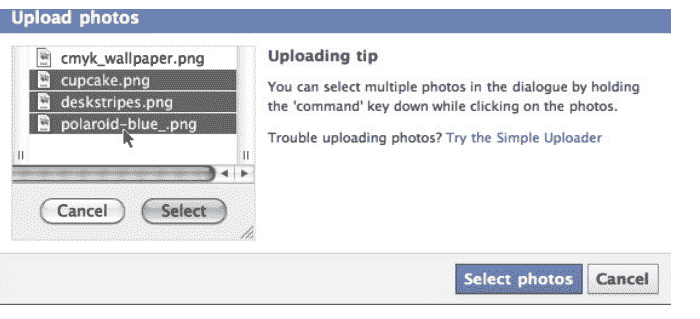

图 7-1. 在 Facebook 上上传多个文件

不过，对所选文件的访问并不限于验证。例如，你可以读取文件内容并显示上传预览。或者，与其在文件上传时阻塞 UI，你也可以使用 Ajax 在后台上传它们，并显示实时进度条。所有这些以及更多内容将在随后的章节中介绍。

## 拖放

拖放支持最初最初由微软在 1999 年为 Internet Explorer 5.0 “设计”并实现的，从那以后 IE 一直支持该功能。HTML5 规范仅仅记录了已经存在的内容，现在 Safari、Firefox 和 Chrome 也已添加了支持，模拟了微软的实现。然而，委婉地说，该规范相当混乱，需要费一番功夫“跳圈子”才能满足那些往往毫无意义的要求。

与拖放相关的事件至少有七个：dragstart、drag、dragover、dragenter、dragleave、drop 和 dragend。我将在下文章节中详细介绍每一个事件。

即使你的浏览器不支持 HTML5 文件 API，你可能仍然可以使用拖放 API。目前，浏览器要求如下：

| 拖放 | 83 |
| :--- | :--- |
| Firefox | >= 3.5 |
| Safari | >= 3.2 |
| Chrome | >= 7.0 |
| IE | >= 6.0 |
| Opera | 不支持 |

## 拖动

拖动非常直观。要让一个元素变得可拖动，将其 `draggable` 属性设置为 `true`。

```html
<div id="dragme" draggable="true">拖拽我！</div>
```

现在我们必须让该可拖元素带有一些数据。我们可以通过监听 `dragstart` 事件并调用事件的 `setData()` 函数来实现：

```javascript
var element = $("dragstart");
element.bind("dragstart", function(event){
  // 我们不想使用 jQuery 的抽象层
  event = event.originalEvent;

  event.dataTransfer.effectAllowed = "move";
  event.dataTransfer.setData("text/plain", $(this).text());
  event.dataTransfer.setData("text/html", $(this).html());
  event.dataTransfer.setDataImage("images/drag.png", -10, -10);
});
```

jQuery 提供了事件的抽象，它并不包含我们需要的 `dataTransfer` 对象。方便的是，抽象后的事件有一个 `original` 属性，我们可以用它来访问拖/放 API。

如上所示，事件拥有一个 `dataTransfer` 对象，该对象拥有各种拖放函数。在这种情况下，我们在拖动事件上设置了一些文本和 `text/html` 数据。当元素被放开且并触发 `drop` 事件时，我们可以读取这些数据。同样，如果元素被拖到浏览器之外，其他应用程序可以根据它们支持的文件类型来处理被投放的数据。

拖动时，请使用 `text/plain` 类型。建议始终将其设置为应用程序或投放目标的备用方案。拖拽的链接应有两种格式：`text/plain` 和 `text/uri-list`。要拖动多个链接，用换行符连接每个链接：

```javascript
// 拖动链接
event.dataTransfer.setData("text/uri-list", "http://example.com");
event.dataTransfer.setData("text/plain", "http://example.com");
```

多个链接由换行符分隔：

```javascript
event.dataTransfer.setData("text-uri-list", "http://example.com\nhttp://google.com");
event.dataTransfer.setData("text/plain", "http://example.com\nhttp://google.com");
```

可选的 `setDragImage()` 函数控制拖动操作期间光标下显示的内容。它接受一个图像和 x/y 坐标，即图像相对于光标的位置。如果不提供，你只会得到一个被拖动元素的虚影克隆。`setDragImage()` 的另一种替代方案是 `createElement(element, x, y)`，它使用指定的元素来更新拖动反馈。换句话说，你可以提供一个自定义元素在拖动操作期间显示。

你还可以通过设置 `DownloadURL` 类型允许用户将文件拖出浏览器。你可以指定文件位置的 URL，浏览器随后会下载该文件。Gmail 就使用了这种很棒的效果，允许用户将附件从浏览器拖放到桌面上。

坏消息是，这目前仅由 Chrome 支持，且缺乏文档说明。不过，使用它并无害，尽管其他浏览器未来将支持它。`DownloadURL` 格式是一个用冒号（:`）分隔的文件信息列表：mime、名称和位置。

```javascript
$("#preview").bind("dragstart", function(e){
  e.originalEvent.dataTransfer.setData("DownloadURL", [
    "application/octet-stream", // MIME 类型
    "file", // 文件名
    "http://example.com/file.png" // 文件位置
  ].join(":"));
});
```

你可以在本书中看到 HTML5 拖放 API 的完整示例。

## 投放

当用户释放被拖动的元素时，会触发 `drop` 事件。在这里你可以访问在 `dragstart` 事件期间设置的数据。如果元素被投放到浏览器之外，其他应用程序可以根据它们支持的文件类型来处理被投放的数据。

`drop` 事件也用于处理文件的下载。不过，使用它并无害，尽管其他浏览器未来将支持它。`DownloadURL` 格式是一个用冒号（:`）分隔的文件信息列表：mime、名称和位置。


```javascript
$("textarea").copy().bind(function(event){
  event.stopPropagation();
  event.preventDefault();

  var cd = event.originalEvent.clipboardData;

  // For IE
  if (cd ) cd = window.clipboardData;

  // For Firefox
  if (cd ) return;

  cd.setData("text/plain", $(this).text());
```

按照浏览器创新的速度，这种支持很快可能就会标准化。如果你想为你的应用程序添加复制/粘贴支持，你应该自己去查看当前的状况。

## 粘贴 (Pasting)

粘贴操作有两个事件相关：`beforepaste` 和 `paste`。`paste` 事件在用户启动粘贴操作时触发，但在任何数据被粘贴之前。同样，不同浏览器有不同的实现方式。Chrome 即使没有元素聚焦也会触发该事件。而 IE 和 Safari 都需要一个激活聚焦的元素。

该 API 与 `drop` 事件 API 非常相似。该事件有一个 `clipboardData` 属性，允许你使用 `getData()` 函数以 mime 格式访问粘贴的数据。遗憾的是，根据我的测试，`types` 属性总是 `null`，你无法看到剪贴板数据上可用哪些 mime 类型。除非你取消事件，否则粘贴过程将正常进行，数据将被粘贴到聚焦元素中。

```javascript
$("textarea").bind("paste", function(event){
  event.stopPropagation();
  event.preventDefault();

  event = event.originalEvent;

  var cd = event.clipboardData;

  // For IE
  if (cd ) cd = window.clipboardData;

  // For Firefox
  if (cd ) return;

  $("#result").text(cd.getData("text/plain"));

  // Safari event support file pasting
  var files = cd.files;
}
```

WebKit 的每夜版本允许你访问 `clipboardData` 上的 `files` 属性，从而支持向应用程序中粘贴文件。我预计一旦规范标准化，其他浏览器也会跟进。

那么，有没有可能让它跨浏览器工作？嗯，实际上有几种通通方法。例如，Cappuccino 完全绕过了透明度系列事件，仅捕获按键输入。当检测到 Command/Ctrl + v 组合键时，它会找到一个隐藏的输入框，并填充粘贴的数据。这在每个浏览器中都有效，但显然仅适用于通过键盘触发的操作——而不是通过菜单。

## 读取文件 (Reading Files)

一旦你获取了 File 引用，就可以实例化 `FileReader` 对象将其内容读取到内存中。文件是异步读取的——你为 `FileReader` 实例提供一个回调函数，文件准备就绪时会被调用。

`FileReader` 提供了四个读取文件数据的函数。使用哪一个取决于你想返回什么种数据格式。

```javascript
readAsBinaryString(Blob|File)
将文件数据作为二进制字符串返回。每个字节都由 0 到 255 范围内的整数表示。
```

```javascript
readAsDataURL(Blob|File)
将文件数据编码为 data URL 返回。例如，这可以作为图像的 src 属性值使用。
```

```javascript
readAsText(Blob|File, encoding='UTF-8')
将文件数据作为文本字符串返回。默认情况下，字符串被解码为 UTF-8。
```

```javascript
readAsArrayBuffer(Blob|File)
将文件数据作为 ArrayBuffer 对象返回。这在大多数浏览器中尚未实现。
```

`FileReader` 实例在调用上述任一读取函数时会触发多个事件。你需要考虑的主要事件有：

- `onerror`
  在发生错误时调用
- `onprogress`
  在数据读取期间定期调用
- `onload`
  在数据可用时调用

要使用 `FileReader`，只需实例化一个实例，添加事件，并使用其中一个读取函数即可。`onload` 事件包含一个 `result` 属性，指定了以适当格式读取读取的数据：

```javascript
var reader = new FileReader();
reader.onload = function(e) {
  var data = e.target.result;
};
reader.readAsDataURL(file);
```

例如，我们可以使用 `data` 变量作为图像源，显示指定文件的缩略图：

```javascript
var preview = $("#imgpreview")

// 检查文件是否为图像类型，并且预览图不要大到
// 会导致浏览器问题
if (file.type.match(/image.*/) &&
    file.size < 5000000)
```

```javascript
var reader = new FileReader();
reader.onload = function(e) {
  var data = e.target.result;
  preview.attr("src", data);
};
reader.readAsDataURL(file);
```

## Blob 和切片 (Blobs and Slices)

有时，将文件的切片读取到内存中比读取整个文件更好。HTML5 文件 API 方便地支持 `slice()` 函数。它接受起始字节作为第一个参数，字节偏移量（或切片长度）作为第二个参数。它返回一个 `Blob` 对象，我们可以与支持 `File` 对象的方法（如 `FileReader`）交换。例如，我们可以这样缓冲文件读取：

```javascript
var bufferSize = 1024;
var pos = 0;
```

```javascript
var onload = function(e) {
  console.log("Read: ", e.target.result);
}
```

```javascript
var onerror = function(e) {
  console.log("Error!", e);
}
```

```javascript
while (pos < file.size) {
  var blob = file.slice(pos, pos + bufferSize);
  var reader = new FileReader();
  reader.onload = onload;
  reader.onerror = onerror;
  reader.readAsText(blob);
  pos += bufferSize;
}
```


上传。但在这种情况下并非如此——上传的是纯粹的文件数据。为了传递有关文件的信息，我们可以设置自定义标头，例如 X-File-Name。我们的服务器可以读取这些标头并正确处理文件：

```javascript
ajax({
  url: "http://example.com",
  type: "POST",
  success: function(){ /* ... * */ },
  processData: false,
  contentType: "multipart/form-data",

  beforeSend: function(xhr, settings) {
    xhr.setRequestHeader("Cache-Control", "no-cache");
    xhr.setRequestHeader("X-File-Name", file.name);
    xhr.setRequestHeader("X-File-Size", file.size);
  },

  data: file
});
```

遗憾的是，许多服务器在接收上传时会遇到困难，因为纯数据比 `multipart` 或 `URL-encoded` 表单参数更不熟悉的格式。使用这种方法，你可能需要手动解析请求。因此，我提倡使用 `FormData`，并将上传内容序列化为 `multipart/form-data` 请求发送。在 `assets/sch07` 文件夹中，你会找到 `jquery.upload.js`，这是一个 jQuery 插件，它将文件上传处理成一个简单的 `.upload(url, file)` 接口。

## Ajax 进度

XHR Level 2 规范增加了对进度事件的支持，涵盖下载和上传请求。这允许实现实时的文件上传进度条，在上传完成前为用户提供预计的持续时间。

要监听上传请求上的进度事件，请直接在 XHR 实例上添加它：

```javascript
var req = new XMLHttpRequest();

req.addEventListener("progress", updateProgress, false);
req.addEventListener("load", transferComplete, false);
req.open();
```

对于上传进度事件，请将其添加到到 XHR 实例的 `upload` 属性上：

```javascript
var req = new XMLHttpRequest();

req.upload.addEventListener("progress", updateProgress, false);
req.upload.addEventListener("load", transferComplete, false);
req.open();
```

`load` 事件会在上传完成后触发，但在服务器发出响应之前触发。我们可以将其添加到 jquery 的 XHR 对象中，并将 `settings` 传递给 `beforeSend` 回调。包含自定义标头的完整示例看起来如下：

```javascript
ajax({
  url: "http://example.com",
  type: "POST",
  success: function(){ /* ... */ },
  processData: false,
  dataType: "multipart/form-data",

  beforeSend: function(xhr, settings) {
    var upload = xhr.upload;

    if (settings.progress) {
      upload.addEventListener("progress", settings.progress, false);
    }
    if (settings.load) {
      upload.addEventListener("load", settings.load, false);
    }

    var fd = new FormData();
    for (var key in settings.data) {
      fd.append(key, settings.data[key]);
    }
    settings.data = fd;
  },

  data: file
});
```

`progress` 事件包含上传的位置（即已上传了多少字节）和总大小（上传请求的字节总大小）。你可以使用这两个属性来计算进度百分比：

```javascript
var progress = function(event) {
  var percentage = Math.round((event.position / event.total) * 100);
  // 设置进度条
}
```

事实上，你拥有一个时间戳，所以如果你记录开始上传的时间，就可以创建一个粗略的预计完成时间 (ETA)：

```javascript
var startStamp = new Date();
var progress = function(e) {
  var lapsed = startStamp - e.timeStamp;
  var eta = e.total / e.position - lapsed;
}
```

然而，对于较小（因此速度较快）的上传，这种估计可能并不准确。在我看来，只有当上传时间超过四分钟左右时，显示 ETA 才值得。一个百分比条通常足够了，因为它为用户提供了清晰的视觉指示，告知上传还需要多久才能完成。

## jQuery 拖放上传器

现在，让我们通过构建一个拖放文件上传器将所有知识付诸实践吧。我们需要几个库：用于核心的 `jquery.js`、用于进度条的 `jquery.ui.js`、用于抽象拖放 API 的 `jquery.drop`，以及用于 Ajax 上传的 `jquery.upload`。所有逻辑将放在 `jquery.ready()` 中，这样它会在 DOM 准备就绪时运行：

```javascript
// require <jquery>
// require <jquery.ui>
// require <jquery.drop>
// require <jquery.upload>

jQuery.ready(function(){
  /* ... */
});
```

## 创建投放区域

我们希望用户能够将文件拖放到 `#drop` 元素上，让我们把它变成一个投放区域。我们需要绑定 `drop` 事件，取消并获取掉落的文件，然后将它们传递给 `uploadFile()` 函数：

```javascript
var view = $("#drop");
view.bind("drop", function(e){
  e.stopPropagation();
  e.preventDefault();

  var files = e.originalEvent.dataTransfer.files;
  for (var i = 0; i < files.length; i++)
    uploadFile(files[i]);

  return false;
});
```

## 上传文件

现在轮到 `uploadFile()` 函数了——魔法发生的地方。我们正在使用 `jquery.upload.js` 中的 `$.upload()` 方法向服务器发送 Ajax 上传请求。我们将监听请求上的进度事件并更新 jQuery UI 进度条。一旦上传完成，我们将通知用户并移除元素：

```javascript
var uploadFile = function(file){
  var element = $("div");
  element.text(file.fileName);

  var bar = $("div");
  element.append(bar);
  $("#progress").append(bar);

  var onProgress = function(e){
    var per = Math.round((e.position / e.total) * 100);
    bar.progressbar({value: per});
  }

  var onSuccess = function(){
    element.text("Complete");
    element.delay(1000).fade();
  }

  $.upload("/uploads", file, {upload: onProgress, success: onSuccess});
}
```

这非常简单！要查看完整示例，请检查 `assets/ch07/dragdro-upload.html`。

## 第8章

### 实时 Web

为什么实时性如此重要？传统上，Web 是基于请求/响应模型构建的。这意味着客户端必须请求数据，服务器进行响应。这对于聊天应用或实时比分等实时应用来说并不高效。

随后 Ajax 的出现，允许客户端在后台请求数据而无需刷新页面。然而，Ajax 仍然基于轮询——客户端仍然必须请求数据。

现在有了更出色的实时通信替代方案，例如服务器发送事件 (SSE) 和 WebSocket。这些技术允许服务器在数据可用时立即推送到客户端，这比以前高效得多，并提供了更好的用户体验。

实时 Web 正在快速变化，每天都有新技术涌现。跟上这些发展并使用正确的工具至关重要。


* * Safari >= 5
* iOS >= 4.2
* Firefox >= 4
* Opera >= 11*

尽管 Firefox 和 Opera 提供了 WebSocket 的实现，但由于最近的安全考量，该功能目前被禁用了。不过，所有问题都会得到解决的，可能在本书出版时就已经处理好了。你可以使用 Comet 和 Adobe Flash 等旧技术进行平滑降。目前对 IE 的支持完全不在考虑范围内，可能要等到 IE9 之后才会添加。

检测对 WebSockets 的支持非常简单：

```javascript
var supported = ("WebSocket" in window);
if (supported) alert("WebSockets are supported");
```

从浏览器的角度来看，WebSocket API 既清晰又符合逻辑。你使用 `WebSocket` 类实例化一个新的 socket，并传递服务器端点——在本例中为 ws://example.com：

```javascript
var socket = new WebSocket("ws://example.com");
```

然后，我们可以为 socket 添加事件监听器：

```javascript
// 连接已建立
socket.onopen = function() { /* ... */ }
```

```javascript
// 连接接收到了新数据
socket.onmessage = function(data) { /* ... */ }
```

```javascript
// 连接已关闭
socket.onclose = function() { /* ... */ }
```

当服务器发送数据时，`onmessage` 会被调用。相应地，你可以调用 `send()` 函数将数据传回服务器。显然，我们应该在 socket 连接并触发 `onopen` 事件后调用它：

```javascript
socket.onmessage = function(msg) {
  console.log("New data - " + msg);
};
```

```javascript
socket.onopen = function() {
  socket.send("Why, hello there.");
};
```

在发送和接收消息时，仅支持字符串。然而，将消息字符串序列化并反序列化为 JSON 非常简单，从而创建你自己的协议：

```javascript
var rpc = {
  test: function(arg1, arg2) { /* ... */ }
};
```

```javascript
socket.onmessage = function(data){
  // 解析 JSON
  var msg = JSON.parse(data);

  // 调用 RPC 函数
  rpc[msg.method].apply(rpc, msg.args);
};
```

上面，我们创建了一个过程调用（RPC）脚本。我们的服务器可以发送一些简单的 JSON（如下所示）来调用客户端上的函数：

```json
{"method": "test", "args": [1, 2]}
```

我们将调用限制在 RPC 对象上。出于安全考虑，这一点很重要——我们不想通过评估任意的 JavaScript 将客户端暴露给黑客。

要终止连接，只需调用 `close()` 函数：

```javascript
var socket = new WebSocket("ws://localhost:8000/server");
```

你会注意到，在实例化 WebSocket 时，我们使用的是 `ws://` 方案而不是 `https://`。WebSockets 还允许通过 TLS 使用 `wss://` 方案进行加密连接。默认情况下，WebSockets 使用 80 端口非加密连接，使用 443 端口加密连接。你可以通过在 URL 中自定义端口来覆盖此设置。请记住，并非所有端口对客户端可用；防火墙可能会拦截不常用的端口。

在这一阶段，你可能会想：“我不可能在生产环境中使用它——标准是一个不断变化的目标，而且还没有支持。”嗯，这些担心是有的，但有一个解决方案。WebSocket-js 是由 Adobe Flash 提供的 WebSocket 实现。你可以使用此库为 Flash 提供遗留的 WebSocket 回退（Fallback），Flash 是一个几乎无处不在的插件。它镜像了 WebSocket API，因此当 WebSockets 渗透率更高时，你只需要移除该库——无需更改代码。

尽管客户端 API 很直观，但服务器端并没有那么简单。WebSocket 协议经历了多次不兼容的迭代：草案 75 和 76。服务器需要通过检测客户端的握手类型来兼顾这两个草案。

WebSockets 通过向你的服务器执行 HTTP “升级”（upgrade）请求来工作。如果你的服务器支持 WebSocket，它将执行 WebSocket 握手并建立连接。升级请求中包含了关于源域（请求来自哪里）的信息。客户端可以与任何域名建立 WebSocket 连接——是服务器决定哪些客户端连接，通常通过使用允许域名的白名单来实现。

从设计之初，WebSockets 就设计为与防火墙和代理良好协作，使用流行的端口和 HTTP 头部进行初始连接。然而，在 Web 世界中情况很少如此简单。某些代理会更改 WebSocket 升级标头，导致其失效。另一些则不允许长连接，并在一段时间后超时。事实上，协议草案的最新更新（版本 76）无意中破坏了与反向代理和网关的兼容性。你可以采取以下步骤让你的 WebSockets 有最大的成功机会：

- 使用安全的 WebSocket 连接 (wss)。代理不会干预加密连接，而且你还有一个额外好处是数据免受监听者的攻击。
- 在你的 WebSocket 服务器前方使用 TCP 负载均衡器，而不是 HTTP 负载均衡器。只有当负载均衡器主动宣布支持 WebSocket 时，才考虑 HTTP 均衡器。
- 不要假设浏览器支持它就能工作。相反，如果连接没有快速建立，则让其超时，平滑降级到不同的传输线路，如 Comet 或轮询（polling）。

那么，有哪些服务器选项呢？幸运的是，在 Ruby、Python 和 Java 等语言中有许多实现。确保任何实现至少支持协议的 76 版本，因为这在客户端中是最常见的。

- Node.js
    - node-Web-server
    - Socket.IO
    - Ruby
    - EventMachine
    - Cram
    - Sunshowers
    - Python
    - Twisted
    - Apache module
    - PHP
    - php-Web
    - Java
    - Jetty
    - Google Go

## 实时架构

理论上，一切都可以很好地向客户端推送数据，但它如何与 JavaScript 应用程序集成呢？嗯，如果你的应用程序模型设计正确，这会非常简单。我们将介绍使应用程序实时化涉及的所有步骤，特别是遵循 PubSub（发布/订阅）模式。首先需要理解的是引导你到达客户端的过程。

实时架构是事件驱动的。通常情况下，事件由用户交互驱动：用户更改记录，事件在系统中传播，直到数据被推送到连接的客户端。当你考虑让你的应用程序实时化时，你需要考虑两个问题：

- 哪些模型是实时的？
- 当模型实例更改时，哪些用户需要通知？

可能当模型发生变化时，你需要向所有连接的客户端发送通知。这对于每个客户端看到相同信息的实时活动是可能的。然而，常见的情况是资源与特定的用户相关联。你需要通知这些用户该资源的变化。

让我们考虑另一个聊天室场景：

- 用户在房间中发布了一条新消息。
- Ajax 请求被发送到服务器，并创建一个 Chat 记录。
- Chat 模型的保存回调，使用我们的方法更新客户端。
- 我们搜索与该 Chat 记录房间的所有用户——这些是我们需要通知的人。
- 5. 一条说明发生了什么（Chat 记录已创建）的更新被推送到相关的用户。


具体细节取决于你选择的后端。然而，如果你正在使用 Rails，Holla 是一个很好的例子。当 Message 记录被创建时，JuggernautObserver 会更新相关的客户端。

这引出了我们的下一个问题：我们如何向特定用户发送通知呢？嗯，一种极的方法是使用 PubSub（发布/订阅）模式：客户端订阅特定的通道，而服务器向这些通道发布。用户订阅一个包含标识符的唯一通道，可能是用户的数据库 ID；服务器只需要向该唯一通道发布，即可向该特定用户发送通知。

例如，特定用户可以订阅以下通道：observer/0765F0ED-96E6-476D-B82D-BE8DA33F4EC4

其中随机数字组合是当前登录用户的唯一标识符。要向该特定用户发送通知，服务器只需向该通道发布即可。

你可能在好奇 PubSub 模式是如何与 WebSockets 和 Comet 等传输层协同工作的。幸运的是，有很多解决方案，例如之前提到的 Juggernaut 和 Pusher。PubSub 是 WebSockets 之上的一种常见抽象，其 API 与你最终使用的任何服务或库都应该非常相似。

一旦通知被推送到客户端，你就能看到 MVC 架构的魅力。让我们回到聊天示例。我们发送给客户端的通知可能像这样：

```
{
  "class": "Chat",
  "type": "create",
  "id": "3",
  "record": {"body": "New chat"}
}
```

它包含了发生变化的模型、更改类型以及任何相关的属性。利用这一点，我们的客户端可以在本地创建一个新的 Chat 记录。由于客户端的模型绑定到了 UI，界面会自动更新以反映新的聊天消息。

其妙之处在于，这一切并不是针对 Chat 模型所特有的。如果我们想让另一个模型也实时化，只需在服务器端添加另一个观察者，确保在模型发生变化时更新客户端即可。我们的后端和客户端模型现在结合在了一起。对后端模型的任何更改都会自动传播到所有相关的客户端，更新它们的 UI。有了这种架构，应用程序真正实现了实时性。用户进行的任何交互都会立即广播给其他用户。

## 感知速度

速度是 UI 设计中至关但经常被忽视的部分，因为它对用户体验（UX）有巨大影响，并对收入产生直接影响。以下公司一直在研究其影响：

- Amazon：每增加 100 ms加载时间会导致销售额下降 1%（来源：Greg Linden, Amazon）。
- Google：每增加 500 ms加载时间会导致搜索量减少 20%（来源：Marissa Mayer, Google）。
- Yahoo!：每增加 400 ms加载时间会导致在页面加载之前点击“返回”的人数增加 5–9%（来源：Nicole Sullivan, Yahoo!）。

感知速度与实际速度一样重要，因为这是用户会注意到的时刻。所以，关键在于让应用程序变快，即使它实际上如此。这种能力是 JavaScript 程序的优势之一——UI 不会被阻塞，即使后台请求需要一些时间。

让我们再次以聊天室场景为例。用户发送一条新消息，向服务器触发一个 Ajax 请求。我们可以等到用户通过服务器和客户端完成一次往返后，再将其添加到聊天日志中。然而，将在用户提交新消息到消息出现在聊天日志之间引入几秒钟的延迟。应用程序会看起来很慢，这无疑会损害用户体验。

相反，为什么不在本地创建新消息，并立即将其添加到聊天日志中呢？从用户的角度来看，消息似乎是瞬间发送的。用户并不知道（或不在乎）消息尚未传送到聊天室中的其他客户端。他们会乐于快速且敏捷的用户体验。

除了交互，Web 应用程序最慢的部分之一是加载新数据。进行智能预加载非常重要，以便在用户实际请求之前预测他们需要什么。例如，将数据缓存在内存中；随后，你就不需要从服务器请求它。在启动时，应用程序应该预加载常用数据。比起应用程序加载完成后，用户可能对较慢的加载时间更加宽容。

当用户与你的应用程序交互时，你应该始终给他们提供反馈，使用某种视觉指示。这种术语被称为预期管理，确保客户端了解项目的状态和预计到达时间（ETA）。这同样适用于 UX——如果给用户正在发生某事的指示，他们会更有耐心。当用户等待新数据时，给他们显示一条消息或加载图标。如果正在上传文件，显示进度条和预计持续时间。这一切都提供了一种速度感，提升了用户体验。

# 第 9 章

## 测试与调试

所有开发者在编程时都会在不同程度上进行测试。即使只是手动运行代码也是一种测试形式。然而，我们在这里要介绍的是 JavaScript 中的自动化测试——即编写会自动运行的特定断言。自动化测试不会消除你代码中的 bug，但它是有效减少缺陷数量并防止旧 bug 回到库中的措施。有很多资源可供参考。


## 单元测试

手动测试类似于集成测试，确保你的应用程序在高级层面上运行正常。单元测试要低级得多，它确保背后的特定代码段按预期执行。单元测试更有可能发现跨浏览器问题，但它允许你快速解决这些问题，因为你只需要检查小部分代码。

单元测试的另一个优势是它为自动化铺平了道路。我们将在本章稍后的部分详细介绍这一点，但测试使得设置持续集成服务器成为可能，在每次提交代码时都运行应用程序的测试。这比手动运行整个应用程序快得多，并且可以确保对某部分代码的更改不会对应用程序的其他部分产生副作用。

市有很多用于单元测试的 JavaScript 库，它们各有优缺点。我们将介绍最流行的几个，但通用原则适用于你选择的任何库。

## 断言 (Assertions)

断言是测试的核心；它们决定了哪些测试通过或失败。断言是标明代码预期结果的语句。如果断言不正确，测试就会失败，你就知道出问题了。

例如，这里是我们在书中所有示例中一直使用的简单 `assert` 函数：

```javascript
var assert = function(value, msg) {
  if (! value ) {
    throw(msg || value + " does not equal true");
  }
}
```

它接收一个值和一个可选的消息。如果该值的求值为为假，则断言失败：

```javascript
// 断言失败
assert( false );
assert("");
assert( 0 );
```

JavaScript 在布尔检查期间会自动将 `undefined`、`0` 和 `null` 转换为 `false`。换句话说，`assert` 也适用于空值检查：

```javascript
// 如果语句为 null，则断言失败
assert( User.first() );
```

类型转换会极大影响你的测试，因此值得研究一下 JavaScript 在转换类型时表现出的某些奇奇怪怪的方式。

断言库不仅限于检查真假。大多数库都包含一整系列匹配器（matchers），从比较原始对象到检查一个数字是否大于另一个数字。它们都至少包含一个 `assertEquals()` 函数，允许你比较两个值：

```javascript
var assertEquals = function(val1, val2, msg) {
  if (val1 != val2)
    throw(msg || val1 + " does not equal " + val2);
}
```

```javascript
// 断言通过
assertEquals("one", "one");
```

我们将要涵盖的所有测试都是一组断言，只是定义它们的 API 略有不同。

## QUnit

QUnit 是最流行且维护良好的库之一，最初是为了测试 jQuery 而开发的。你如何设置 QUnit 测试环境呢？第一步是在本地下载项目文件，然后创建一个静态测试运行器：

```html
<!DOCTYPE html>
<html>
<head>
  <title>QUnit Test Suite</title>
  <link rel="stylesheet" href="qunit/qunit.css" type="text/css" media="screen">
  <script type="javascript" src="qunit/qunit.js"></script>
  <!-- 在此处包含测试... -->
</head>
<body>
  <h1 id="qunit-header">QUnit Test Suite</h1>
  <h2 id="qunit-banner"></h2>
  <div id="qunit-testrunner-toolbar"></div>
  <h2 id="qunit-userAgent"></h2>
  <ol id="qunit-tests"></ol>
  <div id="qunit-fixture">test markup</div>
</body>
</html>
```

要创建断言，你应该将它们放在测试用例中。例如，让我们为在第 3 章构建的 ORM 创建一个测试套件：

```javascript
test("load", function() {
  var Asset = Model.setup();

  var a = Asset.init();
  a.load({
    local: true,
    name: "test.pdf"
  });
});
```

```javascript
ok(a.local, "Load sets properties");
equal(a.name,"test.pdf", "load() sets properties (2)");
```

```javascript
var b = Asset.init({
  name: "test2.pdf"
});
```

```javascript
equal(b.name, "test2.pdf", "Calls load() on instantiation");
```

我们通过调用 `test()` 并赋予它测试名称和测试回调（魔法发生的地方）来定义一个新用例。在回调函数内部，`ok()` 断言其第一个参数解析为 `true`，而 `equal()` 比较它的两个参数。所有断言都接受一个字符串参数，即断言的名称，让我们轻松看到哪些通过了，失败了。

在页面上添加测试并刷新，如图 9-1 所示。

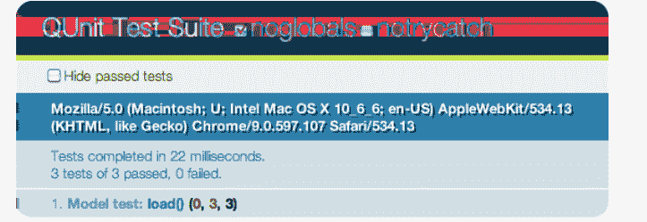

图 9-1. QUnit 测试结果

这非常强大！一眼，我们就能看到哪些测试通过了，哪些失败了——只需刷新。我们现在可以为应用程序支持的每个浏览器定义测试，确保我们的单元测试在所有浏览器中都能通过。

测试通过 `module()` 函数隔离，它接收一个名称和选项。让我们通过使用 `module()` 的 `setup` 选项来清理第一个示例，该选项包含一个在模块运行的每个测试之前执行的回调。在这种情况下，我们所有的测试都需要 `Asset` 模型，所以我们在这里创建它：

```javascript
module("Model test", {
  setup: function() {
    this.Asset = Model.setup();
  }
});
```

```javascript
test("load()", function() {
  var a = this.Asset.init();
  a.load({
    local: true,
    name: "test.pdf"
  });
});
```

```javascript
ok(a.local, "Load sets properties");
equal(a.name, "test.pdf", "load() (2)");
```

```javascript
var b = this.Asset.init({
  name: "test2.pdf"
});
```

```javascript
equal(b.name, "test2.pdf", "Calls load() on instantiation");
```

这样整洁了一些，而且在添加更多测试时会很有用。`module()` 还接受 `teardown` 选项，它是一个在每个测试之后执行的回调。让我们再添加另一个测试：

```javascript
test("attributes", function() {
  var b = this.Asset.init({
    name: "test2.pdf"
  });
  equal(b.name, "test2.pdf", "Calls load() on instantiation");
});
```

如果你尝试这样做，你会发现测试失败了，因为 `equal()` 函数使用了 `==` 运算符。相反，我们需要使用 `same()` 函数，它执行深度比较：

```javascript
test("attributes", function() {
  var b = this.Asset.init({
    name: "test2.pdf"
  });
  same(b, {name: "test2.pdf"}, "deep comparison");
});
```


```javascript
jasmine.getEnv().execute();
</script>

<body>
</html>
```

让我们来看看写一些 Jasmine 规范（specs）。我们将再次测试第 3 章中的 ORM 库：

```javascript
describe("Model", function() {
  var Asset;

  beforeEach(function() {
    Asset = Model.setup();
    Asset.attributes = ["name"];
  });

  it("can create records", function() {
    var asset = Asset.create({name: "test.pdf"});
    expect(asset.first()).toEqual(asset);
  });

  it("can update records", function() {
    var asset = Asset.create({name: "test.pdf"});
    expect(asset.first().name).toEqual("test.pdf");

    asset.name = "wem.pdf";
    asset.save();

    expect(asset.first().name).toEqual("wem.pdf");
  });

  it("can destroy records", function() {
    var asset = Asset.create({name: "test.pdf"});

    expect(asset.first()).toEqual(asset);

    asset.destroy();

    expect(asset.first()).toBeFalsy();
  });
});
```

规范使用 `describe` 函数进行套件（suites）分组，该函数接收规范的名称和一个匿名函数。在上面的示例中，我们使用 `beforeEach` 函数作为设置工具，在每个函数之前运行它。Jasmine 包含一个清理函数 `afterEach()`，它会在每个规范运行后被调用。我们在 `beforeEach` 函数外部定义了变量 `Asset`，因此它对该套件是局部的，并且可以在每个规范内部访问。

一个规范以 `it()` 函数开始，该函数接收规范的名称和包含断言（assertions）的匿名函数。断言是通过将相关值传递给 `expect()` 函数创建的，然后调用一个匹配器（matcher），例如以下之一：

- `expect(x).toEqual(y)`：通过 x 和 y 比较对象或原始类型，如果它们是等值的则通过。
- `expect(x).toBe(y)`：通过 x 和 y 比较对象或原始类型，如果它们是同一个对象则通过。
- `expect(x).toMatch(pattern)`：将 x 与字符串或正则表达式模式进行比较，如果匹配则通过。
- `expect(x).toBeNull()`：如果 x 为 null 则通过。
- `expect(x).toBeTruthy()`：如果 x 求值为为 true 则通过。
- `expect(x).toBeFalsy()`：如果 x 求值为为 false 则通过。
- `expect(x).toContain(y)`：如果数组或字符串包含 y 则通过。
- `expect(fn).toThrow(e)`：如果 fn 抛出异常 e 则通过。

Jasmine 包含了许多其他匹配器，甚至允许你编写自定义匹配器。图 9 显示了使用上述规范运行 Jasmine 测试的概览。

| Jasmine 1.0.2 版本 12983758 | 通过 | 跳过 |
|---|---|---|
| 3 个规范, 0 次失败，0.021s 完成于 Fri Mar 11 07:51 GMT+1300 (NZDT) | 运行 | |
| Model | 运行 | |
| 创建记录 | 运行 | |
| 更新记录 | 运行 | |
| 销毁记录 | 运行 | |

## 驱动 (Drivers)

虽然使用测试库现在实现了一种某种程度的自动化，但问题在于每次提交时都需要在不同的浏览器中刷新测试。

驱动的开发是为了解决这个问题。它们是与各种浏览器集成的守护进程，可以自动运行 JavaScript 测试并在失败时通知你。大多数公司都有单一的持续集成服务器，它会使用 post-commit 钩子自动运行所有 JavaScript 测试，确保它们通过。

Watir（读音为“water”）是一个与 Chrome、Safari 和 Internet Explorer 集成的 Ruby 库。安装后，你可以给 Watir 一些命令来驱动浏览器，以人类相同的方式点击链接和填写表单。在这个过程中，你可以运行一些测试用例并断言它们符合预期：

```ruby
# Watir
require "watir"
```

```ruby
browser = Watir::Browser.new
browser.goto("http://example.com")

browser.text_field(name => "entry").set "Watir"
browser.button(name => "login").click
```

由于可以在操作系统上安装的浏览器限制，如果你正在测试 Internet Explorer，你的持续集成服务器将需要运行 Windows 版本。同样，在 Safari 上，你还需要运行 Mac OS。

另一个流行的驱动工具是 Selenium。它提供了一个领域特定语言 (DSL)，用于使用编程语言（如 C#、Java、PHP、Python 和 Ruby）编写测试。Selenium 可以本地运行；通常，它在持续集成服务器的后台运行，并在测试失败时通知你。Selenium 的优势在于它支持的语言。一旦记录了会话，你就可以回放（emulate our recorded actions, navigating to and completing the test）。Selenium IDE 方便地生成了所有相关的驱动方法，大大减少了测试页面的工作量。例如，这里是导出的作为 Ruby Test::Unit 的用例：

```ruby
class SeleniumTest < Test::Unit::TestCase
  def setup
```


图 9-4. 使用 Selenium 记录指令

```ruby
@selenium = Selenium::Client::Driver.new \
:host = "localhost", \
:port = 4444, \
:browser = "chrome", \
:url = "http://example.com/index.html", \
:timeout = 30
```

```javascript
@selenium = Selenium::Client::Driver.new
:host = "localhost",
:port = 4444,
:browser = "chrome",
:url = "http://example.com/index.html",
:timeout = 30
```

```javascript
@selenium = Selenium::Client::Driver.new
:host = "localhost",
:port = 4444,
:browser = "chrome",
:url = "http://example.com/index.html",
:timeout = 30
```

```javascript
@selenium = Selenium::Client::Driver.new
:host = "localhost",
:port = 4444,
:browser = "chrome",
:url = "http://example.com/index.html",
:timeout = 30
```

```javascript
@selenium = Selenium::Client::Driver.new
:host = "localhost",
:port = 4444,
:browser = "chrome",
:url = "http://example.com/index.html",
:timeout = 30
```

```javascript
@selenium = Selenium::Client::Driver.new
:host = "localhost",
:port = 4444,
:browser = "chrome",
:url = "http://example.com/index.html",
:timeout = 30
```

```javascript
@selenium = Selenium::Client::Driver.new
:host = "localhost",
:port = 4444,
:browser = "chrome",
:url = "http://example.com/index.html",
:timeout = 30
```

```javascript
@selenium = Selenium::Client::Driver.new
:host = "localhost",
:port = 4444,
:browser = "chrome",
:url = "http://example.com/index.html",
:timeout = 30
```

```javascript
@selenium = Selenium::Client::Driver.new
:host = "localhost",
:port = 4444,
:browser = "chrome",
:url = "http://example.com/index.html",
:timeout = 30
```

```javascript
@selenium = Selenium::Client::Driver.new
:host = "localhost",
:port = 4444,
:browser = "chrome",
:url = "http://example.com/index.html",
:timeout = 30
```

## 无头测试 (Headless Testing)

通过无头浏览器，我们可以在没有图形界面的情况下运行测试。这对于没有显示的持续集成环境非常有用。

关于 Selenium 的更多信息，请访问网站。

Envjs 是由 jQuery 框架创建者 John Resig 最初开发的库。它在 Rhino（Mozilla 的 JavaScript 实现）之上提供了浏览器和 DOM API 的实现。你可以将 envjs 库与 Rhino 一起在命令行运行测试。

## Zombie

Zombie.js 是一个无头库，旨在利用 Node.js 的性能和异步特性。速度是一个关键特性：你等待测试完成的时间越少，你用来构建新功能和修复漏洞的时间就越多。

使用客户端 JavaScript 的应用程序花费了大量时间来加载、解析和评估 JavaScript。在这里，Google V8 引擎的纯性能有助于你的测试运行。

虽然你的测试套件和客户端 JavaScript 都运行在同一个引擎上，但 Zombie 使用了 V8 的另一个功能——上下文（contexts），它将它们分离，使它们不会混合全局变量/状态。这类似于 Chrome 在其进程中打开每个标签页的方式。

上下文的另一个优点是可以并行运行多个测试，每个测试使用它自己的 Browser 对象。一个测试可以检查 DOM 内容，而另一个测试在等待页面请求返回，从而缩短完成整个测试套件的时间。你需要使用异步测试框架，例如出色的 Vjs，并注意哪些测试必须并行运行，哪些必须顺序执行。

Zombie.js 提供了一个类似于真实 Web浏览器的 Browser 对象：它在页面之间维护状态（Cookie、历史记录、网络存储），并提供对当前窗口的访问。此外，它提供了操作窗口的方法、像用户一样操作（使用页面、填写表单、点击提示等）以及检查窗口内容（使用 XPath 或 CSS 选择器）。

例如，填写用户名和密码，提交表单，然后测试元素的内容：

```javascript
// 填充电子邮件、密码并提交表单。
browser.
fill("email", "zombie@underworld.dead");
fill("password", "eat-the-living.");
pressButton("Sign Me Up!", function(err, browser) {
  // 表单已提交，新页面加载。
  assert.equal(browser.text("title"), "Welcome to Brains Depot");
});
```


此示例是不完整的。显然，你需要引入 Zombie.js 库，创建一个新的 Browser（浏览器），并在与其进行交互之前加载页面。你还想要处理好那个 `err` 参数。

就像 Web 浏览器一样，Zombie.js 本质上是异步的：你的代码不会阻塞以等待页面加载、事件触发或计时器超时。相反，你可以为*加载和错误*（loaded and error）等事件注册监听器，或者传递一个回调函数。

按照约定，你向 Zombie 传递一个回调函数，或者它将使用两种方法之一。如果操作成功，它将传递 `null` 和某个值（最常见的是 *Browser* 对象的引用）。如果操作失败，它将传递一个 *Error* 对象的引用。请确保检查第一个参数，以确定你的请求是否成功完成，以及剩余参数中是否有任何有趣的内容。

这种约定常见于 Node.js 以及许多为它编写的库，包括上述的 Vows.js 测试框架。Vows.js 也使用回调函数，它期望调用时传入一个代表错误或 `null` 的参数；如果该参数会被传递给测试用例。

这里，例如，一个使用 Zombie.js 和 Vows.js 的测试用例。它访问一个网页并寻找类名为 *brains* 的元素（预期找到）：

```javascript
var zombie = require('zombie');

vows.describe("Zombie lunch").addBatch({
  "visiting home page": {
    topic: function() {
      var browser = new zombie.Browser;
      browser.cookies("localhost").update("session_id=5678");
      browser.visit("http://localhost:3003/", this.callback);
    },
    "should find no brains": function(browser) {
      assert.isEmpty(browser.css("brains"));
    }
  }
});
```

你还可以用 Zombie.js 做很多其他事情。例如，你可以在运行一个测试后保存浏览器状态（Cookie、历史记录、Web 存储等），并使用该状态运行其他测试（从“新会话且用户已登录”的状态开始每个测试）。

你还可以触发 DOM 事件——例如，模拟鼠标点击——或者响应确认提示和警告框。你可以查看请求和响应的历史，类似于 WebKit 网页检查器中的“资源”（Resources）选项卡。尽管 Zombie 运行在 Node.js 上，但它可以向任何 Web 服务器发送 HTTP 请求，因此你完全可以使用它来测试你的 Ruby 或 Python 应用。

# Ichabod

命名富有想象力的 Ichabod 库是运行无头测试的另一种替代方案，如果你追求简单和快速，它是一个极佳的解决方案。

Ichabod 的优势在于，它不是对 DOM 和解析引擎进行仿真，而是使用了 WebKit——Safari 和 Chrome 的浏览器引擎。然而，Ichabod 仅运行在 OS X 上，因为它需要 MacRuby 和 OS WebView API。

安装非常简单。首先，通过项目网站或使用 `rvm` 安装 MacRuby。然后，安装 Ichabod 宝石（gem）：

```bash
$ gem install ichabod
```

Ichabod 目前支持运行 Jasmine 或 QUnit 测试，尽管它将非常简单地支持额外的库。将你的测试传递给 Ichabod 可执行文件：

```bash
$ ichabod --jasmine=:path/path/to/jasmine/specs.html
$ ichabod --qunit=:path/to/qunit/tests.html
```

测试不需要托管——你也可以传递本地路径：

```bash
$ ichabod --jasmine .tests/index.html
```

> ...
耗时 0.393 秒
1 个测试，5 个断言，0 次失败

Ichabod 将加载你所有的测试，并直接从命令行在无图形界面的版本 WebKit 中运行它们。

# 分布式测试

跨浏览器测试的一种解决方案是将问题外包给专门的浏览器集群。

TestSwarm 的主要目标是简化在多个浏览器中运行 JavaScript 测试这一复杂且耗时的过程。它通过提供为你的 JavaScript 项目创建持续集成工作流所需的所有工具来实现这一点。

TestSwarm 并没有使用插件和扩展在低层与浏览器集成，而是采取了相反的方法。浏览器打开 TestSwarm 的端点，并自动处理推送到它的测试。它们可以位于任何机器或操作系统上——向集群中添加新浏览器，只需在其内部导航到 TestSwarm 的端点即可。

这种简单的方法避免了运行持续集成服务器的许多痛苦和烦恼。其中涉及的只是确保有足够数量的浏览器连接到集群中。事实上，如果你有一个活跃的社区，你可以将此外包，可能实现你所希望的最切真实的测试平台，如图 9-6 所示。

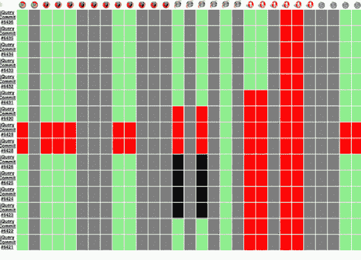

图 9-6. TestSwarm 以测试套件列表向浏览器返回结果

另一种方法是使用像 Sauce Labs 这样的公司在云端管理并运行所有浏览器。只需上传 Selenium 测试，他们的服务就会完成其余工作，在不同的浏览器和平台上运行测试，确保它们全部通过。

# 提供支持

对于你为应用程序编写的许多测试，可能会存在 Bug。最好的做法是接受这个事实，并为用户遇到 Bug 和错误做好准备。为用户提供一种提交 Bug 报告的方法，并建立工单系统来管理支持请求。

# 检查器 (Inspectors)

JavaScript 的开发和调试已经从过去的 `alert()` 调用进步了许多。大多数主流浏览器现在都都包含了强大的元素检查器和调试器，这极大地简化并改进了 Web 开发。接下来我们将介绍两个主要的检查器，但通用概念应该适用于你选择使用的任何检查器。

# 网页检查器 (Web Inspector)

Web Inspector 在 Safari 和 Google Chrome 浏览器中均可用。检查器的界面在两个浏览器之间略有不同，但功能相当一致。

在 Safari 中，你必须通过勾选高级选项中的“在菜单栏中显示开发菜单”启用启用，如图 9-7 所示。

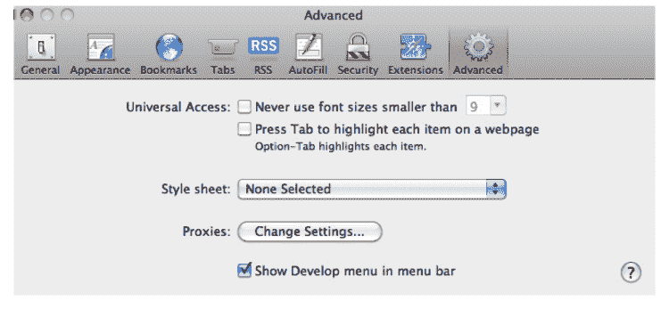

图 9-7. 启用 Safari 检查器

Chrome 在“查看”工具下有一个开发者工具栏，可以使用它来启用检查器。两个浏览器的另一种方法都是右键点击一个元素并选择“检查”。

图 9-8 所示的 Web Inspector 是一个非常有用的工具，让你能够检查元素、调试 JavaScript 等。我们将详细介绍它的功能，但这里是其功能的概览：

- 元素 (Elements)
- 资源 (Resources)
- 网络 (Network)
- 脚本 (Scripts)

# 时间线 (Timeline)

渲染详细视图

# 审计 (Audits)

代码和内存 (Memory)

# 控制台 (Console)

执行 JavaScript 和日志

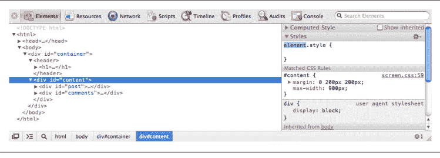

图 9-8. Safari 的检查器

# 火虫 (Firebug)

Firefox 原生不包含检查器，但有一个非常出插件可以完成这项工作：见图 9-9。

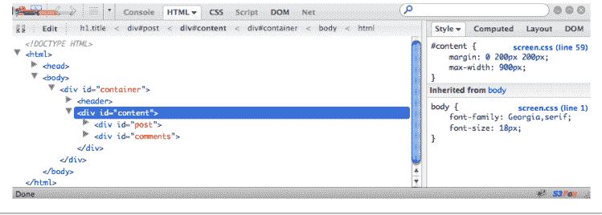

图 9-9. 使用 Firebug 检查 DOM

你会发现尽管各种组件与 Web Inspector 中的名称不同，但它们的功能非常相似：

- HTML
- CSS
- Script
- Net

# 控制台 (Console)

Firebug 团队开发了一个不依赖 Firefox 的版本——Firebug Lite。它拥有 Firebug 的大部分功能，以及相同的外观，并且兼容所有主流浏览器。Firebug Lite 对于 Internet Explorer 特别有用（它比 IE 内置工具好得多）。Firebug Lite 不需要任何安装，可以通过简单的脚本标签添加到网页中：

```html
<script type="text/javascript" src="https://firebug.com/firebug-lite.js"></script>
```

或者，你可以从 Firebug Lite 网站安装收藏脚本（bookmarklet）。


```javascript
var slice = Array.prototype.slice;
var args = slice.call(arguments, 0);
args.shift("App");
console.log.apply(console, args);
};
```

App.log() 函数会在其参数前面加上字符串 "App"，然后将调用传递给 console.log()。

在用控制台（console）进行日志记录时，请记住变量 `console` 可能未被定义。在不支持 `console` 的浏览器中（例如 Internet Explorer 或没有安装 Firefox 的 Firefox），`console` 对象将未定义，如果你尝试使用它会导致错误。这就是在应用程序内部记录日志时使用像 `App.log()` 这样的代理函数的好处。

你可以使用 `console.trace()` 向控制台输出脚本当前的堆栈跟踪。当你试图弄清楚函数是如何被调用的，这特别有用，因为它会回溯程序的堆栈：

```javascript
// 记录堆栈跟踪
console.trace();
```

应用程序的错误也会显示在控制台中，除非浏览器的 JIT 编译器优化了函数调用，否则控制台将显示完整的堆栈跟踪。

## 控制台辅助函数 (Console Helpers)

控制台还包含了一些快捷键和辅助函数，以节省输入时间。例如，$0$ 到 $4 变量包含了 Web Inspector 或 Firebug 中当前和之前的三个选中的节点。相信我，当你想要访问并操作元素时，这极极有用处：

```javascript
// $0 是当前选中的元素
$0.color = "green";
```

```javascript
// 或者，使用 jQuery
jquery($0).css({background: "black"});
```

`$` 函数返回具有指定 ID 的元素。它本质上是 `document.getElementById()` 的快捷方式。jQuery、Prototype，或任何已经使用 `$` 的类似库会覆盖此函数：

```javascript
$("user").addEventListener("click", function() { /* ... */ });
```

`$` 函数返回匹配给定 CSS 选择器的元素数组。这与 `document.querySelectorAll()` 类似。同样地，如果你使用 Prototype 或 MooTools，这些库会覆盖此函数：

```javascript
// 选择类名为 .users 的元素
var users = $$(".users");
users.forEach(function() { /* ... */ });
```

`$x()` 函数返回匹配给定 XPath 表达式的元素数组：

```javascript
// 选择所有表单
var checkboxes = $x("/html/body//form");
```

`clear()` 函数清空控制台：

```javascript
clear();
```

`dir()` 打印对象所有属性的交互列表：

```javascript
dir({one: 1});
```

`inspect()` 以元素、数据库或存储区域作为参数，并自动跳转到相应的面板显示相关信息：

```javascript
inspect("user");
```

`keys()` 返回一个包含对象所有属性名的数组：

```javascript
// 返回 ["two"]
keys({two: 2});
```

`values()` 返回一个包含对象所有属性值的数组——即 `keys()` 的反操作：

```javascript
// 返回 [2]
values({two: 2});
```

## 使用调试器 (Using the Debugger)

JavaScript 调试器是 JavaScript 开发中不为人知的秘密之一。它是一个功能全调试器，允许你放置断点、观察表达式、检查变量，并弄清楚到底发生了什么。

放置断点很容易——只需在脚本中想要调试器暂停执行的地方添加 `debugger` 语句即可：

```javascript
var test = function(){
  // ...
  debugger
}
```

或者，你可以转到检查器的 Scripts（脚本）面板，选择相关脚本，并点击你想要放置断点的行号。图 9-10 显示了一个示例。

如果你不想冒在生产代码中引入任何 `debugger` 语句的风险，后一种方法可能更好。当 JavaScript 执行到达断点时，它会暂停，允许你检查当前的作用域，如图 9-11 所示。

## 图 10. 使用 Safari 的 Web Inspector 设置断点

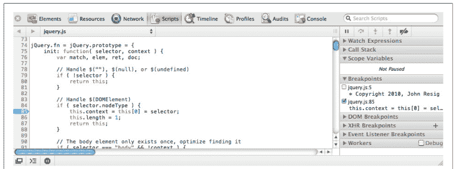

## 图 11. 使用 Safari 的 Web Inspector 调试断点

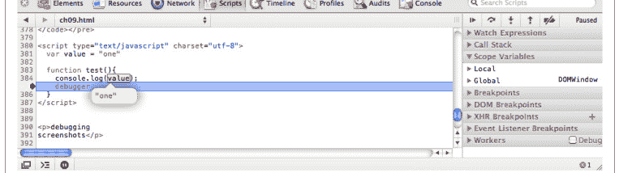

在检查器 Scripts 面板的右侧，你可以看到完整的调用栈、局部和全局变量以及其他相关的调试信息。你可以将鼠标悬停在任何变量上以查看其当前值。控制台始终作用于断点，允许你操作变量和其他函数。

你可以使用调试器工具栏继续执行代码、进入或跳过下一个函数调用，并导航当前堆栈。调试工具栏的图标取决于特定浏览器，但你可以通过将鼠标悬停在图标上来确定每个函数的作用，这将显示黄色信息气泡。如果你想移除断点，只需切换其行号，或在断点列表中取消勾。JavaScript 调试器是 `console.log()` 的绝佳替代方案，它可以帮助你确定应用程序内部到底发生了什么。

## 分析网络请求 (Analyzing Network Requests)

如图 9-12 所示，检查器的网络（network）部分显示了页面发送的所有 HTTP 请求、它们耗持续的时间以及完成的时间。

128 | 第 9 章：测试与调试

| Elements | Resources | Scripts | Timeline | Profiles | Storage | Search Resources |
|---|---|---|---|---|---|---|---|
| All | Documents | Stylesheets | Images | Scripts | XHR | Fonts | Other |
| /stylesheets | 29ms | 57ms | 86ms | 114ms | 143ms | 200ms | 228ms | 257ms | 285ms |
| screen.css | /stylesheets | | | | | | | | |
| highlight.css | /stylesheets | | | | | | | | |
| print.css | /stylesheets | | | | | | | | |
| query.js | /scripts | | | | | | | | |
| jasmine.png | /images | | | | | | | | |
| firebug.png | /images | | | | | | | | |
| test.png | /images | | | | | | | | |

图 9-12. 使用 Web Inspector 分析网络请求

你可以看到初始请求的延迟，它是半透明的。时间线的颜色变为不透明。在上面的示例中，jQuery 文件的大小大于样式表，尽管初始请求延迟很简单，但脚本下载需要更长时间。

如果你在脚本中没有使用 `async` 或 `defer` 选项（第 10 章），你会发现 JavaScript 文件是顺序下载的，而不是并行下载。只有在之前引用的脚本被完全下载并执行后，才会请求后续脚本。所有其他资源都是并行下载的。

网络时间线的线条表示页面的加载状态。蓝线出现在 `document.DOMContentLoaded` 事件触发时，换句话说，当 DOM 准备就绪时。红线在窗口加载（load）触发后出现，此时页面图像都已完全下载且页面加载完成。

网络部分还显示了每个请求的完整请求头和响应头，这对于确保任何缓存正确应用特别有用。图 9-13。

## 性能分析与计时 (Profile and Timing)

当你构建大型 JavaScript 应用程序时，你需要关注性能，特别是当你有移动端客户端时。Web Inspector 和 Firebug 都包含了性能分析和计时工具，有助于保持运行顺畅。

对代码进行性能分析很简单——只需用 `console.profile()` 和 `console.profileEnd()` 包围你想要分析的任何代码即可：

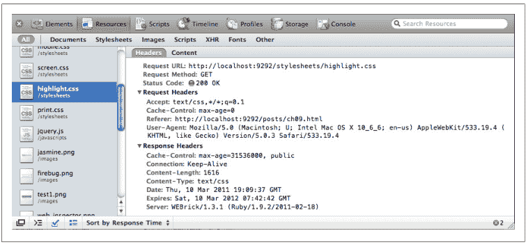

```javascript
console.profile();
//
console.profileEnd();
```

当调用 `profileEnd()` 时，将创建一个性能分析，列出这两个语句之间调用的函数（以及在每个函数中花费的时间）。见图 9-14。

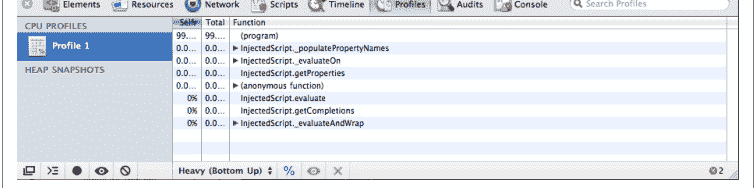

130 | 第 9 章：测试与调试

或者，你可以使用检查器性能分析器的记录功能，这等同于使用控制台语句封装代码。通过查看哪些函数被调用以及哪些函数完成时间较长，你可以发现并优化代码中的瓶颈。

性能分析器还允许你获取页面当前堆的快照，如图 9-15 所示。这将显示分配了多少对象以及页面使用的内存量。这是寻找内存泄漏的好方法，因为你可以查看是否有任何对象被无意存储，从而无法被垃圾回收。

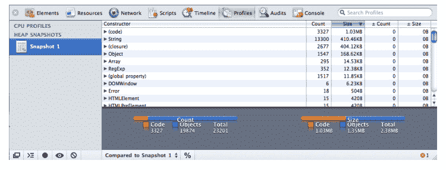


## 第10 章：部署

妥善部署你的 Web 应用程序与开发本身同样重要；如果你构建了下一个 Facebook，但它的加载速度慢到让用户无法实际使用，那么构建也就毫无意义。用户希望你的网站尽可能可靠、快速，并具有良好的可用性。部署 JavaScript 和 HTML 文件听起来很简单——毕竟它们终是静态资源——但实际上有很多需要做的。这是 Web 应用程序构建过程中经常被忽视的部分。

幸运的是，有几种经过测试的技巧适用于所有的 JavaScript 应用。事实上，遵循下面的建议，你就能顺利地交付快速的 Web 应用程序。

## 性能

提高性能最简单的方法也是最显而易见的：尽力减少 HTTP 请求的数量。每个 HTTP 请求都包含大量的头部信息以及 TCP 开销。将单独连接保持在最少数量可以确保用户页面加载更快。这显然延伸到了服务器需要传输的数据量。保持页面及其资源的文件大小较小可以减少网络时间——这是任何 Web 应用程序的真正瓶颈。

将脚本合并成单个脚本，并将 CSS 合并为单个样式表，将减少渲染页面所需的 HTTP 连接数。你可以在部署时或运行时这样做。如果是后者，请确保在生产环境中缓存了生成的任何文件。

使用 CSS 精灵图（sprites）将图像合并为一个综合图像。然后，使用 CSS 的 `background-image` 和 `background-position` 属性在页面中显示相关图像。你只需要将背景位置坐标限制在所需的图像范围内即可。

避免重定向也能将 HTTP 请求保持在最少。你可能认为这些并不常见，但最常见的重定向场景之一是 URL 缺少本应有的末尾斜杠（/）。例如，访问 http://facebook.com 目前会重定向重定向到 http://facebook.com/。如果你使用 Apache，可以通过 `Alias` 或 `mod_rewrite` 修复此。

理解浏览器如何下载资源也很重要。为了加快页面渲染，现代浏览器会并行下载资源。然而，在所有样式表和脚本下载完成之前，页面无法开始渲染。某些浏览器甚至更进一步，在处理任何 JavaScript 文件时阻塞所有下载。

然而，大多数脚本需要访问 DOM 并添加事件处理器等内容，这些内容是在页面加载后执行的。换句话说，浏览器在无必要的情况下限制页面渲染直到一切完成，从而降低了性能。你可以通过在脚本上设置 `defer` 属性来解决这个问题，让浏览器知道你的脚本在页面加载之前不要操作 DOM：

```html
<script src="foo.js" type="text/javascript" charset="utf-8" defer></script>
```

设置了 `defer` 属性的脚本将与其他资源并行下载，且不会阻止页面渲染。HTML5 还引入了另一种名为 `async` 的新脚本下载执行方法。通过设置 `async` 属性，脚本将在下载完成后的第一个可用机会执行。这意味着 `async` 脚本可能（很可能）不会按照它们在页面中出现的顺序执行，从而留下了依赖错误的可能。如果脚本没有任何依赖项，`async` 是一个非常有用的工具。例如，Google Analytics 利用了它：

```html
<script src="http://www.google-analytics.com/ga.js" async></script>
```

## 缓存

如果没有缓存，Web 将会在网络流量下崩溃。缓存将请求的资源存储在本地，以便后续请求可以从磁盘中读取它们，而不是重新下载。显式告诉浏览器你缓存了什么是非常重要的。像 Chrome 这样的浏览器会做出自己的决定，但你不应该依赖它们。

对于静态资源，通过添加一个遥远的 `Expires` 头部将缓存设置为“从不”（never）。此头部确保浏览器只下载一次资源，它应该设置在所有静态组件上，包括脚本、样式表和图像。

`Expires: Thu, 20 March 2015 00:00:00 GMT`

你应该设置相对于当前日期一个非常遥远的过期日期。示例告诉浏览器缓存到 2015 年 3 月 20 日之前都不会失效。如果你使用 Apache Web 服务器，可以使用 `ExpiresDefault` 轻松地设置相对过期日期：

`ExpiresDefault "access plus 5 years"`

但如果你想在那个时间之前过期资源呢？一个实用的技术是在引用该文件的 URL 上将文件的修改时间（mtime）作为查询参数。例如，Rails 默认就是这么做的。这样，当文件被修改时，资源的 URL 就会改变，从而清除缓存。

```html
<link rel="stylesheet" href="master.css?v=1296085785" type="text/css">
```

HTTP 1.1 引入了一类新的头部 `Cache-Control`，为开发者提供更高级的缓存功能并解决 `Expires` 的局限性。`Cache-Control` 头部可以接受多个由逗号分隔的选项：

`Cache-Control: max-age=3600, must-revalidate`

查看完整的选项列表，请访问规范。你现在可能使用的列在下方：

- max-age: 指定资源被视为新鲜的最长时间（以秒为单位）。与绝对的 `Expires` 不同，此指令是相对于请求时间的。
- no-store: 将资源标记为可缓存。默认情况下，它对动态内容关闭的。
- must-revalidate: 关闭缓存。

在资源上添加 `Last-Modified` 头部也有帮助。通过 `If-Modified-Since` 头部，服务器可以返回 304（未修改）状态：

```http
# Request
GET /example.gif HTTP/1.1
Host: facebook.com
If-Modified-Since: Thu, 29 Apr 2010 12:09:05 GMT
```

```http
# Response
HTTP/1.1 200 OK
Date: Thu, 20 March 2015 00:00:00 GMT
Server: Apache/1.3 (Unix)
Cache-Control: max-age=3600, must-revalidate
Expires: Fri, 30 Oct 1998 14:19:41 GMT
Last-Modified: Mon, 17 March 2009 00:00:00 GMT
Content-Length: 1040
Content-Type: text/html
```

`Last-Modified` 的替代方案是 ETags。比较 ETags 就像比较两个文件的哈希；如果 ETags 不同，则缓存过期必须失效。这种工作方式与 `Last-Modified` 头部相似。

```http
# Request
GET /example.gif HTTP/1.1
Host: facebook.com
If-Modified-Since: Thu, 29 Apr 2010 12:09:05 GMT
If-None-Match: "48ef9-14a1-48efe32ba40"
```

```http
# Response
HTTP/1.1 304 Not Modified
```

ETags 通常是根据服务器属性构建的——也就是说，两个不同的服务器会为同一资源生成不同的 ETags。随着集群变得越来越普遍，这是一个真实的问题。我个人建议你坚持 `Last-Modified` 并完全关闭 ETags。

## 代码压缩

JavaScript 代码压缩在不改变任何功能的情况下，减少脚本中的不必要字符。这些字符包括空格、换行和注释。更好的压缩器可以解释 JavaScript。因此，它们可以安全地缩短变量和函数名，进一步减少字符。较小的文件大小更好，因为传输的数据更少。

不仅仅是 JavaScript 可以压缩。样式表和 HTML 也可以被处理。样式表通常有很多冗余空格。代码压缩最好在部署时完成，因为你不希望在调试时处理任何代码。如果生产环境中出现错误，请先尝试在开发环境中重现——你会发现这样调试问题更容易。

压缩的额外益处是混淆你的代码。虽然确实，有足够动力的人可能可以重建它，但对于普通观察者来说，这是一道门槛。

市场上有很多压缩库，但我建议你选择一个带有可以解释代码的 JavaScript 引擎的库。YUI Compressor 是我喜欢的，因为它维护良好且支持良好。由 Yahoo! 工程师 Julien Lecom 创建，他的目标是比对源代码进行智能优化更进一步缩小 JavaScript 文件体积。假设我们有以下函数：


```javascript
function per(value, total) {
  return (value / total) * 100;
}
```

YUI Compressor 除了移除空白符外，还可以缩短局部变量，为你节省更多字符：

```javascript
function per(b,a)return((b/a)*100));
```

由于 YUI Compressor 实际上会解析 JavaScript，因此它通常可以替换变量而不会引入代码错误。然而，情况并非总是如此；有时压缩器无法理解你的代码，因此它会跳过。最常见的原因是使用了 `eval()` 或 `with()` 语句。如果压缩器检测到你使用了其中任何一个，它就不会执行名称替换。此外，`eval()` 和 `with()` 会导致性能问题——JIT 编译器与压缩器存在相同的问题。我的建议是避免使用这些语句。

使用 YUI Compressor 最简单的方法是下载二进制文件（这需要 Java），并在命令行执行它们：

```bash
java -juicompressor-x.y.z.jar foo.js > foo.min.js
```

不过，你可以在部署时通过程序方式进行操作。如果你使用像 Sprockets 或 Less 这样的库，它会为你完成这些工作。否则，还有几个 YUI Compressor 的接口库，例如 Sam Stephenson 的 Ruby-YUI-compressor gem 包或 Jammit 库。

## Gzip 压缩

Gzip 是 Web 上最流行且支持最好的压缩方法。它由 GNU 项目开发，并在 HTTP/1.1 中增加了对它的支持。Web 客户端通过在请求中发送 `Accept-Encoding` 标头指示其对压缩的支持：

Accept-Encoding: gzip, deflate

如果服务器发送了此标头并支持列出的任何压缩类型，它可能会压缩你的响应，并通过 `Content-Encoding` 标头指示这一点：

Content-Encoding: gzip

浏览器可以正确解码响应。显而易见，压缩数据可以减少网络时间，但真实的程度往往并非如此。Gzip 通常能将响应大小缩小 70%，这种巨大的缩减极大加快了你网站的加载速度。

服务器需要配置哪些文件类型应该进行 gzip 压缩。一个通用的规则是对任何文本响应进行 gzip，例如 HTML、JSON、JavaScript 和样式表。如果文件已经过压缩（例如图像和 PDF），则不应该使用 gzip 服务，因为重新压缩不会减小它们的大小。

配置 gzip 取于你的 Web 服务器，但如果你使用 Apache 2.x 或更高版本，你需要的模块是 `mod_deflate`。对于其他 Web 服务器，请查看它们的文档。

## 使用 CDN

内容分发网络（或 CDN）可以代表你提供静态内容，减少加载时间。用户与 Web 服务器的距离会对加载时间产生影响。CDN 可以将你的内容部署在多个地理分散的服务器上，因此当用户请求资源时，可以从靠近他们的服务器提供服务（理想情况下在同一个国家内）。Yahoo! 发现 CDN 可以将响应时间提高 20% 或更多。

取决于你的预算能力，市场上有很多公司提供 CDN 服务，例如 Akamai Technologies、Limelight Networks、EdgeCast 和 Level 3 Communications。Amazon Web Services 最近发布了一个名为 Cloud Front 的实惠选项，它与 S3 服务紧密结合，对于初创公司可能是一个不错的选择。

Google 为许多流行的开源 JavaScript 库提供了免费的 CDN 和加载架构，包括 jQuery 和 jQuery UI。Google CDN 的优势之一是许多网站都在使用它，这增加了你的任何 JavaScript 文件在用户浏览器中被缓存的概率。

查看可用库列表。如果你想使用 jQuery 库，可以使用 Google 的 JavaScript 加载库，或者简单地使用普通的 script 标签：

```html
<!-- jQuery 库的最小化版本 -->
<script src="/ajax.googleapis.com/ajax/libs/jquery/1.4.4/jquery.min.js"></script>

<!-- jquery UI 的最小化版本 -->
<script src="/ajax.googleapis.com/ajax/libs/jqueryui/1.8.6/jqueryui-min.js"></script>
```

你会注意到，在示例中我们没有指定一个为人知的技巧，而是使用了 `//`。这确保了脚本是通过与宿主页面相同的协议获取的。换句话说，如果你的页面是通过 HTTPS 安全加载的，那么脚本文件也将如此，从而消除任何安全警告。不带方案的相对 URL 是有效的且符合 RTF 规范的。更重要的是，它得到了全方位的支持；协议相关的 URL 在 Internet Explorer 3.0 中也能工作。

## 审计工具 (Auditors)

有一些实用的工具可以快速提醒你网站的性能情况。YSlow 是 Firebug 的扩展，而 Firebug 又是一个 Firefox 扩展。你需要安装所有这些才能使用它。一旦安装，你就可以它来审计网页。该扩展将运行一系列检查，包括缓存、最小化、gzip 压缩和 CDN。它将根据你的表现给你的网站打分，然后提供如何改进分数的建议。

Google Chrome 和 Safari 也有审计工具，但这些是直接内置在浏览器中的。如图 10-1 所示，只需进入 Web Inspector（网页检查器）的 Audits 部分并点击 Run。这是查看你的网站可以改进或增加性能之处的极佳方法。


## 资源

有一些实用的工具可以快速提醒你网站的性能情况。YSlow 是 Firebug 的扩展，而 Firebug 又是一个 Firefox 扩展。你需要安装所有这些才能使用它。一旦安装，你就可以它来审计网页。该扩展将运行一系列检查，包括缓存、最小化、gzip 压缩和 CDN。它将根据你的表现给你的网站打分，然后提供如何改进分数的建议。Google Chrome 和 Safari 也有审计工具，但这些是直接内置在浏览器中的。如图 10-1 所示，只需进入 Web Inspector（网页检查器）的 Audits 部分并点击 Run。这是查看你的网站可以改进或增加性能之处的极佳方法。

## Spine 库

Spine 是一个用于构建模块化应用的轻量级框架。它提供的工具可以帮助组织代码和数据。它不像 Backbone.js 那样功能完备，但强大得多。

### 安装

只需从项目仓库下载 Spine 并将其包含在页面。Spine 没有依赖：

```html
<script src="spine.js" type="javascript" charset="utf-8"></script>
```

### 类

Spine 中的每个对象都封装在一个类中。然而，Spine 的类是通过 `Object.create()` 和纯原型继承构建的（如第 3 章所述），这与类的抽象构建方式不同。

要创建一个类，调用 `Spine.Class.create(instanceProperties, classProperties)`，传入可选的实例和类属性：

```javascript
var User = Spine.Class.create({
  name: "Caroline"
});
```

在上面的示例中，User 的实例现在有一个默认 name 属性。在背后，`create()` 创建了一个原型设置为 `Spine.Class` 的新对象——即它正在继承它。如果你想创建后续的子类，只需在其父类上调用 `create()` 即可：

```javascript
var Friend = User.create();
```

### 实例化

由于使用了原型对象和继承函数，我们不能使用 `new` 关键字来实例化。相反，Spine 使用了 `init()` 函数：

```javascript
var User = User.init();
```

传递给 `init()` 的任何参数都会发送到初始化函数 `init()`：

```javascript
var User = Spine.Class.create({
  init: function(name){
    this.name = name;
  }
});
```

```javascript
var User = User.init("Martina");
```


## 扩展类 (Extending Classes)

在创建期间设置类和实例属性的同时，你还可以使用 `include()` 和 `extend()` 并传入一个对象字量：

```
User.include({
  // 实例属性
});

User.extend({
  // 类属性
});
```

`include()` 和 `extend()` 为模块铺了道路，模块是可以多次包含的可复代码段：

```javascript
var ORM = {
  extended: function() {
    // 在被扩展时调用
    return this === User
  },
  find: function() {/* ... */ },
  first: function() {/* ... */ }
};

User.extend(ORM);
```

当模块被包含或扩展时，你可以接收到一个回调。在上面的示例中，当调用 `User.extend()` 且上下文为 `User` 时，`extend` 函数将被调用。同样，如果模块有一个 `included` 属性，当该模块被包含在类内部时，它会被调用。

由于我们使用的是基于原型的继承，我们添加到类中的任何属性都将在运行时动态反映到所有子类中：

```javascript
var Friend = User.create();

User.include({
  email: "info@eribium.org"
});

assertEqual(Friend.init(), "info@eribium.org" );
```

子类中的属性可以被重写而不影响父类。然而，对子类中对象（如数组）的修改将反映在整个继承树中。如果你想要一个对象特定于类或实例，你需要在类或实例首次初始化时创建它。你可以在 `created()` 函数中执行此操作，该函数会在类首次设置或实例化时被调用：

```javascript
// 我们希望 records 数组特定于该类
var User = Spine.Class.create({
  // 在实例化时调用
  init: function() {
    this.attributes = {};
  }
}, {
  // 在类被创建时调用
  created: function() {
    this.records = [];
  }
});
```

## 上下文 (Context)

上下文的变化在 JavaScript 程序中随处可见，因此 `Spine.Class` 包含了一些控制作用的实用方法。为了演示这个问题，请看这个示例：

```javascript
var Controller = Spine.Class.create({
  init: function(){
    // 添加事件监听器
    $("#destroy").click(this.destroy);
  },

  destroy: function(){
    // 这个 destroy 函数在错误的上下文中调用，
    // 所以任何对 'this' 的引用都会导致问题
    // 下面的断言将失败：
    assertEquals(this, Controller.fn);
  }
});
```

在上面的示例中，当事件触发时，`destroy()` 函数将以元素 `#destroy` 的上下文被调用，而不是 `Controller`。为了处理这个问题，你可以代理上下文，强制它使用你指定的某个特定上下文。Spine 提供了 `proxy()` 函数来实现这一点：

```javascript
var Controller = Spine.Class.create({
  init: function(){
    $("#destroy").click(this.proxy(this.destroy));
  },
  destroy: function() {
});
```

如果你发现自己不断地对函数进行代理，你可能重写它使其始终包含一个代理。Spine 包含一个 `proxyAll()` 函数来实现此操作：

```javascript
var Controller = Spine.Class.create({
  init: function(){
    this.proxyAll("destroy", "render");
    $("#destroy").click(this.destroy);
  },
  // 函数现在始终使用正确的上下文调用
  destroy: function(){},
  render: function(){}
});
```

`proxyAll()` 接收多个函数名，并在调用时，它将重写它们，使用当前作用域对函数进行代理。这将确保 `destroy()` 或 `render()` 始终在本地上下执行。

## 事件 (Events)

事件是 Spine 的核心，并且经常内部使用。Spine 的功能包含在 `Spine.Events` 模块中，它可以包含任何需要的地方。例如，让我们为一个 Spine 类添加一些事件支持：

```javascript
var User = Spine.Class.create();
User.extend(Spine.Events);
```

`Spine.Events` 提供了三个处理事件的函数：

- bind(eventName, callback)
- trigger(eventName, [*data])
- unbind(eventName, [callback])

如果你用过 jQuery 的事件 API，这看起来会让你非常熟悉。例如，让我们在 `User` 类上绑定并触发一个事件：

```javascript
User.bind("create", function() { /* ... */ });
User.trigger("create");
```

要用单个回调绑定多个事件，请用空格将它们分开：

```javascript
User.bind("count update", function() { /* ... */ });
```

`trigger()` 接收一个事件名称并将可选参数传递给事件的回调：

```javascript
User.bind("countChange", function(count) {
  // count 通过 trigger 传递
  assertEqual(count, 5);
}

User.trigger("countChange", 5);
```

你通常会将 Spine 的事件与数据绑定结合使用，将你的应用程序模型（models）与其视图（views）连接起来。我们将在后面第156页的“构建联系人管理器”部分详细介绍这一点。

## 模型 (Models)

如果你看一眼 Spine 的源码，你会发现它大部分内容都在处理模型（models），这是完全合理的——模型是任何 MVC 应用的核心部分。模型负责存储和操作你的应用程序数据，而 Spine 通过提供一个完整的 ORM 简化了这一点。

通过 ID 获取只是获取它们的一种方式。通常情况下，遍历所有记录或返回过滤后的子集是很有用的。Spine 允许你使用 `all()`、`select()` 和 `each()` 来实现这一点：

```javascript
// 返回所有任务
Task.all(); // [Object]

// 返回所有 done 属性为 false 的任务
var pending = Task.select(function(task){ return !task.done; });

// 为每个任务调用回调
Task.each(function(task){ /* ... */ });
```

此外，Spine 还提供了了一些辅助方法通过属性查找记录：

// 查找具有指定属性值的第一个任务
Task.findByAttribute(name, value); // Object

// 查找所有具有指定属性值的任务
Task.findAllByAttribute(name, value); // [Object]

## 事件 (Events)

你可以绑定模型事件，以便在记录更改时获取回调：

如果一个记录被触发，它将传递传递给事件回调。你可以为模型绑定监听器以接收每个记录的全局回调，你也可以为特定记录绑定监听器：

```javascript
Task.bind("save", function(record) {
  console.log(record.name, "was saved!");
});

Task.first().bind("save", function() {
  console.log(this.name, "was saved!");
});

Task.first().updateAttributes({name: "Tea with the Queen"});
```

虽然你显然可以使用 `trigger()` 创建自定义事件，但以下事件是可用的：

save

记录已保存（无论是创建或更新）


- update: 记录已更新
- create: 记录已创建
- destroy: 记录已销毁
- change: 以上任一操作；记录已创建/更新/销毁
- refresh: 所有记录失效并被替换
- error: 验证失败

你会发现，在创建应用程序时，模型事件至关重要，特别是在将模型绑定到视图时。

# 验证

验证通过最简单的方式实现：重写模型实例的 `validate()` 函数。每当保存记录时，都会调用 `validate()`。如果 `validate()` 返回了任何内容，则验证将失败。否则，保存将无阻地继续并持久化记录。包含到本地内存：

```
Task.include({
  validate: function() {
    if (!this.name) return "Name required"
  }
});
```

如果验证失败，你应该从 `validate()` 中返回一个带有说明的字符串。使用此消息通知用户发生了什么以及如何纠正：

```
Task.bind("error", function(record, msg) {
  // 非常基础的错误通知
  alert("Task didn't save: " + msg);
});
```

每当验证失败时，模型的 `error` 事件就会被触发。回调将接收无效的记录和错误消息。

# 持久化

Spine 的记录始终持久化在内存中，但你可以选择不同的存储后端，例如 HTML5 的 Local Storage 或 Ajax。

使用 Local Storage 极其简单。只需包含 `spine.model.local.js` JavaScript 文件，并使用 `Spine.Model.Local` 扩展你的模型即可：

```
// 使用本地存储保存
Task.extend(Spine.Model.Local);
Task.fetch();
```

记录不会自动从浏览器的本地存储中检索，因此你需要调用 `fetch()` 来为你的模型填充预存在的数据。这通常在应用程序中其他所有初始化完成后完成。一旦模型被填充了新数据，就会触发 `refresh` 事件：

```
Task.bind("refresh", function(){
 // 新任务！
 renderTemplate(Task.all());
});
```

使用 Ajax 持久化也类似；只需包含 `spine.model.ajax` js 脚本并使用 `Spine.Model.Ajax` 扩展你的模型：

```
// 保存到服务器
Task.extend(Spine.Model.Ajax);
```

默认情况下，Spine 会检测模型名称并使用一些基本的复数规则来生成 URL。对于上面的示例，Task 模型的 URL 将是 `/tasks`。你可以通过在类上提供自己的 `url` 属性来重写此默认行为：

```
// 添加自定义 URL
Task.extend({
 url: "/tasks"
});
```

```
// 从服务器获取新任务
Task.fetch();
```

当调用 `Task.fetch()` 时，Spine 将向 `/tasks` 发起一个 Ajax GET 请求，期望获得一个包含任务数组的 JSON 响应。如果服务器返回成功响应，记录将被加载并触发 `refresh` 事件。

每当你创建、更新或销毁记录时，Spine 都会向服务器发送 Ajax 请求，以保持两者同步。该库期望你的服务器采用 RESTful 结构。Spine 的工作是无缝的，你显然可以将其覆盖为自定义设置。Spine 期望这些端点满足：

| 方法 | 端点 |
| :--- | :--- |
| read GET | /collection |
| create POST | /collection |
| update PUT | /collection/id |
| destroy DELETE | /collection/id |

在客户端创建记录后，Spine 将向你的服务器发送一个 HTTP POST，包含该记录的 JSON 表示。让我们创建一个名为“Buy eggs”的 Task；这是发送到服务器的请求：

```
POST /tasks/1.0
Host: localhost:3000
Origin: http://localhost:3000
Content-Length: 66
Content-Type: application/json
```

{"id": "44E1DB33-2455-4728-AEA2-ECBD724B5E7B", "name": "Buy eggs"}

同样，销毁记录将触发对服务器的 DELETE 请求，而更新记录将触发 PUT 请求。对于 PUT 和 DELETE 请求，记录的 ID 被引用在 URL 中：

```
PUT /tasks/44E1DB33-2455-4728-AEA2-ECBD724B5E7B HTTP/1.0
Host: localhost:3000
Origin: http://localhost:3000
Content-Length: 71
Content-Type: application/json
```

{"id": "44E1DB33-2455-4728-AEA2-ECBD724B5E7B", "name": "Buy more eggs"}

Spine 在 Ajax 同步方面的数据比大多数其他库都多。它在记录于客户端保存后向服务器发送请求，因此客户端永远不需要等待响应。你的客户端与服务器完全解耦——也就是说，它不需要服务器存在即可运行。

解耦服务器提供了三个主要优势。首先，你的界面是快速且非阻塞的，用户无需等待即可与应用程序交互。其次，它简化了你的代码——你不需要为可能显示在用户界面但尚未等待服务器响应的记录进行计划。第三，如果以后需要，它更容易添加离线支持。

服务器端验证如何？Spine 假设你会在客户端完成所有必要的验证。服务器应该返回错误的唯一情况是发生了异常（服务器出现问题）。

# 控制器

每当验证失败时，模型的 `error` 事件就会被触发。回调将接收无效的记录和错误消息。


事件对象会被传递给回调函数，这在示例中非常有用，因为我们可以借知道按了哪个键。此外，可以从事件的 `target` 属性获取目标元素。

## 控制器事件

除了委托之外，Spine 的控制器还支持自定义事件。默认情况下，控制器扩展自 `Spine.Events`，这意味着它们拥有所有的功能，如 `bind()` 和 `trigger()`。你可以利用此确保控制器之间相互解耦，或者作为控制器内部结构的一部分：

```javascript
var Sidebar = Spine.Controller.create({
  events: {
    "click [data-name]": this.click
  },
  init: function(){
    this.bind("change", this.change);
  },
  change: function(name) { /* ... */ },
  click: function(e) {
    this.trigger("change", $(e.target).attr("data-name"));
  }
  //
});
```

```javascript
var Sidebar = Spine.bind({init: $("#sidebar")});
sidebar.bind("change", function(name) {
  console.log("Sidebar changed:", name);
});
```

在示例中，其他控制器可以绑定到 Sidebar 的 `change` 事件，甚至触发它。正如我们在第 2 章中探索的那样，自定义事件是构建应用内部的一种极佳方法，即使它们从未在外部被使用。

## 全局事件

Spine 允许你在全局范围内绑定触发事件。这是 PubSub（发布/订阅）模式的一种，它让控制器可以在完全不知道对方的情况下进行通信，确保它们得到了良好的解耦。这是通过一个全局对象 `Spine.App` 实现的，任何地方都可以对其绑定或触发事件：

```javascript
var Sidebar = Spine.Controller.create({
  proxied: ["change"]
});
```

```javascript
init: function(){
  this.App.bind("change", this.change);
},
```

```javascript
change: function(name){ /* ... */ }
});
```

Spine 的控制器将 `Spine.App` 别名为简短的 `this.App`，这为你节省了一些输入量。
从上面的示例中可以看出，Sidebar 控制器绑定到了全局事件 `change`。其他控制器或脚本可以触发此事件，并传递任何需要的数据：

```javascript
Spine.App.trigger("change", "messages");
```

## 渲染模式

现在我们已经涵盖了控制器中所有的可用选项，让我们来看一些典型的用例：

渲染模式（Render Pattern）是绑定模型和视图的一种非常有效的方法。当控制器实例化时，它会在相关的模型上添加一个事件监听器，并在模型刷新或更改时调用回调函数。该回调将更新 `el`，通常是用渲染后的模板替换其内容：

```javascript
var Tasks = Spine.Controller.create({
  init: function() {
    Task.bind("refresh change", this.proxy(this.render));
  },
},
```

```javascript
template: function(items) {
  return("#tasksTemplate").tpl(items));
},
```

```javascript
render: function() {
  this.el.html(this.template(Task.all()));
}
});
```

这种简单但粗暴的数据绑定方法会在每单条记录发生变化时都更新每个元素。对于简单且小的列表来说这是没问题的，但你可能需要对单个元素进行更多控制，例如为它们添加事件处理器。
这就是元素模式（Element Pattern）登场的地方。

## 元素模式

元素模式本质上赋予你与渲染模式相同的功能，但提供了更多的控制。它由两个控制器组成：一个控制项目集合，另一个处理每个单独的项目。让我们直接深入代码，让你直观了解它是如何工作的：

```javascript
var TasksItem = Spine.Controller.create({
  // 将点击事件委托给本地处理器
  events: {
    "click": "click"
  }
});
```

```javascript
// 确保函数具有正确的上下文
proxied: ["render", "remove"],

// 将事件绑定到记录
init: function() {
  this.item.bind("update", this.render);
  this.item.bind("destroy", this.remove);
}
```

```javascript
// 渲染元素
render: function(item) {
  if (item) this.item = item;

  this.el.html(this.template(this.item));
  return this;
}
```

```javascript
// 使用模板，在此处通过 jQuery.js
template: function(items) {
  return($("#tasksTemplate").tpl(items));
}
```

```javascript
// 在元素被销毁后调用
remove: function() {
  this.el.remove();
}
```

```javascript
// 我们对事件有精细的控制，
// 也能轻松访问记录
click: function() { /* ... */ }
```

```javascript
var Tasks = Spine.Controller.create({
  proxied: ["addAll", "addOne"],

  init: function() {
    Task.bind("refresh", this.addAll);
    Task.bind("create", this.addOne);
  },

  addOne: function() {
    var task = TasksItem.init({item: item});
    this.el.append(task.render().el);
  },

  All: function() {
    Task.each(this.addOne);
  }
}
```

在上面的示例中，`Tasks` 负责在记录初始创建时添加，而 `TasksItem` 负责记录的更新。

元素模式本质上赋予你与渲染模式相同的功能，但提供了更多的控制。它由两个控制器组成：一个控制项目集合，另一个处理每个单独的项目。让我们直接深入代码，让你直观了解它是如何工作的：

## 侧边栏控制器

现在来看看 Sidebar 控制器，它负责列出联系人并跟踪当前的一个。每当联系人发生变化时，Sidebar 控制器必须更新自己以反映这些变化。此外，侧边栏有一个“新建联系人”按钮，它会监听该按钮并在点击时创建新的空白项。

这是一个完整的控制器代码。初看这部分代码可能会让人压力——尤其是如果你不熟悉 Spine 的话——但它有大量的注释，所以仔细观察就能理解：


```javascript
// When the current contact changes, i.e., when a new contact is created
// change the list's currently selected item
this.App.bind("show:contact", this.list.change);
```

```javascript
// Renderer whenever contacts are populated or changed
Contact.bind("refresh change", this.render);
};
```

```javascript
render: function() {
  var items = Contact.all();
  this.list.render(items);
};
```

```javascript
// Called when 'Create' button is clicked
create: function() {
  var item = Contact.create();
  this.App.trigger("edit:contact", item);
}
));
```

你会注意到控制器的 `init()` 函数正在使用一个名为 `Spine.List` 的类，这是我们还没有介绍过的。`Spine.List` 是一个非常适合生成记录列表的实用工具。此外，`Spine.List` 会跟踪当前选中的条目，并在用户选择不同的条目时通过更改事件通知监听者。

每当联系人发生更改或刷新时，列表都会完全重新渲染。这使得示例保持简单直接，但如果将来出现性能问题，我们可能需要对其更改。

`template()` 中引用的 `#contactsTemplate` 是一个脚本元素，它包含了我们用于单个列表的联系人模板：

```html
<script type="text/x-jquery-tmpl" id="contactsTemplate">
<li class="item">
  {{if fullName}}
    <span>{{fullName}}</span>
  {{else}}
    <span>No Name</span>
  {{/if}}
</li>
</script>
```

我们使用 `jQuery.tpl` 进行模板化，如果你读过第 5 章，你应该会熟悉它。`Spine.List` 将使用此模板来渲染每个条目，如果它与当前选中的条目相关，它将在 `li>` 上设置 `current` 类。

# Contacts Controller (Contacts Controller)

我们的侧边栏控制器现在显示联系人列表，允许用户选择单个联系人。但是显示当前选中的联系人呢？这就是 `Contacts` 控制器的用武之地了：

```javascript
jQuery(function(){

  window.Contacts = Spine.Controller.create({
    // 填充内部元素属性
    elements: {
      ".show": "showEl",
      ".show .content": "showContent",
      ".edit": "editEl"
    },

    proxied: ["render", "show"],

    init: function() {
      // 初始视图显示联系人
      this.show();

      // 当联系人更改时渲染视图
      Contact.bind("change", this.render);

      // 绑定全局事件
      this.App.bind("show:contact", this.show);
    },

    change: function(item) {
      this.current = item;
      this.render();
    },

    render: function() {
      this.showContent.html($("#contactTemplate").tpl(this.current));
    },

  show: function(item) {
    if (item && item.model) this.change(item);

    this.showEl.show();
    this.editEl.hide();
  }
  });
});
```

每当在侧边栏中选择一个新的联系人时，全局的 `show:contact` 事件就会触发。我们在 `Contacts` 中绑定了此事件，执行 `show()` 函数，并向其传递新选的联系人。我们重新渲染 `showCont` <div>，用当前选中的联系人替换它。

你可以看到我们引用了 `#contactTemplate` 模板，它将向我们的用户显示联系人的当前联系信息。让我们把该模板添加到页面中：

```html
<script type="text/x-jquery-tmpl" id="contactTemplate">
<label>
  <span>姓名</span>
  ${first_name} ${$last_name}
</label>

<label>
  <span>邮箱</span>
  {{if email}}
    ${email}
  {{else}}
    <div class="empty"></div>
  {{/if}}
</label>
</script>
```

我们现在已经拥有了显示联系人的功能，但如何编辑和删除它们呢？让我们重写 `Contacts` 控制器来实现这些功能。主要的区别在于，我们将在点击 `.opt Edit` 和 `.optSave` 编辑器时，在“显示”和“编辑”两种应用状态之间切换。我们还将在队列中加入一个新模板：`#editContactTemplate`。在保存记录时，我们将读取编辑表单的输入并更新记录的属性：

```javascript
jquery(function() {
  window.Contacts = Spine.Controller.create({
    // 填充元素属性
    elements: {
      "show": "showEl",
      "edit": "editEl",
      "show .content": "showContent",
      "edit .content": "editContent"
    },

    // 委托事件
    events: {
      "click .optEdit": "edit",
      "click .optDelete": "destroy",
      "click .optSave": "save"
    },

    proxied: ["render", "show"],

    init: function() {
      this.show();
      Contact.bind("change", this.render);
      this.App.bind("show:contact", this.show);
    },

    change: function(item) {
      this.current = item;
      this.render();
    },

    render: function() {
      this.showContent.html($("#contactTemplate").tpl(this.current));
    },

    show: function(item) {
      if (item && item.model) this.change(item);
      this.showEl.show();
      this.editEl.hide();
    },

    edit: function(item) {
      this.current = item;
      this.editContent.html($("#editContactTemplate").tpl(this.current));
      this.showEl.hide();
      this.editEl.show();
    },

    destroy: function() {
      // 删除逻辑...
    },

    save: function() {
      var attrs = $("#editContactForm").serialize();
      this.current.update(attrs);
    }
  });
});
```
*(注：由于原文代码块在结尾不完整，翻译时保持了逻辑结构的的对应性)*

你可以看到我们引用了 `#contactTemplate` 模板，它将向我们的用户显示联系人的当前联系信息。让我们把该模板添加到页面中：

```html
<script type="text/x-jquery-tmpl" id="contactTemplate">
<label>
  <span>姓名</span>
  ${first_name} ${$last_name}
</label>

<label>
  <span>邮箱</span>
  {{if email}}
    ${email}
  {{else}}
    <div class="empty"></div>
  {{/if}}
</label>
</script>
```

我们现在已经拥有了显示联系人的功能，但如何编辑和删除它们呢？让我们重写 `Contacts` 控制器来实现这些功能。主要的区别在于，我们将在点击 `.opt Edit` 和 `.optSave` 编辑器时，在“显示”和“编辑”两种应用状态之间切换。我们还将在队列中加入一个新模板：`#editContactTemplate`。在保存记录时，我们将读取编辑表单的输入并更新记录的属性：

*(注：此处根据原文提供的代码片段进行了结构性对齐，保持了翻译逻辑)*

## Models（模型）

让我们从可能是 MVC 中最关键的组件开始：模型。模型存储数据的地方。将模型视为对事实的抽象。


应用程序的原始数据，添加工具函数和事件。你可以通过调用 Backbone.Model 上的 `extend()` 函数来创建 Backbone 模型：

```javascript
var User = Backbone.Model.extend({
  initialize: function() {
    // ...
  }
});
```

`extend()` 的第一个参数接收一个对象，该对象将成为模型的实例属性。第二个参数是一个可选的类属性哈希（hash）。你可以多次调用 `extend()` 来生成模型的子类，它们继承了所有所有的类属性和实例属性：

```javascript
var User = Backbone.Model.extend({
  // 实例属性
  instanceProperty: "foo",

  // 类属性
  classProperty: "bar"
});
```

```javascript
assertEqual(User.instanceProperty, "foo");
assertEqual(User.prototype.classProperty, "bar");
```

当模型实例化时，它的 `initialize()` 实例函数会被调用，并传入任何实例化参数。在底层，Backbone 模型是构造函数，因此你可以使用 `new` 关键字实例化新实例：

```javascript
var User = Backbone.Model.extend({
  initialize: function(name) {
    this.set({name: name});
  }
});
```

```javascript
var user = new User("Leo McGarry");
assertEqual(user.get("name"), "Leo McGarry");
```

## 模型与属性

使用 `set()` 和 `get()` 函数来设置和检索实例属性：

```javascript
var user = new User();
user.set({name: "Donna Moss"});
```

```javascript
assertEqual(user.get("name"), "Donna Moss");
assertEqual(user.attributes, {name: "Donna Moss"});
```

`set(attrs, [options])` 接收一个应用于实例的属性哈希，而 `get(attr)` 接收单个参数——属性名称——并返回其值。实例通过一个名为 `attributes` 的本地哈希来跟踪其当前属性。你不应该直接操作它；就像 `set()` 和 `get()` 函数一样，确保触发了适当的验证和事件。

你可以使用 `validate()` 函数验证实例属性。默认情况下，它是未定义的（undefined），你可以重写它来添加任何自定义验证逻辑：

```javascript
var User = Backbone.Model.extend({
  validate: function(atts) {
    if (atts.email || atts.email.length < 3) {
      return "email must be at least 3 chars";
    }
  }
});
```

如果模型和属性有效，则不要从 `validate()` 返回任何内容；如果属性无效，你可以返回一个描述错误的字符串或一个 `Error` 实例。如果验证失败，`set()` 和 `save()` 函数将停止执行并触发一个 `Error` 事件。你可以绑定到错误事件，以确保在任何验证失败时收到通知：

```javascript
var user = new User;

user.bind("error", function(model, error) {
  // 处理错误
});

user.set({email: "ga"});
```

```javascript
// 或者在特定的 set 操作上添加错误处理器
user.set({email: "ga"}, {error: function(model,error) {
  // ...
});
```

使用默认哈希指定默认属性。在创建模型实例时，任何未指定的属性都将被设置为它们的默认值：

```javascript
var Chat = Backbone.Model.extend({
  defaults: {
    from: "anonymous"
  }
});
```

```javascript
assertEquals((new Chat).get("from"), "anonymous");
```

## 集合

在 Backbone 中，模型实例的数组存储在集合（collections）中。可能无法立即看出为什么将集合与模型分离是有用的，但实际上这是一个非常常见的场景。例如，如果你在重新创建一个 Twitter，会有两个集合：Followers（粉丝者）和 Followees（关注者），它们都由 User 实例填充。虽然两个集合都由同一个模型填充，但每个集合都包含一个不同的 User 实例数组；因此，它们是独立的集合。

像模型一样，你可以通过扩展 `Backbone.Collection` 来创建一个集合：

```javascript
var users = Backbone.Collection.extend({
  model: User
});
```

在上面的示例中，我们可以看到正在重写 `model` 属性，以指定与集合关联的模型——在这种情况下，是 `User` 模型。虽然不是绝对必须的，但为集合提供一个默认模型以备不时之需是有用的。通常，一个集合只包含一种模型类型的实例，而不是多种类型。

在创建集合时，你可以可选地传递一个初始模型数组。与 Backbone 的方式类似，如果你定义了 `initialize` 函数，它将在实例化时被调用：

```javascript
var users = new Users({name: "Toby Ziegler"}, {name: "Josh Lyman"});
```

或者，你可以使用 `add()` 函数向集合中添加模型：

```javascript
var users = new Users();

// 添加单个模型
users.add({name: "Donna Moss"});

// 或者添加一个模型数组
users.add([{name: "Josiah Bartlet"}, {name: "Charlie Young"}]);
```

当你向集合中添加模型时，会触发 `add` 事件：

```javascript
users.bind("add", function(user) {
  alert("Ah " + user.get("name") + "!");
});
```

同样，你可以使用 `remove()` 从集合中移除模型，这会触发 `remove` 事件：

```javascript
users.bind("remove", function(user) {
  alert("Adios " + user.get("name") + "!");
});
```

获取模型非常简单；如果模型的 ID 存在，你可以获取它。如果模型的 ID 不存在，它将返回 `null`。

```javascript
var user = users.get(123);
```

如果你从集合中移除模型，会触发 `remove` 事件：

```javascript
users.remove(user);
```

## 视图

Backbone 在渲染视图方面非常出色。你可以自己生成元素，也可以使用模板库。后者更受推荐，因为它是最干净的方法——将 HTML 保持在你的 JavaScript 程序之外。由于 underscore 作为 Backbone 的依赖项已存在于页面上，你可以使用 `_.template()`——一个用于生成模板的工具。

在上面你会注意到我们正在使用一个名为 `this.model` 的本地属性。这实际上指向一个模型的实例，并在实例化时传递给视图。模型的 `toJSON()` 函数本质上返回模型的原始属性，准备好供模板使用：

```javascript
new TodoView({model: new Todo()});
```

每个视图都有一个 `render()` 函数，默认情况下这是一个空函数（no-op）。每当视图需要重绘时，都应该调用此函数。你应该用特定于你视图的功能来重写此函数，处理模板并更新 `el` 中的任何 HTML：

```javascript
var TodoView = Backbone.View.extend({
  template: _.template("#todo-template"),
  
  render: function() {
    $(this.el).html(this.model.toJSON());
    return this;
  }
});
```

## 事件委托

通过委托（delegation），Backbone 视图为在 `el` 上添加事件处理器提供了一个方便的快捷方式。你可以在视图中设置事件及其相应的回调哈希：

```javascript
var TodoView = Backbone.View.extend({
  events: {
    "change input[type=checkbox]" : "toggleDone",
    "click .destroy" : "clear",
  }
});
```


},
  toggleDone: function(event){ /* ... */},
  clear: function(event){ /* ... */ }
};

事件哈希格式为 "eventType: 'callback'"。选择器是可选的，如果没有提供，事件将直接绑定到 `el`。如果提供了选择器，则事件将进行委托，这基本上意味着它将动态绑定到任何匹配选择器的 `el` 子元素上。委托利用了事件冒泡，这意味着无论 `el` 的内容是否发生变化，事件仍然会触发。

回调是一个字符串，它指向当前视图（view）实例函数的名称。当视图的回调被触发时，它们会在当前视图的上下文中调用，而不是在当前目标或窗口的上下文中调用。这非常有用，因为你可以从任何回调中直接访问 `this.el` 和 `this.model`，例如上面示例中的 `toggleDone()` 和 `clear()` 函数。

## 绑定与上下文

那么，视图的 `render()` 实际上是如何调用的呢？通常，这是由视图的模型在发生变化时通过 `change` 事件调用的。这意味着你的应用程序视图和 HTML 与你的模型数据保持同步（绑定）：

```javascript
var TodoView = Backbone.View.extend({
  initialize: function() {
    _bindAll(this, 'render', 'close');
    this.model.bind('change', this.render);
  },

  close: function(){ /* ... */ }
});
```

需要注意的是事件回调中的上下文变化。Underscore 提供了一个实用的函数来获取它们：`_.bindAll(context, functionNames)`。该函数绑定了一个上下文和一组函数名（字符串形式）。`.bindAll()` 确保在指定的上下文中绑定你指定的所有函数。这对于事件回调特别有用，因为它们的上下文总是在变化。在上面的示例中，`render()` 和 `close()` 函数将始终在 `TodoView` 的实例上下执行。

处理模型销毁的方法类似。你的视图只需要绑定到模型的 `delete` 事件，在触发时移除 `el`：

```javascript
var TodoView = Backbone.View.extend({
  initialize: function() {
    _bindAll(this, 'render', 'remove');
    this.model.bind('change', this.render);
    this.model.bind('delete', this.remove);
  },

  remove: function(){
    $(this.el).remove();
  }
});
```

注意，你可以在不使用模型或事件回调的情况下渲染 Backbone 视图。你可以轻松地从 `initialize()` 中调用 `render()` 函数，在视图首次实例化时渲染它。然而，我一直在介绍模型和视图的集成，因为这是视图的典型用例——绑定能力是 Backbone 最有用且强大的功能之一。

## 控制器

Backbone 控制器将应用程序的状态与 URL 的哈希片段连接起来，提供可共享、可书签的 URL。从本质上，控制器连接了一组路由以及导航到这些路由时将调用的函数。

路由是一个哈希对象——键由路径、参数和通配符（splats）组成——值被设置为与路由关联的函数：

```javascript
routes: {
  // 匹配：
  "help": "help", // #help
  "search/query": "search", // #search/kiwis
  "search/query/p:page": "search", // #search/kiwis/p7
  "file/path": "file" // #file/any/path.txt
}
```

你从上面的示例中可以看到参数以 `:` 开头，然后是参数名称。路由中的任何参数都会在路由调用时传递给它的操作（action）。由 `*` 指定的通配符是一个通配符，匹配任何内容。与参数一样，通配符会将匹配到的值传递给其路由的操作。

路由按照它们在哈希中指定的反序进行解析。换句话说，你最通用的“捕获”路由应该位于路由哈希的末尾。

按照惯例，控制器是通过扩展 `Backbone.Controller` 创建的，并传入一个实例属性对象：

```javascript
var BackboneController = Backbone.Controller.extend({
  routes: {
    "index",
    "help": "help", // #help
    "search/query": "search", // #search/kiwis
    "search/query/p:page": "search" // #search/kiwis/p7
  },

  index: function() { /* ... */ },
  help: function() {
    // ...
  }
});
```

172 | 第 12 章：Backbone 库

```javascript
sync: function(id) {
  // ...
}
```

注意，你可以在不使用模型或事件回调的情况下渲染 Backbone 视图。你可以轻松地从 `initialize()` 中调用 `render()` 函数，在视图首次实例化时渲染它。然而，我一直在介绍模型和视图的集成，因为这是视图的典型用例——绑定能力是 Backbone 最有用且强大的功能之一。

## 与服务器同步

默认情况下，每当你保存模型时，Backbone 都会使用 jQuery 或 Zepto.js 通知你的服务器。Backbone 通过在创建、更新或删除模型之前调用 `Backbone.sync()` 来实现。Backbone 期望你返回一个响应，这将更新实例。

为了利用这一点，你需要在模型上定义一个 `url` 属性，并有一个符合 REST 标准的服务器。Backbone 会处理其余部分：

```javascript
var User = Backbone.Model.extend({
  url: '/users'
});
```

`url` 属性可以是字符串，也可以是返回字符串的函数。路径可以是相对的或绝对的，但必须返回模型的端点。

Backbone 将创建、读取、更新和删除（CRUD）操作映射到以下方法：

| 操作 | 方法 | 端点 |
| :--- | :--- | :--- |
| create | POST | /collection |
| read | GET | /collection[id] |
| update | PUT | /collection/[id] |
| delete | DELETE | /collection/[id] |

例如，如果你正在创建一个 `User` 实例，Backbone 将向 `/users` 发送 POST 请求。同样，更新 `User` 将向端点 `/users/id` 发送 PUT 请求，其中 `id` 是模型的标识符。Backbone 期望对 POST、PUT 和 GET 请求返回模型属性的 JSON 哈希，用于更新实例。

将模型保存到服务器，使用模型的 `save({attrs}, [options])` 函数，可选传入哈希和请求选项。如果模型拥有 `id`，则假设它在服务器端存在，`save()` 将发送 PUT（更新）请求。否则，`save()` 将发送 POST（创建）请求：

```javascript
var user = new User();
user.set({name: 'Bernard'});

user.save(null, {success: function() {
  // 用户保存成功
}});
```

所有的 `save` 调用都是异步的，但你可以通过传递 `success` 和 `failure` 选项来监听 Ajax 请求回调。如果 Backbone 使用 jQuery，传递给 `save()` 的任何选项也将将传递给 `$.ajax`。换句话说，在保存模型时，可以使用任何 jQuery 的 Ajax 选项（例如 `timeout`）。


如果服务器返回错误且保存失败，模型上将触发一个错误事件。如果成功，模型将使用服务器的响应进行更新：

```javascript
var user = new User();

user.bind("error", function(){
  // 服务器返回了错误！
});

user.save({email: "Invalid email"});
```

你可以使用 `fetch()` 函数刷新模型，该函数将向服务器请求模型的属性（通过 GET 请求）。如果模型的远程表示与与其当前属性不同，则会触发更改事件（change event）：

```javascript
var user = Users.get(1);
user.fetch();
```

## 填充集合 (Populating Collections)

现在，我们已经涵盖了模型的创建和更新，但最初如何从服务器获取这些模型呢？这就是 Backbone 发挥用场的地方，它负责请求远程模型并将其存储在本地。你为集合添加一个 `url` 属性来指定其端点。如果没有提供 `url`，Backbone 将回退到关联模型的 `url`：

```javascript
var Followers = Backbone.Collection.extend({
  model: User,
  url: "/followers"
});

Followers.fetch();
```

集合的 `fetch()` 函数将向服务器发送 GET 请求——在本例中是到 `/followers`——获取远程模型。当模型数据从服务器返回时，集合将刷新，并触发刷新操作。

你可以使用 `refresh()` 函数刷新集合，并传入模型对象数组。这在你初次设置页面时非常有用。与其在页面加载时发起另一个 GET 请求，你可以通过 `refresh()` 内联传递一个 JSON 对象。例如，在 Rails 中它看起来会是这样：

```html
<script type="text/javascript">
Followers.refresh(<%= @users.to_json %>);
</script>
```

## 在服务器端 (On the Server Side)

如之前所述，你的服务器需要实现若干 RESTful 端点，以便与 Backbone 无缝集成：

| 方法 | 动作 | 端点 |
| :--- | :--- | :--- |
| create | POST | /collection |
| read | GET | /collection |
| read | GET | /collection/id |
| update | PUT | /collection/id |
| delete | DELETE | /collection/id |

Backbone 在发送模型之前会将它们序列化为 JSON。我们的 User 模型看起来如下：
{"name": "Yasmine"}

注意，数据并不是由当前模型固定的，这一点在 Rails 与 Backbone 配合时特别容易产生困惑。我将介绍一些将 Rails 与 Backbone 集成的策略，如果你没有使用该框架，可以随时跳到下一节。

在你的 CRUD 方法内部，你应该使用原始的、无前缀的参数。例如，这是我们的 Rails 控制器 `update` 方法的工作方式：

```ruby
def update
  user = User.find(params[:id])
  user.update_attributes!(params)
  render :json => user
end
```

显然，你应该通过使用 `attr` 访问对属性进行白名单处理，保护你的模型免受恶意输入。除了 `destroy`，每个控制器方法都应该返回记录的 JSON 表示。

将属性序列化为 JSON 也是一个问题，因为默认情况下，Rails 会用模型名前缀任何记录数据，如下：

```json
{"user": "Daniela"}
```

遗憾的是，Backbone 不会在记录的 JSON 序列化中包含模型名称。你需要通过创建一个文件来确保 Rails 正确执行此操作：

```ruby
# config/initializers/json.rb
ActiveRecord::Base.include_root_json = false
```

## 自定义行为 (Custom Behavior)

Backbone.sync 是每当尝试向服务器保存或读取模型时调用的函数。你可以覆盖它的默认行为（发送 Ajax 请求），以便使用不同的持久化策略，例如 WebSockets、XML 传输或 Local Storage。例如，让我们用一个空操作函数替换 `Backbone.sync()`，它只记录调用它时的参数：

```javascript
Backbone.sync = function(method, model, options) {
  console.log(method, model, options);
  options.success(model);
};
```

如你所见，Backbone.sync() 接收一个 method、model 和 options，这些对象具有以下属性： 

- **method**: CRUD 方法（create, read, update 或 delete）
- **model**: 要保存的模型（或要读取的集合）
- **options**: 请求选项，包括成功和失败回调

Backbone 期望你唯一做的就是调用 `options.success()` 或 `options.error()` 回调。

还可以针对每个模型或集合覆盖 `sync` 函数，而不是全局覆盖：

```javascript
Todo.prototype.sync = function(method, model, options) { /* ... };
```

自定义 Backbone.sync() 函数的一个良好示例是在本地适配器中。包含该适配器并在相关模型或集合上设置 `localStorage` 可以让 Backbone 使用 HTML5 localStorage 而不是后端。如底示例示例所示，Backbone.sync() 根据方法对 `store` 对象进行 CRUD 操作，最后带有相应的模型调用 `options.success()`：

```javascript
// 保存来自 "todos" 命名空间的所有 todo 事项。
Todos.prototype.localStorage = new Store("todos");

// 覆盖 Backbone.sync() 以委托给模型或集合的属性，该属性应该是 Store 的实例。
Backbone.sync = function(method, model, options) {
  var resp;
  var store = model.localStorage || collection.localStorage;

  switch (method) {
    case "read": resp = model ? store.find(model) : store.findAll(); break;
    case "create": resp = store.create(model); break;
    case "update": resp = store.update(model); break;
    case "delete": resp = store.destroy(model); break;
  }

  if (resp) {
    options.success(resp);
  } else {
    options.error("Record not found");
  }
};
```

## 构建待办列表 (Building a To-Do List)

让我们通过一个简单的待办事项应用将学到的 Backbone 付实践。我们希望用户能够对 todos 进行 CRUD 操作，并希望项目在刷新后仍保持持久化。你可以使用下面的示例构建应用程序，或者查看 assets/todos 中完成的应用程序。

初始页面结构如下；我们在 todos.js 中加载了 CSS、JavaScript 库以及我们的 Backbone 应用：

```html
<html
<head>
  <link href="styles.css" media="all" type="text/css">
  <script src="jquery.js"></script>
  <script src="jquery.js"></script>
  <script src="underscore.js"></script>
  <script src="backbone.js"></script>
  <script src="backbone.localstorage.js"></script>
  <script src="todos.js"></script>
</head>

<body>
  <div id="todoapp">
    <div class="title">
      <h1>Todos</h1>
    </div>
  </div>

  <div class="content">
    <div id="create-todo">
      <input id="new-todo" placeholder="What needs to be done?" type="text" />
    </div>
  </div>

  <div id="todos">
    <ul id="todo-list"></ul>
  </div>
</body>
</html>
```

页面结构非常简单；它包含一个创建新 todos 的输入框 (#new-todo) 和一个显示现有 todos 的列表 (#todo-list)。

现在转向 todos.js 脚本，这是我们 Backbone 应用所在地。我们将所有内容封装在 jQuery() 中，确保它在页面加载后运行：

```javascript
// todos.js
jQuery(function($) {
  // 应用在这里...
})
```

创建一个具有 content 和 done 属性的基础 Todo 模型。我们提供了一个 `toggle()` 辅助方法来反转模型的 done 属性：

```javascript
window.Todo = Backbone.Model.extend({
  defaults: {
    done: false
  },

  toggle: function() {
    this.save({done: !this.get("done")});
  }
});
```

我们将 Todo 模型设置在 window 对象上以确保它是全局可用的。此外，通过使用这种模式，很容易看出脚本声明了哪些全局变量——只需查看脚本中的 window 引用。

下一步是设置 TodoList 集合，存储 Todo 模型数组：

```javascript
window.TodoList = Backbone.Collection.extend({
  model: Todo,

  // 保存 "todos" 命名空间下的所有 todo-事项。
  localStorage: new Store("todos"),

  // 过滤已完成的 todo-事项列表。
  done: function() {
    return this.filter(function(todo) { return todo.get('done'); });
  },

  remaining: function() {
    return this.without.apply(this, this.done());
  }
});

// 创建我们的全局 TodoList。
window.Todos = new TodoList();
```

我们使用了 Backbone 本存储程序 (backbone.localstorage.js)，它要求我们在任何集合或模型上设置 localStorage 属性以存储数据。TodoList 中的另外两个函数 `done()` 和 `remaining()` 负责过滤集合，返回已完成或未完成的 todo-model。因为只有一个 TodoList，我们实例化了一个全局可用的实例：window.Todos。

现在是显示单个-todos 的视图，TodoView。它将绑定到 Todo 模型的更改事件，并在被触发时重新渲染：

```javascript
window.TodoView = Backbone.View.extend({
  // 视图是一个列表 标签。
  tagName: "li",
});
```


```javascript
// 缓存单个项目的模板函数。
template: $("#item-template").template();
```

```javascript
// 将事件委托到视图函数
events: {
  "change" : "toggleDone",
  "dblclick.todo-content" : "edit",
  "click.todo-destroy" : "destroy",
  "keypress.todo-input" : "updateOnEnter",
  "blur.todo-input" : "close"
}
```

```javascript
initialize:function() {
  // 确保函数在正确的作用域内调用
  _bindAll(this, 'render', 'remove');
```

```javascript
// 监听模型变化
this.model.bind('change', this.render);
this.model.bind('destroy', this.remove);
```

```javascript
render:function() {
  // 使用存储的模板更新 el
  var element = jquery.tpl(this.template, this.model.toJSON());
  $(this.el).html(element);
  return this;
}
```

```javascript
// 当勾选框被选中时，切换模型的状态
toggledone:function() {
  this.model.toggle();
```

```javascript
// 将此视图切换到“编辑”模式，显示输入框。
nedit:function() {
  $(this.el).addClass('editing');
  this.input.focus();
```

```javascript
// 关闭“编辑”模式，将更改保存到-do。
close:function() {
  this.model.save({content: this.input.val()});
  $(this.el).removeClass('editing');
```

```javascript
// 如果按了“回车键”，我们就完成了对项目的编辑。
// 在输入框上触发 blur 事件，触发 close
updateOnEnter:function(e) {
  if (e.keyCode == 13) e.target.blur();
}
```

```javascript
// 当模型销毁时移除元素
remove:function() {
  $(this.el).remove();
}
```

```javascript
// 当点击 '.todo-destroy' 时销毁模型
destroy: function() {
  this.model.destroy();
}
```

你可以看到到视图的事件防抖，用于管理更新、完成和删除待办事项。例如，每当勾选框发生变化时，toggleDone 就会触发，切换模型的 done 属性。反之，这会触发模型的 change 事件，导致视图渲染。

我们使用 jQuery.tpl 进行 HTML 模板处理，每当视图渲染时，用重新生成的模板替换 el 的内容。模板引用了一个 ID 为 #item-template 的元素，我们尚未定义它。现在我们来定义它吧，将模板放置在 index.html 的 body 标签内：

```html
<script type="text/template" id="item-template">
  <div class="todo {{if done}}\{{/if}}">
    <div class="class" title="Double click to edit...">
      <input class="check" type="checkbox" {{if done}}checked{{/if}} />
      <div class="todo-content">${content}</</div>
      <span class="todo-destroy"></span>
    </div>
  </div>
  <div class="edit">
    <input class="todo-input" type="text" value="${content}" />
  </div>
</script>
```

如果你读过第 5 章（该章深入介绍了 jQuery.tpl），这种模板语法应该看起来看起来非常熟悉。本质上，我们在 #todo-content 和 #todo-input 元素内部操作待办事项的内容。此外，我们还确保勾选框具有正确的“选中”状态。

Todo 是相当独立自包含的——我们只需要在实例化时给它一个模型，并将其 el 属性附加到待办列表中。这是 AppView 的基本工作，它确保通过实例化 Todo 实例来填充我们的待办列表。AppView 执行的另一个角色是在当用户在 #new-todo 输入框按下回车键时，创建新的 Todo 记录：

```javascript
// 我们的整体 AppView 是顶层 UI 部分。
window.AppView = Backbone.View.extend({
```

```javascript
// 不是生成新元素，而是绑定到 el 的骨架上
// HTML 中已经存在的元素。
el: "#todoapp", {
```

```javascript
events:
  keypress "new-todo": "createEnter",
  click .todo-clear a: "clearCompleted"
},
```

构建待办事项列表 | 181

```javascript
// 在初始化时，我们绑定到 `Todos` 集合上的相关事件，
// 当项目添加或更改时。通过加载
// 可能存储在 `localStorage` 中的任何预现有待办事项来开始
initialize: function() {
  _.bind(this, 'addone', 'toadd', 'render');
}
```

```javascript
this.input = this("#new-todo");
```

```javascript
Todos.bind('add', this.addone);
Todos.bind('refresh', this.addall);
```

```javascript
Todos.fetch();
```

```javascript
// 通过为单个项目创建视图并将其元素附加到 `<ul>` 来向列表添加单个待办事项。
addone: function(todo) {
  var view = new TodoView(model: todo);
  this.$("#todo-list").append(view.render().el);
}
```

```javascript
// 添加 Todos 集合中的所有项目。
addall: function() {
  // 根据上下文省略了实现
}
```

```javascript
// 如果按了“回车键”，我们就完成了对项目的编辑。
// 在输入框上触发 blur 事件，触发 close
updateOnEnter:function(e) {
  if (e.keyCode == 13) e.target.blur();
}
```

```javascript
// 当模型销毁时移除元素
remove:function() {
  $(this.el).remove();
}
```


```javascript
return "I am " + this.name + ".";
}
));
var paypal = new Person("Payal");
assertEquals(payal.speak(), 'I am Payal.');
```

## 调用基方法

使用 `this._super` 调用基方法。以下代码重写了 person 以提供一个更“高级”的问候：

```javascript
Person("ClassyPerson", {
  speak : function(){
    return "Salutations, " + this._super();
  }
});
```

```javascript
var fancypants = new ClassyPerson("Mr. Fancy");
assertEquals(fancypants.speak(), 'Salutations, I am Mr. Fancy.')
```

## 代理 (Proxies)

类回调方法返回一个已正确设置 "this" 的函数，类似于 $proxy。以下代码创建了一个 Click 类，用于计算被点击的次数：

```javascript
$.Class("Click", {
  init : function(){
    this.clickCount = 0;
  },

  clicked: function(){
    this.clickCount++;
  },

  listen: function(el){
    el.click(this.callback('clicked'));
  }
})
```

```javascript
var clicky = new Click();
clicky.listen($('#foo'));
clicky.listen($('#bar'));
```

## 静态继承

Class 允许你定义可继承的静态属性和方法。以下代码允许你通过调用 `Person.findOne(ID, success(person))` 从服务器获取 person 实例。成功后将回调返回一个 Person 实例，该实例拥有 speak 方法：

```javascript
$.Class("Person",{
  findOne : function(id, success){
    $.get('/person/'+id, function(attrs){
      success( new Person( attrs ) );
    });
  },
  init : function(attrs){
    $.extend(this, attrs)
  },
  speak : function(){
    return "I am "+this.name+"";
  }
});
```

```javascript
Person.findOne(5, function(person){
  assertEquals( person.speak(), "I am Payal. ");
})
```

## 内省 (Introspection)

Class 提供了命名空间支持以及对类名和命名空间对象的访问：
$.Class("Jupiter.Person");

Jupiter.Person.shortName; // 'Person'
Jupiter.Person.fullName; // 'Jupiter.Person'
Jupiter.Person.namespace; //--> Jupiter

```javascript
var person = new Jupiter.Person();

person.Class.shortName; // 'Person'
```

## 模型示例

将所有内容整合起来，我们可以构建一个基础的 ORM 风格模型层。只需通过继承 Model，我们可以从 REST 服务请求数据，并将其封装在继承自 Model 的实例中：

```javascript
$.Class("Model",{
  findOne : function(id, success){
    $.get('/' + this.fullName.toLowerCase() + '/' + id,
    this.callback(function(attrs){
      success( new this( attrs ) );
    })
  },
  'json',
  init : function(attrs){
    $.extend(this, attrs)
  }
})
```

```javascript
Model("Person",{
```

```javascript
speak : function(){
  return "I am "+this.name+".";
});
```

```javascript
Person.findOne(5, function(person){
  alert( person.speak());
});
```

```javascript
Model("Task");
```

```javascript
Task.findOne(5,function(task){
  alert(task.name);
});
```

这与 JavaScriptMVC 模型层的工作原理相似。

## 模型 (Model)

JavaScriptMVC 的模型及其关联插件提供了许多组织模型数据的工具，例如验证、关联、列表等。但其核心功能集中在服务封装、类型转换和事件上。

## 属性与可对象 (Attributes and Observables)

对于模型层而言，至关重要的是获取和设置模型数据属性的能力，以及监听模型实例变化的能力。观察者模式是 MVC 方法的核心——视图监听模型的变化。

幸运的是，使用 JavaScriptMVC 可以轻松让任何数据变为可观测的。分页就是一个很好的例子。页面上存在多个分页控件是非常常见的。例如，一个控件可能提供“下一页”和“上一页”按钮；另一个控件可能详细说明当前页查看的项（例如“显示项目 1-20”）。所有分页控件都需要完全相同的数据：

- offset: 要显示的第一个项的索引
- limit: 显示的项目数量
- count: 项目的总数

我们可以使用 JavaScriptMVC 的 $.Model 来对这些数据进行建模：

```javascript
var paginate = new $.Model({
  offset: 0,
  limit: 20,
  count: 20
});
```

现在 paginate 变量是可观测的。我们可以将其传递给分页控件，它们可以读取、写入并监听变化。你可以像平常一样读取属性，或者使用 model.attr(NAME)：

```javascript
assertEquals(paginate.offset, 0);
assertEquals(paginate.attr('limit'), 20);
```

如果点击点击下一个 attr(NAME)，我们需要增加 offset。通过 `model.attr` 更改属性值。以下代码将 offset 移动到下一页：

```javascript
paginate.attr('offset', 20);
```

当一个控件改变 paginate 的状态时，需要通知其他控件。你可以通过 `model.bind(ATTR, success(val))` 绑定特定的属性变化并更新控件：

```javascript
paginate.bind('updated.attr', function(ev, newVal) {
  $('#details').text('Showing items ' + (newVal + 1) + '-' + paginate.count)
})
```

你也可以通过绑定 'updated.attr' 事件来监听任何属性变化：

```javascript
paginate.bind('updated.attr', function(ev, newVal) {
  $('#details').text('Showing items ' + (newVal + 1) + '-' + paginate.count)
})
```

以下是接受 paginate 数据的 nextPrev-插件：

```javascript
$.fn.nextPrev = function(paginate) {
  var self = this;
  this.delegate('next', 'click', function() {
    var nextOffset = paginate.offset + paginate.limit;
    if (nextOffset < paginate.count) {
      paginate.attr('offset', nextOffset);
    }
  });

  this.delegate('prev', 'click', function() {
    var nextOffset = paginate.offset - paginate.limit;
    if (0 < nextOffset) {
      paginate.attr('offset', Math.max(0, nextOffset));
    }
  });

  paginate.bind('updated.attr', function() {
    var next = self.find('.next');
    var prev = self.find('.prev');
    if (paginate.offset == 0) {
      prev.removeClass('enabled');
    } else {
      prev.removeClass('disabled');
    }
    if (paginate.offset < paginate.limit) {
      next.removeClass('enabled');
    }
  });
};
```

这个插件存在几个问题。首先，如果控件从页面中移除，它并没有从 paginate 中解绑。我们将在讨论控制器时解决这个问题。

其次，防止负数 offset 或超过总数的逻辑是在插件中完成的。为了解决这个问题，我们需要创建一个分页类，在其中我们可以对 limit、offset 和 count 的取值添加额外的约束。

## 扩展模型 (Extending Models)

JavaScriptMVC 继承自 $.Class。因此，你通过继承 $.Model(NAME, STATIC, PROTOTYPE) 来创建一个模型类：

```javascript
$.Model('Paginate', {
  staticProperty: 'foo',
}, {
  prototypeProperty: 'bar'
})
```

有几种方法可以让 Paginate 模型变得更有用。接下来讨论的方法可以限制 count 和 offsets 的设置值。

## Setter 方法 (Setters)

Setter 方法是命名为 setNAME 的原型方法。它们在调用 `model.attr(NAME, val)` 时被触发，并带有成功和错误的回调。通常，该方法应该返回应该设置在模型实例上的值，或者调用带有消息的错误回调。Success 用于异步过程。

Paginate 模型使用 setter 防止设置无效的 count 和 offset 值。例如，我们确保该值不是负数：

```javascript
$.Model('Paginate',
  setCount : function(newCount, success, error) {
    return newCount < 0 ? 0 : newCount;
  },
  setOffset : function(newOffset, success, error) {
    return newOffset < 0 ? Math.min(newOffset, !isNaN(this.count - 1) ? this.count : Infinity) : newOffset;
  }
);
```

现在，nextPrev 插件可以肆无忌惮地设置 offset：

```javascript
this.delegate('.next', 'click', function() {
  paginate.attr('offset', paginate.offset + paginate.limit);
});

this.delegate('prev', 'click', function() {
  paginate.attr('offset', paginate.offset - paginate.limit);
});
```

## 默认值 (Defaults)

我们可以通过设置静态 defaults 属性为 Paginate 实例添加默认值。创建一个新的 Paginate 实例时，如果没有提供值，它将使用默认值初始化：

```javascript
$.Model('Paginate', {
  defaults : {
    count: Infinity,
    offset: 0,
    limit: 100
  },
  count: function(newCount, success, error) { ... },
  setOffset: function(newOffset, success, error) { ... }
});
```

```javascript
var paginate = new Paginate({count: 500});
assertEquals(paginate.limit, 100);
assertEquals(paginate.count, 500);
```

通过添加辅助方法，Paginate 模型可以更轻松地移动到下一页或上一页，并判断是否可行。

## 辅助方法 (Helper Methods)

这些是帮助设置或获取有用数据的原型方法。以下完整的 Paginate 模型包含了 next 和 prev 方法，可以在可能的情况下移动到下一页和上一页。它还提供了 canNext 和 canPrev 方法，返回实例是否可以移动到下一页：

```javascript
next : function() {
```


```javascript
this.attr('offset', this.offset+this.limit);
prev : function() {
  this.attr('offset', this.offset - this.limit)
},
canNext : function() {
  return this.offset > this.count
},
canPrev : function() {
  return this.query('offset') > 0
}
}
```

因此，我们的 jQuery 组件变得更加精细了：

```javascript
$.fn.nextPrev = function(paginate) {
  this.delegate('.next', 'click', function() {
    paginate.attr('offset', paginate.offset+paginate.limit);
  });
  this.delegate('.prev', 'click', function() {
    paginate.attr('offset', paginate.offset-paginate.limit)
  });
};
var self = this;
paginate.bind('updated.attr', function() {
  self.find('.prev')[paginate.canPrev() ? 'addClass' : 'removeClass']('enabled');
  self.find('.next')[paginate.canNext() ? 'addClass' : 'removeClass']('enabled');
});
```

# 服务封装

我们刚刚看到 $.Model 对于客户端状态建模是很有用的。然而，对于大多数应用程序来说，关键数据在服务器上，而不是在客户端。客户端需要在服务器上进行创建、检索、更新和删除（CRUD）操作。维护客户端和服务器数据的双重性是一项棘手的工作；$.Model 简化了这个问题。

$.Model 非常灵活。它可以与各种服务和数据类型配合工作。这里仅涵盖了 $.Model 如何与常见且流行的服务及数据类型工作：表现层状态转移（REST）和 JSON。

REST 服务使用 URL 和 HTTP 动词 POST、GET、PUT 和 DELETE 分别创建、检索、更新和删除数据。例如，允许你创建、检索、更新和删除任务的服务可能如下：

| 方法 | 动词 | URL |
| :--- | :--- | :--- |
| create | POST | /tasks |
| read | GET | /tasks |
| read | GET | /tasks/2 |
| update | PUT | /tasks/2 |
| delete | DELETE | /tasks/2 |

以下连接到任务服务，允许我们从服务器创建、检索、更新和删除任务：

```javascript
$Model("Task",
  create : "POST /tasks.json",
  findOne : "GET /tasks/{id}.json",
  findAll : "GET /tasks.json",
  update : "PUT /tasks/{id}.json",
  destroy : "DELETE /tasks/{id}.json"
);
```

让我们逐通过使用 Model CRUD 任务所需的每一个步骤。

# 创建任务

```javascript
new Task({ name: 'do the dishes'}).save(
  success( task, data ),
  error( jqXHR)
) //=> taskDeferred
```

要在服务器上创建模型的实例，首先使用 `new Model(attributes)` 创建一个实例。然后调用 `save()` 检查任务是否具有 ID。在这种情况下，它没有 ID，因此 `save()` 会带任务属性发送一个创建请求。它接受两个参数：

- success
如果保存成功，将被调用的函数。Success 调用时会传入任务实例和服务器返回的数据。

- error
如果请求出错，将被调用的函数。它调用时会传入 jQuery 封装的 XHR 对象。

`save()` 返回一个解析为已创建任务的延迟对象（deferred）。

# 获取任务

```javascript
Task.findOne(params,
  success( task ),
  error( jqXHR)
) //=> taskDeferred
```

从服务器检索单个任务。它接受三个参数：

- params
传递给服务器的数据；通常是一个像 `{id: 2}` 这样的 ID：

- success
如果请求成功，将被调用的函数。Success 调用时会传入任务实例。

- error
如果请求出错，将被调用的函数。

`findOne()` 返回一个解析为任务的延迟对象。

# 获取任务

```javascript
Task.findAll(params,
  success( tasks ),
  error( jXHR)
// tasksDeferred
```

从服务器检索任务数组。它接受三个参数：

- params
传递给服务器的数据。通常是一个空对象 (`{}`)` 或过滤器 `{limit: 20, offset: 100}`。

- success
如果请求成功，将被调用的函数。Success 调用时会传入一个任务实例数组。

- error
如果请求出错，将被调用的函数。

`findAll()` 返回一个解析为任务数组的延迟对象。

# 更新任务

```javascript
task.attr('name','take out recycling');
task.save(
  success( task, data ),
  error( jXHR)
)// taskDeferred
```

要更新服务器，首先使用 `attr` 修改模型实例的属性。然后调用 `save()`。`save()` 接受相同的参数并返回与创建任务案例相同的延迟对象。

# 删除任务

```javascript
task.destroy(
  success( task, data ),
  error( jXHR)
)// taskDeferred
```

`destroy()` 删除服务器上的任务。`destroy()` 接受两个参数：

- success
如果保存成功，将被调用的函数。Success 调用时会传入任务实例和服务器返回的数据。

- error
如果请求出错，将被调用的函数。

与 `save()` 类似，`destroy()` 返回一个解析为已删除任务的延迟对象。

*(注：由于您提供的后半部分英文文本存在大量乱码或重复的占位符，译文已根据意图翻译了清晰的逻辑部分。)*


# 待定对象 (Deferreds)

发起 Ajax 请求并使用模板渲染结果是一种极其常见的行为。使用之前 $.Model 章节中的 Task 模型，我们可以这样渲染任务：

```javascript
Task.findAll({}, function(tasks) {
  $('#tasks').html('/views/tasks.ejs', tasks)
})
```

$.View 支持待定对象（[http://api.jquery.com/category/deferred-object/](），这提供了非常强大、真实且高性能的语法。如果在传递给 $.View 的数据或 jQuery 修饰符中发现了待定对象，$.View 将异步加载模板，直到所有待定对象和模板都加载完成后后才会渲染模板。

模型的 `findOne`、`save` 和 `destroy` 返回的是待定对象（deferrals）。这允许我们将多个任务重写为一个：

```javascript
$('#tasks').html('/views/tasks.ejs', Task.findAll())
```

这同样适用于多个待定对象：

```javascript
$('#app').html('/views/app.ejs', {
  tasks: Task.findAll(),
  users: User.findAll()
})
```

# 打包、预加载与性能

默认情况下，$.View 同步加载模板，因为它预期你正在执行：

- 将模板放在 `<script>` 标签中
- 将模板与你的 JavaScript 构建包一起放置
- 预加载模板

JavaScriptMVC 不建议将模板放在 `<script>` 标签中。脚本模板使得在不同的 JavaScript 应用程序之间渲染模板变得困难。如果你的应用程序不需要立即使用模板，它们会降低加载性能。
JavaScriptMVC 建议初始将使用的模板与应用程序 JavaScript 打包，并预加载稍后需要的模板。

StealJS 是 JavaScriptMVC 的构建系统，它可以处理并打包模板，将其添加到压缩后的生产环境构建中。只需将 `steal.views(PATH, ...)` 指向你的模板：

```javascript
steal.views('tasks.ejs', 'task.ejs');
```

稍后当 $.View 查找该模板时，它将使用缓存副本，从而节省额外的 Ajax 请求。

对于不是立即使用的模板，可以使用 jQuery.get 对其进行预加载和缓存。只需提供模板的 URL 并指定 `dataType` 为 `'view'`（最好在初始页面加载后一段时间内执行）：

```javascript
$(window).load(function() {
  setTimeout(function() {
    $.get('users.ejs', function(){}, 'view');
    $.get('users.ejs', function(){}, 'view');
  }, 500)
});
```

# 控制器：jQuery 插件工厂

JavaScriptMVC 的控制器具有多重身份。它们是一个 jQuery 插件工厂。它们可以作为传统的视图使用，制作分页组件和网格控件。它们也可以作为传统的控制器使用，初始化控制器并将其挂载到模型。大多数情况下，控制器是组织应用程序代码的一种极佳方式。

控制器提供了许多方便的功能，例如：

- jQuery 插件创建
- 自动绑定
- 默认选项
- 自动确定性

但控制器最重要的特性对于除了最硬核的 JS 专家之外的人来说显而易见。以下代码创建了一个提示组件（tooltip-widget），它会在点击文档之前一直显示：

```javascript
$.fn.tooltip = function() {
  var el = this[0];

  $(document).click(function(ev) {
    if (ev.target !== el)
      $(el).remove();
  });

  $(el).show();
  return this;
});
```

要使用它，先将要显示的元素添加到页面，然后在它上调用 tooltip：
$"<div class='tooltip'>Some Info</>".appendTo(document.body).tooltip()

但这段代码有一个问题。你能发现吗？这里有一个提示：如果你的应用程序是长运行的，并且创建了许多此类提示元素怎么办？

问题在于这段代码会导致内存泄漏。每个提示元素以及任何提示子元素都会永远保留在内存中。这是因为点击处理程序没有从文档中移除，而且它拥有对元素的闭包引用。

这是一个非常容易犯的错误。jQuery 会从页面中移除的元素中移除所有事件处理器，因此开发者通常不需要担心解绑事件处理器。但在这种情况下，我们绑定到了组件外部的物体——文档（document），并且没有撤销事件处理器。

然而，在模型-视图-控制器（MVC）架构中，控制器监听视图，视图监听模型。你不断在监听组件外部的事件。例如，$. 章节中的 `nextPrev` 组件监听分页模式下的更新：

```javascript
paginate.bind('updated.attr', function() {
  self.find('.prev').canPrev() ? 'addClass' : 'removeClass')('enabled');
  self.find('.next') ? 'addClass' : 'removeClass')('enabled');
});
```

但它没有撤销分页监听！忘记移除事件处理器是潜在的错误源。然而，tooltip 和 nextPrev 都不会报错。相反的是，两者都会静默地扼杀应用程序的性能。坦率地说，$.Controller 让这一切变得简单且有条理。以下是我们如何写 tooltip：

```javascript
$.Controller('Tooltip', {
  init: function() {
    this.element.show();
  },
  $(document).on("click", function(el, ev) {
    if(ev.target == this.element[0]){
      this.element.remove()
    }
  }
});
```

当文档被点击且元素从 DOM 中移除时，$.Controller 会自动撤销文档点击处理程序。

$.Controller 也可以对 nextPrev 组件执行相同的操作，绑定到分页模型：

```javascript
$.Controller('nextPrev', {
  // ... 实现代码
});
```


## 模板化动作 (Templated Actions)

$.Controller 支持模板化动作。模板化动作可以用于绑定到其他对象、自定义事件类型或自定义选择器。

Controller 会将你的动作中看起来像 {OPTION} 的部分替换为控制器选项或窗口中的值。

以下是一个菜单的的骨架，你可以对其进行自定义以便在不同的事件上显示子菜单：

```javascript
$.Controller("Menu",{
  li (openEvent) : function(){
    // 显示子元素
  }
});

// 创建一个点击时显示子元素的菜单
("#clickMenu").menu(openEvent: 'click');

// 创建一个在鼠标悬入时显示子元素的菜单
("#hoverMenu").menu(openEvent: 'mouseenter');
```

我们可以进一步增强菜单，允许自定义菜单元素标签：

```javascript
$.Controller("Menu",{
  defaults : "menuTag",
});
{
  "{menuTag}\ (openEvent)\ : function(){
    // 显示子元素
  }
});

("#divMenu").menu(menuTag : "div")
```

模板化动作允许你绑定到控制器元素之外的元素或对象。例如，来自 $.Model 的 Task 模型在创建新 Task 时会产生 "created" 事件。我们可以让我们的组件列表监听任务的创建，然后自动将这些任务添加到列表中：

```javascript
$.Controller("List", {
  defaults :
  template: "items.ejs"
},{
  init : function(){
    this.element.html(this.options.template, this.options.model.findAll());
  }
  "{Task}" : function(Task, ev, newTask){
    this.element.append(this.options.template, [newTask])
  }
})
```

"Task create" 会带有 Task 模型、created 事件和新创建的 Task 被调用。该函数使用模板渲染任务列表（在这种情况下只有一个任务），并将生成的 HTML 添加到元素中。

但让 List 与任何模型工作会更好。我们不再硬编码任务，而是让控制器接收一个模型作为选项：

```javascript
$.Controller("List", {
  defaults : {
    template: "items.ejs",
    model: null
  },
  init : function(){
    this.element.html(this.options.template, this.options.model.findAll() );
  },
  "model created" : function(Model, newItem) {
    this.element.append(this.options.template, [newItem]);
  }
});

// 创建任务列表
$('tasks').list({model: Task, template: "tasks.ejs"});
```

## 整合一切：抽象的 CRUD 列表

我们现在增强列表，不仅在创建项目时添加它们，而且在它们销毁时更新和移除它们。为了做到，我们首先监听更新和销毁：

```javascript
"model updated" : function(Model, updatedItem) {
  // 查找并更新 updatedItem 的 LI
},
"model destroyed" : function(Model, destroyedItem) {
  // 查找并移除 destroyedItem 的 LI
}
```

你会注意到我们有一个问题。通过某种方式，我们需要找到代表特定实例的元素。幸运的是，$.Model 和 $.View 我们可以非常容易地用实例标记元素并找到该元素。

要在 EJS 视图中用模型实例标记元素，只需将模型实例写入元素中即可。以下可能是 tasks.ejs：

```html
<% (var i = 0; i < this.length; i++) { %>
<% var task = this[i]; %>
<li id="<%= task.name %>"><%= task %></li>
<% } %>
```

tasks.ejs 遍历任务列表。对于每个任务，它会创建一个带有任务名称的 li 元素。它还通过 `<li><%= task %></li>` 将任务添加到元素的 jQuery 数据中。

为了以后根据给定模型实例获取该元素，调用 `modelInstance.elements([[CONTENT]])`。这共同返回代表模型实例的 jQuery 包装元素。

将它们整合在一起，列表变为：

```javascript
$.Controller("List", {
  defaults : {
    template: "items.ejs",
    model: null
  },
  init : function() {
    this.element.html(this.options.template, this.options.model.findAll() );
  },
  "{model} created" : function(Model, ev, newItem) {
    this.element.append(this.options.template, [newItem])
  },
  "{model} updated" : function(Model, ev, updatedItem) {
    updatedItem.elements.replaceWith(this.options.template, [updatedItem])
  },
  "{model} destroyed" : function(Model, ev, destroyedItem) {
    destroyedItem.elements(this.element)
    this.remove()
  }
});

// 创建任务列表
$("#tasks").list({model: Task, template: "tasks.ejs"});
```

使用 JavaScriptMVC 创建抽象、可复用且内存安全的组件几乎简单得令人惊信。

## 附录 A

## jQuery 入门

已经开发了许多库来让 DOM 操作变得更简单，但很少有库像 jQuery 这样受欢迎并受赞誉。这也是理由的：jQuery 的 API 非常优秀，而且库轻量且具有命名空间，因此它不会与你使用的任何其他东西发生冲突。此外，jQuery 易于扩展；开发了大量的插件，从 JavaScript 验证到进度条。

*(注：原文中该段存在大量重复，此处已按要求保留核心内容)*


```javascript
var element = $("p");
element.addClass("bar");
element.text("Some content");
```

将新元素添加到 DOM 中非常简单——只需使用 jQuery 的 `append()` 或 `prepend()` 函数。出于性能考虑，理想情况下你应该在将生成的元素附加到 DOM 之前对其进行任何操作：

```javascript
// 添加一个元素
newDiv = $("div");
$("body").append(newDiv);
```

```javascript
// 将元素作为第一个子元素
$(".container").prepend($("#
```

或者，你可以在元素之前/之后插入元素：

```javascript
// 在另一个元素之后插入元素
$(".container").after($("child"));
```

```javascript
// 在另一个元素之前插入元素
$(".container").before($("#child"));
```

移除元素同样简单：

```javascript
// 移除元素
$(".wem").remove();
```

那么更改元素的属性呢？jQuery 也支持这些操作。例如，你可以使用 `addClass` 函数添加类名：

```javascript
// 移除类
$("#foo").removeClass("bar");
```

```javascript
// 元素拥有这个类吗？
var hasBar = $("#foo").hasClass("bar");
```

设置和获取 CSS 样式也足够简单。`css()` 函数既可以作为 getter（获取），也可以作为 setter（设置），取决于传递它的参数类型：

```javascript
var getColor = $(".color").css("color");
```

```javascript
// 设置样式类
$("#foo").css("color", "#0000");
```

```javascript
// 或者传递一个哈来设置多个样式
$("#foo").css({
```

jQuery 为常用的样式更改提供了许多快捷方法：

```javascript
// 将显示设置为 none，隐藏元素
$(".bar").hide();
```

```javascript
// 将显示设置为 block，显示元素
$(".bar").show();
```

或者，如果你想让透明度缓慢变化：

```javascript
$("#foo").fadeOut();
$("#foo").fadeIn();
```

jQuery 的 getter 和 setter 函数并不局限于 CSS。例如，你可以使用 `html()` 函数设置元素的内容：

```javascript
// 获取选择器中第一个元素的 HTML
var getHtml = $("#bar").html();
```

```javascript
// 设置选中元素的 HTML
$("#bar").html("<p>Hi</p>");
```

```text
`text()` 函数也是如此，尽管参数经过了转义：

```javascript
var getText = $("#bar").text();

$("#bar").text("Plain text contents");
```

最后，要移除元素的所有子元素，请使用 `empty()` 函数：

```javascript
$("#bar").empty();
```

# 事件

浏览器中的事件处理有一段动荡的历史，这导致了 API 的不一致。jQuery 为你解决了这个问题，平除了浏览器之间的所有差异，并提供了一个极佳的 API。以下是 jQuery 事件处理的简要概述，更多内容请参阅第 2 章以及官方文档。

要添加事件处理程序，请使用 `bind()` 函数传递事件类型和回调函数：

```javascript
$(".click").bind("click", function(event){
  // 在点击时执行
});
```

jQuery 为更常用的事件提供了快捷方法，因此与其调用绑定方法，你可以像这样操作：

```javascript
$(".click").click(function(){ /* ... */ });
```

你非常可能用到的事件之一是 `document.ready`。它在页面加载时触发，即在图像等元素加载之前 DOM 准备就绪时。jQuery 为该事件提供了快捷方法——只需向 jQuery 对象传递一个函数：

```javascript
jquery(function(){
  // 在 document.ready 时执行
});
```

让 jQuery 初学者感到困惑的是回调内部的上下文（context）变化。例如，上下文被更改为引用元素，在此例中为 `$(".click")`：

```javascript
$(".click").click(function(){
  // 'this' 等于事件目标
  assert($(this).hasClass("click"));
});
```

如果你在回调中使用 `this`，上下文变化就会变成一个问题。常见的做法是将上下文存储在本地变量中，通常称为 `self`：

```javascript
var self = this;
$(".click").click(function() {
  self.clickedClick();
});
```

另一种方法是使用 `jQuery.proxy()` 将回调封装在代理函数中，如下所示：

```javascript
$(".click").click($.proxy(function() {
  // 上下文已改变
  this;}));
```

关于事件委托和上下文的进一步解释，请参阅第 2 章。

# Ajax

Ajax（或 `XMLHttpRequest`）是另一个在不同浏览器中实现完全不同的特性。由于 jQuery 抽象了它们，


稍后可以使用后者来添加一些效果。当页面加载时，我们将追加容器 div：

```javascript
// = require <jquery>
// = require <jquery.ui>
```

```javascript
(function(){
  var container = $("<div />");
  container.attr({id: "growl"});
});
```

```javascript
$(function(){
  // 在页面加载时，追加 div
  $("body").append(container);
});
```

```javascript
/* ... */
}(jQuery);
```

现在是插件的登录逻辑。每当我们有新消息时，都会向容器元素添加一个 div。我们为消息添加了掉落效果，然后在经过一段时间计时后，将其淡出并移除——就像 OS X 上 Growl 的行为一样：

```javascript
$.growl = function(body){
  // 创建 Growl div
  var msg = $("<div />").addClass("msg");
  msg.html(body);
```

```javascript
// 将其添加到列表
container.append(msg);
```

```javascript
// 添加掉落效果，然后移除
msg.show("drop", {
  direction: "down",
  distance: 50,
  delay(2000),
  fadeOut(300, function(){
    $(this).remove();
  });
});
```

```javascript
return msg;
};
```

这就是所有需要的 JavaScript。它目前看起来相当丑，所以我们可以用一些 CSS3 来润饰一下。我们希望 #container div 绝对定位在页面的右底部：

```css
#growl {
  position: absolute;
  bottom: 10px;
  right: 20px;
  overflow: hidden;
}
```

现在让我们为消息元素设置样式。我喜欢 HUD Growl 主题，所以让我们尝试模拟它。我们将使用 rgba 使背景略微透明，然后添加一个内嵌阴影（inset box-shadow），使元素呈现光源外观：

```css
#growl .msg {
  width: 200px;
  min-height: 30px;
  padding: 10px;
  margin-bottom: 10px;

  border: 1px solid #171717;
  color: #E4E4E4;
  text-shadow: 0 -1px 1px #0A131A;
  font-weight: bold;
  font-size: 15px;

  background: #141517;
  background: -webkit-gradient(
    linear, left top, left bottom,
    from(rgba(255, 255, 255, 0.1)),
    color-stop(0.8, rgba(255, 255, 255, 0)),
    rgba(0, 0, 0, 0.8));

  -webkit-box-shadow: inset 0 1px 1px #8EE8E8;
  moz-box-shadow: inset 0 1px 1px #8EE8E8;
  box-shadow: inset 0 1px 1px #8EE8E8;

  -webkit-border-radius: 7px;
  moz-border-radius: 7px;
  border-radius: 7px;
}
```

就是这些了。你会发现创建 jQuery 插件是多么的简单。与其它示例一样，你可以在 assets/app/growl.html 中看到完整的源码。

## 附录 B

# CSS 扩展

用作者 Alexis Sellier 的话，Less 是一种“基于 CSS 语法构建的动态样式表语言”。Less 是 CSS 的超集，它通过变量、混合器（mixins）、操作和嵌套规则扩展了 CSS。

它非常棒，因为它确实可以减少你需要编写的 CSS 量——特别是在涉及 CSS3 厂商特定的规则时。然后你可以将 Less 文件编译为纯 CSS。

换句话说，与其写这样的：

```css
.panel {
  background: #CCC;
  background: -webkit-gradient(linear, left top, left bottom, from(#FFF), to(#CCC));
  background: -moz-linear-gradient(top, #FFF, #CCC);
}
```

你可以写这样的：

```css
.panel {
  vbg-gradient(#FFF, #CCC);
}
```

# 变量

如果你在复用颜色和规则属性，使用 Less 变量允许你在一个地方对它们进行汇总，让你能够进行全局更改而无需查找和替换！

指定变量非常简单：

```less
@panel-color: #CCC;
```

然后，你可以在样式规则内部使用它：

```less
header {
  color: @panel-color;
}
```

# 混合器 (Mixins)

Less 混合器的行为非常像 C 语言宏。基本上，你定义一个混合器，它可以接收可选参数，如下：

```less
.vbg-gradient(@fc: #FFF, @tc: #CCC) {
  background: @fc;
  background: -webkit-gradient(linear, left top, left bottom, from(@fc), to(@tc));
  background: -moz-linear-gradient(top, @fc, @tc);
  background: linear-gradient(top, @fc, @tc);
}
```

该示例接收两个参数 fc 和 tc，默认值分别为 #FFF 和 #CCC。这些参数会被插值到类内容中。将其理解为定义变量，但是针对整个类。

# 嵌套规则

由于 CSS3 尚未完成标准化进程，浏览器厂商指定了自己的前缀，例如 -webkit 和 -moz。这在某种程度上是因为我们可以立即开始使用这些功能，但这种语法非常冗长，因为你需要为不同的浏览器定义两次或三次样式。

```css
div {
  p {
    color: red;
  }
}
```


## 附录 C

## CSS3 参考

在 CSS2.1 中制作精美的界面是非常棘手的的，因为这通常涉及大量的额外标记、图像和 JavaScript。CSS3 试图解决这些问题，提供了各种非常实用的属性和选择器，帮助你创建惊艳的用户界面。

通常在设计 Web 应用程序时，我会跳过 Photoshop，直接进入 CSS3 和 HTML5。现在有了这些强大的技术，设计静态的 PSD 原型似乎有些多余了。客户也倾向于喜欢这一点，因为他们可以与产品的 HTML 原型进行交互，从而对用户体验有更好的感受。

“但是旧版浏览器呢？”我听到你们在哀叫！CSS3 难道还没有准备好投入使用吗？嗯，这个问题的答案是**优雅降级**（graceful degradation）。旧浏览器将忽略你的 CSS3 样式，回退到标准样式。例如，在 Chrome 中，你的用户将看到完备呈现的应用程序（包括渐变在内），而在 IE7 中，应用程序仍然可以使用，只是功能少了一点。

至于 Internet Explorer 6，我建议你完全放弃支持。Facebook、Amazon 和 Google 都在开始停止支持，而极小比例的 IE6 用户并不值得投入精力去支持它。Web 正在向前发展，旧的技术需要被抛弃。

主流浏览器有 IE、Firefox、Chrome 和 Safari。Chrome 和 Safari 使用不同的 JavaScript 引擎 WebKit。虽然这两个浏览器之间存在细微差异——它们使用不同的图形库——但对 Chrome 的修复会向上游推送到 WebKit，反之亦然。

微软在写这本书时发布了 IE9。希望它能在不久后被广泛采用，因为它与之前的浏览器相比有了很大的改进，并且包含了大量的 CSS3 支持。

成为一个前端开发人员是非常令人兴奋的时代，你应该考虑立即使用这些新技术。

## 前缀

浏览器厂商在 CSS3 完全标准化之前就在实现了它。因此，虽然语法仍在变动中，但某些 CSS3 样式具有特定浏览器的前缀。例如，CSS3 渐变样式在 Firefox 和 Safari 中是不同的。Firefox 使用 `-moz-linear-gradient`，而 Safari (WebKit) 使用 `-webkit-gradient`；这两种语法都带有厂商类型的前缀。

使用的不同前缀如下：

- Chrome: `-webkit-`
- Safari: `-webkit-`
- Firefox: `-moz-`
- IE: `-ms-`
- Opera: `-o-`

目前，你应该同时指定带有厂商前缀和不带前缀的样式。这样做是为了确保当浏览器移除前缀并切换到标准的 CSS3 规范时，你的样式仍然有效：

```css
#prefix-example {
-moz-box-shadow: 0 3px 5px #FFF;
-webkit-box-shadow: 0 3px 5px #FFF;
-box-shadow: 0 3px 5px #FFF;
}
```

## 颜色

CSS3 为你提供了指定颜色的新方法，包括 Alpha 透明度。

创建透明色的旧方法是使用 1px × 1px 的背景图像，但你现在可以彻底忘记它了。

`rgb` 样式允许你使用红、绿、蓝填充（原色）来指定颜色，而不是传统值。你可以通过 Safari 的 Web Inspector 轻松在两者之间进行转换——只需点击 Styles 部分的颜色。

```css
#rgb-example {
  // rgb(red, green, blue);
  color: rgb(255, 255, 255);
}
```

你还可以使用 `hsl` 样式，代表色相（hue）、饱和度（saturation）和亮度（lightness）。

HSL 取三个值：

### 色相 (Hue)

色环上的角度；0（或 360）是红色，120 是绿色，240 是蓝色。之间的数字创建不同的色调。

### 饱和度 (Saturation)

百分比值；100% 显示全色。

### 亮度 (Lightness)

同样是百分比；0% 是暗（黑色），100% 是亮（白色），50% 是平均值。

在 rgb 或 hsl 中添加透明度很简单——分别使用 `rgba` 和 `hsla`。Alpha 透明度指定为 0（透明）到 1（不透明）之间的数字。

```css
#alpha-example {
  background: hsla(324, 100%, 50%, .5);
  border: 1px solid rgba(0, 0, 0, .3);
  color: rgba(255, 255, 255, .8);
}
```

浏览器支持情况：

- Firefox: 完全支持
- Chrome: 完全支持
- Opera: 完全支持
- Safari: 完全支持
- IE: 完全支持
- Opera: 完全支持

## 圆角

在 CSS 2.1 中实现圆角非常困难，通常涉及大量的额外标记、多张图像和 JavaScript。

现在变得简单了——只需使用 `border-radius` 样式即可。通过 `padding` 和 `margin` 样式，你可以指定多个半径来针对不同的角，指定两个半径对应水平和垂直半径，或者指定一个半径针对所有角。通过提供足够大的半径，你可以创建一个圆：

```css
border-radius: 20px;

// 水平，垂直
border-radius: 20px 20px;

// 左上, 右上, 右下, 左下
border-radius: 20px 20px 20px 20px;
```

```css
border-radius: 50px 50%;
```

浏览器支持情况：

- Firefox: 完全支持
- Chrome: 完全支持
- Safari: 完全支持

## 投影 (Drop Shadows)

以前，制作投影唯一的方法是使用图像。CSS3 增加了对 `box-shadow` 的支持，这变得简单得多。你还可以通过逗号分隔多个阴影：

```css
#shadow {
  box-shadow: 10px 10px 5px rgba(0,0,0,.5), -5px -5px 10px rgba(0,0,0,.25);
}
```

浏览器支持情况：

- Firefox: 完全支持
- Chrome: 完全支持
- Safari: 完全支持
- IE >= 9: 完全支持
- Opera: 完全支持

## 文字阴影

在 CSS3 之前，制作文字阴影唯一的方法是用图像替换文本。CSS3 允许你使用 `text-shadow` 样式为文字添加阴影。

```css
h1 {
  text-shadow: 2px 2px 5px #000;
}
```

浏览器支持情况：

- Firefox: 完全支持
- Chrome: 完全支持
- Safari: 完全支持
- IE: 不支持
- Opera: 完全支持

## 渐变 (Gradients)

以前，渐变是通过重复背景图像实现的。这意味着它们有固定的宽度或高度，并且你需要图像编辑器来修改它们。

CSS3 增加了对线性渐变和径向渐变的支持，这是它实用的功能之一。你调用一些 CSS 函数来生成渐变，并可以在通常使用颜色的地方使用它们。

```css
.gradient {
  background: linear-gradient(#CCC, #DDD, #FFF);
}
```

默认情况下，渐变是垂直的；但你可以通过传递位置来更改：

```css
// 水平渐变
background: linear-gradient(left, #CCC, #DDD, #FFF);
```

```css
// 或者使用特定的角度
background: linear-gradient(-45deg, #CCC, #FFF);
```


如果你想对渐变过渡的起始位置有更多控制，可以使用颜色停止（color stops）。只需在颜色旁边指定百分比或像素值即可：

linear-gradient(white , #DDD 20%, black)

你还可以在透明度之间进行过渡：

radial-gradient( rgba(255, 255, 255, .8) , transparent ) 。它很快将与标准对齐。

Safari 有完全不同的语法。但目前，使用方法如下：

```
// -webkit-gradient(<type>, <point> [<radius]?, <point> [,radius]>
//, [stop>];
webkit-gradient(linear, left top, left bottom,
from(#FF), color-stop(10%, #DDD), to(#CCC));
```

尽管大多数浏览器都支持 CSS 标准，但每个浏览器都会在语法前加上其厂商名称：

- Firefox: 使用 -moz-
- Chrome: 使用 -webkit-
- Safari: 替代实现
- IE >= 10: 使用 -ms-
- Opera >= 11.1: 使用 -o-

因此，渐变的跨浏览器工作方式如下：

```
#gradient-example {
/* Fallback /
background: #FFF;
/* Chrome < 10, Safari < 5.1 *
background: -webkit-gradient(linear, left top, left bottom, from(#FFF), to(#CCC));
/* Chrome > 10, Safari >= 5.1 *
background: -webkit-linear-gradient(#FFF, #CCC);
/* Firefox = 3.6 *
background: -moz-linear-gradient(#FFF, #CCC);
/* Opera >= 11.1 *
background: -o-linear-gradient(#FFF, #CCC);
/* IE >= 10 *
background: -ms-linear-gradient(#FFF, #CCC);
/* The standard */
background: linear-gradient(#FFF, #CCC);
}
```

呼，这真够复杂的！幸运的是，像 Less 和 Sass 这样的项目消除了这些痛苦，我将在本章稍后的部分详细阐述。

## 多重背景

就像你可以在 CSS3 中指定多个阴影一样，你也可以指定多个背景。为了有许多背景图像，你必须创建大量的嵌套元素——即过多的额外标记。CSS3 允许你向背景样式提供一个逗号分隔的列表，极大地减少了所需的标记数量：

background: url(snowflakes.png) top repeat-x,
url(chimney.png) bottom no-repeat,
-moz-linear-gradient(white, #CCC),
#CCC;

浏览器支持：

- Firefox: 完全支持
- Chrome: 完全支持
- Safari: 完全支持
- IE >= 9.0: 完全支持
- Opera: 完全支持

## 选择器

CSS3 为你提供了一系列新的选择器来定位元素：

- :first-child: 选择选择器中的第一个项目
- :last-child: 选择选择器中的最后一个项目
- :only-child: 选择只有一个子元素的元素
- :target: 选择当前 URL 哈希值中目标的元素
- :checked: 选择已选中的复选框

我想要更详细地介绍的选择器列在下方。

## 第 n 个子元素 (Nth Child)

:nth-child 允许你对每 n 个子元素进行交替样式。例如，这选择了每第三个子元素：

```
#example:nth-child( 3 n ) { /* ... */
```

你可以用它来选择偶数或奇数子元素：

```css
/* 偶数子元素 */
#example:nth-child( 2 n ) { /* ... */ }
#example:nth-child( even ) { /* ... */ }
```

```css
/* 奇数子元素 */
#example:nth-child(2n+1) { /* ... */ }
#example:nth-child( odd ) { /* ... */ }
```

你还可以反转选择器：

```css
/* 子元素 */
#example:nth-last-child( 1 )
```

事实上，:first-child 等于 :nth-child(1)，而 :last-child 等于 :nth-last-child(1)。

## 直接后代

你可以使用大于符号 `>` 将选择器限制为直接后代子元素：

```css
/* 仅限直接后代 div */
#example > div { }
```

## 选择器否定

你可以使用 :not 否定选择器，可以对其传递一个简单的选择器。目前，否定不支持更复杂的选择器，如 :not(h1 + p)：

```css
/* 仅限直接后代元素，排除带有 "current" 类的 */
#example > :not(.current) { display: none
```

浏览器支持：

- Firefox: 完全支持
- Chrome: 完全支持
- Safari >= 9.0: 完全支持
- IE: 完全支持
- Opera: 完全支持

## 过渡 (Transitions)

CSS 增加了对过渡的支持，让你可以在样式变化时创建简单的动画。你需要向 transition 属性传递持续时间、属性和可选的动画类型。你可以以秒（s）或毫秒（ms）指定持续时间：

```css
/*持续时间，属性，动画类型（可选） */
transition: 1.5s opacity-out
```

```css
/* 多重过渡 */
transition: 2s opacity, .5s height,.5s width
```

在第一个示例中，当透明度变化时（例如应用了某种样式），原始值和新值将产生动画效果。有多种类型的计时函数：

- linear
- ease-in
- ease-out
- ease-in-out

或者，你可以使用三次贝塞尔曲线指定自定义的计时序列，它描述了动画序列，例如 cubic-bezier(x1, y1, x2, y2)：

```css
#transition-example {
  position: absolute;
  /* cubic-bezier(x1, y1, x2, y2) */
  transition: 5s cubic-bezier(0.0, .35, .5, 1.3);
}
```

在 Safari 和 Chrome 中，过渡完成后，WebKit 会在元素上触发。在 Firefox 中，使用 CSS3 过渡有几个限制：你对播放的控制有限，而且并不是所有值都可以过渡的。尽管如此，过渡对于简单动画非常有用，其他浏览器（如 Safari）加速了它们：

```css
#transition-example {
  width:50px;
  height: 50px;
  background: red;
  -webkit-transition: 2s ease-in-out;
  -moz-transition: 2s ease-in-out;
  -o-transition: 2s ease-in-out;
  transition: 2s ease-in-out;
}
```

```css
#transition-example:hover {
  background: blue;
}
```

出于某种原因，只有当至少有一个渐变具有 alpha 透明度时，你才能在渐变之间进行过渡。你无法在某些值之间进行过渡，例如 height:0 到 height:auto。

浏览器支持：

- Firefox: 使用 -moz-
- Chrome: 使用 -webkit-
- Safari: 使用 -webkit-
- IE >= 10: 使用 -ms-
- Opera: 使用 -o-

## 边框图像

通过 **border-image**，你可以使用图像作为元素的边界。第一个参数指定图像的 URL，后续参数描述如何切割图像。最后部分是拉伸值，它描述了边和中间切片的如何缩放和平铺。可用的拉伸值为 *round*、repeat* 和 stretch：

```css
border-image: url(border.png) 14 14 14 14 round;
```

```css
border-image: url(border.png) 14 14 14 14 stretch
```

浏览器支持：

- Firefox: 使用 -moz-
- Chrome: 使用 -webkit-
- Safari: 使用 -webkit-
- IE: 不支持
- Opera: 不支持

## 盒模型 (Box Sizing)

你是否曾经想让 100% 的宽度包含其内边距？在传统的盒模型中，计算宽度时不包含内边距和边框。然而，通过将 box-sizing 设置为 `border-box`——而不是默认的 content-box——你可以更改尺寸的计算方式：

```css
.border-box {
  -webkit-box-sizing: border-box;
  -moz-box-sizing: border-box;
  box-sizing: border-box;
}
```

主流浏览器都支持良好。

## 变换

通过 CSS3，我们可以应用 2D 变换，让元素平移、旋转、缩放和倾斜。例如，我们可以让元素逆时针旋转 30 度：

```css
transform: rotate(-30deg);
```

你还可以按照指定的角度绕 x 和 y 轴倾斜元素：

```css
transform: skew(30deg, -10deg);
```

元素的位置可以通过 x 或 y 轴进行平移：

```css
translateX(30px);
transformY(500px);
```

你可以使用 scale 变换增加或缩小元素的大小。默认情况下，元素的缩放比例为 1：

```css
transform: scale(1.2);
```

你可以通过组合来指定多个变换：

```css
transform: rotate(30deg) skewX(30deg);
```

浏览器支持：

- Firefox: 使用 -moz-
- Chrome: 使用 -webkit-
- Safari: 使用 -webkit-
- IE 8: 不支持
- Opera: 不支持


-moz-box-align: stretch;
}

我们将显示模式设置为 -webkit-box 或 -moz-box，然后将方向设置为等量扩展（expand），子元素将以此方式排列。默认情况下，所有子元素都会扩展以适应父元素。然而，你也可以通过设置 box-flex 属性来更改此行为。

通过将 box-flex 设置为 0，你指定了该元素不应扩展；而如果你将 flex 设置为 1 或更高，该元素将扩展以适应可用内容空间。例如，侧边栏的 flex 属性可以为 0，而主内容的 flex 属性可以为 1：

```
#sidebar {
  -webkit-box-flex: 0;
  -moz-box-flex: 0;
  box-flex: 0;

  width: 200px;
}
#content {
  -webkit-box-flex: 1;
  -moz-box-flex: 1;
  box-flex: 1;
}
```

浏览器支持：

- Firefox: 使用 -moz-
- Chrome: 使用 -webkit-
- Safari: 使用 -webkit-
- IE >= 10: 使用 -ms-
- Opera: 不支持

# 字体

@font-face 允许你使用自定义字体在网页上显示文本。因此，你不再需要依赖于已安装的有限数量系统字体。

支持的字体格式有 TrueType 和 OpenType。字体受相同的域策略限制——文件必须与使用它的页面位于同一域。

你可以像这样指定 @font-face，为其赋予一个 font-family 以及字体所在的 URL 路径：

```
@font-face {
  font-family: "Bitstream Vera Serif Bold";
  src: url("/fonts/VeraSeB.ttf");
}
```

然后，你可以像使用任何其他字体一样使用它：

```
#font-example {
  font-family: "Bitstream Vera Serif Bold";
}
```

字体将异步下载，并在下载完成后应用。这意味着在自定义字体下载完成之前，用户将看到其系统默认字体之一。因此，指定一个本地可用的备用字体是一个好主意。

浏览器支持：

- Firefox: 完全支持
- Chrome: 完全支持
- Safari: 完全支持
- IE >= 9: 完全支持
- Opera: 完全支持

# 优雅降级 (Graceful Degradation)

如果你正确编写 CSS，你的应用程序将实现优雅降级。在不支持 CSS3 的浏览器中它仍然可以工作——只是外观不会那么漂亮。

优雅降级的关键在于浏览器会忽略它们不理解的内容，例如未知的 CSS 属性、值和选择器。CSS 属性会相互覆盖，因此如果在同一个规则中定义了两次同一个属性，第一个属性会被覆盖。你应该将符合 CSS 2.1 标准的属性放在前面，这样如果支持 rgba，它就会被覆盖：

```
#example-gd {
  background: white;
  background: rgba(255, 255, 255, .75);
}
```

厂商前缀呢？同样的规则适用。只需为每个浏览器包含前缀——它将使用它理解的那一个。你应该将不带前缀的版本放在最后，因为当浏览器的 CSS3 支持标准化并移除前缀时，将使用它：

```
#example-gd {
  background: #FFF;
  background: -webkit-gradient(linear, left top, left bottom,#FFF), to(#CCC);
  background: -webkit-linear-gradient(#FFF, #CCC);
  background: -moz-linear-gradient(#FFF, #CCC);
  background: linear-gradient(#FFF, #CCC);
}
```

# Modernizr

Modernizr 用于检测对各种 CSS3 属性的支持，允许你可以在样式表中针对特定的浏览器行为：

```
.multiplebggs div p {
  /* 针对支持多重背景浏览器的属性 */
}
.no-multiplebggs div p {
  /* 针对不支持的浏览器的可选备用属性 */
}
```

Modernizr 检测到支持的一些特性包括：

- @font-face
- rgba()
- hsla()
- border-image:
- border-radius:
- box-shadow:
- text-shadow:
- 多重背景
- 弹性盒模型
- CSS 动画
- CSS 渐变
- CSS 2D 变换
- CSS 过渡

要查看完整列表或下载 Modernizr，请访问项目页面。

使用 Modernizr 非常简单——只需包含 JavaScript 文件并在 <html> 标签中添加 `no-js` 类：

```html
<script src="javascript/modernizr.js"></script>
<html class="no-js">
```

Modernizr 为 <html> 标签添加一些类，你可以在选择器中使用这些类来针对特定的浏览器行为：

```css
/* 当弹性盒模型不可用时使用备用布局 */
.no-flexbox #content {
  float: left;
}
```

# Google Chrome Frame

Google Chrome Frame (GCF) 是一个 Internet Explorer 扩展，允许你将 IE 的渲染器切换到 Google Chrome 的渲染器 Chromium。

一旦安装了扩展，你可以在页面的 <head> 中通过 meta 标签启用 GCF：

```
<meta http-equiv="X-UA-Compatible" content="chrome=1">
```

或者，另一种方法是在响应头头部中添加该设置：

```
X-UA-Compatible: chrome=1
```

这就是为你的网页启用 GCF 渲染所需的所有操作。然而，GCF 还有更多功能，例如在用户运行 IE（且尚未安装）时提示其安装。当 GCF 安装后，提示可以跳转到页面顶部并自动刷新——无需重启浏览器。

第一步是包含 GCF JavaScript：

```
<script src="http://ajax.googleapis.com/ajax/libs/chrome-frame/1/CFInstall.min.js">
```

在页面加载处理程序或页面底部，我们需要调用 CFInstall：

```javascript
<script>
jQuery(function({
  CFInstall.check({
    mode: "overlay",
  });
});
</script>
```

CFInstall 接受多个选项：

- mode Inline（内联）、overlay（覆盖）或 popup（弹出）
- destination 安装后要跳转的地址，通常是当前页面
- node 元素的 ID

一旦安装了 GCF，浏览器将使用 Chromium 引擎。这允许你使用旧版本 IE 不支持的现代 CSS 特性。

# 创建布局

让我们取一个简单的布局并构建它。首先，我们创建标记语言：

```html
<body>
  <header>
    <h1>我的网站</h1>
  </header>
  <div id="content">
    <div class="sidebar">
      <h3>菜单</h3>
      <ul>
        <li><a href="#">首页</a></li>
        <li><a href="#">关于我们</a></li>
        <li><a href="#">联系我们</a></li>
      </ul>
    </div>
    <div class="main">
      <p>这是页面的主要内容。</p>
    </div>
  </div>
</body>
```

接下来，我们添加 CSS 样式：

```css
body, html {
  margin: 0;
  padding: 0;
}

body {
  font-family: Helvetica, "Trebuchet MS", sans-serif;
  font-size: 16px;
  color: #333;
}
```

现在我们定义页头：

```css
header {
  background: #333;
  color: #fff;
  padding: 20px;
  text-align: center;
}
```

现在创建内容容器：

```css
#content {
  position: absolute;
  left: 0;
  right: 0;
  top: 50px;
  bottom: 0;
}
```

样式化侧边栏：

```css
.sidebar {
  background: #EDEDED;
  width: 200px;
  float: left;
  height: 100%;
}
```

以及主内容区域：

```css
.main {
  float: left;
  margin-left: 200px;
  padding: 20px;
}
```

最后，样式化菜单项：

```css
.sidebar ul {
  margin: 0;
  padding: 0;
  list-style: none;
}

.sidebar ul li a {
  display: block;
  padding: 10px;
  text-decoration: none;
  color: #333;
}

.sidebar ul li a:hover {
  background: #ccc;
}
```

等等，我们可以使用 flexbox 让它变得简单！让我们再次尝试：

```css
#content {
  display: flex;
  height: calc(100vh - 50px);
}

.sidebar {
  background: #EDEDED;
  width: 200px;
}

.main {
  flex: 1;
  padding: 20px;
}
```

这种方法比使用浮动要简洁得多且更具响应性。


```css
padding: 10px 10px 7px 20px;
border-bottom: 1px solid #cdcdcc;
cursor: pointer;

moz-box-shadow: 0 1px 1px #fcfcfc;
-webkit-box-shadow: 0 1px 1px #fcfcfc;
box-shadow: 0 1px 1px #fcfcfc;
```

```css
#content .sidebar li.active {
color: #ffffff;
text-shadow: 0 1px 1px #46677f;

-webkit-box-shadow: none;
moz-box-shadow: none;

background: #7bb5db;
-webkit-background-gradient(linear, left top, left bottom,
from(#7bb5db), to(#4775b8));
background-webkit-linear-gradient(top, #7bb5db, #4775b8);
background-moz-linear-gradient(top, #7bb5db, #4775b8);
linear-gradient(top, #7bb5db, #4775b8);
```

让我们在 HTML 标记中添加一些示例菜单：

```html
<div class="sidebar">
<ul>
  <h3>频道 (Channels)</h3>
  <li class="active">开发者 (Developers)</li>
  <li>销售 (Sales)</li>
  <li>市场部 (Marketing)</li>
  <li>运维 (Ops/)</li>
</ul>
</div>
```

剩余的 CSS 是针对 `.main` <div> 的，它横跨整个页面：

```css
.main {
  moz-box-shadow: inset 0 1px 3px #7f7f7f;
  -webkit-box-shadow: inset 0 1px 3px #7f7f7f;
  box-shadow: inset 0 1px 3px #7f7f7f;

/*/* 我们希望 .main 尽可能地扩展 */
  -webkit-box-flex: 1;
  moz-box-flex: 1;
  box-flex: 1;
}
```

让我们再看一遍；如图 C-2 所示，我们现在有了一个基础的应用布局，可以在此基础上进行扩展。

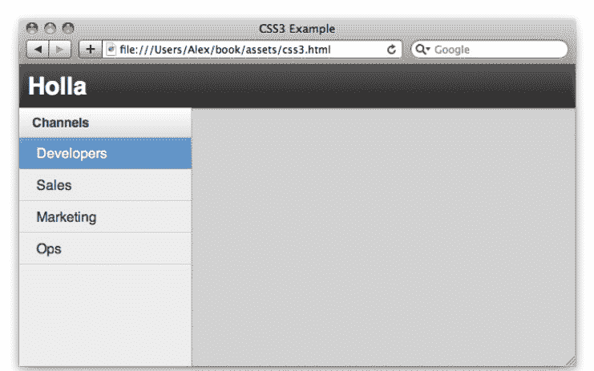

图 C-2. 基础应用布局

正如我之前提到的，由于我们必须使用厂商前缀，CSS3 语法相当冗长且重复。我们可以使用 Less 混入（mixins）来清理它。例如：

```css
#content .sidebar h3 {
  vbg-gradient(#FFF, #DDFE0);
  box-shadow(0, -5px, 10px, #E4E4E4);
}
```

请参附录 B 获取更多信息，并查看 Holla 样式表获取良好的示例。

## 索引

# 符号

- $ 快捷键, jQuery, 50
- $() 函数, 126
- $() 函数, 126
- $x() 函数, 127
- ($) 大括号, 匿名函数, 50
- _ (下划线), 私有属性前缀, 16
- __bindAll(), 171
- pushState() 和 replaceState() history API, 173
- Underscore's AP, 165
- WebSocket API, 99
- XMLHttpRequest API, 92
- App.log() 函数, 126
- append(), 210
- apply(), 12
- arguments 变量, 14
- 断言库, 110
- assert() 函数, 109
- assertEqual() 函数, 110
- 断言类型, 112
- 断言, 109
- async 属性, 134
- async 属性, Backbone 库模型, 166
- defer 属性, 134
- HTML5 中的文件, 82
- JavaScriptMVC 库模型, 189–191
- multiple 属性, 82
- originalEvent 属性, 84
- 返回, 46
- 验证实例的属性, 167
- 白名单, 176
- 审计员, 部署, 138
- autoLink() 函数, 69

# A

- Access-Control-Allow-Origin 头部, 42
- Access-Control-Request-Headers 头部, 42
- addEventListener(),19, 24
- 处理引用, 37
- Adobe Flash, 44
- after() 函数, 114
- Ajax
- 爬虫, 62
- 查询, 212
- 使用其加载数据, 39–42
- 进度, 93
- 同步与 Spine, 150
- ajax() 函数, 212
- ajaxError 事件, 150
- alpha 透明度, 225
- AMD 格式, 77
- Apache Web 服务器, 相对过期日期, 134

# APIs

- History API, 63
- HTML5 APIs, 81
- jQuery.tmpl 模板 API, 68
- jQuery 选择器 API, 207

# B

- Backbone 库, 165–183
- 集合, 167
- 控制器, 172
- 模型, 165
- 与服务器同步, 174–177 我们听到对改进索引的建议。请发送至 index@oreilly.com。
- 待办列表, 178–183
- 视图, 169
- Backbone.sync() 函数, 174, 176
- 背景, CSS3, 228
- before 事件, 87
- beforeEach() 函数, 114
- before 事件, 88
- bind() 函数, 15, 23, 57, 211
- 绑定, 关于, 70
- blobs 以及如此, 96
- CSS3 中的 border, 232
- border-radius 样式, 225
- box, 弹性盒模型: CSS3, 233
- box sizing, CSS3, 232
- box-shadow 样式, 226
- 断点, 127
- 浏览器, 99
-  CommonJS 模块, 75
- 复制和粘贴, 87
- CSS3, 222–244
- 拖放, 83
- 事件类型, 20
- 文件, 81
- Firebug-on, 124
- 优雅降级, 223
- hashchange 事件, 61
- 本地存储, 47
- 性能, 134
- 上传文件, 91
- 泡 事件, 21
- 冒泡, Spine, 132
- hash 的, 170
- jQuery 有一些迭代器, 209
- Model.created() 回调, 38
- 注册事件, 51
- Spine 库, 143
- 默认拖放, 85
- Cappuccino, 89, 165
- CDNs (内容分发网络), 138
- change 事件, 59, 151, 175
- change() 函数, 71
- 聊天室, 103
- Chrome Web 检查器, 123
- class, 关键字, 7
- 添加函数, 7
- 向类继承, 11
- 向类添加方法, 8
- 类库中的范围, 14
- JavaScriptMVC 库, 186–189
- 调用基方法, 187
- 实例化, 186
- 模型示例, 188
- 代理, 187
- 静态继承, 187
- MVC 模式, 6
- Spine 库, 142–145
- Spine.List, 159
- WebSockets, 99
- XMLHttpRequest 类, 40
- click() 回调, 15
- 客户端模板, JavaScript 库, 197–200
- $.View 和模板, 198
- 基本用法, 197
- 延迟, 199
- jQuery 修饰符, 198
- 从 script 标签加载, 198
- 打包, 加载和性能, 199
- clipboardData 对象, 87
- clipboardData 属性, 88
- 集合

# C

- Cache-Controller, 135
- 缓存, 部署, 134
- ajax() 函数, 212
- Backbone, 177
- 绑定模型事件, 147
- click() 回调, 15
- 事件回调中的上下文变化, 171
- 事件回调, 151
- 扩展和包含回调, 9
- 填充: Backbone 库, 175
- 颜色
- CSS 扩展, 219
- CSS3, 224
- Comet 技术, 97
- CommonJS
- 模块加载器, 76
- CommonJS 倡议, 74
- 压缩, Gzip, 137
- 合并, 78
- 控制台, 调试, 125
- console.error(), 125
- console.log(function), 125
- console.profile(function) 和 console.profileEnd, 129
- console.time(name), 125
- console.timeEnd(name), 131
- console.warn(), 125
- 构造函数, 6
- Spine 库中的联系人管理器, 156–163
- Contacts 模型, 157
- Contacts 控制器, 160
- Sidebar 控制器, 158
- 内容分发网络 (CDNs), 138
- 内容, 57–56
- 抽象为库, 52
- 更改, 12, 24, 171, 212
- 委托事件, 56
- 抽象为库, 52
- 访问视图, 55
- 添加内容, 51–56
- Spine 库联系人管理器中的 App 控制器, 163
- Backbone 库, 172
- Spine 库联系人管理器中的 contacts 控制器, 160
- JavaScriptMVC, 200–205
- 实例化, 202
- 概述, 202
- 模板化操作, 204
- 在文档后加载控制器, 53
- 模块模式, 50
- 路由, 64

- Ajax 爬虫, 62
- 检测 hash 变化, 61
- HTML5 History API, 63
- URL 的 hash, 60
- Spine 库, 150–156
- 状态机, 58


- 上下文变化, 171
- 代理, 151
- 事件捕获, 20
- 事件–30
- ajaxError 事件, 150
- Backbone , 170
- 取, 21
- change 事件, 59, 71, 159, 171, 175
- click 事件, 91
- 上下文变化, 24
- 控制器和事件监听器, 5
- 复制粘贴事件, 87
- 自定义事件, 25–27
- 委托, 54, 152
- document.ready 事件, 211, 213
- DOMContentLoaded 事件, 129
- 拖放放置, 83
- dragner 事件, 85
- dragover 事件, 85
- dragstart 事件, 84
- drop 事件, 95
- error 事件, 148, 167
- 事件绑定: JavaScriptMVC
    - 控制器, 203
- 事件字面量, 263
- 事件对象, 21
- Spine 库控制器中的全局事件, 153
- ...的哈希, 170
- hashchange 事件, 61
- jQuery, 211
- keydown 事件, 152
- 监听, 19
- load 事件, 93
- 非 DOM 事件, 27–30
- onhashchange 事件, 173
- open 事件, 99
- 排序, 20
- 粘贴事件, 88
- popstate 事件, 64
- progress 事件, 93, 94
- 期望管理, 105
- Expires Header, 134
- 导出, 全局导出, 50
- extend() 函数, 8, 143, 166
- 扩展
    - CSS, 217–220
    - jQuery, 213
- 结束方法, JavaScriptMVC 库, 191
- 扩展, 包装, 214

## F
- fetch() 函数, 175
- fetchRemote() 函数, 32
- FileReaderObject, 89
- 文件, 81–96
    - 浏览器支持, 81
    - 复制与粘贴, 87–89
    - 自定义浏览按钮, 91
    - 拖放放置, 83–86
    - 获取信息, 81
    - 输入, 82
    - jQuery 拖放上传器, 95–96
    - 读取, 89
    - 上传, 91–94
- find() 函数, 36, 37
- 有限状态机 (FMSs), 58
- Firebug, 124, 138
- Firebox, 125
- Firebug 和 YLow
- Flyscript, 179
- 关注者和被关注集合, 167
- FormData 实例, 92
- FSMs (有限状态机), 58
- FUBCs (闪烁的异常事件), 80

## functions
- 添加私有函数, 16
- 添加到类, 7
- AfterEach() 函数, 114
- ajax() 函数, 212
- 匿名函数, 16, 50
- App.log() 函数, 126
- append() 函数, 210
- assert() 函数, 210
- assertEqual() 函数, 110
- autoLink() 函数, 69
- Backbone.sync() 函数, 174, 176
- BeforeEach() 函数, 114
- bind() 函数, 15, 23, 57, 211
- change() 函数, 71
- clear() 函数, 127
- comparator() 函数, 169
- console.log() 函数, 125
- 构造函数, 6
- create() 函数, 37, 142, 150
- created() 函数, 143
- css() 函数, 210
- dataTransfer.getData() 函数, 86
- deactivate() 函数, 59
- define() 函数, 78
- undelegate() 函数, 24, 57
- describe() 函数, 114
- destroy() 函数, 4, 144, 147
- dir() 函数, 127
- empty() 函数, 211
- equals() 函数, 112
- exists() 函数, 146
- expect() 函数, 115
- extend() 函数, 8, 143, 146, 166
- fetch() 函数, 175
- fetchRemote() 函数, 32
- find() 函数, 36, 146
- 函数调用, 12
- 视图内部通用辅助函数, 68
- get() 函数, 166
- getData() 函数, 288
- getter 和 setter 函数, 211
- 全局变量和函数, 4
- history.back() 和 history.forward() 函数, 64
- history.pushState() 函数, 63
- include() 函数, 8, 52, 133, 146
- init() 函数, 34, 55, 142, 151
- initialize() 实例函数, 166, 168
- inspect() 函数, 127
- it() 函数, 114
- jQuery.ajax() 函数, 40
- jQuery.tmpl() 函数, 67
- keys() 函数, 127
- load() 函数, 52, 74
- Math.random() 函数, 36
- module() 函数, 111
- Object.create() 函数, 33, 142
- post() 函数, 47
- proxy() 函数, 14, 52, 144
- proxyAll() 函数, 144
- ready() 函数, 23
- refresh() 函数, 175
- remove() 函数, 168
- removeEventListener(), 函数, 19
- render() 函数, 171
- require() 函数, 74
- slice() 函数, 290
- stopImmediate(), 函数, 21
- stopPropagation() 函数, 21
- text() 函数, 211
- toJSON() 函数, 170
- trigger() 函数, 25
- update() 函数, 37
- uploadFile() 函数, 95
- validate() function, 167
- values() function, 127

## G
- GCF (Google Chrome Frame), 237
- get() 函数, 166
- getData() 函数, 88
- getJSON() 函数, 212
- getter 和 setters 函数, 211
- global export, 50
- global import, 50
- global variables and functions, 4
- Crawling specification, 62
- PageRank 算法, 139
- graceful degradation, 223
- gradients, CSS3, 227
- GUID generators, 36
- Gzip 压缩, 137

## H
- hash, default, 167
- detecting hash changes, 61
- events and callbacks, 170
- routing and URL 的哈希, 60
- headless library, 118
- Zombie.js, 119
- helpers, defined, 4
- history, JavaScript, 1
- real-time Web, 97
- History API, 63
- history.back() 和 history.forward() 函数, 64
- history.pushState() 函数, 63
- Holla, 104
- rendering, 65
- templating, 181

## HTML
- drag and drop, 83
- HTML5 APIs, 81
- local storage, 45
- HTTP requests, performance, 133

## I
- ID support, 36
- If-Modified-Since Header, 135
- If-None-match Header, 136
- images, border in CSS, 232
- immutable properties, 16
- import, global, 50
- include(), 8, 52, 133, 146
- including data inline, 39
- inheritance
    - adding inheritance to class libraries, 11
    - using prototype 的 class inheritance, 10
    - prototypal inheritance, 33
    - static inheritance: JavaScriptMVC 库, 187
- init 方法, 202
- init() 函数, 34, 55, 142, 151
- initialize() 实例函数, 166, 168
- inputs, files, 82
- inspect(), 127
- inspectors, 122
- interfaces (见 views)
- invocation, function, 12
- interpolating variables, 67

## J
- Jasmine, 113–115
- JavaScript, history, 1
- JavaScriptMVC 库, 185–206
- minification, 136
- abstract CRUD list, 205
- classes, 186–189
- calling base methods, 187
- instantiation, 186
- example, 188
- proxies, 187
- static inheritance, 187
- client-side templates, 197–200
- $.View 和 subtemplates, 198
- basic use, 197
- deferreds, 199
- modifiers, 198
- loading from a script tag, 198
- packaging, preloading and performance, 199
- controllers, 200–205
- event binding, 203
- models, 189–96
- overview, 202
- templated actions, 204
- attributes and observers, 189
- CRUD events, 196
- extending, 191
- helper methods, 192
- service, 193
- setters, 195
- type conversion, 196
- setup, 186
- jQuery, 207–216
- $ , 50
- Ajax, 212
- apply() and call(), 12
- being a good citizen, 213
- DOM manipulation, 209
- DOM traversals, 208
- drag-and-drop uploader, 95–96
- events, 211
- extensions, 213
- Growl plug-in, 11
- custom events, 25
- selector, 35
- jQuery(), 257
- jquery.ajax(), 40
- jquery.bind(), 203
- jquery.js plugin-in, 91
- jquery.delegate, 203
- jquery.extend(), 34
- jquery.fn object, 213
- jquery.get(), 200
- jquery.js, 79
- jquery.prototype, 213
- jquery.proxy(), 52, 216
- jquery.tmpl, 181
- jquery.tmpl library, 67
- jquery.upload plugin-in, 93
- JSMin, 136
- JSON objects, 39
- JSONP (with padding), 43


适配器, 177
向 ORM 添加, 46
日志级别, 125

Modernizr, 236
修改时间 (mtime), 135
模块化，MVC 模式与类, 6
模块模式, 50
模块传输格式, 75
module() 函数, 111
模块

# M

MacRuby, 121
手册, 109
匹配器, 115
Math.random() 函数, 36
消息，发送与接收, 99
代码压缩 (minification)
关于, 78
部署, 136
mixins, CSS 扩展, 218
model ID, 168
model属性, 168
Model.created() 回调, 38
models–48

替代方案, 79
浏览器, 75
声明 CommonJS, 74
模块加载器, 76
总结, 78
mod_delete, 138
multiple 属性, 82
Mustache, 67
MVC 模式, 1–17

关于, 2
向类库添加继承, 11
向类库添加方法, 8
添加私有函数, 16
为应用构建结构, 2
类函数, 7
使用原型进行类继承, 10
类库, 16
类, 6
控制类库中的作用域, 14
函数调用, 12
JavaScript 历史, 1
命名空间, 31

添加 ID 支持, 36
添加本地存储 ORM, 46
处理引用, 37
Backbone 库, 165
绑定, 71
Spine 模型管理器中的联系人
库, 157
弹性布局模型: CSS3, 233
JavaScriptMVC 库, 189–196
属性与观察者, 189–199
CRUD 事件, 196
扩展模型, 191
辅助方法, 192
服务封装, 193–195
setters, 191
类型转换, 196

# N

命名空间
CommonJS 计划, 74
自定义事件, 25
重要性, 73
内省, 188
MVC 模式, 31
命名空间污染, 50
变量定义与全局命名空间, 50

JavaScriptMVC 库类示例, 188
加载数据, 38–43
包含数据行, 39
JSON, 43
跨域请求安全, 43
通过 Ajax, 39–42
MVC 模式与命名空间, 31
ORMs, 32–36
填充 ORMs, 44
Spine 库, 145–150
在本地存储数据, 44
向服务器提交新记录, 46

CSS3 中的否定选择器, 230
嵌套规则，CSS 扩展, 218
网络请求, 128
new 运算符, 6
next  own prev 方法, 192
Node.js, 101, 220
非 DOM 事件, 27–30
nth-child, CSS3, 229

# 0

面向对象语言，JavaScript 作为一种, 2
对象关系映射器（见 ORMs）
Object.create() 函数, 33, 142
对象

clipboardData 对象, 87
dataTransfer 对象, 84, 86
event 对象, 21, 153
FileReader 对象, 89
JavaScript 对象字面量, 6
jQuery. 对象, 213
JSON 对象, 39
localStorage 和 sessionStorage 对象, 45
属性与命名空间, 31
原型对象, 10
onhashchange 事件, 173
onmessage, 99
onopen 事件, 99

Growl jQuery 插件, 214
JS 插件, 16
jQuery 插件与自定义事件, 25
jquery.browse.js 插件, 91
jQuery.tmpl 库, 67
jquery.upload 插件, 93
Selenium, 116
poststate 事件, 64
填充
集合: Backbone 库, 175
ORMs, 44
post() 函数, 47
CSS3 前缀, 224
预加载
数据, 38
智能预加载, 105
prepend() 函数, 210
渲染 HTML, 65
私有函数, 16
分析, 调试, 129–131
progress 事件
关于, 94
Ajax, 93

运算符
new 对象, 6
var 对象, 16
options.error() 回调, 177
options.success() 回调, 177
order, 事件, 20

OriginalEvent 属性, 84
ORMs (对象关系映射器), 32–36
添加本地存储, 46
添加 ORM 属性, 35
持久化, 35
填充, 44
原型继承, 33

属性
添加 ORM 属性, 34
添加类, 8
bubbles 事件, 22
类, 17
clipboardData 属性, 88
定义类, 16
el 属性, 151
event 属性, 52
不可变属性, 16
keyboard 事件, 22
model 属性, 168
原型对象, 10
Spine 库, 143
url 继承, 174
使用原类的继承, 10
ORMs, 33
代理快捷, 151
代理
JavaScriptMVC 库类, 187
Spine 库控制器, 151
WebSockets, 100
proxy() 函数, 24, 52, 144
proxyAll() 函数, 144

# P

打包, JavaScriptMVC 客户端模板
模板, 199
Pagerank 算法, 139
分页控制, 189
粘贴, 88
性能
部署, 133
JavaScriptMVC 客户端模板
模板, 199
感知速度, 105
持久化
记录: ORMs, 35
Spine 库模型, 148
插件
Adobe Flash, 44

发布/订阅
全局事件, 153
模式, 104
pushState() 和 replaceState() 历史, 173
rgb 样式, 224
Rhino, 74
CSS3 圆角, 225
路由, 172
路由, 60
Ajax 爬虫, 62
检测 变化, 61
HTML5 API, 63
URL 的 hash, 60
RPC 脚本, 100

# R

Rack, Less, 220
rack 命令, 79
读取文件, 89
ready() 函数, 23
实时 Web, 97–105
历史, 97
感知速度, 105
WebSockets, 98–103
record 特性, 131
持久化记录, 35
向服务器提交新记录, 47
引用, 处理, 37
refresh() 函数, 175
向事件注册回调, 51
相对过期, 134
remove() 函数, 168
EventListener(), 19
render 模式, 154
render() 函数, 171
Backbone 库视图, 170
动态渲染视图, 65
内联模板, 70
网络请求, 128
同源策略, 41
跨域请求安全, 43
require() 函数, 74
RequireJS, 77

# S

Safari, Web Inspector, 123
同源策略, 41
same() 函数, 112
Sauce Layers, 222
save() 函数, 146, 194
作用域
类库, 14
上下文, 51
脚本标签
关于, 73
模板, 199
脚本，性能, 134
CSS3 选择器, 229
self 变量, 212
send() 函数, 92
服务器推送, 98
服务器端应用，视图, 65
服务器端验证, 150
向其提交新记录, 47
与服务器同步: Backbone 库, 174–177
本地存储, 45
set() 函数, 166
setData() 函数, 84
setters, JavaScriptMVC 库, 191
影子
CSS3 阴影, 226
CSS3 文字阴影, 227
快捷方式，事件类型, 23
show:contact 事件, 160
Spine 库联系管理器, 158
本地存储, 44, 46
模板, 69
向服务器提交新记录, 47
slice() 函数, 90
切片和二进制, 90
Socket.IO, 102
实时 Web 速度, 105
SpiderMonkey, 74
Spine 库, 141–163
类实现, 17
类, 142–145
内容, 144
扩展, 143
实例化, 142

# T

标签，从脚本标签加载: JavaScriptMVC 客户端模板, 198
（另见脚本标签）
Task.fetch(), 149
teardown 函数, 114
teardown 选项, 112
模板操作，JavaScriptMVC 库控制器, 204
模板, 66–70

联系人管理器, 156–163
App 控制器, 163
联系模型, 157
Contacts 控制器, 160
Sidebar 控制器, 158
控制器, 150–156
控制器事件, 153
事件委托, 152
element element, 154
全局事件, 153
代理, 151
render 模式, 154
事件, 145
模型, 145–150
事件, 147
获取记录, 147
持久化, 148
验证, 148
设置, 141
Spine.App, 153
Spine.Events, 153
Spine.List 类, 159
板 , 172
Sprockets, 79
SproutCore, 165
状态机，控制器, 58
状态与控制器, 49
静态继承，JavaScriptMVC 库类, 187
关于, 66
辅助方法, 68
HTML, 181
作为原型对象, 10
脚本标签, 199
存储, 69
模板接口, 197
视图, 4
测试, 107–122
（见调试）
关于, 107
分布式测试, 121
驱动程序, 115
无头测试, 118–121
Ichabod 库, 121
Zombie.js, 119
支持, 122
单元测试, 109–115
断言, 109
Jasmine, 113–115
QUnit, 110
TestSwarm, 121


调试，129–131
函数，231
待办事项列表，Backbone 库，178–183
toggleClass(),53
toJSON() 函数，170
工具提示，200
转换，CSS3，232
transitionend，231
过渡，CSS3，230
trigger() 函数，25
Twitter，Ajax 爬虫，62
类型转换
JavaMVC 库模型，196
测试，109

视图
关于，4
Backbone 库，169
控制器，55
动态渲染，65
JavaScriptMVC 库客户端客户端模板，197–200
Vows.js，119

# W

Watir，116
Web Inspector，123
本书书的网页，xviii
Websocket-js，100
WebKit，87
WebKitTransitionEvent，231
WebSockets，98–103
白名单
域的，443
属性白名单，176
通配符，172
封装
扩展，214
模块，78

# U

ULs, Fms，58
underscore (), 变量属性前缀，16
underscore.js，169
单元测试，109–115
断言，109
asmine，113–115
QUnit，110
update() 函数，37
上传器，Query 拖拽式上传器，53–96
upload() 函数，95
上传文件，91–94
url 实例属性，174
URLs，路由和 URL 哈，60
User.extend()，143
UX（用户体验），105

# X

XDomainRequest，42
XMLHttpRequest API，92
HttpRequest 类，40

# Y

Yabble，76
YSlow，138
YUI Compressor，166

# V

JavaScript 引擎，119
validate() 函数，167
验证，Spine 库模型，148
values() 函数，127
var 运算符，16
变量
arguments 变量，14
CSS 扩展，217
全局变量和函数，4
插值，67
命名空间，31
变量定义和全局命名空间，50

# Z

Zepto.js，165
Zombie.js，119

# 关于作者

Alex MacCaw 是一位 Ruby/JavaScript 开发者兼企业家。他编写了一个 JavaScript 框架 Spine；开发了包括 Taskforce 和 Socialmood 在内的大型应用程序；并参与过开源工作。他在纽约、旧金山和柏林的 Ruby/Rails 会上进行演讲。除了编程，他目前正带着一台尼康 D90 相机和冲浪板环游世界。

# 版后

《JavaScript Web Applications》封面上的动物是一只长耳鸮。

长耳鸮（Asio otus）是一种纤细的灰色棕色森林猫头鹰，特征是头部中间有长而直立的耳羽。它们独特的耳朵让它们获得了“猫头鹰”的称号。

长耳鸮可以在北美、欧洲、亚洲和北非洲的开阔林、灌木丛和森林边缘找到。它们的食物几乎由小型哺乳动物组成，主要是鼠类和老鼠，由于耳孔位置不对称，它们能够在完全黑暗中找到这些食物。它们在低植被区域来回飞翔以寻找食物；它们的飞行轻盈且灵活，通常被比作大飞蛾。

长耳鸮不筑自己的巢；相反，它们栖在喜鹊、乌鸦、鹰和松鼠遗弃的树巢中。在繁殖季节（通常发生在 3 月中旬到 6 月初），它们倾向于分散并具有领地意识；而在冬季，它们聚群栖息以保暖，通常是 7–50 只鸟一组。

封面图片来自 Wood's Animate Creations。封面字体是 Adobe ITC Garamond。正字体是 Linotype Birka；标题字体是 Adobe Myriad Condensed；代码字体是 LucasFonts TheSansMonoCondensed。

