# JavaScript Web 战士系列

Cengage Learning 是领先的定制化学习解决方案提供商，在全球范围内设有办事处，包括新加坡、英国、澳大利亚、墨西哥、巴西和日本。通过 `www.cengage.com/global` 查找您的本地办公室。

Cengage Learning 产品在加拿大由 Nelson Education, Ltd. 代表。

欲了解更多关于 Cengage Learning 的信息，请访问 `www.cengage.com`。

产品总监：Kathleen McMahon

高级产品经理：Jim Gish

高级内容开发人员：Alyssa Pratt

营销经理：Eric LaScola

高级内容项目经理：Catherine DiMassa

开发编辑：Ann Shaffer

质量保证员：Danielle Shaw 和 Serge Palladino

艺术总监：Jack Pendleton

制造规划：Julio Esperas

IP 分析师：Sara Crane

IP 项目经理：Kathryn Kucharek

排版：Integra Software Services Pvt. Ltd.

## 序言

JavaScript 是一种客户端脚本语言，允许网页作者开发交互式网页和网站。虽然 JavaScript 被认为是一种编程语言，但它也是网页设计和编写的重要组成部分。这是因为 JavaScript 语言允许 Web 开发人员直接为网页元素添加功能。该语言相对容易学习，让非程序员也能快速地将 JavaScript 功能整合到网页中。事实上，由于它被广泛应用于全球网上无数的网页中，JavaScript 可以说是世界上使用最广泛的编程语言。

《JavaScript 第六版》为编程经验较少的学生教授如何使用 JavaScript 进行网页开发。虽然本书从网页开发组件的概述开始介绍，但使用本书的学生应该具备网页创建的基础知识，包括熟悉常用的 HTML 元素和 CSS 属性。本书涵盖了 ECMAScript 5 的基础知识（该版本兼容旧版本的 Internet Explorer），以及所有现代浏览器都支持的 ECMAScript 6 的某些特性。本书还涵盖了高级主题，包括面向对象编程、文档对象模型（DOM）、触摸和移动界面以及 Ajax。书中的 HTML 文档按照 HTML 标准编写，并包含兼容 XHTML 的元素语法。完成本课程后，你将能够使用 JavaScript 构建专业级的 Web 应用程序。

### 方法

本书介绍了多种技术，重点关注你开始编写 JavaScript 程序所需掌握的知识。在每一章中，你将执行某些任务，让你使用特定的技术来构建 JavaScript 程序。这些步进式任务是引导性活动，旨在加强你在章节中学到的技能，并通过提供在新的情况下应用知识的其他方法来丰富你的学习经验。除了步进式任务外，每章还包含目标、简短测验、总结、带定义的关键术语、复习题和强化练习，这些内容突出了主要概念并让你练习所学的技巧。

### 本书概述

书中的示例和练习将帮助你实现以下目标：

- 将 JavaScript 与 HTML 元素结合
- 处理 JavaScript 变量和数据类型，并学习如何使用对它们进行操作的操作符
- 在你的 JavaScript 程序中添加函数和控制流
- 追踪并解决 JavaScript 程序中的错误
- 编写通过浏览器对象模型控制浏览器的 JavaScript 代码
- 使用 JavaScript 确保数据已正确输入表单字段，并在表单数据发送到服务器之前执行其他类型的预处理
- 创建使用面向对象编程技术的 JavaScript 应用
- 操作字符串和数组中的数据
- 使用隐藏表单字段、查询字符串、Cookies 和 Web Storage（Web存储）保存状态信息
- 在 Web 应用中加入触摸屏支持和移动功能
- 使用 Ajax 动态更新 Web 应用
- 使用 jQuery 库构建 Web 应用

《JavaScript 第六版》共介绍十二章节，涵盖了 JavaScript 编程的各个方面。**第 1 章**讨论了万维网的基本概念，回顾了 HTML 文档，并涵盖了如何向网页添加 JavaScript 的基础。第 2 章还讨论了如何编写基础 JavaScript 代码，包括如何使用变量、数据类型、表达式、运算符和事件。这种对关键 JavaScript 概念的早期介绍为你后续理解书中更高级的概念和技巧提供了框架，并让你从一开始就能着手更全面的项目。**第 3 章**涵盖了函数、数据类型以及如何构建表达式。**第 4 章**解释了如何在数组中存储数据，以及如何在控制结构和语句中使用结构化逻辑。**第 5 章**提供了对调试技术的深入讨论，包括如何使用所有现代浏览器集成的控制台。**第 6 章**教授如何使用 JavaScript 通过 `Window`、`History`、`Location`、`Navigator` 和 `Screen` 对象操作浏览器。**第 7 章**解释了如何使用 JavaScript 确保数据已正确输入表单字段，以及在表单数据发送到服务器之前执行其他类型的预处理。**第 8 章**介绍了面向对象编程概念，包括如何使用 JavaScript 内置的 `Date`、`Number` 和 `Math` 类。**第 9 章**涵盖了操作字符串、数组和 JSON 数据的高级技术。**第 10 章**解释了如何使用隐藏表单字段、查询字符串、Cookies 和 Web Storage 保存状态信息，并简要讨论了 JavaScript 安全问题。**第 11 章**涵盖了在 Web 应用中支持触摸和指针事件，以及使用移动设备硬件提供的数据并为移动用户优化 Web 应用。**第 12 章**介绍了如何使用 Ajax 使用服务器端数据动态更新网页部分的基础。**第 13 章**介绍了如何使用 jQuery 库来简化 JavaScript 中常见的编程任务。**附录 A**提供了在本地机器上安装 XAMPP Web 服务器的详细说明。**附录 B**对 HTML、XHTML 和 CSS 的基础进行了简要回顾。**附录 C**作为书中涵盖的 JavaScript 语法和用法的一站式参考。**附录 D**位于在线，列出了所有简短测验的答案。

### 本版新内容？

第六版包含了以下重要的新特性：

- 新的、专业设计的章节项目，大多数章节都包含了移动端布局。
- 所有章节均包含全新的实战项目，以及新的个人和小组案例项目。
- 每章中新增了框框元素：最佳实践框突出了当前主题在现实世界中的实施指南；编程概念框解释了章节主题背后的原理；以及职场技能框提供了驾驭职场世界的指导。
- 每章中的多彩色代码示例从视觉上识别语言组件，较长的代码块配有行号。
- 全彩插图展示了每次修改后的项目状态。
- 为兼容 IE 编写的非移动端项目。
- 将调试范围移至第 5 章，让你在通过介绍章节之前就具备发现和纠正应用程序错误的技能。
- 更新了创建数组和对象、编写等号运算符以及监听事件的当前行业最佳实践。
- 将 `document.write()`、`window.alert()` 和类似方法的使用限制在早期章节，并在书其余部分用现代技术取代。
- 新增了关于触摸屏和移动设备开发的章节。
- 新增了关于使用 jQuery 进行入门编程的章节。
- 附录 A 关于安装 Web 服务器的部分被简化为使用免费开源的 XAMPP GUI 安装程序而非命令行。
- 附录 B 关于 HTML 和 CSS 的更新涵盖了 HTML 而非 XHTML，并扩展到涵盖 CSS 选择器。
- 新的精简布局，使查找信息更加容易。

### 特性

*JavaScript 第六版*中的每一章都包含以下特性：

- **章节目标：**每章开头都会列出该章介绍的重要概念。该列表为你提供了章节内容的快速参考，并作为一个实用的学习工具。
- **图表和表格：** 大量的全彩色截图让你在每次更改后检查屏幕。表格汇总了重要材料以便于参考。
- **代码示例：** 章节中大量的代码示例以易读的字体呈现，关键词用颜色显示。较长的代码块带有行号以便参考。
- **新术语：** 新术语用粗体打印，以吸引你注意新内容。

> **注意**
> 这些元素为特定技术和概念提供了额外的有用信息。

> **警告**
> 这些警告性注释标记了你需要小心执行以避免潜在陷阱的步骤。

> **职场技能**
> 这些注释提供了驾驭职场世界的指导。

> **最佳实践**
> 这些注释突出了各种主题在现实世界中的实施指南。

> **编程概念**
> 这些注释解释了章节或小节主题背后的原理。

- **简短测验：**每章都包含几个简短测验。这些测验由二到五个问题组成，有助于确保你理解章介绍的主要要点。
- **总结：** 这些简要概述回顾了每章涵盖的内容，为你提供了一个有用的学习指南。
- **关键术语：** 这些列表汇总了章中引入的所有新术语及其定义，创建一个涵盖章节重要概念的方便参考。
- **复习题：** 在每一章的末尾，一组二十道复习题旨在强化本章介绍的核心观点。这些问题帮助你判断是否已经掌握了本章介绍的概念。
- **实践项目：** 虽然理解每项技术背后的概念非常重要，但任何理论都无法取代现实经验。为此，每章都包含了详细的实践项目，为你提供在现实场景中练习实现技术技能的机会。
- **案例项目：** 这些章末项目旨在帮助你将所学知识应用于开放式场景，无论是以个人形式还是作为团队成员完成。它们为你提供了独立综合和评估信息、检查潜在解决方案，并对解决问题的最佳方式做出决策的机会。

### 教师资源

当本书在课堂环境中使用时，可以使用以下补充材料。本书配套提供的所有教师资源均可在 `sso.cengage.com` 教师伴侣网站上获取。需要拥有教师账户。

**教师手册。** 随本教材配套的教师手册包含额外的教学材料，以协助课堂准备，包括示例教学大纲、章节大纲、技术笔记、讲义笔记、快速测验、教学技巧、讨论主题以及额外的案例项目等。

**由 Cognero 提供的 Cengage Learning 测试**是一个灵活的在线系统，允许你：

- 从多个 Cengage Learning 解决方案中编写、编辑和管理题库内容。
- 瞬间创建多个测试版本。
- 从你的学习管理系统（LMS）、教室或任何你想的地方发布测试。

**PowerPoint 演示文稿。** 本书为每一章提供了 Microsoft PowerPoint 幻灯片。这些幻灯片作为课堂演示的辅助工具，可在网络供学生进行章节复习，或打印后课堂发放。教师可以为向学生介绍的其他主题添加自己的幻灯片。

**数据文件。** 包含所有实践项目和案例项目所需数据的文件也将通过 `CengageBrain.com` 提供给学生。

**解决方案文件。** 本书提供了章末问题和项目的解决方案。

### 在开始之前阅读

以下信息将帮助你准备使用本教材。

#### 数据文件

为了完成书中的步骤、练习和项目，你需要专门为本书创建的数据文件。数据文件可在 `CengageBrain.com` 获取。请注意，你可以使用学校实验室的电脑或自己的电脑来完成书中的步骤、练习和项目。

#### 使用自己的电脑

你可以使用学校实验室的电脑或自己的电脑来完成这些章节。要使用自己的电脑，你需要以下工具：

- **现代 Web 浏览器**，例如当前版本的 Chrome、Internet Explorer、Firefox 或 Safari。如果可能的话，你应该能够访问所有流行的现代浏览器（Chrome、Internet Explorer 和 Firefox），以及使用 Internet Explorer 来测试向后兼容代码。
- **基于代码的 HTML 编辑器**，例如 Aptana Studio、Komodo Edit、Notepad、TextWrangler、Adobe Dreamweaver 或 Sublime Text。
- **Web 服务器**（用于第几章），例如 Apache HTTP Server 或 Microsoft Internet Information Services 以及 PHP。附录 A 包含了如何安装 Web 服务器和 PHP 的详细说明。

#### 致教师

为了完成书中的所有练习和章节，你的学生必须使用一组被称为“数据文件”的用户文件。数据文件可在教师伴侣网站和 `CengageBrain.com` 上获取。

#### Cengage Learning 数据文件许可

你获得许可，可以将数据文件复制到购买了本书的人员所使用的任何计算机或计算机网络上。

#### 反馈与问题

我们欢迎教师和学生对本书的反馈和问题。你可以在 Twitter 上通过 `@sashavodnik` 联系作者 Sasha Vodnik。

### 致谢

JavaScript 第六版的编写确实是一项团队努力的成果。感谢许多帮助塑造和加强我所写内容的人。Ann Shaffer 提供了同样数量的优秀建议和问题，并帮助我在关注细节的同时关注大局。Alyssa Pratt 让我们专注于交付这些内容，同时为我们提供了支持和资源以确保一切都是顶尖的。Jim Gish 将我引进了这个项目，并介绍了这群帮助实现这一切的绝佳团队。Cengage 的 Cathie DiMassa 和 Ramanan Sundararajan 以及 Integra 团队通过迷人的视觉布局增强了页面上的简单文字，并对最微小的细节付出了心血。Danielle Shaw 和 Serge Palladino 阅读了所有文本，测试了所有步骤，并提供了宝贵的反馈。大岛健治 为章节项目列了虚拟企业和机构列表，并为每一个机构创建了独特且专业的标志。非常感谢对这些章节初稿提供反馈的评审员，他们的建议让内容更加清晰，让示例更加相关，并帮助我为教师创建了更好的教学工具，为学生创建了更好的学习材料：Jason Fleetwood-Boldt；Mark Murtha, Metropolitan Community College；Nicky Newell, Northeast Mississippi Community College 以及 Kevin Parker, Idaho State University。

最后，感谢我的丈夫 Jason Bucy 的爱与支持。

## 第 1 章 JavaScript 简介

尽管 JavaScript 被认为是一种编程语言，但它是 Web 设计的关键部分，因为 JavaScript 语言允许 Web 开发人员直接向网页添加功能。JavaScript 可以将静态文档转换为游戏等应用程序。JavaScript 代码可以在浏览器渲染网页后更改其内容。它还可以创建如动画般的视觉效果，并可以控制浏览器窗口。

在本章中，你将学习创建基础 JavaScript 程序所需的技能。完成本章后，你将能够：

- 解释 Web 的历史
- 描述客户端和服务器端脚本的区别
- 编写你的 JavaScript 程序
- 在你的网页中添加基础 JavaScript

### Web 简介

互联网是连接全球计算机的庞大网络。互联网的最初计划源于 J. C. R. Lickider 在 1960 年撰写的一系列备录，这些备录讨论了他对“银河网络”的概念。Lickider 构想了一个全球计算机网络，用户可以通过网络从任何站点访问数据和程序。互联网实际上是由美国国防部的高级研究计划署（ARPA）开发的，该机构后来更名为国防高级计划署（DARPA）。早期互联网的目标是连接该机构资助的大学和研究机构的主机系统。互联网的首次实现被称为 ARPANET。几年见证了局域网（LAN）和个人电脑的广泛发展。尽管曾局限于学术和军事，但计算机和网络很快在商业和日常生活中变得普遍。在 1990 年末，企业和个人计算机用户开始意识到互联网的全球通信能力和潜力，并说服美国政府允许商业访问互联网。

在 1989 年，Tim Berners-Lee 在瑞士日内瓦的欧洲核研究组织（CERN）创建了后来被称为**世界维网**（或 **Web**）的内容，作为一种

#### 万维网简介

为了方便访问存储在欧洲核研究组织（CERN）计算机网络上的交叉引用文档。当其他学者和科学家看到伯纳斯-李（Berners-Lee）系统的用途时，我们今天所知的 Web 诞生了。事实上，这种访问交叉引用文档的方法被称为**超文本链接**，在早期是 Web 最重要的方面之一，因为它允许用户快速打开其他网页。**超文本链接**、**超链接**或**链接**包含了指向特定网页的引用，点击它可以打开该网页。

一个常见的误区是认为“Web”和“Internet”（互联网）是同义词。Web 只是互联网的*部分*，是一种在互联网上进行通信的手段。互联网还由其他通信元素组成，例如发送和接收消息的电子邮件系统。然而，由于万维网对计算、通信和经济的巨大影响，可以说万维网是今天互联网最重要的部分，也是本书的关注重点。

Web 上的文档被称为**网页**，并通过一个称为**统一资源定位符**（Uniform Resource Locator，简称 **URL**）的唯一地址进行标识。URL 也常被称为**网页地址**。URL 是**统一资源标识符**（Uniform Resource Identifier，URI）的一种类型，它是万维网上许多类型名称和地址的通用术语。**网站**指的是互联网上一组网页和相关文件（如图形和视频文件），它们属于某个公司、组织或个人。你通过使用一个称为**Web 浏览器**的程序在计算机、平板电脑或手机屏幕上显示网页。人们可以通过在 Web 浏览器的地址栏中输入 URL 或点击链接，在 Web 浏览器中检索并打开网页。无论使用哪种方法，用户的 Web 浏览器都会向 Web 服务器请求网页，这被称为**请求**。**Web 服务器**是交付网页的计算机。Web 服务器返回给用户的内容被称为**响应**。

> **注意**
> 安装在智能手机和平板上的许多应用程序本质上是访问 Web 服务器的 Web 文档。它们通常使用设备上的默认 Web 浏览器连接到服务器，而无需用户输入 URL。

### 了解 Web 浏览器

NCSA Mosaic 创建于伊利诺伊大学，它是第一个允许用户通过图形用户界面（GUI）浏览 Web 的程序。1994 年，Netscape 发布了 Navigator，它很快控制了 90% 的市场。Netscape 一直保持着对浏览器市场的控制，直到 1995 年，当时微软随着发布 Internet Explorer 进入市场，所谓的“浏览器大战”爆发，微软和 Netscape 开始争夺浏览器市场的控制权。

浏览器大战是围绕动态 HTML（DHTML）引发的，DHTML 是多种技术（包括 HTML 和 JavaScript）的结合，允许网页在被浏览器加载后发生变化。DHTML 的示例包括重新定位文本和元素的位置、更改文档背景颜色以及创建动画等效果。早期的 Internet Explorer 和 Navigator 以各自浏览器特有的方式支持 DHTML 元素，这意味着 Internet Explorer 的 DHTML 代码与 Navigator 不兼容，反之亦然。此外，微软和 Netscape 都希望自己的 DHTML 版本能成为行业标准。

为了解决这场争论，万维网联盟致力于创建一个与平台无关且浏览器中立的 DHTML 版本。**万维网联盟**（World Wide Web Consortium，简称 **W3C**）于 1994 年建立在麻省理工学院（MIT），负责监督 Web 技术标准的制定。当 W3C 在起草 DHTML 建议时，Internet Explorer 第 3 版和 Navigator 第 3 版各添加了一些与另一个浏览器完全不兼容的专有 DHTML 元素。结果，在处理动画等高级 DHTML 技术时，程序员必须为每个浏览器编写一套不同的 HTML 代码。对 Netscape 来说遗憾的是，W3C 将 Internet Explorer 第 3 版中的 DHTML 版本采纳为正式标准，这促使许多忠实的 Netscape 用户转投微软。

> **注意**
> W3C 实际上并不发布某项技术的版本。相反，它对某项技术发布正式建议，这本质上意味着该技术是（或将成为）受认可的行业标准。

浏览器大战的一个益处是，它们迫使 Web 行业快速开发并采用在浏览器间一致的高级网页标准（包括 JavaScript、CSS 和 DHTML）。2000 年，Internet Explorer 似乎已基本赢得了浏览器大战，因为它控制了 95% 的浏览器市场。然而，微软在随后的 Internet Explorer 版本中并未完全支持 Web 标准，为更符合当前标准的浏览器创造了机会。在过去的十年里，Internet Explorer 在桌面电脑上的市场份额已被 Mozilla Firefox 和 Google Chrome 大量夺失。其他浏览器——包括 Apple Safari 和 Opera——也占据了桌面浏览器市场的一角。

> **注意**
> 几家公司收集并发布 Web 浏览器的使用统计数据。每家公司的方法略有不同，导致不同的结论。你可以通过搜索引擎搜索 Web 浏览器使用统计来查看每家公司的发现。

过去几年中，各大科技公司开始了移动设备浏览器市场份额的新竞争。Apple Safari 作为 iPhone 和 iPad 的默认浏览器，在该市场占据了主导地位。作为近期 Android 手机默认浏览器的 Google Chrome 也拥有巨大的市场份额，Opera 移动版也是如此。与 20 世纪 90 年代的桌面浏览器大战不同，在此时，微软尚未在移动市场建立显著的市场份额。

### 创建网页

最初，人们使用超文本标记语言创建网页。**超文本标记语言**（Hypertext Markup Language，简称 **HTML**）是用于创建出现在万维网上网页的标记语言。网页也常被称为**HTML 页面**或**文档**。**标记语言**是一种定义文档逻辑结构的字符或符号——即它指示了文档中每个项目的含义或功能。HTML 基于一种更老的语言，称为**标准通用标记语言**（Standard Generalized Markup Language，简称 **SGML**），它的范围比 HTML 广，可以定义许多不同语境下的文档结构。

标记语言的设计是将文档中的数据与其格式化的方式分开。HTML 文档中的每个元素都根据其类型进行标记，例如段落或标题。在 Web 早期的很短时期，HTML 标准还包含了定义元素在 Web 浏览器中外观的规范——例如，`b` 元素用于将文本加粗，`i` 元素用于将文本格式化斜体。然而，负责 Web 增长的人和组织意识到保持文档外观与其结构独立的重要性，并将 HTML 元素恢复到仅识别结构的原始用途。一种名为**层叠样式表**（Cascading Style Sheets，简称 **CSS**）的独立补充语言被用于指定网页元素的外观。

> **注意**
> 本书交叉使用“网页”和“HTML 文档”术语。

#### 基础 HTML 语法

HTML 文档是一种包含代码的文本文件，这些代码被称为**标签**，指定浏览器如何处理文档中的数据。HTML 标签可以指示广泛的元素，从不同类型的文本内容（如标题和段落）到允许用户输入的控件（如选项按钮和复选框）。其他 HTML 标签允许在文档中显示图形图像和其他对象。标签被包含在括号内（`<` `>`），大多数标签由一个起始标签和一个结束标签组成，包裹着文本或它们格式化或控制的其他项目。结束标签必须在起始括号之后立即紧跟一个正斜杠（`/`），以将其定义为结束标签。例如，要将一行文本标记为段落，你使用起始标签 `<p>` 和结束标签 `</p>`。当你在网络浏览器中打开 HTML 文档时，浏览器会将这些标签包围的文本识别为段落。

一个标签对及其其中包含的任何数据被称为**元素**。元素的起始标签和结束标签之间包含的信息称为其**内容**。某些元素不需要结束标签。不需要结束标签的元素被称为**空元素**，因为它们不允许你使用标签对来封装文本或其他元素。例如，在网页上插入换行符的 `br` 元素就不包含结束标签。你只需要在 HTML 文档中任何想要出现换行的地方放置 `<br />` 标签即可。

> **注意**
> HTML 文档必须具有 .htm 或 .html 文件扩展名。

实际上有数百个 HTML 元素。下表列出了一些常用元素。

| HTML 元素名称 | 描述 |
| :--- | :--- |
| `article` | 标记网页文档的主要内容 |
| `body` | 标记 HTML 文档的正文 |
| `div` | 标记网页正文的通用区域 |
| `head` | 标记页眉，并包含关于整个页面的信息 |
| `h*n` | 标记标题级元素，其中 *n* 代表 1 到 6 之间的数字 |
| `html` | 标记 HTML 文档的内容 |
| `img` | 插入图像文件 |
| `nav` | 标记导航选项，例如页面顶部、底部或侧边的导航栏 |
| `p` | 将标记的文本识别为段落 |

表 1-1: 常用 HTML 元素

所有 HTML 文档必须使用 `html` 元素作为根元素。**根元素**包含了文档中的所有其他元素。该元素告诉网络浏览器将标签之间的任何指令组合成网页文档。起始标签 `<html>` 和结束标签 `</html>` 是必须的，并且包含了构成 HTML 文档的所有文本和其他元素。

另外两个重要的 HTML 元素是 `head` 元素和 `body` 元素。`head` 元素包含浏览器使用的信息，你将其放在 HTML 文档的开头，即起始标签 `<html>` 之后。你在 `head` 元素内部放置多个元素来帮助管理文档内容，包括 `title` 元素，它包含出现在浏览器标签页或标题栏中的文本。`head` 元素必须包含一个 `title` 元素。除 `title` 元素外，包含在 `head` 元素中的元素在浏览器显示的 HTML 文档中不可见。`head` 元素及其包含的元素被称为**文档头部**。

文档头部之后是 `body` 元素。`body` 元素及其包含的文本和元素被称为**文档正文**。

HTML 不区分大小写，因此你可以使用 `<P>` 代替 `<p>`。然而，HTML 的一个分支——名为 XHTML 的语言是区分大小写的，并且要求标签使用小写字母。由于编写在 HTML 和 XHTML 文档中均可运行的代码可能很有用，因此本书所有标签均使用小写字母。（你很快就会学更多关于 XHTML 的知识。）

你使用各种称为**属性**的参数为许多 HTML 元素提供额外信息。你在起始标签的结束括号之前放置属性，并用空格将其与标签名称或其他属性隔开。你使用 `attribute="value"` 语法为属性赋值。例如，要向 HTML 文档中添加图像，你使用带有多个属性的 `img` 元素。其中一个属性 `src` 指定了图像文件的文件名。要在网页文档中添加文件 logo.jpg，你将在 `img` 元素中使用 `src` 属性，如下：

```html

```

当你在网络浏览器中打开 HTML 文档时，根据元素中包含的指令进行组合和格式化。网络浏览器组合和格式化 HTML 文档的过程被称为**解析**或**渲染**。出现在浏览器中的最终文档仅包含识别出的 HTML 元素和文本。当网络浏览器渲染 HTML 文档时，它会忽略制表符和换行符等非打印字符。尽管可以使用键盘上的 Enter 或 Return 键在 HTML 文档正文文本中添加换行符使代码更易读，但浏览器在解析文档时会忽略这些换行符。此外，大多数网络浏览器会忽略网页文档中的多个连续空格，并将其替换为单个空格。以下代码显示了图 1-1 中所示的文档头部和部分正文。

```html
1 <!DOCTYPE html>
2 <html>
3 <head>
4 <meta charset="utf-8" />
5 <title>Hoteloma - Reservations</title>
6 <link type="text/css" rel="stylesheet" media="screen" href="natoma.css" />
7 <link type="text/css" rel="stylesheet" media="screen" href="form.css" />
8 <link rel="shortcut" href="favicon.ico" />
9 </head>
10 <body>
11 <div id="box">
12 <h1>Hoteloma - Reservations</h1>
13 <nav>
14 <ul id="main">
15 <li><a href="index.html">Home</a></li>
16 <li><a href="nearby.html">Nearby</a></li>
17 <li><a href="http://bit.ly/bb3Sic" target="_blank">Location</a></li>
18 <li><a href="museums.html">SF Museums</a></li>
19 <li><a href="greensf.html">Green SF</a></li>
20 <li><a href="reserve.html">Reservations</a></li>
21 </ul>
22 </nav>
23 <article>
24 <h2 id="main">Reservations</h2>
25 ...
```

#### 创建一个 HTML 文档

由于 HTML 文档是文本文件，你可以使用任何文本编辑器（如记事本或 TextEdit）创建它们，或者任何能够创建简单文本文件的处理应用程序。如果你使用文本编辑器创建 HTML 文档，你将无法查看最终结果，直到你在网络浏览器中打开文档。你可以使用文本编辑器或文字处理程序，而是可以使用网页开发工具，这是一种专门为创建 Web 文档设计的应用程序。一些流行的网页开发工具（如 Adobe Dreamweaver 和 Microsoft Visual Studio）具有图形化界面，允许你创建网页并立即查看结果，类似于文字处理程序中的“所见即所得”（WYSIWYG）界面。像文本编辑器一样，网页开发工具也会创建简单的文本文件，但它们自动化了应用元素的过程。

图形化网页开发工具可以极大简化创建网页的任务。然而，图形化工具会自动向文档添加许多你不熟悉的元素和属性，这可能会让你困惑并分散对学习过程的注意力。此外，没有比自己输入代码更能磨炼 HTML 和 CSS 技能并学习 JavaScript 的方法了。因此，在书中，你将使用非图形化的文本编辑器来创建网页。

代码编辑器的选择取决于你，Windows 自带的编辑器（记事本）和 OS X 自带的（文本编辑）已经足够。不过，你可能会发现下载并安装专门为编码创建的编辑器很有用。虽然这些编辑器不包含图形化界面，但它们包含了许多其他让编码更简单的功能，包括为文档中的代码行编号以及根据其含义对文本进行颜色编码——例如，为元素内容指定一种颜色，为 HTML 标签名指定另一种颜色，为 HTML 属性名指定第三种颜色。网上有很多良好的编辑器可以免费下载，包括以下：

- Aptana Studio（Windows 和 Mac）— `http://www.aptana.com/products/studio/`
- Komodo Edit（Windows 和 Mac）— `http://www.activestate.com/komodo-edit`
- Notepad++（Windows）— `http://notepad-plus-plus.org`
- TextWrangler（Mac）— `http://www.barebones.com/products/textwrangler`

书中显示的 HTML 和 JavaScript 代码包含了区分不同部分的颜色，就像你在代码编辑器中看到的那样。尽管有许多不同的颜色方案，但本书对 HTML 代码使用以下颜色：

- `black`：HTML 语法字符（`<`, `>`, `=`），字体值、字面量文本
- `blue`：元素名、属性名、字符实体引用
- `green`：属性值
- `gray`：HTML 注释

在书的后面，你也将学习用于 JavaScript 代码的颜色。

#### 使用 HTML5

HTML 在发布第 5 版本后首次成为互联网标准。该标准已经经过了多次修订，在编写此时，HTML5 是最新版本。HTML5 整合了较于以前版本的几项重大变化，包括简化某些编码实践，以及增加对许多语义元素的支持（例如 `header` 和 `article`），这些元素允许开发者指示页面上特定内容的作用。

在 HTML5 开发之前，一种名为**可扩展超文本标记语言**（Extensible Hypertext Markup Language）或 **XHTML** 的不同规范被视为 Web 开发未来的语言。XHTML 修改了 HTML 以符合**可扩展标记语言**（XML）的规则，XML 是一种用于在许多不同应用程序中格式化数据的语言。虽然最初因其将 Web 文档与其他系统集成的能力而被认为大有前景，但 XHTML 的几个方面（包括其不灵活的语法）阻止了它被开发者广泛接受。HTML5 已取代 XHTML 成为未来大多数网页的标准。书中的网页示例和练习都是用 HTML5 编写的。

虽然你需要对 HTML 有深入理解才能学好这本书，但你不一定需要成为 HTML5 专家。因为 HTML5 与早期的 HTML 版本以及 XHTML 非常相似，你可以轻松地将现有的 HTML 或 XHTML 技能适应到 HTML5。如果你不熟悉 HTML5，在继续本章之前，请回顾名为“使用 HTML 和 CSS”的附录。确保你理解什么是语义元素以及它们是如何工作的。此外，你应该彻底理解如何使用 CSS。

在本章中，你将为 Tinley Xeriscapes 的一个网页添加 JavaScript 代码，这是一家专门经营极少浇水植物的园艺公司。一位设计师为该公司的网站创建了新布局，他们希望你整合 JavaScript 以增强网站其中一个页面的功能。第 1 章的 Chapter 文件夹包含了你项目所需的文件。图 1-2 和 1-3 显示了包含你在本章中创建的功能的完成网页的桌面和移动预览。

> **注意**
> 书中许多项目和示例使用了专业设计的网站，因为在现实世界中，JavaScript 程序员通常被要求在预先存在的网站上添加代码。然而，不要担心尝试理解书中看到的设计元素。相反，只需关注 JavaScript 是如何与你处理的网页交互的。

在开始以下步骤之前，请务必提取本书的数据文件，你可以按照本书序言中的说明从 Cengage 网站 `http://www.cengage.com` 下载这些文件。将你创建的文件保存在每个章节正文中的 Chapter 文件夹内。

要为 Tinley Xeriscapes 创建植物列表页：

1. 启动文本编辑器，然后打开第 1 章 Chapter 文件夹中的 **plants.htm** 文件。

> **注意**
> 某些 Web 服务器无法正确解释 HTML 文件名中的空格。例如，某些 Web 服务器可能无法正确解释文件名 *Mortgage Brokers.html*，因为在 Mortgage 和 Brokers 之间有空格，导致某些用户无法在浏览器中打开此文件。出于此原因，书中的文件名不包含空格。

2. 在编辑器中检查文件内容。文件以 HTML DOctype 开始。head 部分（由起始标签 `<head>` 和结束标签 `</head>` 标记）指定了字符编码，为较小屏幕设置了视口大小，指定了页面标题，根据屏幕宽度链接到两个替代样式表，并链接到一个网络托管字体。
3. 在文本编辑器中打开 **tinley.css** 文件，然后检查其内容。样式表从一系列用于标准化不同浏览器元素渲染的规则开始。这些规则之后是网页不同部分的样式。
4. 打开网络浏览器，按下 **Ctrl** + **O** (Windows) 或 **command** + **O** (Mac)，导航到第 1 章的 Chapter 文件夹，然后双击 **plants.htm** 在你的网络浏览器中打开它。

> **注意**
> 图 1-4 显示了 Firefox 中显示的 plants.html 文档。

5. 将鼠标指针悬停在页面左侧的植物名称**毯花 (Blanket Flower)**、**灌木玫瑰 (Hedge Rose)** 和**小蓝草 (Little Bluestem)** 上。注意，当鼠标指针悬停在名称上时，植物名称的文本和背景颜色会发生变化，当指针离开时颜色会恢复。这种效果是通过 CSS 的 `:hover` 伪类实现的。
6. 点击文本**毯花**，点击**灌木玫瑰**，然后点击**小蓝草**。注意，当你点击植物名称时不会发生任何事情。在页面的设计计划中，点击植物名称应该触发浏览器在名称列表的右侧显示所选植物的大图。虽然可以通过创建同一页面的多个版本并将植物名称标记为链接来实现，但 JavaScript 提供了一种创建相同效果的方法，这对用户来说更快，对开发者来说所需的代码更少。在本章的剩余部分中，你将使用基础 JavaScript 代码为网页添加此功能。

#### 简短测验 1

- 蒂姆·伯纳斯-李（Tim Berners-Lee）创建了什么种访问文档的方法？他的系统有什么值得关注的地方？
- W3C 代表什么？该组织是做什么的？
- HTML 文档中的代码称为什么？它们起什么作用？

### Web 开发简介

**网页设计**（或 **Web 设计**）指的是对在万维网上显示的文档进行视觉设计和创建。当今的大多数企业——无论大企业还是小企业——都有网站。高质量的网页设计在吸引首次访问者和重复访问者方面起着重要作用。然而，网站的视觉方面只是故事的一部分。同样重要的是网站的内容以及这些内容的结构化方式。

网页设计是一个极其重要的话题。然而，这本书并不是关于网页设计的，尽管在学习接下来的章节时，你无疑会学到许多网页设计概念和技术。相反，这本书触及了网页编写和 Web 开发。**网页编写**（或 **Web 编写**）指的是构成网页的标签、属性和数据的创建与组装。网页设计与网页编写之间存在着一种细微但重要的区别：网页设计指的是创建网页的视觉和图形设计方面，而网页编写是指组装网页标签和属性的物理任务。

**Web 开发**（或 **Web 编程**）指的是为网站设计软件应用程序。通常，Web 开发人员在幕后工作，开发访问数据库和文件系统、与其他应用程序通信并执行其他高级任务的软件应用程序。Web 开发人员创建的程序并不一定会被访问者看到，尽管访问者无疑会使用 Web 开发人员的程序，特别是当网站向数据库读写数据时。

尽管 JavaScript 更多地处于网页编写领域，但 Web 编写和 Web 开发之间确实存在某些重叠，特别是涉及到向 Web 服务器发送和接收数据时。

组合数百个 HTML 元素来创建有趣网页的方法数不胜数。专业网页作者提高 HTML 技能的一种技术是检查他们推崇的网页的底层 HTML 元素。所有的 Web 浏览器都包含命令，允许你查看在浏览器中显示的网页的底层 HTML 代码。使用任何主流浏览器，你可以右键点击（Windows）或控制点击（Mac）网页的任何部分，然后在打开的右键菜单中点击“检查元素”来查看该元素的代码。

> **注意**
> 许多 JavaScript 程序员会将他们的代码免费供其他开发者复用，有时仅要求在复用的代码中注明署名。然而，请记住，建立自己的 JavaScript 编程技能需要你独立思考并解决编程任务。依赖借用的代码会阻碍你学习和理解如何编码。此外，雇佣程序员的雇主在面试中专注于评估候选人完成特定编程任务的能力，并希望审查申请人现有的原始代码集。现在编写自己的代码将为你最终根据 JavaScript 技能获得工作提供至关重要的帮助。

#### 理解客户端/服务器架构

要在 Web 开发中取得成功，你需要理解客户端/服务器架构的基础知识。“客户端”和“服务器”这两个术语有许多定义。在传统的客户端/服务器架构中，**服务器**通常是某种数据库，客户端从中请求信息。服务器通过管理请求或向客户端提供请求的信息来完成信息请求——因此有了“客户端/服务器”这一术语。由客户端和服务器组成的系统被称为**二层系统**。

在二层系统中，**客户端**（或**前端**）的主要角色之一是向用户展示界面。用户界面从用户那里收集信息，将其提交给服务器（或**后端**），然后接收、格式化并展示从服务器返回的结果。服务器的主要职责通常是数据存储、管理以及与外部服务进行通信。在客户端/服务器系统中，重型处理（如计算）通常发生在服务器上。然而，随着用于访问网页的设备（如电脑、平板电脑和手机）变得越来越强大，许多客户端/服务器系统已将越来越多的处理职责放在了客户端。在典型的客户端/服务器系统中，客户端计算机可能包含一个用于从服务器数据库请求信息的界面。服务器定位符合客户端请求的记录，执行某种处理（如对数据的计算），然后将信息返回给客户端。客户端计算机也可以执行某些处理，例如构建发送到服务器的查询或格式化并展示返回的数据。图 1-5 展示了二层客户端/服务器系统的设计。

图 1-5：二层客户端/服务器系统

| 客户端 | 服务器 |
| :--- | :--- |
| 前端 | 后端 |
| 展示界面 | 数据存储和管理 |
| 收集用户信息 | 与外部服务通信 |
| 提交信息给服务器 | 执行处理/计算 |
| 接收/格式化结果 | 返回信息给客户端 |
| | 定位记录 |

三层客户端/服务器系统增加了一个中间层，称为处理层。客户端层（或用户界面层）仍然是浏览器。然而，二层客户端/服务器系统中的数据库部分被分为处理层和数据存储层。**处理层**（或**中间层**）处理浏览器客户端与数据存储层之间的交互。（处理层有时也被称为处理桥接。）本质上，客户端向 Web 服务器上的数据库发送请求。处理层根据来自客户端的请求执行任何必要的处理或计算，然后从数据存储层读取信息或向数据存储层写入信息。处理层还负责将任何信息返回给客户端。请注意，处理层并不是发生处理的唯一地方。浏览器（客户端层）仍然渲染网页文档（这需要处理），而数据存储层中的数据库或应用程序也可能执行某些处理。

> **注意**
> 三层客户端/服务器架构在物理上更多的是概念性的，因为存储层可以位于同一服务器上。

图 1-6 展示了三层客户端/服务器系统的设计。

图 1-6：三层客户端/服务器系统

| 层级 | 描述 |
| :--- | :--- |
| **客户端层** | 处理用户界面显示（浏览器）并向处理层提交请求 |
| **处理层** | 可以是同一台计算机。处理浏览器客户端与数据存储层之间的交互。 |
| **数据存储层** | 在数据库中存储数据并返回由处理层提交的请求 |

#### JavaScript 与客户端脚本

如前所述，HTML 的最初意图并不是为了控制浏览器中页面的外观。当 HTML 最初开发时，网页是**静态的**——也就是说，它们在浏览器渲染后无法发生改变。然而，在 Web 发展出一个个小的学术和科学社区之后，人们开始意识到更好的交互性和视觉设计将使 Web 变得更有用。随着 Web 商业应用的增长，对更具交互性和视觉吸引力的网站的需求也随之增长。HTML 仅能生成静态文档。你可以将用 HTML 编写的静态网页看作大约等同于一本印刷书籍；你可以阅读它或在其中移动，但内容是固定的。为了响应网页对更高交互性的需求，需要一种全新的 Web 编程语言。Netscape 通过开发 JavaScript 满足了这一需求。

**JavaScript** 是一种客户端脚本语言，允许网页作者开发交互式网页和站点。**客户端脚本**指的是使用一种运行在本地浏览器（客户端层）而非运行在 Web 服务器（处理层）上的脚本语言进行编程。JavaScript 最初设计用于 Navigator 浏览器，现在也广泛用于所有主流的 Web 浏览器，包括 Internet Explorer、Firefox、Chrome、Safari 和 Opera。

> **注意**
> 当你在 Web 开发中使用 HTML、CSS 和 JavaScript 时，每种语言都起着独特的作用。你使用 HTML 来指明网页内容中每个部分的作用和含义。你使用 CSS 来描述每个网页元素应该在浏览器或其他用户代理中如何被渲染。你使用 JavaScript 为网页添加功能。在尝试增强网页时，你应该首先识别出你正尝试完成这三个主要任务中的哪一个。这个问题的答案将明确你将使用哪种语言。

“**脚本语言**”是一个通用术语，最初指的是相当简单的编程语言，这些语言不包含像 Java 或 C++ 这样语言的高级编程能力。在 Web 开发中，脚本语言指的是任何能够以编程方式控制网页或向浏览器返回某种响应的语言类型。重要的是，尽管“脚本语言”一词最初指的是简单的编程语言，但今天基于 Web 的脚本语言绝非简单。浏览器执行脚本语言代码的部分被称为浏览器的**脚本引擎**。脚本引擎只是解释器的一种，“**解释器**”一词泛指任何执行脚本语言代码的程序。

当脚本引擎加载网页时，它会解释任何用脚本语言（如 JavaScript）编写的程序。包含脚本引擎的浏览器被称为**脚本主机**。Firefox 和 Internet Explorer 是运行 JavaScript 程序的脚本主机示例。

> **注意**
> 许多人认为 JavaScript 是 Java 编程语言的简化版，或者以其他方式与 Java 有关。然而，这些语言是完全不同的。Java 是一种由 Sun Microsystems 创建的高级编程语言，比 JavaScript 难掌握得多。尽管 Java 可以用于创建从网页运行的程序，但 Java 程序通常是独立于浏览器执行的外部程序。相比之下，JavaScript 程序始终运行在网页内部并控制浏览器。

JavaScript 首次引入 Navigator，最初被称为 LiveScript。当微软发布自己的 JavaScript 版本时，发生了几个问题。首先，为了防止恶意脚本窃取信息（如你的电子邮件地址或在线交易使用的信用卡信息）通过更改或删除文件造成损害，JavaScript 仅允许关联关联的文件。另一个限制是 JavaScript 无法在客户端运行系统命令或执行程序。对 Cookie 以及其他类型浏览器存储的访问是 JavaScript 拥有的唯一访问类型。然而，浏览器对其存储进行严格限制，不允许外部访问。这意味着 JavaScript 无法直接与 Web 服务器交互。虽然程序员可以使用一些技巧（如表单和查询字符串）让 JavaScript 间接与 Web 服务器交互，但如果你想真正控制服务器上发生的情况，你需要使用服务端脚本语言。为了避免类似的问题，JavaScript 创建了一个标准版本，称为 ECMAScript。

> **注意**
> 传统上，脚本引擎性能的限制限制了 JavaScript 在给定页面上执行的编程量。然而，2008 年 Google 发布了开源 V8 JavaScript 引擎，这代表了性能和效率巨大进步。

#### 理解服务器端脚本

**服务端脚本**指的是使用从 Web 服务器上执行的脚本语言进行编程。一些更流行的服务端脚本语言有 PHP、ASP.NET、Python 和 Ruby。使用服务端脚本语言的主要原因之一是开发与数据库通信的交互式网站。服务端脚本语言工作在处理层，并具有处理客户端层与数据存储层之间通信的能力。在处理层，服务端脚本语言通常在数据提交到数据存储层之前对其进行某种方式的准备和处理。你可能已经在 Web 上看到的服务端脚本语言的常见用途包括：

- 购物车
- 搜索引擎
- 讨论和评论系统
- 基于 Web 的电子邮件系统
- 身份验证与安全机制
- 博客和内容管理系统
- 多人游戏

没有 JavaScript，服务器端脚本语言无法访问或操作网页浏览器。事实上，服务器端脚本语言根本无法运行在客户端层。相反，服务器端脚本语言仅存在并执行在 Web 服务器上，它在那里负责执行各种类型的处理或访问数据库。当客户端请求服务器端脚本时，该脚本将由 Web 服务器软件内部的脚本引擎解释并执行。在脚本执行完毕后，Web 服务器软件会将脚本的结果（例如计算结果或从数据库返回的记录）转换为 HTML，然后将其返回给客户端。换句话说，客户端永远看不到服务器端脚本，只能看到 Web 服务器软件从脚本返回的 HTML。图 1-7 描述了 Web 服务器如何处理服务器端脚本。

图 1-7：Web 服务器如何处理服务器端脚本

#### 你应该使用客户端还是服务器端脚本？

一个通用的规则是让客户端处理用户界面处理和轻量处理（例如数据验证），但让 Web 服务器执行密集型计算和数据存储。在通过网络处理客户端和服务器时，这种分工尤为重要。与私有网络上的客户端不同，你无法预知网络上每个客户端的计算能力。你不能假设访问你的客户端/服务器应用程序（网站）的每个客户端（浏览器）都具有执行应用程序所需的处理能力。因此，密集型处理应该在服务器上进行。

由于服务器通常比客户端计算机强大得多，你的第一反应可能是让服务器处理所有计算，仅用客户端显示用户界面。虽然你不想让客户端因无法处理的处理而过载，但由于以下几个原因，在客户端执行尽可能多的处理是非常重要的：

- 在多个客户端之间分配处理任务可以创建更强大的应用程序，因为处理能力不再限于单台计算机的能力。客户端设备（包括计算机、平板电脑和智能手机）每天都在变得强大。因此，使用 Web 应用来利用这些力量和能力是有意义的。**Web 应用程序**是一个在服务器上执行但通过客户端浏览器加载的网页进行访问的程序。
- 在客户端计算机上进行本地处理可以减少跨互联网的传输时间，并创建更快的应用程序。如果客户端必须等待所有处理在服务器上完成，那么 Web 应用在低带宽互联网连接上可能会极其缓慢。
- 在客户端计算机上执行处理可以减少应用程序提供者所需的服务器资源，从而降低基础设施和电力消耗成本。

#### 简短测验 2

- 在客户端/服务器架构中，什么是客户端？什么是服务器？
- 在三层架构中，中间层起什么作用？
- 什么是 ECMAScript？为什么要创建它？

### 在你的网页中添加 JavaScript

以下章节介绍了向你的网页中添加 JavaScript 的基本步骤。

#### 使用 `script` 元素

JavaScript 程序从网页（HTML 文档）内部运行。也就是说，你直接将代码输入到网页代码中，作为一个单独的部分。包含在网页中的 JavaScript 程序通常称为**脚本**。当 Web 浏览器遇到下面的 `script` **元素**时，它会在其脚本引擎中解释该元素包含的语句。

```html
<script>
  statements
</script>
```

> **注意**
> `script` 元素的 `type` 属性告诉浏览器正在使用哪种脚本语言。然而，在 HTML5 中，默认假设值为 `text/javascript`。这意味着你可以忽略创建的任何 JavaScript 代码的 `type` 属性。

你将通过在 Tinley Xeriscapes Plants 页面的 article 部分嵌套一个 `script` 元素来开始工作。

要为 Tinley Xeriscapes 的 Plants 页面添加脚本部分：

1. 返回文本编辑器中的 **plants.htm** 文档。
2. 滚动到 `<article>` 元素，然后在 `<figcaption>` 元素内输入 `<script>`，添加空行，然后输入 `</script>`。你更新后的 `article` 元素应如下：

```html
<article>
  <figure>
    <figcaption>
      <script>

      </script>
    </figcaption>
  </figure>
</article>
```

> **注意**
> 在本书中，高亮用于引起你对应该输入或编辑的代码的注意。在上例中，第 4 行和第 6 行的高亮用于引起你对步骤 2 中应该输入的代码的注意。

3. 保存 **plants.htm** 文档。

构成文档中 JavaScript 程序的单独代码行或**语句**包含在 `script` 元素中。下面的脚本包含一条语句，使用 `Document` 对象的 `write()` 方法向浏览器窗口写入“Plant choices”文本，你很快就会学习该方法：

```javascript
document.write("<p>Plant choices</p>");
```

注意前面的语句以分号结尾。许多编程语言（包括 C++ 和 Java）都要求你用分号结束所有语句。JavaScript 语句并不要求以分号结尾。只有当你想要分隔放置在同一行上的语句时，分号才是绝对必要的。例如，下面的脚本在同一行上包含两个语句，每条语句都以分号结尾：

```html
<script>
  document.write("<p>Plant ");document.write("choices</p>");
</script>
```

只要你将每条语句放在单独的一行，并用换行符与其他行分开，就不要求用分号结束语句。以下代码显示了另一个示例：

```html
<script>
  document.write("<p>Plant ");
  document.write("choices</p>");
</script>
```

#### 理解 JavaScript 对象

在使用脚本元素创建程序之前，你需要学习一些 JavaScript 中常用的基本术语。除了是解释性的之外，JavaScript 还被认为是基于对象的。**对象**是可以被视为单个单元的代码和数据。例如，你可能会创建一个 `carLoan` 对象来计算还款次数。程序中使用的单独语句通常被分组为逻辑单元，称为**过程**，它们用于执行特定任务。例如，一个过程可能包含根据销售总额计算销售税的语句。与对象相关的过程称为**方法**。**属性**是一段数据，例如颜色或名称，它与对象关联。在 `carLoan` 示例中，计算还款次数的代码是一个方法。贷款金额和利率是 `carLoan` 对象的属性。

要在 JavaScript 代码中引入对象和关联方法，你输入对象的名称，后面是一个点，然后是方法。例如，下面的代码引用 `carLoan` 对象，后面是一个点，然后名为 `calcPayments()` 的方法：

```javascript
carLoan.calcPayments();
```

对于许多方法，你还需要在括号之间提供更具体的信息，称为**参数**。某些方法需要特定的参数，而另一些则不需要。为方法提供一个或多个参数被称为**传递参数**。例如，`calcPayments()` 方法可能需要一个指定还清贷款所需月份的参数。在这种情况下，JavaScript 语句将如下：

```javascript
carLoan.calcPayments(60);
```

你使用对象属性的方式与使用方法非常相似，通过在对象后面跟上属性名称来实现。然而，属性名称后面没有跟括号。方法和属性之间最大的区别之一是属性实际上并不执行任何操作；你只使用属性来存储数据。你使用等号为属性赋值，如下例所示：

```javascript
carLoan.interest = 0.049;
```

> **编程概念**
> 对象是 JavaScript 以及许多其他编程语言的基础构建块之一。你可以将对象视为你希望在程序中处理的任何东西。某些对象（例如 `Document` 对象）根据定义就是文档的一部分。你也可以创建为你想要编写的程序所需的其他对象。每个对象都可以有方法，方法是可以在该对象上执行的操作。每个对象也有属性；每个属性都是关于该对象的不同信息。理解对象、属性和方法之间的关系是为 JavaScript 奠定坚实基础的重要部分。

#### 使用 `write()` 方法

JavaScript 将许多内容视为对象。在 JavaScript 编程中最常用的对象之一是 `Document` 对象。`Document` 对象代表浏览器窗口的内容。在网页中显示的任何文本、图形或其他信息都是 `Document` 对象的一部分。`Document` 对象最常用的用途之一是向网页中添加新文本。你可以通过 `Document` 对象的 `write()` 方法在网页上创建新文本。例如，你可以使用 `write()` 方法来渲染一个包含自定义信息（如用户名或计算结果）的网页。

你应该理解到，使用 `write()` 方法的唯一理由是在网页渲染时向其添加新文本。例如，如果你的网页整合了不断变化的数据（如来自网络服务器的股票报价），你可能需要使用 `write()` 方法在网页加载时将股票数据添加到网页的 HTML 内容中。如果你只是想在文档首次渲染时在网页浏览器中显示文本，那么不需要使用标准 HTML 元素以外。动态收集信息的程序对于这个入门章节来说稍微太复杂了。然而，在本章中，你将使用 `write()` 方法在文档首次渲染时在网页浏览器中显示文本，以便学习创建 JavaScript 程序的基础。

不同的方法需要不同类型的参数。例如，`Document` 对象的 `write()` 方法需要一个文本字符串作为参数。**文本字符串**（或**字面量字符串**）包含在双引号或单引号内的文本。`write()` 方法的文本字符串参数指定了 `Document` 对象用于在网页上创建新文本的文本。例如，`document.write("Plant choices");` 在浏览器窗口中显示文本“Plant choices”（不带引号）。请注意，你必须将字面量字符串放在单行。如果你在字面量字符串中包含换行，将收到错误消息。

> **注意**
> 按照惯例，在编写关于语言的内容时，内置对象名称的首字母大写，但在实际的 JavaScript 代码中应全小写输入。因此，我们谈论 Document 对象，但在 JavaScript 代码中将方法指定为 `document.write()` 和 `document.writeln()`。请确保在程序中使用全小写字母输入对象名称。

`write()` 方法执行的功能与你手动向标准网页文档的 body 部分添加文本的功能本质上相同。无论你是使用标准元素（如 `p` 元素）向文档添加文本，还是使用 `write()` 方法，文本都是根据文档中语句出现的顺序进行添加的。

> **备注**
> 程序员经常谈论代码“写入”或“打印到”网页浏览器窗口。例如，你可能会说某段代码向浏览器窗口写入了一个文本字符串。这只是说代码在浏览器窗口中显示该文本字符串的另一种方式。

以下代码包含一个脚本，它通过使用 `Document` 对象的 `write()` 方法在浏览器中打印一些文本。

```html
1 <script>
2 document.write("<p>Plant choices<br />");
3 </script>
```

#### JavaScript 中的大小写敏感性

JavaScript 是一种大小写敏感语言，这意味着它会将大小写的差异解释为含义的差异。在 JavaScript 代码中，对象名称必须全部小写。这可能是困惑的来源，因为在关于 JavaScript 的书面解释中，对象的名称通常以首字母大写引用。例如，在整本书中，`Document` 对象用大写的 D 引用。然而，在脚本中引用 `Document` 对象时，必须使用小写的 d，如代码 `document.write("Plant choices");` 所示。使用大写的 D（如语句 `Document.write("Plant choices");` 所示）会导致错误消息，因为 JavaScript 解释器无法识别名为大写 D 的 `Document` 的对象。同样，以下语句也会导致错误：

```javascript
DOCUMENT.write("Plant choices");
Document.Write("Plant choices");
document.write("Plant choices");
```

> **注意**
> 尽管 HTML5 在技术上不是区分大小写的语言，但将所有 HTML5 代码写成小写被认为是良好的编码习惯。

#### 在 JavaScript 程序中添加注释

就像在 HTML 文档一样，对你写的任何 JavaScript 代码添加注释被认为是一种良好的编程习惯。**注释**是不被浏览器处理的代码行，你用它们来对代码添加说明。注释通常用于指定程序名称、你的姓名和创建程序的日期、写给自己的备注，或者给可能需要修改你工作的未来程序员提供的说明。当你处理长脚本时，注释会让你更容易理解程序的结构。

JavaScript 支持两种注释类型：行注释和块注释。**行注释**只占据一行或一行的部分内容。要创建行注释，你需要在想要用作注释的文本之前添加两个斜杠（`//`）。`//` 字符指示 JavaScript 解释器忽略同一行中斜杠之后的所有文本。你可以将行注释放在代码行的末尾，也可以单独占一行。**块注释**可以隐藏多行代码。你通过在想要包含在块中的第一行添加 `/*` 来创建块注释，并在块的最后一个字符之后输入 `*/` 来结束注释块。起始 `/*` 字符和结束 `*/` 字符之间的任何文本或行都会被 JavaScript 解释器忽略。

> **注意**
> JavaScript 块注释使用的语法与 CSS 注释以及包括 C++ 和 Java 在内的其他编程语言中的注释相同。

下面的代码显示了一个包含行注释和块注释（灰色显示）的 `script` 元素。如果你在网页浏览器中打开包含以下脚本的文档，浏览器将不会渲染标记为注释的文本。

```html
1 <script>
2 /*
3 关于可用植物的信息
4 包括指向 USDA 网站的链接
5 */
6 document.write("<p>Plant choices for <a href='http://planthardiness.ars.us.gov'>hardiness
7 zones</a> 5a-6b</p>"); // hardiness zones for Chicago
8 and surrounding area
9 </script>
```

接下来，你将为 plants.htm 文档添加注释。

为 plants.htm 文档添加注释：

1. 回到文本编辑器中的 **plants.htm** 文档。
2. 在起始 `<script>` 标签之后立即添加以下块注释：

```javascript
/*
关于可用植物的信息
包括指向 USDA 网站的链接
*/
```

3. 在包含 `document.write()` 指令的行末尾的 `;` 之后放置插入点，输入一个空格，然后输入以下行注释：

```javascript
// hardiness zones for Chicago and surrounding area
```

你的 `script` 元素代码应该与上述步骤之前的示例代码相匹配。

4. 保存 **plants.htm** 文档，在网页浏览器中打开它，然后确认注释未显示。

> **职场技能**


JavaScript 程序员通常与其他程序员一起以团队工作，特别是在较大的项目中。这意味着作为一名程序员，你将经常阅读并修改其他程序员编写的代码；此外，其他团队成员也会更改和扩展你创建的代码。在程序员团队中工作时，使用注释来记录你写的代码是非常重要的。在每段代码之前添加注释来解释其目的，可以帮助团队成员理解你代码的结构。此外，包含注释有助于团队中的每个人发现并修复错误，因为他们可以将注释中对该部分代码的功能说明与随后的代码进行比较。

*编写基础 JavaScript 代码*

短幅测验 3

- HTML 文档中的 JavaScript 代码位于哪个 HTML 元素中？

- 为什么每个 JavaScript 语句都应该以分号结束？

- 你如何在 JavaScript 中创建单行注释？你如何在 JavaScript 中创建多行注释？

## 编写基础 JavaScript 代码

到目前，你已经创建了一个基础的 JavaScript 程序，它可以存储注释并将文本写入网页。通过在你的程序中引入几个额外的 JavaScript 概念，你可以使其足够灵活以适用于不同的情况，并对用户交互做出响应。

### 使用变量

程序存储在计算机内存中的值通常被称为**变量**。但从技术上来说，变量实际上是计算机内存中的特定位置。存储在特定变量中的数据经常发生变化。你可以将变量比作储物柜——程序可以在其中放入任何值，然后稍后提取该值用于计算。要在程序中使用变量，你必须先编写一条创建变量并为其分配名称的语句。例如，你可能有一个程序创建一个名为 `curTime` 的变量，并将当前时间存储在该变量中。程序每次运行时，当前时间都是不同的，因此值也会发生变化。

程序员经常谈论“给变量赋值”，这与在变量中存储值是同的。例如，一个购物车程序可能包含存储客户姓名和购买总额的变量。根据客户名称和该客户购买的物品，每个变量在不同时间包含不同的值。

### 分配变量名

你分配给变量的名称被称为**标识符**。在 JavaScript 中命名变量时，你必须遵守以下规则和约定：

- 标识符必须以大写或小写的 ASCII 字母、美元符号（`$`）或下划线（`_`）开头。

- 你可以在标识符中使用数字，但不能作为第一个字符。

- 标识符不能包含空格。

- 你不能使用保留字作为标识符。

**保留字**（也称为**关键字**）是 JavaScript 语言语法的一部分的特殊单词。正如刚才提到的，保留字不能用于标识符。图 1-10 列出了 JavaScript 保留字。

变量名与其他 JavaScript 代码一样，是区分大小写的。因此，变量名 `curTime` 与 `curtime`、`CurTime` 或 `CURTIME` 是不同的变量名。如果脚本运行结果不符合预期，请确保在代码中引用任何变量时使用了正确的大小写。

图 1-10 JavaScript 保留字

| | | | |

|---|---|---|---|

| abstract | boolean | break | byte |

| case | catch | char | class |

| const | continue | debugger | default |

| delete | do | double | else |

| enum | export | extends | false |

| final | finally | float | for |

| function | goto | if | implements |

| import | in | instanceof | int |

| interface | let | long | native |

| interface | interface | package |

| new| null | package | private |

| protected | public | return | short |

| static | super | switch | synchronized |

| this | throw | throws | transient |

| true | try | typeof | var |

| void | volatile | while | with |

| yield | | | |

| | | | |

**注意**

变量的声明与初始化

在代码中使用变量之前，你必须创建它。在 JavaScript 中，你通常使用保留关键字 `var` 来创建变量。例如，要创建一个名为 `curTime` 的变量，使用此语句：

`var` `curTime;`

*编写基础 JavaScript 代码*

使用 `var` 关键字创建变量被称为**声明**变量。当你声明一个变量时，你还可以给它分配一个特定值，或者对变量进行**初始化**，方法是在变量名后添加一个等号（`=`），然后跟上你要赋值给变量的值，如下所示：

`var` `variable_name` = `value;`

上句中的等号被称为**赋值运算符**，因为它将表达式右侧的值赋值给表达式左侧的变量。你赋值给变量的值可以是一个字面量字符串，也可以是一个数值。例如，以下语句将字面量字符串 *World News* 赋值给变量 `currentSection`：

`var` `currentSection` = `"World News";`

你并不强制使用 `var` 关键字来声明变量。然而，省略 `var` 关键字会影响变量在脚本中的范围。此外，不使用 `var` 关键字声明变量可能会使得之后很难识别变量在程序中何处被首次声明的。由于这些原因，在 JavaScript 中声明变量时始终使用 `var` 关键字是一种良好的编程习惯。

**最佳实践**

`var`

当你为变量分配字面量字符串值时，必须将文本括在引号中，就像在使用 `document.write()` 方法使用字面量字符串一样。然而，当你为变量分配数值值时，不要将该值括在引号中，否则 JavaScript 将该值视为字符串而不是数字。以下语句将数值 .05 赋值给 `salesTax` 变量：

`var` `salesTax` = `.05;`

你可以在一个语句中使用单个 `var` 关键字声明多个变量，其后跟一系列由逗号分隔的变量名和被赋值的值。例如，以下语句使用单个 `var` 关键字创建了几个变量：

`var` `orderNumber` = `"R0218", salesTotal` = `47.58`, salesTax` = `.05;`

注意上一个例子，每个变量都 assign分配了一个值。虽然你可以在声变量时赋值，但并不是强制要求的这样做。你的脚本可以在稍后分配该值，或者你可以使用变量来存储用户输入。然而，如果你的脚本尝试使用一个未初始化的变量，它将无法正常运行。因此，在声明变量时始终对其初始化是一种良好的编程习惯。

除了为变量分配字面量字符串和数值外，你还可以将一个变量的值赋值给另一个变量。例如，在下面的代码中，第一个语句创建了一个名为 `salesTotal` 的变量但没有为其分配初始值。第二个语句创建了另一个名为 `curOrder` 的变量，并为其分配数值 .47.58。第三个语句将 `curOrder` 变量的值赋值给 `salesTotal` 变量。

`var` `salesTotal;`

`var` `curOrder` = `47.58;`

`salesTotal` = `curOrder;`

## 显示变量

打印变量（即在屏幕上显示其值），你可以将变量名传递给 `document.write()` 方法，但不将其括在引号中。例如，要在你的文档中显示 `salesTotal` 变量的值，可以使用以下代码：

`document`.write(salesTotal);`

这段代码将导致 `salesTotal` 变量的值 .47.58 显示在浏览器窗口中。因为这行代码中的文本 `salesTotal` 没有被括在引号中，JavaScript 解析器将其视为代码中的对象名，而不是字面量文本。你通常希望在 Web 文档将字面量文本与变量值结合。你可以使用加号 (+) 与 `document.write()` 方法将字面量字符串与包含数值的变量结合。随着本章的进行，你将学习更多关于执行此类操作的内容。然而，现在你需要只需要，使用加号将字面量字符串与包含数值的变量结合并像算术运算那样将它们相加，而是将值合并创建一个新字符串，然后打印到屏幕上。例如，为了给 `salesTotal` 值提供上下文，你可以修改 `document.write()` 语句以添加标识该值的文本，如下：

`document`.write("<p>Your sales total is $"` + `salesTotal` + `".</p>");`

代码将在浏览器中产生以下结果：

Your sales total is $47.58.

除了使用加号结合字面量字符串与变量的数值外，你还可以使用加号对包含数值的变量进行算术运算。例如，以下代码声明了两个变量并为它们分配了数值。第三个语句声明了另一个变量，并将其他变量存储的值的和赋值给它。

1 `var` `salesTotal` = `47.58;`

2 `var` `shipping` = `10;`

3 `var` `grandTotal` = `salesTotal` + `shipping;`

4 `document`.write("<p>Your sales total plus shipping is $"` + `grandTotal` + `".</p>");`

代码将在浏览器中产生以下结果：

Your sales total plus shipping is $57.58.

## 修改变量

无论在声明变量时是否为其赋值，你都可以在脚本的任何时候通过使用语句更改变量的值，该语句包含变量名、一个等号，然后是你想赋值给变量的值。以下代码声明了一个名为 `salesTotal` 的变量，为其分配了初始值 .47.58，并使用 `write()` 方法将其打印。第 5 行语句通过加上另一个名为 `shipping` 的变量的值来更改 `salesTotal` 的值。只需要使用一次 `var` 关键字声明 `salesTotal` 变量。

1 `var` `salesTotal` = `47.58;`

2 `document`.write("<p>Your sales total is $"` + `salesTotal` + `".</p>");`

4 `var` `shipping` = `10;`

5 `salesTotal` = `salesTotal` + `shipping;`

6 `document`.write("<p>Your sales total plus shipping is $"` + `salesTotal` + `".</p>");`

根据 Tinley Xercapes 页面的设计，主部分应该根据用户点击左侧列表中的哪个植物名称显示图像。为了开始创建这种效果，你首先要在 `article` 元素中添加一个 `img` 元素。然后你将创建一个 `script` 部分，包含代表三个图片的路径和文件名。

要在 plants.html 中添加 `img` 元素和变量：

1. 返回编辑器中的 **plants.html** 文件。

2. 在 `article` 元素中，在 `<figure>` 标签下方插入新行，然后输入以下代码：

``

这段代码创建一个新的 `img` 元件，指定了 `width` 和 `height` 值，但将 `src` 属性设置为 #，引用当前页面。稍你将编写 JavaScript 在用户点击其中一个植物名称时替换 `src` 属性值。

3. 在现有的脚本部分中，添加以下注释和变量：

1 `//define variables containing src values`

2 `var` `blanket` = `"images/blanket.jpg";`

3 `var` `bluestem` = `"images/bluestem.jpg";`

4 `var` `rugosa` = `"images/rugosa.jpg";`

39

*理解事件*

16

var blanket = "images/blanket.jpg";

17

var bluestem = "images/bluestem.jpg";

18

var rugosa = "images/rugosa.jpg";

19

</script>

20

</figcaption>

21

</figure>

4. 保存 **plants.htm** 文档。在本节后面，你将添加代码，根据你在上一步中添加的变量更改 `img src` 属性的值。

你可以使用表达式转换变量和数据。**表达式**是一个字面量或变量，或者是字面量、变量、运算符和其他表达式的组合，可以由 JavaScript 解释器评估并产生结果。在 JavaScript 中，你使用操作数和运算符来创建表达式。

**操作数**是表达式中的变量和字面量。**字面量**是一个值，例如字符串字符串或数字。**运算符**（例如加法运算符 ( + ) 和乘法运算符 ( * )）是表达式中用于操作数的符号。你已经处理过几个结合了运算符和操作数的简单表达式。考虑以下语句：

`votingAge = 18;`

该语句是一个表达式，其结果是将值赋值给变量 `votingAge`。表达式中的操作数是 `votingAge` 变量名和整数值 18。运算符是等号 ( = )。等号运算符是一种特殊的运算符，称为赋值运算符，因为它将表达式右侧的值赋值给表达式左侧的变量 `votingAge`。

*要要给变量赋值，该值必须在赋值运算符的右侧，变量在左侧，如表达式 *firstName = "Graham";* 所示。反转顺序可能会导致错误，如代码 *"Graham" = firstName;*，或者可能会产生意料之外的结果。*

**注意**

理解事件

JavaScript 在网页上执行的辅助方式之一是通过事件。**事件**是一个由 JavaScript 监控的特定情况（例如用户执行的操作或浏览器执行的操作），你的脚本可以以某种方式对此做出响应。你可以使用 JavaScript 事件允许用户与你的网页进行交互。

最常见的事件是用户执行的操作。例如，当用户点击表单按钮时，就会产生一个 `click` 事件。你可以将事件看作一个触发器，它可以根据给定情况触发特定的 JavaScript 代码。然而，用户生成的事件并不是 JavaScript 监控的事件类型。非用户操作直接结果的事件（例如 `load` 事件）也会被监控。`load` 事件由网络浏览器自动触发，当文档在网络浏览器中完成加载时发生。

表 - 列出了一些 JavaScript 事件并解释了触发它们的因素。

| 事件 | 键盘触发 | 鼠标触发 | 触摸屏触发 |

| :--- | :--- | :--- | :--- |

| `blur` | 元素（如单选按钮）变为非活动状态 | | |

| `change` | 元素（如文本框）的值发生变化 | | |

| `click` | 元素选中时用户按下按键 | 用户点击元素一次 | 用户触摸元素后松开触摸 |

| `error` | 在加载文档或图像时发生错误 | | |

| `focus` | 元素（如命令按钮）变为活动状态 | | |

| `keydown` | 用户按下按键 | | |

| `keyup` | 用户释放按键 | | |

| `load` | 文档或图像加载 | | |

| `mouseout` | | 用户将鼠标指针移出元素 | 用户停止触摸元素 |

| `mouseover` | | 用户将鼠标指针移到元素上方 | 用户触摸元素 |

| `reset` | 表单字段重置为默认值 | | |

| `select` | 用户选择文本 | | |

| `submit` | 用户提交表卷 | | |

| `touchend` | | | 用户将手指或触笔离开屏幕 |

| `touchmove` | | | 已经触摸屏幕的手指或触笔在屏幕上移动 |

| `touchstart` | | | 用户用手指或触笔触摸屏幕 |

| `unload` | 文档卸载 | | |

表 1-2：JavaScript 事件

注意并非所有事件都会所有设备上发生。例如，`keydown` 和 `keyup` 仅由键盘触发，而 `touchend`、`touchmove` 和 `touchstart` 只发生在触摸屏设备上。因此，选择能够让你的脚本在所有设备上可用的触发事件很重要。在你构建 JavaScript 技能时，将探索实现此点的不同方法。

处理元素和事件

事件与 HTML 元素相关。一个元素可用的事件各不。例如，`click` 事件适用于许多元素，包括 `a` 元素和使用 `input` 元素创建的表单控件。相比之下，`body` 元素没有 `click` 事件，但有 `load` 事件（网页完成加载时发生）和 `unload` 事件（当用户转到另一个网页时发生）。

当事件发生时，你的脚本会执行任何对特定元素上的该特特定事件做出响应的代码。这段代码被称为**事件处理器**。有几种不同的方法为特定事件指定事件处理器。其中一种方法是将事件处理器代码作为触发事件的元素的属性包含在内。例如，你可以为导航栏中的 `li` 元素添加一个监听点击的属性，并将 JavaScript 代码作为属性值，例如更改相关子菜单的 `display` 属性以使其可见的代码。起始标签内事件处理器的句法如下：

`<*element on*event*="JavaScript 代码">`

你用于指定事件处理器的属性名将前缀 `on` 与事件本身的的名称结合在一起。例如，`click` 事件的属性名是 `onclick`，`load` 事件的属性名是 `onload`。表 - 列出了各种 HTML 元素及其部分关联属性。

| 元素 | 事件相关属性 |

| :--- | :--- |

| `a` | onfocus, onblur, onclick, ondblclick, onmousedown, onmouseup, onmouseover, onmousemove, onmouseout, onkeypress, onkeydown, onkeyup, ontouchstart, ontouchend |

| `img` | onclick, ondblclick, onmousedown, onmouseup, onmouseover, onmousemove, onmouseout, onkeypress, onkeydown, onkeyup, ontouchstart, ontouchmove, ontouchend |

| `body` | onload, onunload, onclick, ondblclick, onmousedown, onmouseup, onmouseover, onmousemove, onmouseout, onkeypress, onkeydown, onkeyup |

| `form` | onsubmit, onreset, onclick, ondblclick, onmousedown, onmouseup, onmouseover, onmousemove, onmouseout, onkeypress, onkeydown, onkeyup |

| `input` | tabindex, accesskey, onfocus, onblur, onselect, onchange, onclick, ondblclick, onmousedown, onmouseup, onmouseover, onmousemove, onmouseout, onkeypress, onkeydown, onkeyup, ontouchstart, ontouchmove, ontouchend |

| `textarea` | onfocus, onblur, onselect, onchange, onclick, ondblclick, onmousedown, onmouseup, onmouseover, onmousemove, onmouseout, onkeypress, onkeydown, onkeyup, ontouchstart, ontouchmove, ontouchend |

| `select` | onfocus, onblur, onchange, ontouchstart, ontouchend |

表 1-3：HTML 元素及其部分关联事件

事件处理器的 JavaScript 代码包含在属性名后的引号内。以下代码使用的 `<input type="submit" onclick="alert('Thanks for your order!')" />` `input` 元素包含一个 `onclick` 属性，该属性响应响应 `click` 事件执行事件处理器（当点击鼠标按钮或用户触摸触摸屏时发生）。**window.alert() 方法**显示一个带有确定 按钮的对话框。你传递包含要显示的文本的字符串。`alert()` 方法的句法为 `window.alert(*message*);`。字面量字符串或变量的值将显示在警告对话框中，如图 - 所示。

图 1-11：警告对话框

*来源：© Microsoft Corporation*

43

*理解事件*

注意，作为属性值指定的事件处理程序代码——`window.alert()` 方法——包含在双引号内。同样注意，传递的字面量字符串包含在单引号内。这是因为 `window.alert()` 方法本身已经包含在双引号中。为了确保浏览器不会将字面量字符串的起始引号误认为 `onclick` 事件处理程序值（value）的结束引号，JavaScript 要求在字面量字符串周围使用单引号。

`window.alert()` 方法是上述事件处理程序代码中执行的唯一语句。然而，你可以在事件处理程序代码中包含多个 JavaScript 语句，只要用分号分隔语句即可。例如，为了在事件处理程序示例中包含两个语句——创建一个变量的语句和另一个使用 `window.alert()` 方法显示变量的语句，你可以输入以下内容：

`1`

`<input type="submit"`

`2`

`onclick="var message='Thanks for your order! We`

`3`

appreciate your business.';`

`4`

`window.alert(message)" />`

引用 页面元素

你可以在脚本中使用元素的 `id` 值引用 Web 页面上的任何元素。`id` 值是通过元素的 HTML `id` 属性分配的。例如，以下 HTML 代码创建了一个 `id` 值为 `firstName` 的 `input` 元素：

`<input type="text" id="firstName" />`

要在 JavaScript 代码中通过其 `id` 值查找元素，你使用 `Document` 对象的 **`getElementById()` 方法**。例如，为了创建一个名为 `total` 的变量来引用 `id` 值为 `firstName` 的元素，你会使用代码

`var fname = document.getElementById("firstName");`

元素的特定属性可以追加到元素引用之后。这允许你检索有关元素的信息或更改分配给其属性的值。例如，假设你有一个页面包含一个 `id` 值为 `firstName` 的 `input` 元素。你可以使用此语句更改 `input` 元素的值：

`document.getElementById("firstName").value = *value;`

作为另一种方法，使用上面创建的 `fname` 变量引用 `id` 值为 `firstName` 的元素，你可以使用此代码：

`fname.value = *value;`

44

第 1 章 JavaScript 简介

接下来，你将为 plants.htm 文件中 `aside` 元素包含植物名称的三个 `li` 元素添加事件处理程序。当用户的鼠标指针移动到这些 `li` 元素之一时，`id` 值为 `plantImg` 的 `img` 元素的 `src` 值将改变以显示植物图像。

为 plants.htm 文件添加事件处理程序：

1. 回到文本编辑器中的 **plants.htm** 文件。

2. 在 `aside` 元素内部，第一个 `li` 元素的起始标签中，添加以下事件处理程序：

`onclick="document.getElementById('plantImg').src = blanket"`

3. 在第二个 `li` 元素的起始标签中，添加以下事件处理程序：

`onclick="document.getElementById('plantImg').src = rugosa"`

4. 在第三个 `li` 元素的起始标签中，添加以下事件处理程序：

`onclick="document.getElementById('plantImg').src = bluestem"`

你的 `aside` 元素代码应与以下匹配：

`1`

`<aside>`

`2`

`<ul>`

`3`

`<li onclick="document.getElementById('plantImg').src =`

`4`

`blanket">Blanket Flower</li>`

`5`

`<li onclick="document.getElementById('plantImg').src =`

`6`

`rugosa">Hedge Rose</li>`

`7`

`<li onclick="document.getElementById('plantImg').src =`

`8`

`bluestem">Little Bluestem</li>`

`9`

`</ul>`

`10`

`</aside>`

5. 保存 **plants.htm** 文档，在 Web浏览器中刷新或重新加载，然后点击页面左侧的每个植物名称。当你点击其名称时，每朵花的图片都应该显示在网页的主部分。如果页面没有加载，或者你收到了错误消息，请确保你输入的 JavaScript 代码大小写正确。（记住 JavaScript 是区分大小写的。）

图 - 显示点击 Hedge Rose 后的网页。

45

*构建 JavaScript 代码*

简短测验 4

- 什么是标识符？JavaScript 对标识符有何限制？

- 声明变量和初始化变量有什么区别？

- 如何更改变量的值？

- 事件处理程序是做什么的？

构建 JavaScript 代码

你可以在文档的任何地方添加 JavaScript 代码。然而，在决定特定代码的最佳位置时，有许多因素需要考虑。此外，关于代码的组织还有一些规则需要记住。

为每个代码段包含 **`script` 元素**

你可以在文档中包含任意数量的脚本段。然而，当你在文档中包含多个脚本段时，你必须为每个段包含一个 `script` 元素。下面的文档片段包含两个独立的脚本段。这些脚本段创建了显示在 `h2` 标题元素下方的信息。图 - 显示了输出。

`1`

`<h2>Sales Total</h2>`

`2`

`<script>`

`3`

`var salesTotal = 47.58;`

`4`

`document.write("<p>Your sales total is $"+ salesTotal +`

`5`

".</p>");`

图 1-12：点击 Hedge Rose 后的 plants.htm 页面

*美国农业部*


46

第 1 章 JavaScript 简介 

将 JavaScript 放在 Head 或 Body 中

你可以将 `script` 元素放在 head 或 body 中。然而，通常情况下，脚本元素通常放置在 body 的末尾，紧接结束标签 `</body>` 之前。元素按照它们在文档中出现的顺序进行渲染，然后进行加载。如果脚本很大或复杂，浏览器在脚本完成之前将不会继续渲染页面。如果你将脚本放在 body 的末尾，你就可以允许浏览器尽可能快地渲染 HTML 内容。图 1-13：带有两个脚本段的文档输出


*对于脚本，你可能注意到脚本位置的影响。然而，当你开始处理较大的脚本时，正确的位置会产生显著影响。*

47

*构建 JavaScript 代码*

你把变量声明移动到文档末尾的脚本段。要将变量声明移动到 body 的末尾：

1. 回到文本编辑器中的 **plants.htm** 文档。

2. 在 `</body>` 标签之前创建一个新的脚本段，输入以下标签：

`<script>`

`</script>`

3. 将 article 元素中脚本段的变量声明及其前面的注释剪切剪贴板，然后将其粘贴到文档末尾的脚本段中。body 的末尾应如下：

`1`

`<script>`

`2`

`//包含 src 变量`

`3`

`var blanket = "images/blanket.jpg";`

`4`

`var bluestem = "images/bluestem.jpg";`

`5`

`var rugosa = "images/rugosa.jpg";`

`6`

`</script>`

`7`

`</body>`

article 元素中的脚本段应只包含 `document.write` 命令。

4. 保存 **plants.htm** 文档，在 Web浏览器中重新加载或刷新，并测试功能。

创建 JavaScript 源文件

JavaScript 通常直接嵌入网页。然而，你也可以将 JavaScript 代码保存在称为 **JavaScript 源文件** 的外部文件中。你可以在 HTML 文档中编写引用保存在源文件中代码的语句。当浏览器遇到 JavaScript 源文件的引用时，它会加载该 JavaScript 源文件并执行其包含的代码。

JavaScript 源文件通常由文件扩展 .js 指定，尽管它技术上可以是你喜欢的任何扩展。该文件只包含 JavaScript 语句，不包含 `script` 元素。相反，`script` 元素位于调用源文件的文档中。

第 1 章 JavaScript 简介

你使用 `script` 元素的 `src` 属性。你为 `src` 属性赋值 JavaScript 源文件的 URL。例如，要引用名为 *scripts.js* 的 JavaScript 源文件，你可以在文档中包含以下代码：

`<script src="scripts.js"></script>`

JavaScript 源文件不能包含 HTML元素。如果你在 JavaScript 源文件中包含了 HTML 元素，取决于你使用的 Web 浏览器，这些元素将被忽略或生成错误消息。此外，当你使用 `src` 属性在文档中指定源文件时，浏览器会忽略 `script` 元素中的任何其他 JavaScript 代码。例如，在下面的代码中，通过 `script` 元素的 `src` 属性指定的 JavaScript 源文件将被正确执行，但 `script` 元素内部的 `var` 和 `write()` 语句将被忽略。

```javascript
1 <script src="scripts.js">
2 var salesTotal = 47.58;
3 document.write("<p>Your sales total is $" + salesTotal +
4 ".</p>");
5 </script>
```

如果你打算在文档中使用的 JavaScript 代码非常短，那么通常在文档内部的 `script` 元素中包含 JavaScript 代码更为简单。然而，对于较长的 JavaScript 代码，将代码包含在 .js 源文件中更为简单。你可能有几个理由希望使用 .js 源文件而不是直接将代码添加到文档中：

- 你的文档将变得更整洁。文档中冗长的 JavaScript 代码可能会让人困惑。你可能无法一眼看出 HTML 代码在哪里结束，JavaScript 代码从哪里开始。

- JavaScript 代码可以在多个 Web 页面之间共享。例如，你的网站可能包含多个允许用户订购商品的页面。每个页面可以显示不同的商品，但可以使用相同的 JavaScript 代码来收集订单信息。与其在每个文档中重新创建 JavaScript 订单信息代码，网页可以共享一个中央 JavaScript 源文件。在多个文档之间共享单个源文件可以减少下载使用相同脚本的后续页面所需的带宽，这对于较慢的连接（如移动设备）尤为关键。此外，当你在多个文档之间共享源文件时，你只需要在一个地方对代码进行任何添加或更改，这些更改将立即适用于使用该脚本的所有文档。

*组织 JavaScript 代码*

你可以在文档中结合嵌入的 JavaScript 代码和 JavaScript 源文件。如果你有多个 Web 页面，那么在单个 Web 页面结合嵌入 JavaScript 代码和 JavaScript 源文件的能力是有优势的。每个页面可以包含任何特定页面的代码，而所有页面可以共享一个包含它们都使用的代码的 JavaScript 源文件。

假设你有一个拥有多个 Web 页面的网站。每个页面显示你公司销售的一种产品。你可能有一个 JavaScript 源文件来收集订单信息（如姓名和地址），该文件由每个产品页面共享。每个单独的产品页面可能还需要其他类型的你需要使用 JavaScript 代码收集的订单信息。例如，你的产品之一可能是衬衫，你需要收集尺寸和颜色信息。在另一个 Web 页面上，你可能销售胶糖豆，你需要收集数量和口味信息。这些产品中的每一个都可以共享一个中央 JavaScript 源文件来收集标准信息，但每个页面也可以包含嵌入的 JavaScript 代码来收集特定产品信息。

接下来，你将把变量声明语句从 plants.htm 文件正文（body）末尾的 script 部分移动到 JavaScript 源文件中。

要将变量声明语句从 plants.htm 文件正文（body）末尾的 script 部分移动到 JavaScript 源文件中：

1. 在你的编辑器中创建一个新文档，然后输入以下多行注释，并在指示处替换你的名字和今天的日期：

```javascript
1 /* JavaScript 6th Edition
2 Chapter 1
3 Chapter case
4
5 Tinley Xeriscapes
6 Author: *Your Name*
7 Date: *Today's Date*
8 9
10 Filename: plants.js
11 */
```

*如果你使用的是带有颜色格式的文本编辑器，请使用编辑器的高级选项指定要创建一个 JavaScript 文档。这确保代码将根据 JavaScript 语言正确着色。如果你不确定如何为文档指定语言，请咨询编辑器的文档。*

**注意**

2. 到编辑器中的 **plants.htm** 文件，然后在文档正文（body）末尾的 script 部分选择变量声明语句及其之前的注释。

*不要选择起始或结束的 `<script>` 标签。*

**警告**

3. 按 **Ctrl** + **X** (Windows) 或 **command** + **X** (Mac) 将注释和语句剪切到剪贴板。

4. 回到编辑器中的新文件，点击注释下方的空行，然后按 **Ctrl** + **V** (Windows) 或 **command** + **V** (Mac) 粘贴变量声明。

5. 将文档保存为 **plants.js**。

6. 回到 **plants.htm**，删除起始和结束 `<script>` 标签之间的空格，然后在 body 末尾的起始 `<script>` 标签中添加属性 `src="plants.js"`，如下：

`<script src="plants.js"></script>`

7. 保存 **plants.htm**，在浏览器中刷新并测试功能。

使用库

除了为同一网站的多个页面存储脚本外，JavaScript 文件有时存储用于许多网站的特殊通用脚本。这些文件被称为库，通常由单个程序员或程序员团队开发并在在线发布。许多库是为了解决某个网站的问题而开发的，对其他网站有用。程序员通常免费提供库。

下载包含你想使用的库的 .js 文件后，像处理其他源文件一样将其引入 HTML 代码：在 head 中创建 `script` 元素并使用 `src` 属性指定库的文件名。

许多库常用于执行各种功能。例如，Node.js 和 Backbone.js 包含了创建和管理应用的工具。另一个库 Modernizr 被广泛用于 Web 作者在不同的浏览器、版本和平台上提供一致的设计和功能。

*组织 JavaScript 代码*

库可能包含大量的代码。由于每一行额外的代码都会增加网页下载的时间，Web 开发者通常会为其使用的库创建自定版本，以便下载到网站的库文件包含网站实际使用的库部分。*

**注意**

Modernizr 包含了 JavaScript 代码，可以让旧版本的 Internet Explorer 支持 HTML 语义元素（如 `nav` 和 `aside`）。为了确保 plants.htm 网页在尽可能多的浏览器上正确渲染，你将添加包含 Modernizr 库相关部分的引用。

52

第 1 章 JavaScript 简介

2. 回到文本编辑器中的 **plants.htm** 文件。

3. 在闭合的 `</head>` 标签正上方，添加以下新脚本部分：

`<script src="modernizr.custom.05819.js"></script>`

modernizr.custom.js 文件仅包含 plants.htm 网页所需的 Modernizr 库的各个。请注意，与大多数脚本部分不同，你在头部（head）部分中引用了此文件。为了让 Modernizr 在旧版浏览器中提供语义化元素，它必须在浏览器解析页面内容之前执行。

4. 保存 **plants.htm** 文件，然后在 Internet Explorer 中刷新或重新加载网页。内容现在将如早前图 1- 所示显示。

5. 关闭 Internet Explorer。

## 验证网页

当你使用网络浏览器打开一个不符合语言规则和要求的 HTML 文档时，浏览器将简单地忽略错误并尽力渲染网页。符合这些规则的文档被称为**良好格式的 (well-formed)**。网绚浏览器无法判断 HTML 文档是否格式良好；相反，为了确保网页格式良好且其元素是有效的，你需要使用一个验证解析器。**验证解析器 (validating parser)** 是一个程序，用于检查网页格式是否良好以及文档是否符合称为 DTD 的特定语言定义。**验证 (validation)** 一术是指验证你的文档格式良好，并检查文档中的元素是否根据特定 DTD 中的元素定义正确编写的过程。如果你不对文档进行验证且它包含错误，大多数网络浏览器可能会忽略这些错误并仍然渲染页面。然而，验证可以帮助你发现代码中的错误。即使是最经验丰富的网页作者也经常会在文档中引入拼写或其他类型的错误，导致文档无法格式良好。

包括 Dreamweaver 在内的各种 Web 开发工提供了验证功能。此外，可以在网上找到多种验证服务。其中最好的之一是 W3C Markup Validation Service，这是一个可以验证 HTML 以及其他标记语言的免费服务。W3C Markup Validation Service位于位于http://validator.w3.org/*。该服务允许你通过输入 URL、从计算机上传文档或通过复制粘贴代码来验证网页。

## 使用 JavaScript 编写有效的 XHTML 代码

53

*JavaScript 代码的结构*

如果你在使用 XHTML 而不是 HTML，JavaScript 可能会在创建有效文档方面带来挑战。这是因为某些 JavaScript 语句包含诸如小于符号 (<)、大于符号 (>) 和和号 (&) 等符号。对于 HTML 文档来说这不是问题，因为 `script` 元素中的语句被解释为字符数据而不是标记。文档中不被解释为标记的部分被称为**字符数据 (character data)** 或 **CDATA**。如果你对一个包含脚本部分的 HTML 文档进行验证，该文档将通过验证，因为验证器将忽略脚本部分，而不会将 JavaScript 语句中的文本和符号解释为 HTML 元素或属性。相比之下，在 XHTML 文档中，`script` 元素中的语句被视为**解析后的字符数据 (parsed character data)** 或 **PCDATA**，它标识了被解释为标记的文档部分。因为 XHTML 文档中的 JavaScript 代码被视为 PCDATA，如果对包含脚本部分的文档进行验证，验证将会失败。为了避免这个问题，你可以将 JavaScript 代码包含在 CDATA 块中。如果你将 HTML 文中的 JavaScript 代码包含在 CDATA 块中，这标识了被解释为标记的文档部分。CDATA 的语法如下，图 1- 所示了包含 CDATA 块的 JavaScript 代码段：

<body>

<script type="javascript">

<![CDATA[

document.write("<h1>Order Confirmation</h1>");

document.write("<p>Your order has been received.</p>");

document.write("<p>Thank you for your business!</p>");

]]>

</script>

</body>

## 验证 HTML 代码

每当你完成 HTML 文档时，都应该对其进行验证。验证确保你的代码符合 Web 标准，并帮助你消除可能并不明显但可能会影响文档功能的**错误 (bugs)**。

54

第 1 章 JavaScript 简介

在返回修改后的 plants.htm 文档之前，使用 W3C Validation Service 对其进行验证。

要验证你的 HTML 文档：

1. 在浏览器中打开 **http://validator.w3.org/** 页面。该服务提供了三种指定验证代码的方法。

2. 点击 **通过文件验证 (Validate by File)** 标签。图 1-15 显示了该标签上的选项。

图 1-15：W3C Markup Validation Service 文件验证标签

*版权 © 1994-2012 W3C (®) *(ERCIM, Keio), 保留所有权利。*


3. 点击 **浏览 (Browse)** 或 **选择文件 (Choose File)** 按钮，导航到章节文件夹，然后双击 **plants.htm**。文件名显示在文件文本框中。

4. 点击 **检查 (Check)** 按钮。W3C Markup Validation Service 将验证文档。图 1-16 显示了有效文档的结果。注意结果包含一个警告。这是 W3C 提醒用户其 HTML 工具仍被视为开发中的产品。只要结果页面显示你的文档有效，你就完成了验证过程。

*如果你的文档未被发现有效，请查看错误列表，返回编辑器中的文档，修复错误，保存更改并重新验证文档。继续此过程直到文档通过验证。*

55

*JavaScript 代码的结构*

## 第 5 测试

- 为什么要将脚本放在 HTML 文档 body 部分的末尾？

- 如何将 JavaScript 源文件的内容整合到 HTML 文档中？

 

## 总结

一个通用的规则是允许客户端处理界面处理和轻量级处理（例如数据验证），但让 Web 服务器执行密集型计算和数据存储。

`script` 元素告诉网页浏览器脚本引擎必须解释其包含的命令。构成文档中 JavaScript 程序的单行代码或语句包含在 `script` 元素中。

对象（object）是可以被视为单个单元或组件的编程代码和数据。与对象关联的过程称为方法（methods）。属性（property）是与对象关联的数据片段，例如颜色或名称。

你通过 `Document` 对象的 `write()` 方法在网页上创建新文本。

JavaScript 是一种区分大小写的语言，这意味着它会将大小写的差异解释为含义的差异。

注释（comments）是不打印的行，你将其放置在代码中以包含各种类型的备注，包括程序名称、你的姓名以及创建程序的日期、给自己的笔记，或者对可能需要修改你工作的未来程序员的指令。

程序存储在计算机内存中的值通常称为变量（variables）。

保留字（也称为关键字）是 JavaScript 语言语法部分的特殊单词。

表达式（expression）是一个字面量、变量，或者字面量、变量、运算符与其他表达式的组合，可以通过 JavaScript 解释器求值以产生结果。

事件（event）是一个特定的情况（例如用户执行的操作或浏览器执行的操作），由 JavaScript 监控，你的脚本可以以某种方式对其做出响应。响应特定事件执行的代码称为事件处理器（event handler）。

你可以将 `script` 元素放置在文档的头部（head）或主体（body），或者两者都放置。然而，通常脚本元素通常放置在 body 部分的末尾，紧邻闭合的 `</body>` 标签之前。

你可以将 JavaScript 代码保存在外部文件中，称为 JavaScript 源文件。

## 关键术语

- **参数（argument）**——使用方法时在括号内提供的特定信息。

- **赋值运算符（assignment operator）**——用于将表达式右侧的值赋值给表达式左侧变量的运算符（`=`）。

- **属性（attribute）**——在 HTML 中，用于提供有关元素附加信息的参数。

- **后端（back end）**——参见 server（服务器）。

- **块注释（block comment）**——包含多行代码的注释；通过在要包含在块的第一行开头添加 `/*`，在块的最后一个字符后添加 `*/` 来创建。

- **错误（bug）**——编码错误。

- **驼峰命名法（camel case）**——一种大小写方法，变量名第一个单词的首字母用小写，后续单词的首字母大写。

- **层叠样式表（CSS）**——HTML 的补充语言，用于指定网页元素的外观。

- **CDATA**——参见 character data（字符数据）。

- **字符数据（character data）**——HTML 文档中一段不被解释为标记的区域。

- **客户端（client）**——在二层系统中，向用户展示界面的层级。

- **客户端脚本（client-side scripting）**——用脚本语言编写的程序，它运行在本地浏览器（客户端层）上，而不是运行在 Web 服务器（处理层）上。

- **注释（comments）**——不被浏览器处理的代码行，作为其他代码的注释。

- **内容（content）**——在 HTML 中，包含在元素起始标签和闭合标签之间的信息。

- **CSS**——参见 Cascading Style Sheets (CSS)

- **声明（declaring）**——使用 `var` 关键字创建变量。

- **文档主体（document body）**——在 HTML 中，`body` 元素及其包含的文本和元素。

- **文档头部（document head）**——在 HTML 中，`head` 元素及其包含的元素。

- **元素（element）**——在 HTML 中，标签对（或单个标签）及其包含的任何数据。

- **空元素（empty element）**——在 HTML 中，不需要闭合标签的元素，因此允许使用标签对来封装文本或其他元素。

- **ECMAScript**——JavaScript 的国际标版本。

- **事件（event）**——由 JavaScript 监控的特定情况，你的脚本可以以某种方式对其响应。

- **事件处理器（event handler）**——告诉浏览器对特定元素的事件执行操作的代码。

- **表达式（expression）**——字面量或变量，或字面量、变量、运算符与其他表达式的组合，可以通过 JavaScript 解释器求值产生结果。

- **扩展 HTML 标记语言（XHTML）**——符合 XML 规则的 HTML 修改版本。

- **扩展标记语言（XML）**——用于在许多应用程序中格式化数据的标记语言。

- **前端（front end）**——参见 client（客户端）。

- **`getElementById()` 方法**——`Document` 对象的一种方法，你在 JavaScript 代码中通过其 `id` 值查找元素。

- **HTML**——参见 Hypertext Markup Language (HTML)。

- **HTML 文档（HTML document）**——参见 web page（网页）。

- **HTML 页面（HTML page）**——参见 web page（网页）。

- **HTTP**——参见 Hypertext Transfer Protocol (HTTP)。

- **超链接（hyperlink）**——参见 hypertext link。

- **超文本链接（hypertext link）**——包含引用的网页元素，你可以点击打开该页面。

- **超文本链接（hypertext linking）**——通过标记引用 Web 上的相关文档的方法。

- **超文本标记语言（HTML）**——用于创建 Web 上网页的标记语言。

- **超文本传输协议（HTTP）**——Web 上用于交换数据的系统。

- **标识符（identifier）**——分配给变量的名称。

- **初始化（initialize）**——在变量名后添加等号，随后添加你赋值给变量的值，以此声明变量。

- **解释器（interpreter）**——执行脚本语言代码的任何程序。

- **JavaScript**——一种客户端脚本语言，允许网页作者开发交互网页并向浏览器返回某种响应。

- **JavaScript 源文件（JavaScript source file）**——包含 JavaScript 代码的外部文件，可以在文档中被引用。

- **关键字（keywords）**——参见 reserved words（保留字）。

- **库（library）**——在许多网站上非常有用的 JavaScript 源文件。

- **行注释（line comment）**——仅占单行或行部分的注释；通过在注释文本前添加双斜杠（`//`）创建。

- **链接（link）**——参见 hypertext link。

- **字面量（literal）**——例如字面量字符串或数字。

- **字面量字符串（literal string）**——参见。

- **标记语言（markup language）**——一组定义文档结构的字符或符号，指示文档中每个项目的含义或功能。

- **方法（method）**——与对象关联的过程。

- **中间层（middle tier）**——参见 processing tier（处理层）。

- **多层客户端/服务器系统（multitier client/server system）**——参见三层客户端/服务器系统。

- **n 层客户端/服务器系统（n-tier client/server system）**——参见三层客户端/服务器系统。

- **对象（object）**——可以被视为单个单元或组件的编程代码和数据。

- **操作数（operand）**——表达式中的变量或字面量。

- **运算符（operator）**——表达式中用于操作数的符号，如 `+` 或 `*`。

- **解析数据（parsed character data）**——HTML 文档中被解释为标记的区域。

- **解析（parsing）**——浏览器组装和格式化 HTML 文档的过程。

- **传递参数（passing arguments）**——为方法提供一个或多个参数。

- **PCDATA**——参见 parsed character data。

- **过程（procedure）**——计算机程序中的一个逻辑单元，用于执行特定任务。

- **处理层（processing tier）**——三层客户端/服务器系统的一部分，处理浏览器客户端与数据存储层之间的交互。

- **属性（property）**——与对象关联的数据片段，例如颜色或名称。

- **渲染（rendering）**——参见 parsing（解析）。

- **请求（request）**——用户浏览器向 Web 服务器请求网页的过程。

- **保留字（reserved words）**——JavaScript 语言语法部分的特殊单词。

- **响应（response）**——Web 服务器响应请求返回给用户的内容。

- **根元素（root element）**——HTML 文档中包含文档中所有元素的元素。

- **脚本（script）**——包含在网页内的 JavaScript 程序。

- **`script` 元素**——放置脚本语言编写语句的 HTML 元素。

- **脚本引擎（script engine）**——浏览器中执行脚本语言代码的部分。

- **脚本主机（scripting host）**——包含脚本引擎的网页浏览器。

- **脚本语言（scripting language）**——任何类型的语言，包括 JavaScript，能够以编程方式控制网页或向浏览器返回某种响应。

- **服务器（server）**——在传统的客户端/服务器架构中，客户端从中请求信息的数据库；服务器通过管理请求或向客户端提供请求的信息来满足信息请求。

- **服务器端脚本（server-side scripting）**——用脚本语言编写并在 Web 服务器上执行的程序。

- **SGML**——参见 Standard Generalized Markup Language (SGML)。

- **标准通用标记语言（SGML）**——HTML 基于的较旧标记语言，其范围比 HTML 更广，可以定义许多不同上下文下的文档结构。

61

*关键术语*

**statement**（语句）—JavaScript 程中的单行代码。

**static**（静态）—描述在浏览器渲染后不会改变的网页。

**tags**（标签）—HTML 文档中的代码，用于指定 浏览器如何处理文档中的数据。

**text string**（文本字符串）—作为参数传递的包含在双引号或单引号内的文本。

**three-tier client/server system**（三层客户端/服务器系统）—由三个不同部分组成的系统：客户端层、处理层和数据存储层。

**two-tier system**（二层系统）—由客户端和服务器组成的系统。

**Uniform Resource Identifier (URI)**（统一资源标识符）—网络上许多类型名称和地址的泛指，包括 URL。

**Uniform Resource Locator (URL)**（统一资源定位符）—网络上文档的唯一地址。

**URL**—*参见* 统一资源定位符 (URL)。

**validating parser**（校验解析器）—检查网页是否格式正确以及文档是否符合特定 DTD 的程序。

**validation**（验证）—验证你的文档是否格式正确，并检查文档中的元素是否根据特定 DTD 中的元素定义正确编写的过程。

**variables**（变量）—程序存储在计算机内存中的值。

**W3C**—*参见* 世界维网联盟 (W3C)

**web**（网络）—*参见* 世界网。

**web address**（网页地址）—*参见* 统一资源定位符 (URL)。

**web application**（网页应用）—在服务器上执行但客户端通过浏览器加载的网页访问的程序。

**web authoring**（网页制作）—*参见* 网页制作。

**web browser**（浏览器）—用于在计算机、平板电脑或手机屏幕上显示网页的程序。

**web design**（网页设计）—*参见* 网页设计。

**web development**（网页开发）—为网站设计软件应用程序。

**web page**（网页）—网络上的文档。

**web page authoring**（网页制作）—构成网页的标签、属性和数据的创建和组合。

**web page design**（网页设计）—网络上文档的视觉设计和创建。

**web programming**（网页编程）—*参见* 网页开发。

**web server**（网页服务器）—交付网页的计算机。

**website**（网站）—互联网上属于公司、组织或个人的网页及相关文件（如图形和视频文件）的所在地。

62

第 1 章 JavaScript 简介

**well formed**（格式正确）—用于描述符合 HTML 或 XHTML 等标记语言规则和要求的文档的术语。

**`window.alert()` 方法**—一个显示带有 OK 按钮的弹出对话框的方法；你向 `window.alert()` 方法传递一个包含你想要显示的文本的字面量字符串。

**World Wide Web**（世界网）—一种使用互联网方便访问交叉引用文档的系统。

**World Wide Web Consortium (W3C)**（世界维网联盟）—一个旨在监督网页技术标准发展的组织。

**`write()` 方法**—`Document` 对象的一项一个方法，用于在网页上创建新文本，且末尾不换行。

**XHTML**—*参见* 可扩展超文本标记语言 (XHTML)。

**XML**—*参见* 可扩展标记语言 (XML)。

复习题

1. URL 是一种 _________。

a. 网页

b. URI

c. 链接

d. 网络

2. 哪一个组织监督网页技术标准的开发？

a. 美国国防部

b. 世界维网联盟

c. 斯坦福大学

d. 联合国

3. 最初开发用于创建网页并至今仍使用的标记语言称为 _________。

a. HTML

b. SGML

c. XML

d. CSS

4. __________ 是 HTML 的一种独立、补充语言，用于指定网页元素的样式。

a. XHTML

b. SGML

c. XML

d. CSS

63

*复习题*

5. 不需要闭合标签的元素被称为 __________ 元素。

a. 独立的

b. 空的

c. 永久的

d. 常量的

6. HTML 文档的根元素是什么？

a. `head`

b. `body`

c. `html`

d. `script`

7. 由客户端和服务器组成的系统被称为 _________。

a. 主机拓扑

b. 双层系统架构

c. 二层系统

d. 广域网

8. 客户端的主要角色通常是什么？

a. 定位匹配请求的记录

b. 重度处理（如计算）

c. 数据存储

d. 向用户展示界面

9. 在三层客户端/服务器系统中，处理层*不*处理下述哪一个功能？

a. 处理和计算

b. 向数据存储层读写信息

c. 向客户端层返回任何信息

d. 数据存储

10. 下面哪一项使用了正确的大小写？

a. `Document.write()`

b. `document.write()`

c. `document.Write()`

d. `Document.Write()`

11. 下面哪一个*不是*有效的标识符？

a. $InterestRate

b. 2QInterest Rate

c. interestRate

d. _interestRate

64

第 1 章 JavaScript 简介

12. 当你在创建变量时赋予它特定值时，你在 __________ 它。

a. 声明

b. 调用

c. 赋值

d. 初始化

13. 告诉浏览器响应特定事件执行操作的代码被称为 _________。

a. 方法

b. 事件处理器

c. 响应

d. 程序

14. 哪种方法显示带有 OK 按钮的对话框？

a. `document.write()`

b. `document.writeln()`

c. `window.alert()`

d. `window.popup()`

15. 文档中不解释为标记的部分被称为 _________。

a. PDATA

b. CDATA

c. PCDATA

d. CPDATA

16. 网页设计、网页制作和开发有什么区别？

17. 字符数据和字符数据有什么区别？这与 JavaScript 有什么关系？

18. 编写 JavaScript 将“Copyright”作为行注释。编写 JavaScript 将相同的文本作为块注释。

19. 编写一条语句创建一个标识符为 `title` 值为“Dr.”的变量。

20. 什么是库？

65

*实验项目*

实验项目

在开始进行实验项目之前，请确保你已提取了本书的数据文件，正如本书序言中所解释的那样，这些文件可以从 Cengage 网站 *http://www.cengage.com* 下载。

实验项目 1-1

在练习中，你将在脚本部分使用 `document.write()` 语句为网页添加财务建议。

在你的文本编辑器中，打开 Chapter/Hands1 文件夹下的 **index.htm**。在文档头部的注释部分指示处输入你的名字和今天的日期。

在闭合 `</head>` 标签上方，添加以下元素以链接包含 Modernizr 库的文件：

`<script src="modernizr.custom.05819.js"></script>`

在 `article` 元素，`h2` 元素下方，输入 `<script>`，插入空行，然后输入 `</script>` 以创建一个新的脚本部分。

在上一步创建的脚本部分中，输入以下注释和 `document.write()` 语句。这些语句创建一个包含财务规划建议的有序列表。

1 // 创建有序列表

2 document.write("<ol>");

3 document.write("<li>减少非必需开支。</li>");

4 document.write("<li>用额外资金还债，从利率最高的信用卡开始。</li>");

5 document.write("<li>继续还债直到无债为止。</li>");

6 document.write("<li>每次发工资时留出固定比例的资金作为储蓄。</li>");

7 document.write("</ol>");

保存你的工作，然后在网页浏览器中打开 **index.htm**。`h2` 标题“Financial Planning Tips”下方应显示一个包含四个项目的编号列表，如图 - 所示。

66

第1章 JavaScript 简介

使用 WC Markup Validation Service 验证 **index.htm** 文档，然后根据需要修复文档包含的任何错误。

关闭你的网络浏览器窗口。

## 动手项目 1-2

在本次练习中，你将创建一个网页，使用变量来显示由互联网提供商提供的高速互联网计划信息。

在你的文本编辑器中，从章节文件夹下的 HandsOnProject - 文件夹打开 **index.htm**。在文档头部（head）注释部分指定的位置输入你的姓名和今天的日期。

在闭合的 `</head>` 标签上方，添加以下元素以链接包含 Modernizr 库的文件：

`<script src="modernizr.custom.05819.js"></script>`

在 `article` 元素内部、`h2` 元素下方，输入 `<script>`，插入空行，然后输入 `</script>` 以创建一个新的脚本部分。

在你在上一步中创建的脚本部分中，输入以下注释和 `var` 语句。这些语句声明了包含高速互联网计划名称和速度的变量。

```javascript
1 //initialize variables for service names and speeds
2 var service1Name = "Basic";
3 var service2Name = "Express";
4 var service3Name = "Extreme";
5 var service4Name = "Ultimate";
6 var service1Speed = 5;
7 var service2Speed = 25;
8 var service3Speed = 50;
9 var service4Speed = 150;
```

图 1-17：完成的 index.htm 文件

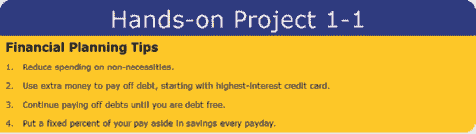

67

*动手项目*

在 `table` 元素中、`thead` 部分内找到第一行。在第一个 `td` 元素中，输入以下代码以创建一个 `script` 元素，该元素包含一个 `document.write()` 语句用于写入第一种服务的名称：

```html
<script>
document.write(service1Name);
</script>
```

对剩余的每个单元格重复此步骤，使用以下内容：

```html
<script>
document.write(service1Speed);
</script>
<script>
document.write(service2Name);
</script>
<script>
document.write(service2Speed);
</script>
<script>
document.write(service3Name);
</script>
<script>
document.write(service3Speed);
</script>
<script>
document.write(service4Name);
</script>
<script>
document.write(service4Speed);
</script>
```

保存你的工作，然后在网络浏览器中打开 **index.htm**。在 `h2` 标题“High-Speed Internet Plans”下方应该显示一个包含两列五行的表格，如图 - 所示。

使用 WC Markup Validation Service 验证 **index.htm** 文档，然后根据需要修复该中包含的任何错误。

关闭你的网络浏览器窗口。

68

第1章 JavaScript 简介

## 动手项目 1-3

在本次练习中，你将增强表单，以便在用户点击提交（Submit）按钮时显示警告框。

在你的文本编辑器中，从章节文件夹下的 HandsOnProject - 文件夹打开 **index.htm**。在文档头部（head）注释部分指定的位置输入你的姓名和今天的日期。

在闭合的 `</head>` 标签上方，添加以下元素以链接包含 Modernizr 库的文件：

`<script src="modernizr.custom.05819.js"></script>`

在闭合的 `</form>` 标签之前找到 id 为 `submitbutton` 的最后一个 `fieldset` 元素。在创建提交按钮的 `input` 元素中，添加以下事件处理器：

`onclick="alert('Thanks for your order!');"`

保存你的工作，在网络浏览器中打开 **index.htm**，然后点击**提交按钮**。如图 - 所示，应该弹出一个警告框，显示文本“Thanks for your order!”点击**OK 按钮**关闭警告框。

图 1-18：由 JavaScript 语句写入表格内容

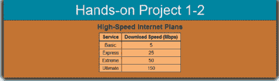

图 1-19：警告框

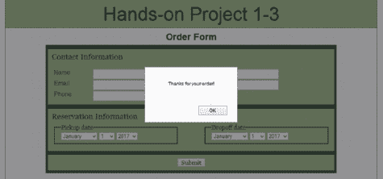

69

*动手项目*

使用 WC Markup Validation Service 验证 **index.htm** 文档，并修复文档包含的任何错误。

关闭你的网络浏览器窗口。

## 动手项目 1-4

在本章中，你学习了如何使用 `getElementById()` 方法设置 `img` 元素的 `src` 属性值，从而动态更改图像。你可以将此过程应用于许多其他网页元素。在本项目项目中，你将使用事件处理器，根据用户点击的单选按钮自动用预设值填充表单中的文本框。

在你的文本编辑器中，从章节文件夹下的 HandsOnProject - 文件夹打开 **index.htm**。在文档头部（head）注释部分指定的位置输入你的姓名和今天的日期。

在闭合的 `</head>` 标签上方，添加以下元素以链接包含 Modernizr 库的文件：

`<script src="modernizr.custom.05819.js"></script>`

在浏览器中打开 **index.htm**，熟悉其布局。返回你的文本编辑器，找到 id 为 `submitbutton` 的第一个 `fieldset` 元素，然后找到创建首页按钮的 `input` 元素，添加以下事件处理器：

```javascript
1 onclick="document.getElementById('streetinput').value='Main St.'"
2 onclick="document.getElementById('cityinput').value='Coline Ln.'"
3 onclick="document.getElementById('stateinput').value='MA'"
4 onclick="document.getElementById('zipinput').value='02103'"
```

（注：OCR 在逻辑上存在一些错误，已根据常见 JS 模式的上下文修正）

保存你的工作，在浏览器中打开 **index.htm** 并点击**首页（Home）**按钮。地址、城市和邮政字段应该被填充“Home”字下方的信息，如图 - 所示。

图 1-20：填充了地址信息的字段

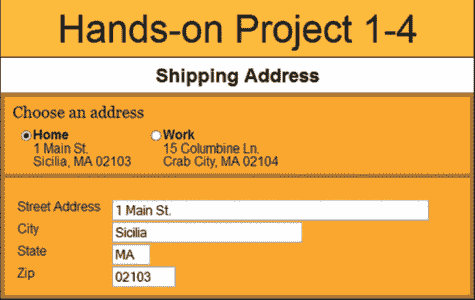

点击**工作（Work）**按钮。地址、城市和邮政字段应该被填充“Work”字下方的信息，如图 - 所示。

图 1-21：填充了地址信息的字段

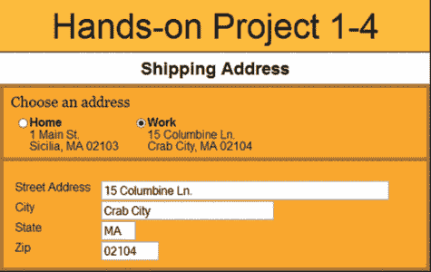

70

第1章 JavaScript 简介

# 第 1 章 JavaScript 简介

- 使用 W3C 标记验证服务验证 **index.htm** 文档，并修复文档包含的任何错误。

- 关闭你的网络浏览器窗口。

## 案例项目

在开始进行案例项目之前，请确保已提取此书的数据文件。如本书序言介绍的，你可以从 Cengage 网站 *http://www.cengage.com* 下载这些文件。将为案例项目创建的任何文件保存在数据文件中的正确文件夹内。

### 个人案例项目

书中每个章节的个人案例项目将基于你为所选主题创建的网站进行。要开始之前，请为你的网站选择一个主题。这个主题可以是与你的专业相关的，也可以是与个人兴趣或活动相关的。计划建立一个包含至少四个页面的网站，并具有通用的布局和导航系统。请注意，你将在后面的章节中为网站添加页面，因此请确保你的导航系统能够支持额外内容。在你网站的每个 HTML 文档中添加一个 `script` 元素，链接到 `modernizr.custom.js` 文件。确保你的所有网页都通过验证。

### 团队案例项目

在书中的团队案例项目中，你将继续为一个由团队选择的主题开发网站。在一个有若干人的团队中工作，讨论并就网站的主题达成共识。这个主题可以是与你的专业相关的、另一个研究领域、你的学院或大学，或者一个共同的兴趣。合作计划一个网站，其页面数量至少等于小组人数，并创建一个通用的布局和导航系统。请注意，你将在后面的章节中为网站添加页面，因此请确保你的导航系统能够支持额外内容。由小组决定谁来创建哪个页面，并单独创建这些页面。在你创建的每个 HTML 文档中添加一个 `script` 元素，链接到 `modernizr.custom.js` 文件。完成个人页面的创建后，确保它们通过验证，然后共同组装生成的网站，并在小组识别并修复任何问题。

# 第 2 章 函数、数据类型和运算符的操作

当你完成本章时，你将能够：

- 使用函数组织你的 JavaScript 代码

- 使用表达式和运算符

- 识别表达式中运算符的优先级顺序

到目前为止，你编写的代码由放在 script 区域的简单语句组成。然而，像大多数编程语言一样，JavaScript 允许你将编程语句分组成逻辑单元。在 JavaScript 中，一组可以作为单个单元执行的语句组被称为**函数**。你将在本章中学习如何创建函数，并练习使用它们来组织代码。

除了函数之外，编程最重要的方面之一是在计算机内存中存储值并对这些值进行操作。在上一章中，你学习了如何使用变量在计算机内存中存储值。变量中包含的值或数据被归分为称为数据类型的类别。在本章中，你将学习 JavaScript 数据类型以及可以执行的操作。

### 使用函数

在上一章中，你学习了如何使用变量在计算机内存中存储值。变量中包含的值或数据被归分为称为数据类型的类别。在本章中，你将学习 JavaScript 数据类型以及可以执行的操作。在 JavaScript 中，一组可以作为单个单元执行的语句组被称为**函数**。你将在本章中学习如何创建函数，并练习使用它们来组织代码。

### 定义函数

在定义之前，JavaScript 支持两种类型的函数：命名函数和匿名函数。**命名函数**是分配了名称的语句集。相反，**匿名函数**是没有名称的语句集。通常情况下，当你想要重用函数语句时，会使用命名函数；而对于只需要运行一次的语句，你会使用匿名函数。

在使用函数 之前，你必须先创建或定义它。构成函数的行被称为**函数定义**。

命名函数的语法如下：

```javascript
function name_function(parameters) {
    statements;
}
```

匿名函数的语法与命名函相同，只是它没有指定名称：

```javascript
function(parameters) {
    statements;
}
```

参数位于函数名称后的括号内。**参数**是函数内部使用的变量。在函数定义中放置参数等同于声明变量。然而，不需要包含 `var` 关键字。例如，假设你想写一个名为 `calculateRoot()` 的函数来计算名为 `number` 的数字平方根。那么函数的声明将写为：

```javascript
function calculateRoot(number)
```

在这种情况下，函数声明定义了一个名为 `number` 的新参数。函数可以包含由逗号分隔的多个参数。如果你想创建一个计算盒子体积的函数，该函数需要长度、宽度和高度的值。你可以这样写函数声明的开头：

```javascript
function calculateVolume(length, width, height)
```

注意，参数（如 `length`、`width` 和 `height`）在程序的其他地方调用函数时接收值。（你将在下一节中学习如何调用函数。）

*函数不需要包含参数。许多函数只执行任务而不需要外部数据。例如，你可能会创建一个每次用户访问你的网站时都显示相同信息的函数；这种函数只需要执行，不需要任何其他信息。*

**注意**

紧随函数参数括号的是一组大括号（称为**函数括号**），它们包含了函数语句。**函数语句**是执行函数实际工作的语句，例如计算参数的平方根或在屏幕上显示消息。函数语句必须包含在函数括号内。以下是一个包含函数语句的 `calculateVolume()` 函数示例：

```javascript
function calculateVolume(length, width, height) {
    var volume = length * width * height;
    document.write(volume);
}
```

注意上述函数的结构。左括号与函数名称在同一行，右括号在函数语句之后单独占一行。括号之间的每个语句都进行了缩进处理。这种结构是许多 JavaScript 程序员的首选格式。然而，对于简单的函数，有时更容易

76

第 2 章 函数、数据类型和操作符的使用

将函数名、大括号和语句放在同一行。（记住，JavaScript 会忽略字符串字面量之外的换行、空格和制表符。）JavaScript 对间距的唯一语法要求是用分号分隔同一行上的语句。

*本书中的代码使用三个空格进行缩进。用于缩进的空格*数量*并不重要，只要你在整个代码中一致地使用相同数量*即可。有些程序员倾向于使用自己的*制表符*而不是空格进行缩进；这种选择仅仅是个人喜好问题，对代码质量没有影响。*

**注意** 

将函数放在外部 .js 文件中，并在 HTML 文档 `body` 区域的底部包含一个引用该文件的 `script` 部分，是一种常见的做法。

在本章中，你将为 Fan Trick Fine Art Photography 的网页添加 JavaScript 代码，这是一家销售摄影打印品并提供特殊活动摄影服务的摄影业务。所有者希望扩展他们的网站，以提供有关数字摄影的信息，并为潜在客户提供服务的费率估算器。你用于本章的 Chapter 文件夹包含了项目所需的所有文件。图 - 显示了桌面浏览器中完成后的 Web 表单预览，图 - 显示了在移动浏览器中的显示。

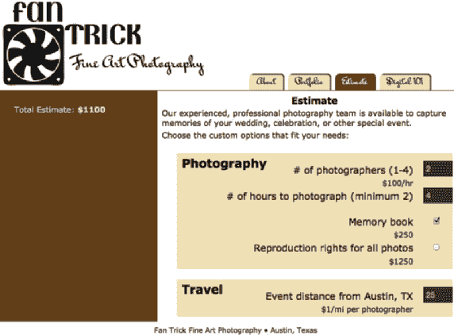  

表单选择改变计算总额

 

总金额根据表单选择而变化

图 2-1：桌面浏览器中完成的估算表

*© 2015 Cengage Learning*

77

*函数的使用*

开始处理估算页面：

1.  在你的文本编辑器中，打开位于 Chapter 文件夹中的 **estimate.htm** 文件。

2.  在文档顶部的注释部分，在指定位置输入你的名字和今天的日期，然后保存工作。


## 第 2 章 使用函数、数据类型和运算符

### 滚动查看文档以熟悉其内容

它包含一个表单以及一个包含“Total Estimate:”（总估算：）文本的 `aside` 元素。在本章的稍后部分，你将编写代码来计算表单中选择选项的成本，并将其显示在 `aside` 元素中。

### 在浏览器中打开 `estimate.htm`

点击 **# of photographers**（摄影师人数）文本框，将值改为 ，然后点击 **Memory book**（纪念册）复选框插入勾选。当你进行表单选择时，页面上不会发生任何变化，因为表单字段与任何 JavaScript 代码关联。你将在本章稍后添加代码。

### 点击浏览器的 **Refresh**（刷新）或 **Reload**（重新加载）按钮

根据你使用的浏览器，表单可能仍显示你所做的更改。

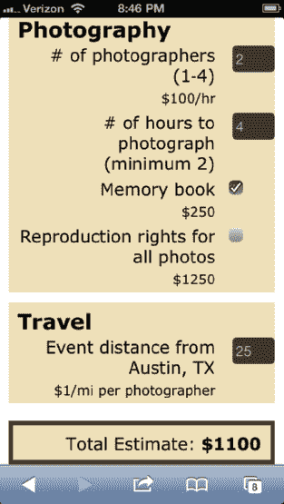   

总金额根据表单选择而变化

   

表单选择改变计算总额

图 2-2：移动浏览器中完成的估算表

### 按住 **Shift** 键，然后点击浏览器的 **Refresh**（刷新）或 **Reload**（重新加载）按钮

除非你的浏览器在点击刷新或重新加载时清除了输入，否则请注意什么都没有发生。这是因为浏览器在函数被触发之前不会执行它们。为了让表单易于使用，用户可能希望表单能够重置，在重新加载页面时重置。用户可能需要这种快捷。

### 在文本编辑器中，打开位于 Chapter 文件夹中的 `ft.js` 文件

在注释部分输入你的名字和今天的日期，然后保存工作。创建一个名为 `resetForm()` 的函数。

### 在 `ft.js` 中输入以下代码：

```javascript
function resetForm() {
  // 将所有输入设置为默认值
  document.getElementById("sum").value = 0;
}
```

`getElementById()` 方法通过 id 查找元素。`resetForm()` 函数引用元素并设置其值。

### 保存工作，返回 `estimate.htm` 文件

在文档底部 `</body>` 标签之前，输入以下脚本：

```html
<script src="ft.js"></script>
```

该元素加载 `ft.js` 中的代码。

### 函数的使用

#### 调用函数

命名的函数定义不会自动执行。创建函数定义只是命名函数、指定其参数并组织它将执行的语句。要执行命名的函数，你需要在程序的其他地方调用它。调用命名函数的代码被称为**函数调用**，由函数名加括号组成，括号包含要赋值给函数参数的任何变量或值。

#### 传递参数

放在函数调用括号中的变量或值被称为**参数**或**实际参数**。将参数发送到调用函数的参数被称为**传递参数**。当你将参数传递给函数时，每个参数的值将被赋值给函数定义中参数的值。

例如，以下代码包含三个函数。`calculateSum()` 和 `calculateVolume()` 函数分别对传递给它们的值执行不同的数学操作。然而，每个函数的最后一行都是相同的，它们将计算结果和元素的引用作为参数传递给第三个函数 `updateResult()`。根据传递给它的值，`updateResult()` 函数更新文档中的结果值。

```javascript
function calculateSum(value1, value2, value3) {
  var sum = value1 + value2 + value3;
  var location = document.getElementById("sum");
  updateResult(sum, location);
}

function calculateVolume(length, width, height) {
  var volume = length * width * height;
  var location = document.getElementById("volume");
  updateResult(volume, location);
}

function updateResult(result, element) {
  element.innerHTML = result;
}
```

在本章稍后的部分，你将学习 `+` 和 `*` 运算符是如何工作的，以及 `innerHTML` 属性的作用。现在，你只需要记住在调用函数时可以向其传递参数。

> **注意**
>
> 使用函数处理事件

你也可以响应浏览器事件来调用函数。浏览器支持实现此点的三种不同方法：HTML 属性、对象属性和事件监听器。

指定函数作为事件处理程序的最简单方法是将该函数指定为关联 HTML 属性的值。你在第一章中已经看到过如何使用事件属性来运行语句。例如，以下代码当用户点击其所在的 `input` 元素时，显示一个包含消息的警报框：

```html
<input type="submit" onclick="window.alert('Thanks for your order! We appreciate your business.')" />
```

你不需要将 `onevent` 属性的值指定为 JavaScript 语句，而是指定函数名。这样，当事件触发时，该函数就会执行。例如，如果你有一个名为 `showMessage()` 的命名函数，并将其指定为 `input` 元素点击事件的处理程序，可以将之前的代码替换为以下内容：

```html
<input type="submit" onclick="showMessage()" />
```

每当用户点击此 `input` 元素时，浏览器都会运行 `showMessage()` 函数。

使用 HTML 属性指定事件处理程序的缺点是，它们要求开发者将 JavaScript 代码放在 HTML 代码中。正如开发者通常避免使用内联 CSS 样式以保持 HTML 和 CSS 代码分离一样，大多数开发者倾向于不在同一个文件中混合 HTML 和 JavaScript 代码。相反，他们维护单独的 HTML 和 JavaScript 文件。幸运的是，还有两种方法可以指定函数作为事件处理程序。

另一种方法是将函数指定为代表 HTML 元素的对象的属性值。每个元素对其支持的每个事件都有一个 `onEvent` 属性。例如，提交按钮（`type` 值为 `submit` 的 `input` 元素）支持 `click` 事件，因此你可以为它的 `onclick` 属性指定一个值。在 `.js` 文件中，你可以如下将 `showMessage()` 函数指定为提交按钮的事件处理程序：

```javascript
document.getElementById("submitButton").onclick = showMessage;
```

此代码使用其 HTML `id` 属性的值来引用提交按钮。注意，函数名后面没有跟括号。

虽然这种选项允许你分离 HTML 和 JavaScript 代码，但它有一个主要的缺点：每个事件只能分配一个事件处理程序。在更复杂的代码中，你可能希望指定多个响应给定事件的事件处理程序。要为单个事件分配多个事件处理程序，你需要使用第三种也是最后一种技术，即 `addEventListener()` 方法。每个页面元素都有一个 `addEventListener()` 方法，它使用以下语法：

```javascript
element.addEventListener("event", function, false);
```

其中 `element` 是对元素的引用，`event` 是要处理的事件名称，`function` 是将处理该事件的函数名称。第三个参数 `false` 通常包含是为了兼容某些旧版本的浏览器。使用 `addEventListener()` 方法指定事件处理程序被称为**添加事件监听器**。以下语句将 `showMessage()` 函数指定为 id 为 `submitButton` 的元素的 `click` 事件的事件处理程序：

```javascript
var submit = document.getElementById("submitButton");
submit.addEventListener("click", showMessage, false);
```

注意，与上面的对象属性一样，在事件监听器中函数名后面没有跟括号。同样注意，事件仅通过事件名称（`"click"`）指定，而不是通过在事件名称前加上 `on`（`"onclick"`）。

你也可以使用 `addEventListener()` 方法指定匿名函数作为事件处理程序。为此，你只需在语句中使用整个函数定义替换函数名即可。例如，以下语句将之前示例中的 `showMessage` 函数引用替换为匿名函数：

```javascript
var el = document.getElementById("submitButton");
el.addEventListener("click", function() {
    window.alert("Thanks for your order! We appreciate your business.");
}, false);
```

上述代码中的高亮部分代表匿名函数。注意它位于事件名称之后，并且后面跟着单词 `false`、右括号和分号，这与之前使用函数名的语句相同。

接下来，你将添加代码，使用 `addEventListener()` 方法将 `resetForm()` 函数指定为 `Window` 对象的 `onload` 事件的事件处理程序，从而调用该函数。

#### 将 `resetForm()` 函数指定为事件处理程序：

1. 回到文本编辑器中的 **ft.js** 文件。
2. 在你添加的函数下方的新行中输入以下注释和语句：

   ```javascript
   // resets form when page is reloaded
   document.addEventListener("load", resetForm, false);
   ```

该语句将你创建的 `resetForm()` 函数指定为 `Window` 对象的 `load` 事件的事件处理程序。浏览器支持 `addEventListener()`，但 Internet Explorer 8 版本不支持它。这些旧浏览器支持不同的方法 `attachEvent()`，其作用相同。在第 3 章中，你将学习使用条件语句编写代码来检测并使用适用于浏览器的适当方法。

### 点击 **Memory book**（内存）复选框进行勾选，点击 **Reproduction rights**（版权）框进行勾选，然后点击浏览器的 **Reload**（重新加载）或 **Refresh**（刷新）按钮

取决于你使用的浏览器，复选框可能会保持选中状态，这意味着你的 `resetForm()` 函数没有按预期执行。接下来将打开浏览器控制台查看任何错误消息。表 2-1 列出了主流浏览器中打开控制台的键盘快捷键和菜单命令。

| 浏览器 | 键盘快捷键 | 菜单步骤 |
| :--- | :--- | :--- |
| Internet Explorer | **F12**，然后 **Ctrl** + **2** | 点击 **Tools**（工具）按钮，点击菜单上的 **F12 Developer Tools**，然后在打开的窗口中点击 **Console**（控制台）按钮。 |
| Firefox | **Ctrl** + **Shift** + **K** (Win) **option** + **command** + **K** (Mac) | 点击 **Firefox** 按钮 (Win) 或 **Tools** (Mac 或 Win)，悬停在 **Web Developer**，然后点击 **Web Console**。 |
| Chrome | **Ctrl** + **Shift** + **J** (Win) **option** + **command** + **J** (Mac) | 点击 **Customize and control Google Chrome**（自定义并控制 Google Chrome）按钮，悬停在 **Tools**，然后点击 **JavaScript console**。 |

表 2-1：主流浏览器中打开浏览器控制台的步骤

### 使用表 2-1 中的相应命令在浏览器中打开控制台，然后刷新或重新加载 `estimate.htm`

> *如果列表中没有你的浏览器，或者列出的方法之一不起作用，请检查浏览器的文档以获取正确步骤，或尝试不同的浏览器。*
>
> *记住，不同的浏览器对 JavaScript 控制台可能使用不同的术语，包括“web console”或“error console”。*

> **注意**
>
> 控制台指示了由于函数后缺少 `}` 导致的语法错误。

图 2-3 显示了 Internet Explorer 中的浏览器控制台，图 2-4 显示了 Chrome 中的控制台，图 2-5 显示了 Firefox 控制台。

注意，每个控制台都指定了识别出错误的行号。IE 和 Firefox 都指示了第 6 行，即函数之后下一个语句的开头，作为它们遇到错误的地方（你的行号可能取决于代码中空行的数量）。Chrome 识别了第 5 行，这在情况下没有特别帮助。IE 和 Firefox 都意识到问题源于缺少括号，而 Chrome 仅显示“Unexpected end of input”（意外的输入结束）。

> *由于不同的浏览器报告错误的方式不同，有时检查多个浏览器的控制台有助于识别难以发现的错误。*

> **注意**

### 返回文本编辑器中的 `ft.js`

然后在 `resetForm()` 函数的最后，在语句 `document.getElementById("distance").value = 0;` 下添加一个 **}** 字符。这让你的函数恢复到之前的状态。你的 `resetForm()` 函数应该与上一步步骤中显示的匹配。

### 保存对 `ft.js` 的更改

然后在浏览器中重新加载或刷新 `estimate.htm` 文档。浏览器控制台不再显示错误消息。

> *如果你的控制台显示其他信息消息，请不要担心。但如果它显示其他错误消息，请检查你的代码是否有额外错误，并修复它们，直到控制台不再显示更多错误。*

> **注意**

### 使用 `return` 语句

在许多情况下，你可能希望你的代码接收被调用函数的结果并在其他代码中使用这些结果。例如，考虑一个计算作为参数传递给的一系列数字平均值的函数。如果你的代码不能打印或在其他地方使用结果，那么这样的函数将毫无用处。另一个例子是，假设你创建了一个简单打印学生姓名的函数。现在，假设你想修改代码以便在代码的另一个部分使用学生姓名。你可以通过将调用语句赋值给变量，从函数向调用语句返回值。以下语句调用了名为 `averageNumbers()` 的函数并将返回值赋值给名为 `returnValue` 的变量。该语句还向函数传递了三个字面量。

```javascript
var returnValue = averageNumbers(1, 2, 3);
```

要实际向 `returnValue` 变量返回值，代码必须在 `averageNumbers()` 函数内部包含 return 语句。**return 语句**是将值返回给调用函数语句的语句。要使用 return 语句，你使用 `return` 关键字以及你想发送给调用语句的变量或值。以下脚本包含 `averageNumbers()` 函数，它计算三个数字的平均值。脚本还包含一个 return 语句，将值（包含在 `result` 变量中）返回给调用语句：

```javascript
function averageNumbers(a, b, c) {
  var sum_of_numbers = a + b + c;
  var result = sum_of_numbers / 3;
  return result;
}
```

### 理解变量作用域

当你在 JavaScript 程序中使用变量时，特别是在复杂的 JavaScript 程序中时，你需要意识到**变量作用域**（variable scope）——也就是说，你需要考虑声明的变量可以在代码的何处可以使用。全局变量是在函数外部声明的并在随处可用。局部变量是在函数内部声明的变量，仅在该函数内部可用。

> **注意**
>
> 如果代码中包含具有同名的全局变量和局部变量，当调用该函数时，局部变量优先。然而，赋值给函数内部局部变量的值不会赋值给同名的全局变量。例如，以下代码包含一个名为 `color` 的全局变量和一个名为 `color` 的局部变量。

```javascript
var color = "red";
function myColor() {
  var color = "blue";
  console.log(color); // 输出 blue
}
myColor();
console.log(color); // 输出 red
```

全局变量 `color` 被赋值为 "green"。接下来，调用一个包含局部变量 `color` 的函数。该函数随后将局部变量 `color` 赋值为 "purple"。然而，这对全局变量 `color` 的值没有影响。在函数结束后，全局变量 `color` 的值仍然是 "green"。

```javascript
var color = "green";
function duplicateVariableNames() {
  var color = "purple";
  document.write(color);
  // 打印的值是 purple
}
duplicateVariableNames();
document.write(color);
// 打印的值是 green
```

图 - 显示了在 Web 浏览器中的输出。

请注意，尽管显示图 - 所示输出的代码在语法上是正确的，但对本地变量和全局变量使用相同的名称是一种糟糕的编程习惯，因为这会让你的脚本变得混乱，并且很难追踪代码当前正在使用变量的哪一个版本。相反，你应该确保一组相关脚本中的所有变量名都是唯一的。

接下来，你将向 `ft.js` 文件中添加全局变量，供 `estimate.htm` 使用。`estimate.htm` 页面上的表单字段允许用户选择特殊活动摄影的选项，你将创建的代码将根据用户输入汇总这些费用。为了开始创建程序，你将创建全局变量来存储摄影师的总费用和总估费用。你将在本章稍后部分完成 `estimate.htm` 页面。

#### 向 `ft.js` 文件中添加全局变量：

1. 返回文本编辑器中的 **ft.js** 文件。

图 2-6：包含全局变量和同名局部变量的代码的输出

purple

green

2. 在注释部分下方、`resetForm()` 函数上方，输入以下语句来定义两个全局变量：

```javascript
// 全局变量
var photographerCost = 0;
var totalCost = 0;
```

3. 保存你的工作。

### 使用 JavaScript 内置函数

除了你自己创建的自定义函数外，JavaScript 还允许你使用表 - 中列出的内置函数。

| 函数 | 描述 |
| :--- | :--- |
| `decodeURI(string)` | 解码用 `encodeURI()` 编码的文本字符串 |
| `decodeURIComponent(string)` | 解码用 `encodeURIComponent()` 编码的文本字符串 |
| `encodeURI(string)` | 编码文本字符串使其成为有效的 URI |
| `encodeURIComponent(string)` | 编码文本字符串使其成为有效的 URI 组件 |
| `eval(string)` | 评估字符串中包含的表达式 |
| `isFinite(number)` | 确定一个数字是否为有限值 |
| `isNaN(number)` | 确定一个值是否为特殊值 `NaN`（非数字） |
| `parseFloat(string)` | 将字符串字面量转换为浮点数 |
| `parseInt(string)` | 将字符串字面量转换为整数 |

表 2-2：JavaScript 内置函数

在本书中，你将根据需要检查几个 JavaScript 内置函数。现在，你只需要理解调用内置 JavaScript 函数的方式与调用自定义函数相同。例如，以下代码调用 `isNaN()` 函数来确定 `socialSecurityNumber` 变量是否*不是*一个数字。

```javascript
var socialSecurityNumber = "123–45-6789";
var checkVar = isNaN(socialSecurityNumber);
document.write(checkVar);
```

## 与数据类型工作

由于分配给 `socialSecurityNumber` 变量的社会安全号码包含字符，因此它不是真正的数字。因此，`isNaN()` 函数向 `checkVar` 变量返回值 `true`。

### 短测 1

1. 命名函数和匿名函数之间的区别是什么？
2. 为什么命名函数不会自动执行？你如何执行它？
3. 使用 HTML 属性指定事件处理程序的还有哪些替代方案？
4. 你如何查看浏览器在处理你的代码时可能生成的任何错误信息？
5. 为什么在函数内部不使用 `var` 关键字而声明全局变量是一种糟糕的编程习惯？

### 与数据类型工作

变量可以包含许多不同的值——例如，一天中的时间、金额或姓名。**数据类型**是变量包含信息的特定类别。对于初级程序员来说，数据类型的概念通常很困难，因为在现实生活中，你并不经常区分不同类型的信息。如果有人问你名字、年龄或当前时间，你通常不会停下来考虑你的名字是一个文本字符串，而你的年龄和当前时间是数字。然而，变量的具体数据类型在编程中非常重要，因为数据类型有助于确定计算机为存储在变量中的数据分配多少内存。数据类型还规定了可以在变量上执行的操作类型。

只能被赋值单个值的数据类型被称为**原始类型**。JavaScript 支持表 - 中描述的五种原始数据。

| 数据类型 | 描述 |
| :--- | :--- |
| number | 带有或不带小数的正数或负数，或使用指数计数法写的数字 |
| Boolean | `true` 或 `false` 的逻辑值 |
| string | 如“Hello World”之类的文本 |
| undefined | 未分配、未声明或不存在的值 |
| null | 空值 |

表 2-3：原始数据类型

`null` 既是一种数据类型，也是可以赋值变量的值。给变量赋值 `null` 值表示变量不包含可用的值。具有 `null` 值的变量表示“无值”。向变量分配 `null` 值是为了确保不包含任何数据。相比之下，undefined 变量是一个未被赋值、未声明或不存在的变量。

`undefined` 值表示变量从未被赋值过——甚至没有 `null` 值。undefined 变量的一种用途是确定值是否被脚本的其他部分使用。作为 undefined 变量的示例，以下代码声明了一个没有值的 `stateTax`。当第二个语句使用 `document.write()` 方法打印 `stateTax` 变量时，由于变量尚未赋值，将打印 `undefined`。然后变量被赋值为 40 并打印到屏幕，然后是 `null`，也会打印到屏幕。

```javascript
var stateTax;
document.write(stateTax);
stateTax = 40;
document.write(stateTax);
stateTax = null;
document.write(stateTax);
```

图 - 显示了在 Web 浏览器中的输出。

注意 JavaScript 语言支持支持更高级的数据类型对象，用于创建属性集合。你将在第 7 章学习对象类型。

### 与数值工作

数值是任何编程语言的重要部分，并且对于算术计算特别有用。JavaScript 中的 `number` 数据类型支持两种数值：整数和浮点数。**整数**是不带小数位的正数或负数。JavaScript 中的整数值范围从 - 到 +。数字 -2、-1、0、1 和 2 是整数的示例。数字 -.2、-.1、.0、.1 和 .2 不是整数；它们是浮点数。**浮点数**是包含小数位或使用指数计数法的数字。

**指数计数法**（或**科学计数法**）是编写极大数字或带有许多小数位的数字的简写格式。使用指数计数法表示数字为 1 到 10 之间的值乘以 10 的某个幂。

使用大写的 *E* 或小写的 *e*。例如，数字 200,000,000,000 可以写成指数计数法 2.0e11，这意味着“10 的十一次方的 2”。JavaScript 中的浮点值范围大约从 ±1.7976931348623157 × 10^(308) 到 ±5 × 10^(−324)。超过最大正值 ±1.7976931348623157 × 10^(308) 的浮点值将导致特殊值 `Infinity`。超过最小负值 ±5 × 10^(−324) 的浮点值将导致值 `-Infinity`。

### 要创建一个打印公制前缀的脚本：

1. 在你的文本编辑器中，打开第 2 章文件夹中的 `digital.htm` 文档。
2. 在注释部分的指定位置输入你的名字和今天的日期，保存文件，然后在浏览器中打开 `digital.htm`。页面将显示说明性文本，随后是一个列出前缀的表格。你将添加 JavaScript 语句将值写入第二列。
3. 返回你的文本编辑器，在起始 `<table>` 标签上方输入以下 `<script>` 元素，该元素包含了公制前缀的变量声明：

```javascript
<script>
var yotta = 1e24;
var zetta = 1e21;
var exa = 1e18;
var peta = 1e15;
var tera = 1e12;
var giga = 1e9;
var mega = 1e6;
var kilo = 1000;
var hecto = 100;
var deca = 10;
var deci = .1;
var centi = .01;
var milli = .001;
var micro = 1e-6;
var nano = 1e-9;
var pico = 1e-12;
var femto = 1e-15;
var atto = 1e-18;
var zepto = 1e-21;
var yocto = 1e-24;
</script>
```

4. 在 `<table>` 元素内，第二行中，在空的 `<td>` 元素内，输入以下脚本部分以打印与前缀对应的变量值：

```javascript
<script>
document.write(yotta);
</script>
```

5. 在第三行中，在空的 `<td>` 元素内，输入以下脚本部分：

```javascript
<script>
document.write(zetta);
</script>
```

6. 对表格的其余行重复此步骤，将 `zetta` 替换为每行相关的变量名。

> *记住，引用变量名时大小写敏感的，因此请确保以全小写输入变量名，以匹配你在步骤 3 中创建的变量定义。*

> **注意**

7. 保存工作，然后在浏览器中刷新或重新加载 `digital.htm`。图 2-8 显示了文档在网页浏览器中的外观。

图 2-8：浏览器中的 `digital.htm` 文档

注意，浏览器会自动决定是否以指数计数法显示大数或。还要注意，你从未指定所声明的变量包含数值。相反，你浏览器中的 JavaScript 处理器识别出它们包含数值并对其进行相应处理。这是 JavaScript 作为弱类型语言的用处之一。

8. 在浏览器中关闭 `digital.htm`，然后在文本编辑器中关闭 `digital.htm`。

### 使用布尔值

**布尔值**（Boolean value）是 `true`（真）或 `false`（假）的逻辑值。你也可以将布尔值视为是或否，或开启或关闭。布尔值通常用于决定执行哪些代码以及比较数据。在 JavaScript 编程中，你只能使用 `true` 和 `false` 单词来表示布尔值。在其他编程语言中，你可以使用整数值 1 和 0 表示布尔值 `true` 和 `false`——1 表示 `true`，0 表示 `false`。以下显示了两个赋值布尔值的变量简单示例，一个为 `true`，另一个为 `false`。

```javascript
var newCustomer = true;
var contractorRates = false;
document.write("<p>New customer: " + newCustomer + "</p>");
document.write("<p>Contractor rates: " + contractorRates + "</p>");
```

图 2-9 显示了浏览器中的输出。

> **最佳实践**

接下来，你将为 Fan Trick Photography 站点 `ft.js` 文件添加布尔全局变量。这些变量将决定潜在客户是否想要书籍或版权。

#### 向 `ft.js` 文件添加两个布尔全局变量：

1. 返回文本编辑器中的 **ft.js** 文件。
2. 在语句 `var totalCost = 0;` 下方添加以下内存书籍和版权的全局变量：

```javascript
var memoryBook = false;
var reproductionRights = false;
```

3. 在 `resetForm()` 函数内，在设置 `membook` 和 `reprodrights` 元素 `checked` 值的语句中，将 `false` 值更改为相应的变量值如下：

```javascript
document.getElementById("membook").checked = memoryBook;
document.getElementById("reprodrights").checked = reproductionRights;
```

4. 保存 `ft.js` 文件。

### 使用字符串

正如你在第 1 章中学到的，文本字符串包含由双引号或单引号围绕的零或多个字符。脚本中可能使用的字符串示例包括公司名称、用户名和注释。你可以将文本字符串作为字面值或赋值给变量。字面字符串还可以分配一个长度为零的值，称为**空字符串**（empty string）。例如，以下语句声明了一个名为 `customerName` 的变量并将其赋值为空字符串：

```javascript
var customerName = "";
```

这仅仅指定了变量是一个没有内容的字符串变量。

用双引号包围引用的字符串。无论你使用哪种方法，字符串都必须以相同类型的引号开头和结束。例如，你可以使用

```javascript
document.write("Boston, MA is called 'Beantown.'")
```

或者

```javascript
document.write('Boston, MA is called "Beantown."')
```

因此，语句

```javascript
document.write("This is a text string.");
```

是有效的，因为它以双引号开头并结束。而此语句

```javascript
document.write("This is a text string.');
```

是无效的，因为它以双引号开头，却以单引号结束。在第二种情况下，你将收到一个错误消息，因为 Web 浏览器无法判断该字面量字符串的开始和结束位置。下面的代码显示了一个打印包含嵌套引号字符串的脚本示例。

```javascript
document.write("<h1>Speech at the Berlin Wall\n(excerpt)</h1>");
document.write("<p>Two thousand years ago, the proudest boast\nwas 'civis Romanus sum.'<br />");
document.write('Today, in the world of freedom, the proudest\nboast is "Ich bin ein Berliner."</p>');
var speaker = "<p>John F. Kennedy</br>";
var date = 'June 26, 1963</p>';
document.write(speaker);
document.write(date);
```

图 - 显示了输出。

图 2-10: 浏览器中的字符串示例

**柏林墙上的演讲（节选）**

两千年前，最自豪的豪言是“civis Romanus sum。”

今天，在自由的世界里，最自豪的豪言是“Ich bin ein Berliner.”

John F. Kennedy

1963年6月26日

### 字符串运算符

JavaScript 有两个可以与字符串使用的运算符：`+` 和 `+=`。当与字符串一起时，加号被称为连接运算符。**连接运算符**（`+`）用于组合两个字符串。你已经学习了如何使用连接运算符。例如，下面的代码结合了一个字符串变量和一个字符串字面量，并将新值赋值给另一个变量：

```javascript
var destination = "Honolulu";
var location = "Hawaii";
destination = destination + " is in " + location;
```

`location` 变量与赋值 `destination` 变量的字符串字面量的组合值为“Honolulu is in Hawaii”。

你还可以使用复合赋值运算符（`+=`）结合两个字符串。你可以将 `+=` 理解为“将第一个操作数设置为当前值加上第二个操作数”。下面的代码结合了两个文本字符串，但没有使用 `location` 变量：

```javascript
var destination = "Honolulu";
destination += " is in Hawaii";
```

这段代码的第二行告诉 JavaScript 解释器将 `destination` 变量的当前值—“Honolulu”—与字符串“is in Hawaii”结合。结果与之前的代码相同。

注意同一个符号——加号既是连接运算符也是加法运算符。当与数字或包含数字的变量一起使用时，使用连接运算符的表达式返回两个数字的和。正如你在本章之前学到的那样，如果你将连接运算符与字符串值和数值一起，字符串值和数值将组合成一个新的字符串值，如下例所示：

```javascript
var textString = "The oldest person ever lived to ";
var oldestAge = 122;
newString = textString + oldestAge;
```

`newString` 的值是“The oldest person ever lived to 122”。

> *与其他编程语言不同，JavaScript 没有用于单个字符的特殊数据类型，例如 C、C++ 和 Java 编程语言中的 `char` 类型。*

> **注意**
>
> 注意 `textString` 变量的值在最后一个引号之前包含一个空格。当值被连接时，第一个值的最后一个字符直接跟在第二个值的第一个字符之后。如果 `textString` 值的末尾没有包含空格，那么两个值之间将没有空格，导致 `newString` 的值为“The oldest person ever lived to122”（注意“to”和“122”之间缺少空格）。

### 转义字符和序列

在字符串中使用带有所有格形式和缩写形式的单引号时，需要格外小心，因为 JavaScript 解释器总是寻找第一个闭合的单引号或双引号来匹配开启的单引号或双引号。例如，考虑以下语句：

```javascript
document.write('<p>My mom\'s favorite color is blue.</p>');
```

此语句会导致错误。JavaScript 解释器假设字面量字符串以“mom”后面的撇号结束，并寻找紧随“mom’”之后的 `document.write()` 语句的闭合括号。为了解决这个问题，你在“mom’s”的撇号之前包含一个转义字符。**转义字符**告诉编译器和解释器其后的字符具有特殊用途。在 JavaScript 中，转义字符是反斜杠（`\`）。在撇号之前放置反斜杠告诉 JavaScript 解释器，撇号应被视为普通的键盘字符，如 *a*、*b* 或 *c*，而不是封装文本字符串的单引号对的一部分。后续语句中的反斜杠告诉 JavaScript 解释器打印单词“mom”后面的撇号为撇号。

```javascript
document.write('<p>My mom\'s favorite color is blue.</p>');
```

你还可以将转义字符与其他字符结合，向字符串中插入特殊字符。当你将转义字符与其他特定字符结合时，这种组合被称为**转义序列**。反斜杠后撇号（`\'`）和反斜杠后双引号（`\"`）都是转义序列的示例。大多数转义序列执行特殊功能。例如，转义序列 `\t` 在字符串中插入一个制表符。表 - 描述了可以添加到 JavaScript 字符串中的转义序列。

注意，转义序列生成的字符之一是反斜杠。由于转义字符本身是反斜杠，你必须使用转义序列 `\\` 来将反斜杠作为字符包含在字符串中。例如，要把路径“C:\Users\me\Documents\Cengage\WebWarrior\JavaScript\”包含在字符串中，你必须为每个想要显示的反斜杠包含两个反斜杠，如下语句所示：

```javascript
document.write("<p>My JavaScript files are located in C:\\Users\\me\\Documents\\Cengage\\WebWarrior\\JavaScript\\</p>");
```

| 转义序列 | 字符 |
| :--- | :--- |
| `\\` | 反斜杠 |
| `\b` | 退格 |
| `\r` | 回车 |
| `\"` | 双引号 |
| `\f` | 分页 |
| `\t` | 水平制表符 |
| `\n` | 换行 |
| `\0` | 空字符 |
| `\'` | 单引号（撇号） |
| `\xXX` | 由 `XX` 字符指定的 Latin-1 字符 |
| `\uXXXX` | 由 `XXXX` 字符指定的 Unicode 字符 |

表 2-4: JavaScript 转义序列

> *如果在表 2-4 列出的任何字符之外放置反斜杠，则反斜杠将被忽略。*

### 使用运算符构建表达式

下面的代码显示了一个包含多个转义序列字符串的脚本示例。

```javascript
<script>
document.write("<p>My personal files are in\nC:\\Users\\me\\Documents\\.</p>"); // 反斜杠
document.write("<p>Written letters are sometimes called\n\"snail mail.\"</p>"); // 双引号
document.write('<p>India\'s capital is New Delhi.</p>'); // 单引号
</script>
```

图 - 显示了输出。

### 运算符类型

| 运算符类型 | 运算符 | 描述 |
| :--- | :--- | :--- |
| 算术 | 加法 (`+`) | 执行数学计算 |
| | 减法 (`-`) | |
| | 乘法 (`*`) | |
| | 除法 (`/`) | |
| | 取模 (`%`) | |
| | 递增 (`++`) | |
| | 递减 (`--`) | |
| | 否定 (`-`) | |
| 赋值 | 赋值 (`=`) | 给变量赋值 |
| | 复合加法赋值 (`+=`) | |
| | 复合减法赋值 (`-=`) | |
| | 复合乘法赋值 (`*=`) | |
| | 复合除法赋值 (`/=`) | |
| | 复合取模赋值 (`%=`) | |
| 比较 | 等于 (`==`) | 比较操作数 |
| | 严格相等 (`===`) | |
| | 不等于 (`!=`) | |
| | 严格不等于 (`!==`) | |
| | 大于 (`>`) | |
| | 小于 (`<`) | |
| | 大于或等于 (`>=`) | |
| | 小于或等于 (`<=`) | |
| 逻辑 | 与 (`&&`) | 对操作数执行布尔操作 |
| | 或 (`||`) | |
| | 非 (`!`) | |
| 字符串 | 拼接 (`+`) | 对字符串执行操作 |
| | 复合拼接赋值 (`+=`) | |
| 特殊 | 属性访问 (`.`) | 多种用途 |
| | 数组索引 (`[]`) | |
| | 函数调用 (`()`) | |
| | 逗号 (`,`) | |
| | 条件三元运算符 (`?:`) | |
| | `delete` | |
| | 存在检查 (`in`) | |
| | `instanceof` | |
| | `new` | |
| | `typeof` | |
| | `void` | |

### 使用运算符构建表达式

算术运算符在 JavaScript 中用于执行数学计算，如加、减、乘、除。你也可以使用算术运算符来返回一个数字除以另一个数字时的余数。

> **注意：** JavaScript 运算符分为二元或一元。**二元运算符**要求在运算符之前和之后各有一个操作数。**一元运算符**要求在运算符之前或之后有一个操作数。例如，递增运算符（`++`）是一种算术运算符，用于将操作数的值加 1。语句 `myNumber++;` 会改变变量 `myNumber` 的值。在接下来的章节中，你将学习更多关于不同类型的 JavaScript 运算符。

以下代码了包含算术二元运算符的表达式示例：

```javascript
var x = 0, y = 0, arithmeticValue = 0;

// 加法
x = 400;
y = 600;
arithmeticValue = x + y; // arithmeticValue 变为 1000
document.write("<p>arithmeticValue after addition: " + arithmeticValue + "</p>");

// 减法
x = 14;
y = 6;
arithmeticValue = x - y; // arithmeticValue 变为 8
document.write("<p>arithmeticValue after subtraction: " + arithmeticValue + "</p>");

// 乘法
x = 20;
y = 4;
arithmeticValue = x * y; // arithmeticValue 变为 80
```

运算符左侧的操作数称为左操作数，运算符右侧的操作数称为右操作数。

| 名称 | 运算符 | 描述 |
| :--- | :--- | :--- |
| 加法 | `+` | 将两个操作数相加 |
| 减法 | `-` | 从一个操作数减去另一个操作数 |
| 乘法 | `*` | 将一个操作数乘以另一个操作数 |
| 除法 | `/` | 将一个操作数除以另一个操作数 |
| 取模 | `%` | 将一个操作数除以另一个并返回余数 |

算术二元运算符

JavaScript 二元算术运算符及其描述如表 2-6 所示。

```javascript
// 除法
x = 99;
y = 3;
arithmeticValue = x / y; // arithmeticValue 变为 33
document.write("<p>arithmeticValue after division: " + arithmeticValue + "</p>");

// 取模
x = 5;
y = 3;
arithmeticValue = x % y; // arithmeticValue 变为 2
document.write("<p>arithmeticValue after modulus: " + arithmeticValue + "</p>");
```

以下代码显示了表达式在网络浏览器中的显示形式：

图 2-12：除法和取模表达式

15 除以 6 等于 2.5。整数 6 可以整除 15 次，余数为 3。

你可以在赋值语句的右侧包含变量和字面值的组合。例如，以下任何加法语句都是正确的：

```javascript
arithmeticValue = 250 + y;
arithmeticValue = x + 425;
arithmeticValue = 250 + 425;
```

然而，你不能将字面值作为左操作数，因为 JavaScript 解释器必须有一个变量来接收返回的值。因此，语句 `362 = x + y;` 会导致错误。

请注意，如果允许整数，则表示“整除...次，余数为...”。因此，取模运算符返回的是除法后的余数。

```javascript
var divisionResult = 15 / 6;
var modulusResult = 15 % 6;
document.write("<p>15 divided by 6 is " + divisionResult + "</p>");
document.write("<p>The whole number 6 goes into 15 twice, with a remainder of " + modulusResult + "</p>");
```

在对字符串值执行算术操作时，JavaScript 解释器尝试将字符串值转换为数字。以下示例中的变量被赋值为字符串值而不是数字，因为它们包含引号内。尽管如此，JavaScript 解释器仍正确地执行了乘法操作并返回值为：

```javascript
x = "4";
y = "5";
arithmeticValue = x * y; // 返回值为 20
```

然而，当你使用加法运算符时，JavaScript 解释器不会将字符串转换为数字。当你对字符串使用加法运算符时，字符串会被合并，而不是相加。在下面的示例中，该操作返回了字符串值“54”，这是因为变量 `x` 和 `y` 包含的是字符串而不是数字：

```javascript
x = "5";
y = "4";
arithmeticValue = x + y; // 返回一个字符串值 54
```

### 算术一元运算符

你也可以使用一元运算符对单个变量执行算术操作。

表 - 列出了 JavaScript 中提供的算术一元运算符。

| 名称 | 运算符 | 描述 |
| :--- | :--- | :--- |
| 递增 | `++` | 将操作数加 1 |
| 递减 | `--` | 将操作数减 1 |
| 取反 | `-` | 返回操作数的相反值（负值或正值） |

**表 2-7: 算术一元运算符**

递增（`++`）和递减（`--`）一元运算符可以用前缀或后缀运算符。**前缀运算符**放在变量名之前。**后缀运算符**放在变量名之后。操作数 `++count` 和 `count++` 都会让 `count` 变量增加 1。然而，这两个语句返回不同的值。当你将递增运算符作为前缀运算符使用时，操作数的值在增加 1 *之后*返回。当你将递增运算符作为后缀运算符使用时，操作数的值在增加 1 *之前*返回。同样，当你将递减运算符作为前缀运算符使用时，操作数的值在减 1 *之后*返回；而当你将递减运算符作为后缀运算符使用时，操作数的值在减 1 *之前*返回。如果你打算将递增或递减后的值赋值给另一个变量，那么使用前缀运算符还是后缀运算符就会产生区别。

在任何需要使用更简洁的表达式来增加或减少数值 1 的情况下，你都可以使用算术一元运算符。例如，`count = count + 1;` 语句与 `++count;` 语句是等价的。正如你所看到的，如果你的目标只是让一个变量增加 1，那么使用一元递增运算符会更容易。

记住，使用前缀运算符时，操作数的值在增加或减少 1 *之后*返回。相比之下，使用后缀运算符时，操作数的值在增加或减少 1 *之前*返回。

关于何时使用前缀运算符或后缀运算符的示例，请考虑一个名为 `studentID` 的整数变量，它用于课程注册脚本中分配学生 ID。创建一个新学生 ID 号的方法是将最后分配的学生 ID 存储在 `studentID` 变量中。当需要分配新的学生 ID 时，脚本可以获取 `studentID` 变量存储的最后一个值，然后将其增加 1。换句话说，存储在 `studentID` 变量中的最后一个值将是下一个使用的学生 ID 数字。在这种情况下，你会使用后缀运算符，通过类似于 `currentID = studentID++;` 的语句，在表达式的值增加 *之前*返回该值。如果你将最后分配的学生 ID 存储在 `studentID` 变量中，你可能希望将值增加 1 并将结果作为下一个学生 ID。在这种情况下，你会使用前缀运算符，它通过类似于 `currentID = ++studentID;` 的语句，在表达式的值增加后返回。

> **职场技能**
>
> 虽然在代码中包含注释可以让你和其他程序员更容易地阅读和理解代码，但使用注释并不是记录代码的唯一策略。另一种策略是使代码具有自文档性，这意味着代码的编写尽可能简单、直接，以便其语句和结构一眼就能被理解。例如，使用描述性名称命名变量是一个好主意，这样更容易记住每个变量中存储了什么值。与其将变量命名为 `var1`、`var2` 等，你可以使用 `firstName` 或 `lastName` 等名称。创建易读的语句是自文档代码的另一个例子。例如，使用递增运算符（`++`）的代码比理解的代码简洁。因此，某些开发者选择完全不使用 `++` 运算符，而是依靠 `+` 运算符来使代码更易读。

以下代码使用前缀运算符将学生 ID 分配给名为 `studentID` 的变量。变量存储的初始值为：

```javascript
var studentID = "100";
currentID = ++studentID; // 返回一个字符串值 101
document.write("<p>The first ID is " + currentID + "</p>");

var studentID = "101";
currentID = ++studentID; // 返回一个字符串值 102
document.write("<p>The second ID is " + currentID + "</p>");

var studentID = "102";
currentID = ++studentID; // 返回一个字符串值 103
document.write("<p>The third ID is " + currentID + "</p>");
```

图 2-14: 前缀版本的学生 ID 输出

第一个 ID 是 101

第二个 ID 是 102

第三个 ID 是 103

相比之下，脚本的第二个示例使用了后缀运算符，它在 `studentID` 变量赋值给 `currentID` *之后*增加该变量：

```javascript
var studentID = "100";
currentID = studentID++; // 返回一个字符串值 100
document.write("<p>The first ID is " + currentID + "</p>");

var studentID = "101";
currentID = studentID++; // 返回一个字符串值 101
document.write("<p>The second ID is " + currentID + "</p>");

var studentID = "102";
currentID = studentID++; // 返回一个字符串值 102
document.write("<p>The third ID is " + currentID + "</p>");
```

图 2-15: 后缀版本的学生 ID 脚本输出

第一个 ID 是 100

第二个 ID 是 101

第三个 ID 是 102

### 赋值运算符

**赋值运算符**用于给变量赋值。你已经使用过最常见的赋值运算符——等号（`=`）来向你使用 `var` 语句声明的变量赋值。等号为新变量分配初始值，或为现有变量分配新值。例如，以下代码创建了一个名为 `favoriteColor` 的变量，使用等号为其分配初始值，然后再次使用等号为其分配一个新值：

```javascript
var favoriteColor = "blue";
favoriteColor = "yellow";
```

JavaScript 除了等号外，还包含其他赋值运算符。这些额外的赋值运算符被称为**复合赋值运算符**，它们会对表达式中的变量和字面量进行数学计算，然后将新值赋值给左操作数。表 - 列出了常见的 JavaScript 赋值运算符列表。

### 使用运算符构建表达式

你可以使用 `+=` 复合加赋值运算符来合并两个字符串，也可以用于数字相加。对于字符串，运算符左侧的字符串将与运算符右侧的字符串合并，并将新值赋值给左侧运算符。在合并操作数之前，JavaScript 解释器会尝试将非数字操作数（例如字符串）转换为数字。这意味着与连接任何字符串值的 `+` 运算符不同，对两个包含数字的字符串操作数使用 `+=` 运算符将导致一个数值。例如，以下代码定义了两个具有字符串值的变量：值为“5”的 `x` 和值为“4”的 `y`。在处理第三行代码时，JavaScript 解释器首先将这些字符串分别转换为值 5 和 4，然后将它们相加，最后将结果（值 9）赋值给变量 `x`。

```javascript
x = "5";
y = "4";
x += y; // x 返回一个为 9 的数值
```

如果非数字操作数无法转换为数字，你将得到一个 `NaN` 值。`NaN` 代表“不是数字”（Not a Number），当数学运算未产生数值时返回该值。该规则的唯一例外是 `+=`，如果一个或两个操作数无法转换为数字，它将简单地合并操作数。

| 名称 | 运算符 | 描述 |
| :--- | :--- | :--- |
| 赋值 | `=` | 将右操作数的值赋值给左操作数 |
| 复合加赋值 | `+=` | 将右操作数的值与左操作数的值合并（如果操作数是字符串），或将右操作数的值加到左操作数的值上（如果操作数是数字），并将新值赋值给左操作数 |
| 复合减法赋值 | `-=` | 从左操作数的值中减去右操作数的值，并将新值赋值给左操作数 |
| 复合乘法赋值 | `*=` | 将右操作数的值乘以左操作数的值，并将新值赋值给左操作数 |
| 复合除法赋值 | `/=` | 将左操作数的值除以右操作数的值，并将新值赋值给左操作数 |
| 复合取模赋值 | `%=` | 将左操作数的值除以右操作数的值，并将余数（模数）赋值给左操作数 |

表 2-8：赋值运算符

以下代码展示了不同赋值运算符的示例：

```javascript
var x, y;

// 使用字符串值的 += 运算符
x = "Hello ";
x += "World"; // x 变为 "Hello World"

// 使用数值值的 += 运算符
x = 100;
y = 200;
x += y; // x 变为 300

// -= 运算符
x = 10;
y = 7;
x -= y; // x 变为 3

// *= 运算符
x = 2;
y = 6;
x *= y; // x 变为 12

// /= 运算符
x = 24;
y = 3;
x /= y; // x 变为 8

// %= 运算符
x = 3;
y = 2;
x %= y; // x 变为 1

// 使用数字和可转换字符串的 *= 运算符
x = "100";
y = 5;
x *= y; // x 变为 500

// 使用数字和不可转换字符串的 *= 运算符
x = "one hundred";
y = 5;
x *= y; // x 变为 NaN
```

### 使用运算符构建表达式

接下来，你将为 `ft.js` 文件添加函数，以计算活动聘请摄影人员的成本。计算涉及将员工人数乘以每位摄影师 50 美元的时薪，再乘以总小时数。

#### 修改 `ft.js` 文件以计算聘请摄影人员的成本：

1. 回到文本编辑器中的 **ft.js** 文件。
2. 在你之前创建的 `resetForm()` 函数上方，添加以下代码来定义 `calcStaff()` 函数：

   ```javascript
   // 根据人员计算所有成本并加到总成本中
   function calcStaff() {
   }
   ```

3. 在 `calcStaff()` 函数的大括号内，输入以下语句：

   ```javascript
   var num = document.getElementById("photognum");
   var hrs = document.getElementById("photoghrs");
   ```

   这些语句使用变量来存储对文档元素的引用。这将使你的计算代码更短且易于理解。

4. 在 `calcStaff()` 函数中，位于 `var` 语句下方添加以下语句：

   ```javascript
   totalCost -= photographerCost;
   ```

   该语句使用复合减法运算符从 `totalCost` 的值中减去 `photographerCost` 的值。

5. 在 `calcStaff()` 函数中，位于上述语句下方添加以下语句：

   ```javascript
   photographerCost = num.value * 50 * hrs.value;
   ```

   该语句使用你在第 3 步中创建的变量来引用 id 为 `photognum` 和 `photoghrs` 的元素。它将摄影人数（`num.value`）乘以固定时薪（50美元）以及小时数（`hrs.value`）。

6. 在 `calcStaff()` 函数中，位于上述插入语句下方添加以下语句：

   ```javascript
   totalCost += photographerCost;
   ```

   该语句使用复合加赋值运算符将 `photographerCost` 变量的值加到 `totalCost` 上，并将新值赋值给 `totalCost`。

7. 在 `calcStaff()` 函数中，位于上述插入语句下方添加以下语句：

   ```javascript
   document.getElementById("estimate").innerHTML = "$" + totalCost;
   ```

   该语句使用 `Document` 对象的 `getElementById()` 方法定位 id 值为 `estimate` 的元素，并将赋值给该元素的 `innerHTML` 属性。该语句赋值的值是 `$` 字符后跟 `totalCost` 变量的值。

你的 `calcStaff()` 函数应该如下：

```javascript
// 根据人员计算所有成本并加到总成本中
function calcStaff() {
  var num = document.getElementById("photognum");
  var hrs = document.getElementById("photoghrs");
  totalCost -= photographerCost;
  photographerCost = num.value * 50 * hrs.value;
  totalCost += photographerCost;
  document.getElementById("estimate").innerHTML = "$" + totalCost;
}
```

8. 找到你之前创建的 `resetForm()` 函数，然后在闭括号（`}`）上方添加以下语句：

   ```javascript
   calcStaff();
   ```

   该语句每当 `resetForm()` 函数运行时调用 `calcStaff()` 函数。由于 `resetForm()` 在每次页面加载时都会被调用，添加此语句将 `estimate` 元素的空值替换为根据默认表单值计算出的 `totalCost` 值。

9. 在 `resetForm()` 函数的结束括号 `}` 下方，输入以下代码以创建 `createEventListeners()` 函数：

   ```javascript
   // creates event listeners
   function createEventListeners() {
   }
   ```

   为了实现你刚刚创建的 `calcStaff()` 函数，你必须添加代码来创建事件监听器。

10. 在 `createEventListeners()` 函数的命令块中，输入以下两个语句为 `id` 值为 `photognum` 和 `photoghrs` 的元素添加事件监听器：

    ```javascript
    document.getElementById("photognum").addEventListener("change", calcStaff, false);
    document.getElementById("photoghrs").addEventListener("change", calcStaff, false);
    ```

    每当用户更改摄影师人数或摄影小时数的值时，这两个事件监听器都会调用 `calcStaff()` 函数。

11. 向上滚动到 `resetForm()` 函数，然后在结束括号 `}` 之前，输入以下语句：

    ```javascript
    createEventListeners();
    ```

    这会在页面加载时调用 `createEventListeners()` 函数。更新后的 `resetForm()` 函数应该如下：

    ```javascript
    function resetForm() {
      document.getElementById("photognum").value = 1;
      document.getElementById("photoghrs").value = 2;
      document.getElementById("membook").checked = memoryBook;
      document.getElementById("reprodrights").checked = reproductionRights;
      document.getElementById("distance").value = 0;
      calcStaff();
      createEventListeners();
    }
    ```

### 比较和条件运算符

**比较运算符**（或**关系运算符**）用于比较两个操作数并确定一个值是否大于另一个值。在比较两个操作数后，会返回 `true` 或 `false` 的布尔值。例如，语句 `5 < 3` 将返回布尔值 `false`，因为 5 并不小于 3。

> *所有现代浏览器都支持网页元素元素的 `textContent` 属性。该属性与 `innerHTML` 属性相似，区别在于 `textContent` 值不包含任何 HTML 标记，而 `innerHTML` 包含标记。使用 `textContent` 可以使 JavaScript 代码更安全。然而，Internet Explorer 8 仅支持 `innerHTML` 而不支持 `textContent`。本书中的所有网站设计用于兼容 IE8，因此它们使用了 `innerHTML`。但是，你创建的任何不需要支持 IE8 的网站都应该使用 `textContent` 代替 `innerHTML`。*

> **注意**

| 名称 | 运算符 | 说明 |
| :--- | :--- | :--- |
| 等于 | `==` | 如果操作数相等，返回 true |
| 严格相等 | `===` | 如果操作数相等且类型相同，返回 true |
| 不等于 | `!=` | 如果操作数不相等，返回 true |
| 严格不等于 | `!==` | 如果操作数不相等或类型不同，返回 true |
| 大于 | `>` | 如果左操作数大于右操作数，返回 true |
| 小于 | `<` | 如果左操作数小于右操作数，返回 true |
| 大于或等于 | `>=` | 如果左操作数大于或等于右操作数，返回 true |
| 小于或等于 | `<=` | 如果左操作数小于或等于右操作数，返回 true |

表 2-9：比较运算符。

12. 保存对 **ft.js** 的更改，然后在浏览器中刷新或重新加载 **estimate.htm**。

13. 将“摄影师人数”框中的值改为 3，按下 **Tab** 键，将“摄影小时”框中的值改为 4，然后再次按下 **Tab**。按下 Tab 会触发 `input` 元素的 `change` 事件。注意，侧边栏中的“Total Estimate”（总估算）值在页面重新加载时会自动计算，并在你每次按下 Tab 键后发生变化——首先变为 $150，然后变为 $200。

你可以使用数字或字符串值作为比较运算符的操作数。当使用两个数值值作为操作数时，JavaScript 解释器会对它们进行数值比较。例如，语句 `arithmeticValue = 5 > 4;` 的结果为 `true`，因为数字 5 在数值上大于数字 4。当使用两个非数值值作为操作数时，JavaScript 解释器按字典顺序（即它们在字典中出现的顺序）对它们进行比较。语句 `arithmeticValue = "b" > "a";` 返回 `true`，因为 "b" 在字典中排在 "a" 之后。语句 `arithmeticValue = "10" > "2";` 返回 `false`，因为 "1" 位于 "2" 之前。

当一个操作数是数字而另一个是字符串时，JavaScript 尝试将字符串转换为数字。如果字符串无法转换，结果为 `false`。

> **注意**

条件运算符（也称为三元运算符）经常与另一种运算符配合使用。条件运算符的语法为 `condition ? expression1 : expression2;`。如果条件求值为 `true`，则执行 `expression1`；如果条件求值为 `false`，则执行 `expression2`。

以下代码展示了条件运算符的示例：

```javascript
var intVariable = 150;
var result;
intVariable > 100 ? result = "intVariable is greater than 100" : result = "intVariable is less than or equal to 100";
document.write(result);
```

在示例行中，条件表达式检查 `intVariable` 是否大于 100。如果 `intVariable` 大于 100，则将文本“intVariable is greater than 100”赋值给 `result` 变量。如果 `intVariable` 不大于 100，则将文本“intVariable is less than or equal to 100”赋值给 `result` 变量。由于 `intVariable` 等于 150，条件语句返回值为 `true`，执行第一个表达式，并将“intVariable is greater than 100”打印到屏幕上。

当条件运算符中的某术语特别长或复杂时，你可以为其添加括号。这可以在视觉上明确该术语的起始和结束位置，而不会改变其含义。

接下来，你将为估算表创建函数，这些函数将根据潜在客户是否想要纪念册和照片复制权来更改计算值。你将在函数中使用条件运算符来决定增加还是减小每项的成本。

#### 为了为估算表创建添加纪念册和复制权成本的函数：

1. 回到文本编辑器中的 **ft.js** 文件。
2. 在 `calcStaff()` 函数的结束括号 `}` 下方，添加以下代码以创建新的 `toggleMembook()` 函数：

   ```javascript
   // adds/subtracts cost of memory book from total cost
   function toggleMembook() {
   }
   ```

3. 在 `toggleMembook()` 函数的大括号内，输入以下语句：

   ```javascript
   (document.getElementById("membook").checked === false) ? totalCost -= 250 : totalCost += 250;
   ```

   该语句查找 `id` 为 `membook` 的元素的 `checked` 属性。对于一个 `type` 属性设置为 `checkbox` 或 `radio` 的 `input` 元素，如果元素被选中，`checked` 属性为 `true`；如果未选中，则为 `false`。如果 `checked` 的值为 `false`，条件表达式将从 `totalCost` 值中减去内存笔记本的费用（$250）。如果 `checked` 值为 `true`，则条件表达式将在 `totalCost` 值上增加 $250。

4. 在 `toggleMembook()` 函数中，在你刚刚输入的语句下方，添加以下语句：

   ```javascript
   document.getElementById("estimate").innerHTML = "$" + totalCost;
   ```

   该语句将 `id` 为 `estimate` 的元素的 `innerHTML` 值更改为 `$` 符号，后跟 `totalCost` 变量的当前值。

5. 在 `toggleMembook()` 函数下方，添加以下代码以创建新的 `toggleRights()` 函数：

   ```javascript
   // 从总费用中增加/减去复制权费用
   function toggleRights() {
   }
   ```

6. 在 `toggleRights()` 函数的大括号内，输入以下语句：

   ```javascript
   (document.getElementById("reprodrights").checked === false) ? totalCost -= 1250 : totalCost += 1250;
   ```

   该语句与 `toggleMembook()` 函数的条件语句类似。如果 `id` 为 `reprodrights` 的 `input` 元素未选中，则从 `totalCost` 变量中减去 $1250；如果元素被选中，则增加该金额。

7. 在 `toggleRights()` 函数中，在你刚刚输入的语句下方，添加以下语句：

   ```javascript
   document.getElementById("estimate").innerHTML = "$" + totalCost;
   ```

以下代码显示完整的 `toggleMembook()` 和 `toggleRights()` 函数：

```javascript
// 从总费用中增加/减去内存笔记本费用
function toggleMembook() {
  (document.getElementById("membook").checked === false) ?
  totalCost -= 250 : totalCost += 250;
  document.getElementById("estimate").innerHTML =
  "$" + totalCost;
}

// 从总费用中增加/减去复制权费用
function toggleRights() {
  (document.getElementById("reprodrights").checked ===
  false) ? totalCost -= 1250 : totalCost += 1250;
  document.getElementById("estimate").innerHTML =
  "$" + totalCost;
}
```

8. 滚动到 `createEventListeners()` 函数，然后在闭合括号 `}` 之前，输入以下两个语句，为 `id` 为 `membook` 和 `reprodrights` 的元素创建事件监听：

   ```javascript
   document.getElementById("membook").addEventListener("change", toggleMembook, false);
   document.getElementById("reprodrights").addEventListener("change", toggleRights, false);
   ```

9. 将你的更改保存到 **ft.js** 文件，然后在文本编辑器中切换到 **estimate.htm**。

10. 保存你的工作，切换到浏览器，刷新或重新加载 **estimate.htm**，点击 **Memory book**（内存笔记本）复选框进行选中，然后点击 **Reproduction rights box**（复制权框）进行选中。注意侧边栏中的 Total Estimate（总估算）值在每次选择框框时都会发生变化，首先变为 $250，然后变为 $1500。

11. 点击 **Memory book** 复选框取消选中，然后点击 **Reproduction rights box** 复选框取消选中。每次取消勾选框时，Total Estimate 值都会减少，首先变为 $1250，然后变为 $0。

### 理解假值（Falsy Values）和真值（Truthy Values）

JavaScript 包含了六种在比较操作中被视为布尔值 `false` 的值。这六种值被称为**假值（falsy values）**如下：

- `""`
- `-0`
- `0`
- `NaN`
- `null`
- `undefined`

除了这六个假值之外，所有值都等同于布尔 `true`，并被称为**真值（truthy values）**。

开发者通常利用假值和真值来使比较操作更加紧凑。例如，假设你正在编写一个检查表单中文本字段是否包含有值的条件语句。你可以这样写该条件语句的代码：

```javascript
(document.getElementById("fname").value !== "") ? // 条件为真时执行的代码 : // 条件为假时执行的代码;
```

然而，另一种方法是简单地检查文本字段的值是否为假值（空字符串）或真值（其他任何内容）。你可以通过省略比较运算符并按如下简化代码来实现：

```javascript
(document.getElementById("fname").value) ? // 条件为真时执行的代码 : // 条件为假时执行的代码;
```

注意，修改后的代码将第一行中的比较替换为仅对网页元素进行引用。如果该元素为空，则其值是 `""`（空字符串），这是一个假值，在这种情况下，条件表达式求结果为 `false`。但是，如果元素不为空，则该值为真值，条件表达式求结果为 `true`。

### 逻辑运算符


**逻辑运算符（Logical operators）**用于修改布尔值，或在结果为布尔值的表达式指定操作数之间的关系。例如，一家汽车保险公司的脚本可能需要判断客户是否为男性且年龄小于 25 岁，以便确定正确的保险报价。与比较运算符一样，在评估两个操作数后，会返回一个 `true` 或 `false` 的布尔值。表 2-10 列出了 JavaScript 逻辑运算符。

或 (`||`) 和与 (`&&`) 运算符是二元运算符（需要两个操作数），而非 (`!`) 运算符是一个一元运算符（需要一个操作数）。逻辑运算符通常与比较运算符配合使用以评估表达式，允许将多个表达式的结果合并到单个语句中。例如，与 (`&&`) 运算符用于判断两个操作数是否返回相等的值。

操作数通常是表达式。以下代码使用与 (`&&`) 运算符比较两个独立的表达式：

```javascript
var gender = "male";
var age = 17;
var riskFactor = gender === "male" && age <= 21;
// 返回 true
```

在前面的示例中，变量表达式 `gender` 求结果为 `true`，因为它等于“male”，变量表达式 `age` 求结果为 `true`，因为它的值小于或等于 21。由于两个表达式都为真，`riskFactor` 被赋值 `true`。包含与 (`&&`) 运算符的语句实际上表示：“如果变量 `gender` 等于“male”*且*变量 `age` 小于或等于 21，则给 `riskFactor` 赋值 `true`。否则，给 `riskFactor` 赋值 `false`。”

在以下代码中，`riskFactor` 被赋值 `false`，因为 `age` 变量表达式求结果不是 `true`：

```javascript
var gender = "male";
var age = 25;
var riskFactor = gender === "male" && age <= 21;
// 返回 false
```

逻辑或 (`||`) 运算符检查任一表达式是否为 `true`。例如，以下代码中的语句表示：“如果变量 `speedingTicket` 大于 0*或*如果变量 `age` 小于或等于 25，则给 `riskFactor` 赋值 `true`。否则，给 `riskFactor` 赋值 `false`。”

```javascript
var speedingTicket = 2;
var age = 25;
```

| 名称 | 运算符 | 描述 |
| :--- | :--- | :--- |
| 与 | `&&` | 如果左操作数和右操作数都返回 `true`，则返回 `true`；否则返回 `false`。 |
| 或 | `||` | 如果左操作数或右操作数之一返回 `true`，则返回 `true`；如果两个操作数都没有返回 `true`，则包含或运算符 `||` 的表达式返回 `false`。 |
| 非 | `!` | 如果表达式为 `false` 则返回 `true`；如果表达式为 `true` 则返回 `false`。 |

表 2-10: 逻辑运算符

### 使用运算符构建表达式

```javascript
var riskFactor = speedingTicket > 0 || age <= 21;
// 返回 true
```

上述示例中的 `riskFactor` 变量被赋值为 `true`，这是因为 `speedingTicket` 变量表达式的结果为 `true`，即使 `age` 变量表达式的结果为 `false`。该结果的出现是因为逻辑或（`||`）语句在*左侧*或*右侧*操作数之一的结果为 `true` 时会返回 `true`。

下面的代码是非运算符（`!`）的示例，如果操作数的结果为 `false`，则它返回 `true`；如果操作数的结果为 `true`，它返回 `false`。注意，由于非运算符是一个一元运算符，它只需要一个操作数。

```javascript
var trafficViolations = true;
var safeDriverDiscount = !trafficViolations;
// 返回 false
```

*逻辑运算符通常用于 `if`、`for` 和 `while` 等条件和循环语句中。你将在第 3 章中学习条件语句和循环语句。*

### 注意

#### 特殊运算符

JavaScript 还包括表 2-10 中列出的特殊运算符。这些运算符用于各种用途，且不属于任何其他类别。

| 名称 | 运算符 | 描述 |
| :--- | :--- | :--- |
| 属性访问 | `.` | 将对象、方法或属性附加到另一个对象 |
| 数组索引 | `[]` | 访问数组的元素 |
| 函数调用 | `()` | 调用函数或更改表达式中各个操作的求值顺序 |
| 逗号 | `,` | 允许在同一条语句中包含多个表达式 |
| 条件表�� | `?:` | 根据条件表达式的结果执行两个表达式之一 |
| 删除 | `delete` | 删除数组元素、未使用 `var` 关键字创建的变量以及自定对象的属性 |
| 属性存在 | `in` | 如果对象中包含指定的属性，则返回值 `true` |

续见下一页...

第 2 章 函数、数据类型和运算符的操作

在整本书中，我们将根据需要向你介绍特殊的 JavaScript 运算符。在本节中，你将使用的一个特殊运算符是 `typeof` 运算符。这个运算符非常有用，因为变量的数据类型在代码执行过程中可能会变化。如果你尝试执行算术运算而其中一个操作数是字符串或 `null` 值，就会导致问题。为了避免此类问题，可以使用 `typeof` 运算符来确定变量的数据类型。`typeof` 运算符的语法为

`typeof(variablename);`

当你需要确定变量是正确的数据类型时，应该使用 `typeof` 运算符。`typeof` 运算符返回的值列在表 2-11 中。

| 名称 | 运算符 | 描述 |
| :--- | :--- | :--- |
| 对象类型 | `instanceof` | 如果对象属于指定的对象类型则返回 `true` |
| 新对象 | `new` | 创建自定义对象类型或预定义 JavaScript 对象类型的新实例 |
| 数据类型 | `typeof` | 确定变量的数据类型 |
| 空 | `void` | 求值一个表达式但不返回结果 |

表 2-11：特殊运算符

| 返回值 | 适用情况 |
| :--- | :--- |
| `number` | 整数和浮点数 |
| `string` | 文本字符串 |
| `boolean` | 真或假 |
| `object` | 对象、数组和 null 变量 |
| `function` | 函数 |
| `undefined` | 未定义的变量 |

表 2-12：`typeof` 运算符返回的值

## 理解运算符优先级

### 短小测验 3

1. 二元运算符和一元运算符之间的区别是什么？

2. JavaScript 如何处理对字符串值执行算术运算的代码？

3. 什么是比较运算符？它返回什么类型的值？

4. 什么是假值（falsy value）？JavaScript 中的六个假值是什么？

### 理解运算符优先级

在 JavaScript 中使用运算符创建表面时，你需要意识到运算符的优先级。**运算符优先级**是决定表达式中操作执行求值顺序的一套系统。表 2-13 显示了 JavaScript 运算符的优先级顺序。表 2-13 中同一分组的运算符具有相同的优先级。当使用相同优先级组的运算符进行操作时，优先级顺序由运算符的**结合性**（associativity）决定——即等等优先级运算符的执行顺序。根据所涉及的运算符，结合性从左到右或从右到左进行评估，稍后将进行解释。

| 运算符 | 描述 | 结合性 |
| :--- | :--- | :--- |
| `.` | 对象—最高优先级 | 从左到右 |
| `[]` | 数组元素—最高优先级 | 从左到右 |
| `()` | 函数/求值—最高优先级 | 从左到右 |
| `new` | 新对象—最高优先级 | 从右到左 |
| `++` | 递增 | 从右到左 |
| `--` | 递减 | 从右到左 |
| `-` | 一元否定 | 从右到左 |
| `+` | 一元正号 | 从右到左 |
| `!` | 非 | 从右到左 |
| `typeof` | 数据类型 | 从右到左 |
| `void` | 空 | 从右到左 |
| `delete` | 删除 | 从右到左 |

续见下一页...

第 2 章 函数、数据类型和运算符的操作

在表 2-13 中，位于分组的运算符优先级高于较低分组的运算符。例如，乘法运算符（`*`）的优先级高于加法运算符（`+`）。因此，表达式 `5 + 2 * 8` 的求值顺序如下：首先 2 和 8 相乘得到 16，然后加上 5。作为评估结合性的示例，考虑乘法和除法运算符。这些运算符具有左到右的结合性。因此 `30 / 5 * 2` 的结果为 6。图 15 在概念上说明了 `30 / 5 * 2` 表达式的左到右结合性。

| 运算符 | 描述 | 结合性 |
| :--- | :--- | :--- |
| `* / %` | 乘法/除法/模 | 从左到右 |
| `+ -` | 加法/拼接与减法 | 从左到右 |
| `< <= >=` | 比较 | 从左到右 |
| `instanceof`, `in` | 属性类型 | 从左到右 |
| `== != === !==` | 等等 | 从左到右 |
| `&&` | 逻辑与 | 从左到右 |
| `||` | 逻辑或 | 从左到右 |
| `?:` | 条件 | 从右到左 |
| `=` | 赋值 | 从右到左 |
| `+= -= *= %=` | 复合赋值 | 从右到左 |
| `,` | 逗号—最低优先级 | 从左到右 |

表 2-13：运算符优先级

*前面的列表不包含位运算符。正如之前提到的，位运算符超出了本书的范围。*

### 注意

如果乘法运算符的优先级高于除法运算符，那么语句 `30 / 5 * 2` 的结果将是3，因为乘法运算（`5 * 2`）将先执行。相反，赋值运算符和复合赋值运算符——例如复合乘法赋值运算符（`*=`）具有从右到左的结合性。因此，在下面的代码中，赋值操作从右到左执行

```javascript
var x = 3;
var y = 2;
x = y *= ++x;
```

变量 `x` 在通过复合乘法赋值运算符（`*=`）赋值给变量 `y` 之前先增加了一。然后将变量 `y` 的值赋值给变量 `x`。赋值给变量 `x` 和 `y` 的结果均为 8。图 17 在概念上说明了 `x = y *= ++x` 语句的从右到左的结合性。

## 第 2 章 使用函数、数据类型和运算符

如表 - 所示，括号的优先级最高。括号用于表达式以改变表达式中单个操作求值时的结合性。例如，表达式 `5 + 2 * 8` 的求值结果为 21，可以重写为 `(5 + 2) * 8`，其求值结果为 56。括号告诉 JavaScript 解释器在乘以数字 8 之前先将这些数字相加。使用括号会强制语句的求值结果为 56 而不是 21。

为了完成 Fan Trick 估算表单，你需要修改 `calcStaff()` 函数来计算里程费用。你将编辑计算 `photographerCost` 变量值的语句，将“摄影师人数”框中输入的值与“活动距离”框中输入的值相乘。（里程费用标准为每位摄影师每英里 1 美元，但你将会在计算中省略此项，因为乘以 1 不会改变结果。）

要修改 `calcStaff()` 函数以包含里程费用：

1. 回到文本编辑器中的 **ft.js** 文件。

2. 在 `calcStaff()` 函数中，在以 `var hrs` 开头的语句下方插入以下语句：

   `var distance = document.getElementById("distance");`

   与之前为此函数创建的 `var` 语句类似，该语句将 `id` 值为 `distance` 的元素引用赋值给变量。

3. 找到语句 `photographerCost = num.value * 100 * hrs.value;`，在闭合分号 `;` 之前点击，输入一个**空格**，然后输入 **+ distance.value * num.value**

   此代码将 `id` 值为 `distance` 的框中输入的值与 `id` 值为 `photognum` 的框中输入的值相乘，并将乘积加到该语句之前的计算中。由于乘法的优先级高于加法，代码的求值方式完全符合你的预期：首先将 `num` 和 `hrs` 的值以确定人员的小时费用，然后将 `distance` 和 `num` 的值相乘以确定里程费用，最后将两个结果相加以确定人员总费用。你完成的 `calcStaff()` 函数应如下所示：

```javascript
function calcStaff() {
  var num = document.getElementById("photognum");
  var hrs = document.getElementById("photoghrs");
  var distance = document.getElementById("distance");
  totalCost -= photographerCost;
  photographerCost = num.value * 100 * hrs.value
  + distance.value * num.value;
  totalCost += photographerCost;
  document.getElementById("estimate").innerHTML = "$" + + totalCost;
}
```

4. 滚动到 `createEventListeners()` 函数，然后在闭合括号 `}` 之前添加以下语句：

   `document.getElementById("distance").addEventListener("change", calcStaff, false);`

   你完成的 `createEventListeners()` 函数应如下所示：

```javascript
function createEventListeners() {
  document.getElementById("photognum").addEventListener("change", calcStaff, false);
  document.getElementById("photoghrs").addEventListener("change", calcStaff, false);
  document.getElementById("membook").addEventListener("change", toggleMembook, false);
  document.getElementById("reprodrights").addEventListener("change", toggleRights, false);
  document.getElementById("distance").addEventListener("change", calcStaff, false);
}
```

5. 保存 **ft.js** 文件，然后在浏览器中刷新或加载 **estimate.htm** 文件。

6. 将“小时”值改为 2，将“摄影师人数”值改为 3，将“活动距离”值改为 10，然后按 **Tab** 键。注意，更改活动距离会让估算增加 30 美元，这是小时值（2）与活动距离值（10）的乘积。

### 单元测验 4

1. 在对同一优先级组的运算符进行操作时，优先级顺序是如何确定的？

2. 表达式 `5 + 2 * 8` 是如何求值的？请解释你的答案。

在小型 JavaScript 程序中，你创建的每个函数都有特定的用途。然而，在为大型网站编写更复杂的代码时，你应该尝试构建可以应用于多种情况的函数。例如，与其在函数内部指定元素名称，不如使用一个在程序其他地方指定的变量，这取决于函数被调用的上下文。由于此类函数是可重用的，你的代码会更容易维护。

### *理解运算符优先级*

## 总结

（此处省略原文中重复的总结段落，已根据要求保留核心内容）

135

*核心术语*

- **假值（falsy values）**——在比较操作中被视为布尔值 `false` 的六个值。

- **浮点数（floating-point number）**——包含小数或以指数计数法表示的数字。

- **函数（function）**——一组相关的 JavaScript 语句，它们作为一个单元进行执行。

- **函数大括号（function braces）**——函数定义中包含函数语句的一对大括号。

- **函数调用（function call）**——调用函数的代码，由函数名后跟括号组成，括号内包含要传递给函数的任何参参数。

- **函数定义（function definition）**——构成函数的行。

- **函数语句（function statements）**——执行函数实际工作的语句，例如计算参数的平方根或在屏幕上显示消息，这些必须包含在函数大括号内。

- **全局变量（global variable）**——声明在函数外部的变量，由于它具有全局作用域，因此程序的所有部分可用。

- **`innerHTML` 属性**——网页页面对象的一个属性，其值是元素起始标签和结束标签之间的内容。

- **整数（integer）**——没有小数的正数或负数。

- **局部变量（local variable）**——声明在函数内部的变量，由于它具有局部作用域，因此仅在声明它的函数内部可用。

- **逻辑运算符（logical operators）**——或 (`||`)、与 (`&&`) 和非 (`!`) 运算符，用于修改布尔值或指定表达式中产生布尔值的操作数之间的关系。

- **弱类型（loosely typed）**——对一种编程语言的描述，指该语言不需要你声明变量的数据类型。

- **命名函数（named function）**——分配了名称的一组相关语句。

- **运算符优先级（operator precedence）**——确定表达式中操作执行顺序的系统。

- **参数（parameter）**——函数内部使用的变量。

- **传递参数（passing arguments）**——将参数发送给被调用函数的参数。

- **后置运算符（postfix operator）**——放置在变量名后的运算符。

- **前置运算符（prefix operator）**——放置在变量名之前的运算符。

- **原始类型（primitive types）**——只能分配单个值的数据类型。

- **关系运算符（relational operator）**——*参见*比较运算符。

- **返回语句（return statement）**——函数中的语句，将值返回给调用函数的语句。

- **科学计数法（scientific notation）**——*参见*指数计数法。

- **静态类型（statically typed）**——*参见*强类型。

136

第 2 章 使用函数、数据类型和运算符

- **强类型（strongly typed）**——对一种编程语言的描述，指该语言要求你声明变量的数据类型。

- **`textContent` 属性**——与 `innerHTML` 属性类似的属性，其值排除了任何 HTML 标记。

- **真值（truthy values）**——除六个假值之外的所有值；真值在比较操作中被视为布尔值 `true`。

- **一元运算符（unary operator）**——只需要在其前面或后面一个操作数的运算符。

- **变量作用域（variable scope）**——声明变量的一个方面，决定了它可以在代码的何处可以使用，全局的（整个代码）或局部的（仅在声明它的函数内部）。

复习题

1. 一个(n) __________ 允许你将一组相关的语句作为一个单元进行执行。

a. 变量

b. 语句

c. 事件

d. 函数

2. 函数定义中的参数放置在 __________ 内。

a. 大括号

b. 括号

c. 双引号

d. 单引号

3. 声明在函数外部的变量被称为(n) ________ 变量。

a. 类

b. 局部

c. 全局

d. 程序

4. 以下哪项创建了局部变量？

a. 使用 `var` 关键字在函数外部声明它

b. 不使用 `var` 关键字在函数外部声明它

c. 使用 `var` 关键字在函数内部声明它

d. 不使用 `var` 关键字在函数内部声明它

5. 下列哪个是 JavaScript 中的原始数据类型？

a. 布尔 (Boolean)

b. 整数

c. 浮点数

d. 逻辑

137

*复习题*

6. 下列哪个描述了 JavaScript？

a. 强类型

b. 静态类型

c. 弱类型

d. 无类型

7. 下列哪个是整数？

a. 1.5

b. 2

c. 3.14

d. -

8. 下列哪个是布尔值？

a. 1

b. true

c. "Greece"

d. null

9. 下列哪个创建了一个空字符串？

a. `null`

b. `undefined`

c. ""

d. /

10. 下列哪个是有效的 JavaScript 语句？

a. `document.write('Boston, MA is called 'Beantown.'')`

b. `document.write("Boston, MA is called "Beantown."")`

c. `document.write("Boston, MA is called 'Beantown."')`

d. `document.write("Boston, MA is called 'Beantown.'")`

11. 下列哪个是连接运算符？

a. `>`

b. `+`

c. `||`

d. `++`

12. 下列哪个是 JavaScript 的转义字符？

a. `"`

b. `'`

c. `\`

d. `/`

138

第 2 章 使用函数、数据类型和运算符

13. 下列哪个是二进制运算符？

a. `+`

b. `||`

c. `=`

d. `&&`

14. 下列哪个是一元运算符？

a. `++`

b. `||`

c. `=`

d. `&&`

15. `5 > 4` 的结果是？

a. true

b. false

c. yes

d. undefined

16. 编写一个简单的函数（在本章中），包含以下部分：名称、函数大括号、函数语句。

17. `5 % 4` 的结果是？

a. 1

b. 5

c. 0

d. 4

18. 解释前置运算符和后置运算符的区别。

19. 解释使用 `var` 关键字如何影响变量的作用域。

139

*实践项目*

1. 在项目中，你将创建一个计算华氏度等值摄氏度的脚本。注意，结果在所有浏览器中都有效，但在之前的版本中无效。

2. 在你的编辑器中，打开 **index.htm**。在文档头的注释指示处输入你的名字和今天的日期。

3. 在文档底部，`</body>` 标签之前，输入 `<script>`，插入空行，然后输入 `</script>` 创建一个新的脚本部分。

4. 在上一步创建的脚本部分，输入以下函数：

```javascript
function convert() {
  var degF = document.getElementById("fValue").value;
  var degC = degF-32*5/9;
  document.getElementById("cValue").innerHTML = degC;
}
```

这个名为 `convert()` 的函数首先查找输入的华氏度并赋值给变量 `degF`。然后它对 `degF` 进行计算得到摄氏度，并赋值给变量 `degC`。最后，它将 `degC` 的值赋值为为 `cValue` 的元素的 `innerHTML`。

5. 在 `convert()` 函数的结束括号 `}` 之后、`</script>` 标签之前，输入以下语句添加事件监听器：

`document.getElementById("button").addEventListener("click", convert, false);`

6. 保存你的工作，在浏览器中刷新或重载 **index.htm**，在 Enter temp in ° F 框中输入，然后点击 **Convert to ° C** 按钮。如图 2 所示，温度现在正确计算为摄氏度。

华氏度实际上等于摄氏度。然而，公式错误地计算了华氏度等于摄氏度。这是因为方程中的计算执行顺序与优先级规定的顺序不同。

7. 返回编辑器中的 **index.htm** 文件，然后在 `convert()` 函数的第一条语句中添加两组括号，以修改计算的顺序，如下：

`var degC = (degF-32)*(5/9);`

## 第 2 章 函数、数据类型和运算符的使用

### 动手实践项目 2-2

在这个项目中，你将创建一个脚本，该脚本使用逻辑运算符和条件运算符，根据表单字段是否填写向用户提供反馈。

在你的文本编辑器中，打开 Chapter 文件夹下 HandsOnProject 文件夹中的 **index.htm**。在文档头部（document head）的注释部分，按照指示输入你的姓名和今天的日期。

在文档底部、闭合的 `</body>` 标签之前，输入 `<script>`，插入一个空行，然后输入 `</script>` 以创建一个新的脚本部分。

在你在上一步中创建的脚本部分中，输入以下函数：

```javascript
1 function submitInfo() {
2 var name = document.getElementById("nameinput");
3 var email = document.getElementById("emailinput");
4 var phone = document.getElementById("phoneinput");
5 (name.value && email.value && phone.value) ?
6 alert("Thank you!") : alert("Please fill in all fields");
7 }
```

该函数首先声明三个变量，这些变量指向三个网页元素。其余代码是一个单一的条件表达式。用于测试布尔 `true` 或 `false` 值的语句会检查 `id` 值为 `nameinput` 的元素是否为真（在此情况下，即不为空 ""），并且 (&&) `id` 为 `emailinput` 的元素是否为真，以及 `id` 为 `phoneinput` 的元素是否为真。如果这些语句都为真，则整个语句具有布尔值 `true`，并显示一个带有文本“Thank you!”的警告框。

图 2-18：华氏度到摄氏转换器

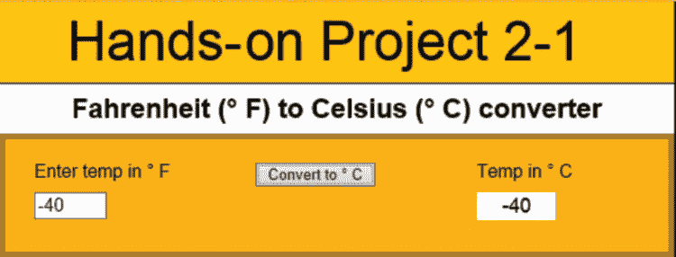

如果这些语句中的任何一个为假，则整个语句具有布尔值 `false`，并显示一个带有文本“Please fill in all fields”的警告框。

在 `submitInfo()` 函数的闭合 `}` 之后、闭合的 `</script>` 标签之前，输入以下语句添加事件监听器：

```javascript
document.getElementById("submit").addEventListener("click", submitInfo, false);
```

保存你的工作，在浏览器中打开 **index.htm**，然后点击 **Submit** 按钮。浏览器显示一个包含文本“Please fill in all fields”的警告框，因为当你点击按钮时，所有字段都是空的。点击警告框中的 **OK** 按钮，仅在 Name 框中输入文本，然后点击 **Submit**。浏览器再次显示一个包含文本“Please fill in all fields”的警告框，因为当你点击按钮时，仍有两个字段是空的。点击警告框中的 **OK** 按钮，在三个字段中都输入文本，然后点击 **Submit**。如图所示，浏览器现在显示一个包含文本“Thank you!”的警告框，因为当你点击按钮时没有一个框是空的。点击 **OK**。

图 2-19：“Thank you!” 警告框

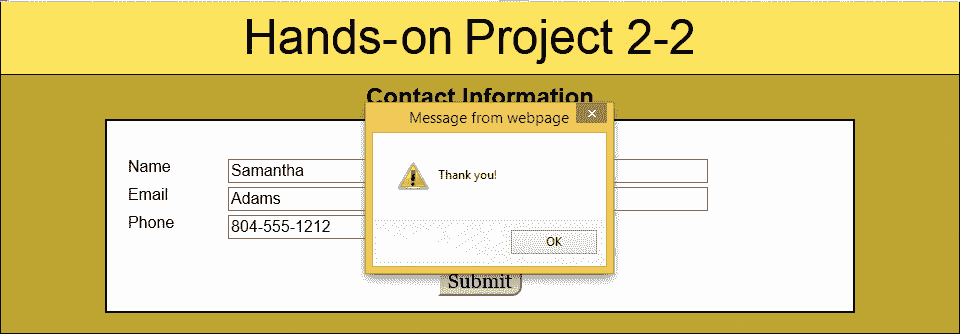

### 动手实践项目 2-3

在这个项目中，你将创建一个脚本，该脚本根据用户点击的元素显示一个包含自定消息的警告框。注意，你的结果应该在所有现代浏览器上运行，但在 IE 或之前的 IE 版本上将无法运行。

在你的文本编辑器中，打开 Chapter 文件夹下 HandsOnProject 文件夹中的 **index.htm**。在文档头部（document head）的注释部分，按照指示输入你的姓名和今天的日期。

在浏览器中打开 **index.htm**。网页显示三个形状：正方形、三角形和圆形。

回到你的文本编辑器。在文档底部、闭合的 `</body>` 标签之前，输入 `<script>`，插入一个空行，然后输入 `</script>` 以创建一个新的脚本部分。

在你在上一步中创建的脚本部分中，输入以下事件监听器：

```javascript
1 document.getElementById("square").
2addEventListener("click", function() {
3 alert("You clicked the square");
4 }, false);
```

此代码为 `id` 为 `square` 的元素添加了事件监听器。该代码使用匿名函数作为 `addEventListener()` 方法的第二个参数。当用户点击该元素时，将执行匿名函数，生成一个包含文本“You clicked the square”的警告框。

在你在上一步中添加的事件监听器之后、闭合的 `</script>` 标签之前，输入以下代码为剩余两个形状元素添加事件监听器：

```javascript
1 document.getElementById("triangle").
2addEventListener("click", function() {
3 alert("You clicked the triangle");
4 }, false);
5 document.getElementById("circle").
6addEventListener("click", function() {
7 alert("You clicked the circle");
8 }, false);
```

保存你的工作，在浏览器中刷新或重新加载 **index.htm**，然后点击 **square**。如图所示，浏览器打开一个显示文本“You clicked the square”的警告框。点击 **OK**，然后对三角形和圆形重复此操作。每个警告框应该标出你点击的形状。

### 动手实践项目 2-4

在这个项目中，你将创建一个脚本计算购买总额并添加税费。注意，你的结果应该在所有现代浏览器上运行，但在 IE 或之前的 IE 版本上将无法运行。

在你的文本编辑器中，打开 Chapter 文件夹下 HandsOnProject 文件夹中的 **index.htm**。在文档头部（document head）的注释部分，按照指示输入你的姓名和今天的日期。

在浏览器中打开 **index.htm**。网页显示一个带有五个复选框和一个 Submit 按钮的表单。你将创建一个脚本计算所有元素的购买总额并添加税费。

回到你的文本编辑器。在文档底部、闭合的 `</body>` 标签之前，输入 `<script>`，插入一个空行，然后输入 `</script>` 以创建一个新的脚本部分。

在你在上一步中创建的脚本部分中，输入以下函数：

```javascript
1 function calcTotal() {
2 var itemTotal = 0;
3 var item1 = document.getElementById("item1");
4 var item2 = document.getElementById("item2");
5 var item3 = document.getElementById("item3");
6 var item4 = document.getElementById("item4");
7 var item5 = document.getElementById("item5");
8 (item1.checked) ? (itemTotal += 8) : (itemTotal += 0);
9 (item2.checked) ? (itemTotal += 9) : (itemTotal += 0);
10 (item3.checked) ? (itemTotal += 8) : (itemTotal += 0);
11 (item4.checked) ? (itemTotal += 13) : (itemTotal += 0);
12 (item5.checked) ? (itemTotal += 6) : (itemTotal += 0);
13 var salesTaxRate = 0.07;
14 var orderTotal = itemTotal + (itemTotal * salesTaxRate);
15 alert("Your order total is $" + orderTotal);
16 }
```

`calcTotal()` 函数首先创建了六局部变量——`itemTotal` 以及存储每个复选框元素的变量。第 8-12 行中的每条语句都会评估页面上的某个复选框是否被选中。如果是，则将该复选框对应的价格添加到 `itemTotal` 变量中；如果不是，则不加（加 0）。在检查所有复选框的值后，函数声明了两个额外变量。`salesTaxRate` 变量指定了必须添加到总金额中的百分比。在第 14 行中，`orderTotal` 变量计算方法是首先将 `itemTotal` 乘以 `salesTaxRate` 以确定税额，然后将该金额加到 `itemTotal` 值上。该函数最后生成一个包含文本“Your order total is $”后跟 `orderTotal` 变量值的警告框。

在 `calcTotal()` 函数的闭合 `}` 之后、闭合的 `</script>` 标签之前，输入以下代码添加事件监听器：

```javascript
document.getElementById("submit").addEventListener("click", calcTotal, false);
```

保存你的工作，在浏览器中刷新或重新加载 **index.htm**，点击 **Fried chicken** 复选框，然后点击 **Submit** 按钮。如图所示，警告框显示总额为。

145

*实操项目*

选择其他项目或项目组合，并验证报告的总额是否真实地代表了所选项目总额加上 % 税税的加和。

## 实操项目 2-5

在这个项目中，你将增强你在“实操项目 -”中完成的文档，以避免浮点数计算和整数计算之间潜在的差异。请注意，你的结果应该在所有现代浏览器上运行，但在 IE 或之前的版本的 IE 中无法运行。

在你的操作系统的文件管理器中，将 `HandsOnProject -` 文件夹的完整内容复制到 `HandsOnProject -` 文件夹中。

在文本编辑器中，打开 `HandsOnProject -` 文件夹中的 **index.htm** 文件，在注释部分、`title` 元素和 `h1` 元素中将 “Hands-on Project - ” 更改为 **Hands-On Project -**，然后保存更改。

在 `calcTotal()` 函数中，在语句 `var SalesTaxRate = 0.07;` 之后，添加以下语句：

`itemTotal *= 100;`

这会将所选项目的总和乘以100，并将结果赋值为 `itemTotal` 的新值。这会将项目总额从美元（如 $）转换为分（如 ¢），分是一个整数，从而避免了浮点数计算可能的问题。

图 2-21：显示订单总额的警告框

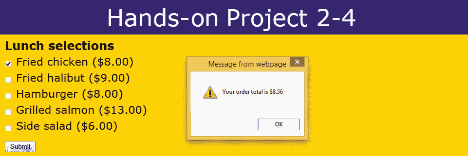

146

第2章 使用函数、数据类型和运算符

在以 `var orderTotal` 开头的语句中，在 `itemTotal` 第一次出现之前添加一个左括号，在结尾 `;` 之前添加一个右括号，然后在结尾 `;` 之前添加 **/**。你更新后的语句应与以下匹配：

`var orderTotal = (itemTotal + (itemTotal * salesTaxRate)) / 100;`

右操作数的现有内容包含在括号中，整个计算值除以，将其从分转换回美元。

保存你的更改，在浏览器中打开 **index.htm**，点击 **Fried chicken**（炸鸡）复选框，然后点击 **Submit**（提交）按钮。验证警告框是否仍显示总额为 $. 由于 `orderTotal` 计算没有遇到任何浮点问题，你不会根据你所做的更改而看到不同的结果。然而，如果未来页面需求发生变化，需要一种可能引入浮点问题的计算，你的更改将防止用户遇到任何问题。

## 案例项目

### 个人案例项目

计划并在个人网站的其中一个网页添加一个功能，该功能应使用至少一个函数根据用户输入执行数学计算。测试页面以确保其按计划运行。

### 团队案例项目

从你的团队网站中选择一个网页，使用至少两个函数对其进行增强。函数的常见用途包括根据用户输入执行操作（验证、网页个性化）和执行计算。将你的团队分成小组，小组数量等于你的页面将包含的函数数量。每个小组创建完其函数后，全组重新汇聚并将函数整合到网页中。测试函数以验证页面按计划运行，由全队进行任何故障排除并对函数进行任何编辑。

 

当你完成本章时，你能够：

- 在数组中存储数据

- 使用 `while` 语句、`do/while` 语句和 `for` 语句重复执行代码

- 使用 `continue` 语句重启循环语句

- 使用 `if` 语句、`if/else` 语句和 `switch` 语句做出决策

- 将一个 `if` 语句嵌套在另一个中

## 构建数组和控制流

你目前为止编写的代码本质上是线性的。换句话说，你的程序从开始运行并在程序最后一条语句执行时结束。然而，有时更改这种默认执行顺序是有用的。更改 JavaScript 代码执行的顺序被称为**控制流**（controlling flow）。控制代码流是编程所需的最基本的技能之一。在本章中，你将学习几种允许你控制控制流的语句。在学习如何使用这些语句之前，你将首先学习数组数据类型，该类型通常与这些语句一起使用。

 

第3章

148

第3章 构建数组和控制流

### 声明和初始化数组

在 JavaScript 中创建数组有几种方法，但最常见的方法是使用**数组字面量**（array literal），这是一条声明变量并指指定数组值为其内容的单一语句。要使用数组字面量创建数组，可以使用以下语法：

`var array = [value1, value2, value3];` 数组的值用逗号分隔，整个数组值包含在方括号 `[]` 中。使用数组字面量创建数组的语法如下：

`var array = [value1, value2, ...]` 其中 `name*` 是赋值给数组的变量名，`value1*`、`value2*` 和 `value3*` 是数组中的值。要创建图 - 中所示的 `newsSections` 数组，你应该使用以下语句：

`var newsSections = ["world", "local", "opinion", "sports"];`

### 在数组中存储数据

**数组**包含由单个变量名表示的数据集。你可以将数组想象成变量的集合。当你想要在一个位置存储一组信息时，就会使用数组。名称、课程和价格通常存储在数组中。例如，图 - 显示了一个名为 `newsSections` 的数组，包含了网站的名称。

array name

array data

`"world"`

`"local"`

`"opinion"`

`"sports"`

`newsSections`

图 3-1：数组的概念示意图 ©2015 Cengage Learning

数组中的每个值被称为**元素**。每个元素都有一个数字，被称为**索引**（index），代表元素在数组中的位置。虽然日常生活中的编号通常从 1 开始，但在编程中，编号通常从 0 开始。数组就是如此。

注意：假设数组的第一个元素的索引为 1 而不是 0 是编程错误的常见来源。如果你在处理数组时看到结果与预期偏差 1，请双重检查你的代码是否考虑了 0 是第一个索引。

警告：你通过在名称后括起索引数字来引用特特的数组元素。例如，`newsSections` 数组的第一个元素是 `newsSections[0]`，第二个元素是 `newsSections[1]`，第三个元素是 `newsSections[2]`，以此此类推。这意味着如果你有一个由元素组成的数组，你将使用索引来引用第 个元素。

149

**在数组中存储**

使用数组字面量声明大型数组时，`var` 语句有时很长。虽然在大多数情况下你希望每行 JavaScript 代码以分号结尾，但将数组字面量拆分为多行是安全的。例如，你可能会这样写数组字面量：

```
var name = [
  value1,
  value2,
  value3,
  value4,
  ...
];
```

## 第 3 章 构建数组与控制流

例如，为了将值“entertainment”作为 `newsSections` 数组的第五个元素，你可以使用以下语句：

`newsSections[4] = "entertainment";`

由于现有的五个元素的索引号为 0, 1, 2 和 3，该语句使用了下一个数字 4，并将其赋值为字符串值“entertainment”。图 3-3 显示在使用上述语句添加第五个元素后更新的数组内容。

| 数组名称 | 数组数据 |
| :--- | :--- |
| `newsSections` | "world" |
| | "local" |
| | "opinion" |
| | "sports" |
| | "entertainment" |

图 3-3: 包含五个元素的 `newsSections` 数组

你可以创建一个不包含任何元素的数组，然后在稍后向其中添加元素。你使用以下语法创建一个新的空数组：

`var *name* = [];`

此表达式中的方括号表示该新变量是一个数组。然后，你可以像处理已经包含元素的数组一样向该数组中添加元素。

数组的大小可以动态变化。如果你为一个尚未创建的元素赋值，该元素将被自动创建，同时创建任何可能在其之前的元素。例如，以下代码中的第一条语句创建了不包含任何元素的 `colors` 数组。第二条语句将“yellow”赋值给第三个元素，在此过程中也创建了前两个元素（`colors[0]` 和 `colors[1]`）。

`var colors = [];`

`colors[2] = "yellow";`

注意，在你为 `colors[0]` 和 `colors[1]` 赋值之前，它们的值将是 `undefined`。图 3-4 展示了运行这些语句后 `colors` 数组的内容。

### 在数组中存储数据

大多数编程语言要求数组中的所有元素必须具有完全相同的数据类型。然而，在 JavaScript 中，赋值给数组元素的值可以是不同的数据类型。例如，以下代码创建了一个数组，并将不同数据类型的值存储在数组元素中：

```javascript
1 var hotelReservation = [];
2 // 客人姓名 (string)
3 hotelReservation[0] = "Minh Vuong";
4 // 晚夜数 (integer)
5 hotelReservation[1] = 5;
6 // 每晚价格 (floating point)
7 hotelReservation[2] = 74.99;
8 // 无烟房 (Boolean)
9 hotelReservation[3] = true;
```

*变量有时会在其名称末尾带有 `[]`，以指示其值是一个数组。例如，在绘制编程任务图表时，你可能会写 `contactInfo[]` 来指代具有数组数据类型的 `contactInfo` 变量。请注意，这种结构在实际的 JavaScript 代码中并没有使用。*

**注意**

在本章，你将处理一个网页，用于显示位于爱荷华州蒂普顿的涡风队（Tipton Turbines）棒球球队的赛程。该球队希望能够发布每个月的赛程，而不需要在每个表格单元格中输入信息。他们希望你第一步创建 8 月份的赛程。你将从创建包含每个表格单元格中不同信息的数组开始。在本章稍后的部分，你将学习如何使用控制流语句将数组中的信息插入到表格单元格中。图 3-5 显示了你在本章桌面浏览器中创建的网页预览，图 3-6 显示了手持设备上的页面。

| 数组索引 | 数组数据 | 数组名称 |
| :--- | :--- | :--- |
| [0] | undefined | `colors` |
| [1] | undefined | `colors` |
| [2] | "yellow" | `colors` |

图 3-4: 添加索引为 2 的元素后的 `colors` 数组

图 3-5: 桌面浏览器中的 Tipton Turbines 赛程

图 3-6: 手持设备上的 Tipton Turbines 赛程

要创建包含赛程信息的数组：

1. 在文本编辑器中，打开位于第 3 章文件夹中的 **calendar.htm** 文件。

2. 在文档顶部的注释部分，在指定处输入你的姓名和今天的日期，然后保存工作。

3. 滚动查看文档以熟悉其内容。`article` 元素包含一个五行七列组成的表格。单元格中不包含数据。最终将包含赛程信息的 `td` 元素都有一个 `id` 值。在本章稍后的部分，你将使用这些 `id` 值将每个数组元素放置在正确的单元格中。

4. 在浏览器中打开 **calendar.htm**。如图 3-7 所示，表格显示为空网格。图 3-7: calendar.htm 中的空表格

5. 返回你的文本编辑器，打开一个新文档，然后输入以下注释，在指定处输入你的姓名和今天的日期：

```javascript
/*
1 JavaScript 第6版
2 第 3 章
3 案例 Tipton Turbines
4 变量与函数
5 Author:
6 Date:
7 Filename: tt.js
*/
```

6. 在注释部分下方，输入以下代码声明 `daysOfWeek` 变量并使用数组字面量设置其值：

`var daysOfWeek = ["Sunday", "Monday", "Tuesday", "Wednesday", "Friday", "Saturday"];`

这段代码使用数组字面量声明了一个名为 `daysOfWeek` 的变量，其值为包含每天名称的数组。

7. 在本章稍后的部分，在 `daysOfWeek` 声明下方，输入以下代码声明 `opponents` 变量并使用数组字面量设置其值：

`var opponents = ["Lightning", "Combines", "Lightning", "Raisers", "Raisers", "Sodbusters", "Sodbusters", "Sodbusters", "Sodbusters", "Sodbusters", "Sodbusters", "Riders", "Riders", "Big Dippers", "Big Dippers", "Big Dippers", "Big Dippers", "Big Dippers", "Big Dippers", "Big Dippers"];`

该数组顺序列出了 8 月份每天的对手。

8. 在 `opponents` 变量下方，输入以下代码声明 `gameLocation` 变量并设置其值：

`var gameLocation = ["away", "away", "away", "away", "home", "home", "home", "home", "home", "home", "", "away", "away", "away", "away", "", "away", "away", "away", "away", "", "", "home", "home", "home", "home", "home", "home", ""];`

确保语句以分号结束。**注意** 该数组列出了 8 月份每天是客场还是主场。注意，该数组将字符串“away”和“home”与空值""结合，空值表示没有比赛的日子。例如，8 月的前四天（1-4 日）是客场，接下来的几天（5-11 日）是主场，最后一天（31 日）没有比赛。

9. 将文件保存为名为 **tt.js** 的文本文件，存放在第 3 章文件夹中，返回编辑器中的 **calendar.htm**，然后在文档末尾、`</body>` 标签上方添加以下行代码：

`<script src="tt.js"></script>`

10. 保存 **calendar.htm** 的更改，然后在浏览器中刷新或重新加载 **calendar.htm**。尽管你声明了三个数组变量，但你尚未在任何 JavaScript 代码中引用它们的值，页面仍然与图 3-5 一致。你将在本章稍后创建函数来插入数组值。

### 访问元素信息

你访问元素的值就像访问任何其他变量的值一样，只是要在括号中包含元素索引。例如，以下代码将 `newsSections` 数组前三个元素的值赋值给三个网页元素的内容：

```javascript
1 var sec1Head = document.getElementById("section1");
2 var sec2Head = document.getElementById("section2");
3 var sec3Head = document.getElementById("section3");
4 sec1Head.innerHTML = newsSections[0]; // "world"
5 sec2Head.innerHTML = newsSections[1]; // "local"
6 sec3Head.innerHTML = newsSections[2]; // "opinion"
```

在第 3 章中，你使用了浏览器控制台检查 JavaScript 代码生成的错误。所有主流浏览器当前版本的浏览器控制台也允许你输入 JavaScript 语句并显示语句的结果。特别是在输入了如 `opponents` 和 `gameLocation` 这样的大型数组后，

## 第 3 章构建数组与控制流

使用控制台检查数组值可以帮助你验证是否已准确声明了数组。现在，你将使用浏览器的控制台来检查 `tt.js` 文件中的数组。

要使用浏览器控制台检查数组值：

1.  返回浏览器中的 **calendar.htm**。表 3-1 列出了在主流浏览器中打开控制台的快捷键和菜单命令。

| 浏览器 | 键盘快捷键 | 菜单步骤 |
| :--- | :--- | :--- |
| Internet Explorer 9+ | **F12**，然后 **Ctrl** + **2** | 点击**工具**图标，点击菜单上的 **F12** **开发者工具**，然后在打开的窗口点击**控制台**Console）按钮 |
| Firefox | **Ctrl** + **Shift** + **K** (Win) **option** + **command** + **K** (Mac) | 点击**打开菜单**按钮，点击**开发者**，然后点击**Web** **控制台**(Console） |
| Chrome | **Ctrl** + **Shift** + **J** (Win) **option** + **command** + **J** (Mac) | 点击**自定义并控制 Google Chrome**按钮，将鼠标悬停在**工具**上，然后点击**JavaScript** **控制台**(Console） |

表 3-1：在主流浏览器中打开浏览器控制台的步骤

2.  使用表 3-1 中的相应命令在浏览器中打开控制台。

*如果你的浏览器未列出，或者列出的方法之一不起，请检查浏览器的文档以获取正确步骤，或尝试不同的浏览器。

请记住，不同的浏览器对控制台可能使用不同的术语，包括“JavaScript 控制台”、“Web 控制台”或“错误控制台”。*

**注意**

图 3-8 显示了 Firefox 中的浏览器控制台。浏览器控制台在不同浏览器中的显示可能不同，但它们都共享图 3-8 所示的通用组件。

### 在数组中存储数据

3.  点击控制台底部的命令行，输入 `daysOfWeek[1]`，然后按 **Enter****。如图 3-8 所示，控制台会在单独的一行显示你的输入，并在下一行显示结果。在这种情况下，结果是“Monday”。注意，控制台针对命令 `daysOfWeek[1]` 返回了值“Monday”，该命令请求 `daysOfWeek` 数组中项目的值。数组中的第一个值是“Sunday”。但是，请记住数组元素是从 0 开始编号的，因此 `daysOfWeek[1]` 指的是 `daysOfWeek` 数组中的*第二个*项目，即“Monday”。

（图 3-8：Firefox 中的浏览器控制台）

*来源：© Mozilla Firefox*

4.  在命令行上，输入 `daysOfWeek[0]`，然后按 **Enter**。控制台返回值“Sunday”，这是数组中的第一个值 (0)。

5.  对表 3-2 第一列中的每个值重复此步骤，然后验证控制台是否为每个值返回了第二列中指定的值。

*某些控制台会在你输入时猜测你输入的内容，并在命令行上显示其最佳猜测。你通常可以按 Tab 键接受预测值。在输入数组名称时，你可能可以通过输入前几个字母、接受自动完成，然后输入括号中的数字来节省时间。*

| 命令行输入 | 预期的返回值 |
| :--- | :--- |
| `daysOfWeek[6]` | "Saturday" |
| `daysOfWeek[7]` | `undefined` |
| `opponents[0]` | "Lightning" |
| `opponents[3]` | "(off)" |
| `opponents[1]` | `undefined` |
| `gameLocation[0]` | "away" |
| `gameLocation[3]` | "" |
| `gameLocation[1]` | `undefined` |

表 3-2：验证数组内容的命令行输入

*如果你的控制台针对任何条输入返回的值与表 3-2 中显示的值不同，请返回编辑器中的 tt.js，根据之前的步骤检查数组的定义，修复任何错误，保存工作，然后在浏览器中刷新或重新加载 calendar.htm 并重复命令行输入。*

**修改元素**

你修改现有数组元素值的方法与修改标准变量值相同，不同之处要在括号中包含元素索引。以下代码为 `newsSections` 数组中的第五个元素分配了一个新值：

`newsSections[4] = "living";`

（图 3-10 展示了执行上述语句后 `newsSections` 数组的更新内容。）

### 数组元素数量

每个数组都有一个 `length` 属性，它返回数组中的元素数量。你使用语法 `name.length;` 在想要获取长度的数组名称后附加 `length` 属性。*记住，与方法名不同，属性名后面没有括号。*

**注意**

虽然数组索引从 0 开始计数，但 `length` 属性从 1 开始计数。这意味着，例如，6 个元素数组的 `length` 属性返回值为 6，尽管数组中的最后一个索引是 5。你将使用浏览器控制台中的 `length` 属性来验证每个数组的元素数量。

使用浏览器控制台检查数组长度：

1.  返回浏览器中的 **calendar.htm**。

2.  在控制台命令行输入 `daysOfWeek.length`，然后按 **Enter**。控制台返回 6，这是 `daysOfWeek` 数组中的元素数量。

3.  重复步骤检查 `opponents.length` 和 `gameLocation.length` 的值。控制台应均返回 6。

（图 3-10：更新第五个元素后的 newsSections 数组）

### 使用数组对象

数组在 JavaScript 中通过 `Array` 对象表示。`Array` 对象包含一个名为 `Array()` 的特殊构造函数，提供了创建数组的另一种方法。**构造**是一种特殊的函数，用于创建引用变量（即数据类型为引用变量）。你可以使用 `new` 关键字和 `Array()` 构造函数按照以下语法创建新数组：

`var arrayName = new Array(元素数量);`

以下代码使用 `Array()` 构造函数创建一个名为 `newsSections` 具有六个元素的数组：

`var newsSections = new Array(6);`

JavaScript 程序员通常使用字面量而不是构造函数创建数组。许多程序员认为使用字面量比使用构造函数更容易，而且构造函数相对于字面量并没有特定的优势。在本书的剩余部分，你将使用字面量创建数组，而不是使用 `Array()` 构造函数。

**引用元素集合**

你可以通过查找网页中某种类型的完整元素集合，然后引用该集合中的一个特定元素来引用网页元素。虽然元素集合不是数组，但你可以使用类似于引用数组元素的系统，通过根据元素在 HTML 代码中出现的顺序使用索引号来引用集合中的特定项目。例如，假设你正在处理一个包含以下基础部分的网页：

`1`

<h1>如何制作沙拉</h1>`

`2`

`<ol>`

`3`

`<li>洗净生菜</li>`

`4`

`<li>将其撕成一口口大小的碎片</li>`

`5`

`<li>添加酱料</li>`

`6`

`</ol>`

161

*在数组中存储数据*

如果你想用 JavaScript 操作第三个 `li` 元素，可以在它的起始标筓上添加一个 `id` 属性，然后使用 `getElementById()` 方法来访问它。然而，你也可以使用另一种 JavaScript 方法来访问元素，而无需向你的 HTML 文档中添加额外的代码。**getElementsByTagName() 方法**返回一个指向 HTML 文档中特定元素所有实例的引用集合。该方法使用以下语法：

`getElementsByTagName("*element")`

例如，以下代码返回文档中所有 `li` 元素的引用集合：

`getElementsByTagName("li")`

注意，结果集合中的元素是根据它们在 HTML 代码中出现的顺序排列的。

*与 **getElementById() 不同，后后者使用的是单数形式的 “element”，* *而* **getElementsByTagName() 中的单词 “elements”末尾有一个* s *s*。请务必不要输入* **getElementByTagName()**，*因为这不是一个有效的方法名。*

**注意**

尽管返回的集合在技术上不是一个数组，但你访问其内容的语法与引用数组元素的语法相同——你只需要使用括号中的数字来指定索引值。例如，要引用文档中的第三个 `li` 元素，你可以使用 `getElementsByTagName()` 方法访问文档中所有 `li` 元素的集合，然后在末尾添加 `[2]`，表示你想访问文档中的第三个 `li` 实例，如下：

`document.getElementsByTagName("li")[2]`

要访问此元素的内容，你可以添加 `innerHTML` 属性，如下：

`document.getElementsByTagName("li")[2].innerHTML`

如果你在浏览器中加载了包含上述元素的文档，然后在浏览器控制台中输入前面的代码，控制台将返回如下：

`"Add dressing"`

你将使用 `getElementsByTagName()` 方法来查看 Tipton Turbines 日历页面上导航栏中 `li` 元素的值。

162

第 3 章 构建数组和控制流程

要使用浏览器控制台来检查导航栏中 **li** 元素的值：

1. 返回浏览器中的 **calendar.htm**。

2. 在浏览器控制台的命令行中输入 **document.getElementsByTagName("li")[0].innerHTML**，然后按 **Enter（回车）**。浏览器控制台返回“<a href="#">Tickets</a>”，这是导航栏中第一个项目的链接代码和文本。

3. 在浏览器控制台的命令行中输入 **document.getElementsByTagName("li")[1].innerHTML**，然后按 **Enter（回车）**。浏览器控制台返回“<a href="#">Calendar</a>”，这是导航栏中第二个项目的链接代码和文本。

4. 重复步骤以检查第三个、第四和第五个 `li` 元素。浏览器控制台应分别返回值“<a href="#">Players</a>”、“<a href="#">News</a>”和“<a href="#">Community</a>”。

5. 点击控制台的 **Close button（关闭按钮）**或按下你打开它时使用的相同键组合来关闭浏览器控制台。图 - 显示了 Firefox 控制台中关闭按钮的位置。

    

编程语言通常从 0 而不是 1 开始计数数组元素等项目，事实是新程序员困惑的常见来源。虽然需要一些练习才能习惯，但从 0 而不是 1 开始计数会让某些高级编码任务变得简单得多。在编程中，通常需要遍历多组数据并比较或组合这些值。使用统一的起始标准可以更容易从数学角度上执行这些操作。


**编程概念**

单元测验 1

- 数组与标标准变量有何区别？

- 你如何创建一个新的空数组？

- 如何访问数组中的单个元素？

- 你使用哪个属性来确定数组中的元素数量？

- 你如何使用浏览器检查特定数组元素的值？

163

*重复代码*

在编程中，你通常需要多次重复相同的语句或代码。例如，你可能希望重复某条语句直到满足特定条件。在本章中，你将学习三种类型的循环：`while`语句、`do/while`语句和 `for` 语句。

最简单的循环语句之一是 `while` 语句，它在给定条件为真时重复代码语句。`while`语句的语法为 `while (condition) { statements }`。`while` 语句的每次重复被称为迭代。

为了确保 `while` 循环结束，你必须包含更改条件值的代码。**计数器**是指在循环每次迭代中递增（增加）或递减（减少）的变量。

**注意**

以下代码显示了一个简单的 `while` 语句。脚本声明了一个名为 `count` 的变量，并赋予其初始值 1。然后将 `count` 变量用于 `while` 语句条件表达式 (`count <= 5`)。只要 `count` 变量小于或等于 5，`while` 语句就会循环。在 `while` 语句的体内，`document.write()` 语句打印 `count` 的值，然后 `count` 变量递增 1。

```javascript
var count = 1;
while (count <= 5) {
    document.write(count + "<br />");
    count++;
}
```

前面的代码打印了数字 1 到 5，每个数字代表循环的一次迭代。当计数器达到 6 时，会打印消息“You have printed 5 numbers.”，从而证明循环已结束。

图 3-11：使用递增运算符的 `while` 语句输出

1

2

3

4

5

You have printed 5 numbers.

你也可以通过递减（减少值）计数变量来控制 `while` 循环的重复次数。考虑以下脚本：

```javascript
var count = 10;
while (count > 0) {
    document.write(count + "<br />");
    count--;
}
document.write("<p>We have liftoff.</p>");
```

165

*重复代码*

在例例中，`count` 变量的初始值为 10，使用递减运算符（`--`）将计数器减 1。当 `count` 变量大于 0 时，`while` 循环内的 `while` 语句会打印 `count` 变量的值。当 `count` 的值等于 0 时，`while` 循环结束，紧随其后的语句执行。

图 3-11 显示了脚本输出。

图 3-12：使用递减运算符的 `while` 语句输出

10

9

8

7

6

5

4

3

2

1

我们起飞了。

有许多方法可以改变计数变量的值，并使用计数变量来控制 `while` 循环的重复。下面的示例使用 `*=` 赋值运算符将 `count` 变量的值乘以 2。当 `count` 变量达到 128 时（大于 100），`while` 语句结束，且不会打印“128”。

`1` `var count = 1;`

`2` `while (count <= 100) {`

`3` `document.write(count + "<br />");`

`4` `count *= 2;`

`5` `}`

图 3-12 显示了脚本输出。

166

第 3 章 构建数组和控制流

为了确保 `while` 语句最终结束，你必须在命令块中包含更改条件表达式所用值的代码。如果你不包含更改此值的代码，你的程序将陷入死循环。在**无限循环**中，循环语句永远不会结束，因为它的条件表达式永远不会为假（false）。

考虑以下 `while` 语句：

`1` `var count = 1;`

`2` `while (count <= 10) {`

`3` `window.alert("The number is " + count + ".");`

`4` `}`

尽管前面的示例中的 `while` 语句包含一个检查 `count` 变量值的条件表达式，但命令块内部没有更改 `count` 变量值的代码。`count` 变量在循环的每次迭代中将一直保持为 1。这意味着无论用户点击多少次确定按钮，都会反复出现带有字符串“The number is 1.”的警报对话框。

图 3-13：使用 `*=` 赋值运算符的 `while` 语句输出

1

2

4

8

16

32

64

*在大多数情况下，要结束无限循环，必须关闭浏览器标签页或窗口。如果循环正在生成对话框（如前面的示例所示），你可能需要强制关闭浏览器。强制关闭应用程�的方法因操作系统操作系统而异。对于大多数版本的 Windows，按下 Ctrl + Alt + Delete，点击“任务管理器”，点击“应用程序”选项卡（仅限 Windows 7 及早期版本），右键点击浏览器名称，然后点击“结束任务”。在 Mac OS X 中，按下 command + option + esc，然后在弹出的窗口中点击列表中浏览器名称并点击“强制退出”。*

**注意**

接下来，你将创建一个函数，将包含星期几的字符串添加到 Tipton Turbines 日历表格的列头中。为了实现这一点，你将使用 `while` 语句来增加计数变量的值，并使用计数变量的值来识别要处理字符串的数组索引，以及将其放置的 `th` 元素的索引。

要使用 **while** 语句创建一个函数并将星期几放入表格：

1. 回到文本编辑器中的 **tt.js** 文档。

2. 在变量声明下方，输入以下代码以添加注释并创建名为 **addColumnHeaders()** 的函数结构：

`1` `// function to place daysOfWeek values in header row`

`2` `cells`

`3` `function addColumnHeaders() {`

`4`

`5` `}`

3. 在命令块中，输入以下语句：

`var i = 0;`

该语句创建了一个名为 `i` 的计数变量并将其设置为 0。

4. 在变量声明下方，输入以下代码：

`while (i < 7) {`

`}`

这段代码创建了一个 `while` 语句，设置条件 `i < 7`。这意味着每当循环重启且计数变量的值小于 7 时，循环将进行下一次迭代。

5. 在 `while` 语句的命令块中，输入以下语句：

`document.getElementsByTagName("th")[i].innerHTML =`

`daysOfWeek[i];`

从语句的后部分开始，`daysOfWeek[i]` 从 `daysOfWeek` 数组中获取索引值等于计数变量 `i` 的值。语句的前部分使用 `getElementsByTagName()` 方法识别索引值等于计数变量 `i` 的 `th` 元素，并将其 `innerHTML` 属性的值设置为从 `daysOfWeek` 数组中获取的对应值。例如，在此循环的第一次迭代中，`i` 的值将为 0。`getElementsByTagName()` 方法将识别第一个 `th` 元素（代表第一列的列头），并将其值设置为 `daysOfWeek` 数组中的第一个值。

168

第 3 章 构建数组和控制流

6. 在上述语句下方，输入以下语句：

`i++;`

该语句增加计数器。以下是 `addColumnHeaders()` 函数的代码。

`1` `// function to place daysOfWeek values in header row`

`2` `cells`

`3` `function addColumnHeaders() {`

`4` `var i = 0;`

`5` `while (i < 7) {`

`6` `document.getElementsByTagName("th")[i].innerHTML =`

`7` `daysOfWeek[i];`

`8` `i++;`

`9` `}`

`10` `}`

7. 在该函数下方，输入以下注释和语句：

`// runs addColumnHeaders() when page loads`

`window.addEventListener("load", addColumnHeaders, false);`

该语句在页面加载时调用 `addColumnHeaders()` 函数。

8. 保存 **tt.js** 的更改，然后在浏览器中加载 **calendar.htm**。如图 3-14 所示，表头已按照你在 `daysOfWeek` 数组中的顺序填充了内容。

图 3-14：显示列值的 calendar.htm。

169

*重复代码*

**do/while** 语句

另一种与 `while` 语句类似的循环语句是 `do/while` 语句。**do/while** 语句执行一次，只要指定的条件表达式为真（truthy），就会重复执行。

`do/while` 的语法如下：

`do {`

`statements;`

`} while (expression);`

正如语法描述所示，语句在表达式评估之前执行。与较简单的 `while` 语句相比，`do/while` 语句中的语句至少执行一次。

下面的 `do/while` 语句在条件表达式评估 `count` 变量之前执行一次。因此，会打印一行“The count is equal to 2.”。当评估条件表达式 (`count < 2`) 时，`count` 变量等于 2。这导致条件表达式返回假值，`do/while` 语句结束。

`1` `var count = 2;`

`2` `do {`

`3` `document.write("<p>The count is equal to " + count + "</p>");`

`4` `count++;`

`5` `} while (count < 2);`

注意这个 `do/while` 示例包含了命令块中操作计数变量的代码。与 `while` 语句一样，你需要包含更改计数变量值的代码以防止死循环。

下面的示例使用了与示例相同的基本代码，但使用的是 `while` 语句而不是 `do/while` 语句。与上面的 `do/while` 语句不同（其代码块在循环结束前执行了一次），下面的 `while` 语句中的代码块从未被执行，因为 `count` 变量不在条件表达式的范围内：

`1` `var count = 2;`

`2` `while (count < 2) {`

`3` `document.write("<p>The count is equal to " + count + "</p>");`

`4` `count++;`

$5$ `}`

第 3 章 构建数组和控制流

在之前的步骤中，你使用了一个 `while` 语句将 `daysOfWeek` 数组中的值添加到 Tipton Turbines 的日历表中。接下来的语句使用 `do/while` 语句执行相同的操作：

```javascript
1
var i = 0;
2
do {
3
document.getElementsByTagName("th")[i].innerHTML =
4
daysOfWeek[i];
5
i++;
6
} while (i < 7);
```

注意，代码 `while (i < 7)` 从命令块之前移动到了它之后，而 `do` 单词占据了它的位置。除此之外，使用 `do/while` 的代码与之前仅使用 `while` 的代码相同。

接下来，你将为 `tt.js` 文档添加一个函数，该函数将使用 `do/while` 语句将月份的日期添加到历表中。

要使用 **do/while** 语句将日期添加到历表中：

1. 回到文本编辑器中的 **tt.js** 文档。

2. 在 `addColumnHeaders()` 函数下方，输入以下代码以添加注释并创建一个名为 `addCalendarDates()` 的新函数结构：

```javascript
1
// 函数将月份值放置在第一个 p
2 元素
3 // 在具有 id 的每个表格数据单元格内
4 function addCalendarDates() {
5
}
```

3. 在命令块内部输入以下语句：

`var i = 1;`

`var paragraphs = "";`

第一个语句创建了一个名为 `i` 的计数器变量并将其值设置为 1。第二个语句创建了一个名为 `paragraphs` 的变量并将其值设置为空字符串。

*重复代码*

4. 在变量声明下方，输入以下代码：

```javascript
do {
}
```

此代码使用 `do` 关键字启动了一个 `do/while` 语句。

5. 在 `do` 语句的代码块中，输入以下语句：

```javascript
var tableCell = document.getElementById("08-" + i);
```

该语句创建了一个名为 `tableCell` 的变量，并使用 `getElementById()` 方法将其值设置为 `id` 值以 "08-" 开头后跟 `i` 值的元元素。这意味着在循环的第一次迭代中，表格单元格变量引用 `id` 为 08-1 的元素，它是表格第二行中的第二个 `td` 元素。

6. 在你上一步创建的语句下方，输入以下语句：

```javascript
paragraphs = tableCell.getElementsByTagName("p");
```

该语句使用 `getElementsByTagName()` 方法查找当前单元格（由 `tableCell` 变量指定）内的所有 `p` 元素，并将值作为数组存储在 `paragraphs` 变量中。

7. 在你上一步创建的语句下方，输入以下语句：

```javascript
paragraphs[0].innerHTML = i;
```

该语句将计数器变量 `i` 的值赋值为当前单元格中第一个段落（编号为 0）的内容。在循环第一次执行时，该值被放在月份第一日的单元格中。

8. 在你上一步创建的语句下方，输入以下语句：

```javascript
i++;
```

该语句增加计数器变量。

9. 在 `do` 命令块的结束大括号 `}` 之后、函数结束大括号 `}` 之前，添加以下语句：

`while (i <= 31);`

此条件语句决定 `do` 命令块是否重复下一次迭代。由于 8 月有 31 天，该块应该执行 31 次。在最后一次之后，计数器变量将变为 32，它不小于或等于 31，因此 `while` 语句将停止。

以下是完成后的代码逻辑结构：

```javascript
1
// 函数将月份值放置在第一个 p
2 元素
3 // 在具有 id 的每个表格数据单元格内
4 function addCalendarDates() {
var i = 1;
var paragraphs = "";
do {
var tableCell = document.getElementById("08-" + i);
paragraphs = tableCell.getElementsByTagName("p");
paragraphs[0].innerHTML = i;
i++;
} while (i <= 31);
}
```

## 重复代码


# 使用 `for` 语句比 `while` 语句更高效

使用 `for` 语句比 `while` 语句更高效，因为你不需要那么多行代码。考虑以下 `while` 语句：

```javascript
1 var count = 1;
2 while (count < brightestStars.length) {
3 document.write(count + "<br />");
4 count++;
5 }
```

你可以通过如下使用 `for` 语句更有效地实现相同的流程控制：

```javascript
1 for (var count = 1; count < brightestStars.length;
2 count++) {
3 document.write(count + "<br />");
4 }
```

以下代码显示了你之前在本节中创建的 `addColumnHeaders()` 函数的修订版本。你最初使用 `while` 语句创建了此函数，但下面的重写版本使用 `for` 语句执行了相同的操作。

```javascript
1 function addColumnHeaders() {
2 for (var i = 0; i < 7; i++) {
3 document.getElementsByTagName("th")[i].innerHTML
4 = daysOfWeek[i];
5 }
6 }
```

注意，变量 `count` 的声明、条件表达式以及增加 `count` 变量的语句现在都包含在 `for` 关键字后的括号中。使用 `for` 语句代替 `do/while` 语句稍微简化了脚本，因为你不需要那么多行代码。

## 向日历添加对手信息

接下来，你向 `tt.js` 文件添加了另一个函数。该函数将使用 `for` 语句将 `opponents` 数组中的对手名称添加到每个代表 8 月日期的表格单元格的第二个段落中。

### 使用 `for` 语句添加函数来用对手名称填充日历

1. 返回文本编辑器中的 **tt.js** 文档。

2. 在 `addCalendarDates()` 函数下方，输入以下代码以添加注释并创建一个名为 `addGameInfo()` 的新函数结构：

```javascript
1 // function to place opponents values in
2 // second p element within each table data cell that has an id
3 function addGameInfo() {
4
5 }
```

3. 在命令块中输入以下代码：

`var paragraphs = "";`

这段代码创建了一个名为 `paragraphs` 的变量并将其值设为空字符串。

4. 在变量声明下方，输入以下代码：

```javascript
for (var i = 0; i < 31; i++) {
}
```

这段代码启动了一个 `for` 语句。它创建了一个名为 `i` 的计数器变量并将其设置为 0。它指定了条件 `i < 31`；只要满足该条件，`for` 命令块就会重复执行。最后，代码 `i++` 在每次迭代时增加 `i` 计数器变量。

5. 在 `for` 语句的代码块中输入以下语句：

`var date = i + 1;`

该语句创建了一个名为 `date` 的变量，并赋值一个值等于计数器变量 `i` 的值加 1。

6. 在上一步创建的语句下方，输入以下语句：

`var tableCell = document.getElementById("08-" + date);`

该语句创建了一个名为 `tableCell` 的变量，并使用 `getElementById()` 方法将其设置为 `id` 值以 "08-" 开头后跟 `date` 值的元素。

7. 在上一步创建的语句下方，输入以下语句：

`paragraphs = tableCell.getElementsByTagName("p");`

该语句使用 `getElementsByTagName()` 方法查找当前单元格（由 `tableCell` 变量指定）内的所有 `p` 元素，并将值作为数组存储在 `paragraphs` 变量中。

8. 在上一步创建的语句下方，输入以下语句：

`paragraphs[1].innerHTML = opponents[i];`

该语句获取 `opponents` 数组中索引与计数器变量 `i` 当前值匹配的值，并将其值赋值为当前单元格中第二个段落（编号为 1）的内容。以下显示了 `addGameInfo()` 函数的完整代码。

```javascript
1 // function to place opponents in second
2 // p element within each table data cell that has an id
3 function addGameInfo() {
4 var paragraphs = "";
5 for (var i = 0; i < 31; i++) {
6 var date = i + 1;
7 var tableCell = document.getElementById("08-" +
8 date);
9 paragraphs = tableCell.getElementsByTagName("p");
10 paragraphs[1].innerHTML += opponents[i];
11 }
12 }
```

9. 在 `setUpPage()` 函数中，在结束括号 `}` 之前添加语句 `addGameInfo();`，使你的 `setUpPage()` 函数如下：

```javascript
1 function setUpPage() {
2 addColumnHeaders();
3 addCalendarDates();
4 addGameInfo();
5 }
```

> **注意**：调用你刚刚创建的 `addGameInfo()` 函数可确保日历被填充。

10. 保存对 **tt.js** 的更改，然后重新加载 **calendar.htm**。表格单元格现在显示了每一天的名称。

## 重新执行

在某些情况下，你希望循环在条件为假（falsy）时继续执行。你可以使用 `continue` 语句来实现，它可以重启循环迭代。例如，假设你有一个遍历数组的 `for` 语句。对于大于的股票，脚本打印价格等信息。对于小于的股票，你使用 `continue` 语句跳过该迭代。

```javascript
1 for (var count = 1; count <= 5; count++) {
2 if (count === 3) {
3 continue;
4 }
5 document.write("<p>" + count + "</p>");
6 }
```

## 短测

1. 重复语句中计数器的作用是什么？
2. `while` 语句和 `do/while` 语句之间的区别是什么？
3. 哪种重复语句允许在语法的一部分中初始化计数器？
4. 如何在条件为假的情况下强制执行循环的新迭代？

图 3-18：带有 `continue` 语句的 `for` 循环输出显示了网络浏览器中的输出。

## 职业技能

在设计涉及循环的程序时（尤其是大型复杂程序），要向可能与你一起创建程序的其他团队成员解释程序结构及其部分之间的关系可能是具有挑战性的。程序员在开发之前和期间，创建一个视觉表示来阐明程序的各个部分以及它们如何组合在一起是常见的做法。对于 `for` 循环，此类图表通常采用流程图的形式，将程序组件显示为不同形状的框，并用线连接相互通信的组件。流程图通常包含箭头，以指示信息在组件之间流动的方向。虽然有软件可以创建专业的流程图，但大多数程序员在白板上绘制流程图。

# 第 3 章 构建数组和控制流

# 决策

当你编写计算机程序时，无论使用何种编程语言，通常需要根据某些预定义的标准来执行不同的语句集。例如，你可能会创建一个程序，它在早上执行一组代码，在晚上执行另一组代码。或者，你可能会创建一个程序，当它在较大的屏幕（如桌面电脑或笔记本电脑）运行时执行一组代码，在较小的屏幕（如平板电脑或手机）运行时执行另一组代码。此外，你可能会创建一个取决于用户输入以确定具体运行哪些代码的程序。

例如，假设你创建了一个允许用户在线下单的网页。如果用户点击了“添加到购物车”按钮，必须执行一组构建购买项目列表的语句。然而，如果用户点击了“结算”按钮，则必须执行一组完全不同的语句来完成交易。

在应用程序的特定点选择执行哪些代码的过程被称为**决策**。用于决策的特殊类型 JavaScript 语句被称为**决策语句**、**决策结构**或**条件语句**。最常见的决策语句是 `if` 语句。

## `if` 语句

`if` 语句用于在条件表达式的求值返回真值（truthy）时执行特定的编程代码。

> 请记住，假值（falsy）是在比较操作中被视为布尔值 `false` 的六个值之一，而真值是这六个假值之外的任何值。

### 语法

简单 `if` 语句的语法如下：

```javascript
if (condition) {
  statements
}
```

`condition` 是一个条件表达式，`statements` 代表一个或多个可执行的语句。`if` 语句始终以关键字 `if` 开始，条件表达式必须包含在括号内。虽然单个语句的大括号是可选的，但始终包含大括号被认为是创建自文档代码的最佳实践，同时也可以避免浏览器处理你的代码时产生意外结果。在 JavaScript 中，包含在大括号内的一组语句被称为**命令块**。如果 `if` 语句正在评估的条件返回真值，则执行命令块中的语句。在命令块执行后，程序将继续执行命令块之后的任何代码。如果条件的求值结果为假值，则跳过 `if` 语句命令块，程序将继续执行命令块之后的任何语句。

到目前为止，你已经创建了函数为 Tipton Turbines 的日历页面添加列标题、日期和对手名称。为了完成日历，你需要添加一个额外信息：每场比赛是在主场还是客场进行。你已将此信息存储在 `gameLocation` 数组中。你将在 `addGameInfo()` 函数中添加 `if` 语句，根据比赛是主场、客场还是球队休息在日历中插入适当的内容。如果球队在主场比赛，将插入值“vs”后跟一个空格。如果球队在客场比赛，将插入字符“@”后跟一个空格。如果球队当天休息，则不插入任何文本。

### 使用 `if` 语句向日历添加主/客场信息

1. 回到编辑器中的 **tt.js** 文档。

2. 在 `addGameInfo()` 函数内部 `for` 循环的代码块内，在最后一个语句之前插入新行，输入代码 `if (gameLocation[i] === "away") {`，双击 **Enter**，然后如下所示输入闭合的大括号 `}`：

```javascript
1 paragraphs = tableCell.getElementsByTagName("p");
2 if (gameLocation[i] === "away") {
3
4
5 }
6 }
7 }
```

这段代码以 `if` 关键字开头创建一个 `if` 语句，后面紧跟着包含 `if` 条件的括号。该语句测试 `gameLocation` 数组中索引值等于计数器变量 `i` 的元素是否等于字符串“away”。

> 有些开发者会在闭合括号处添加注释，以指示每个括号结束了哪条语句。例如，在步骤 2 的第一个闭合括号之后，你可能会添加注释 `// end if` 来指示该括号关闭了之前的 `if` 语句。特别是当你的代码包含嵌套几层深结构时，此类注释可以让你更容易添加或删除嵌套层级。

3. 在 `if` 语句的命令块内，如下所示输入语句 `paragraphs[1].innerHTML = "@ ";`：

```javascript
1 var paragraphs = "";
2 if (gameLocation[i] === "away") {
3 paragraphs[1].innerHTML = "@ ";
4 }
```

该语句将当前单元格第二个段落的内容设置为 "@ "。

4. 在你刚刚创建的命令块下方，在 `for` 循环的最后一行代码中，将 `=` 改为 `+=`，使语句匹配以下内容：

`paragraphs[1].innerHTML += opponents[i];`

因为你刚刚使用 `if` 语句向第二个段落添加了内容，你希望确保对手名称是拼接（`+=`）而不是替换（`=`）。

5. 保存对 **tt.js** 的更改，然后重新加载 **calendar.htm**。在某些单元格中，对手名称之前现在显示了“@”和一个空格。这些日期对应于 `gameLocation` 数组中值为“away”的元素。（图 3-19：calendar.htm 文档在客场对手名称前显示 @）

若要在主场比赛的对手名称前添加文本“vs”和一个空格，你需要创建另一个 `if` 语句。

6. 回到编辑器中的 **tt.js**，然后在之前步骤创建的 `if` 语句的闭合括号 `}` 之后立即输入以下代码创建第二个 `if` 语句：

`if (gameLocation[i] === "home") { paragraphs[1].innerHTML = "vs "; }`

该语句创建了第二个 `if` 语句。它检查 `gameLocation` 数组中索引等于计数器变量的元素是否等于“home”，如果是，则将当前单元格第二个段落的内容设置为“vs ”。

7. 在 `addGameInfo()` 函数开始前的第一个注释行中，在单词“opponents”之后插入 **and gameLocation values**。

```javascript
1 // function to place opponents and gameLocation values in
2 // second p element within each data cell that has an
3 function addGameInfo() {
4 var paragraphs = "";
5 for (var i = 0; i < 31; i++) {
6 var date = i + 1;
7 var tableCell = document.getElementById("08-" + date);
8 var paragraphs = tableCell.getElementsByTagName("p");
9 if (gameLocation[i] === "away") {
10 paragraphs[1].innerHTML = "@ ";
11 }
12 if (gameLocation[i] === "home") {
13 paragraphs[1].innerHTML = "vs ";
14 }
15 paragraphs[1].innerHTML += opponents[i];
16 }
17 }
```

## `if/else` 语句

到目前为止，你学习了如何使用 `if` 语句在条件返回真值时执行一个或多个语句。但在某些情况下，你可能希望在条件返回真值时执行一组语句，而在条件返回假值时执行另一组语句。你可以通过向 `if` 语句添加 `else` 子句来实现这一点。例如，假设你创建了一个网页表单，让用户通过点击选项按钮指示他们是否投资股票市场。

脚本中的 `if` 语句可能包含一个评估用户输入的条件表达式。如果条件求值为 `true`（即用户点击了“是”选项），则 `if` 语句将显示一个关于推荐股票的网页。如果条件结果为 `false`（即如果用户点击了“否”选项），则 `else` 子句中的语句将显示一个关于其他类型投资机会的网页。

包含 `else` 子句的 `if` 语句被称为 `if/else` 语句。你可以将 `else` 子句看作一个备份计划，当条件返回假值（falsy value）时执行它。`if/else` 语句的语法如下：

```javascript
1 if (*expression*) {
2   *statements*
3 }
4 else {
5   *statements*
6 }
```

> *if/else* 语句等同于条件运算符（*?:*，也称为三元运算符），这是你在第 1 章学过的。虽然条件运算符更紧凑，但一眼看出 *if/else* 语句的作用会更容易识别。

下面的代码展示了一个 `if/else` 语句的示例：

```javascript
1 var today = "Tuesday";
2 if (today === "Monday") {
3   document.write("<p>Today is Monday</p>");
4 }
5 else {
6   document.write("<p>Today is not Monday</p>");
7 }
```

在前面的代码中，`today` 变量被赋值为“Tuesday”。如果条件 `(today === "Monday")` 结果为 `false`，程序的控制权将传递给 `else` 子句，并执行语句 `document.write("<p>Today is not Monday</p>");`，导致打印字符串“Today is not Monday”。如果 `today` 变量被赋值为“Monday”，条件 `(today === "Monday")` 将结果为 `true`，并执行语句 `document.write("<p>Today is Monday</p>");`。在 `if/else` 语句中，只有一组语句会被执行：要么是 `if` 语句后面的语句，要么是 `else` 子句后面的语句。

# 第 3 章 构建数组和控制流程

你之前创建的 `calendar.htm` 文档的 JavaScript 代码使用了多个 `if` 语句来评估 `gameLocation` 数组的内容，并决定向当前表格单元格插入什么值。虽然多个 `if` 语句功能正常，但可以将它们合并为一个 `if/else` 语句。接下来，你将在 `addGameInfo()` 函数中并将多个 `if` 语句替换为单个 `if/else` 语句。

### 向 `addGameInfo()` 函数添加 `if/else` 语句

1. 回到文本编辑器中的 **tt.js** 文档。

2. 在 `addGameInfo()` 函数内部、`for` 循环的代码块内，在第一个 `if` 语句开始之前插入 `/*`，并在第二个 `if` 语句的结束括号 `}` 之后添加 `*/`，如下：

```javascript
1 for (var i = 0; i < 31; i++) {
2   var date = i + 1;
3   var tableCell = document.getElementById("08-" + date);
4   paragraphs = tableCell.getElementsByTagName("p");
5   /* if (gameLocation[i] === "away") {
6     paragraphs[1].innerHTML = "@ ";
7   }
8   if (gameLocation[i] === "home") {
9     paragraphs[1].innerHTML = "vs ";
10   */
11   paragraphs[1].innerHTML += opponents[i];
12 }
```

这些 `if` 语句现在被视为注释，JavaScript 解释器不会处理它们。这允许你保留代码以备参考，而不会使其成为程序的一部分。

> 在多个 *if* 语句可以执行与单个 *if/else* 语句相同操作的情况下，使用 *if/else* 结构更好，因为它能让任何阅读代码的人清楚地看出这些语句是连接的。这是你在编程时可以做出的另一个选择，结果是产生了自文档式的代码。

3. 在 `for` 语句的命令块中，在上一步中输入的 `*/` 之后添加新行，然后输入以下代码：

```javascript
if (gameLocation[i] === "away") {
  paragraphs[1].innerHTML = "@ ";
}
```

这与你在上一步中输入的 `if` 语句相同。然而，这次它不再是独立存在，而是将作为 `if/else` 结构的开始。

4. 在你刚刚创建的命令块下方，输入以下代码：

```javascript
else {
  paragraphs[1].innerHTML = "vs ";
}
```

与上一组带有自身条件的 `if` 语句不同，此 `else` 语句仅在原始条件结果为 `false` 时提供单行可执行代码。`addGameInfo()` 中修改后的 `for` 语句应与如下匹配：

```javascript
1 for (var i = 0; i < 31; i++) {
2   var date = i + 1;
3   var tableCell = document.getElementById("08-" + date);
4   paragraphs = tableCell.getElementsByTagName("p");
5   /* if (gameLocation[i] === "away") {
6     paragraphs[1].innerHTML = "@ ";
7   }
8   if (gameLocation[i] === "home") {
9     paragraphs[1].innerHTML = "vs ";
10   */
11   if (gameLocation[i] === "away") {
12     paragraphs[1].innerHTML = "@ ";
13   }
14   else {
15     paragraphs[1].innerHTML = "vs ";
16   }
17   paragraphs[1].innerHTML += opponents[i];
18 }
```

5. 保存更改到 **tt.js**，然后在浏览器中重新加载 **calendar.htm**。

## 嵌套 if 和 if/else 语句

正如你所看到的，你可以使用嵌套的 `if` 或 `if/else` 语句来在条件评估后进行决策。在某些情况下，你可能希望在 `if` 语句内部执行其他决策。例如，你可能有一个使用 `if` 语句来询问用户是否喜欢运动。如果用户回答是，你可能想运行另一个 `if` 语句来询问他们更倾向于团队运动还是个人运动。

将一个决策语句放在另一个决策语句中就创建了**嵌套决策结构**。嵌套在 `if` 语句或 `if/else` 语句中的 `if` 语句被称为嵌套 if 语句。同样，嵌套在 `if` 语句中的 `if/else` 语句被称为嵌套 if/else 语句。

图 3-21：使用 if/else 语句填充 calendar.htm 文档

你使用嵌套的 `if` 和 `if/else` 语句来执行在原始条件评估之后的操作。例如，以下代码在执行 `write()` 语句之前评估两个条件表达式：

```javascript
1 var salesTotal = 75;
2 if (salesTotal > 50) {
3   if (salesTotal < 100) {
4     document.write("<p>销售总额在 50 到 100 之间。</p>");
5   }
6 }
```

示例中的 `document.write()` 语句只有在两个 `if` 语句的条件都为 `true` 时才会执行。

你在 `addGameInfo()` 函数中添加的 `if/else` 语句无法工作，因为它无法区分 `gameLocation` 的值为 `"home"` 和 `""`。为了修复这个问题，你需要让第二个子句变为嵌套的 `if` 语句以测试第二个条件。

### 向 `addGameInfo()` 函数添加嵌套的 `if` 语句

1. 回到文本编辑器中的 **tt.js** 文档。

2. 在 `addGameInfo()` 函数内部，在 `else {` 代码下方添加新行，然后输入代码 `if (gameLocation[i] === "home") {`。

3. 在语句 `paragraphs[1].innerHTML = "vs ";` 下方添加新行，然后输入一个结束括号 `}`。你包含嵌套 `if` 语句的完整 `if/else` 语句应与代码匹配：

```javascript
if (gameLocation[i] === "away") {
  paragraphs[1].innerHTML = "@ ";
}
else {
  if (gameLocation[i] === "home") {
    paragraphs[1].innerHTML = "vs ";
  }
}
```

# 第 3 章 构建数组和控制流程

4. 将更改保存到 **tt.js**，然后在浏览器中重新加载 **calendar.htm**。如图 3-22 所示，文本“vs”仍然插入到主场比赛的单元格中，但不再添加到包含文本“(off)”的单元格中。

### else if 语句

JavaScript 支持嵌套 `if/else` 语句的紧凑版本，被称为 **else if 结构**。在 `else if` 结构中，你将一个 `else` 语句与其嵌套的 `if` 语句结合。生成的语句需要的字符更少，且更容易阅读。例如，你可以将之前步骤中的 `else` 语句及其嵌套的 `if` 语句替换为以下 `else if` 语句：

```javascript
else if (gameLocation[i] === "home") {
    paragraphs[1].innerHTML = "vs ";
}
```

这三行代码替换了之前版本的五行代码。此外，这些行由单个命令块组成，而不是嵌套在另一个内部。

`else if` 结构通常用于增强事件监听器，使其与旧浏览器向后兼容。尽管现代浏览器都已统一使用 `addEventListener` 方法来创建事件监听器，但 Internet Explorer 8 及更早版本使用的是 `attachEvent` 方法。你可以使用 `else if` 语句创建代码，检查当前浏览器是否支持这两种方法之一，如果是，则使用正确的语法添加事件监听器。

图 3-22：使用嵌套 `if` 语句填充的 calendar.htm 文档

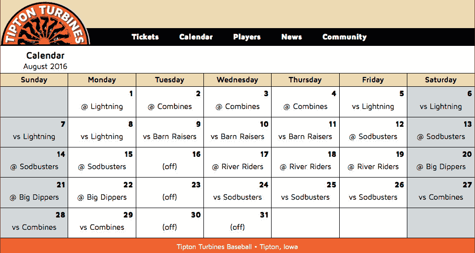

> **做出决策**

例如，如果你的网页包含一个 `id` 为 `button` 的提交按钮，并且你想用一个名为 `submitForm()` 的函数提交其内容，你可以使用以下跨浏览器代码创建事件监听器：

```javascript
// 为 Submit 添加向后兼容的事件监听器
var submitButton = document.getElementById("button");
if (submitButton.addEventListener) {
    submitButton.addEventListener("click", submitForm, false);
}
else if (submitButton.attachEvent) {
    submitButton.attachEvent("onclick", submitForm);
}
```

这段代码检查按钮上是否存在 `addEventListener` 方法。存在，则执行使用 `addEventListener` 方法的标准代码。如果不存在，程序将检查按钮上是否存在 `attachEvent` 方法。存在，则使用旧的 IE 特有 `attachEvent` 语法来添加事件监听器。如果这两个条件都不为真值（truthy），则这两种方法都不会执行。注意，`attachEvent` 方法在事件名称的开头始终包含“on”——在本例中，是 `onclick` 而不是简单的 `click`。

> 与上一步步骤一样，你可以使用嵌套 `if` 语句代替 `else if` 语句来创建向后兼容的事件监听器。使用 `else if` 语句的优点是它可以让你的代码更加紧凑，而不会难以理解。

### 向事件监听器添加 **else if** 结构

1. 如果你有权限访问 Internet Explorer，请在该浏览器中打开 **calendar.htm**。日历单元格是空的，如图 3-21 所示。因为 IE 不识别 `addEventListener()` 方法，浏览器在加载页面后不会运行页面设置函数。

> 即使你没有权限访问 Internet Explorer 8，也应该完成剩余的步骤。

2. 返回文本编辑器中的 **tt.js** 文档，然后滚动到文档底部的事件监听器代码。

3. 将现有的 `addEventListener()` 语句封装在一个 `if` 语句中，如下：

```javascript
if (window.addEventListener) {
    window.addEventListener("load", setUpPage, false);
}
```

4. 在刚刚输入的右括号 `}` 之后，同一行输入一个**空格**，然后输入 `else if (window.attachEvent) {`。

5. 在 `else if` 语句下方，输入以下代码：

```javascript
window.attachEvent("onload", setUpPage);
}
```

你完成的 `else if` 结构应该如下：

```javascript
if (window.addEventListener) {
    window.addEventListener("load", setUpPage, false);
} else if (window.attachEvent) {
    window.attachEvent("onload", setUpPage);
}
```

6. 将更改保存到 **tt.js**，如果可用，然后在 Internet Explorer 中重新加载 **calendar.htm**。所有日历内容现在都显示如图 3-21 所示。

这是因为 IE 对 `else if` 子句中的 `window.attachEvent` 条件返回一个真值，然后在文档加载完成后，它执行 `attachEvent()` 方法来调用 `setUpPage`。

## switch 语句

另一个用于控制流程的 JavaScript 语句是 `switch` 语句。**switch 语句**根据表达式的值执行一组特定的语句。`switch` 语句将表达式的值与包含在名为 `case` 标签的特殊语句中的值进行比较。switch 语句中的 **case 标签** 表示一个特定的值。每个 `case` 标签后面都跟随着一个或多个语句，如果值匹配，则执行这些语句。`switch` 语句的语法如下：

```javascript
switch (expression) {
    case label:
        statements;
}
```

> **做出决策**

switch 语句中的 `case` 标签由关键字 `case`、其后的字面量值或变量名以及最后是冒号组成。JavaScript 将 switch 返回的值与字面量值或变量名进行比较。如果找到匹配项，则执行该标签后的语句。例如，假设你正在为一个提供游泳课程的社区池创建一个网页。你的脚本可以将用户输入的年龄存储在名为 `swAge` 的变量中。然后你可以使用 `switch` 语句评估该变量并与不同年龄的 `case` 标签比较。虽然可以使用 `if` 或 `if/else` 语句完成相同的任务，但 `switch` 语句更容易组织可以执行的代码分支。

> *case 标签后面可以跟一个语句或多个语句。但与 if 语句不同，case 标签的多个语句不需要封装在命令块中。*

switch 语句中另一种标签是 `default` 标签。**default 标签**后面的语句在 switch 语句返回的值不匹配任何 `case` 标签时执行。`default` 标签由关键字 `default` 以及冒号组成。

图 3-23：使用 switch 语句填充的 calendar.htm 文档

 

> **最佳实践**

**case** 标签后应包含 **break;** 语句。

# 第 3 章 构建数组与控制流程

以下代码展示了一个包含在函数中的 `switch` 语句。当调用该函数时，会传递一个名为 `americanCity` 的参数。`switch` 语句会将 `americanCity` 参数的值与 `case` 标签进行比较。如果找到匹配项，则返回城市所在的州，并用 `break` 语句结束 `switch` 语句。如果没有找到匹配项，则从 `default` 标签返回值“United States”。请记住，JavaScript 是一种大小写敏感的语言，因此值的大小写形式必须与 `case` 标签完全一致，才能被视为匹配。

```javascript
1  function city_location(americanCity) {
2  switch (americanCity) {
3    case "Boston":
4      return "Massachusetts";
5      break;
6    case "Chicago":
7      return "Illinois";
8      break;
9    case "Los Angeles":
10     return "California";
11     break;
12    case "Miami":
13     return "Florida";
14     break;
15    case "New York":
16     return "New York";
17     break;
18   default:
19     return "United States";
20     break;
21  }
22 }
23 document.write("<p>" + city_location("Boston") + "</p>");
```

注意，`case` 标签必须是离散的值，不能使用运算符。这意味着对于数值值，你不能在 `case` 标签中使用大于、小于或范围——只能使用单个值。如果你需要你的代码根据比较运算符（例如 `> 25`）做出决策，那么 `if/else` 和 `else if` 语句是更好的选择。

接下来，你将修改 `addGameInfo()` 函数程序，使用 `switch` 语句代替 `if/else` 语句。修改后函数中的每个 `case` 语句将检查从 `gameLocation` 数组传递的值。相比 `if/else` 语句，`switch` 语句更符合编程逻辑，因为它消除了多次检查 `gameLocation` 值的需要。

### 要在 `addGameInfo()` 函数中添加 `switch` 语句

1. 返回文本编辑器中的 **tt.js** 文档。

2. 在 `addGameInfo()` 函数内部、`for` 循环的代码块内，在 `if/then` 语句开始之前插入 `/*`，并在第二个 `if/then` 语句的结束括号 `}` 之后添加 `*/`，如下所示：

```javascript
1  for (var i = 0; i < 31; i++) {
2    var date = i + 1;
3    var tableCell = document.getElementById("08-" + date);
4    paragraphs = tableCell.getElementsByTagName("p");
5    /*if (gameLocation[i] === "away") {
6      paragraphs[1].innerHTML = "@ ";
7    }
8    if (gameLocation[i] === "home") {
9      paragraphs[1].innerHTML = "vs ";
10   }*/
11   /*if (gameLocation[i] === "away") {
12     paragraphs[1].innerHTML = "@ ";
13     }
14   else {
15     if (gameLocation[i] === "home") {
16       paragraphs[1].innerHTML = "vs ";
17     }
18   } */
19   paragraphs[1].innerHTML += opponents[i];
20  }
```

3. 在 `for` 语句的命令块中，在你上一步输入的 `*/` 下方添加新行，然后输入以下代码：

```javascript
switch (gameLocation[i]) {
}
```

此代码使用 `switch` 关键字创建一个 `switch` 语句，并在括号中指定要评估的表达式。在代码中，该表达式是 `gameLocation` 数组中对应于计数器变量当前值的元素。

4. 在你刚刚创建的命令块中，输入以下代码：

```javascript
case "away":
  paragraphs[1].innerHTML = "@ ";
  break;
```

此代码使用 `case` 关键字创建一个 `case` 语句。`case` 标签 "away" 指定如果表达式等于 "away"，则 JavaScript 将执行以下操作：它向当前单元格中添加 "@ "，而 `break;` 指定 JavaScript 结束 `switch` 语句。

5. 在你输入的最后一行下方，输入：

```javascript
case "home":
  paragraphs[1].innerHTML = "vs ";
  break;
```

此 `case` 标签 "home" 指定如果表达式等于 "home"，则 JavaScript 将执行以下操作：它向当前单元格中添加 "vs "，而 `break;` 指定 JavaScript 结束 `switch` 语句。

6. 保存对 **tt.js** 的修改，然后在浏览器中重新加载 **calendar.htm**。日历内容仍然与由 if 语句创建的结果一致。

### 做出决策

以下代码展示了 **tt.js** 的最终版本：

```javascript
// global variables
var daysOfWeek = ["Sunday", "Monday", "Tuesday", "Wednesday", "Thursday", "Friday", "Saturday"];
var opponents = ["Lightning", "Combines", "Combines", "Combines", "Lightning", "Lightning", "Lightning",
  "Barners", "Barners", "Barners", "Sodbusters", "Sodbusters", "Sodbusters",
  "Sodbusters", "Sodbusters", "Sodbusters", "River Riders", "River Riders", "River Riders",
  "Big Dippers", "Big Dippers", "Big Dippers", "Sodbusters", "Sodbusters", "Sodbusters",
  "Sodbusters", "Sodbusters", "Sodbusters", "", "", "", "", "", ""];
var gameLocation = ["away", "away", "away", "away", "home", "home", "home",
  "home", "home", "home", "home", "away", "away", "away",
  "away", "", "away", "away", "away", "away", "away",
  "away", "", "home", "home", "home", "home", "home",
  "home", "", "", "", "", ""];

// 将 daysOfWeek 值放置在表头行单元格中
function addColumnHeaders() {
  var i = 0;
  while (i < 7) {
    document.getElementsByTagName("th")[i].innerHTML = daysOfWeek[i];
    i++;
  }
}

// 将日期放置在具有 id 的每个表格数据单元格内的第一个 p 元素中
function addCalendarDates() {
  var i = 1;
  var paragraphs = "";

  do {
      var tableCell = document.getElementById("08-" + i);
      paragraphs = tableCell.getElementsByTagName("p");
      paragraphs[0].innerHTML = i;
      i++;
  } while (i <= 31);
}

// 函数用于将对手和 gameLocation 值放入
// 具有 id 的每个单元格内的第二个 p 元素
function addGameInfo() {
    var paragraphs = "";
    for (var i = 0; i < 31; i++) {
        var date = i + 1;
        var tableCell = document.getElementById("08-" + date);
        paragraphs = tableCell.getElementsByTagName("p");
        /*
        if (gameLocation[i] === "away") {
            paragraphs[1].innerHTML = "@ ";
        }
        if (gameLocation[i] === "home") {
            paragraphs[1].innerHTML = "vs ";
        }
        */
        /*
        if (gameLocation[i] === "away") {
            paragraphs[1].innerHTML = "@ ";
        }
        else {
            if (gameLocation[i] === "home") {
                paragraphs[1].innerHTML = "vs ";
            }
        } 
        */
        switch (gameLocation[i]) {
            case "away":
                paragraphs[1].innerHTML = "@ ";
                break;
            case "home":
                paragraphs[1].innerHTML = "vs ";
                break;
        }
        paragraphs[1].innerHTML += opponents[i];
    }
}

// 填充日历的函数
function setUpPage() {
    addColumnHeaders();
    addCalendarDates();
    addGameInfo();
}

// 页面加载时运行 setUpPage() 函数
if (window.addEventListener) {
    window.addEventListener("load", setUpPage, false);
} else if (window.attachEvent) {
    window.attachEvent("onload", setUpPage);
}
```

通常当你完成编写 JavaScript 代码时，你会移除任何与最终产品无关的注释。在实际的 JavaScript 项目中，你会移除被 `switch` 语句替换掉的 `if` 和 `if/else` 版本的代码。然而，在学习过程中，对比你创建的不同版本的代码是非常有用的，因此你会在文件中保留这些注释。

## 短测验 3

- 当 `if` 语句的条件求值为逻辑假值（falsy value）时，它会做什么？
- 你可以用 `if/else` 语句做什么是 `if` 语句无法做到的吗？
- 为什么要嵌套决策语句？
- 如何为 `switch` 语句中的表达式指定可能的取值？
- 在 `switch` 语句中，每个 `case` 标签的代码末尾应该包含什么语句？为什么包含该语句很重要？

## 总结

数组包含一个由单个变量名表示的数据集。你可以将数组视为包含在一个变量中的变量集合。数组中包含的每个数据都被称为元素。索引（index）是元素在数组中的数字位置。

循环语句是一种控制流语句，它在特定条件为真或直到某个特定条件变为真时，重复执行一个语句或系列语句。JavaScript 中的循环语句包括 `while`、`do/while` 和 `for` 语句。

`while` 语句用于在给定的条件表达式求值为 `true` 的情况下，重复执行语句或系列语句。

循环语句的每次重复被称为迭代（iteration）。

无限循环是指循环语句永远不结束的情况，因为其条件表达式从不为假。

`do/while` 语句执行一次语句或多个语句，然后只要给定的条件表达式求值为 `true`，就会重复执行。

`for` 语句用于在给定的条件表达式求值为 `true` 的情况下，重复执行语句或系列语句。

`continue` 语句停止循环语句并使用新的迭代重新开始循环。

在应用程序的给定点选择执行哪些代码的过程被称为决策（decision making）。在 JavaScript 中，你使用 `if`、`if/else`、`else if` 和 `switch` 语句来创建决策结构。

`if` 语句用于在条件表达式的求值返回 `true` 值时执行特定的编程代码。

命令块（command block）是包含在一组大括号内的一组语句。

包含 `else` 子句的 `if` 语句被称为 `if/else` 语句。

当一个决策语句包含另一个决策语句内部时，它们被称为嵌套决策结构。

`switch` 语句通过根据表达式的值执行一组特定的语句来控制程序流。

`break` 语句用于退出控制语句，例如 `switch` 语句或 `while`、`do/while` 和 `for` 循环语句。

## 关键术语

- **数组 (array)**——由单个变量名表示的数据集。
- **数组字面量 (array literal)**——声明变量并指定数组值作为其内容的单个语句。
- **break 语句 (break statement)**——一种特殊的语句，用于结束控制语句的执行。
- **case 标签 (case label)**——`switch` 语句中表示特定可能表达式值的术语。
- **命令块 (command block)**——包含在一组大括号内的一组语句。
- **条件语句 (conditional statements)**——*参见*决策语句。
- **构造函数 (constructor)**——一种特殊的类型，用于创建变量的 basis。
- **continue 语句 (continue statement)**——当条件求值为逻辑假值时停止循环。
- **控制流 (controlling flow)**——代码执行的顺序。
- **计数器 (counter)**——随着每次迭代而递增或递减的变量，用于跟踪循环的进度。
- **决策 (decision making)**——在应用程序给定点选择执行哪些代码的过程。
- **决策语句 (decision-making statement)**——用于做决策的语句。
- **决策结构 (decision-making structure)**——*参见*决策语句。
- **默认标签 (default label)**——`switch` 语句中不匹配任何值时的标签。
- **贯穿 (fallthrough)**——`switch` 语句在执行完某个 `case` 标签后继续执行后续标签。
- **do/while 语句 (do/while statement)**——执行一次语句，然后只要给定的条件表达式求值为 `true` 就重复执行。
- **元素 (element)**——数组中的单个值。
- **else if 构建 (else if construction)**——嵌套 `if` 语句的紧凑形式。
- **for 语句 (for statement)**——在给定的条件表达式求值为 `true` 的情况下重复语句或系列语句。
- **getElementsByTagName 方法**——返回某些元素实例集合的方法。
- **if 语句 (if statement)**——在条件表达式的求值返回 `true` 值时执行特定的编程代码。
- **if/else 语句 (if/else statement)**——包含 `else` 子句的 `if` 语句。
- **索引 (index)**——与元素关联的表示其在数组中的位置。
- **无限循环 (infinite loop)**——因为条件表达式从不为假而永远不结束的循环。
- **迭代 (iteration)**——循环语句的每次重复。
- **循环语句 (loop statement)**——在特定条件为真或直到特定条件变为真时重复执行语句或系列语句。
- **嵌套决策结构 (nested decision-making structure)**——将一个决策语句嵌套在另一个内部的结构。
- **switch 语句 (switch statement)**——根据表达式的值执行一组特定语句的条件语句。
- **while 语句 (while statement)**——简单的循环语句类型，只要给定的条件表达式求值为真值，就会重复语句或系列语句。

## 复习题

- 创建名为 `taxRules` 的空数组的正确语法是什么？

    a. `var taxRules = {};`
    b. `var taxRules;`
    c. `var taxRules = [];`
    d. `var taxRules[5];`

- 下面哪个语句将“oak”作为 `trees` 数组的第三个元素？

    a. `trees += "oak";`
    b. `trees += "","","oak";`
    c. `trees[2] = "oak";`
    d. `trees[3] = "oak";`

- 哪个属性返回数组中的元素数量？

    a. `length`
    b. `size`
    c. `elements`
    d. `indexes`

- 使用哪些字符来创建命令块？

    a. `( )`
    b. `[ ]`
    c. `{ }`
    d. `< >`

- 你使用 __________ 来跟踪循环的进度。

    a. 计数器 (counter)
    b. 迭代 (iteration)
    c. 递增 (increment)
    d. 递减 (decrement)

- __________ 语句中的语句至少会执行一次。

    a. `for`
    b. `do/while`
    c. `switch`
    d. `if`

- 如果你不在循环语句中包含更改计数器值的代码，那么你的程序将陷入 __________。

    a. 迭代 (iteration)
    b. 条件 (condition)
    c. 穿透 (fallthrough)
    d. 死循环 (infinite loop)

- `for` 语句的初始化表达式在何时执行？

    a. 当 `for` 语句开始执行时
    b. 在 `for` 语句的每次重复时
    c. 当计数器变量增加时
    d. 当 `for` 语句结束时

- __________ 语句开头的括号可以包含初始化计数器并在每次迭代中更改其值的代码。

    a. `while`
    b. `do`
    c. `do/while`
    d. `for`

- __________ 语句停止循环语句并用新的迭代重启循环。

    a. `restart`
    b. `continue`
    c. `break`
    d. `halt`

- `if` 语句可以包含多个语句，只要它们 __________。

    a. 在 `if` 语句结束的分号后执行
    b. 不包含在命令块中
    c. 不包含其他 `if` 语句
    d. 包含在命令块中

- 简单的 `if/else` 语句允许你为 __________ 备选方案指定代码。

    a. 两个
    b. 三
    c. 四
    d. 无限

- __________ 语句等同于条件运算符 (`?:`)。

    a. `if`
    b. `if/else`
    c. 嵌套 if (nested if)
    d. `switch`

- `switch` 语句将表达式的值与 __________ 中包含的值进行比较。

    a. `default` 标签
    b. `case` 标签
    c. 穿透 (fallthrough)
    d. `break` 语句

- 当 `switch` 表达式返回的值与 `case` 标签不匹配时，则执行 __________ 标签内的语句。

    a. `error`
    b. `else`
    c. `exception`
    d. `default`

- 数组和标准变量之间的区别是什么？
- 提供访问 `projectTeam` 数组中第四个元素值的代码，并解释你是如何确定索引值的。
- 解释什么导致了死循环，以及你可以做什么来确保你的程序不包含死循环。
- `else if` 语句替换了什么？使用 `else if` 语句的优点是什么？
- 解释“穿透（fallthrough）”意味着什么，以及如何防止它的发生。

# 第 3 章 构建数组和控制流

## 实践项目

### 实践项目 3-1

在本次练习中，你将结合使用 `for` 语句和 `if` 语句计算订单单上所选项目的总价。你还将为提交（Submit）按钮添加一个事件监听器，它需要支持现代浏览器和旧版本的 Internet Explorer。

1. 在你的文本编辑器中，打开 Chapter 文件夹中 HandsOnProject 文件夹下的 **index.htm**。在文档头部注释部分的指定位置输入你的名字和今天的日期。

2. 在文档底部，闭合标签 `</body>` 之前，输入 `<script>`，插入一个空行，然后输入 `</script>` 以创建一个新的脚本区域。

3. 在你上一步创建的脚本区域内，输入以下函数：

```javascript
// 1 个函数用于累加已选复选框的值并
// 2 显示总计
function calcTotal() {
// 4
5
}
```

4. 在函数括号内，定义以下全局变量：

```javascript
var itemTotal = 0;
var items = document.getElementsByTagName("input");
```

5. 在全局变量下方，输入以下 `for` 语句：

```javascript
for (var i = 0; i < 5; i++) {
    if (items[i].checked) {
        itemTotal += (items[i].value * 1);
    }
}
```

> *items[i].value* 乘以 1 以确保它被视为数字而不是字符串。

6. 在 `for` 语句的闭合括号 `}` 之后，输入以下语句将结果写入网页文档：

```javascript
document.getElementById("total").innerHTML = "Your order total is $" + itemTotal + ".00";
```

7. 在函数的闭合括号 `}` 之后，输入以下代码以创建一个兼容旧版本 Internet Explorer 的事件监听器：

```javascript
// 为 Submit 按钮添加向后兼容事件监听器
var submitButton = document.getElementById("submitButton");
if (submitButton.addEventListener) {
    submitButton.addEventListener("click", calcTotal);
} else if (submitButton.attachEvent) {
    submitButton.attachEvent("onclick", calcTotal);
}
```

8. 保存你的工作，在浏览器中打开 **index.htm**，勾选复选框，然后点击 Submit。页面右侧应显示“Your order total is.”字样，如图 3-2 所示。

### 实践项目 3-2

在本项目中，你将使用条件语句来检查浏览器对 HTML placeholder 功能的支持，并执行代码来实现该功能。

1. 在你的文本编辑器中，打开 Chapter 文件夹中 HandsOnProject 文件夹下的 **index.htm**。在文档头部注释部分的指定位置输入你的名字和今天的日期。

2. 在现代浏览器中打开 **index.htm**。如图，由 `placeholder` 属性创建的提示文本显示在表单中。

3. 如果你使用的是 Internet Explorer 早期版本，使用它打开 **index.htm**。由于这些浏览器不识别 `placeholder` 属性，提示文本不会显示。图 3-3 显示了 IE 环境下的表单。

### 实践项目 3-3

在本次练习中，你将创建并填充一个数组，然后创建一个将数组值添加到网页列表的函数。

1. 在你的文本编辑器中，打开 Chapter 文件夹中 HandsOnProject 文件夹下的 **index.htm**。在文档头部注释部分的指定位置输入你的名字和今天的日期。

2. 在脚本区域内创建一个名为 `places` 的全局变量。`places` 的值应该是一个数组，你用你选择的五个地点名称填充它。

3. 在数组定义下方，创建一个名为 `processPlaces()` 的函数。在函数内部，创建一个 `for` 语句。它应该创建一个初始值为 0 的计数器变量 `i`。只要计数器变量小于 5，每次迭代时就增加 1。`for` 语句的每次循环应执行以下操作：

    a. 将 `listItem` 变量的值设置为字符串“item”与 (i + 1) 的拼接。
    b. 将 `id` 等于变量 `listItem` 值的元素的内容，更改为 `places` 数组中索引等于 `i` 值的元素的值。

4. 在 `processPlaces()` 函数代码下方，添加以下语句以便在窗口加载完成时运行该函数：

```javascript
if (window.addEventListener) {
    window.addEventListener("load", processPlaces, false);
} else if (window.attachEvent) {
    window.attachEvent("onload", processPlaces);
}
```

5. 添加注释来记录你的工作，然后保存。打开 **index.htm**，验证页面是否按照你在数组中指定的五个地点以项目符号列表的形式显示，如图 3-26 所示。如果你的网页未按预期显示，请检查你的 JavaScript 代码是否存在错误。在修复每个错误后，保存并刷新页面。

图 3-26：项目符号列表形式显示的地点

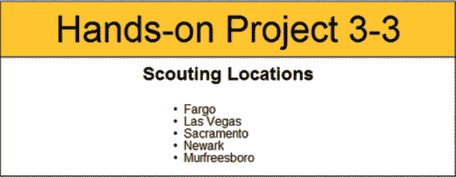

6. 修复代码中的任何错误，直到它按照你的预期运行。

### 实践项目 3-4

在本次练习中，你将创建一个程序，该程序会将来自文本框的用户输入内容写入网页上的列表。在用户输入五个项目项后，你的程序还会在页面上写一条感谢信息。最后，你还将为“提交”（Submit）按钮创建一个向后兼容的事件监听器。

1. 在你的文本编辑器中，打开章节文件夹下 `Hands-On Project` 文件夹中的 **index.htm**。在文档头部注释部分的指定处输入你的姓名和今天的日期。

2. 在文档底部、闭合的 `</body>` 标签之前，创建一个新的脚本区域。

3. 在脚本区域内创建两个全局变量：一个命名为 `i`，值为 0；另一个命名为 `listItem`，其值设置为空字符串。

4. 在变量下方，创建一个名为 `processInput()` 的函数。在函数内部，创建一个 `if` 语句，当 `i` 的值小于或等于 5 时运行该语句。该 `if` 语句应执行以下操作：

    a. 将 `listItem` 变量的值设置为字符串“item”与 `i` 的值的拼接结果。
    b. 将 `id` 等于 `listItem` 的元素的内容设置为 `id` 等于 `toolbox` 的元素的值。
    c. 将 `id` 等于 `toolbox` 的元素的值设置为空字符串。

5. 在 `if` 语句的闭合 `}` 之前，创建一个嵌套的 `if` 语句。如果 `i` 的值等于 5，该语句将 `id` 等于 `resultsExpl` 的元素的内容更改为字符串“Thanks for your suggestions.”（感谢您的建议）。

6. 在主 `if` 语句的闭合 `}` 之前、嵌套 `if` 语句之后，添加一条语句将 `i` 的值加 1。

7. 为提交按钮（`id` 为 `button`）添加一个针对 `click` 事件的向后兼容事件监听器。

8. 添加注释来记录你的工作，然后保存。在浏览器中打开 **index.htm**，在文本框中输入工具名称，然后点击 **Submit**。你输入的工具名称将添加到网页右侧的项目符号列表中。再输入四个工具名称，每次输入后点击 **Submit**。当你输入第五个名称后，项目符号列表下方将显示文本“Thanks for your suggestions.”，如图 3-27 所示。

图 3-27：显示的工具和感谢文本

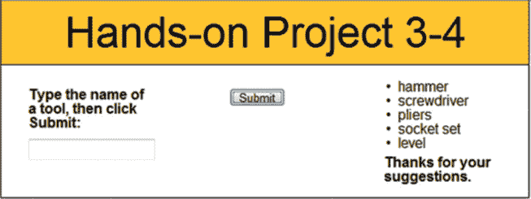

### 实践项目 3-5

在本次练习中，你将重写在实践项目 3-4 中创建的代码，以使用 `switch` 语句。

1. 在操作系统的文件管理器中，将 `Hands-On Project-3-4` 文件夹的完整内容复制到 `Hands-On Project-3-5` 文件夹。

2. 在文本编辑器中，打开 `Hands-On Project-3-5` 文件夹中的 **index.htm** 文件，将注释部分、`title` 元素以及 `h1` 元素中的“Hands-on Project 3-4”更改为 **Hands-on Project 3-5**，然后保存更改。

3. 将 `if` 语句转换为注释，然后输入代码以使用 `switch` 语句执行相同任务。`switch` 语句应该检查变量 `i` 的值，并包含两个 case：一个针对值 5，以及一个默认 case（default case）。确保包含防止发生穿透（fallthrough）的代码。根据需要编辑或添加注释以记录你的工作。

4. 保存你的工作，然后按照实践项目 3-4 步骤中的描述测试网页。根据需要调整代码，直到它的运行方式与实践项目 3-4 结束时完全一致。

## 案例项目

### 个人案例项目

计划并为你个人网站中的一个网页添加一个功能，该功能要整合了通过一系列 `if/else` 和 `switch` 语句创建的功能。如果你的页面需要事件监听器，请创建一个与旧版本 Internet Explorer 向后兼容的监听器。在适当的一个或多个浏览器中查看并测试你的页面，以确保其正常工作。

### 团队案例项目

选择一个网页添加一个功能，该功能要整合了通过一系列 `if/else` 和 `switch` 语句创建的功能。如果你的页面需要事件监听器，请创建一个与旧版本 Internet Explorer 向后兼容的监听器。在适当的一个或多个浏览器中查看并测试你的页面，以确保其正常工作。

# 第 4 章 调试与错误处理

无论经验、知识或能力，程序员都必须掌握**调试**（debugging）的艺术，它是追踪和解决错误的过程。在本章中，你将学习用于追踪和解决错误的调试技术。然而，你不会创建新的程序。相反，你将学习如何使用调试技术来定位现有程序中的错误。

所有的编程语言包括 JavaScript 都有自己的**语法**（syntax）。编写程序时，你必须理解逻辑。**逻辑**（logic）指的是程序各个部分的执行顺序。程序中的语句必须按照正确的顺序执行以产生结果。在类比的情况下，尽管你可能很会开车……

## 调试简介

当你完成本章后，你将能够：

- 识别错误类型
- 使用对话框和控制台跟踪错误
- 使用注释定位 bug
- 使用调试工具跟踪错误
- 编写响应异常和错误的代码

所有的编程语言包括 JavaScript 都有自己的语法。编写程序时，你必须理解逻辑。**逻辑**（logic）指的是程序各个部分的执行顺序。程序中的语句必须按照正确的顺序执行以产生结果。在类比的情况下，尽管你可能很会开车，但如果不遵循正确的路线，就可能无法到达目的地。同样，你可能能够使用语法编写语句，但无法构建出按你预期运行程序。典型的逻辑错误可能是对两个值进行相乘。另一个是在获取适当输入之前就生成输出（例如，在用户输入必要信息之前添加订单确认文本）。

任何由于语法错误或逻辑缺陷而导致程序运行不正确的错误都称为 **bug**。“调试”（debugging）一词是指追踪和解决程序错误的行为。格蕾丝·霍珀（Grace Murray Hopper）是开发面向业务语言（COBOL，一种编程语言）的关键数学家，据传是她首次创造了“调试”一词。根据故事，一只蛾子短路了她正在使用的原始计算机。从计算机中取出这只蛾子“调试”了系统并解决了问题。今天，“bug”一词指的是程序设计和运行中的任何问题。

> 不要将 bug 与计算机病毒或虫程序混淆。bug 是程序内部的问题，由语法错误、设计缺陷或运行时错误引起。病毒和虫程序是自包含程序，旨在感染计算机系统并造成损害、破坏安全和/或窃取信息。

程序可能会发生三种错误：语法错误、运行时错误和逻辑错误。

### 识别语法错误

**语法错误**发生在解释器无法识别代码时。在 JavaScript 中，无法被脚本引擎识别的语句会产生语法错误。（回想一下，脚本引擎只是一种解释器，“解释器”一词泛指任何执行脚本语言代码的程序。）语法错误可能是由 JavaScript 代码的使用不当或对不存在的对象、方法或变量的引用引起的。例如，如果程序员尝试使用一个不存在的方法，或者漏掉了方法的右括号，脚本引擎产生了语法错误。许多语法错误是由拼写错误或输入错误的单词引起的。例如，语句 `document.writ("Hello World");` 会导致语法错误，因为 `write()` 方法被误写成了 `writ()`。同样，语句 `Document.write("Hello World");` 也会导致语法错误，因为 `Document` 对象的首字母被误写成了大写字母 `D`。（请记住，大多数 JavaScript 对象，如 `Document` 对象，在语句中使用时应全部使用小写字母。）

> 在 C++ 等编译型语言中，语法错误也被称为*编译时错误*，因为它们通常在程序*编译时*被发现。由于 JavaScript 是一种解释型语言，语法错误直到程序*执行时*才会被发现。

专为 JavaScript 编写设计的代码编辑器——如 Notepad++、Aptana Studio 或 KomodoEdit——可以在你输入时高亮语法错误，从而节省日后定位和修复这些错误的麻烦。

### 识别运行时错误

第二种错误是**运行时错误**（run-time error），发生在 JavaScript 解释器在程序执行过程中遇到问题时。运行时错误与语法错误的不同之处在于，它们并不代表 JavaScript 语言错误。相反，当解释器遇到它无法执行的代码时，就会发生运行时错误。例如，考虑语句 `createRecommendation();`，它调用了一个自定义的 JavaScript 函数。

该语句不会产生语法错误，因为在 JavaScript 程序中创建并调用自定义函数是合法的（通常也是必要的）。然而，如果你的程序包含了该调用语句，但没有包含最先创建该函数的代码，你的程序就会产生运行时错误。当解释器尝试调用该函数却找不到时，错误就会发生。

以下显示了运行时错误的另一个示例。在这个示例中，`write()` 方法尝试打印名为 `messageVar` 变量的内容。由于变量 `messageVar` 未经声明（你可以假设它在文档的其他脚本部分未被声明），因此会发生运行时错误。

`document.write(messageVar);`

另一个需要记住的点是，运行时错误可能由语法错误引起，因为语法错误在解释器尝试执行代码之前不会发生。例如，你可能有一个函数，其中包含一个带有语法错误的语句。然而，该语法错误直到函数在运行时执行才会被捕获。当函数确实执行时，由于函数内部的语法错误，会产生运行时错误。

### 识别逻辑错误

第三种错误是**逻辑错误**（logic error），它是程序设计中的缺陷，导致程序无法按照你预期的方式运行。在这种语境下，“逻辑”一词指的是按照正确的顺序执行程序语句和过程以产生所需的结果。你已经习惯了按照某种逻辑执行普通的非编程任务。例如，当你洗衣服时，通常是先分类、后清洗、再烘干，最后折叠。如果你决定先烘干、分类、折叠，然后再清洗，你最终将得到一堆湿衣服，而不是你想要的整洁平整的衣服。在这种情况下，问题就是逻辑错误——你执行步骤的顺序错了。

计算机程序中逻辑错误的一个示例是在当你想要除两个值时却乘以了它们，如下代码所示：

```javascript
var divisionResult = 10 * 2;
document.write("Ten divided by two is equal to " + divisionResult);
```

另一个逻辑错误示例是创建无限循环，循环语句永远不会结束，因为其条件表达式从不更新或从不为假。以下代码创建了一个 `for` 语句，导致了无限循环的逻辑错误。无限循环的原因是 `for` 语句括号中的第三个参数从未改变 `count` 变量的值。

```javascript
for (var count = 10; count >= 0; count) {
    document.write("We have liftoff in " + count);
}
```

因为在上述示例中 `count` 变量从未被更新，它在循环的每次迭代中始终保持为 10，导致重复显示包含“We have liftoff in 10”文本的警告框。要修正这个逻辑错误，你需要在 `for` 语句构造函数的第三个参数中添加一个递减运算符，如下：

```javascript
for (var count = 10; count >= 0; count--) {
    document.write("We have liftoff in " + count);
}
```

> 在阅读这本书的过程中，请记住调试并不是一门精确的科学。你写的每一个程序都是不同的，并且需要不同的调试方法。虽然有一些工具可以帮助你调试 JavaScript 代码，但你自己的逻辑和分析能力是你拥有的最好的调试资源。

### 打开并测试选择器应用程序

你被位于北达科他州法戈的 Tuba 农设备公司聘用，负责完成一个根据用户选择推荐拖拉机型号的应用程序。该程序已经编写，但无法运行。你将使用调试技术来识别并修复程序中的错误，使其按照设计运行。图 4-1：Tuba 农设备推荐应用程序显示了完成后的表单运行。

1. 在你的文本编辑器中，打开位于章节文件夹中的 **tractor.htm**。
2. 在文档顶部的注释部分，在指定位置输入你的名字和今天的日期，然后保存工作。
3. 滚动查看文档以熟悉其内容。`article` 元素包含表单，`aside` 元素包含空的 `h2` 和 `p` 元素，程序在此写入警告或建议。
4. 打开 **tuba.js**，保存副本，然后滚动查看文档以熟悉其内容。该文件包含了全局变量的定义，随后是四个调用 `createRecommendation()` 函数的函数。尽管这四个函数目前执行相同的任务，但程序设计包括在每个函数中添加代码，以验证特定的 `fieldset` 元素是否已完成。（你的工作将包括在其中两个函数中添加此类代码，其余部分将在项目的后续阶段完成。）该文件还包含以下：一个测试用户是否已完成表单所有部分的函数，一个生成建议并将其写入 `aside` 元素的函数，以及为每个 `fieldset` 元素中的 `input` 元素创建事件监听器的函数。在文件底部，单条命令设置在页面加载运行 `createEventListeners()` 函数。
5. 在浏览器中打开 **tractor.htm**，然后在第一个文本框（标签为“acres”）中输入你的名字。因为程序期望在该框中输入数字，所以你输入的文本理应会生成一个错误。然而，当你在框中输入文本时，什么也没有发生。

> 拖拉机选择器应用程序使用 `input` 事件在用户每次在输入框中输入或删除字符时执行一个函数。然而，IE8 不支持此事件，因此 IE8 用户必须在输入或删除字符后移动到另一个元素，然后才会执行函数。

6. 删除你输入的文本，在两个输入框中各输入一个数字，点击一个复选框，然后点击一个选项按钮。如图 4-2 所示，尽管你已经完成了表单，但没有显示任何建议。

图 4-2：拖拉机推荐网页应用程序未按设计运行

## 解释错误消息

定位 JavaScript 程序中错误的第一道防线是 JavaScript 解释器遇到语法错误或运行时错误时，在浏览器控制台中显示的错误消息。控制台错误消息中显示的两个重要信息是发生错误所在的文档行号以及错误描述。请注意，错误消息中的行号是从文档开始计算的，而不仅仅是从脚本段的开始计算。此外，不同的浏览器可能会对错误消息报告不同的行号。例如，在一个缺少闭大括号的程序中，Firefox 报告大括号应该出现的位置之前的最后语句的行号，而 Chrome 则报告下一行的行号（假设大括号会被放在新的一行）。浏览器生成的所有错误消息都是运行时错误。然而，请记住，运行时错误可能由语法错误引起。逻辑错误不会生成错误消息，因为它们不会阻止脚本运行（如语法错误那样）或阻止正常执行（如运行时错误那样）。相反，它们会导致程序无法按照你预期的方式运行。计算机（尚未）足够智能到识别程序逻辑中的缺陷。例如，如果你用 `for` 语句创建了一个无限循环，解释器无法判断你是否真的想持续执行 `for` 语句的代码。在本章稍后部分中，你将学习如何追踪程序的执行流以定位逻辑错误。

考虑以下函数，它由于缺少闭大括号 (`}`) 导致了语法错误：

```javascript
function missingClosingBrace() {
  var message = "This function is missing a closing brace.";
  window.alert(message);
}
```

图 4-3 显示了 Firefox 浏览器控制台中生成的错误消息。

> 本节中的所有控制台图均显示 Firefox 控制台。虽然每个主要浏览器的控制台外观略有不同，但它们都以大致相同的布局显示相同的信息。

图 4-3：Firefox 错误消息

*来源：© Mozilla Firefox*

你只能依靠控制台错误消息来找到程序中错误的大致位置，而不能将其作为错误的确切指示。你不能总是假设错误消息指定的行就是程序中的实际问题所在。例如，考虑以下代码：

```javascript
1 function variableDeclarations() {
2   var percentage = .25;
3   var amount = 1600;
4 }
5 function calculatePercentage() {
6   var result = amount * percentage;
7   document.write("<p>Twenty-five percent of "
8   + amount + " is ");
9   document.write(result + "</p>");
10 }
```

第 6 行的 `var result = amount * percentage;` 语句导致了运行时错误，因为解释器无法找到语句中包含的 `amount` 和 `percentage` 变量。`amount` 和 `percentage` 变量定义在 `variableDeclarations()` 函数内部（第 2 行和第 3 行），成为局部变量，仅在该函数内部可用。由于 `amount` 和 `percentage` 变量不是全局变量，因此它们对 `calculatePercentage()` 函数不可见，导致了运行时错误。第 6 行的 `var result = amount * percentage;` 语句生成了运行时错误，因为它尝试访问另一个函数的局部变量。然而，真正的问题是 `percentage` 和 `amount` 变量没有在全局范围内进行声明。

在调试 JavaScript 时，理解浏览器如何解释网页和 JavaScript 代码至关重要。专业程序员中一个常见的抱怨是，网页浏览器并不严格执行 JavaScript 语法。例如，浏览器可以解释不以分号结尾的 JavaScript 语句。相比之下，在 C++ 和 Java 等高阶语言中，你*必须*用分号结束语句，否则会收到错误。


# 调试与错误处理

你可以将浏览器渲染 HTML 和解释 JavaScript 的方式与人类理解语言的方式进行比较。某人可以使用你不熟悉的语法变体，或者带有浓重的地区口音或外国口音对你说话。然而，只要对方用同一种根源语言说话，你通常就能理解他在说什么。浏览器和 JavaScript 也是如此：即使你写了粗糙的 JavaScript 代码，浏览器通常也能（但并非总是）弄出代码意图做什么。

## 最佳实践

你可以做什么来减少 JavaScript 程序中的错误？首先，始终使用良好的语法，例如用分号结束语句，并使用 `var` 关键字声明变量。你在编程技术上越自律，程序中发现的错误就越少。其次，确保在预期的程序将运行的每种浏览器类型和版本上对 JavaScript 程序进行彻底测试。大多数桌面用户运行 Chrome、Firefox 或 Internet Explorer，而移动网络使用以 iOS 上的 Safari 和 Android Chrome 为主。然而，由于不同浏览器的使用情况不断变化，你需要编写 JavaScript 代码以兼容所有主流网页浏览器的当前版本，以及可能在你的用户中继续占据重要份额的任何旧版本（如 Internet Explorer 8）。一个经验法则是，如果某个浏览器的市场使用率超过 1%，那么你就需要为该浏览器编写和调试你的 JavaScript 程序。

接下来，你将使用控制台消息帮助定位拖拉机选择器应用程序中的错误。

### 使用控制台消息帮助定位拖拉机选择器程序中的错误

1. 返回浏览器中的 `tractor.htm`，然后打开浏览器的控制台。

图 4-4 显示了日志消息。

**图 4-4：控制台中的拖拉机选择器错误消息**

*来源：© Mozilla Firefox*

这种对常见错误强制执行的缺失使得编写和调试程序变得更加困难。

2. 如果控制台在单独的窗口中打开，对于 Internet Explorer 请按 `Ctrl + P`，对于 Firefox，点击左角的“停靠到浏览器窗口底部”按钮，或者对于 Chrome，点击左下角的“停靠到主窗口”按钮。

3. 在浏览器中保持 `tractor.htm` 文档，并返回文本编辑器中的 `tuba.js`。浏览器控制台中的错误信息指示第 22 行有错误。该行上的语句声明了 `fuelComplete` 变量；该语句的 `var` 关键字中缺少了字母 `v`。

4. 在 `tuba.js` 文件中定义全局变量的部分，找到语句 `ar fuelComplete = true;`，然后在行首插入一个 `v`，使语句显示如下：

```javascript
var fuelComplete = true;
```

5. 在文本编辑器中保存 `tuba.js` 文档，返回浏览器，然后按住 `Shift` 键点击**刷新**或**重载**按钮以重置表单并重新加载页面。控制台现在显示图 4-5 所示的错误消息。

*你可能会在控制台中看到额外的语句，包括关于 CSS 规则的注释或确认每个文件（包括字体和 Modernizr 库）已加载的确认。你还会在控制台中看到其他浏览器标签页中打开的任何其他信息。你可以忽略这些消息，只查找行号之前包含“tuba.js”的消息，如图所示。*

**图 4-5：控制台中的第二个运行时错误消息**

*来源：© Mozilla Firefox*

*本书中的其余步骤指示您在点击刷新或重载按钮时按住 Shift 键，简写为“Shift + Refresh 或 Shift + Reload”。*

**注记**

请注意，这个错误与你之前在图 4-4 所示看到的错误不同。通常当浏览器遇到语法错误时，浏览器无法处理该错误之后的任何 JavaScript 代码。因为任何特定错误都有许多可能的原因和修复方法，处理器无法再次可靠地解析错误之后的代码。然而，由于你修复了第 22 行的错误，当你重新加载页面时，你的浏览器能够继续处理该行之后的代码。但是，这次它在第 24 行遇到了另一个语法错误，因此它报告了此错误并再次停止了处理 `tuba.js` 文件。

6. 返回文本编辑器中的 `tuba.js` 文档，找到第 24 行，该行包含语句 `var monthsFieldset document.getElementsByTagName("fieldset")[2];`。按照目前的写法，处理器看到 `var` 关键字后跟着一个变量名，然后是与已创建的变量没有指定关系的代码。在这种情况下，该行仅仅缺少了一个运算符——赋值运算符（`=`），它将语句的剩余部分设置为 `monthsFieldset` 变量的值。

7. 在代码 `var monthsFieldset` 之后插入一个空格和一个等号，使行显示如下：

```javascript
var monthsFieldset = document.getElementsByTagName("fieldset")[2];
```

8. 在文本编辑器中保存 `tuba.js` 文档，返回浏览器，然后刷新或重载页面。控制台现在显示图 4-6 所示的错误消息。

**图 4-6：控制台中的第三个运行时错误消息**

*来源：© Mozilla Firefox*

9. 返回文本编辑器中的 `tuba.js` 文档，找到第 25 行。Firefox 将错误描述为“未终止的字符串字面量”（unterminated string literal），即字符串缺少结束引号。检查第 25 行，你可以看到行以 `("fieldset)[3];` 结尾，在单词 `fieldset` 之后缺少结束引号（`"`）。

10. 在第 25 行中，在单词 `fieldset` 之后右括号 `)` 之前插入一个引号。

11. 在文本编辑器中保存 `tuba.js` 文档，返回浏览器，然后刷新或重载页面。控制台现在显示图 4-7 所示的错误消息。

**图 4-7：控制台中的第四个运行时错误消息**

*来源：© Mozilla Firefox*

12. 返回文本编辑器中的 `tuba.js` 文档，找到第 37 行，该行是 `verifyAcres()` 函数声明的第一行。注意名称之后缺少左括号。

13. 在名称 `verifyAcres` 之后右括号之前插入一个左括号，使其匹配：

```javascript
function verifyAcres()
```

14. 在文本编辑器中保存 `tuba.js` 文档，返回浏览器，最后一次刷新网页页面。你不应该再收到错误消息了。然而，程序仍然包含许多其他错误，你将在本章剩余部分识别并修复它们。

### 单元测试 1

1. 解释语法错误、运行时错误和逻辑错误之间的区别。为每种错误提供一个示例。
2. 在哪里可以找到错误消息？假设浏览器列出了错误，为什么保存工作并重载页面很重要？

## 调试技术

虽然错误消息可以帮助你捕捉语法错误，但某些错误很难定位。例如，如果你有深度嵌套结构且其中缺少大括号，语法错误可能无法告诉你是哪个结构有问题。

### 使用 JavaScript 进行追踪

如果你无法通过错误消息定位程序中的错误，或者你怀疑是逻辑错误（它不会产生消息），那么你必须追踪代码。追踪是对语句的检查。`window.alert()` 方法提供了跟踪 JavaScript 最有效的方法之一：在程序的不同位置放置 `window.alert()`，并用它显示变量的内容、函数的返回值或数组的变化。例如，追踪以下函数：

```javascript
function calculatePay() {
  var payRate = 15;
  var numHours = 40;
  var grossPay = payRate * numHours;
  var federalTaxes = grossPay * .06794;
  var stateTaxes = grossPay * .0476;
  var socialSecurity = grossPay * .062;
  var medicare = grossPay * .0145;
  var netPay = grossPay - federalTaxes;
  netPay *= stateTaxes;
  netPay *= socialSecurity;
  netPay *= medicare;
  return Math.round(netPay);
}
```

为了追踪问题，一种技术是在此处放置 `window.alert()` 方法，以检查 `calculatePay()` 函数是否工作正常。由于 `grossPay` 变量包含正确的值，你可能随后会将 `window.alert()` 方法移动到此处检查 `netPay` 变量的值。你将继续使用这种技术直到发现错误。在这种情况下，你会发现 `calculatePay()` 函数运行不正常，因为本该从 `netPay` 变量中减去 `stateTaxes`、`socialSecurity` 和 `medicare` 变量的行是错误的；它们使用了乘赋值运算符（`*=`）而不是减赋值运算符（`-=`）。

**最佳实践**

在代码中添加 `window.alert()` 等语句以追踪程序执行时，将它们放在不同的缩进级别是有帮助的，以便与实际程序代码区分开来。这有助于调试完成后识别并删除所有此类语句。

### 使用基础调试技术

使用单个 `window.alert()` 方法的替代方案是在代码各处放置多个 `window.alert()` 方法，以便在代码执行时检查值。例如，你可以通过以下多个 `window.alert()` 方法来追踪 `calculatePay()` 函数：

```javascript
1 function calculatePay() {
2   var payRate = 15; numHours = 40;
3   var grossPay = payRate * numHours;
4   window.alert(grossPay);
5   var federalTaxes = grossPay * .06794;
6   var stateTaxes = grossPay * .0476;
7   var socialSecurity = grossPay * .062;
8   var medicare = grossPay * .0145;
9   var netPay = grossPay - federalTaxes;
10  window.alert(netPay);
11  netPay *= stateTaxes;
12  window.alert(netPay);
13  netPay *= socialSecurity;
14  window.alert(netPay);
15  netPay *= medicare;
16  window.alert(netPay);
17  return Math.round(netPay);
18 }
```

当使用多个 `window.alert()` 方法追踪值时，你必须关闭每个对话框，代码才能继续执行。虽然在你只是尝试查看值时这可能是一个缺点，但它的优点是每次显示警报框时程序都会冻结在当前点，并且在你点击 OK 之前不会继续。这允许你仔细观察浏览器在这些时刻每个时刻所显示的内容。此外，使用多个 `window.alert()` 方法有时比移动单个 `window.alert()` 方法更有效。使用多个 `window.alert()` 方法追踪程序值的关键是在程序中的各个关键点选择性地使用它们。例如，假设你正在调试一个包含多个函数的大型会计程序。你可以在程序的关键位置放置 `window.alert()` 方法，例如在函数返回值或变量被分配新数据的地方。通过这种方式，你就可以大致了解程序的哪个部分包含 bug。一旦你发现了 bug 的大致位置（例如，在某个特定函数中），你就可以将调试精力集中在那个函数上。

### 使用 alert 对话框定位拖拉机选择程序中的 bug

1. 返回网页浏览器中的 `tuba.js` 文档。
2. 在 acres（英亩）框中输入数值，勾选 **Wheat**（小麦）复选框，在 months（月份）框中输入数值，然后点击 **E** 按钮。如图 4-8 所示，应用程序推荐了 WE，它描述为适用于大型农场的拖拉机。然而，acres 被认为是小农场，因此应该推荐不同的型号。

**图 4-8: 错误的推荐**

3. 返回到文本编辑器中的 `tuba.js` 文档，找到 `createRecommendation()` 函数。
4. 在函数第二行下方的新行中（检查 acres 框中输入值的 `if` 语句），输入以下语句：
   `window.alert("After first if clause: " + acresBox.value);`
5. 在函数第五行下方的新行中（该行名为 `} else { // more than 5000 acres`），输入以下语句：
   `window.alert("After second else clause: " + acresBox.value);`

此 `if/else` 语句区分了经营小农场和大型农场的人，任何小于或等于 5000 英亩的农场都被视为小农场。

小农场的拖拉机位于 `if/else` 语句的第一部分，因此在输入小于或等于 5000 的值后，应该显示第一个对话框；在输入大于 5000 的值后，应该显示第二个对话框。你的 `createRecommendation()` 函数开头应与以下匹配：

```javascript
1 function createRecommendation() {
2   if (acresBox.value >= 5000) { // 5000 acres or less,
3     no crop test needed
4     window.alert("After first if clause: " + acresBox.value);
5     if (monthsBox.value <= 10) { // 10+ months of farming
6       per year
7       messageHeadElement.innerHTML = "E3250";
8       messageElement.innerHTML = "A workhorse for a small
9       farm or a big backyard. A medium- to heavy-duty
10      tractor that can haul whatever you throw at it
11      year-round.";
12    } else { // 9 or fewer months per year
13      messageHeadElement.innerHTML = "E2600";
14      messageElement.innerHTML = "Perfect for a small
15      farm, or just a big backyard. A light- to medium-
16      duty tractor that can make short work of most any
17      chore.";
18    }
19  } else { // military more than 5000 acres
20    window.alert("After second else clause: " + acresBox.value);
```

6. 保存工作，返回浏览器，刷新或重新加载 `tractor.htm`，点击 acres 框并输入 2000。如图 4-9 所示，出现了对话框，内容为“After second else clause: ”。但因为你是在 `else` 子句而不是 `if` 子句中指定的这个值，这表明执行的是 `else` 子句。

**图 4-9: 显示对话框**

7. 点击 **OK** 按钮，返回文本编辑器，检查 `window.alert()` 语句上面的语句。注意 `if` 子句是 acres 大于等于 (`>=`)。由于你输入的数字 2000 小于此值，结果为 `false`，函数进入了 `else` 语句。Tuba Farm Equipment 的联系人规定 `if` 子句应该是 acres 小于或等于 5000，因此你需要将 `>=` 修改为 `<=`。
8. 在第一个 `window.alert()` 语句上面的 `if` 语句中，将 `>=` 替换为 `<=`，使其行变为：
   `if (acresBox.value <= 5000) {`
9. 删除 `createRecommendation()` 函数中的两个 `window.alert()` 语句。
10. 保存工作，返回浏览器，刷新或重新加载 `tractor.htm`，然后在 acres 框中输入 2000。如图 4-10 所示，应用程序现在生成了针对小农场的建议。

## 使用 console.log() 方法追踪错误

在某些情况下，你可能希望通过分析值列表而不是尝试解释对话框中显示的值来追踪程序中的 bug。你可以使用 `console.log()` 方法直接将值写入或记录到控制台。该方法的语法为 `console.log(value);`，其中 `value` 可以是字符串字面量、变量值或两者的组合。例如，以下代码显示了 `calculatePay()` 函数的一个示例。函数中包含了多个向控制台记录值的 `console.log()` 方法。

```javascript
1 function calculatePay() {
2   var payRate = 15; numHours = 40;
3   var grossPay = payRate * numHours;
4   console.log("grossPay is " + grossPay);
5   var federalTaxes = grossPay * .06794;
6   var stateTaxes = grossPay * .0476;
7   var socialSecurity = grossPay * .062;
8   var medicare = grossPay * .0145;
9   var netPay = grossPay - federalTaxes;
10  console.log("grossPay minus federalTaxes is " + netPay);
11  netPay *= stateTaxes;
12  console.log("netPay minus stateTaxes is " + netPay);
13  netPay *= socialSecurity;
14  console.log("netPay minus socialSecurity is " + netPay);
15  netPay *= medicare;
16  console.log("netPay minus medicare is " + netPay);
17  return netPay;
18 }
19 calculatePay();
```

**图 4-11：执行 `calculatePay()` 函数后的控制台内容**

*来源：© Mozilla Firefox*

通过图 4-11 中的控制台日志，你可以在 `calculatePay()` 函数执行过程中随着值的变化来评估每个变量。在控制台中快速查看变量值列表是测试许多类型代码的一种简单而有效的技术。

*当使用 `console.log()` 方法跟踪错误时，使用驱动程序（driver program）会有帮助，驱动程序是一个简化的、临时程序，用于测试函数和其他代码。驱动程序仅仅是一个包含你正在测试的代码的 JavaScript 程序。驱动程序不需要复杂，可以像你测试的单个函数一样简单。这种技术允许你隔离并测试单个函数，而无需担心网页元素、事件处理器、全局变量以及构成程序整体功能的代码。*

### 使用 console.log() 语句帮助定位 createRecommendation() 函数中的错误

1. 回到网络浏览器中的 `tuba.js` 文档。
2. 在亩数框中输入，勾选 **Wheat**（小麦）复选框，在月份框中输入，然后点击 **E** 选项按钮。如图 4-12 所示，应用程序推荐了 E E，它被描述为全年拖拉机。然而，由于你输入了月份，应该推荐一个非全年的型号。

**图 4-12：错误的建议**

3. 回到文本编辑器中的 `tuba.js` 文档，找到 `createRecommendation()` 函数。
4. 在函数的第三行下方——检查月份框中输入值的 `if` 语句——输入以下语句：
   `console.log("After second if clause: " + monthsBox.value);`
5. 在读取 `} else { // 9 or fewer months per year` 的函数第六行下方的新的一行，输入以下语句：
   `console.log("After else clause: " + monthsBox.value);`

此 `if/else` 语句区分了全年耕场的人和只部分时间耕场的人，任何一年中工作几个月或以上的农场都被视为全年经营。小农场全年拖拉机位于 `if/else` 语句的第一部分，因此在月份框中输入数值为 10、11、12 后，应该记录第一条消息；在输入数值为 1–9 后，应该记录第二条消息。你的 `createRecommendation()` 函数的开头应该与以下匹配：

```javascript
1 function createRecommendation() {
2   if (acresBox.value <= 5000) { // 5000 英亩或少，
3     no crop test needed
4     if (monthsBox.value <= 10) { // 每年 10 个月以上
5       per year
6       console.log("After second if clause: " + monthsBox.value);
7       messageHeadElement.innerHTML = "E3250";
8       messageHeadElement.innerHTML = "E3250";
9     } else { // 每年9 个月或少
10      console.log("After else clause: " + monthsBox.value);
11    }
```

### 注释代码以隔离错误

以下代码中的最后五语句被注释掉了，因为它们会生成提示 `yearlyIntrest` 未定义的错误信息。代码的问题在于，`yearlyInterest` 变量在几条语句中被错误地拼写为 `yearlyIntrest`。注释掉这些行可以隔离出问题所在的语句。

```javascript
1 var amount = 100000;
2 var percentage = .08;
3 document.write("<p>The interest rate for a loan in the amount4 of " + amount + " is " + percentage + "<br />");
4 var yearlyInterest = amount * percentage;
5 // document.write("The amount of interest for one year is "
6 // + yearlyIntrest + "<br />");
7 // var monthlyInterest = yearlyIntrest / 12;
8 // document.write("The amount of interest for one month is "
9 // + monthlyInterest + "<br />");
10 // var dailyInterest = yearlyIntrest / 365;
11 // document.write("The amount of interest for one day is " +
12 // dailyInterest + "</p>");
```

虽然上述代码中的错误看起来有些简单，但它们代表了你将遇到的典型错误类型。通常，你会立即发现错误，因此没有必要注释代码或使用任何其他追踪技术。然而，当你盯着同一段代码很长时间时，像 `yearlyIntrest` 这样简单的拼写错误并不总是容易发现的。注释掉已知会带来麻烦的行是隔离和纠正即使是最简单的 bug 的良好技巧。

### 结合调试技术

你可以结合多种调试技术来帮助查找错误。例如，以下代码结合注释和 alert 对话框来跟踪错误。*特定语句中的错误原因通常是前一行代码中错误的结果。*

**注意**

如果你收到了错误信息，也请把那些语句注释掉。一旦消除了错误信息，你就可以检查被注释的语句，以寻找 `calculatePay()` 函数中 bug 的产生。假设 `var grossPay = payRate * numHours;` 语句是函数中最后一个运行的语句。因此，该语句之后的所有行都已注释。此时你可以使用 alert 对话框或日志消息来检查每条语句的值，按顺序移除每条语句的注释，并在过程中检查并纠正语法。

```javascript
1 function calculatePay() {
2   var payRate = 15;
3   var numHours = 40;
4   var grossPay = payRate * numHours;
5   window.alert(grossPay);
6   // var federalTaxes = grossPay * .06794;
7   // var stateTaxes = grossPay * .0476;
8   // var socialSecurity = grossPay * .062;
9   // var medicare = grossPay * .0145;
10  // var netPay = grossPay - federalTaxes;
11  // netPay *= stateTaxes;
12  // netPay *= socialSecurity;
13  // netPay *= medicare;
14  // return Math.round(netPay);
15 }
```

### 使用注释在 createRecommendation() 函数中定位 bug

你在 Tuba Farm Equipment 的联系人报告了另一个 bug，你将追踪它。当用户表示他们全年经营大型农场（> 500 英亩）（>= 6 个月）时，根据他们种植的作物有两种拖拉机建议。如果用户表示他们种植小麦、玉米或大豆，程序应该推荐 W 重型拖拉机。然而，程序目前仅对小麦农推荐了这种拖拉机。你将使用注释来识别导致此问题的代码行。

1. 返回浏览器中的 `tractor.htm` 文档，重新加载或刷新网页，在 acres 框中输入 500，在 months 框中输入 6，然后点击 **Wheat** 小麦复选框进行勾选。如图 4-15 所示，该应用程序专门为小麦、玉米和大豆农民推荐了拖拉机。
2. 取消勾选 **Wheat** 小麦复选框，然后勾选 **Corn** 玉米复选框。注意拖拉机建议变为通用拖拉机。
3. 勾选 **Wheat** 小麦复选框。注意当勾选 Wheat 复选框时，建议恢复为针对小麦、玉米和大豆农民的专用拖拉机。
4. 返回文本编辑器中的 `tuba.js` 文档，然后找到以下代码行，它大约位于 `createRecommendation()` 函数的中间：
   `if (document.getElementById("wheat").checked || document.getElementById("corn").checked && document.getElementById("soy").checked) {`
   为了调试此条件语句，你将注释掉它的两个部分，然后逐个加回注释部分。
5. 在第一个 `checked` 单词出现后点击输入 `/*`，然后在第三个 `checked` 单词出现后输入 `*/`。这些插入注释掉了条件的第二和第三部分，留下了最后的 `)` 和 `{`。更新后的代码应与匹配：
   `if (document.getElementById("wheat").checked /*document.getElementById("corn").checked && document.getElementById("soy").checked*/) {`
6. 将更改保存到 `tuba.js`，在浏览器中重新加载或刷新 `tractor.htm`，在 acres 框中输入 500，在 months 框中输入 6，然后点击 **Wheat** 复选框进行勾选。建议与图 4-15 显示的匹配，表明第一个条件编写是正确的。
7. 返回文本编辑器中的 `tuba.js` 文档，移除第一个 `checked` 单词出现后的 `/*` 字符，然后在第二个 `checked` 单词出现后插入 `/*`。这些编辑使得条件的前两个部分以及它们之间的逻辑运算符共同工作。你的代码应匹配如下：
   `if (document.getElementById("wheat").checked || document.getElementById("corn").checked /*document.getElementById("soy").checked*/) {`
8. 将更改保存到 `tuba.js`，在浏览器中重新加载或刷新 `tractor.htm`，在 acres 框中输入 500，在 months 框中输入 6，然后点击 **Corn** 复选框进行勾选。与你最初测试时勾选 Corn 不同，这次建议继续与图 4-15 显示的正确建议匹配。这表明前两个条件以及连接它们的运算符是正确的，bug 必须在被注释掉的条件中。
9. 返回文本编辑器中的 `tuba.js` 文档。注意尽管小麦、玉米和大豆的任何一个都应该触发拖拉机建议，但条件第二部分的运算符是 `&&`（即“和”）。为了让程序按设计运行，逻辑运算符必须是 `||`（即“或”）。
10. 在 `checked` 单词第二次出现后，删除 `/*`，将 `&&` 替换为 `||`，然后在行尾移除 `*/` 字符。修改后的代码应匹配如下：
    `if (document.getElementById("wheat").checked || document.getElementById("corn").checked || document.getElementById("soy").checked) {`
11. 将更改保存到 `tuba.js`，在浏览器中重新加载或刷新 `tractor.htm`，在 acres 框中输入 500，在 months 框中输入 6，然后点击 **Soy** 复选框进行勾选。这次建议与图 4-15 显示的匹配。
12. 取消勾选 **Soy** 框，然后勾选 **Corn** 框。玉米的建议也是正确的。
13. 取消勾选 **Corn** 框，然后勾选 **Wheat** 框。小麦的建议也是正确的。

## 使用调试工具追踪错误

任何超过几行的程序都包含依赖于其他语句成功执行的语句。这些依赖关系被称为**依赖关系**，它们会为调试增加额外的复杂性。例如，看起来是由某个函数中的代码引起的错误，实际上可能是代码其他部分错误的结果。此外，代码某部分的错误会停止依赖代码的执行，导致你无法接收依赖代码的错误信息。在发现并修复 bug 之后，测试修复之前运行良好的功能是非常重要的。在某些情况下，修复一个 bug 会暴露另一个 bug，或者本身就会产生新问题，因此不要假设修复 bug 之前正常的功能在修复后仍继续正常工作。

在所有主流浏览器中，调试工具都可以通过使用控制台时打开的同一个面板进行访问。这三个浏览器提供的工具都允许你调试 HTML、CSS 和网页脚本，它们还包含了你可以用于评估网站性能的工具。

到目前为止，你已经学习了如何解释错误消息并纠正导致错误的语句。虽然错误消息很有帮助，但它们仅在解决语法错误和运行时错误时才有用。你还学习了一些帮助你定位逻辑错误的技巧。手动检查代码通常是解决逻辑错误的第一步，或者你可以使用 `alert` 框或控制台日志消息来跟踪变量值。这些技术对于较小的程序效果良好。然而，当你创建一个包含许多行代码的大型程序时，逻辑错误可能很难发现。例如，你可能有几个函数执行计算并将结果传递给其他函数进行进一步处理。尝试使用 `alert` 框和日志消息等简单工具追踪此类程序的逻辑和流程可能是困难的。浏览器调试器提供了多种工具，可以帮助你追踪每行代码，从而提供发现和解决逻辑错误更高效的方法。

### 理解 IE、Firefox 和 Chrome 调试窗口

要使用任何三个主流浏览器调试 JavaScript，你需要在浏览器中打开想要调试的文档，然后打开调试器。表 4-1 描述了如何在所有三个主流浏览器中访问调试工具。

*另一个流行的调试工具 Firebug 可以作为 Firefox 的免费扩展程序可用。“扩展”一词是指可以添加到程序中的额外功能。*

**表 4-1：在 IE、Firefox 和 Chrome 中打开调试器的步骤**

| 浏览器 | 键盘快捷键 | 菜单步骤 |
| :--- | :--- | :--- |
| Internet Explorer 9+ | `F12`，然后按 `Ctrl + 3` | 点击**工具**图标，点击菜单上的 **F12 开发者工具**，然后在打开的窗口中点击**调试器** 按钮 |
| Firefox | `Ctrl + Shift + S` (Win) 或 `option + command + S` (Mac) | 点击**打开菜单**按钮，点击**开发者**，然后点击**调试器** |
| Chrome | `Ctrl + Shift + J` (Win) 或 `option + command + J` (Mac)，然后在打开的窗口中点击**源** 按钮 | 点击 **Google Chrome** **自定义并控制**按钮，点击**工具**，点击**JavaScript 控制台**，然后在打开的窗口中点击**源** 按钮 |

### 使用调试工具追踪错误

调试器窗口通常显示为附加在浏览器窗口底部的独立面板，如图 4-16 所示。然而，你也可以将面板分离到单独窗口中。

**图 4-16：Internet Explorer、Firefox 和 Chrome 中的调试器面板**

*来源：© Microsoft Corporation. © Mozilla Firefox. © Google Chrome*

不同的浏览器对打开文件的默认视图不同。Internet Explorer 显示 HTML 文档的代码；你可以点击“查看源代码”按钮从当前文档包含的文件列表中选择不同的文件。Firefox 按字母顺序显示关联的 JavaScript 文件列表，并显示列表首个文件的内容；你可以点击列表中的任何文件名来查看其内容并进行操作。Chrome 默认不显示任何文件；相反，在选中调试面板的情况下，你按 `Ctrl + O` (Win) 或 `command + O` (Mac) 从关联文件列表中查看并选择。

接下来你将在浏览器的调试器中打开选择器程序：

1. 返回浏览器中的 `script.htm` 文档。
2. 参考表 4-1，然后使用你浏览器的键盘快捷键或菜单步骤打开其调试工具。调试面板应显示在浏览器窗口底部。
*浏览器制造商不断调整其浏览器工具的功能和外观，因此本文及后续图表中的选项可能与你的屏幕不匹配。如有必要，将鼠标指针悬停在调试工具的按钮上，以查看包含按钮名称的工具提示。*
**注意**：*如果调试工具在独立窗口中打开，对于 Internet Explorer 请按 `Ctrl + P`，对于 Firefox 请点击左上角的“停靠到浏览器窗口底部”按钮，对于 Chrome 请点击左下角的“停靠到主窗口”按钮。*

3. 使用适用于你浏览器的方法在调试工具中打开 `script.js` 文件：
   - **Internet Explorer**：点击**打开文档**按钮，然后在列表中点击 `script.js`。
   - **Firefox**：在调试面板的左侧，点击 `script.js`。
   - **Chrome**：点击调试面板的空白区域，按 `Ctrl + O` (Win) 或 `command + O` (Mac)，然后在列表中点击 `script.js`。

**图 4-17：每个浏览器在调试工具中打开的 `script.js`**

### 设置断点

所有三个主流浏览器中的调试工具都包含了你可以在脚本进入断点模式（break mode）后控制程序执行的命令。“断点模式”一词是指临时暂停程序执行，以便你可以监控值并追踪程序执行。进入断点模式需要在你的代码中插入断点。断点是添加到程序中特定语句的标记，当执行到该语句时会导致执行暂停。一旦程序在断点处暂停，你可以使用每个窗口内的命令按钮来追踪程序执行。当程序进入断点模式时，程序执行并没有停止——只是被挂起。

要设置断点，你点击程序执行应该停止的行号。浏览器调试工具会在行号上或旁边标记每个断点。

一旦添加了断点，Firefox 和 Chrome 在该语句运行时都会在断点处停止程序。Internet Explorer 需要你先点击“开始调试”按钮，断点才会生效。当程序进入断点模式时，程序执行并没有停止——只是被挂起。

当程序在断点处暂停时，浏览器调试工具会显示关于程序当前状态的不同信息。要在进入断点模式后恢复程序执行，点击“恢复”按钮（Firefox 和 Chrome）或“继续”按钮（Internet Explorer）。点击这些按钮将正常执行程序的剩余部分直到遇到另一个断点。多个断点提供了一种方便的方法，可以在代码中你认为可能存在错误的关键位置暂停程序执行。

*你可以在 Internet Explorer 中通过点击“停止调试”按钮来结束调试会话而不执行程序的剩余部分，在 Chrome 中通过点击“禁用断点”按钮，然后点击“恢复脚本执行”按钮。在本书期间，Firefox 调试工具不包含此选项。*

**注意**

接下来，你将在 `createRecommendation()` 函数中设置断点，并使用它们跟踪在表单中输入不同值的结果。

### 在 createRecommendation() 函数中设置断点

1. 在浏览器中，在 acres 框中输入 `50`，点击 **Wheat**（小麦）复选框进行勾选，在 months 框中输入 `12`，然后点击 **E** 单选按钮进行选择。你的表单应与图 4-18 一致。

**图 4-18：拖拉机选择表单中输入的信息**

2. 在你的浏览器调试工具中，向下滚动到第 63 行，其内容为 `if (monthsBox.value >= 10) { // 10+ months of farming per year`，然后点击（行号）来设置断点。

**图 4-19：调试工具中的断点设置**

*来源：© Microsoft Corporation. © Mozilla Firefox. © Google Chrome*

3. 重复步骤 2，在第 65 行、第 67 行、第 69 行和第 71 行上设置额外的断点。现在，你应该已经在浏览器调试工具的 `tuba.js` 代码中标记了六个断点。

4. 在拖拉机选择表单中，点击 acres 框中值的末尾，然后输入 `20` 将值更改为 `20`。你的输入触发了一个事件监听器，它执行了 `createRecommendation()` 函数。焦点切换到调试工具，此时第 63 行被高亮，如图 4-20 所示。高亮表示程序已在此断点处停止。

**图 4-20：tuba.js 执行停止在第 63 行断点**

*来源：© Microsoft Corporation. © Mozilla Firefox. © Google Chrome*

执行在第 63 行，你创建的第一个断点，因为你在 acres 框中输入的值小于 5000。

5. 点击**继续**按钮 (IE)、**点击恢复**按钮 (Firefox) 或**恢复脚本执行**按钮 (Chrome)。

第 65 行现在被高亮显示，表示执行在此断点处暂停，因为你在表单中输入的 months 值大于 10，这意味着程序正在执行包含第 65 行的 `if` 子句。

6. 点击**继续**按钮 (IE)、**点击恢复**按钮 (Firefox) 或**恢复脚本执行**按钮 (Chrome)。按钮不再被高亮，且没有断点代码具有特殊格式，表示程序已完成执行而没有触发额外的断点。你可以通过在表单中输入不同的信息来探索程序中的不同执行路径。

7. 在拖拉机选择表单中，点击 acres 框中值的末尾，然后输入 `20` 将值更改为 `20`。注意 acres 框中的值大于 5000。

8. 点击**继续**按钮 (IE)、**点击恢复**按钮 (Firefox) 或**恢复脚本执行**按钮 (Chrome)。

9. 点击**继续**按钮 (IE)、**点击恢复**按钮 (Firefox) 或**恢复脚本执行**按钮 (Chrome)。按钮不再被高亮，且没有断点代码具有特殊格式，表示程序已完成执行而没有触发额外的断点。

### 清除断点

要在任何浏览器的调试工具中清除单个断点，只需点击行号。要清除文档中的所有断点，在断点列表中，右键点击任意断点，然后点击“移除所有断点”或“删除所有断点”。

### 单步执行代码

调试工具提供了三种主要的单步执行命令：
- **单步进入**：执行当前语句并进入函数调用（如果当前语句是函数调用）。
- **单步跳过**：执行当前语句但不进入函数调用（如果当前语句是函数调用）。
- **单步跳出**：执行当前函数的剩余部分并返回到调用者。

接下来你将使用这些命令来追踪 `verifyFuel()` 函数的执行。

1. 移除所有现有断点。在浏览器中，在 acres 框中输入 `500`，在 months 框中输入 `6`，点击 **Wheat** 复选框，然后点击 **E** 选项按钮。
2. 在调试工具中，在第 55 行（`verifyFuel()` 函数的第一行）设置断点。
3. 点击 **E** 选项按钮触发执行。程序在第 55 行暂停。
4. 点击 **Step into**（单步进入）或 **Step In** 按钮，移动到第 56 行的下一条语句 `testFormCompleteness();`。
5. 点击 **Step over**（单步执行）按钮执行 `testFormCompleteness()` 函数。脚本执行移动到第 57 行（即 `verifyFuel()` 函数的末尾）。

**图 4-21：tuba.js 执行步入第 55 行**

*来源：© Microsoft Corporation. © Mozilla Firefox. © Google Chrome*

### 使用监视表达式

监视表达式允许你在程序执行期间监控特定变量或表达式的值。

1. 在调试工具的监视面板中，点击“添加表达式”并输入 `messageHeadElement.innerHTML`。
2. 在选择器表单中，点击 **E** 选项按钮。焦点切换到调试工具面板，其中第 85 行——即你添加的断点位置——被高亮。监视列表显示了你正在观察的表达式的值。

**图 4-22：添加到监视列表的表达式**

*来源：© Microsoft Corporation. © Mozilla Firefox. © Google Chrome*

3. 点击 **Step into** 或 **Step In** 按钮。因为第 85 行中的 `if` 子句求值结果为 `true`，脚本执行移动到第 86 行。
4. 再次点击 **Step into** 或 **Step In**。执行第 86 行上的表达式，监视列表中的表达式值被正确地更新为 `E`。

**图 4-23：监视列表更新表达式值**

*来源：© Microsoft Corporation. © Mozilla Firefox. © Google Chrome*

5. 点击 **Resume** 或 **Continue** 按钮。脚本执行结束，表达式值保持为 `E`。接下来你将观察点击 Biodiesel 选项按钮后表达式值的变化。
6. 点击 **Biodiesel** 选项按钮，点击 **Step into** 或 **Step In** 按钮，然后再次点击 **Step into** 或 **Step In** 按钮。表达式值从 `E` 开始。这次程序执行移动到第 88 行，因为第一个 `if` 语句中的表达式求值结果为 `false`，然后移动到第 90 行，因为第二个 `if` 语句中的表达式求值结果为 `true`。
7. 再次点击 **Step into** 或 **Step In**。监视列表现在显示表达式值为 `B`。这表明第 90 行中的代码存在问题。

**图 4-24：监视列表再次更新表达式值**

*来源：© Microsoft Corporation. © Mozilla Firefox. © Google Chrome*

8. 点击 **Resume** 或 **Continue** 按钮，移除第 85 行上的断点，然后返回文本编辑器中的 `tuba.js`。
9. 在内容为 `messageHeadElement.innerHTML = "B";` 的行中，将 `=` 改为 `+=`，使你的代码与以下匹配：
   `messageHeadElement.innerHTML += "B";`
10. 保存对 `tuba.js` 的更改，在浏览器中刷新或重新加载 `tractor.htm`，在 acres 框中输入 `500`，勾选 **Wheat** 框，在 months 框中输入 `6`，然后点击 **Biodiesel** 选项按钮。模型编号现在正确地列为 `E B` 而不仅仅是 `B`，表明你修复了错误。

**图 4-25：具有模型名称的推荐**

### 查看调用栈

当你处理包含多个函数的 JavaScript 程序时，处理器必须记住函数执行的顺序。例如，如果你有一个调用 `accountsReceivable()` 函数的 `accountsPayable()` 函数，计算机必须记住在 `accountsReceivable()` 函数执行完成后返回到 `accountsPayable()` 函数。同样，如果 `accountsReceivable()` 函数在被 `accountsPayable()` 调用后调用了 `depositFunds()` 函数，那么计算机必须记住在 `depositFunds()` 执行完成后返回到 `accountsReceivable()` 函数，然后在 `accountsReceivable()` 执行完成后返回到 `accountsPayable()` 函数。**调用栈**（call stack）是由 JavaScript 处理器维护的有序列表，包含了所有已调用但尚未完成处理的过程（例如函数、方法或事件处理程序）。程序每次调用一个过程时，该过程被添加到调用栈的顶部，并在执行完成后被移除。

例如，假设你正在处理一个包含 `createWeatherReport()` 函数的程序，该函数又包含对 `getTemperature()` 函数的调用。当调用 `createWeatherReport()` 函数时，它会被添加到调用堆栈。当 `createWeatherReport()` 函数接着调用 `getTemperature()` 函数时，`getTemperature()` 函数会被添加到堆栈顶部，表示它是正在执行的函数。然而，`createWeatherReport()` 函数仍然留在堆栈中，因为它还没有执行完毕。`getTemperature()` 函数又包含对 `convertReadingToCelsius()` 函数的调用；当程序执行到此函数调用时，`convertReadingToCelsius()` 函数移动到调用堆栈的顶部，`getTemperature()` 函数位于其下方，`createWeatherReport()` 函数位于其再下方。这样，调用堆栈说明了通向当前执行函数的函数调用链，并列出了所有尚未完成执行的函数。

在具有多个函数的大型程序中追踪逻辑错误时，查看调用堆栈内容列表的能力非常有用。例如，假设你有一个变量在多个函数之间作为参数传递。同样假设该变量被赋值了错误的值。通过查看调用堆栈并使用跟踪命令，可以更容易定位导致问题的特定函数。所有主流浏览器的调试工具都包含了在调试程序时查看调用堆栈内容的功能。你将使用此功能来观察拖拉机选择器应用程序中函数之间的执行顺序。

*如果你正在使用 Chrome，可能需要滚动到调试工具面板右侧部分的顶部，使“调用堆栈”（Call Stack）标题可见。在 Internet Explorer 中，你可能需要向下滚动调试工具面板的右侧部分。如果你使用 Firefox，调用堆栈默认显示。*

**注意**

### 在拖拉机选择器应用程序执行时监控调用栈

1. 滚动到第 55 行，点击（行号）添加断点。
2. 在拖拉机选择器表单上，点击 **E** 选项按钮触发 `verifyFuel()` 函数的执行。焦点返回调试工具，该行被高亮。函数名 `verifyFuel` 被添加到调用堆栈中。

**图 4-26：调用堆栈列出的 `verifyFuel` 函数**

*来源：© Microsoft Corporation. © Mozilla Firefox. © Chrome*

3. 点击 **Step into**（单步进入）或 **Step In** 按钮。`testFormCompleteness` 函数被添加到调用堆栈的顶部，同时 `verifyFuel` 也留在堆栈中。这表示 `testFormCompleteness` 是当前执行的函数，当它执行完毕后，程序流将返回 `verifyFuel` 函数。
4. 继续点击 **Step into** 或 **Step In** 按钮，直到执行到达第 63 行，即 `createRecommendation()` 函数的开头。名称 `createRecommendation` 被添加到调用堆栈的顶部，位于 `testFormCompleteness` 和 `verifyFuel` 之上。
5. 继续点击 **Step into** 或 **Step In** 按钮，直到执行返回第 71 行，即 `testFormCompleteness()` 函数的结尾。`createRecommendation()` 函数完成，`createRecommendation` 从调用堆栈列表中移除。
6. 继续点击 **Step into** 或 **Step In** 按钮，直到执行返回第 57 行，即 `verifyFuel()` 函数的结尾。`testFormCompleteness()` 函数完成，`testFormCompleteness` 从调用堆栈列表中移除。
7. 继续点击 **Step into** 或 **Step In** 按钮，直到程序执行结束且 `verifyFuel` 从调用堆栈列表中移除，使堆栈为空。
8. 点击（行号）移除断点，然后关闭调试工具面板。

### 短期测验 3

1. 什么是断点？如何设置断点？
2. 解释单步进入（stepping in）、单步跳过（stepping over）和单步跳出（stepping out）之间的区别。
3. 什么是调用堆栈？在调试中如何使用它？

## 处理异常与错误

任何优秀的程序员都想创建无 bug 的程序。然而在实践中，即使是编写得最好、调试最彻底的代码，在发布给用户时也可能存在某些未检测到的 bug。此外，需要用户输入的程序有时因为输入不符合提供给用户的指南而失败，例如用户在数字字段中输入单词。因此，优秀的程序员还应该努力编写能够预测任何问题并包含优雅处理这些问题的代码。编写预测潜在问题的代码通常被称为**加固**（bulletproofing）。一种常见的加固技术是验证提交的表单。

另一种加固代码的方法是使用**异常处理**，它允许程序处理错误（通常称为**异常**），这些错误是在程序执行过程中发生的。许多高级编程语言（包括 ECMAScript）都包含了异常处理能力。你使用异常处理来测试任何外部输入或功能。对于大多数编程语言来说，异常处理在连接数据库或尝试访问其他类型的外部程序时最有用。

### 使用 try 和 throw 语句

将可能包含异常的代码封装在 `try` 语句中。`try` 语句的语法如下：

```javascript
try {
  statements;
}
```

如果评估 `statements` 的结果是错误——例如尝试除以零的结果——就会触发错误，或**抛出**（thrown）。

或者，你可以在 `try` 语句内部测试一个条件，然后如果结果为 `false`，则添加一个 `throw` 语句来指定错误消息。

例如，如果你想在用户提交表单时，如果 `id` 值为 `lName` 的元素为空则抛出错误，可以使用以下结构：

```javascript
try {
  var lastName = document.getElementById("lName").value;
  if (lastName === "") {
    throw "Please enter your last name.";
  }
}
```

单独创建一个 `try` 语句只会生成一个被识别为消息的文本字符串。要指定如何使用该消息，你需要使用 `catch` 语句。

### 捕获异常

在你抛出一个错误后，使用 `catch()` 语句来处理或“捕获”该错误。`catch` 语句的语法如下：

```javascript
catch(error) {
  statements;
}
```

`catch` 语句接受单个参数，该参数为 `try` 语句抛出的异常所指定的错误消息赋值一个名称。你在创建 `catch` 语句时指定的任何参数名称，就是你在 `statements` 中用于引用抛出异常文本的变量名。下面的 `catch` 语句演示了如何捕获由评估 `lName` 字段值的 `try` 语句抛出的异常。注意 `window.alert()` 语句会将传递的 `lNameError` 变量作为值显示。`catch` 语句还会向调用语句返回 `false` 值，这表示不应执行表单的 `submit` 事件监听器。

```javascript
catch(lNameError) {
  window.alert(lNameError);
  return false;
}
```

与之前的 `try` 语句结合，如果用户尝试提交带有空 `lName` 字段的表单，此代码将导致一个包含“Please enter your last name.”文本的警告对话框。

### 执行最终异常处理任务

JavaScript 的异常处理功能还包括 `finally` 语句，无论其关联 `try` 块是否抛出异常，它都会执行。你通常使用 `finally` 语句在 `try` 语句评估代码后执行某些清理工作或任何必要的任务。`finally` 语句的语法如下：

```javascript
finally {
  statements;
}
```

以下示例包含了整个 `validateLName()` 函数，其中包含评估第一个姓值的 `try`、`throw`、`catch` 和 `finally` 语句：

```javascript
function validateLName() {
  try {
    var lastName = document.getElementById("lName");
    if (lastName.value === "") {
      throw "Please enter your last name.";
    }
  }
  catch(lNameError) {
    window.alert(lNameError)
    return false;
  }
  finally {
    lNameValid = true;
  }
}
```

*每当 `try` 语句抛出异常时，JavaScript 解释器会执行最近的 `catch` 语句。如果在抛出异常的结构中没有找到 `catch` 语句，JavaScript 解释器将在更高层次的代码中查找 `catch` 语句。例如，如果一个 `if` 语句包含一个 `throw` 语句，但不包含 `catch` 语句，JavaScript 解释器将在包含该 `if` 语句的函数中查找 `catch` 语句。然后，如果该函数不包含 `catch` 语句，JavaScript 解释器将在全局层级查找 `catch` 语句。如果一个结构包含 `try` 和 `finally` 语句但没有 `catch` 语句，则 `finally` 语句将在 JavaScript 构造器开始在更高层次查找 `catch` 语句之前执行。*

**注意**

Tuba Farm Equipment 的联系人对应用程序的状态非常满意。他们现在希望你添加代码来处理用户在英亩（acres）或月份（months）框中输入文本，或者在英亩框中输入超出范围的数字的情况。任何这些情况都会导致 `createRecommendation()` 函数无法按设计工作。你将添加异常处理程序来处理这些情况。

### 为拖拉机选择器应用程序添加异常处理

1. 回到编辑器中的 `tuba.js` 文档。
2. 找到 `verifyAcres()` 函数，然后删除其内容——语句 `testFormCompleteness();`——使函数变为空。
3. 在 `verifyAcres()` 函数的代码块中，输入以下语句来创建变量：
   `var validity = true;`
   `var messageText = "";`
   你将使用这些变量来跟踪用户的输入是否有效，以及要写入侧边栏的消息文本。
4. 在变量声明下方，输入以下 `try` 语句：
   ```javascript
   try {
     if (!(acresBox.value > 0)) {
       throw "Please enter a number of acres greater than 0.";
     }
   }
   ```
   该语句检查 `acresBox` 变量的值（引用 `id` 值为 `acres` 的输入框）是否大于 0。如果不是，它将抛出一个带有消息“Please enter a number of acres greater than 0.”的错误。
5. 在 `try` 语句下方，输入以下 `catch` 语句：
   ```javascript
   catch(message) {
     validity = false;
     messageText = message;
     acresBox.value = ""; // 从输入框移除错误输入
   }
   ```
   该语句将 `validity` 变量的值设置为 `false`，将 `messageText` 变量的值设置为 `try` 语句抛出的错误文本，然后将输入框的值设为空字符串。
6. 在 `catch` 语句下方，输入以下 `finally` 语句：
   ```javascript
   finally {
     acresComplete = validity;
     messageElement.innerHTML = messageText;
     messageHeadElement.innerHTML = "";
     testFormCompleteness();
   }
   ```
   该语句将 `acresComplete` 的值设置为 `validity`。这允许其他函数识别用户输入是否准备好进行推荐。接下来，在发生错误时清除侧边栏的内容。最后，调用 `testFormCompleteness()`。你的 `verifyAcres()` 应该如下：

   ```javascript
   function verifyAcres() {
     var validity = true;
     var messageText = "";
     try {
       if (!(acresBox.value > 0)) {
         throw "Please enter a number of acres greater than 0.";
       }
     }
     catch(message) {
       validity = false;
       messageText = message;
       acresBox.value = ""; // 从输入框移除错误输入
     }
     finally {
       acresComplete = validity;
       messageElement.innerHTML = messageText;
       messageHeadElement.innerHTML = "";
       testFormCompleteness();
     }
   }
   ```

7. 滚动到 `verifyMonths()` 函数，删除其内容，然后添加所示的变量和异常处理，使你的 `verifyMonths()` 函数如下：

   ```javascript
   function verifyMonths() {
     var validity = true;
     var messageText = "";
     try {
       if (!(monthsBox.value >= 1 && monthsBox.value <= 12)) {
         throw "Please enter a number of months between 1 and 12.";
       }
     }
     catch(message) {
       validity = false;
       messageText = message;
       monthsBox.value = ""; // 从输入框移除错误输入
     }
     finally {
       monthsComplete = validity;
       messageElement.innerHTML = messageText;
       messageHeadElement.innerHTML = "";
       testFormCompleteness();
     }
   }
   ```

**图 4-27：英亩框（acres box）异常处理器生成的错误消息**

**图 4-28：月份框（months box）异常处理器生成的错误消息**

此错误处理代码的结构与你在上方 `verifyAcres()` 函数中添加的代码匹配。

8. 将更改保存到 `tuba.js`，在浏览器中重新加载或刷新 `tractor.htm`，然后在英亩框中输入 `-1`。如图 4-27 所示，侧边栏显示错误消息“请输入大于 0 的英亩数”，且无效输入从英亩框中移除。
9. 在英亩框中输入 `5`。侧边栏的错误消息消失。
10. 在月份框中输入 `0`。如图 4-28 所示，侧边栏显示错误消息“请输入 1 到 12 之间的月份数”，且无效输入从月份框中移除。
11. 在月份框中输入 `6`。侧边栏的错误消息消失。

*请注意，本节解释了如何覆盖 Web 浏览器的默认错误处理功能。在大多数情况下，你应该彻底测试并调试你的脚本，然后让浏览器的默认错误处理功能处理你遗漏的任何错误。然而，在某些情况下，你会发现有必要编写自己的错误处理功能，特别是对于需要用户输入的交互式网页。*

### 实现自定义错误处理

异常处理的主要目的是提供一种优雅的方式处理程序中可能出现的错误。正如你在本章前面的部分学到的，在 JavaScript 中使用异常处理的主要目的是评估用户输入。你不仅可以使用特定类型的代码使用异常处理，还可以编写自己的自定义代码来处理页面上发生的任何类型的错误。无论使用何种编程语言，许多程序员都倾向于编写自己的错误处理代码。这不仅允许程序员编写用户友好的消息，还让他们对程序中发生的任何错误具有更大的控制力。你可能还会发现在调试脚本时自定义错误处理是很有用的。本节解释了如何向你的 JavaScript 程序中添加自定义错误处理代码。

正如你在本章前面的部分看到的，现代浏览器通常会将错误消息发送到控制台，开发者可以在那里查看它们，而用户不会受到困扰。通过自定义错误处理，你可以创建自己的函数，当程序发生故障时添加额外的备注或记录某些变量的值。这些信息可以帮助你更快地理解 bug 的本质、定位源头并修复它。

#### 使用 error 事件捕获错误

JavaScript 包含一个 `error` 事件，每当网页上发生错误时就会执行。以下代码指定了一个名为 `processErrors()` 的函数来处理页面上发生的任何 JavaScript 错误。

```javascript
if (window.addEventListener) {
  window.addEventListener("error", processErrors, false);
} else if (window.attachEvent) {
  window.attachEvent("onerror", processErrors);
}
```

*创建错误事件函数并不能修复 JavaScript 程序中的错误；它的唯一目的是提供一个用自定义代码处理它们的机会。*

**注意** 为了防止 Web 浏览器执行其自身的错误处理功能，你从 `error` 事件函数返回一个 `true` 值，如下方的 `processErrors()` 函数示例所示：

```javascript
function processErrors() {
  // 自定义错误处理代码
  return true;
}
```

#### 编写自定义错误处理函数

当你通过将自定义错误处理函数赋值给 `error` 事件时，对于发生的任何 JavaScript 错误，JavaScript 解释器会自动按照以下顺序向函数传递三个参数：错误消息、URL 和行号。你可以通过在函数定义中添加参数，在你的自定义错误处理函数中使用这些值。然后你可以使用函数中的参数向控制台发送有关可能发生的任何 JavaScript 错误位置的信息。例如，以下代码显示了 `processErrors()` 函数的修改版本，其中包含了由 JavaScript 解释器传递的三个参数的赋值。

```javascript
1 function processErrors(errMessage, errURL, errLineNum) {
2   console.log("The file " + errURL
3     + " generated the following error: "
4     + errMessage + " on line " + errLineNum);
5   return true;
6 }
7 if (window.addEventListener) {
8   window.addEventListener("error", processErrors, false);
9 } else if (window.attachEvent) {
10  window.attachEvent("onerror", processErrors);
11 }
```


如果你在网页上包含上述代码，控制台写入消息，记录页面包含的任何 JavaScript 错误。

### 单元测试

1. 什么时候必须在代码中包含异常处理？请举例说明。
2. 在处理异常的代码中，你使用了哪条语句？
3. 如何引用之前生成的错误消息？

## 额外的调试技术

本章的其余部分将讨论定位和纠正 JavaScript 程序中错误的额外方法和技术，包括检查 HTML 元素、分析逻辑、使用控制台测试语句、使用 `debugger` 语句、在严格模式下执行代码、代码检查（linting）以及重新加载网页。

### 检查 HTML 元素

有时，无论你搜索多久，都无法定位 bug 的源头。在这种情况下，缺陷可能不在你的 JavaScript 代码中，而是在 HTML 中。如果你无法使用本章描述的任何方法定位 bug，请对代码进行逐行分析。

## 第 4 章 调试与错误处理

当 `if` 语句的条件表达式求值为 `false` 时，变量将被跳过。为了让代码正常执行，`if` 语句必须包含如下的大括号：

```
1
var displayAlert = false;
2
var conditionTrue;
3
if (displayAlert === true) {
4
    conditionTrue = "condition is true";
5
    window.alert(conditionTrue);
6}
```

下面的 `for` 语句显示另一个容易忽略的逻辑错误示例：

```
1
var count = 0;
2
for (count = 1; count < 6; count++); {
3
    document.write(count + "<br />");
4}
```

前面的代码应该将数字打印到屏幕上。然而，`for (var count = 1; count < 6; count++);` 行包含一个分号，这标记着 `for` 循环的结束。循环执行了五次并将 `count` 的值更改为 `6`，但没有做任何其他操作，因为在它的结束分号之前没有任何语句。`document.write(count + "<br />");` 行是一个独立的语句，只执行一次，将数字 `6` 打印到屏幕上。代码在语法上是正确的，但功能并不符合你的预期。从这些示例中可以看出，很容易忽略代码中非常微小的逻辑错误。

### 使用控制台命令行测试语句

如果你发现代码中的错误是由单个语句导致的，可以使用控制台命令行对该语句进行测试，而无需重新运行整个程序。你在前面的章节中已经看到，浏览器会评估你在浏览器工具命令行中输入的变量名并返回其值。你也可以在命令行中输入语句，浏览器会对其进行评估和执行。例如，要显示计算结果，你可以在命令行中输入 `15000 * .08`。

只要你停留在同一页面且不刷新，浏览器就会存储你赋值给变量名的任何值。这允许你在命令行中输入多个相互衔接的语句。例如，要声明一个变量然后在计算中使用其值，你可以输入以下语句：

```
var price = 15000
price * .08
```

*额外的调试技巧*

注意，在命令行中输入的语句末尾不需要包含分号。这是因为每条输入默认被视为单行代码。当你尝试构建数学表达式的正确语法时，命令行特别有用。下面的代码计算了金额为 $100,000 的抵押贷款的应付总额。该计算加上了 8% 的利息和滞纳金。然而，由于优先级问题，该计算无法正常运行。

```
1
var mortgageBalance = 100000;
2
var interest = .08;
3
var lateFees = 35;
4
document.write(mortgageBalance + lateFees * 1 + interest);
```

虽然你可以在 JavaScript 程序中直接修改公式结构，但也可以使用命令行来测试计算。以下语句声明了变量，然后在控制台中显示公式的结果。公式中添加了括号来修正优先级问题。

```
1
var mortgageBalance = 100000
2
var interest = .08
3
var lateFees = 35
4
(mortgageBalance + lateFees) * (1 + interest)
```

图 - 显示了 Chrome 控制台中的结果。

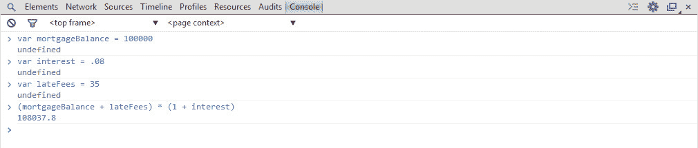
图 4-29：在控制台中执行操作
*来源：© Google Chrome*

### 使用 `debugger` 语句

JavaScript 包含一个 `debugger` 语句，在某些情况下可以使调试变得更容易。当你向代码添加 `debugger` 语句并在打开了调试工具的浏览器中运行时时，浏览器会在遇到 `debugger` 语句时停止执行程序，并将焦点切换到调试工具。

*许多 Web 开发者主张所有的 JavaScript 编码应在严格模式下进行，以使代码尽可能无懈可击。从第 5 章开始，本书中使用和创建的所有代码都将使用严格模式。*

**注意**

`debugger` 语句的作用就像是你 JavaScript 代码中的一个断点。

### 使用严格模式

从 ES5 版本开始，ECMAScript 引入了一项名为**严格模式**（Strict Mode）的新功能，它通过捕捉常见错误帮助你编写更好的代码。在严格模式下，语言的一些特性被移除或禁止。要启用严格模式，你需要在脚本或函数的开头添加字符串 `"use strict"`：

```
"use strict";
```

许多 Web 开发者主张所有的 JavaScript 编码应在严格模式下进行，以使代码尽可能无懈可击。从第 5 章开始，本书中使用和创建的所有代码都将使用严格模式。

严格模式提供了几个好处：
- 它通过改变函数中 `this` 的行为捕捉常见错误并使代码更安全。
- 它防止意外创建全局变量。
- 它消除了在未来 JavaScript 版本中受限制的一些语法用法。

### 刷新网页

当你编辑文档中的 JavaScript 代码时，通常保存文档并点击浏览器中的重新加载或刷新按钮即可测试更改。然而，重要的是，对于复杂的脚本，Web 浏览器无法总是清除其内存中旧 bug 的残留，即使你已经修复了代码。因此，有时需要关闭并重新在浏览器中打开文档。你也可以通过按住 Shift 键并点击浏览器的重新加载或刷新按钮来强制刷新网页。然而，有时即使重新打开文件也不能完全清除浏览器内存中的旧代码。这时你必须完全关闭浏览器窗口并启动新会话。你可能还需要删除浏览器临时存储在计算机内存或硬盘上的经常访问的网页。

## 总结

程序可能会发生三类型的错误：语法错误、运行时错误和逻辑错误。

语法错误发生在解释器无法识别代码时。运行时错误发生在 JavaScript 解释器在程序执行期间遇到问题时。逻辑错误是程序设计中的缺陷，导致程序无法按照你预期的方式运行。

在 JavaScript 程序中定位错误的第一道防线是 JavaScript 解释器遇到语法或运行时错误时收到的错误信息。追踪是对执行中程序中的单个语句进行检查。你可以使用 `window.alert()` 和 `console.log()` 方法来追踪 JavaScript 代码。

使用 `console.log()` 方法追踪错误时，使用驱动程序（driver program）很有帮助，驱动程序是一个用于测试函数和其他代码的简化临时程序。定位 JavaScript 程序中错误的另一种方法是识别出你认为可能导致问题的行，并将它们转换为注释。

所有主流浏览器——Internet Explorer、Firefox 和 Chrome 的当前版本都包含内置调试工具。

“断点模式”（break mode）是指临时暂停程序执行，以便你可以监控值并追踪程序执行。

断点是代码中的一个语句，程序执行到该语句时将进入断点模式。浏览器调试工具中的“步入”（step in）、“步过”（step over）和“步出”（step out）选项允许你在进入断点模式后继续执行程序。

你可以向浏览器调试工具中的观察列表（watch list）添加表达式，以便在单步执行程序时监控其值。

“调用堆栈”（call stack）指的是过程（如函数、方法或事件处理程序）在程序中执行的顺序。

编写预判并处理潜在问题的代码通常被称为“加固”（bulletproofing）。

异常处理允许程序在执行过程中发生错误时对其进行处理。“异常”（exception）是指程序中发生的某种类型的错误。你在 `try` 语句中执行可能包含异常的代码。你使用 `throw` 语句表示 `try` 块内部发生了错误。在程序抛出错误后，你可以使用 `catch()` 语句来处理或“捕获”错误。包含在 `try` 语句中的 `finally` 语句无论其关联的 `try` 块是否抛出异常都会执行。

你可以将自定义函数分配给 JavaScript 的 `error` 事件，以处理 Web 页面上发生的任何类型的错误。定位和纠正 JavaScript 程序中错误的其他方法和技术包括：检查 HTML 元素、分析逻辑、使用控制台命令行测试语句、使用 `debugger` 语句、在严格模式下执行代码、代码检查（linting）以及刷新页面。

## 关键术语

- **断点模式 (break mode)**——在浏览器中临时暂停程序执行，以便你可以监控值并追踪程序执行。
- **断点 (breakpoint)**——在程序的特定语句处添加标记，当程序执行到该语句时会暂停。
- **bug (bug)**——程序中任何导致其功能运行不正确的错误，无论是因为语法错误还是逻辑缺陷。
- **加固（bulletproofing）**——编写预判并处理潜在问题的代码。
- **调用堆栈（call stack）**——JavaScript 处理器维护的有序列表，包含所有已调用但尚未完成处理的过程（如函数、方法或事件处理程序）。
- **catch() 语句**——用于处理已抛出错误的语句。
- **注释掉（commenting out）**——识别你认为可能导致问题的代码行，并将它们转换为注释。
- **调试（debugging）**——追踪和解决程序中错误或 bug 的行为。
- **依赖（dependencies）**——当语句依赖于其他语句或函数的成功执行时存在的关系。
- **驱动程序（driver program）**——用于测试函数和其他代码的简化临时程序。
- **异常（exception）**——程序执行过程中发生的错误。
- **异常处理（exception handling）**——一种加固代码的方法，允许程序在执行过程中发生错误时对其进行处理。
- **finally 语句**——异常处理代码中的最后一个语句，无论其关联的 `try` 块是否抛出异常都会执行。
- **代码检查（linting）**——通过程序运行代码，该程序会标记可能影响代码质量的常见问题。
- **日志记录（logging）**——直接将值写入浏览器控制台。
- **逻辑（logic）**——程序各个部分运行或执行的顺序。
- **逻辑错误（logic error）**——程序设计中的缺陷，导致程序无法按照你预期的方式运行。
- **运行时错误（run-time error）**——JavaScript 解释器在程序执行遇到问题时的错误。
- **步入（stepping in）**——执行单行代码并暂停直到你指示调试器继续的步进选项；也称为 *stepping into*。
- **步入（stepping into）**——*参见* stepping in。
- **步进选项（stepping options）**——浏览器调试工具中允许你在进入断点模式后继续执行程序的选项。
- **步出（stepping out）**——执行当前函数中所有剩余代码的步进选项。
- **步过（stepping over）**——允许跳过函数调用的选项；程序仍执行你跳过的每个函数，但在调试器中看起来就像执行了单个语句。
- **严格模式（strict mode）**——JavaScript 的模式，其中某些功能被移除，其他功能需要更严格的语法。
- **语法（syntax）**——编程语言的规则。
- **语法错误（syntax error）**——解释器无法识别代码时的错误，例如浏览器引擎无法识别的语句。
- **throw（throw）**——触发错误。
- **追踪（tracing）**——一种涉及检查执行程序中单个语句的调试技术。
- **try 语句**——用于封装可能包含异常的语句。
- **变量列表（variables list）**——浏览器调试工具中当前执行函数内的所有局部变量，无论是否已初始化；变量值在程序执行过程中显示并更新。
- **观察列表（watch list）**——浏览器调试工具中用户指定的表达式，其值在程序执行过程中显示并更新。

## 复习题

1. 当解释器无法识别代码时发生什么类型的错误？
   a. 调试
   b. 语法
   c. 运行时
   d. 逻辑

2. __________ 错误是程序设计中的问题，导致无法按照你预期的方式运行。
   a. 应用
   b. 语法
   c. 逻辑
   d. 运行时

3. 当 JavaScript 解释器在程序执行期间遇到问题时，该问题被称为 __________错误。
   a. 应用
   b. 语法
   c. 逻辑
   d. 运行时

4. 下列语句会导致语法错误？
   a. `var firstName = "";`
   b. `document.write("Available points: " + availPoints);`
   c. `readyState = true;`
   d. `"use strict";`

5. 下列语句将 `selection` 变量的值写入控制台？
   a. `console.log("selection");`
   b. `document.console("selection");`
   c. `console.alert(selection);`
   d. `console.log(selection);`

6. 下列哪个 `for` 语句在逻辑上是错误的？
   a. `for (var count = 10; count <= 0; count++) { document.write(count); }`
   b. `for (var count = 0; count <= 10; count++) { document.write(count); }`
   c. `for (var count = 10; count >= 0; count--) { document.write(count); }`
   d. `for (var count = 5; count >= 0; count--) { document.write(count); }`

7. 下列哪种模式临时挂起或暂停程序执行，以便你可以监控值并跟踪程序执行？
   a. 挂起 (Suspend)
   b. 单步 (Step)
   c. 断点 (Break)
   d. 继续 (Continue)

8. 在浏览器调试工具中，哪条命令可以执行下一个函数中的所有语句？
   a. 跳出 (Step out)
   b. 逐过程 (Step over)
   c. 单步 (Step)
   d. 步/进入 (Step in/into)

9. 在抛出错误后，你使用 __________ 语句来处理该错误。
   a. `try`
   b. `throw`
   c. `catch`
   d. `finally`

10. 在 ________ 中，JavaScript 语言移除了某些功能，而另一些功能需要更严格的语法。
    a. 异常处理 (exception handling)
    b. 严格模式 (strict mode)
    c. 调试工具 (debugging tools)
    d. 调试模式 (debugger mode)

11. 下列哪些信息作为参数从 `throw` 语句传递到 `catch` 语句？
    a. 错误编号 (Error number)
    b. 错误消息 (Error message)
    c. 行号 (Line number)
    d. URL

12. 你可以在代码中添加哪条语句，以有效地起到与断点相同的作用？
    a. `break;`
    b. `breakpoint;`
    c. `debug;`
    d. `debugger;`

13. 浏览器调试工具中的监视列表允许你在程序执行期间监控 __________ 的值。
    a. 函数 (function)
    b. 异常处理器 (exception handler)
    c. 表达式 (expression)
    d. 语句 (statement)

14. __________ 是由 JavaScript 处理器维护的有序列表，包含所有已调用但尚未完成处理的程序（如函数、方法或事件处理器）。
    a. 变量列表 (variables list)
    b. 监视列表 (watch list)
    c. 严格模式 (strict mode)
    d. 调用栈 (call stack)

15. 下列哪些异常处理代码无论其相关的 `try` 块是否抛出异常都会执行？
    a. `throw "Please enter your last name.";`
    b. `catch(lNameError) { return false; }`
    c. `catch(lNameError) { window.alert(lNameError); return false; }`
    d. `finally { lNameValid = true; }`

16. 使用 `window.alert()` 方法跟踪错误的优势是什么？改为使用 `console.log()` 方法又有什么优势？

17. 解释如何通过注释掉代码来调试。

18. 解释专门用于 Web 开发的文本编辑器如何通过两种方式帮助你防止错误和调试代码。

19. 应该何时以及为什么在你的 JavaScript 程序中使用异常处理？

20. 解释什么是严格模式、如何实现它，以及它在减少编码错误方面的作用。

## 上手实践项目 (Hands-On Projects)

### 上手实践项目 4-1

在这个项目中，你将继续使用本章节中的 `tuba.js` 和 `tractor.htm` 文件。你将为 `verifyCrops()` 函数添加错误处理程序，这样如果用户取消了所有作物框的勾选标记，他们将收到一条错误消息。

- 使用操作系统的文件管理器将 Data Files 中 `Chapter/Chapter` 目录下的所有文件和子文件夹复制，并粘贴到 `Chapter/HandsOnProject` 文件夹中。验证 `Chapter/Chapter` 目录中仍然有一个副本。
- 在你的文本编辑器中，打开 `Chapter/HandsOnProject` 文件夹中的 **tuba.js**，然后在注释部分将文本“Chapter case”替换为 **Hands-on Project** 。
- 滚动到 `verifyCrops()` 函数，然后删除代码 `testFormCompleteness();` 这一行，使命令块为空。
- 在 `verifyCrops()` 函数的命令块中输入以下 `try` 语句：
```
1 try {
2     for (var i = 0; i < 7; i++) {
3         if (cropsFieldset.getElementsByTagName("input")[i].checked) {
4             cropscomplete = true;
5             messageElement.innerHTML = ""; // clear previous
6             message or recommendation
7             testFormCompleteness();
8             i = 8;
9         }
10    }
11    if (i === 7) {
12        throw "Please select at least one crop.";
13    }
14 }
```
注意，步骤处显示的代码并不是没有错误的。你将在下一个项目中调试这些代码。
- 在浏览器中关闭 **tractor.htm** 文件。

### 上手实践项目 4-2

在这个项目中，你将继续使用 Hands-On Project 文件夹中的 **tuba.js** 和 **tractor.htm** 文件。你将调试 `verifyCrops()` 函数中的异常处理代码。

- 在 `try` 语句之后、`verifyCrops()` 函数的结束括号 `}` 之前，添加以下 `catch` 语句：
```
1 catch (message) {
2     cropscomplete = false;
3     messageElement.innerHTML = message;
4 }
```
- 注意，步骤处显示的代码并不是没有错误的。你将在下一个项目中调试这些代码。
- 在浏览器中关闭 **tractor.htm** 文件。

### 上手实践项目 4-3

在这个项目中，你将检查一个现有程序并使用在本章中学到的技能来调试它，直到它按照设计工作。当用户在输入框中输入字符串时，程序设计为将字符串添加到数组中。当数组达到特定长度时，程序会在页面上的列表中显示所有用户的输入。

- 在你的文本编辑器中，打开 `Chapter/HandsOnProject` 文件夹中的 **index.htm** 文件。在 head 部分指示处输入你的姓名和今天的日期，然后保存更改。
- 滚动并检查 body 部分底部 script 区域的代码。检查循环、控制结构和注释，直到你理解程序是如何工作的。
- 在浏览器中打开 **index.htm**。要测试程序，在输入框中输入一个地点名称，点击 **Submit**，然后重复四次。在每次提交后，输入框中的字符串应该被清除，并在提交第五个字符串后应该显示地点列表。这些情况没有发生，表明程序包含一个或多个错误。
- 使用你在本章中学到的技术来调试程序。适当的技术可能包括在文本编辑器中查看高亮的语法错误、设置断点、单步执行程序以及注释掉代码。当你完成调试后，每次点击提交（Submit）按钮时，输入框中的用户输入都应该清除。此外，在提交五个字符串后，页面上应该显示所有提交的字符串列表。

### 实操项目 4-4

在本项目中，你将使用严格模式（strict mode）来加强项目 4-3 中某个函数使用的代码。严格模式强制执行许多被认为是良好编码实践的规则，但 JavaScript 默认并不执行这些规则。这些规则中最基础的之一是，所有变量必须使用 `var` 关键字声明。在严格模式下，不使用 `var` 关键字声明新变量将抛出错误。你在项目 4-3 中调试的文件中，`processInput()` 函数包含了许多未使用 `var` 关键字声明的变量。你将指定该函数在严格模式下执行，然后利用产生的错误来识别并添加缺失的关键字。

- 使用操作系统的文件管理器，将 Data Files 中 `Chapter 4/HandsOnProject` 目录下的所有文件和子文件夹复制，并将它们粘贴到 `Chapter 4/HandsOnProject` 文件夹中。验证你在 `Chapter 4/HandsOnProject` 目录中仍然有一个副本。
- 在文本编辑器中，打开 `Chapter 4/HandsOnProject` 文件夹下的 **index.htm**，然后在注释部分、`title` 元素和 `h1` 元素中，将文本“Hands-on Project”替换为 **Hands-on Project 4-**。
- 滚动到 `body` 章节底部的脚本部分。
- 在 `processInput()` 函数代码块的顶部添加新行，然后添加一条请求浏览器使用严格模式解释该函数的语句。
- 保存你的更改，在浏览器中打开 **index.htm**，然后测试页面的操作。在项目 4-3 结束时正常的功能现在不再工作了。
- 打开浏览器控制台，检查记录的任何错误信息。使用浏览器工具识别缺少 `var` 关键字的行，在文本编辑器中添加关键字，保存更改，然后重新测试页面。继续调试，直到页面的运行与项目 4-3 结束时一致。

### 实操项目 4-5

在本项目中，你将调试一个将英里距离转换为公里距离的程序。

- 在文本编辑器中，打开 `Chapter 4/HandsOnProject` 文件夹下的 **index.htm** 文件。在 head 部分的指定处输入你的名字和今天的日期，然后保存更改。
- 滚动并检查 `body` 章节底部脚本部分的代码。检查程序和注释，直到你理解程序的工作原理。
- 在浏览器中打开 **index.htm**。要测试程序，在输入框中输入一个数字，然后点击 **Convert to Km**。答案应该在页面右侧“Distance in Km”标签下方的框中显示。如果没有发生这种情况，说明程序包含一个或多个 bug。
- 使用本章中学的技术来调试程序。当你完成调试后，你应该能够在 Distance in Mi 框中输入一个数字，点击 Convert to Km 按钮，并在 Distance in Km 框中看到结果。（*提示*：记住一公里比英里短，因此公里的距离数字应该比相同距离的英里数字大。将英里转换为公里，你需要将英里值乘以 1.609。）

## 案例项目

### 个人案例项目

为你个人网站上的其中一个表单代码添加异常处理。如果你的网站没有包含表单，请先添加一个。你的代码应该在适当的位置显示一个或多个相关的错误信息。完成代码后，写一份关于本章中在该项目中使用的调试方法的总结，描述你如何在代码中使用了每种方法。

### 团队案例项目

将你的团队分成两个小组，并为每个小组分配一个包含 JavaScript 代码的团队项目网站页面。在每个小组内部，在你被分配任务的页面代码中引入至少三个 bug。与另一个小组交换文档，然后以团队形式协作调试另一个小组提供的代码。在调试过程中，记录你使用了哪些调试方法，包括每种方法对于解决特定问题是否有所帮助。当文档按预期工作时，创建一个报告。对于每个 bug，描述你预期的行为以及该 bug 导致的错误行为，并描述你用来调试它的方法，包括每种方法是否有效。还要指定包含错误的代码行号，并在报告中显示错误代码以及修复后的代码。

# 第 5 章：使用文档对象模型 (DOM) 和 DHTML

当你完成本章学习后，你将能够：
- 通过 id、标签名、类名、名称或选择器访问元素
- 访问元素内容、CSS 属性和特性
- 添加和删除文档节点
- 使用应用程序创建并关闭新的标签页和窗口
- 使用 `setTimeout()` 和 `setInterval()` 方法指定延迟或时长
- 使用 `History`、`Location`、`Navigation` 和 `Screen` 对象操作浏览器窗口

## 使用文档对象模型 (DOM) 和 DHTML

JavaScript 在 Web 上最强大的用途之一是根据外部事件（如点击或其他用户交互）修改页面内容。这样做需要一种方法来引用浏览器和当前文档的不同组件。JavaScript 通过一种称为浏览器对象模型（BOM）的约定规定了浏览器的对象、属性和方法以及之间的关系。BOM 的一部分 `Document` 对象代表浏览器中的文档。由于 `Document` 对象是动态网页发生许多更改的地方，该对象有自己的对象模型，被称为文档对象模型 (DOM)。在本章中，你将探索 BOM 和 DOM 的结构，并学习如何引用浏览器和文档中的基本属性和方法以增加应用程序的交互性。你将应用这些技能创建一个显示画廊的应用程序，允许用户浏览图片并查看图片的放大版本。图 5-1 显示了你将创建的画廊预览，图 5-2 显示了画廊中图片的放大预览。

图 5-1: 画廊应用程序
*© Jason Bucy. © Sasha Vodnik. © 2015 Cengage Learning*

## 理解浏览器对象模型和文档对象模型

JavaScript 将 HTML 文档的内容视为一组相关的组件，这些组件被称为对象。JavaScript 将 Web 上的每个元素视为对象。此外，你可以在 JavaScript 应用程序内部创建对象。例如，你创建每个函数都是对象。

### 浏览器对象模型

**浏览器对象模型 (BOM)**（或**客户端对象模型**）描述浏览器内部（包括当前文档）对象之间的关系。该模型的存在很重要，正如我们很快看到的，它让你能够引用特定的浏览器对象而不会产生混淆。

BOM 中的对象按层次结构排列。如图 5-3 所示，`Window` 对象位于顶部，下方是 `History`、`Location`、`Navigator`、`Screen` 和 `Document` 对象。尽管这是所有主流浏览器使用的模型，但请注意图 5-2: 放大视图 *© Jason Bucy. Source: © Mozilla Firefox.*

你不需要在浏览器对象模型（BOM）中显式地创建任何对象；它们在浏览器打开网页时会自动创建。浏览器对象模型中的顶层对象是 `Window` 对象，它代表一个浏览器窗口。浏览器会自动为你创建 `Window` 对象。`Window` 对象被称为**全局对象**，因为浏览器对象模型中的所有其他对象都包含在其中。例如，`Window` 对象包含 `Document` 对象，就像浏览器窗口包含一个网页文档一样。你使用 `Window` 对象的方法和属性来控制浏览器窗口，而使用 `Document` 对象的方法和属性来控制网页。

BOM 中对象之间的关系通常用描述家庭成员的术语来描述。在图 5-3 所示，`Window` 对象是所有其他对象（如 `History` 和 `Location`）的父对象。`History` 是 `Location`、`Navigator`、`Screen` 和 `Document` 对象的兄弟对象，它们都是 `Window` 对象的子对象。

### 文档对象模型

`Document` 对象是浏览器对象模型中最重要的对象，因为它代表了在浏览器中显示的网页。你已经熟悉了 `document.write()` 方法。开头的“`document.`”表示它是 `Document` 对象的方法。网页上的所有元素都包含在 `Document` 对象中，每个元素在 JavaScript 中都由其自己的对象表示。这意味着 `Document` 对象包含了你在网页上创建的所有元素。

在书中，浏览器对象模型中的对象以首字母大写的形式引用（`Document` 对象）。然而，当你在代码中使用对象名称时，必须始终使用小写字母。例如，以下语句引用 `Document` 对象：

`document.write("Go Patriots!");`

BOM 不是任何组织认可的标准。相反，它是所有浏览器按照约定遵循的通用模型。

| Window |
| :--- |
| History |
| Location |
| Navigator |
| Screen |
| Document |

图 5-3: 浏览器对象模型

注意 `document` 中小写字母 *d*。

浏览器对象模型中的 `Document` 对象分支由其自己的对象模型表示，称为**文档对象模型**，或 **DOM**。与松散惯例的 BOM 不同，DOM 是世界维网联盟（W3C）的正式规范，类似于 HTML 和 CSS。

### DOM 和 DHTML

虽然网页最初是静态文档的集合，但今天大多数网页内容都是动态的——用户交互可以在不需要加载新文档的情况下更改显示的内容，还可以更改这些内容呈现的方式，例如其大小、布局和颜色。HTML、CSS 与 JavaScript 的结合使得现代 Web 能够实现这种交互性，这种结合有时被称为**动态 HTML (DHTML)**。

DOM 允许你编写更改网页文档 HTML 和 CSS 的 JavaScript 代码。DOM 是**应用程序接口 (API)** 的示例，它是一个关于不同软件组件如何相互作用的规范。通过为网页文档中的对象建立一种结构，并结合一组标准的属性和方法，DOM 创建了让网页文档动态化的工具。这使得你能够在符合 DOM 规范的浏览器中编写具有可预测结果的 JavaScript 应用。

DOM 代表在浏览器中显示的网页的 HTML。网页上的每个元素在 DOM 中由其自己的对象表示。每个元素都是对象的这一事实，使得 JavaScript 应用能够访问网页上的单个元素并逐个更改它们，而无需从服务器重新加载页面。

### DOM 树

与 BOM 类似，DOM 中的对象根据 HTML 文档中元素的嵌套呈层级表示。然而，虽然标准 BOM 中的所有对象在浏览器中始终存在，但任何给定网页的 DOM 层级结构（被称为 **DOM 树**）取决于其内容。例如，图 5-4 显示了以下 HTML 文档的 DOM 树：

```html
<html lang="en">
<head>
  <meta charset="utf-8" />
  <title>Photo Gallery</title>
</head>
<body>
  <header>
    <h1>Garden Photo</h1>
  </header>
  <article>
    <figure>
      <figcaption>Butterfly bush</figcaption>
      
    </figure>
  </article>
</body>
</html>
```

图 5-4: DOM 树

### `Document` 对象属性

| 属性 | 描述 |
| :--- | :--- |
| `body` | 文档的 `body` 元素 |
| `cookie` | 当前文档的 cookie 字符串，包含了 Web 服务器存储在用户计算机文本文件中的关于用户的小信息 |
| `domain` | 当前文档所在服务器的域名 |
| `lastModified` | 文档最后修改的日期 |
| `location` | 当前文档的位置（包括其 URL） |
| `referrer` | 提供指向当前文档链接的文档 URL |
| `title` | 由文档头部部分中 `title` 元素指定的文档标题 |
| `URL` | 当前文档的 URL |

表 5-2: 选定的 DOM `Document` 对象属性

### DOM 方法

| 方法 | 描述 |
| :--- | :--- |
| `getElementById(id)` | 返回具有 `id` 的元素 |
| `getElementsByClassName(class1)` | 如果指定了一个类名 `class1`，返回元素集合；如果指定了多个类名，返回这些元素的集合 |
| `getElementsByName(name)` | 返回具有名称元素的集合 |
| `getElementsByTagName(tag)` | 返回具有标签元素的集合 |
| `querySelectorAll(selector)` | 返回匹配 CSS 选择器的元素集合 |
| `write(text)` | 将 `text` 写入文档 |

表 5-1: HTML `Document` 方法

### 快速测验 1

1. 什么是 `Window` 对象？
2. 什么是 DOM？
3. `Window` 对象和 `Document` 对象之间的区别是什么？它们的关系是什么？

## 访问文档元素、内容和属性

在之前的章节中，你学习了几种引用网页元素的方法，包括 `document.getElementById()` 和 `document.getElementsByTagName()`。这些都是 `Document` 对象的方法。接下来，你将回顾这两个方法，然后探索 `Document` 对象的其他方法，用于引用网页元素及其内容、属性和特性。

### 通过 **id** 值访问元素

如果你需要直接访问具有 `id` 值的特定元素，没有比 `getElementById()` 方法更容易了。记住你在 HTML 中使用元素的 `id` 属性设置 `id` 值。然后你将带有引号的 `id` 值作为参数传递给 `getElementById()` 方法。例如，假设你的 HTML 文档包含此元素：

`<input type="number" id="zip" />`

你可以如下在 JavaScript 代码中引用该元素：

`var zipField = document.getElementById("zip");`

*使用此方法时，务必使用大写字母 “Id” 而不是 “ID”。*

*如果输入方法为 `getElementByID()` 将返回错误。*

**注意**

### 通过标签名访问

你已经使用的另一种文档方法是 `getElementsByTagName()`。你将标签名（例如 "p"）作为参数传递此方法，它返回文档中所有元素的集合。例如，以下语句返回了所有元素的集合：

`var paragraphs = document.getElementsByTagName("p");`

此方法按照它们在文档中出现的顺序返回对象集合。根据浏览的不同，该集合可能是节点列表（node list）或 HTML 集合（HTML collection）。**节点列表**仅仅是带索引的节点集合。同样，**HTML 集合**是带索引的 HTML 集合。这两个类型之间的技术差异并不重要。然而，它们共享两个重要特性。首先，它们不是真正的数组，这意味着这些对象无法使用数组属性和方法。但是由于它们的组织结构与数组相似，你可以像引用数组内容一样引用它们的内容。这意味着你可以通过使用 `getElementsByTagName()` 返回集合中的索引数字来引用页面上的特定元素。例如，如果你想操作页面上的第二个 `h1` 元素，可以使用代码：

`var secondH1 = document.getElementsByTagName("h1")[1];`

### 通过类名访问元素

另一种与前两种相似的方法是 `getElementsByClassName()` 方法。与 `getElementById()` 类似，`getElementsByClassName()` 根据 HTML 属性的值来引用元素——在这种情况下，是 `class` 属性。与 `getElementsByTagName()` 类似，`getElementsByClassName()` 返回文档中所有具有属性指定的类名的元素的节点列表（node list）或 HTML 集合（HTML collection）。例如，如果你想访问文档中所有 `class` 值为 `side` 的元素，可以使用以下语句：

`var sideElements = document.getElementsByClassName("side");`

由于 HTML 的 `class` 属性可以接受多个值，因此 `getElementsByClassName()` 方法接受多个参数。例如，以下代码返回文档中所有 `class` 值为 `side` 和 `green` 的元素：

`var sideGreenElements = document.getElementsByClassName("side green");`

注意，作为参数提供的所有类名都包含在一对引号内，类名之间用空格隔开。

所有现代浏览器都支持 `getElementsByClassName()` 方法，但 IE 不支持。如果你的应用程序需要支持 IE，你应该使用其他方法来选择 Web 元素。

### 通过名称访问元素

第四种方法 `getElementsByName()` 方法返回一个具有 `name` 属性并匹配指定值的元素的节点列表或 HTML 集合。前三种方法通常很有用。然而，当你需要访问表单中的一组选项按钮（option buttons）或复选框（check boxes）时，`getElementsByName()` 可以让你编写出更简洁的代码。由于集合中的每个输入元素共享相同的 `name` 值，你可以使用 `getElementsByName()` 方法一次性访问整个集合。例如，假设你的表单包含以下一组选项：

```html
<legend><span>选择一种颜色：</span></legend>
<input type="radio" name="color" id="redOption" value="red"/>
<label for="redOption">红色</label>
<input type="radio" name="color" id="greenOption" value="green"/>
<label for="greenOption">绿色</label>
<input type="radio" name="color" id="blueOption" value="blue"/>
<label for="blueOption">蓝色</label>
```

你可以使用以下语句返回上述代码中三个 `input` 元素的集合：

`var colorButtons = document.getElementsByName("color");`

该方法在 IE 及早期版本的 Internet Explorer 中返回的结果与 Web 标准不一致。因此，如果你使用这种方法并需要支持 IE 或旧版本的 Internet Explorer，你应该在这些浏览器上测试你的应用程序，以确保该方法的执行结果符合你的预期。

### 使用 CSS 选择器访问元素

前面的方法都允许你根据 HTML 标记的特定方面引用元素。`Document` 对象还包含两个方法，允许你使用 CSS 语法引用元素或元素集合。`querySelector()` 方法返回第一个匹配指定 CSS 选择器的元素。该方法使用以下语法：

`querySelector("selector")`

在使用此方法时，`selector` 是任何有效的 CSS 选择器。例如，假设你正在处理一个包含以下 HTML 的项目：

```html
<header>
<h1></h1>
</header>
```

你可以按照如下方式使用 `querySelector()` 方法引用 `img` 元素：

`querySelector("header h1 img")`

IE 的 `querySelector()` 方法仅支持简单选择器，因此它无法识别上述代码中的后代选择器（descendent selector）。幸运的是，通常有多种编写 CSS 选择器来引用相同元素的方法，因此你可以如下重写之前的选择器以兼容 IE：

`querySelector("img.logo")`

除了 `querySelector()` 方法外，`Document` 对象还包含了 `querySelectorAll()` 方法，它返回匹配指定选择器的元素集合，而不仅仅是第一个元素。例如，假设你正在处理以下 HTML 代码：

```html
<nav>
<ul>
<li>关于我们</li>
<li>订单</li>
<li>支持</li>
</ul>
</nav>
```

假设这是文档中唯一的 `nav` 元素，你可以使用以下代码返回三个 `li` 元素的集合：

`querySelectorAll("nav ul li")`

与 `querySelector()` 类似，IE 对 `querySelectorAll()` 仅支持简单选择器。因此，为了编写兼容 IE 的代码，你需要使用更简单的选择器。在这种情况下，编写兼容 IE 的代码需要为你的 HTML 代码添加属性。例如，如果上述代码中的所有 `li` 元素都有属性 `class="topNav"`，那么你可以使用以下代码在所有现代浏览器以及 IE 中选择这些 `li` 元素：

`querySelectorAll("li.topNav")`

### 访问元素的内容

一旦你创建了文档元素的引用，DOM 就提供了访问和修改其内容、属性和特性的工具。你已经使用 `innerHTML` 属性来访问和更改元素的内容。DOM 规范还包含了另一个属性 `textContent`，你用它来访问和更改元素包含的文本。实践中，`innerHTML` 和 `textContent` 的主要区别是 `innerHTML` 允许你访问并写入 HTML 标签以及文本，而 `textContent` 会剥离这些。例如，假设你正在处理以下 HTML：

```html
<ul>
<li class="topnav"><a href="aboutus.html">关于我们</a></li>
<li class="topnav"><a href="order.html">订单</a></li>
<li class="topnav"><a href="support.html">支持</a></li>
</ul>
```

你可以使用以下语句引用第一个 `li` 元素，然后访问它的 `innerHTML` 和 `textContent` 值：

```
var button1 = document.querySelectorAll("li.topNav")[0];
var allContent = button1.innerHTML; // <a href="aboutus.html">关于我们</a>
var justText = button1.textContent; // 关于我们
```

通常，出于安全考虑，尽可能使用 `textContent` 属性而不是 `innerHTML` 属性。这是因为使用 `innerHTML` 会让你在理论上容易受到代码注入攻击，即某人将你代码中的 `innerHTML` 值替换为包含恶意 JavaScript 语句的 HTML 代码。然而，IE 不支持 `textContent` 属性，因此如果你的代码需要支持 IE，你必须继续使用 `innerHTML` 属性。由于本书中的所有代码都设计为兼容 IE，因此本书使用 `innerHTML` 而不是 `textContent`。

### 访问元素的 CSS 属性

你也可以通过 DOM 访问并更改元素的 CSS 属性。要做到这一点，使用点符号法（dot notation）引用元素的 `style` 属性，后跟 CSS 属性的名称，如下：

`element.style.property`

`element` 术语是指文档元素的引用，而 `property` 是 CSS 属性名。例如，以下语句将 `id` 值为 `logo` 的元素的 CSS `display` 属性值更改为 `none`：

`document.getElementById("logo").style.display = "none";`

当 CSS 属性名包含连字符（hyphen）时，在使用点符号法引用它时，需要移除连字符并将连字符后的字母大写。例如，在 JavaScript 中引用 CSS 属性 `font-family` 时，你需要在代码中将其指定为 `fontFamily`，如下句所示：

`var font = document.getElementById("logo").style.fontFamily;`

当你使用 DOM 引用指定 CSS 值时，它将作为内联样式（inline style）添加到相关元素中。这意味着该设置的优先级通常高于嵌入式或外部样式表中设置的样式。要移除你之前使用 DOM 引用添加的样式，只需将其值设置为空字符串，如下句所示：

`document.getElementById("navbar").style.color = "";`

将样式值设置为空字符串将移除内联样式，使元素的样式恢复到文档样式表指定的任何设置。

### 访问元素属性

你也可以访问元素的属性，例如 `a` 元素的 `href` 属性，或 `img` 元素的 `src` 属性。要做到这一点，你可以通过在元素引用后添加句号和属性名称来使用点符号语法。例如，要引用 `id` 值为 `homeLink` 的 `a` 元素，你可以使用以下 `getElementById()` 方法：

`document.getElementById("homeLink")`

要引用该元素的 `href` 属性，在元素引用的末尾添加 `.href`，如下：

`document.getElementById("homeLink").href`

你可以使用此代码来查找 `href` 属性的值并将该值赋值给变量，如下：

`var homeURL = document.getElementById("homeLink").href;`

你也可以使用属性引用为属性分配新值，如下：

`document.getElementById("homeLink").href = "http://w3.org";`

此代码将该元素的 `href` 属性值更改为“http://w3.org”。此脚本执行后，点击 `homeLink` 元素将打开 *w3.org* 上的网站。

你可以使用点符号法来访问几乎任何现有元素属性的值。你也可以用它来给给定元素的几乎任何有效属性赋值，即使原始 HTML 代码中不包含该变量。

使用点符号法访问或分配属性值时的例外情况是 `class` 属性。由于许多编程语言将“class”一词视为保留字，DOM 无法识别它并用于处理 HTML 的 `class` 属性。相反，你应该使用 `className` 属性。如果一个元素有一个单一的 `class` 值，`className` 属性返回该 `class` 名称。如果元素有多个 `class` 值，`className` 属性将返回一个包含所有 `class` 值的字符串，这些值用空格分隔。

你可以通过两种不同的方式引用 DOM 对象的属性：获取值或设置值。大多数属性（包括你用于访问文档元素属性的属性）都允许你执行任一操作：你既可以查找现有的属性值，也可以设置属性值。在处理 DOM 对象的属性时，注意你是在尝试获取还是设置属性值，并据此编写代码是非常重要的。例如，以下两个示例之间存在巨大差异：

```
captionText = document.getElementById("logoImage").alt;
document.getElementById("logoImage").alt = captionText;
```

第一条语句*获取* `id` 值为 `logoImage` 的元素的 `alt` 值，并将结果存储在变量 `captionText` 中。第二条语句执行相反的操作：它检索变量 `captionText` 的值，并将其*设置*为 `id` 值为 `logoImage` 的元素的 `alt` 属性值。

## 编程概念

接下来，你将为相库创建 `populateFigures()` 函数。导航通过更改三个 `img` 元素的 `src` 属性值来实现。你将创建一个 `for` 循环来更改每个 `img src` 属性的值。创建 `populateFigures()` 函数：

1. 返回文本编辑器中的 `photos.js` 文件。
2. 在全局变量声明下方，输入代码来声明 `populateFigures()` 函数，如下：
```
function populateFigures() {
  var filename;
  var currentFig;
}
```
除了声明函数外，这段代码还声明了两个供函数内部使用的局部变量。
3. 在函数代码内部变量声明下方，输入以下 `for` 循环：
```
for (var i = 1; i < 4; i++) {
  filename = "images/IMG_" + photoOrder[i] + ".jpg";
  currentFig = document.getElementsByTagName("img")[i - 1];
  currentFig.src = filename;
}
```
此循环运行三次，使用 `photoOrder` 数组中的对应值设置 `filename` 变量的值，然后查找计数器值减一对应的元素，并将 `filename` 的值分配给 `img` 元素的 `src` 属性。
4. 保存工作，然后在浏览器中打开 `photos.htm`。你的屏幕应该与图 5-4 一致。
5. 点击屏幕右侧的 > 按钮。如图 5-5 所示，所有图片都向左移动，穿过栅栏的花朵现在位于中心。

## 添加和删除文档节点

你已经看到可以通过更改元素的属性值来更改网页内容，而无需重新加载页面。DOM 还包含了一些允许你创建新元素并在 DOM 树中添加或删除元素的方法。这些方法使你能够在不与服务器交互的情况下，为应用程序添加动态特性。

你对相库应用的计划包括为用户提供在屏幕上添加两个额外图片的选项，以便用户可以同时看到幻灯片中的所有图片，以及使用按钮导航到他们想要查看任何图片。在本节中，你将学习用于创建新节点并将其添加到 DOM 树的 DOM 方法。

### 创建节点

你使用 `Document` 对象的 `createElement()` 方法创建一个新的元素节点，其语法如下：

`document.createElement("element")`

术语 `element` 是 HTML 元素的名称。例如，要创建一个新的 `div` 元素，你会使用以下语句：

`document.createElement("div");`

要向相库应用程序添加更多预览图像，你需要创建新的 `figure` 元素和新的 `img` 元素。图 5-6 显示了你将在本节中对 DOM 树所做的更改。

| 原始树 | 更新后的树 |
| :--- | :--- |
| div id="left" | div id="left" |
| article id="right" | article id="right" |
| div id="fiveButton" | div id="fiveButton" |
| figure id="fig1" | figure id="fig1" |
| figure id="fig2" | figure id="fig2" |
| figure id="fig3" | figure id="fig3" |
| | figure id="fig4" |
| | figure id="fig5" |

图 5-6：更新 DOM 树以显示图像预览

为第一张预览图创建 `figure` 和 `img` 节点：

1. 回到编辑器中的 **photos.js** 文件，然后在 `leftArrow()` 函数下方添加以下代码以创建一个 `previewFive()` 函数：
```
function previewFive() {
}
```

2. 在 `previewFive()` 中，输入以下注释和语句：
```
// 为第五张图像创建 figure 和 img 元素
var lastFigure = document.createElement("figure");
```
该语句使用 `createElement()` 方法创建一个新的 `figure` 元素，并将其赋值给变量名 `lastFigure`。

3. 在你上一步输入的语句下方并在代码块内，输入以下语句：
```
lastFigure.id = "fig5";
lastFigure.style.zIndex = "5";
lastFigure.style.position = "absolute";
lastFigure.style.right = "45px";
lastFigure.style.top = "67px";
```
第一条语句使用存储在 `lastFigure` 变量中的元素的 `id` 属性，将元素的 `id` 属性值设置为 `fig5`。其余语句使用元素的 `style` 属性来设置 CSS 属性的值。注意，该行语句使用的属性名为 `zIndex`，它是 CSS 属性名 `z-index` 删掉连字符并将连字符后的字母大写的结果。在 JavaScript 中引用任何带连字符的 CSS 属性时，你必须遵循这一做法。

4. 在上一步输入的语句下方并在代码块内，输入以下语句：
```
var lastImage = document.createElement("img");
lastImage.width = "240";
lastImage.height = "135";
```
第一条语句使用 `createElement()` 方法创建一个新的 `img` 元素，并将其赋值给变量名 `lastImage`。第二和第三行行为元素的 `width` 和 `height` 属性赋值。你的 `previewFive()` 函数应该与以下内容一致：
```
function previewFive() {
  // 为第五张图像创建 figure 和 img 元素
  var lastFigure = document.createElement("figure");
  lastFigure.id = "fig5";
  lastFigure.style.zIndex = "5";
  lastFigure.style.position = "absolute";
  lastFigure.style.right = "45px";
  lastFigure.style.top = "67px";
  var lastImage = document.createElement("img");
  lastImage.width = "240";
  lastImage.height = "135";
}
```

5. 滚动到 `createEventListeners()` 函数，然后在闭合的 `}` 之前，输入以下代码：
```
var showAllButton = document.querySelector("#fiveButton p");
if (showAllButton.addEventListener) {
  showAllButton.addEventListener("click", previewFive, false);
} else if (showAllButton.attachEvent) {
  showAllButton.attachEvent("onclick", previewFive);
}
```
此代码添加了一个事件监听器，当用户点击“显示更多”按钮时调用 `previewFive()`。

6. 保存对 **photos.js** 的更改，返回浏览器，然后打开允许你检查当前页面 DOM 的浏览器工具：
- Internet Explorer: 按 F12，然后按 Ctrl + .
- Firefox: 按 Ctrl + Shift + C (Windows) 或 command + C (Mac)。
- Chrome: 按 Ctrl + Shift + I (Windows) 或 command + I (Mac)，然后点击“元素”(Elements)。

7. 在浏览器中刷新或重载 photos.htm，然后点击“显示图像”按钮。

8. 在控制台面板中，点击每个元素右侧的三角形以查看其子元素。注意你创建的 id 为 fig5 的元素并未出现在 DOM 树中。

### 附加节点

使用 `createElement()` 创建的节点不会自动附加到 DOM 树或其它节点。相反，它是独立存在的。`Document` 对象包含了多种将节点附加到 DOM 树的方法。最基本的方法是 `appendChild()`，其语法如下：

`parentNode.appendChild(childNode)`

要使用此方法，你需要指定要附加的节点（即子节点）以及要附加到的节点（即父节点）。例如，以下代码创建一个 `li` 元素并将其附加到 id 为 navList 的元素：

```
var list = document.getElementById("navList");
var contact = document.createElement("li");
list.appendChild(contact);
```
第一条语句将变量 `list` 设置为 id 为 navList 的元素。第二条语句创建一个 `li` 元素并将其赋值给变量 `contact`。最后一条语句将存储在变量 `contact` 中的元素作为子元素添加到列表中。

在之前的步骤中，你创建了一个新的 `img` 元素并将其命名为 `newImage`。你还创建了命名为 `last` 的 `figure` 元素。接下来你将使用 `appendChild()` 方法将 `img` 元素作为 `figure` 元素的子，以匹配照片库应用程序中 `figure` 和 `img` 元素的嵌套关系。这创建了一个文档片段，它是一组不属于文档的连接节点。然后你将使用 `appendChild()` 方法将该文档片段添加到文档的 DOM 树中，作为 `article` 元素的子。图展示了你将遵循的过程。

将 `img` 节点附加到 `figure` 节点，并将生成的文档片段添加到 DOM 树：

1. 回到编辑器中的 **photos.js** 文件。
2. 在 `previewFive()` 函数中，函数块顶部添加以下语句：
```
var articleEl = document.getElementsByTagName("article")[0];
```
3. 在闭合的 `}` 之前，添加以下语句：
```
lastFigure.appendChild(lastImage);
```
该语句使用 `appendChild()` 方法将 `lastImage` 节点作为 `lastFigure` 节点的子节点，创建一个文档片段。
4. 在上一步输入的语句下方并在闭合的 `}` 之前，输入以下语句：
```
articleEl.appendChild(lastFigure);
```


# 第 5 章 使用文档对象模型 (DOM) 和 DHTML

该语句使用 `appendChild()` 方法将 `lastFigure` 文档片段作为文档中 `article` 元素（通过变量 `articleEl` 引用）的子元素附加。

5. 保存对 `photos.js` 的更改，返回浏览器，刷新或重载 `photos.htm`，然后点击“显示更多图像”按钮。

## 添加和删除文档节点

7. 点击如图 5-8 所示的 `id` 值为 `rightarrow` 的 `figure` 元素旁边的**三角形** (▶)，以查看你添加的 `figure` 元素的子元素。如图 5-8 所示，你作为 `figure` 元素的子元素添加的 `img` 元素显示在文档层级结构中。

6. 右键点击**右箭头**按钮，然后点击**检查元素**，查看当前页面文档树中右箭头按钮的 `div` 元素。你创建的 `id` 值为 `fig5` 的 `figure` 元素是 `id` 值为 `rightarrow` 的 `div` 元素的兄弟元素。图 5-8 显示了 Chrome 中的文档树。

*如果你在文档树中没有看到 `id` 值为 `fig5` 的 `figure` 元素，可能忘记点击“显示更多图像”按钮。点击“显示更多图像”按钮，然后检查文档树中 `article` 元素的子元素。*

**注意**

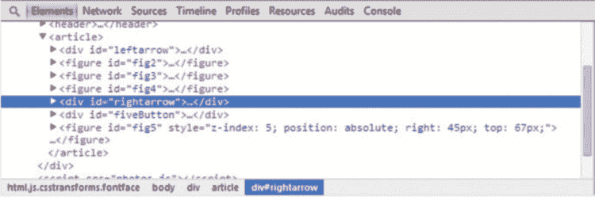  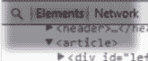 

图 5-8: 文档树中 `article` 元素的子元素
作为 article 元素的子附加的 figure元素
来源：© Google Chrome。

## 添加和删除文档节点

注意，包含 `figure` 元素及其子元素 `img` 元素的文档片段是 `article` 元素的最后一个子。使用 `appendChild()` 方法附加的节点始终作为父元素的最后一个子元素添加。

接下来，你需要创建 `figure` 和 `img` 元素来显示库中的第一张图像。与其从头开始创建并配置新元素，不如创建一个你已经创建的文档片段的副本。

### 克隆节点

有时，你想创建一个与文档中现有节点相同或相似的新节点。与其复制创建和配置新节点所需的所有语句，你都可以使用 `Document` 对象的 `cloneNode()` 方法来复制现有节点。`cloneNode()` 方法具有以下语法：

`existingNode.cloneNode(true | false)`

在此方法中，`existingNode` 是你想克隆的节点的引用。该方法接受一个布尔值作为参数，指示克隆的节点是否应该包含现有节点的任何子节点 (`true`) 或仅包含指定的父节点 (`false`)。例如，以下代码创建了一个新的 `li` 元素并将其赋值给变量 `contact`，然后为该元素指定类名为 `mainNav`。最后一条语句克隆 `contact` 节点并将副本存储在 `directions` 变量中。

```javascript
var contact = document.createElement("li");
contact.className = "mainNav";
var directions = contact.cloneNode(true);
```

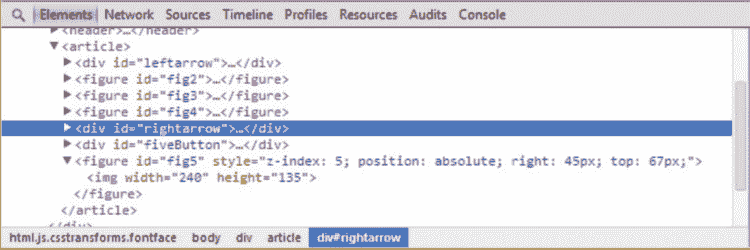

图 5-9: 显示的 `figure` 元素的子元素
来源：© Google Chrome。

对于相库应用，你需要向嵌套在 `figure` 元素中添加另一个 `img` 元素来显示第一个图像。与其创建、附加和配置两个新节点，你将使用 `cloneNode()` 方法克隆你在之前的步骤中创建的节点。然后你将添加语句仅更改新 `figure` 和 `img` 元素之间不同的属性值和样式属性。

要克隆 **lastFigure** 节点以创建 **firstFigure** 节点：

1. 返回文本编辑器中的 **photos.js** 文件。
2. 在 `previewFive()` 函数中，在最后的 `},` 之前输入以下注释和语句：
```javascript
// 为第五张图像克隆 figure元素并修改为第一张图像
var firstFigure = lastFigure.cloneNode(true);
```

该语句使用 `cloneNode()` 方法复制 `lastFigure` 节点并将结果赋值给变量 `firstFigure`。由于 `cloneNode()` 方法包含了 `true` 参数，副本包含了 `lastFigure` 节点的子节点 `img`。图 5-9 释了这一过程。存储在 `directions` 变量中的克隆节点包含 `class` 值 值，因为 `cloneNode()` 方法克隆了所有子节点（基于 `true` 参数）。

 

图 5-10: 使用 `cloneNode()` 方法
contact变量 li class = "mainNav" li class = "mainNav" li class = "mainNav" cloneNode()方法 directions变量 带有属性值的li元素

3. 在上一步添加的代码下方，在最后的 `},` 之前输入以下语句：
```javascript
firstFigure.id = "fig1";
firstFigure.style.right = "";
firstFigure.style.left = "45px";
```

此代码将 `firstFigure` 节点的 `id` 值从 `fig5`（从 `lastFigure` 节点克隆的值）更改为 `fig1`。它还删除了 `right` 样式并指定了新的 `left` 样式。

4. 在上一步添加的代码下方，在最后的 `},` 之前输入以下语句：
```javascript
articleEl.appendChild(firstFigure);
```

该语句使用 `appendChild()` 方法将 `firstFigure` 节点添加到文档树。

5. 保存更改到 **photos.js**，然后刷新或重新加载 **photos.htm**。
6. 点击**显示更多图像**按钮，右键点击**右箭头**按钮，然后点击**检查元素**。如图 5-11 所示，`id` 值为 `fig1` 的 `figure` 元素现在是 `article` 元素的最后一个子，紧位于 `id` 值为 `fig5` 的 `figure` 元素之后。

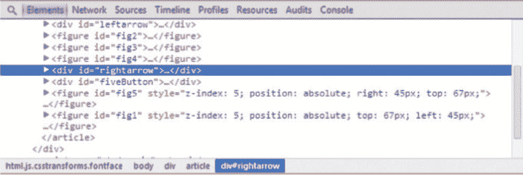  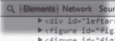 

图 5-11: 添加到文档树的 `firstFigure` 节点
作为 article 元素的子附加的 figure元素
来源：© Google Chrome。

7. 点击 `id` 值为 `fig5` 的 `figure` 元素旁边的**三角形** (▶) 以及 `id` 值为 `fig1` 的 `figure` 元素旁边的**三角形**，查看你添加的 `figure` 元素的子元素。如图 5-12 所示，你克隆的节点的子元素 `img` 作为克隆过程的一部分被复制。

8. 返回编辑器中的 **photos.js**，然后在 `previewFive()` 函数中，在关闭的 `},` 之前输入以下代码：
```javascript
// 为两个新的 img元素添加适当的 src 值
document.getElementsByTagName("img")[3].src = "images/IMG_0" + photoOrder[4] + ".jpg";
document.getElementsByTagName("img")[4].src = "images/IMG_0" + photoOrder[0] + ".jpg";
```

这两个语句使用 `populateFigures()` 函数中处理其他 `img` 元素相同的方法，为两个新的 `img` 元素的 `src` 属性赋值。

9. 滚动到 **photos.js** 顶部，然后在声明全局变量 `photoOrder` 的语句下方，添加以下语句：
```javascript
var figureCount = 3;
```

10. 在 `populateFigures()` 函数中，在现有的 `for` 语句之前，输入以下语句：
```javascript
if (figureCount === 3) {
```

11. 在 `for` 循环之后、函数的关闭 `}` 之前，输入以下代码：
```javascript
else {
  for (var i = 0; i < 5; i++) {
    filename = "images/IMG_0" + photoOrder[i];
  }
}
```

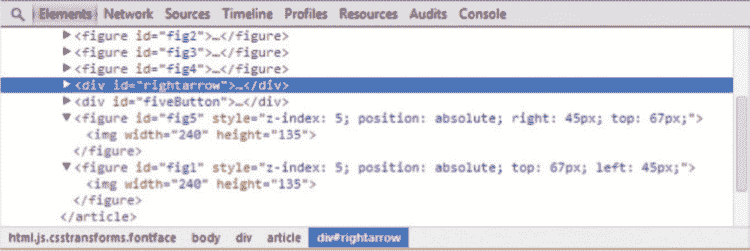   

原始 `lastFigure` 节点

  

图 5-12: 插入节点的子元素
克隆的 `firstFigure` 节点

## 添加和删除文档节点

```javascript
4 currentFig = document.getElementsByTagName("img")[i];
5 currentFig.src = filename;
6 }
7 }
```

这段代码确保了当应用程序中显示五张图片时，每当用户点击其中一个箭头按钮，`populateFigures()` 函数都会为画廊中的每个 `img` 元素分配一张图片。您修改后的 `populateFigures()` 函数应与以下内容匹配：

```javascript
1 function populateFigures() {
2 var filename;
3 var currentFig;
4 if (figureCount === 3) {
5 for (var i = 1; i < 4; i++) {
6 filename = "images/IMG_0" + photoOrder[i] + "sm.jpg";
7 currentFig = document.getElementsByTagName("img")[i-1];
8 currentFig.src = filename;
9 }
10 } else {
12 for (var i = 0; i < 5; i++) {
13 filename = "images/IMG_0" + photoOrder[i] + "sm.jpg";
14 currentFig = document.getElementsByTagName("img")[i];
15 currentFig.src = filename;
16 }
17 }
18 }
```

12. 滚动到 `previewFive()` 函数，然后在结束的 `},` 之前输入以下语句：

`figureCount = 5;`

默认情况下，`figureCount` 变量在页面打开时设置。此语句将其更改为用户切换查看五张图片时，确保 `populateFigures()` 函数为每个 `img` 元素分配一张照片。

13. 保存您对 **photos.js** 的更改，在浏览器中刷新或重新加载 **photos.htm**，然后点击**显示更多图片**（Show more images）按钮。将显示两个额外的图片，分别位于画廊的两端，如图所示。

14. 点击**右箭头**按钮，然后再次点击**右箭头**按钮。注意，第一次点击按钮时图片没有变化，但第二次点击时会向前移动。

由于第一张图片是 `article` 元素中的最后一张图片，因此第一次点击右箭头按钮时图片位置不会改变。您可以通过在 `article` 元素内的特定位置添加第一个和最后一个 `figure` 元素来避免这种小故障。

### 在文档树的特定位置插入节点

`createElement()` 方法会创建一个未附着到 DOM 树的节点。创建新节点的最后一步是将它们添加到适当位置的 DOM 树中。您可以使用 `appendChild()` 方法将节点作为指定父节点的子节点进行添加。然而，新的子节点始终会被添加到任何现有子节点的之后。

如果您需要在同一父元素现有子节点之间的某个特定位置添加节点，则应改用 `insertBefore()` 方法，其语法如下：

`parentNode.insertBefore(newChildNode, existingChildNode)`

例如，假设您正在处理以下 HTML 代码：

```html
1 <ul id="topnav">
2 <li><a href="aboutus.htm">关于我们</a></li>
3 <li><a href="order.htm">订单</a></li>
4 <li><a href="support.htm">支持</a></li>
5 </ul>
```

 

*画廊中显示的额外两个图片*
图 5-13：显示五张图片的画廊
*© Jason Bucy. © Sasha Vodnik.*

由于照片画廊应用的现有代码使用 `img` 元素的顺序来确定每张图片的显示位置，因此您需要在文档中现有第一个 `figure` 元素之前插入 `first` 节点。为了确保对文档树的添加与用户在屏幕上看到的内容一致，您还将 `last` 节点放在之前。

以下 JavaScript 语句创建一个新的 `li` 元素，然后将其在现有 HTML 的第一个 `li` 元素之前作为 `ul` 元素的子节点：

```javascript
1 var list = document.getElementById("topnav");
2 var directions = document.createElement("li");
3 directions.innerHTML = "方向";
4 var aboutus = document.querySelectorAll("#topnav li")[0];
5 list.insertBefore(directions, aboutus);
```

第 1 行语句创建了变量 `list`，其值指向 id 值为 `topnav` 的 `ul` 元素。第 2 行创建一个新的 `li` 元素并将其赋值给变量 `directions`。第 4 行将 `aboutus` 变量赋值给 `topnav` 列表中现有第一个 `li` 元素。第 5 行中的 `insertBefore()` 方法指定 `list` 为父元素，`directions` 为要添加的子元素，并将 `aboutus` 为 `directions` 插入之前的现有子元素。图示了此示例中 DOM 树的变化。

| 变化之前 | 之后 |
| :--- | :--- |
| \<ul> | \<ul> |
| \<li>\<a>关于我们\</a>\</li> | \<li>方向\</li> |
| \<li>\<a>订单\</a>\</li> | \<li>\<a>关于我们\</a>\</li> |
| \<li>\<a>支持\</a>\</li> | \<li>\<a>订单\</a>\</li> |
| | \<li>\<a>支持\</a>\</li> |

## 第 5 章 使用文档对象模型 (DOM) 和 DHTML

你可以将移除的节点赋值给变量，以便以后使用，如下面的代码所示：

`var list = document.getElementById("topnav");`
`var aboutus = document.querySelectorAll("#topnav li")[0];`
`var aboutNode = list.removeChild(aboutus);`

这段代码的最后一行使用 `removeChild()` 方法从父节点 `list` 中移除 `aboutus` 节点。该语句将移除的节点赋值给 `aboutNode` 变量。随后，你可以在代码的其他地方引用 `aboutNode` 变量，以重新附加或克隆该被移除的节点。

你想通过移除第一张和第五张图片预览，为用户提供返回图库应用原始布局的选项。接下来，你将添加代码使用 `removeChild()` 方法来实现这一功能。

要使用 **`removeChild()`** 方法移除图库中的第一张和最后一张图片：

1. 返回文本编辑器中的 **photos.js** 文件，然后在 `previewFive()` 函数中，在闭合的 `},` 之前添加以下代码：

`1`
`//更改按钮以隐藏额外的图片`
`2`
`var numberButton = document.querySelector("#fiveButton p");`
`3` `numberButton.innerHTML = "Show fewer images";`
`4` `if (numberButton.addEventListener) {`
`5` `numberButton.removeEventListener("click", previewFive,`
`6` `false);`
`7` `numberButton.addEventListener("click", previewThree,`
`8` `false);`
`9` `} else if (numberButton.attachEvent) {`
`10` `numberButton.detachEvent("onclick", previewFive);`
`11` `numberButton.attachEvent("onclick", previewThree);`

*如果你从 DOM 树中移除节点而不将其赋值给变量，JavaScript 处理器会在执行垃圾回收时从内存中删除该节点。如果你使用变量存储节点并在以后想从内存中删除该节点，可以将变量的值设置为*null*.*

**注意**

## 添加和移除文档节点

在屏幕上显示五张图片后，这段代码会将图库底部按钮的文本改为“Show fewer images”（显示更少的图片）。它还移除了当用户点击按钮时调用 `previewFive()` 函数的事件监听器，并将其替换为调用 `previewThree()` 函数的事件监听器（该函数将在后续步骤中创建）。

2. 在 `previewFive()` 函数下方，添加以下代码创建一个新的 `previewThree()` 函数并声明它将使用的变量：

`1`
`/* 到 3 张图片的布局 */`
`2` `function previewThree() {`
`3` `var articleEl = document.getElementsByTagName("article")[0];`
`4` `var numberButton = document.querySelector("#fiveButton p");`
`5` `}`

3. 在闭合的 `}` 之前，输入以下语句移除第一个和第五个 `figure` 元素：

`articleEl.removeChild(document.getElementById("fig1"));`
`articleEl.removeChild(document.getElementById("fig5"));`

第一条语句使用 `removeChild()` 方法移除 id 值为 `fig1` 的元素，第二条使用 `removeChild()` 移除 id 值为 `fig5` 的元素。由于这两条语句都没有将结果赋值给变量，因此移除的节点将被删除且不会保留在计算机内存中。

4. 在闭合的 `}` 之前，输入以下语句以完成该功能：

`1`
`figureCount = 3;`
`2` `numberButton.innerHTML = "Show more images";`
`3` `if (numberButton.addEventListener) {`
`4` `numberButton.removeEventListener("click", previewThree,`
`5` `false);`
`6` `numberButton.addEventListener("click", previewFive, false);`
`7` `} else if (numberButton.attachEvent) {`
`8` `numberButton.detachEvent("onclick", previewThree);`
`9` `numberButton.attachEvent("onclick", previewFive);`
`10` `}`

5. 保存对 **photos.js** 的更改，在浏览器中刷新或重新加载 **photos.htm**，然后点击 **Show more images** 按钮。显示额外的图片，按钮文本变为“Show fewer images”。

6. 右键点击图库中的第一张图片，点击**Inspect element**检查元素），然后在文档树中验证所有五个 `figure` 元素是否已按顺序显示。

7. 点击 **Show fewer images** 按钮，然后检查文档树。如图 5-16 所示，第一个和第五个 `figure` 元素已从文档树中移除，按钮文本变回“Show more images”。

图 5-16：移除元素后的文档树
*来源：© Google Chrome.*

### 短测 3

1. 哪条语句创建一个新的 `footer` 元素？
2. 写出两个可以用于向 DOM 树中添加节点的方法，并解释它们之间的区别。
3. 下述两个语句的结果将会有何不同？

## 使用 **Window** 对象操作浏览器

`Window` 对象包含了多个属性，这些属性包含关于浏览器窗口或标签页的信息。例如，`name` 属性包含当前窗口或标签页的名称。`Window` 对象中还包含各种方法，允许你操作 浏览器窗口或标签页本身。你已经使用过 `Window` 对象的一些方法，包括显示对话框的 `window.alert()` 方法。

表 5-3 列出了一些常用的 `Window` 对象属性，表 5-4 列出了一些常用的 `Window` 对象方法。

| 属性 (PROPERTY) | 说明 (DESCRIPTION) |
| :--- | :--- |
| `closed` | 表示窗口或标签页已关闭的布尔值 |
| `document` | 对 `Document` 对象的引用 |
| `history` | 对 `History` 对象的引用 |
| `innerHeight` | 显示内容区域的高度，包括可能存在的滚动条 |
| `innerWidth` | 显示内容区域的宽度，包括可能存在的滚动条 |
| `location` | 对 `Location` 对象的引用 |
| `name` | 窗口或标签页的名称 |
| `navigator` | 对 `Navigator` 对象的引用 |
| `opener` | 对打开它的窗口的引用 |
| `outerHeight` | 整个窗口的高度 |
| `outerWidth` | 整个窗口的宽度 |
| `screen` | 对 `Screen` 对象的引用 |
| `self` | `Window` 对象的自引用 |
| `status` | 写入状态栏的临时文本 |

| 方法 (METHOD) | 说明 (DESCRIPTION) |
| :--- | :--- |
| `alert()` | 显示一个简单的对话框 |
| `blur()` | 移除窗口或标签页的焦点 |
| `clearInterval()` | 取消设置的间隔器 |
| `clearTimeout()` | 取消设置的超时器 |
| `close()` | 关闭浏览器窗口或标签页 |
| `confirm()` | 显示带有确定和取消的确认对话框 |
| `focus()` | 使窗口或标签页变为活动状态 |
| `moveBy()` | 相对于当前位置移动窗口 |
| `moveTo()` | 将窗口移动到绝对位置 |
| `open()` | 打开一个新的浏览器窗口或标签页 |
| `print()` | 打印当前显示的文档 |
| `prompt()` | 显示提示用户输入信息的对话框 |

*使用 **Window** 属性操作浏览器*

引用 `Window` 对象的另一种方式是使用 **self 属性**，该属性指向当前的 `Window` 对象。使用 `self` 属性与使用 `window` 属性相同。例如，以下行是相同的：

`window.close();`
`self.close();`

一些 JavaScript 程序员倾向于使用 `window` 属性，而另一些程序员则倾向于使用 `self` 属性。这取决于你的选择。但在尝试解读他人编写的 JavaScript 代码时，请注意这两个属性都指向 `Window` 对象。因为 浏览器假设你指的是全局对象，所以当你使用它的任何属性或方法时，通常不需要显式地引用 `Window` 对象。

### 打开和关闭窗口及标签页

大多数浏览器都允许在已打开的窗口或标签页之外打开新的窗口或标签页。你可能需要打开新浏览器窗口或标签页有很多。你可能想在一个独立的窗口或标签页中启动新网页，允许用户在当前窗口或标签页中继续查看当前页面。或者你可能想使用额外的窗口或标签页来显示图片或订单表等信息。

## 使用 `Window` 对象操控浏览器

你可以使用简单的 HTML（无需任何 JavaScript），通过使用 `a` 元素的 `target` 属性在新窗口或标签页中打开链接。例如，下面的链接将在名为 `wikiWindow` 的新窗口或标签页中打开维基百科主页：

`<a href="http://www.wikipedia.org/" target="wikiWindow">Wikipedia home主页</a>`

每当用户点击上述链接时，浏览器会首先检查是否存在名为 `wikiWindow` 的浏览器窗口或标签页。如果该窗口或标签页存在，则会在其中打开链接。如果该窗口或标签页不存在，则会创建一个名为 `wikiWindow` 的新窗口或标签页，并在其中打开链接。

### 打开窗口或标签页

在许多场景下，你可能想要打开窗口或标签页，但此时仅使用 HTML 的方法并不合理。例如，你可能希望在用户点击 `a` 元素以外的元素时打开窗口或标签页。你可能还希望根据变量为新窗口或标签页命名，而不是将其硬编码在 HTML 中。对于这些情况，你可以使用 JavaScript 通过 `Window` 对象的 `open()` 方法来创建新窗口或标签页。`open()` 方法的语法为 `window.open(url, name, options, replace);`。

表格描述了 `window.open()` 方法的参数。

*默认情况下，所有主流浏览器的当前版本通常打开新标签页，而不是新窗口。然而，每个标签页都被视为一个独立的 `Window` 对象，因为它包含一个独立的文档。因此，标签页拥有表 5-4 和表 5-5 列出的所有属性和方法。*

**注意**

表 5-5：`Window` 对象的 `open()` 方法参数

| 参数 | 说明 |
| :--- | :--- |
| `url` | 代表要打开的 Web 地址或文件名 |
| `name` | 为新 `Window` 对象的 `name` 属性赋值 |
| `options` | 代表一个字符串，允许你自定义新 浏览器窗口的外观 |
| `replace` | 一个布尔值，决定 URL 应该在浏览器的历史列表中创建一个新条目（`true`）还是替换现有条目（`false`）；如果未指定，默认值为 `false` |

每当打开一个新的浏览器窗口或标签页时，都会创建一个新的 `Window` 对象来表示该新窗口或标签页。你可以开启系统支持的任意数量的浏览器窗口或标签页，每个窗口显示不同的网页。

## 第 5 章 使用文档对象模型 (DOM) 和 DHTML

当你打开一个新的浏览器窗口或标签页时，可以使用 `window.open()` 方法的 `options` 参数来定制其外观。表 - 列表列出了你可以配合 `window.open()` 方法使用的一些常用选项。

*如果你正在编写需要用户点击链接或按钮的代码，那么你可以使用事件监听器调用 `window.open()` 方法，此时窗口或标签页将成功打开。然而，如果你在没有用户请求的情况下包含打开新窗口或标签页的 JavaScript 代码，所有主流浏览器内置内置的弹出拦截功能将阻止窗口或标签页的打开。浏览器内置的弹出拦截功能会检查触发打开窗口代码的事件，只有当事件是点击、触摸或其他用户生成的事件时才会执行代码。*

**注意**

表 5-6：`Window` 对象的 `open()` 方法的常用选项

| 名称 | 说明 |
| :--- | :--- |
| `height` | 设置窗口的高度 |
| `left` | 设置窗口左侧的水平坐标（单位为像素） |
| `location` | 包含 URL 位置文本框 |
| `menubar` | 包含菜单栏 |
| `personalbar` | 包含书签栏（或其他用户自定义的栏） |
| `resizable` | 决定新窗口是否可以调整大小 |
| `scrollbars` | 包含滚动条 |
| `status` | 包含状态栏 |
| `toolbar` | 包含标准工具栏 |
| `top` | 设置窗口顶部的垂直坐标（单位为像素） |
| `width` | 设置窗口的宽度 |

你可以包含 `window.open()` 方法的所有参数或一个都不包含。例如，语句 `window.open("http://www.wikipedia.org");` 会在新的浏览器窗口或标签页中打开维基百科主页。如果如果你排除了 `url` 参数，则会打开空白网页。例如，语句 `window.open();` 会打开一个空白的浏览器窗口或标签页。

表 - 中列出的所有选项，除 `width` 和 `height` 选项外，都是使用“yes”或“no”的值（或对于 yes 和对于 no）设置的。例如，为了包含状态

例如，假设你正在为一个销售打印机的网站工作。用户可以查看一个显示所有打印机汇总信息的页面，并点击任何打印机查看详情。为了在新窗口或标签页中显示特定打印机的信息，你可能使用以下代码：

## 使用 Window 对象操作浏览器

4. 重复步骤并打开 **zoom.js** 并保存一份个性化的副本，然后滚动文档以熟悉其内容。该文件包含了全局变量声明以及一个 `pageSetup()` 函数。

5. 回到文本编辑器中的 **photos.js** 文档。

6. 在 `zoomFig()` 函数的函数块中，添加以下语句：
`var zoomWindow = window.open("zoom.htm", "zoomwin", "width=960,height=600");`

此语句创建了一个名为 `zoomWindow` 的变量，并将 `window.open()` 方法创建的窗口赋值给它。该窗口显示 `zoom.htm` 文档的内容，名为 `zoomwin`，宽度为 960px，高度为 600px。将此窗口赋值给变量将允许你在应用程序的其他部分对其进行修改。

7. 保存你的工作，在浏览器中刷新或重新加载 **photos.htm**，然后点击页面中央的照片。如图 5-17 所示，照片放大版本将在单独窗口中打开。


图 5-17：使用 `open()` 方法打开的窗口
*© Jason Bucy. 来源：© Mozilla Firefox.*

8. 关闭显示放大图片的窗口。注意，点击窗口底部的“Close Window”文本没有效果。你将在下一节中添加此功能。

`Window` 对象的 `name` 属性可以仅在链接时指定目标窗口，但不能在 JavaScript 代码中使用。如果你想通过位于*创建*该窗口的网络浏览器中的 JavaScript 代码来控制新窗口，那么你必须将用 `window.open()` 方法创建的新 `Window` 对象赋值给一个变量。打开照片画廊幻灯片网页的语句将一个代表新网络浏览器窗口的对象赋值给名为 `zoomWindow` 的变量。你可以对代表 `Window` 对象的变量使用 `Window` 对象的任何属性和方法。

像你的照片画廊这样的网页存在一个问题，即响应用户点击链接而打开的窗口可能会隐藏在用户屏幕上其他窗口后面，或“丢失”。例如，假设用户点击了主图（正如你所做的那样），从而打开了一个新窗口。如果用户随后在没有关闭新窗口的情况下返回主页，浏览幻灯片直到另一张照片位于中心，然后点击该图像，新图像将在之前创建的名为 `zoomwin` 的相同窗口中打开。然而，如果该窗口被隐藏在主浏览器窗口后面，在用户看来应用程序似乎崩溃了，因为点击图像将不再产生可见的效果。

用户可能会不断点击图像，认为对他们的点击没有任何响应，而实际上代码运行正常。问题可能在于窗口已经打开了但不可见。要使一个窗口成为活动窗口，你使用 `Window` 对象的 `focus()` 方法。你将 `focus()` 方法附加到代表窗口的变量上，而不是附加到 `window.open()` 方法的名称参数上。例如，要让外部照片画廊窗口成为活动窗口，你将使用以下语句：
`zoomWindow.focus();`

此语句将 `focus()` 方法附加到代表窗口的变量 `zoomWindow` 的名称上。注意，你不会使用第二个窗口的名称（如语句 `zoomwin.focus()` 所示），因为出于浏览器安全考虑，JavaScript 代码无法直接影响另一个窗口。

*出于安全考虑，某些浏览器不会显示由本地文件启动的文档所引的文件。如果新窗口打开但未显示图像，请使用不同的浏览器重复步骤 8。注意，此问题可能会影响你作为本地测试应用程序的开发者，但不会影响通过网络访问内容的最终用户。*

**注意**

接下来，你将为照片画廊应用程序中的 `zoomFig()` 函数添加一个 `focus()` 方法。

要为 `zoomFig()` 函数添加 `focus()` 方法：

1. 回到文本编辑器中的 **photos.js** 文档。
2. 在 `zoomFig()` 函数的结束大括号之前，添加以下语句：
`zoomWindow.focus();`

你完成的 `zoomFig()` 函数应如下所示：
```javascript
1 /* open center figure in separate window */
2 function zoomFig() {
3 var zoomWindow = window.open("zoom.htm", "zoomwin",
4 "width=960,height=600");
5 zoomWindow.focus();
6 }
```

3. 保存你的工作，在浏览器中刷新或重新加载 **photos.htm**，然后点击页面中央的照片。照片放大版本将在单独窗口中打开。
4. 关闭显示放大图片的窗口。注意，点击窗口底部的“Close Window”文本没有效果。你将在下一节中添加此功能。

`Window` 对象的 `name` 属性可以仅在链接时指定目标窗口，但不能在 JavaScript 代码中使用。如果你想通过位于*创建*该窗口的网络浏览器中的 JavaScript 代码来控制新窗口，那么你必须将用 `window.open()` 方法创建的新 `Window` 对象赋值给一个变量。打开照片画廊幻灯片网页的语句将一个代表新网络浏览器窗口的对象赋值给名为 `zoomWindow` 的变量。你可以对代表 `Window` 对象的变量使用 `Window` 对象的任何属性和方法。

像照片画廊这样的网页存在一个问题，即响应用户点击链接而打开的窗口可能会隐藏在用户屏幕上其他窗口后面，或“丢失”。例如，假设用户点击了主图（正如你所做的那样），从而打开了一个新窗口。如果用户随后在没有关闭新窗口的情况下返回主页，浏览幻灯片直到另一张照片位于中心，然后点击该图像，新图像将在之前创建的名为 `zoomwin` 的相同窗口中打开。然而，如果该窗口被隐藏在主浏览器窗口后面，在用户看来应用程序似乎崩溃了，因为点击图像将不再产生可见的效果。

用户可能会不断点击图像，认为对他们的点击没有任何响应，而实际上代码运行正常。问题可能在于窗口已经打开了但不可见。要使一个窗口成为活动窗口，你使用 `Window` 对象的 `focus()` 方法。你将 `focus()` 方法附加到代表窗口的变量上，而不是附加到 `window.open()` 方法的名称参数上。例如，要让外部照片画廊窗口成为活动窗口，你将使用以下语句：
`zoomWindow.focus();`

此语句将 `focus()` 方法附加到代表窗口的变量 `zoomWindow` 的名称上。注意，你不会使用第二个窗口的名称（如语句 `zoomwin.focus()` 所示），因为出于浏览器安全考虑，JavaScript 代码无法直接影响另一个窗口。

*出于安全考虑，某些浏览器不会显示由本地文件启动的文档所引的文件。如果新窗口打开但未显示图像，请使用不同的浏览器重复步骤 8。注意，此问题可能会影响你作为本地测试应用程序的开发者，但不会影响通过网络访问内容的最终用户。*

**注意**

接下来，你将为照片画廊应用程序中的 `zoomFig()` 函数添加一个 `focus()` 方法。

要为 `zoomFig()` 函数添加 `focus()` 方法：

1. 回到文本编辑器中的 **photos.js** 文档。
2. 在 `zoomFig()` 函数的结束大括号之前，添加以下语句：
`zoomWindow.focus();`

你完成的 `zoomFig()` 函数应如下所示：
```javascript
1 /* open center figure in separate window */
2 function zoomFig() {
3 var zoomWindow = window.open("zoom.htm", "zoomwin",
4 "width=960,height=600");
5 zoomWindow.focus();
6 }
```

3. 保存你的工作，在浏览器中刷新或重新加载 **photos.htm**，然后点击页面中央的照片。照片放大版本将在单独窗口中打开。
4. 关闭显示放大图片的窗口。注意，点击窗口底部的“Close Window”文本没有效果。你将在下一节中添加此功能。

创建一个函数和事件监听器，在用户点击“Close Window”文本时关闭 `zoomwin` 窗口。

1. 回到文本编辑器中的 **photos.js** 文档。
2. 在 `pageSetup()` 函数下方，输入以下代码来声明 `closeWin()` 函数：
```javascript
/* close window */
function closeWin() {
}
```

3. 在 `closeWin()` 函数的函数块内，输入以下语句：
`window.close();`

你完成的函数应如下所示：
```javascript
1 /* close window */
2 function closeWin() {
3 window.close();
4 }
```

4. 在 `closeWin()` 函数下方，添加以下 `createEventListener()` 函数：
```javascript
1 /* create event listener for close button */
2 function createEventListener() {
3 var closeWindowDiv =
4 document.getElementsByTagName("p")[0];
5 if (closeWindowDiv.addEventListener) {
6 closeWindowDiv.addEventListener("click", closeWin,
7 false);
8 else if (closeWindowDiv.attachEvent) {
9 closeWindowDiv.attachEvent("onclick", closeWin);
10 }
11 }
```

因为包含“Close Window”文本的 `p` 元素是文档中的第一个 `p` 元素，你使用 `getElementsByTagName()` 方法并带有索引 0 来引用它。

5. 滚动到 `pageSetup()` 函数，然后就在结束大括号之前，添加以下语句：
`createEventListener();`

## 使用 *Window* 对象操作浏览器

你完成的 `pageSetup()` 函数应如下所示：

```javascript
/* 填充 img 元素并创建事件监听 */
function pageSetup() {
  document.getElementsByTagName("img")[0].src = figFilename;
  // 将文件名赋值给 img 元素
  createEventListener();
}
```

6. 保存工作，在浏览器中刷新或重新加载 **photos.htm**，然后点击**中间的图片**。大版本的图片将在新窗口中显示，如图 5-18 所示。

  

关闭窗口文本
图 5-18：新窗口
© Jason Bucy. Source: © Mozilla Firefox.

7. 在新窗口底部，点击**关闭窗口**。窗口将关闭。

*如果图片没有在浏览器中显示，由于浏览器的安全策略，链接也将无法工作。请使用不同的浏览器重复步骤 7。与之前一样，此问题可能会影响你作为本地测试应用程序的开发者，但不会影响通过网络访问内容的终端用户。*

**注意**

## 第 5 章 使用文档对象模型 (DOM) 和 DHTML

`clearTimeout()` 方法用于在 `setTimeout()` 方法的代码执行之前取消它。`clearTimeout()` 方法接收一个参数，即代表 `setTimeout()` 方法调用的变量。代表 `setTimeout()` 方法调用的变量必须声明为全局变量。（回想一下全局变量是在函数外部声明的变量，并且对 JavaScript 应用的所有部分都可用。）

以下代码中的脚本部分包含一个 `setTimeout()` 方法和一个 `clearTimeout()` 方法调用。`setTimeout()` 方法被设置为在经过 5000 毫秒（5 秒）后执行。如果用户点击 OK 按钮，`buttonPressed()` 函数将调用 `clearTimeout()` 方法。

```javascript
var buttonNotPressed = setTimeout("window.alert('Your changes have been saved')", 10000);
function buttonPressed() {
  clearTimeout(buttonNotPressed);
  window.open(index.htm);
}
```

### 使用超时和间隔器

在开发网页时，你可能需要某些 JavaScript 代码在没有用户干预的情况下重复执行。或者，你可能希望允许某种自动执行的重复任务。例如，你可能想创建一个幻灯片，其中显示的图片每隔几秒自动一次。

你使用 `Window` 对象的超时和间隔方法来创建自动执行的代码。JavaScript 中的 `setTimeout()` 方法用于在经过特定时间后执行代码。使用 `setTimeout()` 方法执行的代码执行一次。`setTimeout()` 方法的语法如下：

```javascript
var variable = setTimeout("code", milliseconds);
```

该语句声明变量将引用 `setTimeout()` 方法。`code` 参数必须包含在双引号或单引号中，可以是单个的 JavaScript 语句、一系列 JavaScript 语句或函数调用。网络浏览器在执行 `setTimeout()` 方法的代码参数之前等待的时间以毫秒为单位。

*一个毫秒是秒的千分之一；一秒有 1,000 毫秒。这意味着，例如，5 秒等于 5,000 毫秒。*

**注意**

另外两个创建自动执行代码的 JavaScript 方法是 `setInterval()` 方法和 `clearInterval()` 方法。`setInterval()` 方法与 `setTimeout()` 方法类似，不同之处在于被调用一次后会重复执行相同的代码。`clearInterval()` 方法用于清除 `setInterval()` 方法调用，其方式与 `clearTimeout()` 方法清除 `setTimeout()` 方法相同。`setInterval()` 方法的语法与 `setTimeout()` 方法相同：

```javascript
var variable = setInterval("code", milliseconds);
```

与 `clearTimeout()` 方法一样，`clearInterval()` 方法接收一个参数，代表 `setInterval()` 方法调用的全局变量。接下来，你将修改相册页面，使其每隔几秒自动切换到一张图片。

使用 `setInterval()` 方法使相册图片自动切换：

1. 回到文本编辑器中的 **photos.js** 文档。
2. 在文档顶部附近，注释部分下方，向全局变量部分添加以下语句：
   `var autoAdvance = setInterval(rightArrow, 5000);`
3. 保存工作，在浏览器中刷新或重新加载 **photos.htm**，然后等待 5 秒。

使用 `setInterval()` 方法使相册图片自动切换：

1. 回到文本编辑器中的 **photos.js** 文档。
2. 在文档顶部附近，注释部分下方，向全局变量部分添加以下语句：
   `var autoAdvance = setInterval(rightArrow, 5000);`
3. 保存工作，在浏览器中刷新或重新加载 **photos.htm**，然后等待 5 秒。图片将每隔几秒自动切换。

自动幻灯片对用户很有帮助，但无疑某些用户希望按照自己的节奏浏览图片。你需要引入 `clearInterval()` 方法，以便当用户点击箭头时取消 `setInterval()` 方法。

要使用 `clearInterval()` 方法使用户取消相册幻灯片：

1. 回到文本编辑器中的 **photos.js** 文档。
2. 在 `leftArrow()` 函数中，其他语句之前添加以下语句：
   `clearInterval(autoAdvance);`

更新后的 `leftArrow()` 函数应如下：

```javascript
function leftArrow() {
  clearInterval(autoAdvance);
  for (var i = 0; i < 5; i++) {
    if (photoOrder[i] - 1 === 0) {
      photoOrder[i] = 5;
    } else {
      photoOrder[i] -= 1;
    }
  }
  populateFigures();
}
```

3. 保存工作，然后在浏览器中刷新或重新加载 **photos.htm**。
4. 在窗口左侧，点击**左箭头**。幻灯片将返回显示之前的图片。此外，由于你在左箭头调用的函数中添加了 `clearInterval()` 方法，图片将不再自动变化。

你可以为右箭头添加相同的功能。然而，编写此功能更为复杂。因为 `rightArrow()` 函数被 `setInterval()` 方法使用，在此函数中添加 `clearInterval()` 方法会导致图片在变化一次后停止。为了让户户通过右箭头停止动画，你需要将 `rightArrow()` 函数当前的功能分离到一个单独中，并创建一个新的 `rightArrow()` 函数来清除间隔并调用新函数。

5. 回到文本编辑器中的 **photos.js** 文档，然后在 `rightArrow()` 函数中将函数名更改为 `rightAdvance()`。你更新后的函数应如下：

```javascript
/* 将所有图片向左移动一张，并更改 photoOrder 数组中的值以匹配 */
function rightAdvance() {
  for (var i = 0; i < 5; i++) {
    if (photoOrder[i] + 1 === 6) {
      photoOrder[i] = 1;
    } else {
      photoOrder[i] += 1;
    }
  }
  populateFigures();
}

function rightArrow() {
  clearInterval(autoAdvance);
  rightAdvance();
}
```

## 使用 `History`、`Location`、`Navigator` 和 `Screen` 对象

6. 在 `rightAdvance()` 函数上方添加以下新的 `rightArrow()` 函数：

```javascript
/* 停止自动切换图片并调用 rightAdvance() */
function rightArrow() {
  clearInterval(autoAdvance);
  rightAdvance();
}
```


此函数清除了使用 `autoAdvance` 变量设置的定时器，然后调用 `rightAdvance()` 函数像之前一样切换图片。

7. 滚动到 `autoAdvance` 变量的声明处，然后在 `setInterval()` 方法中将 `rightArrow` 替换为 `rightAdvance`。你修改后的变量声明应与以下匹配：
`var autoAdvance = setInterval(rightAdvance, 5000);`

8. 保存你的工作，然后在浏览器中刷新或重新加载 `photos.htm`。照片应该仍然每秒切换一次。

9. 在窗口右侧，点击右箭头。幻灯片应该会显示下一张图片。此外，由于你为右箭头调用的函数中添加了 `clearInterval()` 方法，图片将不再每秒自动变化。

### 简测测试 4

- 你使用什么语句来创建一个新的空白窗口？
- 如果你的应用程序包含了在没有收到用户请求的情况下打开新窗口或标签页的 JavaScript 代码，会发生什么？
- 如果你想从创建新窗口的窗口控制新窗口，在代码中创建新窗口需要采取什么额外步骤？

## 使用 `History`、`Location`、`Navigator` 和 `Screen` 对象

虽然 `Document` 对象可能是 `Window` 对象最重要的子对象，但理解其他子对象的作用同样重要。在本节中，你将学习 `History`、`Location`、`Navigator` 和 `Screen` 对象。

### `History` 对象

`History` 对象维护了一个在当前网络浏览器会话期间打开的所有文档的内部列表（被称为**历史列表**）。每个网络浏览器窗口都包含其自身的内部 `History` 对象。你无法直接查看历史列表中包含的 URL。

当你使用 `History` 对象的方法或属性时，必须包含对 `History` 对象本身的引用。例如，`back()` 和 `forward()` 方法允许脚本在浏览历史记录中向后或向前移动。要使用 `back()` 方法，必须使用：`history.back()`。

`go()` 方法用于导航到已访问的特定网页。`go()` 方法的参数是一个整数，表示你想在历史列表中向前或向后导航多少页。例如，`history.go(-2);` 打开历史列表中向后两页的网页；语句 `history.go(3);` 打开历史列表中向前三页的网页。语句 `history.go(-1);` 等同于使用 `back()` 方法，而语句 `history.go(1);` 等同于使用 `forward()` 方法。

`History` 对象包含一个单一属性，即 `length` 属性，该属性存储了在当前浏览器会话期间打开的文档数量。要使用 `length` 属性，你使用语法 `history.length`。`length` 属性不包含文档本身的 URL，只包含一个表示打开了多少文档的整数。以下代码使用 `length` 属性配合 `go()` 方法返回当前浏览器会话中打开的第一个文档：`history.go(-history.length);`

但你可以编写一个脚本，利用历史列表导航到浏览器会话期间打开过的网页。`History` 对象实际上并不会显示历史列表中包含的 URL。这很重要，因为网络浏览器中的个人用户信息（例如用户喜欢访问的网站类型）是隐私信息。防止他人查看历史列表中的 URL 是一项基本的安全功能，因为它保持了人们浏览历史的机密性。

`History` 对象包含三个方法，如表 5-7 所示。

| 方法 | 描述 |
| :--- | :--- |
| `back()` | 产生与点击浏览器“后退”按钮相同的结果 |
| `forward()` | 产生与点击浏览器“前进”按钮相同的结果 |
| `go()` | 打开历史列表中的特定文档 |

表 5-7：`History` 对象的方法

### `Location` 对象

当你想要允许用户从一个网页打开另一个网页时，通常会使用 `<a>` 元素创建一个链接。你也可以使用 JavaScript 代码和 `Location` 对象来打开网页。`Location` 对象允许你在 JavaScript 代码内部切换到新页面。你可能想用 JavaScript 代码更改网页的一个原因可能是：简短显示一条消息，让用户知道他们执行的操作（例如提交请求或更改账户信息）是成功的，然后自动将访问者重回他们在提交请求之前查看的内容。

`Location` 对象包含几个属性和方法，用于处理当前浏览器窗口中打开的文档的 URL。当你使用 `Location` 对象的方法或属性时，必须包含对 `Location` 对象本身的引用。例如，要使用 `href` 属性，你必须编写 `location.href = URL`。表 5-8 列出了 `Location` 对象的属性，表 5-9 列出了 `Location` 对象的方法。

| 属性 | 描述 |
| :--- | :--- |
| `hash` | URL 的锚点 |
| `host` | 网络主机的主机和域名名（或 IP 地址） |
| `hostname` | URL 主机名和端口部分的组合 |
| `href` | 完整的 URL 地址 |
| `pathname` | URL 的路径 |
| `port` | URL 的端口 |
| `protocol` | URL 的协议 |
| `search` | URL 的搜索或查询部分 |

表 5-8：`Location` 对象的属性

| 方法 | 描述 |
| :--- | :--- |
| `assign()` | 加载新网页 |
| `reload()` | 使当前在网络浏览器中显示的页面再次打开 |
| `replace()` | 用不同的 URL 替换当前加载的 URL |

表 5-9：`Location` 对象的方法

对于 URL 的某些部分，通常更改代表整个 URL 的 `href` 属性更为简单。例如，以下语句打开了 Google 首页：`location.href = "http://www.google.com";`

`Location` 对象的 `assign()` 方法执行与更改 `href` 属性相同的操作：它加载一个新网页。以下两个语句是等价的：
`location.assign("http://www.google.com");`
`location.href = "http://www.google.com";`

`Location` 对象的 `reload()` 方法等同于点击浏览器的“刷新”按钮。它导致当前在浏览器中的页面再次打开。你可以不带任何参数直接使用 `reload()` 方法，如 `location.reload();`，也可以包含一个布尔类型的参数 `true` 或 `false`。包含 `true` 参数会强制当前网页从其所在的服务器重新加载，即使没有发生任何变化。例如，语句 `location.reload(true);` 强制刷新当前页面。如果你包含 `false` 参数，或者不包含任何参数，则只有当网页发生变化时才会重新加载。

`Location` 对象的 `replace()` 方法用于用不同的 URL 替换当前加载的 URL。该方法与通过更改 `href` 属性加载新文档有所不同。`replace()` 方法实际上是用一个文档覆盖另一个文档，并替换浏览器历史列表中的旧 URL 条目。相比之下，`href` 属性是打开另一个文档并添加到历史列表中。

### `Navigator` 对象

`Navigator` 对象用于获取有关当前浏览器的信息。它的名字来源于 Netscape Navigator，但所有主流浏览器都支持。某些浏览器支持 `Navigator` 对象的独特方法和属性，这些无法在其他浏览器中运行。表 5-10 列出了所有主流浏览器当前版本支持的 `Navigator` 对象属性。

例如，以下代码标记并记录了 `Navigator` 对象的几个属性：

```
1
console.log("Web browser name: " + navigator.appName);

2
console.log("Web browser version: " + navigator.appVersion);

3
console.log("Operating platform: " + navigator.platform);

4
console.log("User agent: " + navigator.userAgent);
```

图 5-19 显示了这些命令在 Firefox 控制台中的执行结果。

在过去，`Navigator` 对象通常用于确定运行的是哪种类型的浏览器，以便针对不同的 JavaScript 实现执行正确的代码。今天，JavaScript 的实现在所有主流浏览器的当前版本中已经标准化，因此这种被称为“浏览器嗅探”（browser sniffing）的技术已很少使用。

然而，浏览器嗅探仍然有一个应用场景：某些浏览器的 JavaScript 实现本身包含 bug，因此识别浏览器和版本是有用的。

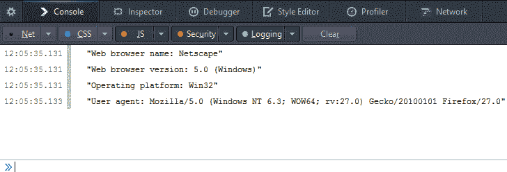
图 5-19：控制台中的 `Navigator` 对象属性
*来源: © Mozilla Firefox.*

| 属性 | 描述 |
| :--- | :--- |
| `onLine` | 浏览器当前是否具有网络连接 |
| `platform` | 客户端计算机上使用的操作系统 |
| `userAgent` | 存储在 HTTP user-agent 请求头中的字符串，包含有关浏览器、平台名称和兼容性的信息 |

表 5-10：`Navigator` 对象的属性

为了规避这些 bug。然而，浏览器嗅探是一项挑战，很难获得关于用户运行什么浏览器的确定性信息。由于原因，许多开发者使用诸如 Modernizr 等库内置的浏览器检测功能，而不是自己编写代码完成这项复杂的任务。

### `Screen` 对象

计算机显示器的差异很大，取决于显示器的类型和大小、安装的显卡类型，以及用户选择的屏幕分辨率和色彩深度。例如，某些笔记本电脑拥有分辨率有限的小屏幕，而某些台式系统可以拥有具有高分辨率的大显示器。各种可能的显示设置使得确定 JavaScript 生成的窗口的大小和位置具有挑战性。`Screen` 对象用于获取有关显示屏尺寸、分辨率和色彩深度的信息。表 5-11 列出了所有主流浏览器当前版本支持的 `Screen` 对象属性。

| 属性 | 描述 |
| :--- | :--- |
| `availHeight` | 显示屏高度，不包括操作系统功能（如 Windows 任务栏） |
| `availWidth` | 显示屏宽度，不包括操作系统功能（如 Windows 任务栏） |
| `colorDepth` | 使用调色板时显示器的位深；如果没有使用调色板，则返回 `pixelDepth` 属性的值 |
| `height` | 显示屏的高度 |
| `pixelDepth` | 以每像素位表示的显示屏色彩分辨率 |
| `width` | 显示屏的宽度 |

表 5-11：`Screen` 对象的属性

 

你可以使用 `Screen` 对象的属性来实现响应式设计原则，优化文档在不同屏幕尺寸下的外观。然而，HTML `meta` 元素中 `viewport` 属性的广泛支持使得创建响应式设计成为更简单的选择，因此这并不是 `Screen` 对象属性的常见用途。

**最佳实践**
- `meta`
- `Screen`


`Screen` 对象属性较常用的用途之一是将浏览器窗口居中在显示区域的中央。对于使用 `window.open()` 方法生成的窗口，你可以通过给选项参数中的 `left` 和 `top` 选项赋值，在窗口首次显示时将其居中。要水平居中窗口，请从屏幕宽度中减去窗口宽度，将剩余除以二，并将结果赋值给 `left` 选项。同样，要垂直居中窗口，请从屏幕高度中减去窗口高度，将剩余除以二，并将结果赋值给 `top` 选项。以下代码演示了如何创建一个窗口并将其居中在显示区域中央：

```
1
var winWidth = 300;

2
var winHeight = 200;
3
var leftPosition = (screen.width - winWidth) / 2;
4
var topPosition = (screen.height - winHeight) / 2;
5
var optionString = "width=" + winWidth + ",height=" + winHeight;
6
optionString += ",left=" + leftPosition;
7
optionString += ",top=" + topPosition;
8
var win = window.open("", "zoomWindow", optionString);
```

*记住，打开新窗口的语句必须从事件处理程序中调用，否则浏览器的弹出拦截器将阻止窗口打开。*

接下来，你将修改幻灯片应用程序，使窗口位于用户屏幕的中央。`winLeft` 变量的计算从现有窗口宽度减去新窗口宽度开始，除以二。这决定了新窗口距离左边缘的偏移量。`winTop` 变量的计算与 `winLeft` 类似，使用的是垂直属性而不是水平属性。`winOptions` 变量为 `window.open()` 方法创建一个选项字符串，包含了计算值。

1. 返回文本编辑器中的 `photo.js`。
2. 在 `zoomFig()` 块中，现有语句上方输入以下代码。
3. 在 `zoomFig()` 函数声明 `zoomWindow` 变量的下一行，将参数 `"width=960,height=600"` 替换为 `winOptions`。你的修改后 `zoomFig()` 函数如下：

```
1
/* 在单独窗口中居中 */
2
function zoomFig() {
3
var propertyWidth = 960;
4
var propertyHeight = 600;
5
var leftPosition = (screen.width - propertyWidth) / 2;
6
var topPosition = (screen.height - propertyHeight) / 2;
7
var optionString = "width=960,height=600,";
8
optionString += ",left=" + leftPosition;
9
optionString += ",top=" + topPosition;
10
var zoomWindow = window.open("zoom.htm", "zoomwin", optionString);
11
zoomWindow.focus();
12
}
```

4. 保存工作，在浏览器中刷新或加载 `photos.htm`，然后点击中心图像。打开的新窗口应该居于你的屏幕中央。

### 短期测验 5

- 提供两个显示浏览器历史中上一页的语句。
- 语句 `location.reload(true);` 的作用是什么？
- 使用 `Screen` 对象可以访问哪些类型的信息？

## 摘要

浏览器对象模型（BOM）或客户端对象模型是一个对象层级结构，其中每个对象都提供对浏览器窗口或页面不同层面的程序化访问。

浏览器对象模型中的顶层对象是 `Window` 对象，它代表一个浏览器窗口。

`Document` 对象是浏览器对象模型中最重要的对象，因为它代表了在浏览器中显示的网页。

文档对象模型（DOM）代表在窗口中显示的网页。通过 `Document` 对象，你可以访问代表网页上元素的其他对象。

- `getElementById()` 方法返回文档中具有匹配 `id` 属性的第一个元素。
- `getElementsByTagName()` 方法返回一个与指定元素（标签）名称匹配的元素数组。
- `getElementsByClassName()` 方法返回一个具有匹配指定值的 `class` 属性的元素数组。
- `getElementsByName()` 方法返回一个具有匹配指定值的 `name` 属性的元素数组。

每当打开一个新的浏览器窗口时，都会创建一个新的 `Window` 对象来表示该新窗口。当你打开一个新的浏览器窗口时，可以使用 `window.open()` 方法的 `options` 参数来自定义它的外观。

`Window` 对象的 `name` 属性只能用于为链接指定目标窗口，不能在 JavaScript 代码中使用。

要使用位于创建窗口的浏览器内的 JavaScript 代码来控制新窗口，你必须将通过 `window.open()` 方法创建的新 `Window` 对象赋值给变量。

`setTimeout()` 方法在 JavaScript 中用于在经过特定时间后执行代码，而 `clearTimeout()` 方法用于在 `setTimeout()` 方法的代码执行之前取消它。

`setInterval()` 方法在仅调用一次后会重复执行相同的代码，而 `clearInterval()` 方法用于清除 `setInterval()` 方法调用。

`History` 对象维护了一个包含在当前 Web 浏览器会话期间打开的所有文档的内部列表。

`Location` 对象允许你从 JavaScript 代码内部更改到新的网页。

`Navigator` 对象用于获取有关当前浏览器的信息。

`Screen` 对象用于获取有关显示器尺寸、分辨率和色彩深度的信息。

## 核心术语

- **API**——*参见*应用程序编程接口（application programming interface）。
- **应用程序编程接口 (API)**——关于不同软件组件如何相互相互作用的规范。
- **浏览器对象模型 (BOM)**——描述浏览器内部对象（包括当前文档内对象）之间关系的模型。
- `clearInterval() method`——`Window` 对象的方法，用于清除 `setInterval()` 方法调用。
- `clearTimeout() method`——`Window` 对象的方法，用于在 `setTimeout()` 方法的代码执行之前取消它。
- **客户端对象模型**——*参见*浏览器对象模型。
- `close() method`——`Window` 对象的方法，用于关闭浏览器窗口。
- **DHTML**——*参见*动态 HTML（dynamic HTML）。
- **文档片段 (document fragment)**——一组不属于文档的连接节点。
- **文档对象模型 (DOM)**——代表浏览器对象模型中 `Document` 对象分支的对象模型。
- **DOM**——*参见*文档对象模型。
- **DOM 树**——网页的 DOM 层级结构。
- **动态 HTML (DHTML)**——HTML、CSS 与 JavaScript 的结合，它使现代网页具有交互性。
- `focus() method`——`Window` 对象的方法，用于使窗口成为活动窗口。
- `getElementsByName() method`——`Document` 对象的方法，返回具有匹配指定值的 `name` 属性的元素集合。
- `getElementsByClassName() method`——`Document` 对象的方法，返回具有匹配指定值的 `class` 属性的元素集合。
- **全局对象 (global object)**——对 `Window` 对象的术语，基于浏览器对象模型中的所有其他对象都包含在其内的事实。
- **历史列表 (history list)**——`History` 对象维护的当前浏览器会话期间打开的所有文档的内部列表。
- `History object`——`Window` 对象的子对象，维护一个包含在当前浏览器会话期间打开的所有文档的内部列表。
- **HTML 集合 (HTML collection)**——HTML 元素的索引集合。
- `Location object`——`Window` 对象的子对象，允许你从 JavaScript 代码内部更改到新的网页。
- `Navigator object`——`Window` 对象的子对象，用于获取有关当前浏览器的信息。
- **节点 (node)**——DOM 树中的每一项。
- **节点列表 (node list)**——节点的索引集合。
- `open() method`——`Window` 对象的方法，你可以用它用 JavaScript 创建窗口或标签页。
- `querySelector() method`——`Document` 对象的方法，返回匹配指定选择器的元素首次出现。
- `querySelectorAll() method`——`Document` 对象的方法，返回匹配指定选择器的元素集合。
- `Screen object`——`Window` 对象的子对象，用于获取有关显示器尺寸、分辨率和色彩深度的信息。
- `self property`——指代 `Window` 对象的另一种方式；使用 `self` 属性等同于使用 `window` 属性。
- `setInterval() method`——`Window` 方法，在仅调用一次后重复执行代码。
- `setTimeout() method`——`Window` 方法，在经过特定时间后执行代码。
- **标签名 (tag name)**——元素的名称。
- `textContent property`——用于访问和更改元素包含的文本的属性；与 `innerHTML` 不同，它会去掉标签。
- `Window object`——浏览器对象模型中的顶层对象，代表一个浏览器窗口。

## 复习题

1. 下面哪个对象也被称为全局对象？
   a. `Browser` 对象
   b. `Screen` 对象
   c. `Document` 对象
   d. `Window` 对象

2. 在浏览器对象模型中，`History` 对象是 `Location` 对象的 __________ 对象。
   a. 父
   b. 祖父
   c. 兄弟
   d. 子

3. DOM 树中的每一项被称为 __________。
   a. 节点
   b. 文档
   c. 对象
   d. 元素

4. 访问 `id` 值为 `headline` 的元素的正确语法是：
   a. `document.getElementsByID("headline")`
   b. `document.getElementById("headline")`
   c. `document.getElementByID("headline")`
   d. `document.getElementById(headline)`

5. 使用 `getElementsByTagName()` 方法返回文档所有 `p` 元素的正确语法是：
   a. `document.getElementsByTagName("<p>")`
   b. `document.getElementsByTagName("p")`
   c. `document.getElementsByTagName(<p>)`
   d. `document.getElementsByTagName() = "<p>"`

6. 获取文档中第三个 `a` 元素的 `href` 属性值的正确语法是：
   a. `document.getElementsByTagName("a")[2].href`
   b. `document.getElementsByTagName("a")[3].href`
   c. `document.getElementById("a").href`
   d. `document.getElementsByTagName("href")[3]`

- 一组不属于文档的连接节点被称为(n) __________。
  a. 历史列表
  b. 节点列表
  c. HTML 集合
  d. 文档碎片

- 哪种方法允许你将节点插入到指定的兄弟节点之间的位置？
  a. `createElement()`
  b. `appendChild()`
  c. `cloneNode()`
  d. `insertBefore()`

- 如何增加使用 `window.open()` 方法创建的新窗口作为新窗口而不是新标签页打开的概率？
  a. 指定 `window=true` 选项。
  b. 指定 `height` 和/或 `width` 值。
  c. 确保该方法由用户操作触发。
  d. 关闭用户浏览器中所有已打开的标签页。

- 你如何用 JavaScript 代码控制创建的新窗口？
  a. 你无法用 JavaScript 代码控制新窗口。
  b. 将 `window.open()` 方法创建的新 `Window` 对象赋值给变量。
  c. 使用 `window.open()` 方法的 `name` 参数。
  d. 使用 `document.open()` 方法的 `name` 参数。

- 要使一个窗口成为活动窗口，你使用 Window 对象的 __________ 方法。
  a. `focus()`
  b. `open()`
  c. `close()`
  d. `active()`

- 你使用哪种方法在特定时间过去后仅执行一次代码？
  a. `setTimeout()`
  b. `setInterval()`
  c. `clearTimeout()`
  d. `clearInterval()`

- 你使用哪种方法重复执行代码，并且每次执行之间有特定的时间间隔？
  a. `setTimeout()`
  b. `setInterval()`
  c. `clearTimeout()`
  d. `clearInterval()`

- 哪个对象的属性描述了用户的浏览器？
  a. `History`
  b. `Location`
  c. `Navigator`
  d. `Screen`

- 哪个对象允许你从 JavaScript 代码内部跳转到新的未访问过的网页？
  a. `History`
  b. `Location`
  c. `Navigator`
  d. `Screen`

- 列出组成浏览器对象模型的六个主要对象。使用父级、子和兄弟术语描述这些对象之间的关系。

- 假设你正在处理一个包含一个 `img` 元素的文档，其 `id` 值为 `logoImage`。提供引用此元素的两种方式的代码。

- 编写代码，在一个宽为 px、高为 px 的新浏览器窗口中显示名为 modelHDescription.htm 的文档，然后将该窗口置于任何其他浏览器窗口的最前面。

- 解释 `setTimeout()` 和 `setInterval()` 方法之间的区别。提供你何时使用每个方法的示例。

- 解释当使用 `window.open()` 方法创建窗口时如何使其在屏幕居中。

## 动手项目

### 动手项目 5-1
在这个项目中，你将创建一个应用程序，将来自浏览器 `Navigator` 对象的信息打印到屏幕上。然后你将比较不同浏览器报告的信息。

- 在你的文本编辑器中，打开章节文件夹下 HandsOnProject 文件夹中的 `index.htm` 文件，在注释部分的指定指示处添加你的姓名和今天的日期，然后保存文件。

- 在 `body` 部分，就在闭合标签 `</body>` 之前，添加一个 `script` 元素，然后在 `script` 元素内添加以下语句：
```javascript
1 "use strict";

2 document.getElementsByTagName("p")[0].innerHTML =
3 "Web browser name: " + navigator.appName;

4 document.getElementsByTagName("p")[1].innerHTML =
5 "Web browser version: " + navigator.appVersion;

6 document.getElementsByTagName("p")[2].innerHTML =
7 "Operating platform: " + navigator.platform;

8 document.getElementsByTagName("p")[3].innerHTML =
9 "User agent: " + navigator.userAgent;
```

- 保存你的更改。

- 在浏览器中打开 `index.htm`，打印页面或将其保存为 PDF，然后检查每个属性显示的结果。图 5-20 显示了 Windows 版 Firefox 的示例输出。

图 5-20：Firefox 中的 `Navigator` 对象属性
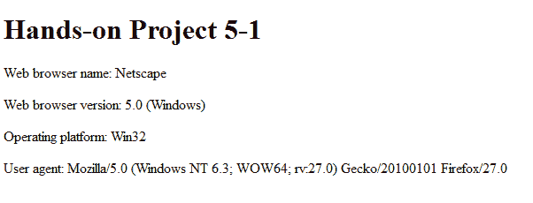

- 如果可能，请在多个操作系统（Windows、OS X、Linux）上使用至少两个额外的浏览器重复此步骤。

- 比较你测试的每个浏览器的结果，然后回答以下问题：
  a. 对于四个属性中的每一个，指明返回的信息似乎是否准确。
  b. 哪些属性在每个浏览器中始终不同？哪些属性（如果有）在每个浏览器中是相同的？
  c. 根据你的结果，解释在使用 `Navigator` 对象的属性判断应用程序运行在哪个浏览器中时你看到的任何挑战。还要解释哪个属性会提供有用信息。

### 动手项目 5-2
在这个项目中，你将创建一个函数，当用户点击按钮时打开一个确认窗口。你创建的窗口将位于用户屏幕的居中。

- 在你的文本编辑器中，打开章节文件夹下 HandsOnProject 文件夹中的 `index.htm` 文件，在注释部分的指定指示处添加你的姓名和今天的日期。

- 在 `body` 部分，就在闭合标签 `</body>` 之前，添加一个 `script` 元素，然后在 `script` 元素内添加以下函数：
```javascript
1 function processInput() {
2 var propertyWidth = 300;
3 var propertyHeight = 100;
4 var winLeft = (screen.width - propertyWidth) / 2;
5 var winTop = (screen.height - propertyHeight) / 2;
6 var winOptions = "width=300,height=100";
7 winOptions += ",left=" + winLeft;
8 winOptions += ",top=" + winTop;
9 window.open("confirm.htm", "confirm", winOptions);
10 }
```

- 在第 1 步下方，添加以下函数以创建事件监听器：
```javascript
1 function createEventListener() {
2 var submitButton = document.getElementById("submit");
3 if (submitButton.addEventListener) {
4 submitButton.addEventListener("click", processInput);
5 } else if (submitButton.attachEvent) {
6 submitButton.attachEvent("onclick", processInput);
7 }
}
```

- 在第 1 步添加的函数下方，添加以下代码在页面加载时创建事件监听器：
```javascript
1 if (window.addEventListener) {
2 window.addEventListener("load", createEventListener);
3 } else if (window.attachEvent) {
4 window.attachEvent("onload", createEventListener);
5 }
```

- 保存你的工作，在浏览器中打开 `index.htm`，然后点击 **Submit** 按钮。窗口打开如图 5-21 所示的消息。

图 5-21：确认窗口。
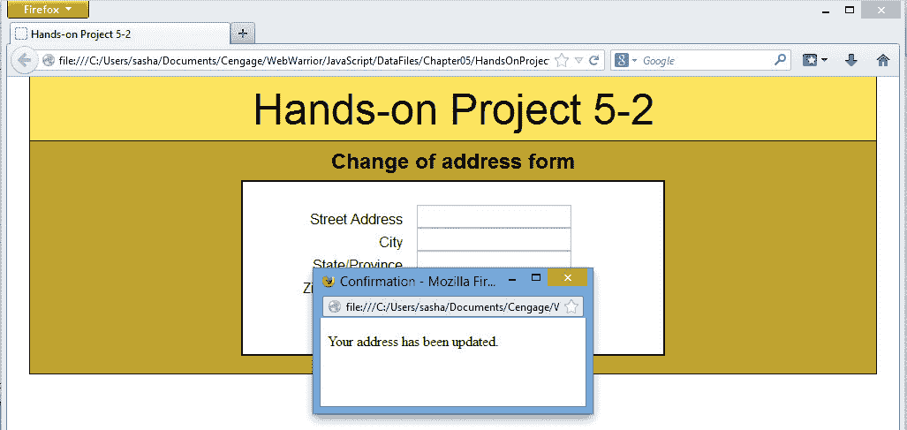

- 关闭窗口。

### 动手项目 5-3
在这个项目中，你将以不同的方式增强动手项目 5-2，用关闭按钮替换超时。

- 在你操作系统的文件管理器中，将 HandsOnProject 文件夹的完整内容复制到 HandsOnProject 文件夹中。

- 在你的文本编辑器中，打开 HandsOnProject 文件夹中的 `index.htm` 文件，在注释部分、`title` 元素和 `h1` 元素的指定指示处添加你的姓名和今天的日期。

- 在 `script` 元素中，在 `processInput()` 函数之前输入以下内容：
```javascript
1 "use strict";
2 var confirmWindow;
3 function processInput() {
4 var propertyWidth = 300;
5 var propertyHeight = 100;
6 var winLeft = (screen.width - propertyWidth) / 2;
7 var winTop = (screen.height - propertyHeight) / 2;
8 var winOptions = "width=300,height=100";
9 winOptions += ",left=" + winLeft;
10 winOptions += ",top=" + winTop;
11 confirmWindow = window.open("confirm.htm", "confirm", winOptions);
12 setTimeout(confirmWindow.close(), 5000);
13 }
```

- 在 `processInput()` 函数中，在最后一条语句中，删除行头的 `var` 单词。

- 在你的文本编辑器中，打开 HandsOnProject 文件夹中的 `confirm.htm` 文件，在注释部分将“Hands-on Project 5-2”更改为 **Hands-on Project 5-3**，然后在注释部分添加你的姓名和今天的日期。

- 在现有 `p` 元素的正下方，添加以下新 `p` 元素：
`<p id="closeB">Close</p>`

- 在 `</body>` 标签上方，创建一个 `script` 元素。

- 在 `script` 元素中，输入以下函数：
```javascript
function closeWindow() {
  window.close();
}
```

- 在 `closeWindow()` 函数下方，输入以下函数：
```javascript
1 // 为Close按钮添加事件监听器
2 function createEventListener() {
3 var closeButton = document.getElementById("closeB");
4 if (closeButton.addEventListener) {
5 closeButton.addEventListener("click", closeWindow,
6 false);
7 } else if (closeButton.attachEvent) {
8 closeButton.attachEvent("onclick", closeWindow);
9 }
10 }
```

- 在 `createEventListener()` 函数下方，添加以下语句：
```javascript
if (window.addEventListener) {
  window.addEventListener("load", createEventListener, false);
} else if (window.attachEvent) {
  window.attachEvent("onload", createEventListener);
}
```

- 保存你的工作，在浏览器中打开 `index.htm`，然后点击 **Submit** 按钮。确认窗口打开，如图 5-22 所示。

图 5-22：带有Close按钮的确认窗口
*来源: © Mozilla Firefox.*
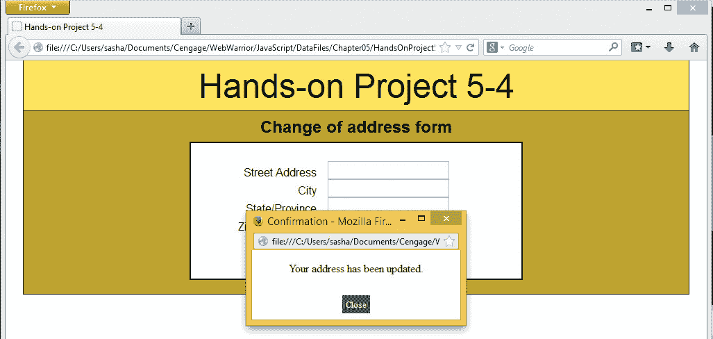

- 点击 **Close** 按钮。确认窗口关闭。

### 动手项目 5-4
*内容缺失*

### 动手项目 5-5
在这个项目中，你将创建并引用文档元素，以此为包含《美国权利法案》的文档生成目录。

- 在你的文本编辑器中，打开 Chapter 文件夹下 HandsOnProject 文件夹中的 `index.htm` 文件，在注释部分的指定位置添加你的姓名和今天的日期，然后保存文件。

- 在 `body` 中，在闭合的 `</body>` 标签之前，添加一个 `script` 元素。

- 在 `script` 元素中，声明一个名为 `list` 的变量，其包含文档中唯一的 `ul` 元素的引用。同时声明两个名为 `headingText` 和 `TOCEntry` 的空变量。

- 在变量声明下方，创建一个 `for` 语句，将计数器变量赋值为0，只要计数器变量的值小于或等于 `list.length` 就重复循环，并在每次循环时将计数器变量加1。

- 在 `for` 循环内部，添加执行以下任务的语句：
  a. 将 `headingText` 变量的值设置为 `id` 值等于计数器变量当前值的元素的内容。
  b. 创建一个新的 `li` 元素，并将其赋值为 `TOCEntry` 变量的值。
  c. 将 `TOCEntry` 节点的内容设置为以下：`"<a href=#" + i + ">" + headingText + "</a>"`
  d. 将 `TOCEntry` 节点作为 `list` 节点的最后一个子添加。

- 添加一个后兼容的事件监听器，在页面加载完成后调用 `createTOC()` 函数。

- 保存你的工作，然后在浏览器中打开 `index.htm`。在“Table of Contents”标题下方，应该显示一个章节列表，每个章节名称都格式化为链接，如图 5-23 所示。

图 5-23：通过脚本创建的目录
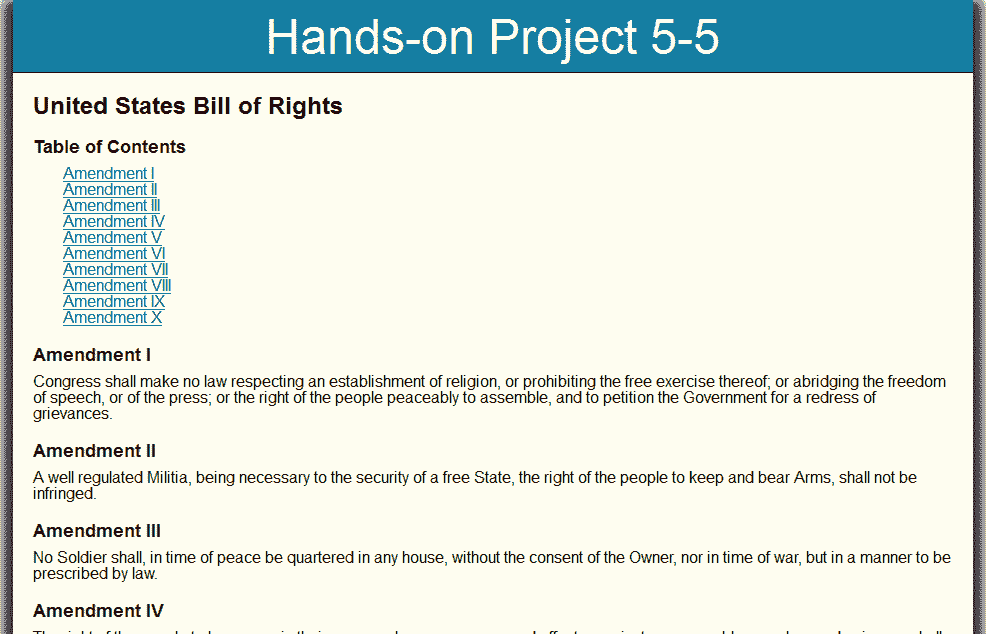

- 在目录中，点击 **Amendment III** 链接。如果整个页面没有在浏览器窗口中显示，窗口应该向上滚动，直到 Amendment III 标题位于窗口顶部。

## 案例项目

### 个人案例项目
在你的个人网站上添加一个页面，向访问者介绍网络安全知识。报告来自表 6-1 和表 6-2 的至少六个属性的值，以说明 Web 应用可以访问的用户计算机信息的广泛性。针对安全使用网页的实践进行网络搜索，并包含至少三个来源的链接，以及对每个来源的一句总结。

### 团队案例项目
在这个项目中，你的团队将为一个 HTML 文档绘制 DOM 树。首先，分成小组，每组负责团队网站中的一个不同的 HTML 文档。与你的伙伴一起描绘所选文档的 DOM 树。你的树应该显示网站的层次结构，包括元素、属性和文本内容，如图 5-24 所示。

当所有小组都完成 DOM 树的创建后，全体集合并比较你们的树。识别并讨论树之间的任何差异。根据团队其他成员的反馈，对自己的树进行必要的更改。


## 在表单中使用 JavaScript

用于表单内收集数据的元素包括 `input`、`select`、`option`、`textarea` 和 `button`。表 6-1、表 6-2 和表 6-3 列出了大多数或所有这些元素通用的属性、方法和事件。请注意，与有效性相关的属性、方法和事件不适用于 `button` 元素或类型为 `button` 的 `input` 元素。在本章后面，你将学习有关特定元素的额外属性、方法和事件。

表 6-2：`form` 对象的事件

| 事件 | 描述 |
| :--- | :--- |
| `submit` | 点击表单的提交按钮时触发 |

表 6-3：`form` 对象的方法

| 方法 | 描述 |
| :--- | :--- |
| `checkValidity()` | 启动基于浏览器的表单控件验证，如果所有控件都有效，则返回 `true` |
| `submit()` | 在不使用提交按钮的情况下提交表单 |

表 6-4：表单内元素的属性

| 属性 | 描述 |
| :--- | :--- |
| `autofocus` | 如果设置了 HTML autofocus 属性，则返回值 `true`，表示元素在表单加载时应获得焦点 |
| `placeholder` | 返回 `placeholder` 属性的值，该属性包含在字段无值时显示的文本 |
| `required` | 如果设置了 HTML `required` 属性，则返回值 `true`，表示在提交表单之前控件必须包含值 |
| `validationMessage` | 如果字段的 `validity` 值为 `false`，则在 `submit` 事件失败后，设置或返回显示给用户的消息文本 |
| `validity` | 如果控件的值通过了基于浏览器的验证规则，则返回值 `true` |
| `value` | 设置或返回控件的值 |
| `willValidate` | 如果控件启用了约束验证，则返回值 `true` |

### 引用表单和表单元素

虽然大多数开发者使用 `getElementById()` 和 `getElementsByTagName()` 等方法来访问和操作网页对象，但你应该意识到还有另一种寻址 `form` 对象的方法。默认情况下，浏览器会在 HTML 文档中创建几种类型的对象集合，包括锚点、图像、链接和表单。本书使用代码 `document.getElementsByTagName("form")[0]` 来引用仅包含一个表单的文档中的 `form` 对象。然而，你可能会遇到引用 `document.forms[0]`。

表 6-5：表单内元素的方法

| 方法 | 描述 |
| :--- | :--- |
| `checkValidity()` | 对表单元素运行约束验证；如果值有效，则返回值 `true`，如果值无效则返回 `false` |
| `setCustomValidity("message")` | 如果发现控件值无效，则将字符串 `message` 设置为显示给用户的文本；传递非空字符串会将控件的有效性设置为 `false`，而将空字符串作为参数传递则会将控件的有效性设置为 `true` |

表 6-6：表单内元素的事件

| 事件 | 触发时机 |
| :--- | :--- |
| `blur` | 焦点离开元素，意味着该元素最初被选中或包含插入点，然后另一个元素被选中或包含插入点（通常通过点击另一个元素或按 Tab 键移动到另一个元素） |
| `change` | 焦点离开元素，且当前元素的值或选中状态已更改 |
| `focus` | 元素获得焦点，意味着元素被选中或插入点进入当前元素（通常通过点击当前元素或按 Tab 键移动到当前元素） |
| `formchange` | 表单中的另一个控件触发了 `change` 事件 |
| `forminput` | 表单中的另一个控件触发了 `input` 事件 |
| `input` | 当前元素的值或选中状态发生变化 |
| `invalid` | 在约束验证期间发现控件的值无效 |

这引用浏览器创建的默认 `form` 对象数组中的第一个 `form` 对象。此外，`forms` 数组包含一个 `form` 元素内部的对象数组，称为 `elements` 数组。你可以使用 `document.forms[0].elements[2]` 引用网页文档中第一个表单中的第三个对象。

特别是在较大的表单中，使用 `elements` 数组可能会非常麻烦。然而，当使用 `forms` 数组引用表单时，你可以转而通过元素的 `name` 值引用表单内的任何元素。这意味着要引用网页文档中第一个表单中名为 `DeliveryZip` 的元素，你可以使用语法 `document.forms[0].DeliveryZip`。

使用 `getElementById()` 等方法引用 `form` 对象而不是使用 `forms` 数组的优势在于，你不需要在使用一种引用 `form` 对象的语法和引用非 `form` 对象的另一种语法之间切换。此外，当你需要相同的代码能够同时引用 `form` 和非 `form` 元素时，使用 `Document` 对象方法会让你的代码更具灵活性。最后，XHTML 的严格 DTD 不允许使用 `name` 属性，因此如果你正在编写处理 XHTML 文档的 JavaScript，就无法使用 `name` 属性。

在本章中，你将为一个名为 Snoot Flowers 的花店处理表单工作。你的任务是编写 JavaScript 来增强表单，并在将其提交到服务器之前验证用户输入。

1. 在文本编辑器中打开 `snoot.html` 文件。
2. 在文档顶部的注释部分输入你的名字和今天的日期，然后保存工作。
3. 滚动查看文档以熟悉其内容。该文档包含一个表单，该表单由 `fieldset` 组成。
4. 在网页浏览器中打开 `snoot.html`。图 6-1 显示了文档的当前内容。

图 6-1：浏览器中的 snoot.html


### 短测 1

1. 描述 JavaScript 在表单中的两种常见用途。
2. 说明使用 `getElementById()` 方法而非索引号识别 `form` 元素的两个优势。

## 改进可用性

JavaScript 程序处理表单最重要的角色之一是验证用户输入。然而，在实际编写验证输入的代码之前，你可以采取一些步骤来减少必要的验证工作。

### 设计表单以收集更准确的内容

大多数表单验证涉及检查用户输入 `input` 和 `textarea` 框的数据以确保其准确性。例如，对于图 6-2 中的表单，你希望确保用户在 Card Type 框中的输入是公司接受的信用卡类型名称或缩写。同样，你希望检查 Expiration 框中的输入是否指定了月份和年份。

然而，Card Type 和 Expiration 字段请求的信息被限制在一个小的离散列表中——例如，Card Type 字段是某些信用卡类型的名称。让用户输入这些信息会让你的表单面临用户拼错单词、使用后端系统无法识别的缩写，或简单输入不符合接受参数的数据（例如月份输入“ ”或卡片类型输入“Check”）。相反，你可以使用其他类型的表单字段向用户提供可选范围，并将选项限制在这些选择中。表 6-7 列出了一些替代的表单元素及其最适合的信息类型。

图 6-2：包含 `input` 元素的示例 fieldset
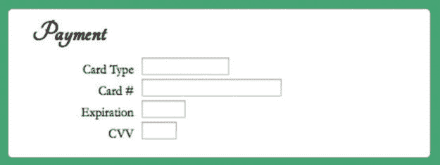

| 名称 | 创建代码 | 用途 |
| :--- | :--- | :--- |
| 单选按钮 | `<input type="radio" />` | 一次显示一组选项，用户可以从中选择一个 |
| 复选框 | `<input type="checkbox" />` | 一个或多个是/否选择 |
| 选择列表 | `<select><option value="value1"></option><option value="value2"></option>...></select>` | 截断的选项列表，当用户与其交互时会完全显示 |
| 滑块 | `<input type="range" />` | 带有指示器的条形，用户可以拖动它来增加或减少值；配合 `min` 和 `max` 属性指定范围的底部和顶部（支持 IE10+ 及所有其他现代浏览器） |
| 数据列表 | `<input type="text" list="listname" /><datalist id="listname"><option value="value1" />...</datalist>` | 文本框，在用户输入时会从 `datalist` 元素中建议值，但允许用户输入列表之外的值 |

表 6-7：用于提供有限选择的选表单元素

通过使用一组单选按钮和两个选择列表，你可以改进图 6-2 所示的字段集，以确保更准确的数据输入，如图 6-3 所示。

图 6-3：使用单选按钮和选择列表更新后的示例字段集
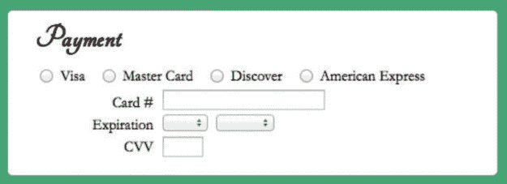

图 6-2 中的字段集使用单选按钮来显示信用卡选项，并提供了选择列表，用户可以从这些列表中选择信用卡过期的月份和年份。虽然卡号和 CVV 字段仍需要用户输入，但这种重新设计减少了对用户提供的数据进行必要验证的量。

*你可以通过指定特定所收集数据的 `type` 值（如 `number` 或 `email`），以及指定 `maxlength` 和 `required` 属性来限制用户在文本字段中的输入。你将在本章稍后的部分学习更多关于基于这些 `input` 类型和属性验证数据的知识。*

**注意**
默认日期的另一种方法是在每次打开表单时设置当前日期。你将学习如何使用 JavaScript 访问。

### 通过编写表单提高内容准确性

除了为不同的表单字段提供有限的可能范围外，你还可以创建 JavaScript 函数来减少用户在填写表单时出错的可能性。此类函数被称为**辅助函数**，它们本身不执行验证——也就是说，它们不会检查用户内容是否存在错误。相反，这些函数防止用户从一开始输入错误的数据。可以实现许多类型的辅助函数；实现哪种取决于你的表单设计以及你尝试收集的数据类型。

#### 移除选择列表中的默认值

Snoot Flowers 订单表单的两个方面受益于辅助函数。首先，表单包含许多选择列表。默认情况下，浏览器会选择每个列表中的第一项。然而，Snoot Flowers 希望确保用户对这些字段做出了深思熟虑的选择，而不是仅仅忽略默认值并带有该信息提交表单。例如，错误地提交一个默认交付日期为一月的表单，可能会导致订单在错误的日期交付。

你可以使用 HTML 设置选择列表的默认值，但只能设置为菜单选项中的一个。然而，你可以使用 JavaScript 将 `select` 对象的 `selectedIndex` 属性设置为 -1，这对应于无选择。这确保了任何选择都是由用户做出的，而不是默认值。表 6-8 描述了你可以用 JavaScript 操作的 `select` 元素的此类和其他属性。

| 属性 | 说明 |
| :--- | :--- |
| `length` | 返回嵌套在 `select` 元素中的 `option` 元素的数量 |
| `multiple` | 设置或返回一个布尔值，决定选择列表中是否可以选择多个选项 |
| `options` | 返回嵌套在 `select` 元素中的元素集合 |
| `selectedIndex` | 返回一个数字，代表选择列表中第一个选中的选项在 `options` 集合中的编号；如果未选择任何选项，则返回 -1 |
| `size` | 设置或返回要显示的选项数量 |
| `type` | 返回选择列表的类型，如果 `select` 元素不包含 `multiple` 属性，则为一个；如果 `select` 元素包含 `multiple` 属性，则为多个 |

表 6-8：`select` 元素的属性

你将从创建一个函数开始，该函数将表单 `select` 元素的 `selectedIndex` 属性设置为 -1。

更改 `select` 元素的 `selectedIndex` 属性：

1. 在编辑器中创建一个新的 JavaScript 文档，然后输入以下代码：
```javascript
/* 设置默认值 */
function selectDefaults() {
  var boxes = document.getElementsByTagName("select");
  for (var i = 0; i < boxes.length; i++) {
    boxes[i].selectedIndex = -1;
  }
}
```

2. 将文件保存为 `snoot.js`。

在你创建的函数下方输入以下注释和事件监听代码，以便在页面完成后调用该函数：
```javascript
/* 页面完成后运行函数 */
if (window.addEventListener) {
  window.addEventListener("load", selectDefaults, false);
} else if (window.attachEvent) {
  window.attachEvent("onload", selectDefaults);
}
```

3. 保存工作，返回编辑器中的 `snoot.htm`，然后在闭合的 `</body>` 标签之前添加以下 `script` 元素以引用你创建的 `snoot.js` 文件：
`<script src="snoot.js"></script>`

4. 保存 `snoot.htm` 的更改，然后在浏览器中刷新或重新加载 `snoot.htm`。如图 6-4 所示，`select` 元素现在没有默认值。

选择列表显示
没有默认值
图 6-4：`select` 元素移除了默认值
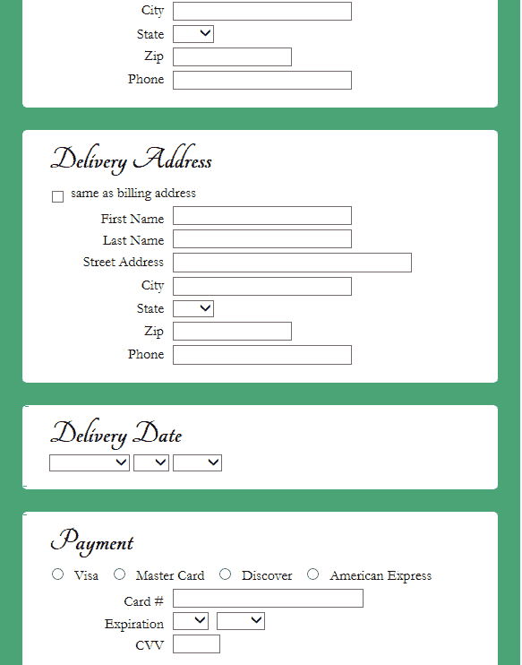    

## 提高表单可用性

### 动态更新选择列表的值

结合表 6-9 中的属性以及你在第 5 章中学习的用于在节点树中创建和附加节点的方法，你可以在 `select` 元素中添加和删除 `option` 元素。除了使用 `select` 元素的属性外，你还可以查找并设置 `option` 元素的属性，这些属性已在表 6-9 中描述。

| 属性 | 描述 |
| :--- | :--- |
| `defaultSelected` | 返回一个布尔值，确定当前选中项 `option` 元素是否包含 `selected` 属性 |
| `index` | 返回一个数字，表示在 `options` 集合中的元素索引 |
| `label` | 设置或返回用于选择列表中 `option` 显示的备用文本 |
| `selected` | 设置或返回一个布尔值，确定某个选项是否被选中 |
| `text` | 设置或返回选择列表中 `option` 显示的文本 |
| `value` | 设置或返回分配给 `option` 元素 `value` 属性的文本；该值将提交到服务器 |

表 6-9：`option` 元素的属性

从 `select` 元素中添加和删除选项的一种常见用途是根据用户在同一个表单中进行的其他选择更改列表中显示的选项。例如，Snoot Flowers 订单表中“交付日期”（Delivery Date）字段组中的三个选择列表包含了月份、日期和年份列表。然而，显示给用户的天数取决于所选的月份。例如，如果用户选择了3月，日期选择列表应该显示数字 1–31。但如果用户选择了4月，日期列表应该只显示 1–30。

为了给 Snoot Flowers 订单表添加此功能，你首先要创建三个节点。首个节点将包含一个子节点，由一个值为 29 的 `option` 元素组成。第二个节点将包含两个子节点，由值为 29 和 30 的 `option` 元素组成。你创建的最后一个节点将包含三个子节点，即值为 29、30 和 31 的 `option` 元素。在准备好这三个构建块后，你将截断现有的选择列表（显示数字 1–31），使其只包含值为 1–30 的选项。然后，根据用户的月份选择，你将对列表不做任何额外更改（针对非闰年的 2 月），或者添加你创建的三个节点之一，以将日期值增加到与所选月份匹配的长度。此外，当选择 2 月时，你的程序将检查所选年份是否为 2018 年（闰年）；如果是，你就会把仅包含值 29 选项的节点添加到日期选择列表中。图 6-5 展示了你将创建的代码。

图 6-5：动态更新选择列表值的函数图

```
<select>
  <option>1</option>
  <option>28</option>
  <option>...</option>
</select>

- 如果是 2 月且不是 2018 年: (无变化)
- 如果是 2 月且是 2018 年: 添加节点 <option>29</option>
- 如果是 1 月、3 月、5 月、7 月、8 月、10 月或 12 月: 添加节点 <option>29</option>, <option>30</option>, <option>31</option>
- 如果是 4 月、6 月、9 月或 11 月: 添加节点 <option>29</option>, <option>30</option>
```

为了编写使日期列表根据所选月份和年份动态更改：

1. 在浏览器中，向下滚动订单表单到“交付日期”字段，点击第一个选择列表的**箭头**，点击**4月**，点击第二个选择列表的**箭头**，如果有必要，滚动到第二个选择列表的底部。虽然 4 月只有 30 天，但日期列表包含了 31 作为一个选项。这使得用户可能选择 4 月 31 日作为交付日期，而这是无效的。

2. 回到文本编辑器中的 `snoot.js`，然后在 `"use strict";` 语句下方输入以下代码以创建三个全局变量：
```javascript
/* global variables */
var twentyNine = document.createDocumentFragment();
var thirty = document.createDocumentFragment();
var thirtyOne = document.createDocumentFragment();
```
你使用 `createDocumentFragment()` 方法创建一个空的文档片段。因为你将在页面加载时使用一个函数填充这三个节点，并在另一个函数中每次月份或年份更改时将正确的节点附加到日期选择列表中，所以这些节点必须由全局变量表示。

3. 在全局变量下方，输入以下函数来填充三个节点：
```javascript
/* set up node building blocks for selection list of days */
function setupDays() {
  var dates = document.getElementById("delivDy").
  getElementsByTagName("option");
  twentyNine.appendChild(dates[28].cloneNode(true));
  // add 29th
  thirty.appendChild(dates[28].cloneNode(true));
  thirty.appendChild(dates[29].cloneNode(true));
  // add 29th & 30th
  thirtyOne.appendChild(dates[28].cloneNode(true));
  thirtyOne.appendChild(dates[29].cloneNode(true));
  // add 29th, 30th, & 31st
  thirtyOne.appendChild(dates[30].cloneNode(true));
}
```
该代码首先创建包含选择列表中所有 `option` 元素的局部变量。然后将第 28 个元素复制到 `twentyNine` 节点。剩余的代码将第 28 和 29 个元素复制到 `thirty` 节点，并将 28、29 和 30 个元素复制到 `thirtyOne` 节点。

4. 在你创建的函数下方，但在 `removeDefaults()` 函数之前，输入以下代码创建 `updateDays()` 函数并声明其局部变量：
```javascript
function updateDays() {
  var deliveryDay = document.getElementById("delivDy");
  var dates = deliveryDay.getElementsByTagName("option");
  var deliveryMonth = document.getElementById("delivMo");
  var deliveryYear = document.getElementById("delivYr");
  var selectedMonth = deliveryMonth.options[deliveryMonth.selectedIndex].value;
}
```

5. 在局部变量下方，但在函数内部，输入以下 `while` 语句：
```javascript
while (dates[28]) {
  // remove child with index 28 until this index is empty
  deliveryDay.removeChild(dates[28]);
}
```
该代码删除索引为 28 的子元素，直到该索引为空。这样做的效果是从选择列表中删除了第 29、30 及 31 天的选项。

6. 在 `while` 循环下方，但在函数内部，输入以下 `if` 语句：
```javascript
if (deliveryYear.selectedIndex === -1) {
  // if no year is selected, choose the default year so length of
  // Feb can be determined
  deliveryYear.selectedIndex = 0;
}
```
该语句检查年份选择列表的 `selectedIndex` 值。如果值为 -1（表示未选择），则将值更改为 0，即列表的第一项。由于函数必须判断当前年份是否为闰年，在运行后续条件语句之前必须选择一个日期值。

7. 在上一步的 `if` 语句下方，输入以下 `if` 语句：
```javascript
if (selectedMonth === "2" &&
  deliveryYear.options[deliveryYear.selectedIndex].value === "2018") {
  // if leap year, Feb has 29 days
  deliveryDay.appendChild(twentyNine.cloneNode(true));
}
```
此 `if` 语句在选择了 2 月且年份为 2018 年（闰年）时，将 `twentyNine` 节点添加到日期选择的末尾。

8. 在上一步的 `if` 语句末尾添加以下 `else if` 语句：
```javascript
else if (selectedMonth === "4" || selectedMonth === "6" || selectedMonth === "9" || selectedMonth === "11") {
  // 这些月份有 30 天
  deliveryDay.appendChild(thirty.cloneNode(true));
}
```
此 `if` 语句检查所选月份是否包含 30 天（4月、6月、9月或11月），如果是，它会将 `thirty` 节点添加到日期选择列表的末尾。

9. 在之前几个步骤的 `if/else` 语句末尾添加以下 `else if` 语句：
```javascript
else if (selectedMonth === "1" || selectedMonth === "3" || selectedMonth === "5" || selectedMonth === "7" || selectedMonth === "8" || selectedMonth === "10" || selectedMonth === "12") {
  // 这些月份有 31 天
  deliveryDay.appendChild(thirtyOne.cloneNode(true));
}
```
此 `if` 语句检查所选月份是否包含 31 天（1月、3月、5月、7月、8月、10月或12月），如果是，它会将 `thirtyOne` 节点添加到日期选择列表的末尾。

10. 在 `snoot.js` 的底部，`window.addEventListener` 语句之前，输入以下函数：
```javascript
/* 创建事件监听器 */
function createEventListeners() {
  var deliveryMonth = document.getElementById("delivMo");
  if (deliveryMonth.addEventListener) {
    deliveryMonth.addEventListener("change", updateDays, false);
  } else if (deliveryMonth.attachEvent) {
    deliveryMonth.attachEvent("onchange", updateDays);
  }

  var deliveryYear = document.getElementById("delivYr");
  if (deliveryYear.addEventListener) {
    deliveryYear.addEventListener("change", updateDays, false);
  } else if (deliveryYear.attachEvent) {
    deliveryYear.attachEvent("onchange", updateDays);
  }
}
```
这段代码添加了两个事件监听器：第一个在月份选择列表的值发生变化时调用 `updateDays()` 函数，第二个在年份选择列表的值发生变化时调用同一个函数。第二个事件监听器确保了如果用户选择了 2 月然后将年份从闰年改为非闰年（或反之），日期列表将保持准确。

11. 在 `createEventListeners()` 函数下方、事件监听器代码之前，输入以下函数：
```javascript
/* 运行初始表单配置函数 */
function setUpPage() {
  removeSelectDefaults();
  setupDays();
  createEventListeners();
  generatePlaceholder();
}
```

12. 在 `snoot.js` 的底部，`window.addEventListener` 语句之前，修改事件监听器代码：
```javascript
if (window.addEventListener) {
  window.addEventListener("load", setUpPage);
} else if (window.attachEvent) {
  window.attachEvent("onload", setUpPage);
}
```

13. 保存 `snoot.js` 的更改。在浏览器中刷新 `snoot.htm`，在日期选择列表中选择 4 月，检查日期列表是否正确为 30 天。然后选择 5 月，检查日期列表是否正确为 31 天。

### 为旧浏览器添加占位符文本

现代浏览器原生支持 `placeholder` 属性，它会在输入框为空时显示提示文本。然而，旧浏览器（如 IE8）不支持此属性。因此我们需要使用 JavaScript 来模拟这种行为。

首先，我们需要引入 Modernizr 库，它可以检测浏览器是否支持 `placeholder` 属性。在 `snoot.htm` 顶部添加以下脚本引入：
```html
<script src="https://cdnjs.cloudflare.com/ajax/libs/modernizr/2.6.6/modernizr.min.js"></script>
```

接下来，在 `snoot.js` 中创建一个 `generatePlaceholder()` 函数。当浏览器不支持 `placeholder` 时，该函数会被调用：
```javascript
/* 为旧浏览器生成占位符文本 */
function generatePlaceholder() {
  if (!Modernizr.input.placeholder) {
    var messageBox = document.getElementById("customText");
    messageBox.value = messageBox.placeholder;
    messageBox.style.color = "rgb(178,184,183)";
  }
}
```
该函数的作用是：
- 检查 `Modernizr.input.placeholder` 是否存在。
- 如果不存在，则获取 ID 为 `customText` 的元素。
- 将其值设置为 `placeholder` 属性的内容。
- 将字体颜色设置为灰色，以区别于用户输入的真实内容。

最后，在 `setUpPage()` 函数中调用该函数：
```javascript
function setUpPage() {
  removeSelectDefaults();
  setupDays();
  createEventListeners();
  generatePlaceholder(); // 调用占位符生成函数
}
```

现在，使用 IE8 访问 `snoot.htm`。你会发现“留言”文本框现在显示了占位符文本，且颜色为灰色，这与现代浏览器的表现一致。

将你的更改保存到 `snoot.js`，并在 Internet Explorer 中刷新 `snoot.htm`。占位符文本现在显示“自定义消息”复选框下方的 `textarea` 中。见图 6-8。

图 6-8：在 IE8 中显示的由 `generatePlaceholder()` 函数生成的占位符文本
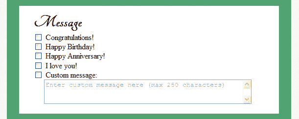   

接下来你将添加代码，当用户点击 `textarea` 框时清除其中的值。

若要添加代码以清除 **textarea** 框中的值：

1. 在 Internet Explorer 中，点击“自定义消息”复选框下方的 **textarea** 框，然后输入 **Thanks a million**。它不会像在现代浏览器中那样替换占位符文本，而是你输入的文本会被添加到占位符文本中，创建一个由指令和自定义消息文本组成的杂乱混合。见图 6-9。

图 6-9：与用户输入结合的模拟占位符文本
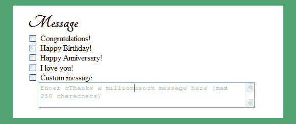

2. 回到编辑器中的 `snoot.js` 文件，然后在 `generatePlaceholder()` 函数上方输入以下代码以创建 `zeroPlaceholder()` 函数并声明变量：
```javascript
/* remove fallback placeholder text */
function zeroPlaceholder() {
  var messageBox = document.getElementById("customText");
}
```

3. 在变量声明下方，添加以下语句：
```javascript
messageBox.style.color = "black";
if (messageBox.value === messageBox.placeholder) {
  messageBox.value = "";
}
```
当调用此函数移除占位符文本时，它首先将字体颜色设回黑色，为用户输入做准备。此外，如果控件的唯一内容是 `placeholder` 属性的值，则该内容被重置为空字符串。这个 `if` 语句确保了如果用户在这些控件中输入了文本，然后离开控件并又返回，那么当他们第二次点击控件时，用户之前的输入内容不会被删除。你完成的 `zeroPlaceholder()` 函数应与如下匹配：
```javascript
function zeroPlaceholder() {
  var messageBox = document.getElementById("customText");
  messageBox.style.color = "black";
  if (messageBox.value === messageBox.placeholder) {
    messageBox.value = "";
  }
}
```

4. 在你之前的步骤中创建的 `generatePlaceholder()` 函数内部，在 `if` 语句的结束括号 `}` 之前，添加以下代码以创建一个事件监听器来调用 `zeroPlaceholder()` 函数：
```javascript
if (messageBox.addEventListener) {
  messageBox.addEventListener("focus", zeroPlaceholder, false);
} else if (messageBox.attachEvent) {
  messageBox.attachEvent("onfocus", zeroPlaceholder);
}
```
你更新后的 `generatePlaceholder()` 函数应如下匹配：
```javascript
function generatePlaceholder() {
  if (!Modernizr.input.placeholder) {
    var messageBox = document.getElementById("customText");
    messageBox.value = messageBox.placeholder;
    messageBox.style.color = "rgb(178,184,183)";
    if (messageBox.addEventListener) {
      messageBox.addEventListener("focus", zeroPlaceholder, false);
    } else if (messageBox.attachEvent) {
      messageBox.attachEvent("onfocus", zeroPlaceholder);
    }
  }
}
```


## 第6章 增强与验证表单

### 模拟旧版浏览器的占位符

5. 将你的更改保存到 `snoot.js`，在 IE 中刷新 `snoot.htm`，点击 `textarea` 控件，然后输入 **Thanks a million**。当你点击 `textarea` 控件时，模拟的占位符文本会被移除，你输入的文本是框中唯一的文本。

为了完成对旧版浏览器的占位符模拟，你将添加代码，当用户在没有输入任何内容的情况下离开 `textarea` 字段时恢复占位符文本。

若要在 textarea 留空时恢复占位符文本：

1. 在 Internet Explorer 中，刷新 `snoot.htm`，然后点击 `textarea` 控件。占位符文本被移除。

2. 点击 **First Name** 框。注意到 `textarea` 控件仍保持空白。这意味着点击了 `textarea` 但没有输入任何内容并决定稍后返回的用户将看不到占位符文本。你将创建一个函数，当用户从 `textarea` 失去焦点时恢复占位符文本。

3. 回到编辑器中的 `snoot.js`，然后在 `generatePlaceholder()` 函数上方输入以下代码以创建 `checkPlaceholder()` 函数并声明变量：

```javascript
/* restore placeholder text if no entry */
function checkPlaceholder() {
  var messageBox = document.getElementById("customText");
}
```

4. 在变量声明下方，添加以下 `if` 语句：

```javascript
if (messageBox.value === "") {
  messageBox.style.color = "rgb(178,184,183)";
  messageBox.value = messageBox.placeholder;
}
```

这个 `if` 语句检查 `textarea` 值是否为空字符串，如果是，则将文本颜色改回灰色，并将 `placeholder` 属性的值赋值为字段的值。你完成的 `checkPlaceholder()` 函数应如下匹配：

```javascript
function checkPlaceholder() {
  var messageBox = document.getElementById("customText");
  if (messageBox.value === "") {
    messageBox.style.color = "rgb(178,184,183)";
    messageBox.value = messageBox.placeholder;
  }
}
```

5. 在你之前创建的 `generatePlaceholder()` 函数中，添加下方高亮的代码以创建一个事件监听器（或在旧版浏览器中附加事件）：

```javascript
if (messageBox.addEventListener) {
  messageBox.addEventListener("focus", zeroPlaceholder, false);
  messageBox.addEventListener("blur", checkPlaceholder, false);
} else if (messageBox.attachEvent) {
  messageBox.attachEvent("onfocus", zeroPlaceholder);
  messageBox.attachEvent("onblur", checkPlaceholder);
}
```

更新后的 `generatePlaceholder()` 函数应如下：

```javascript
function generatePlaceholder() {
  if (!Modernizr.input.placeholder) {
    var messageBox = document.getElementById("customText");
    messageBox.value = messageBox.placeholder;
    messageBox.style.color = "rgb(178,184,183)";
    if (messageBox.addEventListener) {
      messageBox.addEventListener("focus", zeroPlaceholder, false);
      messageBox.addEventListener("blur", checkPlaceholder, false);
    } else if (messageBox.attachEvent) {
      messageBox.attachEvent("onfocus", zeroPlaceholder);
      messageBox.attachEvent("onblur", checkPlaceholder);
    }
  }
}
```

6. 将你的更改保存到 `snoot.js`，在 IE 中刷新 `snoot.htm`，点击 `textarea` 控件，然后点击 **First Name** 字段。当你点击 `textarea` 框时，占位符文本会被移除，正如你之前看到的。这次，当你不在 `textarea` 框中输入的情况下点击 First Name 时，占位符文本再次显示在 `textarea` 框中。

### 更新关联字段

#### 根据输入自动更新关联字段

订单表单包含一个自定义消息复选框，用户可以选它可以随订单发送消息。下方是一个 `textarea` 元素，用户可以在其中输入消息文本。然而，假设提交了一份 `textarea` 字段包含文本但自定义消息文本框未勾选的表单。取决于处理表单数据的后端程序，这种歧义可能会给订单带来问题，因为后端程序必须决定用户是否真的想发送消息。通过添加一个函数来检查用户在 `textarea` 字段中的输入，如果他们输入了自定义文本，则为他们勾选自定义消息框，你可以避免这种不匹配的发生并减少用户完成表单的时间。

| 属性 | 参考 |
| :--- | :--- |
| `placeholder` | `placeholder` 属性的值 |
| `defaultValue` | 页面加载时 `textarea` 元素显示的默认值 |

| 方法 | 描述 |
| :--- | :--- |
| `select()` | 选择元素内容 |

为了创建一个函数，当输入了自定义消息时自动勾选“自定义消息”（Custom message）复选框：

1. 返回编辑器中的 `snoot.js` 文件，然后在 `createEventListeners()` 函数上方，输入以下代码以创建 `autocheckCustom()` 函数并声明一个局部变量：

```javascript
/* 如果用户在 customText 框中输入内容，
则自动勾选自定义消息选择框 */
function autocheckCustom() {
  var messageBox = document.getElementById("customText");
}
```

2. 在变量声明下方，添加以下 `if` 语句：

```javascript
if (messageBox.value !== "" && messageBox.value !==
    messageBox.placeholder) {
  // 如果用户在 textarea 中输入，则勾选自定义复选框
  document.getElementById("custom").checked = "checked";
}
```

这个 `if` 语句检查 `textarea` 元素的值是否不是空字符串或 `placeholder` 属性的值。如果是，则自定义复选框的 `checked` 属性被设置为 `checked`，从而勾选了该框。

**实战技巧**

任何旨在提高表单可用性的程序逻辑都涉及对用户意图的解释。例如，你编写表单验证代码假设用户可能会忽略列表的默认值，并且默认值可能无法反映用户的真实选择。同时，消息框的函数将假设用户即使没有勾选关联的复选框，也意图使用他们在自定义消息 `textarea` 框中输入的任何文本。取决于你正在创建的表单重要性以及项目所有者的需求，你可以选择让解释得更严格或更宽松。通常情况下，表单收集精确数据越重要，你对意图的假设就越少。相反，对于收集普通反馈的表单，多做一些意图假设可能是安全的。

你完成的 `autocheckCustom()` 函数应该如下：

```javascript
function autocheckCustom() {
  var messageBox = document.getElementById("customText");
  if (messageBox.value !== "" && messageBox.value !==
      messageBox.placeholder) {
    // 如果用户在 textarea 中输入，勾选自定义复选框
    document.getElementById("custom").checked = "checked";
  }
}
```

3. 在 `createEventListeners()` 函数内部，添加以下代码创建一个事件监听器，当用户离开 `textarea` 控件时调用 `autocheckCustom()` 函数：

```javascript
var messageBox = document.getElementById("customText");
if (messageBox.addEventListener) {
  messageBox.addEventListener("blur", autocheckCustom, false);
} else if (messageBox.attachEvent) {
  messageBox.attachEvent("onblur", autocheckCustom);
}
```

4. 将更改保存到 `snoot.js`，在浏览器中重新加载或刷新 `snoot.htm`，点击 `textarea` 控件，输入 **Thanks a million**，然后点击 **First Name** 框。当你在点击 `textarea` 控件之外时，自定义消息复选框会自动勾选。

### 传输重复字段值

JavaScript 常用于改进表单可用性的另一种方法是将一个字段输入的数据复制到用户指示应包含相同数据的另一个字段。事实上，如果你下过在线订单，很可能使用过此类函数来指示商品应寄送到你提供的账单地址。此功能通常链接到一个标记为“收货地址与账单地址相同”或类似的复选框。当用户勾选该框时，所有账单地址的内容都会复制到相应的收货地址字段。

如图所示，Snoot Flowers 表单包含了账单和收货地址字段，并已包含一个“相同”复选框。接下来你将创建一个函数，将账单地址组（fieldset）中每个字段的内容复制到收货地址组的相应字段。你还将添加一个事件监听器，当用户勾选此框时调用该函数，以及另一个事件监听器在用户取消勾选时清空收货地址。

为了让用户可以使用账单地址进行收货：

1. 返回编辑器中的 `snoot.js` 文件，然后在 `createEventListeners()` 函数上方，输入以下代码以创建 `copyAddresses()` 函数并声明局部变量：

```javascript
/* 将账单地址字段复制到收货地址 */
function copyAddresses() {
  var billingElements = document.querySelectorAll("#billingAddress input");
  var deliveryElements = document.querySelectorAll("#deliveryAddress input");
}
```

2. 在变量声明之后，输入以下 `if` 语句：

```javascript
if (document.getElementById("sameAddr").checked) {
  for (var i = 0; i < billingElements.length; i++) {
    deliveryElements[i + 1].value = billingElements[i].value;
  }
  document.querySelector("#deliveryAddress select").value =
    document.querySelector("#billingAddress select").value;
}
```

当勾选“与账单地址相同”框时，此 `if` 语句会运行。它首先遍历 `input` 元素，将每个元素的值赋值给相应的元素。注意，索引 `i + 1` 用于收货元素，因为组中的第一个元素是“相同地址”复选框，它在组中没有匹配字段。

3. 在 `if` 语句中添加以下 `else` 语句：

```javascript
else {
  for (var i = 0; i < billingElements.length; i++) {
    deliveryElements[i + 1].value = "";
  }
  document.querySelector("#deliveryAddress select").selectedIndex = 1;
}
```

4. 在 `createEventListeners()` 函数的命令块中，在结束括号 `},` 之前，输入以下代码为 `copyAddresses()` 函数创建一个事件监听器：

```javascript
var same = document.getElementById("sameAddr");
if (same.addEventListener) {
  same.addEventListener("click", copyAddresses, false);
} else if (same.attachEvent) {
  same.attachEvent("onclick", copyAddresses);
}
```

5. 将更改保存到 `snoot.js`，然后在浏览器中刷新或重新加载 `snoot.htm`。

6. 在表单的账单地址部分，在每个字段中进行输入或选择（不必担心信息是否准确），然后在收货地址部分，点击 **与账单地址相同** 复选框来勾选它。

7. 再次点击 **与账单地址相同** 复选框以取消选中。这些值将从收货地址区域的控件中移除。

#### 短期测验 2

- 如果你正在设计一个询问用户是否拥有自车的表单，你预计使用文本输入框还是复选框能获得更准确的输入？为什么？
- 你使用哪个属性来更改选择列表中选中的选项元素？使用什么值来指定未选择任何选项元素？

## 自定义浏览器的验证

几乎无例外，即使是设计得最好的表单也需要验证。主要原因之一是大多数表单包含文本框，而任何文本框都可能输入错误的数据。

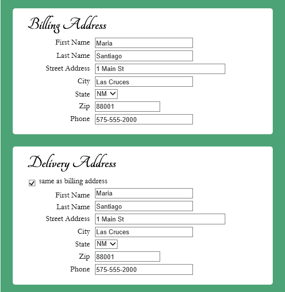  
勾选“与账单地址相同”框会将账单地址控件的值复制到收货地址控件

  
从账单地址区域相应字段复制的值

图 6-10：账单地址输入复制到收货地址区域

### 指定基于浏览器的参数

要指定表单中基于浏览器的参数，你可以使用表 6-12 列出的属性。

| 属性 (ATTRIBUTE) | 说明 (DESCRIPTION) | 适用对象 (USE WITH) |
| :--- | :--- | :--- |
| `formnovalidate` | 用于提交按钮的 `<input>` 标签中时关闭表单验证 | `type` 值为 `submit` 的 `input` 元素 |
| `max` | 指定控件的最大数值 | `type` 值为 `number` 的 `input` 元素 |
| `maxlength` | 指定控件的最大字符数 | `textarea` 元素，或显示为文本框的 `input` 元素 |
| `min` | 指定控件的最小数值 | `type` 值为 `number` 的 `input` 元素 |
| `novalidate` | 添加到起始 `<form>` 标签中时关闭表单验证 | `form` 元素 |
| `pattern` | 指定控件值必须匹配的模式，用正则表达式表示 | `textarea` 元素，或显示为文本框的 `input` 元素 |
| `required` | 表示控件必须有值 | `input`、`select` 或 `textarea` 元素 |
| `step` | 指定数值必须遵循的增量 | `type` 值为 `number` 的 `input` 元素 |

表 6-12：设置基于浏览器的验证参数的 HTML 属性

额外的基于浏览器的验证与 `input` 元素 `type` 属性的几个值相关，这些值在表 6-13 中描述。例如，如果使用标签 `<input type="number" />` 创建字段，现代浏览器会自动拒绝非数字内容。

当你在表单的 HTML 代码中包含表 6-12 中的任何属性（`novalidate` 或 `formnovalidate` 除外）或表 6-13 中的输入 `type` 值时，现代浏览器会在表单触发 `submit` 事件时自动执行验证——通常是在用户点击表单的提交按钮时。

| 值 (VALUE) | 内容说明 (CONTENT DESCRIPTION) | 示例内容 (SAMPLE CONTENT) |
| :--- | :--- | :--- |
| `color` | `#` 后面跟 6 位十六进制颜色值，任何字母均为小写 | `#ffcc00` |
| `date, datetime, week, month, time, datetime-local` | 协调世界时 (UTC) 相关部分，标准的日期/时间格式 | `2019-10-14T12:00:00.001-04:00` |
| `email` | 邮箱地址 | `president@whitehouse.gov` |
| `number` | 数值 | `73.54` |

表 6-13：触发基于浏览验证的 `type` 属性值

*HTML 还包含 `tel`（电话号码）和 `url`（网址）作为 `input type` 属性的值。然而，浏览器对使用这些类型的元素不执行任何内容有效性规则。*

**注意**

要查看基于浏览器的验证如何工作，你将尝试提交缺失或无效数据的表单。

要查看基于浏览器的验证如何处理订单中的缺失或无效数据：

1. 返回编辑器中的 `snoot.htm`。
2. 在订单表单的代码中，检查 `input` 元素的 `type` 值。注意，邮政编码、电话号码、信用卡号和 CVV 的 `input` 元素都使用 `number` 作为 `type` 值。
3. 注意哪些 `input` 和 `select` 元素包含了 `required="required"` 属性。除了消息 (Message) 和创建账户 (Create Account) 组外，表单中的所有 `input` 和 `select` 元素都标记为必填。
*在 HTML 中，你可以使用 `required` 属性将表单中的元素标记为必填，该属性不需要值。但为了让你的代码也符合 XHTML，你将属性名作为值，使用代码 `required="required"`。*

**注意**

4. 在现代浏览器（如当前版本的 Internet Explorer、Firefox、Chrome 或 Safari）中打开 `snoot.htm`。在不完成任何表单字段的情况下，滚动到表单底部并点击 **下订单 (Place Order)** 按钮。现代浏览器会滚动到第一个必填字段，添加红色背景或阴影，并在控件旁边显示一个圆矩形，称为 **气泡 (bubble)**。气泡包含描述高亮字段中发现的验证错误的文本以及修复它的说明。图 6-11 显示了此本书撰写时当前版本的 Internet Explorer、Firefox 和 Chrome 中的气泡和错误格式。

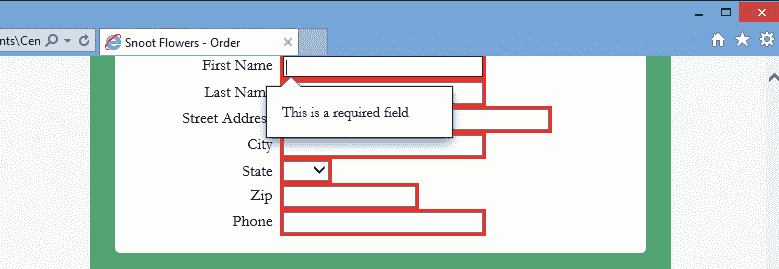 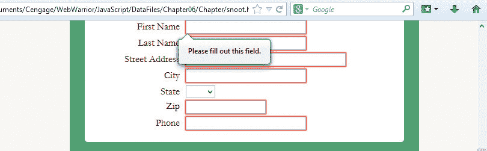 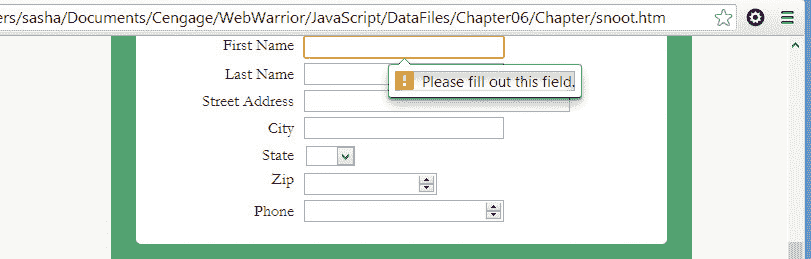   
图 6-11：Internet Explorer 10、Firefox 24 和 Chrome 30 中的验证气泡

5. 在高亮的名称 (First Name) 字段中输入你的名字（或虚拟），然后按 **Enter**。高亮移动到姓 (Last Name) 字段，气泡显示相同的错误信息。
6. 继续完成表单字段，每完成一个按一次 **Enter**，直到到达邮政编码 (Zip) 字段。
7. 在邮政编码字段中输入 **none**，然后按 **Enter**。在你输入第一个字符后，可能会显示新的气泡文本，指示字段值必须是数字。
8. 在邮政编码字段中输入你的邮编（或虚拟的），按 **Enter**，然后完成每个显示错误消息的剩余字段。在 CVV 框中输入数值并按 Enter 后，所有基于浏览器的验证要求都得到了满足，表单被提交。图 6-12 显示了提交结果。

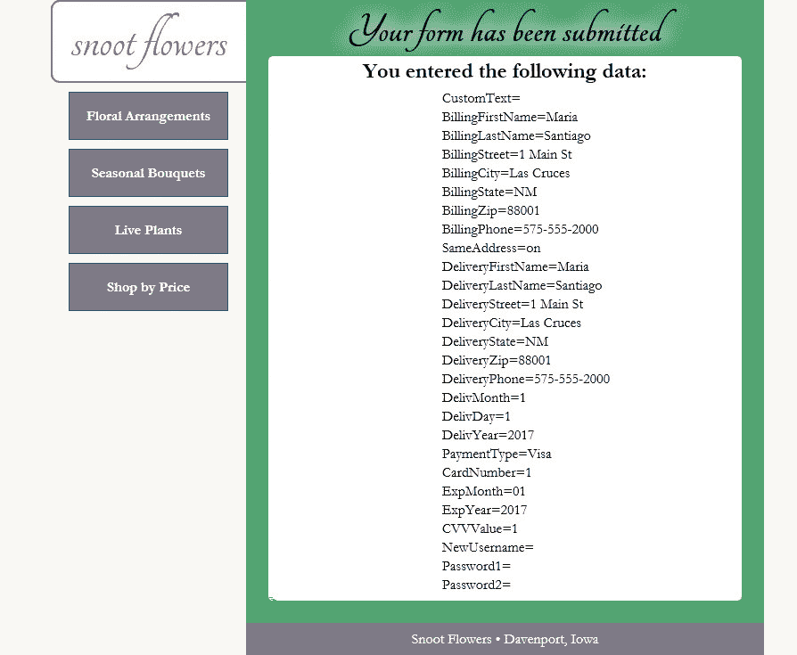
图 6-12：提交结果页面

### 自定义基于浏览器的验证反馈

如你在前面的步骤中所看到的，现代浏览器显示基于浏览器的验证反馈的方式相似，但浏览器之间存在某些差异。通常，反馈会在表单触发 `submit` 事件后显示。浏览器会高亮显示一个或多个包含无效数据的控件，并在第一个控件旁边显示一个气泡，其中包含描述错误以及如何修复的文本。每个浏览器都使用其特定的错误文本，这些文本特定于所发现的错误类型。

浏览器呈现基于浏览器的验证反馈的许多方面都可以通过 **约束验证 API（constraint validation API）** 的属性和方法进行自定义。除了表 6-13 中描述的 `validationMessage` 和 `willValidate` 属性外，`validity` 对象也是该 API 的一部分。`validity` 对象包含多个属性；如果所有这些属性的值为 `false`，那么 `validity` 对象的值即为 `true`。表 6-14 描述了 `validity` 属性。

| 属性 | 满足什么条件返回 `true` |
| :--- | :--- |
| `customError` | 使用 `setCustomValidity()` 设置了自定义错误消息 |
| `patternMismatch` | 控件的值与 `pattern` 属性的值不匹配 |
| `rangeOverflow` | 控件的值大于 `max` 属性的值 |
| `rangeUnderflow` | 控件的值小于 `min` 属性的值 |
| `stepMismatch` | 控件的值不符合 `step` 属性的值 |
| `tooLong` | 控件值的长度大于 `maxlength` 属性的值 |
| `typeMismatch` | 控件的值不符合 `type` 属性值的规则 |
| `valueMissing` | 控件值为空但该控件设置了 `required` 属性 |
| `valid` | 上述任一属性均为 `true` |

表 6-14：`validity` 属性

*由于本书的侧重点是客户端 JavaScript，因此表单的 action 值设置为将数据提交到另一个名为 results.htm 的 HTML 文档，而不是 Web 服务器。results.htm 文档位于你存放第 6 章的文件夹中，它使用 JavaScript 代码来显示从表单提交的值。results.htm 文档的唯一目的是显示本应提交到服务器的表单数据。完成后的表单将与服务器上的程序集成，该程序将返回确认消息。*

**注意**

结合这些属性和方法，你可以使用 CSS 的 `:invalid` 和 `:valid` 伪类根据表单元素的有效性状态来更改其属性。通过使用所有这些工具，你可以自定义基于浏览器的验证行为，让用户在所有现代浏览器中都能获得相似的反馈。

例如，以下 JavaScript 代码检查 `fname` 元素的 `valueMissing` 属性，如果值为 `true`，则将气泡文本设置为“Please fill out this field”。该气泡文本将在所有现代浏览器中一致地显示。

```javascript
var fname = document.getElementById("firstName");

if (fname.valueMissing) {
  fname.setCustomValidity("Please fill out this field.");
}
```

添加以下 CSS 将只要字段的有效性状态为无效，将字段背景设置为粉色：

```css
#firstName:invalid {
  background: rgb(255, 233, 233);
}
```

图 6-13 显示了当提交表单时未为 `firstName` 字段提供值，该代码的结果。

请注意，为控件设置自定义错误消息会将该控件的有效性更改为 `false`。这意味着当使用自定义错误消息时，需要额外的代码来验证字段。

表 6-15 描述了约束验证 API 的方法。

| 方法 | 描述 |
| :--- | :--- |
| `checkValidity()` | 如果控件的值有效，则对该控件返回 `true` |
| `setCustomValidity()` | 设置自定义验证消息和规则 |

表 6-15：约束验证 API 方法

在本书期间，除了文本外，气泡外观的任何方面都是自定义的，这意味着颜色、形状和大小在浏览器之间存在差异。如果目标是在每个浏览器中创建统一的外观，你可以改用 `preventDefault()` 方法和 `invalid` 事件来防止气泡在任何浏览器中显示。如果你选择这样做，你则需要编写自己的机制来向用户显示反馈。

另请注意，在本书编写期间，基于浏览器的验证缺少一些功能，这些功能的缺失使得在更复杂的情况下使用基于浏览器的验证更具挑战性。这些缺失的功能之一是无法同时为同一个字段设置多个验证消息。这意味着，如果一个字段有两个验证问题——例如，它必须是一个小于（`max="100"`）的值且必须是一个偶数（`step="2"`）——那么对于像 99 这样违反了两个规则的输入，将无法提供两个独立的自定义验证消息。

确保你的表单不仅在现代浏览器中行为相似，在不执行浏览器验证的 Internet Explorer 中也表现相似，这一点很重要。为了在旧版浏览器中执行验证，可能需要编写一个程序并结合基于浏览器的属性和方法。这种方法对于较小的表单（例如，仅请求用户名和密码的表单）很有意义。但对于像订单单这样大的表单，只需编写一套运行在所有浏览器上的自定义验证函数就可以节省时间并减少所需的验证代码。

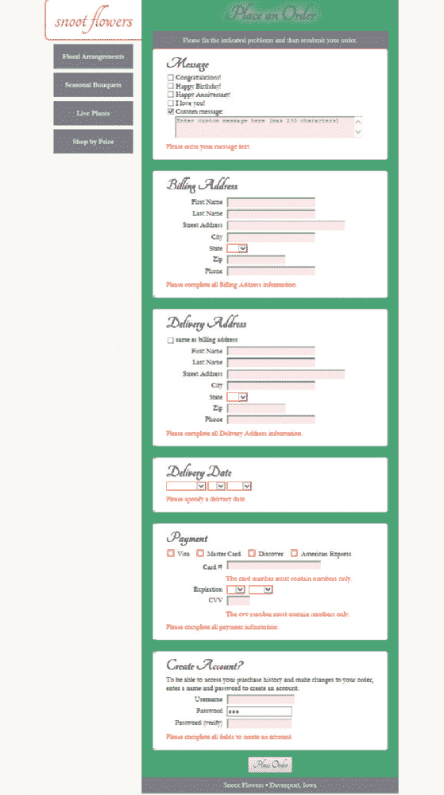
图 6-13：自定义的基于浏览器的验证

4. 在不在任何字段中输入数据的情况下，滚动到表单底部，然后点击 **Place Order**（下单）按钮。浏览器将跳过基于浏览器的验证并将表单数据提交到结果页面。注意，结果页面列出了每个字段名称，后跟着一个等号，但没有值。

#### 短测验 3

- 列出两个用于指定表单子元素中浏览器内置验证参数的属性，并描述每个属性的作用。
- 列出一个 `input` 元素的 `type` 属性值，该值可触发浏览器内置验证，并描述内容浏览器会检查哪些内容。
- 什么是约束验证 API（constraint validation API）？
- 使用浏览器内置验证的缺点是什么？

## 编写自定义验证

你正在验证的表单的需求决定了你需要整合到自定义验证程序中的逻辑类型。然而，有几种验证函数尤为常见：

- 检查必填字段是否包含内容
- 检查依赖于其他控件值的数值
- 检查一个或多个字段中的内容类型是否适当

Snoot Flowers 订单表单的计划使用红色背景和边框，并在页面顶部以及包含错误的每个字段组（fieldset）内显示自定义错误消息，如图 6-14 所示。


图 6-14：带有错误消息和样式的表单预览

### 验证提交的数据

在第 7 章和第 8 章中，你学习了 JavaScript 中可以监听的许多事件。其中 `submit` 事件可用于 `form` 元素。当表单提交时，会触发 `submit` 事件，这通常是在用户点击表单上的提交按钮时发生的。在 `submit` 事件触发时、数据发送到服务器之前，通常会对表单数据进行验证。

你将从一个主函数调用所有的自定义验证函数，该函数将决定表单是否通过验证——如果是，该函数将提交表单内容。在准备创建自定义验证函数之前，你现在将创建主验证函数。

要创建主验证函数：

1. 返回编辑器中的 `snoot.js`，然后在 `createEventListeners()` 函数中添加以下代码：

```javascript
var form = document.getElementsByTagName("form")[0];
if (form.addEventListener) {
  form.addEventListener("submit", validateForm, false);
} else if (form.attachEvent) {
  form.attachEvent("onsubmit", validateForm);
}
```

这段代码在文档中第一个表单的 `submit` 事件上创建了一个事件监听器——在这种情况下，它是文档中唯一的表单。这段代码会触发 `validateForm()` 函数，你将在稍后的步骤中创建它。

2. 在 `snoot.js` 文档顶部的全局变量部分，添加以下语句：

```javascript
var formValidity = true;
```

这段代码声明了 `formValidity` 变量，你用它来跟踪表单是否有效，或者用户是否需要修正或更改。

3. 在 `createEventListeners()` 函数之前，添加以下代码来创建 `validateForm()` 函数：

```javascript
/* validate form */
function validateForm(evt) {
  if (evt.preventDefault) {
    evt.preventDefault(); // 防止表单提交
  } else {
    evt.returnValue = false; // 防止表单提交在 IE8
  }
  formValidity = true; // 重置值以便重新验证
}
```

表单在被调用时接收一个单一参数 `evt`。该参数引用了调用函数的事件——表单的 `submit` 事件。`evt.preventDefault()` 语句禁用了引用事件的默认行为。你对对象使用 `preventDefault()` 方法来阻止通常与事件关联的操作。然而，Internet Explorer 不支持 `preventDefault()` 方法，因此你使用条件语句，在不支持 `preventDefault()` 的浏览器中将事件的 `returnValue` 属性设置为 `false`；将 `returnValue` 设置为 `false` 在旧版浏览器中可以实现与 `preventDefault()` 在现代浏览器中完全相同的任务。

你通常会在 `preventDefault()` 方法之后紧跟为指定事件执行不同任务的代码。在这种情况下，`preventDefault()` 方法停止了表单的提交。你将通过指定要运行的自定义验证函数来完成该函数，如果内容通过验证，你将手动调用 `submit()` 方法来提交表单。

4. 保存对 `snoot.js` 的更改，回到浏览器中的 `snoot.htm`，刷新或重新加载页面，然后点击 **Place Order** 按钮。注意结果页面没有显示。这是因为 `preventDefault()` 方法阻止了页面的提交。

5. 返回编辑器中的 `snoot.js`，然后在 `validateForm()` 函数中，在 `formValidity = true` 语句之后输入以下 `if/then` 语句：

```javascript
// 替换为函数的调用
if (formValidity === true) {
  document.getElementById("errorText").innerHTML = "";
  document.getElementById("errorText").style.display = "none";
  document.getElementsByTagName("form")[0].submit();
} else {
  document.getElementById("errorText").innerHTML = "请修复指示的问题并重新提交订单。";
  document.getElementById("errorText").style.display = "block";
  scroll(0,0);
}
```

编写验证函数时，将在 `if` 语句之前添加调用。任何发现无效内容的函数都会将 `formValidity` 的值改为 `false`，使得 `if` 语句的执行取决于表单数据是否通过验证。如果任何数据无效——即 `formValidity` 变量被赋值为 `false`——则执行 `else` 分支。前两个语句将 ID 值为 `errorText` 的元素显示设置为 `block`，使其在页面上可见，并作为元素的内容向用户添加适当的消息。该元素位于表单顶部，告知用户在提交表单前需要修正输入。第三条语句 `scroll(0,0)` 将浏览器移回页面顶部，以便用户可以看到 `errorText` 然后从上到下检查表单需要修复的问题。

6. 保存对 `snoot.js` 的更改，回到浏览器中的 `snoot.htm`，刷新或重新加载页面，然后点击 **Place Order** 按钮。这次 `results.htm` 页面显示了。由于尚不存在可能更改 `formValidity` 值的验证函数，`if` 语句执行了，并且通过 `submit()` 方法手动提交了表单。

7. 返回编辑器中的 `snoot.js`，然后在 `validateForm()` 函数中将 `formValidity` 的值改为 `false`，如下：

```javascript
function validateForm(evt) {
  if (evt.preventDefault) {
    evt.preventDefault(); // 防止表单提交
  } else {
    evt.returnValue = false; // 防止表单提交在 IE8
  }
  formValidity = false; // 重置值以重新验证
}
```

8. 将您的更改保存到 `snoot.js`，回到浏览器中的 `snoot.htm`，刷新或重新加载页面，然后点击 **Place Order**（提交订单）按钮。这次表单没有被提交，浏览器滚动到页面顶部，并显示 `errorText` 块，如图 6-15 所示。

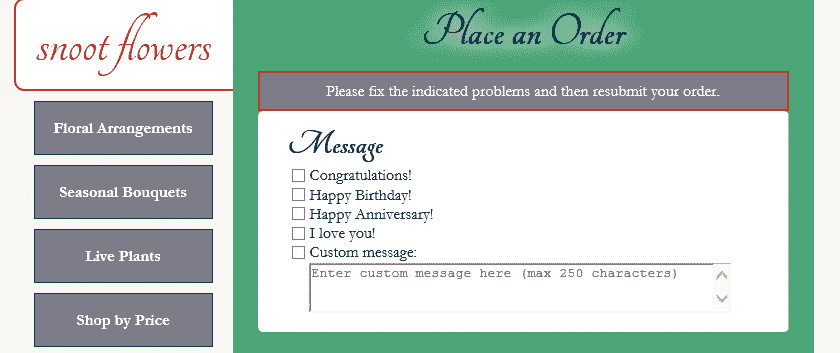
图 6-15：表单自动滚动向上并显示错误文本

9. 回到编辑器中的 `snoot.js`，然后在 `validateForm()` 函数中，将 `formValidity` 的值改回 `true`，如下所示：

```javascript
function validateForm(evt) {
  if (evt.preventDefault) {
    evt.preventDefault(); // 防止表单提交
  } else {
    evt.returnValue = false; // 防止表单提交在 IE8
  }
  formValidity = true; // 重置值以重新验证
}
```

10. 将您的更改保存到 `snoot.js`。

接下来，您将创建自定义验证函数来验证不同类型的内容并显示自定义错误消息。

### 使用自定义函数验证必填字段

创建一个用于验证必填字段函数通常涉及获取必填字段的值，并检查其中任何一个值是否为空字符串。这些函数具有通用形式：

```javascript
if (element.value === "") {
  // 显示消息并高亮错误的代码
  formValidity = false;
}
```

对于所有自定义验证，使用您在本章中学的 `try/catch` 结构来处理和显示错误消息会帮助。将此结构与上述代码结合将得到以下通用形式：

```javascript
try {
  if (element.value === "") {
    throw "message";
  }
}
catch(message) {
  // 显示消息并高亮错误的代码
  formValidity = false;
}
```

在订单表单中，设计要求如果任何字段包含错误，则在字段集（fieldset）中显示单个错误消息。

#### 检查空文本输入字段

您使用不同的属性来验证每个表单元素和 `input` 类型。对于文本框——包括任何使用 `input` 元素创建的显示允许字符输入的框的对象——您可以使用 `value` 属性来检查值。表 6-16 列出了最常用的 `input` 元素属性，表 6-17 列出了常用的 `input` 元素方法。

| 属性 (PROPERTY) | 描述 (DESCRIPTION) | 表单控件 (FORM CONTROLS) |
| :--- | :--- | :--- |
| `accept` | 设置或返回可以上传的逗号分隔的 MIME 类型列表 | 文件框 |
| `alt` | 设置或返回图像的替代文本 | 图像提交按钮 |
| `autocomplete` | 设置或返回是否允许浏览器根据用户存储的来自其他网站的数据自动填充控件值 | 文本框、密码框 |
| `checked` | 设置或返回复选框或单选按钮的选中状态 | 复选框、单选按钮 |
| `defaultChecked` | 确定复选框组或单选按钮组中默认选中的控件 | 复选框、单选按钮 |
| `defaultValue` | 设置或返回显示在表单控件中的默认文本 | 文本框、密码框、文件框 |
| `files` | 用户选择的文件集合 | 文件框 |
| `list` | `option` 元素集合，可用于为控件提供选项或建议值 | 文本框 |
| `max` | 设置或返回控件允许的最大值 | 文本框 |
| `maxLength` | 设置或返回可以在字段中输入的最大字符数 | 文本框、密码框 |
| `min` | 设置或返回控件允许的最小值 | 文本框 |
| `multiple` | 设置或返回控件是否接受多个一个值 | 文本框 |
| `name` | 设置或返回分配给元素名称的值 | 复选框、单选按钮、提交按钮、文本框、文件框 |
| `pattern` | 设置或返回描述有效值必须匹配的模式的正则表达式 | |
| `placeholder` | 设置或返回显示在空控件中的文本以提供指导 | 文本框 |

| 方法 (METHOD) | 描述 (DESCRIPTION) | 表单控件 (FORM CONTROLS) |
| :--- | :--- | :--- |
| `blur()` | 从控件上移除焦点 | 复选框、单选按钮、提交按钮、文本框、文件框 |
| `click()` | 激活控件点击事件 | 复选框、单选按钮、提交按钮、文本框、文件框 |
| `focus()` | 将焦点更改到控件 | 复选框、单选按钮、提交按钮、文本框、文件框 |
| `select()` | 选择控件中的文本 | 复选框、单选按钮、提交按钮、文本框、文件框 |

例如，为了检查带有 `firstName` 的 `input` 元素是否为空，可以使用：

```javascript
if (document.getElementById("firstName").value === "") {
    // 如果为空执行的代码
}
```

您可以使用循环语句来检查其中任何一个是否为空。接下来，您将为地址字段创建自定义验证。由于最终计划对任何错误使用单个消息，并将分离高亮每个字段的代码。

11. 回到编辑器中的 `snoot.js`，然后在 `validateForm()` 函数上方输入代码创建 `validateAddress()` 函数并声明变量：

```javascript
/* 验证字段集 */
function validateAddress(fieldsetId) {
  var inputElements = document.querySelectorAll("#" + fieldsetId + " input");
  var errorDiv = document.querySelector("#" + fieldsetId + " .errorMessage");
  var fieldsetValidity = true;
  var elementCount = inputElements.length;
  var currentElement;
}
```

2. 在变量声明之后，添加以下 `try` 语句：

```javascript
try {
  for (var i = 0; i < elementCount; i++) {
    // 验证字段集中的所有输入元素
    currentElement = inputElements[i];
    if (currentElement.value === "") {
      currentElement.style.background = "rgb(255,233,233)";
      fieldsetValidity = false;
    } else {
      currentElement.style.background = "white";
    }
  }
  if (fieldsetValidity === false) {
    // 根据当前字段集抛出适当的消息
    if (fieldsetId === "billingAddress") {
      throw "Please complete all Billing Address information.";
    } else {
      throw "Please complete all Delivery Address information.";
    }
  } else {
    errorDiv.style.display = "none";
    errorDiv.innerHTML = "";
  }
}
```

注意，你可以直接遍历此字段集（fieldset）中的所有字段，因为它们都是必填的。对于只有部分字段必填的字段集，可以在每次循环时扩展条件语句，检查元素的 `required` 属性是否为 `true`，并仅对必填的空字段提醒用户。

3. 在 `try` 语句之后，添加以下 `catch` 语句：

```javascript
catch(msg) {
  errorDiv.style.display = "block";
  errorDiv.innerHTML = msg;
  formValidity = false;
}
```

4. 在 `validateForm()` 函数中，将注释 `// replace with calls to validation functions` 替换为下面所示的两个语句：

```javascript
function validateForm(evt) {
  if (evt.preventDefault) {
    evt.preventDefault(); // 防止表单提交
  } else {
    evt.returnValue = false; // 防止在 IE8 中提交表单
  }
  formValidity = true; // 重置值以重新验证
  validateAddress("billingAddress");
  validateAddress("deliveryAddress");
}
```

5. 第一条语句使用字符串“billingAddress”作为参数调用函数，第二条语句使用字符串“deliveryAddress”执行相同操作。记住，该函数将提供的参数值视为视为要验证的字段集的 `id` 值。因此，第一条语句调用函数验证 `billingAddress` 字段集，第二条语句调用它来验证 `deliveryAddress` 字段集。

6. 将你的更改保存到 `snoot.js`，在浏览器中刷新或重新加载 `snoot.htm`，必要时清空表单，然后在不填写任何字段的情况下点击 **Place Order** 按钮。浏览器将滚动到文档顶部，错误消息显示在页面顶部。

7. 滚动到账单地址（Billing Address）和收货地址（Shipping Address）部分。文本输入字段的背景为粉色，每个字段集在底部显示自定义错误文本。图 6-16 显示了 Firefox 中的错误格式和消息。

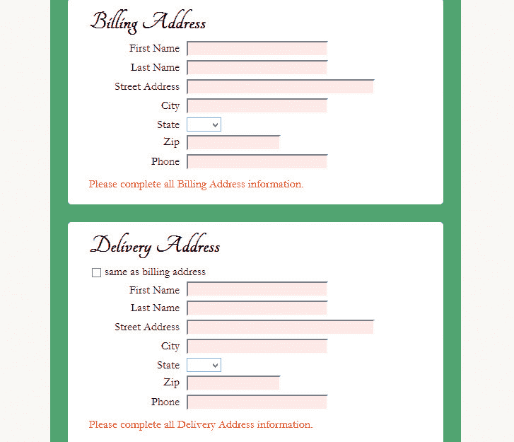   
自定义错误消息

  
带有粉色背景格式的空文本输入字段

图 6-16：空地址文本输入字段的验证结果

*尽管你通过 `novalidate` 属性关闭了基于浏览器的验证，但如果 Zip（邮编）和 Phone（电话）字段中的值不是数字，Chrome 可能会拒绝提交表单。如有，请将这些值改为数字并再次点击 Place Order。*

**注意**

#### 检查无值的选择列表

你用于验证地址字段集的函数几乎完成。然而，除了文本框外，每个字段集还包含一个选择列表——State（州）字段。你不需要像处理文本输入元素那样检查 `value` 属性，为了验证选择列表中是否已选择项目，你需要检查 `selectedIndex` 属性的值。回想本章前面的内容，`selectedIndex` 代表所选项目在 `option` 元素数组中的索引值。如果选择列表中没有选中任何选项，则 `select` 元素的 `selectedIndex` 属性等于 -1。获取此值是检查必填选择列表是否已完成的最简单方法。例如，要检查用户是否在 `id` 值为 `state` 的 `select` 元素中进行了选择，并在未进行选择时提醒用户，你可以使用以下语句：

```javascript
if (document.getElementById("state").selectedIndex === -1) {
  // 如果字段为空，则运行的代码
}
```

为了完成地址字段集的验证函数，你将添加代码来检查 State 选择列表的值。由于背景颜色在不同浏览器中对 `select` 和 `option` 元素的应用并不一致，你将改为为 State 选择列表添加红色边框，以便在用户未进行选择时突出显示。要为地址字段集的验证函数添加对 State 选择列表的验证：

1. 回到编辑器中的 `snoot.js`，然后在 `validateAddress()` 函数中找到以 `if (fieldsetValidity === false)` 开头的 `if` 语句。

2. 在 `if` 语句之前，插入以下代码：

```javascript
currentElement = document.querySelector("#" + fieldsetId + " select");
// 验证 select 元素
if (currentElement.selectedIndex === -1) {
  currentElement.style.border = "1px solid red";
}
```

3. 在两个地址区域的所有文本输入字段中输入虚构值，从每个 State 列表中选择一个州，然后点击 **Place Order** 按钮。所有验证检查均通过成功，并显示结果页面。接下，你将创建一个函数来验证 Delivery Date（交付日期）字段集中的必填字段。此字段集中的三个控件都是选择列表。你将使用循环检查每个是否有值，并对任何空 `select` 元素应用红色边框，就像你之前对 State 选择列表所做的那样。

创建一个验证 Delivery Date 字段集中必填字段的函数：

1. 回到编辑器中的 `snoot.js`，然后在 `validateForm()` 函数上方，输入以下代码以创建 `validateDeliveryDate()` 函数并声明变量：

```javascript
/* 验证日期字段集 */
function validateDeliveryDate() {
  var selectElements = document.querySelectorAll("#deliveryDate select");
  var errorDiv = document.querySelector("#deliveryDate .errorMessage");
  var fieldsetValidity = true;
  var elementCount = selectElements.length;
  var currentElement;
}
```

2. 在变量声明之后，输入以下 `try` 语句：

```javascript
try {
  for (var i = 0; i < elementCount; i++) {
    currentElement = selectElements[i];
    if (currentElement.selectedIndex === -1) {
      currentElement.style.border = "1px solid red";
      fieldsetValidity = false;
    } else {
      currentElement.style.border = "";
    }
  }
  if (fieldsetValidity === false) {
    throw "Please specify a delivery date.";
  } else {
    errorDiv.style.display = "none";
    errorDiv.innerHTML = "";
  }
}
```

3. 在 `validateForm()` 函数中，在 `if` 语句之前，按照如下方式添加对 `validateDeliveryDate()` 函数的调用：

```javascript
function validateForm(evt) {
  if (evt.preventDefault) {
    evt.preventDefault(); // 防止表单提交
  } else {
    evt.returnValue = false; // 在 IE8 中防止表单提交
  }
  formValidity = true; // 为重置值
  validateAddress("billingAddress");
  validateAddress("deliveryAddress");
  validateDeliveryDate();
}
```

4. 将你的更改保存到 `snoot.js`，在浏览器中刷新或重新加载 `snoot.htm`，清除表单，然后在不在字段中输入任何数据的情况下，点击 **Place Order**（下单）按钮。

交付日期部分的空选择列表以红色边框显示，错误文本显示在字段组（fieldset）的底部。图 6-18 显示了 Firefox 中的验证结果。

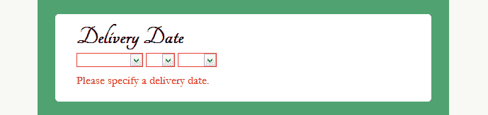   
空日期选择列表具有红色边框

  
错误消息

图 6-18：日期选择列表上的验证结果

5. 在两个地址部分的所有文本输入字段中输入虚拟值，从每个州选择列表中选择一个州，在交付日期部分选择月、日、年，然后点击 **Place Order** 按钮。所有验证检查均通过，并显示结果页面。

#### 检查未选择的单选按钮组

接下来，你将创建一个函数来验证支付（Payment）字段组中的必填字段。除了两个文本框和选择列表外，支付字段组还包含一组单选按钮。要检查单选按钮是否被选中，你需要访问其 `checked` 属性的值。要检查一组单选按钮是否全都未被选中，你可以使用逻辑与（`&&`）运算符创建一个条件语句。例如，要检查名称为 `Color` 的三个单选按钮是否都没有被选中，可以使用以下代码：

```javascript
var buttons = document.getElementsByName("Color");
if (!buttons[0].checked && !buttons[1].checked && !buttons[2].checked) {
  // 如果未选择任何按钮则运行的代码
}
```

此代码检查第一个按钮是否未被选中（使用 `!` 运算符），以及（`&&`）第二个按钮是否未被选中，以及第三个按钮是否未被选中。如果所有这些条件成立，则 `if` 语句真，意味着没有按钮被选中。你将使用这样的语句来验证订单表单用户是否在支付字段组中选择了信用卡。

为支付字段组创建一个验证函数：

1. 回到编辑器中的 `snoot.js`，然后在 `validateForm()` 函数上方，输入以下代码以创建 `validatePayment()` 函数并声明变量：

```javascript
/* 验证支付字段组 */
function validatePayment() {
  var errorDiv = document.querySelector("#paymentInfo .errorMessage");
  var fieldsetValidity = true;
  var ccNumElement = document.getElementById("ccNum");
  var selectElements = document.querySelectorAll("#paymentInfo select");
  var elementCount = selectElements.length;
  var cvvElement = document.getElementById("cvv");
  var cards = document.getElementsByName("PaymentType");
  var currentElement;
}
```

2. 在变量声明下方，添加以下 `try` 语句：

```javascript
try {
  if (!cards[0].checked && !cards[1].checked && !cards[2].checked && !cards[3].checked) {
    // 验证是否选择了卡片
    for (var i = 0; i < 4; i++) {
      cards[i].style.outline = "1px solid red";
    }
    fieldsetValidity = false;
  } else {
    for (var i = 0; i < 4; i++) {
      cards[i].style.outline = "";
    }
  }
}
```

此 `try` 语句检查是否所有单选按钮都未被选中，如果是这样，它会为每个按钮添加红色边框并将 `fieldsetValidity` 设置为 `false`。由于字段组还包含文本输入字段和选择列表，你将创建额外的代码来检查这些字段中是否有任何一个为空。最后检查 `fieldsetValidity` 变量来决定是否抛出异常。

3. 在 `try` 语句中，在上一步骤的 `else` 语句下方，输入以下 `if` 语句来检查信用卡号：

```javascript
if (ccNumElement.value === "") {
  // 验证是否输入了信用卡号
  ccNumElement.style.outline = "1px solid red";
  fieldsetValidity = false;
} else {
  ccNumElement.style.outline = "";
}
```

4. 在 `try` 语句中，在上一步骤的 `else` 语句下方，输入以下 `for` 语句来检查选择列表：

```javascript
for (var i = 0; i < elementCount; i++) {
  // 验证是否选择了月、年
  currentElement = selectElements[i];
  if (currentElement.selectedIndex === -1) {
    currentElement.style.outline = "1px solid red";
    fieldsetValidity = false;
  } else {
    currentElement.style.outline = "";
  }
}
```

5. 在 `try` 语句中，在 `for` 语句下方，输入以下 `if` 语句来检查 CVV 字段：

```javascript
if (cvvElement.value === "") {
  // 验证是否输入了 CVV
  cvvElement.style.outline = "1px solid red";
  fieldsetValidity = false;
} else {
  cvvElement.style.outline = "";
}
```

6. 在 `try` 语句中，在 `else` 语句下方，输入以下 `if` 语句来检查 `fieldsetValidity` 变量：

```javascript
if (!fieldsetValidity) {
  // 如果验证无效
  throw "请填写支付信息。";
} else {
  errorDiv.style.display = "none";
  errorDiv.innerHTML = "";
}
```

7. 在 `try` 语句下方，输入以下 `catch` 语句：

```javascript
catch(msg) {
  errorDiv.style.display = "block";
  errorDiv.innerHTML = msg;
  formValidity = false;
}
```

8. 在 `validateForm()` 函数中，在 `validateDeliveryDate()` 函数之后添加对 `validatePayment()` 函数的调用，如下：

```javascript
function validateForm(evt) {
  if (evt.preventDefault) {
    evt.preventDefault(); // 防止表单提交
  } else {
    evt.returnValue = false; // 在 IE8 中防止表单提交
  }
  formValidity = true; // 为重置值
  validateAddress("billingAddress");
  validateAddress("deliveryAddress");
  validateDeliveryDate();
  validatePayment();
}
```

9. 完成结算地址、交付地址、交付日期和支付部分所有字段的填写，然后点击 **Place Order** 按钮。所有验证检查均通过，并显示结果页面。


# 第 6 章 增强与验证表单

此 `try` 语句检查是否所有单选按钮都未被选中，如果是这样，它会为每个按钮添加红色边框并将 `fieldsetValidity` 设置为 `false`。由于字段组还包含文本输入字段和选择列表，你将创建额外的代码来检查这些字段中是否有任何一个为空。最后检查 `fieldsetValidity` 变量来决定是否抛出异常。

## 3. 在 `try` 语句中，在上一步骤的 `else` 语句下方，输入以下 `if` 语句来检查信用卡号：

```javascript
if (ccNumElement.value === "") {
  // 验证是否输入了信用卡号
  ccNumElement.style.outline = "1px solid red";
  fieldsetValidity = false;
} else {
```

## 4. 在 `try` 语句中，在上一步骤的 `else` 语句下方，输入以下 `for` 语句来检查选择列表：

```javascript
for (i = 0; i < elementCount; i++) {
  // 验证是否选择了月、年
  currentElement = selectElements[i];
  if (currentElement.selectedIndex === -1) {
    currentElement.style.outline = "1px solid red";
    fieldsetValidity = false;
  }
}
```

## 5. 在 `try` 语句中，在 `for` 语句下方，输入以下 `if` 语句来检查 CVV 字段：

```javascript
if (cvvElement.value === "") {
  // 验证是否输入了 CVV
  cvvElement.style.outline = "1px solid red";
  fieldsetValidity = false;
} else {
```

## 6. 在 `try` 语句中，在 `else` 语句下方，输入以下 `if` 语句来检查 `fieldsetValidity` 变量：

```javascript
if (!fieldsetValidity) {
  // 如果验证无效
  throw "请填写支付信息。";
} else {
```

## 7. 在 `try` 语句下方，输入以下 `catch` 语句：

```javascript
catch(msg) {
  errorDiv.style.display = "block";
  errorDiv.innerHTML = msg;
  formValidity = false;
}
```

## 为自定义消息复选框及其依赖的 `textarea` 创建一个验证函数

### 1. 回到编辑器中的 **snoot.js**，然后在 `validateForm()` 函数上方输入以下代码以创建 `validateMessage()` 函数并声明变量：

```javascript
/* 验证消息字段集 */
function validateMessage() {
  var errorDiv = document.querySelector("#message .errorMessage");
  var msgBox = document.getElementById("customText");
}
```

### 2. 在变量下方，添加以下 `try` 语句：

```javascript
try {
  if (document.getElementById("custom").checked && ((msgBox.value === "") || (msgBox.value === msgBox.placeholder))) {
    // 选了自定义但消息框为空
    throw "Please enter your message text.";
  } else {
    errorDiv.style.display = "none";
    msgBox.style.background = "white";
  }
}
```

> 在本章前面的部分，你创建了一个函数，当用户在 textarea 框中输入自定义文本时，会自动检查自定义消息复选框。当你能够推断用户的意图且所有所需信息已输入时，该函数可以自动化表单填写的一个步骤——如果用户输入了自定义文本，你可以安全地假设他们也意味着勾选了自定义消息复选框。现在你要为相反的情况创建一个函数：当 textarea 框为空但自定义消息复选框被选中时。在这种情况下，你没有提交表单所需的所有信息（尽管选中了自定义消息，但表单中没有自定义消息文本），这是一个验证问题，而不是可用性问题。

**注意**

自定义消息复选框被选中，如果是，则验证用户已在 `textarea` 控件中输入了自定义文本。要识别复选框是否被选中，你使用与访问选项按钮状态时相同的 `checked` 属性。

### 3. 在 `try` 语句下方，添加以下 `catch` 语句：

```javascript
catch (msg) {
  errorDiv.style.display = "block";
  errorDiv.innerHTML = msg;
  msgBox.style.background = "rgb(255,233,233)";
  formValidity = false;
}
```

### 4. 在 `validateForm()` 函数中，在调用 `validatePayment()` 函数之后添加对 `validateMessage()` 函数的调用，如下：

```javascript
function validateForm(evt) {
  if (evt.preventDefault) {
    evt.preventDefault(); // 防止表单提交
  } else {
    evt.returnValue = false; // 防止表单提交
    // IE8
  }
  formValidity = true; // 重置值以便重新验证
  validateAddress("billingAddress");
  validateAddress("deliveryAddress");
  validateDeliveryDate();
  validatePayment();
  validateMessage();
}
```

### 5. 保存 **snoot.js** 中的更改，在浏览器中刷新或加载 **snoot.htm**，然后清空表单。

### 6. 在消息（Message）字段集中，点击 **Custom message**（自定义消息）复选框进行勾选，然后在不向任何其他字段输入任何数据的情况下，点击 **Place Order**（下单）按钮。textarea 显示为粉色背景，错误文本显示在字段集的底部。图 - 显示了 Firefox 中的验证结果。

### 7. 在自定义消息 textarea 中输入一个单词或短语，用虚构信息填写结算地址（Billing Address）、配送地址（Delivery Address）、配送日期（Delivery Date）和付款（Payment）部分的所有字段，然后点击 **Place Order** 按钮。所有验证检查均通过，并显示结果页面。

## 根据文本输入框内容进行验证

订单表单中的另一个字段集包含其有效值取决于其他字段的字段：创建账户（Create Account）字段集。与许多在线零售商一样，Snoot Flowers 的客户不需要创建账户，因此用户名（Username）、密码（Password）和确认密码（Password verify）字段都可以留空。然而，如果用户在这些字段中的一个或多个输入了数据，则需要进行检查：

- 如果至少有一个字段包含用户输入，则三个字段都必须填写。这意味着如果用户在其中一个字段中输入内容，三个字段都会变成必填项。
- Password 和 Password (verify) 字段中的值必须匹配。由于密码输入对用户是不可见的——浏览器默认用圆点表示每个字符——要求用户输入两次密码有助于确保用户输入了他们想要的内容。

你将使用嵌套的 `if` 语句创建一个函数，以便验证此字段集时考虑所有可能性。你的代码将根据两个有效性检查中失败的那个抛出两种可能的错误消息。图 - 显示了将整合到此函数的逻辑流程图。

### 图 6-20: 消息字段集的验证结果

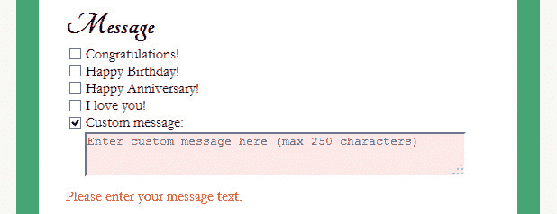      

> 当复选框被选中时 textarea 显示粉色背景

### 编写自定义验证

为创建账户（Create Account）字段集创建一个验证函数：

#### 1. 回到编辑器中的 **snoot.js**，然后在 `validateForm()` 函数上方输入以下代码以创建 `validateAccount()` 函数并声明变量：

```javascript
/* 验证账户字段集 */
function validateAccount() {
  var errorDiv = document.querySelector("#account .errorMessage");
  var usernameElement = document.getElementById("username");
  var pass1Element = document.getElementById("pass1");
  var pass2Element = document.getElementById("pass2");
  var passwordMismatch = false;
  var invColor = "rgb(255,233,233)";
}
```

#### 2. 在变量下方，添加以下 `try` 语句：

```javascript
try {
  // 重置样式为有效状态
  usernameElement.style.background = "";
  pass1Element.style.background = "";
  pass2Element.style.background = "";
  errorDiv.style.display = "none";
  if ((usernameElement.value !== "" && pass1Element.value !== "" && pass2Element.value !== "")) {
    // 所有字段均已填写
    if (pass1Element.value !== pass2Element.value) {
      // 密码不匹配
      passwordMismatch = true;
      throw "Passwords entered do not match; please reenter.";
    }
  }
  if (!(usernameElement.value === "" && pass1Element.value === "" && pass2Element.value === "")) {
    // 并非所有字段都为空
    throw "Please complete all fields to create an account.";
  }
}
```

#### 3. 在 `try` 语句下方，添加以下 `catch` 语句：

```javascript
catch (msg) {
  errorDiv.innerHTML = msg;
  errorDiv.style.display = "block";
  if (passwordMismatch) {
    usernameElement.style.background = "";
    pass1Element.style.background = invColor;
    pass2Element.style.background = invColor;
  } else {
    if (usernameElement.value === "") {
      usernameElement.style.background = invColor;
    }
    if (pass1Element.value === "") {
      pass1Element.style.background = invColor;
    }
    if (pass2Element.value === "") {
      pass2Element.style.background = invColor;
    }
  }
  formValidity = false;
}
```

### 图 6-21: `validateAccount()` 函数的逻辑流程图

所有字段都已填写？否 -> 是

所有字段都为空？是 -> 否

密码匹配？是 -> 是 抛出错误“Please complete all fields to create an account.”

否 -> 抛出错误“Passwords entered do not match; please reenter.”

#### 4. 在 `validateForm()` 函数中，在调用 `validateMessage()` 函数之后添加对 `validateCreateAccount()` 函数的调用，如下：

```javascript
function validateForm(evt) {
  if (evt.preventDefault) {
    evt.preventDefault(); // 防止表单提交
  } else {
    evt.returnValue = false; // 防止表单提交
    // IE8
  }
  formValidity = true; // 重置值以进行重新校验
  validateAddress("billingAddress");
  validateAddress("deliveryAddress");
  validateDeliveryDate();
  validatePayment();
  validateMessage();
  validateCreateAccount();
  validateNumbers();
}
```

#### 5. 将你的更改保存到 **snoot.js**，在浏览器中刷新或重新加载 **snoot.htm**，然后清除表单。

#### 6. 在“创建账户”（Create Account）字段组中，在**用户名**框中输入一个虚假名称，然后在不在其他任何字段输入任何数据的情况下，点击**下单**按钮。

#### 7. 滚动到创建账户部分。两个密码字段都显示为粉色背景，相关的错误文本显示在字段组底部。图 - 显示了 Firefox 中的校验结果。

#### 8. 在密码（Password）字段中输入一个或多个字符，在密码（验证）（Password (verify)）字段中输入不同的字符，然后点击**下单**按钮。两个密码字段再次显示为粉色背景，新的错误文本显示在字段组底部。图 - 显示了 Firefox 中的校验结果。

### 图 6-22：部分完成的创建账户字段组的校验结果

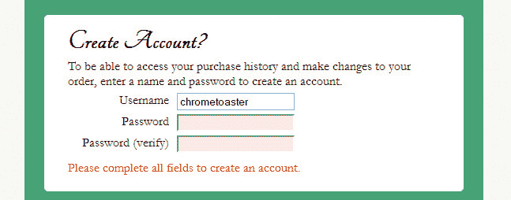    当在用户名字段中输入文本时，两个空白密码字段均显示为粉色背景

   特定上下文的错误消息

### 图 6-23：密码不匹配的创建账户字段组的校验结果

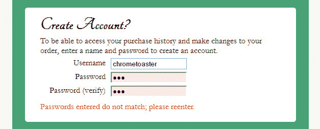    不匹配的密码字段显示为粉色背景

   特定上下文的错误消息

#### 9. 在两个密码字段中输入相同的字符或多个字符，用虚假信息填写账单地址、交付日期和付款部分的所有字段，然后点击**下单**按钮。所有校验检查均通过，并显示结果页面。

## 使用自定义函数验证内容

你需要为订单表单创建的最后一种校验函数是检查用户输入以验证其是否符合每个字段的内容规则。你将把这种类型的校验添加到两个字段中：卡号字段和 CVV，这二者的值都必须是数字。请注意，表单中的许多其他字段值理想情况下符合更严格的规则。例如，要作为一个有效的美国邮政编码，值必须是五位数字（#####）或五位数字后跟一个连字符再是四位数字（#####-####）。对于此表单，你将这种复杂的校验留给处理表单提交数据的后端程序。在章节中，你将学习如何指定像邮政编码、电话号码或电子邮件地址的模式。

对于任何要求数值的字段，可以使用 JavaScript 内置的 `isNaN()` 函数来检查卡号和 CVV 字段的值是否为数字。返回 **snoot.js** 编辑器，然后在 `validateForm()` 函数上方，输入以下代码创建 `validateNumbers()` 函数并声明变量：

```javascript
/* 为旧版浏览器校验数字 */
function validateNumbers() {
  var ccNum;
  var cvvNum;
  var ccNumElement = document.getElementById("ccNum");
  var cvvElement = document.getElementById("cvv");
  var ccNumErrMsg = document.getElementById("ccNumErrorMessage");
  var cvvErrMsg = document.getElementById("cvvErrorMessage");
}
```

### 2. 在变量下方，输入以下 `try` 语句：

```javascript
try {
  if (isNaN(ccNumElement.value) || ccNumElement.value === "") {
    ccNum = true;
  } else {
    // ccNum 是数字
    ccNumElement.style.background = "";
    ccNumErrMsg.style.display = "none";
  }
  if (isNaN(cvvElement.value) || cvvElement.value === "") {
    cvvNum = true;
  } else {
    // cvv 是数字
    cvvElement.style.background = "";
    cvvErrMsg.style.display = "none";
  }
  if (ccNum || cvvNum) {
    throw "必须仅包含数字.";
  }
}
```

### 3. 在 `try` 语句下方，输入以下 `catch` 语句：

```javascript
catch (msg) {
  if (ccNum) {
    ccNumElement.style.background = "rgb(255,233,233)";
    ccNumErrMsg.style.display = "block";
    ccNumErrMsg.innerHTML = "卡号 " + msg;
  }
  if (cvvNum) {
    cvvElement.style.background = "rgb(255,233,233)";
    cvvErrMsg.style.display = "block";
    cvvErrMsg.innerHTML = "cvv 码 " + msg;
  }
}
```

### 8. 将卡号和 CVV 字段中的输入改为数字，用虚假信息填写账单地址、送货地址、送货日期和支付部分的所有字段，然后点击 **Place Order**（下订单）按钮。如果所有验证检查均通过，则将显示结果页面。

## 短答测验 4

- 表单提交时会触发什么事件？
- 你使用哪种方法来禁用与事件关联的默认行为？
- 你检查哪个属性来确定文本输入框是否包含用户输入？
- 你使用哪个内置 JavaScript 函数来测试一个值是否不是数字？

### 图 6-24：部分完成的支付字段组（fieldset）验证结果

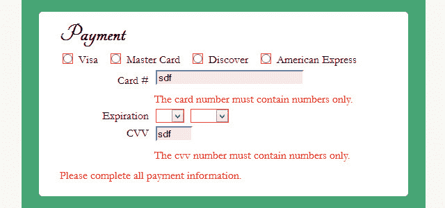   

> 当内容非数字时，卡号和 CVV 字段显示粉色背景

  

> 每个框之间的错误消息指出了框名称并说明了内容无效的原因

## 总结

验证是检查用户提供的信息是否符合规则的过程，以确保其恰当回答了表单的问题，并以网站后端程序可以处理的格式提供。

你可以创建 JavaScript 函数来减少用户在填写表单时出现错误的概率。这些函数本身并不是验证，而是旨在防止用户从一开始就输入错误数据。可以实现许多类型的辅助函数；实现哪些函数取决于你的表单设计以及你试图收集的数据类型。

你可以使用 JavaScript 将 `select` 元素的 `selectedIndex` 属性设置为 `-1`，这对应于没有选择。这确保了任何选择都是由用户做的，而不是默认值。

你可以根据用户在同一表单中做出的其他选择，从 `select` 元素中添加或删除选项（option）。实现此目标的一种方法是创建一个包含一个或多个 `option` 元素的子节点，然后编写一个函数，根据用户的选择添加适当的节点。

在较旧的浏览器中，你可以通过将所需的占位符文本作为元素的默认值添加，并将其颜色更改以区别于用户输入的数据（通常使用灰色字体而不是黑色），来模拟现代浏览器中可用的 `placeholder` 属性的行为。你可以创建一个事件监听器，它在用户点击框内时触发，并调用一个移除默认值的函数。

你可以使用脚本通过更改元素 `checked` 属性的值来检查或取消勾选复选框。

HTML 和现代浏览器的最新增强允许浏览器本身在不需要任何额外 JavaScript 的情况下执行许多常见的验证任务。这种验证被称为基于浏览器的验证或原生验证。

浏览器呈现基于浏览器的验证反馈的许多方面都可以通过约束验证 API 的属性和方法进行自定义。

你在对象上使用 `preventDefault()` 方法来阻塞通常与事件关联的操作。你通常在 `preventDefault()` 方法之后紧跟代码，为指定的事件执行不同的任务。

创建一个验证必填文本输入字段的函数通常涉及获取必填字段的值并检查其中任何一个值是否为空字符串。

要验证必填选择列表，你获取 `selectedIndex` 值并检查它是否等于 `-1`。

要检查单选按钮是否被选中，你访问其 `checked` 属性的值。要检查一组单选按钮中没有一个被选中，你可以使用与（`&&`）运算符创建一个条件语句。

在某些情况下，你需要创建验证函数来测试特定于你创建的表单的逻辑。

### 关键术语

- **辅助函数 (assistive functions)**——JavaScript 函数，通过防止用户从一开始就输入错误数据，减少用户在填写表单时出现错误的概率。
- **基于浏览器的验证 (browser-based validation)**——由于 HTML 和现代浏览器的最新增强，由浏览器本身执行的无需任何额外 JavaScript 的验证任务；也称为原生验证。
- **约束验证 API (constraint validation API)**——一组属性和方法，允许开发者自定义浏览器呈现基于浏览器的验证反馈的方面。
- **createDocumentFragment() 方法**——`Document` 对象的方法，用于创建一个空的文档片段。
- **摩擦 (friction)**——衡量用户完成目标（如下订单）所需的努力程度。
- **HTML 验证 (HTML validation)**——参见基于浏览器的验证。
- **原生验证 (native validation)**——参见基于浏览器的验证。
- **提交事件 (submit event)**——在表单提交时触发的事件，通常是在选择提交按钮时。
- **验证 (validation)**——检查用户提供的信息是否符合规则的过程，以确保其恰当回答了表单的问题，并以网站后端程序可以处理的格式提供。

### 复习

- 表单提交时会触发什么事件？
- 你使用哪种方法来禁用与事件关联的默认行为？
- 你检查哪个属性来确定文本输入框是否包含用户输入？
- 你使用哪个内置 JavaScript 函数来测试一个值是否不是数字？
- 存储在表单中的控件是？
  - a. `forms`
  - b. `controls`
  - c. `inputs`
  - d. `elements`
- 对应于选择的属性是？
  - a. `range`
  - b. `email`
  - c. `checkbox`
  - d. `select`
- `selectedIndex` 属性的值是？
  - a. `1`
  - b. `0`
  - c. `-1`
  - d. `false`
- 模拟现代浏览器 `placeholder` 属性的方法？
  - a. `src`
  - b. `alt`
  - c. `title`
  - d. `value`
- 在用户点击框内时触发的事件是哪个？
  - a. `blur`
  - b. `focus`
  - c. `input`
  - d. `forminput`
- 触发浏览器验证的 `type` 值是？
  - a. `password`
  - b. `text`
  - c. `radio`
  - d. `number`
- 检查单选按钮是否选中的属性是？
  - a. `checked`
  - b. `defaultChecked`
  - c. `selected`
  - d. `focus`
- 移除输入框默认值赋值的值是？
  - a. `false`
  - b. `true`
  - c. `""`
  - d. `null`
- 现代浏览器中触发浏览器验证的属性是？
  - a. `max`
  - b. `min`
  - c. `required`
  - d. `novalid`
- 表单提交前必须有值的属性是？
  - a. `required`
  - b. `valueMissing`
  - c. `patternMismatch`
  - d. `typeMismatch`
- 禁用事件默认行为的方法是？
  - a. `preventDefault()`
  - b. `checkValidity()`
  - c. `select()`
  - d. `getElementById()`
- 将浏览器移动到顶部的语句是？
  - a. `scroll(top)`
  - b. `scroll(0,0)`
  - c. `move(top)`
  - d. `move(0,0)`
- 用于判断用户是否输入了数字的内置函数是？
  - a. `value()`
  - b. `integer()`
  - c. `isNumber()`
  - d. `isNaN()`
- 将一个字段的内容传输到另一个字段的方法是？
  - a. `src`
  - b. `alt`
  - c. `title`
  - d. `value`
- `novalidate` 属性的目的是？
  - a. 禁用基于浏览器的验证
  - b. 允许表单提交
  - c. 标记必填
  - d. 限制格式

## 练习项目

### 练习项目 6-1

在本次练习中，你将创建一个适用于所有浏览器的验证函数。

- 在文本编辑器中，打开 HandsOnProject 文件夹中的 **index.html** 文件，在注释部分按照指示添加你的姓名和今天的日期，然后保存文件。
- 在编辑器中创建一个新文档，添加包含 **Hands-on Project -**、姓名和今天日期的 JavaScript 注释，然后将其保存到 HandsOnProject 文件夹中，命名为 **script.js**。
- 回到浏览器中的 **index.html** 文件，在 `body` 部分，紧接结束 `</body>` 标签之前，添加一个 `<script>` 元素，并指定文件 **script.js** 为源。
- 在起始 `<form>` 标签中，添加代码以禁用基于浏览器的验证，然后保存更改。
- 在 **script.js** 文件中，添加代码指示解释器以严格模式解释内容，然后创建一个名为 `formValidity` 的全局变量并将其值设置为 `true`。

添加以下函数来验证必填表单元素：

```javascript
/* validate required fields */
function validateRequired() {
  var inputElements = document.querySelectorAll("#contactinfo input");
  var errorDiv = document.getElementById("errorText");
  var elementCount = inputElements.length;
  var requiredValidity = true;
  var currentElement;
  try {
    for (var i = 0; i < elementCount; i++) {
      // validate all input elements in fieldset
      currentElement = inputElements[i];
      if (currentElement.value === "") {
        currentElement.style.background = "rgb(255,233,233)";
        requiredValidity = false;
      } else {
        currentElement.style.background = "white";
      }
    }
    if (requiredValidity === false) {
      throw "Please complete all fields.";
    }
    errorDiv.style.display = "none";
    errorDiv.innerHTML = "";
  }
  catch (msg) {
    errorDiv.style.display = "block";
    errorDiv.innerHTML = msg;
    formValidity = false;
  }
}
```

添加以下函数为 `submit` 事件创建一个事件监听器：

```javascript
/* create event listeners */
function createEventListeners() {
  var form = document.getElementsByTagName("form")[0];
  if (form.addEventListener) {
    form.addEventListener("submit", validateForm, false);
  } else if (form.attachEvent) {
    form.attachEvent("onsubmit", validateForm);
  }
}
```

添加以下函数，在点击提交 按钮时触发必填字段的验证：

```javascript
/* validate form */
function validateForm(evt) {
  if (evt.preventDefault) {
    evt.preventDefault(); // prevent form from submitting
  } else {
    evt.returnValue = false; // prevent form from submitting in IE8
  }
  formValidity = true; // reset value for revalidation
  validateRequired();
  if (formValidity === true) {
    document.getElementsByTagName("form")[0].submit();
  }
}
```

添加以下代码，在页面加载完成后调用 `createEventListeners()` 函数：

```javascript
/* run setup functions when page finishes loading */
if (window.addEventListener) {
  window.addEventListener("load", createEventListeners, false);
} else if (window.attachEvent) {
  window.attachEvent("onload", createEventListeners);
}
```

将你的更改保存到 **script.js**，在浏览器中打开 **index.htm**，然后测试无效数据和有效数据的各种组合，以确保你编写的脚本符合预期。根据需要调试代码，直到其运行正常。

回到编辑器中的 **script.js**，然后添加以下函数来验证 `number` 类型的 `input` 元素：

```javascript
/* validate number fields for older browsers */
function validateNumbers() {
  var numberInputs = document.querySelectorAll("#contactinfo input[type=number]");
  var elementCount = numberInputs.length;
  var numErrorDiv = document.getElementById("numErrorText");
  var numbersValidity = true;
  var currentElement;
  try {
    for (var i = 0; i < elementCount; i++) {
      // validate all input elements of type "number" in fieldset
      currentElement = numberInputs[i];
      if (isNaN(currentElement.value) || (currentElement.value === "")) {
        currentElement.style.background = "rgb(255,233,233)";
        numbersValidity = false;
      } else {
        currentElement.style.background = "white";
      }
    }
    if (numbersValidity === false) {
      throw "Zip and Social Security values must be numbers.";
    }
    numErrorDiv.style.display = "none";
    numErrorDiv.innerHTML = "";
  }
  catch (msg) {
    numErrorDiv.style.display = "block";
    numErrorDiv.innerHTML = msg;
    formValidity = false;
  }
}
```

在 `validateForm()` 函数中，按如下方式添加对 `validateNumbers()` 函数的调用：

```javascript
function validateForm(evt) {
  if (evt.preventDefault) {
    evt.preventDefault(); // prevent form from submitting
  } else {
    evt.returnValue = false; // prevent form from submitting in IE8
  }
  formValidity = true; // reset value for revalidation
  validateRequired();
  validateNumbers();
  if (formValidity === true) {
    document.getElementsByTagName("form")[0].submit();
  }
}
```

将你的更改保存到 **script.js**，在浏览器中打开 **index.htm**，然后测试无效和有效数据的组合（包括数字字段中的非数字输入），以确保脚本符合预期。根据需要调试代码，直到其运行正常。

### 实战项目 6-2

在此练习中，你将增强你在实战项目中处理过的表单，以模拟 IE 中 `placeholder` 属性的行为。

- 在操作系统的文件管理器中，将 `HandsOnProject -` 文件夹中完成的内容复制到 `HandsOnProject -` 文件夹中。
- 在文本编辑器中，打开 `HandsOnProject -` 文件夹中的 **index.htm** 文件，将注释部分、`title` 元素以及 `h1` 元素中的 “Hands-on Project - ”更改为 **Hands-on Project -**，然后保存更改。
- 打开 **script.js**，然后在注释部分将 “Hands-on Project - ” 更改为 **Hands-on Project -**。

添加以下三个函数来模拟现代浏览器中 `placeholder` 属性的行为：

```javascript
/* remove fallback text */
function zeroPlaceholder() {
  var addressBox = document.getElementById("addrinput");
  addressBox.style.color = "black";
  if (addressBox.value === addressBox.placeholder) {
    addressBox.value = "";
  }
}

/* restore placeholder text if box contains no entry */
function checkPlaceholder() {
  var addressBox = document.getElementById("addrinput");
  if (addressBox.value === "") {
    addressBox.style.color = "rgb(178,184,183)";
    addressBox.value = addressBox.placeholder;
  }
}

/* add placeholder text for browsers that don’t support placeholder attribute */
function generatePlaceholder() {
  if (!Modernizr.input.placeholder) {
    var addressBox = document.getElementById("addrinput");
    addressBox.value = addressBox.placeholder;
    addressBox.style.color = "rgb(178,184,183)";
    if (addressBox.addEventListener) {
      addressBox.addEventListener("focus", zeroPlaceholder, false);
      addressBox.addEventListener("blur", checkPlaceholder, false);
    } else if (addressBox.attachEvent) {
      addressBox.attachEvent("onfocus", zeroPlaceholder);
      addressBox.attachEvent("onblur", checkPlaceholder);
    }
  }
}
```

创建以下函数来调用其他函数设置页面：

```javascript
/* run initial form configuration functions */
function setUpPage() {
  createEventListeners();
  generatePlaceholder();
}
```

将文件末尾的事件监听器代码更改为：

```javascript
if (window.addEventListener) {
  window.addEventListener("load", setUpPage, false);
} else if (window.attachEvent) {
  window.attachEvent("onload", setUpPage);
}
```

添加以下函数，在用户输入每个字符后检查焦点是否应该移动到下一个 SSN（社会安全号码）框：

```javascript
function advanceSsn() {
  var ssnFields = document.getElementsByClassName("ssn");
  var currentField = document.activeElement;
  if (currentField.value.length === currentField.maxLength) {
    if (currentField === ssnFields[0]) {
      ssnFields[1].focus();
    }
    if (currentField === ssnFields[1]) {
      ssnFields[2].focus();
    }
    if (currentField === ssnFields[2]) {
      document.getElementById("submitBtn").focus();
    }
  }
}
```

在 `createEventListeners()` 函数中，添加以下代码：

```javascript
var ssnFields = document.getElementsByClassName("ssn");
for (var i = 0; i < ssnFields.length; i++) {
  if (ssnFields[i].addEventListener) {
    ssnFields[i].addEventListener("input", advanceSsn, false);
  } else if (ssnFields[i].attachEvent) {
    ssnFields[i].attachEvent("oninput", advanceSsn);
  }
}
```

将你的更改保存到 **script.js**，然后在浏览器中打开 **index.htm**。点击第一个 **Social Security Number**（社会安全号码）字段，输入四个字符，然后验证焦点是否自动移动到第二个社会安全号码字段。输入两个字符，然后验证焦点是否移动到第三个社会安全号码字段。输入四个字符，并验证焦点是否移动到提交（Submit）按钮。

### 动手项目 6-4

在此练习中，你将增强一个表单，以模拟 IE 中 `placeholder` 属性的行为，并移除 `select` 元素的默认选中项。

- 在你的文本编辑器中，打开章节文件夹下 `HandsOnProject -` 文件夹中的 **index.htm** 文件，在注释部分的指定位置输入你的名字和今天的日期，然后保存文件。
- 在你的编辑器中创建一个新文档，添加 JavaScript 注释，注释中包含文本 **Hands-on Project -**、你的名字和今天的日期，然后将文件保存到 `HandsOnProject -` 文件夹中并命名为 **script.js**。
- 返回浏览器中的 **index.htm** 文件，在 `body` 部分、闭合的 `</body>` 标签之前，添加一个 `<script>` 元素，并指定 **script.js** 为源。
- 在 **script.js** 文件中，添加代码以指示处理器在严格模式（strict mode）下解释内容。

添加以下函数以移除 `select` 元素的默认选中项：

```javascript
/* 移除选择列表的默认值和格式 */
function removeSelectDefault() {
  var selectBox = document.getElementById("size");
  selectBox.selectedIndex = -1;
  selectBox.style.boxShadow = "none";
}
```

添加以下函数来设置页面：

```javascript
/* 初始表单配置函数 */
function setUpPage() {
  removeSelectDefault();
}
```

添加以下代码以便在页面加载完成后调用 `setUpPage()` 函数：

```javascript
/* 页面加载完成后运行设置函数 */
if (window.addEventListener) {
  window.addEventListener("load", setUpPage, false);
} else if (window.attachEvent) {
  window.attachEvent("onload", setUpPage);
}
```

将你的更改保存到 **script.js**，在浏览器中打开 **index.htm**，然后验证 `select` 元素显示时没有默认值。如有必要，请调试你的代码直到函数按预期工作。

返回编辑器中的 **script.js**，然后添加以下三个函数来模拟 IE 中 `placeholder` 属性的行为：

```javascript
/* 移除回退文本 */
function zeroPlaceholder() {
  var instrBox = document.getElementById("instructions");
  instrBox.style.color = "black";
  if (instrBox.value === instrBox.placeholder) {
    instrBox.value = "";
  }
}

/* 如果框内没有输入，则恢复占位符文本 */
function checkPlaceholder() {
  var instrBox = document.getElementById("instructions");
  if (instrBox.value === "") {
    instrBox.style.color = "rgb(178,184,183)";
    instrBox.value = instrBox.placeholder;
  }
}

/* 为不支持 placeholder 属性的浏览器添加占位符文本 */
function generatePlaceholder() {
  if (!Modernizr.input.placeholder) {
    var instrBox = document.getElementById("instructions");
    instrBox.value = instrBox.placeholder;
    instrBox.style.color = "rgb(178,184,183)";
    if (instrBox.addEventListener) {
      instrBox.addEventListener("focus", zeroPlaceholder, false);
      instrBox.addEventListener("blur", checkPlaceholder, false);
    } else if (instrBox.attachEvent) {
      instrBox.attachEvent("onfocus", zeroPlaceholder);
      instrBox.attachEvent("onblur", checkPlaceholder);
    }
  }
}
```

在 `setUpPage()` 函数中，按照如下方式调用 `generatePlaceholder()` 函数：

```javascript
function setUpPage() {
  removeSelectDefault();
  generatePlaceholder();
}
```

将你的更改保存到 **script.js**，在 IE 中打开 **index.htm**，然后验证 `select` 元素显示时没有默认值。在 IE 中验证 `placeholder` 行为。点击输入框，验证占位符消失；再次点击输入框，验证占位符恢复。如有必要，请调试你的代码直到函数按预期工作。

### 动手项目 6-5

在此练习中，你将实现在所有浏览器中都能正常工作的表单验证。

- 将 `HandsOnProject -` 文件夹中完成的内容复制到 `HandsOnProject -` 文件夹。
- 在你的文本编辑器中打开 **index.htm** 文件，在 `<title>` 元素和 `<h1>` 元素中将 "Hands-on Project -" 更改为你的项目标题。
- 打开 **script.js**，在注释部分、在打开 `<form>` 标签中添加代码以禁用浏览器的验证，然后保存你的更改。
- 在 **script.js** 文件中，创建一个全局变量 `formValidity`，并将其设置为 `true`。

添加以下函数来验证必填字段：

```javascript
/* 验证必填字段 */
function validateRequired() {
  var inputElements = document.querySelectorAll("input[required]");
  var errorDiv = document.getElementById("errorMessage");
  var crustBoxes = document.getElementsByName("crust");
  var fieldValidity = true;
  var elementCount = inputElements.length;
  var currentElement;
  try {
    for (var i = 0; i < elementCount; i++) {
      // 验证字段集中的所有必填输入
      currentElement = inputElements[i];
      if (currentElement.value === "") {
        currentElement.style.background = "rgb(255,233,233)";
        fieldsetValidity = false;
      } else {
        currentElement.style.background = "white";
      }
    }
    currentElement = document.querySelectorAll("select")[0];
    // 验证状态元素
    if (currentElement.selectedIndex === -1) {
      currentElement.style.border = "1px solid red";
      fieldsetValidity = false;
    } else {
      currentElement.style.border = "";
    }
    if (!crustBoxes[0].checked && !crustBoxes[1].checked) {
      // 验证是否选择了饼底
      crustBoxes[0].style.outline = "1px solid red";
      crustBoxes[1].style.outline = "1px solid red";
      fieldsetValidity = false;
    } else {
      crustBoxes[0].style.outline = "";
      crustBoxes[1].style.outline = "";
    }
    if (fieldsetValidity === false) {
      throw "请填写所有必填字段...";
    } else {
      errorDiv.style.display = "none";
      errorDiv.innerHTML = "";
    }
  } catch (e) {
    // 处理错误
  }
  catch(msg) {
    errorDiv.style.display = "block";
    errorDiv.innerHTML = msg;
    formValidity = false;
  }
}
```

添加以下函数来运行表单验证：

```javascript
/* 表单 */
function validateForm(evt) {
  if (evt.preventDefault) {
    evt.preventDefault(); // 防止表单提交
  } else {
    evt.returnValue = false; // 防止表单提交
    // in IE8
  }
  formValidity = true; // 重置值以便重新验证
  validateRequired();
  if (formValidity === true) {
    document.getElementById("errorMessage").innerHTML = "";
    document.getElementById("errorMessage").style.display = "none";
    document.getElementsByTagName("form")[0].submit();
  } else {
    document.getElementById("errorMessage").innerHTML = "Please complete高亮字段.";
    document.getElementById("errorMessage").style.display = "block";
    scroll(0,0);
  }
}
```

添加以下函数为 `submit` 事件创建一个事件监听器：

```javascript
/* 创建事件监听器 */
function createEventListeners() {
  var orderForm = document.getElementsByTagName("form")[0];
  if (orderForm.addEventListener) {
    orderForm.addEventListener("submit", validateForm, false);
  } else if (orderForm.attachEvent) {
    orderForm.attachEvent("onsubmit", validateForm);
  }
}
```

在 `setUpPage()` 函数中，按照如下方式调用 `createEventListeners()` 函数：

```javascript
/* 运行初始表单配置函数 */
function setUpPage() {
  removeSelectDefault();
  createEventListeners();
  generatePlaceholder();
}
```

将更改保存到 **script.js**，在浏览器中打开 **index.htm**，然后测试各种无效数据和有效数据的组合，以确保你编写的脚本运行符合预期。根据需要调试代码，直到其功能正常。

## 案例项目

对于以下项目，请将你创建的文档保存在第 章的 Projects 文件夹中。务必使用 W3C 标记验证服务对每个网页进行验证。

### 个人案例项目

为你个人网站上的其中一个表单添加验证代码。首先，确保你的表单至少使用了以下三种字段类型：复选框、文本框、单选按钮、选择列表和文本区域。然后为你的表单编写程序验证，确保用户在所有字段中输入了值或进行了选择，并验证至少其中一个字段的至少一个其他方面。当表单验证失败时，向用户提供适当的反馈。测试你完成的程序，直到所有验证在不同的有效数据和错误数据组合下都能可靠地工作。

### 团队案例项目

为你团队网站上的其中一个表单添加验证代码。首先，确保你的表单至少使用了以下三种字段类型：复选框、文本框、单选按钮、选择列表和文本区域。接下来，作为一个团队，为表单中的每个字段制定验证计划。你的验证应该要求每个字段都有值，并应该验证至少一个字段的至少一个其他方面。将你的团队分为两组——一组编写代码来验证所有字段都有值，另一组编写代码来验证输入数据的另一个方面。每组的代码在遇到验证错误时也应向用户提供适当的反馈。当两组都完成后，作为一个团队合作将代码集成到文档中。以团队形式制定如何测试所有可能的验证场景的策略。测试并调试代码，直到你完成的程序在不同的有效数据和错误数据组合下都能可靠地工作。

# 第 7 章 使用面向对象的 JavaScript

## 面向对象编程简介

你目前为止编写的 JavaScript 程序主要是为特定场景定制的。也就是说，你的大部分变量、语句和函数都是特定的。这种方法的问题在于它限制了代码的可用性。例如，你可能会为在线零售商创建一个页面，使用 JavaScript 计算总额。然而，该零售商可能在不同的页面销售不同类型的产品，一个页面卖书籍，另一个页面卖商品，以此类推。如果你想在多个页面上重用销售额代码，你就必须重写。面向对象编程采用了不同的方法。它允许你重用代码，而无需为特定场景重写。

### 重用软件对象

**面向对象编程 (OOP)** 指创建可重用的软件对象，这些对象可以很容易地整合到多个程序中。**对象**一词特指可以作为独立单元处理的代码和数据。对象也被称为**组件**。**数据**一词是指存储在变量或其他存储结构中的信息。在第 章中，你学习了与对象相关的过程被称为“方法”，与对象相关的变量被称为“属性”或“特征”。

对象的范围从简单的控件（如按钮）到整个程序（如数据库应用程序）。事实上，有些程序完全由其他对象组成。你经常会遇到为特定任务设计的对象。

> 流行的面向对象编程语言包括 C++、Java 和 Visual Basic。

**注意**

使用面向对象的语言，程序员可以创建对象，也可以使用其他程序员创建的对象。例如，如果你正在创建一个会计程序，你可能会使用一个名为 `Payroll` 的现有对象，它包含多个方法——一个用于计算扣除的联邦和州税，另一个用于计算 FICA 金额，等等。`Payroll` 对象的属性可能包括员工的税收扣除额度、联邦和州税率以及保险费费用。你不需要知道 `Payroll` 对象是如何创建的。你只需要知道如何从你的程序访问 `Payroll` 对象的方法和属性即可。

### 理解封装

对象是**封装**的，这意味着所有代码和所需数据都包含在对象内部。在大多数情况下，一个封装好的对象由单个计算机文件组成，该文件包含所有代码和所需数据。封装将代码放在程序员所说的“黑盒”中；当一个对象被封装时，程序的其他部分无法读取或修改代码本身——所有的内部工作机制都是隐藏的。封装对象中包含的代码（方法和语句）和数据（变量和常量）而是通过**接口**来访问的。

**接口**（interface）一词是指源程序与对象通信所需的编程元素。例如，访问 `Payroll`（工资单）对象所需的接口元素可能是一个名为 `calcNetPay()` 的方法（该方法用于计算员工的净工资），以及包含员工姓名和薪资率的属性。

当你将封装对象包含在程序中，用户只能看到允许他们看到的对象方法和属性。本质上，**信息隐藏**原则规定，其他程序员不需要访问或了解任何方法和属性都应该被隐藏。通过移除查看黑盒内部的能力，封装降低了代码的复杂性，允许使用代码的程序员专注于将代码集成到其程序中的任务。封装还可以防止程序员无意中向程序引入错误，甚至可能窃取代码并声称是他们自己的。

你可以将编程对象及其接口比作手持计算器。计算器代表一个对象，而你代表一个想要使用该对象的程序。你通过输入数字（对象所需的数据）然后按下计算键（代表对象的方法）来与计算器对象建立接口。你不需要了解也无法看到计算器对象的内部工作机制。作为程序员，你只关心对象的方法和属性。继续这个类比，你只关心你期望计算器对象返回的结果。图 7-2 展示了计算器接口的概念。

| 程序（你） | 对象（计算器） | 接口方法和属性（计算键和数字键） |
| :--- | :--- | :--- |

图 7-2：计算器接口

在 JavaScript 中，`Document` 对象是被封装的，使其成为一个黑盒。你可以通过它的接口（由其属性和方法组成）访问 `Document` 对象。例如，你可以在程序中引入 `Document` 对象的 `getElementById()` 方法。然而，这样做并不需要你处理组成 `Document` 对象本身的代码。图 7-3 展示了使用 JavaScript 和 `Document` 对象的黑盒概念。

图 7-3：使用 `Document` 对象的接口

| 接口 | 请求 | 结果 |
| :--- | :--- | :--- |
| Document 对象 | JavaScript 程序 | `<div id="container">` `...` `</div>` |
| | `document.getElementById("container")` | `getElementById()` |

对象及其接口的另一个例子是诸如 Microsoft Word 或 Google Docs 这样的文字处理应用程序。每个应用程序本身都是由许多其他对象组成。程序窗口（或用户界面）是一个对象。你在界面中看到的项目（例如顶部的按钮）被用于执行方法。例如，加粗按钮执行一个加粗方法。你文档的文本是你提供给程序的数据。这些应用程序中的每一个都是非常有用的工具，你可以在不了解各种方法如何工作的情况下使用它们。你只需要知道每个方法的作用。要成功使用这些应用程序，你只需要在需要时提供数据（文本）并执行适当的方法（如加粗方法）。同样，当在代码中使用对象时，你只需要提供必要的数据（如员工的毛工资）并执行适当的方法（如 `calcNetPay()` 方法）。

### 理解类

在面向对象编程中，构成对象的代码、方法、属性和其他信息被组织成**类**（classes）。本质上，类是一个模板或蓝图，作为新对象的基础。当你从程序中使用对象时，你实际上创建了该对象类的一个实例。**实例**（instance）是从现有类创建的对象。当你从现有类创建对象时，被称为**实例化**该对象。

**注意**

在本章后续的部分，你将学习如何从内置类以及你自己编写的类创建或实例化对象。然而，作为一个概念示例，考虑一个名为 `BankAccount` 的对象，它包含了与储蓄账户相关的交易的方法和属性。`BankAccount` 对象是从 `BankAccount` 类创建的。要使用 `BankAccount` 类，你需要创建它的实例。特定的对象实例从类**继承**方法和属性——也就是说，它具有其基础的类的特征。再举另一个例子，当你创建一个文字文档（对象的一种类型）时，它通常继承它所基于的模板的属性。模板是一种类。文档继承了模板的特征，如字体大小、行间距和模板文本。同样，包含对象实例的程序会继承该对象的功能。

由于浏览器模型中的对象实际上是网络浏览器的一部分，因此你不需要在程序中使用时实例化它们。例如，你不需要在 JavaScript 程序中从 `Document` 类实例化 `Document` 对象，因为网络浏览器会自动为你实例化一个。然而，你确实需要从接下来要学习的内置 JavaScript 类实例化某些对象。

## 使用内置 JavaScript 类

JavaScript 语言包含了下表所示的内置类。每个对象都包含执行特定类型任务的方法和属性。

| 类 | 描述 |
| :--- | :--- |
| `Arguments` | 获取和处理函数内的参数 |
| `Array` | 创建新的数组对象 |
| `Boolean` | 创建新的布尔对象 |
| `Date` | 获取和处理日期和时间 |
| `Error` | 返回运行时错误信息 |
| `Function` | 创建新的函数对象 |

> 在本章中你将学习 `Date`、`Number`、`Math` 和 `Object` 类。
> 你将在第 8 章学习 `Array`、`String`、`RegExp` 和 `JSON` 类。

**注意**

| 类 | 描述 |
| :--- | :--- |
| `Global` | 存储全局变量并包含各种内置 JavaScript 函数 |
| `JSON` | 操作以 JavaScript 对象表示法 (JSON) 格式的对象；在 ECMAScript 5 及更高版本中可用 |
| `Math` | 包含用于数学计算的方法和属性 |
| `Number` | 包含处理数字的方法和属性 |
| `Object` | 代表所有内置 JavaScript 类的基类；包含若干内置 JavaScript 函数 |
| `RegExp` | 包含在文本字符串中查找和替换字符的方法和属性 |
| `String` | 包含处理文本字符串的方法和属性 |

表 7-1: 内置 JavaScript 类

### 实例化对象

你可以直接在代码中使用一些内置的 JavaScript 对象，而其他对象则需要你实例化一个新对象。`Math` 对象就是你可以直接在程序中使用而无需实例化新对象的对象。下面的示例显示了如何在语句中使用 `Math` 对象的 `PI` 属性和 `pow()` 方法：

```javascript
// 根据半径计算圆的面积
function calcCircleArea() {
  var r = document.getElementById("radius").value;
  var area = Math.PI * Math.pow(r, 2); // area 是 pi 乘以半径的平方
  return area;
}
```

与 `Math` 对象不同，其他对象要求在你在使用之前先实例化新对象。创建新对象有两种不同方法——使用对象的构造函数或使用字面量（literal）。例如，正如你在第 章中学到的那样，数组在 JavaScript 中由 `Array` 对象表示。下面的语句显示了如何使用数组字面量实例化一个名为 `deptHeads` 的空数组示例：

```javascript
var deptHeads = [];
```

同样，你可以使用对象字面量创建一个空的通用对象。下面的代码使用对象字面量创建了一个名为 `accountsPayable` 的对象：

```javascript
var accountsPayable = {};
```

注意，与使用方括号的数组字面量不同，对象字面量在其值周围使用大括号。

使用字面量实例化对象通常是程序员的首选方法，因为它比使用构造函数更简单。然而，有一个内置对象 `Date` 不支持字面量格式。因此，要创建一个 `Date` 对象，必须使用 `Date()` 构造函数。例如，下面的语句创建了一个 `Date` 对象：

```javascript
var today = new Date();
```

你可能会奇怪为什么前面的语句使用 `var` 关键字来实例化新对象。如你所知，`var` 关键字用于声明变量。你为实例化对象使用的名称实际上是一个变量，就像整数或字符串变量一样。事实上，程序员交替使用“变量”和“对象”这两个术语。区别在于，在这种情况下，变量所代表的数据恰好是一个对象而不是数字或字符串。回想第 章，变量是程序存储在计算机内存中的值。同样回想，JavaScript 语言还支持引用数据类型，它可以包含多个值或复杂类型的信息，而不是存储在原始数据类型中的单一值。换句话说，就像你使用变量名来表示计算机内存中的原始数据类型（如整数）一样，你也使用变量名来表示对象。因为你在 JavaScript 程序中声明的对象实际上是某种特定类型的变量，所以你使用 `var` 关键字将它们标识为变量。

> 如果你用过其他面向对象的编程语言，那么你可能熟悉“垃圾回收”这一术语，指的是清理或回收程序预留的内存。当你声明变量或实例化新对象时，你实际上是在为该变量或对象预留计算机内存。在某些编程语言中，你必须在使用变量或对象后编写代码将其删除，以便释放内存供程序的其他或其他计算机上运行的其他程序使用。在 JavaScript 中，你不需要担心回收为变量或对象留的内存；JavaScript 知道程序何时不再需要某个变量或对象，并会自动为你清理内存。

**注意**

在本章中，你将使用面向对象编程为位于弗吉尼亚州弗吉尼亚滩的海太空旅游公司 Outer Orbits 添加功能。该公司创建了一个页面，允许潜在客户输入一个或多个乘客的名字，选择预计发射日期，并查看支付选项。你将添加一个使用 `Date` 对象以正确格式指定日期的日历小部件，以及一个模拟倒计时器以显示所选航班前剩余时间的倒计时小部件。你还将使用 `Math` 和 `Number` 对象的方法执行数学函数并控制结果的显示。最后，你将创建一个带有自己的属性和方法的自定义对象，用于存储表单中输入的所有票务信息。图 - 显示了你在桌面浏览器中创建的页面预览，图 - 显示了在手持设备上的显示。

   
  
         

### 探索代码

你将通过探索现有代码开始工作。

要探索预订页的代码：

- 在你的文本编辑器中，打开位于第 章文件夹中的 **booktrip.htm** 文件。
- 在文档顶部的注释部分，按照指示输入你的名字和今天的日期，然后保存你的工作。
- 滚动查看文档以熟悉其内容。文章部分包含一个简单的表单，后面是一个包含表头行和另外六空行的表格。
- 在网络浏览器中打开 **booktrip.htm**。图 - 显示了文档的内容。

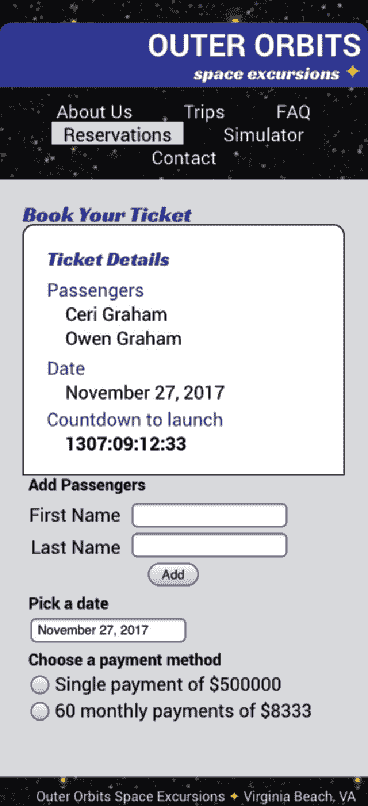
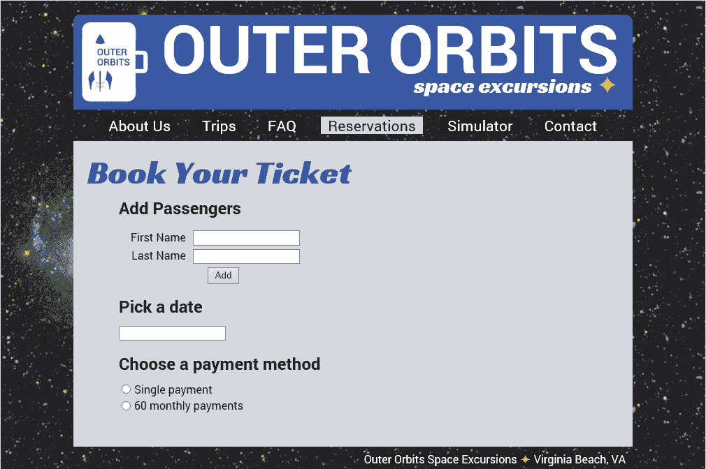

## 使用 `Date`、`Number` 和 `Math` 类

### 5. 回到文本编辑器，创建一个新的 JavaScript 文档，然后输入以下注释部分，在指定位置输入你的名字和今天的日期：

```javascript
/* JavaScript 第6 版
* 第 7 章
* 章节案例
* 外层轨道
* 作者:
* 日期:
* 文件名: orbits.js
*/
```

### 6. 在注释部分下方，输入以下语句：

```javascript
"use strict"; // 在 JavaScript 严格模式下解释内容
```

### 7. 将文档保存为 **orbits.js**。

在下一节中，你将使用 JavaScript 的 `Date`、`Number` 和 `Math` 对象来增强预订表。

### 短期测验 1

- 什么是面向对象编程？什么是对象？
- 列出至少两个内置的 JavaScript 类。

## 使用 `Date`、`Number` 和 `Math` 类

在本节中，你将学习如何使用三个最常用的 JavaScript 类：`Date`、`Number` 和 `Math`。首先，你将探索 `Date` 类。

### 使用 `Date` 类处理日期和时间


# 第 7 章 使用面向对象的 JavaScript

在 JavaScript 程序中处理日期的能力释放了许多可能性。例如，你可以在程序中使用日期来创建日历，或者计算完成某事需要多长时间。`Date` 类包含了用于操作日期和时间的方法和属性。它允许你在 JavaScript 程序中使用当前日期和时间（或特定的日期或时间元素，例如当前月份）。你通过表 7-1 中列出的构造函数之一来创建一个 `Date` 对象。

以下语句演示了如何创建一个包含运行程序的设备所提供的当前日期和时间的 `Date` 对象：

```javascript
var today = new Date();
```

`Date` 对象中的日期和年份使用与实际日期和年份匹配的数字存储的。然而，`Date` 对象中的星期几和一年中的月份是使用数字表示法存储的，且从 0 开始，类似于数组。数字 0–6 代表星期日到星期六，数字 0–11 代表从 1 月到 12 月。以下语句演示了如何使用 `Date` 构造函数指定特定日期。在这个示例中，赋值给变量 `independenceDay` 的日期是 1776 年 7 月 4 日。

```javascript
var independenceDay = new Date(1776, 6, 4);
```

在你创建一个新的 `Date` 对象后，可以使用 `Date` 类的方法来操作变量中的日期和时间。请注意，`Date` 对象中的日期和时间不会像时钟那样随时间更新。相反，`Date` 对象包含的是 JavaScript 代码实例化该对象时刻的静态（不变的）日期和时间。

## 表 7-1：Date 类构造函数

| 构造函数 | 描述 |
| :--- | :--- |
| `Date()` | 创建包含设备提供的当前日期和时间的 `Date` 对象 |
| `Date(milliseconds)` | 根据自 1970 年 1 月 1 日午夜以来的毫秒数创建一个 `Date` 对象 |
| `Date(date_string)` | 根据包含日期值的字符串创建一个 `Date` 对象 |
| `Date(year, month[, day[, hours[, minutes[, seconds[, milliseconds]]]])` | 根据传递的参数设置日期和时间创建一个 `Date` 对象；需要 `year` 和 `month` 参数 |

## 表 7-2：Date 类的常用方法

| 方法 | 描述 |
| :--- | :--- |
| `getDate()` | 返回 `Date` 对象的日期 |
| `getDay()` | 返回 `Date` 对象的星期几 |
| `getFullYear()` | 返回四位格式的 `Date` 对象的年份 |
| `getHours()` | 返回 `Date` 对象的小时 |
| `getMilliseconds()` | 返回 `Date` 对象的毫秒 |
| `getMinutes()` | 返回 `Date` 对象的分钟 |
| `getMonth()` | 返回 `Date` 对象的月份 |
| `getSeconds()` | 返回 `Date` 对象的秒 |
| `getTime()` | 返回 `Date` 对象的时间 |
| `now()` | 返回自 1970 年 1 月 1 日午夜以来经过的毫秒数作为当前时间（仅限 ECMAScript 5 及更高版本） |
| `setDate(date)` | 设置 `Date` 对象的日期（1–31） |
| `setFullYear(year[, month, day])` | 设置 `Date` 对象的四位年份；可选允许设置月份和日期 |
| `setHours(hours[, minutes[, seconds[, milliseconds]]])` | 设置 `Date` 对象的小时（0–23）；可选允许设置分钟（0–59）、秒（0–59）和毫秒（0–999） |
| `setMilliseconds(milliseconds)` | 设置 `Date` 对象的毫秒（0–999） |
| `setMinutes(minutes[, seconds[, milliseconds]])` | 设置 `Date` 对象的分钟（0–59）；可选允许设置秒（0–59）和毫秒（0–999） |
| `setMonth(month[, day])` | 设置 `Date` 对象的月份（0–11）；可选允许设置日期 |
| `setSeconds(seconds[, milliseconds])` | 设置 `Date` 对象的秒（0–59）；可选允许设置毫秒（0–999） |

## 创建日历组件

### 3. 在 `displayCalendar()` 函数中，添加以下变量声明：

```javascript
var date;
var dateToday = new Date();
var dayOfWeek;
var daysInMonth;
var dateCells;
var captionValue;
var month;
var year;
var monthArray = ["January", "February", "March", "April", "May", "June", "July", "August", "September", "October", "November", "December"];
```

### 4. 在变量下方，向函数中添加以下 `if/else` 语句：

```javascript
if (whichMonth === -1) {
  dateObject.setMonth(dateObject.getMonth() - 1);
} else if (whichMonth === 1) {
  dateObject.setMonth(dateObject.getMonth() + 1);
}
```

该语句允许用户使用日历小部件中的按钮导航到上个月或下个月。

### 5. 在 `if/else` 语句下方，添加以下代码来设置变量值：

```javascript
month = dateObject.getMonth();
year = dateObject.getFullYear();
dateObject.setDate(1);
dayOfWeek = dateObject.getDay();
captionValue = monthArray[month] + " " + year;
document.querySelector("#cal table caption").innerHTML = captionValue;
```

### 6. 在设置变量值的代码下方，添加以下 `if/else` 结构来确定所选月份的天数：

```javascript
if (month === 0 || month === 2 || month === 4 || month === 6 || month === 7 || month === 9 || month === 11) { // Jan, Mar, May, Jul, Aug, Oct, Dec
  daysInMonth = 31;
} else if (month === 1) { // Feb
  if (year % 4 === 0) { // leap year test
    if (year % 100 === 0) {
      // 以 00 结尾的年份不是闰年，除非被 400 整除
      if (year % 400 === 0) {
        daysInMonth = 29;
      } else {
        daysInMonth = 28;
      }
    } else {
      daysInMonth = 29;
    }
  } else {
    daysInMonth = 28;
  }
} else { // Apr, Jun, Sep, Nov
  daysInMonth = 30;
}
```

第一个 `if` 语句和最后的 `else` 语句设置了每年天数相同的月份的天数。如果所选月份是二月，中间的 `else if` 部分将确定当前年份是否为闰年，其中包含了针对特定年份的两个特殊规则。

### 7. 在 `if/else` 部分下方，添加以下代码来清除现有的表格内容：

```javascript
dateCells = document.getElementsByTagName("td");
for (var i = 0; i < dateCells.length; i++) {
  // 清空现有表格日期
  dateCells[i].innerHTML = "";
  dateCells[i].className = "";
}
```

### 8. 在上代码下方，添加以下代码将新日期添加到对应的日历单元格中：

```javascript
for (var i = dayOfWeek; i < daysInMonth + dayOfWeek; i++) {
  // 将日期添加到日期单元格
  dateCells[i].innerHTML = dateObject.getDate();
  dateCells[i].className = "date";
  if (dateToday < dateObject) {
    dateCells[i].className = "future";
  }
  date = dateObject.getDate() + 1;
  dateObject.setDate(date);
}
```

### 9. 在上一步中输入的代码之后，添加以下语句：

```javascript
dateObject.setMonth(dateObject.getMonth() - 1); // 重置月份为显示的月份
document.getElementById("cal").style.display = "block"; // 如果日历不可见则显示它
```

你的 `displayCalendar()` 函数应该与以下匹配：

```javascript
function displayCalendar(whichMonth) {
  var date;
  var dateToday = new Date();
  var dayOfWeek;
  var daysInMonth;
  var dateCells;
  var captionValue;
  var month;
  var year;
  var monthArray = ["January", "February", "March", "April", "May", "June", "July", "August", "September", "October", "November", "December"];

  if (whichMonth === -1) {
    dateObject.setMonth(dateObject.getMonth() - 1);
  } else if (whichMonth === 1) {
    dateObject.setMonth(dateObject.getMonth() + 1);
  }

  month = dateObject.getMonth();
  year = dateObject.getFullYear();
  dateObject.setDate(1);
  dayOfWeek = dateObject.getDay();
  captionValue = monthArray[month] + " " + year;
  document.querySelector("#cal table caption").innerHTML = captionValue;

  if (month === 0 || month === 2 || month === 4 || month === 6 || month === 7 || month === 9 || month === 11) { // Jan, Mar, May, Jul, Aug, Oct, Dec
      daysInMonth = 31;
  } else if (month === 1) { // Feb
    if (year % 4 === 0) { // leap year test
      if (year % 100 === 0) {
        if (year % 400 === 0) {
          daysInMonth = 29;
        } else {
          daysInMonth = 28;
        }
      } else {
        daysInMonth = 29;
      }
    } else {
    daysInMonth = 28;
  } else { // Apr, Jun, Sep, Nov
    daysInMonth = 30;
  }

  dateCells = document.getElementsByTagName("td");
  for (var i = 0; i < dateCells.length; i++) {
    // 清空现有表格日期
    dateCells[i].innerHTML = "";
    dateCells[i].className = "";
  }

  for (var i = dayOfWeek; i < daysInMonth + dayOfWeek; i++) {
    // 将日期添加到日期单元格
    dateCells[i].innerHTML = dateObject.getDate();
    dateCells[i].className = "date";
    if (dateToday < dateObject) {
      dateCells[i].className = "future";
    }
    date = dateObject.getDate() + 1;
    dateObject.setDate(date);
  }

  dateObject.setMonth(dateObject.getMonth() - 1); // 重置月份为显示的月份
  document.getElementById("cal").style.display = "block"; // 如果日历不可见则显示它
}
```

### 10. 在 `displayCalendar()` 函数下方，输入以下代码来声明 `createEventListeners()` 函数：

```javascript
function createEventListeners() {
  var dateField = document.getElementById("tripDate");
  if (dateField.addEventListener) {
    dateField.addEventListener("click", displayCalendar, false);
  } else if (dateField.attachEvent) {
    dateField.attachEvent("onclick", displayCalendar);
  }
}
```

### 11. 在 `createEventListeners()` 函数中添加以下内容：

```javascript
if (window.addEventListener) {
  window.addEventListener("load", createEventListeners, false);
} else if (window.attachEvent) {
  window.attachEvent("onload", createEventListeners);
}
```

## 添加 selectDate() 函数

接下来你将添加 `selectDate()` 函数，该函数会检查用户点击的日历上的日期，验证该日期是否不是过去，然后将“选择日期”（Pick a date）字段的值设置为所选日期。

### 要添加 `selectDate()` 函数：

1. 回到文本编辑器中的 **orbits.js**。

2. 在 `createEventListeners()` 函数上方，输入以下代码来声明 `selectDate()` 函数：

```javascript
function selectDate(event) {
  if (event === undefined) { // 在 IE8 中获取调用者元素
    event = window.event;
  }
  var callerElement = event.target || event.srcElement;
}
```

该函数接收一个参数 `event`，该参数存储了触发函数的事件。在现代浏览器中，此参数允许你识别调用函数的元素，你可以利用它来识别用户在日历控件中选择的日期。然而，IE 并不支持这样做，因此该函数包含一个 `if` 语句，如果 `event` 为未定义，则将 `window.event` 的值赋值给 `event` 参数。随后函数创建 `callerElement` 变量，并将其赋值为 `event` 参数的 `target` 属性或 `srcElement` 属性的值。在大多数浏览器中，事件的 `target` 属性代表接收事件的元素——在这种情况下是被点击的表格单元格。而 IE 则有一个具有相同作用的 `srcElement` 属性，因此你的代码会检查当前浏览器支持其中哪一个。

3. 在 `callerElement` 声明下方，输入以下代码：

```javascript
if (callerElement.innerHTML === "") {
  // 单元格不包含日期，因此不要关闭日历
  document.getElementById("cal").style.display = "block";
  return false;
}
dateObject.setDate(callerElement.innerHTML);
```

此 `if` 语句检查用户点击的单元格是否为空。如果是，日历保持显示且函数结束。在所有其他情况下，下一条语句将 `dateObject` 变量的日期部分设置为用户点击的单元格的内容。

4. 在上一步代码下方，向函数添加以下语句：

```javascript
var fullDateToday = new Date();
var dateToday = Date.UTC(fullDateToday.getFullYear(), fullDateToday.getMonth(), fullDateToday.getDate());
var selectedDate = Date.UTC(dateObject.getFullYear(), dateObject.getMonth(), dateObject.getDate());
if (selectedDate <= dateToday) {
  document.getElementById("cal").style.display = "block";
  return false;
}
document.getElementById("tripDate").value = dateObject.toLocaleString();
```

此代码创建了一个 `fullDateToday` 变量，其值为包含当前日期和时间的 `Date` 对象，然后创建了 `dateToday` 变量，其值设置为来自 `fullDateToday` 的年、月、日。接着创建了 `selectedDate` 变量，设置为用户选择的日期的年、月、日。`if` 语句检查所选日期是否在今天日期之前——即在过去。如果是，日历保持显示且函数结束，因为用户在预订时必须选择一个有效的未来日期。在所有其他情况下，“选择日期”框的值将被设置为 `Date` 对象中的日期，并使用 `toLocaleString()` 方法根据用户的习惯格式化日期。你的 `selectDate` 函数应该与如下所示：

```javascript
function selectDate(event) {
  if (event === undefined) { // 在 IE8 中获取调用者元素
    event = window.event;
  }
  var callerElement = event.target || event.srcElement;
  if (callerElement.innerHTML === "") {
    // 单元格不包含日期，因此不要关闭日历
    document.getElementById("cal").style.display = "block";
    return false;
  }
  dateObject.setDate(callerElement.innerHTML);
  var fullDateToday = new Date();
  var dateToday = Date.UTC(fullDateToday.getFullYear(), fullDateToday.getMonth(), fullDateToday.getDate());
  var selectedDate = Date.UTC(dateObject.getFullYear(), dateObject.getMonth(), dateObject.getDate());
  if (selectedDate <= dateToday) {
    document.getElementById("cal").style.display = "block";
    return false;
  }
  document.getElementById("tripDate").value = dateObject.toLocaleString();
}
```

5. 滚动到 `createEventListeners()` 函数，然后在结束括号 `}` 之前添加以下代码：

```javascript
var dateCells = document.getElementsByTagName("td");
if (dateCells[0].addEventListener) {
  for (var i = 0; i < dateCells.length; i++) {
    dateCells[i].addEventListener("click", selectDate, false);
  }
} else if (dateCells[0].attachEvent) {
  for (var i = 0; i < dateCells.length; i++) {
    dateCells[i].attachEvent("onclick", selectDate);
  }
}
```

此代码创建了一个包含文档中所有 `td` 元素引用的变量，这些元素包含了所有的日历格。创建事件监听器或绑定事件的代码将遍历所有单元格，将 `click` 事件触发你刚刚创建的 `selectDate()` 函数。

6. 保存对 **orbits.js** 的更改，在浏览器中刷新或重新加载 **booktrip.htm**，点击**选择日期**框，然后点击一个过去的日期。注意选择日期框中没有显示任何日期。

7. 点击一个未来的日期。如图 7-8 所示，所选的日期值显示在“选择日期”框中。

## 创建 hideCalendar() 函数

在用户选择日期后，尽管日历控件不再需要，但它仍然可见。接下来，你将创建一个名为 `hideCalendar()` 的辅助函数，创建一个在用户点击关闭按钮时运行该函数的事件监听器，并在用户点击日历控件中的日期后添加一条调用 `hideCalendar()` 函数的语句。

### 要创建 `hideCalendar()` 函数：

1. 回到文本编辑器中的 **orbits.js** 文档，然后在 `createEventListeners()` 函数上方添加以下内容：

```javascript
function hideCalendar() {
  document.getElementById("cal").style.display = "none";
}
```

此函数包含一条语句，将日历的显示属性更改为 `none`。

2. 在 `selectDate()` 函数中，在闭合的 `}` 之前添加以下语句：

```javascript
hideCalendar();
```

此语句在选择有效日期后会关闭日历。

3. 滚动到 `createEventListeners()` 函数，然后在闭合的 `}` 之前添加以下代码：

```javascript
var closeButton = document.getElementById("close");
if (closeButton.addEventListener) {
  closeButton.addEventListener("click", hideCalendar, false);
} else if (closeButton.attachEvent) {
  closeButton.attachEvent("onclick", hideCalendar);
}
```

当用户点击日历上的关闭按钮时，此代码会调用 `hideCalendar()` 函数。

4. 保存 **orbits.js** 的更改，在浏览器中按 Shift 刷新或 Shift 重新加载 **booktrip.htm** 以清除表单，点击**Pick a date**框，然后点击**Close**按钮。日历组件将关闭。

5. 点击**Pick a date**框，然后点击一个未来的日期。如图 7-9 所示，选定的日期值将显示在 Pick a date 框中，且组件将关闭。

   


图 7-9：选定的日期和日历组件关闭

## 添加月份导航功能

接下来你将向代码中添加额外的辅助函数和事件监听器，以便用户可以使用上一个和下一个按钮导航到不同的月份。

### 使用 Date、Number 和 Math 类

为了添加用于月份间导航的辅助函数和事件监听器：

1. 回到文本编辑器中的 **orbits.js** 文档，然后在 `createEventListeners()` 函数上方添加以下内容：

```javascript
function prevMo() {
  displayCalendar(-1);
}

function nextMo() {
  displayCalendar(1);
}
```

这些函数调用包含了 `displayCalendar()` 函数的参数。值 -1 触发函数中的代码显示上个月，而值 1 则显示下个月。

2. 滚动到 `createEventListeners()` 函数，然后在闭合的 `}` 之前添加以下代码：

```javascript
var prevLink = document.getElementById("prev");
var nextLink = document.getElementById("next");
if (prevLink.addEventListener) {
  prevLink.addEventListener("click", prevMo, false);
  nextLink.addEventListener("click", nextMo, false);
} else if (prevLink.attachEvent) {
  prevLink.attachEvent("onclick", prevMo);
  nextLink.attachEvent("onclick", nextMo);
}
```

当用户点击上一个按钮时，此代码调用 `prevMo()` 函数；当用户点击下一个按钮时，调用 `nextMo()` 函数。

3. 保存 **orbits.js** 的更改，在浏览器中按 Shift 刷新或 Shift 重新加载 **booktrip.htm** 以清除表单，点击**Pick a date**框，然后点击**previous**按钮。日历组件将显示上个月。

4. 点击**next**按钮，然后点击一个未来的日期。日历组件将显示下个月。

## 使用 Number 类操作数字

`Number` 类包含了用于操作数字的静态方法（例如 JavaScript 中可以使用的最大正数）。然而，你不需要创建 `Number` 对象即可访问它们。

### 使用 Number 类方法

表 7-3 列出了 `Number` 类的方法。

| 方法 | 描述 |
| :--- | :--- |
| `toExponential()` | 将数字转换为科学计数法表示的字符串 |
| `toFixed()` | 将数字转换为带有指定小数位数的字符串 |
| `toLocaleString()` | 将数字转换为按照本地格式样式格式的字符串 |
| `toPrecision()` | 将数字转换为带有指定数字数的字符串 |
| `toString()` | 将数字转换为字符串 |
| `valueOf()` | 返回对象的数值 |

使用这些任何一种方法的主要原因都是向用户显示数字。最有用的 `Number` 方法是 `toFixed()`，你可以用它来显示带有指定小数位的数字。例如，你可能有一个代表货币金额的数字。以下代码使用 `toFixed(2)` 显示带有两位小数的数字：

```javascript
var salesTotal = 49.95;
var discount = 0.1;
salesTotal -= discount; // new value is 44.955
document.getElementById("totalField").innerHTML = "$" + salesTotal.toFixed(2); // displays $44.96
```

另一个有用的 `Number` 方法是 `toLocaleString()`，你可以用它将数字转换为按照本地格式格式的字符串。例如，在美国格式样式中，用逗号分隔千分位。以下语句演示了如何将数字转换为带有逗号的字符串：

```javascript
var salesTotal = 1210349;
salesTotal = salesTotal.toLocaleString();
document.getElementById("totalField").innerHTML = "$" + salesTotal; // displays $1,210,349
```

> **注意**：现代浏览器对于使用 `toLocale` 方法放置数字符的位置有不同的规则。在第 8 章中，你将学习如何使用正则表达式来跨浏览器强制统一格式。

### 访问 Number 类属性

表 7-4：`Number` 类属性

| 属性 | 描述 |
| :--- | :--- |
| `MAX_VALUE` | JavaScript 中可以使用的最大正数 |
| `MIN_VALUE` | JavaScript 中可以使用的最小正数 |
| `NaN` | 值 `NaN`，代表“不是一个数字” |
| `NEGATIVE_INFINITY` | 负无穷的值 |
| `POSITIVE_INFINITY` | 正无穷的值 |

> **注意**：就像 JavaScript 中的类名首字母大写一样，另一种约定是用全大写字母写固定值（或常量）的。表 7-4 中全大写的四个属性代表常量。

## 计算月付金额并格式化价格

Outer Orbits 预订页为每个用户提供了预付旅行费用或将价格分为若干年月付的选项。你不会将这些值硬编码到页面中，而是将这些值作为变量处理，以便公司能够轻松整合未来的价格变化。你将使用 `Number` 对象的 `toFixed()` 和 `toLocaleString()` 方法来指定值的显示方式。

### 要计算月付金额并格式化两个价格：

1. 回到文本编辑器中的 **orbits.js** 文档，在 `createEventListeners()` 函数上方添加以下代码以声明 `updateTotalCost()` 函数：

```javascript
function updateTotalCost() {
}
```

2. 在 `updateTotalCost()` 函数内部添加以下代码：

```javascript
var totalCost = 250000;
var monthlyCost = totalCost / 60;
var shortMonthlyCost = monthlyCost.toFixed(0);
```

该语句声明了三个变量：`totalCost` 有一个固定值；`monthlyCost` 是 `totalCost` 除以（付款计划中的月数）；而 `shortMonthlyCost` 使用 `Number` 对象的 `toFixed()` 方法来存储不带小数的 `monthlyCost` 值。

3. 在变量声明下方，添加以下代码：

```javascript
document.getElementById("singleLabel").innerHTML = "Single payment of $" + totalCost.toLocaleString();
document.getElementById("multipleLabel").innerHTML = "60 monthly payments of $" + shortMonthlyCost.toLocaleString();
```

第一条语句更改第一个选项按钮的标签，以包含 `totalCost` 值，使用 `Number` 对象的 `toLocaleString()` 方法根据用户的本地习惯显示该值。第二条语句对第二个选项按钮执行相同的操作，使用的是 `shortMonthlyCost` 值。

4. 在 `selectDate()` 函数中，在闭合括号 `}` 之前输入以下语句：

```javascript
updateTotalCost();
```

该语句在用户选择日期时会调用 `updateTotalCost()` 函数。

5. 保存对 **orbits.js** 的更改，在浏览器中 Shift-刷新或 Shift-重新加载 **booktrip.htm** 以清除表单，点击 **Pick a date** 框，然后点击一个未来的日期。如图 7-10 所示，选项按钮的标签已更新以显示价格，并根据本地数字格式习惯进行了格式化，且没有小数。该图显示了两个现代浏览器中的数字；注意，其中一个在一个值中包含逗号分隔符，而另一个则没有。这种行为完全取决于浏览器。

## 使用 Math 类执行数学函数

`Math` 类包含了在程序中执行数学计算的方法和属性。

### 使用 Math 类方法

表 7-5 列出了 `Math` 类的方法。

| 方法 | 返回值 |
| :--- | :--- |
| `abs(x)` | `x` 的绝对值 |
| `acos(x)` | `x` 的反余弦 |
| `asin(x)` | `x` 的反正弦 |
| `atan(x)` | `x` 的反正切 |
| `atan2(x, y)` | 由 `x, y` 表示的点相对于 x 轴的角 |
| `ceil(x)` | `x` 向上取整到下一个整数 |
| `cos(x)` | `x` 的余弦 |
| `exp(x)` | `x` 的指数 |
| `floor(x)` | `x` 向下取整到下一个整数 |
| `log(x)` | `x` 的自然对数 |
| `max(x, y)` | `x` 或 `y` 中的较大者 |
| `min(x, y)` | `x` 或 `y` 中的较小者 |
| `pow(x, y)` | `x` 的 `y` 次方 |
| `random()` | 随机数 |
| `round(x)` | `x` 四舍五入到最近的整数 |
| `sin(x)` | `x` 的正弦 |
| `sqrt(x)` | `x` 的平方根 |
| `tan(x)` | `x` 的正切 |

与 `Array`、`Date` 和 `Number` 类不同，`Math` 类不包含构造函数。这意味着你不能使用下面的语句实例化 `Math` 对象。

**无效代码：**

```javascript
var mathCalc = new Math();
```

相反，请直接在代码中使用 `Math` 对象及其任一方法或属性。例如，`sqrt()` 方法返回数字的平方根。以下代码使用 `sqrt()` 方法确定：

```javascript
var curNumber = 144;
var squareRoot = Math.sqrt(curNumber); // 返回 12
```

### 访问 Math 类属性

表 7-6：Math 类属性

| 属性 | 描述 |
| :--- | :--- |
| `E` | 自然常数 *e*，它是自然对数的底；该值约为 2.718281828459045234 |
| `LN10` | 10 的自然对数，该值约为 2.302585092994046 |
| `LN2` | 2 的自然对数，该值约为 0.6931471805599453 |
| `LOG10E` | `e` 的以 10 为底的对数，它是自然对数的底；该值约为 0.4342944819032518 |
| `LOG2E` | `e` 的以 2 为底的对数，它是自然对数的底；该值约为 1.4426950408889634 |
| `PI` | 代表圆周与直径比例的常量，该值约为 3.1415926535897932 |
| `SQRT1_2` | 1/2 的平方根，该值约为 0.7071067811865476 |
| `SQRT2` | 2 的平方根，该值约为 1.4142135623730951 |

作为使用 `Math` 对象属性的示例，以下代码显示了如何使用 `PI` 属性根据半径计算圆面积。该代码还使用了 `pow()` 方法计算半径的平方，并使用 `round()` 方法将返回的值四舍五入到最近的整数。

```javascript
var radius = 25;
var area = Math.PI * Math.pow(radius, 2);
var roundedArea = Math.round(area); // 返回 1963
```

## 创建倒计时器

Outer Orbits 预订页的设计包含类似于太空发射的倒计时器，它可以计算到选定航班起飞前的天数、小时和秒。你将当前日期和时间赋值给变量，并将选定发射的日期和时间赋值给另一个变量。你将使用 `Math.floor()` 方法确定两者之间的整数天数、小时和秒。

### 要计算发射前的天数、小时和秒：

1. 回到文本编辑器中的 **orbits.js** 文档，在 `createEventListeners()` 函数上方添加以下代码以创建 `updateCountdown()` 函数并声明其变量：

```javascript
function updateCountdown() {
    var dateToday = new Date();
    var dateFrom = Date.UTC(dateToday.getFullYear(), dateToday.getMonth(), dateToday.getDate(), dateToday.getHours(), dateToday.getMinutes(), dateToday.getSeconds());
    var dateTo = Date.UTC(dateObject.getFullYear(), dateObject.getMonth(), dateObject.getDate(), 20, 0, 0); // UTC 晚上8点发射
}
```

2. 在 `updateCountdown()` 函数内部，添加以下代码：

```javascript
var daysUntil = Math.floor((dateTo - dateFrom) / 86400000);
document.getElementById("countdown").innerHTML = daysUntil;
```

3. 在你上一步输入的语句下方，添加以下代码：

```javascript
// hours
var fractionalDay = (dateTo - dateFrom) % 86400000;
var hoursUntil = Math.floor(fractionalDay / 3600000);
if (hoursUntil < 10) {
    hoursUntil = "0" + hoursUntil;
}
document.getElementById("countdown").innerHTML += ":" + hoursUntil;
```

结果。最后的 `if` 语句检查分钟数是否为一位数，如果是，则在数字开头添加一个“0”；这是为了表示数字时钟中常见的格式。最后一条语句将 `hoursUntil` 值附加到倒计时元素中现有的 `days` 值之后，两者之间加一个冒号。

4. 在你上一步中输入的语句下方，添加以下代码：

```javascript
// minutes
var fractionalHour = fractionalDay % 3600000;
var minutesUntil = Math.floor(fractionalHour / 60000);
if (minutesUntil < 10) {
  minutesUntil = "0" + minutesUntil;
}
document.getElementById("countdown").innerHTML += ":" + minutesUntil;

// seconds
var fractionalMinute = fractionalHour % 60000;
var secondsUntil = Math.floor(fractionalMinute / 1000);
if (secondsUntil < 10) {
  secondsUntil = "0" + secondsUntil;
}
document.getElementById("countdown").innerHTML += ":" + secondsUntil;
```

这段代码使用了与计算小时相同的语句集，通过除以（一分钟内的微秒数）计算剩余的分钟差，通过除以（一秒内的微秒数）计算剩余的秒差。你的 `updateCountdown()` 函数应该与以下代码匹配：

```javascript
function updateCountdown() {
  var dateToday = new Date();
  var dateFrom = Date.UTC(dateToday.getFullYear(),
    dateToday.getMonth(), dateToday.getDate(),
    dateToday.getHours(), dateToday.getMinutes(),
    dateToday.getSeconds());
  var dateTo = Date.UTC(dateObject.getFullYear(),
    dateObject.getMonth(), dateObject.getDate(),
    20, 0, 0); // 所有发射均在 UTC 时间晚上 8:00
  // days
  var daysUntil = Math.floor((dateTo - dateFrom) / 86400000);
  document.getElementById("countdown").innerHTML = daysUntil;
  // hours
  var fractionalDay = (dateTo - dateFrom) % 86400000;
  var hoursUntil = Math.floor(fractionalDay / 3600000);
  if (hoursUntil < 10) {
    hoursUntil = "0" + hoursUntil;
  }
  document.getElementById("countdown").innerHTML += ":" + hoursUntil;
  // minutes
  var fractionalHour = fractionalDay % 3600000;
  var minutesUntil = Math.floor(fractionalHour / 60000);
  if (minutesUntil < 10) {
    minutesUntil = "0" + minutesUntil;
  }
  document.getElementById("countdown").innerHTML += ":" + minutesUntil;
  // seconds
  var fractionalMinute = fractionalHour % 60000;
  var secondsUntil = Math.floor(fractionalMinute / 1000);
  if (secondsUntil < 10) {
    secondsUntil = "0" + secondsUntil;
  }
  document.getElementById("countdown").innerHTML += ":" + secondsUntil;
}
```

5. 在文档顶部的全局变量部分，添加以下语句：

```javascript
var countdown;
```

6. 在 `selectDate()` 函数中，在闭合括号 `}` 之前，输入以下语句：

```javascript
countdown = setInterval(updateCountdown, 1000);
document.getElementById("countdownSection").style.display = "block";
```

第一条语句使用 `Window` 对象的 `setInterval()` 方法，在用户选择有效日期时调用 `updateCountdown()` 函数，并每秒（毫秒）重复调用一次该函数。这模拟了数字计时器的行为。`setInterval()` 方法的返回值被设置为全局变量 `countdown` 的值，以便以后可以取消它。第二条语句使包含计数器的网页变得可见。

7. 在 `updateCountdown()` 函数中，在 `// days` 注释之前，输入以下代码：

```javascript
if ((dateTo - dateFrom) < 1000) { // 当 setInterval 下次运行时，时间将小于 0
  clearInterval(countdown);
  document.getElementById("countdownSection").style.display = "none";
}
```

这个 `if` 语句检查剩余时间是否将小于下一次更新的时间间隔。如果是，它将使用 `clearInterval()` 方法清除由 `countdown` 变量引用的定时器。

8. 保存你的更改到 **orbits.js**，刷新或重新加载 **booktrip.htm** 以清除表单，点击 **Pick a date** 框，然后点击一个未来的日期。如图 7-11 所示，倒计时器显示在页面右侧，数值每秒变化一次。


图 7-11：显示距离发射剩余天、小时、分钟和秒的倒计时器

### 短期测试

1. 什么代码创建了 `dateToday` 变量并将当前日期和时间赋值给它？
2. 你使用 `Number` 类的哪个方法将数字转换为带有本地格式的字符串？
3. 对数值应用 `Math` 类的 `floor()` 方法的结果是什么？

## 定义自定义对象

JavaScript 并不是一种真正的面向对象编程语言。虽然 JavaScript 并不是真正的面向对象编程语言，但你可以根据内置类在程序中创建对象，例如 `Array` 和 `Date`。

### 创建自定义对象示例

```javascript
var PerformanceTickets = {
  customerName: "Claudia Salomon",
  performanceName: "Swan Lake",
  ticketQuantity: 2,
  performanceDate: new Date(2017, 6, 18, 20)
};
document.getElementById("custName").innerHTML = PerformanceTickets.customerName;
document.getElementById("showName").innerHTML = PerformanceTickets.performanceName;
document.getElementById("tixNum").innerHTML = PerformanceTickets.ticketQuantity;
document.getElementById("showDate").innerHTML = PerformanceTickets.performanceDate.toLocaleString();
```

图 7-12：使用 `PerformanceTickets` 对象值的输出

> Claudia Salomon
> Swan Lake
> 2
> Tue Jul 18 20:00:00 2017

你需要在 Outer Orbits 预订页上添加的最后一个功能是总结用户选择的部分。这包括列出每位乘客的姓名、所选启动日期以及付款计划。你将创建一个名为 `ticket` 的对象，它将所有这些信息作为一组属性包含其中。

### 要创建一个包含乘客和启动数据的自定义门票对象：

1. 回到文本编辑器中的 **orbits.js** 文档，然后在文档顶部添加以下全局变量声明：

```javascript
var ticket = {
  date: "",
  fName: "",
  lName: ""
};
```

这段代码创建了一个名为 `ticket` 的新变量。该变量值周围的大括号 `{ }` 表示它是一个对象。`ticket` 对象的定义包含三个属性：`date`、`fName` 和 `lName`。每个属性都被赋值一个空字符串（`""`）作为值。

> **注意**：前两个属性值后面应该跟随逗号，而不是分号。最后一个属性值后面不应有任何标点符号。对象值必须以闭合的 `};` 结束，且整个 `var` 语句必须以分号结束。

2. 在 `createEventListeners()` 函数上方，添加以下代码以创建 `registerName()` 函数并声明变量：

```javascript
function registerName() {
  var passengerList = document.getElementById("passengers");
  var passengerName = document.createElement("li");
}
```

`var` 语句首先通过 `passengerList` 变量创建对 `passengers` 元素的引用，然后创建一个新的 `li` 元素作为未关联的文档节点，并将其赋值给 `passengerName`。

3. 在上一步代码下方，向函数中添加以下语句：

```javascript
ticket.fName = document.getElementById("fname").value;
ticket.lName = document.getElementById("lname").value;
```

第一条语句将表单中 `fname` 字段的值赋值给 `ticket` 对象的 `fName` 属性。第二条语句对表单中的 `lname` 字段和 `ticket` 对象的 `lName` 属性执行相同的操作。

4. 在上一步代码下方，向函数中添加以下语句：

```javascript
// 将输入的添加到 ticket 部分的乘客列表中
passengerName.innerHTML = ticket.fName + " " + ticket.lName;
passengerList.appendChild(passengerName);
```

第一条语句将 `ticket` 对象的 `fName` 和 `lName` 属性的值赋值为 `passengerName` 元素的内容，两个值之间有一个空格。第二条语句将 `passengerName` 元素附加到 `passengerList` 元素。

5. 在上一步代码下方，向函数中添加以下语句：

```javascript
// 从表单中清除姓和名
document.getElementById("fname").value = "";
document.getElementById("lname").value = "";
// 显示门票和乘客部分
document.getElementById("ticket").style.display = "block";
document.getElementById("passengersSection").style.display = "block";
// 将焦点返回到姓名字段以便输入
// 另一个乘客姓名
document.getElementById("fname").focus();
```

6. 在 `createEventListeners()` 函数中，在闭合的 `}` 之前，添加以下代码：

```javascript
var nameButton = document.getElementById("addName");
if (nameButton.addEventListener) {
  nameButton.addEventListener("click", registerName, false);
} else if (nameButton.attachEvent) {
  nameButton.attachEvent("onclick", registerName);
}
```

这段代码注册了一个事件监听器，每当点击按钮时调用 `registerName()` 函数。

7. 在 `selectDate()` 函数中，在闭合的 `}` 之前，添加以下内容：

```javascript
ticket.date = dateObject.toLocaleString();
document.getElementById("selectedDate").innerHTML = ticket.date;
document.getElementById("selectedDate").style.display = "block";
```

第一条语句将 `ticket` 对象的 `date` 属性的值设置为 `dateObject`。第二条语句将该值赋值给 `selectedDate` 元素。第三条语句使 `selectedSection` 可见。

8. 保存你的 **orbits.js**，刷新浏览器并导航到 **orbits.html**。输入姓和名，选择日期，并点击 **Add** 按钮。图 7-13 显示了结果。

9. 如果需要检查对象，打开浏览器控制台，输入 `ticket` 并按回车。控制台会返回变量的值。

10. 如果需要检查对象，点击 **Object** 以查看属性名称。图 7-14 显示了不同浏览器中的对象属性。

## 创建嵌套对象

```javascript
var order = {
  orderNumber: 12345,
  address: {
    street: "123 Main St",
    city: "Farmington",
    state: "NY",
    zip: "14425"
  }
};
```

名为 `order` 的主对象有两个属性：`orderNumber` 和 `address`。`address` 属性本身是一个子对象，它有自己的四个属性：`street`、`city`、`state` 和 `zip`。

接下来，你将编辑 `ticket` 对象的定义，创建一个名为 `passengers` 的子对象，其中包含 `fname` 和 `lname` 属性。

### 要创建 `passengers` 子对象：

1. 回到文本编辑器中的 **orbits.js** 文档。

2. 在文档顶部的全局变量声明中，在 `date` 属性之后添加新行，然后输入 `passengers: {`。

3. 增加 `fName` 和 `lName` 属性定义的缩进级别。

4. 在 `lName` 属性之后添加新行，然后输入 `}`。你更新后的全局变量声明应与以下内容匹配：

```javascript
var dateObject = new Date();
var ticket = {
  date: "",
  passengers: {
    fName: "",
    lName: ""
  }
};
```

`ticket` 对象现在有两个属性：`date` 和 `passengers`。`passengers` 属性是 `ticket` 对象的子对象，且 `passengers` 属性有两个自己的属性：`fName` 和 `lName`。

5. 滚动到 `registerName()` 函数。在第一个注释下方的语句中，将 `ticket.fName` 修改为 **ticket.passengers.fName**，然后在随其后的语句中，将 `ticket.lName` 修改为 **ticket.passengers.lName**。

6. 在第二个注释下方的语句中，将 `ticket.fName` 修改为 **ticket.passengers.fName**，然后将 `ticket.lName` 修改为 **ticket.passengers.lName**。你更新后的 `registerName()` 函数开头应与以下内容匹配：

```javascript
function registerName() {
  var passengerList = document.getElementById("passengers");
  var passengerName = document.createElement("li");
  // add first+last names to ticket object as new properties
  ticket.passengers.fName = document.getElementById("fname").value;
  ticket.passengers.lName = document.getElementById("lname").value;
  // add entered name to passenger list in ticket section
  passengerName.innerHTML = ticket.passengers.fName + " " + ticket.passengers.lName;
  passengerList.appendChild(passengerName);
}
```

7. 保存对 **orbits.js** 的更改，在浏览器中使用 shift-刷新或 shift-重载 **booktrip.htm** 以清空表单，在 First Name 框中输入名字，在 Last Name 框中输入姓，点击 **Add** 按钮，点击 **Pick a date** 框，然后选择一个日期。你的名字和所选日期将再次显示在页面右侧的“Ticket Details”标题下。

8. 在命令行中，输入 **ticket**，然后按 **Enter** 键。

9. 点击 **Object** 单词或点击“Object”单词旁边的**三角形**查看对象属性，然后点击“passengers”单词旁边的**三角形**查看子对象的属性。图 7-15 显示了主流浏览器中的结果。

## 向现有对象添加属性

虽然你可以在对象定义中声明属性，但并不是必须的。作为替代，你只需通过声明其值来添加新属性。这类似于创建新变量的过程；但与变量声明不同，你不需要使用 `var` 或任何其他关键字来创建新的对象属性。

例如，要向 `order` 对象添加 `shippingSpeed` 属性，你可以使用语句：

```javascript
order.shippingSpeed = "overnight";
```

你将从 orbits.js 文档中的 `ticket` 对象中删除 `date` 属性声明，然后验证现有代码仍然创建了该属性。

### 要删除 `date` 属性：

1. 回到文本编辑器中的 **orbits.js** 文档。

2. 在文档顶部 `ticket` 对象的全局变量声明中，删除以下行：

```javascript
date: "",
```

你更新后的变量声明应与以下内容匹配：

```javascript
var ticket = {
  passengers: {
    fName: "",
    lName: ""
  }
};
```

3. 滚动到 `selectDate()` 函数并找到以下语句：

```javascript
ticket.date = dateObject.toLocaleDateString();
```

尽管 `ticket` 对象定义不再声明 `date` 属性，但当 `selectDate()` 函数运行时，上述语句将向对象添加 `date` 属性。

4. 保存对 **orbits.js** 的更改，在浏览器中使用 shift-刷新或 shift-重载 **booktrip.htm** 清空表单，在 First Name 框中输入名字，在 Last Name 框中输入姓，点击 **Add** 按钮，点击 **Pick a date** 框，然后选择一个日期。你的名字和所选日期将再次显示在页面右侧的“Ticket Details”标题下。

5. 在命令行中，输入 **ticket**，然后按 **Enter** 键。

6. 点击 **Object** 单词或点击“Object”单词旁边的**三角形**查看对象属性，然后点击“passengers”单词旁边的**三角形**查看子对象的属性。`ticket` 对象包含了图 7-15 中的属性。

## 使用关联数组引用对象属性

在标准数组中，你可以通过索引引用任何值，索引从 0 开始，每增加一个元素加 1。例如，对于数组：

```javascript
var stopLightColors = ["red", "yellow", "green"];
```

你可以通过 `stopLightColors[1]` 访问第二个元素“yellow”。

JavaScript 允许使用关联数组语法引用对象属性。**关联数组**是通过字母数字键而不是索引数字来引用元素的数组。对于对象，属性名取代了索引数字。例如，如果你将交通灯颜色存储在对象中，它可能如下：

```javascript
var stopLightColors = {
  stop: "red",
  caution: "yellow",
  go: "green"
};
```

你已经看到过如何使用点语法通过属性名引用对象属性值。你可以使用属性名引用 `caution` 属性的值：

```javascript
stopLightColors.caution
```

使用关联数组语法，你将属性名放在方括号中并用引号括起来：

```javascript
stopLightColors["caution"]
```

点语法和关联数组语法都返回引用属性的值。要简单引用属性值，使用点语法通常更方便。然而，当对象包含多个相似且包含数字的属性时，关联数组语法可能非常强大。例如，包含客户订单项目的对象可能结构如下：

```javascript
var order = {
  item1: "KJ2435J",
  price1: 23.95,
  item2: "AW23454",
  price2: 44.99,
  item3: "2346J3B",
  price3: 9.95
};
```

在创建订单摘要时，与其用单独的语句引用每个属性值，你可以使用如下的 `for` 循环：

```javascript
for (var i = 1; i < 4; i++) {
  document.getElementById("itemList").innerHTML += "<p class='item'>" + order["item" + i] + "</p>";
  document.getElementById("itemList").innerHTML += "<p class='price'>" + order["price" + i] + "</p>";
}
```

关联数组语法还允许你编写通用代码来添加包含数字的新对象属性。例如，如果显示上述订单客户决定向她的购物车中添加额外项目，你可以使用以下代码轻松地扩展 `order` 对象的额外属性：

```javascript
totalItems += 1; // 增加订单中项目的计数器
currentItem = document.getElementById("itemName").innerHTML;
currentPrice = document.getElementById("itemPrice").innerHTML;
newItemPropertyName = "item" + totalItems; // "item4"
newPricePropertyName = "price" + totalItems; // "price4"
order[newItemPropertyName] = currentItem; // order.item4 = (name)
order[newPricePropertyName] = currentPrice; // order.price4 = (price)
```

由于客户可以订单的项目数量不设限制，这段代码使你的对象能够增长，包含客户想要购买的尽可能多项目的详情。

Outer Orbits 希望用户能够向单张票添加尽可能多的人。为了实现这一点，你将从 `ticket` 对象的声明中移除 `fName` 和 `lName` 属性的声明，并将添加使用关联数组语法的代码，在每次用户向票添加乘客时，根据需要创建这些属性的编号版本。

### 要使用关联数组语法为 `ticket` 对象添加编号属性：

1. 回到文本编辑器中的 **orbits.js** 文档。

2. 在文档顶部的全局变量声明中，移除 `fName` 和 `lName` 属性的声明。

3. 在 `passengers` 属性的声明之前，添加一个值为 0 的 `passengersOnTicket` 属性的声明，如下：

```javascript
var dateObject = new Date();
var ticket = {
  passengersOnTicket: 0,
  passengers: {}
};
```

`ticket` 对象现在只有两个声明的属性：`passengersOnTicket`（它将作为计数变量）和 `passengers`（这是一个空子对象）。

4. 滚动到 `registerName()` 函数，然后在不声明值的情况下为 `newFnameProp` 和 `newLnameProp` 变量添加声明，如下：

```javascript
var passengerList = document.getElementById("passengers");
var passengerName = document.createElement("li");
var newFnameProp;
var newLnameProp;
```

5. 在最后一个 `var` 语句下方，添加以下三个语句：

```javascript
ticket.passengersOnTicket += 1;
newFnameProp = "fname" + ticket.passengersOnTicket;
newLnameProp = "lname" + ticket.passengersOnTicket;
```

由于 `registerName()` 函数在每次添加乘客时都会运行，第一条语句将 `passengersOnTicket` 计数属性加 1。`newFnameProp` 将字符串“fname”与 `passengersOnTicket` 属性的当前值拼接，创建一个名称；对于第一个乘客，这将创建一个 `fname1` 属性值。第三条语句对姓执行相同的操作，为第一个乘客创建一个 `lname1` 属性值。

6. 在第一个注释后的语句中，将 `ticket.passengers.fName` 改为 **ticket.passengers[newFnameProp]**。在后续的语句中，将 `ticket.passengers.lName` 改为 **ticket.passengers[newLnameProp]**，然后在第二个注释后的语句中重复这两个更改。你更新后的 `registerName()` 函数应该如下：

```javascript
function registerName() {
  var passengerList = document.getElementById("passengers");
  var passengerName = document.createElement("li");
  var newFnameProp;
  var newLnameProp;
  ticket.passengersOnTicket += 1;
  newFnameProp = "fname" + ticket.passengersOnTicket;
  newLnameProp = "lname" + ticket.passengersOnTicket;
  // 将姓名作为新属性添加到 ticket 对象
  ticket.passengers[newFnameProp] = document.getElementById("fname").value;
  ticket.passengers[newLnameProp] = document.getElementById("lname").value;
  // 将输入的姓名添加到 ticket 部分的列表中
  passengerName.innerHTML = ticket.passengers[newFnameProp] + " " + ticket.passengers[newLnameProp];
  passengerList.appendChild(passengerName);
}
```

7. 保存更改到 **orbits.js**，刷新或重新加载浏览器中的 **booktrip.htm** 以清空表单，在 First Name 框输入名字，在 Last Name 框输入姓，点击 **Add** 按钮，点击 **Pick a date** 框，然后选择日期。你的姓名和选择的日期再次显示在页面右侧的标题标题下方。

8. 在命令行中输入 **ticket**，然后按回车。

9. 点击 **Object** 或点击“Object”旁边的**三角形** 查看对象属性，然后点击“passengers”旁边的**三角形** 查看属性。


## 步骤 13-15：检查 ticket 对象

13. 点击 `Object` 或点击“Object”旁边的**三角形** 查看对象属性，然后点击“passengers”旁边的**三角形** 查看属性。

14. 在命令行中输入 `ticket`，然后按回车。

15. 点击 `Object` 或点击“Object”旁边的**三角形** 查看对象属性，然后点击“passengers”旁边的**三角形** 查看属性。

> （等等，OCR 文本在后面似乎重复/故障。我将根据提供的内容提供逻辑流程。）

## 使用关联数组语法为 ticket 对象添加编号属性

Outer Orbits 希望用户能够向单张票添加尽可能多的人。为了实现这一点，你将从 `ticket` 对象的声明中移除 `fName` 和 `lName` 属性的声明，并将添加使用关联数组语法的代码，在每次用户向票添加乘客时，根据需要创建这些属性的编号版本。

要使用关联数组语法为 **ticket** 对象添加编号属性：

1. 回到文本编辑器中的 `orbits.js` 文档。
2. 在文档顶部的全局变量声明中，移除 `fName` 和 `lName` 属性的声明。
3. 在 `passengers` 属性的声明之前，添加一个值为 0 的 `passengersOnTicket` 属性的声明，如下：

```javascript
var dateObject = new Date();
var ticket = {
  passengersOnTicket: 0,
  passengers: {}
};
```

`ticket` 对象现在只有两个声明的属性：`passengersOnTicket`（它将作为计数变量）和 `passengers`（这是一个空子对象）。

4. 滚动到 `registerName()` 函数，然后在不声明值的情况下为 `newFnameProp` 和 `newLnameProp` 变量添加声明，如下：

```javascript
var passengerList = document.getElementById("passengers");
var passengerName = document.createElement("li");
var newFnameProp;
var newLnameProp;
```

5. 在最后一个 `var` 语句下方，添加以下三个语句：

```javascript
ticket.passengersOnTicket += 1;
newFnameProp = "fname" + totalItems;
newLnameProp = "lname" + totalItems;
```

由于 `registerName()` 函数在每次添加乘客时都会运行，第一条语句将 `passengersOnTicket` 计数属性加 1。`newFnameProp` 将字符串“fname”与 `passengersOnTicket` 属性的当前值拼接，创建一个名称；对于第一个乘客，这将创建一个 `fname1` 属性值。第三条语句对姓执行相同的操作，为第一个乘客创建一个 `lname1` 属性值。

6. 在第一个注释后的语句中，将 `ticket.passengers.fName` 改为 `ticket.passengers[newFnameProp]`。在后续的语句中，将 `ticket.passengers.lName` 改为 `ticket.passengers[newLnameProp]`，然后在第二个注释后的语句中，重复这两个更改。你更新后的 `registerName()` 函数应该如下：

```javascript
function registerName() {
  var passengerList = document.getElementById("passengers");
  var passengerName = document.createElement("li");
  var newFnameProp;
  var newLnameProp;
  ticket.passengersOnTicket += 1;
  newFnameProp = "fname" + ticket.passengersOnTicket;
  newLnameProp = "lname" + ticket.passengersOnTicket;
  // 将姓名作为新属性添加到 ticket 对象
  ticket.passengers[newFnameProp] =
    document.getElementById("fname").value;
  ticket.passengers[newLnameProp] =
    document.getElementById("lname").value;
  // 将输入的姓名添加到 ticket 部分的列表中
  passengerName.innerHTML =
    ticket.passengers[newFnameProp] + " " +
    ticket.passengers[newLnameProp];
  passengerList.appendChild(passengerName);
}
```

7. 保存更改到 `orbits.js`，刷新或重新加载浏览器中的 `trip.htm` 以清空表单，在 First Name 框输入名字，在 Last Name 框输入姓，点击 `Add` 按钮，点击 `Pick a date` 框，然后选择日期。你的姓名和选择的日期再次显示在页面右侧的标题“Ticket Details”下方。

8. 在命令行中输入 `ticket`，然后按回车。

9. 点击 `Object` 或点击“Object”旁边的**三角形** 查看对象属性，然后点击“passengers”旁边的**三角形** 查看属性。

## 创建方法

除了属性之外，对象还可以有方法。对象的方法简单来说就是赋值的函数。向对象添加方法有两种：在对象内部提供方法代码，或者引用外部函数。

你可以使用匿名函数指定方法名。记得，匿名函数是不具名的函数。通常，这意味着你无法在它出现的地方之外使用它。但是，通过为匿名函数分配方法名，你就可以使用方法名来调用它。例如，以下代码创建了一个带有 `generateInvoice()` 方法的 `order` 对象：

```javascript
order = {
  items: {},
  generateInvoice: function() {
    //
  }
};
```

即使 `generateInvoice()` 方法是使用匿名函数创建的，你也可以语句调用 `generateInvoice()` 方法：

`order.generateInvoice();`

另一种声明方法是指定方法名，并将现有函数的名称作为其值，如下所示：

```javascript
function processOrder() {
  //
}
var order = {
  items: {},
  generateInvoice: processOrder
};
```

代码首先定义了一个名为 `processOrder` 的函数。然后 `order` 对象的定义声明了一个名为 `generateInvoice()` 的方法，其值为函数 `processOrder`。注意，通过引用现有函数声明方法的语法与声明属性的语法相同。JavaScript 处理器能够正确识别方法，因为它们的值是函数。

此外注意 `processOrder()` 函数末尾没有带括号。使用所示的代码来声明方法将是无效，因为它包含了括号。

**无效代码：**

`generateInvoice: processOrder()`

### 将 updateTotalCost() 函数作为 ticket 对象的方法

由于 `updateTotalCost()` 函数操作的是 `ticket` 对象的 `passengersOnTicket` 属性，因此你将为 `ticket` 对象添加一个引用 `updateTotalCost()` 函数的方法。然后，你将更改函数调用以使用对象方法。

要将 **updateTotalCost()** 函数作为 **ticket** 对象的方法：

1. 回到文本编辑器中的 `orbits.js` 文档。
2. 在文档顶部的全局变量声明中，在声明 `passengers` 属性的行末尾添加一个**逗号**，然后在其下方如下所示添加代码 `calcCost: updateTotalCost`：

```javascript
1 var dateObject = new Date();
2 var ticket = {
3 passengersOnTicket: 0,
4 passengers: {},
5 calcCost: updateTotalCost
6 };
```

3. 滚动到 `updateTotalCost()` 函数，然后将 `totalCost` 变量的值更改为 `this.passengersOnTicket * 250000`，如下所示：

```javascript
1 function updateTotalCost() {
2 var totalCost = this.passengersOnTicket * 250000;
3 var monthlyCost = totalCost / 60;
4 var shortMonthlyCost = monthlyCost.toFixed("0");
```

**this 关键字**引用调用该语句所在函数的对象。由于你的代码将使用 `ticket` 对象的 `calcCost()` 方法来调用此函数，你所更改的语句中的 `this` 关键字将指向 `ticket` 对象，使得值等于 `ticket.passengersOnTicket * 250000`。

4. 向上滚动 `registerName()` 函数，然后在闭合括号 `}` 之前的新行输入语句 `ticket.calcCost();`。该语句调用 `ticket` 对象的 `calcCost()` 方法。
5. 向上滚动 `selectDate()` 函数，然后在函数的最后一行删除 `updateTotalCost()` 语句。你已经包含了在每次向票据中添加姓名时更新成本的代码，因此在选择日期时你不再需要调用该函数。
6. 保存对 `orbits.js` 的更改，在浏览器中使用 Shift-刷新或 Shift-重新加载 `booktrip.htm` 以清空表单，在姓名框中输入你的姓和名，然后点击**添加**。“选择支付方式”下方的标签已更新为单人乘客的费率。
7. 在姓名框中输入另一个姓和名，然后点击**添加**。如图 7-18 所示，“选择支付方式”下方的标签再次更新，现在显示两个乘客的费率。

> 图 7-18：通过 `ticket` 对象的 `calcCost()` 方法计算的两个乘客的价格。

在程序中使用 `this` 关键字计算总成本与直接引用对象名称相比没有太大优势。然而，在包含多个对象的程序中，它可以发挥极大的效果。例如，如果 Outer Orbits 为预订页面添加了功能，使用户能够查看其购买的多张票据详情，那么 `this` 关键字将使 `updateTotalCost()` 函数能够为调用它的任何对象计算正确价格，而不是仅引用硬编码的对象。下面的代码说明了这种场景，包含两个名为 `ticket1` 和 `ticket2` 的对象，每个对象的 `passengersOnTicket` 值都不同，且都有一个调用 `updateTotalCost()` 的 `calcCost()` 方法。

```javascript
1 var ticket1 = {
2 passengersOnTicket: 1,
3 calcCost: updateTotalCost
4 };
5 var ticket2 = {
6 passengersOnTicket: 3,
7 calcCost: updateTotalCost
8 };
9 ticket1.calcCost(); // 250000
10 ticket2.calcCost(); // 750000
```

尽管两个对象都引用了同一个通用函数 `updateTotalCost()`，但每个对象的方法都会计算不同的成本。

## 枚举对象属性

某些自定义对象可能包含几十个属性。例如，脚本可能会创建新的自定义对象属性，用于存储客户想要购买的每个物品的销售价格。假设你想按百分比对单个销售价格进行折扣，因为无法预判断客户将购买哪些物品，你也无法知道为每个客户对象添加了哪些属性。要对自定义对象中的所有属性执行相同的语句或命令，你可以使用 **for/in 语句**，这是一种类似于 `for` 语句的循环语句。`for/in` 语句的语法如下：

```javascript
for (variable in object) {
    statement();
}
```

`for/in` 语句中的变量名持有单个对象属性。对象名代表已实例化的对象的名称。与其他循环语句不同，`for/in` 语句不需要计数器或任何其他类型的代码来控制循环的运行。相反，`for/in` 语句会自动将对象中的每个属性分配给变量名，执行语句，然后移动到下一个属性并重新开始。`for/in` 语句一旦到达对象中的最后一个属性就会自动结束。

`for/in` 语句的用处之一是它可以**枚举**（或为对象中的每个属性分配一个索引）。这与索引数组元素的方式类似。可以使用枚举的对象属性来访问对象属性中的值。`for/in` 语句的一个典型用途是验证对象的属性。例如，下面的代码检查是否任何属性的值为空字符串，如果是，则调用 `generateErrorMessage()` 方法。`if` 语句将 `prop` 变量作为 `order` 对象的索引：

```javascript
1 var item = {
2 itemNumber: "KJ2435J",
3 itemPrice: 23.95,
4 itemInstock: true,
5 itemShipDate: new Date(2017, 6, 18),
6 };
7 for (prop in order) {
8 if (order[prop] === "") {
9 order.generateErrorMessage();
10 }
11 }
```

在前面的代码中，变量名 `prop` 持有 `order` 对象中每个属性的名称。前面代码 `for/in` 语句的每次迭代都会检查属性的值。`if` 语句将 `order` 对象连同括号内的变量 `prop` 传递。

有时程序错误是由使用错误的对象属性或给对象属性分配了错误的值引起的。你可以使用 `for/in` 循环配合 `console.log()` 语句来确定值是否被分配给了对象的正确属性。

## 删除属性

你之前已经看到如何通过使用声明并赋值的语句向自定义对象添加属性，如下语句所示：

`ticket.date = dateObject.toLocaleDateString();`

你同样可以使用语句来删除自定义对象的属性。要这样做，你需要使用 `delete` 运算符，语法为 `delete object.property;`。例如，该语句删除了 `order` 对象的 `itemInStock` 属性：

`delete order.itemInStock;`

## 定义构造函数

定义自己的自定义对象的另一种方法是使用**构造函数**（constructor function），这是一个用作自定义对象基础的函数。（构造函数的另一个术语是**对象定义**）。

与传统的基于类的对象一样，JavaScript 对象会继承它们所基于的构造函数的所有变量和语句。

任何 JavaScript 函数都可以作为构造函数。

    

使用对象字面量创建对象与使用构造函数之间的主要区别在于，构造函数充当模板，允许你创建任意数量具有构造函数中定义的相同属性和方法的对象。

以下代码定义了一个名为 `Order()` 的函数，它带有四个参数，可以作为构造函数：

```javascript
function Order(number, order, payment, ship) {
  // statement(s);
}
```

然后你使用 `var` 语句来实例化该函数，就像你对 `Date` 等内置 JavaScript 对象使用构造函数时一样。例如，要创建一个名为 `shoppingBasket` 的 `Order` 对象的实例，你将使用以下语句：

`var shoppingBasket = new Order();`

如果你需要在程序中创建一个唯一的对象，对象字面量是最简单的解决方案。然而，如果你的程序需要多个具有相同属性和方法的对象实例，那么创建构造函数会更有效率。

### 向构造函数添加属性

要向构造函数添加属性，你必须在函数体中添加一个使用 `this` 关键字的语句，其语法为：`this.property_name = value;`。

在自定义 JavaScript 对象的情况下，`this` 关键字指向调用构造函数的对象。例如，以下构造函数包含了四个属性：`customerNumber`、`orderDate`、`paymentMethod` 和 `shippingDate`。

```javascript
1 function Order(number, order, payment, ship) {
2
3   this.customerNumber = number;
4   this.orderDate = order;
5   this.paymentMethod = payment;
6   this.shippingDate = ship;
7 }
```

上述构造函数中的语句使用 `this` 关键字将四个参数（`number`、`order`、`payment` 和 `ship`）的值赋值给调用该函数的对象的 `customerNumber`、`orderDate`、`paymentMethod` 和 `shippingDate` 属性。

### 向构造函数添加方法

你可以通过创建一个引用它包含的任何对象属性的函数，通过 `this` 将其用作对象方法。例如，以下代码定义了一个方法，用于打印 `Order` 构造函数的 `customerNumber`、`orderDate`、`paymentMethod` 和 `shippingDate` 属性：

```javascript
1 function displayOrderInfo() {
2   var summaryDiv = document.getElementById("summarySection");
3   summaryDiv.innerHTML += ("<p>Customer: " +
4   this.customerNumber + "</p>");
5   summaryDiv.innerHTML += ("<p>Order Date: " +
6   this.orderDate.toLocaleString() + "</p>");
7   summaryDiv.innerHTML += ("<p>Payment: " +
8   this.paymentMethod + "</p>");
9   summaryDiv.innerHTML += ("<p>Ship Date: " +
10  this.shippingDate.toLocaleString() + "</p>");
11 }
```

创建方法后，必须使用语法 `this.methodname = functionname;` 将其添加到构造函数中。`this` 引用后面的 `methodname` 是赋值给对象内函数的名称。记住不要在函数名后包含括号，就像你在 JavaScript 中调用函数时那样。语句 `this.methodname = functionname();` 是**错误的**，因为它包含了括号。要将 `displayOrderInfo()` 函数作为名为 `showOrder()` 的方法添加到 `Order` 对象构造函数定义中，你需要在函数定义的大括号内包含 `this.showOrder = displayOrderInfo;` 语句。

以下代码显示了 `Order()` 构造函数、创建 `showOrder()` 方法的 `displayOrderInfo()` 函数，以及实例化 `Order` 对象并打印其属性值的语句。

```javascript
1 function Order(number, order, payment, ship) {
2   this.customerNumber = number;
3   this.orderDate = order;
4   this.paymentMethod = payment;
5   this.shippingDate = ship;
6   this.showOrder = displayOrderInfo;
7 }
8 function displayOrderInfo() {
9   var summaryDiv = document.getElementById("summarySection");
10  summaryDiv.innerHTML += ("<p>Customer: " +
11  this.customerNumber + "</p>");
12  summaryDiv.innerHTML += ("<p>Order Date: " +
13  this.orderDate.toLocaleString() + "</p>");
14  summaryDiv.innerHTML += ("<p>Payment: " +
15  this.paymentMethod + "</p>");
16  summaryDiv.innerHTML += ("<p>Ship Date: " +
17  this.shippingDate.toLocaleString() + "</p>");
18 }
19 var shoppingBasket = new Order();
20 shoppingBasket.showOrder();
```

### 使用 prototype 属性

当你向已实例化的对象添加新属性时，该属性仅对特定对象有效；对构造函数或从同一构造函数实例化的其他对象无效。然而，如果你使用构造函数使用 `prototype` 属性，你创建的任何属性也将对构造函数可用。`prototype` 属性是一个内置属性，指定了实例化对象的构造函数。以下代码使用 `prototype` 属性为 `Order` 构造函数添加 `trackingNumber` 属性。

```javascript
var shoppingBasket = new Order(123, "2023-10-01", "Credit Card", "2023-10-05");
Order.prototype.trackingNumber = "Z20568473829";
```

对象定义可以使用 `prototype` 属性扩展其他对象定义。也就是说，你可以基于现有对象创建一个新对象。新对象继承原始对象的属性和方法。你可以为新对象添加额外的属性和方法，而这些属性对现有对象无效。考虑一个名为 `Event` 的对象定义，它包含了可能用于策划活动的通用属性和方法。你可能需要创建扩展 `Event` 的额外对象定义，并包含特定类型活动的属性和方法。

定义，紧接着是 `new` 关键字和基础对象定义的名称，使用如下语法：

`derived_object.prototype = new base_object();`

以下代码展示了 `GraduationEvent` 对象定义的示例，该对象扩展了 `Event` 对象的定义。`Event` 类定义包含了一些通用属性——`eventLocation`、`eventDate` 和 `eventCost`，这些属性适用于所有类型的事件，以及一个计算事件成本的 `calcEventCost()` 方法。`GraduationEvent` 类包含了 `guestOfHonor` 和 `schoolName` 属性，以及一个 `showEventDetails()` 方法。

```javascript
1 function Event(location, date) {
2   this.eventLocation = location;
3   this.eventDate = date;
3   this.eventCost = 0;
5   this.calcEventCost = calcCost;
6 }
7 function calcCost(guests) {
8   this.eventCost = guests * 25; // $25 per head
9 }
10 function GraduationEvent(graduate, school) {
11  this.guestOfHonor = graduate;
12  this.schoolName = school;
13  this.showEventDetails = eventDetails;
14 }
15 function eventDetails() {
16   var summaryDiv = document.getElementById("summarySection");
17   summaryDiv.innerHTML += ("<p>Guest of honor: " +
18   this.guestOfHonor + "</p>");
19   summaryDiv.innerHTML += ("<p>School: " +
20   this.schoolName + "</p>");
21   summaryDiv.innerHTML += ("<p>Event date: " +
22   this.eventDate + "</p>");
23   summaryDiv.innerHTML += ("<p>Event location: " +
24   this.eventLocation + "</p>");
25   summaryDiv.innerHTML += ("<p>Event cost: $" +
26   this.eventCost.toLocaleString() + "</p>");
27 }
28 GraduationEvent.prototype = new Event();
29 var wertherGraduation = new GraduationEvent("Jacob Werther", "UCSB");
30 wertherGraduation.eventLocation = "Santa Barbara, CA";
31 wertherGraduation.eventDate = "May 27, 2017";
32 wertherGraduation.calcEventCost(175);
33 wertherGraduation.showEventDetails();
```

> *某些面向对象的编程语言允许对象继承自多个对象定义。然而，JavaScript 只允许对象继承自单个对象定义。*

**注意**

### 短测验 3

- 使用何种语句可以使用对象字面量创建一个名为 `manifest` 的新空对象？
- 使用何种语句可以为 `manifest` 对象添加名为 `itemNum` 的属性，并为该属性赋值数值 ??
- 使用哪条单一语句可以创建一个名为 `manifest` 的新空对象，且其中包含一个值为 ? 的 `itemNum` 属性？

## 总结

面向对象编程（OOP）术语是指创建可重用的软件对象，这些对象可以轻松地整合到另一个中。可重用的软件对象通常被称为组件。

在面向对象编程中，对象是可以被视为单个单元或组件的程序代码和数据。数据是指包含在变量或其他存储结构中的信息。

对象是封装的，这意味着所有代码和所需数据都包含在对象内部。

接口指的是源程序与对象通信时所需的程序化元素。

信息隐藏原则规定，其他程序员不需要访问或了解的任何类成员都应该被隐藏。

在面向对象编程中，构成对象的代码、方法、属性和其他信息是使用类来组织的。

实例是从现有类创建的对象。当你从现有类创建对象时，被称为在实例化该对象。

对象继承（或说）纳）了现有类的特征。

## 第 7 章 使用面向对象的 JavaScript

## 关键术语

| 术语 | 定义 |
| :--- | :--- |
| 关联数组 | 元素为键而非数字的数组。 |
| 类 | 一种用作对象定义的模板或蓝图。 |
| 构造函数 | 用于定义对象的函数。 |
| 数据 | 包含在变量或其他存储结构中的信息。 |
| 封装 | 意味着所有代码和所需数据都包含在对象内部。 |
| 枚举 | 遍历对象的属性。 |
| 信息隐藏 | 该原则规定，其他程序员不需要访问或了解的任何类成员都应该被隐藏。 |
| 继承 | 采纳现有类的特征。 |
| 实例 | 从现有类创建的对象。 |
| 实例化 | 从现有类创建对象。 |
| 接口 | 源程序与对象通信时所需的程序化元素。 |
| OOP | *参见面向对象编程。* |
| 面向对象编程 (OOP) | 创建可重用的软件对象，这些对象可以轻松地整合到另一个程序中。 |
| 对象 | 可以被视为单个单元或组件的程序代码和数据。 |
| 对象字面量 | *参见对象定义。* |
| 原型 | 指定对象实例化对象时所依据的构造函数的内置属性。 |
| 子对象 | 自身是对象的属性值。 |
| this | 引用调用该语句所在函数的对象。 |

## 复习题

1. 在面向对象编程中，一个 __________ 是一个用作新对象定义的模板或蓝图。
   a. 实例
   b. 对象
   c. 方法
   d. 类

2. 在面向对象编程中，一个 __________ 是从现有类创建的对象。
   a. 实例
   b. 属性
   c. 方法
   d. 类

3. 以下哪种 `Date` 类构造函数创建一个包含本地计算机当前日期的 `Date` 对象？
   a. `Date()`
   b. `Date(milliseconds)`
   c. `Date(date_string)`
   d. `Date(year, month[, date, hours, minutes, seconds, milliseconds])`

4. 日期值的以下部分在 `Date` 对象中以数值表示存储，且从零开始？
   a. 日
   b. 月
   c. 年
   d. 上/下午

5. 哪种 `Number` 方法根据指定的小数位数将数字转换为字符串？
   a. `toFixed()`
   b. `toLocaleString()`
   c. `toString()`
   d. `valueOf()`

6. 哪种 `Number` 方法将数字转换为带有本地数值格式风格的字符串？
   a. `toFixed()`
   b. `toLocaleString()`
   c. `toString()`
   d. `valueOf()`

7. 使用 `Number` 类中任何一个“to”方法的的主要原因是什么？
   a. 将数字转换为用于计算
   b. 格式化日期
   c. 执行计算
   d. 将将显示给用户的数字进行转换

8. `Math` 类中哪个方法将值舍入到下一个最小的整数？
   a. `floor()`
   b. `max()`
   c. `min()`
   d. `round()`

9. 将数字舍入到最邻整数的正确语法是什么？
   a. `new Math = round(39.75);`
   b. `var mathCalc = new Math(round(39.75));`
   c. `Math.round(39.75);`
   d. `round(39.75);`

10. 下列哪个语句创建一个名为 `registry` 的空对象？
    a. `var registry;`
    b. `var registry = {};`
    c. `var registry = "";`
    d. `var registry = [];`

11. 下列哪个语句向名为 `RealEstate` 的对象添加名为 `squareFeet` 的新属性？
    a. `var RealEstate.squareFeet;`
    b. `RealEstate.squareFeet = "";`
    c. `var squareFeed.RealEstate;`
    d. `squareFeet.RealEstate = "";`

12. 值本身是对象的属性被称为(n) __________.
    a. 子属性
    b. 实例
    c. 构造函数
    d. 子对象

## 实践项目

- 给定以下对象定义：
  `var members = { founder: "Luis" };`
  使用哪个语句通过关联数组引用 `founder` 属性的值？
  a. `founder`
  b. `members.founder`
  c. `members["founder"]`
  d. `members[0]`

- 哪个语句声明了一个名为 `calcTotal` 的方法并将其值赋值为现有的 `calculateTotal()` 函数？
  a. `calcTotal: calculateTotal`
  b. `calcTotal: calculateTotal()`
  c. `calcTotal: function(calculateTotal)`
  d. `calcTotal: function(calculateTotal())`

- 指定对象扩展自哪个构造函数的内置属性称为 __________ 属性。
  a. default
  b. origination
  c. prototype
  d. source

- 解释信息隐藏的原理。“黑盒”一词指的是什么？
- 解释为什么程序员交替使用“变量”和“对象”这两个术语。
- 解释为什么 JavaScript 不是一种真正的面向对象编程语言。
- 解释如何为自定义对象分配新属性。
- 解释你何时应该使用对象字面量，何时应该创建一个构造函数。

### 实践项目 7-1

在这个项目中，你将创建一个应用程序，用于计算用户输入的任何数字的平方根。

- 在你的文本编辑器中，打开章节文件夹中 HandsOnProject 文件夹下的 `index.htm` 文件，在注释部分的指定处添加你的名字和今天的日期，然后保存文件。
- 在闭合的 `</body>` 标签之前添加一个 `script` 元素，包含以下全局变量声明：
  `var valueElement = document.getElementById("value");`
  `var resultElement = document.getElementById("sqRoot");`
- 在全局变量声明下方，添加以下函数以计算输入数字的平方根并将其转换为保留两位小数的字符串：

```javascript
function convert() {
  var root = Math.sqrt(valueElement.value);
  resultElement.innerHTML = root.toFixed(2);
}
```

- 在 `convert()` 函数下方，添加以下函数以创建事件监听器：

```javascript
// 为计算平方根按钮添加事件监听器并清空表单
function createEventListener() {
  var submitButton = document.getElementById("convertButton");
  if (submitButton.addEventListener) {
    submitButton.addEventListener("click", convert, false);
  } else if (submitButton.attachEvent) {
    submitButton.attachEvent("onclick", convert);
  }
  document.getElementById('value').value = "";
  // 清空初始值
  document.getElementById('sqRoot').innerHTML = "";
  // 清空之前的结果
}
```

- 在 `createEventListener()` 函数下方，添加以下语句：

```javascript
if (window.addEventListener) {
  window.addEventListener("load", createEventListener, false);
} else if (window.attachEvent) {
  window.attachEvent("onload", createEventListener);
}
```

- 保存更改到 `index.htm`，在浏览器中打开 `index.htm`，在框中输入一个数字，然后点击 `Calculate square root` 按钮。平方根框应显示该值，如图 7-19 所示。根据需要调试你的代码直到函数正常运行。

### 实践项目 7-2

在这个项目中，你将创建一个应用程序，为用户输入的任何日期提供星期几。你还将探索现代浏览器中选择日期的不同接口。

- 在你的文本编辑器中，打开章节文件夹中 HandsOnProject 文件夹下的 `index.htm` 文件，在注释部分的指定处添加你的名字和今天的日期，然后保存文件。
- 在闭合的 `</body>` 标签之前，添加一个 `script` 元素，包含以下变量声明：
  `var selection = document.getElementById("dateSelected");`
  `var result = document.getElementById("day");`
  `var allOfWeek = ["Sunday", "Monday", "Tuesday", "Wednesday", "Thursday", "Friday", "Saturday"];`
  `var selectedDate;`
  `var dayOfWeekNumber;`
  `var dayName;`
- 在变量声明下方，添加以下函数以确定输入日期的星期：

```javascript
function lookUpDay() {
  selectedDate = new Date(selection.value);
  selectedDate.setUTCHours(0);
  dayOfWeekNumber = selectedDate.getUTCDay();
  dayName = allOfWeek[dayOfWeekNumber];
  result.innerHTML = dayName;
}
```

第一条语句根据输入创建一个 `Date` 对象。第二个语句使用通用时间（UTC）查找该对象的星期值——这避免了根据用户相对于国际日期线的位置使用错误的日期。第三语句使用上一个语句的数值从 `allOfWeek` 数组中查找对应的名称。最后一个语句将结果显示在页面的星期框中。

- 在 `lookUpDay()` 函数下方，添加以下函数以创建事件监听器：

```javascript
// 为查找日期按钮添加事件监听器并清空表单
function createEventListener() {
  var submitButton = document.getElementById("determineDay");
  if (submitButton.addEventListener) {
    submitButton.addEventListener("click", lookUpDay, false);
  } else if (submitButton.attachEvent) {
    submitButton.attachEvent("onclick", lookUpDay);
  }
  document.getElementById("dateSelected").value = "";
  // 载入时清空初始值
  document.getElementById("day").innerHTML = "";
  // 载入时清空之前的结果
}
```

- 在 `createEventListener()` 函数下方，添加以下语句：

```javascript
if (window.addEventListener) {
  window.addEventListener("load", createEventListener, false);
} else if (window.attachEvent) {
  window.attachEvent("onload", createEventListener);
}
```

- **Shift-刷新**页面，在选择日期框中以 MM/DD/YYYY 格式输入今天的日期（如果在第一步使用了不同格式），然后点击 `Find a day` 按钮。验证显示的正确的星期。
- 在至少另一个现代浏览器中重复步骤。
- 根据需要调试你的代码直到其正常运行。

### 实践项目 7-3

在这个项目中，你将创建一个应用程序，用于汇总选中项目的费用、计算选中项目的百分比税、计算总额，并将所有数字保留两位小数。

- 在你的文本编辑器中，打开章节文件夹中 HandsOnProject 文件夹下的 `index.htm` 文件，在注释部分的指定处添加你的名字和今天的日期，然后保存文件。
- 在闭合的 `</body>` 标签之前，添加一个空的 `script` 元素。
- 在 `script` 元素中，添加以下代码来声明 `calcTotal()` 函数及其变量：

```javascript
// 用于累加所选复选框的值
// 并显示总计
function calcTotal() {
    var itemTotal = 0;
    var tax = 0;
    var totalWithTax = 0;
    var items = document.getElementsByTagName("input");
    var cells = document.getElementsByTagName("td");
}
```

- 在闭括号 `}` 之前，输入以下 `for` 语句：

```javascript
for (var i = 0; i < 5; i++) {
    if (items[i].checked) {
        itemTotal += (items[i].value * 1);
    }
}
```

该语句遍历表单中所有的复选框。对于每个选中的框，循环都会将其值加到 `itemTotal` 变量中。（*注意*：赋值语句将每个项目的值乘以 1，以强制 JavaScript 将该值视为数字而不是字符串。）

- 在闭括号 `}` 之前，输入以下语句：

```javascript
tax = itemTotal * 0.05;
totalWithTax = itemTotal + tax;
cells[1].innerHTML = (itemTotal / 100).toFixed(2);
cells[3].innerHTML = (tax / 100).toFixed(2);
cells[5].innerHTML = "$" + (totalWithTax / 100).toFixed(2);
```

第一条语句计算订单总金额的百分税。第二条语句将税费加到项目总额。由于每个复选框的值是以分而不是美元表示的（为了避免二进制计算错误），其余语句将计算出的值除以 100 以将其转换为美元。

第三条语句在页面上以两位小数显示所选项目的总额。第四条语句以两位小数显示计算出的税额。最后一条语句以两位小数显示该总额。

- 使用其他项目组合重新测试页面，并验证显示的计算金额结果是否准确。
- 根据需要调试代码，直到其功能运行正常。

### 实践项目 7-4

在这个项目中，你将创建一个自定义对象，其中包含用户在披萨订单表上输入的配送信息，然后你将在同一页的确认部分显示该对象的属性值。

- 在文本编辑器中，打开 Chapter 文件夹下 HandsOnProject 文件夹中的 `index.htm` 文件，在注释部分的指定位置输入姓名和今天的日期，然后保存文件。
- 在 `calcTotal()` 函数下方，添加以下代码来创建一个事件监听器：

```javascript
// 为提交按钮添加事件监听器
var submitButton = document.getElementById("sButton");
if (submitButton.addEventListener) {
    submitButton.addEventListener("click", calcTotal, false);
} else if (submitButton.attachEvent) {
    submitButton.attachEvent("onclick", calcTotal);
}
```

- 保存 `index.htm` 的更改，在浏览器中打开 `index.htm`，勾选 `Fried halibut`（炸比目鱼）和 `Side salad`（侧沙拉）框，点击 `Calculate`（计算），然后验证页面是否显示项目总计 $15.50、税费 $0.78 以及含税总额为 $16.28，如图 7-21 所示。

> 图 7-21：午餐价格计算应用
> 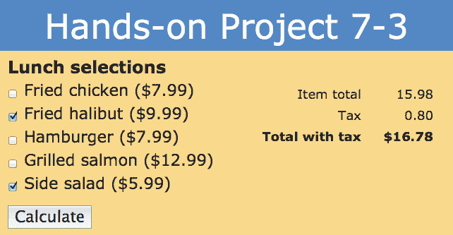

- 在编辑器中创建一个新文档，添加包含文本 `Hands-on Project -`、你的姓名和今天日期的 JavaScript 注释，然后将该文件保存到 HandsOnProject 文件夹中并命名为 `script.js`。
- 返回浏览器中的 `index.htm` 文件。在 `body` 部分，紧接闭合标签 `</body>` 之前，添加一个 `script` 元素，并将文件 `script.js` 指定为源。
- 在 `script.js` 文件中添加代码指示处理器以严格模式（strict mode）解释内容。声明两个全局变量：`delivInfo`（一个空对象）和 `delivSummary`（指向 id 值为 `deliverTo` 的元素）。
- 创建一个名为 `processDeliveryInfo()` 的函数。该函数将每个输入字段的值作为属性值加到 `delivInfo` 对象中。声明一个名为 `prop` 的局部变量。添加语句将 `nameinput` 字段的值存储在 `delivInfo` 对象的 `name` 属性中、`addrinput` 字段的 `addr` 属性、`cityinput` 字段的 `city` 属性、`emailinput` 字段的 `email` 属性以及 `phoneinput` 字段的 `phone` 属性中。
- 在 `processDeliveryInfo()` 函数内部，使用条件 `(prop in delivInfo)` 添加 `for/in` 语句。循环应包含以下语句：

```javascript
delivSummary.innerHTML += "<p>" + delivInfo[prop] + "</p>";
```

该语句将当前属性的值添加到 `deliverTo` 元素的内容中。

- 添加名为 `previewOrder()` 的函数。该函数包含两个语句：调用 `processDeliveryInfo()` 以及一个将元素 `style` 更改为 `block` 的语句。
- 为 id 值为 `previewBtn` 的元素添加事件监听器。`click` 事件应调用 `previewOrder()`。
- 在 `script.js` 文件中，添加代码指示处理器以严格模式解释内容。（等等，这在上一步中已提到，让我们重新调整逻辑流）。
- 添加一个 `if` 语句检查由 `instr` 用的元素是否有内容，如果有，则为 `foodInfo` 对象创建一个 `instructions` 属性并设置为 `instr` 变量的值。
- 在 `script.js` 文件中，添加名为 `processFood()` 的函数。该函数将：
  a. 声明局部变量：`prop`、`crust`、`toppings`、`instr`。
  b. 添加 `if/else` 语句检查 `crust` 中的第一个项目是否被选中。如果是，则将 `foodInfo` 的 `crust` 属性赋值为 `crust` 数组中的第一个项目；否则赋值为第二个。
  c. 创建 `for` 语句，将计数器变量设置为 0，当其小于 `toppings` 数组长度时重复，并在每次循环后增加 1。在 `for` 语句内部，添加 `if` 语句检查数组中计数器对应的元素是否被选中。如果条件为真，增加 `toppings` 变量并在 `foodInfo` 中创建一个名为“topping”加上 `toppings` 变量值的新属性，并将其设置为 `toppings` 数组中的当前元素。
  d. 将以下语句添加到订单摘要中：

```javascript
foodSummary.innerHTML += "<p><span>Crust:</span> " + foodInfo.crust + "</p>";
foodSummary.innerHTML += "<p><span>Size:</span> " + foodInfo.size + "</p>";
foodSummary.innerHTML += "<p><span>Topping(s):</span></p>";
foodSummary.innerHTML += "<ul>";
for (var i = 1; i < 6; i++) {
    if (foodInfo["topping" + i]) {
        foodSummary.innerHTML += "<li>" + foodInfo["topping" + i] + "</li>";
    }
}
foodSummary.innerHTML += "</ul>";
foodSummary.innerHTML += "<p><span>Instructions:</span> " + foodInfo.instructions + "</p>";
```

- `document.getElementById("order").style.display = "block";`
- 在 `previewOrder()` 函数中，在调用 `processDeliveryInfo()` 之后添加对 `processFood()` 函数的调用。
- 将你的更改保存到 `script.js`，在浏览器中打开 `index.htm`，在“交付信息”（Delivery Information）部分的所有框中输入虚假信息，完成“订单”（Order）部分的所有框，然后点击**预览订单**（Preview Order）。页面右侧将显示你输入的信息的摘要，如图 7-23 所示。

> 图 7-23：增强后的披萨订单表
> 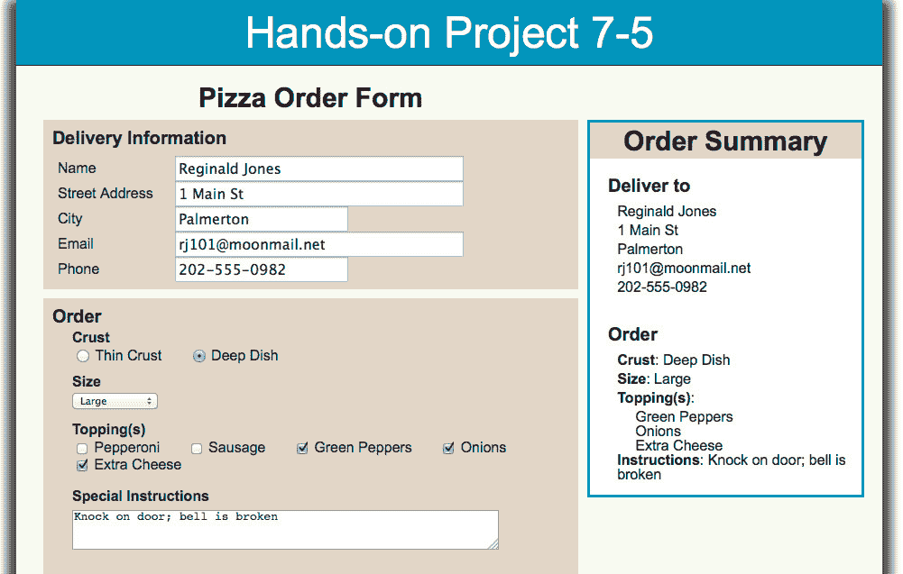

- 根据需要调试你的代码，直到其运行正常。

## 案例项目

### 个人案例项目

扩展你的个人网站，添加一个页面，用于计算自用户输入的日期以来经过的时间。该页面应包含一个表单，允许用户输入日、月、年。然后该页面应计算并显示经过的年、月、天。请注意，你的程序必须包含代码，将超过 30 天的天数转换为月份，将超过 12 个月的转换为年份。

### 团队案例项目

在你的团队网站中，添加一个页面，允许用户通过在表单中输入一次一行的数据来向表格添加数据。首先决定你想让用户输入什么类型的信息。可能包括幻想运动小组的球员或夏季阅读清单。接下来，创建一个页面，该页面包含一个带有你想要收集的每个数据项字段的表单。该页面还应包含一个表格，其表头行与表单的每个字段对应。作为一个团队，设计并编写一个构造函数，作为包含页面主题信息（例如足球运动员或书籍）的对象的模板。还要编写代码，以便 ( ) 在每次提交表单内容时生成一个新对象，并 ( ) 向表格添加一个新行，并在适当的单元格中包含该对象的属性。如有必要，使用 `for`/`in` 语句来调试你的代码。当应用程序运行正常时，使用表单为表格中的三个不同项目输入数据。然后将页面状态保存为 PDF 文档。

   

# 第 8 章 在字符串和数组中处理数据

当你完成本章时，你将能够：

- 使用 `String` 对象的属性和方法操作字符串
- 创建正则表达式并使用它们验证用户输入
- 使用 `Array` 对象的属性和方法操作数组
- 在字符串与数组之间、字符串与 JSON 之间进行转换

JavaScript 最常用的用途之一是处理用户提交的表单数据。由于表单数据是以字符串形式提交的，优秀的 JavaScript 程序员必须擅长处理字符串。JavaScript 程序员的另一个关键技能是操作数组的能力。在本书前面的部分，你学习了处理字符串和数组的基础技能，包括创建它们以及访问和更改它们的值。在本章中，你将学习如何使用针对字符串和数组的高级技术来对字符串值和数组值执行更复杂的操作。你还将学习如何使用正则表达式，它用于根据指定的规则匹配和处理字符串。最后，你将学习如何将字符串值转换为 JSON，这是一种常用用于传输对象内容的数据格式。

## 操作字符串

正如你在第 7 章中所学到的，字符串是包含在双引号或单引号内的文本。你可以将文本字符串作为字面量值，或将其赋值给变量。例如，以下代码的第一条语句指定字面文本字符串作为元素内容，而第二条语句将文本字符串赋值给变量。

```javascript
1 document.getElementById("mainHeading").innerHTML = "24-Hour Forecast";
2 var highSurfAdvisory = "Watch out for high waves and strong rip currents.";
```

无论你使用单引号还是双引号，字符串都必须以相同类型的引号开始和结束。例如，语句 `subhead.innerHTML = "including hourly temperatures";` 是有效的，因为字符串以双引号开始并结束。同样，`subhead.innerHTML = 'including hourly temperatures';` 是有效的，因为字符串以单引号开始并结束。相比之下，下面的代码是无效的，因为字符串以双引号开始并以单引号结束。

**无效代码：**
`subhead.innerHTML = "including hourly temperatures';`

在这种情况下，你将收到一个错误，因为 JavaScript 解释器无法判断字面量字符串从哪里开始和结束。前面的示例演示了创建字符串的基础知识。你经常会发现需要解析字符串。当应用于字符串时，解析是指从较大的字符串中提取字符或子字符串的行为。在本章中，你将学习如何使用 `String` 类的属性和方法来操作它们。然而，当应用于字符串时，解析通常是指从变量中提取信息。为了解析字符串，解析是指允许用户创建个人，这将与他们的喜好相关。此外，图 显示了你将添加到网站的功能。除了密码外，你输入的所有信息都显示在屏幕侧上的页面。

> 图 7-23：增强后的订单单表
> (*)
> © 2015 Cengage Learning

## 格式化字符串

本节描述了如何使用特殊字符以及如何将字符串从大写转换为小写，反之亦然。

### 使用特殊字符

你在第 7 章了解到，当你想要在字面字符串中包含基本类型的特殊字符（如引号）时，你必须使用转义序列。双引号的转义序列为 `\"`，单引号的转义序列为 `\'`。例如，在语句 `var mainHead = 'Today\'s Forecast';` 中，赋值给变量 `mainHead` 的文本字符串包含一个用于单引号的转义序列。该值在浏览器中的渲染结果如下：

Today’s Forecast

对于其他类型的特殊字符，你需要使用 **Unicode**，这是一组来自世界上许多语言的标准化字符集。一个数字代表 Unicode 字符集中的每个字符。例如，大写字母 *A*、*B* 和 *C* 的 Unicode 编号分别为 65、66 和 67。在大多数情况下，你可以使用 HTML 数字字符引用或字符实体来表示文本字符串中的 Unicode 字符。例如，版权符号（©）在 HTML 中可以通过数字字符引用 `&#169;` 或字符实体 `&copy;` 来表示。为了在 JavaScript 中为名为 `copyrightInfo` 的变量赋值文本“©-2006-2017”，你可以使用以下两个语句之一：

1. `copyrightInfo = "<p>&#169; 2006-2017</p>";` // 数字字符引用。
2. `copyrightInfo = "<p>&copy; 2006-2017</p>";` // 字符实体

与其像前面的示例那样在文本字符串中使用数字字符引用或字符实体，你也可以使用 **fromCharCode() 方法**，该方法通过作为参数传递的 Unicode 字符码构建文本字符串。`fromCharCode()` 方法被称为**静态方法**，因为它在脚本中不是被作为任何字符串对象（可以是字面量字符串或变量）的方法使用的。相反，你必须作为 `String` 类的方法调用 `fromCharCode()`，语法如下：

`String.fromCharCode(char1, char2, ...)`

以下代码使用 `fromCharCode()` 方法通过 Unicode 字符创建文本“JavaScript”：

`String.fromCharCode("74", "97", "118", "97", "83", "99", "114", "105", "112", "116")`

上述语句中的数字字符会在网络浏览器中渲染为“JavaScript”。以下语句使用 `fromCharCode()` 方法创建字符串值“© 2017”：

`copyrightInfo = String.fromCharCode("169") + " 2017";`

> *在本书编写时，Unicode 包含了超过 110,000 个字符的编码。所有 Unicode 字符的可搜索列表可以在 http://www.unicode.org/charts/ 找到。*

**注意**

### 修改大小写

要更改字符串中字母的大小写，你可以使用 `String` 类的 `toLowerCase()` 和 `toUpperCase()` 方法。**toLowerCase() 方法**将文本字符串转换为小写，而**toUpperCase() 方法**将文本字符串转换为大写。你将其中一种方法附加到包含你想更改大小写的文本字符串或变量上。例如，以下代码使用 `toUpperCase()` 方法以大写字母打印 `agency` 变量的内容（“noaa”）变为“NOAA”：

```javascript
1 var agency = "noaa";
2 agencyName.innerHTML = agency.toUpperCase(); // 浏览器显示 "NOAA"，但 agency 的值仍为 "noaa"
```

注意，上述语句中的 `toUpperCase()` 方法并没有将 `agency` 变量的内容转换为大写字母；它只是以大写字母打印文本。如果你想更改变量的内容为大写或小写字母，你必须将 `toLowerCase()` 或 `toUpperCase()` 方法返回的值赋值给该变量或另一个变量。以下语句演示了如何将 `agency` 变量的内容更改为大写字母：

```javascript
1 var agency = "noaa";
2 agency = agency.toUpperCase(); // agency 的值为 "NOAA"
3 agencyName.innerHTML = agency; // 浏览器显示 "NOAA"
```

虽然电子邮件地址不区分大小写的，但它们通常全小写字母写。接下来，你将增强 `validateEmail()` 函数，使其将电子邮件地址字段中输入的值转换为小写字母。

要添加将电子邮件地址转换为小写的代码：

1. 回到文本编辑器中的 `goldrock.js` 文档。
2. 滚动到 `validateEmail()` 函数，并找到注释 `// replace with code to convert email address to lowercase`。
3. 将注释替换为以下语句：
   `emailInput.value = emailInput.value.toLowerCase();`

### 统计字符串中的字符

你经常会发现统计字符串中的字符和单词是必要的，特别是来自提交的字符串。例如，你可能需要统计密码中的字符数，以确保用户选择了至少具有一定字符数的密码。或者，你可能有一个网页允许用户提交不能超过最大字符数的分类广告。`String` 类包含一个属性，即 **length** 属性，它返回字符串中的字符数。要返回字符串中的总字符数，你将 `String` 类的 `length` 属性附加到包含文本的字面量字符串、变量或对象。例如，以下代码使用 `length` 属性统计名为 `country` 变量中的字符。

`var country = "Kingdom of Morocco";`
`var stringLength = country.length; // stringLength 的值为 18`

**注意**

在创建配置文件时，用户名必须至少长几个字符，密码必须至少长几个字符。你将在 `validateUsername()` 和 `validatePassword()` 函数中添加条件表达式，以检查用户名和密码（确认）字段中用户输入的长度，并在输入过短时显示错误消息。

要添加检查最小用户名和密码长度的条件语句：

1. 回到文本编辑器中的 `goldrock.js` 文档。
2. 在 `validateUsername()` 函数中，找到注释 `// replace with conditional expression`。
3. 将注释替换为以下 `if` 语句：

```javascript
if (unInput.value.length < 4) {
    throw "Username must be at least 4 characters long";
}
```

4. 在 `validatePassword()` 函数中，找到注释 `// replace with conditional expression`。
5. 将注释替换为以下 `if` 语句：

```javascript
if (pw1Input.value.length < 8) {
    throw "Password must be at least 8 characters";
}
```

该语句检查 `pw1Input` 元素（第一个密码框）中值的 `length` 属性。如果长度小于 8——意味着用户输入的密码少于 8 个字符——则 `if` 语句将抛出（throw）一个错误。请注意，这段代码只检查两个密码框中的第一个。你将在本章的后续部分添加代码，以确保两个密码框中的输入内容匹配。此功能将使你无需同时检查两个密码框的长度。

6. 将更改保存到 `goldrock.js`，在浏览器中按住 Shift 刷新或 Shift 重新加载 `account.htm`，然后点击 `Username`（用户名）框。
7. 输入 `abc`，按 `Tab` ；在密码框中输入 `abc`，按 `Tab` ；在密码（确认）框中输入 `abc`，然后按 `Tab`。如图 8-4 所示，显示了错误消息，表示有效的用户名至少需要 8 个字符，有效的密码也至少需要 8 个字符。
8. 双击 `Username` 框，输入 `admin` 替换现有内容，按 `Tab` ，输入 `password123`，按 `Tab` ，输入 `password123`，然后按 `Tab`。错误消息和无效样式将被移除，因为你输入的用户名长度为 5 位，而你输入的密码长度为 11 位。

> 针对短用户名和密码的验证样式和消息
> 图 8-4：短用户名和短密码的验证错误

### 格式化字符串方法表

| 方法 | 说明 |
| :--- | :--- |
| `charAt(index)` | 返回文本字符串中指定位置的字符；如果指定位置大于字符串长度，则返回空字符串 |
| `charCodeAt(index)` | 返回文本字符串中指定位置的 Unicode 字符码；如果指定位置大于字符串长度，则返回 `NaN` |
| `indexOf(text[, index])` | 执行区分大小写的搜索，并返回字符串中 `text` 参数中第一个字符首次出现的位置索引；如果包含 `index` 参数，则 `indexOf()` 方法将从字符串中的该位置开始搜索；如果未找到该字符或字符串，则返回 −1 |
| `lastIndexOf(text[, index])` | 执行区分大小写的搜索，并返回字符串中 `text` 参数中第一个字符最后一次出现的位置索引；如果包含 `index` 参数，则 `lastIndexOf()` 方法将从字符串中的该位置开始搜索；如果未找到该字符或字符串，则返回 −1 |
| `match(pattern)` | 执行区分大小写的搜索，并返回一个包含与 `pattern` 参数匹配的结果数组；如果未找到文本，则返回 `null` |
| `search(pattern)` | 执行区分大小写的搜索，并返回字符串中与 `pattern` 参数匹配的第一个字符的位置索引；如果未找到则返回 −1 |
| `slice(start[, end])` | 提取字符串的片段并返回新字符串；如果 `start` 为负值，则从字符串末尾计算；如果 `end` 为负值，则在该位置之前截断；如果 `end` 未指定，则提取到字符串末尾 |
| `substring(start[, end])` | 提取字符串的片段并返回新字符串；如果 `start` 为负值，则从字符串末尾计算；如果 `end` 为负值，则在该位置之前截断；如果 `end` 未指定，则提取到字符串末尾 |

### 查找和提取字符

在某些情况下，你需要从字符串中查找并提取字符。为了实现这一点，你可以使用 `search()`、`indexOf()` 或 `lastIndexOf()` 方法。这些方法分为两类：返回字符串中位置索引的方法和返回字符的方法。要使用返回位置索引的方法，请记住字符串的索引从 0 开始，与数组元素相同。例如，如果 **search() 方法** 未找到指定的字符串，则返回 -1。

`slice()` 方法和 `substring()` 方法之间的唯一区别是，`slice()` 方法允许你为索引参数指定负值。如果你为起始索引指定一个负值，`slice()` 方法将从文本字符串的末尾开始：

- -1 代表字符串中的最后一个字符，
- -2 代表倒数第二个字符，依此类推。

如果你为结束索引指定一个负值，`slice()` 方法提取的字符数也将从文本字符串的末尾开始计算。请注意，`slice()` 方法不会返回结束索引所代表的字符；它返回结束索引之前的那个字符。例如，以下语句以两种不同的方式使用了 `slice()` 方法：

```javascript
1 var email = "president@whitehouse.gov";
2 var nameText = email.slice(0, 9);
3 // nameText 的值为 "president"
4 var domain = email.slice(-14, -4);
5 // domain 的值为 "whitehouse"
```

第一个 `slice()` 方法使用的起始索引为 0，代表 email 文本字符串中的字母 *p*，结束索引为 9，代表 `@` 符号。因为索引值是正数，它们从文本字符串的开始计数。相比之下，第二个 `slice()` 方法使用的起始索引为 -14，代表字母 *w*，结束索引为 -4，代表 . 字符。记住，这两个位置都是从文本字符串的末尾计数的。

以下代码使用 `slice()` 方法返回 `email` 变量中邮箱地址的域标识：

```javascript
var email = "president@whitehouse.gov";
var domainID = email.slice(-3);
// domainID 的值为 "gov"
```

以下代码包含了 `slice()` 方法的另一个示例。在这个版本中，代码使用了 `search()` 和 `lastIndexOf()` 方法来返回邮箱地址的域名。请注意，第二个语句将 `search()` 方法返回的位置加了 1。这防止了 `@` 字符包含在 `slice()` 方法返回的子字符串中。

```javascript
1 var email = "president@whitehouse.gov";
2 var domainBegin = email.search("@") + 1;
3 var domainEnd = email.lastIndexOf(".");
4 var domain = email.slice(domainBegin, domainEnd);
5 // domain 的值为 "whitehouse"
```

在本章稍后的部分，你将学习如何使用正则表达式来验证字符串（包括邮箱地址）。目前，你只需简单使用 `search()` 和 `lastIndexOf()` 方法来检查表单输入的邮箱地址是否包含用于分隔名称和域的 `@` 符号，以及用于分隔域和标识的点。

使用 `search()` 和 `lastIndexOf()` 方法检查邮箱地址是否包含 `@` 符号和点：

1. 回到文本编辑器中的 `goldrock.js`，然后在 `validateEmail()` 函数中找到注释 `// replace with conditional expression`。
2. 将注释替换为以下代码：

```javascript
if (emailInput.value.search("@") === -1 ||
    emailInput.value.lastIndexOf(".") === -1) {
    throw "Please provide a valid email address";
}
```

这段代码使用 `search()` 和 `lastIndexOf()` 方法来判断传递它的字符串是否包含 `@` 符号和点。如果字符串缺少其中一个或两个字符，`if` 语句将抛出一个错误。

3. 保存对 `goldrock.js` 的更改，然后在浏览器中 Shift-刷新或 Shift-重载 `account.htm`。
4. 点击 `Email Address`（邮箱地址）框，输入 `ssmith@cengagebrain`，然后按 `Tab`。

如图 8-6 所示，该框被红色高亮并显示错误消息，表示你的输入不是有效的邮箱地址。

> 图 8-6：无效邮箱地址显示的高亮和错误消息
> 

5. 点击 `Email Address` 框的末尾，如有必要，使用右箭头键移动到你输入文本的末尾，输入 `.com`，然后按 `Tab`。Email Address 框现在包含了一个完整的邮箱地址，包括 `@` 符号和点，高亮和错误消息也随之移除。

### 替换字符和子字符串

除了在字符串中查找和提取字符外，你可能还需要替换它们。`String` 类的 `replace()` 方法会创建一个新字符串，并将模式的首次出现替换为替换字符串。`replace()` 的语法为 `string.replace(pattern, replacement)`。

当你将简单的字符串作为模式传递给 `replace()` 时，只有第一个实例会被替换。要替换所有实例，你必须使用正则表达式作为模式并设置 RegExp 对象的全局属性。

以下示例演示了如何使用 `replace()` 方法将 "president" 替换为 "vicepresident"：

```javascript
var email = "president@whitehouse.gov";
var newEmail = email.replace("president", "vicepresident");
// newEmail 的值为 "vicepresident@whitehouse.gov"
```

### 合并字符和子字符串

到目前为止，你已经使用了拼接运算符（`+`）和复合赋值运算符（`+=`）来组合字符串。`String` 类还包含了 `concat()` 方法，按参数顺序创建一个新字符串。例如，以下语句演示了如何使用 `concat()` 方法构建一个存储在新变量中的字符串：

```javascript
var name = "Theodor Seuss Geisel";
var penName = "Dr. Seuss";
var bio = penName.concat(" was the pen name of ", name);
```

在大多数情况下，你不需要使用 `concat()` 方法。相反，使用拼接运算符通常更简单。以下代码显示了上一个示例相同的语句，但这次使用了拼接运算符：

```javascript
var name = "Theodor Seuss Geisel";
var penName = "Dr. Seuss";
var bio = penName + " was the pen name of " + name;
```

### 比较字符串

在第 2 章中，你学习了 JavaScript 的各种运算符，包括比较运算符。虽然比较运算符通常用于数字，但它们也可以用于字符串。以下语句使用比较运算符（`===`）比较两个包含文本字符串的变量：

```javascript
var location1 = "Springfield, MO";
var location2 = "Springfield, MA";
var result;
if (location1 === location2) {
    result = true;
} else {
    result = false;
}
// result 变量的值为 false
```


## 第 8 章 字符串和数组中的数据操作

由于文本字符串不相同，`else` 子句返回值 `false`。你也可以使用比较运算符来判断一个字母在字母表中是否比另一个字母更高（即更靠前），如下代码所示：

```javascript
1 var firstLetter = "A";
2 var secondLetter = "B";
3 if (firstLetter < secondLetter) {
4   var letterOrder = firstLetter + ", " + secondLetter;
5 } else {
6   var letterOrder = secondLetter + ", " + firstLetter;
7 }
8 // letterOrder 的值为 "A, B"
```

在这段代码中，`else` 语句执行是因为字母 `B` 在字母表中比字母 `A` 高。

比较运算符根据单个字符的 Unicode 位置进行比较。小写字母由值 `a` 到 `z` 表示。大写字母由值 `A` 到 `Z` 表示。由于小写字母的值比大写字母大，因此小写字母被评估为比大写字母“大”。例如，大写字母 `A` 由 Unicode 值 65 表示，而小写字母 `a` 由 Unicode 值 97 表示。因此，语句 `"a" > "A"` 返回值为 `true`，因为大写字母 `A` 的 Unicode 值小于小写字母 `a`。

除了使用标准比较运算符外，`String` 类还包含一个 `localeCompare()` 方法，该方法根据特定语言或国家的排序顺序来比较字符串。`localeCompare()` 方法的语法为：

`sourceString.localeCompare(compareString)`

如果 `compareString` 等于 `sourceString`，该方法返回 0；如果 `compareString` 在 `sourceString` 之前排序，方法返回大于 0 的值（通常为 1）；如果 `compareString` 在 `sourceString` 之后排序，方法返回小于 0 的值（通常为 -1）。例如，考虑以下 `localeCompare()` 方法：

```javascript
1 var sourceString = "Don";
2 var compareString = "Dan";
3 var comparison = sourceString.localeCompare(compareString);
4 // 返回 1
```

因为“Dan”的排序在“Don”之前，所以方法返回 1。相比之下，以下交换了“Dan”和“Don”参数的语句返回 -1：

```javascript
1 var sourceString = "Dan";
2 var compareString = "Don";
3 var comparison = sourceString.localeCompare(compareString);
4 // 返回 -1
```

如果两个字符串值相等，`localeCompare()` 方法返回 0，如下例所示：

```javascript
1 var sourceString = "Don";
2 var compareString = "Don";
3 var comparison = sourceString.localeCompare(compareString);
4 // 返回 0
```

在现代浏览器中，`localeCompare()` 方法可以对两个仅在大小写上不同的字符串进行区分大小写的比较。然而，旧浏览器（如 IE）不支持该语法，而且默认情况下，浏览器对于特定区域，将大写字母排在小写字母之前还是之后存在差异。

要对两个字符串进行不区分大小写的比较，你必须先使用 `toLowerCase()` 或 `toUpperCase()` 方法将字符串转换为相同的大小。以下代码中的 `localeCompare()` 语句返回 0，是因为在执行比较之前，源字符串和比较字符串都已转换为小写：

```javascript
1 var sourceString = "Don";
2 var compareString = "don";
3 sourceString = sourceString.toLowerCase();
4 // sourceString 的值为 "don"
5 compareString = compareString.toLowerCase();
6 // compareString 的值为 "don"
7 var result = sourceString.localeCompare(compareString);
8 // 返回 0
```

接下来，你将在 `validatePassword()` 函数中添加代码，使用 `localeCompare()` 方法验证用户在密码和密码（确认）框中的输入是否相同。

### 要使用 localeCompare() 方法验证密码输入是否匹配：

1. 回到文本编辑器中的 **goldrock.js**。
2. 在 `validatePassword()` 函数内部、`try` 语句内部、`if` 语句末尾添加以下内容：

```javascript
if (password.value.localeCompare(passwordConfirm.value) !== 0) {
  throw "Passwords must match";
}
```

3. 将你的更改保存到 **goldrock.js**，然后刷新 **account.htm**。因为密码现在匹配了，红色高亮和错误信息将被移除。

### 格式化字符串

### 短测验 1

1. 哪个字符串属性返回字符串的字符数？
2. 解释 `substring()` 和 `slice()` 方法的两个参数的含义。
3. 在表达式 `var result = sourceString.localeCompare(compareString)` 中，可能的返回值及其分别代表什么？

### 使用正则表达式

处理字符串较复杂的方法之一是使用正则表达式，正则表达式是用于匹配和处理字符串的模式。在 JavaScript 等脚本语言中，正则表达式通常用于验证表单数据。例如，你可以使用正则表达式确保用户在字段中输入的值符合特定格式，如日期的 `mm/dd/yyyy` 或电话的 `###-####`。大多数脚本语言都支持某种形式的正则表达式。

> **注意**：ECMAScript 的正则表达式基于 Perl 编程语言的正则表达式功能。

#### 在 JavaScript 中定义正则表达式

JavaScript 中的正则表达式必须以斜杠开始并结束。例如，以下语句定义了一个判断字符串是否包含“https”的正则表达式模式，并将其赋值给变量 `urlProtocol`：

`var urlProtocol = /https/;`

注意正则表达式模式没有被引号包含。

你可以在多个 `String` 类方法中使用正则表达式，包括 `search()` 和 `replace()` 方法。传递给任一方法的值可以是文本字符串也可以是正则表达式。例如，以下语句将 `urlProtocol` 正则表达式传递给 `search()` 方法，该方法会在 `url` 变量包含的文本中搜索“https”：

```javascript
var urlProtocol = /https/;
var url = "http://www.cengagebrain.com";
var searchResult = url.search(urlProtocol); // 返回 -1
```

因为 `url` 变量包含的是协议 “http”而非 “https”，所以 `search()` 方法返回 -1，表示未找到正则表达式模式。

除了将正则表达式赋值给变量外，你还可以将模式直接传递给接受正则表达式的方法。以下示例演示了如何将正则表达式 `/https/` 直接传递给 `search()` 方法：

```javascript
var url = "http://www.cengagebrain.com";
var searchResult = url.search(/https/); // 返回 -1
```

再次注意，正则表达式没有包含在引号内。

创建正则表达式的最后一种方法是使用 `RegExp()` 构造函数。`RegExp()` 构造函数是 **RegExp 对象**的一部分，该对象包含了在 JavaScript 中处理正则表达式的方法和属性。要使用 `RegExp()` 构造函数创建正则表达式，你使用以下语法：

`var regExpName = new RegExp("pattern"[, "attributes"]);`

注意上述语法中的模式是用引号括起来的，而不是斜杠。以下示例演示了如何使用 `RegExp()` 构造函数配合 “https” 模式：

```javascript
var urlProtocol = new RegExp("https");
var url = "http://www.cengagebrain.com";
var searchResult = url.search(urlProtocol); // 返回 -1
```

三种定义正则表达式的方式都会产生相同的功能，因此使用哪种方法区别不大。由于传递给 `RegExp()` 构造函数的值是文本字符串，JavaScript 解释器必须在作为正则表达式使用之前将其转换。这个额外的步骤可能会使 `RegExp()` 构造函数比将正则表达式赋值给文本字符串或作为参数传递慢。由于此原因，某些程序员倾向于不使用 `RegExp()` 构造函数来定义正则表达式。

接下来，你将修改 `validateEmail()` 函数中的 `search()` 方法，使其使用正则表达式搜索电子邮件地址中的 `@` 符号，而不是 “@” 字符串。

> **注意**：你不能在 `indexOf()` 和 `lastIndexOf()` 方法中使用正则表达式。

#### 要修改 search() 方法使用正则表达式：

1. 回到文本编辑器中的 **goldrock.js** 文档。
2. 在 `validateEmail()` 函数中，在 `try` 语句内，找到你之前创建的 `if` 语句。
3. 在 `if` 语句的第一行，将 “@” 替换为 `/@/`，如下所示：

```javascript
1 function validateEmail() {
2   var emailInput = document.getElementById("emailbox");
3   var errorDiv = document.getElementById("emailError");
4   try {
5     if (emailInput.value.search(/@/) === -1 ||
6         emailInput.value.lastIndexOf(".") === -1) {
7       throw "Please provide a valid email address";
8     }
9   ...
10 }
```

传递给 `search()` 方法的值现在作为正则表达式传递，而不是字符串。

4. 保存你对 **goldrock.js** 的更改，然后在浏览器中 Shift-刷新或 Shift-重新加载 **account.htm**。
5. 点击 **Password** 框，输入，按 **Tab**，输入，然后按 **Tab**。如图所示，框被高亮为红色，并显示错误消息，表示密码必须匹配。
6. 点击 **Password (confirm) 框** 的末尾，输入，然后按 **Tab**。与之前的步骤一样，两个密码现在匹配了，因此表单中去除了红色高亮和错误消息。你在条件语句中替换的正则表达式与它所替换的字符串具有相同的功能。

### 使用正则表达式方法

尽管你可以在多个 `String` 类方法中使用正则表达式，但 `RegExp` 对象本身还包含两个方法，`test()` 和 `exec()`，它们专门为处理正则表达式而设计。`exec()` 方法相当复杂，因此你将在书中只学习 `test()` 方法。**test() 方法**在字符串包含匹配正则表达式的文本时返回 `true` 值，否则返回 `false`。`test()` 方法的语法为：

`var pattern = test(string);`

以下代码演示了如何使用 `test()` 方法判断 `url` 变量是否包含文本 “cengagebrain”。

```javascript
var urlDomain = /cengagebrain/;
var url = "http://www.cengagebrain.com";
var testResult = urlDomain.test(url); // true
```

由于变量包含该文本，`testResult` 变量的值为 `true`。之前的示例仅演示了如何使用 `test()` 方法。实际上，在这些示例中使用正则表达式方法没有意义，因为你可以通过 `search()` 方法或其他 `String` 类方法更轻松地判断两个字符串是否匹配。正则表达式的真正威力来自于你编写的模式，你将在下一节中学习更多。

### 编写正则表达式模式

处理正则表达式最困难的部分是编写用于匹配和处理字符串的模式和规则。作为一个常见但复杂的正则表达式示例，请考虑以下代码：

```javascript
1 var emailPattern = /^[_a-zA-Z0-9\-]+(\.[_a-zA-Z0-9\-]+)*@[a-zA-Z0-9\-]+(\.[a-zA-Z0-9\-]+)*(\.[a-z]{2,6})$/;
2 var email = "president@whitehouse.gov";
3 var result;
4 if (emailPattern.test(email)) {
5   result = true;
6 } else {
7   result = false;
8 }
```

正如你所见，逻辑很简单：如果电子邮件地址不匹配正则表达式，则 `else` 语句返回 `false`。代码中复杂的部分是第一个语句中定义的模式。

#### 匹配任意字符

你使用点（`.`）来匹配模式中的任何单个字符。正则表达式模式中的点实际上指定模式在该处必须包含一个值。例如，以下代码指定 `zip` 变量必须包含五个字符。

```javascript
var zipPattern = /...../;
var zip = "015";
var testResult = zipPattern.test(zip); // false
```

由于变量只包含三个字符，`test()` 方法返回 `false`。相比之下，下面的 `test()` 方法返回 `true`，因为 `zip` 变量包含了五个字符：

```javascript
var zipPattern = /...../;
var zip = "01562";
var testResult = zipPattern.test(zip); // true
```

由于点仅指定模式中的某个位置必须包含字符，你还可以在模式中包含额外的字符。下面的 `test()` 方法返回 `true` 值，因为 `zip` 变量包含了所需的五个字符以及 ZIP+字符：

```javascript
var zipPattern = /...../;
var zip = "01562-2607";
var testResult = zipPattern.test(zip); // true
```

表 8-2 列出了可以在 JavaScript 正则表达式使用的元字符。

| 元字符 | 说明 |
| :--- | :--- |
| `.` | 匹配任意单个字符 |
| `\` | 将下一个字符识别为字面值 |
| `^` | 匹配字符串开头的字符 |
| `$` | 匹配字符串结尾的字符 |
| `()` | 指定模式匹配中必须包含的字符 |
| `[]` | 指定模式匹配中允许的备选字符 |
| `[^]` | 指定模式匹配中排除的字符 |
| `-` | 识别可能的匹配字符范围 |
| `\|` | 指定模式匹配中包含的备选字符集 |

**表 8-2：JavaScript 正则表达式元字符**

#### 匹配字符串开头或结尾的字符

元字符 `^` 匹配字符串开头的字符，而元字符 `$` 匹配字符串结尾的字符。匹配行开头或结尾的模式被称为**锚点**（anchor）。要指定行开头的锚点，模式必须以 `^` 元字符开头。以下示例中的模式匹配以“http”开头的字符串：

```javascript
var urlProtocol = /^http/;
var url = "http://www.cengagebrain.com";
var testResult = urlProtocol.test(url); // true
```

由于 `url` 变量确实以“http”开头，`test()` 方法返回 `true`。

模式中 `^` 元字符之后的所有字面字符都构成了锚点。这意味着下面的示例返回 `false`，因为 `url` 变量并不是以“https”开头（只有“http”，而没有 `s`），正如模式中的锚点所指定的那样：

```javascript
var urlProtocol = /^https/;
var url = "http://www.cengagebrain.com";
var testResult = urlProtocol.test(url); // false
```

要指定行结尾的锚点，模式必须以 `$` 元字符结尾。以下代码指定了一个在字符串结尾查找“com”的模式，然后根据该模式对 URL 进行检查：

```javascript
var urlIdentifier = /com$/;
var url = "http://www.cengagebrain.com";
var testResult = urlIdentifier.test(url); // true
```

前面的代码返回 `true`，因为赋值给 `urlIdentifier` 变量的 URL 以“com”结尾。接下来的代码使用了类似的模式，但检查字符串结尾的“gov”：

```javascript
var urlIdentifier = /gov$/;
var url = "http://www.cengagebrain.com";
var testResult = urlIdentifier.test(url); // false
```

前面的代码返回 `false`，因为赋值给 `url` 变量的 URL 并不是以“gov”结尾。

#### 匹配特殊字符

为了在正则表达式中将任何元字符作为字面值匹配，你必须在该字符前面加上一个反斜杠 `\`。例如，点号（`.`）元字符匹配字符串中的任何单个字符。如果你想确保字符串包含一个实际的点而不是任何字符，你就需要用反斜杠转义点号字符。在接下来的代码中，域标识符—com—是用逗号而不是点追加到域名后面的。然而，该正则表达式返回了 `true`，因为表达式中的点号没有被转义。

**错误的正则表达式：**

```javascript
var urlIdentifier = /.com$/;
var url = "http://www.cengagebrain,com";
var testResult = urlIdentifier.test(url); // true
```

要修正这个问题，你必须像如下所示转义点号：

```javascript
var urlIdentifier = /\.com$/;
var url = "http://www.cengagebrain,com";
var testResult = urlIdentifier.test(url); // false
```

接下来，修改 `validateEmail()` 函数中的条件表达式，使其使用 `test()` 方法并判断域标识符是否是用点追加到域名后的。

#### 要向 validateEmail() 函数添加 test() 方法，以确定域标识符是否是用点追加到域名后的：

1. 回到 **goldrock.js**。
2. 在 `validateEmail()` 函数中，在 `try` 语句内注释掉 `if` 语句的前两行。
3. 在注释掉的行之后、`throw` 语句之前，添加以下条件语句：

```javascript
if (
  1 (/@/.test(emailInput) === false) ||
  2 (/\.\./test(emailInput) === false) ||
  3 (/\.\./test(emailInput) === false) ||
  4 (/\.\.\.test(emailInput) === false) ||
  5 (/\.\.\.\.test(emailInput) === false) ||
  6 (/\.\.\.\.\.test(emailInput) === false) ||
  7 ) {
```

第一个条件使用 `test()` 方法检查 `emailInput` 元素是否包含 `@` 符号。接下来的四行检查值是否以域标识符结尾。在本书编写时，域标识符包含 2 到 6 个字符。你的 `validateEmail()` 函数应该匹配如下：

#### 指定数量

指定匹配数量的元字符被称为**量词**（quantifiers）。加号 `+` 表示匹配一个或多个前面的字符，而星号量词 `*` 表示匹配零或多个前面的字符。作为一个简单的示例，从一个页面到另一个页面的 URL 使用 `name=value` 格式，其中 `name` 是属性名，`value` 是它的值。以下代码演示了如何确保变量字符串至少有一个等号：

```javascript
var stringPattern = /=+/;
var queryString = "color=green";
var testResult = stringPattern.test(queryString); // true
```

当 URL 包含多个 `name=value` 对时，它们用 ampersands（`&`）分隔。以下代码演示了如何检查 `queryString` 变量是否包含零或多个 ampersands：

```javascript
var stringPattern = /=+&*/;
var queryString = "color=green&size=12";
var testResult = stringPattern.test(queryString); // true
```

`{ }` 量词允许你更精确地指定字符重复的次数。以下代码展示了如何使用 `{ }` 量词确保邮政编码（Zip code）至少包含 5 个字符的示例：

```javascript
var zipPattern = /.{5}/;
var zip = "01562";
var testResult = zipPattern.test(zip); // true
```

> *你可以使用字符类更有效地验证邮政编码，字符类将在本章稍后部分介绍。*

接下来，你将使用带有量词的单个正则表达式来替换对电子邮件地址中域标识符长度的测试。你还将把使用 `String` 对象的 `length` 属性来验证用户名和密码长度的条件替换为使用量词的正则表达式。

#### 要使用量词来指定域标识符、用户名和密码的最小长度：

1. 回到编辑器中的 **goldrock.js**。
2. 在 `validateEmail()` 函数内部的 `try` 语句中，注释掉 `if` 语句的前八行，这些行包含了你在上一步骤中输入的条件。
3. 在被注释的行下方、`throw` 语句之前，添加以下条件语句：

```javascript
if ((/@/.test(emailInput.value) === false) || (/\..{2,6}$/.test(emailInput.value) === false)) {
```

第一个条件与上一步骤中的第一个条件相同。第二个条件将对域标识符长度的测试合并到一个语句中，它检查语句是否以句号（`\.`）后跟 2–6 个字符结尾。（尽管在编写此内容时没有使用 1 个字符的域标识符，但此测试对于本练习的验证目的足够。）

你修改后的 `validateEmail()` 函数开头应匹配如下：

```javascript
1 function validateEmail() {
2   var emailInput = document.getElementById("emailbox");
3   var errorDiv = document.getElementById("emailError");
4   try {
5     // if (emailInput.value.search(/@/) === -1 ||
6     // emailInput.value.lastIndexOf(".") === -1) {
7     // if (
8     // (/@/.test(emailInput.value) === false) || (
9     // (/\...$/.test(emailInput.value) === false) &&
10     // (/\....$/.test(emailInput.value) === false) &&
11     // (/\.....$/.test(emailInput.value) === false) &&
12     // (/\.......$/.test(emailInput.value) === false)
13     // )
14     // ) {
15     if ((/@/.test(emailInput.value) === false) ||
16         (/\..{2,6}$/.test(emailInput.value) === false)) {
17       throw "Please provide a valid email address";
18     }
19   ...
```

4. 在 `validateUsername()` 函数内部的 `try` 语句中，注释掉 `if` 语句的第一行，该行包含条件。
5. 在被注释的行下方、`throw` 语句之前，添加以下条件语句：

```javascript
if (/.{4,}/test(unInput.value) === false) {
```

此条件使用量词 `{4,}` 来检查 `unInput` 的值是否至少为 4 个字符。注意，此量词没有指定上限。

你修改后的 `validateUsername()` 函数开头应匹配如下：

```javascript
1 function validateUsername() {
2   var unInput = document.getElementById("uname");
3   var errorDiv = document.getElementById("usernameError");
4   try {
5     // if (unInput.value.length < 4) {
6     if (/.{4,}/test(unInput.value) === false) {
7       throw "Username must be at least 4 characters long";
8     }
9   ...
```

6. 在 `validatePassword()` 函数内部的 `try` 语句中，注释掉 `if` 语句的第一行，该行包含条件。
7. 在被注释的行下方、第一个 `throw` 语句之前，添加以下条件语句：

```javascript
if (/.{8,}/test(pw1Input.value) === false) {
```

此条件使用量词 `{8,}` 来检查 `pw1Input` 值是否至少为 8 个字符。注意，此量词没有指定上限。

你修改后的 `validatePassword()` 函数开头应匹配如下：

```javascript
1 function validatePassword() {
2   var pw1Input = document.getElementById("pw1");
3   var pw2Input = document.getElementById("pw2");
4   var errorDiv = document.getElementById("passwordError");
5   try {
6     // if (pw1Input.value.length < 8) {
7     if (/.{8,}/test(pw1Input.value) === false) {
8       throw "Password must be at least 8 characters";
9     } else if (pw1Input.value.localeCompare(pw2Input.value) !== 0) {
10      throw "Passwords must match";
11    }
12  ...
```

8. 保存更改到 **goldrock.js**，然后使用 Shift-刷新或 Shift-重载 **account.htm**。
9. 点击 **Username** 框，输入，按下 **Tab**，在 **Password** 框中输入，按下 **Tab**，在 **Password (confirm)** 框中输入，按下 **Tab**，然后在 **Email Address** 框中输入 `smith@example.com`。如图所示，如果输入有效，验证通过。

#### 指定子表达式

正如你之前学到的，正则表达式中的括号 `()` 可以指定精确匹配的字符。包含在括号内的字符被称为**子表达式**。子表达式允许你指定正则表达式的格式。例如，一个美国电话号码通常具有四个部分，格式为 `###-###-####`。如果你为美国电话号码创建一个正则表达式，可以从创建一个子表达式开始：

`/^(1)/`

你可以添加一个问号来表示它可能不包含，在某些有效的电话号码中：

`/^(1-)?/`

你可以添加一个子表达式来指定接下来的三个数字以及随后的连字符。这是区号，并且它是可选的：

`/^(1-)?(.{3}\-)?`

你会添加另一个子表达式来指定接下来的三个字符和一个连字符，这是强制性的：

`/^(1-)?(.{3}\-)`

你最后可以通过一个包含四个字符的组子表达式来完成正则表达式，它也是强制性的：

`/^(1-)?(.{3}\-)(.{4})$`

> *注意，前面的模式包含了 `^` 和 `$` 元字符，以锚定字符串的开头和结尾。这确保字符串完全匹配正则表达式。*

### 使用字符类

以下代码使用字符类来检查此单词的两种拼写方式，通过指定 `s` 或 `z` 可以是字符串中的第六个字符：

```javascript
var wordPattern = /analy[sz]e/;
var testResult = wordPattern.test("analyse"); // true
testResult = wordPattern.test("analyze"); // true
```

这两个语句都返回 `true`，因为字符类允许该单词的两种拼写方式。

相比之下，下面的测试返回 `false`，因为“analyce”不是该单词接受的拼写：

`testResult = wordPattern.test("analyce"); // false`

你使用连字符元字符（`-`）在字符类中指定值范围。你可以包含字母或数字范围。你将所有小写字母指定为 `[a-z]`，将所有大写字母指定为 `[A-Z]`。以下代码创建了一个仅匹配值 `A`、`B`、`C`、`D` 或 `F` 的模式，然后对 `letterGrade` 变量的值进行模式测试。正则表达式中的字符类指定变量中的 `A`–`D` 或字符 `F` 为有效值。

```javascript
var gradeRange = /[A-DF]/;
var letterGrade = "B";
var testResult = gradeRange.test(letterGrade); // true
```

由于变量被赋值为 `B`，因此 `test()` 方法返回 `true`。

相比之下，下面的 `test()` 方法返回 `false`，因为 `E` 不是字符类中的有效值：

```javascript
letterGrade = "E";
testResult = gradeRange.test(letterGrade); // false
```

若要在模式匹配中指定要排除的可选字符，请在字符类中的字符之前紧跟 `^` 元字符。以下代码指定了与上示例相同的模式，但指定的是不可接受的字符而不是接受的字符：

```javascript
1 var gradeRange = /[^EG-Z]/;
2 var letterGrade = "A";
3 var testResult = gradeRange.test(letterGrade); // true
4 letterGrade = "E";
5 testResult = gradeRange.test(letterGrade); // false
```

`gradeRange` 模式从接受的模式中排除了字母 `E` 和 `G`–`Z`。第一个 `test()` 方法返回 `true`，因为字母 `A` 没有被排除在模式匹配之外，而第二个 `test()` 方法返回 `false`，因为字母 `E` 被排除在模式匹配之外。

以下语句演示了如何将数字字符包含在模式中或将其排除：

```javascript
var testResult = /[0-9]/.test("5"); // true
testResult = /[^0-9]/.test("5"); // false
```

第一个语句返回 `true`，因为它允许任何数字，而第二个语句返回 `false`，因为它排除了任何字符。注意你可以在字符类中组合范围，如下语句所示：

```javascript
var testResult = /[0-9a-zA-Z]/.test("7"); // true
testResult = /[^a-zA-Z]/.test("Q"); // false
```

第一个语句演示了如何包含所有字母数字字符，第二个语句演示了如何排除所有小写和大写字母。以下语句演示了如何使用字符类为美国电话号码创建正则表达式模式：

```javascript
1 var phonePattern = /^(1 )?([0-9]{3}\ )?([1-9]{3})\-[1-9]{4})$/;
2 var testResult = phonePattern.test("1 (707) 555-1234"); // testResult 的值为 true
```

作为字符类的一个更复杂的示例，请查看以下你在本章较早看到的电子邮件验证正则表达式：

`var emailPattern = /^[_a-zA-Z0-9]+(\.[a-zA-Z0-9]+)*@[a-zA-Z0-9]+(\.[a-zA-Z0-9]+)*(\.[a-z]{2,6})$/;`

此时，你应该能够识别正则表达式模式是如何构建的。模式开头的锚点指定电子邮件地址的第一部分必须包含一个或多个 `A`–`Z` 字符（大写或小写）、下划线（`_`）或连字符（`-`）。模式的第二部分指定电子邮件地址可以可选地包含点分隔符，例如“vice.president”。模式还需要 `@` 字符。在字面量 `@` 字符之后，正则表达式使用了与电子邮件地址名称部分模式相似的模式，来指定域名的结构。模式的最后部分指定域名标识符必须由至少两个但不超过六个字母组成。

使用子表达式和字符类允许你创建强大且灵活的正则表达式。然而，考虑权衡是非常重要的——尤其是其他程序员对复杂正则表达式的可读性会降低。在某些情况下（例如电话号码或电子邮件地址），单个、紧凑的表达式是标准化的并广泛使用的。然而，特别是对于自定义正则表达式，停下来考虑对于你的组织和/或你的开发团队来说，哪一个是更高的优先级是很重要的：可读性还是紧凑性。在许多情况下，你可以将正则表达式拆分为较小的单元并对每个单元运行单独的测试。这样做的好处是让你能够识别出测试字符串的特定问题，而不仅仅是知道它不符合编码在单个复杂正则表达式中的所有要求。另一方面，将测试拆分为多个语句会导致代码增加，用户可能需要更长时间的下载，并对用户体验产生不利影响。由于这些原因，了解紧凑代码或自文档代码哪个优先级更高是重要的。

### 工作技能

| 表达式 | 描述 |
| :--- | :--- |
| `\w` | 字母数字字符 |
| `\W` | 非字母数字的字符 |
| `\d` | 数字字符 |
| `\D` | 非数字字符 |
| `\s` | 空白字符 |
| `\S` | 所有可打印字符 |
| `\b` | 退格字符 |

### 使用正则表达式验证密码复杂度

3. 在 `validatePassword()` 函数中，在 `try` 语句中，现有的 `if/else if` 语句之后添加以下 `else if` 语句：

```javascript
1 else if (/[a-zA-Z]/.test(pw1Input.value) === false) {
2   throw "Password must contain at least one letter";
3 } else if (/\d/.test(pw1Input.value) === false) {
4   throw "Password must contain at least one number";
5 } else if (/[!@#_]/.test(pw1Input.value) === false) {
6   throw "Password must contain at least one of the following symbols: ! @ # _";
7 }
```

第一个语句检查密码是否包含一个大写或小写字母。第二个语句检查密码是否包含一个 0–9 之间的数字。第三个语句检查密码是否包含以下四个字符中的一个：`! @ # _`。你修改后的 `if/else if` 语句应与以下内容匹配：

```javascript
1 if (/.{8,}/test(pw1Input.value) === false) {
2   throw "Password must be at least 8 characters";
3 } else if (pw1Input.value.localeCompare(pw2Input.value) !== 0) {
4   throw "Passwords must match";
5 } else if (/[a-zA-Z]/.test(pw1Input.value) === false) {
6   throw "Password must contain at least one letter";
7 } else if (/\d/.test(pw1Input.value) === false) {
8   throw "Password must contain at least one number";
9 } else if (/[!@#_]/.test(pw1Input.value) === false) {
10   throw "Password must contain at least one of the following symbols: ! @ # _";
11 }
```

4. 在 `validateEmail()` 函数中，在第二个 `var` 语句下方插入新行，然后添加以下变量定义：

`var emailCheck = /^[_\w\-]+(\.[_\w\-]+)*@[\w\-]+(\.[\w\-]+)*(\.\D]{2,6})$/;`

5. 在 `try` 语句中，注释掉包含条件的 `if` 语句的前两行。
6. 在注释掉的行下方，但在第一个 `throw` 语句之前，添加以下条件语句：

```javascript
if (emailCheck.test(emailInput.value) === false) {
```

该条件根据电子邮件地址（Email Address）字段的值检查存储在 `emailCheck` 变量中的电子邮件正则表达式。你修改后的 `validateEmail()` 函数开头应与以下内容匹配：

```javascript
1 function validateEmail() {
2   var emailInput = document.getElementById("emailbox");
3   var errorDiv = document.getElementById("emailError");
4   var emailCheck = /^[_\w\-]+(\.[_\w\-]+)*@[\w\-]+(\.[\w\-]+)*(\.\D]{2,6})$/;
5   try {
6     // if (emailInput.value.search(/@/) === -1 ||
7     // emailInput.value.lastIndexOf(".") === -1) {
8     // if (
9     // (/@/.test(emailInput.value) === false) || (
10     // (/\...$/.test(emailInput.value) === false) &&
11     // (/\....$/.test(emailInput.value) === false) &&
12     // (/\.....$/.test(emailInput.value) === false) &&
13     // (/\.......$/.test(emailInput.value) === false)
14     // )
15     // ) {
16     // if ((/@/.test(emailInput.value) === false) ||
17     // (/\..{2,6}$/.test(emailInput.value) === false)) {
18     if (emailCheck.test(emailInput.value) === false) {
19       throw "Please provide a valid email address";
20     }
21   ...
```

7. 保存你的更改到 **goldrock.js**，然后 Shift-刷新或 Shift-重载 **account.htm**。
8. 点击 **Username**（用户名）框，输入 `!`，按 Tab 键，在 **Password**（密码）框中输入 `aaaaaaaa`（八次），按 Tab 键，在 **Password (confirm)**（密码（确认））框中输入 `aaaaaaaa`，按 Tab 键，然后在 **Email Address**（电子邮件地址）框中输入 `ssmith@cengagebrain`。

如图 8-10 所示，你输入的所有框都被红色高亮显示，下方显示的消息表示用户名可能只包含字母和数字，密码必须包含一个数字，且输入的电子邮件地址无效。

9. 将 **Username** 框中的内容替换为 `ssmith`，将 **Password** 和 **Password (confirm)** 框中的内容替换为 `aaaa`，点击 **Email Address** 框末尾，如有必要使用方向键移动到输入末尾，输入 `.com`，然后按 Tab 键。Username 和 Email Address 字段的高亮和错误消息被移除，因为用户名仅由字母和数字，且电子邮件地址是完整的。Password 和 Password (confirm) 框现在会生成错误消息，因为它们不包含指定的符号之一。
10. 点击 **Password** 框中内容的末尾，输入 `!`，点击 **Password (confirm)** 框的末尾，输入 `!`，然后按 Tab 键。高亮和错误消息消失，因为密码包含了指定的符号之一。

以下代码演示了如何使用正则表达式检查字符串是否包含 “.com” 或 “.net”。

```javascript
1 var domainPattern = /\.(com|net)$/;
2 testResult = domainPattern.test("http://www.whitehouse.gov"); // false
3 testResult = domainPattern.test("http://google.com"); // true
```

### 设置正则表达式属性

`RegExp` 对象包含用于配置 JavaScript 如何执行正则表达式的属性。表 8-5 列出了这些属性。注意，某些属性可以通过标记设置。

| 属性 | 标记 | 说明 |
| :--- | :--- | :--- |
| global | g | 决定在字符串中搜索所有匹配项 |
| ignoreCase | i | 决定执行时是否忽略大小写 |
| lastIndex | | 存储上次匹配字符的索引（无标记） |
| multiline | m | 决定是否跨行搜索 |
| source | | 包含正则表达式模式（无标记） |

**表 8-5：RegExp 对象属性**

`lastIndex` 和 `source` 属性的值由 JavaScript 解释器自动设置，但你可以从脚本内部设置 `global`、`ignoreCase` 和 `multiline` 属性的值。你有两种设置这些属性值的方法。首先，你可以通过创建正则表达式来为属性分配 `true` 或 `false` 值。例如，以下代码中的第一条语句声明了一个名为 `opecCountry` 的 `RegExp` 对象，它搜索模式“saudi arabia”。接下来的语句将 `ignoreCase` 属性赋值为 `true`，这样在执行时就会忽略大小写。

```javascript
var opecCountry = new RegExp("saudi arabia");
opecCountry.ignoreCase = true;
```

设置 `global`、`ignoreCase` 和 `multiline` 属性值的另一种方法是使用表 8-5 中列出的标记。你可以将标记作为文本字符串作为 `RegExp()` 构造函数的第二个参数。例如，以下语句创建了一个忽略大小写的正则表达式：

```javascript
var opecCountry = new RegExp("saudi arabia", "i");
```

## 数组操作

### 单元测验 2

- 如何使用 `RegExp` 对象的 `test()` 方法检查字符串是否符合正则表达式？
- 正则表达式中的锚点（anchor）是什么？哪两个字符被用作锚点？
- 什么字符包围子表达式？
- 什么字符包围字符类？

### 数组操作

在脚本中操作数组时，你需要使用 **Array** 类的方法和 `length` 属性。当你程序中创建数组时，你实际上是从 `Array` 类中实例化了一个对象。表 8-6 列出了 `Array` 类的所有方法。

除了在 JavaScript 中使用正则表达式外，你还可以将其直接集成到 HTML 代码中。现代浏览器支持 `input` 元素的 `pattern` 属性，该属性接受正则表达式作为其值。与其他仅在现代浏览器中提供的特性一样，你可以使用如 Modernizr (*modernizr.com*) 之类的库来测试打开文档的浏览器是否支持 `pattern` 属性，然后在不支持该属性的浏览器中包含代码以调用 JavaScript 验证函数。

#### 最佳实践

| 方法 | 描述 |
| :--- | :--- |
| `array1.concat(array2[, array3, ...])` | 合并数组 |
| `pop()` | 从数组末尾删除最后一个元素 |
| `push(value1[, value2, ...])` | 在数组末尾添加一个或多个元素，其中 `value1`、`value2` 等是待添加的值 |
| `reverse()` | 反转数组中元素的顺序 |
| `shift()` | 从数组开头删除并返回第一个元素 |

**表 8-6：`Array` 类的方法（部分）**

请注意，所有的 `Array` 方法都是通过点符号语法附加到要运行的数组名称之上的。例如，要对 `list` 数组使用 `sort()` 方法，你需要使用语句 `list.sort();`

本节将贯穿全文讨论 `Array` 方法。

| 方法 | 描述 |
| :--- | :--- |
| `slice(start, end)` | 将数组的一部分复制到另一个数组，其中 `start` 是开始提取元素的数组索引号，`end` 是指示从数组中返回元素数量的整数值 |
| `sort()` | 按字母顺序对数组排序 |
| `splice(start, elements_to_delete[, value1, value2, ...])` | 在数组内添加或删除元素，其中 `start` 表示应在数组中添加或删除元素的索引号；`elements_to_delete` 是整数值，表示从 `start` 参数指定的元素开始从数组中删除的元素数量；`value1`、`value2` 等代表要添加的值 |
| `unshift(value1[, value2, ...])` | 在数组开头添加一个或多个元素，其中 `value1`、`value2` 等是待添加的值 |

**表 8-7：`Array` 类的方法（续）**

### 查找和提取元素与值

本节讨论了在数组中查找和提取元素及值的方法。查找数组中值的主要方法是使用循环语句遍历数组，直到找到特定值。例如，以下代码中的 `for` 语句遍历 `hospitalDepts[]` 数组，检查其是否包含 "Neurology"（神经科）。如果包含，循环返回 `true`。

```javascript
var hospitalDepts = ["Anesthesia", "Molecular Biology", "Neurology", "Pediatrics"];

for (var i = 0; i < hospitalDepts.length; i++) {
  if (hospitalDepts[i] === "Neurology") {
    return true;
  }
}
```

要从数组中提取元素和值，你可以使用 `slice()` 方法复制数组的一部分并将其赋值给另一个数组。`slice()` 方法的语法为 `array_name.slice(start, end);`

`array_name` 参数表示你想要从中提取元素的数组名称。`start` 参数表示在数组内开始提取元素的起始位置。`end` 参数是一个整数值，表示从 `start` 参数指定的元素开始从数组中返回的元素数量。

接下来的示例演示了如何使用 `slice()` 方法返回 `largestStates[]` 数组中的前五个元素。这些元素被赋值给名为 `fiveLargestStates[]` 的新数组。图 8-11 显示了输出。

```javascript
var largestStates = ["Alaska", "Texas", "California", "Montana", "New Mexico", "Arizona", "Nevada", "Colorado", "Wyoming"];

var fiveLargestStates = largestStates.slice(0, 5);

for (var i = 0; i < fiveLargestStates.length; i++) {
  var newItem = document.createElement("p");
  newItem.innerHTML = fiveLargestStates[i];
  document.body.appendChild(newItem);
}
```

**图 8-11：使用 `slice()` 方法提取的州列表**
- Alaska (阿拉斯加)
- Texas (德克萨斯)
- California (加利福尼亚)
- Montana (蒙大拿)
- New Mexico (新墨西哥)

### 操作元素

当你在脚本中使用数组时，你无疑需要添加和删除元素。例如，假设你有一个使用数组存储客户选择的产品的购物车。当客户选择更多产品或改变对某商品的决定时，你需要操作数组中的元素。

#### 在数组开头添加和删除元素

要在数组开头添加或删除元素，你需要使用 `shift()` 和 `unshift()` 方法。`shift()` 方法删除数组的第一个元素，而 `unshift()` 方法在数组开头添加一个或多个元素。将 `shift()` 方法附加到要删除第一个元素的数组名称。将 `unshift()` 方法附加到数组名称，并向其传递一个逗号分隔的待添加值列表。例如，以下代码声明并初始化了一个包含五色的数组，然后使用 `shift()` 和 `unshift()` 方法更改数组：

```javascript
var colors = ["mauve", "periwinkle", "silver", "cherry", "lemon"];

colors.shift(); // 现在为 ["periwinkle", "silver", "cherry", "lemon"]

colors.unshift("yellow-orange", "violet"); // 现在为 ["yellow-orange", "violet", "periwinkle", "silver", "cherry", "lemon"]
```

#### 在数组末尾添加和删除元素

向数组末尾添加元素的简单方法是使用数组的 `length` 属性确定下一个可用索引。例如，以下代码的第一条语句创建一个颜色数组。第二个语句通过使用数组的 `length` 属性作为元素索引，将新值“lemon”作为数组的第四个元素。

```javascript
var colors = ["mauve", "periwinkle", "silver", "cherry"];

colors[colors.length] = "lemon"; // 现在为 ["mauve", "periwinkle", "silver", "cherry", "lemon"]
```

你还可以通过 `pop()` 和 `push()` 方法在数组末尾添加和删除元素。`pop()` 方法从数组末尾删除最后一个元素，而 `push()` 方法在数组末尾添加一个或多个元素。

你想要删除的内容。你向数组名称后添加 `push()` 方法，并向该方法传递一个用逗号分隔的值列表，作为你想要添加的元素的值。在下面的示例中，`pop()` 方法从数组末尾删除最后一个颜色“cherry”（樱桃），而 `push()` 方法在数组末尾添加两个额外的颜色“yellow-orange”（黄橙色）和“violet”（紫色）。

```javascript
1 var colors = ["mauve", "periwinkle", "silver", "cherry"];
2 colors.pop();
3 // colors 值现在为 ["mauve", "periwinkle", "silver"]
4 colors.push("yellow-orange", "violet");
5 // colors 值现在为 ["mauve", "periwinkle", "silver",
6 // "yellow-orange", "violet"]
```

#### 在数组内部添加和删除元素

到目前为止，你已经学习了从数组的开头和结尾添加和删除元素。要在数组的其他位置添加或删除元素，你需要使用 **splice() 方法**。在添加或删除数组元素后，`splice()` 方法还会重新排列数组中的索引。`splice()` 方法的语法为：

`array.splice(start, elements_to_delete, value1, value2, ...);`

`array` 参数表示你想要修改的数组名称。`start` 参数表示在数组内应添加或删除元素的索引号。`elements_to_delete` 参数是一个整数值，表示从数组中删除的元素数量，从 `start` 参数指定的元素开始。`value1`、`value2`…… 参数表示你想要作为新元素添加到数组中的值。

要在数组内部添加元素，请在 `splice()` 方法的第二个参数中包含一个值 0。下面代码中的 `splice()` 方法在“Neurology”（神经科学）和“Pediatrics”（儿科）元素之间添加了一个值为“Ophthalmology”（眼科）的新元素，并对元素进行了重新编号：

```javascript
1 var hospitalDepts = ["Anesthesia", "Molecular Biology",
2   "Neurology", "Pediatrics"];
3 hospitalDepts.splice(3, 0, "Ophthalmology");
4 // value 现在为 ["Anesthesia", "Molecular Biology",
5 // "Neurology", "Ophthalmology", "Pediatrics"]
```

要在数组内部添加多个元素，你必须将它们作为额外的值传递给 `splice()` 方法。下面的示例演示了如何在“Neurology”（神经科学）和“Pediatrics”（儿科）元素之间添加两个新元素，“Ophthalmology”（眼科）和“Otolaryngology”（鼻喉科）：

```javascript
1 var hospitalDepts = ["Anesthesia", "Molecular Biology",
2   "Neurology", "Pediatrics"];
3 hospitalDepts.splice(3, 0, "Ophthalmology",
4   "Otolaryngology");
5 // value 现在为 ["Anesthesia", "Molecular Biology",
6 // "Neurology", "Ophthalmology", "Otolaryngology",
7 // "Pediatrics"]
```

你也可以通过省略 `splice()` 方法的第三个参数来删除数组元素。当你使用 `splice()` 方法删除数组元素后，剩余的索引会被重新编号，就像添加新元素一样。例如，要删除 `hospitalDepts[]` 数组中的第二个和第三个元素，使用以下语句：

```javascript
1 var hospitalDepts = ["Anesthesia", "Molecular Biology",
2   "Neurology", "Pediatrics"];
3 hospitalDepts.splice(1, 2);
4 // value 现在为 ["Anesthesia", "Pediatrics"]
```

> *如果你不包含第二个参数 (`elements_to_delete`)，`splice()` 方法将删除从第一个参数 (`start`) 到数组末尾的所有元素。*

**注意**：此 `splice()` 语句从数组中删除了“Molecular Biology”（分子生物学）和“Neurology”（神经科学）元素。

Golden Rocks State Park 账户页计划是将首选住宿部分选中的每个项目的值添加到数组中，当用户完成表单时，该值将与其他用户信息一起提交。`goldrock.js` 文件包含 `registerLodging()` 函数，当关联复选框被勾选时，它会在页面上的 Profile 部分添加一个值，当复选框取消勾选时，将其从列表中移除。你也将向 `registerLodging()` 函数添加来自住宿数组的值。

#### 使用 Array 类的方法从住宿数组中添加和删除值：

1. 回到编辑器中的 **goldrock.js**。
2. 滚动到 `registerLodging()` 函数，并检查它的工作原理。
3. 在第一个 `if` 语句中，找到注释 `// add element to array`，删除该注释并输入以下语句：
   `lodging.push(lodgingName);`
4. 在函数末尾附近找到注释 `// remove element at array`。
5. 删除该注释并输入以下语句：
   `lodging.splice(i, 1);`

`lodgingName` 变量存储了调用函数的值。`if` 语句检查复选框是否被勾选，如果是，则执行你输入的语句。你的 `registerLodging()` 函数应如下：

```javascript
1 function registerLodging(event) {
2   if(event===undefined) {
3     event=event.target||event.src;
4     var lodgingName=event.value;
5     if (callerElement.checked) {
6       // add element to array
7       lodging.push(lodgingName);
8       // add value to profile section
9       var newLodging=document.createElement("li");
10      newLodging.innerHTML=lodgingName;
11      document.getElementById("profileLodgings").
12      appendChild(newLodging);
13      // make profile section and lodging section visible
14      document.getElementById("profile").style.display
15      "block";
16      document.getElementById("lodgingsSection").style.display
17      "block";
18    } else {
19      // if box has been unchecked
20      var listItems=document.querySelectorAll
21      ("#profileLodgings li");
22      for(var i=0; i<listItems.length; i++) {
23        if(listItems[i].innerHTML===lodgingName) {
24          // remove element at index i from array
25          lodging.splice(i, 1);
26          // remove lodging from profile list
27          listItems[i].parentNode.removeChild(listItems[i]);
28          break;
29        }
30      }
31    }
32  }
33 }
```

6. 保存对 **goldrock.js** 的更改，然后在浏览器中 Shift 刷新或加载 **account.htm**。
7. 勾选 **Fire Cabins**（火小屋）、**Spruce Cabins**（杉木小屋）和 **Talus Campground**（岩屑营地）。这三个选择将显示在页面上的 profile 部分。
8. 打开浏览器控制台，输入 `lodging`，按 **Enter**，如果有必要，再次按 **Enter**，然后如果有必要，点击文本 **object Array** 查看数组的内容。`lodging` 数组的内容将被显示。每个元素都是通过你输入的第一条语句使用 `push()` 方法添加的。

## 数据类型之间的转换

在处理字符串和数组时，另一个常见任务是将它们转换为不同的数据类型。除了将字符串转换为数组以及数组转换为字符串外，能够使用标准格式将对象转换为字符串也同样重要。在本节中，你将学习执行这些转换的方法。

### 字符串与数组之间的转换

根据字符串中存储的数据类型，你有时可能会发现通过将其转换为数组更便于操作数据。你使用 `String` 类的 `split()` **方法**将字符串拆分为索引数组。`split()` 方法使用语法如下：

`array = string.split(separator[, limit]);`

`separator` 参数指定用于分割字符串的字符，`limit` 参数决定数组的最大长度。如果字符串不包含指定的分隔符，则整个字符串将赋值给数组的第一个元素。要将字符串中的单个字符转换为数组，请传递空字符串 (`""`) 作为 `separator` 参数。以下代码演示了将名为 `OPEC` 的变量转换为名为 `opecArray` 的数组。

```javascript
1 var OPEC = "Algeria, Angola, Ecuador, Iran, Iraq, Kuwait,
2 Libya, Nigeria, Qatar, Saudi Arabia,
3 United Arab Emirates, Venezuela";
4 // OPEC 的值是一个字符串
5 var opecArray = OPEC.split(", ");
6 // opecArray 的值是以下数组：
7 // ["Algeria", "Angola", "Ecuador", "Iran", "Iraq",
8 // "Kuwait", "Libya", "Nigeria", "Qatar", "Saudi Arabia",
9 // "United Arab Emirates", "Venezuela"]
```

由于逗号和空格分隔了 OPEC 变量中的国家名称，这些字符被指定为 `separator` 参数。

`split()` 方法的反向是 `Array` 类的 `join()` **方法**，它将数组元素合并为一个字符串，并用逗号或指定的字符分隔。`join()` 方法的语法如下：

`array.join(separator)`

`separator` 参数指定返回字符串中每个数组元素的字符。如果你没有包含 `separator` 参数，`join()` 方法会自动用逗号分隔元素。为了防止新字符串中的元素之间有任何字符分隔，请传递空字符串 (`""`) 作为 `separator` 参数。以下代码演示了如何使用 `join()` 方法从包含 OPEC 国家名称的数组创建字符串。

```javascript
1 var OPEC = ["Algeria", "Angola", "Ecuador", "Iran", "Iraq",
2 "Kuwait", "Libya", "Nigeria", "Qatar", "Saudi Arabia",
3 "United Arab Emirates", "Venezuela"];
4 // OPEC 的值是一个数组
5 var opecString = OPEC.join();
6 // "Algeria, Angola, Ecuador, Iran, Iraq, Kuwait, Libya,
7 // Nigeria, Qatar, Saudi Arabia, United Arab Emirates,
8 // Venezuela"
```

由于 `join()` 方法不包含 `separator`（分隔符）参数，因此 OPEC 国家在新的字符串值中自动用逗号分隔。

相比之下，以下代码为 `separator` 参数指定了 `";"`：

```javascript
var OPEC = ["Algeria", "Angola", "Ecuador", "Iran",
"Iraq", "Kuwait", "Libya", "Nigeria", "Qatar",
"Saudi Arabia", "United Arab Emirates", "Venezuela"];
// OPEC 的值是一个数组
var opecString = OPEC.join(";");
// opecString 的值是以下字符串：
// "Algeria;Angola;Ecuador;Iran;Iraq;Kuwait;Libya;
// Nigeria;Qatar;Saudi Arabia;United Arab Emirates;
// Venezuela"
```

由于上述代码中的 `join()` 方法包含了值为 `";"` 的 `separator` 参数，因此 OPEC 国家在新的字符串值中用分号分隔。

除了 `join()` 方法外，你还可以使用 `toString()` 和 `toLocaleString()` 方法将数组转换为字符串。**`toString()` 方法**自动用逗号分隔转换后的数组元素。**`toLocaleString()` 方法**根据用户语言或国家的习惯格式化返回的字符串，并自动用该区域的分隔符分隔每个转换后的数组元素。`toString()` 方法的语法为：

`array.toString();`

`toLocaleString()` 方法的语法为：

`array.toLocaleString();`

金石国家公园（Golden Rocks National Park）需要将 `lodging` 数组的内容转换为字符串，以便提交处理新账户的服务器程序。接下来，你将创建一个名为 `convertToString()` 的函数，并在其中添加代码将 `lodging` 数组的值转换为字符串。

#### 要将 lodging 数组的值转换为字符串：

1. 返回文本编辑器中的 **goldrock.js**。
2. 在 `createEventListeners()` 函数之前，插入以下代码以创建 `convertToString()` 函数：

```javascript
// 将表单输入转换为字符串以便提交
function convertToString() {
  // 将 lodging 数组转换为字符串
  arrayString = lodging.toString();
}
```

`arrayString` 变量是在 `goldrock.js` 文件开头声明的全局变量。该函数使用 `toString()` 方法将 `lodging` 数组的内容转换为字符串，然后将此值赋值给 `arrayString` 变量。

3. 滚动到 `createEventListeners()` 函数，然后在右括号 `}` 之前，输入以下代码为你刚刚创建的 `convertToString()` 函数创建一个事件监听器：

```javascript
var button = document.getElementById("createBtn");
if (button.addEventListener) {
  button.addEventListener("click", convertToString, false);
} else if (button.attachEvent) {
  button.attachEvent("onclick", convertToString);
}
```


# 当代码在“创建个人资料”（Create Profile）按钮上触发 `click` 事件时

当代码在“创建个人资料”（Create Profile）按钮上触发 `click` 事件时，该代码会调用 `convertToString()` 函数。

4. 保存对 `goldrock.js` 的修改，然后在浏览器中使用 Shift-刷新或 Shift-重载 `account.htm`。

5. 勾选 **Fire Cabins**（火木小屋）、**Spruce Cabins**（云杉小屋）和 **Talus Campground**（碎石营地），然后点击 **Create Account**（创建账户）按钮。这三个选项将显示在页面上的简介部分。

*务必点击 Create Account 按钮将数组内容转换为字符串。*

**注意**

6. 在你的浏览器控制台中，输入 `lodging`，按 **Enter**，如有必要再次按 **Enter**，然后如有必要，点击文本 **object Array** 以查看数组的内容。`lodging` 数组的内容与之前图 8-14 所示相同：点击 Create Account 按钮会将数组内容转换为字符串（arrayString 字符串的值在引号内，lodging 数组的值在括号内，来源：© Microsoft Corporation）。

7. 在控制台中，输入 `arrayString` 然后按 **Enter**。将显示 `arrayString` 变量的值。该字符串由逗号连接的三个数组值组成。图中显示了 Internet Explorer 中的控制台输出（网站通常需要将从用户收集的信息传递给其他系统，包括运行在网络服务器上的程序和其他机构的系统。由于存在许多不同的系统和程序，开发者创建了交换信息的标准）。

## 编程概念：字符串与 JSON 之间的转换

除了字符串和数组之间的转换外，处理应用程序数据时的另一个常见任务是字符串与 JSON 之间的转换。**JavaScript 对象表示法 (JSON)** 是一种将 JavaScript 对象表示为字符串的数据格式。JSON 通常用于将数据从应用程序发送到服务器，或从服务器发送到应用程序。

ECMAScript 是第一个包含 `JSON` 对象的规范版本。然而，浏览器在 `JSON` 成为规范的一部分之前就开始支持它，因此除了在现代浏览器中支持外，`JSON` 对象在 Internet 及更高版本中也受支持。`JSON` 对象有两个方法，如表 8-7 所示。`JSON` 对象没有属性。

### 表 8-7 JSON 对象的方法

| 方法 | 描述 |
| :--- | :--- |
| `parse()` | 将字符串值转换为对象 |
| `stringify()` | 将对象转换为字符串值 |

### 将对象转换为字符串

要将 JavaScript 对象转换为字符串，使用 `JSON` 对象的 **stringify() 方法**。`stringify()` 方法的语法为：

`string = JSON.stringify(value[, replacer[, space]]);`

`string` 是要 JSON 字符串的变量名。`value` 参数代表要转换为字符串的 JavaScript 对象。你可以使用 `replacer` 参数指定一个影响转换过程的函数或包含在字符串中的属性列表。如果你使用 `space` 参数，则指定字符串中分隔值的空格数量，或者一个或多个字符作为分隔符，以便一个程序发送的信息格式另一个程序可以解释。

如今互联网上的信息交换使用两种主要格式：XML 和 JSON。XML（可扩展标记语言）既强大又复杂。JSON 的产生源于许多涉及信息交换的任务，不需要 XML 的复杂性，而且 JavaScript 结构已经支持所有常用的功能。

例如，以下代码声明了一个包含用户信息的对象，然后将其转换为字符串：

```javascript
var newUser = {
  fName: "Tony",
  lName: "Chu"
};

var newUserString = JSON.stringify(newUser);

// newUserString 的值是
// '{"fName":"Tony","lName":"Chu"}'
```

由 `stringify()` 方法生成的字符串中，每个属性名都在双引号内，每个字符串值都在双引号内，每个属性与其值用冒号连接，属性对用逗号分隔。此外，整个对象属性和值封装在大括号内。要改用分号和空格分隔每个属性对，你可以使用以下语句：

```javascript
newUserString = JSON.stringify(newUser, "; ");

// newUserString 的值是
// '{"fName":"Tony"; "lName":"Chu"}'
```

### 将字符串转换为对象

`JSON` 对象的 **parse() 方法**执行与 `stringify()` 方法相反的操作：它将 JSON 字符串转换为 JavaScript 对象。`parse()` 方法的语法为：

`object = JSON.parse(string[, function]);`

`object` 是包含 JavaScript 对象的变量名。`string` 参数代表要转换为对象的 JSON 字符串。你可以使用 `function` 参数指定一个影响转换过程的函数。

例如，以下语句定义了一个 JSON 字符串：

```javascript
var newUser = '{"fName":"Tony","lName":"Chu"}';
```

## 数据类型之间的转换

请注意，此值是一个字符串，因为它被包含在引号中。如果没有引号，大括号会将其变为一个对象。使用单引号包裹该值是为了与围绕属性名和值的双引号区分开来。

要将 `newUser` 字符串值转换为 JavaScript 对象，你使用以下 `parse()` 语句：

```javascript
var newUserObject = JSON.parse(newUser);

// newUserObject 的值为
// {
//   fName: "Tony",
//   lName: "Chu"
// };
```

除了数组之外，金石国家公园（Golden Rocks National Park）还需要将 `profile` 对象的内容转换为 JSON 字符串以提交给服务器。接下来，你向 `convertToString()` 函数添加一条语句，将 `profile` 对象的值转换为 JSON 字符串。

### 要将 profile 对象的值转换为 JSON 字符串：

1. 回到编辑器中的 `goldrock.js`。
2. 在 `convertToString()` 函数内部，在闭合括号 `}` 之前插入以下语句：
   ```javascript
   // 将 profile 对象转换为字符串
   objectString = JSON.stringify(profile);
   ```
   `profile` 变量是一个在 `goldrock.js` 文件开头声明的全局变量。第二条语句使用 `JSON` 对象的 `stringify()` 方法将 `profile` 数组的内容转换为 JSON 字符串，然后将此值赋值给 `objectString` 变量。
3. 保存对 `goldrock.js` 的更改，然后在浏览器中 Shift-刷新或 Shift-重新加载 `account.htm`。
4. 在“创建账户”表单输入以下数据：
   - 用户名：**smith**
   - 密码：**kR@yF**
   - 密码（确认）：**kR@yF**
   - 邮箱地址：**ssmith@cengagebrain.com**
5. 点击**创建账户**按钮。

# 第 8 章 字符串和数组中的数据处理

### 短测 4

1. 你使用哪种方法将字符串转换为数组？该方法是哪个对象的方法？
2. `String` 对象的 `toString()` 和 `toLocaleString()` 方法之间有什么区别？
3. 什么是 JSON？它有什么用？
4. 在浏览器控制台中，输入 `profile`，按 **Enter** 键，如有必要再次按 **Enter**，然后如有必要点击文本 **object Object** 以查看对象的内容。将显示 `profile` 对象的内容。
5. 在控制台中，输入 `objectString`，然后按 **Enter**。将显示 `objectString` 变量的值。该字符串由三个对象属性及其值组成，它们用冒号分隔，属性值对之间用逗号连接。图 8-15 显示了 Internet Explorer 中的控制台输出。

*务必点击“创建账户”按钮以将对象内容转换为 JSON 字符串。*

图 8-15：Internet Explorer 控制台中 `objectString` 变量的值
*来源：© Microsoft Corporation*

## 总结

你可以使用 `String` 类的方法来解析和处理字符串。这些方法允许你计算字符数、查找并提取字符和子字符串、替换字符和子字符串、组合字符和子字符串以及比较字符串。

`String` 类的 `fromCharCode()` 方法根据作为参数传递的 Unicode 字符代码构建文本字符串。要更改字符串中字母的大小写，你使用 `String` 类的 `toLowerCase()` 和 `toUpperCase()` 方法。`String` 类包含一个属性，即 `length` 属性，它返回字符串中字符的数量。

字符串搜索方法有两种类型：返回文本字符串中数字位置的方法，以及返回字符或子字符串的方法。`String` 类的 `replace()` 方法创建一个新字符串，将所有指定模式的实例替换为文本参数的值。`String` 类的 `concat()` 方法通过组合作为参数传递的字符串创建一个新字符串。`String` 类的 `localeCompare()` 方法根据语言或国家的特定排序顺序比较字符串。

正则表达式是用于根据指定对字符串进行匹配和处理的模式。`RegExp` 类允许你使用模式来比较和处理字符串。正则表达式模式由字面量字符和元字符组成，元字符定义了正则表达式中的模式匹配规则。匹配行开头或结尾的模式称为锚点（anchor）。指定匹配数量的元字符称为量化（quantifiers）。正则表达式中圆括号内的字符称为子表达式或子模式。你在正则表达式中使用字符类（character classes）将多个字符视为单个项目。为了允许字符串包含备选子字符串集，你使用元字符 `|` 分隔正则表达式模式中的字符串。

`Array` 类包含了处理数组内容的方法。要从数组中提取元素和值，你使用 `Array` 类的 `slice()` 方法返回数组的一部分（拷贝）并将其赋值给另一个数组。你使用 `Array` 类的 `shift()` 和 `unshift()` 方法在数组开头添加或删除元素。你使用 `Array` 类的 `pop()` 和 `push()` 方法在数组末尾添加或删除元素。`Array` 类的 `splice()` 方法在数组内部添加或删除元素。`Array` 类的 `sort()` 方法按字母顺序对数组元素排序。`Array` 类的 `reverse()` 方法转置或反转数组元素的顺序。`Array` 类的 `concat()` 方法通过组合作为参数的字符串创建一个新字符串。`String` 类的 `split()` 方法将字符串拆分为数组。`JSON` 类包含了字符串和值之间转换的方法。`JSON` 对象的 `parse()` 方法将 JSON 字符串转换为 JavaScript 对象。`JSON` 对象的 `stringify()` 方法将 JavaScript 对象转换为 JSON 字符串。`parse()` 方法是 `stringify()` 方法的反相反。

### 核心术语

- **锚点**：匹配行开头或结尾的模式。
- **Array 类**：包含了处理数组内容的方法。
- **字符类**：将多个字符视为单个项目。
- **concat() 方法**：通过组合作为参数的字符串创建一个新字符串。
- **fromCharCode() 方法**：根据作为参数传递的 Unicode 字符代码构建文本字符串。
- **indexOf() 方法**：返回作为参数传递的文本字符串中第一个字符的位置。
- **JavaScript 对象表示 (JSON)**：一种表示 JavaScript 对象的数据格式。
- **join() 方法**：将数组元素连接成字符串的字符串。
- **JSON**：参见 JavaScript 对象表示。
- **lastIndexOf() 方法**：返回字符串中字符串最后一次出现的位置。
- **length 属性**：`String` 类唯一的属性，返回字符串中字符的数量。
- **localeCompare() 方法**：根据语言或国家的特定排序顺序比较字符串。
- **元字符**：定义正则表达式中模式匹配规则的特殊字符。
- **parse() 方法**：`JSON` 对象将 JSON 字符串转换为 JavaScript 对象。
- **解析**：从较大的字符串中提取字符或子字符串的行为。
- **pop() 方法**：从数组末尾移除最后一个元素。
- **push() 方法**：在数组末尾添加一个或多个元素。
- **量化**：指定匹配数量的元字符。
- **正则表达式**：用于根据指定对字符串进行匹配和处理的模式。
- **RegExp 对象**：一个包含处理正则表达式的方法和属性的 JavaScript 对象。
- **replace() 方法**：创建一个新字符串，将指定模式的第一个实例替换为所提供的文本值。
- **reverse() 方法**：转置或反转数组元素的顺序。
- **search() 方法**：返回作为参数传递的文本字符串中第一个第一个字符的位置。
- **shift() 方法**：从数组开头移除并返回第一个元素。

- `slice()` **方法（数组）**——`Array` 类的一个方法，用于复制数组的一部分并将其赋值给另一个数组。
- `slice()` **方法（字符串）**——`String` 类的一个方法，用于从字符串中提取字符；`slice()` 允许你将负索引值作为参数传递。
- `sort()` **方法**——`Array` 类的一个方法，用于按字母顺序对数组元素排序。
- `splice()` **方法**——`Array` 类的一个方法，用于在数组的任何位置添加或删除元素，然后重新排列数组中的索引。
- `split()` **方法**——`String` 类的一个方法，用于将字符串分割为带索引的数组。
- **静态方法**——一种使用类名而不是该类对象的名称来调用的方法。
- `String` **类**——一种 JavaScript 类，表示所有字面量字符串和字符串变量，并包含用于处理文本字符串的方法。
- `stringify()` **方法**——`JSON` 对象的一个方法，用于将 JavaScript 对象转换为 JSON 字符串。
- **子表达式**——正则表达式中括号内包含的字符，允许你将被包含的字符作为一个组指定格式和数量。
- **子模式**——*参见*子表达式。
- `substring()` **方法**——`String` 类的一个方法，用于从字符串中提取字符；`substring()` 不允许你将负索引值作为参数传递。
- `test()` **方法**——`RegExp` 类的一个方法，如果字符串包含匹配正则表达式的文本，则返回值为 `true`，否则返回 `false`。
- `toLocaleString()` **方法**——`Array` 类的一个方法，它将数组元素合并为字符串，根据用户语言或国家的习惯对返回的字符串进行格式化，并自动使用该本地区域的分隔符分隔每个转换后的数组元素。
- `toString()` **方法**——`Array` 类的一个方法，它将数组元素合并为字符串，并自动用逗号分隔。
- `toUpperCase()` **方法**——`String` 类的一个方法，将文本字符串转换为大写。
- **Unicode**——一组来自许多世界语言的标准化字符集，用数字表示每个字符。
- `unshift()` **方法**——`Array` 类的一个方法，用于在数组开头添加一个或多个元素。

## 复习题

### 复习题

1. 从较大的较大的文本字符串中提取字符或子字符串被称为 ________。
   a. 解析 (parsing)
   b. 编译 (compiling)
   c. 渲染 (rendering)
   d. 去除 (stripping)

2. `String` 类中返回字符串字符数量的属性是？
   a. `chars`
   b. `size`
   c. `width`
   d. `length`

3. JavaScript 中的正则表达式模式必须以哪些字符开始和结束？
   a. `{ }`
   b. `/ /`
   c. `( )`
   d. `[ ]`

4. 下列哪项是 `RegExp` 类用于处理正则表达式的方法？
   a. `search()`
   b. `subexpression()`
   c. `test()`
   d. `class()`

5. 正则表达式中的哪个元字符表示任意单个字符？
   a. `$`
   b. `^`
   c. `\`
   d. `.`

6. 正则表达式中的哪些元字符表示要排除的字符？
   a. `()`
   b. `[]`
   c. `[^]`
   d. `-`

7. 匹配行开头或结尾的模式被称为 ________。
   a. 锚点 (anchor)
   b. 根 (root)
   c. 元字符 (metacharacter)
   d. 类 (class)

8. 为了在正则表达式中将任何元字符作为字面值匹配，你必须 ________。
   a. 将字符放在方括号（`[ ]`）中
   b. 将字符放在括号（`( )`）中
   c. 在字符前加斜杠（ `/` ）
   d. 在字符前加反斜杠（ `\` \）

9. 下列哪个表达式将返回 `false`？
   a. `/^1./.test("1.10")`
   b. `/^1\./.test("1.10")`
   c. `/1.$/.test("1.10")`
   d. `/1\.$/.test("1.10")`

10. 下列哪个量符指定前一个字符重复至少 ________ 次？
    a. `{2}`
    b. `{2,}`
    c. `+`
    d. `?`

11. 你使用以下哪个字符来创建子表达式？
    a. `[ ]`
    b. `/ /`
    c. `( )`
    d. `{ }`

12. 下列哪个表达式表示数字字符？
    a. `\s`
    b. `\b`
    c. `\d`
    d. `\D`

13. `Array` 类的哪个方法从数组中删除最后一个元素？
    a. `pop()`
    b. `push()`
    c. `shift()`
    d. `unshift()`

## 实践项目

1. 下列哪个表达式将导致 `false`？
   a. `/^1./.test("1.10")`
   b. `/^1\./.test("1.10")`
   c. `/1.$/.test("1.10")`
   d. `/1\.$/.test("1.10")`

2. 下列哪个表达式表示数字字符？
   a. `\s`
   b. `\b`
   c. `\d`
   d. `\D`

3. `JSON.parse()` 方法将字符串转换为什么数据类型？
   a. Object
   b. String
   c. Array
   d. Number

4. 运行 `var media = "abc".toUpperCase();` 后，`media` 的值是？
   a. abc
   b. ABC
   c. Array
   d. String

5. `indexOf()` 和 `lastIndexOf()` 的区别是什么？

6. 在项目中，你将增强表单根据用户的姓字母创建一个账户 ID，然后将所有信息添加到数组中。

7. 在你的编辑器中，添加一条语句以严格模式解释文档。添加另一个语句声明全局变量 `newAccountArray` 为空数组。

8. 一个名为 `createID()` 的新函数。声明表 8-8 中的局部变量，值为引用 `id` 值的元素。

| 变量 | `ID` |
| :--- | :--- |
| fname | `fnameinput` |
| lname | `lnameinput` |
| zip | `zipinput` |
| account | `accountbox` |

9. 在 `createID()` 函数内部，创建一个 `if` 语句检查 `fname`、`lname` 和 `zip` 变量的值是否全为空。（*提示*：检查每个值是否不等于空字符串 `""`）。如果条件真，添加以下语句：

   1. `firstInit = fname.value.charAt(0).toUpperCase();`
   2. `lastInit = lname.value.charAt(0).toUpperCase();`
   3. `acctid = firstInit + lastInit + zip.value;`
   4. `account.value = acctid;`
   5. `newAccountArray = [];`
   6. `for (var i = 0; i < fields.length; i++) {`
   7. `newAccountArray.push(fields[i].value);`
   8. `}`

10. 在你的编辑器中，在 `</body>` 标签之前添加 `<script src="script.js"></script>` 元素。

11. 创建名为 `script.js` 的新文件，其中包含一条 JavaScript 注释，写上你的姓名、今天的日期和文件名 `script.js`。

然后将该值赋值给表单中的 Account ID 字段。最后，它确保 `newAccountArray` 变量为空，然后使用 `for` 循环通过 `push()` 方法将每个表单字段的值添加到数组中。

添加以下函数以创建事件监听器：

```javascript
function createEventListeners() {
  var fname = document.getElementById("fnameinput");
  var lname = document.getElementById("lnameinput");
  var zip = document.getElementById("zipinput");
  if (fname.addEventListener) {
    fname.addEventListener("change", createID, false);
    lname.addEventListener("change", createID, false);
    zip.addEventListener("change", createID, false);
  } else if (fname.attachEvent) {
    fname.attachEvent("onchange", createID);
    lname.attachEvent("onchange", createID);
    zip.attachEvent("onchange", createID);
  }
}
if (window.addEventListener) {
  window.addEventListener("load", createEventListeners, false);
} else if (window.attachEvent) {
  window.attachEvent("onload", createEventListeners);
}
```

将更改保存到 `script.js`，然后在浏览器中打开 `index.htm`。在表单中输入你的姓名和地址（或虚假的姓名和地址）。输入邮政编码值后，按 **Tab**。Account ID 值将自动创建。

打开浏览器控制台，输入 `newAccountArray`，按 **Enter**，然后根据需要点击 **object Array** 查看数组内容。如图 - 所示，数组内容（包括 Account ID）都是 `newAccountArray` 变量中的所有元素。

# 第 8 章 字符串和数组中的数据处理

## 动手实践项目 8-2

在此项目中，你将修改在动手实践项目 8-1 中使用的文档，将输入内容存储在对象而不是数组中。你还将将对象的内容转换为 JSON 字符串。

在你的操作系统的文件管理器中，将 Hands-OnProject-8-1 文件夹的完成内容复制到 Hands-OnProject-8-2 文件夹中。

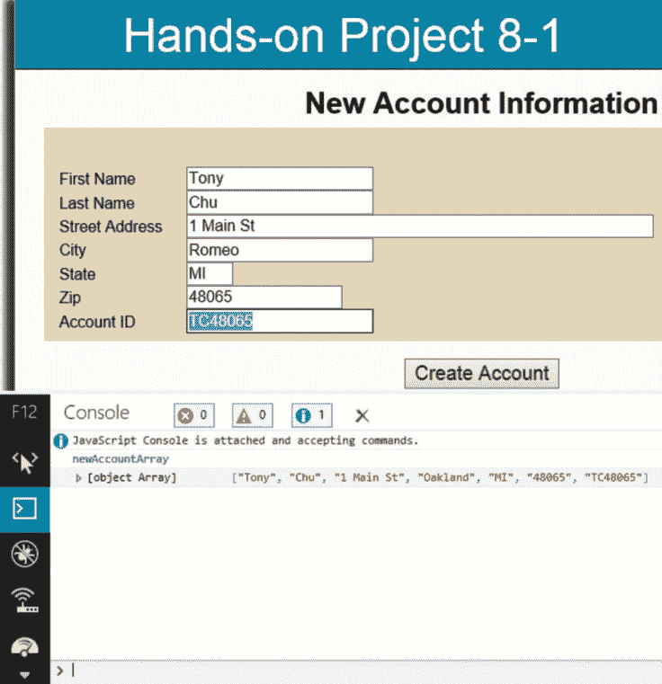

图 8-16：控制台中显示包含数组内容的完整表单
*来源：© Microsoft Corporation*

### 动手实践项目

在你的文本编辑器中，打开 Hands-OnProject-8-2 文件夹中的 `index.htm` 文件，在注释部分、`title` 元素和 `h1` 元素中将“Hands-on Project 8-1”更改为 **Hands-on Project 8-2**，然后保存更改。打开 `script.js`，然后在注释部分中将“Hands-on Project 8-1”更改为 **Hands-on Project 8-2**。

在 `script.js` 文件中，注释掉全局变量 `newAccountArray`，然后声明两个全局变量：一个是以空对象作为赋值的 `newAccountObject`，另一个是未进行赋值的 `newAccountSubmission`（无值）。在 `createID()` 函数的 `if` 语句中、`for` 循环之前，注释掉重置 `newAccountArray` 变量值的语句，然后添加以下语句来重置 `newAccountObject` 的值：`newAccountObject = {};`

在 `for` 循环内部，注释掉使用 `Array` 对象 `push()` 方法的语句。在 `for` 循环内部，添加以下语句根据每个对象的值创建对象属性：`newAccountObject[fields[i].name] = fields[i].value;`

在 `createID()` 函数下方，声明一个名为 `createString()` 的新函数。在 `createString()` 函数中添加以下语句：`newAccountSubmission = JSON.stringify(newAccountObject);`

在 `createEventListeners()` 函数的 `}` 结束之前，添加以下代码以便在点击表单按钮时调用 `createString()` 函数：

```javascript
var button = document.getElementById("submitBtn");
if (button.addEventListener) {
  button.addEventListener("click", createString, false);
} else if (button.attachEvent) {
  button.attachEvent("onclick", createString);
}
```

将更改保存到 `script.js`，然后在浏览器中打开 `index.htm`。在表单中输入你的姓名和地址（或虚假的姓名和地址）。输入邮政编码值后，按 **Tab**。在上一个情况下，Account ID 值将自动创建。打开浏览器控制台，输入 `newAccountObject`，按 **Enter**，然后根据需要点击 **object** 查看对象内容。对象属性包括所有表单字段及其值，包括 Account ID。

# 第 8 章 字符串和数组中的数据处理

点击网页上的 **Create Account** 按钮。这将调用 `createString()` 函数，该函数从 `newAccountObject` 对象创建一个 JSON 字符串。在你的控制台中，输入 `newAccountSubmission`，然后按 **Enter**。如 - 所示，`newAccountSubmission` 的值是一个包含所有 `newAccountObject` 属性及其值的 JSON 字符串。


图 8-17：控制台中显示包含对象内容的完整表单
*来源：© Microsoft Corporation*

## 动手实践项目 8-3

在使用信用卡进行在线购物时，许多网站会在输入信用卡号之前识别你使用的是哪种类型（Visa、MasterCard 等）。然而，每家卡公司的号码遵循不同的规则，卡类型可以通过卡号本身推断。在此项目中，你将使用正则表达式增强订单表的一部分。输入信用卡号后，你将使用一系列 `if/else` 语句根据正则表达式检查号码。

### 动手实践项目

在你的文本编辑器中，打开 Hands-OnProject-8-3 文件夹中的 `index.htm` 文件，在指定的注释部分添加你的姓名和日期，然后保存文件。

在 `</body>` 标签之前，添加以下 `script` 元素，保存更改，然后关闭 `index.htm`：

`<script src="script.js"></script>`

在文本编辑器中创建一个新文件，创建一个包含 **Hands-on Project 8-3**、姓名、日期以及文件名 **script.js** 的 JavaScript 注释部分，然后将文件命名为 `script.js` 并保存到 Hands-OnProject-8-3 文件夹。

添加语句指令处理器以严格模式解释文档内容。

声明一个名为 `selectCardType()` 的新函数。声明表 8-9 所示的局部变量并赋值值：

*关于信用卡和正则表达式的更多信息请访问 http://www.regular-expressions.info/creditcard.html。*

### 表 8-9：变量名和值

| 变量名 | 值 |
| :--- | :--- |
| `cardNumValue` | `document.getElementById("ccNum").value` |
| `visa` | `/^4[0-9]{12}(?:[0-9]{3})?$/` |
| `mc` | `/^5[1-5][0-9]{14}$/` |
| `discover` | `/^6(?:011|5[0-9]{2})[0-9]{12}$/` |
| `amex` | `/^3[47][0-9]{13}$/` |

在 `selectCardType()` 函数内部，添加以下 `if/else` 语句，对用户输入的号码进行正则表达式测试，并自动选择匹配卡类型的选项按钮：

**Visa**—以 4 开头。
**MasterCard**—以 5 开头。
**Discover**—以 6 开头。
**American**—以 3 开头。

### 实操项目

- 在文本编辑器中创建一个文档，然后重复步骤（Step）来测试以下卡片号，并在文档中记录每个卡号对应的信用卡类型。每个卡片号都应被识别为一种不同的卡片类型。
  a.
  b.
  c.
  d.

## 实操项目 8-4

在这个项目中，你将为一个显示待办事项列表的网页添加功能。你将添加代码将每个项目的文本存储在数组中，以及用于一个创建一个包含数组项的有序列表的代码。你还将在每个列表项的文本之前整合一个“first（第一个）”按钮，用户可以点击该按钮将该列表项移动到列表顶部。

在你的文本编辑器中，打开章节文件夹下 `HandsOnProject-` 文件夹中的 `index.htm` 文件，在注释部分指定的位置输入你的姓名和今天的日期，然后保存文件。

在闭合标签 `</body>` 之前，添加以下 `<script>` 元素，保存更改，然后关闭 `index.htm`：

`<script src="script.js"></script>`

在你的文本编辑器中创建一个新文件，创建一个 JavaScript 注释部分，包含文本 **Hands-on Project -**、你的姓名、今天的日期以及文件名 `script.js`，然后将文件命名为 `script.js` 保存到 `HandsOnProject-` 文件夹中。

添加一条语句指示处理器以严格模式（strict mode）解释文档内容。同时声明一个名为 `list` 的全局变量，并将其赋值为空数组。

声明一个名为 `generateList()` 的新函数，包含以下语句：

```javascript
var listItems = document.getElementsByTagName("li");
for (var i = listItems.length - 1; i >= 0; i--) {
  document.getElementsByTagName("ol")[0].
  removeChild(listItems[i]);
}
for (var i = 0; i < list.length; i++) {
  var newItem = "<span class='first'>first</span>" + list[i];
  var newListItem = document.createElement("li");
  newListItem.innerHTML = newItem;
  document.getElementsByTagName("ol")[0].
  appendChild(newListItem);
  var firstButtons = document.querySelectorAll(".first");
  var lastFirstButton = firstButtons[firstButtons.length - 1];
  if (lastFirstButton.addEventListener) {
    lastFirstButton.addEventListener("click",
    moveToTop, false);
  } else if (lastFirstButton.attachEvent) {
    lastFirstButton.attachEvent("onclick", moveToTop);
  }
}
```

此函数遍历 HTML 文档中现有 `li` 元素并将它们全部移除。接着它遍历 `list` 数组，对于每个数组元素，创建一个新的 `li` 元素。然后使用当前数组元素配合 `span` 元素生成该元素的内容，以创建“first”按钮。最后，函数为“first”按钮添加一个事件监听器来调用 `moveToTop()` 函数，该函数将在后续步骤中创建。

在 `generateList()` 函数下方，声明一个名为 `addItem()` 的新函数，包含以下语句：

```javascript
var newItem = document.getElementById("newItem");
list.push(newItem.value);
newItem.focus();
newItem.value = "";
generateList();
```

此代码使用 `push()` 方法将文本框中的值添加到 `list` 数组的末尾。在焦点返回文本框并清除其值后，函数调用 `generateList()` 函数。

在 `addItem()` 函数下方，声明一个名为 `moveToTop()` 的新函数，接收单个参数 `evt`。为函数添加以下语句：

```javascript
if (evt === undefined) { // get element in IE
  evt = window.event;
}
var callerElement = evt.target || evt.srcElement;
var listItems = document.getElementsByTagName("li");
var parentItem = callerElement.parentNode;
for (var i = 0; i < list.length; i++) {
  if (parentItem.innerHTML.search(list[i]) !== -1) {
    var itemToMove = list.splice(i, 1);
    list.unshift(itemToMove);
  }
}
generateList();
```

此代码创建引用文档中 `li` 元素集合以及被点击的“first”按钮的父 `li` 元素的变量。然后它使用 `for` 循环和字符串 `search()` 方法检查 `list` 数组相对于父 `li` 元素的内容。当识别到匹配文本时，它使用 `splice()` 方法从数组中移除该元素并赋值给变量。然后使用 `unshift()` 方法将该变量添加到数组开头。最后，它调用 `generateList()` 函数根据数组的新顺序重建有序列表。

在 `moveToTop()` 函数下方，添加以下代码为按钮创建一个事件监听器：

```javascript
function createEventListener() {
  var addButton = document.getElementById("button");
  if (addButton.addEventListener) {
    addButton.addEventListener("click", addItem, false);
  } else if (addButton.attachEvent) {
    addButton.attachEvent("onclick", addItem);
  }
}
if (window.addEventListener) {
  window.addEventListener("load", createEventListener, false);
} else if (window.attachEvent) {
  window.attachEvent("onload", createEventListener);
}
```

保存更改到 `script.js`，然后在浏览器中打开 `index.htm`。点击文本框，输入 **Finish projects**，点击 **Add Item**，输入 **Make dinner**，点击 **Add Item**，输入 **Renew license**，然后点击 **Add Item**。你的列表现在应该包含三个项目，每个项目都有自己的“first”按钮，如图所示。点击项目的 **first button**，“Renew license”列表项将移动到列表顶部，如图所示。

## 

在这个练习中，你将增强实操项目，为每个项目包含一个“last”按钮。你将向代码添加一个函数，使用户可以点击项目的“last”按钮将该项目移动到列表的最后。

在操作系统的文件管理器中，将 `HandsOnProject-` 文件夹的完整内容复制到 `HandsOnProject-` 文件夹。

在你的文本编辑器中，打开 `HandsOnProject-` 文件夹中的 `index.htm` 文件，将注释部分、title元素和h1元素中的“Hands-on Project - ”改为 **Hands-on Project -**，然后保存更改。

打开 `script.js`，然后在注释部分将“Hands-on Project - ”改为 **Hands-on Project -**。

在 `script.js` 文件中，在 `generateList()` 函数的第二个 `for` 语句中，在 `newItem` 变量的声明中添加代码 `"<span class='last'>last</span>" +`，如下：

`var newItem = "<span class='first'>first</span>" + "<span class='last'>last</span>" + list[i];`

此代码在每个列表项之前添加文本“last”，作为将列表项移动到列表末尾的按钮。

在第一个 `if` 语句之前，添加 `lastButtons` 和 `lastLastButton` 变量的声明，如下：

```javascript
var firstButtons = document.querySelectorAll(".first");
var lastFirstButton = firstButtons[firstButtons.length - 1];
var lastButtons = document.querySelectorAll(".last");
var lastLastButton = lastButtons[lastButtons.length - 1];
```

在 `generateList()` 函数添加事件监听器的代码中，添加语句为 `lastLastButton` 变量引用的元素添加事件监听器或附加事件，调用 `moveToBottom()` 函数，如下：

```javascript
if (lastFirstButton.addEventListener) {
  lastFirstButton.addEventListener("click", moveToTop, false);
  lastLastButton.addEventListener("click", moveToBottom, false);
} else if (lastFirstButton.attachEvent) {
  lastFirstButton.attachEvent("onclick", moveToTop);
  lastLastButton.attachEvent("onclick", moveToBottom);
}
```

# 第 8 章 在字符串和数组中操作数据

在 `moveToTop()` 函数下方，声明一个名为 `moveToBottom()` 的新函数。

该函数接受一个名为 `evt` 的单个参数。在函数中添加以下语句：

```javascript
if (evt === undefined) { // 获取 IE8 中的调用者元素
  evt = window.event;
}

var callerElement = evt.target || evt.srcElement;
var listItems = document.getElementsByTagName("li");
var parentItem = callerElement.parentNode;
for (var i = 0; i < list.length; i++) {
  if (parentItem.innerHTML.search(list[i]) !== -1) {
    var itemToMove = list.splice(i, 1);
    list.push(itemToMove);
  }
}
generateList();
```

该函数包含与 `moveToTop()` 函数相同的语句，唯一的不同之处在于：它没有使用 `unshift()` 方法将所选项目添加到数组的开头，而是使用 `push()` 方法将其添加到数组末尾。

将你的更改保存到 `script.js`，然后在浏览器中打开 `index.htm`。点击文本框，输入 **Finish JavaScript projects**，点击 **Add Item**，输入 **Make dinner**，点击 **Add Item**，输入 **Renew license**，然后点击 **Add Item**。你的列表现在应该包含三个项目，每个项目都有它们自己的“first”和“last”按钮，如图 8-21 所示。

图 8-21：带有“first”和“last”按钮的待办列表
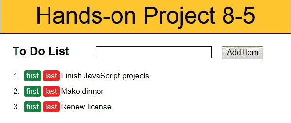

点击项目的 **last 按钮**。“Finish JavaScript projects”列表项将移动到列表底部，如图 8-22 所示。

图 8-22：重新排序项目后的待办列表
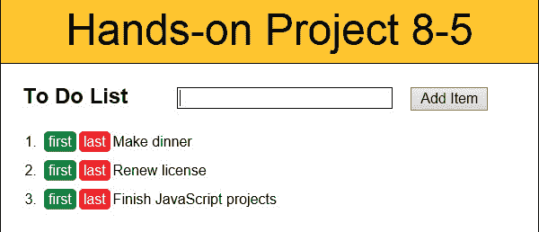

## 案例项目

### 个人案例项目

增强你项目中的反馈表单，使用户户从至少五个选项的列表中选择一个或多个选项。包含将用户的选择添加到数组或对象中的代码，并确保如果用户取消选择了其中一个选项，该选项将从数组或对象中移除。添加代码将数组或对象转换为字符串。

### 小组案例项目

让每个小组成员向小组演示他们为个人案例项目所创建的增强功能，包括审查代码。根据不同小组成员的实现方案，决定在小组反馈表单上收集哪些信息最有用，以及将其存储在数组中还是对象中。然后共同编写代码将这些功能添加到小组网站中，确保当用户取消选择某个选项时，代码会从数组或对象中移除该选项。添加代码将数组或对象转换为字符串。

# 管理状态信息和安全

当你完成本章时，你将能够：
- 使用查询字符串、隐藏表单字段和 Cookie 保存状态信息
- 描述 JavaScript 安全问题并采用设计用于解决这些问题的编码实践

## 理解状态信息

**超文本传输协议 (HTTP)** 是浏览器和服务器用于交换文档信息的一组规则。这些规则还确保 Web 浏览器正确处理和显示网页中包含的各种类型的信息。关于访问网站的个人访问信息被称为**状态信息**。HTTP 最初设计时是**无状态的**，这意味着它不存储关于会话的任何信息。无状态设计意味着 Web 服务器无法存储访问网页的持久化数据。这种无状态的设计限制了 Web 提供的交互性。今天，维护状态有很多原因。维护状态允许服务器：
- 根据用户偏好定制 Web 页面
- 在用户导航表单期间临时存储信息
- 提供购物车

在本章中，你将处理 Eating Well Season (EWS) 的两部分订单表单，这位于佛蒙特州的公司，从当地农场供应产品。EWS 希望新客户能够在线注册。然而，他们担心在手机等手持设备上填写收集所有信息的 Web 表单将具有挑战性。为了解决这个问题，他们聘请了一位设计师将表单分为两个部分：一个收集基本信息的文档，另一个允许用户指定服务偏好的文档。EWS 要求你编写必要的 JavaScript 代码，以便一次性提交表单信息。图 9-1 和 9-2 显示桌面浏览器中的第一、第二个页面，图 9-3 和 9-4 显示手持设备上的页面。

[注]

图 9-1：桌面浏览器中的第一个页面
点击 Next 按钮打开第二个页面而不是提交表单。


图 9-2：桌面浏览器中的第二个页面
点击 Sign Up 按钮应提交第一、第二个页面的所有值。


图 9-3：手持设备上的第一个页面。

Web 最初的设计并不是为了存储用户访问网站的信息。然而，存储用户信息（包括密码）和其他数据在当今 Web 上是极其重要的，因为它显著提高了了网站的可用性。维护此类信息的最常用的工具是查询字符串、隐藏表单字段和 Cookie，你将在本章中学习它们。鉴于用户信息的敏感性，充分理解本章中描述的 JavaScript 安全问题也至关重要。为了完成本章的步骤，你应该能够访问本地服务器。有关安装本地服务器的说明，请参见附录 A。

## 使用查询字符串保存状态信息

在用户访问网页后，保留信息的一种方法是在 URL 的末尾附加一个查询字符串。**查询字符串**（query string）是附加到目标 URL 的的一组键值对。它由一个包含一个或多个信息的单个文本字符串组成。你可以使用查询字符串将信息（例如搜索标准）从一个网页传递到另一个网页。

### 使用查询字符串传递数据

要使用查询字符串将数据从一个网页传递到另一个网页，可以在 URL 之后立即添加一个问号（`?`），随后是你想要保留查询字符串（以键值对的形式）。通过这种方式，你正在将信息传递到另一个网页，类似于向函数或方法传递参数的方式。你使用连接符（`&`）分隔查询字符串中的各个键值对。例如，以下链接代码包含一个由单个键值对组成的查询字符串：

`<a href="http://www.example.com/addItem.html?isbn=9780394800165&quantity=2">订购书籍</a>`

传递传递的查询字符串随后被赋值给目标网页 `Location` 对象的 `search` 属性。`Location` 对象的 `search` 属性包含 URL 的查询或搜索参数。对于前面的示例，在 addItem.html 文档打开后，查询字符串 `?isbn=9780394800165&quantity=2` 作为 `Location` 对象的 `search` 属性的值可用。

*Location 对象的 search 属性之所以这样命名，是因为许多互联网搜索引擎使用它所包含的查询字符串来存储搜索标准。*

**注意**

你可以使用 `String` 类的方法将名称和值连接成查询字符串。例如，以下代码创建了一个包含查询字符串的 URL，该字符串包含 `fname`、`lname` 和 `city` 字段的值：

```javascript
var savedData = "?fname=" + document.getElementById("fName").value;
savedData += "&lname=" + document.getElementById("lName").value;
savedData += "&city=" + document.getElementById("city").value;
location.href = "contact.html" + savedData;
```

此代码将字面文本 `?fname=` 添加到 `fname` 字段的值中，将 `&lname=` 添加到 `lname` 字段的值中，将 `&city=` 添加到 `city` 字段的值中。最后一行将文档名称 `contact.html` 添加到查询字符串开头，并将结果赋值给 `Location` 对象的 `href` 属性，在浏览器中打开页面的同时将查询字符串数据传递给新页面。

表单的 `submit` 方法根据字段值创建查询字符串并将其传递到 `action` 属性指定的位置。由于 EWS 网站第一个订单页上的“Next”按钮被配置为提交按钮，当点击“Next”按钮时，表单将创建一个包含用户输入内容的查询字符串。你现在将通过在 order.htm 页面输入示例数据、点击“Next”按钮，然后检查打开页面的浏览器地址栏中的查询字符串来测试这一点。

### 要检查用户在第一个订单页上提交表单时生成的查询字符串：

1. 如果你使用本地 Web 服务器，将数据文件中的 `Chapter` 文件夹复制到 Web 服务器的根目录。如果你是按照附录 A 中的说明安装的 XAMPP，根目录为 `C:/xampp/htdocs` (Windows) 或 `/Applications/XAMPP/xamppfiles/htdocs` (Mac)。
2. 在文本编辑器中，打开位于 `Chapter` 文件夹中的 `order.htm`、`order.htm` 和 `results.htm` 文档。
3. 在每个文件的注释部分，在指定处添加你的姓名和今天的日期，保存更改，然后滚动查看文档并熟悉其内容。`order.htm` 和 `order.htm` 文档包含用户输入信息的表单。你将使用 `results.htm` 文档通过显示从表单接收到的数据来模拟向服务器提交表单数据。
4. 在浏览器中打开 `order.htm`，用虚构信息填充文本字段，然后点击 **Next** 按钮。打开第二个订单页，浏览器地址栏中显示的地址将包含一个查询字符串，该查询字符串包含了上一个页面字段中的名称和值。图 9 显示了 Firefox 中的页面。

### 从查询字符串中解析数据

为了让网页使用查询字符串中的信息，你的 JavaScript 程序必须首先使用多种方法和 `String` 对象的 `length` 属性来解析该字符串。第一个解析任务是提取不带问号的字符串。为了做到这一点，你使用 `substring()` 方法结合 `length` 属性。`substring()` 方法接受两个参数：起始索引和结束索引。以下代码将 `Location` 对象的 `search` 属性赋值给变量 `queryData`并使用 `substring()` 方法提取除问号以外的所有字符串：

```javascript
// 将查询字符串赋值给 queryData
var queryData = location.search;

// 从字符串中移除问号
queryData = queryData.substring(1, queryData.length);
```

`queryData` 变量存储了 `location.search` 的值。下一条语句使用 `String` 类的 `substring()` 方法将 `queryData` 变量中除第一个字符（`?`）以外的所有字符复制到新变量，并将新值赋值给 `queryData`。最后一条语句使用 `String` 类的 `split()` 方法从 `queryData` 变量中提取每个键值对，并将其赋值为 `queryArray` 变量中的一个元素。

5. 在 `populateInfo()` 函数下方，添加以下代码以便在页面加载完成后完成后运行该函数：

```javascript
if (window.addEventListener) {
  window.addEventListener("load", populateInfo, false);
} else if (window.attachEvent) {
  window.attachEvent("onload", populateInfo);
}
```

你完成的代码应与以下内容匹配：

```javascript
"use strict";

var queryArray = [];

function populateInfo() {
  if (location.search) {
    var queryData = location.search;
    queryData = queryData.substring(1, queryData.length);
    queryArray = queryData.split("&");
  }
}

if (window.addEventListener) {
  window.addEventListener("load", populateInfo, false);
} else if (window.attachEvent) {
  window.attachEvent("onload", populateInfo);
}
```

6. 将你的更改保存到 `script.js`，然后在文本编辑器中返回 `order.htm`。

7. 在闭合 `</body>` 标签之前，添加一个 `script` 元素，指定 `script2.js` 为源。

8. 将你的更改保存到 `order.htm`，在浏览器中刷新 `order.htm`，用虚假信息填写表单，然后点击 **Next**（下一步）按钮。与之前的步骤一样，将显示第二个表单页面，且 URL 中带有查询字符串。

# 第 9 章 管理状态信息与安全

9. 打开浏览器控制台，输入 `queryArray` 并按 **Enter**，然后如果有必要，点击 **object Array** 以查看数组内容。如图 9-7 所示，查询字符串中的每个键值对都是数组中的一个元素。

| 步骤 | 动作 | 说明 |
| :--- | :--- | :--- |
| 步骤 1 | 用户完成 order.htm | |
| 步骤 2 | 用户提交 order.htm | 字段值被编码在查询字符串中，然后复制到下一页的隐藏字段 |
| 步骤 3 | 用户完成 order2.htm | 所有字段值（包括隐藏字段值）都编码在查询字符串中，然后提交到服务器 |
| 步骤 4 | 用户提交 order2.htm | |

图 9-7：使用隐藏字段从多个表单提交数据

**注意**：使用类型为 `hidden` 的 `input` 元素创建的隐藏表单字段与使用 CSS `display` 或 `visibility` 属性隐藏网页不同。第二个页面上的表单包含了与第一个页面字段对应的隐藏表单字段。然而，它们是空的，用户无法与之交互。接下来，你将增强 `populateInfo()` 函数，将 `queryArray` 中每个元素的值赋值为其在第二个表单中对应隐藏字段的值。这将使用户在点击第二个表单上的 Order 按钮时，能够提交来自第一个和第二个表单页面的所有输入。

### 要增强 populateInfo() 以将 queryArray 数组中的值赋予隐藏字段：

1. 在你的文本编辑器中，返回 `order.htm` 并检查 `article` 元素内的 `input` 元素。如图 9-8 所示，前七个 `input` 元素的 `type` 值为 `hidden`，表示它们是隐藏字段。每个字段都有对应的字段。

2. 回到文本编辑器中的 `script.js`，在 `if` 语句下方的 `var` 语句之后，添加以下代码声明 `hiddenInputs` 变量：

```javascript
var hiddenInputs = document.querySelectorAll("input[hidden]");
```

3. 在 `}` 语句之前，插入以下 `for` 语句：

```javascript
for (var i = 0; i < queryArray.length; i++) {
  hiddenInputs[i].value = queryArray[i].substring(queryArray[i].lastIndexOf("=") + 1);
}
```

在每次 `for` 循环中，`hiddenInputs[i]` 被赋值为 `queryArray[i]` 紧跟 `=` 符号的内容。由于 `queryArray` 元素包含了查询字符串中的键值对，`hiddenInputs[i]` 被赋值为 `queryArray` 元素中的 `state`。你更新后的 `populateInfo()` 函数如下：

```javascript
function populateInfo() {
  if (location.search) {
    var queryData = location.search;
    queryData = queryData.substring(1, queryData.length);
    queryArray = queryData.split("&");
  }
}
```

图 9-8：order.htm 中的隐藏表单

 

值为 `hidden` 的 `input` 元素对用户是不可见的。

4. 将你的更改保存到 `script.js`，在浏览器中刷新 `order.htm`，用虚假信息填写所有字段，然后点击 **Next** 按钮。打开 order.htm 页面。尽管你的代码为隐藏字段添加了值，但页面没有变化，因为字段没有显示。

5. 在浏览器的控制台中，输入 `document.getElementById("name").value` 然后按 **Enter**。如图 9-9 所示，你在上一个页面 Name 字段中输入的值显示了，因为 `populateInfo()` 函数将其复制到了当前页面的 `name` 字段中。

   

隐藏字段在页面上没有显示

 

id 为 name 的隐藏字段包含了你在上一个页面 Name 字段中输入的值。

# 第 9 章 管理状态信息与安全

6. 重复步骤，验证具有以下 id 的隐藏字段是否都包含与你在第一页输入的信息对应的值：`email`、`phone`、`address`、`city`、`state`、`zip`。

由于 order.htm 上的表单现在包含了 order.htm 页面值的字段，因此在提交表单时它应该包含两个表单的所有条目。为了测试这一点，你将首先为 results.htm 页面创建一个函数，用于解析并显示查询字符串中的所有键值对。然后，你将在两个表单中输入数据，并验证你输入的所有数据都显示在 results.htm 页面中。

### 要为 results.htm 页面创建一个用于解析并显示查询字符串中数据的函数：

1. 在你的文本编辑器中，创建一个新的空白 JavaScript 文件，然后输入以下注释，并在指示处包含你的名字和今天的日期：

```javascript
/* JavaScript 第6版
* 第 9 章
* 章节案例
* 季节性饮食
* Author:
* Date:
* Filename: script3.js
*/
```

2. 添加一条指令，要求处理器在严格模式下解释文档内容，然后将文件保存为 `script.js` 并保存到 Chapter 文件夹中。

3. 声明一个名为 `parseData()` 的函数，包含以下语句：

```javascript
var formData = decodeURIComponent(location.search);
var formArray = [];
var list = document.querySelector("div.results ul");
formData = formData.substring(1, formData.length);
while (formData.indexOf("+") !== -1) {
    formData = formData.replace("+", " ");
}
formData = decodeURIComponent(formData);
formArray = formData.split("&");
for (var i = 0; i < formArray.length; i++) {
    var newItem = document.createElement("li");
    newItem.innerHTML = formArray[i];
    list.appendChild(newItem);
}
```

`var` 语句首先将查询字符串中的任何编码字符替换为相应的等效字符，然后将值赋值给 `formData` 变量。接着，它创建了一个名为 `formArray` 的空数组，最后创建一个名为 `list` 的变量，用于存储指向 `results` 类 `div` 内部序列表的引用。下一条语句移除查询字符串开头的 `?`，并将新值赋值给 `formData` 变量。`while` 语句随后将 `formData` 变量值中的每个 `+` 替换为空格，从而将条目从机器可读的形式转换为更具人类可读的形式。下一条语句将 `formData` 变量中任何剩余的编码字符转换为相应的等效字符。随后的语句使用 `String` 类的 `split()` 方法在每个 `&` 处分割 `formData` 值，并将结果存储为 `formArray` 数组中的元素。最后，在 `for` 循环的每次执行中，都会创建一个新的 `li` 元素，然后将索引数字与当前计数器值对应的数组元素赋值为 `li` 元素的 `innerHTML`，最后将该 `li` 元素作为 `list` 变量引用的 `ul` 元素的子添加。

4. 在 `parseData()` 函数下方，添加以下代码以便在页面加载完成后调用该函数：

```javascript
if (window.addEventListener) {
    window.addEventListener("load", parseData, false);
} else if (window.attachEvent) {
    window.attachEvent("onload", parseData);
}
```


# 第 9 章 管理状态信息与安全

## 步骤

5. 将你的更改保存到 `script.js`。

6. 回到文本编辑器中的 `results.htm`。在闭合标签 `</body>` 正上方添加一个 `script` 元素，指定 `script.js` 为其源，然后将更改保存到 `results.htm`。

7. 在浏览器中，按 Shift 刷新（或 Shift 重新加载）`order.htm`。在两个表单中输入数据，并验证你输入的所有数据都显示在 `results.htm` 页面中。

## Cookie 属性

| 属性 | 描述 |
| :--- | :--- |
| `domain=*domain*` | 对于具有多个子域名的 Web 服务器，指定 cookie 是否仅对其源自子域可用（默认值） |
| `expires=*date*` | cookie 将在何时从系统中删除，其中 `*date*` 是 UTC 格式的日期；将 `expires` 设置为过去的日期值将立即删除 cookie |
| `name=*name*` | Cookie 的名称（必选） |
| `path=*path*` | Web 服务器上的路径，文档必须位于该路径下才能访问 cookie；默认情况下，cookie 对同一目录下的所有 Web 页面可用 |
| `secure=*boolean*` | cookie 是否仅可以通过安全协议（如 HTTPS）传输（`true`），或者也可以通过非安全协议传输（`false`，默认值） |

表 9-1：Cookie 属性

> **注意**
>
> `cookie` 属性创建时包含一个必需的 `name` 属性和四个可选属性：`expires`、`path`、`domain` 和 `secure`。表 9-1 描述了这五个属性。

### name 属性

`cookie` 属性唯一的必需参数是 `name` 属性，它指定了 cookie 的键值对。仅使用 `name` 属性创建的 cookie 是临时 cookie，因为它们仅在当前浏览器会话中可用。以下代码创建一个键值对为 `username=mw101` 的 cookie：

```javascript
document.cookie = "username=mw101";
```

`Document` 对象的 `cookie` 属性可能会令人困惑。对于其他 JavaScript 属性，为属性分配新值会替换旧值。相比之下，为 `cookie` 属性分配新值是向 cookie 列表添加另一个条目，而不是简单地替换最后一个值。下面的示例构建了一个 cookie 列表：

```javascript
document.cookie = "username=mw101";
document.cookie = "member=true";
document.cookie = "audio=false";
```

Web 浏览器会自动用分号和空格将 `cookie` 属性中的每个键值对隔开。因此，为前面的 cookie 的 `cookie` 属性分配的值包含以下内容：

```text
username=mw101; member=true; audio=false
```

默认情况下，cookie 本身不能包含分号或其他特殊字符（如逗号或空格）。cookie 不能包含特殊字符，因为它们在浏览器和 Web 服务器之间使用 HTTP 传输，HTTP 不允许某些非字母数字字符以原始格式传输。然而，如果你使用**编码**，就可以在 cookie 中使用特殊字符，编码涉及将文本字符串中的每个特殊字符转换为对应的十六进制 ASCII 值，并在前面加上百分号。例如，`%20` 是空格字符的十六进制 ASCII 等效值，`%21` 是百分号（%）的十六进制 ASCII 等效值。在 URL 编码格式中，每个空格字符由 `%20` 表示。编码后，字符串 `fullname=Mitchell Ward` 的内容将如下：

```text
fullname=Mitchell%20Ward
```

JavaScript 中内置的 `encodeURIComponent()` 函数用于对 URI 的各个部分进行编码。具体来说，`encodeURIComponent()` 函数将 URI 中的每个特殊字符转换为对应的十六进制 ASCII 值，并在前面加上百分号。`encodeURIComponent()` 函数的语法为 `encodeURIComponent(*text*)`。`encodeURIComponent()` 函数不编码标准的字母数字字符（如 `A`、`B`、`C`）或任何以下特殊字符：`- _ . ! * ' ( )`。它也不编码以下在 URI 中具有特殊含义的字符：`; / ? : % @ & = + ,`。例如，`/` 字符不被编码，因为它用于指定文件系统的路径。要使用用 `encodeURIComponent()` 函数编码的 cookie 或文本字符串，你必须先用 `decodeURIComponent()` 函数对其进行解码。`decodeURIComponent()` 函数的语法为 `decodeURIComponent(*text*)`。

以下使用 `encodeURIComponent()` 函数编码了几个 cookie，并将它们分配给 `Document` 对象的 `cookie` 属性：

```javascript
var username = document.getElementById("username").value;
var member = document.getElementById("member").value;
var audio = document.getElementById("audio").value;
document.cookie = "username=" + encodeURIComponent(username);
```

如果你使用现代 Web 浏览器传输包含空格的 URI，浏览器会在传输 cookie 之前自动为你编码空格。然而，如百分号等特殊字符不会被自动编码。要使用用 `encodeURIComponent()` 函数编码的 cookie 或文本字符串，你必须先用 `decodeURIComponent()` 函数对其进行解码。

## 存储状态信息

Web 浏览器会自动用分号和空格将 `cookie` 属性中的每个键值对隔开。因此，为前面的 cookie 的 `cookie` 属性分配的值包含以下内容：

```text
username=mw101; member=true; audio=false
```

默认情况下，cookie 本身不能包含分号或其他特殊字符（如逗号或空格）。cookie 不能包含特殊字符，因为它们在浏览器和 Web 服务器之间使用 HTTP 传输，HTTP 不允许某些非字母数字字符以原始格式传输。然而，如果你使用**编码**，就可以在 cookie 中使用特殊字符，编码涉及将文本字符串中的每个特殊字符转换为对应的十六进制 ASCII 值，并在前面加上百分号。例如，`%20` 是空格字符的十六进制 ASCII 等效值，`%21` 是百分号（%）的十六进制 ASCII 等效值。在 URL 编码格式中，每个空格字符由 `%20` 表示。编码后，字符串 `fullname=Mitchell Ward` 的内容将如下：

```text
fullname=Mitchell%20Ward
```

内置的 `encodeURIComponent()` 函数用于 JavaScript 中对 URI 的各个部分进行编码。具体来说，`encodeURIComponent()` 函数将 URI 中的每个特殊字符转换为对应的十六进制 ASCII 值，并在前面加上百分号。`encodeURIComponent()` 函数的语法为 `encodeURIComponent(*text*)`。`encodeURIComponent()` 函数不编码标准的字母数字字符（如 `A`、`B`、`C`）或任何以下特殊字符：`- _ . ! * ' ( )`。它也不编码以下在 URI 中具有特殊含义的字符：`; / ? : % @ & = + ,`。例如，`/` 字符不被编码，因为它用于指定文件系统的路径。要使用用 `encodeURIComponent()` 函数编码的 cookie 或文本字符串，你必须先用 `decodeURIComponent()` 函数对其进行解码。`decodeURIComponent()` 函数的语法为 `decodeURIComponent(*text*)`。

以下使用 `encodeURIComponent()` 函数编码了几个 cookie，并将它们分配给 `Document` 对象的 `cookie` 属性：

```javascript
var username = document.getElementById("username").value;
var member = document.getElementById("member").value;
var audio = document.getElementById("audio").value;
document.cookie = "username=" + encodeURIComponent(username);
```

如果你使用现代 Web 浏览器传输包含空格的 URI，浏览器会在传输 cookie 之前自动为你编码空格。然而，如百分号等特殊字符不会被自动编码。要使用用 `encodeURIComponent()` 函数编码的 cookie 或文本字符串，你必须先用 `decodeURIComponent()` 函数对其进行解码。

## 代码示例

```javascript
evt.returnValue = false; // 防止表单提交
// 在 IE8 中
}
createCookies();
document.getElementsByTagName("form")[0].submit();
}
```

你将创建一个事件处理器，在表单提交时调用此函数。该函数会防止表单立即提交，然后调用 `createCookies()` 函数根据已完成的表单创建 cookie，最后在表单上触发 `submit` 事件。

4. 在 `handleSubmit()` 函数下方，添加以下两个函数：

```javascript
function createEventListeners() {
    var form = document.getElementsByTagName("form")[0];
    if (form.addEventListener) {
        form.addEventListener("submit", handleSubmit, false);
    } else if (form.attachEvent) {
        form.attachEvent("onsubmit", handleSubmit);
    }
}
function setUpPage() {
    createEventListeners();
    populateInfo();
}
```

`createEventListeners()` 函数为表单创建了一个事件监听器，当表单上的 `submit` 事件触发时，它会调用你在上一步中创建的 `handleSubmit()` 函数。`setUpPage()` 函数调用 `createEventListeners()` 和 `populateInfo()` 函数；你将在下一步中修改 `window` onload 语句，以便在页面加载完成后调用此函数。

5. 修改文档底部的事件监听器代码，如下所示调用 `setUpPage()` 函数：

```javascript
if (window.addEventListener) {
    window.addEventListener("load", setUpPage, false);
} else if (window.attachEvent) {
    window.attachEvent("onload", setUpPage);
}
```

你完成后的代码应与以下匹配：

```javascript
function createCookies() {
    var formFields = document.querySelectorAll("input[type=hidden], input[type=radio], textarea");
    for (var i = 0; i < formFields.length; i++) {
        var currentValue = decodeURIComponent(formFields[i].value);
        currentValue = currentValue.replace(/\+/g, " ");
        document.cookie = formFields[i].name + "=" + currentValue;
    }
}
function handleSubmit(evt) {
    if (evt.preventDefault) {
        evt.preventDefault(); // 防止表单提交
    } else {
        evt.returnValue = false; // 防止表单提交
        // 在 IE8 中
    }
    createCookies();
    document.getElementsByTagName("form")[0].submit();
}
function createEventListeners() {
    var form = document.getElementsByTagName("form")[0];
    if (form.addEventListener) {
        form.addEventListener("submit", handleSubmit, false);
    } else if (form.attachEvent) {
        form.attachEvent("onsubmit", handleSubmit);
    }
}
function setUpPage() {
    createEventListeners();
    populateInfo();
}
```


> **注意**
>
> 从现在开始，你必须在支持在本地文件系统中设置 cookie 的浏览器中，或从本地 Web 服务器打开文件进行测试。否则，你的浏览器可能无法按预期设置或修改 cookie。

```javascript
if (window.addEventListener) {
    window.addEventListener("load", setUpPage, false);
} else if (window.attachEvent) {
    window.attachEvent("onload", setUpPage);
}
```

6. 将更改保存到 `script.js`。

7. 在浏览器中，通过 Shift 刷新或重新加载 `order.htm`，用虚假信息填写表单，点击 **Next**，用虚假信息完成第二个表单，然后点击 **Sign Up**。

8. 在浏览器的控制台中，输入 `document.cookie`。如图所示，`cookie` 属性的值是一个单一字符串，每个名称-值对之间用分号和空格分隔，查询字符串中的每个参数和值都是 `cookie` 属性的一部分。

## 设置 Cookie 过期日期

为了让 cookie 在当前浏览器会话之外持久，你必须使用 `cookie` 属性的 `expires` 属性。`cookie` 属性的 **expires 属性** 决定了 cookie 在被删除之前可以在客户端系统中保留多久。没有设置 `expires` 属性的 cookie 仅对当前浏览器会话有效。将 `expires` 属性分配给 `cookie` 属性并关联名称-值对的语法为 `expires=*date*`。名称-值对和 `expires=*date*` 对用分号分隔。`expires` 属性的 *date* 部分必须是协调世界时（通常缩写为 UTC）格式的文本字符串，格式如下：`*Weekday Month DD HH:MM:SS Time_Zone YYYY*`。

以下是协调世界时的示例：`Mon Mar 27 14:15:18 PST 2017`。

> **注意**
>
> 协调世界时也称为格林威治标准时间 (GMT)、祖鲁时间以及世界时间。

你可以手动输入 UTC 格式的字符串，也可以使用 `Date` 对象创建字符串，该对象会自动创建 UTC 格式的字符串。要将 `Date` 对象与 `expires` 属性配合使用，你可以通过 `Date` 对象的 set 和 get 方法组合指定你希望 cookie 有效的时间。以下语句声明了一个名为 `cookieDate` 的 `Date` 对象，然后通过 `setDate()` 和 `getDate()` 方法更改新对象的日期部分。

```javascript
cookieDate.setDate(myDate.getDate() + 7);
```

在示例中，`setDate()` 方法通过使用 `getDate()` 方法获取日期并增加来设置 `cookieDate` 的日期部分。你可能使用一个过期时间为周（或更短）的 cookie 来存储数据。

> **注意**
>
> 注意不要使用 `encodeURIComponent()` 方法对 `expires` 属性进行编码。JavaScript 不识别 URI 编码格式的 UTC 日期。如果你在 `expires` 属性上使用 `encodeURIComponent()` 方法，JavaScript 将无法设置 cookie 的过期日期。

在创建了 `Date` 对象并指定了 cookie 过期日期后，你必须使用 `toUTCString()` 方法将日期转换为字符串。例如，旅行社可能会将数据存储在一年后过期的 cookie 中：

```javascript
var expiresDate = new Date();
var username = document.getElementById("username").value;
expiresDate.setFullYear(expiresDate.getFullYear() + 1);
document.cookie = "username=" + encodeURIComponent(username) + "; expires=" + expiresDate.toUTCString();
```

> **注意**
>
> 如果你的浏览器在重新打开时会自动恢复之前打开的标签页，它会将重新打开浏览器视为继续同一个会话，此时 cookie 不会被删除。请查阅你浏览器的文档，关闭启动时自动恢复标签页，然后重复步骤 1–4。

5. 在你的文本编辑器中，返回 `script.js`，然后在 `createCookies()` 函数内部、`var` 语句下方，添加一条语句来声明名为 `expiresDate` 的变量，并将当前日期作为其值。

6. 在 `for` 语句之前，添加以下语句：
   `expiresDate.setDate(expiresDate.getDate() + 7);`
   该语句将 `expiresDate` 变量的值设置为一周后的时间。

7. 在 `for` 循环的最后一条语句中，添加代码来指定过期日期，如下：
   `document.cookie = formFields[i].name + "=" + currentValue + "; expires=" + expiresDate.toUTCString();`
   此代码在设置的 cookie 中添加了一个分号、一个空格和文本 `expires=`，随后是存储在 `expiresDate` 变量中的日期。你更新后的 `createCookies()` 函数应如下所示：

```javascript
function createCookies() {
    var formFields = document.querySelectorAll("input[type=hidden], input[type=radio], textarea");
    var expiresDate = new Date();
    expiresDate.setDate(expiresDate.getDate() + 7);
    for (var i = 0; i < formFields.length; i++) {
        var currentValue = decodeURIComponent(formFields[i].value);
        currentValue = currentValue.replace(/\+/g, " ");
        document.cookie = formFields[i].name + "=" + currentValue + "; expires=" + expiresDate.toUTCString();
    }
}
```

8. 保存对 `script.js` 的更改，在浏览器中按住 Shift 刷新或按住 Shift 重新加载 `order.htm`，使用虚构信息填写表单，点击 **Next**，使用虚构信息完成第二个表单，点击 **Sign Up**，然后在浏览器控制台中输入 `document.cookie` 并按 **Enter**。显示的 cookie 字符串应该包含与之前步骤中相同的所有键值对。

9. 关闭浏览器，重新打开，然后打开 `order.htm`。

10. 在你的浏览器控制台中，输入 `document.cookie`，然后按 **Enter**。cookie 字符串显示了步骤 7 中显示的所有键值对，证明了 cookie 是持久的，并且关闭浏览器不会删除它们。

## 配置服务器上其他网页对 Cookie 的可用性

`path` 属性决定了 cookie 对服务器上其他网页的可用性。`path` 属性通过语法 `path=*path` 赋值给 `cookie` 属性，并附带一个关联的键值对。默认情况下，cookie 对相同目录下的所有网页都可用。但是，如果你指定了路径，则 cookie 不仅对指定路径的所有网页可用，还对该路径下所有子目录的所有网页可用。

例如，以下语句使得名为 `username` 的 cookie 对位于 `/advertising` 目录或其任何子目录的所有网页可用：

```javascript
var username = document.getElementById("username").value;
document.cookie = "username=" + encodeURIComponent(username) + "; path=/advertising";
```

要让 cookie 对服务器上的所有目录可用，你使用斜杠 `/` 来指示根目录，如下例所示：

```javascript
document.cookie = "username=" + encodeURIComponent(username) + "; path=/";
```

当你编写创建 cookie 的 JavaScript 程序时，如果包含你网页的目录包含其他创建 cookie 的程序，你的程序可能无法正常运行。存储在相同目录中的其他程序的 cookie 以及你在开发期间创建的未使用的 cookie 可能会导致你的 JavaScript 程序运行异常。因此，你应该始终将创建 cookie 的 JavaScript 程序放在它自己的目录中，并使用 `path` 属性指定你的程序所需的任何子目录。

## 跨域共享 Cookie

使用 `path` 属性允许 cookie 跨服务器共享。然而，某些网站非常大，使用了许多服务器。`domain` 属性用于在相同域内的多个服务器之间共享 cookie。网站上用于加密数据的主要协议是安全套接层，即 SSL。SSL 加密在互联网上被广泛使用。然而，SSL 标准正在被传输层安全协议（TLS）取代，TLS 最终将取代 SSL。SSL 和 TLS 加密都可以用于防止中间人攻击，在这种攻击中，双方之间交换的数据在传输过程中会被读取并可能被更改。SSL 和 TLS 加密客户端与服务器之间的数据，使得任何可能拦截传输数据的人都无法读取或更改它。

> **编程概念**
>
> `domain` 属性通过语法 `domain=*domain` 赋值给 `cookie` 属性，并附带一个关联的键值对。例如，如果网页服务器 `advertising.com` 需要与网页服务器 `content.com` 共享 cookie，则由 `advertising.com` 设置的 cookie 的域属性应设置为 `.example.com`。这样，`advertising.com` 创建的 cookie 对 `content.com` 以及 `example.com` 域内的所有其他服务器可用。以下代码显示了如何让 `advertising.com` 的 cookie 对 `example.com` 域内的所有服务器可用：

```javascript
var username = document.getElementById("username").value;
document.cookie = "username=" + encodeURIComponent(username) + "; domain=.example.com";
```

注意，cookie 无法在域外共享。这是同源策略的结果，你将在稍后的章节中学习。

## 确保 Cookie 传输

互联网连接并不总是安全可以传输敏感信息的。不法分子可以窃取信用卡号、密码、社会安全号或其他类型的隐私信息。为了保护在网上传输的隐私数据，网站服务器和浏览器可以加密并在安全连接中传输。`secure` 属性指示 cookie 只能通过 HTTPS 或安全协议通过安全连接传输。你将此属性赋值给 `cookie` 属性，带有布尔值 `true` 或 `false`，以及关联的键值对，语法为 `secure=*value`。例如，为 cookie 启用 `secure` 属性，你使用类似下面的语句：

```javascript
var username = document.getElementById("username").value;
document.cookie = "username=" + encodeURIComponent(username) + "; secure=true";
```

`secure` 属性对于所有连接都使用 HTTPS 的网站最有用。在本书编写时，大部分互联网流量仍然 HTTP。

## 使用 JavaScript 读取 Cookie

到目前为止，你已经存储了临时和持久性 cookie。为了使用你创建的 cookie，你需要检索存储的 cookie 值——换句话说，你需要读取 cookie。特定网页的 cookie 在 `Document` 对象的 `cookie` 属性。每个 cookie 都由一个连续字符串组成，在使用包含的数据之前对其进行解析。解析 cookie 是一个两个步骤的过程：

- 使用 `decodeURIComponent()` 解析 cookie。
- 使用 `String` 对象的方法提取单个键值对。

解析 cookie 数据与解析查询字符串非常相似，只是字符串开头没有问号需要处理；此外，单个 cookie 之间用分号和空格分隔而不是 `&` 号。为了让你了解从 cookie 中提取数据的内容，以下代码创建了三个编码 cookie，然后从 `cookie` 属性读取它们并进行解码。然后使用 `split()` 方法将每个键值对复制到名为 `cookieArray[]` 的数组中。

```javascript
document.cookie = "username=" + encodeURIComponent(username);
document.cookie = "member=" + encodeURIComponent(member);
document.cookie = "audio=" + encodeURIComponent(audio);

var cookieString = decodeURIComponent(document.cookie);
var cookieArray = cookieString.split("; ");
```

注意，上述代码中的 `split()` 方法使用两个字符：分号和空格来拆分 cookies。如果你在 `split()` 方法中没有包含空格，那么新数组中每个键值对的名称部分在前面都会多出一个额外的空格。一旦将 cookies 拆分为单独的数组元素，你仍然需要确定哪个 cookie 包含你所需的值。接下来的 `for` 循环遍历数组中的每个元素，使用 `if` 语句和几个字符串方法来检查每个键值对的名称部分是否等于“team”：

```javascript
var currentUsername;
var unBox = document.getElementById("username");
for (var i = 0; i < 3; i++) {
    currentUsername = cookieArray[i];
    if (currentUsername.substring(0, currentUsername.indexOf("=")) === "username") {
        unBox.value = currentUsername.substring(currentUsername.indexOf("=") + 1, currentUsername.length);
        break;
    }
}
```

`if` 语句中的条件表达式使用 `substring()` 方法返回名为 `currentUsername` 变量中键值对的名称部分。`substring()` 方法的第一个参数指定子字符串的起始位置为第一个字符（`0`）。`substring()` 方法的第二个参数是附加到 `currentUsername` 变量上的 `indexOf()` 方法，它返回等号的索引数字。如果子字符串等于 `username`，则 `for` 循环将使用 `break` 语句结束，用户名 cookie 的值被复制为 `unBox` 元素的值。返回键值对值部分的语句也使用了 `substring()` 方法和 `indexOf()` 方法。然而，这次第一个参数将子字符串从等号的索引加 1 处开始，即等号后面的字符。`substring()` 方法的第二个参数指定子字符串的结束点为 `data` 变量的长度。

> **注意**
>
> 使用字符串方法解析 cookie 是从很长的 cookie 字符串中提取单个信息的唯一方法，因此理解它们的工作原理非常重要。如有必要，你应该回顾如何使用 JavaScript 操作字符串，直到你牢牢掌握了相关的属性和方法。

接下来，你将修改 `script.js` 中的 `parseData()` 函数，使其读取存储的 cookies 而不是查询字符串。该函数的代码与查询字符串版本几乎相同，不同在于 cookie 字符串使用分号和空格进行拆分，而不是使用连接符。

要修改 `parseData()` 函数以读取存储的 cookies 而不是查询字符串：

1. 在你的文本编辑器中，返回 `script.js` 文件。
2. 注释现有的 `parseData()` 函数。
3. 添加以下新的 `parseData()` 函数：

```javascript
function parseData() {
    var formData = document.cookie;
    var formArray = [];
    var list = document.querySelector("div.results ul");
    formArray = formData.split("; ");
    for (var i = 0; i < formArray.length; i++) {
        var newItem = document.createElement("li");
        newItem.innerHTML = formArray[i];
        list.appendChild(newItem);
    }
}
```

新函数声明了与之前相同的变量，但将 `document.cookie` 的值赋值给 `formData` 变量。新函数排除了使用 `substring()` 方法的语句，因为 cookie 字符串不包含需要移除的开头 `&`。新函数还排除了替换和解码字符的语句，因为你已经在创建 cookie 之前已经对 cookie 数据执行了这些步骤。最后，`split()` 方法在每个出现分号后跟空格的地方处拆分字符串内容，这是 cookie 之间的分隔符。

4. 保存对 `script.js` 的更改，在浏览器中按 Shift 刷新或重新加载 `order.htm`，用虚假信息完成表单，点击 **Next**，用虚假信息完成第二个表单，然后点击 **Sign Up**。如图 9-13 所示，提交的内容原样显示在结果页面上。然而，这些内容现在是基于 cookie 而不是查询字符串。


## 删除 Cookies

当用户关闭浏览器标签页或窗口时，与会话相关的临时 cookie 会被删除，而持久性 cookie 将留在用户的计算机上直到它们过期。然而，在某些情况下，需要删除持久性 cookie。你可以使用 JavaScript 删除持久性 cookie。此外，作为开发者，有时你需要手动删除浏览器中测试程序期间设置的 cookie。本节描述了如何使用 JavaScript 删除 cookie，以及如何手动删除它们。

### 使用 JavaScript 删除 Cookies

你可以在代码中删除 cookie，尽管删除它们的方法并不直观。要删除 cookie，你必须将它的过期时间设置为过去的日期。以下代码通过将其 `expires` 属性设置为一周前的日期来删除 `username` cookie：

```javascript
var expiresDate = new Date();
var username = document.getElementById("username").value;
expiresDate.setDate(expiresDate.getDate() - 7);
document.cookie = "username=" + encodeURIComponent(username) + "; expires=" + expiresDate.toUTCString();
```

网站不希望在用户下单时在 cookie 中存储之前的信息。接下来，你将在 `order.htm` 打开时添加一个删除所有 cookie 的函数，以确保用户提交的信息。创建一个在 `order.htm` 打开时删除 cookie 的函数：

1. 在你的文本编辑器中创建一个新的空白 JavaScript 文件，然后输入以下注释，包含你的名字和日期：

```javascript
/* JavaScript 第6版
* 第 9 章
* 季节饮食
* 作者:
* 日期:
* 文件名: script.js
*/
```

2. 添加指示处理器以严格模式解释文档内容的语句，然后将文件保存为 `script.js` 到文件夹中。

3. 声明一个名为 `clearCookies()` 的函数，包含以下语句：

```javascript
var cookieString = document.cookie;
var cookieArray = cookieString.split("; ");
var expiresDate = new Date();
expiresDate.setDate(expiresDate.getDate() - 7);
for (var i = 0; i < cookieArray.length; i++) {
    document.cookie = cookieArray[i] + "; expires=" + expiresDate.toUTCString();
}
```

`var` 语句创建一个包含 cookie 字符串的变量、设置为当前日期的日期对象。下一个语句使用 `setDate()` 和 `getDate()` 方法将 `expiresDate` 变量的值设置为过去。`for` 语句随后重建数组中的每个 cookie，附加一个使用 `expiresDate` 值的过期属性。这会将每个 cookie 设置为过去过期，这意味着浏览器会立即删除 cookie。


4. 在 `clearCookies()` 函数下方，添加以下代码以便在页面加载完成后调用该函数：

```javascript
if (window.addEventListener) {
    window.addEventListener("load", clearCookies, false);
} else if (window.attachEvent) {
    window.attachEvent("onload", clearCookies);
}
```

5. 保存对 `script.js` 的更改，然后在你的文本编辑器中返回 `order.htm`。
6. 在结束的 `</body>` 标签之前添加一个 `script` 元素，指定 `script.js` 为源。
7. 保存对 `order.htm` 的更改，然后在浏览器中重新加载 `order.htm`。
8. 在浏览器控制台中，输入 `document.cookie` 然后按 **Enter** 键。如图 9-14 所示，`cookie` 属性的值为空字符串，这证实了你创建的脚本在页面加载时删除了所有 cookie。

> **注意**
>
> 表 9-2 描述了如何从你自己的浏览器中删除 cookie。在本章的后续部分，你将学习如何使用 JavaScript 删除你的程序在用户计算机上创建的 cookie。

### 从你的浏览器中删除 Cookie

在开发 JavaScript 程序时，你可能会意外创建但未删除程序不需要的持久化 cookie。未使用的持久化 cookie 有时会干扰使用 cookie 的 JavaScript 程序的执行。因此，在开发使用 cookie 的 JavaScript 程序时，定期删除浏览器 cookie 是一个好主意。表 9-2 描述了如何在现代版本的 Internet Explorer、Firefox 和 Chrome 中删除 cookie。

要求用户登录服务器的网站和应用程序通常具有让用户保持登录状态数周或几个月之久的能力，而不会损害用户登录信息的安全性。此类网站通常会在登录表单中显示一个带有“记住我”或“保持登录状态”标签的复选框，并允许你在将来继续访问时继续访问定制化内容，而无需重复提供登录信息。由于 cookie 以明文形式存储数据，恶意应用程序可以从用户的驱动器中读取它们；因此，绝不应将密码等敏感信息存储在 cookie 中。

在支持持久登录的系统中，当用户登录系统时，Web 服务器向浏览器提供一组被称为 **token** 的随机字符。token 存储在 cookie 中，Web 服务器在用户下次请求访问时使用它来验证用户身份。由于 token 是随机字符串，恶意程序无法预测其值以便从另一个位置登录用户的账户。Web 服务器存储 token 值并与用户名进行比较以验证用户身份。此时，服务器会生成一个新的 token，并将其存储在用户机器的 cookie 中。

> **最佳实践**

| 浏览器 | 键盘快捷键 | 菜单步骤 |
| :--- | :--- | :--- |
| Internet Explorer 9+ | 按 **Ctrl** + **Shift** + **Del**，然后在打开的窗口中，确保勾选了 **Cookies 和网站数据** 框，然后点击 **删除**。 | 点击 **工具** 图标，必要时将悬停在菜单的 **安全** 上，在子菜单中点击 **删除浏览记录**，然后在打开的窗口中，确保勾选了 **Cookies 和网站数据** 框，然后点击 **删除**。 |
| Firefox | 按 **Ctrl** + **Shift** + **Del** (Windows) 或 **command** + **shift** + **delete** (Mac)，然后在打开的窗口中，在“要清除的时间范围”列表中选择所需的时间范围，必要时点击“详细”箭头，确保勾选了 **Cookies** 框，然后点击 **立即清除** (Windows) 或 **确定** (Mac)。 | 点击 **打开菜单** 按钮，点击 **历史**，点击 **清除最近历史**，然后在打开的窗口中，在“要清除的时间范围”列表中选择所需的时间范围，必要时点击“详细”箭头，确保勾选了 **Cookies** 框，然后点击 **立即清除** (Windows) 或 **确定** (Mac)。 |
| Chrome | 按 **Ctrl** + **H** (Windows) 或 **command** + **Y** (Mac)，点击 **清除浏览数据**，然后在打开的窗口中，在“从以下范围清除项目”列表中选择所需的时间范围，确保勾选了 **Cookie 以及其他网站和插件数据** 框，然后点击 **清除浏览数据**。 | 点击 **Google Chrome** 的 **自定义并控制** 按钮，点击 **历史**，点击 **清除浏览数据**，然后在打开的窗口中，在“从以下范围清除项目”列表中选择所需的时间范围，确保勾选了 **Cookie 以及其他网站和插件数据** 框，然后点击 **清除浏览数据**。 |

表 9-2：在 IE、Firefox 和 Chrome 中删除 cookie 的步骤

## 使用 Web Storage API 存储状态信息

今天 cookie 的许多用途在 `cookie` 对象的最初实现中从未被设想。创建、读取和删除 cookie 需要复杂且不直观的代码。近年来，人们一直在努力解决 cookie 的缺点并为其添加新功能。Web Storage 提供了两种不同类型：`localStorage` 和 `sessionStorage`。Web Storage 仅对创建它的域的文档可用，这类似于 cookie。

> **注意**
>
> Web Storage 仅对创建它的域的文档可用，类似于 cookie。

## 理解安全问题

### 使用 JavaScript 进行安全编码

**安全编码**和**防御性编码**术语指的是以某种方式编写代码，最大限度地减少任何故意或意外的安全问题。安全编码已成为许多信息技术公司的主要目标，主要因为修复软件缺陷的成本极其高昂。根据一项研究，修复发布软件中安全漏洞的费用比在开发阶段应用安全技术要贵得多。美国国家标准与技术研究院估计，每年有数十亿美元用于识别和纠正软件错误。

> **注意**
>
> 尽管 Web 服务器安全问题至关重要，但它们在 Apache、Nginx、Internet Services 以及其他类型 Web 服务器的书中会有很好的介绍。在激活生产站点之前，务必研究你的 Web 服务器和操作系统的安全问题。

基本上，除非证明它是安全的，否则所有代码都是不安全的。遗憾的是，并没有编写安全代码的魔术公式，尽管你可以使用各种技术来最大程度地减少脚本中的安全威胁。保护你的 JavaScript 程序安全的第一道防线是验证所有用户输入。你已经在本书中学习了验证用户输入的各种技术，包括如何使用正则表达式来验证数据，以及如何使用异常来处理脚本在执行过程中发生的错误。请务必在脚本中使用这些技术，特别是那些在商业网站上运行的脚本。本节的剩余部分将讨论与网络浏览器和 JavaScript 相关的安全问题。

## JavaScript 安全考量

网页最初的设计是只读的，也就是说，它的主要用途是定位和显示存在网络其他区域的文档。随着 JavaScript 等编程语言的开发，网页现在除了静态内容外，还可以包含程序。这种在网页内执行程序的能力引发了若干安全考量。JavaScript 程序员最关心的安全领域包括：

- 保护网页和 JavaScript 程序免受恶意篡改
- 个人客户端信息的隐私
- 防止客户端或网站的本地文件系统被窃取或篡改

网页上编写得不安全的 JavaScript 代码容易受到**代码注入攻击**，在这种攻击中，程序或用户输入的 JavaScript 代码会更改网页的功能。例如，恶意程序可以打开一个包含表单的网页，并在其中一个用于从服务器检索敏感信息的表单字段中输入 JavaScript 代码。此类程序随后可以将这些信息转发给所有者以外的人员。

在提交之前验证表单是防止注入攻击的重要部分。此外，**转义**表单字段值中可能属于恶意代码的字符也是非常重要的，这涉及到将字符转换为其字符代码等效值，正如你对 cookie 数据进行 URL 编码一样。对于表单输入，转义通常由 Web 服务器在处理用户输入之前执行。

另一个安全考量是网络浏览器窗口中个人客户端信息的隐私。你的联系信息和浏览记录是宝贵的信息，许多广告商都希望访问这些信息，以便根据你的个人喜好定制广告。如果没有安全限制，JavaScript 程序可以从你的网络浏览器中读取这些信息。JavaScript 最重要的安全特性之一是它**缺乏**某些类型的功能。例如，许多编程语言包含了对象和方法，使得程序能够读取、写入和删除文件。为了防止恶意脚本窃取信息或通过更改文件造成损害，或删除文件，除了 cookie、Web Storage 以及其他少数特定于站点的新兴标准外，JavaScript 不允许任何文件操作。同样，JavaScript 不包括任何创建网络连接的机制。这种限制防止了 JavaScript 程序渗透到私有网络或内域网，从而导致信息被窃取或损坏。另一个有帮助的限制是，JavaScript 无法在客户端上运行系统命令或执行程序。能够读取和写入 cookie 是 JavaScript 对客户端拥有的唯一访问类型。然而，网络浏览器对 cookie 进行了严格管理，并不允许从创建 cookie 的域之外访问 cookie。

> **注意**
>
> 在现代网页设计中，用 `iframe` 元素创建的网页对象被称为帧。`iframe` 元素允许你在一个 HTML 文档中显示另一个 HTML 文档的内容。

### 同源策略

另一个 JavaScript 安全特性限制了一个窗口、标签页或帧中的 JavaScript 代码访问客户端计算机上另一个窗口、标签页或帧中网页的方式。在 **同源策略** 下，窗口、标签页和帧只有在它们共享相同协议（如 HTTP）并且存在相同的 Web 服务器上时，才能查看和修改在其他窗口、标签页和帧中显示的文档元素和属性。

例如，来自以下两个域的文档无法相互访问，因为它们使用了不同的协议：

- `http://www.example.com`
- `https://www.example.com`

第一个域的协议是 HTTP，第二个域的协议是 HTTPS（表示连接 SSL 加密）。同源策略不仅适用于域名，还适用于文档所在的服务器。因此，来自以下两个域的文档无法相互访问元素和属性，因为它们位于不同的服务器，尽管它们位于同一域：

- `http://marketing.example.com`
- `http://content.example.com`

同源策略防止恶意脚本修改其他窗口、标签页或帧中显示的网页内容。如果没有同源策略，那么一个窗口、标签页或帧中的网页可能会修改其他窗口、标签页或帧中的网页，插入广告或直接重定向到新的 URL。如果没有同源策略，私有网络和内域网的安全也将面临风险。考虑一个用户有一个浏览器打开互联网上的页面，另一个浏览器打开其私有网络上的安全页面。如果没有同源策略，互联网网页将访问安全页面显示的信息。同源策略还保护了网页设计的完整性。例如，如果没有同源策略，一个窗口、标签页或帧中的网页可以修改其他窗口、标签页或帧中 JavaScript 对象的元素属性。

在某些情况下，你可能希望位于不同服务器的相关网站的两个文档能够相互访问。考虑 `marketing.example.com` 域的文档需要访问 `content.example.com` 域文档的内容（如表单数据）。为了允许相同域的不同源文档访问彼此的元素，你可以使用 `Document` 对象的 `domain` 属性。`Document` 对象的 **domain 属性** 通过使用语句将文档的源更改为根域名：

```javascript
document.domain = "example.com";
```

将 `document.domain = "example.com";` 语句添加到来自 `marketing.example.com` 和 `content.example.com` 的文档中，可以让文档相互访问，即使它们位于不同的服务器。

### 使用第三方脚本

尽管同源策略是网络浏览器安全的重要部分，但在某些情况下，你希望来自其他域的脚本（称为**第三方脚本**）能够在你的网页上运行。例如，某些公司提供小组件，即你可以添加到网页中的程序，但它们从提供者的 Web 服务器运行，而不是从你自己运行。另一个需要第三方脚本的常见场景是使用内容分发网络（CDN），这是一种维护用于快速分发内容优化的服务器的公司。CDN 被大型组织使用，通常从它们自己的域名而不是客户端的域名提供内容。

要在 Web 文档启用第三方脚本，你只需要包含一个 `src` 值指向第三方内容的 `script` 元素。同源策略限制了脚本只能由原始 Web 服务器的 HTML 文档所引用的脚本；这使得网页可以使用第三方脚本。

     

> **实战技巧**
>
> 当你在家里、学校或工作访问网络时，你可以采取几个步骤来保护你的个人信息安全。首先，当你的浏览器询问你是否想保存登录信息，或者你正在访问的网站提议下次记住你时，只有在你使用你信任的用户的电脑上（例如你自己、朋友或家人拥有的电脑）时，才应该说“是”。在使用公共或共享计算机时，你绝不要允许浏览器或网站保存你输入的任何信息，因为其他使用该电脑的人也可以访问这些信息。其次，当连接到公共无线网络（如在咖啡馆或学校）时，只有当你通过加密连接（使用 HTTPS 协议）连接到服务器时，才传输敏感数据。例如，如果你在咖啡馆使用无线网络并想要登录某个网站，请确保你的登录是通过 HTTPS 处理的。采取这些步骤可以帮助你在使用网络时确保个人信息的安全。


### 短期测验 3

- 什么是代码注入攻击？
- 什么是同源策略？
- 什么是第三方脚本？如何在 Web 文档中包含它？

## 总结

你的程序可以通过查询字符串将信息从一个页面传递到另一个页面，并通过存储在隐藏表单字段中来临时保存信息。

你的程序可以通过创建 cookie 来长时间存储信息，cookie 是关于用户的小段信息，存储在用户计算机的文本文件中。

JavaScript 包含了同源策略等保护措施来防止某些安全问题。然而，在编写代码时考虑到安全性仍然很重要，以避免其他潜在问题，包括代码注入攻击。

## 关键术语

- **CDN**——*参见*内容分发网络。
- **代码注入攻击**——一种安全威胁，程序或用户输入 JavaScript 代码来更改网页的功能。
- **内容分发网络 (CDN)**——维护优化用于快速传输的 Web 服务器的公司。
- **cookies**——存储在用户计算机文本文件中的小段信息。
- `decodeURIComponent()` **函数**——JavaScript 中用于解码 URI 独立部分的内置函数。
- **防御性编码**——*参见*安全编码。
- `domain` **属性**——`cookie` 属性的属性，指定了 cookie 在同一域内的多个服务器之间共享的范围。
- `domain` **属性**——`Document` 对象的属性，你用它将文档的源更改为根域名。
- `encodeURIComponent()` **函数**——JavaScript 中用于编码 URI 独立部分的内置函数。
- **编码**——将文本字符串中的每个特殊字符转换为相应的十六进制 ASCII 值，并在其前面加上百分号的过程。
- **转义 (escape)**——将字符转换为其字符代码等效项，类似于编码。
- `expires` **属性**——`cookie` 属性的属性，决定了 cookie 在被删除之前可以在客户端系统上保留多久。
- **隐藏表单字段**——一种特殊的 `input` 元素，Web 浏览器不显示它，因此允许开发者向用户隐藏信息。
- **HTTP**——*参见*超文本传输协议 (HTTP)。
- **超文本传输协议 (HTTP)**——浏览器和服务器用于交换 Web 文档信息的规则集。
- `localStorage` **属性**——Web Storage 属性，你用它存储直到运行代码删除其之前一直存在的数据，类似于持久性 cookie。
- **中间人攻击**——一种攻击，双方之间交换的数据在传输过程中被读取并可能被更改。
- `path` **属性**——`cookie` 属性的属性，指定了 cookie 发送到哪些 URL。
- **持久性 cookie**——浏览器会话关闭后仍然存在的 cookie。
- **查询字符串**——附加在 URL 上的参数字符串，用于向 Web 页面传递数据。
- **同源策略**——一种安全机制，防止一个源的脚本访问另一个源的数据。
- `secure` **属性**——`cookie` 属性的属性，指示 cookie 是否应通过 HTTPS 传输。
- **安全编码**——以尽可能减少安全漏洞的方式编写代码。
- **安全套接层 (SSL)**——*参见* TLS。
- **状态信息**——关于用户会话或偏好的数据。
- **无状态的**——一种不在请求之间存储会话信息的协议。
- **临时 cookie**——在当前浏览器会话可用的 cookie。
- **第三方脚本**——托管在不同域上的脚本。
- **TLS**——SSL 的继任者。
- **令牌 (token)**——用于识别用户或会话的唯一字符串。
- **Web Storage**——一种客户端数据存储的机制。

## 复习题

1. 没有 **expires** 属性创建的 cookie 对当前浏览器会话可用。
   a. path
   b. domain
   c. expires
   d. name

2. 在解析 cookie 的过程中使用哪个函数？
   a. encodeURI()
   b. decodeURI()
   c. encodeURIComponent()
   d. decodeURIComponent()

3. 要在代码中删除 cookie，你更改哪一个 `cookie` 属性的值？
   a. path
   b. domain
   c. expires
   d. name

4. 你使用 Web Storage API 的哪个属性来存储直到运行代码删除其之前一直存在的数据，类似于持久性 cookie？
   a. localStorage
   b. sessionStorage
   c. persistentStorage
   d. webStorage

5. 你使用哪个方法从 Web Storage 中删除特定项目？
   a. clear()
   b. getItem()
   c. removeItem()
   d. setItem()

6. 保护你的 JavaScript 程序的第一道防线是 **验证所有用户输入**。
   a. 为每个用户要求登录
   b. 验证所有用户输入
   c. 编码所有数据
   d. 限制对单个子域的访问

7. 程序或用户输入 JavaScript 代码以更改网页功能的攻击被称为 **代码注入** 攻击。
   a. 代码注入
   b. 安全编码
   c. 跨站
   d. SSL

8. 转义表单字段值中可能包含恶意代码的字符很重要，这涉及到将字符转换为相应的字符代码等效值。
   a. 加密 (encrypt)
   b. 解密 (decrypt)
   c. 编码 (encode)
   d. 转义 (escape)

9. 为什么密码永远不存储在 cookie 中？

10. 临时 cookie 和持久 cookie 有什么区别？

11. 说明如何修改现有 cookie。

12. 描述使用 Web Storage 而不是 cookie 的优缺点。

13. 解释什么是代码注入攻击，以及你可以采取哪一步防止此类攻击。

## 动手项目

### 动手项目 9-1

在这个项目中，你将开始开发一个允许用户创建问候卡的 Web 应用。第一步，你将添加功能，允许用户在一个页面上提交问候文本，然后以在卡片上显示的格式查看文本。为了实现这一目标，你将编写代码解析通过查询字符串从第一个网页传递到第二个网页的变量值。然后你将添加代码在第二个网页中显示该值。

- 在你的文本编辑器中，打开章节文件夹下 HandsOnProject 文件夹中的 `index.htm` 文件，在注释部分的指定位置添加你的名字和今天的日期，然后保存文件。
- 在闭合的 `</body>` 标签之前，添加一个 `script` 元素并将 `script.js` 作为源，保存更改，然后关闭 `index.htm`。
- 对 `preview.htm` 文件重复上述步骤。
- 在你的文本编辑器中创建一个新文件，创建一个 JavaScript 注释部分，包含文本 **Hands-on Project -**、你的名字、今天的日期以及文件名 `script.js`，然后将文件命名为 `script.js` 并保存到 HandsOnProject 文件夹中。
- 添加一条语句指示处理器在严格模式下解释文档内容。
- 声明一个名为 `populateInfo()` 的新函数。在函数内部添加以下 `if` 语句：

```javascript
if (location.search) {
  var greeting = location.search;
  greeting = greeting.replace("+", " ");
  greeting = greeting.substring(greeting.lastIndexOf("=") + 1);
  document.getElementById("greetingtext").innerHTML = decodeURIComponent(greeting);
}
```

- 在 `populateInfo()` 函数下方添加以下代码，以便在页面加载完成后运行该函数：

```javascript
if (window.addEventListener) {
  window.addEventListener("load", populateInfo, false);
} else if (window.attachEvent) {
  window.attachEvent("onload", populateInfo);
}
```

- 保存对 `script.js` 的更改，然后在浏览器中返回 `index.htm`。
- 在问候文本框中输入 **Happy Birthday!**，然后点击 **Preview** 按钮。显示 `preview.htm` 页面，其中“Happy Birthday!”文本格式如图 9-15 所示。


### 动手项目 9-2

在需要登录的网站上，cookie 的常见用途是保存用户的用户名。在这个项目中，你将添加代码，当用户提交登录表单时，自动创建一个包含用户用户名（但不包含密码）的 cookie。你还将添加代码，如果 cookie 存在，则用 cookie 值填充用户名字段。

请记住，为了保护用户的身份，密码永远不应存储在 cookie 中。你将处理的网页将模拟登录过程，而不需要密码。在真实的网站上，输入的用户名和密码将提交到 Web 服务器进行验证。

- 在你的文本编辑器中，打开章节文件夹下 HandsOnProject 文件夹中的 `index.htm` 文件，在注释部分的指定位置添加你的名字和今天的日期，然后保存文件。
- 在闭合的 `</body>` 标签之前，添加一个 `script` 元素并将 `script.js` 作为源，保存更改，然后关闭 `index.htm`。
- 对 `results.htm` 文件重复上述步骤。
- 在你的文本编辑器中创建一个新文件，创建一个 JavaScript 注释部分，包含文本 **Hands-on Project -**、你的名字、今天的日期以及文件名 `script.js`，然后将文件命名为 `script.js` 并保存到 HandsOnProject 文件夹中。
- 添加一条语句指示处理器在严格模式下解释文档内容。
- 声明一个名为 `processCookie()` 的新函数，包含以下语句：

```javascript
document.cookie = "username=" + document.getElementById("usernameinput").value;
```

- 声明一个名为 `populateInfo()` 的新函数，包含以下 `if` 语句：

```javascript
if (document.cookie) {
  var uname = document.cookie;
  uname = uname.substring(uname.lastIndexOf("=") + 1);
  document.getElementById("usernameinput").value = uname;
}
```

- 声明一个名为 `handleSubmit()` 的新函数，它接受单个参数 `evt` 并包含以下语句：

```javascript
if (evt.preventDefault) {
  evt.preventDefault();
} else {
  evt.returnValue = false;
}
processCookie();
document.getElementsByTagName("form")[0].submit();
```

- 添加以下代码以创建事件监听，并在页面加载完成后调用 `populateInfo()` 和 `createEventListener()` 函数：

```javascript
function createEventListener() {
  var loginForm = document.getElementsByTagName("form")[0];
  if (loginForm.addEventListener) {
    loginForm.addEventListener("submit", handleSubmit);
  } else if (loginForm.attachEvent) {
    loginForm.attachEvent("onsubmit", handleSubmit);
  }
}
function setUpPage() {
  if (window.addEventListener) {
    window.addEventListener("load", populateInfo);
  } else if (window.attachEvent) {
    window.attachEvent("onload", populateInfo);
  }
}
```

- 保存对 `script.js` 的更改，然后在浏览器中返回 `index.htm`。在问候文本框中输入 **Happy Birthday!**，然后点击 **Preview** 按钮。显示 `preview.htm` 页面，其中“Happy Birthday!”文本如图 9-15 所示。即使你重新加载或刷新了页面，用户名字段也用存储在 cookie 中的用户名进行了填充。

### 动手项目 9-3

在这个项目中，你将增强登录脚本。你将添加代码检查是否勾选了“记住我”框，并仅在勾选时设置 cookie。

- 在操作系统的文件管理器中，将 HandsOnProject 文件夹的完整内容复制到 HandsOnProject 文件夹。
- 在你的文本编辑器中，打开 HandsOnProject 文件夹中的 `index.htm` 文件，在注释部分、`title` 元素和 `h1` 元素中将“Hands-on Project-”改为 **Hands-on Project -**，然后保存更改。对 `results.htm` 重复此操作。
- 打开 `script.js`，然后在注释部分将“Hands-on Project-”改为 **Hands-on Project -**。
- 在 `script.js` 文件中，在 `processCookie()` 函数中，将现有设置 cookie 的语句封装在一个 `if` 子句中，使用以下条件：`document.getElementById("rememberinput").checked`。
- 在 `if` 子句之后添加 `else` 子句，包含以下语句：

```javascript
var expiresDate = new Date();
expiresDate.setDate(expiresDate.getDate() - 7);
document.cookie = "username=null; expires=" + expiresDate.toUTCString();
```

你完成后的 `processCookie()` 函数应该如下：

```javascript
function processCookie() {
  if (document.getElementById("rememberinput").checked) {
    document.cookie = "username=" + document.getElementById("usernameinput").value;
  } else {
    var expiresDate = new Date();
    expiresDate.setDate(expiresDate.getDate() - 7);
    document.cookie = "username=null; expires=" + expiresDate.toUTCString();
  }
}
```

- 保存对 `script.js` 的更改，然后在浏览器中打开 `index.htm`。
- 如有必要，在 **Username** 框中输入你的电子邮件地址，勾选 **Remember me** 框，然后点击 **Login**。显示 `results.htm` 页面，并带有“Login successful.”的文本。由于你勾选了 Remember me 框，浏览器还存储了一个包含你用户名的 cookie。
- 返回 `index.htm`，然后使用 Shift 刷新或 Shift 重新加载页面。你创建的代码将 cookie 中存储的用户名填充到了 Username 字段中。
- 确保勾选 Remember me 框，点击 **Login** 打开 `results.htm` 页面，返回到 `index.htm` 页面，然后使用 Shift 刷新或 Shift 重新加载页面。由于你上次提交表单时未勾选“Remember me”框，你创建的代码删除了 cookie，Username 字段为空，如图 9-17 所示。

       

### 动手项目 9-4

某些网站仅保存有限时间的登录信息，并要求用户定期重新输入。在这个项目中，你将修改在动手项目 9-3 中处理过的登录页面，创建一个在设定时间后过期的 cookie。虽然现实中的网站通常在几周后让此类 cookie 过期，但为了测试，你将创建一个在创建几分钟后就过期的 cookie。

- 在操作系统的文件管理器中，将 HandsOnProject-3 文件夹的完整内容复制到 HandsOnProject-4 文件夹。
- 在文本编辑器中，打开 HandsOnProject-4 文件夹中的 `index.htm` 文件，在注释部分、`title` 元素以及 `h1` 元素中将“Hands-on Project 3”更改为 **Hands-on Project 9-4**，然后保存更改。对 `results.htm` 重复此操作。
- 打开 `script.js`，然后在注释部分将“Hands-on Project 3”更改为 **Hands-on Project 9-4**。
- 在 `script.js` 文件中，在 `processCookie()` 函数中，将语句 `var expiresDate = new Date();` 从 `else` 分句移动到 `if` 分句上方，使其成为函数的第一个语句。
- 在 `if` 分句内部，在现有语句之前添加以下行代码：
  `expiresDate.setMinutes(expiresDate.getMinutes() + 2);`
- 编辑 `if` 分句中的第二行代码，使其匹配以下内容：
  `document.cookie = "username=" + document.getElementById("usernameinput").value + "; expires=" + expiresDate.toUTCString();`

你完成的 `processCookie()` 函数应如下：

```javascript
function processCookie() {
    var expiresDate = new Date();
    if (document.getElementById("rememberinput").checked) {
        expiresDate.setMinutes(expiresDate.getMinutes() + 2);
        document.cookie = "username=" + document.getElementById("usernameinput").value + "; expires=" + expiresDate.toUTCString();
    } else {
        expiresDate.setDate(expiresDate.getDate() - 7);
        document.cookie = "username=null; expires=" + expiresDate.toUTCString();
    }
}
```


# 第 10 章 触摸屏与移动设备编程

## 学习目标

当你完成本章时，你将能够：

- 将鼠标、触摸和指针事件集成到 Web 应用中
- 获取并处理用户的地理位置信息
- 优化移动端 Web 应用以适应移动用户常见的限制条件

## 章节概述

开发一个可在不同设备上使用的网页，需要能够准确描述内容的 HTML 以及考虑到不同屏幕尺寸和分辨率的 CSS。此外，编写无论用户通过何种类型的设备访问你的网站，都能准确捕获用户操作的 JavaScript 代码也是至关重要的。

## 使用触摸事件和指针事件

虽然触摸屏设备通常支持基于鼠标的基本用户操作事件，但在 Web 应用中为触摸用户编写某些行为需要在你的代码中支持特定的触摸事件。在本章中，你将学习一些最常支持的触摸事件，并将它们集成到 Web 应用中。你还将探索一些可以增强移动设备用户体验的 HTML API，并将其中一个——地理位置 API——集成到 Web 应用中。

### Oak Top House 应用简介

你将通过为 Oak Top House 增强网站开始工作，它是俄亥俄州哥伦布的一个活动场所。Oak Top House 提供日租或多日租赁，通常用于婚礼、毕业派对、成人礼和其他特殊活动。所有者希望有一个 Web 应用，让用户能够了解设施、预订租赁并安排活动。作为第一步，他们希望 Web 应用包含两个部分：一个宴会厅的图，用户可以在其中指定活动的家具布局；以及一张显示场馆位置的地图。他们已经委托了一个开发人员创建初始的 HTML 和 CSS，他们希望你来编写该应用程序。

图 10-1、10-2 和 10-3 显示了你将添加到应用程序两个部分的功能预览。

> **注意**：为了保持本章代码量，你创建的应用程序将与 IE 兼容。

### 检查现有代码

1. 在你的文本编辑器中，打开位于 10 文件夹下的 `oaktop.htm` 和 `script.js` 文件。
2. 在每个文档的注释部分，按照指示添加你的名字和今天的日期，保存更改，然后浏览文档熟悉内容。`oaktop.htm` 文档包含两个 `article` 元素——一个用于房间布局，一个用于方向。`script.js` 文件以 `setUpPage()` 函数开始，该函数会在页面加载完成后创建事件监听器。它还包含了 `loadSetup()` 和 `loadDirections()` 函数，用于用户点击导航按钮时更改页面内容。最后，它添加了一个事件监听器，在页面加载完成后调用 `setUpPage()`。
3. 保存更改，然后在手机或其他触摸设备上打开 `oaktop.htm`。如图 10-1 所示，默认情况下显示设置部分的内容。
4. 在桌面浏览器中打开 `oaktop.htm`。注意应用程序对桌面和手持设备使用相同的布局。
5. 点击舞台框并向右拖动。注意框并没有移动。

### 使用鼠标事件创建拖放应用程序

你的第一个任务是添加代码，允许用户拖动舞台框和桌框以匹配理想的房间布局。你将首先为桌面用户添加鼠标事件。你在之前的章节中用于启用用户交互的许多事件都是**鼠标事件**，这些事件基于鼠标或触摸板的操作。表 10-1 复习了最常用的鼠标事件。

| 事件 | 描述 |
| :--- | :--- |
| `mousedown` | 用户按下鼠标按钮 |
| `mouseup` | 用户释放鼠标按钮 |
| `click` | 用户点击元素；等同于 `mousedown` 后跟 `mouseup` |
| `mousemove` | 用户移动鼠标指针 |
| `mouseover` | 用户将鼠标指针移动到元素内 |
| `mouseout` | 用户将鼠标指针移出元素 |

表 10-1：鼠标事件

你的应用程序将允许用户在 `mousedown` 事件后拖动一个元素。`mousedown` 事件将为当前元素添加一个事件监听器，该监听器调用一个函数，以响应 `mousemove` 事件更改当前元素的位置。它还会为该元素添加一个事件监听器，通过响应 `mouseup` 事件来移除 `mousemove` 和 `mouseup` 事件监听器。这确保了只有当用户按下鼠标按钮时，鼠标的移动才会影响到鼠标指针所指向的元素。

你将创建两个额外的函数来管理屏幕上当前位置的移动。`getCoords()` 函数将检查 `mousemove` 事件的 `clientX` 和 `clientY` 属性，以识别移动开始的坐标。然后，`moveDrag()` 函数将再次使用 `getCoords()` 函数检查鼠标指针的新位置。接下来，它将计算 *x* 和 *y* 坐标的变化，最后将元素的 `left` 和 `top` 属性更改为计算出的位置。图 10-4 展示了 `evt.clientX` 和 `evt.clientY` 坐标，以及计算出的 `deltaX` 和 `deltaY` 值。

接下来，你将通过为鼠标事件添加事件监听器来修改应用程序，使用户能够在桌面电脑上拖动图中的家具。

#### 向 Oak Top House Web 应用程序添加鼠标事件

1. 回到文本编辑器中的 `script.js`，然后在 `use strict` 声明下方，添加以下注释和全局变量：

```javascript
// 为设置页面声明全局变量
var zIndexCounter;
var pos = [];
var origin;
```

2. 在 `setUpPage()` 函数中，在闭合括号 `}` 之前，添加以下代码以设置 `zIndexCounter` 变量的值，并为每个家具对象添加事件监听器：

```javascript
var movableItems = document.querySelectorAll("#room div");
zIndexCounter = movableItems.length + 1;
for (var i = 0; i < movableItems.length; i++) {
  if (movableItems[i].addEventListener) {
    movableItems[i].addEventListener("mousedown", startDrag, false);
  } else if (movableItems[i].attachEvent) {
    movableItems[i].attachEvent("onmousedown", startDrag);
  }
}
```

此代码为每个家具对象添加了由 `mousedown` 事件触发的事件监听器。监听器调用 `startDrag()` 函数，你将在下一步中创建该函数。

3. 在文件末尾，添加以下代码创建 `startDrag()` 函数：

```javascript
// 当用户开始拖动时，
// 添加事件监听器并移动对象
function startDrag(evt) {
  // 设置 z-index 以便将选中元素移动到其他元素上方
  this.style.zIndex = zIndexCounter;
  // 增加 z-index 计数器，以便下一个选中元素
  // 在其他元素上方
  zIndexCounter++;
  this.addEventListener("mousemove", moveDrag, false);
  this.addEventListener("mouseup", removeDragListener, false);
  pos = [this.offsetLeft, this.offsetTop];
  origin = getCoords(evt);
}
```

`z-index` 属性设置了重叠元素的显示顺序。在行 5 中，函数将当前元素的 `z-index` 属性设置为高于所有其他可拖动元素的值，确保它显示在其他元素上方。代码随后增加了 `zIndexCounter` 变量，因此下一个被拖动的项目（如果有）将显示在当前项目的上方。第 9 行添加了事件监听器，在 `mousemove` 事件触发时调用 `moveDrag()` 函数，在 `mouseup` 事件触发时调用 `removeDragListener()` 函数。`moveDrag()` 函数会在鼠标指针位置改变时重新定位元素，而 `removeDragListener()` 函数会在用户释放鼠标按钮时结束拖拽过程。第 12 行将当前对象左边缘和顶部距离容器元素相关边缘的距离存储在 `pos` 变量中，第 13 行使用 `getCoords()` 函数获取鼠标点击坐标并将其存储在 `origin` 变量中。

4. 在 `startDrag()` 函数下方，输入以下 `moveDrag()` 函数：

```javascript
// 计算拖动对象的新位置
function moveDrag(evt) {
  var currentPos = getCoords(evt);
  var deltaX = currentPos[0] - origin[0];
  var deltaY = currentPos[1] - origin[1];
  this.style.left = (pos[0] + deltaX) + "px";
  this.style.top = (pos[1] + deltaY) + "px";
  pos = [this.offsetLeft, this.offsetTop];
}
```

5. 在 `moveDrag()` 函数下方，添加 `removeDragListener()` 函数：

```javascript
// 拖拽结束时移除鼠标事件监听器
function removeDragListener() {
  this.removeEventListener("mousemove", moveDrag, false);
  this.removeEventListener("mouseup", removeDragListener, false);
}
```

6. 在 `removeDragListener()` 函数下方，添加 `getCoords()` 函数：

```javascript
// 获取鼠标坐标
function getCoords(evt) {
  var coords = [];
  coords[0] = evt.clientX;
  coords[1] = evt.clientY;
  return coords;
}
```

7. 保存更改，然后在桌面浏览器中打开 `oaktop.htm`。点击舞台框并向右拖动。现在框会跟随鼠标移动。

### 集成触摸事件

你只需通过在 `setUpPage()` 和 `startDrag()` 函数中添加事件监听器，即可将触摸事件集成到现有的代码中。你会为每个 `mousedown` 事件监听器添加一个 `touchstart` 事件监听器，同样地，你会为每个 `mousemove` 事件监听器添加 `touchmove` 事件监听器，并为每个 `mouseup` 事件监听器添加 `touchend` 事件监听器。你还将创建一个 `removeTouchListener()` 函数，它的作用与现有的 `removeDragListener()` 函数相同，但针对的是触摸事件而非鼠标事件。

`touchstart` 事件大致相当于 `mousedown` 鼠标事件。同样，`touchmove` 对应 `mousemove`，而 `touchend` 执行的功能与 `mouseup` 类似。第四种触摸事件 `touchcancel` 处理的是鼠标操作中不会发生的情况：当触摸移动到屏幕外或对象的包含元素之外时，或者当操作系统或应用程序取消触摸时。

#### 将触摸事件集成到设置应用中

1. 回到文本编辑器中的 `script.js`，然后在 `setUpPage()` 函数内部的 `for` 循环中，添加后续代码中高亮所示的语句：

```javascript
for (var i = 0; i < movableItems.length; i++) {
  if (movableItems[i].addEventListener) {
    movableItems[i].addEventListener("mousedown", startDrag, false);
    movableItems[i].addEventListener("touchstart", startDrag, false);
  } else if (movableItems[i].attachEvent) {
    movableItems[i].attachEvent("onmousedown", startDrag);
  }
}
```

这段代码最初遍历了 `id` 值为 `room` 的 `div` 内部所有的 `div` 元素，并为每个元素添加了 `mousedown` 事件监听器。你输入的语句为 `touchstart` 事件复制了相同的行为，并使用相同的函数 `startDrag()` 作为事件处理程序。请注意，你没有在代码的 `else if` 部分中附加触摸事件。这是因为 `attachEvent()` 方法仅在 IE 中有效，而 IE 仅支持鼠标事件。

2. 滚动到 `startDrag()` 函数，然后在 `zIndexCounter++` 语句下方输入以下语句：

```javascript
if (evt.type !== "mousedown") {
  this.addEventListener("touchmove", moveDrag, false);
  this.addEventListener("touchend", removeTouchListener, false);
} else {
```

3. 在函数底部，在设置 `pos` 变量赋值的语句之前，添加一个右括号 `}` 来标记 `else` 语句的结束。你添加的语句创建了与 `mousemove` 和 `mouseup` 事件对应的事件监听器。`touchend` 事件监听器调用 `removeTouchListener()` 作为其事件处理程序。你将在下一步中创建此函数。你更新后的 `startDrag()` 函数代码应如下：

```javascript
function startDrag(evt) {
  // 设置 z-index 以让选中的元素位于其他元素上方
  this.style.zIndex = zIndexCounter;
  // 增加 z-index 计数器以便下一个选中的元素
  // 在其他元素上方
  zIndexCounter++;
  if (evt.type !== "mousedown") {
    this.addEventListener("touchmove", moveDrag, false);
    this.addEventListener("touchend", removeTouchListener, false);
  } else {
    this.addEventListener("mousemove", moveDrag, false);
    this.addEventListener("mouseup", removeDragListener, false);
  }
  pos = [this.offsetLeft, this.offsetTop];
  origin = getCoords(evt);
}
```

4. 滚动到 `removeDragListener()` 函数，然后在该函数下方添加以下 `removeTouchListener()` 函数：

```javascript
// 拖拽结束时移除触摸事件监听器
function removeTouchListener() {
  this.removeEventListener("touchmove", moveDrag, false);
  this.removeEventListener("touchend", removeTouchListener, false);
}
```

此函数为触摸执行的任务与你在前面的步骤创建的 `removeDragListener()` 函数为鼠标执行的任务相同。`removeTouchListener()` 函数移除当前元素的 `touchmove` 和 `touchend` 事件监听器。这确保了当用户停止触摸当前元素时，它不会响应屏幕其他部分的后续触摸。

5. 保存更改，在触摸屏设备上刷新或重新加载 `oaktop.htm`，然后向上或向下拖动表格框。框本身不会移动，取决于你的设备，整个页面可能会在屏幕上上下移动。

### 处理触摸坐标

除了你在现有代码中添加的触摸事件外，你还需要代码来处理鼠标和触摸事件之间的额外差异。识别移动元素起始位置的 `getCoords()` 将使用 `targetTouches` 数组。Oak Top House 设置应用的界面只需要触摸（单个手指）即可移动家具，因此你只需要引用 `targetTouches` 数组中的第一项——`targetTouches[0]`。这意味着你可以使用 `evt.targetTouches[0].clientX` 和 `evt.targetTouches[0].clientY` 分别识别元素上初始触摸的起始 *x* 和 *y* 坐标。

| 数组 | 内容 |
| :--- | :--- |
| `touches` | 当前屏幕上所有触摸的坐标 |
| `targetTouches` | 当前元素上的所有触摸坐标 |
| `changedTouches` | 涉及该事件的所有触摸坐标 |

表 10-3：触摸事件的数组属性

你将使用 `if/else` 语句将此添加到 `getCoords()` 函数中，检查事件是否存在 `targetTouches` 属性以及该属性的 `length` 属性是否有值。如果这两个条件都成立，那么 `targetTouches` 就关联了至少一组坐标，你的代码将使用它们。否则，代码将使用与 `mousedown` 事件关联的现有 `clientX` 和 `clientY` 事件。

#### 在 `getCoords()` 函数中添加对 `targetTouches` 的支持

1. 回到文本编辑器中的 `script.js`，然后找到 `getCoords()` 函数。
2. 在 `coords` 变量声明下方，输入以下代码：

```javascript
if (evt.targetTouches && evt.targetTouches.length) {
  var thisTouch = evt.targetTouches[0];
  coords[0] = thisTouch.clientX;
  coords[1] = thisTouch.clientY;
} else {
  coords[0] = evt.clientX;
  coords[1] = evt.clientY;
}
```

`if` 语句的条件检查 `evt` 参数具有 `targetTouches` 属性，且该 `targetTouches` 属性具有 `length` 值。如果是，则执行此代码的第 3–5 行。第 3 行声明了一个变量 `thisTouch`，赋值为事件 `targetTouches` 数组中的第一个元素。然后，第 4 和 5 行将两个值添加到 `coords` 数组中，分别等于 `thisTouch` 的 `clientX` 和 `clientY` 属性的值。

3. 在函数末尾，`return coords` 语句之前，添加一个右括号 `}` 来结束 `else` 语句。你更新后的 `getCoords()` 函数代码应如下：

```javascript
function getCoords(evt) {
  var coords = [];
  if (evt.targetTouches && evt.targetTouches.length) {
    var thisTouch = evt.targetTouches[0];
    coords[0] = thisTouch.clientX;
    coords[1] = thisTouch.clientY;
  } else {
    coords[0] = evt.clientX;
    coords[1] = evt.clientY;
  }
  return coords;
}
```

4. 保存你的更改，在触摸屏设备上刷新或重新加载 `oaktop.htm`，然后向上或向下拖动一个表格框。这次，框移动了。然而，触摸体验仍然不如使用鼠标拖拽那样用户友好。在某些设备上，拖动表格框还会在设备窗口内拖动页面，这很难预测手指的移动会将框移动多远。在其他设备上，无论你的手指移动到哪里，每次拖动框只会移动一小段距离然后停止。

### 区分应用与设备交互

除了你为应用添加的触摸事件的处理程序外，你还需要添加额外的代码以确保触摸事件在目标元素上触发。这可能是复杂的，因为触摸屏设备的触摸事件用于多个用途。

虽然用户可以通过触摸与你的应用交互，但他们也使用触摸来执行浏览器和设备交互（被称为**手势**），用于如滚动页面和查看设备通知等活动。除了响应 `touchmove` 事件执行你的代码外，设备操作系统还可能将 `touchmove` 事件解释为用户正在通过界面来滚动页面（例如）。你可以想象，用户会发现这种不可预测的结果令人沮丧。

为了确保操作系统界面不对用户与你的应用交互时生成的事件做出响应，你可以使用 `preventDefault()` 方法。通过在事件处理程序代码中添加 `preventDefault()` 方法，你可以防止特定元素上的触摸操作同时也触发界面手势。你会将 `preventDefault()` 方法添加到 `startDrag()` 函数中，以确保当用户拖动舞台和表格框时，操作系统也不会尝试运行自己的代码来响应该事件。

#### 向 `startDrag()` 函数添加 `preventDefault()` 方法

1. 返回文本编辑器中的 `script.js`，然后找到 `startDrag()` 函数。
2. 在 `if` 语句的第一行下方，输入以下代码：
   `evt.preventDefault();`

此语句停止由 `evt` 参数指定的事件继续触发。你的 `startDrag()` 函数的开头现在应如下所示：

```javascript
function startDrag(evt) {
  // set z-index to move selected element on top of others
  this.style.zIndex = zIndexCounter;
  // increment z-index counter so next selected element is
  // on top of others
  zIndexCounter++;
  if (evt.type !== "mousedown") {
    evt.preventDefault();
    this.addEventListener("touchmove", moveDrag, false);
    this.addEventListener("touchend", removeTouchListener, false);
  } else {
    this.addEventListener("mousemove", moveDrag, false);
    this.addEventListener("mouseup", removeDragListener, false);
  }
  pos = [this.offsetLeft, this.offsetTop];
  origin = getCoords(evt);
}
```

3. 保存你的更改，在触摸屏设备上刷新或重新加载 `oaktop.htm`，然后向上或向下拖动一个表格框。在 iOS 和 Android 设备上，表格框现在都会随着你的手指移动，文档不会在浏览器窗口内移动。
4. 将一个手指放在表格框上，将另一个手指放在另一个表格框上，然后拖动两个手指。因为你编写的代码支持多点触摸设备，两个元素都会响应两个独立的触摸而同时移动。
5. 如果你有 Windows 触摸屏设备的权限，请使用它重复步骤 3 和 4。根据你的设备不同，触摸操作可能对表格元素没有影响。

你成功创建了一个既可以在鼠标上运行，也可以在运行 iOS 和 Android 的触摸屏上运行的应用。为了让你的应用也能在 Windows 触摸屏设备上运行，你需要引入指针事件。

### 实现指针事件

随着触摸屏扩展到不同的设备（包括平板电脑和笔记本电脑），创建同时响应触摸和鼠标事件的代码变得更加复杂。例如，考虑你在本章中为止创建的代码。如果用户使用**手笔**（一种看起来像铅笔的指针设备，允许在触摸屏上进行精确触摸输入）与你的应用交互，会发生什么？同样，想象如果用户在 Google Chromebook 或 Microsoft Surface 等具有触摸屏和触控板的设备上打开你的应用。虽然你可以在这两种情况下都结合鼠标和触摸事件，但在某些情况下，你需要在应用中添加额外的逻辑来判断用户的意图。

Internet Explorer 10 以及后续版本的 Internet Explorer 已经支持指针事件。这意味着你还无法仅使用指针事件创建能够在大量设备上运行的代码。然而，由于某些版本的 Internet Explorer 不识别触摸事件，为了实现最大的兼容性，你应该将指针事件与鼠标事件和触摸事件结合在代码。

指针事件包含了与鼠标事件相同的 `clientX` 和 `clientY` 属性，因此你现有的处理屏幕坐标的代码与指针事件是兼容。然而，在当前的指针事件实现中，阻止操作系统界面手势响应指针事件而触发的方式与触摸事件不同。微软浏览器中的指针事件并不依赖于 `preventDefault()` 方法，而是依赖于 CSS 属性 `msTouchAction`。要禁用界面手势，你需要将当前元素的 `msTouchAction` 的值设置为 `none`。

你将通过添加对指针事件的支持，以及将当前元素的 `msTouchAction` 属性设置为 `none` 的代码，来完成 Oak Top House Web 应用的设置部分。

#### 为应用添加指针事件支持

1. 返回文本编辑器中的 `script.js`，然后找到 `setUpPage()` 函数。
2. 在 `for` 语句下方输入以下代码：
   ```javascript
   // disable IE10+ interface gestures
   movableItems[i].style.msTouchAction = "none";
   movableItems[i].style.touchAction = "none";
   ```
3. 在 `for` 循环内部，`if else` 语句之前，添加以下代码：
   ```javascript
   movableItems[i].addEventListener("mspointerdown", startDrag, false);
   movableItems[i].addEventListener("pointerdown", startDrag, false);
   ```
   Internet Explorer 10 和 Internet Explorer Mobile 仅支持带 `ms` 前缀的指针事件。为了支持所有指针事件的 Internet Explorer 版本，你需要添加带前缀和不带前缀的事件名称。
4. 滑到 `startDrag()` 函数，然后在 `if` 子句中添加下方高亮的代码：
   ```javascript
   if (evt.type !== "mousedown") {
     evt.preventDefault();
     this.addEventListener("touchmove", moveDrag, false);
     this.addEventListener("mspointermove", moveDrag, false);
     this.addEventListener("pointermove", moveDrag, false);
     this.addEventListener("touchend", removeTouchListener, false);
     this.addEventListener("mspointerup", removeTouchListener, false);
     this.addEventListener("pointerup", removeTouchListener, false);
   } else {
   ```
   `mspointermove` 和 `pointermove` 事件使用现有的 `touchmove` 事件相同的事件处理程序，`mspointerup` 和 `pointerup` 事件使用现有的 `touchend` 事件相同的事件处理程序。
5. 滑到 `removeTouchListener()` 函数，然后添加下方高亮的语句：
   ```javascript
   function removeTouchListener() {
     this.removeEventListener("touchmove", moveDrag, false);
     this.removeEventEventListener("mspointermove", moveDrag, false);
     this.removeEventListener("pointermove", moveDrag, false);
     this.removeEventListener("touchend", removeTouchListener, false);
     this.removeEventListener("mspointerup", removeTouchListener, false);
     this.removeEventListener("pointerup", removeTouchListener, false);
   }
   ```
6. 保存更改，如果你有带有 Internet Explorer 10 或更高版本、或 Internet Explorer Mobile 10 或更高版本的触摸屏设备，打开 `oaktop.htm` 并拖动其中一个表格框。拖拽行为与 iOS 和 Android 设备上的一致。

你已经完成了相关代码，使得 Oak Top House 应用 Setup 选项卡中的框在支持各种用户输入机制的设备上变得可拖动。为了完成应用，Oak Top House 的所有者希望你向用户显示从其当前位置到 Oak Top House 的路线以及地图。

## 使用 Geolocation API

**Geolocation API** 提供了访问用户纬经度坐标的能力。你使用 `navigator.geolocation` 属性访问它。要获取一次用户的当前位置，使用 `getCurrentPosition()` 方法。要跟踪用户位置的变化，使用 `watchPosition()` 方法。要停止跟踪，使用 `clearWatch()` 方法。这些方法接受回调函数来处理成功和错误情况。

### 为移动设备使用编程接口

自从移动设备开始占据设备的很大比例以来，浏览器制造商就创建了新的 API 以允许软件与硬件交互。API 代表“应用程序接口”，它标准化了开发方式。

| API | 用途 |
| :--- | :--- |
| Geolocation | 提供用户的纬经度坐标（需许可） |
| Battery Status | 报告电池电量水平 |
| Device Orientation | 提供对设备方向的访问 |
| WebRTC | 提供对摄像头、麦克风和/或流媒体的访问 |

表 10-5：设备的选硬件 API

前两个方法的 `success` 和 `fail` 参数是执行代码。包含或引用可执行代码的参数被称为回调。

### 使用 `getCurrentPosition()` 方法

要请求一次用户位置，请使用 `getCurrentPosition()` 方法。该方法最多接受三个参数。第一个是请求成功时执行的代码。这是唯一要求的参数。`getCurrentPosition()` 方法会自动将包含位置信息的对象传递给第一个参数中指定的函数。该对象包含一个属性 `coords`，它包含了表中所述的子属性。

| 方法 | 说明 |
| :--- | :--- |
| `getCurrentPosition(success[, fail][, options])` | 在用户授权的情况下提供设备的当前位置，其中 `success` 是请求成功时运行的代码，`fail` 是请求失败时运行的代码，`options` 代表一个可选参数 |
| `watchPosition(success[, fail][, options])` | 提供设备的当前位置并持续监控位置，在位置变化时提供更新的位置 |
| `clearWatch(number)` | 停止监控位置，`number` 是原始 `watchPosition()` 语句返回的数字 |

表 10-6：Geolocation API 方法

`coords` 对象包含以下：

| 属性 | 说明 |
| :--- | :--- |
| `latitude` | 地理纬度，度 |
| `longitude` | 地理经度，度 |
| `altitude` | 海拔，米 |
| `accuracy` | 纬经度值的准确度，米 |
| `altitudeAccuracy` | 海拔值的准确度，米 |
| `heading` | 行进方向（航向），度 |
| `speed` | 当前速度，米/秒 |

表 10-7：成功请求地理位置时传递的属性

处理成功地理位置请求的回调函数必须包含传递给它的对象的参数名称。函数内部的语句可以使用以下语法引用 `coords` 属性：

`parameter.coords.property`

例如，下面的代码在地理位置定位调用成功后调用了 `showLocation()` 函数。`showLocation()` 函数将名称 `position` 赋值给包含位置信息的对象。该函数包含了引用嵌套属性的语句，例如 `position.coords.longitude`。

```javascript
navigator.geolocation.getCurrentPosition(showLocation);
function showLocation(position) {
  console.log("Longitude: " + position.coords.longitude);
  console.log("Latitude: " + position.coords.latitude);
}
```

`getCurrentPosition()` 方法允许两个可选参数。处理成功请求的函数后面可以紧跟一个处理失败请求的函数。此选项通常用于向用户显示消息，让他们知道无法确定其位置信息。第三个可选参数是一个对象，包含用于地理位置请求的可选属性。表 10-8 描述了这些属性。

| 属性 | 描述 |
| :--- | :--- |
| `enableHighAccuracy` | 请求高精度结果 (Boolean) |
| `timeout` | 取消请求前等待的最长时间，单位为毫秒 |
| `maximumAge` | 可使用的缓存请求的最大年龄；如果设置为 0，则始终触发新请求；如果设置为 `infinity`，则始终使用任何现有的缓存数据 |

表 10-8: 地理位置请求的可用属性

> **职场技能**
> 地理位置规范强制要求应用程序在获取地理位置数据之前必须获得用户的权限。规范的这部分由浏览器实现，因此应用开发者不需要执行额外的步骤来完成它。然而，它作为数据透明度的有用模型，数据透明度是指向用户明确你的应用想要从他们那里收集哪些信息以及你打算如何使用这些信息的过程。你对数据请求和使用越透明，与应用程序用户之间建立的信任就越多。

你可以按照如下方式增强之前的示例，包含一个处理失败请求的函数，并设置 5 秒的超时：

```javascript
navigator.geolocation.getCurrentPosition(showLocation, fail, {timeout: 10000});
function showLocation(position) {
  console.log("Longitude: " + position.coords.longitude);
  console.log("Latitude: " + position.coords.latitude);
}
function fail() {
  var content = document.getElementById("mainParagraph");
  content.innerHTML = "<p>Geolocation information not available or not authorized.</p>";
}
```

此代码现在为 `getCurrentPosition()` 方法增加了两个额外的参数。第二个参数是对 `fail()` 函数的调用，如果请求失败，它会在文档中添加一条消息。第三个参数是一个包含单个属性和值的 JavaScript 对象，它指定该方法应只等待 10000 毫秒（10 秒）来自浏览器的响应。

尽管此代码现在指定了如果地理位置请求失败该做什么，但该代码在不识别 `Navigator` 对象 `geolocation` 属性的旧浏览器中仍然会产生错误。为了确保该错误得到良好处理，你可以将对 `getCurrentPosition()` 方法的调用封装在一个 `if/else` 语句中，检查 `navigator.geolocation` 属性是否存在，如果不存在则调用 `fail()` 函数。

```javascript
if (navigator.geolocation) {
  navigator.geolocation.getCurrentPosition(createDirections, fail, {timeout: 10000});
} else {
  fail();
}
```

Oak Top House 希望应用程序能给用户一个查看显示 Oak Top House 地地图选项。你将通过添加基本代码来查询用户位置并在控制台中记录经纬度结果开始这项功能的工作。

#### 向应用程序添加地理位置信息请求

1. 回到文本编辑器中的 `script.js`，然后在 `loadDirections()` 函数下方输入以下代码以创建 `geoTest()` 函数：
   ```javascript
   function geoTest() {
   }
   ```
2. 在 `geoTest()` 函数内部，输入以下 `if/else` 语句：
   ```javascript
   if (navigator.geolocation) {
     navigator.geolocation.getCurrentPosition(createDirections, fail, {timeout: 10000});
   } else {
     fail();
   }
   ```
3. 在 `loadDirections()` 函数内部，在结束的 `}` 之前，添加以下语句调用 `geoTest()` 函数：
   `geoTest();`
4. 在 `geoTest()` 函数下方，添加以下内容：
   ```javascript
   function createDirections(position) {
     console.log("Longitude: " + position.coords.longitude);
     console.log("Latitude: " + position.coords.latitude);
   }
   ```
   当地理位置请求成功时，会调用 `createDirections()` 函数。它将名称 `position` 赋值给包含位置数据的对象，并将经纬度值写入控制台。当地理位置请求失败时调用 `fail()` 函数，并向控制台写入错误消息。
5. 保存更改，刷新浏览器中的 `oaktop.htm`，然后确保控制台已打开。
6. 点击**允许**、**共享位置**或类似的按钮授权浏览器共享位置信息。几刻之后，你的经纬度值将记录在控制台中。

#### 处理用户无响应的情况

你的应用程序现在成功获取了位置信息，并在用户拒绝请求时显示替代内容。然而，有时用户不会注意到或忽略浏览器共享位置的请求。在这种情况下，你的 `getCurrentPosition()` 方法既失败也不成功，导致页面为空。

| 浏览器 | 步骤 |
| :--- | :--- |
| Internet Explorer | 点击**工具**按钮，点击**Internet 选项**，点击**隐私**选项卡，然后在位置部分点击**清除存储站点**，然后点击**确定** |
| Chrome | 在 Chrome 中打开页面时，点击地址栏左侧的**查看网站信息**按钮，然后在**权限**部分点击**位置**列表框，点击**使用全局默认（询问）**，然后点击对话框之外的浏览器窗口 |
| Firefox | 在 Firefox 中打开页面时，点击地址栏左侧的图标，点击**更多信息**，点击**权限**，然后在**访问您的位置**部分勾选**使用默认**框，然后关闭对话框 |

表 10-9: 清除已保存地理位置历史的步骤

> *如果你的浏览器没有询问你是否共享位置信息，而是向控制台记录失败消息，请使用表 10-9 中相应的浏览器步骤更改你对数据文件的已保存地理位置偏好，重新加载，然后重复步骤 5 和 6。由于测试代码通常需要多次修改代码、保存代码并在浏览器中运行，开发者在创建应用程序时可能需要多次清除已保存的地理位置偏好。*

你的代码目前在 `getCurrentPosition()` 方法中包含了第二个（毫秒）超时。然而，在大多数浏览器中，该超时只有在用户允许你的应用程序访问位置数据后才会生效。如果用户忽略或没有注意到该请求，此超时将永远不会开始计数。此外，某些浏览器为用户提供了在权限请求时选择“稍后”而不是“永远”的选项，而这些浏览器对“稍后”回答的处理与对请求未做出响应的方式相同。因此，你的代码必须包含一个额外的层来处理这种情况。

处理用户未给出“是”或“否”响应的一种简单方法，是使用 `Window` 对象的 `setTimeout()` 方法在 `if/else` 语句之前立即开始倒计时。如果 `if/else` 语句在没有响应的情况下等待了 `setTimeout()` 方法指定的时间，则超时会触发 `fail()` 函数。但如果 `if/else` 语句在超时完成之前收到响应，它将调用 `createDirections()` 函数，该函数会取消超时。

#### 使用 `setTimeout()` 方法处理对位置查询无响应的情况

1. 返回浏览器中的 `oaktop.htm`，然后按照表 10-9 中的说明清除你数据文件的位置设置。
2. 刷新或重新加载 `oaktop.htm`，然后点击 **Directions**，但*不要*响应浏览器请求共享你位置信息的提示。注意控制台保持为空，既不显示坐标也不显示错误消息。
3. 点击请求位置框中的**close**（关闭）。在 Chrome 中，你的错误消息显示在控制台中。然而，在 Firefox 和 Internet Explorer 中，控制台保持为空。
4. 返回编辑器中的 `script.js`，滚动到文件顶部，然后在全局变量部分添加以下声明：
   `var waitForUser;`
   你将使用一个全局变量来创建一个可以取消的具名超时。
5. 滚动到 `geoTest()` 函数，然后在 `if` 语句之前添加以下语句：
   `waitForUser = setTimeout(fail, 10000);`
   此语句设置了一个 10 秒（毫秒）超时，在倒计时结束时调用 `fail()` 函数。该超时被分配给 `waitForUser` 变量名。
6. 滚动到 `createDirections()` 函数，然后将以下语句作为函数的的第一行：
   `clearTimeout(waitForUser);`
   如果调用了 `createDirections()` 函数，此语句将结束 `waitForUser` 超时。你的 `geoTest()` 和 `createDirections()` 函数应如下：

```javascript
function geoTest() {
  waitForUser = setTimeout(fail, 10000);
  if (navigator.geolocation) {
    navigator.geolocation.getCurrentPosition(createDirections, fail, {timeout: 10000});
  } else {
    fail();
  }
}

function createDirections(position) {
  clearTimeout(waitForUser);
  console.log("Longitude: " + position.coords.longitude);
  console.log("Latitude: " + position.coords.latitude);
}
```

7. 刷新或重新加载浏览器中的 `oaktop.htm`，然后点击 **Directions**，但不要响应浏览器请求共享你位置信息的提示。10 秒后，由于使用 `setTimeout()` 方法设置的超时过期，控制台中将记录错误消息“Geolocation information not available or not authorized.”

现在你的代码可以成功获取地理位置信息并处理其他可能的用户响应，你可以使用从用户处收到的任何信息为你的应用程序添加功能。要做到这一点，你必须将信息与数据库以及 JavaScript 功能集成，这些功能可以识别由地理坐标指定的位置并在地图上显示该位置。

一些公司维护着公开访问的数据库，将地理坐标映射到地图并确定点之间的行驶路线。除了为你提供所需的许多信息外，这些公司还编写了使用这些信息所需的大部分代码。它们提供了 API，允许你用最少的 JavaScript 自定义并显示想要的信息。为了完成 Oak Top House Web 应用程序的 Directions 部分，你将使用 Google Maps API，它允许你显示 Google 地图和路线。

> **注意**：在应用程序中集成 Google Maps 对于低流量使用是免费的。然而，如果 Google 每天收到网站大量的请求，该网站必须支付使用费用。

## 在应用程序中集成 Google Maps

Google Maps API 允许你显示以位置为中心的地图。为了查看 Google Maps API 如何工作，你将首先向你的项目添加一张地图。要创建一个地图，你需要使用 API 的两个构造函数——`Map()` 和 `LatLng()`。回想构造函数是创建对象实例的函数。`Map()` 构造函数使用以下语法：

`var name = new Map(element, options);`

单词 `name` 代表分配给 `Map()` 构造函数创建对象的变量名。`element` 是显示地图元素的引用，`options` 是包含地图参数的 JavaScript 对象。API 支持许多属性，但只有两个是必需的——`zoom` 和 `center`。`zoom` 属性是一个整数，指定显示整个地球的缩放级别，数字越大，视图越详细。`center` 属性指定地图中心的纬经度。你使用 `LatLng()` 构造函数创建的对象指定坐标：

```javascript
var currPosLat = position.coords.latitude;
var currPosLng = position.coords.longitude;
var mapOptions = {
  center: new google.maps.LatLng(currPosLat, currPosLng),
  zoom: 11
};
var map = new google.maps.Map(document.getElementById("map"), mapOptions);
```


# 第10章 针对触摸屏和移动设备的编程

接下来，你将使用上面所示的代码为 Oak Top House 应用程序添加一个以用户当前位置为中心的地图。

## 要使用 Google Maps API 显示以用户当前位置为中心的地图：

1. 回到编辑器中的 **script.js**，然后在 `createDirections()` 函数中，注释掉两个 `console.log` 语句。

2. 在闭合的右括号 `}` 之前，输入以下语句：

```javascript
var currPosLat = position.coords.latitude;
var currPosLng = position.coords.longitude;
var mapOptions = {
    center: new google.maps.LatLng(currPosLat, currPosLng),
    zoom: 12
};
var map = new google.maps.Map(document.getElementById("map"), mapOptions);
```

3. 滚动到 `fail()` 函数，注释掉 `console.log()` 语句，然后输入以下语句，为不提供位置信息的浏览器显示反馈：

```javascript
document.getElementById("map").innerHTML = "Unable to access your current location.";
```

4. 保存对 **script.js** 的更改，然后切换到编辑器中的 **oaktop.htm**。

5. 在 body 部分的底部，在引用 script.js 文件的现有 `script` 元素之前，添加以下 `script` 元素：

```html
<script src="https://maps.googleapis.com/maps/api/js?v=3.exp&sensor=true"></script>
```

在使用 `Map()` 和 `LatLng()` 构造函数之前，你的应用程序必须使用此 `script` 元素中的 URL 加载 Google Maps JavaScript 库。URL 中的 `sensor` 参数让 Google 知道你的脚本通过 `geolocation` 对象使用了带有定位硬件的 API。

6. 保存对 **oaktop.htm** 的更改，然后在浏览器刷新或刷新 **oaktop.htm**。

7. 点击 **Directions**，然后点击 **Allow once**、**Share Location** 或类似的按钮，授权你的浏览器将位置信息共享给你的应用程序。几刻后，将显示一张缩放级别为 12 且以你当前位置为中心的地图，如图 10-12 所示。


*来源：Google. © Ian Burt*

除了根据用户的位置创建地图，你还可以创建一个以你指定的固定点为中心的地图。将物理地址转换为经纬度坐标对被称为**地理编码**（**geocoding**），并且有很多免费的 Web 服务可以让你对任何地址进行地理编码。一旦你获得了想要映射的位置的纬度和经度，你可以在创建指定地图 `center` 值的 `LatLng` 对象时简单地使用这些值。

Oak Top House 的所有者希望看到以他们所在的俄亥俄州哥伦布斯市中心为中心的地图会是什么样的。接下来，你将更改 `createDirections()` 函数以指定代表哥伦布斯市中心位置的坐标。

## 要指定固定坐标作为地图中心：

1. 回到编辑器中的 **script.js**。

2. 在 `createDirections()` 函数中，在 `mapOptions` 对象定义内部，注释掉以 `center:` 开头的行。

3. 在注释掉的行下方，添加以下代码以指定 Oak Top House 的坐标作为地图的中心点：

```javascript
center: new google.maps.LatLng("39.96188", -82.99879),
```

你更新后的 `createDirections()` 函数应该与以下内容一致：

```javascript
function createDirections(position) {
    clearTimeout(waitForUser);
    // console.log("Longitude: " + position.coords.longitude);
    // console.log("Latitude: " + position.coords.latitude);
    var currPosLat = position.coords.latitude;
    var currPosLng = position.coords.longitude;
    var mapOptions = {
        // center: new google.maps.LatLng(currPosLat,
        // currPosLng),
        center: new google.maps.LatLng("39.96118", -82.99879),
        zoom: 12
    };
    var map = new google.maps.Map(document.getElementById("map"), mapOptions);
}
```

4. 保存对 **script.js** 的更改，在浏览器中刷新或刷新 **oaktop.htm**，点击 **Directions**，如果有必要，点击 **Allow once**、**Share Location** 或类似的按钮。如图 10-13 所示，页面现在显示以你指定的坐标的哥伦布斯市为中心的地图。


*来源：Google. © Ian Burt*

## 移动设备的编程接口使用

新的 API 正在不断开发，以利用移动设备的不断进化。以下章节描述了一些允许 Web 应用程序与移动设备可用硬件工作的 API。

### 使用电池状态 API

**Battery Status API** 为 `Navigator` 对象添加了 `battery` 属性，提供了与设备电池相关的属性和方法。表 10-10 描述了 `battery` 属性，表 10-11 描述了其事件。

# 第 10 章 针对触摸屏和移动设备的编程

## 最小化下载尺寸

用户为了使用 Web 应用需要下载的数据量在移动设备上比在桌面电脑上更是一个问题，原因有两个。首先，尽管移动设备可以通过连接快速的家庭网络接入互联网，但许多移动用户在连接无线移动网络时访问网页。然而，由于大多数开发者没有资源来维护一系列移动设备，因此存在其他选择。在线上有许多服务允许开发者与许多移动设备的虚拟版本进行交互。你可以通过搜索“移动设备测试服务”找到其中一些服务。

此外，移动操作系统和浏览器的制造商都提供了免费程序，用于模拟与其设备或软件的交互。表 10-12 列出了适用于 iOS、Android 和 Windows Phone 的此类软件名称。

| 公司 | 操作系统 | 模拟软件 |
| :--- | :--- | :--- |
| Apple | iOS | Xcode |
| Google | Android | Android SDK |
| Microsoft | Windows Phone | Windows Phone SDK |

表 10-12：用于模拟移动设备的软件

尽管在各种移动设备上进行详尽测试对于大型组织来说通常是可能的，但对于小规模开发者来说，在某些硬件上进行测试仍然很重要。仅依赖在桌面电脑上运行工具并不是好主意。要决定在哪些设备上测试，请研究目标读者所使用的操作系统。尽管许多开发者主要在自己的智能手机上测试，但 iOS 和 Android 占据了移动设备使用的很大份额。因此，至少你应该在运行这些操作系统的最新版本上测试。作为一个职业生涯早期的学生，你可能会发现某些设备足以涵盖你的测试需求。

### 最佳实践

尽管移动速度正在提高，但大多数仍然比最快的家庭宽带连接慢。因此，为了确保用户在连接移动网络后立即查看并使用 Web 应用，你的应用程序应该让用户下载尽可能少的数据。限制用户必须下载的数据量的另一个原因是，许多移动宽带包含每月流量限制。对于查看网页和检查电子邮件等每月流量活动，这些用户希望避免被运营商额外收费或在达到限制时被断网。你的应用程序可以通过仅下载当前所需的最少数据来实现这一目标。Web 开发者想出了许多最小化下载尺寸的策略，包括响应式加载脚本和压缩文件。

### 响应式加载脚本

对于小型 Web 应用，通常会将所有 JavaScript 代码包含在单个 `.js` 文件中，并在 body 部分底部引用该文件。然而，随着你的 Web 应用变得越来越复杂，除非用户选择特定选项，否则将包含不需要的代码。在这种情况下，通过将 JavaScript 代码拆分为多个文件，并在需要时下载每个文件，你可以减少应用程序首次加载时需要下载的代码量。

对于 Oak Top 应用，页面首次加载时，只有与设置相关的代码是必要的。加载和显示地图的代码除非用户点击 **Directions** 按钮否则不需要。因为 `script.js` 只包含几个与显示地图相关的函数，因此不需要拆分文件。然而，Google Maps API 文件在页面加载时会自动下载，除非用户点击 **Directions** 按钮。你将更改代码使该文件仅在需要时加载。图 10-14 展示了你将进行的更改。

图 10-14 的左侧说明了 Web 应用初始视图是如何加载的。浏览器首先加载 `oaktop.htm`，然后是 Google Maps 库，最后是 `script.js` 文件。点击 **Directions** 按钮不会启动额外的下载，因为所有必要的代码已经下载完毕。右侧说明了响应式脚本加载如何减少用户首次打开应用时加载的数据量。在这种情况下，页面首次加载时只会加载 `script.js`，减少了初始下载的数据量让用户更快速地与应用交互。当用户点击 **Directions** 按钮时，应用程序将下载 Google Maps 库，其数据量仍然少于加载左侧配置中的应用程序初始页。

接下来，你会将代码在用户点击 **Directions** 按钮时才加载 Google Maps 库。

## 实现响应式脚本加载：

1. 返回编辑器中的 **oaktop.htm**，滚动到文档底部，删除引用 `maps.googleapis.com` 的 `script` 元素。
2. 保存对 **oaktop.htm** 的更改，然后在编辑器中切换到 **script.js**。
3. 在 `loadDirections()` 函数中，注释掉行 `geoTest();`。
4. 在结束括号 `}` 之前添加以下 `if` 语句：

```javascript
// 为了最小化数据使用，仅在需要且尚未下载时下载地图
if (typeof google !== 'object') {
    var script = document.createElement("script");
    script.src = "https://maps.googleapis.com/maps/api/js?v=3.exp&sensor=true&callback=geoTest";
    document.body.appendChild(script);
}
```

第3行中的条件使用 `typeof` 运算符检查 `google` 对象的数据类型。如果 Google Maps 库尚未加载，则数据类型为 `undefined`；否则数据类型为 `object`。其余语句仅在数据类型不是 `object` 时执行——即如果库尚未加载。这避免了用户在点击 **Directions**、然后点击 **Setup**、再次点击 **Directions** 时对库产生不必要的请求。*确保不要删除引用 script.js 的 `script` 元素。*

> **注意**
>
> Google Maps 库 URL 中的 `callback` 参数是异步回调的示例。同步回调是立即执行的回调。相比之下，异步回调会等待其他事情发生后才运行。在这段代码中，指向 `geoTest()` 函数的异步回调在库本身从指定 URL 加载之前不会执行。这确保了浏览器在执行引用它们的 `geoTest()` 代码之前已经加载了 Google Maps API 对象。

你更新后的 `loadDirections()` 函数应该如下所示：

```javascript
function loadDirections() {
    document.querySelector("nav ul li:first-of-type").className = "";
    document.querySelector("nav ul li:last-of-type").className = "current";
    document.getElementById("setup").style.display = "none";
    document.getElementById("location").style.display = "block";
    // geoTest();
    // 为了减少数据使用，仅在需要且尚未下载时下载地图
    if (typeof google !== 'object') {
        var script = document.createElement("script");
        script.src = "https://maps.googleapis.com/maps/api/js?v=3.exp&sensor=true&callback=geoTest";
        document.body.appendChild(script);
    }
}
```

5. 保存更改到 **script.js**，然后在浏览器中刷新或重新加载 **oaktop.htm**。

在较大的 Web 应用程序中，你可能会发现页面加载得更快。然而，由于你的应用程序使用的代码较少，这种差异是难以察觉的。

6. 点击 **Directions**，如果有必要，点击 **Allow once**、**Share Location** 或类似的按钮。地图的加载方式与之前相同。

### 文件压缩（Minifying Files）

在大型 Web 应用程序中，开发者移除每个不必要的字符以尽可能地减小下载大小是非常重要的。一种常用的方法是文件**压缩（minifying）**，它会移除注释、缩进和换行，并以其他方式调整代码以使其更小。

> 通过插入缩进和换行来反转压缩过程被称为格式化（prettifying）。

> **注意**
>
> 只要你遵循编写 JavaScript 的规则和最佳实践，缩进和换行就只是代码的一部分，仅是为了便于你和其他开发者理解代码逻辑。然而，JavaScript 解析器在解析你的代码时不会使用这些字符或注释。在准备发布应用程序时，许多开发者会压缩他们的 JavaScript 代码以尽可能减小文件大小。虽然在小型应用程序中节省的只有几个字符，但对于较大的网站，文件大小的减少可以达到数百 KB。

你将代码的压缩版本作为发布应用程序的一部分提供，但你应该保留非压缩版本，以便在对应用程序进行任何更改或增强时使用，因为压缩版本对人类来说几乎无法进行操作。

接下来，你将检查一个压缩后的文件，并使用在线压缩服务来压缩你的 `script.js` 文件。

## 要压缩 script.js 文件：

1. 在编辑器中，打开包含数据文件文件夹中的 **modernizr.custom.js**。此文件包含 Oak Top 应用程序使用的 Modernizr 库代码，用于确保跨不同浏览器的功能兼容性。如图 10-15 所示，代码中已删除了所有缩进和换行，尽管代码中仍包含注释。

2. 关闭 **modernizr.custom.js**，回到编辑器中的 **script.js**，然后将其另存为 **script.min.js** 保存到同一目录。在文件名中包含“.min”是指示文件包含已压缩代码的常用方法。此外，由于压缩会移除注释，因此保留文件的原始版本以备将来编辑非常重要。在压缩后的文件名中包含 .min 可以轻松保留文件的两个版本——一个压缩后的，一个未压缩的——并将它们区分开。

3. 选择文件的所有内容，将其复制到剪贴板。

4. 在浏览器中，打开 **jscompress.com**。这是一个免费的在线 JavaScript 压缩工具。如果 jscompress.com 不可用，请搜索“free online javascript minifier”以识别另一个可用的压缩工具。

5. 点击 **Javascript Input** 框，粘贴剪贴板内容，然后点击 **COMPRESS JAVASCRIPT** 按钮。如图 10-16 所示，该程序移除注释、缩进和换行并显示结果。

6. 选择 **Compressed Output** 框的内容，将其复制到剪贴板，回到编辑器中的 **script.min.js**，删除文件的现有内容，然后粘贴剪贴板中的压缩代码。

7. 保存更改到 **script.min.js**，在编辑器中切换到 **oaktop.htm**，然后编辑 body 部分底部的 `script` 元素，以引用压缩代码的文件名，如下：

```html
<script src="script.min.js"></script>
```

8. 保存更改到 **oaktop.htm**，在浏览器中刷新或重新加载 **oaktop.htm**，拖动其中一个方框，然后点击 **Directions**。尽管你的 JavaScript 代码现在已经压缩，但应用程序的运行方式与之前相同。

## 简短测验

1. 为什么在运行于桌面式电脑的服务上测试移动 Web 应用是有用的？
2. 为什么尽可能缩小移动 Web 应用的下载大小很重要？
3. 压缩文件意味着什么？

## 总结

触摸事件专注于响应用户在触摸屏上的手指触摸。为了确保操作系统界面不会对用户与应用程序交互时生成的事件做出响应，你使用了 `preventDefault()` 方法。

指针事件与触摸事件不同；它们旨在通过每个事件处理来自鼠标、手指或触笔的输入。

Geolocation API 提供了对用户纬经度的访问。许多桌面工具可以虚拟测试移动 Web 应用。

尽可能缩小移动 Web 应用的下载大小，是为了缩短在慢速连接上的下载时间，并尽可能减少用户的数据流量。实现这一点的两种技术是响应式加载脚本和压缩文件。

## 关键术语

**加速度计（accelerometer）**——移动设备中检测速度变化的硬件。

**API 密钥（API key）**——你在代码调用专有 API（如 Google Maps API）时引入的字符字符串，用于验证你的使用已授权。

**异步回调（asynchronous callback）**——在等待其他事情发生后执行的回调。

**电池状态 API（Battery Status API）**——提供访问设备电池属性和方法的 API。

**回调（callback）**——包含或引用可执行代码的参数。

**数据透明度（data transparency）**——向用户明确你的应用程序想要从他们那里收集信息以及你打算如何使用这些信息。

**设备方向 API（Device Orientation API）**——提供对许多移动设备专用硬件数据的访问，用于检测位置和速度的变化。

**地理编码（geocoding）**——将物理地址转换为纬经度坐标对。

**Geolocation API**——提供对用户纬经度访问的 API。

**手势（gesture）**——用于浏览器或设备的操作触摸交互，如滚动页面或查看设备通知。

**陀螺仪（gyroscope）**——移动设备中检测其在空间中取向的硬件。

**鼠标事件（mouse events）**——基于鼠标或触控板动作的事件。

**压缩/混淆（minifying）**——一种缩小 JavaScript 文件大小的方法，通过移除注释、缩进和换行，并以其他方式调整代码来使其更小。

**多点触控（multitouch）**——一种允许在屏幕上同时进行多次触摸的触摸屏设备。

**指针事件（pointer events）**——一组旨在处理来自鼠标、手指或触控笔输入的事件，每个事件处理一种输入。

**触控笔（stylus）**——一种看起来像铅笔的指向设备，允许在触摸屏上进行精确输入。

**同步回调（synchronous callback）**——立即执行的回调函数。

**触摸级联（touch cascade）**——触摸屏设备上的浏览器通过检查针对多个事件（包括某些鼠标事件）的事件处理器来响应触摸操作的过程。

**触摸事件（touch events）**——一组用于响应触摸屏上手指触摸操作的事件。

**WebRTC API**——一种允许应用程序从设备的摄像头和麦克风接收数据，并实时发送和接收音频、视频和其他类型数据的 API。

## 复习题

1. 哪种类型的事件专注于响应触摸屏上的手指触摸操作？
   a. 鼠标事件
   b. 触摸事件
   c. 指针事件
   d. 拖拽事件

2. 哪种类型的事件旨在处理来自鼠标、手指或触控笔的输入？
   a. 鼠标事件
   b. 触摸事件
   c. 指针事件
   d. 拖拽事件

3. 移动设备使用触摸执行浏览器和设备交互（如滚动页面等活动），这被称为 __________________。
   a. 触摸
   b. 点
   c. 点击
   d. 手势

4. __________ 设备允许在屏幕上同时进行多次触摸。
   a. 指针
   b. 桌面
   c. 触摸板
   d. 多点触控

5. 在触摸事件模型中，以下哪一个是包含当前元素上所有触摸坐标的数组？
   a. `touches`
   b. `targetTouches`
   c. `changedTouches`
   d. `touchesXY`

6. 你可以使用 __________ 对象的 `geolocation` 属性访问 Geolocation API 方法。
   a. `Window`
   b. `Screen`
   c. `Navigator`
   d. `Document`

7. `getCurrentPosition()` 方法的 *success* 和 *fail* 参数是可执行代码，它们是 __________ 的示例。
   a. 回调函数
   b. 属性
   c. API 密钥
   d. 代码压缩器

8. 在 `getCurrentPosition()` 请求中，添加哪个选项属性来指定在取消请求前等待的时间？
   a. `enableHighAccuracy`
   b. `timeout`
   c. `maximumAge`
   d. `coords`

9. 将物理地址转换为经纬度坐标对被称为 __________________。
   a. 代码精化
   b. 地理定位
   c. 回调函数
   d. 地理编码

10. 如果在测试使用地理定位的应用程序时，浏览器没有询问你是否想共享位置信息，你可能需要 ________。
    a. 实现触摸事件
    b. 实现指针事件
    c. 清除已保存的地理定位偏好
    d. 压缩文件

11. 哪个 API 提供了访问与设备电池相关的属性和方法？
    a. Geolocation API
    b. Battery Status API
    c. Device Orientation API
    d. WebRTC API

12. 哪个 API 提供了访问设备陀螺仪和加速度计的数据？
    a. Geolocation API
    b. Battery Status API
    c. Device Orientation API
    d. WebRTC API

13. 哪个 API 允许应用程序从设备的摄像头和麦克风接收数据，并实时发送和接收音频、视频和其他类型数据？
    a. Geolocation API
    b. Battery Status API
    c. Device Orientation API
    d. WebRTC API

14. (n) __________ 在运行之前等待其他事情的发生。
    a. 代码压缩器
    b. 格式化器
    c. 异步回调
    d. 同步回调

15. __________ 移除注释、缩进和换行，并以其他方式调整代码使其更小。
    a. 压缩文件
    b. 响应式加载脚本
    c. 实现 Geolocation API
    d. 实现触摸事件

16. 什么是触摸级联？
17. 为什么使用 `Window` 对象的 `setTimeout()` 方法为 `getCurrentLocation()` 请求添加超时是有用的？
18. 解释 Geolocation API 和 Google Maps API 在你的应用程序中显示用户当前位置地图时的作用。
19. 什么是陀螺仪？什么是加速度计？解释这些设备的数据在 Web 应用程序中有什么用。
20. 说明如何响应式地加载脚本。

# 第 10 章 触摸屏和移动设备编程

## 动手项目

### 动手项目 10-1

在这个项目中，你将为一个拼图游戏添加触摸事件支持，用户可以在游戏中拖动瓷块来形成图片。

- 在你的文本编辑器中，打开章节文件夹下 HandsOnProject 文件夹中的 **script.js** 文件，在注释部分指定的位置写上你的名字和今天的日期，然后保存文件。

- 在 `setUpPage()` 函数中，在设置 `mousedown` 事件监听器的语句下方，输入以下语句：
  ```javascript
  puzzlePieces[i].addEventListener("touchstart", startDrag, false);
  ```

- 在 `startDrag()` 函数中，在 `event.preventDefault()` 语句之后，添加一个 `if` 语句检查 `event.type` 是否不是 "mousedown"，如果是，则执行以下：
  ```javascript
  puzzlePieces[i].addEventListener("touchmove", startDrag, false);
  puzzlePieces[i].addEventListener("touchend", startDrag, false);
  ```

- 在你输入的代码下方，将 `mousemove` 和 `mouseup` 的事件监听封装在一个 `else` 语句中：
  ```javascript
  if (event.type !== "mousedown") {
      this.addEventListener("mousemove", startDrag, false);
      this.addEventListener("mouseup", startDrag, false);
  }
  ```

- 在 `getCoords()` 函数中，在语句 `var coords = []` 下方，添加一个 `if` 语句检查 `event.targetTouches` 和 `event.targetTouches.length` 是否为真值，如果存在，执行：
  ```javascript
  var thisTouch = event.targetTouches[0];
  coords[0] = thisTouch.clientX;
  coords[1] = thisTouch.clientY;
  } else {
  coords[0] = event.clientX;
  coords[1] = event.clientY;
  }
  ```

- 在 `removeDrag()` 函数下方，添加以下 `removeTouchListener()` 函数：
  ```javascript
  // 拖拽结束时移除触摸监听
  function removeTouchListener() {
      this.removeEventListener("touchmove", startDrag, false);
      this.removeEventListener("touchend", removeTouchListener, false);
  }
  ```

- 保存对 **script.js** 的更改，在桌面浏览器中打开 **index.html**，然后拖动底部的瓷块到网格，以验证鼠标事件是否仍然有效。

- 在使用触摸事件的移动浏览器（如 Safari Mobile 或 Chrome Mobile）打开 **index.html**，然后拖动底部的瓷块到网格，以验证触摸事件现在是否可以工作。


*© Jason Bucy*

### 动手项目 10-2

在这个项目中，你将增强动手项目 1 中的应用程序以支持指针事件。

- 在你的操作系统的文件管理器中，将 `HandsOnProject` 文件夹中完成的内容复制到 `HandsOnProject` 文件夹中。

- 在你的文本编辑器中，打开 `HandsOnProject` 文件夹中的 **script.js** 文件，在注释部分将“Hands-on Project-1”更改为 **Hands-on Project-1-2**，然后保存更改。

- 在 **script.js** 文件中，在 `setUpPage()` 函数内、`for` 语句中、`if` 语句之前，添加以下语句以禁用 IE 及更高版本的界面手势：
  ```javascript
  // disable IE10+ interface gestures
  puzzlePieces[i].style.msTouchAction = "none";
  puzzlePieces[i].style.touchAction = "none";
  ```

- 在 `if` 语句中，在结束括号 `}` 之前，输入以下语句：
  ```javascript
  puzzlePieces[i].addEventListener("mspointerdown", startDrag, false);
  puzzlePieces[i].addEventListener("pointerdown", startDrag, false);
  ```

- 在 `startDrag()` 函数中，在为 `touchmove` 事件设置监听器的语句下方，添加以下语句：
  ```javascript
  this.addEventListener("mspointermove", moveDrag, false);
  this.addEventListener("pointermove", moveDrag, false);
  ```

- 在 `startDrag()` 函数中，在为 `touchend` 事件设置监听器的语句下方，添加以下语句：
  ```javascript
  this.addEventListener("mspointerup", removeTouchListener, false);
  this.addEventListener("pointerup", removeTouchListener, false);
  ```

- 在 `removeTouchListener()` 函数中，在移除 `touchmove` 事件监听器的语句下方，添加以下语句：
  ```javascript
  this.removeEventListener("mspointermove", moveDrag, false);
  this.removeEventListener("pointermove", moveDrag, false);
  ```

- 在 `removeTouchListener()` 函数中，在移除 `touchend` 事件监听器的语句下方，添加以下语句：
  ```javascript
  this.removeEventListener("mspointerup", removeTouchListener, false);
  this.removeEventListener("pointerup", removeTouchListener, false);
  ```

- 在支持指针事件的浏览器（如触摸屏上的 Internet Explorer 10 或更高版本）中打开 **index.htm**，然后将底部的一个瓷块拖到网格中，验证指针事件现在有效。

### 动手项目 10-3

在这个项目中，你将为应用程序添加功能，获取用户的当前位置并将其显示在地图上。

- 在你的文本编辑器中，打开 `HandsOnProject` 文件夹中的 **index.htm** 文件，在注释部分的指定处输入你的名字和日期，然后保存文件。对 **script.js** 重复此操作。

- 在 **script.js** 文件中输入代码创建一个名为 `createMap()` 的函数。在函数声明中添加一个名为 `position` 的参数。在函数内部：
  a. 声明名为 `Lat` 和 `Lng` 的变量。
  b. 将 `Lat` 的值设置为 `position` 参数中 `coords` 属性的 `latitude` 值，并将 `Lng` 设置为对应的 `longitude` 值。
  c. 声明名为 `mapOptions` 的变量，并将其赋值为包含以下属性的对象：
     - `center: new google.maps.LatLng(Lat, Lng),`
     - `zoom: 10`
  d. 声明名为 `map` 的变量，并将其赋值为：
     `new google.maps.Map(document.getElementById("map"), mapOptions)`

- 在 `createMap()` 函数下方，声明名为 `fail()` 的新函数。该函数应包含单个语句，将 `id` 值为 `map` 的元素的 `innerHTML` 值设置为字符串 **Unable to access your current location**（无法访问您的当前位置）。

- 在 `use strict` 语句下方，声明名为 `geoTest()` 的新函数。它应该包含一个 `if/else` 语句来检查 `navigator.geolocation` 属性的值。如果该值为真（truthy），则函数应调用 `navigator.geolocation.getCurrentPosition(createMap, fail)`。

### 动手项目 10-4

在这个项目中，你将为你在动手项目 3 中完成的应用程序添加超时处理。你还将对屏幕顶部列出的三个城市进行地理编码。


*来源：Google.*

# 第 10 章 为触摸屏和移动设备编程

- 打开 **script.js** 文件，然后在注释部分，将“Hands-on Project - ”更改为 **Hands-on Project -**。

- 在 **script.js** 文件中，在 `createMap()` 函数内，在 `clearTimeout()` 语句下方，将为变量 `Lat` 和 `Lng` 赋值两个语句封装在一个 `if` 语句中，检查 `position` 参数的 `coords` 属性是否为真（truthy）。在 `if` 语句的结束括号 `}` 之后，添加一个 `else` 子句执行以下操作：
  a. 声明一个变量 `city` 并将其设置为 `this.innerHTML`。
  b. 检查 `city` 的值是否为“Beijing”，如果是，则将 `Lat` 和 `Lng` 的值设置为您存储在注释中的北京地理编码结果。
  c. 对“Paris”和“Rio de Janeiro”重复步骤 b。
  d. 将 `id` 值为 `caption` 的元素的 `innerHTML` 值设为 `city` 变量的值。

- 在文档顶部、全局变量声明下方，添加一个名为 `setUpPage()` 的新函数。在函数内部，添加代码执行以下操作：
  a. 声明名为 `buttons` 的变量，引用 `id` 值为 `cities` 的元素中的所有 `div` 元素。
  b. 为 `buttons` 变量引用的每个元素添加一个响应 `click` 事件并调用 `createMap()` 函数的事件监听器。

- 在文档底部，添加一个事件监听器，当应用在浏览器加载完成后调用 `setUpPage()` 函数。

- 保存您的更改到 **script.js** 文件，在浏览器中打开 **index.htm** 文件，并在必要时允许浏览器访问您的位置。验证显示您当前位置的地图仍然显示。然后点击应用顶部的三个按钮中的每一个，并验证每个按钮都显示显示该城市的地图，并将地图上方的说明文本更改为显示的城市名称，如图 10-21 所示。


*来源：Google.*

## 案例项目

### 个人案例项目

在您的个人网站中，增强现有的关于浏览器安全的页面，以便用户在地图上显示其当前位置。注意，您必须使用 CSS 为显示地图的元素指定高度和宽度；这些维度可以是您选择的任何尺寸。此外，增强页面以显示用户的纬度、经度和高度，并为每个值提供一个标签。

### 小组案例项目

分为两个或三个小组，每个小组负责下载、安装并熟悉用于触摸屏或移动操作系统的测试工具：Google Android、Apple iOS 以及可选的 Microsoft Windows Phone。注意，Apple iOS 的测试工具只能安装在 Apple Mac 计算机上，因此请确保负责该操作系统的小组至少有一名具有必要硬件的成员。

在您的小组中，使用适当的 URL 下载小组的工具：

- **Android**: `https://developer.android.com/sdk/index.html`
- **iOS**: `https://developer.apple.com/xcode/downloads/`
- **Windows Phone**: `http://www.visualstudio.com/en-us/downloads#d-express-windows-phone` (Visual Studio Express for Windows Phone)

阅读相同 URL 或随工具附带的文档，以学习如何使用该工具打开并测试 Web 应用。在小组的工具中打开您的小组案例项目 Web 应用，然后测试您的应用的以下方面：

- 在至少三个不同屏幕尺寸的虚拟设备上的外观
- 导航界面的功能
- 表单的功能

记录每次测试的结果，即使结果显示应用运行情况与桌面计算机上相同。

将您的结果与其他小组分享，然后以小组形式创建一个报告，描述以下内容：

- 您的应用在每个操作系统中运行符合预期的区域
- 您的应用在每个操作系统中运行出现异常的区域
- 您希望在每个工具中测试但可能无法测试的应用方面
- 每个工具至少的两个优点和两个缺点

# 第 11 章 使用 Ajax 更新网页

当您完成本章学习后，您将能够：

- 描述 Ajax 涉及的步骤
- 创建 HTTP 请求
- 使用 Ajax 请求并接收数据
- 处理从服务器接收到的数据
- 使用 JSON 更新数据

## Ajax 简介

**Ajax** 是一种允许页面在不重新加载页面的情况下与 Web 服务器进行交互的技术。Ajax 依赖于客户端编程语言（如 JavaScript）和数据格式（如 JSON 或 XML）。当该技术首次被使用时，它仅在 JavaScript 中实用，最初名为 AJAX，代表 Asynchronous JavaScript and XML（异步 JavaScript 和 XML）。今天，该技术使用 JSON 比使用 XML 更常见，也可以与其他编程语言一起使用。出于这些原因，术语“Ajax”而非缩写“AJAX”被用于描述这项技术。

需要注意的是，第一个使用 Ajax 的开发者并没有发明任何新东西。相反，他们通过将语言和技术与 Ajax 的核心组件 `XMLHttpRequest` 对象（现代浏览器中可用）相结合，改进了页面的交互性。`XMLHttpRequest` 对象（称为 XHR 对象）使用 HTTP 在客户端计算机和 Web 服务器之间交换数据。与标准的 HTTP 请求通常会替换整个页面不同，`XMLHttpRequest` 对象可以在不重新加载页面的情况下请求并接收数据。通过将 `XMLHttpRequest` 对象与 DHTML 技术相结合，可以使用从服务器接收到的数据更新并修改 Web 页面的单独部分。

Google 是最早实现 Ajax 应用的商业网站之一——其 Google Suggest 功能。当您在 Google 网站上输入搜索项时，Google Suggest 根据您输入的文本列出额外的搜索建议。例如，如果您输入“solar”，将如图 11-1 所示的搜索建议。


需要理解的关键点是，每当你输入一个字母时，JavaScript 代码都会使用 `XMLHttpRequest` 对象将文本框中的字符串发送到 Google 服务器，服务器会尝试将输入的字符与建议列表进行匹配。随后，Google 服务器将建议返回给客户端计算机（无需重新加载网页），JavaScript 代码则用响应文本填充建议列表。

图 11-2 和图 11-3 阐述了标准 HTTP 请求（返回整个网页文档）与使用 `XMLHttpRequest` 对象的 HTTP 请求（在不重新加载当前页的情况下返回数据）之间的区别。

在图 11-2 中，客户端对 `http://www.google.com` 发起标准的 HTTP 请求，该请求从服务器返回并显示在客户端的浏览器中。图 11-3 展示了当用户在文本框中输入“solar”时与 Google 的交互请求过程。`XMLHttpRequest` 对象并没有请求整个网页，而是仅请求针对“solar”字符串的推荐搜索词。服务器将推荐的搜索词返回给客户端，客户端继而使用 JavaScript 在建议列表中显示这些词。


## 第 11 章 使用 Ajax 更新网页


*来源：forecast.io。感谢 Dennis Schroeder/NREL 提供的照片。*

在本章中，你将为位于亚利桑那州图森的 Whole Spectrum Energy Solutions 增强一个 Web 应用程序。该公司销售并安装从风能和太阳能等能源产生能量的产品。为了让潜在客户意识到他们可以利用的太阳能总量，公司希望 Web 应用程序显示用户指定位置在下周内可用的太阳能量。为了实现这一点，你需要使用 Ajax 获取天气预报信息。图 11-4 显示了该应用程序在桌面浏览器中的最终版本，图 11-5 显示了该应用程序在移动浏览器中的。


*来源：forecast.io。感谢 Dennis Schroeder/NREL 提供的照片。*

请注意，该应用程序包含三个特定位置的按钮：亚利桑那州图森、伊利诺伊州芝加哥和魁北克省蒙特利尔。应用程序的设计要求最终集成地理定位，以自动显示用户当前位置的预报数据。但在你设置 Ajax 期间为了测试，应用程序加载时将默认显示图森的预报；然后你可以点击按钮加载另外两个城市的数据。

### 理解 Ajax 的局限性

回顾第 10 章，同源策略限制了一个标签页（或窗口或帧）中的 JavaScript 代码访问客户端计算机上另一个标签页中 Web 页面的方式。若要让标签页查看并修改显示在其他标签页中的文档的元素和属性，它们必须使用相同的协议（如 HTTP）并存在相同的 Web 服务器上。从历史上看，使用 JavaScript 的 Ajax 应用程序无法使用 `XMLHttpRequest` 对象直接访问另一个域服务器上的内容；通过 `XMLHttpRequest` 对象请求的数据必须位于运行 JavaScript 程序的该 Web 服务器上。换句话说，你不能直接绕过自己的 Web 服务器从他人的 Web 服务器上抓取数据。

然而，近年来，Web 服务器和浏览器已经实现了处理 HTTP 请求方式的更改，放宽了这一限制。事实上，所有现代浏览器的当前版本只要服务器本身支持第三方请求，就可以直接访问第三方服务器上的数据。然而，许多 Web 服务器并不支持第三方请求。此外，Internet Explorer 8 以及 Android 浏览器版本 2.2 及更早版本即使目标服务器允许此类请求，不支持对第三方数据的请求。

同源策略仅适用于 JavaScript，而不适用于运行在 Web 服务器上的其他程序。这意味着你可以使用服务器端脚本作为代理来访问另一个域的数据。在计算机术语中，**代理**（proxy）是代表其他客户端和服务器执行或执行请求的服务器。服务器端代理脚本可以在使用 `XMLHttpRequest` 对象请求数据时，将数据返回给客户端计算机。使用代理仍然是绕过同源策略访问第三方内容的常用技术。因为你想要确保 Whole Spectrum Energy Solutions 应用程序适用于 IE 8 用户以及 Android 浏览器 2.2，你将在应用程序中实现一个使用代理的 `XMLHttpRequest` 对象。

### 访问独立域的内容

同源策略的目的是防止恶意脚本修改其他窗口、标签页和帧的内容，并防止盗取私人浏览器信息以及显示在安全 Web 页面上的信息。然而，一个 Web 服务器访问另一个 Web 服务器上的网页和数据的能力是万维网的基础。尽管你不应该尝试将另一个网站的内容充作你自己的，但你有正当的理由使用服务器端脚本来访问另一个域的数据。一个常见的用途是显示由 Web 服务提供的数据。

Web 服务的一个示例是提供原油、天然气、黄金或白银等商品实时价格的服务。你可以在你自己的应用程序中整合对该服务的调用，该程序可以定期调用 Web 服务的方法，以返回商品的最新的交易价格。当你将来自 Web 服务的数据整合到运行在浏览器中的应用程序时，你只需要知道对于每种类型的商品调用 Web 服务的哪个方法，例如返回白银当前价格的 `getSilverPrice()` 方法。任何给定 Web 服务的数据都有许多潜在用途；在你的 Web 应用程序中存储或显示这些数据取决于你。在 Ajax 的情况下，你可能将数据传递给运行在浏览器中的 JavaScript 程序。

对于 Whole Spectrum Energy Solutions 应用程序，你将请求并使用来自 forecast.io 的数据，这是一个提供指定位置实时天气数据（包括预报）的 Web 服务。forecast.io 请求的格式如下：

```text
https://api.forecast.io/forecast/apikey/latitude,longitude
```

`apikey` 术语代表 API 密钥，由服务为想要访问服务的每个个人或组织分配的唯一标识符。与允许在没有 API 密钥的情况下每天限制请求次数的 Google Maps 不同，所有 forecast.io 请求都包含 API 密钥。**Web 服务**是一个在 Web 范围内广泛使用的数据源，它不包含图形界面。相反，它通过 JavaScript 属性提供数据，以便在 Web 域上。使用 `XMLHttpRequest` 对象请求时，数据将返回给客户端计算机。

> **编程概念**
>
> `latitude` 和 `longitude` 术语代表提供的正负浮点数。forecast.io 返回的数据是 JSON 对象的表示。记住 JSON（JavaScript 对象表示法）使用与 JavaScript 对象相同的表示法。你可以使用 `JSON.parse()` 方法将返回的字符串转换为 JavaScript 对象。你的 Web 应用程序将依靠服务器端脚本作为代理从 forecast.io 获取信息。该脚本用 **PHP** 编写，这是一种专为运行在 Web 服务器上设计的语言。你的 PHP 脚本在使用 `XMLHttpRequest` 对象传递坐标时执行。在 PHP 脚本获取指定位置的信息后，它将其返回给调用它的 JavaScript 代码。Whole Spectrum Energy Solutions 应用程序将依靠以下 PHP 代码从 forecast.io 获取数据。此代码从 forecast.io 下载天气数据的 JSON 文件，并赋值给变量名 `$WeatherSource`。然后脚本使用 `readfile` 语句将字符串，该语句类似于 JavaScript 的 `document.write()` 语句。

```php
<?php
$WeatherSource = "https://api.forecast.io/forecast/apikey/"
    . $_GET["lat"] . "," . $_GET["lng"];

header("Content-Type: application/json");
header("Cache-Control: no-cache");
readfile($WeatherSource);
?>
```

根据你在书中学到的 JavaScript 技能，加上额外的学习，你可以轻松学习 PHP 或任何其他服务器端语言。现在，请记住在本章中看到的任何 PHP 脚本都是服务器端脚本程序；它们作为代理运行。由于本书的重点是 JavaScript 编程，而不是 PHP 编程，因此我们不会进一步分析这些代码。然而，PHP 与 JavaScript 有许多相似之处，因此你可能自己推断出以下代码中的某些语句。

> *请求和使用每天限制请求次数的 forecast.io API 密钥是免费的。你将在本章稍后部分请求 forecast.io API 密钥以供应用程序使用。*

> **注意**

## 第 11 章 使用 Ajax 更新网页

### 从 Web 服务器运行 Ajax

在本书中，你一直都是使用网络浏览器直接从本地计算机或网络打开网页。然而，在本章中，你将从 Web 服务器打开文件。在网络浏览器中打开本地文件需要使用 `file:///` 协议。由于 Ajax 依赖 `XMLHttpRequest` 对象来获取数据，你必须通过 HTTP (`http://`) 或 HTTPS (`https://`) 协议从 Web 服务器打开你的 Ajax 文件。你可以通过在计算机上安装 Web 服务器软件将计算机变为 Web 服务器。今天常用的 Web 服务器软件包括 Apache HTTP Server（通常称为 Apache）、Nginx（发音为“engine-ex”）和 Microsoft Internet Information Services（IIS）。

接下来，你会将数据文件移动到 Web 服务器，并检查 Whole Spectrum Energy Solutions 的 HTML 和 JavaScript 文件。

## 移动并检查数据文件：

1. 如必要，请按照附录 A“构建 Web 开发环境”中的说明安装并配置 Web 服务器和 PHP。

2. 在操作系统的文件管理器中，导航到存储数据文件的位置，点击 **Chapter** 文件夹选中它，然后按 **Ctrl** + **C** (Win) 或 **command** + **C** (Mac) 复制文件夹。

3. 仍留在文件管理器中，导航到 Web 服务器的安装位置，点击包含公共访问文件的文件夹名称，然后按 **Ctrl** + **V** (Win) 或 **command** + **V** (Mac) 粘贴 Chapter 文件夹的副本。

4. 在文本编辑器中，从你刚刚在 Web 服务器上创建的 Chapter 文件夹副本中打开 **solar.htm** 和 **script.js** 文件。

> *在 Apache 中，HTML 内容的默认文件夹称为 htdocs。在 Nginx 中，文件夹名为 html。对于 IIS，默认文件夹是 wwwroot。*

> **注意**
>
> *如果你使用 Mac 并在尝试从 Web 服务器打开文件时在浏览器收到错误信息“Access Forbidden”（访问被禁止），请切换到 Finder，打开 Applications 文件夹，打开 Utilities 文件夹，然后双击 Terminal 应用程序打开它。在 Terminal 中输入 `chmod –R 777 /Applications/XAMPP/htdocs` 并按回车。关闭 Terminal 然后重复第 4 步。*

> **注意**
>
> *在本章的剩余部分中，重要的是你要操作 Web 服务器上的 Chapter11 文件夹副本，而不是存储在数据文件位置的原始副本。你在原始数据文件中所做的任何更改都不会在通过服务器打开文件时反映在浏览器中。*

5. 在每个文件的注释部分，在适当的位置输入你的名字和今天的日期，然后保存更改。

6. 在 **solar.htm** 文件中，检查 body 部分。注意该文件包含一个大部分空的表格。你将编写 JavaScript 将 forecast.io 返回的一些数据放入空单元格中。

7. 在 **script.js** 文件中，检查内容。该文件声明了两个全局变量，创建了一个名为 `getWeather()` 的函数，并创建了事件监听器。当用户点击三个按钮之一或页面加载时，事件监听器会调用 `getWeather()` 函数。`getWeather()` 函数检查是否点击了按钮，如果是，则将按钮文本作为 `selectedCity` 变量的值。然后根据 `selectedCity` 的值为本地变量 `latitude` 和 `longitude` 赋值。你将完成此函数，使用 `latitude` 和 `longitude` 值向 forecast.io 提交 Ajax 请求，以获取相关城市的天气数据。

### 实战技能

为大型机构工作的 Web 开发人员通常在工作技能和职责方面都有特定的重点。Web 开发领域可以以多种方式划分，但最常见的方式之一是关注客户端代码的开发者与处理服务器端的开发者之间的划分。主要使用 HTML、CSS 和客户端 JavaScript 的 Web 开发人员被称为前端开发人员。另一方面，主要使用 PHP、SQL 和 node.js 等服务器端语言和库的开发者被称为后端开发人员。某些 Web 开发人员同时具备客户端和服务器端代码的技能和职责；这些开发者被称为全栈开发人员。即使你的目标是成为一名前端开发人员，但你对一些广泛使用的服务器端语言建立至少基础的熟悉和掌握技能也是重要的，因为前端和后端开发人员都必须通俗地理解对方的代码是如何运行的，以及双方代码是如何协同工作的。

### Ajax 简介

使用 Ajax 更新数据涉及以下四个步骤：

1. 为运行脚本的 Web 浏览器实例化一个 `XMLHttpRequest` 对象。
2. 使用 `XMLHttpRequest` 对象向服务器发送请求。
3. 接收来自服务器的响应，其中包含所请求的数据。
4. 处理从服务器返回的数据，并将数据整合到应用程序中。

图 11-6 展示了使用 Ajax 更新数据的通用步骤。

| 步骤 | 描述 |
| :--- | :--- |
| 1 | 为运行脚本的 Web 浏览器实例化一个 `XMLHttpRequest` 对象。 |
| 2 | 使用 `XMLHttpRequest` 对象向服务器发送请求。 |
| 3 | 接收来自服务器的响应，其中包含所请求的数据。 |
| 4 | 处理从服务器返回的数据，并将数据整合到应用程序中。 |

## 短期测验

1. 列举两种可以使用于 Ajax 的数据格式。
2. `XMLHttpRequest` 对象的作用是什么？
3. 解释在创建 Ajax 请求时，代理与 JavaScript 同源策略之间的关系。

## 使用 HTTP

在开始使用 `XMLHttpRequest` 对象之前，你还需要进一步了解一些 HTTP，以便理解 Ajax 如何在客户端计算机和 Web 服务器之间交换数据。

在讨论 HTTP 时，从回顾基础术语开始是有帮助的。如你所知，当用户尝试访问网页时（无论是在浏览器的地址栏中输入其 URL 还是点击链接），用户的浏览器都会向 Web 服务器请求该网页。这个过程被称为**请求**（request）。Web 服务器的回复（可能包含所请求的网页或关于该网页的消息）被称为**响应**（response）。每个网页都由一个称为统一资源定位符（Uniform Resource Locator，简称 URL）的唯一地址标识。URL 由两个基本部分组成：协议（通常为 HTTP）以及 Web 服务器的域名或 Web 服务器的互联网协议地址。


*来源：forecast.io。照片由 Dennis Schroeder/NREL 供*

互联网协议地址（或 IP 地址）是唯一标识连接到互联网的计算机或设备的另一种方式。IP 地址由四组用句号分隔的数字组成，例如 `74.125.224.72`。每个互联网域名都与一个或多个唯一的 IP 地址相关。

> **注意**

## 第 11 章 使用 Ajax 更新网页

### 理解 HTTP 消息

大多数使用 Web 的人并没有意识到，在请求网页和接收 Web 服务器响应时，后台到底发生了什么。HTTP 客户端请求和服务器响应统称为**HTTP 消息**（HTTP messages）。当你提交网页请求时，HTTP 客户端会与服务器建立连接并提交一条请求消息。

超文本传输协议（HTTP）是一组规则，定义了 HTTP 客户端如何向 HTTP 服务器发送请求，以及服务器如何向客户端返回响应。**HTTP 客户端**（HTTP client）术语指的是发送请求的应用程序（通常是 Web 浏览器）。**HTTP 服务器**（HTTP server）是 Web 服务器的另一个名称，指的是接收 HTTP 请求并向 HTTP 客户端返回响应的计算机。URL 的协议部分之后跟着一个冒号、两个正斜杠和一个域名。**主机**（host）术语指的是远程计算机访问的计算机系统。在 URL 中，特定的文件名或目录与文件名的组合可以跟在域名或 IP 地址之后。如果 URL 未指定文件名，请求网页的 Web 服务器将在根目录或指定目录中查找默认网页。默认网页通常命名为 index.html 或 default.html。

W3C 和互联网工程任务组（IETF）共同开发了 HTTP。IETF 是一个致力于开发和推广互联网标准的志愿者组织，最著名的是 TCP/IP。请记住，W3C 实际上并不发布特定技术的实现版本。相反，它发布正式建议，这本质上意味着该技术是（或将成为）公认的行业标准。今天最常用的最新 HTTP 版本是 HTTP/1.1，它由 RFC 2616 和相关建议定义。

然而，一个更新版本的 HTTP HTTP/2 正在开发中，现代浏览器已经支持了它的部分功能。HTTP/2 功能可以在同一个应用程序中与 HTTP/1.1 功能配合使用，因为 HTTP/2 的设计是为了增强而非取代现有的 HTTP 协议。你可以在 W3C 网站找到 HTTP 建议：`http://www.w3.org/Protocols`。

> *尽管 HTTP 可能是互联网上使用最广泛的协议，但它并不是唯一的。HTTP 是传输控制协议/互联网协议（TCP/IP）的一部分，后者是互联网上使用的一大通信协议集合。其他常见协议包括安全超文本传输协议（HTTPS），它为 Web 财务交易和其他需要安全和隐私的通信类型提供安全连接；以及互联网消息访问协议（IMAP），它用于存储和访问电子邮件。*

> **注意**

## 使用 HTTP

请求和响应消息采用以下格式：

- 起始行（Start-line）（请求方法或返回的状态）
- 标头行（Header lines）（零个或多个）
- 空行
- 消息正文（Message body）（可选）

每行的具体内容取决于它是请求消息还是响应消息的一部分。第一行要么标识请求的方法（如 GET 或 POST），要么标识响应返回的状态。紧接第一行之后，每条消息可以包含零个或多个包含**头部**（headers）的行，这些头部定义了请求或响应消息的信息以及消息正文的内容。使用标头的格式为：

```text
字段: 值
```

例如，以下行定义了两个可以用于请求或响应消息的通用标头：

```text
Connection: close
Date: Wed, 27 Jun 2018 18:32:07 GMT
```

`Connection` 头部指定 Web 客户端接收响应后应关闭 HTTP 连接。`Date` 头部标识消息的格林尼治标准时间原始日期时间。Ajax 应用中需要特别提到的一个通用头部是 `Cache-Control`，它指定了 Web 浏览器应如何缓存接收到的任何服务器内容。**缓存**（Caching）指的是为了更快访问而临时存储数据。大多数 Web 浏览器都试图通过在本地计算机上缓存数据来减少需要从服务器检索的数据量。如果 Web 浏览器启用了缓存，浏览器将在向服务器发送请求之前尝试在其缓存中查找任何必要数据。虽然这种技术提高了浏览器的性能，但它违背了使用 Ajax 的初衷，即使用服务器的最新数据动态更新网页的部分。出于这个原因，你应该始终包含 `Cache-Control`：

```text
Cache-Control: no-cache
```

## 操作 HTTP

在本章的后部分，你将学习更多关于管理从服务器返回的响应消息。但首先，你将学习发送请求消息。

### 发送 HTTP 请求

在没有 JavaScript 这样的脚本语言的情况下，大多数浏览器通常仅限于使用 GET 和 POST 方法进行 HTTP 请求。GET 方法用于标准的网页请求，但可以在 URL 后面附加查询字符串或表单数据。例如，当你从本地 Web 服务器请求 `solar.htm` 时，浏览器创建的请求消息以以下起始行开头：

```text
GET /Chapter11/Chapter/solar.htm HTTP/1.1
```


*来源: © Microsoft Corporation, © Google Chrome, © Mozilla Firefox*

上一行识别出方法为 GET，1.1 为 HTTP 版本。此外，请注意 GET 之后的路径和文件名，它标识了所请求文件在 Web 服务器上的名称和位置。

在请求 URL 时，大多数浏览器会在发送的请求消息中包含表 11-1 中列出的标头。

| 头部 | 描述 |
| :--- | :--- |
| `Host` | 标识请求 URL 的主机部分 |
| `Accept-Encoding` | 定义 HTTP 客户端接受的编码格式 |
| `Accept` | 定义 HTTP 客户端接受的 MIME 类型 |
| `Accept-Language` | 列出 HTTP 客户端在响应中接受的语言 |
| `Accept-Charset` | 定义 HTTP 客户端接受的字符集 |
| `User-Agent` | 标识提交请求的用户代理（例如 Web 浏览器） |
| `Referer` | 标识发出请求的 URL（即引用 URL） |

表 11-1：常见请求头

接下来，你将检查浏览器中 `solar.htm` 页的请求头。若要在开发者工具中检查请求头：

1. 返回浏览器中的 `solar.htm` 文件。
2. 在开发者工具中，找到 Network（网络）列表中的第一项，即 `solar.htm`。
3. 在列表中单击（Chrome 或 Firefox）或双击（IE）**solar.htm**。HTTP 请求信息的摘要将替换为针对 `solar.htm` 文件 HTTP 请求的详细信息。
4. 如有必要，向下滚动开发者工具面板的右侧以查看请求头，如图 11-9 所示。注意，在 Firefox 中，请求头显示在响应头下方。在 IE 中，文件名可能会以完整路径 `http://localhost/Chapter11/Chapter/solar.htm` 的形式列出。如果是这样，你应该双击此字符串。

> **注意**


*来源: © Microsoft Corporation, © Google Chrome, © Mozilla Firefox*

5. 检查显示的标头。注意，不同的浏览器可能显示不同数量的标头。
6. 重复步骤检查 `styles.css` 和 `script.js` 的请求头。

> *如果你正在使用 IE，点击 Network 返回文件列表。*

> **注意**

POST 请求与 GET 请求相似，不同在于任何提交的数据都包含在最后一个标头之后的空行后的消息正文中。为了提供关于消息正文更多信息，使用 POST 方法进行的请求通常会包含表 11-2 中列出的某些标头。

| 头部 | 描述 |
| :--- | :--- |
| `Content-Encoding` | 定义消息正文的编码格式 |
| `Content-Language` | 标识消息正文的语言 |
| `Content-Length` | 标识消息正文的大小 |
| `Content-Location` | 指定消息正文内容的位置 |
| `Content-Type` | 标识消息正文的 MIME 类型 |
| `Expires` | 定义消息正文内容的过期日期 |
| `Last-Modified` | 标识消息正文内容的最后修改日期 |

表 11-2：常见消息正文标头

> *表 11-2 中列出的消息正文标头也用于响应消息和请求消息。*

> **注意**

HTTP 请求仅是 HTTP 连接的第一部分。接下来，你将学习浏览器从 Web 服务器接收的 HTTP 响应。

### 接收 HTTP 响应

HTTP 响应消息的格式与请求消息相同，但起始行和标头的内容除外。起始行（也称为状态行）不包含请求方法，而是返回 HTTP 服务器的协议和版本（如 HTTP/1.1）以及状态码和描述性文本。从 HTTP 服务器返回的状态码由三个数字组成。以 1 开头的代码（1xx 等）纯粹是信息性的，表示已接收请求以及服务器计划如何处理。以 2 开头的代码表示请求成功。以下列表总结了以 1 到 5 开头的三位代码所提供的消息类型。表 11-3 列出了最常见的响应码。

- 1xx：（信息性）——已接收请求
- 2xx：（成功）——请求成功
- 3xx：（重定向）——不采取进一步操作无法完成请求
- 4xx：（客户端错误）——由于客户端错误无法实现请求
- 5xx：（服务器错误）——由于服务器错误无法实现请求

| 代码 | 文本 | 描述 |
| :--- | :--- | :--- |
| 200 | OK | 请求成功。 |
| 301 | Moved Permanently | 请求的 URL 已永久移动。 |
| 302 | Moved Temporarily | 请求的 URL 已临时移动。 |
| 304 | Not Modified | 客户端已拥有请求内容的当前版本。 |
| 404 | Not Found | 未找到请求的 URL。 |
| 500 | Internal Server Error | 由于服务器错误无法完成请求。 |

表 11-3：常见响应码

> *由于响应返回文档（如 HTML 文档）或其他类型的文件（如图像文件），响应消息通常包含表 11-4 中列出的消息正文标头的一个或多个。*

## 第 11 章 使用 Ajax 更新网页

要使用开发者工具检查响应头：

1. 返回浏览器中的 `solar.htm`，然后确保开发者工具面板已打开并显示了网络工具。
2. 按照你所用浏览器的说明打开响应头：
   - **Internet Explorer**——点击 **SUMMARY**（摘要）返回 URL 列表，在列表中双击 `http://localhost/Chapter/Chapter/solar.htm`，然后点击 **Response headers**（响应头）。
   - **Chrome**——在资源列表中，点击 **solar.htm**，然后在开发者工具面板面板的右侧向下滚动以查看响应头。
   - **Firefox**——在资源列表中，点击 **solar.htm**。请注意，响应头显示在请求头上方。

图 11-10 显示了每个浏览器中的响应头。


*来源：© Microsoft Corporation, © Google Chrome, © Mozilla Firefox*

### 处理 HTTP

要为 forecast.io 获取 API 密钥并将其整合到 `solar.php` 文件中：

1. 在你的编辑器中，从本地服务器上的 Chapter 文件夹打开 **solar.php**。
2. 检查显示的标头。
3. 重复步骤 2 和 3，以检查 `styles.css` 和 `script.js` 的响应头。


# 第 11 章 使用 Ajax 更新网页

现在你已经理解了 HTTP 请求和响应的基础知识，可以开始组装必要的组件，为 Whole Spectrum Energy Solutions 应用程序添加 Ajax 请求了。你将首先检查 `solar.php` 文件的内容，将其作为跨域请求的代理。然后，你将从 forecast.io Web 服务获取自己的 API 密钥，并通过将你的 API 密钥整合到 HTTP 请求的 URL 中来完成 `solar.php` 文件。

> forecast.io 服务为每个账户持有者提供唯一的 API 密钥。

> 如果你的 API 密钥被用于违反服务指南的请求，你将承担责任。因此，你永远不要将你的 API 密钥分享给他人。

> **注意**
>
> 请确保从你 Web 服务器上 Chapter11 文件夹的副本中打开 `solar.php`，而不是从存储在你数据文件位置的原始副本打开。

该文件包含以下 PHP 语句：

```php
1 <?php
2 $WeatherSource = "https://api.forecast.io/forecast/apikey/" .
3 $_GET["lat"] . "," . $_GET["lng"];
4 header("Content-Type: application/json");
5 header("Cache-Control: no-cache");
6 readfile($WeatherSource);
7 ?>
```

第 1 行和第 7 行包含 `php` 的结束标签。这些标签标记了它们之间的所有代码为 PHP 代码。第 2 行和第 3 行是一个单一语句，创建一个名为 `$WeatherSource` 的字符串变量。字符串的第一部分是访问 forecast.io 服务数据的 URL。在第 3 行中，`$_GET["lat"]` 引用了作为查询字符串一部分传递的 `lat` 参数的值，`$_GET["lng"]` 引用了 `lng` 参数的值。点号用于将语句的部分连接成单个字符串；它们在 PHP 中的作用与 JavaScript 中的加号（`+`）相同。第 4 行和第 5 行使用 PHP 的 `header()` 函数创建两个响应头。PHP 使用 `header()` 函数来定义将随响应返回的标头。第 4 行创建了 `Content-Type` 头部并为其赋值“application/json”。第 5 行创建了 `Cache-Control` 头部并为其赋值“no-cache”。第 6 行随后使用 PHP 的 `readfile()` 函数将预报数据作为 HTTP 响应的主体返回。

要完成 `solar.php` 文件，你需要将第 2 行中的占位符 "apikey" 替换为实际的 API 密钥。

1. 在浏览器中打开 **forecast.io**。
2. 在页面顶部点击 **Register**（注册）。
3. 在打开的表单中，输入你的电子邮件地址和密码，然后点击 **Create account**（创建账户）。
4. 在打开的页面上滚动到底部，点击 **API key** 选择其内容，然后按 **Ctrl + C** (Win) 或 **Command + C** (Mac) 复制你的 API 密钥。
5. 返回编辑器中的 **solar.php**，选择第 2 行中的 "apikey"，按 **Backspace** (Win) 或 **Delete** (Mac) 将其删除，然后按 **Ctrl + V** (Win) 或 **Command + V** (Mac) 在原处粘贴你的 API 密钥。
6. 保存对 **solar.php** 的更改。

## 测验

- `solar.php` 文件有多少行？
- `Cache-Control` 标头的含义是什么？
- 你如何使用 `XMLHttpRequest` 对象来接收数据？
- `status` 头部的值是什么？

## 实例化 `XMLHttpRequest` 对象

使用 Ajax 在客户端和 Web 服务器之间交换数据的第一步是实例化 `XMLHttpRequest` 对象。与数组等其他内置 JavaScript 对象不同，没有用于创建 `XMLHttpRequest` 的对象字面量。相反，你使用 `XMLHttpRequest` 构造函数来实例化 `XMLHttpRequest` 对象，如下：

`var httpRequest = new XMLHttpRequest();`

`XMLHttpRequest` 对象最初是由浏览器制造商创建的，允许文档请求 XML 数据。尽管它的名称没有变化，但它的功能已经超出了名称的含义。今天，`XMLHttpRequest` 对象由 W3C 和 WHATWG 标准化（后者是另一个标准组织）。

| 属性 | 说明 |
| :--- | :--- |
| `onreadystatechange` | 指定当 `readyState` 属性值更改时执行的事件处理函数 |
| `readyState` | 包含以下值，表示 HTTP 请求的状态：0（未初始化）、1（已打开）、2（已发送）、3（接收中）或 4（已加载） |
| `responseText` | 包含文本格式的响应，例如 JSON 字符串 |
| `responseXML` | 包含 XML 文档格式的响应 |
| `status` | 包含响应返回的 HTTP 状态码（例如 OK 的 200 或 Not Found 的 404） |
| `statusText` | 包含响应返回的 HTTP 状态文本（例如“OK”或“Not Found”） |

| 方法 | 说明 |
| :--- | :--- |
| `abort()` | 取消当前的 HTTP 请求 |
| `open()` | 指定请求的方法和 URL；值为 `true` 时异步执行请求，值为 `false` 时同步执行 |
| `send()` | 使用分配的信息提交 HTTP 请求 |
| `setRequestHeader()` | 使用指定的 `name` 和 `value` 参数创建 HTTP 头部 |

表 11-5：`XMLHttpRequest` 对象方法

> 一个较新的标准被称为 XMLHttpRequest2 为 `XMLHttpRequest` 对象增加了额外的属性和方法。然而，表 11-5 和 11-6 重点关注原始标准的属性和方法，因为它们最广泛。

> **注意**
>
> 要在 Internet Explorer 6 或更早版本中实例化 `XMLHttpRequest` 对象需要使用与现代浏览器不同的语法。书中创建的应用程序旨在支持 IE 8 及更高版本，因此书中不涵盖旧版 IE 语法。

## 请求服务器数据

大多数 JavaScript 程序员都使用 `try/catch` 语句来实例化 `XMLHttpRequest` 对象。例如，以下代码声明了一个名为 `httpRequest` 的变量，然后在 `try` 语句中尝试使用 `XMLHttpRequest` 构造函数来声明一个 `XMLHttpRequest` 对象。如果运行代码的浏览器不包含 `XMLHttpRequest` 构造函数，那么它就不是现代浏览器。在这种情况下，`try` 语句会抛出一个异常。

```javascript
1 var httpRequest;
2 try {
3 httpRequest = new XMLHttpRequest();
4 }
5 catch (requestError) {
6 document.getElementById("main").innerHTML = "Your browser
7 does not support this content";
8 return false;
9 }
```

注意，`try` 语句并没有抛出自定义错误，而是依赖 JavaScript 处理器抛出其自身的错误。`catch` 语句随后指定了要显示的自定义消息。这避免了在简单的 `try/catch` 情况下需要条件逻辑。

HTTP 连接的开启和关闭是加载网页时的重要瓶颈，会增加文档加载的时间。为了提高客户端请求和服务器响应之间的性能，HTTP/1.1 会自动保持客户端-服务器连接开启，直到客户端或服务器通过向 `Connection` 头部分配 `close` 值显式关闭它。这意味着你可以通过重用已实例化的 `XMLHttpRequest` 对象而不是在每次发送服务器请求时重新创建它，让你的 Ajax 程序运行更快。以下代码演示了创建一个名为 `curRequest` 的全局变量，该变量在名为 `getRequestObject()` 的函数中被赋值一个实例化的 `XMLHttpRequest` 对象。此函数仅在网页首次加载时被调用一次。在 `getRequestObject()` 函数创建适当的 `XMLHttpRequest` 对象后，函数中的最后一个语句将 `curRequest` 变量返回给调用语句。注意 `getRequestObject()` 函数之后行中的 `if` 语句。如果 `curRequest` 变量为假值，则说明它尚未实例化 `XMLHttpRequest` 对象，并将调用 `getRequestObject()` 函数。`getRequestObject()` 函数中的 `return` 语句返回 `httpRequest` 变量，该变量代表 `XMLHttpRequest` 对象。调用 `getRequestObject()` 函数的语句随后将 `XMLHttpRequest` 对象赋值给 `curRequest` 变量。然而，如果 `curRequest` 变量*不是*假值，则网页已经加载，因此由于 `XMLHttpRequest` 对象已经存在，将跳过 `getRequestObject()` 函数。

```javascript
1 var curRequest = false;
2 var httpRequest;
3 function getRequestObject() {
4 try {
5 httpRequest = new XMLHttpRequest();
6 }
7 catch (requestError) {
8 document.getElementById("main").innerHTML = "Your
9 browser does not support this content";
10 return false;
11 }
12 return httpRequest;
13 }
14 if (!curRequest) {
15 curRequest = getRequestObject();
16 }
```

接下来，你将在 Whole Spectrum Energy Solutions 应用中添加实例化 `XMLHttpRequest` 对象的代码。

### 在 Whole Spectrum Energy Solutions 应用中添加实例化 `XMLHttpRequest` 对象的代码

1. 回到编辑器中的 **script.js** 文件。
2. 在文档顶部附近，全局变量部分添加以下语句：
   `var httpRequest = false;`
   该语句实例化了一个名为 `httpRequest` 的变量并将其值设置为 `false`。你将使用该变量来跟踪是否存在已打开的 HTTP 请求，这将使你能够重用现有的请求，而不是通过打开多个请求来减慢页面加载。
3. 在全局变量声明下方，添加以下代码以创建一个名为 `getRequestObject()` 的函数：
   `function getRequestObject() { }`
4. 在 `getRequestObject()` 函数内部，添加以下语句：
   ```javascript
   try {
   httpRequest = new XMLHttpRequest();
   }
   ```
   该语句在 `try` 语句内部使用 `XMLHttpRequest()` 构造函数来实例化 `XMLHttpRequest` 对象，并将其赋值为 `httpRequest` 变量的值。
5. 在 `getRequestObject()` 函数的闭括号 `}` 之前，添加以下语句：
   ```javascript
   1 catch (requestError) {
   2 document.querySelector("p.error").innerHTML =
   3 "Forecast not supported by your browser.";
   4 document.querySelector("p.error").style.display = "block";
   5 return false;
   6 }
   7 return httpRequest;
   ```
   `try` 语句并没有抛出自定义错误，而是依赖 JavaScript 处理器抛出其自身的错误。`catch` 语句随后指定了要显示的自定义消息。这避免了在简单的 `try/catch` 情况下需要条件逻辑。

## 请求服务器数据

`getRequestObject()` 函数创建适当的 `XMLHttpRequest` 对象，函数中的最后一个语句将 `curRequest` 变量返回给调用语句。注意 `getRequestObject()` 函数之后行中的 `if` 语句。如果 `curRequest` 变量为假值，则说明它尚未实例化 `XMLHttpRequest` 对象，并将调用 `getRequestObject()` 函数。`getRequestObject()` 函数中的 `return` 语句返回 `httpRequest` 变量，该变量代表 `XMLHttpRequest` 对象。调用 `getRequestObject()` 函数的语句随后将 `XMLHttpRequest` 对象赋值给 `curRequest` 变量。然而，如果 `curRequest` 变量*不是*假值，则网页已经加载，因此由于 `XMLHttpRequest` 对象已经存在，将跳过 `getRequestObject()` 函数。

### 发送请求

在用 `open()` 方法定义了基本的请求标准后，你使用带有实例化的 `XMLHttpRequest` 对象的 `send()` 方法将请求提交到服务器。`send()` 方法接受一个包含消息正体的单个参数。如果在 `open()` 方法中指定了 GET，则你必须向 `send()` 方法传递 `null` 值，如下所示：

`stockRequest.send("null");`

请记住，当网络浏览器提交 HTTP 请求时，它通常会包含各种响应和消息正体头。当使用 `XMLHttpRequest` 对象运行基础 GET 请求时，你通常不需要指定额外的 HTTP 请求头。例如，以下语句就是你打开并发送股票报价网页请求所需的所有内容：

```javascript
1 stockRequest.abort();
2 stockRequest.open("get", "StockCheck.php?" + "checkQuote=" +
3 tickerSymbol, false, user, pw);
4 stockRequest.send("null");
```

POST 请求稍微复杂。对于表单数据，网络浏览器会自动处理从表单元素 `name` 属性和字段值创建键值对的任务。当使用 `XMLHttpRequest` 对象将表单数据作为消息正体提交时，你必须手动构建提交到服务器的键值对。以下代码中的第一个语句创建了一个名为 `requestBody` 的变量，并赋值为 `"checkQuote="`；将 URI 编码的值赋值给 `tickerSymbol` 变量。最后一条语句将 `requestBody` 变量作为参数传递给 `send()` 方法。

`var requestBody = "checkQuote=" + encodeURIComponent(tickerSymbol);`
`stockRequest.send(requestBody);`

对于 POST 请求，你必须在执行 `send()` 方法之前至少提交 `Content-Type` 头，以识别消息正体的 MIME 类型。你还应该提交 `Content-Length` 头以指定消息正体的大小，并提交 `Connection` 头以指定接收响应后关闭与服务器的连接。使用 `setRequestHeader()` 方法来指定要随 HTTP 请求提交的 HTTP 头和值。你向该方法传递两个参数：请求头的名称和它的值。例如，以下代码使用 `setRequestHeader()` 方法在提交股票报价网页请求之前定义了 `Content-Type`、`Content-Length` 和 `Connection` 头：

```javascript
1 stockRequest.abort();
2 stockRequest.open("post", "StockCheck.php");
3 var requestBody = "checkQuote=" +
4 encodeURIComponent(tickerSymbol);
5 stockRequest.setRequestHeader("Content-Type", "application/x-www-form-urlencoded");
6 stockRequest.setRequestHeader("Content-Length", requestBody.length);
7 stockRequest.setRequestHeader("Connection", "close");
10 stockRequest.send(requestBody);
```

接下来，你将添加一个函数来实例化、打开并提交 `XMLHttpRequest` 对象。

### 添加用于实例化、打开并提交 `XMLHttpRequest` 对象的函数

1. 回到文本编辑器中的 **script.js** 文档。
2. 在 `getWeather()` 函数内部，在结束括号 `}` 之前，输入以下代码：
   ```javascript
   if (!httpRequest) {
       httpRequest = getRequestObject();
   }
   ```
   此 `if` 语句检查 `httpRequest` 变量是否已经有一个真值，表示有一个现有的 HTTP 请求可供使用。如果没有，第二行的语句将调用 `getRequestObject()` 函数来实例化一个 `XMLHttpRequest` 对象。
3. 在步骤 2 输入的代码下方、结束括号 `}` 之前，输入以下语句：
   ```javascript
   1 httpRequest.abort();
   2 httpRequest.open("get", "solar.php?" + "lat=" + latitude + "&lng=" + longitude, true);
   4 httpRequest.send("null");
   ```
   第 1 行的语句在开始新请求之前取消任何现有的 HTTP 请求。第 2 行语句开启一个新的 HTTP 请求，指定 GET 为方法。第二个参数将文件名 `solar.php` 与字符串 `lat=`、在函数早些确定的 `latitude` 变量值、字符串 `&lng=` 以及 `longitude` 变量值连接在一起。对于亚利桑那州图森市的默认城市，生成的 URL 将是 `solar.php?lat=37.7577&lng=-122.4376`。第 4 行语句指定请求正体值为 `null`。
4. 保存对 **script.js** 的更改，然后返回浏览器中的 **solar.htm**。
5. 验证开发者工具面板中的网络工具已打开，然后刷新或重新加载 `solar.htm`。
6. 在文件列表中，点击 **solar.php?lat=.&lng=.**。这是存储在 `httpRequest` 变量中的 `XMLHttpRequest` 对象为图森市默认位置创建的请求。
7. 在面板右侧检查请求头和响应头。

图 11-11 显示了 Chrome 中的响应头。响应头包含了你在 `solar.php` 文件中为 `Cache-Control` 和 `Content-Type` 指定的头和值。尽管你已经收到了响应，但请注意文档没有显示任何额外内容。从 Web 服务接收数据后，你需要添加额外的 JavaScript 代码来解析结果并将它们放入你的布局中。你将在下一节执行此操作。


图 11-11：`solar.htm` 中默认 HTTP 请求的响应头

*来源：forecast.io. 图片由 Dennis Schroeder/NREL*

### 单元测验 3

- 保持 HTTP 连接开启并复用它，而不是关闭它的目的是什么？
- 在使用现有的 `XMLHttpRequest` 对象开始新的 HTTP 请求之前，你应该调用什么方法？为什么？
- 哪一个 `XMLHttpRequest` 属性引用了 HTTP 请求的非 XML 结果？

## 接收服务器数据

当你用 `XMLHttpRequest` 对象提交请求后，服务器响应中的消息正体会被赋值给对象的 `responseXML` 或 `responseText` 属性。这些属性包含了以 XML 文档和文本字符串形式存在的 HTTP 响应。

8. 切换到浏览器控制台，输入 **httpRequest.responseText**，然后按 **回车**。`httpRequest` 变量引用了你的 HTTP 请求结果。`XMLHttpRequest` 对象的 `responseText` 属性的值是任何返回的非 XML 数据。如图 11-12 所示，你的请求返回了一个长长的标签和值字符串。你将在下一节中探索如何整合这些数据。

图 11-12：控制台中的 responseText

*来源：Google Chrome*

### 处理响应中的 XML 数据

你可以通过为文档节点赋值值来处理 `responseXML` 属性的内容。例如，以下语句演示了如何操作股票报价网页的 `responseXML` 值：

```javascript
1 var stockValues = stockRequest.responseXML;
2 document.getElementById("ticker").innerHTML = stockValues.getElementsByTagName("ticker")[0].childNodes[0].nodeValue;
4 document.getElementById("openingPrice").innerHTML = stockValues.getElementsByTagName("open")[0].childNodes[0].nodeValue;
7 document.getElementById("lastTrade").innerHTML = stockValues.getElementsByTagName("lastTrade")[0].childNodes[0].nodeValue;
9 document.getElementById("lastTradeDT").innerHTML = stockValues.getElementsByTagName("lastTradeDate")[0].childNodes[0].nodeValue + " " + stockValues.getElementsByTagName("lastTradeTime")[0].childNodes[0].nodeValue;
14 document.getElementById("change").innerHTML = stockValues.getElementsByTagName("change")[0].childNodes[0].nodeValue;
16 document.getElementById("range").innerHTML = stockValues.getElementsByTagName("rangeLow")[0].childNodes[0].nodeValue + " - " + stockValues.getElementsByTagName("rangeHigh")[0].childNodes[0].nodeValue;
20 var volume = parseInt(stockValues.getElementsByTagName("volume")[0].childNodes[0].nodeValue);
22 document.getElementById("volume").innerHTML = volume.toLocaleString();
```

注意，只有当服务器响应包含 `Content-Type` 请求头值为 `text/xml` 时，消息正体才会被赋值给 `responseXML` 属性。

### 在响应中处理文本数据

`responseText` 属性的值可以是任何文本字符串。在实践中，该内容几乎总是一个 JSON 字符串。例如，你在上一步操作中查看的 `httpRequest` 对象在图示所示的 `responseText` 值就是一个 JSON 字符串。

要处理 JSON 字符串的内容，你首先需要使用 JavaScript `JSON` 对象的 `parse()` 方法将字符串转换为对象。然后，你就可以访问新对象的属性值，并将它们添加到适当的 DOM 元素中。

例如，如果 `stockRequest` 对象返回的是 JSON 而不是 XML，你可以使用以下语句来解析 `responseText` 值并将结果存储为名为 `stockValues` 的对象：

`var stockValues = JSON.parse(stockRequest.responseText);`

然后，你可以简单地将对象的一些属性值赋值为 DOM 元素的 `innerHTML` 值，如下所示：

```javascript
document.getElementById("ticker").innerHTML = stockValues.ticker;
document.getElementById("openingPrice").innerHTML = stockValues.open;
document.getElementById("lastTrade").innerHTML = stockValues.lastTrade;
document.getElementById("lastTradeDT").innerHTML = stockValues.lastTradeDate;
document.getElementById("change").innerHTML = stockValues.change;
document.getElementById("range").innerHTML = stockValues.rangeLow + " - " + stockValues.rangeHigh;
var volume = parseInt(stockValues.volume);
document.getElementById("volume").innerHTML = volume.toLocaleString();
```

使用 JavaScript 访问 `responseText` 和 `responseXML` 属性值的特定步骤还取决于你提交的是同步请求还是异步请求。

### 发送和接收同步请求与响应

`open()` 方法第三个参数的值决定了 HTTP 请求是同步执行还是异步执行。**同步请求**会停止处理 JavaScript 代码，直到服务器返回响应。要创建一个同步请求，你应该检查 `XMLHttpRequest` 对象的 `status` 属性的值，该属性包含随响应返回的 HTTP 状态码（例如表示“OK”的 200 或表示“Not Found”的 404），以确保成功接收了响应。

以下语句演示了如何使用返回的状态码和响应字符串：

```javascript
stockRequest.abort();
stockRequest.open("get", "StockCheck.php?" + "checkQuote=" + tickerSymbol, false);
if (stockRequest.status === 200) {
    stockRequest.send(null);
    var stockValues = JSON.parse(stockRequest.responseText);
    document.getElementById("ticker").innerHTML = stockValues.ticker;
    ...
} else {
    document.write("<p>HTTP response error " + stockRequest.status + ": " + stockRequest.statusText + "</p>");
}
```

第二个语句将 `false` 值作为 `open()` 方法的第三个参数，以创建一个同步请求。随后，`if` 语句判断赋值给 `status` 属性的值是否为 200。如果是，则响应成功，并执行 `if` 语句内部的语句。`if` 语句内部的语句与你之前操作股票报价网页中 `responseText` 属性赋值值的语句相同。如果返回了任何其他状态码，`else` 语句将打印包含状态码和状态文本的消息。

虽然同步响应比异步响应更容易处理，但一个主要缺点是脚本在接收到同步响应之前不会继续处理。因此，如果服务器由于某种原因没有响应（可能是因为高流量导致运行缓慢或需要维护），你的网页将显示为无响应状态。用户可以通过点击浏览器的“停止”按钮来停止脚本。然而，带有 `send()` 方法的同步请求不包含指定接收响应允许时间的机制。为了确保在发生服务器问题时脚本继续运行，你应该使用带有 `send()` 方法的异步请求。

### 发送和接收异步请求与响应

**异步请求**允许 JavaScript 在等待响应的同时继续处理。要创建一个异步请求，你向 `open()` 方法的第三个参数传递 `true` 值，或者省略该参数。要接收响应，你必须使用 `XMLHttpRequest` 对象的 `readyState` 属性和 `readystatechange` 事件。`readyState` 属性包含以下值之一，代表 HTTP 请求的状态：0（未初始化）、1（已打开）、2（已发送）、3（接收中）或 4（已加载）。每当赋值给 `readyState` 的值发生变化时，`readystatechange` 事件就会触发。

在浏览器控制台中，输入 **weatherReport**，按下 **Enter**，然后为你的浏览器完成以下指令：

- **Internet Explorer**——点击“[object Object]”左侧的**三角形**。
- **Chrome**——点击“Object”左侧的**三角形**。
- **Firefox**——点击 **[object Object]**。

赋值给变量 `weatherReport` 的 JSON 对象内容显示在浏览器控制台中。图 11-13 显示了 Chrome 中的对象内容。

图 11-13：Chrome 中的 `weatherReport` 对象内容

*来源：© Google Chrome*

 

层级显示的 `weatherReport` 对象内容

### 将预报数据添加到应用中

要将预报数据添加到应用中：

1. 在 `if` 语句内部以及你在上一步中输入的语句下方，输入以下语句来放置和样式化所选的预报数据：
   ```javascript
   var days = ["Sunday", "Monday", "Tuesday", "Wednesday", "Thursday", "Friday", "Saturday"];
   var dateValue = new Date(weatherReport.daily.data[0].time);
   var dayOfWeek = dateValue.getDay();
   var rows = document.querySelectorAll("section.week table tbody tr");
   document.querySelector("section.week table caption").innerHTML = selectedCity;
   for (var i = 0; i < rows.length ; i++) {
       var firstCell = rows[i].getElementsByTagName("td")[0];
       var secondCell = rows[i].getElementsByTagName("td")[1];
       var thirdCell = rows[i].getElementsByTagName("td")[2];
       firstCell.innerHTML = days[dayOfWeek];
       if (dayOfWeek + 1 === 7) {
           dayOfWeek = 0;
       } else {
           dayOfWeek++;
       }
       var sun = Math.round((1 - weatherReport.daily.data[i].cloudCover) * 100, 0);
       if (sun > 90) {secondCell.style.color = "rgb(255,171,0)";}
       else if (sun > 80 && sun <= 90) {secondCell.style.color = "rgb(255,179,25)";}
       else if (sun > 70 && sun <= 80) {secondCell.style.color = "rgb(255,188,51)";}
       else if (sun > 60 && sun <= 70) {secondCell.style.color = "rgb(255,196,77)";}
       else if (sun > 50 && sun <= 60) {secondCell.style.color = "rgb(255,205,102)";}
       else if (sun > 40 && sun <= 50) {secondCell.style.color = "rgb(255,213,128)";}
       else if (sun > 30 && sun <= 40) {secondCell.style.color = "rgb(255,221,153)";}
       else if (sun > 20 && sun <= 30) {secondCell.style.color = "rgb(255,230,179)";}
       else if (sun <= 10) {secondCell.style.color = "rgb(255,247,204)";}
       thirdCell.innerHTML = sun + "%";
   }
   ```

当应用显示定期变化的数据时，自动刷新数据会非常有用。例如，在市场交易时间内，股票价格可能每秒或每几秒变化一次。为了保持此类数据的实时性，你可以使用 JavaScript 的 `setTimeout()` 或 `setInterval()` 方法，并指定向服务器发送请求的函数。如果股票应用使用 `getStockQuote()` 函数来发起 HTTP 请求，你只需要在函数末尾添加一个 `clearTimeout()` 语句，紧跟一个 `setTimeout()` 语句，如下：

```javascript
function getStockQuote(newTicker) {
  if (!stockRequest) {
    stockRequest = getRequestObject();
  }
  if (newTicker) {
    tickerSymbol = newTicker;
  }
  stockRequest.abort();
  stockRequest.open("get", "StockCheck.php?checkQuote=" + tickerSymbol, true);
  stockRequest.send(null);
  stockRequest.onreadystatechange = fillStockInfo;
  clearTimeout(updateQuote);
  var updateQuote = setTimeout('getStockQuote()', 10000);
}
```

### 单元测验 4

- 处理 `responseText` 属性返回的 JSON 字符串内容的第一步是什么？
- 同步请求和异步请求之间的区别是什么？
- 为了确保在服务器出现问题时脚本能够继续运行，你应该使用同步请求还是异步请求？为什么？

## 在不使用代理服务器的情况下创建跨域请求

在本章中实现的 Ajax 方法使用 Web 服务器上的 PHP 代码作为代理来访问并返回来自不同域的内容。这是绕过 JavaScript 同源策略的一种广泛使用的策略。然而，开发者在其他情况下也会使用其他方法：JSON-P 和 CORS。

**带填充的 JSON**（或 **JSON-P**）使用 `script` 元素而非 `XMLHttpRequest` 对象来请求 JSON 内容。通过**跨源资源共享**（或 **CORS**），Web 服务服务器会发送一个特殊的 HTTP 响应头，指示响应数据可以在其他域上使用。表 11-7 列出了这三种策略的某些优缺点。

### 使用 JSON-P 更新内容

当开发者开始寻找在不使用代理的情况下绕过 Ajax 请求同源策略的方法时，他们转向了少数不受该策略限制的 HTML 元素之一：`script` 元素。网页文档可以从另一个域加载脚本，由开发者负责确保应用中加载的任何脚本都来自可信源。在本章中，你已经利用了 `script` 元素的这一特性，在应用中加载了 Google Maps 库。

开发者意识到他们可以使用 `script` 元素来调用运行在 Web 服务器上的程序，该程序可以以 JSON 格式返回请求的内容。由于数据是在 `script` 元素内返回的，该对象被视为函数调用的参数，被调用的函数处理传递给它的 JSON 对象，解析数据并将其添加到网页中，就像处理 `XMLHttpRequest` 对象内容的函数一样。图 11-14 展示了使用 JSON-P 更新数据的过程。

| 策略 | 优点 | 缺点 |
| :--- | :--- | :--- |
| 代理的 XHR | 允许对任何请求使用 XHR 对象。可用于 XML、JSON 或其他文本数据。几乎所有使用的浏览器都支持。 | 需要 Web 服务器配置。需要 PHP 知识。 |
| JSON-P | 允许不通过代理直接请求。几乎所有使用的浏览器都支持。 | 响应数据必须是 JSON。任何密码或 API 密钥都会暴露给终端用户。 |
| CORS | 允许不通过代理直接请求。可用于 XML、JSON 或其他文本数据。专门设计，而非权宜之计。所有现代浏览器的当前版本均支持。 | Web 服务尚未被广泛支持。IE8 或 IE9 不支持。 |

表 11-7：XHR 代理、JSON-P 和 CORS 的比较。

创建 JSON-P 请求所需的所有信息都封装在 `script` 元素 `src` 属性指定的 URL 中。虽然每个 Web 服务都具体指定了如何为其服务构建 JSON-P URL，但它通常由两部分组成：请求信息和回调查询字符串。请求信息包括服务的 URL 以及你为向该服务的任何类型数据请求传递的任何参数，例如 API 密钥、股票代码或经纬度值。事实上，`src` 值的第一部分通常与用于代理的 URL 相同。`src` 值的第二部分（回调查询字符串）追加了一个关键字以及你的应用中应被调用以处理 Web 服务返回数据的函数名称。该关键字通常是“callback”。

例如，以下是 Whole Spectrum Energy Solutions PHP 代理中用于从 forecast.io 请求预报数据的 URL 格式：

`https://api.forecast.io/forecast/*apikey*/*latitude*,*longitude*`

forecast.io 服务支持使用带有“callback”关键字的查询字符串进行 JSON-P。

这意味着你可以使用以下 URL 格式向 forecast.io 创建 JSON-P 请求：

`https://api.forecast.io/forecast/*apikey*/*latitude*,`
`*longitude*?callback=getForecast`

此修改后的 URL 版本增加了一个问号，这表示查询字符串的开始。然后它添加了参数名 `callback` 及其值为 `getForecast`，这是处理返回数据的函数名称。forecast.io 服务将仍然使用 URL 的第一部分来生成请求的数据，就像它处理使用代理的 XHR 请求一样。该服务随后会返回如下的 JavaScript 语句，该语句将调用你指定的 `getForecast()` 函数，并将你的查询产生的 JSON 字符串作为参数传递：

`getForecast({latitude: 37.7577, longitude: -122.4376,`
`timezone: "America/Los_Angeles", offset: -7,`
`currently: Object...})`

实现 JSON-P 的最后一步是修改 `getForecast()` 函数以接受数据作为参数，并删除检查 `readyState` 和 `status` 属性的 `if` 语句以及不再需要的 `JSON.parse()` 语句。

forecast.io API 支持 JSON-P 请求，Whole Spectrum Energy Solutions 的所有者希望看到一个使用 JSON-P 代替代理 XHR 的应用程序版本。

接下来，你将创建 `script.js` 文件的副本并修改它以使用 JSON-P 请求并显示相同的数据。

### 创建一个使用 JSON-P 的应用程序版本

1. 返回编辑器中的 `script.js`，然后将该文件另存为 **scriptJSONP.js** 并保存到本地服务器的 Chapter 文件夹中。
2. 在 `getWeather()` 函数内部，删除以下代码行：
   ```javascript
   1 if (!httpRequest) {
   2 httpRequest = getRequestObject();
   3 }
   4 httpRequest.abort();
   5 httpRequest.open("get","solar.php?"+"lat="+latitude+
   6 "&lng="+longitude,true);
   7 httpRequest.send();
   8 httpRequest.onreadystatechange = fillWeather;
   ```
3. 在编辑器中切换到 **solar.php**，然后在某行选择你的 API 密钥，然后按 **Ctrl + C** (Win) 或 **Command + C** (Mac) 将其复制到剪贴板。
4. 返回编辑器中的 **scriptJSONP.js**，然后在 `getWeather()` 函数内部、在闭合括号 `}` 之前输入 **var url = "https://api.forecast.io/forecast/**`
5. 按 **Ctrl + V** (Win) 或 **Command + V** (Mac) 在上一步输入的引号后粘贴你的 API 密钥，然后在 API 密钥之后立即输入以下内容：
   `/"+latitude+",","+longitude+"?callback=getForecast";`
   你完成的 `var` 语句应与以下内容匹配，用你的 API 密钥替换 `*apikey*` ：
   `var url = "https://api.forecast.io/forecast/*apikey*/"++`
   `latitude+",","+longitude+"?callback=getForecast";`
6. 在你输入的代码下方、在闭合括号 `}` 之前，输入以下语句：
   ```javascript
   1 var script = document.createElement("script");
   2 script.id = "jsonp";
   3 script.src = url;
   4 document.body.appendChild(script);
   ```
   这些语句作为文档片段创建了一个新的 `script` 元素，为其分配 `id` 值 `jsonp` 以及一个等于上方构建的 `url` 变量的 `src` 值，并将 `script` 元素添加到文档中。
7. 在 `getWeather()` 函数下方，添加以下 `getForecast()` 函数：
   ```javascript
   1 function getForecast(forecast) {
   2 try {
   3 fillWeather(forecast);
   4 }
   5 finally {
   6 var script = document.getElementById("jsonp");
   7 script.parentNode.removeChild(script);
   8 }
   9 }
   ```
   > **注意**
   >
   > `getForecast()` 函数作为你 JSON-P 请求的回调。它接受单个参数 `forecast`，即从服务返回的数据。`try/finally` 结构允许你使用数据调用 `getWeather()` 函数，并且在执行成功后才移除添加的脚本。这可以保持代码的整洁，并避免添加重复的 `script` 元素。

### 简短测验 5

- 什么是 JSON-P？什么是 CORS？
- 列出使用代理、JSON-P 和 CORS 配合 XHR 使用的至少一个优点和一个缺点。
- 描述使用 JSON-P 的潜在安全影响。

## 总结

Ajax 是一种技术，它允许显示在客户端计算机上的网页在不重新加载整个页面的情况下，与 Web 服务器进行快速交互和数据交换。

`XMLHttpRequest` 对象使用 HTTP 在客户端计算机和 Web 服务器之间交换数据。

使用代理（proxy）是绕过 JavaScript 同源策略（SOP）通过 Ajax 访问第三方内容的一种常用技术。

当用户尝试访问网页时，用户的浏览器会向 Web 服务器发送一个 HTTP 请求。Web 服务器以一个 HTTP 响应作为回复。

超文本传输协议（HTTP）是一组规则，定义了 HTTP 客户端如何向 HTTP 服务器发送请求，以及 HTTP 服务器如何向 HTTP 客户端返回响应。术语“HTTP 客户端”指的是发送请求的应用程序（通常是网络浏览器）。“HTTP 服务器”是 Web 服务器的另一个名称，指的是接收 HTTP 请求并向 HTTP 客户端返回响应的计算机。

你使用 JavaScript 中实例化的 `XMLHttpRequest` 对象的方法和属性来构建和发送请求消息，并接收和处理响应消息。

使用 Ajax 在 HTTP 客户端和 Web 服务器之间交换数据的第一步是实例化一个 `XMLHttpRequest` 对象。

在实例化 `XMLHttpRequest` 对象后，你使用该实例化对象的 `open()` 方法来指定请求方法（如 GET 或 POST）和 URL。

为了提高性能，在开始新请求之前，你应该调用 `XMLHttpRequest` 对象的 `abort()` 方法来取消任何现有的 HTTP 请求。

使用 `open()` 方法定义了基本的请求准则后，你使用实例化的 `XMLHttpRequest` 对象的 `send()` 方法将请求提交到服务器。

当你使用 `XMLHttpRequest` 对象提交请求后，服务器响应中的消息体会被赋值给 `XMLHttpRequest` 对象的 `responseXML` 或 `responseText` 属性。

同步请求会停止 JavaScript 代码的执行，直到从服务器返回响应；异步请求允许 JavaScript 在等待服务器响应时继续处理。

为了确保在发生服务器问题时脚本能够继续运行，你应该在 `send()` 方法中使用异步请求，而不是同步请求。

每当赋值给 `readyState` 属性的值变化时，就会触发 `readystatechange` 事件。处理 Ajax 请求的结果，你将此事件分配一个函数名，该函数会在 `readyState` 属性发生变化时执行。

带填充的 JSON（或 JSON-P）使用 `script` 元素而不是 `XMLHttpRequest` 对象来请求 JSON 内容。

跨源资源共享（或 CORS）中，Web 服务的服务器会发送一个特殊的 HTTP 响应标头，指示响应数据可以在其他域上使用。

## 关键术语

- **Ajax**——一种允许显示在客户端计算机上的网页在不重新加载整个页面的情况下，与 Web 服务器进行快速交互和数据交换的技术。
- **异步请求 (asynchronous request)**——允许 JavaScript 在等待服务器响应时继续处理的 HTTP 请求。
- **后端开发人员**——主要使用 PHP、SQL 和 node.js 等服务器端语言和库工作的开发者。
- **缓存 (caching)**——为了快速访问而对数据进行的临时存储。
- **跨源资源共享 (Cross-Origin Resource Sharing)**——一种从不同域的服务器请求数据的技术，其中 Web 服务的服务器发送一个特殊的 HTTP 响应标头，指示响应数据可以在其他域上使用。
- **CORS**——*参见*跨源资源共享。
- **前端开发人员**——主要使用 HTML、CSS 和客户端 JavaScript 的 Web 开发者。
- **全栈开发人员**——同时拥有客户端和服务器端代码技能和责任的 Web 开发者。
- **标头 (headers)**——HTTP 消息中的行，定义了请求或响应消息的信息以及消息体的内容。
- **主机 (host)**——被远程计算机访问的计算机系统。
- **HTTP 客户端 (HTTP client)**——发送请求的应用程序（通常是网络浏览器）。
- **HTTP 消息 (HTTP messages)**——HTTP 客户端请求和服务器响应。
- **HTTP 服务器 (HTTP server)**——接收 HTTP 请求并向 HTTP 客户端返回响应的计算机。
- **带填充的 JSON (JSON with padding)**——一种从不同域服务器请求数据的技术，其使用 `script` 元素而不是 `XMLHttpRequest` 对象来请求 JSON 内容。
- **JSON-P**——*参见*带填充的 JSON。
- **PHP**——一种专门设计用于在 Web 服务器运行的编程语言。
- **代理 (proxy)**——代表其他客户端或为服务器执行请求的服务器。
- **请求 (request)**——用户浏览器向 Web 服务器询问网页的过程。
- **响应 (response)**——Web 服务器对请求的回复，可能包含请求的网页或关于该网页的消息。
- **同步请求 (synchronous request)**——一种停止 JavaScript 代码处理直到从服务器返回响应的 HTTP 请求。
- **Web 服务 (web service)**——在一个域上提供供其他域使用的数据源。
- **小部件 (widget)**——Web 服务提供的预包代码。
- **XMLHttpRequest 对象**——一个使用 HTTP 在客户端计算机和 Web 服务器之间交换数据的对象。

## 复习题

- 哪个对象使用 HTTP 在客户端计算机和 Web 服务器之间交换数据？
  a. JSON
  b. Math
  c. XMLHttpRequest
  d. Ajax

- 代表其他客户端或为服务器执行请求的服务器是？
  a. 代理
  b. Ajax
  c. 请求
  d. 响应

- 在一个域上提供供其他域使用的数据源是？
  a. 服务器
  b. Web 服务
  c. HTTP 服务器
  d. HTTP 客户端

- Ajax 更新数据的第一步是？
  a. 接收来自服务器的响应。
  b. 将其整合到应用程序中。
  c. 使用 `XMLHttpRequest` 对象向服务器发送请求。
  d. 实例化 `XMLHttpRequest` 对象。

- 用户浏览器向 Web 服务器询问网页的过程被称为？
  a. 标头
  b. 请求
  c. 响应
  d. 主机

- 用户浏览器请求网页时，服务器的回复被称为？
  a. 标头
  b. 请求
  c. 响应
  d. 主机

- 为了快速访问而对数据进行的临时存储被称为？
  a. 解析
  b. 缓存
  c. 请求
  d. 响应

- 表示成功的 HTTP 响应码以哪个数字开头？
  a. 2
  b. 3
  c. 4
  d. 5

- `XMLHttpRequest` 对象的哪个属性包含来自 Web 服务的 JSON 字符串？
  a. value
  b. innerHTML
  c. responseXML
  d. responseText

- 停止 JavaScript 代码处理直到从服务器返回响应的请求类型是？
  a. 同步
  b. 异步
  c. JSON
  d. XML

- 允许 JavaScript 在等待服务器响应时继续处理的请求类型是？
  a. 同步
  b. 异步
  c. JSON
  d. XML

- 使用异步请求时，在 `readyState` 属性被赋值为 4 之前，你无法处理响应。

- 哪种更新方法涉及 Web 服务器明确指示数据可以在其他域上使用？
  a. Ajax
  b. 使用代理的 Ajax
  c. JSON-P
  d. CORS

- JSON-P 请求使用哪一个？
  a. `XMLHttpRequest` 对象
  b. `script` 元素
  c. 代理
  d. `meta` 元素

- CORS 使用哪种响应标头？
  a. `Vary`
  b. `Server`
  c. `Access-Control-Allow-Origin`
  d. `Location`

- 解释代理是如何用于 Ajax 请求的。
- 标准 HTTP 请求与使用 `XMLHttpRequest` 对象的请求之间有什么区别？
- 为什么你需要在从 Web 服务器运行使用 Ajax 的应用程序来测试它，而不是作为本地文件打开它？
- 为什么你通常不发送值为 `close` 的 `Connection` 标头？
- 解释为什么使用 JSON-P 引入另一个域的内容会为你的网站打开潜在的安全漏洞。

## 动手项目

> **注意** 确保你项目的所有文件都位于 Web 服务器的公共目录中，而不是数据文件的原始位置。

### 动手项目 11-1

在这个项目中，你将使用 Bing 搜索引擎 API 通过 Ajax 向 Web 应用程序返回搜索结果。

- 在你的文本编辑器中，打开你在 Web 服务器上创建的章节文件夹副本中 `HandsOnProject` 文件夹下的 **search.htm** 和 **script.js** 文件。在每个文件的注释部分，在适当的位置输入你的姓名和今天的日期，然后保存更改。注意 `search.htm` 文件包含一个显示输入框和提交按钮的表单。
- 在 **script.js** 文件中，在“use strict”语句之后，声明一个名为 `httpRequest` 且值为 `false` 的全局变量。在变量声明下方，创建一个名为 `getRequestObject()` 的函数，其中包含以下 `try/catch/return` 语句：
  ```javascript
  try {
    httpRequest = new XMLHttpRequest();
  } catch (requestError) {
    return false;
  }
  return httpRequest;
  ```
- 在 `getRequestObject()` 函数下方，添加以下 `getResults()` 函数：
  ```javascript
  function getResults(evt) {
    if (evt.preventDefault) {
      evt.preventDefault();
    } else {
      evt.returnValue = false;
    }
    var entry = document.getElementsByTagName("input")[0].value;
    if (!httpRequest) {
      httpRequest = getRequestObject();
    }
    httpRequest.abort();
    httpRequest.open("get", "search.php?q=" + entry, true);
    httpRequest.send();
    httpRequest.onreadystatechange = displaySuggestions;
  }
  ```
- 在 `getResults()` 函数下方，添加以下 `displaySuggestions()` 函数：
  ```javascript
  function displaySuggestions() {
    if (httpRequest.readyState === 4 && httpRequest.status === 200) {
      searchResults = JSON.parse(httpRequest.responseText);
      var items = searchResults.d.results;
      var articleEl = document.getElementsByTagName("article")[0];
      for (var i = 0; i < items.length; i++) {
        var newDiv = document.createElement("div");
        var head = document.createDocumentFragment();
        var newP1 = document.createElement("p");
        var newP2 = document.createElement("p");
        var newP3 = document.createElement("p");
        var newA = document.createElement("a");
        head.appendChild(newP1);
        newA.innerHTML = items[i].Title;
        newA.setAttribute("href", items[i].Url);
        newP1.appendChild(newA);
        newP1.className = "head";
        newP2.innerHTML = items[i].Url;
        newP2.className = "url";
        newP3.innerHTML = items[i].Description;
        newDiv.appendChild(head);
        newDiv.appendChild(newP2);
        newDiv.appendChild(newP3);
        articleEl.appendChild(newDiv);
      }
    }
  }
  ```
- 在 `displaySuggestions()` 函数下方，添加以下代码以创建事件监听器：
  ```javascript
  var form = document.getElementsByTagName("form")[0];
  if (form.addEventListener) {
    form.addEventListener("submit", getResults, false);
  } else if (form.attachEvent) {
    form.attachEvent("onsubmit", getResults);
  }
  ```
- 保存 **script.js** 的更改，然后在浏览器中导航到 **datamarket.azure.com** 并按照说明登录或注册 Microsoft 账户。搜索 Bing Search API，注册免费订阅级别。然后在你的账户设置中找到你的账户密钥（account key），选中它并复制到剪贴板。
- 在你的编辑器中，打开 **search.php**，然后在文件顶部附近删除文本 `accountkey`，并将剪贴板中的账户密钥粘贴在该处。
- 保存 **search.php** 的更改，然后在你的编辑器中返回 **search.htm**。在闭合标签 `</form>` 之前，输入以下包含版权信息的 `p` 元素：
  `<p class="credit">Powered by <a href="http://bing.com">Bing</a></p>`
- 保存 **search.htm** 的更改，然后在浏览器中打开 URL `http://localhost/Chapter/search.htm`。在搜索框中输入股票名称，然后点击 **Search**。稍等片刻，结果将如图 11-15 所示显示。注意你可能需要等待结果显示。

### 动手项目 11-2

在这个项目中，你将使用 PHP 脚本获取用户指定股票的股票信息。

- 在你的文本编辑器中，打开你在 Web 服务器上创建的章节文件夹副本中 `HandsOnProject` 文件夹下的 **stocks.htm** 和 **script.js** 文件。在每个文件的注释部分，在适当的位置输入你的姓名和今天的日期，然后保存更改。注意 **stocks.htm** 一个显示输入框和提交按钮的表单，以及用于显示结果的表格元素。
- 在 **script.js** 文件中，在 "use strict" 语句之后，声明一个值为 `false` 的全局变量 `httpRequest`。声明一个名为 `entry` 的全局变量。在变量声明下方，创建一个名为 `getRequestObject()` 的函数，其中包含以下 `try/catch/return` 语句：
  ```javascript
  try {
    httpRequest = new XMLHttpRequest();
  } catch (requestError) {
    return false;
  }
  return httpRequest;
  ```
- 在 `getRequestObject()` 函数下方，添加以下 `stopSubmission()` 函数：
  ```javascript
  function stopSubmission(evt) {
    if (evt.preventDefault) {
      evt.preventDefault();
    } else {
      evt.returnValue = false;
    }
    getQuote();
  }
  ```
- 在 `stopSubmission()` 函数下方，添加以下 `getQuote()` 函数：
  ```javascript
  function getQuote() {
    if (document.getElementsByTagName("input")[0].value) {
      entry = document.getElementsByTagName("input")[0].value;
    }
    if (!httpRequest) {
      httpRequest = getRequestObject();
    }
    httpRequest.abort();
    httpRequest.open("get", "StockCheck.php?t=" + entry, true);
    httpRequest.send();
    httpRequest.onreadystatechange = displayData;
  }
  ```
- 在 `getQuote()` 函数下方，添加以下 `displayData()` 函数：
  ```javascript
  function displayData() {
    if (httpRequest.readyState === 4 && httpRequest.status === 200) {
      var stockResults = httpRequest.responseText;
      var stockItems = stockResults.split(/|/);
      for (var i = stockItems.length - 1; i >= 0; i--) {
        if (stockItems[i] == "") {
          stockItems.splice(i, 1);
        }
      }
      var articleEl = document.getElementsByTagName("article")[0];
      document.getElementById("ticker").innerHTML = stockItems[0];
      document.getElementById("openingPrice").innerHTML = stockItems[6];
      document.getElementById("lastTrade").innerHTML = stockItems[1];
      document.getElementById("lastTradeDT").innerHTML = stockItems[2] + ", " + stockItems[3];
      document.getElementById("change").innerHTML = stockItems[4];
      document.getElementById("range").innerHTML = stockItems[5];
      document.getElementById("highLow").innerHTML =
        (stockItems["8"] * 1).toFixed("2") + " – " +
        (stockItems["7"] * 1).toFixed("2");
      document.getElementById("volume").innerHTML =
        (stockItems["9"] * 1).toLocaleString();
      var chartSrc = "http://ichart.yahoo.com/t?s=" + entry;
      document.getElementById("chart").src = chartSrc;
      document.getElementById("chart").style.display = "inline";
    }
  }
  ```
- 在 `displayData()` 函数下方，添加以下 `formatTable()` 函数：
  ```javascript
  function formatTable() {
    var rows = document.getElementsByTagName("tr");
    for (var i = 0; i < rows.length; i = i + 2) {
      rows[i].style.background = "#9FE098";
    }
  }
  ```
- 在 `formatTable()` 函数下方，添加以下代码创建事件监听器：
  ```javascript
  var form = document.getElementsByTagName("form")[0];
  if (form.addEventListener) {
    form.addEventListener("submit", stopSubmission, false);
    window.addEventListener("load", formatTable, false);
    window.addEventListener("load", getQuote, false);
  } else if (form.attachEvent) {
    form.attachEvent("onsubmit", stopSubmission);
    window.attachEvent("onload", formatTable);
    window.attachEvent("onload", getQuote);
  }
  ```
- 将你的更改保存到 `script.js`，然后在浏览器中打开 URL：`http://localhost/Chapter/HandsOnProject/stocks.htm`。默认股票代码（纳斯达克综合指数）的当前信息将显示出来，如图 11-16 所示。


图 11-16：纳斯达克综合指数的报价

- 在搜索框中输入 **YHOO**，然后点击 **Get Quote**（获取报价）。稍短延迟后，将显示雅虎（Yahoo!）的交易信息。

### 动手项目 11-3

在这个项目中，你将增强在动手项目 11-2 中创建的股票报价应用，使其每隔 10 秒自动刷新一次数据。

- 在你操作系统的文件管理器中，将 Web 服务器 `public` 文件夹中 `HandsOnProject` 文件夹的完整内容复制到 `HandsOnProject` 文件夹中。
- 在你的文本编辑器中，打开来自 `HandsOnProject` 文件夹的 **stocks.htm** 和 **script.js** 文件。在 **stocks.htm** 中，将注释部分、`title` 元素和 `h1` 元素中的“Hands-on Project-11-2”更改为 **Hands-on Project 11-3**，然后保存更改。在 `script.js` 中，将注释部分中的“Hands-on Project-11-2”更改为 **Hands-on Project 11-3**，然后保存更改。
- 在 **script.js** 文件的 `getQuote()` 函数中，在闭合括号 `}` 之前输入以下语句：
  `var updateQuote = setTimeout('getQuote()', 10000);`
  //// 每 10 秒刷新一次
  该语句使用 `setTimeout()` 方法在 10000 毫秒（10 秒）过去后自动运行 `getQuote()` 函数。
- 在你上一步中输入的语句的上方，添加以下语句：
  `clearTimeout(updateQuote);`
  如果在执行此函数时当前有一个计时器正在运行，该语句将在下一个语句开始新倒计时之前清除现有的计时器。你的 `getQuote()` 函数结尾应如下所示：
  ```javascript
  1 httpRequest.onreadystatechange = displayData;
  2 clearTimeout(updateQuote);
  3 var updateQuote = setTimeout('getQuote()', 10000);
  4 // 每 10 秒刷新一次
  5 }
  ```
- 将更改保存到 `stocks.htm`，然后在浏览器中打开 URL `http://localhost/Chapter/HandsOnProject/stocks.htm`。默认股票代码（纳斯达克综合指数）的当前信息将显示。
- 观察表格中显示的数值 10 秒。如果你在美股市场交易时间（通常为东部时间上午 9:30 至下午 4:00）查看页面，那么在 10 秒后，一个或多个值应该发生变化。
- 关闭显示 `stocks.htm` 的页面或标签页，以确保浏览器不会继续生成数据请求。

### 动手项目 11-4

在美国，每个邮政编码都属于一个城市。在这个项目中，你将使用 Ajax 请求根据用户输入的邮政编码来自动填充城市和州字段。我们将使用 zippopotam.us 服务。

- 在你的文本编辑器中，打开来自 `HandsOnProject` 文件夹的 **stocks.htm** 和 **script.js** 文件。在 **stocks.htm** 中，将注释部分、`title` 元素和 `h1` 元素中的“Hands-on Project-11-2”更改为 **Hands-on Project 11-3**，然后保存更改。在 `script.js` 中，将注释部分中的“Hands-on Project-11-2”更改为 **Hands-on Project 11-3**，然后保存更改。
- 在 **script.js** 文件中，在 `getQuote()` 函数中，在闭合括号 `}` 之前输入以下语句：
  `var updateQuote = setTimeout('getQuote()', 10000);`
  //// 默认情况下，`csset` 字段（包含城市和州字段）是隐藏的。如果浏览器不支持 Ajax，`catch` 语句将使城市和州字段可见，以便用户手动输入它们。
- 在 `script.js` 文件中，在 "use strict" 语句之后，声明一个值为 `false` 的全局变量 `httpRequest`。
- 在变量声明下方，添加以下代码创建事件监听器：
  ```javascript
  1 var zip = document.getElementById("zip");
  2 if (zip.addEventListener) {
  3 zip.addEventListener("keyup", checkInput, false);
  4 } else if (zip.attachEvent) {
  5 zip.attachEvent("onkeyup", checkInput);
  6 }
  ```
  此代码使用 `keyup` 事件，当用户松开键时触发。在上一步输入的语句上方，创建一个包含以下 `try/catch` 语句的 `getRequestObject()` 函数：
  ```javascript
  1 try {
  2 httpRequest = new XMLHttpRequest();
  3 }
  4 catch (error) {
  5 // 显示手动输入字段
  6 document.getElementById("csset").style.visibility = "visible";
  7 // 移除监听器
  8 var zip = document.getElementById("zip").value;
  9 if (zip.addEventListener) {
  10 zip.removeEventListener("keyup", checkInput);
  11 } else if (zip.attachEvent) {
  12 zip.detachEvent("onkeyup", checkInput);
  13 }
  14 return false;
  15 }
  return httpRequest;
  ```
- `checkInput()` 函数检查用户是否在邮框中输入了五个数字，这是美国邮政编码的最小长度。如果是，函数将调用你将创建的 `getLocation()` 函数。否则，应用假设用户删除了输入并清空了城市和州字段。
- 在 `checkInput()` 函数下方，添加以下 `getLocation()` 函数：
  ```javascript
  1 function getLocation() {
  2 var zip = document.getElementById("zip").value;
  3
  ```


# 实战项目 11-4

## 代码示例

```
if (!httpRequest) {
    httpRequest = getRequestObject();
}

httpRequest.abort();
httpRequest.open("get", "http://api.zippopotam.us/us/" + zip, true);
httpRequest.send();
httpRequest.onreadystatechange = displayData;
```

注意 `open()` 方法指定了 zippopotam.us 服务本身的 URL，而不是本地 PHP 文件名。这是因为 zippopotam.us 支持 CORS，因此接受并返回来自任何域的请求。zippopotam.us URL 包含 `/us/`，表示对 `zip` 变量指定的美国编码进行查询。

- 在 `getLocation()` 函数下方，添加以下 `displayData()` 函数：

```
function displayData() {
    if (httpRequest.readyState === 4 && httpRequest.status === 200) {
        var resultData = JSON.parse(httpRequest.responseText);
        var city = document.getElementById("city");
        var state = document.getElementById("state");
        city.value = resultData.places[0]["place name"];
        state.value = resultData.places[0]["state abbreviation"];
        document.getElementById("zip").blur();
        document.getElementById("csset").style.visibility = "visible";
    }
}
```

hippopotam.us 服务返回的 JSON 对象包含一个 `places` 对象，其中包含名为 `0` 的嵌套数组。数组的每个元素都是一个对象属性。由于你需要引用的属性名 `place name` 和 `state abbreviation` 包含空格，因此必须使用括号表示法而不是点表示法来引用它们。该函数将服务返回的值赋值给城市和州字段，然后在浏览器中显示这些字段。

- 将你的更改保存到 `script.js`，然后在浏览器中打开 URL `http://localhost/Chapter##/HandsOnProject-##/address.htm`。点击 **Postal Code**（邮编）框，然后输入。松开最后一个键后，你的请求将被处理，并在相关字段中显示城市“Stamford”和州“CT”，如图 11-17 所示。


# 实战项目 11-5

在这个项目中，你将增强来自“实战项目 11-4”的地址表单，以支持德国邮政编码和美国邮编。你将在表单中添加国家选项按钮，并修改 Ajax 请求的 JavaScript 代码，以便将国家值传递给 zippopotam.us 服务。

- 在你操作系统的文件管理器中，将 Web 服务器 `public` 文件夹中 `HandsOnProject-11-4` 文件夹的完整内容复制到 `HandsOnProject-11-5` 文件夹中。

- 在文本编辑器中，打开 `HandsOnProject-11-5` 文件夹中的 **address.htm** 和 **script.js** 文件。在 **address.htm** 中，将注释部分、`title` 元素以及 `h1` 元素中的“Hands-on Project 11-4”更改为 **Hands-on Project 11-5**，然后保存更改。在 **script.js** 中，将注释部分中的“Hands-on Project 11-4”更改为 **Hands-on Project 11-5**，然后保存更改。

- 在 **address.htm** 文件中，在起始 `<form>` 标签下方，添加以下代码以创建一个包含国家选项按钮的新字段集：

```
<fieldset id="countryset">
    <label for="germany" id="germanylabel">Germany</label>
    <input id="germany" type="radio" value="germany" name="country" />
    <label for="us" id="uslabel">United States</label>
    <input id="us" type="radio" value="us" name="country" />
</fieldset>
```

- 在 **script.js** 文件中，在文件顶部 `httpRequest` 变量声明下方，添加一个声明变量 `countrySel` 的语句。你将用它来跟踪用户选择的国家。

- 在 `checkInput()` 函数之前，添加以下 `checkButtons()` 函数：

```
function checkButtons() {
    var germany = document.getElementById("germany");
    var us = document.getElementById("us");
    if (germany.checked || us.checked) {
        document.getElementById("zipset").style.visibility = "visible";
        if (germany.checked) {
            countrySel = "de";
        } else {
            countrySel = "us";
        }
    }
}
```

当用户点击其中一个国家选项按钮时，会调用此函数。代码识别被选中的按钮，并将 zippopotam.us 使用相应的国家缩写赋值给 `countrySel` 变量。

- 在 `displayData()` 函数下方，输入以下代码为国家选项按钮创建事件监听器：

```
var germany = document.getElementById("germany");
var us = document.getElementById("us");
if (us.addEventListener) {
    germany.addEventListener("click", checkButtons, false);
    us.addEventListener("click", checkButtons, false);
} else if (us.attachEvent) {
    germany.attachEvent("onclick", checkButtons);
    us.attachEvent("onclick", checkButtons);
}
```

- 在 `getLocation()` 函数中，在 `httpRequest.open` 开头的语句中，将字符串“us”的第二次出现替换为 `+ countrySel +`。你的更新语句应为：

`httpRequest.open("get", "http://api.zippopotam.us/" + countrySel + "/" + zip, true);`

- 在 `getRequestObject()` 函数中，更新 `catch` 语句如下：

```
catch (error) {
    document.getElementById("zipset").style.visibility = "hidden";
    document.getElementById("csset").style.visibility = "hidden";
}
return false;
```

此代码扩展了现有功能，如果浏览器不支持 Ajax 则隐藏 zip 字段，并从按钮中移除事件监听器。

- 将你的更改保存到 `script.js`，然后打开 **styles.css**。在注释部分，找到 `#csset` 选择器的样式规则，然后添加 `#zipset` 作为选择器，如下：

```
#csset, #zipset {
    visibility: hidden;
}
```

- 将你的更改保存到 **styles.css**，然后在浏览器中打开 URL `http://localhost/Chapter##/HandsOnProject-11-5/address.htm`。点击 **Germany** 选项按钮。邮政编码字段将显示。按住 **Shift** 键并点击 **Refresh** 或 **Reload** 按钮，点击 **United States** 选项按钮并输入 `06902`，然后验证显示 Stamford, CT。如图 11-18 所示，城市和州字段已显示，识别你输入的德国邮政编码为 München, BY。

# 项目

## 个人案例项目

识别你想包含在个人网站中的由 Ajax 服务提供的数据。你应该选择一个并非本章或实战项目中使用过的 Web 服务。如果你有一个想要获取的数据主意，但不确定哪种服务可以提供该数据，请对数据描述加上“API”进行网络搜索。例如，如果你正在寻找潮汐表的来源，你可能会搜索“tide tables API”。使用该服务的文档构造 Ajax 请求，并将服务的选取数据显示在你的网站上。请注意，如果你没有编写 PHP 的经验，可能需要检查多个潜在的 API，以找到允许 JSON-P 或 CORS 请求的 API，这些请求不需要你运行代理。

## 第 11 章：使用 Ajax 更新网页

### 小组案例项目

确定一种由 Ajax 服务提供的数据，并将其包含在你们的小组网站中。你应该选择一个与本章节、实战项目或任何小组成员个人案例项目中所使用的不同的网络服务。如果你有想要访问的数据设想，但不确定哪个服务可以提供该数据，可以针对该数据的描述加上“API”进行网络搜索。例如，如果你在寻找潮汐表来源，可以搜索“tide tables API”。使用该网络服务的文档来构建 Ajax 请求，并将来自服务的选定数据显示在你的网站上。请注意，如果你的小组中没有人具有编写 PHP 的经验，你可能需要检查多个潜在的 API，以识别出一个允许 JSON-P 或 CORS 请求的服务，这些请求不需要你运行代理服务器。

# 第 12 章 jQuery 简介

完成本章后，你将能够：

- 使用 jQuery 语法选择元素
- 使用内置 jQuery 函数

## JQUERY 简介

在复杂的 JavaScript 项目中，开发者经常发现自己在复用最初为另一个项目编写的代码。完成特定任务的许多行代码通常可以泛化，以至于它们可以被复制并插入到另一个项目中，且几乎不需要任何更改。个人程序员和组织长期以来将此类实用代码集编译成 JavaScript 库，并将它们链接到新项目中，以使用库中包含的任何代码。除了这些私有库之外，许多免费且公开的库在今天网上也被广泛使用。最常用的之一是 **jQuery**，它是一个让开发者能够用极少的代码实现许多常见 JavaScript 任务的库。在本章，你将学习 jQuery 可以做什么，并将使用 jQuery 语法构建语句。

## 实现 jQuery

jQuery 消除了编写 JavaScript 时一些繁琐的工作，并为编写 JavaScript 的某些复杂部分提供了快捷方法。首先，jQuery 是一个跨浏览器库，会在需要时自动包含替代代码以支持不同的浏览器。在本书编写时，维护 jQuery 库的 jQuery 基金会发布并支持两个版本的 jQuery：jQuery 1.x 和 jQuery 2.x。第一个 jQuery 1.x 与 Internet Explorer 6 及更高版本向后兼容，意味着它支持 IE 6、7 和 8。相比之下，jQuery 2.x 不支持这些旧版本的 IE，而是仅支持 IE 9 及更高版本。因为对这些旧版浏览器的额外代码要求较少，jQuery 2.x 库比 jQuery 1.x 略小。在开发复杂的 Web 应用时，这种尺寸差异可能是显著的。

在本章中，你将为 Life on Rocks Wildlife Cruises 公司开发一个网站，该公司位于加利福尼亚州的蒙特雷，提供观赏海洋动物和海鸟的游船之旅。该网站的主页已经设计好，你被聘请为导航部分添加下拉菜单。设计规定，当用户将鼠标指针移动到导航栏项上时，应显示其相关选项的子菜单。当用户将鼠标指针移离开该导航项时，子菜单应该隐藏。尽管你可以使用在前章节中学的 JavaScript 概念创建这些下拉菜单，但 jQuery 允许你用更少的代码创建此功能，因此你将使用 jQuery 库来完成此任务。所有者希望他们的网站适用于 IE 用户，因此你将使用 jQuery 1.x。图 12-1 显示了桌面浏览器上工作的下拉菜单，图 12-2 显示了手持设备浏览器上的系统。


### 引入库

使用 jQuery 的第一步是将 `.js` 文件链接到你的 HTML 文档。你可以从 jquery.com 下载任何版本的 `.js` 文件，然后将其放置在与 HTML 文档相同的位置。然而，由于 jQuery 使用得非常广泛，你还有另一个选择：无需下载文件并将其托管在你自己的服务器上。此类内容分发网络（CDN）针对全球文件传输进行了优化，并且你可以链接到由 jquery.com 以及 Google、微软和其他公司托管的 CDN。你可以在 `jquery.com/download` 了解更多关于可用 CDN 的信息。

查看 Life on Rocks 网页并链接到 jQuery 库：

1. 在文本编辑器中，打开位于文件夹中的 **jquery-1.11.1.js** 文件，然后检查代码。注意所有代码都是用 JavaScript 编写的。
2. 从文件夹打开 **jquery-1.11.1.min.js** 文件，然后检查代码。此文件包含相同代码的压缩版本。由于你不需要更改 jQuery 库，你把此压缩版本链接到你的 HTML 文档。
3. 在编辑器中，打开 **rocks.htm** 文件，然后在注释部分按照指示添加你的姓名和今天的日期。
4. 保存更改，然后滚动查看文档并熟悉其内容。body 部分包含两个包含图片的 `div` 元素，紧接着是一个 `header` 部分和一个 `nav` 部分。`nav` 部分包含一个用于导航栏元素的无序列表，每个列表项都包含一个用于其子菜单的嵌套无序列表。页面的其余部分由两个 `aside` 元素、一个 `article` 元素和一个 `footer` 元素组成。
5. 在 body 部分末尾，紧接 `</body>` 标签之前，添加以下 `script` 元素以链接到版本 1.11.1 的压缩 jQuery 文件：

`<script src="jquery-1.11.1.min.js"></script>`

6. 保存 **rocks.htm** 的更改，在浏览器中打开 **rocks.htm**，然后将鼠标指针移动到导航栏上。注意子菜单是隐藏的，将鼠标指针移动到导航栏文本没有任何效果。你的第一个任务是编写代码，当鼠标指针悬停在相关的导航栏文本上时显示每个子菜单。

### 使用 `$` 开始 jQuery 语句

尽管所有使用 jQuery 库的代码都符合 JavaScript 的规则，但 jQuery 使用了一些构造和快捷方式，这些方式使得 jQuery 代码看起来像是另一种语言。

首先，每个 jQuery 语句都以 `$` 开头。`$` 符号指定了其后的任何代码都应该使用 jQuery 库进行解释。

启动每个 jQuery 语句的 `$` 符号是一个别名，即替代名称。默认情况下，`$` 别名指向 `jQuery()` 函数，该函数包含了 jQuery 库的所有属性和成员方法。然而，`$` 别名是 JavaScript 库的常用选择，因为它是一个独特的字符。如果你的应用程序使用了多个库，你可能需要将一个或多个库的默认别名替换为不同的别名。jQuery 包含一个 `noConflict()` 方法，允许使用 `$` 别名的 jQuery 代码与同样使用 `$` 的另一个库的代码共存。你可以在 `api.jquery.com` 上查阅更多关于 `noConflict()` 方法以及 jQuery API 其他部分的知识。

### 使用 jQuery 选择元素

在每个 jQuery 语句中，`$` 后面跟着一个对语句操作的元素或元素的引用，包含在括号中。要从 jQuery 中选择元素，你需要指定一个包含单引号或双引号的 CSS 选择器。例如，要启动一个操作 `h1` 元素的 jQuery 语句，你使用以下语法：

`$("h1")`

同样，要选择所有属于 `odd` 类的元素，你使用以下语法：

`$(".odd")`

注意，这种默认的 jQuery 语法本质上是使用 JavaScript 的 `querySelectorAll()` 方法的简写版本。以下代码选择了所有属于 `odd` 类的元素，与上面的语句相同，但使用的是 JavaScript 的 `querySelectorAll()` 方法而不是 jQuery：

`document.querySelectorAll(".odd")`

除了使用字面量选择器，你还可以通过提供指向 DOM 元素的变量名来选择元素。你还可以在事件处理器中使用 `this` 关键字来引用触发事件的元素。

在“Life on Rocks”导航栏中，顶层无序列表的类名为 `mainmenu`。要选择此列表中的每个列表项，你的 jQuery 语句必须像如下所示开头：

`$("ul.mainmenu li")`

注意，这段代码没有以分号结尾，因为它不是一个完整的语句——它只是语句的选择部分。接下来，你将学习可以指定的创建完整语句的方法。

### 使用 jQuery 方法遍历 DOM

一旦你选择了一个或多个 DOM 元素进行操作，你有时需要根据它们与所选元素之间的关系来选择一个或多个其他元素。为了做到这一点，你从选择开始遍历 DOM。例如，你可能选择了一组标题，但想对每个标题后的第一个 `p` 元素执行操作。jQuery 允许你通过使用点语法在选择代码后附加方法来修改选择。例如，以下代码选择了所有的 `h2` 元素：

`$("h2") // 返回所有 h2 元素`

将选择修改为紧随每个 `h2` 元素之后的兄弟元素，你需要使用 `next()` 方法，如下所示：

`$("h2").next() // 返回紧随 h2 元素之后的兄弟元素`

| 方法 | 描述 |
| :--- | :--- |
| `children()` | 选择主选择器匹配的每个元素的子元素 |
| `first()` | 将选定的元素组缩小到第一个元素 |
| `last()` | 将选定的元素组缩小到最后一个元素 |
| `next()` | 将选择更改为每个所选元素立即之后的兄弟元素 |
| `parent()` | 选择主选择器匹配的元素的父元素 |
| `prev()` | 将选择更改为每个所选元素之前的兄弟元素 |
| `siblings()` | 选择主选择器匹配元素的兄弟元素 |

**表 12-1：用于 DOM 遍历的 jQuery 方法**

在“Life on Rocks”导航栏中，顶层无序列表的类名为 `mainmenu`。为了显示和隐藏下拉菜单，你可以通过添加 `children()` 方法来选择列表项的 `ul` 元素，如下：

`$("ul.mainmenu li").children("ul")`

通过在 `children()` 方法中包含选择器，你可以让代码更具体。例如，要选择每个列表项的 `ul` 元素，可以向之前的语句添加 `"ul"` 选择器：

`$("ul.mainmenu li").children("ul")`

一旦你编写了选择一个或多个 DOM 元素的代码，你就可以使用 jQuery 方法来操作这些元素。

### 使用 jQuery 方法操作 DOM

在 jQuery 中选择元素通常比**原生 JavaScript**（即不使用 jQuery 的 JavaScript）更容易。然而，jQuery 的优势并不仅于此。jQuery API 还包含大量对所选元素执行操作的方法。最强大的是允许你操作 DOM 元素的方法。

| 方法 | 描述 |
| :--- | :--- |
| `addClass()` | 为选择添加指定的类 |
| `clone()` | 创建选择的副本 |
| `css()` | 获取第一个元素的一个或多个 CSS 属性的值，或为指定的 CSS 属性设置指定值 |
| `height()` | 获取第一个元素的计算高度，或为所选元素设置高度 |
| `html()` | 获取第一个元素的 HTML 内容，或为所选元素设置 HTML 内容 |
| `removeClass()` | 从选择中移除指定的类 |
| `val()` | 获取第一个元素的值，或为所选元素设置值 |
| `width()` | 获取第一个元素的计算宽度，或为所选元素设置宽度 |

**表 12-2：用于 DOM 操作的 jQuery 方法**

许多 jQuery 方法具有双重功能，允许你查找某个值或设置该值。例如，如果你在括号中不带值指定 `width()` 属性，该语句将返回选择的现有宽度。然而，如果你在括号中带值指定 `width()` 属性，例如 `width("5em")`，该语句将把选择的宽度设置为指定值。以下代码说明了 `width()` 方法的两种用法。

```
$(".odd").width();
// 返回第一个类名为 "odd" 的元素的计算宽度

$(".odd").width("5em");
// 将所有类名为 "odd" 的元素宽度设置为 5em
```

### 实现下拉菜单

在“Life on Rocks”导航栏中，顶层无序列表的类名为 `mainmenu`。为了显示下拉菜单，你可以选择列表项的 `ul` 子元素并添加 `show` 类。

创建显示下拉菜单的 jQuery 语句：

1. 在编辑器中，创建一个新的 JavaScript 文件，并将其保存到文件夹中，名为 **script.js**。添加一个包含书名、章节号、项目编号、你的名字、今天日期和文件名的注释。保存更改。
2. 在 **script.js** 文件中，输入以下语句：

`$("ul.mainmenu li").children("ul").addClass("show");`

此语句选择位于类名为 `mainmenu` 的 `ul` 元素内的 `li` 元素，遍历所选元素的 `ul` 子元素，然后为子元素添加类名 `show`。

3. 将你的更改保存到 **script.js**，然后在编辑器中切换到 **rocks.htm**。
4. 在 body 部分的末尾，就在闭合标签 `</body>` 之前，输入以下 `script` 元素以链接你刚刚创建的 **script.js** 文件：

`<script src="script.js"></script>`

> **注意**
> 确保链接到 script.js 文件的 `script` 元素紧跟在链接 jQuery 库文件的 `script` 元素之后。这种顺序确保了浏览器在尝试解释 script.js 中的 jQuery 语句之前，会先解析 jQuery 库的内容。否则，如果浏览器在解析 jQuery 库之前遇到了这些语句，script.js 中的 jQuery 语法可能会导致语法错误。

5. 将你的更改保存到 **rocks.htm**，然后在浏览器中刷新或重新加载 **rocks.htm**。如图 12-3 所示，三个子菜单现在都已显示。


**图 12-3：显示三个子菜单的 Life on Rocks 页面**

### 指定事件处理程序

你可以使用标准 JavaScript 语法将 jQuery 语句分组成函数。例如，以下代码创建了一个名为 `display()` 的命名函数，其中包含了你在之前的步骤中创建的语句：

```
function display() {
    $("ul.mainmenu li").children("ul").addClass("show");
}
```

与原生 JavaScript 一样，你可以通过创建事件监听器将命名函数作为 jQuery 的事件处理程序。然而，在 jQuery 中创建向后兼容事件监听器的代码比原生 JavaScript 中的相应代码简单得多。

要使用 jQuery 创建事件监听器，你需要创建一个以 jQuery 别名（`$`）开头的语句，指定与事件相关的元素选择器，并以一个指定事件以及响应该事件要采取的操作的方法作为结尾。表 12-3 描述了指定某些常见事件的 jQuery 方法，表 12-4 描述了与事件相关的某些 jQuery 属性。

| 方法 | 描述 |
| :--- | :--- |
| `blur()` | 指定在 `blur` 事件时执行的代码 |
| `click()` | 指定在 `click` 事件时执行的代码 |
| `focus()` | 指定在 `focus` 事件时执行的代码 |
| `hover()` | 指定当指针进入元素时执行的代码，以及当指针离开元素时执行的代码 |
| `load()` | 指定在 `load` 事件时执行的代码 |
| `submit()` | 指定在 `submit` 事件时执行的代码 |

**表 12-3：常见事件的 jQuery 方法**

| 属性 | 描述 |
| :--- | :--- |
| `event.currentTarget` | 当前正被事件指向的元素 |
| `event.target` | 触发事件的目标元素 |
| `event.type` | 触发的事件类型 |

**表 12-4：jQuery 事件属性**

请注意，每个事件方法在括号内指定函数名或匿名函数时，都承担着所标明的角色。如果括号留空，则每个方法将触发指定的事件。例如，以下代码显示了两个使用 `submit()` 方法的语句。第一个指定了在 `submit` 事件触发时处理该事件的函数名称。第二个则在选定的元素上触发 `submit` 事件。

```
$("form.order").submit(validateForm);
// 在提交表单时指定 validateForm() 为事件处理程序

$("form.order").submit();
// 在表单上触发 submit 事件
```

接下来你为 Life on Rocks 下拉菜单创建两个函数。`display()` 函数将显示子菜单，`hide()` 函数将隐藏子菜单。然后你为 `hover` 事件添加一个事件处理程序，指定 `display()` 函数为指针进入元素时执行的代码，并将 `hide()` 函数为指针离开元素时执行的代码。

使用 jQuery 创建函数和事件监听器：

1. 返回到 **script.js**。
2. 注释掉语句 `$("ul.mainmenu li").children("ul").addClass("show");`。
3. 在注释的语句下方，输入以下代码创建 `display()`：

```
function display(event) {
    $(event.currentTarget).children("ul").addClass("show");
}
```

`event` 参数是鼠标当前悬停的元素。

4. 在 `display()` 函数下方，输入以下代码创建 `hide()`：

```
function hide(event) {
    $(event.currentTarget).children("ul").removeClass("show");
}
```

5. 将你的更改保存到 **script.js**。
6. 在浏览器中重新加载 **rocks.htm**。如图 12-4 所示，当指针移过项目时，子菜单会显示；当指针移开项目时，子菜单再次隐藏。


### 使用内置效果

#### 简短测试

1. 使用 jQuery 的第一步是什么？
2. jQuery 语句如何开始？
3. 如何在 jQuery 中选择元素？

#### 使用内置效果

除了提供选择和操作元素的紧凑语法外，jQuery 还包含许多方法，允许为你的应用程序添加动画。表 12-5 列出了某些动画方法。

jQuery 可以简化许多 JavaScript 任务，但可能会增加应用程序加载的时间，因为用户需要下载 jQuery 库。因此，如果你的 jQuery 代码可以使用大致相同的原生 JavaScript 实现，通常最好不要使用 jQuery。关于某些常见任务的 jQuery 与原生 JavaScript 代码对比，请参见 `youmightnotneedjquery.com`。

| 方法 | 描述 |
| :--- | :--- |
| `animate()` | 一个或多个 CSS 属性的值 |
| `fadeIn()` | 通过将 `display` 值更改为默认值然后将透明度从 0 增加到 100 来显示隐藏元素 |
| `fadeOut()` | 通过将透明度从 100 减少到 0 然后将 `display` 值更改为 `none` 来隐藏元素 |
| `hide()` | 通过将 `display` 值更改为 `none` 来隐藏元素 |
| `show()` | 通过将 `display` 值更改为默认值来显示元素 |
| `slideDown()` | 通过将高度从 0 增加到完整高度来显示元素 |
| `slideUp()` | 通过将高度从完整高度减少到 0 来隐藏元素 |

**表 12-5：jQuery 动画方法**

所有这些方法都可以接受毫秒作为参数，允许你指定动画发生的时间范围。某些方法还允许你指定关键字 `slow`（慢）或 `fast`（快）来设置动画速度。

尽管 Life on Rocks 的子菜单现在按照设计者的意图运行，但你无需使用 `show` 类，仅通过使用 jQuery 的 `show()` 和 `hide()` 方法来实现相同的行为。为了查看它是如何工作的，你把 `display()` 和 `hide()` 函数更改为使用 `show()` 和 `hide()` 方法。

使用 jQuery 的 `show()` 和 `hide()` 方法显示和隐藏子菜单：

1. 回到编辑器中的 **script.js**。
2. 在 `display()` 函数中，注释掉语句 `$(event.currentTarget).children("ul").addClass("show");`。
3. 在 `display()` 函数中，输入以下语句：

`$(event.currentTarget).children("ul").show();`

该语句将 `addClass("show")` 方法替换为 `show()` 方法。`show()` 方法更改元素 `display` 属性的值，而不需要你在样式表中包含一个类。

4. 在 `hide()` 函数中，注释掉语句 `$(event.currentTarget).children("ul").removeClass("show");`，然后输入以下语句：

`$(event.currentTarget).children("ul").hide();`

与 `display()` 函数中的新语句类似，该语句将 `removeClass("show")` 方法替换为 `hide()` 方法。

5. 保存对 **script.js** 的更改，在浏览器中刷新或重新加载 **rocks.htm**，然后将鼠标指针移动到主导航栏项目上。当鼠标指针悬停在项目上时，每个项目的子菜单都会显示，这与之前的步骤完全一样。区别在于你的代码现在使用了 jQuery 的 `show()` 和 `hide()` 方法，而不是使用 `addClass()` 和 `removeClass()` 方法来添加和移除自定义类。

某些 jQuery 动画方法允许你轻松地添加和尝试视觉效果，否则实现这些效果可能需要编写和调试许多行 JavaScript 代码。尽管 Life on Rocks 的设计者仅要求显示和隐藏子菜单，但你将通过在菜单打开时添加更渐进的动画效果来完成该网站的工作。你可以将此展示给设计者，以展示 jQuery 的可能性，如果设计者倾向于菜单不进行动画，你可以轻松地将其移除。你将使用带有 `fast` 关键字的 `slideDown()` 方法进行动画，在菜单显示时迅速增加其高度，而不是立即以全高度显示。

实现 `slideDown()` 方法显示子菜单：

1. 回到编辑器中的 **script.js**。
2. 在 `display()` 函数中，注释掉语句 `$(event.currentTarget).children("ul").show();`。
3. 在 `display()` 函数中，添加以下语句：

`$(event.currentTarget).children("ul").slideDown("fast");`

该语句与你在上一步中注释掉的语句相同，只是将 `show()` 方法替换为 `slideDown()` 方法。

### 工作技能

对于使用包括 JavaScript 在内的许多语言的程序员，一个热门社区是 `stackoverflow.com`。

### 复习题

- 使用哪个 jQuery 方法为一个或多个选定的元素添加类名？
  - a. `clone()`
  - b. `addClass()`
  - c. `html()`
  - d. `removeClass()`

- 如果用空括号调用 jQuery 事件方法，它会执行什么操作？
  - a. 它什么都不做。
  - b. 它在 `window` 对象上创建一个事件监听器。
  - c. 它移除选择器上任何匹配的事件监听器。
  - d. 它触发指定的事件。

- 以下哪项不是创建向后兼容事件监听器的 jQuery 语句的一部分？
  - a. jQuery 别名
  - b. 与事件关联的元素选择器
  - c. 指定事件的方法
  - d. 一个 `if/then` 结构

- 创建一个使用 jQuery 的函数的正确语法是什么？
  - a. `$(function) name() {}`
  - b. `$.function name() {}`
  - c. `function name() {}`
  - d. `$(name()).function {}`

- 下列哪项是 jQuery 动画方法？
  - a. `focus()`
  - b. `addClass()`
  - c. `children()`
  - d. `show()`

- 所有 jQuery 动画方法都可以接受 ____________ 中的值来指定动画长度。
  - a. 分
  - b. 秒
  - c. 微秒
  - d. 毫秒

- 某些 jQuery 动画方法接受哪些关键字来设置动画速度？
  - a. `up` 或 `down`
  - b. `slow` 或 `fast`
  - c. `left` 或 `right`
  - d. `true` 或 `false`

- 使用 jQuery 动画方法比自己用 JavaScript 编写动画的优势是什么？
  - a. 自己编写动画可能需要编写和调试许多行 JavaScript 代码。
  - b. jQuery 动画效果无法用原生 JavaScript 创建。
  - c. 不使用 jQuery 就无法选择某些网页元素。
  - d. 使用其中一种或另一种没有特别优势。

- 什么是别名？别名在 jQuery 中的作用是什么？
- 带有参数和不带参数调用 jQuery 方法有什么区别？
- 为什么你应该确保链接 jQuery 库文件的 `script` 元素位于任何包含 jQuery 代码的 .js 文件 `script` 元素之前？
- 使用 jQuery 的事件监听器包含哪些组件？
- 为什么如果你不需要 jQuery，应该避免在项目中包含它？

## 实践项目

### 实践项目 12-1

在本项目中，你将使用 jQuery 在用户点击相关标题时，显示包含食谱成分和说明的元素。

- 在你的文本编辑器中，打开 Chapter 文件夹下 HandsOnProject 文件夹中的 **index.htm** 文件。在注释部分，在指示处输入你的名字和今天的日期，然后保存更改。注意，该文件包含一个 `article` 元素，其中包含一个 `h2` 标题、一个紧随无序列表其后的 `h3` 标题，以及另一个紧随 `div` 元素其后的 `h3` 标题。
- 在浏览器中打开 **index.htm**，然后点击每个标题。注意只显示了标题，并且点击标题时没有发生任何事情。
- 在编辑器中，创建一个新的 JavaScript 文件，并将其保存到 HandsOnProject 文件夹中，名为 **script.js**。添加一个包含书名、章节号、项目编号、你的名字、今天日期和文件名的注释。保存更改。
- 在 script.js 文件中，添加以下代码创建一个名为 `display` 的新函数，它接受一个名为 `event` 的参数：

```
function display(event) {
}
```

- 在 `display()` 函数内部，输入以下 jQuery 选择器来选择 `event` 参数的 `currentTarget` 值：

`$(event.currentTarget)`

此函数会在用户点击任意 `h3` 元素时被调用，因此此选择器引用了用户点击的 `h3` 元素。

- 在上一步输入的选择器之后，输入 `.next()`。该方法遍历 DOM 树到达所选元素的后续元素——第一个 `h3` 标题的成分列表，或者第二个 `h3` 标题的说明。
- 在上一步输入的方法之后，输入 `.fadeIn("slow");`。你完成的函数应如下所示：

```
function display(event) {
    $(event.currentTarget).next().fadeIn("slow");
}
```

- 在 `display()` 函数结束括号 `}` 下方，输入以下语句为 `h3` 元素创建事件监听器，当它们被点击时调用 `display()` 函数：

`$("h3").click(display);`

- 保存更改到 **script.js**，然后在 **index.htm** 中，在闭合标签 `</body>` 之前添加一个 `script` 元素，指定 **script.js** 为源。
- 在上一步创建的 `script` 元素之前，添加第二个引用 **jquery.min.js** 文件的 `script` 元素。
- 保存更改到 **index.htm**，在浏览器中打开 **index.htm**，然后点击 **Ingredients**（成分）和 **Instructions**（说明）标题。点击 Ingredients 标题后，使用 jQuery `fadeIn` 动画方法显示成分列表，点击 Instructions 标题后以同样的方式显示说明。

### 实践项目 12-2

本项目中，你将使用 jQuery 编写一个将磅转换为千克的应用程序。

- 在你的文本编辑器中，打开 Chapter 文件夹下 HandsOnProject 文件夹中的 **index.htm** 文件。在注释部分，在指示处输入你的名字和今天的日期，然后保存更改。注意，该文件包含一个 `article` 元素，其中包含一个 `h2` 标题、一个紧随无序列表其后的 `h3` 标题，以及另一个紧随 `div` 元素其后的 `h3` 标题。表单包含一个 `id` 为 `pValue` 的 `input` 字段以及一个 `id` 为 `kValue` 的 `p` 元素。
- 在编辑器中，创建一个新的 JavaScript 文件，并将其保存到 HandsOnProject 文件夹中，名为 **script.js**。添加一个包含相关信息的注释。保存更改。
- 在 script.js 文件中，添加以下代码创建一个名为 `convert()` 的函数：

```
function convert() {
}
```

- 在 `convert()` 函数内部，输入以下两个语句来声明局部变量：

```
var lb = $("#pValue").val();
var kg = Math.round(lb / 2.2);
```

第一个语句将变量 `lb` 赋值为 `id` 为 `pValue` 的元素的值。第二个语句使用原生 JavaScript 将 `lb` 的值除以 2.2 转换为千克，然后四舍五入。

- 在 `convert()` 函数中，在上一步语句之后，输入以下语句将 `kg` 变量的值赋值为 `id` 为 `kValue` 的元素的内容：

`$("#kValue").html(kg);`

- 在 `convert()` 函数下方，输入以下语句为 `id` 为 `convertButton` 的元素添加事件监听器，当元素被点击时调用 `convert()` 函数：

`$("#convertButton").click(convert);`

- 在上一步语句下方，输入以下语句在文档加载时清空 `pValue` 和 `kValue` 元素：

```
$("#pValue").val("");
$("#kValue").html("");
```

- 保存更改到 **script.js**，然后在 **index.htm** 中，在闭合标签 `</body>` 之前添加一个 `script` 元素，指定 **script.js** 为源。
- 在上一步创建的 `script` 元素之前，添加第二个引用 **jquery.min.js** 文件的 `script` 元素。
- 保存更改到 **index.htm**，然后在浏览器中打开 **index.htm**。在“Enter weight in pounds”框中输入数字，然后点击“Convert to Kg”按钮。“Weight in kilograms”框显示转换后的值。

### 实跃项目 12-3

在这个项目中，你将使用 jQuery 重现一个现有的表单验证脚本。

- 在你的文本编辑器中，打开位于存储数据文件的 Chapter 文件夹下 HandsOnProject 文件夹中的 **index.htm** 和 **script.js** 文件。在每个文件的注释部分，按照指示输入你的姓名和今天的日期，然后保存更改。
- 请注意，**index.htm** 文件包含一个表单，该表单内有四个输入字段和一个提交按钮。**script.js** 文件包含了用于验证表单输入的 JavaScript 代码。
- 在浏览器中打开 **index.htm**，然后点击**提交**按钮。如图 12-6 所示，每个字段的背景会变为粉色，表单顶部会显示一条错误消息。
- 在每个表单字段中输入虚拟信息，确保在最后一个字段中输入数字，然后点击**提交**按钮。显示提交确认页面，确认你的表单输入是有效的。
- 返回编辑器中的 **script.js** 文件，然后在 `validateForm()` 函数中，注释掉该函数的前五行（包含 `if/else` 语句的部分）。在注释部分之后，添加以下语句：

`event.preventDefault();`

- 注释掉语句 `var errorDiv = document.getElementById("errorText");`
- 在 `try` 语句中，注释掉最后两行（`errorDiv.style.display = "none";` 和 `errorDiv.innerHTML = "";`）。在 `try` 语句的结束括号 `}` 之前，输入以下替换语句：

```
$("#errorText").hide();
$("#errorText").html("");
```

- 在 `catch` 语句中，注释掉现有的两个语句，然后输入以下替换语句：

```
$("#errorText").show();
$("#errorText").html(msg);
```

- 在检查 `formValidity` 变量值是否为 `true` 的最后一个 `if` 语句中，注释掉现有语句并将其替换为：

`$("#form").submit();`

- 保存对 **script.js** 的更改，在浏览器中刷新或重新加载 **index.htm**，然后重复上述步骤测试表单，并验证你刚刚添加的 jQuery 代码验证是否仍然有效。

### 实践项目 12-4

在这个项目中，你将继续对上一个项目中完成的验证代码进行工作。接下来你将把事件监听器代码从原生 JavaScript 转换为 jQuery。

- 在操作系统的文件管理器中，将 HandsOnProject-12-3 文件夹的完整内容复制到 HandsOnProject-12-4 文件夹。
- 在你的文本编辑器中，打开 HandsOnProject-12-4 里的 **index.htm** 和 **results.htm** 文件。在每个文件中，将注释部分、`title` 元素以及 `h1` 元素中的 “Hands-On Project 12-3” 更改为 **Hands-On Project 12-4**。保存两个文件的更改，然后关闭 results.htm。
- 在你的文本编辑器中，打开 HandsOnProject-12-4 里的 **script.js** 文件，将注释部分中的 “Hands-On Project 12-3” 更改为 **Hands-On Project 12-4**，然后保存更改。
- 在 **script.js** 文件的底部，注释掉创建事件监听器的六行代码，然后在注释代码下方添加以下替换语句：

`$("#submitBtn").click(validateForm);`

- 保存对 **script.js** 的更改，在浏览器中打开 HandsOnProject-12-4 里的 **index.htm**，然后重复上述步骤，以验证验证函数是否仍按预期工作。

### 实践项目 12-5

在这个项目中，你将继续对前几个项目中完成的验证代码进行工作。你将通过使用 CDN 定位并链接 jQuery 库（而不是本地存储的文件）来完成工作。

- 在操作系统的文件管理器中，将 HandsOnProject-12-4 文件夹的完整内容复制到 HandsOnProject-12-5 文件夹。
- 在你的文本编辑器中，打开 HandsOnProject-12-5 里的 **index.htm** 和 **results.htm** 文件。在每个文件中，将注释部分、`title` 元素以及 `h1` 元素中的 “Hands-On Project 12-4” 更改为 **Hands-On Project 12-5**。保存每个文件的更改，然后关闭 results.htm。
- 在你的文本编辑器中，打开 HandsOnProject-12-5 里的 **script.js** 文件，将注释部分中的 “Hands-On Project 12-4” 更改为 **Hands-On Project 12-5**，然后保存更改。
- 在 **index.htm** 中，将链接本地 jQuery 文件的 `script` 元素替换为指向 CDN 的链接（例如：`<script src="https://code.jquery.com/jquery-1.11.1.min.js"></script>`）。
- 保存更改，在浏览器中测试页面，验证功能是否正常。

# 附录 A 安装和配置测试服务器

## 为 Windows 安装 XAMPP

1. 打开浏览器，访问 `www.apachefriends.org`，下载适用于 Windows 的 XAMPP 安装程序。
2. 下载完成后，如果您的浏览器为您提供运行下载文件的选项，请按照浏览器指示进行操作。否则，打开下载文件文件夹，找到下载的文件，并双击它以启动安装程序。
3. 如果 Windows 询问您是否想要安装该文件，请按照显示的说明授权安装。
4. 如果显示了关于 XAMPP 安装程序与杀毒软件交互的警告，请点击 **Yes**（是）继续安装。安装程序还可能显示一个讨论 XAMPP 与 Windows 用户账户控制之间交互作用的窗口。点击 **OK**（确定）。显示设置程序窗口。


5. 点击 **Next**（下一步）。显示选择组件窗口。确保勾选了所有选框，如图 A-2 所示，然后点击 **Next**。


6. 显示安装文件夹窗口。确保选择文件夹框中包含 `C:\xampp`，如图 A-3 所示。点击 **Next**。


7. 显示 Bitnami for XAMPP 窗口，该窗口提供了有关增强 XAMPP 安装的更多信息。取消选 **Learn more about Bitnami for XAMPP**（了解更多关于 Bitnami for XAMPP）框以指定基础安装，然后点击 **Next**。
8. 显示准备就绪窗口。点击 **Next**。服务器安装期间会显示一个进度条。


> **注意**
> 由于权限问题，您不应将 XAMPP 安装到 Program Files 文件夹。如果您更改了默认目录名称，应选择不包含空格的名称，以避免服务器组件出现问题。

9. 安装完成后，显示完成 XAMPP 安装向导窗口。您需要以管理员身份启动控制面板，因此确保不要勾选 **Do you want to start the Control Panel now?**（您现在想启动控制面板吗？）选框，然后点击 **Finish**（完成）。在文件资源管理器中，导航到 **c:/xampp**，右键点击文件类型为应用程序的 **xampp-control** 文件，点击 **Run as administrator**（以管理员身份运行），然后在用户账户控制框中点击 **Yes**（是）。显示控制面板。


10. 控制面板列出了几个模块。在 Apache 模块行，点击 **Start**（启动）按钮启动 Apache 服务。如果 Windows 显示安全警报对话框，点击 **Allow access**（允许访问）继续。（*注意：如果看到的是 Stop 按钮而不是 Start 按钮，说明 Apache 服务已启动，您可以跳过此步骤。）
11. 要测试您的 XAMPP 安装，请打开浏览器，然后在地址栏中输入 **localhost**，然后按 **Enter**（回车）。您的浏览器应该显示 XAMPP 的默认网页文档。这确认了您的 Apache Web 服务器运行正常。


要将自己的文件移动到 Apache 安装目录以便可以使用 HTTP 连接打开它们，请打开**文件资源管理器**，导航到文件所在位置，复制一个或多个文件或文件夹到剪贴板，导航到 **c:/xampp/htdocs**，然后粘贴您复制的文件或文件夹。然后您就可以打开您的文件或文件夹了。

## 为 Mac OS X 安装 XAMPP

要将你自己的文件移动到 Apache 安装目录以便通过 HTTP 连接打开它们，请打开 **Finder**，导航到文件所在的位置，拷贝一个或多个文件或文件夹到剪贴板，导航到 **Applications/XAMPP/htdocs**，然后粘贴你复制的文件或文件夹。然后你就可以通过 `localhost/filename` 路径在浏览器中打开文件。例如，如果你将一个名为 `register.htm` 的文件复制到 htdocs 文件夹，你就可以在浏览器中输入 `localhost/register.htm` 来打开该文件。如果你复制了一个名为 `website` 的文件夹，其中包含一个名为 `info.htm` 的文件，你就可以在浏览器中输入 `localhost/website/info.htm` 来打开该文件。


> **注意**
> 关于使用 XAMPP 的问题或获取更多信息，你可以阅读现有的主题或在 XAMPP 社区论坛 `community.apachefriends.org` 提交你自己的问题。你可以在 `stackoverflow.com` 进行同样的操作。

# 附录 B 使用 HTML 和 CSS

## 编写 HTML5

与许多其他标记语言相比，HTML 对文档中必须存在的元素或其要求的语法要求并不严格。然而，为了确保解析器按照你的意图解释你的 HTML 代码，建议对你创建的文档遵循一些准则。

### 定义文档类型

**DOCTYPE 声明**位于 HTML 文档的第一行，决定了文档所遵循的文档类型定义（DTD）。

**文档类型定义**，或 **DTD**，定义了文档可以使用的元素和属性，以及文档在包含这些元素时必须遵循的规则。尽管存在许多针对不同版本的 HTML 和其他标记语言的 DOCTYPE 声明，但 HTML5 使用简单的 DOCTYPE：

`<!DOCTYPE html>`

此 DOCTYPE 声明应该位于你的 HTML 文档开头，位于起始页面内容的 `<html>` 标签之前。

### 指定字符编码

每个文本文档（包括 HTML 文件）都有一个**字符编码**，该系统用于将组成页面的可读字符编码为机器可读的格式。存在许多字符编码系统，包括 ASCII 和 ISO-8859-1。今天 Web 上使用的标准编码是 UTF-8。要指定你的文档使用此编码，你需要在文档的 head 部分中包含以下 `meta` 元素：

`<meta charset="utf-8" />`

### 使用语义化元素

`div` 元素是一个实用的工具，用于对语义上不符合常用 HTML 标签的元素或元素组应用样式。然而，更具体的标签增加的语义价值可以增强用户代理对你网页的解释，并增加搜索引擎索引的信息的价值。为了弥补这一差距，HTML5 定义了一组元素，它们的功能与 `div` 元素相同，但包含了语义化价值。表 B-1 描述了其中一些元素。

| 语义化元素 | 预期用途 |
| :--- | :--- |
| `article` | 独立的作品，例如博客中的单条条目 |
| `aside` | 页面中与主内容间接相关的部分；在书中，这可能适用于侧边栏或引言 |
| `footer` | 关于章节或文档的信息，通常出现在末尾，例如归属关系和/或脚注 |
| `header` | 关于章节或文档的信息，通常出现在开头，例如标题、标志和/或目录 |
| `hgroup` | 包含标题的关联元素组；使用户代理识别将标语等内容与标题相关 |
| `section` | 专注于共同主题的内容区域，例如大型作品中的某个章节 |

**表 B-1：HTML5 语义化元素**

## 编写 XHTML

XHTML 是一种按照 XML 规则编写的 HTML 版本。由于 XML 是一种相对严格的语言，XHTML 文档必须包含几个元素并符合特定的语法。

### XHTML 文档类型定义 (DTDs)

当文档符合 XHTML 的规则和要求时，被称为**良好（well formed）**。除其他外，良好的文档必须包含 DOCTYPE 声明以及 `html`、`head` 和 `body` 元素。

这三个 DTD 的区别部分在于它们接受或不接受弃用 HTML 元素的程度。XHTML 的目标之一是将 HTML 的结构方式与网页显示方式分开。为了实现这一目标，W3C 建议你使用层叠样式表（CSS），这将在后文讨论。被认为过时的元素和属性被称为**弃用（deprecated）**。

| 元素 | 描述 |
| :--- | :--- |
| `applet` | 执行 Java applet |
| `basefont` | 指定基本字体大小 |
| `center` | 文本居中 |
| `dir` | 定义目录列表 |
| `font` | 指定字体名称、大小和颜色 |
| `isindex` | 创建自动文档索引 |
| `menu` | 定义菜单列表 |
| `s` | 格式化删除线 |
| `strike` | 格式化删除线文本 |
| `u` | 格式化下划线文本 |

**表 B-2：已弃用的 HTML 元素**

### Transitional DTD

**过渡型 DTD (transitional DTD)**允许你在 XHTML 文档中使用弃用的样式元素。过渡型 DTD 的 DOCTYPE 声明如下：

`<!DOCTYPE html PUBLIC "-//W3C//DTD XHTML 1.0 Transitional//EN" "http://www.w3.org/TR/xhtml1/xhtml1-transitional.dtd">`

### Frameset DTD

**frameset DTD**与过渡型 DTD 相同，但包含了 `frameset` 和 `frame` 元素，这些元素允许你将浏览器窗口分成两个或多个帧。frameset DTD 的 DOCTYPE 声明如下：

`<!DOCTYPE html PUBLIC "-//W3C//DTD XHTML 1.0 Frameset//EN" "http://www.w3.org/TR/xhtml1/xhtml1-frameset.dtd">`

### Strict DTD

**严格型 DTD (strict DTD)**消除了过渡型和 frameset DTD 中被弃用的元素。严格型 DTD 的 DOCTYPE 声明如下：

`<!DOCTYPE html PUBLIC "-//W3C//DTD XHTML 1.0 Strict//EN" "http://www.w3.org/TR/xhtml1/xhtml1-strict.dtd">`

### 编写良好的 XHTML 文档

如你之前所学，良好的文档必须包含 DOCTYPE 声明以及 `html`、`head` 和 `body` 元素。以下列表描述了良好文档的一些其他重要组件：

- 所有 XHTML 文档必须使用 `html` 作为根元素。`html` 元素中需要 `xmlns` 属性，并且必须分配 `http://www.w3.org/1999/xhtml` URI。
- XHTML 是大小写敏感的。
- 所有 XHTML 元素必须有闭合标签。
- 属性值必须出现在引号内。
- 空元素必须闭合。
- XHTML 元素必须正确嵌套。

**嵌套**指的是元素放在其他元素内部的方式。例如，在以下代码中，`a` 元素嵌套在 `span` 元素内部，而 `span` 元素又嵌套在 `li` 元素内部。

`<li><span><a>Contact</a></span></li>`

如果元素没有按照打开的顺序关闭，HTML 解析器通常具有一定的宽容性。例如，查看上述语句的以下修改版本：

`<li><span><a>Contact</span></a></li>`

在这个版本中，打开的 `a` 元素嵌套在 `span` 元素内部，而 `span` 元素又嵌套在 `li` 元素内部。但请注意，结束标签 `</a>` 位于结束标签 `</span>` 之外。`a` 才是最内层的元素。在 XHTML 中，语句中最内层的元素必须在另一个元素关闭之前关闭。在上述语句中，`span` 元素在 `a` 元素之前被关闭了。虽然元素的关闭顺序通常不会阻止 HTML 解析器解释内容，但上述代码会导致 XHTML 文档无法良好格式。

列表中的倒数第二规则（“空元素必须关闭”）也需要进一步解释。HTML 中常见的空元素之一是 `img` 元素，它向文档中添加图像。在 XHTML 中，通过在元素的结束括号之前添加一个空格和一条斜杠来关闭空元素。例如，以下代码显示了如何在 XHTML 文档中使用 `img` 元素。

```
<hgroup>
    <h1>
        
    </h1>
    <p>Ducks in a Row Organizing Service</p>
</hgroup>
```

## 使用级联样式表 (CSS)

一旦你用 HTML 对网页的内容进行标记，你就可以使用 CSS 来指定它如何向用户展示。CSS 是由 W3C 设置的一套用于管理 HTML 文档视觉设计和格式的标准。单条 CSS 格式信息（例如文本对齐或字体大小）被称为**样式**。CSS 的某些样式能力包括更改字体、背景和颜色，以及修改元素在 Web 浏览器中出现的布局。

### CSS 属性

CSS 样式由两部分组成，用冒号分隔：**属性**（property），指的是特定的 CSS 样式，以及分配给它的值，后者决定了样式的视觉特征。一个 CSS 属性和分配给它的值被称为**声明**或**样式声明**。以下代码为 `color` 属性创建了一个简单的样式声明，将元素的文本颜色改为蓝色：

`color: blue;`

### CSS 选择器

要将样式声明应用到 HTML 文档，你需要指定应用它的某个元素或多个元素。你通过**选择器**来实现这一点。当你将选择器与一个或多个样式声明关联时，你就创建了一个**样式规则**，其具有如下通用格式：

```
selector {
    property: value;
    property: value;
    ...
}
```

一些简单的选择器只需指定元素名称，并将关联样式应用到该元素的所有出现处。例如，选择器 `p` 选择应用于它的 HTML 文档中所有的 `p` 元素。以下选择器将前景颜色蓝色应用于所有 `p` 元素：

`p { color: blue; }`

除了选择元素的所有出现处外，你还可以在其名称前加上井号 ( # ) 来指定元素 id 值。同样，你可以在其名称前加上点 ( . ) 来指定类（class）值。表 B-3 列出了一些基础的 CSS 选择器。

| 名称 | 格式 | 选择 |
| :--- | :--- | :--- |
| 元素 | `element` | 指定元素的所有出现处 |
| ID | `#id` | id 值为 `id` 的元素 |
| 类 | `.class` | class 值为 `class` 的所有元素 |
| 属性 | `[attribute]` | 所有包含属性 `attribute` 的元素 |
| 属性值 | `[attribute=value]` | 所有包含值为 `value` 的属性 `attribute` 的元素 |

**表 B-3：基础 CSS 选择器**

你还可以使用组合选择器创建样式规则以指定多种类型的元素，或选择与其他元素具有特定关系的元素。表 B-4 描述了常见的选择器组合。

| 类型 | 格式 | 选择 |
| :--- | :--- | :--- |
| 子 | `selector1 > selector2` | 每一个作为 `selector1` 子元素的 `selector2` 出现处 |
| 后代 | `selector1 selector2` | 每一个作为 `selector1` 后代（子、孙元素等）的 `selector2` 出现处 |
| 多重 | `selector1, selector2` | 所有匹配 `selector1` 的元素和所有匹配 `selector2` 的元素 |

**表 B-4：常见的 CSS 选择器组合**

### 内联样式

你可以使用**内联样式**对文档中的单个元素应用样式，它使用 `style` 属性将内联样式信息分配给元素。例如，以下代码为 `p` 元素的 `font-family` 属性分配了值 Verdana：

`<p style="font-family: Verdana">Ducks in a Row Organizing Service</p>`

你可以通过用分号分隔每个声明，在一个内联样式中包含多个声明。

当你使用 JavaScript 更改元素的 `style` 属性时，你正在添加一种内联样式。

### 内部样式表

你使用**内部样式表**在 HTML 文档内部创建适用于整个文档的样式。你通过置于文档头部的 `style` 元素来创建内部样式表，如下：

```
<style>
    p {
        color: blue;
    }
</style>
```

在 `style` 元素内部，你为特定元素创建任何样式指令，这些指令适用于文档主体中包含该元素的所有实例。

内联样式和内部样式表很少在 HTML 文档中编写。相反，Web 开发人员通常将 HTML 文档限制为 HTML 代码并将 CSS 代码单独保留在 CSS 文档中。

### 外部样式表

**外部样式表**是一个独立的文本文档，包含可以被网站上的多个文档使用的样式声明。你像创建 HTML 和 JavaScript 文档一样，在文本编辑器中创建一个外部样式表，并以 .css 后缀保存它。样式表文档不应包含 HTML 元素，仅包含样式声明。

要将外部样式表的样式链接到 Web 文档，需要在 HTML 文档的头部部分添加 `link` 元素。你在 `link` 元素中包含两个属性：分配样式表 URL 的 `href` 属性，以及分配值为 `stylesheet` 的 `rel` 属性，用以指定引用的文件是样式表。例如，为了将文档链接到名为 `corpstyles.css` 的样式表，你在文档头部中包含以下 `link` 元素：

`<link rel="stylesheet" href="corpstyles.css">`

# 附录 C JAVASCRIPT 参考手册

## 常用事件

| 事件 | 键盘触发 | 鼠标触发 | 触摸屏触发 |
| :--- | :--- | :--- | :--- |
| `blur` | | 元素（如单选按钮）变为非活动状态 | |
| `change` | | 元素（如文本框）的值发生变化 | |
| `click` | 用户在元素被选中时按下按键 | 用户点击元素一次 | 用户触摸元素后松开触摸 |
| `error` | | 在加载文档或图像时发生错误 | |
| `focus` | | 元素（如命令按钮）变为活动状态 | |
| `keydown` | 用户按下按键 | | |
| `keyup` | 用户释放按键 | | |
| `load` | | 文档或图像加载完成 | |
| `mouseout` | | 用户将鼠标指针移出元素 | 用户停止触摸元素 |
| `mouseover` | | 用户将鼠标指针移动到元素上方 | 用户触摸元素 |
| `reset` | | 表单字段被重置为默认值 | |
| `select` | | 用户选择文本 | |
| `submit` | | 用户提交表单 | |
| `touchend` | | | 用户将手指或手写笔移离开屏幕 |
| `touchmove` | | | 已经触摸屏幕的手指或手写笔在屏幕上移动 |
| `touchstart` | | | 用户将手指或手写笔触摸屏幕 |
| `unload` | | 文档卸载 | |

## 原始数据类型

| 数据类型 | 描述 |
| :--- | :--- |
| `number` | 带有或不带小数的正负数，或使用指数计数法写的数字 |
| `Boolean` | `true` 或 `false` 的逻辑值 |
| `string` | 如“Hello World”之类的文本 |
| `undefined` | 未赋值、未声明或不存在的值 |
| `null` | 空值 |

## 运算符

### 运算符类型

| 运算符类型 | 描述 |
| :--- | :--- |
| 算术 | 执行数学计算 |
| 赋值 | 给变量赋值 |
| 比较 | 操作数并返回布尔值 |
| 逻辑 | 对布尔操作数执行逻辑操作 |
| 字符串 | 对字符串执行操作 |
| 特殊 | 用于各种用途；不属于其他运算符类别 |

### 算术一元运算符

| 名称 | 运算符 | 描述 |
| :--- | :--- | :--- |
| 加 | `+` | 将两个操作数相加 |

## 转义序列

| 转义序列 | 字符 |
| :--- | :--- |
| `\\` | 反斜杠 |
| `\b` | 退格符 |
| `\r` | 回车符 |
| `\"` | 双引号 |
| `\f` | 分页符 |
| `\t` | 水平制表符 |
| `\n` | 换行符 |
| `\0` | 空字符 |
| `\'` | 单引号（撇号） |
| `\v` | 垂直制表符 |
| `\xXX` | 由 `XX` 指定的 Latin-1 字符，这些字符代表两个十六进制数字 |
| `\uXXXX` | 由 `XXXX` 指定的 Unicode 字符，这些字符代表四个十六进制数字 |

## 关键字

- `abstract`
- `boolean`
- `break`
- `byte`
- `case`
- `catch`
- `char`
- `class`
- `const`
- `continue`
- `debugger`
- `default`
- `delete`
- `do`
- `double`
- `else`
- `enum`
- `export`
- `extends`
- `false`
- `final`
- `finally`
- `float`
- `for`
- `function`
- `goto`
- `if`
- `implements`
- `import`
- `in`
- `instanceof`
- `int`
- `interface`
- `let`
- `long`
- `native`
- `new`
- `null`
- `package`
- `private`
- `protected`
- `public`
- `return`
- `short`
- `static`
- `super`
- `switch`
- `synchronized`
- `this`
- `throw`
- `throws`
- `transient`
- `true`
- `try`
- `typeof`
- `var`
- `void`
- `volatile`
- `while`
- `with`
- `yield`

## 注释类型

### 行注释

`// 行注释以两个斜杠开头。`

### 块注释

```
/*
这一行是块注释的一部分。
这一行也是块注释的一部分。
*/
/* 这种是创建块注释的另一种方式。 */
```


| 名称 | 运算符 | 描述 |
| :--- | :--- | :--- |
| 减 | `-` | 从一个操作数减去另一个操作数 |
| 乘 | `*` | 将一个操作数乘以另一个操作数 |
| 除 | `/` | 将一个操作数除以另一个操作数 |
| 取模 | `%` | 将一个操作数除以另一个操作数并返回余数 |

### 算术二元运算符

| 名称 | 运算符 | 描述 |
| :--- | :--- | :--- |
| 增一 | `++` | 将操作数增加1 |
| 减一 | `--` | 将操作数减少1 |
| 取反 | `-` | 返回操作数的相反值（负或正或反之） |

### 赋值运算符

| 名称 | 运算符 | 描述 |
| :--- | :--- | :--- |
| 赋值 | `=` | 将右操作数的值赋值给左侧操作数 |
| 复合加 | `+=` | 将右操作数的值与左侧操作数结合 |
| 复合减 | `-=` | 从左侧操作数中减去右操作数的值 |
| 复合乘 | `*=` | 将右操作数的值乘以左侧操作数 |
| 复合除 | `/=` | 将右操作数的值除以左侧操作数 |
| 复合取模 | `%=` | 将余数赋值给左侧操作数 |

### 比较运算符

| 名称 | 运算符 | 描述 |
| :--- | :--- | :--- |
| 等于 | `==` | 如果操作数相等则返回 true |
| 严格相等 | `===` | 如果操作数相等则返回 true |
| 不等于 | `!=` | 操作数不等则返回 true |
| 严格不等于 | `!==` | 操作数不等或类型不同则返回 true |
| 大于 | `>` | 操作数大于右操作数则返回 true |
| 小于 | `<` | 操作数小于右操作数则返回 true |
| 大于等于 | `>=` | 操作数大于或等于右操作数则返回 true |
| 小于等于 | `<=` | 操作数小于或等于右操作数则返回 true |

### 逻辑运算符

| 名称 | 运算符 | 描述 |
| :--- | :--- | :--- |
| 与 | `&&` | 如果操作数都为真则返回 true，否则返回 false |
| 或 | `||` | 如果任一操作数为真则返回 true，否则返回 false |
| 非 | `!` | 如果表达式为假则返回 true，如果为真则返回 false |

### 其他运算符

| 名称 | 运算符 | 描述 |
| :--- | :--- | :--- |
| 属性访问 | `.` | 获取对象、方法或属性 |
| 数组索引 | `[]` | 访问数组元素 |
| 函数调用 | `()` | 调用函数或更改执行顺序 |
| 逗号 | `,` | 允许在同一语句中包含多个表达式 |

## 特殊运算符

| 名称 | 运算符 | 描述 |
| :--- | :--- | :--- |
| 三元表达式 | `?:` | 根据条件的结果执行两个表达式之一 |
| 删除 | `delete` | 删除数组元素、未使用 `var` 声明的变量以及自定义对象的属性 |
| 属性存在 | `in` | 如果对象包含指定的属性则返回 true |
| 对象类型 | `instanceof` | 如果对象属于指定的对象类型则返回 true |
| 新对象 | `new` | 创建用户定义对象类型或预定义 JavaScript 对象的实例 |
| 数据类型 | `typeof` | 确定变量的数据类型 |
| 空 | `void` | 评估表达式但不返回结果 |

### `typeof` 运算符返回的值

| 返回值 | 针对 |
| :--- | :--- |
| `number` | 整数和浮点数 |
| `string` | 文本字符串 |
| `boolean` | 真或假 |
| `object` | 对象、数组和 null 变量 |
| `function` | 函数 |
| `undefined` | 未定义的变量 |

### 运算符优先级

| 运算符 | 描述 | 结合性 |
| :--- | :--- | :--- |
| `.` | 对象—最高优先级 | 从左到右 |
| `[]` | 数组元素—最高优先级 | 从左到右 |
| `()` | 函数/评估—最高优先级 | 从左到右 |
| `new` | 新对象—最高优先级 | 从右到左 |
| `++` | 递增 | 从右到左 |
| `--` | 递减 | 从右到左 |
| `-` | 一元否定 | 从右到左 |
| `+` | 一元正数 | 从右到左 |
| `!` | 非 | 从右到左 |
| `typeof` | 数据类型 | 从右到左 |
| `void` | 空 | 从右到左 |
| `delete` | 删除对象 | 从右到左 |
| `* / %` | 乘法/除/取模 | 从左到右 |
| `+ -` | 加法/拼接和减法 | 从左到右 |
| `< <= > >=` | 比较 | 从左到右 |
| `instanceof` | 对象类型 | 从左到右 |
| `in` | 对象属性 | 从左到右 |
| `== != === !==` | 等于 | 从左到右 |
| `&&` | 逻辑与 | 从左到右 |
| `||` | 逻辑或 | 从左到右 |
| `?:` | 条件判断 | 从右到左 |
| `=` | 赋值 | 从右到左 |
| `+= -= *= /= %=` | 复合赋值 | 从右到左 |
| `,` | 逗号—最低优先级 | 从左到右 |

## 控制结构与语句

### `if` 语句

```javascript
if (*condition*) {
  *statements*
}
```

### `if/else` 语句

```javascript
if (*condition*) {
  *statements*;
} else {
  *statements*;
}
```

### `switch` 语句

```javascript
switch (*expression*) {
  case *label*:
    *statements*;
    break;
  case *label*:
    *statements*;
    break;
  ...
  default:
    *statements*;
    break;
}
```

### `while` 语句

```javascript
while (*expression*) {
  *statements*;
}
```

### `do/while` 语句

```javascript
do {
  *statements*;
} while (*expression);
```

### `for` 语句

```javascript
for (*counter_declaration*; *condition*; *counter_operation*) {
  *statements*
}
```

### `for/in` 语句

```javascript
for (*variable* in *object*) {
  *statements*
}
```

### `break` 语句

`break` 语句是一种特殊的语句，用于结束 `switch` 语句的执行。为了在 `switch` 语句完成其所需任务后结束它，请在每个 `case` 标签关联的语句末尾包含一个 `break` 语句。

### `continue` 语句

`continue` 语句会停止循环语句并开始新的迭代重新循环。当你想要停止当前迭代的循环，但希望让循环继续进行新的迭代时，就会使用 `continue` 语句。

## 内置函数

| 函数 | 描述 |
| :--- | :--- |
| `decodeURI(string)` | 解码用 `encodeURI()` 编码的文本字符串 |
| `decodeURIComponent(string)` | 解码用 `encodeURIComponent()` 编码的文本字符串 |
| `encodeURI(string)` | 编码文本字符串使其成为有效的 URI |
| `encodeURIComponent(string)` | 编码文本字符串使其成为有效的 URI 组件 |
| `eval(string)` | 求值字符串包含的表达式 |
| `isFinite(number)` | 确定一个数字是否有限的 |
| `isNaN(number)` | 确定一个值是否为特殊值 `NaN`（不是数字） |
| `parseFloat(string)` | 将字符串字面量转换为浮点数 |
| `parseInt(string)` | 将字符串字面量转换为整数 |

## 内置类

### `Array` 类

#### 方法

| 方法 | 描述 |
| :--- | :--- |
| `array1.concat(array2 [, array3, ...])` | 合并数组 |
| `pop()` | 从数组末尾移除最后一个元素 |
| `push(value1 [, value2, ...])` | 向数组末尾添加一个或多个元素，其中 `value1`, `value2` 等是待添加的值 |
| `reverse()` | 反转数组元素的顺序 |
| `shift()` | 从数组开头移除并返回第一个元素 |
| `slice(start, end)` | 将数组的一部分拷贝到另一个数组，其中 `start` 是开始提取元素的数组索引数，`end` 是指示从数组中返回元素数量的整数值 |
| `sort()` | 按字母顺序对数组进行排序 |
| `splice(start, elements_to_delete [, value1, value2, ...])` | 在数组中添加或删除元素，其中 `start` 表示应在此添加或删除元素的数组索引数；`elements_to_delete` 是指示从 `start` 参数指定的元素开始从数组中移除元素数量的整数；`value1`, `value2` 等代表待添加的值 |
| `unshift(value1 [, value2, ...])` | 向数组开头添加一个或多个元素，其中 `value1`, `value2` 等是待添加的值 |

#### 属性

| 属性 | 描述 |
| :--- | :--- |
| `length` | 数组中的元素数量 |

### `Date` 类

#### 方法

| 方法 | 描述 |
| :--- | :--- |
| `Date()` | Date 对象构造函数 |
| `getDate()` | 返回 `Date` 对象的日期 |
| `getDay()` | 返回 `Date` 对象的日 |
| `getFullYear()` | 返回四位数的 `Date` 对象 |
| `getHours()` | 返回 `Date` 对象的小时 |
| `getMilliseconds()` | 返回 `Date` 对象的毫秒 |
| `getMinutes()` | 返回 `Date` 对象的分钟 |
| `getMonth()` | 返回 `Date` 对象的月份 |
| `getSeconds()` | 返回 `Date` 对象的秒 |
| `getTime()` | 返回自1970年以来的毫秒数 |
| `getTimeOffset()` | 返回用户计算机与 GMT 的时间差 |
| `getUTCDate()` | 返回通用时间的 `Date` 对象日期 |
| `getUTCDay()` | 返回通用时间的 `Date` 对象日 |
| `getUTCFullYear()` | 返回通用时间的四位数 `Date` 对象 |
| `getUTCHours()` | 返回通用时间的 `Date` 对象小时 |
| `getUTCMilliseconds()` | 返回通用时间的 `Date` 对象毫秒 |
| `getUTCMinutes()` | 返回通用时间的 `Date` 对象分钟 |
| `getUTCMonth()` | 返回通用时间的 `Date` 对象月份 |
| `getUTCSeconds()` | 返回通用时间的 `Date` 对象秒 |
| `getYear()` | 返回 `Date` 对象年份 |
| `parse()` | 返回包含日期时间的字符串 |
| `setDate()` | 设置 `Date` 对象的日期 |
| `setFullYear()` | 设置四位数 `Date` 对象年份 |
| `setHours()` | 设置 `Date` 对象的小时 |
| `setMilliseconds()` | 设置 `Date` 对象的毫秒 |
| `setMinutes()` | 设置 `Date` 对象的分钟 |
| `setMonth()` | 设置 `Date` 对象的月份 |
| `setSeconds()` | 设置 `Date` 对象的秒 |
| `setTime()` | 设置 `Date` 对象的时间 |
| `setUTCDate()` | 设置通用时间的 `Date` 对象日期 |
| `setUTCDay()` | 设置通用时间的 `Date` 对象日 |
| `setUTCFullYear()` | 设置通用时间的四位数 `Date` 对象年份 |
| `setUTCHours()` | 设置通用时间的 `Date` 对象小时 |
| `setUTCMilliseconds()` | 设置通用时间的 `Date` 对象毫秒 |
| `setUTCMinutes()` | 设置通用时间的 `Date` 对象分钟 |
| `setUTCMonth()` | 设置通用时间的 `Date` 对象月份 |
| `setUTCSeconds()` | 设置通用时间的 `Date` 对象秒 |
| `GMTString()` | 将 `Date` 对象转换为 GMT 字符串 |
| `toLocaleString()` | 将 `Date` 对象转换为字符串 |
| `toString()` | 将 `Date` 对象转换为字符串 |

### `JSON` 类

#### 方法

| 方法 | 描述 |
| :--- | :--- |
| `parse()` | 将字符串转换为对象 |
| `stringify()` | 将对象转换为字符串 |

### `Math` 类

#### 方法

| 方法 | 返回 |
| :--- | :--- |
| `abs(x)` | `x` 的绝对值 |
| `acos(x)` | `x` 的反余弦 |
| `asin(x)` | `x` 的反正弦 |
| `atan(x)` | `x` 的反正切 |
| `atan2(x, y)` | `x`, `y` 表示的点到 x 轴的角 |
| `ceil(x)` | `x` 向上取整到整数 |
| `cos(x)` | `x` 的余弦 |
| `exp(x)` | `x` 的指数 |
| `floor(x)` | `x` 向下取整到整数 |
| `log(x)` | `x` 的自然对数 |
| `max(x, y)` | `x` 或 `y` 中较大的值 |
| `min(x, y)` | `x` 或 `y` 中较小的值 |
| `pow(x, y)` | `x` 的 `y` 次方 |
| `random()` | 随机数 |
| `round(x)` | `x` 四舍五入到整数 |
| `sin(x)` | `x` 的正弦 |
| `sqrt(x)` | `x` 的平方根 |
| `tan(x)` | `x` 的正切 |

#### 属性

| 属性 | 描述 |
| :--- | :--- |
| `E` | 欧常数 *e*，作为自然对数的基数；该值约为 2.7182818284590452354 |
| `LN10` | 10 的自然对数，约为 2.302585092994046 |
| `LN2` | 2 的自然对数，约为 0.6931471805599453 |
| `LOG10E` | *e*（自然对数的底）以 10 为底的对数；该值约为 0.4342944819032518 |
| `LOG2E` | *e*（自然对数的底）以 2 为底的对数；该值约为 1.4426950408889634 |
| `PI` | 圆周长与直径比值的常数，约为 3.1415926535897932 |
| `SQRT1_2` | 1/2 的平方根，约为 0.7071067811865476 |
| `SQRT2` | 2 的平方根，约为 1.4142135623730951 |

### `Number` 类

#### 方法

| 方法 | 描述 |
| :--- | :--- |
| `toExponential(decimals)` | 将数字转换为使用 `decimals` 指定的小数位数的科学计数法字符串 |
| `toFixed(decimals)` | 将数字转换为使用 `decimals` 指定的小数位数的字符串 |
| `toLocaleString()` | 将数字转换为本地数字格式样式格式化的字符串 |
| `toPrecision(decimals)` | 将数字转换为具有 `decimals` 指定小数位数的字符串，可以是科学计数法，也可以是固定计数法 |
| `toString(base)` | 使用由 `base` 指定的进制将数字转换为字符串 |
| `valueOf()` | 返回 `Number` 对象的数值 |

#### 属性

| 属性 | 描述 |
| :--- | :--- |
| `MAX_VALUE` | JavaScript 中可以使用的最大正数 |
| `MIN_VALUE` | JavaScript 中可以使用的最小正数 |
| `NaN` | 代表“不是数字”（not a number） |
| `NEGATIVE_INFINITY` | 负无穷的值 |
| `POSITIVE_INFINITY` | 正无穷的值 |

### `RegExp` 类

#### 方法

| 方法 | 描述 |
| :--- | :--- |
| `test()` | 如果字符串包含匹配正则表达式的文本，则返回 `true`，否则返回 `false` |

#### 属性

| 属性 | 标记 | 描述 |
| :--- | :--- | :--- |
| `global` | `g` | 决定是否在字符串中搜索所有可能的匹配 |
| `ignoreCase` | `i` | 决定执行正则表达式时是否忽略字母大小写 |
| `lastIndex` | | 存储上一次匹配项中第一个字符的索引（无标记） |
| `multiline` | `m` | 决定是否跨多行文本进行搜索 |
| `source` | | 包含正则表达式模式（无标记） |

### `String` 类

#### 方法

| 方法 | 描述 |
| :--- | :--- |
| `charAt(index)` | 返回文本字符串中指定位置的字符；如果指定位置大于字符串长度，则返回空字符串 |
| `charCodeAt(index)` | 返回文本字符串中指定位置的 Unicode 编码；如果指定位置大于字符串长度，则返回 `NaN` |
| `indexOf(text[, index])` | 执行区分大小写的搜索，并返回字符串中 `text` 参数中第一个字符的位置数字；如果包含了 `index` 参数，则 `indexOf()` 方法将从字符串中的该位置开始搜索；如果未找到字符或字符串，则返回 -1 |
| `lastIndexOf(text[, index])` | 执行区分大小写的搜索，并返回字符串中 `text` 参数中第一个字符最后一个的位置数字；如果包含了 `index` 参数，则 `lastIndexOf()` 方法将从字符串中的该位置开始搜索；如果未找到字符或字符串，则返回 -1 |
| `match(pattern)` | 执行区分大小写的搜索，并返回一个包含匹配 `pattern` 参数结果的数组；如果未找到文本，则返回 *null* |
| `search(pattern)` | 执行区分大小写的搜索，并返回字符串中 `pattern` 参数中第一个字符的位置数字；如果未找到字符或字符串，则返回 -1 |
| `slice(starting index[, ending index])` | 从字符串中提取文本，起始于 `starting index` 参数在字符串中的位置，结束于 `ending index` 参数位置之前的一个字符；允许负数参数值 |
| `substring(starting index[, ending index])` | 从字符串中提取文本，起始于 `starting index` 参数在字符串中的位置，结束于 `ending index` 参数位置之前的一个字符；不允许负数参数值 |

#### 属性

| 属性 | 描述 |
| :--- | :--- |
| `length` | 字符串中的字符数 |

## 正则表达式组件

### 元字符

| 元字符 | 描述 |
| :--- | :--- |
| `.` | 匹配任意字符 |
| `\` | 将下一个字符视为字面量 |
| `^` | 匹配字符串的开头 |
| `$` | 匹配字符串的结尾 |
| `()` | 指定一个字符组 |
| `[]` | 指定一个字符集合 |
| `[^]` | 指定排除的字符 |
| `-` | 指定字符范围 |
| `|` | 指定逻辑或 |

### 限定符

| 限定符 | 描述 |
| :--- | :--- |
| `?` | 指定前一个字符是可选的 |
| `+` | 指定前一个字符必须匹配一次或多次 |
| `*` | 指定前一个字符匹配零或多次 |
| `{n}` | 指定前一个字符重复 `n` 次 |
| `{n,n2}` | 指定重复 `n` 到 `n2` 次 |

### 字符类

| 表达式 | 描述 |
| :--- | :--- |
| `\w` | 字母数字字符 |
| `\W` | 非字母数字字符 |
| `\d` | 数字字符 |
| `\D` | 非数字字符 |
| `\s` | 空白字符 |
| `\S` | 非空白字符 |
| `\b` | 边界 |

## 浏览器对象

### `Document` 对象

#### 方法

| 方法 | 描述 |
| :--- | :--- |
| `getElementById(ID)` | 返回 ID 为 `ID` 的元素 |
| `getElementsByClassName(class1)` | 如果指定了一个类名 `class1`，则返回该类的元素集合；如果指定了多个空格分隔的类名，返回的集合包含所有这些类 |
| `getElementsByName(name)` | 返回名为 `name` 的元素集合 |
| `getElementsByTagName(tag)` | 返回标签名为 `tag` 的元素集合 |
| `querySelectorAll(selector)` | 返回匹配 CSS 选择器 `selector` 的元素集合 |
| `write(text)` | 向文档写入 `text` |

### `History` 对象

#### 方法

| 方法 | 描述 |
| :--- | :--- |
| `back()` | 产生点击后退的效果 |
| `forward()` | 产生点击前进的效果 |
| `go()` | 打开历史记录中的特定文档 |

#### 属性

| 属性 | 描述 |
| :--- | :--- |
| `length` | 包含当前浏览器会话中打开的文档数量 |

### `Navigator` 对象

#### 属性

| 属性 | 描述 |
| :--- | :--- |
| `appName` | 显示网页的浏览器名称 |
| `appVersion` | 显示网页的浏览器版本 |
| `geolocation` | 获取用户当前位置以及允许或拒绝访问该信息的 API |
| `onLine` | 浏览器当前是否具有网络连接 |
| `platform` | 客户端计算机使用的操作系统 |
| `userAgent` | 存储在 HTTP user-agent 请求头中的字符串，包含有关浏览器、平台名称和兼容性的信息 |

### `Screen` 对象

#### 属性

| 属性 | 描述 |
| :--- | :--- |
| `availHeight` | 显示器的高度，不包括 Windows 任务栏等操作系统功能 |
| `availWidth` | 显示器的宽度，不包括 Windows 任务栏等操作系统功能 |
| `colorDepth` | 如果使用调色板，则显示器的位深；如果没有使用调色板，则返回 `pixelDepth` 属性的值 |
| `height` | 显示器的高度 |
| `pixelDepth` | 显示器的色彩分辨率，单位为每像素比特位 |
| `width` | 显示器的宽度 |

### `Window` 对象

#### 方法

| 方法 | 描述 |
| :--- | :--- |
| `alert()` | 显示带有“确定”按钮的简单消息对话框 |
| `blur()` | 从窗口或标签页中移除焦点 |
| `clearInterval()` | 取消用 `setInterval()` 设置的间隔器 |
| `clearTimeout()` | 取消用 `setTimeout()` 设置的超时器 |
| `close()` | 关闭 浏览器窗口或标签页 |
| `confirm()` | 显示带有“确定”和“取消”按钮的确认对话框 |
| `focus()` | 使 `Window` 对象成为活动窗口或标签页 |
| `moveBy()` | 相对当前位置移动窗口 |
| `moveTo()` | 将窗口移动到绝对位置 |
| `open()` | 打开一个新的 浏览器窗口或标签页 |
| `print()` | 打印当前窗口或标签页中显示的文档 |
| `prompt()` | 显示提示用户输入信息的对话框 |
| `resizeBy()` | 按指定的幅度调整窗口大小 |
| `resizeTo()` | 将窗口调整为指定的尺寸 |
| `scrollBy()` | 按指定的幅度滚动窗口或标签页 |
| `scrollTo()` | 将窗口或标签页滚动到指定位置 |
| `setInterval()` | 在经过指定的毫秒数后重复执行函数 |
| `setTimeout()` | 在经过指定的毫秒数后执行一次函数 |

#### 属性

| 属性 | 描述 |
| :--- | :--- |
| `closed` | 表明窗口或标签页是否已关闭的布尔值 |
| `document` | 对 `Document` 对象的引用 |
| `history` | 对 `History` 对象的引用 |
| `innerHeight` | 显示内容区域的高度，包括（如果存在）滚动条 |
| `innerWidth` | 显示内容区域的宽度，包括（如果存在）滚动条 |
| `location` | 对 `Location` 对象的引用 |
| `name` | 窗口或标签页的名称 |
| `navigator` | 对 `Navigator` 对象的引用 |
| `opener` | 对打开当前窗口或标签页的窗口的引用 |
| `outerHeight` | 整个浏览器窗口的高度 |
| `outerWidth` | 整个浏览器窗口的宽度 |
| `screen` | 对 `Screen` 对象的引用 |
| `self` | 对 `Window` 对象的自引用；等同于 `window` 属性 |
| `status` | 写入状态栏的临时文本 |
| `window` | 对 `Window` 对象的自引用；等同于 `self` 属性 |

## 文档对象模型 (DOM) 的对象

### `Form` 对象

#### 方法

| 方法 | 描述 |
| :--- | :--- |
| `reset()` | 在不使用重置按钮的情况下重置表单 |
| `submit()` | 在不使用提交按钮的情况下提交表单 |

#### 属性

| 属性 | 描述 |
| :--- | :--- |
| `action` | 返回提交表单数据的 URL |
| `encoding` | 设置并返回表示所提交数据的 MIME 类型的字符串 |
| `length` | 返回表示表单中元素数量的整数 |
| `method` | 设置并返回表示提交表单数据的两种选项之一的字符串：“get”或“post” |

#### 事件

| 事件 | 描述 |
| :--- | :--- |
| `reset` | 当点击表单的重置按钮时执行 |
| `submit` | 当点击表单的提交按钮时执行 |

### `Form` 对象中的元素

#### 方法及其关联的表单控件

| 方法 | 描述 | 表单控件 |
| :--- | :--- | :--- |
| `blur()` | 从表单控件中移除焦点 | 按钮、复选框、单选按钮、重置按钮、提交按钮、文本框、文本区域、密码框、文件框、选择列表 |
| `click()` | 激活表单控件的点击事件 | 按钮、复选框、单选按钮、重置按钮、提交按钮、选择列表 |
| `focus()` | 将焦点转移到表单控件 | 按钮、复选框、单选按钮、重置按钮、提交按钮、文本框、文本区域、密码框、文件框、选择列表 |
| `select()` | 选择表单控件中的文本 | 文本框、文本区域、密码框、文件框 |

#### 属性及其关联的表单控件

| 属性 | 描述 | 表单控件 |
| :--- | :--- | :--- |
| `checked` | 设置并返回复选框或单选按钮的选中状态 | 复选框、单选按钮 |
| `defaultChecked` | 确定复选框组或单选按钮组中默认选中的控件 | 复选框、单选按钮 |
| `defaultValue` | 指定默认选中的控件的默认值 | 文本框、文本区域、密码框、文件框 |
| `form` | 返回包含控件的表单引用 | |
| `length` | 返回选择列表中的项数量 | |
| `name` | 返回分配给元素的 `name` 属性 | |
| `selectedIndex` | 返回选中项索引的整数 | |
| `type` | 返回元素的类型 | |
| `value` | 设置并返回控件的值 | |

#### 事件及其关联的表单控件

| 事件 | 描述 | 表单控件 |
| :--- | :--- | :--- |
| `blur` | 当元素（如单选按钮）失去焦点时执行 | 按钮、单选按钮 |
| `change` | 当元素（如文本框）的值发生改变时执行 | 文本框 |
| `click` | 用户点击元素（如提交按钮）时执行 | 按钮 |
| `focus` | 当元素（如文本框）获得焦点时执行 | 文本框 |

## 附录 D 短测验答案

### 简测验 4

1. **什么是标识符？JavaScript 对标识符有哪些限制？**

你赋值给变量的名字称为标识符。在 JavaScript 中命名变量时，你必须遵守以下规则和约定：

- 标识符必须以大写或小写的 ASCII 字母、美元符号 (`$`) 或下划线 (`_`) 开头。
- 标识符可以使用数字，但不能作为字符。
- 标识符中不能包含空格。
- 不能使用保留字作为标识符。

2. **声明变量和初始化变量之间有什么区别？**

使用 `var` 关键字创建变量被称为声明变量。当你声明变量时，也可以通过在变量名后添加等号 (`=`)，然后加上要赋值给变量的值，为变量分配一个特定值，或初始化变量。

3. **如何更改变量的值？**

你可以在脚本的任何点通过包含变量名的语句，后跟等号，再跟上你想赋值给变量的值，来改变变量的值。

4. **事件处理程序是做什么的？**

当事件发生时，你的脚本会执行任何响应在该特定元素上发生的特定事件的代码。这段代码被称为事件处理程序。

### 简测验 5

1. **为什么应该将脚本放在 HTML 文档 body 部分的末尾？**

HTML 文档中的元素按照它们在文档中出现的顺序进行渲染，每个脚本在浏览器解析包含它的 HTML 元素时就会被处理。在处理位于 head 部分或 HTML 内容中间的脚本时，大多数浏览器在脚本加载并执行之前不会继续渲染网页。如果脚本非常大或复杂，这可能会导致页面在脚本加载完成之前只显示部分内容和格式。如果你将脚本元素放在 body 部分结束之前，你就可以允许浏览器立即在用户的屏幕上渲染所有简单的 HTML 内容，然后再加载并处理与该内容相关的任何 JavaScript。这确保了用户可以尽可能快地看到并与整个网页进行交互。

2. **如何将 JavaScript 源文件的内容整合到 HTML 文档中？**

要访问保存在外部文件中 JavaScript 代码，你需要使用 `script` 元素的 `src` 属性。你为 `src` 属性赋值 JavaScript 源文件的 URL。

### 第 2 章

### 简测验 1

1. **具名函数和匿名函数之间有什么区别？**

具名函数是一组被分配了名称的相关语句。你可以使用该名称在代码的其他部分引用或调用这组语句。另一方面，匿名函数是一组没有分配名称的关联语句。匿名函数中的语句仅在单一语文中工作——即它们所在的代码位置。

2. **为什么具名函数不会自动执行？你如何执行它？**

创建具名函数定义只是为函数命名了名，指定了它的参数，并对它将要执行的语句进行了组织。要执行一个具名函数，你必须从程序的其他地方调用（或 invoke）它。调用具名函数的代码称为函数调用，由函数名后跟括号组成，括号内包含任何赋值给函数参数的变量或值。

3. **除了使用 HTML 属性指定事件处理程序，还有哪些替代方案？**

一种替代方案是将函数指定为代表 HTML 元素的对象的属性值。每个元素对于其支持的每个事件都有一个 `on*event*` 属性。另一种方案是 `addEventListener()` 方法，它对每个网页元素都可用。

4. **如何查看浏览器在处理你的代码时可能生成的任何错误消息？**

浏览器在名为浏览器控制台的面板中显示错误消息。你可以使用快捷键或菜单命令打开浏览器控制台。

### 第 2 章

### 简测验 2

1. **具名函数和匿名函数之间有什么区别？**

在函数内部不使用 `var` 来声明全局变量是一种糟糕的做法。这使得识别全局变量变得困难。

2. **整数和浮点数之间有什么区别？**

整数是不带小数位的正负数。浮点数是包含小数或以指数计数法写的数字。

3. **布尔值（Boolean）可以取哪些值？**

true 或 false。

4. **什么是空字符串？**

被赋值为值的长度为零的字符串。

### 简测验 3

1. **二元运算符和一元运算符之间有什么区别？**

二元运算符要求运算符前后都需要一个操作数。一元运算符只需要一个操作数。

2. **JavaScript 如何处理对字符串值进行算术运算的代码？**

在对字符串值执行算术运算时，JavaScript 解释器会尝试将字符串转换为数字。然而，当你对字符串使用加法运算符时，字符串会被合并而不是相加。

### 第 3 章

1. **什么是比较运算符？它返回什么类型的值？**

比较运算符（或关系运算符）用于比较两个操作数，并判断一个值是否大于另一个值。它返回 true 或 false 的布尔值。

2. **什么是假值（falsy value）？JavaScript 中的六个假值是什么？**

假值是在比较操作中被视为布尔值 false 的值。JavaScript 中的六个假值是 `""`, `0`, `NaN`, `null`, `undefined` 和 `false`。

### 简测验 4

1. **当对同一优先级组的运算符进行操作时，如何确定优先级顺序？**

优先级顺序由运算符的结合性决定，即相同优先级运算符的执行顺序。根据涉及的运算符，结合性从左到右或从右到左评估。

2. **表达式 5 + 2 * 8 是如何计算的？请解释你的答案。**

先计算 2 乘以 8得到 16，然后加上该数字，结果为 21。这是因为 `*` 运算符的优先级高于 `+` 运算符。

## 附录 D 短期测验答案

### 短期测验 1

- **你使用什么属性来确定数组元素的数量？**

`length`

- **你如何使用浏览器检查特定数组元素的值？**

打开浏览器控制台，然后在命令行中输入数组名称，后跟方括号括起的数组元素索引号。

### 短期测验 2

- **计数器在重复语句中的作用是什么？**

为了确保 `while` 语句在执行完所需任务后结束，你必须包含跟踪循环进度并更改条件表达式产生的值的代码。你可以使用计数器来跟踪 `while` 语句或任何其他循环的进度。计数器是一个变量，在循环语句的每次迭代中递增（增加）或递减（减少）。

- **`while` 语句和 `do/while` 语句之间的区别是什么？**

与简单的 `while` 语句不同，`do/while` 语句中的语句在第一次评估条件表达式之前至少会执行一次。

- **哪种重复语句允许你在语法中初始化计数器变量？**

`for`

- **即使循环条件求值为假值（falsy），你如何强制循环进行下一次迭代？**

你使用 `continue` 语句。

### 短期测验 3

- **当 `if` 语句的条件求值为假值时它会做什么？**

如果条件求值为假值，`if` 语句的代码块将被跳过，程序将继续执行代码块之后的任何语句。

- **你可以用 `if/else` 语句做什么是 `if` 语句无法做到的？**

你可以在条件求值为真值（truthy）时执行一组语句，并在条件求值为假值时执行另一组语句。

- **为什么要嵌套决策语句？**

你使用嵌套的 `if` 和 `if/else` 语句来执行在原始条件评估之后必须执行的条件评估。

- **你如何为 `switch` 语句中的表达式指定可能的值？**

`switch` 语句将表达式的值与包含在名为 `case` 标签的特殊语句中的值进行比较。`switch` 语句中的一个 `case` 标签表示一个特定的值。

- **在 `switch` 语句的每个 `case` 标签的代码末尾应该包含什么语句？为什么包含此语句很重要？**

为了确保你的 `switch` 语句按预期执行且不发生贯穿（fallthrough），每个 `case` 标签的最后语句应该是 `break;`。`break` 语句是一种特殊的语句，用于结束 `switch` 语句的执行。为了在 `switch` 语句完成所需任务后结束它，请在每个 `case` 标签关联语句的末尾包含 `break` 语句。

### 第 4 章：短期测验 1

- **解释语法错误、运行时错误和逻辑错误之间的区别。为每种错误提供一个示例。**

语法错误发生在解释器无法识别代码时。例如，如果程序员尝试使用不存在的方法或遗漏了方法的右括号，脚本引擎就会生成语法错误。

运行时错误发生在 JavaScript 解释器在程序执行期间遇到问题时。运行时错误与语法错误的区别在于，它们并不代表 JavaScript 语言错误。相反，运行时错误发生在解释器遇到它无法执行的代码时。例如，考虑 `Recommendation();` 语句，它调用了一个自定义函数。该语句不会生成语法错误，因为在程序中创建并然后调用函数是合法的（通常通常是必要的）。但是，如果你的程序包含了调用语句但没有包含最初创建函数的代码，你的程序就会生成运行时错误。错误在解释器尝试调用该函数但找不到它时发生。

逻辑错误是程序设计中的缺陷，导致程序无法按预期运行。逻辑错误的一个示例是创建了无限循环，循环语句永远不会结束，因为其条件从未更新或从不为假。

- **你可以在浏览器的哪里找到错误信息？**

在浏览器的控制台中。

- **假设你的浏览器列出了一个错误，你找到并修复了它。为什么保存工作并重新加载页面很重要？**

通常，当浏览器遇到语法错误时，浏览器无法处理之后的任何 JavaScript 代码。因为任何给定错误都有可能的原因和修复方法，处理器无法再次可靠地解析随后的代码。因此，在修复错误后保存并重新加载可能会发现额外的错误。

### 第 4 章：短期测验 2

- **你可以向代码中添加哪两种不同的语句以便在调试时为你提供额外信息？**

`window.alert()`

`console.log()`

- **你会使用哪种语句将文本“itemTotal: ”加上 `itemTotal` 变量的值打印到控制台？**

`console.log("itemTotal: " + itemTotal);`

- **什么时候注释代码是有用？**

当你将错误缩小到代码的特定部分，但不知道确切是哪一行或哪几行包含错误时，注释代码是有用的。

### 第 4 章：短期测验 3

- **什么是断点？你如何设置断点？**

断点是添加到程序中特定语句的标记，当程序执行到达该语句时会暂停。要设置断点，你点击程序执行应该停止的行号。

- **解释步入（stepping in/or into）、跳过（stepping over）和步出（stepping out）之间的区别。**

步入（或步进入）执行单行代码，然后暂停，直到你指示调试器继续。此功能让你有机会在代码执行时评估程序流和结构。

当你使用“步入”按钮移动代码时，调试器会停在 JavaScript 程序中每个函数的每一行上。然而，在遍历程序以追踪逻辑错误时，能够跳过你已知运行正常的函数是非常方便的。第二种方案被称为“跳过”，允许你跳过函数调用。程序仍然执行你跳过的每个函数，但在调试器中看起来就像执行了单条语句。

最后一种方案“步出”执行当前函数中的所有剩余代码。如果当前函数是从另一个函数调用的，则执行当前函数的所有剩余代码，调试器将停在调用函数的下一个语句处。

- **什么是调用栈？你在调试中如何使用它？**

调用栈是 JavaScript 处理器维护的有序列表，包含所有已调用但尚未完成处理的过程（例如函数、方法或事件处理程序）。每当程序调用一个过程时，该过程被添加到调用栈的顶端，并在执行完毕后移除。查看显示调用栈内容的列表的能力对于在包含多个函数的大型程序中追踪逻辑错误非常有用。

## 附录 D 短测验练习答案

### 短测验 5

- **如何在 `catch()` 语句中引用之前生成的错误消息？**

你在创建 `catch` 语句时指定的任何参数名称，都是你在 `statements` 内部用于引用抛出异常文本时所使用的变量名。

- **专为网页开发设计的代码编辑器如何帮助你识别 HTML 中的错误？**

这些编辑器会在你输入代码时，自动高亮 HTML、CSS 和 JavaScript 代码中的语法错误。这意味着你不需要逐行检查每一行代码，而是可以依靠编辑器在视觉上提醒你注意它识别出的任何错误——通常甚至在你测试代码之前就能做到。

- **在命令行上输入什么代码来声明一个名为 `cost` 且值为 75 的变量，然后控制台输出 `cost` 变量乘以 1.2 的结果？**

`var cost = 75;cost*1.2;`

- **请解释在严谨模式（strict mode）下进行编码如何帮助你编写更好的代码。**

出于调试目的考虑，使用严格模式开发和测试所有代码是非常有用的。这不仅有助于你注意到代码中可能导致问题的缺陷，还有助于你强化编码技巧，以使用当前的最佳实践，而不是依赖某些语言中虽然技术上仍属于规范、但通常不被推荐使用的部分。

## 第 5 章

### 短测验 1

- **什么是 `Window` 对象？**

浏览器对象模型中的顶层对象是 `Window` 对象，它代表一个网页浏览器窗口。`Window` 对象被称为全局对象，因为浏览器对象模型中的所有其他对象都包含其中。

- **什么是 DOM？**

浏览器对象模型中的文档分支由其自身的对象模型表示，即文档对象模型（Document Object Model），简称 DOM。与作为松散标准的 BOM 不同，DOM 是世界维网联盟（W3C）的正式规范，就像 HTML 和 CSS 一样。

### 短测验 2

- **`Window` 对象和 `Document` 对象之间的区别是什么？它们之间的关系是什么？**

JavaScript 通过一个名为浏览器对象模型（BOM）的规范定义了浏览器的对象、属性、方法以及它们之间的关系。BOM 的一部分——Document 对象代表浏览器内文档的内容。由于动态网页中的许多更改都发生在 `Document` 对象上，该对象有其自己的对象模型，称为文档对象模型（DOM）。

- **使用什么种语句可以创建一个名为 `logo` 的变量，并将其赋值为 `id` 值为 `logoImage` 的元素的引用？**

`var logo = getElementById("logo");`

- **使用什么种语句可以创建一个名为 `firstPriority` 的变量，并将其赋值为文档中第一个 `li` 元素的引用？**

`var firstPriority = getElementsByTagName("li")[0];`

- **使用什么种语句可以创建一个名为 `language` 的变量，并将其赋值为 `html` 元素的 `lang` 属性的值？**

`var language = document.getElementsByTagName("html")[0].lang;`

- **使用什么种语句可以将 `html` 元素的 `lang` 属性的值更改 `language` 变量的值？**

`document.getElementsByTagName("html")[0].lang = language;`

### 短测验 3

- **哪条语句创建一个新的 `footer` 元素？**

`document.createElement("footer");`

- **列出两种你可以用于向 DOM 添加节点的方法，并解释它们之间的区别。**

`appendChild()` `insertBefore()`

使用 `appendChild()` 添加的节点始终附加在任何子节点之后。`insertBefore()` 方法允许你指定插入节点在其与其兄弟节点之间的排列顺序。

- **以下两条语句的结果会有何不同？**

`cloneNode(true);` `cloneNode(false);`

`true` 参数表示克隆的节点应该包含指定节点的任何子节点，而 `false` 参数则表示只克隆指定的父节点。

### 短测验 4

- **使用哪种语句可以创建一个新的空白窗口？**

`window.open();`

- **如果你的应用程序包含了在没有用户请求的情况下打开新窗口或标签页的 JavaScript 代码，会发生什么？**

所有主流浏览器当前版本内置的弹出拦截功能将阻止窗口或标签页的打开。

- **如果你希望从创建新窗口的窗口来控制新窗口，需要在代码中采取哪些额外步骤？**

如果你想通过位于*创建*该窗口的浏览器中的 JavaScript 代码来控制新窗口，那么你必须将通过 `window.open()` 方法创建的新 `Window` 对象赋值给变量。

### 短测验 5

- **提供两条显示浏览器历史记录中上一页的语句。**

`history.back();` `history.go(-1);`

- **`location.reload(true);` 语句的作用是什么？**

该语句强制当前网页从其所在的服务器重新加载，即使对页面没有进行任何更改。

- **使用 `Screen` 对象可以访问哪些类型的信息？**

`Screen` 对象用于获取有关显示器尺寸、分辨率和色彩深度方面的信息。

## 第 6 章

### 短测验 1

- **描述 JavaScript 与表单的两种常见用途。**

JavaScript 常用于表单有两个原因：增加让使用户更容易填写表单的功能，以及在用户输入的数据提交到服务器端脚本之前对其进行验证或处理。

- **列出使用 `getElementById()` 方法识别 `form` 元素优于通过指定其在表单内的索引号来识别两个优势。**

使用如 `getElementById()` 等方法而不是表单集合（forms collection）来引用表单对象的优势之一是，你不需要在使用引用表单对象的语法和引用非表单对象的另一种语法之间切换。此外，当你需要同一段代码能够同时引用表单和非表单元素时，使用 Document 对象方法会让你的代码更具灵活性。最后，在 XHTML 的严格 DTD 中不允许使用 `name` 属性，因此如果你正在编写与 XHTML 文档工作的 JavaScript，就无法使用 `forms` 数组或其他浏览器数组。

### 短测验 2

- **如果你正在设计一个询问用户是否拥有自行车的表单，你认为使用文本输入框还是复选框会有更准确的输入？为什么？**

复选框会提供更准确的输入。它允许用户仅回答是（勾选）或否（未勾选）。如果用户必须通过在文本输入框中输入来回答，他们可能会拼写错误，或者输入难以被解释为是或否的文本。

- **你使用什么属性来更改选择列表中的选中选项元素？你使用什么值来指定未选择选项元素？**

`selectedIndex`

-1

## 附录 D 简答题答案

### 简答题 3

1. **列出两个指定表单子元素中浏览器验证参数的属性，并描述每个属性的作用。**

请见表 - 。

2. **列出 `input` 元素 `type` 属性的一个值，该值可触发浏览器验证，并描述内容浏览器检查哪些内容。**

请见表 - 。

3. **什么是约束验证 API（constraint validation API）？**

一组属性和方法，允许你自定义浏览器呈现浏览器验证反馈的许多方面。

4. **使用浏览器验证的缺点是什么？**

除了文本之外，气泡外观的任何方面都是不可自定义的，这意味着颜色、形状和大小在不同浏览器之间不同。浏览器验证不允许你设置多条验证消息。

### 简答题 4

1. **表单提交时会触发什么事件？**

`submit`

2. **使用哪种方法来禁用与事件相关的默认行为？**

`preventDefault()`

3. **检查哪个属性来确定文本输入框是否包含用户输入？**

`value`

4. **使用哪个内置的 JavaScript 函数来测试一个值是否不是数字？**

`isNaN()`

## 第 7 章

### 简答题 1

1. **什么是面向对象编程？什么是对象？**

面向对象编程（OOP）是指创建可重用的软件对象，这些对象可以轻松地整合到多个程序中。“对象”一词特指可以作为独立单元处理的代码和数据。

2. **列出至少两个内置的 JavaScript 类。**

Arguments, Array, Boolean, Date, Error, Function, Global, JSON, Math, Number, Object, RegExp, String

### 简答题 2

1. **哪段代码创建了 `dateToday` 变量并将当前日期和时间赋值为其值？**

`var dateToday = new Date();`

2. **使用 `Number` 类的哪种方法将数字转换为具有本地数字格式样式的字符串？**

`toLocaleString()`

3. **对数值应用 `Math` 类的 `floor()` 方法的结果是什么？**

该值会被四舍五入到下一个较小的整数。

### 简答题 3

1. **使用哪种语句来使用对象字面量创建一个名为 `manifest` 的新空对象？**

`var manifest = {};`

2. **使用哪种语句向 `manifest` 对象添加名为 `itemNum` 的属性，并为该属性赋值数值 1501？**

`manifest.itemNum = 1501;`

3. **使用哪条单一语句创建一个名为 `manifest` 的新空对象，该对象包含一个值为 1501 的属性 `itemNum` ？**

```javascript
var manifest = {
  itemNum: 1501
};
```

## 第 8 章

### 简答题 1

1. **哪个字符串属性返回字符串中的字符数？**

`length`

2. **解释你为 `substring()` 和 `slice()` 方法的两个参数提供了什么值。**

在两种情况下，你都向方法传递了你想要提取的字符的起始索引和结束索引。

3. **在表达式 `var result = sourceString.localeCompare(compareString)` 中，可能的返回值是什么？每个返回值意味着什么？**

可能的返回值为负值（通常为 -1）、0 和正值（通常为 1）。返回 0 表示 sourceString 和 compareString 等价。返回 -1 表示 compareString 排序在 sourceString 之后。返回 1 表示 compareString 排序在 sourceString 之前。

### 简答题 2

1. **如何使用 `RegExp` 对象的 `test()` 方法检查字符串是否匹配正则表达式？**

如果字符串包含匹配正则表达式的文本，则 `test()` 方法返回 true，否则返回 false。`test()` 方法的语法为 `pattern.test(string)`。

2. **正则表达式中的锚点（anchor）是什么？使用哪两个字符作为锚点？**

匹配行开头或结尾的模式称为锚点。`^` 字符匹配字符串开头的字符，`$` 字符匹配字符串结尾的字符。

3. **什么字符包围表达式？**

`()`

4. **什么字符包围字符类（character class）？**

`[]`

### 简答题 3

1. **当你使用 `slice()` 方法时，你提供了两个值作为参数。解释这些值的含义。**

第一个参数表示从数组中开始开始提取的起始位置。第二个参数是一个整数值，表示从第一个参数开始从数组中返回的元素数量。

2. **`shift()` 和 `unshift()` 方法之间的区别是什么？**

`shift()` 方法从数组开头删除并返回第一个元素，而 `unshift()` 方法向数组开头添加一个或多个元素。

3. **`pop()` 和 `push()` 方法是如何工作的？**

`pop()` 方法从数组末尾删除最后一个元素，而 `push()` 方法向数组末尾添加一个或多个元素。你将 `pop` 方法附加到想要删除的最后一个元素的数组名称之后。你将 `push` 方法附加到数组名称之后，并向方法传递一个你想要添加的元素的逗号分隔的值列表。

### 简答题 4

1. **使用哪种方法将字符串转换为数组？该方法是哪个对象的方法？**

`split()` `String`

2. **String 对象的 `toString()` 和 `toLocaleString()` 方法之间有什么区别？**

你可以使用 `toString()` 和 `toLocale()` 方法将数组转换为字符串。`toString()` 方法自动用逗号分隔元素。`toLocaleString()` 方法根据用户的语言或国家格式化字符串并使用该 locale 的分隔符分隔元素。

3. **什么是 JSON？它的用途是什么？**

JSON（JavaScript对象）是一种将 JavaScript 对象表示为字符串的数据格式。JSON 常用于将数据发送到服务器，或从服务器发送到应用程序。

## 第 9 章

### 简答题 1

1. **在代码中如何引用传递的查询字符串？**

Location 对象的 `search` 属性包含 URL 的查询或搜索参数。

2. **查询字符串是如何与 URL 分隔的？查询字符串内部的键值对是如何区分的？**

查询字符串通过 `?` 字符与 URL 分隔。单个键值对内部通过 `&` 字符区分。

3. **隐藏表单字段与其他表单字段有什么不同？**

隐藏表单字段不显示，因此允许开发者隐藏某些信息。隐藏表单字段临时存储需要与表单其他部分一起发送到服务器但用户不需要看到的数据。

### 简答题 2

1. **Cookie 有哪两种主要类型？它们之间的区别是什么？**

Cookie 可以是临时的持久性的。临时 Cookie 仅在当前浏览器会话中有效。持久 Cookie 在会话结束后仍然有效并存储在客户端文本文件中。

2. **在代码中如何删除 cookie？**

要删除 cookie，你必须将其过期时间设置为过去的日期。

3. **使用 Web Storage 而不是 Cookie 有什么优势？为什么开发者可能会继续使用 Cookie？**

创建、读取和删除 cookie 需要复杂的代码，这并不总是直观。此外，所有 cookie 都会随每次 HTTP 请求发送服务器。使用 Web Storage 存储和读取数据比使用 cookie 简单。由于 Web Storage 不支持许多旧版本的浏览器，cookie 仍然是客户端存储用户与 Web 交互交互信息的标准。

## 第 10 章

### 单元测验 3

1. **什么是代码注入攻击？**

网页上由于编写得不安全的 JavaScript 代码容易受到代码注入攻击。在这些攻击中，程序或用户输入的 JavaScript 代码将改变网页的功能。例如，一个恶意程序可以打开一个包含表单的网页，并在设计用于从服务器检索敏感信息的表单字段中输入 JavaScript 代码。随后，该程序可以将这些信息中继给所有者以外的其他人员。

2. **什么是同源策略？**

在同源策略下，窗口和标签页只有在共享相同协议（如 HTTP）且存在于同一个 Web 服务器上时，才能查看和修改在其他窗口和标签页中显示的文档的元素和属性。

3. **什么是第三方脚本？如何在网页文档中包含它？**

第三方脚本是来自另一个网域的脚本，你希望在自己的网页上运行这些脚本。要在网页文档中启用第三方脚本，你只需要包含一个`<script>` 元素，其 `src` 值指向第三方内容即可。同源策略将脚本限制为由原始 Web 服务器的 HTML 文档引用的脚本；这允许网页使用第三方脚本。

### 单元测验 1

1. **什么是触摸级联（touch cascade）？**

移动操作系统将链接和表单元素等元素视为可点击的。在这些元素上，移动浏览器通过启动触摸级联来响应触摸。在触摸级联中，浏览器会检查被触摸的元素是否存在针对多个事件（包括某些鼠标事件）的事件处理程序。

2. **触摸事件（touch events）和指针事件（pointer events）之间的区别是什么？**

顾其名，触摸事件专注于响应用户在触摸屏上的手指触摸。指针事件旨在通过每个事件处理来自鼠标、手指或手写笔的输入。

3. **为什么触摸事件不支持 `clientX` 和 `clientY` 属性？它们使用什么来代替这些属性？**

触摸事件是为了支持多点触摸设备设计的，这些设备允许在屏幕上同时进行多次触摸。因此，触摸事件不包含 `clientX` 或 `clientY` 作为直接子属性。相反，每个触摸事件都有 `touches`、`targetTouches` 和 `changedTouches` 属性，每个属性都包含一个坐标数组。

### 附录 D 单元测验答案

### 单元测验 2

1. **`geolocation` 的父对象是什么？**

`Navigator`

2. **为什么在 `getCurrentPosition()` 方法中添加第二个超时（timeout）来补充超时是有用的？**

在大多数浏览器中，`getCurrentPosition()` 的超时只有在用户允许你的应用访问位置数据后才会生效。如果用户忽略或未注意到请求，该超时将永远不会开始计时。此外，某些浏览器为用户提供了在权限请求时选择“稍后”（Not now）而不是“从不”（Never）的，这些浏览器对“稍后”回答的处理方式与对请求无响应的方式相同。因此，你的代码必须包含一个额外的层来处理这种情况。

3. **为什么你需要使用额外的 API（如 Google Maps API）来根据地理位置信息显示地图？**

你必须将地理位置信息与数据库以及 JavaScript 功能集成，这些功能可以识别由地理坐标指定的位置，并在地图上标出该位置。

### 单元测验 3

1. **为什么在运行在桌面级计算机的服务上测试移动 Web 应用是有用的？**

并不是所有开发者都有资源来构建和维护一套用于测试的移动设备。网上有许多服务允许用户与许多移动设备的虚拟版本进行交互。

2. **为什么最小化你的移动应用的下载大小很重要？**

首先，尽管移动设备可以通过具有快速连接的家庭网络连接互联网，但许多用户在连接到无线提供者的移动网络（如 AT&T 或 Verizon）时访问网页。虽然移动速度正在定期提高，但大多数仍然慢于最快的家庭网络。为了确保在访问网页时尽可能减少下载的数据量至关重要。由于同源策略限制了 JavaScript 只能引用原始 Web 服务器的脚本，这允许网页使用第三方脚本。在请求时，数据量受到限制。因此，你的代码必须包含一个额外的层来处理这种场景。

3. **压缩代码（minify）意味着什么？**

在网页应用中，一种常用方法是移除注释、缩进和换行，以尽可能减小文件大小。

### 单元测验 1

1. **Ajax 可以使用哪两种数据格式？**

JSON 和 XML。

2. **`XMLHttpRequest` 对象的作用是什么？**

`XMLHttpRequest` 对象（通常称为 XHR）使用 HTTP 在客户端和服务器之间交换数据。与标准的 HTTP 请求刷新整个页面不同，它可以在不刷新页面的情况下请求并接收数据。

3. **在创建 Ajax 时，解释代理与同源策略之间的关系。**

同源策略限制了一个标签页（窗口或帧）如何访问另一个标签页。为了查看和修改其他标签页中显示的文档的元素和属性，它们必须使用相同的协议（如 HTTP）并存在于同一个 Web 服务器上。历史上，使用 JavaScript 的 Ajax 应用无法通过 XMLHttpRequest 对象直接访问另一个域名；数据必须位于 JavaScript 运行的 Web 服务器上。这意味着你无法直接绕过自己的 Web 服务器从那里获取数据。你可以使用服务器端代理。在计算机术语中，代理是指代表客户端执行请求的服务器。服务器端代理脚本可以根据 `XMLHttpRequest` 请求返回数据。使用代理仍然是绕同源策略的一种常用技术。

### 单元测验 2

1. **HTTP 消息有多少行，每行的内容是什么？**

- 起始行（请求方法或返回状态）
- 头部行（零或多个）
- 空行
- 消息体（可选）

2. **`Cache-Control` 头部的作用是什么？在请求数据时通常为该头部指定什么值？**

`Cache-Control` 头部指定 Web 浏览器如何缓存接收到的内容。缓存是指对获取的数据进行临时存储以便更快速地访问。虽然这种技术改进了 Web 性能，但它违背了使用 Ajax 的初衷，即从服务器获取最新数据以动态更新网页部分。因此，在创建 Ajax 连接时，你应该始终包含 `Cache-Control` 头部，并为其赋值 `no-cache` 值。

3. **解释以下 HTTP 状态码的含义：**

- Not Modified（未修改）：客户端已拥有请求内容的最新版本。
- Not Found（未找到）：请求的 URL 未找到。

## 第 11 章

### 短测验 3

1. **保持 HTTP 连接打开并重用而不是关闭它的目的是什么？**

打开和关闭 HTTP 连接是加载网页时的一个重大瓶颈，会增加文档加载的时间。为了提高客户端请求和服务器响应之间的性能，HTTP 会自动保持客户端与服务器之间的连接，直到客户端或服务器显式地通过为 `Connection` 标头分配 `close` 值来关闭它。这意味着你可以通过重用已实例化的 `XMLHttpRequest` 对象，而不是在每次发送服务器请求时重新创建它，让你的 Ajax 程序运行得更快。

2. **在使用现有的 `XMLHttpRequest` 对象开始新的 HTTP 请求之前，你应该调用什么方法？为什么？**

当你重用现有的 `XMLHttpRequest` 对象时，它可能正在向服务器发送请求的过程中。为了提高性能，在开始新请求之前，你应该调用 `XMLHttpRequest` 对象的 `abort()` 方法来取消任何现有的 HTTP 请求。

3. **哪个 `XMLHttpRequest` 属性引用了 HTTP 请求的非 XML 结果？**

`responseText`

### 短测验 4

1. **处理作为 `responseText` 属性值的返回 JSON 字符串内容的第一步是什么？**

要处理 JSON 字符串的内容，你首先使用 JavaScript JSON 对象的 `parse()` 方法将字符串转换为对象。

2. **同步请求和异步请求之间的区别是什么？**

同步请求会停止处理 JavaScript 代码，直到从服务器返回响应。异步请求允许 JavaScript 在等待服务器响应时继续处理。

3. **为了确保在发生服务器问题时你的脚本能够继续运行，你应该使用同步请求还是异步请求？为什么？**

为了确保在发生服务器问题时你的脚本能够继续运行，你应该使用带有 `send()` 方法的异步请求。

## 附录 D：短测验答案

1. **描述使用 JSON-P 的潜在安全影响。**

必须意识到，使用 JSON-P 整合来自另一个域的内容会为你的网站打开一个潜在的安全漏洞。如果你请求数据的源网站被恶意代码攻破了，那么你从该网站收到的内容也可能是攻击你网站的潜在途径。因此，仅对你信任的 Web 服务使用 JSON-P 是重要的。此外，需要身份验证（如密码或 API 密钥）的 JSON-P 请求会将这些敏感的凭据暴露给最终用户。因此，你通常应该对受信任的用户使用需要身份验证的 JSON-P，例如在仅供组织员工使用的应用程序中。虽然同步响应比异步响应更容易处理，但其一个主要缺点是脚本在收到同步响应之前将不会继续处理。因此，如果服务器由于某些原因没有响应（可能是因为高流量或维护需求导致其运行缓慢），你的网页将显示为无响应状态。用户可以通过点击浏览器的“停止”按钮来停止脚本。然而，带有 `send()` 方法的同步请求不包含任何指定允许接收响应时间的机制。

### 短测验 5

1. **什么是 JSON-P？什么是 CORS？**

带填充的 JSON（JSON with padding，或 JSON-P）使用 `<script>` 元素而不是 `XMLHttpRequest` 对象来请求 JSON 内容。跨源资源共享（CORS）允许 Web 服务服务器发送一个特殊的 HTTP 响应标头，指示响应数据可以在其他域上使用。

2. **列出使用代理、JSON-P 和 CORS 配合 XHR 使用的至少一个优点和一个缺点。**

| 策略 | 优点 | 缺点 |
| :--- | :--- | :--- |
| 使用代理的 XHR | 允许对任何请求使用 XHR 对象。<br>可以与 XML、JSON 或其他文本数据配合使用。<br>支持几乎所有正在使用的浏览器。 | 需要配置服务器。<br>需要 PHP 知识。 |
| JSON-P | 允许不通过代理直接请求。<br>支持几乎所有正在使用的浏览器。 | 响应数据必须是 JSON。<br>任何密码或 API 密钥都会暴露给最终用户。 |
| CORS | 允许不通过代理直接请求。<br>可以与 XML、JSON 或其他文本数据配合使用。<br>专门设计，而非权宜之计。<br>支持所有浏览器的当前版本。 | Web 服务支持广泛。<br>IE8 或 IE9 不支持。 |

## 第 12 章

### 短测验 1

1. **在项目中使用 jQuery 的第一步是什么？**

使用 jQuery 的第一步是将包含库的 `.js` 文件链接到你的 HTML 文档。

2. **每个 jQuery 语句是如何开头的？**

每个 jQuery 语句都以 `$` 开头。`$` 符号指定后续任何代码都应该使用 jQuery 库进行解释。

3. **在 jQuery 中如何选择元素？**

在 jQuery 中选择元素，你需要在引号中指定 CSS 选择器。

### 短测验 2

1. **所有动画方法都接受什么参数？**

所有的 jQuery 动画方法都接受一个毫秒单位的值作为参数，允许你指定动画发生的时间范围。

2. **使用 jQuery 的 `addClass()` 方法和 `show()` 方法来显示 `display` 属性设置为 `none` 的元素有什么区别？**

使用 `addClass()` 方法要求你在你的样式表中定义一个类，该类将 `display` 属性值设置为 `none`。当你使用 `show()` 方法时，jQuery 会自动更改属性值，而不需要在样式表中编写任何额外代码。

## 索引

- 辅助函数，**371,** 434
- 关联数组，500–505, **501,** 518
- 关联性，**127**–130, 134
- 星号量化符 (`*`), 562
- 异步回调，**721,** 726
- 异步请求，**778**–779, 792
- `atan()` 方法，483
- `atan2()` 方法，483
- `attachEvent()` 方法，191
- 属性，**7,** 58, 80, 295, 453
    - 访问，305–306
    - 命名事件处理程序，41
- 属性选择器，860
- 属性值选择器，860
- `autoAdvance` 变量，341
- `autocheckCustom()` 函数，389–390
- `autocomplete` 属性，364, 409
- `autofocus` 属性，365
- `availHeight` 属性，346
- `availWidth` 属性，346
- `averageNumbers()` 函数，86
- Backbone.js 库，50
- 后端，**16,** 58
- 后端开发者，**760,** 792
- `back()` 方法，342
- 反斜杠 (`\\`) 转义序列，101–102
- 退格格 (`\b`) 转义序列，102
- `BankAccount` 类，457
- `basefont` 元素，856
- 基础自定义对象，490–509
- `battery` 属性，715
- 电池状态 API，700, **715**–716, 726
- 伯纳斯-李，蒂姆 (Tim Berners-Lee)，2–3
- `beta` 属性，716
- 二进制算术运算符，106–109
- 二进制运算符，**105,** 123, 134
- 二进制值，97
- 位 运算符，105
- 黑盒，454–456
- 块注释 (`/* */`)，**31**–32, 58, 236–237
- `blur` 事件，40, 366
- `blur()` 方法，327, 410, 822
- `body` 元素，6–7, 41–42, 856–857
- `body` 属性，296
- BOM。*参见*浏览器对象模型 (BOM)
- `Boolean` 类，457
- 布尔数据类型，91
- 布尔值，**97**–98, 123–125, 134
- 间断模式，**245**–246, 279
- 断点，**245**–250, 279
- `break` 语句，**194,** 196, 201, 649
- `br` 元素，6
- 基于浏览器的验证，**394,** 434
    - 约束验证 API，**398**
        - 自定义，393–402
        - 自定义反馈，398–402
        - 禁用，401–402
        - 缺失的功能，400
        - 缺失或无效数据，395–397
        - 参数，394–397
- 浏览器控制台，**83,** 134, 155, 158
    - 错误消息，219–220
    - 使用控制台 定位错误，83–86
- 浏览器对象模型 (BOM)，290, **291**–292, 350
    - 浏览器*另见*网页浏览器
    - 高级网页标准，4
    - 自动执行验证，395
    - 断点，245–250
    - 冒泡，**396**–398, 400
    - 响应事件调用函数，80–83
    - 清除断点，250
    - 调试窗口，242–244, 275–276
    - 调试工具，241–262
    - 删除 cookie，654–655
    - 错误消息，270
    - 事件监听器，80–81
    - HTML 属性，80
    - HTML 元素，79
    - 关于信息，344–346
    - 使用信息，7
    - JavaScript 语法，220
    - 行号，219
    - 操作，326–341
    - Navigator，3
    - 对象属性，80
    - 占位符文本，381–384
    - 重新加载网页，277
    - 报告错误，85
    - 运行时错误，219
    - 脚本引擎，**19**–20
    - 安全特性，331
    - 单步执行进入，**251**–253
    - 单步执行选项，**251**–253
    - 单步执行退出，**251**–253
    - 单步执行跳过，**251**–253
    - 严格模式，276
    - 语法错误，223
    - 测试程序，241
    - 变量列表，**253**–259
    - 列表，**253**–259
    - 显示网页，292
    - 浏览器嗅探，345–346
    - 冒泡，**396**–397, 398, 400
    - 错误，38, **53,** 213,** 279
        - alert 定制框定位，228–230
        - 注释，236–237
        - 描述，262
        - 错误消息，221–224
        - 修复，241
        - 代码中的最小化，221
        - 追踪，231–236
    - 内置函数，90–91
    - 内置 JavaScript 类，457–458
    - 防弹处理，**263,** 279
    - `button` 元素，365
    - `buttonPressed()` 函数，338
- C++
- `Cache-Control` 头部，755, 764, 773
- 缓存，**755,** 792
- `calcCost()` 方法，507–508
- `calcEventCost()` 方法，515–516
- `calcNetPay()` 方法，455–456
- `calcStaff()` 函数，115–117, 120, 130–131
- `calculatePay()` 函数，225–227, 231–232, 238
- `calculatePercentage()` 函数，220
- `calculateSquareRoot()` 函数，75
- `calculateSum()` 函数，79
- `calculateVolume()` 函数，75
- `callback` 参数，721
- `callback` 参数，787
- callback 查询字符串，786
- 回调，**701,** 726
- 调用函数，**74,** 79–83, 134
- 调用栈，**259–262,**279
- 驼峰命名法，**34,** 58
- `Canada[]` 数组，588
- `captionText` 变量，306
- 回车 (`\r`) 转义序列，102
- 层级样式表 (CSS)，5, 31
    - 声明，859
    - 外部样式表，861
    - 内联样式，860–861
    - 内部样式表，861
    - 属性，305, 859
    - 选择器，302–303, 859–860
    - 样式规则，859–860
    - 网页开发，19
- `case` 关键字，193, 196
- `case` 标签，192–197, 201
- 异常异常，264
- `catch()` 语句，**264–266,**279, 412, 416–417, 420, 426, 430
- `caution` 属性，501
- `cell()` 方法，484
- `center` 元素，856
- `changedTouches` 属性，693
- `change` 事件，40, 366, 540
- 字符类，**567–574,** 598
- 字符数据，**53,** 58
- 字符编码，**855**
- 与 Unicode 比较时将多个字符视为单个项目，567–574
- `charAt()` 方法，543
- `charCodeAt()` 方法，543
- `chargingchange` 事件，716
- `charging` 属性，716
- `chargingtimechange` 事件，716
- `chargingTime` 属性，716
- `checked` 状态，302, 365, 409
- `checked` 属性，78, 121–122, 221, 224
- `checkValidity()` 函数，386–387
- `checkVar` 变量，91
- `children()` 方法，818–819
- 子选择器，860
- Chrome。*参见*Chrome 浏览器
- `city` 属性，496–497
- `class` 属性，**457–458
- `className` 属性，306
- 类选择器，860
- `clearCookies()` 函数，652


## 索引

### 符号

- `clearInterval()` 方法，327, **339–341**, 350, 489
- `clear()` 方法，656
- `clearTimeout()` 方法，327, **335–337**, 350, 784
- `clearWatch()` 方法，701
- `click` 事件，40–41, 78, 80–81, 477, 681, 684
- `click()` 方法，410, 822
- `clientX` 属性，685, 693–694, 698
- `clientY` 属性，685, 693–694, 698
- `clone()` 方法，819
- `cloneNode()` 方法，315–312
- `closed` 属性，327
- `close()` 方法，327, **335–337**, 350
- `closeWin()` 函数，336–337
- `cloudCover` 属性，781, 782
- `coords` 变量，688, 693
- `copyBillingAddresses()` 函数，391–393
- `copyrightInfo` 变量，538
- `cos()` 方法，484
- `css()` 方法，819
- `curDate` 对象，466
- `curMonth` 变量，467
- `curOrder` 变量，36
- `currentPos` 变量，687
- `currentSection` 变量，35
- `currentUsername` 变量，649
- `curRequest` 变量，767
- `curStudentID` 变量，111
- `curTime` 变量，33, 34
- `customerName` 属性，491
- `customerName` 变量，98
- `customerNumber` 属性，512, 514
- `customError` 属性，398

### A

- 客户端，**16–18**, 23, 58
- 客户端/服务器架构，16–18
- 客户端对象模型，**291–292**, 350
- 客户端脚本，**19–23**, 58

### B

### C

- COBOL (通用业务面向语言)，213
- 代码
    - 错误，221
    - 防弹处理，**263**
    - 回调，**701**
    - 注释掉，**236–237**
    - 注释，110
    - 控制流，**147**, 201
    - 嵌入，49
    - 自动执行，338–339
    - HTML 和 JavaScript 代码，80–81
    - 缩进，76
    - 静态检查，**276–277**
    - 重复，163–179
    - 复用，16
    - 自文档文档，110
    - 严格模式，**276**
    - 结构化，45–55
- cookies，**634**–636, 662
    - 对服务器上其他网页的可用性，646
    - 构建列表，636
    - 删除，651–654
    - 本地文件，638
    - 修改，635–636
    - 键值对，636–638
    - 持久性，635, 642
    - 使用 JavaScript 读取，648–651
    - 确保传输安全，647–648
    - 设置过期日期，642–646
    - 跨域共享，646–647
    - 特殊字符，637
    - 存储状态信息，635–655
    - 临时性，635–636
    - 使用其测试应用程序，638–642
- tokens（令牌），**654**
- 协调世界时 (UTC)，643–644
- CORS（跨源资源共享），**784**, 785, 790, 792
- `createCookies()` 函数，639–642, 644–646
- `createDirections()` 函数，707, 709, 712–714
- `createDocumentFragment()` 方法，**376**, 434
- `createElement()` 方法，309–312, 320
- `createEventListener()` 函数，336
- `createEventListeners()` 函数，117, 122, 131, 217, 297–301, 311, 379–380, 390, 392, 404, 472–473, 476–478, 494, 537, 640
- `createRecommendation()` 函数，214, 217, 228–229, 233–236, 238–241, 246–250, 253, 256, 262
- `createWeatherReport()` 函数，260
- 无需代理服务器的跨域请求，784–790
- 跨源资源共享 (Cross-Origin Resource Sharing)，**784**–790, 792
- `curDate` 对象，466
- `curMonth` 变量，467
- `curOrder` 变量，36
- `currentPos` 变量，687
- `currentSection` 变量，35
- `currentUsername` 变量，649
- `curRequest` 变量，767
- `curStudentID` 变量，111
- `curTime` 变量，33, 34
- `customerName` 属性，491
- `customerName` 变量，98
- `customerNumber` 属性，512, 514
- 自定义错误处理函数，271
- `customError` 属性，398
- 自定义化
    - 基于浏览器的验证，393–402
    - 基于浏览器的验证反馈，398–402
- 自定义 JavaScript 对象
    - 基础自定义对象声明，490–509
    - 构造函数，511–516
    - 定义，490–516
    - 方法，505–508
    - 属性，499–500, 509–511
    - 将属性引用到关联数组，500–505
    - 子对象，495–498
    - `this` 关键字，512

### D

- DARPA（美国高级研究计划局），2
- 数据 (data)，**453**, 518
    - 在 Web 服务器上自动刷新，783–784
    - 从查询字符串中解析，625–628
    - 随查询字符串传递，623–624
    - 存储在数组中，148–162
    - 验证，263, **364**, 369, 404–408
    - `data` 数组，782
- 数据透明性，**702**, 726
- 数据类型，74, **91**–103, 134
    - 数组，151
    - 自动更改，93
    - 布尔值，91, **97**–98
    - 字符串与数组之间的转换，588–592
    - 字符串与 JavaScript 对象 (JSON) 之间的转换，592–596
    - 元素，151
    - 转义字符，**101**–103
    - 转义序列，**101**–103
    - null，91–92
    - 数字，91, 93–96
    - 原始类型，**91**
    - 字符串运算符，100–101
    - 字符串，91, 98–99
    - undefined，91
    - 变量，126
    - `data` 变量，649
- `Date` 类，457, **463**–479, 518
- `Date()` 构造函数，459, 464
- `dateFrom` 变量，486
- `Date` 头部，755
- `Date` 对象，459–460, 463–464, 492, 643
- `dateObject` 变量，475
- `date` 属性，493, 495–496, 499–500, 781
- 日期，463–479
- 转换为字符串，643–644
- `dateToday` 变量，475, 486
- `dateTo` 变量，486
- `date` 变量，176
- `daysOfWeek` 数组，157–159, 167–168, 170
- `daysOfWeek` 变量，154
- `daysUntil` 变量，486
- `\d` 类表达式，571
- `debugger` 语句，275–276
- 调试，**212**–213, 279
    - 逻辑分析，273–274
    - 基础技巧，225–241
    - 组合技巧，237–238
    - 注释代码，**236**–237
    - `debugger` 语句，275–276
    - 异常处理，**263**, 266–271
    - HTML 元素，272–273
    - 解析错误消息，218–224
    - 静态检查 (linting)，**276**–277
    - 逻辑错误，**215**
    - 重新加载网页，277
    - 运行时错误，**214**
    - 严格模式，**276**
    - 语法错误，**213**–214
    - 使用命令行测试，274–275
    - 跟踪代码，**225**–227
    - 跟踪错误，231–236
    - 调试工具
        - 清除断点，250
        - `debugger` 窗口，242–244
        - 检查调用栈，259–262
        - 单步执行脚本，251–253
        - 文本编辑器，241–262
        - 跟踪变量和表达式，253–259
        - 监视列表，**253**–259
- 决策，**180**–199, 201
    - `else if` 结构，190–192
    - `if/else` 语句，185–188
    - `if` 语句，180–184
    - 嵌套 `if` 和 `if/else` 语句，188–190
    - `switch` 语句，**192**–197
- 决策结构，**180**, 201
- 声明，**859**
- 宣告，**35**–36
- `decodeURIComponent()` 函数，90, **637**–638, 648, 662
- `decodeURI()` 函数，90
- 递减运算符 (`--`)，109–112
- `defaultChecked` 属性，409
- `default` 关键字，193
- 默认标签，193–198, 201
- `defaultSelected` 属性，375
- `defaultValue` 属性，388, 409
- 防御性编码，**657**, 662
- `DELETE` 方法，756
- `delete` 运算符，125, 511
- `delta` 变量，687
- 依赖关系，**241**, 279
- `depositFunds()` 函数，259
- `deptHeads` 数组，458
- `Descendant` 选择器，860
- `devemotion` 事件，716–717
- 设备方向 API (Device Orientation API)，700, **716**–717, 726
- `deviceorientation` 事件，716, 293, 350
- 对话框，41, 326
- `directions` 变量，315–316
- `dir` 元素，856
- `dischange` 事件，716
- `dischargingTime` 属性，716
- `displayAlert` 变量，273
- `display` 属性，41
- `displayCalendar()` 函数，467–472, 779
- `display()` 函数，822–823, 826
- `displayInfo()` 函数，513
- `display` 属性，305, 478, 684, 826
- 显示屏，346–348
- `div` 元素，297, 309, 314, 688, 691, 816, 855
- 除以零错误，253
- 赋值 (`/=`)，113–118
- 除法运算符 (`/`)，106–108, 127–129
- `DOCTYPE` 声明，12, **854**, 855–857
- document body，5–8, 46–47, 58
- `Document` 类，457
- `Document` 元素，299
- 文档片段，**312**–315, 350
- `document.getElement()` 方法，296–299
- `document.getElementsByTagName()` 方法，296
- document head，7–8, 46–47, 58
- document 代码，322
- `Document` 对象，25, 27–28, 30, 78, 116, 214, 290–293, 295–296, 302–303, 309–312, 315, 367, 456–457, 635–637, 648, 660
- 文档对象模型 (DOM)，290, **293**, 350
- 属性 (30)
- 引用对象的属性，306
- `document` 属性，327
- 文档，5, 366–367
- 历史列表，341–342
- 根元素，7
- 脚本部分，45–46
- 文档类型定义 (DTD)，**854**
- `document.write()` 方法，92, **100**–101, 163–164, 189, 273, 292, 749
- `do` 关键字，171
- DOM。参见文档对象模型 (DOM)
- `domain` 属性，**646**–647, 662
- `domain` 属性，296, 636, **660**, 662
- 访问独立内容，747–750
- 跨共享 cookies，646–647
- DOM 树，**293**–295, 350
- 在另一个元素中添加元素，304
- 挂载节点，312–315
- 克隆节点，315–312
- 文档片段，**312**–315, 350
- 插入节点，320–323
- 节点，**295**, 309–312
- 节点，323–326
- 双引号 (`\"`) 转义序列，102, 538
- `do/while` 语句，**169**–172, 201
- 拖放式应用程序，684–688
- Dreamweaver，52
- 驱动程序，**232**, 279
- 鸭类型编程语言，**93**, 134
- 动态类型编程语言，**93**, 134
- 动态 HTML。参见 DHTML (动态 HTML)

### E

- ECMAScript，**20**, 58
- ECMAScript 5，593
- 元素，**6**, 58, **149**, 201, 292
    - 数组，149–150, 159–160, 578–585
    - 属性，**7**, 43, 295, 305–306
    - 自动创建，150
    - 浏览器，79
    - 检查，272–273
    - 类名，301
    - 内容，**6**, 303–304
    - CSS 属性，305
    - CSS 选择器，302–303
    - 数据类型，151
    - 默认集合，160–162
    - 废弃，**856**
    - 空，**6**
    - 事件，41–43
    - 标记，395
    - 表单，366–368
    - 索引，**149**
    - 索引集合，299
    - 修改，158–159
    - 命名，301–302
    - 嵌套，**858**
    - 编号，149
    - 作为对象，291
    - 开启和结束标签，5–6
    - 引用，43
    - 引用到，149
    - 渲染，46
    - 获取有关信息，43
    - 标签名，299–301
    - 文本，295
    - undefined，150
    - 值，155–158, 161
- `elements` 数组，367
- `Element` 选择器，860
- `elements` 属性，364
- `else` 子句, 185, 230, 235, 406, 550
- `else if` 构造, 190–192, 201
- `else if` 语句, 191, 379, 571, 572
- `else` 语句, 190–192, 392, 469, 556, 691, 777
- 电子邮件地址, 539–540
- `email` 属性, 371
- `emailCheck` 变量, 573
- `emailInput` 元素, 540, 560
- `emailPattern` 正则表达式, 556
- `email` 变量, 544–545, 556
- 嵌入代码, 49
- `emptyBoxes` 变量, 373
- 空元素, 6, 58
- 空字符串, 98, 134
- `enableHighAccuracy` 属性, 702
- 封装, 454–456, 518
- `encodeURIComponent()` 属性, 90, 637–638, 643, 662
- `encodeURI()` 属性, 90
- 编码, 637, 662
- 枚举, 510, 518
- `E` 属性, 485
- 等于运算符 (`==`), 118–122
- `Error` 类, 457
- `error` 事件, 40, 270–271
- 错误处理, 270–271
- 错误处理函数, 271
- 错误信息
    - 浏览器控制台, 219–220
    - 浏览器, 270
    - 错误描述, 218
    - 发生错误的行号, 218–219
    - 定位虫, 221–224
    - 逻辑错误, 219
    - 运行时错误, 219
- 错误
    - 捕获, 264, 270–271
    - 使用浏览器控制台定位, 83–86
    - 抛出, 263–264
    - 追踪, 231–236
- 转义字符, 101–103, 134, 658, 662
- 转义序列, 101–103, 134, 537–538
- 估算元素, 122
- 欧洲核物理实验室。*参见* CERN (European Laboratory for Particle Physics)
- `eval()` 函数, 90
- `eventCost` 属性, 515
- `event.currentTarget` 属性, 822, 823
- `eventDate` 属性, 515
- 事件处理程序, 41–43, 58, 80–83
    - 作为匿名函数, 82
    - jQuery, 822–824
- 事件监听器, 80–81, 270–271, 297–299, 330, 380
    - `else if` 构造, 190–192
    - 鼠标事件, 685–688
    - 触摸事件, 690
- `eventLocation` 属性, 515
- `Event` 对象, 514–515
- `event` 参数, 474–475, 823
- 事件, 39–41, 58
    - 用户执行执行的操作, 40
    - 调用函数, 80–83
    - 元素, 41–43
    - 事件处理程序, 41
- `event.target` 属性, 822
- `event.type` 属性, 822
- `evt` 参数, 405, 694
- 异常处理, 263–264, 266–269, 279
    - 自定义, 270–271
    - 执行最终任务, 265–266
- 异常, 263–263, 279
    - 捕获, 264
    - 抛出, 263–265
- `exec()` 方法, 555
- `expires` 属性, 636, 642–646, 651, 662
- `expiresDate` 变量, 645, 653
- `Expires` 头部, 760
- `exp()` 方法, 484
- 指数计数法, 93–94, 134
- 表达式, 39, 58
    - 比较, 124
    - 假值值, 163–168
    - 运算符, 103–127
    - 操作求值的顺序, 127–130
    - 括号 (), 129
    - 追踪, 253–259
    - 真值值, 163–168
    - 监听列表, 254
- 可扩展超文本标记语言 (XHTML), 11, 59
- 可扩展标记语言 (XML), 11, 59
- 外部样式表, 861

### F

- `fadeIn()` 方法, 825
- `fadeOut()` 方法, 825
- `fail()` 函数, 703, 705, 709
- 贯穿, 194, 201
- 假值值, 122–123, 135, 163–168
- `if` 语句, 181
- `for` 语句, 173, 174
- `fast` 关键字, 826–827
- `favoriteColor` 变量, 112
- 字段
    - 自动更新, 388–390
    - 传输重复值, 390–393
    - 验证, 421–432
- `fieldset` 元素, 217, 367
- `fieldsetId` 参数, 411
- `fieldsetValidity` 变量, 411, 419–420
- `figcaption` 元素, 295
- `figureCount` 变量, 319
- `figure` 元素, 38–39, 295, 297, 309–312, 314–317, 320–321, 323, 325–326, 332
- `file()` 函数, 712
- `filename` 变量, 307
- file:/// 协议, 750
- 文件, 压缩, 722–725
- `files` 属性, 409
- `fillStockInfo()` 函数, 778
- `fillWeather()` 函数, 779–781, 783, 789
- `finally` 语句, 265–267, 279
- Firefox, 1, 4, 9, 19, 221, 706
    - 断点, 246
    - 调试窗口, 242–244
    - 调试工具, 241–262
    - 删除 cookie, 655
    - 列出文件, 244
    - 打开控制台, 84
    - 移除断点, 250
    - 变量列表, 254
    - 监听列表, 254
- `firstFigure` 变量, 316
- `first()` 方法, 818
- `firstName` 元素, 43
- `firstName` 变量, 656
- 浮点数, 93–96, 135
- `floor()` 方法, 484, 486
- 图表, 179
- `fname` 元素, 399
- `fName` 属性, 493–494, 502
- `fname` 属性, 496–497, 656
- `fname1` 属性, 503–505
- `fname2` 属性, 505
- `fname` 变量, 43
- `focus` 事件, 40, 366
- `focus()` 方法, 327, 334–335, 350, 410, 822
- `font` 元素, 856
- `font-family` 属性, 305, 860
- `footer` 元素, 13, 332, 855
- forecast
    - forecast.io 服务, 748–749, 786–787
    - `forecast` 参数, 789
- `for/in` 语句, 509–510, 518
- `for` 关键字, 173, 175
- `for` 循环, 307, 373, 649, 691, 698
- `formArray` 数组, 633
- `formchange` 事件, 366
- `formData` 变量, 633, 650
- `form` 元素, 42, 364
- `formFields` 变量, 639
- `forminput` 事件, 366
- `formnov` 属性, 394
- `form` 对象, 364–368
- `forms`, 77–78, 364
    - 自动更新字段, 388–390
    - 浏览器验证, 389–390
    - 清空, 78
    - 收集数据, 365, 369–371
    - 自定义验证, 402–432
    - 动态更新, 404–408
    - 空字段, 408–413
    - 字段值, 390–393
    - 摩擦, 401
    - 限制字段, 369–371
    - 多选, 367
    - 选项, 370, 421
    - 旧版浏览器, 381–384
    - 引用元素, 366–368
    - 恢复文本, 386–388
    - 列表, 370, 371–374
    - 滑块, 370
    - textarea 框, 384
    - 文本字段, 371
    - 验证字段, 407–432
- `forms` 数组, 367
- `formValidity` 变量, 405–407
- `for` 语句, 173–177, 181, 196, 201, 215, 219, 274, 318, 419, 583, 630, 639
- `forward()` 方法, 342
- `fractionalDay` 变量, 486
- frames, 659
- frameset DTD, 857
- front end, 16, 59
- front-end 开发者, 750, 792
- `fromCharCode()` 方法, 538, 599
- `fuelComplete` 变量, 222
- `fullDate` 变量, 475
- `full-stack` 开发者, 750, 792
- function, 75, 135
- function call, 79
- `Function` 类, 457
- function definition, 74, 135
- functions, 73–74, 135
    - 匿名函数, 74–76
    - 内置, 90–91
    - 调用, 74
    - 自定义错误处理函数, 271
    - 定义, 74–76
    - 命名函数, 74–76
    - 执行顺序, 259
    - 参数, 75
    - 重用, 74, 132
    - 必需字段, 407–421
    - 语句, 75, 135

### G

- Galactic Network, 2
- `gamma` 属性, 716
- 垃圾回收, 459, 518
- `gender` 变量, 124
- `generateErrorMessage()` 方法, 510
- `generateInvoice()` 方法, 506
- `generatePlaceholder()` 函数, 383, 385–387
- 地理编码, 713, 726
- Geolocation API, 700–710, 726
- `geolocation` 属性, 344, 700, 703
- `geoTest()` 函数, 704, 709, 721
- 手势, 695, 726
- `getCoords()` 函数, 685–688, 692–693, 693–694
- `getCurrentPosition()` 方法, 701–708
- `getDate()` 方法, 465, 643, 652
- `getDay()` 方法, 465–466
- `getElementById()` 方法, 43, 59, 78, 116, 161, 171, 176, 295–299, 305, 366–368, 456
- `getElementsByClassName()` 方法, 295, 301, 351
- `getElementsByName()` 方法, 295, 301–302, 350
- `getElementsByTagName()` 方法, 161–162, 167, 171, 176, 201, 295–296, 299–301, 336, 366–368
- `getForecast()` 函数, 787–789
- `getFullYear()` 方法, 465
- `getHours()` 方法, 465
- `getItem()` 方法, 656
- `GET` 方法, 756–758, 769, 771
- `getMilliseconds()` 方法, 465
- `getMinutes()` 方法, 465
- `getMonth()` 方法, 465–467
- `getRequestObject()` 函数, 767–769, 772
- `getResponseHeader`, 765
- `getSeconds()` 方法, 465
- `getSilverPrice()` 方法, 748
- `getStockQuote()` 函数, 783
- `getTemperature()` 函数, 260
- `getWeather()` 函数, 751, 772, 779, 787, 789
- `Global` 类, 458
- `global` 对象, 292, 351
- `global` 属性, 548, 575–576
- `go()` 方法, 342

### H

- 格林威治标准时间 (GMT), 643
- `grossPay` 变量, 226
- `guestOfHonor` 属性, 515
- 陀螺仪, 716, 726
- `handleSubmit()` 函数, 639–640
- `hash` 属性, 343
- `head` 元素, 6–7, 856–857
- `header` 元素, 13, 855
- `header()` 函数, 764
- headers, 755–756, 792
- `heading` 属性, 701
- `HEAD` 方法, 756
- `height` 属性, 311
- `height()` 方法, 819
- `height` 参数, 38, 75
- `height` 属性, 346
- `h2` 元素, 217
- `hgroup` 元素, 855
- 隐藏表单字段, 628–634
- `hiddenInputs []` 元素, 630
- `hiddenInputs` 变量, 630
- `hideCalendar()` 函数, 477–478
- `hide()` 函数, 823–826
- 历史列表, 341–342, 351
- `History` 对象, 291–292, 341–342, 351
- `history` 属性, 327
- `hl` 元素, 817
- `html` 元素, 6
- `homeLink` 元素, 306
- Hopper, Grace Murray, 213
- 水平制表符 (`\t`) 转义序列, 102
- `hospitalDepts[]` 数组, 578, 581–582
- `Host` 头部, 758
- `hostname` 属性, 343
- `host` 属性, 343
- 主机, 754, 792
- `hoursUntil` 变量, 486–487
- `hover()` 方法, 822, 824
- `:hover` 伪类, 15
- `href` 属性, 305–306, 861
- `href` 属性, 343–344, 624
- HTML5, 10–15, 31
    - 字符编码, 855
    - `DOCTYPE` 声明, 854
    - 文档类型定义 (DTD), 854
    - 语义化元素, 855
- HTML 集合, 299, 351
- HTML 文档, 9–10, 59
    *另见* 网页
    - `DOCTYPE` 声明, 854
    - 文档主体, 7–8
    - 文档头部, 7–8
    - 文档类型定义 (DTD), 854
    - 元素, 5, 6
    - html 元素, 7
    - 内部样式表, 861
    - 解析, 7
    - 渲染, 7, 46
    - 脚本部分段, 53
    - 标签, 5–8
    - 验证, 53–54
    - 格式良好, 52
- html 元素, 6–7, 856, 857
- HTML (超文本标记语言), 5, 59
    - 检查元素, 272–273
    - JavaScript 代码和, 48, 80–81
    - 正则表达式, 577
    - 静态文档, 19
    - 语法, 5–8
    - 验证, 53–54, 272
    - 版本 1.0, 10
    - Web 开发, 19
- `html()` 方法, 819
- HTML 页面, 5, 59
- HTML5 验证, 394, 434
- HTTP 客户端, 754, 793
- HTTP (超文本传输协议), 17, 59, 662
    - Ajax, 752–765
    - 异步请求, 778–779
    - 主机, 754
    - HTTP 客户端, 754
    - HTTP 消息, 754–757
    - HTTP 服务器, 754
    - 请求, 753, 757–760
    - 响应, 753, 760–765, 784
    - 无状态的, 619
    - 同步请求, 776–777
    - 同步响应, 777
    - 统一资源标识符 (URLs), 753–754
- HTTP 消息, 754–757, 793
- `http:///` 协议, 750
- `httpRequest` 对象, 776, 779
- `httpRequest` 变量, 767–768, 773–774
- HTTP 服务器, 754, 760–761, 793
- HTTPS (安全超文本传输协议), 754
- HTTPS 协议, 648
- `https:///` 协议, 750
- 超文本链接, 3, 59

### I

- `i` 计数器变量, 167, 170–171, 176–177, 181
- `id` 属性, 43, 78, 296–297, 310
- `id` 属性, 310
- `ID` 选择器, 860
- `if` 子句, 230, 235–236
- `if/else` 语句, 185–188, 188–190, 195, 202, 228, 234, 298, 300, 304, 420, 466, 552, 693, 698, 707
- `if` 关键字, 180–181
- `iframe` 元素, 659
- `if` 语句, 180–184, 191, 202, 228, 233, 265, 273–274, 377–379, 383, 385, 387, 391–392, 406, 414–415, 418–420, 469, 475, 487, 489, 510, 541–542, 552, 554–556, 583, 626, 630, 649, 767, 772, 777–781, 778, 789
    - 比较运算符, 195
    - `else` 子句, 185
    - 虚假值, 181
    - 嵌套, 188–190
    - 真值, 180–181
- `ignoreCase` 属性, 575–576
- `img` 元素, 6–7, 38–39, 42, 295, 297, 300, 307, 309–312, 314–316, 318–319, 332
- 自增运算符 (`++`), 109–112
- `independenceDay` 变量, 464
- 索引, 149, 202
- `indexOf()` 方法, 543, 544–545, 599, 649
- `index` 属性, 375
- `inFinite()` 函数, 90
- 无限循环, 166, 169, 173–174, 202, 215, 219
- 信息隐藏, 455, 518
- `infoString` 变量, 576
- 继承, 457, 518
- 初始化, 35–36, 59
- `innerHeight` 属性, 327
- `innerHTML` 属性, 80, 116, 118, 121, 135, 161–162, 167, 303–304, 492, 633, 775–776
- `innerWidth` 属性, 327
- `input` 元素, 41–43, 78, 80, 115, 121–122, 217, 302, 365, 369, 381–382, 391–392, 394–395, 408, 410, 629, 639
- `input` 事件, 366
- `insertBefore()` 方法, 320–323
- 实例, 456–457, 518
- 实例化, 456–457, 518
- 对象, 458–463
- 整数, 93–96, 135
- 接口, 455–456, 518
- 内部样式表, 861
- Internet, 2–3
- Internet 任务组 (IETF), 754
- Internet Explorer, 1, 3, 9, 20, 221
    - 断点, 246, 250
    - 清除地理位置, 706
    - 调试窗口, 242–244
    - 调试工具, 241–262
    - 删除 Cookie, 655
    - 结束会话, 246
    - HTML 文档, 244
    - 打开控制台, 84
    - 专有 DHTML 元素, 253
    - 追踪, 697–698
- Internet 访问协议 (IMAP), 754
- Internet 地址, 753
- 语言, 214
- 解释器, 19–20, 59, 213–214
- `intVariable` 变量, 120
- `invalid` 事件, 366, 400
- `:invalid` 伪类, 399
- `inventoryDate` 属性, 491
- `InventoryList` 对象, 491
- iOS 应用程序, 717
- iPad, 5
- `isindex` 元素, 856
- `isNaN()` 函数, 90–91, 429
- `is` 语句, 186
- `itemInStock` 属性, 511
- 迭代, 163–164, 202
- `i` 变量, 167
- Java, 20, 31, 453
- JavaScript, 19–21, 742
    - 大小敏感性, 30–31
    - 删除 Cookie, 651–653
    - 读取 Cookie, 648–651
    - 安全编码, 657–658
    - 安全性, 21, 658–659
    - 有效 XHTML 代码, 52–53
    - 网页, 23–32
- JavaScript 对象表示 (JSON), 592–596, 599
- JavaScript 源文件, 47–50
- Modernizr 库, 51–52
- 存储在库中, 50–52
- `join()` 方法, 889–890, 599
- jQuery, 813, 829
    - 内置效果, 825–828
    - 文档对象模型 (DOM), 819–821
    - 事件处理程序, 822–824
    - 实现, 813–825
    - 链接库, 815–816
    - 选择元素, 817–819
    - 以...开头语句, 817
- jQuery 基金会, 814
- `jQuery()` 函数, 814–816
- JScript, 20
- .js 扩展, 47
- jslint, 276–277, 279
- `list` 数组, 578
- `list` 属性, 409
- `list` 变量, 312, 321
- 字面量字符, 556
- 字面量, 39, 59, 98
- 字面量字符串, 27–28, 35, 43, 59
- 字面量值, 108, 534
- LiveScript, 20
- `lNameError` 变量, 264
- `lName` 属性, 493–494, 502
- `lname` 属性, 496–497
- `lname1` 属性, 503–505
- `lname2` 属性, 505
- `lng` 参数, 764
- `LN2` 属性, 485
- `LN10` 属性, 485
- `latitude` 属性, 701
- `latitude` 变量, 751, 772
- `LatLng()` 构造函数, 711, 712
- `LatLng` 对象, 711, 713
- `leftArrow()` 函数, 297–298, 339–340
- `leftarrow` 变量, 298
- `left` 属性, 685, 687
- `length` 参数, 75, 541
- `length` 属性, 159–160, 342, 364, 542, 563, 577, 580, 599, 625, 693
- 小于运算符 (`<`), 118–122
- 小于或等于运算符 (`<=`), 118–122, 230, 235–236
- 小于符号 (`<`), 53
- `levelchange` 事件, 716
- `level` 属性, 716
- 库, 50–52, 59
- Licklider, J.C.R., 2
- `li` 元素, 41, 161, 303–304, 312, 315, 321, 493, 633, 823, 858
- 换行, 6, 28
- 行注释 (`//`), 31–32, 59, 236–237
- `link` 元素, 861
- 链接, 3, 59
- 代码检查, 276–277, 279
- 逻辑错误，**215**, 279
    - 分析， 273–274
    - 错误消息， 219
- `log()` 方法, 484
- `longitude` 属性, 701
- `longitude` 变量, 751, 772
- 循环语句，**163**–179, 202
    - `continue` 语句，**178**
    - 计数器，**163**
    - `do/while` 语句，**169**–172
    - 假值 (falsy value)， 178
    - 流程图，179
    - 无限循环，**166**, 169
    - 迭代，**163**, 164
    - 逻辑运算符， 125
    - `for` 语句，**173**–177
    - `while` 语句，**163**–168
- 松散类型编程语言，**93**, 135

### M

- Mac OS X，10, 166
- `mainFig` 变量， 300
- `mainHead` 变量， 538
- `mainNav` 类， 315
- 中间人攻击，**647**, 663
- `Map()` 构造函数， 711–712
- `mapOptions` 对象， 711, 714
- `mapOptions` 变量， 711
- `map` 变量， 711
- 标记语言，**5**, 59
- 麻省理工学院 (MIT)，2, 4
- 匹配任意字符 (.)
- 元字符 (metacharacter)， 557
- 匹配行尾的字符 ($) 元字符， 558
- 匹配行首的字符 (^) 元字符， 558
- 匹配一个或多个前面的字符的量化 (+), 562
- 匹配特殊字符 (\.) 元字符， 558
- 匹配零或多个前面的字符的量化 (*), 562
- `match()` 方法， 543
- 数学，483–489
- `Math` 类， 458, 483–489, 518
- `Math` 对象， 460
- `max` 属性， 394
- `maximumAge` 属性， 702
- `maxlength` 属性， 371, 394
- `maxLength` 属性， 409
- `max()` 方法， 484
- `max` 属性， 409
- `MAX_VALUE` 属性， 481
- `medicare` 变量， 226
- `membook` 变量， 98, 121–122
- 内存，清理或回收， 459
- `menu` 元素， 856
- `messageElement` 变量， 267
- `messageText` 变量， 266, 267
- `messageVar` 变量， 214
- 元字符，**556**, 599
- `meta` 元素， 346
- 方法，**26**–27, 60, 74, 453, 505–508, 543
    - 参数，**26**
    - 构造函数，512–513
    - 模式，554
    - 正则表达式，555–556
    - 静态方法，**538**
- 长度前缀，94–96
- 微软，3–4, 20
- 微软 Internet 信息服务 (IIS)，750–751
- 微软 Visual Studio，10
- 中间层，**18**, 60
- `min` 属性， 394
- 文件压缩化，**722**–725, 726
- `min()` 方法， 484
- `min` 属性， 409
- `MIN_VALUE` 属性， 481
- 移动设备，5
- 编程接口，700–717
- 增强移动端 Web 应用，717–725
- 响应式加载脚本，719–722
- 文件压缩化，**722**–725
- 最小化下载大小，717–725
- 测试工具，717–718
- Modernizr 库，50–52, 577
- 取模赋值运算符 (`%=`)，113–118
- 取模运算符 (`%`)， 106, 107–108
- `monthlyCost` 变量， 482
- `months` 数组， 467
- `monthsFieldset` 变量， 223
- Mosaic，3
- `mousedown` 事件，684–686, 689, 691, 693
- 鼠标事件，**684**, 726
    - 拖拽创建，684–688
    - 事件监听器，685–688
    - 触摸屏设备，688–689
- `mousemove` 事件，684–685, 687–689, 691
- `mouseout` 事件，40, 684
- `mouseover` 事件，40, 684
- `mouseup` 事件，684–685, 687–689, 691
- `moveBy()` 方法，327
- `moveDrag()` 函数，687
- `moveTo()` 方法，327
- `touchmove` 事件，699
- `multiline` 属性，575–576
- `multiple` 属性，409
- `multiple` 选择器
- 乘法赋值运算符 (`*=`)，113–118, 129, 226
- 乘法运算符 (`*`)，39, 103, 106, 128–129
- 多层客户端/服务器系统，**17**–18, 60
- 触摸设备，**693**, 727

### N

- `name` 参数，329, 331
- `name` 属性，301–302, 367
- 命名函数，**74**–76, 79–83, 135
- `name` 属性，326–327, 334, 409
- `NaN` 属性， 481
- 国家标准与技术协会 (NIST)，657
- 原生验证，**394**, 434
- Navigator，3–4, 19–20
- `Navigator` 对象，291–292, **344**–346, 351, 700, 703, 715
- `navigator` 属性，327
- `navList` 元素，312
- `nav` 章节，816
- `NEGATIVE_INFINITY` 属性，481
- 否定运算符 (`-`)，109–112
- 嵌套决策结构，**188**–190, 202
- 嵌套的 `if/else` 语句，188–190
- 嵌套 `if` 语句，188–192, 424
- 嵌套元素，**858**
- `netPay` 变量，226
- `newNameProp` 变量，503
- `newImage` 变量，312
- `new` 关键字，160
- 换行 (`\n`) 转义序列，102
- `newLnameProp` 变量，503
- `new` 运算符，126
- `newsSections` 数组，148–149, 155, 158–159
- `newString` 变量，100–101
- `next()` 方法，818
- `nextMo()` 函数，479
- `noConflict()` 方法，817
- 节点列表，**299**, 351
- Nginx，750–751
- 节点，**295**, 309–312, 351
    - 挂载，312–315
    - 克隆，312
    - 索引集合，**299**
    - 插入，320–323
    - 移除，323–326
- 不可打印字符，7
- `nonvalidate` 属性，364
- `novalidate` 属性，394, 414
- Notepad，9–10
- Notepad++，10, 214, 272
- 不等于运算符 (`!=`)，118–122
- 非运算符 (`!`)，123–125, 418
- `now()` 方法，465
- n 层客户端/服务器系统，**17**–18, 60
- 空字符 (`\0`) 转义序列，102
- 空数据类型，91–92
- `number` 参数，512
- `number` 属性，371
- `Number` 类，458, **479**–483, 518
- 数字数据类型，91, 93–96
- `Number` 对象，458, 460
- `number` 参数，75
- 数字
    - 相加，113
    - 比较运算符，119
    - 转换为字符串值，480
    - 格式样式，481
    - 操作，479–483
    - 指定的小数位数，480
    - 平方根，484
    - 测试，571
- 数值，93–96

### O

- 基于对象的编程语言，26
- `Object` 类，458
- `Object()` 构造函数，490
- 对象数据类型，721
- 对象定义，**511**, 518
- 对象字面量，459, 491
- `Object` 对象，490
- 面向对象编程 (OOP)，453
- 面向对象编程 (OOP)，**453**, 518
    - 内置 JavaScript 类，457–458
    - 类，**456**–457
    - 日期和时间，463–479
    - 封装，454–456
    - 垃圾回收，459
    - 实例化对象，458–463
    - 重用对象，453–454
- 对象，**26**–27, 60, 291, **453**, 518
    - 浏览器模型 (BOM)，**291**–292
    - 转换为 JSON 字符串，593–594
    - 空，459
    - 封装的，**454**–456
    - 层次结构，291
    - 索引集合，299
    - 实例，**456**–457
    - 接口，**455**–456
    - 方法，505–508
    - 名称，**26**, 80, 306, 499, 500, 505
    - 关系，291–292
    - 模板，456–457
- `objectString` 变量，595–596
- `odd` 类，817
- `onclick` 事件，191
- `onclick` 事件处理器，41, 43–44
- `onclick` 属性，81
- `onevent` 属性，80–81
- `onload` 事件处理器，41
- `onreadystatechange` 属性，766
- `oceanCountry` 对象，575
- `oceanCountry` 变量，576
- `OPEC` 变量，589–590
- `open` 元素，375
- `opener` 属性，327
- `open()` 方法，327, **329**–335, 351, 765, 769, 780
- `openWin` 变量，331
- Opera，1–5, 19
- 操作数，**39**, 60, 118–122
- 运算符优先级，**127**–130, 135
- 运算符，**39**, 60
    - 算术运算符，104, **105**–112
    - 赋值运算符，104, **112**–118
    - 关联性，**127**,–130
    - 二元运算符，**105**
    - 位运算符，105
    - 比较运算符，104, **118**–122
    - 复合赋值运算符，**112**–118
    - 条件运算符，**119**–122
    - 假值，**122**–123
    - 逻辑运算符，104, **123**–125
    - 后置运算符，**109**–112
    - 前置运算符，**109**–112
    - 关系运算符，**118**–122
    - 特殊运算符，105, 125–126
    - 字符串运算符，104
    - 真值，**123**
    - 一元运算符，**105**
- `opponents` 数组，175, 177
- `opponents` 变量，154, 155
- 可选字符元字符 (`^`)，568
- 选项按钮，302, 370, 417–421
- `option` 元素，365, 377, 414
- `options` 参数，329
- `OPTIONS` 方法，756
- `order` 参数，512
- `Order` 构造函数，512–513
- `Order()` 构造函数，513–516
- `orderDate` 属性，512, 514
- `Order()` 函数，511
- `orderNumber` 属性，496
- `order` 对象，495–496, 499, 506, 510
- `Order` 对象构造函数，513
- `origin` 变量，687
- 或元字符 (`|`)，574–575
- 或运算符 (`||`)，123–125, 240
- `outerHeight` 属性，327
- `outerWidth` 属性，327

### P

- `pageSetup()` 函数，333, 336–337
- `paragraphs` 变量，170, 176
- 参数，**75**, 87, 135
- 括号 (), 129
- `parent()` 方法，818
- `parseData()` 函数，632–633, 650
- 解析后的字符数据，**53**, 60
- `parseFloat()` 函数，90
- `parseInt()` 函数，90
- `parse()` 方法，593, **594**–596, 599, 749, 776
- 解析，**7**, 60, 599
    - 来自查询字符串的数据，625–628
    - 字符串，**534**–535
- `passengerList` 元素，494
- `passengerList` 变量，493
- `passengerName` 元素，494
- `passengers` 元素，493
- `passengersOnTicket` 属性，503, 507–508
- `passengers` 属性，496, 503, 507
- `passengers` 子对象，496–497, 504–505
- 传递参数，**26**, 60, **79**–80, 135
- 密码，541–542
- `path` 属性，**646**, 663
- `pathname` 属性，343
- `path` 属性，636
- `pattern` 属性, 394
- pattern 匹配规则, 556
- `patternMismatch` 属性, 398
- `pattern` 属性, 409
- patterns
    - 允许交替字符, 567–574
    - 锚点，**558**
    - 包含或排除数字字符, 569
    - 字字符, 556
    - 匹配多个选择, 574–575
    - 元字符，**556**–558
    - 直接传递给方法, 554
    - 正则表达式, 556–575
    - 替换, 548
    - 子模式,**566**–567
- `payment` 参数, 512
- `paymentMethod` 属性, 512, 514
- `Payroll` 对象, 453, 455
- PCDATA, **53**, 60
- PCs (个人电脑), 2
- `p` 元素, 6, 171, 176, 217, 299, 336
- `percentage` 变量, 220
- `performanceDate` 属性, 491–492
- `performanceName` 属性, 491
- `PerformanceTickets` 对象, 491
- 持久 Cookie，**635**, 642, 663
- `photographerCost` 变量, 115–116, 130
- `photoOrder` 数组, 307
- `photoOrder` 变量, 297, 318
- PHP, 21, **749**–750, 793
- `PI` 属性, 458, 485
- `pixelDepth` 属性, 346
- `placeholder` 属性, 381–383, 385, 387, 389, 401
- `placeholder` 属性, 365, 388, 409
- 位符文本, 381–384
- 纯 JavaScript，**819**, 29
- `platform` 属性, 345
- 加号 (+), 36–37
- `pointercancel` 事件, 697
- `pointerdown` 事件, 697
- `pointerenter` 事件, 697
- 指针事件，**689**, 696–700, 727
- `pointerleave` 事件, 697
- `pointermove` 事件, 697, 699
- `pointerout` 事件, 697
- `pointerover` 事件, 697
- `pointerup` 事件, 697
- `pop()` 方法, 577, **580**–581, 599
- `populateFigures()` 函数, 297, 307, 318–319
- `populateInfo()` 函数, 626, 629–632, 640
- `port` 属性, 343
- `position` 对象, 702
- `POSITIVE_INFINITY` 属性, 481
- 后置运算符，**109**–112, 135
- `POST` 方法, 756, 759, 769, 771
- `pos` 变量, 687, 691
- `pow()` 方法, 458, 484–485
- 前置运算符，**109**–112, 135
- `preventDefault()` 方法, 400, 405, 695–696, 698
- `previewFive()` 函数, 310–311, 313, 316, 318–319, 322–325
- `previewThree()` 函数, 325
- `previous()` 方法, 818
- `prevMo()` 函数, 479
- 原始类型，**91**, 135
- 打印
    - 数组内容, 174
    - 计量前缀, 94–96
    - 包含嵌套引号的字符串, 99
    - 变量, 36–37
- `print()` 方法, 327
- 过程，**26**, 60
- `processErrors()` 函数, 270–271
- 处理层, 17–**18**, 60
- `processOrder()` 函数, 506
- 生产服务器，**840**
- `profile` 数组, 595
- `profile` 对象, 595–596
- `profile` 变量, 595
- 编程接口
    - 电池状态 API, 700, **715**–716
    - 设备方向 API, 700, **716**–717
    - 地理位置 API，**700**–710
    - Google Maps API, 710–715
    - 移动设备, 700–717
    - WebRTC API, 700, **717**
- 编程语言, 92–93
- COBOL (常用面向业务语言), 213
- 异常处理能力, 263
- PHP, **749**–750
- 语法，**213**
- 程序, 23–25
- 断点模式，**245**–246
- 错误，**213**
- 依赖，**241**
- Java, 20
- JavaScript, 20
- 逻辑，**213**
- 方法，**26**
- 语句，**25**
- 在浏览器中单步执行, 221
- `prompt()` 方法, 327
- 属性，**26**–27, 60, 80, 453, **859**
    - 赋值索引, 510
    - 赋值, 26
    - 基础自定义对象, 491
    - 现有对象, 499–500
    - 命名, 26, 159
    - 引用, 306
    - 正则表达式, 575–576
- 属性访问 (.)，125
- 属性存在 (in),125
- `prop` 变量, 510
- `protocol` 属性, 343
- `prototype` 属性, 514–516
- `Provinces[]` 数组, 587–588
- 代理，**747**, 793
- `push()` 方法, 577, **580**–581, 583–584, 599
- `PUT` 方法, 756
- `pwlInput` 元素, 542
- 量词，**561**–566, 599
- `queryArray[]` 数组, 626, 628–632
- `queryArray` 元素, 630
- `queryArray` 变量, 626
- `queryData` 变量, 625–627
- `querySelectorAll()` 方法, 295, 303, 351, 817
- `querySelector()` 方法, 302–303, 351
- 查询字符串，**623**, 663
    - 键值对, 623–624
    - 解析数据, 625–628
    - 传递数据, 623–624
    - 信息, 623–634
- `queryString` 变量, 562
- `random()` 方法, 484
- 元字符, 568
- `rangeOverflow` 属性, 398
- `rangeUnderflow` 属性, 398
- `readfile()` 函数, 764
- `readfile` 语句, 749
- `readystatechange` 事件, 778–779
- `readyState` 属性, 766, 778–781, 787
- 参考类型, 459
- `Referer` 头部, 758
- `referrer` 属性, 296
- `Regex` 对象, 537
- `RegExp` 类, 458
- `RegExp()` 构造函数, 554, 575–576
- `RegExp` 对象, 548, **554**–555, 575–576, 599
- `registerLodging()` 函数, 537, 582–585
- `registerName()` 函数, 493–494, 496–497, 503–504, 507
- 正则表达式，**553**–554, 599
    - 字符类，**567**–574
    - HTML 代码, 577
    - 方法, 555–556
    - 多个字符作为项, 567–574
    - 预写, 556
    - 属性, 575–576
    - 量词，**561**–566
    - 特殊转义字符, 570–571
    - 子表达式，**566**–567, 570
    - 子字符串, 574–575
    - 变量, 553
- 关系运算符，**118**–122, 135
- `reload()` 方法, 343
- `removeChild()` 方法, 323–326
- `removeClass()` 方法, 819, 824, 826
- `removeDragListener()` 函数, 687, 688
- `removeItem()` 方法, 656
- `removeSelectDefaults()` 方法, 373
- `removeTouchListener()` 函数, 690–692, 699
- 渲染，**7**, 60
    - 元素, 46
- `replace` 参数, 329
- `replace()` 方法, 343–344, **548**, 553, 576, 599
- `reprodrights` 变量, 98, 122
- `requestBody` 变量, 771
- 请求，**3**, 60, **753**, 793
    - 打开和发送, 769–774
- `required` 属性, 371, 394–395
- `required` 属性, 412
- 保留字，**33**–34
- `reset` 事件, 40
- `resetForm()` 函数, 78, 82–84, 86, 116–117
- `resizeBy()` 方法, 328
- `resizeTo()` 方法, 328
- 响应，**6**, 753, 793
- `responseText` 属性, 766, 774, 776–777
- `responseXML` 属性, 766, 774–775
- `result` 变量, 86, 120
- `return` 关键字, 86
- `return` 语句，**86**, 135
- `returnValue` 属性, 405
- `returnValue` 变量, 86
- `reverse()` 方法, 577, **587**, 599
- `rightAdvance()` 函数, 340–341
- `rightArrow()` 函数, 297–341
- `riskFactor` 变量, 124–125
- `root` 元素，**6**, 60
- `round()` 方法, 484
- 运行时错误，**214**, 219–220, 280
- Safari, 1, 4–5, 19, 221
- `salesPrice` 变量, 87–88
- `salesTax` 变量, 35
- `salesTotal` 变量, 36–37, 480
- 同源策略，**659**, 660, 663, 745
- `schoolName` 属性, 515
- `scientificNames[]` 数组, 586–587
- 科学计数，**93**–94, 135
- `Screen` 对象，291–292, 346, 348
- `screen` 属性, 327
- `script` 元素, 23–25, 31, 45, 48, 53, 60
- 脚本语言,
- 脚本引擎，**19**, 20
- 脚本语言，**19**, 20
- 脚本，**23**, 24
- 脚本，**23**, 25
- 脚本，**31**, 45, 48, 53, 60, 74, 95
- 脚本服务器，**16**, 60
- 脚本端脚本，**21**, 23

### S

- `setTime()` 方法, 465
- `setTimeout()` 方法, 328, 338–339, 350–351, 707, 710, 783–783
- `setUpPage()` 函数, 172, 177, 191, 297–298, 380, 640, 684, 686, 690–691, 698
- SGML (标准通用化标记语言), 5, 60
- `shift()` 方法, 577, 580, 599
- `ship` 参数, 512
- `shippingDate` 属性, 512, 514
- `shippingPrice` 变量, 87–88
- `shippingSpeed` 属性, 499
- `shipping` 变量, 37
- `shoppingBasket` 对象, 514–516
- `shortMonthlyCost` 变量, 482
- `show` 类, 820, 824
- `showEventDetails()` 方法, 515
- `showLocation()` 函数, 702
- `showMessage()` 函数, 80–82
- `show()` 方法, 825–826
- `showOrder()` 方法, 513–514
- `siblings()` 方法, 818
- 单引号 (`\'`) 转义序列, 102, 538
- `sin()` 方法, 484
- `size` 属性, 410
- `slice()` 方法, 543, 545–546, 578, 579, 600
- `slideDown()` 方法, 825, 827–828
- 滑块 (sliders), 370
- `slideUp()` 方法, 825
- `slow` 关键字, 826
- 社交网络, 748
- `socialSecurityNumber` 变量, 90–91
- `socialSecurity` 变量, 226
- 数组排序, 586–587
- `sort()` 方法, 578, 586–587
- `source` 属性, 575
- `span` 元素, 858
- 特殊字符, 101–103
    - cookies, 637
    - 字符串, 537–538
    - Unicode, 538–539
- 特殊运算符, 105, 125–126
- `speedingTicket` 变量, 124–125
- `speed` 属性, 701
- `splice()` 方法, 578, 581–582, 600
- `split()` 方法, 588, 600, 626–627, 633, 648–650
- `sqrt()` 方法, 484
- `SQRT1_2` 属性, 485
- `SQRT2` 属性, 485
- 平方根, 484
- `src` 属性, 7, 38–39, 48, 50, 297, 305–307, 318, 660–661, 721, 786, 789
- `srcElement` 属性, 475
- `src` 属性, 410
- 标准通用化标记语言 (SGML), 5, 60
- `startDrag()` 函数, 686–688, 690–692, 695–696, 698–699
- 状态信息, 619, 663
    - cookies, 635–655
    - 隐藏表表单字段, 628–633
    - 维护, 619
    - 查询字符串, 623–628
    - 存储, 634–657
    - Web Storage API, 655–657
    - 无状态, 619, 663
- 语句, 25, 61
    - console 命令行, 274–275
    - 重复, 173–177
    - 分号 (;) 在, 25, 28
    - 变量, 35
- `state` 属性, 496–497
- `stateTaxes` 变量, 226
- `stateTax` 变量, 92
- 静态, 19, 61
- 静态类型编程语言, 93, 135
- 静态方法, 538, 600
- `status` 属性, 327, 766, 777–781, 787
- `statusText` 属性, 766
- `step` 属性, 394
- `stepMismatch` 属性, 398
- 单步步 (stepping in), 251–253, 280
- 单步进入 (stepping into), 251–253, 280
- 单步选项, 251–253, 280
- 单步跳出 (stepping out), 251–253, 280
- 单步跳过 (stepping over), 251–253, 280


`step` 属性, 410

`stockRequest` 对象, 776

`stockValues` 对象, 776

`stockValues` 变量, 775

`stopColors` 数组, 500–501

`Storage` 对象, 656

`street` 属性, 496–497

严格 DTD, 857

严格相等运算符 (`===`), 118–122, 549

严格模式, 276, 277, 280

严格不相等运算符 (`!==`), 118–122

`strike` 元素, 856

String 类, 458, 535, 541, 543, 548, 555–556, 588–589, 600, 623, 633

`string` 数据类型, 91

`stringify()` 方法, 593–595, 600

`String` 对象, 537, 563, 625, 648

string 运算符, 100–101, 104

字符串, 98–99

算术运算, 108–109

反斜杠, 101–103

大小转换, 539–540

字符和子字符串, 548–549, 576

合并, 100–101, 113

比较, 549–552

拼接, 548–549

转换为日期, 643–644

转换为数字, 481

计数字符, 540–542

空字符串, 98

查找和提取, 543–548

格式化, 537–552

JavaScript 对象表示 (JSON), 592–596

JSON 对象, 594

作为字面量值, 98, 534

处理, 534–537

嵌套引号, 99

解析, 534–535

字符位置, 534

首次出现的位置, 544

正则表达式, 553–577

查找, 576

单引号, 98–99

特殊字符, 101–103, 537–538

string 运算符, 100–101

字符串, 543–548, 574–575

变量, 98, 534

强类型编程语言, 93, 136

`studentID` 变量, 110–111

样式声明, 859

`style` 元素, 861

`style` 属性, 305, 661

样式规则, 859–860

样式, 858

stylus, 696, 727

表达式, 566–567, 700

`submit` 事件, 40, 365, 395, 398, 404–405, 640, 823

`submit` 事件监听器, 264

`submitForm()` 函数, 191

`submit()` 方法, 365, 405–406, 624, 822

对象, 495–498

模式, 566–567

`substring()` 方法, 543, 545–546, 600, 625, 627, 630, 649–650

子字符串, 543–549

减法赋值 (`-=`), 113–118, 226

减法运算符 (`-`), 106

`summer` 变量, 193

`switch` 关键字, 196

`switch` 语句, 192–197, 202

同步回调, 721, 727

同步请求, 776–777, 793

同步响应, 777

语法, 213, 280

语法错误, 213–214, 280

查找困难, 225

运行时错误, 219

`tableCell` 变量, 171, 176

`table` 元素, 95

平板应用, 3

制页, 326, 329–335

标签名, 299–301, 351

标签, 5–8, 61

文本字段, 371

文本输入框, 424–428

文本输入字段, 408–413

`text` 属性, 375

文本字符串, 27–28, 61

`textString` 变量, 101

`this` 元素, 167

第三方脚本, 241, 277

第三方请求, 660, 663

`this` 关键字, 507–508

三层客户端/服务器系统, 16–18, 61

抛出异常, 213–264

`throw` 语句, 263–267

`ticker` 变量, 556

`ticket` 对象, 493–497

`ticket` 变量, 499

时间, 463–779

`timeouts`, 338–341

`time` 属性, 460, 702

`title` 元素, 296

`title` 属性, 690

`today` 对象, 485

`today` 变量, 188

`toFixed()` 方法, 480

`toLocaleString()` 方法, 480

`toLowerCase()` 方法, 539–540

`toString()` 方法, 480

`toPrecision()` 方法, 480

`toUTCString()` 方法, 543–544

`trackingNumber` 属性, 514

过渡性 DTD, 857

传输层安全 (TLS), 647, 663

真或假值, 97–98, 118, 123–125

真值, 123, 136

表达式求值为, 163–168

`if` 语句, 180–181

`for` 语句, 173–174

`try/catch` 结构, 407, 767

`try` 语句, 263–267, 280, 411–412, 416, 418–420, 423, 426, 430, 552, 559, 563, 571–572, 769

双层系统, 16–18, 61

`type` 属性, 24, 121, 394–395

`typeMismatch` 属性, 398

`typeof` 运算符, 126, 721

`type` 属性, 410

## U

`u` 元素, 856

`ul` 元素, 321, 821

一元算术运算符, 109–112

一元运算符, 105, 123, 136

未定义数据类型, 91

901

索引

- 未定义变量, 92

- Unicode, 538–539, 600

- Unicode 字符 (`\xXXXX`) 转义序列, 102

- 统一资源标识符 (URI), 3, 61

- 编码, 637

- `unInput` 元素, 541

- `unload` 事件, 40, 41

- `unshift()` 方法, 578, 580, 600

- `updateCountDown()` 函数, 485–489

- `updateDays()` 函数, 377–378, 380

- `updateResult()` 函数, 79

- `update` 语句, 174

- `UpdateTotalCost()` 函数, 482

- `updateTotalCost()` 函数, 507–509

- `url` 参数, 329–330

- `urlIdentifier` 变量, 558

- `URL` 属性, 296

- urlProtocol 变量, 553

- URLs (统一资源定位符), 3, 61, 343–344, 753–754

- `url` 变量, 553, 555–556, 558, 562

- 美国国防部, 2

- User-Agent 头部, 758

- `userAgent` 属性, 345

- 用户界面, 16

- 用户名 cookie, 646, 651

- 使用 `strict` 声明, 686

## V

- `validateAddress()` 函数, 411, 414

- `validateCreateAccount()` 函数, 425, 427, 431

- `validateDeliveryDate()` 函数, 415–417, 420

- `validateEmail()` 函数, 537, 539–540, 547, 554–555, 559–561, 563–564, 572–573

- `validateForm()` 函数, 404–407, 412, 417, 420, 424, 427, 431

- `validateMessage()` 函数, 423–424, 427

- `validateMessage` 属性, 398

- `validateName()` 函数, 265–266

- `validateNumbers()` 函数, 429, 431

- `validatePassword()` 函数, 537, 541, 551–552, 565, 572

- `validatePayment()` 函数, 418–420, 424

- `validateUserName()` 函数, 537, 564, 571

- `validateUsername()` 函数, 541

- 验证解析器, 52, 61

- 验证, 52, 61, 364, 434

    - 浏览器自动执行, 395

    - 复选框状态, 421–424

    - 自定义函数, 429–432

    - 自定义基于浏览器的验证, 393–402

    - 数据, 263

    - HTML, 272

    - HTML 文档, 53

    - HTML5 验证, 394

    - 原验证, 394

    - 选项按钮, 417–421

    - 编程自定义, 402–432

    - 使用自定义函数的必填字段, 407–421

    - 提交的数据, 404–408

    - 文本输入框内容, 424–428

    - 网页, 52

- `validationMessage` 属性, 365

- `validity` 对象, 398

- `validity` 属性, 365

- `validity` 变量, 266–267

- `valid` 属性, 398

- `:valid` 伪类, 399

- `val()` 方法, 819

- `valueMissing` 属性, 398–399

- `valueOf()` 方法, 465, 480

- `value` 属性, 78, 365, 375, 408

- 值

    - 数组, 148–149, 578–579

    - 赋值, 119

    - 比较, 118–122

    - 日志, 231–236

- `variableDeclarations()` 函数, 220

- 变量, 33, 38–39, 61, 74, 276

    - 赋值值, 33, 35–36, 39, 112–118

    - 赋值语句, 108

    - 调用语句, 86

    - 驼峰命名法, 34

    - 区分大小写, 34

    - 数据类型, 91–103, 126

    - 声明, 35–36, 459

    - 显示, 36–37, 225

    - 全局范围, 87–90

    - 标识符, 33–34

    - 递增与递减, 109–112

    - 初始化, 35–36

    - 字面量字符串, 35

    - 字面量文本, 36

    - 本地, 87–90

    - 修改, 37–39

    - 命名, 33–34, 89, 110

    - 空值, 92

    - 数值值, 35

    - 打印, 36–37

    - 正则表达式, 553, 576

    - 字符串, 98, 534

    - 追踪, 253–259

    - 未定义, 92

    - 变量范围, 87–90

    - `var` 关键字, 87–88

    - Window 对象, 330–335

    - 变量范围, 87–90

    - 变量列表, 253–259, 280

    - `var` 关键字, 34–35, 37, 87, 223, 277, 459

    - `var` 语句, 112, 148–149, 493, 511, 626, 633, 652

    - `vary` 头部, 761

    - `verifyres()` 函数, 224, 266, 269

    - `verifyFuel()` 函数, 253, 260–262

    - `verifyMonths()` 函数, 268

    - 垂直制表符 (`\v`) 转义序列, 102

- 病毒, 213

- Visual Basic, 453

- V8 JavaScript引擎, 21

- `void` 运算符, 126

- `votingAge` 变量, 39

- `waitForUser` 超时, 709

- `watch` 列表, 253–259, 280

- `watchPosition()` 方法, 701

- W3C 验证服务, 52, 54, 272

- W3C (万维网联盟), 4

- `weatherReport` 变量, 779–781, 789

- `$WeatherSource` 变量, 749, 763

- Web, 2–3, 17, 61

- Web 地址, 3, 61

- Web 应用, 23, 61

- Web 制作, 15–16, 61

- Web 浏览器, 3, 61

    - 缓存, 755

    - ECMAScript, 20

    - 与服务器交换数据, 765–774

    - 本地文件, 750

    - 非打印字符, 7

- NCSA Mosaic, 3

- Web 浏览器 (*续*)

    - 在...中打开文件, 14

    - 从 Web 服务器请求文档, 17

    - 脚本主机, 20

    - Window 对象, 292

    - Web 浏览器窗口, 292

    - 激活, 334–335

    - 在显示中居中, 347–348

    - 关闭, 335–337

    - 控制, 292

    - 自定义外观, 330

    - `History` 对象, 341–342

    - 操作, 326–341

    - 打开, 329–335

    - 客户端信息的隐私, 658–659

    - Web 设计, 15, 61

    - Web 开发, 15–23

- 层层样式表 (CSS), 19

    - 客户端/服务器架构, 16–18

    - 客户端脚本, 19–21

    - 客户端脚本 *对比* 服务端脚本, 22–23

- 超文本标记语言 (HTML), 19

    - JavaScript, 19–21

    - 脚本语言, 19

    - 服务端脚本, 21–23

- Web 网页, 3, 5

    - 控制, 292

    - 显示, 292

    - DOM 树, 293–295

    - 元素, 2, 292

- 超文本标记语言 (HTML), 5

    - JavaScript, 23–32

    - 在另一个网页中打开, 343–344

    - 引用元素, 43

    - 重新加载, 277, 344

    -  JavaScript 源文件, 48–49

    - 静态, 19

    - 文本, 27–30

    - 验证, 52

    - 查看 HTML 元素, 16

- Web 编程, 15–23, 61

- WebRTC API, 700, 717, 727

- Web 服务器, 3, 61

    - Ajax, 750–751

    - 数据存储, 23

    - 与浏览器交换数据, 765–774

    - 从...接收数据, 774–784

    - 自动刷新数据, 783–784

    - 脚本语言, 21–23

    - 安全, 657

    - 服务端脚本语言, 22

    - 第三方请求, 747

    - 从...请求文档, 17

    - 脚本主机, 20

    - 网站, 3, 61

    - 关于, 61

    - 交互式, 21

    - 软件应用, 15

    - 视觉方面, 21

- Web Storage, 52

    - ECMAScript, 20

    - 与服务器交换数据, 765–774

    - 本地文件, 750

    - 非打印字符, 7

- Web Storage API, 54
