# JavaScript 周末速成指南


## 15小时

CD-ROM包含所有
示例代码及
评估工具


30个课程
助您在
短短15小时内
掌握脚本编写


## 关于作者

**史蒂文·W·迪斯布罗**（又名“Diz”）是一名自由撰稿人、技术讲师和程序员。他在1989年至1995年间担任《GS+ Magazine》的出版人。此后，他一直为各种技术出版物撰写文章，目前是《Java Report》杂志的“JavaScripting”专栏作家。他还为大多数基于Web的技术（包括JavaScript、HTML和XML）创建并提供课程软件。这是他的第一本书。

### 致谢

**策划编辑**
黛布拉·威廉姆斯·考利

**项目编辑**
芭布拉·格拉
尼尔·罗马诺斯基

**技术编辑**
盖伦·梅菲尔德

**文字编辑**
马尔滕·雷林赫

**项目协调员**
戴尔·怀特

**图形与制作专家**
乔·巴奇
肖恩·德克尔

**质量控制技术员**
劳拉·阿尔伯特
安迪·霍兰德贝克

**版权编辑**
劳拉·莫斯

**媒体开发专家**
特拉维斯·西尔弗斯

**媒体开发协调员**
玛丽莎·皮尔曼

**校对与索引**
York Production Services, Inc.

本书献给所有支持《GS+ Magazine》的人、我的父母以及罗宾和玛雅。

## 前言

本书适用于任何需要学习如何创建基于JavaScript的网站的人。如果您没有编程经验，您将找到JavaScript语言的完整介绍，以及如何执行常见Web编程任务的示例。如果您已经了解“JavaScript语言”，您将找到大量可用于增强现有网站的技巧和技术。

## 谁应该阅读本书

如果您需要构建一个不仅仅只是静态展示的网站，那么本书适合您。在一个周末的时间里，您将学习JavaScript语言以及它如何融入网页创建的框架。在此过程中，您将了解许多其他基于Web的技术，以及JavaScript如何与它们协同工作以创建交互式且有趣的网站。

需要特别注意的是，这*不是*一本JavaScript参考书！如果您正在寻找一本又一本JavaScript语言细节的表格，您不会在这里找到。相反，您将找到JavaScript如何用于解决实际Web编程挑战的示例。

## 本书内容

本书分为30个课程，每个课程讲解JavaScript语言的一个方面或JavaScript可用于的某种技术。每个课程大约需要30分钟完成，但如果您查看随附CD-ROM上的源代码，您可能需要花更多时间。因为本书的目标是在一个周末内教会您JavaScript的基础知识，所以它被分为六个部分：

- 第一部分包含四个课程（大约需要两小时完成），将教您JavaScript语言的基础知识以及JavaScript如何融入网页。
- 第二部分包含六个课程（大约需要三小时完成）。它将向您介绍一些JavaScript的内置对象、浏览器对象模型以及浏览器事件的概念。
- 第三部分也包含六个课程。本书这部分的重点是如何使用JavaScript动态创建HTML以及操作HTML表单中的各种控件。
- 第四部分只有四个课程，但这足以让您了解如何使用JavaScript创建自己的对象并用它们来增强您的网页。本部分的最后一个课程还告诉您如何在网页加载*之后*动态构建和执行JavaScript语句。
- 第五部分包含六个课程。本部分的课程侧重于识别不同的浏览器、使用动态HTML和层叠样式表，以及处理窗口和框架。
- 第六部分包含四个课程，侧重于如何使用JavaScript与其他进程进行通信。这些进程包括服务器端CGI进程、浏览器插件和Java小程序。

在每个课程结束时，您将找到一个简短的总结和一组问题，两者都旨在提醒您在该课程中学到的内容。在每个部分结束时，您将找到二十个问题，这些问题将测试您对前面课程内容的实际记忆程度。其中一些将是简单的简答题，但许多是实际的编程难题。鼓励您尝试自己解决这些问题，但如果您需要立即找到答案，可以在CD-ROM上找到。完成整本书后，您可能会想尝试CD-ROM上的自我评估测试。这是一个简单的多项选择测试，可以让您很好地了解自己实际学到了多少。

与书名《周末速成课程》保持一致，您会发现本书是关于学习*如何用JavaScript完成任务*。因此，这本书与市面上大多数其他JavaScript书籍有些不同。大多数书籍一开始会告诉您JavaScript“标准”是多么支离破碎（每个浏览器的每个版本都有自己风格的JavaScript），然后花费大量时间教您如何绕过所有这些差异，而您be learning techniques that should work in *all* of the various browsers. Of course, you *will* learn how to work around browser differences, but you'll find that it isn't that hard or even all that necessary when using the latest browsers.

文本本身装饰有旨在吸引你注意力的图标。

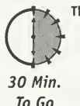

“剩余分钟”图标标记了你在课程中的进度。


“提示”图标提供了可以节省你时间和精力的信息。


“注释”图标突出了阐明和扩展讨论的附带或技术信息。


“CD-ROM”图标指的是随书附赠的CD上的材料。使用它来查找文本中提到的程序和软件元素的电子版本。

### 致谢

当然，我必须感谢Neil Romanosky、Barbra Guerra、Galen Mayfield、Maarten Reilingh、Dale White、Debra Williams Cauley以及Hungry Minds的所有其他优秀伙伴。我一直担心写书会很困难，但这些人让它看起来像小菜一碟。

我还要感谢Lisa Swayne和Swayne Agency的所有人，感谢他们给我机会并关照我。

最后，我需要感谢Zack Czengoldi、Jami Lowery和Jeff Berger，他们在我写作过程中投入时间和精力对本书进行了“现实检验”。谢谢你们，伙计们！


# 第一部分 — 周五晚上

第 1 课
认识 JavaScript

第 2 课
语句和运算符

第 3 课
流程控制语句

第 4 课
如何编写 JavaScript 函数

# 第一部分
周五晚上


- **第 1 课**
  认识 JavaScript
- **第 2 课**
  语句和运算符
- **第 3 课**
  流程控制语句
- **第 4 课**
  如何编写 JavaScript 函数


## 第1课

### 初识 JavaScript

#### 课程清单

- 了解 JavaScript 的历史
- 理解 JavaScript 能做什么和不能做什么
- 理解 JavaScript 如何融入网页
- 创建你的第一个基于 JavaScript 的网页

30 分钟速览

起初，网络一片空白，毫无形态……好吧，其实并非真的“空白”，但确实非常乏味！当然，你能找到许多技术论文和介绍各种爱好的网站，但它们都非常静态，极其、极其无聊。后来，网景公司（Netscape Navigator 网页浏览器的开发者）的人们认为，如果用户能与网页内容进行实际互动，网络会变得有趣得多。于是，他们创建了一种名为“LiveScript”的脚本语言。

其理念是网页作者可以在他们的网页中嵌入小段的 LiveScript 代码。这些被称为“脚本”的代码可以直接与网页元素交互（例如，向文本框插入字符串或弹出警告窗口向用户显示某种信息），从而为终端用户创造更有趣的体验。

什么？你从未听说过 LiveScript？这其实并不奇怪，因为 LiveScript 最终并未走出实验室……至少不是以这个名字。你看，就在网景公司准备发布 LiveScript 的同时，Sun Microsystems 宣布即将发布一种名为 Java 的新编程语言。

Java 似乎有很多优势：Sun 声称它很轻量（因此你可以在许多不同的地方使用它，包括网络）、易于上手（它基于 C 语言，而*数百万*程序员都熟悉 C 语言），并且最终将能在任何地方运行。出于这些以及更多原因，Java 成为了计算行业最热门的流行语。Java 的突然走红引起了网景公司的注意，于是他们研究了一下，发现了一件非常有趣的事情：LiveScript 和 Java *看起来*非常相似。原因在于，LiveScript 和 Java 一样，都是基于 C 语言。事实上，两者在外观上如此相似，以至于如果你只是瞥一眼一段 LiveScript 或 Java 代码，你可能无法区分它们！

在 Java 的所有“热议”声中，网景公司决定将 LiveScript 更名为 JavaScript。这是网景公司非常明智的一步。更名让人们注意到并尝试 JavaScript，而它实际上是一种功能强大的语言，能够实现惊人的效果，这促使人们创建依赖它的网页。因此，不久之后，增强型的 JavaScript 网页开始在互联网上大量涌现。

最终，JavaScript 进入了*数百万*网页。事实上，JavaScript 变得*如此*受欢迎，以至于微软决定为其 Internet Explorer 网页浏览器创建自己的版本（巧妙地命名为 JScript）。不幸的是，JScript 与 JavaScript 的差异足以导致许多为它编写的程序无法在 Netscape Navigator 中运行（反之亦然）。这浪费了许多程序员大量时间，他们努力创建能在两种浏览器中运行的程序。

经过几年的这种情况，所有相关方都认为 JavaScript 的标准化版本是个好主意，于是他们请欧洲计算机制造商协会（一个独立的标准组织）帮助创建一个。结果被称为 *ECMAScript*，尽管大多数人仍然只称它为“JavaScript”。ECMAScript 是你在最现代的浏览器中找到的 JavaScript 版本，也是我将在本书中重点介绍的版本。

> 在整本书中，我将使用“程序”和“脚本”这两个术语来指代 JavaScript 代码块。虽然 JavaScript 从技术上讲“只是一种脚本语言”，但它拥有与“真正的”编程语言同等的计算能力。此外，说“JavaScript 脚本”听起来比“JavaScript 程序”要傻气。

### 那么，JavaScript 能做什么？

在当今世界，*一切*都被炒作到如此程度，以至于无论某样东西实际有多好，一旦你拿到手，总会感到失望。幸运的是，和这本书一样，JavaScript 是少数可能*不会*让你感到失望的例外之一！JavaScript 可以做很多事情，包括：

- 生成自定义网页并动态更改网页外观
- 验证网页上表单的内容
- 与网页中的 Java “小程序”通信
- 在网页上创建自定义动画
- 执行传统编程语言的任务

你可能已经注意到，这个列表中的大多数条目都涉及网页。然而，JavaScript 并不仅限于网页浏览器。网景公司有一个服务器端版本的 JavaScript（称为 LiveWire 或简称 Server-Side JavaScript），微软也在其 Web 服务器中包含了服务器端 JScript 支持。这两者都允许你编写服务器端 JavaScript 程序，可以执行各种酷炫且有用的任务。例如，如果你有这个想法，你可以从数据库中提取数据并将其呈现在你的网页上！微软甚至将 JScript 支持集成到了 Windows 脚本宿主（WSH）中。这意味着你可以编写 JavaScript 程序来自动化 Windows 95 及更高版本中的任务。然而，在本书中，我们将专注于 JavaScript 在你喜爱的网页浏览器中的使用。主要原因是，一旦你学会了用于网络的 JavaScript，你就可以轻松地将这些知识应用到任何其他环境中。

因此，为了完成本书中的练习，你*必须*使用支持 JavaScript 的网页浏览器。幸运的是，两大“知名”网页浏览器（Netscape Navigator 和 Internet Explorer）都支持 JavaScript。如果你没有这些浏览器中的任何一个，你可以在随附的 CD-ROM 上找到它们以及本书的所有源代码。除非另有说明，本书中的所有代码都是“浏览器无关的”，应该能在任一浏览器的最新版本中运行。（在出版时，这是 Netscape Navigator 的第 6 版和 Internet Explorer 的第 5.5 版。）如果你想编写特定于浏览器的代码，我们将在周日的第 26 课中介绍。

### JavaScript 不能做什么

当然，JavaScript 并不完美。虽然 JavaScript 非常强大，但它也受到了一些相当严格的限制。（请注意，这些限制主要存在于在你的网页浏览器中运行的 JavaScript 中。其他 JavaScript 环境的限制要少一些。）

- JavaScript 不能读取、写入、创建或删除磁盘文件。这纯粹是出于安全考虑。毕竟，你不会想打开一个会破坏硬盘上所有文件的网页，对吧？（JavaScript *可以*创建和操作 cookie（我们将在明天下午的第 16 课中讨论），但这种能力受到网页浏览器本身的严格控制。）
- JavaScript 不能执行网络操作。（此规则的一个例外是，JavaScript 可以强制网页浏览器打开另一个网页，该网页可以位于网络上的任何位置。）
- JavaScript 不能创建独立软件。记住，JavaScript 最初是为了给原本静态的网页添加交互性而诞生的。因此，JavaScript 一直（并且可能永远）是一种脚本语言。这意味着它的目的是控制（或“脚本化”）另一个程序的操作——在这个例子中，是网页浏览器。如果你想编写独立的软件，你需要使用更传统的语言，如 Java、C 或 C++。
- 虽然 JavaScript *看起来*像 Java，但两者并不相同。由于名称和外观相似，许多人误以为 JavaScript 只是 Java 的“精简版”。这根本不是事实。Java 和 JavaScript 是两种独立的技术，只是碰巧有相似的名称和渊源。两者之间最大的区别在于 Java 可以创建独立软件。虽然 JavaScript 本身是一种强大的语言，但这恰恰是它做不到的事情。

### JavaScript 如何融入网页

如前所述，JavaScript 的主要目的是使网页更有趣和/或更有用。为了实现这个目标，它的发明者们决定 JavaScript 程序应该直接嵌入到网页本身中，因此他们发明了一种新的超文本标记语言（HTML）标签，可用于将 JavaScript 代码封装在网页中。这个标签简单地称为“script”标签，它看起来像这样：

### 第1课——认识JavaScript

```html
<script language="javascript">
...你的JavaScript代码将放在这里...
</script>
```

如你所见，`script`标签看起来与其他HTML标签非常相似。不过，有几个不同之处需要注意：

-   它有一个“language”属性，允许你指定此脚本块中使用的编程语言。根据你使用的浏览器，你也可以指定VBScript或PerlScript。然而，所有主流浏览器都支持JavaScript，并且由于它出现得最早，它是默认语言。如果你只使用JavaScript，你不必指定语言，但你应该指定，这样查看你代码的人就能确切知道你使用的是哪种语言。
-   与某些HTML标签不同，你不能在`script`标签对内放置其他HTML。`script`标签对内只应放置JavaScript代码！
-   与大多数其他HTML标签一样，一个网页可以包含任意多组`script`标签，并且你可以将它们放置在HTML文档中几乎任何位置。然而，已经形成了一种惯例，即你的大部分（如果不是全部）JavaScript代码可能包含在网页顶部的`<head>`和`</head>`标签之间。当然，这个规则也有例外，正如我们将在接下来的几天里看到的那样。
-   除了`script`标签，你还可以将JavaScript语句嵌入到其他HTML标签内。这些嵌入的JavaScript语句通常采用标签属性的形式，并且通常在Web浏览器中出现特定条件时执行。（这些“条件”被称为“事件”，我们将在本书的剩余部分讨论它们。）
-   到目前为止，你可能想知道这在真实网页中是什么样子。那么，这是一个简单的HTML文件，其中包含一个简单的JavaScript代码块：

```html
<html>
<body>
<script language="javascript">
document.write("Hello World!")
</script>
</body>
</html>
```

如果你将其加载到Web浏览器中，你应该会看到一个页面，上面显示着简单的消息“Hello World!”。以下是脚本的工作原理：首先，你应该注意到这只是一个简单的HTML文件。就像你见过的每个其他简单HTML文件一样，它的每一部分都是纯粹的、人类可读的ASCII文本。没有任何“二进制文件”、“插件”或其他需要担心的东西。这是一个非常重要的点：就像HTML文件的每个其他部分一样，你的JavaScript代码只是普通的ASCII文本！

由于这只是一个简单的HTML文件，它的处理方式与其他HTML文件一样：从上到下。因此，首先处理`<html>`标签（它告诉Web浏览器打开其HTML解析器），然后是`<body>`标签，接着是`<script>`标签。然而，当浏览器到达`<script>`标签时，它会做一些不同的事情：它将处理权移交给内置在浏览器中的JavaScript解释器。JavaScript解释器查看每一行JavaScript代码并立即运行它。在这种情况下，单行JavaScript告诉解释器执行`document.write("Hello World!")`。无需过多细节，“document”是一个对象，代表当前加载到Web浏览器中的HTML文档。语句中的“write”部分告诉文档对象你想在该HTML文档中显示一个字符串。最后，“Hello World!”是你想要显示的字符串。（我们将在明天上午的第9课中查看document对象。）当解释器到达脚本块的末尾（由`</script>`标签表示）时，它将控制权交还给HTML解析器。然后HTML解析器通过解析结束的`</body>`和`</html>`标签并在浏览器中显示页面来完成工作。

> JavaScript代码只是简单的ASCII文本这一事实意味着你可以使用*任何*能够保存文本文件的编辑器来创建基于JavaScript的HTML文件。例如，在Macintosh上，你可以使用SimpleText。如果你使用Windows，你可以使用WordPad甚至记事本。如果你使用Linux，你可以使用vi或你的发行版附带的任何其他编辑器！当然，你也可以使用专门用于创建网页的编辑器。然而，关键是你不必这样做！我曾仅使用记事本就构建了充满JavaScript的复杂网站。对于本书，我将假设你使用HTML Kit（在Windows上）或BBEdit Lite（在Macintosh上）。这些是免费软件编辑器，带有扩展功能，使创建网页变得更加容易。

### 创建你的第一个JavaScript程序

我一直认为，学习一门新编程语言的最佳方式是定义一个小项目，然后使用该语言来完成它。因此，在这个周末的过程中，这正是我们要做的。具体来说，我们要做的是创建一个基于JavaScript的购物车应用程序。购物车相当简单，但构建一个将使我们能够运用JavaScript语言的几乎所有方面。我们现在唯一需要决定的是我们将把什么放入我们的购物车。由于每个人都喜欢婴儿，我们的购物车将用于虚构的婴儿用品商店baby-palooza.com。既然我们已经看到了如何在我们必做的“Hello World!”脚本中输出字符串，让我们稍微修改一下，为我们的店面创建一个初始欢迎页面。

```html
<html>
<head><title>Welcome to Baby-Palooza!</title></head>
<body bgcolor="white">
<center><h1>
<script language="javascript">
document.write("Welcome to Baby-Palooza!")
</script>
</h1></center>
</body>
</html>
```

这与我们之前看过的示例几乎完全相同。主要区别在于我们将JavaScript代码直接放在了一些HTML标记标签的中间。最终结果是，当你加载此页面时，你会得到一个居中的标题，欢迎你访问baby-palooza.com网站，如图1-1所示。

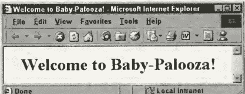

如果你想知道为什么它这样工作，请记住HTML文件是从上到下处理的。当HTML解析器到达开始的`<script>`标签时，它已经处理了开始的`<center>`和`<h1>`标签，并将它们放入最终将发送到浏览器窗口的输出流中。因此，当`document.write()`语句执行时，其输出（即字符串“Welcome to Baby-Palooza!”）也会被发送到此输出流。事实上，就浏览器而言，你刚刚看到的代码可能看起来完全像这样：

```html
<html>
<head><title>Welcome to Baby-Palooza!</title></head>
<body bgcolor="white">
<center><h1>Welcome to Baby-Palooza!</h1></center>
</body>
</html>
```

能够将HTML标签与JavaScript语句的输出混合使用是支持JavaScript的浏览器最强大的功能之一。事实上，这种能力是我们所熟知和喜爱的动态、交互式Web的核心和灵魂！

### 复习

在本课中，你了解了JavaScript的历史。更重要的是，你了解了JavaScript如何融入网页。我们还简要介绍了HTML页面的解析方式，以及你可以将JavaScript的输出与HTML标签混合的事实。我们在这个周末讨论的所有其他内容都建立在这些概念之上，因此在继续之前，请确保你已经很好地掌握了它们！

### 自我测验

1.  JavaScript只是Java的“精简”版本吗？（参见“JavaScript不能做什么”。）
2.  JavaScript能做些什么？（参见“那么，JavaScript能做什么？”）
3.  JavaScript不能做些什么？（参见“JavaScript不能做什么”。）
4.  `<script></script>`标签的目的是什么？（参见“JavaScript如何融入网页”。）
5.  你必须使用什么样的编辑器来创建包含JavaScript的网页？（参见“JavaScript如何融入网页”。）

## 第2课

### 语句和运算符

#### 课程清单

-   编写赋值语句
-   创建和使用变量
-   了解JavaScript数据类型和变量命名约定
-   熟悉所有赋值和数学运算符
-   在JavaScript中添加注释

作为C语言的后代，JavaScript拥有各种各样的语句类型和运算符。这些一开始可能看起来令人困惑，但你会发现对于最常见的编程任务（如给某物赋值或比较事物），你只需要熟悉其中少数几个。

### 赋值语句

JavaScript 中最基本的语句是赋值语句。顾名思义，赋值语句的目的是为变量赋值。以下是一些示例：

```
fName = "Maia";
lName = 'Disbrow';
count = 10;
pi = 3.14159;
```

与大多数其他语言一样，这些语句的结构非常简单：等号左侧的变量获取等号右侧的值。尽管这些是简单的语句，但它们实际上展示了 JavaScript 编程的几个重要规则：

-   你可以用单引号（' '）或双引号（" "）来括起字符串。使用哪种引号实际上只是个人偏好问题。此外，用一种引号括起的字符串可以包含另一种引号。但是，如果你要嵌套引号，只能嵌套一层。例如，字符串 "Brian O'Toole" 用双引号括起并包含一个单引号，这是完全合法的。然而，字符串 "Brian O'Toole says, "Top 'o the morning!"" 将是非法的，因为双引号内不能有双引号。（有一种方法可以绕过这个限制，我们将在第 5 节讨论。）
-   JavaScript 语句必须以分号结尾……或者不！在 JavaScript 中，分号标记语句的结束。然而，行尾也标记语句的结束。因此，如果你每行只放一个语句，你完全不需要使用分号。但是，如果你想（或需要）在一行中放置多个语句，只需在每个语句末尾放置一个分号即可。例如，我们的示例语句本可以写在一行中，如下所示：

```
fName = "Maia"; lName = "Disbrow"; count = 10;
```

### JavaScript 变量

在其他一些编程语言中，你必须在使用变量之前声明它们。不仅如此，当你声明一个变量时，你必须指定它将保存什么类型的数据（整数、字符串等）。JavaScript 的做法有些不同：在 JavaScript 中，你只需为变量赋值即可创建它。此时，你的变量就可以使用了。如果你习惯于在使用变量之前声明它们，这个简化的过程可能需要一点时间来适应。但一旦你使用了一段时间，你会发现它容易得多。

### 数据类型

更难处理的是 JavaScript 变量是*松散类型*的这一事实。这意味着当你创建一个变量时，你赋给它的值决定了它的类型。因此，如果你将一个字符串赋给一个变量，它就是一个字符串变量。更复杂的是，你实际上可以将*任何*类型的值赋给*任何*变量，无论它当前保存什么类型的值！考虑以下代码：

```
myVar = "Hello";
document.write( myVar);
myVar = 100;
document.write( myVar);
myVar = "Goodbye!";
document.write( myVar);
```

在这里，我们创建了变量 `myVar` 并给它赋了一个字符串。显示这个字符串后，我们给它赋了一个整数并显示它。然后，为了使事情完整，我们给 `myVar` 赋了另一个字符串并显示它。正如你可能想象的那样，松散的数据类型是 JavaScript 的一个非常强大的特性，它允许你编写一些非常灵活的代码。但是，如果你滥用这个特性，可能会导致难以追踪和修复的问题。我的建议是，只给任何给定的变量分配一种类型的数据，并且只在绝对必要时才使用这个特性。

此时，你可能想知道 JavaScript 程序实际上有哪些基本数据类型。在最底层，JavaScript 实际上只有四种数据类型：整数、浮点数、字符和布尔值（true 或 false）。你在 JavaScript 中遇到的所有其他类型都是以某种方式组合这些基本数据类型的*对象*。例如，字符串是表示字符集合的对象。我们将在遇到这些其他数据类型时讨论它们，并在周六晚上详细讨论对象这个主题。


JavaScript 实际上允许你以四种不同的格式指定数字：浮点数、整数、八进制和十六进制。你可能已经熟悉浮点数和整数，但八进制和十六进制对你来说可能是新的。基本上，八进制和十六进制数字是以不同数字基数表示的整数。普通整数是基数 10（也称为十进制），而八进制数字是基数 8，十六进制数字是基数 16。在 JavaScript 中，你可以通过以零（0）开头来指定一个数字是八进制。例如，语句 `x = 077;` 将八进制值 77（十进制为 63）赋给 x。类似地，十六进制数字以字符 "0x" 开头。因此，语句 `x = 0x3F;` 将十六进制值 3F（十进制也是 63）赋给 x。如果这有点令人困惑，别担心！在 JavaScript 编程中，只有少数几种情况需要你了解八进制或十六进制数字。本说明的要点只是让你知道它们是什么，以便当它们出现时你能认出它们。

### 变量名

当你创建并命名一个变量时，必须遵循一些规则：

-   变量名区分大小写。这意味着 `myVar` 和 `myvar` 是两个完全不同的变量。（实际上，JavaScript 的每个方面都是区分大小写的，而不仅仅是变量名。这意味着如果你想写一个 "if" 语句，你必须使用小写的 "if"；"IF" 不起作用。）
-   变量名必须以字母字符、美元符号或下划线开头，并且可以包含字母（a 到 z 或 A 到 Z）、数字（0 到 9）、美元符号（$）或下划线字符（_）。不允许有空格或其他特殊字符。
-   出于所有实际目的，变量名可以是你想要的任意长度。但是，为了保持可管理性，你可能应该将它们保持在 50 个字符以下。

为了帮助理解所有这些，表 2-1 包含了几个有效和无效的 JavaScript 变量名示例。

#### 表 2-1：变量名示例

| 有效名称 | 无效名称 | 无效原因 |
| :--- | :--- | :--- |
| numBottles | 99bottles_of_beer | 以数字开头 |
| _systemName | name of system | 包含空格 |
| $charVar | char-var | 不允许使用连字符 |
| _99FlagVal | o'toole'sbar&grill | 不允许使用撇号 |

### 赋值运算符

在本课开始时，我说等号代表一个“简单”的赋值语句。JavaScript 提供了许多其他赋值运算符，虽然并不复杂，但也绝不简单。这些运算符允许你在单个 JavaScript 语句中执行在其他语言中需要两个或更多语句才能完成的操作。

#### += 运算符

也许这些其他运算符中最有用的是“加法赋值”运算符（+=）。这个运算符是做什么的？嗯，考虑以下代码：

```
x = 10; y = 5;
x = x + y;
```

事实证明，这里显示的操作（将两个变量相加并将结果放回其中一个变量）非常常见，如果有一个简写运算符，人们可以节省很多时间。这正是 += 运算符的作用。因此，假设 x 和 y 如前面的代码所示定义，以下几行代码具有完全相同的效果：

```
x = x + y;
x += y;
```

所以，这为我们节省了大约四次击键，对吧？这听起来可能不多，但如果你将其乘以一生的编程，你就大大降低了患上重复性劳损的机会！

#### 其他赋值运算符

那么，其他赋值运算符是什么？表 2-2 有答案。

#### 表 2-2：JavaScript 赋值运算符

| 运算符 | 操作 | 示例代码 | 等效于 |
| :--- | :--- | :--- | :--- |
| = | 简单赋值 | x = y; | 不适用 |
| += | 加法赋值 | x += y; | x = x + y; |
| -= | 减法赋值 | x -= y; | x = x - y; |
| *= | 乘法赋值 | x *= y; | x = x * y; |
| /= | 除法赋值 | x /= y; | x = x / y; |
| %= | 取模赋值 | x %= y; | x = x % y; |
| &= | 按位与赋值 | x &= y; | x = x & y; |
| \|= | 按位或赋值 | x \|= y; | x = x \| y; |
| ^= | 按位异或赋值 | x ^= y; | x = x ^ y; |

希望这个表格中的大多数运算符对你来说都很直观。然而，最后四个涉及你可能不熟悉的数学运算。所以，让我们来谈谈数学运算符。

### 数学运算符

到目前为止，我们所看到的都是简单的赋值：将一个变量复制到另一个变量，或将一个变量设置为某个简单的值。在现实世界中，大多数赋值语句都涉及某种计算。因此，JavaScript 配备了几种不同的数学运算符，以使这些操作尽可能简单。这些运算符如表 2-3 所示。

#### 表 2-3
JavaScript 算术运算符¹

| 运算符 | 操作 | 示例代码 | 结果 | 等价于 |
| :--- | :--- | :--- | :--- | :--- |
| ++ | 加 1 | x++ | 11 | x = x + 1; |
| -- | 减 1 | x-- | 9 | x = x - 1; |
| + | 加法 | z = x + y | 13 | 不适用 |
| - | 减法 | z = x - y | 7 | 不适用 |
| * | 乘法 | z = x * y | 30 | 不适用 |
| / | 除法 | z = x / y | 3 | 不适用 |
| % | 取模 | z = x % y | 1 | 不适用 |
| & | 按位与 | z = x & y | 2 | 不适用 |
| \| | 按位或 | z = x \| y | 11 | 不适用 |
| ^ | 按位异或 | z = x ^ y | 9 | 不适用 |

¹ 在所有示例中，假设 x 为 10，y 为 3，z 为 0。

既然你几乎肯定已经了解了加、减、乘、除这四种基本的数学运算，那么让我们来看看其他运算符。

### 自增和自减运算符

在编程中，经常需要将变量的值增加一。例如，下面的代码可能看起来非常熟悉：x = x + 1
自增运算符允许我们用以下代码替换它：x++
这与语句 x = x + 1 完全相同。更重要的是，通过将此功能置于运算符中，我们可以在其他语句内部执行自增操作！（我们将在第 3 课讨论流程控制语句时看到这一点。）
自增运算符的另一个重要方面是它可以以前缀或后缀形式使用。换句话说，你可以将运算符放在要递增的变量之前或之后。像这样：

```
++x
x++
```

在这些简单的语句中，自增运算符的位置并不重要。然而，在更复杂的语句中，自增运算符的位置就很重要了。在前缀形式（++x）中，自增操作发生在 x 的值在周围语句中被使用*之前*。在后缀形式（x++）中，自增操作发生在 x 的值在周围语句中被使用*之后*。考虑这段代码：

```
x = 10; y = 0; z = 5;
y = z * x++;
y = z * ++x;
```

执行语句 y = z * x++ 后，变量 y 的值将是 50，变量 x 的值将是 11。因为我们使用了自增运算符的后缀形式，所以 x 的初始值 10 被用于乘法，而 x 的递增直到乘法完成后才发生。

当我们执行下一条语句 y = z * ++x 时，变量 y 的值将是 60，变量 x 的值将是 12。这是因为，通过使用自增运算符的前缀形式，x 的值在乘法发生之前就从 11 增加到了 12。

如果有自增运算符，就应该有自减运算符，对吧？没错！自减运算符由两个减号表示，它的工作原理与自增运算符相同，只是它*减去*一而不是加上一。例如，以下两行是等价的：

```
x = x - 1
x--
```

### 取模运算符

一旦你知道自增和自减运算符的作用，它们其实相当简单。然而，取模运算符（%）可能需要一些解释。你可以将取模运算看作是除法的一个近亲。区别在于，取模运算将其两个操作数相除，然后返回该除法的*余数*。所以，回到表 2-3 中的例子，我们将 10 除以 3。3 进入 10 三次，余一（1）。这个余数，一，就是返回的值。

### 位标志运算符

最后一种数学运算符是位标志运算符。这些运算符仅适用于整数值，并将它们视为一系列标志，每个标志指定一个真或假的值，而不是完整的数字。通过使用位标志运算符，你可以找出（或更改）值内部单个位（或一组位）的状态。这些运算符的使用有点复杂（无意双关），所以我们稍后会详细讨论它们。

### 注释：那些不是语句的语句

我们需要讨论的最后一种 JavaScript “语句”是注释。注释实际上不是语句，它们是你放入 JavaScript 代码中以解释正在发生什么的文本行或块。注释对于任何可能在互联网上找到你的 JavaScript 代码并试图将其调整为自己使用的人来说都非常有帮助。注释对你自己也可能非常有帮助。想象一下，写了一段非常聪明的代码，然后一个月或更长时间不再看它。没有注释，很有可能你自己的代码会让你困惑地挠头。

如果你想将单行指定为注释，只需在注释文本的开头放置两个斜杠（//）。例如：

```
// 现在我们对 x 求平方
x = x * x
```

这些注释标记实际上可以出现在行中的任何位置。例如：

```
x = x * x // 现在我们对 x 求平方
```

诀窍是，注释标记之后的*所有*内容都被视为注释，即使是 JavaScript 代码！

```
// 这两行都是注释，将被忽略！
// x = x * x
```

从前面的示例中可以看出，你可以将多行标记为注释行。但是，如果你需要将*很多*行标记为注释文本，逐个标记每一行可能会很繁琐。因此，JavaScript 允许你通过将文本块括在 /* 和 */ 字符之间来将其标记为一个大注释。例如：

```
/* 现在我们对 x 求平方以达到
预期结果 */
x = x * x
```

与单行注释一样，多行注释也可以从行中的任何位置开始。开始和结束注释标记之间的任何内容（甚至是 JavaScript 代码）都被视为注释，并被 JavaScript 解释器忽略。
关于注释，重要的是要*使用它们*。不要害怕在你的 JavaScript 代码中大量添加注释。要描述性，要详细，如果你想的话可以有趣，但一定要这样做。当你第一次需要重新审视自己的一段代码时，你会很高兴那些注释在那里。

### 复习

在本课中，你学习了简单的 JavaScript 语句和运算符。你还学习了 JavaScript 数据类型和变量。你学习了如何命名变量以及什么构成非法的变量名。你还发现 JavaScript 变量是松散类型的。这意味着它们会采用你分配给它们的任何值的类型。这也意味着任何给定的变量都可以被分配任何类型的数据。我们还介绍了基本的 JavaScript 运算符，并看到了每个运算符如何工作的示例。在接下来的几天里，我们将广泛使用这些运算符，因此请务必保留表 2-2 和表 2-3 以便轻松参考。

### 自我测验

1. #_of_pies 是一个合法的 JavaScript 变量名吗？_numPies 呢？为什么是或为什么不是？（参见“变量名”。）
2. 以下语句有什么问题？greet = "I said "Howdy!""（参见“赋值语句”。）
3. 如果 x 是 33，y 是 67，执行以下语句后 x 的值是多少？x += y;（参见“其他赋值运算符”。）
4. 如果 x 是 12，y 是 4，z 是 2，执行以下语句后每个变量的值是多少？x *= z++ * ++y;（参见表 2-2。）
5. 假设以下内容都在单行上，以下代码行有什么问题？x = 1 y = 12 z = 100;（参见“赋值语句”。）

## 第 3 课

### 流程控制语句

#### 课程清单

- 理解布尔值、表达式和运算符
- 理解代码块和流程控制语句

至此，我们已经了解了 JavaScript 代码如何嵌入网页，以及如何创建基本的 JavaScript 语句。但是，如果我们想在网页上提供真正动态的内容，就需要能够在 JavaScript 程序中做出选择。

### 理解布尔值和表达式

正如我们在第 2 课中看到的，JavaScript 允许你创建和使用包含布尔值的变量。“布尔”只是一个花哨的词，意思是“真或假”。因此，你可以创建如下所示的变量：

```
shoppingCartEmpty = false; readyToCheckout = true;
```

注意这些值没有加引号。这是因为 true 和 false 是 JavaScript 关键字，对 JavaScript 解释器具有特殊含义。关键字（通常称为保留字）是保留供JavaScript 解释器。这意味着这些词不能用作变量或函数名。（我们将在下一节讨论函数。）这些关键字代表布尔值或*逻辑*值。

如果你不熟悉布尔值，一开始使用它们可能会感觉有点奇怪。布尔值代表绝对值：一个布尔变量要么是 `true`，要么是 `false`——没有中间地带。你也可以将布尔值想象成代表*开*（`true`）或*关*（`false`）的开关。（你有时也会发现布尔值用数字一和零来表示——分别对应 `true` 和 `false`。实际上，任何非零值都可以用来表示 `true`。）

如果你将它与字符串变量（可以有几乎无限多个值）进行比较，你可能会认为布尔变量有点没用。但是，布尔值只能有两个值这一事实，使得它们非常适合在程序中做出选择。

在你的 JavaScript 程序中做出选择之前，你必须以 JavaScript 解释器能够理解的方式表达这个选择。为此，你必须编写某种布尔（或逻辑）表达式。不要被这个术语吓到；逻辑表达式实际上只是一个真/假问题及其答案。事实上，你在不知不觉中，每天都在问和回答逻辑问题。比如，“我有足够的钱买汽水吗？”你只需从口袋里掏出零钱，加起来，然后将总额与汽水的价格进行比较，就能简单地回答这个问题。根据比较的结果（`true` 或 `false`），你要么买汽水，要么不买。在 JavaScript 程序中询问逻辑问题同样简单。你只需将一个变量的值（你口袋里的零钱数额）与某个其他值（汽水的价格）进行比较，然后根据结果（即 `true` 或 `false`）做出反应。

### 比较运算符

在上面的例子中，我们进行的比较是看我们拥有的零钱是否小于或等于汽水的价格。然而，在 JavaScript 中你可以进行许多其他类型的比较。每种类型的比较都有自己的运算符，任何这些比较的结果都将是 `true` 或 `false` 布尔值。表 3-1 显示了这些运算符并给出了使用示例。前四个运算符应该从高中代数课上就熟悉了。然而，最后两个可能需要一点解释。

#### 表 3-1
比较运算符¹

| 运算符 | 操作 | 示例代码 | 结果 |
| :--- | :--- | :--- | :--- |
| < | 小于 | w < z | true |
| > | 大于 | w > z | false |
| <= | 小于或等于 | w <= z | true |
| >= | 大于或等于 | z >= x | true |
| == | 相等 | x == y | true |
| != | 不等（不等于） | x != y | false |

¹ 对于所有示例，假设 w 为 9，x 为 10，y 为 10，z 为 20。

#### 相等运算符

在某些编程语言中，你可以简单地使用单个等号来测试相等性，像这样：areEqual = x = y; 这种方法的问题在于，在这个单一语句中，等号被用于两种不同的方式：作为测试 x 和 y 是否相等，以及将此比较的结果赋值给变量 areEqual。对于像这样简单的语句来说，这完全没问题，但在更复杂的语句中，事情可能会变得难以理解。JavaScript 通过使用不同的运算符来解决这个问题：赋值操作使用单个等号，相等比较使用两个等号。因此，在 JavaScript 中，这个示例语句将被重写为：areEqual = x == y; 这个语句的意思是，“比较 x 和 y 的值。如果它们相等，将 true 放入变量 areEqual。如果不相等，将 false 放入 areEqual。”

> 在 JavaScript 中，单个等号*总是*表示赋值操作，无论它出现在什么上下文中。这个事实可能是 JavaScript 程序中最大的错误来源。（我们将在本节后面看到一个例子。）所以，如果你的 JavaScript 程序行为异常，首先要检查的是你在测试相等性时是否正确使用了两个等号。

#### 不等运算符

在其他编程语言中，你通常会看到使用小于号（<）和大于号（>）来测试不等性：`areNotEqual = x <> y;` 如果你从字面上理解，你是在问“x 是小于还是大于 y？”坦率地说，这有点令人困惑。幸运的是，JavaScript 能够更好地表达不等的概念。在 JavaScript 中，有一个专门用于表达*不*概念的特殊符号：感叹号（!）。所以，要测试不等性，你会编写代码：`areNotEqual = x != y;` 这可以字面理解为“x 不等于 y 吗？”

### 逻辑运算符

到目前为止，你看到的运算符让你能够将一个值与另一个值进行比较并生成布尔结果。但是，如果你需要基于两个或多个布尔值来做决定呢？如表 3-2 所示，JavaScript 有几个运算符可以帮助你做到这一点。

#### 表 3-2
逻辑运算符²

| 运算符 | 操作 | 示例代码 | bool3 的值 |
| :--- | :--- | :--- | :--- |
| && | 逻辑与 | `bool3 = bool1 && bool2;` | false |
| \|\| | 逻辑或 | `bool3 = bool1 \|\| bool2;` | true |
| ^ | 异或 | `bool3 = bool1 ^ bool2;` | true |
| ! | 逻辑非（取反） | `bool3 = !bool1;` | false |

² 对于所有示例，假设 `bool1` 为 `true`，`bool2` 为 `false`。

#### 逻辑与操作

逻辑与操作仅在你进行与运算的所有布尔值都为 true 时才返回 true。即使只有一个值为 false，整个表达式的结果也将为 false。

#### 逻辑或和异或操作

逻辑或操作在你进行或运算的*任何*一个值为 true 时都会返回 true。实际上，逻辑或操作返回 false 的唯一情况是表达式中的*所有*值都为 false。

异或操作比逻辑或稍微复杂一点。异或表达式在（且仅在）表达式中的一个值为 true 时为 true。如果两个值都为 true（或两个值都为 false），异或表达式的结果将为 false。

#### 逻辑非操作

逻辑非操作与你目前看到的操作有点不同。区别在于，非操作只是反转它所应用的布尔值。所以，如果你对一个 true 值取反，你会得到 false。同样，如果你对一个 false 值取反，你会得到 true。使用表 3-2 中的变量（其中 bool1 为 true，bool2 为 false），以下是非操作（以及其他运算符）的一些示例：

```
bool3 = !bool2;            // bool3 将为 true
bool3 = !(bool1 && bool2); // bool3 将为 true
bool3 = !(bool1 || bool2); // bool3 将为 false
bool3 = !(bool1 ^ bool2);  // bool3 将为 false
bool3 = !(bool1 && !bool2); // bool3 将为 false
```

这里有几点需要注意：

- 当你想对一个表达式或布尔变量取反时，只需在其左侧加上一个感叹号。
- 你可以使用括号来按照你希望的顺序“嵌套”操作。在第二个例子中，括号告诉 JavaScript 解释器你希望先执行逻辑与操作。该操作的结果（false）然后被取反，得到最终结果 true。将此与最后一个例子进行比较，其中 bool2 在与 bool1 进行与运算之前被取反。

### 理解流程控制语句

正如我在本节开头所说，为了创建真正有趣的程序，你必须能够做出决策。所以，既然你已经对布尔值以及如何测试它们有了基本的了解，让我们来看看使用它们来做出决策的 JavaScript 语句。

流程控制语句背后的基本思想是，它们让你能够根据某个条件决定要执行哪段代码。当然，说完这个，我现在必须定义什么是代码块。

### 代码块

简单来说，代码块可以是以下两种情况之一：

-   单行代码。
-   由一对花括号（{}）包围的零行或多行代码。

就 JavaScript 解释器而言，花括号之间的所有代码与单行代码是等同的。

因此，例如，这是一个代码块：`x = x + y;` 这也是一个代码块：

```
{
  y = 10;
  x = 20;
  document.write( "Hello!");
}
```

如果这有点令人困惑，别担心！接下来的示例应该有助于澄清。

### if 和 if . . . else 语句

JavaScript 提供的最简单的流程控制语句是 `if` 语句。此语句让你轻松决定是否执行一段代码。例如：

```
strollerPrice = 199;
if (strollerPrice <= 100)
    document.write( "This stroller is cheap!");
document.write( "Thanks for shopping at Baby-Palooza.com!");
```

这是如何工作的呢？在 `if` 关键字之后，括号中包含一个布尔表达式（也称为*条件表达式*）。（在 JavaScript 中，条件表达式始终在括号中。）如果此表达式的计算结果为 `true`，我们将执行条件之后的代码块。在本例中，这只是一个语句。因此，如果 `strollerPrice` 的值小于或等于 100，第一个 `document.write` 语句将被执行。否则，第一个 `document.write` 语句将被完全跳过。

这里需要注意的是，这个 `if` 语句只会触发一个语句的执行。第二个 `document.write` 语句*不是* `if` 语句的一部分，无论条件表达式的结果如何，它都会被执行。如果你想执行多个语句，你必须将所有这些语句都包含在一对花括号中，像这样：

```
if (strollerPrice <= 100) {
    document.write( "This stroller is cheap! ");
    document.write( "You certainly are getting a deal . . .");
}
document.write( "Thanks for shopping at Baby-Palooza.com!");
```

说到这里，我可能应该谈谈编码风格。你会在这个例子中注意到，左花括号与 if 语句在同一行，而右花括号单独占一行，并缩进到与上面的行对齐。你还会注意到，我总是在左括号和其后的内容之间放一个空格。我将在本书中一直使用这种风格，但这并没有什么神奇之处。这纯粹是我多年来形成的个人风格，对我来说，它使源代码更具可读性。JavaScript 忽略空白字符（空格、制表符和回车符），因此你可以按照对你来说最易读的方式排列代码块。

当单独使用时，if 语句实际上只适用于一件事：排除一段代码不被执行。如果你需要在两个代码块之间进行选择呢？那么，在这种情况下，你可以将 if 语句与 else 语句一起使用，像这样：

```
if (strollerPrice <= 100) {
    document.write( "This stroller is cheap!");
}
else {
    document.write( "This stroller is not so cheap.");
}
```

这里的概念非常简单：如果括号中的条件计算结果为 true，则执行紧随条件之后的代码块。否则，执行 else 关键字之后的代码块。

你可能已经注意到，在这个例子中，两个代码块都只有一个语句长，但我将每个都包含在花括号中。为什么要这样做？首先，重要的是你要意识到你*可以*这样做。此外，将单行代码块包含在花括号中是一个好主意。这样做可以消除哪些语句属于流程控制语句的任何歧义。另外，如果你必须返回并添加更多语句到代码块中，你不必记得添加花括号，因为它们已经在那里了！

当你需要做出复杂的决策时，你可以嵌套多个 if . . . else 语句。例如，考虑这段代码：

```
strollerPrice = 199;
if (strollerPrice < 100) {
    if (strollerPrice < 50) {
        document.write( "Wow! This is cheap!");
    }
    else {
        document.write( "Very affordable!");
    }
}
else {
    if (strollerPrice > 150) {
        document.write( "This is a high-end model!");
    }
    else {
        document.write( "A bit pricey, but nice!");
    }
}
```

在这段代码中，我们使用嵌套的 if . . . else 语句来精确确定婴儿车的价格，然后根据该价格打印相应的消息。

### 赋值错误

在本节前面，当我谈到相等运算符时，我指出在 JavaScript 中，单个等号*总是*表示赋值操作。为什么知道这一点很重要？考虑以下代码：

```
strollerPrice = 199;
if (strollerPrice = 50) {
    document.write( "This stroller is only $50!<br />");
}
document.write( "Actually, the price is: $" + strollerPrice);
```

在这个例子中，你会注意到我使用加号将一个数字“加”到一个字符串上。当你像这样使用 + 运算符时，JavaScript 会自动将数字转换为字符串并与字符串连接！你还会注意到，我在输出中写了一个 HTML `<br />` 标签。（要知道，`<br />` 是 `<br>` 的 XHTML 版本。我将在本书中使用 XHTML 编码约定。）当你运行这个脚本时，你会发现*两个* document.write 语句都执行了。更糟糕的是，strollerPrice 的值已经从 199 变成了 50！发生了什么？嗯，记住，单个等号是一个赋值语句，*无论上下文如何*。所以，即使单个等号在 if 语句的条件表达式中，JavaScript 解释器仍然会将值 50 赋给 strollerPrice。

但是，为什么这个条件计算结果为 true？记住，布尔逻辑是绝对的，所以某事要么为真，要么为假。还要记住，布尔值有时用数字表示：1 表示 true，0 表示 false。实际上，*任何*非 0 的值（数字、字符串或其他）都被视为 true。只有数字 0 等同于 false。所以，我们的“条件表达式”的结果是 50，它被计算为 true。

正如我之前所说，这个隐蔽的问题可能是 JavaScript 程序中错误的首要原因。所以一定要在你自己的程序中对此保持警惕！

### 第 3 节——流程控制语句

### switch 和 break 语句

if 语句的一个近亲是 switch 语句。此语句允许你非常快速地在变量的已知值之间进行选择，并执行相应的代码块。它不像 if 语句那样灵活，但它易于遵循且速度快。例如，让我们将前面的示例重写为 switch 语句。

```
strollerPrice = 199;
switch (strollerPrice) {
    case 49: {
        document.write("Wow! This is cheap!");
        break;
    }
    case 99: {
        document.write("Very affordable!");
        break;
    }
    case 149: {
        document.write("A bit pricey, but nice!");
        break;
    }
    default: {
        document.write("This is a high-end model!");
    }
} // end of switch statement
```

首先是 `switch` 关键字，后跟括号中要测试的变量。在随后的代码块中，有几个 `case` 语句。每个语句后面都跟着一个常量值，变量将与之进行比较。如果变量的值与这些常量值中的任何一个匹配，则执行该 `case` 语句之后的代码块。如果被测试的值与任何 case 都不匹配，则执行 `default` 关键字之后的语句。（请注意，如果你知道并列出了所有可能的 case，则不必指定 `default` 语句。）如图所示，`strollerPrice` 与任何指定的 case 都不匹配，因此它将直接跳到 `default` 语句并告诉用户：“This is a high-end model!” 但是，如果 `strollerPrice` 被设置为 99，相同的代码将写出字符串 “Very affordable!” 然后执行其后的 `break` 语句。

`break` 语句将*跳出*当前的流程控制语句。当 JavaScript 解释器遇到 `break` 语句时，它会立即停止当前所在的流程控制语句，并从紧随该流程控制语句之后的下一条语句恢复执行。

`break` 语句适用于任何流程控制语句，但了解如何在 `switch` 语句中使用它尤其重要。这是因为，如果在 `case` 语句之间没有 `break`，执行将“落入”下一个 `case` 语句并执行与该 case 关联的代码块，无论该 case 是否与测试变量匹配！例如，如果你从前面的示例中删除所有 `break` 语句，并将 `strollerPrice` 设置为 49，`switch` 中的*所有* `document.write` 语句都将被执行！（用你 CD-ROM 上的源代码试试看。）这种行为可能会令人困惑，但在某些你需要或希望一次选择多个 case 的情况下，它也可能很有用。所以，始终记得在你的 case 之间放置 `break` 语句，但也要不断寻找方法将这种行为化为己用。

### while 和 do . . . while 语句

我已经向你展示了如何选择一个代码块或另一个，但如果你需要一遍又一遍地执行一个代码块呢？JavaScript 有几个语句可以让你做到这一点。第一个是 `while` 语句。`while` 语句相当简单，它只是重复执行一个代码块，直到某个条件表达式变为 false。例如：

```
stockPrice = 100;
while (stockPrice > 0) {
    document.write( "Our stock is currently: $" + stockPrice +
    "/share<br />");
    stockPrice -= 10;
}
```

本示例的关键部分是条件表达式（`stockPrice > 0`）和每次循环中降低 `stockPrice` 的语句。条件表达式在循环执行前进行求值。如果该表达式求值为 `false`，则条件后的代码块不会执行。然而，如果条件为 `true`，则代码块会执行。当代码块执行完毕后，会再次检查条件，如果条件仍然为 `true`，代码块将再次执行。

改变 `stockPrice` 的语句同样重要。如果没有这个语句，`stockPrice` 将永远不会改变，我们的条件将永远不会变为 `false`，我们的循环将永远不会结束！这种情况被称为无限循环。如果你不小心在 JavaScript 程序中引入了无限循环，浏览器看起来就像是挂起了。在大多数情况下，几分钟后浏览器会告诉你脚本运行时间过长，并给你停止脚本的机会。（如果没有，你将不得不使用操作系统提供的任何任务管理工具手动关闭你的 Web 浏览器。）

`while` 语句的主要问题是，如果你第一次尝试执行该语句时条件为 `false`，你的代码块将永远不会执行。如果你需要确保你的代码块至少执行一次，请改用 `do . . . while` 语句。例如，以下代码如果写成 `while` 循环，将不会显示任何内容。然而，在 `do . . . while` 形式中，可以立即看出这只特定的股票已经变得一文不值。

```
stockPrice = 0;
do {
    document.write( "Our stock is currently: $" + stockPrice + "/share<br />");
    stockPrice -= 10;
} while (stockPrice > 0);
```

### The for 语句

最强大的流程控制语句无疑是 `for` 循环。虽然有点难以掌握，但 `for` 循环比其他任何语句都能让你对循环操作有更多控制。从概念上讲，`for` 循环的基本格式如下：

```
for (initialConditionSetup; endOfLoopTest; conditionModifier) {
    codeBlock;
}
```

因此，如果我想编写一个 `for` 循环来计算我库存中所有婴儿车的总价值，我可以编写如下代码：

```
strollerPrice = 199; numStrollers = 15; totalValue = 0;
for (counter = 1; counter <= numStrollers; counter++) {
    totalValue += strollerPrice;
}
document.write("Stroller inventory is worth: $" + totalValue);
```

请注意，括号内有三个 JavaScript 语句：

- 第一个语句 `counter = 1;` 实际上创建了一个名为 `counter` 的新变量，该变量在 `for` 循环使用的代码块中是局部的。当循环结束时，该变量将被丢弃。（我们将在第 4 节讨论局部变量。）
- 第二个语句 `counter <= numStrollers;` 是我们的条件表达式，它生成一个布尔结果。如果该结果为 `false`，则循环停止执行。
- 第三个语句 `counter++` 在每次循环结束时执行一次。在这种情况下，该语句用于每次循环时将 `counter` 变量递增一。

因此，当这个循环执行时，它将反复执行语句 `totalValue += strollerPrice;`，直到 `counter++` 语句导致 `counter` 的值大于 `numStrollers` 的值。此时，循环将结束，`counter` 变量将被丢弃，`totalValue` 将包含值 2985。

### The continue 语句

你经常会发现自己在创建的循环中执行一系列测试。在许多情况下，`true` 的结果意味着是时候跳回循环顶部了。`continue` 语句让你可以做到这一点。

```
strollerPrice = 199;
while (strollerPrice > 0) {
    strollerPrice -= 50;
    if (strollerPrice > 100) {
        document.write("More than $100" + "<br />");
        continue;
    }
    if (strollerPrice > 50) {
        document.write( "More than $50" + "<br />");
        continue;
    }
}
```

在这个例子中，我使用 `continue` 语句，每当我的一个 `if` 语句求值为 `true` 时，就跳回循环顶部。`continue` 语句不会重置循环中的任何值，它只是跳过直到循环结束的所有内容。

### The ?: 运算符

我们要看的最后一个语句实际上是一个运算符。这个运算符被称为条件运算符，允许你在两个表达式之间选择一个进行求值。抽象地说，它的工作原理如下：

```
result = (condition) ? (evaluate if condition is true) : (evaluate if condition is false);
```

因此，在 `?` 之前，我们有一个括号中的条件。如果该条件求值为 `true`，则对 `?` 和 `:` 之间的表达式进行求值。然而，如果条件为 `false`，则对 `:` 之后的表达式进行求值。因此，在以下示例中：

```
y = 10; z = 30;
x = (y < z) ? y * z : y + z;
```

条件为 `true`（10 小于 30），因此我们将 `y` 乘以 `z` 并将结果赋值给 `x`。

### REVIEW

在本节中，你已经了解了布尔值、逻辑表达式和运算符、代码块以及 JavaScript 的流程控制语句。你已经看到所有这些是如何协同工作的，让你能够编写 JavaScript 程序，这些程序可以根据你在程序中做出的逻辑决策的结果执行不同的代码块。如果你还没有这样做，请花一些时间在你的 CD-ROM 上播放本节的所有源代码。尝试修改分配给各个变量的值，看看你的修改如何影响程序的结果。

### QUIZ YOURSELF

1. 什么是布尔值？（参见“Understanding Boolean Values And Expressions”。）
2. 什么是布尔表达式？（参见“Understanding Boolean Values and Expressions”。）
3. `=` 和 `==` 运算符有什么区别？（参见“The equality operator”和“The assignment error”。）
4. 什么是代码块？（参见“The code block”。）
5. `while` 和 `do . . . while` 语句有什么区别？（参见“The while and do . . . while statements”。）

## SESSION 4

### How to Write JavaScript Functions

#### Session Checklist

- Learning when to create and use a function
- Understanding how functions return values
- Understanding JavaScript variable scope
- Learning how to store JavaScript code in external files

当你编写程序时，你经常会发现自己一遍又一遍地做同样的事情。例如，花几分钟时间查看文件 Listing4-1.htm。（它在你的 CD-ROM 的 Session04 文件夹中。）如你所见，这是一个冗长而乏味的 HTML 文档。使其既长又乏味的原因是，输出我们产品信息的代码被一遍又一遍地重复。更糟糕的是，所有这些 HTML 和 JavaScript 只产生了图 4-1 所示的简单表格。

Figure 4-1
冗长乏味代码的简洁输出

### Creating a Function

那么，问题是，“我们如何使用 JavaScript 来减少这段代码的大小？”
答案是，“通过编写一个函数。”
简单来说，函数只是一个你赋予名称的代码块。
将代码放入函数有几个优点：

- 你可以一遍又一遍地使用一个函数。你所要做的就是通过它的名字调用它。（这是技术人员所说的“封装”的一个方面。）
- 函数可以对不同的值集执行相同的操作。例如，如果你编写了一个对数字求平方的函数，每次调用该函数时，你可以传递一个不同的数字来求平方。你传递给函数的值称为 *parameters*。
- 到目前为止，我们看到的所有 JavaScript 代码在 JavaScript 解释器到达时都会立即执行。另一方面，函数只有在你显式调用它们时才会执行。

在 Listing4-1.htm 文件中，实际上有几个地方函数可以改进事情。例如，在我们表格的每一行中，我们将运费加到产品成本上，并将结果显示为美元金额。这是一个为我们计算最终成本的函数：

### 第四课——如何编写 JavaScript 函数

```javascript
function calcFinalCost( baseCost, shippingCost) {
    return baseCost + shippingCost;
}
```

这是一个非常简单的函数，不过，为了好玩，让我们仔细看看它的每个部分。

- 首先是 `function` 关键字。它告诉 JavaScript 解释器，后面的代码块应被视为一个函数，并且只在被显式调用时才执行。
- 接下来是函数名，即 `calcFinalCost`。命名函数的规则与我们在第二课中看到的命名变量的规则完全相同。
- 圆括号内是该函数期望接收的参数列表。在这个例子中，函数期望两个参数：`baseCost` 和 `shippingCost`。这些值由调用者传入，并在函数体内用于执行函数的任务。
- 接下来是左花括号，它标志着函数体的开始。
- 下一行是一个简单的加法操作，将参数的值相加。
- 同样在这一行是 `return` 关键字。顾名思义，这个关键字会计算其后的表达式，并将结果返回给调用该函数的代码。
- 最后，右花括号标志着函数的结束。

### 调用函数

现在我们已经定义了这个函数，我们该如何实际使用它呢？嗯，下面的代码展示了如何使用该函数来帮助创建图 4-1 所示输出的最后一行（你可以在你的 CD-ROM 上找到完整代码。查找名为 `Listing4-2.htm` 的文件。）：

```html
<td>
<script language="javascript">
document.write( "$" + calcFinalCost(carSeatPrice, carSeatShip));
</script>
</td>
```

如你所见，我们只需通过函数名，后跟（在括号中）我们想传递给它的参数来调用我们的函数。这些值按位置传递到我们定义函数时指定的参数变量中。（换句话说，`baseCost` 获取 `carSeatPrice` 中的值，而 `shippingCost` 获取 `shipping` 中的值。）这些值用于执行函数中定义的计算。最后，函数的结果被传回函数被调用的位置，该结果在我们的 `document.write` 语句中被使用。

### 使用函数减少代码量

这个简单的函数适合用来讨论函数背后的概念，但它并没有真正让我们的 HTML 文件变得更短或更不枯燥，对吧？所以，让我们定义另一个稍微复杂一点的函数，它实际上会减少我们的代码量。下面的代码展示了一个显示产品所有相关信息的函数：

```javascript
function showProductInfo( price, desc, partNo, ship) {
    document.write( "<tr>");
    document.write( "<td>" + partNo + "</td>");
    document.write( "<td>" + desc + "</td>");
    document.write( "<td>$" + calcFinalCost( price, ship) + "</td>");
    document.write( "</tr>");
}
```

因此，我们不必使用 HTML 逐行定义，而是可以简单地为每个产品调用这个函数，它将为我们生成相应的 HTML。要查看这能减少多少代码量，请查看 CD-ROM 上的 `Listing4-3.htm` 文件。

### 理解函数的细微之处

至此，你实际上已经掌握了自己编写函数所需的所有信息。然而，在我们继续之前，我需要提到几个额外的要点。

在我们看到的两个例子中，我们的函数都接受多个参数。然而，函数并不强制要求接受任何参数。但是，当你定义一个没有参数的函数时，你仍然必须在函数名后包含一组圆括号。（这被称为*空参数列表*。）这样的函数定义看起来像这样：

```javascript
function noParams() {
    // 函数代码放在这里
}
```

你会这样调用它：`myResult = noParams();`（注意，即使没有传递任何参数，你也*必须*在函数名后包含空的圆括号。）

你可能已经注意到，在 `showProductInfo` 函数中没有 `return` 关键字。这是因为这个特定的函数不需要返回任何值。它所有的操作都是通过 `document.write` 语句完成的，这些语句会立即生效。这在 JavaScript 中是完全合法的。事实上，你可能会发现自己编写了很多根本不返回任何值的函数！

### 理解 JavaScript 作用域规则

作用域是一个概念，它决定了在程序某一部分定义的变量或函数是否可以从程序的另一部分访问。例如，能够将程序一部分中创建的变量隐藏起来，不让程序另一部分中创建的函数访问，这可能非常有用。

大多数编程语言提供复杂的作用域规则，并且有需要数月甚至数年才能掌握的作用域特性。然而，JavaScript 对作用域采取了一种相对更简单的方法。在 JavaScript 中，只有两种类型的作用域：

- **全局**：具有全局作用域的内容可以从 HTML 文件中的任何位置访问。例如，函数始终是全局的。这意味着你定义的任何函数都可以从文件中的任何其他地方调用。（正如我们将在第 24 课中看到的，函数甚至可以从不同的浏览器窗口访问！）如果在函数外部定义变量，则该变量是全局的。
- **局部**：如果在函数内部定义变量，则该变量是局部的。此外，你必须使用 `var` 关键字，以避免将局部变量与任何同名的全局变量混淆。局部变量只能从定义它们的函数内部访问。

感到困惑了吗？下面的例子应该有助于澄清这一点。

```javascript
aGlobalVariable = "I'm global!<br />";
anotherGlobal = "I'm global too!<br />";

function scopeDemo() {
    var aGlobalVariable = "Actually, I'm local!<br />";
    document.write( aGlobalVariable);
    anotherGlobal = "I was changed by the function!<br />";
}
document.write( aGlobalVariable);
document.write( anotherGlobal);
scopeDemo();
document.write( aGlobalVariable);
document.write( anotherGlobal);
```

如果你运行这段代码（它在 CD-ROM 的 `Listing4-4.htm` 文件中），你会看到一些你可能意想不到的输出。首先，这段代码设置了两个全局变量。（记住，使它们成为全局的不是它们的名字，而是它们是在任何函数外部定义的这一事实！名字只是为了帮助你理解应该发生什么。）然后代码定义了一个函数。函数定义之后，我们输出 `aGlobalVariable` 和 `anotherGlobal` 的值。正如预期的那样，这些值没有改变。然后我们调用我们的函数。

函数做的第一件事是创建一个新的*局部*变量。如你所见，这个变量与我刚刚创建的一个全局变量同名。然而，由于我在这个语句中使用了 *var* 关键字，JavaScript 解释器知道我正在创建一个对该函数而言是局部的新变量。这意味着，只要这个函数在执行，任何对 `aGlobalVariable` 的引用实际上都是对同名局部变量的引用。因此，当执行下面的语句时，输出的是局部变量的值，而不是全局变量的值。然而，当接下来的语句引用 `anotherGlobal` 时，JavaScript 解释器会发现没有同名的局部变量。所以，正如你所料，它将新值赋给了全局变量。（记住，全局变量*无处不在*，甚至在函数内部！）函数执行完毕的那一刻，JavaScript 解释器就会丢弃名为 `aGlobalVariable` 的局部变量。从那一刻起，任何对 `aGlobalVariable` 的进一步引用都指的是脚本第一行定义的全局变量。

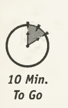

从函数返回后，脚本再次输出 `aGlobalVariable` 和 `anotherGlobal` 中的值。然而这一次，其中一个发生了变化；`anotherGlobal` 中的值现在是在函数内部被赋予的值。然而，`aGlobalVariable` 中的值没有改变。

如果你仍然觉得作用域的概念令人困惑，这里有一些提示可以帮助你：

### 使用外部源代码文件

首先，*永远*不要给多个变量起相同的名字。仅仅遵循这个简单的规则，就能为你省去大量的麻烦。

为了避免进一步的混淆，在函数内部创建变量时，请始终使用 `var` 关键字。当然，`var` 关键字是完全可选的，那为什么还要多此一举呢？嗯，一些旧版本的 Netscape Navigator 浏览器实际上会将函数内部定义的变量视为全局变量，除非你在定义变量时使用了 `var` 关键字。通过始终如一地使用 `var` 关键字，你就永远不必担心会遇到这种奇怪的行为。

你也可以在定义全局变量时使用 `var` 关键字。这不会使你的全局变量变成局部变量，但它会告诉阅读你代码的人，你是在定义一个变量，而不仅仅是进行另一次赋值操作。

正如我在本节开始时所说，当你编写程序时，你会发现自己在一遍又一遍地做同样的事情。在 JavaScript 编程中，这不仅适用于单个网页，也适用于整个网站。因此，一个在某个页面上有用的函数，很可能在另一个页面上也能派上用场，这是合乎逻辑的。所以，我们需要某种方式在你网站的所有网页之间共享你的 JavaScript 函数（以及其他代码）。为了实现这一点，`<script>` 标签支持一个叫做 `src` 的属性。这个属性（代表“source”）允许你指定一个单独的文件，其中包含你想要导入到网页中的 JavaScript 代码。例如，看看下面代码中的 `<script>` 标签。

```html
<html>
<head>
<title>Welcome to Baby-Palcoza.com</title>
<script language="javascript" src="babyPalooza.js"></script>
</head>
<body bgcolor="white">
<!-- 剩余的 HTML 内容放在这里 -->
</body>
</html>
```

在这个例子中，你可以看到我们所有的 JavaScript 代码都已从第一个 `<script>` 块中移除。取而代之的是，开始的 `<script>` 标签看起来像这样：

```html
<script language="javascript" src="babyPalooza.js"></script>
```

`src` 属性告诉 JavaScript 解释器，你想要包含在名为 "babyPalooza.js" 的文件中找到的 JavaScript 代码。因此，解释器会检索这个文件并解析其中的代码，就好像这些代码是直接输入到 HTML 文件中一样。（要了解这一切是如何协同工作的，请参阅你 CD-ROM 上的 Listing4-5.htm 和 babyPalooza.js 文件。）

> 当然，我们外部源文件的 .js 文件扩展名代表 JavaScript。外部源文件不一定必须使用这个扩展名，但这样做是个好主意，因为它可以清楚地将你的文件标识为 JavaScript 源代码。

babyPalooza.js 文件就是我们在整个课程中一直在使用的所有 JavaScript 变量和函数定义。这就是 JavaScript 解释器响应我们第一个 `<script>` 中的 `src` 属性而加载的内容。从最后这两个文件可以看出，使用 `src` 属性确实有助于减小网页的整体大小。而且，通过将你的 JavaScript 代码放在一个单独的文件中，你可以轻松地在文件之间共享你的函数和变量定义。

### 复习

函数和代码重用的概念是本节的重点。你了解了函数的结构以及为什么要使用函数。你学习了函数如何返回结果，并讨论了有些函数根本不需要返回结果的事实。你看到了函数是如何被调用的，以及它们如何通过封装重复执行的任务来减小程序的整体大小。你学习了 JavaScript 的作用域规则，我指出了在创建局部变量和全局变量时避免混淆的方法。

最后，我向你介绍了 `<script>` 标签的 `src` 属性，并向你展示了如何使用它来减小网页的大小，以及如何在网站的不同页面之间共享 JavaScript 变量和函数。

### 自我测验

1.  什么是参数？（参见“创建函数”。）
2.  `return` 关键字的作用是什么？（参见“创建函数”。）
3.  如何调用一个函数？（参见“调用函数”。）
4.  局部变量和全局变量有什么区别？（参见“理解 JavaScript 作用域规则”。）
5.  `<script>` 标签的 `src` 属性的作用是什么？（参见“使用外部源代码文件”。）

## 部分


### 周五晚上

1.  在 HTML 文件中，你可以在哪里使用 `<script></script>` 标签？
2.  什么是函数？
3.  包含布尔值的变量可能的值有哪些？
4.  用自己的话描述什么是代码块。
5.  JavaScript 变量和函数名必须遵循哪些规则？
6.  在 JavaScript 源代码中包含注释的两种方式是什么？
7.  你的 JavaScript 代码应该存储在什么文件格式中？
8.  `<script>` 标签的 `language` 属性是做什么用的？
9.  如何从函数返回一个值？
10. 编写一个函数，接受四个布尔参数，仅当所有四个参数都为 true 时才返回 true。
11. 编写一个循环，将 1 到 100 的数字相加并打印结果。
12. 一个函数必须有多少个参数？
13. `<script>` 标签的 `src` 属性是做什么用的？
14. 用自己的话描述 for 循环条件中的三个表达式的作用。
15. 局部变量和全局变量有什么区别？
16. 执行以下语句后，`x` 的值会是什么？`y` 的值会是什么？

```javascript
y = 75;
x = (y = 100) ? 29 : 42;
```

### 第一部分——周五晚上复习

17. 你可以将什么样的数据赋值给 JavaScript 变量？
18. 创建一个函数来计算一个数的平方并返回结果。
19. 创建一个函数，接受一个数字作为参数。如果该数字是奇数，函数应返回 true，否则应返回 false。（提示：使用取模运算符。）
20. 编写一个函数，接受一个数字作为参数，并返回该数字的布尔等价值。

## ☑ 周六

# 第二部分 —— 周六上午

**第 5 节**
处理 JavaScript 字符串

**第 6 节**
处理 JavaScript 数组

**第 7 节**
理解浏览器对象模型

**第 8 节**
处理 window 对象

**第 9 节**
处理 document 对象

**第 10 节**
响应事件

# 第三部分 —— 周六下午

**第 11 节**
动态创建 HTML 页面

**第 12 节**
处理 HTML 表单

**第 13 节**
处理 HTML 控件

**第 14 节**
处理图像

**第 15 节**
验证表单数据

**第 16 节**
用 JavaScript 制作 Cookie

# 第四部分 —— 周六晚上

**第 17 节**
理解 JavaScript 对象

**第 18 节**
创建和使用方法

**第 19 节**
用 JavaScript 对象增强 HTML

**第 20 节**
动态创建和执行 JavaScript

## 第二部分
周六上午


- **第 5 节**
  处理 JavaScript 字符串
- **第 6 节**
  处理 JavaScript 数组
- **第 7 节**
  理解浏览器对象模型
- **第 8 节**
  处理 window 对象
- **第 9 节**
  处理 document 对象
- **第 10 节**
  响应事件


## 第 5 节


### 处理 JavaScript 字符串

#### 课程清单

- ✔ 理解 JavaScript 如何实现字符串
- ✔ 理解如何使用 JavaScript 字符串属性和方法


还剩 30 分钟

JavaScript 支持多种不同类型的数据，但你最常使用的可能是字符串。因此，我需要让你更仔细地了解 JavaScript 字符串以及你可以对它们执行的不同操作。正如你昨晚所看到的，字符串很容易创建；你只需将一个字符串赋值给一个变量，就像这样：

```javascript
var myString = "Welcome to Baby-Palooza!";
```

这个简单的语句创建了一个新变量，并将一个字符串值赋给它。一旦完成，你就可以以几乎任何你想要的方式操作这个变量中的字符串。

#### 字符串机制

当然，到目前为止，我还没有告诉你所有操作字符串的不同方法，对吧？好的，打开你的浏览器，让我们开始操作吧！

### 字符串连接

也许最基本的字符串操作就是*连接*。简单来说，连接就是将两个或多个字符串拼接在一起形成一个更大的字符串的操作。下面是一个例子：

```
var greeting = "Welcome to Baby-Palooza!";
var beg = "Please come back soon!";
var howdy = greeting + beg;
```

正如第3节中提到的，当与字符串一起使用时，加号充当连接运算符。因此，最后一行语句的意思是：“取出 greeting 的内容，将 beg 的内容附加到其末尾，然后将整个结果放入 howdy 中。” 这段代码执行后，你认为 howdy 的内容会是什么？如果你说 howdy 将包含 "Welcome to Baby-Palooza! Please come back soon!"，那么你是对的。

不，这不是笔误，"!" 和 "Please" 之间确实不应该有空格。（记住，JavaScript 只是一种编程语言，它对语法规则一无所知。天哪，它甚至不知道这些字符串代表句子！）为了在这些字符串之间添加空格，最后一行语句必须这样写：

```
var howdy = greeting + " " + beg;
```

看到我在这里做了什么吗？我在两个字符串变量之间显式地放置了一个空格。现在，howdy 的内容将如下所示："Welcome to Baby-Palooza! Please come back soon!" 这引出了几个重要点：

- 你可以将字符串变量与*硬编码*字符串连接起来。硬编码仅仅意味着你自己输入的内容。在这个例子中，空格（" "）就是硬编码字符串。（你会发现术语*字面量*有时会代替硬编码使用。）
- 你可以将任意数量的字符串变量和硬编码字符串连接成一个字符串。
- 如果你以这种方式构建字符串，那么字符串之间的空格、标点符号等完全由你（程序员）负责处理。

现在，正如你在第2节中看到的，JavaScript 有很多运算符。所以，你可能想知道是否还有其他连接运算符。实际上，有的。还记得 += 运算符吗？当它用于两个数字时，其工作方式如下：

```
x += y; // 这等同于 . . .
x = x + y;
```

那么，假设 greeting 和 beg 仍然如前所述定义，你认为下面的语句会做什么？`greeting += " " + beg;`

没错，它会取出 greeting 的值，将其与一个空格连接，然后再与 beg 的值连接。然后将整个结果放回 greeting 变量中。最终结果是 greeting 将包含 "Welcome to Baby-Palooza! Please come back soon!"。

### 简单的数字转换

字符串也可以用于将数字简单地转换为字符串。例如：

```
var descAndPrice = "Stroller: $" + 199;
```

正如我之前所说，在这种情况下，JavaScript 解释器会将数字转换为字符串，并将其与字符串 "Stroller: $" 连接起来。所有这些的结果是 descAndPrice 变量将包含字符串 "Stroller: $199"。正如你可能预期的那样，这对于带小数点的数字也适用：

```
var descAndPrice = "Stroller: $" + 199.95;
```

如果你有一个需要快速转换为字符串的数字，你可以通过将其与空字符串连接来实现。空字符串是一个不包含任何内容的字符串。（我想这就是它被称为空字符串的原因。）无论如何，空字符串由一对空的双引号 "" 或单引号 '' 表示。（注意两组引号之间都没有空格。）由于空字符串仍然是一个字符串，将其与数字连接的简单操作就会将数字转换为字符串。例如：

```
var cost = 199;
cost += "";
```

### 字符串方法和属性

在 JavaScript 中，字符串是作为对象实现的。因此，当你创建一个字符串时，你实际上是在创建一个 JavaScript 对象，一个 String 对象。（注意这里的大写 S。String 对象与其中包含的字符串数据不同。）我将在第17节更详细地讨论对象，所以现在我不会深入探讨字符串的这个方面。但是，如果我想告诉你关于 String 对象的方法和属性，你必须对方法和属性以及它们与对象的关系有所了解。

简单来说，对象是一块附带某种功能的数据。该功能通过一个或多个*属性*和*方法*来实现。属性很直接；它们只是保存对象中数据信息的变量。例如，字符串只有一个属性，即 `length` 属性。顾名思义，这个属性只是告诉你字符串数据中有多少个字符。

方法则稍微复杂一些。目前，理解方法的最佳方式是将其视为属于对象的函数。

因此，当你创建一个 String 对象时，你是在创建一块数据（字符串的字符），其中预定义了许多属性和方法供你使用。属性为你提供对象中数据的详细信息，而方法允许你使用对象中的数据执行任务。对于字符串，这些任务包括在字符串数据中搜索字符、提取字符串数据的一部分，或将字符串数据转换为大写或小写。

### 使用字符串方法和属性

你实际上如何调用这些方法之一？让我们看一个例子：

```
var prez = "Thomas Jefferson";
var upperPrez = prez.toUpperCase();
```

这里我创建了一个名为 `prez` 的 String 对象。在下一行，我调用了将 `prez` 的内容转换为大写的 String 方法。正如你可能猜到的，这第二条语句的结果是变量 `upperPrez` 将包含 "THOMAS JEFFERSON."。然而，让我们看看如何调用实现此功能的方法。

首先，是我的 String 对象的名称 `prez`，后面跟着一个句点。句点告诉 JavaScript 解释器我想访问我命名的 String 对象内部的属性或方法。因此，在句点之后，我命名了我想访问的内容，在本例中，就是 `toUpperCase` 方法。

之前我说过方法就像属于对象的函数。正如你在这个例子中看到的，与函数一样，方法名称后面跟着一组括号。有些方法接受参数，就像函数一样。因此，就像函数一样，你会将这些参数传递到括号内。重要的是要认识到，你创建的每个字符串都可以访问为 String 对象定义的每个方法。但是，当你调用 String 方法时，它只对你命名的 String 对象中的数据执行其工作。例如，考虑这段代码：

```
var prez1 = "George Washington";
var upperPrez1 = prez1.toUpperCase();
var prez2 = "Thomas Jefferson";
var upperPrez2 = prez2.toUpperCase();
```

执行后，upperPrez1 将是 "GEORGE WASHINGTON"，upperPrez2 将包含 "THOMAS JEFFERSON."。这就像看起来那么简单，并且完全按照你认为应该的方式工作。`prez1.toUpperCase()` 语句告诉 JavaScript 你想要 prez1 中数据的大写副本。类似地，`prez2.toUpperCase()` 告诉 JavaScript 你想要 prez2 中数据的大写副本。

掌握了这一点，获取 length 属性应该看起来相当简单：

```
document.write( prez1.length); // 输出值 17
document.write( prez2.length); // 输出值 16
```

同样，这只是一个简单的问题，即指定你想要使用的 String 对象，然后在其后跟一个句点和你想要提取的属性名称。

> 许多编程语言从数字1开始对字符串中的字符进行编号。然而，JavaScript 从数字0开始对字符进行编号。因此，例如，字符串 "Baby" 的长度为4个字符，但这些字符的编号是从0（B）到3（y）。

### 你可以使用的字符串方法

既然我已经向你展示了如何调用 String 方法，那么有哪些方法可以调用呢？（请注意，因为你只有一个周末来学习 JavaScript，本书只涵盖该语言最有用的方面。如果你想深入了解 JavaScript 的每个角落（包括本书中找不到的字符串方法），请查看你 CD-ROM 上的 JavaScript 官方语言规范。它在文件 ECMA-262.pdf 中。）

### charAt() 方法

此方法允许你从 String 对象的指定位置提取单个字符。例如，尝试这段代码（如果你不想输入，它在你的 CD-ROM 上）：var greeting = "!azoolaP-ybaB ot emocleW";
for (x=greeting.length - 1; x >=0 ; x--) {
    document.write( greeting.charAt( x));
}

当你运行这段代码时，会看到它打印出 "Welcome to Baby-Palooza!"。如果你仔细观察这个 for 循环，就会明白原因：我通过将 x 设置为 greeting 的长度减一，从问候字符串的末尾开始循环。（记住，JavaScript 字符串的位置编号是从 0 开始的。因此，最后一个字符的位置是长度减一。）然后循环向下进行（注意循环条件中的 x-- 语句），直到 x 小于 0。（同样，请记住字符串中第一个字符的位置是 0。）

每次循环时，charAt 方法会提取 greeting 中位置 x 处的字符。最终结果是字符串数据被反向打印出来，给出了我们熟悉的问候语。

### indexOf() 方法

此方法在字符串中搜索子字符串。如果找到子字符串，则返回其找到的位置。如果未找到子字符串，该方法将返回负一（-1）的值。实际上有两种不同的调用此方法的形式。以下是第一种形式的示例：

```
var itemDesc = "Stroller and SunShade";
var sunPos = itemDesc.indexOf( "Sun");
if (sunPos != -1) {
    document.write("Found 'Sun' at position: " + sunPos);
}
else {
    document.write( "Could not find 'Sun'!");
}
```

这里我正在检查字符 "Sun" 是否存在于 itemDesc 字符串变量中。它们存在，因此我输出一条简短消息，告诉我 "Sun" 在字符串数据中找到的位置（13）。（与 JavaScript 的其他部分一样，你在这里看到的每个字符串方法都是区分大小写的。因此，如果我搜索的是 "sun" 而不是 "Sun"，indexOf 方法将不会找到匹配项，并会返回 -1 的结果。）

正如你可能想象的那样，indexOf 方法从字符串数据的开头开始查找你的子字符串。这通常没问题，但有时你可能希望从搜索中排除字符串的一部分。indexOf 方法的第二种形式正是为此类情况设计的：

```
var custEmail = "somebody@aol.com";
var atPos = custEmail.indexOf("@");
var aolPos = custEmail.indexOf("aol", atPos);
if (aolPos != -1) {
    document.write("Welcome AOL User!");
}
else {
    document.write("Welcome non-AOL User!");
}
```

在这个例子中，我正在测试一个电子邮件地址，看它是否属于特定的域名。因此，由于我只需要测试 @ 符号之后的内容，我使用 indexOf 的第一种形式来找到 @。然后我在 indexOf 的第二种形式中使用该位置信息。在这种形式中，我在要查找的子字符串之后传递一个起始位置。这个起始位置告诉方法从字符串数据的哪个位置开始查找子字符串。

### lastIndexOf() 方法

此方法与 indexOf 方法执行完全相同的操作，不同之处在于它从字符串数据的末尾开始搜索，而不是从开头。与 indexOf 一样，lastIndexOf() 方法也有两种形式。在第一种形式中，你只需指定要搜索的子字符串。在第二种形式中，你指定子字符串以及一个起始位置。如果指定了起始位置，搜索将从该点向后朝字符串数据的开头进行。以下是一个示例：

```
var itemDesc = "Stroller and Stroller Carseat Adapter";
var strollPos = itemDesc.lastIndexOf("Stroller");
if (strollPos != -1) {
    document.write("Found 'Stroller' at position: " + strollPos);
}
else {
    document.write("Could not find 'Stroller'!");
}
```

如果你运行这段代码，会发现 "Stroller" 被报告在位置 13 找到，而不是在位置 0。（无论搜索从哪一端开始，返回的位置始终是从字符串数据的开头计算的。）

### split() 方法

split 方法接受一个字符串并将其分割成一个数组。我还没有告诉你关于数组的内容，但我们很快就会在第 6 节中介绍它们。

### substring() 方法

substring 方法从现有字符串的内部提取一个新的字符串。

```
var greeting = "Welcome to Baby-Palooza";
document.write( greeting.substring( 11, 15) + "<br />"); // "Baby"
document.write( greeting.substring( 8, 10) + "<br />"); // "to"
document.write( greeting.substring( 16)); // "Palooza"
```

substring 方法的第一个参数是你想要提取的字符串的起始位置。第二个参数是比你想要提取的最后一个字符大一的位置。这是一个重要的点：第一个参数指定的字符将是提取字符串的一部分，但第二个参数指定的字符将不是。

另一件需要注意的事情是第二个参数是完全可选的。如果你省略它（就像我在这个例子的最后一行所做的那样），源字符串的剩余部分将被提取。

### toLowerCase() 和 toUpperCase() 方法


正如你已经看到的，toUpperCase 方法返回字符串对象中数据的全大写版本。正如你可能猜到的，toLowerCase 方法返回字符串对象中数据的全小写版本。

### 复习

你刚刚详细学习了 JavaScript 字符串。你了解到 JavaScript 字符串实际上是具有 length 属性和许多不同方法的对象。你还学习了如何访问 length 属性以及如何调用不同的字符串方法。

### 自我测验

1.  如何将两个字符串连接在一起？（参见“连接”。）
2.  当你将一个数字与一个字符串连接时会发生什么？（参见“简单的数字转换”。）
3.  如何调用字符串方法？（参见“使用字符串方法和属性”。）
4.  length 属性告诉你关于字符串的什么信息？（参见“字符串方法和属性”。）
5.  JavaScript 字符串对象中的字符位置是如何编号的？（参见“字符串方法和属性”。）

# 第 6 节


## 使用 JavaScript 数组

#### 本节清单

-   理解什么是数组以及如何处理其内容
-   理解可以存储在数组中的数据类型
-   理解多维数组
-   了解数组方法

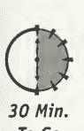

到目前为止，每次需要存储一个新值时，我都会创建一个新变量。例如，在第 4 节中，我使用以下代码来保存产品信息：

```
strollerPrice = 199.95;
strollerDesc = "Rock & Stroll - Deluxe";
strollerPartNo = "st-001";
strollerShip = 20;
diaperPrice = 13.95;
diaperDesc = "Size 3, Extra Absorbent";
diaperPartNo = "dp-003";
diaperShip = 5;
carSeatPrice = 149.95;
carSeatDesc = "Ultra-Safe, Rear-Facing";
carSeatPartNo = "cs-001";
carSeatShip = 15;
```

虽然这非常具有描述性，但这也是一种非常繁琐的做事方式。最糟糕的是，如果我的库存发生变化，我将不得不为每个产品创建一组新的变量（每个都有适当的名称）。如果有一种变量可以一次保存一堆相关但不同的数据，那不是很好吗？嗯，确实有，它叫做数组。

### 什么是数组？

数组是一个具有编号或命名槽位的变量，你可以在其中放入数据。你可以将这些槽位视为数组内的一组独立变量。例如，以下代码展示了上述其中一个产品放入数组后的样子：

```
var strollerInfo = new Array();
strollerInfo[0] = 199.95;
strollerInfo[1] = "Rock & Stroll - Deluxe";
strollerInfo[2] = "st-001";
strollerInfo[3] = 20;
```

与字符串一样，JavaScript 数组是作为对象实现的。然而，与字符串不同的是，你不能仅仅通过给变量赋值来创建数组。相反，你必须实际创建一个 Array 对象。那么，如何创建 Array 对象呢？答案就在我们示例的第一行：var strollerInfo = new Array();

像往常一样，我使用 var 关键字来表示我正在创建一个新变量，然后给这个新变量一个名称（strollerInfo）。后面跟着 new 关键字。这个关键字告诉 JavaScript 解释器我想要创建某种类型的新对象。在这种情况下，我想创建一个新的 Array 对象。因此，我在 new 关键字后面调用 Array() 构造函数方法。

构造函数方法是每种类型的对象都具有的特殊方法。它的特殊之处首先在于它与其所属的对象类型同名。（是的，String 对象有一个名为 String() 的构造函数方法。）基本上，构造函数方法告诉 JavaScript 构建指定类型的对象需要采取哪些步骤。这就是为什么它被称为构造函数方法；它实际上正在构建你请求的对象。因此，在这一行完成后，我有一个新的 Array 对象存储在 strollerInfo 变量中。

### 如何使用数组

正如我之前所说，数组可以被认为是一个变量，其中包含一堆命名或编号的槽位。每个槽位都可以保存自己的数据块，就像它本身就是一个变量。（实际上，这些槽位及其包含的数据通常被称为数组的*元素*。）要访问这些槽位，你只需给出数组变量的名称，然后在方括号中指定你想要访问的槽位的编号或名称。（分配给数组中槽位的编号或名称被称为该槽位的*索引*。）

### 使用编号数组元素

在前面的例子中，我使用编号的槽位来存放我的产品数据。注意，我的槽位编号是从零开始的。（实际上，你可以从任何你喜欢的数字开始编号，但从零开始是标准做法。）
你已经看到了如何将数据放入数组，但如何从数组中取出数据呢？嗯，有很多方法可以做到这一点，但最常见的方法是在某种循环内部处理数组中的每个槽位。当然，要做到这一点，你必须知道数组有多长。这就是为什么，与字符串对象一样，每个数组对象都有一个*length*属性，它告诉你数组中存在多少个槽位。（当你向数组对象添加槽位时，JavaScript解释器会自动更新此属性中的值。）因此，结合前面的例子，看看这个：

```
for (x=0; x<strollerInfo.length; x++) {
    document.write( strollerInfo[x] + "<br />");
}
```

当你运行这段代码时（如果你不想输入，它在CD-ROM的Listing6-2.htm文件中），你将得到一个数组内容的列表。*for*循环只是遍历数组中的每个槽位，并使用存储在*x*中的数字，提取并显示数组每个槽位中的数据。

### 使用命名数组元素

在我的第一个例子中，我使用编号的槽位而不是命名的槽位来存放我的产品数据。然而，我同样可以轻松地使用命名的槽位，如下所示：

```
var strollerInfo = new Array();
strollerInfo["price"] = 199.95;
strollerInfo["desc"] = "Rock & Stroll - Deluxe";
strollerInfo["partNo"] = "st-001";
strollerInfo["shipCost"] = 20;
```

这种方法的一个优点是，每个槽位的名称而不是无意义的数字，能准确地告诉程序员该槽位包含什么。然而，缺点是你不能再使用数字计数器来检索数组的内容。为了解决这个问题，JavaScript提供了一种特殊形式的for循环，专门用于这类任务。下面是一个例子。

```
for (x in strollerInfo) {
    document.write( strollerInfo[x] + "<br />");
}
```

在这个版本的for循环中，通常控制循环的三个表达式被表达式（x in strollerInfo）所取代。这个表达式告诉JavaScript解释器，每次循环时，x的值应该变成strollerInfo数组中下一个槽位的名称。因此，第一次循环时，x包含"price"。第二次循环时，它包含"desc"，依此类推。这种方法的一个额外好处是，由于x将获取每个槽位的名称，你可以检查x并使用其内容来显示每个槽位的名称。像这样：

```
for (x in strollerInfo) {
    document.write( x + " is " + strollerInfo[x] + "<br />");
}
```

需要注意的是，如果你打算使用命名槽位，你可以给你的槽位任何适合放在引号之间的名称。即使该名称不是有效的JavaScript变量名！因此，例如，这里显示的代码是完全合法的：

```
var strollerInfo = new Array();
strollerInfo["Price"] = 199.95;
strollerInfo["Product Description"] = "Rock & Stroll - Deluxe";
strollerInfo["Baby-Palooza Part Number"] = "st-001";
strollerInfo["Shipping Cost, Ground"] = 20;
for (x in strollerInfo) {
    document.write( x + " is " + strollerInfo[x] + "<br />");
}
```

这将产生如图6-1所示的更美观的输出。
不幸的是，使用命名槽位有几个缺点：

- 使用命名槽位，你只能从上到下遍历数组。使用编号槽位，你可以从底部（length - 1）遍历到顶部（0）。
- 使用命名槽位直接访问数组元素要求你知道槽位的名称。如果你使用冗长的槽位名称，这可能会使编程变得非常困难。一个更好的解决方案是使用编号槽位，并留出一个槽位用于详细描述数组的内容。

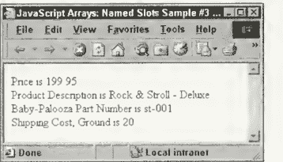

图6-1
使用冗长槽位名称的代码的输出

### 你可以将什么样的数据放入数组中？

实际上，由于JavaScript变量是松散类型的（如第2课所述），你实际上可以将任何类型的数据放入JavaScript数组对象的任何槽位中。正如你已经看到的，你甚至可以为数组中的每个槽位分配不同类型的数据。这使得JavaScript数组非常强大。它还允许你创建多维数组。

### 什么是多维数组？

将多维数组视为数组的数组。为什么你会需要这样的东西？嗯，考虑我们的产品数据：在我到目前为止向你展示的例子中，我实际上只将一个产品的数据分配到了我的数组中。根据你目前所看到的，其他每个产品的信息也必须放入自己的数组对象中，然后你必须分别操作每一个。这里再次强调，如果有一种方法可以将所有数据包装到一个可以轻松操作的单个变量中，那将是非常好的。考虑到这一点，看看这个：

```
var strollerInfo = new Array();
strollerInfo[0] = 199.95;
strollerInfo[1] = "Rock & Stroll - Deluxe";
strollerInfo[2] = "st-001";
strollerInfo[3] = 20;
var diaperInfo = new Array();
diaperInfo[0] = 13.95;
diaperInfo[1] = "Size 3, Extra Absorbent";
diaperInfo[2] = "dp-003";
diaperInfo[3] = 5;
var carSeatInfo = new Array();
carSeatInfo[0] = 149.95;
carSeatInfo[1] = "Ultra-Safe, Rear-Facing";
carSeatInfo[2] = "cs-001";
carSeatInfo[3] = 15;
var productInfo = new Array();
productInfo[0] = strollerInfo;
productInfo[1] = diaperInfo;
productInfo[2] = carSeatInfo;
```

正如预期的那样，我创建了单独的数组对象来存放每个产品的信息。然而，在此之后，我还创建了第四个名为productInfo的数组。然后我获取这个数组，并用我已经创建的三个产品信息数组填充它的槽位。完成此操作后，我最终得到了一个数组的数组。然后我可以通过productInfo变量访问所有产品的所有信息。

### 如何访问多维数组中的数据

访问多维数组中的数据很简单，只需指定每个索引，即可深入到相应数组中你想要的槽位。例如，汽车座椅的价格存储在productInfo中第三个数组的第一个槽位中。因此，如果我们想打印出来，我们会这样编码：

```
document.write( "Car seat price: " + productInfo[2][0]);
```

看到这是如何工作的了吗？在多维数组（productInfo）的名称之后，我指定了我想要访问的子数组的索引（[2]）。如果你回顾创建此数组的代码，你会看到这是包含我汽车座椅信息的槽位。一旦我定位到正确的数组，我只需指定我想要从中提取数据的槽位的索引（[1]）。再举一个例子，如果我想将尿布的价格更改为15.95美元，我会这样编码：

```
productInfo[1][0] = 15.95;
```

作为最后一个例子，以下代码将获取我刚刚创建的数组并显示每个槽位的内容。

```
for (x=0; x<productInfo.length; x++) {
    for (y=0; y<productInfo[x].length; y++) {
        document.write( productInfo[x][y] + "<br />");
    }
}
```

这里我使用了几个嵌套的for循环来显示多维数组中的所有数据。外层循环遍历主数组（productInfo），而内层循环显示每个子数组的内容。

### 数组方法

正如我们所看到的，JavaScript数组实际上相当容易使用。然而，由于它们是对象，JavaScript数组也附带了各种方法，使它们更加有用和强大。在本节中，我们将研究这些方法以及属于字符串对象的split()方法。（请注意，每种方法的示例可以在CD-ROM的Session06文件夹中找到。）

### Array() 构造函数方法

实际上，使用Array()构造函数方法有几种不同的方式。

- `new Array()` - 无参数。正如你已经看到的，这简单地创建一个空的数组对象。
- `new Array( length)` - 带长度参数。这创建一个新的数组对象，具有length个空槽位。
- `new Array( item1, item2, etc.)` - 带多个参数。这创建一个数组对象，其槽位用你作为参数传递的项目填充。

### concat() 方法

这个concat()方法将多个数组连接成一个单一的新数组对象。

### join() 方法

此方法会将数组的各个元素组合成一个单一的字符串。该字符串将由你在调用 `join()` 方法时指定的字符分隔。

```
var bpArray = new Array( "Diapers", "Baby Wipes", "Rattle");
var prodList = bpArray.join( "-");
```

此代码执行后，`prodList` 将包含字符串 "Diapers-Baby Wipes-Rattle"。如果你未指定分隔符，`join()` 方法将默认使用逗号。（可与本节末尾讨论的 `String.split()` 方法进行比较。）

### pop() 方法

此方法会移除并返回 `Array` 对象中的最后一个元素。此方法执行后，数组的 `length` 属性将比之前少一。例如，以下代码将使 `lastProduct` 包含字符串 "Rattle"。

```
var bpArray = new Array( "Diapers", "Baby Wipes", "Rattle");
var lastProduct = bpArray.pop();
```

> Macintosh 上的 Internet Explorer 5 不支持此方法或以下方法（稍后描述）：`push()`、`shift()`、`splice()` 和 `unShift()`。

### push() 方法

此方法将一个新元素添加到数组的末尾。之后，数组的 `length` 属性将比之前多一。以下代码执行后，`bpArray` 变量末尾将有一个包含字符串 "Diaper Cream" 的新元素。

```
var bpArray = new Array( "Diapers", "Baby Wipes", "Rattle");
bpArray.push( "Diaper Cream");
```

### reverse() 方法

此方法将反转 `Array` 对象中元素的顺序。

### shift() 方法

此方法将移除数组的第一个元素（元素 0），并将其他元素向上移动一位。之后，数组的 `length` 属性将比之前少一。

### slice() 方法

`slice()` 方法将返回一个新的 `Array` 对象，其中包含原始数组中元素的一个子集。你只需指定起始和结束元素，此方法将返回一个新的 `Array` 对象，其中包含从起始位置到结束位置减一的每个元素。在以下示例中，`cleanUp` 变量将是一个包含两个元素的 `Array` 对象："Diapers" 和 "Baby Wipes"。同样请注意，指定的结束元素（元素 2，"Rattle"）不包含在新的 `Array` 对象中。

```
var bpArray = new Array( "Diapers", "Baby Wipes", "Rattle",
"Stroller", "Booties");
var cleanUp = bpArray.slice( 0, 2)
```

### sort() 方法

`sort()` 方法允许你使用任何你想要的排序过程对 `Array` 对象的内容进行排序。你只需在调用 `sort()` 方法时指定一个合适的排序函数。

```
function simpleSort( item1, item2) {
    var result = 0;
    if (item1 > item2)
        result = 1;
    if (item1 < item2)
        result = -1;
    if (item1 == item2)
        result = 0;
    return result;
}
```

```
var bpArray = new Array( "Diapers", "Baby Wipes", "Rattle", "Car Seat", "Stroller");
bpArray.sort( simpleSort);
```

排序函数（你必须编写）将被 `sort()` 方法反复调用，直到所有元素都排序完毕。每次调用时，它将接收两个参数（此处称为 `item1` 和 `item2`）。排序函数必须比较这些项目并根据比较返回一个结果。请注意，你使用的比较逻辑完全由你决定，但它应该对你正在排序的数据类型有意义。在上面的例子中，我只是对字符串进行排序，因此只需要简单的字符串比较。（JavaScript 使用字母顺序规则来比较字符串。所以，"ape" 小于 "zebra"。）

- 如果 `item1` *大于* `item2`，函数应返回一个正数。
- 如果 `item1` *小于* `item2`，函数应返回一个负数。
- 如果发现 `item1` *等于* `item2`，排序函数应返回零。

`sort()` 方法使用这些结果来按排序顺序重新排列数组的内容。（重要的是要注意，你可以编写任意多个排序函数，并将它们与任何你想要的 `Array` 对象一起使用。例如，你可以编写一个函数按升序排序项目，而另一个函数按降序排序它们。）

### splice() 方法

`splice()` 方法是 `Array` 对象方法中最复杂的一个。它允许你从数组中删除项目，并可选择性地插入新项目来替代旧项目。在其最简单的形式中，`splice()` 方法可以删除一个或多个数组元素，如下所示：

```
var bpArray = new Array( "Diapers", "Baby Wipes", "Rattle",
"Car Seat", "Stroller");
bpArray.splice( 2, 1);
```

第一个参数告诉方法从哪个元素开始删除操作。（在本例中，是元素 2，"Rattle"。）第二个参数告诉 `splice()` 要删除多少个元素。在本例中，我指定了值 1，因此只有 "Rattle" 元素将被删除。这实际上从数组中间移除了该元素。

`splice()` 方法的第二种形式实际上并不删除任何元素，它只是替换它们的内容。例如：

```
var bpArray = new Array( "Diapers", "Baby Wipes", "Car Seat",
"Stroller");
bpArray.splice( 1, 3, "Booties", "Sun Shield", "Baby Sling");
```

这里同样，第一个参数告诉 `splice()` 从哪里开始操作。第二个参数告诉它需要替换多少个元素，包括指定的起始元素。其余参数是应分配给指定元素的新值。因此，在此代码运行后，`bpArray[0]` 将包含 "Diapers"，`bpArray[1]` 将包含 "Booties"，`bpArray[2]` 将包含 "Sun Shield"，`bpArray[3]` 将包含 "Baby Sling"。

### toString() 方法

此方法将 `Array` 对象中的所有元素组合成一个单一的字符串。每个元素将由单个逗号分隔。这与调用未指定分隔符的 `join()` 方法完全相同。

### unShift() 方法

此方法将在数组的开头添加一个新元素，并将所有旧元素向上移动一位。之后，数组的 `length` 属性将比之前多一。因此，在以下代码执行后，`bpArray[0]` 将包含字符串 "Stroller"。

```
var bpArray = new Array( "Diapers", "Baby Wipes", "Rattle");
bpArray.unshift( "Stroller");
```

### String.split() 方法

你需要了解的最后一个方法根本不是 `Array` 对象方法，而是 `String` 对象的 `split()` 方法。正如你现在可能已经猜到的，此方法接受一个字符串并将其分解为一个 `Array` 对象。诀窍是：它如何知道在哪里分解字符串？嗯，当你调用 `split()` 方法时，你指定一个分隔符，该方法将使用它来确定每个新元素的开始位置。例如，以下代码将创建一个数组，其元素为 "Diapers"、"Baby Wipes" 和 "Rattle"。

```
var productList = "Diapers-Baby Wipes-Rattle";
var bpArray = productList.split( "-");
```

### 综合运用

至此，你已经掌握了所有必要的部分，可以真正开始实现功能了。CD-ROM 的 Session06 文件夹中的两个文件（`babyPalooza.js` 和 `index.htm` 文件）将你目前看到的所有内容结合起来，为 Baby-Palooza.com 商店奠定了基础。由于这些文件较长，我不会在此处展示它们，因此请将它们加载到你的编辑器（和 Web 浏览器）中，以便你能够跟随操作。

首先查看 `babyPalooza.js` 文件，你会看到我已经使用 `Array` 对象重新组织了所有商店数据。这将使我能够通过单个变量 `productInfo` 来操作所有产品信息。

我还更新了 `showProductInfo` 函数，以利用它现在接收一个数组这一事实。因此，它现在直接从接收到的 `Array` 对象中提取要显示的产品数据，而不是处理一堆参数。作为该过程的一部分，我还使用了对 `split()` 方法的调用以及一个 `switch` 语句来确定产品的类别（"Stroller"、"Rattle" 等）。显示此信息将使我的客户对他们购买的产品有更清晰的了解。


将所有这些联系在一起的是 `index.htm` 文件。此文件的当前版本与你在 Session 4 中看到的版本的主要区别在于，我不再为每个产品显式调用 `showProductInfo`。相反，我只是遍历我的 `productInfo` 数组，并将每个产品的信息数组对象传递给该函数。（记住，`productInfo[x]` 实际上指的是我的多维数组中的一个完整子数组。）

### 复习

在本节中，你学习了数组、JavaScript `Array` 对象以及它们可以使用的所有不同操作和方法。你看到了如何使用数组在单个变量中保存大量数据，同时仍然允许轻松访问这些数据。你还学习了如何创建和使用一个具有命名槽位而非编号槽位的数组。你甚至看到了 `for` 循环的一个变体，它将允许你处理具有命名槽位的数组。最后，我们看一个示例，展示如何将你目前看到的所有内容结合使用，为一个灵活的 Web 商店奠定基础。

### 自我测验

1.  数组究竟是什么？（参见“什么是数组？”）
2.  如何访问数组的内容？（参见“如何使用数组。”）
3.  为什么可能需要使用命名槽？（参见“使用命名数组元素。”）
4.  什么是多维数组？（参见“什么是多维数组？”）
5.  `join()` 方法的作用是什么？它与 String 对象的 `split()` 方法有何关系？（参见“数组方法。”）

## 第7课
理解浏览器对象模型

#### 课程清单

-   理解什么是浏览器对象模型
-   理解浏览器对象模型的结构
-   理解 JavaScript 如何与浏览器对象模型协同工作

到目前为止，我一直在向你介绍 JavaScript 这门编程语言。现在，是时候谈谈 JavaScript 实际运行的环境了。如果你认为这意味着 Web 浏览器，那你只说对了一部分。虽然 Web 浏览器确实是你的 JavaScript 程序的宿主，但你的程序永远不会直接与 Web 浏览器交互。相反，你将使用一组 JavaScript 对象，它们充当你的 JavaScript 程序和 Web 浏览器之间的中介。这组对象有时被称为 *浏览器对象模型*。浏览器对象模型的目的是在你的 JavaScript 程序和 Web 浏览器之间提供一个简单、一致的接口。

为什么要这样做呢？嗯，想想个人计算机行业。为一个平台（如 Macintosh）编写的程序，如果不经过大量的转换工作，就无法在另一个平台（如 Windows）上运行。这是因为它们使用非常不同的编程接口来完成相同的任务。

现在考虑 Web 浏览器行业。你为 Internet Explorer 创建的 JavaScript 代码应该能够在 Netscape 的 Navigator 上完美运行。（当然，存在一些差异，但与在 Mac 和 Windows 之间迁移软件相比，这些差异是微不足道的！）你甚至可以在 Macintosh 上的 Internet Explorer 中使用你在 Linux 上为 Navigator 编写的代码。这是因为两个浏览器都支持相同的编程接口，即浏览器对象模型。

### 浏览器对象模型中有什么？

你已经接触过浏览器对象模型的一部分：document 对象。正如你在第1课中记得的，document 对象代表加载到 Web 浏览器中的实际 HTML 文档。就像你之前看过的其他对象（第5课的 String 对象和第6课的 Array 对象）一样，document 对象拥有自己的一整套属性和方法。（事实上，document 对象非常重要，我们将在今天上午稍后的第9课中详细讨论它。）

浏览器对象模型不仅仅是 document 对象。浏览器对象模型由一大堆对象组成，这些对象允许你的 JavaScript 程序窥探和操作 Web 浏览器的几乎每一个角落。所有这些对象都排列成一个看起来像倒置树的结构。window 对象位于这棵树的顶端，浏览器对象模型中的所有其他对象都可以在其中找到。图7-1展示了 Netscape Navigator 6 和 Internet Explorer 5 的浏览器对象模型中的主要对象（其他浏览器会略有不同）。

从图7-1可以看出，浏览器对象模型非常庞大且相当复杂。因此，本课的目的仅仅是熟悉浏览器对象模型及其提供的功能。在本周末的剩余时间里，你将学习浏览器对象模型的各个部分。在接下来的讨论中，我将给出浏览器对象模型中主要对象的名称以及每个对象的简要描述。我还会告诉你该对象在哪个课程编号中讨论。

### window 对象

window 对象代表 Web 浏览器窗口。它还封装了我们将在本课剩余部分讨论的所有其他对象。（还记得第6课末尾的“数组的数组”吗？window 对象背后的概念与此非常相似。可以把它想象成一个包含一堆其他对象的对象。）window 对象内的大多数对象代表你在浏览器窗口中看到的各种控件。例如，history 对象（在第27课讨论）保存你访问过的网页的地址。window 对象内的其他对象和属性包括以下内容。

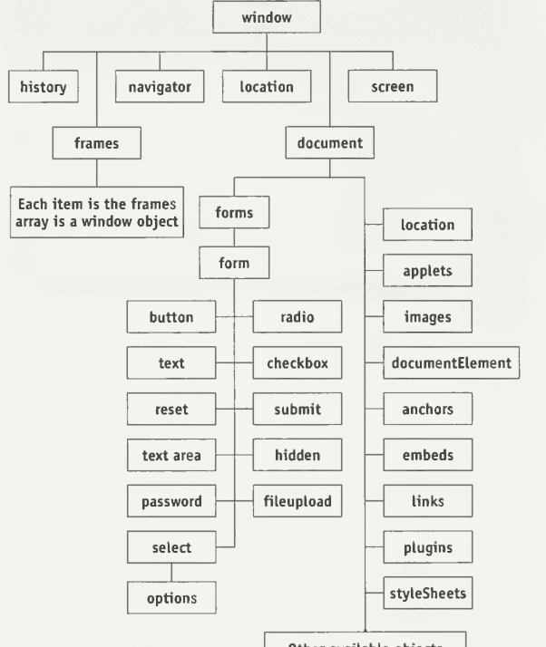

**document 对象**：如第1课所述，document 对象代表当前加载的 HTML 页面。关于 document 对象的更多信息将在本课后面介绍，我们将在第9课中详细讨论它。

**frames 数组**：JavaScript 将浏览器窗口中出现的每个框架视为一个独立的 window 对象。因此，如果你的网站使用了框架，那么代表实际浏览器窗口（即不是其中一个框架）的 JavaScript window 对象被称为父窗口。这个父窗口将包含一个名为 frames 数组的 Array 对象。frames 数组中的每个槽位将包含一个对应于 Web 浏览器中某个框架的 window 对象。虽然在 window 对象内部还有 window 对象听起来可能令人困惑，但使用起来相当容易，正如你将在第23课中看到的。

**location 属性**：这是一个 String 对象，包含当前加载到 Web 浏览器中的网页的地址。（location 对象在第27课讨论。）

**navigator 对象**：此对象保存有关你的 Web 浏览器的品牌、版本和功能的详细信息。除了这些基本信息外，它还包含已安装的插件和浏览器已知的 MIME 类型的详细列表。你的 JavaScript 程序可以使用此信息来确定特定类型的多媒体文件是否能在浏览器中工作。（navigator 对象在第26课讨论。对插件和 MIME 类型的支持在第29课讨论。）

此时，一个插图可能会有所帮助。图7-2显示了一个典型的浏览器窗口（包括框架），以及窗口的各个部分如何对应于你刚刚介绍的对象。

window 对象的另一个重要方面是它有几个不同的名称。通常，如果你想引用 window 对象，只需使用名称 `window`。但是，你根本不必命名 window 对象。如果 JavaScript 不知道你在谈论哪个对象，它会默认假设你谈论的是 window 对象并使用它。例如，以下两条语句是等效的：

```
document.write( "Howdy!");
window.document.write( "Howdy!");
```

如前所述，当你使用框架时，代表实际浏览器窗口的 window 对象可以称为 `parent`。即使你没有使用框架，也可以使用这个名称。

最后，你也可以将 window 对象称为 `self` 或 `top`。（名称 `top` 在框架的上下文中也很有用。我们将在第23课中进一步讨论。）因此，以下所有语句都是等效的。

```
document.write( "Howdy!");
parent.document.write( "Howdy!");
self.document.write( "Howdy!");
top.document.write( "Howdy!");
```

### 第7课——理解浏览器对象模型

整个 Web 浏览器窗口由 window 对象表示

位置

点击此处查看历史记录列表

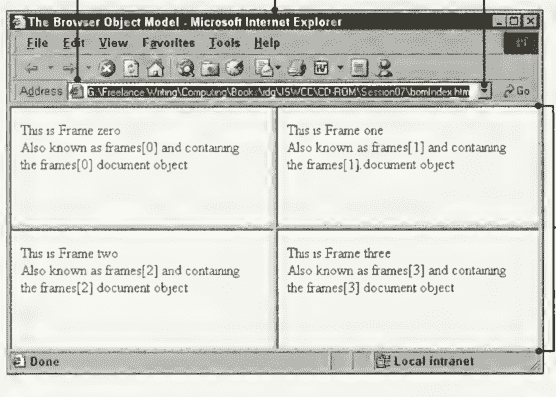

文档

### document 对象

你已经看到 document 对象如何用于将字符串写入浏览器窗口。然而，document 对象的功能远不止于此。document 对象允许你的 JavaScript 程序执行以下操作。

**与 HTML 表单交互：** 这包括操作 HTML 表单可用的所有各种控件（文本框、按钮等）。你甚至可以验证表单中的数据（第15课）并更改表单提交到的位置。这可能是 Web 页面上 JavaScript 最有用的方面，因此我们将在第12、13和15课中极其详细地探讨这一点。

**操作 Cookie：** document 对象让你直接控制保存在 Web 浏览器客户端机器上的 Cookie。我们将在第16课中探讨这一点。

**与图像交互：** 文档对象允许你直接访问和操作加载到 Web 文档中的图像。在第 14 课中，我们将看到 JavaScript 如何让我们加载图像，甚至创建简单的动画。
**与 Java 小程序交互：** 文档对象还允许你访问可能由你的网页加载的任何 Java 小程序。我们将在第 30 课中探讨这一点。

### JavaScript 与浏览器对象模型

既然你已经了解了浏览器对象模型中包含的内容，你可能想知道如何实际使用它。我已经在讨论 window 对象时向你展示了一个小例子。再次考虑这行代码：

```
window.document.write( "Howdy!");
```

这段代码到底告诉 JavaScript 做什么？嗯，回想一下我们对 String 对象方法的讨论，句点是一个运算符，它告诉 JavaScript *查看*对象内部，以便你可以访问其中包含的内容。所以，这段代码的意思是：“查看 window 对象内部，获取 document 对象。然后，查看 document 对象内部，调用其 write() 方法。”这就是你如何使用 JavaScript 访问浏览器对象模型的各个部分：从 window 对象开始，你列出将引导你到达要访问的对象的对象名称。你只需要记住用句点分隔对象名称。这个对象名称列表将告诉 JavaScript 访问你想要的浏览器对象模型对象所需遵循的路径。

### 一个简单的例子

一个 HTML 文件如何映射到浏览器对象模型？这里有一个例子。

```
<html>
<head><title>Browser Object Model</title></head>
<body bgcolor="white">
Welcome to Baby-Palooza!
<form name="order">
Number of Strollers:
<input type="text" name="strollCount" value="0" /><br />
Number of Diapers:
<input type="text" name="diaperCount" value="0" /><br />
Number of Rattles:
<input type="text" name="rattleCount" value="0" />
</form>
</body>
</html>
```

当 Web 浏览器加载此文件时，它实际上会创建一整套浏览器对象模型对象来表示它。对于此文件，会创建以下对象：

| 对象 | 含义 |
|---|---|
| window 对象 | 这代表 Web 浏览器本身。 |
| document 对象 | 这代表 HTML 文件。 |
| 名为 "order" 的表单对象 | 这代表我们 HTML 文件中定义的 <form> 标签。请注意，此对象的名称与你在 <form> 标签的 name 属性中指定的名称相同。（如果你的 HTML 文件中有多个 <form>，你只需为每个表单指定唯一的 name 属性，就可以通过 JavaScript 访问它们。） |
| 名为 "strollCount"、"diaperCount" 和 "rattleCount" 的三个输入对象 | 这些对象代表在 order 表单内定义的文本框。每个对象都有一个 value 属性，该属性保存当前在文本框中输入的数字。同样，每个 JavaScript 对象的名称直接取自其对应 HTML <input> 标签中使用的 name 属性。 |

当然，还会创建其他对象。例如，也会创建一个 forms 数组。但是，由于 HTML 文件中没有对应的定义，这些对象将是空的。（在这种情况下，forms 数组的长度将为零。）在图 7-3 中，你可以看到这些对象是如何相互嵌套的。

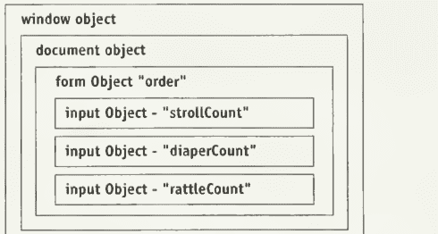

**图 7-3**
*由我们简单的 HTML 文件创建的对象*

了解了所有这些，你就可以编写访问这些对象的代码了。例如：

```
var numStrollers = document.order.strollCount.value;
var numDiapers = document.order.diaperCount.value;
```

在每一行代码中，我都是从最外层的对象（在这种情况下是 document 对象，记住 window 对象是隐含的）“向下钻取”到我想要访问的属性（各个文本框对象的 value 属性）。例如，第一行代码的意思是：“查看 document 对象，你会找到一个名为 order 的对象。查看 order 对象内部，你会找到另一个名为 strollCount 的对象。查看此对象内部，获取其 value 属性的内容。最后，将该结果放入 numStrollers 变量中。”当然，你也可以为这些属性赋值：

```
document.order.strollCount.value = 10;
document.order.diaperCount.value = 95;
```

然而，这些不仅仅是简单的赋值语句。请记住，这些对象对应于你的 JavaScript 程序执行时屏幕上实际存在的 HTML 元素。因此，如果你为 rattleCount 文本框对象的 value 属性分配一个新值，该数字将立即显示在屏幕上的文本框中！这就是 JavaScript 与浏览器对象模型结合如此强大的原因。通过一起使用它们，你的 JavaScript 程序可以轻松地与 HTML 页面的元素交互，并动态更改用户看到的信息。


### 复习

在本课中，你学习了浏览器对象模型。你了解到，就 JavaScript 而言，Web 浏览器及其内部的一切都只是一组 JavaScript 对象。你还学习了如何创建语句来访问浏览器对象模型的各个部分。最后，你看到了你的 JavaScript 代码与浏览器对象模型之间的交互如何改变用户在 Web 浏览器中看到的内容。

### 自我测验

1.  window 对象代表什么？（参见“window 对象”。）
2.  frames 数组中保存了什么？（参见“window 对象”。）
3.  self 对象指的是什么？（参见“window 对象”。）
4.  浏览器对象模型如何使用 HTML 标签的 name 属性？（参见“一个简单的例子”。）
5.  当你为文本框对象的 value 属性赋值时会发生什么？（参见“一个简单的例子”。）

# 第 8 课

## 使用 window 对象

#### 课程清单

- 理解 window 对象是什么
- 了解 window 对象的属性和方法

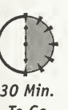

正如你在上一课中看到的，window 对象是一个 JavaScript 对象，它代表整个 Web 浏览器窗口。通过使用 window 对象，你的 JavaScript 代码可以有效地控制浏览器的几乎所有方面。你可以想象，第 7 课只是触及了 window 对象内容的皮毛。在本课中，我们将更深入地探讨 window 对象，以便你了解如何在 JavaScript 程序中使用其属性和方法。（这些属性和方法的示例可以在你的 CD-ROM 的 Session08 文件夹中找到。）

> Netscape 和 Internet Explorer 都为 window 对象添加了专有属性和方法。因此，我将仅限于介绍在两种浏览器中都有效的属性和方法。如果你需要编写特定于浏览器的 JavaScript，请参阅第 26 课。

### window 对象的属性

在阅读以下描述时，请记住，window 对象及其属性可以像任何其他对象一样赋值给 JavaScript 变量。本课中的许多示例都利用了这一事实来打开和跟踪多个窗口。

#### closed 属性

这告诉你特定的 window 对象是否代表一个打开的浏览器窗口。如果窗口是打开的，closed 属性将为 false。如果窗口已关闭，它将为 true。

#### defaultStatus 属性

此属性指定将在浏览器状态栏中显示的字符串。（状态栏通常位于浏览器窗口的左下角。）

#### document 属性

这是 document 对象。它代表当前加载到浏览器窗口中的 HTML 文档，或加载到特定框架中的 HTML 文档。document 对象将在下一课中详细讨论。

#### frames 数组

此数组为多框架网站中的每个框架保存一个 window 对象。（frames 数组将在第 23 课中详细讨论。）

#### history 属性

history 属性是一个对象，包含历史记录列表——即该 window 对象访问过的网站列表。每个 window 对象（包括 frames 数组中的那些）都有自己的 history 属性。（history 对象将在第 27 课中讨论。）

### 第8课——使用 window 对象

### location 属性

location 属性保存着当前正在查看的页面的 Web 地址。如果你为这个属性分配一个新的 Web 地址，Web 浏览器将加载该网页。（location 对象将在第27课中详细讨论。）

### name 属性

此属性包含窗口对象的名称。请注意，这与实际保存窗口对象的 JavaScript 变量的名称不同。例如：

```javascript
var catalogWindow = window.open();
catalogWindow.name = "catalog";
```

一旦你为窗口对象分配了一个名称，就可以在锚点标签的 target 属性中使用该名称。因此，在下面的示例中，点击“查看目录”链接将把 catalog.htm 文件加载到由你的 JavaScript 代码打开的窗口中。

```html
<a href="catalog.htm" target="catalog">See the Catalog</a>
```

### navigator 属性

navigator 对象包含有关 Web 浏览器的信息，包括其版本、品牌信息和平台信息。以下简单的脚本将显示 navigator 对象中包含的所有内容。（我们将在第26课中讨论如何使用这些信息来编写特定于浏览器的脚本。）

```javascript
for (x in navigator)
    document.write( x + " = " + navigator[x] + "<br />");
```

### opener 属性

当一个窗口创建另一个窗口（使用 window.open() 方法，本课稍后讨论）时，第一个窗口成为新窗口的 opener。这允许你在窗口之间进行实际通信。（我们将在第24课中探讨这个过程。）

```javascript
self.name = "original";
var newWindow = window.open();
document.write( newWindow.opener.name);
```

### parent 属性

如果你的网站使用框架组织，每个框架都被视为其自己的窗口。因此，每个框架都有自己的窗口对象。这些窗口对象都是将这些框架加载到 Web 浏览器中的框架集文档的“子对象”。因此，代表框架集文档的窗口对象被称为每个框架的 *父对象*。parent 属性保存代表框架集文档的窗口对象。如图8-1所示。（图8-1的源代码在文件 framesNparent.htm 中。）

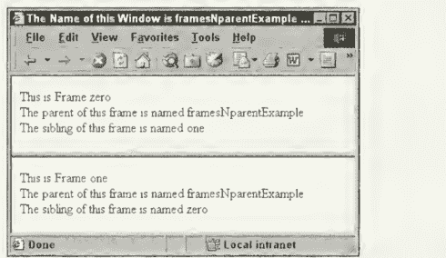

**图8-1**
*框架与 parent 属性*

### screen 属性

screen 属性包含有关客户端显示器屏幕设置的信息。你可以使用此信息来确定客户端显示器的分辨率，并加载适当大小的图形。（我们将在第14课中讨论 screen 属性。）

### status 属性

此属性保存一个字符串，该字符串将临时显示在浏览器的状态栏中。短暂时间后，defaultStatus 属性中的字符串将替换此消息。

### top 属性

top 属性指的是基于框架的窗口集合中最顶层的窗口。这本质上是代表实际 Web 浏览器窗口的窗口对象。这与 parent 属性有何不同？请看图8-2。

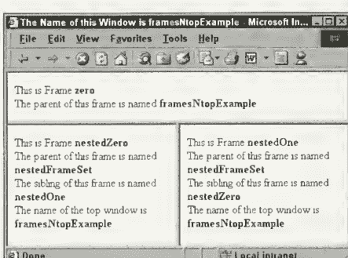

此窗口显示了一个框架集中的框架集。如你所见，最内层的框架集（底行）的父对象本身是浏览器窗口中的一个框架。在这种情况下，这些框架的父对象与实际的浏览器窗口不是同一回事。另一方面，top 属性始终代表实际的浏览器窗口。

### window 对象的方法

window 对象提供了几种方法。在本节中，我们将研究这些方法，并了解如何使用它们与用户和 Web 浏览器本身进行交互。

### alert() 方法

此方法显示一个包含你指定的消息和一个“确定”按钮的对话框。调用此方法将暂停你的 JavaScript 程序的执行，直到用户点击“确定”按钮继续。（请注意，在 Netscape Navigator 的 Linux 版本中，alert() 方法 *不会* 暂停你的程序执行！）alert() 方法作为调试工具非常有用。如果你需要知道一个变量的值，只需将其放入 alert() 调用中，你就会看到该值弹出在你面前的屏幕上。例如，如果你想知道名为 price 的变量的值，只需编写 alert( price)。

### blur() 方法

blur() 方法将从关联的窗口对象移除焦点。这意味着该窗口对象将不再接收用户键入的任何按键。如果你对框架中的窗口调用 blur()，焦点将转移到其浏览器窗口中的 top 对象。如果你对顶级窗口（即代表浏览器的窗口）调用 blur()，该窗口通常会被发送到所有其他打开的浏览器窗口的后面。

### clearInterval() 和 clearTimeout() 方法

请参阅本课后面关于 setInterval() 和 setTimeout() 方法的讨论。

### close() 方法

调用 close() 方法将关闭关联的浏览器窗口。作为安全措施，大多数 Web 浏览器只允许你关闭自己创建的窗口。如果你尝试关闭由系统创建的浏览器窗口，通常会看到一个确认对话框，告诉你正在查看的网页试图关闭该窗口。例如，假设你启动 Internet Explorer（Windows 版）并立即加载包含以下代码的文件：

```javascript
var newWindow = window.open();
newWindow.close();
self.close();
```

第一个 close() 调用将按预期进行。但是，第二个 close() 调用将弹出一个对话框，要求你确认是否要关闭该窗口。

### confirm() 方法

confirm() 方法允许你向用户询问一个简单的“确定”或“取消”问题。你向 confirm() 方法传递一个包含你的问题的字符串，它会将该问题连同一组“确定”和“取消”按钮一起呈现给用户。如果用户点击“确定”按钮，则返回 true。如果用户点击“取消”按钮，则返回 false。

```javascript
if (confirm("Would you like to proceed?")) {
    alert("Here we go...");
}
else {
    alert("I understand. These things can be scary!");
}
```

### focus() 方法

focus() 方法将告诉 Web 浏览器将按键定向到指定的窗口对象。如果指定的窗口对象不是最前面的窗口，focus() 方法会将该窗口带到前面。

### moveBy() 方法

调用此方法将按指定的像素数移动指定的窗口。

```javascript
self.moveBy(10, 30); self.moveBy(-10,-30);
```

第一条语句将窗口从当前位置向右移动10像素，向下移动30像素。第二条语句将窗口从当前位置向上移动10像素，向左移动30像素。请注意，大多数浏览器不允许你将窗口移出屏幕。

### moveTo() 方法

此方法将窗口移动到屏幕上的绝对位置。例如：

```javascript
self.moveTo(0, 0); self.moveTo(100,300);
```

第一条语句将窗口移动到屏幕的左上角。第二条语句将窗口移动到距离屏幕顶部100像素、距离屏幕左侧300像素的位置。同样，大多数浏览器不允许你将窗口移出屏幕。

### open() 方法

正如你在本课的其他几个示例中看到的，open() 方法打开一个新的浏览器窗口，并返回一个代表它的窗口对象。如果你不带参数调用 open() 方法，你将得到一个空的浏览器窗口。如果你想要更有趣的内容，可以按以下顺序传递最多四个参数：

- **url**：这是你希望自动加载到新窗口中的网页的 Web 地址。
- **name**：这是一个字符串，将被放置到新窗口的 window.name 属性中。
- **featuresList**：这是一个字符串，指定新窗口应具有的功能。此参数允许你指定窗口的大小、是否应有工具栏、滚动条等。（我们将在第24课中讨论这些功能。）
- **replace**：这是一个布尔值，指定第一个参数中指定的 Web 地址是否应替换历史记录列表中的当前条目。

例如，以下代码将创建一个名为“hungryMinds”的新窗口对象，该对象将显示 Hungry Minds 网站。

```javascript
var bookSite = window.open( "http://www.hungryminds.com",
"hungryMinds");
```

### prompt() 方法

prompt() 方法允许你向用户提问并获得答案。你向 prompt() 方法传递两个参数：一个消息字符串和一个默认响应值。以下语句将向用户显示如图8-3所示的对话框。

```javascript
var response = prompt( "What is your favorite color?", "black");
```

请注意，在 prompt() 调用中指定的默认响应显示在文本框中。用户可以键入覆盖此值，或点击“确定”接受它作为他们的回复。如果他们点击“确定”，键入文本框的值将返回到你的脚本。如果用户点击“取消”，一个名为 null 的特殊值将返回到你的脚本。null 告诉你的程序 prompt() 没有返回任何内容。（null 值在 JavaScript 中用于表示“无”或空对象。）由于 null 是一个 JavaScript 关键字，你可以这样检查它：var response = prompt("你最喜欢的颜色是什么？", "黑色");
if (response == null) {
    alert("你点击了取消按钮");
}
else {
    alert("你的回答是 " + response);
}

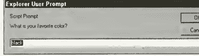

### resizeTo() 方法

此方法会将浏览器窗口调整为指定的宽度和高度。

```
self.resizeTo(50, 325); // 将宽度设置为50，高度设置为325
```

请注意，你指定的尺寸代表的是*整个*浏览器窗口（包括工具栏、按钮等），而不仅仅是窗口的文档部分！

### scroll() 和 scrollTo() 方法

这两个方法中的每一个都允许你将窗口的内容滚动到指定的点。指定的点将出现在窗口的左上角。

```
scroll(0, 0); scrollTo(0, 30);
```

第一条语句将滚动到文档顶部，而第二条语句将向下滚动文档30像素。

### scrollBy() 方法

scrollBy() 方法会将文档从当前位置滚动指定的像素数。以下语句将文档向上滚动25像素。

```
scrollBy(0, -25);
```

### setInterval() 和 clearInterval() 方法

setInterval() 方法与 setTimeout() 方法几乎完全相同。（事实上，在继续阅读此处之前，你应该先阅读 setTimeout() 方法的描述。）主要区别在于，你传递给 setInterval() 的 JavaScript 语句会被反复执行。每次执行后，计时器会重置，倒计时重新开始。因此，此语句将每隔两秒向下滚动文档100像素。

```
var intervalID = setInterval( 'scrollBy( 0, 100);', 2000);
```

停止此过程的唯一方法是关闭浏览器窗口，或使用 clearInterval() 方法停止计时器的倒计时。

```
clearInterval( intervalID);
```

### setTimeout() 和 clearTimeout() 方法

此方法是 window 对象中最有用但也最令人困惑的方法之一。setTimeout() 方法接受两个参数：第一个是代表有效 JavaScript 语句的字符串。第二个是表示以毫秒为单位的时间段的数字。（一毫秒是千分之一秒。因此，1000毫秒等于1秒。）

setTimeout() 方法接受第一个参数并将其放入一个特殊的队列中。然后它接受第二个参数并用它来启动倒计时。例如，如果你为第二个参数传递2000毫秒，你将得到一个两秒的倒计时。

一旦倒计时结束，第一个参数将被检索并传递给 JavaScript 解释器。然后 JavaScript 解释器将执行字符串中的语句，就像你直接将其输入到源代码中一样。

在此示例中，setTimeout() 方法将设置一个五秒的计数器。当计时器到期（即超时）时，语句 alert('Hello World!') 将被执行。

```
setTimeout( "alert('Hello World!')", 5000);
```

请注意，我们传递的字符串是一个有效的 JavaScript 语句。还要注意我在这个例子中是如何嵌套引号的。如果我这样写这个语句：

```
setTimeout( "alert("Hello World!")", 5000);
```

该语句将会失败，因为你不能在单个字符串中包含两组相同类型的引号。

另一件需要注意的事情是，`setTimeout()` 方法*不会*对第一个参数中指定的语句设置递归调用。第一个参数中的 JavaScript 语句只执行一次，并且仅在指定的毫秒数过去之后执行。要反复执行一个语句，请改用 `setInterval()` 方法。

虽然在这些示例中没有显示，但 `setTimeout()` 方法也会返回一个结果。这个结果是一个计时器 ID，你可以选择保留它或完全忽略它。如果你决定保留它，你可以将此计时器 ID 传递给 `clearTimeout()` 方法，计时器将被停止，并且相关的 JavaScript 语句将不会被执行。

`setTimeout()` 方法是 window 对象中极其强大和重要的部分。事实上，它非常有用，你会发现它在本课程的大量示例文件中被使用。（我们将在第20课中更详细地讨论 `setTimeout()` 方法及其近亲 `eval()` 函数。）

> 你*永远不*应该在 JavaScript 中编写递归函数！如果你这样做，你很快就会生成一条错误消息，提示 JavaScript 解释器内存不足。在最坏的情况下，你甚至可能使浏览器崩溃！相反，始终使用 `setInterval()` 或 `setTimeout()` 方法来设置重复的函数或代码块。（有关递归函数的示例，请参见 Session08 文件夹中的 `recurseBad.htm` 文件。但在加载此文件之前，请务必保存所有工作！）

### 复习

这又是信息量满满的一课，但结果是你现在几乎了解了关于 window 对象的所有知识。你已经学习了构成 window 对象的属性和方法，并且，如果你加载了 CD-ROM 上的任何源文件，你已经看到了如何使用它们。

### 自我测验

1.  parent 和 top 属性有什么区别？（参见“window 对象的属性”。）
2.  navigator 对象中包含什么？（参见“window 对象的属性”。）
3.  opener 属性包含什么？（参见“window 对象的属性”。）
4.  alert() 方法做什么？（参见“window 对象的方法”。）
5.  setTimeout() 和 setInterval() 方法做什么？（参见“window 对象的方法”。）


# 第9课

## 使用 document 对象

#### 课程清单

- 理解 document 对象是什么
- 了解 document 对象的属性和方法

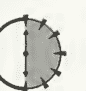

还剩30分钟

document 对象是一个 JavaScript 对象，它代表当前加载到 Web 浏览器中的 HTML 页面。与你见过的其他对象一样，document 对象包含大量的属性和方法，让你可以研究和操作 HTML 页面。在本课中，我们将研究这些属性和方法，看看如何从 JavaScript 中使用它们。（展示每个属性和方法用法的示例可以在你 CD-ROM 的 Session09 文件夹中找到。）

> 与 window 对象一样，每个主要的 Web 浏览器都为 document 对象定义了几个专有属性和方法。同样，我将把讨论限制在那些应该在最新版本的 Internet Explorer 和 Netscape Navigator 中工作的项目上。

### document 对象的属性

在接下来的部分中，你将看到如何使用 document 对象的属性来影响用户查看 HTML 文档的方式。

#### alinkColor 属性

`alinkColor` 属性指定用于显示当前活动链接的颜色。当前活动链接是指如果你按下回车键或用鼠标点击它将会跟随的链接。要更改此颜色，只需为其分配一个新的颜色值：

```
document.alinkColor = "gray";
```

如果你需要对想要使用的颜色进行更多控制，你也可以分配一个十六进制颜色值。但请注意，这些十六进制值需要以井号（#）开头，而不是在将十六进制值分配给 JavaScript 变量时使用的 0x。因此，使用十六进制值的等效语句如下所示：

```
document.alinkColor = "#808080";
```

当你以这种方式分配颜色时，你是在指定将混合以创建最终颜色的红、绿、蓝（RGB）颜色值。在上面的例子中，所有三种颜色都被分配了 0x80（十进制128）的值。在下面的例子中：

```
document.alinkColor = "#00FF77";
```

红色的值是 0x00（零，可能的最低值），绿色的值是 0xFF（十进制255，可能的最高值），蓝色的值是 0x77（十进制119）。这些值将被混合以得出最终的显示颜色。

但是，如果你不想处理数字，有几个标准化的颜色值已被赋予名称，你可以用于你的颜色。表9-1显示了你可以用于此属性和 document 对象其他与颜色相关属性的标准颜色名称（及其等效的十六进制值）。

#### 表 9-1
标准颜色名称与编号

| 颜色名称 | 十六进制颜色编号 (#RRGGBB) | 颜色名称 | 十六进制颜色编号 (#RRGGBB) |
|---|---|---|---|
| 水色 | #00FFFF | 海军蓝 | #000080 |
| 黑色 | #000000 | 橄榄色 | #808000 |
| 蓝色 | #0000FF | 紫色 | #800080 |
| 品红 | #FF00FF | 红色 | #FF0000 |
| 灰色 | #808080 | 银色 | #C0C0C0 |
| 绿色 | #008000 | 水鸭色 | #008080 |
| 酸橙绿 | #00FF00 | 白色 | #FFFFFF |
| 栗色 | #800000 | 黄色 | #FFFF00 |

### anchors 数组

anchors 数组为文档中每组 `<a name="someName"></a>` 标签保存一个 Anchor 对象。每个 Anchor 对象都有一个 name 属性，该属性包含 HTML 锚点标签的 name 属性中指定的名称。因此，以下 HTML

```
<a name="top">This is the top</a>
<!-- Lots of content would go here -->
<a name="bottom">This is the bottom</a>
```

将创建一个包含两个 Anchor 对象的 anchors 数组。第一个锚点对象的 name 属性为 "top"，第二个的 name 属性为 "bottom"。

### applets 数组

applets 数组保存嵌入在 HTML 文档中的所有 Java 小程序。（此数组中的每个项目对应于 HTML 文档中的一个 `<applet>` 标签。）你可以访问这些 Java 小程序的属性和方法，与每个小程序对外公开的属性和方法相同。我们将在第 30 讲中更详细地讨论 Java 和 JavaScript 之间的关系。

### bgColor 属性

此属性允许你设置 HTML 文档的背景颜色。

```
document.bgColor = "red";
```

请注意，在 Netscape Navigator 中，你只能在 HTML 文档的开头（即位于 `<head></head>` 标签之间的脚本块中）为 bgColor 赋值。然而，在 Internet Explorer 中，你可以随时为此属性赋值。这将立即改变文档的背景颜色。

### cookie 属性

cookie 属性允许你读取和设置 HTML 文档的客户端 cookie 值。读取和写入 cookie 非常简单：

```
var theCookie = document.cookie; // read the cookie
document.cookie = theCookie; // write the cookie
```

然而，正如你将在第 16 讲中看到的，实际使用 cookie 会稍微复杂一些。

### domain 属性

此属性包含加载 HTML 文档的 Web 服务器的主机名。（如果文档是从本地文件加载的，此属性将包含空字符串。）正如我之前暗示的，一个浏览器窗口中的 JavaScript 代码可以与另一个窗口中的 JavaScript 通信。但是，这仅在每个想要通信的窗口的 document.domain 属性相同时才被允许。因此，如果你想通信的两个 HTML 文件来自你网站上的两个不同服务器（即两个不同的域名），这可能会带来问题。在第 24 讲中，我将向你展示如何使用 document.domain 属性来绕过此限制。

### embeds 数组

embeds 数组包含 HTML 文档中每个 `<embed>` 标签的一个条目。如果单个嵌入项具有 Java 风格的接口，你可以像与 applets 数组中的 Java 小程序交互一样与之交互。然而，这完全取决于嵌入项本身。

### fgColor 属性

此属性允许你更改 HTML 文档的前景色。

```
document.fgColor = "blue";
```

（与 bgColor 属性不同，只有旧版本的 Netscape Navigator 将此属性的使用限制在 HTML 文档的开头。在 Navigator v6 及更高版本中，你可以随时为 fgColor 赋值。）

### forms 数组

forms 数组包含 HTML 文档中每组 `<form></form>` 标签的一个表单对象。这些表单对象本身包含代表用户在表单中交互的各种控件（文本框、选择菜单等）的对象。表单对象及其内容是文档对象最重要和最有用的部分之一，因此我将在第 12、13 和 15 讲中详细介绍它们。

### images 数组

images 数组包含 HTML 文档中每个 `` 标签的一个条目。每个条目都是一个 JavaScript Image 对象，你可以用它来加载新图像或创建简单动画。你可以在第 14 讲中找到关于 images 数组及其使用方法的信息。

### lastModified 属性

这是一个 String 对象，包含 HTML 文件在磁盘上最后更改的日期。

### linkColor 属性

此属性保存用于显示文档中链接（`<a href="somedestination"></a>` 标签）的颜色。与 fgColor 属性一样，旧版本的 Netscape Navigator 将此属性的使用限制在 HTML 文档的开头。在最新的浏览器中，你可以随时为 linkColor 赋值。

### links 数组

此数组为 HTML 文件中的每个 `<a href="somedestination"></a>` 标签保存一个 Link 对象。

### Link 对象

JavaScript Link 对象包含许多不同的属性，这些属性可以为你提供大量关于它所代表的 HTML 链接的信息。这些信息可用于编写各种有趣的脚本。（你 CD-ROM 上的 linksArray.htm 文件展示了此信息的一种用途。）Link 对象的属性因浏览器而异，但最常见（也是最有用）的属性在以下部分中描述。

**Link.hash 属性** 这是一个 String 对象，包含链接中指定的 Web 地址的哈希部分。例如，在此链接中，哈希部分是 #top。

```
<a href="http://www.baby-palooza.com/index.htm#top">Baby-Palooza</a>
```

**Link.host 属性** 这是一个 String 对象，包含链接 Web 地址中的主机信息。例如，在此链接中，主机部分是 www.baby-palooza.com:80。

```
<a href="http://www.baby-palooza.com">Baby-Palooza</a>
```

**Link.hostname 属性** 这是一个 String 对象，仅包含链接 Web 地址中的主机名信息。例如，在此链接中，主机名部分是 www.baby-palooza.com。

```
<a href="http://www.baby-palooza.com">Baby-Palooza</a>
```

**Link.href 属性** 此 String 对象包含链接中指定的整个 Web 地址。例如，在此链接中，href 部分是 http://www.baby-palooza.com/。

```
<a href="http://www.baby-palooza.com">Baby-Palooza</a>
```

**Link.pathname 属性** 如果 Web 地址指向服务器上某个文件夹中的文件，此属性将包含该文件的路径。在此链接中，pathname 属性将包含字符串 strollers/index.htm。

```
<a href="http://www.baby-palooza.com/strollers/index.htm">Strollers</a>
```

**Link.port 属性** 这是一个 String 对象，包含链接 Web 地址中指定的端口。

```
<a href="http://www.baby-palooza.com:80">Baby-Palooza!</a>
```

此处，port 属性将包含值 80。

**Link.protocol 属性** 链接 Web 地址中指定的协议（http、ftp 等）。

**Link.search 属性** 这是 Web 地址中指定的查询字符串。

```
<a href="http://www.baby-palooza.com/search.htm?type=stroller">Show Strollers</a>
```

在此示例中，search 属性将包含字符串 ?type=stroller。请注意，问号包含在字符串的开头。

**Link.target 属性** 这是一个 String 对象，包含链接中指定的目标窗口的名称。在以下链接中，target 属性将包含字符串 goodBooks。

```
<a href="http://www.hungryminds.com" target="goodBooks">Hungry Minds</a>
```

**Link.innerHTML 属性** 此属性在 Netscape Navigator v6 和 Internet Explorer v5 及更高版本中可用。基本上，它是 Web 浏览器中为特定链接显示的文本。例如，在此链接中，字符串 "Hungry Minds" 将位于 innerHTML 属性中。

### location 属性

该属性保存了 HTML 文档加载来源的 Web 地址。将新的 Web 地址赋值给 location 将强制浏览器加载存储在该地址的页面。

```
document.location = "http://www.hungryminds.com";
```

### plugins 数组

这是 embeds 数组的另一个名称。Netscape Navigator 6 不支持此属性，可能是为了避免与 navigator.plugins 数组（你将在第 29 课中学习）混淆。navigator.plugins 数组保存有关浏览器本身安装的扩展程序的信息，而 plugins 数组（以及 embeds 数组）保存有关单个 HTML 文档中嵌入的项目的信息。（尽管只有 Internet Explorer 支持此属性，但我在此提及是为了区分 plugins 数组和 navigator.plugins 数组。）

### referrer 属性

referrer 属性是一个 String 对象，它保存了当前 HTML 文档来源文档的 Web 地址。（请注意，此属性存在于 Internet Explorer 和 Netscape Navigator 的最新版本中，但似乎不起作用。）

### title 属性

此属性保存一个包含 HTML 文档标题的字符串。这是在 `<title></title>` 标签之间指定的标题。（在 Internet Explorer v5+ 和 Netscape Navigator v6 中，你可以为此属性赋一个新字符串，窗口的标题将会改变。）

### URL 属性

此属性包含与 `location` 属性相同的信息。主要区别在于，在 Netscape Navigator 中，为 URL 属性赋值新的 Web 地址没有任何效果。（在 Internet Explorer 中，为 URL 属性赋值新地址将强制浏览器加载该页面。）

### vlinkColor 属性

此属性指定用于显示已访问链接的颜色。

### document 对象的方法

除了前面几节讨论的属性外，document 对象还包含几个方法，允许你操作文档的实际内容。

### clear() 方法

过去，`clear()` 方法用于清除浏览器窗口的内容。然而现在，`clear()` 方法实际上几乎不起作用。事实上，`clear()` 方法将在不久的将来从 JavaScript 中移除。那么，为什么还要提及它呢？嗯，有很多 JavaScript 代码使用了 `clear()` 方法，所以我认为你应该了解它。但是，不要在你自己的 JavaScript 代码中使用 `clear()` 方法！

### open() 和 close() 方法

当你使用 `write()` 或 `writeln()` 方法向 document 对象写入字符串时，你实际上是向一个称为 *流* 的东西发送数据。流实际上只是数据的暂存区。数据停留在流中，直到浏览器准备好接收它。在这种情况下，你的字符串数据停留在流中，直到浏览器可以将其写入浏览器窗口。准备流以供使用的过程称为 *打开* 流。相反，当你完成使用流时，你应该 *关闭* 它。这就是这些方法的作用。

`open()` 方法告诉浏览器你想要向当前 document 对象写入一些新的字符串数据。`close()` 方法告诉浏览器你已完成数据写入。它还强制浏览器输出流中剩余的任何数据。

通常，你不必费心使用这两个方法。当浏览器加载 HTML 文件时，它会自动打开一个输出流，并开始用 HTML 文件的内容以及你在 JavaScript 代码中进行的任何 `document.write()` 或 `document.writeln()` 调用的输出来填充它。然后，当 HTML 文件完全加载（并且你的 JavaScript 代码已完成其输出创建）后，浏览器将关闭流并显示页面。但是，如果你想在 HTML 页面加载 *之后* 向浏览器窗口发送任何文本，你需要按照以下步骤操作：

1. 调用 `document.open()`。这将再次打开 document 对象以供写入。
2. 进行你的 `document.write()` 或 `document.writeln()` 调用。这将允许你写出任何你希望的 HTML 或纯文本。
3. 调用 `document.close()`。这告诉浏览器你已完成向浏览器窗口的输出。作为响应，它将关闭输出流，并将流中剩余的任何字符写入浏览器窗口。

正如你可能猜到的，这种调用组合实际上可以让你动态创建自己的 HTML 页面。虽然这是 JavaScript 的一个非常强大的功能，但 `open()` 方法有一个副作用你需要了解：当你调用 `open()` 方法时，文档的内容会从浏览器窗口中清除。（这就是为什么 `clear()` 方法不再使用。`open()` 方法的作用完全相同。）然后，一旦调用 `close()` 方法，你写入浏览器窗口的任何内容实际上将 *替换* 浏览器窗口的旧内容！考虑以下代码：

```html
<html>
<head>
<title>The document Object: the open() and close() Methods</title>
<script language="javascript">
function writeNewStuff() {
    document.open();
    for (x=0; x<5; x++) {
        document.write("Oh dear! I seem to have overwritten everything!<br />");
    }
    document.close();
}
</script>
</head>
<body bgcolor="white">
<script language="javascript">
for (x=0; x<5; x++) {
    document.write( "Shop at Baby-Palooza!<br />");
    }
timeout( 'writeNewStuff()', 5000);
</script>
</body>
</html>
```

在这里，文件底部的代码写出了五行宣传文字，然后设置了一个计时器，该计时器将在五秒后调用 writeNewStuff() 函数。当此函数执行时，它调用 open() 方法，然后写出另外五行文本。最后，它调用 close() 将该文本发送到浏览器窗口。如果你将此文件加载到浏览器中，你会在屏幕上看到初始文本几秒钟，然后它会突然被 writeNewStuff() 函数的输出替换。如果你随后查看浏览器窗口的源代码，你会发现 HTML 文档的原始内容已经消失，包括你的 JavaScript 代码！

这个故事的寓意是，调用你的代码所在文档的 open() 和 close() 方法是一个非常糟糕的主意。正如我们将在第 23 课中看到的，更好的方法是将你的 JavaScript 代码放在一个控制框架中，将你的内容放在另一个显示框架中。这样，你的 JavaScript 代码可以使用 open()、write() 和 close() 方法来更改显示框架中的内容，而你的 JavaScript 代码本身保持不变。

### write() 方法

此时，你应该非常熟悉 write() 方法的作用。它只是向浏览器窗口写出一个字符串。该字符串可以包含任何可打印字符，甚至包括构成 HTML 标签的字符。我们将在第 11 课中更详细地讨论这一点。

### writeln() 方法

writeln() 方法与 write() 方法类似，但有一个额外功能。在你指定的字符串末尾，它会添加一个换行符。虽然这不会出现在你最终的 HTML 输出中，但它将通过在每行输出的末尾放置一个换行符来帮助格式化底层 HTML 代码（这会导致后续的输出行从下一行开始）。

### 复习

在本课中，你学习了 document 对象的属性和方法。首先，你了解了如何使用属性来检查和更改当前加载的 HTML 文档的特征。然后，你了解了如何使用 document.open()、document.write() 和 document.close() 方法为浏览器窗口创建新内容。

### 自我测验

1.  document 对象是什么？（参见“使用 document 对象”。）
2.  forms 数组中保存了什么？（参见“forms 数组”。）
3.  links 数组代表什么？（参见“links 数组”。）
4.  当你为 document.location 属性赋值一个新的 Web 地址时会发生什么？（参见“location 属性”。）
5.  document.open() 方法的主要副作用是什么？（参见“open() 和 close() 方法”。）

## 第10课
事件响应

#### 课程清单

-   理解什么是事件以及JavaScript如何处理它们
-   学习哪些事件可以用JavaScript处理
-   学习如何使用事件来响应用户操作

你已经了解了JavaScript语言的工作原理，也学到了很多关于浏览器对象模型如何让JavaScript与浏览器交互的知识。然而，到目前为止我向你展示的几乎所有内容，都需要你，作为程序员，主动去让事情发生。在本课中，你将学习如何编写JavaScript代码，这些代码实际上会等待事情发生，然后做出相应的反应。

### 什么是“事件”？

套用一句流行的俗语，“事情总会发生。”这不仅在生活中是如此，在Web浏览器中也是如此。当Web浏览器中发生了一些有趣的事情时，就称之为事件。例如，当用户在表单上点击一个按钮时，那就是一个事件。然而，事件并非只由用户创建。

当浏览器完成加载一个网页时，那也是一个事件。事实上，在Web浏览器环境中，有十几种不同类型的事件可能发生。有事件会告诉你按键被按下、表单被提交，甚至文本框的内容发生了变化！这一点的意义在于，事件的存在是为了代表Web浏览器中几乎可能发生的一切。例如，你创建的每一个HTML控件都会生成自己的一套事件。因此，你可以编写JavaScript代码来单独响应每个控件的事件。这让你对网页的行为拥有了难以置信的控制力。

响应一个事件被称为*处理*该事件，而你编写的用于处理事件的JavaScript代码被称为*事件处理程序*。所以，例如，你可以编写一个事件处理程序，当你的HTML文档加载完成时被调用，再编写另一个，当你的某个表单中的选择菜单选择了一个新项目时被调用。当然，你不必为*每一个*事件都创建事件处理程序，但如果你真的需要，你可以这样做。

### 创建事件处理程序

事件处理程序通常是你专门创建的、用于处理特定类型事件的JavaScript函数。事件处理程序也可以是嵌入在定义事件的HTML中的一条或多条JavaScript语句。

创建事件处理程序的第一步是实际定义你想要处理的事件。事件定义总是以字母*on*开头，并且通常作为HTML标签的一部分来定义。例如，当Web浏览器完成加载HTML文档时，会发生一个*load*事件。因此，这个事件将被定义为文档主体的*onload*事件。所以，*onload*事件被定义为`<body>`标签的一部分，如下所示：

```
<body onload="alert('Welcome to Baby-Palooza.com!')">
```

这里我写了事件的名称（*onload*），后面跟着一个等号。然后，在引号中，是我想要在响应事件时执行的JavaScript语句。几乎所有的事件定义都遵循这种相同的基本格式。

现在的问题是，“这到底做了什么？”嗯，HTML文档的*onload*事件发生在该文档的最后一个字符被加载到Web浏览器之后。因此，一旦Web浏览器加载了HTML文件的最后一个字符，它就会查看我是否在`<body>`标签中定义了*onload*事件处理程序。我定义了，所以在那时它实际上会执行等号后面引号中的JavaScript语句。最终结果是，在页面加载后，将出现一个警报窗口，欢迎用户访问Baby-Palooza.com网站。

触发事件的行为有时被称为*触发*事件。所以，你可能会听到有人说类似这样的话：“当**onload**处理程序触发时，你将被引导到一个新的网站。”

事件处理程序可以不止一条JavaScript语句。所以，这样写是完全合法的：

```
<script language="javascript">
var pageLoaded = false;
</script>
<body onload="alert('Welcome!'); pageLoaded = true;">
```

这个事件处理程序包含一个对alert()方法的调用，后面跟着一个赋值语句。（记住，如第2课所示，你可以在一行中包含多条JavaScript语句，只需用分号分隔即可。）这个处理程序中只有两条语句，但它同样可以包含三条语句或十几条语句。

在这个例子中另一个需要注意的重要点是，我的事件处理程序中的代码可以完全访问我的全局变量（在这个例子中是pageLoaded变量）。记住，JavaScript全局变量*随处*可访问，包括在事件处理程序内部。

当然，如果你的事件处理程序需要做一些复杂的事情，你可能希望将它放在一个函数中。正如你可能预料的那样，它看起来会像这样：

```
<script language="javascript">
var pageLoaded = false;
function doLoad( isLoaded) {
    pageLoaded = isLoaded;
    alert( 'Welcome!');
    }
</script>
<body onload="doLoad( true);">
```

在这种情况下，我只是定义了一个函数（doLoad()）来处理事件。所以，我的事件处理程序只是调用这个函数。为了证明这与任何其他函数调用相同，我甚至给它传递了一个参数（true）。（如果你的函数不需要参数，你不必传递参数。）需要注意的是，我给这个函数起的名字并没有什么魔力。你可以给你的事件处理函数起任何你喜欢的名字（只要这些名字是有效的JavaScript函数名）。我只是养成了将所有事件处理函数命名为“doEventName()”的习惯。这真的有助于我在浏览代码时识别我的事件处理函数。

### 你可以处理的事件

现在你已经了解了事件的一般工作原理，是时候学习有哪些不同的事件，以及你如何用JavaScript实际处理它们了。与window和document对象一样，每个主要浏览器都定义了几个其他浏览器根本不支持的专有事件。所以，这里我再次将讨论限制在主要浏览器最新版本支持的那些事件上。

另一个重要的点是，大多数事件可以由浏览器对象模型中的许多不同对象触发。例如，你不仅可以为`<body>`标签定义一个onload事件，还可以为HTML文档中的每个``标签定义一个（正如你将在第14课中看到的）。所以，当你查看以下描述时，请记住，除非明确说明，任何给定的事件可能适用于大多数HTML标签。（诀窍是进行实验，看看一个给定的标签支持哪些事件。）

最后，在接下来的事件列表中，我将按照你在JavaScript程序中实际看到的每个事件来称呼它。例如，我不会谈论“load”事件，而会简单地称其为“onload”事件。（请注意，以下讨论以相当通用的方式涵盖了可用的事件。虽然在你的CD-ROM的Session10文件夹中有如何使用每个事件的示例，但更详细的示例可以在后面的课程中找到。）

# onabort事件

这个事件是JavaScript Image对象独有的。当用户中止图像的加载时，它会触发。换句话说，如果一个图像尚未完成加载，而用户点击了浏览器的停止按钮，每个未加载的图像都会触发一个onabort事件。

```


```

假设这些图像在同一个文档中，在任一图像加载完成之前点击停止按钮，将导致两个警报窗口都显示出来。（然而，如果在点击停止按钮之前有一个图像已经完成加载，那么只有未完成图像的onabort处理程序会触发。）我们将在第14课讨论Image对象及其相关事件。

### onblur事件

在编程领域，术语*blur*用于表示屏幕上的一个对象失去了用户的注意力。当一个窗口获得

### onchange 事件

`onchange` 事件可由表单中的任何控件触发。但是，它仅在控件的内容或选定值实际发生改变且控件失去焦点时才会触发。如果内容未改变或控件未失去焦点，则 `onchange` 事件不会触发。详细示例请参见 `onchangeEvent.htm` 文件。

### onclick 和 ondblclick 事件

这些事件会在定义事件的 HTML 元素被单击或双击时触发。通常用于为表单中的按钮分配某种操作，例如：

```
<input type="button" value="Click Me!" onclick="doClickMe()" />
```

然而，这也可以用于几乎*任何*非空标签（即任何具有开始和结束标签的标签），使一段文本可点击。例如：

```
<b ondblclick="alert('take things too far!')">You can...</b>
```

关于此概念的其他奇特变体，请参见 CD-ROM 上的 `anyTagCanHaveEvents.htm` 文件。此外，关于如何将 `onclick` 事件与 `<a></a>` 标签配合使用，请参见本节末尾的“锚标签的非事件”。

### onerror 事件

`onerror` 事件有两种用途：指示图像何时未正确加载，以及处理特定窗口中的 JavaScript 错误。

#### 捕获图像错误

对于图像，如果图像因错误而加载失败，`onerror` 事件将触发。例如，如果图像不存在，该 `` 标签将触发一个 `onerror` 事件。

```

```

#### 捕获 JavaScript 错误

正如您可能已经注意到的，当 JavaScript 程序中发生错误时（例如，如果您尝试执行 `document.write()` 调用），您收到的错误报告类型取决于您使用的浏览器。在 Internet Explorer 中，您会得到一个对话框，告诉您错误是什么，而 Netscape Navigator 则会简单地停止脚本的执行，除此之外不会做太多事情。（要从最新版本的 Netscape 获取实际的 JavaScript 错误信息，您必须在地址框中输入 **javascript:** 并按回车键。）如果您希望错误报告更加一致，可以定义自己的 JavaScript 解释器错误处理函数。然后，当程序中发生错误时，您的函数将被调用来处理错误。

不幸的是，定义这样的错误处理程序与我们目前所见的有些不同，但仍然相当简单。您只需将错误处理函数的名称分配给 `window` 对象的 `onerror` 属性，如下所示：

```
window.onerror = doWindowError;
```

然后，您只需像定义任何其他函数一样定义您的错误处理函数。唯一的区别是此函数必须接受三个参数：一个详细说明错误是什么的消息字符串、导致错误的文件的 Web 地址以及错误发生的行号。一个简单的示例如下所示：

```
function doWindowError( msg, url, line) {
    // 在此处以任何您想要的方式处理错误
    return true;
}

window.onerror = doWindowError;
```

请注意，在我的错误处理函数末尾，我向 JavaScript 解释器返回了一个 `true`。这告诉解释器我自己处理了错误，它不应该进一步处理。当然，如果您返回 `false`，JavaScript 解释器将继续执行它认为处理错误所需的任何其他操作。

### onfocus 事件

这是 `onblur` 事件的对应事件。当一个窗口来到前台，或一个控件成为用户按键的目标时，它就获得了焦点。`onfocus` 事件允许您对此事件做出响应。

### onkeydown、onkeypress 和 onkeyup 事件

这些事件允许您检测控件内何时按下了某个键。我们将在第 25 节更详细地讨论这些事件。

### onload 事件

此事件在两种不同情况下触发：当 HTML 文档加载完成时，以及当图像加载完成时。

#### 捕获 HTML 文档加载

要为 HTML 文档定义 `onload` 处理程序，只需在 `<body>` 标签中定义它。

```
<body onload="doLoad()">
```

然后，当浏览器加载了 HTML 文档的最后一个字符时，`onload` 事件处理程序将执行。

重要的是要认识到，对于一个复杂的 HTML 文档（包含许多表单和其他元素），浏览器加载文档的最后一个字符可能并不等同于文档已准备好使用。在文档准备好使用之前，其内容必须由 JavaScript 解释器解析，以创建所有需要的浏览器对象模型对象来正确表示文档的内容。例如，如果文档中有五个表单，当 `onload` 处理程序触发时，所有五个相应的 `form` 对象可能还不存在。如果您尝试在 `onload` 处理程序中使用一个尚不存在的元素，这可能会导致大问题。我们将在第 24 节看到如何解决这个问题。

#### 捕获图像加载

当与 `` 标签一起使用时，此事件可以告诉您的 JavaScript 程序图像何时加载完成。（在第 14 节中，您将看到如何使用它来创建动画。）

```

```

### onmousedown 事件

这与 `onclick` 事件类似。当在元素内点击鼠标时触发。

### onmousemove 事件

此事件告诉您鼠标何时在元素内移动。

### onmouseout 事件

当鼠标离开元素时触发此事件。通常，您使用此事件来撤销您可能为响应 `onmouseover` 事件而执行的任何操作。

### onmouseover 事件

当鼠标移到元素上时触发此事件。您可以为几乎任何非空 HTML 标签定义此事件。通常，它用于在鼠标经过链接时更改窗口的状态行。例如：

```
<a href="http://www.baby-palooza.com"
onmouseover="window.status='Visit baby-palooza.com!'; return
true">Baby-Palooza.com</a>
```

当鼠标经过此链接时，窗口底部的状态栏将更改为包含消息“Visit baby-palooza.com!”。（请注意，在更改 `window.status` 属性后，我的事件处理程序返回一个 `true` 值。当在事件处理程序内部更改 `window.status` 属性时，这是必需的。）

### onmouseup 事件

与告诉您元素何时被单击的 `onclick` 和 `onmousedown` 事件相反，此事件告诉您鼠标按钮何时在元素内被释放。

### onreset 事件

此事件仅在单击表单的“重置”按钮时触发。例如：

```
<form onreset="return doReset()">
<input type="reset" value="Reset Form" />
</form>
```

请注意，我在 `<form>` 标签中定义了 `onreset` 事件，并且我在事件处理程序中使用了 `return` 关键字。`return` 关键字实际上将事件处理程序的布尔结果返回给 JavaScript 解释器。如果该值为 `true`，JavaScript 解释器将把重置事件传递给浏览器，然后浏览器将表单重置为其原始状态。但是，如果返回的值为 `false`，JavaScript 解释器将告诉浏览器不要费心重置表单。这意味着您的 `onreset` 处理程序可以将表单设置为任何它希望的状态，无论表单的原始状态如何。

### onresize 事件

当用户调整包含 HTML 文档的浏览器或框架的大小时，此事件触发。您将其定义为 `<body>` 标签的一部分，如下所示：

```
<body onresize="alert('You resized the window!')">
```

### onsubmit 事件

这是另一个属于表单的事件。当用户点击表单的提交按钮时触发。它的定义方式与 onreset 事件类似。

```
<form onsubmit="return doSubmit()">
<input type="submit" value="Submit Form" />
</form>
```

与 onreset 事件一样，此事件处理程序会将其结果返回给 JavaScript 解释器。如果该值为 true，则告诉 JavaScript 继续执行，允许浏览器提交表单及其数据。如果返回的值为 false，JavaScript 解释器将不允许浏览器提交表单。这允许你的 onsubmit 处理程序在浏览器提交数据之前实际验证表单中的数据。如果数据有效，你返回 true，表单就会正常提交。如果数据无效，你返回 false，然后你可以强制用户更正数据并重试。当然，什么构成有效和无效的数据完全由你决定。（在第 15 课中，我们将探讨不同的数据验证技术。）

### onunload 事件

当 HTML 文档从浏览器窗口中移除时触发此事件。这可能发生在用户点击链接转到另一个 HTML 文档时，或者浏览器窗口被关闭时。你在 `<body>` 标签中指定一个 onunload 处理程序。

```
<body bgcolor="white" onunload="alert('Bye-Bye...')">
```

接收到此事件是一个很好的信号，表明你的 JavaScript 程序是时候进行任何必要的清理工作了。正如你将在第 16 课中看到的，这是保存我需要保留购物车内容信息的好时机。

### 锚点标签的非事件

虽然上述所有事件都可以使你的网站更具交互性，但如何拦截对普通链接的简单点击呢？实际上，有几种非常有趣的方法可以使用 JavaScript 来增强链接的行为。

首先，你可以执行一条或多条 JavaScript 语句，而不是跳转到另一个 HTML 页面。考虑以下示例：

```
<a href="javascript:doSomething()">Click here to do something</a>
```

在这个例子中，我用一条 JavaScript 语句替换了 href 属性中的标准网址。但请注意，与标准事件处理程序不同，我的语句以 `javascript:` 开头。这告诉 HTML 解释器，后面的内容是一条 JavaScript 语句，而不是一个标准的网址。

你可以做的另一件事是将网址与 onclick 事件处理程序结合起来。

```
<a href="http://www.hungryminds.com" onclick="alert('This handler will return false'); return false">This link goes nowhere. . .</a>
```

这里我添加了一个 onclick 处理程序，它首先显示一个警告窗口，然后返回 false。因为这个 onclick 处理程序返回 false，所以当用户点击此链接时，href 属性中指定的链接将不会被访问。另一方面，这个链接

```
<a href="http://www.hungryminds.com" onclick="alert('This handler will return true'); return true">This link works as expected</a>
```

将显示警告窗口，然后 href 属性中指定的链接将被访问，正如你所预期的那样。因此，通过将锚点标签与 onclick 处理程序结合，你可以创建仅在满足特定条件时才有效的链接。

### 复习

在本课中，你学习了如何编写响应事件的 JavaScript。你了解了 Web 浏览器环境中有哪些可用事件以及每个事件的含义。你还看到了如何为每个你想要响应的事件创建单独的事件处理程序。最后，你学习了如何使用 onclick 事件处理程序创建基于 onclick 处理程序的布尔结果有条件地被访问的超链接。

### 自我测验

1.  什么是事件？（参见“什么是‘事件’？”）
2.  什么是事件处理程序？（参见“创建事件处理程序。”）
3.  onblur 事件对于浏览器窗口和表单中的控件有何不同？（参见“onblur 事件。”）
4.  如何使用 onerror 事件创建你自己的错误处理例程？（参见“onerror 事件。”）
5.  如何使用 onclick 事件处理程序创建仅在某个 JavaScript 函数返回 true 时才被访问的超链接？（参见“锚点标签的非事件。”）

## 部分


### 周六上午

1.  什么是空字符串？
2.  以下语句执行后，myVar 中将存储什么？
    `var myVar = 9 + "";`
3.  编写一条语句，从以下句子中提取字母 "Script"："I think JavaScript is neat!"
4.  编写一个函数，接受一个字符串，如果字符串中包含单词 "JavaScript" 则返回 true。如果未找到单词 "JavaScript"，则返回 false。注意，你应该检查 "JavaScript" 的任何变体，包括 "JAVASCRIPT"、"javascript" 或任何其他大小写字母的组合。
5.  用自己的话描述浏览器对象模型。
6.  编写一条（或多条）语句，从以下字符串创建一个数组："Strollers:Diapers:Rattles:Bottles."
7.  如何使用 JavaScript 创建多维数组？
8.  编写并测试一个函数，将字符串数组按相反顺序排序（即从 "Zebra" 到 "Apple"）。
9.  如何遍历使用命名槽的数组的元素？
10. document 对象与 window 对象有什么关系？
11. alert() 方法用于什么？
12. Link 对象代表什么？
13. document.open() 和 document.close() 方法用于什么？

### 第二部分——周六上午部分复习

14. 编写一个函数，提示用户输入她的名字。
15. document.write() 和 document.writeln() 方法有什么区别？
16. 编写一个函数，使用 confirm() 方法来决定是否显示警告窗口。（警告窗口的内容无关紧要。）
17. onclick 事件代表什么？
18. onblur 和 onfocus 事件有什么区别？
19. 创建一个链接，将用户发送到 http://www.hungryminds.com。包含一个 onclick 处理程序，询问用户是否确实要访问 Hungry Minds 主页。如果处理程序返回 true，则跳转到该页面。如果处理程序返回 false，则不跳转到该页面。
20. 当与 `` 标签一起使用时，onload 事件表示什么？

## 第三部分
周六下午


- **第 11 课**
  动态创建 HTML 页面
- **第 12 课**
  使用 HTML 表单
- **第 13 课**
  使用 HTML 控件
- **第 14 课**
  使用图像
- **第 15 课**
  验证表单数据
- **第 16 课**
  用 JavaScript 制作 Cookie


## 第 11 课 动态创建 HTML 页面

#### 课程清单

- 理解 JavaScript 如何动态创建 HTML 文档
- 理解 JavaScript 如何动态创建 JavaScript
- 学习调试动态创建的 HTML 和 JavaScript 的技巧

JavaScript 最初的想法是用于增强网页的功能。事实上，JavaScript 可以做的远不止增强网页；它实际上可以用来从头开始创建一个网页。例如，你已经看到（在第 4 课和第 6 课中），document.write() 方法如何用于写出创建表格所需的 HTML 标签。然而，你并不局限于只创建表格。你可以使用 JavaScript 动态构建并输出几乎任何你想要的 HTML 标签。例如，你可以创建表单、图像标签、标题，甚至额外的 JavaScript 代码块——所有这些都可以在你的 JavaScript 程序内部完成。

### 非动态 HTML

需要特别注意的是，我在这里讨论的是“动态创建的 HTML”，*而不是*动态 HTML（也称为“DHTML”）。区别是什么？

动态创建的 HTML 是在 HTML 文档加载过程中由你的 JavaScript 代码创建并输出的 HTML。换句话说，你正在使用 JavaScript 实际创建定义网页初始外观的 HTML。

动态 HTML 是 JavaScript 和浏览器对象模型的组合，允许你的 JavaScript 程序操作已加载到浏览器中的 HTML 的外观和属性。你将在第 22 课中学习动态 HTML。

### 动态创建 HTML

正如你在第 9 课中看到的，当浏览器开始加载 HTML 文档时，它本质上会调用 `document.open()` 方法，然后开始解析文档中的 HTML 代码。在解析 HTML 的过程中，它会将生成的任何输出发送到浏览器窗口供用户查看。在此过程中，如果进行了任何 `document.write()` 调用，这些调用的输出将被发送到 HTML 解析器并进行相应处理。这里的关键词是“相应处理”。如果 `document.write()` 调用的输出包含一个或多个 HTML 标签，这些标签将被 HTML 解析器渲染，结果将被发送到浏览器窗口，就好像这些标签是硬编码在原始 HTML 文件中一样。因此，以下 JavaScript 语句：

```
document.write("<b>This is bold text!</b>");
```

与以下 HTML 行具有相同的整体效果：

```
<b>This is bold text!</b>
```

这里需要认识到的重要一点是，就 HTML 解析器而言，这些都只是要解析的字符流。考虑以下 JavaScript 和 HTML 的组合。

### HTML == JavaScript 字符串

动态创建 HTML 的关键在于理解，对浏览器而言，HTML 文档只是一串字符流。在 JavaScript 中，这意味着你将要创建的 HTML 可以被视为一个或多个字符串。这意味着你可以像操作任何其他 JavaScript 变量一样轻松地操作你想要输出的 HTML。

### 将 HTML 标签存储在字符串变量中

使用 JavaScript 创建 HTML 最简单却最强大的技巧，就是将 HTML 标签放入字符串变量中。例如，在第 6 节中，我向你展示了一个函数 `showProductInfo()`，它通过一系列 `document.write()` 调用来创建表格行。该函数的这部分代码如下所示：

```
document.write( "<tr>");
document.write( "<td>" + category + "</td>");
document.write( "<td>" + pInfo[2] + "</td>");
document.write( "<td>" + pInfo[1] + "</td>");
document.write( "<td>$" + calcFinalCost( pInfo[0], pInfo[3]) + "</td>");
document.write( "</tr>");
```

这里，字符串 `"<td>"`、`"</td>"`、`"<tr>"` 和 `"</tr>"` 被反复使用。然而，如果我使用几个变量来保存这些字符串，我的代码可能看起来像这样：

```
var tag_tr = "<tr>";
var tag_tr_end = "</tr>";
var tag_td = "<td>";
var tag_td_end = "</td>";
document.write( tag_tr);
document.write( tag_td + category + tag_td_end);
document.write( tag_td + pInfo[2] + tag_td_end);
document.write( tag_td + pInfo[1] + tag_td_end);
document.write( tag_td + "$" + calcFinalCost( pInfo[0], pInfo[3]) + tag_td_end);
document.write( tag_tr_end);
```

当然，这种改变并没有真正节省任何按键次数。事实上，我的代码实际上变大了。然而，这并非为了节省空间：而是为了灵活性。假设我刚刚定义的变量仍然有效，请考虑以下代码：

```
var tableRow = tag_tr;
tableRow += tag_td + category + tag_td_end;
tableRow += tag_td + pInfo[2] + tag_td_end;
tableRow += tag_td + pInfo[1] + tag_td_end;
tableRow += tag_td + "$" + calcFinalCost( pInfo[0], pInfo[3]) + tag_td_end;
tableRow += tag_tr_end;
document.write( tableRow);
```

如你所见，在这个例子中，我将代表整个表格行的字符串放入了一个单独的变量中。然后，在构建好字符串之后，我只需调用一次 `document.write()` 将字符串发送给 HTML 解析器。这很好，但同样，我减少到只调用一次 `document.write()` 并不是重点。

重点是，我现在将一个相当复杂的 HTML 结构（整个表格行）的定义放在了一个 JavaScript 变量中！这意味着我在构建 HTML 页面时，可以一遍又一遍地重用这个 HTML 结构。

### 第 11 节——动态创建 HTML 页面

#### 创建自定义控件

虽然能够随意重用 HTML 结构很好，但动态创建 HTML 的真正威力在于为你的网页创建自定义控件。例如，如果 baby-palooza.com 的产品列表包含用户可以点击以获取特定产品更多信息的链接，那就太好了。假设产品的零件号是其信息页面名称的基础，那么这将变得很简单，如下所示：

```
var tag_tr = "<tr>";
var tag_tr_end = "</tr>";
var tag_td = "<td>";
var tag_td_end = "</td>";
var tableRow = tag_tr;
tableRow += tag_td + category + tag_td_end;
tableRow += tag_td + pInfo[2] + tag_td_end;
tableRow += tag_td;
tableRow += "<a href='" + pInfo[2] + ".htm'>" + pInfo[1] + "</a>";
tableRow += tag_td_end;
tableRow += tag_td + "$" + calcFinalCost( pInfo[0], pInfo[3]) + tag_td_end;
tableRow += tag_tr_end;
document.write( tableRow);
```

有了这段代码，写入浏览器的每一行表格都将包含一个链接，指向包含该行表格中列出产品更多信息的页面。而且你不必止步于简单的链接。你还可以创建一个更用户友好的链接：

```
tableRow += "<a href='" + pInfo[2] + ".htm'";
tableRow += " onmouseover='window.status=";
tableRow += "'View more information about ' + pInfo[1] + ';return true' + "";
tableRow += ">" + pInfo[1] + "</a>";
```

有了这段额外的代码，除了给用户提供更多信息的链接外，当他们将鼠标悬停在该链接上时，他们会在浏览器的状态栏中看到一个用户友好的描述，说明该链接将带他们去哪里。

在这些例子中，我只向你展示了如何构建自定义链接。如果你愿意，你同样可以轻松地构建其他类型的自定义控件。例如，假设你不是创建表格行，而是希望你的函数创建一个用于表单中选择列表的菜单项。实现此功能的 JavaScript 可能像这样简单：

```
var optionItem = "<option value='" + pInfo[2] + "'>";
optionItem += pInfo[1] + "</option>";
```

关键在于，你可以创建*任何*你想要的 HTML 元素类型，并且它可以按照你的意愿进行自定义。

#### 调试动态创建的 HTML

你可能在上面的例子中注意到的一个问题是，创建真正有用的 HTML 所需的 JavaScript 代码很快就会变得非常混乱。这可能会使你在测试 JavaScript 代码时难以找到可能出现的任何问题的原因。

例如，由于必须处理所有嵌套引号，创建带有 `onmouseover` 事件处理程序的链接所需的代码几乎难以阅读。使这种引号嵌套更容易的一种方法是在你想要构建的字符串中使用*转义*引号。转义引号是指前面带有反斜杠字符（`\`）的引号。当 JavaScript 解释器看到转义引号时，它知道该引号不应被视为字符串的结束。例如，这是一个非法的 JavaScript 字符串：

```
var msg = 'That's already in your shopping cart.';
```

而这个版本，使用了转义的单引号，则是完全合法的：

```
var msg = 'That\'s already in your shopping cart.';
```

反斜杠告诉 JavaScript 解释器，它不应将此引号视为字符串的结束。相反，它应该像字符串中的另一个字符一样对待。你也可以转义双引号：

```
var quote = "Maia says, \"I love shopping at baby-palooza.com!\"";
```

因此，前面复杂链接的例子可以重写如下：

```
tableRow += " onmouseover='window.status=\"View more information about " + pInfo[1] + "\";return true'>" + pInfo[1] + "</a>";
```

虽然使你的代码更具可读性并不完全是一个调试技巧，但它当然有助于从一开始就防止错误的发生。

此技术可以将任何字符放入字符串中。例如，`\n` 是换行符，`\t` 是制表符。你也可以通过十六进制字符代码来包含一个字符。只需编写 `\xHH`（其中 HH 是十六进制字符代码），该字符就会被插入到你的字符串中。例如，`\x20` 会在你的最终字符串中插入一个空格。（要查看所有字符的值，请参阅 charCodes.htm 文件。）

动态生成 HTML 的另一个问题是，在某些浏览器中，当你在 Web 浏览器中查看页面源代码时，生成的 HTML 实际上并不会显示出来。这会导致各种各样的问题，因为调试你看不到的源代码非常困难！这里的解决方案是创建一个虚拟文本框控件，在你构建好要输出的 HTML 之后，将该 HTML 塞入文本框中，以便你可以检查它。你还需要在放入文本框的每一行 HTML 末尾添加一个换行符（`\n`），这样它们就不会全部连在一起。

### 一个完整的示例

在你的 CD-ROM 上的 Session11 文件夹中，你会找到 babyPalooza.js 和 index.htm 文件的更新版本。这些文件将所有这些概念整合到了 baby-palooza.com 产品列表的更新版本中。（由于这些文件很长，我无法在此处展示它们，因此请务必在你的 HTML 编辑器中打开它们，以便你可以跟随讨论。）虽然这些文件与你在 Session 6 结尾看到的文件基本相同，但这里有一些新的内容。如果你查看 babyPalooza.js 文件，你会注意到 showProductInfo() 函数已被更改，以构建单个输出字符串，而不是使用多个 document.write() 调用。除此之外，还添加了两个新的全局变量：debugFlag 和 debugInfo。如果 debugFlag 变量设置为 true，showProductInfo() 函数会将其构建的字符串放入 debugInfo 变量中，后面跟着两个回车符。新的 index.htm 文件还会检查 debugFlag 变量是否为 true。如果是，则会向浏览器输出一个全新的 HTML 表单。此表单内部是一个 `<textarea>` 控件，其中包含 debugInfo 变量中的所有信息。这使我能够准确地看到我构建的 HTML 是什么样子。如果你将 index.htm 文件加载到浏览器中，你会看到类似图 11-1 的内容。

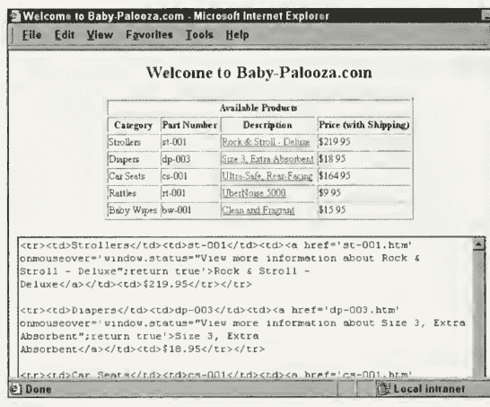

图 11-1
显示动态生成 HTML 的购物车

### 动态创建 JavaScript

现在，如果你可以动态创建 HTML，你应该也能动态创建 JavaScript，对吧？嗯，是的，你可以。然而，在动态创建 JavaScript 代码块时，有一个主要的“陷阱”需要注意。

当你输出 `<script>` 和 `</script>` 标签时，你*永远*不应该将这些标签作为完整的字符串输出。也就是说，你永远不应该编写类似这样的代码：

```
document.write( "<script>");
document.write( "</script>");
```

如果你这样做，HTML 和 JavaScript 解释器会变得非常混乱。它们实际上会认为你是在当前脚本块内开始一个新的脚本块。由于这是一个大忌，你会收到一个错误对话框，或者你的代码会莫名其妙地停止执行。

这个问题的解决方案实际上非常简单，只需在你的 document.write() 调用中将“标签”拆开，像这样：

```
document.write( "<scrip" + "t>");
document.write( "<" + "/script>");
```

通过像这样拆分这些字符串，你可以防止 HTML 和 JavaScript 解释器将它们误认为是 HTML 标签。这种动态生成 JavaScript 代码的能力是一个非常强大的功能，因此我将在第 20 节和第 23 节中更详细地讨论它。

### 复习

在本节中，你学习了如何使用 JavaScript 动态创建 HTML 代码。你看到了如何生成链接和其他 HTML 控件，这些控件经过定制以反映你向用户展示的信息。你还学习了如何使用文本区域控件来显示你的 JavaScript 动态创建的 HTML。最后，你了解到 JavaScript 也可以动态生成更多的 JavaScript 代码，但生成新的 `<script></script>` 标签可能会带来潜在的问题。

### 自我测验

- 1. 动态创建的 HTML 和 DHTML 有什么区别？（参见本节的开头段落。）
- 2. HTML 解析器如何看待 document.write() 调用的输出？（参见“动态创建 HTML”。）
- 3. 为什么你想将 HTML 标签存储在 JavaScript 变量中？（参见“将 HTML 标签存储在字符串变量中”。）
- 4. 你可以用 JavaScript 动态创建哪些类型的 HTML 元素？（参见“创建自定义控件”。）
- 5. 为什么你不应该编写像 document.write(“<script>”) 这样的语句？（参见“动态创建 JavaScript”。）

# 第 12 节


## 使用 HTML 表单

#### 本节清单

- 了解 JavaScript 表单对象
- 理解 JavaScript 如何与 HTML 表单和输入控件交互


表单是 Web 上几乎所有活动的基础。例如，当你的用户订阅电子邮件通讯或购买新电脑时，你必须向他们展示一个表单才能完成任务。因此，要构建一个真正有效的网站，你必须了解如何使用 HTML 表单和 JavaScript 表单对象。

### form 对象与 <form> 标签的关系

到现在为止，你应该对 form 对象是什么有了一个相当好的了解。它只是一个代表一组 HTML `<form></form>` 标签的 JavaScript 对象。正如你在第 9 节中看到的，document 对象实际上包含一个表单对象数组，它有一个巧妙的名字叫 forms。在 HTML 文档加载并解析后，此数组将包含 HTML 文档中每组 `<form></form>` 标签对应的一个表单对象。以下代码显示了一个包含三个表单对象的简单 HTML 文档：

```
<html>
<body>
<form></form>
<form></form>
<form></form>
</body>
</html>
```

这将创建一个包含三个条目的 `forms` 数组。由于 `forms` 数组是 `document` 对象的属性，你可以像这样引用这些 `form` 对象：

```
var firstForm = document.forms[0];
var secondForm = document.forms[1];
var thirdForm = document.forms[2];
```

### 给它一个名字

如果你不想通过数字来引用表单，你也可以给每个表单对象一个名字。例如，给定我刚刚定义的简单 HTML 文档，我可以编写类似这样的代码：

```
document.forms[0].name = "formZero";
```

在这里，我只是将一个字符串赋给了 `forms` 数组中第一个条目的 `name` 属性。然后我可以像这样访问这个 `form` 对象：

```
var firstForm = document.formZero;
```

能够分配名称很好，但你也可以在 HTML 文档中为表单对象指定名称，如下所示：

```
<html>
<body>
<form name="formZero"></form>
<form name="formOne"></form>
<form name="formTwo"></form>
</body>
</html>
```

当此 HTML 文档被解析时，生成的 JavaScript `form` 对象将自动将其 `name` 属性设置为每个 `<form>` 标签的 `name=` 属性中指定的名称。然后你可以像这样访问这些表单对象：

```
var firstForm = document.formZero; // 等同于 document.forms[0]
var secondForm = document.formOne; // 等同于 document.forms[1]
var thirdForm = document.formTwo; // 等同于 document.forms[2]
```

### 名字里有什么？

这里需要注意的一点是，我给表单对象起的名字都是有效的 JavaScript 变量名。虽然这不是绝对必要的，但确保你只对表单对象以及你使用的其他基于 HTML 的对象使用有效的 JavaScript 变量名是一个非常好的主意。为什么？考虑一下这个：

```
<html>
<body>
<form name="form Zero"></form>
<form name="form One"></form>
<form name="form Two"></form>
</body>
</html>
```

由于 HTML 对可用于属性的值没有任何限制，这三个 name 属性是完全有效的 HTML。然而，如果我尝试从 JavaScript 中使用这些名称，我必须编写类似这样的代码：

```
var firstForm = document.form Zero;
var secondForm = document.form One;
var thirdForm = document.form Two;
```

不幸的是，这些语句都不会起作用，因为 JavaScript 解释器会对每个名称中间的空格感到非常困惑。因此，访问这些表单对象的唯一方法是通过 forms 数组。这个故事的寓意是，如果你要给 HTML 文档中的元素命名，请尝试使用也是有效 JavaScript 变量名的名称！

### 控件与 form 对象的关系

当你在 HTML 页面上构建一组 `<form></form>` 标签时，你很少会将其留空。在大多数情况下，你会用文本框、复选框、弹出用户可以直接交互的菜单和其他控件。每个控件都对应一个（或多个）HTML标签来定义该控件。当HTML文档被浏览器加载并解析时，这些标签会创建相应的JavaScript对象。正如你现在可能预料到的那样，这些控件对象可以在它们关联的表单对象内部找到。例如，看看下面的HTML文档。

```html
<html>
<body>
<form name="formZero">
    <input type="text" name="userName">
</form>
<form name="formOne">
    <textarea name="address"></textarea>
</form>
<form name="formTwo">
    <input type="checkbox" name="spamMe">Add me to your mail list
</form>
</body>
</html>
```

这里，我再次定义了三个表单对象。然而，每个表单对象现在都包含一个代表表单内控件的对象。与我的表单一样，我为每个控件指定了一个name属性。因此，如果我想访问这些对象，我可以简单地编写如下代码：

```javascript
var uNameObject = document.formZero.userName;
var addressObject = document.formOne.address;
var spamMeObject = document.formTwo.spamMe;
```

这些语句执行后，我创建的新变量将保存代表我三个表单中控件的对象。
假设你将最后一个HTML文档加载到Web浏览器中，并在userName文本框中输入你的名字。你实际上如何检索那个值？实际上，这相当简单。
你可以在表单中创建的每种类型的控件都有一个对应的JavaScript对象类型。虽然这些对象确实有些不同，但它们都遵循相同的基本格式。特别是，它们都有一个名为value的属性。这个属性包含控件当前设置的值。控件值的概念因控件类型而异，但在文本框或文本区域的情况下，value属性将保存当前在浏览器窗口中输入到控件中的字符串。因此，如果我想提取用户名，我可以编写：

```javascript
var uNameString = document.formZero.userName.value;
```

类似地，如果我想设置用户名，我可以编写：

```javascript
document.formZero.userName.value = "John Doe";
```

在大多数情况下，这就是你使用JavaScript获取和设置任何HTML控件值的方式。然而，正如我之前所说，每种类型的控件对象都有一组略有不同的属性和方法，允许你做的远不止获取或设置它们的值。因此，我将在下一节中详细介绍每种类型的控件。

### 表单对象内部

表单对象远不止name属性那么简单。以下是属性和方法的详细说明，它们将让你完全控制HTML页面上的表单。（一如既往，你可以在CD-ROM的Session12文件夹中找到每个属性和方法的示例程序。）

### 表单对象的属性

`<form>`标签有许多不同的属性可以设置来控制其行为。表单对象具有与这些属性对应的属性，以便你可以从JavaScript中操作它们。

#### action属性

此属性保存一个Web地址，告诉浏览器当用户单击“提交”按钮时将表单发送到何处。此属性的初始值取自`<form>`标签的action=属性。例如，给定以下HTML定义

```html
<form name="orderForm" action="processOrder.cgi"></form>
```

document.orderForm.action的值将是"processOrder.cgi"。如果你将一个新的Web地址分配给此属性，当表单的“提交”按钮被单击时，表单将被发送到那个新地址。

#### elements数组

虽然能够直接使用名称访问控件很好，但有时你可能希望以更自动化的方式处理你的控件。
也有可能你的控件没有名称，或者它们的名称不是有效的JavaScript变量名。对于这些情况，表单对象提供了elements数组。

elements数组是一个包含表单中定义的所有控件对象的数组。你可以通过两种方式访问此数组中的项目：通过索引号或通过名称。例如，看看下面的表单定义。

```html
<form name="myForm">
    First Name:<input type="text" name="fname"
    value="Maia" /><br />
    Last Name:<input type="text" name="last name"
    value="Disbrow" /><br />
    Favorite Food:<input type="text" name="favorite food"
    value="Bananas" />
</form>
```

在这个表单中，我定义了三个控件。其中两个控件的名称根本不是有效的JavaScript变量名。然而，我可以轻松地使用elements数组访问这些控件。通过elements数组中的索引访问控件就像任何其他数组访问一样：

```javascript
for (x=0; x<document.myForm.elements.length; x++) {
    document.write( document.myForm.elements[ x].name);
    document.write( " contains ");
    document.write( document.myForm.elements[ x].value);
    document.write( "<br />");
    }
```

然而，如果我想使用控件的名称，我也可以这样做：

```javascript
document.write( document.myForm.elements[ "fname"].name);
document.write( " contains ");
document.write( document.myForm.elements[ "fname"].value);
document.write( "<br />");
document.write( document.myForm.elements[ "last name"].name);
document.write( " contains ");
document.write( document.myForm.elements[ "last name"].value);
document.write( "<br />");
document.write( document.myForm.elements[ "favorite food"].name);
document.write( " contains ");
document.write( document.myForm.elements[ "favorite food"].value);
```

在这种情况下，elements数组就像一个带有命名槽的数组一样工作……因为它就是！

### 第12节—使用HTML表单

141

#### encoding属性

此属性等同于`<form>`标签中的enctype=属性。此属性告诉Web浏览器在按下“提交”按钮时应使用哪种编码方案来传输表单数据。

> 关于编码类型的讨论超出了本书的范围，但你可以在万维网联盟的网站上找到完整的讨论。从以下链接开始你的调查：
> www.w3.org/TR/html4/interact/forms.html#form-content-type

#### length属性

此属性告诉你表单对象中有多少个控件。这本质上与表单elements数组的length属性相同。

#### method属性

此属性与`<form>`标签中的method=属性相同。此属性告诉浏览器在单击“提交”按钮后发送表单数据时应使用哪种方法（post或get）。

# name属性

正如你在本节中已经看到的，name属性与`<form>`标签的name=属性相同。

#### target属性

此属性对应于`<form>`标签中的target=属性。此属性允许你指定应使用哪个浏览器窗口或框架来呈现表单提交的结果。例如，如果你的`<form>`标签如下所示

```html
<form target="resultWindow">
```

当用户提交表单时，一个内部名称为"resultWindow"的新浏览器窗口将打开，表单提交的结果将显示在该窗口中。（如果名为"resultWindow"的浏览器窗口已经存在，它将移到前面，提交的结果将显示在那里。）

### 表单对象的方法

表单对象还有几个方法，允许你触发表单可以执行的各种操作。这些方法使大多数表单操作易于自动化。

#### reset()方法

当用户单击表单的“重置”按钮时，Web浏览器会触发一个onreset事件（如第10节所示），并将表单中的控件重置为其默认值。如果你想从JavaScript程序中重置表单，调用该表单的reset()方法与单击表单的“重置”按钮完全相同。事实上，以下控件定义具有相同的效果：

```html
<input type="reset" value="Reset" />
<input type="button" value="Reset"
onclick="document.formName.reset()" />
```

当然，直接定义一个实际的“重置”按钮更容易，但使用reset()方法可以让你对重置表单的过程有更多控制。通过使用reset()方法，你作为程序员可以决定何时重置表单。

#### submit()方法

reset()方法模拟单击“重置”按钮，而submit()方法模拟单击表单的“提交”按钮。调用submit()方法几乎与等待用户单击“提交”按钮完全相同，但有一个区别。当用户单击“提交”按钮时，会触发一个onsubmit事件。然而，当你的JavaScript程序调用submit()方法时，不会生成onsubmit事件。

这实际上很有道理。onsubmit事件旨在让你的程序有机会在表单提交之前验证其中的数据。但是，如果你显式调用submit()方法，你将已经在JavaScript程序的中间。因此，在尝试调用submit()方法之前，你应该已经验证了表单的数据。

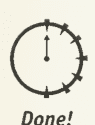

### 复习

在本节中，你了解了 JavaScript 表单对象及其与 HTML `<form>` 标签的关系。你学习了表单对象的属性和方法，以及如何使用它们来控制表单的行为。你还看到了表单中定义的控件如何与表单对象关联，以及如何通过使用控件的名称或 elements 数组来访问这些控件。

### 自我测验

1.  表单对象存储在文档对象的哪个位置？（参见“表单对象如何与 `<form>` 标签关联”。）
2.  为什么应该始终为你的表单和控件命名？（参见“给它一个名字”。）
3.  哪个属性保存屏幕上控件的当前值？（参见“表单对象内部”。）
4.  如何使用 elements 数组来获取名称不是有效 JavaScript 变量名的控件？（参见“elements 数组”。）
5.  当你调用表单的 submit() 方法时会发生什么？什么不会发生（如果有的话）？（参见“submit() 方法”。）

# 第 13 节

## 使用 HTML 控件

#### 本节清单

- 学习如何将 HTML 控件与 JavaScript 一起使用

既然你已经了解了如何从 JavaScript 中使用表单，现在是时候学习如何从 JavaScript 中使用每个 HTML 控件的细节了。正如你将看到的，大多数控件都非常易于使用。你只需响应一两个事件，或者只需获取或设置控件的 value 属性来确定其当前状态。然而，一些控件，如选择列表，需要更多的工作才能有效使用。

### 使用按钮

按钮可能是你可以定义的最简单的 HTML 控件。然而，按钮对你的 JavaScript 程序可能非常有用。通过为按钮定义一个 onclick 处理程序，你可以让该按钮触发你的 JavaScript 代码执行任意数量的操作。正如你在第 10 节中看到的，你可以像这样为按钮定义一个 onclick 处理程序：

```html
<input type="button" value="On Screen Button Name"
onclick="handler()" />
```

因此，当用户点击按钮时，handler 函数将被执行。（记住，事件处理程序不一定是一个函数调用，它可以只是直接编码在控件 HTML 定义中的一条或多条 JavaScript 语句。有关如何创建事件处理程序的详细信息，请回顾第 10 节。）

你会注意到，与我在第 12 节中给出的建议相反，我没有给这个示例按钮一个 `name=` 属性。如果你想，你*可以*给按钮一个名字，但通常没有必要。你想要给控件命名的主要原因是如果你想在其中存储数据。名称只会使检索该数据更容易。在按钮中，按钮的 `value` 属性实际上会作为用户在按钮中看到的文本显示在屏幕上。因此，更改按钮的值确实不是一个好主意。但是，如果你需要轻松区分它们，你可以为每个按钮命名。（例如，一个可能被多个按钮调用的函数可能需要知道具体是哪个按钮调用了它。）

除了上面显示的简单按钮外，还有两种专用按钮：提交按钮和重置按钮。这些按钮在你的 HTML 表单中具有预定义的角色，因此它们实际上不支持 `onclick` 处理程序（或任何其他类型的事件处理程序）。

虽然你不能直接在这些按钮的定义中编写事件处理程序，但它们仍然会生成你的 JavaScript 代码可以捕获的事件。当用户点击表单的提交按钮时，会生成一个 `onsubmit` 事件。类似地，当用户点击表单的重置按钮时，会生成一个 `onreset` 事件。正如你在第 10 节中看到的，你不是在按钮本身中指定这些事件的处理程序，而是在 `<form>` 标签中指定它们。

```html
<form onsubmit="return doSubmit()" onreset="return doReset()">
<!-- 其他控件放在这里 -->
<input type="submit" value="Submit This Form" />
<input type="reset" value="Reset This Form" />
</form>
```

当 `onsubmit` 处理程序被调用时，你的程序有一个绝佳的机会来检查表单中的数据，看看它是有效还是无效。数据验证本身就是一个重要的话题，所以我将在第 15 节中详细讨论它。

### 使用复选框

使用复选框几乎和使用按钮一样简单。不过，有一些重要的区别。例如，考虑这个简单复选框的 HTML 定义：

```html
<input type="checkbox" name="overnight" value="Y" checked />
隔夜配送？<br />
```

首先要注意的是，将出现在此复选框旁边的文本标签（“隔夜配送”）并未在标签本身中定义。相反，它只是出现在标签之后的一串字符。（标签也可以在标签之前；这仅取决于你希望表单如何布局。）这意味着我们的 value 属性可以保存实际数据。在这种情况下，该数据是一个字符 "Y"。

虽然我给了我的复选框一个值，但该值仅在复选框实际被选中时才有效。现在，当我说“有效”时，我指的是“逻辑上”有效。也就是说，这个复选框的 value 属性将始终是 "Y"，但是，如果复选框未被选中，用户显然不希望与我提供给他们的这个选项有任何关系。因此，我将忽略复选框中保存的任何值。

那么问题就变成了，“你如何知道复选框是否被选中？”这就是 checked 属性的用武之地。这是一个布尔属性，简单地告诉你复选框是否被选中。如果 checked 为 true，则复选框被选中。如果为 false，则复选框未被选中。你甚至可以为这个属性赋值，屏幕上的复选框外观将相应地改变。

> 如果复选框未被选中，并且你提交它所在的表单，则不会将有关该复选框的任何信息发送到服务器。也就是说，复选框的名称及其值都不会传输到提交表单时调用的服务器端进程。只有当复选框实际被选中时，才会传输复选框信息。

与按钮一样，复选框在被点击时也会生成一个 onclick 事件。这使你的程序有机会在用户选择或取消选择复选框时立即重置表单的其他部分。在复选框中使用 onclick 处理程序的诀窍是记住，你的 onclick 处理程序的代码是在复选框在屏幕上被选中或取消选中*之后*调用的。以下代码展示了复选框的所有这些方面协同工作。

```javascript
<script language="javascript">
function doStandard() {
    if (document.delivery.standard.checked) {
        // 关闭隔夜复选框
        document.delivery.overnight.checked = false;
    }
}
function doOvernight() {
    if (document.delivery.overnight.checked) {
        // 关闭标准复选框
        document.delivery.standard.checked = false;
    }
}
</script>
<form name="delivery">
    选择配送方式<br />
    <input type="checkbox" name="standard" value="Y"
    onclick="doStandard()" /> 标准配送<br />
    <input type="checkbox" name="overnight" value="Y"
    onclick="doOvernight()" /> 隔夜配送？<br />
</form>
```

在这个例子中，我定义了两个复选框。一个代表标准配送，另一个代表隔夜配送。每个复选框都有一个 onclick 处理程序，当该复选框被点击时触发。每个处理程序的结构相似，所以我只讲解标准配送复选框的处理程序。

当标准复选框被点击时，doStandard() 函数执行。它首先检查标准复选框的 checked 属性。如果 checked 为 true，然后它将隔夜复选框的 checked 属性赋值为 false。当这种情况发生时，隔夜复选框立即在屏幕上变为未选中状态。

设置复选框的另一种方法是调用它的 click() 方法。这将切换复选框的状态，就像它被点击过一样。使用 click() 方法（而不是简单地将 true 赋值给 checked 属性）的优点是，此方法还会为复选框触发一个 onclick 事件。

复选框还支持 onblur 和 onfocus 事件（以及相应的 blur() 和 focus() 方法来模拟这些事件）。有关这些事件的更多信息，请务必参考第 10 节。

最后，如果你需要知道复选框最初是否被选中，你可以检查它的 defaultChecked 属性。如果此属性为 true，则复选框在 HTML 文件首次加载时被选中。如果该属性为 false，则复选框未被选中。

### 使用文件上传控件

如果你不熟悉 HTML 文件上传控件，请不要担心。很少有人知道它的存在，更不用说如何使用它了。基本上，文件上传该控件会向用户呈现一个文本框和一个“浏览...”按钮。如果用户知道要上传文件的路径，可以直接在文本框中输入。但更常见的情况是用户并不知道文件路径，因此他们很可能会直接点击“浏览...”按钮。点击此按钮后，浏览器会弹出一个标准的文件打开对话框。用户可以通过此对话框从本地文件系统中选择文件。一旦用户选中文件，该文件的路径就会显示在文本框中。随后，当用户提交表单时，文件本身才会被发送到服务器。

> **文件到达服务器后发生的事情超出了本书的讨论范围。主要原因是，后续处理过程取决于所使用的Web服务器软件。由于我无法得知您将使用何种Web服务器软件，因此只能请您参考相应Web服务器的文档。**

如果您不熟悉文件上传控件，第一个问题可能是：“它的HTML代码是什么样的？”嗯，它看起来像这样：

```
<input type="file" name="fileUploadField" />
```

与本节中您将看到的大多数其他控件一样，文件上传控件支持多种事件，如`onclick`、`onblur`和`onfocus`。然而，该控件支持的最有趣的事件是`onchange`事件。此事件在用户选择不同的文件进行上传后触发。如果您需要限制可上传的文件类型，这为您提供了一个绝佳的机会来检查文件是否属于您希望允许的类型。所选文件的路径名可以在文件上传控件的`value`属性中找到。您只需提取此信息，并结合使用JavaScript的字符串方法来确定文件名是否符合您的标准。（有关使用文件上传控件的示例，请参见您CD-ROM上的`fileUpload.htm`文件。）

### 使用单选按钮

您之前看到的复选框示例确保了同一时间只有一个复选框被选中。这种行为类似于另一种HTML控件——单选按钮所表现出的行为。单选按钮实际上与复选框非常相似。事实上，您可以将单选按钮视为一组相关的复选框。区别在于，在任何给定时间，这些复选框中只能有一个被选中。打开一个单选按钮的简单操作会关闭所有与之相关的其他单选按钮。

一组相关的单选按钮称为*组*。您可以通过为组中的所有单选按钮指定完全相同的名称来创建一个单选按钮组。例如，我之前定义的复选框可以重新定义为一个单选按钮组，如下所示：

```
<input type="radio" name="dMethod" value="standard" checked />
Standard Shipping<br />
<input type="radio" name="dMethod" value="overnight" /> Overnight
Shipping<br />
```

在这里，我创建了两个单选按钮，并将它们都放入名为“dMethod”（“delivery method”的缩写）的组中。现在，当一个单选按钮被选中时，另一个会自动取消选中。（Web浏览器会处理所有这些选中和取消选中的操作。您的JavaScript程序无需做任何事情。）

另一件需要注意的事情是，每个单选按钮的值都保存着直接反映复选框背后含义的信息。因此，如果“Standard Shipping”复选框被选中，整个单选按钮组的“逻辑”值就是“standard”。

不幸的是，虽然一个单选按钮组可以被认为具有一个等于所选单选按钮值的逻辑值，但并没有一个单选按钮方法可以告诉您组中哪个单选按钮被选中。要确定哪个单选按钮被选中，您必须检查组中每个单选按钮的`checked`属性，直到找到`checked`为`true`的那个。

您如何做到这一点？毕竟，组中的每个单选按钮都有完全相同的名称，那么您如何区分它们呢？实际上，这相当容易做到，因为当您创建一个单选按钮组时，JavaScript解释器会创建一个数组来保存组中每个单选按钮的信息。因此，在上面的示例中，`dMethod[0]`是“Standard Shipping”按钮，`dMethod[1]`是“Overnight Shipping”按钮。

> 当您提交包含单选按钮组的表单时，为该组传输的值是与所选单选按钮关联的值（即，组中其他单选按钮的值不会发送到服务器）。

并且，与复选框一样，单选按钮可以有一个*onclick*处理程序。因此，了解了所有这些，处理一个单选按钮组实际上是一件相当简单的事情：

```
function doDelivery() {
    var dLen = document.delivery.dMethod.length;
    for (x=0; x < dLen; x++) {
        if (document.delivery.dMethod[x].checked) {
            methodValue = document.delivery.dMethod[x].value;
            alert("You have selected " + methodValue + " shipping");
            break;
        }
    }
}
</script>
<form name="delivery">
Select a Delivery Method<br />
<input type="radio" name="dMethod" value="standard"
onclick="doDelivery()" checked /> Standard Shipping<br />
<input type="radio" name="dMethod" value="overnight"
onclick="doDelivery()" /> Overnight Shipping<br />
</form>
```

在这里，我为我的单选按钮定义添加了一个onclick处理程序。由于这些单选按钮都属于同一个组，它们都调用相同的事件处理程序。（请注意，它们不必调用相同的onclick处理程序，但为同一组中的单选按钮设置不同的onclick处理程序是很少见的。）

当处理程序开始执行时，它做的第一件事是确定保存单选按钮组的数组的长度。（这告诉它组中有多少个单选按钮。）此时，只需使用一个`for`循环来检查数组中每个单选按钮的`checked`属性，直到找到一个为`true`的。此时，它可以提取该单选按钮的值并在警报窗口中显示。`break`语句终止循环，这样它就不会浪费时间去查看任何剩余的单选按钮。（请记住，一个组中只能有一个单选按钮被选中。）

### 其他单选按钮技巧

正如我之前提到的，单选按钮和复选框有很多共同点。与复选框一样，您可以将`true`赋值给单选按钮的`checked`属性，该单选按钮就会被选中。（并且组中的所有其他单选按钮都会自动取消选中。）

您还可以使用`click()`方法模拟对单选按钮的鼠标点击，并且可以使用`defaultChecked`属性来判断在HTML文档加载时该单选按钮是否被选中。

而且，就像复选框一样，单选按钮也会接收`onblur`和`onfocus`事件（并具有相应的`blur()`和`focus()`方法）。

### 使用选择列表

可用的最有用的HTML控件之一是选择列表。选择列表允许您向用户呈现一个可供选择的项目菜单。在进一步讨论之前，请看这个简单选择列表的HTML定义。

```
Select a Product<br />
<select name="products" size="1">
    <option value="st-001">Rock & Stroll - Deluxe</option>
    <option value="dp-003">Size 3, Extra Absorbent</option>
    <option value="cs-001">Ultra-Safe, Rear-Facing</option>
    <option value="rt-001">UberNoise 5000</option>
    <option value="bw-001">Clean and Fragrant</option>
</select>
```

在这个示例中，我定义了一个包含五个项目的选择列表。（每对`<option></option>`标签定义一个单独的菜单项。）这些项目中的每一个都对应于Baby-Palooza.com库存中的一种产品。如您所见，我将每个产品的零件号放入了每个选项的`value=`属性中，并使用产品的描述来指定当此列表加载到Web浏览器中时将显示在选择列表中的文本。虽然这是一个相当简单的选择列表，但它本身就是一个非常复杂的控件。那么，问题就变成了：“JavaScript如何与这个控件交互？”

#### select对象

正如您可能预期的那样，浏览器对象模型定义了一个名为Select对象的JavaScript对象。此对象具有多个属性和方法，允许您直接与HTML表单中定义的选择列表进行交互。

#### length属性

这告诉您为选择列表定义了多少组`<option></option>`标签。

# name属性

这是在`<select>`标签的`name=`属性中指定的名称。

### options 数组

这是一个由 Option 对象组成的数组。数组中的每个项目都直接对应于选择列表中的一组 `<option></option>` 标签。理解 `options` 数组是使用选择列表的关键，因此我稍后将更详细地讨论它。

### selectedIndex 属性

此属性保存 `options` 数组中所选项目的数字索引。因此，如果用户选择了列表中的第一个项目，`selectedIndex` 属性的值将为零。（请记住，JavaScript 数组索引号从零开始。）如果列表中没有选中任何项目，此属性将包含负一（-1）。

### blur() 和 focus() 方法

它们分别用于移除选择列表的焦点和赋予选择列表焦点。它们还会为选择列表生成相应的 `onblur` 和 `onfocus` 事件。

### click() 方法

与你见过的其他控件一样，此方法模拟在选择列表上的鼠标点击。

### onchange 事件

为选择列表定义了一个额外的事件：`onchange` 事件。当用户实际更改列表中的选择时，此事件会触发。如果用户点击列表但未更改其选择，则该事件永远不会触发。将其与 `onclick` 事件进行比较，无论列表中的选择是否更改，`onclick` 事件都会触发。（另请注意，旧版本的 Netscape Navigator 根本不支持在选择列表中使用 `onclick` 事件，它们只支持 `onchange` 事件。）

### 理解 Options 数组

正如我所说，`options` 数组是使用选择列表的关键。因为它是一个数组，所以 `options` 数组具有一个 `length` 属性（它告诉你与 Select 对象的 `length` 属性相同的信息）。`options` 数组中的每个项目都是一个 JavaScript Option 对象，每个对象代表一组 `<option></option>` 标签。每个单独的 Option 对象具有以下属性：

#### defaultSelected 属性

此属性保存一个布尔值，告诉你相应的菜单项是否被默认选中——即当 Web 浏览器首次加载 HTML 文件时。

#### selected 属性

这是一个布尔值，告诉你相应的菜单项当前是否被选中。如果为 `true`，则菜单项被选中；如果为 `false`，则菜单项未被选中。

#### text 属性

这是一个 String 对象，保存你在 `<option>` 和 `</option>` 标签之间定义的文本。例如，在定义 `<option value="rt-001">` UberNoise 5000`</option>` 中，此 Option 对象的 text 属性将是字符串 "UberNoise 5000"。需要注意的是，你可以为此属性分配一个新值，从而有效地更改为该菜单项显示的文本。

#### value 属性

与你见过的其他标签一样，此属性保存原始标签中 `value=` 属性的内容。主要区别在于，由于每个 Option 对象都有自己的 value 属性，因此一个选择列表可以包含许多不同的可能值。

> 当你提交包含选择列表的表单时，只有与所选菜单项关联的值会传输到服务器。如果选择列表允许多选，则所有选定项目的值都会被传输。

### 一个简单的选择列表示例

由于 options 数组就是一个数组，你可能认为与选择列表交互的最简单方法是简单地遍历 options 数组中的所有项目，直到找到 selected 为 `true` 的项目。你可以这样做，但不要忘记 `selectedIndex` 属性。由于此属性已经包含所选菜单项的索引号，你可以使用它直接跳转到你感兴趣的菜单项。（此代码来自你 CD-ROM 上的 selectList.htm 文件。）

```html
<script language="javascript">
function doProductPick() {
    var si = document.order.products.selectedIndex;
    var partNo = document.order.products.options[ si ].value;
    var desc = document.order.products.options[ si ].text;
    alert("You selected part number "+ partNo +", ""+ desc +""");
    }
</script>
<form name="order">
    Select a Product<br />
    <select name="products" size="1" onchange="doProductPick()">
        <option value="st-001">Rock & Stroll - Deluxe</option>
        <option value="dp-003">Size 3, Extra Absorbent</option>
        <option value="cs-001">Ultra-Safe, Rear-Facing</option>
        <option value="rt-001">UberNoise 5000</option>
        <option value="bw-001">Clean and Fragrant</option>
    </select>
</form>
```

在此代码中，我为选择列表定义添加了一个 onchange 处理程序。因此，当用户更改列表中的选定项目时，将触发一个 onchange 事件，并且我的处理函数将被调用。当处理函数执行时，它做的第一件事是检索保存在选择列表的 selectedIndex 属性中的值。然后，我可以使用此信息直接访问我的选择列表中所选项目的 value 和 text 属性，并将该信息报告给用户。

### 在列表中选择一个项目

正如你刚才看到的，从选择列表中读取信息实际上相当简单。但是，如果你想实际使列表中的某个项目被选中呢？你的第一反应可能是为列表的 selectedIndex 属性分配一个新值。然而，这实际上不会发生任何事情。相反，你需要将一个 true 值分配给你希望成为所选项目的 Option 对象的 selected 属性。以下来自 selectAnOption.htm 文件的代码片段展示了一种你可以这样做的方法。

```javascript
function pickNext() {
    var si = document.order.products.selectedIndex;
    if (si == (document.order.products.length - 1)) {
        next = 0;
    }
    else {
        next = ++si;
    }
    document.order.products.options[ next ].selected = true;
}
function pickPrev() {
    var si = document.order.products.selectedIndex;
    if (si == -1) {
        si = 0;
    }
    if (si == 0) {
        next = (document.order.products.length - 1);
    }
    else {
        next = --si;
    }
    document.order.products.options[ next ].selected = true;
}
</script>
<form name="order">
    Select a Product<br />
    <select name="products" size="5">
        <option value="st-001">Rock & Stroll - Deluxe</option>
        <option value="dp-003">Size 3, Extra Absorbent</option>
        <option value="cs-001">Ultra-Safe, Rear-Facing</option>
        <option value="rt-001">UberNoise 5000</option>
        <option value="bw-001">Clean and Fragrant</option>
    </select><br />
    <input type="button" value="Next" onclick="pickNext()" />
    <input type="button" value="Previous" onclick="pickPrev()" />
</form>
```

如果你将此示例文件加载到 Web 浏览器中，然后点击“Next”和“Previous”按钮，你会看到当你点击按钮时，所选项目会发生变化。需要注意的另一件事是，当此选择列表首次加载到 Web 浏览器中时，默认情况下不会选中任何项目。这意味着 Select 对象的 selectedIndex 属性将是负一。因此，我必须在 pickPrev() 函数的代码中明确检查这种情况。

虽然此示例不包含 onchange 处理程序，但需要注意的是，当你以这种方式选择菜单项时，*不会*生成 onchange 事件！（因此，如果你需要完全复制一个 onchange 事件，你必须在选择新的菜单项之后调用你的 onchange 事件处理程序。）

### 多选列表

到目前为止，你看到的所有示例都涉及单选列表。也就是说，一次只能有一个项目被选中的列表。然而，HTML 提供了另一种类型的选择列表，即多选列表。顾名思义，在多选列表中，用户可以根据需要从列表中选择任意数量的项目。在 HTML 中，两者之间的唯一区别是在选择列表定义中添加了“multiple”属性。然而，在 JavaScript 中，差异要大一些。

### selectedIndex 属性和多选列表

首先，在多选列表中，selectedIndex 属性的作用变得更加重要。在单选列表中，遇到没有任何项目被选中的列表的可能性相当低。如果列表的 HTML 定义指定了一个初始选定项目，或者用户选择了一个项目，那么从那时起列表将始终有一个项目被选中。然而，在多选列表中，用户可以根据需要选择或取消选择任意数量的项目。因此，完全有可能有一个没有任何项目被选中的列表。因此，在对多选列表执行任何操作之前，你应该始终检查 selectedIndex 属性。如果值为负一（-1），你就知道列表中没有任何项目被选中，并可以相应地采取行动。

如果 selectedIndex 的值不是负一，那么你就知道列表中至少有一个项目被选中。然而，在这种情况下，selectedIndex 属性只告诉你列表中*第一个*选定项目的索引。你需要自己确定其他选定项目是什么。以下代码来自你 CD-ROM 上的 multipleSelectList.htm 文件。它展示了一个典型的多选列表以及你可能如何使用它。

```javascript
function showSelected() {
    var si = document.order.products.selectedIndex;
    if (si == -1) {
        alert("No items are selected!");
    }
    else {
```

### 在选择列表中添加或移除选项

在本节中，我想告诉你的关于选择列表的最后一点信息是如何在选择列表中添加和移除项目。没错；JavaScript 允许你向选择列表中添加新项目，或从列表中移除旧项目。
要从选择列表中移除一个项目，你只需将包含要移除项目的 options 数组元素赋值为 null。这将从列表中移除该项目，并将其下方的所有项目上移以填补新腾出的空间。

添加项目稍微复杂一些。它需要两个步骤：

1.  使用 Option 对象的构造函数方法创建一个新的 Option 对象。（记住，我们在第 6 节讨论过构造函数方法。）
2.  将这个新的 Option 对象赋值给你希望新项目出现的选择列表的 options 数组末尾。

Option 对象的构造函数方法实际上相当简单。你向它传递最多四个参数，它将返回一个新的 Option 对象，你可以将其添加到选择列表的末尾。这些参数，按它们必须出现的顺序，是：

1.  text：这是你希望在添加新项目时菜单中显示的文本。
2.  value：这将被放入新项目的 value 属性中。
3.  defaultSelected：这用于设置新项目的 defaultSelected 属性。
4.  selected：这告诉 JavaScript 解释器，当新项目被放入选择列表时，它是否应该被选中。

所有这些参数都是可选的，但你通常应该至少提供前两个。（如果你不提供任何参数，你可以在创建新的 Option 对象后设置相应的属性。）

addRemoveOptionsSelectList.htm 文件向你展示了如何使用所有这些来创建动态选择列表。（请务必在你的 HTML 编辑器中打开此文件，以便你可以跟随下一段内容。）查看此文件的 HTML 部分，你会看到我有两个选择列表，一个包含我的产品信息，另一个是空列表，将用于存放用户购物车中的项目。当用户在产品列表中选择一个项目，然后点击“添加到购物车”按钮时，会调用 addToCart() 函数。首先，此函数检查产品列表中是否有项目被选中。如果没有选中的项目，会显示一个警告窗口，告诉用户先选择一个项目。但是，如果有项目被选中，该函数会检索该项目的 value 和 text 属性，并将它们传递给 Option 构造函数方法以创建一个新的 Option 项目。然后，这个新的 Option 项目被赋值给代表我们购物车的选择列表的末尾。这会导致新项目立即出现在购物车中。最后，我将 products 选择列表的相应元素赋值为 null，这会从该列表中移除最初选中的项目。（removeFromCart() 的工作方式大致相同。选择列表的名称被反转，以将选中的项目从购物车移回产品列表。）

### 处理基于文本的控件

好了，在那之后，你可能想处理一些更简单的东西。你很幸运，因为现在是时候讨论 JavaScript 如何与各种基于文本的 HTML 控件交互了。当我说“基于文本的”时，我指的是那些负责处理行或块文本的控件。这些包括文本框、文本区域、密码字段和隐藏字段。以下是每种控件的一个示例：

```html
<!-- Text box -->
<input type="text" name="aTextBox" value="Hello World!" />
<!-- Text Area -->
<textarea name="aTextArea" rows="5" cols="60">Howdy Terra!</textarea>
<!-- Password field -->
<input type="password" name="aPassword" />
<!-- Hidden Field -->
<input type="hidden" name="hiddenField" value="I'm Hidden!" />
```

虽然这些都是不同类型的控件，但 JavaScript 将它们都视为处理文本的控件。因此，你使用这些控件的方式非常相似。

你可以对基于文本的控件做的最有用的事情就是简单地获取或设置其中的文本字符串。因为用户可以直接在所有这些控件（除了隐藏字段控件）中输入，所以这个能力让你有机会直接与用户交互。正如你现在无疑已经猜到的，要获取或设置这些控件中的信息，你只需访问控件的 value 属性。当你读取 value 属性时，你将获得控件中当前显示的文本。当你将一个字符串赋值给 value 属性时，你将更改屏幕上该控件的内容。（有关如何使用这些控件的示例，请参阅 textBasedControls.htm 文件。）

#### 基于文本的控件提示

当你处理密码字段时，请记住屏幕上显示的内容将显示为全星号 (*) 或其他字符。这是为了防止有人通过偷看别人的肩膀来窃取密码。但是，当你访问密码字段的 value 属性时，你将获得密码的实际文本。因此，如果你在屏幕上显示该信息，你将泄露用户的密码！大多数用户不会喜欢这样，所以在处理密码字段时要小心。

隐藏字段已逐渐成为 HTML 控件的主力。它们几乎可以包含任何类型的字符串或数字数据，它们所容纳的数据长度仅取决于 Web 浏览器愿意分配给它们多少内存。当你在网上浏览 JavaScript 代码时，你会看到许多程序员在隐藏字段中隐藏大量关键信息。所以，要留意这一点。

#### 基于文本的控件事件

与你见过的大多数其他控件一样，基于文本的控件（隐藏字段除外）支持 onblur 和 onfocus 事件。基于文本的控件支持的另一个有趣的事件是 onchange 事件。当基于文本的控件内容被更改，然后控件失去焦点时，此事件会触发。正如我们将在第 15 节中看到的，这些事件为你的程序提供了对用户输入做出反应并验证他们在表单中输入的值的绝佳机会。

### 复习

在本节中，你详细了解了 JavaScript 如何与每种类型的 HTML 控件交互。虽然所有控件的工作方式大致相同（将真正有用的东西保存在 value 属性中），但你看到了每种不同的控件如何需要你的 JavaScript 代码采用略有不同的方法。你了解了复选框和单选按钮之间的区别，以及如何使用选择列表。你还学习了如何使用每种不同的基于文本的控件。在第 15 节中，你将在此基础上学习如何确保用户输入到表单控件中的数据对你的应用程序是有效的。

### 自我测验

1.  你检查哪个属性来查看特定的复选框或单选按钮是否被选中？（参见“处理复选框”和“处理单选按钮”。）
2.  文件上传控件的 value 属性中包含什么？（参见“处理文件上传控件”。）

## 第14课

# 处理图像

#### 课程清单

- 学习如何使用JavaScript控制HTML页面上的图像
- 理解JavaScript的Image对象
- 理解如何创建基于JavaScript的悬停按钮和动画

传输图像的能力是万维网最受欢迎的方面之一。由于其普及性，图片已经渗透到网络浏览体验的几乎每个部分。例如，大多数网站使用可点击的图像，而不是HTML按钮，当你将鼠标悬停在它们上面时，这些图像会发生变化。虽然你可能知道并喜欢所有这些巧妙的小图形技巧，但你可能不知道JavaScript是几乎每一个技巧背后的力量。在本课中，你将学习如何使用JavaScript与HTML文档中的图像进行交互，以及如何创建这些简单的动画来增强用户在你网站上的体验。

30分钟内完成

# 理解Image对象

操作HTML文档中图像的关键是JavaScript的Image对象。当你的HTML文档加载到Web浏览器中时，JavaScript解释器会为它在文档中找到的每个``标签创建一个Image对象。它将所有这些Image对象放在一个images数组中（你可以在document对象中找到它）。如果你不想使用images数组，你可以为每个``标签指定一个name=属性，并直接访问你的Image对象。例如，假设以下标签是文档中的第一个图像：

```

```

你可以通过使用document.images[0]或document.happyBaby来访问关联的Image对象。如果出于某种原因，你无法给你的图像起一个同时也是有效JavaScript变量名的名字，你仍然可以像使用表单对象中的elements数组一样，通过使用images数组按名称访问它们。例如，如果你有一个像这样定义的图像：

```

```

你可以通过使用images数组来访问它，像这样：

```
var poorlyNamedImage = document.images[ 'poorly named' ];
```

# Image对象的属性

现在你知道如何获取Image对象了，你会想知道在那里能找到什么。（你可以在CD-ROM的Session14文件夹中找到使用所有这些属性的示例源代码。）

# border属性

此属性包含在``标签中为图像设置的边框值。例如，给定此标签，document.happyBaby的border属性将是10：

```

```

# complete属性

这是一个布尔属性，告诉你图像是否已完成加载。

# height和width属性

这些属性告诉你图片的当前高度和宽度（以像素为单位）。如果你在``标签中指定了height和width属性，这些属性将反映这些值。如果你没有指定这些属性，这些属性将是图像的实际高度和宽度。请注意，图像加载后，你可以为任一属性分配一个新值，图像将相应地调整大小。（有关这两个属性的示例，请参见CD-ROM上的heightNwidthProperties.htm文件。）

# hspace和vspace属性

这些表示用于将图像与其周围内容偏移的水平和垂直填充量。请注意，这些属性可以在图像加载完成后更改，图像将相应地重新定位。（另请参阅下面关于vspace属性的讨论。）

# name属性

这是图像的名称。如果name是有效的JavaScript变量名，你可以使用它直接访问图像，而不必通过images数组。

# src和lowsrc属性

这是应为此图像加载的图片的Web地址。如果你为此属性分配一个新值，Web浏览器将实际加载存储在该地址的图片。这是所有基于JavaScript的动画的基础。更多信息，请参阅本课后面的“使用JavaScript创建悬停效果”和“使用JavaScript创建动画”部分。
lowsrc属性是图像的低分辨率版本的Web地址。如果浏览器在低分辨率设备上运行，将使用此图像而不是src属性指定的图像。

# Image对象事件

正如你在第10课中看到的，``标签支持多个事件，允许你检测图像是否以及何时实际成功加载。为了完整起见，我在这里再次列出它们，但你应该参考第10课的示例源代码，以查看每个事件处理程序的简单示例。

# onabort事件

如果用户停止加载图像——即如果用户在图像完全加载之前点击浏览器的停止按钮，此事件将触发。

# onerror事件

如果在加载图像过程中发生错误，此事件将触发。

# onload事件

在图像成功加载到浏览器后，此事件将触发。

# 没有``标签的图像

正如我在本课开始时所说，JavaScript解释器会为它在HTML文档中找到的每个``标签创建一个Image对象。但是，如果你愿意，你可以创建没有关联``标签的Image对象。你可以通过使用Image对象构造函数来做到这一点，像这样：`var myImage = new Image();` 此语句将创建一个新的Image对象，而没有关联的``标签。此时，你可以通过将Web地址分配给其src属性，将实际的图像文件加载到此Image对象中，像这样：`myImage.src = "happyBaby.jpg";`

当这张图片完成加载时，你将拥有一个加载了图片的Image对象。但是，该图片将*不会*显示在Web浏览器中！为了使图像显示在Web浏览器中，它*必须*与HTML文档中某处的``标签关联。没有这种关联，Web浏览器根本不知道在哪里绘制图像。假设你刚刚查看的代码已经执行，并且在你的HTML文件中，你有以下``标签：

```

```

如果你执行以下JavaScript语句

```
document.babyFace.src = myImage.src;
```

`document.babyFace`中包含的图形将被`myImage`中的图形替换。此外，由于`document.babyFace`与HTML文档中的``标签关联，新图形将替换Web浏览器中的旧图形！

# 使用JavaScript创建悬停效果

现在你已经看到了一个图形如何替换另一个图形，你可能想看看如何利用这个事实做一些有用的事情。使用这种技术你能做的最简单的事情是创建所谓的悬停按钮。它们被称为悬停按钮，因为当你将鼠标悬停在它们上面时，它们会以某种方式发生变化。效果可以像高亮显示的变化一样简单，或者你实际上可以切换到完全不同的图形。

创建悬停按钮的第一步是创建一个恰好是图像的链接。这就像用一组`<a href=""></a>`标签包围一个``标签一样简单。例如，假设我想创建一个“更多信息”图像，让用户跳转到有关产品的更多信息页面。这样的链接可能看起来像这样：

```
<a href='st-001.htm'></a>
```

这将在HTML页面上放置一个被标准链接包围的图像。当用户单击此图像时，链接将激活，她将跳转到指定的页面。

为了创建悬停效果，你必须告诉浏览器在鼠标移到图像上时将此图像与另一张图像交换。然后，为了完成悬停效果，你需要在鼠标移开时恢复原始图像。如果你记得你在第10课中学到的内容，你可能已经意识到创建这种效果的关键是使用onmouseover和onmouseout事件来检测鼠标何时移到图像上和移开。

现在，`<a>`和``标签都支持onmouseover和onmouseout事件，因此将这些事件与哪个标签关联实际上是一个个人偏好的问题。在创建悬停效果时，我个人更喜欢将事件挂接到``标签上。通过这样做，我在一个标签中创建了一个完整的小动画。例如：

```
<a href='st-001.htm'>
</a>
```

虽然这看起来像是一段非常复杂的代码，但实际上它相当简单。像以前一样，`<a></a>`标签创建了一个包围我们``标签的链接。因此，当图像被点击时，用户将跳转到指定的页面。

`` 标签被命名为 "stMore"，并通过 "src=" 属性被告知（由该属性指定）初始加载图形文件 moreInfo.jpg。border 属性被设置为零，这样图像周围就不会出现边框。

事件处理器是所有操作发生的地方。onmouseover 处理器表示：“当鼠标移到此标签上时，将 document.stMore Image 对象的 src 属性更改为 moreInfoOn.jpg。”正如你之前所学，当你更改 Image 对象的 src 属性时，浏览器实际上会加载指定的图像。如果 Image 对象与一个 `` 标签关联（就像这个例子），新图像随后将在 Web 浏览器中替换旧图像。

当鼠标移到此图像上时，新图像将被加载并替换旧图像。完成此效果剩下的全部工作就是恢复旧图像。

当鼠标移开图像时，onmouseout 事件处理器将执行。如你所见，此处理器与 onmouseover 处理器几乎相同。唯一的区别是，此处理器将原始图形重新分配回 Image 对象的 src 属性。这迫使浏览器重绘原始图形，并完成翻转效果。（请注意，你可以在 CD-ROM 上的 simpleRollover.htm 文件中找到此示例的源代码。）

## 使用 JavaScript 创建动画

到现在，你可能已经自己想出如何制作动画了。它只是带有更多图像的翻转效果，对吧？嗯，算是吧。当你执行动画时，除了切换图像之外，还需要考虑一些其他事情。首先，你必须决定如何跟踪动画中的所有图像。其次，你必须以某种方式预加载动画中的图像，这样第一次运行时，帧之间就不会出现明显的延迟。最后，你必须决定动画的速度。

## 将动画帧存储在数组中

第一个问题的答案其实很简单：只需将动画的每一帧存储在一个数组中。记住，JavaScript 数组可以容纳任何类型的数据，因此构建一个容纳一系列 Image 对象的数组很简单。当然，将图像存储在数组中意味着你将使用数组的数字索引从一帧步进到下一帧。这反过来又意味着你必须以某种顺序将图像加载到数组中。所有这些的最终结果是，动画的帧需要存储在一系列文件中，这些文件按照帧应播放的顺序编号。例如，如果你有一个三帧动画，你可能会像这样为单个图形文件编号：

```
myAnim0.jpg, myAnim1.jpg, myAnim3.jpg
```

（当然，你可以从“1”开始编号，但是，由于 JavaScript 从零开始为数组编号，我总是发现从零开始编号更容易。）

## 预加载图像

第二个问题是预加载构成动画的图像。解决这个问题就像创建将容纳帧的 Image 对象，然后将每个对象的 src 属性设置为相应的文件名一样简单。这将在你的 HTML 页面仍在加载到浏览器中时开始加载每一帧的过程。然后，你可以延迟动画的开始，直到最后一帧的 complete 属性变为 true。

## 创建和加载动画帧的示例

此时，最好向你展示一下我到目前为止讨论的内容如何组合在一起。以下代码向你展示如何创建一个图像数组并开始将所有动画帧加载到其中。

```
var titleFrames = new Array();
var titleNumFrames = 16;
for (x=0; x < titleNumFrames; x++) {
    titleFrames[ x] = new Image();
    titleFrames[ x].src = "titleAnim" + x + ".jpg";
}
```

首先要注意的是，这些代码都不是函数的一部分。事实上，当你查看此代码来源的实际源文件（simpleAnimation.htm 文件）时，你会看到这些代码行位于 HTML 文档顶部的 `<script>` 块中。因此，这些行在文档加载时立即执行。第一行创建一个名为 titleFrames 的新 Array 对象。（此示例的目的是为 baby-palooza.com 站点创建标题动画，因此所有相关变量名都以字符串“title”开头。）接下来，我设置一个全局变量，告诉程序我的动画中有多少帧。在此示例中有 16 帧，命名为 titleAnim0.jpg 到 titleAnim15.jpg。

设置好变量后，我进入一个 for 循环。每次循环，我都会创建一个新的 Image 对象并将其分配到数组中的下一个位置。创建 Image 对象后，我立即将其 src 属性设置为动画中下一个图像文件的名称。注意我如何使用 JavaScript 将字符串与数字连接的能力，在每次循环中生成正确的文件名。每次我为这些 src 属性之一赋值时，Web 浏览器就开始加载指定的图像文件。

## 控制动画的时序

现在是时候实际启动和运行动画了。为了正确讨论这是如何完成的，我需要向你展示涉及的*所有*源代码。所以，它在这里：

```
<script language="javascript">
var titleFrames = new Array();
var titleNumFrames = 16;
var titleAnimSpeed = 200;
var titleCurrentFrame = 1;
for (x=0; x < titleNumFrames; x++) {
    titleFrames[ x ] = new Image();
    titleFrames[ x ].src = "titleAnim" + x + ".jpg";
    }
function titleAnimate() {
    if (titleFrames[ titleNumFrames - 1].complete) {
        document.titleAnim.src = titleFrames[
titleCurrentFrame++].src;
        if (titleCurrentFrame == titleNumFrames) {
            titleCurrentFrame = 0;
            }
        }
    else {
        setTimeout("titleAnimate()", titleAnimSpeed);
        }
    }
</script>

```

在此代码的顶部，你可以看到我指定了另外两个全局变量。第一个，titleAnimSpeed，保存帧之间应延迟的毫秒数。第二个，titleCurrentFrame，告诉程序接下来显示动画的哪一帧。设置完全局变量后，你会找到将动画帧加载到我的 Image 对象数组中的 for 循环。

## 第 14 节——处理图像

之后是 `titleAnimate()` 函数。此函数实际上执行动画中的图像交换。我稍后会回到这一点。

最后，你看到实际驱动动画的 `` 标签。我给这个 `` 命名为 `titleAnim`，最初加载到其中的图片是 `titleAnim0.jpg`（这是我动画的第一帧）。

那么，一个 `` 标签如何驱动我的动画呢？嗯，看看为此标签定义的 `onload` 处理器，并记住 `` 标签的 `onload` 事件仅在图像实际完成加载时触发。当图像完成加载时，`onload` 处理器将调用 `setTimeout()` 方法，并传递我的动画函数的名称，并告诉它等待 200 毫秒后再调用它。（记住 `titleAnimSpeed` 中的值是 200。）

因此，在我的动画第一帧加载 200 毫秒后，`titleAnimate()` 函数被调用。此函数做的第一件事是检查我的动画的最后一帧是否已完成加载。如果它*没有*完成，该函数会再次调用 `setTimeout()` 方法，这会将动画的开始再延迟 200 毫秒。这会持续进行，直到动画的最后一帧完成加载并且动画准备好开始。

如果我的动画的最后一帧已完成加载，该函数会将当前动画帧的 `src` 属性分配给 `titleAnimImage` 对象的 `src` 属性。由于 `titleAnimImage` 对象与一个 `` 标签关联，新图片将在屏幕上替换旧图片。

注意赋值语句中使用了增量运算符（`++`）。这会将动画的当前帧加一。随后的 `if` 语句将检查是否已到达动画的末尾。如果已到达，当前帧的编号将重置为零，以便动画可以重新开始。

如果你认为整个场景中缺少一些东西，你完全正确。即使你理解这段代码的每一行，你可能也会想，“下一次对 `setTimeout()` 的调用在哪里？如果 `titleAnimate()` 函数不再次调用 `setTimeout()`，动画如何继续？”

实际上，不需要再次调用 `setTimeout()` 方法，因为 `` 标签中已经内置了一个！你看，当你为 Image 对象的 `src` 属性分配新值时，你正在重新开始加载图像的过程。因此，如果该 Image 对象与一个 `` 标签关联，并且该标签有一个 `onload` 处理器，那么每次你为 Image 对象的 `src` 属性分配新值时，该处理器都会被执行。这意味着切换动画帧的简单行为实际上启动了将导致下一帧被加载的过程。

好吧，我承认……以这种方式创建动画需要做很多工作。然而，这种技术确实适用于你的浏览器可以加载的任何图形文件格式。所以，如果你有一堆想要制作成动画的.jpg或.png文件，你无需将它们转换为.gif动画格式。事实上，如果你不介意多花点功夫，甚至可以使用存储在不同图形格式中的文件来创建动画！

## 根据屏幕尺寸加载图像

在第8课中，我简要提到了`window`对象的`screen`属性。该属性包含了客户端当前屏幕设置的信息。因此，你可以利用这些信息来判断你的图形是否适合客户端的屏幕。如果你的默认图形无法完全适配屏幕，你可以选择加载一组尺寸正确的图形（这要求你确实*拥有*一组尺寸正确的图形），或者你可以动态重置图像对象的宽度和高度属性。第一种方法的示例如下所示：

```
for (x=0; x < titleNumFrames; x++) {
    titleFrames[ x ] = new Image();
    if (screen.availWidth < 800) {
        titleFrames[ x ].src = "titleAnim" + x + "-small.jpg";
    }
    else {
        titleFrames[ x ].src = "titleAnim" + x + ".jpg";
    }
}
```

这里，我检查的是`window.screen`对象的`availWidth`属性。如果它小于800像素，我就加载一个等效但尺寸更小的动画帧版本。

另一种方法则基于这样一个事实：如果你沿一个轴调整图像尺寸，浏览器会自动沿另一个轴进行适当缩放。

```

<script language="javascript">
if (screen.availWidth < 800) {
    document.titleAnim.width = document.titleAnim.width / 2;
}
</script>
```


### 复习

在本课中，你学习了JavaScript如何与HTML页面上的图像进行交互。你了解了如何创建悬停按钮，以及如何使用事件处理程序作为触发器来更改Web浏览器中显示的图像。你还学习了如何创建基于JavaScript的动画，以及如何动态调整浏览器中图像的尺寸以适应客户端浏览器窗口的可用空间。掌握了所有这些知识后，是时候开始美化购物车了。在你的光盘上，你会找到index.htm和babyPalooza.js文件的新版本。这些新版本整合了你在本课中学到的几乎所有内容，为基本的产品展示添加了动画标题和悬停按钮。（要查看购物车的新外观，请从Session14文件夹加载index.htm文件。）花点时间研究一下这些文件，你就能很好地理解如何将本课的信息与你已有的知识结合起来。

### 自我测验

1.  Image对象的complete属性告诉你什么？（参见“complete属性”。）
2.  当你将图像文件的网址赋值给Image对象的src属性时会发生什么？（参见“src和lowsrc属性”。）
3.  如何在没有对应HTML `` 标签的情况下创建Image对象？（参见“不使用  标签的图像”。）
4.  哪些事件允许你创建悬停图形按钮？（参见“使用JavaScript创建悬停效果”。）
5.  如何确定基于JavaScript的动画帧之间的时间间隔？（参见“为动画计时”。）


# 第15课

## 验证表单数据

#### 课程清单

- 学习如何使用JavaScript验证表单中的数据
- 理解防御性编程的价值


剩余30分钟

JavaScript最受欢迎的用途之一是在数据发送到服务器之前验证表单中的数据。随着Web的日益普及，这种能力变得越来越重要。毕竟，如果每秒有成千上万的人访问同一个网站，如果大部分数据验证工作可以在客户端完成，Web服务器的处理就会轻松得多。

在客户端进行数据验证的另一个原因是让你的用户能够立即获得反馈。当你使用JavaScript验证表单数据时，你可以立即告诉用户存在问题并加以纠正。如果你将数据发送到服务器进行验证，用户就必须坐在那里等待数据被发送、处理，然后返回结果页面。如果数据有问题，用户就必须返回上一页，修正数据，然后再次发送。这可能会令人非常沮丧，尤其是当服务器返回的错误信息晦涩难懂或不完整时。

### 进行防御性编程

数据验证的关键是从一开始就假设用户会输入错误的数据。是的，这是一种悲观的看法，而且确实意味着你作为程序员需要做更多的工作，但从长远来看，采用这种方法会为你省去很多麻烦。实际上，额外的工作并没有那么多；你所要做的就是寻找方法来消除输入错误数据的可能性。一些实现方法包括：

- 设置合理的默认值。如果你在表单字段中提供了良好的默认值，用户可能根本不会去修改大多数字段，这意味着他们不会在其中输入错误数据。（另一个好处是，如果用户重置表单，默认值将被重新加载。如果这不是你想要的行为，你可以创建一个onreset事件处理程序来按你希望的方式重置表单。）
- 保护你不想被更改的字段。很少有人意识到JavaScript可以轻松地设置一个字段，使用户无法随意修改它。正如你将在本课后面看到的，一个onfocus处理程序就足以实现这一点。
- 尽可能使用选择列表。如果你向用户提供一个表单字段的可能值列表，他们就不可能在该字段中输入错误数据。例如，不要让用户在文本框中输入两个字符的州代码（AL、AK等），而是给他们一个包含所有州的选择列表。像这样：
- 提供一个控制用户如何更改表单的界面。例如，提供可以按特定量增加或减少值的按钮。

```
<select name="state" size="1">
    <option value="AL">Alabama</option>
    <option value="AK">Alaska</option>
    <!-- 其他州紧随其后 -->
</select>
```

#### 设置默认值

如果你使用JavaScript动态生成HTML页面（如第11课所示），设置具有适当默认值的控件就非常简单。举个例子，让我回到我一直在构建的购物车。为了创建一个信息丰富的购物车显示，最好包含一个商品可用数量的计数以及用户放入购物车的数量计数。在屏幕上显示此信息的一种方法是将每个值放在自己的文本字段中。为了在我的购物车中实现这一点，我需要在我的产品数组中添加两个槽位：一个用于库存数量，另一个用于用户购物车中的商品数量。因此，我的产品数组定义现在看起来像这样（请注意，你在本课中看到的所有代码都可以在光盘上Session15文件夹中的index.htm和babyPalooza.js文件中找到）：

```
var index = 0;
var strollerInfo = new Array();
strollerInfo[index++] = 199.95;
strollerInfo[index++] = "Rock & Stroll - Deluxe";
strollerInfo[index++] = "st-001";
strollerInfo[index++] = 20;
strollerInfo[index++] = 10; // 库存数量
strollerInfo[index++] = 0; // 购物车中的数量
```

现在，假设我想在文本字段中显示这些新值，生成相应HTML的JavaScript代码就相当简单了。例如，下面展示了我将添加到showProductInfo()函数中以创建所需文本字段的代码。

```
var onHandBox = "<input type='text' name='quan_" + pInfo[2] + "'";
onHandBox += " value='" + pInfo[4] + "' size='6' />";
var inCartBox = "<input type='text' name='inCart_" + pInfo[2]+
"'";
inCartBox += " value='" + pInfo[5] + "' size='6' />";
```

如你所见，这段代码将创建两个文本字段定义。每个定义都将有一个默认值属性，该属性直接取自我的产品信息数组。此代码创建的标签将如下所示：

```
<input type='text' name='quan_st-001' value='10' size='6' />
<input type='text' name='inCart_st-001' value='0' size='6' />
```

（另一个简单的防御性技巧是使用文本字段的maxlength=属性来限制可以输入到字段中的数据量。例如，如果一个字段将容纳5位数的邮政编码，你会将maxlength=属性设置为5。）

### 使用 onfocus 事件处理程序保护字段

既然我已经定义了这些文本字段，我需要确定希望用户如何与它们交互。`inCart` 字段相当简单：我希望用户能够直接在其中输入一个数字，以便他们可以精确指定想要多少件商品。如果还能有一两个按钮，可以将该字段中的数字增加或减少一，那就更好了。我稍后会向你展示如何做到这一点，但首先我需要谈谈库存数量字段。

库存数量字段带来了一点问题：我希望能够自己更新它（以反映一件商品还剩多少件），但我不希望用户能够更改该字段中的值。幸运的是，这个问题的解决方案非常简单，如下所示：

```
<input type='text' name='quan_st-001'
onfocus="document.cart.elements['inCart_st-001'].focus()"
value='10' size='6' />
```

在这段代码中，我为库存数量文本字段的定义添加了一个 `onfocus` 事件处理程序。该处理程序所做的只是调用相应 `inCart` 文本字段的 `focus()` 方法。正如我之前提到的，当控件成为用户击键的目标时，会生成 `onfocus` 事件。因此，如果用户单击此字段或按 Tab 键切换到它，`onfocus` 处理程序将被调用。然后，该处理程序将调用 `inCart` 字段的 `focus()` 方法。此方法随后使 `inCart` 控件成为用户击键的目标。总体效果是，当用户尝试在库存数量字段中输入内容时，插入点实际上会跳转到 `inCart` 字段！这样做的结果是，有了这个事件处理程序，用户就永远无法在我的库存数量字段中输入任何内容。（如果你的网站基于 HTML v4.0 或 XHTML，一种更简单的方法是使用 `readonly` 属性创建控件。顾名思义，此属性使控件只读，因此用户无法编辑其内容。例如，`<input type="text" readonly />` 将创建一个只读文本框。但是，此属性在旧版本的 HTML 中不可用，而上面显示的基于 JavaScript 的方法应该在大多数支持 JavaScript 的浏览器中有效。）

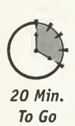

### 控制用户输入

保护了库存数量字段后，我现在可以将注意力转向 `inCart` 字段。正如我之前所说，我希望用户能够在此字段中输入一个数字，以立即指定他们想要多少件商品。但是，除了这种能力之外，我还想为用户提供一组按钮，允许他们一次增加或减少一个单位。这些按钮（以及新购物车设计的其余部分）显示在图 15-1 的每行末尾。

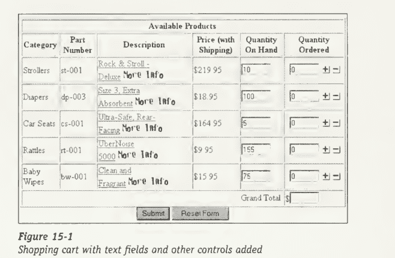

如你所见，这些是简单的加号和减号按钮。当用户单击其中一个时，我希望按钮能以适当的动画做出反应——也就是说，按钮应该看起来被按下然后弹回——并向相应的 `inCart` 文本字段添加或减去一个单位。设置此功能的 HTML 如下所示：

```


```

在这段代码中，我使用了三个与鼠标相关的事件处理程序来控制按钮的动画。（`onmouseout` 处理程序是必要的，用于处理用户单击按钮但在释放鼠标按钮之前将鼠标移开的情况。）如上所示，此代码仅创建了几个动画按钮。如果我实际上想响应这些按钮的点击，我必须更改 `onmouseup` 处理程序以调用一个函数来更新我的文本字段中的值。

```
onmouseup="doPlus('st-001');document.images['plus_st-001'].src='plus.jpg'"
onmouseup="doMinus('st-001');document.images['minus_st-001'].src='minus.jpg'"
```

在这里，我定义了两个新函数：`doPlus()` 和 `doMinus()`。这些函数从用户的购物车中添加或减去一件商品。为了指定正在添加或移除的是哪件商品，我向每个函数传递一个相应的零件号。由于这些函数非常相似，我将只介绍第一个函数 `doPlus()`：

```
function findPartNo( partNo) {
    var result = "";
    for (x=0; x < productInfo.length; x++) {
        if (productInfo[x][2] == partNo) {
            result = productInfo[x];
            break;
        }
    }
    return result;
}
function doPlus( partNo) {
    var prodInfo = findPartNo( partNo);
    // Do we have enough on hand to do this?
    if (prodInfo[ 4] > 0) {
        // Update the quantities in the array
        prodInfo[ 4]--;
        prodInfo[ 5]++;
        // Copy these new values to the form
        document.cart.elements[ "quan_" + partNo].value =
            prodInfo[ 4];
        document.cart.elements[ "inCart_" + partNo].value =
            prodInfo[ 5];
    }
    else {
        alert( "There are no more of this item in stock!");
    }
}
```

当调用 `doPlus()` 时，它首先使用 `findPartNo()` 函数搜索包含所选产品信息的数组。如你所见，`findPartNo()` 函数只是一个简单的 `for` 循环，它遍历 `productInfo` 数组，直到找到与指定零件号匹配的项。此时，整个子数组将返回给调用者（在本例中为 `doPlus()` 函数）。

一旦 `doPlus()` 函数获得了正确的产品信息，它就会检查库存中是否还有剩余单位。如果没有，将显示一个警告窗口来提醒用户这一事实。但是，如果库存中至少还有一个单位，该函数会将库存数量字段减一，并将购物车数量字段加一。

之后，剩下的就是将这些新值复制到屏幕上的文本字段。为此，该函数使用传递给它的零件号，通过表单中的 `elements` 数组访问文本字段。（记住，表单对象中的 `elements` 数组允许你通过提供包含控件名称的字符串来访问表单中的控件。我没有硬编码该字符串，而是动态构建它。）这会更新屏幕上的文本字段，并让用户知道该商品已添加到购物车。

### 验证文本字段

此时，剩下的就是确保用户不会在某个 `inCart` 文本字段中输入无效内容。这可以使用 `onchange` 事件处理程序轻松完成。以下 HTML 展示了如何设置。

```
<input type='text' name='inCart_st-001' onchange='enterQuantity("st-001")' value='0' size='6' />
```

如前所述，当用户更改控件中的值且控件失去焦点时，会触发 `onchange` 事件。因此，这是确保用户输入了适合该控件的值的好时机。在这种情况下，我需要检查控件是否为空，如果不为空，它是否包含一个数字？

#### 检查空白文本字段

检查空白文本字段是编程中最简单、最常见的数据验证任务之一。毕竟，如果用户没有提供你所需的所有信息，你就很难满足他们的需求。因此，手头有一个可以检查字段中是否为空字符串的函数非常重要。

```
function isBlank( theString) {
    var result = true;
    if (theString != "") {
        for (x=0; x < theString.length; x++) {
            var theChar = theString.charAt( x);
            if (theChar != " ") {
                result = false;
                break;
            }
        }
    }
    return result;
}
```

这个函数采用了一种非常简单的方法来检查空字符串。首先，它将字符串与空字符串进行比较。如果字符串不为空，它会检查字符串中的每个字符，看是否有任何字符不是空格字符。如果即使有一个字符不是空格，字符串就不是空的，因此函数返回 `false`。否则，函数返回 `true`。（你可能已经注意到，这个函数检查的是字符串而不是文本字段。我稍后会向你展示如何将此函数与文本字段一起使用。）

#### 检查数值

另一个常见任务是检查用户输入，确保它只包含数字。有很多方法可以做到这一点，其中一种如下所示：

```
function isNumeric( theString) {
    var validChars = "0123456789";
    var result = true;
    for (x=0; x < theString.length; x++) {
        var theChar = theString.charAt( x);
        // is this char in the set of validChars?
        if (validChars.indexOf( theChar) == -1) {
            result = false;
            break;
        }
    }
    return result;
}
```

这是另一个相当简单的操作。我只需检查字符串中的每个字符，看它是否是0到9中的一个字符。如果其中有一个字符不在这个有效字符集中，整个字符串就会被拒绝。

### 在程序中使用数据验证

既然我已经有了检查空白值和数值的函数，我就可以使用这些函数来创建我的`enterQuantity()`函数。这个函数相当长，所以我不会在这里展示它，而是请你去`babyPalooza.js`文件（在你CD-ROM的Session15文件夹中）中找到它，并在你的HTML编辑器中跟着操作。

正如你之前看到的，我的`inCart`文本字段中的一个`onchange`事件将导致这个函数执行。`enterQuantity()`函数做的第一件事是获取用户试图更新的产品信息数组。然后，它检索输入到文本字段中的值，并检查该值是否为空。如果是，我们将该值设置为字符串"0"并继续。（在我看来，有人清空字段以将其归零是合理的，所以这段代码就是基于这个假设。）

一旦函数从文本框中检索到字符串，它需要确保这确实是一个数字。如果`isNumeric()`函数说该字符串不是数字，函数会弹出一个相应的警告窗口，并将`inCart`文本字段中的值重置为产品信息数组中保存的值。然而，如果该值是一个数字，事情就变得有趣一些了。首先，函数使用一个名为`parseInt()`的JavaScript函数将字符串转换为实际的数字。`parseInt()`函数最多可以接受两个参数，第一个是你想要转换的字符串，第二个是字符串所代表的数字的基数。在这种情况下，我的数字是一个十进制值，所以我传递一个基数10。（注意，你不必向`parseInt()`函数提供基数信息。但是，如果你不提供，`parseInt()`会查看字符串本身以获取数字基数的提示。如果数字以字符0开头，它将假定该数字是八进制（基数8）。如果数字以0x开头，它将假定它是十六进制（基数16）。所以，为了安全起见，我总是指定我正在转换的数字的基数。）

转换完成后，函数会确保有足够的库存来满足请求。如果没有，它将显示一个警告窗口，并将`inCart`文本字段中的值重置为产品信息数组中保存的值。

如果有足够的库存来满足请求，函数将执行必要的数学运算来更新产品信息数组，然后将这些新值放入表单中的相应字段。（如果你想知道为什么这个函数返回一个布尔结果，请参阅本课程后面的“在提交表单时验证数据”部分。）

### 验证其他类型的控件

当然，并非每个表单都只由文本字段组成。然而，文本字段可能是最难验证的。毕竟，文本字段几乎可以包含任何类型的数据，而且这些数据可能有各种各样的限制。我刚刚向你展示的技术旨在让你了解如何为自己的文本字段编写自己的数据验证例程。你可以包含在表单中的其他类型的字段，在大多数情况下是自验证的。例如，如果你设置正确，一个选择列表应该只包含有效的值。至于复选框和单选按钮，如果你需要要求一个或多个被打开或关闭，你可以通过查看每个控件的`checked`属性并做出相应反应来简单地检查它们。

唯一真正需要某种数据验证的其他类型的控件是文件上传字段。（有关如何验证其中一个字段的示例，请参阅第13课中的“使用文件上传控件”。）

### 在提交表单时验证数据

到目前为止，我展示的示例试图在用户输入数据时验证表单中的数据。然而，你可以等到表单提交后再验证其数据。正如你在第10课中看到的，你可以通过为`onsubmit`事件创建一个事件处理程序来实现这一点。当用户点击“提交”按钮时，它会生成一个`onsubmit`事件。然后你的`onsubmit`处理程序可以检查表单中的每个字段是否包含有效数据。如果你发现表单有问题，你的事件处理程序可以返回`false`，表单将不会被提交。如果数据没问题，你可以简单地返回`true`，表单就会被提交。

实际上，同时进行这两种数据验证通常是个好主意。换句话说，在数据输入时检查数据，然后在用户点击“提交”按钮时再次检查。这为你提供了额外的保护，以防止那些喜欢通过寻找破坏网站的方式来消磨时间的用户。考虑到这一点，这是我用来在提交数据之前最后一次检查数据的`doSubmit()`函数。

```javascript
function doSubmit() {
    var partNo = "";
    var result = true;
    // Look at each product in the inventory
    for (y=0; y < productInfo.length; y++) {
        partNo = productInfo[ y ][ 2 ]; // Get the part number
        // And use that to check each field
        if (!enterQuantity( partNo)) {
            result = false;
            break;
        }
    }
    return result;
}
```

你可能之前已经注意到，`enterQuantity()`函数返回一个布尔结果。原因如下：通过返回一个布尔结果，我可以重用`enterQuantity()`函数，从`doSubmit()`函数中自动验证每个字段。如果任何字段包含错误数据，`enterQuantity()`会报告这一事实，然后`doSubmit()`函数可以返回一个`false`值来取消表单的提交。

### 复习

在本课中，你了解了几种不同的数据验证技术。你学习了如何在数据输入时进行实时验证，以及如何在用户点击“提交”按钮时验证数据。你看到了如何通过防御性编程和使用默认值来帮助减少你实际需要做的数据验证量。我还向你展示了如何使用`onfocus`处理程序来保护文本字段免受用户输入的影响。你甚至学习了如何创建一组基于自定义图形的控件，将用户输入到表单的范围限制在一定范围内。

### 自我测验

- 1. 选择列表能减少你的数据验证工作吗？（参见“防御性编程”。）
- 2. 你的JavaScript程序如何生成带有默认值的自定义控件？（参见“设置默认值”。）
- 3. 你如何使用`onfocus`事件处理程序来保护字段？（参见“使用`onfocus`处理程序保护字段”。）
- 4. 为什么要检查空白文本字段？（参见“检查空白文本字段”。）
- 5. `onsubmit`处理程序如何让你验证表单数据？（参见“在提交表单时验证数据”。）

# 第16课

## 用JavaScript制作Cookie

#### 课程清单

- 了解Cookie的内部结构以及如何操作它们
- 学习如何确定Cookie是否处于活动状态

到目前为止，我的购物车几乎具备了它所需的所有基本功能。一个明显的例外是，如果用户离开网站后稍后返回，购物车的内容将被遗忘，用户将不得不重新进行选择。为了解决这个问题，我需要某种机制，让购物车能够记住其内容并相应地重建自身。浏览器Cookie正是为了解决这类问题而发明的。

### 什么是Cookie？

Cookie是Web浏览器存储在客户端机器上的一小块数据。当我说“一小块”时，我的意思是大约4 KB（4,096字节），尽管确切大小取决于所使用的浏览器。（只要将你的Cookie保持在4,000字节以下，就不应该有任何问题。）虽然Cookie通常被认为是一种严格的客户端事务，但实际上它们是由Web浏览器和Web服务器协同管理的。Web浏览器可以发送一个 cookie 会发送到服务器，服务器会将其存储以备后用。然后，当 Web 浏览器请求 HTML 文档时，服务器会查看所有可用的 cookie，并确定哪些应该随请求的文档一起发送。这些 cookie 作为头部信息发送，位于实际 HTML 文档之前。当这些 cookie 头部到达浏览器时，它们会被解析并纳入该 HTML 文档的浏览器对象模型表示中。

正如你可能从第 9 课中记得的，就 JavaScript 而言，cookie 只是 document 对象的另一个属性。这使得读写 cookie 变得简单：

```
var theCookie = document.cookie; // 读取 cookie
document.cookie = theCookie; // 写入 cookie
```

然而，实际*使用* cookie 的内容可能要棘手得多。但要理解其中的原因，你必须了解 cookie 的结构。

### Cookie 的组成部分

当将其简化到最基本的术语时，cookie 只是一个名称字符串，后跟一个等号，再后跟一个表示 cookie 值的字符串。分号标记此值字符串的结束。因此，你能制作的最简单的 cookie 可能看起来像这样：`name=value;` 你给 cookie 的名称几乎可以是任何东西。但是，它不能包含空白字符（空格、制表符等）、逗号或分号。cookie 的值部分也有相同的限制。

虽然 cookie 名称几乎可以是任何东西，但你可能希望给你的 cookie 一个能准确描述其内容的名称。例如，由于我的 cookie 最终将存储购物车信息，我可能想将其命名为 "bpShopCart"（代表 "baby-palooza 购物车"）或类似的东西。因此，在不知道购物车里具体有什么的情况下，我的基本 cookie 可能看起来像这样：

```
bpShopCart=shopcartcontents;
```

### Cookie 属性

在初始的名称和值对之后，你可以添加以下四个属性中的任何一个或全部，以更精确地控制你的 cookie 的使用方式。

- **expires**：此属性后跟一个值，该值指定 cookie 的过期日期。此日期告诉 Web 浏览器何时应从客户端机器上删除该 cookie。如果未指定过期日期，cookie 将在用户退出 Web 浏览器时被删除。我将在本节稍后更详细地讨论 `expires` 属性。

- **domain**：默认情况下，cookie 仅对与创建该 cookie 的文档位于同一服务器上的 HTML 文档可用。例如，如果一个 cookie 是由 "www.baby-palooza.com" 服务器上的文档创建的，那么该 cookie 将对 "orders.baby-palooza.com" 服务器上的文档不可用。你可以通过向 cookie 添加域规范来更改此行为：

  `bpShopcart=shopcartcontents;domain=baby-palooza.com`

  这里我指定的域意味着此 cookie 将对从 "www.baby-palooza.com"、"orders.baby-palooza.com" 或 "baby-palooza.com" 域中的任何其他服务器请求的任何 HTML 文档可用。

- **path**：通常，cookie 仅对与创建该 cookie 的文档位于同一文件夹中的 HTML 文档可用。（换句话说，如果一个 cookie 是由 Session16 文件夹中的文档创建的，它对 Session15 文件夹中的文档不可用。）但是，通过向 cookie 添加路径规范，你可以使其对其他文件夹中的文档可用。例如，如果我希望我的 cookie 对 Web 服务器根目录下所有 "Session" 文件夹中的所有文档都可用，我可以指定：

  `bpShopcart=shopcartcontents;path=/Session`

  有了这个 `path` 规范，Web 服务器将随任何来自名称以 "Session" 开头的根级文件夹的 HTML 文档一起提供此 cookie。（请注意，你指定的 `path` 和 `domain` 属性仅在你的 Web 区分大小写时才区分大小写。）如果你希望 cookie 随服务器上的每个 HTML 文档一起发送，你可以指定路径为 `/`。（这指定了根目录及其下的所有内容！）

- **secure**：如果指定了此属性，cookie 将仅在客户端和服务器通过安全连接（即 "https" 或其他安全连接）连接时发送。`bpShopcart=shopcartcontents;secure`

### Cookie 值

此时，你可能认为 cookie 看起来很简单。嗯，它们确实很简单。然而，我还没有考虑我的 cookie 的值实际上会是什么。记住，我必须以某种方式将整个购物车的内容存储在我的 cookie 中。我该怎么做呢？嗯，我*可以*为产品库存中的每个项目创建一个单独的 cookie，然后依次检查每个 cookie。然而，cookie 规范规定，任何客户端总共存储的 cookie 不能超过 300 个，并且来自同一域的 cookie 不能超过 20 个。因此，如果我的产品库存有超过 20 种产品，此限制将使 "每个产品一个 cookie" 的方法不可行。

一个好得多的方法是将我所有的购物车信息存储在一个 cookie 中。我可以通过编码购物车中每个项目的零件号和数量，并将所有这些信息放入一个值字符串中来实现这一点。

记住，cookie 值几乎可以包含你希望的任何内容，但空白字符、逗号和分号除外。幸运的是，我不需要使用这些字符中的任何一个来创建我的 cookie 值。（当然，如果你确实需要使用 cookie 中不允许的字符之一，你可以使用 JavaScript 的 `escape()` 函数将这些字符编码成可以安全保存在 cookie 中的形式。要解码这些字符，你可以使用 `unescape()` 函数将它们恢复到原始状态。我将在第 28 课中更详细地讨论这些函数。）那么，我的 cookie 实际上会是什么样子呢？考虑以下示例 cookie：

```
bpShopCart=3st-0015dp-003;
```

根据你对 Baby-Palooza 产品库存设置方式的了解，你可能能够辨别出，根据此 cookie，购物车中有三个单位的零件号 st-001 和五个单位的零件号 dp-003。然而，你之所以能够做出这个判断，是因为你熟悉库存的设置方式，并且因为人脑是已知宇宙中最好的模式匹配机器。另一方面，JavaScript 程序将完全不知道这个字符串意味着什么。更糟糕的是，它会发现几乎不可能从中提取任何有意义的信息。因此，让我改进我的 cookie 设计，使其更容易看出我的数据实际是如何排列的：

```
bpShopCart=3:st-001|5:dp-003;
```

在这个版本中，我添加了两个不同的分隔符来分隔 cookie 中的值并赋予其一定的结构。竖线（有时也称为 "管道"）字符用于分隔购物车中每个产品的信息（即，将尿布与婴儿车分开）。在每个这样的划分内，冒号字符用于将购物车中的数量与其适用的产品编号分开。因此，只需一眼，人类就可以看出这个购物车包含三个单位的零件号 st-001 和五个单位的零件号 dp-003。而且，正如我稍后将向你展示的，现在 JavaScript 程序从这个 cookie 中提取有用信息变得轻而易举。

那么，为什么我选择竖线和冒号字符作为分隔符呢？老实说，我这样做是因为，对我来说，它们提供了关于数据如何排列的最佳视觉提示。当你设计自己项目中将要使用的 cookie 时，你可以使用任何你想要的分隔符字符。唯一的限制是你不能使用空白字符、逗号或分号，并且你的分隔符不应该是可能作为数据出现在 cookie 中的内容。（例如，由于我的零件号包含破折号，我不希望使用破折号作为我的分隔符之一。）

此时，重要的是你要意识到我在这里构建的 cookie 字符串是此购物车独有的。很可能，你参与的每个项目都需要一个完全不同的 cookie 结构（如果该项目甚至使用 cookie 的话）。本节的目的是向你介绍使用 cookie 时会遇到的问题，而不是让你认为构建和使用 cookie 只有一种正确的方法。

### Cookie 使用指南

多年来，cookie 受到了相当多的负面报道。这是因为一些聪明的公司发现，由于 cookie 可以存储几乎任何东西，它们同样可以存储个人信息以及购物车中的内容。这可能包括信用卡号、密码，也许最令人不安的是，关于一个人 Web 浏览习惯的信息。当隐私倡导者得知这一点时，引发了对使用 cookie 的普遍抗议。正如你可能想象的那样，使用 cookie 的能力太有用了，不可能完全消失，因此 Web 浏览器制造商通过允许个人用户设置浏览器在保存 cookie 时通知他们或自动拒绝所有 cookie 来做出回应。这意味着，如果你构建一个依赖于启用 cookie 的网站，你必须准备好应对用户已将其关闭且它们根本不可用的必然情况。

正如你稍后将看到的，判断 cookie 是否被关闭并不难，但要说服讨厌 cookie 的人甚至使用你的网站则要困难得多。你最好的选择是告诉访问者你正在使用 cookie，并向他们解释你通过这些 cookie 跟踪的确切内容。这通常可以通过

### 构建与保存 Cookie

正如你所见，保存 Cookie 的操作其实非常简单。你只需构建好 Cookie 字符串，然后执行类似下面的语句即可：

```
document.cookie = theCookie;
```

棘手的部分在于实际构建 Cookie 字符串。不过，一旦你决定了 Cookie 值的具体格式，这就不算太难了。正如你在本节前面所记得的，我的 Cookie 字符串将如下所示：

```
bpShopCart=quantity:partNumber|quantity:partNumber|etc. . .;
```

因此，实际上我只需要一个简单的循环，遍历我的产品信息数组，并将每个产品的信息添加到最终的 Cookie 字符串中。下面是一个能很好完成此任务的简单函数。

```
function saveCart() {
    var theCookieName = "bpShopCart=";
    var theCookieValue = "";
    for (x=0; x<productInfo.length; x++) {
        // Only include if this item has
        // been placed in the shopping cart
        if (productInfo[x][5] > 0) {
            // if this is the first item we've found
            // do not add a separator
            if (theCookieValue != "") {
                theCookieValue += "|";
            }
            // add the quantity to the cookie
            theCookieValue += productInfo[x][5] + ":";
            // add the part number to the cookie
            theCookieValue += productInfo[x][2];
        }
    }
    document.cookie = theCookieName + theCookieValue + ";";
    alert( document.cookie);
}
```

如你所见，这段代码并不复杂。我只是遍历我的产品信息数组，如果某个产品已被放入购物车，我就将其信息添加到 Cookie 值字符串中。构建好 Cookie 值后，我只需将其与 Cookie 名称和分号连接起来，并赋值给 `document.cookie` 属性。调用 `alert()` 方法只是为了让我检查 Cookie 的内容，以便确认是否构建正确。

此时，问题变成了：“我应该在何时构建并保存 Cookie？” 好吧，如果你回顾一下第 10 节，你可能会注意到一个名为 `onunload` 的事件。每当浏览器卸载当前网页时，就会触发此事件。当用户转到另一个页面，或点击“重新加载”按钮时，就会发生这种情况。你可以通过在 HTML 文档的 `<body>` 标签中指定处理程序来捕获 `onunload` 事件。因此，如果我将 `<body>` 标签修改为如下所示：

```
<body bgcolor="white" onunload="saveCart()">
```

那么，每当包含我购物车的页面被卸载时，`saveCart()` 函数就会被调用。所以，如果我在购物车中放入三个婴儿车和两个拨浪鼓，然后重新加载页面，我将得到一个警报窗口，其中的 Cookie 字符串如下所示：

```
bpShopCart=3:st-001|2:rt-001.
```

希望这几乎完全符合你对 Cookie 的预期。然而，如果你仔细观察，会注意到缺少了结尾的分号。尽管 `saveCart()` 函数在保存时会在 Cookie 末尾添加分号，但当你稍后检查 `document.cookie` 属性时，该分号并不是 Cookie 字符串的一部分。虽然这可能出乎意料，但实际上它使处理 Cookie 更容易，因为你不必担心要去除分号。

### 添加过期日期

目前，我的 Cookie 已经可以使用了。然而，还缺少一个小东西：过期日期。没有过期日期，这个 Cookie 只会在用户打开 Web 浏览器期间存在。这是因为，正如我之前提到的，没有过期日期的 Cookie 会在用户结束浏览器会话时立即被删除。

你看，当你关闭 Web 浏览器时，其关闭过程的一部分是检查所有已收集 Cookie 的过期日期。如果 Cookie 的过期日期已过，或者 Cookie 根本没有过期日期，浏览器就会从客户端的机器上删除该 Cookie。因此，就目前的形式而言，我的 Cookie 只在用户关闭 Web 浏览器之前有效。虽然这听起来可能足够了，但想想那个可怜的用户，她在你的网站上花了一个小时购物，购物车里装满了各种好东西，结果却发现她的信用卡过期了。几天后她更新了信用卡，回到你的网站，却发现她选择的所有东西都消失了！她有多大可能重复所有这些工作，就为了给你钱呢？

同样，你可以通过在 Cookie 末尾添加 `expires=` 属性来指定 Cookie 的过期日期。这将给你一个类似这样的 Cookie：

```
bpShopCart=shopcartcontents;expires=expirationdate;
```

这里的关键在于，你必须以非常特定的格式设置过期日期。幸运的是，JavaScript 包含一个对象，使得创建格式正确的过期日期变得非常简单。

### 在 Cookie 中使用 Date 对象

顾名思义，JavaScript 的 `Date` 对象用于保存日期信息。与你见过的其他 JavaScript 内置对象一样，你可以使用 `new` 关键字创建一个新的 `Date` 对象，如下所示：`var currentDate = new Date();`

在这个例子中，我没有向 `Date` 构造函数方法传递任何参数。因此，构造函数将返回一个 `Date` 对象，其中包含客户端系统时钟中的当前时间和日期信息。一旦你创建了一个 `Date` 对象，你可以用它做很多不同的事情。然而，在这一点上，我只对使用它来为我的 Cookie 创建过期日期感兴趣。（我将在第 27 节详细讨论 `Date` 对象。现在，我只讨论对创建 Cookie 有用的 `Date` 对象部分。）

我可以通过向 `Date` 对象添加一个时间间隔，然后使用生成的日期在 Cookie 末尾附加一个过期日期来实现这一点。例如，如果我希望我的 Cookie 在两周后过期，我创建一个表示当前时间的 `Date` 对象，向其添加两周，然后使用这个新日期（即两周后的日期）来生成我的 Cookie 的过期日期。为了完成此操作，你需要了解 JavaScript `Date` 对象的三个方法。

### 第 16 节——用 JavaScript 制作 Cookie

- `getTime()` 方法。此方法返回自 1970 年 1 月 1 日午夜以来经过的毫秒数表示的日期。
- `setTime()` 方法。此方法接受一个参数：自 1970 年 1 月 1 日午夜以来经过的毫秒整数。此数字将用于将 `Date` 对象重置为该日期。
- `toGMTString()` 方法。Cookie 的过期日期必须遵循特定格式。具体来说，它必须格式化为格林威治标准时间（GMT）日期字符串。此方法以完全相同的格式返回 `Date` 对象的内容。

既然你已经了解了 `Date` 对象的这些方法，让我们看看修改后的 `saveCart()` 函数。

```
function saveCart() {
    var theCookieName = "bpShopCart=";
    var theCookieValue = "";
    for (x=0; x<productInfo.length; x++) {
        // Only include if this item has
        // been placed in the shopping cart
        if (productInfo[x][5] > 0) {
            // if this is the first item we've found
            // do not add a separator
            if (theCookieValue != "") {
                theCookieValue += "|";
            }
            // add the quantity to the cookie
            theCookieValue += productInfo[x][5] + ":";
            // add the part number to the cookie
            theCookieValue += productInfo[x][2];
        }
    }
    var expireTime = new Date(); // add the expiration date
    // How many milliseconds are there in two weeks?
    var twoWeeks = 14 * 24 * 60 * 60 * 1000;
    expireTime.setTime( expireTime.getTime() + twoWeeks);
    document.cookie = theCookieName + theCookieValue + ";expires="
    + expireTime.toGMTString() + ";";
    alert( document.cookie);
}
```

如你所见，这其实并不复杂。第一个新步骤是创建一个 Date 对象，该对象包含来自客户端系统时钟的当前时间和日期。之后，通过一个简单的计算即可得出构成两周时间间隔的毫秒数。（请记住，一秒等于 1,000 毫秒。）然后，我使用 `getTime()` 方法提取构成当前日期的毫秒数，并将我的两周间隔加到该数值上。接着，我将这个结果传递给 `setTime()` 方法，这样我的 `expireTime` Date 对象就会包含一个未来两周的日期。

剩下的唯一工作就是以 GMT 格式字符串的形式提取此信息，并将其添加到我的 cookie 字符串末尾。最终生成的 cookie 字符串可能如下所示：

```
bpShopCart=2:rt-001;expires=Tue, 12 Dec 2000 19:38:17 UTC;
```

### 加载和解码 Cookie

既然我已经保存了 cookie，并且知道它会存在一段时间，那么当用户返回我的网站时，我就必须将注意力转向如何将其重新加载回来。

你可能已经猜到，如果 `onunload` 事件是保存 cookie 的好时机，那么 `onload` 事件就是重新加载 cookie 的完美信号。如果你还记得，加载实际的 cookie 很简单：`var theCookie = document.cookie;`

与保存 cookie 一样，真正的工作在于解码包含在 cookie 字符串值部分中的信息。幸运的是，你在第 5 课和第 6 课中看到的 Array 和 String 处理方法使得这变得非常容易。

```
function loadCart() {
    var myCookieName = "bpShopCart";
    var theCookie = document.cookie;
    // Remember, there can be multiple name=value pairs!
    // So, break the cookie up along the semi-colons
    var allCookies = theCookie.split(";");
    // Now, take each of those name=value pairs and split them
    for (a=0; a<allCookies.length; a++) {
        var thisCookie = allCookies[a].split("=");
        // Does the name in this cookie match?
        if (thisCookie[0] == myCookieName) {
            // break out the products in the cart
            if (thisCookie.length > 1) {
                var products = thisCookie[1].split("|");
                if (products.length > 0) {
                    // Split out the part numbers and quantities
                    // for each product
                    for (b=0; b<products.length; b++) {
                        var detailInfo = products[b].split(":");
                        // Store the new value in the
                        // on-screen text box
                        document.cart.elements[ 'inCart_' +
                            detailInfo[1]].value = detailInfo[0];
                        // Finally, use the enterQuantity function
                        // to validate the value and update the
                        // main productInfo array
                        enterQuantity( detailInfo[1]);
                    }
                }
                else {
                    // If there is nothing in the cookie,
                    // do nothing
                    break;
                }
            }
        }
    }
}
```

如你所见，我使用了 String 对象的 `split()` 方法将 cookie 拆分成越来越小的信息单元。第一次调用 `split()` 会拆分 cookie 中的任何 name=value 对。然后我遍历这些对，并使用第二次调用 `split()` 将它们拆分成各自的组成部分（即名称和值）。接着，我在每一对中搜索我用于我的 cookie 的名称（"bpShopCart"）。

如果名称匹配，并且 cookie 不为空，我就知道这就是我感兴趣的值。因此，我将该值拆分成另一个数组，该数组包含保存 cookie 时我购物车中所有产品的信息。最后一个循环将每一块产品信息拆分成一个包含零件号和数量的数组。

此时，将数量分配给屏幕上相应的文本框就很简单了。最后调用 `enterQuantity()` 函数可确保该值有效，并更新实际 `productInfo` 数组中的值。有了所有这些代码，我的购物车将在用户每次返回时自动重建。（只要他们在两周内回来！）

### 删除 Cookie

虽然让 cookie 持续存在很好，但有时你希望完全删除它们。一个这样的时机可能是当用户实际下订单时。毕竟，一旦他们订购了购物车中的产品，他们就不太希望看到这些商品再次出现在他们的购物车中。

真正删除 cookie 的唯一方法是保存一个同名但值为空且没有过期日期的 cookie。这将强制浏览器在用户完成使用 Web 浏览器时删除该 cookie。对于 Baby-Palooza 网站，这可以相当简单地完成。我需要做的就是创建一个名为 `clearCookie` 的新全局变量。然后，当订单表单成功提交时，`clearCookie` 将被设置为 `true`。剩下的就是修改 `saveCart()` 函数的最后几行，使其如下所示：

```
if (clearCookie) {
    document.cookie = theCookieName + ";expires=:";
}
else {
    document.cookie = theCookieName + theCookieValue +
    ";expires=" + expireTime.toGMTString() + ";";
}
```

### 判断 Cookie 是否被禁用

最后，我需要说明如何确定用户的浏览器中是否禁用了 cookie。就我在这里构建的购物车而言，无法访问 cookie 实际上并不会造成太大问题。如果用户离开或重置包含购物车的页面，她将只是丢失之前添加到购物车中的所有商品。虽然这对 Baby-Palooza 网站来说不是什么大事，但对其他一些网站来说可能确实是个麻烦。因此，有一个方法来确定 cookie 是否可用是个好主意。这里显示的函数就可以做到这一点：

```
function cookiesActive() {
    var result = false;
    if (document.cookie != "") { //Handle the simple case first
        result = true;
    }
    else {
        document.cookie = "active=yes;";
        // Try to save and reload it
        if (document.cookie == "active=yes") {
            result = true; // now trash it...
            document.cookie = "active=;expires=;";
        }
    }
    return result;
}
```

如你所见，这个函数采用了一种非常简单的方法来解决这个问题。如果 `document.cookie` 属性不为空，则 cookie 必须是活动的。如果为空，它会检查是否可以保存并重新加载一个简单的 cookie。如果可以，则 cookie 是活动的。如果不可以，则 cookie 一定是被关闭了。大概就是这样！

> 如果你的浏览器是 Internet Explorer 5 或 Netscape Navigator 6，你也可以检查 `navigator.cookieEnabled` 属性。你将在第 26 课中了解更多关于此属性的信息。

### 复习

在本课中，你学习了关于 cookie 的所有知识以及如何在 JavaScript 中使用它们。你了解到 cookie 以 name=value 对的形式存储。你还了解了可以为你的 cookie 指定的四个 cookie 属性（expires、domain、path 和 secure）。你学习了如何使用 cookie 的值部分来存储多个信息块，而不是将这些信息分散到多个 cookie 中。我还告诉你一些围绕 cookie 的隐私问题，以及你如何在你的网站上解决这些问题。你学习了如何使用 `onload` 和 `onunload` 事件来触发 cookie 信息的保存和加载。我向你展示了如何构建一个带有过期日期的 cookie（使用 JavaScript Date 对象）。你还看到了如何删除 cookie 以及如何确定客户端浏览器中 cookie 是否处于活动状态。

### 自我测验

1.  你可以在 cookie 中存储什么？（参见“cookie 的组成部分”。）
2.  浏览器如何知道何时删除 cookie？（参见“添加过期日期”。）
3.  你如何删除 cookie？（参见“删除 Cookie”。）
4.  哪条语句会加载 cookie？（参见“什么是 Cookie？”）
5.  你如何确定客户端浏览器中的 cookie 是否处于活动状态？（参见“判断 Cookie 是否被禁用”。）

## 周六下午

1.  创建一个简单的 HTML 文档，该文档使用 JavaScript 动态创建一个新的 JavaScript 代码块。这个新代码块应执行以下 `alert()` 调用：`alert("Welcome to Babies-A-Plenty!")`
2.  表单对象内部的 `elements` 数组代表什么？
3.  表单对象的 `reset()` 方法有什么作用？
4.  以下 JavaScript 代码代表什么？`document.forms[2]`
5.  如何使用 JavaScript 来选中或取消选中表单中的一个复选框？
6.  `Select` 对象内部的 `options` 数组代表什么？
7.  如果你从密码字段中提取值，你实际会得到什么？
8.  提交或重置按钮与通用按钮之间有什么区别？
9.  `Image` 对象的 `src` 属性代表什么？
10. 对于 `` 标签，`onload` 事件表示什么？
11. 对于 `` 标签，`onerror` 事件表示什么？
12. 用自己的话描述，基于 JavaScript 的鼠标悬停效果是如何工作的？
13. `parseInt()` 函数有什么作用？
14. 为什么应该在数据输入时以及用户提交表单时尝试验证数据？
15. 为什么应该假设用户会向你的表单中输入错误的数据？
16. 用自己的话描述，为什么数据验证如此重要？
17. 一个 Cookie 能存储多少数据？

### 第三部分——周六下午复习

18. 保存和加载 Cookie 的理想时机是什么时候？
19. Cookie 的过期日期表示什么？
20. 你可能已经注意到，在第 15 课中，baby-palooza.com 网站上出现了一个“总计”文本框。然而，并没有添加实际放置总计的代码。请获取第 16 课的最终源代码，并对其进行更新，以便在用户更改购物车中其他地方的数量时，计算并显示总计。同时，请确保保护总计文本框，使用户无法在其中输入任何内容。（注意，当你完成此代码时，你可能会发现计算出的总计值包含比预期更多的小数位。你将在第 25 课中学习如何解决此问题。）

## 第四部分
周六晚上

- **第 17 课**
  理解 JavaScript 对象
- **第 18 课**
  创建和使用方法
- **第 19 课**
  使用 JavaScript 对象增强 HTML
- **第 20 课**
  动态创建和执行 JavaScript

## 第 17 课
理解 JavaScript 对象

#### 课程清单

- 学习如何创建你自己的对象
- 理解构造函数
- 学习如何为你的对象定义属性
- 理解“this”是什么

到目前为止，你实际上已经看到了创建基于 JavaScript 的网站所需的一切。然而，如果你想挖掘 JavaScript 的真正威力，你需要学习如何创建和使用你自己的 JavaScript 对象。

### 什么是对象？

我已经使用“对象”这个词有一段时间了，但我还没有真正解释什么是对象。当然，你知道现实世界中的对象是什么：它就是一个独立存在的实体。例如，高尔夫球是一个对象，人也是一个对象。

在现实世界中，对象具有物理属性，以及可以对它们执行、由它们执行或与它们一起执行的操作。例如，高尔夫球具有物理属性，包括其尺寸（直径 4.27 厘米）、形状（好的高尔夫球通常是球形的）和纹理（它有所有那些可爱的小凹坑）。你也可以对高尔夫球做很多事情：你可以滚动它们、弹跳它们，甚至用它们打高尔夫球。

现实世界对象的一个有趣之处在于它们可以包含其他对象。一个高尔夫球包含一个被紧紧缠绕的橡胶带包围的橡胶球。（嗯，那是我七岁时我祖父切开的那个球里的东西！）这些中的每一个本身都是一个对象，但它们被包装在一起以创建一种新类型的对象。

基于计算机的对象在概念上非常相似。主要区别在于，计算机对象处理的是计算机数据块，而不是物理物质块。因此，基于计算机的对象具有*属性*以及它们可以执行的一组*操作*。（正如你现在所猜测的，这些操作对于基于计算机的对象来说被称为*方法*。）最后，与现实世界中的对象一样，基于计算机的对象可以组合以创建全新的对象类型。

在本书的前半部分，你已经看到了所有这些事物的例子。例如，JavaScript 字符串对象有一个 *length* 属性，它告诉你字符串中有多少个字符。它还有许多不同的方法（操作）可以执行。例如，*toUpperCase()* 方法将返回字符串中所有字符的大写等效形式。

你还看到了对象如何组合以创建全新的实体。例如，*document* 对象只是一堆不同类型对象的集合——表单、控件、一些字符串——每个对象都有自己的一套属性和方法。所有这些对象协同工作，创造出更有趣和有用的东西。

将此与现实世界中的人类进行比较。人类实际上只是对象的集合——肾脏、肺、一两个奇怪的大脑——每个对象都有自己独特的属性和“方法”，所有这些协同工作，创造出更有趣和有用的东西。

### 为什么要费心创建自己的对象？

在本课开始时，我提到你已经知道了创建基于 JavaScript 的网站所需的一切。那么，为什么还要费心学习如何创建和使用对象呢？实际上，对于大多数网站，你根本不需要使用对象（除了 JavaScript 内置的对象）！然而，正如你将在接下来的几课中看到的，如果你想构建真正酷炫、复杂和有用的网站，你就需要使用对象。

当然，使用对象还有其他原因。最好的原因之一是可重用性。当你定义一种新类型的对象时，你最终会得到一个完整的、自包含的实体，它描述了特定类型数据的属性和方法。（这被称为*封装*。）然后你可以将该对象定义放入你参与的任何新项目中。这比必须从头开始重建一切要好得多。（如果你认为可重用性不是什么大事，问问你的医生哪个更容易：移植一个肾脏还是从头开始构建一个新的。）

想象一下，一个购物车对象。现在想象一下，你那相当疯狂的老板命令你搭建 50 个电子商务网站。如果你可以将你的购物车对象几乎无需修改地重用到每个网站中，那不是很好吗？

### 如何定义和创建 JavaScript 对象

每种支持对象的编程语言创建这些对象的方式都略有不同。然而，这些差异通常只是语法问题；你经历的步骤几乎总是完全相同的。

你必须做的第一件事是决定你的对象将代表什么类型的数据。它是字符串、数组还是销售详情？在本次讨论中，我将定义一个对象来表示我的产品信息数组中的单个产品。

接下来，你必须决定你的对象应该具有什么样的属性和方法。为此，停下来思考一下你试图封装在对象中的数据。你需要在对象中存储什么样的信息？你需要对该数据执行什么样的操作？

一旦你确定了所有这些，你就可以开始编写实际定义对象的程序代码。在 JavaScript 中，你通过定义一个构造函数以及一个或多个实现对象方法的函数来做到这一点。

我已经有了一个产品信息数组的定义，它看起来像这样：

```
第一个槽位 = 价格
第二个槽位 = 描述
第三个槽位 = 零件号
第四个槽位 = 运费
第五个槽位 = 库存数量
第六个槽位 = 订购数量
```

有了这个定义，我能够编写一堆赋值语句来创建一个产品信息数组。像这样：var index = 0;
var strollerInfo = new Array();
strollerInfo[index++] = 199.95;
strollerInfo[index++] = "Rock & Stroll - Deluxe";
strollerInfo[index++] = "st-001";
strollerInfo[index++] = 20;
strollerInfo[index++] = 5;
strollerInfo[index++] = 0;

这非常简单，但这确实意味着我必须为库存中的每个产品重复编写相同的基本语句。（可以回顾第6节的讨论，提醒一下这会产生多少代码。）

那么问题来了，我该如何将其重构为一个对象？首先，我需要创建一个构造函数，就像下面这个：

```
function itemInfo( oPrice, oDesc, oPartNum, oShipping, oInStock) {
    this.price = oPrice;
    this.description = oDesc;
    this.partNumber = oPartNum;
    this.shipping = oShipping;
    this.inStock = oInStock;
    this.inCart = 0;
}
```

当你看到这段代码时，我敢肯定你正在疑惑这到底是什么东西。在我回答这个问题之前，让我先指出其他几点。首先，注意这个构造函数是使用你已经熟悉的 `function` 关键字定义的。在 JavaScript 中，构造函数的定义方式与其他函数几乎完全相同。主要区别在于它们的使用方式和时机。具体来说，它们只用于创建新对象；你不会因为其他任何原因调用它们。

其次，就像普通函数一样，你可以向构造函数传递参数。这些参数可以用于任何你喜欢的目的，但最常见的用途是传递默认值或初始值，以便在对象首次创建时将其放入对象中。在 `itemInfo` 构造函数中，我允许传递参数来指定我想要存储信息的产品的原始价格、描述等等。

### 这到底是什么？

这就引出了 `this` 关键字的主题。简单来说，每当你看到 `this` 关键字，它指代的都是当前对象。那么，在构造函数中，`this` 起什么作用呢？
要回答这个问题，请记住构造函数的作用：它实际上构建一个对象并用数据填充它。现在，如果你正在构建一个对象的过程中，该对象实际上还没有名字，因此 JavaScript 解释器需要某种方式将其与内存中可能存在的其他对象区分开来。`this` 关键字正是所需：当在构造函数内部使用时，它指代的是此刻正在被构建的对象。（注意，你可以在构造函数外部使用 `this` 关键字。它是一个非常方便的关键字！）

### 对象是如何构造的？

现在我有了构造函数，让我向你展示如何使用它。有了这个构造函数，我不再需要编写这样的代码：

```
var index = 0;
var strollerInfo = new Array();
strollerInfo[index++] = 199.95;
strollerInfo[index++] = "Rock & Stroll - Deluxe";
strollerInfo[index++] = "st-001";
strollerInfo[index++] = 20;
strollerInfo[index++] = 5;
strollerInfo[index++] = 0;
```

我现在可以编写这样的代码：

```
function itemInfo( oPrice, oDesc, oPartNum, oShipping, oInStock) {
    this.price = oPrice;
    this.description = oDesc;
    this.partNumber = oPartNum;
    this.shipping = oShipping;
    this.inStock = oInStock;
    this.inCart = 0;
}
var strollerInfo = new itemInfo( 199.95, "Rock & Stroll - Deluxe",
"st-001", 20, 5);
```

那么，这里发生了什么？嗯，与基于数组的版本一样，我使用 `new` 关键字来调用一个构造函数。然而，在这种情况下，我调用的是我自己编写的构造函数（`itemInfo()` 构造函数），而不是 JavaScript 解释器内置的构造函数。

当构造函数被调用时，它接收五个参数。这些参数中的第一个被传递给名为 `oPrice` 的参数变量。然后执行以下语句：`this.price = oPrice;`

请记住，此时 JavaScript 解释器正在创建一个新对象。在这种情况下，这条语句告诉 JavaScript 解释器，这个新对象应该有一个名为 "price" 的属性。此外，`price` 属性的值应该是通过 `oPrice` 参数传递的值。因此，由于它是在对象创建的上下文中执行的，这条语句实际上做了几件事：

- 它在新对象中创建了一个属性。
- 它为新创建的属性分配了一个初始值。

当构造函数完成时，你将有一个新对象存储在 `strollerInfo` 变量中。该对象将具有表 17-1 所示的结构和内容。

#### 表 17-1
strollerInfo 对象的内容

| 属性名 | 值 |
|---|---|
| price | 199.95 |
| description | "Rock & Stroll - Deluxe" |
| partNumber | "st-001" |
| shipping | 20 |
| inStock | 5 |
| inCart | 0 |

这里需要注意的一点是，我没有使用参数值来填充我的 `inCart` 属性。相反，我只是给它分配了一个有意义的默认值。（毕竟，当我的购物车首次创建时，它应该是空的。）再次强调，构造函数本质上是函数。这意味着你可以根据需要让它们变得复杂或简单。只需记住：构造函数的目的是创建一个新对象，*而不是*在程序的其他地方触发某些操作。（此时，你可能想知道如何定义属于这个对象的方法。这并不难做到，但由于它比定义属性稍微复杂一些，我将把如何定义和使用方法的讨论留到下一节。）所以，话虽如此，我现在可以用对象替换我的产品信息数组，如下所示：

```
var strollerInfo = new itemInfo( 199.95, "Rock & Stroll - Deluxe",
"st-001", 20, 5);
var diaperInfo = new itemInfo( 13.95, "Size 3, Extra Absorbent",
"dp-003", 5, 100);
var carSeatInfo = new itemInfo( 149.95, "Ultra-Safe, Rear-Facing",
"cs-001", 15, 5);
var rattleInfo = new itemInfo( 4.95, "UberNoise 5000", "rt-001",
5, 155);
var babyWipeInfo = new itemInfo( 9.95, "Clean and Fragrant", "bw-
001", 6, 75);
```

> **你可能听过其他程序员在谈论对象时使用 *class*（类）和 *instance*（实例）这两个术语。这些术语是什么意思？** 嗯，当上面的代码执行完毕后，我将拥有五个不同的对象，每个对象都保存着我库存中不同产品的信息。然而，由于每个对象都是由同一个构造函数创建的，它们都被认为属于同一个类，具体来说，就是 *itemInfo* 类。（类的名称来自其构造函数。）然而，每个单独的对象被称为该类的一个实例。在现实世界中，一个类可以被认为是一群人，例如，美国公民。该类人群的一个实例就是一个个体公民，比如美国前总统杰拉尔德·福特。

当这段代码执行完毕后，我将拥有五个 *itemInfo* 对象。每个对象都将具有完全相同的属性，但这些属性中的值将根据我传递给构造函数的值而有所不同。表 17-2 正好说明了我的意思。

#### 表 17-2
五个 itemInfo 对象的内容

| 属性 | strollerInfo | diaperInfo | carSeatInfo | rattleInfo | babyWipeInfo |
|---|---|---|---|---|---|
| price | 199.95 | 13.95 | 149.95 | 4.95 | 9.95 |
| description | "Rock & Stroll – Deluxe" | "Size 3, Extra Absorbent" | "Ultra-Safe, Rear-Facing" | "UberNoise 5000" | "Clean and Fragrant" |
| partNumber | "st-001" | "dp-003" | "cs-001" | "rt-001" | "bw-001" |
| shipping | 20 | 5 | 15 | 5 | 6 |
| inStock | 5 | 100 | 5 | 155 | 75 |
| inCart | 0 | 0 | 0 | 0 | 0 |

### 使用你创建的对象

现在，如果我简单地将代码保持在这个状态，我会遇到一个大问题：到目前为止我创建的所有代码都使用数组来操作我的产品信息。当然，我仍然需要一种简单的方法来遍历我所有的库存项目，因此目前保留主要的 `productInfo` 数组可能是个好主意。这意味着以下代码可以完全保持原样：

```
index = 0;
var productInfo = new Array();
productInfo[index++] = strollerInfo;
productInfo[index++] = diaperInfo;
productInfo[index++] = carSeatInfo;
productInfo[index++] = rattleInfo;
productInfo[index++] = babyWipeInfo;
```

剩下的就是更改所有将 `productInfo` 视为多维数组的函数。其中一个函数就是你编写的用于计算购物车中所有物品总价的函数。（你编写这个函数是作为周六下午部分复习题的答案之一。）我的版本如下所示：function calcGrandTotal() {
    var grandTotal = 0;
    for (x=0; x<productInfo.length; x++) {
        // 购物车里有这个商品吗？
        if (productInfo[x][5] > 0) {
            grandTotal += calcFinalCost( productInfo[x][0],
            productInfo[x][3]) * productInfo[x][5];
        }
    }
    document.cart.elements['grandTotal'].value = grandTotal;
}

所以，我在这里需要做的就是重写这个函数以及 `babyPalooza.js` 文件中的其他函数，使它们不再尝试访问 `productInfo` 数组的第二维。`babyPalooza.js` 文件中有很多函数需要考虑，但修复每个函数的方法基本相同，所以我将只介绍 `calcGrandTotal()` 函数所需的更改。

function calcGrandTotal() {
    var grandTotal = 0;
    for (x=0; x<productInfo.length; x++) {
        var thisItem = productInfo[x];
        // 购物车里有这个商品吗？
        if (thisItem.inCart > 0) {
            grandTotal += calcFinalCost( thisItem.price,
            thisItem.shipping) * thisItem.inCart;
        }
    }
    document.cart.elements['grandTotal'].value = grandTotal;
}

如你所见，这与之前的版本没有太大不同。主要区别在于，当我遍历 `productInfo` 数组时，我提取了 `itemInfo` 对象并将其放入一个名为 `thisItem` 的局部变量中。就像这样：`var thisItem = productInfo[x];` 然后我就可以访问对象中的相应属性来进行所需的计算。就像这样：

grandTotal += calcFinalCost( thisItem.price, thisItem.shipping) *
thisItem.inCart;

作为另一个例子，让我们看看 `findPartNo()` 和 `doPlus()` 函数在改为支持对象后的样子。

function findPartNo( partNo) {
    var result = "";
    for (x=0; x < productInfo.length; x++) {
        var thisItem = productInfo[x];
        if (thisItem.partNumber == partNo) {
            result = thisItem;
            break;
        }
    }
    return result;
}

function doPlus( partNo) {
    var prodInfo = findPartNo( partNo);
    // 我们手头有足够的库存来执行此操作吗？
    if (prodInfo.inStock > 0) {
        // 更新数组中的数量
        prodInfo.inStock--;
        prodInfo.inCart++;
        // 将这些新值复制到表单中
        document.cart.elements[ "quan_" + partNo].value =
            prodInfo.inStock;
        document.cart.elements[ "inCart_" + partNo].value =
            prodInfo.inCart;
        calcGrandTotal()
    }
    else {
        alert( "该商品已无库存！");
    }
}

如你所见，这里真的没有太大的不同。我所做的只是从数组槽位编号切换到了对象属性名称。（要将这些新函数与其旧版本进行比较，请参见 CD-ROM 上 Session16 文件夹中的 `babyPalooza.js` 文件。）你应该会发现 baby-palooza.com 网站的行为与之前完全相同。（作为挑战，请从 PartReview03 文件夹中获取代码，并将其更改为使用对象。请务必不要通过查看 Session17 文件夹中的代码来作弊！）


### 复习

在本节中，你学习了创建自己的 JavaScript 对象的基础知识。你了解了什么是对象，以及它们如何具有与现实世界中的对象许多相同的特性。你学习了如何创建一个简单的构造函数，以及如何调用它来创建一个新对象。你还了解了 `this` 关键字，并看到了它在构造函数中的使用方式。（别担心，我将在接下来的课程中告诉你如何在其他地方使用它。）最后，你看到了如何在 JavaScript 代码中使用你创建的对象。当然，到目前为止，我还没有向你展示太多推荐使用对象而非数组的理由。我将在下一节课中解决这个问题，届时我将向你展示如何在对象中定义和使用方法。

### 自我测验

1.  你在 JavaScript 程序中定义的对象与现实世界中的对象有什么区别？（参见“什么是对象？”）
2.  构造函数的作用是什么？（参见“对象是如何构造的？”）
3.  `this` 关键字代表什么？（参见“这个 `this` 到底是什么？”）
4.  构造函数和普通函数有什么区别？（参见“对象是如何构造的？”）
5.  如何访问你创建的对象中的属性？（参见“使用你创建的对象。”）

## 第 18 课


### 创建和使用方法

#### 课程清单

-   ✔ 为你的 JavaScript 对象添加方法


正如你在上一节课中看到的，创建自己的 JavaScript 对象并不太难。然而，真正简单的、只包含属性的对象（比如上一节课中的 `itemInfo` 对象）并不能给你带来太大的价值。当你为对象添加方法时，它们才会变得真正有趣和有用得多。

### 什么是方法？

正如我之前所说，方法有点像属于对象的函数。实际上，方法属于整个对象类。例如，每个属于 String 类的对象都有一个 `toUpperCase()` 方法。因此，更精确地说，方法是属于整个对象类的函数。

其结果是——与属性一样——当你定义一个新类（通过创建一个构造函数）时，你在类中定义的任何方法都将可用于你用该构造函数创建的每一个对象。

### 定义方法

在 JavaScript 中，为类添加方法是一个两步过程。

-   在构造函数中定义方法。这需要一行代码。在这行代码中，你给方法命名，并将其与一个实际执行方法过程的函数关联起来。
-   编写实现该方法的函数。当你调用一个方法时，一个实际的 JavaScript 函数就会被执行。关键在于，当你创建自己的对象时，你必须自己编写这些函数。幸运的是，这些函数与你迄今为止见过的其他函数一样。唯一的区别是你永远不应该直接执行它们；它们应该只在方法被调用时才被调用。

如果这有点令人困惑，别担心。一旦你看到一个例子，它应该就会变得清晰。

但是，在我向你展示一个例子之前，我需要稍微回退一下，决定我到底想为哪个功能编写方法。为此，我将回到上一节课中定义的 `itemInfo` 对象，看看它是否可以从一两个方法中受益。

那么，对于这种类型的对象，哪些操作可能是有意义的呢？看看我到目前为止编写的源代码，我可以看到 `calcFinalCost()` 函数是将其转换为此类对象方法的理想候选者。这是你上次看到的 `calcFinalCost()` 的代码：

function calcFinalCost( baseCost, shippingCost) {
    return baseCost + shippingCost;
}

如你所见，这是一个非常简单的函数。它接受两个数字作为参数，并返回这些数字的总和。虽然它是一个相当简单的函数，但使用它比如果它是 `itemInfo` 类的方法要复杂一些。例如，考虑 `calcGrandTotal()` 函数的原始源代码：

function calcGrandTotal() {
    var grandTotal = 0;
    for (x=0; x<productInfo.length; x++) {
        var thisItem = productInfo[x];
        // 购物车里有这个商品吗？
        if (thisItem.inCart > 0) {
            grandTotal += calcFinalCost( thisItem.price,
            thisItem.shipping) * thisItem.inCart;
        }
    }
    document.cart.elements['grandTotal'].value = grandTotal;
}

看到这个，你可能会想这怎么可能变得更简单。嗯，请注意，为了调用 `calcFinalCost()`，我实际上必须从我正在处理的 `itemInfo` 对象中提取 `price` 和 `shipping` 属性。正如你稍后将看到的，通过将 `calcFinalCost()` 重构为一个方法，我可以完全摆脱这两个步骤！

### 在构造函数中指定方法

既然我已经决定了要将什么转换为方法，我就可以向你展示如何实际操作了。首先，我必须修改 `itemInfo` 构造函数以实际定义该方法。这在我更新的 `itemInfo` 构造函数中有所展示。

function itemInfo( oPrice, oDesc, oPartNum, oShipping, oInStock) {
    this.price = oPrice;
    this.description = oDesc;
    this.partNumber = oPartNum;
    this.shipping = oShipping;
    this.inStock = oInStock;
    this.inCart = 0;
    this.calcFinalCost = itemInfo_doCalcFinalCost;
}

在新版本的 `itemInfo` 构造函数中，只有一件事发生了变化：我在函数末尾添加了以下语句。

this.calcFinalCost = itemInfo_doCalcFinalCost;

这个语句的左侧工作方式与它上面的语句完全相同。它告诉 JavaScript 解释器，对于当前正在创建的这个对象，我想添加一个名为 "calcFinalCost" 的新槽位。那么，这与属性的定义有什么不同呢？嗯，诀窍在于语句的右侧。这个语句的右侧是名称 "itemInfo_doCalcFinalCost"。现在，由于这不是一个局部或全局变量的名称，也不是一个数字值或带引号的字符串，JavaScript 解释器意识到它一定是别的东西。事实上，它是用于实现该方法的函数的名称，该方法的名称由语句的左侧给出。换句话说，这行代码告诉 JavaScript 解释器，由这个构造函数创建的每个对象都将拥有一个名为“calcFinalCost”的方法。但是，每当调用 `calcFinalCost()` 方法时，JavaScript 解释器实际上应该执行名为“itemInfo_doCalcFinalCost”的函数。

所以，总结一下，语句左侧的名称是我希望赋予方法的名称，而语句右侧的名称是当方法被调用时实际执行的函数的名称。（技术人员喜欢说该函数实现了该方法。）

再次强调，我使用的名称并没有什么神奇之处。我只是采用了一种标准的方式来命名方法及其对应的实现函数。具体来说，我总是以实现函数所属的类名作为前缀，后跟一个下划线和字符“do”。这让我能快速识别哪些函数是方法实现函数，以及它们属于哪个类。如果你愿意，你可以为你的方法实现函数使用任何有效的函数名称。许多程序员实际上为方法和实现函数使用相同的名称。这完全没问题，但当你几个月后重新查看源代码时，可能会导致一些混淆。

### 编写一个函数来实现方法

在我的构造函数中定义了方法之后，我需要实际创建一个函数来实现该方法。幸运的是，在这种情况下，我所要做的就是重命名并调整 `calcFinalCost()` 函数，如下所示：

```
function itemInfo_doCalcFinalCost() {
    return this.price + this.shipping;
}
```

如你所见，这里唯一改变的是函数的名称以及 `this` 关键字现在出现在函数中。为什么这是必要的？嗯，记住这个方法可以从由 `itemInfo` 构造函数创建的任何对象中访问。因此，该方法需要某种方式来确定使用哪个 `price` 属性和哪个 `shipping` 属性。这里，`this` 关键字再次告诉方法使用属于当前对象的属性。当然，这就引出了一个问题：“一个对象如何成为‘当前’对象？”

假设你刚刚看到的方法定义已经生效，请考虑以下代码：

```
var strollerInfo = new itemInfo( 199.95, "Rock & Stroll - Deluxe",
"st-001", 20, 5);
var diaperInfo = new itemInfo( 13.95, "Size 3, Extra Absorbent",
"dp-003", 5, 100);

var strollPrice = strollerInfo.calcFinalCost();
var diaperPrice = diaperInfo.calcFinalCost();
```

在这个例子中，我创建了两个新的 `itemInfo` 对象：`strollerInfo` 和 `diaperInfo`。然后我继续为每个对象调用 `calcFinalCost()` 方法。现在，当我调用该方法时，我必须同时给出对象的名称和方法的名称。简单地将对象名称与方法名称一起列出，就告诉了 JavaScript 解释器在方法中遇到 `this` 关键字时应使用哪个对象。很巧妙，对吧？

### 在你的程序中使用自定义方法

现在我的方法及其实现函数已经定义好了，我需要做的最后一件事是更改程序中的其他代码，以便任何对旧 `calcFinalCost()` 函数的调用都变成对 `calcFinalCost()` 方法的调用。（实际上有两三处需要这样做，所以我只向你展示 `calcGrandTotal()` 函数中的更改。）

```
function calcGrandTotal() {
    var grandTotal = 0;
    for (x=0; x<productInfo.length; x++) {
        var thisItem = productInfo[x];
        // Are there any of this item in the cart?
        if (thisItem.inCart > 0) {
            grandTotal += thisItem.calcFinalCost() *
            thisItem.inCart;
        }
    }
    document.cart.elements['grandTotal'].value = grandTotal;
}
```

如你所见，这实际上使我的代码更小、更简单了！
当我说“更简单”时，我不仅仅是指它更容易输入；我也在谈论未来的维护和功能扩展。在这个例子中，我只需要在两三处更改我的代码。但是，如果计算最终成本所需的实际数学运算发生了变化呢？（例如，如果销售税成为一个考虑因素怎么办？）使用旧的设置，我可能必须更改对 `calcFinalCost()` 函数的每一次调用（可能包括第三个或第四个参数）。然而，通过使用对象和方法的方式，我只需要在一个地方更改代码：实现函数。

### 不需要参数

看看我的新 `itemInfo` 构造函数，你可能已经注意到，当我定义方法时，我没有指定任何参数。

```
this.calcFinalCost = itemInfo_doCalcFinalCost;
```

这并不是因为 `itemInfo_doCalcFinalCost()` 函数不接受任何参数，而是因为在定义方法时，你根本不允许列出参数（甚至不允许列出空括号）。与你创建的每个其他 JavaScript 函数一样，实现你方法的函数可以接受任意数量的参数。你只是不能在构造函数内部列出它们。

### 将库存实现为对象

既然熟能生巧，让我带你了解将库存重构为对象的过程。基本上，我想将我一直使用的 `productInfo` 数组作为处理所有与库存相关任务的更大对象的一部分。目前，这些任务包括在库存中查找物品、向库存添加物品以及增减库存中的单位数量。和以前一样，我的第一步是为我的新 `inventory` 类创建一个构造函数。

```
function inventory() {
    this.productList = new Array();
    this.addInventoryItem = inventory_doAddInventoryItem;
    this.findPartNo = inventory_doFindPartNo;
    this.plusOne = inventory_doPlusOne;
    this.minusOne = inventory_doMinusOne;
}
```

这个构造函数的第一行创建了一个名为 `productList` 的属性。它最终将服务于与旧 `productInfo` 数组相同的目的。（注意，我不必更改名称；然而，由于这个数组现在是一个更大结构的一部分，我觉得这个新名称更能描述该数组的用途。）

第二行定义了一个名为 `addInventoryItem` 的方法。顾名思义，这个方法的目的是向我的库存中添加一个物品。在旧的方案中，我只是将物品一个接一个地添加到我的 `productInfo` 数组中。然而，既然这个数组现在保存在一个对象内部，为这个任务定义一个方法而不是直接访问数组是有意义的。

### 第 18 节——创建和使用方法

这就引出了使用对象的另一个优势：如果将来某个时候，我决定更改物品在库存中的存储方式（即，我想将它们存储在数组以外的其他东西中），我不必费力地查找并替换所有向库存添加物品的代码。相反，我只需要重写 `addInventoryItem` 方法。

其余的语句定义了 `inventory` 类此时所需的其他三个方法。这些名称可能看起来很熟悉，因为它们是我已经写过的三个函数！所以，我所要做的就是稍微调整一下，将它们变成方法。所有这四个方法都非常直接，所以我现在就把它们都给你。

```
function inventory_doAddInventoryItem( theItem) {
    var next = this.productList.length;
    this.productList[ next] = theItem;
}

function inventory_doFindPartNo( partNo) {
    var result = "";
    for (x=0; x < this.productList.length; x++) {
        var thisItem = this.productList[x];
        if (thisItem.partNumber == partNo) {
            result = thisItem;
            break;
        }
    }
    return result;
}

function inventory_doPlusOne( partNo) {
    var prodInfo = this.findPartNo( partNo);
    // Do we have enough on hand to do this?
    if (prodInfo.inStock > 0) {
        // Update the quantities in the array
        prodInfo.inStock--;
        prodInfo.inCart++;
        // Copy these new values to the form
        document.cart.elements[ "quan_" + partNo].value =
            prodInfo.inStock;
        document.cart.elements[ "inCart_" + partNo].value =
            prodInfo.inCart;
        calcGrandTotal()
    }
    else {
```

```javascript
alert("There are no more of this item in stock!");
}

function inventory_doMinusOne(partNo) {
    var prodInfo = this.findPartNo(partNo);
    // Do we have enough on hand to do this?
    if (prodInfo.inCart > 0) {
        // Update the quantities in the array
        prodInfo.inStock++;
        prodInfo.inCart--;
        // Copy these new values to the form
        document.cart.elements["quan_" + partNo].value =
            prodInfo.inStock;
        document.cart.elements["inCart_" + partNo].value =
            prodInfo.inCart;
        calcGrandTotal()
    }
    else {
        alert("You have no more in your shopping cart!");
    }
}
```

如果你将这些方法与它们派生自的原始函数进行比较，你会发现它们之间其实没有太大区别。当然，所有对旧 `productInfo` 数组的引用都已被替换为对 `productList` 的引用，但这可能是最明显的变化。不那么明显的是，`this` 关键字已经悄悄进入了所有这些方法中。为什么？嗯，记住这些现在是方法了，所以它们属于一个对象。到目前为止，我们只可能有一个购物车和一个库存。但是，现在所有东西都被重写为对象，非常现实的可能性是存在多个购物车，每个购物车内部有一个或多个库存对象！正因如此，这些方法必须使用 `this` 关键字，以便在被调用时知道它们实际操作的是哪个库存对象。

这里唯一真正的新方法是 `addInventoryItem()` 方法。不过，正如你所看到的，它其实并没有太多内容。你只需向它传递一个 `itemInfo` 对象，它就会将其添加到 `productList` 数组的末尾。

现在唯一剩下的事情就是实际使用新的库存对象。执行此操作的代码如下所示。

```javascript
// create the inventory object
var bpInventory = new inventory();
// now, load it with items
var strollerInfo = new itemInfo( 199.95, "Rock & Stroll - Deluxe",
"st-001", 20, 5);
var diaperInfo = new itemInfo( 13.95, "Size 3, Extra Absorbent",
"dp-003", 5, 100);
var carSeatInfo = new itemInfo( 149.95, "Ultra-Safe, Rear-Facing",
"cs-001", 15, 5);
var rattleInfo = new itemInfo( 4.95, "UberNoise 5000", "rt-001",
5, 155);
var babyWipeInfo = new itemInfo( 9.95, "Clean and Fragrant",
"bw-001", 6, 75);

bpInventory.addInventoryItem( strollerInfo);
bpInventory.addInventoryItem( diaperInfo);
bpInventory.addInventoryItem( carSeatInfo);
bpInventory.addInventoryItem( rattleInfo);
bpInventory.addInventoryItem( babyWipeInfo);
```

基本上就是这些了！当然，其他需要访问 `productList` 数组的代码块也需要稍作重写。然而，所需的更改是微不足道的。以下代码展示了 `calcGrandTotal()` 函数如何进行更改以适应库存对象。（请务必将此与之前本节中显示的 `calcGrandTotal()` 原始代码进行比较。）

```javascript
function calcGrandTotal() {
    var grandTotal = 0;
    for (x=0; x<bpInventory.productList.length; x++) {
        var thisItem = bpInventory.productList[x];
        // Are there any of this item in the cart?
        if (thisItem.inCart > 0) {
            grandTotal += thisItem.calcFinalCost() *
            thisItem.inCart;
        }
    }
    document.cart.elements['grandTotal'].value = grandTotal;
}
```

### 复习

在本节中，你学习了如何向 JavaScript 对象添加方法。作为其中的一部分，你学习了方法与函数的区别，以及什么是实现函数。你还看到了几个如何将“普通” JavaScript 代码转换为具有属性和方法的对象集的示例。

### 自我测验

1.  方法与函数有何不同？（参见“什么是方法？”）
2.  向类添加方法的步骤是什么？（参见“定义方法”。）
3.  方法的实现函数是什么？（参见“定义方法”。）
4.  你如何实际指定一个对象将包含特定方法？（参见“在构造函数中指定方法”。）
5.  你应该如何命名你的方法和实现函数？（参见“在构造函数中指定方法”。）

# 第 19 节

## 使用 JavaScript 对象增强 HTML

#### 本节清单

-   使用 JavaScript 对象增强 HTML 控件
-   理解 JavaScript 对象如何使数据验证更容易
-   向预定义的 JavaScript 对象添加你自己的属性和方法

此时，你知道如何创建和使用自己的对象。你也知道如何使用 JavaScript 来处理 HTML 页面的各个部分。所以，你可能在想，如果能创建自定义对象，使处理 HTML 文档变得更加容易，那将是非常棒的。嗯，你可以！

### 增强 HTML 控件

你可能能做的最有用的事情就是创建自定义 JavaScript 对象来增强网页上的 HTML 控件。正如你在第 13 节中回忆的那样，所有各种 HTML 控件都已经有了等效的 JavaScript 对象，附带了大量的属性和方法。然而，这些对象实际上只提供了最基本的功能。例如，为什么没有一个 `getValue()` 方法来返回一组单选按钮中被选中的那个的值？当然，你可以自己找出哪个单选按钮被选中并获取其值，但这种遗漏令人费解。当然，仅仅因为缺少一个方法，并不意味着你会想扔掉一个完全可用的对象。理想的解决方案是获取已存在的 JavaScript 对象（如 `String` 对象或表示单选按钮的对象），并向它们添加你想要的新属性和方法。

在其他编程语言中，这种事情非常容易做到。你获取一个预先存在的对象类，向其添加一些新的属性和方法，你就得到了一个新类。这个新类被称为*子类*；它可以包含旧类（称为“超类”）的所有属性和方法，以及你添加的所有新属性和方法。这个过程不会以任何方式影响旧类，因此两个类实际上会在你的程序中同时共存。不幸的是，在 JavaScript 中，这并不像应该的那样容易。JavaScript *确实*提供了一种向预定义类添加新属性和方法的方法，但它并不真正允许你创建子类，而且它似乎对浏览器对象模型中的类完全不起作用。（我将在本节稍后的“扩展现有的 JavaScript 对象”部分讨论 JavaScript 的这个方面。）

### 创建包装器对象

由于你不能直接修改控件对象的属性和方法，我将向你展示如何做次优的事情：创建一个包装器对象。顾名思义，*包装器对象*是包裹在另一个对象周围的对象。由于包装器本身就是一个对象，你可以赋予它任何你想要的属性和方法。现在，在这变得太混乱之前，让我通过一个例子来向你确切地展示我在说什么。

在这个例子中，我将尝试解决我之前对单选按钮的抱怨。具体来说，为什么没有与单选按钮对象关联的 `getValue()` 方法？在接下来的代码中，我将创建一个包装器对象，它将把这个方法以及其他一些方法添加到单选按钮上。与你创建的任何其他对象一样，你需要确切地决定你的包装器对象应该具有什么功能。快速查看我的包装器的构造函数应该能让你了解我想要什么样的功能。（此源代码可在你 CD-ROM 上的 Session19 文件夹中找到。）

```javascript
function radioObj( radioFamilyObject) {
    this.control = radioFamilyObject;
```

this.getLength = radioObj_doGetLength;
this.getSelected = radioObj_doGetSelected;
this.setSelected = radioObj_doSetSelected;
this.channelUp = radioObj_doChannelUp;
this.channelDown = radioObj_doChannelDown;
this.getValue = radioObj_doGetValue;
}

在这个构造函数中，我定义了一个属性（control）和六个新方法。你还会注意到，这个构造函数接受一个参数 `radioFamilyObject`。这个参数在对象创建时被赋值给 `control` 属性。那么，`control` 属性*是*什么呢？请记住，这是一个*包装器*对象。它包装的实际上是另一个对象。在这个例子中，它包装的是一个预先存在的 JavaScript 单选按钮对象。如果这还不清楚，请看下面的代码。

```
<form name="delivery">
    Select a Delivery Method<br />
    <input type="radio" name="dMethod" value="standard" checked />
    Standard Shipping<br />
    <input type="radio" name="dMethod" value="overnight" />
    Overnight Shipping<br />
    <input type="radio" name="dMethod" value="snail mail" />
    Slowest Possible<br />
    <script language="javascript">
    // 'wrap' my custom object around the JavaScript object
    var dMethodRadio = new radioObj( document.delivery.dMethod);
    </script>
</form>
```

在这个代码清单中，我创建了一个非常简单的表单，其中包含一个单选按钮组。在随后的脚本块中，我调用了 `radioObj` 构造函数，并将代表该单选按钮组的 JavaScript 对象传递给它。这个对象被赋值给包装器对象内部的 `control` 属性。因此，在这段代码执行后，我的包装器对象将能够访问这个 `control` 对象及其附带的所有属性和方法。例如，如果我编写如下代码：

```
alert( dMethodRadio.control.length);
```

一个包含 "3" 的警告窗口将会出现。
为包装器对象创建方法的唯一技巧是，记住要使用 `control` 属性来实际检索关于你的 JavaScript 控件对象的信息。虽然实现这一点的代码并不困难，但它*确实*相当冗长！所以，

请打开你 CD-ROM 上 Session19 文件夹中的 `radioObj.htm` 文件，快速浏览一下。然后用它来跟随接下来的讨论。

我的包装器的第一个方法 `getLength()` 是其中最简单的。就像我之前给出的简短示例一样，它只是查看 `control` 对象的 `length` 属性并返回它。还要注意 `this` 关键字的存在。请记住，由于这是一个对象，在这个 HTML 文档中实际上可能定义了数十个或数百个单选按钮组（以及 `radioObj` 对象）。同样，`this` 关键字告诉 JavaScript 解释器我此刻实际操作的是哪个 `radioObj` 对象。

其余的方法工作方式大致相同。然而，你还会注意到其他每个方法都倾向于相互调用。例如，`getValue()` 方法调用 `getSelected()` 方法来确定从哪个单选按钮返回值。

### 将你的对象绑定到 HTML

这个谜题的最后一部分是你如何将你的自定义对象实际绑定到你的 HTML 页面。正如你已经看到的，你的自定义对象实际上可以包含一个预先存在的 JavaScript 对象作为属性。但是，你如何让这些对象与 HTML 页面的其他部分交互呢？一如既往，答案是事件处理程序。看看 `radioObj.htm` 文件末尾的 `<form>`，你就会明白我的意思。

这基本上与你在本节中看到的第一个表单相同，但我为我的单选按钮添加了 `onclick` 处理程序。我还添加了几个简单的按钮，每个按钮都有一个 `onclick` 处理程序，该处理程序调用 `dMethodRadio` 对象的不同方法。

> **不要忘记，几乎*任何*非空的 HTML 标签（即任何具有开始和结束标签的 HTML 标签）都可以触发事件。因此，如果需要，你可以将你的自定义对象（甚至是你普通的函数）挂接到文档中几乎任何 HTML 标签上。**

### 扩展预先存在的 JavaScript 对象

正如我在本节开始时提到的，JavaScript 包含一种机制，允许你向一些预先存在的 JavaScript 对象添加属性和方法。这是通过向对象的 `prototype` 添加属性和/或方法来实现的。

你可以将对象的原型视为它的蓝图。如果你改变了原型，你就改变了对象的结构。这有点像对对象的构造函数进行修改，不同之处在于你可以在程序运行时进行修改。

现在，在我进一步说明之前，我需要告诉你更多关于 JavaScript 对象如何工作的信息。除了你已经学过的 String 和 Array 对象之外，JavaScript 还有几个其他内置对象。（你将在后续章节中学习这些其他对象中的大部分。）然而，所有这些对象都基于一个名为 `Object` 的单一*父*对象。Object 类是 JavaScript 中几乎所有对象的基础，包括你自己创建的对象。

这一切的重点是，你只能更改一个类的原型，如果该类是 JavaScript 语言内置的，或者该类是你自己定义的。因此，虽然你可以更改，比如 String 类的原型，但你不能更改像单选按钮对象这样的东西的原型。这是因为单选按钮对象是浏览器对象模型的一部分，而*不是* JavaScript 语言的一部分。

### 增强 String 类

那么，考虑到这一点，对于像 String 类这样的东西，哪些增强会很好呢？嗯，正如你所记得的，字符串更常见的数据验证任务之一是检查字符串是否为空白。所以，让我们向字符串类添加一个方法来完成这个任务。下面的代码行展示了你如何实际向 String 类添加一个新方法。

```
String.prototype.isBlank = String_doIsBlank;
```

很简单，对吧？在我语句的左边是我的类（这里是 String），后面跟着 *prototype* 关键字，然后是新方法的名称（*isBlank*）。语句的右边是将实现新方法的函数的名称。剩下的唯一事情就是实际编写实现函数并进行测试。

```
function String_doIsBlank() {
    var result = true;
    if (this != "") {
        for (x=0; x < this.length; x++) {
            var theChar = this.charAt( x);
            if (theChar != " ") {
                result = false;
                break;
            }
        }
    }
    return result;
}
var oldAndBlank = " ";
// Add the new method to the String prototype
String.prototype.isBlank = String_doIsBlank;

var blank = "";
var notBlank = "Not blank!";
var alsoBlank = " ";
alert( blank.isBlank());
alert( notBlank.isBlank());
alert( alsoBlank.isBlank());
// Even 'old' strings get the new method!
alert( oldAndBlank.isBlank());
```

如果你觉得 `isBlank()` 方法的代码看起来很熟悉，你是对的。这正是我一直在使用的 `isBlank()` 函数的代码。当然，它被稍微修改了一下：传递的参数（它告诉函数要检查哪个字符串）被 `this` 关键字取代了。

从这段代码中你可以看到，在我修改了 String 类的原型之后，我创建的每个 String 对象都立即可以访问这个新方法。然而，你可能没有预料到的是，即使是我添加新方法之前创建的 String 对象（本例中的 `oldAndBlank` 变量）也可以访问它！据我所知，这种相当令人惊讶的行为是 JavaScript 独有的，它使得原型成为你所有对象的“追溯性蓝图”，而不仅仅是你创建的任何新对象的简单蓝图。

### 通过原型添加属性

当然，你可以用与添加方法完全相同的方式添加属性。你分配给这些属性的值将立即在该类的所有对象中可用。例如，如果我想为我所有的 String 对象添加一个 `language` 属性，我只需编写：

```
String.prototype.language = "English";
var greeting = "Bonjour!";
greeting.language = "French";
```

然后我可以像使用 String 类的任何其他属性一样使用这个属性；我甚至可以创建方法来处理这个属性。当然，如果你想使用

### 为 HTML 控件添加数据验证

如果你在脑海中将所有这些内容整合起来，我想你可能会开始意识到，这些技术的一个自然应用就是为 HTML 表单中的控件添加增强的数据验证方法。例如，如果你的文本框能够自我验证，那岂不是很好？当然很好！

```javascript
function textObj( textControl, validChars) {
    this.control = textControl;
    this.allowedChars = validChars;
    this.isValid = textObj_doIsValid;
    this.getText = textObj_doGetText;
    this.setText = textObj_doSetText;
    this.isBlank = textObj_doIsBlank;
}
```

这里我创建了一个相当简单的对象，我将用它来包装一个 JavaScript 文本框控件对象。`control` 属性与你之前见过的相同，我相当确定你能猜出 `getText()`、`setText()` 和 `isBlank()` 方法的作用。但是，`allowedChars` 属性和 `isValid()` 方法是全新的。

基本上，`allowedChars` 属性允许你指定哪些字符可以输入到控件中，而 `isValid()` 方法则确保控件中实际只包含这些字符。例如，如果我想创建一个只接受数字字符的控件，我的 HTML 可能如下所示：

```html
<input type="text" size="30" name="NumText" />
```

而我的 JavaScript 代码则如下所示：

```javascript
var numText = new textObj( document.formName.NumText,
    "0123456789");
```

`textObj.htm` 文件中的代码展示了实现所有这些方法的一种方式。（同样，这段代码并不太难，但确实相当长，所以请在你的 HTML 编辑器中打开该文件以便跟随学习。）

在很大程度上，这个文件中定义的所有方法都非常直接。（不过你会注意到，`isBlank()` 方法只是调用了我添加到 `String` 类中的 `isBlank()` 方法。要了解具体实现方式，请参阅你 CD-ROM 上的 `textObj.htm` 文件。）其中唯一棘手的方法是 `isValid()` 方法。此方法检查输入到控件中的字符，并将它们与对象 `allowedChars` 属性中的字符进行比较。如果其中任何字符不在 `allowedChars` 集合中，就会显示一个警告窗口，告知用户实际允许哪些字符。

通过这种方法，我可以设置一个文本框，使其能够根据我定义的任何字符集来验证其自身内容。更好的是，我不必为每种不同类型的数据编写自定义验证例程。你 CD-ROM 上的示例文件创建了用于检查数字字符、字母数字字符、十六进制字符、八进制字符等的文本框。然而，如果你真的愿意，你也可以设置一个只允许辅音或只允许元音的文本框。这完全取决于你。

当然，我仍然需要将此验证例程绑定到我的控件。像往常一样，这只需要一个适当的事件处理程序。

```html
<input type="text" size="30" name="NumText"
onchange="numText.isValid()" />
```

### 复习

在本节中，你了解了如何使用 JavaScript 对象来增强 HTML 文档的能力。你学习了如何创建包装器对象，为表示 HTML 表单中控件的 JavaScript 对象添加新的属性和方法。你还学习了如何更改任何 JavaScript 内置对象的原型，为这些对象添加新的属性和方法。最后，你看到了一个如何使用这些新技术创建“知道”如何验证自身内容的文本框对象的示例。

### 自我测验

1.  什么是包装器对象？（参见“创建对象包装器”。）
2.  如何将你的 JavaScript 对象“挂钩”到你的 HTML？（参见“将你的对象绑定到你的 HTML”。）
3.  什么是对象的原型？（参见“扩展现有的 JavaScript 对象”。）
4.  当你通过类的原型添加属性或方法时，哪些对象可以使用新的属性或方法？（参见“增强 String 类”。）
5.  为什么你可能想要创建自我验证的控件？（参见“为 HTML 控件添加数据验证”。）

# 第 19 节——使用 JavaScript 对象增强 HTML

## 第 20 节

# 动态创建和执行 JavaScript

#### 本节清单

- 了解 `eval()` 函数
- 理解 `setTimeout()` 和 `setInterval()` 如何与 JavaScript 对象配合工作

在第 11 节中，你学习了如何使用 JavaScript 动态创建 HTML 标签。你还看到了如何动态创建 JavaScript 代码块。这两个技巧背后的思想是，你可以在浏览器甚至显示页面之前构建一个定制的网页。但是，如果你需要在网页加载完成后创建并执行一条 JavaScript 语句呢？正如你在第 9 节中看到的，试图在页面加载后为页面生成新内容实际上会擦除页面当前存在的内容。因此，你需要某种方法来动态创建和执行新的 JavaScript 语句，而不损害 HTML 文档的当前内容。幸运的是，JavaScript 提供了一个函数，让你可以做到这一点。

### 使用 eval() 函数

`eval()` 函数可能是整个 JavaScript 中最酷、最强大的函数。简单来说，`eval()` 函数接受一个字符串并将其传递给 JavaScript 解释器执行。因此，这行代码：`eval( "alert( 'Hello World!')");` 与这行代码：`alert( 'Hello World!');` 具有完全相同的效果，在这两种情况下，都会出现一个包含“Hello World!”字样的警告窗口。

正如我所说，你将一个字符串传递给 `eval()` 函数，让它传递给 JavaScript 解释器。在上面的例子中，我传递了一个硬编码的字符串。然而，我也可以传递一个包含字符串的变量

```javascript
var myCommand = "alert( 'Hello World!')";
eval( myCommand);
```

结果将是相同的。事实上，你可以混合使用变量和硬编码字符串。

```javascript
var myCommand = "alert";
eval( myCommand + "( 'Hello World!')");
```

只要最终结果是一个字符串，`eval()` 函数就会忠实地将其传递给 JavaScript 解释器执行。

虽然 `eval()` 函数非常酷，但它并非神奇。因此，一旦你的字符串到达 JavaScript 解释器，它仍然必须是一个有效的 JavaScript 语句。例如，以下 `eval()` 调用将产生一个错误，就像你将该语句硬编码到程序中一样：`eval( "alert( 'Hello World!')");`

### 变量与 eval() 函数

当 `eval()` 函数将一个字符串传递给 JavaScript 解释器执行时，解释器执行该命令就像它是你程序的一部分一样。这意味着该命令可以访问你所有的全局变量以及在程序该点普通语句可以访问的任何局部变量。例如：

```javascript
var who = "World!";
var greeting = "Hello ";
eval( "alert( greeting + who )");
function greet() {
    var who = "Everybody!";
    eval( "alert( greeting + who )");
}
greet();
```

这里，第一个 `eval()` 调用将产生一个显示“Hello World!”的警告窗口。然而，在函数内部，我声明了一个名为 `who` 的局部变量，第二个 `eval()` 调用将使用它。这将导致一个显示“Hello Everybody!”的警告窗口。

在上面的例子中，你会注意到我传递给 `eval()` 函数的字符串包含了我想要 `alert()` 方法显示的变量名。

```javascript
eval( "alert( greeting + who )");
```

换句话说，`greeting` 和 `who` 变量的内容直到这个命令字符串被传递给 JavaScript 解释器之后才会被求值。然而，我也可以用稍微不同的方式编写这个语句：

```javascript
eval( "alert( '" + greeting + who + "')");
```

你看出这里的区别了吗？在这个第二个版本中，我的变量内容在传递给 JavaScript 解释器*之前*就被提取并放入了命令字符串中。这等同于编写：

```javascript
eval( "alert( 'Hello World!')");
```

因此，关于是传递变量还是硬编码字符串的问题，很大程度上是个人偏好的问题。然而，正如你从这些简单语句中看到的，从编码的角度来看，直接传递变量名并让 JavaScript 解释器为你处理一切肯定更容易。

### 你可以 eval() 什么类型的语句？

到目前为止，我向你展示的所有示例都是非常简单的语句被传递给 `eval()` 函数。然而，`eval()` 函数可以处理最复杂的 JavaScript 语句。以下示例虽然不是最复杂的，但应该能让你了解我所说的内容：

```html
<form name="myForm">
<input type="text" name="result" />
</form>
<script language="javascript">
var theForm = "myForm";
var theControl = "result";
var val = "Hello World!";
eval( "document." + theForm + "." + theControl + ".value = val");
</script>
```

回到第 11 节，我说过使用 JavaScript 创建 HTML 最强大的功能之一是你可以将整个 HTML 结构存储在JavaScript 变量，然后通过编程方式重新排列它们以获得所需的输出。在这个例子中，我将同样的想法应用到了 JavaScript 结构上。通过将这些结构的名称（即我的表单和文本框的名称）放入 JavaScript 变量中，我可以使用它们来构建命令，这些命令可以传递给 `eval()` 函数执行。

### `setTimeout()` 和 `setInterval()` 方法

你可能在想，`eval()` 函数看起来与你在第 8 课学到的 `window.setTimeout()` 和 `window.setInterval()` 方法非常相似。嗯，确实如此！`window` 对象的这些方法与 `eval()` 函数的功能几乎完全相同，它们只是在指定的延迟后执行。（有关这些方法的详细示例，请回顾第 8 课。）

### 在 `setTimeout()` 和 `setInterval()` 中使用对象

正如我所说，这些方法与 `eval()` 函数的主要区别在于，`eval()` 函数会立即执行你的命令。而 `setTimeout()` 和 `setInterval()` 方法则会等待指定的毫秒数过去后才执行你的命令。由于当今计算机的运行速度，即使几毫秒也可能对程序的状态产生很大影响。因此，如果你想将这些方法中的任何一个与对象一起使用，就必须对传递给该方法的命令结构更加小心。例如，考虑这个：

```
function annoying_doAnnoy() {
    alert( this.msg);
    setTimeout( 'this.annoy()', 5000);
    }
function annoying( message) {
    this.msg = message;
    this.annoy = annoying_doAnnoy;
    }
var annoyEM = new annoying( "Hello!");
annoyEM.annoy();
```

看这段代码，你可能认为它会重复显示一个包含消息 "Hello!" 的警报窗口。嗯，这确实是它的意图，但代码中存在一个缺陷，导致它在第一个警报窗口显示后就会失败。缺陷在于 `setTimeout()` 语句：`setTimeout('this.annoy()', 5000);`

### 第 20 课——动态创建和执行 JavaScript

这条语句告诉 JavaScript 解释器等待五秒钟，然后调用此对象的 `annoy()` 方法。问题在于，五秒钟后，`this` 的值几乎肯定是 `undefined`，仅仅因为我们的方法在五秒钟前就已经执行完毕了。实际上，在这五秒钟内，`this` 可能已经取了几个新的值。不幸的是，这些值中没有一个可能与调用 `setTimeout()` 方法时相同。最终结果是找不到 `annoy()` 方法，你会收到一条错误消息。

解决这个问题的唯一方法是指定你想要调用其方法的对象的名称。当然，所有浏览器对象模型对象都足够智能，可以将它们的名称隐藏在自身内部。你可以对自定义对象做同样的事情，但这确实需要在定义对象时做一点额外的工作。下面的简短程序将向你展示我的意思。

```
function annoying_doAnnoy() {
    alert( this.msg);
    setTimeout( this.name + '.annoy()', 5000);
    }
function annoying( name, message) {
    this.name = name;
    this.msg = message;
    this.annoy = annoying_doAnnoy;
    }
var annoyEM = new annoying( "annoyEM", "Hello!");
annoyEM.annoy();
```

在这个代码清单中，我在对象定义中添加了一个 `name` 属性。需要注意的是，我分配给此属性的值与我将用于保存我正在创建的对象的 JavaScript 变量的名称相同。换句话说，我对象中的 `name` 属性与保存该对象的 JavaScript 变量的名称相同。在这种情况下，该名称是 "annoyEM"。

为什么要这样做？嗯，通过让我的对象知道它自己的 JavaScript 变量名，我可以创建一个像这样的 `setTimeout()` 调用：

```
setTimeout( this.name + '.annoy()', 5000);
```

在这种情况下，这等同于编写：

```
setTimeout( 'annoyEM.annoy()', 5000);
```

当这条语句在五秒钟后执行时，将引用正确的对象，并且调用将成功。（请注意，我在这里告诉你的关于 `setTimeout()` 的所有内容也可以应用于 `setInterval()`。）

### 使用 `setTimeout()` 创建动画对象

不要被这个概念的简单性所迷惑。将对象的 JavaScript 变量名保存在其内部是一种极其强大的技术，它可以使你能够执行各种原本会困难得多的任务。例如，在第 14 课中，我向你展示了如何创建一个简单的动画。虽然涉及的代码相当简单，但它确实不适合在同一页面上进行多个动画。然而，如果这段代码可以重写为一个对象，那么在你的页面中穿插基于 JavaScript 的动画将是一件简单的事情。以下是创建动画对象的一种方法。

```
function animation_doPreLoad() {
    for (x=0; x < this.numFrames; x++) {
        this.animFrames[ x ] = new Image();
        this.animFrames[ x ].src = this.imgPath + this.name + x + ".jpg";
    }
}

function animation_doAnimate() {
    if (this.animFrames[ this.numFrames - 1].complete) {
        eval("document." + this.imgName + ".src = " + this.animFrames[ this.currentFrame++ ].src");
        if (this.currentFrame == this.numFrames) {
            this.currentFrame = 0;
        }
    }
    else {
        setTimeout( this.name + '.animate()', this.animSpeed);
    }
}

function animation( name, path, numFrames, speed) {
    this.name = name;
    this.imgName = name + "_img";
    this.imgPath = path;
    this.animFrames = new Array();
    this.numFrames = numFrames;
    this.animSpeed = speed;
    this.currentFrame = 1;
    this.preLoad = animation_doPreLoad;
    this.animate = animation_doAnimate;
    this.preLoad();
}
```

### 第 20 课——动态创建和执行 JavaScript

在这里，我将第 14 课的动画代码变成了一个简单的对象。`animation` 构造函数的第一个参数是将保存该对象的 JavaScript 变量的名称。我还决定我的图形文件的名称也将基于此名称。（因此，如果我的 JavaScript 变量是 `titleAnim`，磁盘上的图形文件名将是 `titleAnim0.jpg`、`titleAnim1.jpg` 等。）这是一个任意的决定，但它使对象的设计更加简单，并在图形和将与之协作的 JavaScript 代码之间建立了逻辑关系。

第二个参数是在服务器上必须遵循的路径，以实际获取我的动画的图形。请注意，这只是一个部分路径，直到但不包括实际的文件名。

其余参数指定了动画中的帧数以及动画应重播的速度。定义了这个对象后，创建和播放动画只需要一个简单的 JavaScript 语句，如下所示：

```
var titleAnim = new animation( 'titleAnim', "../images/", 16, 250);
```

以及 HTML 文档中相应的 `` 标签：

```

```

查看 `animate()` 方法，你可以看到 `eval()` 函数和 `setTimeout()` 方法都在使这个动画工作方面发挥了作用。`eval()` 函数（连同 `` 标签的名称）是加载下一帧所必需的。但是，在动画开始之前，`setTimeout()` 方法（连同 JavaScript 变量的名称）是检查所有帧是否都已加载所必需的。当你使用简单的函数时，执行这些任务很容易，但当你转向基于对象的动画时，你需要访问相关的名称才能使事情顺利运行。

### 创建购物车对象

终于！你终于看到了创建购物车对象所需的所有技术。那么，事不宜迟，让我向你展示购物车对象的构造函数。（请注意，由于涉及的代码太多，我将只向你展示最重要的部分。当然，你可以在你的 CD-ROM 的 Session20 文件夹中找到购物车对象的所有源代码。）

### 第20课——动态创建和执行JavaScript

```javascript
function shopCart(cartName) {
    this.name = cartName;
    this.cartForm = cartName + "_form";
    this.cookieName = cartName + "_cookie";
    this.clearCookie = false;
    this.inven = new inventory();
    this.initCart = shopCart_doInitCart;
    this.calcGrandTotal = shopCart_doCalcGrandTotal;
    this.plusOne = shopCart_doPlusOne;
    this.minusOne = shopCart_doMinusOne;
    this.enterQuantity = shopCart_doEnterQuantity;
    this.showProductInfo = shopCart_doShowProductInfo;
    this.drawCart = shopCart_doDrawCart;
    this.saveCart = shopCart_doSaveCart;
    this.loadCart = shopCart_doLoadCart;
    this.submitCart = shopCart_doSubmitCart;
    this.initCart();
}
```

正如你可能猜到的，我只是将我旧的函数改造成了`shopCart`类的方法。由于这些方法大部分都是你已经见过的，让我来讲解一下这里定义的属性。

第一个属性是`name`。与你在本课中看到的其他示例一样，`name`属性用于动态创建JavaScript语句。然而，这些语句并不与`eval()`函数一起使用。请看`showProductInfo()`方法中的这段代码。

```javascript
var inCartBox = "<input type='text' name='inCart_" +
pInfo.partNumber + "'";
inCartBox += "onchange='" + this.name + ".enterQuantity(\"" +
pInfo.partNumber + "\")'";
inCartBox += " value='" + pInfo.inCart + "' size='6' />";
```

对于我的库存中的每个商品，我都会创建一个文本框，显示用户购物车中该商品的数量。这段代码定义了那个文本框。现在，如果用户更改了这个文本框中的值，我需要调用一个`onchange`处理程序来验证输入的值是否有效。这项工作由`enterQuantity()`方法完成，但我也需要指定这个方法属于哪个对象。（记住，可能存在多个购物车对象，所以我不能在这里硬编码我的JavaScript变量名。）这就是`name`属性变得非常宝贵的地方。假设我的购物车变量名是"bpCart"，这段代码将为我的库存中的第一个商品生成以下HTML：

```html
<input type='text' name='inCart_st-001'
onchange='bpCart.enterQuantity("st-001")' value='0' size='6' />
```

如你所见，生成的`onchange`处理程序正是调用`bpCart`变量的`enterQuantity()`方法所需要的。

第二个属性是`cartForm`。它就是`name`后面加上"_form"。对象的优点之一是它们让你能够“封装”一个事物能做的所有事情。我希望我的购物车能做的一件事是创建并输出它将用于显示信息的表单。所以，这就是我将用来创建该表单的名称。这个名称在`shopCart`方法的许多不同地方使用，但最简单的例子是`calcGrandTotal()`方法，如下所示：

```javascript
function shopCart_doCalcGrandTotal() {
    var grandTotal = 0;
    for (x=0; x<this.inven.productList.length; x++) {
        var thisItem = this.inven.productList[x];
        // Are there any of this item in the cart?
        if (thisItem.inCart > 0) {
            grandTotal += thisItem.calcFinalCost() *
            thisItem.inCart;
        }
    }
    eval("document." + this.cartForm +
    ".elements['grandTotal'].value = grandTotal");
}
```

这里值得关注的是方法中的最后一条语句。我在这里使用`cartForm`属性创建一个命令字符串，然后将其传递给`eval()`函数。一旦JavaScript解释器执行这条语句，显示订单商品总额的文本框就会用新的总额更新。`shopCart`类中的其余属性和方法的工作方式大同小异。`cookieName`属性让每个购物车维护自己的cookie，所有其他方法都经过重新设计，使用`cartForm`属性与每个`shopCart`对象关联的HTML表单进行通信。

花一分钟时间，将Session20文件夹中的`index.htm`文件加载到你的Web浏览器中。你会看到，它的功能与你上次看到的版本完全相同。唯一的区别是，几乎所有底层的JavaScript都已转换为使用对象。


### 复习

在本课中，你学习了如何使用`eval()`函数动态创建和执行JavaScript语句。你还学习了该函数如何与全局和局部变量一起工作。接下来，你了解了将`setTimeout()`和`setInterval()`方法与JavaScript对象一起使用可能导致的问题。我向你展示了解决此问题的一种方法是给你的JavaScript对象一个`name`属性，用于保存对象所在的JavaScript变量的名称。然后，这个名称可以用来构建`setTimeout()`和`setInterval()`语句，这些语句可以访问正确的对象并正常工作。最后，你看到了如何将所有这些技术结合在一起，创建一个像购物车对象这样的复杂对象。

### 自我测验

1.  `eval()`函数是做什么的？（参见“使用`eval()`函数”。）
2.  `eval()`与`setTimeout()`或`setInterval()`有何不同？（参见“`setTimeout()`和`setInterval()`方法”。）
3.  为什么不应该在`setTimeout()`和`setInterval()`方法中使用`this`关键字？（参见“将对象与`setTimeout()`和`setInterval()`一起使用”。）
4.  你应该向`eval()`函数传递字符串还是变量名？（参见“变量和`eval()`函数”。）
5.  你不应该向`eval()`函数传递什么样的语句？（参见“你可以`eval()`哪些类型的语句？”）

## 第四部分


### 周六晚上

1.  谈到对象时，类和实例有什么区别？
2.  在构造函数内部使用时，`this`关键字指的是什么？
3.  创建自定义对象类需要经过哪些步骤？
4.  你可以在对象的属性中存储哪些类型的数据？
5.  你可以向构造函数传递多少个参数？
6.  构造函数内部方法的参数是如何显示的？
7.  用你自己的话来说，什么是方法？
8.  方法和实现函数有什么区别？
9.  在方法内部使用时，`this`关键字指的是什么？
10. 假设以下语句出现在构造函数中，它表示什么？
    `this.action = doAction;`
11. 你如何用JavaScript对象增强HTML控件？
12. 你如何将包装器对象与其包装的对象连接起来？
13. 当你向对象的原型添加属性或方法时会发生什么？
14. 你会使用什么语句向`String`类添加一个名为“languageDirection”的新属性？
15. 什么是`Object`类？

### 第四部分——周六晚上复习

16. 当你将一条语句传递给`eval()`函数时，该语句何时执行？

17. 执行以下语句时会发生什么？

```javascript
eval("document.write( \"Hello World!\")");
```

18. 将对象的JavaScript变量名与对象一起存储有什么好处？

19. 以下哪条语句更有可能成功？

```javascript
setTimeout("myObject.myMethod()", 1000);
setTimeout("this.myMethod()", 1000);
```

20. 在第20课中，我创建了一个动画类。按照目前的写法，这个类只能处理JPEG图形。从Session20文件夹中获取`animationObject.js`源代码，并对其进行修改，以便在创建新的动画对象时可以指定动画中要使用的图形类型。

# 第五部分——周日上午

**第21课**
*使用层叠样式表*

**第22课**
*使用JavaScript创建动态HTML*

**第23课**
*使用框架*

**第24课**
*使用窗口*

**第25课**
*改进用户界面*

**第26课**
*处理不同的浏览器*

# 第六部分——周日下午

**第27课**
*处理日期、数字和网址*

**第28课**
*与服务器端进程通信*

**第29课**
*支持多媒体*

**第30课**
*使用Java Applet*

# 第五部分

## 周日早晨


- **第21课**
  使用层叠样式表
- **第22课**
  使用JavaScript创建动态HTML
- **第23课**
  使用框架
- **第24课**
  使用窗口
- **第25课**
  改善用户界面
- **第26课**
  处理不同的浏览器


## 第21课

### 使用层叠样式表

#### 课程清单

- 学习层叠样式表的基础知识
- 理解JavaScript如何与层叠样式表协同工作
- 了解文档对象模型


过去几年，人们一直在大力推动将Web内容（网页上的文字和图片）与呈现这些内容的样式（文本字体、大小等）分离开来。其理念是，如果能将内容与样式分离，那么只需更改所使用的样式，就可以在各种设备（如Macintosh、Palm PDA、Windows PC、电视等）上呈现相同的内容。为了实现这个梦想，万维网联盟（通常称为W3C）创建了一个名为层叠样式表（简称CSS）的标准。通过使用CSS，你可以控制HTML页面上几乎所有元素的外观，包括字体系列、大小、颜色、透明度和位置。最棒的是，你可以在页面加载并绘制到Web浏览器后，使用JavaScript来修改这些样式。但是，在告诉你如何使用JavaScript操作样式表之前，我需要先简单介绍一下样式表本身的工作原理。（顺便说一句，由于本书主要关注JavaScript，我不会详细介绍CSS标准。关于CSS的所有必要信息，请访问官方CSS信息网站 www.w3.org/TR/REC-CSS2。）

### CSS基础

首先要知道的是，如果你打算使用样式表，就应该下定决心将它们用于网页中使用的所有样式。这意味着不能使用任何`<font>`标签，表格中也不能有color或bgcolor属性！虽然这听起来像是一个很大的牺牲，但相信我，一旦你使用了几次样式表，就*永远*不想再回到使用`<font>`标签的时代了！（如果你实在无法放弃`<font>`标签，你*可以*将样式表与旧的样式选项混合使用。不过，我*强烈*建议你一旦熟悉了样式表，就完全转向使用它们。）

### 什么是样式表？

简单来说，样式表是一系列规则，告诉浏览器如何为HTML文档中的各种元素设置样式。当Web浏览器加载并在浏览器窗口中绘制HTML文档时，这些样式规则就会被应用到文档上。例如，我可以定义一条样式规则，说：“我希望`<address></address>`标签内的所有内容都显示为绿色。”有了这个信息，Web浏览器就会扫描我的文档，每当找到一组`<address></address>`标签时，就会将里面的文字染成绿色。

### `<style>` 标签

既然你知道了什么是样式表，问题就变成了：“我该如何将它们放入我的HTML文档中？”实际上有几种方法可以将样式插入HTML文档，但最简单的方法是使用HTML的`<style>`标签。例如，下面这个`<style>`标签会告诉浏览器将我所有的`<address>`标签染成绿色：

```
<style type="text/css">
address { color:green }
</style>
```

标签本身告诉浏览器接下来将是一系列样式规则。type=属性告诉浏览器这些规则遵循什么标准。这里指定的type告诉浏览器这些规则是纯文本，并且遵循层叠样式表标准。（注意，至少还有另一种样式表“标准”。讽刺的是，它是由Netscape开发的JavaScript样式表标准。然而，尽管这是一本关于JavaScript的书，我们不会讨论这个标准，原因很简单：它不是W3C的官方标准，而且只有Netscape浏览器支持它。）当然，你可以在一个样式块中包含多条规则，如下所示：

```
<style type="text/css">
address { color:green }
p { color:red }
</style>
```

关于`<style>`标签，你唯一需要记住的另一件事是，应该将其放在HTML文档的顶部（最好在`<head></head>`标签内），这样浏览器在尝试渲染文档之前就能知道你的规则。

### 样式规则的剖析

那么，规则 `address { color:green }` 到底是什么意思，它是如何工作的呢？嗯，在最基本的层面上，CSS规则旨在应用于HTML标签。因此，规则的第一部分就是你希望应用该规则的HTML标签的名称；在这个例子中，就是`<address>`标签。

规则的其余部分包含在花括号（{}）中，告诉浏览器你希望如何为指定标签的内容设置样式。在这个例子中，我指定了希望这个标签的内容颜色为绿色。

了解了这一点，就很容易看出我示例中的第二条规则 `p { color:red }` 告诉浏览器，我希望将所有`<p>`标签中的所有文本染成红色。

这就引出了一个重要的观点：当你以这种方式指定样式规则时，你是在请求每个指定标签的出现都以完全相同的方式设置样式。虽然这很有用，但更常见的是希望将样式应用于文档的各个部分。为了实现这一点，CSS标准还允许使用类和ID。

### 使用CSS类

CSS类与你昨晚学到的对象类不同，但概念相似。当你希望HTML页面上的一组元素使用相同的样式时，就可以定义一个CSS类。例如，考虑以下样式表。

```
<style type="text/css">
p { font-weight:bold }
p.alert { font-style:italic }
</style>
```

第一条规则说所有`<p>`块都应该是粗体。第二条规则定义了一个名为alert的`<p>`块类。这条规则指出，任何alert类中的`<p>`块都应该以斜体样式显示。（你可以在花括号中列出多个样式规范。）现在的技巧是简单地创建一个属于“alert”类的`<p>`块。这只需在`<p>`标签中添加一个适当的class=属性即可完成：

```
<p>Write to us at:</p>
<p class="alert">
Hungry Minds<br />
909 Third Avenue<br />
New York, NY 10022<br />
</p>
<p>Thank You!</p>
```

如果你将前面定义的样式表应用于此，你会看到类似图21-1的内容。

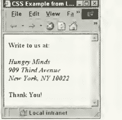

如你所见，第一行是粗体，地址是斜体，最后一行又变回了粗体。你可能没有注意到的是，斜体部分也是粗体。这就是CSS的“层叠”部分。当两条或多条规则匹配一个元素时，它们都会应用于该元素。如果规则之间存在冲突，更精确匹配元素的规则会胜出。如果两条或多条规则精确匹配元素，则最后定义的规则会胜出。举个例子，考虑以下内容：

```
<style type="text/css">
p { font-weight:bold }
p.alert { font-weight:normal; font-style:italic }
</style>
<p>Write to us at:</p>
<p class="alert">
Hungry Minds<br />
909 Third Avenue<br />
New York, NY 10022<br />
</p>
<p>Thank You!</p>
```

如果你将此代码加载到浏览器中，你会看到类似图21-2的内容。

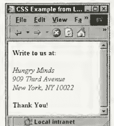

**图21-2**
层叠和冲突样式规则的示例

两条规则都定义了font-weight的设置，但第二条规则胜出，因为它更精确地匹配了包裹地址的HTML标签。

在这些示例中，我展示了为特定标签定义一个类。虽然这完全有效，但你不必将类绑定到任何一种类型的标签。以下代码展示了如何定义一个可用于几乎所有HTML标签的类。

```
<style type="text/css">
p { font-weight:bold }
.alert { font-weight:normal; font-style:italic }
</style>
<p>Write to us at:</p>
```

## 使用 CSS ID

好的，现在你可以创建文档范围的样式，以及应用于你指定的一组标签的样式。但如果你想让一个样式只应用于单个元素，而不应用于其他元素呢？在这种情况下，你可以创建一个与 CSS ID 关联的样式。这个 ID 在给定的 HTML 标签类型中应该是唯一的。换句话说，你可以有一个 ID 为 `contactInfo` 的 `<p>` 标签，也可以有一个 ID 为 `contactInfo` 的 `<h1>` 标签，但你不能有两个 ID 为 `contactInfo` 的 `<p>` 标签（或两个 `<h1>` 标签）。下面展示了如何使用 ID 声明和使用样式规则。

```html
<style type="text/css">
p { font-weight:bold }
#contactInfo { font-weight:normal; font-style:italic }
a#contactInfo { font-weight:bold; font-style:italic }
</style>
<p>Write to us at:</p>
<p id="contactInfo">
Hungry Minds<br />
909 Third Avenue<br />
New York, NY 10022<br />
</p>Or, send us an
<a id="contactInfo"
href="mailto:custserdum@hungryminds.com">e-mail!</a>
<p>Thank You!</p>
```

如你所见，ID 定义前有一个井号（#）字符。这里我定义了两个面向 ID 的规则：第一个将匹配任何 `id=` 属性为 `contactInfo` 的元素，第二个将仅匹配 `id=` 属性为 `contactInfo` 的 `<a>` 标签。

样式也可以通过使用 `style=` 属性应用于单个标签。你只需列出要应用于该标签的样式规范，并用分号分隔即可。例如，如果我只想让一组 `<p></p>` 标签显示为红色和粗体，而不想费心去定义 ID，我可以这样编码：

```html
<p style="color:red;font-weight:bold">I'll be red and bold!</p>
```

这种方法的问题在于，它将你的样式定义分散在整个 HTML 文档中，使得在需要更改时难以更新。

## `<span>` 标签

大多数包含文本的 HTML 标签都有副作用。例如，`<a></a>` 标签创建链接，而 `<p></p>` 标签通过在标签文本上下添加空白来创建段落的外观。那么，如果你只想将样式应用于一段文本，而不想产生任何视觉副作用，可以使用什么标签呢？你可以使用 `<span>` 标签！

`<span>` 标签是 HTML 的一个新成员，它的存在仅仅是为了让你能够划定一段文本的范围。这使得它非常适合在没有任何 HTML 相关副作用的情况下应用样式。以下是 `<span>` 标签的实际应用示例。

```html
<style type="text/css">
p { font-weight:bold }
#contactInfo { font-weight:normal; font-style:italic }
a#contactInfo { font-weight:bold; font-style:italic;
text-decoration:none }
.noticeMe { text-decoration:underline }
</style>
<p>Write to us at:</p>
<p id="contactInfo">
Hungry Minds<br />
909 Third Avenue<br />
New York, NY 10022<br />
</p><span class="noticeMe">Or, send us an</span>
<a id="contactInfo"
href="mailto:custserdum@hungryminds.com">e-mail!</a>
<p>Thank You!</p>
```

使用 `<span>` 标签以及适当的样式规则，可以让我在不产生任何其他视觉副作用的情况下，为想要的文本添加下划线。

## 使用外部样式表

虽然 `<style>` 标签使得为文档创建样式变得容易，但直到你使用它们来为网站上的所有文档设置样式时，你才真正开始发挥样式表的强大功能。你可以通过将样式规则存储在外部文件中，然后将该文件链接到你想要使用这些规则的每个 HTML 文档来实现这一点。将样式保存在外部文件中有一个巨大的优势：如果你需要更改网站上的某个样式，只需更改外部样式表，所有使用该外部样式表的页面都会立即反映更改。如果你的网站只有几个页面，这可能看起来不太重要，但如果你的网站有几百甚至几千个页面，它可以为你节省数小时甚至数天的工作！有两种基本方法可以将外部样式表与你的 HTML 文档一起使用：`<link>` 标签和 `@import` 规则。（请注意，在外部样式表中指定的任何规则都可以被你在文档的 `<style>` 块中指定的规则覆盖。只需在链接外部样式表*之后*定义你想要优先应用的样式即可。）

### 使用 `<link>` 标签

`<link>` 标签是一个 HTML 标签，它允许你在 HTML 文档和某种外部文档之间建立链接。使用它来创建与外部样式表的链接实际上非常简单。你只需编写类似这样的代码：

```html
<link rel="stylesheet" type="text/css" href="babyPalooza.css"
title="bpStyles" />
```

这个标签很简单。`rel=` 属性告诉浏览器我们正在链接的文档类型，而 `type=` 属性告诉浏览器它是哪种类型的样式表。`href=` 属性告诉浏览器外部文件的网络地址。最后，`title=` 属性为外部文件提供一个名称，浏览器可以使用该名称来引用该文件。

### `@import` 规则

引入外部样式的另一种方法是在 `<style>` 块的开头使用 `@import` 规则。它看起来像这样。

```html
<style type="text/css">
@import "babyPalooza.css";
p { font-weight:bold }
</style>
```

你只需创建一个以 `@import` 开头的新规则，然后跟上你要导入的样式表的网络地址。（你可以使用这些方法中的任何一种或全部来指定样式。但是，如果你打算使用 `@import` 规则，请确保在定义任何其他样式之前使用它。否则，浏览器将忽略 `@import` 规则。）

以上就是你需要了解的关于 CSS 的基础知识，以便能够使用它们。当然，还有*大量*其他样式选项可供指定。为了了解所有这些其他细节，我再次建议你访问官方 CSS 文档页面 www.w3.org/TR/REC-CSS2。那么，在解决了所有这些问题之后，现在是时候向你展示如何将 CSS 和 JavaScript 结合使用了。

## 将 JavaScript 与 CSS 结合使用

将 JavaScript 与样式表结合使用的关键是文档对象模型。现在，我已经告诉过你浏览器对象模型，但文档对象模型略有不同。浏览器对象模型是一组对象，它允许编程语言（在我们的例子中是 JavaScript）与 Web 浏览器及其内部的所有内容进行交互，包括加载到浏览器中的文档。文档对象模型（简称 DOM）是一组标准化的对象，可用于在任何环境中表示 HTML 或 XML 文档。（与 CSS 一样，DOM 标准由 W3C 维护。）幸运的是，浏览器对象模型中包含的文档对象是基于 DOM 的，正是这一点使得你的 JavaScript 程序能够与你应用于 HTML 文档元素的样式进行交互。

在第 9 课中，你已经对文档对象有了相当全面的了解。然而，为了节省空间（并避免混淆），我确实省略了 DOM 标准中指定的许多方法。但此时，有必要告诉你其中一个方法：`getElementById()` 方法。你看，当 HTML 文档被转换为符合 DOM 的对象时，文档中的每个元素（即每组标签）都会创建一个相应的对象来表示它。这些对象被称为*元素对象*，它们包含了关于该元素及其内部内容的大量信息。但是，在你能够检查或更改这些信息之前，你必须先获取该元素。对象本身。这正是 `getElementById()` 方法的用武之地。如果你将一个元素的 ID 传递给这个方法，它将返回相应的元素对象。然后，你几乎可以对该元素做任何你想做的事情，而这些更改将显示在浏览器窗口中。

举个例子，我将创建一个基于 CSS 的脚本，通过简单地更改与控件关联的样式规则来隐藏和显示一个控件。为了使这个例子既有趣又实用，我将对 Baby-Palooza.com 主页上的调试信息文本框进行此操作。首先，我需要定义几个样式，使隐藏和显示控件成为可能。

```
body { background-color:white; font-family:arial; font-size:8pt }
td { font-size:8pt }
textarea.debug { visibility:visible }
textarea.debugHidden { visibility:hidden }
```

接下来，我需要稍微更改定义将显示我的调试信息的文本区域控件的标签。（这在 index.htm 文件中。）

```
<textarea id='debugCtl' name='debug' rows='20' cols='70'>
```

此时剩下的就是定义一个按钮来触发更改，以及实际执行此操作的 JavaScript 函数。以下是 index.htm 文件中该新按钮的定义：

```
<input type='button' name='toggle' value='Hide Debug Info' onclick='doShowHideDebug()' />
```

JavaScript 函数如下所示：

```
function doShowHideDebug() {
    var debugText = document.getElementById( "debugCtl");
    if (document.forms[1].toggle.value == "Hide Debug Info") {
        debugText.className = "debugHidden";
        document.forms[1].toggle.value = "Show Debug Info";
    }
    else {
        debugText.className = "debug";
        document.forms[1].toggle.value = "Hide Debug Info";
    }
}
```

这个函数首先调用 `document.getElementById()` 方法并传递给它一个 ID 为 `debugCtl`。这将返回一个代表我的文本区域控件的元素对象。然后我使用一个 `if` 语句来确定我应该隐藏还是显示该控件。这个决定是基于我按钮内的值。（记住，按钮的 `value` 属性是实际显示在屏幕上按钮中的字符串。）如果按钮中的值是 "Hide Debug Info"，则控件必须是可见的。因此，我将文本区域的 `className` 属性更改为 `debugHidden`。这会立即切换应用于该控件的样式规则，并将其从屏幕上移除。最后一步是更改我按钮的 `value` 属性，使按钮显示为 "Show Debug Info"。（再次显示控件的方式大致相同。要查看所有这些代码的实际运行效果，请从 CD-ROM 上的 Session21 文件夹加载 index.htm 文件。）

正如我之前所说，`getElementById()` 方法返回的对象暴露了有关该元素的大量信息。然而，你可能对此信息进行的任何其他操作都属于动态 HTML 的范畴。这是一个很大的主题，有太多有趣的内容需要涵盖，我现在先放一放，以便在下一讲中深入讨论它。

## 决定使用哪个样式表

还记得在本讲开始时，我说过样式表旨在帮助将网页中的内容与其呈现的样式分离。因此，你可以为 Windows PC 定义一组样式，为 Macintosh 定义另一组，依此类推。关键在于决定使用哪一组样式。

当然，你可以在一组 `<style></style>` 标签内指定样式，所以你可以只使用 JavaScript 在页面加载时就在页面内动态生成你所有的规则。然而，这将非常低效，因为你必须将你支持的所有平台的所有样式都放在你的 JavaScript 代码中。因此，使用外部样式表并动态决定链接哪个是可行的方法。唯一的问题是，你如何确定浏览器运行在哪个平台上，以便动态生成相应的 `<link>` 标签？

在第 26 讲中，我将向你详细介绍 `navigator` 对象以及它如何帮助你编写跨浏览器脚本。在此之前，`navigator` 对象的一个属性为这个问题提供了一个完美的解决方案。这个名为 `platform` 的属性告诉你它实际的作用：浏览器运行在哪个计算机平台上。表 21-1 显示了几个浏览器和平台的 `navigator.platform` 值。

### 表 21-1
navigator.platform 的值

| 平台 | 浏览器 | navigator.platform 的值 |
| :--- | :--- | :--- |
| Windows Me | Netscape/Internet Explorer | Win32 |
| Macintosh OS 9.0.4 | Netscape/Internet Explorer | MacPPC |
| Linux (Mandrake 7.1) | Netscape | LinuxELF2.0 |

如你所见，找出你正在运行的计算机平台相当简单。以下代码将向你展示如何使用此信息（以及几个字符串方法）来动态生成相应的 `<link>` 标签。

```
var styleLink = '<link rel="stylesheet" type="text/css"
title="bpStyles" ';
var platform = navigator.platform.substring(0, 3).toUpperCase();
if (platform == "WIN") {
    styleLink += 'href="babyPalooza-Win.css" />';
}
if (platform == "MAC") {
    styleLink += 'href="babyPalooza-Mac.css" />';
}
if (platform == "LIN") {
    styleLink += 'href="babyPalooza-Linux.css" />';
}
document.writeln( styleLink);
```

当然，为了正常工作，此代码应出现在 HTML 文档的顶部。

### 复习

在本讲中，你学习了层叠样式表。你看到了如何在 HTML 文档内创建样式表以及如何加载外部样式表。你看到了 JavaScript 如何从文档对象中提取代表单个元素（标签）的对象。你还了解到，一旦你掌握了该元素对象，你就可以对它做各种各样的事情。最后，你学习了 `navigator` 对象的 `platform` 属性如何帮助你创建一个 JavaScript 程序，让你动态加载最适合浏览器运行平台的样式表。在下一讲中，我将更深入地探讨这些主题，向你展示如何使用动态 HTML 在网页上创建各种有趣的效果。

### 自我测验

- 1. 样式表的目的是什么？（参见本讲的开头段落。）
- 2. 链接到外部样式表的两种方式是什么？（参见“使用外部样式表”。）
- 3. CSS 类和 CSS ID 之间有什么区别？（参见“使用 CSS 类”和“使用 CSS ID”。）
- 4. `document.getElementById()` 方法的作用是什么？（参见“将 JavaScript 与 CSS 结合使用”。）
- 5. `navigator.platform` 属性包含什么信息？（参见“决定使用哪个样式表”。）

# 第 22 讲

## 使用 JavaScript 创建动态 HTML

## 本讲清单

- 学习 JavaScript 如何动态操作 HTML
- 了解 DHTML 属性
- 使用 CSS 和 JavaScript 在屏幕上移动元素
- 在页面加载后更改屏幕上的文本

在第 11 讲中，你学习了如何动态创建 HTML，以便向用户呈现个性化的网页。在本讲中，你将学习如何使用 JavaScript 在 HTML 页面*已经*加载到 Web 浏览器*之后*，动态地更改其外观和内容。这个过程被称为动态 HTML，简称 DHTML。

过去，创建 DHTML 是一门相当深奥的艺术。每个主要浏览器都有不同的底层对象模型，因此，你必须为每个浏览器编写完全不同的 DHTML 和 JavaScript 代码块来完成相同的事情。幸运的是，随着最新的文档对象模型（DOM）标准的采用，以及 Internet Explorer 和 Netscape Navigator 最新版本的发布，这种情况开始向好的方向发展。然而，不幸的是，两个浏览器中的 DOM 支持还不完整，因此仍然需要使用一些技巧来创建一个无需修改即可运行的 DHTML 脚本。但这确实可以做到，而且实际上非常简单！

在我撰写本文时，DOM的最新版本是第2级。如上所述，主要浏览器已经整合了第2级DOM的大部分功能，但仍有一些部分尚未实现。我将重点关注在Internet Explorer和Netscape Navigator最新版本中都能正常工作的部分。（换句话说，你将在本节中学到的内容*不*保证在旧版浏览器中有效。）有关DOM第2级标准的更多信息，请访问www.w3.org/TR/DOM-Level-2-Core/。

### 动态更改样式

层叠样式表（CSS）是你在上一节中学习的内容，它是DOM下所有样式操作的基础。因此，为了使样式易于操作，DOM规定浏览器可以定义样式对象，这些对象包含将各种样式信息应用于HTML页面元素所需的所有信息。Internet Explorer和Netscape Navigator的最新版本都以名为*style*的对象形式将此信息提供给你的JavaScript程序，该对象是元素对象的一个属性。

在DOM领域工作时，术语*元素*指的是一组开始和结束HTML标签及其内容，或一个单独的空HTML标签。例如：

```
<p>This is an element</p>
```

在上面的行中，所有内容（包括`<p></p>`标签）都是一个元素。此外，元素（和元素对象）可以相互嵌套。在行

```
<p>This is a <b>bunch</b> of elements</p>
```

中，实际上有几个元素：一个用于`<p></p>`标签，一个用于`<b></b>`标签。而以下每段文本：

```
This is a
bunch
of elements
```

无论它占多少行，都是一个独立的元素。最后，像`<hr />`这样的空标签也是一个元素。

### 获取元素对象

如果你还记得上一节的内容，你可以通过调用`document.getElementById()`方法并传递你感兴趣的元素的`id=`属性来简单地获取一个元素对象。因此，如果我定义了以下HTML：

```
<p id="welcome">Welcome to Baby-Palooza.com!</p>
```

你可以使用以下JavaScript获取表示这组`<p></p>`标签（包括所有子元素）的元素对象：

```
var welcomeElement = document.getElementById( "welcome");
```

一旦你拥有了元素对象，事情就开始变得*非常*有趣。

### 检查style对象

在上一节中，我向你展示了如何通过更改元素关联的CSS类来显示或隐藏元素。虽然这是一个巧妙的技巧，但它也是一种相当不优雅的方法。毕竟，当你更改元素的CSS类时，你基本上是在更改该元素的*所有*样式信息。如果你能只更改元素样式的特定方面，而不影响其类或其他样式属性，那会好得多。这正是style对象允许你做的事情。

获取元素的style对象很容易：只需使用`getElementById()`方法提取相关元素，然后你就可以检查style对象的任何你感兴趣的属性。例如，要查看前面定义的`welcomeElement`的`color`属性，我可以编写：

```
alert( welcomeElement.style.color);
```

到现在为止，你可能对style对象内部所有属性的名称非常好奇。嗯，不幸的是，它们有*很多*。真的，我是说*很多*！因此，我不会详细介绍每个属性。相反，我将给你一个快速的JavaScript程序来列出所有属性及其内容。我将介绍一些更有用的属性，但要获取完整列表（以及每个属性的有效值），你应该查看www.w3.org/TR/REC-CSS2上的CSS信息页面。

```
<p id="welcome">Welcome to Baby-Palooza.com</p>
<script language="javascript">
// Get the element that represents our test paragraph
var welcomeElement = document.getElementById("welcome");
// List all the properties of the element's style object
for (x in welcomeElement.style) {
    document.write(x + " = ");
    document.write(eval("welcomeElement.style." + x));
    document.write("<br />");
}
</script>
```

如果你加载这个程序（它在你的CD-ROM的Session22文件夹中），你将看到欢迎文本，后面跟着一个直接来自style对象的属性列表。

### 更改样式属性

style对象的好处在于它的所有属性都是可更改的。因此，如果我想让我的欢迎文本变成红色，我只需要编写：

```
welcomeElement.style.color = "red";
```

文本就会立即在屏幕上变成红色。当然，虽然你可以为style对象的各种属性赋值，但你需要确保你赋的值对该属性是有效的。同样，你可以在www.w3.org/TR/REC-CSS2找到每个样式属性的有效值的完整列表。但是，为了让你能立即开始，这里列出了一些更有用的样式属性及其有效值。（像往常一样，你可以在你的CD-ROM上找到演示每个这些属性的程序。当你在CD-ROM上试用示例程序时，不要太担心输入无效值。通常，DOM会拒绝无效值并使用相应的默认值，不会有任何问题。你可能遇到的最糟糕的情况只是一个简单的JavaScript错误对话框。）

> 当你将W3C网站上的样式属性列表与这里的列表进行比较时，W3C属性的名称将是像"background-color"这样的，而不是"backgroundColor"。由于W3C名称不是有效的JavaScript变量名，浏览器制造商去掉了连字符，并将第二个单词的首字母大写，以便它们可以在JavaScript中使用。但是，当你在CSS样式规则中使用这些属性时，你必须使用带连字符的形式。

### backgroundColor属性

此属性控制元素的背景颜色。有效值包括第9课中的任何标准颜色名称或任何六位RGB十六进制颜色值。（部分列表见表9-1。）

```
welcomeElement.style.backgroundColor = "yellow";
```

### backgroundImage属性

此属性允许你指定要放置在元素背景中的图像（在背景颜色之上，但在文本之下）。你必须以非常特定的格式指定图像的Web地址，如下例所示。（注意括号内不需要引号。）

```
welcomeElement.style.backgroundImage =
"url(../images/happyBaby.jpg)";
```

### backgroundRepeat属性

如果你指定了背景图像，你还可以通过设置此属性来指定该图像是否应在元素中重复。有效值是`repeat`（默认值）、`repeat-x`（在页面上水平重复图像）、`repeat-y`（在页面上垂直重复图像）和`no-repeat`。（要获得一些真正巧妙的背景图像效果，请务必查看www.w3.org/TR/REC-CSS2上的`background-attachment`和`background-position`属性。）

```
welcomeElement.style.backgroundRepeat = "no-repeat";
```

### borderColor属性

如果你在元素周围创建了边框（请参阅本节后面的`borderStyle`属性），此属性可用于设置其颜色。有效值与`color`属性相同。

```
welcomeElement.style.borderColor = "green";
```

你也可以传递多个值来为边框的每条边指定不同的颜色。

```
welcomeElement.style.borderColor = "green red black blue";
```

### borderStyle属性

此属性允许你指定元素周围边框的样式。有效值是`dashed`、`dotted`、`double`、`groove`、`inset`、`none`、`outset`、`ridge`和`solid`。你可以指定一个值，它将用于边框的所有四条边。或者，你可以为两条、三条或所有四条边指定一个值。例如，以下语句将在元素周围创建一个双线边框。

```
welcomeElement.style.borderStyle = "double";
```

以下语句将创建一个顶部和底部为实线，两侧为虚线的边框。

```
welcomeElement.style.borderStyle = "solid dashed";
```

（要更精确地控制元素周围的边框，你可以单独设置`border-top`、`border-left`、`border-right`和`border-bottom`属性。）

### borderWidth属性

如果你在元素周围创建了边框（请参阅上面的`borderStyle`属性），此属性可用于设置绘制边框所用线条的宽度。有效值是`medium`、`thin`、`thick`或像素数。（注意，你不能指定负数。）

```
welcomeElement.style.borderWidth = "10px";
```

你也可以传递多个值来为边框的每条边指定不同的宽度。

```
welcomeElement.style.borderWidth = "thin thick medium 20px";
```

### color属性

此属性控制元素文本绘制的颜色。有效值包括第9课中的任何标准颜色名称或任何六位RGB十六进制颜色值。（部分列表见表9-1。）

```
welcomeElement.style.color = "brown";
```

### display属性

此属性控制元素在Web浏览器中的布局和显示方式。有效值是`block`、`inline`、`list-item`和`none`。元素屏幕上“占据区域”的元素（如 `<p></p>` 标签）应设置为 `block` 值，而存在于其他元素内部的元素（如 `<b></b>` 标签）则应设置为 `inline` 显示值。`list-item` 设置与 `block` 类似，但会添加列表项标记。（换句话说，就是项目符号。请注意，并非所有浏览器都支持此设置。）若要将元素从屏幕上移除，并让屏幕上的其他元素填充该元素原来的位置，需将元素的 `display` 属性设置为 `none`。

```
welcomeElement.style.display = "none";
```

### fontFamily 属性

此属性控制用于绘制元素内文本的字体族（例如 Helvetica、Arial、Times 等）。理论上，你可以指定客户端安装的任何字体族。如果指定的字体族未安装在客户端，浏览器将使用默认字体。

```
welcomeElement.style.fontFamily = "symbol";
```

### fontSize 属性

此属性控制元素内文本的字体大小。任何从零开始的数字都是有效的，但你还需要为指定的大小提供单位度量。表 22-1 列出了有效的单位。

表 22-1：指定元素字体大小的有效度量单位

| 单位 | 用法 |
| --- | --- |
| % | 字体应缩放为元素默认字体大小的给定百分比。（例如，如果默认高度为 10pt，指定了 120% 的 fontSize，则字体将缩放至 12pt。） |
| cm | 厘米 — 大小以厘米为单位提供。 |
| em | em — 这意味着数字以 em 为单位表示。 |
| ex | x-height — 这会根据字体中字符 x 的高度来缩放字体。 |
| mm | 毫米 — 大小以毫米为单位提供。 |
| pc | Picas — 提供的数字是 picas 的数量。 |
| pt | 点 — 这是传统的字体点大小。（大约 1/72 英寸。） |
| px | 像素 — 这意味着提供的数字是像素的数量。（请注意，如果不提供单位标识，默认将使用 px。） |

因此，以下任何语句都是对 `fontSize` 属性的有效赋值：

```
welcomeElement.style.fontSize = "10px";
welcomeElement.style.fontSize = "45%";
welcomeElement.style.fontSize = "10cm"; // 天哪！
```

### fontStyle 属性

此属性控制应用于元素内文本的样式。有效值为 `normal`、`italic` 和 `oblique`。（大多数浏览器以相同方式渲染 italic 和 oblique。）

```
welcomeElement.style.fontStyle = "italic";
```

### fontWeight 属性

此属性控制元素内文本的粗细（密度）。有效值为 `normal`、`bold`、`bolder`、`lighter`、`100`、`200`、`300`、`400`、`500`、`600`、`700`、`800` 和 `900`。`normal` 设置等同于 `400`，`bold` 设置等同于 `700`。

```
welcomeElement.style.weight = "900"; // 尽可能加粗！
```

### height 属性

此属性指定元素在屏幕上的高度。你可以为此属性分配任何正数，元素将被调整大小。（请注意，你可以使用本节前面讨论 `fontSize` 属性时在表 22-1 中指定的相同度量单位。另请注意，百分比值被解释为浏览器窗口中可见垂直空间的百分比。）

```
welcomeElement.style.height = "50%";
```

### margin 属性

此属性允许你指定元素周围的边距。有效值包括正数和负数。（请注意，并非所有浏览器都支持指定负值。你可以使用表 22-1 中指定的相同度量单位。）

```
welcomeElement.style.margin = "50px";
```

你也可以传递多个值来为元素的每一侧指定不同的边距大小。

```
welcomeElement.style.margin = "20px 50pt 10px 35mm";
```

（要更精确地控制元素周围的边距，你可以单独设置 `margin-top`、`margin-left`、`margin-right` 和 `margin-bottom` 属性。）

### padding 属性

此属性允许你指定元素内部的填充（即元素外部边缘与内部文本之间的空间）。有效值包括从零开始的正数。（你可以使用表 22-1 中指定的相同度量单位。）

```
welcomeElement.style.padding = "50px";
```

你也可以传递多个值来为元素的每一侧指定不同的填充宽度。

```
welcomeElement.style.padding = "20px 50pt 10px 35mm";
```

（要更精确地控制元素内部的填充，你可以单独设置 `padding-top`、`padding-left`、`padding-right` 和 `padding-bottom` 属性。）

### textAlign 属性

此属性指定元素中文本的对齐方式。有效值为 `left`、`right` 和 `center`。

```
welcomeElement.style.textAlign = "center";
```

### visibility 属性

此属性决定元素是否可见。有效值为 `visible` 和 `hidden`。

```
welcomeElement.style.visibility = "hidden";
```

请注意，即使你隐藏了一个元素，它仍然会占据页面上的空间。要将元素从页面布局中移除，请将其 `display` 属性设置为 `none`。（有关更多信息，请参阅本节前面关于 `display` 属性的讨论。）

### width 属性

此属性指定元素在屏幕上的宽度。你可以为此属性分配任何正数，元素将被调整大小。（请注意，你可以使用表 22-1 中指定的相同度量单位。另请注意，百分比值被解释为浏览器窗口中可见水平空间的百分比。）

```
welcomeElement.style.width = "25px";
```

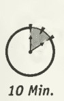

### 移动元素

CSS 的一大优点是它允许你*精确*地在屏幕上定位元素。只需为样式对象的 `position`、`top`、`left`、`bottom` 和 `right` 属性指定适当的值，你就可以告诉浏览器你希望某个东西在屏幕上如何以及在哪里显示。然而，真正酷的部分在于，你还可以获取一个元素，并通过反复*更改*一个或多个与位置相关的属性，在浏览器窗口中移动东西。（你可以使用样式对象的与位置相关的属性做很多其他巧妙的事情。不幸的是，本书没有足够的篇幅涵盖所有内容。因此，我将只关注如何在屏幕上移动东西。有关这些属性提供的所有其他功能的详细信息，请务必访问官方 CSS 文档网站 www.w3.org/TR/DOM-Level-2-Core/。）

### position 属性

基于 CSS 的动画的关键是 `position` 属性。此属性允许你告诉浏览器你*希望*元素在页面上如何定位，而不是确切地希望它定位在哪里。你可以为 `position` 属性分配几个不同的值，但为了动画的目的，你需要指定一个 `absolute` 值。此值告诉浏览器，你，程序员，将让浏览器知道确切地将元素定位在页面上的什么位置。然后，你需要通过将 `top`、`left`、`bottom`、`right`、`height` 和 `width` 属性设置为适当的值来为元素指定物理位置和形状。你已经了解了 `height` 和 `width` 属性，所以让我告诉你一些关于其他属性的信息。

`top`、`left`、`bottom` 和 `right` 属性允许你确定元素在其所在的父元素内绘制的位置。例如，如果你有一个 `<span></span>` 在 `<p></p>` 内，并且你重置了 `<span></span>` 元素的 `top`、`left`、`bottom` 或 `right` 属性，你指定的值将被视为相对于 `<p></p>` 元素的位置。

例如，如果我为 `<span></span>` 元素的 `bottom` 属性分配一个值 50，该元素的底部将被移动，使其距离 `<p></p>` 元素的底部 50 像素。

如果一个元素没有父元素（或者父元素本身没有定位），这些元素指定相对于 `<body></body>` 元素（换句话说，浏览器窗口）的位置。

如果你觉得这有点令人困惑，别担心……一旦你看到它的实际效果，它真的并不那么难。因此，考虑到这一点，启动你的 HTML 编辑器，并从 CD-ROM 上的 Session22 文件夹中打开 movingThings.htm 文件。这是一个相当简单（如果有点长）的程序，它获取一个段落元素并将其在浏览器窗口顶部来回移动。我添加了一个背景图像，以便你可以观察段落漂浮在其上。

查看此代码，你会看到在指定我的样式之后，我创建了一个简单的段落元素，其中包含我通常的问候语。当我的 JavaScript 开始执行时，它做的第一件事是获取我的段落的元素对象。接下来，我将此元素的 `position` 属性赋值为 "absolute"。这会将元素从页面的布局流中移除，并赋予我移动它的能力。

跳到结尾，你会看到一个简单的 `setInterval()` 方法调用启动了动画并使其持续进行。每 10/1000 秒，它调用 `moveit()` 函数，该函数使段落在页面上来回滑动。虽然 `moveit()` 函数背后的概念相当简单，但当今浏览器中样式的工作方式使其比你可能预期的要复杂一些。

第一个问题是，除非你为 `top`、`left`、`bottom` 或 `right` 样式属性指定一个非零值，否则它们将包含空字符串，直到你向其中放入内容。因此，`moveit()` 函数会检查这一点，如果 `left` 属性确实是空的，则将 `curPos` 变量设置为零。

如果 `left` 属性不为空，我们实际上会遇到一个更棘手的问题。你看，所有四个与位置相关的属性实际上都以字符串形式存储，末尾还带有单位信息！因此，如果你给 `left` 属性赋值为零，稍后实际得到的值将是 `0px`。这使得对这些属性进行数学运算变得相当困难。所以，与其费力调用一堆中间字符串方法，`moveit()` 函数将 `left` 属性的内容拆分成一个数组（使用 `px` 中的 `p` 作为分隔符），然后将数字部分转换为实际的数字。（记住，`px` 是所有数字样式属性的默认单位。因此，如果你使用不同的单位集，就必须相应地修改代码以提取所需的数字。）一旦我获得了所需的值，我就会检查移动方向，并相应地递增或递减 `left` 属性。

最后，你会注意到，为了改变方向，我不得不将元素的 `left` 位置与屏幕宽度减去一个硬编码值（470）进行比较。这是必要的，因为除非你设置了元素的 `width` 属性，否则无法知道它的宽度。所以，如果你看一下我为段落定义的样式规则，你会看到我将其宽度设置为 450 像素，刚好足以让所有消息文本显示在一行上。（额外的 20 像素是为窗口右侧的滚动条预留的。）

虽然这是一个非常简单的程序，但它实际上包含了创建自己的基于 CSS 的动画所需的所有技巧。记住，使用这种技术，你可以移动*任何*元素：段落、列表、图像，任何你想要的东西。

### 在浏览器窗口中更改文本

我想与你分享的最后一个 DHTML 技巧是如何更改你在浏览器窗口中看到的文本。正如你之前所见，如果你尝试使用 `document.write()` 调用来实现这一点，最终只会擦除浏览器窗口的内容。幸运的是，DHTML 让看似不可能的事情变得异常简单。

### innerHTML 属性

这个技巧的关键在于元素对象的一个非常规属性，名为 `innerHTML`。没错，我说它是非标准的。不幸的是，在 DOM 中确实没有与 `innerHTML` 属性简单等效的东西。这很遗憾，因为 `innerHTML` 属性使用起来异常简单，功能也异常强大。尽管 `innerHTML` 不是 DOM 的一部分，但我在这里告诉你它有两个原因：

1. 正如我之前所说，主要浏览器对 DOM 的支持尚未达到 100%。因此，虽然可能通过 DOM 以多步骤方式实现相同的功能，但并非所有主要浏览器的所有版本都完全支持 DOM 以允许这样做。

2. 令人惊讶的是，所有平台上所有当前的浏览器版本（我测试过的）都支持 `innerHTML` 属性。结合其有用性和流行度，我确信 `innerHTML` 属性将长期存在。

那么，`innerHTML` 属性是做什么的呢？嗯，它允许你更改元素内部的 HTML。就是这么简单，功能就是这么强大。例如，考虑以下代码。

```
<p id="welcome">Welcome to Baby-Palooza.com</p>
<script language="javascript">
    var welcomeElement = document.getElementById("welcome");
    welcomeElement.innerHTML = "<b>Thanks for your business!</b>";
</script>
```

像往常一样，这段代码定义了一个段落元素，然后调用 `getElementById()` 方法来获取代表该元素的对象。然而，最后一条语句才是 `innerHTML` 属性如此特别的原因。你会注意到我正在给 `innerHTML` 属性赋一个新字符串。这个字符串的一部分是一组 `<b></b>` 标签。这条语句执行后，我的段落中的文本将立即更改为文本 "Thanks for your business!"，并且会以粗体显示！（如果你不相信，可以试试 `innerHTMLProperty.htm` 文件，亲眼看看。）如果这看起来很简单，那确实如此！幸运的是，`innerHTML` 属性既简单又强大。因此，使用 `innerHTML` 属性时，请确保你确切知道正在更改什么，并记住关键是为每个元素分配一个唯一的 ID。一旦你做到了这一点，创建你的 DHTML JavaScript 代码就会变得异常简单。


### 复习

在本节中，你学习了如何创建 JavaScript 代码来动态操作网页中的 HTML 元素。你了解了元素的 `style` 对象包含了操作页面上元素外观所需的一切。此外，你还发现了 JavaScript 如何在浏览器窗口中移动 HTML 元素。最后，你学习了如何更改元素的 `innerHTML` 属性以在屏幕上放置新文本。

由于本节包含大量概念和理论，我没有空间向你展示一个简洁的小型 JavaScript 程序，该程序允许你随意研究 `style` 对象的所有属性。你可以在 CD-ROM 上的 `dhtmlStyle.htm` 文件中找到这个程序。将其加载到你喜欢的浏览器中，开始更改样式属性。在你玩了一会儿之后，看看源代码。它包含了我们在本节中讨论的几乎所有内容，以及本书其他部分的不少概念。此外，它本身就是一个非常有用的调查工具！

### 自我测验

1.  元素的样式信息保存在哪里？（参见“动态更改样式”。）
2.  元素到底是什么？（参见“动态更改样式”。）
3.  将网址分配给 `style` 对象的 `backgroundImage` 属性时，如何格式化网址？（参见“backgroundImage 属性”。）
4.  CSS 和 `style` 对象的属性使用哪些不同的度量单位？（参见“fontSize 属性”。）
5.  使用与位置相关的 `top`、`left`、`bottom` 和 `right` 属性时需要注意什么？（参见“position 属性”。）

## 第 23 节
使用框架

#### 本节清单

-   理解 JavaScript 如何在框架之间通信
-   为框架动态创建新内容
-   处理未加载其框架集的基于框架的文档
-   使用 JavaScript 调整框架大小

无论你喜欢还是讨厌，基于框架的网站都将持续存在。幸运的是，从 JavaScript 程序员的角度来看，使用基于框架的网站几乎与使用非框架网站一样简单。

### JavaScript 如何看待框架

要创建基于框架的网站，首先必须定义一个 HTML 框架集文档。这只是一个 HTML 文档，其中包含一组 `<frameset></frameset>` 标签，而不是一组 `<body></body>` 标签。在 `<frameset></frameset>` 标签内，你定义一个或多个 `<frame>` 标签，告诉浏览器为每个框架加载哪个文件，以及框架在浏览器窗口中应如何显示。以下代码显示了一个简单的框架集文档。（注意，此代码位于 Session23 文件夹中的 `listing23-1.htm` 文件中。）

```
<html>
<head><title>Welcome to Baby-Palooza.com!</title></head>
<frameset rows="70%,*" frameborder="0">
    <frame name="prodInfo" src="welcome.htm" scrolling="yes"
    frameborder="no"></frame>
    <frame name="cart" src="cart.htm" scrolling="yes"
    frameborder="no"></frame>
</frameset>
</html>
```

在第 8 节中，我提到过，就 JavaScript 而言，框架只是另一个 `window` 对象。因此，当你将此文档加载到 Web 浏览器中时，它实际上会创建三个 `window` 对象：一个代表框架集文档本身，另外两个分别代表每个 `<frame>` 标签。代表框架集文档的 `window` 对象成为父对象，其他对象则成为 `parent.frames` 数组中的条目。

如果你仔细观察前面的代码，你会看到，除了指定应将哪个 HTML 文件加载到每个框架中（`src=` 属性）之外，我还为每个框架指定了一个 `name=` 属性。正如你可能预料的那样，这些最终将用作代表每个框架的 JavaScript `window` 对象的名称。

### 在框架之间通信

如果你在一个框架中有一些 JavaScript 需要与另一个框架中的 JavaScript 通信，这非常简单。例如，假设加载了前面显示的框架集，并且在 `welcome.htm` 文件中定义了以下代码：

```
function welcome() {
    alert("Welcome to Baby-Palooza.com!");
}
```

如果我想从 `cart.htm` 文件调用此函数，以下任何一条语句都可以实现。

```
parent.prodInfo.welcome();
parent.frames[0].welcome();
parent.frames['prodInfo'].welcome();
```

这是如何工作的？让我们看看这些语句中的第一条：

```
parent.prodInfo.welcome();
```

首先要记住的是，这条语句是在一个框架（确切地说是购物车框架）内部执行的。因此，为了访问 prodInfo 框架，代码必须与 prodInfo 框架有一个共同的参考点。这就是 `parent` 对象的用武之地。由于这两个框架都是从同一个框架集文档创建的，它们拥有相同的父对象。所以这段代码的意思是：“查看我的父对象内部。在这个对象里，你应该能找到另一个名为 `prodInfo` 的对象。查看这个对象内部，并调用名为 `welcome` 的函数。”另外两条语句的工作方式几乎完全相同。唯一的区别在于，它们是通过父对象的 `frames` 数组来访问框架，而不是直接按名称引用。

框架间的通信不仅限于进行函数调用。你可以访问在另一个框架中定义的任何变量、函数或对象。

### 使用嵌套框架

如你所见，使用 JavaScript 来处理框架相当简单。然而，完全有可能创建一个基于框架的网站，其中包含多个相互嵌套的框架集。请看下面的框架集文档：

```
<html>
<head><title>Welcome to Baby-Palooza.com!</title></head>
<frameset rows="70%,*" frameborder="0">
    <frame name="prodInfo" src="welcome.htm" scrolling="yes" frameborder="no"></frame>
    <frameset cols="50%,50%" frameborder="0">
        <frame name="cart" src="cart.htm" scrolling="yes" frameborder="no"></frame>
        <frame name="ads" src="ads.htm" scrolling="yes" frameborder="no"></frame>
    </frameset>
</frameset>
</html>
```

这里，第一个框架集定义了两行，而第二个框架集将底部行分成了两列。假设我的 `welcome()` 函数仍然定义在 `welcome.htm` 文件中，那么 `ads` 框架中的代码如何调用它呢？以下任一语句都可以工作。

```
parent.parent.prodInfo.welcome();
top.prodInfo.welcome();
```

当你嵌套框架时，每组 `<frameset></frameset>` 标签都会成为其内部定义的框架的父对象。因此，由于我的 `ads` 框架位于两组 `<frameset></frameset>` 标签内部，我必须通过两个父对象回溯才能到达 `prodInfo` 框架。

当然，如果你有很多嵌套框架，遍历所有这些父对象很快就会变得繁琐。因此，JavaScript 提供了 `top` 对象。`top` 对象代表加载到浏览器中的实际框架集文档。`top` 对象的一个特殊之处在于，它没有使用多维数组来保存嵌套框架，而是将每个框架的 `window` 对象转换为 `top` 对象的属性。所以，即使 `ads` 框架嵌套了两层深，你也可以简单地通过编码 `top.ads` 来访问它。`top.prodInfo` 和 `top.cart` 也是如此。因此，假设以下函数定义在 `ads.htm` 文件中：

```
function showAd() {
    alert("Please support our sponsors!");
}
```

你可以简单地通过编码从 `welcome.htm` 文件调用此函数：

```
top.ads.showAd();
```

### 时序问题

在大多数情况下，框架间的通信非常简单。然而，这假设你所有框架的内容都已完全加载。如果在加载过程中，第一个框架中的 JavaScript 代码试图调用最后一个框架中的函数，该怎么办？如果最后一个框架中的 HTML 文档尚未加载完成，并且该函数不存在，你将收到错误消息，并且你的 JavaScript 程序将停止。如何解决这个问题？唯一的真正解决方案是在尝试访问某个框架中的任何内容之前，先检查该框架的内容是否已完全加载。

例如，假设我们的第二个框架集文档的代码正在加载。浏览器将做的第一件事是加载第一个框架（即 `welcome.htm` 文件）的内容，并执行其中找到的任何 JavaScript。如果此文件中的某个 JavaScript 语句试图调用 `ads.htm` 文件中的 `showAds()` 函数，该语句很可能会失败，因为 `ads.htm` 文件根本没有时间加载到 `ads` 框架中。

### 第 23 节——使用框架

你可能会想，只需在 `ads.htm` 文件中放入一个 `onload` 事件处理程序即可。这个处理程序可以向 `prodInfo` 框架发送某种消息，告诉它已加载完毕，可以安全地调用 `showAds()` 函数了。虽然这对于非常简单的 HTML 文件有效，但对于包含大量表单和控件的复杂 HTML 文件可能不起作用。原因是 `onload` 处理程序仅在页面的所有数据加载完毕后触发。不幸的是，这并不总是对应于页面上所有数据加载完毕并解析成构成浏览器对象模型的所有 JavaScript 对象的时间。因此，即使页面的数据已加载到浏览器中，代表该数据的 JavaScript 对象可能尚不可用。这个问题的解决方案实际上相当简单，但并非显而易见。

```
<html>
<head>
<script language="javascript">
function showAd() {
    alert("Please support our sponsors!");
}
</script>
</head>
<body>
This is the advertising frame!
<form name="dummy">
<input type="hidden" name="dummy" />
</form>
</body>
</html>
```

这里你会注意到我定义了一个虚拟表单。它除了占位之外没有任何其他目的。要理解原因，请看这个版本的 `welcome.htm` 文件。

```
<html>
<head>
<script language="javascript">
function welcome() {
    alert("Welcome to Baby-Palooza.com!");
}
function doAdShow() {
    var tryAgain = true;
    if (top.ads != null) {
        if (top.ads.document != null) {
            if (top.ads.document.forms.length > 0) {
                top.ads.showAd();
                tryAgain = false;
            }
        }
    }

    if (tryAgain) {
        setTimeout('doAdShow()', 1000);
    }
}
</script>
</head>
<body onload="doAdShow()">
Welcome to Baby-Palooza.com!<br />
</body>
</html>
```

我没有直接调用 `showAd()` 函数，而是定义了一个 `onload` 处理程序来调用 `doAdShow()` 函数。该函数首先设置一个名为 `tryAgain` 的局部变量，并将其赋值为 `true`。完成此操作后，该函数使用三个 `if` 语句来检查 `ads` 框架的内容是否已完全加载并解析。首先，它检查 `top.ads` 对象是否存在。该对象的存在告诉函数，至少用于加载 `ads.htm` 文件的 `<frame>` 标签已被解析。然后，函数检查 `top.ads.document` 对象是否存在。如果该对象存在，你可以确定 `ads.htm` 文件已开始加载。最后，函数检查 `top.ads.document.forms` 数组的 `length` 属性是否大于零。如果该值大于零，函数就可以确定虚拟表单已被加载、解析，并可供 JavaScript 使用。

为什么要检查 `forms` 数组的长度？请记住，JavaScript 解释器是从上到下加载和解析 HTML 文档中的信息的。通过在文档末尾放置一个空表单，然后检查该表单是否已加载和解析，我可以判断该表单之前的所有内容是否已加载和解析！因此，如果所有这些测试都成功，函数就可以完全放心地调用 `showAd()` 函数，并将 `tryAgain` 变量设置为 `false`。但是，如果任何这些 `if` 语句失败，`tryAgain` 的值将保持为 `true`，并且对 `setTimeout()` 方法的调用将告诉 JavaScript 解释器一秒钟后重试。

### 动态创建框架内容

在第 11 节中，你看到了如何使用 `document.write()` 和 `document.writeln()` 在窗口中动态创建 HTML 和 JavaScript 代码。同样，也可以使用这些调用在不同的框架中动态创建 HTML 和 JavaScript 代码。

实际上，将 HTML 或 JavaScript 写入不同框架的过程与写入当前框架几乎完全相同。唯一的区别在于，你必须指定要写入的框架的名称。例如，考虑这个略有不同的 `nested.htm` 文件版本。

```
<html>
<head><title>Welcome to Baby-Palooza.com!</title>
<script language="javascript">
function loadProdInfo() {
    top.prodInfo.document.open();
    top.prodInfo.document.writeln( "<html><body bgcolor='white'>");
    top.prodInfo.document.writeln( "Welcome to Baby-Palooza.com!");
    top.prodInfo.document.writeln( "</body></html>");
    top.prodInfo.document.close();
}
</script>
</head>
<frameset onload="loadProdInfo()" rows="70%,*" frameborder="0">
    <frame name="prodInfo" src="" scrolling="yes" frameborder="no"></frame>
    <frameset name="shopInfo" cols="50%,50%" frameborder="0">
        <frame name="cart" src="" scrolling="yes" frameborder="no"></frame>
        <frame name="ads" src="" scrolling="yes" frameborder="no"></frame>
    </frameset>
</frameset>
</html>
```

一旦最外层的框架集加载完成，`loadProdInfo()` 函数就会被调用。该函数包含五个简单的语句，将一个全新的 HTML 文档存储到 `prodInfo` 框架中。这些语句中的第一个调用`document.open()` 方法用于 prodInfo 框架。正如你在第 9 课所学，这会清除框架的当前内容，并为其打开一个输出流。

接下来的三条语句将新的 HTML 文档写入框架。重要的是你要意识到，这些语句正在输出一个完整且有效的 HTML 文档！当你以这种方式替换框架的内容时，如果你想让新文档被正确处理，你*必须*输出一组有效的 `<html></html>` 和 `<body></body>` 标签。这包括文档正确格式化所需的任何附加属性（例如 `<body>` 标签中的 `bgcolor=` 属性）。虽然当今的浏览器确实会假设文档是 HTML 文档，但未来的浏览器没有义务这样做！因此，为了获得正确的结果，请始终输出尽可能多的信息。

最后一条语句调用 prodInfo 框架的 `document.close()`。这会关闭输出流，并告诉浏览器你已完成向文档添加文本。然后，浏览器将完成对你发送到框架的 HTML 的渲染过程。

### 使用框架集文档作为控制中心

在许多基于框架的网站上，你会发现所有控制网站的 JavaScript 代码都加载到一个框架中。然后，这段 JavaScript 代码会创建或操作其他框架的内容。奇怪的是，这段 JavaScript 代码几乎总是可以在网站的一个可见框架中找到。一个鲜为人知的事实是，你实际上可以在框架集文档内运行 JavaScript 代码。这使其成为与网站相关的所有 JavaScript 代码的完美“控制中心”。事实上，许多网站实际上将其 JavaScript 代码放在一个“隐藏”框架中。例如：

```
<frameset rows="100%,0" frameborder="0">
    <frame name="prodInfo" src="welcome.htm" scrolling="yes"
    frameborder="no"></frame>
    <frame name="cart" src="cart.htm" scrolling="yes"
    frameborder="no"></frame>
</frameset>
```

第二个框架的高度为零像素，因此它将对用户隐藏。网站作者就可以将她所有的 JavaScript 代码放入 `cart.htm` 文件中，这样可以更安全地避免被窥探。

### 保护你的 JavaScript 源代码

专业程序员对 JavaScript 最大的担忧之一是“我如何保护我的源代码？”不幸的是，这几乎是不可能的。由于 JavaScript 只是纯文本，用户只需使用其 Web 浏览器的“查看源代码”或“查看框架源代码”即可轻松查看它。

即使将代码隐藏在隐藏框架中也无法提供真正的保护。一个坚定的用户可以简单地查看你的框架集文档的源代码，然后加载你隐藏框架的 `src` 属性中指定的文件。因此，如果你的 JavaScript 代码将包含商业秘密，你应该认真考虑将其重写为服务器端进程。

### 处理加载不当的框架

一些用户不喜欢框架的原因之一是，当他们为基于框架的网站添加书签时，他们通常最终会为框架内的单个页面添加书签，而不是网站本身。然而，通过在网站的每个页面添加几行 JavaScript，这个问题相当容易克服。如果我将这些行添加到 `welcome.htm` 文件的顶部：

```
if (parent == self) {
    document.location.href = "index.htm";
}
```

当页面加载时，它将检查 `parent` 对象是否等于文档加载到的窗口对象。如果它们相等，你就知道没有框架集存在，这意味着 `welcome.htm` 文件是单独加载的。如果是这种情况，语句 `document.location.href = "index.htm";` 将强制 Web 浏览器立即加载 `index.htm` 文件。这反过来又会在浏览器窗口中适当地设置网站。

当然，如果你的网站极其复杂，用户会希望有一个书签能直接将他们带回到他们所在的页面。他们还会希望网站的其他框架重新出现，并包含网站被添加书签时加载的页面。这实现起来有点困难。

不幸的是，大多数浏览器在为基于框架的网站添加书签时，只存储框架集文档的 Web 地址。因此，提供此功能的最佳方式可能是在你的网站上提供一个按钮，当点击时，会创建一个 cookie，详细说明每个框架中可见的页面。当用户返回网站时，可以检查此 cookie，并将适当的页面重新加载到相应的框架中。

### 修改框架大小

我想与你分享的最后一个基于框架的技巧是如何使用 JavaScript 更改屏幕上框架的大小。（请注意，此技巧依赖于 CSS 和元素对象的至少一个非标准字段。因此，它仅在最新版本的 Internet Explorer 和 Netscape Navigator 中有效。）

当你访问一个电子商务网站时，通常会有一个购物车图标，你可以点击查看购物车中的内容。这通常会加载一个新页面来显示购物车的内容。然后，要返回你之前的操作，你必须点击后退按钮并等待页面重新加载。如果购物车显示可以放在一个隐藏框架中，当你想查看它时弹出，看完后消失，那不是很好吗？这里有一种方法可以实现这一点。

```
<script language="javascript">
function toggleCart( turnOn) {
    var frameSetElement = parent.document.getElementById("bpFrames");
    if (turnOn) {
        frameSetElement.rows = "40%,*";
    }
    else {
        frameSetElement.rows = "100%,*";
    }
}
</script>
<frameset id="bpFrames" rows="100%,0" frameborder="0">
    <frame id="prodInfo" name="prodInfo" src="bpMenu.htm" scrolling="yes" frameborder="no"></frame>
    <frame id="cart" name="cart" src="bpCart.htm" scrolling="yes" frameborder="no"></frame>
</frameset>
```

这里我定义了一个包含两个框架的框架集。然而，我还给了它一个 ID `bpFrames`。此 ID 信息被 `toggleCart()` 函数使用，根据传递给函数的布尔值来隐藏或显示第二个框架。`toggleCart()` 函数本身非常简单。它使用 `getElementById()` 方法检索表示 `bpFrames` 框架集的元素对象。然后，它对元素对象的 `rows` 属性进行简单的赋值。更改此属性实际上会调整框架集中框架的大小以匹配指定的新大小。（是的，还有一个 `cols` 属性，它对框架集中的列执行完全相同的操作。）

因此，如果 `turnOn` 参数为 `true`，则 `rows` 属性设置为 `40%,*`，这会将顶行的大小缩小到仅占可见浏览器窗口的 40%，并让第二行占据剩余空间。如果 `turnOn` 参数为 `false`，则 `rows` 属性设置为 `100%,0`，这会将顶行扩展以完全填充可见浏览器窗口，并将第二行的高度设置为零像素。有了这段代码，我只需要几个按钮或链接来调用 `toggleCart()` 函数并为其传递适当的 `turnOn` 参数值。假设 `toggleCart()` 函数将是框架集文档的一部分，代码可能如下所示。


```
<a href="javascript:parent.toggleCart(true)">显示购物车</a><br />
<a href="javascript:parent.toggleCart(false)">隐藏购物车</a>
```

### 复习

在本课中，你学习了 JavaScript 如何查看框架，以及如何编写 JavaScript 语句以跨框架边界工作。你还学习了如何在框架内动态创建新文档，以及如何确保框架的内容被完全加载和解析。你还学习了如何确定框架集中的页面是否在其框架之外加载，以及如何做出反应以修复这种情况。最后，你学习了如何使用 JavaScript 和元素对象动态更改框架集中框架的大小。

为了将所有这些概念联系起来，我更新了 Baby-Palooza.com 购物车，使其在一组框架内工作。要查看此新版本，请从 CD-ROM 上的 Session23 文件夹加载 `index.htm` 文件。页面加载时，你应该只看到一个框架。点击“显示购物车”链接，购物车框架应出现在浏览器窗口的底部。在你稍微操作一下之后，开始浏览源代码，看看本课的所有概念如何与你在之前课程中学到的内容结合在一起。

### 自我测验

1.  `top` 对象和 `parent` 对象有什么区别？（参见“使用嵌套框架”。）
2.  框架对象和窗口对象如何比较？（参见“JavaScript 如何看待框架”。）
3.  如果你尝试访问一个尚未完全加载的框架中的内容，会发生什么？（参见“时序问题”。）
4.  你使用哪些方法将新内容写入框架？（参见“动态创建框架内容”。）
5.  如何创建一个“隐藏”的框架来放置你的 JavaScript 代码？（参见“使用 frameset 文档作为控制中心”。）

## 第 24 课
使用窗口

#### 课程清单

- 使用 JavaScript 打开和关闭窗口
- 理解 JavaScript 如何在窗口之间通信
- 在不同窗口中创建内容

正如你在整个周末所看到的，JavaScript 让你几乎可以完全控制 Web 浏览器。这包括创建自己的浏览器窗口并用你认为合适的任何内容填充它们的能力。

### 打开新的浏览器窗口

在第 8 课中，我简要介绍了 `window.open()` 方法。此方法打开一个新的浏览器窗口，并返回代表该窗口的窗口对象。如第 8 课所述，`window.open()` 最多可以按以下顺序接受四个参数：

-   `url`：这是你希望自动加载到新窗口中的网页的 Web 地址。
-   `name`：这是一个字符串，将被放置到新窗口的 `window.name` 属性中。
-   `featuresList`：这是一个字符串，指定新窗口应具有的功能。使用此参数，你可以指定窗口的大小、是否应具有工具栏、滚动条等。（我们将在下面的“使用窗口功能列表”部分讨论这些功能。）
-   `replace`：这是一个布尔值，指定第一个参数中指定的 Web 地址是否应替换 Web 浏览器历史记录列表中的当前条目。

当然，如果你想要的只是一个没有任何内容的新窗口，你根本不需要向 `window.open()` 方法传递任何参数。例如，以下代码将创建一个空的浏览器窗口，并将代表它的对象分配给一个变量：

```
var blankWindow = window.open();
```

另一方面，如果你希望新窗口自动显示一些内容，只需将要加载到窗口中的页面的 Web 地址传递给它即可。

```
var hungryMindsSite = window.open( "http://www.hungryminds.com");
```

### 给你的窗口命名

正如你在第 8 课中看到的，窗口对象有一个 `name` 属性。`window.open()` 方法的第二个参数允许你在创建窗口时设置此属性。例如，以下代码创建一个空窗口，其 `name` 属性设置为 "cartWin"。

```
var cartWin = window.open( "", "cartWin");
```

请注意，创建新窗口时并非必须为其命名。如果需要，你可以稍后设置它：

```
var cartWin = window.open(); cartWin.name = "cartWin";
```

在这些示例中，我将新窗口对象的 `name` 属性设置为与保存该对象的 JavaScript 变量名完全相同。（正如你在第 20 课中学到的，这不是必需的，但在动态创建 JavaScript 代码时可能会有所帮助。）设置你创建的窗口的 `name` 属性完全是可选的。但是，如果你计划同时打开多个窗口，最好为它们全部命名，以便于区分。

### 使用窗口功能列表

如果你只使用 `window.open()` 方法的前两个参数，你打开的窗口看起来都会完全一样。它们都将具有工具栏、菜单栏、滚动条以及标准 Web 浏览器的所有其他配件。如果你希望新窗口看起来有些不同，必须通过使用 `featureslist` 参数来指定你想要（和不想要）的功能。`featureslist` 参数是一个字符串，可以包含一个或多个功能标志。这些标志用逗号分隔，看起来像这样：

```
"feature1=yes,feature2=no,feature3=no"
```

表 24-1 显示了每个功能标志及其可能的值。

**表 24-1：用于 window.open() 方法的功能标志**

| 标志名称 | 可能的值 | 用法 |
| :--- | :--- | :--- |
| directories | yes 或 no | 指定窗口是否应具有一组目录按钮。（在 Internet Explorer 中，这是链接栏。在 Netscape Navigator 中，它是个人工具栏。） |
| height 和 width | 任何正整数值 | 以像素为单位指定新窗口的高度和宽度。 |
| location | yes 或 no | 指定窗口是否应具有一个用户可以输入 Web 地址的框。（在 Internet Explorer 中，这是地址栏。在 Netscape Navigator 中，它是位置工具栏。） |
| menubar | yes 或 no | 指定窗口是否应具有主菜单栏。（包含“文件”和“编辑”菜单的那个。请注意，这不适用于 Macintosh Web 浏览器。） |
| resizable | yes 或 no | 指定用户是否应该能够调整窗口大小。（请注意，“resizable”中间没有“e”！） |
| scrollbars | yes 或 no | 指定窗口是否应具有滚动条。 |
| status | yes 或 no | 指定窗口底部是否应有一个状态栏。 |
| toolbar | yes 或 no | 指定窗口是否应具有主工具栏。（这是包含前进和后退箭头、重新加载和停止按钮等的工具栏。） |

因此，如果我想创建一个带有状态栏和滚动条的空窗口，我会这样编码：

```
var cartWin = window.open( "", "cartWin",
"status=yes,scrollbars=yes");
```

如果你执行此代码，你会注意到创建的窗口*仅*具有状态栏和滚动条；其他窗口控件根本没有出现！这是因为，当你指定 `featuresList` 参数时，你未列出的任何功能都会自动被赋予 `no` 值。（当然，`height` 和 `width` 功能除外。如果你没有为它们提供值，新窗口的高度和/或宽度将与创建它的窗口相同。）因此，如果你只使用 `height` 和 `width` 功能创建一个窗口，如下所示：

```
var cartWin = window.open( "", "cartWin", "height=100,width=200");
```

你将得到的只是一个带有标题栏和主机操作系统提供的任何窗口控件（如关闭框）的小窗口。这种行为起初可能看起来有点奇怪，但它实际上使创建自定义窗口变得容易得多。这仅仅是因为，对于自定义窗口，列出你想要的东西通常比列出所有你不想要的东西更快。

### 在新窗口中创建内容

一旦你打开了一个新窗口，你可能想在里面放一些内容。当然，你可以只使用 `window.open()` 调用的 `url` 参数，在窗口打开时将 HTML 文档加载到新窗口中。但是，如果你需要在新窗口中创建自定义文档，你可能会发现依赖 `document.write()` 调用更容易。

在不同窗口中创建内容的过程与在不同框架中创建内容的过程几乎完全相同。唯一的区别是，你不是通过 `parent` 或 `top` 对象，而是简单地通过代表新窗口的 `window` 对象。例如，如果我想创建一个只显示“Hello World!”的新窗口，这里显示的代码将完成此操作。

```
var greetWin = window.open( "", "greetWin",
"height=100,width=200");
greetWin.document.open();
greetWin.document.write( "<html><body bgcolor='white'>");
greetWin.document.write( "Hello World!");
greetWin.document.write( "</body></html>");
greetWin.document.close();
```

如你所见，这与你在上一课中看到的几乎相同。首先，我打开新窗口并将代表它的对象存储在 `greetWin` 变量中。接下来，`greetWin.document.open()` 调用打开一个指向新窗口内 `document` 对象的流。此时，只需进行几次 `document.write()` 调用即可输出我希望在新窗口中显示的内容。之后，我调用 `document.close()` 来关闭流并强制内容在窗口中显示。

与框架一样，记住写出创建完整 HTML 文档所需的*所有内容*非常重要。这包括 `<html></html>` 和 `<body></body>` 标签对，以及你希望包含在这些标签中的任何属性。

### 窗口之间的通信

正如你在上一课中看到的，JavaScript 程序之间的框架间通信并不那么困难。那么，既然框架实际上就是窗口，窗口间的通信也应该相当容易，对吧？嗯，是的，确实如此，但有一个小的区别。正如你刚刚看到的，当一个窗口（我称之为“父窗口”）打开另一个窗口（我称之为“子窗口”）时，父窗口可以轻松地访问子窗口的方法（以及属性、函数和全局变量），只需通过它从 `window.open()` 方法获得的窗口对象即可。然而，子窗口没有一种自动访问其父窗口的方法。（特别是，它没有像框架那样的 `parent` 对象可以使用。）

为了解决这个问题，每个窗口对象都包含一个 `opener` 属性（我在第 8 节中简要讨论过）。如果一个窗口是由另一个窗口打开的，那么它的 `opener` 属性将包含一个代表其父窗口的窗口对象。通过 `opener` 属性，子窗口可以访问父窗口中定义的任何对象、函数或变量。（当然，如果一个窗口不是通过 `window.open()` 调用打开的，它的 `opener` 属性将为 `null`。）下面这段 JavaScript 代码会打开一个新窗口并定义一个简单的函数（这段代码在 listing24-2.htm 文件中）。

```javascript
var childWin = window.open( "childWin.htm", "childWin");
function doGreeting( theGreeting ) {
    alert( "The kid says: '" + theGreeting + "'");
}
```

这个新窗口将自动加载 childWin.htm 文档：

```html
<html>
<head>
<title>Calling a Window's opener</title>
<script language="javascript">
if (self.opener != null) {
    self.opener.doGreeting( "Hello from the new window!");
}
</script>
</head>
<body>
</body>
</html>
```

如果你将 listing24-2.htm 文件加载到你的 Web 浏览器中，你会看到子窗口打开，然后稍后你会收到一个提示框，显示 "The kid says: 'Hello from the new window!'"。这表明，手握其 `opener`，子窗口可以访问其父窗口中定义的任何方法、属性、函数或全局变量。

### 解决窗口的时序问题

在第 23 节中，你了解到如果一个框架中的 JavaScript 试图调用另一个框架中的函数，而第二个框架尚未完全加载，就可能发生错误。在使用多个窗口时，同样的时序问题也可能出现。如果父窗口试图在子窗口完全加载之前调用函数或填写表单字段，你很可能会得到一个 "not defined" 错误。但是，由于窗口和框架非常相似，这个问题的解决方案也类似。同样，我假设有一个函数需要在窗口打开后尽快在我的子窗口中调用。下面显示了将加载到我的子窗口中的 HTML 文件。（这来自你 CD-ROM 上的 ads.htm 文件。）

```html
<html>
<head>
<title>An Ad!</title>
<style type="text/css">
body { background-color:white }
</style>
<script language="javascript">
function showAd() {
    alert("Please support our sponsors!");
}
</script>
</head>
<body>
This might as well be a pop-up ad!
<form name="dummy">
<input type="hidden" name="dummy" />
</form>
</body>
</html>
```

与框架一样，解决这个问题的关键是在你加载的文档末尾放置一个虚拟表单。下面这段 JavaScript 代码展示了来自我的父窗口的代码，它将确保我的子窗口完全加载。

```javascript
function doAdShow() {
    var tryAgain = true;
    if ( adWin != null ) {
        if (adWin.document != null) {
            if (adWin.document.forms.length > 0) {
                adWin.showAd();
                tryAgain = false;
            }
        }
    }
    if (tryAgain) {
        setTimeout( 'doAdShow()', 1000);
    }
}
var adWin = window.open( "ads.htm", "adWin",
"height=100,width=200");
// Attempt to call a function inside the Child window
doAdShow();
```

这里的解决方案与框架的解决方案非常相似。打开我的子窗口后，我调用 `doAdShow()` 函数。这个函数使用一系列 `if` 语句来确保窗口及其 `document` 对象存在，并且窗口中的最后一个表单已被 JavaScript 解释器加载和解析。只有当所有这些条件都为真时，该函数才会实际调用子窗口内的 `showAd()` 函数。如果其中任何一个条件为假，该函数就会使用 `setTimeout()` 调用在一秒后重试。

### 使用 document.domain 属性

到目前为止，你看到的所有窗口都能相当容易地相互通信。然而，有一种情况 JavaScript 实际上禁止窗口通信。如果你的 JavaScript 代码位于来自不同服务器的两个 HTML 文档中，这些文档中的 JavaScript 将无法通信。这样做是为了为你的 JavaScript 代码提供基本的安全级别。毕竟，你肯定不希望来自 "evil-crackers.com" 的 JavaScript 代码能够与你网站上的 JavaScript 代码通信！然而，这样做的缺点是，即使你的代码存在于同一域但不同服务器上（例如 "www.baby-palooza.com" 和 "support.baby-palooza.com"），通信仍然被禁止。幸运的是，`document.domain` 属性提供了一种解决方案。最初，此属性将保存 HTML 文档来源的 Web 服务器的域名和子域名。例如，如果你将 "http://www.baby-palooza.com/index.htm" 加载到你的 Web 浏览器中，该文档的 `document.domain` 属性将是 "www.baby-palooza.com"。

现在，如果这个文件中的一段 JavaScript 代码想要打开并随后与 "http://support.baby-palooza.com/problemForm.htm" 处的文件内容通信，这两个文件都需要先确定它们属于同一域，然后才被允许通信。（请注意，由于我不知道你实际的设置是什么样的，而且 "www.baby-palooza.com" 和 "support.baby-palooza.com" 都不存在，我将只提供实现此功能所需的代码，然后你可以根据自己的网络设置进行调整。）

在 "www" 服务器上的 index.htm 文件中，你可能有如下代码：

```javascript
var readyToTalk = false;
var probFormWin = window.open( "http://support.baby-palooza.com/problemForm.htm", "probFormWin");
self.document.domain = "baby-palooza.com";
```

然后，在 problemForm.htm 文件中（在 "support" 服务器上），你可能有这个：

```javascript
self.document.domain = "baby-palooza.com";
// and then at the bottom of the file . . .
self.opener.readyToTalk = true;
```

整个过程的关键在于出现在两个文件中的语句：

```javascript
self.document.domain = "baby-palooza.com";
```

这告诉 JavaScript 解释器这两个 HTML 文档属于同一域，并应被允许通信。但你可能在想，“是什么阻止了 'evil-cracker.com' 的人将他们文档的域属性设置为 'baby-palooza.com'？” 实际上，是 JavaScript 解释器阻止了他们！你看，JavaScript 解释器只允许你将域属性设置为文档来源的域后缀。因此，来自 "www.evil-crackers.com" 的文档只能将其域属性设置为 "evil-crackers.com"，而不能设置为 "baby-palooza.com"（或其他任何值）。

### 关闭你的窗口

一旦你用完一个窗口，你可以允许用户关闭它，也可以自己调用 `window.close()` 方法来关闭它。使用 `window.close()` 方法相当简单；你调用它，相关窗口就会消失。

- 如果你的 JavaScript 代码创建了一个子窗口然后试图关闭它，子窗口应该会毫无问题地消失。
- 如果你的 JavaScript 代码创建了一个子窗口，然后子窗口试图关闭自己，这也应该完全按照你的预期工作。
- 如果你的 JavaScript 代码在 *任何* 窗口中运行，试图关闭其父窗口或你打开的第一个浏览器窗口，你将收到一个对话框，要求你确认关闭窗口。这是一个安全功能，旨在防止恶意 JavaScript 程序关闭用户的 Web 浏览器（这意味着真的没有办法绕过它）。

### 复习

在本节中，你学习了如何使用 `window.open()` 方法打开新窗口。你还了解了可以传递给 `window.open()` 方法的所有不同参数，以创建具有你所需确切功能（菜单栏、滚动条等）的窗口。你了解到在新窗口中动态创建内容的方式与框架几乎完全相同。你看到了使用 `window.opener` 属性在父窗口和子窗口之间创建双向通信是多么容易。这允许一个窗口中的 JavaScript 访问另一个窗口中的对象、函数和全局变量。你了解到来自不同服务器的 HTML 文档被禁止相互通信，除非它们的 `document.domain` 属性具有相同的值。最后，你学习了如何使用 `window.close()` 方法关闭窗口。

### 自我测验

1.  为什么要给你的新窗口命名？（参见“为你的窗口命名”。）
2.  如何创建一个空窗口？（参见“打开一个新的浏览器窗口”。）
3.  `status` 特性标志决定了你的新窗口的什么？（参见“使用窗口特性列表”。）
4.  `document.domain` 属性用于什么？（参见“使用 document.domain 属性”。）
5.  当子窗口试图关闭其父窗口时会发生什么？（参见“关闭你的窗口”。）

## 第25课

### 改善用户界面

#### 课程清单

-   使用视觉提示改善用户界面
-   “伪装”只读文本框
-   矫正浮点数的显示

上次我摆弄我的购物车（在第23课结束时），它已经接近完成了。但是，尽管它不需要太多额外的功能，它仍然可以通过一些调整变得更易于使用。所以，在本课中，我将向你展示几种使用JavaScript、HTML和层叠样式表（CSS）的方法，让你的网页更容易被用户理解和使用。（与我之前展示的其他基于CSS的技巧一样，本课讨论的内容并非目前所有浏览器都支持。不过，这应该会在未来的浏览器版本中得到修正。）

### 使用视觉提示

当今的网络在很大程度上是一种视觉媒介。由于这一点，加上最流行的操作系统都是基于图形的，用户变得有点懒惰，期望事物的工作方式一目了然。（当然，所有网页的工作方式都大致相同，但创建一个能让最资深用户都感到困惑的网站仍然相当容易。）

### 突出显示你的链接

你能为用户做的最基本的事情之一，就是确保他们能分辨出什么是链接，什么不是。按照惯例，网页浏览器会给链接加下划线，并用与周围文本不同的颜色绘制它。但是，如果你有一段普通文本想要加下划线，这仍然可能导致用户的一些困惑。幸运的是，CSS使得设置链接变得容易，这样当鼠标悬停在链接上时，它们会改变颜色。这为用户创建了一个简单的视觉提示，告诉他们相关的文本是一个可以点击的链接。要设置这个，你只需要定义一个像这样的CSS规则：

```
a:hover { color:red }
```

有了这个规则，你就是在告诉浏览器，当鼠标悬停在一组`<a></a>`标签上时，它应该将里面的文本颜色更改为红色。虽然这相当明显，但`:hover`这个指定是你以前没见过的。它不是类定义，也不是ID定义，那么它是什么呢？

嗯，这个规则中的`:`将其标记为CSS *伪类*。CSS伪类可以被认为是“便利”类。它们代表了你可能想要改变元素外观的常见情况。在这种情况下，我是在改变鼠标悬停时链接的外观。（如果你觉得这听起来像第14课中看到的图像翻转效果，你是对的，只不过整个过程由CSS和浏览器管理。）

> 还有其他几种CSS伪类。然而，在我撰写本文时，当前的浏览器只支持其中少数几种。关于这些其他伪类的更多信息，请务必访问www.w3.org/TR/REC-CSS2/上的CSS文档页面。

### 用JavaScript模拟:hover

根据CSS文档，`:hover`伪类有一天将适用于任何HTML元素。但就目前而言，它似乎只适用于`<a></a>`标签。这很遗憾，因为悬停效果是让用户知道他们鼠标悬停的内容实际上是某种控件的好方法。

### 第25课——改善用户界面

事实上，它是一个如此好的用户界面工具，值得花一点时间和JavaScript来为网页上的其他元素模拟它。例如，在我的购物车中，如果+和-控件在鼠标悬停时能高亮显示就好了。

因为这些控件是作为图像实现的，我能高亮显示它们的少数方法之一（无需绘制新图像并创建翻转效果）是在鼠标经过时在它们周围绘制一个边框。你可能还记得，我在HTML文档中定义这些图像时没有边框。所以，我首先要做的就是更改我的``标签，让它们有边框。当然，如果我直接更改``标签，我最终会得到一直显示的黑色边框。所以，我没有为每个控件更改``标签，而是定义了一个像这样的CSS类：

```
img.button { border-style:solid;border-color:white;border-width:1px }
```

然后，我可以更改我的``标签定义以使用这个类，像这样：

```

```

（注意，为了节省空间，我省略了``标签的大部分内容。）这将创建一组图像类，它们都有一个实心的、一像素宽的白色边框。（而且，因为我的背景颜色也是白色，这个边框实际上是不可见的。当然，你可以使用DHTML动态添加边框。但是，如果你这样做，你的图像会在页面上随着DHTML代码添加和移除边框而上下跳动。如果你从一个不可见的边框开始，你会得到更好的效果。）

此时，创建一个类似于你在第14课中看到的翻转效果就很简单了。然而，这次翻转效果不是交换图像，而是实际上改变应用于我的元素的样式。由于这比图像交换稍微复杂一点，我将定义几个新方法来处理这个效果。

```
// 此方法通过将边框变为红色来突出显示元素
function shopCart_doHilightBorder( theID) {
    var theElement = document.getElementById( theID);
    theElement.style.borderColor = "red";
}
// 此方法从元素中移除边框高亮
function shopCart_doDimBorder( theID) {
    var theElement = document.getElementById( theID);
    theElement.style.borderColor = "white";
}
```

如你所见，每个方法都接受一个元素ID字符串，并使用它来检索该ID的元素对象。然后，它将该元素样式的`borderColor`属性设置为`red`或`white`，具体取决于该元素是被高亮显示还是变暗。当然，我仍然需要将这些方法绑定到我的图像控件上。一如既往，只需指定适当的事件处理程序即可完成此操作。

```

```

将此代码应用于我所有的+和-控件后，将鼠标移到任何这些控件上都会导致该控件被红色边框高亮显示。当鼠标移开时，边框颜色将变为白色，高亮显示将消失。

> 如果你使用的是Macintosh或Netscape 6，你可能会发现当鼠标移到+和-控件上时，此代码会产生错误。你将在下一课中学习如何解决这个问题。

### 文本框的视觉提示

虽然上面显示的基于JavaScript的悬停效果可用于任何类型的元素，但它对文本框特别有用。你甚至可以使用刚才看到的相同代码。你所要做的就是如这里所示定义适当的事件处理程序。（同样，为了节省空间并专注于相关部分，我省略了一些标签代码。）

```
<input type='text' id='inCart_st-001' name='inCart_st-001'
onmouseover="bpCart.hilightBorder('inCart_st-001')"
onmouseout="bpCart.dimBorder('inCart_st-001')"
value='0' size='6' />
```

有了这些处理程序，我的“inCart”文本框在鼠标移到它们上面时会以红色高亮显示。（记住，文本框已经有边框，所以不需要特殊的CSS规则。）

### 突出显示活动文本框

另一个目前似乎不起作用的CSS伪类是`:focus`伪类。这个类让你确定当元素获得焦点时它应该是什么样子。这是另一个非常有用的伪类，所以，再一次，一点

### 第25课——改进用户界面

JavaScript 将允许我模拟这种行为，直到浏览器世界赶上标准。接下来的代码片段展示了我为购物车对象定义的两个新方法。这些方法让我能够更改当前获得焦点的文本框的样式。

```
function shopCart_doFocusInCart( partNo) {
    var tFieldElement = document.getElementById( 'inCart_' + partNo);
    tFieldElement.style.borderStyle = "ridge";
    tFieldElement.style.backgroundColor = "#dddddd";
    eval( "document." + this.cartForm + ".elements['inCart_" + partNo + "'].select()");
}

function shopCart_doBlurInCart( partNo) {
    var tFieldElement = document.getElementById( 'inCart_' + partNo);
    tFieldElement.style.borderStyle = "inset";
    tFieldElement.style.backgroundColor = "white";
}
```

这是一个使用了这些方法以及前面讨论过的高亮方法的文本框定义。

```
<input type='text' id='inCart_st-001' name='inCart_st-001'
    onfocus='bpCart.focusInCart("st-001")'
    onblur='bpCart.blurInCart("st-001")'
    onmouseover="bpCart.hilightBorder('inCart_st-001')"
    onmouseout="bpCart.dimBorder('inCart_st-001')"
    onchange='bpCart.enterQuantity("st-001")'
    value='0' size='6' />
```

当这个文本框获得焦点时，`focusInCart()` 方法会将文本框的边框样式更改为 `ridge` 值。这将使文本框呈现略微凸起的外观。然后，它会将背景颜色更改为 `#dddddd`。这是一种相当浅的灰色，可以表明该框已获得焦点，而不会压过框内的文本。

最后，`focusInCart()` 方法使用 `eval()` 函数调用文本框的 `select()` 方法。此方法会选中文本框中的所有文本。因此，当用户开始输入时，她输入的内容将自动替换框中的先前内容。

当文本框失去焦点时，`blurInCart()` 方法会将文本框的边框样式重置回 `inset`，然后将框的背景颜色改回白色。当然，你可以修改此处理程序，为你想要的文本框应用任何你希望的样式。

### 消除只读文本框的视觉提示

就目前而言，我的购物车有一个*非常*令人困惑的方面：有些文本框可以输入，有些则不能。具体来说，用户可以在“订购数量”框中输入，但不能在“现有数量”或“总计”框中输入。

正如你在第22课中看到的，*确实*可以使用 JavaScript 和 DHTML 将这些文本框完全从屏幕上移除，并用一组 `<span></span>` 标签来替换它们，这些标签可以更新以反映新的总计。然而，这将是一项大量的工作，仅仅是为了完成文本框已经做得很好的事情：显示文本。

与其移除文本框，为什么不简单地移除那些告诉用户它们*是*文本框的视觉提示呢？由于多年的习惯，大多数用户通过三个简单的视觉提示来识别文本框：闪烁的插入点（当文本框获得焦点时）、I 形光标（当鼠标悬停在文本框上时）以及独特的边框。移除这些提示，大多数用户将永远不会知道他们正在查看的是一个文本框。

插入点的问题已经解决了。如果你还记得，在第15课中，你看到了如何使用 `onfocus` 事件（以及 `focus()` 方法）来防止插入点落入你想要写保护的文本框中。

处理最后两个提示甚至更容易。I 形光标和独特的文本框边框都可以通过定义一个合适的 CSS 类，然后将其应用于你想要的文本来消除。例如，这是一个 CSS 类定义。

```
input.noEdit { border-style:none; cursor:default }
```

这是一个属于此类的文本框定义。

```
<input type='text' class='noEdit' name='quan_st-001'
onfocus="document.bpCart_form.elements['inCart_st-001'].focus()"
value='5' size='6' />
```

这里唯一新的部分是我的 CSS 类中的 `cursor` 部分。`cursor` 规则告诉浏览器当鼠标悬停在元素上时应显示哪种鼠标指针。在这种情况下，我告诉它使用默认指针，在大多数操作系统中，这是一个标准的箭头指针。（你可以为 `cursor` 使用的其他值包括：`crosshair`、`wait` 和 `help`。你甚至可以定义自己的光标并让浏览器使用它们！）因此，当浏览器绘制此类文本框时，它们将没有边框，并且当鼠标经过它们时，指针不会变成 I 形。然而，由于这些仍然是文本框，你仍然可以使用简单的 JavaScript 语句更改它们的值。图25-1显示了这在浏览器窗口中的样子。

| 类别 | 零件号 | 描述 | 价格（含运费） | 现有数量 | 订购数量 |
|---|---|---|---|---|---|
| 婴儿车 | st-001 | Rock & Stroll - 豪华型 | $219.95 | 5 | 0 |
| 尿布 | dp-003 | 3号 超强吸收 | $18.95 | 100 | 0 |
| 汽车座椅 | cs-001 | 超级安全，后向式 | $164.95 | 5 | 0 |
| 拨浪鼓 | rt-001 | ViewNours 5000 | $9.95 | 155 | 0 |
| 婴儿湿巾 | bw-001 | 清洁芳香 | $15.95 | 73 | 0 |
| | | | 总计 | $31.9 | |

图25-1
无边框的文本框

### 使用状态栏

如果你的网页充满了链接、控件和图像，那么即使是最精明的用户也可能很难弄清楚所有东西的功能。因此，通过在浏览器底部的状态栏中显示一条简短消息来给用户一个提示，已经成为一种相当标准的做法。（是的，你以前见过这个，但这是一个非常重要的技术，我想在这里也包含它。）例如，在第23课中，我定义了几个链接来显示和隐藏包含我购物车的框架。这些链接看起来像这样：

```
<a href="javascript:parent.toggleCart(true)">Show Cart</a>
<a href="javascript:parent.toggleCart(false)">Hide Cart</a>
```

如果你将鼠标悬停在其中一个链接上，你会看到状态栏发生变化，显示当链接被点击时将要执行的实际 JavaScript 语句。虽然这是关于链接功能的极其详细的信息，但它并不是最友好的形式。

解决方案是使用 `onmouseover` 事件处理程序将状态栏的内容更改为更具描述性的内容。

```
<a href="javascript:parent.toggleCart(true)"
onmouseover="window.status='View your shopping cart...';return
true;">Show Cart</a>
<a href="javascript:parent.toggleCart(false)"
onmouseover="window.status='Hide your shopping cart...';return
true;">Hide Cart</a>
```

现在，当鼠标进入其中一个链接时，状态栏将更改为显示一条友好、清晰的消息，告诉用户点击链接时会发生什么。（别忘了在事件处理程序的末尾添加 `return true;` 语句。没有它，你的自定义消息将不会出现！）

> 使用包含大量控件的复杂网页时，一个更烦人的方面是 Tab 键的工作方式。默认情况下，Web 浏览器将按照控件在 HTML 文档中定义的顺序从一个控件切换到另一个控件。不幸的是，这可能与控件在屏幕上的排列方式不匹配。这会导致很多混乱，因为用户反复按 Tab 键，焦点却跳到了页面完全不同部分的控件上。为了解决这个问题，可以为 HTML 控件指定一个 **tabIndex** 属性。此属性允许你指定希望页面上的控件通过 Tab 键访问的顺序。只需将第一个控件的 **tabIndex** 设为 1，第二个设为 2，依此类推。如果有任何你希望 Tab 键跳过的控件，请将它们的 **tabIndex** 设为 0。

### 修正浮点数的显示

如果你到现在还没有注意到，我的购物车显示浮点数的方式存在严重问题。如果你还没发现，请仔细看看图25-1中显示的总计。根据我的计算，显示的值应该是 $50.85。然而，我这里显示的是 $50.8499999。

信不信由你，这个值实际上是正确的；至少就 JavaScript 而言是这样。你看，JavaScript 在内部以二进制（基数为2）格式存储数字。虽然二进制非常适合存储整数，但在表示浮点数值。正因如此，简单地将两个浮点数相加就可能导致你在此处看到的错误。

> 需要特别注意的是，在内部，计算出的值是正确的。换句话说，这个问题*不会*影响你在 JavaScript 程序中执行的任何浮点计算。唯一受影响的是浮点数的*显示*。

不幸的是，解决这个问题的唯一真正方法是编写一个自定义函数，在显示浮点数之前将其截断到适当的小数位数。好消息是，一旦你编写了这个函数，就可以将其用于所有你想要显示的浮点数。你可以在 CD-ROM 上的 floatingPoint.js 文件中找到以下函数：

```
function twoDecimals( theNum) {
    var result = "";
    // Change the number to a string for manipulation
    var fpString = theNum + "";
    // find the decimal point
    var decimalAt = fpString.indexOf( ".");
    // if there is no decimal point, add one along with two zeroes
    if (decimalAt == -1) {
        result = fpString + ".00";
    }
    else {
        // pull off the fractional part
        var frac = fpString.substring( decimalAt);
        // multipy it by 100
        frac = parseFloat( frac) * 100;
        // Round this new number off
        frac = Math.round( frac);
        // and use it to rebuild our two decimal places
        // and return the result
        var wholeNum = fpString.substring( 0, decimalAt)
        result = wholeNum + "." + frac;
    }
    return result;
}
```

在这个代码清单中，我定义了一个简单的函数，它接受一个浮点数并返回四舍五入到两位小数的结果。该函数首先将数字转换为字符串（通过与空字符串连接）。此时，使用 indexOf() 方法来确定字符串中是否已经存在小数点。如果不存在，函数只需在字符串末尾附加一个小数点和两个零，并将其作为结果返回。

如果存在小数点，情况就变得有趣一些了。首先，数字的小数部分（连同小数点）被剥离出来并存储在 frac 变量中。然后我使用 parseFloat() 函数将 frac 中的字符串转换为实际的浮点数。如你所见，parseFloat() 函数对浮点数的作用，就像 parseInt() 函数（在第 15 讲中讨论过）对整数的作用一样。然而，与 parseInt() 函数不同，这里不需要担心基数参数；parseFloat() 函数只接受十进制值。

这个新的浮点值随后乘以 100。这实际上将小数点向右移动了两位。因此，如果 frac 原本是 ".8499999994"，现在它将变成 "84.99999994"。

我现在可以使用 Math.round() 方法将其四舍五入到最接近的整数（在上面的例子中，那就是 "85"）。你可能猜到了，Math 对象是 JavaScript 内置的一个对象。它提供了各种各样的数学常量和方法，你可以在 JavaScript 程序中使用它们来操作数字。（我将在第 27 讲中更详细地讨论这个对象。）不幸的是，Math 对象不包含允许你将浮点数四舍五入到特定小数位数的方法。因此，你不得不采用像这里展示的技巧来获得正确四舍五入的浮点数。

一旦我正确地四舍五入了小数部分，我只需将其重新附加到原始数字的整数部分，并将此结果返回给调用该函数的任何对象。在我的购物车例子中，调用这个函数的将是 shopCart.calcGrandTotal() 方法。幸运的是，只需更改此方法中的一行代码即可支持此功能：

```
eval( "document." + this.cartForm + ".elements['grandTotal'].value = twoDecimals( grandTotal)");
```

有了这段代码，我的购物车现在将正确计算并显示其所有浮点数值。

### 复习

在本讲中，你了解了使用 JavaScript 和 CSS 为你的网站添加视觉提示是多么容易。如果使用得当，这些提示可以帮助网站访问者更有效地理解和使用它。你学到的一组视觉提示是 CSS 伪类。虽然这些伪类并非在所有浏览器中都有效，但你看到 JavaScript 可以用来模拟其中一些更有用的伪类。你还学习了如何使用 CSS 从页面上的某些元素（在本例中是文本框）中移除视觉提示，以使用户专注于他们实际可以交互的元素。你重新审视了在浏览器状态栏中显示有用信息的过程。最后，你了解了 JavaScript 在显示某些浮点数时存在的问题以及如何纠正它。

如你所见，学习如何在网页中有效使用 JavaScript 不仅仅是学习 JavaScript。更多时候，你需要能够混合搭配各种技术来达到你想要的效果。因此，请花点时间复习 CD-ROM 上 Session25 文件夹中的所有源代码，看看所有这些不同的东西是如何结合在一起，创造出你在本讲中看到的内容的。

### 自我测验

1.  :hover 代表什么？（参见“高亮你的链接”。）
2.  如何用 JavaScript 模拟 :hover 伪类？（参见“用 JavaScript 模拟 :hover”。）
3.  :focus 的作用是什么？（参见“高亮活动文本框”。）
4.  CSS cursor 规则允许你更改什么？（参见“从只读文本框中消除视觉提示”。）
5.  如何纠正 JavaScript 的浮点数显示问题？（参见“纠正浮点数的显示”。）

# 第 26 讲
处理不同的浏览器

## 本讲清单

- 检测不同的浏览器品牌和版本
- 要求客户端 Web 浏览器提供特定版本的 JavaScript
- 对不兼容的浏览器隐藏 JavaScript 代码

到目前为止，我向你展示的几乎所有内容都是“浏览器无关的”。也就是说，它应该无需修改就能在两种主要的 Web 浏览器中工作。（到目前为止你看到的所有内容都应该在*任何*支持 ECMAScript、DOM Level 2 和 CSS Level 2 标准的浏览器中工作。）虽然生活*应该*如此，但情况并非总是如此美好。直到最近，编写一个既有用、又能在两种浏览器中工作、并且只需要一个代码版本的 JavaScript 几乎是不可能的。尽管情况已经大大改善，但有时你可能仍然需要创建一个针对特定浏览器的 JavaScript 程序。

### navigator 对象的属性

创建针对特定浏览器的 JavaScript 程序的关键是 window.navigator 对象。这个对象（其名称源自最初的 Netscape Navigator 产品）包含了你需要确定程序正在哪个浏览器品牌和版本中执行的所有信息。使用 `navigator` 对象实际上非常简单。你只需查看 `navigator` 对象的一个或多个属性的内容，即可确定浏览器品牌和版本。然后，根据该信息，你执行你知道在该浏览器中有效的代码。

这个相当简单过程的难点在于，`navigator` 对象中的信息存储并没有遵循严格的格式，每个浏览器厂商存储其数据的格式都略有不同。因此，虽然你*知道*可以从 `navigator` 对象确定浏览器版本，但*如何*做出这种确定对于每个浏览器都是不同的。在我实际向你展示如何从 `navigator` 对象中提取此信息之前，让我快速概述一下它更有用的属性。（是的，`navigator` 对象中还有其他属性，但它们通常特定于某个浏览器。）

#### appCodeName 属性

程序员喜欢代号。我想这是因为它们让我们感觉自己是特工，而不是我们实际的极客。不管原因如何，几乎每个开发过的计算机程序都有一个代号。因此，`navigator` 对象包含一个 `appCodeName` 属性，该属性应包含浏览器开发时使用的代号。这是一个简单的 String 对象，因此非常容易检查和使用。

虽然这个属性似乎是确定你正在使用哪个浏览器的好方法，但事实并非如此。你看，当微软进入浏览器市场时，他们希望确保他们的浏览器尽可能与 Netscape Navigator（当时的市场领导者）兼容。不幸的是，当时很多脚本依赖于它们在 `appCodeName` 属性中找到的值。因此，为了尽可能少地破坏脚本，所有版本的 Internet Explorer 返回的 `appCodeName` 与 Netscape Navigator 完全相同：Mozilla。（Mozilla 是最初的图形 Web 浏览器的名称。此后几乎所有的 Web 浏览器都以某种方式基于它。Mozilla 至今仍在开发中，许多人更喜欢它而不是那些大牌浏览器。要获取副本，请访问 Mozilla 组织的主页 www.mozilla.org。）

#### appName 属性

虽然 `appCodeName` 属性几乎没什么用，但 `appName` 属性确实非常有用。如果你在 Netscape 浏览器中检查它，你会得到

### appVersion 属性

这可能是 navigator 对象中最重要的属性。顾名思义，它告诉你代码正在执行的浏览器的版本号。不幸的是，如何解释此信息取决于你正在处理的浏览器。我将在“确定浏览器版本”部分详细讨论此过程。虽然你可能期望此属性是一个简单的数值，但它实际上是一个 String 对象。

### cookieEnabled 属性

这是一个简单的布尔值，让你确定浏览器中是否启用了 cookie。此属性在主要 Web 浏览器的最新版本中是新的，因此如果你需要在较旧的浏览器中检查 cookie 可用性，请不要依赖此属性的存在。（有关如何检查 cookie 可用性的示例，请参阅 cookies.js 文件中的 cookiesActive() 函数。）

### language 和 userLanguage 属性

这些属性可以告诉你访问你网站的访客将其 Web 浏览器设置为显示哪种语言。请注意，language 属性仅在 Netscape 浏览器中找到，而 userLanguage 属性仅在 Internet Explorer 中找到。你可以通过将其中一个属性与 null 进行比较来简单地检查其是否存在。（这类似于第 23 节中用于确定框架内容是否已加载的技巧。）

```
if (navigator.language != null) {
    // 处理 Netscape 语言信息
}
if (navigator.userLanguage != null) {
    // 处理 Internet Explorer 语言信息
}
```

### mimeTypes 数组

此数组包含客户端计算机已知的所有 MIME 类型的列表。MIME 代表多用途互联网邮件扩展。最初，MIME 类型用于识别电子邮件附件中包含的数据类型。此数组与后面在本节中提到的 plugins 数组密切相关。你将在第 29 节中学习更多关于 MIME 类型的知识，届时你将学习如何识别和使用浏览器插件和多媒体。

### platform 属性

在第 21 节中，你了解到 navigator.platform 属性包含一个 String 对象，该对象告诉你浏览器正在哪个计算机平台上运行。你可以使用此值为你的访客提供特定于平台的内容，或者将他们定向到专门针对其计算机平台的网站。有关使用此属性的一种方式的示例，请参阅第 21 节中的“决定使用哪个样式表”。

### plugins 数组

plugins 数组包含客户端 Web 浏览器中安装的所有插件的列表。如果你需要在 Web 浏览器中显示特定类型的多媒体文件（如 Acrobat PDF 文件或 QuickTime 影片），你可以搜索此数组以查看用户是否安装了适当的插件。plugins 数组与前面提到的 mimeTypes 数组密切相关，因此当你在第 29 节中学习多媒体时，你会听到更多关于它们两者的信息。

### userAgent 属性

传统上，此属性仅包含 appCodeName 和 appVersion 属性的组合，两个值用正斜杠 / 分隔。但是，Netscape 6 浏览器现在包含一些与其 HTML 渲染引擎（名为 Gecko）相关的附加信息。（此信息也存在于两个 Netscape 6 特定的属性中：navigator.product 和 navigator.productSub。目前尚不清楚你可能如何使用此信息，但如果需要，它就在那里。）

### 确定浏览器版本

查看 navigator 对象的属性，你可能会想：“天哪，看起来确定浏览器版本很简单！”嗯，它当然*应该*是。但是，正如我之前所说，每个浏览器供应商都以略有不同的格式存储其版本信息。因此，虽然确定你正在使用哪个浏览器（通过 appName 属性）和你的代码正在哪个平台上运行（通过 platform 属性）非常简单，但要深入到浏览器版本就有点棘手了。例如，以下是 Macintosh 上 Netscape Navigator 6 的 navigator.appVersion 值。

```
5.0 (Macintosh; en-US)
```

以下是 Macintosh 上 Internet Explorer 5 的 navigator.appVersion 值。

```
4.0 (compatible; MSIE 5.0; Macintosh; I; PPC)
```

### 提取 Netscape 版本信息

Netscape 信息相当直接：它是浏览器的实际版本号（记住，从未有过官方的 Netscape 5 版本，但 Netscape 6 的内部版本实际上是 5.0），后跟括号中的平台和语言信息。因此，从该信息中提取版本号实际上非常简单，如下所示：

```
var versionNum = "";
if (navigator.appName == "Netscape") {
    var fParen = navigator.appVersion.indexOf("(");
    if (fParen != -1) {
        versionNum = navigator.appVersion.substring(0, fParen);
        versionNum = parseFloat(versionNum, 10);
    }
}
else {
    document.write("无法确定版本号！<br />");
    document.write("appVersion 属性包含：<br />");
    document.write(navigator.appVersion);
}
else {
    document.write("这不是 Netscape 浏览器！");
}
if (versionNum != "") {
    document.write("你正在使用 " + navigator.appName + " 的版本 " + versionNum);
}
```

如你所见，这非常简单。在检查确认这确实是 Netscape 浏览器后，代码在 appVersion 属性中找到第一个左括号的位置。然后，substring() 方法使用此位置来提取实际的版本号。但是，在调用 substring() 之前，代码会检查以确保确实找到了第一个左括号。如果没有找到，代码会显示一条错误消息，告诉用户无法获取浏览器的版本号。（检查这一点很重要，因为虽然罕见，但使用浏览器自定义软件更改 appVersion 属性中的信息是可能的。因此，在基于该信息做出任何决定之前，最好确保版本信息格式正确。）

### 提取 Internet Explorer 版本信息

现在你知道如何从 Netscape 浏览器获取版本信息，从 Internet Explorer 中提取相同的信息可能看起来是一项相当简单的任务。那么，让我们再看看你从 Macintosh 上的 Internet Explorer 5 的 appVersion 属性中实际得到的内容：

```
4.0 (compatible; MSIE 5.0; Macintosh; I; PPC)
```

如你所见，版本号是 4.0。但是，与 Netscape 不同，Internet Explorer 没有跳过版本号，所以这*应该*是 5.0 版本，对吧？对。

你在这里看到的是微软希望 Internet Explorer 尽可能与 Netscape 兼容的另一个例子。因此，Internet Explorer 的 appVersion 属性中的第一个版本号是此版本的 Internet Explorer 与之兼容的 *Netscape* 版本号！换句话说，这告诉你此浏览器与 Netscape 4.0 版本*兼容*。那么，你如何判断这是哪个版本的 Internet Explorer 呢？嗯，一旦你知道在哪里查找，实际上相当容易。

如果你注意到，在这个 appVersion 值的中间是字符串 "MSIE 5.0"。*这*告诉你正在处理的是哪个版本的 Internet Explorer。虽然此信息隐藏在 appVersion 属性中，但它*总是*以字符 "MSIE"（代表 "Microsoft Internet Explorer"）开头，所以实际上很容易获取：

```
var versionNum = "";
if (navigator.appName == "Microsoft Internet Explorer") {
    var msieFlag = navigator.appVersion.indexOf("MSIE");
    if (msieFlag != -1) {
        var msieVersionEnd = navigator.appVersion.indexOf(";", msieFlag);
        versionNum = navigator.appVersion.substring(msieFlag + 4, msieVersionEnd);
        versionNum = parseFloat(versionNum);
    }
    else {
        document.write("无法找到版本号！<br />");
        document.write("appVersion 属性是：<br />");
        document.write(navigator.appVersion);
    }
}
else {
    document.write("这不是 Microsoft Internet Explorer！");
}
if (versionNum != "") {
    document.write("你正在使用 " + navigator.appName + " 的版本 " + versionNum);
}
```

这与确定 Netscape 版本号的过程几乎完全相同。唯一的真正区别是你必须从 appVersion 属性的中间而不是开头提取字符串。

### 要求特定的浏览器版本

如果你创建一个使用 JavaScript 或级联样式表甚至 HTML 的一些较新功能的网站，你将需要知道不兼容的浏览器何时访问。这里的选择与你在第 16 节中学习 cookie 支持时相同。如果客户端的浏览器不支持你的网站所需的功能，你可以完全阻止他们使用该网站，或者你可以将他们重定向到你网站的更合适的版本。

以我一直在构建的网站为例。虽然对一直阅读本书的读者来说，它可能看起来相当简单（至少我希望如此），但它实际上严重依赖于许多仅在最新版本的主要Web浏览器中才可用的技巧。因此，如果网站有使用旧版浏览器的访客，与其生成一堆错误，不如礼貌地告知他们需要更新浏览器，并提供相应的链接。考虑到这一点，我创建了一组函数，可用于确定我的JavaScript代码正在哪个浏览器、浏览器版本和平台上运行。这些函数都可以在你的光盘上Session26文件夹中的browserSnoop.js文件中找到。实际上，你已经（在某个时候）见过这个文件中所有函数的代码，因此在表26-1中，你会找到每个函数及其功能的简要概述。

表26-1
browserSnoop.js中定义的函数

| 函数名 | 用途 |
| :--- | :--- |
| isNetscape() | 如果当前浏览器是Netscape，则返回true。 |
| isIE() | 如果当前浏览器是Internet Explorer，则返回true。 |
| getNetscapeVersion() | 返回Netscape浏览器的版本。（如果与Internet Explorer一起使用，它返回浏览器兼容的Netscape版本。） |
| getIEVersion() | 返回Internet Explorer浏览器的版本。 |
| isMac() | 如果浏览器在Macintosh上运行，则返回true。 |
| isWin() | 如果浏览器在Windows PC上运行，则返回true。 |
| isLinux() | 如果浏览器在Linux系统上运行，则返回true。 |

通过组合使用这些函数，你可以轻松确定JavaScript代码正在哪种类型的浏览器中运行，并生成相应的内容。正如我之前所说，对于Baby-Palooza网站，我想告诉旧版浏览器的用户他们的浏览器不兼容，并提供下载最新浏览器的链接。因此，我将此功能放入了你的光盘上Session26文件夹中的index.htm文件中。这段代码有点长，所以请在你的HTML编辑器中打开它并快速浏览一下。起初这段代码可能看起来很复杂，但如果你研究一会儿，你会发现其实没什么复杂的。一系列简单的if语句确定当前浏览器是否为Netscape 6+版本（通过检查版本号是否大于或等于5）或Internet Explorer 5+版本。如果是，则将变量browserOK设置为true。最后一个if语句使用此变量的值来决定是写出将创建网站的`<frameset></frameset>`标签，还是一个简单的“您的浏览器不兼容”文档。

### 为特定浏览器创建代码

即使你拥有正确版本的浏览器，该浏览器可能仍然无法支持你希望它执行的所有操作。例如，在上一节中，我在购物车的+和-按钮上添加了高亮轮廓。我还包含了一条相当隐晦的说明，即在Macintosh上，如果启用了此高亮代码，将鼠标悬停在这些按钮上可能会导致错误。原因是，虽然此代码在Windows上的Internet Explorer v5.5中运行完美，但在Macintosh上的Internet Explorer v5中却无法工作。它在Netscape 6中也无法工作！虽然生成的错误不是致命的，但它们看起来确实不太好。

幸运的是，一旦你知道如何检查浏览器版本和平台，创建仅在特定浏览器中运行的代码就变得极其容易。例如，以下是上一节中导致问题的代码。

```
// 此方法通过将边框变为红色来高亮显示元素
function shopCart_doHiLightBorder( theID) {
    var theElement = document.getElementById( theID);
    theElement.style.borderColor = "red";
}

// 此方法从元素中移除边框高亮
function shopCart_doDimBorder( theID) {
    var theElement = document.getElementById( theID);
    theElement.style.borderColor = "white";
}
```

实际上代码本身并没有什么大问题。当你用它来高亮显示文本框周围的边框时，它*确实*有效，但在Netscape 6和Macintosh上的Internet Explorer 5中，它对图像根本不起作用。原因是，这些浏览器不为Image元素提供style对象。因此，你根本无法以这种方式设置图像的边框颜色。（幸运的是，当这些浏览器变得更加符合CSS标准时，这个问题将会得到修复。）修复方法非常简单：如果当前浏览器不是Windows上的Internet Explorer v5或更高版本，就不要尝试执行这两个操作。所以，你只需要添加一个简单的if语句，像这样：

```
// 此方法通过将边框变为红色来高亮显示元素
function shopCart_doHilightBorder( theID) {
    if (isWin() && isIE()) {
        var theElement = document.getElementById( theID);
        theElement.style.borderColor = "red";
    }
}

// 此方法从元素中移除边框高亮
function shopCart_doDimBorder( theID) {
    if (isWin() && isIE()) {
        var theElement = document.getElementById( theID);
        theElement.style.borderColor = "white";
    }
}
```

如果你想知道为什么我没有检查浏览器版本，请记住我在用户首次访问网站时已经检查过了。如果他们没有合适的浏览器版本，他们甚至根本看不到购物车，更不用说走到这一步了！

### 要求JavaScript

至此，你知道如何使用JavaScript来要求你的网站使用特定品牌和版本的浏览器。但是，如果JavaScript本身不可用怎么办？是的，尽管看起来很可怕，但实际上确实存在不支持JavaScript的浏览器。更糟糕的是，一些支持JavaScript的浏览器允许用户完全关闭JavaScript支持！

幸运的是，有一个简单的方法可以处理这种情况：`<noscript></noscript>`标签。只需在你的网站的第一个页面中放置一组这样的标签，任何加载该页面的不支持JavaScript的浏览器都会显示标签内的任何内容。（另一方面，支持JavaScript的浏览器会忽略这些标签及其内容。）对于Baby-Palooza网站，我可能想包含以下内容：

```
<noscript>
<body>
<h1>
欢迎来到Baby-Palooza！
</h1>
<span id='badBrowser'>不幸的是，您的浏览器
与Baby-Palooza网站不兼容。
<br />本站需要Netscape Navigator
v6+或Internet Explorer v5+。<br />您可以通过点击以下链接之一来获取这些浏览器<br />
<br /><a href='http://www.microsoft.com/windows/ie'>
获取Internet Explorer</a><br />
<a href='http://www.netscape.com/download'>
获取Netscape Navigator</a></span>
</body>
</noscript>
```

使用此代码，当不支持JavaScript的浏览器或关闭了JavaScript支持的浏览器访问我的网站时，`<noscript></noscript>`标签之间的HTML将被显示，告知用户需要升级浏览器。

### 对旧版浏览器隐藏JavaScript

虽然能够要求浏览器支持JavaScript很好，但更多时候，你可能会发现自己处于这样的情况：你的页面通过JavaScript得到了增强，但JavaScript对于页面的操作并非必不可少。在这种情况下，仅仅因为客户端的浏览器不支持JavaScript就将用户拒之门外是愚蠢的。然而，如果这样的用户确实访问了你的网站，除非你将其从浏览器中隐藏起来，否则你的JavaScript代码很可能会出现在页面的最终输出中。这是由于大多数HTML渲染引擎处理它们不支持的标签的方式所致。当HTML渲染引擎遇到它不支持的标签时，它会丢弃该标签，但会使用页面的默认特性（字体、大小等）显示标签内的文本。

因此，如果一个旧版浏览器遇到一组`<script></script>`标签，并且不知道它们是什么，它会简单地丢弃这些标签，并将其中的JavaScript显示为普通文本，而它确实就是普通文本！这个问题的解决方案极其简单：将你的JavaScript代码包装在一组HTML注释标签中。因此，以下代码块：

```
<script language="javascript">
alert( "欢迎来到Baby-Palooza！");
</script>
```

将会变成这样：

```html
<script language="javascript">
<!--
alert( "Welcome to Baby-Palooza!" );
// -->
</script>
```

当较旧的HTML渲染引擎处理这段代码时，它会丢弃`<script></script>`标签，然后，得益于HTML注释标记，忽略其中所有的JavaScript代码。然而，支持JavaScript的浏览器足够智能，能识别这种技巧，因此它会忽略HTML注释，直接执行JavaScript代码。

### 要求特定的JavaScript版本

最后，存在一种情况，你需要确保客户端的浏览器运行特定版本的JavaScript。当然，最新的主流浏览器运行最新版本的JavaScript语言，因此它们包含了你在本书中见过的所有语言特性。然而，较旧的浏览器运行较旧版本的JavaScript，这些版本缺少诸如数组（在JavaScript 1.1版本中添加）、图像对象（同样在JavaScript 1.1版本中添加）以及屏幕对象（在JavaScript 1.2版本中添加）等好用的功能。

要要求特定版本的JavaScript，你只需在`<script>`标签的`language`属性中指定你需要的版本。例如：

```html
<script language="javascript1.2">
alert( "Your screen is " + screen.width + " pixels wide." );
</script>
```

通过这种方式指定JavaScript版本，你是在告诉浏览器：“如果此浏览器中没有JavaScript 1.2或更高版本，请不要执行此代码块。”

### 复习

在本节中，你学习了`navigator`对象以及如何将其与JavaScript结合使用，以确定执行你的JavaScript程序的浏览器品牌和版本。你还看到了如何利用这些信息来编写程序，以规避特定浏览器可能缺失的功能。

你学习了如何为你的网站创建一个初始页面，该页面会检查浏览器版本，并在必要时向用户显示一条消息，告诉他们需要升级浏览器才能使用你的网站。你看到了如何使用`<noscript></noscript>`标签来筛选不支持JavaScript的浏览器。你还学习了如何通过使用HTML注释标签来向旧浏览器隐藏JavaScript代码。最后，你学习了如何使用`<script>`标签的`language=`属性来告诉浏览器，运行特定脚本块中的代码需要某个版本的JavaScript。

### 自我测验

1.  `navigator.appCodeName`属性包含什么？为什么它有些不太实用？（参见“appCodeName属性”。）
2.  版本信息是如何存储在`navigator.appVersion`属性中的？（参见“确定浏览器版本”。）
3.  Internet Explorer浏览器的`navigator.appVersion`属性中的第一个版本号代表什么？（参见“提取Internet Explorer版本信息”。）
4.  你如何利用浏览器版本、品牌和平台信息来生成能够规避浏览器问题的代码？（参见“为特定浏览器创建代码”。）
5.  `<noscript></noscript>`标签的作用是什么？（参见“要求JavaScript”。）

# 第部分


## 周日上午

1.  什么是样式表？
2.  HTML `<span></span>`标签的目的是什么？
3.  为什么你想使用外部样式表？
4.  你使用文档对象的哪个方法来获取元素对象？你向此方法传递什么值？
5.  如果你为元素的`style.top`属性赋值，并且没有指定测量单位，将使用什么测量单位？
6.  元素的`innerHTML`属性代表什么？如果你为此属性分配一个新值会发生什么？
7.  `style.position`属性为元素指定了什么？
8.  `top`对象代表什么？
9.  在框架内工作时，`parent`对象代表什么？
10. 假设一个HTML文档应该只作为一组框架的一部分显示，你如何判断该HTML文档是否是在*没有*其框架集的情况下加载的？
11. 如果你打开一个新窗口，并且只指定了它的高度和宽度，该窗口将拥有哪些工具栏？
12. 你如何关闭一个你创建的窗口？
13. 你如何确定窗口的内容是否已完全加载？
14. `opener`属性告诉你关于窗口的什么信息？
15. `parseFloat()`函数的作用是什么？

### 第五部分——周日上午部分复习

16. 为什么JavaScript难以精确显示浮点数？
17. 如何使文本框控件看起来像是屏幕上的另一段文本？
18. 在`navigator.appVersion`属性中，字符串“MSIE”表示什么？
19. 你如何告诉Web浏览器，执行`<script></script>`块需要特定版本的JavaScript？
20. 你如何向旧的、不兼容JavaScript的Web浏览器隐藏你的JavaScript代码？

# 第六部分 周日下午


-   **第27课**
    处理日期、数字和网络地址
-   **第28课**
    与服务器端进程通信
-   **第29课**
    支持多媒体
-   **第30课**
    使用Java小程序


## 第27课

### 处理日期、数字和网络地址

#### 课程清单

-   使用JavaScript内置的Date和Math对象
-   使用浏览器对象模型的history和location对象


与任何编程语言一样，JavaScript的某些部分足够重要，你需要了解它们，但又不足以在书中占据一整章的篇幅。因此，在本课中，我将带你深入了解几个实用类和对象。其中两个是JavaScript语言的一部分，另外两个是浏览器对象模型的一部分。虽然这些项目对于创建JavaScript程序都不是必需的，但知道如何使用它们可以让你的生活轻松很多。

### Date类

这些实用项目中最有用的可能是JavaScript内置的Date类。正如你在第16课中学到的，这个类允许你创建保存日期和时间信息的对象。Date类构造函数可以用多种不同的方式创建Date对象。最简单的是你在第16课中看到的：

```javascript
var rightNow = new Date();
```

以这种方式调用时，Date构造函数将读取客户端机器的系统时钟，并使用它找到的时间和日期设置创建一个Date对象。你也可以像这样创建一个Date对象：

```javascript
var numMilliseconds = 0;
var myDate = new Date( numMilliseconds);
```

当你以这种方式创建Date对象时，你得到的日期和时间代表自格林威治标准时间（GMT）1970年1月1日午夜以来经过的毫秒数（千分之一秒）。然而，除非客户端实际上位于GMT时区，否则日期和时间将被调整以对应客户端的时区。

例如，我住在美国东部时区。这比GMT晚五个小时。因此，当我执行上述代码并显示生成的Date对象时，我看到类似这样的内容：

```
Wed Dec 31 19:00:00 GMT-0500 1969
```

这是1970年1月1日午夜前五个小时。这引出了一个重要的观点；你使用的毫秒值可以是正数或负数。正值给出1970年1月1日GMT*之后*的日期，而负值给出1970年1月1日GMT*之前*的日期。根据ECMAScript标准，一天正好有86,400,000毫秒。（不考虑闰秒。）Date对象可以表示1970年1月1日GMT午夜前后最多100,000,000天的任何日期。

如果你不知道代表你日期的毫秒数，你可以简单地向Date构造函数传递一个指定你日期的字符串，像这样：

```javascript
var myDate = new Date( "May 5, 2000 21:40:00");
```

此日期字符串的格式就是“月 日, 年 时:分:秒”。你可以省略“时:分:秒”部分，但如果包含它，则必须是24小时制。

最后，你可以通过传递一系列代表你想要在新对象中的时间的整数来创建Date对象。例如，上述的等效写法是：

```javascript
var myDate = new Date( 2000, 4, 5, 21, 40, 0);
```

在这种情况下，参数是：

```javascript
var myDate = new Date( year, month, day, hours, minutes, seconds);
```

需要指出的是，与 JavaScript 中的几乎所有其他内容一样，这些值中有几个是零基索引的。因此，要表示五月，我传递的是 4 而不是 5。（一月是第 0 个月，十二月是第 11 个月。不存在第 12 个月。然而，对于月份中的日期，我传递的是 5，因为一个月中没有第 0 天。）

同样，小时、分钟和秒的取值范围应为：小时 0 到 23，分钟和秒 0 到 59。（因为一天中没有第 24 小时，一小时中没有第 60 分钟，一分钟中也没有第 60 秒。）

如果你不想处理小时、分钟和秒，可以不提供它们。因此，要表示 2000 年 5 月 5 日的午夜，我可以这样写：

```
var myDate = new Date( 2000, 4, 5);
```

### Date 类的方法

Date 类中有超过三十多种不同的方法，所以为了不让你感到枯燥，我将只介绍那些在日常编程活动中可能最有用的方法。（当然，你可以通过查阅 CD-ROM 上的 ECMAScript 文档来了解所有 Date 方法。）此外，由于大多数 Date 方法都是成对出现的，用于获取和设置 Date 对象中的某个值，我将把这些成对的方法放在一起讨论。

### getDate() 和 setDate() 方法

这些方法用于获取或设置 Date 对象中的月份日期。让我再说一遍。这些方法用于获取或设置 Date 对象中的月份日期。将此与 getDay() 方法（接下来讨论）进行比较，你就会明白我为什么在这里重复了。如果你调用 setDate()，只需传递一个 1 到 31 之间的值，表示你想要设置到 Date 对象中的月份日期。当你调用 getDate() 方法时，你会得到一个 1 到 31 之间的数字。

```
var myDate = new Date( "May 5, 2000 21:40:00");
myDate.setDate( 25);
alert( myDate.getDate());
```

### getDay() 方法

此方法用于获取 Date 对象中的星期几。调用此方法时，你会得到一个 0（星期日）到 6（星期六）之间的值。

```
var myDate = new Date( "May 5, 2000 21:40:00");
alert( myDate.getDay());
```

### getFullYear() 和 setFullYear() 方法

这些方法允许你获取和设置 Date 对象中的完整四位数年份值（即 "1999" 而不是 "99"）。请注意，当你将 Date 对象的年份设置为不同的值时，JavaScript 会自动重新计算星期几，以确保新的日期是有效的。例如，2000 年 5 月 5 日是星期五。但执行以下代码后，myDate 对象中的星期几将变为星期六：

```
var myDate = new Date( "May 5, 2000 21:40:00");
myDate.setFullYear( 2001);
```

> 是的，Date 对象确实提供了设置两位数年份值的方法。然而，如果 Y2K 问题教会了我们什么，那就是你应该*始终*使用四位数年份值以避免歧义。所以，*请*务必使用**四位数年份**！（相信我，2099 年的程序员会感谢你的。）

### getHours() 和 setHours() 方法

这些方法用于获取和设置 Date 对象中的小时值。请记住，小时表示为 0（午夜）到 23（晚上 11 点）的值。

### getMinutes() 和 setMinutes() 方法

这些方法用于获取和设置 Date 对象中的分钟值。请记住，在 JavaScript 中，分钟表示为 0 到 59 的值。（因为一小时中没有第 60 分钟。）

### getMonth() 和 setMonth() 方法

这些方法用于获取和设置 Date 对象中的月份值。请记住，在 JavaScript 中，月份表示为 0（一月）到 11（十二月）的值。请注意，当你将 Date 对象的月份设置为不同的值时，JavaScript 会自动重新计算星期几，以确保新的日期是有效的。例如，2000 年 5 月 5 日是星期五。但执行以下代码后：

```
var myDate = new Date( "May 5, 2000 21:40:00");
myDate.setMonth( 9);
```

myDate 对象中的星期几将变为星期四。

### getTime() 和 setTime() 方法

正如你在第 16 课（关于如何创建 cookie 过期日期的讨论）中看到的，这些方法用于获取和设置自 1970 年 1 月 1 日午夜以来的毫秒数。能够以这种格式获取日期，可以让你轻松地进行日期计算。例如，要确定我女儿一岁生日是星期几，我可以使用以下代码：

```
var bDate = new Date( "May 5, 2000 21:40:00");
var oneYear = 86400000 * 365;
var bDayMS = bDate.getTime();
bDate.setTime( bDayMS + oneYear);
```

然后 bDate 变量将包含日期：Sat May 5 21:40:00 EDT 2001

### getTimezoneOffset() 方法

此方法返回指定 Date 对象与格林威治标准时间之间的时差（以分钟为单位）。

```
var myDate = new Date( "May 5, 2000");
var tzOffset = myDate.getTimezoneOffset();
document.write( "The date is: " + myDate + "<br />");
document.write( "The time zone offset is: " + tzOffset + " minutes");
```

### toGMTString() 方法

正如你在第 16 课（关于如何创建 cookie 过期日期的讨论）中所学，此方法将返回 Date 对象的内容，并将时间转换为格林威治标准时间区的等效时间。例如，以下代码：

```
var myDate = new Date( "May 5, 2000 21:40:00");
alert( myDate.toGMTString());
```

将产生一个警报窗口，显示以下日期：Sat, 6 May 2000 01:40:00 UTC

### toLocaleString() 方法

此方法将 Date 对象中的时间作为格式化字符串返回。此字符串的格式可能因浏览器而异，但通常你会得到星期几（完整拼写，即 "Saturday" 而不是 "Sat"）、月份（也完整拼写）、月份中的日期以及小时、分钟和秒。如果你需要以美观、人类可读的格式显示日期，这通常是任何 Date 方法能提供的最友好的格式。如果这还不够友好，你总是可以提取日期的各个部分（使用上面讨论的方法）并构建自己的日期字符串用于显示。

### UTC Date 方法

几乎所有剩余的 Date 方法都与 UTC（协调世界时）有关。也就是说，它们报告的时间就像客户端计算机位于格林威治标准时间区一样。这些方法与你刚刚看到的方法基本相同，只是名称中添加了 "UTC" 字符。例如，getUTCHours() 方法将检索日期的小时部分，就像该日期位于格林威治标准时间区一样。如果你需要，这些方法允许你在单个、与客户端无关的时区中标准化所有时间计算。（有关这些方法的使用示例，请参见 CD-ROM 上 Session27 文件夹中的 UTCmethods.htm 文件。）

### 在网站上使用 Date 对象

Date 对象更常见的用途之一是在网站上显示时间和/或日期并不断更新它。因此，我将在 Baby-Palooza 网站的菜单页面上添加一个每秒更新一次的日期和时间显示。首先，我需要一个实际显示时间和日期的地方。由于这将是一个动态变化的显示，最简单的方法是在文本框中显示信息。因此，我需要定义一个表单和一个文本框，如下所示：

```
<form name="timeDisplay">
<input type="text" class="noEdit" name="theTime" value="" />
</form>
```

请注意，此文本框的 class 是 noEdit。如果你还记得第 25 课，这是我定义的用于移除文本框边框并确保光标经过文本框时不会改变的 class。因此，此文本框将看起来只是页面上的另一段文本。

接下来，我需要定义一个函数来显示和更新此文本框中的时间。

```
function showTime() {
    var rightNow = new Date();
    var tString = rightNow.toLocaleString();
    document.timeDisplay.theTime.value = tString;
    setTimeout( 'showTime()', 1000);
}
```

这个极其简单的函数就能完成任务。它首先创建一个新的 Date 对象，其中包含当前时间（从客户端系统时钟获取）。然后，它通过 toLocaleString() 方法将该时间信息提取为格式化字符串，并将其放入我刚刚创建的文本框中。最后调用 setTimeout() 方法确保 showTime() 函数将在一秒后再次被调用，从而重新开始整个过程并更新时间显示。

### Math 对象

Math 对象是一个 JavaScript 对象，它包含各种数学常量并提供对常用数学函数的访问。（请注意，这*不是*一个类！因此，你不能创建新的 Math 对象。你所能做的就是使用 JavaScript 内置的那一个 Math 对象。幸运的是，这正是你真正需要的。）其中一些是你在高中和大学数学课程中熟悉的，而另一些可能是你从未听说过的。基本上，如果你需要编写执行大量数值计算的 JavaScript 程序，你会很高兴 Math 对象可用。如果不是，好吧，你不必使用它，但知道它在那里是件好事，以防你*真的*有一天需要它。

### Math 对象的常量属性

Math 对象包含以下*常量属性*。它们被称为*常量*，原因很简单，你无法改变它们（因此它们具有恒定的值）。然而，你访问它们的方式与访问任何其他对象的属性相同。（请注意，Math 对象中定义了更多常量属性。请务必查阅 CD-ROM 上的 ECMAScript 文档以了解其他属性。）

### Math.E 属性

这是常量值 2.718281828459045。

### Math.PI 属性

这是常量值 3.141592653589793。（即 π）

### Math.SQRT2 属性

这是常量值 1.4142135623730951。（即 √2）

### Math 对象的方法

Math 对象中大约有二十种不同的方法，其中很少有对日常编程有用的。因此，我在这里只介绍最有用的几种。有关所有 Math 对象方法的详细信息，请务必查阅你 CD-ROM 上的 ECMAScript 文档。这些方法以及其他方法的示例可以在你 CD-ROM 上的 mathMethods.htm 文件中找到。

### Math.abs() 方法

此方法将返回你传递给它的数字的绝对值。

### Math.max() 和 Math.min() 方法

你向这些方法传递两个或更多数字，它们将分别返回这些数字中的最大值或最小值。

### Math.pow() 方法

你向此方法传递两个数字。第一个数字将被提升到第二个数字的幂。例如，以下代码等同于 2 * 2 * 2。

```
var result = Math.pow( 2, 3);
```

### Math.random() 方法

此方法不接受参数，并返回一个介于 0 和 1 之间的伪随机数。

### Math.round() 方法

此方法将你传递给它的数字四舍五入到最接近的整数值。

### Math.sqrt() 方法

此方法返回你传递给它的数字的平方根。

### location 对象

在第 8 节和第 9 节中，你分别学习了 `window.location` 属性和 `document.location` 属性。如果你观察仔细，你可能已经注意到这些属性中的每一个似乎都代表同一件事：当前加载到 Web 浏览器中的 HTML 文档的 Web 地址。正如你在后续章节中所看到的，你实际上可以通过将新的 Web 地址分配给这些属性之一来强制浏览器加载新的 HTML 文档。

虽然这些看起来可能只是简单的 String 对象，但每个 location 属性实际上本身就是一个复杂的对象。虽然你可以将其用作简单的重定向工具，但 location 对象的属性和方法可以为你提供有关当前加载到 Web 浏览器中的 Web 地址的大量信息。

（虽然 `window.location` 和 `document.location` 属性包含基本相同的信息，但 `document.location` 属性可能会被 `document.URL` 属性所取代。因此，我将把讨论限制在 `window.location` 上。）

### location 对象的属性

以下任何属性都可以设置为新值。这样做通常会导致浏览器加载由新值指定的文档。然而，这是一种特定于浏览器的行为，因此，确保加载新文档的最佳方法是始终将新的 Web 地址构建为完整的字符串，然后将其分配给 `location.href` 属性。

### hash 属性

此属性包含一个 String 对象，其中包含 `href` 属性中指定的 Web 地址的“哈希”部分。例如，如果 `href` 属性包含

```
http://www.baby-palooza.com/index.htm#top
```

哈希部分是 #top。

### host 属性

此属性包含一个 String 对象，其中包含 href 属性中指定的 Web 地址的主机信息。例如，如果 href 属性包含

```
http://www.baby-palooza.com
```

主机部分是 "www.baby-palooza.com:80"。

### hostname 属性

此属性包含一个 String 对象，其中仅包含 href 属性中 Web 地址的主机名信息。例如，如果 href 属性包含在此链接中：

```
http://www.baby-palooza.com
```

主机名部分是 "www.baby-palooza.com"。

### href 属性

此属性包含当前位置的完整 Web 地址。将新的 Web 地址分配给此属性将强制 Web 浏览器加载该地址的文档。

### pathname 属性

如果 href 属性中的 Web 地址指向服务器上某个文件夹中嵌套的文件，则此属性将包含该文件的路径。例如，如果这是 href 属性：

```
http://www.baby-palooza.com/strollers/index.htm
```

pathname 属性将包含字符串 "strollers/index.htm"。

### port 属性

这是一个 String 对象，包含 href 属性中指定的端口。

```
http://www.baby-palooza.com:80
```

这里，port 属性将包含值 80。

### protocol 属性

这是用于加载 href 属性中指定的 Web 地址的协议（http、ftp 等）。

### search 属性

这是 href 属性中 Web 地址中指定的查询字符串。

```
http://www.baby-palooza.com/search.htm?type=stroller
```

在此示例中，search 属性将包含字符串 ?type=stroller。请注意，问号包含在字符串的开头。

### location 对象的方法

如果你想将新页面加载到 Web 浏览器中，只需将新的 Web 地址分配给 location.href 属性即可。但是，以下方法之一将使你能够更好地控制该过程。

### reload() 方法

此方法告诉浏览器重新加载 href 属性中引用的文档。此方法可以接受一个名为 force 的布尔参数。如果 force 参数为 true，则即使浏览器缓存中存在最新副本，页面也将从 Web 服务器重新加载。

### replace() 方法

当你调用此方法时，你需要传递一个你想要加载到 Web 浏览器中的新文档的 Web 地址。这个新文档将被加载到 Web 浏览器中，并且其 Web 地址将替换浏览器历史记录列表中当前加载文档的 Web 地址。（有关历史记录列表的讨论，请参阅下一节。）如果你有一系列“不可见”的 JavaScript 页面，每个页面都触发加载下一个页面，直到达到最终页面，这将非常方便。如果这些中间页面中的每一个都使用 replace() 方法加载下一个页面，那么只有最终页面（用户实际看到的那个）最终会出现在历史记录列表中。因此，当用户点击浏览器中的“后退”按钮时，所有中间页面都将被跳过，用户将直接返回到起始页面。（此功能的完整示例可以在你 CD-ROM 上的 locationReplaceMethod.htm 文件中找到。）

### history 对象

本节中我想告诉你的最后一个对象是 window.history 对象。顾名思义，此对象保存了用户自启动浏览器以来访问过的 Web 地址列表。

### length 属性

history 对象只有一个属性：length。此属性告诉你历史记录列表中有多少个条目。

### history 对象的方法

到目前为止，history 对象看起来很像一个 Array，不是吗？嗯，它确实是，但它是一个相当特殊的 Array。因为它包含有关用户 Web 浏览习惯的信息，所以已经决定 JavaScript 程序不应该能够实际读取历史记录列表中的任何 Web 地址。换句话说，像 alert( history[0]) 这样的语句要么会产生错误，要么会产生 undefined 值。因此，你能做的最好的事情就是使用 history 对象的方法之一来在浏览器中来回移动已访问页面的列表。

### back() 方法

调用此方法将导致浏览器重新加载存储在上一个历史记录列表条目中的 Web 地址（如果存在）。（这就像点击浏览器的“后退”按钮。）

### forward() 方法

调用此方法将导致浏览器加载存储在下一个历史记录列表条目中的 Web 地址（如果存在）。（这就像点击浏览器的“前进”按钮。）

### go() 方法

当你调用此方法时，你需要传递一个正整数或负整数。浏览器将在历史记录列表中跳转那么多位置（如果数字为正则向前跳转，如果数字为负则向后跳转），并加载存储在该历史记录列表位置的 Web 地址。

### history 对象、框架与窗口

虽然 history 对象起初可能看起来并不那么引人注目，但它有一个非常重要的方面：你创建的每个框架和每个窗口都有自己的 history 对象。因此，完全有可能创建一组控件，它们位于一个框架中，却允许你浏览另一个框架的历史记录。

另一个需要了解的重要事项是，在基于框架的网站中，顶层对象也有一个 history 对象，它有点像是其所有框架的 history 对象的混合体。因此，如果用户在一个框架中更改了页面，然后在另一个框架中也更改了页面，这些单独的更改不仅会进入各自框架的历史列表，还会同时进入顶层对象的主历史列表。来回浏览这个历史列表实际上会改变相应框架的内容，而不是顶层窗口的内容。

### 复习

在本节中，你学习了 JavaScript 语言和浏览器对象模型中内置的几个实用对象和类。你看到了如何使用 Date 类来创建包含时间和日期信息的 Date 对象。你还学习了如何执行简单的日期运算来创建新的日期。你学习了 Math 对象及其属性和方法。你学习了如何使用 location 对象将浏览器从一个 HTML 文档移动到另一个 HTML 文档，以及如何利用该对象的属性获取当前加载文档的信息。最后，你学习了如何使用 history 对象在浏览器启动后查看过的页面列表中来回移动。

### 自我测验

1.  如何创建一个包含当前日期和时间的 Date 对象？（参见“Date 类”。）
2.  在 JavaScript Date 对象中，哪个整数值代表星期一？哪个值代表星期六？（参见“getDay() 方法”。）
3.  getDay() 和 getDate() 方法有什么区别？（参见“getDate() 和 setDate() 方法”以及“getDay() 方法”。）
4.  如何使用 location 对象让浏览器加载新的 HTML 文档？（参见“href 属性”。）
5.  为什么不允许 JavaScript 程序查看 history 对象的实际内容？（参见“history 对象的方法”。）

## 第 28 节

### 与服务器端进程通信

#### 本节清单

-   准备要传输到服务器端进程的数据
-   解码嵌入在 Web 地址中的数据

虽然 JavaScript 是一种功能非常强大的语言，但有些事情它无法在 Web 浏览器内部完成。例如，它无法与数据库建立连接。它也不擅长创建图表、图形或其他图形。在那些你需要做 JavaScript 根本无法完成（或做得不好）的事情时，你可能需要将任务交给某种服务器端应用程序。

### 通用网关接口

如果你使用 Web 有一段时间了，你肯定听说过通用网关接口或 CGI。通常，你会在应用程序的语境中听到 CGI——例如，“我不得不编写一个 CGI 应用程序来从网页表单中收集数据并将其放入数据库。”术语 *CGI 应用程序* 实际上有点用词不当，因为它暗示该应用程序是用某种称为 CGI 的语言编写的。但是，CGI 不是一种编程语言；它只是客户端程序用于与服务器端程序通信的一种协议。所以，当你听到有人谈论他们编写的“CGI 应用程序”时，他们只是说他们编写了一个使用 CGI 协议与某个其他进程发送/接收数据的程序。因此，CGI 应用程序可以用任何支持该协议的语言编写。Perl、C 和 Python 都是创建 CGI 应用程序的流行语言，但它们绝不是你可以用来创建 CGI 应用程序的*唯一*语言。

### 理解 CGI 数据格式

关于 CGI 可以（而且已经）写出整本书。（有关 CGI 的所有技术细节，你应该访问 www.w3.org/CGI/ 上的 CGI 规范页面。）然而，整个事情实际上归结为数据的格式化方式，以便它可以在客户端和服务器之间传输。基本上，为通过 CGI 传输而格式化的数据如下所示：

```
name1=value1&name2=value2&name3=value3
```

如你所见，这只是一系列由与号分隔的名称和值对。尽管看起来很简单，但要通过 CGI 正确传输数据，你仍然必须遵循几条规则。

-   不允许使用空格。在你希望通过 CGI 发送的数据中，任何地方都不允许出现空格和其他空白字符。如果你想发送一个空格，你必须将其替换为 + 或发送其等效的十六进制代码。要传输其他空白字符（如制表符和换行符），你应该发送它们的十六进制代码。这当然会引出一个问题：“我如何创建这些十六进制代码？”为了回答这个问题，JavaScript 提供了 escape() 函数。（将字符串中的特殊字符替换为其十六进制等效字符通常称为*转义*字符串。）你将在本节稍后学习这个函数及其对应的 unescape() 函数。
-   任何其他特殊字符，包括与号 (&) 和等号 (=)，也应该作为十六进制字符传输。当你通过 CGI 传输数据时，等号始终用于将值与名称关联，与号始终被视为 name=value 对的分隔符。因此，如果你的某个值包含与号或等号，它必须作为十六进制代码发送，这样接收程序才不会误解你的数据。

举个例子，假设你有三个字段要通过 CGI 传输：*firstName*、*lastName* 和 *address*。进一步假设这些字段的值是 "John"、"Public" 和 "123 Anyplace Rd."。此信息可以通过以下任一形式通过 CGI 传输：

```
firstName=John&lastName=Public&address=123+Anyplace+Rd.
firstName=John&lastName=Public&address=123%20Anyplace%20Rd.
```

在第一种形式中，地址中的空格已被加号 (+) 替换。在第二种形式中，空格已被其等效的十六进制代码 (20) 替换。百分号 (%) 用于告诉 CGI 应用程序，接下来的两个字符是一个十六进制字符代码，应在进一步处理前转换回实际字符。（这可能会让你想知道如何通过 CGI 传输 + 和 % 而不引起混淆。我稍后会讨论这一点。）

### CGI 方法

正如我之前所说，CGI 是客户端和服务器可以用来相互传输数据的一种协议。数据的格式化方式只是该协议的一部分。另一部分是格式化后的数据如何实际到达目的地。在 CGI 协议中，有两种用于传输数据的标准方法。这些方法被称为 *post* 和 *get*。（注意，CGI 协议不使用对象，因此这些方法与 *toUpperCase()* 是 String 对象的方法意义不同。它们被称为方法是因为它们各自描述了一个传输数据的过程。这使它们成为“方法”，因为它们描述了如何执行一项实际任务——将数据从一个地方移动到另一个地方——而不是与抽象对象相关联。）

### get 方法

get 方法是两者中较简单的一种。当数据以这种方式传输时，它会按照上述格式进行格式化，然后简单地附加到数据要发送到的 CGI 应用程序的 Web 地址末尾。因此，如果我想通过 get 方法将我的 *firstName* 和 *lastName* 数据发送到 Baby-Palooza 网站上的一个应用程序，我会使用如下所示的 Web 地址：

```
http://www.babypalooza.com/cgiapp.exe?firstName=John&lastName=Public
```

这里，*cgiapp.exe* 是我要调用的服务器端 CGI 应用程序的名称。问号后面的所有内容都称为*查询字符串*或搜索字符串。（从现在起，我将称之为“搜索字符串”，因为 JavaScript 就是这样称呼它的。）当 Web 服务器查看这个时，它会看到 cgiapp.exe 是一个可执行程序，而不是 HTML 文档。因此，它将启动这个程序，并向其传递一个参数，该参数包含作为 Web 地址一部分发送的搜索字符串。然后由 cgiapp.exe 从搜索字符串中提取所需信息，进行处理，并将结果返回给 Web 服务器。Web 服务器随后会获取这些结果（通常是一个完整的 HTML 文档）并将其发送回客户端。

如你所见，get 方法使用起来非常简单。然而，它确实有一个缺点，即通过这种方式传输的数据量是有限的。Web 浏览器通常对 Web 地址有最大允许长度限制，因此如果你想传输大量数据（比如一个或多个文本字段的内容），get 方法就不是合适的选择。

### post 方法

post 方法更适合传输大量数据。虽然数据格式完全相同，但发送方式不同。当通过 post 方法传输数据时，Web 地址末尾不会添加任何内容。相反，会发送一个特殊的头部信息，告诉 Web 服务器正在传输多少字节的数据。然后，实际数据会作为一个大块发送到 Web 服务器。Web 服务器会将这些相同的信息（字节数和大块数据）传递给 CGI 应用程序。CGI 应用程序随后可以从标准输入流（类似于你在第 9 课中学到的流）中读取数据，并以与从搜索字符串获取数据完全相同的方式进行处理。

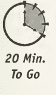

### CGI 如何与 HTML 和 JavaScript 协同工作

当你创建一个 HTML 表单时，你可以使用 method= 属性来指定你希望浏览器在将表单数据发送到 Web 服务器时使用两种 CGI 方法（get 或 post）中的哪一种。例如，给定以下表单定义：

```
<form method="post" action="cgiapp.exe">
<input type="text" name="fName" />
<input type="text" name="fName" />
<input type="submit" value="submit" />
</form>
```

当此表单的“提交”按钮被点击时，其数据将通过 post 方法发送到 cgiapp.exe 应用程序。如果初始的 <form> 标签是这样的：

```
<form method="get" action="cgiapp.exe">
```

那么此表单中的数据将通过 get 方法发送。（许多人没有意识到，如果你没有为表单指定方法，它将默认为 get 方法。如果你的表单数据包含敏感信息，如密码或信用卡信息，这可能是个坏消息。这是因为，当使用 get 方法提交表单数据时，浏览器会将该数据（包括任何敏感信息）附加到表单 action= 属性中指定的 Web 地址末尾。另一方面，当你使用 post 方法时，表单中的数据对随意的观察者是隐藏的。因此，如果你想要的是 post 方法，请务必在定义表单时指定它！）

### 在 HTML 中使用 get 和 post

正如我之前提到的，如果你想通过 CGI 发送空格或其他特殊字符，你需要确保这些字符在发送前已正确转义。如果你所做的只是在表单中收集数据，然后让浏览器在点击“提交”按钮时发送该数据，那么你无需担心。浏览器会自动将你的数据整理成符合 CGI 的格式，并在发送前转义表单中的所有数据。换句话说，如果你允许的话，浏览器会自动为你处理所有 CGI 的繁琐工作。

### 在 JavaScript 中使用 get 方法

虽然浏览器完全能够处理简单的数据提交，但有时你可能需要对发送到服务器端进程的内容进行更多控制。在这些情况下，你实际上可以使用 JavaScript 通过 get 方法构建并提交你自己的符合 CGI 规范的数据。

### 构建和使用搜索/查询字符串

使用 JavaScript 创建符合 get 方法的搜索字符串非常容易，你甚至不需要使用表单来完成。例如，假设我需要创建一系列链接，当点击时，将调用一个生成销售报告的服务器端应用程序。当调用此应用程序时，它期望接收两个参数：一个年份和一个季度，用于汇总销售数据。（请注意，以下示例的所有代码都可以在你的 CD-ROM 上 Session28 文件夹中的 bpReports.htm 和 qtrSalesSummary.htm 文件中找到。）首先，我必须定义适当的链接，它们可能看起来像这样：

```
<a href="javascript:doQtrSummary( 2001, 1)">Q1, 2001</a>
<a href="javascript:doQtrSummary( 2001, 2)">Q2, 2001</a>
<a href="javascript:doQtrSummary( 2001, 3)">Q3, 2001</a>
<a href="javascript:doQtrSummary( 2001, 4)">Q4, 2001</a>
```

在每个链接中，我调用一个名为 doQtrSummary() 的 JavaScript 函数。此函数将接受我传递给它的参数（报告的年份和季度），并构建一个适当的搜索字符串，我可以使用它来调用我的服务器端进程。该函数如下所示：

```
function doQtrSummary( year, qtr) {
    var sStr = "year=" + year;
    sStr += "&qtr=" + qtr;
    location.href = "qtrSalesSummary.htm" + "?" + sStr;
}
```

如你所见，这并不复杂。首先，我获取年份值并将其与字符串 year= 连接。这将给我一个代表年份参数的 name=value 对。接下来，我获取此字符串并将其与代表季度参数的 name=value 对连接。注意分隔两个 name=value 对的 & 符号。当前两行代码完成时，我将得到一个如下所示的字符串（假设点击的是第一个链接）：year=2001&qtr=1

剩下的就是将其附加到我想要调用的服务器端 CGI 应用程序的 Web 地址末尾。这在函数的最后一行完成。（当然，由于我不知道你有什么样的服务器设置，我无法在此示例中真正调用传统的 CGI 应用程序。作为替代，我只是调用另一个 HTML 文件。然而，我调用此 HTML 文件的方式与你调用任何其他 CGI 应用程序的方式完全相同。）请注意，在我的 CGI 应用程序的 Web 地址和搜索字符串之间，有一个问号。这个问号将你的 CGI 应用程序的实际 Web 地址与你想要发送给它的搜索字符串分开。因此，当所有这些连接完成后，我最终的 Web 地址将如下所示：qtrSalesSummary.htm?year=2001&qtr=1

一旦我构建了这个 Web 地址和搜索字符串的组合，我所要做的就是将其分配给 location 对象的 href 属性。正如你在上一课中看到的，这将告诉浏览器从 Web 服务器请求此文档。当 Web 服务器看到此请求时，它会分离出搜索字符串（从问号开始的所有内容）并将其传递给我请求的 CGI 应用程序。然后由 CGI 应用程序处理搜索字符串并将其结果返回给 Web 服务器，Web 服务器再将其返回给 Web 浏览器。

### 转义搜索字符串中的值

如你所见，构建和发送 get 方法请求到 CGI 应用程序非常简单。然而，我刚才向你展示的是最简单的情况。此示例中的任何值都没有需要在通过 CGI 传输之前转义的空格或特殊字符。因此，为了让事情更有趣一些，我将修改我的函数，允许用户为报告添加标题。

```
function doQtrSummary( year, qtr) {
    var title = prompt( "Title for report...", "Sales Summary");
    if (title != null) {
        var sStr = "year=" + year;
        sStr += "&qtr=" + qtr;
        sStr += "&title=" + escape( title);
        location.href = "qtrSalesSummary.htm" + "?" + sStr;
    }
}
```

在此版本的函数中，一个提示窗口要求用户指定报告的标题。由于用户可以在此提示窗口中输入任何内容，我需要确保她输入的任何空格或特殊字符都能正确通过 CGI。因此，我获取用户输入的值并将其传递给 escape() 函数。escape() 函数检查字符串中的每个字符，如果字符是空格或特殊字符，它会将该字符替换为其十六进制代码值，并在前面加上百分号 (%)。因此，例如，以下语句：

```
alert( escape("Hello & Welcome!"));
```

将打开一个警报窗口，显示以下字符串：

```
Hello%20%26%20Welcome%21
```

在这种情况下，`escape()`函数将每个空格字符转换为`%20`，将`&`字符转换为`&`，将`!`转换为`%21`。与它们所代表的字符不同，这些字符代码可以安全地通过CGI。理解这一点非常重要：你应该只对搜索字符串中的单个值使用`escape()`，而不是对整个搜索字符串！考虑这个函数：

```
function doQtrSummary( year, qtr ) {
    var title = prompt( "Title for report...", "Sales Summary");
    if (title != null) {
        var sStr = "year=" + year;
        sStr += "&qtr=" + qtr;
        sStr += "&title=" + title;
        location.href = "qtrSalesSummary.htm?" + escape(sStr);
    }
}
```

嗯，在这个版本的函数中，我转义了整个搜索字符串，而不仅仅是其中的值。这将给我一个看起来像这样的搜索字符串：

```
year%3D2001%26qtr%3D1%26title%3DSales%20Summary
```

而不是正确的字符串，即：

```
year=2001&qtr=1&title=Sales%20Summary
```

### 转义 + 字符

正如我之前所说，当你构建搜索字符串时，你必须将该字符串中的任何空格替换为`+`字符或其十六进制等效值（`%20`）。在我写这篇文章时，使用`+`字符来替换空格的情况已经越来越少了。因此，许多CGI应用程序如果搜索字符串中也有十六进制等效值，就简单地将它们视为`+`字符。然而，许多较旧的CGI应用程序仍然将加号视为空格并相应地进行替换。不幸的是，在你实际尝试之前（或者除非你自己编写它），你永远不知道CGI应用程序会如何表现。但是，你可以指望所有CGI应用程序都能正确处理十六进制等效值。所以，每当你构建搜索字符串时，转义数据中可能出现的任何加号总是一个好主意。然而，这可能是一个问题，因为就目前而言，`escape()`函数实际上并不转义加号！所以，如果我执行这个语句：

```
alert( escape( "One + One is Two")) ;
```

将显示的是：`One%20+%20one%20is%20Two`。如果CGI应用程序不以你期望的方式处理加号，将此传递给CGI应用程序可能会导致问题。所以，唯一的真正解决方案是为`escape()`函数创建一个包装函数，该函数也会转义字符串中找到的任何加号字符：

```
function escapePlus( tStr) {
    var escaped = escape( tStr);
    var result = "";
    for (x=0; x<escaped.length; x++) {
        if (escaped.charAt( x) == "+") {
            result += "%2B";
        }
        else {
            result += escaped.charAt( x);
        }
    }
    return result;
}
```

这个函数首先调用`escape()`函数并传递给我想要转义的字符串。这将转义所有适当的字符，除了加号。然后函数进入一个`for`循环，查看转义后字符串中的每个字符。如果字符是加号，则将加号的十六进制等效值（`%2B`）添加到结果字符串的末尾。如果字符不是加号，则简单地将该字符复制到结果字符串的末尾。当循环完成时，结果字符串被发送回调用者，给他们一个所有必要字符都已转换为其十六进制等效值的字符串。

### 从get方法请求中检索数据

在我的示例中，我的get请求的目标是另一个HTML文件。没有多少人意识到你实际上可以使用get方法请求将数据传递给另一个HTML文件。然后，在目标文件中，你可以使用JavaScript来检索该数据并对其采取行动。

在这个示例中，我的get方法请求的目标是文件`qtrSalesSummary.htm`。当此文件加载时，传递给它的搜索字符串将在`location`对象的`search`属性中可用。所以，在最简单的情况下，我可以检索此信息并像这样显示它：`alert( location.search);`

你将在`location.search`属性中找到的是构成发送到HTML页面的get方法请求的原始数据。所以，假设用户点击了第一季度链接并保持报告标题不变，`location.search`中的值将是：

```
?year=2001&qtr=1&title=Sales%20Summary
```

查看此值，你会注意到数据仍然是其转义形式，并且数据开头有一个问号。不幸的是，问号将始终存在，因此在处理数据之前，你必须将其删除。（不过，正如你将看到的，这并不太困难。）此外，由于剩余数据以`name=value`对的形式排列，处理它就像处理你在第16课中处理的cookie数据一样简单。事实上，编写一个函数来从搜索字符串中提取任何给定的值，以便你可以在JavaScript程序中轻松使用它，是相当容易的。以下代码显示了来自`qtrSalesSummary.htm`文件的这样一个函数。

```
function getParam( paramName ) {
    var sStr = location.search.substring( 1);
    var result = "undefined";
    if (sStr != "") {
        var nvPairs = sStr.split( "&");
        for (x=0; x<nvPairs.length; x++) {
            if (nvPairs[ x].indexOf( paramName + "=") != -1) {
                var nvItem = nvPairs[ x].split( "=");
                result = unescape( nvItem[ 1]);
                break;
            }
        }
    }
    return result;
}
```

这个函数首先必须做的是从`location.search`属性中检索实际的搜索字符串。注意它使用`substring()`方法的调用来提取搜索字符串开头问号之外的所有内容。如果搜索字符串不为空，函数然后使用`split()`方法创建一个数组。数组中的每个条目保存搜索字符串中的一个`name=value`对。然后一个`for`循环遍历此数组，搜索传递给函数的参数名称。找到后，该`name=value`对本身被拆分为一个新数组。此数组的第二个元素（`name=value`对的值部分）然后被传递给`unescape()`函数并返回给调用该函数的任何人。我相信你可以很好地猜出`unescape()`函数的作用。它简单地接受一个字符串并搜索其中的十六进制字符代码。当它找到一个时，它将其替换为等效的可打印字符。仅此而已！

### 在JavaScript中使用post方法

虽然在JavaScript中使用get方法请求相当简单，但使用post方法请求可能有点棘手。首先，JavaScript确实没有任何方法可以从post方法请求中检索数据。这意味着如果你想将数据从一个HTML页面发送到另一个HTML页面，你将必须使用get方法。所以，就post方法而言，剩下的只是使用JavaScript构建一个post方法请求，以便传输到Web服务器上更传统的CGI应用程序。

实际上，你已经看到了如何做到这一点。你看，当你验证数据或为表单控件赋值时，你正在更改当用户单击该表单的“提交”按钮或当你调用表单的`submit()`方法时将发送的数据。因此，你在第12、13和15课中学到的所有内容都可以用来为通过post方法传输准备数据。事实上，这些相同的课程也适用于get方法。正如我在本课前面提到的，如果你使用get方法提交表单，浏览器将简单地构建一个搜索字符串（就像你在本课前面学到构建的那个一样——它甚至会为你转义值），并将其附加到你在`<form>`标签的`action=`属性中指定的Web地址的末尾。

### 复习

在本课中，你学习了通用网关接口（CGI）协议以及JavaScript如何与之协作将数据发送到服务器端进程或另一个HTML文件。你学习了数据必须如何格式化为搜索字符串才能对CGI应用程序有用。你了解了搜索字符串中不允许使用的字符以及如何用等效的十六进制代码替换这些字符。你看到了JavaScript如何检索get方法请求的内容并从中提取信息以在你的JavaScript程序中使用。最后，你发现所有关于验证表单数据和处理表单控件的课程，实际上只是创建有效的post或get请求的各个方面，这些请求将在表单提交时发送。

### 自我测验

1.  你可以使用哪种编程语言来编写CGI应用程序？（参见“通用网关接口”。）
2.  在符合CGI规范的搜索字符串中，数据是如何格式化的？（参见“理解CGI数据格式”。）
3.  `escape()`和`unescape()`函数的作用是什么？（参见“转义搜索字符串中的值”和“从get方法请求中检索数据”。）
4.  在CGI协议中，&号和等号字符有什么用途？（参见“理解CGI数据格式”。）
5.  get和post有什么区别？（参见“CGI方法”。）

## 第29课

### 支持多媒体

#### 课程清单

-   检测和使用插件与辅助应用程序
-   了解JavaScript如何增强`<object>`标签

当今网络浏览器最酷的功能之一是它们能够显示多种不同类型的数据。然而，它们并非总是独自完成。事实上，归根结底，大多数网络浏览器只能显示文本（HTML）和基本类型的图形。如果你想显示不同类型的文件或数据，你可能需要使用浏览器插件或辅助应用程序来完成这项工作。

### 理解插件和辅助应用程序

浏览器“插件”是一个在Web浏览器内部运行的程序，它允许浏览器显示其原本无法显示的数据类型。例如，Adobe提供了一个免费的浏览器插件，让你可以直接在Web浏览器中查看可移植文档格式（PDF）文件，而无需启动单独的程序。

另一方面，*辅助应用程序*是一个独立于浏览器的程序。如果浏览器不知道如何处理特定类型的文件，并且没有可用的插件来处理文件中的数据，它将启动一个适当的辅助应用程序，并告诉它打开并显示该文件。

插件和辅助应用程序最棒的地方在于，如果你正确构建HTML代码，浏览器将自动加载正确的插件（或运行正确的辅助程序）并自动显示你的数据。虽然插件和辅助应用程序可以显著增强Web浏览器的功能，但有一个小小的注意事项：它们必须安装在客户端才能使用。这就是JavaScript的用武之地。你可以使用JavaScript来确定客户端的机器是否安装了正确查看你特定类型数据所需的插件或辅助应用程序。如果已安装，你可以动态生成加载数据并显示它所需的HTML。如果没有安装，你可以生成另一批HTML，告诉用户他们需要某个特定的插件，并提供一个链接让他们去获取。（这与你处理遇到旧版或不支持JavaScript的浏览器时的方式几乎完全相同，如第26课所述。）为了使用JavaScript检测插件或辅助应用程序，你必须利用`navigator`对象的两个特殊属性：`mimeTypes`数组和`plugins`数组。

> **出于某种原因，微软在当前版本的Windows Internet Explorer中根本不支持`mimeTypes`或`plugins`数组（考虑到Macintosh版的Internet Explorer*确实*支持这些数组，这种遗漏就更加令人费解了！）** 希望这能在不久的将来得到修复。在此之前，你即将阅读的内容仅适用于Netscape浏览器和Macintosh版的Internet Explorer。

### 使用`mimeTypes`数组

正如你在第26课中学到的，`navigator`对象包含了客户端用于执行你的JavaScript程序的浏览器的各种信息。除了这些浏览器信息外，它还提供了客户端计算机已知的MIME类型信息。

#### MIME（类型）有什么用？

基本上，MIME类型的发明是为了让电子邮件程序可以查看附加在电子邮件消息上的文件，并确定文件中包含的数据类型。如果用户尝试保存附件，电子邮件程序可以使用MIME类型信息，以正确的文件类型信息保存文件。

当从一种类型的计算机向另一种类型发送文件时，这是一个非常重要的功能。例如，Windows通过使用文件名末尾的三个字符扩展名来跟踪文件类型。而Macintosh则将文件类型信息保存在文件本身内部。因此，如果你从Windows机器向Macintosh发送一个文本文件，Macintosh上的电子邮件客户端将使用为该文件指定的MIME类型，以确保文件在Macintosh上被正确保存（作为文本文件）。

由于MIME类型是平台无关的，它们迅速成为在互联网上指定文件类型的标准。当Web浏览器请求一个文档时，Web服务器发送回浏览器的首批信息之一就是文档的MIME类型。浏览器查看MIME类型信息，并使用它来确定如何处理该文档。

MIME类型的第一部分是一个字符串，指定文件中数据的通用类型：例如，“text”。后面跟着一个正斜杠（/），然后是一个字符串，指定文件中数据的具体类型：例如，“html”。因此，HTML文档的完整MIME类型如下所示：text/html。当Web浏览器收到具有此MIME类型的文档时，它就知道正在处理一个HTML文件，并相应地做出反应。

> 互联网号码分配机构（IANA）维护着当前已定义的MIME类型列表。你可以访问他们的网站 www.iana.org。到达后，在“协议号码和分配服务”中查找MIME类型目录。（IANA将这些称为“媒体类型”。）

#### mimeTypes数组中有什么？

mimeTypes数组包含客户端计算机上定义的每个MIME类型的一个mimeType对象。每个mimeType对象有四个属性：

-   description：这是此MIME类型所代表数据的简短描述。
-   enabledPlugin：如果有一个已安装的插件处理此类型的数据，此属性将是对该插件的引用。（这实际上是对plugins数组中一个条目的引用。有关更多信息，请参阅即将讨论的plugins数组。）如果此属性为null，则很可能没有可用的插件来处理此类型的数据。但是，此属性并不总是确定特定类型数据是否有可用插件的最佳方式。要做出此判断，你需要检查plugins数组。
-   suffixes：这是一个逗号分隔的列表，包含可能在此MIME类型文件上找到的文件名后缀。例如，与text/html MIME类型关联的后缀是htm和html。
-   type：这是实际的MIME类型规范字符串（即“text/html”）。

#### 获取MIME类型列表

由于navigator.mimeTypes属性只是一个数组，获取客户端机器上定义的MIME类型列表非常简单。以下代码段展示了一段简单的JavaScript和HTML，它将生成一个格式良好的表格，显示mimeTypes数组中的所有相关信息。（此代码可在你CD-ROM上Session29文件夹中的mimeTypes.htm文件中找到。）

```html
<table border="1" width="100%">
    <tr>
        <th>MIME Type</th>
        <th>Plug-in Available</th>
        <th>Description</th>
        <th align='left'>File Suffixes</th>
    </tr>
    <script language="Javascript">
    for (x = 0; x < navigator.mimeTypes.length; x++) {
        document.write("<tr>");
        document.write("<td width='25%'>" + navigator.mimeTypes[x].type + "&nbsp;</td>");
        if (navigator.mimeTypes[x].enabledPlugin != null) {
            document.write("<td width='25%'>" + navigator.mimeTypes[x].enabledPlugin.name + "&nbsp;</td>");
        }
```

### 理解 plugins 数组

既然你已经了解了 MIME 类型以及如何从 JavaScript 获取这些信息，我需要向你介绍 plugins 数组。正如你在上一节中看到的，plugins 数组中的条目通过 enabledPlugin 属性与 mimeTypes 数组相关联。plugins 数组中的每个条目都是一个插件对象，它描述了客户端浏览器中安装的一个插件。插件对象有四个属性：

-   description：这是一个简短的描述，告诉你关于该插件的一些信息。这通常包括插件供应商的名称和插件的功能。
-   filename：这是插件实际加载的文件的名称。根据平台的不同，此属性可能包含文件的完整路径，也可能只包含文件名。
-   length：这是一个整数值，告诉你该插件支持多少种不同的 MIME 类型。（这是下面讨论的未命名 MIME 类型数组的长度。）
-   name：这是插件的名称。
-   未命名的 MIME 类型数组：最后，每个插件对象都有一个 mimeType 对象数组。（这些与前面讨论的 mimeType 对象结构完全相同。）此数组中的每个条目代表插件可以显示或以其他方式支持的一种 MIME 类型。

### 访问插件的 MIME 类型数组

使用插件对象的关键在于与插件关联的 mimeType 对象数组。如果你需要确切知道插件支持哪些数据类型，你只需遍历此数组并检查每个条目中指定的 MIME 类型。如果列出了你需要的 MIME 类型，你就可以确定该插件可以处理该类型的数据。

实际上，访问此 MIME 类型列表并不太困难。最大的技巧只是知道它的存在。一旦你知道了，只需将 plugins 数组视为多维数组即可访问其中的信息。（事实上，它就是！）下一个代码清单向你展示了一个简单的程序，该程序将显示客户端计算机上安装的所有插件以及每个插件支持的 MIME 类型。（此代码也可以在你的 CD-ROM 上的 plugIns.htm 文件中找到。）

```html
<table border="1" width="100%">
    <tr>
        <th>Plug-in Name</th><th>Plug-in File Name</th>
        <th>Mime Types Handled</th><th>Description</th>
    </tr>
    <script language="javascript">
    for (x = 0; x < navigator.plugins.length; x++) {
        document.write( "<tr>");
        document.write( "<td width='25%'>" +
        navigator.plugins[x].name + "&nbsp;</td>");
        document.write( "<td width='25%'>" +
        navigator.plugins[x].filename + "&nbsp;</td>");
        if (navigator.plugins[x].length > 0) {
            document.write("<td width='25%'>");
            for (y=0; y < navigator.plugins[x].length; y++) {
                document.write(navigator.plugins[x][y].type + "<br />");
            }
            document.write("</td>");
        }
        else {
            document.write("<td width='25%'>No MIME Types</td>");
        }
        document.write("<td width='25%'>" + navigator.plugins[x].description + "&nbsp;</td>");
        document.write("</tr>");
    }
    </script>
</table>
```

再次强调，这里没有任何特别困难的地方。这段代码只是遍历 plugins 数组并显示数组中每个条目的内容。唯一有点技巧的是显示插件支持的 MIME 类型的代码，但即使那也相当简单。代码只是检查当前插件对象的 length 属性，然后遍历未命名数组中的每个 mimeType 对象。对于此数组中的每个条目，程序输出实际的 MIME 类型信息以及一个 `<br />` 标签。

### 检测插件和支持的 MIME 类型

查看 mimeType 和 plugin 对象的结构，你可能已经对如何检查插件的存在有了一些想法。实际上有几种不同的方法，我将逐一介绍。

### 按名称检查插件

最简单但最不可靠的方法是按名称检查插件。你可以这样做，因为 JavaScript 使用每个插件对象的 name 属性作为 plugins 数组中每个条目的索引。例如，要检查 Apple Computer 的 QuickTime 插件是否存在，你可以简单地编写一个如下所示的 if 语句：

```javascript
if (navigator.plugins[ "QuickTime Plug-In"] ) {
    // 在此处嵌入 QuickTime 影片
}
else {
    // 告诉用户去获取该插件
}
```

问题在于，这个插件名称在不同的计算机平台之间甚至在插件的不同版本之间都不一致！例如，名称 "QuickTime Plug-In" 来自我其中一台 Windows NT 计算机上安装的 2.x 版本插件。转向我桌上的 Macintosh，我看到那里安装的 QuickTime 插件的名称是 "QuickTime Plug-in 5.0"。

一个稍好一点的方法是遍历 plugins 数组并检查插件名称中具有特征性的部分。下面显示了一个执行此操作的函数。（请注意，此函数和其他几个函数可以在你的 CD-ROM 上的 multimedia.js 文件中找到。）

```javascript
function findPluginByPartialName( theName) {
    var foundMatchAt = -1;
    if (navigator.plugins.length > 0) {
        for (x=0; x < navigator.plugins.length; x++) {
            var plugName =
                navigator.plugins[ x].name.toUpperCase();
            if (plugName.indexOf( theName.toUpperCase()) != -1) {
                foundMatchAt = x;
                break;
            }
        }
    }
    return foundMatchAt;
}
```

如果此函数找到与提供的部分名称匹配的项，它将返回在 plugins 数组中找到该插件的索引号。然后可以使用此索引号来检查与该插件关联的 MIME 类型。这种方法的缺点是，如果两个插件的名称非常相似，此函数完全有可能检测到错误的插件。虽然你可以检查 MIME 类型以确保你获得了正确的插件，但这确实是一个不必要的额外步骤。

### 按 MIME 类型检查插件

迄今为止，检查合适插件最简单、最可靠的方法是简单地检查每个已安装的插件，看看它们是否支持你要显示的数据的 MIME 类型。一旦找到支持你的数据类型的插件，你就可以停止搜索，让浏览器处理其余的事情。

这*确实*意味着你可能最终得不到你想要的特定插件。例如，QuickTime 和 Netscape 的旧版 LiveAudio 插件都可以处理 WAV 声音文件。这意味着只要安装了其中一个，你就应该能够在客户端的 Web 浏览器中嵌入并播放 WAV 文件。

当然，如果你*必须*拥有只有一个插件才能提供的功能，那么你应该确保相应的插件可用。但是，如果该插件不可用，你应该认真考虑通过其他可用的插件提供你的数据。话虽如此，下面是一个检查支持特定 MIME 类型的插件的函数。

```javascript
function findPluginByMIMEType( theMIMEType) {
    var foundMatchAt = -1;
    if (navigator.plugins.length > 0) {
        var numTypes = 0;
        for (x=0; x < navigator.plugins.length; x++) {
            numTypes = navigator.plugins[x].length;
            for (y=0; y < navigator.plugins[x].length; y++) {
                if (navigator.plugins[x][y].type == theMIMEType) {
                    foundMatchAt = x;
                    break;
                }
            }
            if (foundMatchAt != -1) {
                break;
            }
        }
    }
    return foundMatchAt;
}
```

### 检测辅助应用程序

如果你找不到支持你想显示的数据类型的插件，你可能需要检查是否有可用的辅助应用程序。为此，只需遍历 `mimeTypes` 数组，查看描述你数据的 MIME 类型是否已定义。如果已定义，那么客户端的机器上应该就有针对该数据类型的辅助应用程序。以下是一个函数，它将检查 `mimeTypes` 数组中是否存在指定的 MIME 类型。

```
function findHelperApp( theMIMEtype) {
    var foundMatchAt = -1;
    if (navigator.mimeTypes.length > 0) {
        for (x=0; x < navigator.mimeTypes.length; x++) {
            if (navigator.mimeTypes[x].type == theMIMEtype) {
                foundMatchAt = x;
                break;
            }
        }
    }
    return foundMatchAt;
}
```

### 使用多媒体文件

既然你知道了如何检测插件和辅助应用程序，你需要学习如何利用这些知识将多媒体文件实际呈现给你的用户。在查看实现此功能的代码之前，让我先概述一下你需要警惕的不同情况。

- 你能期望的绝对最佳情况是用户已安装了合适的插件。如果是这样，你可以简单地生成 JavaScript 代码或 HTML 标签（或多个标签）将数据嵌入到你的网页中，然后让浏览器处理剩下的事情。
- 如果没有可用的插件，次佳的情况是存在辅助应用程序。在这种情况下，你必须以某种方式触发辅助应用程序的启动。你可以通过提供一个指向数据文件的链接供用户点击来实现。如果你想跳过让用户点击链接的步骤，你可以通过将数据文件的网址赋值给 `location.href` 属性（如第 27 和 28 课中所见）来自动化此过程。这两种方法都会强制浏览器启动辅助应用程序，然后该程序将加载你的数据文件并进行相应处理。
- 最后，如果没有可用的插件，也没有可用的辅助应用程序，你应该告诉用户他们需要获取插件才能查看你的网站，或者为他们提供一个备用页面来查看。

举个例子，看看你 CD-ROM 上的 `openPDF.htm` 文件。它向你展示了将 Adobe Acrobat (PDF) 文件嵌入网页所需的代码。（我在此示例中嵌入的 PDF 文件是同样在你 CD-ROM 上的 ECMAScript 文档文件。）查看此代码，你会注意到，一旦我确定加载 PDF 文件是安全的（`pluginAvail` 或 `helperAvail` 为真），我就简单地将 PDF 文件的网址赋值给 `location.href` 属性。这样做的原因是因为我发现这是调用 Acrobat PDF 查看器插件的最佳方式。

这是一个重要的观点：每个插件都是不同的。有时同一个插件在不同版本或不同平台上的行为也会有所不同。因此，关键在于你需要对你想要使用的插件进行广泛的测试。本课中展示的技术只是让你能够判断插件是否可用。实际让该插件工作则取决于插件本身。

如果既找不到插件也找不到辅助应用程序，代码会显示一条简单的消息，告诉用户去哪里获取插件。它还给他们提供了一个点击链接的机会，该链接将尝试加载 PDF 文件，以防 `mimeTypes` 和 `plugins` 数组中的信息有误。

最后，代码会检查当前浏览器是否是在 Windows 上运行的 Internet Explorer（使用第 26 课中 `browserSnoop.js` 文件的几个函数）。请记住，在本课开始时我提到过，当前版本的 Windows Internet Explorer（我撰写本文时为 5.x 版）不允许你对 `mimeTypes` 或 `plugins` 数组做*任何*操作。你甚至无法获取它们的长度！因此，如果此代码在 Windows 机器上的 Internet Explorer v5.x 中加载，它将无法找到插件或辅助应用程序，只会显示最后的备用文本。

然而，考虑到 Adobe Acrobat 几乎预装在每台基于 Windows 的计算机上，可以相当安全地假设，如果浏览器是 Windows 上的 Internet Explorer，那么 Acrobat Reader 插件就是可用的。因此，如果是这种情况，我会再次尝试将 PDF 文件加载到浏览器中。如果插件或辅助程序可用，文件将加载到浏览器中，备用文本将消失。否则，文件将不会加载，备用消息将保留在屏幕上。

PDF 文件实际上有点特殊，因为只需将其网址赋值给 `location.href` 属性，就可以轻松地在浏览器中显示它们。通常，一旦你确定插件可用，你会希望生成一个合适的 `<object>` 标签将数据插入到网页中。（过去，其他 HTML 标签（特别是 `<embed>` 和 `<applet>`）已被用于将文件嵌入网页。`<object>` 标签最终将取代这些标签，因此我将在此集中讨论该标签。）

`<object>` 标签有大量可用的属性，但其基本格式如下：

```
<object data="Web address of file" type="MIME type of file">
HTML to parse if file cannot be embedded
</object>
```

当浏览器遇到 `<object>` 标签时，它基本上会采取与显示 PDF 文件的代码相同的步骤。它会尝试查找支持指定 MIME 类型的插件。如果找到，它会让该插件显示指定的文件。

然而，如果浏览器找不到合适的插件，它不会尝试为该文件查找辅助应用程序。相反，它只会解析 `<object></object>` 开始和结束标签之间的 HTML。这段 HTML 可以是几乎任何内容，包括更多的 `<object>` 标签。虽然这确实意味着你可以嵌套 `<object>` 标签，尝试在文档中嵌入越来越不那么“惊艳”的数据类型，但你不能使用此技术来启动已存在的辅助应用程序。

当然，你可能会认为你可以在 `<object></object>` 标签内包含一段 JavaScript 代码，该代码会检查你的辅助应用程序并在其存在时启动它。不幸的是，事实证明，无论对象是否能够加载，`<object></object>` 标签内的任何 JavaScript 都会被执行。

更糟糕的是，`<object>` 标签不支持 `onerror` 事件处理程序。因此，你无法编写一个在对象未加载时执行的事件处理程序（尽管 `<object>` 标签确实支持许多其他事件处理程序）。所有这些加在一起意味着，当你使用 `<object>` 标签时，必须采取一些巧妙的方法来检查辅助应用程序。下一个尝试显示 QuickTime 影片的代码清单将向你展示我的意思。

```
<script language="javascript">
function checkHelper() {
    if (findHelperApp("video/quicktime")) {
        location.href = "baby.mov";
    }
}
</script>
```

```
<object data="baby.mov" type="video/quicktime"
width="100%" height="100%">

You don't seem to have the QuickTime Plug-in. You can go
<a href="http://www.apple.com/quicktime">here</a> to get it.<br
/>
Or, you can try viewing the movie in a separate window by clicking
<a href="baby.mov">here</a>.
</object>
```

在这个例子中，我定义了一个 `<object>` 标签，尝试加载并播放一个 QuickTime 影片。如果 QuickTime 插件可用，浏览器将自动加载它并播放影片。然而，如果 QuickTime 插件*不可用*，`<object></object>` 标签内的 HTML 代码将被解析并显示在浏览器窗口中。

在很大程度上，这段 HTML 代码正是你之前见过的。然而，第一行是新的：一个 `` 标签。这个标签显示了一张可爱的小图片，一个悲伤的婴儿（考虑到影片无法加载，这是合适的）。此外，这个 `` 标签有一个 `onload` 处理程序。当这张悲伤婴儿的图片加载完成时，函数 `checkHelper()` 将被调用。此函数检查是否存在用于 QuickTime 影片的辅助应用程序，如果找到，就告诉浏览器立即加载该影片。当然，一张悲伤婴儿的图片可能不适合你的网站，但你总是可以使用一张不可见的图片（即 1 像素乘 1 像素，或一个与背景颜色相同的小方块）来产生相同的效果。这很巧妙，但它确实有效！

### 复习

在本课中，你学习了浏览器插件和辅助应用程序，以及如何使用 JavaScript 与它们协同工作。你了解了什么是 MIME 类型，以及它们如何用于指定通过互联网传输的文件的类型信息。你了解到 `navigator.mimeTypes` 数组包含浏览器可以自行显示或借助辅助应用程序显示的所有不同文件类型的列表。你还了解到 `navigator.plugins` 数组包含所有已安装的浏览器插件列表，以及有关给定插件可以显示哪些 MIME 类型的信息。你看到了如何使用 JavaScript 搜索这些数组，以确定是否安装了特定插件，或者是否存在用于特定 MIME 类型的辅助应用程序。

最后，你了解了当 `<object>` 标签因找不到插件而无法加载多媒体文件时，JavaScript 如何检查辅助应用程序的存在。

### 自我测验

1.  插件和辅助应用程序有什么区别？（参见“理解插件和辅助应用程序”。）
2.  什么是 MIME 类型？（参见“使用 mimeTypes 数组”）
3.  MIME 类型的前半部分告诉你什么？后半部分又告诉你什么？（参见“MIME（类型）有什么用？”）
4.  检查是否存在处理特定 MIME 类型的插件，最可靠的方法是什么？（参见“通过 MIME 类型检查插件。”）
5.  如何使用 JavaScript 和 `` 标签来确定对象是否加载失败？（参见“使用多媒体文件。”）

## 第 30 课

### 使用 Java 小程序

#### 课程清单

-   在 HTML 文档中嵌入 Java 小程序
-   了解 JavaScript 如何与 Java 小程序通信

你可以嵌入到网页中的更有用的对象类型之一是 Java 小程序。与大多数其他类型的可嵌入对象不同，Java 小程序实际上是迷你应用程序。这意味着它们可以做 JavaScript 程序能做的所有事情，甚至更多！最重要的是，根据客户端使用的浏览器，你实际上可以使用 JavaScript 来控制 Java 小程序。

> 本章将讨论的所有内容*应该*在所有主流浏览器中都能工作。然而，在撰写本文时，唯一支持 JavaScript 与 Java 通信的浏览器是 PC 版的 Internet Explorer 5.x 和 Netscape Navigator 4.x。Macintosh 版的 Internet Explorer 完全不支持这种功能。虽然 Netscape 6 应该支持此功能，但在其首个版本中似乎缺失了。因此，请将这最后一课视为对未来功能的承诺，或者是你可以为使用这些浏览器的用户提供的一个不错的选择。

### 将 Java 小程序添加到 HTML 文档

大多数 Java 开发环境，如果你要求的话，会自动生成一个 HTML 文档，向你展示如何将 Java 小程序嵌入到 HTML 文档中。但是，如果你使用 Sun 的 JDK 工具从头开始构建 Java 小程序，你需要自己知道如何操作。

### `<applet>` 标签

`<applet>` 标签是目前将 Java 小程序添加到 HTML 文档的最简单方法。（请注意，将来 `<object>` 标签将取代 `<applet>` 标签。但就目前而言，`<object>` 标签在处理小程序时似乎确实存在麻烦。）虽然 `<applet>` 标签可能相当复杂，但你几乎总是可以只用几个简单的属性来应付。通常，applet 标签看起来像这样：

```
<applet name="appletName" code="applet.class"
codebase="folderToLookIn">
<param name="param1Name" value="value for first parameter" />
<param name="param2Name" value="value for second parameter" />
HTML to include if browser does not support applets
</applet>
```

与我向你展示的每个其他标签一样，`name=` 属性指定了 JavaScript 将用于与小程序通信的名称。`code=` 属性是浏览器将实际加载和执行的 Java `.class` 文件的名称。（`.class` 文件是 Java 环境中相当于 Windows 环境中的 `.exe` 文件。）`codebase=` 属性告诉浏览器在哪个文件夹中查找 `code=` 属性中指定的类文件。（如果类文件与 `<applet>` 标签所在的 HTML 文档在同一文件夹中，你可以省略此属性。）

如果你想向小程序传递参数，可以指定一系列 `<param>` 标签。这些标签中的每一个都将定义一个参数，该参数将在小程序加载后直接传递给小程序。

最后，以防客户端的浏览器不支持 Java 小程序，你也可以指定一个应该显示的 HTML 块。通常，这将是一条简单的消息，告诉用户他们需要使用支持 Java 的浏览器才能查看小程序，但它可以是你想要的任何内容。（奇怪的是，JavaScript 代码块在这里似乎不起作用。但是，正如你稍后将看到的，如果需要，你可以使用第 29 课中的 `` 标签技巧来触发 JavaScript 函数。）

### 与 Java 小程序通信

一旦你将 Java 小程序嵌入到 HTML 文档中，你的 JavaScript 代码实际上就可以引用该小程序并访问其公共方法和属性。（“公共”是 Java 中相当于 JavaScript 中的“全局”。除非在小程序中定义为公共，否则你无法访问 Java 小程序中的任何内容。）

基本上，你这样做的方法就像你希望的那样简单。正如你从第 9 课中记得的那样，`document` 对象内部有一个名为 `applets` 的数组。正如你可能预期的那样，这只是一个包含当前加载的 HTML 文档中定义的所有 Java 小程序的数组。这意味着你可以通过名称或通过 `applets` 数组来访问你的小程序。例如，假设我的 HTML 文档中的第一个小程序名为 "myApplet"，并且它有一个名为 `getInfo()` 的公共方法，我可以使用以下任一 JavaScript 语句调用该方法。

```
document.applets[ 0 ].getInfo();
document.myApplet.getInfo();
```

真的就这么简单！

> 你可能在想，如果 Java 小程序中的代码可以调用网页中的 JavaScript 代码，那将是一件好事。嗯，是的，确实如此！不幸的是，唯一支持此功能的浏览器是旧版本的 Netscape Navigator。Netscape 6 应该支持它，但该功能在第一个版本中似乎也坏了。

### 使用横幅小程序

因此，为了将所有这些整合在一起，让我向你展示一个完整的例子。首先，我需要一个可以使用的小程序。当你从 Java 网站 http://java.sun.com 下载 Java 开发者工具包 (JDK) 时，你会发现你得到的东西中包含大约两打示例程序。所以，我决定取其中一个，为 Baby-Palooza 网站创建一个漂亮的小横幅。（别担心，Sun 的人慷慨地允许你复制、修改和重新分发示例程序，只要你给予他们适当的署名。例如，就像这条不错的说明。）我开始使用的小程序叫做 "Nervous Text"。这个小程序接受一个字符串，并在屏幕上对其进行动画处理，就好像它刚刚喝完大约十壶咖啡一样。（换句话说，字母会跳动一下。）这个小程序的基本 `<applet>` 标签看起来像这样：

```
<applet name="banner" code="NervousText.class"
    width="100%" height="50">
    <param name="text" value="Welcome to Baby-Palooza!" />
</applet>
```

`text` 参数只是你希望小程序进行动画处理的字符串。虽然这很好也很简单，但这个小程序不允许在小程序加载*后*进行任何更改。换句话说，一旦加载，它只会对你最初传递给它的字符串进行动画处理。

我想要的是更灵活的东西。具体来说，我希望能够更改显示的文本以及小程序的背景颜色和小程序中文本的颜色。因此，我不得不对小程序进行一些小的修改以允许这些功能。现在，这不是一本关于 Java 编程的书，所以我不会详细讨论这些更改。（如果你想查看所有更改，修改后的小程序的最终源代码可以在你 CD-ROM 上 Session30 文件夹中的 `NervousText.java` 文件中找到。）但是，我将介绍重置小程序显示文本所需的更改。

### 使用公共 Java 方法

当 Nervous Text 小程序首次被调用时，它会读取从 HTML 文件传递给它的 `text` 参数，并将其存储在一个名为 `banner` 的变量中。这意味着，为了更改小程序显示的文本，必须更改 `banner` 变量的值。所以，我添加了一个简单的方法来做到这一点：

```
public void setBanner( String newBanner) {
    banner = newBanner;
    resetBanner();
}
```

正如你所看到的，Java 的语法与 JavaScript 的语法非常相似。然而，这里需要注意的重要一点是，此方法被定义为 `public`。这意味着*任何人*都可以调用它，甚至是运行在 Web 浏览器中的 JavaScript 解释器。因此，假设我的 `<applet>` 标签如前所述定义，我可以使用如下语句调用此方法：

```
document.banner.setBanner( "Be sure to stock up on baby-wipes!");
```

我横幅中的跳舞文本将更改为我传递给它的字符串。

### 第30课——使用Java小程序

正如我之前所说，我希望能够更改横幅中的文本，以及背景色和文本颜色。这需要在Java小程序中创建更多公共方法。但一旦创建完成，它们就可以通过相同的方式进行访问。

### nervousBaby.htm文件

在HTML编辑器和Web浏览器中同时打开nervousBaby.htm文件。在Web浏览器中稍作操作，然后在HTML编辑器中跟随我讨论接下来段落中的内容。

首先，`<applet>`标签现在包含了两个新参数：bgColor和textColor。这些是RGB颜色值（类似于你在第9课中学到的），分别告诉浏览器为小程序的背景和文本颜色使用什么颜色。（请注意，这些参数应仅包含原始颜色值，不包含任何十六进制表示字符——也就是说，你可以传递FFFFFF，但不能传递0xFFFFFF。）

`<applet>`标签内还有一段HTML文本，如果浏览器不支持小程序，将会显示这段文本。注意，我使用了第29课中的``标签技巧，以便在小程序未加载时触发JavaScript函数。触发的函数随后会检查客户端浏览器中是否定义了"application/java" MIME类型。如果已定义，那么很可能用户只是在浏览器中关闭了Java支持。在这种情况下，该函数会显示一条简短消息，告诉用户如果想查看小程序，需要重新开启Java支持。

接下来，一个onload处理程序尝试检索小程序的默认值，并将它们显示在页面底部的表单中。你会注意到这个处理程序利用了另一个函数checkAppletStatus()，该函数会告诉它小程序是否已加载。小程序可能非常庞大和复杂，因此在尝试与它们通信之前，确保它们已加载是一个好主意。这里的流程与你在第23课和第24课中看到的完全相同。主要区别在于，我为这个小程序添加了一个方法（getloadStatus()），当小程序启动并运行时，该方法实际上会返回true。（有关此方法的详细信息，请参见NervousText.java文件。）

一旦确定小程序准备就绪，onload处理程序就会从小程序中检索横幅文本、背景色和文本颜色，并将这些值放入表单中供用户查看。

最后是页面底部的表单。此表单包含多个控件，允许用户查看小程序使用的值并更改这些值。更改值是通过一个简单的onclick处理程序完成的，该处理程序调用小程序中的相应方法。

例如，要更改横幅文本，用户只需在表单中输入新文本，然后单击“设置横幅文本”按钮。此按钮的`onclick`处理程序从文本框中提取文本，并将其传递给小程序的`setBanner()`方法。

### 复习

在本课中，你了解到使用JavaScript控制Java小程序实际上非常简单。唯一真正的要求是，你想要访问的Java方法和属性必须在Java小程序中声明为public。满足此条件，并且拥有合适的Web浏览器，JavaScript就可以访问加载到HTML文档中的任何小程序中的任何公共方法或属性。

### 自我测验

- 1. 小程序在浏览器对象模型中的位置在哪里？（参见“与Java小程序通信”。）
- 2. `<applet>`标签中的`<param>`标签代表什么？（参见“`<applet>`标签”）
- 3. 为了使JavaScript能够访问Java方法或属性，该方法或属性在Java小程序中必须如何声明？（参见“与Java小程序通信”。）
- 4. 如何判断小程序是否已加载？（参见“nervousBaby.htm文件”）
- 5. 如何判断小程序是否加载失败？（参见“nervousBaby.htm文件”）

## 部分


### 周日下午

- 1. 你会使用什么语句来创建一个包含日期和时间2001年1月15日上午9:47:25的Date对象？
- 2. 你的JavaScript程序如何强制Web浏览器重新加载HTML文档，即使该文档已在浏览器缓存中？
- 3. 使用你在第19课中学到的技术，扩展Date类以包含两个新方法：getDayName()和getMonthName()。第一个方法应返回Date对象中保存的星期几的名称。第二个方法应返回Date对象中保存的月份名称。
- 4. 如第25课所述，Math对象没有将数字四舍五入到指定位数的方法。创建一个名为roundTo()的新函数，该函数允许你将值四舍五入到指定位数。此函数应接受两个参数：要四舍五入的数字和要四舍五入到的位数。（提示：第25课中的twoDecimals()函数是一个很好的起点。）
- 5. 在基于框架的网站中，有多少个history对象？
- 6. location.replace()方法的目的是什么？
- 7. 如果`<form>`标签未指定method=属性，将使用什么默认的CGI方法？
- 8. HTML文档中的JavaScript程序如何从post方法请求中提取数据？
- 9. 如果一个HTML文件通过get方法请求向另一个文件发送数据，目标HTML文件中的JavaScript程序可以在哪里找到这些数据？

### 第六部分——周日下午部分复习

- 10. 为什么必须转义你想要通过CGI发送的数据？
- 11. 如果你需要从HTML文档向服务器端CGI应用程序传输大量数据，应该使用哪种CGI方法？
- 12. mimeType对象的enabledPlugin属性告诉你什么？
- 13. plugin对象的length属性告诉你什么？
- 14. mimeType对象的suffixes属性包含什么？
- 15. 什么是默认插件？
- 16. 查看MIME类型时，组合字符x-表示什么？
- 17. 全局函数或变量的Java等价物（大致）是什么？
- 18. `<applet>`标签的code=属性代表什么？
- 19. 假设一个名为shoppingCart的小程序包含一个名为printCart()的公共方法，你会使用什么JavaScript语句来调用此方法？
- 20. 如果这个小程序是HTML文档中的第四个小程序，你如何通过applets数组调用此方法？

## 附录

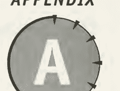

### 部分复习答案

#### 周五晚上复习答案

- 1. 你可以将这些标签放在HTML文件中的任何位置。但按照惯例，它们通常位于HTML文件的开头，在`<head></head>`标签之间。
- 2. 函数实际上只是一个带有名称的代码块。你可以向它传递参数进行处理，它也可以返回结果。
- 3. 只有两个布尔值：true和false。
- 4. 代码块可以是单行JavaScript代码，也可以是用花括号（{}）括起来的任意多行JavaScript代码。就JavaScript解释器而言，代码块在逻辑上等同于单行代码。
- 5. JavaScript变量和函数名必须以美元符号、下划线或字母字符开头。之后，它们可以是字母、数字、下划线或美元符号的任意组合。
- 6. 行中任何位置的两个正斜杠（//）会将该行的其余部分标记为注释。对于多行注释，请将注释包含在/*和*/之间。
- 7. 这有点像陷阱问题。JavaScript代码只是纯ASCII文本，因此你不必将其存储在任何特殊文件格式中。
- 8. 此属性告诉Web浏览器脚本是用哪种脚本语言编写的。如果你没有为`language=`属性指定值，则假定为JavaScript。
- 9. 只需使用`return`关键字，后跟你要返回的值或表达式。
- 10. 答案会有所不同。一个可能的解决方案在你的CD-ROM上。
- 11. 答案会有所不同。一个可能的解决方案在你的CD-ROM上。
- 12. 这是另一个陷阱问题。函数可以有任意少或多的参数。但不要忘记，即使是没有参数的函数，在定义函数和调用函数时也必须包含一对括号。
- 13. 此属性允许你指定包含JavaScript源代码的外部文件的位置。此代码将被加载并可用于HTML文件中的JavaScript。
- 14. 第一个表达式设置循环计数器变量的初始状态。第二个表达式指定每次循环时进行的测试。如果测试结果为false，循环执行将停止。第三个表达式在每次循环结束时执行，并修改你的计数器变量，以便循环最终终止。
- 15. 全局变量可用于JavaScript程序的任何部分。局部变量仅在定义它们的函数中可用。请务必使用`var`关键字定义局部变量。
- 16. `x`中的值将是29。`y`中的值将是100。这个问题的关键在于第二个语句的条件表达式中只有*一个*等号。因此，`y`将被赋值为100，条件将评估为true（因为100不是0[记住，如果不是0，它等同于布尔值true]），所以`x`将被赋值为29。
- 17. JavaScript变量是松散类型的，因此你可以为它们分配任何类型的数据。
- 18. 答案会有所不同。一个可能的解决方案在你的CD-ROM上。
- 19. 答案会有所不同。一个可能的解决方案在你的CD-ROM上。
- 20. 答案会有所不同。一个可能的解决方案在你的CD-ROM上。

### 周六上午复习答案

1.  空字符串是不包含任何字符数据且长度为零的字符串。然而，就JavaScript而言，它仍然是一个字符串。
2.  myVar的内容将是一个包含一个字符的字符串对象：9。为什么？因为当你将数字9与空字符串连接时，JavaScript解释器会将9转换为字符串，然后将该字符串与空字符串连接。结果字符串是9。
3.  答案会有所不同。一个可能的解决方案在你的CD-ROM上。
4.  答案会有所不同。一个可能的解决方案在你的CD-ROM上。
5.  浏览器对象模型是表示Web浏览器和加载到其中的HTML文档各个部分的JavaScript对象的集合。这些对象的属性和方法允许你的JavaScript程序访问和操作这些对象所代表的Web浏览器和HTML文档。
6.  答案会有所不同。一个可能的解决方案在你的CD-ROM上。
7.  在JavaScript中，多维数组只是包含其他数组的数组。因此，你首先创建子数组，然后将每个子数组分配给主数组的元素。然后主数组将被视为多维数组。
8.  答案会有所不同。一个可能的解决方案在你的CD-ROM上。
9.  要遍历具有命名槽的数组元素，请使用第6节“使用命名数组元素”中描述的`for ... in`语句。
10. document对象是window对象的属性。虽然window对象表示浏览器窗口或框架，但document对象表示加载到该窗口或框架中的实际HTML文档。
11. alert()方法用于在弹出窗口中显示简单消息。用户可以通过点击提供的“确定”按钮来关闭警报窗口。
12. Link对象表示一组单独的`<a href="some Web address"></a>`标签。Link对象存储在document对象的links数组属性中。
13. document.open()方法打开document对象，以便你可以向其中写入新文本。然后你使用document.write()或document.writeln()调用将文本发送到document对象。当你完成文本写入后，调用document.close()关闭文档并告诉浏览器显示你写入的文本。
14. 答案会有所不同。一个可能的解决方案在你的CD-ROM上。
15. document.write()方法只写入你指定的文本。document.writeln()方法在你指定的文本后添加一个换行符。
16. 答案会有所不同。一个可能的解决方案在你的CD-ROM上。
17. onclick事件表示在元素内进行鼠标点击。
18. 当窗口或表单元素被选中并接收按键时，它被认为获得了焦点。当窗口或表单元素成为焦点时，会触发onfocus事件。当窗口或表单控件失去焦点时，它已变得模糊。每当窗口或表单元素失去焦点时，都会触发onblur事件。
19. 答案会有所不同。一个可能的解决方案在你的CD-ROM上。
20. 当与``标签一起使用时，onload事件告诉你图像已实际完成加载到Web浏览器中。

### 周六下午复习答案

1.  答案会有所不同。一个可能的解决方案在你的CD-ROM上。
2.  elements数组保存所有与表单中定义的控件对应的JavaScript对象。
3.  调用表单的reset()方法与点击该表单的“重置”按钮相同。它将为表单触发onreset事件，然后将表单中的值重置为其默认值。
4.  JavaScript的`document.forms[2]`表示与HTML文档中定义的第三个表单对应的JavaScript Form对象。（记住，所有JavaScript数组都从零开始编号，而不是从一开始。）
5.  你可以通过将true或false赋给复选框的checked属性来选中或取消选中它。
6.  options数组中的每个条目代表选择列表中的一个菜单项。
7.  如果你从密码字段中提取值，你实际上会得到密码的原始文本。它不会被加密或以任何其他方式受到保护。
8.  表单的“提交”和“重置”按钮有非常特定的用途。它们要么提交表单，要么重置表单。你可以通过编写适当的onsubmit和onreset处理程序来稍微修改它们的行为，但你真的不能改变它们太多。另一方面，通用按钮几乎可以做任何你想做的事情。（包括提交或重置表单！）你所要做的就是编写一个适当的onclick处理程序。
9.  Image对象的src属性保存加载到Image对象中的图形文件的Web地址。
10. 对于``标签，当Web浏览器成功加载src属性中指定的图形文件时，onload事件会触发。
11. 如果Web浏览器无法加载src属性指定的图形文件，它将为``标签触发onerror事件。
12. 基于JavaScript的翻转效果通过利用两个事件来工作：onmouseover和onmouseout。当你的``标签触发onmouseover事件时，你将图像的src属性切换到指向表示翻转“开启”状态的新图形。当onmouseout事件触发时，你将图像的src属性切换回指向原始图像。
13. parseInt()函数接受一个字符串并将其转换为实际的数值。
14. 双重验证你的数据只是良好防御性编程的另一个例子。
15. 人们会犯错。什么？你需要另一个理由吗？
16. 答案会有所不同，但这里的基本概念是，如果你的表单传来的数据无效，那么基于该数据的所有内容都将是有缺陷的。这可能意味着未完成的订单、错误的人口统计数据等等。一点前期的数据验证可以为你省去以后的许多麻烦。
17. 一个cookie可以保存大约4KB的数据。这包括名称、等号及其后的值。
18. onunload和onload事件是保存和加载cookie值的理想时机。
19. cookie的过期日期告诉Web浏览器何时应删除该cookie。
20. 答案会有所不同。一个可能的解决方案在你的CD-ROM上。

### 周六晚上复习答案

1.  类是一组对象，所有这些对象都是由同一个构造函数创建的。实例是类中的一个单独对象。
2.  在构造函数内部使用时，`this`关键字指的是由构造函数创建的对象。
3.  首先确定你的自定义类将表示什么类型的数据。其次，决定类中应包含哪些属性和方法。最后，编写并测试代码以实现该类。这包括构造函数和类方法的所有实现函数。
4.  你可以在对象的属性中存储任何类型的JavaScript数据。
5.  构造函数仍然是一个函数，因此你可以传递任意数量的参数。
6.  实际上，方法的参数不能在构造函数内部显示。你应该只在方法的实现函数中列出方法的参数。
7.  答案会有所不同，但方法是与对象类相关联的函数。
8.  方法是属于对象类的函数。实现函数是实际执行方法任务的代码。
9.  在方法内部使用时，`this`关键字指的是调用该方法的对象。例如，在语句`myString.toUpperCase()`中，`toUpperCase()`方法内部的`this`值将是`myString`对象。
10. 此语句正在为构造函数将创建的对象定义一个方法。方法名称是`action`，其实现函数名为`doAction`。
11. 你可以通过创建自定义JavaScript对象来增强HTML控件，这些对象包装了这些控件的标准浏览器对象模型对象。这些自定义对象可以包含扩展HTML控件功能的新属性和方法。

### 各部分复习题答案

- 12. 只需将原始对象存储在包装对象内的一个属性中。
- 13. 当你更改一个对象的原型时，所有基于该原型的对象都会获得新的属性或方法。这甚至包括已经存在的对象。
- 14. `String.prototype.languageDirection = "leftToRight";`
- 15. Object 类是在 JavaScript 解释器内部定义的一个类。JavaScript 语言中定义的所有其他类（String、Array 等等），以及你定义的所有类，都基于它。
- 16. 传递给 `eval()` 函数的语句会被立即求值和执行。
- 17. 此语句将产生错误。（没有 document 对象。）
- 18. 通过将对象的 JavaScript 变量名保留在对象内部，你可以轻松地从该对象创建自引用代码。这在动态创建 JavaScript 和 HTML 时非常宝贵。
- 19. 第一条语句会成功。这是因为它明确指定了计时器到期时要调用的对象和方法。第二条语句将失败，因为当计时器到期时，`this` 的值将是未定义的，或者与调用 `setTimeout()` 语句时完全不同。
- 20. 答案会有所不同。一个可能的解决方案在你的 CD-ROM 上。

### 周日上午复习题答案

- 1. 样式表是一组规则，它告诉 Web 浏览器如何为 HTML 文档中的各种元素设置样式。
- 2. `<span></span>` 标签用于标记一段文本。然后你可以将事件处理程序和/或样式附加到该文本块，而不会像使用其他 HTML 标签那样产生任何视觉副作用。
- 3. 通过使用外部样式表，你可以将所有样式定义放在一个地方。你网站中的每个 HTML 页面都可以通过链接外部样式表来使用这些定义。然后，如果你需要更改网站中使用的某个样式，只需更改外部样式表，你所有的 HTML 页面都会自动反映更改。
- 4. 你使用 document.getElementById() 方法来获取一个元素对象。你将要检索的元素的 ID 传递给此方法。
- 5. 所有样式属性的默认测量单位是像素（px）。
- 6. innerHTML 属性表示元素内部的实际 HTML 代码（标签和文本）。如果你更改元素的 innerHTML 属性，新值将立即出现在浏览器窗口中。
- 7. 此属性让你告诉浏览器你希望元素在页面上如何定位（相对于位置）。绝对定位值告诉浏览器，你将提供元素应定位的确切坐标（通过 top、bottom、left 和 right 属性）。
- 8. top 对象代表屏幕上可见的实际浏览器窗口。它将包含对加载到浏览器中的所有框架的引用，无论它们嵌套多深。
- 9. parent 对象代表加载该框架的框架集文档。
- 10. 只需将文档的 self 对象与其 parent 对象进行比较。如果它们相同，则该文档是单独加载到窗口中，而不是加载到框架集中。
- 11. 窗口将没有任何工具栏。记住，如果你在 featuresList 参数中指定了一个功能，你未指定的所有功能都将被关闭。因此，如果你只指定了高度和宽度，所有其他窗口功能都将被关闭，这意味着新窗口中不会出现任何工具栏。
- 12. 只需对你想要关闭的窗口调用 window.close() 方法。如果你的窗口存储在名为 myWindow 的变量中，你可以这样编码：myWindow.close();
- 13. 在 HTML 文档末尾定义一个虚拟表单，该表单将被加载到你的新窗口中。然后，检查新窗口中 forms 数组的长度。当此数组的长度等于新窗口中的表单数量时，你就知道 HTML 文档中的所有内容都已加载并准备就绪。
- 14. 如果一个窗口是由另一个窗口打开的，它的 opener 属性将包含对打开它的窗口的引用。
- 15. parseFloat() 函数接受一个包含浮点数的字符串，并将其转换为实际的数值。

### 各部分复习题答案

- 16. 这是一个有点技巧性的问题。正如我在第 25 节中所说，就 JavaScript 而言，它显示的浮点数是正确的。确实，它们*是*正确的，其精度符合 JavaScript 内部表示浮点数的方式所允许的范围。不幸的是，这不是我们人类期望看到的，因此为了向人类显示这些值，需要使用专门编写的函数对其进行四舍五入。
- 17. 使用一组样式规则将文本框的边框样式设置为 none，并将光标（当它悬停在文本框上时）的外观设置为 default。然后文本框应该看起来就像浏览器窗口中的另一个文本区域。
- 18. 字符串 "MSIE" 表示其后的数字是此 Web 浏览器的 Internet Explorer 版本号。
- 19. 你在 `<script>` 标签的 `language=` 属性内指定所需的 JavaScript 版本。像这样：`<script language="javascript1.1">`
- 20. 只需将你的 JavaScript 代码放在一组 HTML 注释标记内。像这样：

```html
<script language="javascript">
<!--
document.write("Hello World!");
// -->
</script>
```

### 周日下午复习题答案

- 1. `var myDate = new Date( 2001, 0, 15, 9, 47, 25);`
- 2. 通过调用 `location.reload()` 方法并传递参数 `true`，你可以强制 Web 浏览器重新加载当前加载在 Web 浏览器中的 HTML 文档。
- 3. 答案会有所不同。一个可能的解决方案在你的 CD-ROM 上。
- 4. 答案会有所不同。一个可能的解决方案在你的 CD-ROM 上。
- 5. 这个问题的答案取决于有多少个框架。基本上，每个框架将有一个 history 对象，加上 top 对象有一个 history 对象。每个框架的 history 对象将保存在该框架中显示过的页面列表。top 对象的 history 对象将保存在所有框架中显示过的所有页面的列表。
- 6. location.replace() 方法允许你加载一个新的 HTML 文档，并让其 Web 地址替换历史列表中当前文档的 Web 地址。这允许你从窗口或框架的历史列表中移除中间文档。
- 7. 如果 `<form>` 标签没有指定 method= 属性，将默认使用 get 方法。
- 8. 这是一个技巧性问题。HTML 文档不会从 post 方法请求中接收数据。
- 9. 发送的数据将在 location 对象的 search 属性中找到。
- 10. 某些字符（空格、& 符号、等号等）在 CGI 协议中充当分隔符和/或停止符。为了使这些字符安全地通过 CGI，你必须将这些字符替换为其十六进制代码等效项。
- 11. 要传输大量数据，你应该始终使用 post 方法。此方法将数据作为单个大块传输，并将其作为输入流提供给 CGI 应用程序。另一方面，get 方法将数据作为 CGI 应用程序 Web 地址的一部分进行传输。这使其受到 Web 浏览器或 Web 服务器可能对 Web 地址长度施加的任何限制。
- 12. mimeType 对象的 enabledPlugin 属性告诉你是否安装了可以处理此 MIME 类型的插件。如果有，此属性将包含对相应 plugin 对象的引用。如果没有，此属性将为 null。
- 13. plugin 对象的 length 属性告诉你该插件支持多少种 MIME 类型。每个 plugin 对象都包含一个未命名的 mimeType 对象数组，这些对象代表这些 MIME 类型。
- 14. mimeType 对象的 suffix 属性保存一个逗号分隔的列表，其中包含与此类型文件关联的各种文件名后缀。
- 15. 默认插件是一个浏览器插件，它尝试处理任何其他插件都无法处理的 MIME 类型。如果默认插件无法处理某个 MIME 类型，浏览器将尝试定位并执行该 MIME 类型的辅助应用程序。

### 章节复习题答案

16. MIME 类型中的 x- 字符表示该 MIME 类型尚未成为标准 MIME 类型。

17. 在 Java 中，你希望全局可访问的内容必须声明为 *public*。这大致（非常粗略地）等同于 JavaScript 中的 *全局* 概念。

18. `<applet>` 标签的 `code=` 属性指定了浏览器应加载的 Java .class 文件。

19. 你可以使用以下语句调用此方法：

```
document.shoppingCart.printCart();
```

```
document.applets[3].printCart();
```

## 附录


### CD-ROM 内容

本附录为您提供随书附带的 CD-ROM 内容信息。

此 CD 包含七个程序：

- Acrobat Reader 4.0
- ECMAScript 标准文档
- BBEdit Lite 和 BBEdit（适用于 Macintosh 用户）
- Netscape Navigator 链接（适用于 Macintosh 和 Windows）
- Internet Explorer（适用于 Macintosh 和 Windows）
- 自我评估测试

此外还包括书中的源代码示例、包含最新版本 ECMAScript 标准的 PDF 文件，以及可使用 Adobe Acrobat Reader 查看的电子版、可搜索版本的本书。

### 系统要求

请确保您的计算机满足本节列出的最低系统要求。如果您的计算机不符合大部分要求，您在使用 CD 内容时可能会遇到问题。

对于 Microsoft Windows 9x、Windows ME、Windows NT 或 Windows 2000：

- 配备运行速度为 120 MHz 或更快的 Pentium 处理器的 PC
- 至少 64 MB 内存
- 以太网网络接口卡 (NIC) 或速度至少为 28,800 bps 的调制解调器
- CD-ROM 驱动器 — 双速 (2x) 或更快

对于 Macintosh：

- iMac、iBook 或任何其他基于 G3 处理器的 Macintosh
- 至少 64MB 内存
- CD-ROM 驱动器 — 双速 (2x) 或更快

您需要至少 150 MB 的硬盘空间来安装此 CD 上的所有软件。

### 在 Microsoft Windows 上使用 CD

要将 CD 上的项目安装到硬盘，请按照以下步骤操作：

1. 将 CD 插入计算机的 CD-ROM 驱动器。
2. 打开桌面上的“我的电脑”图标。
3. 右键单击 CD-ROM 驱动器图标并选择“资源管理器”项。
4. 此时，您可以安装任何您希望的软件，或者可以将示例源代码文件从 CD-ROM 复制到本地硬盘。
5. 如果您选择安装第三方软件，请在开始安装过程后仔细遵循屏幕上显示的说明。

### 在 Mac OS 上使用 CD

要将 CD 上的项目安装到硬盘，请按照以下步骤操作：

1. 将 CD 插入计算机的 CD-ROM 驱动器。
2. 双击桌面上出现的 CD-ROM 图标。
3. 此时，您可以安装任何您希望的软件，或者可以将示例源代码文件从 CD-ROM 复制到本地硬盘。
4. 如果您选择安装第三方软件，请在开始安装过程后仔细遵循屏幕上显示的说明。

### CD 内容

CD-ROM 包含源代码示例、应用程序和本书的电子版本。以下是按类别排列的 CD-ROM 内容摘要。

### 源代码

每个章节的源代码文件都在单独的文件夹中。这些文件夹命名为“Sessionxx”，其中 xx 是章节号。每个文件夹的内容都设计为独立的，因此您可以直接使用浏览器从任何章节文件夹中打开文件。还有一个 images 文件夹，包含所有章节文件夹中代码使用的所有图像。如果您将章节文件夹复制到硬盘，请务必同时复制 images 文件夹。

章节复习题中的一些问题要求您创建 JavaScript 程序。这些问题的答案可以在 CD-ROM 上的“PartReviewxx”文件夹中找到。（其中 xx 是章节复习题编号。）

### 应用程序

CD-ROM 上包含以下应用程序。

### 浏览器

浏览器是您用于访问 Internet 上的文件或读取本地 HTML 文件的客户端软件。

- **Internet Explorer：** 适用于 Windows 9x 或更高版本以及 Macintosh 的 Web 浏览器。免费软件。更多信息请访问：www.microsoft.com
- **Netscape Navigator：** 适用于 Windows 9x 或更高版本以及 Macintosh 的 Web 浏览器。免费软件。更多信息请访问：www.netscape.com

### 编辑器

如果您还没有一个好的 HTML 编辑器，CD-ROM 上有几个很棒的编辑器。

- **BBEdit Lite & BBEdit Demo：** 这可以说是 Macintosh 上最好的文本编辑器。提供了两个版本：BBEdit Lite 是一个免费软件编辑器，包含您需要的所有基本功能。BBEdit Demo 是完整 BBEdit 程序的受限使用演示版。更多信息请访问：web.barebones.com

### ECMAScript 标准的电子版本

完整的 ECMAScript 标准文本以 Adobe 的便携式文档格式 (PDF) 存储在 CD-ROM 上，可使用 Adobe Acrobat Reader（也包含在内）阅读。有关 Adobe Acrobat Reader 的更多信息，请访问 www.adobe.com。

### JavaScript 周末速成课程的电子版本

本书的完整（且可搜索）文本以 Adobe 的便携式文档格式 (PDF) 存储在 CD-ROM 上，可使用 Adobe Acrobat Reader（也包含在内）阅读。

### 自我评估测试

自我评估测试软件可帮助您评估从本周末速成课程中学到了多少内容。它还将帮助您确定哪些章节已掌握，哪些可能需要重新学习。

### 故障排除

如果您在安装或使用 CD-ROM 程序时遇到困难，请尝试以下解决方案：

- **关闭您可能正在运行的任何防病毒软件。** 安装程序有时会模拟病毒活动，可能导致您的计算机错误地认为它正在感染病毒。（请务必稍后重新打开防病毒软件。）
- **关闭所有正在运行的程序。** 您运行的程序越多，其他程序可用的内存就越少。安装程序通常也会更新文件和程序；如果您保持其他程序运行，安装可能无法正常进行。

如果您在使用 CD 时仍然遇到问题，请致电 Hungry Minds 客户服务电话：(800) 762-2974。美国境外请致电 (317) 572-3993。Hungry Minds 仅提供安装和其他一般质量控制项目的技术支持；有关应用程序本身的技术支持，请咨询程序供应商或作者。

## 索引

**A**

- <a> 标签，259
  - :hover 伪类，304–306
  - onmouseout 事件支持，167
  - onmouseover 事件支持，167
- action **属性**，139
- **活动链接，颜色**，98–99
- 加法赋值运算符 (+-)，17
- addToCart() **函数**，159
- Adobe Acrobat，369
- alert() **方法**，90, 111, 193, 238–239, 383
- alinkColor **属性**，98–99
- allowedChars **属性**，233
- Anchor **对象**，99
- **锚点标签**
  - onclick 事件和，119
  - 窗口对象名称在，87
- anchors **数组**，99
- animate() **方法**，243
- 动画帧，存储在数组中，168–169
- 动画对象，使用 setTimOut() 创建，242–243
- **动画**，101, 168–172
  - 按钮动画，179–180
  - 图像交换在，171
  - 使用 position 属性，276–278
  - 预加载图像，169
  - 字符串动画，375–376
  - 计时，170–172
- appCodeName **属性**，316
- <applet> **标签**，370, 374–376
  - bgColor 参数，377
  - code 属性，374, 391
  - codebase 属性，374
  - 默认值，377
  - HTML 文本在，377
  - name 属性，374
  - text 参数，376
  - textColor 参数，377
- applets **数组**，99–100, 375
- appName **属性**，316–317
- appVersion **属性**，317
- Array() 构造函数方法，62, 67
- Array 对象，196–198
  - 创建，62
  - length 属性，63
- 数组
  - 向数组添加元素，68, 71
  - 用于动画帧存储，168–169
  - applets 数组，99–100
  - 将元素组合成单个字符串，68, 71
  - 连接数组，67
  - 数组中的数据，65
  - 数组的定义，62
  - 数组元素，63
  - 从数组中提取数据，63
  - 数组的功能，62–63
  - 数组的方法，67–71
  - 遍历数组，383
  - 多维数组，65–67, 383
  - 数组中的命名槽，63–65
  - 用于对象信息存储，212–214
  - 用于单选按钮信息，150
  - 移除数组中的第一个元素，69
  - 移除数组中的最后一个元素，68
  - 反转数组中元素的顺序，69
  - 用于搜索字符串数据，356–357
  - 数组切片，69
  - 对数组内容排序，69–70
  - 将元素拼接到数组中，70–71
  - 将 String 对象拆分为数组，58
- 赋值错误，31
- 赋值运算符，17–18
- 赋值语句，14, 207–208
- 反斜杠字符 (\)，作为转义字符，130
- 横幅小程序，365–366
- banner 变量，376
- BBEdit
  - BBEdit Lite，10
  - 在 CD-ROM 上，395
- bgColor 属性，100
- 位标志运算符，20–21
- 空格
  - 在 CGI 数据中，348
  - 在字符串中放置空格，52
- 代码块，28
- blur() 方法，90
- blurInCart() 方法，308
- 模糊效果，112–113, 384
- <body> 标签，10, 288
  - onblur 处理程序在，113
  - onload 事件，110
  - onload 处理程序在，115–116
  - onunload 处理程序在，193
- 布尔表达式，24
- 布尔值，15, 23–24, 31, 381
- 布尔变量，取反，27
- 边框
  - 元素边框，271–272, 389
  -  标签边框，305
- <br> 标签，30, 365
- break 语句，32
- 浏览器对象模型，75–77, 383
  - 访问其部分，80–82
  - window 对象，76–79
- 浏览器窗口，76–79。另见 window 对象
  - 地址栏或位置工具栏，295
  - 清除其内容，105–106
  - 关闭，90, 118, 301–302
  - 在窗口间通信，297–301
  - 在窗口中创建内容，296–297
  - 目录按钮，295
  - 窗口特性，295–296
  - 特性规范，92

**B**

- 后退按钮，343–344
- 背景颜色
  - 元素背景颜色，271
  - HTML 文档背景颜色，100
- 背景图像，元素背景图像，271

## 索引

聚焦，91
高度和宽度，295
加载，检查，298–300
加载网页到，92
菜单栏，295
移动，91
命名，294
打开器，87
打开，92，293–294
移除焦点，90
调整大小，93，117，295
滚动条，295
滚动浏览，93
状态栏，296
计时问题，298–300
工具栏，296，388
写入字符串到，107

browserOK 变量，323

### 按钮，145–146

动画，180–181
分配动作给，113–114
命名，146
悬停按钮，167–168
value 属性，146，263

### C

C 语言，6，348
取消问题，91

层叠样式表 (CSS)，253–254，268。另见样式表

类，255–258
使用其定位元素，276
:focus 伪类，306–307
ID，258–259
链接颜色设置，304
伪类，304
网站，253，261

### 大小写敏感性

字符串方法的，56
变量名的，16

case 语句，32

### 随附光盘 (CD-ROM)

addRemoveOptionsSelectList.htm 文件，159
anyTagCanHaveEvents.htm 文件，114
应用程序，395
数组方法，67
babyPalooza.js 文件，44，72，131
bpReports.htm 文件，352
浏览器，7，395
browserSnoop.js 文件，322
内容，393
控件操作示例，263
文档对象示例，97
ECMAScript 文档，339–340，396
编辑器，395
enterQuantity() 函数，183
事件示例，112
fileUpload.htm 文件，149
floatingPoint.js 文件，311
框架集文档示例，282
heightNwidthProperties.htm 文件，165
Image 对象示例，164
index.htm 文件，72，131
innerHTMLProperty.htm 文件，279
linksArray.htm 文件，102
Listing4-1.htm 文件，37–38
Listing4-2.htm 文件，39
Listing4-3.htm 文件，40
Listing4-4.htm 文件，42
Listing4-5.htm 文件，44
Listing6-2.htm 文件，63
locationReplaceMethod.htm 文件，343
mimeTypes.htm 文件，362
movingThings.htm 文件，277
multipleSelectList.htm 文件，157–158
nervousBaby.htm 文件，377
NervousText.java 文件，376
官方语言规范，55
openPDF.htm 文件，369
plugIns.htm 文件，364
qtSalesSummary.htm 文件，352
radioObj.htm 文件，230
递归函数，95
selectAnOption.htm 文件，155–156
selectList.htm 文件，154
购物车代码，243
simpleRollover.htm 文件，168
源代码示例，395
样式属性和值，270
系统要求，393–394
textObj.htm 文件，233–234
故障排除，396
window 对象示例，85
包装器对象示例，228

clear() 方法，105
clearCookie 变量，198
clearInterval() 方法，90，94
clearTimeout() 方法，90，94–95
click() 方法，148
点击，鼠标，113–114
close() 方法，90，105–107，297，301–302，388
closed 属性，86
代码
浏览器特定的，323–324
从框架集文档控制，288
导入，43–44
保护，288–289
安全性，300
用注释标签包裹，325–326
代码块，28，381
重复，32–33
选择，27–32
代码文件，减小大小，40
编码风格，29
冒号字符 (:)
在 cookie 定义中，191
用于 CSS 伪类，304
颜色
背景色，100
链接色，98–99，102，105
注释标记，正斜杠作为，381
注释，21–22
块注释，21–22
通用网关接口 (CGI)，347–348
数据格式，348–349
方法，349–350
规范页面，348

CGI 应用程序
空格和特殊字符，
通过其发送，349–351

字符，15
charAt() 方法，55–56
复选框，146–148
checked 属性，147，384
defaultChecked 属性，148
onblur 和 onfocus 事件，147
onclick 事件，147
文本标签，147
切换状态，148
值，147
checkAppletStatus() 函数，377
checkHelper() 函数，371
.class 文件，374
类，CSS，255–258
更改，269
类，对象，211，386

通用网关接口 (CGI)
应用程序，347–348，390
转义字符，349–351，353–355
get 方法请求，352–353
搜索字符串，350

比较运算符，24–26

concat() 方法，67

连接，52–53

条件表达式，28，382

条件运算符，35

confirm() 方法，91

常量属性，Math 对象的，339–340

常量，339–340

构造函数，207–210，386
创建，222
方法规范，219–220
参数和，222
参数，208
this 关键字，208–209

构造函数方法，62
数组的，67

内容
创建，296–297
与样式分离，253。另见
层叠样式表 (CSS)

continue 语句，34–35

控制框架，107

control 属性，229，233

控件。另见 HTML 控件

cookie 属性，100

cookieEnabled 属性，317

Cookie，8，385
可用性，189，317
构建，192–196
组成部分，188
解码，196–198
定义，187
删除，198
domain 属性，189
过期日期，189，193–196，386
expires 属性，189
加载，196
操作，79
命名，188
path 属性，189
隐私问题，191–192
保存，196
secure 属性，189
分隔符，190–191
状态，198–199
值，190–191

计数器变量，34

计数器，94–95

花括号 {}，28–29
用于代码块，381
用于函数，39
用于样式规则，255

光标，类型，308–309

光标规则，308–309

数据，写入文档对象，105–107

数据传输方法，349–350

数据类型，15

数据验证，146，175，357，385
控件的，233–234
HTML 表单的，181–183
表单提交时，184–185

Date 类，333–334
构造函数，333–334
getDate() 方法，335
getDay() 方法，335–336
getFullYear() 方法，336
getHours() 方法，336
getMinutes() 方法，336
getMonth() 方法，336–337
getTime() 方法，337
getTimeZoneOffset() 方法，337
方法，335–338
setDate() 方法，335
setFullYear() 方法，336
setHours() 方法，336
setMinutes() 方法，336
setMonth() 方法，336–337
setTime() 方法，337
toGMTString() 方法，337
toLocalString() 方法，338

Date 对象
与 Cookie 一起使用，194–196
创建，194，333–335
getTime() 方法，195
setTime() 方法，195
作为字符串，338
toGMTString() 方法，195
用途，338–339

月份中的日期，335
星期几，335–336
调试
用于调试的 alert() 方法，90
动态创建的 HTML，130–131
递减运算符，20
默认插件，363，390
default 语句，32
defaultStatus 属性，86
对话框。另见消息
创建，92–93
显示框架，107
文档对象，10，76，78–81，86，97，261，383
alinkColor 属性，98–99
anchors 数组，99
applets 数组，99–100，375
bgColor 属性，100
clear() 方法，105
close() 方法，105–107，297
cookie 属性，100
domain 属性，100，300–301
embeds 数组，101
fgColor 属性，100
forms 数组，101
getElementById() 方法，261–263，388
images 数组，101
lastModified 属性，101
linkColor 属性，102
links 数组，102–103，383
location 属性，104
方法，105–107
open() 方法，105–107，384
plugins 数组，104
属性，98–105
referrer 属性，104
title 属性，104
URL 属性，104
vlinkColor 属性，105
write() 方法，107，297，394
writeln() 方法，107

文档对象模型 (DOM)，261，267–268
符合性，279
document 属性，86
domain 属性，100，300–301
doPlus() 函数，180–181
doQtrSummary() 函数，352
doStandard() 函数，148
doSubmit() 函数，184–185
双击，鼠标，113–114
do...while 语句，33
虚拟表单，285，299
动态 HTML (DHTML)，126–127，267
基于 CSS 的动画，276–278

403

### E

ECMAScript 标准，6
在光盘上，396

编辑器，10
在光盘上，395

元素对象，261–263
innerHTML 属性，278–279
嵌套，268
获取，269

元素，63，268
动画，276–278
背景色，271
背景图像，271
边框颜色，271，306
边框样式，272
边框宽度，272
更改其中的 HTML，279
显示，272–273
高度，274–275
周围边距，275
内边距，275
定位，276–278
样式对象，269
文本对齐，275
文本颜色，272
文本字体，273–274
可见性，276
宽度，276

elements 数组，384
表单对象的，139–140

else 关键字，29

电子邮件，MIME 类型，361

<embed> 标签，101，370

embeds 数组，101

空字符串，383
与数字连接，53

enabledPlugin 属性，362–363

封装，38，207

encoding 属性，141

编码类型，表单的，141

enterQuantity() 函数，183，
185，198

等号 (=)，14，17
用于赋值操作，25，30–31

相等运算符，25

错误处理器，JavaScript 错误的，
114–115

错误
图像加载错误，114
JavaScript 错误，114–115

escape() 函数，190，348，
353–354，390
包装函数，355

转义引号，130

欧洲计算机制造商协会 (ECMA)，6

eval() 函数，237–239，307，387
功能，239–240

eval() 方法，245
动画对象的，243

事件处理器，110，146
创建，110–111
自定义对象的，230
在函数中，111
全局变量访问，111
多条语句，111
命名，111

事件处理，110

事件，109–110
定义，110
触发，111
Image 对象的事件，165–166
onabort 事件，112
onblur 事件，112–113
onchange 事件，113
onclick 事件，113–114
ondblclick 事件，113–114
onerror 事件，114–115

## 索引

事件（续）
- onfocus 事件，115
- onkeydown 事件，115
- onkeypress 事件，115
- onkeyup 事件，115
- onload 事件，110，115–116
- onmousedown 事件，116
- onmousemove 事件，116
- onmouseover 事件，116–117
- onmouseup 事件，117
- onreset 事件，117
- onresize 事件，117
- onsubmit 事件，118
- onunload 事件，118

感叹号 (!)，用于取反操作，27

异或操作，26–27

表达式
- 在表达式之间选择，35
- 对表达式取反，27

外部文件
- 源文件，43–44
- 指定位置，382

外部样式表，260–261，263–264，387

### F

false 关键字，23

功能标志，295–296

featureslist 参数，295–296，388

fgColor 属性，100

文件打开对话框，149

文件上传控件，148–149
- onchange 事件支持，149

文件上传字段，验证，184

浮点数，15–16
- 显示，310–311，389
- 截断，311–312

流程控制语句，27–28
- 跳出循环，32
- do...while 语句，33–34
- if 语句，28–30
- if...else 语句，29–30
- while 语句，32–33

focus() 方法，91

:focus 伪类，306–307

focusInCart() 方法，307

聚焦，113，115，384

<font> 标签，254

for 循环
- 用于动画，169–170
- 用于命名槽操作，64
- 用于遍历数组，67

for 语句，33–34

前景色，HTML 文档的，101

for...in 语句，383

form 对象，81，101，135–136
- action 属性，139
- 控件与，137–138
- elements 数组，139–140
- encoding 属性，141
- length 属性，141
- method 属性，141，350
- 方法，142
- name 属性，141
- 命名，136–137
- 属性，139–141
- reset() 方法，142，384
- submit() 方法，142
- target 属性，141

<form> 标签，81，101，135，390
- 其中的 onsubmit 和 onreset 事件，146

表单。参见 HTML 表单

forms 数组，81，101，136
- 长度，286

前进按钮，344

正斜杠 (//)，作为注释标记，381

frac 变量，312

<frame> 标签，281–282

框架
- 书签，289
- 框架间通信，282–283
- 动态创建内容，287–289
- 隐藏或显示，290–291
- 历史对象，345，390
- 加载，289
- 嵌套，283–284
- 父框架，88
- 调整大小，117，290–291
- 加载和调用时机，284–286
- 顶层框架，89
- 窗口对象，88，282，284

frames 数组，78，86

框架集文档，282–284
- 从中控制 JavaScript 代码，288
- top 对象，284

<frameset> 标签，281–282
- 其中的 onblur 处理程序，113
- 作为父对象，284

框架集，282–284

function 关键字，39，208

函数，381
- 调用，39–40
- 创建，38–39
- 空参数列表，40–41
- 事件处理程序，111
- 用于方法实现，219–221
- 名称，39，382
- 参数，39，382
- 用于减少代码量，40
- 作用域，41–43
- 函数中的 this 关键字，220–221

get 方法，349–357

get 方法请求，352–353
- 从中检索数据，355–356

getDate() 方法，335

getDay() 方法，335–336

getElementById() 方法，269，291，388

getFullYear() 方法，336

getHours() 方法，336

getLoadStatus() 函数，377

getMinutes() 方法，336

getMonth() 方法，336–337

getText() 方法，233

getTime() 方法，195，337

getTimeZoneOffset() 方法，337

全局作用域，41–43

全局变量，111，382

格林威治标准时间信息，337

Web 地址的哈希部分，102

hash 属性，341

<head> 标签，样式块，255

辅助应用程序，359–360
- 检测，368
- 启动，370–371
- 触发启动，368–369

十六进制代码
- 用于空格和空白字符，348
- 替换为可打印字符，357
- 用于特殊字符，348

十六进制颜色值，用于链接，98–99

隐藏字段，160–161

历史列表，86，344–345

history 对象，77，344–345，390
- back() 方法，344
- forward() 方法，344
- go() 方法，344
- length 属性，344

history 属性，86

小时值，336

悬停效果，304–306

:hover 伪类，304–306

href 属性，341，353

HTML
- 调试，130–131
- 动态创建，126–132
- 在框架中动态创建，287–289

HTML 控件
- 访问，140
- 失去焦点，113
- 按钮，145–146
- 已更改，113
- 复选框，146–148
- 自定义，129–130
- 数据验证，233–234
- 增强，227–228，386
- 生成的事件，110
- 文件上传控件，148–149
- form 对象与，137–138
- 获取和设置，139
- 隐藏或显示，262–263
- 高亮显示，304–306
- 对应的 JavaScript 对象，138
- 单选按钮，149–151
- 选择列表，152–159
- tabIndex 属性，310
- 基于文本的，160–161
- 验证，184
- 值，138
- 包装对象，228–230

HTML 文档
- 添加小程序，374
- 背景颜色，100
- 更改内容，127
- cookie 值，100
- 域信息，100
- 嵌入项，101
- 前景色，101
- 最后修改日期，101
- 链接到外部文档，260
- 加载，115–116
- 位置信息，104
- 使用 Tab 键导航，310
- 引用文档信息，104
- 重新加载，343
- 样式。参见层叠样式表 (CSS)；样式表
- 标题信息，104
- 卸载，118

HTML 文件，9–10
- 处理顺序，12

HTML 表单，135
- 控制用户输入，179–181
- 数据验证，118，146，175，181–183
- 提交时数据验证，184–185
- 默认值，176–177
- 显示结果，141
- 虚拟表单，285，299
- 编码，141
- 交互，79
- 加载和解析检查，285–286
- 命名，136–137
- onfocus 事件处理程序，178
- 保护字段，176，178
- 重置按钮，117，142
- 重置，142
- 限制字段长度，177
- 选择列表，176
- 发送到 Web 地址，139
- 提交按钮，142
- 提交，118，142
- 更新文本字段，181
- 用户界面，176

HTML 框架集文档，281–282

HTML Kit，10

HTML 页面。另请参见文档对象
- 动态创建，106
- 发送数据到，106

HTML 解析器，10

HTML 渲染引擎，325

<html> 标签，10，288

HTML 标签
- class 属性，256–258
- 将自定义对象连接到，230
- 动态构建，125
- 事件，112
- id 属性，258–259
- 用于 JavaScript，8–9
- 非空标签，114
- 存储在字符串变量中，127–128
- style 属性，259

Hungry Minds 客户服务，396

超文本标记语言。参见 HTML

Image 对象，101，164
- 访问，164
- border 属性，164
- complete 属性，164
- 创建，166
- 动态调整大小，172
- 事件，165–166
- height 属性，165
- hspace 属性，165
- lowsrc 属性，165
- name 属性，165
- 无  标签，166
- 属性，164–165
- src 属性，165，385
- vspace 属性，165
- width 属性，165

Image 对象构造函数，166

图像
- 中止加载，112
- 用于动画，169
- 加载错误，114
- 水平和垂直填充，165
- 交互，80
- 作为链接，167
- 加载，115–116
- 低分辨率版本，165
- 命名，165
- 重新定位，165
- 调整大小，165
- Web 地址，165

images 数组，101，164

 标签，101，164，371
- 用于动画对象，243
- 用于动画，171
- 与图像关联，166
- 边框，305
- onload 事件处理程序，116，384
- onload 事件，171，385
- onmouseout 事件支持，167
- onmouseover 事件支持，167
- 用于触发函数，377

实现函数，386

@import 规则，260–261

递增运算符，19–20

索引，槽的，63

I 型光标，消除，308

if 语句，28–30

if...else 语句，29–30

indexOf() 方法，56–57
- 位置信息，57

不等运算符，26

无限循环，33

innerHTML 属性，278–279，388

<input> 标签，81

插入点，定位，308

实例，对象，211

整数，15–16

互联网号码分配机构 (IANA)，361

Internet Explorer (IE)，7
- appCodeName 属性，316
- 数组方法与，68
- 背景颜色规范，100
- 在 CD-ROM 上，395
- JavaScript 到 Java 通信支持，373
- mimeTypes 属性和 plugins 数组支持，360，369
- navigator.cookieEnabled 属性，199
- 版本信息，320–321，389

isBlank() 方法，231–234

isNumeric() 函数，183

isValid() 方法，233–234

### J

Java，6
- 与 JavaScript 对比，8
- 语法，376

Java 小程序，373
- 添加到 HTML 文档，374
- 数组，99–100
- 横幅小程序，365–366
- 通信，375–378
- getInfo() 方法，375
- 交互，80
- 传递参数，374
- 公共方法，375–377，391
- setBanner() 方法，378

Java 开发者工具包 (JDK)，365

JavaScript
- 以 ASCII 文本形式，10
- 动态创建，132–133
- 错误，114–115
- 功能，7
- 隐藏，325–326
- HTML 标签，8–9
- 与 Java 对比，8
- 起源，6
- 需要浏览器支持，324–325
- 限制，8
- 服务器端版本，7
- 标准化版本，6
- 版本要求，326，389
- 零基索引，335

JavaScript 解释器，10
- 字符串求值，237–239

JavaScript 程序，停止执行，90

JavaScript 样式表，254–255

join() 方法，68

.jpg 文件，动画，172

.js 文件扩展名，44

JScript，6
- 服务器端，7

### K

按键事件，115

关键字，23–24

### L

language 属性，232–233，317，382

lastIndexOf() 方法，57

lastModified 属性，101

## 索引

length **属性**，141
数组对象的，63
字符串对象的，54–55

Link **对象**，102，383

<link> **标签**，260
动态生成，263–264

linkColor **属性**，102

Link.hash **属性**，102

Link.host **属性**，102

Link.hostname **属性**，102

Link.href **属性**，102

Link.innerHTML **属性**，103

Link.pathname **属性**，103

Link.port **属性**，103

Link.protocol **属性**，103

链接
颜色，98–99，102，105
自定义，129
执行语句，119
哈希信息，102
高亮显示，304
主机信息，102
href 信息，102
图像作为链接，167
屏幕上的文本，103
路径名信息，103
端口信息，103
协议信息，103
查询字符串，103
状态栏描述，129
目标窗口名称，103

links **数组**，102–103，383

Link.search **属性**，103

Link.target **属性**，103

Linux，Netscape Navigator 版本，90

LiveScript，5–6

LiveWire，7

局部作用域，41–43

局部变量，34，382

location 对象，341–343
hash 属性，341
host 属性，342
hostname 属性，342
href 属性，341–342，353，369
pathname 属性，342
port 属性，342
protocol 属性，343
reload() 方法，343，389
replace() 方法，343，390
search 属性，343，356，390

location **属性**，78，87，104

逻辑与运算，26

逻辑表达式，24

逻辑非运算，27

逻辑运算符，26–27

逻辑或运算，26

逻辑值，24

循环计数器，382

循环
用于检查单选按钮值，150–151
无限循环，33
for 循环，33–34
用于遍历数组，63
测试，34–35
while 循环，32–33

Mac OS，使用 CD-ROM，394

Math 对象，312，339–341
abs() 方法，340
常量属性，339–340
max() 方法，340
方法，340
min() 方法，340
pow() 方法，340
random() 方法，340
round() 方法，341
sqrt() 方法，341

Math.E **属性**，340

数学运算符，18–21

Math.PI **属性**，340

Math.round() 方法，312

Math.SQRT2 属性，340

**消息**
- 警告框，90
- 确认框，91
- 用户提示框，92–93

method **属性**，141，350

**方法**，54，386
- 添加到现有对象，228–233
- 数组方法，67–71
- 调用，54，218
- 创建，222–224
- 自定义，221
- 定义，217–221
- document 对象的方法，105–107
- form 对象的方法，142
- 实现函数，219–221
- 命名，219–220
- 参数，222
- 参数，54
- 在构造函数中指定，219–220
- this 关键字，224
- window 对象的方法，89–95

**Microsoft JScript**，6

**Microsoft Windows，使用 CD-ROM**，394

mime**Type 对象**，361–362
- description 属性，361
- enabledPlugin 属性，362–363，390
- suffixes 属性，362，390
- type 属性，362

mime**Types 数组**，361–362
- 遍历，368

mime**Types 属性**，318，360

**分钟值**，336

**取模运算符**，20

**月份值**，336–337

**鼠标，悬停效果**，304–306

**鼠标点击事件**，116

**鼠标移动事件**，116

**鼠标悬停事件**，116–117

**鼠标释放事件**，117

**鼠标悬停效果**，167–168，305，385
- 创建，167–168

moveBy() 方法，91

moveit() 函数，277–278

moveTo() 方法，91

**Mozilla**，316

**多维数组**，65–67，383
- 访问其中的数据，66–67

**多媒体文件，客户端支持能力**，368–369

**多用途互联网邮件扩展 (MIME) 类型**，78，318，361，391
- 列表，362–363
- 在插件对象中，364–365
- 插件支持，367

name **属性**，87，141，244

navigator **对象**，78，87，263
- appCodeName 属性，316
- appName 属性，316–317
- appVersion 属性，317，319–321
- cookieEnabled 属性，317
- language 属性，317
- mimeTypes 属性，318，360–363
- platform 属性，263–264，318
- plugins 数组，318，360
- product 属性，318
- productSub 属性，318
- 属性，315–316
- userAgent 属性，318
- userLanguage 属性，317

navigator **属性**，87

navigator.plugins 数组，104

取反，27

Nervous Text 小程序，375–376

Netscape 公司，5–6

Netscape Navigator，7
- 背景色规范，100
- 在 CD-ROM 上，395
- 前景色值，101
- JavaScript 错误信息，114
- JavaScript 样式表，254–255
The request was rejected because it was considered high risk

选择列表，152–159

- 添加和删除选项，158–159
- 示例，154–155
- 用于HTML表单，176
- 多选列表，157–158
- onchange事件，157
- selectedIndex属性，157–158
- 在列表中选择项目，155–156

select()方法，307

Select对象，152–153

- blur()方法，153
- click()方法，153
- focus()方法，153
- length属性，152
- name属性，152
- onchange事件，153
- options数组，153–154
- selectedIndex属性，153–155, 157–158

自我评估测试，在CD-ROM上，396

分号（;），14

- 在cookie定义中，188, 193

服务器端JavaScript，7

服务器端进程。另见CGI应用程序；通用网关接口（CGI）

- 与之通信，347–348

setDate()方法，335

setFullYear()方法，336

setHours()方法，336

setInterval()方法，94, 240–241

setMinutes()方法，336

setMonth()方法，336–337

setText()方法，233

setTime()方法，195, 337

setTimeOut()方法，94, 240–241

- 用于动画对象，242–243

shift()方法，69

购物车，11

SimpleText，10

斜杠（//），作为注释标记，21

slice()方法，69

槽位，62

- 访问，63
- 索引，63
- 命名的，63–65
- 编号的，63

sort()方法，69–70

对数组内容排序，69–70

源代码。另见代码

- 保护，288–289

<span>标签，259–260, 277, 387

特殊字符

- 转义，353–355, 390
- 十六进制代码，348

splice()方法，70–71

split()方法，58, 197, 356

src属性，43–44, 385

标准输入流，350

语句

- 赋值，14
- 结束标点，14
- 通过链接执行，119
- 执行，立即与指定，240
- 递归函数，95
- 重复调用，95

状态栏

- 链接描述，129
- 用途，309–310

status属性，88

停止按钮，112

流，105

- 打开，105

String类，增强，231–232

String()构造函数方法，62

String方法，大小写敏感性，56

## 索引

### String对象

- isBlank()方法，231–232
- language属性，232–233

### String对象，53–54

- 转换大小写，58
- 提取单个字符，55–56
- 提取子字符串，58
- 方法和属性，54–58
- 搜索子字符串，56–57
- split()方法，197
- 分割成数组，58

### 字符串变量，存储HTML标签，127–128

### 字符串，15

- 动画化，375–376
- 分割成Array对象，71
- 连接，52–53
- 创建，51
- 日期信息作为字符串，338
- 空字符串，383
- 用引号括起来，14
- 硬编码，52
- length属性，54–55
- 字面量，52
- 字符编号，55
- 数字转换，53
- 传递给解释器，237–239
- 放置空格，52
- 排序，70

### String.split()方法，71

### <style>块，@import规则，260–261

### style对象，269

- 背景颜色属性，271
- 背景图像属性，271
- 边框颜色属性，271–272
- display属性，272–273
- 字体族属性，273
- 字体大小属性，273–274
- 字体样式属性，274
- 字体粗细属性，274
- 高度属性，274–275
- 外边距属性，275
- 内边距属性，275
- 属性，更改，270
- 属性，显示，269–270
- 文本对齐属性，275
- 文本颜色属性，272
- 可见性属性，276
- 宽度属性，276

### 样式规则，255, 389

- 层叠，256–257
- 冲突，256–257
- 外部存储，260–261
- ID定义，258–259

### 样式表，387。另见层叠样式表（CSS）

- 定义，254
- 外部，260–261, 263–264, 387
- 特定于平台，263–264
- 选择使用一个，263–264

### <style>标签，254–255, 260

- type属性，254

### 样式。另见层叠样式表（CSS）；样式表

- 应用于文本块，259–260
- JavaScript交互，261
- 优先级，260

### 子类，228

### 提交按钮，118, 142, 146, 385

### submit()方法，142

### substring()方法，58, 320, 356

### 子字符串

- 从String对象提取，58
- 搜索，56–57

### Sun Microsystems，6

### 超类，228

### switch语句，31–32, 72

### 系统要求，393–394

## 索引

### T

Tab键，310

target属性，87

target属性，141

任务，自动化，7

文本区域，160

基于文本的控件，160–161

- onblur和onfocus事件，161
- onchange事件，161
- value属性，160

文本框，160

- 视觉提示，306–309, 389

文本字段

- 空白，检查，181–182
- 数值，检查，182–183
- 验证，181–183

this关键字，208–209, 220–221, 224, 386

- 用于包装对象，230

时间信息。另见Date对象

- 显示，338–339

时区信息，337

定时器ID，95

title属性，104

<title>标签，104

toGMTString()方法，195, 337

toLocalString()方法，338

toLowerCase()方法，58

top对象，284, 388

- history对象，345

top属性，89

toString()方法，71

toUpperCase()方法，54–55, 58

true关键字，23

### U

unescape()函数，190, 357

协调世界时（UTC），338

unShift()方法，71

URL属性，105

用户输入，控制，179–181

userAgent属性，318

userLanguage属性，317

用户

- 反馈，91
- 交互，160
- 提示信息，92–93
- 视觉提示。见视觉提示

### V

value属性，263, 385

- 基于文本的控件的，160

var关键字，41–43, 62, 382

变量，14–17

- 数组。见数组
- 赋值字符串，51
- 赋值，14
- 创建，15
- 全局，382
- 局部，382
- 弱类型，382
- 名称，16–17, 43, 382
- 作用域，41–43
- 类型，15

竖线（|），在cookie定义中，190–191

vi，10

## 索引

### V

已访问链接，颜色，105

视觉提示

- 消除，308–309
- 用于链接，303–305
- 用于文本框，306–309

vlinkColor属性，105

特定于版本的网站，321–323

窗口。见浏览器窗口

网页

- 地址，78
- 位置信息，87
- 共享函数，43

Web服务器，cookie管理，187–188

网站

- 基于框架的，281–282。另见框架
- 历史列表，86
- 特定于版本的，321–323
- 视觉提示。见视觉提示

while语句，32–33

空白字符，29

- 在CGI数据中，348
- 转义，353–355, 390

window对象，76–79, 81, 85, 383

- alert()方法，90
- blur()方法，90
- clearInterval()方法，90, 94
- clearTimeout()方法，90, 94–95
- close()方法，90, 301–302, 388
- closed属性，86
- confirm()方法，91
- defaultStatus属性，86
- document对象，78
- document属性，86
- featureslist参数，295–296, 388
- focus()方法，91
- frames数组，78, 86
- history属性，86, 344–345
- location属性，78, 87, 341–343
- 方法，89–95
- moveBy()方法，91
- moveTo()方法，91
- name属性，87, 294

Web浏览器

- 后退按钮，343–344
- 特定于浏览器的代码，323–324
- CGI兼容能力，351
- cookie可用性，317
- cookie管理，187–188
- 确定平台，263–264
- DOM标准支持，267–268
- 扩展，104
- 前进按钮，344
- 辅助应用程序，360
- 隐藏JavaScript，325–326
- 信息，78, 87, 315–316
- 与JavaScript程序接口，75–76。另见浏览器对象模型
- 支持JavaScript和不支持JavaScript，324–325
- 语言信息，317
- 名称信息，316–317
- 平台信息，318
- 插件，104, 318, 359–360
- 要求JavaScript版本支持，326
- 指定，315–316
- 状态栏，86
- 状态信息，88
- 停止按钮，112
- 版本信息，317
- 版本信息，提取，319–321

续

### window对象（续）

- navigator对象。见navigator对象
- navigator属性，87
- open()方法，92, 293–294
- opener属性，87, 298, 388
- parent属性，88
- prompt()方法，92–93
- 属性，86–89
- resizeTo()方法，93
- screen属性，88, 172
- scroll()方法，93
- scrollBy()方法，93
- scrollTo()方法，93
- setInterval()方法，94
- setTimeout()方法，94
- status属性，88
- top属性，89

窗口。另见浏览器窗口

- 聚焦，115
- history对象，345

### Windows脚本宿主（WSH），7

### WordPad，10

### 万维网联盟，253

- 网站，141

### 包装对象，228–230, 386

- control属性，229

write()方法，107, 297, 384

writeln()方法，107

### XHTML，30–31

年份值，336

# Hungry Minds, Inc.
最终用户许可协议

请阅读本协议。在打开随本书（“本书”）附带的软件包之前，您应仔细阅读这些条款和条件。这是您与 Hungry Minds, Inc.（“HMI”）之间签订的许可协议（“协议”）。通过打开随附的软件包，即表示您确认已阅读并接受以下条款和条件。如果您不同意且不愿受这些条款和条件的约束，请立即将本书和未开封的软件包退还至购买处以获得全额退款。

1.  **许可授予。** HMI 授予您（个人或实体）一项非排他性许可，允许您在单台计算机（无论是标准计算机还是多用户网络的工作站组件）上，仅为个人或商业目的使用一份随附软件程序（统称为“软件”）的副本。当软件被加载到临时内存（RAM）或安装到永久内存（硬盘、CD-ROM 或其他存储设备）时，即视为已在计算机上使用。HMI 保留所有未在此明确授予的权利。

2.  **所有权。** HMI 是记录在磁盘或 CD-ROM（“软件介质”）上的软件编译内容的所有权利、权属和权益（包括版权）的所有者。记录在软件介质上的各个程序的版权由各程序的作者或其他授权版权所有者拥有。软件的所有权及所有相关专有权利归 HMI 及其许可方所有。

3.  **使用和转让限制。**
    (a) 您仅可以 (i) 为备份或存档目的制作一份软件副本，或 (ii) 将软件转移到单个硬盘，前提是您保留原始副本以作备份或存档之用。您不得 (i) 出租或租赁软件，(ii) 通过局域网或其他网络系统或通过任何计算机订阅系统或公告板系统复制或复制软件，或 (iii) 修改、改编或创建基于软件的衍生作品。
    (b) 您不得对软件进行反向工程、反编译或反汇编。您可以永久性地转让软件和用户文档，前提是受让方同意接受本协议的条款和条件，并且您不保留任何副本。如果软件是更新版本或已更新，则任何转让必须包括最新的更新和所有先前版本。

4.  **个别程序使用限制。** 您必须遵循本书附录 B 中针对每个个别程序详细说明的具体要求和限制。这些限制也包含在记录在软件介质上的各个许可协议中。这些限制可能包括要求用户在使用程序一段指定时间后，必须支付注册费或停止使用。通过打开软件包，即表示您同意遵守附录 B 和软件介质上详细说明的这些个别程序的许可和限制。软件介质上的任何材料或本书中列出的任何材料，均不得以原始或修改形式重新分发用于商业目的。

5.  **有限保证。**
    (a) HMI 保证，自购买本书之日起六十（60）天内，在正常使用条件下，软件和软件介质在材料和工艺上不存在缺陷。如果 HMI 在保证期内收到材料或工艺缺陷的通知，HMI 将更换有缺陷的软件介质。
    (b) **对于软件、程序、其中包含的源代码和/或本书中描述的技术，HMI 和本书作者不作任何其他明示或暗示的保证，包括但不限于对适销性和特定用途适用性的暗示保证。HMI 不保证软件中包含的功能将满足您的要求，也不保证软件的运行将无错误。**
    (c) 本有限保证赋予您特定的法律权利，您可能拥有因司法管辖区而异的其他权利。

6.  **补救措施。**
    (a) HMI 对材料和工艺缺陷的全部责任和您的唯一补救措施应限于更换软件介质，可将软件介质连同您的收据副本寄至以下地址：Software Media Fulfillment Department, Attn.: *JavaScript Weekend Crash Course*, Hungry Minds, Inc., 10475 Crosspoint Blvd., Indianapolis, IN 46256，或致电 1-800-762-2974。请允许四到六周的交付时间。如果软件介质的故障是由意外、滥用或误用造成的，则本有限保证无效。任何更换的软件介质将在原始保证期的剩余时间或三十（30）天内（以较长者为准）得到保证。
    (b) 在任何情况下，HMI 或作者均不对因使用或无法使用本书或软件而产生的任何损害（包括但不限于业务利润损失、业务中断、业务信息损失或任何其他金钱损失）承担责任，即使 HMI 已被告知发生此类损害的可能性。
    (c) 由于某些司法管辖区不允许排除或限制对后果性或附带损害的责任，因此上述限制或排除可能不适用于您。

7.  **美国政府受限权利。** 为美利坚合众国、其机构和/或工具（“美国政府”）或代表其使用、复制或披露软件，须遵守 DFARS 252.227-7013 中《技术数据和计算机软件权利》条款的 (c)(1)(ii) 段，或 FAR 52.227-19 中《商用计算机软件 - 受限权利》条款的 (c)(1) 和 (2) 小节，以及 NASA FAR 补充条款中的类似条款（如适用）的规定。

8.  **总则。** 本协议构成双方之间的完整理解，并撤销和取代双方之间先前的所有口头或书面协议，除双方签署的明确提及本协议的书面文件外，不得修改或修订。本协议应优先于任何可能与之冲突的其他文件。如果本协议中包含的任何一项或多项条款被任何法院或法庭认定为无效、非法或不可执行，则所有其他条款应保持完全有效。

# 周末速成！

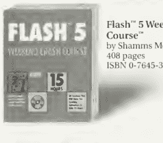

Flash™ 5 周末速成™
作者：Shamms Mortier
408 页
ISBN 0-7645-3546-3


Red Hat® Linux® 7 周末速成™
作者：Naba Barkakati
432 页
Red Hat Linux 7 共 3 张 CD
ISBN 0-7645-4741-0

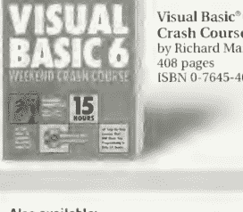

Visual Basic® 6 周末速成™
作者：Richard Mansfield
408 页
ISBN 0-7645-4679-1


Dreamweaver™ 4 周末速成™
作者：Wendy Peck
408 页
ISBN 0-7645-3575-7

# 同样提供：

- Access® 2000 编程周末速成™
  作者：Cary N. Prague, Jennifer Reardon, Lawrence S. Kasevich, Diana Reid, and Phuc Phan 600 页 ISBN 0-7645-4688-6
- Active Server Pages 3 周末速成™
  作者：Eric Smith 450 页 ISBN 0-7645-4756-9
- C++ 周末速成™
  作者：Stephen R. Davis 552 页 ISBN 0-7645-4609-9
- C# 周末速成™（2001 年 7 月上市）
  作者：Stephen R. Davis 432 页 ISBN 0-7645-4789-5
- HTML 4.01 周末速成™
  作者：Greg Perry 480 页 ISBN 0-7645-4746-1
- Java™ 2 周末速成™
  作者：Julio Sanchez and Maria Canton 432 页 ISBN 0-7645-4768-2
- JavaScript 周末速成™
  作者：Steven Disbrow 408 页 ISBN 0-7645-4804-2
- JSP 周末速成™
  作者：Andrew Utter And Geremy Kawaller 408 页 ISBN 0-7645-4796-8
- Linux® 周末速成™
  作者：Naba Barkakati 410 页 ISBN 0-7645-3593-5

每本书均附带一张 CD-ROM，并包含 30 个快速、集中的课程，仅需 15 小时即可让您上手并运行。

各大书店有售，或访问：www.hungryminds.com


## CD-ROM 安装说明

每个课程的示例 JavaScript 程序都包含在 CD-ROM 上的一个单独文件夹中。例如，第 1 课的程序包含在 Session01 文件夹中，第 20 课的程序包含在 Session20 文件夹中。你可以直接从 CD-ROM 将这些程序加载到你的 Web 浏览器中，或者你可以将任何文件夹复制到硬盘上，然后从那里运行程序。

每个第三方程序（Netscape Navigator、Internet Explorer 和 BBEdit）都包含在各自的文件夹中。只需运行提供的安装程序并按照说明操作即可。更多信息请参见附录 B。

名为 Self-Assessment Test 的目录包含安装程序 Setup_st.exe。将本书的 CD-ROM 放入驱动器，打开 Self-Assessment Test 目录，然后双击 Setup_st 的程序图标以安装自评估软件并运行测试。自评估软件要求在测试运行期间 CD-ROM 保持在驱动器中。

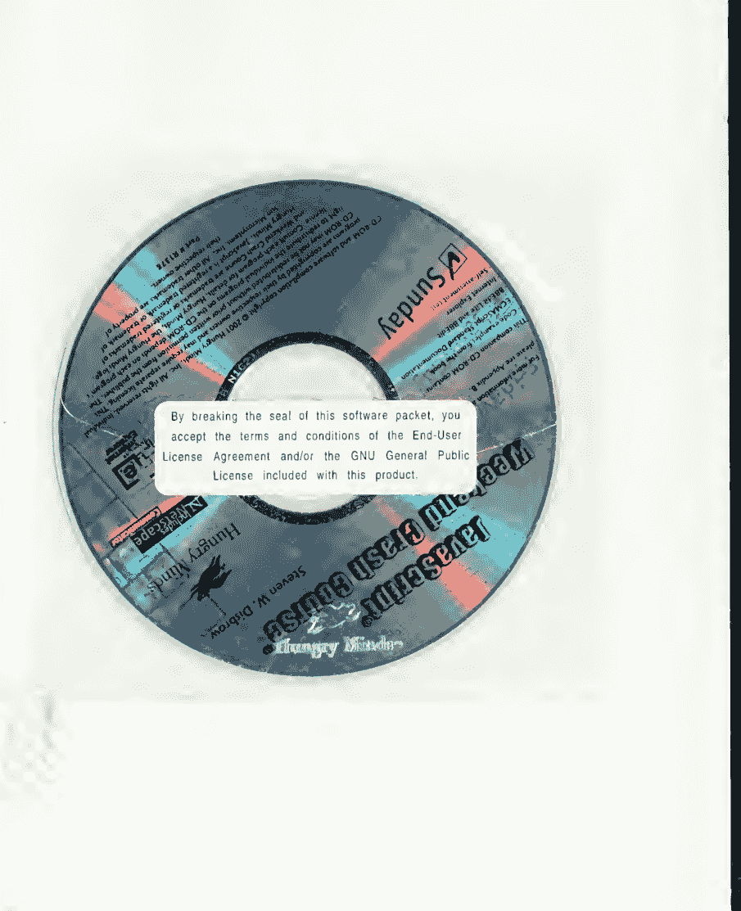

通过拆封此软件包，即表示你接受本产品附带的最终用户许可协议和/或 GNU 通用公共许可协议的条款和条件。

Sunday

Hungry Minds

Steven W. Disbrow

Webworld Flash Builder

Macromedia Flash MX

## 在一个周末内掌握 JavaScript！

重要的日子是周一。那天你将展示你对 JavaScript 的了解。问题是，你还没有真正掌握。也许你已经有一段时间没有使用 JavaScript 了。或者也许你只是喜欢挑战。无论如何，我们为你提供了一个解决方案——JavaScript 周末速成课程。周五晚上打开这本书，到周日下午，在完成 30 个快速、专注的课程后，你将能够直接上手并开始编写交互式网页脚本。就这么简单。

## 课程安排

### 周五
晚上：4 节课，2 小时
- 认识 JavaScript
- 语句和运算符
- 流程控制语句
- 如何编写 JavaScript 函数

### 周六
上午：7 节课，3 小时
- 使用 JavaScript 字符串
- 使用 JavaScript 数组
- 理解浏览器对象模型
- 使用 window 对象
- 使用 document 对象
- 响应事件

### 周六，续
下午：6 节课，3 小时
- 动态创建 HTML 页面
- 使用 HTML 表单
- 使用 HTML 控件
- 使用图像
- 验证表单数据
- 用 JavaScript 制作 Cookie

晚上：4 节课，2 小时
- 理解 JavaScript 对象
- 创建和使用方法
- 用 JavaScript 对象增强 HTML
- 动态创建和执行 JavaScript

### 周日
上午：6 节课，3 小时
- 使用层叠样式表
- 用 JavaScript 创建动态 HTML
- 使用框架
- 使用窗口
- 改善用户界面
- 使用不同的浏览器

下午：4 节课，2 小时
- 使用日期、数字和网址
- 与服务器端进程通信
- 支持多媒体
- 使用 Java Applets

CD-ROM 包含：
- 书中所有示例代码
- 评估软件
- BBEdit 演示版


系统要求：
- 运行 Windows 95 或更高版本、Windows NT 4 或更高版本的 PC；运行 System 7.6 或更高版本的 Power Macintosh。详情和完整的系统要求请参见 CD 附录。

类别：
- Web 开发/JavaScript

ISBN 0-7645-4804-2

有关 Hungry Minds 的更多信息，请访问 www.hungryminds.com
$24.99 美元
$37.99 加元
£19.99 英镑（含增值税）