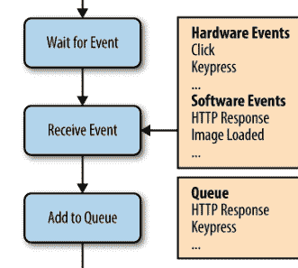
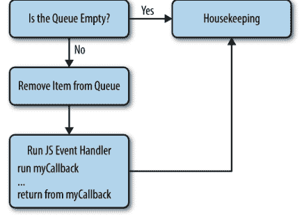

# JavaScript Promises


异步 JavaScript 无处不在，无论你是在使用 `Ajax`、`AngularJS`、`Node.js` 还是 `WebRTC`。这本实用的指南为中级和高级 JavaScript 开发者展示了 Promises 如何帮助你管理异步代码——包括随着代码库增长而变得不可避免的回调流。你将学习到 Promises 的工作原理，以及在使用它们时避免困难和遗漏的方法。如果你是 Promises 的初学者，或者想要扩展对这项技术的知识，此书将是你的理想之选。

> Daniel Parker 对异步编程进行了富有见地的介绍，任何 JavaScript 开发者都会发现其很有用。关于 Promises 的章节既涵盖了“如何做”和“为什么”，又侧重于当前的实用工具。

- 通过深入研究回调、事件循环和线程，理解异步 JavaScript 的工作原理
- 学习 Promises 如何将回调组织成离散的步骤，使其更易阅读和维护
- 检查你在编写真实世界应用时会遇到的场景，以及你可以使用的技术
- 使用 `Bluebird` 库和 `jQuery` 中的功能来处理 Promises
- 学习 Promise API 如何处理异步错误
- 探索简化 Promise 相关代码的 ECMAScript 6 语言特性

- Kris Koval，Uber 高级软件工程师，`Q` 库和 Common JS 模块创建者

> 对现代 JavaScript 程序员最重要的工具之一的全面回顾。

- Dominic Denolica，Google 软件工程师：ES2015 Promises 规范编辑

Daniel Parker 是一位专注于网页和移动应用的软件开发者。他在德克萨斯州奥斯汀为 `Evernote` 编写 JavaScript 代码，也是奥斯汀 Google 小组的组织者。


# 前言

异步 JavaScript 无处不在。`AJAX`、`WebRTC` 和 `Node.js` 都是发现异步 API 的几个例子。虽然编写一个简单的函数来处理单个 HTTP 请求的结果并没难事，但随着代码库的扩大和贡献者的增加，也很容易在不可预测的回调海洋中迷失方向。这就是良好的处理异步代码的方法派上用场的地方，许多开发者选择在他们的方案中使用 Promises。

这本书正当我最初选择异步策略时所需的书籍，也是我在 JavaScript 应用程序中使用 Promises 经验的结晶。它解释了 Promises 的使用方法和内部原理，同时也揭示了它们面临的困难；而 Promises 仅由少数几个概念和一个小型 API 组成。就像 JavaScript 少数简单的构造结构被用来创建优雅且强大的解决方案一样，我对 Promises 有效管理异步代码的多种方式感到惊讶和喜悦。

# 目标读者

本书面向想要编写异步代码的中级和高级 JavaScript 开发者。这些开发者可能熟悉用于传统 Web API 的 JavaScript，但正在转向 `Node.js`、`Google Chrome` 打包应用或使用 JavaScript 构建桌面应用程序等环境。编写浏览器代码并希望使用 `Angular` 等框架或较新的浏览器技术（如 `Service Workers` 或 `WebRTC`）的开发者也将从中受益。即使是已经熟悉 Promises 的人，可能仍然喜欢阅读代码，并为自己的工作发现额外的想法。

# 关于风格的说明

这不是一本关于 JavaScript 语法的“要做与不要做”的书。所有的示例都旨在清晰且随性；然而，这种风格可能与某些推荐做法产生冲突。这些选择与此处介绍的观点无关，你在代码中处理这些概念时，可以根据需要自由选择。

# 本书使用的惯例

本书使用了以下排版惯例：

- *斜体 (Italic)*

表示新术语、URL、电子邮件地址、文件名和文件扩展名。

- 等宽字体 (Constant width)

用于程序列表，以及在段落中指代程序元素，如变量名或函数名、数据库、数据类型、环境变量、语句和关键字。

- **等宽粗体 (Constant width bold)**

显示用户应字字输入的命令或其他文本。

- *等宽斜体*

显示应用用户提供的值或由上下文确定的值替换的文本。

- 此元素表示提示或建议。

- 此元素表示普通说明。

- 此元素表示警告或注意事项。

# 使用代码示例

补充材料（代码示例、练习题等）可以在 `https://github.com/dxarker/promises-book-examples` 下载。

本书的目的是帮助你完成工作。通常情况下，如果书中提供了示例代码，你可以在你的程序和文档中使用它们。除非你要复制大部分代码，否则不需要联系我们获取许可。例如，编写一个使用了此书中几段代码的程序不需要许可。销售或分发 O'Reilly 的示例 CD-ROM 则需要许可。通过本书回答问题并引用示例代码不需要许可。将书中的大量示例代码整合到你的产品文档中则需要许可。

如果你使用的示例超出了合理使用范围或上述许可范围。

`Safari Books Online` 是一个按需数字图书馆，提供技术和业务领域领先作家以书籍和视频形式提供的专家内容。

技术专业人员、软件开发者、网页设计师和商业创意专业人士将 `Safari Books Online` 作为他们研究、解决问题、学习和认证人才的主要资源。

`Safari Books Online` 为企业、政府教育和个人提供系列计划和定价。

成员可以访问数千种书籍、培训视频和预出版手稿，出版商包括 `O'Reilly Media`、`Prentice Hall Professional`、`Addison-Wesley Professional`、`Microsoft Press`、`Sam`、`Que`、`Peach Press`、`Focal Press`、`Cisco Press`、`John Wiley & Sons`、`Syngress`、`Morgan Kaufmann`、`IBM Books`、`Packt`、`Adobe Press`、`FT Press`、`Apress`、`New Riders`、`McGraw-Hill`、`Jones & Bartlett`、`Course Technology` 等。有关 `Safari Books Online` 的更多信息，请访问在线。

# 如何联系我们

请将有关本书的评论和问题交给：

`800-998-9938`（在美国或加拿大）

`707-829-0515`（国际或本地）

`707-829-0104`（传真）

我们为此书有一个网页，列列出了错误、示例和任何附加信息。您可以通过 `http://bit.ly/js-with-promises` 访问该页面。

要对本书进行评论或提出技术问题，请发送邮件至 `bookquestions@oreilly.com`。

有关我们书籍、课程、会议和新闻的更多信息，请访问我们的网站 `http://www.oreilly.com`。

在 Facebook 上找到我们：`http://facebook.com/oreilly`

在 Twitter 上关注我们：`http://twitter.com/oreillymedia`

在 YouTube 上观看我们：`http://www.youtube.com/oreillymedia`

# 致谢

感谢 `Kris Kowal`、`Domen Denicola` 和 `Petka Antonov` 对 JavaScript Promises 的持续贡献，以及在本书编写期间提供的反馈。也感谢 `Cody Lindley` 的宝贵反馈。

感谢 `O'Reilly` 优秀的人们，他们的专业知识、支持和耐心使本书出版成为可能，特别是 `Simon St.Laurent` 在启动本书发挥的作用，`Brian MacDonald` 和 `Amy Jollymore` 的指导，以及 `Colleen Lobner` 和 `Lindy Gamble` 对细节的完善。

编程文化中最好的事情之一就是不断向他人学习或与他们学习。感谢多年来优秀的同事，包括 `Jerry Raschke`、`Nathan Price`、`Hank Beasley`、`Gregory Long` 和 `Johnathan Hebert`。

本书献给我亲爱的妻子 Sarah。你太棒了！

# 第一章

## 异步 JavaScript

异步 JavaScript API 的数量正在快速增长。Web 应用在浏览器中异步获取数据并加载脚本。`Node.js` 及其衍生版本提供了大量的异步 I/O API。新的 Web 规范流、`Service Workers` 和字体加载都包含了异步调用。这些进步扩展了 JavaScript 应用的能力，但在不理解异步部分工作原理的情况下使用它们会导致难以维护的不可预测代码。在开发或测试环境中运行符合预期，但在部署给终端用户时可能会因为网络速度或硬件性能等变量而失败。

本章解释了 JavaScript 如何工作。我们将涵盖回调、事件循环和线程。大部分信息并不是针对 Promises 的，但为充分利用 Promises 以及本书提供了基础。

让我们从一段令人惊讶的代码片段开始。该代码使用 `XMLHttpRequest` (XHR) 对象发起 HTTP 请求，并使用运行三秒的循环。虽然实现延迟通常是糟糕的做法，但它是说明 JavaScript 如何运行的好方法。阅读示例 1-1 中的代码，并判断 XHR 对象的监听回调是否会被触发。

### 示例 1-1. 异步 XHR

```javascript
// 发起异步 HTTP 请求
var async = true;
var xhr = new XMLHttpRequest();
xhr.open('get', 'data.json', async);
xhr.send();
```

```javascript
// Create a three second delay (don't do this in real life)
var timestamp = Date.now() + 3000;
while (Date.now() < timestamp);
```

```javascript
// 现在三秒钟已经过去了，
// 为 xhr.load 和 xhr.error 事件添加监听器
function listener() {
  console.log('greetings from listener');
}
xhr.addEventListener('load', listener);
xhr.addEventListener('error', listener);
```

关于 `listener` 是否会被调用，这里有一些常见的观点：

1. 是的，`listener` 总是会被调用
2. 不可能，`addEventListener` 的调用必须在 `xhr.send()` 之前运行
3. 有时，取决于请求是否超过了三秒

正确的评估是 `listener` 总是会被调用的。虽然第二和第三个答案很常见，但由于 JavaScript 的事件循环模型和运行到完成（run-to-completion）语义，它们是不正确的。如果你有不同的想法，或者想复习这些概念，这一章正是为你准备的。

### 回调函数 (Callbacks)

回调函数是异步 JavaScript 编程的基石。作为一名 JavaScript 开发人员，你可能对回调函数非常熟悉，但为了起见，示例 1-2 展示了一个快速的回调案例，用于打印数组中的每个元素。

#### 示例 1-2. 示例回调

```javascript
var cities = ['Tokyo', 'London', 'Boston', 'Berlin', 'Chicago', 'New York'];

cities.forEach(function(city) {
  console.log(city);
});
```

```javascript
// 控制台输出:
// Tokyo
// London
// Boston
// Berlin
// Chicago
// New York
```

简而言之，回调是一个提供给其他代码调用的函数。示例 1-2 使用内联函数来定义回调。这是 JavaScript 应用中常用的样式，但回调函数并不非要内联声明。示例 1-3 显示了预先声明函数的等效代码。

#### 示例 1-3. 将预定义函数作为回调

```javascript
function callback(city) {
  console.log(city);
}

cities.forEach(callback);
```

你的回调是内联函数还是预定义函数取决于你的选择。只要你有一个函数的引用，你就可以将其作为回调函数使用。

## 异步 JavaScript

回调函数可以同步或异步被调用（即在传递给它的函数执行之前或之后调用）。本节中使用的 `array.forEach()` 方法调用的回调是同步接收的。异步调用其回调的函数示例是 `window.requestAnimationFrame()`。它的回调在浏览器重绘间隔之间被调用，如示例 1-4 所示。

#### 示例 1-4. 异步调用回调

```javascript
function repositionElement() {
  console.log('repositioning!');
  // ...
}

window.requestAnimationFrame(repositionElement);
console.log('I am the last line of the script');
```

```javascript
// 控制台输出:
// I am the last line of the script
// repositioning!
```

在这个示例中，“I am the last line of the script" 在 "repositioning!" 之前写入控制台，因为 `requestAnimationFrame` 会立即返回并在之后调用 `repositionElement` 回调。

同步代码可能更容易理解，因为它们按照编写的顺序执行。可以使用 `Node.js` 中的同步和异步文件 API 进行良好的比较。示例 1-5 是一个向文件写入内容并同步读回内容的脚本。数字注释表示了代码某些行执行的相对顺序。

#### 示例 1-5. 在 Node.js 中使用同步代码读写

```javascript
var fs = require('fs');
var timestamp = new Date().toString();
var contents;

fs.writeFileSync('date.txt', timestamp);
contents = fs.readFileSync('date.txt');
console.log('Checking the contents'); // 1
console.assert(contents == timestamp); // 2

console.log('I am the last line of the script'); // 3
```

```javascript
// 控制台输出:
// Checking the contents
// I am the last line of the script
```

该脚本使用 `fs` 模块的 `writeFileSync` 和 `readFileSync` 函数写入时间戳并将其读回。之后，在读回文件内容后，将它们与原始写入的时间戳进行比较，以检查两个值是否匹配。`console.assert(error)` 在值不同时会显示错误。在这个示例中，它们总是匹配的，因此唯一的输出来自断言前后的 `console.log()` 语句。

示例 1-6 所示的脚本使用异步函数 `fs.writeFile` 和 `fs.readFile` 完成了相同的工作。

#### 示例 1-6. 在 Node.js 中使用异步代码读写

```javascript
var fs = require('fs');
var timestamp = new Date().toString();

fs.writeFile('date.txt', timestamp, function(err) {
  fs.readFile('date.txt', function(err, contents) {
    console.log('Checking the contents'); // 1
    console.assert(contents == timestamp); // 2
  });
});

console.log('I am the last line of the script'); // 3
```

```javascript
// 控制台输出:
// I am the last line of the script
// Checking the contents
```

### 运行到完成 (Run to Completion) 与事件循环 (Event Loop)

你编写的 JavaScript 运行在单线程上，这避免了其他在线程共享内存语言中常见的复杂问题。但如果 JavaScript 是单线程，在多线程环境中，异步任务和回调在哪里运行呢？为了解释这一点，让我们从示例 1-9 开始，在 `Node` 中发起一个简单的 HTTP 请求。

#### 示例 1-9. Node.js 中的 HTTP 请求

```javascript
var http = require('http');
http.get('http://www.google.com', function(res) {
  console.log('got a response');
});
```

对 `get()` 的调用触发了一个由独立线程处理的网络请求。但等一下——你刚刚被告知 JavaScript 是单线程的。区别在于：你编写的 JavaScript 代码运行在单个线程上，但实现异步任务的代码（示例 1-9 中的 `.get()` 实现）并不是 JavaScript 的一部分，它可以自由地在单独线程中运行。

一旦任务完成，结果需要提供给 JavaScript 线程。从这里开始，回调被放入队列中。多线程语言可能会中断当前正在执行的结果，但在 JavaScript 中，这些中断是被禁止的。相反，存在一条“运行到完成”（run-to-completion）规则，这意味着你的代码会在没有中断的情况下运行，直到它将控制交还给最初调用它的宿环境。此时，回调就可以从队列中移除并被调用。

所有其他线程通过向队列中放入项目与你的代码进行通信。它们不被允许操作任何 JavaScript 可访问的其它内存。在上一个示例中，回调访问了异步 HTTP 请求的响应。

在回调被添加到队列后，无法保证它需要等待多久。当前代码运行到完成的时间以及队列中还有什么内容决定了时间。队列中可能包含鼠标点击、击键输入和其他异步任务的回调。JavaScript 运行时在一个无尽的循环中持续：如果队列中有可用项目，就取出一个项目，运行其触发的代码，然后再次检查队列。这个循环被称为事件循环（event loop）。

图 1-1 显示了队列是如何填充的，图 1-2 显示了事件循环如何处理来自队列的项。你在图 1-2 中标记为“JS Event Handler”的框中编写的所有 JavaScript。JavaScript 引擎在两幅图中都在后台执行其余的活动。



图 1-1. 填充队列



图 1-2. JavaScript 事件循环

使用 `setTimeout` 在给定时间后触发另一个函数是观察事件循环实际运行的一种简单方法，如示例 1-10 所示。`setTimeout` 函数接受两个参数：一个要调用的函数，以及调用该函数之前等待的最少毫秒数。

#### 示例 1-10. 使用 setTimeout 演示事件循环

```javascript
function marco() {
  console.log('polo');
}

setTimeout(marco, 0); // 零延迟

console.log('Ready when you are');
```

```javascript
// 控制台输出：
// Ready when you are
// polo
```

`marco` 函数被立即放入队列中。在控制台显示 "Ready when you are" 之后，事件循环转向，`marco` 就可以从队列中取出。注意 `setTimeout` 的第二个参数指定的是回调运行将经过的最小时间，而不是精确的时间。无法确切知道回调何时运行，因为在那个时刻可能有其他 JavaScript 代码正在执行，机器必须让它执行完毕后才能返回队列调用你的回调。

记住“运行到完成”和“事件循环”的概念，让我们重新回顾章节开头给出的 XHR 示例，为了方便起见，它在示例 1-11 中重复出现。

#### 示例 1-11. 异步 XHR（重复之前的内容）

```javascript
// 发起一个异步 HTTP 请求
var async = true;
var xhr = new XMLHttpRequest();
xhr.open('get', 'data.json', async);
xhr.send();
```

```javascript
// 创建三秒的延迟（在现实生活中不要这样做）
var timestamp = Date.now() + 3000;
while (Date.now() < timestamp);
```

```javascript
// 现在三秒钟过去了，
// 为 xhr.load 和 xhr.error 事件添加监听器
function listener() {
  console.log('greetings from listener');
}
xhr.addEventListener('load', listener);
xhr.addEventListener('error', listener);
```

问题是它的运行方式是否与之前的 `setTimeout` 示例相似。监听是在调用 `send` 函数后注册的，但在事件循环转向之前这样做是安全的，因为运行时在它们之前无法触发 `load` 或 `error` 事件。

在注册事件监听器之前允许事件循环转向会导致竞态条件。示例 1-12 通过使用 `setTimeout` 展示了这一点。

#### 示例 1-12. 竞态条件

```javascript
var async = true;
var xhr = new XMLHttpRequest();
xhr.open('get', 'data.json', async);
xhr.send();
```

```javascript
setTimeout(function delayed() { // 创建了竞态！！
  function listener() {
    console.log('greetings from listener');
  }
  xhr.addEventListener('load', listener);
  xhr.addEventListener('error', listener);
}, 3000);
```

在传递给 `setTimeout` 的回调中执行事件监听器注册会导致延迟。只有当 `delayed` 函数在 HTTP 请求完成并触发 `load` 或 `error` 事件之前从队列中取出并运行时，监听器函数才会被调用。

# 第二章

## Promises 简介

Promises 是管理异步代码的一种模式。它们将异步操作表示为一个值，该值可以在操作完成时被传递、存储和操作。Promises 通过提供一组标准的方法来注册回调，解决了回调地狱的问题。

### 示例 2-1. 使用 Promise 加载图片

```javascript
function loadImage(url) {
  return new Promise(function(resolve, reject) {
    var img = new Image();
    img.onload = function() {
      resolve(img);
    };
    img.onerror = function(e) {
      reject(e);
    };
    img.src = url;
  });
}

loadImage('security_holes.png').then(function(img) {
  document.body.appendChild(img);
}).catch(function(e) {
  console.log('Error occurred while loading image');
  console.log(e);
});
```

这段代码表示：“加载一张图片，将其添加到文档中，或者如果无法加载则显示错误。” `loadImage` 返回的 promise 有一个 `then` 方法用于注册在操作成功时使用的回调函数，以及一个 `catch` 方法用于处理错误。然而，`then` 和 `catch` 都会返回对象，因此回调注册通常通过链式调用这些方法完成，如示例 2-3 所示。

### 示例 2-3. 使用 then 和 catch 链式调用

```javascript
loadImage('security_holes.png').then(function (img) {
  document.body.appendChild(img);
}).catch(function (e) {
  console.log('Error occurred while loading image');
  console.log(e);
});
```

示例 2-4 是 `loadImage` 返回一个 promise 的实现。

```javascript
function loadImage(url) {
  var promise = new Promise(
    function resolver(resolve, reject) {
      var img = new Image();
      img.onload = function () {
        resolve(img);
      };

      img.onerror = function (e) {
        reject(e);
      };
    }
  );
  return promise;
}
```

全局函数 `Promise` 暴露了 promise 的所有功能。在这个示例中，`loadImage` 创建了一个新的 promise 并返回它。当 `Promise` 被用构造函数使用时，它需要一个名为 resolver 函数的回调函数。resolver 具有两个作用：它接收 `resolve` 和 `reject` 参数，这两个函数被用于更新结果已知的 promise，而从 resolver 中抛出的任何错误都会被隐式地用于拒绝该 promise。原本在 `loadImage` 中执行的所有逻辑现在都在 resolver 内部完成。当图片加载完成时调用 `resolve` 函数，当图片无法加载时调用 `reject` 函数。

当由 promise 表示的操作完成时，结果将被存储并提供给 promise 调用的任何回调。结果作为 `resolve` 或 `reject` 函数的参数传递给 promise。在 `loadImage` 的情况下，图片被传递给 `resolve`，因此任何通过 `promise.then()` 注册的回调都会接收图片。

### 多个消费者

当多段代码对同一个异步操作的结果感兴趣时，它们可以使用 promise。例如，你可以从服务器获取用户配置并用它在导航栏中显示她的名字。该数据也可以用于显示其完整配置的账户页面。示例 2-5 中的代码通过使用 promise 跟踪用户配置是否已接收演示了这一点。两个独立的函数使用同一个 promise 在数据可用时显示数据。

#### 示例 2-5. 一个 promise 多个消费者

```javascript
var user = {
  profile: null,

  getProfile: function () {
    if (!this.profilePromise) {
      // 假设 ajax() 返回一个最终会被
      // 填充为 (name: 'Samantha', subscribedToSpan: true) 的 promise
      this.profilePromise = ajax(/*someurl*/);
    }
    return this.profilePromise;
  }
};

var navbar = {
  show: function (user) {
    user.getProfile().then(function(profile) {
      console.log('**** Navbar ****');
      console.log('Name: ' + profile.name);
    });
  }
};

var account = {
  show: function (user) {
    user.getProfile().then(function(profile) {
      console.log('*** Account Info ***');
      console.log('Name: ' + profile.name);
      console.log('Send lots of email?' + profile.subscribedToSpam);
    });
  }
};

navbar.show(user);
account.show(user);
```

```javascript
// 控制台输出:
// *** Navbar ***
// Name: Samantha
// *** Account Info ***
// Name: Samantha
// Send lots of email? true
```

### Promise 占位符

这里是一个对象，它包含一个带有占位符的 promise。`resolve` 方法返回一个已解析的占位符。`reject` 方法返回一个已拒绝的占位符。

由于 `reject` 方法将 promise 状态转变为已拒绝（rejected），为什么 `resolve` 方法将 promise 状态转变为已完成（fulfilled）而不是已解析（resolved）？解析 promise 并不同于完成它。当 `resolve` 的参数是一个值时，promise 立即变为完成。然而，当将另一个 promise 传递给 `resolve` 时（例如 `promise.resolve(otherPromise)`），这些 promise 会绑定在一起。如果用于 resolve 的 promise 是完成的，两个 promise 都会变为完成。如果用于 resolve 的 promise 是拒绝的，两个 promise 都会变为拒绝。简单来说，`resolve` 的参数决定了 promise 的命运。图 2-2 显示了这一过程。

`resolve` 和 `reject` 函数可以无参数调用，此时填充值或拒绝原因将是 JavaScript 的 `undefined`。

Promise API 还提供了两个便利方法（见示例 2-7），用于创建立即已解析或拒绝的 promise：`Promise.resolve()` 和 `Promise.reject()`。

除了这种简化外，使用 promise 占位符还有另一个好处。它消除了在 `getProfile` 函数内部检查数据是否就绪的需求。

### Promise 状态

由 promise 表示的操作的状态存储在 promise 内部。在任何时刻，操作要么尚未开始、正在进行、运行完成或停止无法完成。这些情况由三个互斥的状态表示：

- 等待中（Pending）：操作尚未开始或正在进行。
- 已完成（Fulfilled）：操作已完成。
- 已拒绝（Rejected）：操作无法完成。

图 2-1 显示了这三种状态之间的关系。


图 2-1. Promise 状态

由于 `reject` 函数将 promise 变为已拒绝（rejected）状态，为什么 `resolve` 函数将 promise 变为已完成（fulfilled）而不是已解析（resolved）？解析 promise 不等同于完成它。当 `resolve` 的参数是一个值时，promise 立即完成。然而，当将另一个 promise 传递给 `resolve` 时（例如 `promise.resolve(otherPromise)`），这些 promise 会关联。如果用于 resolve 的 promise 是完成的，两个 promise 都会变为完成。如果用于 resolve 的 promise 是拒绝的，两个 promise 都会变为拒绝。总之，`resolve` 的参数决定了 promise 的归宿。图 2-2 显示了这一过程。

`resolve` 和 `reject` 函数可以不带参数调用，此时填充值或拒绝理由将是 JavaScript `undefined`。

Promise API 还提供了两个便利方法（见示例 2-7），用于创建立即已解析或拒绝的 promise：`Promise.resolve()` 和 `Promise.reject()`。

#### 示例 2-7. resolve 和 reject 的便利函数

```javascript
// 创建已解析 promise 的等效方式
new Promise(function(resolve, reject) {
  resolve('the long way')
});
Promise.resolve('the short way');
```

```javascript
// 创建拒绝状态 promise 等方法
new Promise(function (resolve, reject) {
  reject('long rejection')
})
Promise.reject('short rejection');
```

当你已经拥有应该用于解析或拒绝 promise 的项时，这些便利方法非常有用。接下来的某些代码示例使用了这些函数而不是传统的 Promise 构造函数，以便简洁地创建一个具有所需状态的 promise。

### Promise 链式

我们已经看到 `then` 和 `catch` 如何返回 promise 以实现方法的链式，但它们返回的并不是同一个 promise 的引用。每当调用这两个方法之一时，都会创建并返回一个新的 promise。示例 2-8 是返回新 promise 的显式示例。

#### 示例 2-8. 调用 then 总是返回一个新的 promise

```javascript
var p1, p2;
p1 = Promise.resolve();
p2 = p1.then(function () {
  // ...
});

console.log('p1 and p2 are different objects: ' + (p1 !== p2));
```

```javascript
// 控制台输出:
// p1 and p2 are different objects: true
```

示例 2-9 展示了由 `then` 返回的新 promise 如何链式连接以执行一系列步骤。

#### 示例 2-9. 使用 then 执行多个步骤

```javascript
step1().then(
  function step2(resultFromStep1) {
    // ...
  }
).then(
  function step3(resultFromStep2) {
    // ...
  }
).then(
  function step4(resultFromStep3) {
    // ...
  }
);
```

每次调用 `then` 都会返回一个新的 promise，你可以使用它来附加另一个回调函数。从该回调返回的任何值都会解析该新的 promise。这种模式允许每一步都将其返回值发送给下一步。如果某一步返回的是一个 promise 而不是值，后续的步骤将接收用于完成该 promise 的任何值。示例 2-10 展示了完成它们创建的 promise 的所有方法。

#### 示例 2-10. 在一系列步骤中传递值

```javascript
Promise.resolve('ta-da').then(
  function step2(result) {
    console.log('Step 2 received ' + result); // 显式返回值
    return 'Greetings from step 2';
  }).then(
  function step3(result) {
    console.log('Step 3 received ' + result); // 无显式返回值
  }).then(
  function step4(result) {
    console.log('Step 4 received ' + result);
    return Promise.resolve('fulfilled value'); // 返回一个 promise
  }).then(
    function step5(result) {
    console.log('Step 5 received ' + result);
  }
);
```

```javascript
// 控制台输出:
// Step 2 received ta-da!
// Step 3 received Greetings from step 2
// Step 4 received undefined
// Step 5 received fulfilled value
```

显式返回的值会解析封装了 step2 的 promise。由于 step3 没有返回任何值，`undefined` 完成了该 promise。而从 step4 中显式返回的值完成了封装了 step4 的 promise。

### 回调执行顺序

Promise 主要用于管理代码相对于其他任务的执行顺序。前一章节演示了当期望异步回调以同步方式运行时会发生什么问题。你可以通过理解 Promise API 中的回调是同步的，且只有两种情况来避免这些问题：传递给 Promise 构造函数的解析函数是同步执行的；而所有传递给 `then` 和 `catch` 的回调都是异步调用的。示例 2-11 展示了一个带有日志语句的 Promise 构造函数和拒绝处理器，以演示相对执行顺序。

#### 示例 2-11. promise 使用的回调执行顺序

```javascript
var promise = new Promise(function (resolve, reject) {
  console.log('Inside the resolver function'); // 1
  resolve();
});

promise.then(function () {
  console.log('Inside the handler'); // 3
});

console.log('This is the last line of script'); // 2
```

```javascript
// 控制台输出:
// Inside the resolver function
// This is the last line of script
// Inside the handler
```

这个示例与上一章节中的同步和异步代码相似。你可以看到传递给 Promise 的解析函数立即执行，紧接着是脚本末尾的日志语句。然后事件循环运行并执行已经解析的 promise 的处理器。虽然这个示例非常简单，但理解执行顺序是使用 promise 的关键部分。如果你对预测目前为止任何示例的执行顺序没有信心，请考虑第 1 章和本节的内容。

### 基础错误传播

错误传播和处理是处理 promise 的重要方面。本节引入了该主题的基础知识。拒绝和错误会在 promise 链中传播。当一个 promise 被拒绝时，链中所有后续 promise 都会像多米诺骨牌一样被拒绝，直到找到处理器为止。在实践中，在链的末尾使用一个 `catch` 函数（参见示例 2-12）来处理所有的拒绝。这种方法将链视为一个整体，直到代表解析或拒绝的 promise 出现。

#### 示例 2-12. 在链的末尾使用拒绝处理器

```javascript
Promise.reject(Error('bad news')).then(
    function step2() {
    console.log('This is never run');
    }
).then(
    function step3() {
    console.log('This is also never run');
    }
).catch(function (error) {
    console.log('Something failed along the way. Inspect error for info.');
    console.log(error); // 带有消息的 Error 对象
});
```

```javascript
// 控制台输出:
// Something failed along the way. Inspect error for info.
// Error { message: 'bad news' }
```

这段代码通过使用 `Promise.reject()` 创建一个拒绝的 promise 来启动 promise 链。构造函数中抛出错误会拒绝通过 `then` 的 promise，后续的回调会被忽略，直到到达 `catch`。注意 step2 和 step3 只有在附加其的 promise 被解析时才会调用。示例 2-13 与上一个相似，区别在于抛出错误而不是使用 `Promise.reject()`。

#### 示例 2-13. 在构造函数中抛出错误拒绝 promise

```javascript
rejectWith('bad news').then(
    function step2() {
    console.log('This is never run');
    }
).catch(function (error) {
    console.log('Foiled again!');
    console.log(error); // 带有消息 'bad news' 的 Error 对象
});

function rejectWith(val) {
    return new Promise(function(resolve, reject) {
        throw Error(val);
        resolve('Not used'); // 这行永远不会被使用
    });
}
```

```javascript
// 控制台输出:
// Foiled again!
// Error { message: 'bad news' }
```

本节中的两个示例在拒绝 promise 时都提供了 JavaScript Error 对象。虽然包含 `undefined` 拒绝 promise，但我们建议使用错误对象。创建错误可以捕获调用栈，并更便于处理 catch 处理器接收的参数。使用 JavaScript Error 对象拒绝 promise 可以捕获调用栈，并更便于处理 catch 处理器接收的参数。


### Promise API

Promise API 由构造函数和六个函数组成，其中四个已经演示过。然而，值得描述每一个函数，以便从整体上查看 API，并注意可选参数。

#### Promise

`new Promise(function(resolve, reject) { ... })` 返回 promise

`Promise` 全局是由 `new` 关键字调用的构造函数。

`Promise` 全局创建 promise 对象，这些对象拥有 `then` 和 `catch` 两个方法，用于注册在 promise 解析或拒绝后被调用的回调。

#### promise.then

`promise.then([onFulfilled], [onRejected])` 返回 promise

`Promise.then()` 接受一个 `onFulfilled` 回调和一个 `onRejected` 回调。人们通常使用 `promise.catch()` 来注册拒绝回调，而不是向 `then` 传递第二个参数（参见第 5 章提供的解释）。该函数返回一个 promise，该 promise 由 `onFulfilled` 回调的返回值解析。回调内部抛出的任何错误都会用该错误拒绝新的 promise。

#### promise.catch

`promise.catch(onRejected)` 返回 promise

`promise.catch()` 方法接收一个 `onRejected` 回调，并返回一个 promise，该回调函数的值或回调函数抛出的任何错误将分别解析（resolve）或拒绝（reject）它。这意味着传递给 `catch` 的任何拒绝回调，除非你在回调内部显式地抛出异常，否则它们将不会向下传播。

#### Promise.resolve

`Promise.resolve([value|promise])` 返回 promise

`Promise.resolve()` 函数是一个便利函数，用于创建一个已用给定值解析（resolved）的 promise。如果你将一个 promise 作为参数传递给 `Promise.resolve()`，新的 promise 将绑定到你提供的 promise，并相应地被完成（fulfilled）或拒绝（rejected）。

#### Promise.reject

`Promise.reject([reason])` 返回 promise

`Promise.reject()` 函数是一个便利函数，用于创建一个带有给定原因的拒绝（rejected） promise。

#### Promise.all

`Promise.all(iterable)` 函数返回 promise

`Promise.all()` 函数将一系列 promises 映射到它们的完成值。该函数接受一个可迭代对象，例如 `Array`、`Set` 或自定义可迭代对象。它返回一个新的 promise，该 promise 由包含可迭代对象中所有值的数组完成。结果数组中相应的完成值将替换可迭代对象包含的任何 promise。新的 promise 只有在可迭代对象中的所有 promises 都完成后才会被完成，或者一旦可迭代对象中的任何一个 promise 被拒绝，它就会立即被拒绝。此时新 promise 将包含触发拒绝的可迭代对象中该 promise 的拒绝原因。如果你正在使用的不支持 ES6 可迭代对象的 Promise 实现，它可能期望使用标准的类数组对象。

##### 什么是可迭代对象（Iterable）？

> 可迭代对象是一个通过实现预定义接口（也称为协议）提供系列值的对象。可迭代对象在 ES6 中规范，并在第 68 页的“可迭代对象与迭代器”中进行了解释。

#### Promise.race

`Promise.race(iterable)` 返回 promise

`Promise.race()` 函数将一系列项归约为第一个可用值。它接受一个可迭代对象并返回一个新的 promise。该函数检查可迭代对象中的每个项，直到找到一个不是 promise 或已处于状态（settled）的 promise。返回的 promise 将根据该项被完成或拒绝。如果可迭代对象仅包含未决定的 promise，则返回的 promise将在可迭代对象中的一个 promise 变为状态后变为状态。

### 总结

本章介绍了 Promises 的所有基本概念。请记住这三点：

- promise 是一个值的占位符，该值通常是异步操作的结果。
- promise 有三个状态：等待中（pending）、完成（fulfilled）和拒绝（rejected）。
- 在 promise 被完成或拒绝之后，它的状态和值将永远无法改变。

到此时，你已经通过了许多示例演示了 promise 的基本用法，并已准备好在代码中使用 promise 链来运行顺序的异步步骤。你还应该习惯于使用返回 promise 以处理异步工作的 API。

promise 在实际应用中的一个例子是 CSS Font Load Events 规范，它提供了 `FontSet.load()` 函数，该函数返回一个用于将字体加载到浏览器的 promise。考虑你如何使用此函数以便在所需字体在浏览器中加载后才显示文本。

Promises 可以组合以编排异步任务并以各种方式组织代码。虽然这里提供了一个顺序工作流，但你很快就会想要以更高级的方式使用 promises。下一章将介绍你在应用程序中使用 promises 的多种方法。

# 第三章

## 使用标准 Promises

我们已经涵盖了标准的 Promise API 和一些基础场景，但像任何技术一样，这只是故事的一部分。现在是时候考虑你将遇到的场景以及在编写真实世界应用时可以使用的技巧了。

### 异步涟漪效应

异步函数和 promises 是具有传染性的。一旦你开始使用它们，它们就会自然地扩散到你的代码中。当你有一个异步函数时，任何调用该函数的代码现在都包含了一个异步步骤。其他函数的这种扩展创建了一个涟漪效应，一直持续到调用栈。这在示例 3-1 中通过三个函数得到了展示。看异步 `ajax` 函数是如何强制其他函数也变成异步的。

#### 示例 3-1 异步涟漪效应

```javascript
showPun().then(function () {
  console.log('Maybe I should stick to programming');
});

function showPun() {
  return getPun().then(function (pun) {
    console.log(pun);
  });
}

function getPun() {
  // 假设 ajax(json) 返回一个 promise，最终
  // 被 json {content:'The pet job was ruff!'} 完成
  return ajax(/*someurl*/).then(function (json) {
    var pun = JSON.parse(json);
    return pun.content;
  });
}
```

```javascript
// Console output:
// The pet store job was ruff!
// Maybe I should stick to programming
```

获取和显示双关语（pun）的工作被分为三个函数：`showPun`、`getPun` 和 `ajax`。这些函数形成了一个 promise 链，从 `ajax` 开始，到由 `showPun` 返回的对象结束。`ajax` 函数返回一个代表异步 XHR 请求结果的 promise。如果 `ajax` 同步返回 JSON，那么 `getPun` 和 `showPun` 将不会消耗或返回 promise。

作为一个通用规则，任何使用 promise 的函数也应该返回一个 promise。当 promise 不被传播时，调用代码就不知道 promise 何时完成，因此无法在事后进行有效工作。在编写一个不在乎异步工作何时完成的函数时，忽略这条规则是很容易的，但不要被欺骗了。返回一个最初未被使用的 promise，以便以后将 promise 适配到一系列函数中，这要容易得多。

### 条件逻辑

一个包含条件步骤的工作流是常见的。例如，某些操作可能需要身份验证。然而，一旦用户通过了身份验证，就不需要每次重复该步骤。有多种方法编写这种场景。作为一个示例，我们将使用一个在用户访问任何功能之前需要身份验证的电子阅读器。示例 3-2 显示了第一种。

#### 示例 3-2 条件步骤

```javascript
var user = {
  authenticated: false,
  login: function () {
    // 返回登录请求的 promise
    // 成功后将 authenticated 设置为 true
  }
};

// 避免这种风格的执行
function showMenu() {
  if (!user.authenticated) {
    user.login().then(showMenu);
    return;
  }
}
```

在 `showMenu` 的实现中，如果用户已经通过验证，将立即显示菜单。如果用户没有验证，则执行异步登录过程并在登录成功后运行 `showMenu`。

一个问题是，如果登录失败，菜单将静默失败。这是因为 `showMenu` 依赖于 promise，但如前节所述，它没有返回 promise。

第二个问题是，`showMenu` 根据用户是否已通过验证可能会同步或异步执行。正如第 1 章所述，这种风格的代码创建了难以理解的多个执行路径并导致不一致的行为。

如示例 3-3 所示，通过在用户已通过验证时替换为解析 promise，可以解决 `showMenu` 中的问题。

#### 示例 3-3 替换解析 promise

```javascript
function showMenu() {
  var p = (user.authenticated) ? user.login() : Promise.resolve();
  return p.then(function () {
    // ... 显示主菜单的代码
  });
}
```

现在，菜单始终异步显示，使用 `user.login()` 返回的 promise 或替换登录过程的解析 promise。

你可以通过每次调用 `user.login()` 来消除对替换 promise 的需求，如示例 3-4 所示。

#### 示例 3-4 使用 promise 封装条件逻辑

```javascript
function showMenu() {
  return user.login().then(function () {
    // ... 显示主菜单的代码
  });
}
```

这并不意味着每次都需要重复所有的登录步骤。登录返回的 promise 可以被缓存并重用，如示例 3-5 所示。

#### 示例 3-5 缓存 promise

```javascript
var user = {
  loginPromise: null,

  login: function () {
    var me = this;
    if (this.loginPromise == null) {
      this.loginPromise = ajax(/*someurl*/);
    }
    // 当发生失败时移除缓存的 loginPromise以便重试
    this.loginPromise.catch(function () {
      me.loginPromise = null;
    });
    return this.loginPromise;
  }
};
```

示例 3-5 中，`loginPromise` 在第一次调用 `login` 时创建。只要登录过程没有失败，所有的子调用都会返回同一个 promise。如果发生失败，将移除缓存的 promise以便重试。

### 并行执行

多个异步任务可以并行运行，如示例 3-6 所示。考虑一个金融网站，它每次登录时都会显示你所有银行账户和信用卡的更新余额。可以并行请求每个机构的更新余额，并在一收到时立即显示。

#### 示例 3-6. 并行运行异步任务

```javascript
// 定义每个账户
var accounts = ['Checking Account', 'Travel Rewards Card', 'Big Box Retail Card'];

console.log('Updating balance information...');
accounts.forEach(function (account) {
  // ajax 返回一个最终由账户余额完成的 promise
  ajax(/*account*/).then(function (balance) {
    console.log(account + ' Balance: ' + balance);
  });
});
```

```javascript
// 控制台输出：
// Updating balance information...
// Checking Account Balance: 384
// Travel Rewards Card Balance: 509
// Big Box Retail Card Balance: 0
```

Promises 非常适合将并行任务合并为一个单一结果。假设在所有账户余额都更新完毕后，应该显示一条消息通知用户。你可以使用 `Promise.all()` 函数创建一个合并的 promise，该函数将 promise 映射到它们的结果，如示例 3-7 所示。关于该函数的完整描述请见第 22 页的“Promise API”。简而言之，`Promise.all()` 返回一个新的 promise，该 promise 在所有输入的 promise 都完成后会变为完成状态（fulfilled）。如果任何一个 promise 被拒绝（rejected），则新 promise 也会被拒绝。

#### 示例 3-7. 使用 Promise.all() 合并并行任务的结果

```javascript
var requests = accounts.map(function (account) {
    return ajax('/someurl for account/+');
});

// 当所有请求都完成后，更新状态消息
Promise.all(requests).then(function (balances) {
    console.log(' ' + balances.length + ' balances are up to date');
}).catch(function (error) {
    console.log('An error occurred while retrieving balance information');
    console.log(error);
});
```

```javascript
// 控制台输出：
// All 3 balances are up to date
```

与其使用 `forEach` 遍历账户，不如使用 `map` 函数来创建一个 promise 数组，代表每个账户的余额请求。然后，`Promise.all()` 将这些 promise 合并为一个单一 promise。一个包含所有账户余额的数组会解析这个合并后的 promise。在这个示例中，该数组的 `length` 属性用于显示获取到的余额数量。

你也可以等待某个 promise 所代表的所有操作，无论它们成功还是失败。示例 3-8 中，让我们修改示例 3-7，以显示即使某些请求失败时，更新的余额数量。

#### 示例 3-8. 无论结果如何，在多次操作完成后运行代码

```javascript
function settled(promises) {
    var allAsFulfilled = promises.map(function (p) {
        return p.then(
            function onFulfilled(value) {
                return { state: 'fulfilled', value: value };
            },
            function onRejected(reason) {
                return { state: 'rejected', reason: reason };
            }
        );
    });
    return Promise.all(allAsFulfilled);
}

// 当所有请求完成后，更新状态消息
settled(requests).then(function (outcomes) {
  var count = 0;
  outcomes.forEach(function (outcome) {
    if (outcome.state == 'fulfilled') count++;
  });
  console.log(count + ' out of ' + outcomes.length + ' balances were updated');
});
```

```javascript
// 控制台输出（根据请求而异）：
// 2 out of 3 balances were updated
```

`settled` 函数将 promise 数组合并为一个单一 promise，该 promise 在数组中的所有 promise 都进入稳定（settled）后完成。一个指示每个 promise 结果的对象数组会解析这个新 promise。在这个示例中，`outcomes` 的结果被归约为单个值，代表成功请求的数量。

### 使用循环或递归进行顺序执行

你可以动态地构建一个 promise 链来按顺序运行任务（即每个任务必须等待前一个任务完成后才能开始）。到目前为止的大多数示例都演示了使用预定义步骤构建的顺序调用链。常见的情况是有一个数组，其中每个项目都需要其异步处理。示例 3-9 显示了并行运行一组任务的代码，基于类似于示例 3-6 数组中的项。

1. 使用 `outcomes.reduce()` 代替 `outcomes.forEach()` 是很自然的；但在本节中，读者可能对 `reduce` 不熟悉，它将在后续章节中解释。
2. `settled` 函数将 promise 数组合并为一个单一 promise，该 promise 在数组中的所有 promise 都稳定后完成。

#### 示例 3-9. 使用循环并行运行任务

```javascript
var products = ['sku-1', 'sku-2', 'sku-3'];

products.forEach(function (sku) {
  // ajax 返回一个最终由余额完成的 promise
  ajax(/*someurl*/).then(function (info) {
    console.log(info);
  });
});
```

```javascript
// 控制台输出:
// Requested info for sku-1
// Info for sku-1
// Requested info for sku-2
// Info for sku-2
// Requested info for sku-3
// Info for sku-3
```

先暂时跳过序列的实现，看看它的使用方式。传递一个产品数组以及回调函数，该回调会在数组中的每个产品上被调用。如果回调返回一个 promise，那么在该 promise 履行之前，不会调用下一个回调。控制台输出显示请求是按顺序执行的。

`sequence` 函数封装了通过链式调用动态排序任务的细节。它通过调用 `reduce` 遍历数组，并使用一个解析的 promise 作为前一个 promise 的种子。传递给 `reduce` 的函数始终返回一个 promise，该 promise 在传递给 `sequence` 的回调函数的返回值后才会解析。这种循环对每个元素持续，直到耗尽数组并返回链中的最后一个 promise。调用代码在 promise 上挂载了一个 `catch` 处理器，以便方便地处理任何问题。

你也可以通过将示例 3-12 中之前的序列实现替换为示例 3-13 中的代码，使用递归构建任务序列。

#### 示例 3-13. 使用递归构建顺序链

```javascript
// 使用递归实现替换上一个示例中的 sequence
function sequence(array, callback) {
  function chain(index) {
    if (index == array.length) return Promise.resolve();
    return Promise.resolve(callback(array[index])).then(function () {
      return chain(index + 1);
    });
  }
  return chain(0);
}
```

```javascript
// 控制台输出与上一个示例相同
```

在这里，之前的 `reduce` 函数被 `chain` 取代，后者会为数组中的每个元素递归地调用自己。编程中的递归是指在循环中通过创建过多的递归调用来导致栈溢出。幸运的是，这种情况并没有发生，因为事件循环的下一个轮次会调用 promise 回调，每次对 `chain` 的递归调用都位于调用栈的顶端。

虽然使用递归的示例 3-12 与使用循环构建链具有相同的最终结果，但这两种方法之间存在着有趣的区别。使用循环在开始时构建了整个 promise 链，而无需等待任何 promise 解析。递归方法则在解析前一个 promise 后按需向链中添加内容。按需方法的一个主要优势是，可以根据前一个 promise 的结果来决定是否继续链式调用。

最后几个示例创建了预先定义步数的链，如示例 3-14 所示。一个极佳的例子位于 WHATWG Streams 规范中，用于执行 I/O。该规范包含了示例代码，用于从一系列数据块中从流中顺序读取所有数据。每次调用都会返回一个数据块以及一个表示流已耗尽的 `done` 属性。

#### 示例 3-14. 根据前一个 promise 的结果条件扩展链

```javascript
function readAllChunks(readableStream) {
  var reader = readableStream.getReader();
  var chunks = [];

  return pump();

  function pump() {
    reader.read().then(function (result) {
      if (result.done) {
        return chunks;
      }
      chunks.push(result.value);
      return pump();
    });
  }
};
```

`pump` 函数将每个数据块追加到数组中，并递归地调用自己，直到 `result.done` 信号指示没有可用数据。

> 规范中的代码使用了箭头函数配合对象解构，而这里原本是传统的函数声明。对象解构和箭头函数将在第 6 章中讨论。

你可能没有立即构建顺序 promise 链的需求，但这种情况将不可避免地发生。如果你使用库来补充标准 promise，此功能可能被包含在内。库将在第 4 章进行详细讨论。

构建长 promise 链可能消耗大量的内存。务必对你的代码进行插桩和测试，以防止意外的性能问题。


### 管理延迟

当你有一个封装了异步网络请求的 promise 时，你应该等待该 promise 履行多久呢？实际时间取决于你代码无法控制的许多因素。你可以通过强制时间限制来防止应用程序进入长时间或无尽等待的状态。

示例 3-15 中的 `getData` 函数返回一个带有从服务器获取的最新数据的 promise。它会并发从缓存中提取现有数据，以备服务器响应不够快使用。如果缓存和服务器都没有及时响应，`getData` 返回的 promise 将被拒绝。每种结果都由一个 promise 表示。使用 `Promise.race()` 来选择第一个可用结果。

#### 示例 3-15. 使用 `Promise.race()` 管理响应时间

```javascript
function getData() {
  var timeAllowed = 500; // 毫秒
  var deadline = Date.now() + timeAllowed;

  var freshData = ajax(/*url*/);

  var cachedData = fetchFromCache().then(function (data) {
    return new Promise(function (resolve) {
      var timeRemaining = Math.max(deadline - Date.now(), 0);
      setTimeout(function () {
        resolve(data);
      }, timeRemaining);
    });
  });

  var failure = new Promise(function (resolve, reject) {
    setTimeout(function () {
      reject(new Error('Unable to fetch data in allotted time'));
    }, timeAllowed);
  });
  return Promise.race([freshData, cachedData, failure]);
}
```

### 函数组合

在书的前面你看到了 promise 链对于编排步骤非常有用。这种将多个函数组合成离散单元的技术被称为**函数组合**。示例中的图像处理函数都是通用的。它们不了解房地产网站，可以存在于第三方库中。包含管道的 `processImage` 函数是唯一具有领域知识的部分。它按要求的组合函数并提供必要的参数。

#### 示例 3-16. 详细的管道

```javascript
// 通用图像处理
function scaleToFit(width, height, image) {
  console.log('Scaling image to ' + width + ' x ' + height);
  return image;
}
```

```javascript
function watermark(text, image) {
  console.log('Watermarking image with ' + text);
  return image;
}
```

```javascript
function grayscale(image) {
  console.log('Converting image to grayscale');
  return image;
}
```

```javascript
// 图像管道
function processImage(image) {
  return Promise.resolve(image).then(function (image) {
    return scaleToFit(300, 450, image);
  }).then(function (image) {
    return watermark('The Estate Company', image);
  }).then(function (image) {
    return grayscale(image);
  });
}
```

```javascript
// processImage() 的控制台输出:
// Scaling image to 300 x 450
// Watermarking image with The Estate Company
// Converting image to grayscale
```

`processImage` 函数可以简化，如示例 3-17 所示，通过将传统的 promise 链替换为预先配置了宽度、高度和水印文本所需参数的函数链。

#### 示例 3-17. 简洁的管道

```javascript
// 替换上一个示例中的 processImage
function processImage(image) {
  // image 是最后一个参数，之前跟随着任何配置参数
  var customScaleTo = scaleToFit.bind(null, 300, 450);
  var customWatermark = watermark.bind(null, 'The Estate Company');

  return Promise.resolve(image)
    .then(customScaleTo)
    .then(customWatermark)
    .then(grayscale);
}
```

### 总结

本章涵盖了在使用 promise 时可能出现的多种场景。它展示了一个异步函数如何影响调用栈中排在它之前的所有函数。它还展示了如何顺序或并行处理任意数量的任务，以及如何通过链式调用 promise 构建处理流水线。

本章中的所有主题都是使用标准的 Promise API 处理的。第 4 章将继续使用某些 promise 库和框架提供的扩展 API 进行深入讨论。

# 第 4 章

## 使用库和框架

在 ES6 Promise API 出现之前，许多 JavaScript 库和框架都实现了自己版本的 Promise。有些库专门为了提供 promise 而编写的，而像 `jQuery` 这样成熟的库则添加了 promise 来处理它们的异步 API。

Promise 库可以作为旧版网页浏览器和其他不支持原生 promise 的环境的填充程序（polyfills）。它们还可以通过广泛的管理 promise 的函数来补充标准 API。如果你的代码只使用自己创建的 promise，那么你完全可以选择一个库并充分利用其扩展 API。如果你正在处理其他库生成的 promise，可以使用你所选库中的 promise 来包装这些 promise，以访问额外功能。

本章侧重于非原生的 promise 实现。本章大部分内容涵盖 `Bluebird`，这是一个快速且健壮的 promise 库。虽然 `Bluebird` 是一个很有吸引力的选择，但其他良好的选择也存在。例如，`Q` promise 库早于 `Bluebird`，被广泛应用于包括 `AngularJS` 在内的应用程序和框架。本文没有详细讨论 `Q` 和其他库；这并不是一份如何在库之间选择的指南，而是介绍第三方库提供的增强功能，以展示它们的价值。由于 `jQuery` 极受欢迎，本文也讨论了 `jQuery` 中的 Promise 实现。然而，这并不是对 `Bluebird` 或 `jQuery` 的完整讲解。这些开源项目演进迅速，因此请参阅官方在线文档获取当前功能的完整细节。

## Promise 的互操作性与 Thenables（类对象）

在深入研究特定库的细节之前，让我们讨论一下不同库的 promise 如何相互使用。所有 promise 实现之间互操作性的基础是 *thenable*（类对象）合约。任何具有 `then(onFilled, onRejected)` 方法的对象都可以被任何标准的 promise 实现包装。

正如 `Kris Kowal` 在回顾本章时写道，“……无论 onFulfilled 和 onRejected 返回什么，实际上，无论 onFulfilled 或 onRejected 是同步还是异步执行，[thenable] 都足以让这些 Promise 实现中的任何一个将 thenable 强制转换为一个良好的、始终返回大写 P 的 Promise，promise。这在消费来自无关第三方的 promise 时尤为重要，此时无法访问可能像相同的后向兼容版本一样无害。”

### 示例 4-1：用标准 promise 包装简单 thenable 示例。

#### 示例 4-1：为了互操作性包装 thenable

```javascript
function thenable(value) {
  return {
    then: function (onFulfilled, reject) {
      onFulfilled(value);
    }
  };
}
```

```javascript
var promise = Promise.resolve(thenable('voila!'));
promise.then(function(result) {
  console.log(result);
});
```

```javascript
// 控制台输出:
// voila!
```

虽然你在自己的代码中不太可能遇到这样的 thenable，但相同的概念也适用于包装其他实现的 promise，使其能够像你代码偏好的 promise 实现一样工作。

### Bluebird Promise 库

`Bluebird` 是一个具有丰富 API 和卓越性能的开源 promise 库。`Bluebird` 的 GitHub 仓库包含了基准测试，显示它优于其他实现，包括 `Node.js` 和 `Google Chrome` 使用的 `V8` 脚本引擎中的原生版本。`Bluebird` 的作者 `Petka Antonov` 表示，原生实现更关注匹配行为规范而非性能优化，这使得经过精调的 JavaScript 优于原生代码。

`Bluebird` 提供了许多其他功能，包括管理执行上下文的优雅方法、包装 `Node.js` API、与 promise 集合一起以及处理填充值。

### 加载 Bluebird

当 `Bluebird` 被包含在网页时，它默认用自己的 Promise 版本覆盖全局 `Promise` 对象。`Bluebird` 也可以通过其他方式加载到浏览器中，例如使用 `require.js` 的 AMD 模块，并且作为 `npm` 包供 `Node.js` 使用。

`Promise` 对象可以作为 ES6 Promise 的无缝替换或填充程序。当在浏览器中加载 `Bluebird` 脚本时，它会覆盖全局 `Promise` 对象。但是，在加载 `Bluebird` 后，你可以使用 `Promise.noConflict()` 将全局 `Promise` 对象恢复到之前的引用，以便与原生 promise 并行运行 `Bluebird`。正如之前关于互操作性和 thenables 节中所解释的那样，你可以通过 `BluebirdPromise.resolve(promise)` 将其他 promise 实现包装为 `Bluebird` promises。在示例 4-2 中，`Bluebird` 包装了一个原生 promise 以暴露其状态。

#### 示例 4-2：用 Bluebird promise 包装原生 promise

```javascript
// 假设已使用 <script src="bluebird.js"></script> 加载了 bluebird
var Bluebird = Promise.noConflict(); // 恢复之前的引用
var nativePromise = Promise.resolve(); // 原生 Promise
var b = Bluebird.resolve(nativePromise); // 用 Bluebird promise 包装原生 promise

// 强制事件循环运行
setTimeout(function () {
  console.log('Pending? ' + b.isPending()); // Pending? false
  console.log('Fulfilled? ' + b.isFulfilled()); // Fulfilled? true
  console.log('Rejected? ' + b.isRejected()); // Rejected? false
}, 0);
```

本章剩余示例。

### 管理执行上下文

回调经常需要访问封闭作用域中的变量。示例 4-3 显示了访问这些变量的常用方法。

#### 示例 4-3：通过 `bind()` 或别名使用封闭作用域


```javascript
var printer = {
  pageSize: 'LETTER',

  connect: function () {
    console.log('Setting page size to ' + this.pageSize);
  },

  configure: function (pageSize) {
    this.pageSize = pageSize;
    return this.connect().then(function () {
      console.log('Printing job using ' + this.pageSize);
    });
  },

  print: function (job) {
    var me = this;
    return this.connect().then(function () {
      console.log('Printing job using ' + me.pageSize);
    });
  }
};

printer.configure('A4').then(function () {
  printer.print('Test');
});
```

```javascript
// 控制台输出:
// Setting page size to A4
// Printing job using A4
```

`configure` 方法使用 `bind(this)` 将其上下文与回调共享。`print` 方法将外部上下文别名为变量 `me`，以便在回调内部访问。

Bluebird 提供了另一种暴露封闭作用域的方法，通过添加一个 `.bind()` 方法为 promise 链中后续的回调设置上下文，如示例 4-4 所示。

### 示例 4-4：使用 `promise.bind()` 设置回调上下文

```javascript
printer.shutdown = function () {
  this.connect().bind(this).then(function () {
    console.log('First callback can use ' + this.pageSize);
  }).then(function () {
    console.log('Second callback can use ' + this.pageSize);
  });
};
```

```javascript
// 控制台输出:
// First callback can use A4
// Second callback can use A4
```

使用 `bluebirdPromise.bind()` 相比之前的两个解决方案具有优势，因为它消除了长链中每个函数的 `bind` 调用，并避免了为每个回调添加封闭作用域的引用。

### 包装 Node.js 函数

Node.js 在异步函数中使用回调有一种标准方式。node 风格期望回调作为函数的最后一个参数。回调的第一个参数是错误对象，随后是任何额外的参数。示例 4-6 显示了这种风格实现的 `LoadImage` 函数。

#### 示例 4-6. Node 风格回调

```javascript
function loadImageNodeStyle(url, callback) {
  var image = new Image();
  image.src = url;
  image.onload = function () {
    callback(null, image);
  };
  image.onerror = function (error) {
    callback(error);
  };
}
```

```javascript
loadImageNodeStyle('labyrinth_puzzle.png', function (err, image) {
  if (err) {
    console.log('Unable to load image');
    return;
  }
  console.log('Image loaded');
});
```

Bluebird 提供了一个名为 `promisify` 的方便函数，它可以将 Node 风格的函数封装为返回 promise 的函数，示例 4-7 所示。

#### 示例 4-7. 使用 promisify 包装 Node 风格函数

```javascript
var loadImageWrapper = Bluebird.promisify(loadImageNodeStyle);
var promise = loadImageWrapper('computer_problems.png');
```

```javascript
promise.then(function (image) {
  console.log('Image loaded');
}).catch(function (error) {
  console.log('Unable to load image');
});
```

`LoadImageWrapper` 函数接受与原始 `loadImageNodeStyle` 函数相同的 `url` 参数，但不需要回调函数。使用 `promisify` 会内部调用回调并将其正确写入 promise。如果回调接收到错误，promise 将被拒绝。否则，promise 将用传递给回调的任何额外参数被完成。

标准 promise 不能由多个值完成。然而，Node 风格的回调在操作成功时期望多个值。在这种情况下，你可以指示 `promisify` 使用一个包含所有传递给回调的参数（错误参数外，因为它无关）的数组来完成 promise。

可以使用 Bluebird 的 `promise.spread()` 方法将数组转换回单独函数参数。示例 4-8 显示了一个 Node 风格函数的示例，该函数提供了关于用户账户的多个信息。

#### 示例 4-8. 使用 `promise.spread()` 将数组转换为单独参数

```javascript
function getAccountStatus(callback) {
  var error = null;
  var enabled = true;
  var lastLogin = new Date();

  callback(error, enabled, lastLogin); // 回调成功时有多个值
}

var fulfillUsingAnArray = true;
var wrapperFunc = Bluebird.promisify(getAccountStatus, fulfillUsingAnArray);

// 不使用 spread
wrapperFunc().then(function (status) {
  var enabled = status[0];
  var lastLogin = status[1];
  // ...
});

// 使用 spread
wrapperFunc().spread(function (enabled, lastLogin) {
  // ...
});
```

使用此示例可以清晰地指定 `enabled` 和 `lastLogin`，而无需从数组中提取它们。当 promise 被一个长度和元素顺序已知的数组完成时，使用 `spread` 可以简化代码。

ES6 包含一个名为“解构”（destructuring）的功能，它可以将数组中的值赋值给单个变量。该功能在第 65 页的“Destructuring”描述。

如果你想指定 Node 风格函数运行时的上下文，可以将上下文作为参数传递给 `promisify`，或者在用 `promisify` 包装函数后将其绑定上下文，示例 4-9 所示。

#### 示例 4-9. 为包装的函数执行上下文

```javascript
var person = {
  name: 'Marie',
  introNodeStyle: function (callback) {
    var err = null;
    callback(err, 'My name is ' + this.name);
  }
};
```

```javascript
var wrapper = Bluebird.promisify(person.introNodeStyle);
wrapper().then(function (greeting) {
  console.log('promisify without second argument: ' + greeting);
});
```

```javascript
var wrapperWithPersonArg = Bluebird.promisify(person.introNodeStyle, person);
wrapperWithPersonArg().then(function (greeting) {
  console.log('promisify with a context argument: ' + greeting);
});
```

```javascript
var wrapperWithBind = Bluebird.promisify(person.introNodeStyle.bind(person));
wrapperWithBind().then(function (greeting) {
  console.log('promisify using function.bind: ' + greeting);
});
```

```javascript
// 控制台输出:
// promisify without second argument: Hello my name is
// promisify with a context argument: Hello my name is Marie
// promisify using function.bind: Hello my name is Marie
```

只有使用绑定函数或作为第二个参数提供上下文的包装器会包含名称。所有包装器都会调用 `person.introNodeStyle()`，它构建了一个包含 `this.name` 的字符串。第一个使用未定义第二个参数创建的包装器在根作用域（Web浏览器中的 window 对象）中运行，该对象没有 `name` 属性。下一个包装器通过将其作为 `promisify` 的第二个参数来指定上下文。最后一个使用了函数的 `bind` 方法将上下文设置为对象字面量。


在包装旨在作为方法运行（即在特定对象的上下文中）的函数时，请小心使用函数的 `bind`。

## 集合操作

Bluebird 提供了增强版的 `map`、`reduce` 和 `filter`，类似于 JavaScript 中可用的版本。示例 4-10 显示了 `filter` 和 `reduce` 的工作。这些函数允许你异步处理集合。

同样适用于数组。当调用 `map` 时，它接收一个数组，其第二个元素是一个未解析的 promise。其他元素是立即传递给回调的数字。完成第二个 promise 后，其值将传递给 `square`。一旦处理所有值，将返回一个与同步 `array.map()` 函数相同的数组。

在本示例中使用 `array.map()` 或 `Bluebird.map()` 会产生相同的结果，值传递给回调的顺序无关。只要用于 `map` 的回调没有副作用，这就可以工作。promise 允许尽可能快。示例 4-11 显示了 `map` 乱序传递值。

#### 示例 4-11. 聚合函数的尽早调用

```javascript
function resolveLater(value) {
  return new Bluebird(function (resolve, reject) {
    setTimeout(function () {
      resolve(value);
    });
  });
}
```

```javascript
var numbers = Bluebird.resolve([
  1,
  resolveLater(2),
  3
]);
```

```javascript
console.log('Square the following numbers...');
numbers.map(function(num) {
  console.log(num);
  return num * num;
}).then(function(result) {
  console.log('The squares of those numbers are...');
  console.log(result.join(', '));
});
```

```javascript
// 控制台输出:
// Square the following numbers...
// 1
// 3
// 2
// The squares of those numbers are...
// 1, 4, 9
```

## 操作完成值

在链式调用 promise 执行一系列步骤时，上一个步骤的完成值通常提供下一步所需的值。这种进展通常运行良好，但有时后续步骤需要同一个值。在这种情况下，你需要一种方法将完成值暴露给额外的步骤。

想象有一系列数据库更改，所有更改都需要一个连接对象。如果连接是通过链中的 promise 获取的，默认情况下它对链中的其他步骤不可用。你可以通过将其赋值给闭包作用域中的变量将连接暴露给其他步骤，示例 4-12 所示。

#### 示例 4-12. 使用闭包作用域暴露赋值

```javascript
var connection; // 在外层作用域声明，供多个函数使用

getConnection().then(function (con) {
  connection = con;
  return connection.insert('student', {name: 'Bobby'});
}).then(function () {
  return connection.count('students');
}).then(function (count) {
  console.log('Number of students: ' + count);
  return connection.close();
});
```

链中的 promise 包含三个回调。第一个回调插入一个学生，第二个回调获取学生人数，第三个回调在控制台中报告该数量。为了让所有回调都能使用 `connection` 对象，来自 `getConnection` 的赋值被赋值给闭包作用域中的 `connection` 变量。

有方法可以在不创建外层作用域创建变量的情况下，将 `connection` 对象暴露给其他回调。Bluebird promises 有一个 `return` 方法，它会返回一个新的 promise，该 promise 由接收到的参数解析。示例 4-13 是一个修改后的代码片段，使用 promise 将 `connection` 传递给第二个回调。

#### 示例 4-13. 使用 promise.return() 传递值

```javascript
getConnection().then(function (connection) {
  return connection
    .insert('student', {name: 'Bobby'})
    .return(connection);
}).then(function (connection) { ...
```

对于这种场景，你可以使用 Bluebird promise 的 `tap` 方法为第二个回调获取 `connection` 对象。`tap` 方法允许你向 promise 链中插入一个回调，同时将它收到的赋值传递给下一个回调。

#### 示例 4-14. 使用 promise.tap() 传递值

```javascript
getConnection().tap(function (connection) {
  return connection.insert('student', {name: 'Bobby'});
}).then(function (connection) //...
```

将 `tap` 想象成在不干预现有流程的情况下接入（tap into）一条线路。使用 `tap` 为 promise 链添加补充函数。`tap` 的一个实际用途是在 promise 链中添加日志语句，如示例 4-15 所示。

#### 示例 4-15. 使用 promise.tap() 补充链

```javascript
function countStudents() {
  return getConnection().then(function (connection) {
    return connection.count('students');
  }).tap(function (count) {
    console.log('Number of students: ' + count);
  });
}

countStudents().then(function (count) {
  if (count > 24) console.log('Classroom has too many students');
});

// 控制台输出：
// Number of students: 25
// Classroom has too many students
```

`countStudents` 函数中对 `tap` 的调用可以添加或删除，而不影响函数的结果。

使用 `return` 或 `tap` 会覆盖回调原本返回的赋值。这在之前的示例中之所以有效，是因为不需要 `connection.insert`（或 `connection.log()`）的结果。在需要这些结果的情况下，你可以通过将它们作为数组传递给 `Promise.all()`，在回调中使用额外的项来补充原始赋值，如示例 4-16 所示。然后，可以使用扩展运算符（spread）将数组中的项拆分为回调的独立参数。

#### 示例 4-16. 使用 Promise.all() 封装多个值

```javascript
getConnection().then(function (connection) {
  var promiseForCount = connection.count('students');
  return Promise.all([connection, promiseForCount]);
}).spread(function (connection, count) {
  console.log('Number of students: ' + count);
  return connection.close();
});
```

## jQuery 中的 Promises

在 jQuery 中，`deferred` 对象代表异步操作。`deferred` 对象类似于一个 promise，其 `resolve` 和 `reject` 函数作为方法暴露出来。示例 4-17 显示了一个使用 `deferred` 对象的 `loadImage` 函数。

#### 示例 4-17. jQuery 中简单的 deferred 对象

```javascript
function loadImage(url) {
  var deferred = jQuery.Deferred();
  var img = new Image();
  img.src = url;

  img.onload = function () {
    deferred.resolve(img);
  };

  img.onerror = function (e) {
    deferred.reject(e);
  };

  return deferred;
}
```

标准的 Promise API 将 `resolve` 和 `reject` 函数封装在 promise 内部。例如如果你有一个 promise `p`，你无法调用 `p.resolve()` 或 `p.reject()`，因为这些函数没有附加到 `p` 上。任何接收 `p` 的代码都可以使用 `p.then()` 或 `p.catch()` 附加回调，但代码无法控制 `p` 是被解析还是拒绝。

通过将 `resolve` 和 `reject` 函数封装在 promise 内部，你可以放心地将 promise 暴露给其他代码，同时保持这些代码无法影响 promise 的命运。如果没有这个保证，每当 promise 以意想不到的方式被解析或拒绝时，你就必须考虑所有暴露给它的代码。

使用 `defers` 并不意味着你必须随处暴露 `resolve` 和 `reject` 方法。`deferred` 对象也会暴露一个 promise，可以将其交给任何不应该访问这些方法的代码。

对比示例 4-18 中的两个函数。第一个是返回 promise 的 `deferred` 版本，第二个是使用标准 promise 实现的等效函数。

#### 示例 4-18. Deferred 与标准 Promise 对比

```javascript
function loadImage(url) {
  var deferred = jQuery.Deferred();
  // ...
  return deferred.promise();
}
```

```javascript
function loadImageWithoutDeferred(url) {
  return new Promise(function(resolve, reject) {
    var image = new Image();
    image.src = url;
    image.onload = function () {
      resolve(image);
    };
    image.onerror = function (e) {
      reject(e);
    };
  });
}
```

这两个函数之间的主要区别在于，`deferred` 内部的代码可以抛出同步错误，而标准 promise 会将这些错误冒泡到 catch 中。更重要的区别在于处理解析和拒绝的回调。标准 promise 处理这些错误。有些开发者更喜欢 `deferred` 对象的风格，或者认为它们更易理解。然而，使用 `deferred` 的一个重要情况是在无法创建 promise 的地方解析 promise。

假设你正在使用 web worker 执行耗时任务。你可以使用 promise 来表示任务的结果。接收 web worker 响应的代码将解析 promise，因此需要 `resolve` 和 `reject` 函数。示例 4-19 展示了这一点。

#### 示例 4-19. 使用 deferred 对象管理 web worker 结果

```javascript
// task.js 内容
onmessage = function(event) {
  postMessage({
    status: 'completed',
    id: event.data.id,
    result: 'some calculated result'
  });
};

// main.js 内容
var worker = new Worker('task.js');
var deferreds = {};
var counter = 0;

worker.onmessage = function (msg) {
  var d = deferreds[msg.data.id];
  d.resolve(msg.data.result);
}

function background(task) {
  var id = ++counter;
  var deferred = $.Deferred();
  deferreds[id] = deferred; // 存储 deferred 以备解析
  console.log('Sending task to worker: ' + task);
  worker.postMessage({
    id: id,
    task: task
  });
  return deferred.promise(); // 只向调用代码暴露 promise
}

background('Solve for x').then(function (result) {
  console.log('The outcome is... ' + result);
}).fail(function(err) {
  console.log('Unable to complete task');
  console.log(err);
});

// 控制台输出：
// Sending task to worker: Solve for x
// The outcome is... some calculated result
```

worker 脚本在示例中非常简单。每当它接收消息时，都会返回一个包含原始请求 ID 和硬编码结果的对象。主脚本中的 `background` 函数在 worker 为该任务发送“completed”消息后返回一个解析的 promise。由于处理消息发生在创建 promise 的后台函数之外，使用延迟对象（deferred object）来向 onCompleted 回调函数暴露一个 resolve 函数。

关于 web workers 的详细信息，请参考 Ido Green 写的《Web Workers: Multithreaded Programs in JavaScript》（O'Reilly 出版）。


本部分的最后一点：如果你希望在不使用 jQuery 的情况下使用延迟对象，可以使用标准的 Promise API 创建，如示例 4-20 所示。

#### 示例 4-20. 使用标准的 Promise 构造函数创建延迟对象

```javascript
function Deferred() {
  var me = this;
  me.promise = new Promise(function (resolve, reject) {
    me.resolve = resolve;
    me.reject = reject;
  });
}

var d = new Deferred();
```

## Summary

库为处理 promise 提供了更扩展的功能集。其中许多是便利函数，可以避免你将底层逻辑与业务代码混合。本章涵盖了 Bluebird 库提供的许多功能，虽然 Q 和其他库也提供类似的功能，并在开发者中同样流行。它还解释了 jQuery 使用的延迟对象。这些对象暴露的 promise 与 ES6 标准相比具有某些显著的行为差异。

# 第 5 章

## 错误处理

使用 promise 最大的好处之一是它们允许你处理错误。使用回调进行异步错误处理可能会因为每个函数中的样板检查而迅速使代码库变得混乱。幸运的是，promise 允许你用一个函数的处理程序替换那些重复的检查。

promise 的错误处理 API 本质上是一个名为 catch 的函数。然而，在使用该函数时有一些额外事项需要注意。例如，它允许你模拟一个异步的 try/catch/finally 序列。而且，由于忘记在 catch 回调内部重新抛出错误很容易无意中吞掉错误。

本章将引导你练习错误处理，以便编写健壮的代码。它包含了使用标准 Promise API 的示例以及 Bluebird promise 库提供的选项。

## 拒绝 promise (Rejecting Promises)

第 2 章通过 catch 方法引入了 promise 的基础错误处理。你已经了解被拒绝的 promise 如何调用通过 catch 方法注册的回调（在示例 5-1 中重复)。

### 示例 5-1. 显式拒绝 promise

```javascript
var rejectedPromise = new Promise(function (resolve, reject) {
  reject(new Error('Arhhhh!')); // 显式拒绝
});
```

```javascript
rejectedPromise.catch(function (err) {
  console.log('Rejected');
  console.log(err);
});
```

```javascript
// 控制台输出:
// Rejected
// [Error object] { message: 'Arghhh!' ... }
```

rejectedPromise 在传递给 Promise 构造函数的回调内部被显式拒绝。如示例 5-2 所示，当在任何被调用的回调内部抛出错误时，promise 就会被拒绝（即传递给 Promise 构造函数的任何回调，然后是 catch）。

### 示例 5-2. 未处理的错误拒绝了 promise

```javascript
var rejectedPromise = new Promise(function (resolve, reject) {
    throw new Error('Arghhh!'); // 隐式拒绝
});
```

在返回 promise 的函数中发生的任何错误都应该用于拒绝该 promise，而不是抛回给调用者。这种方法允许调用者通过为 promise 附加处理程序来处理任何出现的问题，而不是将调用封装在 try/catch 块中。这可以通过用 Promise 构造函数封装代码来实现。示例 5-3 显示了两个函数，以说明抛出同步错误与隐式拒绝 promise 之间的区别。

### 示例 5-3. 返回 promise 的函数不应抛出错误

```javascript
function badfunc(url) {
    var image;
    image.src = url; // 错误: image 是 undefined
    return new Promise(function (resolve, reject)) {
        image.onload = resolve;
        image.onerror = reject;
    });
}
```

```javascript
function goodfunc(url) {
    return new Promise(function (resolve, reject) {
        var image;
        image.src = url; // 错误: image 是 undefined
        image.onload = resolve;
        image.onerror = reject;
    });
}
```

两个函数都会发生运行时错误，因为 image 对象从未实例化。在 badfunc 中，只有栈上的某处的 try/catch 块或全局异常处理器会捕获运行时错误。在 goodfunc 中，运行时错误拒绝了返回的 promise，因此调用代码可以像处理 promise 所代表的操作可能产生的任何其他问题一样处理它。

在返回 promise 的函数中发生的任何错误都应该用于拒绝该 promise，而不是抛回给调用者。

### 传递错误 (Passing Errors)

使用未捕获的错误来拒绝 promise 提供了一种在应用程序不同部分之间传递错误并在你选择的地方处理它们的简易方法。正如你在上一节中看到的，你在 promise 回调内部编写的所有代码都被封装在一个隐式的 try 块中；你只需要提供 catch。当面对一个 promise 链时，在任何有助于处理拒绝的地方添加 catch。虽然你可以为链中的每个 promise 都使用 catch 处理程序，但在链的末尾使用单个处理程序通常更符合实际。

promise 在何处结束？单个函数包含一个由一系列调用定义的多个 promise 链是很常见的。然而，链可能不会结束。由于每个调用者都会在末尾附加一个 promise，promise 经常跨函数扩展。

考虑一个操作连接、运行查询并返回一个已完成 promise 的异步函数，由于每个调用者都会在末尾附加一个 promise，如示例 5-4 所示，promise 经常跨函数扩展。正如第 25 页“异步效应”中所描述的。

### 示例 5-4. 跨函数构建的 promise 链

```javascript
var db = {
  connect: function () {/*...*/},
  query: function () {/**/}
};

function getReportData() {
  return db.connect().then(function (connection) {
    return db.query(connection, 'select something');
  });
}
```

```javascript
getReportData().then(function (data) {
  data.sort();
  console.log(data);
}).catch(function (err) {
    console.log('无法显示数据');
});
```

在此代码中，promise 链在底部结束。底部有一个 catch 函数来处理可能出现的问题。由于链在 getReportData 中终止，因此没有必要在那里包含 catch 函数。然而，你可能希望在潜在错误的源附近包含日志语句。

catch 返回一个新的 promise，类似于 then，但 catch 返回的 promise 只有在回调抛出错误时才被拒绝。换句话说，如果你让拒绝继续传播，必须在 catch 回调内部显式抛出错误。示例 5-5 显示了包含错误处理程序的更新版 getReportData。

### 示例 5-5. 错误日志与重试

```javascript
function getReportData() {
    return db.connect().then(function (connection) {
        return db.query(connection, 'select something');
    }).catch(function (err) {
        console.log('获取数据时发生错误');
        if (err && err.message) console.log(err.message);
        throw err; // 如果你想让拒绝继续传播，必须重新抛出
    });
}
```

如果 db.connect() 或 db.query() 返回的 promise 被拒绝且 getData 中的回调没有包含 throw 语句，那么 getData 将始终返回一个已解析 promise。在这种情况下，调用 data.sort() 时会发生运行时错误，因为 data 的值为 undefined。

### 未处理的拒绝 (Unhandled Rejections)

Bluebird 实现了一个解决此问题的方案。在 bluebird promise 被拒绝后，如果没有为该拒绝注册 catch 程序，事件循环旋转两次后，控制台将显示，如示例 5-6 所示。等待循环两次可以让你的代码有时间处理被拒绝的 promise（rejected promise），这减少了在控制台中显示已处理拒绝的概率。

### 示例 5-6. Bluebird 报告未处理的拒绝

```javascript
Bluebird.reject('No one listens to turtle');
```

```javascript
// Console output:
// Possibly unhandled Error: No one listens to turtle
// at Function.Promise$Reject
```

你的 Web 浏览器开发者工具也报告了 Chrome 和 Mozilla Firefox 都这样做了，但方式略有不同。Chrome 立即记录了未处理的拒绝，而 Firefox 则会等待垃圾回收的发生。Firefox 的方法引入了延迟，从而消除了假误报（即显示一个最终会被处理的拒绝）。

### 实现 try/catch/finally

try/catch/finally 允许你运行某些代码，处理该代码抛出的任何异常，然后无论是否发生异常都运行某些最终代码。为了理解为什么这很有用，先考虑示例 5-7 中的以下函数，它获取某些数据并使用 `performance.now()` Web API 来记录所花费的时间。

### 示例 5-7. 一个 try/catch 块

```javascript
function getData() {
  var timestamp = performance.now();
  try {
    // 获取数据
    // ...
  } catch (err) {
    // 处理任何产生的错误
    // ...
  }
  console.log('getData() took ' + (performance.now() - timestamp));
}
```

无论 `try` 块内部是否发生错误，日志语句都会执行，因为 `catch` 处理了任何错误。遗憾的是，这种方法会吞掉错误，导致代码永远不知道错误何时发生。为了通知调用代码，`catch` 块需要重新抛出错误，但这将跳过日志语句。这正是 `finally` 块派上用场。

### 示例 5-8. 一个传统的 try/catch/finally 块

```javascript
function getData() {
  var timestamp = performance.now();
  try {
    // 获取数据
    // ...
  } catch (err) {
    // 将错误冒泡给调用此函数的代码
    throw err;
  }
  finally {
    // 无论前面的代码是否抛出错误，都记录所花费的时间
    console.log('getData() took ' + (performance.now() - timestamp));
  }
}

// Console output:
getData() took 0.030000000158906914
```

你可以使用 promises 创建异步的 try/catch/finally。我们已经看到，promise 链中的任何错误都会通过使用传统的 `try/catch` 块发送到下一个回调。要实现 `finally` 部分，请在 `catch` 调用后跟一个 `then` 不要返回传递给 `catch` 的错误，如示例 5-9 所示。

### 示例 5-9. 使用 catch/then 模拟 catch/finally

```javascript
function getData() {
  var dataPromise;
  var timestamp = performance.now();
  // ...
  dataPromise = new Promise(function (resolve, reject) {
    // ...
    throw new Error('Unexpected problem');
  });

  dataPromise.catch(function (err) {
    // 不要重新抛出错误
  }).then(function () {
    // 模拟 finally 块
    console.log('Data fetch took ' + (performance.now() - timestamp));
  });

  // 返回数据 promise 而不是 catch/then 尾部以传播拒绝
  return dataPromise;
}
```

示例 5-9 中的代码创建了一个包含三个 promise 的链：`dataPromise`、`catch` 返回的 promise 以及 `then` 返回的 promise。`catch` 返回的 promise 总是处于完成状态的（fulfilled），因为在传递给 `catch` 的回调内部没有抛出错误。该 promise 会执行传递给 `then` 的回调，该回调包含了本应放在 `finally` 块中的相同代码。

一些 promise 库（如 Bluebird）为了方便起实现了 `promise.finally()`。该方法无论 promise 是完成还是被拒绝都会执行，并返回一个状态相同的 promise。示例 5-10 显示了使用 `bluebirdPromise.finally()` 的修订版本。

### 示例 5-10. Bluebird 的 promise.finally()

```javascript
function getData() {
  var timestamp = performance.now();

  return new Bluebird(function(resolve, reject) {
    //
    throw new Error('Unexpected problem');
  }).finally(function () {
    console.log('Data fetch took ' + (performance.now() - timestamp));
  });
}
```

修订后的代码更简单；`bluebirdPromise.finally()` 可以移除使用标准 Promise API 模拟 `finally` 块所需的显式变量和函数。

### 使用堆栈

在调试代码时，检查栈通常很有帮助，因为它回答了“我是如何到达这里的？”这个问题。每当函数被调用时，调用它的行就会被加入栈。当错误发生时，栈包含了调用轨迹，显示了机器是如何到达该点的。典型的栈视图列出了轨迹中每个函数的名称以及调用下一个函数的代码行号。

JavaScript 调用栈始于事件循环当前回合内运行的任何代码。随着该代码调用另一个函数，该函数再次调用另一个函数，栈会继续增长。每个函数返回时，它都会从栈中移除，直到栈为空，此时事件循环再次转换。

示例 5-11 显示了一个在点击鼠标或按下按键时调用的函数，以及相关的调用栈。

### 示例 5-11. 样例调用栈

```javascript
function alpha() {
  beta();
}

function beta() {
  trace();
}

function trace() {
  console.log('Stack trace:');
  console.log(new Error().stack);
}

alpha();
```

# 第 6 章

## 将 ECMAScript 6 特性与 Promises 结合

ECMAScript 6 拥有许多补充 Promise 的语言特性。本章将展示解构、箭头函数、迭代器和生成器如何简化与 Promise 相关的代码。然而，这并不是对这些特性或 ES6 的完整解释。它仅仅是在你的代码中利用 ES6 的起点。

这些特性所需的新语法会在不支持这些特性的 JavaScript 环境中报错。与可以无侵入式填充（polyfilled）的 Promise API 不同，使用新语法的代码必须修改才能在旧环境中运行。你可以通过将代码编译为可以在旧环境中运行的等效代码来实现自动化修改。然而，Google Chrome 和 Mozilla Firefox 等多个 JavaScript 环境已经支持了这些特性中的某些。Juri Zaytsev（又名 kangax）在 GitHub 上维护的 ECMAScript 兼容性表是查看你的目标平台支持哪些 ES6 特性的好去处。

### 解构

解构提供了一种从数组或对象中提取值到单个变量的语法。与其为每个变量编写单独的赋值语句，解构允许你在单条语句中为多个变量赋值。示例 6-1 和 6-2 展示了使用数组和对象的解构。

#### 示例 6-1. 数组解构

```javascript
var [n1, n2] = numbers;
console.log(n1);      // 10
console.log(n2);      // 20
```

#### 示例 6-2. 对象解构

```javascript
var position = {x: 50, y: 100};
var {x, y} = position;     // 解构
console.log(x);               // 50
console.log(y);               // 100
```

解构语法也可以用于声明函数参数。在第 3 章中，来自 WHATWG Streams 规范的一个示例使用了一个包含两个属性（value 和 done）的对象的填充的 Promise。示例 6-3 比较了如何使用解构编写 `onFulfilled` 回调。

#### 示例 6-3. 带函数参数的对象解构

```javascript
// 不使用解构
reader.read().then(function(result) {
  // 使用 result.value 和 result.done
});

// 使用解构
reader.read().then(function ({value, done}) {
  // 直接使用 done 和 value
});
```

数组解构同样适用于函数参数。示例 4-16 使用 `bluebirdPromise.spread()` 将数组中的值映射到参数 `enabled` 和 `lastLogin`。示例 6-4 展示了使用解构的等效代码。

#### 示例 6-4. 带函数参数的数组解构

```javascript
// 不使用解构
getAccountStatus().then(function (status) {
  var enabled = status[0];
  var lastLogin = status[1];
  // ...
});

// 使用解构
getAccountStatus().then(function ([enabled, lastLogin]) {
  // 直接使用 enabled 和 lastLogin
});
```

数组解构对于处理 `Promise.all()` 的完成值也非常有用，如示例 6-5所示。

#### 示例 6-5. 解构 Promise.all() 的完成值

```javascript
Promise.all([promise1, promise2]).then(function ([result1, result2]) {
  // ...
});
```

### 箭头函数

箭头函数的语法类似于声明匿名函数的简写。与其对这种新语法进行完全解释，让我们先创建一个使用箭头函数的简单示例，然后将其应用于 Promise。

箭头函数用于声明你通常会写成内联函数的回调。在第 28 页的“并行执行”中，一个银行和信用卡账户数组通过类似于示例 6-6 的代码映射到它们当前余额的结果上。

#### 示例 6-6. 使用 array.map() 配合内联回调

```javascript
var requests = accounts.map(function (account) {
  return ajax('/balances/' + account);
});
```

示例 6-6 中的代码可以使用箭头函数重写为如示例 6-7 所示的形式。

#### 示例 6-7. 使用箭头函数的 array.map()

```javascript
var requests = accounts.map(account => ajax('/balances/' + account));
```

新语法规避了 `function` 关键字。当只有一个参数时，参数周围的括号也可以省略。而且，当函数体由单条返回（`return`）语句组成时，外层的大括号也可以省略。传统语法产生的噪音被去除了，留下了一段简洁的代码。

现在让我们在 Promise 链中使用箭头语法。第 36 页的“函数式组合”部分使用了示例 6-8 中的代码创建一个图像处理流水线。

#### 示例 6-8. 从前面的章节精炼的简洁流水线

```javascript
function processImage(image) {
  // image 是最后一个参数，前面跟有任何配置参数
  var customScaleToFit = scaleToFit.bind(null, 300, 450);
  var customWatermark = watermark.bind(null, 'The Real Estate Company');

  return Promise.resolve(image)
    .then(customScaleToFit)
    .then(customWatermark)
    .then(grayscale);
}
```

#### 示例 6-9. 使用箭头函数的简洁流水线

```javascript
function processImage(image) {
  // image 是最后一个参数，前面跟有任何配置参数
  var customScaleToFit = scaleToFit.bind(null, 300, 450);
  var customWatermark = watermark.bind(null, 'The Real Estate Company');

  return Promise.resolve(image)
    .then(customScaleToFit)
    .then(customWatermark)
    .then(grayscale);
}
```

这个使用箭头函数的流水线版本允许你保持代码的简洁易读。

### 可迭代对象和迭代器

迭代器与两者都不同，因为它们允许任何对象暴露一系列项目。这些被称为“可迭代对象”（iterables）。想要暴露项目的对象可以通过定义一个名为 `Symbol.iterator` 的函数来实现可迭代接口。该函数应该返回一个具有迭代器接口的对象。

迭代器接口有一个名为 `next` 的方法。该方法返回一个具有两个属性 `value` 和 `done` 的对象。`value` 代表迭代中的当前项目，`done` 属性是一个指示序列何时结束的标志。

数组是迭代对象，因此它们包含 `Symbol.iterator` 方法，如示例 6-10 所示。

#### 示例 6-10. 使用数组的可迭代接口

```javascript
var array = [1, 2];
var iterator = array[Symbol.iterator]();

iterator.next(); // {value: 1, done: false}
iterator.next(); // {value: 2, done: false}
iterator.next(); // {value: undefined, done: true}
```

可迭代对象与 Promise 有什么关系？`Promise.all()` 和 `Promise.race()` 函数接受两者。虽然数组可能是你与这些函数最常用的迭代对象类型，但还有其他选择。例如，ES6 的 `Set` 数据类型也是迭代对象。你可以将 set 传递给 `Promise.all()`，或者通过在对象上实现接口自定义迭代对象。

## 生成器

ES6 包含了生成器，允许你编写异步同步代码。生成器很难用几句话来解释。让我们以结果为目标，展示结合 Promise 和生成器可以编写的异步代码风格。我们将学习理解代码所需的概念。

## 同步样式

让我们以示例 6-11 中的异步 `loadImage` 函数作为讨论的起点。

#### 示例 6-11. 使用 promise 管理异步加载

```javascript
loadImage('thesis_defense.png').then(function (img) {
  document.body.appendChild(img);
}).catch(function (e) {
  console.log('Error occurred while loading image');
  console.log(e);
});
```

传递给 `then` 和 `catch` 的回调函数获取 `loadImage` 的结果，因为 `Image` 返回一个 promise。如果图像是同步加载的，调用代码可以像示例 6-12 那样编写。

#### 示例 6-12. 将 loadImage 作为同步函数的假设用法

```javascript
try {
  var img = loadImage('thesis_defense.png');
  document.body.appendChild(img);
} catch (err) {
  console.log('Error occured while loading the image');
  console.log(err);
}
```

`loadImage` 的同步版本返回图像供立即使用，而传统的 `try/catch` 块有助于执行错误处理。当你将生成器（generators）和承诺（promises）结合时，你可以编写出像这样的代码，尽管调用的函数是异步的。示例 6-13 使用生成器配合异步版本的 `loadImage`。

#### 示例 6-13. 在看起来同步的代码中使用 promise

```javascript
async(function*() {
  try {
    var img = yield loadImage('thesis_defense.png');
    document.body.appendChild(img);
  } catch (err) {
    console.log('Error occured while loading the image');
    console.log(err);
  }
})();
```

暂时不忽略第一行，我们看到剩余的代码与同步版本相同，只是在调用 `loadImage` 之前添加了一个 `yield` 关键字。这个简单的改变允许你以这种方式编写异步代码。本章的其余部分解释了这是如何实现的。

### 生成器与迭代器 (Generators and Iterators)

生成器是一种特殊的函数，它可以暂停执行以将值传回给调用者，并从停止的地方继续执行。这种能力对于生成一系列值非常有用。可以以斐波那契数列作为一个例子。如果没有生成器，它可以像示例 6-14 那样进行计算。

#### 示例 6-14. 不使用生成器计算一系列值

```javascript
var a = 0;
var b = 1;

function fib() {
  b = a + b;
  a = b - a;
  return b;
}

var i;
for (i = 0; i < 5; i++) console.log(fib());
```

```javascript
// Console输出:
// 1
// 2
// 3
// 5
// 8
```

`fib` 函数跟踪序列中使用的最后两个值，并在每次被调用时将它们相加以计算下一个值。示例 6-15 显示了使用生成器的等效代码。

#### 示例 6-15. 使用生成器计算一系列值

```javascript
function *fib() {
  var a = 0;
  var b = 1;
  while (true) {
    yield a + b;
    a = b - a;
  }
}

var i;
var result;
var iterator = fib();
for (i = 0; i < 5; i++) {
  result = iterator.next();
  console.log(result.value);
}
```

```javascript
// Console输出与上示例相同
```

`fib` 函数现在是一个生成器，通过在函数关键字后面添加 `*` 来指示。当调用生成器时，JavaScript 引擎不会像处理普通函数那样开始运行 `fib` 内部的代码。相反，调用 `fib` 会返回一个迭代器（iterator）。迭代器用于暂停和恢复生成器的执行，并在生成器和调用代码之间传递值。

`fib` 内部的代码在第一次调用 `iterator.next()` 时开始运行。执行一直持续到 `yield` 关键字。在此时，函数暂停，并将 `yield` 表达式的结果作为 `iterator.next()` 的返回值传回给调用代码。结果是一个对象，它以适当正确命名的值提供 `yield` 语句的结果。

当再次调用 `iterator.next()` 时，`fib` 内部的代码将从 `yield` 语句之后的一行继续执行。`a` 和 `b` 的值被更新，`while` 循环的下一次迭代会挂钩 `yield` 语句，从而对序列中的另一个数字重复暂停和发送的行为。

生成器可以包含多个 `yield` 语句，但在这种情况下，它在无限循环内部放置了一个 `yield`。该循环允许迭代器提供无限数量的斐波那契数。在上一个示例中，调用代码在获取五个值后停止了请求。

示例 6-15 引入了三个概念：生成器声明语法、迭代器和 `yield` 关键字。一次性理解这些内容内容很多，但这三者对于创建一个基础示例都是必要的。考虑回顾之前的代码段和解释，你对这些概念的掌握程度如何。

### 向生成器发送值

值不仅可以从生成器传回给调用代码，也可以从调用代码传递到生成器。`iterator.next()` 接受一个参数，该参数被用作生成器内部 `yield` 表达式的结果。示例 6-16 展示了向生成器传递值。在这种情况下，函数默认一次计数 1 个，但可以调整为按任何增量进行计数。

#### 示例 6-16. 向生成器传递值

```javascript
function *counter() {
  var count = 0;
  var increment = 1;
  while (true) {
    count = count + increment;
    increment = (yield count) || increment;
  }
}
```

```javascript
var iterator = counter();
console.log(iterator.next().value); // 1
console.log(iterator.next().value); // 2
console.log(iterator.next().value); // 3
console.log(iterator.next(10).value); // 13
console.log(iterator.next().value); // 23
console.log(iterator.next().value); // 33
```

值不仅可以从生成器传回给调用代码，也可以从调用代码传递到生成器。`iterator.next()` 接受一个参数，该参数被用作生成器内部 `yield` 表达式的结果。

生成器也可以声明参数，类似于传统的函数。这些参数在创建迭代器时设置。示例 6-17 是一个带有初始参数的计数。

#### 示例 6-17. 使用初始参数配置迭代器

```javascript
function *counter(increment) {
  var count = 0;
  increment = increment || 1;
  while (true) {
    count = count + increment;
    increment = (yield count);
  }
}
```

```javascript
var evens = counter(2);
console.log(evens.next().value); // 2
console.log(evens.next().value); // 4
console.log(evens.next().value); // 6
```

```javascript
var fives = counter(5);
console.log(fives.next().value); // 5
console.log(fives.next().value); // 10
console.log(fives.next().value); // 15
```

迭代器是从生成器创建的。我们已经讨论了如何使用初始参数向生成器传递值。然而，有两种情况下 `next()` 的参数会被忽略。在第一次调用 `next()` 时，示例 6-18 展示了原因。

#### 示例 6-18. 第一次调用 next 的参数总是被忽略

```javascript
// 与上一个函数相同
function *counter(increment) {
  var count = 0;
  increment = increment || 1;
  while (true) {
    count = count + increment;
    increment = (yield count) || increment;
  }
}
```

```javascript
var iterator = counter(5); // 初始增量为5
console.log(iterator.next(3).value); // 5 <- 3 被忽略
console.log(iterator.next().value); // 10
console.log(iterator.next(200).value); // 210 <- 增量为200
console.log(iterator.next().value); // 410
```

另一种 `Iterator.next()` 参数被忽略的情况是在函数返回之后。之前所有的示例都包含无限循环，以暂停函数并发送值。当生成器函数从执行中返回而不是在 `yield` 处暂停时，无法从迭代器接收更多数据。示例 6-19 是一个返回数组过滤对象的生成器。

#### 示例 6-19. 返回数组过滤对象的生成器

```javascript
function *match(objects, propname, value) {
  var i;
  var obj;
  for (i = 0; i < objects.length; i++) {
    obj = objects[i];
    if (obj[propname] === value) yield obj;
  }
}
```

```javascript
var animals = [
  { type: 'bird', legs: 2 },
  { type: 'cat', legs: 4 },
  { type: 'dog', legs: 4 },
  { type: 'spider', legs: 8 }
]
```

```javascript
var iterator = match(animals, 'legs', 4);
console.log(iterator.next().value.type); // value is an animal
console.log(iterator.next().value.type); // value is an animal
console.log(iterator.next().value); // value is undefined
```

```javascript
// Console output:
// cat
// dog
// undefined
```

The match generator accepts an array of objects along with a property name and value to filter the objects. Any object with a matching property and value is yielded back to the caller. After checking all the objects, the function returns. Any value returned by the function is in the final result. And any result objects that next returns after that point have their value property set as undefined.

The result that next also exposes a done property to indicate when the iterator finished. The property is useful for looping through the results as shown in Example 6-20.

### 示例 6-20. Looping through iterations

```javascript
// Substitute for iterator and console.log in previous example
iterator = match(animals, 'legs', 4);
while ((result = iterator.next()).done != true) {
  console.log(result.value.type);
}
```

```javascript
// Console output:
// cat
// dog
```

Each turn of the while loop assigns the next iteration result to an object and checks the done flag. This is a vast improvement over hardcoding for the expected number of results, but there is a more elegant way to write this loop. For for...of construct, as shown in Example 6-21, allows you to implicitly manage the iterator. For for...of you are dealing with a finite number of iterations and do not need to pass values back to the generator.

### 示例 6-21. Using an implicit iterator created by for...of

```javascript
// Better substitute for iterator and loop
for (animal of match(animals, 'legs', 4)) {
  console.log(animal.type);
}
```

### Sending Errors to a Generator

An iterator can cause an error to be thrown when execution resumes inside a generator. Example 6-22 is a contrived scenario to demonstrate the functionality. The example prints hello in several of languages that a generator provides. An error is thrown when there is no translation available for the language. Note the call to `iterator.throw()` at the bottom of the example.

#### 示例 6-22. Throwing errors with the iterator

```javascript
function *languages() {
  try {
    yield 'English';
    yield 'French';
    yield 'German';
    yield 'Spanish';
  } catch (error) {
    console.log(error.message);
  }
}
```

```javascript
var greetings = {
  English: 'Hello',
  French: 'Bonjour',
  Spanish: 'Hola'
};
var iterator = languages();
var result;
var word;
while ((result = iterator.next()).done !== true) {
  word = greetings[result.value];
  if (word) console.log(word);
  else iterator.throw(Error('Missing translation for ' + result.value));
}
```

```javascript
// Console output:
// Hello
// Bonjour
// Missing translation for German
```

When the iterator yields 'German' there is no translation for that language so an error is sent to the generator using iterator.throw(). The error is thrown inside the generator where the yield 'German' expression is evaluated. The yield 'Spanish' statement is skipped, as the error immediately falls to the catch block. Sending an error back to the generator in this example is not useful, this ability is needed to write synchronous-looking code using promises and generators.

### Practical Application

Now let we revisit Example 6-13 from "Synchronous Style" on page 69 to see how it works. Example 6-23 repeats the code here for convenience.

#### 示例 6-23. Using a promise with code that looks synchronous (repeated from earlier)

```javascript
async(function*() {
  try {
    var img = yield loadImage('thesis_defense.png');
    document.body.appendChild(img);
  } catch (err) {
    console.log('caught in async routine');
    console.log(err);
  }
})();
```

The loadImage function is called in the body of a generator. Although loadImage returns a promise, the yield statement inside the generator returns the fulfillment value of that promise: an image object in this case. How is that possible? Instead of directly creating an iterator from the generator and invoking iterator.next(), the generator is passed to async, which returns a wrapper function. When the wrapper is invoked it triggers a promise that the generator yields and waits for it to settle. Once the promise is fulfilled the value is passed into the generator. If the promise is rejected reason is thrown inside the generator.

There are several ways to implement the async function. Example 6-24 shows one way based on code written by Forbes Lindesay on promisejs.org.

#### 示例 6-24. Sample async wrapper

```javascript
function async(generator) {
  return function () {
    var iterator = generator.apply(this, arguments);

    function handle(result) {
      if (result.done) return Promise.resolve(result.value);

      return Promise.resolve(result.value).then(function (res) {
        return handle(iterator.next(res));
      }, function (err) {
        return handle(iterator.throw(err));
      });
    }

    try {
      return handle(iterator.next());
    } catch (ex) {
      return Promise.reject(ex);
    }
  };
}
```

The wrapper function returns a promise that the return value of the generator fulfills or any unhandled error rejects. This behavior is identical to any callback registered with promise.then() or .catch(). If you prefer handling errors with promise.catch instead of traditional try/catch blocks, you can attach a catch to the promise that the async wrapper returns, as shown in Example 6-25.

#### 示例 6-25. Replacing try/catch with promise.catch()

```javascript
async(function*() {
  var img = yield loadImage('thesis_defense.png');
  document.body.appendChild(img);
}).catch(function (err) {
  console.log('caught in rejection handler');
  console.log(err);
});
```

Some libraries provide a function similar to async, such as Q.async() and Bluebird.coroutine(). Using these functions to wrap a single call to a promise is probably overkill, but this style is useful when dealing with multiple asynchronous steps in a single function because you can replace all the promise.then() callbacks with synchronous return values.

#### 示例 6-26. Using async and await

```javascript
async function() {
  var img = await loadImage('thesis_defense.png');
  document.body.appendChild(img);
}).catch(function (err) {
  console.log('caught in rejection handler');
  console.log(err);
});
```

- 调用栈, 61-63
- 传递错误, 57-58
- 拒绝 promise, 55-57
- try/catch/finally 块, 59-61
- 错误对象, 22
- 错误传播, 20-22
- ES6 Promise (ECMAScript 6 (ES6))
- 事件循环, 7-10
- 执行上下文, 42-43
- 循环, 32-33, 75

# F

- 多路消费者, 14-15

# N

- Node.js, 43-46

# O

- 对象，解构, 66

# F

- finally 块, 59-61
- 已完成 promise, 15-18
- 状态值, 48-50
- 函数式组合, 36-37
- Promise 中的函数（见 Promise API）

# P

- 并行执行, 28-30
- 传递错误, 57-58
- 等待 promise, 15-18
- 函数流水线, 36-37
- Promise API, 22-23
- promise global, 22
- promise.all, 23
- promise.catch, 23, 78
（另见 catch）
- promise.race, 24, 35
- promise.reject, 23
（另见拒绝的 promise）
- promise.resolve, 23
（另见已解决 promise）
- promise.then, 22
（另见 and 和 catch）
- promise global 函数, 22
- promise 库（见库）
- promise 状态, 15-18
- promise, 定义, 11
- promises

# G

- 生成器, 69-78
- 异步对比同步, 77-78
- 生成器声明语法, 72
- 迭代器以及和, 70-72
- 向其传递值, 72-75
- 向其抛出错误, 76


# 索引

## 符号

- `+` 作为占位符, 15, 24

## A

- 基本用法, 11-14

## C

- 创建与解决, 13
- 多路消费者, 14-15
- 协议, 68

## I

- 接口, 68-54
- 可迭代对象与迭代器, 68-69
- 从生成器创建迭代器, 73
- 有限迭代, 74
- 可迭代对象, 定义, 23
- `iterator.next`, 72-74
- 遍历迭代过程, 38

## J

- jQuery, 39, 51

## K

- Kowal, Kris, 40

## Q

- Q 库, 39

## L

- 库, 39-54
  - Bluebird, 39, 40-50
  - （另见 Bluebird）
  - 之间的互操作性, 34
  - Q promise, 39
  - thenable 约, 40

## R

- `race` 函数, 24
- 递归, 33-35
- `reduce` 函数, 31-33
- 拒绝的 promise, 16-18, 23, 55-57
  - （另见错误传播）
  - 未处理的, 58
  - 与抛出的错误对比, 56
- 已解决的 promise, 23, 27
- 执行到完成, 6-10
- 运行时错误, 56
- （另见 `catch`/`then`）
- `then` 和 `catch`, 12, 70
- thenable 约, 40
- `try`/`catch`, 56, 78
- `try`/`catch`/`finally` 块, 59-61

## S

- 顺序执行, 30-35
- 结合循环，结合递归, 32-33
- `set`, 69
- 已决定的 promise, 16
- 状态, 15-18
- 替代 promise, 27

## U

- 未处理的拒绝, 58

## V

- 详细流水线, 36

## W

- 封装 Node.js 函数, 43-46

## T

- `then`, 22

## Y

- `yield`, 70-72

# 关于作者

Daniel Parker 是一位专注于 Web 和移动应用的软件开发人员。他在德克萨斯州奥斯汀为 Evernote 编写 JavaScript，也是奥斯汀 Google 开发者的组织者。

# 版后

《JavaScript with Promises》封面上的动物是一只白冠鸴（Prionops plumatus）。这些鸟遍布于非洲南部，栖息在热带和亚热带的森林、稀树草原和灌木丛。其名称来源于额头长出的装饰性白色羽冠。

冠鸴是中等鸟类，体长在 19 到 25 厘米之间，体重在 25 到 35 克之间。它们的羽毛呈黑色、白色和灰色，翅膀上有明显的白色条纹。其他显著特征包括钩喙和亮黄色的眼睛。它们主要以毛虫虫、蛾、蟋和和蝗为食，同时也吃小蜥蜴和水果。

白冠鸴是极具社交性的鸟类，很少单独行动。它们还是协作繁殖者，形成小群体协助一对占主地位的繁殖配对承担筑巢任务。繁殖配对选择筑巢地点，但所有成员都会帮助筑巢、孵蛋以及喂养和保护雏鸟。巢由树皮制成并用蜘蛛网固定，这起到了伪装的作用。白冠鸴的头部羽毛在这方面具有优势，使其能够捡起蜘蛛网用于筑巢。

O'Reilly 封面上的许多动物都是濒危物种；所有所有物种对世界都至关重要。要了解更多如何提供帮助的信息，请访问 `animals.oreilly.com`。

封面图像源自散页（原始来源未知）。封面字体使用 URW Typewriter 和 Guardian Sans。正文字字体为 Adobe Minion Pro；标题字体为 Adobe Myriad Condensed；代码字体为 Dalton Maag 的 Ubuntu Mono。
