# JavaScript：构建动态网页的可视化蓝图（视觉读少学多）


所有者


# 商标声明


# 关于 IDG BOOKS WORLDWIDE

欢迎来到 IDG Books Worldwide 的世界。

IDG Books Worldwide, Inc. 是 International Data Group 的子公司，后者是全球最大的计算机相关信息出版商和信息技术领域的领先全球信息服务提供商。IDG 由 Patrick J. McGovern 于 30 多年前创立，目前在全球拥有超过 9,000 名员工。IDG 在 75 多个国家出版 290 多种计算机出版物。每月有超过 9,000 万人阅读一种或多种 IDG 出版物。

IDG Books Worldwide 成立于 1990 年，如今是美国最畅销计算机书籍的头号出版商。我们很自豪地获得了计算机新闻协会颁发的八项编辑卓越奖，以及 Computer Currents 首届读者选择奖的三项奖项。我们最畅销的 ...For Dummies® 系列丛书已印刷超过 5,000 万册，翻译成 31 种语言。IDG Books Worldwide 通过与 IDG 的 Hi-Tech Beijing 合资，成为第一家在中华人民共和国出版计算机书籍的美国出版商。在创纪录的时间内，IDG Books Worldwide 已成为全球数百万希望学习如何更好地管理其业务的读者的首选。

我们的使命很简单：我们的每一本书都旨在为读者带来额外的价值和技能培养指导。我们的书籍由理解并关心读者的专家撰写。我们编辑团队的知识库来自多年在出版、教育和新闻领域的经验——我们利用这些经验制作书籍，引领我们进入新的千年。简而言之，我们关心书籍，因此我们吸引最优秀的人才。我们特别关注细节，如受众、内页设计、图标使用和插图。并且由于我们使用高效的创作、编辑和桌面出版流程来电子化制作书籍，我们可以花更多时间确保卓越的内容，而减少在制作书籍的技术细节上的时间。

您可以信赖我们致力于以具有竞争力的价格提供您想阅读主题的高质量书籍。在 IDG Books Worldwide，我们延续了 IDG 30 多年来提供质量的传统。您不会找到比 IDG Books Worldwide 更好的关于某个主题的书籍。

John Kilcullen
董事长兼首席执行官
IDG Books Worldwide, Inc.

IDG 是全球领先的 IT 媒体、研究和展览公司。成立于 1964 年，IDG 1997 年的收入为 20.5 亿美元，在全球拥有超过 9,000 名员工。IDG 提供最广泛的媒体选择，覆盖 75 个国家的 IT 买家，占全球 IT 支出的 95%。IDG 多样化的产品和服务组合涵盖六个关键领域，包括印刷出版、在线出版、展览和会议、市场研究、教育和培训以及全球营销服务。每月有超过 9,000 万人阅读 IDG 的 290 种杂志和报纸中的一种或多种，包括 IDG 的领先全球品牌——Computerworld、PC World、Network World、Macworld 和 Channel World 系列出版物。IDG Books Worldwide 是全球增长最快的计算机图书出版商之一，拥有 36 种语言的 700 多种图书。仅 "...For Dummies®" 系列丛书就已印刷超过 5,000 万册。IDG 通过 IDG.net (http://www.idg.net) 为在线用户提供全球最大的技术特定网站网络，该网络在 55 个国家拥有超过 225 个目标网站。International Data Corporation (IDC) 是全球最大的信息技术数据、分析和咨询提供商，在 41 个国家设有研究中心，全球拥有超过 400 名研究分析师。IDG World Expo 是全球 35 个国家 168 多个全球品牌会议和展览的主要制作商，包括 E3（电子娱乐博览会）、Macworld Expo、ComNet、Windows World Expo、ICE（互联网商业博览会）、Agenda、DEMO 和 Spotlight。IDG 的培训子公司 ExecuTrain 是全球最大的计算机培训公司，在全球拥有超过 230 个地点和 785 门培训课程。IDG Marketing Services 通过 IDG 在全球的印刷、在线和展览产品，帮助行业领先的 IT 公司建立国际品牌认知度。有关该公司的更多信息，请访问 www.idg.com。

1/26/00

maranGraphics 是一家位于加拿大多伦多附近的家族企业。


在 **maranGraphics**，我们致力于打造优秀的计算机书籍——一次一本。

maranGraphics 生产高科技产品已有超过 25 年的历史，这使我们能够为计算机图书界提供独特的沟通流程。

我们的计算机书籍采用一种集成的沟通流程，这与其他计算机书籍所使用的方法截然不同。每个跨页本质上都是一个流程图——文本和屏幕截图完全融入到跨页的版面设计中。介绍性文本和实用提示完善了学习体验。

maranGraphics 的方法鼓励左右脑协同工作——从而实现更快的定位和更强的记忆保持。

最重要的是，我们为书籍的手工制作特性感到非常自豪。我们精心挑选的作者是各自领域的专家，他们花费无数小时研究和组织每个主题的内容。我们的美术人员重建每一个屏幕截图，以提供尽可能最佳的清晰度，使我们的屏幕截图成为行业中最为精确和易于阅读的。我们追求完美，并相信花费在手工制作每个元素上的时间，能够创造出金钱能买到的最好的计算机书籍。

感谢您购买本书。我们希望您喜欢它！

此致，

Robert Maran
总裁
maranGraphics
Rob@maran.com
www.maran.com
www.idgbooks.com/visual

## 致谢

**策划、编辑与媒体开发**
**项目编辑**
Dana Rhodes Lesh
**策划编辑**
Martine Edwards
**副项目协调员**
Lindsay Sandman
**文字编辑**
Tim Borek
**校对编辑**
Dwight Ramsey
**技术编辑**
Angela Murdock
**版权编辑**
Carmen Krikorian
**副媒体开发专员**
Megan Decraene
**编辑经理**
Rev Mengle
**媒体开发经理**
Heather Heath Dismore
**编辑助理**
Candace Nicholson

**制作**
**书籍设计**
maranGraphics™
**项目协调员**
Cindy Phipps
**版面设计**
Barry Offringa, Jill Piscitelli, Katie Schutte, Erin Zeltner
**校对员**
Corey Bowen, Vicki Broyles
**索引编制**
York Production Services, Inc.
**特别协助**
Megan Decraene, Mark Harris, Jill Johnson, Beth Parlon, Marisa E. Pearman, Maureen Spears

## 鸣谢

**综合与行政**

**IDG Books Worldwide, Inc.:** John Kilcullen, 首席执行官

**IDG Books Technology Publishing Group:** Richard Swadley, 高级副总裁兼出版人; Walter R. Bruce III, 副总裁兼出版人; Joseph Wikert, 副总裁兼出版人; Mary Bednarek, 副总裁兼产品开发总监; Andy Cummings, 通用用户组出版总监; Mary C. Corder, 编辑总监; Barry Pruett, 出版总监

**IDG Books Consumer Publishing Group:** Roland Elgey, 高级副总裁兼出版人; Kathleen A. Welton, 副总裁兼出版人; Kevin Thornton, 策划经理; Kristin A. Cocks, 编辑总监

**IDG Books Internet Publishing Group:** Brenda McLaughlin, 高级副总裁兼出版人; Sofia Marchant, 在线营销经理

**IDG Books Production for Branded Press:** Debbie Stailey, 制作总监; Cindy L. Phipps, 项目协调、制作校对与索引经理; Tony Augsburger, 印前、重印与系统经理; Shelley Lea, 图形与设计主管; Debbie J. Gates, 制作系统专员; Robert Springer, 校对主管; Trudy Coler, 页面版式经理; Kathie Schutte, 高级页面版式主管; Janet Seib, 页面版式主管; Michael Sullivan, 制作主管

**包装与书籍设计:** Patty Page, 促销营销经理

> 出版商特别感谢 Patrick J. McGovern，没有他，本书将无法完成。

## 关于作者

Kelly Murdock 参与了众多与互联网相关的书籍项目，最近的作品包括 *《可视化精通 HTML 和 XHTML》*、*《HTML 释放》*、*《使用 FrontPage》* 和 *《FrontPage 圣经》*。他还全职管理着 Big Planet 的一个网站开发团队，并且是儿童网站 www.animabets.com 的创意核心，该网站提供各种 JavaScript 游戏。

## 作者致谢

有几位个人我想感谢他们对本项目的支持。首先是我的家人。感谢 Angela 在本书开发过程中最紧张的时期给予我的帮助和持续的鼓励。感谢 Eric 和 Thomas 在爸爸如此忙碌时的理解。

感谢 Chris Murdock 为本书中突出展示的 Animabets 角色所做的工作。

感谢 Martine Edwards 引导我参与这个项目，并特别感谢 Dana Lesh 的专业编辑和项目指导。同时感谢所有其他 IDG 员工，他们负责文字编辑、校对、索引、封面设计和 CD-ROM 制作。

同样感谢所有为本书 CD-ROM 增值的贡献者。

永远不要低估一个好游戏的力量。

献给 Eric，2000


## 理解脚本

网页文件使用*超文本标记语言*（HTML）编写，定义了文本、表格和图像等元素在浏览器中查看时的显示方式。HTML 仅处理静态元素。

JavaScript 是一种脚本语言，可以与 HTML 共存于网页文件中。它可用于为网页添加交互性。

这种交互性使网页创建者能够动态控制网页元素。你也可以使用 JavaScript 在用户与网页交互时更改网页元素。例如，你可以设置表单文本框中显示的文本，使其在用户点击按钮时更新。

JavaScript 可以在浏览器中运行，无需任何额外工具。

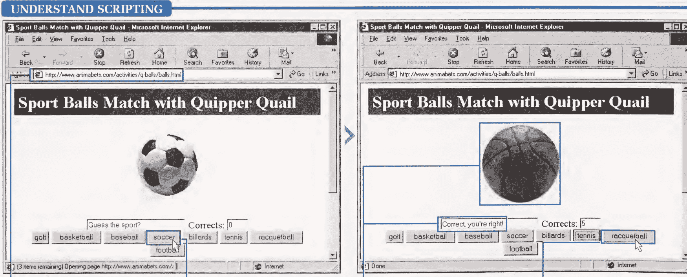

1. 在浏览器中打开一个包含 JavaScript 的网页，例如 www.animabets.com/activities/qballs/balls.html。
2. 点击其中一个按钮。
3. 文本框显示答案结果，并显示一张新图片。
4. 点击另一个按钮。

> 注意：此网页的 HTML 文件包含 JavaScript 语法，用于定义文本框和图片的更新方式。

## 介绍 JavaScript

JavaScript 是最流行的基于客户端的 Web 脚本语言，因为它同时受到 Netscape Navigator 和 Internet Explorer 的支持，但你也可以使用其他脚本语言为网页添加交互性。将 `<script>` 标签的 `language` 属性设置为 VBScript，即指定使用 VBScript 作为脚本语言。VBScript 在语法上与 Visual Basic 相似，但它仅在 Internet Explorer 浏览器中受支持。

VBScript 与 Visual Basic 编程语言非常相似，因此，如果你熟悉 Visual Basic，使用它的优势在于 VBScript 可能比 JavaScript 更容易学习。缺点是 VBScript 仅在 Microsoft Internet Explorer 浏览器中有效。

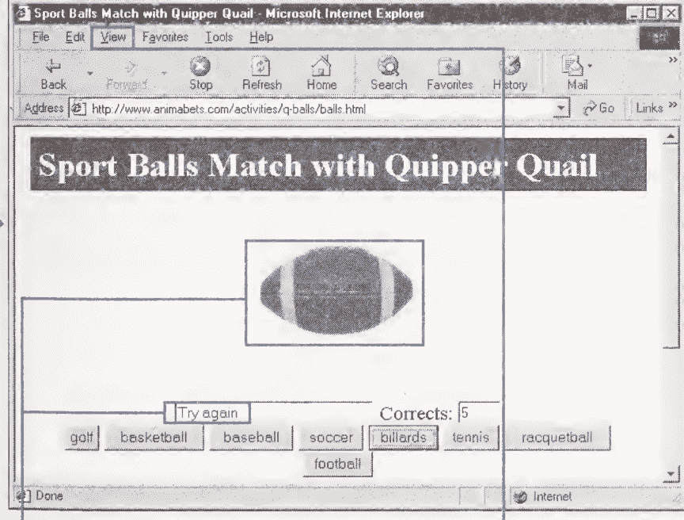

```
<SCRIPT LANGUAGE="javascript">
<!-- hide this script from browsers that don't support javascript

//preload images
var image1 = new Image(); image1.src = 'baseball.jpg';
var image2 = new Image(); image2.src = 'basketball.jpg';
var image3 = new Image(); image3.src = 'billards.jpg';
var image4 = new Image(); image4.src = 'football.jpg';
var image5 = new Image(); image5.src = 'golf.jpg';
var image6 = new Image(); image6.src = 'racquetball.jpg';
var image7 = new Image(); image7.src = 'soccer.jpg';
var image8 = new Image(); image8.src = 'tennis.jpg';

ballsNo = 7;
wins = 0;
function init() {
  randNo = Math.floor(8 * Math.random());
  if (randNo == 0) document.images[0].src = 'golf.jpg';
  if (randNo == 1) document.images[0].src = 'basketball.jpg';
  if (randNo == 2) document.images[0].src = 'baseball.jpg';
  if (randNo == 3) document.images[0].src = 'soccer.jpg';
  if (randNo == 4) document.images[0].src = 'billards.jpg';
  if (randNo == 5) document.images[0].src = 'tennis.jpg';
  if (randNo == 6) document.images[0].src = 'racquetball.jpg';
  if (randNo == 7) document.images[0].src = 'football.jpg';
}
```

文本框再次显示结果，并显示一张新图片。

选择“查看”>“源文件”以查看页面的源代码。

向下滚动，直到找到 `<script>` 标签。

注意 `language` 属性被设置为 javascript。

注意：文本框会根据答案进行逻辑更新。

## JavaScript

### 在 URL 字段中输入 JavaScript 语句

JavaScript 由语句组成，这些语句在执行时执行所需的功能。例如，JavaScript 语句 `document.write("hello")` 会在浏览器中显示单词 *hello*。

浏览器可以解释并执行 JavaScript 语句。这些语句可以在网页文件中找到，也可以直接输入到浏览器的 URL 框中。

要让浏览器执行 JavaScript 语句，请在浏览器的地址框中输入 `javascript:` 关键字，然后输入 JavaScript 语句，最后按 Enter 键执行该语句。

JavaScript 语句的末尾应放置一个分号 (`;`)。多个不同的语句可以通过用分号分隔，一起包含在地址框中。

例如，如果你输入 `javascript:document.write("hello");`，当你按 Enter 键时，浏览器会显示文本 "hello"。

### 在 URL 字段中输入 JavaScript 语句

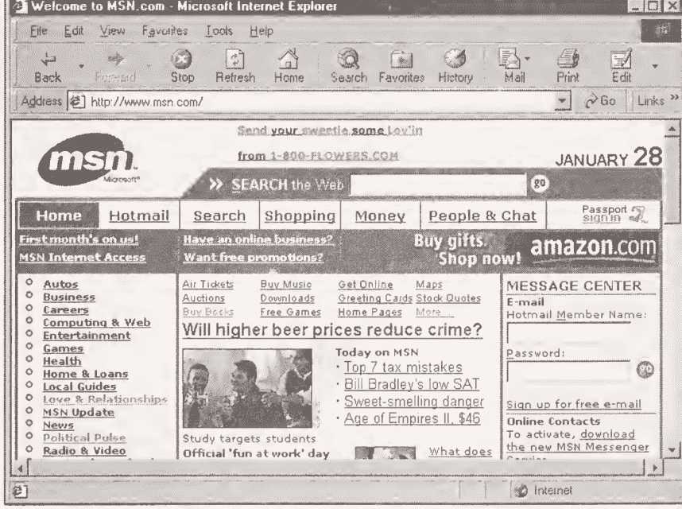

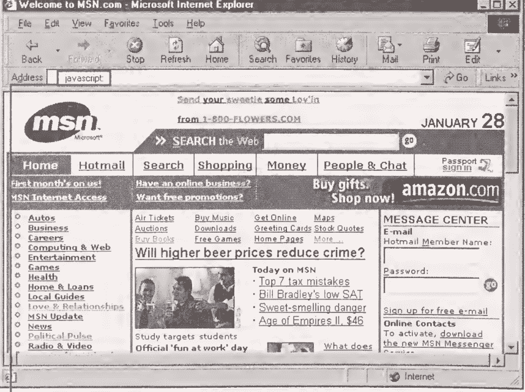

1. 打开一个浏览器。
2. 在地址框中，输入 `javascript:` 关键字。

## 介绍 JavaScript

补充说明

如果在地址框中输入关键字，浏览器通常会根据关键字搜索网页。如果你希望浏览器搜索 JavaScript 网页而不是执行 JavaScript 语句，只需省略 `javascript:` 后面的冒号。如果你在浏览器的地址框中输入 `javascript:` 关键字但不包含冒号 (:)，浏览器会搜索与 `javascript` 关键字匹配的网页。冒号符号告诉浏览器，后面的文本应被解释为 JavaScript 语句。

如果你忘记包含 `javascript:` 关键字，浏览器会认为你输入的 JavaScript 语句是一个网页地址。它会尝试定位具有该地址的网页，但无法找到。

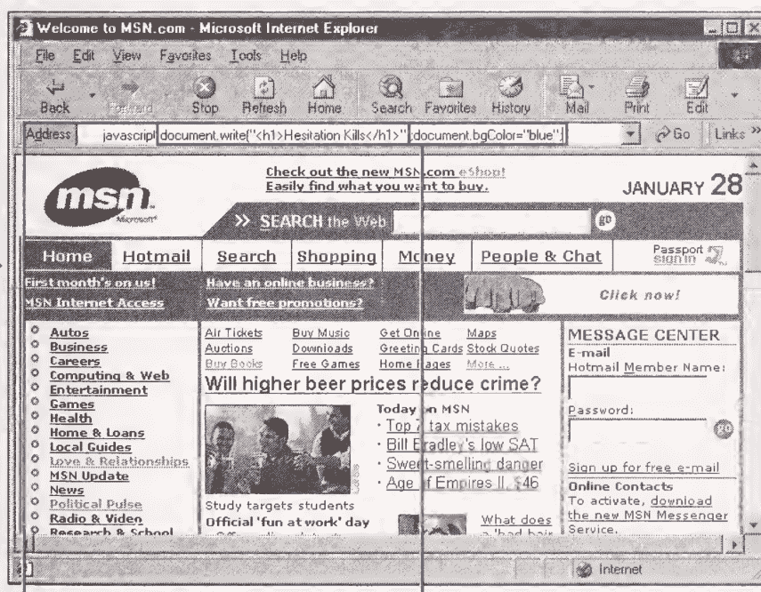

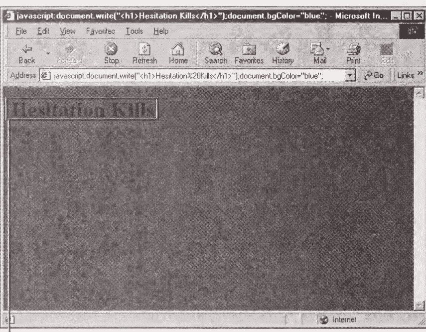

3. 在 `javascript:` 关键字之后，输入 `document.write("<h1>Hesitation Kills</h1>");`。
4. 同时输入语句 `document.bgColor="blue"`。
5. 按 Enter 键。

JavaScript 语句在浏览器中执行。

### 在 HTML 文档中嵌入 JavaScript

JavaScript 可以包含在网页的 `<script>` 标签内。当网页在浏览器中加载时，包含在 `<script>` 标签内的 JavaScript 语句会被执行。

`<script>` 标签可以出现在 `<head>` 或 `<body>` 标签内的任何位置。单个网页可以包含多组 `<script>` 标签。

`<script>` 标签接受 `type` 和 `language` 属性。`type` 属性可以设置为已识别的 MIME 类型，例如 `text/javascript`。`language` 属性是另一种指定所用脚本语言的方式。对于 JavaScript，它可以简单地设置为 `javascript`。

如果 JavaScript 语句向浏览器显示任何文本，文本的位置将位于网页文件中 `<script>` 标签的位置。例如，如果一个 HTML 文件有一个标题，后面跟着一个输出一些文本的 `<script>` 标签，那么 JavaScript 文本将紧跟在 HTML 标题之后。

此示例使用书本 CD-ROM 上的 `skeleton.html` 文件，但你可以将这些步骤应用于任何文件。

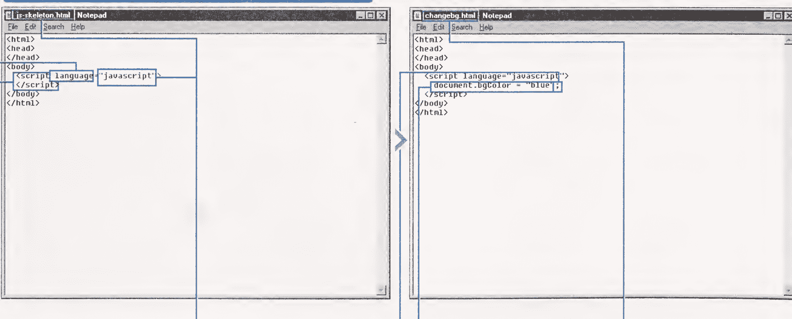

1. 打开 `skeleton.html` 文件。
2. 在 `<body>` 标签内添加一组 `<script>` 标签。
3. 为 `<script>` 标签添加 `language` 属性。
4. 将 `language` 属性设置为 `javascript`。
5. 将文件另存为 `js-skeleton.html`。
6. 在 `<script>` 标签内，添加一个更改背景颜色的 JavaScript 语句。
7. 在 JavaScript 语句末尾添加一个分号 (`;`)。
8. 将文件另存为 `changebg.html`。

## 介绍 JavaScript

应用它

使用 JavaScript，你可以为访问者个性化网页。以下代码片段会打开一个对话框，用户可以在其中输入他们的名字。然后，使用另一个 JavaScript 语句将此名称显示在网页上：

```
temp = window.prompt("What is your name?");
document.write("Welcome, " + temp + " to this Web page. I hope you enjoy your visit.");
```

要使此脚本工作，你只需将其包含在一组 `<script>` 标签内，并在浏览器中打开该文件。

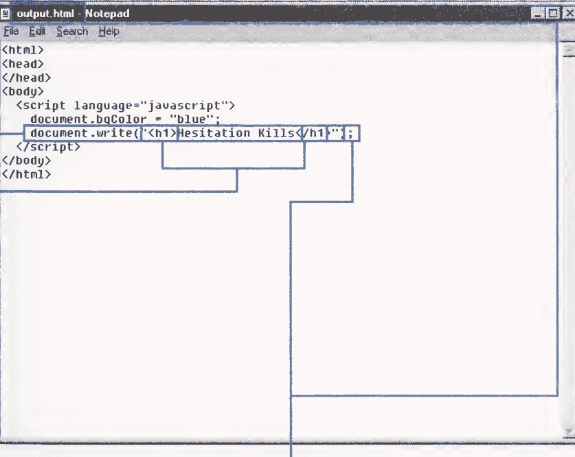

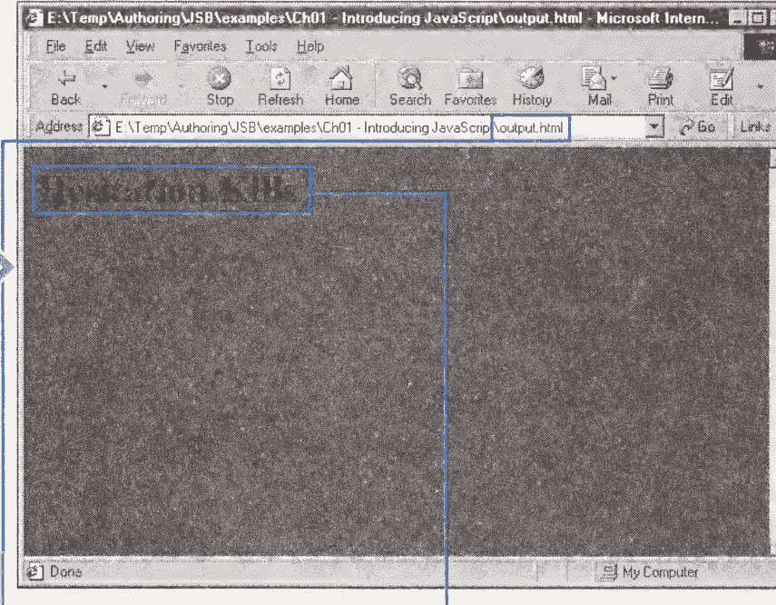

9. 添加另一个 JavaScript 语句以输出一个短语。
10. 在 JavaScript 语句末尾添加一个分号 (`;`)。
11. 将文件另存为 `output.html`。
12. 在浏览器中打开 `output.html` 文件。

注意背景颜色如何改变以及文本如何显示。

### 链接到外部 JavaScript 文件

另一个可以与 `<script>` 标签一起使用的属性是 `src` 属性。此属性可以设置为包含 JavaScript 脚本的外部文件的 URL。

外部文件不需要包含 `<script>` 标签，只需要包含 JavaScript 语句。它也不需要包含 `html` 扩展名。外部 JavaScript 文件通常具有 `js` 扩展名。

外部 JavaScript 文件可以位于 Web 上的任何位置，并使用 `http://` 协议关键字后跟外部文件的 Web 地址进行引用。

例如，语句 `<script src="myfile.js">` 将访问名为 `myfile.js` 的外部 JavaScript 文件，该文件位于与 HTML 文件相同的目录中。

此示例使用书本 CD-ROM 上的 `output.html` 文件（或者你可能在“在 HTML 文档中嵌入 JavaScript”部分创建的文件），但你可以将这些步骤应用于任何文件。

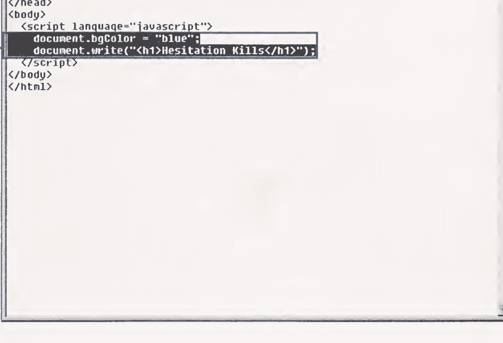


1. 在记事本中打开 `output.html` 文件。
2. 将 `<script>` 标签的内容从文件中剪切出来。
3. 将文件另存为 `external.html`。

1. 在记事本中打开一个新文件。
2. 将你从 `output.html` 文件剪切的 `<script>` 标签内容粘贴到这个新文件中。
3. 将文件另存为 `external.js`。

### 补充说明

JavaScript 区分大小写。如果你输入一个 JavaScript 变量时使用了大写字母，那么在调用该变量时也必须包含相同的大写字母。因此，变量 `hello`、`Hello` 和 `HELLO` 都是不同的。如果你的 JavaScript 语句没有被正确识别，请检查关键字是否拼写错误。

任何包含在 `<head>` 标签内的 JavaScript 语句都会在其余 HTML 标签之前执行。例如，如果 `<head>` 标签内有包含输出文本的 JavaScript 语句的 `<script>` 标签，那么该文本将显示在网页其余部分的上方。

你可以通过将 JavaScript 语句放置在称为*函数*的结构中来多次执行它们。函数将在第 5 章中介绍。

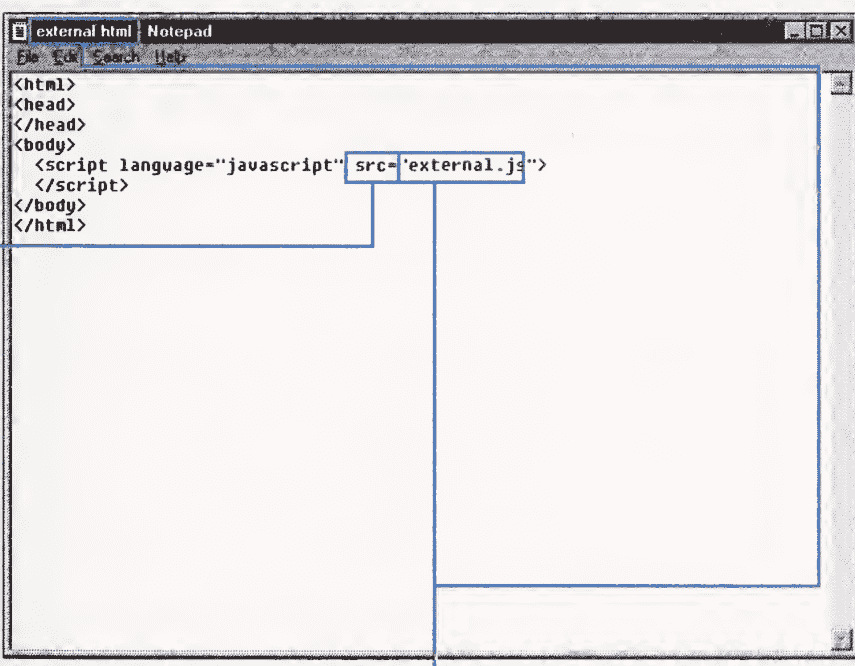

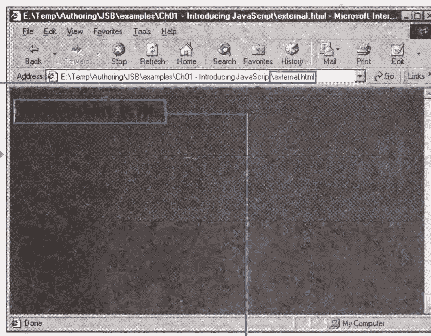

## 链接到外部文件

1.  在记事本中打开 `external.html` 文件。
2.  为 `<script>` 标签添加 `src` 属性。
3.  将 `src` 属性设置为 `external.js`。
4.  将文件保存为 `external.html`，覆盖原始的 `external.html` 文件。
5.  在浏览器中打开 `external.html` 文件。
6.  JavaScript 语句仍然作为外部文件正常工作。

## 向非 JavaScript 浏览器呈现内容

用户可以在浏览器配置中选择禁用 JavaScript 支持。如果用户禁用了 JavaScript 支持，她的浏览器将不会显示你包含在网页中的任何 JavaScript。

你可以使用 `<noscript>` 标签来处理禁用了 JavaScript 支持的浏览器。如果无法处理 JavaScript，则会显示包含在 `<noscript>` 标签内的内容。

此内容可以向禁用了 JavaScript 的浏览器用户解释，如果启用 JavaScript 他们会看到什么。

例如，如果一个网页在 `<noscript>` 标签内包含句子“此页面使用 JavaScript”，那么当 JavaScript 被禁用时，这个句子将会出现。

此示例使用了本书 CD-ROM 中的 `output.html` 文件，但你可以将这些步骤应用于任何文件。

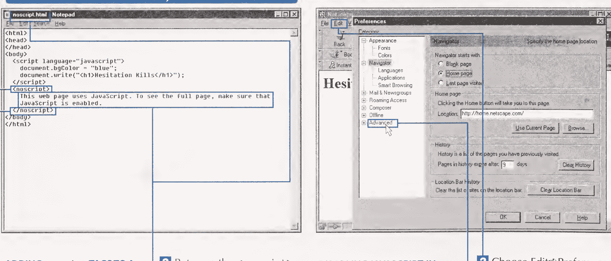

## 向网页添加 `<noscript>` 标签

1.  打开 `output.html` 文件。
2.  在 `<script>` 标签之后，添加一组 `<noscript>` 标签。
3.  在 `<noscript>` 标签之间，添加一些解释性文本。
4.  将文件保存为 `noscript.html`。

## 在 Netscape Navigator 中禁用 JavaScript

1.  打开 Netscape Navigator。
2.  选择“编辑” > “首选项”以打开“首选项”对话框。
3.  从左侧列表中选择“高级”类别。

> 注意：在 Internet Explorer 浏览器中，你无法专门禁用 JavaScript。

## JavaScript 简介

补充说明

你无法控制用户的浏览器配置，因此无法更改某人的配置以启用 JavaScript 支持。你能做的最好的事情就是告诉用户如何启用它，并鼓励他或她这样做。但是，你可以检测是否启用了 Java 编程语言。

许多不同的网页增强功能可以通过浏览器首选项设置来启用或禁用。使用 Netscape Navigator 的“首选项”对话框，你可以禁用 Java、JavaScript、样式表和 Cookie。使用 Internet Explorer 的“选项”对话框，你可以禁用 Java、ActiveX 控件、脚本和 Cookie。

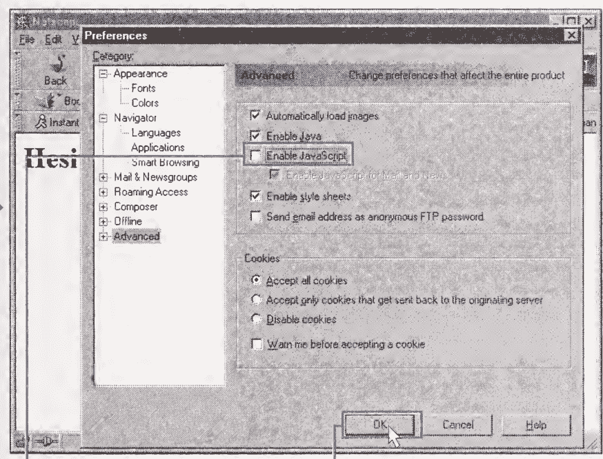

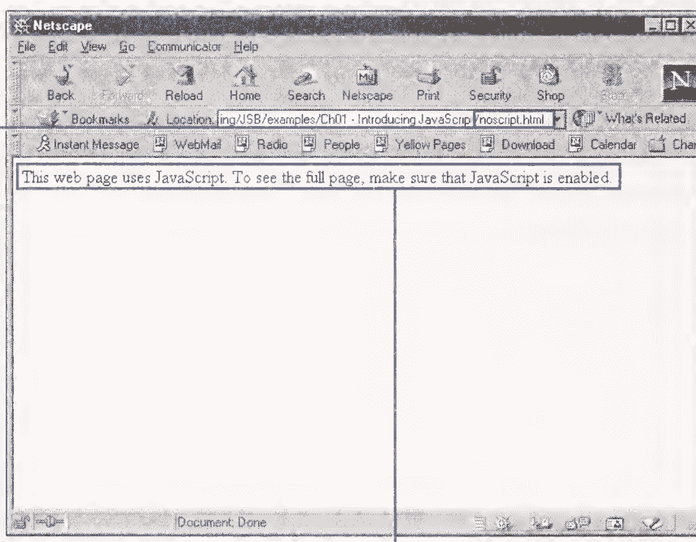

4.  取消选中“启用 JavaScript”选项（☑ 变为 ☐）。
5.  单击“确定”按钮。

### 在禁用 JavaScript 的浏览器中查看你的网页

包含在 `<noscript>` 标签中的文本将被显示。

1.  在 Netscape Navigator 中打开 `noscript.html` 文件。

## 向 JavaScript 添加注释

如果你是 JavaScript 新手，其语法可能难以理解。记录一段代码功能的一种方法是包含注释块。这些注释将被浏览器忽略，并且仅在实际文件中可见。

单行注释可以用两个正斜杠（`//`）指定。多行注释以正斜杠和星号（`/*`）开始，并以相反的符号（`*/`）结束。你不能嵌套多组注释。包含在注释符号内的所有语句都将被忽略。

注释可以出现在 `<script>` 标签集内的任何位置。

除了记录你的代码外，你还可以使用注释来调试 JavaScript。多行注释可用于快速禁用代码的某些部分，而无需删除它们。当你尝试调试无法正常工作的部分时，此功能非常方便。

此示例使用了本书 CD-ROM 中的 `noscript.html` 文件（或者你可能在“向非 JavaScript 浏览器呈现内容”一节中创建的文件），但你可以将这些步骤应用于任何文件。

## 向 JavaScript 添加注释

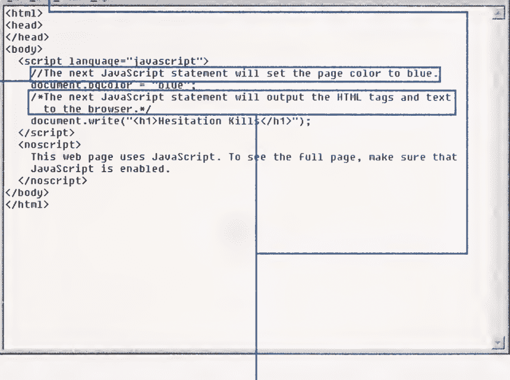

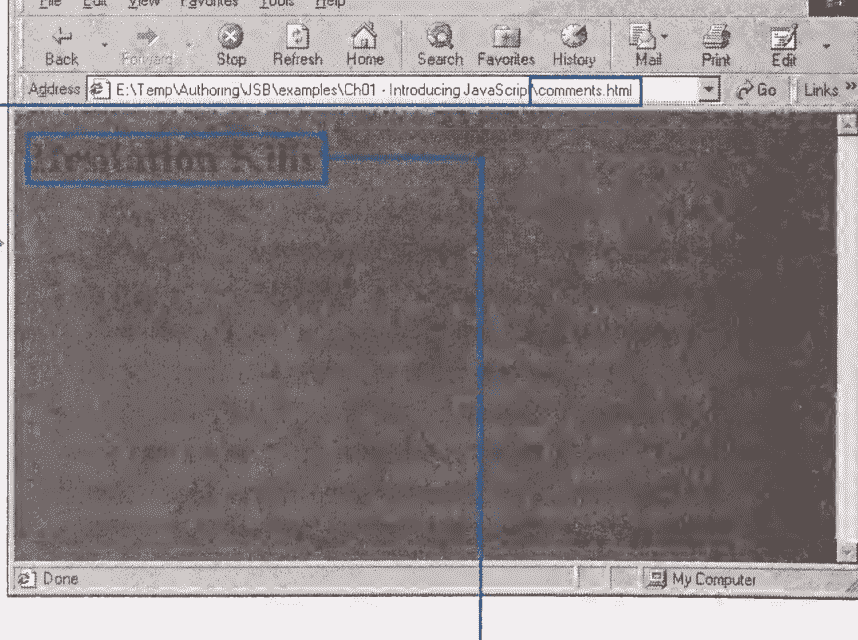

1.  在记事本中打开 `noscript.html` 文件。
2.  在第一个 JavaScript 语句前添加单行注释。
3.  在第二个 JavaScript 语句前添加多行注释。
4.  将文件保存为 `comments.html`。
5.  在浏览器中打开 `comments.html` 文件。
6.  注意添加到文件中的注释不会出现在浏览器中。

## 应用实践

许多脚本都可以从解释性头部中受益。此头部可以包含有关脚本的信息，包括作者、日期和脚本功能的描述。这样的头部可以标记为注释块，如下所示：

```
/* Personalize Script
developed by KLM on May 16, 2000
description: The purpose of this script is to accept the user's name using a prompt box, save the name in a variable, and display the name to the browser as part of a welcome message. */
```

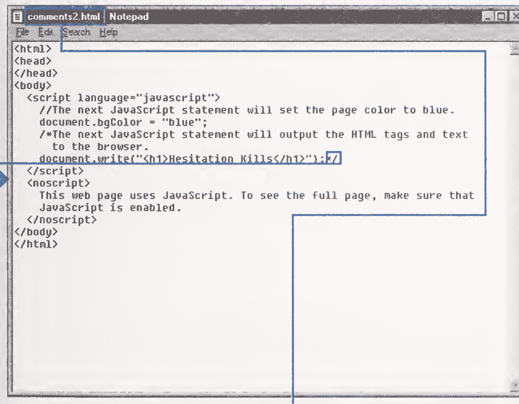

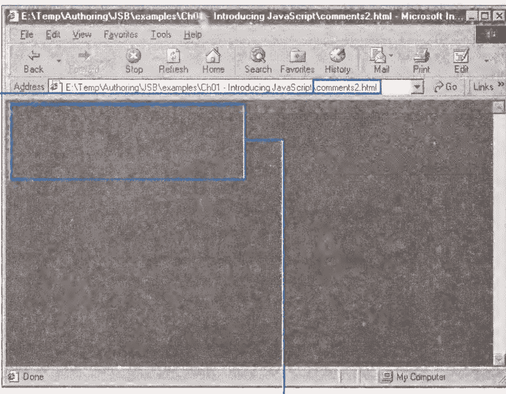

6.  在记事本中打开 `comments.html` 文件。
7.  将结束注释块移动到第二个 JavaScript 语句之后。
8.  将文件保存为 `comments2.html`。
9.  在浏览器中打开 `comments2.html` 文件。
10. 注意第一个 JavaScript 语句被执行了，但第二个没有，因为第二个语句现在是注释。

## 理解变量类型

在 JavaScript 中，你需要理解的首要概念之一是如何使用*变量*。变量就像一个用于存放值的临时容器。随着值的变化，变量可以更新以保存新值。

变量也可以保存*常量*值。常量值是不会改变的值。例如，你可以创建一个名为 `hoursPerDay` 的变量并将其设置为 24；在你的代码中，你可以使用变量 `hoursPerDay` 来引用每天的小时数。虽然直接在代码中输入值 24 会更容易，但如果你使用变量，当你检查方程时，它将具有意义。因此，使用变量来保存常量使得调试和处理代码变得更容易。

变量名必须满足几个要求。例如，24 不是一个好的变量名，因为它很容易与值混淆。变量名可以包含大写和小写字母、数字和下划线字符 (_)。不能使用其他标点符号。变量名不能以数字开头，也不能包含任何空格。

JavaScript 中的变量名区分大小写。因此，变量名 `Hello`、`hello` 和 `HELLO` 都是不同的。使用描述其保存数据的变量名是一个好主意。如果你一致地命名变量，那么以后查看代码时会更容易理解。例如，你可以一致地将所有常量值大写，以此作为它们不会改变的标识。

根据它们保存的数据类型，存在几种不同类型的变量。各种变量类型可以保存各种数字和单词作为值。具体来说，这些类型包括以下内容：

- 整数
- 浮点数
- 字符串
- 布尔值

一个好的编码技巧是以表示变量类型的字母开头命名变量名。此技巧在你处理代码时会有所帮助。例如，整数变量将命名为 `iVar`，浮点变量将命名为 `fVar`，字符串变量将命名为 `sVar`，布尔变量将命名为 `bVar`。这种变量命名技巧不是必需的，只是建议。

## 变量的类型

### 整数变量

整数变量可以存储基本的计数数字，包括正数和负数。这些值可以使用算术运算符进行操作，例如加法、减法、乘法和除法。

整数值的示例包括 2、345 和 -34。

### 浮点变量

浮点变量可以存储包含小数点的分数数字。这些变量也可以与标准算术运算符一起使用。

浮点值的示例包括 2.5、-34.56 和 3.121。

### 字符串变量

字符串变量就是单词和句子。这些变量可以存储单个字符或整个段落。字符串值通常用一组引号指定。

字符串值的示例包括 "hello"、"abc" 和 "This is a test"。

### 布尔变量

布尔变量是一种独特的变量类型，只能存储 *true* 或 *false* 这两个词。这些变量可用于测试语句的条件。数字 0 也用于表示值 *false*，而 1 表示值 *true*。

## 声明变量

JavaScript 是一种松散类型的语言。这意味着你不需要显式声明每个变量类型，并且不同的变量类型可以组合使用而不会出错。

作为松散类型的语言，这也意味着在创建新变量时不需要指定变量类型。你只需要输入一个变量名，其类型就会根据它所持有的值的类型自动设置。

你也可以使用 `var` 关键字来特别声明变量名。当这个关键字放在变量名前面时，它将该名称标识为一个变量。你可以通过用逗号分隔来一次声明多个变量。

例如，`var int1, int2, str1, str2` 声明了四个变量。

此示例使用了书的 CD-ROM 上的 `js-skeleton.html` 文件，但你可以将这些步骤应用于任何文件。

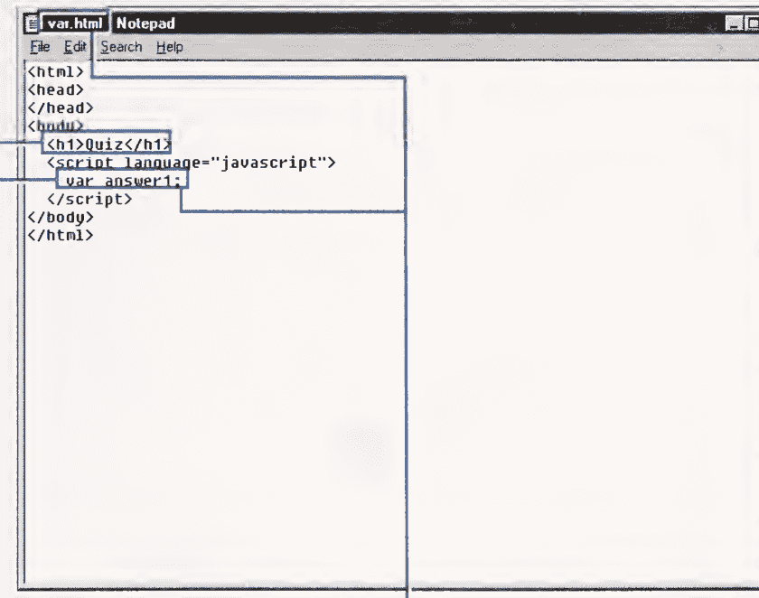

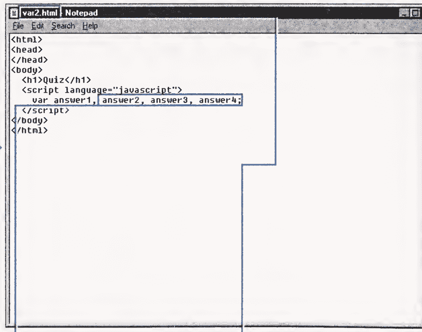

1. 在记事本中打开文件 `js-skeleton.html`。
2. 在 `<body>` 标签内为页面添加一个标题。
3. 在 `<script>` 标签内添加 `var` 关键字，后跟一个变量名。
4. 在行末添加分号（`;`）。
5. 将文件另存为 `var.html`。
6. 添加几个用逗号分隔的额外变量名。
7. 将文件另存为 `var2.html`。

## 为变量赋值

变量声明后，你可以使用等号（=）为其赋值。值应始终放在等号的右侧，变量名放在左侧。

例如，语句 `temp1 = 56;` 将值 56 放入名为 `temp1` 的变量中。然后你可以随时使用 `temp1` 变量名来引用此值。

如果字符串包含在引号（" "）中，则可以将其赋给变量名。任何不带引号的字符串都被视为变量名。

例如，语句 `str1 = "Hello Everybody";` 将字符串 "Hello Everybody" 放入变量 `str1` 中。

此示例使用了书的 CD-ROM 上的 `var.html` 和 `var2.html` 文件（或者你可能在“声明变量”部分创建的文件），但你可以将这些步骤应用于任何文件。

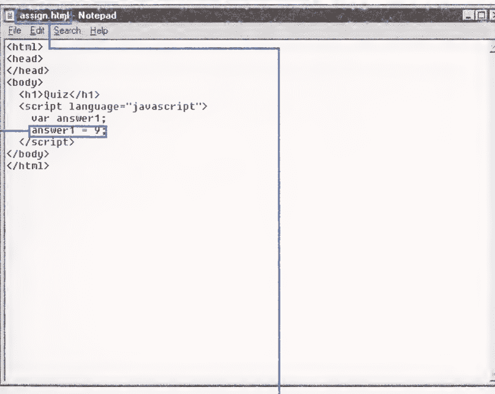

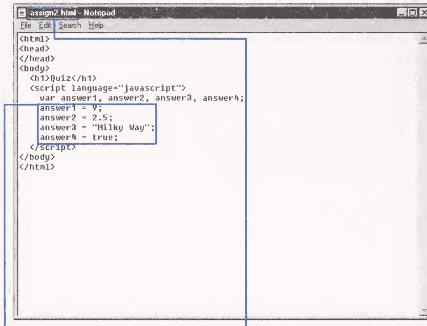

**为变量赋值**

1. 在记事本中打开文件 `var.html`。
2. 在变量声明下方，键入变量名并将其设置为一个值。
3. 将文件另存为 `assign.html`。

**为多个变量赋值**

1. 在记事本中打开文件 `var2.html`。
2. 在变量声明下方，为每个变量名设置值。
3. 将文件另存为 `assign2.html`。

## 使用整数

整数是没有小数点的值。这些通常被称为“计数数字”，可以是正数或负数。负整数值前面有一个减号（–）。

整数值可以是十进制、十六进制或八进制。这些类型之间的区别在于数字系统的基数。十进制整数是基数为 10。十六进制整数是基数为 16，其中大于 9 的数字用字母 a–f 表示。十六进制整数前面有一个 0x。八进制整数是基数为 8，并包含一个前导 0。

例如，24 是一个十进制数，024 是一个八进制数，0x24 是一个十六进制数。

此示例使用了书的 CD-ROM 上的 `js-skeleton.html` 文件，但你可以将这些步骤应用于任何文件。

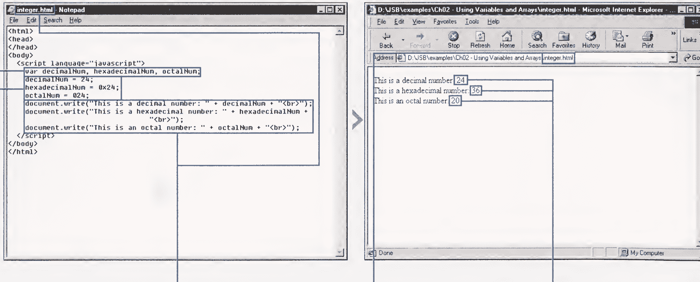

1. 在记事本中打开 `js-skeleton.html` 文件。
2. 在 `<script>` 标签内，使用 `var` 关键字声明三个变量。
3. 将每个变量名设置为一个值。
4. 使用 `document.write` 语句显示每个变量的值。
5. 将文件另存为 `integer.html`。
6. 在浏览器中打开 `integer.html` 文件。
7. 变量值被显示出来。注意每个值是如何以其十进制等效值显示的。

## 使用浮点数

浮点值是包含小数点的分数数字。这些数字可以是正数或负数。

> 补充：浮点数是否以科学计数法显示取决于其大小。小于 1.0E-7 的浮点数会以科学计数法显示，但大数字可以大到 1.0E20 才会以科学计数法显示。

非常大或非常小的数字可以用科学计数法表示。科学计数法在数字中放置字母 E，后跟小数点移动的位数。正值将小数点向右移动，负值将小数点向左移动。

例如，5.14E6 表示数字 5,140,000，6.023E-4 表示数字 0.0006023。

此示例使用了书的 CD-ROM 上的 `js-skeleton.html` 文件，但你可以将这些步骤应用于任何文件。

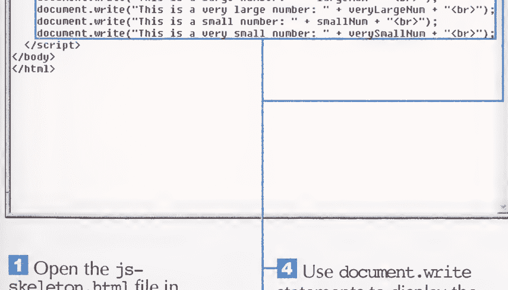

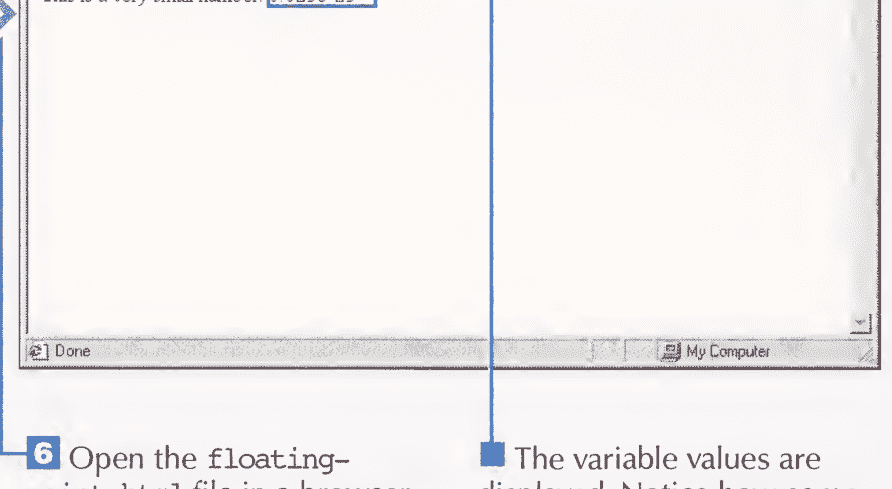

1. 在记事本中打开 `js-skeleton.html` 文件。
2. 在 `<script>` 标签内，使用 `var` 关键字声明四个变量。
3. 将每个变量名设置为浮点值，两个大值和两个小值。
4. 使用 `document.write` 语句显示每个变量的值。
5. 将文件另存为 `floating-point.html`。
6. 在浏览器中打开 `floating-point.html` 文件。
7. 变量值被显示出来。注意其中一些值是以科学计数法显示的。

## 使用布尔值

布尔值可以是 `true` 或 `false`。除了实际的单词外，值也可以设置为 0 或 1，其中 0 表示 `false`，1 表示 `true`。

因为布尔值只能是 `true` 或 `false`，所以它们很适合用作条件语句。条件语句可用于确定程序的流程。

在第 4 章中，介绍了像 `if-else` 这样的程序流程语句。布尔变量非常适合这些语句。例如，对于一个名为 `finished` 的布尔变量，语句 `if (finished == "true")` 可用于控制是执行一组语句还是另一组。你也可以直接使用布尔变量名，例如 `if (finished)`。

此示例使用了书的 CD-ROM 上的 `var2.html` 文件（或者你可能在“声明变量”部分创建的文件），但你可以将这些步骤应用于任何文件。

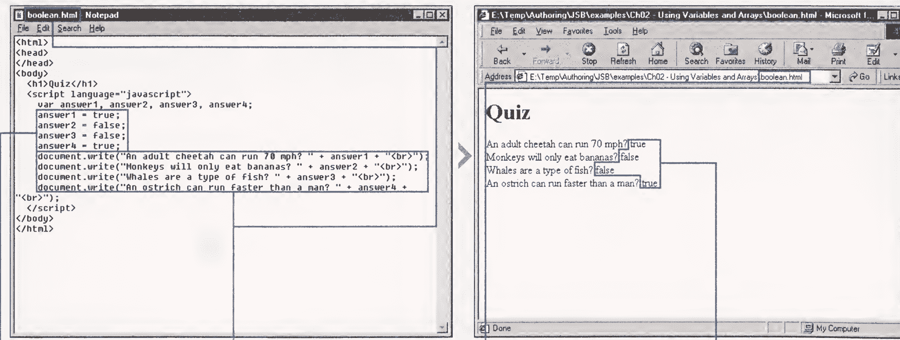

1. 在记事本中打开 `var2.html` 文件。
2. 在 `<script>` 标签内，为每个变量赋值布尔值。
3. 使用 `document.write` 语句显示每个变量的值。
4. 将文件另存为 `boolean.html`。
5. 在浏览器中打开 `boolean.html` 文件。
6. 变量值被显示出来。

## 使用字符串

字符串值由引号内指定的单词和字符组成。

字符串可以包含在单引号（'）或双引号（"）中，但起始和结束引号必须相同。

如果要在字符串值中包含引号，应在引号前加上反斜杠符号（\）。这会使引号显示出来。你也可以使用反斜杠符号在字符串中显示反斜杠字符。

例如，如果一个字符串被赋值给一个变量，像这样：`str1 = "Hello, my name is Waldo."`，引号包围着字符串值。

当使用 `document.write()` 方法显示字符串值时，文本会显示在浏览器中，并受 HTML 显示引擎的影响。这意味着你可以在字符串值中包含 HTML 标签，它们将被解释并用于在浏览器中显示文本。

此示例使用了本书 CD-ROM 上的 `js-skeleton.html` 文件，但你可以将这些步骤应用于任何文件。

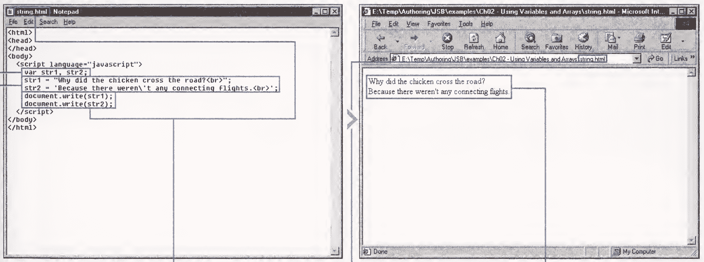

1. 在记事本中打开 `js-skeleton.html` 文件。
2. 在 `<script>` 标签内，使用 `var` 关键字声明两个变量。
3. 将每个变量名设置为一个字符串值。
4. 使用 `document.write` 语句显示每个变量的值。
5. 将文件保存为 `string.html`。
6. 在浏览器中打开 `string.html` 文件。
7. 字符串值被显示出来。

## 确定变量类型

变量经常相互组合。例如，如果你在代码中包含一个等式，两个变量会组合产生一个结果。如果你尝试组合两个不同类型的变量，可能会遇到问题。在这种情况下，你可能需要确定变量的类型。

JavaScript 包含一个可用于检查变量类型的关键字——`typeof`。当 `typeof` 关键字放在变量名前面时，变量类型会作为字符串返回。

当 `typeof` 关键字放在变量前面时，对于整数和浮点变量返回 `number`，对于字符串变量返回 `string`，对于布尔变量返回 `boolean`，如果无法确定变量类型则返回 `undefined`。

例如，如果变量 `int1` 被赋值为 24，语句 `typeof int1;` 将返回 `number`。

此示例使用了本书 CD-ROM 上的 `assign2.html` 和 `var2.html` 文件（或者你可能在“给变量赋值”和“声明变量”部分创建过），但你可以将这些步骤应用于任何文件。

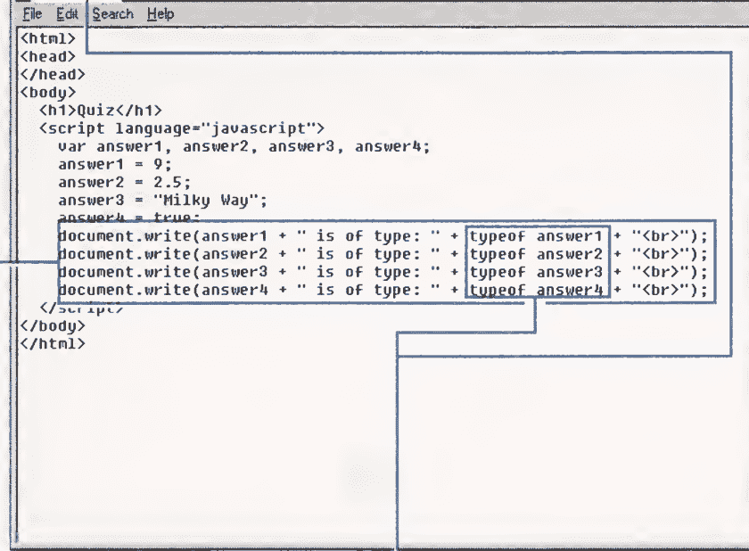

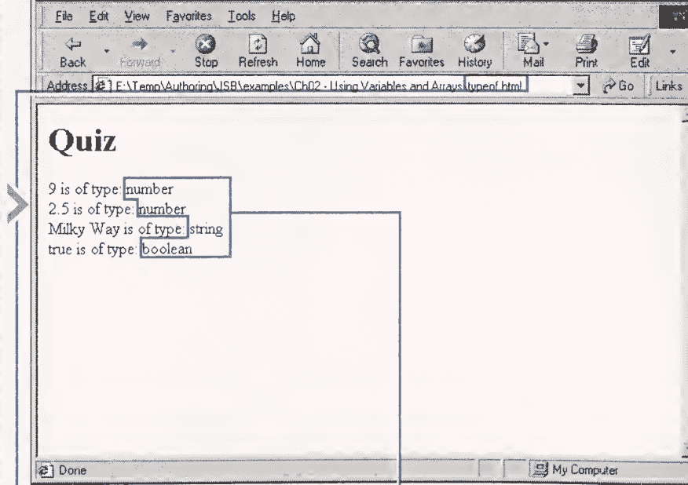

1. 在记事本中打开 `assign2.html` 文件。
2. 使用 `document.write` 语句显示每个变量的值。
3. 在每个 `document.write` 语句中添加 `typeof` 关键字，后跟变量名。
4. 将文件保存为 `typeof.html`。
5. 在浏览器中打开 `typeof.html` 文件。
6. 每个变量的变量类型被显示出来。

## 使用变量和数组

`typeof` 关键字也可用于识别其他类型的元素：对象、表单和函数。每个表单、函数和对象都有一个名称。使用 `typeof` 关键字与这些名称一起，会返回元素的类型。

如果 `typeof` 关键字的结果返回 `undefined` 值，则该变量不存在或尚未定义。如果你拼错了变量名，它不会被识别，并返回 `undefined` 值。另一种返回 `undefined` 值的情况是，如果你在变量被赋值之前使用 `typeof`：如果 `typeof` 关键字在脚本中出现在变量或函数被遇到之前，`typeof` 关键字将返回 `undefined`。

## 确定未赋值的变量

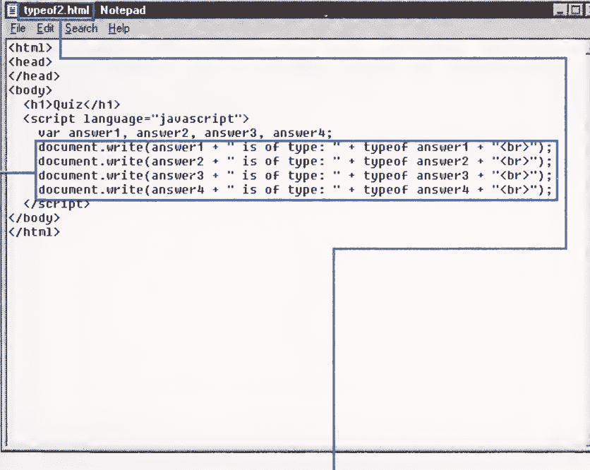

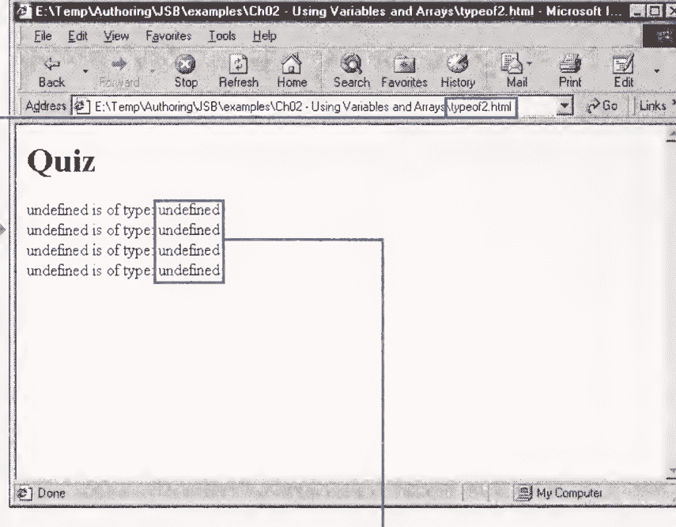

1. 在记事本中打开 `var2.html` 文件。
2. 使用 `document.write` 语句显示每个未赋值变量的类型。
3. 将文件保存为 `typeof2.html`。
4. 在浏览器中打开文件 `typeof2.html`。
5. 每个未赋值变量的变量类型显示为 `undefined`。

## 将字符串转换为数字

在对数字执行算术运算之前，你必须确保处理的是数字变量类型，而不是字符串。如果一个数字在赋值给变量时包含在引号中，它就是一个字符串而不是数字，如果你尝试将这个数字与另一个数字相加，会导致问题。

JavaScript 包含几个函数，可用于从字符串中提取数字并将其转换为数字变量类型。

以数字开头的字符串可以使用 `parseInt()` 转换为整数变量类型，使用 `parseFloat()` 转换为浮点数变量类型。包含字符串的变量名应放在括号内。

例如，要将名为 `temp` 的变量中的字符串 "256" 转换为数字，你可以使用语句 `parseInt(temp);`。

此示例使用了本书 CD-ROM 上的 `js-skeleton.html` 文件，但你可以将这些步骤应用于任何文件。

## 将包含整数的字符串转换为数字

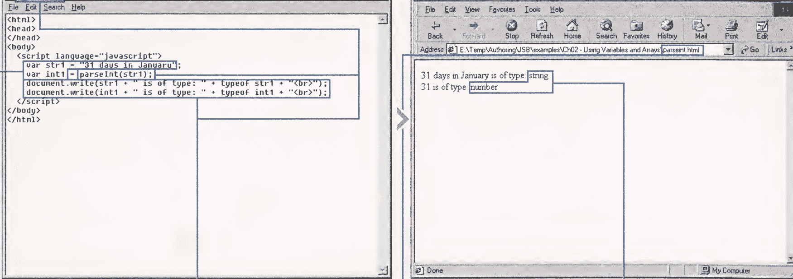

1. 在记事本中打开 `js-skeleton.html` 文件。
2. 添加两个新变量，并将第一个变量赋值为以数字开头的字符串。
3. 使用 `parseInt()` 函数将字符串转换为数字。
4. 使用 `document.write` 语句显示每个变量的值和类型。
5. 将文件保存为 `parseint.html`。
6. 在浏览器中打开文件 `parseint.html`。
7. 每个变量的变量类型被显示出来。

## 使用变量和数组

额外说明

如果变量以非数字字符开头，`parseInt()` 函数返回 `NaN`，代表“非数字”。

JavaScript 包含一个简单的方法，可以确定变量是否为数字。`isNaN()` 函数在变量“非数字”时返回 `true`，如果是数字则返回 `false`。

可以将字符串值赋给变量，之后再将整数值赋给同一个变量，而不会导致错误：因为 JavaScript 是松散类型的，你可以随时为变量赋不同的值而不会出错。

## 将包含浮点值的字符串转换为数字

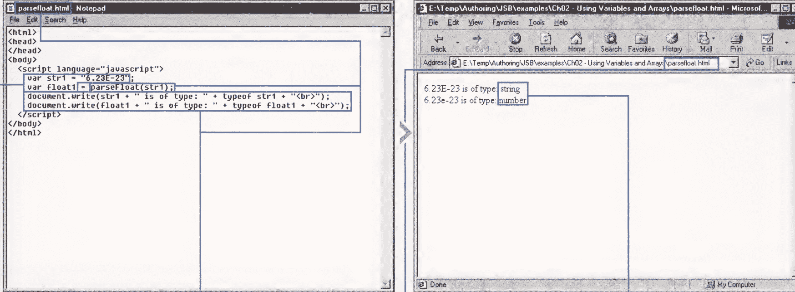

1. 在记事本中打开 `js-skeleton.html` 文件。
2. 添加两个新变量，并将第一个变量赋值为以浮点数开头的字符串。
3. 使用 `parseFloat()` 函数将字符串转换为数字。
4. 使用 `document.write` 语句显示每个变量的值和类型。
5. 将文件保存为 `parsefloat.html`。
6. 在浏览器中打开 `parsefloat.html`。
7. 每个变量的变量类型被显示出来。

## 将数字转换为字符串

在第 9 章中，介绍了许多特定于字符串的方法，例如格式化字符串和处理子字符串。如果这些方法用于包含数字而不是字符串的变量，它们将导致错误。但是，如果你将包含数字的变量转换为字符串，这些方法就可以工作。

另一种将数字转换为字符串的方法是使用 `toString()` 方法。要使用此方法，你只需将方法名附加到变量名的末尾，中间用句点分隔。例如，要将名为 `temp2` 且值为 36 的变量转换为字符串，你可以使用语句 `temp2.toString();`。

通过在数字前添加引号或空格，可以轻松地将数字转换为字符串。例如，如果名为 `temp1` 的变量包含值 36，语句 `"" + temp1;` 会自动将 `temp1` 转换为字符串。

此示例使用了本书 CD-ROM 上的 `js-skeleton.html` 文件，但你可以将这些步骤应用于任何文件。

## 在数字前添加空格

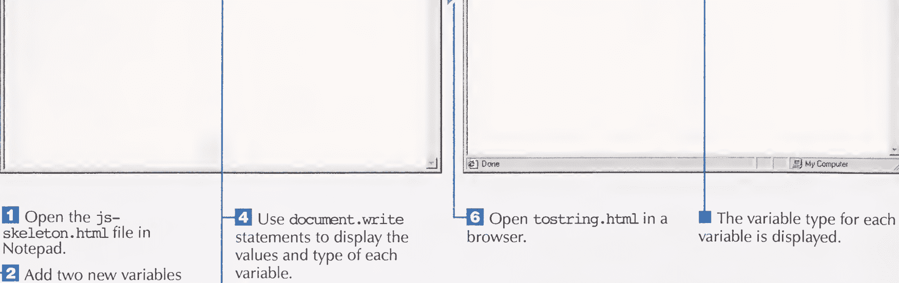

1. 在记事本中打开 `js-skeleton.html` 文件。
2. 添加两个新变量，并将第一个变量赋值为一个数字。
3. 通过将第二个变量与 `""` 相加，将其转换为字符串。
4. 使用 `document.write` 语句显示每个变量的值和类型。
5. 将文件保存为 `tostring.html`。
6. 在浏览器中打开 `tostring.html`。
7. 每个变量的变量类型被显示出来。

## 使用变量和数组

如果对一个已经包含字符串值的变量使用 `toString()` 方法，不会发生任何变化，结果变量仍然是一个字符串。

通过在数字前添加引号将其转换为字符串是一种快速技巧，但将数字转换为字符串更正确的方法是使用 `toString()` 方法。使用这种方法可以清晰地看出你在做什么，并且是良好的编码实践。

变量可以在字符串和数字之间随时更改，因此你可以多次将变量从数字转换为字符串，再转换回来。但请记住，使用 `parseInt()` 和 `parseFloat()` 函数时，某些字符串信息可能会被截断。

## 使用 TOSTRING() 方法

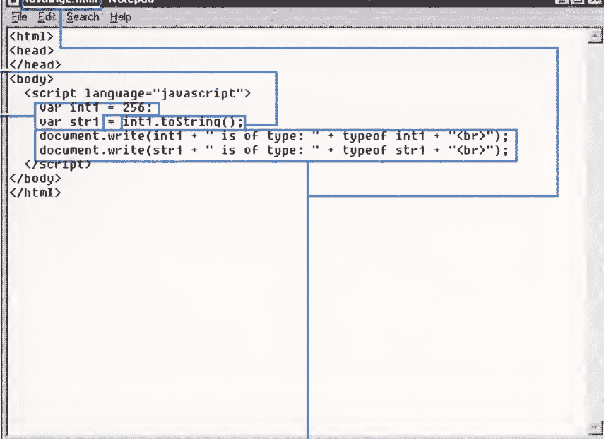

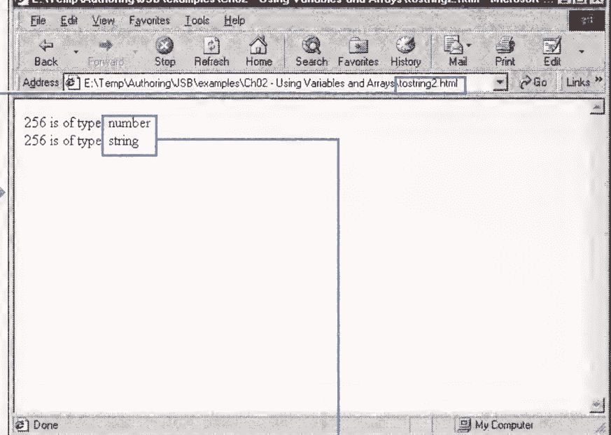

1. 在记事本中打开 js-skeleton.html 文件。
2. 添加两个新变量，并将第一个变量赋值为数字。
3. 使用 toString() 方法将第二个变量更改为字符串。
4. 使用 document.write 语句显示每个变量的值和类型。
5. 将文件保存为 tostring2.html。
6. 在浏览器中打开 tostring2.html。
7. 将显示每个变量的变量类型。

## 声明数组

可以将多个变量组合成一个带编号索引的集合，称为数组。数组中的所有变量都通过相同的名称引用，但具有不同的索引值。索引数字放在数组名称后的方括号（[]）中。

可以通过将变量名赋值给 `new Array()` 来创建数组，其中数组的元素数量包含在括号内。

创建数组后，你可以使用数组名称后跟方括号中的索引号来引用数组的各个元素。数组索引值始终从 0 开始。

例如，`array1 = new Array(10)` 将创建一个可以容纳十个值的数组。第一个元素将是 `array1[0]`，数组的最后一个元素将是 `array1[9]`。

此示例使用了书本 CD-ROM 上的 `js-skeleton.html` 文件，但你可以将这些步骤应用于任何文件。

## 创建字符串变量数组

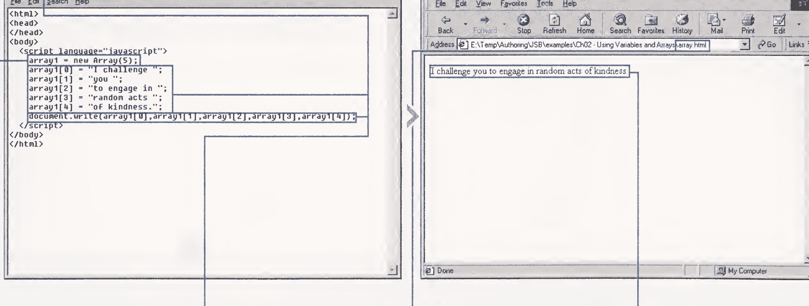

1. 在记事本中打开 `js-skeleton.html` 文件。
2. 添加一个新变量名，并将其赋值为 `new Array()`，括号内包含数组的元素数量。
3. 将每个数组元素赋值为一个字符串。
4. 使用 `document.write` 语句显示每个数组元素的值。
5. 将文件保存为 `array.html`。
6. 在浏览器中打开 `array.html`。
7. 将显示由所有单个数组元素组成的字符串。

## 使用变量和数组

JavaScript 数组的所有元素不必包含相同的变量类型。数组的元素可以包含几种不同类型的变量。例如，数组中的第一个元素可以是整数，第二个元素可以是字符串，第三个元素可以是浮点数。每个数组元素独立于其他元素。但是，如果你尝试将不同类型的数组元素相乘，则会发生错误。

JavaScript 支持二维数组。你可以通过创建一个数组的数组来创建一个 *二维数组*。其工作方式是创建一个一维数组，然后创建一个现有数组的数组。当你尝试引用一个数组的数组时，可能会感到困惑，但对于正确的应用，这是值得的。

## 创建整数变量数组

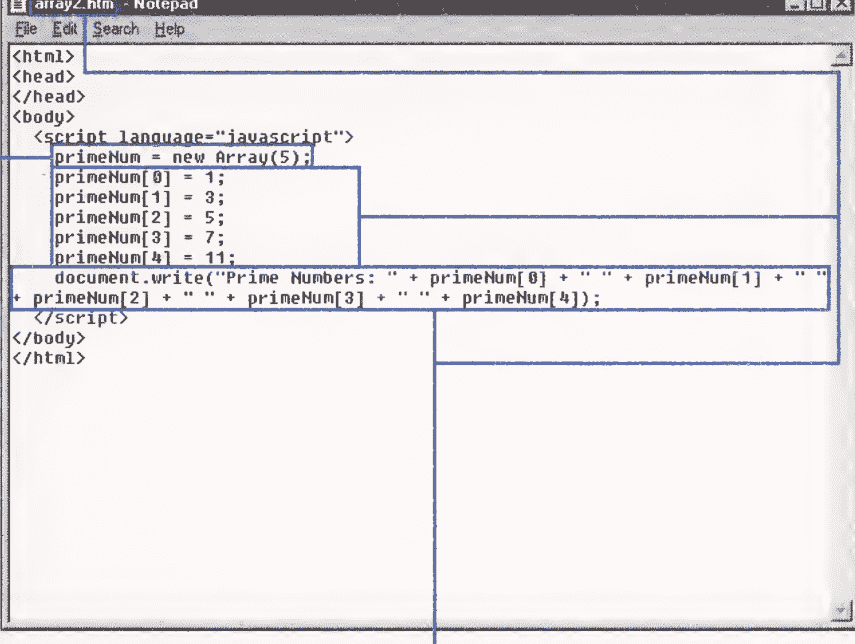

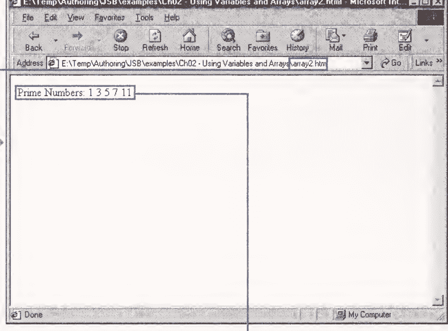

1. 在记事本中打开 js-skeleton.html 文件。
2. 添加一个新变量名，并将其赋值为 new Array()，括号内包含数组的元素数量。
3. 将每个数组元素赋值为一个整数。
4. 使用 document.write 语句显示每个数组元素的值。
5. 将文件保存为 array2.html。
6. 在浏览器中打开 array2.html。
7. 将显示每个数组元素中包含的值。

## 确定数组的元素数量

如果在脚本执行时创建并填充数组元素，你可能会忘记数组中包含的元素数量。了解数组中包含的元素数量可以告诉你需要循环遍历数组多少次才能处理数组中的所有数据。

数组是一个对象。对象包括描述它们的属性和方法，这些方法可以执行特定于对象的内置函数。第 7 章将更详细地介绍对象。

`array` 对象包括一个名为 `length` 的属性，可用于返回数组中的元素数量。`length` 属性就像变量一样是一个语句。它通过将 `length` 属性名称放在数组名称后的句点来创建。例如，如果声明了一个名为 `array1` 的数组，则可以使用 `array1.length` 语句返回属性的长度。

此示例使用了书本 CD-ROM 上的 `array.html` 和 `js-skeleton.html` 文件，但你可以将这些步骤应用于任何文件。

## 确定预定义数组的长度

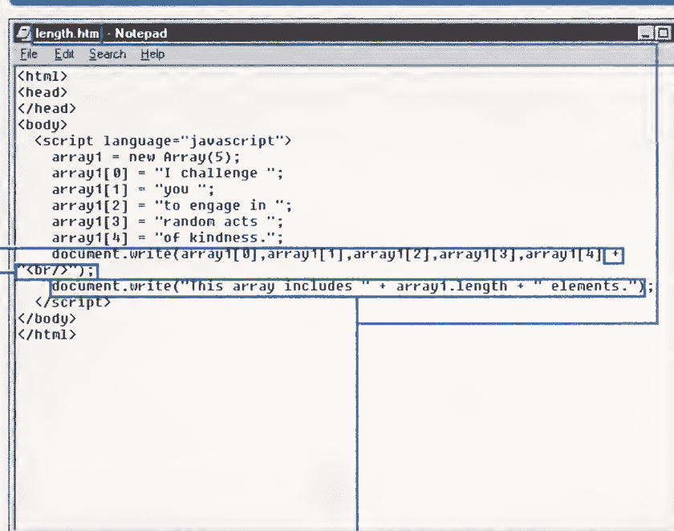

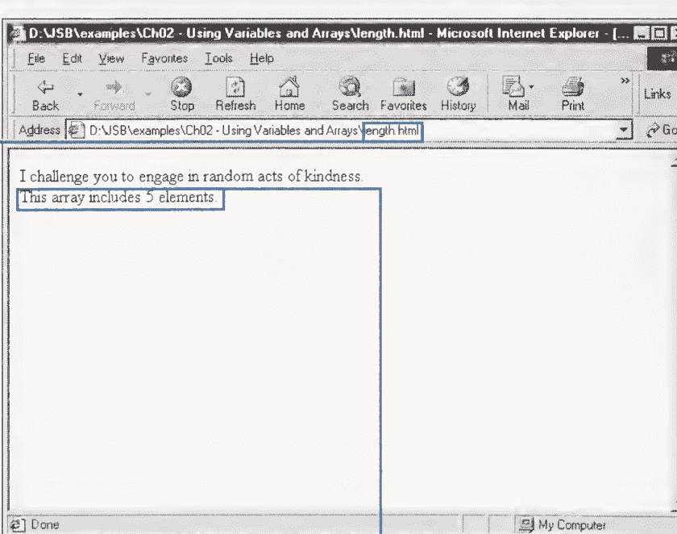

1. 在记事本中打开 `array.html` 文件。
2. 添加 + "<br/>" `document.write` 语句以添加换行符。
3. 添加一个新的 `document.write` 语句以显示数组的长度。
4. 将文件保存为 `length.html`。
5. 在浏览器中打开 `length.html`。
6. 浏览器将显示数组中的元素数量。

## 使用变量和数组

如果数组元素间歇性填充会发生什么取决于是否指定了数组大小。如果指定了数组大小，则 `length` 属性始终返回指定的大小。这是为数组预留的内存位置数。如果未指定大小，则 `length` 属性由具有最大索引值的数组元素确定。例如，如果仅填充了数组的第二个和第四个元素，则 `length` 属性将识别数组中的四个元素，即使第一个和第三个元素不包含任何数据。

`length` 属性是只读属性，这意味着它可以返回有关对象的信息，但不能用于设置对象的属性。因此，`length` 属性不能用于设置数组的大小。

## 确定数组中的元素数量

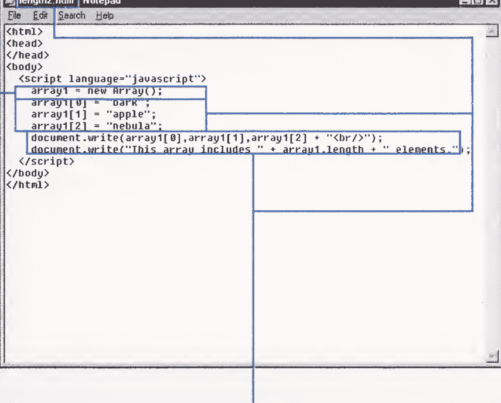

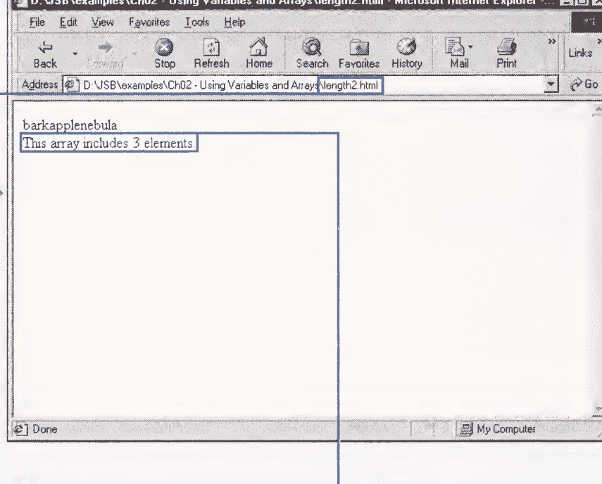

1. 在记事本中打开 `js-skeleton.html` 文件。
2. 添加一个新变量名，并将其赋值为 `new Array()`，不指定数组中的元素数量。
3. 为几个数组元素赋值。
4. 使用 `document.write` 语句显示数组值和数组元素数量。
5. 将文件保存为 `length2.html`。
6. 在浏览器中打开 `length2.html`。
7. 将显示数组元素数量。

## 将数组转换为字符串

数组可能很大，并且可能包含许多不同的元素。要显示数组的所有元素，你可能会发现将数组转换为字符串是最简单的方法。

`array` 对象包括一个将数组元素转换为字符串的方法。此方法是 `join()`。`join()` 方法接受一个字符串作为参数。此字符串在转换为字符串时插入到每个单独的数组元素之间。默认分隔符是逗号（,），但如果你指定一个不同的分隔符，也可以使用。例如，如果你有一个名为 `array1` 的数字数组，语句 `str1 = array1.join(" ")` 会在每个数组元素之间放置一个空格（而不是逗号）。然后变量 `str1` 将包含一个数字字符串，每个元素之间用空格分隔。

此示例使用了书本 CD-ROM 上的 `js-skeleton.html` 文件，但你可以将这些步骤应用于任何文件。

## 将数组转换为字符串

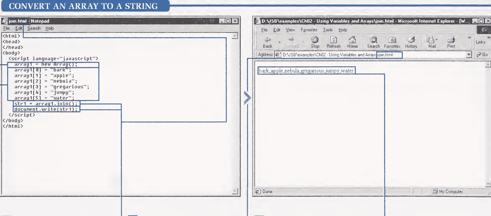

1. 在记事本中打开 `js-skeleton.html`。
2. 添加一个新变量名，并将其赋值为 `new Array()`。
3. 为几个数组元素赋值。
4. 使用 `join()` 方法将数组转换为字符串，并将值赋给一个字符串变量。
5. 使用 `document.write` 语句显示字符串变量。
6. 将文件保存为 `join.html`。
7. 在浏览器中打开 `join.html`。
8. 将显示转换后的数组，元素之间用逗号分隔。

## 使用变量和数组

实践应用

大型数组可能难以搜索以找到特定数据。一种更简单的搜索数组方法是将整个数组转换为单个字符串，然后使用 `indexOf()` 方法定位特定数据。

这些语句声明一个元素数组，将元素数组转换为名为 `str1` 的字符串，然后将变量 `beginChar` 设置为字符串中值 "123" 开始的位置。使用这些语句，你可以定位数组中的特定元素。定位这些元素后，你可以使用其他字符串对象方法解析数据。第 9 章详细介绍了字符串对象方法。

示例：

```
array1 = new Array("hello",
"123", "senior", "blank",
"fixed");

str1 = array1.join(" ");

beginChar = str1.indexOf("123");
```

## 指定唯一分隔符

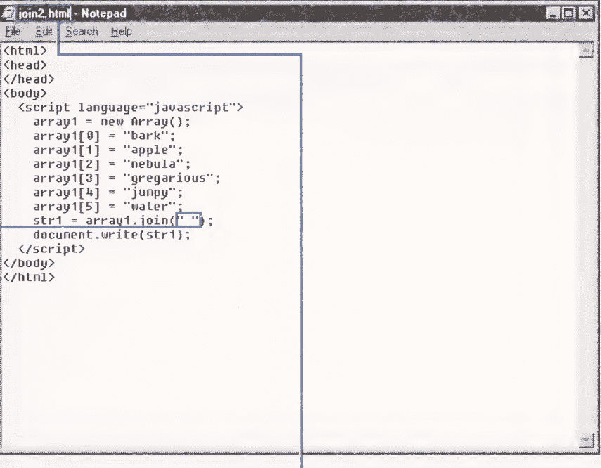

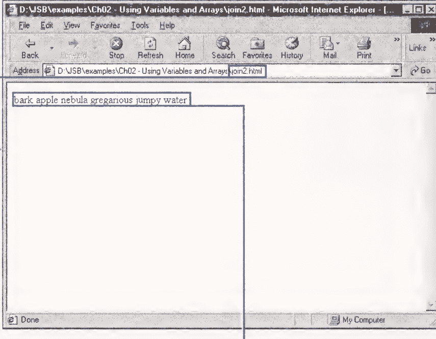

1. 在记事本中打开 `join.html` 文件。
2. 向 `join()` 方法添加一个带空格的字符串作为参数。
3. 将文件另存为 `join2.html`。
4. 在浏览器中打开 `join2.html`。

注意：在步骤 2 中，你指定使用空格作为分隔符，而不是默认的逗号，因此每个数组元素之间将出现一个空格。

转换后的数组以空格分隔显示。

## 对数组排序

可以使用 `join()` 方法将充满元素的数组转换为字符串，如“将数组转换为字符串”一节所示。`array` 对象还包含另一个方法，该方法在将数组元素转换为字符串之前，按字母升序对它们进行排序——`sort()`。

例如，如果你有一个名为 `array1` 的单词数组，你可以使用 `str1 = array1.sort()` 语句对单词进行排序并将其转换为字符串。

当 `sort()` 方法用于数字数组时，数字按字母顺序排序，而不是按数字顺序排序。例如，包含 1、2、10、12 的数组将被排序为 1、10、12、2。

此示例使用书本 CD-ROM 上的 `join.html` 文件（或者你可能在“将数组转换为字符串”一节中创建的文件），但你可以将这些步骤应用于任何文件。

## 对单词数组排序

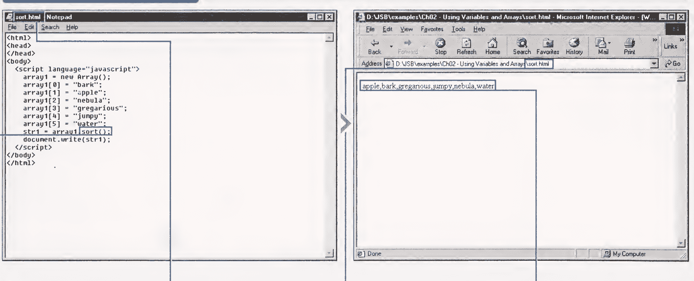

1. 在记事本中打开 `join.html` 文件。
2. 将 `join()` 方法更改为 `sort()` 方法。
3. 将文件另存为 `sort.html`。
4. 在浏览器中打开 `sort.html`。
5. 数组按字母顺序排序。

## 实践应用

`sort()` 方法可以接受一个函数名作为参数。该函数名可以包含一种替代的数组排序方式。此参数可用于按数字顺序而不是字母顺序对数字数组排序。此语句如下所示：

```
function numSort(var1, var2) {
    return var1 - var2;
}

array1 = new Array("1", "2", "12", "34", "72");
str1 = array1.sort(numSort);
```

当执行 `sort()` 方法时，会调用 `numSort` 函数。此函数接受两个参数并返回它们之间的差值。`sort()` 方法使用此差值按数字顺序对数字进行排序。当 `sort()` 方法遍历数组元素时，会根据需要多次调用 `numSort` 函数以完成排序。

## 对数字数组排序

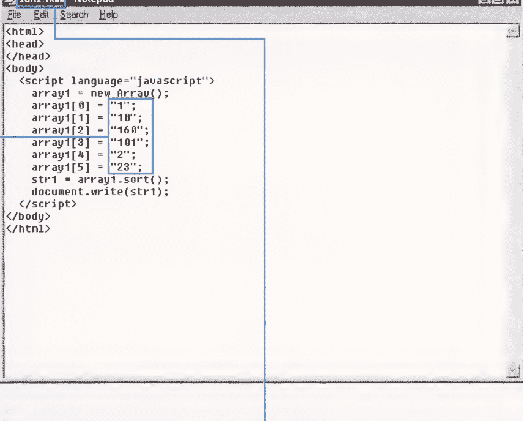

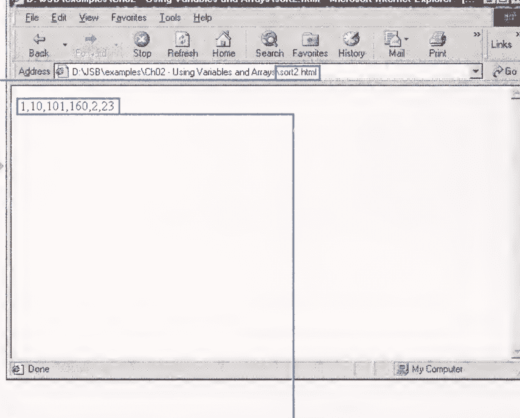

1. 在记事本中打开 `sort.html` 文件。
2. 将数组元素从字符串更改为数字。
3. 将文件另存为 `sort2.html`。
4. 在浏览器中打开 `sort2.html`。
5. 数组已排序，但不是按数字顺序。

## 使用算术运算符

表达式用于构建数学方程式。这些方程式可以计算所需的结果，然后可以在浏览器中显示。

表达式由运算符两侧的变量或字面量创建。字面量可以是数字或字符串值。

最容易创建的表达式使用算术运算符。四个标准算术运算符是加法 (+)、减法 (-)、乘法 (*) 和除法 (/)。这些运算符仅在运算符两侧的变量都是数字时才有效。但是，加法运算符也可用于组合字符串。

如果减法运算符放在变量或数字前面，则可用作取反运算符。例如，`temp1 = -var1;` 使 `var1` 的值为负数，并将结果放入 `temp1` 中。

另一个不太常用的算术运算符是*取模运算符* (%)。此运算符返回两个数字相除后的余数值。例如，`11%5` 将返回值 1，因为 5 除以 11 两次，余数为 1。

此示例使用书本 CD-ROM 上的 `js-skeleton.html` 文件，但你可以将这些步骤应用于任何文件。

## 使用算术运算符


1. 在记事本中打开 `js-skeleton.html` 文件。
2. 创建两个新变量，并为每个变量分配一个数字。
3. 创建四个新变量，并将每个变量分配给使用前两个变量创建的算术表达式。
4. 使用多个 `document.write` 语句显示每个变量的值。
5. 将文件另存为 `arithmetic.html`。
6. 在浏览器中打开 `arithmetic.html`。
7. 显示每个计算出的算术表达式的值。

### 补充说明

加法运算符可用于组合字符串，但所有其他算术运算符如果用于字符串，则返回 `NaN` 值。`NaN` 代表“非数字”。如果字符串是数字且不包含任何字母，JavaScript 会自动将字符串转换为数字并计算表达式。有关使用字符串的更多详细信息，请参见第 9 章。

你可以将阶乘定义为从当前值减去一并乘以结果。例如，3 的阶乘将是 3 × 2 × 1，结果为 6。计算阶乘的函数如下所示：

```
function factorial(num) {
    for (j=num;j>0;j--)
        result *= num;
    return result;
}
```

此函数使用多个表达式来计算阶乘结果。然后返回结果。

## 使用取模运算符


1. 在记事本中打开 `arithmetic.html` 文件。
2. 创建一个新变量，并将其分配给使用前两个变量的取模表达式。
3. 使用 `document.write` 语句显示取模表达式的值。
4. 将文件另存为 `modulus.html`。
5. 在浏览器中打开文件 `modulus.html`。
6. 显示取模表达式的值。

## 递增和递减变量

创建的最简单的表达式之一是递增或递减变量的表达式。递增表达式对于计数器和循环非常有用。

可以通过将变量加 1 并将其分配给同一变量来递增变量，如下所示：`var = var + 1`。但是，JavaScript 提供了一种更简单的方法，通过在变量后附加两个加号 (++) 来递增值。

例如，`var++` 在计算时会自动增加名为 `var` 的变量的值。

变量可以类似地使用两个减号 (--) 进行递减。此字符集使变量减少 1。例如，`var--` 会自动将 `var` 的值减少 1。

递增和递减运算符都是*一元运算符*，这意味着它们只需要一个操作数，而不是像算术运算符那样需要两个。

此示例使用书本 CD-ROM 上的 `js-skeleton.html` 文件，但你可以将这些步骤应用于任何文件。

## 递增变量


1. 在记事本中打开 `js-skeleton.html`。
2. 创建一个新变量并为其分配一个数字。
3. 使用 `document.write` 语句显示变量的值。
4. 使用 ++ 符号递增变量。
5. 添加另一个 `document.write` 语句再次显示每个变量的值。
6. 将文件另存为 `inc.html`。
7. 在浏览器中打开 `inc.html`。
8. 显示每个变量在递增和递减表达式前后的值。

## 创建表达式

> 自增或自减运算符并不总是必须跟在变量后面：自增或自减运算符可以放在变量之前或之后，但当与赋值运算符（=）一起使用时，两者之间存在细微差别。如果自增或自减运算符放在变量之前，例如 `var1 = ++var2`，则 `var2` 会在值赋给 `var1` 之前先自增。然而，如果运算符放在变量之后，则 `var2` 的值会先赋给 `var1`，然后再进行自增或自减。

你可以使用类似的表达式 `x = x + 1` 来代替更简单的 `x++`。然而，自增运算符使用得非常频繁，因此值得拥有。

## 递减变量


1.  在记事本中打开 inc.html 文件。
2.  创建另一个变量并为其赋一个数字。
3.  添加一个 document.write 语句来显示每个变量的值。
4.  使用 -- 符号递减该变量。
5.  添加另一个 document.write 语句再次显示变量的值。
6.  将文件保存为 dec.html。
7.  在浏览器中打开 dec.html。
8.  每个变量的值在自增和自减表达式执行前后都会显示。

## 创建比较表达式

比较表达式用于比较两个变量的值。当被求值时，比较表达式的结果是一个布尔值，要么为真（true），要么为假（false）。

这些语句通常用于控制程序流程，将在第 4 章中更详细地介绍。例如，if 语句使用比较表达式来决定是否执行某些语句。

比较运算符用两个等号（==）表示。它用于确定两个值是否相等，这与赋值符号（=）不同。在比较表达式中使用单个等号是 JavaScript 中的一个常见错误。

另一个常见的比较运算符是比较两个变量是否不相等。该运算符用一个等号前加一个感叹号（!=）来指定。

你还可以检查两个变量是否大于（>）、小于（<）、大于或等于（>=）或小于或等于（<=）彼此。

此示例使用了本书 CD-ROM 上的 js-skeleton.html 文件，但你可以将这些步骤应用于任何文件。

## 创建比较表达式


1.  在记事本中打开 js-skeleton.html 文件。
2.  创建一个新变量并为其赋一个数字。
3.  创建一个作为 if 语句一部分的比较表达式。在 if 语句内，为另一个变量赋一个值。
4.  使用 document.write 语句显示每个变量的值。
5.  将文件保存为 comp.html。
6.  在浏览器中打开文件 comp.html。
7.  每个变量的值都会显示。

### 补充说明

虽然当使用数字时确定比较表达式的结果相对容易，但比较运算符也可以用于字符串。当比较字符串是否相等时，例如（"happy birthday" == "Happy Birthday"），结果将为假，因为 JavaScript 区分大小写。

小于和大于运算符也可以用于字符串。当比较字符串时，比较的是它们的 ASCII 值。ASCII 值将键盘上的每个字符与一个数字相关联。计算机可以识别这些数字，并使用它们在屏幕上显示正确的字符。比较结果是 A 小于 a，a 小于 b，因为 A 的 ASCII 值小于 a 的 ASCII 值。


7.  在记事本中打开 comp.html。
8.  重置变量的值。
9.  创建一个类似于步骤 3 的比较表达式。
10. 在 if 语句中使用大于运算符创建另一个比较表达式。在 if 语句内，为另一个变量赋一个值。
11. 使用 document.write 语句显示每个变量的值。
12. 将文件保存为 comp2.html。
13. 在浏览器中打开 comp2.html。
14. 每个变量的值都会显示。

## 创建逻辑表达式

另一种类型的运算符是*逻辑运算符*。逻辑运算符可用于将几个不同的比较表达式组合成一个复杂的语句。它们也产生一个布尔值，并且通常用于控制程序流程。

逻辑运算符包括 `and`（与），用两个与符号（`&&`）表示；`or`（或），用两个竖线符号（`||`）表示；以及 `not`（非），用一个感叹号（`!`）表示。

`and` 运算符在表达式两侧都为真时产生 `true` 值。`or` 运算符在表达式任一侧为真时产生 `true` 值。`not` 运算符只是反转布尔值。

使用这些逻辑运算符时，它们应出现在语句之间，并且应该用括号括起来。

此示例使用了本书 CD-ROM 上的 `comp.html` 文件（或者你可能在“创建比较表达式”部分创建的文件），但你可以将这些步骤应用于任何文件。

## 创建逻辑表达式


1.  在记事本中打开 `comp.html` 文件。
2.  在比较语句中添加一个逻辑运算符。
3.  将文件保存为 `logical.html`。
4.  在浏览器中打开 `logical.html`。
5.  每个变量的值都会显示。

## 创建表达式 3

补充说明

为了更好地理解使用逻辑运算符的所有变体，请考虑以下示例。首先是 and 运算符：

```
true && true = true
true && false = false
false && true = false
false && false = false
```

对于 or 运算符，适用以下规则：

```
true || true = true
true || false = true
false || true = true
false || false = false
```

对于 not 运算符，只有两种可能性：

```
!true = false
!false = true
```

逻辑运算符首先对逻辑运算符两侧的表达式进行求值，然后对逻辑运算符本身进行求值。例如，语句 (var1 > 17 && var1 < 25) 组合了两个语句，用于比较变量是否大于 17 且小于 25。如果 var1 的值等于 18，则此表达式的结果为 true。


5.  在记事本中打开 logical.html 文件。
6.  创建另一个作为 if 语句一部分的逻辑表达式。
7.  添加 document.write 语句来显示变量的值。
8.  将文件保存为 logical2.html。
9.  在浏览器中打开文件 logical2.html。
每个变量的值都会显示。

## 使用条件运算符

*条件运算符*是一个单一运算符，用作单个 *if-else* 语句的快捷方式。*if-else* 语句将在第 4 章中介绍。该运算符由一个问号（?）和一个冒号（:）组成。

条件语句出现在问号的左侧。如果条件语句为真，则对紧邻问号左侧的表达式进行求值。第一个表达式之后是冒号符号和另一个表达式。如果条件语句为假，JavaScript 将对冒号后面的语句进行求值。

例如，语句 `(var1 == 23) ? (str2 = 'yes') : (str2 = 'no')` 将比较 `var1` 的值。如果该值等于 23，则变量 `str2` 被赋值为 `yes`；如果该值不等于 23，则 `str2` 将被赋值为 `no`。

此示例使用了本书 CD-ROM 上的 `js-skeleton.html` 文件，但你可以将这些步骤应用于任何文件。


1.  在记事本中打开 `js-skeleton.html` 文件。
2.  创建新变量并为其赋值。
3.  使用条件表达式来确定变量的值。
4.  使用 `document.write` 语句显示每个变量的值。
5.  将文件保存为 `conditional.html`。
6.  在浏览器中打开文件 `conditional.html`。
7.  浏览器显示每个变量的值。

## 应用它

条件表达式的最佳价值体现在与其所替代的结构进行比较时。请看以下代码：

```
if (condition1 == true) {
    expression1;
}
else {
    expression2;
}
```

这是一个简单的 if-else 结构，如果 condition1 为 true，则执行 expression1；如果 condition1 为 false，则执行 expression2。这个相同的结构可以用一个单独的条件语句来替代，如下所示：

```
(condition1 == true) ? expression1 : expression2;
```

条件表达式的一些示例如下：

```
(flipCoin) ? result="heads" : result="tails";

(today=birthday) ? document.write("Happy Birthday") : document.write("Happy Un-birthday");
```


- 7. 再次在记事本中打开 js-skeleton.html 文件。
- 8. 创建几个新变量，并为每个变量赋值。
- 9. 使用条件表达式来确定要执行哪个表达式。
- 10. 使用 document.write 语句显示每个变量的值。
- 11. 将文件保存为 conditional2.html。
- 12. 在浏览器中打开文件 conditional2.html。
- 13. 每个变量的值都会显示出来。

## 理解运算符优先级

JavaScript 按特定顺序计算运算符。这个顺序被称为 *运算符优先级*。优先级最高的运算符最先被计算。

括号具有最高的优先级。如果你不确定哪个表达式应该先计算，请将各个表达式包含在括号中。

如果运算符具有相同的优先级，例如一个充满加法运算符的表达式，JavaScript 会从左到右计算运算符。

**补充**

括号之后的运算符优先级顺序如下：

1. 一元运算符：++、--、-、!
2. 算术运算符：*、/、%、+、-
3. 比较运算符：>、<、>=、<=
4. 逻辑运算符：&&、||
5. 条件运算符：?:
6. 赋值运算符：=


- 1. 在记事本中打开光盘上的 js-skeleton.html 文件。
- 2. 创建几个变量，并为每个变量分配一个包含相同类型运算符的表达式。
- 3. 在表达式中的不同位置添加成对的括号。
- 4. 使用 document.write 语句显示每个表达式的结果。
- 5. 将文件保存为 precedence.html。
- 6. 在浏览器中打开 precedence.html。
- 7. 注意每个表达式的值是如何不同的。

## 计算字符串表达式

有时表达式包含在字符串中，例如当允许用户在表单字段中输入表达式时。使用 `eval()` 函数，你可以指示 JavaScript 将字符串作为表达式进行计算。

> 你可以使用 `eval()` 函数以迂回的方式计算 JavaScript 命令：当调用 `eval()` 函数时，JavaScript 解释器会尝试计算传递给它的任何字符串；你可以将 JavaScript 语句保存在字符串中，并使用 `eval()` 函数对其进行计算。

例如，如果一个名为 `str1` 的字符串变量被赋值为一个表达式，如 `128 + 62`，显示这个变量的值将是 "128 + 62"。另一方面，如果你显示 `eval(str1)`，该表达式将被计算，显示的值将是 190。

此示例使用了书本光盘上的 `js-skeleton.html` 文件，但你可以将这些步骤应用于任何文件。


- 1. 在记事本中打开 `js-skeleton.html` 文件。
- 2. 创建一个新变量，并将其赋值为一个用引号括起来的字符串表达式。
- 3. 使用 `document.write` 语句显示字符串变量的值。
- 4. 使用另一个 `document.write` 语句和 `eval()` 关键字来计算并显示字符串变量的结果。
- 5. 将文件保存为 `eval.html`。
- 6. 在浏览器中打开文件 `eval.html`。
- 7. 字符串变量在计算前后都会显示出来。

## 识别数字

JavaScript 包含一种独特的方法，可用于将变量识别为数字。当你接受用户输入并希望验证输入的值是否确实是数字时，此功能非常有用。尝试用字符串值计算数值表达式会导致错误。

验证变量是否为数字的方法实际上是检查它是否 *不是数字*。此方法是 `isNaN()`，它接受一个要检查的参数。如果发送给该方法的变量是数字，则该方法返回 `false` 值；如果变量不是数字，则返回 `true` 值。

例如，如果一个语句定义为 `var1 = 23`，则表达式 `isNaN(var1)` 返回 `false` 值，因为 `var1` 的值是数字（23）。

此示例使用了书本光盘上的 `js-skeleton.html` 文件，但你可以将这些步骤应用于任何文件。


- 1. 在记事本中打开 `js-skeleton.html` 文件。
- 2. 创建一个新变量，并为其赋一个数值。
- 3. 添加一个基于 `isNaN` 方法的条件表达式。
- 4. 包含一些 `document.write` 语句来显示条件语句的结果。
- 5. 将文件保存为 `isNaN.html`。
- 6. 在浏览器中打开文件 `isNaN.html`。
- 7. 浏览器确定该变量是一个数字。

## 创建表达式 3

应用它

使用 `isNaN()` 方法的最佳方式之一是验证输入到表单中的数据。例如，如果你在用于计算方程的表单字段中接受数值，当用户输入非数字内容时，你可以让一个警告框出现。此代码如下所示：

```
<form name="form1">
    Enter the circle radius.<input type="text" name="text1" onchange="(isNaN(this.value))?window.alert('This is not a number. Please enter a numerical value.'):document.form1.text2.value = (document.form1.text1.value*document.form1.text1.value*Math.PI)"/>
    Area: <input type="text" name="text2"/>
</form>
```

此表单包含两个文本字段。第一个文本字段是用户输入圆半径的地方。当输入数字并失去文本字段焦点时，`onchange` 事件执行条件语句。条件语句检查 `isNaN()` 方法以查看输入的文本是否为数字。如果是，则计算圆的面积。如果不是，则显示一个警告对话框。


- 7. 再次在记事本中打开 isNaN.html 文件。
- 8. 将变量更改为字符串。
- 9. 将文件保存为 isNaN2.html。
- 10. 在浏览器中打开文件 isNaN.html。
- 11. 浏览器检测到此变量不是数字。

## 使用 IF-ELSE 语句

在编写脚本时，你有时可能希望根据条件执行某些语句。例如，如果用户提交了一个没有数据的表单，你希望做出与他或她正确提交表单时不同的响应。控制这种程序流程的一种方法是使用 if-else 语句。

if 语句的语法包括 if 关键字，后跟括号内的条件语句。如果只需要执行单个语句，它可以放在条件语句之后，并以分号结尾。如果需要执行多个语句，它们可以包含在一组花括号中。

替代语句位于 if 语句下方的 else 语句中。else 语句也可以包含一组花括号，其中包含多个 JavaScript 语句。

如果 if 条件语句为 false，则执行 else 语句中的语句。

单个 if 语句后面可以跟几个 else if 语句，但最后的 else 语句不应包含 if 关键字。

此示例使用了书本光盘上的 js-skeleton.html 文件，但你可以将这些步骤应用于任何文件。


- 1. 在记事本中打开 js-skeleton.html。
- 2. 添加两个变量，并为每个变量赋值。
- 3. 创建一个 if 语句，其中包含一个检查变量的条件表达式。
- 4. 如果 if 语句为 true，则使用 document.write 语句显示一些文本。
- 5. 创建一个 else 语句，如果语句为 false，则使用 document.write 语句。
- 6. 将文件保存为 if-else.html。
- 7. 在浏览器中打开文件 if-else.html。

显示的文本由条件表达式决定。

> 注意：如果你将变量的值设置为 if 语句测试值以外的其他值，则会显示 else 语句的文本。

## 控制程序流程

## 应用实践

if 循环可以相互嵌套。这使你能够从一般条件深入到更具体的条件。嵌套的 if-else 结构的每一层都可以包含一些语句。使用这种结构，你可以精确地指定语句的执行条件。例如，看看这段代码是如何工作的：

这个简单的函数比较一辆汽车的连续不同属性。如果每个条件都满足，就会显示 "cool car!" 语句。如果任何条件不满足，则会显示一条替代消息。

```
function coolCar() {
    if (car == "Mustang")
        if (year == 1965)
            if (parts == "original")
                document.write("cool car!");
            else
                document.write("at least it runs.");
}
```

### 使用多个 ELSE 语句

1.  在记事本中打开 if-else.html。
2.  更改变量的值。
3.  在 if 和 else 语句之间，添加两个带有不同条件表达式的 else if 语句。
4.  添加要在 else if 语句下执行的语句。
5.  将文件另存为 elseif.html。
6.  在浏览器中打开文件 elseif.html。
7.  显示的文本由条件表达式决定。

## 使用 FOR 循环

另一种常见的程序流程方法用于执行一条或多条语句指定的次数。这可以使用 `for` 循环高效地完成。

`for` 语句由括号内的三个不同部分组成，各部分用分号分隔。第一部分定义循环的初始条件，第二部分定义循环的终止条件，最后一部分定义循环的递增方式。

`for` 循环从定义的初始条件开始，并持续执行 `for` 语句之后的语句，直到满足终止条件。每次循环时，`for` 循环变量都会递增。

例如，语句 `for (i=1;i<10;i++)` 从循环变量 `i` 等于 1 开始，并在退出循环前循环执行后续语句九次。

此示例使用了书附光盘上的 `js-skeleton.html` 文件，但你可以将这些步骤应用于任何文件。

1.  在记事本中打开 `js-skeleton.html`。
2.  添加一个从 1 开始计数到 10 的 `for` 循环。
    *注意：此示例的 `for` 循环的三个部分如下：`count=1` 定义循环的初始条件为 1；`count<=10` 将循环的终止条件设置为 10；`count++` 决定变量每次递增 1。*
3.  使用 `document.write` 语句显示变量的值。
4.  将文件另存为 `forloop.html`。
5.  在浏览器中打开 `forloop.html`。
6.  循环中每一步的值都会显示出来。

## 应用实践

虽然本节中的示例递增了循环变量，但你同样可以轻松地使循环变量递减。例如，考虑以下循环：

```
function countdown(start) {
    for (j=start;j>0;j--)
        document.write(j + "<br/>");
}
```

此函数从作为参数传入的数字开始倒计时。循环从 start 值开始，每次循环递减一，直到循环值不再大于 0。

6.  在记事本中打开 forloop.html 文件。
7.  更改 for 语句中的表达式。
8.  将文件另存为 forloop2.html。
9.  在浏览器中打开 forloop2.html 文件。

注意：此示例使用 count=count*count，它将 count 变量的当前值乘以自身。

循环中每一步的值都会显示出来。

## 使用 WHILE 循环

JavaScript 中使用的另一种循环是 `while` 循环。这种循环与 `for` 循环不同，因为它不是计数到一个最终结果。它只是持续循环执行括号内包含的语句，直到条件表达式求值为 `false`。此循环仅在 `while` 关键字后包含一个条件表达式。

使用 `while` 循环时，你需要确保条件语句最终会变为 false，否则循环将无限期地继续。你还应该确保条件语句中的所有变量都已定义。

例如，语句 `while (var1 <= 100)` 会执行后续语句，直到变量 `var1` 大于 100。如果循环内的语句从未改变 `var1` 的值，那么循环将无限期地继续。

`while` 循环也可以通过在括号内包含语句来执行多条语句。

此示例使用了书附光盘上的 `forloop.html` 和 `forloop2.html` 文件（或者你可能在“使用 `for` 循环”一节中创建的文件），但你可以将这些步骤应用于任何文件。

1.  在记事本中打开 `forloop.html` 文件。
2.  添加一个 `count` 变量并为其赋值。
3.  将 `for` 循环替换为 `while` 循环。
4.  在循环内添加一个递增 `count` 变量的语句。
5.  将文件另存为 `while.html`。
6.  在浏览器中打开 `while.html`。
7.  循环变量的值会显示出来。

## 控制程序流程

补充

思考如何构建循环的方式有很多种；有时你会想使用 `while` 循环，而其他时候你会想使用 `for` 循环。这两种循环方式相似，但 `for` 循环要求所有关于循环的信息都作为 `for` 语句的一部分。`while` 循环可以使用在其他地方声明的变量。

要退出一个看似无限循环的循环，除了使用作为 `while` 循环一部分的条件语句外，你还可以使用 `break` 语句。“中断循环”一节对此进行了详细讨论。

如果 `while` 循环不包含括号，则只有 `while` 语句之后的第一条语句会被执行。如果需要执行多条语句，则所有语句都应包含在括号内。

在记事本中打开 `forloop2.html` 文件。

8.  添加一个 `count` 变量并为其赋值。
9.  将 `for` 循环替换为 `while` 循环。
10. 在循环内添加一个递增 count 的语句。
11. 将文件另存为 `while2.html`。
12. 在浏览器中打开 `while2.html`。

随着循环的进行，`count` 变量的值会显示出来。

## 中断循环

有时你可能会陷入一个循环。这种情况被称为 *无限循环*。要跳出无限循环，你可以使用 `break` 关键字。

当 JavaScript 在循环中遇到 `break` 关键字时，它会自动终止循环并执行循环之后的第一条语句。

例如，如果一个 `while` 循环包含一个始终为真的条件表达式，比如 `while (true)`，你可以使用 `break` 语句跳出这个循环。

此示例使用了书附光盘上的 `while.html` 文件（或者你可能在“使用 while 循环”一节中创建的文件），但你可以将这些步骤应用于任何文件。

> **补充** 跳出循环后，你无法返回到该循环。`break` 语句会退出循环，并且不允许你返回。所有变量都保持在循环被中断时的状态。

1.  在记事本中打开 `while.html` 文件。
2.  在 `while` 循环内，添加一个 `if` 语句来检查一个变量。
3.  添加一个 `break` 语句，如果 `if` 条件为真则执行。
4.  将 `document.write` 语句移动到循环的底部。
5.  将文件另存为 `break.html`。
6.  在浏览器中打开 `break.html`。

当 `if` 语句的条件为真时，循环终止。

## 继续循环

与循环配合使用的另一个关键字是 `continue` 语句。该语句会停止循环的执行，并返回到循环的顶部，就好像所有语句都已执行完毕一样。在本次循环中，`continue` 语句之后的任何语句都不会被执行。

这使你能够在循环中检查特殊的异常情况并跳过它们，而不会中断循环的正常流程。

例如，如果一个 `while` 循环要持续到 `var1 == 100`，你可以使用语句 `if (var1 == 50) continue;` 来跳过数字 50 的执行。

本示例使用了书本 CD-ROM 上的 `break.html` 文件（或者你可能在“中断循环”部分创建的文件），但你可以将这些步骤应用于任何文件。

> 单个循环可以同时包含 `break` 和 `continue` 语句，但执行 `break` 语句后，循环就结束了。


1.  在记事本中打开 `break.html` 文件。
2.  将 `break` 语句更改为 `continue` 语句。
3.  将文件另存为 `continue.html`。
4.  在浏览器中打开 `continue.html`。
5.  循环中的所有值都会被显示，除了执行 `continue` 语句的地方。

## 使用 JavaScript 定时器

JavaScript 可用于设置定时器，让某些脚本在不同的时间执行。这对于计时网页上的不同操作非常有用。

使定时器成为可能的函数是 `window.setTimeout()` 函数。该函数接受两个参数。第一个参数是要执行的 JavaScript 语句。这可以是单个语句，例如 `document.bgcolor = 'blue'`，也可以是网页中其他地方定义的函数名。要执行的语句甚至可以是用分号分隔的多个语句。构成这第一个参数的语句需要用引号括起来。

`window.setTimeout()` 函数接受的第二个参数是在执行 JavaScript 语句之前要等待的时间值。该值以毫秒为单位。例如，值为 5000 将等待 5 秒，值为 10000 将等待 10 秒。

本示例使用了书本 CD-ROM 上的 `js-skeleton.html` 文件，但你可以将这些步骤应用于任何文件。


1.  打开 `js-skeleton.html`。
2.  添加一个函数，该函数使用 `document.write()` 语句来显示标题和图像。
3.  在 `<body>` 标签中添加 `onload` 并将其设置为等于 `window.setTimeout()`。
4.  将函数名作为 `setTimeout()` 的第一个参数，将时间值（以毫秒为单位）作为第二个参数。
5.  在 `<body>` 标签中添加一个标题。
6.  将文件另存为 `timeout.html`。
7.  在浏览器中打开 `timeout.html` 文件。
8.  `<body>` 标签中的标题显示在浏览器中。

## 控制程序流程

## 应用它

第 11 章介绍了 Math 对象。该对象包含一个用于创建 0 到 1 之间随机数的方法。使用此方法，你可以创建一个脚本，通过随机选择超时时间来玩抢椅子游戏。代码如下所示：

```
<form name="form1">
    <input type="button" name="button1"
    value="Get Ready"
    onclick="stopMusic()"/>
    <input type="text" name="text1"
    value="music is playing"/>
</form>

<script language="javascript">
    function stopMusic() {
        seat = Math.floor(Math.random() * 10000);
        stop =
        window.setTimeout("document.form1.text1.value = 'music stopped'", seat);
    }
</script>
```

该代码创建了一个包含按钮和文本框的表单。当用户点击按钮时，会调用 stopMusic() 函数。此函数随机选择一个数字，用作 setTimeout() 方法的参数。当时间到期时，文本框会更新以通知用户音乐已停止。


8.  等待指定的时间值。
9.  在达到超时值后，脚本函数被执行，显示函数的标题和图像。
10. 再次在浏览器中打开 timeout.html 文件。
11. 在达到超时值之前点击停止按钮。
12. 超时不会停止，图像再次显示。

> 注意：超时只能使用 clearTimeout() 方法清除，本章后面的“清除超时和间隔”部分将详细讨论此方法。

## 设置定期定时间隔

设置超时会导致语句或函数的一次性执行。如果你想设置多个超时，可以在 `for` 循环中包含 `setTimeout()` 方法，或者你可以使用另一种可以设置定期重复超时的方法：`setInterval()`。

`setInterval()` 方法可用于定期重复执行语句、函数或语句组。`setInterval()` 方法接受两个参数，就像 `setTimeout()` 方法一样。第一个参数是要执行的语句，第二个参数是执行语句之前的时间（以毫秒为单位）。你必须将第一个参数用引号括起来。

使用 `setInterval()` 方法创建的超时会无限期地继续，除非调用 `clearInterval()` 方法。本章后面的“清除超时和间隔”部分将详细介绍此方法。

本示例使用了书本 CD-ROM 上的 `js-skeleton.html` 文件，但你可以将这些步骤应用于任何文件。


1.  在记事本中打开 `js-skeleton.html`。
2.  添加一个 `window.setInterval()` 方法。
3.  添加一个包含两个文本框的表单。
4.  将 `setInterval()` 的第一个参数设置为用第一个文本框的内容更新第二个文本框。
5.  将 `setInterval()` 的第二个参数设置为一个时间值。
6.  将文件另存为 `setInterval.html`。
7.  在浏览器中打开 `setInterval.html`。
8.  显示两个文本框。

## 控制程序流程

第 10 章介绍了 Date 对象。该对象包含一个名为 getLocaleString() 的方法，用于获取当前区域设置的时间。使用此方法和 setInterval() 方法，你可以使用以下代码创建一个时钟：

该代码创建了一个包含单个文本框的表单。然后将 Interval() 设置为每秒响应一次。在每个间隔，都会创建时间对象，并将 toLocaleString() 方法显示在文本框中。由于 setInterval() 方法，时间每秒更新一次。

```
<form name="form1">
    <input type="text" name="text1"/>
</form>

<script language="javascript">
    stop = window.setInterval("time = new Date();document.form1.text1.value = time.toLocaleString()",1000);
</script>
```


8.  在第一个文本字段中输入一些文本。

在达到超时值后，setInterval 语句被执行，更新第二个文本框。

9.  在第一个文本框中输入一些不同的文本。

文本在第二个框中再次更新。

## 清除超时和间隔

在“使用 JavaScript 定时器”部分，我展示了浏览器上的停止按钮不会结束超时。超时只能在内部使用 `clearTimeout()` 方法清除。此方法是 `window` 对象的一部分，可以在当前窗口中引用为 `window.clearTimeout()`。

要使用 `clearTimeout()` 方法，你需要在设置超时时为其命名。你可以通过将 `setTimeout()` 方法赋值给一个变量名来为超时命名。然后可以将此变量名用作 `clearTimeout()` 方法的参数来终止超时。

例如，如果超时被赋值给一个变量，如 `timer1 = setTimeout(x++, 1000)`，则可以随时使用 `clearTimeout(timer1)` 语句取消超时。

你可以使用类似的方法来清除使用 `setInterval()` 方法创建的间隔超时。此方法是 `clearInterval()`。

本示例使用了书本 CD-ROM 上的 `setInterval.html` 文件，但你可以将这些步骤应用于任何文件。


1.  在记事本中打开 `setInterval.html` 文件。
2.  添加一个新变量并将其赋值给 `setInterval()` 方法。
3.  向表单添加一个带有 `onclick` 事件的按钮。
4.  将 `onclick` 事件设置为使用 `clearInterval()` 方法。
5.  将文件另存为 `clearInterval.html`。
6.  在浏览器中打开 `clearInterval.html` 文件。
7.  在第一个文本框中输入一些文本。
8.  文本在第二个文本框中更新。

## 控制程序流程

应用实践

在“设置定时器”一节中创建的时钟示例可以修改为包含一个停止时钟的按钮。以下代码添加了停止按钮：

```
<form name="form1">
    <input type="text" name="text1"/>
    <input type="button" name="button1"
        value="Stop"
        onclick="window.clearInterval(stop)"/>
</form>

<script language="javascript">
    stop = window.setInterval("time =
        new Date();document.form1.text1.value =
        time.toLocaleString()",1000);
</script>
```

在此代码中，一个带有 `onclick` 事件的按钮被添加到表单中。`onclick` 事件被指定为使用 `clearInterval()` 方法清除定时器。传递给 `clearInterval()` 方法的参数是分配给 `setInterval()` 方法的变量名。


8 点击该按钮。

`setInterval()` 方法已被停止。

9 在第一个文本框中输入一些文本。

第二个文本框不再更新。

### 声明函数

你可以将代码段组合到一个称为 *函数* 的结构中。你可以随时调用和访问函数。你可以向函数传递参数，函数也可以返回值。

你使用 `function` 关键字后跟函数名来声明函数。括号必须紧跟在函数名之后。函数的参数包含在这些括号中，但参数不是必需的。

例如，语句 `function hello()` 将声明一个名为 `hello` 的函数。

函数内的所有 JavaScript 语句都应包含在函数声明后的大括号内。

函数语句在函数被调用之前不会执行。

函数名与变量具有相同的限制并遵循相同的要求。它们必须以字母开头，不能包含任何空格，并且不能使用任何特殊字符，如 `+`、`*`、`/`、`&`、`%`、`$`、`#`、`@` 或 `!`。另外，请记住函数名区分大小写。

此示例使用了书籍 CD-ROM 上的 `js-skeleton.html` 文件，但你可以将这些步骤应用于任何文件。

### 声明函数


1. 在记事本中打开文件 `js-skeleton.html`。
2. 使用 `function` 关键字和一个名称创建一个新的函数定义。
3. 在函数声明后的大括号内添加一个 JavaScript 语句。
4. 将文件另存为 `function.html`。
5. 在浏览器中打开 `function.html`。

函数语句未被执行，因为它们尚未被调用。

> 注意：通过将语句分组到函数中，你可以根据需要多次执行函数中的语句。

### 调用函数

声明函数后，你可以通过列出函数名，从文档中的任何位置随时执行它。

此示例使用了书籍 CD-ROM 上的 `function.html` 文件（或者你可能在“声明函数”一节中创建的文件），但你可以将这些步骤应用于任何文件。

调用函数时，无论函数是否有参数，都需要包含括号。

例如，如果一个函数定义为 `function hello()`，那么你可以使用语句 `hello();` 来执行此函数。

> 如果你使用 `javascript:` 关键字，你可以通过使用 HTML `<a>` 标签的 `href` 属性从 HTML 链接调用函数。本章后面的“从 HTML 链接调用函数”一节将展示如何操作。

函数调用可以出现在函数声明之前或之后。

### 调用函数


1. 在记事本中打开文件 `function.html`。
2. 在函数语句后添加一个函数调用。
3. 将文件另存为 `function-call.html`。
4. 在浏览器中打开 `function-call.html`。
5. 函数语句被执行，结果显示在屏幕上。

注意：当引用函数名时，函数内的语句将被执行。函数可以在单个文件中被多次调用。

## 理解全局变量和局部变量

在函数内使用 `var` 关键字声明的任何变量对于它们所在的函数来说都是局部的。这些局部变量只在函数内部被理解，在函数外部的任何 JavaScript 语句中都不被识别。

在函数内隐式声明（不使用 `var` 关键字）的变量将是全局变量。在函数外部声明的变量（即使使用 `var` 关键字声明）也是全局变量。全局变量可以在当前文档中的任何地方使用，包括函数内部和外部。

例如，如果一个名为 `myVar1` 的变量在函数内使用 `var` 关键字声明，那么在函数内部可以使用该变量，但如果在函数外部引用它，那么其值将是未知的。

此示例使用了书籍 CD-ROM 上的 `js-skeleton.html` 文件，但你可以将这些步骤应用于任何文件。

### 全局变量


1. 在记事本中打开文件 `js-skeleton.html`。
2. 使用 `var` 创建两个全局变量。
3. 创建一个包含 `document.write` 语句的函数，该语句显示声明的变量的值。
4. 添加一个语句来执行该函数。
5. 在函数外部包含另一个 `document.write` 语句以显示变量值。
6. 将文件另存为 `global.html`。
7. 在浏览器中打开 `global.html` 文件。

这些变量是全局的，因为它们在函数外部声明，并且可以在函数内外的任何地方使用。

## 使用函数 5

扩展知识

跟踪全局变量和局部变量的一种便捷方法是采用特定的编码约定，该约定具有命名标准，有助于保持变量的作用域清晰。例如，如果你在每个全局变量前面放置一个小写字母 g，如 gVar1，那么你只需查看变量名就可以识别出这是一个全局变量。

在函数外部使用 `var` 关键字是一个好习惯。任何不使用 `var` 关键字声明的变量都是全局变量。在函数外部声明的任何变量也是全局变量。使用 `var` 关键字将使任何查看你代码的人都清楚你正在声明一个变量。

使用局部变量的一个原因是，你希望构建可以轻松重用的函数。通过使用局部变量，你可以保证无论函数被复制到哪里，它都不会与共享相同变量名的全局变量冲突。

### 局部变量


1. 在记事本中打开文件 global.html。
2. 将两个变量声明移入函数内部。
3. 将文件另存为 local.html。

注意：这使得变量成为函数的局部变量，因为它们是用 `var` 关键字声明的，并且现在位于函数内部。

4. 在浏览器中打开 local.html。
- 出现一个对话框，指出页面存在错误。
5. 点击“显示/隐藏详细信息”按钮以查看错误。
- 注意，当在函数外部的 `document.write` 语句中使用时，局部变量是未定义的。

## 向函数传递参数

如果你想使用不同的变量值执行函数，可以将这些值作为参数传递给函数。

参数可以在函数名后的括号内传递给函数。如果用逗号分隔，可以传递多个变量。

调用语句应包含值，函数定义应包含变量名。然后你可以在函数内使用这些变量名。函数调用中的值数量应与函数定义中的变量数量匹配。

例如，如果一个函数定义为 `function sum(a, b, c)`，那么函数调用 `sum(16, 34, 98)` 将把值 16 放入名为 a 的变量，34 放入名为 b 的变量，98 放入名为 c 的变量。

此示例使用了书籍 CD-ROM 上的 `js-skeleton.html` 文件，但你可以将这些步骤应用于任何文件。

### 传递单个参数


1. 在记事本中打开文件 `js-skeleton.html`。
2. 创建一个带有单个参数的函数，该函数显示一条消息和参数值。
3. 添加对该函数的多次调用，每次使用不同的值。
4. 将文件另存为 `parameters.html`。
5. 在浏览器中打开 `parameters.html`。
6. 函数在每次调用时重复执行，每次使用不同的值。

## 使用函数

### 补充说明

传递给函数的参数是函数的局部变量。如果在函数外部使用参数变量，将会产生错误。

调用函数时，传递的参数可以是变量或值。如果传递的是变量，那么在调用函数时，该变量的值会被发送给函数。

如果函数调用不包含任何参数，函数名仍然需要一对空括号。这些括号有助于将名称识别为函数。

传递给函数的参数数量没有限制，因此你可以根据需要传递任意数量的参数给函数。

### 传递多个参数

1.  在记事本中打开文件 `js-skeleton.html`。
2.  创建一个具有多个参数的函数，用于计算并显示一个值。
3.  添加对该函数的调用。
4.  将文件保存为 `parameters2.html`。
5.  在浏览器中打开 `parameters2.html` 文件。
6.  计算出的值由传递给函数的值决定。

### 从函数返回值

你可以使用 `return` 关键字从函数返回值。这允许函数确定一个结果值，并将该值发送回主程序。

例如，如果你创建一个计算总和的函数，并且总和值存储在一个名为 `total` 的变量中，那么语句 `return total` 会将 `total` 的值发送回调用该函数的地方。

因为有一个值被传回函数调用，所以函数调用需要是一个使用返回值的语句。例如，`var1 = func1()` 会将 `func1()` 函数返回的值放入一个名为 `var1` 的变量中。

函数返回的数据类型可以是字符串、数字或任何其他值。

此示例使用了本书 CD-ROM 上的 `js-skeleton.html` 文件，但你可以将这些步骤应用于任何文件。

### 从函数返回值

1.  在记事本中打开文件 `js-skeleton.html`。
2.  创建一个具有多个参数的函数，用于计算一个值。
3.  向函数添加一个 `return` 语句，以返回结果值。
4.  添加另一个 `document.write` 语句，调用该函数并显示结果值。
5.  将文件保存为 `return.html`。
6.  在浏览器中打开 `return.html` 文件。
7.  返回的值将被显示。

## 使用函数

### 应用实例

一个返回值的函数的好例子是：接受参数，计算方程的结果，并返回结果值。例如，一个计算并返回盒子面积的函数，给定宽度、高度和深度参数，如下所示：

```
function computeArea(width, height, depth) {
    area = width * height * depth;
    return area;
}
```

如果此函数包含在网页文件中，你可以使用以下语句调用该函数：

```
computeArea(3, 4, 5);
```

函数结果直接返回到函数调用处，并可以在如下语句中使用：

```
document.write("The area of the box with the dimensions: " + width + ", " + height + ", " + depth + " equals " + computeArea(3, 4, 5));
```

### 返回 HTML 值

1.  在记事本中打开文件 `js-skeleton.html`。
2.  添加一个接受单个字符串参数的函数。
3.  用一组 HTML 标签包裹字符串参数，并将其赋值给一个返回变量。
4.  使用 `return` 关键字返回修改后的字符串。
5.  使用 `document.write` 语句显示返回的字符串。
6.  将文件保存为 `return2.html`。
7.  在浏览器中打开 `return2.html` 文件。

传递给函数的字符串以格式化形式返回。

> 注意：返回所需结果的函数可以包含在语句中。

### 从 HTML 链接调用函数

可以通过将函数名作为 JavaScript 语句引用来调用函数。你也可以通过在 HTML 链接中引用函数名来调用 JavaScript 函数。这是通过使用 `javascript` 关键字后跟冒号和函数名来完成的。

例如，如果一个链接使用 `<a>` 标签定义，并且 `href` 属性设置为 `javascript:hello()`，那么当你点击该链接时，`hello()` 函数将被调用。

你也可以使用此格式从浏览器的地址栏调用函数。如果你输入 `javascript:` 和函数名，该函数将被执行。

此示例使用了本书 CD-ROM 上的 `function.html` 文件（或者你可能在“声明函数”部分创建的文件），但你可以将这些步骤应用于任何文件。

### 从 HTML 链接调用函数

1.  在记事本中打开文件 `function.html`。
2.  在 `<script>` 标签之外，添加两个 `<a>` 标签并包含一些链接文本。
3.  为每组 `<a>` 标签添加 `href` 属性。
4.  将第一个 `href` 属性设置为 `javascript:` 和函数名。
5.  将第二个 `href` 属性设置为 `javascript:` 和一个 JavaScript 语句。
6.  将文件保存为 `href.html`。
7.  在浏览器中打开 `href.html` 文件。
8.  点击第一个链接。
9.  显示两个链接。

### 应用实例

在 HTML 页面中放置函数调用的另一个位置是 `<form>` 标签的 action 属性中。例如，

```
function hello() {
    document.write("Hello and Welcome");
}

...

<form action="javascript:hello()">
    <input type="submit" value="Display Welcome"/>
</form>
```

HTML 表单在浏览器中显示一个标有“Display Welcome”的提交按钮。点击此按钮会执行 `hello()` 函数，该函数显示欢迎消息。

函数执行并显示引文。

9.  点击浏览器上的 **后退** 按钮。
10. 点击第二个链接。

点击这第二个链接会执行另一个 JavaScript 语句，该语句显示另一段引文。

注意：点击 HTML 链接会调用显示引文的函数。

## 使用 JavaScript 事件

JavaScript 事件是将用户操作与需要执行的脚本链接起来的代码片段。这些操作可以是点击鼠标、按下键盘按键、选择或更改表单元素，甚至是加载和卸载网页。

### 鼠标事件

当用户点击或移动鼠标时，鼠标事件会触发。如果用户单击鼠标按钮一次，`onclick` 事件会触发。如果用户双击鼠标按钮，`ondblclick` 事件会被触发。

你可以像放置其他属性一样，将 JavaScript 事件放置在 HTML 标签内。你可以将它们设置为一小段 JavaScript 代码，或者设置为在网页其他地方声明的 JavaScript 函数的名称。

为了更精确的细节，你可以使用 `onmousedown` 事件来指示鼠标按钮何时被按下，使用 `onmouseup` 事件来指示鼠标按钮何时被释放。

例如，`onclick` 事件可以作为属性添加到 `<button>` 标签，并设置为名为 `blink` 的函数，如下所示：

`onmouseover` 事件检测鼠标光标何时移动到元素上方。`onmouseout` 事件检测鼠标光标何时移出元素。

```
<button onclick="blink();"/>
```

此标签不仅会在网页上显示一个按钮，而且在你点击此按钮后，`blink()` JavaScript 函数也会被执行。

你可以在网页中使用许多不同的事件，并且每个事件可以使用的位置也不同。本章涵盖了一些更常见的 JavaScript 事件，包括鼠标事件、键盘事件和选择事件。

## 键盘事件

`onkeypress` 事件可用于检测键盘上的按键何时被按下。被按下的具体按键可在 `window.event.keycode` 对象中找到。

与鼠标按钮点击类似，`onkeydown` 事件在按键首次被按下并按住时触发，而 `onkeyup` 事件在被按下的按键释放后触发。

## 选择事件

当浏览器中的一个元素被高亮显示时，称其获得了*焦点*。`onfocus` 事件用于在元素获得焦点时发出信号。按下 Tab 键可以改变此焦点。当元素失去焦点时，`onblur` 事件会触发。

当你选择一个元素时，`onselect` 事件会被触发。

## 其他事件

另一个常用于表单元素的事件是 `onchange` 事件。每当表单元素的数据发生改变时，此事件就会触发。

`onload` 事件用于检测网页何时完全加载完毕。类似地，`onunload` 事件在网页卸载时触发。这发生在你离开当前页面或点击浏览器的刷新按钮时。

当你取消正在加载到浏览器中的网页时，`onabort` 事件会被调用。

两个表单按钮具有特定功能——`submit` 和 `reset`。这些相同的功能可以通过 `onsubmit` 和 `onreset` 事件来检测。

## 检测鼠标点击

与用户交互的关键之一是检测鼠标点击。当用户点击网页时，他或她通常期望发生一些事情。按钮和链接是鼠标点击的主要目标，但表单元素，包括单选按钮和复选框按钮，也可以用鼠标点击。

单个鼠标点击可以使用 `onclick` 事件来检测。然后，此事件可以使用 JavaScript 触发一个效果。

`onclick` 事件通常添加到表单按钮上，例如使用 `<input/>` 和/或 `<button>` 标签创建的提交和重置按钮。你也可以在 `<a>` 标签内使用 `onclick` 事件。

`onclick` 事件是几乎所有网页元素都能识别的*内置*事件之一。内置事件是一组可以与大多数标准 HTML 标签一起使用的常见事件。

此示例使用了本书 CD-ROM 上的 `skeleton.html` 文件，但你可以将这些步骤应用于任何文件。


1.  在记事本中打开文件 `skeleton.html`。
2.  在 `<body>` 标签之间添加 `<form>` 和 `<input/>` 标签。
3.  为 `<form>` 标签添加 `name` 属性并将其设置为 `form1`。
4.  为 `<input/>` 标签添加 `type`、`name` 和 `value` 属性。
5.  将 `type` 属性设置为 `button`，`name` 属性设置为 `button1`，`value` 属性设置为按钮表面文本。
6.  为 `<input/>` 标签添加 `onclick` JavaScript 事件。
7.  将 `onclick` 事件设置为一个更改按钮文本的 JavaScript 语句。
8.  将文件另存为 `onclick.html`。

补充说明

`onclick` 事件检测鼠标按钮何时被点击并释放。点击和释放鼠标按钮的动作可以使用 `onmousedown` 和 `onmouseup` 事件分别检测。用户可能按下鼠标但不释放。在这种情况下，`onclick` 事件不会检测到此动作，但 `onmousedown` 事件会。

`onmousedown` 和 `onmouseup` 事件与 `onclick` 函数非常相似。它们也是可以与几乎任何 HTML 标签一起使用的内置事件。

有一个单独的事件用于检测双击：`onclick` 事件检测单击，但 `ondblclick` 事件检测双击。此事件将在下一节“检测双击”中介绍。


9.  在浏览器中打开 `onclick.html` 文件。

    显示一个按钮。

10. 点击该按钮。

    按钮表面的文本根据 `onclick` 事件中的 JavaScript 语句而改变。

## 检测双击

双击与单击非常相似，不同之处在于用户快速点击鼠标按钮两次而不是一次。

你可以使用双击为按钮添加双重功能。如果你将 `onclick` 事件设置为处理一组命令，将 `ondblclick` 事件设置为处理第二组命令，那么你可以使用单个界面元素（如按钮）来完成两倍的工作。

双击可以使用 `ondblclick` 事件来检测。你可以将此事件添加到与 `onclick` 事件相同的所有元素上，包括 `<input/>`、`<button>` 和 `<a>` 标签。

此示例使用了本书 CD-ROM 上的 `onclick.html` 文件（或者你可能在“检测鼠标点击”一节中创建的文件），但你可以将这些步骤应用于任何文件。

`ondblclick` 事件也是一个内置事件。这意味着你可以将其与几乎任何网页元素一起使用。


1.  在记事本中打开文件 `onclick.html`。
2.  在 `onclick` 事件之后，添加 `ondblclick` 事件。
3.  将 `ondblclick` 事件设置为一个更改按钮文本的 JavaScript 语句。
4.  将文件另存为 `ondblclick.html`。
5.  在浏览器中打开 `ondblclick.html` 文件。
6.  点击该按钮。

    显示一个按钮。

## 处理事件

补充说明

如果 `ondblclick` 事件被触发，`onclick` 事件也会触发，因为 `onclick` 事件在鼠标被点击时都会触发——即使在 `ondblclick` 事件触发时也是如此。

内置事件是一组可以添加到几乎任何网页元素的事件。内置事件列表包括 `onclick`、`ondblclick`、`onmousedown`、`onmouseup`、`onmouseover`、`onmousemove`、`onmouseout`、`onkeypress`、`onkeydown` 和 `onkeyup`。

单个标签可以包含多个事件。这些事件按照它们列出的顺序进行处理。例如，如果一个标签同时包含 `onclick` 和 `ondblclick` 事件，那么当元素被快速双击时，这两个事件都会被处理。


按钮上的文本发生变化。

双击该按钮。

按钮上的文本根据 `ondblclick` 事件中的 JavaScript 语句而改变。

## 创建翻转按钮

翻转按钮有助于用户在网页中导航。当鼠标光标移动到翻转按钮上方时，按钮会改变其外观。在 JavaScript 中，你可以通过用新图像替换原始图像来实现这一点。

你可以通过使用 `onmouseover` 和 `onmouseout` 事件来创建翻转按钮。`onmouseover` 事件设置为显示新图像以替代原始图像，而 `onmouseout` 事件设置为显示原始图像。

使用 `onmouseover` 和 `onmouseout` 事件会导致当鼠标光标位于按钮上方时显示新图像，而当鼠标光标离开按钮后显示原始图像。

你可以将 `onmouseover` 和 `onmouseout` 事件与超链接、图像映射和图像一起使用。

此示例使用了本书 CD-ROM 上的 `skeleton.html` 文件，但你可以将这些步骤应用于任何文件。


1.  在记事本中打开文件 `skeleton.html`。
2.  添加 `` 标签。
3.  添加 `src` 属性并将其设置为一个图像文件名。
4.  添加 `onmouseover` 和 `onmouseout` 事件。
5.  将 `onmouseover` 事件设置为加载另一个图像。
6.  将 `onmouseout` 事件设置为加载原始图像。
7.  将文件另存为 `rollover.html`。
8.  在浏览器中打开 `rollover.html` 文件。
9.  显示一个图像。

## 处理事件

事件并不总是需要调用 JavaScript 函数。你可以将 JavaScript 事件设置为任何有效的 JavaScript 代码。此代码可以是单行 JavaScript、多行 JavaScript，或者是在 `<script>` 标签内定义的函数的调用。在事件中，每一行 JavaScript 必须以分号（;）结尾，包括函数调用。

`<p>` 标签可以接受 `onmouseover` 和 `onmouseout` 事件。使用此标签，你可以在鼠标滚过普通文本时执行 JavaScript 语句。

`onmousemove` 事件在鼠标移动时触发。这意味着当 `onmouseover` 或 `onmouseout` 事件触发时，`onmousemove` 事件也会触发。此事件可用于检测用户何时正在使用计算机。


9.  将鼠标光标移动到图像上方。

    图像更改为 `onmouseover` 事件中指定的图像。

10. 将鼠标光标移开图像。

    图像恢复到其原始外观。

## 检测按键

你可以使用键盘在文本框或文本区域元素中输入文本，但有时你可能想要检测单个按键，例如用于启动某个功能的按键。

当键盘上的一个按键被按下时，可以使用 `onkeypress` 事件来检测。实际被按下的按键通过 `window.event.keyCode` 对象来识别。

使用 `onkeypress` 事件，你可以检查被按下的按键并做出相应反应。

`onkeypress` 事件是一个内在事件，因此你可以将其用于大多数 Web 元素。

通过 `onkeypress` 事件，你可以为所有界面元素分配一个快捷选择键。这使用户能够仅使用键盘来导航你的界面。它也让你的网站对残障人士更加友好。

本示例使用了本书 CD-ROM 中的 `skeleton.html` 文件，但你可以将这些步骤应用于任何文件。

## 检测按键


1.  在记事本中打开文件 `skeleton.html`。
2.  在 `<body>` 标签之间添加 `<form>` 和 `<input/>` 标签。
3.  为 `<form>` 标签添加 `name` 属性并将其设置为 `form1`。
4.  为 `<input/>` 标签添加 `type`、`name` 和 `value` 属性。
5.  将 `type` 属性设置为 `text`，`name` 属性设置为 `text1`，`value` 属性设置为文本框文本。
6.  为 `<input/>` 标签添加 `onkeypress` 事件。
7.  将 `onkeypress` 事件设置为一个 `if` 语句，该语句检查 `window.event.keyCode` 的值，并在正确时显示一些文本。
8.  将文件保存为 `onkeypress.html`。

## 处理事件

补充说明

`onkeydown` 和 `onkeyup` 事件与 `onmousedown` 和 `onmouseup` 事件非常相似。用户可能会按下一个键盘键而不释放它。在这种情况下，`onkeydown` 事件会检测到此操作，但 `onkeypress` 事件在键盘键最终释放之前不会检测到。

每当 `onkeypress` 事件触发时，`onkeydown` 和 `onkeyup` 事件总会被触发，但 `onkeydown` 事件会在 `onkeyup` 事件之前被检测到。

如果 `onkeypress` 事件被添加到两个或更多元素上，只有当元素获得焦点时，该事件才会被检测到。你可以使用 Tab 键来改变元素的焦点。


9.  在浏览器中打开 `onkeypress.html` 文件。
    -   显示一个单独的文本框。
10. 点击文本框以使其获得焦点。
11. 按下键盘上的 D 键。
12. 文本会更新为你在 `onkeypress` 事件中设置的内容。

## 设置焦点

焦点决定了按下键盘键时哪个表单元素会受到影响。例如，如果一个按钮拥有焦点，而你按下回车键，其响应方式将与你用鼠标光标点击该按钮相同。

使用 HTML，你可以设置表单元素的 Tab 顺序。使用 Tab 键，你可以在不同的表单元素之间移动焦点。

随着焦点的移动，你可以使用 `onfocus` 事件来检测一个元素是否获得了焦点。使用 `onblur` 事件，你可以设置当一个元素失去焦点时发生某个操作。

你可以将 `onfocus` 和 `onblur` 事件与 `<select>`、`<input/>` 和 `<textarea>` 标签一起使用，也可以与框架集一起使用。

本示例使用了本书 CD-ROM 中的 `onkeypress.html` 文件（或者你可能在“检测按键”部分创建的文件），但你可以将这些步骤应用于任何文件。


1.  在记事本中打开文件 `onkeypress.html`。
2.  用 `onfocus` 和 `onblur` 事件替换 `onkeypress` 事件。
3.  复制 `<input/>` 标签，并在 `<body>` 标签内粘贴另一个副本。
4.  更改第二个 `<input/>` 标签的 `name` 属性。
5.  将 `onfocus` 和 `onblur` 事件设置为一个更改文本框文本的语句。
6.  将文件保存为 `onfocus.html`。
7.  在浏览器中打开 `onfocus.html` 文件。
8.  两个文本框并排显示。
9.  点击左侧文本框以使其获得焦点。

## 处理事件

### 补充说明

你可以将 `onselect` 事件与文本框和 `textarea` 元素一起使用，以检测何时选中了一段文本。在知道文本被高亮显示后，你可以对选中的部分进行操作，例如替换、删除或更改它。

一个需要知道元素是否获得焦点的情况示例是，当你试图检测按键时，因为 `onkeypress` 事件只对拥有焦点的元素有效。

有两个事件可以检测表单何时被重置和提交：`onreset` 和 `onsubmit`。当点击重置按钮时，`onreset` 事件发生；当点击提交按钮时，`onsubmit` 事件发生。使用这些事件，你可以覆盖使用这些按钮时发生的默认 HTML 操作。


文本根据字段的 `onfocus` 事件进行更新。

点击右侧文本框。

两个字段中的文本都更新了——第一个根据其 `onblur` 事件（因为它失去了焦点），第二个根据其 `onfocus` 事件（因为它获得了焦点）。

注意：第二个文本框的 `onblur` 事件将在其失去焦点时触发。

## 检测下拉菜单选择

选择列表元素是向用户提供选项列表的常用方式。你可以使用 `<select>` 标签在表单内创建选择列表。你可以使用 `<select>` 标签内的 `<option>` 标签来创建每个单独的列表项。使用 `onchange` 事件，你可以检测何时选中了一个列表项。

`onchange` 事件可以检测表单元素何时发生变化。`onchange` 事件可以与 `<select>`、`<input/>` 和 `<textarea>` 标签一起使用。

当你将 `onchange` 事件与文本框和文本区域元素一起使用时，它会检测这些字段内的文本何时发生变化。通过使用此事件，你可以检测文本是否已更新。可以在提交表单之前检查必填字段是否已填写。

本示例使用了本书 CD-ROM 中的 `skeleton.html` 文件，但你可以将这些步骤应用于任何文件。


1.  在记事本中打开文件 `skeleton.html`。
2.  添加一个包含文本框和一组 `<select>` 标签的 `<form>`。
3.  添加四组带有文本的 `<option>` 标签。
4.  在开始的 `<select>` 标签上添加 `onchange` 事件。
5.  将 `onchange` 事件设置为一个更改文本框中文本的语句。
6.  将文件保存为 `onchange.html`。
7.  在浏览器中打开 `onchange.html` 文件。
8.  两个文本框并排显示。

## 处理事件 6

## 应用它

`onchange` 事件对于验证表单非常有用，因为它在表单元素发生任何更改时都会触发。例如，如果创建了一个文本框，要求用户输入一个 0 到 9 之间的整数值，你可以创建一个函数来验证输入到文本框中的值。这样的函数如下所示：

```
function intCheck(val) {
    if (val < 0 || val > 9)
        document.alert("This value is out of range. Please enter an integer value between 0 and 9.");
}
```

```
. . .
<form name="form1">
    <input type="text" name="text1" value="1"
    onchange="intCheck(this.value)"/>
</form>
```

当文本框发生更改时，会调用该函数。此文本框的值作为参数传递。检查此参数是否小于 0 或大于 9。如果是，则显示一个带有消息的警告对话框。


8.  点击选择列表中的第一个选项。

文本框根据 `onchange` 事件进行更新。

9.  点击选择列表中的第二个选项。

文本框再次更新。

## 创建页面加载和卸载消息

随着网页变得越来越复杂，加载时间可能会变长。这可能会让用户感到困惑，不确定页面是否已完全加载。

使用 `onload` 事件，你可以在页面完全加载完成时通知用户。此事件通常放置在 `<body>` 标签内。

`onload` 事件对于确保在页面上执行脚本之前，所有图形都已从服务器下载完毕非常有用。

与 `onload` 类似的事件是 `onunload`。当离开当前页面或使用浏览器的刷新按钮重置页面时，会发生此事件。

你可以使用 `onunload` 事件在用户离开当前页面之前设置任何默认值或提供消息。

本示例使用了本书 CD-ROM 中的 `skeleton.html` 文件，但你可以将这些步骤应用于任何文件。


1.  在记事本中打开文件 `skeleton.html`。
2.  在 `<body>` 标签之间添加 `<form>` 和 `<input/>` 标签。
3.  为 `<input/>` 标签添加并设置 `type`、`name`、`size` 和 `value` 属性。
4.  添加 `onload` 和 `onunload` 事件。
5.  将 `onload` 事件设置为在文本框中显示消息，将 `onunload` 事件设置为显示警告对话框。
6.  将文件另存为 `onload.html`。
7.  在浏览器中打开文件 `onload.html`。

### 补充说明

任何时候，当网页在浏览器中加载时，用户都可以通过单击浏览器的停止按钮来取消页面。可以使用 `onabort` 事件检测此操作。如果并非所有元素都已加载，这提供了一种有用的方式来告知用户发生了什么。

在用户离开网页之前显示警告对话框并不总是个好主意。许多用户不会喜欢在离开你的网页之前必须单击警告对话框。应谨慎使用此技术。

`onerror` 事件允许你检测加载元素时发生的错误。如果浏览器在加载图像或页面时遇到问题，则会触发 `onerror` 事件。使用此事件，你可以向用户呈现易于理解的消息。


网页加载完成后，消息会更新。

在浏览器中加载一个单独的网页。

出现一个带有消息的警告框。

## 理解对象、属性和方法

要释放 JavaScript 的威力，你需要理解对象的概念。对象是一个抽象的容器，用于保存数据。这些数据可以是单个数字，也可以是复杂的数据结构。

在 JavaScript 中，你可以创建自己的对象，也可以使用预定义的对象，例如字符串、框架、图像、日期和文本区域。

对象可以具有属性，这些属性可以提供有关它们的信息。例如，`document` 对象包含保存页面背景颜色和标题的属性。可以通过在对象和属性名称之间放置一个句点来引用属性，如 `document.title`。

对象也可以具有方法，这些方法是特定于对象的函数，用于执行任务。例如，`document` 对象有一个名为 `write()` 的方法，用于显示括号内包含的变量或字符串的值。引用方法的方式与引用属性类似，例如 `document.write()`。

本示例使用了本书 CD-ROM 中的 `js-skeleton.html` 文件，但你可以将这些步骤应用于任何文件。


1.  打开记事本文件。
2.  向 `<body>` 标签添加一个设置背景颜色的属性。
3.  在 `<script>` 标签内，添加 `document.write()` 方法以显示一些文本。
4.  在 `document.write()` 方法的括号内，添加 `document.bgColor` 属性。
5.  将文件另存为 `object.html`。
6.  在浏览器中打开文件 `object.html`。
7.  `document` 对象的方法显示对象的属性值。

## 使用对象

以下是如何区分属性和方法：对象属性引用以单个变量名结尾，但方法总是以一组括号结尾。因此，任何包含一组括号的对象引用都是方法。括号可能包含也可能不包含一组参数值。无论哪种方式，括号都是必需的。

尽管几个对象具有共同的属性和方法，但大多数是对象特有的。没有特定的属性或方法是所有对象共有的。

几乎所有预设对象都包含属性和方法。然而，你创建的对象不一定具有属性和方法。创建对象将在本章后面的“创建新对象”部分中介绍。


1.  在记事本中打开 `object.html` 文件。
2.  将 `document.bgColor` 属性更改为 `document.fgColor`。
3.  将文件另存为 `object2.html`。
4.  在浏览器中打开 `object2.html` 文件。
5.  显示文档的前景色值。

## 使用网页元素对象

引用网页元素的完整 JavaScript 对象集合称为*文档对象模型*（DOM）。

文档对象模型的父对象（包含子对象的顶层对象）是 `window` 对象。此对象包含与浏览器窗口相关的所有内容，例如网页的位置和 `history`（先前访问过的页面列表）。

`window` 对象还包括 `document` 对象。`document` 对象包含构成网页的所有元素，例如链接、图像和表单。

`form` 对象包含许多不同的对象，代表可以放置在表单上的各种元素，例如 `text`、`textarea`、`password`、`button`、`radio`、`checkbox`、`select` 和 `combo`。

在遍历 DOM 时，对象被称为其父对象的子对象。例如，表单上的单选按钮被称为 `window.document.form.radio`。

本示例使用了本书 CD-ROM 中的 `js-skeleton.html` 文件，但你可以将这些步骤应用于任何文件。


1.  打开记事本文件。
2.  在 `<script>` 标签下方添加一个包含 textarea 元素的表单。
3.  使用 `<input/>` 标签向表单添加按钮。
4.  向每个 `<input/>` 标签添加 `onclick` 事件。
5.  将第一个按钮的 `onclick` 事件设置为使用一个方法。
6.  将第二个按钮的 `onclick` 事件设置为使用一个属性。
7.  将文件另存为 `ta_object.html`。
8.  在浏览器中打开 `ta_object.html`。
9.  单击第一个按钮。
10. 显示带有两个按钮的 textarea 元素。

### 补充说明

所有网页元素都包含在 `window` 父对象中。此父对象是假定的，不需要与属于 `document` 对象的部分一起包含。例如，单选按钮对象可以被称为 `document.form.radio`，而不是 `window.document.form.radio`。

对于在当前文档之外使用的任何对象，都需要引用 `window` 对象。这包括 `location` 和 `history` 对象；`history` 对象将在本章后面的“使用 history 对象”部分中介绍。例如，要引用 `history` 对象，你需要使用 `window.history` 表示法。


1.  框中的文本被选中。
2.  在框中键入一些新文本。
3.  单击第二个按钮。
4.  显示你在 textarea 框中键入的文本。

## 使用子对象

对象可以嵌套在层次结构中。包含在另一个对象中的对象被称为*子对象*。

这些子对象通过句点（.）与父对象链接（参见“使用网页元素对象”部分）。子对象也可以包含额外的子对象，从而在遍历对象定义时提供越来越多的细节。

例如，如果一个网页包含一个名为 `form1` 的表单，并且该表单包含一个名为 `text1` 的文本字段，则该文本字段的值可以标识为 `window.document.form1.text1.value`。这里，`document` 是父对象，`form` 是子对象。`form` 也作为文本字段（其子对象）的父对象。

对象属性和方法也可以使用句点（.）引用。例如，`document.bgColor` 是网页的背景颜色属性，而方法 `document.write("hello")` 将单词 *hello* 写入网页。

本示例使用了本书 CD-ROM 中的 `js-skeleton.html` 文件，但你可以将这些步骤应用于任何文件。

## 更改文本字段


1.  在记事本中打开文件 `js-skeleton.html`。
2.  在 `<script>` 标签前面添加一个包含文本字段元素的表单。
3.  在 `<script>` 标签内，引用一个更改文本字段值的子对象。
4.  将文件另存为 `sub-object.html`。
5.  在浏览器中打开 `sub-object.html`。
6.  使用 JavaScript 更新文本字段中的文本。

## 额外说明

引用子对象时，引用应始终以对象属性或方法结尾。如果引用未以属性或方法结尾，则该对象是不确定的。

子对象的引用可以在 JavaScript 语句中像变量一样使用。

子对象名称中不能包含空格。但是，可以使用下划线字符来分隔名称中的术语。JavaScript 语法使用句点将子对象与其父对象连接起来。如果在子对象名称中使用了空格，父对象将无法识别。

## 选中单选按钮


1.  在记事本中打开文件 `js-skeleton.html`。
2.  在 `<script>` 标签前添加一个包含两个单选按钮元素的表单。
3.  在 `<script>` 标签内，引用一个子对象，该子对象在其中一个单选按钮中显示选中标记。
4.  将文件保存为 `sub-object2.html`。
5.  在浏览器中打开文件 `sub-object2.html`。
6.  使用 JavaScript 选中其中一个单选按钮（◉）。

## 使用预定义对象

JavaScript 的预定义对象包括用于处理日期和数学函数的实用对象，以及用于与网页各种元素交互的对象。

这些对象中的每一个都有属性和方法，可用于获取有关对象的信息或执行特定任务。这些对象、它们的属性和方法在第 10-14 章中有更详细的介绍。

许多预定义对象，如 `form`、`button` 和 `frame`，允许你处理实际的网页元素。这些对象在前面的“使用网页元素对象”部分中进行了讨论。其他预定义对象，如 `String`、`Date` 和 `Math`，允许你处理不同类型的数据。

此示例使用了书附光盘上的 `js-skeleton.html` 文件，但你可以将这些步骤应用于任何文件。

## 使用字符串对象


1.  在记事本中打开文件 `js-skeleton.html`。
2.  添加一个字符串变量并为其赋值（参见第 9 章）。
3.  使用 `document.write()` 方法显示字符串值。
4.  添加另一个字符串变量并为其赋值第一个字符串的子字符串。
5.  使用 `document.write()` 方法显示第二个字符串的值。
6.  将文件保存为 `string.html`。
7.  在浏览器中打开文件 `string.html`。
8.  字符串及其子字符串被显示出来。

> 注意：子字符串只是原始字符串的一部分。它从 `substr` 参数指定的字符索引（在此示例中为 20）开始。

## 使用对象

JavaScript 的许多预定义对象、它们的属性和方法在第 9-11 章中有介绍。这些对象包括 `Array`、`Date`、`Math` 和 `String`。`Array` 对象用于创建和操作变量数组。`Date` 对象用于创建和操作日期和时间。`Math` 对象用于表示数学常量，如对数和数学表达式。`String` 对象使你能够处理字符串。

每个对象的示例如下：

`MyArray = new Array(20);`
`MyDate = new Date(20);`
`Area = Math.PI * Math.pow(radius, 2);`
`MyString = "Welcome to here.";`

几乎每个网页元素都有一个预定义对象，包括浏览器历史记录、锚点、链接、插件、复选框和重置按钮。许多可以通过通用浏览器对象访问。第 12 章和第 14 章对此进行了详细讨论。

## 使用 Math 对象


1.  在记事本中打开文件 `js-skeleton.html`。
2.  使用 `document.write()` 方法显示一些文本。
3.  使用 `document.write()` 方法显示通过 `Math` 属性和 `Math` 方法计算出的值的结果。
4.  将文件保存为 `math.html`。
5.  在浏览器中打开 `math.html`。
6.  计算出的值被显示出来。

## 创建新对象

有些对象，比如字符串对象，是在声明字符串时隐式创建的。例如，如果你将一个字符串赋值给一个变量，如 `str1 = "Hello, everyone"`，你可以通过引用变量名来访问该对象的属性和方法，例如 `str1.length`。

其他对象，如 Date 对象，需要使用 `new` 关键字和函数构造函数来创建。例如，要创建一个名为 `myDate` 的新 Date 对象，你需要将变量名设置为等于 `new` 关键字和 Date 对象的构造函数，如下所示：`myDate = new Date()`。

`new` 关键字与 `Object()` 构造函数一起使用时，可用于创建用户定义的对象。

此示例使用了书附光盘上的 `js-skeleton.html` 文件，但你可以将这些步骤应用于任何文件。


1.  在记事本中打开文件 `js-skeleton.html`。
2.  添加一个变量并为其赋值一个新的 Date 对象。
3.  使用 `document.write()` 方法显示当前日期和月份的值。
4.  将文件保存为 `new.html`。
5.  在浏览器中打开 `new.html` 文件。
6.  当前日期和月份被显示出来。

> 注意：这个新的 Date 对象允许你使用 `toLocaleString()` 方法检索当前日期（参见第 10 章）。

## 使用对象

应用实践

你可以通过使用函数来定义对象来创建自定义对象。这些函数内的变量成为对象属性，其他函数的名称成为对象方法。

例如，

```
function helloObject(var1, var2, var3)
{
    helloObject.name = var1;
    helloObject.birthdate = var2;
    helloObject.age = var3;
    helloObject.welcome = printObject;
}

function printObject(name) {
    document.write("Welcome " + name);
}
```

创建了一个名为 `helloObject` 的新对象，该对象具有 `name`、`birthdate` 和 `age` 作为属性，以及 `welcome()` 作为方法。


6.  在记事本中打开 `new.html` 文件。
7.  添加另一个 `document.write` 语句以显示当前时间。
8.  将文件保存为 `new2.html`。
9.  在浏览器中打开文件 `new2.html`。
当前时间也被显示出来。

## 引用当前对象

在使用子对象（参见“使用子对象”部分）时，你会发现每次使用对象时都引用整个对象树很麻烦。JavaScript 包含一个可用于引用当前对象的关键字。

引用当前对象的关键字是 `this`。`this` 关键字可以放在对象父对象的位置，但只能在当前函数内使用。

例如，如果你正在使用传递给函数的变量，如 `function hello(str1)`，你可以使用 `this` 关键字来引用这些变量，例如 `this.name = str1`。

另一个可以使用 `this` 关键字的地方是引用当前网页元素。例如，如果你将表单的文本字段值传递给一个函数，你可以在事件处理程序中将该值引用为 `this.value`。

此示例使用了书附光盘上的 `js-skeleton.html` 文件，但你可以将这些步骤应用于任何文件。

## 识别对象属性


1.  在记事本中打开文件 `js-skeleton.html`。
2.  创建一个带参数的函数。
3.  为每个参数创建一个属性并为其赋值参数的值。
4.  使用 `new` 关键字，创建另一个对象。
5.  使用 `document.write` 语句，显示对象的属性值。
6.  将文件保存为 `this.html`。
7.  在浏览器中打开 `this.html`。
8.  对象实例的值被显示出来。

## 应用实践

`this` 关键字也可以用作传递给函数的参数。例如，假设你有一个如下函数：

```
function makeBold(text1) {
    document.write("<b>" + text1 + "</b>");
}
```

然后，你可以从 HTML 元素内的事件中调用此函数，如下所示：

```
<form name="form1">
    <input type="text" name="text1"
    onclick="makeBold(this.value)"
</form>
```

这个 `onclick` 事件会将当前元素的值传递给函数。在这种情况下，文本字段的值将被传递。

## 引用当前网页元素


1.  在记事本中打开 `js-skeleton.html` 文件。
2.  向页面添加一个包含文本字段的表单。
3.  为文本字段添加 `onclick` 事件。
4.  将 `onclick` 事件设置为等于 `this.select()` 方法。
5.  将文件保存为 `this2.html`。
6.  在浏览器中打开 `this2.html`。
7.  单击文本字段。
-   文本字段中的文本被选中。

## 查看对象属性

在处理对象时，了解对象支持的所有属性会非常有帮助。手边有一份 JavaScript 参考资料可以提供帮助，但你也可以使用 JavaScript 来列出对象的属性。

一种特殊形式的 `for` 循环可用于查看对象并显示其所有属性。这种 `for` 循环包含 `in` 关键字和对象名称。

例如，语句 `for (prop in window)` 会遍历 `window` 对象的所有属性。然后，你可以将 `document.write` 语句与 `for` 循环结合使用来显示属性。你也可以使用 `window[prop]` 语句来显示属性的值。

这些语句只能用于已定义的对象。如果对象不存在，则不会显示任何属性。

此示例使用了本书 CD-ROM 中的 `js-skeleton.html` 文件，但你可以将这些步骤应用于任何文件。


1.  打开记事本文件。
2.  添加一个包含 `in` 关键字和对象名称的 `for` 循环。
3.  使用 `document.write()` 语句显示对象属性及其值。
4.  将文件保存为 `window.html`。
5.  在浏览器中打开文件 `window.html`。

注意：对于预定义对象，不需要创建新对象。

浏览器会显示 `window` 对象的属性和值。

## 使用对象

## 应用实践

为了使这个对象属性查看程序更实用，你可以将其作为函数的一部分，并将对象名称传递给它。完成后的函数大致如下所示：

```
function displayObjectProperties(obj) {
    objName = obj + "";
    for (prop in obj) {
        document.write(objName + "." + prop + " = " + obj[prop] + "<br>");
    }
}
```

然后，可以使用对象名称调用此函数，属性及其值将被显示。调用此函数的语句如下所示：

```
displayObjectProperties(window);
```


6.  在记事本中打开 window.html 文件。
7.  更改 for 循环中的对象。
8.  将文件保存为 location.html。
9.  在浏览器中打开文件 location.html。

新对象的属性被显示出来。

## 使用数组对象

在第 2 章中，你了解了数组以及如何创建变量数组。创建数组后，你可以使用 Array 对象。

Array 对象有一个名为 `length` 的属性，它返回给定数组的长度。例如，如果你使用语句 `array1 = new Array(30)` 创建一个新数组，那么 `array1.length` 属性等于 30。

Array 对象还包括几个可用于操作数组元素的方法。`join()` 方法将所有数组元素组合成一个字符串，每个元素之间用作为参数传递的用户定义值分隔。例如，对于一个名为 `array1` 的数组，语句 `array1.join(" and ")` 会生成一个包含所有数组元素的字符串，每个元素之间用单词 *and* 分隔。

你也可以使用 `sort()` 方法对数组的所有元素进行排序。`reverse()` 方法会反转所有数组元素的顺序。

此示例使用了本书 CD-ROM 中的 `js-skeleton.html` 文件，但你可以将这些步骤应用于任何文件。


1.  在记事本中打开文件 `js-skeleton.html`。
2.  创建一个新的 Array 对象。
3.  为数组分配几个值。
4.  使用 `document.write` 语句显示数组的长度。
5.  将文件保存为 `array.html`。
6.  在浏览器中打开 `array.html` 文件。
7.  数组长度被显示出来。

## 应用实践

除了本节描述的方法外，Array 对象还包括另一个名为 slice() 的方法。此方法可用于获取现有数组的子部分并提取它以创建一个新数组。slice() 方法接受两个参数。第一个参数是要包含在新数组中的第一个数组元素的索引，第二个参数是要包含在新数组中的最后一个数组元素。使用 slice() 方法的语句如下所示：

```
array1 = new Array(5);
array1[0] = "Thomas";
array1[1] = "Dave";
array1[2] = "Sue";
array1[3] = "Adam";
array1[4] = "Richard";
array2 = array1.slice(1,2);
```

这些语句创建了一个名为 array1 的数组，其中包含五个元素。创建了一个名为 array2 的新数组，其中包含两个元素——Dave 和 Sue。


7.  在记事本中打开 array.html 文件。
8.  添加另一个使用 join() 方法显示数组内容的 document.write 语句。
9.  添加另一个使用 sort() 方法对数组进行排序并显示的 document.write 语句。
10. 将文件保存为 array2.html。
11. 在浏览器中打开 array2.html 文件。

注意：数组被定义为容纳 10 个元素，但只填充了其中 5 个，因此额外的逗号表示空的数组槽位。

-   `join()` 方法按原始顺序列出数组的内容。`sort()` 方法显示数组元素的排序列表。
-   数组长度现在返回 10 而不是 5。

## 使用图像对象

图像对象存在于任何包含至少一张图片的网页中。网页元素（如图像、表单、小程序和链接）被包含在一个数组中，可以使用与其在网页文件中位置匹配的索引来引用。

使用索引，你可以获取有关图像的信息，例如其边框宽度、尺寸、名称、源和间距属性。图像对象没有任何方法，但你可以动态更改图像的属性。

例如，如果一个网页有两张图片，你可以将第一张引用为 `document.images[0]`，第二张引用为 `document.images[1]`。请记住，数组索引总是从 0 开始。

此示例使用了本书 CD-ROM 中的 `js-skeleton.html` 文件，但你可以将这些步骤应用于任何文件。


1.  在记事本中打开文件 `js-skeleton.html`。
2.  向网页添加一张图片并设置 `alt` 和 `border` 属性。
3.  添加 `document.write` 语句以显示图像属性值。
4.  将文件保存为 `image.html`。
5.  在浏览器中打开 `image.html` 文件。
6.  图像及其属性值被显示出来。

## 预加载图像

使用新的图像对象，你可以在页面初始加载时将图像预加载到内存中。图像预加载后，JavaScript 可以引用该图像对象并立即显示它。

要创建新的图像对象，你需要指定一个图像名称并使用 new 关键字——例如，`myImage = new Image()`。

创建新的图像对象后，你可以使用图像对象属性设置其属性，例如 `myImage.src = "house.gif"`、`myImage.border = "20"` 和 `myImage.hspace = "10"`。

此示例使用了本书 CD-ROM 中的 `js-skeleton.html` 文件，但你可以将这些步骤应用于任何文件。


1.  在记事本中打开文件 `js-skeleton.html`。
2.  向网页添加一个 `` 标签。
3.  在 `<script>` 标签内，创建一个新的图像对象。
4.  为图像对象的 `src` 属性分配一个图像文件名。
5.  向 `<body>` 标签添加一个 `onload` 事件，该事件将新的源图像加载到图像对象中。
6.  将文件保存为 `image2.html`。
7.  将 `image2.html` 文件加载到浏览器中。
8.  图像对象中定义的图像被显示出来。

> 注意：通过预加载图像，浏览器会缓存其副本，以便它可以与页面的其余部分一起快速加载。

## 更改图像

许多图像对象的属性与 `` 标签的属性相同——例如 `border`、`width`、`hspace` 和 `src`。当这些属性在 JavaScript 语句中被更改时，网页上的图像就会动态地改变。这些属性使你能够使用 JavaScript 动态地更改图像的属性。

除了图像属性外，将图像的 `src` 属性设置为新值可以更改网页中加载的实际图像。在更改图像之前，你应该预加载新图像，以便图像可以立即显示（参见“预加载图像”部分）。

例如，网页上的第一个图像可以引用为 `document.images[0]`，因此如果你将 `document.images[0].src` 设置为新图像，页面上的图像就会改变。

此示例使用了书籍 CD-ROM 中的 `js-skeleton.html` 文件，但你可以将这些步骤应用于任何文件。


1.  在记事本中打开文件 `js-skeleton.html`。
2.  向网页添加一个图像。
3.  添加一个包含单个按钮的简单表单。
4.  为按钮添加 `onclick` 事件。
5.  在 `onclick` 事件中，将图像的源属性设置为另一个图像文件。
6.  将文件保存为 `changeImage.html`。
7.  在浏览器中打开 `changeImage.html` 文件。
8.  出现一个图像和一个按钮。

## 应用它

`image` 对象的另一个属性是 `complete` 属性。此属性是一个布尔值，在图像完全加载之前为 `false`。完全加载后，`complete` 属性被设置为 `true`。使用此值，你可以在更改图像之前检查图像是否已加载。例如，如果你有一个已加载的图像将要更改，你可以在允许图像更改之前检查 `complete` 属性。检查图像是否完全加载的 JavaScript 语句如下所示：

```
function changeImage() {
    if (document.images[0].complete)
        document.images[0].src = "newImage.gif";
}
```


8.  点击网页上的按钮。

新图像出现。

## 使用链接和锚点对象

与图像对象一样，链接和锚点对象也包含在一个数组中，以便使用 JavaScript 进行引用。链接在页面上出现的顺序就是数组的索引。链接和锚点是独立计数的。

例如，如果一个页面有两个锚点和三个链接，第一个锚点引用为 `document.anchors[0]`，第一个链接引用为 `document.links[0]`。

链接对象包含 `href` 和 `target` 属性，可用于动态更改链接。锚点对象包含一个 `name` 属性，可以动态更改锚点名称。

其他链接属性用于描述链接组件。`host` 属性包含域名，`protocol` 属性列出协议（如 `http:`），`pathname` 属性以 UNC（统一命名约定）格式列出 URL 的路径。

此示例使用了书籍 CD-ROM 中的 `js-skeleton.html` 文件，但你可以将这些步骤应用于任何文件。


1.  在记事本中打开文件 `js-skeleton.html`。
2.  在 `<script>` 标签上方添加几个链接和锚点。
3.  在 `<script>` 标签内，添加 `document.write` 语句以显示链接和锚点数组的长度。
4.  将文件保存为 `links.html`。
5.  在浏览器中打开 `links.html` 文件。
6.  显示链接和链接数量。

## 使用对象 7

链接可以使用链接对象的属性分解为其各个组成部分。`protocol` 属性列出 URL 的协议，可以是 `http:` 或 `ftp:` 等。`hostname` 属性包含域名，`pathname` 属性包含指向 Web 文件的路径。`port` 属性列出网页的端口值，`host` 属性将主机名和端口值组合在一起。URL 的最后一部分是锚点名称，可以从 `hash` 属性获取。完整的 URL 可以由以下部分生成：

锚点对象并不包含与链接对象相同的所有属性：锚点对象仅包含一个属性——`name`。

```
myLink.protocol + myLink.hostname +
myLink.pathname + myLink.port +
myLink.hash
```


6.  在记事本中打开 `links.html` 文件。
7.  添加几个 `document.write` 语句以显示其中一个链接的信息。
8.  将文件保存为 `links2.html`。
9.  在浏览器中打开 `links2.html` 文件。

显示链接信息。

## 更改链接

许多对象包含网页上的所有各种元素。例如，`link` 对象包含网页上包含的所有链接。

`link` 对象与 `location` 对象共享许多相同的属性，包括 `host`、`hostname`、`href`、`pathname`、`port` 和 `protocol`。

可以通过指定链接的索引值来定位单个链接。这些索引值从页面顶部到底部顺序编号，第一个链接从 0 开始。

此示例使用了书籍 CD-ROM 中的 `js-skeleton.html` 文件，但你可以将这些步骤应用于任何文件。

索引值在链接对象名称后的方括号内指定。例如，页面上的第一个链接可以称为 `document.links[0]`。


1.  打开 `js-skeleton.html` 文件。
2.  向网页添加一个链接。
3.  添加一个包含单个按钮的表单。
4.  为按钮添加 `onclick` 并将事件设置为更改链接的 `href` 属性。
5.  将文件保存为 `changeLink.html`。
6.  在浏览器中打开 `changeLink.html` 文件。

显示一个链接和一个按钮。

> 注意：在步骤 4 中更改 `href` 属性是实际更改链接的操作。

## 应用它

你可以通过创建几个链接，将它们放入一个数组，然后随机选择一个链接并用随机链接替换通用链接来创建一个随机链接生成器。此代码如下所示：

在此示例中，我包含了 `Math.floor()` 方法，因为它向下舍入到最接近的整数。

```
function randomLink() {
    randomLink = new Array();
    randomLink[0] = "www.animabets.com";
    randomLink[1] = "www.microsoft.com";
    randomLink[2] = "www.cnn.com";
    randNo = Math.floor(randomLink.length * Math.random());
    document.links[0].href = randomLink[randNo];
}
```


7.  将鼠标光标移到链接上方。
    - 注意窗口底部状态栏中显示的链接 URL。
8.  点击网页上的按钮。
9.  再次将鼠标光标移到链接上方。
    - 注意状态栏中显示的链接 URL 已更改。
    - *注意：使用此功能的一个好地方是将用户发送到随机 URL。*

## 使用 history 对象

history 对象使你能够复制浏览器的“前进”和“后退”按钮，以便在已查看的网页之间移动。

`go()` 方法接受一个数字参数，该参数可以是正数或负数，并使你在历史记录列表中向前或向后移动。

你可以使用 history 对象的 `length` 属性来查看浏览器保存的当前历史记录列表的长度。

例如，语句 `document.history.go(-2)` 显示历史记录列表中向后两页的网页。

history 对象包含几个方法。`back()` 方法可以使先前加载的网页在浏览器中显示。`forward()` 方法在浏览器中显示下一页。（要前进，用户必须首先返回到之前的页面。）

此示例使用了书籍 CD-ROM 中的 `js-skeleton.html` 文件，但你可以将这些步骤应用于任何文件。


1.  在记事本中打开文件 `js-skeleton.html`。
2.  添加一个包含单个按钮的表单。
3.  为按钮添加 `onclick` 事件。
4.  将 `onclick` 事件设置为在历史记录列表中向后移动两页。
5.  将文件保存为 `history.html`。
6.  在浏览器中打开 `history.html` 文件。
7.  点击“后退”按钮右侧的箭头（▼）以查看历史记录列表。

## 额外内容

`history.go()` 方法可用于重新加载当前页面。如果索引设置为 0，则当前页面是历史记录列表中已加载的页面。这与刷新页面的效果相同。代码如下所示：

```
document.history(0);
```

你可以使用表单元素（如选择列表或文本字段）中用户输入的值来设置在历史记录列表中后退的步数。实现此功能的代码如下所示：

```
document.history(document.form1.text1.value);
```

你可以通过使用 `window.location.replace()` 方法来阻止用户使用“后退”按钮返回。此方法允许你将当前历史记录条目替换为作为参数传递的 URL。


1. 历史记录列表显示在下拉列表中。
2. 单击浏览器窗口中的任意位置可使列表消失。
3. 单击该按钮。
4. 浏览器中加载了后退两步的网页。

## 使用窗口和文档对象

JavaScript 包含两个用于控制浏览器窗口外观和样式的父对象。这两个对象是 `window` 和 `document` 对象。

`window` 对象是所有对象的顶级父对象，包括 `document`、`location` 和 `history` 对象作为子对象。`window` 还包括用于控制浏览器窗口外部外观的属性和方法。我在本章中描述了其中几个，但你可以在其余章节中找到更多。

`document` 对象允许访问构成网页的各种 HTML 元素。`document` 对象的方法之一是 `write()`，用于向浏览器窗口输出文本和 HTML。

例如，JavaScript 语句 `document.write('<b>hello</b>', name)` 会在浏览器中以粗体字母打印单词 *hello*，后跟 JavaScript 变量 `name` 的值。


1. 在记事本中打开 CD 文件 `js-skeleton.html`。
2. 添加几个 `document.write()` 语句。
3. 在 `document.write()` 语句的括号内，在单引号内添加 HTML 代码。
4. 将文件另存为 `write.html`。
5. 在浏览器中打开 `write.html` 文件。
6. HTML 代码显示在浏览器中。

> 注意：你可以在附录 A 中找到有关 HTML 的具体信息，或者尝试《Teach Yourself Visually HTML》以获得更全面的介绍。

## 额外内容

除了已经使用和解释过的 `document.write()` 方法外，JavaScript 还包含另一个类似的方法 `document.writeln()`。此方法也在浏览器窗口中显示传递的参数，只是它在行尾包含一个换行符。例如，语句

```
document.writeln("Hello ");
document.writeln("and welcome ");
document.writeln("to my page.");
```

在每行末尾包含一个换行符。因为浏览器将文本解释为 HTML，所以换行符被解释为空格，导致文本连在一起。

如果语句前面加上 `window` 对象，它仍然可以正常工作。例如，`window.document.write()` 与 `document.write()` 的工作方式相同。


## 添加变量

1. 在记事本中打开 `write.html` 文件。
2. 添加一个变量定义并将其设置为一个值。
3. 在变量定义下方，添加另一个 `document.write()` 语句以显示变量值。
4. 将文件另存为 `write2.html`。
5. 在浏览器中打开 `write2.html` 文件。
6. 文本和变量值一起显示。

## 在浏览器的状态栏上显示文本

浏览器窗口状态栏是窗口底部文档和窗口边缘之间的空间。此区域用于向用户显示有用的信息，例如当鼠标光标移到链接上时显示的链接地址。

使用 `window.status` 属性，你可以设置状态栏中显示的文本。为此，你只需将 `window.status` 属性设置为一行文本。此文本也可以包含 JavaScript 语句。

例如，语句 `window.status="hello and welcome"` 在当前窗口的状态栏中显示“hello and welcome”。

如果使用 `window.status` 在状态栏中显示文本，然后将鼠标光标移到链接上，则文本会显示链接的位置。

此示例使用书本 CD-ROM 上的 `skeleton.html` 文件，但你可以将这些步骤应用于任何文件。


1. 打开 `skeleton.html` 文件。
2. 将 `onload` 事件添加到开始的 `<body>` 标签中。
3. 将 `onload` 事件设置为 `window.status=` 和要显示的文本。
4. 将文件另存为 `status.html`。
5. 在浏览器中打开 `status.html` 文件。
6. 该行文本显示在状态栏上。

## 使用窗口

## 额外内容

如果在浏览器状态栏中显示的文本字符串比浏览器窗口长，浏览器会截断并显示尽可能多的文本字符串。

状态栏上的文本可以使用 `window.status` 属性根据事件进行更改，但你也可以使用 `window.defaultStatus` 属性设置在未检测到事件时状态栏上应显示的默认文本。例如，设置

`window.defaultStatus = "Processing"`

将“Processing”显示为默认文本，该文本在任何时候没有事件发生时都会出现。


6. 在记事本中打开 status.html 文件。
7. 添加一个指向网页的链接。
8. 将文件另存为 status2.html。
9. 在浏览器中打开 status2.html 文件。
10. 将鼠标光标移到链接文本的顶部。
- 状态栏文本被替换为链接引用。

注意：链接地址默认由浏览器显示，无法用其他文本覆盖。

## 更改背景颜色

可以使用标准 HTML 中 `<body>` 标签的 `bgcolor` 属性来设置背景颜色，但 JavaScript 允许你动态更改背景颜色。

`document.bgColor` 对象属性保存当前背景颜色，或者如果你为该对象分配一种颜色，则可以设置背景颜色。

例如，如果你将 `document.bgColor` 属性设置为蓝色，则当文档显示时，背景颜色变为蓝色。

颜色值可以是浏览器识别的颜色名称，如 `red`、`blue` 或 `orange`，也可以表示为 RGB 十六进制数。RGB 十六进制数包括井号 (#)，后跟红色、绿色和蓝色的十六进制值，范围从 00 到 FF。

例如，红色表示为 #FF0000，蓝色为 #0000FF，紫色为 #FF00FF。

此示例使用书本 CD-ROM 上的 `js-skeleton.html` 文件，但你可以将这些步骤应用于任何文件。


1. 打开 `js-skeleton.html` 文件。
2. 添加 `document.bgColor` 属性并将其设置为颜色名称。
3. 将文件另存为 `bgColor.html`。
4. 在浏览器中打开 `bgColor.html` 文件。
5. 网页背景颜色已设置。

## 额外内容

JavaScript 区分大小写。这意味着需要使用精确的大写形式，包括 bgColor 中的 C。如果你使用小写 c 的 document.bgcolor 属性，浏览器将返回“对象未识别”错误。这可能是一个难以调试的错误，特别是因为 HTML 不区分大小写。

像这样的语句
document.bgColor = "#80FFCC"
在执行此语句时设置背景颜色，但你可以随时使用事件更改背景颜色。例如，
onclick = "document.bgColor = document.form1.text1.value"
在事件触发时，动态将背景颜色设置为从文本字段获取的值。

## 列出背景颜色


1. 打开 js-skeleton.html 文件。
2. 将 bgcolor 属性添加到 <body> 标签并将其设置为一种颜色。
3. 在 <script> 标签内添加一个 document.write 语句，显示 document.bgColor 属性值。
4. 将文件另存为 bgColor2.html。
5. 在浏览器中打开 bgColor2.html 文件。
6. 背景颜色值被显示。

## 更改文本和链接颜色

文档对象还包含用于设置前景文本颜色和链接颜色的属性。在 HTML 中，你可以使用 `<body>` 标签的 `text`、`link`、`alink` 和 `vlink` 属性来设置这些颜色。然而，使用 JavaScript，你可以在用户与页面交互时动态更改这些颜色。

前景文本颜色的对象属性是 `document.fgColor`。此属性设置网页文本的颜色。应注意确保此颜色与背景颜色不同；否则，文本将无法阅读。

链接颜色的对象属性是 `document.linkColor`。这设置了链接的颜色，无论应用于文本还是图像。你还可以分别使用 `document.alinkColor` 和 `document.vlinkColor` 设置活动链接颜色和已访问链接颜色。

此示例使用了书本 CD-ROM 上的 `bgColor.html` 文件（或者你可能在“更改背景颜色”部分创建的文件），但你可以将这些步骤应用于任何文件。

## 设置前景颜色


1. 打开 `bgColor.html` 文件。
2. 添加 `document.fgColor` 对象属性，并将其设置为与背景颜色不同的颜色。
3. 向页面添加一些文本。
4. 将文件另存为 `fgColor.html`。
5. 在浏览器中打开 `fgColor.html` 文件。
6. 背景和前景颜色将被显示。

## 应用它

`document.fgColor` 属性保存文本颜色的值。此属性可用于显示当前文本颜色，或使用如下语句设置当前文本颜色：

`document.fgColor = "#80FFCC"`

你还可以使用表单文本字段中的值动态设置文本和链接颜色。例如，

`onclick = "document.fgColor = document.form1.text1.value"`

动态将文本颜色设置为从文本字段获取的值。因为此语句作为事件的一部分执行，所以用户可以在文本字段中输入不同的颜色值并触发 `onclick` 事件来更新文本颜色。

颜色管理函数可以这样编写：

```
function colors(background, textCol, linkCol, vlinkCol) {
    document.bgColor = background;
    document.fgColor = textCol;
    document.linkColor = linkCol;
    document.vlinkColor = vlinkCol;
}
```

使用指定的颜色调用此函数将设置网页的颜色方案。例如，语句 `colors("black", "red", "orange", "purple")` 设置了颜色。

## 设置链接颜色


1. 在记事本中打开 `fgColor.html` 文件。
2. 添加 `document.linkColor` 对象属性，并将其设置为与背景和前景颜色不同的颜色。
3. 向页面添加一个链接。
4. 将文件另存为 `linkColor.html`。
5. 在浏览器中打开 `linkColor.html` 文件。
6. 链接将使用指定的颜色显示。

## 更改文档标题

文档标题出现在当前窗口的标题栏中。它通常使用 `<title>` 标签设置，该标签出现在网页的 `<head>` 标签内。JavaScript 包含一个文档对象属性，让你比使用 `<title>` 标签更能控制标题：`document.title`。

`document.title` 属性保存当前文档标题，或者可以设置为一个新值，该值在页面加载时显示。

例如，要将文档标题设置为“欢迎来到 Joe's”，你可以将一个 `name` 变量设置为等于 `Joe's`，然后将 `document.title` 属性设置为等于“欢迎来到 ” + `name`，这将动态生成当前文档的标题。

文档标题与窗口名称不同。每个网页都可以有一个出现在窗口标题栏中的标题。每个窗口都可以有一个名称，JavaScript 使用它来标识窗口。窗口名称不会在浏览器内显示，主要用于内部。

此示例使用了书本 CD-ROM 上的 `js-skeleton.html` 文件，但你可以将这些步骤应用于任何文件。

## 更改文档标题


1. 打开 `js-skeleton.html` 文件。
2. 添加一个变量并为其赋值一个字符串。
3. 使用 `document.title` 属性设置文档的标题。
4. 使用 `document.write` 语句显示标题值。
5. 将文件另存为 `title.html`。
6. 在浏览器中打开 `title.html` 文件。
7. 出现在标题栏中的文档标题将按指定显示。

## 显示修改日期

使用 JavaScript 显示当前页面最后更新的日期对用户和发布者来说非常有用。如果此信息包含在网页上，那么你可以立即知道页面的时效性。

此示例使用了书本 CD-ROM 上的 `js-skeleton.html` 文件，但你可以将这些步骤应用于任何文件。

`document.lastModified` 属性显示文档最后修改的日期。

> **额外信息**
`document` 对象包含两个非常有用的附加属性。`document.URL` 属性保存当前 URL 的字符串。这对于显示用于打印的当前 URL 很有用。另一个有用的属性是 `document.referrer`，它显示包含指向当前页面链接的文档的 URL。这与历史记录不同，历史记录保存的是之前访问过的页面。

修改日期的格式包括月份、日期、年份以及时间。在第 10 章中，将更详细地介绍 `Date` 对象。

## 显示修改日期


1. 打开 `js-skeleton.html` 文件。
2. 使用 `document.write` 语句，通过 `document.lastModified` 属性显示修改日期。
3. 将文件另存为 `lastModified.html`。
4. 在浏览器中打开 `lastModified.html` 文件。
5. 最后修改的日期将被显示。

## 查看当前文档的 URL

你可以放置在每个网页底部的一个有用信息是当前 URL。在页面中包含 URL 的好处之一是，如果网页被打印，网页的地址将被显示。

保存网页地址的属性是 `document` 对象的一部分。此属性是 `URL`。将此属性添加到网页底部可以通过语句 `document.URL` 完成。此属性是只读属性；你不能使用 `URL` 来更改当前网页的 URL。

此示例使用了书本 CD-ROM 上的 `js-skeleton.html` 文件，但你可以将这些步骤应用于任何文件。

> **额外信息**
当 URL 使用 `document.URL` 语句在浏览器中显示时，它是经过 URL 编码的。这样做是为了避免任何空格或特殊符号引起问题。URL 编码可以使用第 14 章介绍的 `unescape()` 语句来解码。

## 查看当前 URL


1. 在记事本中打开文件 `js-skeleton.html`。
2. 添加一个 `document.write()` 语句来显示当前 URL。
3. 将文件另存为 `URL.html`。
4. 在浏览器中打开 `URL.html` 文件。
5. 当前网页的 URL 将被显示。

## 查看引用页面

当两个网页相互链接，并且一个页面加载另一个页面时，第一个页面被称为引用页面，因为它引用了第二个页面。

此示例使用了书本 CD-ROM 上的 `js-skeleton.html` 文件，但你可以将这些步骤应用于任何文件。

`document` 对象包含一个可用于查看引用网页的属性——`referrer`。此属性显示引用 URL，该 URL 将经过 URL 编码。

> 额外信息：`document.referrer` 属性在不同操作系统的 Internet Explorer 浏览器中可能会出现问题。根据你的配置，该属性可能显示无内容或当前网页的 URL。

使用 `document.referrer`，你可以确定用于将用户发送到你的网页的链接。

## 查看引用 URL


1. 在记事本中打开文件 `js-skeleton.html`。
2. 添加一个 `document.write()` 语句来显示引用 URL。
3. 将文件另存为 `referrer.html`。
4. 打开另一个 HTML 文件。
5. 添加一个指向 `referrer.html` 页面的链接。
6. 将网页另存为 `reflink.html`。
7. 在浏览器中打开 `reflink.html` 文件。
8. 点击链接。

`referrer.html` 页面加载。引用的网页（`reflink.html`）将被显示。

## 打开新的浏览器窗口

你是否在浏览网页时注意到，有些链接会打开一个新的浏览器窗口？在JavaScript中，可以使用 `window.open()` 方法来实现这一技术。

`window.open()` 方法可以接受三个参数。第一个参数是在新窗口中打开的URL。第二个参数是新窗口的名称。这个名称可以用来引用新窗口，它与文档的标题不同。

第三个参数定义了窗口的特性，你可以设置以下属性：`width`、`height`、`toolbar`、`status`、`menubar`、`scrollbars` 和 `resizable`。除了前两个属性外，所有这些属性都可以设置为 `yes` 或 `no`。

例如，JavaScript语句 `window.open("mypage.html", "mywindow", "width=200, height=400, toolbar=no, status=no, resizable=yes");` 会打开一个200x400像素、可调整大小、没有工具栏和状态栏的新窗口，并在其中加载 `mypage.html` 文件。

此示例使用了书本CD-ROM上的 `js-skeleton.html` 文件，但你可以将这些步骤应用于任何文件。


1.  打开记事本文件。
2.  在 `<script>` 标签内，添加 `window.open()` 语句。
3.  在括号内，用引号括起要打开的页面的URL和新窗口的名称。
4.  同样在括号内，添加并设置 `width`、`height` 和 `resizable` 属性。
5.  将文件保存为 `open.html`。
6.  在浏览器中打开 `open.html` 文件。
7.  网页将被显示。

### 补充内容

从原始网页，你可以向新窗口写入文本。当你创建一个新窗口时，其中一个参数是给新窗口一个名称。这个名称可以用来向新窗口发送输出。例如，`document.write()` 函数将输出写入当前网页，而 `mywindow.write()` 将文本写入名为 `mywindow` 的新窗口。

保存窗口名称的JavaScript属性是 `window.name`。你也可以使用 `window.opener` 属性来获取打开新窗口的那个窗口的名称。当前窗口也可以通过 `window.self` 属性来访问。


新窗口也会以指定的尺寸打开，并显示引用的网页。

如果你将 `resizable` 设置为 yes，你可以点击并拖动新窗口的角或边来调整其大小。

## 关闭远程窗口

如果打开了许多浏览器窗口，屏幕可能会变得非常杂乱。你总是可以通过点击窗口右上角的关闭按钮（X）来关闭窗口，但JavaScript也包含一种关闭远程窗口的方法。

要关闭远程窗口，你可以使用 `window.close()` 函数。这会关闭当前的远程窗口。

如果使用 `window.close()` 函数来关闭原始浏览器窗口，将会出现一个警告对话框，询问你是否希望关闭浏览器窗口。使用 `window.open()` 函数打开的窗口会自动关闭，而无需确认对话框。

此示例使用了书本CD-ROM上的 `write.html` 和 `open.html` 文件，但你可以将这些步骤应用于任何文件。


1.  在记事本中打开文件 `write.html`。
2.  在 `<script>` 标签下方添加一组 `<form>` 标签。
3.  在表单内使用 `<input/>` 标签创建一个按钮。
4.  为 `<input/>` 标签添加 `onclick` 事件，并将其设置为 `window.close()`。
5.  将文件保存为 `close.html`。
6.  在记事本中打开 `open.html` 文件。
7.  将新窗口的URL更改为 `close.html`。
8.  将文件保存为 `open2.html`。

## 操作窗口

### 补充内容

打开多个窗口后，你可以使用 `window.focus()` 方法在不同窗口之间切换焦点。你也可以使用 `window.blur()` 方法强制一个窗口失去焦点。你可以通过查看标题栏来判断哪个窗口拥有焦点。拥有焦点的窗口的标题栏颜色与其他窗口不同。你可以通过用鼠标点击窗口来更改拥有焦点的窗口。你也可以使用 Alt+Tab 键在不同窗口之间切换焦点。

在本节的示例中，你向远程窗口添加了一个关闭按钮。如果你向原始窗口添加一个关闭按钮，区别在于关闭原始窗口将结束你的会话，并且会出现一个要求你确认命令的对话框。


9.  在浏览器中打开 open2.html 文件。
    - 网页和一个新窗口被打开并显示。
10. 点击远程窗口中的关闭按钮。
    - 远程窗口关闭，但最初打开它的窗口仍然保留。

## 打印窗口

Web浏览器在主工具栏上包含一个按钮，使你能够打印当前网页。同样的功能也可以通过JavaScript来实现。

使用户能够打印当前网页的方法是 `window.print()`。此方法会打开“打印”对话框，让你选择打印机、打印份数和其他打印选项。

如果当前计算机没有连接打印机，`window.print()` 方法将被忽略。

当使用 `window.open()` 方法打开新窗口时，该方法的参数之一可以设置新窗口的工具栏为隐藏。如果工具栏不可见，那么打印按钮也将不可用。在这种情况下，你可以使用 `window.print()` 方法为网页添加打印功能。

此示例使用了书本CD-ROM上的 `close.html` 文件（或者你可能在“关闭远程窗口”一节中创建的文件），但你可以将这些步骤应用于任何文件。


1.  打开 `close.html` 文件。
2.  复制 `<input/>` 标签，为网页创建另一个按钮。
3.  将按钮值更改为“打印”，并将事件语句更改为 `window.print()`。
4.  将文件保存为 `print.html`。
5.  在浏览器中打开 `print.html` 文件。
6.  点击网页上的“打印”按钮。

### 补充内容

`window.print()` 按钮产生的结果与浏览器工具栏上的“打印”按钮相同。除了此方法外，JavaScript还包含其他几种与工具栏功能匹配的方法。这些方法包括 `window.back()` 和 `window.forward()` 方法，它们的功能与工具栏的“后退”和“前进”按钮相同。JavaScript还包含一个 `window.home()` 方法，它就像工具栏上的“主页”按钮一样加载浏览器的主页。通过使用 `window.stop()` 方法，也可以在网页中包含“停止”按钮的功能。

如果你使用 `window.print()` 创建一个按钮并点击该按钮，如果计算机没有连接打印机，那么将出现一个对话框，说明你需要在打印前添加打印机。


7.  选择打印机和打印选项。
8.  点击“确定”按钮。
    - “打印”对话框出现。
    - 页面被打印。

## JAVASCRIPT

## 移动窗口

window对象包含一些可用于移动和重新定位当前窗口的方法。

`window.moveTo()` 方法接受两个参数，用于指定浏览器窗口左上角应移动到的、距离屏幕左边缘和顶部的像素距离。例如，语句 `window.moveTo(200, 400)` 将浏览器窗口的左上角定位在距离屏幕左边缘200像素、距离屏幕顶部400像素的位置。

`window.moveBy()` 方法也接受两个参数，用于指定浏览器应移动的水平和垂直像素数。例如，`window.moveBy(10, 50)` 每次执行时都会将当前窗口向右移动10像素，向下移动50像素。

参数可以是正值或负值。负值会使窗口向左和向上移动，而不是向右和向下移动。

此示例使用了书本CD-ROM上的 `js-skeleton.html` 文件，但你可以将这些步骤应用于任何文件。

## 使用 WINDOW.MOVETO() 移动窗口


1.  在记事本中打开文件 `js-skeleton.html`。
2.  添加一个包含两个文本字段和一个按钮的表单。
3.  为按钮添加 `onclick` 事件，并将其设置为等于 `window.moveTo()`。
4.  将 `window.moveTo()` 方法的参数设置为文本字段的值。
5.  将文件保存为 `moveTo.html`。
6.  在浏览器中打开 `moveTo.html` 文件。
7.  点击表单按钮。

## 操作窗口

使用 JavaScript 移动窗口的好处之一是可控性。当打开多个窗口时，`window.moveTo` 和 `window.moveBy` 方法使你能够将新打开的窗口精确定位到你想要的位置。例如，如果你打开一个包含链接的远程窗口，可以将其移动到主窗口的旁边。

此函数使窗口在每次循环中向右和向下移动 1 像素，直到达到 100 像素的限制。

另一个你可以使用的有用技巧是动态更新 `window.moveBy()` 方法的 x 和 y 值，以实现窗口移动的动画效果——例如：

```
function moveDiag() {
    for (i=1;I<100;I++)
        window.moveBy(i,i)
}
```

## 使用 WINDOW.MOVEBY() 移动窗口


1. 在记事本中打开 moveTo.html 文件。
2. 将 `window.moveTo()` 方法更改为 `window.moveBy()` 方法。
3. 更改按钮的名称。
4. 将文件另存为 moveBy.html。
5. 在浏览器中打开 moveBy.html 文件。
6. 点击表单按钮。
7. 窗口将移动指定的量。

## 调整窗口大小

`window` 对象还包含几个与 `move` 方法类似的方法，可用于调整当前窗口的大小。

`window.resizeTo()` 方法接受两个参数，用于指定浏览器窗口的宽度和高度（以像素为单位）。例如，语句 `window.resizeTo(200, 400)` 将浏览器窗口调整为宽度 200 像素，高度 400 像素。

`window.resizeBy()` 方法增加当前窗口的宽度和高度。例如，`window.resizeBy(10, 50)` 将窗口宽度增加 10 像素，高度增加 50 像素。

`window.resizeBy()` 方法的参数可以是负值。负值会减小窗口大小。

此示例使用了书本 CD-ROM 上的 `moveTo.html` 文件（或者你可能在“移动窗口”部分创建的文件），但你可以将这些步骤应用于任何文件。

## 使用 RESIZETO() 调整大小


1. 在记事本中打开文件 `moveTo.html`。
2. 将 `window.moveTo()` 方法更改为 `window.resizeTo()`。
3. 更改文本框中的文本值和按钮的名称。
4. 将文件另存为 `resizeTo.html`。
5. 在浏览器中打开 `resizeTo.html` 文件。
6. 点击表单按钮。
7. 窗口将调整为指定的坐标大小。

### 补充说明

JavaScript 还包含另外两个方法，让你可以控制窗口，它们与 `window.resizeTo()` 和 `window.resizeBy()` 方法非常相似。这些方法是 `window.scrollTo()` 和 `window.scrollBy()`。这些方法让你可以控制浏览器中页面的滚动方式。例如，语句 `window.scrollTo(10, 200)` 将窗口向右滚动 10 像素，向下滚动 200 像素。这些方法仅在网页足够大需要滚动时才有效。

如果浏览器通过点击浏览器窗口右上角的最大化按钮被最大化，那么 `resizeBy()` 方法将不会有任何效果。

## 使用 RESIZEBY() 调整大小


1. 打开 `resizeTo.html` 文件。
2. 将 `window.resizeTo()` 方法更改为 `window.resizeBy()` 方法。
3. 更改按钮的名称。
4. 将文件另存为 `resizeBy.html`。
5. 在浏览器中打开 `resizeBy.html` 文件。
6. 点击表单按钮。
7. 窗口将增加指定的量。

## 使用警告对话框通知用户

window 对象包含几个可以直接与用户交互的方法。这些方法使得向用户呈现对话框成为可能。

许多程序使用对话框向用户呈现信息。对话框也可用于从用户那里收集信息。

JavaScript 包括三种不同类型的对话框：alert（警告）、prompt（提示）和 confirm（确认）。所有这些对话框都是 window 对象的方法。

最简单的对话框是警告对话框。此对话框向用户呈现一条文本消息，并包含一个“确定”按钮。消息在引号内定义为 `alert()` 方法的参数。

例如，语句 `window.alert("Hello")` 会创建一个包含单词 Hello 的对话框。

此示例使用了书本 CD-ROM 上的 js-skeleton.html 文件，但你可以将这些步骤应用于任何文件。

## 使用警告对话框通知用户


1. 在记事本中打开文件 js-skeleton.html。
2. 在 `<script>` 标签内，添加 `window.alert()` 方法以显示消息。
3. 将文件另存为 alert.html。
4. 在浏览器中打开 alert.html 文件。
5. 点击“确定”按钮。
- 一个警告对话框出现，其中包含消息。

### 补充说明

警告对话框可用于调试目的。例如，考虑以下用于检查变量的函数：

```
function checkVariable(varName, var1) {
    window.alert("The value of " + varName + " is " + var1);
}
```

你可以使用如下所示的函数来调用此函数：

```
checkVariable("blink", blink);
```

每当调用此函数时，都会出现一个警告对话框，显示变量名及其值。这在构建脚本时非常有益。一旦脚本完成，你只需删除该函数及其所有相关调用即可。


6. 在记事本中打开文件 js-skeleton.html。
7. 在 `<body>` 标签内，添加一个 onload 事件。
8. 将 onload 事件设置为等于 `window.alert()` 方法以显示消息。
9. 将文件另存为 alert2.html。
10. 在浏览器中打开 alert2.html 文件。
- 一个警告对话框出现，其中包含消息。
11. 点击“确定”按钮。

> 注意：可以通过将 `window.alert` 语句放在 `<script>` 标签内或事件内来打开警告对话框。

## 使用提示对话框接受输入

如果你想向用户显示消息，警告对话框效果很好，但它不允许用户向脚本输入信息。然而，提示对话框使用户能够在文本字段中输入文本。

window 对象包含一个用于创建提示对话框的方法。此对话框包含一个“确定”按钮、一个“取消”按钮和一个用户可以输入信息的文本字段。

提示对话框使用 `prompt()` 方法创建。此方法可以接受两个参数。第一个参数定义在对话框中显示的消息文本。第二个参数用于定义出现在文本字段中的默认文本。如果在未更改文本字段中的文本的情况下点击“确定”按钮，则此默认文本将传递给脚本。

当点击“确定”按钮时，提示对话框文本字段中的文本将返回给脚本。如果你将 `prompt()` 方法赋值给一个变量，就可以捕获此文本。

## 使用提示对话框接受输入


1. 在记事本中打开 CD 文件 js-skeleton.html。
2. 在 `<script>` 标签内，声明一个变量并将其设置为等于 `window.prompt()` 方法的结果。
3. 添加几个 `document.write()` 方法以显示变量的值。
4. 将文件另存为 prompt.html。
5. 在浏览器中打开 prompt.html 文件。
6. 一个提示对话框出现，其中包含消息。

### 补充说明

如果你不想包含在对话框显示时出现的默认文本字段消息，那么你可以简单地将 `prompt()` 方法的第二个参数设置为空字符串（`""`）。如果你不包含第二个参数，文本 `<undefined>` 将作为提示对话框文本字段中的默认文本显示。

提示对话框包含一个“确定”按钮和一个“取消”按钮。如果点击“确定”按钮，提示对话框文本字段中的值将返回给脚本。但是，如果点击“取消”按钮，一个 null 值将返回给脚本。你可以使用 `if (window.prompt("Input a value","10") != null)` 语句来检查 null 值。


6. 在文本字段中输入一个名称。
7. 点击“确定”按钮。
8. 个性化页面将显示。

## 使用确认对话框实现用户决策

提示对话框允许你向脚本输入一行文本，但另一种类型的对话框——确认对话框——则允许你向用户提问。

确认对话框同样是 `window` 对象的一部分。该对话框包含“确定”和“取消”按钮，可用于让用户对问题作出回应。

确认对话框通过 `confirm()` 方法创建。`confirm()` 方法只能接受一个参数，该参数用于在对话框内显示消息。

如果用户点击“确定”按钮，`confirm()` 方法返回 `true`；如果点击“取消”按钮，则返回 `false`。通过将一个变量设置为等于 `window.confirm()` 方法，你可以捕获用户对确认对话框的响应。

本示例使用了随书光盘中的 `js-skeleton.html` 文件，但你可以将这些步骤应用于任何文件。


1.  在记事本中打开文件 `js-skeleton.html`。
2.  声明一个变量，并将其设置为等于 `window.confirm()` 方法的结果。
3.  添加一个 `if-else` 语句，检查确认对话框的值并显示相应的文本。
4.  将文件保存为 `confirm.html`。
5.  在浏览器中打开 `confirm.html` 文件。
6.  点击“确定”按钮。
    -   一个包含问题的确认对话框出现。

## 应用

确认对话框的一个应用场景是在执行操作前与用户进行二次确认。例如，网页表单通常有一个“重置”按钮，用于将所有表单元素重置为默认值。可以创建一个函数，让用户确认重置操作：

当点击此重置按钮时，会调用 `confirmReset()` 函数并显示一个确认对话框。如果用户点击“确定”，页面表单将被重置。如果点击“取消”按钮，则表单不会被重置。

```
function confirmReset() {
    check = window.confirm("Are you sure you want to reset this form?");
    if (check)
        document.form1.reset1.click();
}
<form name="form1">
    <input type="reset" name="reset1" onclick="confirmReset()">
</form>
```


-   显示一条肯定消息。
7.  点击“刷新”以重新加载网页。
8.  点击“取消”按钮。
    -   显示一条不同的消息。

## 使用字符串对象

字符串对象包含允许你处理文本的属性和方法。

字符串对象有一个属性——`length`——它返回字符串中的字符数。在处理字符串时，此信息非常有价值，因为它让你知道字符串中有多少个字符。字符串对象还有许多可以应用于文本的方法。其中一些方法可用于使用 HTML 标签格式化文本。例如，`bold()` 方法返回一个被 `<bold>` 开始和结束标签包围的文本字符串。其他字符串格式化方法包括 `big()`、`fontColor(color)`、`fontSize(size)`、`italics()`、`link(href)`、`small()`、`strike()`、`sub()`、`sup()`、`toLowerCase()` 和 `toUpperCase()`。有关使用这些方法的示例，请参阅本章后面的“格式化字符串变量”部分。

其他方法允许你组合、定位和提取文本的部分内容。这些方法包括 `charAt(index)`、`concat(text)`、`replace(text1, text2)` 和 `substring(index1, index2)`。

本示例使用了随书光盘中的 `js-skeleton.html` 文件，但你可以将这些步骤应用于任何文件。

## 格式化文本


1.  在记事本中打开文件 `js-skeleton.html`。
2.  创建一个字符串变量并为其赋值。
3.  使用 `document.write()` 语句显示字符串的值。
4.  添加一个 `document.write()` 语句，显示使用 `bold()` 方法格式化后的字符串。
5.  将文件保存为 `string.html`。
6.  在浏览器中打开 `string.html` 文件。
7.  字符串以普通和粗体两种形式显示。

### 补充

默认情况下，只要声明了字符串变量，就会创建字符串对象。在定义中带有引号的任何变量都会被赋值为字符串。你也可以使用 `new` 关键字创建字符串对象，但这不是必需的。要这样做，你需要为字符串列出一个名称，并将其设置为等于 `new String()`。例如，JavaScript 语句 `string1 = new String();` 创建一个新的字符串对象，而 `string1.bold();` 调用该字符串的 `bold()` 方法。

单引号可以代替双引号使用。在某些地方，你可能需要同时使用两者。例如，如果在事件中指定了 `document.write` 语句，则 `document.write` 语句的引号需要与事件的引号不同。

## 更改文本大小写


1.  在记事本中打开 `string.html` 文件。
2.  添加一个 `document.write()` 语句，显示转换为大写的字符串。
3.  将文件保存为 `string2.html`。
4.  在浏览器中打开 `string2.html` 文件。
5.  字符串以大写形式显示。

## 处理子字符串

子字符串是字符串的一部分。要提取字符串的某个部分，可以使用 `substring()` 方法。

`substring()` 方法接受两个参数，分别对应要从基础字符串中提取的第一个和最后一个字符。

例如，如果一个字符串定义为 `str1 = "useful handbook"`，则语句 `str1.substring(0,10)` 等于字符串 `"useful hand"`。

JavaScript 包含另一个有用的子字符串方法 `substr()`，它也接受两个参数。第一个参数标记子字符串的开始位置，第二个参数标记要提取的长度。

例如，如果一个字符串定义为 `str2 = "boring dialogue"`，则语句 `str2.substr(7,4)` 的结果将是 `"dial"`。请记住，空格也算作字符，字符串索引从 0 开始。

本示例使用了随书光盘中的 `js-skeleton.html` 文件，但你可以将这些步骤应用于任何文件。

## 处理子字符串


1.  在记事本中打开文件 `js-skeleton.html`。
2.  创建一个字符串变量并为其赋值。
3.  使用 `document.write()` 语句显示字符串的值。
4.  添加一个 `document.write()` 语句，显示使用 `substring()` 方法创建的子字符串。
5.  将文件保存为 `substring.html`。
6.  在浏览器中打开 `substring.html` 文件。
7.  字符串及其子字符串被显示。

> 注意：子字符串从第一个参数（0）指定的第一个位置开始，到第二个参数指定的字符串索引 13（一个空格）结束。

## 处理字符串

### 补充

JavaScript 包含另一个方法，其工作方式与 `substring()` 方法类似，但具有额外功能。`slice()` 方法在字符串上的工作方式与其在数组上的工作方式相同。它接受两个参数。第一个参数是字符串应被切片的起始索引值。第二个值是切片应结束的结束索引。此方法与 `substring()` 方法的区别在于，第二个参数可以是负值。负值从字符串末尾向前计数。例如，一个字符串定义为 `str1 = "out to lunch"`，在语句 `str1.slice(3, -2)` 之前，返回子字符串 `"to lun"`。


7.  在记事本中打开文件 `substring.html`。
8.  添加一个 `document.write()` 语句，显示使用 `substr()` 方法创建的另一个子字符串。
9.  将文件保存为 `substring2.html`。
10. 在浏览器中打开 `substring2.html` 文件。
    -   显示字符串和两个子字符串。

> 注意：子字符串从第一个参数（字符串索引 20）指定的位置开始，并持续第二个参数指定的长度——11 个字符。

## 连接字符串

`substring()` 和 `substr()` 方法用于拆分字符串，但 JavaScript 还包含另一种用于组合（连接）字符串的方法。

另一种组合字符串的简便方法是使用加法赋值（`+=`）运算符。此运算符在前面的示例中经常使用，只需将其放在两个字符串之间，即可将第二个字符串添加到第一个字符串中。

`concat()` 方法将第二个字符串附加到第一个字符串的末尾。附加的第二个字符串被标识为 `concat()` 方法的参数。

例如，也可以使用语句 `str1 += str2` 来组合 `str1` 和 `str2`。

例如，如果一个字符串定义为 `str1 = "Thanks for the "`，另一个字符串定义为 `str2 = "work well done."`，则可以使用语句 `str1.concat(str2)` 组合这两个字符串。

此示例使用了本书 CD-ROM 上的 `js-skeleton.html` 文件，但您可以将这些步骤应用于任何文件。


1.  在记事本中打开文件 `js-skeleton.html`。
2.  创建两个字符串变量并为其赋值。
3.  使用 `document.write()` 语句显示两个字符串的值。
4.  添加一个 `document.write()` 语句，以显示使用 `concat()` 方法组合后的字符串。
5.  将文件另存为 `concat.html`。
6.  在浏览器中打开 `concat.html` 文件。
7.  字符串将分别显示和组合显示。

## 处理字符串

字符串用引号括起来，那么如何显示引号呢？任何无法通过将其包含在字符串引号中来打印的字符都称为 *转义字符*。处理字符串时，如果在引号前加上反斜杠（`\`），则可以包含特殊的转义字符，例如引号。例如，要在字符串中的单词周围加上引号，请使用反斜杠字符，如下所示：

```
str1 = "He responded, \"Hooray\" when he was finished."
```

此语句显示引号内的引号。其他转义字符包括单引号（`\'`）、反斜杠（`\\`）、退格符（`\b`）、制表符（`\t`）、换行符（`\n`）、回车符（`\r`）和换页符（`\f`）。

例如，`str2 = "The file is located in the C:\\temp\\test directory.";` 可以正确显示反斜杠字符。

## 使用加法赋值运算符


1.  在记事本中打开文件 `concat.html`。
2.  添加一个 `document.write()` 语句，以显示使用 `+` 运算符组合后的字符串。
3.  将文件另存为 `concat2.html`。
4.  在浏览器中打开 `concat2.html` 文件。
5.  现在将显示第二个组合后的字符串。

> 注意：使用 `concat()` 方法相对于加法赋值运算符没有优势。

## 格式化字符串变量

JavaScript 可用于创建使用 HTML 标签格式化字符串的函数，但许多基本的格式化选项已经作为字符串对象的方法提供。

这些字符串格式化方法只需在字符串的开头和结尾添加正确的格式化标签。例如，对于字符串 `str1 = "Little John"`，语句 `str1.big()` 等于 `<big>Little John</big>`。

其他字符串格式化方法包括 `big()`、`bold()`、`italics()`、`small()`、`strike()`、`sub()` 和 `sup()`。`sub()` 和 `sup()` 方法用于将字符串字符格式化为下标或上标。

您还可以使用 `fontsize()` 方法更改字体大小，该方法接受一个大小参数。大小参数可以是 1 到 7 之间的整数，其中 7 是最大的。可以使用 `fontcolor()` 方法设置字体颜色，该方法接受一个颜色参数，包括颜色名称或十六进制颜色值。

此示例使用了本书 CD-ROM 上的 `js-skeleton.html` 文件，但您可以将这些步骤应用于任何文件。


1.  在记事本中打开文件 `js-skeleton.html`。
2.  创建一个字符串变量并为其赋值。
3.  使用 `document.write()` 语句显示字符串的值。
4.  添加几个 `document.write()` 语句，使用一些字符串格式化方法显示不同格式的字符串。
5.  将文件另存为 `format.html`。
6.  在浏览器中打开文件 `format.html`。
7.  字符串将正常显示并带有格式。

### 补充

如果整个字符串使用 `sub()` 或 `sup()` 方法进行格式化，除非与页面上的另一个字符串进行比较，否则很难注意到字符串与普通字符串有何不同。使用 `sub()` 方法更合理的方式是构建一个字符串：

```
water = "H" + "2".sub() + "O";
```

此语句创建一个名为 `water` 的字符串变量，其中包含一个 H、从 `sub()` 方法返回的字符串 "2" 和一个 O。生成的字符串将数字显示为字母 H 的下标。`sup()` 方法的一个示例如下：

```
squared = "x" + "2".sup();
```


7.  在记事本中打开文件 `format.html`。
8.  添加一个 `document.write()` 语句，以显示具有不同字体大小和颜色的字符串。
9.  将文件另存为 `format2.html`。
10. 在浏览器中打开 `format2.html` 文件。
-   字符串将以不同的字体大小和颜色显示。

## 创建锚点和链接

任何已定义的字符串对象都可以使用字符串对象的 `anchor()` 和 `link()` 方法转换为锚点或链接。

`anchor()` 方法接受一个 `name` 参数，用于指定锚点的名称。`link()` 方法接受一个 `href` 参数，用于定义链接指向的位置。

例如，如果您使用语句 `str1 = "This is the start"` 定义一个字符串，则可以使用以下语句将此字符串转换为名为 "start" 的锚点：`str1.anchor("start")`。

`link()` 方法的一个示例如下。给定字符串 `str2 = "fun for kids"`，以下语句将此字符串转换为链接：`str2.link("www.animabets.com")`。

此示例使用了本书 CD-ROM 上的 `js-skeleton.html` 文件，但您可以将这些步骤应用于任何文件。


1.  在记事本中打开文件 `js-skeleton.html`。
2.  创建字符串变量并为每个变量赋值。
3.  使用 `for` 和 `document.write()` 语句显示字符串的值。
4.  使用 `anchor()` 和 `link()` 方法创建几个锚点和链接。将链接设置为指向锚点，并在它们前面加上井号（`#`）。
5.  将文件另存为 `link.html`。
6.  在浏览器中打开 `link.html` 文件。
7.  将显示锚点和链接。

## 处理字符串

### 补充

`anchor()` 方法可以接受任何字符串或变量值作为锚点名称。`link()` 方法的参数必须是有效的 URL 或位置。使用带有无效 URL 的 `link()` 方法不会导致脚本出错，但单击链接时将不可用。

如果在 `link()` 方法中使用锚点名称，将建立到该锚点的链接。锚点需要在锚点名称前加上井号（`#`）。传递给 `link()` 方法的 `href` 参数可以是相对 URL 或绝对 URL。绝对 URL 必须包含协议，例如 `http`。


7.  将鼠标悬停在第一个链接上。

注意状态栏如何显示链接指向锚点名称。

8.  将鼠标悬停在第二个链接上。

注意状态栏如何显示链接指向另一个锚点名称。

## 确定字符串长度

字符串对象包含一个属性——`length`。此属性很有用，因为它可以作为 `for` 循环的一部分来查看字符串中的每个字母。

例如，对于定义为 `str1 = "hello"` 的字符串，`str1.length` 等于 5。

> 补充：当使用 `length` 属性时，转义字符（如 `"` 或 `\t`）仅计为一个字符。

`length` 属性计算引号内的所有字符，包括空格和任何 HTML 代码。

此示例使用了本书 CD-ROM 上的 `js-skeleton.html` 文件，但您可以将这些步骤应用于任何文件。

## 确定字符串长度


1.  在记事本中打开文件 `js-skeleton.html`。
2.  在 `<script>` 标签内，创建一个字符串变量并为其赋值。
3.  使用 `document.write()` 语句显示字符串及其长度值。
4.  将文件另存为 `length.html`。
5.  在浏览器中打开 `length.html` 文件。
6.  将显示字符串及其长度。

## 更改大小写

如果输入到脚本的字符串全部是小写字母（或全部是大写字母），你可以将字符串转换为全部大写（或全部小写）字母。

`toLowerCase()` 方法可用于将字符串转换为全部小写字母。请记住，即使是首字母大写（每个单词的首字母大写）也会被转换为小写。`toUpperCase()` 方法可用于将字符串转换为全部大写字母。

本示例使用了书附光盘中的 `js-skeleton.html` 文件，但你可以将这些步骤应用于任何文件。

> 在验证表单输入（例如文本字段的值）时，通常会在检查任何数据之前使用 `toUpperCase()` 或 `toLowerCase()` 方法。这确保了数据不区分大小写。大小写敏感性对于某些字符串（如密码）很重要。如果服务器期望密码全部是大写或全部是小写，那么你可以强制字符串转换为相应的格式。


```html
<html>
<head>
</head>
<body>
<script language="javascript">
str1 = "Writing in all caps is like screaming.<br/>";
document.write(str1);
document.write(str1.toLowerCase());
document.write(str1.toUpperCase());
</script>
</body>
</html>
```

1.  在记事本中打开文件 `js-skeleton.html`。
2.  在 `<script>` 标签内，创建一个字符串变量并为其赋值。
3.  添加 `document.write()` 语句，以显示字符串的初始形式，然后显示转换为大写和小写后的形式。
4.  将文件保存为 `case.html`。
5.  在浏览器中打开 `case.html` 文件。
6.  字符串将以全部小写和全部大写的形式显示。

## 在字符串中搜索

使用 JavaScript，你可以在字符串中搜索一段文本。此功能对于解析字符串至关重要。

用于执行字符串搜索的字符串对象方法是 `search()`。此方法的参数是你正在搜索的字符串。该方法返回搜索字符串位置的索引。

例如，如果你有一个定义为 `str1 = "Your name is mud."` 的字符串，你可以使用以下语句 `str1.search("mud")` 来定位单词 "mud"。此方法的返回结果是 13。请记住，字符串索引号总是从 0 开始。

如果在字符串中找不到搜索字符串，该方法返回值 -1。

本示例使用了书附光盘中的 `js-skeleton.html` 文件，但你可以将这些步骤应用于任何文件。


1.  在记事本中打开文件 `js-skeleton.html`。
2.  创建一个字符串变量并为其赋值。
3.  使用 `document.write()` 语句显示字符串的值。
4.  添加另一个 `document.write()` 语句以显示字符串中某个单词的索引。
5.  将文件保存为 `search.html`。
6.  在浏览器中打开 `search.html` 文件。
7.  字符串及其索引将被显示。

## 处理字符串

## 应用

当向网页添加搜索功能时，你会希望在继续搜索之前验证文本中是否存在该字符串。此验证可以通过使用 `search()` 方法检查文本是否存在来完成——例如：

```javascript
function checkSearch(searchString, text) {
    if (text.search(searchString) == -1)
        document.write("The search string doesn't exist within this section of text.")
    else {
        searchIndex = text.search(searchString);
        return searchIndex;
    }
}
```

此函数首先检查搜索字符串是否存在于文本段中。如果不存在，则显示一条消息；如果存在，则执行搜索并返回索引。


7.  在记事本中打开 `search.html` 文件。
8.  将 `search()` 方法的参数更改为搜索一个不存在的字符串。
9.  将文件保存为 `search2.html`。
10. 在浏览器中打开 `search2.html` 文件。
字符串索引返回为 -1。

## 在字符串中定位字符

JavaScript 包含一些除 `search()` 之外的其他方法，用于精确地定位字符和字符串。

`indexOf()` 方法与 `search()` 方法类似，可用于定位字符串的首次出现，但你还可以指定方法开始查找的位置。请记住，字符串中的第一个索引值从 0 开始。

例如，如果一个字符串定义为 `str1 = "I like spaghetti and meatballs and garlic bread"`，你可以使用 `str1.indexOf("and")` 语句找到第一个 "and" 字符串。然后，你可以使用语句 `str1.indexOf("and", 20)` 找到字符串中的第二个 "and"。此语句将从字符串的第 20 个字符开始查找 "and" 字符串。

你也可以使用 `lastIndexOf()` 方法从字符串末尾开始搜索。如果你为此方法提供第二个参数，它将从第二个参数指定的索引处向字符串开头方向反向搜索。

### 使用 indexOf() 方法


1.  在记事本中打开光盘中的文件 `js-skeleton.html`。
2.  在 `<script>` 标签内，创建一个字符串变量并为其赋值。
3.  使用 `document.write()` 语句显示字符串的值和第二个 'and' 的索引。
4.  将文件保存为 `indexOf.html`。
5.  在浏览器中打开 `indexOf.html` 文件。
6.  字符串和第二个 "and" 的索引将被显示。

## 处理字符串

## 应用

使用 `indexOf()` 方法，你可以编写一个函数来查找搜索字符串在字符串中的所有出现位置。为此，你可以使用 `if` 或 `while` 语句。这样的函数如下所示：

```javascript
function findAll(searchString, text) {
    num = 0;
    index = 0;
    pos = new Array();
    while (text.indexOf(searchString) != -1) {
        pos[num] = text.indexOf(searchString, pos[index]);
        index = pos[num];
        num++;
    }
}
```

此函数将每个搜索字符串的位置存储在一个数组中。每次通过 `while` 循环时，`indexOf()` 方法都从上一个搜索字符串的索引处开始搜索。此搜索持续进行，直到找不到搜索字符串为止。

### 使用 lastIndexOf() 方法


1.  在记事本中打开文件 `indexOf.html`。
2.  使用 `lastIndexOf()` 方法显示第二个 "and" 的索引。
3.  将文件保存为 `lastIndexOf.html`。
4.  在浏览器中打开 `lastIndexOf.html` 文件。
5.  字符串和第二个 "and" 的索引将被显示。

### 替换字符串中的文本

有时，找到搜索字符串的索引还不够。你可能希望用另一个字符串替换该字符串。你可以手动完成此操作，但 JavaScript 也包含一个可以执行此操作的方法。

`replace()` 方法可用于用另一个字符串替换现有字符串。`replace()` 方法接受要搜索的字符串作为其第一个参数。第二个参数是用于替换第一个字符串的字符串。

例如，如果一个字符串定义为 `str1 = "I like spaghetti and meatballs and garlic bread"`，你可以使用语句 `str1.replace("and", "or")` 将所有 'and' 字符串替换为单词 *or*。

此方法仅替换搜索字符串在字符串中的单个实例，而不是所有实例。要替换所有实例，你需要多次使用此方法。

本示例使用了书附光盘中的 `js-skeleton.html` 文件，但你可以将这些步骤应用于任何文件。

### 替换字符串中的文本


1.  在记事本中打开文件 `js-skeleton.html`。
2.  创建一个字符串变量并为其赋值。
3.  使用 `document.write()` 语句显示字符串的值。
4.  在另一个 `document.write()` 语句中使用 `replace()` 方法，将单词 *and* 替换为逗号。
5.  将文件保存为 `replace.html`。
6.  在浏览器中打开 `replace.html` 文件。
7.  字符串将正常显示，并显示替换后的内容。

> 注意：只有第一个 *and* 被替换，因为 `replace()` 方法只使用了一次。

## 处理字符串

应用它

可以使用 `while` 循环一次性替换字符串中的所有搜索字符串，如下所示：

此代码检查搜索字符串是否存在，如果找到，则使用 `replace()` 方法进行替换。如果字符串中未找到搜索字符串，则循环条件失败，程序继续执行。

```
str1 = "standard string";
searchStr = "str";
repStr = "tr";
while (str1.search(searchStr) != -1) {
    str1.replace(searchStr, repStr);
}
```


- 7. 在记事本中打开文件 `replace.html`。
- 8. 添加另一个 `document.write()` 语句以显示带有另一个替换的字符串。
- 9. 将文件另存为 `replace2.html`。
- 10. 在浏览器中打开 `replace2.html` 文件。
- 11. 显示更新后的字符串。

## 分割字符串

使用 JavaScript，你可以将字符串分割成字符串数组。你可能会发现此功能对于提取字符串中的所有单独单词很有用。

`split()` 方法可以实现此功能。此方法接受一个参数，即用于定位和分割字符串的分隔符。该方法返回一个字符串数组，如果方法语句被赋值给一个变量，则可以捕获该数组。数组元素中不包含分隔符。

例如，如果一个字符串定义为 `vocab = "paradigm convolution exception"`，则使用空格作为分隔符的 `split()` 方法可以将这些单词分割成字符串数组。方法语句类似于 `myArray = vocab.split(" ")`，该数组包含三个元素。

字符串按照它们在字符串中出现的顺序放置在名为 `myArray` 的数组中。例如，`myArray[0]` 将等于 "paradigm"。

此示例使用了书附 CD-ROM 上的 `js-skeleton.html` 文件，但你可以将这些步骤应用于任何文件。


- 1. 在记事本中打开文件 `js-skeleton.html`。
- 2. 创建一个字符串变量并为其赋值。
- 3. 使用 `document.write()` 语句显示字符串的值。
- 4. 在另一个 `document.write()` 语句中使用 `replace()` 方法将单词 *and* 替换为逗号。
- 5. 将文件另存为 `replace.html`。
- 6. 在浏览器中打开 `replace.html` 文件。
- 字符串正常显示并带有替换。

> 注意：只有第一个 *and* 被替换，因为 `replace()` 方法只使用了一次。

## 处理字符串

## 应用它

你可以使用 textarea 来获取项目列表。如果用户在 textarea 框中的每个列表项前放置一个符号（如星号 (*)），你可以使用 `split()` 方法将列表项分隔成数组。执行此操作的函数如下所示：

```
function textList(text) {
    listArray = text.split("*");
}
```

这个简单的函数使用 `split()` 方法分隔列表项，并将每个项作为数组中的一个元素放置。你可以使用以下代码查看列表：

```
for (j=0;j<listArray.length;j++) {
    document.write("List item " + j + ": " + listArray[j]);
}
```


- 8. 在记事本中打开文件 `split.html`。
- 9. 将分隔符更改为一个空格。
- 10. 将文件另存为 `split2.html`。
- 11. 在浏览器中打开 `split2.html` 文件。
- 数组元素现在不同了。

> 注意：此示例中的字符串被分割成更多元素，因为此字符串中的空格比逗号多。你只能看到前三个，因为只有三个 `document.write` 语句。

## 使用日期对象

日期对象与网页元素无关，但它是默认 JavaScript 语法的一部分。

在使用日期对象之前，必须创建它。要创建日期对象，需要给它一个变量名，并将其设置为 `new` 关键字后跟 `Date()`。例如，`myDate = new Date()` 创建一个名为 `myDate` 的新日期对象。

通过为 `Date()` 对象定义参数，可以设置日期格式。日期格式接受三种定义。第一种必须放在引号中，并包含 "month day, year hours:minutes:seconds"。

第二种定义仅包含年、月、日的数字。第三种定义类似于第二种，但还包括小时、分钟和秒的值——例如，`Date("Jul 29, 1982 06:30:00")`、`Date(1993, 4, 17)` 表示 1993 年 5 月 17 日，以及 `Date(1997, 3, 4, 10, 37, 00)` 表示 1997 年 4 月 4 日上午 10:37。月份从 0 开始指定，因此 0 是一月，1 是二月，依此类推。

此示例使用了书附 CD-ROM 上的 `js-skeleton.html` 文件，但你可以将这些步骤应用于任何文件。

## 使用日期对象和日期格式


- 1. 在记事本中打开文件 `js-skeleton.html`。
- 2. 创建一个新的日期对象，包括在 `Date()` 括号内的格式。
- 3. 使用 `document.write` 语句显示日期。
- 4. 将文件另存为 `new.html`。
- 5. 在浏览器中打开 `new.html` 文件。
- 6. 显示时间和日期。

> 注意：在此示例中，我使用了第一种日期格式。

## 处理日期和时间

额外内容

日期对象在未格式化时仅保存单个数据——一个整数。此整数是自 1970 年 1 月 1 日以来经过的毫秒数。当前时间的这个数字相当大。

要比较日期对象，两个对象都需要转换为标准日期对象格式，即自 1970 年 1 月以来的毫秒数。任何新创建的日期对象都自动以这种格式出现，你可以使用 `Date.UTC()` 方法将日期转换为这种格式。此方法接受与新日期对象相同的格式。例如，`Date.UTC(86, 2, 16, 8, 45, 00)` 将日期对象设置为 1986 年 3 月 16 日上午 8:45:00。


- 6. 在记事本中打开 `new.html` 文件。
- 7. 更改 `Date()` 对象中的格式。
  *注意：在此示例中，我使用了第三种日期格式。*
- 8. 将文件另存为 `new2.html`。
- 9. 在浏览器中打开 `new2.html` 文件。
- 显示新的时间和日期。
*注意：月份的索引从 0 开始，因此 0 是一月，1 是二月，依此类推，这就是为什么在此示例中返回二月。*

## 显示本地时间和日期

创建新的 `date` 对象后，你可以使用多种方法之一来获取有关当前日期和时间的信息。

这些日期和时间的格式列出星期几、日期、月份，然后是年份。年份之后是小时、分钟和秒，最后是时区。

一个非常有用的 `date` 对象方法是 `toGMTString()` 方法，它将返回当前格林威治标准时间 (GMT)。*格林威治标准时间*是所有其他时区的基准时区。另一个有用的方法是 `toLocaleString()`。此方法返回本地时区的当前日期和时间。

例如，`Wed, 12 Apr 2000 03:37:38 UTC` 是 2000 年 4 月 12 日星期三 3:37:38 的日期和时间格式。UTC 是协调世界时的缩写，是 GMT 的另一个名称。

此示例使用了书附 CD-ROM 上的 `js-skeleton.html` 文件，但你可以将这些步骤应用于任何文件。

## 显示格林威治标准时间


- 1. 在记事本中打开文件 `js-skeleton.html`。
- 2. 创建一个新的日期对象。
- 3. 使用 `document.write` 语句显示格林威治标准时间。
- 4. 将文件另存为 `date.html`。
- 5. 在浏览器中打开 `date.html` 文件。
- 6. 显示格林威治标准时间的时间和日期。

## 处理日期和时间

如果你使用 `toGMTString()` 方法，`date` 对象的格式保持不变，显示星期几、日期、时间和时区。此方法使用三个字符显示星期几和月份，例如 Fri 表示星期五，Apr 表示四月。例如，此格式如下所示：`Fri, 14 Apr 2000 19:01:54 UTC`。`toLocaleString()` 方法的日期格式略有不同。此方法仅显示数字，日期在前，时间在后。日期数字之间用斜杠符号 (/) 分隔。例如，此方法的格式为 `04/14/2000 13:05:13`。你也可以使用 `toString()` 方法显示 `date` 对象。此格式看起来仍然不同，年份在字符串末尾。例如，此格式如下所示：`Fri Apr 14 13:06:23 MDT 2000`。如果你想使用自定义格式，可以使用 `get` 方法来格式化日期，如下一节“获取时间和日期值”所示。

## 显示本地时间和日期


- 1. 在记事本中打开 `date.html` 文件。
- 2. 将 `toGMTString()` 方法更改为 `toLocaleString()` 并更新显示的文本。
- 3. 将文件另存为 `date2.html`。
- 4. 在浏览器中打开 `date2.html` 文件。
- 5. 显示本地时间和日期。

## 获取时间和日期值

JavaScript 包含多种方法，使您能够从日期对象中检索特定的日期和时间信息。这些方法都以单词 `get` 开头，并返回整数值。

`getDate()` 方法返回日期，因此在 1 月 24 日，此方法将返回 24。`getDay()` 方法返回一个表示星期几的整数；即 1 代表星期一，2 代表星期二，依此类推，直到 7 代表星期日。

`getHours()` 方法以 24 小时制返回当天的小时数。例如，下午 3:00 返回 15。`getMinutes()` 和 `getSeconds()` 方法分别返回分钟数和秒数。

`getMonth()` 方法返回一个表示月份的整数，从 0 代表一月开始，因此七月返回 6，十二月返回 11。`getYear()` 方法返回一个两位数的年份值，因此 1996 年将返回 96。

此示例使用了书附光盘上的 `js-skeleton.html` 文件，但您可以将这些步骤应用于任何文件。

## 获取日期值


1.  在记事本中打开文件 `js-skeleton.html`。
2.  创建一个新的日期对象。
3.  使用 `document.write` 语句显示当前日期的 `get` 方法。
4.  将文件另存为 `getDate.html`。
5.  在浏览器中打开 `getDate.html` 文件。
6.  当前日期的值将被显示。

## 处理日期和时间

## 应用实践

使用 `get` 方法，您可以创建一个简单的时钟。这个时钟的关键是 `setTimeout()` 方法，它被设置为每 1000 毫秒调用一次 `clock` 函数。`clock` 函数可以将时间显示到名为 `form1` 的表单中一个名为 `text1` 的文本字段：

```
function clock() {
    cTime = new Date();
    cHours = cTime.getHours();
    cMinutes = cTime.getMinutes();
    cSeconds = cTime.getSeconds();
    document.form1.text1.value = cHours + ":" + cMinutes + ":" + cSeconds;
    setTimeout("clock()", 1000);
}
```

此函数创建一个新的日期对象，获取小时、分钟和秒，并将这些值显示在文本字段中。然后，它在 1,000 毫秒后再次调用同一个函数，时钟便再次更新。

## 获取时间值


1.  在记事本中打开 `getDate.html` 文件。
2.  添加几个额外的 `document.write` 语句，以显示当前时间的 `get` 方法的值。
3.  将文件另存为 `getDate2.html`。
4.  在浏览器中打开 `getDate2.html` 文件。
当前时间的值将被显示。

## 设置时间和日期值

处理日期对象时，您也可以使用以单词 `set` 开头的几种方法之一来设置日期和时间。这些方法将一个整数值放入日期对象中。

`setDate()` 方法设置对象的日期，可以是 1 到 31 之间的值。`setMonth()` 设置月份的值。它接受 0 到 11 的值，其中 0 代表一月（因此七月返回 6，十二月返回 11）。`setYear()` 可以接受两位数或四位数的年份值，因此 96 将年份设置为 1996。

`setHours()` 方法以 24 小时制设置当天的小时数。例如，`setHours(15)` 将小时设置为下午 3:00。`setMinutes()` 和 `setSeconds()` 方法分别设置时间的分钟数和秒数。

此示例使用了书附光盘上的 `js-skeleton.html` 文件，但您可以将这些步骤应用于任何文件。

## 设置日期值


1.  在记事本中打开文件 `js-skeleton.html`。
2.  创建一个新的日期对象，并在括号内设置初始日期。
3.  使用 `document.write` 语句显示初始日期。
4.  使用 `set` 方法更改月份、日期和年份的值，并显示结果。
5.  将文件另存为 `setDate.html`。
6.  在浏览器中打开 `setDate.html` 文件。
7.  更改前后的日期将被显示。

## 处理日期和时间

如果您允许用户通过网页表单输入日期（例如他们的生日），您可以创建并保存整个日期对象。然后可以根据需要操作和使用该日期对象。例如，您可以计算距离他们下一个生日还有多少天，或者在他们的生日当天显示一个独特的页面。创建这样一个日期的函数如下所示：

```
function birthday() {
    myBirthday = new Date();
    myBirthday.setMonth(document.form1.text1.value);
    myBirthday.setDate(document.form1.text2.value);
    myBirthday.setYear(document.form1.text3.value);

    document.write("Your birthday is " + myBirthday);
}
```

此函数创建一个新的日期对象，并根据名为 `form1` 的网页表单上三个文本字段的值设置日期的月份、日期和年份。

## 设置时间值


1.  在记事本中打开 `setDate.html` 文件。
2.  使用 `set` 方法更改小时、分钟和秒，并显示结果。
3.  将文件另存为 `setDate2.html`。
4.  在浏览器中打开 `setDate2.html` 文件。
5.  初始时间和更改后的时间将被显示。

## 处理时间

除了用于控制月份、日期、年份、小时、分钟和秒的 `get` 和 `set` 方法外，还有两种用于控制时间的方法。

`getTime()` 方法返回一个整数值，该值等于自 1970 年 1 月 1 日以来经过的毫秒数。这是日期和时间的标准格式。您也可以使用 `setTime()` 方法来设置日期对象的时间。此方法接受自 1970 年 1 月 1 日以来经过的毫秒数。

您还可以使用 `Date.parse()` 方法将日期转换为这种标准格式。此方法接受月份、日期和年份，例如 1980 年 2 月 14 日，或更具描述性的格式，如 Mon Nov 17 1997 13:47:23 MST，并返回自 1970 年 1 月 1 日以来的毫秒数。

要将自 1970 年 1 月 1 日以来的毫秒数转换为可识别的格式，您可以使用 `toGMTString()` 方法。

此示例使用了书附光盘上的 `js-skeleton.html` 文件，但您可以将这些步骤应用于任何文件。

## 处理时间


1.  在记事本中打开文件 `js-skeleton.html`。
2.  创建一个新的日期对象。
3.  使用 `document.write` 语句显示 `getTime()` 方法的结果。
4.  将文件另存为 `getTime.html`。
5.  在浏览器中打开 `getTime.html` 文件。
6.  `getTime()` 方法的结果将被显示。

## 处理日期和时间

## 应用实践

您有时可能想对日期对象执行一些算术运算。例如，要计算两个日期之间有多少天，您可以将两个日期相减，然后计算天数。这样的脚本如下所示：

```
function compDates(date1, date2)
{
    diffMilliseconds = date2 - date1;
    diffSeconds = diffMilliseconds / 1000;
    diffMinutes = diffSeconds / 60;
    diffHours = diffMinutes / 60;
    diffDays = diffHours / 24;
    return diffDays;
}
```

此函数接受两个日期并返回它们之间的天数差。


6.  在记事本中打开文件 `getTime.html`。
7.  创建另一个日期对象并设置其日期。
8.  使用 `document.write` 和 `Date.parse()` 语句显示此日期自 1970 年 1 月 1 日以来的毫秒数。
9.  将文件另存为 `parse.html`。
10. 在浏览器中打开 `parse.html` 文件。
此日期自 1970 年 1 月 1 日以来的毫秒数将被显示。

## 处理时区

JavaScript 包含一种可用于计算不同时区时间差的方法。所有时区都是相对于*格林威治标准时间*（GMT）计算的。GMT 也称为 UTC，代表*协调世界时*。

`getTimezoneOffset()` 返回 GMT 与本地时区之间的分钟数。返回值可以是正数或负数，具体取决于当前时区是在格林威治标准时间之前还是之后。

例如，如果用户的计算机位于太平洋标准时区，那么对于名为 `myDate` 的 `date` 对象，语句 `myDate.getTimezoneOffset()` 返回的值为 480。此值表示与 GMT 相差 8 小时。

此示例使用了书附光盘上的 `js-skeleton.html` 文件，但您可以将这些步骤应用于任何文件。

## 处理时区


1.  在记事本中打开文件 `js-skeleton.html`。
2.  创建一个新的日期对象。
3.  使用 `document.write` 语句显示当前的本地时间和日期。
4.  添加另一个 `document.write` 语句以显示时区偏移量。
5.  将文件另存为 `getTimezoneOffset.html`。
6.  在浏览器中打开文件 `getTimezoneOffset.html`。
7.  本地时间和日期以及时区偏移量将被显示。

## 处理日期和时间

`getTimezoneOffset()` 方法返回的时区偏移值基于用户计算机的内部系统。对于基于 Windows 的系统，此值从使用控制面板日期应用程序配置的系统设置中检索。如果此系统应用程序中指定的日期和时间不正确，`date` 对象方法将为 `date` 对象返回不正确的值。

`getTimezoneOffset()` 方法无需直接处理夏令时，因为夏令时由操作系统计算和控制。由于 JavaScript 向系统查询此信息，它会自动转换您的日期和时间设置以适应夏令时引起的变化。

- 7. 在记事本中打开 `getTimezoneOffset.html` 文件。
- 8. 添加另一个 `document.write` 语句以显示相邻时区的时间。
- 9. 将文件另存为 `getTimezoneOffset2.html`。
- 10. 在浏览器中打开 `getTimezoneOffset2.html` 文件。

注意：要显示相邻时区的时间，通常只需在时间上加或减一小时。

本地和相邻时区的时间均已显示。

## 使用 Math 对象

Math 对象包含属性和方法，使得处理数学方程和计算成为可能。

Math 对象包含用于表示各种数学值的属性，例如欧拉常数 (E)、以 10 为底的对数 (LOG10E)、自然对数 (LN10)、圆周率 (PI) 和 2 的平方根 (SQRT2)。

Math 对象方法包括各种高级数学函数。这些函数包括但不限于 `abs(x)`、`ceil(x)`、`floor(x)`、`sin(x)`、`cos(x)`、`tan(x)`、`log(x)`、`min(x)`、`max(x)`、`pow(x,y)`、`random()` 和 `sqrt(x)`，其中 x 和 y 是数字。

Math 对象无需指定为 document 或 window 对象的子对象，但其首字母必须大写。例如，要指定圆周率的值，必须使用 `Math.PI` 语法。

此示例使用书附光盘上的 `js-skeleton.html` 文件，但您可以将这些步骤应用于任何文件。

- 1. 在记事本中打开文件 `js-skeleton.html`。
- 2. 添加一个包含两个文本框和一个按钮的表单。
- 3. 为按钮添加 `onclick` 事件。
- 4. 添加一个用于 `onclick` 事件的语句，该语句根据文本框的值计算圆的面积。
- 5. 将文件另存为 `math.html`。
- 6. 在浏览器中打开 `math.html` 文件。
- 7. 显示一个包含两个文本框和一个按钮的表单。

每个 Math 对象方法根据作为参数传递的数字返回一个值。作为参数传递的数字可以是实际数字或另一个对象。例如，`Math.pow(2, 3)` 返回值 8，即 2 的 3 次方的值。JavaScript 语句 `Math.cos(document.form1.text1.value)` 返回名为 `form1` 的表单上名为 `text1` 的文本框中值的余弦值。

出现在属性和方法前面的 Math 对象关键字始终需要大写。JavaScript 区分大小写，如果大小写不正确则无法工作。

- 7. 在第一个文本框中输入一个数字。
- 8. 单击表单按钮。
- 9. 计算出的答案显示在第二个文本框中。

## 生成随机数

随机数可以在 JavaScript 脚本中用于多种不同目的，例如为用户随机选择一个选项。

`Math.random()` 方法返回一个介于 0 和 1 之间的随机数。如果将此方法生成的数字乘以另一个数字，您可以得到一个介于 0 和另一个数字之间的随机数。例如，语句 `Math.random() * 5` 生成一个介于 0 和 5 之间的数字。

随机数不会是整数，但您可以使用 `Math.floor()` 方法将其转换为整数。此方法截断小数点后的数字并返回一个整数。例如，`Math.floor(Math.random() * 5)` 返回一个介于 0 和 4 之间的随机整数。

此示例使用书附光盘上的 `js-skeleton.html` 文件，但您可以将这些步骤应用于任何文件。

- 1. 在记事本中打开文件 `js-skeleton.html`。
- 2. 在 `<script>` 标签内，使用 `Array` 关键字创建一个新数组。
- 3. 向数组中添加几个用引号括起来并用逗号分隔的引语。
- 4. 使用 `Math.floor()` 和 `Math.random()` 方法创建一个变量，并将 `Math.random()` 乘以数组的长度。
- 5. 使用 `document.write()` 显示一条引语。
- 6. 将文件另存为 `random.html`。
- 7. 在浏览器中打开 `random.html` 文件。
- 8. 单击浏览器上的刷新按钮。

## 使用 Math 对象

应用它

要基于随机数选择选项，您可以使用一系列 `if` 和 `else if` 语句。例如，考虑以下函数：

第一条语句生成一个介于 1 和 3 之间的随机数。语句可以放在每个选项的花括号部分中。

```
function threeOptions() {
    rand = Math.floor(Math.random() * 3);
    if (rand == 1) {
        document.write("option 1");
    }
    else if (rand == 2) {
        document.write("option 2");
    }
    else {
        document.write("option 3");
    }
}
```

页面重新加载并显示另一条引语。

再次单击刷新按钮。

页面再次重新加载并显示另一条引语。

## 使用数学常量

Math 对象的属性用于表示几个标准的数学常量。各种数学方程依赖于这些常量。

这些常量包括欧拉常数 (`Math.E`)、10 的自然对数 (`Math.LN10`)、2 的自然对数 (`Math.LN2`)、欧拉常数的以 10 为底的对数 (`Math.LOG10E`)、欧拉常数的以 2 为底的对数 (`Math.LOG2E`)、圆周率 (`Math.PI`)、二分之一的平方根 (`Math.SQRT1_2`) 和 2 的平方根 (`Math.SQRT2`)。

这些属性可以插入到方程中常量通常出现的位置。JavaScript 将常量的值计算到大约 17 位数字。使用这些常量可以实现高精度，而无需输入所有数字。

例如，要计算圆的周长，您可以使用语句 `perimeter = 2 * radius * Math.PI`。

此示例使用书附光盘上的 `js-skeleton.html` 文件，但您可以将这些步骤应用于任何文件。

### 显示 Math 对象常量

- 1. 在记事本中打开文件 `js-skeleton.html`。
- 2. 使用 `document.write` 语句显示所有数学常量的值和一个标题。
- 3. 将文件另存为 `constants.html`。
- 4. 在浏览器中打开文件 `constants.html`。
- 5. 显示所有 Math 对象常量。

## 额外内容

许多不同的数学方程依赖于这些常量。其中一些常量可以使用其他 `Math` 对象方法计算。例如，`Math.LN10` 常量可以使用用于计算数字自然对数的 `Math.log()` 方法计算。将此数字定义为常量的原因是它出现在许多有用的方程中，并且作为常量，它可以作为 JavaScript 语句的一部分快速包含和计算。

如果 Math 对象不包含您需要的特定常量，您可以创建一个全局变量并为其分配所需的值。然后可以在整个脚本中使用此变量。

### 使用 Math.PI 常量

- 1. 在记事本中打开文件 `js-skeleton.html`。
- 2. 添加一个包含两个文本框和一个按钮的表单。
- 3. 为按钮添加 `onclick` 事件。
- 4. 添加一个用于 `onclick` 事件的语句，该语句根据文本框的值计算球体的体积。
- 5. 将文件另存为 `sphere.html`。
- 6. 在浏览器中打开文件 `sphere.html`。
- 7. 在第一个文本框中输入一个数字。
- 8. 单击表单按钮。
- 9. 计算出的答案显示在第二个文本框中。

## 使用三角函数

你还记得几何课上学过的三角函数吗？JavaScript 将这些函数作为 Math 对象的方法提供支持，包括余弦、正弦和正切函数。JavaScript 还支持它们的反函数：反余弦、反正弦和反正切。

弧度是角度的数学度量单位。360 度等于 2 Pi 弧度。你可以通过将弧度数乘以 57.3 来计算更常用的角度度量单位——度。

这些函数的方法是 `cos()`、`sin()`、`tan()`、`acos()`、`asin()` 和 `atan()`。所有这些函数都接受一个参数值，并返回以弧度为单位的角度值。

JavaScript 还包含一个额外的三角函数方法，可以将标准的 x 和 y 坐标值转换为角度度量。这个方法是 `atan2()`，它接受两个坐标值作为参数。

本示例使用了书籍 CD-ROM 中的 `js-skeleton.html` 文件，但你可以将这些步骤应用于任何文件。


1.  在记事本中打开文件 `js-skeleton.html`。
2.  添加一个标题和一个包含六个文本框的表单。创建三个文本框用于存放三角形的边长值，另外三个用于存放三角函数角度值。
3.  为每个边长文本框添加 `onchange` 事件。
4.  将每个 `onchange` 事件设置为计算角度值的三角函数方程。
5.  将文件保存为 `trig.html`。
6.  在浏览器中打开 `trig.html` 文件。
7.  会显示一个包含六个文本框的表单。

## 使用 Math 对象

应用它

要将以弧度为单位的角度转换为度，你可以使用类似这样的函数：

```
function radiansToDegrees(rads) {
    degrees = (360 * rads / (2 * Math.PI));
    return degrees;
}
```

该函数接受一个弧度值，并返回等效的度数值。可以创建一个类似的函数将度数转换回弧度。这样的函数如下所示：

```
function degreesToRadians(degrees) {
    radians = (2 * Math.PI * degrees) / 360);
    return radians;
}
```

此函数接受一个以度为单位的参数值，并返回以弧度为单位的相同值。


7.  在每个边长文本框中输入一个数字，确保这些边构成一个直角三角形。

计算出的角度值会显示出来。

8.  更改边长文本框中的值，同样确保这些边构成一个直角三角形。

计算出的角度值会更新并显示。

## 使用对数和指数方法

JavaScript 包含两个用于处理基于欧拉常数的自然对数和指数的方法。

本示例使用了书籍 CD-ROM 中的 `js-skeleton.html` 文件，但你可以将这些步骤应用于任何文件。

`log()` 方法接受一个数字作为参数，并返回该数字的自然对数（以 e 为底）。

`exp()` 方法接受一个数字作为参数，并返回欧拉常数的该数字次幂的值。

> 扩展
`Math.LN10` 和 `Math.LN2` 属性是 `Math.log(10)` 和 `Math.log(2)` 返回值的常量。`Math.log()` 方法可用于返回任何数字的自然对数。

这两个方法是互补的，其中 `log(x) = y` 且 `exp(y) = x`。


1.  在记事本中打开文件 `js-skeleton.html`。
2.  添加一个包含三个文本框和一个按钮的表单。
3.  为按钮添加 `onclick` 事件。
4.  添加一个 `onclick` 事件的语句，用于计算该值的对数和指数。
5.  将文件保存为 `log.html`。
6.  在浏览器中打开 `log.html` 文件。
7.  在第一个文本框中输入一个数字。
8.  点击表单按钮。
-   计算出的答案会显示在其他文本框中。

## 使用平方根方法

JavaScript 还包含一个用于计算数字平方根的方法。此计算通过 `sqrt()` 方法完成。

> **扩展**

`Math.SQRT1_2` 和 `Math.SQRT2` 属性是 `Math.sqrt(1/2)` 和 `Math.sqrt(2)` 返回值的常量。`Math.sqrt()` 方法可用于返回任何数字的平方根。

`sqrt()` 方法接收一个数字作为参数，并返回其平方根。

`sqrt()` 方法的一个应用示例是计算勾股定理（直角三角形两条边的平方和等于斜边的平方）。

本示例使用了书籍 CD-ROM 中的 `js-skeleton.html` 文件，但你可以将这些步骤应用于任何文件。


1.  在记事本中打开文件 `js-skeleton.html`。
2.  添加一个包含两个文本框和一个按钮的表单。
3.  为按钮添加 `onclick` 事件。
4.  添加一个 `onclick` 事件的语句，用于计算第一个文本框中值的平方根。
5.  将文件保存为 `sqrt.html`。
6.  在浏览器中打开 `sqrt.html` 文件。
7.  在第一个文本框中输入一个数字。
8.  点击表单按钮。
9.  计算出的值会显示在第二个文本框中。

## 数字四舍五入

如果你处理的是包含小数点的浮点数，可以使用 `round()` 方法来消除小数点后的数字。

此方法将任何浮点数更改为最接近的整数。任何小于 0.5 的小数值会将数字转换为较小的整数值。任何等于或大于 0.5 的小数值会向上舍入到下一个最大的整数。

例如，数字 4.45 会向下舍入为整数 4，而值 4.50 会向上舍入为整数 5。

> 扩展 JavaScript 还包含几个方法，使你能够将数字向上舍入到下一个最近的整数或向下舍入到最近的整数。这些方法是 `ceil()` 和 `floor()`。例如，以下语句都舍入为值 5：

`ceil(4.65);`

`floor(5.76);`


1.  在记事本中打开 CD-ROM 中的文件 `js-skeleton.html`。
2.  添加一个包含两个文本框和一个按钮的表单。
3.  为按钮添加 `onclick` 事件。
4.  添加一个 `onclick` 事件的语句，用于对该值进行四舍五入。
5.  将文件保存为 `round.html`。
6.  在浏览器中打开 `round.html` 文件。
7.  在第一个文本框中输入一个数字。
8.  点击表单按钮。
9.  舍入后的值会显示在第二个文本框中。

## 数字的幂运算

JavaScript 包含另一个 Math 对象方法，可用于将一个数字提升到另一个数字的幂。

此方法是 `pow()` 方法。它接受两个参数。第一个参数是数字，第二个参数是数字要提升到的幂。

例如，语句 `Math.pow(5, 2)` 将数字 5 提升到 2 次幂，结果值为 25。

本示例使用了书籍 CD-ROM 中的 `js-skeleton.html` 文件，但你可以将这些步骤应用于任何文件。

> **扩展**

将数字提升到 ½ 次幂等同于计算该数字的平方根。你可以将任何值作为第二个参数，包括变量，但参数必须是数字。


1.  在记事本中打开文件 `js-skeleton.html`。
2.  添加一个包含三个文本框和一个按钮的表单。
3.  为按钮添加 `onclick` 事件。
4.  添加一个 `onclick` 事件的语句，用于计算第一个文本框的值提升到第二个文本框的值次幂的结果。
5.  将文件保存为 `pow.html`。
6.  在浏览器中打开 `pow.html` 文件。
7.  在前两个文本框中输入数字。
8.  点击表单按钮。
9.  结果值会显示在第三个文本框中。

## 查找最小值和最大值

如果你需要确定一个数字是否大于另一个数字，可以使用一系列 if 语句，但更简单的方法是使用 `min()` 和 `max()` 方法。

这些 Math 对象方法接受两个参数，并返回较小或较大的数字。

例如，`min(3, 4)` 语句返回值 3，因为 3 是两个数字中较小的一个。语句 `max(3, 4)` 返回值 4，因为 4 大于 3。

应用它

要使用 if-else 语句来确定最大值，代码如下所示：

```
function maximum(val1, val2) {
    if (val1 > val2)
        return val1;
    else
        return val2;
}
```


1.  在记事本中打开 CD-ROM 中的文件 `js-skeleton.html`。
2.  添加一个包含四个文本框和一个按钮的表单。
3.  为按钮添加 `onclick` 事件。
4.  添加一个 `onclick` 事件的语句，用于确定前两个文本框中的最大值和最小值。
5.  将文件保存为 `min-max.html`。
6.  在浏览器中打开 `min-max.html` 文件。
7.  在前两个文本框中输入数字。
8.  点击表单按钮。
9.  最小值和最大值会显示出来。

## 使用绝对值

JavaScript 包含另一个 Math 对象方法，可用于返回数字的绝对值。绝对值确保数字为正数。如果传入负数，则会移除负号并返回正值。

本示例使用了书附光盘中的 `js-skeleton.html` 文件，但您可以将这些步骤应用于任何文件。

此方法是 `abs()` 方法。它接受单个参数并返回该数字的绝对值。

> `abs()` 方法适用于任何数字，包括整数和浮点数，但如果传入字符串，则返回 NaN。

例如，语句 `Math.abs(-25)` 返回正值 25。


1.  在记事本中打开文件 `js-skeleton.html`。
2.  添加一个包含两个文本框和一个按钮的表单。
3.  为按钮添加 `onclick` 事件。
4.  添加一个用于 `onclick` 事件的语句，该语句计算第一个文本框中值的绝对值。
5.  将文件另存为 `abs.html`。
6.  在浏览器中打开 `abs.html` 文件。
7.  在第一个文本框中输入一个数字。
8.  点击表单按钮。
9.  显示该数字的绝对值。

## 使用文本框

使用 HTML，您可以通过表单与用户交互。表单使用户能够使用文本框、单选按钮、复选框按钮和选择列表等元素输入简单的数据类型。

使用 JavaScript，您可以动态更改表单元素（如文本框）的内容。

文本框在 HTML 中使用 `<input>` 标签定义，并将 `type` 属性设置为 `text`。文本框还包括 `name` 和 `value` 属性。

要在 JavaScript 中引用文本框，您需要引用表单名称和文本框名称。例如，您可以使用语法 `document.form1.text1.value` 获取名为 `form1` 的表单中名为 `text1` 的文本框的值。

文本框对象的属性包括 `defaultValue`、`enabled`、`form`、`name`、`size`、`type` 和 `value`。方法包括 `focus()`、`blur()` 和 `select()`。

本示例使用了书附光盘中的 `js-skeleton.html` 文件，但您可以将这些步骤应用于任何文件。

## 显示文本框对象属性


1.  在记事本中打开文件 `js-skeleton.html`。
2.  在 `<script>` 标签之前，添加一个包含单个文本框的表单。
3.  添加几个 `document.write` 语句来显示一些文本框对象属性。
4.  将文件另存为 `text.html`。
5.  在浏览器中打开 `text.html` 文件。
6.  显示一个文本框及其属性值。

### 补充说明

`text` 对象的 `defaultValue` 属性与 `value` 属性不同。`defaultValue` 属性是作为 `<input/>` 标签一部分包含的值。`value` 属性是文本框中存在的文本。最初，此文本与 `defaultValue` 相同，但用户可以更改它。如果用户更改了值，您可以从 `defaultValue` 属性中检索其初始值。

文本框可以没有任何默认文本。如果未包含 `value` 属性，则文本框将显示为空白，没有任何显示的文本。

使用 `select()` 方法，您可以自动选择文本框的内容。

## 使用文本框对象方法


1.  在记事本中打开文件 `js-skeleton.html`。
2.  向网页添加一个包含文本框的表单。
3.  为文本框添加 `onfocus` 事件并为其分配 `select()` 方法。
4.  将文件另存为 `text2.html`。
5.  在浏览器中打开 `text2.html` 文件。
6.  点击文本框。
-   文本框内的文本被选中。

## 使用密码框

密码框与文本框类似，只是在密码框中输入的所有字符都显示为星号 (*)。这种密码掩码对于输入敏感信息（如密码）非常有用，可以避免旁观者窥视时泄露信息。

密码框对象包括 `defaultValue`、`enabled`、`form`、`name`、`size`、`type` 和 `value` 属性。它还包括 `focus()`、`blur()` 和 `select()` 方法。

本示例使用了书附光盘中的 `js-skeleton.html` 文件，但您可以将这些步骤应用于任何文件。

> 您需要小心保持密码框内容的安全。如果您使用 `document.form1.password1.value` 语句查看密码框的内容，密码将是可见的。为了保持密码安全，您应该将任何密码直接传递到服务器。


1.  在记事本中打开文件 `js-skeleton.html`。
2.  在 `<script>` 标签之前，添加一个包含单个密码框的表单。
3.  添加几个 `document.write` 语句来显示一些密码对象属性。
4.  将文件另存为 `password.html`。
5.  在浏览器中打开 `password.html` 文件。
6.  显示一个密码框及其属性值。

## 使用隐藏字段

隐藏字段是一种特殊类型的表单元素。您使用 `<input/>` 标签创建它们，并将 `type` 属性设置为 `hidden`。隐藏字段在浏览器中不显示任何内容，但可用于将数据传递给表单处理脚本。

> 隐藏字段在浏览器中不可见，但可以在网页文件的代码中查看。如果您使用浏览器的“查看源代码”选项，您可以看到任何隐藏字段及其值。

`hidden` 对象仅包含三个属性——`name`、`type` 和 `value`——没有方法。

本示例使用了书附光盘中的 `js-skeleton.html` 文件，但您可以将这些步骤应用于任何文件。

## 使用隐藏字段


1.  在记事本中打开文件 `js-skeleton.html`。
2.  在 `<script>` 标签之前，添加一个包含隐藏字段的表单。
3.  添加几个 `document.write` 语句来显示一些隐藏对象属性。
4.  将文件另存为 `hidden.html`。
5.  在浏览器中打开 `hidden.html` 文件。
6.  显示隐藏对象属性。

## 使用文本区域框

文本区域框类似于多行文本框。它们使用开始和结束 `<textarea>` 标签创建，可用于显示完整的文本段落。

`textarea` 对象与 `text` 对象非常相似，包括用于标识 `defaultValue`、`enabled`、`form`、`name`、`rows`、`cols`、`type` 和 `value` 的属性。

您可以使用 `rows` 和 `cols` 属性指定文本区域框的大小。`cols` 属性类似于文本框的 `size` 属性。它以字符数定义元素的宽度。您还可以使用 `rows` 属性指定可用的文本行数。这两个属性都可以作为 `textarea` 对象的属性访问。

`textarea` 对象还包括与 `text` 对象类似的方法，如 `focus()`、`blur()` 和 `select()`。

本示例使用了书附光盘中的 `js-skeleton.html` 文件，但您可以将这些步骤应用于任何文件。

## 显示文本区域框属性


1.  在记事本中打开文件 `js-skeleton.html`。
2.  在 `<script>` 标签之前，添加一个包含文本区域框的表单。
3.  添加几个 `document.write` 语句来显示一些文本区域对象属性。
4.  将文件另存为 `textarea.html`。
5.  在浏览器中打开 `textarea.html` 文件。
6.  显示一个文本区域框及其属性值。

## 应用实践

文本区域属性可以与事件结合使用，以更新文本区域框内的文本。例如，想象列出一个谜语，并在用户点击框时显示答案。代码如下所示：

```
<form name="form1">
    <textarea name="ta1" rows="4"
    onfocus="document.form1.ta1.value='I have you covered.'">What did the rug say to the floor?</textarea>
</form>
```

此表单呈现一个文本区域框，其中显示谜语问题。当用户点击文本区域框或其获得焦点时，将触发 `onfocus` 事件并执行 JavaScript 语句，该语句将问题替换为相应的答案。

## 使用文本区域框对象方法


1.  在记事本中打开文件 `js-skeleton.html`。
2.  向网页添加一个包含文本区域框的表单。
3.  为文本区域框添加 `onfocus` 事件并为其分配 `select()` 方法。
4.  将文件另存为 `textarea2.html`。
5.  在浏览器中打开 `textarea2.html` 文件。
6.  点击文本区域框。
7.  文本框内的文本被选中。

## 使用按钮

使用 HTML，你可以通过两种不同的方式创建表单按钮。第一种方式是使用 `<input/>` 标签，并将 `type` 属性设置为 `button`、`reset` 或 `submit`。第二种方式是使用 `<button>` 标签。

重置按钮和提交按钮有其独立的对象，将在本章后面的“使用重置按钮”和“使用提交按钮”部分进行介绍。

JavaScript 包含一个 `button` 对象，该对象包含用于控制表单按钮的属性和方法。

按钮属性包括 `enabled`、`form`、`name`、`type` 和 `value`。`value` 属性决定了按钮表面显示的文本。

`button` 对象的方法包括 `click()` 和 `focus()`。使用 `click()` 方法，你可以模拟用户点击按钮的操作。

本示例使用了随书 CD-ROM 中的 `js-skeleton.html` 文件，但你可以将这些步骤应用于任何文件。

## 显示按钮对象属性


1.  在记事本中打开文件 `js-skeleton.html`。
2.  在 `<script>` 标签之前，添加一个包含按钮的表单。
3.  添加几条 `document.write` 语句来显示部分按钮对象属性。
4.  将文件保存为 `button.html`。
5.  在浏览器中打开 `button.html` 文件。
6.  会显示一个按钮及其属性值。

## 应用实践

使用 `<button>` 标签与使用 `<input/>` 标签有些不同，但结果可以相同。以下代码使用 `<button>` 标签创建一个按钮，当点击时更新一个文本框：

```
<form name="form1">
    <input type="text" name="text1">
</br>
    <button name="button1"
    onclick="document.form1.text1.value=
    'Settle down, count to 10 and take a
    deep breath.'">Panic Button</button>
</form>
```

此按钮的功能与使用 `<input/>` 标签创建的按钮相同。

## 响应点击事件


1.  在记事本中打开文件 `js-skeleton.html`。
2.  向网页添加一个包含文本框和按钮的表单。
3.  为按钮添加 `onclick` 事件，并为其分配一条更新文本框的语句。
4.  将文件保存为 `button2.html`。
5.  在浏览器中打开 `button2.html` 文件。
6.  点击按钮。
7.  `onclick` 事件指定的文本将显示在文本框中。

## 使用重置按钮

重置按钮是一种特殊类型的按钮，它将所有表单元素重置为其初始默认值。可以使用 `<input/>` 标签并将 `type` 属性设置为 `reset` 来创建重置按钮。

`reset` 对象包含 `enabled`、`form`、`name` 和 `value` 属性。与 `button` 对象一样，它也包含 `click()` 和 `focus()` 方法。

> **补充说明**
> `form` 对象包含 `reset()` 方法。此方法可用于模拟重置按钮的结果，即重置表单。

本示例使用了随书 CD-ROM 中的 `js-skeleton.html` 文件，但你可以将这些步骤应用于任何文件。

## 使用重置按钮


1.  在记事本中打开文件 `js-skeleton.html`。
2.  在 `<script>` 标签之前，添加一个包含重置按钮的表单。
3.  添加几条 `document.write` 语句来显示部分 `reset` 对象属性。
4.  将文件保存为 `reset.html`。
5.  在浏览器中打开 `reset.html` 文件。
6.  会显示一个重置按钮及其属性值。

## 使用提交按钮

提交按钮将表单数据发送到服务器。数据发送的位置由 `<form>` 标签的 `action` 属性决定。可以使用 `<input/>` 标签并将 `type` 属性设置为 `submit` 来创建提交按钮。

> 提交按钮可用于将表单数据发送到电子邮件地址。通过在 `<form>` 标签的 `action` 属性中添加 `mailto:` 关键字和电子邮件地址，可以启用此功能。

`form` 对象还包含 `submit()` 方法。此方法可用于模拟提交按钮的结果，即提交表单。

`submit` 对象包含 `enabled`、`form`、`name` 和 `value` 属性，以及 `click()` 和 `focus()` 方法。

本示例使用了随书 CD-ROM 中的 `js-skeleton.html` 文件，但你可以将这些步骤应用于任何文件。


1.  在记事本中打开文件 `js-skeleton.html`。
2.  在 `<script>` 标签之前，添加一个包含提交按钮的表单。
3.  添加几条 `document.write` 语句来显示部分 `submit` 对象属性。
4.  将文件保存为 `submit.html`。
5.  在浏览器中打开 `submit.html` 文件。
6.  会显示一个提交按钮及其属性值。

## 使用复选框按钮

复选框按钮是可以标记为选中或未选中的方框。它们通常用于设置或取消设置选项。复选框通过 `type` 属性设置为 `checkbox` 的 `<input/>` 标签创建。

`checkbox` 对象通过其 `name` 属性来标识每个独立的复选框元素。例如，名为 `form1` 的表单中名为 `check1` 的复选框的值，可以使用语句 `document.form1.check1.value` 来引用。

`checkbox` 对象的属性包括 `checked`、`defaultChecked`、`enabled`、`form`、`name`、`type` 和 `value`。`checked` 属性是一个布尔值，如果复选框被选中，则设置为 `true`。

此对象的方法是 `click()` 和 `focus()`。

本示例使用了随书 CD-ROM 中的 `js-skeleton.html` 文件，但你可以将这些步骤应用于任何文件。

## 显示复选框对象属性


1.  在记事本中打开文件 `js-skeleton.html`。
2.  在 `<script>` 标签之前，添加一个包含复选框的表单。
3.  添加几条 `document.write` 语句来显示部分复选框对象属性。
4.  将文件保存为 `checkbox.html`。
5.  在浏览器中打开 `checkbox.html` 文件。
6.  会显示一个复选框及其属性值。

## 处理表单 12

## 应用实践

你可以设置一个函数，根据选中的复选框执行相应的语句。这样的函数如下所示：

```
function check() {
    if (document.form1.check1.checked == true)
        document.write("Checkbox 1 is selected");
    if (document.form1.check2.checked == true)
        document.write("Checkbox 2 is selected");
    if (document.form1.check3.checked == true)
        document.write("Checkbox 3 is selected");
}
```

此函数运行与每个被选中的复选框相关联的语句。如果三个复选框都被选中，浏览器将显示所有三条语句。

## 选中多个复选框


1.  在记事本中打开文件 `js-skeleton.html`。
2.  向网页添加一个包含多个复选框和一个按钮的表单。
3.  为按钮添加 `onclick` 事件，并为每个复选框分配一条选中该复选框的语句。
4.  将文件保存为 `checkbox2.html`。
5.  在浏览器中打开 `checkbox2.html` 文件。
6.  点击按钮。
7.  所有复选框都被选中（☑）。

## 使用单选按钮

单选按钮成组出现。一组中一次只能选中一个单选按钮。一组中的所有单选按钮共享相同的名称。每个单独的单选按钮按其在表单中出现的顺序进行索引。第一个单选按钮的索引值为 0。

例如，一组名为 `myradio` 的四个单选按钮可以按顺序引用为 `myradio[0]`、`myradio[1]`、`myradio[2]` 和 `myradio[3]`。

与其他网页元素一样，其对象属性类似于 `<input/>` 标签的属性列表，包括 `checked`、`defaultChecked`、`enabled`、`form`、`length`、`name` 和 `value`。`length` 属性返回该组中单选按钮元素的数量。

单选按钮对象还包含 `click()` 和 `focus()` 方法。

本示例使用了随书 CD-ROM 中的 `js-skeleton.html` 文件，但你可以将这些步骤应用于任何文件。

## 显示单选按钮对象属性


1.  在记事本中打开文件 `js-skeleton.html`。
2.  在 `<script>` 标签之前，添加一个包含一组单选按钮的表单。
3.  添加几条 `document.write` 语句来显示部分单选按钮对象属性。
4.  将文件保存为 `radio.html`。
5.  在浏览器中打开 `radio.html` 文件。
6.  会显示单选按钮及其属性值。

## 应用实践

你可以设置一个函数，根据所选的单选按钮执行相应的语句。这样的函数如下所示：

```
function radio() {
    if (document.form1.radio1.checked == true)
        document.write("Radio button 1 is selected");
    else if (document.form1.radio2.checked == true)
        document.write("Radio button 2 is selected");
    else
        document.write("Radio button 3 is selected");
}
```

这个函数与复选框的示例略有不同，因为单选按钮是互斥的。这意味着一次只能选择一个单选按钮。

## 响应单选按钮的选择


1.  在记事本中打开文件 `js-skeleton.html`。
2.  在网页中添加一个包含多个单选按钮和一个文本框的表单。
3.  为每个单选按钮添加 `onclick` 事件，并为其分配一个更新文本框文本的语句。
4.  将文件保存为 `radio2.html`。
5.  在浏览器中打开 `radio2.html` 文件。
6.  点击一个单选按钮。
7.  文本框中的文本会更新。

## 使用选择列表

`select` 对象用于创建下拉列表。列表中的每个项目都使用 `<option/>` 标签创建。JavaScript 包含一个 `select` 对象以及一个 `option` 对象，可用于控制选择列表。

`select` 对象包含 `name`、`length`、`size` 和 `selectedIndex` 属性。`length` 属性返回选择列表中的选项数量，`selectedIndex` 属性保存所选列表项的索引。

`option` 对象是 `select` 对象的子对象。它是一个数组，每个对象都可以通过其索引值来引用（0 表示第一个选项）。

例如，名为 `form1` 的表单中名为 `mylist` 的选择列表的第一个选项是 `document.form1.mylist.option[0]`。`option` 对象也包含属性。这些属性将在本章后面的“使用单独的选择列表项”部分介绍。

`select` 对象还包含 `blur()` 和 `focus()` 方法。

此示例使用了本书 CD-ROM 上的 `js-skeleton.html` 文件，但你可以将这些步骤应用于任何文件。

## 显示 select 对象属性


1.  在记事本中打开文件 `js-skeleton.html`。
2.  在 `<script>` 标签之前，添加一个包含选择列表的表单。
3.  添加几个 `document.write` 语句来显示一些 `select` 对象属性。
4.  将文件保存为 `select.html`。
5.  在浏览器中打开 `select.html` 文件。
6.  点击列表中的一个项目。
7.  点击浏览器的刷新按钮。

### 补充说明

如果你尝试引用一个不存在的索引值，浏览器会产生错误，并且 JavaScript 脚本会终止。错误会在浏览器的状态栏中显示一条消息来指示。

如果没有选择任何列表项，`selectedIndex` 属性返回 -1。你可以检查此值以验证用户是否已选择列表中的项目。

你可以使用 `selectedIndex` 属性来标记默认选中的列表项。例如，如果你将 `selectedIndex` 设置为 2，那么列表中的第三个项目将被默认选中。

## 响应列表选择


1.  在记事本中打开文件 `js-skeleton.html`。
2.  在网页中添加一个包含选择列表和文本框的表单。
3.  为选择列表添加 `onchange` 事件，并为其分配一个函数。
4.  添加一个函数，根据所选的列表项更新文本框。
5.  将文件保存为 `select2.html`。
6.  在浏览器中打开 `select2.html` 文件。
7.  点击列表中的一个项目。
8.  文本框中的文本会更新。

## 使用单独的选择列表项

`option` 对象是 `select` 对象的子对象。每个选择列表项都是数组中的一个元素，每个对象都可以通过其索引值来引用。第一个索引值始终是 0。

`option` 对象还包含几个与各个列表项直接相关的属性。`defaultSelected` 属性返回标记为初始选中的列表项的索引。`selectedIndex` 属性标识当前选中的列表项，`selected` 属性是一个布尔值，标识当前列表项是否被选中。`text` 属性返回位于开始和结束 `<option>` 标签之间的文本。

可以使用索引值为各个列表项设置属性。例如，如果列表中的第三个项目被选中，`document.form1.select1.options[2].selected` 返回 `true`。

## 显示 option 对象属性


1.  在记事本中打开 CD-ROM 上的文件 `js-skeleton.html`。
2.  在 `<script>` 标签之前，添加一个包含选择列表的表单。
3.  添加几个 `document.write` 语句来显示一些 `option` 对象属性。
4.  将文件保存为 `option.html`。
5.  在浏览器中打开 `option.html` 文件。
6.  选择列表会显示出来，并显示单个列表项的属性，如本示例中的 `document.write` 语句所指定。

### 补充说明

选择列表只能接受单个选择。如果你在 `<select>` 标签中添加 `multiple` 属性，选择列表允许多个列表项被选中。如果包含 `multiple` 属性，用户可以通过按住 Ctrl 或 Shift 键来选择多个列表项。`multiple` 属性将在下一节“使用多选列表”中介绍。

`option` 对象包含其他属性，例如 `index`、`length`、`name` 和 `value`。
`option` 对象不包含任何方法。

如果未指定 `size` 属性，则最初只显示一个列表项。列表右侧会包含一个箭头，点击后会显示其余的列表项。由于选择列表不包含任何水平滚动方式，因此整个列表的宽度由最长的列表项元素的宽度决定。

## 更改列表项文本


1.  在记事本中打开文件 `js-skeleton.html`。
2.  在网页中添加一个包含选择列表和按钮的表单。
3.  为按钮添加 `onclick` 事件，并为其分配一个函数。
4.  添加一个函数来更新选择列表项。
5.  将文件保存为 `option2.html`。
6.  在浏览器中打开 `option2.html` 文件。
7.  点击表单按钮。
8.  列表项文本会更新。

## 使用多选列表

选择列表框可以设置为接受多个选择。在 `<select>` 标签中包含 `multiple` 属性可启用多选。

`select` 和 `option` 对象属性在多选列表中的工作方式与在单选列表中相同。`selectedIndex` 属性（在单选列表中表示所选项目的索引）仅返回最低选中项的索引。

例如，如果你有一个包含七个项目的选择列表，并且第二、第三和第四个列表项被选中，`selectedIndex` 属性返回列表中第二个项目的索引，即 1，因为索引从 0 开始。

此示例使用了本书 CD-ROM 上的 `js-skeleton.html` 文件，但你可以将这些步骤应用于任何文件。

## 使用多选列表


1.  在记事本中打开文件 `js-skeleton.html`。
2.  在 `<script>` 标签之前，添加一个包含多选列表的表单。
3.  添加几个 `document.write` 语句来显示每个列表项的 `selected` 属性。
4.  将文件保存为 `multiple.html`。
5.  在浏览器中打开 `multiple.html` 文件。
6.  选择列表会显示出来，没有任何列表项被选中。

## 处理表单 12

应用它

你可以设置一个函数，根据选择列表中被选中的项目来执行相应的语句。这样的函数看起来像这样：

```
function list() {
    if (document.form1.select1.options[0].selected == true)
        document.write("Selection list option 1 is selected");
    if (document.form1.select1.options[1].selected == true)
        document.write("Selection list option 2 is selected");
    if (document.form1.select1.options[2].selected == true)
        document.write("Selection list option 3 is selected");
}
```

这个函数会为每个被选中的列表项执行不同的语句集。


- 6. 按住 Ctrl 键的同时选择几个列表项。
- 7. 点击浏览器的刷新按钮。
- 被选中列表项的 selected 属性为 true。
- 8. 按住 Ctrl 键的同时选择所有列表项。
- 9. 点击浏览器的刷新按钮。
- 所有列表项的 selected 属性都为 true。

## 禁用表单元素

如果包含 `disabled` 属性，表单元素可以被禁用。禁用的表单元素会从分配焦点的 Tab 键顺序中移除。它们也会变灰，并且在再次启用之前无法进行交互。

几乎所有表单元素都包含一个 `disabled` 属性。此属性返回一个布尔值，如果表单元素被禁用则为 `true`，如果表单元素被启用则为 `false`。

例如，如果一个名为 `form1` 的表单包含一个名为 `text1` 的已禁用文本框，那么 `document.form1.text1.disabled` 等于 `true`。

包含 `disabled` 属性的表单元素包括 `button`、`checkbox`、`combo`、`password`、`radio`、`reset`、`select`、`submit`、`text` 和 `textarea` 对象。

此示例使用了书附光盘上的 `js-skeleton.html` 文件，但你可以将这些步骤应用于任何文件。


- 1. 在记事本中打开文件 `js-skeleton.html`。
- 2. 在 `<script>` 标签之前，添加一个包含选择列表、文本框和复选框的表单。
- 3. 为所有表单元素添加 `disabled` 属性。
- 4. 添加几个 `document.write` 语句来显示 `disabled` 属性。
- 5. 将文件保存为 `disabled.html`。
- 6. 在浏览器中打开 `disabled.html` 文件。
- 7. 所有表单元素都被禁用了。

## 应用它

使用 `disabled` 属性，你可以动态禁用表单元素。例如，如果你有一个名为 `form1` 的表单、一个名为 `text1` 的文本框和一个名为 `button1` 的按钮，以下 JavaScript 语句会禁用这两个表单元素：

```
function disableElements() {
    document.form1.text1.disabled = true;
    document.form1.button1.disabled = true;
}
```

此函数会禁用那些 `disabled` 属性被设置为 `true` 的表单元素。如果 `disabled` 属性被设置为 `false`，表单元素可以再次被启用。


- 7. 在记事本中打开文件 `disabled.html`。
- 8. 从一些表单元素中移除 `disabled` 属性。
- 9. 将文件保存为 `disabled2.html`。
- 10. 在浏览器中打开 `disabled2.html` 文件。
- 11. 一些之前被禁用的表单元素现在被启用了。

## 重置和提交表单

form 对象包含用于整个表单的属性和方法，包括可用于重置表单数据和将表单数据提交到服务器的方法。

form 对象的属性包括 action、elements、length、method 和 target。action 和 method 属性决定了表单数据传递到服务器的位置和方式。elements 属性使你能够使用与表单中元素出现顺序相匹配的索引来引用表单中的任何元素。length 属性返回表单中的元素数量。target 属性指定表单数据被发送到哪个窗口名称。此属性在第 13 章中有更详细的解释。

与重置和提交按钮类似，用于重置和将表单数据发送到服务器的 form 对象方法是 reset() 和 submit()。使用这些方法，你可以使用任何 JavaScript 事件来重置或提交表单数据。

此示例使用了书附光盘上的 js-skeleton.html 文件，但你可以将这些步骤应用于任何文件。

## 显示表单对象属性


- 1. 在记事本中打开文件 js-skeleton.html。
- 2. 在 <script> 标签之前，添加一个包含文本框的表单。
- 3. 添加几个 document.write 语句来显示一些表单对象属性。
- 4. 将文件保存为 form.html。
- 5. 在浏览器中打开 form.html 文件。
- 6. 表单及其属性被显示出来。

## 额外内容

`form` 对象可以接受 `onReset` 和 `onSubmit` 事件。使用这些事件，你可以覆盖典型的提交和重置按钮功能。

`form` 对象保存了所有表单元素的数组。使用 `form` 对象，你可以直接控制所有表单元素。表单元素的索引值由它们在表单中出现的顺序决定。例如，如果一个名为 `form1` 的表单包含两个文本框和一个按钮，那么第一个文本框可以引用为 `document.form1.elements[0]`，第二个文本框可以引用为 `document.form1.elements[1]`，按钮可以引用为 `document.form1.elements[2]`。

## 显示表单元素属性


- 1. 在记事本中打开文件 `js-skeleton.html`。
- 2. 向网页添加一个包含文本框的表单。
- 3. 添加几个 `document.write` 语句来显示第一个表单元素的属性。
- 4. 将文件保存为 `form2.html`。
- 5. 在浏览器中打开 `form2.html` 文件。
- 6. 第一个表单元素的属性值被显示出来。

## 验证表单

JavaScript 与表单结合使用的一个有用方式是在将表单数据发送到服务器之前对其进行验证。如果在发出服务器请求之前识别并纠正了无效值，那么就可以消除许多不必要的服务器请求。

服务器上的 CGI 脚本可用于验证表单数据，但使用 JavaScript 验证表单可以节省一两次到服务器的额外往返，并确保服务器将接收的数据类型。

例如，你可以验证电话号码以确保它不包含任何字母。

验证表单数据的方法因数据类型而异，但 JavaScript 包含许多运算符，可帮助你自定义验证例程。

此示例使用了书附光盘上的 `js-skeleton.html` 文件，但你可以将这些步骤应用于任何文件。

## 验证表单


- 1. 在记事本中打开文件 `js-skeleton.html`。
- 2. 添加一个包含文本框的表单。
- 3. 在 `<script>` 标签内创建一个函数，如果文本框的值不可接受，则显示一个警告对话框。
- 4. 为文本框添加一个 `onchange` 事件，并将其分配给该函数名。
- 5. 将文件保存为 `validate.html`。
- 6. 在浏览器中打开 `validate.html` 文件。
- 7. 浏览器中显示一个文本框和一些文本。

## 额外内容

JavaScript 中使用了几种运算符作为数学运算的一部分。除了用于加法 (+)、减法 (-)、乘法 (*) 和除法 (/) 的标准数学符号外，!= 符号表示“不等于”，&& 表示“与”，|| 表示“或”，<= 表示“小于或等于”，>= 表示“大于或等于”。

还可以使用几种字符串函数来验证表单数据。例如，如果你想检查特定的单词是否包含在文本框或文本区域框中，那么你可以使用 indexOf() 在一行文本中搜索字符串。


- 1. 在文本框中输入一个无效值。
- 2. 按下 Enter 键。
- 3. 出现一个警告对话框，其中包含给用户的消息。

## 控制表单焦点

当表单元素获得焦点时，用户可以使用键盘在表单中输入值。

例如，如果文本框获得焦点，你可以使用键盘输入数据，输入的字符将出现在文本框中。

你可以使用 `focus()` 方法在不同的表单元素之间切换焦点。例如，如果一个名为 `form1` 的表单包含一个名为 `text1` 的文本框，你可以使用语句 `document.form1.text1.focus()` 将焦点设置到该文本框。

与 `focus()` 类似的方法是 `blur()` 方法。使用此方法，你可以使表单元素失去焦点。与这两个方法相关联的是两个可用于检测焦点和失焦操作的事件——`onFocus` 和 `onBlur`。这些事件将在下一节“使用焦点事件”中介绍。

本示例使用了本书 CD-ROM 中的 `js-skeleton.html` 文件，但你可以将这些步骤应用于任何文件。

## 更改焦点


1.  在记事本中打开文件 `js-skeleton.html`。
2.  添加一个包含多个文本框和按钮的表单。
3.  为每个按钮添加 `onclick` 事件。
4.  将 `onclick` 事件设置为将焦点更改为其中一个文本框。
5.  将文件另存为 `focus.html`。
6.  在浏览器中打开 `focus.html` 文件。
7.  单击其中一个按钮。
8.  输入一些文本。
9.  文本出现在获得焦点的文本框中。

### 补充说明

单选按钮和复选框按钮不包含 `blur()` 方法，因为每个单独的单选按钮或复选框按钮都属于一个组，浏览器无法确定单个项目何时失去焦点。不过，单选按钮和复选框按钮都有 `focus()` 方法，并且当单选按钮或复选框按钮获得焦点时按 Enter 键可以选择或取消选择该项目。

`focus()` 方法可用于将焦点设置到特定的表单元素。这对于自动将焦点设置到用户需要输入信息的第一个表单元素非常有用。

## 使用失焦


1.  在记事本中打开文件 `focus.html`。
2.  将 `focus()` 方法更改为 `blur()`。
3.  将文件另存为 `blur.html`。
4.  在浏览器中打开 `blur.html` 文件。
5.  单击其中一个按钮。
6.  输入一些文本。
7.  任何文本框中都没有出现文本，因为它们已经失去了焦点。

## 使用焦点事件

当表单元素获得焦点时，你可以使用键盘在表单中输入表单数据。你可以通过用鼠标单击或使用 Tab 键为任何表单元素设置焦点。

当用户按下 Tab 键时，焦点将在不同的表单元素之间移动。默认顺序按照表单元素在表单中出现的顺序进行，但你可以使用 `tabindex` 属性设置每个表单元素获得焦点的顺序。

你还可以使用 `onFocus` 和 `onBlur` 事件检测表单元素何时获得或失去焦点。`onFocus` 事件可用于每个表单元素，但 `onBlur` 事件只能与 `select`、`option`、`text`、`password` 和 `textarea` 表单元素一起使用。

本示例使用了本书 CD-ROM 中的 `js-skeleton.html` 文件，但你可以将这些步骤应用于任何文件。

## 检测焦点


1.  在记事本中打开文件 `js-skeleton.html`。
2.  添加一个包含多个文本框的表单。
3.  为每个文本框添加 `onFocus` 事件。
4.  将 `onFocus` 事件设置为更改文本框中的文本。
5.  将文件另存为 `onFocus.html`。
6.  在浏览器中打开 `onFocus.html` 文件。
7.  单击其中一个文本框。
8.  获得焦点的文本框中会显示一些文本。

## 应用

`onFocus` 事件的一个常见用途是在文本框获得焦点时选中其中的文本。如果你使用 `onFocus` 来选中文本框中的文本，用户就不需要删除现有文本；相反，当用户开始输入时，现有文本将被新文本替换。在获得焦点时选中文本的功能可以像这样放置在文本和文本区域框表单元素中：

```html
<form name="form1">
    <input type="text" name="text1"
    value="default text"
    onfocus="document.form1.text1.select()"
    />
    <textarea name="ta1" value="default text"
    onfocus="document.form1.ta1.select()"
    </form>
```

当各个表单元素获得焦点时，会触发 `onfocus` 事件，导致执行 `select()` 方法，该方法会选中文本框中的文本。

## 检测失焦


1.  在记事本中打开文件 `onFocus.html`。
2.  将 `onfocus` 事件更改为 `onblur` 事件，并更改显示的文本。
3.  将文件另存为 `onBlur.html`。
4.  在浏览器中打开 `onBlur.html` 文件。
5.  单击其中一个文本框。
6.  单击另一个文本框。失去焦点的文本框会显示一条消息。

## 使用框架对象

框架使你能够将网页分割成多个不同的窗格。使用框架的棘手之处在于确定哪个框架获得焦点，以及 JavaScript 代码引起的更改出现在哪里。

HTML 文件。例如，如果一个框架集包含三个框架，那么第一个框架可以引用为 `document.frames[0]`，第二个为 `document.frames[1]`，第三个为 `document.frames[2]`。

`frame` 对象包含许多定义各个框架的属性。这些属性包括 `frames`、`onBlur`、`onFocus`、`parent`、`self`、`top` 和 `window`。

`frame` 对象还包括几个方法，例如 `open()` 和 `close()`，它们与 `document` 对象的方法相同。

`frames` 属性是一个包含框架集中所有框架的数组。这些框架是父对象的子对象，你可以通过与它们在

本示例使用了本书 CD-ROM 中的 `skeleton.html` 和 `js-skeleton.html` 文件，但你可以将这些步骤应用于任何文件。


1.  在记事本中打开文件 `skeleton.html`。
2.  将 `<body>` 标签替换为包含两个框架的框架集页面。
3.  将文件另存为 `frameset.html`。
4.  在记事本中打开文件 `js-skeleton.html`。
5.  添加一个标题。
6.  在 `<script>` 标签内，添加一个 `document.write` 语句来显示框架的名称。
7.  将文件另存为 `left.html`。

## 使用框架

### 补充说明

如果你创建了一个框架集但看不到框架，那么你需要确保为每个框架的 src 属性指定的网页是可用的。你还应该检查以确保 `<frameset>` 标签替换了框架集文件中的 `<body>` 标签。如果文件中存在 `<body>` 标签，那么框架将不可见。

因为单个框架只是浏览器中出现的多个窗口之一，所以框架对象可以使用 `document` 和 `window` 对象使用的所有属性和方法。例如，你可以使用语句 `parent.frame[0].document.title` 访问页面上第一个框架的文档属性。


8.  在记事本中打开文件 `js-skeleton.html`。
9.  添加一个标题。
10. 在 `<script>` 标签内，添加一个 `document.write` 语句来显示框架的名称。
11. 将文件另存为 `right.html`。
12. 在浏览器中打开 `frameset.html` 文件。
13. 出现两个框架，每个框架内显示框架名称。

注意：左框架显示文件 `left.html`，右框架显示文件 `right.html`。

## 通过名称访问框架

虽然你可以使用索引值（如 `parent.frames[0]`）来引用框架，但你也可以使用 `<frame>` 标签的 name 属性定义的名称来引用框架。

例如，如果你将一个框架命名为 `frame1`，那么你可以将该框架引用为 `parent.frame1`。

你也可以通过将索引值替换为带引号的名称值来使用 `frames` 数组引用框架，如下所示：`parent.frames["frame1"]`。

创建框架后，它就像一个标准窗口。`document` 对象以及标准 `document` 对象的所有属性和方法都可用。例如，你可以使用如下语句引用名为 `frame1` 的框架的标题：`parent.frame1.document.title`。

本示例使用了本书 CD-ROM 中的 `skeleton.html` 和 `js-skeleton.html` 文件，但你可以将这些步骤应用于任何文件。


1.  在记事本中打开文件 `skeleton.html`。
2.  将 `<body>` 标签替换为包含两个框架的框架集页面。
3.  将文件另存为 `frameset2.html`。
4.  在记事本中打开文件 `js-skeleton.html`。
5.  在 `<body>` 标签中指定背景颜色。
6.  添加一个标题。
7.  在 `<script>` 标签内，添加一个 `document.write` 语句来显示框架的背景颜色。
8.  将文件另存为 `left2.html`。

## 使用框架 13

补充说明

状态栏属性仅适用于父框架。如果为其他框架指定了状态栏属性，则这些属性将被忽略。

尽管框架从父对象扩展而来，但你可以从任何其他子框架对象引用任何子框架对象。例如，如果你有一个包含三个名为 frame1、frame2 和 frame3 的框架的页面，那么从加载到 frame1 的文件中，你可以使用以下语句引用 frame2 的 title 属性：

parent.frame2.document.title;

以及使用以下语句引用 frame3 的 title 属性：

parent.frame3.document.title;

使用这种方法，你可以使用一个框架来控制页面上的其他框架。


- 9. 在记事本中打开文件 js-skeleton.html。
- 10. 在 `<body>` 标签中指定背景颜色。
- 11. 添加一个标题。
- 12. 在 `<script>` 标签内，添加一个 `document.write` 语句来显示框架的背景颜色。
- 13. 将文件保存为 right2.html。
- 14. 在浏览器中打开 frameset2.html 文件。
- 15. 出现两个框架，每个框架中显示其背景颜色。

注意：左侧框架显示文件 left2.html，右侧框架显示文件 right2.html。

## 查找框架数量

对于给定的框架集，你可以使用 `length` 属性来确定它包含的框架数量。

你可以从父对象引用此属性。此属性返回框架的数量。

例如，对于一个包含三个框架的框架集，`parent.frames.length` 属性将返回值 3。

此示例使用书本 CD-ROM 上的 `frameset2.html` 和 `right2.html` 文件（或者你可能在“按名称访问框架”部分创建的文件），但你可以将这些步骤应用于任何文件。

> **补充说明**

`length` 属性可用于确定当前框架内包含的子框架数量。例如，如果一个名为 `myFrame` 的框架内包含三个额外的框架，那么语句 `self.length` 将返回值 3。


- 1. 在记事本中打开文件 `frameset2.html`。
- 2. 将 `right2.html` 更改为 `right3.html`。
- 3. 将文件保存为 `frameset3.html`。
- 4. 在记事本中打开 `right2.html` 文件。
- 5. 更改 `document.write` 语句以显示框架数量。
- 6. 将文件保存为 `right3.html`。
- 7. 在浏览器中打开文件 `frameset3.html`。
- 8. 出现两个框架以及框架数量的值。

## 引用当前框架

你始终可以使用 `self` 对象来引用当前框架。`parent` 对象引用调用当前框架的 `frameset` 对象，而 `self` 对象引用当前框架。

此示例使用书本 CD-ROM 上的 `frameset2.html` 和 `left2.html` 文件（或者你可能在“按名称访问框架”部分创建的文件），但你可以将这些步骤应用于任何文件。

例如，如果你有一个名为 `frame1` 的框架，并且你正在为该框架编写代码，那么你可以使用 `self.document.title` 而不是 `parent.frame1.document.title` 来引用此框架的标题。

> 对于包含在框架集中的框架，`top` 对象与 `parent` 对象相同。然而，对于嵌套的框架集，`top` 对象始终引用最顶层的框架集。

使用 `self` 对象引用更简短且更直观。


- 1. 在记事本中打开文件 `frameset2.html`。
- 2. 将 `left2.html` 更改为 `left4.html`。
- 3. 将文件保存为 `frameset4.html`。
- 4. 在记事本中打开 `left2.html` 文件。
- 5. 更改 `document.write` 语句以使用 `self` 对象显示背景颜色。
- 6. 将文件保存为 `left4.html`。
- 7. 在浏览器中打开 `frameset4.html`。
- 8. 出现两个框架以及背景颜色的值。

## 跨框架引用

使用框架的数组，你可以访问单独页面上包含的所有元素，例如表单元素。

例如，如果你有一个包含两个名为 `frame1` 和 `frame2` 的框架的框架集，那么你可以使用如下语句从 `frame2` 引用 `frame1` 中包含的文本字段：
`parent.frame1.document.forms[0].text1.value`。

对于嵌套的框架集，这可能会变得有点棘手。要访问同一框架集中的框架，你可以使用 `parent` 关键字，它包含该框架集的所有子框架。要访问当前框架集之外的框架，你可以使用 `top` 关键字到达最顶层的框架集。从顶层框架集，你可以访问子框架。

此示例使用书本 CD-ROM 上的 `skeleton.html` 和 `js-skeleton.html` 文件，但你可以将这些步骤应用于任何文件。


- 1. 在记事本中打开文件 `skeleton.html`。
- 2. 将 `<body>` 标签替换为包含两个框架的框架集页面。
- 3. 将文件保存为 `crossref.html`。
- 4. 在记事本中打开文件 `js-skeleton.html`。
- 5. 添加一个包含文本框的表单。
- 6. 将文件保存为 `topform.html`。

> 注意：在此示例中，`<frameset>` 标签内使用了 `rows` 属性，将框架上下排列。

## 使用框架 13

补充说明

打开新窗口后，你可以为其命名。然后，你可以使用此名称来访问新窗口的属性和方法。例如，如果你打开一个名为 `window1` 的新窗口，那么你可以使用 `window1.document.title` 语句获取其标题。另一方面，框架包含在框架集中。因此，你需要使用它们的父框架集来访问框架，这可以通过类似 `parent.frame1.document.title` 的语句来实现。

并排框架和上下排列框架之间唯一的真正区别是 `<frameset>` 标签中包含的属性。对于 `rows` 属性，第一个框架始终在顶部；对于 `cols` 属性，第一个框架始终在左侧。


- 7. 在记事本中打开文件 js-skeleton.html。
- 8. 添加一个包含文本框和按钮的表单。
- 9. 为按钮添加 `onclick` 事件，并将其分配为从顶部框架检索文本。
- 10. 将文件保存为 `bottomform.html`。
- 11. 在浏览器中打开 `crossref.html` 文件。
- 12. 在顶部框架的文本框中添加一些文本。
- 13. 单击底部框架中的按钮。
- 底部文本框中的文本出现在底部框架中。

## 写入单独的框架

在整本书中，`document.write` 语句一直用于显示文本。此文本出现在当前文档窗口中，但通过使用框架引用，你可以将文本写入另一个窗口。

你仍然可以使用 `document.write` 语句在当前框架中显示文本。

此示例使用书本 CD-ROM 上的 `frameset2.html` 和 `left2.html` 文件（或者你可能在“按名称访问框架”部分创建的文件），但你可以将这些步骤应用于任何文件。

例如，如果你有一个包含两个名为 `frame1` 和 `frame2` 的框架的框架集，那么你可以在 `frame1` 的代码中编写语句 `parent.frame2.document.write("welcome")`。此语句将在第二个框架中写入单词 *welcome*。

> **补充说明** 当你发送要在框架中显示的文本时，你需要确保在尝试向其发送文本之前该框架已创建。如果你的浏览器找不到你引用的框架（因为你没有创建它），那么浏览器会发送一个错误。

## 写入单独的框架


- 1. 在记事本中打开文件 `frameset2.html`。
- 2. 将 `left2.html` 更改为 `writeframe.html`。
- 3. 将文件保存为 `write.html`。
- 4. 在记事本中打开 `left2.html` 文件。
- 5. 更改 `document.write` 语句以引用另一个框架。
- 6. 将文件保存为 `writeframe.html`。
- 7. 在浏览器中打开 `write.html` 文件。
- 8. 出现两个框架，左侧框架的代码在右侧框架中显示文本。

## 检测框架尺寸调整

框架对象可以识别标准事件，包括 onBlur 和 onFocus。它还可以与两个独特事件一起使用——onMove 和 onResize 事件。这些事件可以添加到框架集文件中的 <frame> 标签中。

当从框架集文件引用框架时，你需要使用 self 和框架的名称，因为框架集文件是父级。

此示例使用了本书 CD-ROM 上的 frameset2.html 文件（或者你可能在“按名称访问框架”部分创建的文件），但你可以将这些步骤应用于任何文件。

> **补充说明**
> onMove 事件在窗口被移动时触发。因为所有框架都包含在单个浏览器页面中，所以所有框架将同时检测到 onMove 事件。onResize 事件仅在你调整框架大小时发生。两个框架将始终同时检测到此事件。


1. 在记事本中打开文件 frameset2.html。
2. 将 onResize 事件添加到第一个框架，并将其设置为在左框架中显示一些文本。
3. 将文件另存为 onresize.html。
4. 在浏览器中打开 onresize.html 文件。
5. 通过拖动分隔框架的栏来调整框架大小。
6. 文本出现在左框架中。

## 设置目标框架

网页元素（包括表单和链接）可以包含一个 `target` 属性。此属性是一个框架的名称，表单或链接的结果应显示在该框架中。

使用 JavaScript，你可以通过 `frame` 对象的 `target` 属性查看 `target` 值。你还可以动态设置 `target` 值。

此示例使用了本书 CD-ROM 上的 `crossref.html` 和 `topform.html` 文件（或者你可能在“跨框架引用”部分创建的文件），但你可以将这些步骤应用于任何文件。

> **补充说明**
> 使用链接时，你可以设置一个目标值，Web 链接将加载到该位置。这对于在一个框架中创建导航栏非常有用，该导航栏包含一个指向另一个框架的目标，链接页面将加载到该框架中。


1. 在记事本中打开文件 `crossref.html`。
2. 将 `topform.html` 更改为 `targetframe.html`。
3. 将文件另存为 `target.html`。
4. 在记事本中打开 `topform.html` 文件。
5. 将表单移动到 `<script>` 标签上方。
6. 将 `target` 属性添加到表单。
7. 添加一个 `document.write` 语句来显示目标值。
8. 将文件另存为 `targetframe.html`。
9. 在浏览器中打开 `target.html` 文件。
10. 出现两个框架和目标名称。

注意：目标名称标识了链接的网页将加载到的位置。

## 打印框架

框架对象的另一个有用方法是 print() 方法。此方法使你能够打印单个框架。

print() 方法会打开你系统的打印对话框。你需要在此对话框中单击“确定”才能实际将页面发送到打印机。

此示例使用了本书 CD-ROM 上的 crossref.html 和 bottomform.html 文件（或者你可能在“跨框架引用”部分创建的文件），但你可以将这些步骤应用于任何文件。

> **补充说明**
> 要打印包含所有框架的整个页面，你可以使用以下语句：
> parent.print();


1. 在记事本中打开文件 crossref.html。
2. 将 bottomform.html 更改为 printframe.html。
3. 将文件另存为 print.html。
4. 在记事本中打开 bottomform.html 文件。
5. 更改按钮的文本。
6. 向 onclick 事件添加一个语句以打印框架。
7. 将文件另存为 printframe.html。
8. 在浏览器中打开文件 print.html。
9. 单击按钮。
10. 打印对话框打开。

## 使用 navigator 对象

一些最有用的对象使你能够检测用户查看你的页面所使用的系统类型。通过检测这些环境属性，你可以相应地自定义你的内容。

`navigator` 对象包含确定用户系统所需的许多属性和方法。`navigator` 对象属性包括 `appCodeName`、`appName`、`appVersion`、`platform` 和 `userAgent`。

例如，某些 JavaScript 功能在 Microsoft Internet Explorer 和 Netscape Navigator 浏览器之间是不同的。检测正在使用的浏览器可以让你根据浏览器类型使用不同的功能。

`navigator` 对象方法是 `javaEnabled()`。`navigator` 对象的属性在“检测用户的浏览器”部分中描述。

此示例使用了本书 CD-ROM 上的 `js-skeleton.html` 文件，但你可以将这些步骤应用于任何文件。


1. 在记事本中打开文件 `js-skeleton.html`。
2. 添加几个 `document.write` 语句来显示 `navigator` 对象属性的值。
3. 将文件另存为 `navigator.html`。
4. 在浏览器中打开文件 `navigator.html`。

`navigator` 对象的所有属性都已显示。

> 注意：Internet Explorer 版本 5 仍将返回版本号 4.0，因为这是 Microsoft 最后一个主要引擎版本的版本号。

## 确定环境属性

用户的环境由许多不同的部分组成，包括计算机、操作系统、浏览器和网页。这些部分中的每一个都可以在一定程度上使用 JavaScript 对象进行控制。计算机、操作系统和浏览器都可以使用 `navigator` 对象进行检测，网页 URL 可以使用 `location` 对象进行检测。这些对象在“使用 `navigator` 对象”和“使用 `location` 对象”部分中介绍。

一些 `navigator` 对象属性是只读属性，例如 `language` 属性。如果 `language` 属性不是只读属性，那么你将能够随时更改脚本语言，这会使浏览器感到困惑。


5. 在记事本中打开文件 `navigator.html`。
6. 将属性定义替换为 `navigator` 方法。
7. 将文件另存为 `navigator2.html`。
8. 在浏览器中打开 `navigator2.html`。
9. 显示每个 `navigator` 对象方法的值。

## 检测用户的浏览器

通过检测用户的浏览器，你可以根据他或她的特定格式需要更改内容。例如，许多动态 HTML 语法对于不同的浏览器类型是不同的。

`navigator` 对象包含三个返回浏览器类型的属性。`appCodeName` 属性返回浏览器的代码名称。这通常是 `Mozilla`，它是标准代码库。`appName` 属性返回实际的浏览器名称，例如 Microsoft Internet Explorer。`appVersion` 属性返回浏览器的版本信息或版本号，例如 5.0。

> **补充说明**
> 两种主要的浏览器类型是 Microsoft 的 Internet Explorer 和 Netscape 的 Navigator，但也存在其他浏览器，例如 Lynx（纯文本浏览器）和 AOL 的自定义浏览器。这些其他浏览器将具有不同的标识名称，但代码名称可能相似。


1. 在记事本中打开 CD-ROM 上的文件 js-skeleton.html。
2. 添加一个 `if` 语句来检查 `navigator.appName` 值中是否包含 `Microsoft` 这个词。
3. 包含一个 `else if` 语句，如果未找到 `Microsoft`，则检查是否可以找到 `Netscape`。
   *注意：如果浏览器既不是 Microsoft 也不是 Netscape 产品，则不会显示任何内容。*
4. 将文件另存为 appName.html。
5. 在浏览器中打开文件 appName.html。
6. 检测并显示浏览器类型。

## 检测浏览器版本

不同的浏览器版本支持不同级别的 HTML。例如，早期的 3.0 浏览器版本仅支持 HTML 3.2。

后续版本支持更新的 HTML 规范。如果你在不支持某个较新 HTML 特性的浏览器中使用该特性，结果可能出乎意料。

为避免任何问题，你可以使用 `navigator.appVersion` 属性检查当前浏览器的版本号。

本示例使用了书附光盘中的 `js-skeleton.html` 文件，但你可以将这些步骤应用于任何文件。

> 最早支持 JavaScript 的版本是 Netscape 2.0 和 Internet Explorer 3.0。这些版本之前的浏览器无法解释 JavaScript 代码。


```html
<html>
<head>
</head>
<body>
<script language="javascript">
if (navigator.appVersion.indexOf("4.0") != -1) {
    document.write("You are using a version 4.0 compatible browser.");
}
else {
    document.write("This browser is not 4.0 compliant.");
}
</script>
</body>
</html>
```

1.  在记事本中打开文件 `js-skeleton.html`。
2.  添加一个 `if` 语句来检查特定的版本号。
3.  包含一个 `else` 语句，当未找到指定的版本号（包括版本号更高的版本）时执行。
4.  将文件另存为 `appVersion.html`。
5.  在浏览器中打开 `appVersion.html`。
6.  浏览器版本被检测到，并显示一条消息。

## 检测用户操作系统

了解用户的操作系统有助于你了解他或她最习惯使用哪种类型的界面。Macintosh 界面与 Windows 和 UNIX 界面不同。

你可以使用 `navigator` 对象的 `platform` 属性来检测用户的操作系统。此属性返回浏览器编译时所针对的平台。

本示例使用了书附光盘中的 `js-skeleton.html` 文件，但你可以将这些步骤应用于任何文件。

> 补充说明

JavaScript 可以识别最常见的操作系统，例如 Win32（包括所有 Windows 95、Windows 98、Windows Me、Windows NT 和 Windows 2000 计算机）、Macintosh（包括旧系统、Power PC 和更高版本）以及 UNIX（包括流行的 Linux 版本）。


1.  在记事本中打开文件 `js-skeleton.html`。
2.  添加一个 `if` 语句来检查平台以确定操作系统。
3.  包含一个 `else` 语句，当未找到指定平台时执行。
4.  将文件另存为 `platform.html`。
5.  在浏览器中打开文件 `platform.html`。
6.  用户的操作系统平台被检测到并显示出来。

## 理解用户代理

navigator 对象的 userAgent 属性返回浏览器在向服务器发送请求时包含在请求头中的信息。

请求头中的信息包括与 appVersion 属性相同的信息，以及来自 appCodeName 属性的信息。

本示例使用了书附光盘中的 js-skeleton.html 文件，但你可以将这些步骤应用于任何文件。

> **补充说明**

当请求发送到服务器时，请求的一部分包含一个请求头。这个请求头是关于请求来源以及满足请求所需信息的信息。


1.  在记事本中打开文件 js-skeleton.html。
2.  添加一个 if 语句来检查特定的环境属性。
3.  包含一个 else 语句，当未找到指定属性时执行。
4.  将文件另存为 userAgent.html。
5.  在浏览器中打开文件 userAgent.html。
6.  浏览器类型和操作系统被检测到并显示出来。

## 确定 Java 是否启用

Java 是一种编程语言，它使开发者能够编写通过 Web 与浏览器交互的应用程序。浏览器可以选择启用或禁用此功能。如果 Java 被禁用，浏览器内将不会运行任何 Java 内容。

`navigator` 对象包含一个用于确定浏览器是否启用 Java 的方法。此方法是 `javaEnabled()`。它返回 `true` 或 `false` 值。

本示例使用了书附光盘中的 `js-skeleton.html` 文件，但你可以将这些步骤应用于任何文件。

> 可以使用浏览器设置来启用或禁用 Java。你想要检查 Java 是否启用的原因是 Java 组件通常相当大，下载它们可能需要很长时间。如果 Java 未启用，你可以为用户省去一些麻烦。


1.  在记事本中打开文件 `js-skeleton.html`。
2.  添加一个 `if` 语句来检查 Java 是否启用。
3.  包含一个 `else` 语句，当 Java 未启用时执行。
4.  将文件另存为 `javaEnabled.html`。
5.  在浏览器中打开文件 `javaEnabled.html`。
6.  脚本检测浏览器上是否启用了 Java 并显示结果。

## 确定代码名称

appCodeName 属性返回浏览器使用的代码名称。此值代表功能基线。

微软的 Internet Explorer 和网景的 Navigator 浏览器都返回 Mozilla 作为此值。这是浏览器代码的开发者名称。

本示例使用了书附光盘中的 js-skeleton.html 文件，但你可以将这些步骤应用于任何文件。

> 所有浏览器都返回相同的代码名称，因为它们都基于相同的基本功能代码。不同的实现会有不同的代码名称。


1.  在记事本中打开文件 js-skeleton.html。
2.  添加一个 if 语句来检查代码名称。
3.  包含一个 else 语句，当未找到指定的代码名称时执行。
4.  将文件另存为 appCodeName.html。
5.  在浏览器中打开 appCodeName.html。
6.  脚本检测并显示代码名称。

## 使用 location 对象

location 对象包含一些属性，这些属性保存了构成 URL 的每一条信息。这些属性与 link 对象的属性非常相似。

这些属性包括 hash、host、hostname、href、pathname、port、protocol 和 search。所有这些属性都返回关于当前 URL 的信息。

URL 的第一部分是协议。protocol 属性定义了协议类型，例如 HTTP（超文本传输协议）或 FTP（文件传输协议）。hostname 属性返回域名，port 属性返回端口号（如果包含）。host 属性一起返回主机名和端口号。pathname 属性返回文件的路径。

URL 的末尾是 hash 或 search 信息。hash 属性定义 URL 中包含的任何锚点名称。这些锚点由数字符号 (#) 标识。search 属性返回传递给服务器的任何信息，这些信息跟在问号 (?) 之后。

location 对象还包括 reload() 方法，该方法重新加载当前 URL。

本示例使用了书附光盘中的 js-skeleton.html 文件，但你可以将这些步骤应用于任何文件。

## 显示 location 对象属性


1.  在记事本中打开文件 js-skeleton.html。
2.  添加几个 document.write 语句来显示 location 对象属性的值。
3.  将文件另存为 location.html。
4.  在浏览器中打开文件 location.html。
5.  location 对象的所有属性都被显示出来。

## 确定环境属性

使用 location 对象，可以将整个 URL 分解为其基本组件。这使你能够根据需要操作 URL。一个分解 URL 的函数如下所示：

```javascript
function decomposeURL() {
    address = location.href;
    prot = location.protocol;
    domain = location.hostname;
    prt = location.port;
    path = location.pathname;
    anchor = location.hash;
    search = location.search;
    document.write("Current URL: " + prot + domain + prt + path + anchor + search);
}
```

此函数将 URL 分割为其独立的组件。每个独立的组件都可以根据需要进行替换。

## 重新加载页面


1.  在记事本中打开文件 js-skeleton.html。
2.  添加一个包含按钮的表单。
3.  为按钮添加 onclick 事件，并将其设置为等于 reload() 方法。
4.  将文件另存为 location2.html。
5.  在浏览器中打开 location2.html 文件。
6.  点击按钮。
7.  页面被重新加载。

## 使用 Cookies

Cookies 是帮助维护浏览器状态的小段数据。它们被写入用户的计算机，并由创建它们的网站进行索引。当用户稍后返回该网站时，数据会被检索并使用。

Cookies 的一个常见用途是保存用户偏好信息。将用户偏好保存在 Cookie 中，将使浏览器能够读取该 Cookie，并在用户下次访问时根据其设置显示网页。

要使用 JavaScript 写入 Cookie，你需要使用 `document.cookie` 对象。通过将此对象设置为要保存的数据，Cookie 会自动写入用户的计算机。保存在 Cookie 中的每条数据都应有一个名称和一个等号，以便后续识别和检索。

本示例使用了书籍 CD-ROM 中的 `js-skeleton.html` 文件，但你可以将这些步骤应用于任何文件。


1.  在记事本中打开文件 `js-skeleton.html`。
2.  在 `<script>` 标签内添加一个函数。
3.  在函数括号内，添加一个 `if` 语句来检查是否存在 Cookie。
4.  同样在函数内，添加一条 JavaScript 语句，创建一个提示对话框，并将其值设置为 `document.cookie`。
5.  创建两个变量来定位 Cookie 值的起始和结束位置。
6.  添加一条 JavaScript 语句，将 Cookie 值写入浏览器。
7.  在 `<body>` 标签中添加 `onload` 事件，并将其设置为函数名。
8.  将文件保存为 `cookie.html`。

## 确定环境属性

浏览器包含禁用 Cookie 的设置，如果你不希望它们存储在你的计算机上。对于 Internet Explorer，你可以通过选择“工具”>“Internet 选项”命令来禁用 Cookie。此命令会打开“Internet 选项”对话框。选择“安全”选项卡，然后单击“自定义级别”按钮。接着在“Cookies”标题下选择“禁用”单选按钮（○ 变为 ●）。

任何字符串都可以包含在 Cookie 中，但所有 Cookie 都需要包含一个名称和一个值。Cookie 文件的大小限制为 4KB。如果保存到 Cookie 的字符串大于此限制，则部分 Cookie 数据将会丢失。


9.  在浏览器中打开文件 cookie.html。
    - 一个对话框出现。
10. 在文本框中输入一个名称。
11. 单击“确定”按钮。
    - 名称显示在浏览器中。

## 编码字符

当某些字符（如空格和某些符号）传递到服务器时，它们会被误认为是服务器命令。这可能导致数据处理不正确。JavaScript 包含两条语句，可用于在将字符发送到服务器之前对其进行编码。当服务器接收到编码后的字符时，可以对其进行解码以检索数据。这个编码和解码数据的过程确保了数据的完整性。

用于编码字符的语句是 `escape()`。此语句接受一个字符串，即要编码的文本。

文本通过转换为百分号 (%) 后跟两位 ASCII 值进行编码。例如，空格由 ASCII 值 20 表示，和号 (&) 由 ASCII 值 26 表示，因此语句 `escape("& ")` 将编码为 "%26%20"。

以编码格式接收的文本可以使用 `unescape()` 语句进行解码。

本示例使用了书籍 CD-ROM 中的 `js-skeleton.html` 文件，但你可以将这些步骤应用于任何文件。

## 编码文本


1.  在记事本中打开文件 `js-skeleton.html`。
2.  将一个字符串赋值给一个变量。
3.  添加 `document.write()` 语句以显示字符串的初始值和编码后的字符串值。
4.  将文件保存为 `escape.html`。
5.  在浏览器中打开文件 `escape.html`。
6.  显示一个字符串及其转义后的等效值。

## 确定环境属性

如果你的网页文件名包含任何空格，则指向该网页的链接将无法定位网页名称。如果你使用 escape() 语句对 URL 进行编码，那么你将能够使用带空格的名称。

escape() 和 unescape() 语句可用于单个字符、整行文本甚至段落。

因为 escape() 使用的编码类型基于 ASCII 字符集，所以它不能用于 Unicode 字符。

escape() 和 unescape() 语句不是任何对象的一部分，而是 JavaScript 关键字。它们不需要任何父对象即可正常工作。

## 解码文本


1.  在记事本中打开文件 escape.html。
2.  将转义后的字符串赋值给一个变量。
3.  添加一条 document.write() 语句以显示解码后的字符串值。
4.  将文件保存为 unescape.html。
5.  在浏览器中打开文件 unescape.html。
6.  显示一个编码字符串及其未转义的等效值。

## 检测 JavaScript 错误

在创建脚本时，必须严格遵守语法以避免产生错误。调试是识别和消除错误的过程。

语法错误最容易检测，因为浏览器会通知你发生了错误。运行时错误更难发现，但可以通过一些仔细的调试技术找到。

可能会发生几种不同类型的错误。语法错误发生在你使用浏览器无法理解的语法时，例如拼写错误的关键字或变量。运行时错误更难检测。它们发生在脚本语法正确但程序未按预期执行时。一个例子是使用了错误的等式。

本示例使用了书籍 CD-ROM 中的 `js-skeleton.html` 文件，但你可以将这些步骤应用于任何文件。

## 检测 JavaScript 错误


1.  在记事本中打开文件 `js-skeleton.html`。
2.  在 `<script>` 标签内添加几条 `document.write` 语句。
3.  在一条语句中故意拼错 `document` 这个词，以引起语法错误。
4.  将文件保存为 `error.html`。
5.  在浏览器中打开文件 `error.html`。
6.  页面加载，但状态栏显示一个错误。

> 注意：错误对话框包含一个“当页面包含错误时始终显示此消息”复选框。如果你之前勾选过此项，则错误对话框会自动出现。

错误对话框中有一个复选框，你可以勾选它，以便每次浏览器在当前页面检测到错误时自动显示错误对话框。

错误对话框有两个按钮，用于循环浏览错误。单击“上一个”按钮查看上一个错误，或单击“下一个”按钮查看下一个错误。

如果你查看错误对话框中的详细信息，它会包含语法错误出现的行和字符。使用此信息，你可以准确定位语法错误的位置。


6.  双击状态栏中的警告图标。
    - JavaScript 错误对话框出现。
7.  单击“显示详细信息”按钮。（按钮标签随后更改为“隐藏详细信息”。）
8.  显示错误的详细信息。

## 使用注释进行调试

调试脚本时的首要任务之一是确定哪些部分有效，哪些部分无效。如果你正确识别了导致错误的语句，那么你就可以着手修复它。

定位有效的 JavaScript 语句最简单的方法是使用*注释*。注释是脚本中不执行的行。它们主要用于记录你的脚本。如果你注释掉一条有错误的语句，页面的其余部分应该可以正常工作。

可以通过在行前放置两个斜杠标记 (//) 来为单行添加注释。这些注释标记可以放在行的中间，这会注释掉从该点到行尾的所有内容。双斜杠标记 (//) 仅影响它们所在的行。

另一种一次注释掉多条语句的方法是使用 /* 和 */ 标记。这些标记会注释掉其中的任何语句，即使跨越多行。

本示例使用了书籍 CD-ROM 中的 `js-skeleton.html` 文件，但你可以将这些步骤应用于任何文件。

## 使用单行注释


1.  在记事本中打开文件 `js-skeleton.html`。
2.  在 `<script>` 标签内添加几条 `document.write` 语句。
3.  故意拼错 `document` 这个词以引起语法错误。
4.  注释掉有错误的语句。
5.  将文件保存为 `comment.html`。
6.  在浏览器中打开文件 `comment.html`。
7.  页面加载，但有错误的语句已被注释掉，因此状态栏中没有出现错误。

## 调试 JavaScript 15

补充说明

如果注释语句中只包含了函数语句的一个括号，脚本会产生错误。同样，如果注释语句中只包含了一组引号或括号的一端，也会发生相同的问题。

复制和粘贴功能可用于临时移除和替换代码行，但如果你使用记事本编写脚本，复制缓冲区只会记住单行代码。此外，如果你移除一大段代码，就有丢失代码的风险。

## 使用多行注释

1.  在记事本中打开文件 `comment.html`。
2.  添加另一个 `document.write()` 语句。
3.  使用多行注释标记（而不是斜杠）注释掉 `document.write` 语句。
4.  将文件另存为 `comment2.html`。
5.  在浏览器中打开文件 `comment2.html`。
6.  页面加载，但包含错误的语句已被注释移除，因此状态栏中不会出现错误。

## 将值输出到文本框

调试脚本的另一种常见方法是将你正在处理的变量值输出到一个临时文本框中。

这种方法让你有机会在脚本执行时检查其值。例如，如果你在脚本中包含一个 `for` 循环，你可以每次遇到循环时都显示循环变量的值。

文本框可以轻松地包含在页面上的任何表单中，或者可以快速向页面添加一个新表单来显示这些值。

你可以为页面中的各种元素添加事件，当事件触发时，使用文本框显示这些值。这使你能够在脚本运行时交互式地检查变量。

本示例使用了本书 CD-ROM 中的 `js-skeleton.html` 文件，但你可以将这些步骤应用于任何文件。

1.  在记事本中打开文件 `js-skeleton.html`。
2.  添加一个包含临时文本框和按钮的表单。
3.  在 `<script>` 标签内，添加一个变量和一个函数，用于计算按钮点击次数并将数字显示在临时文本框中。
4.  将文件另存为 `output.html`。
5.  在浏览器中打开文件 `output.html`。
6.  点击按钮。
7.  页面显示一个临时文本框和一个按钮。

## 调试 JavaScript 15

实践应用

显示变量以调试脚本的另一种常见方法是使用 *警报框*。警报框很方便，因为它们只需要一行语句，在脚本正常工作后可以轻松移除。例如，如果你有一个计算中间值的脚本（例如将米转换为毫米），可以使用警报框来显示变量的值，如下所示：

```
meters = document.form1.text1.value;
millimeters = meters*1000;
window.alert("meters converted to millimeters = " + millimeters);
```

脚本正常工作后，可以移除单行 `window.alert` 语句。

`count` 变量显示在文本框中。

7.  继续点击按钮。

每次点击，文本框都会更新。

## 常见 JavaScript 错误

脚本可以通过多种方式使用 JavaScript 产生错误，但有些错误比其他错误更常见。

对象属性和方法区分大小写，因此像 `bgColor` 这样的属性，如果你忘记将 `C` 大写，它将无法工作。

`if` 语句中一个常见的错误是使用赋值运算符 (`=`) 而不是相等运算符 (`==`)。`if` 语句应始终包含两个等号。

另一个常见错误是使用与特定对象无关的属性、方法和事件。例如，如果你尝试在 `form` 对象上使用 `onclick` 事件，浏览器会检测到错误。

另一种常见的错误方式是括号、引号和圆括号不匹配。尤其要注意在双引号 (`"`) 内包含单引号 (`'`) 的情况。

本示例使用了本书 CD-ROM 中的 `js-skeleton.html` 文件，但你可以将这些步骤应用于任何文件。

## 常见 JavaScript 错误

1.  在记事本中打开文件 `js-skeleton.html`。
2.  添加一个 `document.write` 语句。
3.  添加一个 `if` 语句来检查并显示浏览器类型。
4.  错误地在 `if` 语句中只包含一个等号。
5.  将文件另存为 `error2.html`。
6.  在浏览器中打开文件 `error2.html`。
7.  出现错误对话框。

## 调试 JavaScript 15

补充说明 某些文本编辑器（如 Allaire HomeSite 和 Macromedia Dreamweaver）可以检查一些常见错误，例如括号错位。这些编辑器会跟踪你输入的每个引号和括号，当缺少结束括号或引号时，文本会显示为红色，直到你输入为止。你也可以选择单个括号或引号，按下一个键来定位其配对项。这些编辑器还会检查关键字的拼写以防止拼写错误。良好的脚本编写习惯，如对齐括号和缩进代码，有助于使你的代码更易于调试和阅读。

7.  在记事本中打开 `error2.html` 文件。
8.  通过添加另一个等号来修复 `if` 语句。
9.  错误地在 `if` 语句末尾添加一个括号。
10. 将文件另存为 `error3.html`。
11. 在浏览器中打开 `error3.html`。
12. 出现错误对话框。

本参考基于在线发布的 HTML 4.01 规范（网址为 www.w3c.org）。本参考不包含已弃用（或已停止使用）的元素，也不包含框架定义。

## 通用属性

这些通用属性在许多不同的元素中使用，如表所示。它们分为三组——核心属性、语言属性和事件属性。

| 属性 | 描述 | 可接受的值 |
| :--- | :--- | :--- |
| **核心属性** | | |
| id | 元素 ID。 | |
| class | 定义样式表类。 | |
| style | 定义内联样式表。 | |
| title | 为元素提供标题。 | |
| **语言属性** | | |
| lang | 指示主要语言。 | |
| dir | 定义文本方向。 | ltr 和 rtl |
| **事件属性** | | |
| onclick | 元素被点击。 | |
| ondblclick | 元素被双击。 | |
| onmousedown | 鼠标按钮被按下。 | |
| onmouseup | 鼠标按钮被释放。 | |
| onmouseover | 光标移动到元素上。 | |
| onmousemove | 光标被移动。 | |
| onmouseout | 光标移出元素。 | |
| onkeypress | 键盘按键被按下。 | |
| onkeydown | 键盘按键被按下。 | |
| onkeyup | 键盘按键被释放。 | |

## 文档结构元素

这些元素构成了网页的主要部分，包括根 `<html>` 标签、头部和主体。

| 属性 | 描述 |
| :--- | :--- |
| version | `<HTML> ... </HTML>`（支持通用语言属性）<br>指定一个 DTD。 |
| profile | `<HEAD> ... </HEAD>`（支持通用语言属性）<br>定位单独的元数据文件。 |
| onload | `<BODY> ... </BODY>`（支持通用核心、语言和事件属性）<br>文档已加载。 |
| onunload | 文档已卸载。 |

## 头部元素

以下标签可以包含在网页的头部部分。这些标签可以在头部部分中出现多次。

| 属性 | 描述 | 可接受的值 |
| :--- | :--- | :--- |
| `<BASE/>` | `<TITLE> ... </TITLE>`（支持通用语言属性） | |
| href | 基础位置。 | |
| `<META/>` | （支持通用语言属性） | |
| http-equiv | 响应头。 | |
| name | 元信息名称。 | |
| content | 名称对应的信息。 | |
| scheme | 元数据解释方案。 | |
| `<LINK/>` | （支持通用核心、语言和事件属性） | |
| charset | 浏览器的字符集。 | |
| href | 链接的位置。 | |
| hreflang | 链接的语言。 | |
| type | 链接的内容类型。 | |
| rel | 正向链接类型。 | |
| rev | 反向链接类型。 | |
| media | 指定媒体类型。 | |

## 头部元素（续）

| 属性 | 描述 | 可接受的值 |
|---|---|---|
| charset | 浏览器的字符集。 | |
| type | 脚本语言的内容类型。 | |
| src | 外部脚本文件的位置。 | |
| defer | 允许脚本延迟执行。 | defer |

<NOSCRIPT> ... </NOSCRIPT>（支持通用核心、语言和事件属性）

<STYLE> ... </STYLE>（支持通用语言属性）

| 属性 | 描述 | 可接受的值 |
|---|---|---|
| type | 样式语言的内容类型。 | |
| media | 指定媒体类型。 | |
| title | 样式的标题。 | |

<OBJECT> ... </OBJECT>（支持通用核心、语言和事件属性）

| 属性 | 描述 | 可接受的值 |
|---|---|---|
| declare | 声明标志。 | declare |
| classid | 标识类 ID。 | |
| codebase | 对象的位置。 | |
| data | 传递给对象的数据。 | |
| type | 对象的内容类型。 | |
| codetype | 代码的内容类型。 | |
| archive | 对象的存档副本。 | |
| standby | 加载时显示的待机消息。 | |
| height | 对象的高度。 | |
| width | 对象的宽度。 | |
| usemap | 使用客户端图像映射。 | |
| name | 对象的引用名称。 | |
| tabindex | Tab 键顺序位置。 | |

<PARAM/>

| 属性 | 描述 | 可接受的值 |
|---|---|---|
| id | 参数 ID。 | |
| name | 属性名称。 | |
| value | 属性值。 | |
| valuetype | 定义值类型。 | data, ref, 和 object |
| type | 值的内容类型。 | |

## 块级元素

这些元素支持通用核心、语言和事件属性。

标签
<P> . . . </P>
<DIV> . . . </DIV>
<ADDRESS> . . . </ADDRESS>

## 预格式化文本元素

| 属性 | 描述 |
| --- | --- |
| <PRE> ... </PRE> | （支持通用核心、语言和事件属性） |
| width | 预格式化文本的宽度。 |

## 引用元素

| 属性 | 描述 |
| --- | --- |
| <BLOCKQUOTE> ... </BLOCKQUOTE> | |
| <Q> ... </Q> | （支持通用核心、语言和事件属性） |
| cite | 引用来源的位置。 |

## 标题元素

共有六个标题级别，从 H1（最重要）到 H6（最不重要）。它们都共享相同的属性。标题元素支持通用核心、语言和事件属性。

标签
<H1> . . . </H1>
<H2> . . . </H2>
<H3> . . . </H3>
<H4> . . . </H4>
<H5> . . . </H5>
<H6> . . . </H6>

## 短语元素

这些元素将文本标记为强调、加重、定义、代码、示例、键盘、变量、引用、缩写和首字母缩写样式。这些元素支持通用核心、语言和事件属性。

标签
<EM> . . . </EM>
<STRONG> . . . </STRONG>
<DFN> . . . </DFN>
<CODE> . . . </CODE>
<SAMP> . . . </SAMP>
<KBD> . . . </KBD>
<VAR> . . . </VAR>
<CITE> . . . </CITE>
<ABBR> . . . </ABBR>
<ACRONYM> . . . </ACRONYM>

## 插入/删除文本元素

这些元素支持通用核心、语言和事件属性。

| 属性 | 描述 |
| --- | --- |
| <INS> ... </INS> | |
| <DEL> ... </DEL> | |
| cite | 来源的位置。 |
| datetime | 更改的日期和时间。 |

## JAVASCRIPT

## 文本样式元素

这些元素将文本格式化为电传打字、斜体、粗体、大号或小号。这些元素支持通用核心、语言和事件属性。

标签
<TT> . . . </TT>
<I> . . . </I>
<B> . . . </B>
<BIG> . . . </BIG>
<SMALL> . . . </SMALL>

## 下标和上标元素

这些元素将文本标记为下标或上标。这些元素支持通用核心、语言和事件属性。

标签
<SUB> . . . </SUB>
<SUP> . . . </SUP>

## 内联元素

此元素支持通用核心、语言和事件属性。

标签
<SPAN> . . . </SPAN>

## 双向覆盖元素

| 属性 | 描述 | 可接受的值 |
| :--- | :--- | :--- |
| | <BDO> ... </BDO>（支持通用核心属性） | |
| lang | 定义语言。 | |
| dir | 定义文本方向。 | ltr 和 rtl |

## 列表元素

这些元素用于创建列表，包括定义列表、有序列表和无序列表。

| 属性 | 描述 | 可接受的值 |
| :--- | :--- | :--- |
| | <DL> ... </DL> | |
| | <DT> ... </DT> | |
| | <DD> ... </DD>（支持通用核心、语言和事件属性） | |
| | <OL> ... </OL>（支持通用核心、语言和事件属性） | |
| type | 设置编号样式。 | 1, a, A, i, 和 I |
| start | 设置列表起始值。 | |
| | <UL> ... </UL>（支持通用核心、语言和事件属性） | |
| type | 设置项目符号样式。 | disc, square, 和 circle |
| | <LI> ... </LI>（支持通用核心、语言和事件属性） | |
| type | 设置编号或项目符号样式。 | 1, a, A, i, I, disc, square, 和 circle |
| value | 设置当前列表值。 | |

## 换行元素

此元素支持通用核心属性。

标签
<BR/>

## 水平线元素

此元素支持通用核心、语言和事件属性。

标签
<HR/>

## 锚点元素

| 属性 | 描述 | 可接受的值 |
| :--- | :--- | :--- |
| | `<A> ... </A>`（支持通用核心、语言和事件属性） | |
| charset | 要使用的字符集。 | |
| type | 链接的内容类型。 | |
| name | 锚点的名称。 | |
| href | 链接的位置。 | |
| hreflang | 链接的语言。 | |
| rel | 正向链接类型。 | |
| rev | 反向链接类型。 | |
| accesskey | 快捷键。 | |
| shape | 客户端图像映射形状。 | `default, rect, circle, 和 poly` |
| coords | 客户端图像映射坐标。 | |
| tabindex | Tab 键顺序位置。 | |
| onfocus | 元素已获得焦点。 | |
| onblur | 元素已失去焦点。 | |

## 图像元素

| 属性 | 描述 | 可接受的值 |
| :--- | :--- | :--- |
| | ``（支持通用核心、语言和事件属性） | |
| src | 图像的位置。 | |
| alt | 替代描述。 | |
| longdesc | 长描述的位置。 | |
| name | 图像的引用名称。 | |
| height | 图像高度。 | |
| width | 图像宽度。 | |
| usemap | 使用客户端图像映射。 | |
| ismap | 使用服务器端图像映射。 | `ismap` |

## 客户端图像映射元素

| 属性 | 描述 | 可接受的值 |
| :--- | :--- | :--- |
| `<MAP> ... </MAP>` | （支持通用核心、语言和事件属性） | |
| name | 映射的引用名称。 | |
| `<AREA/>` | （支持通用核心、语言和事件属性） | |
| shape | 客户端图像映射形状。 | `default`, `rect`, `circle`, 和 `poly` |
| coords | 客户端图像映射坐标。 | |
| href | 链接的位置。 | |
| nohref | 指定无链接。 | `nohref` |
| alt | 替代描述。 | |
| tabindex | Tab 键顺序位置。 | |
| accesskey | 快捷键。 | |
| onfocus | 元素已获得焦点。 | |
| onblur | 元素已失去焦点。 | |

## 表单元素

| 属性 | 描述 | 可接受的值 |
| :--- | :--- | :--- |
| `<FORM> ... </FORM>` | （支持通用核心、语言和事件属性） | |
| action | 服务器端表单处理程序。 | |
| method | HTTP 提交方法。 | `get` 和 `post` |
| enctype | URL 编码类型。 | |
| accept | 可接受的 MIME 类型。 | |
| name | 表单的引用名称。 | |
| onsubmit | 表单已提交。 | |
| onreset | 表单已重置。 | |
| accept-charset | 支持的字符集。 | |
| `<LABEL> ... </LABEL>` | （支持通用核心、语言和事件属性） | |
| for | 字段 ID 值。 | |
| accesskey | 快捷键。 | |
| onfocus | 元素已获得焦点。 | |
| onblur | 元素已失去焦点。 | |
| `<INPUT/>` | （支持通用核心、语言和事件属性） | |
| type | 输入字段的类型。 | `text`, `password`, `checkbox`, `radio`, `submit`, `reset`, `file`, `hidden`, `image`, 和 `button` |
| name | 引用名称。 | |
| value | 输入字段的值。 | |
| checked | 标记单选按钮和复选框被选中时。 | checked |
| disabled | 禁用表单元素。 | disabled |
| readonly | 用于密码；仅允许只读模式。 | readonly |
| size | 指定字段的大小。 | |
| maxlength | 文本字段的最大长度。 | |
| src | 图像的位置。 | |
| alt | 替代描述。 | |
| usemap | 使用客户端图像映射。 | |
| ismap | 使用服务器端图像映射。 | ismap |
| tabindex | Tab 键顺序位置。 | |
| accesskey | 快捷键。 | |
| onfocus | 元素已获得焦点。 | |
| onblur | 元素已失去焦点。 | |
| onselect | 选择了某些文本。 | |
| onchange | 元素值已更改。 | |
| accept | 可接受的 MIME 类型。 | |

<SELECT> ... </SELECT>（支持通用核心、语言和事件属性）

| 属性 | 描述 | 可接受的值 |
| :--- | :--- | :--- |
| name | 引用名称。 | |
| size | 可见行数。 | |
| multiple | 允许多个选择项。 | multiple |
| disabled | 禁用表单元素。 | disabled |
| tabindex | Tab 键顺序位置。 | |
| onfocus | 元素已获得焦点。 | |
| onblur | 元素已失去焦点。 | |
| onchange | 元素值已更改。 | |

<OPTGROUP> ... </OPTGROUP>（支持通用核心、语言和事件属性）

| 属性 | 描述 | 可接受的值 |
| :--- | :--- | :--- |
| disabled | 禁用表单元素。 | disabled |
| label | 为元素添加标签。 | |

<OPTION> ... </OPTION>（支持通用核心、语言和事件属性）

| 属性 | 描述 | 可接受的值 |
| :--- | :--- | :--- |
| selected | 项目被选中。 | selected |
| disabled | 禁用表单元素。 | disabled |
| label | 为元素添加标签。 | |
| value | 项目值。 | |

## 表单元素（续）

| 属性 | 描述 | 可接受的值 |
| :--- | :--- | :--- |
| `<TEXTAREA> ... </TEXTAREA>`（支持通用核心、语言和事件属性） | | |
| name | 引用名称。 | |
| rows | 定义行数。 | |
| cols | 定义列数。 | |
| disabled | 禁用表单元素。 | disabled |
| readonly | 用于密码；仅允许只读模式。 | readonly |
| tabindex | Tab 键顺序位置。 | |
| accesskey | 快捷键。 | |
| onfocus | 元素获得焦点。 | |
| onblur | 元素失去焦点。 | |
| onselect | 选中了一些文本。 | |
| onchange | 元素值已更改。 | |
| `<FIELDSET> ... </FIELDSET>`（支持通用核心、语言和事件属性） | | |
| `<LEGEND> ... </LEGEND>`（支持通用核心、语言和事件属性） | | |
| accesskey | 快捷键 | |
| `<BUTTON> ... </BUTTON>`（支持通用核心、语言和事件属性） | | |
| name | 引用名称。 | |
| value | 按钮值。 | |
| type | 按钮类型。 | button, submit, 和 reset |
| disabled | 禁用表单元素。 | disabled |
| tabindex | Tab 键顺序位置。 | |
| accesskey | 快捷键。 | |
| onfocus | 元素获得焦点。 | |
| onblur | 元素失去焦点。 | |

## 表格元素

| 属性 | 描述 | 可接受的值 |
| :--- | :--- | :--- |
| `<TABLE> ... </TABLE>`（支持通用核心、语言和事件属性） | | |
| summary | 表格简要说明。 | |
| width | 表格宽度。 | |
| border | 定义边框宽度。 | |
| frame | 定义渲染边框。 | |
| rules | 在行和列之间放置分隔线。 | |
| cellspacing | 单元格间距。 | |
| cellpadding | 单元格内边距。 | |
| `<CAPTION> ... </CAPTION>`（支持通用核心、语言和事件属性） | | |
| `<COLGROUP> ... </COLGROUP>` | | |
| `<COL> ... </COL>`（支持通用核心、语言和事件属性） | | |
| span | 跨列的列数。 | |
| width | 列宽。 | |
| align | 水平对齐。 | left, center, right, justify, 和 char |
| char | 对齐字符。 | |
| charoff | 字符偏移量。 | |
| valign | 垂直对齐。 | top, middle, bottom, 和 baseline |
| `<THEAD> ... </THEAD>` | | |
| `<TBODY> ... </TBODY>` | | |
| `<TFOOT> ... </TFOOT>` | | |
| `<TR> ... </TR>`（支持通用核心、语言和事件属性） | | |
| align | 水平对齐。 | left, center, right, justify, 和 char |
| char | 对齐字符。 | |
| charoff | 字符偏移量。 | |
| valign | 垂直对齐。 | top, middle, bottom, 和 baseline |
| `<TH> ... </TH>` | | |
| `<TD> ... </TD>`（支持通用核心、语言和事件属性） | | |
| abbr | 表头缩写。 | |
| axis | 表头列表。 | |
| headers | 表头单元格 ID 列表。 | |
| scope | 表头单元格的作用域。 | |
| rowspan | 单元格跨越的行数。 | |
| colspan | 单元格跨越的列数。 | |
| align | 水平对齐。 | left, center, right, justify, 和 char |
| char | 对齐字符。 | |
| charoff | 字符偏移量。 | |
| valign | 垂直对齐。 | top, middle, bottom, 和 baseline |

## 光盘内容

本书附带的光盘包含许多有用的文件和程序。在安装光盘上的任何程序之前，请确保您的计算机上尚未安装该程序的更新版本。有关安装同一程序不同版本的信息，请联系该程序的制造商。

## 系统要求

要使用光盘内容，您的计算机必须配备以下硬件和软件：

-   一台配备 Pentium 133 MHz 或更快处理器的 PC，或一台配备 68040 或更快处理器的 Mac OS 计算机。
-   Microsoft Windows 95 或更高版本、Windows NT 4 或更高版本，或 Mac OS 系统软件 7.5.5 或更高版本。
-   计算机上至少安装 16MB 总内存（我们建议至少 32MB）。
-   至少 150MB 硬盘空间。
-   一个十速（10x）或更快的 CD-ROM 驱动器。
-   PC 的声卡。
-   一个能够显示至少 256 种颜色或灰度的显示器。
-   一个速度至少为 28,800 bps 的调制解调器。

## 安装和使用软件

共享软件程序是受版权保护程序的全功能免费试用版本。如果您喜欢特定程序，请向其作者注册，支付少量费用，即可获得许可证、增强版本和技术支持。免费软件程序是免费的、受版权保护的游戏、应用程序和实用程序。您可以将它们复制到任意多台 PC 上——免费——但它们没有技术支持。GNU 软件受其自身许可证的约束，该许可证包含在 GNU 软件的文件夹内。分发此软件没有限制。有关更多详细信息，请参阅 GNU 许可证。试用版、演示版或评估版通常在时间或功能上有限制（例如无法保存项目）。

为方便起见，光盘上出现的软件标题按字母顺序列出。

**作者示例文件**
适用于 Mac 和 Windows 95/98/NT。这些文件包含书中所有的示例代码。您可以直接从光盘浏览这些文件，也可以将它们复制到硬盘驱动器上，并将其用作您自己项目的基础。要在光盘上找到这些文件，请打开 D:\Author Samples 文件夹。

**Acrobat Reader，来自 Adobe**
适用于 Windows 95/98 和 NT 4 或更高版本以及 Macintosh。评估版。Acrobat Reader 是一个程序和插件，可用于显示、搜索和打印 PDF 文件。

**Aladdin Expander，来自 Aladdin Systems**
适用于 Macintosh。免费软件。Aladdin Expander 可以创建可扩展的归档文件，可以根据需要进行扩展。此免费软件版本不包含商业版本的所有功能，但它不会过期。

**BBEdit，来自 Bare Bones Software**
适用于 Macintosh。演示版。BBEdit 是一个高级 HTML 编辑器，可用于创建网页。此演示版允许您在评估期内使用完整版本。

**BBEdit Lite，来自 Bare Bones Software**
适用于 Macintosh。精简版。BBEdit Lite 是流行的 HTML 编辑软件包的精简版本，可用于创建网页。

**CoffeeCup HTML Editor，来自 CoffeeCup Software**
适用于 Windows 95/98 和 NT 4 或更高版本。共享软件。CoffeeCup 工具是一套工具，可让您处理 HTML、Web 图像和 Java 的各个方面。这些工具是共享软件，需要在给定时间后注册。

**CSE HTML Validator Lite，来自 Windows-AI Internet Solutions**
适用于 Windows 95/98 和 NT 4 或更高版本。精简版。CSE HTML Validator Lite 不包含专业版的所有功能，但它不会过期。

**CSE HTML Validator Professional，来自 Windows-AI Internet Solutions**
适用于 Windows 95/98 和 NT 4 或更高版本。演示版。CSE HTML Validator Professional 可用于验证您的网页。此演示版允许您在评估期内使用完整版本。

**CuteFTP，来自 GlobalSCAPE**
适用于 Windows 95/98 和 NT 4 或更高版本。共享软件。CuteFTP 是一个 FTP 客户端，可用于将文件传输到 Web 服务器。

**CuteMAP，来自 GlobalSCAPE**
适用于 Windows 95/98 和 NT 4 或更高版本。共享软件。CuteMAP 是一个图像映射编辑器。它可用于创建和保存图像映射。

**Dot Planet ISP，来自 DotPlanet.com**
适用于 Windows 95/98/NT。评估版。如果您没有连接到信息高速公路，光盘包含 DotPlanet Internet Access 的登录软件，DotPlanet Internet Access 是一家互联网服务提供商。

在注册过程中，您需要输入注册号：502CY。

登录后，您可以从 DotPlanet 的主页访问万维网。您需要信用卡才能注册 DotPlanet Internet Access。

**Dreamweaver，来自 Macromedia**
适用于 Windows 95/98 和 NT 4.0 或更高版本。试用版。Dreamweaver 是一个功能强大的网页创建工具。它允许您动态编辑 HTML 和 JavaScript 页面。此演示版允许您在评估期内使用完整版本。

**GIF Animator，来自 Ulead Systems**
适用于 Windows 95/98 和 NT 4 或更高版本。试用版。GIF Animator 是一个可用于创建动画 GIF 图像的软件包。此演示版允许您在评估期内使用完整版本。

**GraphicConverter，来自 Lemke Software**
适用于 Macintosh。共享软件。GraphicConverter 是一个图形转换程序，可用于在不同格式之间转换图像。

**HomeSite，来自 Allaire Corporation**
适用于 Windows 95/98 和 NT 4 或更高版本。30 天评估版。HomeSite 是一个可视化 HTML 编辑器。它可用于创建网页。评估版将在 30 天后过期。

**HotDog Express，来自 Sausage Software**
适用于 Windows 95/98 和 NT 4 或更高版本。演示版。HotDog Express 是 Sausage Software 网页创建程序（参见“HotDog Professional”）的更易用版本。

**HotDog Professional，来自 Sausage Software**
适用于 Windows 95/98 和 NT 4 或更高版本。试用版。HotDog Professional 是 Sausage Software 的专业级网页创建程序。

**HTML Pro，来自 Niklas Frykholm**
适用于 Windows 95/98 和 NT 4 或更高版本。共享软件。HTML Pro 是一个网页编辑软件包，可用于创建网页。

**Internet Explorer，来自 Microsoft**
适用于 Windows 95/98 和 NT 4 或更高版本以及 Macintosh。商业版。Internet Explorer 是一个功能强大的浏览器，可用于显示网页。

**Mapedit，来自 Boutell Communications**
适用于 Windows 95/98 和 NT 4 或更高版本。共享软件。Mapedit 是一个图像映射编辑器。它可用于创建和保存图像映射。

**Netscape Communicator，来自 Netscape**
适用于 Windows 95/98 和 NT 4 或更高版本以及 Macintosh。商业版。Netscape Communicator 是一个流行的 Web 浏览器，可用于显示网页。

## JAVASCRIPT

**Paint Shop Pro，来自 JASC**
适用于 Windows 95/98 和 NT 4 或更高版本。共享软件。Paint Shop Pro 是一款功能强大的图像编辑软件包。此演示版允许您在评估期内使用完整版本。Paint Shop Pro 包含许多用于创建、编辑和处理网页图像的工具。

**PowWow，来自 Tribal Voice Software**
适用于 Windows 95/98 和 NT 4 或更高版本。免费软件。PowWow Professional 是一款即时通讯软件包，包含语音聊天功能。

**RealPlayer，来自 RealNetworks, Inc.**
适用于 Windows 95/98 和 NT 4 或更高版本以及 Macintosh。商业版。RealPlayer 是一个浏览器插件，可用于查看音频和视频文件。

**Reptile，来自 Sausage Software**
适用于 Windows 95/98 和 NT 4 或更高版本。演示版。Reptile 是一个无缝平铺图案创建软件包。

**Shockwave 和 Flash 播放器，来自 Macromedia, Inc.**
适用于 Windows 95/98 和 NT 4 或更高版本以及 Macintosh。商业版。Shockwave 和 Flash 播放器是插件，可用于在浏览器中显示 Flash 和 Shockwave 内容。

**SiteCheck，来自 Pacific Coast Software**
适用于 Windows 95/98 和 NT 4 或更高版本。共享软件。SiteCheck 是一组实用程序，可用于检查您网站网页上的链接。

**SmartSaver Pro，来自 Ulead Systems**
适用于 Windows 95/98 和 NT 4 或更高版本。15 天试用版。SmartSaver Pro 是一个网页图像优化软件包，允许您直观地选择设置以创建优化的图像。此演示版允许您在评估期内使用完整版本。

**Spider，来自 InContext Systems**
适用于 Windows 95/98 和 NT 4 或更高版本。评估版。Spider 是一个网页创作软件包，用于创建网页。

**Stuffit Expander，来自 Aladdin Systems**
适用于 Macintosh。商业版。Stuffit Expander 可以创建可扩展的归档文件，以便根据需要进行解压。

**Stuffit Lite，来自 Aladdin Systems**
适用于 Windows 95/98 和 NT 4 或更高版本以及 Macintosh。免费软件。Stuffit Lite 可用于压缩和归档文件。精简版是免费软件，不会过期。

**Web Razor Pro，来自 Ulead Systems**
适用于 Windows 95/98 和 NT 4.0 或更高版本。评估副本。Web Razor Pro 是一个网页图像编辑软件包，包含创建 GIF 动画和优化网页图像的功能。此演示版允许您在评估期内使用完整版本。

**WinZip，来自 Nico Mak Computing**
适用于 Windows 95/98 和 NT 4 或更高版本。评估版。WinZip 是一个文件压缩和归档软件包。

## 故障排除

我尽力编译了可在大多数满足最低系统要求的计算机上运行的程序。然而，您的计算机可能有所不同，某些程序可能由于某些原因无法正常运行。

两个最可能的问题是：您没有足够的内存（RAM）来运行想要使用的程序，或者您有其他正在运行的程序影响了某个程序的安装或运行。如果您收到类似 `Not enough memory` 或 `Setup cannot continue` 的错误消息，请尝试以下一种或多种方法，然后再次尝试使用该软件：

- 关闭任何防病毒软件。
- 关闭所有正在运行的程序。
- 在 Windows 中，关闭 CD-ROM 界面，并直接从 Windows 资源管理器运行演示或安装程序。
- 让您的本地计算机商店为您的计算机添加更多内存。

如果您在安装 CD-ROM 中的项目时仍然遇到问题，请致电 IDG Books Worldwide 客户服务电话：800-762-2974（美国境外：317-572-3443）。

## 使用本书的电子版

您可以使用本书背面附带的 CD-ROM 光盘在屏幕上查看 *JavaScript: Your visual blueprint for building dynamic Web pages*。CD-ROM 光盘允许您搜索本书每一章的内容，查找特定的单词或短语。CD-ROM 光盘还提供了一种便捷的方式，让您在旅行时也能随时查阅本书。

在查看 CD-ROM 光盘上的书籍之前，您必须在计算机上安装 Adobe Acrobat Reader。此程序已包含在光盘中。Acrobat Reader 允许您查看可移植文档格式（PDF）文件，该格式可以在屏幕上精确显示书籍和杂志的印刷版式。

要使用 Acrobat Reader 查看书籍内容，请显示光盘的内容。双击 PDFs 文件夹以显示其内容。在出现的窗口中，双击您要查看的书籍章节的图标。


## 翻页

1. 单击以下选项之一来翻阅某个部分的页面。
- 第一页
- 上一页
- 下一页
- 最后一页

## 放大

1. 单击 🔍 以放大页面的某个区域。
2. 单击您要放大的页面区域。
- 单击以下选项之一，以 100% 放大倍率（🔍）显示页面，或将整个页面适应窗口大小（🔍）。

## 使用本书的电子版

附加内容

要安装 Acrobat Reader，请将 CD-ROM 光盘插入驱动器。在出现的屏幕上，单击 Software。单击 Acrobat Reader，然后单击屏幕底部的 Install。然后按照屏幕上的说明安装该程序。

Acrobat Reader 是一个流行且实用的程序。网络上有许多文件是专门设计用于使用 Acrobat Reader 查看的。请查找扩展名为 .pdf 的文件。有关 Acrobat Reader 的更多信息，请访问网站 www.adobe.com/products/acrobat/readermain.html。

您可以通过将 .pdf 文件复制到自己的计算机上来使搜索本书更加方便。显示 CD-ROM 光盘的内容，然后将 PDFs 文件夹从光盘复制到您的硬盘驱动器。这使您可以轻松访问


## 查找文本

1. 单击 [图标] 以在当前部分中搜索文本。
2. 输入您要查找的文本。
3. 单击“查找”以开始搜索。

“查找”对话框出现。

文本的第一个实例被高亮显示。

重复步骤 1 和 3 以查找文本的下一个实例。

## 索引

## A

- abs() 方法，189
- 绝对值，189
- Acrobat Reader，264
- 加法赋值运算符，149
- Aladdin Expander，264
- alert() 方法，138–139
- 警告框，251
- 警告对话框，用于通知用户，138–139
- anchor() 方法，152–153
- 锚点元素，259
- 锚点对象，110–111
- 与运算符，43
- appCodeName 属性，239
- 算术运算符，36–37
- Array 对象，104–105
- 数组
  - 声明，28–29
  - 数组元素，确定数量，30–31
  - length 属性，31
  - 数字，对数组进行排序，35
  - 预定义数组，确定长度，30
  - 将项目分隔到数组中，162–163
  - 分隔符，指定唯一的，32–33
  - sort() 方法，34–35
  - 排序，34–35
  - 字符串，转换为，32–33
  - 二维数组，29
  - 单词，对数组进行排序，34
- 作者在 CD 上的示例文件，264

## B

- 背景颜色
  - 更改，120–121
  - 列出，121
- BBEdit Lite，264
- 双向覆盖元素，258
- 块级元素，257
- 模糊，使用，217
- blur() 方法，216–217
- 布尔变量，15，20
- break 循环，56
- 浏览器状态栏，在其上显示文本，118–119
- 浏览器窗口
  - 更改背景颜色，120–121
  - 确认对话框，用于让用户做出决定，142–143
  - 前景色，设置，122
  - 链接颜色，更改，122–123
  - 移动窗口，134–135
  - 新浏览器窗口，打开，128–129
  - 打印窗口，132–133
  - 提示对话框，用于接受输入，140–141
  - 远程窗口，关闭，130–131
  - 调整窗口大小，136–137
  - 文本颜色，更改，122–123
  - 变量，添加，117
- 浏览器，禁用 JavaScript 支持，10–11
- button 对象，196
- button 对象属性，显示，196
- 按钮，使用，196–197

## C

- 字符串对象的大小写，更改，155
- 大小写敏感性，9，14
- CD
  - Acrobat Reader，264
  - Aladdin Expander，264
  - 作者的示例文件，264
  - BBEdit Lite，264
  - CoffeeCup HTML Editor，265

## JAVASCRIPT：构建动态网页的可视化蓝图

- CSE HTML Validator Lite, 265
- CSE HTML Validator Professional, 265
- CuteFTP, 265
- CuteMAP, 265
- Dot Planet ISP, 265
- Dreamweaver, 265
- Flash Players, 266
- GIF Animator, 265
- GraphicConverter, 265
- HomeSite, 265
- HotDog Express, 265
- HotDog Professional, 265
- HTML Pro, 265
- 安装, 264
- Internet Explorer, 265
- Mapedit, 265
- Netscape Communicator, 265
- Paint Shop Pro, 266
- PowWow, 266
- RealPlayer, 266
- Reptile, 266
- Shockwave, 266
- SiteCheck, 266
- SmartSaver Pro, 266
- 软件, 264–266
- Spider, 266
- Stuffit Expander, 266
- Stuffit Lite, 266
- 系统要求, 264
- 故障排除, 266–267
- Web Razor Pro, 266
- WinZip, 266

- `ceil( )` 方法, 186
- 复选框按钮, 200–201
- 显示复选框对象属性, 200
- 复选框对象, 200
- 子框架对象, 223
- `clearTimeout( )` 方法, 62–63
- 响应点击事件, 197
- 客户端图像映射元素, 260
- 创建时钟, 169
- 确定代码名称, 239
- CoffeeCup HTML Editor, 265
- 注释, 248–249
- 添加注释, 12–13
- 创建比较表达式, 40–41
- 比较运算符, 40–41
- `concat( )` 方法, 148–149
- 连接字符串, 148–149
- 条件运算符, 44–45
- 条件语句, 20
- `confirm( )` 方法, 142–143
- 使用确认对话框让用户做出决定, 142–143
- 常量变量, 14
- `continue` 循环, 57
- cookies, 242–243
- CSE HTML Validator Lite, 265
- CSE HTML Validator Professional, 265
- 引用当前框架, 225
- 引用当前对象, 100–101
- 引用当前网页元素, 101
- CuteFTP, 265
- CuteMAP, 265

## D

- 日期格式, 164–165
- Date 对象
  - 执行算术运算, 173
  - 创建时钟, 169
  - 日期格式, 164–165
  - 获取日期值, 168–169
  - `Date.parse( )` 方法, 172
  - `getDate( )` 方法, 168–169
  - `getHours( )` 方法, 168–169
  - `getMonth( )` 方法, 168–169
  - `getTime( )` 方法, 172
  - `getTimezoneOffset( )` 方法, 174–175
  - `getYear( )` 方法, 168–169
  - 格林威治标准时间, 166, 174
  - 显示本地日期, 166–167
  - 显示本地时间, 166–167
  - 概述, 164–165
  - 设置日期值, 170
  - 设置时间值, 171
  - `setDate( )` 方法, 170
  - `setHours( )` 方法, 170
  - `setMinutes( )` 方法, 170
  - `setMonth( )` 方法, 170
  - `setSeconds( )` 方法, 170
  - `setTime( )` 方法, 172
  - `setTimeout( )` 方法, 169
  - `setYear( )` 方法, 170
  - 获取时间值, 168–169
  - 时区, 174–175
  - 协调世界时, 174
- 多行注释, 249
- 运行时错误, 246
- 单行注释, 248
- 语法错误, 246
- 将变量值输出到文本框, 250–251
- 十进制整数变量, 18
- 声明函数, 64
- 递减运算符, 38–39
- 禁用表单元素, 210–211
- document 对象, 92–93
  - 更改文档标题, 124
  - 显示修改日期, 125
  - 概述, 116–117
  - 查看引用页面, 127
  - 查看当前 URL, 126
- 文档对象模型。参见 DOM
- 文档结构, 255
- `document.writeln( )` 方法, 117
- DOM（文档对象模型）, 92–93
- Dot Planet ISP, 265
- 检测双击, 78–79
- Dreamweaver, 253, 265

## 调试

- 警告框, 251
- Allaire HomeSite, 253
- 注释, 248–249
- 常见错误, 252–253
- 检测 JavaScript 错误, 246–247
- 错误对话框, 247
- Macromedia Dreamweaver, 253

## E

- 编码字符, 244–245
- 错误对话框, 247
- `escape( )` 语句, 244–245
- 转义字符, 149
- 欧拉常数, 184
- `eval( )` 函数, 47
- 事件
  - 检测双击, 78–79
  - 设置焦点, 84–85
  - 检测按键, 82–83
  - 键盘事件, 75
  - 其他事件, 75
  - 检测鼠标点击, 76–77
  - 鼠标事件, 74
  - `onabort` 事件, 89
  - `onblur` 事件, 84–85
  - `onchange` 事件, 86–87
  - `onclick` 事件, 76–77
  - `ondblclick` 事件, 78–79
  - `onerror` 事件, 89
  - `onfocus` 事件, 84–85
  - `onkeydown` 事件, 83
  - `onkeypress` 事件, 82–83
  - `onkeyup` 事件, 83
  - `onload` 事件, 88–89
  - `onmouseout` 事件, 80–81
  - `onmouseover` 事件, 80–81
  - `onunload` 事件, 88–89
  - 概述, 74–75
  - 创建页面加载消息, 88–89
  - 创建页面卸载消息, 88–89
  - 检测下拉菜单选择, 86–87
  - 创建翻转按钮, 80–81
  - 选择事件, 75
- `eval( )` 函数, 47
- 识别数字, 48–49
- 递增运算符, 38–39
- `isNaN( )` 方法, 49
- 创建逻辑表达式, 42–43
- 逻辑运算符, 42–43
- 取模运算符, 37
- 非运算符, 43
- 运算符优先级, 46
- 或运算符, 43
- 计算字符串表达式, 47
- 一元运算符, 38–39
- 链接到外部 JavaScript 文件, 8–9

## F

- Flash Players, 266
- 浮点变量, 15, 19
- `floor( )` 方法, 186
- 焦点
  - 更改, 216
  - 控制, 216–217
  - 设置, 84–85
- `focus( )` 方法, 216–217
- 使用焦点事件, 218–219
- `for` 循环, 52–53
- 设置前景色, 122
- 显示表单元素属性, 213
- 表单元素
  - 禁用, 210–211
  - 列表, 260–263
- 显示表单对象属性, 212
- 格式化
  - 字符串变量, 150–151
  - 文本, 144
- `exp( )` 方法, 184
- 说明性标题, 13
- 指数方法, 184
- 表达式
  - 与运算符, 43
  - 算术运算符, 36–37
  - 创建比较表达式, 40–41
  - 比较运算符, 40–41
  - 条件运算符, 44–45
  - 递减运算符, 38–39

## 表单

- 使用模糊, 217
- `blur( )` 方法, 216–217
- 按钮对象, 196
- 显示按钮对象属性, 196
- 使用按钮, 196–197
- 复选框按钮, 200–201
- 显示复选框对象属性, 200
- 复选框对象, 200
- 响应点击事件, 197
- 检测模糊, 219
- 检测焦点, 218
- 禁用表单元素, 210–211
- 更改焦点, 216
- 控制焦点, 216–217
- `focus( )` 方法, 216–217
- 使用焦点事件, 218–219
- 显示表单元素属性, 213
- 禁用表单元素, 210–211
- 显示表单对象属性, 212
- 隐藏字段, 193
- 隐藏对象, 193
- 更改列表项文本, 207
- 响应列表选择, 205
- 数学运算, 215
- 多个复选框, 201
- 多选列表, 208–209
- `onBlur` 事件, 218–219
- `onFocus` 事件, 218–219
- 选项对象, 206–207
- 显示选项对象属性, 206
- 密码框对象, 192
- 密码框, 192
- 单选按钮对象, 202–203
- 显示单选按钮对象属性, 202
- 响应单选按钮选择, 203
- 单选按钮, 202–203
- 重置按钮, 198
- 重置对象, 198
- 重置, 212–213
- 选择列表对象, 204–205
- `selectedIndex` 属性, 205, 208
- 选择列表, 204–207
- 显示选择列表对象属性, 204
- 提交按钮, 199
- 提交对象, 199
- 提交, 212–213
- 使用文本框对象方法, 191
- 显示文本框对象属性, 190
- 文本框, 190–191
- 使用文本区域框对象方法, 195
- 显示文本区域框属性, 194
- 文本区域框, 194–195
- 验证, 214–215

## 框架对象

- 通过名称访问框架, 222–223
- 子框架对象, 223
- 引用当前框架, 225
- 检测框架大小调整, 229
- `frames` 属性, 220
- `length` 属性, 224
- 嵌套框架集, 226
- 查找框架数量, 224
- 概述, 220–221
- 父框架, 222–223
- `print( )` 方法, 231
- 打印框架, 231
- 跨框架引用, 226–227
- `self` 对象, 225
- 写入单独的框架, 228
- 设置目标框架, 230
- `top` 对象, 225
- 检测框架大小调整, 229
- `frames` 属性, 220

## 函数

- 调用, 65
- 声明, 64
- 全局变量, 66–67
- 从 HTML 链接调用函数, 72–73
- 从函数返回 HTML 值, 71
- 局部变量, 66–67
- 概述, 64
- 传递参数, 68–69
- 传递多个参数, 69
- 传递单个参数, 68
- 从函数返回值, 70–71

- 标题元素, 257
- 十六进制整数变量, 18
- 隐藏字段, 193
- 隐藏对象, 193
- history 对象, 92–93, 114–115
- HomeSite, 253, 265
- 水平线元素, 259
- `hostname` 属性, 111
- HotDog Express, 265
- HotDog Professional, 265
- HTML（超文本标记语言）, 2
- HTML 4.01 参考
  - 锚点元素, 259
  - 双向覆盖元素, 258
  - 块级元素, 257
  - 客户端图像映射元素, 260
  - 通用属性, 254
  - 文档结构, 255
  - 表单元素, 260–262
  - 头部元素, 255–256
  - 标题元素, 257
  - 水平线元素, 259
  - 图像元素, 259
  - 内联元素, 258
  - 插入/删除文本元素, 257
  - 换行元素, 259
  - 列表元素, 258
  - 短语元素, 257
  - 预格式化文本元素, 257
  - 引用元素, 257
  - 下标元素, 258
  - 上标元素, 258
  - 表格元素, 262–263
  - 文本样式元素, 258

## G

- `getDate( )` 方法, 168–169
- `getHours( )` 方法, 168–169
- `getMonth( )` 方法, 168–169
- `getTime( )` 方法, 172
- `getTimezoneOffset( )` 方法, 174–175
- `getYear( )` 方法, 168–169
- GIF Animator, 265
- 全局变量, 66–67
- GraphicConverter, 265
- 格林威治标准时间, 166, 174

## H

- 头部元素, 255–256
- 头部标签, 9
- 说明性标题, 13

## 索引

HTML 文档，内嵌 JavaScript，6–7
HTML 链接，从中调用函数，72–73
HTML Pro，265
超文本标记语言。参见 HTML

noscript 标签，10–11
概述，2–3
使用其个性化网页，7
script 标签，6–9
语句，4–5
JavaScript 定时器，58–59

## I

识别数字，48–49
if 循环，51
if-else 语句，50–51
图像元素，259
图像对象，106–109
自增运算符，38–39
indexOf( ) 方法，158–159
无限循环，57
内联元素，258
插入/删除文本元素，257
整数变量，15, 18
Internet Explorer，265
间隔
- 清除，62–63
- 设置定时，60–61
isNaN( ) 方法，49

## K

按键检测，82–83
键盘事件，75

## L

length 属性，154, 224
换行元素，259
link( ) 方法，152–153
链接颜色，更改，122–123
链接对象，110–113
链接，更改，112–113
列表元素，258
列表项文本，更改，207
列表选择，响应，205
本地日期，显示，166–167
本地时间，显示，166–167
局部变量，66–67
location 对象，240–241
location 对象属性，显示，240
log ( ) 方法，184
对数方法，184
逻辑表达式，创建，42–43
逻辑运算符，42–43

## J

Java，确定是否启用，238
javaEnabled( ) 方法，238
JavaScript
- 浏览器配置，JavaScript 已禁用，10–11
- 区分大小写，9
- 注释，添加，12–13
- 说明性标题，13
- 外部 JavaScript 文件，链接到，8–9
- head 标签，9
- HTML 文档，内嵌于，6–7

## M

Mapedit，265
Math 对象，59
- abs( ) 方法，189
- 绝对值，189
- ceil( ) 方法，186
- 欧拉常数，184
- exp( ) 方法，184
- 指数方法，184
- floor( ) 方法，186
- log( ) 方法，184
- 对数方法，184
- Math.E 常量，180
- 数学常量，180–181
- Math.floor( ) 方法，178–179
- Math.LN2 常量，180
- Math.LN10 常量，180
- Math.log( ) 方法，181
- Math.LOG2E 常量，180
- Math.LOG10E 常量，180
- Math.PI 常量，180–181
- Math.random( ) 方法，178–179
- Math.SQRT1_2 常量，180
- Math.SQRT2 常量，180
- max( ) 方法，188
- 最大值，188
- min( ) 方法，188
- 最小值，188
- 概述，176–177
- pow( ) 方法，187
- 数字的幂运算，187
- 随机数，生成，178–179
- round( ) 方法，186
- 四舍五入数字，186
- sqrt( ) 方法，185
- 平方根方法，185
- 三角函数，182–183
- 使用，97
- 数学运算，215
- 杂项事件，75
- 取模运算符，37
- 鼠标点击，检测，76–77
- 鼠标事件，74
- 移动窗口，134–135
- 多个复选框，201
- 多个 else 语句，51
- 多选列表，208–209
- 多行注释，249

## N

navigator 对象
- appCodeName 属性，239
- 代码名称，确定，239
- cookies，242–243
- 检测用户浏览器，234
- 检测浏览器版本，235
- 编码字符，244–245
- escape( ) 语句，244–245
- Java，确定是否启用，238
- javaEnabled( ) 方法，238
- location 对象，240–241
- location 对象属性，显示，240
- 操作系统，检测用户的，236
- 概述，232–233
- platform 属性，236
- 重新加载页面，241
- unescape( ) 语句，244–245
- 用户代理，理解，237
- userAgent 属性，237
- 负整数变量，18
- 嵌套框架集，226
- Netscape Communicator，265
- Netscape Navigator，JavaScript 支持已禁用，11
- noscript 标签，10–11
- 非运算符，43
- 图像对象，106–109
- 链接对象，110–113
- Math 对象，使用，97
- 方法，90–91
- 新对象，创建，98–99
- 概述，90–91
- 预定义对象，96–97
- 预加载图像，107
- 属性。参见对象属性
- 单选按钮，检查，95
- 字符串对象，使用，96
- 子对象，94–95
- 文本字段，更改，94
- this 关键字，100–101
- 网页元素对象，92–93
- window。参见 window 对象
- onabort 事件，89
- onBlur 事件，84–85, 218–219
- onchange 事件，86–87
- onclick 事件，76–77
- ondblclick 事件，78–79
- onerror 事件，89
- onFocus 事件，84–85, 218–219
- onkeydown 事件，83
- onkeypress 事件，82–83
- onkeyup 事件，83
- onload 事件，88–89
- onmouseout 事件，80–81
- onmouseover 事件，80–81
- onunload 事件，88–89
- 操作系统，检测用户的，236
- 运算符优先级，46
- option 对象，206–207
- option 对象属性，显示，206
- 或运算符，43

## O

对象方法，90–91
对象属性
- complete 属性，109
- 描述，90–91
- 识别，100
- for 循环，102
- 查看，102–103
对象
- anchor 对象，110–111
- Array 对象，104–105
- 更改图像，108–109
- 创建，98–99
- 当前对象，引用，100–101
- 当前网页元素，引用，101
- document 对象，92–93
- DOM（文档对象模型），92–93
- history 对象，92–93, 114–115

## P

页面加载消息，创建，88–89
页面卸载消息，创建，88–89
Paint Shop Pro，266
参数，传递，68–69
父框架，222–223
parseFloat( )，24–25
parseInt( )，24–25
密码框对象，192
密码框，192
pathname 属性，111
短语元素，257
platform 属性，236
pow( ) 方法，187
PowWow，266
预定义对象，96–97
预格式化文本元素，257
预加载图像，107
print( ) 方法，231
打印
- 框架，231
- 窗口，132–133
程序流程方法
- break 循环，56
- clearTimeout( ) 方法，62–63
- continue 循环，57
- if 循环，51
- if-else 语句，50–51
- 无限循环，57
- 间隔，设置定时，60–61
- JavaScript 定时器，58–59
- for 循环，52–53
- Math 对象，59
- 多个 else 语句，51
- setInterval( ) 方法，60–61
- setTimeout( ) 方法，60
- while 循环，54–55
- prompt( ) 方法，140–141
- prompt 对话框，接受输入，140–141
- protocol 属性，111
- 下拉菜单选择，检测，86–87

## Q-R

引用元素，257
单选按钮对象，202–203
单选按钮对象属性，显示，202
单选按钮选择，响应，203
单选按钮，95, 202–203
数字的幂运算，187
随机数，生成，178–179
RealPlayer，266
跨框架引用，226–227
重新加载页面，241
远程窗口，关闭，130–131
replace( ) 方法，160–161
Reptile，266
重置按钮，198
重置对象，198
调整窗口大小，136–137
翻转按钮，创建，80–81
round( ) 方法，186
四舍五入数字，186
运行时错误，246

## S

科学计数法表示，19
script 标签，6–9
脚本语言
- 描述，2–3
- JavaScript。参见 JavaScript
- VBScript，3
search() 方法，156–157
在字符串中搜索，156–157
select 对象，204–205
selectedIndex 属性，205, 208
选择事件，75
选择列表，204–205, 206–207
选择对象属性，显示，204
self 对象，225
独立框架，写入，228
设置日期值，170
设置时间值，171
setDate() 方法，170
setHours() 方法，170
setInterval() 方法，60–61
setMinutes() 方法，170
setMonth() 方法，170
setSeconds() 方法，170
setTime() 方法，172
setTimeout() 方法，60, 169
setYear() 方法，170
Shockwave，266
单个参数，传递，68
单行注释，248
SiteCheck，266
SmartSaver Pro，266
Spider，266
split() 方法，162–163
分割字符串，162–163
sqrt() 方法，185
平方根方法，185
字符串表达式，求值，47
字符串长度，确定，154
字符串对象
- 加法赋值运算符，149
- anchor() 方法，152–153
- 数组，将项目分隔到，162–163
- 大小写，更改，155
- concat() 方法，148–149
- 连接字符串，148–149
- 转义字符，149
- 格式化字符串变量，150–151
- 格式化文本，144
- indexOf() 方法，158–159
- length 属性，154
- link() 方法，152–153
- 在字符串中定位字符，158–159
- 概述，144–145
- replace() 方法，160–161
- search() 方法，156–157
- 在字符串中搜索，156–157
- split() 方法，162–163
- 分割字符串，162–163
- 字符串长度，确定，154
- sub() 方法，150–151
- substring() 方法，146–147
- 子字符串，146–147
- sup() 方法，150–151
- 文本大小写，更改，145
- 字符串中的文本，替换，160–161
- toLowerCase() 方法，155
- toUpperCase() 方法，155
- 使用，96
- 字符串变量，15, 21

## JAVASCRIPT：构建动态网页的可视化蓝图

- 字符串
    - 赋值，17
    - 比较，41
- Stuffit Expander，266
- Stuffit Lite，266
- `sub()` 方法，150–151
- 提交按钮，199
- 提交对象，199
- 子对象，94–95
- 下标元素，258
- `substring()` 方法，146–147
- 子字符串，146–147
- `sup()` 方法，150–151
- 上标元素，258
- 语法错误，246
- 获取时间值，168–169
- 时区，174–175
- 清除超时，62–63
- `toLowerCase()` 方法，155
- `top` 对象，225
- `toString()` 方法，26–27
- `toUpperCase()` 方法，155
- 三角函数，182–183
- `typeof` 关键字，22–23

## T

- 设置目标框架，230
- 使用文本框对象方法，191
- 显示文本框对象属性，190
- 文本框，190–191，250–251
- 更改文本大小写，145
- 更改文本颜色，122–123
- 更改文本字段，94
- 替换字符串中的文本，160–161
- 文本样式元素，258
- 使用文本区域框对象方法，195
- 显示文本区域框属性，194
- 文本区域框，194–195
- `this` 关键字，100–101

## U

- 一元运算符，38–39
- `unescape()` 语句，244–245
- 协调世界时，174
- 在 URL 字段中输入 JavaScript 语句，4–5
- 理解用户代理，237
- `userAgent` 属性，237

## V

- 值
    - 赋值，17
    - 函数返回值，70–71
- 变量
    - 添加，117
    - 数组。参见数组
    - 布尔变量，15，20
    - 区分大小写，14
    - 条件语句，20
    - 常量变量，14
    - 将数字转换为字符串，26–27
    - 将字符串转换为数字，24–25
    - 十进制整数变量，18
    - 声明，16
    - 浮点变量，15，19
    - 十六进制整数变量，18
    - 整数变量，15，18
    - 负整数变量，18
    - 概述，14–15
    - `parseFloat()`，24–25
    - `parseInt()`，24–25
    - 用于表示的科学计数法，19
    - 字符串变量，15，21
    - 字符串赋值，17
    - `toString()` 方法，26–27
    - `typeof` 关键字，22–23
    - 确定类型，22–23
    - 类型，14–15
    - 赋值，17
- 使用确认对话框让用户做决定，142–143
- `document.writeln()` 方法，117
- 设置前景色，122
- 更改链接颜色，122–123
- 移动窗口，134–135
- 打开新的浏览器窗口，128–129
- 概述，116–117
- 打印窗口，132–133
- `prompt()` 方法，140–141
- 使用提示对话框接受输入，140–141
- 关闭远程窗口，130–131
- 调整窗口大小，136–137
- 更改文本颜色，122–123
- 添加变量，117
- `window.blur()` 方法，131
- `window.close()` 函数，130
- `window.focus()` 方法，131
- `window.moveBy()` 方法，134–135
- `window.moveTo()` 方法，134–135
- `window.open()` 方法，128
- `window.resizeBy()` 方法，136–137
- `window.resizeTo()` 方法，136–137
- VBScript，3

## W-Z

- 网页元素对象，92–93
- 网页
    - 加载消息，88–89
    - 使用 JavaScript 个性化，7
- Web Razor Pro，266
- `while` 循环，54–55
- `window` 对象，92–93
    - `alert()` 方法，138–139
    - 使用警告对话框通知用户，138–139
    - 在浏览器状态栏上显示文本，118–119
    - 更改背景颜色，120–121
    - `confirm()` 方法，142–143
    - `window.blur()` 方法，131
    - `window.close()` 函数，130
    - `window.focus()` 方法，131
    - `window.moveBy()` 方法，134–135
    - `window.moveTo()` 方法，134–135
    - `window.open()` 方法，128
    - `window.resizeBy()` 方法，136–137
    - `window.resizeTo()` 方法，136–137
- WinZip，266

## IDG BOOKS WORLDWIDE, INC.
### 最终用户许可协议

请阅读本协议。在打开本书（“本书”）附带的软件包之前，您应仔细阅读这些条款和条件。这是您与 IDG Books Worldwide, Inc.（“IDGB”）之间签订的许可协议（“协议”）。通过打开随附的软件包，即表示您确认已阅读并接受以下条款和条件。如果您不同意且不愿受这些条款和条件的约束，请立即将本书和未开封的软件包退还至购买处以获得全额退款。

1.  许可授予。IDGB 授予您（个人或实体）非排他性许可，允许您在单台计算机（无论是标准计算机还是多用户网络的工作站组件）上，仅为个人或业务目的使用一份随附软件程序（统称为“软件”）。当软件被加载到临时内存（即 RAM）或安装到永久内存（例如硬盘、CD-ROM 或其他存储设备）时，即视为已在计算机上使用。IDGB 保留所有未在此明确授予的权利。

2.  所有权。IDGB 是 CD-ROM 上记录的软件编译的所有权利、所有权和权益（包括版权）的所有者。CD-ROM 上各个程序的版权由各程序的作者或其他授权版权所有者拥有。软件的所有权及所有相关专有权归 IDGB 及其许可方所有。

3.  使用和转让限制。
    (a) 您只能 (i) 为备份或存档目的制作一份软件副本，或 (ii) 将软件转移到单个硬盘，前提是您保留原件以作备份或存档之用。您不得 (i) 出租或租赁软件，(ii) 通过局域网或其他网络系统或任何计算机订阅系统或公告板系统复制或复制软件，或 (iii) 修改、改编或创建基于软件的衍生作品。
    (b) 您不得对软件进行反向工程、反编译或反汇编。您可以永久转让软件和用户文档，前提是受让方同意接受本协议的条款和条件，且您不保留任何副本。如果软件是更新版本或已更新，则任何转让必须包括最新的更新和所有先前版本。

4.  单个程序的使用限制。您必须遵循本书“CD-ROM 光盘内容”部分中为每个程序详细说明的特定要求和限制。这些限制包含在 CD-ROM 上记录的各个许可协议中。这些限制可能包括要求用户在程序文本中指定的时间段内使用程序后，必须支付注册费或停止使用。通过打开软件包，即表示您同意遵守这些单个程序的许可和限制。本光盘上的任何材料或本书中列出的任何材料均不得以原始或修改形式用于商业目的进行分发。

5.  有限保证。
    (a) IDGB 保证自购买本书之日起六十 (60) 天内，在正常使用下，软件和 CD-ROM 无材料和工艺缺陷。如果 IDGB 在保证期内收到材料或工艺缺陷的通知，IDGB 将更换有缺陷的 CD-ROM。
    (b) IDGB 和本书作者对软件、程序、其中包含的源代码和/或本书中描述的技术，不作任何其他明示或暗示的保证，包括但不限于对适销性和特定用途适用性的暗示保证。IDGB 不保证软件中包含的功能满足您的要求，也不保证软件的操作无误。
    (c) 本有限保证赋予您特定的法律权利，您可能拥有因司法管辖区而异的其他权利。

6.  补救措施。
    (a) IDGB 对材料和工艺缺陷的全部责任和您的唯一补救措施应限于更换软件，可将软件连同您的收据副本寄至以下地址：Disc Fulfillment Department, Attn: *JavaScript: Your visual blueprint for Building Dynamic Web pages*, IDG Books Worldwide, Inc., 10475 Crosspoint Boulevard, Indianapolis, Indiana, 46256，或致电 1-800-762-2974。请允许 3-4 周的交付时间。如果软件故障是由意外、滥用或误用造成的，则本有限保证无效。任何更换的软件将在原始保证期的剩余时间或三十 (30) 天内（以较长者为准）得到保证。
    (b) 在任何情况下，IDGB 或作者均不对因使用或无法使用本书或软件而引起的任何损害（包括但不限于业务利润损失、业务中断、业务信息损失或任何其他金钱损失）负责，即使 IDGB 已被告知发生此类损害的可能性。
    (c) 由于某些司法管辖区不允许排除或限制对后果性或附带损害的责任，上述限制或排除可能不适用于您。

7.  美国政府受限权利。美国政府对软件的使用、复制或披露受 DFARS 252.227-7013 中《技术数据和计算机软件中的权利》条款的 (c)(1)(ii) 段、FAR 52.227-19 中《商业计算机—受限权利》条款的 (a) 至 (d) 小节以及适用的 NASA FAR 补充条款中类似条款的限制。

8.  总则。本协议构成双方之间的完整理解，并撤销和取代双方之间先前的所有口头或书面协议，除双方签署的明确提及本协议的书面文件外，不得修改或修订。本协议应优先于任何可能与之冲突的其他文件。如果本协议中包含的任何一项或多项条款被任何法院或法庭认定为无效、非法或不可执行，则每一项其他条款应保持完全有效。

## 少读多学™

## 新系列！

学习复杂计算机主题的视觉化替代方案。


专为习惯视觉化学习的资深计算机用户、开发者和网络专业人士设计。

额外应用它 “应用它”和“额外”部分提供可直接运行的代码和实用技巧。

| 标题 | ISBN | 价格 |
|---|---|---|
| Active Server™ Pages 3.0：开发交互式网站的可视化蓝图 | 0-7645-3472-6 | $24.99 |
| Apache Web Server 2.0：使用Apache进行网络管理的可视化蓝图 | 0-7645-3520-X | $24.99 |
| HTML：设计高效网页的可视化蓝图 | 0-7645-3471-8 | $24.99 |
| JavaScript™：构建动态网页的可视化蓝图 | 0-7645-4730-5 | $24.99 |
| Linux®：Linux平台的可视化蓝图 | 0-7645-3481-5 | $24.99 |
| Perl：构建Perl脚本的可视化蓝图 | 0-7645-3478-5 | $24.99 |
| Unix®：Unix世界的可视化蓝图 | 0-7645-3480-7 | $24.99 |
| XML™：构建专家级网页的可视化蓝图 | 0-7645-3477-7 | $24.99 |

*可视化*系列图书印刷量已超过900万册！

## 借助这两色Visual™指南

完整的可视化参考


专为希望获得集参考与教程于一体、能提供更深入技术主题信息的视觉化学习者设计。

“精通它”提示提供额外的主题覆盖

| 标题 | ISBN | 价格 |
|---|---|---|
| 精通 Active Directory™ VISUALLY™ | 0-7645-3425-4 | $34.99 |
| 精通 HTML 4 & XHTML 1 VISUALLY™ | 0-7645-3454-8 | $34.99 |
| 精通 Microsoft® Access 2000 VISUALLY™ | 0-7645-6048-4 | $39.99 |
| 精通 Microsoft® Office 2000 VISUALLY™ | 0-7645-6050-6 | $39.99 |
| 精通 Microsoft® Windows® Me 千禧版 VISUALLY™ | 0-7645-3496-3 | $34.99 |
| 精通 Microsoft® Word 2000 VISUALLY™ | 0-7645-6046-8 | $39.99 |
| 精通 Office 97 VISUALLY™ | 0-7645-6036-0 | $39.99 |
| 精通 Photoshop® 5.5 VISUALLY™ | 0-7645-6045-X | $39.99 |
| 精通 Red Hat® Linux® VISUALLY™ | 0-7645-3436-X | $34.99 |
| 精通 Windows® 95 VISUALLY™ | 0-7645-6024-7 | $39.99 |
| 精通 Windows® 98 VISUALLY™ | 0-7645-6034-4 | $39.99 |
| 精通 Windows® 2000 Professional VISUALLY™ | 0-7645-3421-1 | $39.99 |
| 精通 Windows® 2000 Server VISUALLY™ | 0-7645-3426-2 | $34.99 |

Visual™系列在所有图书销售点均有售，或致电 1-800-762-2974。美国境外请致电 317-572-3993。

## 订单表格

IDG BOOKS

贸易与个人订单
电话：(800) 762-2974
或 (317) 572-3993
（美国中部时间工作日 上午8点–下午6点）
传真：(800) 550-2747
或 (317) 572-4002

教育订单与折扣
电话：(800) 434-2086
（美国中部时间工作日 上午8:30–下午5:00）
传真：(317) 572-4005

3-D VISUALLY™系列企业订单
电话：(800) 469-6616
（美国东部时间工作日 上午8点–下午5点）
传真：(905) 890-9434

| 数量 | ISBN | 标题 | 价格 | 总计 |
|---|---|---|---|---|
| | | | | |
| | | | | |
| | | | | |
| | | | | |
| | | | | |
| | | | | |
| | | | | |
| | | | | |
| | | | | |
| | | | | |
| | | | | |
| | | | | |
| | | | | |
| | | | | |
| | | | | |
| | | | | |
| | | | | |
| | | | | |
| | | | | |
| | | | | |

运费与手续费

| | 描述 | 第一本书 | 每增加一本 | 总计 |
|---|---|---|---|---|
| 国内 | 普通 | $4.50 | $1.50 | $ |
| | 两日空运 | $8.50 | $2.50 | $ |
| | 隔夜送达 | $18.00 | $3.00 | $ |
| 国际 | 水陆 | $8.00 | $8.00 | $ |
| | 航空 | $16.00 | $16.00 | $ |
| | DHL空运 | $17.00 | $17.00 | $ |

小计
加州居民需加收适用销售税
印第安纳州、马萨诸塞州和马里兰州居民需加收5%销售税
伊利诺伊州居民需加收6.25%销售税
罗德岛州居民需加收7%销售税
德克萨斯州居民需加收8.25%销售税
运费
总计

寄送至：
姓名
地址
公司
城市/州/邮编
日间电话

付款方式：☐ 支票支付给IDG Books（仅限美元）
☐ Visa ☐ Mastercard ☐ American Express
卡号 _________________________ 有效期 _________ 签名________________________


javascriptyourvi00murd

javascriptyourvi00murd


javascriptyourvi00murd

> > 拆开此光盘包的封条，即表示您接受本书所附的IDG Books Worldwide许可协议条款。


## 少读多学™

欢迎使用唯一采用视觉化方法讲解专业级计算机主题的指南系列。翻开本书，您将发现逐步演示超过100个关键JavaScript任务的屏幕截图，包括：

- 为变量赋值
- 声明函数
- 检测鼠标悬停
- 创建对象实例
- 调整窗口大小
- 连接字符串
- 设置时间和日期值
- 使用按钮触发事件
- 使用框架
- 检测用户的浏览器

检查数据光盘

- D... tr... ev... s Fusion... ws... demo
- H... Animator... Web GIF... 以及其他许多实用应用程序
- 另外包含书中所有代码和示例，以及本书的完全可搜索电子版本


## 额外应用它


- “应用它”和“额外”侧边栏突出显示实用技巧
- 高分辨率截图演示每个任务

2002年12月14日
2003年1月8日
2003年2月28日

美国售价 $24.99
加拿大售价 $32.99
英国售价 £23.99（含增值税）
类别：JavaScript/Web开发
系统要求：运行Windows 95或更高版本的PC，Windows要求及详情。