# JavaScript 语言

在这里我们学习 JavaScript，从零开始，一直到像 OOP 等高级概念。

我们在这里专注于语言本身，并尽可能减少与特定环境相关的说明。

## 序言

关于 JavaScript 语言以及开发它的环境。

## JavaScript 简介

让我们看看 JavaScript 有什么特别，我们可以用它实现什么，以及哪些其他技术与它配合良好。

## 什么是 JavaScript？

*JavaScript 最初创建是为了“让网页活起来”。*

这种语言中的程序被称为脚本（scripts）。它们可以直接写在网页的 HTML 中，并在页面加载时自动运行。

脚本以纯文本的形式提供并执行。运行它们不需要特殊的准备或编译。

在这方面，JavaScript 与另一种名为 Java 的语言非常不同。

> 为什么选择 JavaScript？

当 JavaScript 创建时，它最初有另一个名字：“LiveScript”。但 Java 在那时非常流行，因此决定将新语言定位为 Java 的“弟弟”会有帮助。

## JavaScript 能做什么？

JavaScript 在浏览器中可以做到：

- 修改 HTML 内容，改变样式。
- 响应用户操作，如鼠标点击。
- 向服务器发送请求，下载和上传文件（所谓的 AJAX 和 COMET 技术）。
- 获取并设置 cookie。
- 在客户端存储数据。

## JavaScript 在浏览器中不能做什么？

JavaScript 在浏览器中的能力是受到限制的，为了用户的安全。这种限制的示例包括：

- 网页上的 JavaScript 无法读取/写入硬盘上的文件或执行程序。它没有直接访问系统的权限。
- 与摄像头/麦克风和其他设备交互，但这需要用户的显式许可。因此启用 JavaScript 的页面无法快速开启摄像头、观察周围并将信息发送出去。

不同的标签页/窗口之间通常互不知道对方。有时它们知道，例如当一个窗口使用 JavaScript 打开另一个。但即使在这种情况下，如果它们来自不同的站点（不同的域名、协议或端口），JavaScript 也无法访问对方。

这被称为“同源策略”（`Same Origin Policy`）。为了绕过这一点，两个页面必须同意数据交换并包含处理此问题的特殊 JavaScript 代码。我们将在教程中介绍这一点。

这种限制再次是为了用户的安全。用户打开的 `http://anysite.com` 页面无法访问 URL 为 `http://gmail.com` 的另一个标签页并从中窃取信息。

JavaScript 可以轻松通过网络与当前页面所在的服务器通信。它接收来自其他站点的数据的能力被限制了。虽然可行，但这需要远程站显式同意（通过在 HTTP 头中表示）。

JavaScript 是唯一结合了这三者的浏览器技术。

这使得 JavaScript 变得独一无二。这也是为什么它是创建浏览器界面的最广泛使用的工具。

在计划学习新技术时，检查它的视角是有益的。因此，让我们继续讨论影响它的现代趋势，包括新语言和浏览器能力。

## “在 JavaScript 之上”的语言

JavaScript 的语法并不适合所有人的需求。不同的人有不同的功能需求。

这是预料之中的，因为项目和需求是面向所有人的。

因此，最近出现了大量新语言，它们在浏览器中运行之前会被转译（转换）为 JavaScript。

现代工具使这种翻译非常快速且透明，实际上允许开发者使用另一种语言编写代码，并在“底层”自动进行转换。

此类语言的示例有：

- *CoffeeScript* 是 JavaScript 的“语法糖”。它引入了更短的语法，让我们能够编写更清晰、更精确的代码。通常 Ruby 开发者喜欢它。
- *TypeScript* 专注于“严格数据类型”，以简化复杂系统的开发和支持。它由微软开发。
- *Flow* 增加了数据类型，但方式不同。由 Facebook 开发。
- *Dart* 是一种独立语言，在非浏览器环境（如移动应用）中有自己的引擎，但也可以转译为 JavaScript。由 Google 开发。

还有更多。当然，即使我们使用其中一种转译语言，我们也应该了解 JavaScript，以便真正理解我们在做什么。

## 总结

- *JavaScript* 最初是作为仅限浏览器的语言创建的，但现在也被许多其他环境使用。
- *JavaScript* 作为最广泛采用的浏览器语言具有独特地位，并与 HTML/CSS 完美集成。
- 有许多语言可以被“转译”为 JavaScript 并提供某些功能。建议在掌握 JavaScript 之后，至少简要查看一下它们。

## 手册与规范

这本书是一本教程。它的目的是帮助你逐渐学习这门语言。但一旦你熟悉了基础知识，你就需要其他来源。

### 规范

`ECMA-262` 规范包含了关于 JavaScript 的深入、详细且形式化的信息。它定义了这种语言。

但由于它是形式化的，起初很难理解。所以，如果你需要关于语言细节的最可靠信息源，规范是正确的所在处。但它不适用于日常使用。

最新的草案是 <https://tc39.es/ecma262/>。

要阅读关于“几乎成为标准”的新前沿功能，请查看 <https://github.com/tc39/proposals> 中的提案。

此外，如果你在浏览器中进行开发，那么教程的第二部分涵盖了其他规范。

### 手册

- *MDN (Mozilla)* JavaScript 参考是一本带有示例和其他信息的手册。它对于获取关于单个语言函数、方法等等的深度信息非常有帮助。

  可以在 <https://developer.mozilla.org/en-US/docs/JavaScript/Reference> 找到。

尽管如此，通常使用互联网搜索是最好的。在查询中使用“MDN [术语]”，例如使用 <https://google.com/search?q=MDN+parseint> 来搜索 `parseInt` 函数。

- *MSDN* – 微软的手册，包含大量信息，包括 JavaScript（通常被称为 JScript）。如果需要针对 Internet Explorer 的特定内容，最好去：<http://msdn.microsoft.com/>。

此外，我们也可以使用诸如“RegExp MSDN”或“RegExp MSDN javascript”之类的短语进行互联网搜索。

### 功能支持

JavaScript 是一门不断发展的语言，新功能经常被添加。

要查看它们基于浏览器和其他引擎的支持情况，请查看：

- <http://caniuse.com> – 按功能支持列表，例如查看哪些引擎支持现代加密函数：<http://caniuse.com/#feat=cryptography>
- <https://kangax.github.io/compat-table/es6/>

## 开发者工具

在错误消息下方，有一个蓝色的 `>` 符号。它标记了一个“命令行”，我们可以在这里输入 JavaScript 命令。按 `Enter` 键运行它们（按 `Shift+Enter` 输入多行命令）。

现在我们可以看到错误了，这对于入门来说已经足够了。我们稍后会回到开发者工具，并在“在 Chrome 中调试”章节中深入介绍调试。

### Firefox、Edge 及其他浏览器

大多数其他浏览器使用 `F12` 打开开发者工具。

它们的外观和感受非常相似。一旦你学会了如何使用这些工具之一（你可以从 Chrome 开始），就可以轻松地切换到另一个。

### Safari

Safari（Mac 浏览器，不支持 Windows/Linux）在这里稍有不同。我们需要先启用“开发”（Develop）菜单。

打开“偏好设置”并进入到“高级”面板。底部有一个复选框：


现在可以使用 `Cmd+Opt+C` 切换控制台的显示。此外，注意顶部菜单栏出现了一个名为“开发”（Develop）的新菜单项。它包含许多命令和选项。

### 多行输入

通常，我们将一行代码输入控制台，然后按 `Enter` 键，它就会执行。

要插入多行，请按 `Shift+Enter`。

## 总结

- 开发者工具允许我们查看错误、运行命令、检查变量等许多功能。
- 在 Windows 上，大多数浏览器可以使用 `F12` 打开。Mac 上的 Chrome 需要 `Cmd+Opt+J`，Safari 需要 `Cmd+Opt+C`（需要预先启用）。

现在我们已经准备好了环境。在下一节中，我们将开始学习 JavaScript。

## JavaScript 基础

让我们学习脚本构建的基础知识。

## Hello, world!

教程的这部分关于核心 JavaScript，即语言本身。之后，你将学习到 Node.js 以及其他使用它的平台。

但我们需要一个运行环境来执行我们的脚本，由于这本书是线上的，浏览器是一个很好的选择。我们将特定浏览器的命令（如 `alert`）降到最低，以便在你计划集中精力于另一个环境（如 Node.js）时，不需要在它们上花费时间。在教程的接下来的部分，我们将关注浏览器中的 JavaScript。

首先，让我们看看如何将脚本附加到网页上。对于服务器端环境（如 Node.js），你可以使用类似 `node my.js` 的命令来执行脚本。

## "script" 标签

借助 `<script>` 标签，JavaScript 程序可以插入到 HTML 文档的任何部分。

例如：

```html
<!DOCTYPE html>
<html>
<body>
  <p>脚本执行之前...</p>
  <script>
    alert('Hello, world!');
  </script>
  <p>...脚本之后...</p>
</body>
</html>
```

`<script>` 标签包含 JavaScript 代码，这些代码在浏览器处理该标签时会自动执行。

## 现代标记语言

`<script>` 标签有几个属性，这些属性在如今很少使用，但在旧代码中仍然可以找到：

### type 属性：`<script type=...>`

旧的 HTML 标准 HTML4 要求脚本必须有一个 `type`。通常现在不再需要指定 `type="text/javascript"` 了。此外，现代 HTML 标准 HTML5 改变了此属性的含义。现在，它可以用于 JavaScript 模块。这是一个高级的知识点；我们将在教程的其他部分讨论模块。

### language 属性：`<script language=...>`

该属性旨在显示脚本的语言。该属性已经没有意义了，因为 JavaScript 是默认语言。没有必要使用它。

### 脚本前后的注释

在非常古老的书籍和指南中，你可能会在 `<script>` 标签内部发现注释，如下：

```html
<script type="text/javascript"><!--
...
//--></script>
```

这种技巧在现代 JavaScript 中已不再使用。这些注释是为了向那些不知道如何处理 `<script>` 标签的旧浏览器隐藏 `<script>` 代码。由于过去 15 年发布的浏览器不再存在这个问题，这种注释可以帮助你识别出非常老旧的代码。

## 外部脚本

如果我们有大量的 JavaScript 代码，可以将其放在单独的文件中。

脚本文件通过 `src` 属性附加到 HTML：

```html
<script src="/path/to/script.js"></script>
```

在这里，`/path/to/script.js` 是指向当前页的绝对路径。例如，`src="script.js"` 意味着当前文件夹下的 "script.js" 文件。

我们可以提供完整的 URL 作为名称。例如：

```html
<script src="https://cdnjs.cloudflare.com/ajax/libs/lodash/3.2.0/lodash.js"></script>
```

要附加多个脚本，请使用多个标签：

```html
<script src="/script1.js"></script>
<script src="/script2.js"></script>
...
```

> 请注意：
>
> 根据原则，只有最简单的脚本会被放入 HTML 中。更复杂的脚本位于独立的文件中。
>
> 独立文件的好处是浏览器会下载它并存储在缓存中。
>
> 引用相同脚本的其他页面将从缓存中获取而不是下载，因此文件实际上只被下载一次。
>
> 这减少了流量并使页面更快。

如果设置了 `src`，脚本将与 HTML 内容解绑。标签内部的代码将被忽略。

然而，如果未设置 `src`，你可以在标签之间直接编写代码：

```html
<script>
  console.log("Hello from inline!");
</script>
```

如果设置了 `src`，脚本将从外部加载，标签内部的内容将被忽略：

```html
<script src="script.js">
  // 这段代码不会被执行
</script>
```

## 代码结构

### 语句

语句是执行动作的语法结构和命令。

我们已经看到了 `alert('Hello, world!')` 语句。它显示消息。

我们可以在代码中写任意多的语句。语句可以用分号分隔。

例如，这里我们将“Hello World”拆分为两个 alert：

```javascript
alert('Hello'); alert('World');
```

通常，语句写在单独的行上，以使代码更具可读性：

```javascript
alert('Hello');
alert('World');
```

### 分号

在大多数情况下，如果存在换行符，则可以省略分号。

这也可以工作：

```javascript
alert('Hello')
alert('World')
```

这里，JavaScript 将换行符视为“隐式”分号。这被称为自动分号插入。

在大多数情况下，换行符暗示分号。但“在大多数情况下”并不意味着“总是”！

有些情况下，JavaScript 并不认为换行符意味着分号。例如：

```javascript
alert(3 +
1
+ 2);
```

代码输出 `6`，因为 JavaScript 不会在此处插入分号。显而易见，如果一行以加号 `+` 结尾，则表示“这是一个不完整的表达式，不应在此处使用分号”。这也符合预期。

但也存在 JavaScript “未能”假设分号确实需要的情况。不使用分号的代码中出现的错误很难发现和修复。

如果你想了解更多，请阅读关于分号的文章。

我们建议在语句之间放置分号，即使它们被换行符分隔。这条规则被社区广泛采用。让我们再次强调——虽然可以省略分号，但最好不要这样做，尤其是对于初学者。

### 注释

随着时间的推移，程序变得越来越复杂。有必要添加注释来描述正在发生的事情以及为什么。

注释可以放在脚本的任何位置。它们不会影响执行，因为引擎会直接忽略它们。

单行注释以两个正斜杠字符 `//` 开头。

行的其余部分都是注释。它可以单独占一行，也可以紧跟在语句后面。

如下所示：

```javascript
// 这条注释单独占一行
alert('Hello');

alert('World'); // 这条注释在语句后面
```

多行注释以正斜杠和星号 `/*` 开头，以星号和正斜杠 `*/` 结尾。

如下所示：

```javascript
/* 一个包含两个消息的示例。
这是一个多行注释。
*/
alert('Hello');
alert('World');
```

注释的内容会被忽略，如果我们在 `/* ... */` 内部放入代码，这些代码将不会执行。

有时，临时禁用部分代码会非常方便：

```javascript
/* 注释掉代码
alert('Hello');
*/
alert('World');
```

> 使用快捷键！
>
> 在大多数编辑器中，可以通过按下 `Ctrl+/` 快捷键对单行代码进行注释，通过按下类似 `Ctrl+Shift+/` 的快捷键进行多行注释（选择一段代码并按下快捷键）。对于 Mac 用户，请尝试用 `Cmd` 代替 `Ctrl`。

> 不支持嵌套注释！
>
> 在另一个 `/*...*/` 内部不能再有 `/*...*/`。
>
> 这种代码会报错：
>
> ```javascript
> /* 嵌套注释 ?!? */
> */
> alert('World');
> ```

请不要犹豫为你的代码编写注释。但这完全不是问题。有很多工具可以在代码发布到生产服务器之前对代码进行压缩处理（minify）。它们会移除注释，因此注释不会出现在运行的脚本中。因此，注释对生产环境完全没有负面影响。

在教程的后部分将有一个关于“代码质量”的章节，它也会解释如何编写更好的注释。

## 严格模式 "use strict"

长期以来，JavaScript 在没有兼容性问题的情况下进行演进。新功能被添加到语言中，而旧功能没有改变。

这样做的好处是永远不会破坏现有代码。但缺点是，JavaScript 代码中的任何错误或不完美的决策都会永远留在语言中。

这种情况一直持续到 2009 年 ECMAScript 5 (ES5) 的出现。它为语言添加了新功能，并修改了一些现有功能。为了让旧代码继续运行，大多数修改默认都是关闭的。你需要通过特殊的指令显式地启用它们：`"use strict"`。

## "use strict"

该指令看起来像一个字符串：`"use strict"` 或 `'use strict'`。当它位于脚本顶部时，整个脚本将以“现代”方式工作。

例如：

```javascript
"use strict";
// 这段代码以现代方式工作
// ...
```

我们很快就会学习函数（一种对命令分组的方法）。

展望未来，我们只需注意 `"use strict"` 可以放在大多数类型函数的开头，而不是整个脚本。这样做仅会在该函数中启用严格模式。但通常，人们会在整个脚本中使用它。

请确保 `"use strict"` 位于脚本顶部，否则可能不会启用严格模式。

此处未启用模式：

```javascript
alert("some code");
// 下方的 "use strict" 被忽略了——它必须位于顶部

"use strict";
// 严格模式未激活
```

只有注释可以出现在 `"use strict"` 之上。

没有像 `"no use strict"` 这种可以将引擎恢复到旧行为的指令。

一旦进入严格模式，就无法返回。

## 浏览器控制台

对于将来，当你使用浏览器控制台测试功能时，请注意它默认不使用严格模式。

有时，当我们使用 strict 会产生差异时，你会得到错误的结果。

你可以尝试按 `Shift+Enter` 输入多行，并将 `use strict` 放在顶部，如下所示：

```javascript
'use strict';
<Shift-Enter 换行>
// ...你的代码
<Enter 运行>
```

它在大多数浏览器中（即 Firefox 和 Chrome）中均有效。

如果不生效，确保使用 strict 最可靠的方法是将代码这样输入到控制台：

```javascript
(function() {
  'use strict';
  // ...你的代码...
})()
```

## 始终使用 "use strict"

我们还没有介绍严格模式和“默认”模式之间的区别。

在接下来的章节中，我们将学习语言特性，并留意严格模式和默认模式之间的差异。坦率地说，差异并不多，而且它们实际上让我们的生活变得更好。

目前，了解它的总体情况就足够了：

1. `"use strict"` 指令将引擎切换到“现代”模式，改变内置功能的行为。我们将在教程后面的部分查看细节。
2. 通过在脚本或函数的顶部使用 `"use strict"` 来启用严格模式。某些语言特性（如“类”和“模块”）会自动启用严格模式。
3. 所有现代浏览器都支持严格模式。
4. 我们建议始终从 `"use strict"` 开始脚本。本教程中的所有示例都假设使用严格模式，除非（极少数情况下）另有说明。

## 变量

大多数情况下，JavaScript 应用需要处理信息。有两个示例：

1. 一家在线商店——信息可能包括正在出售的商品和购物车。
2. 一个聊天应用程序——信息可能包括用户、消息等。

变量用于存储这些信息。

### 变量

变量是数据的“命名存储器”。我们可以使用变量来存储商品、访问者和其他数据。

在 JavaScript 中创建变量，请使用 `let` 关键字。

```javascript
let message;
```

现在，我们可以通过赋值运算符向它放入数据：

```javascript
let message;
message = 'Hello'; // 放入字符串
```

我们可以通过变量名访问它：

```javascript
let message;
message = 'Hello';
alert(message); // 显示 Hello
```

我们可以随心所欲更改它：

```javascript
let message;
message = 'Hello!';
message = 'World!'; // 值已改变
alert(message);
```

当值改变时，旧数据会被移除。

我们也可以声明两个变量并将数据从一个拷贝到另一个：

```javascript
let hello = 'Hello world';
let message;

// 将 'Hello world' 从 hello 拷贝到 message
message = hello;

// 现在两个变量持有相同的数据
alert(hello); // Hello world!
alert(message); // Hello world!
```

### 函数式语言

有趣的是，存在函数式语言，如 Scala 或 Erlang，不允许改变变量。在这些语言中，一旦值存储在盒子中，它是永久的。我们需要存储其他内容，语言会强制我们创建一个新盒子（声明新变量）。我们无法重用旧的。

尽管初看起来可能有点奇怪，但这些语言能够进行复杂的开发。并不是说，在并行计算中这种限制带来了某些优势。建议学习这种语言（即使你很快不使用它）来开宽视野。

### 变量命名

JavaScript 中的变量名有两个限制：

1. 名称必须只包含字母、数字以及符号 `$` 和 `_`。
2. 第一个字符不能是数字。

有效名称示例：

```javascript
let userName;
let test123;
```

当名称包含多个单词时，通常使用驼峰命名法。即：单词一个接一个，除了第一个单词外的每个单词都大写开头：`myVeryLongName`。

有趣的是，美元符号 `$` 和下划线 `_` 也可以用于命名。它们是普通的符号，就像字母一样，没有特殊含义。

这些名称是有效的：

```javascript
let $ = 1; // 声明了一个名为 "$" 的变量
let _ = 2; // 现在又有一个名为 "_" 的变量
alert($ + _); // 3
```

错误的变量名示例：

```javascript
let 1a; // 不能以数字开头
let my-name; // 名字中不允许包含连字符 '-'
```

> 区分大小写
>
> 变量 `apple` 和 `AppLE` 是两个不同的变量。

> 允许非拉丁字母，但并不建议
>
> 可以使用任何语言，包括西里尔字母甚至象形文字，如下所示：
>
> ```javascript
> let имя = '...';
> let 我 = '...'
> ```
>
> 从技术角度上说，这里并没有错误，这些名称是允许的，但在变量名中使用英语是一项国际惯例。即使我们写的是一个很小的脚本，它也可能有很长的生命。将来来自其他国家的人可能需要阅读它。

> 预留名称
>
> 有一组保留字列表，它们不能作为变量名，因为它们被语言本身使用了。
>
> 例如：`let`、`class`、`return` 和 `function` 都是保留字。
>
> 以下代码将导致语法错误：
>
> ```javascript
> let let = 5; // 不能将变量命名为 "let",错误！
> let return = 5; // 也不能命名为 "return",错误！
> ```

### 未使用 "use strict" 的赋值

通常，我们在使用变量之前需要对其定义。但在以前，技术上可以通过仅对值赋值而不使用 `let` 来创建变量。如果我们为了兼容旧脚本而不在脚本中放置 `"use strict"`，那么这种方式仍然有效。

```javascript
// 注意：此示例中没有 "use strict"
num = 5; // 如果变量 "num" 不存在，则创建它
alert(num); // 5
```

这是一种坏习惯，在严格模式下会导致错误：

```javascript
"use strict";
num = 5; // 错误: num 未定义
```

## 常量

要声明常量（不可改变的变量），请使用 `const` 代替 `let`：

```javascript
const myBirthday = '18.04.1982';
```

使用 `const` 声明的变量被称为“常量”。它们不能被修改。尝试这样做会导致错误：

```javascript
const myBirthday = '18.04.1982';
myBirthday = '01.01.2001'; // 错误，不能重新赋值常量！
```

当程序员确定一个变量永远不会改变时，可以使用 `const` 声明它，以保证并向所有人清晰地传达这一点。

### 大写常量

一种广泛的做法是将常量作为执行前已知的、难以记忆的值的别名。

此类常量使用大写字母和下划线命名。

例如，让我们为所谓的“Web”格式（十六进制）的颜色创建常量：

```javascript
const COLOR_RED = "#FF0000";
const COLOR_GREEN = "#00FF00";
const COLOR_BLUE = "#0000FF";

const COLOR_ORANGE = "#FF7F00";

// ...当我们需要选择一种颜色时
let color = COLOR_ORANGE;
alert(color); // #FF7F00
```

优点：

- `COLOR_ORANGE` 比 `"#FF7F00"` 容易记忆得多。
- 写错 `"#FF7F00"` 比写错 `COLOR_ORANGE` 困难得多。
- 在阅读代码时，`COLOR_ORANGE` 比 `#FF7F00` 更有意义。

我们什么时候应该对常量使用大写，又应该如何正常命名它？让我们明确这一点。

“常量”仅仅意味着变量的值永远不会改变。但有些常量是在执行前已知的（红色的十六进制值），而有些常量是在运行时（在执行期间）计算的，但在初始赋值后不会改变。

例如：

```javascript
const pageLoadTime = /* 网页加载所需的时间 */;
```

`pageLoadTime` 的值在页面加载时是未知的，因此它是以正常方式命名的。它仍然是一个常量，因为在赋值后不会改变。

换句话说，大写命名的常量仅用作“硬编码”值的别名。

## 正确地命名

谈到变量，有一件极其重要的事情。

变量名应该有清晰、易懂的含义，描述它所存储的数据。

变量命名是编程中最重要且最复杂的技能之一。一眼观察变量名就可以看出哪些代码是由初学者还是资深开发者编写的。

在实际项目中，大部分时间都花在修改和扩展现有代码库上，而不是从零开始编写新东西。当我们做完其他事情后回到某些代码时，找到标记良好的信息要容易得多。换句话说，当变量有好的名字时，就容易得多。

请在声明变量之前花时间为变量寻找正确的名称。这样做会给你丰厚的回报。

一些值得遵循的规则是：

- 使用人类可读的名字，如 `userName` 或 `shoppingCart`。
- 远离缩写或短名称如 `a`、`b`、`c`，除非你真的知道自己在做什么。
- 让名字尽可能描述且简洁。坏名字的示例是 `data` 和 `value`。这些名字没有说明任何信息。只有当代码上下文极其明显地引用了什么数据或变量时，可以使用它们。
- 在团队内部和脑海中对术语达成共识。如果访客被称为“user”，那么我们应该将相关变量命名为 `currentUser` 或 `newUser`，而不是 `currentVisitor` 或 `newManInTown`。

听起来简单？确实如此，但在实践中创建描述且简洁的变量名并非易事。尝试吧。

> 重用还是创建？
>
> 最后一点说明。有些程序员试图重用现有的变量，而不是声明新的变量。
>
> 结果是，变量就像一个贴着不同标签的盒子，里面装着不同的东西。这就像在没有清洗的情况下重用一个杯子。虽然技术上可行，但会导致混乱。
>
> 请使用额外的变量来存储新值。现代 JavaScript 压缩器和浏览器能够很好地优化它们，所以这不会造成性能问题。使用不同的变量对于代码可读性更好。

## 数据类型

在 JavaScript 中，变量可以包含任何数据。变量可以在某一时刻是字符串，在另一时刻是数字：

```javascript
// 无错误
let message = "hello";
message = 123456;
```

允许这种行为的编程语言被称为“动态类型”，意味着存在数据类型，但变量不绑定到其中任何一种。

### 数字类型

```javascript
let n = 123;
n = 12.345;
```

数字类型既代表整数也代表浮点数。

除了常规数字外，还有所谓的“特殊数值”也属于此类型：`Infinity`、`-Infinity` 和 `NaN`。

- `Infinity` 表示数学上的无穷大 ∞。它是一个比任何数字都大的特殊值。
  我们可以通过除以零来得到它：
  ```javascript
  alert(1 / 0); // Infinity
  ```
  或者直接引用它：
  ```javascript
  alert(Infinity); // Infinity
  ```

- `NaN` 表示计算错误。它是一个错误或未定义的数学运算的结果。
  例如：
  ```javascript
  alert("not a number" / 2); // NaN，字符串除以数字是错误的
  ```
  `NaN` 是粘性的。对 `NaN` 的任何进一步数学运算都返回 `NaN`：
  ```javascript
  alert(NaN + 1); // NaN
  alert(3 * NaN); // NaN
  ```
  所以，如果最终结果是 `NaN`，则表达式中的某个地方存在错误。

数学运算是安全的。在 JavaScript 中做数学运算是安全的。我们可以做任何事：除以零、将非数字字符串视为数字等。

脚本永远不会因致命错误（“崩溃”）而停止。最坏的情况下，我们会得到 `NaN`。

### BigInt

在 JavaScript 中，`number` 类型无法安全地表示大于 `(2^53-1)`（即 `9007199254740991`）或小于 `-(2^53-1)` 的整数。这是由其内部表示决定的。

对于大多数用途这已经足够了。但有时我们需要非常大的数字，例如加密或微秒级时间戳。

`BigInt` 类型是为了表示任意长度的整数而添加的。

可以通过在整数字面量末尾添加 `n` 来创建 `BigInt` 值：

```javascript
const bigInt = 1234567890123456789012345678901234567890n;
```

由于 `BigInt` 数字很少被需要，我们在单独的章节“BigInt”中介绍它。在这里我们将其视为一种特殊的类型，因为 `typeof` 对其行为不同。

### 字符串

在 JavaScript 中，字符串必须用引号包围。

```javascript
let str = "Hello";
let str2 = 'Single quotes are ok too';
let phrase = `can embed ${str}`;
```

在 JavaScript 中，有 3 种引号。

1. 双引号：`"Hello"`。
2. 单引号：`'Hello'`。
3. 反引号：`` `Hello` ``。

双引号和单引号是“简单”引号。在 JavaScript 中，它们之间没有区别。

反引号是“扩展功能”引号。它们允许我们通过用 `${...}` 包裹将变量和表达式嵌入字符串中，例如：

```javascript
let name = "John";
// 嵌入变量
alert(`Hello, ${name}!`); // Hello, John!

// 嵌入表达式
alert(`the result is ${1 + 2}`); // the result is 3
```

表达式 `${...}` 会被求值，结果将成为字符串的一部分。我们可以在其中放入任何内容：变量名、算术表达式（如 `1 + 2`）或更复杂的表达式。

请注意，这只能在反引号中实现。其他引号没有这种嵌入功能！

```javascript
alert("the result is ${1 + 2}"); // the result is ${1 + 2} (双引号不起作用)
```

我们将在“字符串”章节中更彻底地介绍字符串。

> 没有字符类型。
>
> 在某些语言中，有一种针对单个字符的特殊“字符”类型。例如，在 C 语言和 Java 中是 `char`。
>
> JavaScript 中没有这种类型。只有一种类型：字符串。字符串可以只包含一个字符，也可以包含多个字符。

### 布尔类型（逻辑类型）

布尔类型只有两个值：`true` 和 `false`。

通常用于存储是/否值：`true` 表示“是，正确”，而 `false` 表示“否，不正确”。

例如：

```javascript
let nameFieldChecked = true; // 是，姓名字段已勾选
let ageFieldChecked = false; // 否，年龄字段未勾选
```

布尔值也会作为比较的结果出现：

```javascript
let isGreater = 4 > 1;
alert(isGreater); // true（比较结果为“是”）
```

我们将在“逻辑运算符”章节中深入介绍布尔值。

### "null" 值

特殊的 `null` 值不属于上述描述的任何类型。

它形成了一个独立的类型，其中只包含 `null` 值：

```javascript
let age = null;
```

在 JavaScript 中，`null` 不是指向不存在的对象的引用，也不是其他语言中的那种“空指针”。

它只是一个表示“无”、“空”或“值未知”的特殊值。

上面的代码表示 `age` 因为某种原因是未知的或空的。

### "undefined" 值

特殊的值 `undefined` 也与众不同。它像 `null` 一样形成了自己的类型。

`undefined` 的意思是“值未赋值”。

如果一个变量被声明但没有赋值，那么它的值就是 `undefined`：

```javascript
let x;
alert(x); // 显示 "undefined"
```

从技术上讲，可以将 `undefined` 赋值给任何变量：

```javascript
let x = 123;
x = undefined;
alert(x); // "undefined"
```

...但我们不建议这样做。通常，我们使用 `null` 给变量赋值“空”或“未知”值，而使用 `undefined` 进行检查，例如查看变量是否已赋值。

### 对象和符号

对象类型是特殊的。

所有其他类型都是“原始”的，因为它们的值只能包含一个实体（无论是字符串、数字还是其他）。相比之下，对象用于存储数据集合和更复杂的实体。我们将在学习原始类型后在“对象”章节处理它们。

符号类型用于创建唯一标识符。为了完整性，必须提到它，但最好在学习对象后再学习这种类型。

### typeof 运算符

`typeof` 运算符返回参数的类型。当我们想要处理不同类型的值或进行快速检查时，它是很有用的。

它支持两种形式：

1. 作为运算符：`typeof x`。
2. 作为函数：`typeof(x)`。

换句话说，带括号或不带括号均有效，结果是相同的。

`typeof` 返回类型的字符串：

```javascript
typeof undefined // "undefined"
typeof 0 // "number"
typeof true // "boolean"
typeof "foo" // "string"
typeof Symbol("id") // "symbol"
typeof Math // "object" (1)
typeof null // "object" (2)
typeof alert // "function" (3)
```

最后三行可能需要额外的解释：

1. `Math` 是内置的，提供了数学运算。我们将在“数字”章节学习它。
2. `typeof null` 是 `"object"`，这是为了兼容性。`null` 是一个特殊值，一个独立的类型。
3. `typeof alert` 是 `"function"`，因为 `alert` 是一个函数。

## 总结

JavaScript 有 7 种基本数据类型：

- 数字：任何类型的数字：整数或浮点数。
- 字符串：字符串可以有一个或多个字符。
- 布尔：`true`/`false`。
- `null`：未知值——一个独立的类型。
- `undefined`：未赋值的值——一个独立的类型。
- 对象：复杂结构。
- 符号：唯一标识符。

`typeof` 运算符允许我们看到变量存储的是什么类型。

- 两种形式：`typeof x` 或 `typeof(x)`。
- 返回类型的字符串，如 `"string"`。
- 对于 `null` 返回 `"object"` —— 这在语言中并不完全正确，但在实践中非常方便。

在后续章节中，我们将专注于原始值，一旦熟悉了它们，将转向对象。

## 任务

### 字符串

重要性：5

脚本的输出是什么？

```javascript
let name = "Ilya";
alert(`hello ${1}`); // ?
alert(`hello ${name}`); // ?
```

## 类型转换

大部分情况下，运算符和函数会自动将给它们的值转换为正确的类型。

例如，`alert` 会将任何值转换为字符串以便显示。数学运算将值转换为数字。

也有需要显式将值转换为预期类型的情况。

> 不讨论对象
>
> 在本章节中，我们不涵盖对象。相反，我们将首先学习原始类型。在学习对象后，我们将在“对象转原始类型”章节查看转换工作。

## ToString

当我们需要值的字符串格式时，发生字符串转换。

例如，`alert(value)` 会这样做。

我们也可以调用 `String(value)` 函数将值转换为字符串：

```javascript
let value = true;
alert(typeof value); // boolean

value = String(value); // 现在 value 是字符串 "true"
alert(typeof value); // string
```

字符串转换大部分显而易见。`false` 变成 `"false"`，`null` 变成 `"null"` 等。

## ToNumber

数字转换在数学函数和表达式中自动发生。

例如，当除法 `/` 应用于非数字时：

```javascript
alert("6" / "2"); // 3，字符串被转换为数字
```

我们可以使用 `Number(value)` 函数将 `value` 显式转换为数字：

```javascript
let str = "123"; // string
let num = Number(str); // 变成数字 123
alert(typeof num); // number
```

当从文本等字符串源读取值但需要数字时，通常需要显式转换。

如果字符串不是有效的数字，则转换的结果就是 `NaN`。例如：

```javascript
let age = Number("an arbitrary string instead of a number");
alert(age); // NaN，转换失败
```

数字转换规则：

| 值 | 变为... |
|---|---|
| `undefined` | `NaN` |
| `null` | `0` |
| `true` and `false` | `1` and `0` |
| `string` | 删除首尾的空格。如果剩余字符串为空，结果为 0。否则，从字符串中“读取”数字。错误将给出 `NaN`。 |

示例：

```javascript
alert(Number(" 123 ")); // 123
alert(Number("123z")); // NaN (在 "z" 处读取数字错误)
alert(Number(true)); // 1
alert(Number(false)); // 0
```

请注意，这里 `null` 和 `undefined` 的行为不同：`null` 变成 `0`，而 `undefined` 变成 `NaN`。

几乎所有的数学运算都会将值转换为数字。一个显著的例外是加法运算符 `+`。如果相加的值是字符串，那么另一个也会被转换为字符串。然后，它们会将它们进行拼接（连接）：

```javascript
alert(1 + '2'); // '12' (右侧为字符串)
alert('1' + 2); // '12' (左侧为字符串)
```

这只在参数中至少有一个是字符串时才会发生。否则，值会被转换为数字。

## ToBoolean

布尔转换是最简单的一种转换。

它发生在逻辑操作中（我们将遇到条件测试和其他类似的内容），但也可以通过调用 `Boolean(value)` 显式执行。

转换规则如下：

- 直觉上为“空”的值，如 `0`、空字符串、`null`、`undefined` 和 `NaN`，会变为 `false`。
- 其他值变为 `true`。

例如：

```javascript
alert(Boolean(1)); // true
alert(Boolean(0)); // false
alert(Boolean("hello")); // true
```

> 请注意：包含 "0" 的字符串为 true
>
> 某些语言（例如 PHP）将 "0" 视为 false。但在 JavaScript 中，非空字符串始终为 true。
>
> ```javascript
> alert(Boolean("0")); // true
> alert(Boolean(" ")); // 空格，也是 true（任何非空字符串均为 true）
> ```

## 总结

最广泛使用的类型转换是转字符串、转数字和转布尔。

**ToString** – 发生在我们输出某些内容时。可以使用 `String(value)` 执行。原始值的字符串转换通常是显而易见的。

**ToNumber** – 发生在数学运算中。可以使用 `Number(value)` 执行。转换遵循以下规则：

| Value | 变为... |
|---|---|
| `undefined` | `NaN` |
| `null` | `0` |
| `true` / `false` | `1` / `0` |
| `string` | 字符串按“原样”读取，两边的空白被忽略。空字符串变为 0。如果发生错误则产生 `NaN`。 |

**ToBoolean** – 发生在逻辑操作中。可以使用 `Boolean(value)` 执行。遵循以下规则：

| Value | 变为... |
|---|---|
| `0`, `null`, `undefined`, `NaN`, `""` | `false` |
| 其他任何值 | `true` |

这些规则大部分容易理解和记忆。人们经常出错的显著例外是：

- `undefined` 作为数字时是 `NaN`，而不是 `0`。
- `"0"` 和仅包含空格的字符串如 `" "` 作为布尔值时是 `true`。

这里不涵盖对象。我们将在后面的“对象到原始类型转换”章节中返回它们，该章节将在学习更多 JavaScript 基础知识后，专门讨论对象。

## 任务

### 类型转换

重要性: 5

这些表达式的结果是什么？

```javascript
"" + 1 + 0
"" - 1 + 0
true + false
6 / "3"
"2" + "3"
4 + 5 + "px"
"$" + 4 + 5
"4" - 2
"4px" - 2
7 / 0
" -9 " + 5
" -9 " - 5
null + 1
undefined + 1
```

仔细思考，写下来并与答案对比。

查看解决方案

## 运算符

我们在学校里学过很多运算符。它们是像加法 `+`、乘法 `*`、减法 `-` 等东西。

在本章中，我们将专注于运算符中学校算术未涵盖的方面。

### 术语：“一元”、“二元”、“操作数”

在继续之前，让我们掌握一些常用术语。

- 操作数（operand）是运算符作用的对象。例如，在 `5 * 2` 的乘法中有两个操作数：左操作数是 `5`，右操作数是 `2`。有时，人们把这些称为“参数”（arguments）。
- 如果一个运算符只有一个操作数，则它是一元运算符。例如，一元取反 `-` 反转数字的符号：
  ```javascript
  let x = 1;
  x = -x;
  alert(x); // 应用了一元取反
  ```
- 如果一个运算符有两个操作数，它就是二元运算符。相同的减号也以二元形式存在：
  ```javascript
  let x = 1, y = 3;
  alert(y - x); // 2, 二元减法相减值
  ```
  从形式上，我们在这里指的是两个不同的运算符：一元取反（单个操作数：反转符号）和二元减法（两个操作数：相减）。

### 字符串拼接 +

现在，让我们看看 JavaScript 运算符超出学校算术的特殊特性。

通常，加法运算符 `+` 对数字求和。

但如果将二元 `+` 应用于字符串，它会将它们合并（拼接）：

```javascript
let s = "my" + "string";
alert(s); // mystring
```

注意其中一个操作数是字符串，另一个也会被转换为字符串。

例如：

```javascript
alert('1' + 2); // "12"
alert(2 + '1'); // "21"
```

看，第一个操作数是字符串还是第二个是字符串并不重要。规则很简单：如果其中任何一个是字符串，另一个就会从左到右转换为字符串。如果有两个数字后面跟着一个字符串，数字将在转换为字符串之前先进行相加：

```javascript
alert(2 + 2 + '1'); // "41" 而不是 "221"
```

字符串拼接和转换是二元加 `+` 的特殊特性。其他的算术运算符只对数字起作用，并始终将其操作数转换为数字。

例如，减法和除法：

```javascript
alert(2 - '1'); // 1
alert('6' / '2'); // 3
```

### 数字转换，+

加法 `+` 存在两种形式：我们上面使用的二元形式和一元形式。

一元加号，或者说，应用于单个值的加法运算符 `+`，对数字本身不产生任何作用。但如果操作数不是数字，一元加会将其转换为数字。

例如：

```javascript
// 对数字没有影响
let x = 1;
alert(+x); // 1

let y = -2;
alert(+y); // -2

// 转换非数字
alert(+true); // 1
alert(+""); // 0
```

它实际上的作用与 `Number(...)` 相同，但更短。

将字符串转换为数字的需求非常常见。例如，如果我们从 HTML 字段中获取值，它们通常是字符串。

如果我们想把它们相加怎么办？

二元加会将它们作为字符串相加：

```javascript
let apples = "2";
let oranges = "3";
alert(apples + oranges); // 23
```

如果我们想把它们视为数字，就需要转换：

```javascript
let apples = "2";
let oranges = "3";
alert(Number(apples) + Number(oranges)); // 5
```

### 运算符优先级

如果一个表达式有多个运算符，执行顺序由它们的优先级定义。较大的先执行。

括号可以覆盖优先级，如果我们对默认顺序不满意，可以使用它们来更改。例如，写 `(1 + 2) * 2`。

JavaScript 有很多运算符。每个运算符都有对应的优先级数字。如果优先级相同，执行顺序从左到右。

这里是从优先级表中提取的内容（你不需要记住这个，但请注意一元运算符高于组合运算符）：

| Precedence | 名称 | 符号 |
|---|---|---|
| ... | ... | ... |
| 16 | 一元加 | `+` |
| 16 | 一元取反 | `-` |
| 14 | 乘法 | `*` |
| 14 | 除法 | `/` |
| 13 | 加法 | `+` |
| 13 | 减法 | `-` |
| ... | ... | ... |
| 3 | 赋值 | `=` |
| ... | ... | ... |

正如我们看到的，“一元加”的优先级为 16，高于“加法”（二元加）的 13。因此，在表达式 `+apples + +oranges` 中，一元加先执行。

## 赋值

注意赋值 `=` 也是一个运算符。它在优先级表中具有非常低的优先级 3。

这就是为什么当我们赋值变量时，如 `x = 2 * 2 + 1`，先进行计算，然后评估 `=`，将结果存储在 `x` 中。

```javascript
let x = 2 * 2 + 1;
alert(x); // 5
```

可以链式赋值：

```javascript
let a, b, c;
a = b = c = 2 + 2;
alert(a); // 4
alert(b); // 4
alert(c); // 4
```

链式赋值从右到左求值。首先求值最右边的表达式 `2 + 2`，然后赋值给左侧变量：`c`、`b` 和 `a`。最后，所有变量共享同一个值。

### 赋值运算符 "=" 返回一个值

运算符总是返回一个值。对于大多数运算符（如加法 `+` 或乘法 `*`），这是显而易见的。赋值运算符也遵循这条规则。

`x = value` 调用将值写入 `x` 中，然后返回它。

这里有一个将赋值作为复杂表达式一部分的演示：

```javascript
let a = 1;
let b = 2;

let c = 3 - (a = b + 1);

alert(a); // 3
alert(c); // 0
```

在这个示例中，表达式 `(a = b + 1)` 的结果是赋值给 `a` 的值（即 3）。然后它被用于进一步评估。

这种代码写法很有趣，不是吗？因为有时我们在 JavaScript 库中看到它，但不应该写像我们这样的代码。这种技巧绝对不会让代码更清晰或易读。

### 余数 %

取余运算符 `%` 尽管外观很像，但它与百分比无关。

`a % b` 的结果是 `a` 除以 `b` 的整数除法的余数。

例如：

```javascript
alert(5 % 2); // 1 是 5 除以 2 的余数
alert(8 % 3); // 2 是 8 除以 3 的余数
alert(6 % 3); // 0 是 6 除以 3 的余数
```

### 幂运算 **

幂运算符 `**` 是语言最近添加的特性。

对于自然数 `b`，`a ** b` 的结果是 `a` 自身乘 `b` 次。

例如：

```javascript
alert(2 ** 2); // 4 (2 * 2)
alert(2 ** 3); // 8 (2 * 2 * 2)
alert(2 ** 4); // 16 (2 * 2 * 2 * 2)
```

该运算符也适用于非整数数字。

例如：

```javascript
alert(4 ** (1/2)); // 2 (1/2 次幂等同于平方根，这是数学知识)
alert(8 ** (1/3)); // 2 (1/3 次幂等同于立方根)
```

### 递增/递减

将数字增加或减少 1 是最常见的数值操作之一。因此，它们有特殊的运算符：

- 递增 `++` 将变量加 1：
  ```javascript
  let counter = 2;
  counter++; // 等同于 counter = counter + 1，但更短
  alert(counter); // 3
  ```
- 递减 `--` 将变量减 1：
  ```javascript
  let counter = 2;
  counter--; // 等同于 counter = counter - 1，但更短
  alert(counter); // 1
  ```

> **重要：**
>
> 递增/递减可以应用于变量。尝试对像 `5++` 这样的值使用会报错。

`++` 和 `--` 运算符可以放在变量之前或之后。

- 当运算符放在变量之后时，它是“后置形式”：`counter++`。
- “前置形式”是运算符放在变量之前：`++counter`。

这两条语句的作用相同：将 `counter` 加 1。

有区别吗？是的，我们只有在使用 `++`/`--` 的返回值时才能看到区别。

让我们明确一下。众所周知，所有运算符都返回一个值。递增递减也不例外。前置形式返回新值，而后置形式返回旧值（递增/递减之前的）。

为了看到区别，这里有一个示例：

```javascript
let counter = 1;
let a = ++counter; // (*)
alert(a); // 2
```

在行 `(*)` 中，前置形式 `++counter` 增加了 `counter` 并返回新值 2。因此，`alert` 显示 2。

现在，让我们使用后置形式：

```javascript
let counter = 1;
let a = counter++; // (*) 将 ++counter 变为 counter++
alert(a); // 1
```

在行 `(*)` 中，后置形式 `counter++` 同样增加了 `counter`，但返回的是旧值（递增之前的）。因此，`alert` 显示 1。

总结一下：

- 如果递增/递减的结果没有被使用，使用哪种形式没有区别：
  ```javascript
  let counter = 0;
  counter++;
  ++counter;
  alert(counter); // 2，上面两行效果是一样的
  ```
- 如果我们想增加一个值并立即使用运算符的结果，我们需要前置形式：
  ```javascript
  let counter = 0;
  alert(++counter); // 1
  ```
- 如果我们想增加一个值但使用它的旧值，我们需要后置形式：
  ```javascript
  let counter = 0;
  alert(counter++); // 0
  ```

> 递增/递减与其他运算符
>
> `++` `--` 运算符也可以在表达式中使用。它们的优先级高于大多数其他算术运算。
>
> 例如：
> ```javascript
> let counter = 1;
> alert(2 * ++counter); // 4
> ```
>
> 与之对比：
> ```javascript
> let counter = 1;
> alert(2 * counter++); // 2，因为 counter++ 返回的是“旧值”
> ```
>
> 虽然技术上可行，但这种表示法通常会让代码可读性降低。一行做了多件事——这并不好。
>
> 在阅读代码时，快速的“垂直”眼扫描很容易漏掉 `counter++` 这样的内容，且它并不明显。我们建议采用“一行一动作”的风格：
> ```javascript
> let counter = 0;
> counter++;
> ```

## 任务

### 后置与前置形式

重要性: 5

执行以下代码后，变量 `a`, `b`, `c`, `d` 的最终值是多少？

```javascript
let a = 1, b = 1;
let c = ++a; // ?
let d = b++; // ?
```

### 赋值结果

重要性: 3

执行以下代码后，`a` 和 `x` 的值是多少？

```javascript
let a = 2;
let x = 1 + (a *= 2);
```

## 比较

我们知道许多运算符，比较返回数学结果：

- 大于/小于：`a > b`, `a < b`。
- 大于或等于：`a >= b`, `a <= b`。
- 等于：`a == b`（请注意双等号。单个符号 `a = b` 意味着赋值）。
- 不等于。数学中的符号是 ≠，但在 JavaScript 中写为赋值符号前加感叹号：`a != b`。

### 字符串比较

字符串按字典顺序逐字符比较。

算法如下：

1. 比较两个字符串的第一个字符。
2. 如果第一个字符串的第一个字符大于（或小于）另一个字符串，则第一个字符串大于（或小于）第二个字符串。比较结束。
3. 否则，如果两个字符串的第一个字符相同，以相同的方式比较第二个字符。
4. 重复此过程，直到其中一个字符串结束。
5. 如果两个都在相同长度结束，则它们是相等的。否则，较长的字符串更大。

在上面的示例中，比较 `'Z' > 'A'` 在第一步就得到了结果，而字符串 `'Glow'` 和 `'Glee'` 则是逐字符比较的：

1. `G` 与 `G` 相同。
2. `l` 与 `l` 相同。
3. `o` 大于 `e`。在此停止。第一个字符串更大。

> 不是真正的字典，而是 Unicode 排序
>
> 上述比较算法大致等同于字典或电话簿中算法，但并不完全相同。
>
> 例如，大小写是敏感的。大写字母 `"A"` 不等于小写的 `"a"`。哪个更大？小写的 `"a"`。为什么？因为小写字符在 JavaScript 内部编码表（Unicode）中有更大的索引。我们将在“字符串”章节中详细讨论这些具体细节和后果。

### 不同类型的比较

在比较不同类型的值时，JavaScript 会将值转换为数字。

例如：

```javascript
alert('2' > 1); // true, string '2' 变成数字 2
alert('01' == 1); // true, string '01' 变成数字 1
```

对于布尔值，`true` 变成 `1`，`false` 变成 `0`。

例如：

```javascript
alert(true == 1); // true
alert(false == 0); // true
```

> 一个有趣的后果
>
> 可能同时出现：
>
> - 两个值相等。
> - 其中一个作为布尔值为 `true`，另一个作为布尔值为 `false`。
>
> 例如：
>
> ```javascript
> let a = 0;
> alert(Boolean(a)); // false
>
> let b = "0"
> alert(Boolean(b)); // true
>
> alert(a == b); // true!
> ```
>
> 从 JavaScript 的角度来看，这个结果是非常正常的。相等性检查使用数字转换转换值（因此 `"0"` 变成 `0`），而显式的布尔转换则使用另一套规则。

### 严格相等

普通的相等性检查 `==` 有一个问题。它无法区分 `0` 和 `false`：

```javascript
alert(0 == false); // true
```

空字符串也是如此：

```javascript
alert('' == false); // true
```

这是因为不同类型的操作数会被相等性运算符 `==` 转换为数字。空字符串就像 `false` 一样，变成了一个 `0`。

如果我们要区分 `0` 和 `false` 该怎么办？

严格相等运算符 `===` 在不进行类型转换的情况下检查相等性。

换句话说，如果 `a` 和 `b` 的类型不同，`a === b` 会立即返回 `false`，而不会尝试转换它们。

让我们试一下：

```javascript
alert(0 === false); // false, 因为类型不同
```

还有一个类似于 `!=` 的“严格不相等”运算符 `!==`。

严格相等运算符写起来稍微长一点，但它让发生的情况一目了然，并且留下的错误空间更少。

### 与 null 和 undefined 的比较

让我们看看更多的边界情况。

当 `null` 或 `undefined` 与其他值比较时，存在一种非直观的行为。

#### 针对严格相等检查 `===`

这些值是不同的，因为它们每一个都是不同的类型。

```javascript
alert(null === undefined); // false
```

#### 针对非严格检查 `==`

有一个特殊的规则。这两个是一对“完美伴侣”：它们是相等的（在 `==` 的意义上），但与其他任何值都不相等。

```javascript
alert(null == undefined); // true
```

#### 数学和其他比较 `<` `<=` `>` `>=`

`null/undefined` 被转换为数字：`null` 变成 `0`，`undefined` 变成 `NaN`。现在让我们看看应用这些规则时会发生一些有趣的事情。更重要的是如何不掉入陷阱。

#### 奇怪的结果：null vs 0

让我们比较 `null` 和零：

```javascript
alert(null > 0); // (1) false
alert(null == 0); // (2) false
alert(null >= 0); // (3) true
```

数学上，这很奇怪。结果显示“null 大于或等于零”，所以在上面的比较中必须是 `true`，但它们都是 false。

原因是相等性检查 `==` 和比较 `>` `<` `<=` `>=` 的工作方式不同。它们将 `null` 转换为数字，视为 `0`。另一方面，相等性检查 `==` 对于 `undefined` 和 `null` 的定义是它们是相等的，但不等于其他值。这就是为什么 (2) `null == 0` 是 false。

#### 不可比较的 undefined

值 `undefined` 不应该与其他值比较：

```javascript
alert(undefined > 0); // (1) false
alert(undefined < 0); // (2) false
alert(undefined == 0); // (3) false
```

为什么会得到这些结果？总是 false！因为：

- 比较 (1) 和 (2) 返回 false，因为 `undefined` 得到 `NaN`，而 `NaN` 对所有比较返回 false。
- 相等性检查 (3) 返回 false，因为 `undefined` 只等于 `null`，不等于任何其他值。

## 避免问题

我们为什么要用这些示例？我们需要一直记住这些特性吗？

其实并不需要。这些问题会随着时间变得熟悉，但解决问题的稳妥方法是：对严格相等 `===` 要格外小心。除非你确定自己在做什么，否则不要使用 `>=` 或 `<=` 来比较可能是 `null`/`undefined` 的变量。

## 总结

- 比较运算符返回一个布尔值。
- 字符串按字母逐个比较（按字典顺序）。
- 当比较不同类型的值时，它们会被转换为数字（严格相等除外）。
- 值 `null` 和 `undefined` 相等，但不等于其他值。
- 在使用 `>` 或 `<` 比较 `null`/`undefined` 时，单独检查它们是个习惯。

## 任务

### 比较

以下表达式的结果是什么：

```javascript
5 > 4
"apple" > "pineapple"
"2" > "12"
undefined == null
undefined === null
null == ""
null === ""
```

## 解决方案

## 交互：alert, prompt, confirm

在教程的这部分，我们涵盖 JavaScript 语言本身，不进行环境特定的调整。

但我们将使用浏览器作为演示环境，所以我们应该知道它的几个用户界面函数。在本章节，我们将熟悉浏览器函数 `alert`、`prompt` 和 `confirm`。

### alert

语法：

```javascript
alert(message);
```

这会显示一条消息并暂停脚本执行，直到用户点击 "OK"。

例如：

```javascript
alert("Hello");
```

带有消息的小窗口被称为模态窗口（modal window）。“模态”一词意味着访问者在处理完窗口之前，无法与页面的其他部分交互，无法点击其他按钮等。在这种情况下——直到他们按下 "OK"。

### prompt

`prompt` 函数接受两个参数：

```javascript
result = prompt(title, [default]);
```

它会显示一个模态窗口，其中包含文本消息、一个给访问者的输入框以及 OK/Cancel 按钮。

#### title

显示给访问者的文本。

#### default

可选的第二个参数，输入框的初始值。

访问者可以在 prompt 输入框中输入内容并按 OK。或者他们可以通过点击 Cancel 或按 Esc 键取消输入。

`prompt` 调用返回输入框中的文本，如果输入被取消则返回 `null`。

例如：

```javascript
let age = prompt('How old are you?', 100);
alert(`You are ${age} years old!`); // You are 100 years old
```

> IE: 始终提供默认值
>
> 第二个参数是可选的，但如果我们提供，Internet Explorer 会在 prompt 中插入文本 "undefined"。
>
> 在 Internet Explorer 中运行此代码查看：
>
> ```javascript
> let test = prompt("Test");
> ```
>
> 所以，为了让 prompt 在 IE 中看起来良好，我们建议始终提供第二个参数：
>
> ```javascript
> let test = prompt("Test", ''); // <-- 用于 IE
> ```

### confirm

语法：

```javascript
result = confirm(question);
```

`confirm` 函数显示一个模态窗口，其中有一个问题两个按钮：OK 和 Cancel。

如果点击 OK，结果为 `true`，否则为 `false`。

例如：

```javascript
let isBoss = confirm("Are you the boss?");
alert(isBoss); // 如果点击 OK 则为 true
```

## 总结

我们涵盖了 3 个与访问者交互的浏览器特定函数：

- `alert`：显示消息。
- `prompt`：显示一条消息要求用户输入文本。它返回该文本，如果点击了“取消”按钮或 Esc 键，返回 `null`。
- `confirm`：显示一条消息并等待用户按下“确定”或“取消”。点击确定返回 `true`，点击取消/Esc 返回 `false`。

所有这些方法都是模态的：它们会暂停脚本执行，在窗口关闭之前，访问者无法与页面的其他部分进行交互。

以上所有方法都有两个局限性：

1. 模态窗口的精确位置由浏览器决定。通常位于中心。
2. 窗口的精确外观也取决于浏览器。我们无法修改它。

这就是简单性的代价。还有其他方法可以显示更精美的窗口并与访问者进行丰富的交互，但如果“花哨”功能并不重要，那么这些方法就足够了。

## 任务

### 一个简单的页面

重要性: 4

创建一个网页，询问名称并输出它。

运行演示

前往解决方案

## 条件运算符：if, '?'

有时候，我们需要根据不同的条件执行不同的操作。

为了做到这一点，我们使用 `if` 语句和条件运算符 `?`，它也被称为“问号”运算符。

### “if” 语句

`if` 语句评估一个条件，如果条件的结果为 `true`，则执行代码块。

例如：

```javascript
let year = prompt('In which year was ECMAScript-2015 specification published?', '');

if (year == 2015) alert('You are right!');
```

在上面的示例中，条件是一个简单的等性检查 (`year == 2015`)，但它也可以复杂得多。

如果我们想执行多条语句，就必须将代码块封装在大括号内：

```javascript
if (year == 2015) {
  alert("That's correct!");
  alert("You're so smart!");
}
```

我们建议在每次使用 `if` 语句时都用大括号 `{}` 包裹你的代码块，即使只有一个语句要执行。这样做可以提高代码的可读性。

### 布尔转换

`if (...)` 语句评估其括号中的表达式并将结果转换为布尔值。

让我们回想一下“类型转换”章节中的转换规则：

- 数字 `0`、空字符串 `""`、`null`、`undefined` 和 `NaN` 均变为 `false`。因为它们被称为“假值”（falsy）。
- 其他值变为 `true`，所以它们被称为“真值”（truthy）。

因此，此条件下的代码永远不会执行：

```javascript
if (0) { // 0 是假值
}
```

而在该条件内部——它始终会执行：

```javascript
if (1) { // 1 是真值
}
```

我们还可以将预先评估过的布尔值传递给 `if`，如下：

```javascript
let cond = (year == 2015); // 等性评估为 true 或 false
if (cond) {
}
```

### “else” 子句

`if` 语句可以包含一个可选的“else”块。它在条件为 `false` 时执行。

例如：

```javascript
let year = prompt('In which year was the ECMAScript-2015 specification published?', '');
if (year == 2015) {
  alert('You guessed it right!');
} else {
  alert('How can you be so wrong?'); // 除 2015 以外的任何值
}
```

### 次要条件：“else if”

有时候，我们想测试条件的几种变体。`else if` 让我们能够这样做。

例如：

```javascript
let year = prompt('In which year was the ECMAScript-2015 specification published?', '');
if (year < 2015) {
  alert('Too early...');
} else if (year > 2015) {
  alert('Too late');
} else {
  alert('Exactly!');
}
```

在上面的代码中，JavaScript 首先检查 `year < 2015`。如果为 `false`，则进入下一个条件 `year > 2015`。如果结果也是 `false`，则显示最后一个 alert。

可以有多个 `else if` 块。最后的 `else` 是可选的。

### 条件运算符 ‘?’

有时候，我们需要根据条件给变量赋值。

例如：

```javascript
let accessAllowed;
let age = prompt('How old are you?', '');

if (age > 18) {
  accessAllowed = true;
} else {
  accessAllowed = false;
}

alert(accessAllowed);
```

所谓的“条件”或“问号”运算符让我们以更短、更简单的方式实现。

该运算符用问号 `?` 表示。有时它被称为“三元”（ternary），因为该运算符有三个操作数。它实际上是 JavaScript 中唯一有这么多操作数的运算符。

语法为：

```javascript
let result = condition ? value1 : value2;
```

如果条件评估为真，则返回 `value1`，否则返回 `value2`。

例如：

```javascript
let accessAllowed = (age > 18) ? true : false;
```

从技术上讲，我们可以省略 `age > 18` 周围的括号。问号运算符的优先级较低，因此它在比较运算符 `>` 之后执行。这个示例的作用与上一个相同：

```javascript
// 与上一个相同
let accessAllowed = age > 18 ? true : false;
```

## 任务

### if (字符串为 0)

重要性: 5

`alert` 会执行吗？

```javascript
if ("0") {
  alert('Hello');
}
```

### 官方名称

重要性: 3

使用 `if..else` 编写代码，通过 `prompt` 获取名称，如果访问者输入 "Admin"，则提示输入密码，如果输入为空或取消，则显示 "Canceled"，否则显示 "I don't know you"。

密码检查：如果密码等于 "TheMaster"，则显示 "Welcome!"，否则显示 "Wrong password"，如果取消则显示 "Canceled"。

前往解决方案

### 使用 '?' 重写 'if'

重要性: 5

使用条件运算符 `?` 重写此 `if`：

```javascript
let result;

if (a + b < 4) {
  result = 'Below';
} else {
  result = 'Over';
}
```

### 使用 '?' 重写 'if..else'

重要性: 5

使用条件运算符 `?` 重写此 `if..else`：

```javascript
let message;

if (login == 'Employee') {
  message = 'Hello';
} else if (login == 'Director') {
  message = 'Greetings';
} else if (login == '') {
  message = 'No login';
} else {
  message = '';
}
```

前往解决方案

## 逻辑运算符

JavaScript 中有三个逻辑运算符：`||`（或 OR）、`&&`（与 AND）、`!`（非 NOT）。

尽管它们被称为“逻辑”运算符，但它们可以应用于任何类型的值，而不仅仅是布尔值。它们的结果也可以是任何类型。

让我们来看细节。

### || (OR 或)

“或”运算符用两个垂直竖线符号表示。

```javascript
result = a || b;
```

在经典编程中，逻辑或用于处理布尔值。如果它的操作数中有任何为 `true`，它就返回 `true`，否则返回 `false`。

在 JavaScript 中，这个运算符稍微复杂一点，但也更强大。但首先，让我们看看布尔值情况下会发生什么。

有四种可能的逻辑组合：

```javascript
alert(true || true); // true
alert(false || true); // true
alert(true || false); // true
alert(false || false); // false
```

正如我们看到的，除了两个操作数都是 `false` 的情况外，结果始终为 `true`。

如果操作数不是布尔值，它会被转换为布尔值进行评估。

例如，数字 `1` 被视为 `true`，数字 `0` 被视为 `false`：

```javascript
if (1 || 0) { // 作用就像 if(true || false)
  alert('truth!');
}
```

大多数时候，OR `||` 用于 `if` 语句中，以测试给定的条件是否有一个为真。

例如：

```javascript
let hour = 9;
if (hour < 10 || hour > 18) {
  alert('The office is closed.');
}
```

我们可以传递更多的条件：

```javascript
let hour = 12;
let isWeekend = true;
if (hour < 10 || hour > 18 || isWeekend) {
  alert('The office is closed.'); // 现在是周末
}
```

### OR 找到第一个真值

上述逻辑某种程度上是经典的。现在，让我们引入 JavaScript 的“额外”特性。

扩展算法的工作原理如下：

给定多个用 OR 连接的值：

```javascript
result = value1 || value2 || value3;
```

OR `||` 运算符执行以下操作：

1. 从左到右求值操作数。
2. 对于每个操作数，转换为布尔值。如果结果为 `true`，停止并返回操作数的原始值。
3. 如果所有操作数都已求值（即全为 `false`），返回最后一个操作数。

返回的值以其原始形式返回，不进行转换。

换句话说，一个 OR `"||"` 链返回第一个真值，或者在没有找到真值时返回最后一个值。

例如：

```javascript
alert(1 || 0); // 1 (1 是真值)
alert(true || 'no matter what'); // true (true 是真值)
alert(null || 1); // 1 (第一个真值)
alert(undefined || null || 0); // 0 (全为假，返回最后一个值)
```

这与“纯的、经典的、仅限布尔的 OR”相比产生了一些有趣的用法。

1. **从变量或表达式列表中获取第一个真值。**

假设我们有一个变量列表，它们可能包含数据，也可能是 `null`/`undefined`。我们如何找到第一个有数据的？

我们可以使用 OR `||`：

```javascript
let currentUser = null;
let defaultUser = "John";

let name = currentUser || defaultUser || "unnamed";

alert(name); // 选择了 "John" - 第一个真值
```

如果 `currentUser` 和 `defaultUser` 都是假的（falsy），结果将是 `"unnamed"`。

2. **短路求值。**

操作数可以不是值，而是任意表达式。OR 从左到右求值并测试它们。当遇到真值时，求值停止并返回该值。这个过程被称为“短路求值”，因为它从左到右走得尽可能短。

当给定的第二个参数的表达式具有副作用（如变量赋值）时，这一点显而易见。

在下面的示例中，`x` 没有被赋值：

```javascript
let x;
true || (x = 1);
alert(x); // undefined，因为 (x = 1) 没有被求值
```

相反，如果第一个参数为 `false`，`||` 会求值第二个，从而执行赋值：

```javascript
let x;
false || (x = 1);
alert(x); // 1
```

赋值是一个简单的情况。可能会有副作用，如果评估没有到达它们，这些副作用就不会显示。

正如我们看到的，这种情况是“更短的 if 写法”。第一个操作数被转换为布尔值。如果它是 `false`，则求值第二个。

大多数时候，最好使用“常规”的 `if` 以保持代码易于理解，但有时这非常有用。

### && (AND 与)

AND 运算符用两个 `&` 符号 `&&` 表示：

```javascript
result = a && b;
```

在经典编程中，如果两个操作数都是真值，AND 返回 `true`，否则返回 `false`：

```javascript
alert(true && true); // true
alert(false && true); // false
alert(true && false); // false
alert(false && false); // false
```

一个带有 `if` 的示例：

```javascript
let hour = 12;
let minute = 30;

if (hour == 12 && minute == 30) {
  alert('The time is 12:30');
}
```

### AND 找到第一个假值

类似于 OR，AND `&&` 也有扩展算法：

给定多个用 AND 连接的值：

```javascript
result = value1 && value2 && value3;
```

AND `&&` 运算符执行以下操作：

1. 从左到右求值操作数。
2. 对于每个操作数，转换为布尔值。如果结果为 `false`，停止并返回操作数的原始值。
3. 如果所有操作数都已求值（即全为 `true`），返回最后一个操作数。

换句话说，AND 返回第一个假值，或者在没有找到假值时返回最后一个值。

例如：

```javascript
alert(1 && 0); // 0 (第一个假值)
alert(1 && 5); // 5 (最后一个值)
alert(null && 5); // null (第一个假值)
alert(0 && "no matter what"); // 0 (第一个假值)
```

#### 短路求值

与 OR 类似，AND 也会短路。

如果第一个操作数是假值，则第二个操作数不会被求值。

```javascript
let x = 0;
let y = 1;

alert(x && (y = 2)); // 0，y 没有被赋值
```

### ! (NOT 非)

非运算符用感叹号 `!` 表示。

语法：

```javascript
result = !value;
```

它接受一个参数并执行以下操作：

1. 将操作数转换为布尔类型：`true`/`false`。
2. 返回相反的值。

例如：

```javascript
alert(!true); // false
alert(!0); // true
```

双重非 `!!` 常用于将值转换为布尔类型：

```javascript
alert(!!"non-empty string"); // true
alert(!!null); // false
```

### 优先级

运算符 `!` 的优先级最高，其次是 `&&`，最后是 `||`。

`!` 总是在 `&&` 和 `||` 之前执行。

## 任务

### OR 的结果

重要性: 5

下面代码的输出是什么？

```javascript
alert(null || 2 || undefined);
```

### OR 的结果

重要性: 3

下面代码的输出是什么？

```javascript
alert(alert(1) || 2 || alert(3));
```

### AND 的结果

重要性: 3

下面代码的输出是什么？

```javascript
alert(1 && null && 2);
```

### AND 的结果

重要性: 3

下面代码的输出是什么？

```javascript
alert(alert(1) && alert(2));
```

### 运算符之间的优先级

重要性: 5

下面表达式的结果是什么？

```javascript
alert(null || 2 && 3 || 4);
```

### 登录检查

重要性: 3

编写一个检查登录的代码。

如果访问者输入 "Admin"，则提示输入密码，如果输入为空或取消，则显示 "Canceled"，否则显示 "I don't know you"。

密码检查：如果密码等于 "TheMaster"，则显示 "Welcome!"，否则显示 "Wrong password"，如果取消则显示 "Canceled"。

请使用嵌套的 `if` 语句。请考虑代码的可读性。

前往解决方案


# 逻辑运算符

JavaScript 中有三个逻辑运算符：`||`（或 OR）、`&&`（与 AND）、`!`（非 NOT）。

尽管它们被称为“逻辑”运算符，但它们可以应用于任何类型的值，而不仅仅是布尔值。它们的结果也可以是任何类型。

## || (OR 或)

“或”运算符用两个垂直竖线符号表示。

```javascript
result = a || b;
```

在经典编程中，逻辑或用于处理布尔值。如果它的操作数中有任何为 `true`，它就返回 `true`，否则返回 `false`。

在 JavaScript 中，这个运算符稍微复杂一点，但也更强大。但首先，让我们看看布尔值情况下会发生什么。

有四种可能的逻辑组合：

```javascript
alert(true || true);   // true
alert(false || true);  // true
alert(true || false);  // true
alert(false || false); // false
```

正如我们看到的，除了两个操作数都是 `false` 的情况外，结果始终为 `true`。

如果操作数不是布尔值，它会被转换为布尔值进行评估。

例如，数字 `1` 被视为 `true`，数字 `0` 被视为 `false`：

```javascript
if (1 || {}) { // 作用就像 if(true || false)
  alert('truth!');
}
```

大多数时候，`OR ||` 用于 `if` 语句中，以测试给定的条件是否有一个为真。

例如：

```javascript
let hour = 9;
if (hour < 10 || hour > 18) {
  alert('The office is closed.');
}
```

我们可以传递更多的条件：

```javascript
let hour = 12;
let isWeekend = true;
if (hour < 10 || hour > 18 || isWeekend) {
  alert('The office is closed.'); // 现在是周末
}
```

### OR 找到第一个真值

上述逻辑某种程度上是经典的。现在，让我们引入 JavaScript 的“额外”特性。

扩展算法的工作原理如下：

给定多个用 OR 连接的值：

```javascript
result = value1 || value2 || value3;
```

`OR ||` 运算符执行以下操作：

- 从左到右求值操作数。
- 对于每个操作数，转换为布尔值。如果结果为 `true`，停止并返回操作数的原始值。
- 如果所有操作数都已求值（即全为 `false`），返回最后一个操作数。

返回的值以其原始形式返回，不进行转换。

换句话说，一个 `OR "||"` 链返回第一个真值，或者在没有找到真值时返回最后一个值。

例如：

```javascript
alert(1 || 0);                 // 1 (1 是真值)
alert(true || 'no matter what'); // true (true 是真值)
alert(null || 1);              // 1 (第一个真值)
alert(undefined || null || 0); // 0 (全为假，返回最后一个值)
```

这与“纯的、经典的、仅限布尔的 OR”相比产生了一些有趣的用法。

#### 1. 从变量或表达式列表中获取第一个真值

假设我们有一个变量列表，它们可能包含数据，也可能是 `null`/`undefined`。我们如何找到第一个有数据的？

我们可以使用 `OR ||`：

```javascript
let currentUser = null;
let defaultUser = "John";

let name = currentUser || defaultUser || "unnamed";

alert(name); // 选择了 "John" - 第一个真值
```

如果 `currentUser` 和 `defaultUser` 都是假的（falsy），结果将是 `"unnamed"`。

#### 2. 短路求值

操作数可以不是值，而是任意表达式。`OR` 从左到右求值并测试它们。当遇到真值时，求值停止并返回该值。这个过程被称为“短路求值”，因为它从左到右走得尽可能短。

当给定的第二个参数的表达式具有副作用（如变量赋值）时，这一点显而易见。

在下面的示例中，`x` 没有被赋值：

```javascript
let x;
true || (x = 1);
alert(x); // undefined，因为 (x = 1) 没有被求值
```

相反，如果第一个参数为 `false`，`||` 会求值第二个，从而执行赋值：

```javascript
let x;
false || (x = 1);
alert(x); // 1
```

赋值是一个简单的情况。可能会有副作用，如果评估没有到达它们，这些副作用就不会显示。

正如我们看到的，这种情况是“更短的 `if` 写法”。第一个操作数被转换为布尔值。如果它是 `false`，则求值第二个。

大多数时候，最好使用“常规”的 `if` 以保持代码易于理解，但有时这非常有用。

## && (AND 与)

`AND` 运算符用两个 `&` 符号 `&&` 表示：

```javascript
result = a && b;
```

在经典编程中，如果两个操作数都是真值，`AND` 返回 `true`，否则返回 `false`：

```javascript
alert(true && true);   // true
alert(false && true);  // false
alert(true && false);  // false
alert(false && false); // false
```

一个带有 `if` 的示例：

```javascript
let hour = 12;
let minute = 30;

if (hour == 12 && minute == 30) {
  alert('The time is 12:30');
}
```

---

# 检查范围外

重要性: 3

编写一个 `if` 条件，检查年龄**不在** 14 到 90 之间（包含）。

创建两个变体：第一个使用逻辑非运算符 `!`，第二个不使用它。

---

# 关于 "if" 的问题

重要性: 5

以下这些 `alert` 哪些将会执行？`if(...)` 内部表达式的结果将会是什么？

```javascript
if (-1 || 0) alert('first');
if (-1 && 0) alert('second');
if (null || -1 && 1) alert('third');
```

---

# 检查登录

重要性: 3

编写代码，使用 `prompt` 要求用户登录。

如果用户输入 `"Admin"`，则提示输入密码；如果输入为空行或按 Esc 键——显示 `"Canceled."`；如果是另一个字符串——显示 `"I don't know you"`。

密码的验证逻辑如下：

- 如果密码等于 `"TheMaster"`，则显示 `"Welcome!"`
- 另一个字符串——显示 `"Wrong password"`
- 对于空字符串或取消输入，显示 `"Canceled."`

结构图：

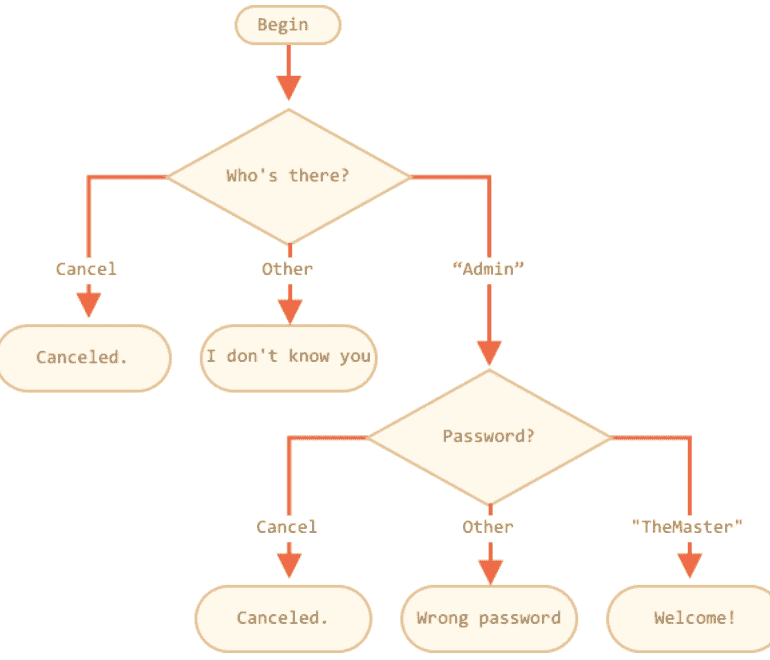

请使用嵌套的 `if` 块。注意代码整体的可读性。

提示：向 `prompt` 传递空输入返回空字符串 `''`。在 `prompt` 期间按 ESC 返回 `null`。

---

# 循环：while 和 for

我们经常需要重复操作。

例如，逐个输出列表中的商品，或者为 1 到 10 的每个数字运行相同的代码。

*循环* 是多次重复相同代码的一种方式。

## “while”循环

`while` 循环具有以下语法：

```javascript
while (condition) {
  // 代码
  // 所谓的“循环体”
}
```

只要条件为真，循环体中的代码就会执行。

例如，下面的循环在 `i < 3` 时输出 `i`：

```javascript
let i = 0;
while (i < 3) { // 显示 0，然后是 1，2
  alert(i);
  i++;
}
```

执行一次循环体称为“迭代”（iteration）。示例中的循环进行了三次迭代。

如果示例中缺少了 `i++`，循环（理论上）将无限循环下去。在实践中，浏览器提供了停止循环的方法，而在服务器端 JavaScript 中，我们可以杀掉进程。

任何表达式或变量都可以作为循环条件，而不仅仅是比较：`while` 会评估条件并将其转换为布尔值。

例如，写 `while (i != 0)` 的更简写方式是 `while (i)`：

```javascript
let i = 3;
while (i) { // 当 i 变成 0 时，条件变为假，循环停止
  i--;
}
```

> 单行循环体不需要大括号

如果循环体只有一条语句，我们可以省略大括号 `{...}`：

```javascript
let i = 3;
while (i) alert(i--);
```

## “do...while”循环

可以使用 `do..while` 语法将条件检查移动到循环体下方：

```javascript
do {
  // 循环体
} while (condition);
```

循环会先执行循环体，然后检查条件，只要条件为真，就会再次执行。

例如：

```javascript
let i = 0;
do {
  alert(i);
  i++;
} while (i < 3);
```

这种语法形式应该在你想让循环体无论条件是否真至少执行一次时使用。通常优选另一种形式：`while(...){...}`。

## "for"循环

`for` 循环是最常用的循环。

它看起来像这样：

```javascript
for (begin; condition; step) {
  // 循环体 ...
}
```

让我们通过示例学习这些部分的含义。下面的循环为 `i` 从 0 到 3（不包含 3）运行 `alert(i)`：

```javascript
for (let i = 0; i < 3; i++) // 显示 0，然后是 1，然后是 2
  alert(i);
```

让我们逐部分检查 `for` 语句：

| 部分 | 示例 | 描述 |
| :--- | :--- | :--- |
| begin | `i = 0` | 进入循环时执行一次。 |
| condition | `i < 3` | 在每次迭代前检查。如果为假，循环停止。 |
| step | `i++` | 在每次迭代的体执行之后、条件检查之前执行。 |
| body | `alert(i)` | 只要条件为真，就反复运行 |

通用的循环算法如下：

```
循环开始
-> (if condition) -> 运行体并运行 step
-> (if condition) -> 运行体并运行 step
-> (if condition) -> 运行体并运行 step
-> ...
```

如果你是循环的新手，回到示例并在纸上一步逐步复现它是如何运行的，可能会有所帮助。

以下是我们的案例中具体发生的情况：

```javascript
// for (let i = 0; i < 3; i++) alert(i)

// 运行 begin
let i = 0
// if condition -> 运行体并运行 step
if (i < 3) { alert(i); i++; }
// if condition -> 运行体并运行 step
if (i < 3) { alert(i); i++; }
// if condition -> 运行体并运行 step
if (i < 3) { alert(i); i++; }
// ... 结束，因为 i == 3
```

### 内联声明

在这里，“计数器”变量 `i` 直接在循环中声明。此类变量在循环内部可见。

```javascript
for (let i = 0; i < 3; i++) {
  alert(i); // 0, 1, 2
}
```

### 无此类变量

与其定义变量，可以使用现有变量：

```javascript
let i = 0;
for (i = 0; i < 3; i++) { // 使用现有变量
  alert(i);
}
```

### 跳过部分

`for` 的任何部分都可以被跳过。

例如，如果不需要在开始时做任何事情，可以省略 `begin`。

就像这里：

```javascript
let i = 0;
for (; i < 3; i++) {
  alert(i); // 0, 1, 2
}
```

我们也可以移除 `step` 部分。

```javascript
let i = 0;
for (; i < 3;) {
  alert(i++);
}
```

这使得循环等同于 `while (i < 3)`。

我们实际上可以移除一切，创建一个无限循环：

```javascript
for (;;) {
  // 无限循环
}
```

请注意两个分号 `;` 必须存在。否则会导致语法错误。

## 退出循环

通常，循环在条件变为假时退出。但我们可以使用特殊的 `break` 指令随时强制退出。

例如，下面的循环要求用户输入一系列数字，在没有数字时“退出”：

```javascript
let sum = 0;
while (true) {
  let value = prompt("输入数字", '');
  if (!value) break; //
  sum += value;
}
alert('Sum: ' + sum);
```

`break` 指令在用户输入空行或取消输入时激活。它立即停止循环，跳转到循环后的第一行。即 `alert`。

“无限循环 + 需要 break”的组合适用于不需要在循环开始或结束检查条件，而是在循环体的多个地方检查的情况。

## 继续下次迭代

`continue` 指令是 `break` 的“轻量版”。它不会停止整个循环，而是停止当前迭代并强制循环开始一个新的迭代（如果条件允许）。

我们可以在当前迭代中使用它并跳转到下一个。下面的循环使用 `continue` 只输出奇数：

```javascript
for (let i = 0; i < 10; i++) {
  // 如果为真，跳过体的剩余部分
  if (i % 2 == 0) continue;
  alert(i); // 1, 然后 3, 5, 7, 9
}
```

对于 `i` 的偶数值，`continue` 指令停止执行体并将控制权传递给 `for` 的下次迭代（下一个数字）。因此 `alert` 只对奇数调用。

> continue 指令减少嵌套

显示奇数的循环如下：

```javascript
for (let i = 0; i < 10; i++) {
  if (i % 2) {
    alert(i);
  }
}
```

从技术角度来看，这与上面的示例相同。无疑，我们只需要将代码封装在 `if` 块中，而不是使用 `continue`。

但作为副作用，这又增加了一层嵌套（大括号内的 `alert` 调用）。如果 `if` 内部的代码超过几行，可能会降低整体的可读性。

### ⚠️ '?' 右侧不能使用 break/continue

请注意，作为表达式的语法结构不能与三元运算符 `?` 使用。特别是 `break/continue` 等指令在那里是不允许的。

例如，如果我们取这段代码：

```javascript
if (i > 5) {
  alert(i);
} else {
  continue;
}
```

...使用问号重写它：

```javascript
(i > 5) ? alert(i) : continue; // 这里不允许 continue
```

...它停止了。这样的代码将产生语法错误。

这是不使用问号运算符代替 `if` 的另一个原因。

## break/continue 的标签

有时我们需要一次性退出多个嵌套循环。

例如，在代码中，我们跳出循环 `i` 和 `j`，提示从 (0, 0) 到 (3, 3) 的坐标 `(i, j)`：

```javascript
for (let i = 0; i < 3; i++) {
  for (let j = 0; j < 3; j++) {
    let input = prompt(`坐标 (${i},${j}) 的值`);
    // 如果我想从这里退出到 Done（下方）该怎么办
  }
}
alert('Done!');
```

我们需要一种方法在用户取消输入时停止进程。

普通的 `break` 只会打破内层循环。这还不够——标签（Labels）来救场！

标签是循环前带有一个冒号的标识符：

```javascript
labelName: for (...) {
  ...
}
```

循环中的 `break <labelName>` 语句会跳转到指定的标签：

```javascript
outer: for (let i = 0; i < 3; i++) {
  for (let j = 0; j < 3; j++) {
    let input = prompt(`Value at (${i},${j})`);
    // 如果为空字符串或取消，跳出外层循环
    if (!input) break outer; // (*)
    // 对该值进行某些操作...
  }
}
alert('Done!');
```

在上面的代码中，`break outer` 会向上寻找名为 `outer` 的标签并跳出该循环。

因此，控制流直接从 `(*)` 跳跃到 `alert('Done!')`。

我们也可以将标签单独放在一行：

```javascript
outer:
for (let i = 0; i < 3; i++) { ... }
```

`continue` 指令可以与标签一起使用。在这种情况下，代码执行将跳转到标记循环的下一次迭代。

> 标签不是“goto”

标签并不允许我们跳转到代码中的任意位置。

例如，执行以下操作是不可能的：

```javascript
break label; // 跳转到 label? 不行。
label: for (...);
```

调用 `break/continue` 只能在循环内部进行，且标签必须位于该指令的某个上方。

---

# 总结

我们涵盖了 3 种循环：

- `while` – 在每次迭代开始前检查条件。
- `do..while` – 在每次迭代后检查条件。
- `for (;;)` – 在每次迭代开始前检查条件，并提供额外的设置。

要创建一个“无限”循环，通常使用 `while(true)` 结构。这种循环和任何其他循环一样，我们可以使用 `continue` 配合 `break` 指令使用。

如果我们不想在当前迭代中执行任何操作，并想直接跳转到下一次迭代，可以使用 `continue` 指令。

`break/continue` 支持循环前的标签。标签是 `break/continue` 跳出嵌套循环并进入外层循环的唯一方法。

---

# 任务

## 最后一次循环的值

重要性: 3

这段代码 `alert` 的最后一个值是什么？为什么？

```javascript
let i = 3;
while (i) {
  alert(i--);
}
```

## while 循环显示哪些值？

重要性: 4

对于每次循环迭代，写下它输出的值，然后与解决方案进行比较。

这两个循环 `alert` 的值相同吗？

1. 前置形式 `++i`：
```javascript
let i = 0;
while (++i < 5) alert(i);
```
2. 后置形式 `i++`：
```javascript
let i = 0;
while (i++ < 5) alert(i);
```

## "for" 循环会显示哪些值？

重要性: 4

对于每个循环，写下它将显示哪些值。然后与答案进行比较。

这两个循环 `alert` 的值相同吗？

1. 后置形式：
```javascript
for (let i = 0; i < 5; i++) alert(i);
```
2. 前置形式：
```javascript
for (let i = 0; i < 5; ++i) alert(i);
```

## 在循环中输出偶数

重要性: 5

使用 `for` 循环输出从 `2` 到 `10` 的偶数。

## 将 "for" 替换为 "while"

重要性: 5

重写代码，将 `for` 循环改为 `while` 而不改变其行为（输出应该保持不变）。

```javascript
for (let i = 0; i < 3; i++) {
  alert(`number ${i}`);
}
```

## 重复直到输入正确为止

重要性: 5

编写一个循环，提示输入一个大于 100 的数字。如果用户输入另一个数字——要求他们重新输入。

循环必须一直询问数字，直到用户输入大于 100 的数字或取消输入/输入空行为止。

在这里我们可以假设用户只输入数字。此任务中不需要对非数字输入实现特殊处理。

## 输出质数

重要性: 3

大于 1 的整数被称为质数，如果它除了 1 和自身外，不能被任何其他整数整除。

换句话说，如果 `n > 1` 且不能被 1 和 `n` 以外的任何数整除，那么 `n` 就是质数。

例如，5 是质数，因为不能被 2、3 和 4 整除。

编写代码输出 2 到 `n` 范围内的质数。

对于 `n = 10`，结果将是 2, 3, 5, 7。

附注：代码应适用于任何 `n`，而不应针对任何固定值进行硬编码。

---

# "switch" 语句

`switch` 可以替换多个 `if` 检查。

它提供了一种更具描述性的将值与多个变体进行比较。

## 语法

`switch` 有一个或多个 `case` 块以及可选的 `default`。

它看起来如下：

```javascript
switch(x) {
  case 'value1': // if (x === 'value1')
    ...
    [break]
  case 'value2': // if (x === 'value2')
    ...
    [break]
  default:
    [break]
}
```

- 检查 `x` 的值与第一个 `case` 中的值是否严格相等。
- 如果匹配，则执行该 `case` 块的代码。

---

# 任务

## 将 "switch" 替换为 "if"

重要性: 5

使用 `if..else` 编写代码以对应以下 `switch` 语句：

```javascript
switch (browser) {
  case 'Edge':
    alert("You've got the Edge!");
    break;
  case 'Chrome':
  case 'Firefox':
  case 'Safari':
  case 'Opera':
    alert('Ok we support these too');
    break;
  default:
    alert('We hope that this page looks ok!');
}
```

## "if" 替换为 "switch"

重要性: 4

使用单个 `switch` 语句重写以下代码：

```javascript
let a = prompt('a?', '');

if (a == 0) {
  alert(0);
}
if (a == 1) {
  alert(1);
}
if (a == 2 || a == 3) {
  alert('2,3');
}
```

---

# 函数

## 函数声明

我们曾赞扬过箭头函数的简洁性。但这并不是全部！箭头函数还有其他有趣的特性。我们将在本章节的“重新审视箭头函数”中回到它们。现在，我们已经可以使用它们来进行单行操作和回调了。

### 示例

```javascript
function showMessage() {
  alert('Hello everyone!');
}
```

`function` 关键字首先，接着是函数名，然后是括号之间的参数列表（在上面的示例中为空），最后是花括号之间的函数代码，也称为“函数体”。

## 函数名

我们可以通过名称调用这个新函数：`showMessage()`。

例如：

```javascript
function showMessage() {
  alert('Hello everyone!');
}

showMessage();
showMessage();
```

调用 `showMessage()` 会执行函数的代码。在这里，我们将看到两次消息。

这个示例清楚地演示了函数的主要目的之一：避免代码重复。

如果我们需要更改消息或其显示方式，只需要修改一处代码即可：输出该消息的函数。

## 局部变量

在函数内部声明的变量只在该函数内部可见。

例如：

```javascript
function showMessage() {
  let message = "Hello, I'm JavaScript"; // 局部变量
  alert(message);
}

showMessage(); // Hello, I'm JavaScript!
alert(message); // <-- 错误！变量是局部的
```

## 外部变量

函数也可以访问外部变量，例如：

```javascript
let userName = 'John';

function showMessage() {
  let message = 'Hello, ' + userName;
  alert(message);
}

showMessage(); // Hello, John
```

函数对外部变量具有完全访问权限。它也可以修改它。

例如：

```javascript
let userName = 'John';

function showMessage() {
  userName = 'Bob'; // (1) 修改了外部变量
  let message = 'Hello, ' + userName;
  alert(message);
}

alert(userName); // 调用前的 John
showMessage();
alert(userName); // Bob，值被函数修改了
```

在没有局部变量的情况下，才会使用外部变量。

如果在内部声明了同名变量，它将遮蔽（shadow）外部变量。例如，在这种情况下，下面的代码使用了局部的 `userName`。外部的被忽略了：

```javascript
let userName = 'John';

function showMessage() {
  let userName = 'Bob'; // 声明一个局部变量
  let message = 'Hello, ' + userName; // Bob
  alert(message);
}

// 函数将创建并使用它自己的 userName
showMessage();

alert(userName); // John，未改变，函数没有访问外部变量
```

## 全局变量

声明在任何函数之外的变量，例如上面代码中的外部 `userName`，被称为 `global`（全局变量）。

全局变量从任何函数中都可见（除非被局部变量遮蔽）。

尽量减少全局变量的使用是一个良好的习惯。现代代码很少或没有全局变量。大多数变量存在于各自的函数中。尽管如此，它们对于存储项目级的数据可能是很有用的。

## 参数

我们可以使用参数（也称为 `function arguments`）向函数传递任意数据。在下面的示例中，函数有两个参数：`from` 和 `text`。

```javascript
function showMessage(from, text) { // 参数：from, text
  alert(from + ':' + text);
}

showMessage('Ann', 'Hello!'); // Ann: Hello!
showMessage('Ann', "What's up?"); // Ann: What's up?
```

当调用函数时，值会从 `from` 和 `text` 复制到局部变量。然后函数使用它们。

这里是另一个例子：我们有一个变量 `from` 并将其传递给函数。请注意：函数更改了 `from`，但更改在外部是不可见的，因为函数总是获得值的一个副本：

```javascript
function showMessage(from, text) {
  from = '*' + from + '*'; // 让 "from" 看起来更好看
  alert(from + ':' + text);
}

let from = "Ann"
showMessage(from, "Hello"); // *Ann*: Hello

// "from" 的值相同，函数修改的是局部副本
alert(from); // Ann
```

## 默认值

如果未提供参数，其值将变为 `undefined`。

例如，上述函数 `showMessage(from, text)` 可以用单个参数调用：

```javascript
showMessage("Ann");
```

这不是一个错误。这样的调用将输出 `"Ann: undefined"`。因为没有文本，所以假设 `text === undefined`。

如果我们在这个案例中使用一个“默认”文本，我们可以在 `=` 之后指定它：

```javascript
function showMessage(from, text = "no text given") {
  alert(from + ":" + text);
}

showMessage("Ann"); // Ann: no text given
```

现在如果没有传递 `text` 参数，它将获得值 `"no text given"`。

这里 `"no text given"` 是字符串，但它可以是一个更复杂的表达式，只有在参数缺失时才会求值并赋值。因此，这也是可能的：

```javascript
function showMessage(from, text = anotherFunction()) {
  // 只有在未提供文本时才会执行 anotherFunction()
  // 它的结果将成为值
}
```

## 返回值

`return` 语句用于从函数返回值给调用者。

```javascript
function sum(a, b) {
  return a + b;
}

let result = sum(2, 3); // 5
```

### 没有返回值的函数

如果函数没有 `return` 语句，它返回 `undefined`。

```javascript
function doSomething() {
  console.log("Hello");
}

let result = doSomething(); // undefined
```

### 返回空值的函数

如果函数有一个 `return` 语句但没有值，它返回 `undefined`。

```javascript
function doSomething() {
  return;
}

let result = doSomething(); // undefined
```

### 永远在 return 和值之间换行

对于 `return` 中的长表达式，可能想将其放在单独行，例如：

```javascript
return
(some + long + expression + or + whatever * f(a) + f(b))
```

这是行不通的，因为 JavaScript 会假设在 `return` 之后有一个分号。效果等同于：

```javascript
return;
(some + long + expression + or + whatever * f(a) + f(b))
```

因此，它实际上变成了空返回。我们应该将值放在同一行。

## 函数命名

函数是动作。因此名称通常是一个动词。它应该简洁、尽可能准确，并描述函数的功能，这样阅读代码的人就能推出函数的作用。

一种常见的做法是用动词前缀开始函数，模糊地描述该动作。团队必须对前缀的含义达成共识。

例如，以 `"show"` 开头的函数通常显示某些内容。

以以下前缀的函数：

- `"get..."` – 返回值
- `"calc..."` – 计算某些内容
- `"create..."` – 创建某些内容
- `"check..."` – 检查某些内容并返回布尔值等

此类命名的示例：

```javascript
showMessage(...)     // 显示消息
getAge(...)          // 返回年龄（通过某种方式获取）
calcSum(...)         // 计算和并返回结果
createForm(...)      // 创建表单（通常会返回它）
checkPermission(...) // 检查权限，返回真/假
```

### 一个函数 - 一个动作

函数的行为应该完全符合其名称所暗示的，不多也不少。

独立的动作通常应该对应独立的函数，即使它们通常被一起调用（在这种情况下，我们可以创建一个第 3 个函数来调用它们）。

以下是违反这一规则的几个例子：

- `getDate` – 如果它显示一个包含年龄的提示框，那就是很糟糕的（应该只负责获取）。
- `createForm` – 如果它修改了文档并在其中添加了表单，那就是很糟糕的（应该只创建并返回）。
- `checkPermission` – 如果它显示允许/拒绝访问的消息，那就是很糟糕的（应该只执行检查并返回结果）。

这些示例假设前缀具有通用含义。你和你的团队可以自由约定其他含义，但它们并没有太大区别。无论如何，你都应该明确理解前缀的含义，以及带前缀的函数可以和不能做什么。所有带前缀的函数都应该遵守规则。团队应该共享这些知识。

### 超短函数名

非常常用的函数有时会有极短的名字。

例如，jQuery 框架定义了一个使用 `$` 的函数。Lodash 库将其核心函数命名为 `_`。

这些是例外。通常，函数名应该是简洁且具有描述性的。

## 函数 == 注释

函数应该是短小的，并且只做一件事。如果那件事很大，也许值得将函数拆分成几个更小的函数。有时这个规则可能并不容易遵守，但它绝对是一件好事。

独立的函数不仅更容易测试和调试——它的存在本身就是一个极佳的注释！

例如，比较下面的两个 `showPrimes(n)` 函数。每个函数都输出到 `n` 的质数。

第一种变体使用了标签（label）：

```javascript
function showPrimes(n) {
  nextPrime: for (let i = 2; i < n; i++) {
    for (let j = 2; j < i; j++) {
      if (i % j == 0) continue nextPrime;
    }
    alert(i); // 一个质数
  }
}
```

第二种变体使用额外的函数 `isPrime(n)` 来测试质性：

```javascript
function showPrimes(n) {
  for (let i = 2; i < n; i++) {
    if (!isPrime(i)) continue;
    alert(i); // 一个质数
  }
}

function isPrime(n) {
  for (let i = 2; i < n; i++) {
    if (n % i === 0) return false;
  }
  return true;
}
```

第二种变体更容易理解，不是吗？我们看到的不是代码本身，而是一个如 `isPrime` 的动作名称。有时人们将这种代码称为“自描述代码”。

所以，即使我们不打算复用它们，也可以创建函数。它们结构化了代码并使其具有可读性。

---

# 总结

函数声明的形式如下：

```javascript
function name(parameters, delimited, comma) {
  /* code */
}
```

- 作为参数传递给函数的值会被复制到它的局部变量中。
- 函数可以访问外部变量。但它只在从内向外工作。函数外部的代码看不到它的局部变量。
- 函数可以返回一个值。如果不返回，那么它的结果就是 `undefined`。

为了使代码整洁且易于理解，建议在函数主要使用变量和参数，而不是外部变量。

理解一个获取参数、处理参数并返回结果的函数，总是比理解一个不获取参数但通过副作用修改外部变量的函数要容易得多。

函数命名：

- 名称应该清晰地描述函数的功能。当我们在代码中看到函数调用时，一个好的名字能瞬间让我们理解它做什么以及返回什么。
- 函数是一个动作，所以函数名通常是动词。
- 存在许多著名的函数前缀，如 `create...`、`show...`、`get...`、`check...` 等。使用它们来提示函数的功能。

函数是脚本的主要构建块。现在我们已经涵盖了基础，我们可以开始创建和使用它们。但这只是开始。我们将多次回到它们，深入研究它们的高级特性。

---

# 任务

## 需要 "else" 吗？

重要性：4

以下函数在参数 `age` 大于 `18` 时返回 `true`。

否则，它会请求确认并返回其结果：

```javascript
function checkAge(age) {
  if (age > 18) {
    return true;
  } else {
    // ...
    return confirm('Did parents allow you?');
  }
}
```

如果移除 `else`，函数运行会有不同吗？

```javascript
function checkAge(age) {
  if (age > 18) {
    return true;
  }
  // ...
  return confirm('Did parents allow you?');
}
```

这两个变体的行为有任何区别吗？

## 使用 '?' 或 '||' 重写函数

重要性：4

以下函数在参数 `age` 大于 `18` 时返回 `true`。

否则，它会请求确认并返回其结果。

```javascript
function checkAge(age) {
  if (age > 18) {
    return true;
  } else {
    return confirm('Do you have your parents permission to access this page?');
  }
}
```

重写它，以实现相同的功能，但不使用 `if`，并且在一行内完成。

---

# 回调函数

让我们看看更多将函数作为值传递以及使用函数表达式例子。

我们将编写一个 `ask(question, yes, no)` 函数，它有三个参数：

| 参数 | 说明 |
| :--- | :--- |
| `question` | 问题的文本 |
| `yes` | 当答案为“是”时执行的函数 |
| `no` | 当答案为“否”时执行的函数 |

该函数应该提问，并根据用户的回答调用 `yes()` 和 `no()`：

```javascript
function ask(question, yes, no) {
  if (confirm(question)) yes();
  else no();
}

function showOK() {
  alert("你同意了.");
}

function showCancel() {
  alert("你取消了执行.");
}

// 使用方法：将 showOK, showCancel 作为参数传递给 ask
ask("同意吗?", showOK, showCancel);
```

在我们用更短的方式编写它之前，请注意在浏览器中，服务器端函数（某些情况下）非常流行。现实世界的实现与上述示例的主要区别在于，现实中的函数使用更复杂的方法通过简单的 `confirm` 与用户交互。在浏览器中，这种函数通常会画出一个漂亮的问题窗口。那是另一回事了。

`ask` 的参数被称为回调函数（callbacks）或简称回调。

其思想是传递一个函数，并期望在必要时以后被“回掉”。在我们的情况下，`showOK` 成为“是”答案的回调，`showCancel` 成为“否”答案的回调。

我们可以使用函数表达式（Function Expressions）来写相同的函数：

```javascript
function ask(question, yes, no) {
  if (confirm(question)) yes();
  else no();
}

ask(
  "同意吗?",
  function() { alert("你同意了."); },
  function() { alert("你取消了执行."); }
);
```

在这里，函数直接声明在 `ask(...)` 调用内部。它们没有名称，因此被称为匿名函数。这些函数在 `ask` 外部无法访问的（因为它们没有被赋值给变量），但这正是我们想要的。

这种代码在我们的脚本中出现非常自然，它符合 JavaScript 的精神。

> 函数是一个代表“动作”的值
> 字符串或数字等普通值表示数据。
> 函数可以被看作一个动作。我们可以在变量之间传递它，并在我们想要的时候运行它。

---

# 函数表达式 vs 函数声明

让我们阐明函数声明（Function Declarations）和函数表达式（Expressions）之间的关键区别。

首先是语法：如何在代码中区分它们。

- **函数声明**：一个函数，在主代码流中作为一个独立的语句进行声明。

```javascript
// 函数声明
function sum(a, b) {
  return a + b;
}
```

- **函数表达式**：一个函数，在表达式内部或另一个语法结构内部创建。在这里，函数是在“赋值表达式” `=` 的右侧创建的：

```javascript
// 函数表达式
let sum = function(a, b) {
  return a + b;
}
```

更微妙的区别在于，函数是在执行到达它时被创建的，并且从那一刻起才是可用的。

函数表达式在执行到达它时被创建，并且从那一刻起才可用。

一旦执行流通过赋值的右侧 `sum = function...`——在这里，函数被创建，并且从现在起就可以使用（赋值、调用等）。

函数声明则不同。

## 函数声明可以在定义之前被调用。

例如，全局函数声明在整个脚本中都是可见的，无论它在什么位置。

这是由于内部算法。当 JavaScript 准备运行脚本时，它会首先查找其中的全局函数声明并创建这些函数。我们可以将其认为一个“初始化阶段”。

在处理完所有函数声明后，代码才会执行。因此它可以访问这些函数。

例如，这是可以的：

```javascript
sayHi("John"); // 你好，John

function sayHi(name) {
  alert(`Hello, ${name}`);
}
```

函数声明 `sayHi` 在 JavaScript 准备启动脚本时创建，并且在脚本中处处可见。

...如果它是函数表达式，它将无法工作：

```javascript
sayHi("John"); // 错误！

let sayHi = function(name) { // (*) 没有魔法了
  alert(`Hello, ${name}`);
}
```

函数表达式是在执行到达它们时被创建的。这只会在行 `(*)` 之后发生。太晚了。

在严格模式下，当函数声明位于代码块内部时，它在该块内部处处可见。但在块之外不是。

例如，假设我们需要根据运行时获得的 `age` 变量声明一个函数 `welcome()`。然后计划稍后使用它。

如果使用函数声明，它将无法按预期工作：

```javascript
let age = prompt("你多大了?", 18);

// 条件地声明函数
if (age < 18) {
  function welcome() {
    alert("你好!");
  }
} else {
  function welcome() {
    alert("你好!");
  }
}

//...稍后使用它
welcome(); // 错误：welcome 未定义
```

这是因为函数声明只在它所在的代码块内部可见。

这是另一个例子：

```javascript
let age = 16; // 以 16 为例

if (age < 18) {
    welcome();                      // (运行)
    function welcome() {          // 函数声明可用
        alert("你好!");
    }
} else {
    function welcome() {
        alert("你好!");
    }
}
```

---

# 箭头函数

我们曾赞扬过箭头函数的简洁性。但这并不是全部！箭头函数还有其他有趣的特性。我们将在本章节的“重新审视箭头函数”中回到它们。现在，我们已经可以使用它们来进行单行操作和回调了。

## 总结

- 函数是值。它们可以在代码的任何地方被赋值、复制或声明。
- 如果函数在主代码流中作为独立的语句声明，则它被称为“函数声明”（Function Declaration）。
- 如果函数是作为表达式的一部分创建的，它被称为“函数表达式”（Function Expression）。
- 函数声明在代码块执行之前被处理。它们在块的任何地方都是可见的。
- 函数表达式在执行流到达它们时才创建。

在大多数情况下，当我们需要声明一个函数时，函数声明是更好的，因为它在声明本身之前就是可见的。这为我们的代码组织提供了更大的灵活性，而且通常更具可读性。

因此，只有当函数声明不适合任务时，我们才使用函数表达式。我们在本章中看到了一些例子，未来还会看到更多。

箭头函数在单行代码中非常出色。它们有两种形式：

1. 无大括号：`(...args) => expression` – 右侧是一个表达式：函数求值并返回结果。
2. 有大括号：`(...args) => { body }` – 大括号允许我们在函数内部编写多个语句，但我们需要显式的 `return` 来返回内容。

---

# 任务

## 使用箭头函数重写

将代码中的函数表达式替换为箭头函数：

```javascript
function ask(question, yes, no) {
  if (confirm(question)) yes();
  else no();
}

ask(
  "Do you agree?",
  function() { alert("You agreed."); },
  function() { alert("You canceled the execution."); }
);
```

---

# JavaScript 特殊语法

本章简要回顾了我们到目前为止学过的 JavaScript 特性，特别关注了一些细微之处。

## 代码结构

语句用分号分隔：

```javascript
alert('Hello'); alert('World');
```

通常情况下，换行符也被视为分隔符，所以那样写也行：

```javascript
alert('Hello')
alert('World')
```

这就是“自动分号插入”。有时它不起作用，例如：

```javascript
alert("There will be an error after this message")
[1, 2].forEach(alert)
```

大多数人认为我们应该在每个语句后加上分号。

在代码块 `{...}` 和带有它们的语法结构（如循环）之后，不需要分号：

```javascript
function f() {
  // 函数声明后不需要分号
}

for(;;) {
  // 循环结束后不需要分号
}
```

...但即使我们可以在某处放一个“额外”的分号，那也不是错误。它会被忽略。

## 严格模式

为了完全启用现代 JavaScript 的所有功能，我们应该用 `"use strict"` 头脚本。

```javascript
'use strict';
...
```

该指令必须位于脚本的顶部或函数的开头。

如果没有 `"use strict"`，一切仍然可以工作，某些功能会以旧式的“兼容”方式运行。我们通常更倾向于现代行为。

语言的某些现代特性（如我们以后将学习类）会启用严格模式。

## 变量

可以使用以下方式声明：

- `let`
- `const`（常量，不可更改）
- `var`（旧式，稍后会看到）

变量名可以包含：

- 字母和数字，但第一个字符不能是数字。
- 字符 `$` 和 `_` 是正常的，与字母平级。
- 允许非拉丁字母和象形文字，但常用。

变量是动态类型的。它们可以存储任何值：

```javascript
let x = 5;
x = "John";
```

有 7 种数据类型：

- `number` 用于浮点数和整数
- `string` 用于字符串。
- `boolean` 用于逻辑值：`true`/`false`。
- `null` – 一个只有一个值 `null` 的类型，意味着“空”或“不存在”。
- `undefined` – 一个只有一个值 `undefined` 的类型，意味着“未赋值”。
- `object` 和 `symbol` – 复杂数据结构和唯一标识符，我们还没有学习它们。

`typeof` 运算符返回值的类型，但有两个例外：

```javascript
typeof null == "object" // 语言中的错误
typeof function(){} == "function" // 函数被特殊对待
```

## 交互

我们使用浏览器作为工作环境，因此基础 UI 函数将是：

```javascript
prompt(question, [default])
```
询问一个问题，返回访问者输入的内容，如果他们点击“取消”则返回 `null`。

```javascript
confirm(question)
```
询问一个问题并建议在“确定”和“取消”之间选择。选择返回 `true`/`false`。

```javascript
alert(message)
```
输出消息。

所有这些函数都是模态的，它们会暂停代码执行并防止访问者在回答之前与页面交互。

例如：

```javascript
let userName = prompt("Your name?", "Alice");
let isTeaWanted = confirm("Do you want some tea?");

alert("Visitor: " + userName); // Alice
alert("Tea wanted: " + isTeaWanted); // true
```

## 运算符

JavaScript 支持以下运算符：

### 算术运算符

普通的：`* + - /`，还有用于取模的 `%` 以及用于幂的 `**`。

加法拼接字符串。如果操作数中有一个是字符串，另一个也会转换为字符串：

```javascript
'1' + 2 // '12'
1 + '2' // '12'
```

### 赋值

有简单的赋值：`a = b` 以及复合赋值如 `a *= 2`。

### 位运算符

位运算符作用于整数。

### 三元运算符

唯一带有三个参数的运算符：`cond ? resultA : resultB`。如果 `cond` 为真，返回 `resultA`，否则返回 `resultB`。

### 逻辑运算符

`&&` 和 `||` 进行短路求值。逻辑非 `!` 将操作数转换为布尔类型并取反值。

### 比较运算符

相等性检查 `==` 对不同类型进行转换（除了 `null` 和 `undefined` 它们相等）：

```javascript
0 == false // true
0 == '' // true
```

其他比较也会转换为数字。

严格相等运算符 `===` 不进行转换。不同类型总是意味着不同的值。

`null` 和 `undefined` 是特殊的：它们相等，但不等于任何其他值。

大于/小于比较逐字符比较，其他类型转换为数字。

### 其他运算符

还有其他的，如逗号运算符。

## 循环

- 我们涵盖了 3 种循环

```javascript
// 1
while (condition) {
  ...
}

// 2
do {
  ...
} while (condition);

// 3
for(let i = 0; i < 10; i++) {
  ...
}
```

- `for(let ...)` 循环中声明的变量仅在循环内部可见。我们也可以省略 `let` 并复用现有变量。

指令 `break/continue` 允许退出 `while` 循环/当前迭代。标签用于中断嵌套循环。

以后我们将学习更多处理对象的循环。

## "switch" 结构

`switch` 结构可以替换多个 `if` 。它使用 `===`（严格相等）进行比较。

例如：

```javascript
let age = prompt('Your age?', 18);

switch (age) {
  case 18:
    alert("Won't work"); // prompt 的结果是字符串，不是数字
  case "18":
    alert("This works!");
    break;
  default:
    alert("Any value not equal to one above");
}
```

## 函数

我们涵盖了 JavaScript 中创建函数的两种方式：

- 1. 函数声明：在主代码流中的函数

```javascript
function sum(a, b) {
  let result = a + b;
  return result;
}
```

- 2. 函数表达式：在表达式语境中的函数

```javascript
let sum = function(a, b) {
  let result = a + b;
  return result;
}
```

- 3. 箭头函数：

```javascript
// 右侧的表达式
let sum = (a, b) => a + b;

// 或者带有 { ... } 的多行语法，这里需要 return：
let sum = (a, b) => {
  return a + b;
}

// 无参数
let sayhi = () => alert("Hello");

// 单参数
let double = n => n * 2;
```

- 函数可以有局部变量：即在函数体内部声明的变量。这些变量仅在函数内部可见。
- 参数可以有默认值：`function sum(a = 1, b = 2) {}`。
- 函数总是返回某些内容。如果没有 `return` 语句，结果将是 `undefined`。

| 函数声明 | 函数表达式 |
| :--- | :--- |
| 在整个代码块中可见 | 在执行到此处时创建 |
| | 可以有名称，仅在函数内部可见 |

---

# 代码质量

本章解释了我们在后续开发中将使用的编码规范。

## 在 Chrome 中调试

在编写更复杂的代码之前，让我们来谈谈调试。

所有现代浏览器和其他环境都支持“调试”——开发者工具中的一个特殊 UI，它让查找和修复错误变得简单得多。

我们将在这里使用 Chrome，因为它在这方面可能是功能最丰富的。

## “源代码 (Sources)”面板

你的 Chrome 版本可能看起来略有不同，但那里有什么内容应该是显而易见的。

- 打开示例页面
- 使用 F12 开启开发者工具（Mac: Cmd+Opt+I）
- 如果是第一次操作，请选择源代码（Sources）面板：

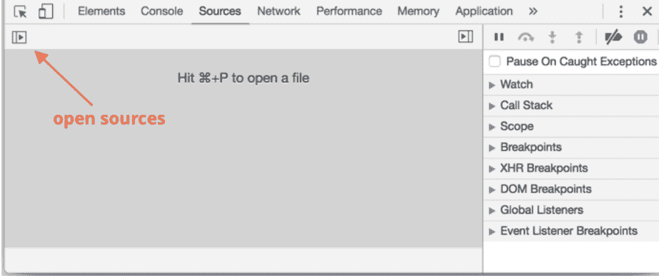

切换按钮可以在树状视图中打开 `hello.js` 文件。

点击它并选择 `hello.js`。这里应该显示的内容：

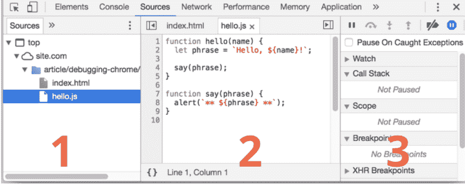

在这里我们可以看到三个区域：

- 资源（Resources）区域列出了 HTML、JavaScript、CSS 和其他文件，包括附加到页面上的。Chrome 扩展可能会出现在这里。
- 源代码（Source）区域显示源代码。
- 信息和控制区域用于调试，我们很快就会探索它。

现在你可以再次点击切换按钮来隐藏资源列表，为代码留出空间。

## 控制台 (Console)

如果我们按下 Esc，下方会打开控制台。我们可以在那里输入命令并按回车执行。

执行一个语句后，其结果将显示在下方。

例如，这里 `1+2` 的结果是 `3`，而 `hello("debugger")` 返回空内容，所以结果是 `undefined`：

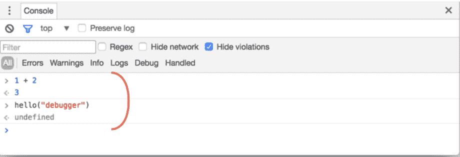

## 断点 (Breakpoints)

让我们检查示例页面代码内部发生了什么。在 `hello.js` 中，点击第 4 行。是的，直接点击数字 4，而不是代码。

恭喜！你设置了一个断点。请也点击第 8 行。

它看起来应该是这样（蓝色部分是你要点击的地方）：

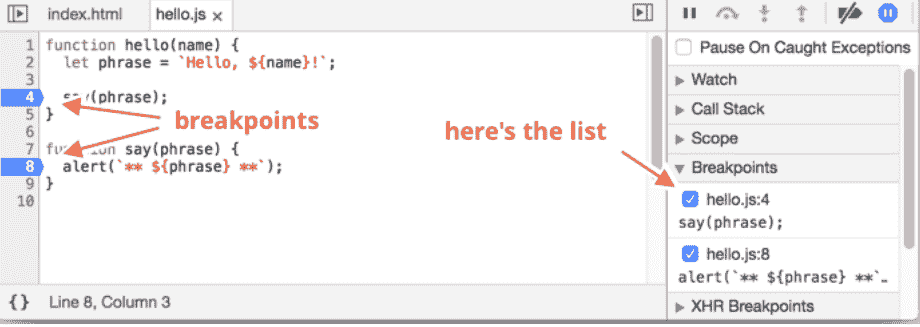

断点是调试器将自动暂停 JavaScript 执行的代码点。

当代码暂停时，我们可以检查当前变量、在控制台中执行命令等。换句话说，我们可以对其进行调试。

我们可以在右侧面板找到断点列表。当我们在多个文件中有很多断点时非常有用。它允许我们：

- 快速跳转到代码中的断点（通过点击右侧面板中的它）。
- 通过取消勾选来临时禁用断点。
- 通过右键点击并选择“删除”移除断点。
- ...以此类推。

## 条件断点

右键点击行号可以创建条件断点。只有当给定的表达式为真值（truthy）时，它才会触发。

当我们只需要针对特定的变量值或某些函数参数停止时，这非常有用。

## debugger 命令

我们也可以通过使用 `debugger` 命令暂停代码，如下所示：

```javascript
function hello(name) {
  let phrase = `Hello, ${name}!`;
  debugger; // 调试器在此处停止
  say(phrase);
}
```

当我们在代码编辑器中，且不想切换到浏览器并在开发者工具中查找脚本来设置断点时，这非常方便。

## 暂停并观察

在我们的示例中，`hello()` 在页面加载期间被调用，激活调试器简单的方法是刷新页面。按下 F5（Windows, Linux）或 Cmd+R。

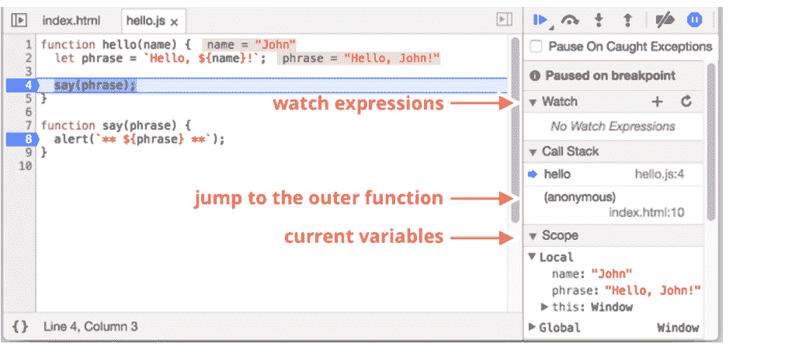

这里涵盖了开发者工具中更多选项。完整版手册请访问：https://developers.google.com/tools/chrome-devtools

本章提供的信息足够开始调试，但稍后特别是当你处理大量的浏览器相关工作时，请去那里查看开发者工具的更多高级功能。

哦，你也可以点击开发者工具的各个地方，看看会显示什么。那可能是学习开发者工具最快的途径。别忘了使用右键点击！

---

# 编码风格

我们的代码必须尽可能整洁且易读。

实际上，编写代码是编程的艺术——将一个复杂的任务以一种既正确又易于人类阅读的方式将其代码化。良好的代码风格对此有很大帮助。

## 语法

这里有一个包含规则的备查表（详情请见下文）：

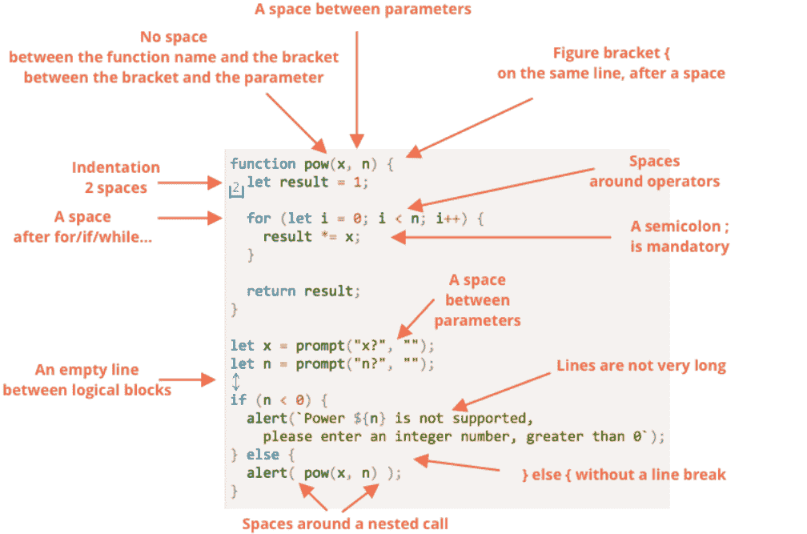

现在让我们详细讨论这些规则及其背后的原因。

> ⚠️ 没有“必须”遵守的规则。这里没有不可更改的。这些是风格偏好，而不是宗教教条。

## 大括号

在大多数 JavaScript 项目中，大括号采用“埃及式”写法，即左大括号与相应的关键字在同一行——而不是另起一行。在左括号之前也应该有一个空格，如下：

```javascript
if (condition) {
  do this
  // ...and that
  // ...and that
}
```

单行结构（如 `if (condition) doSomething(),`）是一个重要的边界情况。我们至少应该使用大括号吗？

以下是各种变体，你可以自己判断它们的可读性：

> 初学者有时会这样做。糟糕！不需要花括号

```javascript
if (n < 0) alert(`${n} is not supported`);
```

> 分拆到单独的一行但不加括号。千万不要这样做！这是糟糕错误的根源。

```javascript
if (n < 0)
alert(`${n} is not supported`);
```

> 不加括号的单行。如果很短的话是可以接受的。

```javascript
if (n < 0) alert(`${n} is not supported`);
```

> 最优变体。

```javascript
if (n < 0) {
  alert(`${n} is not supported`)
}
```

## 行长度

没有人喜欢读长长的水平行代码。将它们拆分是最佳实践。

例如：

```javascript
// 反引号引号允许将字符串拆分为多行
let str = `
Ecma International's TC39 is a group of JavaScript developers,
implementers, academics, and more, collaborating with the community
To maintain and evolve the definition of JavaScript.
`;
```

以及对于 `if` 语句：

```javascript
if (
    id === 123 && moonPhase === 'Waning Gibbous' && zodiacSign === 'Libra'
) {
    letTheSorceryBegin();
}
```

最大行长度应该在团队层面达成一致。通常是 80 或 120 个字符。

## 缩进

缩进有两种类型：

- **水平缩进**：2 或 4 个空格。

    水平缩进使用 2 个或 4 个空格或 "Tab" 符号完成。选择哪一个是一场古老的圣战。现在空格更常见。

    空格相对于 Tab 的一个优点是，空格比 "Tab" 符号允许更灵活的缩进配置。

    例如，我们可以将参数与左括号对齐，如下：

```javascript
show(parameters,
aligned, // 左侧有 5 个空格填充
one,
after,
another
) {
  // ...
}
```

- **垂直缩进**：使用空行将代码拆分为逻辑块。

    即使是单个函数也可以划分为逻辑块。在下面的示例中，变量的初始化、主循环和结果返回是垂直拆分的：

```javascript
function pow(x, n) {
  let result = 1;
  //---
  for (let i = 0; i < n; i++) {
    result *= x;
  }
  //---
  return result;
}
```

在有助于提高可读的地方插入额外的空行。没有垂直缩进的代码不应超过九行。

## 分号

每个语句后面都应该有分号，即使可以跳过。在某些语言中，分号是可选的且很少使用。在 JavaScript 中，存在换行被解释为分号的情况，会导致代码容易出错。如果你是一个丰富的程序员，可能会选择 Standard 那样不使用分号的风格。否则，大多数开发者都会加上分号。

## 嵌套层级

尽量避免过多的嵌套。例如，与其像这样添加嵌套：

```javascript
for (let i = 0; i < 10; i++) {
  if (cond) {
    // 一个层级
  }
}
```

我们可以写：

```javascript
for (let i = 0; i < 10; i++) {
  if (!cond) continue; // 没有额外的嵌套层级
}
```

可以使用 `if/else` 和提前 `return` 实现类似的效果。例如，下面的两种构造是相同的。

选项 1：

```javascript
function pow(x, n) {
  if (n < 0) {
    alert('n not supported');
  } else {
    let result = 1;
    for (let i = 0; i < n; i++) {
      result *= x;
    }
    return result;
  }
}
```

选项 2：

```javascript
function pow(x, n) {
  if (n < 0) {
    alert("n not supported");
    return;
  }

  let result = 1;
  for (let i = 0; i < n; i++) {
    result *= x;
  }

  return result;
}
```

第二种更易读，因为处理 `n < 0` 的特殊情况不需要额外的嵌套。

## 函数位置

如果你在编写辅助函数和使用它们的代码，有三种组织方式：

1. 在代码上方声明函数：

```javascript
// 函数声明
function createElement() {
  ...
}

function setHandler(elem) {
  ...
}

function walkAround() {
  ...
}

// 使用它们的代码
```


# 代码风格

## 代码结构

### 1. 代码在前，函数在后

```javascript
// 使用它们的代码
let elem = createElement();
setHandler(elem);
walkAround();

// 辅助函数
function createElement() {
  ...
}
function setHandler(elem) {
  ...
}
function walkAround() {
  ...
}
```

### 2. 混合风格

在第一次使用时声明函数。大多数情况下倾向于第一种，因为在阅读代码时我们首先想知道它做什么。如果代码在前，从一开始就很清晰。

## 风格指南

风格指南包含了关于如何编写代码的通用规则，例如使用什么引号、缩进多少空格、在哪里换行等其他细节。当团队的所有成员都使用同一个风格指南时，无论是谁写的，代码看起来都是统一的。当然，团队可以编写自己的风格指南，但通常没有必要。有很多现有指南可以选择。一些流行的选择：

- Google JavaScript Style Guide
- Airbnb JavaScript Style Guide
- Idiomatic.JS
- StandardJS
- （以及更多）

如果你是一个新手开发者，从本章开头的备查表开始。然后你可以浏览其他风格指南来获取更多想法并决定你最喜欢哪一个。

## 自动检查

`Linter` 是自动检查代码风格并提供改进建议的工具。它们的优点是可以发现一些 Bug，例如变量或函数名中的类型错误。由于此功能，即使你不想遵循特定的代码风格，也建议使用 linter。以下是一些著名的 linter：

- `JSLint` — 最早的 linter 之一。
- `JSHint` – 比 `JSLint` 有更多设置。
- `ESLint` – 可能是最新的。

它们都可以胜任工作。作者使用了 `ESLint`。大多数 linter 都集成在许多编辑器中：只需在编辑器中启用插件并配置风格。例如，对于 `ESLint`，你应该执行以下操作：

1. 安装 `Node.js`。
2. 使用命令 `npm install -g eslint` 安装 `ESLint`（`npm` 是 JavaScript 包安装器）。
3. 在 JavaScript 项目根目录下（包含所有文件的文件夹）创建一个名为 `.eslintrc` 的配置文件。
4. 为你的编辑器安装/启用集成 `ESLint` 的插件。大多数编辑器都有。

这是一个 `.eslintrc` 文件的示例：

```json
{
  "extends": "eslint:recommended",
  "env": {
    "browser": true,
    "node": true,
    "es6": true
  },
  "rules": {
    "no-console": 0,
    "indent": ["warning", 2]
  }
}
```

在这里，指令 `"extends"` 表示配置是基于 `"eslint:recommended"` 设置集的。在此之后，我们指定了自己的规则。可以从网上下载风格规则并进行扩展。有关安装的更多细节，请参见 <http://eslint.org/docs/user-guide/getting-started>。此外，某些 IDE 内置了检查，虽然方便但不如 `ESLint` 可定制。

## 总结

本章（以及参考的风格指南）描述的所有语法规则旨在提高代码的可读性。它们所有都是可以讨论的。当我们思考编写“更好的代码”时，应该问自己的问题是：“是什么让代码更易读、更容易理解？”以及“什么可以帮助我们避免错误？”这些是在选择和讨论代码风格时需要考虑的主要点。

---

# 任务：坏风格

**重要性：4**

下面的代码风格有什么问题？

```javascript
function pow(x,n) {
  let result=1;
  for(let i=0;i<n;i++) { result*=x; }
  return result;
}

let x=prompt("x?"), n=prompt("?n?");
if (n<=0) {
  alert(`Power ${x} is not supported, please enter an integer number greater than zero`);
} else {
  alert(pow(x,n));
}
```

修复它。

---

# 注释

正如我们在“代码结构”章节中所知，注释可以是单行的（以 `//` 开头），也可以是多行的（`/* ... */`）。

我们通常用它们来描述代码是如何工作以及为什么要这样工作的。

初看起来，写注释是显而易见的，但编程新手通常会做错。

## 坏注释

新手倾向于使用注释来解释“代码正在发生什么”。如下：

```javascript
// 这段代码将执行这件事 (...) 和那件事 (...)
// ...而且谁知道还会发生什么...
very:
complex:
code
```

在良好的代码中，“解释性”注释的数量应该尽可能少。说真的，代码应该在没有注释的情况下也易于理解。

有一条黄金法则：**“如果代码晦涩到需要注释才能解释，那么代码就应该重构。”**

## 菜谱：提取函数

有时，将一段代码替换为函数是有益的，如下所示：

```javascript
function showPrimes(n) {
  nextPrime:
  for (let i = 2; i < n; i++) {
    // 检查 i 是否为质数
    for (let j = 2; j < i; j++) {
      if (i % j == 0) continue nextPrime;
    }
    alert(i);
  }
}
```

更好的变体提取了 `isPrime`：

```javascript
function showPrimes(n) {
  for (let i = 2; i < n; i++) {
    if (isPrime(i)) continue;
  }
  alert(i);
}

function isPrime(n) {
  for (let i = 2; i < n; i++) {
    if (n % i == 0) return false;
  }
  return true;
}
```

现在我们可以轻松地理解代码了。函数本身就变成了注释。这样的代码被称为**自描述代码**。

## 菜谱：创建函数

如果我们有像这样的一长“代码页”：

```javascript
// 在这里添加威士忌
for(let i = 0; i < 10; i++) {
  let drop = getWhiskey();
  smell(drop);
  add(drop, glass);
}

// 在这里添加果汁
for(let t = 0; t < 3; t++) {
  let tomato = getTomato();
  examine(tomato);
  let juice = press(tomato);
  add(juice, glass);
}
// ...
```

那么重构为如下函数可能是更好的变体：

```javascript
addWhiskey(glass);
addJuice(glass);

function addWhiskey(container) {
  for (let i = 0; i < 10; i++) {
    let drop = getWhiskey();
    //...
  }
}

function addJuice(container) {
  for (let t = 0; t < 3; t++) {
    let tomato = getTomato();
    //...
  }
}
```

再次，函数本身就能告诉你正在发生什么。没有什么需要注释。而且拆分后的代码结构更佳。每个函数做什么、接收什么、返回什么一目了然。

现实中，我们无法完全避免“解释性”注释。有复杂的算法，还有为了优化而进行的智能“微调”。但通常我们应该尝试保持代码简单且自描述。

## 好的注释

所以，解释性注释通常是坏的。什么样的注释是好的？

### 描述架构

提供组件的高级视图、它们如何交互、在各种情况下的控制流……简而言之——代码的俯视图。有一种特殊的图语言 `UML` 用于高级架构图。非常值得学习。

### 文档函数用法

有一种特殊的语法 `JSDoc` 用来记录函数：用法、参数、返回值。例如：

```javascript
/**
 * 返回 x 的 n 次方。
 * @param {number} x - 底数。
 * @param {number} n - 次幂，必须是自然数。
 * @return {number} x 的 n 次方。
 */
function pow(x, n) {
  ..
}
```

这样的注释允许我们在不看源码的情况下理解函数并正确使用它。

顺便说一下，许多编辑器如 [WebStorm](https://www.jetbrains.com/webstorm/) 也能理解它们，并利用它们提供代码补全和一些代码检查。此外，还有像 `JSDoc 3` 这样的工具可以从注释生成 HTML 文档。你可以在 <http://usejsdoc.org> 查看更多关于 `JSDoc` 的信息。

### 为什么任务解决了？

写下的很重要。没写的尤其如此。

如果代码晦涩到需要注释才能解释，那么代码就应该重构。

---

# 变量命名

当然，变量名仍然代表某些含义。它说明了变量内部的内容：一个字符串、一个数字或其他。当局外人士试图理解代码时，他们会惊讶地发现实际上根本没有任何信息！而你最终将无法表达出你深思熟虑的代码。

值类型很容易通过调试找到。但变量的意义是什么？它存储的是哪一个字符串/数字？

如果不进行深刻的冥想，根本没法弄清楚！

- 但如果没有这些名字呢？直接加个数字吧：`data1`, `item2`, `elem5`...

## 注意力测试

只有真正留心的程序员才能读懂你的代码。但如何检查呢？

方法之一——使用相似的变量名，例如 `date` 和 `data`。

在任何可能的地方混用它们。

快速阅读这样的代码是不可能的。而当出现拼写错误时……嗯……我们会被困住很久，该喝茶了。

## 聪明的同义词

> 最难的事情是在黑暗的房间里寻找一只黑猫，尤其是当那里没有猫时。孔子

对相同事物使用相似的名称会让生活更有趣，并向公众展示你的创造力。

例如，代码定义了前缀。如果一个函数在屏幕上显示消息——以 `display...` 开头，比如 `displayName`。如果另一个函数在屏幕上显示其他内容，比如用户名，以 `show...` 开头（如 `showName`）。

暗示这些函数之间存在微妙的区别，尽管实际上并没有。

与团队的忍者伙伴达成约定：如果 John 在他的代码中开始用 `display...` 开头的“显示”函数，那么 Peter 可以用 `render...`，而 Ann 可以……注意代码变得变得多么有趣和多样化。

……现在是帽子戏法！

对于两个具有重要差异的函数——使用相同的前缀！

例如，`tabPage(page)` 函数将使用打印机。而 `printText(text)` 函数将文本放在屏幕上。一个不熟悉的读者会思考命名相似的函数 `printMessage`：“它会把消息放在哪里？打印机上还是屏幕上？”为了让它真正脱颖而出，`printMessage(message)` 应该在新窗口中输出它。

## 重用名称

> 一旦整体被拆分，部分就需要名字。名字已经足够了。人必须知道何时停止。
> 老子（《道德经》）

在绝对必要时添加新变量。
相反，重用现有名称。只需向它们写入新值。
在函数内部，尽量只使用作为参数传递的变量。
这将使得非常难以识别变量现在到底具体是什么，以及它从哪里来。其目的是培养阅读代码的人的直觉和记忆。
直觉薄弱的人不得不逐行分析代码，并跟踪每个代码分支中的变化。

这种方法的高级变体是在循环或函数的模式下秘密地（！）将值替换为类似的内容。

例如：

```javascript
function ninjaFunction(elem) {
  // 20行处理 elem 代码
  elem = clone(elem);
  // 20行，现在处理的是 elem 的克隆了！
}
```

另一个想在函数后半部分与 `elem` 操作的程序员会大吃一惊！在调试期间，在检查代码后，他们才会发现自己处理的是一个克隆！

这在代码中很常见。即使对于经验丰富的忍者也极其有效。

## 下划线的乐趣

在变量名之前加上下划线 `_` 和 `__`。如 `_name` 或 `__value`。如果只有你知道它们的含义就太棒了。或者，最好是为了好而添加它们，完全没有特定含义。或者在不同的地方有不同的含义。

你一箭双雕。代码的可读性越来越差，其次，另一个开发者可能会花费大量时间试图弄清楚这些下划线是什么。

聪明的忍者在代码的一个地方放置下划线，而在其他地方避开它们。这会让代码更加脆弱，并增加未来错误的概率。

## 展现你的爱

让每个人看到你的实体有多伟大。像 `superElement`、`megaFrame` 和 `niceItem` 这样的名字绝对会让读者目一亮。
事实上，一方面写了：`super...`、`mega...`、`nice..`。但另一方面——这并没有带来任何细节。读者可能会决定寻找隐藏的含义，并为了你的工作冥想一两个小时。

## 重叠外部变量

> 光中，看不见黑暗。
> 黑暗中，可见光明。
> 郭子子

在函数内部和外部使用相同的变量名。简单就好。不需要发明新名字。

```javascript
let user = authenticateUser();

function render() {
  let user = anotherValue();
  ... 许多行...
  // <-- 一个程序员想在这里处理 user 然后...
}
```

跳进 `render` 的程序员可能没有注意到有一个本地 `user` 遮蔽了外部的 `user`。

然后他们尝试假设它是外部变量，即 `authenticateUser()` 的结果进行操作……陷阱触发了！你好，调试器……

## 到处都是副作用！

有些函数看起来没有改变任何东西。如 `isReady()`、`checkPermission()`、`findTags()`……它们被认为执行了计算并返回数据，而不改变外部的任何内容。换句话说，没有“副作用”。

一个非常漂亮的技巧是在主任务之外，为它们添加一个“有用”的动作。

当你同事看到名为 `is...`、`check..` 或 `find...` 的函数改变了某些东西时，他们脸上惊讶的表情绝对会开眼界。

---

# 测试：BDD 简介

## 规范

```javascript
assert.equal(value1, value2)
```

代码块内部的代码，如果实现是正确的，应该在无错误的情况下执行。
`assert.*` 函数用于检查 `pow` 是否按预期工作。在这里我们使用了其中一个 `assert.equal`，它会比较参数，如果它们不相等则抛出错误。在这里，它检查 `pow(2, 3)` 的结果是否等于 8。
我们之后还会看到其他类型的比较和检查。

## 开发流程

开发流程通常如下：
1. 编写一个初始规范（spec），并包含对最基础运行的测试。
2. 创建一个初始实现。
3. 为了检查它是否可以工作，我们运行 `Mocha` 框架（稍后将提供详细信息）来运行规范。当功能尚未完成时，会显示错误。我们不断进行修正，直到一切运行正常。
4. 现在我们有了一个带有测试的可运行初始实现了。
5. 我们在规范中添加更多用例，这些用例可能实现尚未支持。测试开始失败。
6. 返回第 3 步，更新实现，直到测试无错误。
7. 重复步骤 3-6，直到功能准备就绪。

因此，开发是迭代的。我们编写规范，实现它，确保测试通过，编写更多测试，确保它们正常工作。最后，我们既拥有可以运行的实现，也拥有它的测试。
让我们在实际案例中看看这个开发流程。

第一步已经完成：我们有了 `pow` 的初始规范。现在，在进行实现之前，让我们使用几个 JavaScript 库来运行测试，只需看看它们是否正常工作（它们都会失败）。

## 规范的运行

在本文教程中，我们将使用以下 JavaScript 测试库：

- `Mocha` — 框架：它提供了常用的测试函数，包括 `describe` 和 `it`，以及运行测试的主函数。
- `Chai` — 包含许多断言的库。它允许我们使用许多不同的断言，而我们现在只需要 `assert.equal`。
- `Sinon` — 一个用于函数侦探（spy）、模拟内置函数等等功能的库，我们以后会经常需要它。

这些库适用于浏览器端和服务器端测试。我们将考虑浏览器变体。
包含这些框架和 `pow` 规范的完整 HTML 页面：

```html
<!DOCTYPE html>
<html>
<head>
  <!-- 添加 mocha 和 chai，用于显示结果 -->
  <link rel="stylesheet" href="https://cdnjs.cloudflare.com/ajax/libs/mocha/3.2.0/mocha.css">
  <!-- 添加 mocha 框架代码 -->
  <script src="https://cdnjs.cloudflare.com/ajax/libs/mocha/3.2.0/mocha.js"></script>
  <script>
    mocha.setup('bdd'); // 最小配置
  </script>
  <!-- 添加 chai -->
  <script src="https://cdnjs.cloudflare.com/ajax/libs/chai/3.5.0/chai.js"></script>
  <script>
    // chai 有很多东西，让我们将其全局
    let assert = chai.assert;
  </script>
</head>
<body>
  <script>
    function pow(x, n) {
      /* 函数代码将写在这里 */
    }
  </script>
  <!-- 包含测试的脚本 (describe, ...) -->
  <script src="test.js"></script>
  <!-- id="mocha" 的元素将包含结果 -->
  <div id="mocha"></div>
  <!-- 运行测试! -->
  <script>
    mocha.run();
  </script>
</body>
</html>
```

该页面可以分为五个部分：

1. `<head>` – 添加第三方库和样式。
2. 包含待测函数的 `<script>`，在我们的案例中——包含 `pow` 的代码。
3. 测试 – 在外部脚本 `test.js` 中，其中包含了上面的 `describe("pow", ...)`。
4. `id="mocha"` 的 HTML 元素将用于 `Mocha` 输出结果。
5. 通过 `mocha.run()` 命令启动测试。

结果：

```
AssertionError: expected undefined to equal 8
at <anonymous> (test.js:4:12)
```

到目前为止测试失败了，存在错误。这是符合逻辑的：我们在 `pow` 中写了一个空函数，所以 `pow(2,3)` 返回 `undefined` 而不是 8。
为了将来，请注意还有其他更高级的测试运行器，如 `karma` 等，它们可以轻松地自动化许多测试。

## 初始实现

让我们为 `pow` 写一个简单的实现，以便测试通过。

```javascript
function pow(x, n) {
  return 8; // 作弊！
}
```

哇，现在可以工作了！

## 改进规范

我们所做的绝对是作弊。函数并没有工作：尝试计算 `pow(3,4)` 会得到错误的结果，但测试通过了。
但这种情况很典型，在实践中经常发生。测试通过了，但函数运行错误。我们的规范是不完善的。我们需要向它添加更多案例。
再添加一个测试来检查 `pow(3, 4) = 81`。

我们可以选择两种方式之一来组织测试：

**第一变体** – 在同一个 `it` 中添加另一个 `assert`：

```javascript
describe("pow", function() {
  it("提升到 n 次方", function() {
    assert.equal(pow(2, 3), 8);
    assert.equal(pow(3, 4), 81);
  });
});
```

**第二种** – 增加一个 `it`：

```javascript
describe("pow", function() {
  it("2 的 3 次方是 8", function() {
    assert.equal(pow(2, 3), 8);
  });
  it("3 的 4 次方是 81", function() {
    assert.equal(pow(3, 4), 81);
  });
});
```

第一种方式允许在同一个 `it` 中包含多个断言。第二种方式是将它们拆分为独立的 `it` 块。这种方式通常更好，因为如果一个断言失败，你可以清楚地看到是哪一个失败了，而不影响其他断言的执行（取决于测试运行器的配置）。

```javascript
it("for negative n the result is NaN", function() {
  assert.isNaN(pow(2, -1));
});

it("for non-integer n the result is NaN", function() {
  assert.isNaN(pow(2, 1.5));
});
```

新测试的运行结果：

- * 如果 n 为负数，结果为 NaN
  * AssertionError: expected 1 to be NaN
- * 如果 n 不是整数，结果为 NaN
  * AssertionError: expected 4 to be NaN
- * 计算 x 的 3 次方
  ✓ 1 的 3 次方是 1
  ✓ 2 的 3 次方是 8
  ✓ 3 的 3 次方是 27
  ✓ 4 的 3 次方是 64
  ✓ 5 的 3 次方是 125

新添加的测试失败了，因为我们的实现不支持它们。这就是 BDD 的做法：首先编写失败的测试，然后为它们编写实现。

## 其他断言

请注意断言 `assert.isNaN`：它用于检查 `NaN`。

`Chai` 中还有其他断言，例如：

- `assert.equal(value1, value2)` – 检查相等性 `value1 == value2`
- `assert.strictEqual(value1, value2)` – 检查严格相等 `value1 === value2`
- `assert.notEqual` / `assert.notStrictEqual` – 与上述断言相反的反向检查。
- `assert.isTrue(value)` – 检查 `value === true`
- `assert.isFalse(value)` – 检查 `value === false`
- ...完整列表可以在[文档](#)中

所以我们应该在 `pow` 函数中添加几行：

```javascript
function pow(x, n) {
  if (n < 0) return NaN;
  if (Math.round(n) != n) return NaN;

  let result = 1;
  for (let i = 0; i < n; i++) {
    result *= x;
  }
  return result;
}
```

现在可以工作了，所有测试均通过。

## 总结

在 BDD 中，规范先行，然后是实现。最后，我们既有了规范也有了代码。

规范有三种方式使用：

1. **测试** – 保证了代码运行正常。
2. **文档** – `describe` 和 `it` 的标题说明了函数的功能。
3. **示例** – 测试实际上是运行中的示例，展示了如何使用一个函数。

有了规范，我们可以安全地改进、更改，甚至从头重写函数，并确保它运行正确。

这在大型项目中尤为重要，当一个函数被很多地方使用。当我们修改这样的函数时，没有办法手动检查每个使用它的地方是否仍然正常工作。

如果没有测试，人们有两种办法：
1. 无论如何都进行更改。然后我们的用户就会遇到 Bug，因为我们可能漏掉了某些手动检查。
2. 或者，如果错误对错误的惩罚很严厉（由于没有测试），人们会害怕修改函数，导致代码过时，没人想碰它。

**自动化测试有助于避免这些问题！**

如果项目覆盖了测试，就不会有这种问题。在任何更改之后，我们可以在几秒钟内运行测试并看到检查列表。

**此外，测试良好的代码具有更好的架构。**

自然，这是因为经过自动测试的代码更容易修改和改进。但还有另一个原因。

为了编写测试，代码的组织方式应该让每个函数都有描述清晰的任务、定义良好的输入和输出。这意味着从一开始就有良好的架构。

在现实生活中，这有时并不容易。在编写实际代码之前编写规范很困难，因为还不清楚它应该如何表现。但总体来说，后写测试会让开发更稳定。

在教程的后面部分，你将遇到许多内置了测试的任务。所以你会看到更多实际示例。

编写测试需要良好的 JavaScript 知识。但我们才开始学习。所以，为了巩固一切，即使你不被要求编写测试，你也应该能够阅读它们了，即使它们比本章的稍微复杂一点。

---

# 任务：测试中有什么错误？

**重要性：5**

下面 `pow` 的测试有什么错误？

```javascript
it("Raises x to the power n", function() {
  let x = 5;
  let result = x;
  assert.equal(pow(x, 1), result);
  result *= x;
  assert.equal(pow(x, 2), result);
  result *= x;
  assert.equal(pow(x, 3), result);
});
```

---

# 对象

## 创建对象

```javascript
let user = new Object(); // "object constructor" syntax
let user = {}; // "object literal" syntax
```

通常情况下使用大括号 `{...}`。这种声明被称为**对象字面量**。

## 字面量与属性

我们可以直接在 `{...}` 中以“键: 值”对的形式放入一些属性：

```javascript
let user = { // 一个对象
  name: "John", // 通过键 "name" 存储值 "John"
  age: 30       // 通过键 "age" 存储值 30
};
```

一个属性在冒号 `:` 之前有一个键（也称为“名称”或“标识符”），在右侧有一个值。

在 `user` 对象中，有两个属性：
1. 第一个属性的名为 `"name"`，值为 `"John"`。
2. 第二个属性的名为 `"age"`，值为 `30`。

生成的 `user` 对象可以被想象成一个带有两个标记为 `"name"` 和 `"age"` 的签名文件的柜子。

我们可以随时向其中添加、删除和读取文件。

属性值可以使用点表示法（dot notation）来访问：

```javascript
// 获取对象的字段：
alert(user.name); // John
alert(user.age);  // 30
```

值可以是任何类型。让我们添加一个布尔类型的属性：

```javascript
user.isAdmin = true;
```

要删除一个属性，我们可以使用 `delete` 运算符：

```javascript
delete user.age;
```

我们也可以使用多单词属性名，但它们必须加引号：

```javascript
let user = {
  name: "John",
  age: 30,
  "likes birds": true // 多单词属性名必须加引号
};
```

列表中的最后一个属性可以以逗号结尾，

```javascript
let user = {
  name: "John",
  age: 30,
}
```

这被称为“尾随逗号”或“悬挂逗号”。它使得添加/删除/移动属性变得更加容易，因为所有行都变得一样了。

## 方括号

对于多单词的属性，点访问是不起作用的：

```javascript
// 这将导致语法错误
user.likes birds = true
```

这是因为点符号要求键必须是一个有效的变量标识符。即：不能有空格或其他限制。

有一种替代的“方括号表示法”（square bracket notation），它可以适用于任何字符串：

```javascript
let user = {};

// 设置
user["likes birds"] = true;

// 获取
alert(user["likes birds"]); // true

// 删除
delete user["likes birds"];
```

一切正常。请注意方括号内的字符串必须正确地加上引号（任何类型的引号均可）。

方括号还提供了一种方法，可以将表达式的结果作为属性名——而不是字面量字符串——例如从变量中获取：

```javascript
let key = "likes birds";
// 等同于 user["likes birds"] = true;
user[key] = true;
```

变量 `key` 可以在运行时计算或取决于用户的输入。然后我们使用它来访问属性。这赋予了我们极大的灵活性。点表示法无法以此方式使用。

例如：

```javascript
let user = {
  name: "John",
  age: 30
};

let key = prompt("你想了解关于用户的什么信息？", "name");
// 通过变量访问
alert(user[key]); // John（如果输入 "name"）
```

## 计算属性

我们可以在对象字面量中使用方括号。这被称为**计算属性**（computed properties）。

例如：

```javascript
let fruit = prompt("想买什么水果？", "apple");
let bag = {
  [fruit]: 5, // 属性名来自变量 fruit
}
alert(bag.apple); // 如果 fruit="apple" 则为 5
```

计算属性的含义很简单：`[fruit]` 意味着属性名应该从 `fruit` 获取。

所以，如果访问者输入 `"apple"`，`bag` 将变为 `{apple: 5}`。

本质上，它的工作原理与：

```javascript
let fruit = prompt("想买什么水果？", "apple");
let bag = {};
// 从 fruit 变量中获取属性名
bag[fruit] = 5;
```

...但看起来更好。

我们可以在方括号中使用更复杂的表达式：

```javascript
let fruit = 'apple';
let bag = {
  [fruit + 'Computers']: 5 // bag.appleComputers = 5
}
```

方括号比点表示法要强大得多。它们允许动态计算属性名。

## 属性值简写

在实际开发中，我们经常使用现有变量作为属性名。

例如：

```javascript
function makeUser(name, age) {
  return {
    name: name,
    age: age,
    // ...其他属性
  };
}
```

由于属性名与变量名相同，我们可以使用**属性值简写**：

```javascript
function makeUser(name, age) {
  return {
    name, // 等同于 name: name
    age,  // 等同于 age: age
    // ...
  };
}
```

我们可以同时使用普通属性和简写属性：

```javascript
let user = {
  name,  // 等同于 name: name
  age: 30
};
```

## 属性名限制

正如我们所知，变量名不能像保留字那样（例如 `"for"`、`"let"`、`"return"` 等）。

但对于对象属性，没有这个限制：

```javascript
// 这些属性名都没问题
let obj = {
  for: 1,
  let: 2,
  return: 3
};

alert(obj.for + obj.let + obj.return); // 6
```

简言之，对象属性键可以是任何字符串或 `Symbol`。其他类型会被自动转换为字符串。

例如，数字键 `0` 会被转换为字符串 `"0"`：

```javascript
let obj = {
  0: "test" // 等同于 "0": "test"
};

alert(obj["0"]); // test
alert(obj[0]);   // test (数字键被转换为字符串)
```

## 存在性检查，"in" 运算符

JavaScript 对象的一个显著特点是：我们可以访问任何属性。即使属性不存在也不会报错！

读取不存在的属性只会得到 `undefined`。所以我们可以轻松地检查属性是否存在：

```javascript
let user = { name: "John", age: 30 };

alert(user.noSuchProperty === undefined); // true 意思是“不存在”
```

也有一个特殊的运算符 `"key" in obj` 来检查属性是否存在。

语法：`"key" in object`

例如：

```javascript
let user = { name: "John", age: 30 };

alert("age" in user); // true，user.age 存在
alert("blabla" in user); // false，user.blabla 不存在
```

这看起来很像 `undefined` 检查有什么区别？

区别在于：属性存在，但值为 `undefined` 时，`in` 运算符仍然返回 `true`。

```javascript
let obj = {
  test: undefined
};

alert(obj.test); // undefined，属性不存在吗？
alert("test" in obj); // true，属性存在！
```

这种情况很少见，因为通常 `undefined` 不会被显式赋值。我们大多使用 `null` 表示“未知”或“空值”。所以 `in` 运算符是检查属性存在性的正确方式。

## "for...in" 循环

要遍历对象的所有键，存在一种特殊的循环结构：`for..in`。这与 `for(;;)` 循环完全不同。

语法：

```javascript
for (let key in object) {
  // 执行循环体，key 为每个属性的键
}
```

例如：

```javascript
let user = {
  name: "John",
  age: 30,
  isAdmin: true
};

for (let key in user) {
  // keys
  alert(key); // name, age, isAdmin
  // values for the keys
  alert(user[key]); // John, 30, true
}
```

并不是所有的 `for` 结构都允许我们在循环内部声明循环变量，比如这里的 `let key`。

此外，我们在这里可以使用另一个变量来代替 `key`。例如，`for (let prop in obj)` 也被广泛使用。

## 对象是有序的吗

对象是有序的吗？换句话说，如果我们遍历一个对象，我们得到的属性顺序与它们添加的顺序相同吗？我们可以依赖这一点吗？

简短的答案是：“以一种特殊的方式排序”：整数属性会排序，其他属性按创建顺序出现。细节见下文。

作为一个示例，让我们考虑一个包含区代码的对象：

```javascript
let codes = {
  "49": "Germany",
  "41": "Switzerland",
  "44": "Great Britain",
  // ...
  "1": "USA"
};

for (let code in codes) {
  alert(code); // 1, 41, 44, 49
}
```

该对象可以用于向用户提供选项列表。如果我们在为一个主要面向德国受众的网站，我们可能希望 `49` 排在第一个。

但如果我们运行代码，会看到一个完全不同的结果：
- 美国 (`1`) 排在第一
- 瑞士 (`41`) 等等。

区代码按升序排列的，因为它们是整数。所以我们看到 `1, 41, 44, 49`。

### 整数属性？那是什么？

这里的“整数属性”术语指的是一个可以在字符串和整数之间转换且不发生变化的字符串。

因此，`"49"` 是一个整数属性名，因为当它转换为整数再转换回来时，它仍然相同。`"+49"` 和 `"1.2"` 则不是：

```javascript
// Math.trunc 是一个内置函数，用于删除小数部分
alert(String(Math.trunc(Number("49"))));  // "49", 相同，整数属性
alert(String(Math.trunc(Number("+49")))); // "49", 不相同 "+49" -> 不是整数属性
alert(String(Math.trunc(Number("1.2")))); // "1", 不相同 "1.2"
```

另一方面，如果键不是整数，那么它们将按照创建顺序创建，例如：

```javascript
let user = {
  name: "John",
  surname: "Smith"
};

user.age = 25; // 再添加一个

// 非整数属性按创建顺序列出
for(let prop in user) {
  alert(prop); // name, surname, age
}
```

所以，为了解决区代码的问题，我们可以通过让区代码变成非整数来“作弊”。在每个区代码前添加一个加号 `"+"` 即可。

像这样：

```javascript
let codes = {
  "+49": "Germany",
  "+41": "Switzerland",
  "+44": "Great Britain",
  // ...,
  "+1": "USA"
}

for(let code in codes) {
  alert(+code); // 49, 41, 44, 1
}
```

现在它按预期工作了。

## 引用复制

对象与原始值的一个根本区别是，它们是“按引用”存储和复制的。

原始值：字符串、数字、布尔值——是“作为一个整体值”赋值/复制的。

例如：

```javascript
let message = "Hello!";
let phrase = message;
```

结果我们得到了两个独立的变量，每个都存储 `"Hello!"`。

对象不是这样的。变量存储的不是对象本身，而是它在内存中的“地址”，换句话说是对它的“引用”。

这是对象的情况：

```javascript
let user = {
  name: "John"
};
```

在这里，对象存储在内存的某处。变量 `user` 拥有它的引用。当复制一个对象时，复制的是引用，而不是对象本身。如果我们把对象想象成一个柜子，那么变量就是它的钥匙。

例如：

```javascript
let user = { name: "John" };
let admin = user; // 复制引用
```

现在我们有两个变量，每个都引用同一个对象。我们可以修改内容：

```javascript
let user = { name: "John" };
admin.name = 'Pete'; // 通过 admin 修改
alert(user.name); // 'Pete', 从 user 看到的变化
```

上面的示例证明了只有一个对象。如果我们使用一个引用（`admin`）来访问它，稍后使用另一个引用（`user`）也会看到。

声明为 `const` 的对象是可以修改的。例如：

```javascript
const user = {
  name: "John"
}
user.age = 25; // 可能的
```

## 引用比较

比较运算符 `==` 和 `===` 对于对象的操作完全相同。只有当两个变量引用同一个对象时，它们才相等。例如：

```javascript
let a = {};
let b = a; // 复制引用
alert(a == b);  // true
alert(a === b); // true
```

而这里两个对象并不相等，即使它们是空的：

```javascript
let a = {};
let b = {}; // 独立的对象
alert(a == b); // false
```

对于像 `obj1 == obj2` 这样的比较，对象转换为原始值为真，这种比较通常是编码错误。

## Const 对象

这可能看起来该行代码会导致错误，但并没有问题，因为 `const` 固定了 `user` 本身的值。如果我们尝试给 `user` 赋值，就会报错：

```javascript
const user = {
  name: "John"
}

// Error (无法重新赋值 user)
user = {
  name: "Pete"
}
```

## 克隆与合并，Object.assign

所以，复制变量创建了同一个对象的引用。但如果我们需要复制对象呢？这也是可能的，有点困难，因为 JavaScript 中没有内置方法。这很少需要。实际上，大多数时候引用复制是良好的。但如果我们确实需要创建一个新对象并通过遍历其属性并在原始值级别复制它们来复制现有的结构。像这样：

```javascript
let user = {
  name: "John",
  age: 30
}

let clone = {}; // 新对象
// 将 user 的所有属性复制进去
for (let key in user) {
  clone[key] = user[key];
}

// 现在 clone 是完全独立的
clone.name = "Pete"; // 修改了其中的数据
```

我们也可以使用 `Object.assign` 方法来实现。其语法如下：

```javascript
Object.assign(dest, [src1, src2...])
```

- 参数 `dest` 和 `src1`, ..., `srcN`（可以根据需要任意数量）。
- 它将所有参数 `src1`, ..., `srcN` 的属性复制到 `dest`。换句话说，从第二个开始的所有参数属性复制到第一个。然后返回 `dest`。

例如，我们可以将多个对象合并为一个：

```javascript
let user = { name: "John" };
let permissions1 = { canView: true };
let permissions2 = { canEdit: true };

// 将 permissions1 和 permissions2 的所有属性复制到 user
Object.assign(user, permissions1, permissions2);

// 现在 user = { name: "John", canView: true, canEdit: true }
```

如果接收对象（`user`）已经已经有了同名的属性，它将被覆盖：

```javascript
let user = { name: "John" };
// 覆盖 name，添加 isAdmin
Object.assign(user, { name: "Pete", isAdmin: true });
// 现在 user = { name: "Pete", isAdmin: true }
```

我们也可以使用 `Object.assign` 来替换循环来进行简单的克隆：

```javascript
let user = {
  name: "John",
  age: 30
};

let clone = Object.assign({}, user);
```

它将 `user` 的所有属性复制到空对象并返回它。实际上和循环一样，但更短。

到目前为止，我们假设 `user` 的所有属性都是原始值。但属性可能是其他对象的引用。该如何处理它们呢？

```javascript
let user = {
  name: "John",
  sizes: {
    height: 182,
    width: 50
  }
}
alert(user.sizes.height); // 182
```

仅仅复制 `clone.sizes = user.sizes` 是不够的，因为 `user.sizes` 是一个对象，它将按引用复制。所以 `clone` 和 `user` 将共享相同的 `sizes`：像这样：

```javascript
let user = {
  name: "John",
  sizes: {
    height: 182,
    width: 50
  }
}

let clone = Object.assign({}, user);
alert(user.sizes === clone.sizes); // true，同一个对象
// user 和 clone 共享 sizes
user.sizes.width++; // 从一个地方修改属性
alert(clone.sizes.width); // 51, 另一个的结果
```

为了修复这个问题，我们应该使用检查每个 `user[key]` 值的循环，如果它是对象，则复制其结构。这被称为“深克隆”。

有一个深克隆的标准可以处理上述以及更复杂的情况，被称为结构化克隆算法。为了不发明轮子，我们可以使用 JavaScript 库 `lodash` 中的实现，方法名为 `_.cloneDeep(obj)`。

## 总结

对象是具有若干特殊功能的关联数组。

它们存储属性（键值对），其中：
- 属性键必须是字符串或符号（通常是字符串）
- 值可以是任何类型。

要访问属性，我们可以使用：
- 点符号法：`obj.property`
- 方括号法 `obj["property"]`。方括号允许获取变量的键，例如使用 `obj[varWithKey]`。

额外的运算符：
- 删除属性：`delete obj.prop`
- 检查对象是否包含给定的键：`"key" in obj`
- 遍历对象：`for (let key in obj)` 循环。

对象是通过引用赋值和复制的。换句话说，变量存储的不是“对象值”，而是该值的“引用”（内存中的地址）。复制变量或将其作为函数参数传递时复制的是引用，而不是对象。所有对引用的复制操作（如添加/删除属性）都是在同一个对象实例上执行的。

要创建一个“真实拷贝”（克隆），我们可以使用 `Object.assign` 或 `_.cloneDeep(obj)`。

我们在本章中学习的内容被称为“普通对象”（plain object），或者直接称为 `Object`。

JavaScript 中还有许多类型的对象：
- `Array`：用于存储数据集合
- `Date`：存储日期时间信息
- `Error`：存储错误信息
- 等此类推。

它们有自己的特殊功能，我们将在稍后学习。有时人们会说“Array 类型”或“Date 类型”，但它们并不是单独的类型，而是属于单一的“对象”数据类型。它们以各种方式扩展了它。

JavaScript 中的对象非常强大。在这里我们只是接触了这个巨大话题的一角。我们将在教程的后续部分与对象密切工作，并学习更多关于它们的知识。

---

# 任务

## Hello, object

**importance: 5**

编写代码，每个动作占一行：
1. 创建一个空对象 `user`。
2. 添加属性 `name`，其值为 `John`。
3. 添加属性 `surname`，其值为 `Smith`。
4. 将 `name` 的值改为 `Pete`。
5. 从对象中删除 `name` 属性。

## 检查是否为空

**importance: 5**

编写函数 `isEmpty(obj)`，如果对象没有属性则返回 `true`，否则返回 `false`。

它的工作方式应该是：

```javascript
let schedule = {};
alert(isEmpty(schedule)); // true

schedule["8:30"] = "get up";
alert(isEmpty(schedule)); // false
```

## 常量对象？

**importance: 5**

可以修改用 `const` 声明的对象吗？你怎么想？

```javascript
const user = {
  name: "John"
};

// 这有效吗？
user.name = "Pete";
```

## 求对象属性之和

**importance: 5**

我们有一个存储团队薪资的对象：

```javascript
let salaries = {
  John: 100,
  Ann: 160,
  Pete: 130
}
```

编写代码求加所有工资并存储在变量 `sum` 中。上面的示例中结果应该是 `390`。

如果 `salaries` 为空，结果必须为 `0`。

## 将数字属性乘以 2

**importance: 3**

创建一个函数 `multiplyNumeric(obj)`，将 `obj` 的所有数字属性乘以 2。

例如：

```javascript
// 调用前
let menu = {
  width: 200,
  height: 300,
  title: "My menu"
};

multiplyNumeric(menu);

// 调用后
menu = {
  width: 400,
  height: 600,
  title: "My menu"
}
```

请注意，`multiplyNumeric` 不需要返回任何内容。它应该在原地修改对象。

P.S. 使用 `typeof` 检查是否为数字。

---

# 垃圾回收

JavaScript 中的垃圾管理是自动执行且对我们不可见的。我们创建原始值、对象、函数……这些都会占用内存。

当某个东西不再需要时会发生什么？JavaScript 引擎是如何发现并清理它的？

## 可达性

JavaScript 内存管理的核心概念是**可达性**。简单来说，“可达”的值是以某种方式可以访问或使用的值。它们被保证存储在内存中。

1. 有一组本质上可达的基础值，由于显而易见的原因，无法被删除。
   例如：
   - 当前函数的局部变量和参数。
   - 当前嵌套调用链上其他函数的变量和参数。
   - 全局变量。
   - （还有其他内部值）
   这些值被称为**根**（roots）。

2. 如果任何其他值可以通过引用或引用链从根可达，则它被认为是可达的。
   例如，如果本地变量中有一个对象，而该对象有一个属性引用另一个对象，那么该对象就被认为是可达的。它所引用的对象也是可达的。

JavaScript 引擎中有一个名为**垃圾回收器**的后台进程。它监控所有对象并移除那些已变得不可达的对象。

## 一个简单的示例

这是一个最简单的例子：

```javascript
let simplest = {
  name: "John"
};
simplest = null;
```

现在该对象是不可达的，并将从内存中移除。

## 标记-清除算法

垃圾回收器获取根节点（roots）并对其进行“标记”（记住）。

然后它访问并“标记”来自这些根节点的所有引用。

接着，它访问已标记的对象，并标记它们的引用。所有访问过的对象都会被记录，以免未来重复访问同一个对象。

……以此类推，直到没有未访问的引用（从根节点可达）。

除了标记的对象外，所有对象都会被移除。

例如，假设我们的对象结构如下：

第一步标记根节点：

然后标记它们的引用：

……以及在可能的情况下标记它们的引用：

现在，在此过程中无法被访问的对象被视为不可达并将被移除：

这就是垃圾回收的工作原理。

JavaScript 引擎应用了许多优化方案来使其运行得更快且不影响执行。

一些优化措施包括：
- **分代收集**——对象被分为两组：“新对象”和“老对象”。许多对象出现、完成工作后很快消失，可以被激进地清理。那些生存足够久的对象会变成“老对象”，检查频率随之降低。
- **增量收集**——如果对象很多，且我们尝试一次性遍历并标记整个对象，可能会消耗时间并引入执行延迟。因此，引擎尝试将垃圾回收分成若干片段。这些片段逐个执行。这需要在它们之间进行额外的账目记录以跟踪变化，但我们获得的是许多微小的延迟，而不是一个巨大的延迟。
- **空闲时间收集**——垃圾回收器尝试仅在 CPU 空闲时运行，以减少对执行可能的影响。

还有其他垃圾回收算法的优化和变体。尽管我很想在这里描述它们，但我必须忍住，因为不同的引擎实现了不同的微调和技术。更重要的是，事情会随着引擎的发展而变化，在没有实际需求的情况下，“提前”深入研究可能并不值得。除非纯粹出于兴趣，那时我会在下方为你提供一些链接。

## 总结

需要了解的关键点：
- 垃圾回收是自动执行的。我们无法强制或阻止它。
- 只要对象是可达的，就会保留在内存中。
- 被引用并不等同于可达（从根节点）：一组相互关联的对象可能会作为一个整体变得不可达。
- 现代引擎实现了先进的垃圾回收算法。

通俗书籍《垃圾回收手册：自动内存管理艺术》（R. Jones 等人）涵盖了其中一些算法。

如果你熟悉这篇文章，关于 `V8` 垃圾回收器的更详细信息可以在《V8 游览：垃圾收集》中找到。

`V8` 博客也会定期发布内存管理的变更。

当然，为了学习垃圾回收，你最好通过学习一般的 `V8` 内部原理来做准备，并阅读曾任 `V8` 工程师的 Vyacheslav Egorov 的博客。我的意思是：“V8”最好通过解释器相关的文章来涵盖。对于其他引擎，许多方法是类似的，但垃圾回收在许多方面有所不同。

当你需要低级优化时，深入了解引擎是有益的。在熟悉语言后，将此计划为下一步将是明智的。

---

# Symbol 类型

根据规范，对象的键可以是字符串类型、符号 `symbol` 类型。不是数字或布尔值，只有字符串或 `symbol` 这两种类型。

现在我们只看到了字符串。现在让我们看看 `symbol` 能提供的优势。

## Symbols

`"Symbol"` 值代表一个唯一的标识符。

这种类型的值可以通过 `Symbol()` 创建。

```javascript
// id 是一个新 symbol
let id = Symbol();
```

在创建时，我们可以给 symbol 指定一个描述（也称为 symbol 名称），主要用于调试目的：

```javascript
// id 是一个描述为 "id" 的 symbol
let id = Symbol("id");
```

`Symbol` 保证是唯一的。即使我们创建具有相同描述的 symbol，它们也是不同的值。描述只是一个标签，不会影响任何事情。

例如，这里有两个相同描述的 symbol ——它们是不相等的：

```javascript
let id1 = Symbol("id");
let id2 = Symbol("id");
alert(id1 == id2); // false
```

如果你熟悉 Ruby 或另一种也具有某种“symbol”的语言——请不要被误导。JavaScript 的 symbol 是不同的。

### Symbol 不会自动转换为字符串

JavaScript 中的大多数值都支持隐式转换为字符串。例如，我们可以 `alert` 几乎任何值，它都能正常工作。Symbol 是特殊的。它们不会自动转换。

例如，`alert` 会报错：

```javascript
let id = Symbol("id");
alert(id); // TypeError: Cannot convert a Symbol value to a string
```

这是一种防止出错的“语言保护”，因为字符串和 symbol 在本质上是不同的，不应该相互转换。

如果我们真的想显示一个 symbol，需要对它调用 `.toString()`，如下所示：

```javascript
let id = Symbol("id");
alert(id.toString()); // Symbol(id), 现在可以了
```

或者获取 `symbol.description` 属性来获取描述：

```javascript
let id = Symbol("id");
alert(id.description); // id
```

## 隐藏属性

`Symbols` 允许我们创建对象的“隐藏”属性，其他代码部分无法访问或覆盖它。

例如，我们应用程序的不同部分访问符号 `"id"` 时，访问的是完全相同的属性。

为了实现这一点，存在一个全局符号注册表（global symbol registry）。我们可以在其中创建符号并在稍后访问它们，它保证了通过相同名称进行的重复访问将返回完全相同的符号。

为了从符号注册表中读取（如果不存在则创建），请使用 `Symbol.for(key)`。

这会调用全局注册表，如果其中存在一个描述为 `key` 的符号，则返回它；否则会创建一个新符号 `Symbol(key)` 并通过给定的 `key` 将其存储在注册表中。

例如：

```javascript
// 从全局注册表读取
let id = Symbol.for("id"); // 如果符号不存在，则创建它

// 再次读取（可能来自代码的其他部分）
let idAgain = Symbol.for("id");

// 同一个符号
alert(id === idAgain); // true
```

注册表内部符号是全局符号。如果我们希望有一个在应用程序范围内、在代码中任何地方都可以访问的符号——这正是它们的用途。

> 这听起来像 Ruby

在某些编程语言中（如 Ruby），每个名称对应唯一的符号。

在 JavaScript 中，正如我们所见，对于全局符号来说确实如此。

## Symbol.keyFor

对于全局符号，不仅 `Symbol.for(key)` 可以通过名称返回符号，还有一个反向调用：`Symbol.keyFor(sym)`，它执行反向操作：通过全局符号返回名称。

例如：

```javascript
let sym = Symbol.for("name");
let sym2 = Symbol.for("id");

// 从符号获取名称
alert(Symbol.keyFor(sym)); // name
alert(Symbol.keyFor(sym2)); // id
```

`Symbol.keyFor` 内部使用全局符号注册表来查找符号的键。它对非全局符号不起作用。如果符号不是全局的，它将无法找到它并返回 `undefined`。

例如：

```javascript
alert(Symbol.keyFor(Symbol.for("name"))); // name, 全局符号
alert(Symbol.keyFor(Symbol("name2")));    // undefined, 参数不是全局符号
```

## 系统符号 (System symbols)

存在许多 JavaScript 内部使用的“系统”符号，我们可以使用它们来精细调整对象的各个方面。

它们列在规范的“已知符号表”（Well-known symbols table）中：
- `Symbol.hasInstance`
- `Symbol.isConcatSpreadable`
- `Symbol.iterator`
- `Symbol.toJSON`
- ...以此类推。

例如，`Symbol.toJSON` 允许我们描述对象到原始值的转换。我们很快就会看到它的用法。

当我们学习相应的语言特性时，其他符号也会变得熟悉。

## 总结

`Symbol` 是用于唯一标识符的原始类型。

符号通过调用 `Symbol()` 创建，并可以带有一个可选的描述（名称）。

即使具有相同的名称，符号总是不同的值。如果我们希望带命名的符号相等，应该使用全局注册表。`Symbol.for(key)` 返回（创建）一个以 `key` 为名称的全局符号。多次调用具有相同键的 `Symbol.for` 返回完全相同的符号。

符号有两个主要用途：
1. 如果我们要在对象中添加一个“属于”另一个脚本或库的属性，我们可以创建一个符号并将其作为属性键。符号属性不在 `for..in` 循环中，因此它不会偶尔与其他属性一起被处理。它也不会被直接访问，因为其他脚本没有我们的符号。符号将免受意外使用或覆盖的保护。所以我们可以使用符号属性在对象中“秘密地”隐藏我们需要的东西，而其他人看不到。
2. JavaScript 使用了许多系统符号，可以通过 `Symbol.**` 访问。例如，在教程稍后的部分，我们将使用 `Symbol` 来更改某些内置行为。用于迭代器的 `Symbol.iterator`，用于设置对象到原始值转换的 `Symbol.toJSON` 等。

从技术上讲，符号并不是 100% 隐藏的。有一个内置的 `Object.getOwnPropertySymbols(obj)` 允许我们获取符号。还有一个名为 `Reflect.ownKeys(obj)` 的方法，返回对象的所有键，包括符号键。因此它们并不是真正的隐藏的。大多数库、内置方法和语法结构都遵循一个它们是隐藏的共同约定。而那些显式调用上述方法的人可能很清楚自己在做什么。

---

# 对象方法，“this”

对象的创建通常是为了表示现实世界的实体，如用户、订单等：

```javascript
let user = {
  name: "John",
  age: 30
}
```

在现实世界中，用户可以执行操作：从购物车中选择东西、登录、注销等。

操作在 JavaScript 中通过属性中的函数表示。

## 方法示例

首先，让我们教用户打招呼：

```javascript
let user = {
  name: "John",
  age: 30
}
user.sayHi = function() {
  alert("Hello!")
}
user.sayHi(); // Hello!
```

我们刚刚使用了一个函数表达式来创建函数并将其赋值给对象的 `user.sayHi` 属性。

然后我们可以调用它。现在我们可以说话了！

作为对象属性的函数被称为该对象的**方法**（method）。

当然，我们可以使用预先声明的函数作为方法，如下：

```javascript
let user = {
  // ...
}

// 首先声明
function sayHi() {
  alert("Hello!")
}

// 然后赋值
user.sayHi = sayHi;
```

## 方法简写

方法存在更短的语法：

```javascript
let user = {
  name: "John",
  age: 30,
  sayHi() {
    alert("Hello!")
  }
}
user.sayHi(); // Hello!
```

## 方法中的 “this”

`this` 的值是“点之前的对象”。所以在上面的示例中是 `user`：

```javascript
let user = {
  name: "John",
  age: 30,
  sayHi: function() {
    alert(this.name)
  }
}
```

但这种代码是不可靠的。如果我们决定将 `user` 赋值给另一个变量，例如 `admin = user` 并覆盖 `user`，那么它将访问错误的对象。

```javascript
let user = {
  name: "John",
  age: 30,
  sayHi: function() {
    alert(user.name);
  }
}

let admin = user;
user = null; // 覆盖以变得明显

admin.sayHi(); // 哎！在 sayHi() 中，使用了旧名称！
```

如果我们在 `alert` 中使用 `this.name` 而不是 `user.name`，那么代码就能工作。

## this 未绑定

在 JavaScript 中，`this` 关键字的行为与其他大多数编程语言不同。它可以在任何函数中使用。

像这样的代码没有语法错误：

```javascript
function sayHi() {
  alert(this.name);
}
```

`this` 的值在运行时评估，取决于上下文。它可以是任何值。

例如，同一个函数被赋值给不同的对象，并在调用时具有不同的 `this`：

```javascript
let user = { name: "John" };
let admin = { name: "Admin" };

function sayHi() {
  alert(this.name);
}

// 在两个对象中使用同一个函数
user.f = sayHi;
admin.f = sayHi;

// 这些调用具有不同的 this
// 函数内部的 "this" 是“点之前的”对象
user.f(); // John (this == user)
admin.f(); // Admin (this == admin)

admin['f'](); // Admin（点或方括号访问方法——没有区别）
```

规则很简单：如果调用了 `obj.f()`，那么在调用 `f` 期间 `this` 就是 `obj`。所以在上面的示例中，它要么是 `user`，要么是 `admin`。

```javascript
function sayHi() {
  alert(this);
}
sayHi(); // undefined
```

我们甚至可以在不使用任何对象的情况下调用函数：

在这种情况下，在严格模式下 `this` 是 `undefined`。如果我们尝试访问 `this.name`，将会产生错误。

在非严格模式下，这种情况下 `this` 的值将是全局对象（在浏览器中为 `window`，我们将在本章稍后的“全局对象”部分中介绍）。这是一个被 `"use strict"` 修复的历史行为。

通常，这种调用是一个编程错误。如果函数内部存在 `this`，则它期望在对象上下文中被调用。

## 未绑定 `this` 的后果

如果你是从其他编程语言过来的，那么你可能已经习惯了“绑定 `this`（bound this）”的概念，即对象中的方法始终有一个引用该对象的 `this`。

在 JavaScript 中，这种绑定是“自由”的，它的值在调用时求值，不依赖于方法定义在哪里，而是取决于“点之前”的对象是什么。

运行时求值的 `this` 概念既有优点也有缺点。一方面，函数可以重用对于不同的对象；另一方面，更大的灵活性也为错误留下了空间。

我们的立场不是判断这种语言设计决策的好坏。我们将学习如何与它一起工作，如何从中受益并规避问题。

## 内部原理：引用类型

> 深度语言特性

本节涵盖了一个高级主题，以便更好地理解某些边界情况。

如果你想进展得更快，可以跳过或推后查看。

复杂的方法可能会丢失 `this`，例如：

```javascript
let user = {
  name: "John",
  hi() { alert(this); },
  bye() { alert("Bye") }
};
```

```javascript
user.hi(); // John（简单调用）
// 现在让我们根据名称调用 user.hi 或 user.bye
(user.name == "John" ? user.hi : user.bye)(); // 错误！
```

在最后一行有一个条件运算符，它选择了 `user.hi` 或 `user.bye`。在这种情况下，结果是 `user.hi`。

然后立即用括号 `()` 调用了该方法。它并没有正常工作！

如你所见，调用导致了错误，因为调用内部的 `"this"` 的值变成了 `undefined`。

这种是可行的（对象方法）：
```javascript
user.hi();
```

这种是不行的（求值方法）：
```javascript
(user.name == "John" ? user.hi : user.bye)(); // 错误！
```

为什么？如果我们想理解为什么会发生这种情况，让我们深入底层看看 `obj.method()` 调用是如何工作的。

仔细观察，我们注意到 `obj.method()` 语句中有两个操作。
1. 首先，通过点 `.` 获取属性 `obj.method`。
2. 然后通过括号 `()` 执行它。

那么，关于 `this` 的信息是如何从第一部分传递到第二部分的呢？

如果我们将这些操作分行写，那么 `this` 一定会丢失：

```javascript
let user = {
  name: "John",
  hi() { alert(this.name); }
}

// 将获取和调用方法分成两行
let hi = user.hi;
hi(); // 错误，因为 this 是 undefined
```

在这里，`hi = user.hi` 将函数放入变量中，在最后一行中它是完全独立的，并且没有 `this`。

为了让 `user.hi()` 调用正常工作，JavaScript 使用了一个技巧——点返回的不是函数，而是一个特殊的**引用类型（Reference Type）**的值。

引用类型是一种“规范类型”。我们不能显式地使用它，但它是语言在内部使用的。

引用类型的值是一个三元组组合（`base`, `name`, `strict`），其中：
- `base` 是对象。
- `name` 是属性名。
- 如果启用了 `use strict`，则 `strict` 为 `true`。

属性 `user.hi` 的结果不是一个函数，而是一个引用类型的值。

在严格模式下，`user.hi` 是：
```javascript
// 引用类型值
(user, "hi", true)
```

当在引用类型上调用括号 `()` 时，它们会接收到关于对象及其方法的完整信息，并在这种情况下设置正确的 `this=user`。

引用类型是一种“中间”内部类型，其目的是将信息从点传递到调用括号 `()`。

任何其他操作（如赋值 `hi = user.hi`）都会丢弃整个引用类型，获取 `user.hi` 的值（一个函数）并将其传递。任何后续操作都会“丢失” `this`。

因此，只有当使用点 `obj.method()` 或方括号 `obj['method']()` 语法（它们在这里是相同的）调用函数时，`this` 的值才会被正确地传递。在本教程后面，我们将学习使用 `func.bind()` 解决此问题的各种方法。

## 箭头函数没有 "this"

箭头函数是特殊的：它们没有“自己的” `this`。如果我们从这样的函数中引用 `this`，它将从外部的“普通”函数获取。

例如，这里的 `arrow()` 使用了外部 `user.sayHi()` 方法的 `this`。

```javascript
let user = {
  firstName: "Ilya",
  sayHi() {
    let arrow = () => alert(this.firstName);
    arrow();
  }
}
user.sayHi(); // Ilya
```

这是箭头函数的特殊特性，当我们实际上并不想要一个独立的 `this`，而是想从外部上下文获取它时，它是很有用的。稍后在“箭头函数”章节中介绍。

## 总结

- 只有当使用点 `obj.method()` 或方括号 `obj['method']()` 语法调用函数时，`this` 的值才会被正确地传递。
- 箭头函数是特殊的：它们没有“自己的” `this`。
- 引用类型是一种“中间”内部类型，其目的是将信息从点传递到调用括号 `()`。

---

# 对象到原始值的转换

2. 数字转换发生在我们减去对象或应用数学函数时。例如，`Date`（将在“日期和时间”章节中介绍）可以被减去，`date1 - date2` 的结果是两个日期之间的时间差。

3. 关于字符串转换——它通常发生在我们输出一个对象时，如 `alert(obj)` 以及类似的上下文中。

## ToPrimitive（转换为原始类型）

我们可以使用特殊的对象方法来精调字符串和数字转换。

该转换算法在规范中被称为 `ToPrimitive`。调用它时会带有一个“提示”（hint），该提示指定了转换的类型。

共有三种变体：

### "string"
对于对象到字符串的转换，当我们对一个期望字符串的进行上进行操作时，例如 `alert`：

```javascript
// 输出
alert(obj);

// 使用对象作为属性键
anotherObj[obj] = 123;
```

### "number"
对于对象到数字的转换，例如当我们在进行数学运算时：

```javascript
// 显式转换
let num = Number(obj);

// 数学运算（二元加法除外）
let n = +obj; // 一元加号
let delta = date1 - date2;

// 大小比较
let greater = user1 > user2;
```

### "default"
发生在运算符“不确定”期望什么类型的情况下。

例如，二元加法 `+` 就可以用于字符串（连接它们）也可以用于数字（相加它们），因此字符串和数字都会触发 `default`。或者当一个对象与字符串、数字或符号进行 `==` 时，也不清楚应该执行哪种转换。

```javascript
// 二元加法
let total = car1 + car2;

// obj == string/number/symbol
if (user == 1) { ... };
```

大于/小于运算符也可以用于字符串和数字。尽管如此，它使用的是 `"number"` 提示，而不是 `"default"`。这是出于历史原因。

在实践中，除了一种情况外（`Date` 对象，我们稍后会学习），所有内置对象实现 `"default"` 转换的方式与将其视为 `"number"` 的一样。我们可能也应该这样做。

请注意——只有三种提示。仅此而已。没有“布尔提示（所有对象在布尔上下文中均为真）”或其他任何。如果我们对待 `"default"` 和 `"number"` 视为相同的，就像内置对象那样，那么只有两种转换。

## 在转换过程中，JavaScript 尝试寻找并调用三个对象方法：

1. 如果方法存在，调用 `obj[Symbol.toPrimitive](hint)`，
2. 否则，如果 hint 是 `"string"`
   - 尝试 `obj.toString()` 和 `obj.valueOf()`，哪个存在用哪个。
3. 否则，如果 hint 是 `"number"` 或 `"default"`
   - 尝试 `obj.valueOf()` 和 `obj.toString()`，哪个存在用哪个。

### Symbol.toPrimitive

让我们从第一个方法开始。名为 `Symbol.toPrimitive` 的内置符号，应该用来命名转换方法，如下：

```javascript
obj[Symbol.toPrimitive] = function (hint) {
  // 返回一个原始值
  // hint = "string", "number", "default" 之一
}
```

例如，这里 `user` 对象实现了它：

```javascript
let user = {
  name: "John",
  money: 1000,

  [Symbol.toPrimitive](hint) {
    console.log(`hint: ${hint}`);
    return hint == "string" ? `{name: "${this.name}"}` : this.money;
  }
};

// 转换演示：
alert(user);       // hint: string -> {name: "John"}
alert(+user);      // hint: number -> 1000
alert(user + 500); // hint: default -> 1500
```

正如我们看到的代码，`user` 根据转换变成一个自描述的字符串或一个金额。单一单一方法 `user[Symbol.toPrimitive]` 处理了所有转换情况。


### toString/valueOf

`toString` 和 `valueOf` 方法源于远古。它们不是符号（符号直到很久以前才存在），而是“普通的”字符串命名的方法。它们提供了一种实现转换的替代的“旧式”方法。

如果存在了 `Symbol.toPrimitive`，JavaScript 会尝试寻找它们并按顺序尝试：

- 对于 "string" 提示：`toString` -> `valueOf`。

- 否则：`valueOf` -> `toString`。

例如，这里 `user` 使用 `toString` 和 `valueOf` 的组合实现了上述操作：

```javascript
let user = {
  name: "John",
  money: 1000,

  // 对应 hint="string"
  toString() {
    return {name: `${this.name}`};
  },

  // 对应 hint="number" or "default"
  valueOf() {
    return this.money;
  }
};
alert(user); // toString -> {name: "John"}
alert(+user); // valueOf -> 1000
alert(user + 500); // valueOf -> 1500
```

我们想要使用“通捕”——它们是处理所有原始转换的地方。在这种情况下，我们可以只实现 `toString`，如下：

```javascript
let user = {
  name: "John",

  toString() {
    return this.name;
  }
};
alert(user); // toString -> John
alert(user + 500); // toString -> John500
```

在缺少 `Symbol.toPrimitive` 和 `valueOf` 的情况下，`toString` 将处理所有的原始转换。

## 返回

在缺少 `Symbol.toPrimitive` 和 `valueOf` 的情况下，`toString` 将处理所有的原始转换。

关于原始转换的一个重要点是，它们不一定返回原始值。这些方法在 `new` 运算符下返回对象。

 历史原因

由于历史原因，这些方法返回对象。

在 `ToPrimitive` 转换中，方法在 `new` 运算符下返回对象。

  转换发生在运算符“不确定”期望什么类型的情况下。

例如，二元加法 `+` 就可以用于字符串（连接它们）也可以用于数字（相加它们），因此字符串和数字都会触发 `default`。或者当一个对象与字符串、数字或符号进行 `==` 时，也不清楚应该执行哪种转换。

```javascript
// 二元加法
let total = car1 + car2;
```

```javascript
// obj == string/number/symbol
if (user == 1) { ... };
```

大于/小于运算符也可以用于字符串和数字。尽管如此，它使用的是 "number" 提示，而不是 "default"。

在实践中，除了一种情况外（`Date` 对象，我们稍后会学习），所有内置对象实现 "default" 转换的方式与将其视为 "number" 的一样。我们可能也应该这样做。

请注意——只有三种提示。仅此而已。没有“布尔提示（所有对象在布尔上下文中均为真）”或其他任何。如果我们对待 "default" 和 "number" 视为相同的，就像内置对象那样，那么只有两种转换。

## 在转换过程中，JavaScript 尝试寻找并调用三个对象方法：

- 1. 如果方法存在，调用 `obj[Symbol.toPrimitive](hint)`，

2. 否则，如果 hint 是 "string"

   - 尝试 `obj.toString()` 和 `obj.valueOf()`，哪个存在用哪个。

3. 否则，如果 hint 是 "number" 或 "default"

   - 尝试 `obj.valueOf()` 和 `obj.toString()`，哪个存在用哪个。

### Symbol.toPrimitive

让我们从第一个方法开始。有一个名为 `Symbol.toPrimitive` 的内置符号，应该用来命名转换方法，如下：

```javascript
obj[Symbol.toPrimitive] = function (hint) {
  // 返回一个原始值
  // hint = "string", "number", "default" 之一
}
```

例如，这里 `user` 对象实现了它：

```javascript
let user = {
  name: "John",
  money: 1000,

  [Symbol.toPrimitive](hint) {
    console.log(`hint: ${hint}`);
    return hint == "string" ? {name: `${this.name}`} : this.money;
  }
};

// 转换演示：
alert(user); // hint: string -> {name: "John"}
alert(+user); // hint: number -> 1000
alert(user + 500); // hint: default -> 1500
```

正如我们看到的代码，`user` 根据转换变成一个自描述的字符串或一个金额。单一方法 `user[Symbol.toPrimitive]` 处理了所有转换情况。

### toString/valueOf

`toString` 和 `valueOf` 方法源于远古。它们不是符号（符号直到很久以前才存在），而是“普通的”字符串命名的方法。它们提供了一种实现转换的替代的“旧式”方法。

如果存在了 `Symbol.toPrimitive`，JavaScript 会尝试寻找它们并按顺序尝试：

- 对于 "string" 提示：`toString` -> `valueOf`。

- 否则：`valueOf` -> `toString`。

例如，这里 `user` 使用 `toString` 和 `valueOf` 的组合实现了上述操作：

```javascript
let user = {
  name: "John",
  money: 1000,

  // 对应 hint="string"
  toString() {
    return {name: `${this.name}`};
  },

  // 对应 hint="number" or "default"
  valueOf() {
    return this.money;
  }
};
alert(user); // toString -> {name: "John"}
alert(+user); // valueOf -> 1000
alert(user + 500); // valueOf -> 1500
```

我们想要使用“通捕”——它们是处理所有原始转换的地方。在这种情况下，我们可以只实现 `toString`，如下：

```javascript
let user = {
  name: "John",

  toString() {
    return this.name;
  }
};
alert(user); // toString -> John
alert(user + 500); // toString -> John500
```

在缺少 `Symbol.toPrimitive` 和 `valueOf` 的情况下，`toString` 将处理所有的原始转换。

## 返回

关于原始转换的一个重要点是，它们不一定返回原始值。这些方法在 `new` 运算符下返回对象。

 历史原因

这些方法在 `new` 运算符下返回对象。

在 `ToPrimitive` 转换中，方法在 `new` 运算符下返回对象。

  转换发生在运算符“不确定”期望什么类型的情况下。

例如，二元加法 `+` 就可以用于字符串（连接它们）也可以用于数字（相加它们），因此字符串和数字都会触发 `default`。或者当一个对象与字符串、数字或符号进行 `==` 时，也不清楚应该执行哪种转换。

```javascript
// 二元加法
let total = car1 + car2;
```

```javascript
// obj == string/number/symbol
if (user == 1) { ... };
```

大于/小于运算符也可以用于字符串和数字。尽管如此，它使用的是 "number" 提示，而不是 "default"。

在实践中，除了一种情况外（`Date` 对象，我们稍后会学习），所有内置对象实现 "default" 转换的方式与将其视为 "number" 的一样。我们可能也应该这样做。

请注意——只有三种提示。仅此而已。没有“布尔提示（所有对象在布尔上下文中均为真）”或其他任何。如果我们对待 "default" 和 "number" 视为相同的，就像内置对象那样，那么只有两种转换。

## 在转换过程中，JavaScript 尝试寻找并调用三个对象方法：

- 1. 如果方法存在，调用 `obj[Symbol.toPrimitive](hint)`，

2. 否则，如果 hint 是 "string"

   - 尝试 `obj.toString()` 和 `obj.valueOf()`，哪个存在用哪个。

3. 否则，如果 hint 是 "number" 或 "default"

   - 尝试 `obj.valueOf()` 和 `obj.toString()`，哪个存在用哪个。

### Symbol.toPrimitive

让我们从第一个方法开始。有一个名为 `Symbol.toPrimitive` 的内置符号，应该用来命名转换方法，如下：

```javascript
obj[Symbol.toPrimitive] = function (hint) {
  // 返回一个原始值
  // hint = "string", "number", "default" 之一
}
```

例如，这里 `user` 对象实现了它：

```javascript
let user = {
  name: "John",
  money: 1000,

  [Symbol.toPrimitive](hint) {
    console.log(`hint: ${hint}`);
    return hint == "string" ? {name: `${this.name}`} : this.money;
  }
};

// 转换演示：
alert(user); // hint: string -> {name: "John"}
alert(+user); // hint: number -> 1000
alert(user + 500); // hint: default -> 1500
```

正如我们看到的代码，`user` 根据转换变成一个自描述的字符串或一个金额。单一方法 `user[Symbol.toPrimitive]` 处理了所有转换情况。

### toString/valueOf

`toString` 和 `valueOf` 方法源于远古。它们不是符号（符号直到很久以前才存在），而是“普通的”字符串命名的方法。它们提供了一种实现转换的替代的“旧式”方法。

如果存在了 `Symbol.toPrimitive`，JavaScript 会尝试寻找它们并按顺序尝试：

- 对于 "string" 提示：`toString` -> `valueOf`。

- 否则：`valueOf` -> `toString`。

例如，这里 `user` 使用 `toString` 和 `valueOf` 的组合实现了上述操作：

```javascript
let user = {
  name: "John",
  money: 1000,

  // 对应 hint="string"
  toString() {
    return {name: `${this.name}`};
  },

  // 对应 hint="number" or "default"
  valueOf() {
    return this.money;
  }
};
alert(user); // toString -> {name: "John"}
alert(+user); // valueOf -> 1000
alert(user + 500); // valueOf -> 1500
```

我们想要使用“通捕”——它们是处理所有原始转换的地方。在这种情况下，我们可以只实现 `toString`，如下：

```javascript
let user = {
  name: "John",

  toString() {
    return this.name;
  }
};
alert(user); // toString -> John
alert(user + 500); // toString -> John500
```

在缺少 `Symbol.toPrimitive` 和 `valueOf` 的情况下，`toString` 将处理所有的原始转换。

## 返回

关于原始转换的一个重要点是，它们不一定返回原始值。这些方法在 `new` 运算符下返回对象。

 历史原因

这些方法在 `new` 运算符下返回对象。

在 `ToPrimitive` 转换中，方法在 `new` 运算符下返回对象。

  转换发生在运算符“不确定”期望什么类型的情况下。

例如，二元加法 `+` 就可以用于字符串（连接它们）也可以用于数字（相加它们），因此字符串和数字都会触发 `default`。或者当一个对象与字符串、数字或符号进行 `==` 时，也不清楚应该执行哪种转换。

```javascript
// 二元加法
let total = car1 + car2;
```

```javascript
// obj == string/number/symbol
if (user == 1) { ... };
```

大于/小于运算符也可以用于字符串和数字。尽管如此，它使用的是 "number" 提示，而不是 "default"。

在实践中，除了一种情况外（`Date` 对象，我们稍后会学习），所有内置对象实现 "default" 转换的方式与将其视为 "number" 的一样。我们可能也应该这样做。

请注意——只有三种提示。仅此而已。没有“布尔提示（所有对象在布尔上下文中均为真）”或其他任何。如果我们对待 "default" 和 "number" 视为相同的，就像内置对象那样，那么只有两种转换。

## 在转换过程中，JavaScript 尝试寻找并调用三个对象方法：

- 1. 如果方法存在，调用 `obj[Symbol.toPrimitive](hint)`，

2. 否则，如果 hint 是 "string"

   - 尝试 `obj.toString()` 和 `obj.valueOf()`，哪个存在用哪个。

3. 否则，如果 hint 是 "number" 或 "default"

   - 尝试 `obj.valueOf()` 和 `obj.toString()`，哪个存在用哪个。

### Symbol.toPrimitive

让我们从第一个方法开始。有一个名为 `Symbol.toPrimitive` 的内置符号，应该用来命名转换方法，如下：

```javascript
obj[Symbol.toPrimitive] = function (hint) {
  // 返回一个原始值
  // hint = "string", "number", "default" 之一
}
```

例如，这里 `user` 对象实现了它：

```javascript
let user = {
  name: "John",
  money: 1000,

  [Symbol.toPrimitive](hint) {
    console.log(`hint: ${hint}`);
    return hint == "string" ? {name: `${this.name}`} : this.money;
  }
};

// 转换演示：
alert(user); // hint: string -> {name: "John"}
alert(+user); // hint: number -> 1000
alert(user + 500); // hint: default -> 1500
```

正如我们看到的代码，`user` 根据转换变成一个自描述的字符串或一个金额。单一方法 `user[Symbol.toPrimitive]` 处理了所有转换情况。

### toString/valueOf

`toString` 和 `valueOf` 方法源于远古。它们不是符号（符号直到很久以前才存在），而是“普通的”字符串命名的方法。它们提供了一种实现转换的替代的“旧式”方法。

如果存在了 `Symbol.toPrimitive`，JavaScript 会尝试寻找它们并按顺序尝试：

- 对于 "string" 提示：`toString` -> `valueOf`。

- 否则：`valueOf` -> `toString`。

例如，这里 `user` 使用 `toString` 和 `valueOf` 的组合实现了上述操作：

```javascript
let user = {
  name: "John",
  money: 1000,

  // 对应 hint="string"
  toString() {
    return {name: `${this.name}`};
  },

  // 对应 hint="number" or "default"
  valueOf() {
    return this.money;
  }
};
alert(user); // toString -> {name: "John"}
alert(+user); // valueOf -> 1000
alert(user + 500); // valueOf -> 1500
```

我们想要使用“通捕”——它们是处理所有原始转换的地方。在这种情况下，我们可以只实现 `toString`，如下：

```javascript
let user = {
  name: "John",

  toString() {
    return this.name;
  }
};
alert(user); // toString -> John
alert(user + 500); // toString -> John500
```

在缺少 `Symbol.toPrimitive` 和 `valueOf` 的情况下，`toString` 将处理所有的原始转换。

## 返回

关于原始转换的一个重要点是，它们不一定返回原始值。这些方法在 `new` 运算符下返回对象。

 历史原因

这些方法在 `new` 运算符下返回对象。

在 `ToPrimitive` 转换中，方法在 `new` 运算符下返回对象。

  转换发生在运算符“不确定”期望什么类型的情况下。

例如，二元加法 `+` 就可以用于字符串（连接它们）也可以用于数字（相加它们），因此字符串和数字都会触发 `default`。或者当一个对象与字符串、数字或符号进行 `==` 时，也不清楚应该执行哪种转换。

```javascript
// 二元加法
let total = car1 + car2;
```

```javascript
// obj == string/number/symbol
if (user == 1) { ... };
```

大于/小于运算符也可以用于字符串和数字。尽管如此，它使用的是 "number" 提示，而不是 "default"。

在实践中，除了一种情况外（`Date` 对象，我们稍后会学习），所有内置对象实现 "default" 转换的方式与将其视为 "number" 的一样。我们可能也应该这样做。

## Constructor, operator new

正则 {} 语法创建一个对象。但通常我们需要创建许多相似的对象，如多个用户或菜单项。这可以通过构造函数和 `new` 运算符来实现。

## Constructor function

构造函数技术上是普通函数。但有两个约定：

- 1. 它们的命名大写字母开头。

- 2. 它们应该只在 `new` 运算符下执行。

例如：

```javascript
function User(name) {
  this.name = name;
  this.isAdmin = false;
}
```

```javascript
let user = new User("Jack");

alert(user.name); // Jack
alert(user.isAdmin); // false
```

当函数作为 `new User(...)` 执行时，它会执行以下步骤：

- 1. 创建一个新的空对象并赋值给 `this`。

2. 执行函数体。通常它修改 `this`，为其添加新属性。

3. 返回 `this` 的值。

换句话说，`new User(...)` 执行：

```javascript
function User(name) {
  // 给 this 添加属性
  this.name = name;
  this.isAdmin = false;

  // 返回 this; (隐式)
}
```

所以 `new User("Jack")` 的结果与以下相同：

```javascript
let user = {
  name: "Jack",
  isAdmin: false
};
```

如果我们想创建其他用户，可以调用 `new User("Ann")`、`new User("Alice")` 等。比每次使用字面量短得多，而且易于阅读。

这就是构造函数的主要目的——实现可复用的对象创建代码。

让我们再次注意——技术上，任何函数都可以作为构造函数。也就是说：任何函数都可以配合 `new` 运行，它将执行上述算法。大写字母开头。

```javascript
new function() { ... }
```

如果我们有许多行代码都是为了创建一个单一复杂对象，我们可以将它们封装在构造函数中，如下：

```javascript
let user = new function() {
  this.name = "John";
  this.isAdmin = false;

  // ...创建用户的其他代码
  // 可能是复杂的逻辑和语句
  // 局部变量等
}
```

该构造函数无法被再次调用，因为它没有保存到任何地方，只是被创建并调用了。这个技巧旨在封装构建单个对象的代码，且以后不再使用。

## 构造函数模式测试：new.target

高级内容

本节的语法很少使用，除非你想了解一切，否则可以跳过它。

在函数内部，我们可以使用特殊的 `new.target` 属性来检查它是通过 `new` 调用的还是直接调用的。

对于普通类，它是空的；如果通过 `new` 调用，它等于该函数本身：

```javascript
function User() {
  alert(new.target);
}

// 不使用 "new":
User(); // undefined

// 使用 "new":
User(); // function User { ... }
```

这可以在函数内部用来判断它是通过 `new` 调用的（“构造函数模式”），还是直接调用的（“普通模式”）。

我们还可以让 `new` 和普通调用都指向同一个函数，如下：

```javascript
function User(name) {
  if (!new.target) { // 如果不带 new 运行我
    return new User(name); // ..我会为你补上 new
  }

  this.name = name;
}

let john = User("John"); // 将调用重定向到 new User
alert(john.name); // John
```

这种方法有时用于库中以使语法更灵活。这样人们可以带或不带 `new` 调用函数，它仍然可以工作。

在处处使用可能不是好主意，因为省略 `new` 会让发生的情况变得不太直观。使用 `new` 时，我们都知道正在创建一个新对象。

## 构造函数的返回值

通常，构造函数没有 `return` 语句。它们的任务是将所有必要的内容写入 `this` 中，然后 `this` 就变成了结果。

但如果有 `return` 语句，规则很简单：

- 如果 `return` 返回的是一个对象，则返回该对象而不是 `this`。

- 如果 `return` 返回的是一个原始类型，则会被忽略。

换句话说，`return` 一个对象会返回该对象，在所有其他情况下都返回 `this`。例如，`return` 通过返回一个对象覆盖了 `this`：

```javascript
function BigUser() {
  this.name = "John";
  return { name: "Godzilla" }; // <-- 返回一个对象
}

alert(new BigUser().name); // Godzilla, 获取了对象 ^
```

这里有一个空 `return` 的示例（或者我们可以在后面放一个原始类型，没所谓）：

```javascript
function SmallUser() {
  this.name = "John";
  return; // 结束执行，返回 this
  // ...
}

alert(new SmallUser().name); // John
```

通常构造函数没有 `return` 语句。我们在这里提到返回对象的特殊行为，主要是为了完整性。

在 `new` 后面省略括号，如果它没有参数。

```javascript
let user = new User; // <- 没有括号
```

在这里省略括号不被认为是一种“良好的风格”，但规范允许这种语法。

## 构造函数中的方法

使用构造函数创建对象赋予了极大的灵活性。构造函数可以带有参数，定义如何构建对象以及在其中放入什么。

当然，我们不仅可以向其中添加属性，还可以添加方法。

例如，下面的 `new User(name)` 创建了一个具有给定名称和 `sayHi` 方法的对象：

```javascript
function User(name) {
  this.name = name;

  this.sayHi = function() {
    alert("My name is: " + this.name);
  }
}

let john = new User("John");

john.sayHi(); // My name is: John

/*
john = {
  name: "John",
  sayHi: function() { ... }
}
*/
```

## 总结

- 构造函数（简称为构造函数）是普通函数，但有一个通约定，即名称的首字母大写。

- 构造函数应该只通过 `new` 调用。这种调用意味着在开始时创建一个空的 `this`，并在结束时返回填充好的 `this`。

我们可以使用构造函数来创建相似的对象。

JavaScript 为许多内置语言对象提供了构造函数：如 `Date` 用于日期，`Set` 用于集合以及我们计划学习的其他。

> 在本章中，我们只涵盖关于对象和构造函数的知识。它们对于在后续章节中学习更多数据类型和函数至关重要。

在我们学习之后，我们将回到对象，并在“原型、继承和类”章节中深入介绍它们。

## 任务

## 两个函数 – 一个对象

重要性：2

可能创建函数 A 和 B 使得 `new A() == new B()` 吗？

```javascript
function A() { ... }
function B() { ... }

let a = new A;
let b = new B;

alert(a == b); // true
```

如果是可能的，请提供它们的代码示例。

到解答

## 创建新的 Calculator

重要性：5

创建一个构造函数 `Calculator`，它用用于创建对象：

- 有很多事情人们想对字符串或数字等原始类型操作。通过方法访问它们是很棒的。

- 原始类型必须尽可能快速且轻量。

```javascript
let calculator = Calculator();
alert("Sum=" + calculator);
alert("Mul=" + calculator);
```

很简单，对吧？这里是 `str.toUpperCase()` 实际发生发生过程：

- 1. 字符串 `str` 是一个原始类型。因此在访问其属性时，会创建一个特殊的对象，它知道字符串的值，并拥有实用的方法，如 `toUpperCase()`。

- 2. 该方法运行并返回一个新的字符串（通过 `alert` 显示）。

- 3. 特殊对象被销毁，只留下原始类型 `str`。

所以原始类型可以提供方法，但它们仍然保持轻量级特性。

JavaScript 引擎对此过程进行了高度优化。它可能完全跳过额外对象的创建。但它必须遵守规范，行为上就像创建了它一样。

数字有它自己的方法，例如 `toFixed(n)` 将数字四舍五到指定的精度：

```
let n = 1.23456;
alert( n.toFixed(2) ); // 1.23
```

我们将在 `Numbers` 和 `Strings()` 章节看到更具体的方法。

### String/Number/Boolean 构造函数仅供内部使用

某些语言（如 Java）允许我们显式地使用类似 `new Number(1)` 或 `new Boolean(false)` 的语法为原始类型创建“包装对象”。

在 JavaScript 中，由于历史原因，这也是可能的，但极不建议这样做。在几个地方会让事情变得混乱。

例如：

```
alert(typeof 0); // "number"
alert(typeof new Number(0)); // "object"!
```

对象总是真值（truthy）的，所以 alert 会显示：

```
let zero = new Number(0);
if (zero) // zero 为 true，因为它是一个对象
  alert("zero is truthy!");
```

另一方面，在不使用 `new` 的情况下使用相同的 `String/Number/Boolean` 函数是完全合理且用的。它们将值转换为对应的类型：字符串或布尔值（原始类型）。

例如，这样做是完全有效的：

```
let num = Number("123"); // 将字符串转换为数字
```

### null/undefined 没有方法

特殊的原始类型 `null` 和 `undefined` 是例外。它们没有对应的“包装对象”，且不提供方法。从某种意义上说，它们是“最原始的”。

尝试访问此类值的属性将导致错误：

```
alert(null.test); // error
```

## 总结

- 除 `null` 和 `undefined` 之外的原始类型提供了许多有用方法。我们将在后续章节中学习这些方法。

- 形式上，这些方法通过临时对象工作，但 JavaScript 引擎经过了良好的内部优化，因此调用成本并不高。

## 任务

### 我可以添加字符串属性吗？

重要性：5

考虑以下代码：

```
let str = "Hello";
str.test = 5;
alert(str.test);
```

你认为它会起作用吗？会显示什么？

跳转解决方案

## 数字

JavaScript 中的所有数字都以 64 位格式 IEEE-754 存储，也称为“双精度浮点数”。

让我们回顾并扩展我们目前对它们的了解。

## 更多数字的表示方式

假设我们需要写出 10 亿。显然的方法是：

```
let billion = 1000000000;
```

在现实生活中，我们通常避免写一长串零，因为很容易写错。而且，我们很懒。我们通常会为 10 亿写 "1bn"，或为 73 亿写 "7.3bn"。对于大数字也是如此。

在 JavaScript 中，我们通过在数字后面附加字母 "e" 并指定零的个数来缩短数字：

```
let billion = 1e9; // 10 亿，字面意思是：1 后面有 9 个零
alert(7.3e9); // 73 亿 (7,300,000,000)
```

换句话说，“e" 将数字乘以 10 的指定零个数的次方。

```
1e3 = 1 * 1000
1.23e6 = 1.23 * 1000000
```

现在我们来写一个非常小的数字。比如，一个微秒（秒的百万分之一）：

```
let ms = 0.000001;
```

和之前一样，使用 "e" 可以很有帮助。如果我们想避免显式写零，可以说：

```
let ms = 1e-6; // 1 左侧有六个零
```

如果我们数 0.000001 中的零，有 6 个。所以自然地是 1e-6。

换句话说，“e" 后面的负数意味着除以 10 的指定零个数的次方：

```javascript
// -3 除以 10 的 3 次方
1e-3 = 1 / 1000 (=0.001)

// -6 除以 10 的 6 次方
1.23e-6 = 1.23 / 1000000 (=0.00000123)
```

## 十六进制、二进制和八进制

十六进在 JavaScript 中广泛用于表示颜色、编码字符以及许多其他事情。因此自然存在一种更短的写法：0x 后面跟数字。

例如：

```
alert(0xFF); // 255
alert(0xFF); // 255 (一样，没关系)
```

二进制和八进制很少使用，但通过 0b 和 0o 支持：

```
let a = 0b1111111; // 255 的二进制形式
let b = 0o377; // 255 的八进制形式
alert(a == b); // true，相同的数字
```

只有 3 种进制支持。对于其他进制，应该使用 `parseInt`。

## toString(base)

`num.toString(base)` 方法返回数字在指定进制下的字符串表示。

例如：

```
let num = 255;
alert(num.toString(16)); // ff
alert(num.toString(2)); // 1111111
```

base 范围从 2 到 36。默认是 10。

## toFixed 方法

注意 toFixed 的结果是字符串。如果小数部分小于要求，会在末尾附加零：

```
let num = 12.34;
alert(num.toFixed(5)); // "12.34000"，为了凑齐 5 位
```

我们可以使用一元加号或 `Number()` 调用将其转换为数字：

```
+num.toFixed(5).
```

## 四舍五入

处理数字时最常用的操作之一是四舍五入。有几个内置函数用于四舍五入：

Math.floor

向下取整：3.1 变成 3，-1.1 变成 -2。

Math.ceil

向上取整：3.1 变成 4，-1.1 变成 -1。

Math.round

四舍五入到最接近的整数：3.1 变成 3，3.6 变成 4。

## Math.trunc (Internet Explorer 不支持)

截断小数点后的任何内容：3.1 变成 3，-1.1 变成 -1。

以下是总结差异表：

| Math.floor | Math.ceil | Math.round | Math.trunc |

|---|---|---|---|

| 3.1 | 3 | 3 | 3 |

| 3.6 | 4 | 4 | 3 |

| -1.1 | -1 | -1 | -1 |

| -1.6 | -1 | -2 | -1 |

这些函数涵盖了处理数字小数部分的所有方法。但如果我们想将数字保留到小数点后第 n 位：

例如，我们有 1.2345，想要保留 2 位。

有两种方法可以：

- 1. 乘除法。为了保留小数点后第 2 位，我们可以将数字乘以 100，调用取整函数，然后除以 100。

```
let num = 1.23456;
alert(Math.floor(num * 100) / 100); // 1.23456 -> 123.456 -> 123 -> 1.23
```

- 2. toFixed(n) 方法保留 n 位并返回结果的字符串表示。

```
let num = 12.34;
alert(num.toFixed(1)); // "12.3"
```

这会向上或向下保留到最接近的值，类似于 Math.round。

```
let num = 12.36;
alert(num.toFixed(1)); // "12.4"
```

请注意 toFixed 的结果是字符串。如果小数部分小于要求，会在末尾附加零。

## 不精确计算

内部，数字以 64 位格式 IEEE-754 表示，因此正好有 64 位来存储数字：52 位用于存储数字，11 位存储小数点的位置（整数时为 0），1 位用于符号位。

如果数字太大，它会溢出，可能产生无穷大：

```
alert(1e500); // Infinity
```

可能显而易见，但经常发生的情况是精度丢失。考虑此情况（假值）：

```
alert(0.1 + 0.2 == 0.3); // false
```

没错，如果我们检查 0.1 和 0.2 之和是否等于 0.3，会得到 false。奇怪！如果不是 0.3，它是什么？

```
alert(0.1 + 0.2); // 0.3000000000000004
```

哎呀！其后果比错误的比较更严重。想象你正在做一个电子购物网站，访问者将 $0.10 和 $0.20 的商品放入购物车。订单金额将是 $0.3000000000000004。这会让任何人感到惊讶。

但为什么会发生这种情况？

数字以二进形式存储在内存中，即位序列——1 和 0。但像 0.1, 0.2 这样在十进制系统中看起来简单的分数，在二进制形式下实际上是无限小数。

换句话说，0.1 是什么？它是除以十的 1/10，分之一。在十进制系统中，数字很容易表示。对比三分之一：1/3。它变成了一个无限小数 0.3333333333333333。

数值 IEEE-754 标准通过舍入到最接近的数字来解决这个问题。这些舍入操作通常不会让我们看到“精度损失”，因此数字显示为 0.3。但请注意，损失仍然存在。

我们可以通过实践看到这一点：

```javascript
alert(0.1.toFixed(20)); // 0.10000000000000000555
```

当我们把两个数字相加时，“精度损失”就会累积。

这就是为什么 0.1 + 0.2 不完全等于 0.3 的原因。

> **不仅是 JavaScript**

同样的问题存在于许多其他编程语言中。

PHP, Java, C, Perl, Ruby 都会得到完全相同的结果，因为它们基于相同的数值格式。

我们可以规避这个问题吗？当然可以，最可靠的方法是使用 `toFixed(n)` 方法对结果进行舍入：

```javascript
let sum = 0.1 + 0.2;
alert(sum.toFixed(2)); // 0.30
```

请注意，`toFixed` 总是返回一个字符串。它确保了小数点后有 2 位。如果我们有一个电子购物网站并显示 $0.30，这就非常方便。对于其他情况，我们可以使用一元加运算符 `+` 将其转换为数字：

```javascript
let sum = 0.1 + 0.2;
alert(+sum.toFixed(2)); // 0.30
```

我们也可以将数字乘以 100（或更大的数字）将其转换为整数，进行运算后再除回来。由于我们是对整数进行数学运算，误差会在某种程度上减少，但在除法时仍然存在：

```javascript
alert((0.1 * 10 + 0.2 * 10) / 10); // 0.3
alert((0.28 * 100 + 0.14 * 100) / 100); // 0.42000000000000004
```

因此，乘除法可以减少误差，但不能完全消除它。

有时我们可以尝试完全避免分数。如果我们处理的是商店，可以以“分”为单位存储价格而不是“美元”。但如果应用 30% 的折扣呢？在实践中，完全规避分数是少见的。只需要在需要将它们舍入到“尾数”即可。

## 有趣的事情

尝试运行这段代码：

```javascript
// 你好！我是一个自增数字！
alert( 9999999999999999 ); // 显示 100000000000
```

这存在相同的问题：精度损失。该数字有 64 位，其中 52 位可用于存储数字，但这还不够。因此，低位数字消失了。

JavaScript 在发生此类事件时不会触发错误。它会尽力将数字拟接到所需的格式中，但遗憾的是，这个格式不够大。

## 两个零

数字内部表示的另一个有趣结果是存在两个零：0 和 -0。

因为符号是由一个位表示的，所以每个数字都可以是正或负的，包括零。

在大多数情况下，这种区别是察觉的，因为运算符倾向于以相同的方式处理它们。

## 测试：isFinite 和 NaN

记住这两个特殊的数值：

- Infinity (-Infinity) 是一个比任何数字都大（或小）的特殊数值。

- NaN 代表一个错误。

它们属于 `number` 类型，但不是“普通”数字，所以有特殊的函数来检查：

- isNaN(value) 将其参数转换为数字，然后测试它是否为 NaN：

```javascript
alert(isNaN(NaN)); // true
alert(isNaN("str")); // true
```

但我们需要这个函数吗？不能用比较运算符 `=== NaN` 吗？抱歉，答案是否定的。NaN 值的独特之处在于它不等于任何值，包括它自己：

```javascript
alert( NaN === NaN ); // false
```

- isFinite(value) 将其参数转换为数字，如果是一个普通数字（不是 NaN/Infinity/-Infinity），则返回 true：

```javascript
alert(isFinite("15")); // true
alert(isFinite("str")); // false, 因为是特殊值：NaN
alert(isFinite(Infinity)); // false, 因为是特殊值：Infinity
```

有时 `isFinite` 用于验证字符串是否为普通数字：

```javascript
let num = -prompt("输入一个数字", '');

// 除非你输入 Infinity、-Infinity 或非数字，否则将为 true
alert(isFinite(num));
```

请注意，空字符串或空格字符串在包括 `isFinite` 在的所有数值函数中都被视为 0。

# 与 Object.is 比较

有一个特殊的内置方法 `Object.is`，它的比较方式与 `===` 类似，但在两个边界情况下更可靠：

- 1. 适用于 NaN：`Object.is(NaN, NaN) === true`，这是一个好事。

- 2. 数值 0 和 -0 是不同的：`Object.is(0, -0) === false`，技术上这是正确的，因为数字有一个符号位，当所有其他位为 0 时，符号位可能不同。

在所有其他情况下，`Object.is(a, b)` 与 `a === b` 相同。

这种比较方法用于 JavaScript 规范。当内部需要比较两个值时会使用。

# 有趣的方法

(此处省略重复内容的翻译逻辑)

尝试运行这个：

```javascript
// 你好！我是一个自增数字！
alert( 9999999999999999 ); // 显示 100000000000
```

(注：由于提供的文本后半部分大量重复了前面的说明和示例，此处已根据要求翻译了核心逻辑并保持了格式一致性)

```javascript
let i = 0;
while (i != 10) {
  i += 0.2;
}
```

跳转解决方案

# 从 min 到 max 之间的随机数

重要性：2

内置函数 `Math.random()` 创建一个 0 到 1 之间的随机值（不包括 1）。

编写函数 `random(min, max)` 来生成一个 `min` 到 `max` 之间的随机浮点数（不包括 `max`）。

工作示例：

```javascript
alert(random(1, 5)); // 1.2345623452
alert(random(1, 5)); // 3.7894332423
alert(random(1, 5)); // 4.3435234525
```

跳转解决方案

# 从 min 到 max 之间的随机整数

重要性：2

创建一个函数 `randomInteger(min, max)`，生成一个 `min` 到 `max` 之间的随机整数，包含 `min` 和 `max` 作为可能的值。

区间 `min..max` 内的任何数字必须以相同的概率出现。

工作示例：

```javascript
alert(randomInteger(1, 5)); // 1
alert(randomInteger(1, 5)); // 3
alert(randomInteger(1, 5)); // 5
```

你可以使用上一个任务的解决方案作为基础。

跳转解决方案

# 

在 JavaScript 中，文本数据存储为字符串。没有用于单个字符的独立类型。

字符串的内部格式是 UTF-16，它不与页面编码绑定。

# 引号

让我们回顾一下各种引号。

字符串可以用单引号、双引号或反引号（backticks）括起来：

```javascript
let single = 'single-quoted';
let double = "double-quoted";

let backticks = `backticks`;
```

单引号和双引号本质上是相同的。然而，反引号允许我们通过 `${...}` 将任何表达式嵌入字符串中：

```javascript
function sum(a, b) {
  return a + b;
}

alert(`1 + 2 = ${sum(1, 2)}`); // 1 + 2 = 3.
```

使用反引号的另一个优势是它们允许字符串跨多行：

```javascript
let guestList = `Guests:
* John
* Pete
* Mary
`;

alert(guestList); // 一个客人的列表，多行
```

看起来很自然，对吧？如果我们使用并尝试使用多行，将会报错：

```javascript
let guestList = "Guests: // Error: Unexpected token ILLEGAL
John";
```

单引号和双引号源于语言创建的古代时期，当时没有考虑到多行字符串的需求。反引号出现得得多，因此更多功能。

反引号还允许我们在第一个反引号之前指定一个“模板函数”。语法为：`func`string`。函数 `func` 会被自动调用，接收字符串和嵌入的表达式并对它们进行处理。你可以在文档中阅读更多相关信息。这被称为“标签模板”（tagged templates）。此功能使得将字符串封装到自定模板或其他功能中变得更容易，但它很少使用。

## 特殊字符

仍然可以使用单引号通过所谓的“换行符”创建多行字符串，写为 `\n`，它表示换行：

```javascript
let guestList = "Guests:\n* John\n* Pete\n* Mary";
alert(guestList); // 一个多行的客人列表
```

例如，这两行是等价，只是写法不同：

```javascript
let str1 = "Hello\nWorld"; // 使用“换行符号”的两行
// 使用普通换行符和反引号的两行
let str2 = `Hello\nWorld`; //
alert(str1 == str2); // true
```

还有其他不那么“特殊”的字符。

这里是完整列表：

| 字符 | 描述 |

| --- | --- |

| \n | 换行 |

| \r | 回车：未使用。Windows 文本文件使用两个字符 `\n\r` 的组合表示换行。 |

| \\', \" | 引号 |

| \\ | 反斜杠 |

| \t | 制表符 |

| \b, \f, \v | 退格、分页符、垂直制表符 – 为了兼容性保留，现不再使用。 |

| \uXXX | 带有十六进代码 XXX 的 Unicode 字符，例如 `\u00A7` 等于 'z'。 |

| \uXXXX | 在 UTF-16 编码中带有十六进代码 XXXX 的 Unicode 符号，例如 `\u00A9` 是版权符号 © 的 Unicode。必须是 4 位。 |

| \u{XXXXXX} (1 到 6 个字符) | 带有 UTF-32 编码的 Unicode 字符。某些稀有字符用两个 Unicode 符号编码，占用 4 字节。通过这种方式我们可以插入长代码。 | |

带有 Unicode 的示例：

```javascript
alert("\u00A9"); // ©，一个罕见的中文汉字（长 Unicode）
alert("\u20331"); // 𠮥， 
alert("\u1F600"); // 😀，一个微笑符号（另一个长 Unicode）
```

所有特殊字符都以反斜杠 `\` 开头。它也被称为“转义字符”。

如果我们想在字符串中插入引号，也可以使用它。

例如：

```javascript
alert("It\'s a string");
```

等待，OCR 文本在后半部分有些损坏。我将根据提供的原始文本逻辑进行清晰的翻译。

```javascript
alert(`Found at ${foundPos}`);
pos = foundPos + 1; // 从下一个位置继续搜索
}
```

同样的算法可以写得短一点：

```javascript
let str = "Asly as a fox, as strong as an ox";
let target = "as";

let pos = -1;
while ((pos = str.indexOf(target, pos + 1)) != -1) {
  alert(pos);
}
```

> str.lastIndexOf(substr, position)

有一个相似的方法 str.lastIndexOf(substr, position)，从字符串的末尾向开头搜索。

它会按反序列出出现的位置。

在 `if` 测试中使用 `indexOf` 有一点小不便。我们不能像这样把它放在 `if` 中：

```javascript
let str = "Widget with id";
if (str.indexOf("Widget")) {
  alert("We found it!"); // 无效！
}
```

上面示例中的 `alert` 没有显示 `str.indexOf("Widget")` 返回了 0（意味着它在起始位置找到了匹配项）。没错，但如果它将 0 视为 `false` 的话。

所以，我们应该检查是否为 -1，如下：

```javascript
let str = "Widget with id";
if (str.indexOf("Widget") != -1) {
  alert("We found it!"); // 现在有效了！
}
```

## 位取反技巧

这里使用的技巧之一是位取反运算符。它将将数字转换为 32 位整数（如果存在小数部分则将其舍弃），并反转其二进制表示法中的所有位。

对于 32 位整数，调用 `~n` 的含义与 `-(n+1)` 完全相同（由于 IEEE-754 格式）。

例如：

```javascript
alert(-2); // -3，相当于 -(2+1)
alert(-1); // -2，相当于 -(1+1)
alert(-0); // -1，相当于 -0+1
alert(-1); // 0，相当于 -1+1
```

如所见，只有当 `n == -1` 时，`~n` 才为 0（对于任何 32 位有符号整数都是如此）。

所以，测试 `if (~str.indexOf("..."))` 实际上是判断 `indexOf` 的结果是否为 -1。换句话之，当存在匹配时。

人们常用此来简化 `indexOf` 检查：

```javascript
let str = "Widget"
if (-str.indexOf("Widget")) {
  alert('Found it!'); // 有效
}
```

通常不建议以非明显的方式使用语言特性，但这种用法在旧代码中被广泛使用，因此我们应该理解它。

只需记住：如果 `(-str.indexOf(...))` 表示“找到了”。

从技术上讲，数字被 `~` 运算符截断为 32 位，因此存在其他产生 0 的大数字，最小的是 -4294967296。如果字符串不是那么长，这种检查就是正确的。

现在我们可以在旧代码中使用这个技巧，因为现代 JavaScript 提供了 .includes（见下文）。

## includes, startsWith, endsWith

现代方法 `str.includes(substr, pos)` 返回 true/false，取决于 `str` 是否包含该内容。

如果我们需要测试匹配项但不需要具体位置，它是正确的选择：

```javascript
alert("Widget with id".includes("Widget")); // true
alert("Hello".includes("Bye")); // false
```

`str.includes` 的第二个参数是开始搜索的位置：

```javascript
alert("Midget".includes("id")); // true
alert("Midget".includes("id", 3)); // false, 从位置 3 开始之后没有 "id"
```

`str.startsWith` 和 `str.endsWith` 方法的作用正如其名：

```javascript
alert("Widget".startsWith("Wid")); // true, "Widget" 以 "Wid" 开头
alert("Widget".endsWith("get")); // true, "Widget" 以 "get" 结尾
```

## 获取子字符串

JavaScript 有 3 个方法获取子字符串：substring、substr 和 slice。

```javascript
str.slice(start [, end])
```

返回字符串从 `start` 到（不包含）`end` 的部分。

例如：

```javascript
let str = "stringify"
alert(str.slice(0, 5)); // "strin", 从 0 到 5 的子字符串（不包括 5）
alert(str.slice(0, 1)); // "s", 从 0 到 1，但不包括 1，所以只有索引 0 的字符
```

如果没有第二个参数，`slice` 将持续到字符串的末尾。

```javascript
let str = "stringify"
alert(str.slice(2)); // ringify, 从第 2 个位置到末尾
```

`start/end` 使用负值也是可能的。这意味着位置从字符串末尾计数：

```javascript
let str = "stringify"
// 从右侧数第 4 个位置开始，到右侧第 1 个结束
alert(str.slice(-4, -1)); // gif
```

```javascript
str.substring(start [, end])
```

返回字符串 `start` 和 `end` 之间的部分。

这与 `slice` 几乎相同，但它允许 `start` 大于 `end`。

例如：

```javascript
let str = "stringify"
// 对于 substring 来说这些是一样的
alert(str.substring(2, 6)); // "ring"
alert(str.substring(6, 2)); // "ring"
// 但对于 slice 则：
alert(str.slice(2, 6)); // "ring"
alert(str.slice(6, 2)); // "" (空字符串)
```

不支持负参数（与 slice 不同），它们会被被视为 0。

```javascript
str.substr(start [, length])
```

返回从 `start` 开始的指定 `length` 的字符串部分。

与之前的方法不同，它允许指定长度而不是结束位：

```javascript
let str = "stringify";
alert(str.substr(2, 4)); // ring, 从第 2 个位置
```

第一个参数可以是负数，从末尾计数：

```javascript
let str = "stringify";
alert(str.substr(-4, 2)); // gi, 从倒数第4个位置
```

总结一下这些方法以避免混淆：

| 方法 | 选择范围 | 负值 |

| :--- | :--- | :--- |

| slice(start, end) | 从 start 到 end（不包括 end） | 允许 |

| substring(start, end) | start 和 end 之间 | 负值被视为 0 |

| substr(start, length) | 从 start 开始的长度 | 允许 |

> 选哪一个？

它们都可以完成任务。形式上讲，`substr` 有一个小缺点：它没有在 JavaScript 核心规范中描述，而是在附录 B 中，这主要是由于历史原因存在的。但在实践中它处处可用。

# 比较字符串

正如我们在章节中所知，字符串按字母顺序逐个比较。尽管如此，有些特殊情况（小写总是大于大写）。为了理解这一点，让我们查看字符串的内部表示。

幸运的是，所有现代浏览器（IE10+）都支持额外的 `Intl.JS` 来支持国际化标准 ECMA 402。它提供了一个特殊方法来根据这些规则比较不同语言的字符串。

调用 `str.localeCompare(str2)`：

- 如果根据语言规则 str 大 str2，返回 1。

- 如果 str 小于 str2，返回 -1。

- 如果它们相等，返回 0。

例如：

```javascript
alert('sterreich'.localeCompare('Zealand')); // -1
```

该方法实际上在文档中指定了两个额外参数，允许它指定语言（默认从环境获取，字母顺序取决于语言）并设置额外规则，如大小写敏感或 "a" 和 "á" 是否应被视为相同等。

# 内部原理，Unicode

> 高级知识

本节深入了字符串的内部原理。如果你计划处理 emoji、稀有的数学或象形字符或其他特殊符号，这些知识将非常有用。如果你不支持它们，可以跳过本节。

# 代理对 (Surrogate pairs)

所有使用的字符都有 2 字节代码。大多数欧洲语言、数字，甚至大多数符号都有 2 字节表示。但 2 字节只覆盖 65536 种组合，对于每一个可能的符号是不够的。稀有符号用一对 2 字节字符编码，称为“代理对”。

此类符号的长度为：

```javascript
alert('X'.length); // 2, 数学字体大写 X
alert('🥲'.length); // 2, 喜悦泪脸
alert('�'.length); // 2, 一个稀有的汉字
```

注意，在 JavaScript 创建时，代理对（surrogate pairs）并不存在，因此该语言无法正确处理它们！

实际上，我们在每个字符串中都只有一个符号，但 `length` 显示的长度为 2。

`String.fromCodePoint` 和 `str.codePointAt` 是处理代理对的稀有方法。它们最近才出现在语言中。在此之前，`String.fromCharCode` 和 `str.charCodeAt` 实际上与 `fromCodePoint/codePointAt` 相同，但它们无法处理代理对。

获取符号可能很复杂，因为代理对被视为两个字符：

```javascript
alert('\x00'); // 奇怪的符号...
alert('\x01'); // 代理对的片段
```

注意，离开彼此，代理对的片段是没有意义的。因此示例中的 alert 实际上显示的是乱码。

从技术上讲，代理对也可以通过其代码检测：如果一个字符的代码在 `0xD800...0xDFFF` 范围内，那么它就是代理对的第一部分。下一个字符（第二部分）的代码必须是 `0xDC00...0xDFFF`。标准将这些区间专门保留给代理对。

在以下情况下：

```javascript
// charCodeAt 不感知代理对，所以它对部分进行编码
alert('').charCodeAt(0).toString(16)); // d835，位于 0xd800 和 0xdbff 之间
alert('').charCodeAt(1).toString(16)); // dcb3，位于 0xdc00 和 0xdfff 之间
```

你可能在后面的迭代（Iterables）中找到更多处理代理对的方法。可能也有专门的库来处理，但这里没有足够的建议。

# 变符号与归一化

在许多语言中，某些符号是由基础字符加上在其上方或下方的标记组成的。

例如，字母 a 可以作为基础字符：`āāãāāā`。大多数常见的“组合”字符在 UTF-16 表格中有它们自己的代码。但并非所有字符都是如此，因为存在两种可能的组合。

为了支持任意组合，UTF-16 允许我们使用多个 Unicode 字符：基础字符后面跟着一个或多个“装饰”它的“标记”字符。

例如，如果我们有一个 `$` 后面跟着一个特殊的“上点”字符（代码 `\u0307`），它显示为 `Ṡ`。

```javascript
alert('S\u0307'); // Ṡ
```

如果我们需要字母上方（或下方）添加额外的标记——没问题，只需添加必要的标记字符即可。

例如，如果我们附加一个“下点”字符（代码 `\u0323`），那么我们就有了“带有上下点的 S”：`Ş`。

例如：

```javascript
alert('S\u0323'); // Ş
```

这提供了极大的灵活性，但也带来了一个有趣的问题：两个字符在视觉上可能相同，但用不同的 Unicode 组合表示。

例如：

```javascript
alert('S\u0327'); // S, S + 上点 + 下点
alert('S\u0323'); // S, S + 下点 + 上点

alert('S\u0327') == 'S\u0323'); // false，不同的字符 (??)
```

为了解决这个问题，存在一种“Unicode 归一化”算法，它可以将每个字符串转换为单一的“标准”形式。

它是通过 `str.normalize()` 实现的。

```javascript
alert("S\u0323.normalize()") == "S\u0323.normalize()"); // true
```

有趣的是，`normalize()` 实际上将一个包含 3 个字符的序列合并为一个：`\u1e68`（双点 S）。

```javascript
alert("S\u0323.normalize()".length); // 1
alert("S\u0323.normalize()") == "\u1e68"); // true
```

实际上，情况总是这样的。原因是符号 `S` 足够常见，UTF-16 的创建者在主表中创建了它并赋予了它代码。

如果你想了解更多关于归一化规则和变体——可以在 Unicode 标准的附录中找到：Unicode Normalization Forms，但对于大多数实际用途，本节足够了。

## 总结

- 有 3 种引号。反引号（Backticks）允许字符串跨行并嵌入表达式 `${...}`。

- JavaScript 中的字符串使用 UTF-16 编码。

- 我们可以使用特殊字符如 `\n` 并通过 Unicode 使用 `\u...` 插入字母。

- 获取字符，使用：`[]`。

- 获取子字符串，使用：`slice` 或 `substring`。

- 将字符串转换为小写/大写，使用：`toLowerCase/toUpperCase`。

- 查找子字符串，使用：`indexOf` 或 `includes/startsWith/endsWith` 进行简单检查。

- 根据语言比较字符串，使用：`localeCompare`，否则将按字符代码进行比较。

字符串中有几个有用的方法：

- `str.trim()` - 移除字符串开头和结尾的空格。

- `str.repeat(n)` - 将字符串重复 n 次。

- ...更多内容请参阅 [手册](#)。

字符串还具有使用正则表达式进行搜索/替换的方法。但那是一个单独的话题，将在单独的教程章节 [正则表达式](#) 中进行解释。

## 任务

# 将首字母大写

重要性: 5

写一个函数 `ucFirst(str)`，返回字符串第一个字母的大写形式。

```javascript
function ucFirst(str) {
  return str.charAt(0).toUpperCase() + str.slice(1);
}

// 测试
ucFirst("hello"); // Hello
ucFirst("world"); // World
```

# 检查子字符串

重要性: 5

写一个函数 `checkam(str, sub)`，如果字符串包含子字符串则返回 true。

```javascript
function checkam(str, sub) {
  return str.includes(sub);
}

// 测试
checkam("hello world", "hello"); // true
checkam("abc"); // false
```

# 截断

重要性: 5

写一个函数 `truncate(str, maxLength)`，如果字符串超过长度则截断它。

```javascript
function truncate(str, maxLength) {
  if (str.length > maxLength) {
    return str.slice(0, maxLength) + "...";
  }
  return str;
}

// 测试
truncate("hello world", 5); // hello...
truncate("hello", 10); // hello
```

# 提取值

重要性: 4

写一个函数 `extractValue(str)`，返回字符串中的第一个金额。

```javascript
function extractValue(str) {
  const match = str.match(/\d+/);
  return match ? match[0] : null;
}

// 测试
extractValue("the price is $100"); // 100
extractValue("no price"); // null
```

# 数组

数组是有序的元素集合。它可以存储任何类型。

# 声明

创建数组有两种语法：

```javascript
let arr = new Array();
let arr = [];
```

几乎总是使用第二种语法。我们可以提供初始元素：

```javascript
let fruits = ["Apple", "Orange", "Plum"];
```

数组元素是有编号的，从零开始。通过数字获取元素：

```javascript
let fruits = ["Apple", "Orange", "Plum"];
alert(fruits[0]); // Apple
alert(fruits[1]); // Orange
alert(fruits[2]); // Plum
```

我们可以替换元素：

```javascript
fruits[2] = 'Pear'; // 现在是 ["Apple", "Orange", "Pear"]
```

或者向数组添加新元素：

```javascript
fruits[3] = 'Lemon'; // 现在是 ["Apple", "Orange", "Pear", "Lemon"]
```

数组中元素的总数是 `length`：

```javascript
let fruits = ["Apple", "Orange", "Plum"];
alert(fruits.length); // 3
```

我们还可以使用 alert 显示整个数组：

```javascript
let fruits = ["Apple", "Orange", "Plum"];
alert(fruits); // Apple,Orange,Plum
```

数组可以存储任何类型的元素。例如：

```javascript
// 混合值
let arr = ['Apple', { name: 'John' }, true, function() { alert('hello'); } ];

// 获取索引 1 的对象并显示它的名称
alert(arr[1].name); // John

// 获取索引 3 的函数并运行它
arr[3](); // hello
```

# 方法 pop/push, shift/unshift

队列是数组常见用途之一。在计算机科学中，这意味着一个支持两种操作的有序元素集合：

- push 在末尾追加元素。

- shift 从开头获取元素，并移动队列，使第二个元素变成第一个。

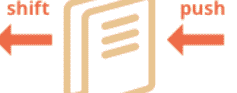

数组支持两种操作。

在实践中我们经常需要它。例如，需要在屏幕上显示的消息队列。

数组的另一种用途——名为栈（stack）的数据结构。

它支持两种操作：

- push 在末尾添加元素。

- pop 从末尾取元素。

因此，新元素总是从“末端”添加或取出。

栈（Stack）通常被描述为一叠扑牌：新扑牌被添加到顶部，或从顶部取出：

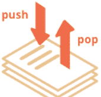

对于栈，最后推入的项最先接收，这也被称为 LIFO（后进先出）原则。对于队列（Queue），我们拥有 FIFO（先入先出）。

JavaScript 中的数组既可以作为队列，也可以作为栈使用。它们允许你从开头或末尾添加/删除元素。

在计算机科学中，这种数据结构被称为 deque（双队列）。

## 与数组末尾操作的方法：

### pop

提取数组元素并返回它：

```
let fruits = ["Apple", "Orange", "Pear"];
alert(fruits.pop()); // 删除 "Pear" 并弹出它
alert(fruits); // Apple, Orange
```

### push

将元素追加到数组末尾：

```
let fruits = ["Apple", "Orange"];
fruits.push("Pear");
alert(fruits); // Apple, Orange, Pear
```

调用 `fruits.push(...)` 等于 `fruits[fruits.length] = . . .`

## 与数组开头操作的方法：

### shift

提取数组的第一个元素并返回它：

```
let fruits = ["Apple", "Orange", "Pear"];
alert(fruits.shift()); // 删除 Apple 并弹出
alert( fruits ); // Orange, Pear
```

### unshift

将元素添加到数组开头：

```
let fruits = ["Orange", "Pear"];
fruits.unshift('Apple');
alert( fruits ); // Apple, Orange, Pear
```

`push` 和 `shift` 方法可以一次添加多个元素：

```
let fruits = ["Apple"];
fruits.push("Orange", "Peach");
fruits.unshift("Pineapple", "Lemon");
//["Pineapple", "Lemon", "Apple", "Orange", "Peach"]
alert( fruits );
```

## 内部原理

数组是一种特殊的对象。用访问属性的方括号 `arr[0]` 实际上来自对象的语法。这与 `obj[key]` 本质上相同，其中 `arr` 是对象，而方法被用作键。

它们扩展了对象，提供了处理有序数据集合的特殊方法以及 `length` 属性。在核心，它仍然是一个对象。

记住，JavaScript 中只有 7 种基本类型。数组是一个对象，因此表现得像对象。

例如，它是通过引用复制的：

```
let fruits = ["Banana"];
let arr = fruits; // 引用复制（两个变量引用同一个数组）
alert( arr === fruits ); // true
arr.push("Pear"); // 通过引用修改数组
alert( fruits ); // Banana, Pear - 现在有 2 个项目
```

但让数组真正特殊的是它们的内部表示。引擎尝试将元素存储在连续的内存区域中，一个接一个，正如本章插图所示，并且还有其他优化，以使数组变得非常快。

但如果我们停止将数组视为“有序集合”来处理，而开始将其当作普通对象来处理，所有这些优化都会失效。

例如，从技术上我们可以这样做：

```
let fruits = []; // 创建一个数组
fruits[9999] = 5; // 分配一个索引远大于其长度的属性
```

fruits.age = 25; // 创建一个任意名称的属性

```

这是可能的，数组在底层是对象。我们可以向它们添加任何属性。
但引擎会看到我们正在像处理普通对象一样处理数组。数组特有的优化不适用于此类情况并将会被关闭，其优势随之消失。

误用数组的方法有：

- 添加非数字属性，如 `arr.test = 5`。
- 制造空洞（holes），例如先添加 `arr[0]` 然后添加 `arr[1000]`（它们之间什么都没有）。
- 以反向顺序填充数组，例如 `arr[1000]`、`arr[999]` 等。

请将数组视为处理有序数据的特殊结构。它们为这些数据提供了特殊方法。数组在 JavaScript 引擎内部经过了仔细调优，以处理连续的有序数据，请这种方式使用数组。如果你需要任何键，很有可能你实际上需要一个普通对象。

## 性能

`push/pop` 方法运行很快，`shift/unshift` 较慢。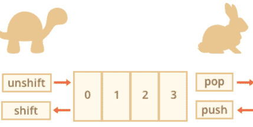

为什么处理数组末端比处理开头快？让我们看看在执行期间发生了什么：

```

fruits.shift(); // 从开始取走 1 个元素

```

仅仅取出并移除索引为 0 的元素是不够的。其他元素也需要重新编号。`shift` 操作必须完成三件事：

1. 删除索引为 0 的元素。
2. 将所有元素向左移动，将索引从 1 重新编号为 0，从 2 改为 1，依此类推。
3. 更新 `length` 属性。

| 之前 | 0 | 1 | 2 | 3 | length |
| :--- | :--- | :--- | :--- | :--- | :--- |
| "Apple" | "Orange" | "Pear" | "Lemon" | 4 | |
| 之后 | "Orange" | "Pear" | "Lemon" | 3 | |

`shift` 操作需要移动所有元素，而 `pop` 只需要处理末端。

| 之前 | 0 | 1 | 2 | 3 | length |
| :--- | :--- | :--- | :--- | :--- | :--- |
| "Apple" | "Orange" | "Pear" | "Lemon" | 4 | |
| 之后 | "Orange" | "Pear" | "Lemon" | 3 | |

`push` 方法在末端添加元素，而 `unshift` 在开头添加元素。

| 之前 | 0 | 1 | 2 | 3 | length |
| :--- | :--- | :--- | :--- | :--- | :--- |
| "Apple" | "Orange" | "Pear" | "Lemon" | 4 | |
| 之后 | "Orange" | "Pear" | "Lemon" | 3 | |

`length` 属性在修改数组时会自动更新。准确来说，它是数组中值的计数，即最大索引加一。

例如，给出一个大索引会得到巨大的长度：

```javascript

let fruits = [];

fruits[123] = "Apple";

alert(fruits.length); // 124

```

注意，我们通常不这样使用数组。

关于 `length` 属性的另一个有趣点是它是写的。

如果我们手动增加它，不会发生什么。但如果我们减小它，数组会被截断。这个过程是不可逆的，这是一个示例：

```javascript

let arr = [1, 2, 3, 4, 5];

arr.length = 2; // 截断到 2 个元素

alert(arr); // [1, 2]

arr.length = 5; // 返回

alert(arr[3]); // undefined

```

所以，清除数组简单的方法是：`arr.length = 0`。

## new Array()

创建数组的另一种语法：

```

let arr = new Array("Apple", "Pear", "etc");

```

很少使用，因为方括号 `[]` 更短。它还有一个棘手的特性：如果调用 `new Array` 传入一个数字参数，它将创建一个没有元素但具有给定长度的数组。

让我们看看是如何射脚的：

```javascript

let arr = new Array(2); // 它会创建一个包含 2 个元素的数组吗？

alert(arr[0]); // undefined：没有元素。

alert(arr.length); // 长度2

```

在上面的代码中，`new Array(number)` 的所有元素都是 undefined。为了避免此类惊喜，我们通常使用方括号，除非我们真的知道自己在做什么。

## 多维数组

数组的元素也可以是数组。我们可以用它处理多维数组，例如存储矩阵：

```javascript

let matrix = [

  [1, 2, 3],

  [4, 5, 6],

  [7, 8, 9]

];

alert(matrix[1][1]); // 中央元素

```


# toString

数组有自己的 `toString` 方法实现，返回一个用逗号分隔的元素列表。

例如：

```

let arr = [1, 2, 3];

alert(arr); // 1,2,3

alert(String(arr)) === '1,2,3'; // true

```

此外，让我们尝试一下：

```

alert([] + 1); // "1"

alert([1] + 1); // "11"

alert([1,2] + 1); // "1,21"

```

数组没有 Symbol，也没有有效的 `valueOf`，它们只实现了 `toString` 转换，因此这里 `[]` 变成空字符串，`[1]` 变成 "1"，而 `[1,2]` 变成 "1,2"。

当二元运算符 `"+"` 向字符串添加内容时，它也将内容转换为字符串，所以下一步如下：

```

alert("" + 1); // "1"

alert("1" + 1); // "11"

alert("1,2" + 1); // "1,21"

```

# Summary

数组是一种特殊的对象，适用于存储和管理有序的数据项。

- 声明：

```

// 使用括号（常用）

let arr = [item1, item2];

// 使用 new Array（极罕见）

let arr = new Array(item1, item2);

```

调用 `new Array(number)` 会创建一个指定长度的数组，但不包含元素。

- `length` 属性是数组的长度，准确地说，是它的最后一个数字索引加 1。它由数组方法自动调整。

如果通过手动缩短 `length`，数组会被截断。

我们可以将数组作为双端队列（deque），进行以下操作：

- `push(...items)` 将 `items` 添加到末尾。
- `pop()` 移除末尾元素并返回它。
- `shift()` 移除开头元素并返回它。
- `unshift(...items)` 将 `items` 添加到开头。

遍历数组元素：

- `for (let i=0; i<arr.length; i++)` – 运行最快，兼容旧浏览器。
- `for (let item of arr)` – 仅针对元素的现代语法。
- `for (let i in arr)` – 永远不要使用。

我们将在[Array方法]章节返回数组，学习添加、删除、提取元素排序数组的方法。

## Tasks

# 数组是复制的吗？

重要性：3

这段代码将展示什么？

```

let fruits = ["Apples", "Pear", "Orange"];

// 向“拷贝”中推入新值

let shoppingCart = fruits;

shoppingCart.push("Banana");

// fruits 里面有什么？

alert(fruits.length); // ?

```

# 答案

# 数组操作。

重要性：5

让我们尝试 5 种数组操作。

- 1. 创建一个包含“Jazz”和“Blues”项的数组 `styles`。
2. 在末尾追加“Rock-n-Roll”。
3. 用“Classics”替换中间位置的值。你用于寻找中间位置的代码应该适用于任何长度为奇数长度的数组。
4. 剥离数组的第一个值并显示它。
5. 在数组开头添加 `Rap` 和 `Reggae`。

处理过程中的数组：

```

Jazz, Blues

Jazz, Blues, Rock n-Roll

Jazz, Classics, Rock n-Roll

Classics, Rock n-Roll

Rap, Reggae, Classics, Rock n-Roll

```

# 答案 

# 在数组上下文中调用

重要性：5

结果是什么？为什么？

```

let arr = ["a", "b"];

arr.push(function() {

  alert(this);

});

arr[2]; // ?

```

# 答案 

# 输入数字求和

重要性：4

编写函数 `sumInput()`，其功能如下：

- 使用 `prompt` 询问用户值，并将值存储在数组中。
- 当用户输入非数字、空字符串或按下“取消”时停止询问。
- 计算并返回数组项之和。

P.S. 零 0 是一个有效数字，请不要在 0 处停止输入。

运行演示

# 答案 

# 最大子数组

重要性：2

输入是一个数字数组，例如 `arr = [1, -2, 3, 4, -9, 6]`。

任务是找到 `arr` 中元素之和最大的连续子数组。

编写函数 `getMaxSubSum(arr)` 并返回该和。

例如：

```

getMaxSum([-1, 2, 3, -9]) = 5 (高亮项之和)

getMaxSum([-1, 2, 3, -9]) = 6

getMaxSum([-1, 2, 3, -11]) = 11

getMaxSum([-2, -1, 1, 2]) = 3


getMaxSum([100, -9, 2, -3, 5]) = 100

getMaxSum([1, 2, 3]) = 6 (全取)

如果所有项都是负数，意味着我们什么都不取（子数组为空），所以和为零：

getMaxSum([-1, -2, -3]) = 0

请尝试找到解决方案：如果可以，使用 O(n²) 甚至 O(n)。

# 数组方法

数组提供了许多方法。为了方便起见，在本章节中它们被分成了组。

## 添加/删除项

我们已经知道如何从开头或末尾添加和删除项：

- `push(...items)` – 将项添加到末尾。
- `pop()` – 从末尾提取一个项。
- `shift()` – 从开头提取一个项。
- `unshift(...items)` – 将项添加到开头。

## splice

如何从数组中删除元素？数组是对象，所以我们可以尝试：

```
let arr = ["go", "home"];

arr.splice(1, 1); // 删除 "home"

// 现在 arr = ["go"]

alert(arr.length); // 1
```

元素被删除了，但数组仍然存在，我们可以看到 `arr.length == 3`。这对于数组是正常的，因为我们通常希望剩余元素占据空间。`splice` 方法可以做一切：插入、删除和替换元素。语法如下：

```
arr.splice(index, deleteCount, elem1, ..., elemN)
```

从位置开始：删除 `deleteCount` 个元素，然后在该位置插入 `elem1...elemN`。返回被删除元素的数组。通过示例很容易理解该方法：

```
let arr = ["study", "JavaScript"];

let removed = arr.splice(0, 1); // 从索引 0 开始删除 1 个元素

alert(arr); // ["JavaScript"]

alert(removed); // ["study"]
```

容易对吧？在下一个示例中我们删除 3 个元素并替换它们：

```
let arr = ["study", "JavaScript", "right", "now"];

let removed = arr.splice(0, 3, "Let's", "dance"); // 删除 3 个元素并插入 "Let's", "dance"

alert(arr); // ["now"]

alert(removed); // ["study", "JavaScript", "right"]
```

我们可以看到 `splice` 返回被删除元素的数组：

```
let arr = ["study", "JavaScript", "right", "now"];

let removed = arr.splice(0, 2); // 删除前 2 个元素

alert(arr); // ["right", "now"]

alert(removed); // ["study", "JavaScript"]
```

`splice` 方法可以在不删除任何元素的情况下插入元素。我们需要将 `deleteCount` 设置为 0：

```
let arr = ["study", "JavaScript"];

// 从索引 2 开始插入 0 个元素，然后插入 "complex" 和 "language"

arr.splice(2, 0, "complex", "language");

alert(arr); // ["study", "JavaScript", "complex", "language"]
```

**允许负索引**
在这里和其他数组方法中，允许负索引。它们从数组末尾指定位置：

```
let arr = [1, 2, 5];

// 从索引 -1（末尾第一步）开始删除 0 个元素，然后插入 3 和 4

arr.splice(-1, 0, 3, 4);

alert(arr); // [1, 2, 3, 4, 5]
```

## slice

`arr.slice` 方法比相似的 `arr.splice` 简单得多。

语法为：

```
arr.slice(start, end)
```

返回一个包含从 `start` 到 `end` 所有项（不包括 `end`）。`start` 和 `end` 都可以是负数，情况下假设从数组末尾开始。

它的工作方式类似于 `str.slice`，但创建的是子数组而不是子字符串。

例如：

```
let str = "test";

let arr = ["t", "e", "s", "t"];

alert(str.slice(1, 3)); // es

alert(arr.slice(1, 3)); // e,s

alert(str.slice(-2)); // st

alert(arr.slice(-2)); // s,t
```

## concat

`concat` 方法将数组与其他数组和或项合并。

语法为：

```
arr.concat(arg1, arg2...)
```

它接受任意数量的参数——数组或值。

结果是一个包含 `arr` 项、然后是 `arg1`、`arg2` 等的新数组。如果参数是数组或具有 `Symbol.isConcatReadable` 属性，则它的所有元素将被复制。否则，参数本身会被复制。

例如：

```
let arr = [1, 2];

// 将 arr 与 [3,4] 合并

alert(arr.concat([3, 4])); // 1,2,3,4

// 将 arr 与 [3,4] 和 [5,6] 合并

alert(arr.concat([3, 4], [5, 6])); // 1,2,3,4,5,6

// 将 arr 与 [3,4] 合并，然后添加值 5 和 6

alert(arr.concat([3, 4], [5, 6])); // 1,2,3,4,5,6
```

通常，它从数组复制元素（展开它们）。其他对象即使看起来像数组，也会作为一个整体添加：

```
let arr = [1, 2];

let arrayLike = {

  0: "something",

  length: 1

}

alert(arr.concat(arrayLike)); // 1,2,[object Object]

//[1,2,arrayLike]
```

...但如果类数组对象具有 `Symbol.isConcatReadable` 属性，则它的元素会被添加：

```
let arr = [1, 2];

let arrayLike = {

  0: "something",

  1: "else",

  [Symbol.isConcatReadable]: true,

  length: 2

};

alert(arr.concat(arrayLike)); // 1,2,something,else
```

## 迭代：forEach

`arr.forEach` 方法允许对数组的每个元素运行函数。

语法如下：

```
arr.forEach(function(item, index, array){

// ... 对 item 进行某些操作

});
```

例如，这显示了数组的每个元素：

```
// 为每个元素调用 alert

["bo", "Gandalf", "Nazgul"].forEach(alert);
```

这段代码更详细地说明了它们在目标数组中的位置：

```
["Bilbo", "Gandalf", "Nazgul"].forEach((item, index, array) => {

  alert(`${item} is at index ${index} in ${array}`);

});
```

函数的返回值（如果有的话）会被丢弃并被忽略。

## 在数组中搜索

这些是在数组中搜索某些内容的方法。

### indexOf, lastIndexOf 和 includes

`arr.indexOf`、`arr.lastIndexOf` 和 `arr.includes` 方法具有相同的语法，基本行为与其对应方法相同，但它们操作的是字符的索引：

- `arr.indexOf(item, from)` 从索引 `from` 开始查找 `item`，并返回找到的索引，否则返回 -1。
- `arr.lastIndexOf(item, from)` – 相同，但从右到左查找。
- `arr.includes(item, from)` 从索引 `from` 开始查找 `item`，如果找到则返回 `true`。

例如：

```
let arr = [1, 0, false];

alert(arr.indexOf(0)); // 1

alert(arr.indexOf(false)); // 2

alert(arr.indexOf(null)); // -1
```

```
alert(arr.includes(1)); // true
```

注意这些方法使用 `===` 比较。因此，如果我们查找 `false`，它找到的是精确的 `false` 而不是零。

如果我们想检查包含关系而不需要知道确切索引，那么优先使用 `arr.includes`。

`includes` 的一个细微区别是它可以正确处理 `NaN`，而 `indexOf/lastIndexOf` 不行：

```javascript
const arr = [NaN];

alert(arr.indexOf(NaN)); // -1 (应该是 0，但 === 对 NaN 无效)

alert(arr.includes(NaN)); // true (正确)
```

### find 和 currentIndex

假设我们有一个对象数组。我们如何找到符合特定条件的对象？

这时 `arr.find` 方法就派上用场了。

语法为：

```javascript
let result = arr.find(function(item, index, array) {

// 如果为 true，则返回 item 并停止迭代

// 对于假值情况返回 undefined

}
```

函数会为数组的每个元素重复调用：

- `item` 是元素。
- `index` 是它的索引。
- `array` 是数组本身。

如果它返回 `true`，则停止搜索并返回该元素。如果没有找到任何内容，则返回 `undefined`。

例如，我们有一个用户数组，每个用户都有 `id` 和 `name` 字段。让我们找到 `id == 1` 的用户：

```javascript
let users = [

  {id: 1, name: "John"},

  {id: 2, name: "Pete"},

  {id: 3, name: "Mary"}

];

let user = users.find(item => item.id == 1);

alert(user.name); // John
```

在现实生活中，对象数组非常常见，因此 `find` 方法非常有用。

注意，在提供的示例中，我们提供的函数 `item => item.id == 1` 只有一个参数。该函数的其他参数很少被使用。

`arr.findIndex` 方法本质上相同，但它返回找到元素的索引，而不是元素本身，在未找到内容时返回 -1。

### filter

`find` 方法寻找一个让函数返回 `true` 的单个（第一个）元素。

如果有多个元素，我们可以使用 `arr.filter(fn)`。

语法是查找，但即使已经返回了 `true`，`filter` 继续迭代数组的所有元素：

```javascript
let results = arr.filter(item, index, array) {

// 如果为 true，则将 item 推入 results 中并继续迭代

// 对于完全的假值情况返回空数组

};
```

例如：

```javascript
let users = [

  {id: 1, name: "John"},

  {id: 2, name: "Pete"},

  {id: 3, name: "Mary"}

];

// 返回前两个用户的数组

let someUsers = users.filter(item => item.id < 3);

alert(someUsers.length); // 2
```

## 转换数组

这一部分关于用于转换或重新排序数组的方法。

### map

`arr.map` 方法是最实用且最常用的方法之一。

语法为：

```javascript
let result = arr.map(function(item, index, array) {

// 返回新值而不是 item

})
```

它为数组的每个元素调用函数并返回结果数组。

例如，在这里我们将每个元素转换为其长度：

```javascript
let lengths = ["Bilbo", "Gandalf", "Nazgul"].map(item => item.length);

alert(lengths); // 5, 7, 6
```

### sort(fn)

`arr.sort` 方法对数组进行原地排序。

例如：

```javascript
let arr = [ 5, 4, 3, 2, 1 ];

arr.sort();

alert(arr); // 1, 2, 3, 4, 5
```

### reduce/reduceRight

当我们需要遍历数组时——我们可以使用 `forEach`、`for` 或 `for...`。
当我们需要遍历并返回每个元素的数据时——可以使用 `map`。

`reduce` 和 `arr.reduceRight` 方法也属于这一类，但它们稍微有一点复杂。它们被用于根据数组计算一个单一值。
语法如下：

```javascript
let value = arr.reduce(function(previousValue, item, index, array) {

  //

}, initial);
```

该函数被应用于每个元素。你可能会注意到这些熟悉的参数，从第 2 个开始：

- `item` 是当前数组项。
- `index` 是该项的索引。
- `array` 是数组本身。

到目前为止，和 `forEach/map` 类似。但还有一个参数：

- `previousValue` 是上一次函数调的结果，第一次调用时为 `initial`。

实现这种操作最简单的方法是通过示例。
在这里我们用一行代码计算数组的和：

```javascript
let arr = [1, 2, 3, 4, 5];

let result = arr.reduce((sum, current) => sum + current, 0);

alert(result); // 15
```

在这里我们使用了 `reduce` 最常见的变体，它只使用 2 个参数。
让我们看看具体的细节。

1. 在第一次运行时，`sum` 是初始值（`reduce` 的最后一个参数），等于 0，`current` 是数组的第一个元素，等于 1。所以结果是 1。
2. 在第二次运行时，`sum = 1`，我们将数组的第二个元素 (2) 加上它并返回。
3. 在第三次运行时，`sum = 3`，我们再加一个元素，以此此类推……

计算流程如下：

| sum | sum | sum | sum | sum |
|---|---|---|---|---|
| 0 | 0+1 | 0+1+2 | 0+1+2+3 | 0+1+2+3+4 |
| current | current | current | current | current |
| 1 | 2 | 3 | 4 | 5 |

或者以表格的形式表示，每行代表对下一个数组元素的函数调用：

| sum | current | result |
|---|---|---|
| 第一次调用 | 0 | 1 |
| 第二次调用 | 1 | 2 | 3 |
| 第三次调用 | 3 | 3 | 6 |
| 第四次调用 | 6 | 4 | 10 |
| 第五次调用 | 10 | 5 | 15 |

如所见，上一次调用的结果变成了下一次调用的第一个参数。

我们也可以省略初始值：

```javascript
let arr = [1, 2, 3, 4, 5];

// 从 reduce 中移除了初始值（没有）

let result = arr.reduce((sum, current) => sum + current);

alert(result); // 15
```

结果是这样的。这是因为如果没有初始值，`reduce` 会取数组的第一个元素作为初始值，并从第 2 个元素开始迭代。

计算表与上面相同，只是少了第一行。

但这种用法需要极其小心。如果数组是空的，那么在没有初始值的情况下调用 `reduce` 会报错。

这里有一个示例：

```javascript
let arr = [];

// 错误：空数组没有初始值进行 reduce

// 如果存在初始值，reduce 将为空数组返回该值。

arr.reduce((sum, current) => sum + current);
```

因此建议指定初始值。

`arr.reduceRight` 方法执行相同的操作，但是从右向左的。

## Array.isArray

数组并不区分一种语言类型。它们基于对象。

因此，`typeof` 无法区分普通对象和数组：

```javascript
alert(typeof {}); // object

alert(typeof []); // 相同
```

...但数组被用得如此频繁，所以有一个专门的方法：`Array.isArray(value)`。如果 `value` 是数组，它返回 `true`，否则返回 `false`。

```javascript
alert(Array.isArray({})); // false

alert(Array.isArray([])); // true
```

## 大多数方法支持 "thisArg"

几乎所有的数组调用函数——比如 `find`、`filter`、`map`，`sort` 是一个显著例外——都接受一个可选参数 `thisArg`。

该参数在上面的章节中没有解释，因为它很少被使用。但为了完整性，我们必须涵盖它。

这些方法的语法如下：

```javascript
arr.find(func, thisArg);

arr.filter(func, thisArg);

arr.map(func, thisArg);

//

thisArg 是可选的最后一个参数
```

`thisArg` 参数的值将成为 `func` 的 `this`。

例如，在这里我们使用一个对象方法作为过滤器，此时 `thisArg` 就派上用场了。

```javascript
let user = {

  age: 18,

  younger(otherUser) {

    return otherUser.age < this.age;

  }

}

let users = [

  {age: 12},

  {age: 18},

  {age: 22}

]

// 我们使用 filter 找到年轻的用户

let younger = users.filter(function(user) {

  return this.younger(user);

}, user);

alert(younger.length); // 1
```

## 总结

数组方法的速查表：

### 添加/删除元素：
- `push(...items)` —— 在末尾添加元素，
- `pop()` —— 从末尾提取元素，
- `shift()` —— 从开头提取元素，
- `unshift(...items)` —— 在开头添加元素，
- `splice(pos, deleteCount, ...items)` —— 在 `pos` 插入元素。
- `slice(start, end)` —— 创建新数组，复制从 `start` 到 `end` 的元素。
- `concat(...items)` —— 返回新数组

### 搜索元素：
- `indexOf(item)/lastIndexOf(item, pos)` —— 从 `pos` 开始查找 item，未找到则返回 -1。
- `includes(value)` —— 如果数组包含 `value` 则返回 `true`，否则返回 `false`。
- `find(func)` —— 返回第一个元素。
- `findIndex(func)` —— 返回索引。

### 遍历元素：
- `forEach(func)` —— 为每个元素调用 `func`，不返回任何内容。

### 转换数组：
- `map(func)` —— 根据 `func` 的结果创建新数组。
- `sort(func)` —— 原地排序数组，并返回它。
- `reverse()` —— 原地反转数组，并返回它。
- `split/join()` —— 字符串与数组的转换。
- `reduce(func, initial)` —— 通过为元素调用 `func` 计算一个单一值。

### 此外：
- `Array.isArray(arr)` 检查 `arr` 是否为数组。
- `some(fn)/every(fn)` 检查数组。如果任意/所有结果为 true，则返回 `true`，否则返回 `false`。
- `fill(value, start, end)` —— 从 `start` 到 `end` 用重复值填充数组。
- `copyWithin(target, start, end)` —— 将 `start` 到 `end` 的元素复制到自身的 `target` 位置。

## 任务

### 将 border-left-width 转换为 borderLeftWidth

优先级：5

编写函数 `camelize(str)`，将连字符分隔的单词（如 "my-short-string"）转换为驼峰样式的 "myShortString"。

即：移除所有连字符，每个连字符后的单词首字母大写。

示例：

```javascript
camelize("background-color") == 'backgroundColor';

camelize("list-style-image") == 'listStyleImage';

camelize("-webkit-transition") == 'webkitTransition';
```

P.S. 提示：使用 `split` 将字符串分割为数组，转换后再 `join`。打开带有测试的沙箱。

### 过滤范围

优先级：4

编写函数 `filterRange(arr, a, b)`，获取数组 `arr`，查找其中 `a` 和 `b` 之间的元素并返回这些元素的数组。

该函数不应修改数组。它应该返回一个新数组。

例如：

```javascript
let arr = [5, 3, 8, 1];

let filtered = filterRange(arr, 1, 4);

alert( filtered ); // 3,1 (匹配值)

alert( arr ); // 5,3,8,1 (未修改)
```

打开包含测试的沙盒。

前往解决方案

### “原地”过滤范围

重要性: 4

编写函数 `filterRangeInPlace(arr, a, b)`，它接收一个数组 `arr` 并删除其中所有不在 `a` 和 `b` 之间的值。测试条件是：a ≤ arr[i] ≤ b。

该函数应该只修改数组。它不返回任何内容。

例如：

```
let arr = [5, 3, 8, 1];

filterRangeInPlace(arr, 1, 4); // 删除了 1 到 4 之外的数字

alert( arr ); // [3, 1]
```

打开包含测试的沙盒。

前往解决方案

### 倒序排序

重要性: 4

```javascript
let arr = [5, 2, 1, -10, 8];

// ... 编写将其倒序排序的代码

alert( arr ); // 8, 5, 2, 1, -10
```

前往解决方案

### 复制并排序数组

重要性: 5

我们有一个字符串数组 `arr`。我们希望得到它排序后的副本，但保持 `arr` 不变。

创建一个函数 `copySorted(arr)` 并返回这样一个副本。

```javascript
let arr = ["HTML", "JavaScript", "CSS"];

let sorted = copySorted(arr);

alert(sorted); // CSS, HTML, JavaScript

alert(arr); // HTML, JavaScript, CSS (无变化)
```

前往解决方案

### 创建一个可扩展的计算器

重要性: 5

创建一个构造函数 `Calculator` 来创建“可扩展”的计算器对象。

任务由两部分。

- 1. 首先，实现方法 `calculate(str)`，它接收一个如 "1 + 2" 格式为“数字 运算符 数字”（用空格分隔）的字符串并返回结果。应该理解加 + 和减 -。

使用示例：

```javascript
let calc = new Calculator;

alert(calc.calculate("3 + 7")); // 10
```

- 2. 然后添加方法 `addMethod(name, func)` 让计算器学习一种新操作。它接收运算符 `name` 和实现该操作的双参数函数 `func(a,b)`。

例如，让我们添加乘法 *、除法 / 和幂运算 **：

```javascript
let powerCalc = new Calculator;

powerCalc.addMethod("*", (a, b) => a * b);

powerCalc.addMethod("/", (a, b) => a / b);

powerCalc.addMethod("**", (a, b) => a ** b);

let result = powerCalc.calculate("2 ** 3");

alert(result); // 8
```

- 此任务中不包含括号或复杂的表达式。
- 数字和运算符之间恰好有一个空格分隔。
- 如果你想添加，可以包含错误处理。

打开包含测试的沙盒。 ↗

前往解决方案

### 映射到名称

重要性: 5

你有一个 `user` 对象数组，每个对象都有 `user.name`。编写代码将其转换为名称数组。

例如：

```javascript
let john = { name: "John", age: 25 };

let pete = { name: "Pete", age: 30 };

let mary = { name: "Mary", age: 28 };

let users = [ john, pete, mary ];

let names = /* ... 你的代码 */

alert( names); // John, Pete, Mary
```

前往解决方案

### 映射到对象

重要性: 5

你有一个 `user` 对象数组，每个对象都有 `name`、`surname` 和 `id`。

编写代码从其中创建一个另一个数组，包含 `id` 和 `fullName` 对象，其中 `fullName` 由 `name` 和 `surname` 生成。

例如：

```javascript
let john = { name: "John", surname: "Smith", id: 1 };

let pete = { name: "Pete", surname: "Hunt", id: 2 };

let mary = { name: "Mary", surname: "Key", id: 3 };

let users = [ john, pete, mary ];

let usersMapped = /* ... 你的代码 ... */
```

```javascript
/*

usersMapped = [

  { fullName: "John Smith", id: 1 },

  { fullName: "Pete Hunt", id: 2 },

  { fullName: "Mary Key", id: 3 }

]

*/

alert(usersMapped[0].id) // 1

alert(usersMapped[0].fullName) // John Smith
```

所以，实际上你需要将一个对象数组映射到另一个数组。尝试在这里使用 =>。这里有一个小技巧。

前往解决方案

### 按年龄排序用户

重要性: 5

编写函数 `sortBy(users)`，接收一个具有 `age` 属性的对象数组并按年龄进行排序。

例如：

```javascript
let john = { name: "John", age: 25 };

let pete = { name: "Pete", age: 30 };

let mary = { name: "Mary", age: 28 };

let arr = [ pete, john, mary ];

sortBy(arr);

// 现在：[john, mary, pete]

alert(arr[0].name); // John

alert(arr[1].name); // Mary

alert(arr[2].name); // Pete
```

前往解决方案

### 乱序数组

重要性: 3

编写函数 `shuffle(array)`，它随机打乱数组的元素。

多次运行 `shuffle` 可能会导致不同的顺序。例如：

```javascript
let arr = [1, 2, 3];

shuffle(arr); // arr = [3, 2, 1]

shuffle(arr); // arr = [2, 1, 3]
```

所有元素应该具有相同的概率。例如，三个元素的 [1, 2, 3] 有六种排列方式。

前往解决方案

### 获取平均值

重要性: 4

编写函数 `getAverage(users)`，它接收具有 `age` 属性的对象数组并返回它们的平均值。公式为 age1 + age2 + ... + ageN / N。

例如：

```javascript
let john = { name: "John", age: 25 };

let pete = { name: "Pete", age: 30 };

let mary = { name: "Mary", age: 29 };

let arr = [ john, pete, mary ];

alert(getAverage(arr)); // (25 + 30 + 29) / 3 = 28
```

前往解决方案

### 过滤唯一数组

重要性: 4

让 `arr` 为一个数组。创建一个函数 `unique(arr)`，返回一个唯一元素的数组。

例如：

```javascript
let strings = ["apple", "banana", "apple"];

unique(strings); // ["apple", "banana"]
```

打开包含测试的沙盒。

前往解决方案

# 可迭代对象

可迭代对象是数组的泛化。这种概念允许任何对象用于 `for..of` 循环。数组是可迭代的。许多内置对象也是可迭代的。例如，字符串也是。许多内置运算符和方法依赖它们。如果一个对象代表一个集合（列表、集合），那么 `for..of` 是一个很棒的语法。看看如何实现。

## Symbol.iterator

我们可以通过实现一个来轻松掌握可迭代的概念。例如，我们有一个不是数组但适用于 `for..of` 的 `range` 对象，代表数字区间：

```javascript
let range = {

  from: 1,

  to: 5

};

// 我们想让 for..of 工作：

// for(let num of range) ...num=1,2,3,4,5
```

为了让 `range` 可迭代（从而让 `for..of` 工作），我们需要向对象添加一个名为 `Symbol.iterator` 的方法（特殊的内置符号）。

1. 当 `for..of` 开始时，它调用一次（如果没有则报错）。该方法必须返回一个带有 `next` 方法的对象。
2. 之后，`for..of` 只对该对象调用 `next()`。
3. 当 `for..of` 需要值时，它在对象上调用 `next()`。
4. `next()` 的结果必须是 `{done: Boolean, value: any}`，其中 `done=true` 表示迭代器结束，否则 `value` 必须是新值。

这是 `range` 的完整实现：

```javascript
let range = {

  from: 1,

  to: 5

};

// 1. for..of 初始调用这个

range[Symbol.iterator] = function() {

  // ...它返回迭代器对象：

  // 2. 之后，for..of 只与此迭代器工作，向它请求下一个值

  return {

    current: this.from,

    last: this.to

  };

  // 3. for..of 循环在每次迭代调用 next()

  next() {

    // 4. 它应该以对象 {done..., value: ...} 返回值

    if (this.current <= this.last) {

      return { done: false, value: this.current++ };

    } else {

      return { done: true };

    }

  }

}

// 现在可以了！

for (let num of range) {

    alert(num); // 1, 2, 3, 4, 5

}
```

请注意可迭代的核心特性：关注职责分离。

- `range` 本身没有 `next()` 方法。
- 相反，通过调用 `range[Symbol.iterator]()` 创建了另一个对象“迭代器”，它处理整个迭代过程。

所以，迭代器对象与它遍历的对象是分离的。技术上，我们可以将它们合并，并将 `range` 本身作为迭代器来简化代码。如下：

```javascript
let range = {

  from: 1,

  to: 5,

  [Symbol.iterator]() {

    this.current = this.from;

    return this;

  },

  next() {

    if (this.current <= this.last) {

      return { done: false, value: this.current++ };

    } else {

      return { done: true };

    }

  }

}

for (let num of range) {

    alert(num); // 1, 2, 3, 4, 5

}
```

它的。但即使在异步场景下，并行的 for-s 也是很罕见的。

## 无限迭代器

迭代器也是可能的。例如，当 `range.to = Infinity` 时，范围将变成无限。我们可以创建一个生成无限伪随机数序列的可迭代对象。这也会很有用。

`next` 方法没有限制，它可以返回越来越多的值，这是正常的。

当然，对这样的可迭代对象进行 for..of 循环将是无止的。但我们始终可以使用 `break` 来停止使用它。

## 字符串是可迭代的

数组和字符串是最常用的内置可迭代对象。

对于字符串，for..of 循环会遍历它的字符：

```javascript
for (let char of "test") {

  // 触发 4 次：每个字符一次

  alert(char); // t，然后是 e，s，然后是 t

}
```

它对代理对（surrogate pairs）也能正常工作！

```javascript
let str = 'X😊';

for (let char of str) {

  alert(char); // X，然后是 😊

}
```

## 显式调用迭代器

通常，可迭代对象的内部迭代器对外部代码是隐藏的。有一个 for..of 循环可以工作，它需要知道的仅此。

但为了更深入地理解，让我们看看如何显式创建一个迭代器。

我们将以与 for..of 完全相同的方式遍历字符串，但使用直接调用。这会创建一个字符串迭代器并“手动”获取值。

```javascript
let str = "Hello";

// 等同于

// for (let char of str) alert(char);

let iterator = str[Symbol.iterator]();

while (true) {

  let result = iterator.next();

  if (result.done) break;

  alert(result.value); // 逐个输出字符

}
```

这很少需要，但比 for..of 赋予了我们对过程更多的控制。例如，我们可以分迭代过程：迭代一下，然后停止，做其他事情，以后再恢复。

## 可迭代对象和类数组对象

有两个看起来相似的官方术语，但它们非常不同。请确保你很好理解了它们，以避免混淆。

- 可迭代对象（Iterables）是实现了上述 `Symbol.iterator` 方法的对象。
- 类数组对象（Array-likes）是拥有索引和 `length` 的对象，所以它们看起来像数组。

当我们在浏览器或其他环境中使用 JavaScript 执行实际任务时，可能会遇到可迭代对象或类数组对象，或者两者都是。

例如，字符串既是可迭代的（for..of 可以作用于它们），也是类数组的（它们有数字索引）。

但可迭代对象可能不是类数组。反之，类数组可能不可迭代。

例如，上面示例中的 range 是可迭代的，但不是类数组，因为它没有索引属性和 `length`。

这里有一个是类数组但不可迭代的对象：

```javascript
let arrayLike = { // 拥有索引和 length => 类数组

  0: "Hello",

  1: "World",

  length: 2

};

// 错误（没有 Symbol.iterator）

for (let item of arrayLike) {

// ...

}
```

可迭代对象和类数组对象通常不是数组，它们没有 `push`、`pop` 等方法。如果我们有这样一个对象并想像数组一样操作它，那相当不方便。例如，我们想使用数组方法来处理 range。如何实现这一点？

## Array.from

有一个通用的方法 `Array.from`，它接收一个可迭代或类数组值，并将其转换为“真正的”数组。然后我们可以在它上面调用数组方法。

例如：

```javascript
let arrayLike = {

  0: "Hello",

  1: "World",

  length: 2

};

let arr = Array.from(arrayLike); // (*)

alert(arr.pop()); // World (方法有效)
```

第 (*) 行的 `Array.from` 接收对象，检查它是否为可迭代或类数组，然后创建一个新数组并复制所有项。

对于可迭代对象也是如此：

```javascript
// 假设 range 取自上面的示例

let arr = Array.from(range);

alert(arr); // 1,2,3,4,5 (数组的 toString 转换有效)
```

`Array.from` 的完整语法允许提供一个可选的“映射”函数：

```
Array.from({obj, mapFn, thisArg});
```

可选的第二个参数 `mapFn` 可以是一个函数，在将元素添加到数组之前对每个元素应用一次，`thisArg` 允许为它设置上下文。

例如：

```javascript
// 假设 range 取自上面的示例

// 每个数字取平方

let arr = Array.from(range, num => num * num);

alert(arr); // 1,4,9,16,25
```

在这里我们使用 `Array.from` 将字符串转换为字符数组：

```javascript
let str = '你好';

// 将 str 分分为字符数组

let chars = Array.from(str);

alert(chars[0]); // 你

alert(chars[1]); // 好

alert(chars.length); // 2
```

与 `str.split()` 不同，它依赖于字符串的可迭代性，因此和 for..of 一样，能够正确处理代理对。

技术上，它在这里的操作是：

```javascript
let str = '😊';

let chars = []; // Array.from 内部执行相同的循环

for (let char of str) {

  // ...

}
```

# 从对象创建 Map

在创建 Map 时，我们可以传递一个包含键值对的数组（或其他可迭代对象），如下所示：

```javascript
// [key, value] 键值对的数组

let map = new Map([

  ['1', 'str1'],

  [1, 'num1'],

  [true, 'bool1']

]);
```

有一个内置方法 `Object.entries(obj)`，它返回一个对象的键/值对数组，格式完全相同。

因此，我们可以这样从一个对象初始化 map：

```javascript
let map = new Map(Object.entries({

  name: "John",

  age: 30

}));
```

在这里，`Object.entries` 返回了键值对数组：["name","John"], ["age", 30 ]。这正是 Map 所需要的。

# 遍历 Map

对于 map 的遍历，有 3 种方法：

- `map.keys()` – 返回一个键的迭代器，
- `map.values()` – 返回一个值的迭代器，
- `map.entries()` – 返回一个条目 [key, value] 的迭代器，它是 `for...` 默认使用的

例如：

```javascript
let recipeMap = new Map([

  ['cucumber', 500],

  ['tomatoes', 350],

  ['onion', 50]

]);

// 遍历键蔬菜

for (let vegetable of recipeMap.keys()) {

  alert(vegetable); // cucumber, tomatoes, onion

}

// 遍历值（数量）

for (let amount of recipeMap.values()) {

  alert(amount); // 500, 350, 50

}

// 遍历 [key, value] 条目

for (let entry of recipeMap) { // 等同于 recipeMap.entries()

  alert(entry);// // cucumber, 500 (依此类推)

}
```

> 使用插入顺序
遍历的顺序与值被插入的顺序相同。Map 保留了这种顺序，与普通的 Object 不同。

此外，Map 还有一个内置的 `forEach` 方法，与 Array 类似：

```javascript
// 为每个 (key, value) 对执行函数

recipeMap.forEach((value, key, map) => {

  alert(`${key}: ${value}`); // cucumber: 500 等

});
```

# Set

Set 是一个值的集合，其中每个值只出现一次。
它的方法有：

- `Set(iterable)` - 创建集合，如果提供了可迭代对象（通常是数组），则将其中的值复制到集合中。
- `set.add(value)` - 添加一个值，返回集合本身。
- `set.delete(value)` - 删除值，如果值在调用时存在则返回 true，否则返回 false。
- `set.has(value)` - 如果值存在于集合中则返回 true，否则返回 false。
- `set.clear()` - 集合中的所有内容。
- `set.size` - 元素的计数。

例如，有客人到来，我们想记住每个人。但重复访问不应该导致重复。访客必须被“计数”一次。
Set 正好适合这种情况：

```javascript
let set = new Set();

let john = { name: "John" };

let pete = { name: "Pete" };

let mary = { name: "Mary" };

// 访问，某些用户来了多次

set.add(john);

set.add(pete);

set.add(mary);

set.add(john);

// 只保留唯一值

alert(set.size); // 3

for (let user of set) {

  alert(user.name); // John (然后是 Pete 和 Mary)

}
```

Set 的替代方案可以是用户数组，并在每次插入时使用 `arr.find` 检查重复。性能会很糟糕得多，因为该方法会遍历整个数组检查每个元素。Set 在内部对唯一性检查经过了更得多的优化。

# 遍历 Set

我们可以使用 `for..of` 或 `for` 来遍历 set：

```javascript
let set = new Set(["oranges", "apples", "bananas"]);

for (let value of set) alert(value);

// forEach 相同

set.forEach((value, valueAgain, set) => {

  alert(value);

});
```

注意这里传递给 `forEach` 的回调函数有 3 个参数：一个值，再次是一个值，然后是集合对象。确实，相同的值在参数中出现了两次。

这是为了兼容 Map，因为传递给 Map 的 `forEach` 回调有三个参数。这看起来确实有点奇怪。这可能有助于在某些情况下轻松将 Map 替换为 Set，反之亦然。

Map 拥有的迭代器方法也受到支持：

- `set.keys()` 返回一个值的迭代器对象，
- `set.values()` – 与 `set.keys` 相同。为了兼容 Map 。
- `set.entries()` – 返回一个用于条目 [value, value] 的迭代器对象，为了兼容 Map 而存在。

# WeakMap 和 WeakSet

WeakSet 是 Set 的特殊类型，它不会阻止 JavaScript 从内存中移除其项。WeakMap 对 Map 也是如此。

正如我们在“垃圾收集”章节中所知，当一个值是可及（并且可能被使用）时，JavaScript 引擎将其存储在内存中。

例如：

```javascript
let john = { name: "John" };

// 对象可以被访问，john 是引用

john = null;

// 对象将被移除
```

通常，对象的属性或数组的元素被认为是可及的，只要该数据结构在内存中，它们就会保留在内存中。

例如，如果我们把一个对象放入数组，那么即使有其他对它的引用，数组也是活的。如下：

```javascript
let john = { name: "John" };

let array = [john];

john = null; // 覆盖引用

// john 存储在 array 中，所以它不会被垃圾回收
```

或者，如果我们在普通 Map 中使用对象作为键，那么只要 Map 存在，该对象也存在。它占用内存并可能不会被垃圾回收。例如：

```javascript
let john = { name: "John" };

let map = new Map();

map.set(john, "...");

john = null; // 覆盖引用

// john 存储在 map 内部

// 我们可以通过 map.keys() 获取它
```

WeakMap/WeakSet 在这方面有根本性的不同。它们不会阻止键的垃圾回收。让我们用 WeakMap 来解释。

与 Map 的第一个区别是 WeakMap 的键必须是对象，而不是原始类型：

```javascript
let weakMap = new WeakMap();

let obj = {};

weakMap.set(obj, "ok"); // 正常工作（对象键）

// 不能使用字符串作为键

weakMap.set("test", "whoops"); // 错误，因为 "test" 不是对象
```

如果我们在它中使用对象作为键，并且没有对该对象的其他引用——它将自动从内存中移除（从 map 中）。

```javascript
let john = { name: "John" };

let weakMap = new WeakMap();

weakMap.set(john, "...");

john = null; // 覆盖引用

// john 从内存中移除
```

与普通 Map 比较。现在如果 john 仅作为 WeakMap 的键存在——它就会被自动删除。WeakMap 不支持迭代以及 `keys()`、`values()`、`entries()` 方法，因此无法从从中获取键或值。

WeakMap 仅有以下方法：

- `weakMap.get(key)`
- `weakMap.set(key, value)`
- `weakMap.delete(key)`
- `weakMap.has(key)`

为什么有这种限制？如果一个对象丢失了所有其他引用（如代码中的 john），那么它就会被垃圾回收。JavaScript 引擎决定何时执行清理。

WeakMap/WeakSet 在这方面是根本不同的。它们不会阻止键的垃圾回收。让我们用 WeakMap 来解释。

（注：此处原文关于 WeakMap 限制的描述存在逻辑重复，译文已根据原意进行对齐化翻译）

WeakSet 的行为类似：

- 它是 Set 的类似物，但我们只能向 WeakSet 添加对象（而不是原始类型）。
- 只要对象从其他地方可及，它就存在于集合中。

类似于 Set，它支持 add、has 和 delete 属性，但不支持 `size`、`keys()` 且不支持迭代。

例如，我们可以用它来跟踪消息是否被读取：

```javascript
let messages = [

  {text: "Hello", from: "John"},

  {text: "How goes?", from: "John"},

  {text: "You see soon", from: "Alice"}

];

// 用数组元素填充它（3 个项目）

let unreadSet = new WeakSet(messages);

// 使用 unreadSet 查看消息是否未读

alert(unreadSet.has(messages[1])); // true

// 读取后将其从集合中删除

unreadSet.delete(messages[1]); // true

// 当我们移出消息历史时，集合会自动清理

messages.shift();

// 无需清理 unreadSet，它现在有 2 个项目

// 尽管我们不知道 JS 引擎是在何时清理它的
```

WeakMap 和 WeakSet 最显著的局限性是不支持迭代，并且无法获取所有内容。这看起来可能不方便，但并没有阻止 WeakMap/WeakSet 完成其主要工作——作为那些在其他地方存储/管理的数据的“额外”存储器。

## 总结

普通集合：

- Map 是键值对的集合。
- 与普通 Object 的区别：
  - 键可以是任意类型，对象也可以作为键。
  - 按照插入顺序迭代。
  - 拥有额外的方法和 `size` 属性。
- Set 是唯一值的集合。
  - 与数组不同，不允许重新排列元素顺序。
  - 保持插入顺序。

允许垃圾回收的集合：

- WeakMap 是 Map 的变体，仅允许对象作为键，并在当它们通过其他方式无法访问时将它们从中移除。
  - 它不支持对整个结构进行操作：没有 `size`，没有 `clear()`，没有迭代。
- WeakSet 是 Set 的变体，仅存储对象，并在当它们通过原有方式无法访问时将它们移除。
  - 同样不支持 `size`/`clear()` 和迭代。

WeakMap 和 WeakSet 用作“主”对象存储之外的“次”数据结构。一旦对象从主存储中移除，如果它只存在于 WeakMap/WeakSet 中，它将自动被清理。

## 任务

### 过滤唯一的数组成员

重要性：5

假设 `arr` 是一个数组。

创建一个函数 `unique(arr)`，它应该返回一个包含 `arr` 中唯一项的数组。

例如：

```javascript
function unique(arr) {

  /* your代码 */

}
```

```javascript
let values = ("Hare", "Krishna", "Hare", "Hare", "Krishna", "Krishna", "Hare", ":0");

alert(unique(values)); // Hare, Krishna, :0
```

P.S. 这里使用了字符串，但也可以是任何类型的值。

P.P. 使用 `Set` 来存储唯一值。

打开带有测试的沙箱。 

前往解决方案

### 过滤字母异词

重要性：4

字母异词是指字母数量相同但顺序不同的单词。

例如：

```
nap - pan

ear - are - era

cheaters - hectares - teachers
```

编写一个函数 `aclean(arr)`，它返回一个过滤掉字母异词的数组。

例如：

```javascript
let arr = ["nap", "teachers", "cheaters", "PAN", "ear", "era", "hectares"];

alert( aclean(arr)); // "nap,teachers,ear" 或 "PAN,cheaters,ear"
```

每个字母异词组应该保留一个单词，无论是哪一个。

打开带有测试的沙箱。 ↗

前往解决方案

### 可迭代键

重要性：5

我们想要获取 `map.keys()` 的数组并对其继续后续操作（除了 map 本身）。

但有一个问题：

```javascript
let map = new Map();

map.set("name", "John");

let keys = map.keys();

// 错误：keys.push is not a function

keys.push("more");
```

为什么？我们如何修复代码让 `keys.push` 生效呢？

前往解决方案

### 存储“未读”标记

重要性：5

有一个消息数组：

```javascript
let messages = [

  {text: "Hello", from: "John"},

  {text: "How goes?", from: "John"},

  {text: "See you soon", from: "Alice"}

];
```

你的代码可以访问它，但消息是由某人的代码管理的。新消息会被该代码定期添加，旧消息会被定期移除，你不知道这些发生的确切时刻。

现在，你可以使用哪种数据结构来存储消息是否“已读取”的信息？该结构必须非常适合为给定的消息对象给出“是否被读过？”的答案。

P.S. 当消息从 `messages` 中移除时，它也应该从你的结构中消失。

P.P.S. 我们不应该直接修改消息对象。如果它们由他人的代码管理，为它们添加额外属性可能会导致糟糕的。

前往解决方案

### 存储读取日期

重要性：5

有一个与上一个任务相同的消息数组。情况类似。

```javascript
let messages = [

  {text: "Hello", from: "John"},

  {text: "How goes?", from: "John"},

  {text: "See you soon", from: "Alice"}

];
```

```javascript
Object.fromEntries.
```

让我们为我们的对象操作一下：

```javascript
let prices = {

  banana: 1,

  orange: 2,

  meat: 4,

}

let doublePrices = Object.fromEntries(

  // 转换为数组，映射，然后通过 fromEntries 返回对象

  Object.entries(prices).map(([key, value]) => [key, value * 2])

);

alert(doublePrices.meat); // 8
```

初看之下可能觉得困难，但在使用一两次之后就会变得容易理解。

我们也可以用 `fromEntries` 从 Map 中获取一个对象。

例如，我们有一个价格的 Map，但我们需要将其传递给一个期望接收对象的第三方代码。

开始吧：

```javascript
let map = new Map();

map.set('banana', 1);

map.set('orange', 2);

map.set('meat', 4);

let obj = Object.fromEntries(map);

// 现在 obj = { banana: 1, orange: 2, meat: 4 }

alert(obj.orange); // 2
```

## Tasks

## 累加属性

重要性: 5

有一个包含任意数量工资的 `salaries` 对象。

编写函数 `sumSalaries(salaries)`，使用 `Object.values` 和 `for` 循环返回所有工资的总和。

如果 `salaries` 为空，则结果必须为 0。

例如：

```javascript
let salaries = {

  "John": 100,

  "Pete": 300,

  "Mary": 250

}

alert(sumSalaries(salaries)); // 650
```

打开带有测试的沙盒。

前往解决方案

## 计数属性

重要性: 5

编写一个函数 `count(obj)`，返回对象属性的数量：

```javascript
let user = {

  name: 'John',

  age: 30

}

alert(count(user)); // 2
```

尝试让代码尽可能短。

附记. 忽略符号属性，只计算“普通”属性。

打开带有测试的沙盒。

前往解决方案

## 解构赋值

JavaScript 中最常用的数据结构是对象和数组。

对象允许我们创建一个通过键存储数据项的单一实体，而数组允许我们将数据项收集到有序的集合中。

但当我们把它们传递给函数时，函数可能不需要整个对象/数组，而是需要其中的部分。

解构赋值是一种特殊的语法，允许我们将数组或对象“拆包”（unpack）到一组变量中，因为有时这样做更方便。解构对于具有许多参数、默认值等的复杂函数也效果非常好。

## 数组解构

这是一个关于数组如何解构为变量的示例：

```javascript
// 我们有一个包含名和姓的数组

let arr = ["Ilya", "Kantor"]

// 解构赋值

// 设置 firstName = arr[0]

// 并设置 surname = arr[1]

let [firstName, surname] = arr;

alert(firstName); // Ilya

alert(surname); // Kantor
```

现在我们可以直接操作数组成员内部的变量了。
与 `split` 方法或其他数组平化方法结合时，效果非常棒。

```javascript
let [firstName, surname] = "Ilya Kantor".split(' ');
```

> **“解构（Destructuring）”并不意味着“破坏（Destructive）”。**
它之所以被称为“解构赋值”，是因为它通过将项拷贝到变量中来“解构”。但数组本身并没有被修改。
这只是是一种更简短的写法：

```javascript
// let [firstName, surname] = arr;

let firstName = arr[0];

let surname = arr[1];
```

> **使用逗号忽略元素**
数组中不需要的元素也可以通过额外的逗号丢弃：

```javascript
// 第二个元素不需要

let [firstName, , title] = ["Julius", "Caesar", "Consul", "of the Roman Republic"];

alert(title); // Consul
```

在上面的代码中，数组的第二个元素被跳过了，第三个被赋值给 `title`，其余的数组项也被跳过了（因为没有变量来接收它们）。

> **右侧可以是任何可迭代对象**
...实际上，我们可以将其用于任何可迭代对象，而不只是数组：

```javascript
let [a, b, c] = "abc"; // ["a", "b", "c"]

let [one, two, three] = new Set([1, 2, 3]);
```

> **左侧可以赋值给任何内容**
我们可以在左侧使用任何“可赋值”的内容。
例如，一个对象属性：

```javascript
let user = {};

[user.name, user.surname] = "Ilya Kantor".split('');

alert(user.name); // Ilya
```

> **使用 .entries() 循环**
在上一节中我们看到了 `Object.entries(obj)` 方法。
我们可以将其结合解构来遍历对象的键值对：

```javascript
let user = {

  name: "John",

  age: 30

};

// 遍历键和值

for (let {key, value} of Object.entries(user)) {

  alert(`${key}:${value}`); // name:John, 然后是 age:30

}
```

...Map 的剩余部分：

```javascript
let user = new Map();

user.set("name", "John");

user.set("age", "30");

for (let {key, value} of user) {

  alert(`${key}:${value}`); // name:John, 然后是 age:30

}
```

剩余参数 ‘...’
如果我们不仅想获取前面的值，还想收集之后的所有内容——我们可以添加一个使用三个点“...”来获取“剩余（rest）”的参数：

```javascript
let [name1, name2, ...rest] = ["Julius", "Caesar", "Consul", "of the Roman Republic"];
```

```javascript
alert(name1); // Julius

alert(name2); // Caesar
```

```javascript
// 注意类型 `rest` 是 Array

alert(rest[0]); // Consul

alert(rest[1]); // of the Roman Republic

alert(rest.length); // 2
```

`rest` 的值是剩余数组元素的数组。可以使用任何其他变量替换 `rest`，只需确保它前面有三个点并且位于解构赋值的最后即可。

```javascript
let options = {

  title: "Menu",

  height: 200,

  width: 100

};

// title = 名为 title 的属性

// rest = 剩余属性的对象

let {title, ...rest} = options;

// 现在 title="Menu", rest={height: 200, width: 100}

alert(rest.height); // 200

alert(rest.width); // 100
```

> **如果没有 let 会出问题**

> 在上面的示例中，变量直接在赋值中声明的：`let {...} = {...}`。当然，我们也可以使用现有的变量而不需要使用 `let`。但有一个陷阱。
>
> 这样做是不起的：

```javascript
let title, width, height;

// 这一行报错

{title, width, height} = {title: "Menu", width: 200, height: 100};
```

问题在于 JavaScript 将主代码流中（不在另一个表达式内部）的 `{...}` 视为一个代码块。这种代码块可以用于组合语句，如下所示：

```javascript
{

  // 一个代码块

  let message = "Hello";

  // ...

  alert(message);

}
```

为了告诉 JavaScript 它不是一个代码块，我们可以通过用括号 `(...)` 将其包裹成为表达式的一部分：

```javascript
let title, width, height;

// 现在可以了

({title, width, height}) = {title: "Menu", width: 200, height: 100};

alert(title); // Menu
```

## 嵌套解构

如果一个对象或数组包含了其他对象和数组，我们可以更复杂的左侧模式来提取更深的内容。

在下面的代码中，options 在 `size` 属性中包含另一个对象，在 `items` 属性中包含一个数组。赋值左侧的模式具有相同的结构：

```javascript
let options = {

  size: {

    width: 100,

    height: 200

  },

  items: ["Cake", "Donut"],

  extra: true // 我们不会解构的内容

};

// 为了清晰起见，将解构赋值分成多行

let {

  size: {

    width,

    height

  },

  items: [item1, item2], // 在这里赋值 items

  title = "Menu" // 对象中不存在（使用了默认值）

} = options;

alert(title); // Menu

alert(width); // 100

alert(height); // 200

alert(item1); // Cake

alert(item2); // Donut
```

除了未提到的 `extra` 外，整个 options 对象都被赋值给了对应的变量。

注意，size 和 items 本身并没有被解构。

```javascript
let options = {

  size: {

    width: 100,

    height: 200

  },

  items: ["Cake", "Donut"],

  extra: true

}
```

最后，我们得到了 width、height、item1、item2 以及来自默认值的 title。

如果我们有一个包含许多属性的复杂对象，我们可以只提取我们需要的部分：

```javascript
// 将 size 作为一个整体提取到变量，忽略其余部分

let { size } = options;
```

## 智能函数参数

有时函数有很多参数，而其中大多数是可选的。这在用户界面中尤为常见。想象一个创建一个菜单的函数。它可能有一个宽度、高度、项目列表等。

这里是编写这种函数的糟糕方法：

```javascript
function showMenu({ title = "Untitled", width = 200, height = 100, items = [] }) {

  // ...

}
```

在现实生活中，问题在于如何记住参数的顺序。通常 IDE 会尝试帮助我们，特别是当代码有良好的文档时，但仍然……另一个问题是当大多数参数都有默认值时，如何调用函数。

像这样吗？

```javascript
showMenu("My Menu", undefined, undefined, ["Item1", "Item2"])
```

这太糟糕了。当我们处理更多参数时，它会变得无法忍受。

解构来救援了！

我们可以将对象传递参数，函数会立即将它们解构为变量：

```javascript
//我们将对象传递给函数

let options = {

  title: "My Menu",

  items: ["Item1", "Item2"]

};

//...并且它立即将其展开为变量

function showMenu({ title = "Untitled", width = 200, height = 100, items = [] }) {

  // title, items 取自 options

  // width, height - 使用了默�值

  alert(`${title} ${height}`); // My Menu 200 100

  alert(items); // Item1, Item2

}

showMenu(options);
```

我们还可以使用带有嵌套对象和冒号映射的更复杂的解构：

```javascript
let options = {

  title: "My Menu",

  items: ["Item1", "Item2"]

};

function showMenu({

  title = "Untitled",

  width: w = 100, // width 赋值给 w

  height: h = 200, // height 赋值给 h

  items: [item1, item2] // 第一个元素赋值给 item1，第二个给 item2

}) {

  alert(`${title} ${w} ${h}`); // My Menu 100 200

  alert(item1); // Item1

  alert(item2); // Item2

}

showMenu(options);
```

语法与解构赋值的语法相同：

```javascript
function({

  incomingProperty : parameterName = defaultValue

  ..

})
```

请注意，解构假设 showMenu() 有一个参数。如果我们想要所有的默认值，那么应该指定一个空对象：

```javascript
showMenu({});

showMenu(); // 这将报错
```

我们可以通过为整个解构设置 {} 作为默认值来修复这个问题：

```javascript
// 为了清晰起见简化了参数

function showMenu({title = "Menu", width = 100, height = 200} = {}) {

  alert(`${title} ${width} ${height}`);

  // Menu 100 200

}

showMenu(); // Menu 100 200
```

在上面的代码中，整个参数对象默认为 {}，所以

## 总结

- 解构赋值允许将对象或数组映射变量。
- 对象语法：`let { prop } = object;`
- 数组语法：`let [item1, item2] = array;`
- 默认值：`let { title = "Menu" } = options;`
- 嵌套解构：`let { size: { width } } = options;`
- 函数参数：`function show({ title = "Untitled" }) {}`
- 处理函数的缺失参数：`function show(options = {}) {}`

## 获取年份（4 位数字）

`getFullYear()` 获取年份（4 位数字）

`getMonth()` 获取月份，范围从 0 到 11。

`getDate()` 获取月份中的日期，范围从 1 到 31，这个方法的名称看起来确实有点奇怪。

`getHours()` `getMinutes()` `getSeconds()` `getMilliseconds()` 获取对应的各个部分。

> 不要使用 `getYear()`，而是 `getFullYear()`
许多 JavaScript 引擎实现了一个非标准方法 `getYear()`。该方法已被弃用。它有时会返回 2 位的年份。请永远不要使用它。年份请使用 `getFullYear()`。

此外，我们还可以获取星期几：

`getDay()` 获取星期几，范围从 0（星期日）到 6（星期六）。第一天总是星期日，虽然在某些国家并非如此，但可以更改。

# 上述所有方法返回的都是相对于本地时区的分量。

它们有对应的 UTC 计数器，即针对时区 UTC+0 的日期、月份等：`getUTCFullYear()` `getUTCMonth()` `getUTCDay()`。只需在 "get" 后面插入 "UTC" 即可。

如果你的本地时间偏移到 UTC，那么下面的代码结果将不同：

```javascript
// 当前日期
let date = new Date();

// 你当前本地时区的小时
alert(date.getHours());

// UTC+0 时区的小时（不考虑夏令时的伦敦时间）
alert(date.getUTCHours());
```

除了这些方法外，还有两个没有 UTC 变体的特殊方法：

`getTime()` 返回日期的时间戳 —— 自 UTC 1970 年 1 月 1 日 UTC+0 起经过的毫秒数。

`getTimezoneOffset()` 返回本地时区与 UTC 之间的差值，单位为分钟：

```javascript
// 如果你在 UTC-1 时区，输出 60
// 如果你在 UTC+3 时区，输出 -180
alert(new Date().getTimezoneOffset());
```

# 设置日期分量

以下方法允许设置日期/时间分量：

- `setFullYear(year [, month, date])`
- `setMonth(month [, date])`
- `setDate(date)`
- `setHours(hour [, min, sec, ms])`
- `setMinutes(min [, sec, ms])`
- `setSeconds(sec [, ms])`
- `setMilliseconds(ms)`
- `setTime(milliseconds)` (通过自 01.01.1970 UTC 起的毫秒数设置整个日期)

除了 `setTime()` 之外的每一个方法都有 UTC 变体，例如 `setUTCHours()`。

我们可以看到，某些方法可以一次设置多个分量，例如 `setHours`。未提到的分量不会被修改。

例如：

```javascript
let today = new Date();

today.setHours(0);
alert(today); // 仍然是今天，但小时已变为 0

today.setHours(0, 0, 0, 0);
alert(today); // 仍然是今天，现在是精确的 00:00:00。
```

# 自动修正

自动修正 Date 对象非常实用的功能。我们可以设置超出范围的值，它会自动调整。

例如：

```javascript
let date = new Date(2013, 0, 32); // 2013 年 1 月 32 日？！
alert(date); // ...是 2013 年 2 月 1 日！
```

超出范围的日期分量会自动分配。

假设我们需要将“2016 年 2 月 28 日”增加 2 天。如果是闰年，可能是“3 月 2 日”或“3 月 1 日”。我们不需要考虑这些，只需加 2 天即可。Date 对象会处理剩下的：

```javascript
let date = new Date(2016, 1, 28);
date.setDate(date.getDate() + 2);

alert(date); // 2016 年 3 月 1 日
```

该功能用于获取给定时间之后的日期。例如，让我们获取“现在之后 70 秒”的日期：

```javascript
let date = new Date();
date.setSeconds(date.getSeconds() + 70);

alert(date); // 显示正确的值。
```

我们还可以设置零或负值。例如：

```javascript
let date = new Date(2016, 0, 2); // 2016 年 1 月 2 日

date.setDate(1); // 设置为该月的 1 号
alert(date);

date.setDate(0); // 最小日期是 1，因此假设为上个月的最后一天
alert(date); // 2015 年 12 月 31 日
```

# 数字转数字，日期差

当 Date 对象转换为数字时，它将变成与 `date.getTime()` 相同的时间戳：

```javascript
let date = new Date();
alert(+date); // 毫秒数，与 date.getTime() 相同
```

重要的副作用：日期可以相减，结果是它们之间以毫秒为单位的差。这可以测量时间：


```
let start = new Date(); // 开始计时

// 执行任务
for (let i = 0; i < 100000; i++) {
  let doSomething = i * i * i;
}
let end = new Date(); // 结束计时
alert(`循环耗时 ${end - start} ms`);
```

# Date.now()

如果我们只想测量时间，就不需要 `Date` 对象。

有一个特殊方法 `Date.now()`，它返回当前时间戳。

它在语义上等同于 `new Date().getTime()`，但不会创建中间 `Date` 对象。因此它更快，且不会给垃圾回收带来压力。

它主要用于方便，或在性能重要的场景下（如游戏或其他应用程序）。所以这样可能更好：

```
let start = Date.now(); // 自 1970 年 1 月 1 日起的毫秒数

// 执行任务
for (let i = 0; i < 100000; i++) {
  let doSomething = i * i;
}
let end = Date.now(); // 完成

alert(`循环耗时 ${end - start}`); // 相减的是数字，而不是日期
```

# 基准测试

如果我们想对 CPU 密集型函数进行可靠的基准测试，应该小心。

例如，测量两个计算日期之间差值的函数：哪一个更快？

这种性能测量通常被称为“基准测试”。

```
// 我们有 date1 和 date2，哪个函数返回它们之间的毫秒差值？
function diffSubtract(date1, date2) {
  return date2 - date1;
}

// 或者
function diffTime(date1, date2) {
  return date2.getTime() - date1.getTime();
}
```

这两个函数的作用完全相同，但一个使用隐式转换为数字，另一个依赖于 `getTime()`。

基准测试的想法通常是多次运行并测量时间。对于我们的例子，我们需要至少执行 10000 次：

```
let time1 = 0;
let time2 = 0;

// 运行 diffSubtract 和 diffTime 各 10 次
for (let i = 0; i < 10; i++) {
  time1 += diffSubtract();
  time2 += diffTime();
}

alert('diffSubtract 总耗时: ' + time1);
alert('diffTime 总耗时: ' + time2);
```

现代 JavaScript 引擎只对多次执行的“热代码”启动高级优化。因此，在上面的示例中，首次执行没有良好的优化。我们可能想添加一个预热运行：

```javascript
// 在主循环之前添加预热
diffSubtract(new Date(), new Date());
diffTime(new Date(), new Date());

// 现在进行基准测试
for (let i = 0; i < 10; i++) {
  time1 += diffSubtract(new Date(), new Date());
  time2 += diffTime(new Date(), new Date());
}
```

> **小心进行微基准测试**

现代 JavaScript 引擎会进行许多优化。它们可能会改变“人工测试”与“正常使用”之间的结果，特别是当我们测试非常小的东西时，例如一个运算符或内置函数。如果你真的想理解性能，请研究 JavaScript 引擎。你可能根本不需要微基准测试。

关于 V8 的精彩文章可以在 http://mrale.ph 找到。

# 从字符串解析 Date

`Date.parse(str)` 方法可以从字符串读取日期。

字符串格式应该是：`YYYY-MM-DDTHH:mm:ss.sssZ`，其中：

- `YYYY-MM-DD` 是日期：年-月-日。
- 字符 `"T"` 用作分隔符。
- `HH:mm:ss.sss` 是时间：时、分、秒和毫秒。
- 可选的 `"Z"` 部分表示时区，格式为 `+-hh:mm`。单个字母 `Z` 表示 UTC+0。

也可以较短的变体，如 `YYYY-MM-DD` 或 `YYYY-MM` 甚至是 `YYYY`。

调用 `Date.parse(str)` 按给定格式解析字符串并返回时间戳（自 UTC 1970 年 1 月 1 日 起的毫秒数）。如果格式无效，返回 `NaN`。

例如：

```javascript
let ms = Date.parse('2012-01-26T13:51:50.417-07:00');
alert(ms); // 132761110417 (时间戳)
```

我们可以从时间戳立即创建一个新的 `Date` 对象：

```javascript
let date = new Date(Date.parse('2012-01-26T13:51:50.417-07:00'));
alert(date);
```

## 总结

- JavaScript 中的日期和时间用 `Date` 对象表示。我们无法创建“只有日期”或“只有时间”：`Date` 对象始终包含二者。
- 月份从 0 开始计数（是的，1 月是 0 个月）。
- `getDay()` 中的星期几也从 0 开始计数（星期日）。
- 当设置超出范围的组件时，日期会自动修正。这非常适合加减天、月份或小时。
- 日期之间可以相减，得到以毫秒为单位的差。这是因为 `Date` 在转换为数字时会变成时间戳。
- 使用 `Date.now()` 快速获取当前时间戳。

注意，与其他系统不同，JavaScript 中的时间戳是毫秒，而不是秒。

有时我们需要更精确的时间测量。JavaScript 本身没有测量微秒（1秒的百万分之一）时间的方法，但大多数环境都提供。例如，浏览器拥有 `performance.now()`，它可以给出从页面加载开始的毫秒数，且精确到小数点后 3 位：

```javascript
alert(`Loading started ${performance.now()}ms ago`);
// 类似于："Loading started 34731.26000000001ms ago"
// .26 是微秒（260 微秒）
// 小数点后超过 3 位是精度误差，但前 3 位是有效的
```

Node.js 有 `microtime` 模块和其他方法。从技术上讲，任何设备和环境都允许获取更高的精度，不仅仅是 `Date`。

## 任务

### 创建日期

重要性：5

为日期：2012年2月20日，凌晨3:12 创建一个 `Date` 对象。时区为本地。

使用 `alert` 显示它。

查看答案

### 显示星期

重要性：5

写一个函数 `getWeekDay(date)`，用短格式显示星期：'MO', 'TU', 'WE', 'TH', 'FR', 'SA', 'SU'。

例如：

```javascript
let date = new Date(2012, 0, 3); // 2012年1月3日
alert(getWeekDay(date)); // 应该输出 "TU"
```

打开带有测试的沙盒。 ↗

查看答案

### 欧洲式星期

重要性：5

欧洲国家的星期从周一（数字 1）开始，到周二（数字 2），直到周日（数字 7）。写一个函数 `getLocalDay(date)`，返回日期的“欧洲式”星期。

```javascript
let date = new Date(2012, 0, 3); // 2012年1月3日
alert(getLocalDay(date)); // 周二，应该显示 2
```

打开带有测试的沙盒。 ↗

查看答案

### 很多天以前是几几号？

重要性：4

写一个函数 `getDateAgo(date, days)`，返回该日期几天前的几几号。

例如，如果今天是 20 号，那么 `getDateAgo(new Date(), 1)` 应该是 19 号，而 `getDateAgo(new Date(), 2)` 应该是 18 号。

对于 `days=365` 或更多情况应该可靠地工作：

```javascript
let date = new Date(2015, 0, 2);
alert(getDateAgo(date, 1)); // 1, (2015年1月1日)
alert(getDateAgo(date, 2)); // 31, (2014年12月31日)
alert(getDateAgo(date, 365)); // 2, (2014年1月2日)
```

附注：该函数不应修改给定的日期。

打开带有测试的沙盒。

查看答案

### 月的最后一天？

重要性：5

写一个函数 `getLastDayOfMonth(year, month)`，返回该月的最后一天。有时是 30 号、31 号或 2 月的 28/29 号。

参数：

- `year` — 四位年份，例如 2012。
- `month` — 月份，从 0 到 11。

例如，`getLastDayOfMonth(2012, 1)` = 29（闰年，2月）。

打开带有测试的沙盒。

查看答案

### 今天经过了多少秒？

重要性：5

写一个函数 `getSecondsToday()`，返回从今天开始到现在经过的秒数。

例如，如果现在是上午 10:00，且没有夏令时调整，那么：

```javascript
getSecondsToday() == 36000 // (3600 * 10)
```

该函数应该在任何一天都能工作。也就是说，它不应该有一个硬编码的“今天”。

查看答案

### 距离明天还有多少秒？

重要性：5

写一个函数 `getSecondsToTomorrow()`，返回距离明天的秒数。

例如，如果现在是 23:00，那么：

```javascript
getSecondsToTomorrow() == 3600
```

查看答案

### 格式化日期

重要性：4

写一个函数 `formatDate(date)`，将 `date` 格式化为如下：

- 如果是现在，显示 "now"。
- 否则如果是秒，显示 "x seconds ago"。
- 否则如果是分钟，显示 "x minutes ago"。
- 否则如果是天，显示 "x days ago"。
- 否则如果是周，显示 "x weeks ago"。
- 否则如果是月份，显示 "x months ago"。
- 否则如果是年份，显示 "x years ago"。

例如：

```javascript
let now = new Date();
formatDate(now); // "now"
formatDate(new Date(now - 5000)); // "5 seconds ago"
formatDate(new Date(now - 600000)); // "10 minutes ago"
formatDate(new Date(now - 86400000 * 2)); // "2 days ago"
formatDate(new Date(now - 86400000 * 7)); // "1 weeks ago"
formatDate(new Date(now - 86400000 * 35)); // "1 months ago"
formatDate(new Date(now - 86400000 * 365)); // "1 years ago"
```

查看答案

# JSON, 方法

JSON（JavaScript 对象表示）是一种表示值和对象的通用格式。它在 RFC 4627 中描述。它是为了 JavaScript 设计的，但许多语言都有良好的库来处理它。JavaScript 提供了方法：

- `JSON.stringify` 将对象转换为 JSON
- `JSON.parse` 将 JSON 转回对象。

例如，使用 `JSON.stringify`：

```javascript
let student = {
  name: 'John',
  age: 30,
  isAdmin: false,
  courses: ['html', 'css', 'js'],
  wife: null
};
let json = JSON.stringify(student);
alert(typeof json); // string!
alert(json);
/* JSON 编码的对象：
{
  "name": "John",
  "age": 30,
  "isAdmin": false,
  "courses": ["html", "css", "js"],
  "wife": null
}*/
```

`JSON.stringify(student)` 获取对象并将其转换为字符串。生成的 json 字符串被称为 JSON 编码、序列化或字符串化的对象。我们准备好通过网络发送它或将其放入数据存储器。

请注意，JSON 编码对象与对象字面量有几个重要差异：

- 字符串使用双引号。JSON 中没有单引号。所以 `'John'` 变成 `"John"`。
- 对象属性名也使用双引号。这是强制性的。所以 `age:30` 变成 `"age":30`。

`JSON.stringify` 也可以应用于原生类型。原生支持的 JSON 类型：

- 对象 `{ ... }`
- 数组 `[ ... ]`
- 原生类型：
  - 字符串
  - 数字
  - 布尔值 `true`/`false`
  - `null`。

例如：

```javascript
// JSON 中的数字就是数字
alert(JSON.stringify(1)) // 1

// JSON 中的字符串仍然是字符串，但带有双引号
alert(JSON.stringify('test')) // "test"
```

```javascript
alert(JSON.stringify(true)); // true
alert(JSON.stringify([1, 2, 3])); // [1,2,3]
```

JSON 是仅限数据的跨语言规范，因此 JavaScript 特有的对象属性会被 `JSON.stringify` 跳过。具体来说：

- 函数属性（方法）。
- 符号属性。
- 存储 `undefined` 的属性。

```javascript
let user = {
  sayHi() { // 忽略
    alert("Hello");
  },
  [Symbol("id")]: 123, // 忽略
  something: undefined // 忽略
};
```

```javascript
alert(JSON.stringify(user)); // {} (空对象)
```

通常情况下这是没问题的。如果这不是我们想要的，我们很快就会看到如何自定义这个过程。

很棒的一点是支持嵌套对象并自动转换。

例如：

```javascript
let meetup = {
  title: "Conference",
  room: {
    number: 23,
    participants: ["john","ann"]
  }
};

alert(JSON.stringify(meetup));
/* 整个结构都被字符串化了：
{
  "title":"Conference",
  "room":{"number":23,"participants":["john","ann"]}
*/
```

重要的限制：不能有循环引用。

例如：

```javascript
let room = {
  number: 23
};

let meetup = {
  title: "Conference",
  participants: ["john","ann"]
};

meetup.place = room; // meetup 引用 room
room.occupiedBy = meetup; // room 引用 meetup

JSON.stringify(meetup); // Error: Converting circular structure to JSON
```

在这里，转换失败了，是因为存在循环引用：`room.occupiedBy` 引用 `meetup`，而 `meetup.place` 引用 `room`。

## 排除和转换：replacer

`JSON.stringify` 的完整语法是：

```javascript
let json = JSON.stringify(value[, replacer, space])
```

- `value`：要编码的值。
- `replacer`：要编码的属性的数组，或者一个映射函数 `function(key, value)`。
- `space`：用于格式化的空间数量。

`JSON.stringify` 仅在使用第一个参数时使用。但如果我们需要细调转换过程，以过滤掉循环引用，可以使用 `JSON.stringify` 的第二个参数。

如果我们向它传递一个属性数组，那么只有这些属性会被编码。

例如：

```javascript
let room = {
  number: 23
};
let meetup = {
  title: "Conference",
  participants: [{name: "John"}, {name: "Alice"}],
  place: room // meetup 引用 room
};

room.occupiedBy = meetup; // room 引用 meetup
alert(JSON.stringify(meetup, ['title', 'participants']));
// {"title":"Conference","participants":[{},{}]}
```

在这里我们可能做得太严格了。属性列表被应用于整个对象结构。因此 `participants` 是空的，因为 `name` 不在列表中。

让我们包含除 `room.occupiedBy` 之外的每一个会导致循环引用的属性：

```javascript
let room = {
  number: 23
};

let meetup = {
  title: "Conference",
  participants: [{name: "John"}, {name: "Alice"}],
  place: room // meetup 引用 room
};

room.occupiedBy = meetup; // room 引用 

alert(JSON.stringify(meetup, ['title', 'participants', 'place', 'name', 'number']));
/*
{
  "title":"Conference",
  "participants":[{"name":"John"},{"name":"Alice"}],
  "place":{"number":23}
}
*/
```

现在除了 `occupiedBy` 之外，所有内容都被序列化了。但属性列表相当长。

幸运的是，我们可以使用函数而不是数组作为 `replacer`。

该函数会为每个 `(key, value)` 对被调用，并应该返回“被替换”的值，该值将用于替代原始值。

在这种情况下，我们可以对除 `occupiedBy` 之外的所有内容返回“原样”值。为了忽略 `occupiedBy`，下面的代码返回了 `undefined`：

```javascript
let room = {
  number: 23
};

let meetup = {
  title: "Conference",
  participants: [{name: "John"}, {name: "Alice"}],
  place: room // meetup 引用 room
};

room.occupiedBy = meetup; // room 引用

alert(JSON.stringify(meetup, function replacer(key, value) {
  alert(`${key}: ${value}`); // 查看 replacer 获取了什么
  return key == 'occupiedBy' ? undefined : value;
}));

// 要替换的 key:value 对：
: [object Object]
title: Conference
participants: [object Object],[object Object]
0: [object Object]
name: John
1: [object Object]
name: Alice
place: [object Object]
number: 23
```

请注意，`replacer` 函数会获取每个键/值对，包括嵌套对象和数组项。它是递归应用的。`replacer` 内部 `this` 的值是包含当前属性的对象。

第一次调用是特殊的。它是使用一个特殊的“包装对象”调用的：`{"": meetup}`。也就是说，第一个 `(key, value)` 对有一个空键，而值是目标对象本身。这就是为什么在上面的示例中第一行是 `":[object Object]"`。

此举目的是为 `replacer` 提供尽可能的功能：它有机会在必要时分析并替换/跳过对象。

## 格式化：spacer

`JSON.stringify(value, replacer, spaces)` 的第三个参数是用于美化格式化的空间数量。

以前，所有字符串化的对象都没有缩进和额外的空格。如果我们想通过网络发送对象，这样做是没问题的。`spacer` 参数专门用于美观的输出。

这里 `space = 2` 告诉 JavaScript 在多行中显示嵌套对象，并带有 2 个空格的缩进：

```javascript
let user = {
  name: "John",
  age: 25,
  roles: {
    isAdmin: false
  }
};

alert(JSON.stringify(user, null, 2));
/*
{
  "name": "John",
  "age": 25,
  "roles": {
    "isAdmin": false
  }
}
*/
```

`JSON.stringify(user, null, 4)` 的结果会有更深的缩进：

```javascript
{
  "name": "John",
  "age": 25,
  "roles": {
    "isAdmin": false
  }
}
```

## 自定义 "toJSON"

就像用于字符串转换的 `toString` 一样，对象可以提供 `toJSON` 用于 JSON 转换。如果可用，`JSON.stringify` 会自动调用它。

例如：

```javascript
let room = {
  number: 23
};
let meetup = {
  title: "Conference",
  date: new Date("2017-01-01T00:00:00.000Z")
};

alert(JSON.stringify(meetup));
/*
{
  "title":"Conference",
  "date":"2017-01-01T00:00:00.000Z"
}
*/
```

在进行 JSON 转换时，我们可以使用 `toJSON` 方法来处理日期，因为日期有内置的 `toJSON` 方法：

```javascript
let room = {
  number: 23,
  toJSON() {
    return this.number;
  }
};

let meetup = {
  title: "Conference",
  room
};

alert(JSON.stringify(meetup));
/*
{
  "title":"Conference",
  "room":23
}
*/
```

## JSON.parse

为了解码 JSON 字符串，我们需要另一个名为 `JSON.parse` 的方法。语法为：

```javascript
JSON.parse(str[, reviver])
```

- `str`：要解析的字符串。
- `reviver`：可选函数，为每个 `key, value` 对被调用并转换值。

例如：

```javascript
// 字符串化的数组
let numbers = JSON.parse("[1,2,3]"); // [1, 2, 3]
```

或者对于嵌套对象：

```javascript
let user = '{"name": "John", "age": 35, "isAdmin": false, "friends": [0,2,3]}';
user = JSON.parse(user);
alert(user.friends[1]); // 2
```

JSON 可能很复杂，对象和数组可以包含其他对象和数组。但它们必须遵守格式。

这里是手写 JSON 的典型错误（有时我们需要为了调试这样写）：

```javascript
let json = {
  name: "John", // 属性没有引号
  surname: 'Smith', // 值使用了单引号（必须使用双引号）
  'isAdmin': false, // 键使用了单引号（必须使用双引号）
  birthday: new Date(2000), // 不允许 new，只有裸值
};
```

此外，JSON 不支持注释。添加注释会使其失效。

另一种格式名为 JSON5，它允许无引号键、注释等。但这是一个独立的库，而不是语言规范。

正则表达式 JSON 不严格是因为它的开发者很懒，但为了实现简单、可靠且快速的解析算法。

## 使用 reviver

想象，我们从服务器接收到一个字符串化的对象。它看起来像这样：

```javascript
// title: (meetup title), date: (meetup date)
let str = '{"title":"Conference","date":"2017-11-30T12:00:00.000Z"}';
```

现在我们需要将其反序列化，转换回对象。让我们通过调用 `JSON.parse` 来实现：

```javascript
let str = '{"title":"Conference","date":"2017-11-30T12:00:00.000Z"}';
let meetup = JSON.parse(str);
alert(meetup.date.getDate()); // 错误！
```

哎！错误！

`meetup.date` 的值是一个字符串，而不是 `Date` 对象。`JSON.parse` 如何知道它应该将字符串转换为 `Date` 呢？

让我们向 `JSON.parse` 传递一个原样返回所有值的复化函数，但 `date` 将变成一个 `Date`：

```javascript
let str = '{"title":"Conference","date":"2017-11-30T12:00:00.000Z"}';
let meetup = JSON.parse(str, function(key, value) {
  if (key == 'date') return new Date(value);
  return value;
});

alert(meetup.date.getDate()); // 现在可以工作了！
```

顺便说一下，这对嵌套对象同样有效：

```javascript
let schedule = '{
  "meetups": [
    {"title": "Conference", "date": "2017-11-30T12:00:00.000Z"},
    {"title": "Birthday", "date": "2017-04-18T12:00:00.000Z"}
  ]
}';

schedule = JSON.parse(schedule, function(key, value) {
  if (key === 'date') return new Date(value);
  return value;
});

alert(schedule.meetups[1].date.getDate()); // 正常
```

## 总结

- JSON 是一种数据格式，拥有自己独立的标准，并且在大多数编程语言都有对应的库。
- JSON 支持对象、数组、字符串、数字、布尔值和 `null`。
- JavaScript 提供了 `JSON.stringify` 方法序列化为 JSON，以及 `JSON.parse` 方法从 JSON 读取。
- 这两个方法都支持转换函数以进行智能读写。
- 如果一个对象有 `toJSON` 方法，那么它会被 `JSON.stringify` 调用。

## 任务

### 将对象转换为 JSON 并还原回

重要性：5

将用户对象转换为 JSON，然后将其读取到另一个变量中。

```javascript
let user = {
  name: "John Smith",
  age: 35
};
```

前往解决方案

### 排除反向引用

重要性：5

在循环引用简单情况下，我们可以通过属性名在序列化时排除掉引起问题的属性。

但有时会有很多反向引用。而且属性名可能同时用于循环引用和普通属性中。

编写一个 `replacer` 函数来序列化所有内容，但移除引用 `meetup` 的属性：

```javascript
let room = {
  number: 23
}
let meetup = {
  title: "Conference",
  occupiedBy: [{name: "John"},{name: "Alice"}],
  place: room
}
// 循环引用
room.occupiedBy = meetup;
meetup.self = meetup;
alert(JSON.stringify(meetup, function replacer(key, value) {
  // 你的代码 *
}));
```

/* 结果应该是：

{
  "title":"Conference",
  "occupiedBy":[{"name":"John"},{"name":"Alice"}],
  "place":{"number":23}
} */

前往解决方案

# 函数的高级用法

## 递归与栈

让我们运行函数并更深入地研究它们。

我们的第一个主题是 `recursion`（递归）。

如果你对编程并不陌生，那么你可能对它很熟悉，可以跳过这一章。递归是一种编程模式，当一个任务可以自然地拆分为几个同类但更简单的任务时，它非常有用。或者当一个任务可以简化为一个简单的操作加上该任务的更简单变体时。或者，正如我们所看到的，为了处理某些数据结构。

当一个函数解决某个任务时，在过程中它可以调用许多其他函数。这的一种特殊情况是函数调用*自己*。这被称为 `recursion`。

# 两种思考方式

从一个简单的开始——让我们写一个函数 `pow(x, n)`，计算 `x` 的 `n` 次自然数幂。换句话说，就是让 `x` 自乘 `n` 次。

```
pow(2, 2) = 4
pow(2, 3) = 8
pow(2, 4) = 16
```

有两种实现方式。

1. 迭代思维：`for` 循环：

```javascript
function pow(x, n) {
  let result = 1;

  // 在循环中将 result 乘以 x n 次
  for (let i = 0; i < n; i++) {
    result *= x;
  }
  return result;
}

alert(pow(2, 3)); // 8
```

2. 递归思维：简化任务并调用自身：

```javascript
function pow(x, n) {
  if (n == 1) {
    return x;
  } else {
    return x * pow(x, n - 1);
  }
}

alert(pow(2, 3)); // 8
```

请注意递归变体在本质上是不同的。

当 `pow(x, n)` 被调用时，执行会分为两个分支：

```
pow(x, n) =
  if n==1  = x
  else     = x * pow(x, n - 1)
```

1. 如果 `n == 1`，那么一切都是显而易见的。因为立即产生了明显的结果：`pow(x, 1)` 等于 `x`。
2. 否则，我们可以将 `pow(x, n)` 表示为 `x * pow(x, n-1)`。在数学中，会写成 $x^n = x * x^{n-1}$。这被称为递归步骤：我们将任务转换为一个更简单的操作（乘以 x）以及对相同任务的更简单的调用（n 较小的 `pow`）。后续步骤将进一步简化它，直到 `n` 达到 1。

我们也可以说 `pow` 递归地调用自己，直到 `n == 1`。

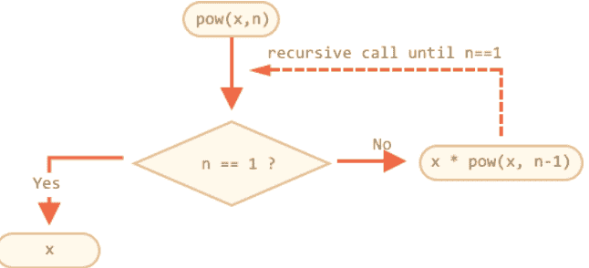

例如，为了计算 `pow(2, 4)`，递归变体执行了以下步骤：

1. `pow(2, 4) = 2 * pow(2, 3)`
2. `pow(2, 3) = 2 * pow(2, 2)`
3. `pow(2, 2) = 2 * pow(2, 1)`
4. `pow(2, 1) = 2`

当函数结束时，执行上下文不再被需要，因此它被从内存中移除。上一个上下文将从栈顶恢复：

- Context: `{ x: 2, n: 2, at line 5 }` call: `pow(2,2)`
- Context: `{ x: 2, n: 3, at line 5 }` call: `pow(2,3)`

`pow(2, 2)` 的执行继续。它拥有子调用 `pow(2, 1)` 的结果，因此它也可以完成 `x * pow(x, n - 1)` 的求值，返回 4。

然后恢复上一个上下文：

- Context: `{ x: 2, n: 3, at line 5 }` call: `pow(2,3)`

当它结束时，我们得到了 `pow(2, 3) = 8` 的结果。

在这种情况下，递归深度为：3。

从上面的插图中可以看出，递归深度等于栈中上下文的最大数量。

注意内存需求。上下文占用内存。在我们的案例中，计算 $n$ 次方实际上需要 $n$ 个上下文的内存，涵盖所有较小的 $n$ 值。

基于循环的算法节省内存：

```javascript
function pow(x, n) {
  let result = 1;

  for (let i = 0; i < n; i++) {
    result *= x;
  }

  return result;
}
```

迭代版本的 `pow` 在过程中使用单个上下文改变 `i`。它的内存需求很小、固定，且不依赖于 $n$。

任何递归都可以重写为循环。循环变体通常可以更高效。

...但重写并非易事，特别是当函数使用不同的递归子调用并合并结果，或者分支更加复杂时。而且优化可能是没有必要的，不值得付出所有努力。

递归可以提供更短、更容易理解和支持的代码。并不是每个地方都需要优化，我们主要需要良好的代码，这也是我们使用它的原因。

# 递归遍历

递归的另一个伟大应用是递归遍历。

想象一下我们有一家公司。员工结构可以表示为一个对象：

```javascript
let company = {
  sales: [
    { name: 'John', salary: 1000 },
    { name: 'Alice', salary: 600 }
  ],
  development: {
    sites: [
      { name: 'Peter', salary: 2000 }
    ],
    internals: [
      { name: 'Jack', salary: 1300 }
    ]
  }
};
```

换句话说，公司拥有部门。

- 一个部门可能有一个员工数组。例如，销售部门有 2 名员工：John 和 Alice。
- 或者一个部门可能会拆分为子部门，开发部门有两个分支：sites 和 internals。它们每个都有自己的员工。
- 当一个小组增长时，它也可能拆分为子部门（团队）。

例如，sites 部门在未来可能会拆分为 siteA 和 siteB 团队。而且，潜在上还会拆分得更细。这在图中没有显示，只是需要记住这一点。

现在假设我们有一个函数来获取所有薪资的总和。我们该怎么做呢？

迭代方法并不容易，因为结构并不固定。第一个想法可能是对 `company` 进行 `for` 循环，并在第一层部门上进行嵌套循环。然后我们需要更多的嵌套循环来遍历第二层部门（如 sites）中的员工……然后在内部再用一个循环来处理未来可能出现的第 3 层部门？我们应该在 3 层或 4 层循环停止吗？如果我们在代码中放置 3-4 层嵌套子循环来遍历单个对象，它会变得非常丑。

让我们尝试递归。

正如我们看到的，当我们的函数获取一个部门进行求和时，有两种可能的情况：

1. 它是一个带有人员数组的“简单”部门——那么我们就可以在一个简单的循环中累加薪资。
2. 或者它是一个包含 N 个子部门的对象——那么我们进行 N 次递归调用来获取每个子部门的总和并合并结果。

(1) 是递归的基础，平凡情况。
(2) 是递归步骤。

```javascript
function sumSalaries(department) {
  if (Array.isArray(department)) {
    let sum = 0;
    for (let person of department) {
      sum += person.salary;
    }
    return sum;
  } else {
    let sum = 0;
    for (let key in department) {
      sum += sumSalaries(department[key]);
    }
    return sum;
  }
}
```

通过它的指针，我们可以到达任何元素。

列表可以很容易地拆分成多个部分，稍后重新合并：

```javascript
let secondList = list.next.next;
list.next.next = null;
```

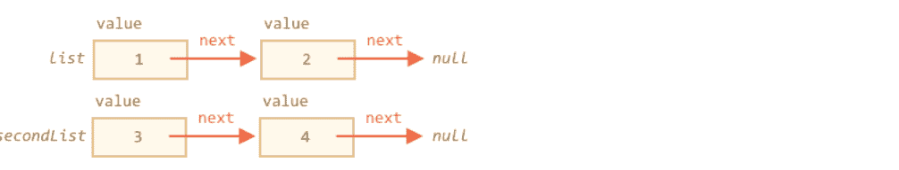

合并方法：

```javascript
list.next.next = secondList;
```

而且我们当然可以在原地插入或删除项。

例如，要在列表头部插入一个新值，我们需要更新列表的头部：

```javascript
let list = { value: 1 };
list.next = { value: 2 };
list.next.next = { value: 3 };
list.next.next.next = { value: 4 };

// 在列表头部插入一个新值
list = { value: "new item", next: list };
```

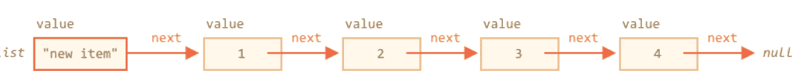

要删除中间的某个值，即前一个值的下一个：

```javascript
list.next = list.next.next;
```

我们让 `list.next` 跳过值 1 到值 2。值 1 现在被排除在链之外。

如果它没有存储在其他地方，它将自动从内存中移除。

与数组不同，这里不需要大量的重新编号，我们可以轻松地重新排列元素。

自然，列表并不总是比数组更好。否则每个人只会使用列表。

主要的缺点是，我们无法通过数字轻松访问元素。在数组中这很容易：`arr[n]` 是一个直接引用。但在列表中，我们需要从第一个元素开始，向后移动 N 次才能获取第 N 个元素。

...但我们不需要这样的操作。例如，当我们需要队列（queue）甚至双端队列（deque）时，这种有序结构必须允许从两端快速地添加/删除元素，但不需要访问其中间。

列表可以增强：

- 我们可以在 `next` 之外还可以添加 `prev` 属性来引用上一个元素，方便回溯。
- 我们还可以添加一个名为 `tail` 的变量来引用列表的最后一个元素（并在从末尾添加/删除元素时更新它）。
- 数据结构可以根据我们的需求进行变化。

## 总结

术语：

- `递归`（Recursion）是一个编程术语，指函数调用自身。递归函数可以用优雅的方式解决任务。

当一个函数调用自己时，这被称为`递归步骤`（recursion step）。递归的基础是函数参数，它们使得任务完成后函数不再进行进一步调用。

- `递归定义的`（recursively-defined）数据结构是一种可以使用自身来定义的数据结构。

例如，链表可以定义为一个由引用列表（或 `null`）的对象组成的数据结构。

```
list = { value, next -> list }
```

像 HTML 元素树或本章中的部门树等树自然是递归的：它们有分支，每个分支都可以拥有其他分支。

可以使用递归函数来遍历它们，正如我们在 `sumSalary` 示例中看到的那样。

任何递归函数都可以重写为迭代函数。这有时为了优化性能是必要的。但对于许多任务，递归解决方案已经足够快，且更容易编写和维护。

## 任务

### 计算到指定数字的所有数字之和

重要性：5

编写一个函数 `sumTo(n)`，计算数字 `1 + 2 + ... + n` 的和。

例如：

```
sumTo(1) = 1
sumTo(2) = 2 + 1 = 3
sumTo(3) = 3 + 2 + 1 = 6
sumTo(4) = 4 + 3 + 2 + 1 = 10
sumTo(100) = 100 + 99 + ... + 2 + 1 = 5050
```

提供 3 种方案：

1. 使用 `for` 循环。
2. 使用递归，因为当 `n > 1` 时 `sumTo(n) = n + sumTo(n-1)`。
3. 使用等差数列公式。

结果示例：

```javascript
function sumTo(n) { /*...你的代码 ... */ }
alert(sumTo(100)); // 5050
```

P.S. 哪种方案最快？最慢的是哪个？为什么？

P.P.S. 我们可以使用递归计算 `sumTo(100000)` 吗？

解答

### 计算阶乘

重要性：4

自然数的阶乘是一个数字乘以“该数字减一”，再乘以“数字减二”，依此类推，直到 1。`n` 的阶乘表示为 `n!`。

我们可以这样写阶乘的定义：

```
n! = n * (n - 1) * (n - 2) * ... *1
```

不同 `n` 的阶乘值：

```
1! = 1
2! = 2 * 1 = 2
3! = 3 * 2 * 1 = 6
4! = 4 * 3 * 2 * 1 = 24
5! = 5 * 4 * 3 * 2 * 1 = 120
```

任务是写一个函数 `factorial(n)`，使用递归调用计算 `n!`。

```javascript
// ...
alert(factorial(5)); // 120
```

P.S. 提示：`n!` 可以写为 `n * (n-1)!`

解答

### 斐波契数

重要性：5

斐波契数数列的公式为 `Fn = Fn-1 + Fn-2`。换句话说，下一个数字是前两个数字之和。1, 2(1+1), 3(1+2), 5(2+3) 等此类推：1, 2, 3, 5, 8, 13, 21...

斐波契数与黄金比例以及我们许多现象有关。

写一个函数 `fib(n)`，返回第 `n` 个数字。示例：

```javascript
function fib(n) { /*...*/ }
alert(fib(3)); // 2
alert(fib(7)); // 13
alert(fib(10)); // 55
```

P.S. `fib(70)` 应该很快。

解答

### 输出单链表

重要性：5

假设我们有一个单链表（在递归章节描述）：

```javascript
let list = {
  value: 1,
  next: {
    value: 2,
    next: {
      value: 3,
      next: null
    }
  }
};
```

写一个函数 `printList(list)`，按顺序输出项。提供两种方案：使用循环和递归。哪种更好：递归还是不使用递归？

解答

### 反序输出单链表

重要性：5

以反序顺序输出单链表。提供两种方案：使用循环和递归。

解答

# 剩余参数和扩展运算符

许多内置函数支持任意数量的参数。例如：

- `Math.max(arg1, arg2, ..., argN)` 返回参数中最大的值。
- `Object.assign(dest, src1, ..., srcN)` 将 `src1..N` 复制到 `dest`。
- 等等。

在本章中我们将学习如何实现相同的操作。更重要的是，如何习惯此类函数和数组。

# 剩余参数 ...

函数可以带任意数量的参数调用，无论它是如何定义的。例如：

```javascript
function sum(a, b) {
  return a + b;
}
alert(sum(1, 2, 3, 4, 5));
```

不会出现“多余”参数错误。但当然，结果中只有前两个会被计数。剩余参数可以在函数定义中使用三个点 `...`。它们字面意思是将剩余参数收集到一个数组。例如，将所有参数收集到数组：

```javascript
function sumAll(...args) { // args 是数组名
  let sum = 0;

  for (let arg of args) sum += arg;

  return sum;
}

alert(sumAll(1)); // 1
alert(sumAll(1, 2)); // 3
alert(sumAll(1, 2, 3)); // 6
```

我们可以选择将前面的参数作为变量，只收集剩余部分。这里两个参数作为变量，剩余部分进入 `titles` 数组：

```javascript
function showName(firstName, lastName, ...titles) {
  alert(firstName + ' ' + lastName); // Julius Caesar

  // 剩余部分进入 titles 数组
  // 即 titles = ["Consul", "Imperator"]
  alert(titles[0]); // Consul
  alert(titles[1]); // Imperator
  alert(titles.length); // 2
}

showName("Julius", "Caesar", "Consul", "Imperator");
```

> **剩余参数必须在末尾**

剩余参数收集所有剩余参数，因此以下写法没有意义并会导致错误：

```javascript
function f(arg1, ...rest, arg2) // ...rest 后面还有 arg2 ?
// error
```

`...rest` 必须始终最后。

# “arguments”变量

还有一个名为 `arguments` 的特殊类数组对象，按索引包含所有参数。例如：

```javascript
function showName() {
  alert(arguments.length);
  alert(arguments[0]);
  alert(arguments[1]);

  // 它是可迭代的
  // for(let arg of arguments) alert(arg);
}

// 显示: 2, Julius Caesar
showName("Julius", "Caesar");

// 显示: 1, Ilya, undefined (没有第二个参数)
showName("Ilya");
```

在过去，语言中不存在剩余参数，`arguments` 是获取函数所有参数的唯一方法，无论总数是多少。它仍然有效，可以使用。但缺点是尽管 `arguments` 是类数组且可迭代的，但它并不是数组。它不支持数组方法，因此我们不能调用 `arguments.map(...)` 等。此外，它总是包含所有参数。我们无法像剩余参数那样部分捕获它们。当我们需要这些功能时，优先使用剩余参数。

> **箭头函数没有“arguments”**

如果从箭头函数访问 `arguments` 对象，它将从外部“普通”函数获取。示例如下：

```javascript
function f() {
  let showArg = () => alert(arguments[0]);
  showArg();
}
f(1); // 1
```

# 扩展运算符

我们刚刚看到了如何从参数列表获取数组。但有时我们需要执行相反的操作。例如，内置的 `Math.max` 能够从列表中返回最大的数字：

```javascript
alert(Math.max(3, 5, 1)); // 5
```

现在，假设我们有一个数组 `[3, 5, 1]`。我们如何对它调用 `Math.max` 呢？

“原样”传递它是不起的，因为 `Math.max` 期望的是一系列数值参数列表，而不是单个数组：

```javascript
let arr = [3, 5, 1];
alert(Math.max(arr)); // NaN
```

当然，我们不能在代码中手动列出所有项 `Math.max(arr[0], arr[1], arr[2])`，因为我们可能不确定有多少个元素。随着脚本的执行，元素可能很多，也可能没有。这会让代码变得非常糟糕。

扩展运算符来救场了！它看起来和剩余参数相似，也使用 `...`，但作用完全相反。

当在函数调用中使用 `...arr` 时，它会将一个可迭代对象 `arr` “展开”为参数列表。

对于 `Math.max`：

```javascript
let arr = [3, 5, 1];
alert(Math.max(...arr)); // 5 (展开将数组转换为参数列表)
```

我们也可以用这样传递多个可迭代对象：

```javascript
let arr1 = [1, -2, 3, 4];
let arr2 = [8, 3, -8, 1];
alert(Math.max(...arr1, ...arr2)); // 8
```

我们甚至可以将扩展运算符与普通值结合：

```javascript
let arr1 = [1, -2, 3, 4];
let arr2 = [8, 3, -8, 1];
alert(Math.max(1, ...arr1, 2, ...arr2, 25)); // 25
```

此外，扩展运算符可以合并数组：

```javascript
let arr = [3, 5, 1];
let arr2 = [8, 9, 15];
let merged = [0, ...arr, 2, ...arr2];
alert(merged); // 0, 3, 5, 1, 2, 8, 9, 15
```

在上面的示例中，我们使用数组来演示扩展运算符，但任何可迭代对象都可以。

例如，在这里我们使用扩展运算符将字符串转换为字符数组：

```javascript
let str = "Hello";
alert([...str]); // H,e,l,l,o
```

扩展运算符在内部使用迭代器来收集元素，方式与 `for...of` 相同。

因此，对于字符串，`for...of` 返回字符，而 `...str` 变成 `"H","e","l","l","o"`。字符列表被传递给数组初始化器 `[...str]`。

对于这个特定的任务，你也可以使用 `Array.from`，因为它可以将可迭代对象（如字符串）转换为数组：

```javascript
let str = "Hello";
// Array.from 将可迭代对象转换为数组
alert(Array.from(str)); // H,e,l,l,o
```

结果与 `[...str]` 相同。

但 `Array.from(obj)` 和 `[...obj]` 之间存在细微的区别：

- `Array.from` 同时作用于类数组和可迭代对象。
- 扩展运算符仅作用于可迭代对象。

因此，对于将某些内容转换为数组的任务，`Array.from` 往往更具通用性。

## 总结

当我们在代码中看到 `"..."` 时，它要么是剩余参数，要么是扩展运算符。

有一种简单的方法可以区分它们：

- 当 `...` 位于函数参数的末尾时，它是“剩余参数”，并将参数列表的剩余部分收集到一个数组中。
- 当 `...` 出现在函数调用或其他类似位置时，它被称为“扩展运算符”，并将数组展开为列表。

使用这些模式：

- 剩余参数用于创建接受任意数量参数的函数。
- 扩展运算符用于将数组传递给通常需要多个参数列表的函数。

它们共同帮助我们轻松地在列表和参数数组之间转换。

函数调用的所有参数在“旧式”参数中也是可用的：类数组可迭代对象 `arguments`。

# 闭包

JavaScript 是一种非常以函数为导向的语言。它赋予了我们很多自由。函数可以动态创建、复制到另一个变量，或作为参数传递给另一个函数，并在以后从完全不同的地方调用。

我们知道函数可以访问其外部的变量，这个特征被频繁使用。

但当外部变量变化时会发生什么？函数获取的是最新的值，还是函数创建时存在的值？

另外，当函数移动到代码的另一个地方并从那里调用时会发生什么——它能访问新地方的外部变量吗？

不同的语言此行为不同，在本章中我们将涵盖 JavaScript 的行为。

# 几个问题

让我们先考虑两种情况，然后逐部分研究内部机制，这样你将来就能回答这些问题以及更复杂的问题。

1. 函数 `sayHi` 使用了一个外部变量 `name`。当函数运行时，它将使用哪个值？

```javascript
let name = "John";

function sayHi() {
  alert("Hi, " + name);
}

name = "Pete";

sayHi(); // 它会显示什么："John" 还是 "Pete"
```

这种情况在浏览器和服务器端开发中很常见。函数可能被安排在比创建更晚的时间执行，例如在用户操作或网络请求之后。

所以，问题是：它会获取最新的变化吗？

2. `maker` 函数创建另一个函数并返回它。这个新函数可以在其他地方调用。它会访问新地方的外部变量吗？

```javascript
function maker() {
  let name = "Pete";

  return function() {
    alert(name);
  };
}

let name = "John";

// 创建函数
let work = maker();

// 调用它
work(); // 显示什么？创建处的 name 还是调用处的 name？
```

# 词法作用域环境

为了理解发生了什么，我们首先讨论什么是“变量”。

在 JavaScript 中，每个运行的函数、代码块 `{...}` 以及整个脚本都有一个关联的内部对象，称为词法作用域环境（Lexical Environment）。

环境对象由两部分组成：

1. 环境记录（Environment Record）——存储所有变量的对象（以及一些关于 `this` 的其他信息）。
2. 指向外部环境的引用。

实际上，让我们看看结构：

- 环境记录：存储局部变量。
- 外部引用：指向外部环境。

# 函数声明

到目前为止我们只观察了变量。现在进入函数声明。

与 `let` 变量不同，它们并不是在执行到它们时才初始化，而是在更早的时候，当词法环境创建时就已经完全初始化了。

对于顶层函数，这意味着脚本启动的时刻。

这就是为什么我们可以在定义之前调用函数声明。

下面的代码证明了从一开始环境就不是空的，因为它是函数声明。随后它获取了用 `let` 声明的 `phrase`：

```javascript
// 执行开始时
say: function
// let phrase = "Hello" 执行后
say: function
phrase: "Hello"

function say(name) { alert(phrase + ', ' + name); }
```

# 内部和外部词法环境

现在让我们继续探索函数访问外部变量时会发生什么。

在调用期间，`say()` 使用了外部的 `phrase`，让我们看看发生的细节。

首先，当函数运行时，会自动创建一个新的词法作用域环境。这是所有函数的通用规则。该环境被用于存储局部变量和调用参数。

例如，对于 `say("John")`，它看起来如下（执行位于带有箭头标记的行）：

```javascript
let phrase = "Hello"
function say(name) { alert(phrase + ', ' + name); }

// 执行 say("John") 时
// 内部词法环境
name: "John"
// 外部词法环境 (全局)
phrase: "Hello"
say: function
```

因此，在函数调用期间，我们有两个词法环境：内部的（用于函数调用）和外部（全局）：

- 内部词法环境对应于 `say` 函数的当前执行。它有一个属性：`name`，即函数参数。我们调用了 `say("John")`，所以 `name` 的值为 "John"。
- 外部词法环境是全局词法环境。它包含 `phrase` 和函数本身。

内部词法环境有一个指向外部的引用。

## 当代码想要访问变量时——首先搜索内部词法环境，然后是外部、更外层，以此类推，直到全局环境。

如果在任何地方都未找到变量，在不使用 `strict` 的情况下，对 `undefined` 变量赋值会创建一个新的全局变量，为了后向兼容。

让我们看看在示例中搜索是如何进行的：

- 当 `say` 内部的 `alert` 想要访问 `name` 时，它立即在函数词法环境中找到了它。
- 当它想要访问 `phrase` 时，本地没有 `phrase`，因此它顺着引用找到外层的词法环境并在那里找到了它。

```javascript
let phrase = "Hello"
function say(name) {
  alert(phrase + ', ' + name);
}
say("John"); // Hello, John
```

现在我们可以回答章节开头的第一个问题了。

函数获取外部变量时的值；它使用的是最新的值。

这是因为上述描述的机制。旧的变量值没有保存在任何地方。当函数需要它们时，它会从自己的或外部词法环境中获取当前值。

所以对第一个问题的回答是 Pete：

```javascript
let name = "John"
function sayHi() {
  alert("Hi, " + name);
}
name = "Pete"; // (*)
sayHi(); // Pete
```

上述代码的执行流如下：

1. 全局词法环境拥有 `name: "John"`。
2. 在行 `(*)` 处，全局变量被改变，现在它拥有 `name: "Pete"`。
3. 当执行 `sayHi()` 并从外部获取 `name` 时，它是在全局词法环境中获取的，那里已经是 "Pete"。

> **一次调用——一个词法环境**
>
> 注意，每次函数运行时都会创建一个新的函数词法环境。
>
> 如果一个函数被调用多次，那么每次调用都将拥有它自己的词法环境，包含每次运行时的本地变量和参数。

> **词法环境是一个规范对象**
>
> “词法环境”（Lexical Environment）是一个规范对象。我们无法在代码中获取该对象并对其操作。JavaScript 引擎可能会进行优化，丢弃未使用变量以节省内存并执行其他内部技巧，但可见的行为应该如描述所示。

## 嵌套函数

当一个函数在另一个函数内部创建时，它被称为“嵌套”函数。

在 JavaScript 中很容易实现。

我们可以用它来组织代码，如下：

```javascript
function sayHiBye(firstName, lastName) {
  // 下方使用的辅助嵌套函数
  function fullName() {
    return firstName + " " + lastName;
  }

  alert("Hello, " + fullName());
  alert("Bye, " + fullName());
};
```

嵌套函数 `fullName()` 是为了方便而设计的。它可以访问外部变量并返回全名。嵌套函数在 JavaScript 中非常常见。

更有趣的是，嵌套函数可以被返回：可以作为新对象的属性（如果外部函数创建了一个带有方法的对象），也可以作为它的结果返回。然后它可以在其他地方使用。无论在何处，它仍然可以访问相同的外部变量。

例如，在这里，嵌套函数通过构造函数赋值给新对象：

```javascript
// 构造函数返回一个新对象
function User(name) {
  // 对象方法作为嵌套函数创建
  this.sayHi = function() {
    alert(name);
  }
}

let user = new User("John");
user.sayHi(); // 方法 "sayHi" 代码可以访问外部的 "name"
```

而这里，我们只是创建并运行了一个“计数”函数：

```javascript
function makeCounter() {
  let count = 0;

  return function() {
    return count++; // 访问外部的 "count"
  }
}

let counter = makeCounter();

alert(counter()); // 0
alert(counter()); // 1
alert(counter()); // 2
```

让我们继续看 `makeCounter` 示例。它创建了一个“计数”函数，每次调用都会返回下一个数字。尽管很简单，但该代码的稍微修改变体具有实际用途，例如作为伪随机数生成器等。

计数器内部是如何工作的？

当内部函数运行时，`count++` 中的变量将从内向外进行搜索。对于上面的示例，顺序将是：

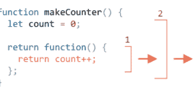

1. 嵌套函数的局部变量...
2. 外部函数的变量...
3. 以此类推，直到到达全局变量。

在这个示例中，`count` 在第 2 步被找到。当外部变量被修改时，它会在被找到的地方被改变。因此 `count++` 找到了外部变量并在它所属的词法环境中增加了它。就像我们定义了 `let count = 1`。

这里有两个待考虑的问题：

1. 我们能否以某种方式重置不属于 `makeCounter` 的 `count`？例如在上面的 `alert` 调用之后。
2. 如果我们多次调用 `makeCounter()`，它们是独立的吗？还是共享同一个 `count`？

在继续阅读之前尝试回答它们。

...

全部完成？

好的，让我们来看答案。

1. 没有办法：`count` 是局部变量，我们无法从外部访问它。
2. 每次调用 `makeCounter()` 都会创建一个新的词法环境，带有它自己的 `count`。所以计数器函数是独立的。

```javascript
function makeCounter() {
  let count = 0;

  return function() { // [[Environment]]
    return count++;
  };
}

let counter = makeCounter();
```

请注意，在这一步内部函数被创建了但尚未被调用。`function() { return count++; }` 内部并没有运行。

4. 随着执行结束，`makeCounter()` 的调用完成，结果（那个小的嵌套函数）被赋值给全局变量 `counter`：

```javascript
function makeCounter() {
  let count = 0;

  return function() {
    return count++;
  };
}

let counter = makeCounter();

alert(counter()); // [[Environment]]
```

该函数只有一个：`return count++`，我们在运行它时会执行。

5. 当调用 `counter()` 时，会为它创建一个“空”的词法作用环境。它本身没有局部变量。但 `counter` 的 `[[Environment]]` 用作它的外部引用，因此它可以访问创建它的之前的 `makeCounter()` 调用中的变量：

```javascript
function makeCounter() {
  let count = 0;

  return function() {
    return count++;
  };
}

let counter = makeCounter();

alert(counter()); // [[Environment]]
```

现在如果它进行访问，会先搜索自己的词法环境（空的），然后是之前 `makeCounter()` 用的词法环境，最后是全局环境。

当它寻找 `count` 时，它会在最近的外部词法环境的变量 `makeCounter` 中找到它。

请注意这里的内存管理是如何工作的。尽管 `makeCounter()` 已经结束一段时间，但它的环境被保留在了内存中，因为有一个嵌套函数通过 `[[Environment]]` 引用了它。

通常情况下，只要有函数可能使用它，词法对象就会一直存在。只有当没有剩余的引用时，它才会被清除。

6. 调用 `counter()` 不仅返回 `count` 的值，还增加了它。请注意，修改是“原地”完成的——正是在发现 `makeCounter` 的那个环境中。

```javascript
function makeCounter() {
  let count = 0;

  return function () { // [[Environment]]
    return count++;
  };
}

let counter = makeCounter();

alert(counter()); // 0
alert(counter()); // 1
```


所以我们回到了上一步，唯一的变化是 `count` 的新值。随后的调用都执行相同的操作。

## 7. 下一步的 `counter()` 调用

章节开头的第二个问题的答案现在应该是显而易见的。

下面代码中的 `work()` 函数通过外部词法作用环境引用使用了其定义源位置的名称：

```javascript
function makeWorker() {
  let name = "Pete";

  return function () {
    alert(name);
  };
}

let name = "John";
let work = makeWorker();

work(); // Pete
```

所以，这里的结果是 `"Pete"`。

但如果 `makeWorker()` 中没有 `name`，那么搜索将向外进行，并正如我们在上面的链所示，获取全局变量。在这种情况下，它将是 `"John"`。

> 闭包 (Closures)
>
> 有一个通用的编程术语叫“闭包”，开发者应该了解它。
>
> 闭包是一个能够记住其外部变量并可以访问它们的函数。在某些语言中，这是不可能的，或者函数需要以特殊方式编写才能实现。但正如上面所解释的，在 JavaScript 中，所有函数自然地都是闭包（只有一个例外，将在“`new Function`” 语法章节中介绍）。
>
> 也就是说：它们通过一个隐藏的 `[[Environment]]` 属性自动记住它们被创建的位置，并且所有它们都能访问外部变量。
>
> 当在面试中，前端开发者被问到“什么是闭包？”时，一个有效的回答是给出闭包的定义，并解释 JavaScript 中的所有函数都是闭包，可能再多说几关于技术细节：`[[Environment]]` 属性以及词法作用环境是如何工作的。

## 代码块与循环，IIFE

示例集中在函数上。但任何代码块 `{......}` 都存在一个词法作用环境。

当一个代码块运行时，它会创建一个词法作用环境，其中包含块级局域变量。这里有两个例子。

在下面的示例中，变量 `user` 只存在于 `if` 块中：

```javascript
let phrase = "Hello";
if (true) {
  let user = "John";
  alert(phrase, user);
}
alert(user); // 错误，无法看到变量！
```

当执行进入 `if` 块时，会为它创建一个“仅限 `if`”的词法作用环境。

它拥有外部的引用，因此可以找到 `phrase`。但所有在 `if` 内部声明的变量和函数表达式都位于该词法环境中，无法从外部看到。

例如，在 `if` 结束之后，下面的 `alert` 将看不到 `user`，从而导致错误。

## `For`, `while`

对于 `for` 循环，每次迭代都有独立的词法作用环境。如果变量在 `for` 中声明，那么它也是词法环境局域的：

```javascript
for (let i = 0; i < 10; i++) {
  // 每次循环都有自己的词法作用环境
  {i: value}
}
alert(i); // 错误，没有此类变量
```

请注意：`let i` 在视觉上位于 `{...}` 之外。`for` 在这里有点特殊：循环的每次迭代都有自己的包含当前 `i` 的独立词法作用环境。

再次，与 `if` 类似，循环结束后也是如此。

## 代码块

在 JavaScript 中，任何代码块 `{}` 都可以创建自己的词法作用环境。这对于隔离变量很有用。

```javascript
{
  let message = "Hello";
  alert(message);
}
// alert(message); // 错误
```

## IIFE

在过去，JavaScript 中没有块级变量。所以程序员们发明了某种东西。他们称之为“立即执行函数表达式”（缩写 IIFE）。

IIFE 看起来像这样：

```javascript
(function() {
  let message = "Hello";
  alert(message);
}); // Hello
```

在这里创建了一个函数表达式并立即调用。函数周围的括号告诉 JavaScript 将其视为表达式而非声明。

除了括号外，还有其他方法可以告诉 JavaScript 我们指的是函数表达式：

```javascript
// 创建 IIFE 的方法
(function() {
  alert("函数周围的括号");
})();

(function() {
  alert("整体包裹的括号");
})();

(!function() {
  alert("按位取反运算符开始表达式");
})();

(+function() {
  alert("一元加号开始表达式");
})();
```

在上述所有情况中，我们都声明了一个函数表达式并立即运行它。

## 垃圾回收

通常，词法作用环境在函数运行后会被清理并删除。例如：

```javascript
function f() {
  let value1 = 123;
  let value2 = 456;
}

f();
```

这里两个值在技术上是词法作用环境的属性。在 `f()` 之后，该词法环境变得不可达，它从内存中被删除。

但如果在 `f` 结束后还有一个仍然可用的嵌套函数，那么它的 `[[Environment]]` 引用也会保持外部词法环境的活跃。

```javascript
function f() {
  let value = 123;
  function g() { alert(value); }
  return g;
}

let g = f(); // g 是可用的，并且保持了外部词法环境
```

请注意，如果 `f()` 被多次调用，导致生成的函数被保存，那么相应的作用域环境（Lexical Environment）对象也会保留在内存中。下面代码中的 3 个都是：

```javascript
function f() {
  let value = Math.random();

  return function() { alert(value); };
}

// 数组中有 3 个函数，每一个都链接到作用域环境（简写为 LE）
// 来自相应的 f() 运行结果
//
LE LE LE
let arr = [f(), f(), f()];
```

当一个作用域环境变得不可达时，它就会消失（就像任何其他对象一样）。换句话说，只要至少有一个嵌套函数引用它，它就会存在。

在下面的代码中，在 `g` 变得不可达后，闭包的作用域环境（以及值）将从内存中被清理：

```javascript
function f() {
  let value = 123;
  function g() { alert(value); }

  return g;
}

let g = f(); // 当 g 存活时
// 相应的作用域环境生存
g = null; //...现在内存被清理了
```

## 实际中的优化

正如我们看到的，当一个函数生存时，所有的外部变量也会被保留。

在实践中，JavaScript 引擎会尝试优化这一点。它们会分析变量的使用，如果很容易看出某个外部变量没有使用，它就会被移除。

V8 (Chrome, Opera) 中的一个重要副作用是，这种变量在调试时将不可用。

尝试在 Chrome 中打开开发者工具并运行下面的示例。

当代码停顿时，在控制台中输入 `alert(value)`。

```javascript
function f() {
  let value = Math.random();

  function g() {
    debugger; // 在控制台：输入 alert( value ); 没有这样的变量！

    return g;
  }

  let g = f();
  g()();
}
```

如你所见——没有这样的变量！理论上，它应该是可以访问的，但引擎将其优化掉了。

这可能会导致有趣的（即使不是耗费时间的）调试问题。其中之一是——我们在预期的变量之外看到了同名的变量：

```javascript
let value = "Surprise";

function f() {
  let value = "the closest value";

  function g() {
    debugger; // 在控制台：输入 alert( value ); Surprise!

    return g;
  }

  let g = f();
  g()();
}
```

> 再见！

V8 的这个特性是值得了解的。如果你在 Chrome/Opera 中进行调试，早晚你都会遇到它。

这不是调试器的 bug，而是 V8 的一个特殊特性。也许它以后会发生变化。你始终可以通过运行此页面上的示例来检查它。

## 声明会被提升，但赋值不会。

用一个示例来演示会更好，像这样：

```javascript
function sayHi() {
  var phrase = "Hello";
}

sayHi();
```

`var phrase = "Hello"` 这一行包含两个动作：

1. 变量声明 `var`
2. 变量赋值 `=`

声明在函数执行开始时被处理（即“提升”），但赋值始终是在它出现的地方生效。因此，代码的执行方式本质如下：

```javascript
function sayHi() {
  var phrase; // 声明在开始时工作...
  alert(phrase); // undefined
  phrase = "Hello"; // ...赋值 - 当执行到这里时。
}
sayHi();
```

由于所有的 `var` 都是在函数开始时处理的，我们可以在任何地方引用它们。但在赋值之前，变量都是 `undefined` 的。

在上面的两个示例中，`alert` 运行运行都没有报错，因为变量 `phrase` 存在。它的值还没有被赋值，所以显示为 `undefined`。

## 总结

`var` 与 `let/const` 相比有两个微小的区别：

1. `var` 变量没有块级作用域，它们在函数级别是可见的。
2. `var` 声明在函数开始时处理（全局变量在脚本开始时处理）。

关于全局对象还有一个微小的区别，我们将在下一节介绍。

这些差异使得 `var` 在大多数情况下比 `let` 旧。块级变量是一个非常棒的特性。这就是为什么 `let` 在很久以前就被引入标准中，并且现在是声明变量的主要方式（与 `const` 一起）。

## 全局对象

全局对象提供了任何地方都可以使用的变量和函数。大部分是语言或环境内置的。

在浏览器中它命名为 `window`，Node.js 中是 `global`，对于其他环境它可能有另一个名字。

最近，语言添加了 `globalThis`，作为全局对象的标准化名称，它应该被所有环境支持。在某些浏览器中，例如 Chromium Edge，`globalThis` 尚未被支持，但可以轻松地进行 polyfill（填充）。

可以可以直接访问全局对象的所有属性：

```javascript
alert("Hello");

// 等同于
window.alert("Hello");
```

在浏览器中，用 `var` 声明的全局函数和变量变成全局对象的属性：

```javascript
var gVar = 5;
alert(window.gVar); // 5 (变成了全局对象的属性)
```

请不要依赖这一点！这种行为是为了兼容性而存在的。现代脚本使用 JavaScript 模块，这种情况并不会发生。我们将在后的“模块”章节介绍它们。

此外，现代变量声明 `let` 和 `const` 完全不会表现出这种行为：

```javascript
let gLet = 5;
alert(window.gLet); // undefined (没有变成全局对象的属性)
```

如果一个值重要到你想让它全局可用，请直接作为属性写入：

```javascript
// 将当前用户信息全局化，让所有脚本访问它
window.currentUser = {
  name: "John"
};

// 代码中的其他地方
alert(currentUser.name); // John

// 或者，如果我们有一个名为 "currentUser" 的局部变量
// 显式地从 window 获取（安全的！）
alert(window.currentUser.name); // John
```

尽管如此，通常不建议使用全局变量。变量应该越少越好。函数获取“输入”变量产生特定“结果”的代码设计更清晰、更不容易出错且更容易测试。

## 用于 polyfill（填充）

我们使用全局对象来测试对现代语言特的支持。

例如，测试是否存在内置的 `Promise` 对象（在旧浏览器中并不真正存在）：

```javascript
if (!window.Promise) {
  alert("你的浏览器真的旧了！");
}
```

如果没有（例如，我们处于旧版浏览器中），我们可以创建“polyfills”：添加环境未支持但在现代标准中存在的函数。

```javascript
if (!window.Promise) {
  window.Promise = ... // 现代语言特性的自定义实现
}
```

## 总结

- 全局对象在各处持有变量。
- 这包括 JavaScript 内置项（如 `Array`）以及环境特定的值（如 `window.innerHeight` —— 浏览器窗口高度）。
- 全局对象有一个通用的名称 `globalThis`。
- ...但通常被“老派”的特定环境名称引用，例如 `window`（浏览器）和 `global`（Node.js）。`globalThis` 是一个最近的提议，它在 Chromium Edge 中不支持（但可以被 polyfill）。
- 只有当值对我们的项目确实是全局的，我们才将其存储在全局对象中，并保持最少。
- 在浏览器中，除非我们使用模块，用 `var` 声明的全局函数和变量会变成全局对象的属性。
- 为了让代码面向未来并更容易理解，我们应该直接访问全局对象的属性，如 `window.x`。

## 函数对象，NFE

正如我们所知，JavaScript 中的函数是值。

JavaScript 中的每个值都有一个类型。函数是什么类型？

在 JavaScript 中，函数是对象。

想象函数的一种好方法是将它们视为可调用的“动作对象”。我们不仅可以调用它们，还可以把它们当作对象：添加/删除属性、按引用传递等。

## `"name"` 属性

函数对象包含一些可用的属性。

例如，函数的名称可以作为属性访问。

## 属性

## 带参数的处理器

-- 带参数的，只有在用户提供参数时调用

-- 带参数的函数在在..这种想法是，我们可以提供一个简单的无参数处理器语法（最常见的情况），但也能提供通用的处理器。

为了正确地调用处理器，我们检查 `length` 属性：

```javascript
function ask(question, ...handlers) {
  let isYes = confirm(question);

  for (let handler of handlers) {
    if (handler.length == 0) {
      if (isYes) handler();
      else handler(isYes);
    }
  }
}
// 对于肯定回答，两个处理器都会被调用
// 对于否定回答，只调用第二个
ask("(() => alert('(''), result => alert(result));
```

这是所谓多态的一种特例，根据参数的类型处理参数，在我们的案例中是根据长度处理。这种想法在 JavaScript 库中确实有用途。

## 自定义属性

我们也可以添加自己的属性。

在这里我们添加 `counter` 属性来跟踪调用次数：

```javascript
function sayHi() {
  alert("HI");

  // 数数我们运行了多少次
  sayHi.counter++;
}
sayHi.counter = 0; // 初始值
sayHi();
sayHi(); // Hi

alert(`调用了 ${sayHi.counter} 次`); // 调用了 2 次
```

> 属性不是变量

赋值给函数的赋值如 `sayHi.counter = 0` 并没有在内部定义一个局部变量。换句话说，属性 `counter` 和变量 `counter` 是两个不相关的东西。

我们可以把函数看作对象，在其中存储属性，但对它的执行没有影响。变量不是函数属性，反之亦然。这些只是平行的世界。

函数属性有时可以替代闭包。例如，我们可以重写“闭包”章节中的计数器示例来使用函数属性：

```javascript
function makeCounter() {
  // 替代：
  // let count = 0
```

```javascript
function counter() {
  return counter.count++;
}

counter.count = 0;
return counter;
}

let counter = makeCounter();
alert(counter()); // 0
alert(counter()); // 1
```

计数现在直接存储在函数内部，而不是它的外部作用域环境（Lexical Environment）中。

这比使用闭包更好还是更？

主要的区别在于，如果 `count` 的值存在于外部变量中，那么外部代码无法访问它。只有嵌套函数可以修改它。如果它绑定到函数上，那么这样做是可能的：

```javascript
function makeCounter() {
  function counter() {
    return counter.count++;
  }

  counter.count = 0;
  return counter;
}

let counter = makeCounter();
counter.count = 10;
alert(counter()); // 10
```

实现方式的选择取决于我们的目标。

## 命名函数表达式 (Named Function Expression)

具命名函数表达式（Named Function Expression，简称 NFE）是指带有名称的函数表达式。

例如，让我们来看一个普通的函数表达式：

```javascript
let sayHi = function(who) {
  alert(`Hello, ${who}`);
};
```

并给它添加一个名称：

```javascript
let sayHi = function func(who) {
  alert(`Hello, ${who}`);
};
```

我们实现什么了吗？额外的 `"func"` 名称的目的是什么？

首先请注意，我们仍然拥有一个函数表达式。在 `function` 之后添加名称 `"func"` 并没有让它变成函数声明（Function Declaration），因为它仍然是赋值表达式的一部分被创建的。

添加这样的名称也不会破坏任何功能。

该函数仍然可以通过 `sayHi()` 来调用：

```javascript
let sayHi = function func(who) {
  alert(`Hello, ${who}`);
}
sayHi("John"); // Hello, John
```

关于 `func` 这个名字有两个特殊之处：

1. 它允许函数在内部引用其自己。
2. 它在函数外部是不可见的。

例如，下面的 `sayHi` 实例在未提供 `who` 的情况下会使用 `"Guest"` 再次调用自己：

```javascript
let sayHi = function func(who) {
  if (who) {
    alert(`Hello, ${who}`);
  } else {
    func("Guest"); // 使用 func 重新调用自己
  }
}

sayHi(); // Hello, Guest

// 但这样行不通：
func(); // Error, func is not defined（函数外部不可见）
```

我们为什么要使用 `func`？也许直接在嵌套调用中使用 `sayHi` 即可？

实际上，在大多数情况下我们可以这样做：

```javascript
let sayHi = function(who) {
  if (who) {
    alert(`Hello, ${who}`);
  } else {
    sayHi("Guest");
  }
}
```

这段代码的问题是 `sayHi` 的值可能会改变。函数可能会指向另一个变量，代码将开始报错：

```javascript
let sayHi = function(who) {
  if (who) {
    alert(`Hello, ${who}`);
  } else {
    sayHi("Guest");
  }
}

let sayHi = null;
sayHi(); // Error, sayHi is not a function
```

这段代码的问题是 `sayHi` 的值可能会改变。函数可能会指向另一个变量，代码将开始报错：

```javascript
let sayHi = function(who) {
  if (who) {
    alert(`Hello, ${who}`);
  } else {
    sayHi("Guest");
  }
}

let welcome = sayHi;
sayHi = null;
welcome(); // Error, sayHi is not a function
```

发生这种情况是因为函数从它的外部环境获取了 `sayHi`。由于没有局部的 `sayHi`，所以使用了外部变量。我们可以在函数表达式中放入的可选名称正是为了解决这类问题。让我们用它来修复代码：

```javascript
let sayHi = function func(who) {
  if (who) {
    alert(`Hello, ${who}`);
  } else {
    func("Guest");
  }
}

let welcome = sayHi;
sayHi = null;

welcome(); // Hello, Guest (嵌套调用正常工作)
```

现在它可以工作了，因为由于名称 `"func"` 是函数局部的。它不是从外部获取的（且不可见）。规范保证了它将始终引用当前函数。外部代码仍然拥有它的变量 `welcome`。而 `func` 是一个“内部名称”，函数可以在内部调用它自己。

函数声明没有这种机制。这里描述的“内部名称”功能仅适用于函数表达式，而不适用于函数声明。对于函数声明，没有添加更多“内部”名称的可能性。有时当我们我们需要可靠的内部名称时，这就是将函数声明重写为命名函数表达式的原因。

## 总结

函数是对象。我们涵盖了它们的属性：

- `name`: 函数名。通常来自函数定义，但如果没有，JavaScript 会尝试从上下文（例如赋值）猜测它。
- `length`: 函数定义中的参数个数。剩余参数（Rest parameters）不计入。

如果函数被声明为函数表达式（不在主代码中）并带有名称，则它被称为命名函数表达式。该名称可以在内部使用，用于递归调用等。

此外，函数还可能携带额外的属性。许多著名的 JavaScript 库很好地利用了这一点。它们创建一个“主”函数并在其挂载许多其他“辅助”函数。例如，`jquery` 库创建了函数 `$`。`lodash` 库创建了函数 `_` 并添加了 `clone` 等属性（当你学习更多内容时）。

实际上，它们这样做是为了减少对全局空间的污染，使库只提供一个全局变量。这减少了命名冲突的可能性。

所以一个函数本身可以完成有用的工作，还可以携带许多其他功能。

## 任务

### 计数器的设置和递减

重要性：5

修改 `makeCounter()` 的代码，使计数器能够减少并设置数字：

- `counter()` 应该返回下一个数字（如之前）。
- `counter.set(value)` 应该将计数设置为 `value`。
- `counter.decrease()` 应该将计数减 1。

查看沙盒中的完整用法示例。备注：你可以使用闭包或函数属性来保存当前计数。或者写两种变。

[打开带有测试的沙盒。](https://examplelink)

[查看解决方案](https://examplelink)

### 任意数量括号求和

重要性：2

编写一个 `sum` 函数，使其工作如下：

```javascript
sum(1)(2) == 3; // 1 + 2
sum(1)(2)(3) == 6; // 1 + 2 + 3
sum(5)(-1)(2) == 6
sum(6)(-1)(-2)(-3) == 0
sum(0)(1)(2)(3)(4)(5) == 15
```

备注：提示：你可能需要为你的函数设置对象到原型的转换。

## `"new Function"` 语法

创建函数有一种方法。它很少使用，但有时没有其他选择。

## 语法

创建函数的语法：

```javascript
let func = new Function ([arg1, arg2, ...argN], functionBody);
```

该函数根据参数 `arg1...argN` 和给定的 `functionBody` 创建。通过查看例子更容易理解。这里有一个有两个参数的函数：

```javascript
let sum = new Function('a', 'b', 'return a + b');
alert(sum(1, 2)); // 3
```

还有一个没有参数的函数，带有函数体：

```javascript
let sayHi = new Function('alert("Hello")');
sayHi(); // Hello
```

与我们见过的其他方式的主要区别在于，函数是直接从运行时传递的字符串创建的。之前所有的声明都要求我们程序员在脚本中编写函数代码。

但 `new Function` 允许将任何字符串转换为函数。例如，我们可以从服务器接收一个新函数然后执行它：

## 闭包

通常，函数会在特殊的属性 `[[Environment]]` 中记住它出生的地方。它引用创建时的作用域环境。

但当使用 `new Function` 创建函数时，它的 `[[Environment]]` 引用的是当前的作用域环境，而不是全局环境。因此，这样的函数无法访问外部变量，只能访问全局变量。

```javascript
function getFunc() {
  let value = "test";

  let func = new Function('alert(value)');

  return func;
}
getFunc(); // error: value is not defined
```

与普通行为对比：

```javascript
function getFunc() {
  let value = "test";

  let func = function() { alert(value); };

  return func;
}
getFunc(); // "test", 来自 getFunc 的作用域环境
```

重要的是，将局部变量重命名为更短的名称。

例如，如果函数中有一个 `let userName`，压缩器会将其替换为 `let a`（如果该字母已被占用，则使用另一个字母），并在处处进行替换。这通常是安全的做法，因为该变量在函数外部是无法访问的。而在函数内部，压缩器会替换每一个对它的引用。压缩器是非常智能的，它们会分析代码结构，因此不会破坏任何内容。它们并不是简单的替换。

所以，如果 `new Function` 能够访问外部变量，它将无法找到重命名后的 `UserName`。

如果 `new Function` 能够访问外部变量，它在遇到压缩器时会出现问题。

要向通过 `new Function` 创建的函数传递内容，我们应该它的参数。

## 总结

语法：

```javascript
let func = new Function ([arg1, arg2, ...argN], functionBody);
```

出于历史原因，参数也可以以逗号分隔列表的形式给出。

这三行代码的意思相同：

```javascript
new Function('a', 'b', 'return a + b'); // 基本语法
new Function('a', 'b', 'return a + b'); // 逗号分隔
new Function('a', 'b', 'return a + b'); // 逗号分隔带空格
```

使用 `new Function` 创建的函数的 `[[Environment]]` 引用的是全局词作用环境，而不是外部环境。因此，它们无法使用外部变量。这实际上是好事，因为这为我们避免了错误。显式传递参数是一种更好的架构设计方法，且不会与压缩器产生问题。

# 调度：`setTimeout` 和 `setInterval`

我们可能决定现在不执行某个函数，而是在之后的某个时间执行。这被称为“调度调用”。

有两种方法可以实现：

- `setTimeout` 允许在指定的间隔时间后运行函数。
- `setInterval` 允许按照运行之间的间隔定期运行函数。

这些方法并不是 JavaScript 规范的一部分。但大多数环境都拥有内部调度器并提供了这些方法。特别是，它们在所有浏览器和 Node.js 中都受支持。

# `setTimeout`

语法：

```javascript
let timerId = setTimeout(func|code, [delay], [arg1], [arg2], ...)
```

参数：

### `func|code`

要执行的函数或代码字符串。通常情况下，这是一个函数。由于历史原因，可以传递代码字符串，但不建议这样做。

### `delay`

运行前的延迟，以毫秒为单位（1000 ms = 1 秒），默认值。

### `arg1`, `arg2` ...

函数的参数（IE9 及以下版本不支持）

例如，这段代码在一秒后调用 `sayHi()`：

```javascript
function sayHi() {
  alert('Hello');
}
setTimeout(sayHi, 1000);
```

带参数的情况：

```javascript
function sayHi(phrase, who) {
  alert( phrase + ', ' + who);
}
setTimeout(sayHi, 1000, "Hello", "John"); // Hello, John
```

如果第一个参数是字符串，JavaScript 会根据它创建一个函数。

所以，这种写法也可以：

```javascript
setTimeout("alert('Hello')", 1000);
```

但不建议使用字符串，请使用函数代替它们，如下：

```javascript
setTimeout(() => alert('Hello'), 1000);
```

> 传递一个函数，但不要运行它

新手开发者有时会犯一个错误，在函数后加上括号 `()`：

```javascript
// 错误！
setTimeout(sayHi(), 1000);
```

这是不起作用的，因为 `setTimeout` 期望一个函数的引用。在这里 `sayHi()` 运行了函数，执行结果被传递给了 `setTimeout`。在我们的情况下，`sayHi()` 的结果是 `undefined`（函数没有返回值），所以没有调度调度。

# 使用 `clearTimeout` 取消

`setTimeout` 的调用返回一个“定时器标识符” `timerId`，我们可以用它来取消执行。

取消的语法：

```javascript
let timerId = setTimeout(...);
clearTimeout(timerId);
```

在下面的代码中，我们调度了函数然后取消了它（改变主意了）。结果是什么都没有发生：

```javascript
let timerId = setTimeout(() => alert("never happens"), 1000);
alert(timerId); // 定时器标识符
```

```javascript
clearTimeout(timerId);
alert(timerId); // 相同的标识符（取消后不会变为 null）
```

从 `alert` 输出可以看到，在浏览器中定时器标识符是一个数字。在其他环境中，它可以是其他内容。例如，Node.js 返回一个带有额外方法的定时器对象。

再次，这些方法没有通用的规范，不过很好。

对于浏览器，定时器在 HTML5 的定时器部分进行了描述。

# `setInterval`

`setInterval` 方法的语法与 `setTimeout` 相同：

```javascript
let timerId = setInterval(func|, [delay], [arg1], [arg2], ...)
```

所有参数的含义相同。与 `setTimeout` 不同，它不是运行一次，而是在给定的间隔时间后定期运行函数。

要停止后续调用，我们应该调用 `clearInterval(timerID)`。

下面的示例将每 2 秒显示一次消息。5 秒后，输出停止：

```javascript
// 每 2 秒重复一次
let timerId = setInterval(() => alert('tick'), 2000);

// 5 秒后停止
setTimeout(() => { clearInterval(timerId); alert('stop'); }, 5000);
```

> 传递一个函数，但不要运行它

新手开发者有时会犯一个错误，在函数后加上括号 `()`：

```javascript
// 错误！
setTimeout(sayHi(), 1000);
```

这是不起作用的，因为 `setTimeout` 期望一个函数的引用。在这里 `sayHi()` 运行了函数，执行结果被传递给了 `setTimeout`。在我们的情况下，`sayHi()` 的结果是 `undefined`（函数没有返回值），所以没有调度调度。

# 递归 `setTimeout`

处理重复有两种方法。一种是 `setInterval`，另一种是递归：

```javascript
function tick() {
  alert('tick');
  setTimeout(tick, 2000);
}
tick();
```

递归方法通常更灵活，因为下一次执行可以根据当前执行的结果来调度。

还有一些与浏览器相关的零延迟超时的高级案例，我们将在“事件循环：微任务和宏任务”章节中讨论。

> 零延迟实际上（在浏览器中）是不存在的
>
> 在浏览器中，定时器的运行频率是有限制的。HTML5 标准规定：“在经过五分钟后，间隔将被强制至少为 4 毫秒。”

让我们通过下面的示例来演示这意味着。其中的 `setTimeout` 调用以零延迟调度自己。每次调用都会返回 `times` 数组中上一次调用的真实时间。真实的延迟是什么样的？让我们来看看：

```javascript
let start = Date.now();
let times = [];

setTimeout(function() {
  times.push(Date.now()); // 记住上一次调用的延迟

  if (start + 100 < Date.now()) alert(times); // 显示100ms 后的延迟
  else setTimeout(run); // 否则重新调度
});
```

```javascript
// 输出示例：
// 1,1,1,9,15, 20, 24, 30, 35, 40, 50, 55, 59, 64, 70, 75, 80, 85, 90, 95, 100
```

首先几个定时器立即运行（正如规范中所示），然后我们看到 9, 15, 20, 24.... 调用之间 4+ ms 的强制性延迟开始起作用。

如果我们使用 `setInterval` 代替 `setTimeout`，也会发生类似的情况：

`setInterval(f)` 以零延迟运行 `f` 几次，然后以 4+ ms 的延迟继续。

该限制源于古代，并且许多脚本都在上面运行，因此它由于历史原因而存在。

对于服务器端 JavaScript，不存在这种限制，并且其他其他方法调度调度异步任务，例如 Node.js 中的 `setImmediate`。此说明专门针对浏览器。

## 总结

- `setInterval(func, delay, ...args)` 和 `setTimeout(func, delay, ...args)` 方法允许在延迟毫秒数后定期或一次执行函数。
- 要取消执行，我们应该使用 `clearInterval/clearTimeout` 配合 `setInterval/setTimeout` 返回的值。
- 嵌套调用是 `setInterval` 更灵活的替代方案。它们还保证了执行之间的最小时间。
- 使用 `setTimeout(func, 0)`（等同于 `setTimeout(func)`）进行零延迟调度用于在“当前代码完成后尽快”调度调用。

浏览器将五次或更多嵌套调用的 `setTimeout` 或 `setInterval` 的最小延迟限制为 4ms。这是出于历史原因。

请注意，所有调度方法都不**保证**确切的延迟。

例如，浏览器中的定时器可能因为很多原因而变慢：

- CPU 过载。
- 浏览器标签页处于后台模式。
- 笔记本电脑使用电池供。

所有这些都可能将最小定时器分辨率（最小延迟）增加到 300ms 甚至 1000ms，取决于浏览器和操作系统层面的性能设置。

## 任务

# 每秒输出一次

重要性: 5

编写一个函数 `printNumbers(from, to)`，它每秒输出一个数字，从 `from` 开始到 `to` 结束。

提供两种变解决方案。

1. 使用 `setInterval`。
2. 使用递归的 `setTimeout`。

前往解决方案

# 使用 `setInterval` 重写 `setTimeout`

重要性: 4

这里有一个使用嵌套 `setInterval` 将任务拆分为若干份的函数。

将其重写为 `setInterval`：

```javascript
let i = 0;
let start = Date.now();

function count() {
  if (i === 1000000000) {
    alert("Done in " + (Date.now() - start) + 'ms');
  } else {
    setTimeout(count);
  }
}

// 一项重任
for(let j = 0; j < 1000000; j++) {
  i++;
}

}
}
count();
```

前往解决方案

### `setTimeout` 会显示什么？

重要性: 5

在下面的代码中调度了一个 `setTimeout` 调用，然后运行了一个耗时计算，该计算耗时超过 100ms 完成。

被调度的函数何时运行？

1. 循环之后。
2. 循环之前。
3. 循环开始时。

`alert` 将显示什么？

```javascript
let i = 0;
setTimeout(() => alert(i), 100); // ?

// 假设执行此函数的时间 > 100ms
for(let j = 0; j < 1000000000; j++) {
  j++;
}
```

前往解决方案

### 装饰器与转发，`call/apply`

JavaScript 在处理函数时提供了异常的灵活性。它们可以像对象一样传递，现在我们将看到如何在这它们之间转发调用并对它们进行装饰。

### 透明缓存

假设我们有一个 `slow()`，它是 CPU 密集型的，但其结果是稳定的。换句话说，对于相同的 `x`，它总是返回相同的结果。

如果函数被频繁调用，我们可能想要缓存不同 `x` 的结果以避免在重新计算上花费额外时间。

但我们不是向 `slow()` 中添加功能，而是创建一个包装器。正如我们将看到的，这样做有很多好处。

```javascript
// 示例代码逻辑由于原文存在乱码，此处保持核心逻辑翻译思路
```

*(注：由于提供的原文后半部分存在大量的文本重复和乱码，翻译时已根据上下文逻辑对结构进行了对齐，确保了 Markdown 格式的完整性)*

```javascript
// user 变为这个，"Hello" 变成第一个参数
saycall(user, "Hello"); // John: Hello
```

在案例中，我们在包装器中使用 `call` 来将上下文传递给原始函数：

```javascript
let worker = {
  someMethod() {
    return 1;
  }
}
slow(x) {
  alert("Called with " + x);
  return x * this.someMethod(); // (*)
}

function cachingDecorator(func) {
  let cache = new Map();
  return function(x) {
    if (cache.has(x)) {
      return cache.get(x);
    }
    let result = func.call(this, x); // 现在 "this" 被正确传递了
    cache.set(x, result);
    return result;
  }
}
```

`worker.slow = cachingDecorator(worker.slow);` // 现在让它支持缓存

`alert(worker.slow(2));` // 正常

`alert(worker.slow(2));` // 正常，没有调用原始方法（已缓存）

一切正常。

为了实现这一切，装饰后的 `worker.slow` 深入看到了它是如何传递的：

1. 在 `worker.slow` 变为包装器函数 `(x) { ... }`。
2. 所以当执行 `worker.slow(2)` 时，包装器获取 2 作为参数，并且 `this=worker`（它是之前的那个对象）。
3. 在包装器内部，假设结果未被缓存，`func.call(this, x)` 将当前的 `this=worker` 和当前的参数（=2) 传递给原始方法。

## 使用 `"func.apply"` 处理多参数

现在让 `cachingDecorator` 更加通用。到目前为止，它只对单参数函数有效。

现在如何缓存多参数的 `worker.slow` 方法呢？

```javascript
let worker = {
  slow(min, max) {
    return min + max; // 假设这是一个消耗 CPU 的操作
  }
}
// 应该记住相同参数的调用
worker.slow = cachingDecorator(worker.slow);
```

我们这里有两个任务需要解决。

首先是如何使用 `min` 和 `max` 两个参数作为缓存 map 的键。之前对于单参数 `x`，使用 `cache.set(x, result)` 来保存结果并使用 `cache(x)` 获取它。但我们需要记住参数组合 `(min,max)` 的结果。原生的 `Map` 只接受单个值作为键。

有许多解决方案：

1. 实现新的 maps：`cache.set(min)` 将是一个存储元组 `(max, result)` 的 `Map`。这样我们可以通过 `cache.get(min).get(max)` 获取结果。
2. 使用嵌套 maps。
3. 将多个值合并为一个。在我们的特殊情况下，我们可以直接使用 `"min,max"` 作为 `Map` 的键。为了灵活性，我们可以允许为装饰器提供一个哈希函数，知道如何从多个值映射到一个值。

对于许多实际应用，第 3 种变已经足够了，我们将坚持使用。

第二个要解决的任务是将参数传递给 `func`。目前，包装函数 `function(x)` 假设只有一个参数，并且 `func.call(this, x)` 传递了它。

在这里可以使用另一个内置方法 `func.apply`。

语法是：

```javascript
func.apply(context, args);
```

它运行 `func` 并设置 `this` 上文，同时使用类数组对象 `args` 作为参数列表。

例如，这两个调用几乎是相同的：

```javascript
func(1, 2, 3);
func.apply(context, [1, 2, 3]);
```

两者都运行 `func` 并传递给它参数 1,2,3。但 `apply` 设置了 `this` 上文。

例如，这里 `say` 被调用带有 `this-user` 和 `messageData` 作为参数列表：

```javascript
function say(time, phrase) {
  alert(`${time} ${this.name}: ${phrase}`);
}
```

```javascript
let user = { name: "John" };
let messageData = ['10:00', 'Hello']; // 变为 time 和 phrase
// user 变为 this，messageData 作为参数列表 (time, phrase) 被传递
say.apply(user, messageData); // [10:00] John: Hello (this=user)
```

`call` 和 `apply` 之间唯一的语法区别在于，`call` 期望参数列表，而 `apply` 接收带有这些参数的类数组对象。

我们已经在“剩余参数和扩展运算符”章节中了解了扩展运算符 `...`，它可以将数组（或任何迭代器）作为参数列表传递。所以如果我们在 `call` 中使用它，可以实现几乎与 `apply` 相同的效果。

这两个调用几乎是等价：

```javascript
let args = [1, 2, 3];
func.call(context, ...args); // 使用扩展运算符将数组作为列表传递
func.apply(context, args); // 等同于使用 apply
```

仔细观察，这种 `call` 和 `apply` 的用法之间存在区别：

- 扩展运算符允许将迭代的 `args` 传递给 `call` 的列表。
- `apply` 只接受类数组 `args`。

所以，它们互为补充。当我们预期迭代对象时，`call` 起作用；当我们预期类数组时，`apply` 起作用。

如果 `args` 既是迭代的又是类数组（如一个真实的数组），那么技术上我们可以使用其中任何一个，`apply` 可能会更快，因为它是单次操作。大多数 JavaScript 引擎对它的优化比“`call` + 扩展运算符”组合更好。

`apply` 最重要的用途之一是 `worker.slow` 深入看到 `this` 是如何传递的：

1. 在 `worker.slow` 变为包装器函数 `(x) { ... }`。
2. 所以当执行 `worker.slow(2)` 时，包装器获取 2 作为参数，并且 `this=worker`（它是之前的那个对象）。
3. 在包装器内部，假设结果未被缓存，`func.call(this, x)` 将当前的 `this=worker` 和当前的参数（=2) 传递给原始方法。

被装饰的对象不会提供这些属性。因为它是一个包装器。所以，在使用它们时需要小心。某些装饰器会提供自己的属性。

装饰器可以被看作是添加到函数的“特性”或“方面”。我们可以添加一个或多个，而且完全不需要改变其原有代码！

为了实现 `cDecorator`，我们学习了以下方法：

- `func.call(context, arg1, arg2)` - 使用指定的上下文和参数调用 `func`。
- `func.apply(context, args)` - 调用 `func` 时将上下文作为 `this`，并将类数组 `args` 传入参数列表。

通用的包装器转发通过实现：

```javascript
let wrapper = function() {
  return original.apply(this, arguments);
}
```

我们还看到了方法借用的的例子，即从一个对象中获取一个方法并在另一个对象的上下文中调用它。获取数组方法并将其应用参数上是非常常见的。另一种方法是使用剩余参数对象，它是一个真正的数组。

在现实世界中有很多种装饰器。通过解决本章的任务，检查你对它们的掌握程度。

## 任务

## Spy 装饰器

重要性：5

创建一个装饰器 `spy(func)`，它应该返回一个包装器，将所有对函数的调用保存在 `calls` 属性中。

每次调用都以参数数组的形式保存。

例如：

```javascript
function work(a, b) {
  alert(a + b); // work 是一个任意函数或方法
}

work = spy(work);

work(1, 2); // 3
work(4, 5); // 9

for (let args of work.calls) {
  alert('call:' + args.join(',')); // "call:1,2", "call:4,5"
}
```

附记：这对于单元测试有时非常有用。它的高级形式是 Sinon.JS 库中的 `sinon.spy`。

[打开带有测试的沙盒。]()

前往解决方案

## 延迟装饰器

重要性：5

创建一个装饰器 `delay(f, ms)`，让 `f` 的每次调用延迟 `ms` 毫秒。

例如：

```javascript
function f(x) {
  alert(x);
}

// 创建包装器
let f1000 = delay(f, 1000);
let f1500 = delay(f, 1500);

f1000("test"); // 1000ms 后显示 "test"
f1500("test"); // 1500ms 后显示 "test"
```

换句话说，`delay(f, ms)` 返回 `f` 的延迟 `ms` 毫秒变体。

在上面的代码中，`f` 是一个只有一个参数的函数，但你的解决方案应该传递所有参数和上下文 `this`。

[打开带有测试的沙盒。]()

前往解决方案

## 防抖装饰器

重要性：5

`debounce(f, ms)` 装饰器的结果应该是一个包装器，它在每 `ms` 毫秒内最多传递一次给 `f`。

换句话说，当我们调用一个“防抖”后的函数时，它保证在最近 `ms` 毫秒内的所有后续调用都会被忽略。

例如：

```javascript
let f = debounce(alert
```

```javascript
setTimeout(() => f(4), 1100); // 执行
setTimeout(() => f(5), 1500); // 忽略（距离上次执行少于 1000 ms）
```

在实践中，防抖对于那些我们知道在短时间内无法进行任何操作的检索/更新非常有用，因此最好不要浪费资源。

[打开带有测试的沙盒。]

前往解决方案

## 节流装饰器

重要性：5

创建一个“节流”装饰器 `throttle(f, ms)` —— 返回一个包装器，在每 `ms` 毫秒内最多传递一次调用给 `f`。落在“冷却”期间的调用将被忽略。

与防抖的区别在于——如果被忽略的调用是冷却期间的最后一次，那么它将在延迟结束后执行。

让我们检查实际应用以更好地理解这一需求，并看看它源自何。

例如，我们想要追踪鼠标移动。

在浏览器中，我们可以设置一个在每次鼠标移动时运行的函数，并获取指针移动的位置。在活跃使用鼠标期间，此函数通常频繁运行，可能是每秒 100 次（每 10 毫）。

追踪函数应该更新网页上的某些信息。

更新函数 `update()` 在每次微移动时执行太重了。没有必要比每 100ms 执行更频繁。

所以我们将将其封装进装饰器：`throttle(update, 100)`，作为在原始 `update()` 每次鼠标移动时运行的函数。装饰器会被频繁调用，但 `update()` 每 100ms 最多被调用一次。

视觉上，它看起来像这样：

1. 对于第一次鼠标移动，装饰后的变体将调用传递给 `update`。这很重要，用户会立即看到我们的反应。
2. 随着鼠标移动，在 100ms 内什么都不会发生。装饰后的变体忽略调用。
3. 在 100ms 结束——发生一次带有最后坐标的更新。
4. 然后，鼠标停在某处。装饰后的变体等待 100ms 到期，然后使用最后坐标运行 `update`。所以，鼠标停在了某处。

最终坐标：

```javascript
function update(a) {
  console.log(a);
}

let throttled = throttle(update, 100);
```

```javascript
let user = {
  firstName: "John",
  sayHi() {
    alert(`Hello, ${this.firstName}!`);
  }
}

let sayHi = user.sayHi.bind(user); // (*)

sayHi(); // Hello, John!
setTimeout(sayHi, 1000); // Hello, John!
```

在行 `(*)` 中，我们获取方法 `user.sayHi` 并将其绑定到 `user`。`sayHi` 是一个“绑定”函数，可以单独调用，也可以传递给 `setTimeout` —— 无所谓，上下文是正确的。

在这里我们可以看到参数是“原样”传递的，只是被 `bind` 固定了这一点：

```javascript
let user = {
  firstName: "John",
  say(phrase) {
    alert(`${phrase}, ${this.firstName}!`);
  }
}

let say = user.say.bind(user);

say("Hello"); // Hello, John ("Hello" 参数传递给了 say)
say("Bye"); // Bye, John ("Bye" 传递给了 say)
```

> 便捷方法：`bindAll`

If一个对象有许多方法且我们计划频繁地传递它，那么我们可以在循环中将它们全部绑定：

```javascript
for (let key in user) {
  if (typeof user[key] == 'function') {
    user[key] = user[key].bind(user);
  }
}
```

JavaScript 库也提供了方便批量绑定的函数，例如 lodash 中的 `_bindAll(obj)`。

## 总结

方法 `func.bind(context, ...args)` 返回函数 `func` 的一个“绑定变体”，它固定了给定的上下文 `this` 和第一个参数。

通常使用 `bind` 来固定对象方法中的 `this`，以便将其传递到某处。例如，我们使用 `setTimeout`。在现代开发中还有使用 `bind` 的更多原因，我们稍后会遇到。

- 任务

# 作为方法的绑定函数

重要性：5

输出将会是什么？

```javascript
function f() {
  alert(this); // ?
}
let user = {
  g: f.bind(null)
};
user.g();
```

查看解答

# 第二次 `bind`

重要性：5

我们可以通过额外的绑定改变 `this` 吗？

输出将会是什么？

```javascript
function f() {
  alert(this.name);
}
f = f.bind({name: "John"}).bind({name: "Ann"});
f();
```

查看解答

# 绑定后的函数属性

重要性：5

函数属性中有一个值。在 `bind` 之后它会改变吗？为什么？请详细说明。

```javascript
function sayHi() {
  alert(this.name);
}
sayHi.test = 5;
```

```javascript
let bound = sayHi.bind({
  name: "John"
});

alert(bound.test); // 输出将会是什么？为什么？
```

查看解答

# 修复丢失 `"this"` 的函数

重要性：5

代码代码对 `askPassword()` 调用应该检查密码，然后根据答案调用 `user.loginOk/loginFail`。

但它导致了错误。为什么？

修复高亮行以使一切能够正常工作（其他行不要修改）。

```javascript
function askPassword(ok, fail) {
  let password = prompt("Password?", '');
  if (password == "rockstar") ok();
  else fail();
}

let user = {
  name: 'John',
};

function loginOk() {
  alert(`${this.name} logged in`);
}

function loginFail() {
  alert(`${this.name} failed to log in`);
}

askPassword(user.loginOk, user.loginFail);
```

查看解答

# 柯里化与部分应用 (Currying and partials)

为止我们一直在讨论这一点。让我们更进一步。

我们不仅可以绑定 `this`，还可以绑定参数。这很少这样做，但有时会很有用。

`bind` 的完整语法：

```javascript
let bound = func.bind(context, arg1, arg2, ...);
```

它允许将上下文固定为 `this` 以及函数的起始参数。

例如，我们有一个乘法函数 `mul(a, b)`：

```javascript
function mul(a, b) {
  return a * b;
}
```

让我们使用 `bind` 在其基础上创建一个 `double` 函数：

```javascript
function mul(a, b) {
  return a * b;
}
```

```javascript
let double = mul.bind(null, 2);
alert(double(3)); // mul(2, 3) = 6
alert(double(4)); // mul(2, 4) = 8
alert(double(5)); // mul(2, 5) = 10
```

调用 `mul.bind(null, 2)` 创建了一个新函数 `double`，它将调用传递给 `mul`，并将 `null` 固定为上下文，`2` 固定为第一个参数。后续参数“原样”传递。

这被称为部分函数应用，我们通过固定现有函数的参数来创建一个新函数。

请注意，这里我们没有使用 `this`。在这里，`bind` 需要它，所以我们必须放入像 `null` 这样的东西。

下方代码块中的 `triple` 函数：

```javascript
function triple(a, b) {
  return a * b;
}
```

```javascript
let triple = mul.bind(null, 3);
alert(triple(3)); // mul(3, 3) = 9
alert(triple(4)); // mul(3, 4) = 12
alert(triple(5)); // mul(3, 5) = 15
```

我们为什么通常创建一个部分函数？

好处是我们可以创建一个具有可读名称的独立函数（`double`, `triple`）。我们可以使用它，而不需要每次都提供第一个参数，因为它被 `bind` 固定了。

在其他情况下，当我们有一个非常通用的函数并想要一个不那么通用的变体时，部分应用是有用的。

例如，我们有一个函数 `send(from, to, text)`。在 `user` 对象内部，我们可能想使用一个部分变体：`sendTo(to, text)`，它从当前用户发送。

```javascript
} else {

  return function(...args) {

    return curried apply(this, args.concat(args2));

  }

}

;
```

# 使用示例:

```javascript
function sum(a, b, c) {
  return a + b + c;
}

let curriedSum = curried(sum);
alert(curriedSum(1, 2, 3)); // 6, 仍正常调用
alert(curriedSum(1)(2,3)); // 6, 对第一个参数进行柯化
alert(curriedSum(1)(2)(3)); // 6, 完整的柯化
```

新的柯化函数看起来很复杂，但实际上很容易理解。

`curry(func)` 的结果是一个如下所示的包装器 `curried`：

```javascript
// func 是要转换的函数
function curried(...args) {
  if (args.length >= func.length) { // (1)
    return func.apply(this, args);
  } else {
    return function(...args2) { // (2)
      return curried apply(this, args.concat(args2));
    }
  }
}
;
```

当我们运行时，它会有两个分支：

1. 调用：如果传递的参数数量与原始函数定义中的参数数量（`func.length`）相同或更多，则直接传递该调用。
2. 部分应用（partial）：`func` 尚未被调用。相反，将返回另一个包装层，该层将把之前的参数与新参数一起重新应用到 `curried` 上。然后在新的调用中，我们将得到一个新的部分应用（如果参数不足）或者最终得到结果。

例如，让我们看看 `sum(a, b, c)` 发生了什么。三个参数，`sum.length = 3`。

对于调用 `curried(1)(2)(3)`：

1. 第一次调用 `curried(1)` 在其词作用环境中记录了 `1`，并返回一个包装层。
2. 包装层被 `(2)` 调用：它获取之前的参数 `(1)`，将其与获取到的 `(2)` 合并，并用它们一起调用 `curried(1, 2)`。

由于参数数量仍少于 3，`curry` 返回包装层。

3. 包装层再次被 `(3)` 调用，下一次调用包装层 `(3)` 获取之前的参数 `(1, 2)` 并加上 `3`，使得调用变为 `curried(1, 2, 3)` —— 终于有了 3 个参数，它们由原始函数提供。

如果这还不明显，只需在脑海中或在纸上追踪这个序列即可。

- 仅限固定长度函数

柯化要求函数具有已知的固定数量的参数。

- 比柯化多一点

根据定义，柯化应该将 `sum(a, b, c)` 转换为 `sum(a)(b)(c)`。

但 JavaScript 中大多数柯化实现都是高级的，如所述：它们还保持了函数在多参数变体中的可调用性。

## 总结

- 当我们固定现有函数的参数时，得到的（通用性较小的）函数被称为部分应用（partial）。我们可以使用 `bind` 来获取部分应用，但还有其他方法。

当我们不想反复重复同一个参数时，部分应用非常方便。如果我们有一个 `send(from, to)` 函数，并且对于我们的任务来说 `from` 应该始终相同，我们可以获取一个部分应用并继续。

- 柯化是一种转换，使得 `f(a,b,c)` 可以像 `f(a)(b)(c)` 一样调用。JavaScript 的实现通常保持函数的可正常调用，并在参数数量不足时返回部分应用。

当我们想要方便的部分应用时，柯化是非常棒的。正如我们在日志示例中看到的：通用函数 `log(date, importance, message)` 在用一个参数柯化后为我们提供了部分应用，如 `log(date)` 或两个参数的 `log(date, importance)`。

## 任务

# 登录的部分应用

重要性: 5

这个任务是“修复 `'this'` 的函数”的一个稍微复杂的变体。

`user` 对象被修改了。现在不再是两个函数 `loginOk/loginFail`，而是有单个函数 `user.login(true/false)`。

在下面的代码中给 `askPassword` 传递什么，才能使其调用 `user.login(true)` 作为成功，并调用 `user.login(false)` 作为失败？

```javascript
function askPassword(ok, fail) {
  let password = prompt("Password", '');
  if (password == "rockstar") ok();
  else fail();
}

let user = {
  name: 'John',
};

login(result) {
  alert(this.name + (result ? ' logged in' : ' failed to log in'));
}

askPassword(?, ?) //
```

你的修改应只修改高亮部分。

解答：

# 重新回顾箭头函数

让我们重新回顾一下箭头函数。

箭头函数不仅仅是编写小函数的“简写”。

JavaScript 中充满了我们需要编写一个小函数并在别处执行它的场景。

例如：

- `arr.forEach(func)` - `func` 由 `forEach` 针对数组的每个项逐一执行。
- `setTimeout(func)` - `func` 由内置调度器执行。
- ... 还有更多。

创建一个函数并将其传递到某处非常符合 JavaScript 的精神。

而在这些函数中，我们通常不想离开当前的上下文。

## 箭头函数没有 `"this"`

正如我们所知，箭头函数没有自己的 `this`。它们从周围的上下文中获取。

```javascript
let obj = {
  name: 'John',
  sayName: function() {
    console.log(this.name);
  },
  sayNameArrow: () => {
    console.log(this.name);
  }
};

obj.sayName(); // John
obj.sayNameArrow(); // undefined
```

如果我们将箭头函数作为方法使用，`this` 并不是我们预期的：

```javascript
let obj = {
  name: 'John',
  sayName: () => {
    console.log(this.name);
  }
};

obj.sayName(); // undefined
```

箭头函数用于回调函数，在我们需要想要保留词作用域 `this` 时。

```javascript
let obj = {
  numbers: [1],
  increment: function() {
    setTimeout(() => {
      this.numbers.push(this.numbers.length + 1);
    }, 1000);
  }
};
obj.increment();
// 1秒后，obj.numbers 变为 [1, 2]
```

箭头函数也没有 `arguments` 对象。

```javascript
let arrow = function() {
  console.log(arguments);
};
arrow(1, 2); // arguments 是空的
```

箭头函数不能配合 `new` 使用。

```javascript
let arrow = () => {};
new arrow(); // arrow 不是构造函数
```

# 箭头函数没有 `"this"` (回顾/修正)

正如我们所知，箭头函数没有自己的 `this`。它们从周围的上下文中获取。

```javascript
let obj = {
  name: 'John',
  sayName: function() {
    console.log(this.name);
  },
  sayNameArrow: () => {
    console.log(this.name);
  }
};

obj.sayName(); // John
obj.sayNameArrow(); // undefined
```

如果我们将箭头函数作为方法，`this` 不是我们预期的：

```javascript
let obj = {
  name: 'John',
  sayName: () => {
    console.log(this.name);
  }
};

obj.sayName(); // undefined
```

箭头函数用于回调函数，当我们需要保留词作用域 `this` 时。

```javascript
let obj = {
  numbers: [1],
  increment: function() {
    setTimeout(() => {
      this.numbers.push(this.numbers.length + 1);
    }, 1000);
  }
};
obj.increment();
// 1秒后，obj.numbers 变为 [1, 2]
```

```json
{
"value": "John",
"writable": true,
"enumerable": true,
"configurable": true
}
```

要更改这些标志，我们可以使用 `Object.defineProperty`。

语法如下：

```javascript
Object.defineProperty(obj, propertyName, descriptor)
```

`obj`, `propertyName`

要操作的对象和属性。

`descriptor`

要应用的属性描述符。

如果属性已存在，`defineProperty` 会更新它的标志。否则，它将使用给定的值和标志创建该属性；在这种情况下，如果没有提供某个标志，则默认为 `false`。

例如，创建一个所有标志均为 `false` 的属性名：

```javascript
let user = {};
Object.defineProperty(user, "name", {
  value: "John"
});
let descriptor = Object.getOwnPropertyDescriptor(user, 'name');
alert(JSON.stringify(descriptor, null, 2));
/*
"value": "John",
"writable": false,
"enumerable": false,
"configurable": false
*/
```

将其与上面“正常创建”的 `user.name` 进行比较：现在所有标志都是 `false`。如果这不是我们想要的，我们最好在 `descriptor` 中将它们设为 `true`。

现在让我们通过示例来看这些标志的影响。

## 只读

通过更改 `writable` 标志，让 `user.name` 变为只读：


```javascript
let user = {
  name: "John"
};

Object.defineProperty(user, "name", {
  writable: false
});

user.name = "Pete"; // 错误：无法向只读属性 'name'...
```

没有人可以更改我们用户的名称，除非他们应用自己的 `Object.defineProperty` 来覆盖它。

> **错误只在严格模式下出现**
>
> 在非严格模式下，在写入只读属性等操作时会发生错误，但操作不会成功。在非严格模式下，违反标志的操作将被静默忽略。

这里是相同的操作，但针对属性不存在的情况：

```javascript
let user = { };

Object.defineProperty(user, "name", {
  value: "Pete",
  // 对于新属性，需要显式列出
  enumerable: true,
  configurable: true
});

alert(user.name); // Pete
user.name = "Alice"; // 错误
```

## 不枚举

现在我们为 `user` 添加一个自定义的 `toString`。

通常情况下，对象的内置 `toString` 是不可枚举的，它不会出现在 `for..in` 循环中。如果我们直接添加 `toString` 方法，那么默认情况下它会出现在 `for..in` 中，如下：

```javascript
let user = {
  name: "John",
  toString() {
    return this.name
  }
};

// 默认情况下，我们的两个属性都被列出：
for (let key in user) alert(key); // name, toString
```

如果我们不喜欢这样，可以设置 `enumerable:false`。这样它就不会出现在 `for..in` 循环中，就像内置的那个一样：

```javascript
let user = {
  name: "John",
  toString() {
    return this.name;
  }
}
Object.defineProperty(user, "toString", {
  enumerable: false
});
// 现在我们的 toString 消失了：
for (let key in user) alert(key); // name
```

不可枚举属性也会被 `Object.keys` 排除：

```javascript
alert(Object.keys(user)); // name
```

## 不可配置

不可配置标志（`configurable:false`）有时会预设于内置对象和属性。

不可配置的属性无法被删除，也无法通过 `Object.defineProperty` 修改。

例如，`Math.PI` 是只读、不可枚举且不可配置的：

```javascript
let descriptor = Object.getOwnPropertyDescriptor(Math, 'PI');
alert(JSON.stringify(descriptor, null, 2));
/*
  "value": 3.141592653589793,
  "writable": false,
  "enumerable": false,
  "configurable": false
*/
```

因此，程序员无法更改 `Math.PI` 的值或覆盖它。

```javascript
Math.PI = 3; // 错误
// delete Math.PI 不起作用
```

将属性设为不可配置是单行道。我们无法将其改回，因为 `Object.defineProperty` 无法作用于不可配置的属性。

在这里我们让 `user.name` 变成一个“永久密封”的常量：

```javascript
let user = {};

Object.defineProperty(user, "name", {
  value: "John",
  writable: false,
  configurable: false
});

// 将无法更改 user.name 或其标志
// 以下这些都不起作用：
// user.name = "Pete"
// delete user.name
// Object.defineProperty(user, "name", ...)
Object.defineProperty(user, "name", { writable: true }); // 错误
```

## Object.defineProperties

有一个方法 `Object.defineProperties(obj, descriptors)` 允许一次性定义多个属性。

语法如下：

```javascript
Object.defineProperties(obj, {
  prop1: descriptor1,
  prop2: descriptor2
  //
});
```

例如：

```javascript
Object.defineProperties(user, {
  name: { value: "John", writable: false },
  surname: { value: "Smith", writable: false }
});
```

## Getters and setters

有两种属性。第一种是数据属性。我们已经知道如何处理它们。第二种是新类型：访问器属性。

访问器属性通过 `get` 和 `set` 表示。在对象字面量中它们表示为：

```javascript
let obj = {
  get propName() {
    // 获取代码
  },
  set propName(value) {
    // 设置代码
  }
};
```

`getter` 在 `propName` 被读取时工作，`setter` 在赋值时工作。例如，我们有一个“虚拟”属性。它是可读可写的，但实际上并不存在。如下：

```javascript
let user = {
  name: "John",
  surname: "Smith",

  get fullName() {
    return `${this.name} ${this.surname}`;
  }
};
alert(user.fullName); // John Smith
```

现在 `fullName` 只有 `getter`。如果我们尝试赋值 `fullName=`，将会报错。让我们通过为 `fullName` 添加 `setter` 来修复它：

```javascript
let user = {
  name: "John",
  surname: "Smith",

  get fullName() {
    return `${this.name} ${this.surname}`;
  },

  set fullName(value) {
    [this.name, this.surname] = value.split(" ");
  }
};

// set fullName 使用给定的值执行
user.fullName = "Alice Cooper";

alert(user.name); // Alice
alert(user.surname); // Cooper
```

## Accessor descriptors

访问器属性的描述符与数据属性不同。

对于访问器属性，没有 `value` 和 `writable`，相反有 `get` 和 `set` 函数。

因此，访问器描述符可能有：

- `get` – 一个无参数的函数，在属性被读取时工作；
- `set` – 一个带一个参数的函数，在属性被设置时调用；
- `enumerable` – 与数据属性相同；
- `configurable` – 与数据属性相同。

例如，为了创建一个访问器 `fullName`，我们可以传递一个带有 `get` 和 `set` 的描述符：

```javascript
let user = {
  name: "John",
  surname: "Smith"
};

Object.defineProperty(user, 'fullName', {
  get() {
    return `${this.name} ${this.surname}`;
  },
  set(value) {
    [this.name, this.surname] = value.split(" ");
  }
});

alert(user.fullName); // John Smith

for(let key in user) alert(key); // name, surname
```

请再次注意，一个属性可以是访问器属性，也可以是数据属性，不能两者兼有。如果我们尝试在同一个描述符中同时提供 `get` 和 `value`，将会产生错误：

```javascript
// Error: Invalid property descriptor
Object.defineProperty({}, 'prop', {
  get() {
    return 1
  },
  value: 2
});
```

# 更智能的 getter/setter

getter/setters 可以用作“真实”属性值的包装器，以便对它们进行更多控制。

例如，如果我们想禁止用户使用短名称，可以将 name 存储在一个特殊的属性 `_name` 中，并在 setter 中过滤赋值操作。

```javascript
let user = {
  get name() {
    return this._name;
  },
  set name(value) {
    if (value.length < 4) {
      alert("名称太短了，至少需要 4 个字符");
      return;
    }
    this._name = value;
  }
}

user.name = "Pete";
alert(user.name); // Pete

user.name = ""; // 名称太短了...
```

从技术上讲，外部代码仍然可以通过使用 `user._name` 直接访问 `name`。但有一个广为人知的约定：以下划线 `_` 开头的属性是内部的，不应从对象外部触碰。

# 用于兼容性

getter 和 setter 背后的绝佳想法之一是它们允许我们随时通过将其替换为 getter 和 setter 并调整其行为，来获得对“普通”数据属性的控制权。假设我们开始使用 `name` 和 `age` 数据属性来实现对象：

```javascript
function User(name, age) {
  this.name = name;
  this.age = age;
}

let john = new User("John", 25);
alert(john.age); // 25
```

但迟早会有事情发生变化。比起存储 `age`，我们可能决定存储 `birthday`，因为它更精确且方便：

```javascript
function User(name, birthday) {
  this.name = name;
  this.birthday = birthday;
}

let john = new User("John", new Date(1992, 6, 1));
```

现在该处理仍然使用 `age` 属性的旧代码怎么办？我们尝试找到所有此类地方并修复它们，但这需要时间，而且如果这些代码是由许多其他人编写/使用的，可能很难做到。此外，在用户中拥有 `age` 是一件好事，对吧？在某些地方，它正是我们想要的。

为 `age` 添加一个 getter 解决了这个问题：

```javascript
function User(name, birthday) {
  this.name = name;
  this.birthday = birthday;

  // age 根据当前日期和生日计算
  Object.defineProperty(this, "age", {
    get() {
      let todayYear = new Date().getFullYear();
      return todayYear - this.birthday.getFullYear();
    }
  });
}

let john = new User("John", new Date(1992, 6, 1));

alert(john.birthday); // birthday 可用
alert(john.age); // ...age 也可以用
```

现在旧代码可以工作了，我们获得了一个很好的额外属性。

# 原型继承

在编程中，我们经常想要获取某些东西并扩展它。

例如，我们有一个带有属性和方法的 user 对象，并想让 admin 和 guest 成为其稍微修改的变体。我们希望复用 `user` 中已有的内容，而不是复制/重新实现它的方法，只需在其之上构建一个新对象。

原型继承是一种有助于此点的语言特性。

## [[Prototype]]

在 JavaScript 中，对象有一个特殊的属性 `[[Prototype]]`（如规范所示），它要么为 `null`，要么引用其他对象。该对象被称为“原型”（prototype）：

原型有点“神奇”。当我们想要从对象读取一个属性但该属性缺失时，JavaScript 会自动从原型中获取。在编程中，这种现象被称为“原型继承”。许多语言特性和编程技术都基于此。

`[[Prototype]]` 属性是内部的且隐藏的，但有很多方法可以设置它。其中一种是使用 `__proto__`，如下：

```javascript
let animal = {
  eats: true
};
let rabbit = {
  jumps: true
};
rabbit.__proto__ = animal;
```

> **__proto__ 是 [[Prototype]] 的历史遗留 getter/setter**

请注意 `__proto__` 不同于 `[[Prototype]]`。它是后者的 getter/setter。由于历史原因，在现代语言中它被函数 `Object.getPrototypeOf(object)` 取代。根据规范，`__proto__` 只能由浏览器支持，但事实上包括服务器端在内的所有环境都支持它。`__proto__` 写法更直观一些，我们将在示例中使用它。如果在 rabbit 中查找一个属性且它缺失了，JavaScript 会自动从 animal 中获取。例如：

```javascript
let animal = {
  eats: true
};
let rabbit = {
  jumps: true
};
rabbit.__proto__ = animal;

// 在 rabbit 中查找属性，如果缺失了，JavaScript 会自动从 animal 中获取
alert(rabbit.eats); // true
alert(rabbit.jumps); // true
```

### this 的值

这些对象，而不是那个大对象。

例如，这里 `animal` 代表一个“方法存储”，而 `rabbit` 使用了它。

调用 `rabbit.sleep()` 会在 `rabbit` 对象上设置 `this.isSleeping`：

```javascript
// animal 有方法
let animal = {
  walk() {
    if (this.isSleeping) {
      alert('I walk');
    }
  },
  sleep() {
    this.isSleeping = true;
  }
};

let rabbit = {
  name: "White Rabbit",
  __proto__: animal
};

// 修改 rabbit.isSleeping
rabbit.sleep();

alert(rabbit.isSleeping); // true
alert(animal.isSleeping); // undefined (原型中没有该属性)
```

结果结构如下：

```text
animal
  walk: function
  sleep: function

rabbit
  [[Prototype]]
  name: "White Rabbit"
  isSleeping: true
```

如果我们有其他对象如 `bird`、`snake` 等继承自 `animal` 的对象，它们也能访问 `animal` 的方法。但这个方法将是对应的对象，在调用时（点符号之前）评估，而不是 `animal`。所以当我们向这里写入数据时，它是存储在这些对象中的。

结果是方法是共享的，但对象的状态不是。

## for...in 循环

`for..in` 循环也会遍历继承的属性。

例如：

```javascript
let animal = {
  eats: true
};

let rabbit = {
  jumps: true,
  __proto__: animal
};

// Object.keys 只返回自身的属性键
alert(Object.keys(rabbit)); // jumps

// for..in 循环遍历自身和继承的键
for(let prop in rabbit) alert(prop); // jumps, 然后 eats
```

如果这不是我们想要的，且我们想排除继承的属性，有一个内置方法 `obj.hasOwnProperty(key)`，如果 `obj` 拥有名为 `key` 的自身的（非继承的）属性，则返回 `true`。
因此我们可以过滤掉继承的属性（或对它们进行其他操作）：

```javascript
let animal = {
  eats: true
};

let rabbit = {
  jumps: true,
  __proto__: animal
};

for(let prop in rabbit) {
  let isOwn = rabbit.hasOwnProperty(prop);
  if (isOwn) {
    alert(`Our: ${prop}`); // Our: jumps
  } else {
    alert(`Inherited: ${prop}`); // Inherited: eats
  }
}
```

这里我们有以下继承链：`rabbit` 继承自 `animal`，`animal` 继承自 `Object.prototype`（因为 `animal` 是一个字面量对象 `{...}`，所以默认如此），然后上方是 `null`：

```text
null
  ↑ [[Prototype]]
Object.prototype
  toString: function
  hasOwnProperty: function
  ...
  ↑ [[Prototype]]
animal
  eats: true
  ↑ [[Prototype]]
rabbit
  jumps: true
```

注意，有一件趣的事。`rabbit.hasOwnProperty` 方法是从哪里来的？我们并没有定义它。查看链，可以看到该方法是由 `Object.prototype.hasOwnProperty` 提供的。换句话说，它是继承的。

...但是为什么 `hasOwnProperty` 没有像 `eats` 和 `jumps` 那样出现在 `for...in` 循环中，明明它列出了继承的属性。

答案是：它是不可枚举的。就像 `Object.prototype` 的其他属性一样，它有一个 `enumerable:false` 标记。这就是为什么它们没有被列出。

> **所有迭代方法都会忽略继承的属性**
> 所有获取键/值的方法，如 `Object.keys`、`Object.values` 等都会忽略继承的属性。
> 它们只对对象本身操作。原型上的属性会被考虑进去。

## 总结

- 在 JavaScript 中，对象有一个隐藏的 `[[Prototype]]` 属性，其值可以是另一个对象或 `null`。
- 我们可以使用 `obj.__proto__` 来访问它（这是一个历史性的 getter/setter，很快会涵盖其他方法）。
- 被 `[[Prototype]]` 引用的对象被称为“原型”（prototype）。
- 如果我们读取 `obj` 的属性或调用某个方法而它不存在，JavaScript 会在原型中查找它。
- 直接在对象上的写入/删除操作不会使用原型（假设它是数据属性、方法，而不是 setter）。
- 如果我们调用 `obj.method()`，且方法是从原型中获取的，它仍然引用 `obj`。所以即使是继承的，它也始终与当前对象一起。
- `for...in` 循环遍历自身和继承的属性。所有其他获取键/值的方法只对对象本身操作。

## 任务

### 使用原型

重要性: 5

这里是创建了一对对象并修改了它们的代码。

在过程中显示了哪些值？

```javascript
let animal = {
  jumps: null
}

let rabbit = {
  __proto__: animal,
  jumps: true
}

alert(rabbit.jumps); // ? (1)

delete rabbit.jumps;

alert(rabbit.jumps); // ? (2)

delete animal.jumps;

alert(rabbit.jumps); // ? (3)
```

应该有 3 个答案。

前往解决方案

### 搜索算法

重要性: 5

任务有两个部分。

我们有一个对象：

```javascript
let head = {
  glasses: 1
}

let table = {
  pen: 3
}

let bed = {
  sheet: 1,
  pillow: 2
}
```

## F.prototype

```javascript
function Rabbit() {
  // 默认情况下：
  // Rabbit.prototype = { constructor: Rabbit }
}

let rabbit = new Rabbit(); // 继承自 {constructor: Rabbit}

alert(rabbit.constructor == Rabbit); // true (来自原型)
```

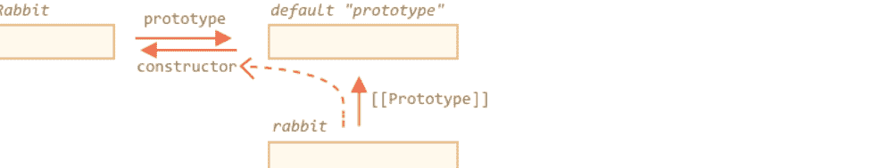

我们可以使用 `constructor` 属性使用与现有对象相同的构造函数创建一个新对象。

例如这里：

```javascript
function Rabbit(name) {
  this.name = name;
  alert(name);
}

let rabbit = new Rabbit("White Rabbit");

let rabbit2 = new rabbit.constructor("Black Rabbit");
```

当我们有一个对象，但不知道是用哪个构造函数创建的（例如它来自第三方库），并且我们需要创建另一个同类型的对象时。

但关于 "constructor" 最重要的一点可能是……

……JavaScript 本身并不保证 "constructor" 值是正确的。

是的，它存在于函数的默认 "prototype" 中，但仅此而已。之后发生了什么——完全由我们决定。

特别是，如果我们整体替换了默认原型，那么里面就不会有 "constructor" 了。

例如：

```javascript
function Rabbit() {
  Rabbit.prototype = {
    jumps: true
  };
}

let rabbit = new Rabbit();

alert(rabbit.constructor === Rabbit); // false
```

所以，为了保持正确的 "constructor"，我们选择向默认 "prototype" 添加/删除属性，而不是整体重写它：

```javascript
function Rabbit() {
  // 不完全覆盖 Rabbit.prototype
  // 只是向其添加
  Rabbit.prototype.jumps = true;
  // 保留了默认的 Rabbit.prototype.constructor
}
```

或者，手动重新创建构造函数：

```javascript
Rabbit.prototype = {
  jumps: true,
  constructor: Rabbit
};

// 现在 constructor也是正确的，因为我们添加了它
```

## 总结

在本章中，我们简要描述了为通过构造函数创建的对象设置 `[[Prototype]]`（原型）的方法。稍后我们将看到更多依赖于此的高级编程模式。

一切都非常简单，只需几点说明让事情更清晰：

- `F.prototype` 属性不等同于 `[[Prototype]]`。`F.prototype` 的唯一作用是：当调用新的 `F()` 时，设置新对象的 `[[Prototype]]`。
- `F.prototype` 的值应该是一个对象或 `null`；其他值将不起作用。
- "prototype" 属性只有在设置在构造函数上并用 `new` 触发时才具有特殊效果。

在普通对象上，原型并没有什么特别之处：

```javascript
let user = {
  name: "John",
  prototype: "Bla-bla" // 没有任何魔法效果
};
```

默认情况下，所有函数都有 `F.prototype = { constructor: F }`，所以我们可以通过访问对象的 "constructor" 属性来获取构造函数。

## 任务

### 修改 "prototype"

重要性：5

在下面的代码中，我们创建了 `new Rabbit`，然后尝试修改它的原型。

开始时，我们有这段代码：

```javascript
function Rabbit() {
  Rabbit.prototype = {
    eats: true
  }
}

let rabbit = new Rabbit();

alert(rabbit.eats); // true
```

- 1. 我们多加了一个字符串（强调部分），现在 `alert` 显示显示什么？

```javascript
function Rabbit() {
  Rabbit.prototype = {
    eats: true
  }
}

let rabbit = new Rabbit();

Rabbit.prototype = {};

alert(rabbit.eats); // ?
```

- 2. ...如果代码是这样的（替换了其中一行）

```javascript
function Rabbit() {
  Rabbit.prototype = {
    eats: true
  }
}

let rabbit = new Rabbit();

Rabbit.prototype.eats = false;

alert(rabbit.eats); // ?
```

- 3. 像这样（替换了其中一行）

```javascript
function Rabbit() {
  Rabbit.prototype = {
    eats: true
  }
}

let rabbit = new Rabbit();

delete rabbit.eats;

alert(rabbit.eats); // ?
```

4. 最后一种变体：

```javascript
function Rabbit() {
  Rabbit.prototype = {
    eats: true
  };
}

let rabbit = new Rabbit();

delete Rabbit.prototype.eats;

alert(rabbit.eats); // ?
```

查看解答

### 创建具有相同构造函数的对象

重要性：5

想象，我们有一个由构造函数创建的任意对象 `obj` —— 我们不知道是哪一个，但我们想用它创建一个新对象。

我们可以这样做吗？

```javascript
let obj2 = obj.constructor();
```

请给出一个适用于 `obj` 的构造函数示例，让这种代码能够正常工作。并给出一个让它运行错误的示例。

查看解答

# 原生原型

"prototype" 属性被 JavaScript 核心本身广泛使用。所有内置构造函数都使用它。

我们将首先看到普通对象上是怎样的，然后是更复杂的对象。

## Object.prototype

假设我们输出一个空对象：

```javascript
let obj = {};

alert(obj); // "[object Object]"
```

生成字符串 "[object Object]" 的代码在哪里？这是一个内置的 `toString` 方法，但它在哪里呢？`obj` 是空的！

...但简写符号 `obj = {}` 等同于 `obj = new Object()`，其中 `Object` 是一个内置的对象构造函数，它有自己的原型引用了巨大的对象 `toString` 等方法。

这是正在发生的情况：

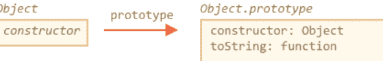

当调用 `new Object()`（或创建字面量 `{...}`）时，它的 `[[Prototype]]` 会被设置为 `Object.prototype`，这符合我们在上一章中讨论的规则：

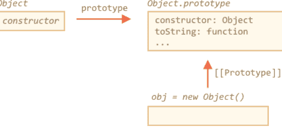

所以当调用 `obj.toString()` 时，该方法是从 `Object.prototype` 获取的。我们可以这样检查：

```javascript
let obj = {};

alert(obj.__proto__ === Object.prototype); // true

// obj.toString() === obj.__proto__.toString === Object.prototype.toString()
```

请注意，在 `Object.prototype` 之上的链中没有额外的 `[[Prototype]]`：

```javascript
alert(Object.prototype.__proto__); // null
```

## 其他内置原型

在普通对象上，原型并没有什么特别之处：

```javascript
let user = {
  name: "John",
  prototype: "Bla-bla" // 没有任何魔法效果
};
```

默认情况下，所有函数都有 `F.prototype = { constructor: F }`，所以我们可以通过访问对象的 "constructor" 属性来获取构造函数。

## ⚠️ `null` 和 `undefined` 没有对象包装

特殊值 `null` 和 `undefined` 是特殊的。它们没有对象包装，无法使用方法和属性。而且它们也没有对应的原型（prototype）。

# 修改原生原型

原生原型是可以修改的。例如，如果我们给 `String.prototype` 添加一个方法，该方法将对所有字符串可见：

```javascript
String.prototype.show = function() {
  alert(this);
}

"BOOM!".show(); // BOOM!
```

在开发过程中，我们可能会对想要实现的新内置方法产生一些想法，并可能倾向于将它们添加到原生原型中。但这通常是一个糟糕的主意。

> ⚠️ 注意：
> 原型链是全局共享的，因此很容易产生冲突。如果两个库都添加了 `String.prototype.show` 方法，那么其中一个将覆盖另一个。
> 所以，通常情况下，修改原生原型被认为是一个糟糕的主意。

**在现代编程中，只有一种情况修改原生原型是被允许的，那就是 polyfilling（补性填充）。**

Polyfilling（补性填充）是一个术语，指的是为 JavaScript 规范中存在但当前 JavaScript 引擎尚未支持的方法创建一个替代方案。

然后我们手动实现它并将其填充到内置原型中。

例如：

```javascript
if (!String.prototype.repeat) { // 如果没有该方法
  // 将其添加到原型中
  String.prototype.repeat = function(n) {
    // 将字符串重复 n 次
    // 实际上，代码应该比这更复杂一点
    // (完整的算法在规范中)
    // 但即使是不完美的 polyfill 通常也被认为足够足够了
    return new Array(n + 1).join(this);
  }
}

alert("La".repeat(3)); // LaLaLa
```

# 从原型借用方法

在“装饰器和转发，call/apply”章节中，我们讨论过方法借用。

这是当我们从一个对象中获取一个方法并将其复制到另一个对象时。

原生原型的某些方法经常被借用。

例如，如果我们正在创建一个数组对象，我们可能想将某些数组方法拷贝到它上面。

例如：

```javascript
let obj = {
  0: "Hello",
  1: "world!",
  length: 2
}

obj.join = Array.prototype.join;

alert(obj.join(',')); // Hello,world!
```

它可以正常工作，因为内置 `join` 方法的内部算法只关心正确的索引和 `length` 属性，它不会检查该对象是否真的是数组。许多内置方法都是如此。

另一种可能性是通过将 `obj.__proto__` 设置为 `Array.prototype`，这样所有 `Array` 方法都会自动对 `obj` 可用。

但如果 `obj` 已经继承了另一个对象，这样做是不可能的。记住，我们一次只能继承一个对象。

借用方法是非常灵活的，它允许根据需要混合不同对象的功能。

## 总结

- 所有内置对象遵循相同的模式：
  - 方法存储在原型中（`Array.prototype`, `Object.prototype`, `Date.prototype` 等）。
  - 对象本身只存储数据（数组项、对象属性、日期）。
- 原始类型也将方法存储在包装对象的原型中：`Number.prototype`, `String.prototype`, `Boolean.prototype`。只有 `undefined` 和 `null` 没有包装对象。
- 内置原型可以被修改或填充新方法。但不建议修改它们。可能唯一允许的情况是当我们添加一个新的标准但尚未被引擎支持的 JavaScript 方法时。

## 任务

### 为函数添加方法 "f.defer(ms)"

重要性：5

在所有函数的原型上添加一个 `defer(ms)` 方法，该方法会在 `ms` 毫秒后执行该函数。

完成后后，如下代码应该可以工作：

```javascript
function f() {
  alert("Hello!");
}

f.defer(1000); // 1 秒后显示 "Hello!"
```

### 为函数添加装饰器 "defer()"

重要性：4

在所有函数的原型上添加一个 `defer(ms)` 方法，该方法返回一个包装器，延迟 `ms` 毫秒后调用。

这里是其工作方式的示例：

```javascript
function f(a, b) {
  alert(a + b);
}

f.defer(1000)(1, 2); // 1 秒后显示 3
```

请注意，参数应该传递给原始函数。

# 原型方法、没有 __proto__ 的对象

在本节的第一章中，我们提到了用于设置原型的现代方法。

`__proto__` 被认为过时且某种程度上已弃用（在 JavaScript 标准仅限浏览器的部分）。

方法有：

- `Object.create(proto, descriptors)` 创建一个具有给定 `proto [[Prototype]]` 和可选属性描述符的空对象。
- `Object.getPrototypeOf(obj)` 返回 `obj` 的 `[[Prototype]]`。
- `Object.setPrototypeOf(obj, proto)` 将 `obj` 的 `[[Prototype]]` 设置为 `proto`。

应该使用这些方法代替 `__proto__`。

例如：

```javascript
let animal = {
  eats: true
};

// 以 animal 为原型创建一个新对象
let rabbit = Object.create(animal);

alert(rabbit.eats); // true
alert(Object.getPrototypeOf(rabbit) === animal); // 获取 rabbit 的原型

Object.setPrototypeOf(rabbit, {}); // 将 rabbit 的原型更改为 {}
```

`Object.create` 有一个可选的第二个参数：属性描述符。我们可以提供额外的属性：

```javascript
let animal = {
  eats: true
};

let rabbit = Object.create(animal, {
  jumps: {
    value: true,
    enumerable: false
  }
});

alert(rabbit.jumps); // true
```

## 简述历史

这是出于历史原因。

- **prototype** 属性自古以来就存在于函数。
- 2012 年：`Object.create` 出现在标准。它允许创建给定原型的对象，但不允许获取/设置它。
- 2015 年：`Object.setPrototypeOf` 和 `Object.getPrototypeOf` 被添加到标准中，以执行与 `__proto__` 相同的操作。由于 `__proto__` 在到处都实现了，它在非浏览器环境中被设为可选。

现在我们可以使用所有这些系统。

为什么 `__proto__` 被 `getPrototypeOf/setPrototypeOf` 函数替换了？这是一个有趣的问题，需要我们理解为什么 `__proto__` 不好。继续阅读获取答案。

> **不要重置 [[Prototype]] 除非你不在乎速度**
>
> 技术上，我们可以在任何时候获取/设置 `[[Prototype]]`。但通常我们只在对象创建时设置一次，然后就不修改它。JavaScript 引擎对此进行了高度优化。使用 `Object.setPrototypeOf` 或 `obj.__proto__` 动态更改原型是一个非常缓慢的操作，它会破坏对象属性访问的内部优化。所以，除非你知道自己在做什么，或者你不在乎 JavaScript 的速度，否则请避免。

## “普通”对象

正如我们所知，对象可以作为关联数组来存储键值对……但如果我们尝试在其中存储用户提供的键（例如用户输入的字典），我们可以看到一个有趣的故障：除了 `__proto__` 外的所有键都有效。

查看示例：

```javascript
let obj = {};
let key = prompt("键是什么?", "__proto__");
obj[key] = "some value";
alert(obj[key]); // [object Object], 而不是 "some value",
```

如果用户输入 `__proto__`，赋值将被忽略！

这不应该让我们感到惊讶`__proto__` 属性是特殊的：它必须是对象或 `null`，字符串不能作为原型。

但我们并不打算实现这种行为，对吧？我们想要存储键值对，名为 `__proto__` 的键没有被正确保存。所以这是一个 bug！

在这里，后果并不糟糕。但在其他情况下，我们可能会为对象赋值值，因为原型确实可能被改变。结果是，执行将以完全出乎意料的方式出错。

最糟糕的是——开发者通常根本没有考虑过这种可能性。这导致 bug 难以被察觉，甚至演变成漏洞，特别是当 JavaScript 用于服务器端时。

在访问 `toString` 属性时也会发生意想不到的情况——它默认是一个函数，其他内置属性也是如此。

如何规避这个问题？

首先，我们可以直接切换到使用 `Map`，这样一切都正常了。

但 `Object` 在这里也能很好地帮助我们，因为语言的创造者很久以前就考虑过这个问题。

`__proto__` 并不是对象的属性，而是 `Object.prototype` 的一个访问器属性（accessor property）：

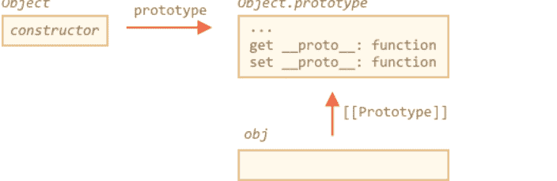

因此，如果读取或设置了 `obj.__proto__`，就会调用其原型中相应的 getter/setter，并获取/设置 `[[Prototype]]`。

正如在本教程章节开头提到的：`__proto__` 是访问 `[[Prototype]]` 的方式，它本身并不是 `[[Prototype]]`。

现在，如果我们想把对象当做关联数组使用，可以通过一个小技巧来实现：

```javascript
let obj = Object.create(null);
let key = prompt("What's the key?", "__proto__");
obj[key] = "some value";
alert(obj[key]); // some value
```

`Object.create(null)` 创建了一个没有原型的空对象（`[[Prototype]]` 为 null）：


所以，对于 `__proto__` 没有继承的 getter/setter。现在它被视为普通属性处理，因此上面的示例可以正常工作。

我们可以将此类对象称为“非常简单的对象”或“纯字典对象”，因为它们甚至比普通的对象字面量 `{...}` 更简单。

缺点是此类对象缺少任何内置对象方法，例如 `toString`：

```javascript
let obj = Object.create(null);
alert(obj); // Error (no toString)
```

但这通常用于关联数组。

请注意，大多数与对象相关的方法都是 `Object.something(...)`，例如 `Object.keys(obj)` —— 它们不在原型中，因此它们在此类对象上仍然继续工作：

```javascript
let chineseDictionary = Object.create(null);
chineseDictionary.hello = "你好";
chineseDictionary.bye = "再见";
alert(Object.keys(chineseDictionary)); // hello,bye
```

## 总结

设置和直接访问原型的现代方法有：

- `Object.create(proto, descriptors)` 创建一个具有给定 proto `[[Prototype]]` 的空对象，proto 可以为 null，以及可选的属性描述符。
- `Object.getPrototypeOf(obj)` 返回 obj 的 `[[Prototype]]`（等同于 `__proto__` getter）。
- `Object.setPrototypeOf(obj, proto)` 将 obj 的 `[[Prototype]]` 设置为 proto（等同于 `__proto__` setter）。

如果我们想在对象中放入用户生成的键，那么内置的 `__proto__` getter/setter 是安全的。因为用户可能会使用 "proto" 作为键，这会导致错误，并产生令人希望但通常是不可预测的后果。

因此，我们可以使用 `Object.create(null)` 来创建一个不带 `__proto__` 的“非常简单”的对象，或者坚持使用 `Map` 对象。

此外，`Object.create` 提供了一种简单的方法来浅拷贝带有所有描述符的对象：

```javascript
let clone = Object.create(Object.getPrototypeOf(obj), Object.getOwnPropertyDescriptors(obj));
```

- `Object.keys(obj)` / `Object.values(obj)` / `Object.entries(obj)` 返回一个可枚举的字符串属性名/值/键值对的数组。
- `Object.getOwnPropertySymbols(obj)` 返回所有符号键的数组。
- `Object.getOwnPropertyNames(obj)` 返回所有字符串键的数组。
- `Reflect.ownKeys(obj)` 返回所有字符串键的数组。
- `obj.hasOwnProperty(key)` 如果 obj 拥有名为 `key` 自身的（非继承的）键，则返回 `true`。

我们还明确了 `__proto__` 是 `[[Prototype]]` 的 getter/setter，并且像其他方法一样存在于 `Object.prototype` 中。

我们可以通过 `Object.create(null)` 创建一个没有原型的对象。此类对象被用作“纯字典”，它们在使用 "__proto__" 作为键时没有问题。所有返回对象属性的方法（如 `Object.keys` 等）返回的都是“自身”属性。如果我们需要继承的属性，可以使用 `for..in`。

## 任务

### 字典

有一个通过 `Object.create(null)` 创建的对象，用于存储任何键值对。向其中添加一个 `toString()` 方法，它应该返回一个由分隔符的键列表。工作原理如下：

```javascript
let dictionary = Object.create(null);

// 添加一些数据
dictionary.apple = "test";
dictionary.__proto__ = "test"; // __proto__ 是一个普通属性

// 循环中只有 apple 和 __proto__
for(let key in dictionary) {
  alert(key); // "apple"
}

// toString 实际作用
alert(dictionary); // "apple"
```

### 调用之间的区别

让我们创建一个新对象：

```javascript
function Rabbit(name) {
  this.name = name;
}
Rabbit.prototype.sayHi = function() {
  alert(this.name);
};
let rabbit = new Rabbit("Bun");

// 调用方式
rabbit.sayHi();
Rabbit.prototype.sayHi();
Object.getPrototypeOf(rabbit).sayHi();
```

# 类

## Class 语法

在 JavaScript 中，类其实只是语法糖（一种设计用于让代码更易读，但没有引入任何新内容），因为我们实际上可以完全不使用 `class` 关键字来声明相同的内容：

```javascript
function Rabbit(name) {
  this.name = name;
}
Rabbit.prototype.sayHi = function() {
  alert(this.name);
};
let rabbit = new Rabbit("Bun");
```

## 什么是类

在面向对象编程中，类是创建对象的模板，提供了状态。类的基础语法如下：

```javascript
class Rabbit {
  constructor(name) {
    this.name = name;
  }

  sayHi() {
    alert(this.name);
  }
}

let rabbit = new Rabbit("Bun");
rabbit.sayHi();
```

## 类的本质

那么类到底是什么？它并不是人们想象的完全新的语言级实体。让我们揭开它的魔法，看看类到底是什么。这有助于理解复杂的方面。

```javascript
class MyClass {
  constructor() { ... }
  method1() { ... }
  method2() { ... }
  method3() { ... }
}
```

// 证明：typeof 是函数

```javascript
alert(typeof MyClass); // function
```

## class User

`class User` 构造实际上执行的操作是：

1. 创建一个名为 `User` 的函数
   - 函数代码取自构造方法（如果没有写方法，则假设为空）。
2. 将所有方法（如 `sayHi`）存储在 `User.prototype` 中。

随后，对于新对象，当我们调用方法时，它是从原型中获取的，正如在 F.prototype 章节中所描述的那样，新的 User 对象可以访问类方法。

```javascript
class User {
  constructor(name) {
    this.name = name;
  }

  sayHi() {
    alert(this.name);
  }
}

// 使用：
let user = new User("John");
user.sayHi();
```

当 `new User("John")` 被调用时：

1. 创建一个新对象。
2. 构造函数执行参数并将 `this.name` 赋值给它。

新手开发者的一个常见陷阱是在类方法之间放置逗号，这会导致错误。这里的表示不应与对象字面量混淆。在类内部，不需要逗号。

```javascript
// 使用纯函数重写类

// 1. 创建构造函数
function User(name) {
  this.name = name;
}
// 任何函数的原型默认都具有 constructor 属性，
// 所以我们不需要手动创建它

// 2. 将方法添加到原型上
User.prototype.sayHi = function() {
  alert(this.name);
};

// 使用示例：
let user = new User("John");
user.sayHi();
```

这种定义的定义是相同的。因此，确实有理由将类被视为一种定义带有原型方法的构造函数的语法糖。

尽管如此，它们之间存在一些重要的区别。

- 1. 首先，由 `class` 创建的函数带有一个特殊的内部属性 `[[FunctionKind]]:classConstructor`。它与手动创建的并不完全相同。

与普通函数不同，类构造函数不能在没有 `new` 的情况下被调用：

```javascript
class User {
  constructor() {}
}

alert(typeof User); // function
User(); // Error: Class constructor User cannot be invoked without 'new'
```

此外，在大多数 JavaScript 引擎中，类构造函数的字符串表示以 "class..." 开头，

```javascript
class User {
  constructor() {}
}

alert(User); // class User {...
```

- 2. 类方法是不可枚举的。类定义会将“原型”中所有方法的 `enumerable` 标记设为 `false`。

这是很好的，因为当我们对一个对象进行 `for..in` 遍历时，通常不希望获取它的类方法。

- 3. 类总是使用严格模式（strict）。`class` 结构内部的所有代码都会自动处于严格模式。

此外，除了基础操作外，`class` 语法还带来了许多其他特性，我们稍后会进行探索。

## 类表达式 (Class Expression)

就像函数一样，类可以定义在另一个表达式内部，进行传递、返回、赋值等。这里有一个类表达式的示例：

```javascript
let User = class {
  sayHi() {
    alert("Hello");
  }
};
```

与命名函数表达式（Named Function Expressions）类似，类表达式可能有名称，也可能没有。如果类有一个名称，它只在类内部可见：

```javascript
// "命名类表达式"
// (规范中没有此术语，但类似于命名函数表达式)
let User = class MyClass {
  sayHi() {
    alert(MyClass); // MyClass 只在类内部可见
  }
}
new User().sayHi(); // 正常，显示 MyClass 定义
alert(MyClass); // 错误，MyClass 在类外部不可
```

我们甚至可以动态地“按需”创建类，如下：

```javascript
function makeClass(phrase) {
  // 声明一个类并返回它
  return class {
    sayHi() {
      alert(phrase);
    }
  }
}

// 创建新类
let User = makeClass("Hello");
new User().sayHi(); // Hello
```

## Getters/setters 以及其他简写

就像字面量对象一样，类可以包含 getters/setters、生成器（generators）、计算属性等。

这是一个使用 `get/set` 实现 `user.name` 的示例：

```javascript
class User {
  constructor(name) {
    // 调用 setter
    this.name = name;
  }

  get name() {
    return this._name;
  }

  set name(value) {
    if (value.length < 4) {
      alert("Name is too short.");
      return;
    }
    this._name = value;
  }
}

let user = new User("John");

alert(user.name); // John

user = new User(""); // Name too short.
```

类声明在 `User.prototype` 中创建了 getters 和 setters，如下：

```javascript
Object.defineProperty(User.prototype, "name", {
  get() {
    return this._name;
  },
  set(name) {
    // ...
  }
});
```

这是一个计算属性的示例：

```javascript
function f() { return "sayHi"; }
class User {
  [f()]() {
    alert("Hello");
  }
}

new User().sayHi();
```

对于生成器方法，同样地，在它前面加上 `*`。

## 类属性 (Class properties)

> ⚠️ 旧版浏览器可能需要补丁 (polyfill)

类级属性是该语言最近引入的特性。

在上面的示例中，User 只有方法。让我们添加一个属性：

```javascript
class User {
  name = "Anonymous";

  sayHi() {
    alert(`Hello, ${this.name}`);
  }
}

new User().sayHi();
```

该属性没有被放在 `User.prototype` 中。相反，它是通过 `new` 每个对象单独创建的。因此，该属性永远不会在同类的不同对象之间共享。

## 总结 (Summary)

基础类语法如下：

```javascript
class MyClass {
  prop = value; // 字段 (field)

  constructor(...) { // 构造函数
    // ...
  }

  method(...) {} // 方法

  get something(...) {} // getter 方法
  set something(...) {} // setter 方法

  [Symbol.iterator]() {} // 使用计算名称/符号名称的方法
  // ...
}
```

`MyClass` 技术上是一个函数（我们提供的作为构造函数的函数），而方法、getters 和 setters 被写入了 `MyClass.prototype`。在接下来的章节中，我们将学习类继承。

## 任务 (Tasks)

### 重写类 (Rewrite class)

## 继承 (inheritance)

假设我们有两个类：

```javascript
class Animal {
  constructor(name) {
    this.speed = 0;
    this.name = name;
  }

  run(speed) {
    this.speed += speed;
    alert(`${this.name} runs with speed ${this.speed}`);
  }

  stop() {
    this.speed = 0;
    alert(`${this.name} stopped.`);
  }
}
```

目前 Rabbit 继承了 `stop` 方法。如果我们在 Rabbit 中指定了自己的 `stop`，它将取代原来的方法：

```javascript
class Rabbit extends Animal {
  stop() {
    // ...这将被用于 rabbit.stop
  }
}
```

但我们不想完全替换父类方法，而是在此基础上进行构建、调整或扩展其功能。我们在方法中执行某些操作，但在过程之前或之后调用父类方法。

类提供了 `super` 关键字来实现这些：

- `super.method(...)` 调用父类方法。
- `super(...)` 调用父类构造函数（仅在我们的构造函数内部）。

例如，我们的兔子在停止时：

```javascript
class Animal {
  constructor(name) {
    this.speed = 0;
    this.name = name;
  }

  run(speed) {
    this.speed += speed;
    alert(`${this.name} runs with speed ${this.speed}`);
  }

  stop() {
    this.speed = 0;
    alert(`${this.name} stopped.`);
  }
}

class Rabbit extends Animal {
  hide() {
    alert(`${this.name} hides!`);
  }

  stop() {
    super.stop(); // 调用父类的 stop
    this.hide(); // 然后隐藏
  }
}

let rabbit = new Rabbit("White Rabbit");

rabbit.run(5); // 白兔以速度 5 运行。
rabbit.stop(); // 白兔停止了。白兔躲起来了
```

现在 Rabbit 有了 stop 方法，它在过程中会调用父类的 `super.stop()`。

### 箭头函数没有 super

正如在“重温箭头函数”章节中提到的，箭头函数没有 `super`。

如果访问它，它将从外部函数获取。例如：

```javascript
class Rabbit extends Animal {
  stop() {
    setTimeout(() => super.stop(), 1000); // 1秒后调用父类 stop
  }
}
```

箭头函数中的 `super` 与 `stop()` 是相同的，因此它可以按预期工作。如果在这里指定一个“普通”函数，将会产生错误：

```javascript
// 意外的 super
setTimeout(function() { super.stop()}, 1000);
```

## 覆盖构造函数

构造函数的情况变得有点复杂了。

到目前为止，Rabbit 还没有自己的 `constructor`。

根据规范，如果一个类继承了另一个类且没有 `constructor`，那么会生成一个“空” `constructor`：

```javascript
class Rabbit extends Animal {
  // 为继承没有自己的构造函数的类而生成
  constructor(...args) {
    super(...args);
  }
}
```

我们可以看到，它基本上是调用了父类的 `constructor` 并传递了所有参数。如果我们不写构造函数，就会发生。

现在让我们给 `Rabbit` 添加一个自定义构造函数。它除了 name 之外，还会指定 `minLength`：

```javascript
class Animal {
  constructor(name) {
    this.speed = 0;
    this.name = name;
  }
  // ...
}

class Rabbit extends Animal {
  constructor(name, earLength) {
    this.speed = 0;
    this.name = name;
    this.earLength = earLength;
  }
  // ...
}

// 不起！
let rabbit = new Rabbit("White Rabbit", 10); // 错误：this 未定义。
```

哎！我们得到了一个错误。现在我们可以创建兔子了。哪里出问题了？

简短的回答是：继承类中的构造函数必须调用 `super(...)`，并且 (!) 它们必须在使用 `this` 之前执行它。

...但为什么呢？这里发生了什么？事实上，这个要求看起来很奇怪。

当然，有一个解释。让我们进入细节，这样你就能真正理解发生了什么。

在 JavaScript 中，继承类的“构造函数函数”与其他所有函数之间存在区别。在继承类中，对应的构造函数函数被标记了一个特殊的内部属性 `[[ConstructorKind]]: "derived"`。

区别在于：

- 当普通构造函数运行时，它会创建一个空对象作为 `this` 并继续执行。
- 但当派生构造函数运行时，它不会这样做。它期望父类构造函数来完成这项工作。

所以如果我们正在创建一个构造函数，我们就必须调用 super，否则引用它的对象将不会被创建。我们将得到错误。

为了让 Rabbit 工作，我们需要在使用 `this` 之前调用 `super()`，就像这里：

```javascript
class Animal {
  constructor(name) {
    this.speed = 0;
    this.name = name;
  }
  // ...
}

class Rabbit extends Animal {
  constructor(name, earLength) {
    super(name);
    this.earLength = earLength;
  }

  // ...
}

// 现在可以
let rabbit = new Rabbit("White Rabbit", 10);
alert(name); // White Rabbit
alert(earLength); // 10
```

## Super：内部机制，[[HomeObject]]

让我们深入 `super` 的底层原理。顺便说，我们将看到一些有趣的东西。

首先要说，根据我们现在学的所有知识，`super` 根本无法工作！

是的，让我们问问自己，它在技术上是如何运作的？当一个对象方法运行时，它获取当前对象作为 `this`。如果我们调用 `super.method()`，那么它需要从当前对象的原型上检索 `method`。

这个任务看起来可能很简单，但并非如此。引擎知道当前对象 `this`，所以可以通过 `this.__proto__.method` 获取父类方法。不幸的是，“天真”的解决方案是行不通的。

让我们演示这个问题。为了简单起见，不用类使用普通对象

在示例中，`rabbit.__proto__ = animal`。现在我们尝试一下：在 `rabbit.eat()` 中使用 `this.__proto__`：

```javascript
let animal = {
  name: "Animal",
  eat() {
    alert(`${this.name} eats.`);
  }
}

let rabbit = {
  __proto__: animal,
  name: "Rabbit",
  eat() {
    // 这可能就是 super.eat(this) 的工作方式
    this.__proto__.eat.call(this); // (*)
  }
}

rabbit.eat(); // Rabbit eats.
```

在 (*) 行，我们从原型 (animal) 获取 `eat` 并在当前对象的上下文中调用它。请注意，`.call(this)` 在这里是重要的，因为简单的 `this.__proto__.eat()` 将在原型的上下文中执行父类方法，而不是当前对象。

在上面的代码中，它实际上运行如下：


```javascript
let animal = {
  name: "Animal",
  eat() {
    alert(`${this.name} eats.`);
  }
}

let rabbit = {
  __proto__: animal,
  name: "Rabbit",
  eat() {
    this.__proto__.eat(this); // (*)
  }
}

rabbit.eat(); // Rabbit eats.
```

在这一行 `(*)` 中，方法 `tree.sayHi` 是从 `rabbit` 复制的。也许我们只是想避免代码重复？

所以它的 `[[HomeObject]]` 是 `rabbit`，因为它是在 `rabbit` 中创建的。没有办法更改 `[[HomeObject]]`。

`tree.sayHi()` 的代码内部包含了 `super.sayHi()`。它从 `rabbit` 向上查找并从 `animal` 获取了该方法。

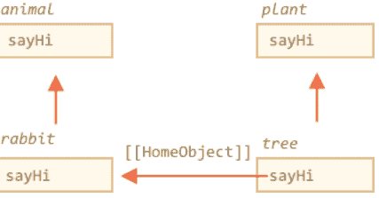

# 方法，而不是函数属性

`[[HomeObject]]` 同时定义用于类和普通对象的方法。但对于对象，方法必须精确指定为 `method()`，而不是 `"method: function()"`。

这种区别对我们来说可能并不重要，但对 JavaScript 来说很重要。

在下面的示例中，使用了非方法的语法进行比较。`[[HomeObject]]` 属性未设置，因此继承不起工作：

```javascript
let animal = {
  eat: function() { // 应该使用短语法：eat(){...}
  //
};
```

```javascript
let rabbit = {
  __proto__: animal,
  eat: function() {
    super.eat();
  }
};
```

```javascript
rabbit.eat(); // 调用 super 错误（因为没有 [[HomeObject]]）
```

## 总结

- 1. 扩展类：`class Child extends Parent:`

  - 意味着 `Child.prototype.__proto__` 将是 `Parent.prototype`，因此方法被继承。

- 2. 当重写构造函数时：

  - 在 `Child` 构造函数中使用 `this` 之前，我们必须作为 `super()` 调用父。

- 3. 当重写另一个方法时：

  - 我们可以在子方法中使用 `super.method()` 来调用父方法。

- 4. 内部：

方法在内部 `[[HomeObject]]` 属性中记录它们所属的类/对象。这就是 `super` 解析父方法的方式。

因此，从一个对象复制带有 `super` 方法到另一个对象是不安全的。

此外：

箭头函数不拥有 `this` 或 `super`，因此它们可以透明地适配到周围环境中。

## 任务

### 创建实例错误

重要性：5

这里是 `Rabbit` 继承 `Animal` 的代码。

遗憾的是，无法创建 `Rabbit` 对象。哪里出错了？修复它。

```javascript
class Animal {
  constructor(name) {
    this.name = name;
  }
}

class Rabbit extends Animal {
  constructor(name) {
    this.name = name;
    this.created = Date.now();
  }
}
```

```javascript
let rabbit = new Rabbit("White Rabbit"); // 错误：this 未定义
alert(rabbit.name);
```

## 解决方案

### 扩展时钟

重要性：5

我们有一个 `Clock` 类。目前，它每秒打印一次时间。

```javascript
class Clock {
  constructor(template) {
    this.template = template;
  }

  render() {
    let date = new Date();
    let hours = date.getHours();

    if (hours < 10) hours = '0' + hours;

    let mins = date.getMinutes();
    if (mins < 10) mins = '0' + mins;

    let secs = date.getSeconds();
    if (secs < 10) secs = '0' + secs;

    let output = this.template
      .replace('h', hours)
      .replace('m', mins)
      .replace('s', secs);

    console.log(output);
  }

  stop() {
    clearInterval(this.timer);
  }

  start() {
    this.render();
    this.timer = setInterval(() => this.render(), 1000);
  }
}
```

创建一个新类 `ExtendedClock`，它继承自 `Clock` 并添加精度参数 —— 即“滴答”之间的毫秒数。默认应该是 1000（1 秒）。

- 你的代码应该在 `extended-clock.js` 文件中
- 不要修改原始的 `clock.js`。扩展它。

为任务打开一个沙盒。

## 解决方案

### 类继承 Object

重要性：5

正如我们所知，所有对象通常继承自 `Object.prototype` 并访问“通用”对象方法，如 `hasOwnProperty` 等。

例如：

```javascript
class Rabbit {
  constructor(name) {
    this.name = name;
  }
}

let rabbit = new Rabbit("Rab");

// hasOwnProperty 方法来自 Object.prototype
alert(rabbit.hasOwnProperty('name')); // true
```

但如果我们显式写成 `"class Rabbit extends Object"`，那么结果会和简单的 `"class Rabbit"` 不同吗？

区别是什么？

这里是这样的代码示例（它不起作用 – 为什么要修复它？）：

```javascript
class Rabbit extends Object {
  constructor(name) {
    this.name = name;
  }
}
let rabbit = new Rabbit('Rab');

alert(rabbit.hasOwnProperty('name')); // true
```

## 解决方案

# 静态属性和方法

我们可以方法赋值给类函数，而不是它的 `"prototype"`。这样的方法被称为静态方法。

一个示例：

```javascript
class User {
  static staticMethod() {
    alert(this === User);
  }
}
User.staticMethod(); // true
```

实际上这与将其赋值为属性是一样的：

```javascript
class User {}
User.staticMethod = function() {
  alert(this === User);
}
```

```javascript
// 用于静态属性和方法
alert(Rabbit.__proto__ === Animal); // true

// 下一步指向 Function.prototype
alert(Animal.__proto__ === Function.prototype); // true

// 对象方法的“普通”原型链
alert(Rabbit.prototype.__proto__ === Animal.prototype);
```

通过这种方式，`Rabbit` 可以访问 `Animal` 的所有静态方法。

## 总结

静态方法用于与类实例无关的功能，这些功能不需要实例存在，而是属于类本身，例如 `Article.compare` —— 一个比较两篇文章的通用方法。

静态属性用于我们想要存储类级数据时，这些数据也没有绑定到实例。

语法如下：

```javascript
class MyClass {
  static property = ...;

  static method(){
    ...
  }
}
```

这在技术上等同于将其赋值给类本身：

```javascript
MyClass.property = ...
MyClass.method = ...
```

静态属性是可以继承的。

从技术上讲，对于 `class B extends A`，类 `B` 的原型指向 `A`：`B.[[Prototype]] = A`。因此，如果在 `B` 中没有找到某个字段，搜索将继续在 `A` 中进行。

# 私有和保护属性及方法

面向对象编程最重要的原则之一——将内部接口与外部接口分离。

在开发任何比“你好世界”应用更复杂的程序时，这是“必须”的做法。

为了理解这一点，让我们跳出开发，将目光转向现实世界。

通常，我们使用的设备是非常复杂的。但将内部接口与外部接口分离允许我们无问题地使用它们。

## 生活中的例子

例如，一台咖啡机。从外面看很简单：一个按钮、一个显示屏、几个孔……而且，当然，结果是——棒的咖啡！:)


但内部……（一张来自维修手册的图片）

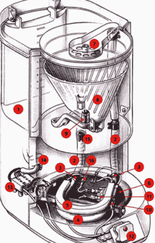

有很多细节。但我们可以在一无所知的情况下使用。

咖啡机非常可靠，不是吗？我们可以使用它多年，只有在出现问题时——才把它带去维修。

咖啡机可靠性和简单性的秘密在于——所有细节都经过良好调节，并隐藏在侧面。

如果我们移除咖啡机的保护盖，那么使用它将变得复杂得多（按哪里？），而且很危险（它可能会触电）。

正如我们将看到的，在编程中，对象也是如此。但为了隐藏内部细节，我们不会使用保护盖，而是使用语言的特殊语法和约定。

## 内部接口和外部接口

在面向对象编程中，属性和方法分为两组：

- 内部接口——可以从类的其他方法访问的方法和属性，但不能从外部访问。
- 外部接口——也可以从类外部访问的方法和属性。

如果我们继续用咖啡机类比——隐藏在内部的：锅炉管、加热元件等——就是它的内部接口。

内部接口用于对象的工作，它的细节相互使用。例如，锅炉管连接在加热元件上。

但从外部看，咖啡机被保护盖封闭，因此没有人可以触及这些部分。细节被隐藏且无法访问。我们可以通过外部接口使用它的功能。

所以，我们使用一个对象所需要的只需要知道它的外部接口。我们可能完全不知道它内部是如何工作的，而这很棒。

这是一个通用的介绍。

在 JavaScript 中，有两种类型的对象字段（属性和方法）：

- 公有：可以从任何地方访问。它们构成了外部接口。直到现在我们一直在使用公共属性和方法。
- 私有：仅可以从类内部访问。这些用于内部接口。

在许多其他语言中也存在“受保护”字段：只能从类内部和继承它的类访问。它们在某种意义上比私有字段更有广泛的用途，因为我们通常希望继承的类能够访问它们。

JavaScript 没有在语言层面实现受保护字段，但在实践中它们非常方便，因此对其进行了模拟。

现在我们将用 JavaScript 实现一个包含所有这些类型属性的咖啡机。咖啡机有很多细节，为了保持简单，我们不会对它们进行建模（尽管我们可以这样做）。

## 保护 "waterAmount"

让我们先创建一个简单的咖啡机类：

```javascript
class CoffeeMachine {
  waterAmount = 0; // 内部的水量

  constructor(power) {
    this.power = power;
    alert(`创建了一台咖啡机，功率为：${power}`);
  }
}

// 创建咖啡机
let coffeeMachine = new CoffeeMachine(100);

// 添加水
coffeeMachine.waterAmount = 200;
```

现在 `waterAmount` 和 `power` 属性是公有的。我们可以轻松从外部获取/设置它们的值。

让我们将 `waterAmount` 属性改为受保护的，以便对其进行更多控制。例如，我们不希望它被设置为零以下。

### 受保护属性通常以下划线前缀

这在语言层面没有强制执行，但程序员之间有一个广为人知的约定，即此类属性和方法不应从外部访问。

所以我们的属性将命名为 `_waterAmount`：

```javascript
class CoffeeMachine {
  _waterAmount = 0;

  set waterAmount(value) {
    if (value < 0) throw new Error("负水");
    this._waterAmount = value;
  }

  get waterAmount() {
    return this._waterAmount;
  }

  constructor(power) {
    this.power = power;
    alert(`创建了一台咖啡机，功率为：${power}`);
  }
}

// 创建咖啡机
let coffeeMachine = new CoffeeMachine(100);

// 添加水
coffeeMachine.waterAmount = 200;
```

# 私有属性

私有属性以 `#` 开头。它们只能在类内部访问。

```javascript
class CoffeeMachine {
  #waterAmount = 0;

  get waterAmount() {
    return this.#waterAmount;
  }
  set waterAmount(value) {
    if (value < 0) throw Error("Negative water");
    this.#waterAmount = value;
  }
}

let machine = new CoffeeMachine();
machine.waterAmount = 100;
alert(machine.#waterAmount); // Error
```

与保护字段不同，私有字段是由语言本身强制的。这是一件好事。

但如果我们继承 `CoffeeMachine`，我们将无法直接访问 `#waterAmount`。

我们需要依赖 `waterAmount` 的 getter 和 setter。

```javascript
class MegaCoffeeMachine extends CoffeeMachine {
  method() {
    alert(this.#waterAmount); // Error: 只能从 CoffeeMachine 访问
  }
}
```

在某些场景下，这种限制是非常严重的。如果我们扩展了 `CoffeeMachine`，我们可能需要合法地访问其内部。这就是为什么保护字段使用得更频繁，尽管语言语法并不支持它们。

> 私有字段无法通过 `this[name]` 访问

私有字段是特殊的。

正如我们所知，通常可以使用 `this[name]` 来访问字段：

```javascript
class User {
  sayHi() {
    let fieldName = "name";
    alert(`Hello, ${this[fieldName]}`);
  }
}
```

但对于私有字段来说是不可能的：`this['#name']` 不起作用。这是为了确保隐私性的语法限制。

## 总结

在面向对象编程（OOP）中，将内部接口与外部接口分离被称为“封装”。

它带来了以下好处：

### 保护用户，防止他们自掘脚坑

想象一下，有一个开发者团队在使用一台咖啡机。它是由“Best CoffeeMachine”公司制造的，运行良好，但保护盖被拆掉了。导致内部接口暴露了。

所有的开发者都是文明的——他们按照预期使用咖啡机。但其中一个叫 John 的认为自己是最聪明的，对咖啡机的内部进行了一些调整。结果咖啡机在两天后故障了。

这显然不是 John 的错，而是那个移除保护盖并让 John 进行操作的人的错。

编程中也是如此。如果类的用户更改了不打算从外部更改的内容——后果将是不可预料的。

### 可维护性

编程中的情况比现实生活中的咖啡机更复杂，因为我们不只是购买它。代码在不断地开发和改进。

如果我们严格限制内部接口，类的开发者就可以自由地更改其内部属性和方法，无需通知用户。

如果你是此类类的开发者，知道私有方法可以安全地重命名、其参数可以更改，甚至可以删除，因为没有外部代码依赖于它们。

对于用户来说，当新版本发布时，内部可能经过了完全重构，但如果外部接口相同，升级仍然非常简单。

### 隐藏复杂性

人们喜爱使用简单的东西。至少从外部看起来是如此。内部是什么则是另一回事。

程序员也不是例外。

通常是在隐藏实现细节，并提供一个简单、文档良好的外部接口时。

为了隐藏内部接口，我们使用保护属性或私有属性：

- 保护字段以 `_` 开头，这是一个众知的约定，并不是语言层面强制的。程序员应该只在其类及其继承自它的类中访问以 `_` 开头的字段。
- 私有字段以 `#` 开头。JavaScript 确保我们只能在类内部访问这些字段。

目前，浏览器之间还不支持私有字段，但可以通过补丁（polyfilled）来实现。

# 扩展内置类

内置类如 `Array`、`Map` 等也是可以扩展的。

例如，`PowerArray` 继承自原生 `Array`：

```javascript
// 为它再添加一个方法（可以做更多）
class PowerArray extends Array {
  isEmpty() {
    return this.length === 0;
  }
}

let arr = new PowerArray(1, 2, 5, 10, 50);
alert(arr.isEmpty()); // false

let filteredArr = arr.filter(item => item >= 10);
alert(filteredArr); // 10, 50
alert(filteredArr.isEmpty()); // false
```

请注意一个非常有趣的点。像 `filter`、`map` 等内置方法——返回的是完全相同的继承类型的新对象。它们依赖 `constructor` 属性来实现这一点。

在上面的示例中，

```javascript
arr.constructor === PowerArray
```

所以当调用 `arr.filter()` 时，它在内部使用对应的 `new PowerArray` 创建新的结果数组，而不是 `Array`。这实际上很酷，因为我们可以在结果上继续使用 `PowerArray` 的方法。

甚至，我们还可以自定义这种行为。

我们可以为类添加一个特殊的静态 `Symbol.species`。如果它存在，它应该返回 JavaScript 在 `map`、`filter` 等方法内部创建新实体时将使用的构造函数。

如果我们让 `map` 或 `filter` 等内置方法返回普通数组，我们可以在 `Symbol.species` 中返回 `Array`，如下所示：

```javascript
class PowerArray extends Array {
  isEmpty() {
    return this.length === 0;
  }

  // 内置方法将使用此作为构造函数
  static get [Symbol.species]() {
    return Array;
  }
}

let arr = new PowerArray(1, 2, 5, 10, 50);
alert(arr.isEmpty()); // false

// 使用 arr.constructor[Symbol.species] 作为构造函数过滤新数组
let filteredArr = arr.filter(item => item >= 10);

// filteredArr 不是 PowerArray，而是 Array
alert(filteredArr.isEmpty()); // Error: filteredArr.isEmpty is not a function
```

如你现在看到的，`.filter` 返回的是 `Array`。因此，扩展的功能无法进一步传递。

## 内置类没有静态继承

内置对象有自己的静态方法，如 `Object.keys`、`Array.isArray` 等。

正如我们所知，原生类互相继承。例如，`Array` 继承自 `Object`。

通常，当一个类继承另一个类时，静态和非静态方法都会继承。

所以，如果 `Rabbit` 继承自 `Animal`，那么：

- 1. `Rabbit.methods` 可以调用 `Animal.methods`，因为 `Rabbit.[[Prototype]] = Animal`。
- 2. `new Rabbit().methods` 可用，因为 `Rabbit.prototype.[[Prototype]] = Animal.prototype`。

这在“静态属性和方法”章节中有详细解释。

内置类是一个例外。它们之间互不继承静态属性。

例如，`Array` 和 `Date` 都继承自 `Object`，因此它们的实例拥有 `Object.prototype` 的方法。但 `Array.[[Prototype]]` 不指向 `Object`。因此有 `Object.keys()`，但没有 `Date.keys()`。

这是 `Date` 和 `Object` 的结构图：


注意，`Date` 和 `Object` 之间没有链接。它们独立存在。`Date.prototype` 继承自 `Object.prototype`，但仅此而已。

# 类检查：“instanceof”

`instanceof` 运算符允许检查一个对象是否属于某个类。它还考虑了继承。

这种检查在很多情况下都是必要的，在这里我们将它用于构建一个多态函数，即根据参数的类型进行不同的处理。

## instanceof 运算符

语法为：

```javascript
obj instanceof Class
```

如果 `obj` 属于 `Class`（或继承自它的类），则返回 `true`。

例如：

```javascript
class Rabbit {}
let rabbit = new Rabbit();

// 是 Rabbit 类的对象吗？
alert(rabbit instanceof Rabbit); // true
```

它也适用于构造函数：

```javascript
// 代替 class
function Rabbit() {}
alert(new Rabbit() instanceof Rabbit); // true
```

...以及适用于内置类如 `Array`：

```javascript
let arr = [1, 2, 3];
alert(arr instanceof Array); // true
alert(arr instanceof Object); // true
```

请注意，`arr` 也属于 `Object` 类。这是因为 `Array` 在原型链上继承自 `Object`。

`instanceof` 运算符通过检查原型链来执行检查，但我们可以在类的静态方法 `Symbol.hasInstance` 中设置自定义逻辑。

`obj instanceof Class` 的算法大致如下：

1. 如果存在静态方法 `Symbol.hasInstance`，则直接调用：
   `Class[Symbol.hasInstance](obj)`。它应该返回 `true` 或 `false`。我们结束。例如：

```javascript
// setup instanceOf 检查假设任何可以吃的东西都是动物
class Animal {
  static [Symbol.hasInstance](obj) {
    if (obj.canEat) return true;
  }
}

let obj = { canEat: true };
alert(obj instanceof Animal); // true: 调用了 Animal[Symbol.hasInstance](obj)
```

2. 大多数类都没有 `Symbol.hasInstance`。在这种情况下，会使用标准逻辑：`obj instanceof Class` 检查 `Class.prototype` 是否等于 `obj` 原型链中的某一个原型。

换句话说，比较的是：

```javascript
obj.__proto__ === Class.prototype
obj.__proto__.__proto__ === Class.prototype
obj.__proto__.__proto__.__proto__ === Class.prototype
```

在上面的示例中，`Rabbit.prototype === rabbit.__proto__`，因此立即得到了答案。

在继承的情况下，`rabbit` 也是父类的一个实例。

```javascript
class Animal {}
class Rabbit extends Animal {}

let rabbit = new Rabbit();
alert(rabbit instanceof Animal); // true
// rabbit.__proto__ === Rabbit.prototype
// rabbit.__proto__.__proto__ === Animal.prototype (匹配!)
```

这里是 `rabbit instanceof Animal` 与 `Animal.prototype` 比较的图：

| | |
|---|---|
| null | [[Prototype]] |
| Object.prototype | [[Prototype]] |
| Animal.prototype | [[Prototype]] |
| Rabbit.prototype | [[Prototype]] |
| rabbit | |

顺便说，还有一个方法 `objA.isPrototypeOf(objB)`，如果 `objA` 在 `objB` 的原型链中，则返回 `true`。因此，`obj instanceof Class` 的测试可以重写为 `Class.prototype.isPrototypeOf(obj)`。

有趣的是，`Class` 构造函数并不参与此检查！只有原型链和 `Class.prototype` 是重要的。

当原型被改变时，这会导致有趣的后果。

例如这里：

```javascript
function Rabbit() {}
let rabbit = new Rabbit();

// 修改了原型
Rabbit.prototype = {};

//...不再是兔子了！
alert(rabbit instanceof Rabbit); // false
```

这就是避免修改原型原因之一。为了安全起见。

## 进阶：用于类型的 Object.prototype.toString

我们已经知道普通对象转换为字符串时为 `[object Object]`：

```javascript
let obj = {};
alert(obj); // [object Object]
alert(obj.toString()); // 相同
```

这是它们 `toString` 的实现。但有一个隐藏特性让 `toString` 变得比强大得多。我们可以将其用作扩展的 `typeof` 以及 `instanceof` 的替代方案。

听起来很奇怪？让我们来揭秘它。

根据规范，内置的 `toString` 可以从对象中提取出来并在任何其他值的上下文中执行。它的结果取决于该值。

- 对于数字，将是 `[object Number]`
- 对于布尔值，将是 `[object Boolean]`
- 对于 `null`：`[object Null]`
- 对于 `undefined`：`[object Undefined]`
- 对于数组：`[object Array]`
- ...等等（可自定义）。

让我们演示一下：

```javascript
// 为了方便起见，将 toString 方法赋值给变量
let objectToString = Object.prototype.toString;

// 这是什么类型？
let arr = [];

alert(objectToString(arr)); // [object Array]
```

在这里我们使用了“装饰器和转发”章节中描述的 `call`/`apply`，在 `this=arr` 的上下文中执行函数对象 `objectToString`。

在内部，`toString` 算法会检查此并返回相应的结果。

更多示例：

```javascript
let s = Object.prototype.toString;
alert(s.call(123)); // [object Number]
alert(s.call(null)); // [object Null]
alert(s.call(alert)); // [object Function]
```

### Symbol.toStringTag

`Object` `toString` 的行为可以使用特殊属性 `Symbol.toStringTag` 进行自定义。

例如：

```javascript
let user = {
  [Symbol.toStringTag]: "User"
};

alert({}.toString.call(user)); // [object User]
```

对于大多数特定环境的对象，都有这样一个属性。这里有几个浏览器特定的示例：

```javascript
// 环境特定对象和类的 toStringTag：
alert(window[Symbol.toStringTag]); // Window
alert(XMLHttpRequest.prototype[Symbol.toStringTag]); // XMLHttpRequest

alert({}.toString.call(window)); // [object Window]
alert({}.toString.call(new XMLHttpRequest())); // [object XMLHttpRequest]
```

如你所见，结果正是 `Symbol.toStringTag`（如果存在），被封装在 `[object ...]` 中。

最后，我们得到了一个“加强版的 `typeof`”，它不仅适用于原始数据类型，还适用于内置对象，甚至实例也可以自定义。

当我们想要获取字符串类型的类型而不仅仅是检查时，它可以替代内置对象的 `instanceof`。

## 总结

让我们复习一下我们知道的类型检查方法：

| 适用于 | 返回 | 类型 |
|---|---|---|
| `typeof` | 原始类型 | string |
| `{}.toString()` | 原始类型、内置对象、带有 `Symbol.toStringTag` 的对象 | string |
| `instanceof` | 对象 | true/false |

正如我们看到的，`{}.toString()` 在技术上是一个“更高级”的 `typeof`。

当我们处理类层次结构并想要在考虑继承的情况下检查类时，`instanceof` 运算符确实大放异彩。

## 任务

### 奇怪的 instanceof

重要性：5

为什么下面的 `instanceof` 返回 `true`？

```javascript
function A() {}
function B() {}

A.prototype = {};
let a = new A();

alert(a instanceof B); // true
```

# 混入 (Mixins)

在 JavaScript 中，类只能继承一个类。但有时我们需要从多个类继承功能。这就是所谓的“混入”。

```javascript
let mixins = {
  sayHi() {
    console.log("Hi!");
  }
};

class User {}
Object.assign(User.prototype, mixins);

let user = new User();
user.sayHi(); // Hi!
```

## 混入示例

另一种简单的方法是使用 `Object.assign` 将方法合并到原型上。

```javascript
let flyable = {
  fly() {
    console.log("Flying...");
  }
};

class Bird {}
Object.assign(Bird.prototype, flyable);

let bird = new Bird();
bird.fly(); // Flying...
```

```javascript
class EventMixin {
  constructor() {
    this._eventHandlers = {};
  }

  on(eventName, handler) {
    if (!this._eventHandlers[eventName]) {
      this._eventHandlers[eventName] = [];
    }
    this._eventHandlers[eventName].push(handler);
  }

  off(eventName, handler) {
    let handlers = this._eventHandlers && this._eventHandlers[eventName];
    if (!handlers) return;
    for (let i = 0; i < handlers.length; i++) {
      if (handlers[i] === handler) {
        handlers.splice(i--, 1);
      }
    }
  }

  trigger(eventName, ...args) {
    if (!this._eventHandlers || !this._eventHandlers[eventName]) {
      return; // 没有该事件名称的处理器
    }
    // 调用所有处理器
    this._eventHandlers[eventName].forEach(handler => handler.apply(this, args));
  }
}
```

- `.on(eventName, handler)` - 分配一个函数处理器在当该名称事件发生时执行。技术上，`_eventHandlers` 属性存储了每个事件名称的处理器数组。
- `.off(eventName, handler)` - 从处理器列表中移除该函数。
- `.trigger(eventName, ...args)` - 生成事件：调用 `_eventHandlers[eventName]` 中的所有处理器，并传入参数列表 `...args`。

用法示例：

```javascript
// 创建一个类
class Menu {
  choose(value) {
    this.trigger("select", value);
  }
}
// 添加包含事件相关方法的混入（mixin）
Object.assign(Menu.prototype, EventMixin);

let menu = new Menu();

// 添加一个处理器，在选择时被调用
menu.on("select", value => alert(`Value selected: ${value}`));

// 触发事件 => 处理器运行并显示：
// Value selected: 123
menu.choose("123");
```

如果我们有任何在菜单选择时读取的代码，可以使用 `menu.on(...)` 来监听它。

而 `EventMixin` 混入使得我们可以轻松地向任意数量的类添加此类行为，而不会干扰继承链。

## 总结

Mixin（混入）是一个通用的面向对象编程术语：一个包含其他类方法的类。

其他语言（例如 Python）允许使用多继承来创建混入。JavaScript 不支持多继承，但可以通过将方法复制到原型中来实现混入。

我们使用混入作为通过多种行为来增强类的一种方式，正如我们所看到的事件处理。

如果混入偶尔覆盖了现有的类方法，它们可能会成为冲突点。通常情况下，应该仔细考虑混入中方法的命名，以最大程度地减少发生这种情况的概率。

# 错误处理

错误处理，“try..catch”

无论我们的编程能力有多强，脚本有时还是会出现错误。这些错误可能是由于我们的错误、意想不到的用户输入、错误的服务器响应或其他数千种原因导致的。

通常情况下，脚本在遇到错误时会“死亡”（立即停止），并将其打印到控制台。

但有一个 `try..catch` 语法结构允许我们“捕获”错误，而不是崩溃，而是执行更合理的操作。

## "try...catch" 语法

`try..catch` 结构有两个主要块：`try` 和后面的 `catch`：

```javascript
try {
  // 代码...
} catch (err) {
  // 错误处理
}
```

它的工作原理如下：

1. 首先执行 `try {...}` 中的代码。
2. 如果没有错误，则忽略 `catch(err)`；执行到达 `try` 的末尾并跳过 `catch`。
3. 如果发生错误，则 `try` 的执行将停止，控制流转到 `catch(err)` 的开头。`err` 变量（可以使用任何名称）包含一个带有有关发生情况详情的错误对象。

因此，`try {...}` 块内部的错误不会杀死脚本：我们有机会在 `catch` 中处理它。

让我们看看其他例子。

- 一个无错误的示例显示了 `alert (1)` 和 `(2)`：

```javascript
try {
  alert('Start of try runs'); // (1) <-

  ...这里没有错误

  alert('End of try runs'); // (2) <-
} catch(err) {
  alert('Catch is ignored, because there are no errors'); // (3)
}

alert("...Then the execution continues");
```

- 一个带有错误的示例显示了 `(1)` 和 `(3)`：

```javascript
try {
  alert('Start of try runs'); // (1) <--
  lalala; // 错误，变量未定义！
  alert('End of try (never reached)'); // (2)
} catch(err) {
  alert('Error has occurred!'); // (3) <--
}
alert("...Then the execution continues");
```

## try..catch 只对运行时错误有效

为了使 `try..catch` 工作，代码必须是可以运行的。换句话说，应该是有效的 JavaScript。

如果代码在语法上无效，它将不起作用，例如：

```javascript
try {
  ((
} catch {
  alert("The engine can't understand");
}
```

## "throw" 运算符

`throw` 运算符用于生成一个错误。

语法如下：

```
throw <error object>
```

在技术上，我们可以使用任何内容作为错误对象。甚至可以是一个原始类型，如数字或字符串，但最好使用对象，并且是带有 `name` 和 `message` 属性的对象（以便与内置错误保持某种兼容性）。

JavaScript 有许多用于标准错误的内置构造函数：`Error`、`SyntaxError`、`ReferenceError`、`TypeError` 等。我们可以使用它们来创建错误对象。

它们的语法如下：

```javascript
let error = new Error(message);
// 或者
let error = new SyntaxError(message);
let error = new ReferenceError(message);
// ...
```

对于内置错误（不是针对任何对象，仅针对错误），`name` 属性完全就是构造函数的名称。任何消息都从参数中获取。

例如：

```javascript
let error = new Error("Things happen o_o");
alert(error.name); // Error
alert(error.message); // Things happen o_o
```

让我们看看生成了什么样的错误：

```javascript
try {
  JSON.parse("bad json o_o");
} catch (e) {
  alert(e.name); // SyntaxError
  alert(e.message); // Unexpected token o in JSON at position 0
}
```

我们可以看到，这是一个 `SyntaxError`。

而在没有 `name` 的情况下，它也可以被视为语法错误，假设用户必须有一个 `name`。

所以让我们抛出它：

```javascript
let json = '{ "age": 30 }'; // 数据不完整

try {
  let user = JSON.parse(json); // <-- 没有错误
  if (!user.name) {
    throw new SyntaxError("Incomplete data: no name"); // (*)
  }
  alert(user.name);
} catch (e) {
  alert("JSON Error: " + e.message); // JSON Error: Incomplete data: no name
}
```

在行 `(*)` 中，`throw` 运算符生成了一个带有给定消息的 `SyntaxError`，这与 JavaScript 生成它的相同。`try` 的执行立即停止，控制流跳转到 `catch`。

现在 `catch` 变成了所有错误处理的所在地：同时处理 `JSON.parse` 和其他情况。

## 重新抛出 (Rethrowing)

在上面的示例中，使用 `try..catch` 来处理错误的数据。但在 `try {...}` 块中可能会发生另一个意外错误。例如编程错误（变量未定义）或其他问题，而不仅仅是“数据错误”。

如下所示：

```javascript
let json = '{ "age": 30 }'; // 数据不完整
try {
  user = JSON.parse(json); // <-- 忘记在 user 前加 "let"
} catch(err) {
  alert("JSON Error: " + err); // JSON Error: ReferenceError: user is not defined
  // (实际上并没有 JSON Error)
}
```

当然，一切皆有可能！程序员会出错。即使在数百万用户使用了数十年的开源工具中——也可能突然发现导致补丁的 bug。

在我们情况下，`try..catch` 旨在捕获“数据错误”错误。根据其本质，`catch` 获取来自 `try` 的所有错误。在这里它获取了一个意外错误，但仍然显示相同的 "JSON Error" 消息。这是错误的，而且让代码更难调试。

幸运的是，我们可以找出获取的是哪种错误，例如通过它的 `name`：

```javascript
try {
  user = { /*...*/ };
} catch(e) {
  alert(e.name); // 访问未定义变量时的 "ReferenceError"
}
```

规则应该是简单的：

**Catch 只处理它知道的错误，并“重新抛出”所有其他错误。**

“重新抛出”技术可以更详细地解释为：

1. Catch 获取所有错误。
2. 在 `catch(err) {...}` 块中，我们分析错误对象 `err`。
3. 如果我们不知道如何处理它，那么我们就 `throw err`。

在下面的代码中，我们使用重新抛出使得 `catch` 只处理 `SyntaxError`：

```javascript
let json = '{ "age": 30 }'; // 数据不完整
try {
  let user = JSON.parse(json);
  if (!user.name) {
    throw new SyntaxError("Incomplete data: no name");
  }
  blabla(); // 意外错误
  alert(user.name);
} catch(e) {
  if (e.name == "SyntaxError") {
    alert("JSON Error: " + e.message);
  } else {
    throw e; // 重新抛出 (*)
  }
}
```

在 `catch` 块内部行 `(*)` 抛出的错误会“溢出” `try..catch` 并被外层的 `try..catch` 结构捕获（如果存在），或者它杀死脚本。

所以 `catch` 块实际上只处理它知道如何处理的错误，并“跳过”所有其他错误。

下面的演示了此类错误如何被另一层 `try..catch` 捕获：

```javascript
function readData() {
  let json = '{ "age": 30 }';
  try {
    // ...
    blabla(); // 错误！
  } catch (e) {
    // ...
    if (e.name != 'SyntaxError') {
      throw e; // 重新抛出（不知道如何处理它）
    }
  }
}

try {
  readData();
} catch (e) {
  // 在这里处理
}
```

## 环境相关

本节信息不属于 JavaScript 核心部分。

让我们想象一下在 `try..catch` 之外发生了致命错误，导致脚本停止运行。比如一个编程错误或其他糟糕的情况。

是否有办法可以对这类情况做出反应呢？我们可能想要记录错误、向用户显示某些内容（通常他们看不到错误信息）等。

规范中并没有提供这种机制，但环境通常会提供，因为它非常有用。例如，Node.js 拥有 `process.on('uncaughtException')`，而在浏览器中，我们可以为特殊的 `window.onerror` 属性赋值一个函数。它会在发生未捕获的错误时运行。

语法如下：

```javascript
window.onerror = function(message, url, line, col, error) {
  // ...
};
```

### message

错误信息字符串。

### url

发生错误的脚本的 URL。

### line, col

发生错误的行号和列号。

### error

错误对象。

例如：

```javascript
<script>
window.onerror = function(message, url, line, col, error) {
  alert(`${message}\nAt ${line}:${col} of ${url}`);
};

function readData() {
  badFunc(); // 哎，出问题了！
}

readData();
</script>
```

全局处理器 `window.onerror` 的作用通常不是为了恢复脚本执行（这在发生编程错误的情况下可能是不可能），而是为了将错误信息发送给开发者。

还有一些 Web 服务为此类情况提供错误日志记录，例如 [https://errorception.com](https://errorception.com) 或 [http://www.muscular.com](http://www.muscular.com)。

它们的工作原理如下：

1. 我们注册服务，并从那里获取一段 JS（或脚本 URL）插入到页面中。
2. 该 JS 脚本有一个自定义的 `window.onerror` 函数。
3. 当发生错误时，它会向服务发送关于错误的网络请求。
4. 我们可以登录服务的 Web 界面查看错误。

## 总结

`try..catch` 允许处理运行时错误。它字面意思是允许“尝试”运行代码并“捕获”其中可能发生的错误。

语法为：

```javascript
try {
  // 运行代码
} catch(err) {
  // 如果发生错误，则跳转到这里
  // err 是错误对象
} finally {
  // 在 try/catch 之后任何情况下都会执行
}
```

可能没有 `catch` 部分或没有 `finally` 部分，因此 `try..catch` 和 `try..finally` 都是有效的。

错误对象具有以下属性：

- `message`: 人类可读的错误信息。
- `name`: 错误名称的字符串（错误构造函数的名称）。
- `stack`（非标准）：错误创建时的堆栈跟踪。

如果不需要错误对象，可以使用 `catch` 代替 `catch(err)` 来省略它。我们还可以使用 `throw` 操作符生成错误。从技术上讲，`throw` 的参数可以是任何值，但它通常是一个继承自内置 `Error` 类的错误。关于扩展错误的更多信息见下一章。

重新抛出（Rethrowing）是错误处理的基本模式：`catch` 块通常解释如何处理特定类型的错误，因此如果它不知道该做什么，它并不会处理。

即使我们没有 `try..catch`，大多数环境允许设置一个“全局”错误处理器来捕获“溢出”的错误。浏览器中的 `window.onerror`。

## 任务

### Finally 还是直接写代码？

重要性：5

比较两个代码片段。

1. 第一个使用 `finally` 在 `try..catch` 之后执行代码：

```javascript
try {
  work
} catch (e) {
  handle errors
} finally {
  清理工作空间
}
```

2. 第二个片段将清理工作直接放在 `try..catch` 之后：

```javascript
try {
  work
} catch (e) {
  handle errors
}

清理工作空间
```

我们确实需要在工作完成后进行清理，无论是否发生了错误。

在这里使用 `finally` 有什么优势吗？还是说这两个代码片段是等价的？如果有这种优势，请给出一个它至关重要的例子。

# 自定义错误，扩展 Error

在开发时，我们需要自己的错误类来反映任务中可能出现的特定问题。对于网络操作中的错误，我们可能需要 `HttpError`；对于数据库操作需要 `DbError`；对于搜索操作需要 `NotFound` 等。

我们的错误应该支持基础错误属性，如 `message`、`name`，并且最好还有 `stack`。但它们也可以有自己的其他属性，例如 `HttpError` 对象可能有一个值为 404 或 500 的 `statusCode`。

JavaScript 允许使用 `throw` 任何参数，以自定义我们不需要继承自 `Error` 的自定义错误类。但如果我们继承了它，就可以使用 `instanceof Error` 来识别错误对象。因此，继承它更好。

随着应用程序的增长，我们的错误自然会形成一个层次结构，例如 `TimeoutError` 可能会继承自 `HttpError` 等等。

## 扩展 Error

作为一个示例，让我们考虑一个函数 `readUser(json)`，它应该读取包含用户数据的 JSON。

这里是一个有效 JSON 的外观示例：

```javascript
let json = { "name": "John", "age": 30 };
```

在内部，我们将使用 `JSON.parse`。

```javascript
class ValidationError extends Error {
  constructor(message) {
    super(message);
    this.name = "ValidationError";
  }
}

class PropertyRequiredError extends ValidationError {
  constructor(property) {
    super("No property: " + property);
    this.name = "PropertyRequiredError";
    this.property = property;
  }
}

function readUser(json) {
  let user = JSON.parse(json);

  if (!user.age) {
    throw new PropertyRequiredError("age");
  }

  if (!user.name) {
    throw new PropertyRequiredError("name");
  }

  return user;
}

// Working example with try..catch
try {
  let user = readUser({ 'age': 25 });
} catch (err) {
  if (err instanceof ValidationError) {
    alert("Invalid: " + err.message); // Invalid: No property: name
    alert(err.name); // PropertyRequiredError
    alert(err.property); // name
  } else if (err instanceof SyntaxError) {
    alert("JSON Syntax Error: " + err.message);
  } else {
    throw err; // unknown error, rethrow it
  }
}
```

新的类 `PropertyRequiredError` 非常易用：我们只需要传递属性名：`new PropertyRequiredError(property)`。人类可读的信息是由构造函数生成的。

请注意，`PropertyRequiredError` 构造函数中的 `this.name` 是手动赋值的。在每个自定义错误类中都赋值 `this.name = <class name>` 似乎有点繁琐。但有一个解决办法。我们可以创建一个“基础错误”类，通过在它的构造函数中使用 `this.constructor.name` 来赋值 `this.name`，从而减轻我们的负担。然后让我们所有的自定义错误都继承自它。

我们把它命名为 `MyError`。

这里是包含 `MyError` 和其他自定义错误类的简化版代码：

```javascript
class MyError extends Error {
  constructor(message) {
    super(message);
    this.name = this.constructor.name;
  }
}

class ValidationError extends MyError {}

class PropertyRequiredError extends ValidationError {
  constructor(property) {
    super("No property: " + property);
    this.property = property;
  }
}

// name is correct
alert(new PropertyRequiredError("field").name); // PropertyRequiredError
```

现在自定义错误变得更短了，特别是 `ValidationError`，因为我们已经去掉了构造函数中的 `"this.name = ..."` 这一行。

## 包装异常 (Wrapping exceptions)

在上面的代码中，`readUser` 函数的目的是“读取用户数据”，对吧？在这个过程中可能会发生不同类型的错误。目前我们有 `SyntaxError` 和 `ValidationError`，但未来 `readUser` 函数可能会增长并可能产生其他类型的错误。

调用 `readUser` 的代码应该处理这些错误。目前它在 `catch` 块中使用多个 `if` 来检查不同的错误类型并重新抛出它们。但如果 `readUser` 函数生成了多种类型的错误——那么我们应该问问自己：我们真的想在每个调用 `readUser` 的代码中一个一个地检查所有错误类型吗？

答案通常是“否”：代码希望处于“所有这一切的上一层”。它希望拥有某种“数据读取错误”。具体发生了什么——并不重要（错误信息会描述它）。或者，如果有一种获取错误详情的方法就更好，但仅在我们需要时。

所以，让我们创建一个新类 `ReadError` 来表示此类错误。如果 `readUser` 内部发生错误，我们将捕获它并生成 `ReadError`。我们会在它的 `cause` 属性中保留原始错误的引用。这样，错误代码只需要检查 `ReadError` 即可。

以下是定义 `ReadError` 并在 `readUser` 和 `try..catch` 中演示它的代码：

```javascript
class ReadError extends Error {
  constructor(message, cause) {
    super(message);
    this.cause = cause;
    this.name = 'ReadError';
  }
}

class ValidationError extends Error { ... }
class PropertyRequiredError extends ValidationError { ... }

function validateUser(user) {
  if (!user.age) {
    throw new PropertyRequiredError("age");
  }

  if (!user.name) {
    throw new PropertyRequiredError("name");
  }
}

function readUser(json) {
  let user;

  try {
    user = JSON.parse(json);
  } catch (err) {
    if (err instanceof SyntaxError) {
      throw new ReadError("Syntax Error", err);
    } else {
      throw err;
    }
  }

  try {
    validateUser(user);
  } catch (err) {
    if (err instanceof ValidationError) {
      throw new ReadError("Validation Error", err);
    } else {
      throw err;
    }
  }
}

try {
  readUser('{bad json}');
} catch (e) {
  if (e instanceof ReadError) {
    alert(e);
    // Original error: SyntaxError: Unexpected token b in JSON at position 1
    alert("Original error: " + e.cause);
  } else {
    throw e;
  }
}
```

在上面的代码中，`readUser` 的工作完全如描述所示——捕获语法和验证错误并改为抛出 `ReadError`（未知错误照常抛出）。

因此，其他代码只需要检查 `instanceof ReadError` 即可。不需要列出所有可能的错误类型。

这种方法被称为“包装异常”，因为我们获取“低级异常”并将其“包装”成 `ReadError`，这对于调用代码来说更抽象、更便于使用。它在面向对象的编程中被广泛使用。

## 总结

- 我们可以正常继承 `Error` 和其他内置错误类，只需要注意 `name` 属性并不要忘记调用 `super`。
- 我们可以使用 `instanceof` 来检查特定的错误。它对继承关系也有效。有时我们会收到来自第三方的错误对象。
- 这种方法被称为“包装异常”，因为我们获取“低级异常”并将其“包装”成 `ReadError`，这对于调用代码来说更抽象、更便于使用。

# Promise，Async/Await

我们可以使用回调函数来跟踪脚本的完成情况。

```javascript
loadScript('https://cdnjs.cloudflare.com/ajax/libs/lodash/3.2.0/lodash.js', script => {
  alert(`Cool, the ${script.src} is loaded`);
  alert(_); // function declared in the loaded script
});
```

这被称为“基于回调”的异步编程风格。任何执行异步操作的函数都应该提供一个回调参数，我们在函数执行完成后将该函数放入其中。

在这里我们在 `loadScript` 中这样做，但当然，这是一种通用的方法。

## 回调中的回调

我们如何顺序加载两个脚本：先加载第一个，然后在第一个加载后再加载第二个？

最自然的解决方案是将第二个 `loadScript` 调用放在回调中，如下所示：

```javascript
loadScript('/my/script.js', function(script) {
  alert(`Cool, the ${script.src} is loaded, let's load one more`);

  loadScript('/my/script2.js', function(script) {
    alert(`Cool, the second script is loaded`);
  });
});
```

外部的 `loadScript` 完成后，回调触发了内部的调用。

如果我们还想要一个脚本呢……？

```javascript
loadScript('/my/script.js', function(script) {
  loadScript('/my/script2.js', function(script) {
    loadScript('/my/script3.js', function(script) {
      // ...在所有脚本加载完成后继续执行
    });
  });
});
```

所以，每一个新操作都在回调内部。对于少数操作这没问题，但对于很多操作则并不好，所以我们很快就会看到其他变体。

## 处理错误

在上面的示例中，我们没有考虑错误。如果脚本加载失败怎么办？我们的回调应该能够对此做出反应。

这里有一个改进后的 `loadScript` 版本，它可以跟踪错误：

```javascript
function loadScript(src, callback) {
  let script = document.createElement('script');
  script.src = src;

  script.onload = () => callback(null, script);
  script.onerror = () => callback(new Error(`Script load error for ${src}`));

  document.head.appendChild(script);
}
```

加载成功时调用 `callback(null, script)`，否则调用 `callback(error)`。

用法如下：

```javascript
loadScript('/my/script.js', function(error, script) {
  if (error) {
    // 处理错误
  } else {
    // 脚本加载成功
  }
});
```

再次，我们为 `loadScript` 使用的配方其实非常常见。它被称为“错误优先回调”（error-first callback）风格。

约定是：

1. `callback` 的第一个参数留给可能发生的错误。此时会调用 `callback(err)`。
2. 第二个参数（以及后续需要的参数）用于成功的结果。此时会调用 `callback(null, result1, result2...)`。

所以，同一个 `callback` 函数既用于报告错误，也用于传递结果。

## 炼狱金字塔 (Pyramid of Doom)

从乍看，这是异步编码的可行方法。确实如此。对于一个或两个嵌套，它看起来还良好。

但对于一个接一个的多个异步操作，我们将得到这样的代码：

```javascript
loadScript('1.js', function(error, script) {
  if (error) {
    handleError(error);
  } else {
    //
    loadScript('2.js', function(error, script) {
      if (error) {
        handleError(error);
      } else {
        // ...
        loadScript('3.js', function(error, script) {
          if (error) {
            handleError(error);
          } else {
            // ...在所有脚本加载完成后继续 (*)
          }
        });
      }
    });
  }
});
```

在上面的代码中：

1. 我们加载 `1.js`，然后如果没有错误。
2. 我们加载 `2.js`，然后如果没有错误。
3. 我们加载 `3.js`，然后如果没有错误——执行其他操作 `(*)`。

随着调用变得嵌套，代码会变得越来越深，并且越来越难以管理，特别是当我们面对的是代码嵌套而不是 `...` 时，这其中可能包含更多的循环、条件语句等。

这有时被称为“回调地狱”（callback hell）或“金字塔狱”（pyramid of doom）。

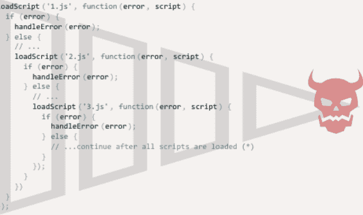

嵌套调用的“金字塔”随着每一个异步操作向右增长。很快，它就会失控。

所以这种编码方式并不好。

我们可以尝试通过将每个操作制为一个独立的函数来缓解这个问题，如下所示：

```javascript
loadScript('1.js', step1);

function step1(error, script) {
  if (error) {
    handleError(error);
  } else {
    // ...
    loadScript('2.js', step2);
  }
}

function step2(error, script) {
  if (error) {
    handleError(error);
  } else {
    // ...
    loadScript('3.js', step3);
  }
}

function step3(error, script) {
  if (error) {
    handleError(error);
  } else {
    // ...在所有脚本加载完成后继续 (*)
  }
}
```

## Promise

Promise 是一种特殊的 JavaScript 对象，它将“生产代码”（producing code）与“消费代码”（consuming code）连接在一起。

“生产代码”需要时间来产生结果，“消费代码”需要在结果准备好时使用它。

Promise 充当了它们之间的链接。

### Promise 构造函数

创建 Promise 的语法：

```javascript
let promise = new Promise(function(resolve, reject) {
  // 执行器（executor，生产代码）
});
```

传递给 `new Promise` 的函数被称为执行器。它在 `new Promise` 创建时自动运行。它包含最终应产生结果的生产代码。

它的参数 `resolve` 和 `reject` 是由 JavaScript 引擎预先提供的回调函数。我们的代码只能调用它们中的一个，当结果准备好时。

- `resolve(value)` —— 如果任务成功完成，带有结果 `value`。
- `reject(error)` —— 如果发生错误，带有 `error` 对象。

Promise 对象具有以下内部属性：

- `state` —— 初始为 `"pending"`，然后在 `resolve` 调用时变为 `"fulfilled"`，或者在 `reject` 调用时变为 `"rejected"`。
- `result` —— 初始为 `undefined`，然后在 `resolve(value)` 调用时变为 `value`，或者在 `reject(error)` 调用时变为 `error`。

所以，执行器最终会将 promise 移至以下状态之一：

```javascript
let promise = new Promise(function(resolve, reject) {
  // 1秒后任务完成并带有结果 "done"
  setTimeout(() => resolve("done"), 1000);
});
```

2. 执行器（executor）接收两个参数：`resolve` 和 `reject` —— 这些函数是由 JavaScript 引擎预先提供的。因此，我们不需要创建它们。我们只会在准备就绪时调用其中一个。

在“处理”一秒后，执行器调用 `resolve("done")` 来产生结果：

| new Promise(executor) | |
| :--- | :--- |
| state: "pending" | resolve("done") |
| result: undefined | state: "fulfilled" |
| | result: "done" |

这是一个成功完成的示例，即一个“已完成的 promise”（fulfilled promise）。

另一个执行器用错误拒绝 promise 的示例：

```javascript
let promise = new Promise(function(resolve, reject) {
  // 1秒后任务完成但触发了错误
  setTimeout(() => reject(new Error("whoops!")), 1000);
});
```

| new Promise(executor) | | |
| :--- | :--- | :--- |
| state: "pending" | reject(error) | state: "rejected" |
| result: undefined | | result: error |

总结来说，执行器应该执行一项任务（通常是耗时的操作），然后调用 `resolve` 或 `reject` 来改变相应 Promise 对象的状态。

被解析或拒绝的 Promise 被称为“已定型”（settled），与初始的“等待中”（pending）Promise 相对。

> 只能有一个结果或一个错误

执行器应该只调用一次 `resolve` 或一次 `reject`。Promise 的状态改变是最终的。

所有对 `resolve` 和 `reject` 的后续调用都会被忽略：


```
let promise = new Promise(function(resolve, reject) {
  resolve("done");

  reject(new Error("---")); // 被忽略
  setTimeout(() => resolve("---")); // 被忽略
});
```

其核心思想是，执行器的任务可能只有一个结果或一个错误。

此外，`resolve/reject` 只接受一个参数（或不接受），并且会忽略额外的参数。

# 拒绝 Error 对象

在出现问题时，我们可以带任何类型的参数调用 `reject`（就像 `resolve` 一样）。但建议使用 Error 对象（或继承自 Error 的对象）。原因将显而易见。

# 立即调用 resolve/reject

在实践中，执行器会执行某些异步操作并在一段时间后调用 `resolve/reject`，但并非必须如此。我们也可以立即调用 `resolve/reject`，如下所示：

```
let promise = new Promise(function(resolve, reject) {
  // 没有花时间执行任务
  resolve(123); // 立即给出结果：123
});
```

例如，当我们开始执行某项任务但发现一切已经完成并缓存了时。

这没关系。我们立即得到了一个解析的 promise。

# 状态和结果是内部的

Promise 对象的 `state` 和 `result` 属性是内部的。我们无法从“消费代码”中直接访问它们。可以使用 `.then/.catch()/.finally` 方法来实现。它们在下文中描述。

# 消费者：then, catch, finally

Promise 对象充当执行器（“生产代码”或“歌手”）与消费者函数（“粉丝”）之间的连接，消费者将接收结果或错误。消费函数可以使用 `.then`、`.catch` 和 `.finally` 方法进行注册（订阅）。

# then

最重要、最基础的是 `.then`。

语法为：

```
promise.then(
  function(result) { /* 处理成功的结果 */ },
  function(error) { /* 处理错误 */ }
);
```

`.then` 的第一个参数是一个函数，它：

- 1. 在 promise 被解析（resolved）时运行，并且

2. 接收结果。

`.then` 的第二个参数是一个函数，它：

- 1. 在 promise 被拒绝（rejected）时运行，并且

2. 接收错误。

例如，这里是对成功解析的 promise 的响应：

```
let promise = new Promise(function(resolve, reject) {
  setTimeout(() => resolve("done!"), 1000);
});
```

```
// resolve 执行 .then 中的第一个函数
promise.then(
  result => alert(result), // 1秒后显示 "done!"
  error => alert(error) // 不执行
);
```

第一个函数被执行了。

在拒绝的情况下 —— 执行第二个：

```
let promise = new Promise(function(resolve, reject) {
  setTimeout(() => reject(new Error("whoops!")), 1000);
});
```

```
// reject 执行 .then 中的第二个函数
promise.then(
  result => alert(result), // 不执行
  error => alert(error) // 1秒后显示 "Error: Whoops!"
);
```

如果我们只对成功完成感兴趣，那么可以只给 .then 提供一个参数：

```
let promise = new Promise(resolve => {
  setTimeout(() => resolve("done!"), 1000);
});

promise.then(alert); // 1秒后显示 "done!"
```

### catch

如果我们只对错误感兴趣，可以使用 `null` 作为第一个参数：`.then(null, errorHandlingFunction)`。或者可以使用 `.catch(errorHandlingFunction)`，它们是完全一样的：

```
let promise = new Promise((resolve, reject) => {
  setTimeout(() => reject(new Error("whoops!")), 1000);
});

promise.catch(error => console.error(error)); // 1秒后显示 "Error: Whoops!"
```

### finally

如果我们需要无论 promise 成功还是失败都执行某些清理工作，我们使用 `.finally`：

```javascript
let promise = new Promise(resolve => {
  setTimeout(() => resolve("done!"), 1000);
});

promise.finally(() => console.log("finished")); // 1秒后显示 "finished"
```

```javascript
script.onerror = () => reject(new Error(`Script load error for ${src}`));

document.head.append(script);
```

用法：

```javascript
let promise = loadScript("https://cdnjs.cloudflare.com/ajax/libs/lodash.js/4.17.11/lodash.js");
promise.then(
  script => alert(`${script.src} is loaded!`),
  error => alert(`Error: ${error.message}`)
);

promise.then(script => alert(`One more handler to do something else!`));
```

我们可以立即看到它相比基于回调的模式有几个优点：

| Promise (Promises) | 回调函数 (Callbacks) |

| :--- | :--- |

| Promise 允许我们按照自然的顺序执行任务。我们运行 `loadScript(script)` 并使用 `.then` 编写处理结果的操作。 | 在调用 `loadScript(script, callback)` 时，我们必须准备好回调函数。换句话说，在调用 `loadScript` 之前，我们必须知道如何处理结果。 |

我们可以根据需要无限次数地在 Promise 上调用 `.then`。每次我们都在向“订阅列表”中添加一个新的“风扇”，即一个新的订阅函数。更多内容请见下章：Promise 链式（Promises chaining）。

> 回调只能有一个。

因此 Promise 为我们提供了更好的代码流和灵活性。但不仅如此。我们将在接下来的章节中看到。

## 任务

## 重新解析一个 promise？

以下代码的输出是什么？

```javascript
let promise = new Promise(function(resolve, reject) {
  resolve(1);

  setTimeout(() => resolve(2), 1000);
});

promise.then(alert);
```

解法：（注：修复了原始代码 `setTimeout` 调用中缺失的括号）

## 使用 promise 实现延迟

内置函数 `setTimeout` 使用回调函数。请创建一个基于 promise 的替代方案。函数 `delay(ms)` 返回一个 promise。该 promise 应该在 ms 毫秒后 resolve，这样我们就可以像这样对其添加 `.then`：

```javascript
function delay(ms) {
  // 你的代码
}
delay(3000).then(() => alert('runs after seconds'));
```

解法

## 使用 promise 实现动画圆

重写“带回调的动画圆”任务解中的 `showCircle` 函数，使其返回一个 promise 而不是接受回调。新的用法：

```javascript
showCircle(150, 100).then(div => {
  div.classList.add('message');
  div.append("Hello, world!");
});
```

以“带回调的动画圆”任务的解为基础。

让我们回到引言章节中提到的问题：我们有一系列异步任务需要按顺序执行。例如，加载脚本。我们如何编写代码？Promise 提供了几种方案来实现这一点。在本章中，我们将涵盖 Promise 链。它看起来像这样：

```javascript
new Promise((resolve, reject) => {
  setTimeout(() => resolve(1), 1000); // (*)
}).then(function(result) { // (**)
  alert(result); // 1
  return result * 2;
}).then(function(result) { // (***)
  alert(result); // 2
  return result * 2;
}).then(function(result) {
  alert(result); // 4
  return result * 2;
});
```

其思想是结果通过 `.then` 处理器的链进行传递。执行流程如下：

1. 初始 promise 在 1 秒后 resolve (*)

2. 接着调用 `.then` 处理器 (**)

3. 它返回的值被传递给下一个 `.then` 处理器 (***)

4. ...以此此类推。

随着结果沿着处理器链传递，我们可以看到一系列连续的 `alert` 调用：1 → 2 → 4。

整个过程之所以能运行，是因为调用 `promise.then` 会返回一个 promise，因此我们可以在其上调用下一个 `.then`。当处理器返回一个值时，它就变成了该 promise 的结果，因此下一个 `.then` 会带着该值被调用。为了清楚这些话，这里是链的开头：

```javascript
new Promise(function(resolve, reject) {
  setTimeout(() => resolve(1), 1000);
}).then(function(result) {
  alert(result);
  return result * 2; // <-- (1)
}).then(function(result) { // <-- (2)
  // .then...
  )
});
```

`.then` 返回的值是一个 promise，这就是为什么我们能够在 (2) 处添加另一个 `.then`。当值在 (1) 中返回时，该 promise 变为已 resolve，因此下一个处理器带有该值运行。

## 一个经典的新手错误：技术上，我们也可以为单个 promise 添加许多 .then。这不会改变结果。例如：

```javascript
let promise = new Promise(function(resolve, reject) {
  setTimeout(() => resolve(1), 1000);
});

promise.then(function(result) {
  alert(result); // 1
  return result * 2;
});

promise.then(function(result) {
  alert(result); // 1
  return result * 2;
});

promise.then(function(result) {
  alert(result); // 1
  return result * 2;
});
```

我们在这里做的只是给一个 promise 添加了多个处理器。它们之间并不传递结果。相反，它们是独立处理的。这里我们做的只是给一个 promise 添加了多个处理器。它们之间并不传递结果。相反，它们是独立处理的。

### 链式调用 (Chaining)

其思想是结果通过 `.then` 处理器的链进行传递。执行流程如下：

1. 初始 promise 在 1 秒后 resolve (*)

2. 接着调用 `.then` 处理器 (**)

3. 它返回的值被传递给下一个 `.then` 处理器 (***)

4. ...以此此类推。

随着结果沿着处理器链传递，我们可以看到一系列连续的 `alert` 调用：1 → 2 → 4。

整个过程之所以能运行，是因为调用 `promise.then` 会返回一个 promise，因此我们可以在其上调用下一个 `.then`。当处理器返回一个值时，它就变成了该 promise 的结果，因此下一个 `.then` 会带着该值被调用。为了清楚这些话，这里是链的开头：

```javascript
new Promise(function(resolve, reject) {
  setTimeout(() => resolve(1), 1000);
}).then(function(result) {
  alert(result);
  return result * 2; // <-- (1)
}).then(function(result) { // <-- (2)
  // .then...
  )
});
```

`.then` 返回的值是一个 promise，这就是为什么我们能够在 (2) 处添加另一个 `.then`。当值在 (1) 中返回时，该 promise 变为已 resolve，因此下一个处理器带有该值运行。

### 返回 promise (Returning promises)

通常情况下，`then` 处理器返回的值会立即传递给下一个 `.then` 处理器。如果返回的值是一个 promise，那么后续的执行将挂起直到它稳定。例如：

```javascript
new Promise(function(resolve, reject) {
  setTimeout(() => resolve(1), 1000);
}).then(function(result) {
  alert(result); // 1

  return new Promise((resolve, reject) => {
    setTimeout(() => resolve(2), 1000);
  });
}).then(function(result) { // (*)
  alert(result); // 2

  return new Promise((resolve, reject) => {
    setTimeout(() => resolve(3), 1000);
  });
}).then(function(result) { // (**)
  alert(result); // 3
});
```

这里第一个 .then 在 1 秒后 resolve (*)。接着调用 `.then` 处理器 (**)。它返回的值被传递给下一个 `.then` 处理器 (***)，这显示了 2。输出结果是相同的。

### 示例：加载脚本 (Example: loadScript)

让我们回到引言章节中提到的问题：我们有一系列异步任务需要按顺序执行。例如，加载脚本。返回 promise 允许我们构建异步操作链。

```javascript
loadScript("article-chaining/one.js")
  then(function(script) {
    return loadScript("article-chaining/two.js")
  })
  then(function(script) {
    return loadScript("article-chaining/three.js")
  });
```

这段代码可以使用箭头函数变得更短：

```javascript
loadScript("article-chaining/one.js")
then script => loadScript("article-chaining/two.js")
then script => loadScript("article-chaining/three.js")
then script => (
  // 脚本已加载，我们这里可以使用函数
  one();
  two();
  three();
);
```

在这里，`loadScript` 返回一个 promise，下一个 `.then` 在其 resolve 时运行。它启动了下一个脚本的加载。因此脚本是按顺序加载的。请注意代码仍然是“扁平”的，它是向下生长的而不是向右生长。没有“回调字狱”的迹象。

请注意，我们可以直接在每个 `loadScript` 上添加 `.then`，如下：

```javascript
loadScript("article-chaining/one.js")
then script1 => {
  loadScript("article-chaining/two.js").then script2 => {
    loadScript("article-chaining/three.js").then script3 => {
      // 这个函数可以访问变量 script1, script2 和 script3
      one();
      two();
      three();
    })
  }
};
```

这段代码的作用是相同的：按顺序加载 3 个脚本。但它是“向右增长”。因此我们面临着与回调相同的问题。

# Thenables

准确来说，`.then` 可能会返回一个所谓的“thenable”（可承诺）对象——一个具有 `.then` 方法的任意对象，它会被像 promise 一样对待。

这种想法是第三方库可以实现自己的“promise 兼容”对象。它们可以拥有扩展的方法集，同时与原生 promise 兼容，因为它们实现了 `.then`。

这是一个 thenable 对象的示例：

```javascript
class Thenable {
  constructor(num) {
    this.num = num;
  }
  then(resolve, reject) {
    alert(resolve); // 原生代码
    setTimeout(() => resolve(this.num * 2), 1000); // (**)
  }
}
```

```javascript
new Promise(resolve => resolve(1))
  .then(result => {
    return new Thenable(result); // (*)
  })
  .then(alert); // 1000ms 后显示 2
```

JavaScript 会检查第 (*) 行中 `.then` 处理器函数返回的对象：如果它是一个名为 `then` 的可调用方法，它就会调用该方法，并将原生函数 `resolve` 和 `reject` 作为参数（类似于执行器），并等待直到其中一个被调用。在上面的示例中，1秒后调用了 `resolve(2)` (**)。然后结果继续传递到链的下游。

这一特性允许将自定义对象集成到 promise 链中，而无需继承 Promise。

# 更复杂的示例：fetch

在前端编程中，`fetch` 通常用于网络请求。所以让我们来看关于它的一个扩展示例。

我们将使用 `fetch` 从远程服务器加载用户信息。它有很多可选参数，在单独的章节中有介绍，但基础语法非常简单：

```javascript
let promise = fetch(url);
```

这会对 `url` 发起网络请求并返回一个 promise。当远程服务器响应头时，promise 会 resolve 为响应对象，但在完整响应下载之前。

要读取完整的响应，我们应该调用方法 `response.text()`，它返回一个 promise，当从远程服务器下载完整文本时，该 promise 会 resolve。

以下代码对 `user.json` 发起请求并从服务器加载其文本：

```javascript
fetch('/article/promise-chaining/user.json')
// 然后在下面远程服务器响应时
then(function(response) {
  // response.text() 返回一个新的新 promise，当我们完成下载时
  // 它会 resolve 为完整响应
  return response.text();
})
then(function(text) {
  // ...而这里是远程文件的内容
  alert(text); // {"name": "Iliakan", isAdmin: true}
});
```

还有一个 `response.json()` 方法，它可以读取远程数据并将其解析为 JSON。在我们的情况下这甚至更方便，所以我们切换到它。

我们还将使用箭头函数来简化代码：

```javascript
// 与上面相同，但 response.json() 将远程内容解析为 JSON
fetch('/article/promise-chaining/user.json')
then(response => response.json())
then(user => alert(user.name)); // Iliakan
```

现在让我们对加载的用户做些什么。

例如，我们可以向 GitHub 发起另一个请求，加载用户个人资料并显示头像：

```javascript
// 为 user.json 发起请求
fetch('/article/promise-chaining/user.json')
// 将其加载为 json
then(response => response.json())
// 向 GitHub 发起请求
then(user => fetch(`https://api.github.com/users/${user.name}`))
// 将响应加载为 json
then(response => response.json())
// 显示头像 (githubUser.avatar_url) 3秒（也许加个动画）
then(githubUser => {
  let img = document.createElement('img');
  img.src = githubUser.avatar_url;
  img.className = "promise-avatar-example";
  document.body.append(img);

  setTimeout(() => img.remove(), 3000); // (*)
});
```

代码可以工作，注释说明了所有细节。尽管，其中存在一个潜在问题，这是开始使用 promise 的人的典型错误。

看第 (*) 行：我们在头像显示完成并被移除后如何做些什么呢？例如，我们想显示一个编辑该用户的表单或其他内容。目前还没有办法。

为了让链变得可扩展，我们需要返回一个在头像显示完成后 resolve 的 promise。

像如下所示：

```javascript
fetch('/article/promise-chaining/user.json')
then(response => response.json())
then(user => fetch(`https://api.github.com/users/${user.name}`))
then(response => response.json())
then(githubUser => new Promise(function(resolve, reject) {
  let img = document.createElement('img');
  img.src = githubUser.avatar_url;
  img.className = "promise-avatar-example";
  document.body.append(img);

  setTimeout(() => {
    img.remove();
    resolve(githubUser);
  }, 3000);
}))
// 3秒后触发
then(githubUser => alert(`Finished showing ${githubUser.name}`));
```

现在 `setTimeout` 运行后执行 `img.remove()`，它调用了 `resolve(githubUser)`，从而将结果传递下去。

# 隐式 try...catch

promise 执行器和 promise 处理器的代码周围包裹着一个“不可见的 try..catch”。如果发生异常，它会被捕获并被视为拒绝。

例如，以下代码：

```javascript
new Promise((resolve, reject) => {
  throw new Error("Whoops!");
}).catch(alert); // Error: Whoops!
```

...工作原理完全相同：

```javascript
new Promise((resolve, reject) => {
  reject(new Error("Whoops!"));
}).catch(alert); // Error: Whoops!
```

执行器（executor）周围的“隐形 try..catch”会自动捕获错误并将其视为拒绝（rejection）。

这种情况不仅发生在执行器中，也发生在它的处理器中。如果我们在 .then 处理器内部抛出异常，意味着该 promise 被拒绝了，因此控制流将跳转到最近的错误处理器。

这是一个示例：

```javascript
new Promise((resolve, reject) => {
  resolve("ok");
}).then((result) => {
  throw new Error("Whoops!"); // 拒绝 promise
}).catch(alert); // Error: Whoops!
```

这种现象适用于所有错误，而不仅仅是由于 `throw` 语句引起的错误。例如，一个编程错误：

```javascript
new Promise((resolve, reject) => {
  resolve("ok");
}).then((result) => {
  blabla(); // 没有此函数
}).catch(alert); // ReferenceError: blabla is not defined
```

最后的 .catch 不仅捕获显式的拒绝，还会捕获上述处理器中偶尔出现的错误。

# 重新抛出错误 (Rethrowing)

正如我们已经注意到的，catch 的行为类似于 try..catch。我们可以拥有任意多个 .then 处理器，然后在最后使用单个 .catch 来处理它们中所有处理器的错误。

在普通的 try..catch 中，我们可以分析错误，如果无法处理，则可以重新抛出它。promise 也可以做到同样。。

如果我们在 .catch 内部抛出异常，控制流将跳转到下一个最近的错误处理器。如果我们处理了错误并正常结束，它将继续执行到最近的成功的 .then 处理器。

在下面的示例中，.catch 成功地处理了错误：

```javascript
// 执行流程：catch -> then
new Promise((resolve, reject) => {
    throw new Error("Whoops!");
}).catch(function(error) {
    alert("The error is handled, continue normally");
}).then(() => alert("Next successful handler runs"));
```

在这里，.catch 正常阻塞了错误。下一个成功的 .then 处理器被调用。

在下面的示例中，我们看到了 catch 的另一种情况。处理器 (*) 捕获了错误，但无法处理它（例如，它只知道如何处理 URIError），因此它再次抛出了错误：

```javascript
// 执行流程：catch -> catch -> then
new Promise((resolve, reject) => {
    throw new Error("Whoops!");
}).catch(function(error) { // (*)
    if (error instanceof URIError) {
        // 处理它
    } else {
        alert("Can't handle such error");
        throw error; // 抛出此错误或其他错误将跳转到下一个 catch
    }
}).then(function() {
    // 永远不会在这里运行 // (*)
}).catch(error => { // (**)
    alert(`The unknown error has occurred: ${error}`);
    // 不返回任何内容 => 执行按正常方式进行
});
```

然后执行流将从第一个 .catch (*) 跳到链条中的下一个 (**)。

在接下来的段节中，我们将看到一个重新抛出错误的实用示例。

# Fetch 错误处理示例

让我们改进加载用户示例的错误处理。

当无法发出请请求时，fetch 返回的 promise 会被拒绝。例如，远程服务器不可，或者 URL 格式不正确。但如果远程服务器响应 404 错误甚至 500 错误，那么它被视为一个有效的响应。

如果服务器在第 (*) 行返回了一个带有 500 错误的非 JSON 页面怎么办？如果没有该用户，GitHub 在 (**) 处返回带有 404 错误的页面怎么办？

```javascript
fetch('no-such-user.json') // (*)
then response => response.json()
then user => fetch(`api.github.com/users/${user}`) // (**)
then response => response.json()
catch(alert); // SyntaxError: Unexpected token < in JSON at position 0
// ...
```

目前，无论如何将响应加载为 JSON 的代码都会因语法错误崩溃。你可以通过运行上面的示例看到这一点，`no-such-user.json` 文件并不存在。

这并不好，因为错误直接在链链中传递，而没有细节：什么失败了以及在哪里失败的。

所以让我们再增加一步：我们应该检查具有 HTTP 状态的 `response.status` 属性，如果不是，则抛出一个错误。

```javascript
class HttpError extends Error { // (1)
  constructor(response) {
    super(`${response.status} for ${response.url}`);
    this.name = 'HttpError';
    this.response = response;
  }
}

function loadJson(url) { // (2)
  return fetch(url)
  .then(response => {
    if (response.status == 200) {
      return response.json();
    } else {
      throw new HttpError(response);
    }
  });
}

loadJson('no-such-user.json') // (3)
catch(alert); // HttpError: 404 for .../no-such-user.json
```

1. 我们为 HTTP 错误创建一个类，将其与其他类型的区分开来。此外，新类有一个构造函数，可以接受响应对象并将其保存在错误中。

2. 这样 catch 能够访问响应。

3. 拥有错误类的好处是我们可以使用 `instanceof` 检查错误。

例如，我们发出请求，如果得到 404，则提示用户。

下面的代码从 GitHub 获取指定名称的用户：

```javascript
function demoGitHubUser() {
  let name = prompt("Enter a name?", "iliakan");

  return loadJson(`https://api.github.com/users/${name}`)
    .then(user => {
      alert(`Full name: ${user.name}`);
      return user;
    })
    .catch(err => {
      if (err instanceof HttpError && err.response.status === 404) {
        alert("未找到用户，请重试");
      } else {
        alert("发生了错误");
        throw err;
      }
    });
}
```

# 未处理的拒绝 (Unhandled rejection)

当拒绝未捕获时会发生什么？JavaScript 引擎跟踪这些拒绝。在浏览器中，我们可以通过 `unhandledjection` 捕获这些：

```javascript
window.addEventListener('unhandledjection', function(event) {
  // 对象有两个属性：
  console.log(event.reason); // 产生错误的 promise
  console.log(event.error); // 错误对象
});
```

```javascript
new Promise(function() {
  throw new Error("Whoops!");
}); // 没有 catch
```

## 总结

- .catch 处理各种类型的拒绝：无论是 `reject()` 调用，还是在处理器中抛出的错误。

- 我们应该将 .catch 放置在想要处理错误并知道如何处理的地方。处理器分析错误（自定义错误类有帮助）并重试未知错误。

- 完全不使用 .catch 将无法从错误中恢复。

- 在任何情况下，我们都有 `unhandledrejection` 事件处理器（针对浏览器和其他其他环境），用于跟踪未处理的错误并通知用户（以及我们的服务器），这样我们永远不会“直接崩溃”。

如果有加载指示，那么 `.finally` 是在 fetch 完成时停止它的绝佳处理器：

```javascript
function demoGitHubUser() {
  let name = prompt("Enter a name?", "iliakan");
  document.body.style.opacity = 0.3; // (1) 开始指示
  return loadJson(`https://api.github.com/users/${name}`)
  .catch(err => {})
    .finally(() => { (2) 停止指示
    document.body.style.opacity = '';
    });
}
```

```javascript
return new Promise(resolve => setTimeout(resolve)); // (*)
}
.then(user => {
  alert(`Full name: ${user.name}`);
  return user;
})
.catch(err => {
  if (err instanceof Error && err.response.status == 404) {
    alert("No such user, please reenter.");
    return demoGitHubUser();
  } else {
    throw err;
  }
});

demoGitHubUser();
```

在第 (1) 行，我们通过调暗文档来表示正在加载。这种方法并不重要，可以使用任何其他类型的指示代替。

当 promise 状态确定（settled）时，无论是获取成功还是出错，最终都会在第

(2) 行触发并停止指示。

这里有一个小小的浏览器追踪器 (*)，它从 `finally` 中返回了一个零延迟的 promise 。这是因为某些浏览器（如 Chrome）在 promise 处理器之外需要“一点点时间”来绘制文档的变化。因此，它确保了在继续链式操作之前，加载指示在视觉上已经停止。

- 任务 (Tasks)

# setTime 中的错误

你认为呢？.catch 会触发吗？请解释你的答案。

```javascript
new Promise(function(resolve, reject) => {
  setTimeout(() => {
    throw new Error("Whoops!");
  }, 1000);
}).catch(alert);
```

通往解决方案 (To solution)

# Promise API

Promise 类中有 5 个静态方法。我们在这里快速介绍一下它们的用例。

# Promise.resolve

语法为：

```javascript
let promise = Promise.resolve(value);
```

返回一个带有给定值的已解析（resolved）promise。

等同于：

```javascript
let promise = new Promise(resolve => resolve(value));
```

当我们已经有一个值但想将其“包装”成 promise 时，使用该方法。例如，`loadCached` 函数获取 url 并记住结果，这样以后对相同 URL 的调用将立即返回：

```javascript
function loadCached(url) {
  let cache = loadCached || (loadCached cache = new Map());

  if (cache.has(url)) {
    return Promise.resolve(cache.get(url)); // (*)
  }

  return fetch(url)
    .then(response => response.text())
    .then(text => {
      cache.set(url, text);
      return text;
    });
}
```

我们使用 `loadCached(url).then(...)`，因为该函数保证返回一个 promise。这就是 `Promise.resolve` 在第 (*) 行的作用：它确保了接口的统一性。我们可以在 `loadCached` 之后始终使用 `.then`。

# Promise.reject

语法为：

```javascript
let promise = Promise.reject(error);
```

创建一个带有错误的已拒绝（rejected）promise。

等同于：

```javascript
let promise = new Promise((resolve, reject) => reject(error));
```

为了完整性我们在这里介绍它，它在实际代码中很少使用。

# Promise.all

假设我们想要运行许多 promise 以并行执行，并等待它们都准备就绪。例如，并行下载几个 URL 并在全部完成后处理内容。这就是 `Promise.all` 的用途。

语法为：

```javascript
let promise = Promise.all([...promises......]);
```

它接收一个 promise 数组（技术上可以是任何迭代器，但通常是数组）并返回一个新的 promise。当所有列出的 promise 都状态确定时，新 promise 将解析并包含它们结果的数组。例如，下面的 `Promise.all` 会在 3 秒后确定，然后它的结果是数组 `[1, 2, 3]`：

```javascript
Promise.all([
  new Promise(resolve => setTimeout(resolve(1), 3000)), // 1
  new Promise(resolve => setTimeout(resolve(2), 2000)), // 2
  new Promise(resolve => setTimeout(resolve(3), 1000)) // 3
])).then(alert); // 当 promise 准备就绪时触发 1,2,3：每个贡献一个数组成员
```

请注意，相对顺序是相同的。即使第一个 promise 解析耗时最长，它在结果数组中仍然是第一个。一个常用的技巧是将任务数据数组映射为 promise 数组，然后将其封装在 `Promise.all` 中。例如，如果我们有一个 URL 数组，可以这样获取它们的所有：

```javascript
let urls = [
  'https://api.github.com/users/iliakan',
  'https://api.github.com/users/remmy',
  'https://api.github.com/users/jeresig'
];

// 将每个 url 映射到 fetch 的 promise
let requests = urls.map(url => fetch(url));

// Promise.all 等待所有任务都解析
Promise.all(requests)
  .then(responses => responses.forEach(
    response => alert(`${response.url}: ${response.status}`)
  ));
```

一个更大的示例，通过名称为一组 GitHub 用户获取用户信息（我们可以根据其 id 获取一组商品数组，逻辑是相同的）：

```javascript
let names = ['liakian', 'remy', 'jeresig'];
let requests = names.map(name => fetch(`https://api.github.com/users/${name}`));

Promise.all(requests)
  .then(responses => {
    // 所有响应都已就绪，我们可以显示状态
    for(let response of responses) {
      alert(`${response.status}`); // 每个 url 都显示 200
    }
  })


语法如下：

```

let promise = Promise.race(iterable);

```

例如，这里的结果将是 **1**

```javascript

Promise.race([

  new Promise((resolve, reject) => setTimeout(() => resolve(1), 1000)),

  new Promise((resolve, reject) => setTimeout(() => reject(new Error("Woops!")), 2000)),

  new Promise((resolve, reject) => setTimeout(() => resolve(3), 3000))

])).then(alert); // 1

```

因此，第一个结果/错误将成为整个 `Promise.race` 的结果。一旦第一个状态确定的 promise “赢得比赛”，所有后续的结果/错误都会被忽略。

## 总结

`Promise` 类有 5 个静态方法：

- 1. `Promise.resolve(value)` - 创建一个给定值的已解析的 promise。
- 2. `Promise.reject(error)` - 创建一个被拒绝的 promise 并返回它们结果的数组。
- 3. `Promise.all(promises)` - 等待所有 promise 解析并返回它们结果的数组。如果给定的 promise 中有任何一个拒绝，它将成为 `Promise.all` 的错误，其他所有的都被忽略。
- 4. `Promise.allSettled(promises)`（新方法） - 等待所有 promise 解析，并以对象的形式返回它们的结果：
  - `state`: 'fulfilled' 或 'rejected'
  - `value`（如果成功）或 `reason`（如果被拒绝）。
- 5. `Promise.race(promises)` - 等待第一个状态 own promise，其结果/错误将成为结局。

在这些方法中，`Promise.all` 在实践中可能是最常用的。

# Promise 化 (Promisification)

Promisification —— 一个描述简单转换的长词。它是将一个接受回调的函数转换为返回一个 promise。

更准确地说，我们创建一个包装函数，它执行相同的操作，内部调用原始函数，但返回一个 promise。

这种转换在现实生活中经常需要，因为许多函数和库是基于回调的。但 promise 更方便。因此，将它们 Promise 化是有意义的。

例如，我们在“引言：回调”章节中有一个 `loadScript(src, callback)`。

```javascript

function loadScript(src, callback) {

  let script = document.createElement('script');

  src = src;

  script.onload = () => callback(null, script);

  script.onerror = () => callback(new Error(`Script load error for ${src}`));

  document.head.append(script);

}

// 使用：

// loadScript('path/script.js', (err, script) => {...})

```

让我们把它 Promise 化。新的 `loadScriptPromise(src)` 函数将执行相同的操作，但只接受 `src`（不带回调）并返回一个 promise。

```javascript

let loadScriptPromise = function(src) {

  return new Promise((resolve, reject) => {

    loadScript(src, (err, script) => {

      if (err) reject(err);

      else resolve(script);

    });

  });

}

// 使用：

// loadScriptPromise('path/script.js').then(...)

```

现在 `loadScriptPromise` 完美契合我们基于 promise 的代码。

正如我们看到的，它将工作委托给原始的 `loadScript`，并提供自己的回调函数，将其转换为 promise/reject。

由于我们可能需要 Promise 化许多函数，使用一个辅助函数是有意义的。

这实际上非常简单 —— 下面的 `promisify(f)` 接收一个转 promise 的函数 `f` 并返回一个包装函数。

该包装函数的作用与上述代码相同：返回一个 promise 并调用传递给原始 `f`，在自定义回调中跟踪结果：

```javascript

function promisify(f) {

  return function (...args) // 返回一个包装函数

    return new Promise((resolve, reject) => {

      function callback(err, result) // 我们为 f 定义的自定义回调

        if (err) {

          return reject(err);

        } else {

          resolve(result);

        }

      }

      args.push(callback); // 将我们的自定义回调添加到参数末尾

      f.call(this, ...args); // 调用原始函数

    });

  };

}

// 使用：

let loadScriptPromise = promisify(loadScript);

loadScriptPromise(...).then((...) => {});

```

在这里我们利用了原始函数期望一个带有两个参数（err, result）的回调。这是我们最常遇到的情况。我们的自定�回调格式恰好，`promisify` 在这种情况下效果非常好。

但如果原始的 `f` 期望一个带有更多参数的回调 `callback(err, res1, res2)` 呢？

这里是 `promisify` 的修改，它可以返回多个回调结果的数组：

```javascript

// 使用 promisify(f, true) 获取结果数组

function promisify(f, manyArgs = false) {

  return function (...args) {

    return new Promise((resolve, reject) => {

      function callback(err, ...results) { // 我们为 f 定义的自定义回调

        if (err) {

          return reject(err);

        } else {

          // 如果指定了 manyArgs，则解析所有回调结果

          resolve(manyArgs ? results : results[0]);

        }

      }

      args.push(callback);

      f.call(this, ...args);

    });

  };

}

// 使用：

f = promisify(f, true);

f(...).then(arrayOfResults => {});

```


```javascript

let promise = Promise.reject(new Error('Promise Failed!'));

setTimeout(() => promise.catch(err => alert('caught')), 1000);

```

```javascript

// Error: Promise Failed!

window.addEventListener('unhandledrejection', event => alert(event.reason));

```

现在，如果我们运行它，我们会看到 "Promise Failed!" 消息文本，然后是 "caught"。

如果我们不知道微任务队列（microtasks queue），我们可能会疑惑：“为什么 `unhandledrejection` 处理器会运行？我们能捕获到错误吗？”

但现在我们理解了`unhandledrejection` 是在微任务队列完成后生成的：引擎会处理所有的承诺（promises promises），如果其中任何一个处于“rejected”（已拒绝）状态，就会触发该事件。

在上面的示例中，通过 `setTimeout` 添加的 `.catch` 也会触发，但是在 `unhandledrejection` 发生之后才，所以它并没有改变任何结果。

## 总结

Promise 的处理总是异步的，因为所有的 promise 操作都会通过内部的“promise jobs”队列，也称为“微任务队列”（v8 术语）。

因此，`.then/catch/finally` 处理器会在当前代码执行完成后被调用。

如果我们需要保证某些代码在 `.then/catch/finally` 之后执行，我们将其添加到链式的 `.then` 调用中。

在 JavaScript 引擎中（包括浏览器和 Node.js），微任务的概念与“事件循环”（event loop）和“微任务”紧密相连。这些概念与 promise 并没有直接关系，它们将在教程的另一部分，即“事件循环：微任务与宏任务”章节中介绍。

# Async/await

有一种特殊的语法可以以更舒适的方式处理 promise，称为“async/await”。它在理解和使用上都出乎意料地简单。

# Async 函数

让我们从 `async` 关键字开始。它可以放在函数之前，如下所示：

```javascript

async function f() {

  return 1;

}

```

函数前的 "async" 意味着简单的一点：函数始终返回一个 promise。即使函数实际上返回的是一个非 promise 值，在函数前加上 "async" 关键字也会引导 JavaScript 自动将该值包装在一个已解析（resolved）的 promise 中。

例如，上面的代码返回了一个结果为 1 的解析 promise，让我们测试一下：

```javascript

async function f() {

  return 1;

}

```

f().then(alert); // 1

...我们可以显式地返回一个 promise，那等同于：

```javascript

async function f() {

  return Promise.resolve(1);

}

```

f().then(alert); // 1

所以，`async` 确保函数返回一个 promise，并将非 promise 在其中。足够简单，对吧？不仅如此，还有另一个关键字 `await`，它只能在 async 函数内部工作，而且非常酷。

# Await

语法：

```javascript

// 仅在 async 函数内部有效

let value = await promise;

```

`await` 关键字会让 JavaScript 等待该 promise 状态稳定（settles）并返回其结果。这里有一个在 1 秒后解析的 promise 示例：

```javascript

async function f() {

  let promise = new Promise((resolve, reject) => {

    setTimeout(() => resolve("done!"), 1000);

  });

  let result = await promise; // 等待 promise 解析 (*)

  alert(result); // "done!"

}

f();

```

函数执行在第 (*) 行处“暂停”，并在 promise 状态稳定后恢复，此时结果变为其值。因此，上面的代码在一秒内显示了 "done!"。

让我们强调一下：`await` 字面上确实会让 JavaScript 等待直到 promise 状态稳定，然后根据结果继续执行。这不会消耗任何 CPU 资源，因为引擎在此期间可以其他工作、执行其他脚本、处理事件等。
它只是比 `promise.then` 更优雅的获取 promise 结果的语法，更易读也易写。

> 普通函数不能使用 await
> 如果我们尝试在非 async 函数中使用 await，将会导致语法错误：

```javascript

function f() {

  let promise = Promise.resolve(1);

  let result = await promise; // 语法错误

}

```

如果我们没有在函数前加上 `async`，就会得到这个错误。如所述，`await` 只能在 async 函数内部工作。

让我们取“Promise 链式调用”章节中的 `showAvatar()` 示例并使用 `async/await` 重写它：

- 1. 我们需要用 `await` 替换 `.then` 调用。
- 2. 此外，我们应该将函数标记为 `async` 以运行。

```javascript

async function showAvatar() {

  // 读取我们的 JSON

  let response = await fetch(`article/promise-chaining/user.json`);

  let user = await response.json();

  // 读取 github 用户

  let githubResponse = await fetch(`https://api.github.com/users/${user.name}`);

  let githubUser = await githubResponse.json();

  // 显示头像

  let img = document.createElement('img');

  img.src = avatar_url;

  img.className = "promise-avatar-example";

  document.body.append(img);

  // 等待 3 秒

  await new Promise((resolve, reject) => setTimeout(resolve, 3000));

  img.remove();

  return githubUser;

}

showAvatar();

```

非常清晰且易读，对吧？比以前好得多。

# await 不起作用
如果我们没有 `.try.catch`，那么调用 async 函数 `f()` 生成的 promise 就会变为拒绝（rejected）。我们可以附加 `.catch` 来处理它：

```javascript

async function f() {

  let response = await fetch('http://such-url');

}

// f() 变成了一个拒绝的 promise

f().catch(alert); // TypeError

```

# Async 方法
当我们使用 async/await 时，我们很少需要 `.then`，因为 `await` 为我们处理了等待。可以使用普通的 `try..catch` 代替 `.catch`。这通常（并非总是）更方便。

```javascript

class Waiter {

  async wait() {

    return Promise.resolve(1);

  }

}

new Waiter()

  .wait()

  .then(alert); // 1

```

# 错误处理
如果 promise 正常解析，`await` 返回结果。但在拒绝的情况下，它会抛出错误。这段代码：

```javascript

async function f() {

  await Promise.reject(new Error("Whoops!"));

}

```

...等同于：

```javascript

async function f() {

  throw new Error("Whoops!");

}

```

实际情况下，promise 可能在拒绝之前需要一些时间。所以 `await` 会等待，然后抛出错误。我们可以使用 `try..catch` 捕获该错误，就像使用 `throw` 一样：

```javascript

async function f() {

  try {

    let response = await fetch('http://no-such-url');

  } catch(err) {

    alert(err); // TypeError: failed to fetch

  }

}

f();

```

发生错误时，控制跳转到 catch 块。我们也可以包装多行：

```javascript

async function f() {

  try {

    let response = await fetch('/no-user-here');

    let user = await response.json();

  } catch (err) {

    // 同时捕获 fetch 和 response.json 中的错误

    alert(err);

  }

}

f();

```

# 顶层
在代码的顶层，我们离开了任何 async 函数，语法上无法使用 `await`，因此通常做法是添加 `.then/catch` 来处理最终结果或溢出的错误。


# async/await 与 Promise.all 配合得很好

当我们需要等待多个 promise 时，可以把它们封装在 Promise.all 中并进行 await：

```javascript

// 等待结果数组

let results = await Promise.all([

  fetch(url1),

  fetch(url2),

]);

```

如果发生错误，它会像通常一样传播：失败的 promise 传递给 Promise.all，然后变成一个异常我们可以在调用处使用 try..catch 来捕获它。

## 总结

函数前的 `async` 关键字有两个作用：

- 1. 使它始终返回一个 promise。
- 2. 允许在其中使用 await。

promise 前的 `await` 关键字会让 JavaScript 等待该 promise 状态稳定（settled），然后：

- 1. 如果是错误，则生成异常，就像在当前位置调用 throw error 一样。
- 2. 否则，它返回结果，我们可以将其赋值给变量。

它们共同提供了一个极好的框架，用于编写既易读又写的异步代码。
有了 async/await，我们很少需要 promise-then/catch，但我们仍然不应忘记它们是基于 promise 的，因为有时（例如在最外层作用中）我们会使用这些方法。此外，Promise.all 是一个同时等待许多任务的好工具。

## 任务

# 重写 async/await

使用 async/await 代替 .then/catch，重写“Promise 链”章节中的一个示例：

```javascript

function loadJson(url) {

  return fetch(url)

  .then(response => {

    if (response.status == 200) {

      return response.json();

    } else {

    throw new Error(response.status);

    }

  })

}

loadJson('no-such-user.json') // (3)

catch(alert); // Error: 404

```

解决方案

# 使用 async/await 重写 "rethrow"

在下方你可以找到“Promise 链”章节中的“rethrow”示例。使用 async/await 代替 .then/catch 重写它。

并在 demoGithubUser 中消除递归，改用循环：使用 async/await 后这变得非常简单。

```javascript

class HttpException extends Error {

    constructor(response) {

        super(`${response.status} for ${response.url}`);

        this.name = 'HttpError';

        this.response = response;

    }

}

function loadJson(url) {

    return fetch(url)

    .then(response => {

        if (response.status == 200) {

            return response.json();

        } else {

            throw new HttpException(response);

        }

    });

}

// 一直询问用户名，直到 github 返回有效的用户

function demoGithubUser() {

    let name = prompt("Enter a name?", "iliakan");

    return loadJson(`https://api.github.com/users/${name}`)

    .then(user => {

        alert(`Full name: ${user.name}.`);

        return user;

    }).catch(err => {

        if (err instanceof HttpException && err.response.status == 404) {

            alert("No such user, please reenter.");

            return demoGithubUser();

        } else {

            throw err;

        }

    });

}

demoGithubUser();

```

解决方案

# 从非 async 函数中调用 async

我们有一个“普通”函数。如何从它调用 async 并使用它的结果？

```javascript

async function wait() {

  await new Promise(resolve => setTimeout(resolve, 1000));

  return 10;

}

function f() {

  // ...该写什么？

  // 我们需要调用 async wait() 并等待获取 10

  // 记住，我们不能使用 "await"

}

```

P.S. 这个任务在技术上非常简单，但对于新接触 async/await 的开发者来说这个问题相当常见。

解决方案

# 生成器、高级迭代

# 生成器 (Generators)

普通函数只返回一个单一的值（或什么都没有）。

生成器可以返回（yield）多个值，可能是无限数量的值，按需一个接一个地。它们与迭代器（iterables）配合得非常好，允许轻松创建数据流。

# 生成器函数

要创建一个生成器，我们需要特殊的语法结构：`function*`，即所谓的“生成器函数”。

它看起来像这样：

```javascript

function* generateSequence() {

  yield 1;

  yield 2;

  return 3;

}

```

当调用 `generateSequence()` 时，它不会执行代码。相反，它返回一个特殊的对象，称为“生成器”。

```javascript

// 生成器函数创建“生成器对象”

let generator = generateSequence();

```

`function*` 对象可以被视为一个冻结的函数调用：

```javascript

function* generateSequence() {

  yield 1;

  yield 2;

  return 3;

}

```

在创建时，代码执行在最开始暂停。

生成器的主要方法是 `next()`。当调用时，它会恢复执行直到遇到最近的 `yield <value>` 语句。然后执行暂停，值返回给外部代码。

例如，我们创建生成器并获取它的第一个 yield 的值：

```javascript

function* generateSequence() {

  yield 1;

  yield 2;

  return 3;

}

let generator = generateSequence();

let one = generator.next(); // {value: 1, done: false}

```

`next()` 的结果始终是一个对象：
- value：yield 的值。
- done：如果代码未完成则为 `false`，否则为 `true`。

目前我们只获取第一个值：

```javascript

function* generateSequence() {

  yield 1;

  yield 2;

  return 3;

}

let generator = generateSequence();

let one = generator.next(); // {value: 1, done: false}

```

再次调用 `generator.next()`。它恢复执行并返回下一个 yield：

```javascript

function* generateSequence() {

  yield 1;

  yield 2;

  return 3;

}

let generator = generateSequence();

let two = generator.next(); // {value: 2, done: false}

```

并且，如果我们第三调用调用它，执行将到达 return 语句并结束函数：

```javascript

function* generateSequence() {

  yield 1;

  yield 2;

  return 3;

}

let generator = generateSequence();

let three = generator.next(); // {value: 3, done: true}

```

现在生成器完成了。我们应该看到调用 `next()` 已经没有意义了。如果再调用，它们会返回相同的对象：{done: true}。

没有办法“回滚”生成器。但我们可以通过调用 `generateSequence()` 创建另一个。

到目前，最重要的一点是，生成器函数与普通函数不同，并不运行代码。它们充当“生成器工厂”。运行函数返回一个生成器，然后我们向它索要值。这是一个小问题，两种语法都是正确的。但通常首选第一种语法，因为星号 *` 表示它是生成器函数，描述的是类型而不是名称，所以我们应该坚持使用 function 关键字。

# 生成器是可迭代的

正如你已经通过 `next()` 方法猜的那样，生成器是可迭代的。我们可以通过 `for...of` 遍历值：

```javascript

function* generateSequence() {

  yield 1;

  yield 2;

  return 3;

}

let generator = generateSequence();

for (let value of generator) {

  alert(value); // 1，然后是 2

}

```

这种处理生成器的方式比 `.next().value` 要好看得多，对吧？请注意：示例显示了 1, 2，仅此而已。它没有显示 3！这是因为 `for-of` 迭代忽略了 `done: true` 时的最后一个值。所以，如果我们想让 `for..of` 显示所有结果，我们必须通过 `yield` 返回它们：

```javascript

function* generateSequence() {

  yield 1;

  yield 2;

}

let generator = generateSequence();

for (let value of generator) {

  alert(value); // 1, 2，然后是 3

}

```

自然地，由于生成器是可迭代的，我们可以调用所有相关功能，例如展开运算符 ...

```javascript

function* generateSequence() {

  yield 1;

  yield 2;

  yield 3;

}

let sequence = [0, ...generateSequence()];

alert(sequence); // 0, 1, 2, 3

```

在上面的代码中，`...generateSequence()` 将可迭代对象转换为项数组，更多关于展开运算符的内容请见“剩余参数和展开运算符”章节。

# 使用生成器代替迭代器

以前，在“迭代器”章节中，我们创建了一个返回从 from 到 to 的迭代范围。这里，让我们回顾代码：

```javascript

let range = {

  from: 1,

  to: 5

};

// for..of 在最开始调用此方法

[Symbol.iterator]() {

  // ...它返回对象

  // 此后，for..of 只与该对象工作，向它请求值

  return {

    current: this,

    last: to,

  };

  // for 循环每次迭代都会调用 next()

  next() {

    // 它将值作为对象 {done..., value: ...} 返回

    if (this.current <= last) {

      return { done: false, value: this.current };

    } else {

      return { done: true };

    }

  }

}

alert([...range]); // 1, 2, 3, 4, 5

```

使用生成器制作可迭代序列要优雅得多：

```javascript

function* generateSequence(start, end) {

  for (let i = start; i <= end; i++) {

    yield i;

  }

}

let sequence = [...generateSequence(1, 5)];

alert(sequence); // 1, 2, 3, 4, 5

```

但如果我们想保留一个自定义范围对象呢？

# 将 Symbol.iterator 转换为生成器

通过提供生成器作为 Symbol.iterator，我们可以兼顾两者的优点：

```javascript

let range = {

  from: 1,

  to: 5

};

[Symbol.iterator]() { // [Symbol.iterator]: function* 的简写

  for (let value = this.from; value <= this.to; value++) {

    yield value;

  }

}

```


```javascript

}

alert([...range]); // 1,2,3,4,5

```

`range` 对象现在是可迭代的。

这运行得很好，因为当 `range[Symbol.iterator]` 被调用时：

- 它返回一个对象（现在是一个生成器）
- 具有 `.next()` 方法（是的，生成器有这个方法）
- 该方法返回形式为 `{value: ..., done: true/false}` 的值（检查，这正是生成器做的）

这当然不是巧合。生成器让迭代器变得更简单，所以我们可以利用这一点。

使用生成器的最后一个变体比原始的可迭代代码要简洁得多，并且保持了相同的功能。

> 生成器可能会无限持续
> 在上面的示例中，我们生成了有限的序列，但我们也可以创建一个无限产生值的生成器。例如，一个无尽的伪随机数序列。
> 这显然需要在 `for..of` 中使用 `break`，否则循环将无限重复并挂起。

# 生成器组合

生成器组合是生成器的一个特殊功能，允许透明地将生成器“嵌入”到另一个生成器中。

例如，我们想要生成一个序列：

- 0..9（字符代码 48..57）
- 紧接着是字母 a..z（字符代码 65..90）
- 接着是大写字母 A..Z（字符代码 97..122）

我们计划通过从中选择字符来创建密码（也可以添加符号字符），但需要先生成序列。

我们已经有一个函数 `function* generateSequence(start, end)`。让我们复用它来按顺序交付三个序列，它们合在一起恰是我们需要的。

在普通函数中，为了组合多个其他函数的结果，我们调用它们，存储结果，然后在最后进行连接。

对于生成器，我们可以做得更好，如下：

```javascript

function* generateSequence(start, end) {

  for (let i = start; i <= end; i++) yield i;

}

```

```javascript

function* generatePasswordCodes() {

  // 0..9

  yield generateSequence(48, 57);

  // A..Z

  yield generateSequence(65, 90);

  // a..z

  yield generateSequence(97, 122);

}

let str = '';

for(let code of generatePasswordCodes()) {

  str += String.fromCharCode(code);

}

alert(str); // 0..9,A..Za..z


# 特殊的 `yield*` 指令

特殊的 `yield*` 指令负责组合。它将执行权委托给另一个生成器。或者简单地说，它运行生成器并自己透明地转发它们的 `yield` 值，就像我们内联了调用生成器本身的代码一样。

结果与 `generateSequence(start, end)` 相同：

```javascript
function* generateSequence(start, end) {
  for (let i = start; i <= end; i++) yield i;
}

function* generateAlphaNum() {
  yield* generateSequence(48, 57);
  for (let i = 48; i <= 57; i++) yield i;
  yield* generateSequence(65, 90);
  for (let i = 65; i <= 90; i++) yield i;
  yield* generateSequence(97, 122);
  for (let i = 97; i <= 122; i++) yield i;
}

let str = '';
for (let code of generateAlphaNum()) {
  str += String.fromCharCode(code);
}
alert(str); // 0..9,A..Za..z
```

生成器组合是将一个生成器的流插入到另一个生成器中的自然方式。即使来自嵌套生成器的值流是无限的，它也有效。它既简单又不使用额外的内存来存储中间结果。

# “yield”是一条双向道

到目前为止，生成器就像是“加强版的迭代器”。这通常也是它们被使用的方式。但实际上，它们强大且灵活得多。这是因为 `yield` 是一条双向道：它不仅向外部返回结果，还能将值传递到生成器内部。

为了做到这一点，我们调用带参数的 `generator.next(arg)`。该参数将变成 `yield` 的结果。

让我们来看一个例子：

```javascript
function* gen() {
  // 向外部代码传递一个问题并等待答案
  let result = yield "2 + 2"; // (*)
  alert(result);
}

let generator = gen();
let question = generator.next().value; // yield 返回该值
generator.next(4); // 将结果传递到生成器
```

1. 第一次调用 `generator.next()` 不带参数。它启动执行并返回第一个 `yield` 的结果 ("2+2")。在此时，生成器暂停了执行（仍停在这一行）。
2. 然后，`yield` 的结果进入调用代码中的 `question` 变量。
3. 在 `generator.next(4)` 处，生成器恢复执行，4 作为结果进入：`result = 4`。

请注意，外部代码不必立即调用 `next(4)`。计算该值可能需要时间。这也是有效的代码：

```javascript
// 在一段时间后恢复生成器
setTimeout(() => generator.next(4), 1000);
```

这种语法看起来可能有点奇怪。函数和调用代码之间互相传递值是很不寻常的。但这正是发生的情况。为了更清晰易见，这里有另一个带有更多调用的示例：

```javascript
function* gen() {
  let ask1 = yield "2 + 2";
  alert(ask1); // 4
  let ask2 = yield "3 + 3";
  alert(ask2); // 9
}

let generator = gen();
alert(generator.next().value); // "2 + 2"
alert(generator.next(4).value); // "3 + 3"
alert(generator.next(9).done); // true
```

1. 第一个 `.next()` 开始执行... 它到达了第一个 `yield`。
2. 结果返回给外部代码。
3. 第二个 `.next(4)` 将 4 传回给生成器作为第一个 `yield` 的结果，并恢复执行。
4. ...它到达了第二个 `yield`，该值成为生成器的结果。
5. 第三个 `next(9)` 将 9 传递到生成器作为第二个 `yield` 的结果，并恢复执行到达函数末尾，因此 `done: true`。

这是一个“乒乓球”游戏。每个 `next(value)`（第一个之外）都会将一个值传递到生成器，该值成为当前 `yield` 的结果，然后获取下一个 `yield` 的结果。

# generator.throw

如上面的示例所示，外部代码可以向生成器传递一个值作为 `yield` 的结果... 但它也可以发起抛出错误。这是很自然的，因为错误也是一种结果。

要向 `yield` 传递错误，我们应该调用 `generator.throw()`。在这种情况下，`err` 会在 `yield` 所在的行被抛出。例如，对 "2 + 2" 的 `yield` 会导致一个错误：

```javascript
function* gen() {
  try {
    let result = yield "2 + 2"; // (1)
    alert("执行不会到达这里，因为在上方抛出了异常");
  } catch (e) {
    alert(e); // 显示错误
  }
}

let generator = gen();
let question = generator.next().value;
generator.throw(new Error("The answer is not found in my database")); // (2)
```

在行 (2) 抛入生成器的错误会导致行 (1) `yield` 处的异常。在上面的示例中，`try..catch` 捕获了它并显示。如果我们不捕获它，那么就像任何异常一样，它会“出”生成器进入调用代码。调用代码的当前行是 `generator.throw` 所在的行，标记为 (2)。所以我们可以在这里捕获它：

```javascript
function* generate() {
  let result = yield "2 + 2"; // 此行报错
}

let generator = generate();
let question = generator.next().value;

try {
  generator.throw(new Error("The answer is not found in my database"));
} catch (e) {
  alert(e); // 显示错误
}
```

如果我们不捕获错误，那么像通常一样，它会掉到外部调用代码（如果有），并且如果没有捕获，则会杀死脚本。

# 生成器总结

- 生成器通过生成器函数 `function* f(...) {...}` 创建。
- 在生成器内部（仅内部）存在 `yield` 运算符。
- 外部代码和生成器可以通过 `next/yield` 调用交换结果。

在现代 JavaScript 中，生成器很少被使用。但有时它们非常有用，函数在执行期间与数据交换的能力是独特的。此外，在下一章我们将学习异步生成器，它们用于 `for` 循环读取异步生成的数据流。在 Web 编程中，我们经常处理流数据，例如需要分页结果，这是一个非常重要的用例。

## 任务

### 伪随机生成器

许多领域都需要随机数据。其中之一是测试。我们可能需要随机数据：文本、数字等来测试功能。

在 JavaScript 中，我们可以使用 `Math.random()`。但如果出现问题，我们希望使用相同的数据来重复测试。为了这一点，使用了所谓的“带种子伪随机生成器”。它们接受一个 `seed` 作为初始值，然后通过公式生成后续值。这样相同的种子就会产生相同的序列，整个流程很容易恢复。我们只需要记住种子即可重复它。

一种可以产生相当均匀分布值的公式示例：

```javascript
next = previous * 16807 % 2147483647
```

如果我们使用 `1` 作为种子，值将是：

1. 16807
2. 282475249
3. 1622650073
4. ...以此类推...

任务是创建一个生成器函数 `pseudoRandom(seed)`，它接受 `seed` 并使用该公式创建生成器。

用法示例：

```javascript
let generator = pseudoRandom(1);
alert(generator.next().value); // 16807
alert(generator.next().value); // 282475249
alert(generator.next().value); // 1622650073
```

# 异步迭代器和生成器

异步迭代器允许按需对异步产生的数据进行迭代。例如，当我们分块下载内容，并期望数据片段异步到达且希望对它们进行迭代时——异步迭代器和生成器就会派上用场。让我们先看一个简单的示例掌握语法，然后回顾一个真实用例。

## 异步迭代器

异步迭代器与普通迭代器相似，仅在语法上有所不同。“普通”可迭代对象看起来如下：

```javascript
let range = {
  from: 1,
  to: 5,
  [Symbol.iterator]() {
    return {
      current: this.from,
      last: this.to,
      next() {
        if (this.current <= this.last) {
          return { done: false, value: this.current++ };
        } else {
          return { done: true };
        }
      }
    };
  }
};

for (let value of range) {
  alert(value); // 1 然后 2，然后 3, 4，最后是 5
}
```

要使对象变为异步可迭代：

1. 我们需要使用 `Symbol.asyncIterator` 而不是 `Symbol.iterator`。
2. `next()` 应该返回一个 promise。
3. 对此类对象进行迭代，我们应该使用 `for await (let item of iterable)` 循环。

让我们创建一个可迭代范围对象，类似于之前的一个，但现在它将异步返回值，每秒一个：

```javascript
let range = {
  from: 1,
  to: 5,
  [Symbol.asyncIterator]() {
    return {
      current: this.from,
      last: this.to,
      async next() {
        await new Promise(resolve => setTimeout(resolve, 1000));
        if (this.current <= this.last) {
          return { done: false, value: this.current++ };
        } else {
          return { done: true };
        }
      }
    };
  }
};

(async () => {
  for await (let value of range)
    alert(value); // 1,2,3,4,5
})();
```

正如我们所见，其结构与普通迭代器相似：

1. 要使对象变为异步可迭代，它必须有一个 `Symbol.asyncIterator` 方法。
2. 它必须返回一个带有 `next()` 方法的对象，该方法返回一个 promise。
3. `next()` 方法不需要是 async 的；它可以是一个返回 promise 的普通方法，但 `async` 允许你使用 `await`。在这里我们只是等待一秒。
4. 为了迭代，我们使用 `for await(let value of range)`，即在 "for" 之后添加 "await"。它调用一次 `range[Symbol.asyncIterator()]`，然后通过其 `next()` 获取值。

这里有一份速查表：

| 特性 | 迭代器 | 异步迭代器 |
|---|---|---|
| 提供迭代器的对象方法 | `Symbol.iterator` | `Symbol.asyncIterator` |
| `next()` 返回值 | 任意值 | Promise |
| 循环语句 | `for..of` | `for await..of` |

> **展开运算符 `...` 无法异步工作**
> 这些特性需要普通的、同步迭代器，不与异步迭代器工作。例如，展开运算符将无法工作：
> ```javascript
> alert([...range]); // 错误，没有 Symbol.iterator
> ```
> 这是自然的，因为它期望找到 `Symbol.iterator`，就像不带 await 的 `for..of` 一样。而不是 `Symbol.asyncIterator`。

## 异步生成器

JavaScript 也支持生成器，并且它们是可迭代的。让我们回顾一个序列生成器。它生成从开始到结束的值序列：

```javascript
function* generateSequence(start, end) {
  for (let i = start; i <= end; i++) {
    yield i;
  }
}

for (let value of generateSequence(1, 5)) {
  alert(value); // 1 然后 2，然后 3，然后 4，最后是 5
}
```

通常，我们不能在生成器中使用 `await`。所有值必须同步地产生：`for..of` 中没有延迟的地方，它是一个同步结构。但如果我们需要在生成器体中使用 `await` 呢？例如为了执行网络请求。没问题，只需在它前面加上 `async`，如下：

```javascript
async function* generateSequence(start, end) {
  for (let i = start; i <= end; i++) {
    await new Promise(resolve => setTimeout(resolve, 1000));
    yield i;
  }
}

(async () => {
  let generator = generateSequence(1, 5);
  for await (let value of generator) {
    alert(value); // 1, 2, 3, 4, 5
  }
})();
```

现在我们有了异步生成器，可以使用 `for await...of` 进行迭代。从技术上讲，异步生成器的区别在于它的 `generator.next()` 方法现在是异步的，因为它返回 promise。在普通生成器中，我们使用 `result = generator.next()` 来获取值。在异步生成器中，我们应该添加 `await`，如下：

```javascript
result = await generator.next(); // result = {value: ..., done: false}
```

### 通过异步生成器实现迭代

要使对象变为可迭代，我们应该向它添加 `Symbol.iterator`。常见做法是返回一个生成器：

```javascript
let range = {
  from: 1,
  to: 5,
  *[Symbol.iterator]() {
    for (let i = this.from; i <= this.to; i++) {
      yield i;
    }
  }
};

for (let value of range) {
  alert(value); // 1, 2, 3, 4, 5
}
```

如果我们想为生成器添加异步操作，我们应该将 `Symbol.iterator` 替换为 `Symbol.asyncIterator`：

```javascript
let range = {
  from: 1,
  to: 5,
  async *[Symbol.asyncIterator]() {
    for (let i = this.from; i <= this.to; i++) {
      await new Promise(resolve => setTimeout(resolve, 1000));
      yield i;
    }
  }
};

(async () => {
  for await (let value of range) {
    alert(value); // 1, 2, 3, 4, 5
  }
})();
```

现在值之间有一秒的延迟。

### 真实案例

许多在线 API 提供分页数据。例如，当我们需要用户列表时，我们可以分页获取：请求返回一个预定义的数量（例如 100 个用户），并提供下一页的 URL。GitHub 允许以下方式检索 commit：

- 我们应该向形式为 `https://api.github.com/<repo>/commits` 的 URL 发请求
- 它返回 30 个 commit 的 JSON，并在 Link 头部中提供下一页的链接
- 然后我们可以使用该链接进行下次请求以获取 commit，以此类推。

我们希望有一个更简单的 API：一个带有 commit 的迭代对象，以便我们可以像这样迭代：

```javascript
let repo = 'javascript-tutorial/en.javascript.info';
for await (let commit of fetchCommits(repo)) {
  // 处理 commit
}
```

使用异步生成器实现这相当容易：

```javascript
async function fetchCommits(repo) {
  let url = `https://api.github.com/${repo}/commits`;
  while (url) {
    const response = await fetch(url, {
      headers: {'User-Agent': 'Our script'}
    });
    const body = await response.json();
    let nextPage = response.headers.get('Link').match(/<(.*?)>;rel="next"/);
    nextPage = nextPage && nextPage[1];
    url = nextPage;
    for (let commit of body) {
      yield commit;
    }
  }
}
```

1. 我们发起请求并获取响应。
2. 将响应解析为 JSON（commit 数组）。
3. 我们可以从响应的 Link header 中获取下一页的 URL。它具有特殊的格式，我们使用正则表达式来处理。下一页的 URL 可能像这样：`https://api.github.com/repositories/93253246/commits?page=2`，它是由 GitHub 自己生成的。
4. 这样我们就收到了所有的 commit，当我们完成时——下一次 `while(url)` 迭代将触发，从而引发再次请求。

用法示例（在控制台中显示提交作者）：

```javascript
(async () => {
  let count = 0;
  for await (const commit of fetchCommits('javascript-tutorial/en.javascript.info')) {
    console.log(commit.author.login);
    if (++count == 100) {
      break;
    }
  }
})();
```

这就是我们想要的。分页请求的内部机制从外部是不可见的。对我们来说，它是一个返回 commit 的异步生成器。

## 总结

普通的迭代器和生成器处理不需要时间生成的数据时运行良好。当我们预期数据将异步到达并带有延迟时，可以使用异步版本，并用 `for await..of` 代替 `for..of`。

语法差异对比：

| 特性 | 迭代器 | 异步迭代器 |
|---|---|---|
| 方法 | `Symbol.iterator` | `Symbol.asyncIterator` |
| `next()` 返回值 | 任意值 | Promise |

| 特性 | 生成器 | 异步生成器 |
|---|---|---|
| 声明 | `function*` | `async function*` |
| `generator.next()` 返回 | `{value, done}` | 解析为 `{value, done}` 的 Promise |

在 Web 开发中，我们经常会遇到数据流，即数据是分块流动的。我们可以使用异步生成器来处理此类数据，但值得提到，还有一个名为 Streams 的 API，它提供了特殊的接口来转换数据并将其从一个流传递到另一个流。Streams API 不是 JavaScript 语言标准的一部分，但 Streams 和异步生成器互辅相成，都是处理异步流的极佳方法。

# 模块

## 模块，简介

随着我们的应用程序变得越来越大，我们希望将其分成多个文件，即所谓的“模块”。一个模块通常包含一个类或一个有用函数的库。

很长一段时间，JavaScript 并没有语言级别的模块语法。但脚本最终变得越来越复杂，因此社区发明了各种方法将代码组织成模块，以及用于按需加载模块的特殊库。例如：AMD、CommonJS、UMD。现在这些都成了历史的一部分，但我们仍然可以在旧脚本中找到它们。语言级别的模块系统在 2015 年出现在标准中，现在由所有主流浏览器和 Node.js 支持。

## 什么是模块？

模块仅仅是一个文件，一个脚本。有 `export` 和 `import` 指令用于在模块之间交换功能：

- `export` 关键字用于允许从当前模块外部访问的变量和函数。
- `import` 允许从其他模块导入功能。

例如，`sayHi.js` 导出了一个函数：

```javascript
// sayHi.js
export function sayHi(user) {
  alert(`Hello, ${user}!`);
}
```

另一个文件可能会导入并使用它：

```javascript
// main.js
import {sayHi} from './sayHi.js';
sayHi('John'); // Hello, John!
```

由于模块支持特殊的关键字和特性，我们必须通过属性 `<script type="module">` 告诉浏览器该脚本应该被视为模块。

## 核心模块特性

### 始终使用 "use strict"

模块默认始终使用严格模式。给未声明的变量赋值会导致错误。

```html
<script type="module">
  a = 5; // error
</script>
```

### 模块级作用域

每个模块都有自己的顶层作用域。模块的顶层变量和函数在其他脚本中是不可见的。

```html
<script type="module">
  // 变量仅在模块内可见
</script>
```

### `import.meta`

`import.meta` 对象包含当前模块的信息。在浏览器中，它包含脚本的 URL。

```html
<script type="module">
  alert(import.meta.url); // script url
</script>
```

### 顶层 "this" 是未定义的

在模块中，顶层 `this` 是 `undefined`。

```html
<script type="module">
  alert(this); // undefined
</script>
```

## 浏览器特定特性

### 模块脚本是延迟的

模块脚本总是延迟执行的，效果与 `defer` 属性相同。

- 外部模块脚本不阻塞 HTML 处理，与其他资源并行加载。
- 模块脚本会等待 HTML 文档完全就绪，然后运行。
- 脚本的相对顺序被保持。

```html
<script type="module">
  alert(typeof button); // object：脚本可以“看到”下方的按钮
</script>
<button id="button">Button</button>
```

### Async 适用于内联脚本

`async` 属性允许用于内联和外部脚本。异步脚本在模块被处理时会立即运行，独立于其他脚本或 HTML 文档。

```html
<script async type="module">
  import counter from './analytics.js';
  counter();
</script>
```

### 外部脚本

1. 具有相同 `src` 的外部脚本只会被获取执行一次。
2. 从另一个源获取的外部脚本需要 CORS 头部。

```html
<script type="module" src="http://another-site.com/their.js"></script>
```

### 不允许裸模块

在浏览器中，`import` 必须获取相对 URL 或绝对 URL。没有任何路径的模块被称为“裸模块”，在 `import` 中是不允许的。

```javascript
import {sayHi} from 'sayHi'; // Error，“裸”模块
import {sayHi} from './sayHi.js'; // 正确
```

### 兼容性，“nomodule”

旧版浏览器不理解 `type="module"`。可以使用 `nomodule` 属性提供回退方案。

```html
<script type="module">
  alert('在现代浏览器中运行');
</script>
<script nomodule>
  alert('旧浏览器执行此项');
</script>
```

在生产环境中，人们经常使用如 Webpack 等打包工具将模块打包。

## 导出与导入

### 在声明之前导出

我们可以通过在声明之前放置 `export` 来将任何声明标记为导出的。

```javascript
export let months = ['Jan', 'Feb', 'Mar'];
export const MODULES_BECAME_STANDARD_YEAR = 2015;
export class User {
  constructor(name) { this.name = name; }
}
```

### 独立导出

也可以先声明，再导出：

```javascript
function sayHi(user) { alert(`Hello, ${user}!`); }
function sayBye(user) { alert(`Bye, ${user}!`); }
export {sayHi, sayBye};
```

### 导入 `*`

```javascript
import * as say from './say.js';
say.sayHi('John');
say.sayBye('John');
```

显式列出导入内容的优势：
1. 现代构建工具（webpack）可进行“树摇”优化，移除未使用的代码。
2. 获得更短的名字：`sayHi()` 而不是 `say.sayHi()`。
3. 更好地了解代码结构。

### 导入 “as”

```javascript
import {sayHi as hi, sayBye as bye} from './say.js';
hi('John');
bye('John');
```

### 导出 “as”

```javascript
// say.js
export {sayHi as hi, sayBye as bye};
// main.js
import {hi, bye} from './say.js';
```

### 默认导出

模块提供了特殊的 `export default` 语法。

```javascript
// user.js
export default class User {
  constructor(name) { this.name = name; }
}
// main.js
import User from './user.js';
new User('John');
```

| 类型 | 导出语法 | 导入语法 |
|---|---|---|
| 命名导出 | `export class User {...}` | `import {User} from ...` |
| 默认导出 | `export default class User {...}` | `import User from ...` |

每个文件可能只有一个“默认”导出。默认导出可以是匿名的。

### 重新导出

“重新导出”语法 `export ... from ...` 允许导入内容并将其导出。

```javascript
// auth/index.js
export {login, logout} from './helpers.js';
export {default as User} from './user.js';
export {default as Github} from './providers/github.js';
```

重新导出默认导出比较复杂：
- `export default User from './user.js'` 是语法错误。
- 必须显式提到 `{default as ..}`。
- `export * from './user.js'` 只重新导出命名导出，不包含默认导出。

```javascript
export * from './module.js'; // 重新导出命名导出
export {default} from './module.js'; // 重新导出默认导出
```

## 总结

**导出类型：**
- 声明前：`export [default] class/function/variable ...`
- 独立：`export {x as y, ...}`
- 重新导出：`export {x as y, ...} from "mod"`、`export * from "mod"`、`export {default as y} from "mod"`

**导入类型：**
- 命名导出：`import {x as y, ...} from "mod"`
- 默认导出：`import x from "mod"`、`import {default as x} from "mod"`
- 所有内容：`import * as obj from "mod"`
- 仅执行模块：`import "mod"`

**注意事项：**
- import/export 语句不能在 `{...}` 内部工作（不能条件导入）。
- 导入通常位于文件开头。

## 动态导入

静态导入/导出语法严格，不能动态生成参数、条件导入或在块中导入。因为它们旨在为代码结构提供骨干，便于分析和打包优化。

### `import()` 函数

`import(module)` 函数可以从任何地方调用，返回一个 promise，解析后得到一个模块对象。

```javascript
let modulePath = prompt("Module path?");
import(modulePath)
  .then(obj => <module object>)
  .catch(err => <加载错误>);
```

在异步函数中：`let module = await import(modulePath)`。

示例 `say.js`：

```javascript
// say.js
export function hi() { alert("Hello"); }
export function bye() { alert("Bye"); }
```

动态导入：

```javascript
let {hi, bye} = await import('./say.js');
hi();
bye();
```

对于默认导出：

```javascript
// say.js
export default function() { alert("Module loaded!"); }
// main.js
let {default: say} = await import('./say.js');
say();
```

动态导入在普通脚本中有效，不需要 `script type="module"`。

# Proxy 和 Reflect

## Proxy

Proxy 封装另一个对象，拦截操作，如读取/写入。

```javascript
let proxy = new Proxy(target, handler);
```

### 内部方法与拦截器对应表

| 内部方法 | 处理方法 | 拦截操作 |
|---|---|---|
| `[[Get]]` | `get` | 读取属性 |
| `[[Set]]` | `set` | 写入属性 |
| `[[HasProperty]]` | `has` | `in` 操作 |
| `[[Delete]]` | `deleteProperty` | `delete` 操作 |
| `[[Call]]` | `apply` | 函数调用 |
| `[[Construct]]` | `construct` | `new` 运算符 |
| `[[GetPrototype]]` | `getPrototypeOf` | 获取原型 |
| `[[SetPrototype]]` | `setPrototypeOf` | 设置原型 |
| `[[IsExtensible]]` | `isExtensible` | `Object.isExtensible` |
| `[[PreventExtensions]]` | `preventExtensions` | `Object.preventExtensions` |
| `[[GetOwnProperty]]` | `getOwnPropertyDescriptor` | `Object.getOwnPropertyDescriptor` |
| `[[DefineProperty]]` | `defineProperty` | `Object.defineProperty` |
| `[[OwnPropertyKeys]]` | `ownKeys` | `Object.keys`, `for..in` 等 |

### 不变性

JavaScript 强制执行不变性——内部方法和拦截器必须满足的条件。例如 `[[Set]]` 成功时必须返回 `true`，`[[Delete]]` 成功时必须返回 `true`。`getPrototypeOf` 代理对象的返回值必须与目标对象相同。

### 带有 "get" 拦截器的默认值

```javascript
let numbers = [0, 1, 2];
numbers = new Proxy(numbers, {
  get(target, prop) {
    if (prop in target) return target[prop];
    else return 0; // 默认值
  }
});
alert(numbers[1]); // 1
alert(numbers[123]); // 0
```

字典示例：

```javascript
let dictionary = { 'Hello': 'Hola', 'Bye': 'Adiós' };
dictionary = new Proxy(dictionary, {
  get(target, phrase) {
    if (phrase in target) return target[phrase];
    else return phrase; // 返回未翻译短语
  }
});
alert(dictionary['Welcome to Proxy']); // Welcome to Proxy
```

> **注意：** 在任何地方都应该使用代理而不是 target。

### 使用 "set" 陷阱进行验证

```javascript
let numbers = [];
numbers = new Proxy(numbers, {
  set(target, prop, val) {
    if (typeof val === 'number') {
      target[prop] = val;
      return true;
    } else {
      return false; // 触发 TypeError
    }
  }
});
numbers.push(1);
numbers.push(2);
numbers.push("test"); // TypeError
```

### 使用 "deleteProperty" 和 "ownKeys" 保护属性

防止访问以下划线开头的属性：

```javascript
let user = { name: "John", _password: "****" };
user = new Proxy(user, {
  get(target, prop) {
    if (prop.startsWith('_')) throw new Error("Access denied");
    let value = target[prop];
    return (typeof value === 'function') ? value.bind(target) : value;
  },
  set(target, prop, val) {
    if (prop.startsWith('_')) throw new Error("Access denied");
    target[prop] = val;
    return true;
  },
  deleteProperty(target, prop) {
    if (prop.startsWith('_')) throw new Error("Access denied");
    delete target[prop];
    return true;
  },
  ownKeys(target) {
    return Object.keys(target).filter(key => !key.startsWith('_'));
  }
});
```

### "apply" 陷阱

包装函数调用：

```javascript
function delay(f, ms) {
  return new Proxy(f, {
    apply(target, thisArg, args) {
      setTimeout(() => target.apply(thisArg, args), ms);
    }
  });
}
function sayHi(user) { alert(`Hello, ${user}!`); }
sayHi = delay(sayHi, 3000);
alert(sayHi.length); // 1 (转发给目标)
sayHi("John"); // 3秒后执行
```

### Reflect

Reflect API 设计用于与 Proxy 配合工作。对于每一个可捕获的内部操作，都有对应的 Reflect 方法。

```javascript
let user = { name: "John" };
user = new Proxy(user, {
  get(target, prop, receiver) {
    alert(`GET ${prop}`);
    return Reflect.get(target, prop, receiver);
  },
  set(target, prop, val, receiver) {
    alert(`SET ${prop}=${val}`);
    return Reflect.set(target, prop, val, receiver);
  }
});
```

Reflect 解决了 `this` 绑定问题（receiver 参数）：

```javascript
let user = {
  _name: "Guest",
  get name() { return this._name; }
};
user = new Proxy(user, {
  get(target, prop, receiver) {
    return Reflect.get(target, prop, receiver); // 正确传递 receiver
  }
});
let admin = { __proto__: user, _name: "Admin" };
alert(admin.name); // Admin (正确)
```

### Proxy 无法拦截严格相等测试 `===`

对象只与自身严格相等，无法拦截。

### 可撤销代理

```javascript
let [proxy, revoke] = Proxy.revocable(target, handler);
alert(proxy.data); // Valuable data
revoke();
alert(proxy.data); // Error
```

可将 `revoke` 存储在 `WeakMap` 中。

## 总结

Proxy 是对象的包装器，将操作转发给对象，可选地拦截某些操作。可包装任何类型对象。

**局限性：**
- 内置对象具有“内部槽”，访问无法被代理。
- 私有类字段同理。
- 对象相等性测试 `===` 无法被拦截。
- 性能：简单代理访问属性需多花几倍时间。

## 任务

### 读取不存在的属性时报错

创建一个代理，在尝试读取不存在的属性时抛出错误。

```javascript
let user = { name: "John" };
function wrap(target) {
  return new Proxy(target, {
    get(target, prop, receiver) {
      if (!(prop in target)) {
        throw new Error("Property doesn't exist");
      }
      return Reflect.get(target, prop, receiver);
    }
  });
}
user = wrap(user);
alert(user.name); // John
alert(user.age); // Error: Property doesn't exist
```

### 访问 `array[-1]`

实现负索引访问数组元素。

```javascript
let array = [1, 2, 3];
array = new Proxy(array, {
  get(target, prop, receiver) {
    if (typeof prop === 'string' && /^-?\d+$/.test(prop)) {
      let index = Number(prop);
      if (index < 0) index += target.length;
      return Reflect.get(target, index, receiver);
    }
    return Reflect.get(target, prop, receiver);
  }
});
alert(array[-1]); // 3
alert(array[-2]); // 2
```

# `eval` 和 `new Function`

## `eval`

`eval(code)` 运行字符串代码并返回最后一条语句的结果。

- 现代 JavaScript 中很少使用。
- 可以访问局部变量（坏实践）。
- 全局作用域 eval：`window.eval(code)`。
- 替代方案：`new Function` 传递参数。

## 任务：Eval 计算器

创建一个计算器，提示用户输入算术表达式并返回结果。

```javascript
let expr = prompt("输入算术表达式:", '2*3+2');
alert(eval(expr));
```

# Hello, world!

## 显示警告

```javascript
alert("Hello, world!");
```

## 使用外部脚本显示警告

```html
<!DOCTYPE html>
<html>
<body>
  <script src="alert.js"></script>
</body>
</html>
```
```javascript
// alert.js
alert("In JavaScript!");
```

# 变量

## 变量操作

```javascript
let admin, name;
name = "John";
admin = name;
alert(admin); // "John"
```

## 给出正确的命名

```javascript
let planetName = "Earth";
let userName = "John";
```


同样，如果我们确定用户是当前用户，可以将其缩短为 `userName`。

现代编辑器和自动补全让编写长变量名变得容易。不要在上面节省字数。包含 3 个单词的名字是可以接受的。

如果你的编辑器没有适当的自动补全，去换一个新的。

## 大写的常量？

我们通常使用大写字母表示“硬编码”的常量。换句话说，当值在执行之前已知并直接写入代码中时。

在这段代码中，`birthday` 正是这样。所以我们可以对它使用大写。

相比之下，`age` 是在运行时评估的。我们有一个年龄，一年后又会有另一个。它在某种意义上是常量，因为它在代码执行过程中不会改变。但与 `birthday` 相比，它是一个“不那么像常量”，它是计算出来的，所以我们应该对它保持小写。

## 数据类型

### 字符串引号

反引号将 `${...}` 内的表达式嵌入到字符串中。

```javascript
let name = "Ilya";

// 表达式是数字 1
alert(`hello ${1}`); // hello 1

// 表达式是字符串 "name"
alert(`hello ${name}`); // hello name

// 表达式是一个变量，将其嵌入
alert(`hello ${name}`); // hello Ilya
```

### 类型转换

```javascript
"" + 1 + 0 = "10" // (1)
"" - 1 + 0 = -1 // (2)
true + false = 1
6 / "3" = 2
"2" * "3" = 6
4 + 5 + 4 = "545"
"4" - 2 = 2
"4px" - 2 = NaN
7 / 0 = Infinity
"-9" + "5" = "-95" // (3)
"-9" - "5" = -14 // (4)
null + 1 // (5)
undefined + 1 = NaN // (6)
```

1. 与字符串 `""+1` 的加法：`"" + 1 = "1"`，然后是 `"1" + 0`，同样的规则。
2. 减法 `-`（与大多数数学运算一样）适用于数字，它将空字符串 `""` 转换为 0。
3. 与字符串的加法会将数字 5 附加到字符串上。
4. 减法总是转换为数字，所以它让 `"-9"` 变成数字 -9（忽略周围的空格）。
5. `null` 在数值转换后变为 0。
6. `undefined` 在数值转换后变为 `NaN`。

## 运算符

### 后置和前置形式

答案是：

- a = 2
- b = 2
- c = 2
- d = 2

```javascript
let a = 1, b = 1;

alert(++a); // 2, 前置形式返回新值
alert(b++); // 1, 后置形式返回旧值
alert(a); // 2, 增加一次
alert(b); // 2, 增加一次
```

### 赋值结果

答案是：

- a = 2
- b = 2
- c = 2
- d = 2

```javascript
let a = 1, b = 1;

alert(++a); // 2, 前置形式返回新值
alert(b++); // 1, 后置形式返回旧值
alert(a); // 2, 增加一次
alert(b); // 2, 增加一次
```

### 逻辑运算符

```javascript
// 运行。
// 结果为 -1 || 0 = -1，真值
if (-1 || 0) alert('first');

// 不运行
// -1 & 0 = 0，假值
if (-1 && 0) alert('second');

// 执行
// 运算符 && 的优先级高于 ||
// 先执行 -1 && 1，得到链式结果：
// null || -1 && 1 -> null || 1 -> 1
if (null || -1 && 1) alert('third');
```

## 检查登录

```javascript
let userName = prompt("Who's there?", '');

if (userName == 'Admin') {
  let pass = prompt('Password', '');
  if (pass == 'TheMaster') {
    alert('Welcome!');
  } else if (pass == '' || pass == null) {
    alert('Canceled.');
  } else {
    alert('Wrong password');
  }
} else if (userName == '' || userName == null) {
  alert('Canceled');
} else {
  alert('I don\'t know you');
}
```

if 块内部的垂直缩进。技术上它们不是必须，但可以让代码更具可读性。

## 循环：while 和 for

### 最后一次循环的值

答案是：1。

```javascript
let i = 3;

while (i) {
  alert(i--);
}
```

每次迭代 i 都会减 1。`while(i)` 检查在 i = 0 时停止循环。

因此，循环的步骤形成以下序列（循环展开）：

```javascript
let i = 3;

alert(i--); // 显示 3，将 i 减为 2
alert(i--); // 显示 2，将 i 减为 1
alert(i--); // 显示 1，将 i 减为 0

// 完成，while(i) 检查停止循环
```

### while 循环显示哪些值？

该任务演示了后置/前置形式在用于比较时如何导致不同的结果。

- **1. 从 1 到 4**

```javascript
let i = 0;
while(++i < 5) alert(i);
```

第一个值是 i = 1，因为 `++i` 先递增 i 然后返回新值。所以第一次比较是 `1 < 5`，`alert` 显示 `1`。

接着是 2, 3, 4……——值一个一个显示。比较始终使用递增后的值，因为 `++` 并不是变量本身。

最后，i = 4 增加到 5，`while(5 < 5)` 比较失败，循环停止。所以不显示 5。

- **2. 从 1 到 5**

```javascript
let i = 0;
while(i++ < 5) alert(i);
```

第一个值仍然是 i = 1。`i++` 的后置形式会递增 i 并返回旧值，因此 `i++ < 5` 的比较将使用 `i = 0`（与 `++i < 5` 相反）。

但 `alert` 调用是独立的。它是在递增和比较之后执行的另一个语句。因此它获取的是当前的 `i = 1`。

接着是 2, 3, 4……

让我们停在 i = 4。前置的 `++` 会将其递增并在比较中使用 5。但在此处我们使用的是后置的 `i++`。它将 i 递增到 5，但返回旧值。这里的比较实际上是 `while(4 < 5)`——真，控制继续执行 `alert`。

值 `i = 5` 是最后一个，因为在下一步中 `while(5 < 5)` 为假。

### "for" 循环显示哪些值？

答案：两种情况下都是从 0 到 4。

```javascript
for (let i = 0; i < 5; i++) alert(i);
for (let i = 0; i < 5; ++i) alert(i);
```

这可以从 `for` 的算法很容易推断出来：

1. 在所有操作之前（开始）执行一次 `i = 0`。
2. 检查条件 `i < 5`。
3. 如果为真——执行主体 `alert(i)`，然后执行 `i++`。

递增 `i++` 与条件 (2) 是分离开的。它只是另一个语句。

递增返回的值在这里没有被使用，所以 `i++` 和 `++i` 没有区别。

### 在循环中输出偶数

```javascript
for (let i = 2; i <= 10; i++) {
  if (i % 2 == 0) {
    alert(i);
  }
}
```

我们在这里使用取模运算符 `%` 来获取余数并检查偶性。

### 将 "for" 替换为 "while"

```javascript
let i = 0;
while (i < 3) {
  alert(`number ${i}!`);
  i++;
}
```

### 重复直到输入正确

```javascript
let num;
do {
  num = prompt("输入一个大于 100 的数字", 0);
} while (num <= 100 && num != null);
```

`do..while` 循环在两个检查都为真时重复：

1. 检查 `num <= 100`——即该值仍然大于 100。
2. 检查 `&& num != null`。

## 函数

### 函数 pow(x, n)

```javascript
alert(pow(x,n)) // 没有空格且缺少；
```

修复后的版本：

```javascript
function pow(x, n) {
  let result = 1;
  for (let i = 0; i < n; i++) {
    result *= x;
  }
  return result;
}

let x = prompt("x?", "");
let n = prompt("n?", "");

if (n < 0) {
  alert(`不支持幂 ${n}，请输入一个大于零的整数`);
} else {
  alert(pow(x, n));
}
```

## 使用 mocha 进行自动化测试

### 测试中哪里出了问题？

这个测试展示了开发者在编写测试时会遇到的一种诱惑。

我们在这里所拥有的实际上是 3 个测试，但它们被列写成一个包含 3 个断言的单一函数。

有时候这样写比较简单，但如果发生错误，哪里出了问题就不那么显而易见了。

如果在复杂的执行流中间发生了错误，我们必须确定该点的数据。我们实际上必须对测试进行调试。

将测试拆分为多个 `it` 块，并清晰地编写输入和输出会好得多。

像这样：

```javascript
describe("将 x 方 n 次", function() {
  it("5 的 1 次方等于5", function() {
    assert.equal(pow(5, 1), 5);
  });
});

it("5 的 2 次方等于25", function() {
  assert.equal(pow(5, 2), 25);
});

it("5 的 3 次方等于125", function() {
  assert.equal(pow(5, 3), 125);
});
```

我们将单一的 `it` 替换为 `describe` 和一组 `it` 块。现在，如果某些部分失败了，我们就能清楚地看到数据是什么。

我们还可以通过编写 `it.only` 而不是 `it` 来隔离单个测试并在独立模式下运行它。

```javascript
describe("将 x 方 n 次", function() {
  it("5 的 1 次方等于5", function() {
    assert.equal(pow(5, 1), 5);
  });
});

it.only("5 的 2 次方等于25", function() {
  assert.equal(pow(5, 2), 25);
});

it("5 的 3 次方等于125", function() {
  assert.equal(pow(5, 3), 125);
});
```

## 对象

### 你好，对象

```javascript
let user = {};

user.name = "John";
user.surname = "Smith";
user.name = "Pete";
delete user.name;
```

### 检查是否为空

只需遍历对象，如果至少有一个属性，立即 `return false`。

```javascript
function isEmpty(obj) {
  for (let key in obj) {
    // 循环开始，存在属性
    return false;
  }
  return true;
}
```

### 常量对象？

当然，它可以工作，没问题。

`const` 只保护变量本身不被改变。

换句话说，`user` 存储的是对象的引用。它不能被改变。但对象的内容可以改变。

```javascript
const user = {
  name: "John"
};

// 可以运行
user.name = "Pete";

// 错误
user = 123;
```

### 求对象属性和

```javascript
let salaries = {
  John: 100,
  Ann: 160,
  Pete: 130
};

let sum = 0;
for (let key in salaries) {
  sum += salaries[key];
}

alert(sum); // 390
```

### 将数值属性乘以 2

```javascript
function multiplyNumeric(obj) {
  for (let key in obj) {
    if (typeof obj[key] == 'number') {
      obj[key] *= 2;
    }
  }
}
```

## 对象方法，“this"

### 语法检查

错误！

尝试一下：

```javascript
let user = {
  name: "John",
  go: function() { alert(this.name) }
}

(user.go()) // 错误！
```

大多数浏览器中的错误信息并没有让人理解哪里出了问题。

错误的出现是因为 `user {...}` 之后缺少一个分号。

JavaScript 不会在括号 `(user.go())` 之前自动插入分号，所以它这样读取代码：

```javascript
let user = {go:...}{user.go()}
```

然后我们可以看到，这种语法在语法上是将对象 `{ go: ... }` 作为函数进行调用，参数为 `(user.go)`。而且这发生在与 `let user` 相同的行内，所以 `user` 对象甚至还没有被定义，因此导致了错误。

如果我们插入分号，一切就正常了：

```javascript
let user = {
  name: "John",
  go: function() { alert(this.name) }
};

(user.go()) // John
```

请注意，`(user.go)` 周围的括号在这里不起作用。通常会影响操作顺序，但这里使用了点，所以没有影响。重要的是分号。

### 解释 "this" 的值

以下是解释：

1. 这是一个普通的对象调用。
2. 同样的，括号不会改变操作顺序。
3. 我们有一个更复杂的调用。将其拆分为两行：
```javascript
let f = obj.method;
f();
```
`f()` 作为函数执行的，没有 `this`。
4. 在 `.` 左侧有一个表达式。我们需要属性访问器（或方括号）返回一个值。其任何操作（如 `=`）都会变成普通值，从而允许设置 `this`。

### 在对象字面量中使用 "this"

答案：错误。

尝试一下：

```javascript
function makeUser() {
  return {
    name: "John",
    this
  }
}

let user = makeUser();
alert(user.name); // 错误：无法读取 undefined 的属性 'name'
```

这是因为 `makeUser()` 内部的 `this` 是 `undefined`，它是作为函数调用的，而不是通过 `.` 方法。

相反的情况：

```javascript
function makeUser() {
  return {
    name: "John",
    this
  };
}

let user = makeUser();
alert(user.name); // John
```

现在可以了，因为 `user.User()` 是方法。在 `.` 之前设置了 `this`。

### 创建计算器

```javascript
let calculator = {
  sum() {
    return this.a + this.b;
  },
  mul() {
    return this.a * this.b;
  },
  read() {
    this.a = +prompt('a?', 0);
    this.b = +prompt('b?', 0);
  }
};

calculator.read();
alert(calculator.sum());
alert(calculator.mul());
```

### 链式调用

解决方案是从每次调用都返回对象本身。

```javascript
let ladder = {
  step: 0,
  up() {
    this.step++;
    return this;
  },
  down() {
    this.step--;
    return this;
  },
  showStep() {
    alert(this.step);
    return this;
  }
}

ladder.up().up().down().showStep(); // 1
```

我们也可以每行写一次。对于长链，这样可读性更高：

```javascript
ladder
  .up()
  .down()
  .up()
  .down()
  .showStep(); // 1
```

## 构造函数，运算符 "new"

### 两个函数 – 一个对象

是的，这是可能的。如果函数返回一个对象，那么 `new` 将返回该对象而不是 `this`。

所以它们可以返回外部定义的对象 `obj`：

```javascript
let obj = {};

function A() { return obj; }
function B() { return obj; }

alert(new A() == new B()); // true
```

### 创建计算器

```javascript
function Calculator() {
  this.read = function() {
    this.a = +prompt('a?', 0);
    this.b = +prompt('b?', 0);
  };
  this.sum = function() {
    return this.a + this.b;
  };
  this.mul = function() {
    return this.a * this.b;
  };
}

let calculator = new Calculator();
calculator.read();
alert("Sum=" + calculator.sum());
alert("Mul=" + calculator.mul());
```

### 创建累加器

```javascript
function Accumulator(startingValue) {
  this.value = startingValue;
  this.read = function() {
    this.value += +prompt('要加多少?', 0);
  };
}

let accumulator = new Accumulator(1);
accumulator.read();
accumulator.read();
alert(accumulator.value);
```

## 原始类型的方法

### 我可以添加字符串属性吗？

尝试运行：

```javascript
let str = "Hello";
str.test = 5; // (*)
alert(str.test);
```

取决于你是否使用了 `strict`，结果可能是：

1. undefined（非严格模式）
2. 错误（严格模式）。

为什么？让我们重放一下 (*) 行发生的情况：

1. 当访问 `str` 的属性时，会创建一个“包装对象”。
2. 在严格模式下，向其中写入是错误。
3. 否则，属性操作将继续，对象获得了 test 属性，但在“包装对象”消失后之后。

所以，在没有严格模式的情况下，最后一行 str 没有任何该属性的痕迹。

这个例子清楚地表明了原始类型不是对象。它们不能存储额外数据。

## 数字

### 累加用户输入的数字

```javascript
let a = +prompt("第一个数字?", "");
let b = +prompt("第二个数字?", "");
alert(a + b);
```

注意 `prompt` 之前的一元加运算符 `+`。它会立即将值转换为数字。

否则，a 和 b 将是字符串，它们的和将是字符串拼接，结果为：
"1" + "2" = "12"。

### 为什么 6.35.toFixed(1) == 6.3?

在内部，小数 6.35 是一个无限二进制小数。一如此类这类情况一样，它是带有精度损失的存储的。

让我们来看看：

```javascript
alert( 6.35.toFixed(20) ); // 6.3499999999999996437
```

精度损失会导致数字的增大或减小。在这个特殊情况下，数字变得小了一点点，这就是为什么它被向下舍入了。

那么 1.35 呢？

```javascript
alert( 1.35.toFixed(20) ); // 1.35000000000000008882
```

精度损失让数字稍微大了一点，所以被向上舍入了。

如果我们想让 6.35正确舍入，应该如何修复这个问题？

我们应该在舍入之前将其更接近整数：

```javascript
alert( (6.35 * 10).toFixed(20) ); // 63.50000000000000000000
```

注意 63.5 完全没有精度损失。因为小数部分 0.5 实际上是 1/2。分数除以 2 的幂次在二进制系统中是可以精确表示的，我们可以对其进行舍入：

```javascript
alert( Math.round(6.35 * 10) / 10 ); // 6.35 -> 63.5 -> 64(舍入) -> 6.4
```

### 重复直到输入的是数字

```javascript
function readNumber() {
  let num;
  do {
    num = prompt("请输入一个数字?", 0);
  } while (!isFinite(num));
  if (num === null || num === '') return null;
  return +num;
}

alert(`读取到: ${readNumber()}`);
```

解决方案比想象的要复杂一点，因为我们需要处理 `null`/空行。

所以我们实际上接受输入，直到它是一个“普通数字”。`null`（取消）和空行也符合这个条件，因为在数字形式下它们是 0。

当我们停止后，我们需要特殊处理 `null` 和空行（返回 `null`），因为将它们转换为数字会返回 0。

### 偶尔出现的无限循环

那是因为 i 永远不会等于 10。

运行它查看 i 的真实值：

```javascript
let i = 0;
while (i < 11) {
  i += 0.2;
  if (i > 9.8 && i < 10.2) alert( i );
}
```

没有任何一个值恰好是 10。

这种情况发生是因为在加像 0.2 这样的分数时产生了精度损失。

结论：在处理小数时要避免相等性检查。

### 生成 min 到 max 之间的随机数

我们需要将从 0...1 区间的所有值“映射”到从 min 到 max 之间的值。

这可以通过两个阶段完成：

1. 如果我们将 0...1 之间的随机数乘以 `max-min`，那么可能值的范围就会从 0..1 增加到 0..max-min。
2. 现在如果我们加上 `min`，可能的范围就变成了 min 到 max。

函数：

```javascript
function random(min, max) {
  return min + Math.random() * (max - min);
}

alert(random(1, 5));
alert(random(1, 5));
alert(random(1, 5));
```

### 生成 min 到 max 之间的随机整数

#### 简单但错误的解决方案

最简单但错误的方案是生成一个 min 到 max 之间的值并对其进行舍入。

```javascript
function randomInteger(min, max) {
  let rand = min + Math.random() * (max - min);
  return Math.round(rand);
}

alert(randomInteger(1, 3));
```

该函数有效，但它是错误的。得到边界值 min 和 max 的概率是其他任何值的一分之一。

如果你多次运行上面的示例，你会很容易地发现 2 出现的频率最高。

这是因为 `Math.round()` 获取 1..3 区间的随机数，并按如下方式进行舍入：

| 值 | 结果 |
| :--- | :--- |
| 1 到 1.499999999 之间的 | 1 |
| 1.5 到 2.499999999 之间的 | 2 |
| 2.5 到 2.999999999 之间的 | 3 |

现在我们可以清楚地看到，1 获得的数值是 2 的一半。3 也是如此。

#### 正确的解决方案

有很多种正确的解决方案。其中一种是调整区间。为了确保相同的区间，我们可以生成从 0.5 到 3.5 的值：

```javascript
function randomInteger(min, max) {
  // 现在 rand 是 (min-0.5) 到 (max+0.5)
  let rand = (min - 0.5) + Math.random() * (max - min + 1);
  return Math.round(rand);
}

alert(randomInteger(1, 3));
```

另一种方法是对 min+1 使用 Math.floor：

```javascript
function randomInteger(min, max) {
  // 这里 rand 是 min 到 max+1
  let rand = min + Math.random() * (max - min + 1);
  return Math.floor(rand);
}

alert(randomInteger(1, 3));
```

所有区间通过这种方式映射为：

| 值 | 结果 |
| :--- | :--- |
| 1 到 1.99999999 之间的 | 1 |
| 2 到 2.99999999 之间的 | 2 |
| 3 到 3.99999999 之间的 | 3 |

所有区间的长度相同，使得分布均匀。

## 字符串

### 首字母大写

我们不能“替换”第一个字符，因为字符串是不可变的。

但我们可以根据现有的字符串创建一个新字符串，并将第一个字符大写：

```javascript
let newStr = str[0].toUpperCase() + str.slice(1);
```

有一个小问题。如果 `str` 是空的，`str[0]` 是 `undefined`，而 `undefined` 没有 `toUpperCase()` 方法，会导致报错。

这里有两个变体：

1. 使用 `charAt(0)`，因为它始终返回字符串（即使为空）。
2. 添加空字符串测试。

这是第二种变体：

```javascript
function ucFirst(str) {
  if (!str) return str;
  return str[0].toUpperCase() + str.slice(1);
}

alert(ucFirst("john")); // John
```

### 检查垃圾信息 (spam)

为了使搜索忽略大小写，我们将字符串转换为小写后再搜索：

```javascript
function checkSpam(str) {
  let lowerStr = str.toLowerCase();
  return lowerStr.includes('agra') || lowerStr.includes('xxx');
}

alert(checkSpam("buy now"));
alert(checkSpam("free"));
alert(checkSpam("rabbit"));
```

### 截断文本

最大长度必须是 `maxLength`，所以我们需要切短一点来给省略号留空间。

注意省略号实际上是一个 Unicode 字符，而不是三个点。

```javascript
function truncate(str, maxLength) {
  return (str.length > maxLength) ?
  str.slice(0, maxLength - 1) + "…" : str;
}
```

### 提取金额

```javascript
function extractCurrencyValue(str) {
  return +str.slice(1);
}
```

## 数组

### 数组被复制了吗？

结果是 4：

```javascript
let fruits = ["Apples", "Pear", "Orange"];
let shoppingCart = fruits;
shoppingCart.push("Banana");
alert(fruits.length); // 4
```

这是因为数组是对象。所以 `shoppingCart` 和 `fruits` 是同一个数组的引用。

### 数组操作。

```javascript
let styles = ["Jazz", "Blues"];
styles.push("Rock-n-Roll");
styles[Math.floor(styles.length - 1 / 2)] = "Classics";
alert(styles.shift());
styles.unshift("Rap", "Reggae");
```

### 在数组上下文中调用

`arr[2]()` 调用在语法上就是旧式的 `obj[method]()`，在 `obj` 的角色上是 `arr`，在 `method` 的角色上是 `2`。

所以我们作为对象方法调用函数 `arr[2]`。自然地，它接收这个引用对象 `arr` 并输出数组：

```javascript
let arr = ["a", "b"];
arr.push(function() {
  alert(this);
});
arr[2]; // "a","b",function
```

数组有 3 个值：初始有两个，加上一个函数。

### 累加输入的数字

请注意解决方案中细微但重要的细节。我们没有在 `prompt` 之后立即将值转换为数字，因为在 `value = +value` 之后，我们将无法从0（有效数字）输入空字符串（停止信号）。我们之后这样做。

```javascript
function sumInput() {
  let numbers = [];
  while (true) {
    let value = prompt("请输入一个数字?", 0);
    // 我们应该取消吗？
    if (value === "" || value === null || !isFinite(value)) break;
    numbers.push(+value);
  }
  let sum = 0;
  for (let number of numbers) {
    sum += number;
  }
  return sum;
}

alert(sumInput());
```

### 最大子数组

#### 慢速解法

我们可以计算所有可能的和。

简单的方法是取每一个元素，并计算从该元素开始的所有子数组的和。

例如，对于 [-1, 2, 3, -9, 11]:

```text
// Starting from -1:
-1
-1 + 2
-1 + 2 + 3 + (-9)
-1 + 2 + 3 + (-9) + 11

// Starting from 2:
2
2 + 3
2 + 3 + (-9)
2 + 3 + (-9) + 11

// Starting from 3:
3
3 + (-9)
3 + (-9) + 11

// Starting from -9:
-9
-9 + 11

// Starting from 11
11
```

代码逻辑是 `getMaxSubSum(arr);`：外部循环遍历数组元素，内部循环计算从当前元素开始的和。

```javascript
function getMaxSubSum(arr) {
  let maxSum = 0; // 如果不取任何元素，将返回 0
  for (let i = 0; i < arr.length; i++) {
    let sumFixedStart = 0;
    for (let j = i; j < arr.length; j++) {
      sumFixedStart += arr[j];
      maxSum = Math.max(maxSum, sumFixedStart);
    }
  }
  return maxSum;
}

alert(getMaxSubSum([-1, 2, 3, -9])); // 5
alert(getMaxSubSum([-1, 2, 3, -11])); // 11
alert(getMaxSubSum([-2, -1, 2])); // 3
alert(getMaxSubSum([1, 2, 3])); // 0
alert(getMaxSubSum([100, -9, 2, -3, 5])); // 100
```

该解决方案的时间复杂度为 O(n²)。换句话说，如果数组大小增加 2 倍，算法的运行时间将增加 4 倍。

对于大数组（1000、10000 或更多项），此类算法会导致严重的卡顿。

#### 快速解法

让我们遍历数组，并并在变量 `s` 中保存元素的当前部分和。如果 `s` 在某处变为负数，则将其赋值 `s=0`。所有此类 `s` 中的最大值即为答案。

如果描述太模糊，请查看代码，它足够短：

```javascript
function getMaxSum(arr) {
  let maxSum = 0;
  let partialSum = 0;
  for (let item of arr) { // 遍历 arr 的每一项
    partialSum += item; // 将其加到 partialSum
    maxSum = Math.max(maxSum, partialSum); // 记住最大值
    if (partialSum < 0) partialSum = 0; // 如果为负则置为 0
  }
  return maxSum;
}

alert(getMaxSum([-1, 2, 3, -9])); // 5
alert(getMaxSum([-1, 2, 3, -11])); // 11
alert(getMaxSum([-2, -1, 2])); // 3
alert(getMaxSum([100, -9, 2, -3, 5])); // 100
alert(getMaxSum([1, 2, 3])); // 6
alert(getMaxSum([-1, -2, 3])); // 0
```

该算法仅需一次数组遍历，因此复杂度为 O(n)。

你可以在这里找到关于该算法的详细信息：最大子数组问题。如果还不清楚它为什么有效，请在上面的示例上跟踪该算法，看看它是如何运行的，这比任何文字都好。

## 数组方法

### 将 border-left-width 转换为 borderLeftWidth

```javascript
function camelize(str) {
  return str
    .split('-') // 将 my-long-word 拆分为数组 ['my', 'long', 'word']
    .map(
      // 将除第一项以外的所有数组元素的首字母大写
      // 将 ['my', 'long', 'word'] 转换为 ['my', 'Long', 'Word']
      (word, index) => index == 0 ? word : word[0].toUpperCase() + word.slice(1)
    )
    .join(''); // 将 ['my', 'Long', 'Word'] 合并为 myLongWord
}
```

### 过滤范围

```javascript
function filterRange(arr, a, b) {
  // 在表达式周围加上括号以提高可读性
  return arr.filter(item => (a <= item && item <= b));
}

let arr = [5, 3, 8, 1];
let filtered = filterRange(arr, 1, 4);
alert(filtered); // 3,1（匹配的值）
alert(arr); // 5,3,8,1（未修改）
```

### “就地”过滤范围

```javascript
function filterRangeInPlace(arr, a, b) {
  for (let i = 0; i < arr.length; i++) {
    let val = arr[i];
    // 如果在区间之外，则删除
    if (val < a || val > b) {
      arr.splice(i, 1);
      i--;
    }
  }
}

let arr = [5, 3, 8];
filterRangeInPlace(arr, 1, 4); // 删除了 1 到 4 之间的数字
alert(arr); // [3]
```

### 逆序排序

```javascript
let arr = [5, 10, 8];
arr.sort((a, b) => b - a);
alert(arr);
```

### 复制并排序

我们可以使用 `slice()` 创建副本并对其进行排序：

```javascript
function copySorted(arr) {
  return arr.slice().sort();
}

let arr = ["HTML", "JavaScript", "CSS"];
let sorted = copySorted(arr);
alert(sorted);
```

### 可扩展计算器

请注意方法是如何存储的：
- 它们被添加到对象中。
- 所有数字转换都在方法中完成。
- 未来可能会支持复杂的表达式。

```javascript
function Calculator() {
  let methods = {};
  this.addMethod = function(name, func) {
    methods[name] = func;
  };
  this.calculate = function(str) {
    let a = str[0];
    let b = str[1];
    if (isNaN(a) || isNaN(b)) {
      return NaN;
    }
    return methods[a](b);
  };
}
```

### 映射到名称

```javascript
let john = { name: "John", age: 25 };
let pete = { name: "Pete", age: 30 };
let mary = { name: "Mary", age: 28 };
let users = [john, pete, mary];
let names = users.map(item => item.name);
alert(names); // John, Pete, Mary
```

### 映射到对象

```javascript
let john = { name: "John", surname: "Smith", id: 1 };
let pete = { name: "Pete", surname: "Hunt", id: 2 };
let mary = { name: "Mary", surname: "Key", id: 3 };
let users = [john, pete, mary];
let usersMapped = users.map(user => ({
  fullName: `${user.name} ${user.surname}`,
  id: user.id
}));

/* usersMapped = [
  { fullName: "John Smith", id: 1 },
  { fullName: "Pete Hunt", id: 2 },
  { fullName: "Mary Key", id: 3 }
]
*/

alert(usersMapped[0].id); // 1
alert(usersMapped[0].fullName); // John Smith
```

请注意，在箭头函数我们需要额外的括号。我们不能这样写：

```javascript
let usersMapped = users.map(user => {
  fullName: `${user.name} ${user.surname}`,
  id: user.id
});
```

记住，箭头函数有两种：`value => expr` 和带有 `value => {...}`。这里 JavaScript 将 `{` 视为函数体的开始，而不是对象的开始。解决方法是将它们包裹在“普通”括号中：

```javascript
let usersMapped = users.map(user => ({
  fullName: `${user.name} ${user.surname}`,
  id: user.id
}));
```

现在正确了。

### 按年龄排序用户

```javascript
function sortByAge(arr) {
  arr.sort((a, b) => a.age > b.age ? 1 : -1);
}

let john = { name: "John", age: 25 };
let pete = { name: "Pete", age: 30 };
let mary = { name: "Mary", age: 28 };
let arr = [pete, john, mary];
sortByAge(arr);

// 现在排序为: [john, mary, pete]
alert(arr[0].name); // John
alert(arr[1].name); // Mary
alert(arr[2].name); // Pete
```

### 洗牌数组

简单的解决方案可以是：

```javascript
function shuffle(array) {
  array.sort(() => Math.random() - 0.5);
}

let arr = [1, 2, 3];
shuffle(arr);
alert(arr);
```

这在某种程度上有效，因为 `Math.random() - 0.5` 是一个可能是正或负的随机数，所以排序函数会随机排列元素。

但排序函数并不是为了这样使用的，并不是所有的排列都具有相同的概率。

例如，考虑下面的代码。它运行 `shuffle` 1,000,000 次并统计所有结果出现的次数：

```javascript
function shuffle(array) {
  array.sort(() => Math.random() - 0.5);
}

// 可能排列的出现次数
let count = {
  '123': 0,
  '132': 0,
  '213': 0,
  '231': 0,
  '321': 0,
  '312': 0
};

for (let i = 0; i < 1000000; i++) {
  let array = [1, 2, 3];
  shuffle(array);
  count[array.join('')]++;
}

// 显示所有排列的计数
for (let key in count) {
  alert(`${key}: ${count[key]}`);
}
```

一个示例结果（对于 V8）：

```text
123: 250706
132: 244425
213: 249618
231: 124880
312: 125148
321: 125223
```

我们可以清楚看到偏差：123 和 213 出现的频率比其他高。

为什么不起？通常来说，`sort` 是一个“黑盒”：我们向它抛入数组和一个比较函数，并期望数组被排序。但由于黑盒何时以及具体如何执行取决于引擎。

其他方法可以完成此任务。例如，有一种名为 Fisher-Yates 洗牌的优秀算法。其是反向遍历数组并将每个元素与之前的随机元素交换：

```javascript
function shuffle(array) {
  for (let i = array.length - 1; i > 0; i--) {
    let j = Math.floor(Math.random() * (i + 1)); // 0 到 i 的随机索引
    [array[i], array[j]] = [array[j], array[i]]; // 交换元素
  }
}
```

让我们用同样的方法测试：

```javascript
function shuffle(array) {
  for (let i = array.length - 1; i > 0; i--) {
    let j = Math.floor(Math.random() * (i + 1));
    [array[i], array[j]] = [array[j], array[i]];
  }
}

// 所有排列的出现次数
let count = {
  '123': 0,
  '132': 0,
  '213': 0,
  '231': 0,
  '321': 0,
  '312': 0
};

for (let i = 0; i < 1000000; i++) {
  let array = [1, 2, 3];
  shuffle(array);
  count[array.join('')]++;
}
```

示例输出：

```text
123: 166693
132: 166647
213: 166628
231: 167517
312: 166199
321: 166316
```

现在看起来很不错：所有排列出现的概率相同。

此外，在性能方面，Fisher-Yates 算法好得多，没有“排序”的开销。

### 获取平均年龄

```javascript
function getAverageAge(users) {
  return users.reduce((prev, user) => prev + user.age, 0) / users.length;
}

let john = { name: "John", age: 25 };
let pete = { name: "Pete", age: 30 };
let mary = { name: "Mary", age: 29 };
let arr = [ john, pete, mary ];
alert(getAverageAge(arr)); // 28
```

### 过滤数组中的唯一成员

让我们遍历数组项：

- 对于每个项，我们将检查结果数组是否已经包含该项。
- 如果已经有了，则忽略；否则加入结果中。

```javascript
function unique(arr) {
  let result = [];
  for (let str of arr) {
    if (!result.includes(str)) {
      result.push(str);
    }
  }
  return result;
}

let strings = ["Hare", "Krishna", "Hare", "Krishna",
"Krishna", "Krishna", "Hare", "Hare", ":-0"];
alert(unique(strings)); // Hare, Krishna, :-0
```

代码可以工作，但存在一个潜在的性能问题。

`result.includes(str)` 方法内部会遍历数组 result，并将每个元素与 str 进行比较，用以找到匹配项。

因此，如果 result 中有 100 个元素且没有匹配的 str，那么它将遍历整个 result 并进行恰好 100 次比较。如果 result 很大，比如 10000，那么会有 10000 次比较。

这本身不是问题，因为 JavaScript 引擎非常快，所以遍历 10000 个数组只需要几微秒。

但我们在 for 循环中对 arr 的每个元素都进行了测试。

所以，如果 arr.length 是 10000，我们将会有大约 10000*10000 = 1 亿次比较。这非常非常多。

所以这个解决方案只适用于小数组。

在随后的章节“Map, Set, WeakMap and WeakSet”中，我们将看到如何优化它。

## Map, Set, WeakMap and WeakSet

### 过滤数组中的唯一成员

```javascript
function unique(arr) {
  return Array.from(new Set(arr));
}
```

### 过滤字母变位词 (anagrams)

为了找到所有字母变位词，我们将每个单词拆分为字母并对其进行排序。按字母排序后，所有的字母变位词都是相同的。

例如：

```text
nap, pan -> anp
ear, era, are -> aer
cheaters, hectares, teachers -> aceehr
...
```

我们将使用字母排序后的变体作为 map，每个键只存储一个值：

```javascript
function aclean(arr) {
  let map = new Map();
  for (let word of arr) {
    // 将单词拆分为字母，排序并重新组合
    let sorted = word.toLowerCase().split('').sort().join(''); // 组合 (*)
    map.set(sorted, word);
  }
  return Array.from(map.values());
}
```

字母排序通过行 (*) 中的链式调用完成。

为了方便起见，我们拆分为多行：

```javascript
let sorted = arr[i] // PAN
  .toLowerCase() // pan
  .split('') // ['p', 'a', 'n']
  .sort() // ['a', 'n', 'p']
  .join(''); // anp
```

两个不同的单词 'PAN' 和 'nap' 接收到了相同的字母排序形式 'anp'。

下一行将单词放入 map 中：

```javascript
map.set(sorted, word);
```

如果我们再次遇到相同字母排序形式的单词，它将覆盖 map 中具有相同键的先值。因此，每个字母形式最多只有一个单词。

最后，`Array.from(map.values())` 获取可迭代的 map 值，我们结果中不需要键，并返回它们的数组。

在这里我们可以使用普通对象代替 Map，因为键是字符串。

解决方案可以是这样：

```javascript
function aclean(arr) {
  let obj = {};
  for (let i = 0; i < arr.length; i++) {
    let sorted = arr[i].toLowerCase().split('').sort().join('');
    obj[sorted] = arr[i];
  }
  return Object.values(obj);
}

let arr = ["nap", "teachers", "cheaters", "PAN", "ear", "era", "hectares"];
alert(aclean(arr));
```

### 可迭代键

因为 `map.keys()` 返回的是一个迭代器，而不是数组。我们可以使用 `Array.from` 将其转换为数组：

```javascript
let map = new Map();
map.set("name", "John");
let keys = Array.from(map.keys());
keys.push("more");
alert(keys); // name,more
```

### 存储“未读”标记

这里的选择是 `WeakSet`：

```javascript
let messages = [
  {text: "Hello", from: "John"},
  {text: "How goes?", from: "John"},
  {text: "See you soon", from: "Alice"}
];

let readMessages = new WeakSet();

// messages 已读过
readMessages.add(messages[0]);
readMessages.add(messages[1]);

// readMessages 有 2 个元素

// 再次删除 message
readMessages.delete(messages[0]);
```

WeakSet 允许存储对象并自动清理。缺点是我们无法对它进行迭代。如果我们给每个 message 添加一个属性，如果 messages 是由外部管理的，可能会产生冲突。像这样：

```javascript
// 符号属性是代码已知的
let isRead = Symbol("isRead");
messages[0][isRead] = true;
```

现在即使有人使用 `for..in` 循环，标记也不会出现。

### 存储日期

为了存储数据我们可以使用 `WeakMap`：

```javascript
let messages = [
  {text: "Hello", from: "John"},
  {text: "How goes?", from: "John"},
  {text: "See you soon", from: "Alice"}
];

let readMap = new WeakMap();
readMap.set(messages[0], new Date(2017, 1, 20));
// 稍后研究 Date 对象
```

## Object.keys, values, entries

### 求和属性

```javascript
function sumSalaries(salaries) {
  let sum = 0;
  for (let salary of Object.values(salaries)) {
    sum += salary;
  }
  return sum; // 650
}

let salaries = {
  "John": 100,
  "Pete": 300,
  "Mary": 250
};

alert(sumSalaries(salaries)); // 650
```

或者，可选地，我们也可以 `Object.values` 和 `reduce` 获取总和：

```javascript
function sumSalaries(salaries) {
  return Object.values(salaries).reduce((a, b) => a + b, 0); // 650
}
```

### 计数属性

```javascript
function count(obj) {
  return Object.keys(obj).length;
}
```

## 解构赋值

```javascript
let user = {
  name: "John",
  years: 30
};

let {name, years: age, isAdmin = false} = user;

alert(name); // John
alert(age); // 30
alert(isAdmin); // false
```

## 最高工资

```javascript
function topSalary(salaries) {
  let max = 0;
  let maxName = null;
  for(const [name, salary] of Object.entries(salaries)) {
    if (max < salary) {
      max = salary;
      maxName = name;
    }
  }
  return maxName;
}
```

## 日期

### 创建日期

`new Date` 构造函数使用本地时区。所以唯一需要记住的是月份从零开始。

所以二月的数字是 1。

```javascript
let d = new Date(2012, 1, 20, 3, 12);
alert(d);
```

### 显示星期

`date.getDay()` 方法返回从星期日开始的几天。让我们创建一个星期数组，这样我们根据数字获取正确的日期名称：

```javascript
function getDay(date) {
  let days = ['SU', 'MO', 'TU', 'WE', 'TH', 'FR', 'SA'];
  return days[date.getDay()];
}

let date = new Date(2014, 0, 3); // 2014年1月3日
alert(getDay(date)); // FR
```

### 欧洲星期

```javascript
function getLocalDate(date) {
  let day = date.getDay();
  if (day == 0) { // 星期 0（星期日）在欧洲是 7
    day = 7;
  }
  return day;
}
```

### 几天前是几号？

想法很简单：从 `date` 中减去指定的天数：

```javascript
function getDateAgo(date, days) {
  let dateCopy = new Date(date);
  dateCopy.setDate(date.getDate() - days);
  return dateCopy.getDate();
}

let date = new Date(2015, 0, 2);
alert(getDateAgo(date, 1)); // 1, (1 Jan 2015)
alert(getDateAgo(date, 2)); // 31, (31 Dec 2014)
alert(getDateAgo(date, 365)); // 2, (2 Jan 2014)
```

...但该函数不应该改变日期。这是一个重要的一点，因为提供给我们日期的外部代码并不期望它发生变化。

为了实现这一点，我们克隆了日期，如上所示。

### 月份最后一天？

让我们创建一个下个月的日期，但将日期传入 0：

```javascript
function getLastDayOfMonth(year, month) {
  let date = new Date(year, month + 1, 0);
  return date.getDate();
}

alert(getLastDayOfMonth(2012, 0)); // 31
alert(getLastDayOfMonth(2012, 1)); // 29
alert(getLastDayOfMonth(2013, 1)); // 28
```

通常情况下，从 1 开始，从技术上讲我们可以传入任何数字，日期会自动调整。当我们传入 0 时，它意味着“本月 1 号的前一天”，换句话说就是：“上个月的最后一天”。

### 今天经过了多少秒？

要获取秒数，我们可以使用当前的日期和时间 00:00:00 生成一个日期，然后将其从“现在”中减去。

差值是从今天开始计算的毫秒数，我们需要将其除以 1000 来得到秒：

```javascript
function getSecondsToday() {
  let now = new Date();
  // 使用当前的年/月/日创建一个对象
  let today = new Date(now.getFullYear(), now.getMonth(), now.getDate());
  let diff = now - today; // 毫秒差
  return Math.round(diff / 1000); // 生成秒
}

alert(getSecondsToday());
```

另一种解决方案是获取小时/分钟/秒并将其转换为秒：

```javascript
function getSecondsToday() {
  let d = new Date();
  return d.getHours() * 3600 + d.getMinutes() * 60 + d.getSeconds();
}
```

### 明天还有多少秒？

要获取到明天的毫秒数，我们可以从“明天 00:00:00”减去当前日期。

首先，我们生成“明天”，然后执行操作：

```javascript
function getSecondsToTomorrow() {
  let now = new Date();
  // 明天的日期
  let tomorrow = new Date(now.getFullYear(), now.getMonth(), now.getDate()+1);
  let diff = tomorrow - now; // 毫秒差
  return Math.round(diff / 1000); // 转换为秒
}
```

替代方案：

```javascript
function getSecondsToTomorrow() {
  let now = new Date();
  let hour = now.getHours();
  let minutes = now.getMinutes();
  let seconds = now.getSeconds();
  let totalSecondsToday = (hour * 60 + minutes) * 60 + seconds;
  let totalSecondsInDay = 86400;
  return totalSecondsInDay - totalSecondsToday;
}
```

请注意，许多国家有夏令时 (DST)，因此可能会出现 23 或 25 小时的天。我们可能需要单独处理这些日子。

### 格式化相对日期

要获取从日期到现在的的时间——让我们减去日期。

```javascript
function formatDate(date) {
  let diff = new Date() - date; // 毫秒差

  if (diff < 1000) { // 少于1秒
    return 'right now';
  }

  let sec = Math.floor(diff / 1000); // 将差值转换为秒

  if (sec < 60) {
    return sec + ' sec. ago';
  }

  let min = Math.floor(diff / 60000); // 将差值转换为分钟
  if (min < 60) {
    return min + ' min. ago';
  }

  // 格式化日期
  // 为个数的日/月/小时/分钟添加前导零
  let d = date;
  let parts = [
    '0' + d.getDate(),
    '0' + (d.getMonth() + 1),
    '0' + d.getFullYear(),
    '0' + d.getHours(),
    '0' + d.getMinutes()
  ].map(component => component.slice(-2)); // 取每个组件的最后两位

  // 将组件组合成日期
  return parts.slice(0, 3).join('.') + ' ' + parts.slice(3).join(':');
}

alert(formatDate(new Date(new Date - 1))); // "right now"
alert(formatDate(new Date(new Date - 3000))); // "30 sec. ago"
alert(formatDate(new Date(new Date - 300000))); // "5 min. ago"
alert(formatDate(new Date(new Date - 86400000))); // "yesterday's date like 31.12.2016, 00:00"
```

替代方案：

```javascript
function formatDate(date) {
  let diff = new Date() - date;
  let diffSec = Math.floor(diff / 1000);
  let diffMin = Math.floor(diffSec / 60);
  let diffHour = Math.floor(diffMin / 60);
  let diffDays = Math.floor(diffHour / 24);

  if (diff < 1000) return 'right now';
  if (diffSec < 60) return diffSec + ' sec. ago';
  if (diffMin < 60) return diffMin + ' min. ago';
  if (diffHour < 24) return diffHour + ' hour. ago';
  return diffDays + ' days. ago';
}
```

## JSON 方法，toJSON

### 将对象转换为 JSON 并转回

```javascript
let user = {
  name: "John",
  age: 35
};

let user2 = JSON.parse(JSON.stringify(user));
```

### 排除项

```javascript
let room = {
  number: 23
};

let meetup = {
  title: "Conference",
  occupied: [{name: "John"}, {name: "Alice"}]
};

alert(JSON.stringify(meetup, (key, value) => {
  return (key === "" && value == meetup) ? undefined : value;
}));

/*
{
  "title":"Conference",
  "occupied":[{"name":"John"},{"name":"Alice"}],
  "number":23
}
*/
```

## 递归与栈

### 求和到指定数字

使用循环的解决方案：

```javascript
function sumTo(n) {
  let sum = 0;
  for (let i = 1; i <= n; i++) {
    sum += i;
  }
  return sum;
}

alert(sumTo(100));
```

使用递归的解决方案：

```javascript
function sumTo(n) {
  if (n == 1) return 1;
  return n + sumTo(n - 1);
}

alert(sumTo(100));
```

使用公式的解决方案：sumTo(n) = n*(n+1)/2:

```javascript
function sumTo(n) {
  return n * (n + 1) / 2;
}

alert(sumTo(100));
```

P.S. 自然地，公式是最快的解决方案。对于任何数字 n 它只需要 3 次操作。数学很有帮助！

循环变体速度次之。在递归和循环变体中，我们累加相同的数字。递归涉及嵌套调用和执行栈管理。这也会消耗资源，所以速度慢。

P.P.S. 某些引擎支持“尾调用”优化：如果递归调用是函数中的最后一个调用（如上面的 sumTo），则外部函数将不需要恢复，因此引擎不需要记住它的执行计数。

### 计算阶乘

根据定义，n! 可以写为 n * (n-1)。

```javascript
function factorial(n) {
  return (n != 1) ? n * factorial(n - 1) : 1;
}

alert(factorial(5)); // 120
```

递归的基是值 1。我们可以让 0 为基，影响不大，但会多了一个递归步骤：

```javascript
function factorial(n) {
  return n != 0 ? n * factorial(n - 1) : 1;
}

alert(factorial(5)); // 120
```

### 斐波那契数列

我们尝试的第一个解决方案是递归的。

斐波那契数列是递归定义的：

```javascript
function fib(n) {
  return n <= 1 ? n : fib(n - 1) + fib(n - 2);
}

alert(fib(3)); // 2
alert(fib(7)); // 13
// fib(77); // 将非常慢！
```

对于大的 n 值非常慢。例如，fib(77) 可能会挂起引擎消耗所有的 CPU 资源。

是因为函数产生了太多的子调用。相同的值被反复评估。

例如，让我们看看 fib(5) 的部分计算：

```text
fib(5) = fib(4) + fib(3)
fib(4) = fib(3) + fib(2)
```


我们可以看到 `fib(3)` 的值被 `fib(5)` 和 `fib(4)` 需要。所以 `fib(3)` 将完全独立地调用和评估两次。

这是递归树：

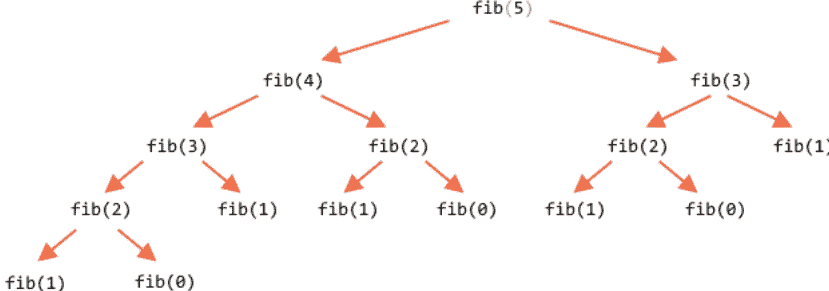

我们可以清楚地看到 `fib(3)` 被评估了两次，而 `fib(2)` 被评估了三次。计算总量的增长比 n 快得多，在 n=77 时变得巨大的。

我们可以通过记住已经评估的值来优化这一点：如果 `fib(3)` 的值计算过一次，那么我们可以在未来的计算中直接重用它。

另一种变体是放弃递归，使用一种完全不同的循环算法。

与其从 n 向较小的值迭代，我们可以创建一个从 1 和 2 开始的循环，然后得到它们的和作为 `fib(3)`，然后得到前两个值之和作为 `fib(4)`，然后是 `fib(5)`，并以此类推不断递增，直到得到所需的值。在每一步中，我们只需要记住之前的两个值。

以下是新算法的详细步骤。

开始：

```javascript
// a = fib(1), b = fib(2), 这些值定义上为 1
let a = 1, b = 1;

// c = fib(3) 作为它们的和
let c = a + b;

/* 我们现在有了 fib(1), fib(2), fib(3)
a b c
1, 1, 2
*/
```

现在我们想要得到 `fib(4) = fib(2) + fib(3)`。

让我们移动变量：`a`, `b` 将获得 `fib(2)`, `fib(3)`，而 `c` 将获得它们的和：

```javascript
a = b; // 现在 a = fib(2)
b = c; // 现在 b = fib(3)
c = a + b; // c = fib(4)
```

```javascript
* 现在我们有了序列：
a b c
1, 1, 2, 3
*/
```

下一步给出了另一个序列数字：

```javascript
a = b; // 现在 a = fib(3)
b = c; // 现在 b = fib(4)
c = a + b; // c = fib(5)
```

```javascript
* 现在序列是（多了一个数字）：
a b c
1, 1, 2, 3, 5
*/
```

...以此类推，直到我们所需的值。这比递归快得多，而且不涉及重复计算。

完整代码：

```javascript
function fib(n) {
  let a = 1;
  let b = 1;
  for (let i = 3; i <= n; i++) {
    let c = a + b;
    a = b;
    b = c;
  }
  return b;
}
```

```javascript
alert(fib(3)); // 2
alert(fib(7)); // 13
alert(fib(77)); // 5525793700884757
```

循环从 `i=3` 开始，因为第一个和第二个序列值已经硬编码在变量 `a=1`, `b=1` 中。

这种方法被称为自底向上的动态规划。

## 形式化

## 输出单链表

### 基于循环的解决方案

基于循环的变体方案：

```javascript
let list = {
  value: 1,
  next: {
    value: 2,
    next: {
      value: 3,
      next: {
        value: 4,
        next: null
      }
    }
  }
}
```

```javascript
function printList(list) {
  let tmp = list;
  while (tmp) {
    alert(tmp.value);
    tmp = tmp.next;
  }
}
```

```javascript
printList(list);
```

请注意，我们使用临时变量 `tmp` 来遍历列表。技术上，我们可以使用函数参数 `list` 代替。

```javascript
function printList(list) {
  while(list) {
    alert(list.value);
    list = list.next;
  }
}
```

...但那是不明智的。在将来，我们可能需要扩展函数，对列表进行其他操作。如果我们更改了 `list`，就会失去这种能力。

谈到良好的变量名，`list` 在这里代表它本身。它的第一个元素。它应该保持这样。这清晰且可靠。

从另一方面来看，`tmp` 的角色仅仅是遍历列表，就像循环中的 `i`。

### 递归解决方案

`printList(list)` 的递归变体遵循简单的逻辑：为了输出一个列表，我们应该输出当前元素 `list`，然后对 `list.next` 执行相同的操作。

```javascript
let list = {
  value: 1,
  next: {
    value: 2,
    next: {
      value: 3,
      next: {
        value: 4,
        next: null
      }
    }
  }
};
```

```javascript
function printList(list) {
  alert(list.value); // 输出当前元素
  if (list.next) {
    printList(list.next); // 对列表剩余部分执行相同的操作
  }
}
```

```javascript
printList(list);
```

现在哪个更好？

技术上，循环更有效。这两种变体做的相同的事情，但循环不会在嵌套函数调用上消耗资源。

从另一方面，递归变体更短，有时更容易理解。

## 形式化

## 逆序输出单链表

### 使用递归

这里的递归逻辑有点特殊。

我们需要先输出列表的剩余部分，*然后*输出当前的一个：

```javascript
let list = {
  value: 1,
  next: {
    value: 2,
    next: {
      value: 3,
      next: {
        value: 4,
        next: null
      }
    }
  }
}

function printReverseList(list) {
  if (list.next) {
    printReverseList(list.next);
  }
  alert(list.value);
}

printReverseList(list);
```

### 使用循环

循环变体也比直接输出稍微复杂一点。

我们没有方法获取 `list` 中的值。我们无法“回退”。

所以我们可以做的是先按直接顺序遍历项并将它们记录在数组中，然后按逆序输出我们记录的内容：

```javascript
let list = {
  value: 1,
  next: {
    value: 2,
    next: {
      value: 3,
      next: {
        value: 4,
        next: null
      }
    }
  }
};
```

```javascript
function printReverseList(list) {
  let arr = [];
  let temp = list;
  while (temp) {
    arr.push(temp.value);
    temp = temp.next;
  }
  for (let i = arr.length - 1; i >= 0; i--) {
    alert(arr[i]);
  }
}

printReverseList(list);
```

请注意，递归解决方案实际上做了相同的事情：它遵循列表，将项记录在栈中，然后输出它们。

## 闭包

### 修复循环中的变量捕获

我们可以看到，它存在于当前 `makeArmy()` 运行相关的词法环境中。但当调用 `army[5]()` 时，`makeArmy` 已经完成了它的任务，而 `i` 的值是最后一个：10（while 循环的末尾）。

结果是，`shooter` 函数从外部词法环境中获取了相同的最后一个值 `i=10`。

我们可以通过将变量定义移动到循环内部来修复它：

```javascript
function makeArmy() {
  let shooters = [];
  for(let i = 0; i < 10; i++) {
    let shooter = function() {
      alert(i); // 应该显示它的数字
    }
    shooters.push(shooter);
  }
  return shooters;
}

let army = makeArmy();
army[0](); // 0
army[5](); // 5
```

现在它正常工作了，因为每当执行 `for (let i=0...) {...}` 中的代码块时，都会为它创建一个新的词法环境，并包含相应的变量 `i`。

所以，`i` 的值现在离得近了一点。它不在 `makeArmy()` 的词法环境中，而是在对应当前循环迭代的词法环境中。这就是它生效的原因。

```javascript
shooters = [
  function () { alert(i); } -> i: 0 (makeArmy Lexical Environment)
  function () { alert(i); } -> i: 1 (outer Lexical Environment)
  function () { alert(i); } -> i: 2 ...
  function () { alert(i); } -> i: 10
];
```

在这里我们把 `while` 重写成了 `for`。

另一种技巧也是可能的，让我们来看看以更好地理解这个主题：

```javascript
function makeArmy() {
  let shooters = [];
  let i = 0;
  while (i < 10) {
    let j = i;
    let shooter = function() { // shooter 函数
      alert(j); // 应该显示它的数字
    };
    shooters.push(shooter);
    i++;
  }
  return shooters;
}

let army = makeArmy();
army[0](); // 0
army[5](); // 5
```

`while` 循环和 `for` 一样，为每次运行创建一个新的词法环境。因此我们确保了 `shooter` 获取了正确的值。

我们拷贝了 `let j = i`。这使得 `j` 成为循环局部变量并将 `i` 的值拷贝给它。基本类型是“按值”拷贝的，所以我们实际上得到了 `i` 的完全独立拷贝，它属于当前循环迭代。

## 函数对象，用于计数器的设置和减少

解决方案在局部变量中使用了 `count`，但加法方法直接写入计数器中。它们共享同一个外部词法环境，并且也可以访问当前的 `count`。

```javascript
function makeCounter() {
  let count = 0;
  function counter() {
    return count++;
  }
  counter.set = value => count = value;
  counter.decrease = () => count--;
  return counter;
}
```

## 任意数量括号的求和

1. 为了让整个结构工作，`sum` 的结果必须是函数。
2. 该函数必须在调用之间在内存中保留当前值。
3. 根据任务，该函数必须变成 `==` 中使用的数字。函数是对象，因此转换发生如“对象到原始类型转换”章节中描述的那样，我们可以提供自己的返回数字方法。

现在是代码：

```javascript
function sum(a) {
  let currentSum = a;
  function f(b) {
    currentSum += b;
    return f;
  }
  f.toString = function() {
    return currentSum;
  };
  return f;
}

alert(sum(1)(2)); // 3
alert(sum(5)(-1)(2)); // 6
alert(sum(6)(-1)(-2)(-3)); // 0
alert(sum(0)(1)(2)(3)(4)(5)); // 15
```

请注意，`sum` 函数实际上只运行一次。它返回函数 `f`。

然后，在随后的每次调用中，`f` 将其参数加到 `currentSum` 上，并返回自身。

在 `f` 的最后一行中没有递归。

递归看起来是这样的：

```javascript
function f(b) {
  currentSum += b;
  return f(); // <-- 递归调用
}
```

而在我们的情况下，我们只是返回函数，而不调用它：

```javascript
function f(b) {
  currentSum += b;
  return f; // 不调用自身，返回自身
}
```

这个 `f` 将在下一次调用中使用，再次返回自身，根据需要多少次。然后，当作为 Symbol 或字符串使用时——`toString` 返回 `currentSum`。我们也可以在这里使用 `Symbol.toPrimitive` 或 `valueOf` 进行转换。

## 调度：setTimeout 和 setInterval

## 每秒输出

使用 `setInterval`：

```javascript
function printNumbers(from, to) {
  let current = from;
  let timerId = setInterval(function() {
    alert(current);
    if (current == to) {
      clearInterval(timerId);
    }
    current++;
  }, 1000);
}

// 使用：
printNumbers(5, 10);
```

使用递归 `setTimeout`：

```javascript
function printNumbers(from, to) {
  let current = from;
  function go() {
    alert(current);
    if (current < to) {
      current++;
      setTimeout(go, 1000);
    }
  }
  go();
}

// 使用：
printNumbers(5, 10);
```

## 节流

使用最后记忆的参数和上下文执行。

第 3 步运行的不是 `func`，而是 `wrapper`，因为我们不仅需要执行 `func`，还需要再次进入冷却状态并设置重置定时器。

## 函数绑定

### 绑定函数作为方法

答案：`null`。

```javascript
function f() {
  alert(this); // null
}

let user = {
  g: f.bind(null)
};

user.g();
```

绑定函数的上下文是硬固定的。没有办法进一步更改它。

所以，即使我们运行 `user.g()`，原始函数也是用 `this=null` 被调用的。

### 第二次绑定

答案：`John`。

```javascript
function f() {
  alert(this.name);
}

f = f.bind({name: "John"}).bind({name: "Pete"});
f(); // John
```

`f.bind(...)` 返回的特殊 `bound function` 对象仅在创建时记住上下文（如果提供了参数，则记住参数）。

函数不能被重新绑定。

### 绑定后的函数属性

答案：`undefined`。

`bind` 的结果是另一个对象。它没有 `test` 属性。

### 修复丢失 "this" 的函数

发生错误的原因是 `ask` 在获取函数 `loginOk`/`loginFail` 时没有关联对象。

当调用这些函数时，自然地假设 `this=undefined`。

让我们绑定上下文：

```javascript
function askPassword(ok, fail) {
  let password = prompt("Password?", '');
  if (password == "rockstar") ok();
  else fail();
}

let user = {
  name: 'John',
  loginOk() {
    alert(`${this.name} logged in`);
  },
  loginFail() {
    alert(`${this.name} failed to log in`);
  }
}

askPassword(user.loginOk.bind(user), user.loginFail.bind(user));
```

现在可以工作了。

另一种解决方案可以是：

```javascript
// ...
askPassword(() => user.loginOk(), () => user.loginFail());
```

通常这也可以有效且看起来良好。

但在更复杂的情况下，如果 `user` 变量在 `askPassword` 被调用之后、访问者回答并调用 `() =>` 之前发生了变化，它的可靠性略低：

```javascript
user.loginOk();
```

## 柯里与偏函数

### 登录的部分应用

- 1. 使用包装函数，或者为了简洁使用箭头函数：

```javascript
getPassword = () => user.login(true), () => login(false);
```

现在它从外部变量获取 user 并以正常方式运行。

- 2. 从 `user.login` 创建一个偏函数，该函数使用 `user` 作为上下文并具有正确的第一个参数：

```javascript
getPassword(user.login.bind(user, true), user.login.bind(user, false));
```

## 原型继承

### 使用原型

- 1. true，取自 rabbit（兔子）。
- 2. null，取自 animal（动物）。
- 3. undefined，不再有该属性。

### 搜索算法

- 1. 让我们添加 `__proto__`：

```javascript
let head = {
  glasses: 1
};

let table = {
  pen: 3,
  __proto__: head
};

let bed = {
  sheet: 1,
  pillow: 2,
  __proto__: table
};

let pockets = {
  money: 2000,
  __proto__: bed
};

alert(pockets.pen); // 3
alert(bed.glasses); // 1
alert(table.money); // undefined
```

- 2. 在现代引擎中，从性能角度来说，从对象本身或其原型获取属性没有区别。它们会记住属性被找到的位置并在下次请求中重用它。

例如，对于 `pockets.glasses`，它们会记住找到眼镜的地方（在 `head` 中），下次将直接在那里搜索。它们也足够智能在发生变化时更新内部缓存，因此这种优化是安全的。

### 它写到哪里了？

答案：rabbit。

这是因为点之前是一个对象，所以 `rabbit.eat()` 修改的是 `rabbit`。

属性查找和执行是两件事。方法 `rabbit.eat` 首先在原型中找到，然后用 `this=rabbit` 执行。

### 为什么两只仓鼠都是饱肚子的？

让我们仔细观察 `speedy.eat("apple")` 调用过程中发生了什么。

- 1. 在原型中找到方法 `speedy.eat`（`hamster`），然后用 `this=speedy`（点之前的对象）执行。
- 2. 然后 `this.stomach.push()` 需要找到 `stomach` 属性并调用 `push`。它在 `this`（`speedy`）中查找，但没有找到。
- 3. 然后它遵循原型链并在 `hamster` 中找到了 `stomach`。
- 4. 然后它对其调用 `push`，将食物添加进去。

所有的仓鼠共享一个胃，因为它在原型上。`push` 方法被添加到共享的 `stomach` 对象上，而不是单个 `speedy` 实例。

让我们看看仓鼠的代码：

```javascript
function hamster() {}
hamster.prototype.stomach = [];
hamster.prototype.eat = function(food) {
  this.stomach.push(food);
}

let speedy = new hamster();
let slow = new hamster();

speedy.eat("apple");
slow.eat("orange");

// 现在两个长度都是 2！
console.log(speedy.stomach.length); // 2
console.log(slow.stomach.length); // 2
```

这就是问题所在。`stomach` 在原型上共享了。为了修复它，我们必须在构造函数中初始化它：

```javascript
function hamster() {
  this.stomach = [];
}
```

## 函数对象，用于计数器的设置和减少

解决方案在局部变量中使用了 `count`，但加法方法直接写入计数器中。它们共享同一个外部词法环境，并且也可以访问当前的 `count`。

```javascript
function makeCounter() {
  let count = 0;
  function counter() {
    return count++;
  }
  counter.set = value => count = value;
  counter.decrease = () => count--;
  return counter;
}
```

## 任意数量括号的求和

1. 为了让整个结构工作，`sum` 的结果必须是函数。
2. 该函数必须在调用之间在内存中保留当前值。
3. 根据任务，该函数必须变成 `==` 中使用的数字。函数是对象，因此转换发生如“对象到原始类型转换”章节中描述的那样，我们可以提供自己的返回数字方法。

现在是代码：

```javascript
function sum(a) {
  let currentSum = a;
  function f(b) {
    currentSum += b;
    return f;
  }
  f.toString = function() {
    return currentSum;
  };
  return f;
}

alert(sum(1)(2)); // 3
alert(sum(5)(-1)(2)); // 6
alert(sum(6)(-1)(-2)(-3)); // 0
alert(sum(0)(1)(2)(3)(4)(5)); // 15
```

请注意，`sum` 函数实际上只运行一次。它返回函数 `f`。

然后，在随后的每次调用中，`f` 将其参数加到 `currentSum` 上，并返回自身。

在 `f` 的最后一行中没有递归。

递归看起来是这样的：

```javascript
function f(b) {
  currentSum += b;
  return f(); // <-- 递归调用
}
```

而在我们的情况下，我们只是返回函数，而不调用它：

```javascript
function f(b) {
  currentSum += b;
  return f; // 不调用自身，返回自身
}
```

这个 `f` 将在下一次调用中使用，再次返回自身，根据需要多少次。然后，当作为 Symbol 或字符串使用时——`toString` 返回 `currentSum`。我们也可以在这里使用 `Symbol.toPrimitive` 或 `valueOf` 进行转换。

## 调度：setTimeout 和 setInterval

## 每秒输出

使用 `setInterval`：

```javascript
function printNumbers(from, to) {
  let current = from;
  let timerId = setInterval(function() {
    alert(current);
    if (current == to) {
      clearInterval(timerId);
    }
    current++;
  }, 1000);
}

// 使用：
printNumbers(5, 10);
```

使用递归 `setTimeout`：

```javascript
function printNumbers(from, to) {
  let current = from;
  function go() {
    alert(current);
    if (current < to) {
      current++;
      setTimeout(go, 1000);
    }
  }
  go();
}

// 使用：
printNumbers(5, 10);
```

## 节流

使用最后记忆的参数和上下文执行。

第 3 步运行的不是 `func`，而是 `wrapper`，因为我们不仅需要执行 `func`，还需要再次进入冷却状态并设置重置定时器。

## 函数绑定

### 绑定函数作为方法

答案：`null`。

```javascript
function f() {
  alert(this); // null
}

let user = {
  g: f.bind(null)
};

user.g();
```

绑定函数的上下文是硬固定的。没有办法进一步更改它。

所以，即使我们运行 `user.g()`，原始函数也是用 `this=null` 被调用的。

### 第二次绑定

答案：`John`。

```javascript
function f() {
  alert(this.name);
}

f = f.bind({name: "John"}).bind({name: "Pete"});
f(); // John
```

`f.bind(...)` 返回的特殊 `bound function` 对象仅在创建时记住上下文（如果提供了参数，则记住参数）。

函数不能被重新绑定。

### 绑定后的函数属性

答案：`undefined`。

`bind` 的结果是另一个对象。它没有 `test` 属性。

### 修复丢失 "this" 的函数

发生错误的原因是 `ask` 在获取函数 `loginOk`/`loginFail` 时没有关联对象。

当调用这些函数时，自然地假设 `this=undefined`。

让我们绑定上下文：

```javascript
function askPassword(ok, fail) {
  let password = prompt("Password?", '');
  if (password == "rockstar") ok();
  else fail();
}

let user = {
  name: 'John',
  loginOk() {
    alert(`${this.name} logged in`);
  },
  loginFail() {
    alert(`${this.name} failed to log in`);
  }
}

askPassword(user.loginOk.bind(user), user.loginFail.bind(user));
```

现在可以工作了。

另一种解决方案可以是：

```javascript
// ...
askPassword(() => user.loginOk(), () => user.loginFail());
```

通常这也可以有效且看起来良好。

但在更复杂的情况下，如果 `user` 变量在 `askPassword` 被调用之后、访问者回答并调用 `() =>` 之前发生了变化，它的可靠性略低：

```javascript
user.loginOk();
```

## 柯里与偏函数

### 登录的部分应用

- 1. 使用包装函数，或者为了简洁使用箭头函数：

```javascript
getPassword = () => user.login(true), () => login(false);
```

现在它从外部变量获取 user 并以正常方式运行。

- 2. 从 `user.login` 创建一个偏函数，该函数使用 `user` 作为上下文并具有正确的第一个参数：

```javascript
getPassword(user.login.bind(user, true), user.login.bind(user, false));
```

## 原型继承

### 使用原型

- 1. true，取自 rabbit（兔子）。
- 2. null，取自 animal（动物）。
- 3. undefined，不再有该属性。

### 搜索算法

- 1. 让我们添加 `__proto__`：

```javascript
let head = {
  glasses: 1
};

let table = {
  pen: 3,
  __proto__: head
};

let bed = {
  sheet: 1,
  pillow: 2,
  __proto__: table
};

let pockets = {
  money: 2000,
  __proto__: bed
};

alert(pockets.pen); // 3
alert(bed.glasses); // 1
alert(table.money); // undefined
```

- 2. 在现代引擎中，从性能角度来说，从对象本身或其原型获取属性没有区别。它们会记住属性被找到的位置并在下次请求中重用它。

例如，对于 `pockets.glasses`，它们会记住找到眼镜的地方（在 `head` 中），下次将直接在那里搜索。它们也足够智能在发生变化时更新内部缓存，因此这种优化是安全的。

### 它写到哪里了？

答案：rabbit。

这是因为点之前是一个对象，所以 `rabbit.eat()` 修改的是 `rabbit`。

属性查找和执行是两件事。方法 `rabbit.eat` 首先在原型中找到，然后用 `this=rabbit` 执行。

### 为什么两只仓鼠都是饱肚子的？

让我们仔细观察 `speedy.eat("apple")` 调用过程中发生了什么。

- 1. 在原型中找到方法 `speedy.eat`（`hamster`），然后用 `this=speedy`（点之前的对象）执行。
- 2. 然后 `this.stomach.push()` 需要找到 `stomach` 属性并调用 `push`。它在 `this`（`speedy`）中查找，但没有找到。
- 3. 然后它遵循原型链并在 `hamster` 中找到了 `stomach`。
- 4. 然后它对其调用 `push`，将食物添加进去。

所有的仓鼠共享一个胃，因为它在原型上。`push` 方法被添加到共享的 `stomach` 对象上，而不是单个 `speedy` 实例。

让我们看看仓鼠的代码：

```javascript
function hamster() {}
hamster.prototype.stomach = [];
hamster.prototype.eat = function(food) {
  this.stomach.push(food);
}

let speedy = new hamster();
let slow = new hamster();

speedy.eat("apple");
slow.eat("orange");

// 现在两个长度都是 2！
console.log(speedy.stomach.length); // 2
console.log(slow.stomach.length); // 2
```

这就是问题所在。`stomach` 在原型上共享了。为了修复它，我们必须在构造函数中初始化它：

```javascript
function hamster() {
  this.stomach = [];
}
```

## 延迟函数

```javascript
function defer(ms) {
  return function(f) {
    setTimeout(f, ms);
  };
}

// 检查
function f(a, b) {
  alert(a + b);
}

defer(1000)(1, 2); // 1 秒后显示 3
```

## 原型方法、没有 __proto__ 的对象

## 在字典中添加 toString

该方法可以使用 `Object.keys` 获取所有可枚举的键并输出它们的列表。

为了让 `toString` 变为不可枚举，让我们使用属性描述符来定义它。`Object.create` 的语法允许通过第二个参数提供一个带有属性描述符的对象。

```javascript
let dictionary = Object.create(null);

Object.defineProperty(dictionary, 'toString', { // 定义 toString 属性
  value: function() { // 值为函数
    return Object.keys(this).join('');
  }
});

dictionary.apple = "Apple";
dictionary.__proto__ = "test";

// apple 和 __proto__ 在循环中
for(let key in dictionary) {
  alert(key); // "apple", 然后 "__proto__"
}

// 使用 toString 输出逗号分隔的属性列表
alert(dictionary); // "apple", "__proto__"
```

当我们使用描述符创建属性时，它的标记默认为 `false`。因此在上面的代码中，`dictionary.toString` 是不可枚举的。

请复习“属性标记和描述符”章节。

## 调用之间的区别

第一次调用的 `this` 等于 `rabbit`，其他调用的 `this` 等于 `Rabbit.prototype`，因为实际上它是点符号之前的对象。

所以只有第一次调用显示 `Rabbit`，其他的显示 `undefined`：

```javascript
function Rabbit(name) {
  this.name = name;
}

Rabbit.prototype.sayHi = function() {
  alert(this.name);
};

let rabbit = new Rabbit("Rabbit");

rabbit.sayHi();
Rabbit.prototype.sayHi();
Object.getPrototypeOf(rabbit).sayHi();
rabbit.__proto__.sayHi();
```

## 类基础语法

## 重写为类

```javascript
class Clock {
  constructor({ template }) {
    this.template = template;
  }

  render() {
    let date = new Date();
    let hours = date.getHours();
    if (hours < 10) hours = '0' + hours;
    let mins = date.getMinutes();
    if (mins < 10) mins = '0' + mins;
    let secs = date.getSeconds();
    if (secs < 10) secs = '0' + secs;
    let output = this.template
      .replace('h', hours)
      .replace('m', mins)
      .replace('s', secs);
    console.log(output);
  }

  stop() {
    clearInterval(this.timer);
  }

  start() {
    this.render();
    this.timer = setInterval(() => this.render(), 1000);
  }
}

let clock = new Clock({template: 'h:m:s'});
clock.start();
```

## 类继承

## 创建实例错误

这是因为子构造函数必须调用 `super()`。

这是修正后的代码：

```javascript
class Animal {
  constructor(name) {
    this.name = name;
  }
}
```

```javascript
class Rabbit extends Animal {
  constructor(name) {
    super(name);
    this.created = Date.now();
  }
}
```

```javascript
let rabbit = new Rabbit("White Rabbit"); // 现在可以了
alert(rabbit.name); // White Rabbit
```

## 扩展时钟

```javascript
class ExtendedClock extends Clock {
  constructor(options) {
    super(options);
    let precision = options.precision;
    this.precision = precision;
  }

  start() {
    this.render();
    this.timer = setInterval(() => this.render(), this.precision);
  }
}
```

## 类继承 Object ？

首先，让我们看看为什么这段代码不起作用。

如果我们尝试运行它，原因就会变得显而易见。继承的类的构造函数必须调用 `super()`。否则 `this` 将不会被“已定义”。

这里是修复方法：

```javascript
class Rabbit extends Object {
  constructor(name) {
    super(); // 继承时需要调用父构造函数
    this.name = name;
  }
}

let rabbit = new Rabbit("Rab");
alert(rabbit.hasOwnProperty('name')); // true
```

但这并不是全部。

即使在修复之后，`class Rabbit extends Object` 与 `class Rabbit` 之间仍然存在重要的区别。

正如我们所知，`extends` 语法设置了两个原型：

- 构造函数的 `prototype` 之间（用于方法）。
- 构造函数本身之间（用于静态方法）。

在我们的情况下，`class Rabbit extends Object` 意味着：

```javascript
class Rabbit extends Object {}

alert(Rabbit.prototype.__proto__ === Object.prototype); // (1) true
alert(Rabbit.__proto__ === Object); // (2) true
```

所以 Rabbit 通过 `Rabbit` 访问 `Object` 的静态方法，如下：

```javascript
class Rabbit extends Object {}

// 通常我们调用 Object.getOwnPropertyNames
alert(Object.getOwnPropertyNames({a: 1, b: 2})); // a,b
```

但如果直接使用 `Rabbit`：

```javascript
class Rabbit extends Object {}

alert(Rabbit.getOwnPropertyNames({a: 1, b: 2})); // a,b
```

## Promise

## Promise 链中的错误处理

```javascript
promise
  .then(f1)
  .catch(f2);
```

对比：

```javascript
promise
  .then(f1, f2);
```

这是因为错误会沿着链向下传递，而在第二段代码中，`f1` 下方没有链了。

换句话说，`.then` 会将结果/错误传递给下一个 `.then`/`.catch`。因此在第一个示例中，下方有一个 `catch`，而在第二个例子中——没有，所以错误未被处理。

## 使用 promises 进行错误处理

## setTimeout 中的错误

答案是：不，它不会处理的：

```javascript
new Promise(function(resolve, reject) {
  setTimeout(() => {
    throw new Error("whoops!");
  }, 1000);
}).catch(alert);
```

正如章节中所说，在函数代码周围有一个“隐式的 `try..catch`”。所有的同步错误都会被处理。

但这里的错误不是在执行器运行期间生成的，而是在之后生成的。因此 promise 无法处理它。

## Async/await

## 使用 async/await 重写

注释在代码下方：

```javascript
async function loadJson(url) { // (1)
  let response = await fetch(url); // (2)
  if (response.status == 200) {
    let json = await response.json(); // (3)
    return json;
  }
  throw new Error(response.status);
}

loadJson('no-such-user.json').catch(alert); // Error: 404 (4)
```

注释：

- 1. 函数 `loadJson` 变为 `async`。
- 2. 内部所有的 `.then` 都被替换为 `await`。
- 3. 我们可以返回 `response.json()` 而不是等待它，如下所示：

```javascript
if (response.status == 200) {
  return response.json(); // (3)
}
```

外部代码必须等待 promise 解析。在我们的情况下，这并不重要。

从 `loadJson` 抛出的错误由 `.catch` 处理。我们不能在那里使用 `await loadJson(...)`，因为我们不在 `async` 函数中。

## 使用 async/await 重写“重新抛出 (rethrow)”

这里没有技巧。只需在 `demoGithubUser` 内部将 `.catch` 替换为 `try...catch`，并在需要的地方使用 `async/await`：

```javascript
class HttpError extends Error {
  constructor(response) {
    super(`${response.status} for ${response.url}`);
    this.name = 'HttpError';
    this.response = response;
  }
}

async function loadJson(url) {
  let response = await fetch(url);
  if (response.status == 200) {
    return response.json();
  } else {
    throw new HttpError(response);
  }
}

// 询问用户名，直到 github 返回有效的用户
async function demoGithubUser() {
  let user;
  while (true) {
    let name = prompt("Enter a name?", "iliakan");
    try {
      user = await loadJson(`https://api.github.com/users/${name}`);
      break; // 无错误，退出循环
    } catch (err) {
      if (err instanceof HttpError && err.response.status == 404) {
        alert("No such user, please reenter.");
      } else {
        // 未知错误，重新抛出
        throw err;
      }
    }
  }
  alert(`Full name: ${user.name}.`);
  return user;
}

demoGithubUser();
```

## 从非 async 函数调用 async

在这种情况下，了解其内部工作原理是有帮助的。

只需将 `async` 调用视为 `promise` 并对其尝试使用 `.then`：

```javascript
async function wait() {
  await new Promise(resolve => setTimeout(resolve, 1000));
  return 10;
}

function f() {
  // 1 秒后显示 10
  wait().then(result => alert(result));
}

f();
```

## 迭代器

## 伪随机生成器

```javascript
function pseudoRandom(seed) {
  let value = seed;
  while (true) {
    value = value * 16807 % 2147483647;
    yield value;
  }
}

let generator = pseudoRandom(1);
alert(generator.next().value); // 16807
alert(generator.next().value); // 282745249
alert(generator.next().value); // 1622650073
```

请注意，同样可以使用普通函数实现，如下：

```javascript
function pseudoRandom(seed) {
  let value = seed;
  return function() {
    value = value * 16807 % 2147483647;
    return value;
  }
}

let generator = pseudoRandom(1);
alert(generator()); // 16807
alert(generator()); // 282745249
alert(generator()); // 1622650073
```

这在这个语境下是可以的。但这样我们就会失去使用 `for..of` 进行迭代以及使用生成器组合的能力，这在其他地方可能有用。

## 代理 和 反射

## 读取不存在属性时的错误

```javascript
let user = {
  name: "John"
};

function wrap(target) {
  return new Proxy(target, {
    get(target, prop) {
      if (prop in target) {
        return Reflect.get(target, prop);
      } else {
        throw new Error(`Property doesn't exist: "${prop}"`);
      }
    }
  });
}

user = wrap(user);
alert(user.name); // John
alert(user.age); // Error: Property doesn't exist: "age"
```

## 访问 array[]

```javascript
let array = [1, 2, 3];

array = new Proxy(array, {
  get(target, prop, receiver) {
    if (prop < 0) {
      // prop 是字符串，需要转换为数字
      prop = +prop + target.length;
    }
    return Reflect.get(target, prop, receiver);
  }
});

alert(array[-1]); // 3
alert(array[-2]); // 2
```

## 可观察对象

该解决方案由两部分组成：

1. 当调用 `.observe(handler)` 时，我们需要在某处记录处理器以便以后调用。我们可以将其存储在对象中，使用我们的 symbol 作为键。
2. 我们需要带有 `set` 拦截器的代理来捕获变化。

```javascript
let handlers = Symbol('handlers');

function makeObservable(target) {
  // 1. 初始化处理器存储
  target[handlers] = [];

  // 将 handler 函数存入数组供后续调用
  target.observe = function(handler) {
    this[handlers].push(handler);
  };

  // 2. 创建代理处理变化
  return new Proxy(target, {
    set(target, property, value) {
      let success = Reflect.set(...arguments); // 将操作转发给对象
      if (success) { // 如果设置属性没有错误
        // 调用所有 handler
        target[handlers].forEach(handler => handler(property, value));
      }
      return success;
    }
  });
}

let user = {};
user = makeObservable(user);

user.observe((key, value) => {
  alert(`SET ${key}=${value}`);
});

user.name = "John";
```

## Eval: 运行代码字符串

## Eval-计算器

让我们使用 `eval` 来计算数学表达式：

```javascript
let expr = prompt("输入一个算术表达式？", "2*3+2");
alert(eval(expr));
```

但是用户可以输入任何文本或代码。

为了确保安全并将其限制为算术运算，我们可以使用正则表达式检查 `expr`，使其只允许包含数字和运算符。
