# JavaScript.info Ebook 第 2 部分 浏览器：文档、事件、接口

教程的最新版本位于 https://javascript.info。

我们不断改进教程。如果你发现任何错误，请在我们的 github 上写信反馈。

学习如何管理浏览器页面：添加元素、操作它们的尺寸和位置、动态创建接口以及与访问者交互。

## 文档

在这里我们将学习使用 JavaScript 操作网页。

## 浏览器环境、规范

JavaScript 语言最初是为了 Web 浏览器创建的。从那时起，它已经演变成一种具有许多用途和平台的语言。

平台可以是浏览器、Web 服务器、洗衣机或其他宿主。每一个都提供特定于平台的功能。JavaScript 规范将其称为“宿主环境”。

宿主环境提供了语言核心之外的特定平台对象和函数。Web 浏览器提供了控制网页手段。Node.js 提供服务器端功能，等等。

以下是 JavaScript 在 Web 浏览器中运行时我们拥有的概览：


有一个名为 `window` 的“根”对象。它有两个角色：

1. 首先，它是 JavaScript 代码的全局对象，如“全局对象”章节所述。
2. 其次，它代表“浏览器窗口”并提供控制它的方法。

例如，在这里将其作为全局对象使用：

```javascript
function sayHi() {
  alert("Hello");
}

// 全局函数作为 window 的属性访问
window.sayHi();
```

在这里将其作为浏览器窗口使用，查看窗口高度：

```javascript
alert(window.innerHeight); // 内部窗口高度
```

还有更多特定的窗口方法和属性，我们稍后介绍。

## DOM (文档对象模型)

文档对象提供了对页面内容的访问。我们可以使用它更改或创建页面上的任何内容。

例如：

```javascript
// 将背景颜色改为红色
document.body.style.background = "red";
// 1 秒后改回
setTimeout(() => document.body.style.background = "", 1000);
```

在这里我们使用了 `document.body.style`，但还有很多、很多、很多。属性和方法在规范中描述：

- DOM Living Standard 位于 https://dom.spec.whatwg.org

> DOM 不仅用于浏览器。DOM 规范解释了文档的结构并提供了用于操作它的对象。非浏览器工具也使用它。例如，下载 HTML 页面并对其处理的服务器端工具就会使用 DOM。不过，它们可能只支持规范的一部分。

CSS 规则和样式表的结构与 HTML 不同。有一个独立的规范 CSSOM 解释了它们如何被表示为对象，以及如何读取和写入它们。

当修改文档的样式规则时，CSSOM 与 DOM 使用。在实践中，很少需要 CSSOM，因为 CSS 规则通常是静态的。我们很少需要从 JavaScript 添加/删除 CSS 规则，所以现在不涵盖它。

## BOM (浏览器对象模型)

浏览器对象模型 (BOM) 是浏览器（宿主环境）提供的额外对象，用于处理文档之外的所有事物。

例如：

- `navigator` 提供了关于浏览器和操作系统的背景信息。有很多属性，但最广为人知的是：`navigator.userAgent` – 当前浏览器，以及 `navigator.platform` – 平台（有助于区分 Windows/Linux/Mac 等）。
- `location` 对象允许我们读取当前 URL 并可以将浏览器重定向到新 URL。

这里是我们使用 `location` 对象的方式：

```javascript
alert(location.href); // 显示当前 URL
if (confirm("去 wikipedia吗？")) {
  location.href = "https://wikipedia.org"; // 将浏览器重定向到另一个 URL
}
```

函数 `alert`/`confirm`/`prompt` 是内置浏览器函数，用于向用户显示对话框。

- `alert(string)` 显示一个带有消息和“确定”按钮的对话框。
- `confirm(string)` 显示一个带有消息以及“确定”和“取消”按钮的对话框。如果用户点击“确定”，返回 `true`，否则返回 `false`。
- `prompt(string, default)` 显示一个带有消息和文本框的对话框。如果用户点击“确定”，则返回用户输入的字符串；如果点击“取消”，则返回 `null`。

`location` 对象提供了当前 URL 的信息并允许我们更改它。

- `href` 返回页面的完整 URL。
- `host` 返回主机名（例如 `"www.example.com"`）。
- `pathname` 返回路径。
- `search` 返回查询字符串（以 `?` 开头）。
- `hash` 返回标识符（以 `#` 开头）。
- `protocol` 返回协议（例如 `https:`）。
- `hostname` 返回主机名（例如 `www.example.com`）。
- `port` 返回端口号。

我们可以通过设置 `location` 属性更改 URL：

```javascript
location.href = "https://google.com"; // 重定向到 Google
location.pathname = "/contact"; // 路径改为 /contact/
location.search = "?q=js"; // 添加查询字符串
location.hash = "#section1"; // 添加标识符
```

`navigator` 对象提供了浏览器和操作系统的信息。

- `userAgent` 返回关于浏览器和系统的字符串。
- `platform` 返回操作系统（例如 `Win32`, `Mac`）。
- `language` 返回浏览器的语言。
- `cookieEnabled` 如果启用了 cookies 则返回 `true`。
- `onLine` 如果浏览器在线则返回 `true`。

`geolocation` 对象提供了地理位置。

- `navigator.geolocation.getCurrentPosition(success, error)` 获取用户当前的纬度和经度。

- 变异观察器 (Mutation observer)
- 选择与范围 (Range)
- 事件循环：微任务与宏任务

## DOM 树

文档将 HTML 表示为一棵树。它的样子如下：

根据文档对象模型 (DOM)，每个标签都是节点。

标签被称为元素节点（或元素）。嵌套标签成为父元素的子元素。结果我们拥有一棵树：`<html>` 是根，然后 `<head>` 和 `<body>` 是它的子元素。

### DOM 示例

```html
<!DOCTYPE HTML>
<html>
<head>
  <title>About elks</title>
</head>
<body>
  The truth about elks.
</body>
</html>
```

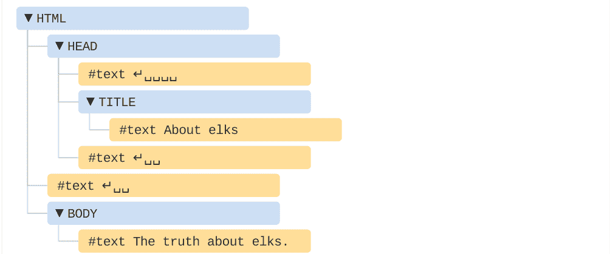

元素内部的文本形成文本节点。文本节点只包含一个字符串。它可能没有子元素并且始终是树的叶节点。

例如，`<title>` 标签具有文本 "About elks"。

请注意文本节点中的特殊字符：

- 换行：↵（在 JavaScript 中称为 `\n`）
- 空格：␣

空格和换行是完全有效的字符，它们形成文本节点并成为 DOM 的一部分。例如，在上面的示例中，`<head>` 在 `<title>` 之前包含空格，这变成了一个 `#text` 节点（它只包含换行和空格）。

只有两个顶层排除：

1. `<head>` 之前的空格和换行由于历史原因被忽略。
2. 如果我们在 `</body>` 之后放置内容，它会自动移动到 `<body>` 内部最后。HTML 规范要求所有内容必须在 `<body>` 内部。因此 `</body>` 之后可能没有空格。

在其他情况下一切都是直观的——如果文档中有空格（就像任何字符一样），它们就会变成 DOM 中的文本节点，如果我们删除它们，就不会了。

边缘空格和中间的空文本通常在工具中被隐藏。

用于 DOM 操作的浏览器工具（很快将介绍）通常不会显示文本开头/结尾的空格，以及标签之间的空文本节点（换行符）。

这是因为它们主要被用于装饰 HTML，并且在大多数情况下不会影响它的显示方式。

在随后的 DOM 图中，在它们无关紧要的地方，我们有时会省略它们，以保持内容简洁。

### 自动纠正

当浏览器遇到不规范的 HTML 时，它在生成 DOM 时会自动对其进行修正。

例如，顶层标签总是 `<html>`。即使它在文档中不存在——它在 DOM 中存在，浏览器会创建它。`<body>` 也是如此。

举个例子，如果 HTML 文件只有一个单词 "Hello"，浏览器将将其封装在 `<html>` 和 `<body>` 中，并添加所需的 `<head>`，DOM 结构将是：

| HTML |
| --- |
| HEAD |
| BODY |
| #text Hello |

在生成 DOM 时，浏览器会自动处理文档中的错误、关闭标签等。

这样一个带有未闭合标签的文档：

```
<p>Hello
<li>Mom
<li>and
<li>Dad
```

...将变成一个正常的 DOM，因为浏览器会读取标签并恢复缺失的部分：

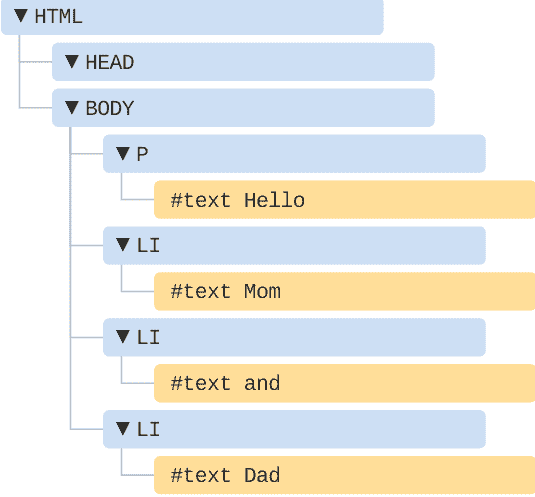

#### 表格始终带有 tbody

一个有趣的“特殊情况”是表格。根据 DOM 规范，它们必须拥有 `<tbody>`，但 HTML 文本可以（官方允许）省略它。这时浏览器会在 DOM 中自动创建 `<tbody>`。

对于 HTML：

```html
<table id="table"><tr><td>1</td></tr></table>
```

DOM 结构将是：

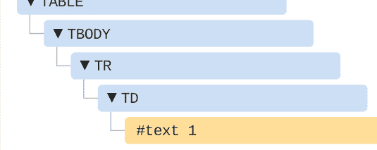

看到了吗？`<tbody>` 凭空出现了。在处理表格时，你应该记住这一点，以避免意外。

### 其他节点类型

让我们在页面上添加更多标签和一条注释：

```html
<!DOCTYPE HTML>
<html>
<body>
  关于麋鹿的真相。
  <ol>
    <li>麋鹿是一种聪明的</li>
    <!-- comment -->
    <li>...而且狡猾的动物！</li>
  </ol>
</body>
</html>
```

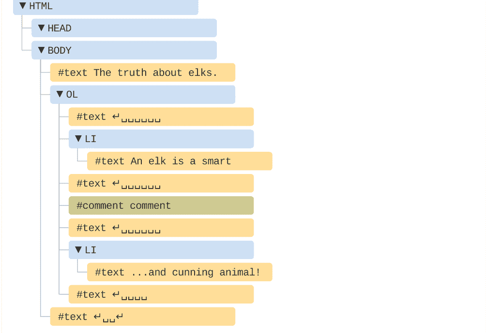

在这里我们看到了一种新的树节点类型——`#comment node`（注释节点），被标记为为什么要在 DOM 中添加注释？它对视觉呈现没有任何影响。但有一有一条规则——如果某些内容在 HTML 中，那么它就必须在 DOM 树中。

HTML 中的所有内容，甚至是注释，都会成为 DOM 的一部分。

甚至 HTML 最开头的 `<!DOCTYPE......>` 指令也是一个 DOM 节点。它位于 DOM 树中 `<html>` 之前。我们不会去处理那个节点，由于这个原因我们甚至不在图中画出它，但它确实在那里。

代表整个 DOM 树的对象在形式上也是一个 DOM 节点。

共有 12 种节点类型。在实践中，我们通常处理其中的 4 种：

1. `document` —— 进入 DOM 的“入口”。
2. `element nodes` —— HTML 标签，树的构建块。
3. `text nodes` —— 包含文本。
4. `comments` —— 注释，有时我们可以把信息放在里面，它不会显示，但 JS 可以从 DOM 中读取它。

### 亲手尝试

要实时查看 DOM 结构，请尝试 Live DOM Viewer。只需在文档中输入内容，它就会瞬间显示 DOM。

#### 在浏览器检查器中

探索 DOM 的另一种方法是使用浏览器开发者工具。实际上，这是我们开发时使用的工具。

要进行操作，打开网页 `elks.html`，开启浏览器开发者工具并切换到 Elements（元素）标签页。

它看起来应该是这样：

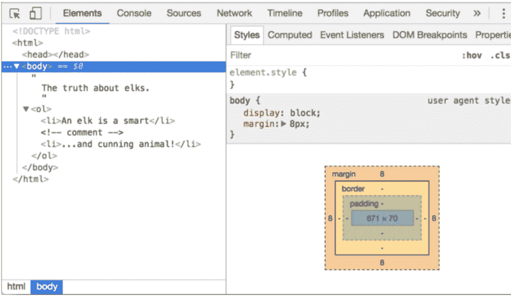

你可以看到 DOM，点击元素，查看它们的详情等。请注意，开发者工具中的 DOM 结构是简化的。文本节点直接以文本形式显示。而且完全没有“空白”（仅空格）文本节点。这没关系，因为大多数时候我们感兴趣的是元素节点。

点击左上角的按钮允许使用鼠标（或其他指针设备）从网页上选择一个节点并“检查”它（在 Elements 标签页中滚动到该位置）。当我们有一个巨大的 HTML 页面（以及对应的巨大 DOM）并想查看特定元素在其中的位置时，这种方法非常好。

另一种方法是在网页上点击右键，并在右键菜单中选择“检查”（Inspect）。

## 关于麋鹿的真相。

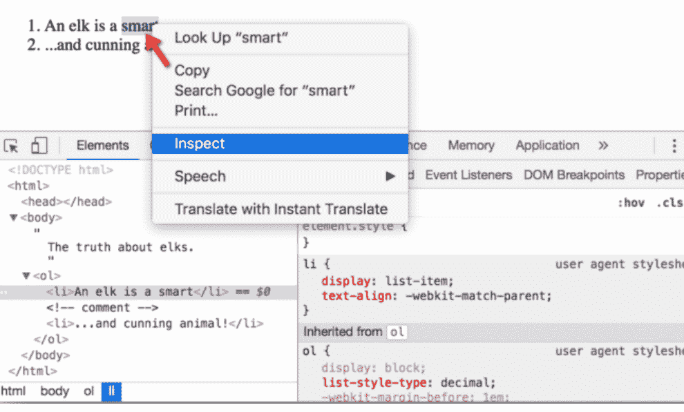

在工具的右侧有以下面板：

- **Styles（样式）** —— 查看通过规则应用于当前元素的 CSS，包括内置规则（灰色）。几乎所有内容都可以原地编辑，包括框的尺寸/外边距/内边距。
- **Computed（计算后）** —— 查看通过属性应用于元素的 CSS：对于每个属性，我们都可以看到提供它的规则（包括继承等）。
- **Event Listeners（事件监听器）** —— 查看附加到 DOM 的事件监听器（我们将在下一部分介绍）。
- ...依此类推。学习它们的最好方法就是到处点击。

#### 与控制台交互

在探索 DOM 时，我们可能还想对它应用 JavaScript。例如：获取一个节点并运行一些代码来修改它，查看结果。这里有一些在 Elements 标签页和控制台之间跳转的小技巧。

- 选择 Elements 标签页中的第一个元素。
- 按 `Esc` 键——它会在下方打开控制台。现在最后一个元素可以作为 `$0` 使用，上一个选中的是 `$1`。

```javascript
style.background = 'red'
```
会让选中项目变为红色，如下：

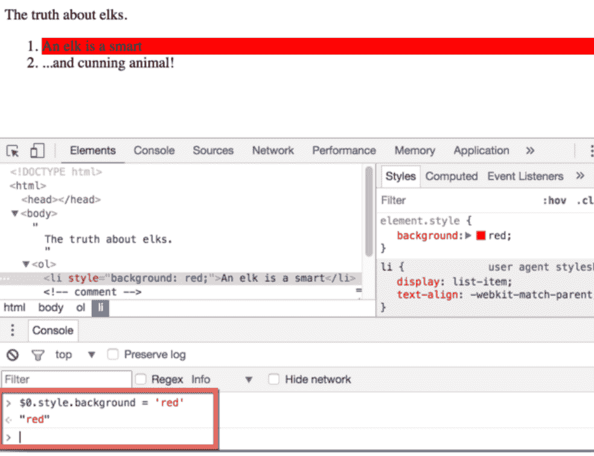

在 DOM 中，我们可以使用 `$0` 访问它，在控制台的另一侧中，我们可以使用 `document.body`：

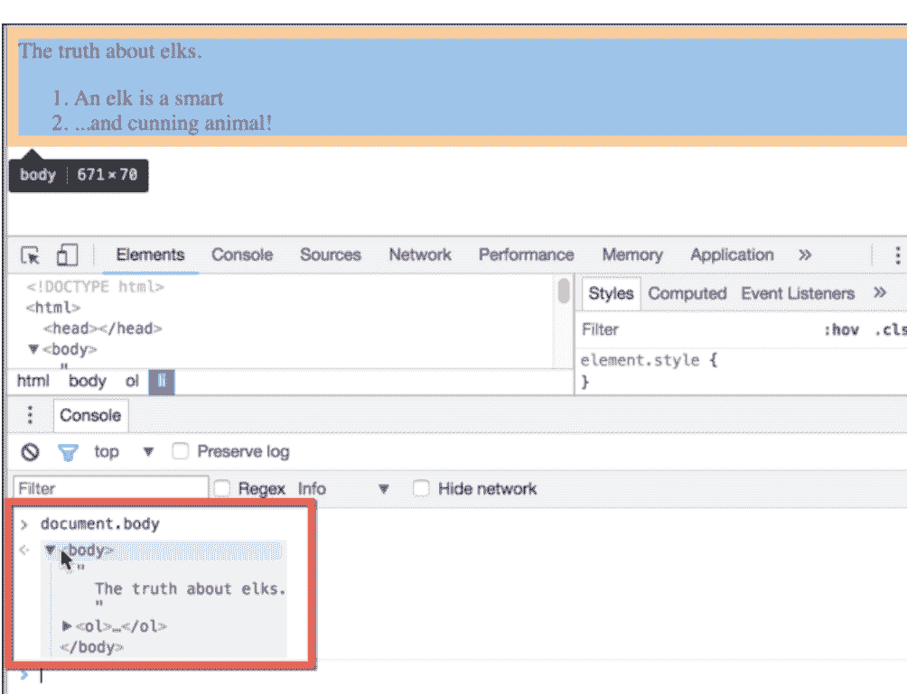

### 总结

HTML 文档以 DOM 树的形式表示：

- 标签成为元素节点。
- 文本成为文本节点。
- 注释成为注释节点。


我们可以在开发者工具中学习它们。

## 遍历 DOM

DOM 允许我们对元素及其内容进行任何操作，但我们首先需要到达它们。

对 DOM 的所有操作从 `document` 对象开始。通过它可以访问任何节点。这里是允许在 DOM 节点之间跳转的图片：


让我们详细讨论它们。

### 顶部：documentElement 和 body

顶层树节点直接作为 `document` 属性可用。

```javascript
html = document.documentElement
```

顶部节点是 `document.documentElement`。那是 `<html>` 标签的 DOM 节点。

```javascript
body = document.body
```

另一个被广泛使用的 DOM 节点是 `<body>` 元素——`document.body`。

```javascript
head = document.head
```

`<head>` 标签作为 `document.head` 可用。

#### 陷阱：document.body 可能为 null

脚本无法访问在运行时不存在的元素。特别是，如果脚本在 `<head>` 中，那么 `document.body` 是不可用的，因为浏览器还没有读取它。所以，在下面的示例中，第一个 alert 显示为 null：

```html
<html>
<head>
<script>
alert("From HEAD: " + document.body ); // null，还没有 <body>
</script>
</head>
<body>
<script>
alert("From BODY: " + document.body ); // HTMLBodyElement，现在存在了
</script>
</body>
</html>
```

### 子节点：childNodes, firstChild, lastChild

从现在起，我们将使用两个术语：

- **子节点**（Child nodes 或 children）——直接子元素。换句话说，它们恰好嵌套在给定元素中。例如，`<head>` 和 `<body>` 是 `<html>` 元素的子节点。
- **后代**（Descendants）——所有嵌套在给定元素中的元素，包括子节点、它们的子节点等等。

例如，这里 `<body>` 有子元素 `<div>` 和 `<ul>`（以及一些空白文本节点）：

```html
<html>
<body>
<div>Begin</div>

<ul>
<li><b>Information</b></li>
</ul>
</body>
</html>
```

...而且 `<body>` 的所有后代不仅包括直接子元素 `<div>` 和 `<ul>`，还包括更深层嵌套的元素，例如 `<li>`（`<ul>` 的子元素）和 `<b>`（`<li>` 的子元素）——整个子树。

`childNodes` 集合提供了对所有子节点的访问，包括文本节点。

下面的示例展示了 `document.body` 的子节点：

```html
<html>
<body>
<div>Begin</div>

<ul>
<li>Information</li>
</ul>
<div>End</div>
</body>
</html>

<script>
for (let i = 0; i < document.body.childNodes.length; i++) {
  alert(document.body.childNodes[i]); // Text, DIV, Text, UL, ..., SCRIPT
}
</script>

..more stuff...
</body>
</html>
```

请注意这里一个有趣的细节。如果我们运行上面的示例，最后一个显示的元素是 `<script>`。事实上，文档在下方还有内容，但在脚本执行的瞬间，浏览器还没有读取到它们，所以脚本看不到它们。

属性 **firstChild** 和 **lastChild** 允许快速访问第一个和最后一个子节点。

它们仅仅是简写。如果存在子节点，则以下结论始终成立：

```javascript
elem.childNodes[0] === elem.firstChild
elem.childNodes[elem.childNodes.length - 1] === elem.lastChild
```

还有一个特殊函数 **elem.hasChildNodes()** 用来检查是否存在任何子节点。

### DOM 集合

正如我们所见，**childNodes** 看起来像一个数组。但实际上它不是数组，而是一个*集合*（collection）——一种特殊的类数组可迭代对象。

这有两个重要的后果：

1. 我们可以使用 `for..of` 来遍历它：

```javascript
for (let node of document.body.childNodes) {
  alert(node); // 显示集合中的所有节点
}
```

这是因为它是可迭代的（提供了符合要求的 `Symbol.iterator` 属性）。

2. 数组方法不起作用，因为它不是数组：

```javascript
alert(document.body.childNodes.filter); // undefined（没有 filter 方法！）
```

第一点是很有用的。第二点是可以接受的，因为如果我们想要数组方法，可以使用 `Array.from` 从集合中创建一个“真正的”数组：

```javascript
alert(Array.from(document.body.childNodes).filter); // 现在有了
```

#### DOM 集合是只读的

DOM 集合，甚至可以说——本章列出的*所有*导航属性都是只读的。

我们不能通过赋值 `childNodes[i] = ...` 来将某个子节点替换为其他。

修改 DOM 需要其他方法。我们将在下一章看到它们。

#### DOM 集合是动态的（live）

除了例外，几乎所有的 DOM 集合都是*动态的*。也就是说，它们反映了 DOM 的当前状态。

如果我们保留 `elem.childNodes` 的引用，并在 DOM 中添加/删除节点，它们会自动出现在集合中。

#### 不要使用 `for..in` 遍历集合

集合可以使用 `for..of` 进行遍历。有时人们尝试使用 `for..in` 这样做。

请注意，`for..in` 循环遍历的是所有可枚举属性。而集合具有一些很少使用的“额外”属性，我们通常并不想获取它们：

```html
<body>
<script>
  // 显示 0, 1, length, item, values 和 childNodes
  for (let prop in document.body.childNodes) alert(prop);
</script>
</body>
```

### 兄弟节点与父节点

**兄弟节点**是具有相同父节点的节点。例如 `<head>` 和 `<body>` 是兄弟节点：

- `<body>` 是 `<head>` 的下一个（右侧）兄弟节点，
- `<head>` 是 `<body>` 的上一个（左侧）兄弟节点。

可以通过 `parentNode` 获取父节点。

同一个父节点中的下一个节点（后兄弟）是 `nextSibling`，上一个是 `previousSibling`。

例如：

```html
<html><head></head><body><script>
// HTML is "dense" to evade extra
```

### 仅元素导航

上述列出的导航属性指向所有节点。例如，在 `childNodes` 中，我们可以看到文本节点、元素节点，甚至注释节点（如果存在的话）。

但对于许多任务，我们不需要文本节点或注释节点。我们想要操作代表标签并构成页面结构的元素节点。

所以让我们看看更多只考虑元素的导航链接：

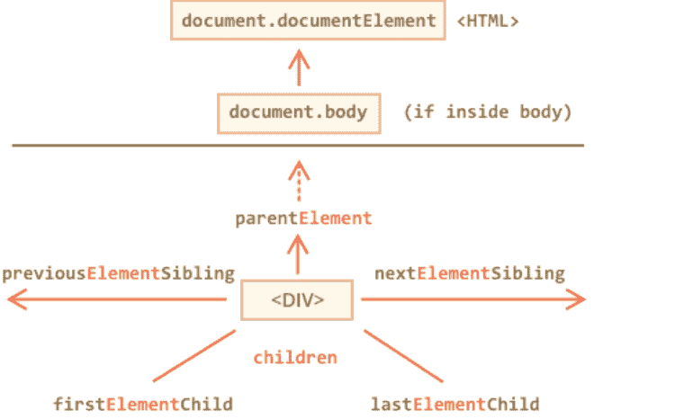

这些链接与上面提供的类似，只是在内部加入了 Element 单词：

- `children` – 仅包含元素节点的子节点。
- `firstElementChild`, `lastElementChild` – 第一个和最后一个元素子节点。
- `previousElementSibling`, `nextElementSibling` – 相邻的元素兄弟节点。
- `parentElement` – 父元素节点。

| 1:1 | 2:1 | 3:1 | 4:1 | 5:1 |
| 1:2 | 2:2 | 3:2 | 4:2 | 5:2 |
| 1:3 | 2:3 | 3:3 | 4:3 | 5:3 |
| 1:4 | 2:4 | 3:4 | 4:4 | 5:4 |
| 1:5 | 2:5 | 3:5 | 4:5 | 5:5 |

[打开沙箱进行任务。 ↗]()

前往解决方案

## 搜索：getElement*, querySelector*

DOM 导航属性在元素位置很近时非常有用。

但如果它们并不很近呢？如何获取页面上的任意元素？

有额外的搜索方法可以实现。

### document.getElementById 或直接使用 id

如果一个元素具有 `id` 属性，那么就会有一个与该 `id` 命名的全局变量。

我们可以使用它立即访问该元素，无论它在何处：

```html
<div id="elem">
<div id="elem-content">Element</div>
</div>

<script>
alert(elem); // DOM 元素 id="elem"
alert(window.elem); // 这样访问全局变量是可行的

// 对于 elem-content 的情况稍微复杂一点
// 它包含连字符，所以不能直接作为变量名
alert(window['elem-content']); //...可以使用方括号 [...] 访问
</script>
```

这种行为在[规范中 ↗]() 中有描述，但它主要是为了兼容性而提供的。浏览器尝试通过混合 JS 和 DOM 的命名空间来帮助我们。

这对于非常简单的脚本有用，但可能会发生命名冲突。此外，当我们在 JS 中使用它且视图中没有 HTML 时，并不清楚该变量是从哪里来的。

如果我们声明一个同名的变量，它的优先级会更高：

```html
<div id="elem"></div>

<script>
let elem = 5;

alert(elem); // 5
</script>
```

更好的替代方案是使用特殊方法 `document.getElementById(id)`。

例如：

```html
<div id="elem">
<div id="elem-content">Element</div>
</div>

<script>
let elem = document.getElementById('elem');

elem.style.background = 'red';
</script>
```

在教程中，我们经常直接使用 id 来引用元素，但这仅是为了保持代码简洁。在现实生活中，`document.getElementById` 是首选方法。

> **只能有一个**
>
> id 必须是唯一的。文档中只能有一个具有给定 id 的元素。
>
> 如果存在多个具有相同 id 的元素，那么相应方法的行为将是不可预测的。浏览器可能会随机返回其中任何一个。因此，请遵循规则并保持 id 的唯一性。

⚠️ 只有 `document.getElementById`，没有 `anyNode.getElementById`

方法 `getElementById` 只能在 `document` 对象上调用。它会在整个文档中查找指定的 id。

### querySelectorAll

到目前为止，最通用的方法 `elem.querySelectorAll(css)` 返回 `elem` 内部所有匹配给定 CSS 选择器的元素。

在这里我们查找所有作为最后一个子元素的 `<li>` 元素：

```html
<ul>
  <li></li>
  <li>test</li>
</ul>
<ul>
  <li>has</li>
  <li>passed</li>
</ul>
<script>
  let elements = document.querySelectorAll('ul > li:last-child');

  for (let elem of elements) {
    alert(elem.innerHTML); // "test", "passed"
  }
</script>
```

这个方法确实非常强大，因为可以使用任何 CSS 选择器。

> ℹ 也可以使用伪类
>
> CSS 选择器中的伪类（如 `:hover` 和 `:active`）也被支持。例如，`document.querySelectorAll(':hover')` 将返回指针当前悬停的元素集合（按嵌套顺序：从最外层的 `<html>` 到最内层的元素）。

### querySelector

调用 `elem.querySelector(css)` 会返回匹配给定 CSS 选择器的第一个元素。

换句话说，结果等同于 `elem.querySelectorAll(css)[0]`，但后者是查找所有元素并从中挑选一个，而 `elem.querySelector` 只查找一个。所以它写起来更快、代码更短。

### matches

之前的方法是在搜索 DOM。

`elem.matches(css)` 并不查找任何内容，它仅仅检查 elem 是否匹配给定的 CSS 选择器。它返回 `true` 或 `false`。

该方法在我们遍历元素（例如在数组或其他结构中）并尝试过滤我们感兴趣的元素时非常有用。

例如：

```html
<a href="http://example.com/file.zip">..</a>
<a href="http://ya.ru">..</a>

<script>
 // 可以是任何集合，而不仅仅 document.body.children
for (let elem of body.children) {
  if (elem.matches('a[href$="zip"]')) {
    alert("存档引用: " + elem.href);
  }
}
</script>
```

### closest

元素的祖先是：父元素、父元素的父元素、它的父等等。祖先共同构成了从根节点的父级链。

`closest(css)` 方法找到匹配 CSS 选择器的最近祖先。它从元素本身开始，然后沿 DOM 树向上直到找到匹配项。

例如：

```html
<div class="container">
  <div class="child">
    <p class="text">Find me</p>
  </div>
</div>

<script>
  let p = document.querySelector('.text');
  let container = p.closest('.container');
  console.log(container); // the container div
</script>
```

### getElementsBy*

还有其他方法，主要是历史原因，它们返回*动态*集合。

- `elem.getElementsByTagName(tag)` 查找具有给定标签的元素，如果 `tag` 为 `"*"` 则返回所有元素。
- `elem.getElementsByClassName(className)` 返回具有给定 CSS 类的元素。
- `document.getElementsByName(name)` 返回具有给定 `name` 属性的元素，文档范围内。

例如：

```html
<div>First div</div>

<script>
  let divs = document.querySelectorAll('div');
  alert(divs.length); // 1
</script>

<div>Second div</div>

<script>
  alert(divs.length); // 1
</script>
```

现在我们可以很容易看到区别。在文档中出现新的 `div` 之后，静态集合并没有增加。

### 总结

在 DOM 中查找节点有 6 种主要方法：

| 方法 | 通过什么搜索 | 可以在元素上调用吗？ | 是动态的吗？ |
|---|---|---|---|
| querySelector | CSS选择器 | ✓ | |
| querySelectorAll | CSS选择器 | ✓ | |
| getElementById | id | | |
| getElementsByName | name | | ✓ |
| getElementsByTagName | tag 或 '*' | ✓ | ✓ |
| getElementsByClassName | class | ✓ | ✓ |

目前为止最常用的方法是 `querySelector` 和 `querySelectorAll`，`getElementById`（配合 `*`）偶尔会有用处，或者在旧脚本中发现。

除此之外：

- 有 `elem.matches(css)` 用于检查元素是否匹配给定的 CSS 选择器。
- 有 `elem.closest(css)` 用于查找匹配给定 CSS 选择器的最近祖先。元素本身也会被检查。

让我们再提一个检查父子关系的方法，因为它有时很有用：

- `elemA.contains(elemB)` 如果 `elemB` 在 `elemA` 内部（`elemA` 的后代）或当 `elemA == elemB` 时，则返回 true。

## 任务

### 查找元素

重要性：4

这里有一个包含表格和表单的文档。

如何查找？

1. `id="age-table"` 的表格。
2. 表格内部所有的 `label` 元素（共有 3 个）。
3. 该表格中的第一个 `td`（包含 "Age" 单词）。
4. 属性为 `search` 的 `form`。
5. 该表单中的第一个 `input`。
6. 该表单中的最后一个 `input`。

在单独窗口中打开 `table.html` 页面并利用浏览器工具完成。

查看解决方案

## 节点属性：类型、标签和内容

让我们深入了解一下 DOM 节点。

在本章中，我们将进一步研究它们是什么以及最常用的属性。

### DOM 节点类

DOM 节点根据它们的类具有不同的属性。例如，对应标签 `<a>` 的元素节点具有与链接相关的属性，对应 `<input>` 的节点具有与输入相关的属性等。文本节点与元素节点不同。但它们之间也有共同的属性和方法，因为 DOM 节点的类形成了一个单一的层次结构。

每个 DOM 节点都属于内置层次类。

层次结构的根是 `EventTarget`，它被 `Node` 继承，其他 DOM 节点也从它继承。

这是图片：

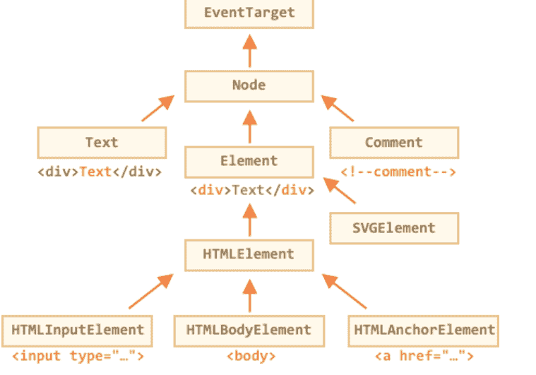

这些类包括：

- `EventTarget` 是根“抽象”类。该创建该类的。它作为一个基础，使得 DOM 节点支持所谓的“事件”，我们稍后学习。
- `Node` 也是一个“抽象”类，作为 DOM 节点的基类。它提供了树形函数：`parentNode`、`nextSibling`、`childNodes` 等（它们是 getter）。`Node` 类的对象不会被创建。但有具体的节点类派自于它，即：用于文本节点的 `Text`、用于元素节点的 `Element` 以及更奇特的类，如用于注释节点的 `Comment`。
- `Element` 是元素类元素的基类。它提供了元素级导航，如 `nextElementSibling`、`children` 以及搜索方法，浏览器不仅支持 HTML，还支持 XML 和 SVG。`Element` 类作为更具体类的基类：`SVGElement`、`XMLElement` 和 `HTMLElement`。
- `HTMLElement` 是所有 HTML 元素的最终类。它被各种 HTML 元素继承：
  - `HTMLInputElement` 是 `<input>` 元素的类，
  - `HTMLBodyElement` 是 `<body>` 元素的类，
  - `HTMLAnchorElement` 是 `<a>` 元素的类
  - ...依此类推，每个标签都有自己的类，该类可能提供特定的属性和方法。

因此，给定节点的完整属性和方法是继承的结果。

例如，让我们考虑 `<input>` 元素的 DOM 对象。它属于 `HTMLInputElement` 类。它获得的属性和方法是以下内容的叠加：

- `HTMLInputElement` – 此类提供了输入特定的属性，并继承自...
- `HTMLElement` – 它提供了常用的 HTML 元素方法（以及 getter/setter）并继承自...
- `Element` – 提供通用方法并继承自...
- `Node` – 提供通用的 DOM 节点属性并继承自...
- `EventTarget` – 提供事件支持（将要介绍），
- 最后继承自 `Object`，所以像 `hasOwnProperty` 等“纯对象”方法也是可用的。

要查看 DOM 节点的名称，我们可以想起对象通常有一个 `constructor` 属性。它引用类构造函数，`constructor.name` 就是它的名字：

```javascript
alert(document.body.constructor.name); // HTMLBody
```

或者我们可以直接将其转换为字符串：

```javascript
alert(document.body); // [object HTMLElement]
```

我们还可以使用 `instanceof` 来检查继承关系：

```javascript
alert(document.body instanceof HTMLElement);
alert(document.body instanceof Element);
alert(document.body instanceof Node);
alert(document.body instanceof EventTarget);
alert(document.body instanceof Object);
```

### innerHTML: 内容

`innerHTML` 属性允许以字符串的形式获取元素内部的 HTML。

我们也可以修改它。因此，它是更改页面最强大的方法之一。

示例展示了 `document.body` 的内容并完全替换了它：

```html
<body>
  <p>A paragraph</p>
  <div>A div </div>

  <script>
    alert( document.body.innerHTML ); // 读取当前内容
    document.body.innerHTML = 'The new BODY!'; // 替换它
  </script>
</body>
```

我们可以尝试插入无效的 HTML，浏览器会自动修复我们的错误：

```html
<body>
  <script>
    document.body.innerHTML = '<b>test'; // 忘记闭合标签了
    alert( document.body.innerHTML ); // <b>test</b> (已修复)
  </script>
</body>
```

> > 脚本不会执行
>
> 如果 `innerHTML` 向文档中插入了 `<script>` 标签 – 它将成为 HTML 的一部分，但不会执行。

#### 注意： “innerHTML+=” 会进行全量覆盖

我们可以通过使用 `elem.innerHTML+=more html` 向元素追加 `innerHTML`。

如下：

```javascript
chatDiv.innerHTML += "<div>Hello !<div></div";
chatDiv.innerHTML += "How goes?";
```

但我们应该这样做时要非常小心，因为发生的*不是*添加，而是全量覆盖。

从技术上讲，这两行代码的作用相同：

```javascript
elem.innerHTML += "..."; // 是更简短的写法：
elem.innerHTML = elem.innerHTML += "...";
```

换句话说，`innerHTML+=` 执行了以下操作：

1. 移除旧内容。
2. 写入新的 `innerHTML`（旧内容的拼接）。

由于内容被“清零”并从头重写，所有的图像和资源将重新加载。

在上面的 `chatDiv` 示例中，`chatDiv.innerHTML+="How goes?"` 这行重新创建了 HTML 内容并重新加载了 `smile.gif`（希望它已缓存）。如果 `chatDiv` 有很多其他文本和图像，那么重新加载将变得非常明显。

还有其他副作用。例如，如果现有文本被鼠标选中，大多数浏览器会在重写 `innerHTML` 时移除选中状态。如果有一个带有访问者输入的文本 `<input>`，那么文本将被移除。以此类推。

幸运的是，除了 `innerHTML` 还有其他添加 HTML 的方法，我们很快就会学习它们。

### outerHTML: 元素的完整 HTML

`outerHTML` 属性包含元素的完整 HTML。这相当于 `innerHTML` 加上元素本身。

这是一个示例：

```html
<div id="elem">Hello <b>World</b></div>
<script>
alert(elem.outerHTML); // <div id="elem">Hello <b>World</b></div>
</script>
```

#### 注意：与 innerHTML 不同，写入 outerHTML 不会改变元素。相反，它会在外部上下文中整体替换它。

是的，听起来很奇怪，事实也确实奇怪，这就是为什么我们在这里专门做一个说明。请看这里。

考虑这个示例：

```html
<div>Hello, world!</div>
<script>
  let div = document.querySelector('div');

  // 将 div.outerHTML 替换为 <p>...</p>
  div.outerHTML = '<p>A new element!</p>'; // (*)

// 哇！div 仍然是一样的！
  alert(div.outerHTML); // <div>Hello, world!</div>
</script>
```

在第 (*) 行中，我们获取了 `<div>...</div>` 的完整 HTML 并将其替换为 `<p>...</p>`。在外部文档中，我们可以看到新内容而不是 `<div>`。旧的 `div` 变量仍然保持不变。

`outerHTML` 赋值并没有修改 DOM 元素，而是将其从外部上下文中提取，并插入一个新的 HTML 片段来代替它。

新手开发者有时会在这里犯错：他们使用 `div.outerHTML` 并像里面包含新内容一样继续工作。

这在 `innerHTML` 中是可能的，但 `outerHTML` 则不然。

### nodeValue/data: 文本节点内容

`innerHTML` 属性对元素节点有效。

其他节点有对应的属性：`nodeValue` 和 `data` 属性。这两个属性在实际使用中几乎相同，只有细微的规范差异。因此我们将使用 `data`，因为它更短。

读取文本节点和注释内容的示例：

```html
<body>
Hello
<!-- Comment -->
<script>
let text = document.body.firstChild;
alert(text.data); // Hello

let comment = text.nextSibling;
alert(comment.data); // Comment
</script>
</body>
```

对于文本节点，我们可以想象读取或修改它们的理由，但注释呢？通常它们完全没有趣味性，但有时开发者会将额外信息或模板指令嵌入 HTML 的注释中，如下所示：

```html
<!-- if isAdmin -->
<div>Welcome, Admin!</div>
<!-- / -->
```

### textContent: 纯文本

`textContent` 提供对元素内**文本**的访问：仅文本，去除所有 `<tags>`。

例如：

```html
<div id="news">
  <h1>Headline!</h1>
  <p>Martians attack people!</p>
</div>

<script>
  alert(news.textContent); // Headline! Martians attack people!
</script>
```

写入 `textContent` 更安全，因为它将字符串作为文本写入，而不会将其解析为 HTML。

我们可以使用它安全地插入用户生成的文本，防止 XSS 攻击。

```html
<div id="elem1"></div>
<div id="elem2"></div>

<script>
  let name = prompt("你的名字？", "<script>alert('hacked')</script>");

  elem1.textContent = name; // 安全
  elem2.innerHTML = name; // 不安全
</script>
```

- `elem1.textContent = name` 将名称作为文本插入，字面上显示 `<script>alert('hacked')</script>`。
- `elem2.innerHTML = name` 将其作为 HTML 插入，脚本执行，可能导致 XSS 攻击。

### “hidden” 属性

`hidden` 属性是一个布尔属性。如果为 true，则元素不可见。

它的作用与 `style="display:none"` 相同，但更简短。

例如，下面两个 div 的作用相同：

```html
<div>Both divs are hidden</div>
<div hidden>With hidden attribute</div>
<div style="display:none">With style</div>
```

我们可以在 JS 中切换它：

```javascript
elem.hidden = true; // 隐藏
elem.hidden = false; // 显示
```

## 任务

重要性: 5

有一个由嵌套的 `ul/li` 组成的树结构。

为每个 `<li>` 编写代码，显示：

1. 它内部的文本（不包含子树）
2. 嵌套的 `<li>` 数量 —— 所有后代节点，包括深层嵌套的节点。

在新窗口中查看演示

打开任务的沙盒。

跳转解决方案

### nodeType 中了什么？

重要性: 5

脚本显示了什么？

```html
<html>
<body>
  <script>
    alert(document.body.lastChild.nodeType);
  </script>
</body>
</html>
```

跳转解决方案

### 注释中的标签

重要性: 3

这段代码显示了什么？

```html
<script>
let body = document.body;

body.innerHTML = "<!--" + tagName + "-->";
alert(body.firstChild.data); // 这里显示什么？
</script>
```

跳转解决方案

### "document" 在层次结构的什么位置？

重要性: 4

`document` 属于哪个类？

它在 DOM 层次结构中的位置如何？

它是继承自 `Node` 还是 `Element`，或者是 `HTMLElement`？

跳转解决方案

## 属性与属性

当浏览器加载页面时，它会“读取”（另一个词是“解析”）HTML 并从中生成 DOM 对象。对于元素节点，大多数标准的 HTML 属性会自动变成 DOM 对象的属性。

例如，如果标签是 `<body id="page">`，那么 DOM 对象就具有 `body.id = 'page'`。

但属性与属性的映射并不是一对一的！在本章中，我们将关注区分这两个概念，看看如何操作它们，它们在何时是相同的，以及何时是不同的。

### DOM 属性

我们已经看到了内置的 DOM 属性。它们有很多。但从技术上来说，没有人限制我们，如果不够，我们可以添加自己的。

DOM 节点是普通的 JavaScript 对象。我们可以修改它们。

例如，我们在 `document.body` 中创建一个新属性：

```javascript
document.body.myData = {
  name: 'Caesar',
  title: 'Imperator'
}

alert(document.body.myData.title); // Imperator
```

我们也可以添加一个方法：

```javascript
document.body.sayTagName = function() {
  alert(this.tagName);
}

document.body.sayTagName(); // BODY 在方法中 "this" 的值是 document
```

我们还可以修改内置原型（如 `Element.prototype`）并为所有元素添加新方法：

```javascript
Element.prototype.sayHi = function() {
  alert(`Hello, I'm ${this.tagName}`);
}

document.documentElement.sayHi(); // Hello, I'm HTML
document.body.sayHi(); // Hello, I'm BODY
```

因此，DOM 属性和方法的行为与普通的 JavaScript 对象一样：

- 它们可以有任何值。
- 它们对大小写敏感（写 `elem.nodeType`，而不是 `elem.noDeTyPe`）。

### HTML 属性

在 HTML 中，标签可以有属性。当浏览器解析 HTML 为标签创建 DOM 对象时，它会识别标准属性并根据它们创建 DOM 属性。

因此，当元素拥有 id 或另一个标准属性时，对应的属性就会被创建。如果属性是非标准的，则不会发生。

例如：

```html
<body id="test" something="non-standard">
<script>
  alert(document.body.id); // test
  // 非标准属性不会产生属性
  alert(document.body.something); // undefined
</script>
</body>
```

请注意，一个元素的标准属性对于另一个元素来说可能是未知的。例如，“type”对于 `<input>` (HTMLInputElement) 是标准的，但对于 `<body>` (HTMLBodyElement) 则不是。标准属性在对应元素类的规范中进行了描述。

在这里我们可以看到：

```html
<body id="body" type="">
<input id="input" type="text">
<script>
  alert(input.type); // text
  alert(body.type); // undefined: DOM 属性未创建，因为是非标准的
</script>
</body>
```

所以，如果属性是非标准的，则就不会有对应的 DOM 属性。有办法访问此类属性吗？

当然。所有属性都可以通过以下方法访问：

- `elem.hasAttribute(name)` - 检查是否存在。
- `elem.getAttribute(name)` - 获取值。
- `elem.setAttribute(name, value)` - 设置值。
- `elem.removeAttribute(name)` - 移除属性。

这些方法的操作完全基于 HTML 中编写的内容。

此外，人们可以使用 `elem.attributes` 读取所有属性：这是一个属于内置 Attr 类对象的集合，具有 name 和 value 属性。

这里是读取非标准属性的演示：

```html
<body something="non-standard">
  <script>
    alert(document.body.getAttribute('something')); // 非标准
  </script>
</body>
```

### 非标准属性，数据集

在编写 HTML 时，我们使用了许多标准属性。但非标准的、自定义的属性呢？首先，让我们看看它们是否有用？是用来做什么的？

有时候，非标准属性用于从 HTML 向 JavaScript 传递自定义数据，或者为了给 JavaScript “标记” HTML 元素。

如下所示：

```html
<!-- 标记该 div 在此处显示 "name" -->
<div show-info="name"></div>
<!-- 并在此处显示 age -->
<div show-info="age"></div>

<script>
// 代码找到带有标记的元素并显示请求的内容
let user = {
  name: "Pete",
  age: 25
};

for(let div of document.querySelectorAll('[show-info]')) {
  // 将相应的信息插入到字段中
  let field = div.getAttribute('show-info');
  div.innerHTML = user[field]; // 显示 Pete，然后是 age
}
</script>
```

此外，它们也可以用于给元素设置样式。

例如，在这里为了订单状态，使用了 `order-state` 属性：

```html
<style>
/* 样式依赖自定义属性 "order-state" */
.order[order-state="new"] {
  color: green;
}

.order[order-state="pending"] {
  color: blue;
}

.order[order-state="canceled"] {
  color: red;
}
</style>

<div class="order" order-state="new">
  一个新订单。
</div>

<div class="order" order-state="pending">
  一个待处理订单。
</div>

<div class="order" order-state="canceled">
  一个已取消的订单。
</div>
```

该属性是否比 `.order-state-new`、`.order-state-pending`、`.order-state-canceled` 等类名更好？

这是因为属性管理起来更方便。状态可以非常容易地更改：

```javascript
// 比移除旧类/添加新类简单一点
div.setAttribute('order-state', 'canceled');
```

但自定义属性可能存在潜在的问题。如果我们为了自己的目的使用了非标准属性，而后来标准引入了它并赋予了它某种用途该怎么办？HTML 语言是活的，它在成长，有更多的属性来适应开发者的需求。在这种情况下可能会出现意外的影响。

为了避免冲突，存在 `data-*` 属性。

**所有以 "data-*" 开头的属性都留给程序员使用。它们在 `dataset` 属性中可用。**

例如，如果一个 `elem` 拥有一个名为 `"data-about"` 的属性，则可以通过 `elem.dataset.about` 访问。

如下：

```html
<body data-about="Elephants">
<script>
alert(document.body.dataset.about); // 显示 大象
</script>
```

多单词的属性（如 `data-order-state`）会变为驼峰命名：`dataset.orderState`。

这里是一个重写的“订单状态”示例：

```html
<style>
.order[data-order-state="new"] {
  color: green;
}

.order[data-order-state="pending"] {
  color: blue;
}

.order[data-order-state="canceled"] {
  color: red;
}
</style>

<div id="order" class="order" data-order-state="new">
一个新订单。
</div>

<script>
// 读取
alert(order.dataset.orderState); // 显示 new

// 修改
order.dataset.orderState = "pending"; // (*)
</script>
```

使用 `data-*` 属性是传递自定义数据的一种有效且安全的方法。

请注意，我们不仅可以读取，还可以修改 `data` 属性。然后 CSS 会据此更新视图：在上面的示例中，最后一行 (*) 将颜色改为蓝色。

### 总结

- **属性（Attributes）**——写在 HTML 中的内容。
- **属性（Properties）**——DOM 对象中的内容。

一个简单的比较：

| 属性 (Properties) | 属性 (Attributes) |
|---|---|
| 类型 (Type) | 任何值，标准属性的类型在规范中有所描述 | 字符串 |
| 名称 (Name) | 属性区分大小写 | 属性不区分大小写 |

操作属性的方法有：

- `elem.hasAttribute(name)` – 检查是否存在
- `elem.getAttribute(name)` – 获取值。
- `elem.setAttribute(name, value)` – 设置值。
- `elem.removeAttribute(name)` – 移除属性。
- `elem.attributes` 是所有属性的集合。

使用 DOM 属性（Properties）是更优的。只有在确实需要属性（Attributes）时我们才引用它们，例如：

- 我们需要非标准属性。但如果它以 `data-` 开头，那么我们应该使用 `dataset`。
- 我们想读取 HTML 中“按原书写”的值。DOM 属性的值可能不同，例如，`href` 属性始终是完整的 URL，而我们可能想要获取“原始”值。

## 任务

### 获取属性

重要性:5

编写代码从文档中选择带有 `data-widget` 的元素并读取其值。

```html
<!DOCTYPE html>
<html>
<body>
  <div data-widget="menu"></div>
  <script>
    /* 你的代码 */
  </script>
</body>
</html>
```

### 解决问题

重要性:3

通过修改它们的 `style` 属性将外部链接设置为橙色。

如果满足以下条件，则该链接是外部的：

- 它的 `href` 包含 `://`


- 但不是以 `internal.com` 开头

示例：

```html
<ul id="list">
  <li><a href="http://google.com"></a></li>
  <li><a href="/tutorial.html"></a></li>
  <li><a href="/local/path"></a></li>
  <li><a href="ftp://ftp.com/my.zip"></a></li>
  <li><a href="http://nodejs.org"></a></li>
  <li><a href="internal.com"></a></li>
</ul>
```

在 `parentElem` 的子元素中将 `oldChild` 替换为 `node`。

这些方法都会返回被插入的节点。换句话说，`parentElem.appendChild(node)` 返回 `node`。但通常不会使用返回值，我们只是运行了该方法。

这些方法是“老派”的：它们存在于古代时代，我们可以在很多旧脚本中遇到它们。遗憾的是，它们不够灵活。

例如，如果我们有一个字符串形式的 `html`，该如何插入它呢？或者，给定一个节点，在没有其父元素引用的情况下，如何删除它？当然，这是可行的，但方法并不优雅。

因此，存在两组插入方法可以轻松地处理所有情况。

## prepend/append/before/after

这组方法提供了更灵活的插入方式：

- `node.append(...nodes 或 strings)` - 在 node 的末尾添加节点或字符串，
- `node.prepend(...nodes 或 strings)` - 在 node 的开头插入节点或字符串，
- `node.before(...nodes 或 strings)` - 在节点之前插入节点或字符串，
- `node.after(...nodes 或 strings)` - 在节点之后插入节点或字符串，
- `node.replaceWith(...nodes 或 strings)` - 用给定的节点或字符串替换节点。

所有方法都接受 DOM 节点和/或文本字符串列表。如果给定的是字符串，它将作为文本节点插入。

这里有一个使用这些方法向列表添加更多项以及在前后添加文本的示例：

```html
<ol id="ol">
  <li>0</li>
  <li>1-</li>
  <li>2</li>
</ol>

<script>
  ol.before('before');
  ol.after('after');

  let prepend = document.createElement('li');
  prepend.innerHTML = 'prepend';
  ol.prepend(prepend);
  let append = document.createElement('li');
  append.innerHTML = 'append';
  ol.append(append);
</script>
```

结果：

before

1. prepend
2. 0
3. 1
4. 2
5. append

after

这里有一张小图展示了这些方法的作用：

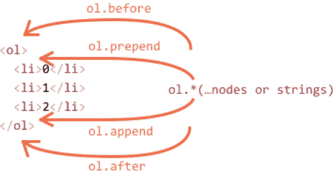

所以最终列表将是：

```html
before

<ol id="ol">
<li>prepend</li>
<li>0</li>
<li>1</li>
<li>2</li>
<li>append</li>
</ol>

after
```

这些方法可以在单次调用中插入多个节点列表和文本片段。
例如，在这里，插入了一个字符串和一个元素：

```html
<div id="div"></div>

<script>
div.before('<p>Hello</p>', document.createElement('hr'));
</script>
```

所有文本都将作为文本插入。
所以最终的 HTML 是：

```html
&lt;p&gt;Hello&lt;/p&gt;
<hr>
<div id="div"></div>
```

换句话说，字符串是以安全的方式插入的，就像 `elem.textContent` 执行的那样。
因此，这些方法只能用于插入 DOM 节点或文本片段。
但如果我们想“作为 HTML”插入 HTML，让所有标签等内容都能正常工作，使用 `elem.innerHTML` 呢？

## insertAdjacentHTML/Text/Element

还有另一种非常通用的方法：
`elem.insertAdjacentHTML(where, html)`。

第一个参数是代码标记，用于指定相对于 `elem` 的插入位置。
必须是以下之一：

- "beforebegin" – 在 elem 之前立即插入 html，
- "afterbegin" – 在 elem 内部的开头插入 html，
- "beforeend" – 在 elem 内部的末尾插入 html，
- "afterend" – 在 elem 之后立即插入 html。

第二个参数是一个 HTML 字符串，它将“作为 HTML”被插入。
例如：

```html
<div id="div"></div>

<script>
div.insertAdjacentHTML('beforebegin', '<p>Hello</p>');
div.insertAdjacentHTML('afterend', '<p>Bye</p>');
</script>
```

将导致：

```html
<p>Hello</p>
<div id="div"></div>
<p>Bye</p>
```

这就是我们如何向页面添加任意 HTML 的方法。

这里是插入变体对应的图片：

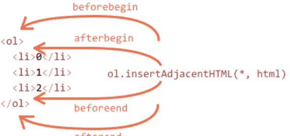

我们可以很容易地发现这与上一张图的相似之处。插入点实际上是相同的，但这种方法插入的是 HTML。

该方法有两个“兄弟”：

- `elem.insertAdjacentText(where, text)` - 语法相同，但插入的是“作为文本”的字符串而不是 HTML，
- `elem.insertAdjacentElement(where, elem)` - 语法相同，但插入的是元素。

它们存在的主要是为了让语法“统一”。在实践中，只有 `insertAdjacentHTML` 使用得最频繁。因为对于元素，我们有 `append/prepend/before/after` - 它们写法更短且可以插入节点/文本片段。

这里是显示消息的另一种变体：

```html
<style>
.alert {
  padding: 15px;
  border: 1px solid #d6e9c6;
  border-radius: 4px;
  color: #3c763d;
  background-color: #dff0d8;
}
</style>

<script>
document.body.insertAdjacentHTML("afterbegin", '<div class="alert-success">Hi there!</div>');
</script>
```

## 克隆节点：cloneNode

如何插入一个相似的消息？
我们可以写一个函数并将代码放在里面。但另一种方法是克隆现有的 `div` 并对其进行修改（如果需要）。
有时当我们有一个很大的元素时，这样可能更快更简单。

- 调用 `elem.cloneNode(true)` 会创建元素的“深”克隆 – 包含所有属性和子元素。如果调用 `elem.cloneNode(false)`，则创建不包含子元素的克隆。

复制消息的示例：

```html
<style>
.alert {
  padding: 15px;
  border: 1px solid #d6e9c6;
  border-radius: 4px;
  color: #3c763d;
  background-color: #dff0d8;
}
</style>

<div class="alert" id="div">Hi there!</div>

<script>
let div2 = document.querySelector('.alert').cloneNode(true); // 克隆 alert
document.body.append(div2); // 在 body 中添加 div2
</script>
```

## DocumentFragment

DocumentFragment 是一个包装节点的特殊容器，我们可以向它添加节点。
请注意，如果我们动态生成一个 `DocumentFragment`，结果如下：

```html
<ul id="ul"></ul>

<script>
function getListContent() {
  let fragment = new DocumentFragment();
  for(let i=1; i<=3; i++) {
    let li = document.createElement('li');
    li.textContent = i;
    fragment.appendChild(li);
  }
  return fragment;
}
ul.append(getListContent());
</script>
```

DocumentFragment 很少被显式使用。为什么不直接返回数组并使用 `append` 呢？重写后的示例：

```html
<ul id="ul"></ul>

<script>
function getListContent() {
  let result = [];
  for(let i=1; i<=3; i++) {
    let li = document.createElement('li');
    li.textContent = i;
    result.push(li);
  }
  return result;
}
ul.append(...getListContent());
</script>
```

## 删除方法

要删除节点，有以下方法：

### parentElem.removeChild(node)

从 `parentElem` 中移除节点（假设它是子元素）。

### node.remove()

从其位置移除节点。

我们可以很容易发现第二种方法短得多。第一种方法是为了历史原因。

> **注意：** 如果我们要将元素移动到另一个地方 —— 不需要从旧位置删除它。

**所有的插入方法会自动从旧位置移除节点。**
例如，让我们交换元素：

```html
<div id="first">First</div>
<div id="second">Second</div>

<script>
// 不需要调用 remove
second.after(first); // 在 #second 后插入 #first
</script>
```

让我们让消息在 1 秒后消失：

```html
<style>
.alert {
  padding: 15px;
  border: 1px solid #d6e9c6;
  border-radius: 4px;
  color: #3c763d;
  background-color: #dff0d8;
}
</style>

<script>
let div = document.createElement('div');
div.className = 'alert alert-success';
div.innerHTML = '<h1>Hi there!</h1><p>你读到了一条重要消息。</p>';
document.body.append(div);
setTimeout(() => div.remove(), 1000);
// 或者 setTimeout(() => document.body.removeChild(div), 1000);
</script>
```

## 关于 "document.write" 的几点

另一种非常古老向网页添加内容的方法：
`document.write`。

语法：

```html
<p>页面的某处...</p>

<script>
document.write('<b>来自 JS 的 Hello</b>');
</script>

<p>结束</p>
```

`document.write(html)` 的调用将 html 在“此时此刻”写入页面。html 字符串可以是动态生成的，所以它是相当灵活的。我们可以使用 JavaScript 创建完整的网页并将其写入。

该方法源于没有 DOM、没有标准的时代……非常古老的时代。它仍然存在，是因为还有脚本在使用它。

```html
<p>一秒后，此页面的内容将被替换...</p>

<script>
// 1秒后执行 document.write
// 那是在页面加载后，所以它会擦除现有内容
setTimeout(() => document.write('<b>...By this.</b>'), 1000);
</script>
```

所以，在“加载后”阶段之后，它就变得有些不可用了，与我们上面介绍的 DOM 方法不同。

这就是缺点。

从技术上讲，当 `document.write` 在浏览器读取（解析）传入的 HTML 时被调用并写入某些内容时，浏览器会处理它，就像这些内容最初就在 HTML 文本中一样。

这带给我们一个优点——它的运行速度极快，因为没有涉及 DOM 修改。它直接写入页面文本中，而此时 DOM 尚未构建，浏览器会在生成时将其放入 DOM。

因此，如果我们需要在 HTML 中动态添加一个文本节点，且正处于页面加载阶段，并对速度有要求，这可能会有所帮助。但在实践中，这些需求很少同时出现。通常我们会在脚本中看到这种写法，仅仅是因为它们太老了。

# 总结

创建新节点的方法：

- `document.createElement(tag)` – 创建一个给定标签的元素，
- `document.createTextNode(value)` – 创建一个文本节点（很少使用），
- `elem.cloneNode(deep)` – 克隆元素，如果 `deep==true`，则包含所有后代节点。

节点的插入和删除：

- 从父节点：
- `parent.appendChild(node)`
- `parent.insertBefore(node, nextSibling)`
- `parent.removeChild(node)`
- `parent.replaceChild(newElem, node)`

所有这些方法都返回 `node`。

- 给定一组节点和字符串：
- `node.append(...nodes or strings)` – 插入到节点末尾，
- `node.prepend(...nodes or strings)` – 插入到节点开头，
- `node.before(...nodes or strings)` – 插入到节点之前，
- `node.after(...nodes or strings)` – 插入到节点之后，
- `node.replaceWith(...nodes or strings)` – 替换当前节点。
- `node.remove()` – 移除节点。

文本字符串以“文本形式”插入。

- 给定一段 HTML：`elem.insertAdjacentHTML(where, html)`，在 `where` 插入：
- "beforebegin" – 在 `elem` 之前插入 html，
- "afterbegin" – 将 html 插入 `elem` 的开头，
- "beforeend" – 将 html 插入 `elem` 的末尾，
- "afterend" – 在 `elem` 之后插入 html。

还有类似的方法 `elem.insertAdjacentText` 和 `elem.insertAdjacentElement`，它们分别插入文本字符串和元素，但很少使用。

- 在页面加载完成前向页面添加 HTML：
- `document.write(html)`

在页面加载后调用此类方法会擦除整个文档。多见于旧版脚本。

# 任务

## createTextNode vs innerHTML vs textContent

重要性：5

我们有一个空的 DOM 元素 `elem` 和一个字符串 `text`。

这 3 个命令中哪两个的效果完全相同？

1. `elem.append(document.createTextNode(text))`
2. `elem.innerHTML = text`
3. `elem.textContent = text`

查看答案

## 清空元素

重要性：5

创建一个函数 `clear(elem)`，移除该元素中的所有内容。

```html
<ol id="elem">
  <li>Hello</li>
  <li>World</li>
</ol>

<script>
function clear(elem) { /* 你的代码 */ }
clear(elem); // 清空列表
</script>
```

查看答案

## 为什么 "aaa" 还在那里？

重要性：1

运行示例。为什么 `table.remove()` 没有删除文本 "aaa"？

```html
<table id="table">
aaa
<tr>
  <td>Test</td>
</tr>
</table>

<script>
alert(table); // 弹窗显示表格，这是符合预期的
table.remove();
// 为什么文档里仍然有 aaa？
</script>
```

查看答案

## 创建列表

重要性：4

编写一个接口，根据用户输入创建一个列表。

对于每一个列表项：

1. 使用 `prompt` 询问用户其内容。
2. 创建带有内容的 `<li>` 并将其加入 `<ul>`。
3. 继续操作，直到用户取消输入（通过在 prompt 中按 `Esc` 或 CANCEL）。

所有元素都应该是动态创建的。

如果用户输入 HTML 标签，它们应该被视为普通文本。

在新窗口中演示 ↗

查看答案

## 从对象创建树

重要性：5

编写一个函数 `createTree`，它从嵌套对象创建一个嵌套的 `ul/li` 列表。

例如：

```javascript
let data = {
  "Fish": {
    "trout": {},
    "salmon": {}
  },
  "Tree": {
    "Huge": {
      "sequoia": {},
      "oak": {}
    },
    "Flowering": {
      "apple tree": {},
      "magnolia": {}
    }
  }
};
```

语法如下：

```javascript
let container = document.getElementById('container');
createTree(container, data); // 在容器中创建树
```

结果应该像：

- Fish
  - trout
  - salmon
- Tree
  - Huge
    - sequoia
    - oak
  - Flowering
    - apple tree
    - magnolia

选择以下两种解决方法之一：

1. 创建 HTML，然后赋值给 container。
2. 创建节点并 append。

这样很好 P.S. 树不应该有额外的类。

查看答案

## 显示后代

重要性：5

有一个组织为 `ul/li` 的树。编写代码为每个 `<li>` 添加其后代节点的数量。

- Animals
  - Mammals
    - Cows
    - Dogs
    - Tigers
  - Other
    - Birds
    - Lizards
  - Fishes
    - Guppy
    - Angelfish
  - Sea

查看答案

## 创建日历

重要性：4

编写函数 `createCalendar(elem, year)`。日历应该是 `<table>`，其中日期是 `<th>`。名称如下：

| MO | TU | WE | TH | FR | SA | SU |
|---|---|---|---|---|---|---|
| | | | | | | |
| | | | | | | |
| | | | | | | |
| | | | | | | |
| | | | | | | |
| | | | | | | |
| | | | | | | |

结果应该像：

| MO | TU | WE | TH | FR | SA | SU |
|---|---|---|---|---|---|---|
| | | | | | | |
| | | | | | | |
| | | | | | | | |
| | | | | | | |
| | | | | | | |
| | | | | | | |
| | | | | | | | |

P.S. 对于此任务，只需生成日历即可，不需要点击。

查看答案

## 使用 setInterval 的彩色时钟

重要性：4

创建一个如下时钟：

```
19:13:05
Start Stop
```

使用 HTML/CSS 进行样式设置，JavaScript 只更新元素中的时间。

查看答案

## 在列表中插入 HTML

重要性：5

编写代码，在以下两个 `<li>` 之间插入 `<li>2</li><li></li>`：

```html
<ul id="ul">
  <li>one</li>
  <li>two</li>
</ul>
```

查看答案

## 为表格排序

重要性：5

有一个表格：

| Name | Surname | Age |
|---|---|---|
| John | Smith | 10 |
| Pete | Brown | 15 |
| Ann | Lee | 5 |
| ... | ... | ... |

其中可能还有更多行。编写代码按“name”列对其进行排序。

查看答案

## className 和 classList

例如：

```html
<body class="main page">
<script>
  alert(document.body.className); // main page
</script>
</body>
```

如果我们给 `elem.className` 赋值，它会替换整个类字符串。有时这是我们需要的，但通常我们只是想添加或删除单个类。

另一个属性可以实现这一点：`elem.classList`。

`elem.classList` 是一个特殊对象，拥有添加/删除/切换类的方法。

例如：

```html
<body class="main page">
<script>
  // 添加一个类
  document.body.classList.add('article');
  alert(document.body.className); // main page article
</script>
</body>
```

因此，我们可以使用 `className` 操作整个字符串，也可以使用 `classList` 操作单个类。选择取决于我们的需求。

`classList` 的方法：

- `elem.classList.add/remove("class")` – 添加/移除该类。
- `elem.classList.toggle("class")` – 如果类不存在则添加，否则移除。
- `elem.classList.contains("class")` – 返回 true/false，检查是否存在指定的类。

此外，`classList` 是可迭代的，因此我们可以使用 `for..of` 列出所有类，如下：

```html
<body class="main page">
<script>
  for (let name of document.body.classList) {
    alert(name); // main，然后是 page
  }
</script>
</body>
```

## 属性 elem.style

`elem.style` 属性对象，对应于 "style" 属性中的内容。设置 `elem.style.width="100px"` 的效果等于我们在属性 `style="width:100px"` 中写。

对于多单词属性，使用驼峰命名法（camelCase）：

```
background-color => elem.style.backgroundColor
z-index => elem.style.zIndex
border-left-width => elem.style.borderLeftWidth
```

例如：

```javascript
body.style.backgroundColor = prompt('background color?', 'green');
```

> 前缀属性
> 带有浏览器前缀的属性如 `-moz-border-radius`、`-webkit-border-radius` 也遵循相同的规则，例如：

```javascript
button.style.MozBorderRadius = '5px';
button.style.webkitBorderRadius = '5px';
```

即：连字符 "-" 变成大写字母。

## 重置 style 属性

有时我们想设置一个样式属性，稍后将其移除。

例如，为了隐藏一个元素，我们可以设置 `elem.style.display = "none"`。

稍后我们可能想移除 `style.display`，就像它没有被设置过一样。与其 `delete elem.style.display`，我们应该给它赋值一个空字符串：`elem.style.display = ""`

```javascript
// 如果我们运行这段代码，<body> 会“闪烁”
document.body.style.display = "none"; // 隐藏
setTimeout(() => document.body.style.display = "", 1000); // 恢复正常
```

如果我们将 `display` 设置为空字符串，浏览器将正常应用 CSS 类和其内置样式，就像根本没有这个 `display` 属性一样。

> 使用 style.cssText 完全重写
> 通常情况下，我们使用 `style.` 来为单个样式属性赋值。我们无法像 `div.style=color: red; width: 100px` 那样设置完整的样式，因为 `div.style` 是一个对象且只读。
> 要作为字符串设置完整的样式，有一个特殊的属性 `style.cssText`：

```html
<div id="div">Button</div>
<script>
  // 我们可以设置特殊的样式标记，如 "important"
  div.style.cssText = "color: red !important;\
  background-color: yellow;\
  width: 100px;\
  text-align: center;";
  alert(div.style.cssText);
</script>
```

该属性很少使用，因为这种赋值会移除所有样式：它不是添加，而是替换。有时需要删除某些内容。我们可以安全地用于新元素。

通过设置属性实现同样的操作：
`div.setAttribute('style', 'color: red...')`

## 注意单位

CSS 单位必须在样式值中提供。例如，我们不应该将 `elem.style.top` 设置为 `10`，而应该设置为 `10px`。否则将不起作用：

```html
<body>
<script>
// 不起作用！
document.body.style.margin = 20;
alert(document.body.style.margin); // ''（空字符串，赋值被忽略）

// 添加 CSS 单位 (px) - 就能生效了
document.body.style.margin = '20px';
alert(document.body.style.margin); // 20px
alert(document.body.style.marginTop); // 20px
</body>
```

请注意浏览器如何“解析”`style.margin` 属性，并从中推断出 `style.marginTop`（以及其他部分）。

## 计算样式：getComputedStyle

修改样式很容易。但如何*读取*它们？例如，我们想知道元素的大小、边距、颜色。**style** 属性只作用于 "style" 属性而不经过 CSS 级联。因此我们无法通过 `elem.style` 读取任何来自 CSS 类的内容。例如，这里 `style` 看不到 margin：

```html
<head>
<style>body { color: red; margin: 5px }</style>
</head>
<body>
<script>
alert(document.body.style.color); // 空
alert(document.body.style.marginTop); // 空
</script>
</body>
```

...但如果我们需要将 margin 增加 20px 呢？我们想要它的当前值。有另一个方法可以：`getComputedStyle`。

语法为：

```
getComputedStyle(element[, pseudo])
```

### element

用于读取值的元素。

### pseudo

如果需要，伪元素，例如 `::before`。空字符串或不传参数表示元素本身。

结果是一个带有 style 属性的对象，类似于 `elem.style`，但现在考虑到所有 CSS 类。例如：

```html
<head>
  <style>body { color: red; margin: 5px }</style>
</head>
<body>
<script>
  let computedStyle = getComputedStyle(document.body);
  // 现在我们可以从中读取 margin 和颜色
  alert(computedStyle.marginTop); // 5px
  alert(computedStyle.color); // rgb(255, 0, 0)
</script>
</body>
```

## 计算值与解析值

CSS 中有两个概念：

1. 计算值（computed value）是在应用所有 CSS 规则和 CSS 继承后的值，是 CSS 层的结果。它看起来像 `height:1em` 或 `font-size:125%`。
2. 解析值（resolved value）是最终应用于元素的值。`1em` 或 `125%` 是相对值。浏览器获取计算值并将单位固定为绝对值，例如：`height:20px` 或 `font-size:16px`。对于几何属性，解析值可能有浮点，如 `width:50.5px`。

很久以前创建 `getComputedStyle` 是为了获取计算值，但结果解析值方便得多，因此标准化了。

现在 `getComputedStyle` 实际上返回属性的解析值。

## getComputedStyle 需要完整的属性名

我们应该始终请求所需的精确属性，如 `paddingLeft` 或 `marginTop` 或 `borderTopWidth`。否则无法保证结果正确。例如，如果存在 `paddingLeft/paddingTop` 属性，那么 `getComputedStyle(elem).padding` 应该得到什么？什么都没有，可能是从已知 padding 生成的值？这里没有标准规则。

还有其他不一致之处。例如，某些浏览器（Chrome）在下面的文档中显示 10px，而某些（Firefox）则没有：

```html
<style>
body {
  margin: 10px;
}
</style>
<script>
let style = getComputedStyle(document.body);
alert(style.margin); // Firefox 中为空字符串
</script>
```

> “已访问”链接的样式被隐藏了！
> 已访问的链接可以使用 `:visited` CSS 伪类着色。但 `getComputedStyle` 无法访问该颜色，否则任意页面可以通过在页面上创建链接并检查样式来发现用户使用了该链接。JavaScript 可能看不到由 `:visited` 应用的样式。而且，CSS 中有一个限制，禁止在 `:visited` 中应用改变几何形状的样式。这保证了恶意页面无法通过测试链接是否被访问从而破坏隐私。

# 总结

为了管理类，有两个 DOM 属性：

- `className` – 字符串值，适用于管理整组类。
- `classList` – 带有 `add/remove/toggle/contains` 方法的对象，适用于单个类。

为了更改样式：

- `style` 属性是一个带有驼峰命名样式的对象。读取和写入它等同于修改 "style" 属性中的单个属性。
- `style.cssText` 属性对应于整个 "style" 属性，即完整的样式字符串。

# 任务

## 创建通知

优先级：5

编写一个函数 `showNotification(options)`，创建一个带有给定内容的 `<div class="notification">`。该通知应在 1.5 秒后自动消失。

选项如下：

```javascript
// 在窗口右上角显示一个带有文本 "Hello" 的元素
showNotification({
  top: 10, // 距离窗口顶部 10px（默认为 0px）
  right: 10, // 距离窗口右边缘 10px（默认为 0px）
  html: "Hello!", // 通知内容的 HTML
  className: "welcome" // div 的额外类（可选）
});
```

在新窗口中演示

使用 CSS 定位在给定的顶部/右侧坐标处显示元素。源文档包含所需的样式。

打开任务沙盒。

## 解决方案

# 元素尺寸与滚动

有许多 JavaScript 属性允许我们读取关于元素宽度、高度以及其他几何特征的信息。

当在 JavaScript 中移动或定位元素时，我们需要这些属性来正确计算坐标。

## 示例元素

为了演示这些属性，我们将使用下面提供的元素作为示例元素：

```html
<div id="example">
  ...Text...
</div>

<style>
#example {
  width: 300px;
  height: 200px;
  border: 25px solid #E8C4F;
  padding: 20px;
  overflow: auto;
}
</style>
```

它具有边框（border）、内边距（padding）和滚动功能。功能非常完整。它没有外边距（margin），因为外边距不是元素本身的一部分，也没有它的特殊属性。

元素看起来如下：

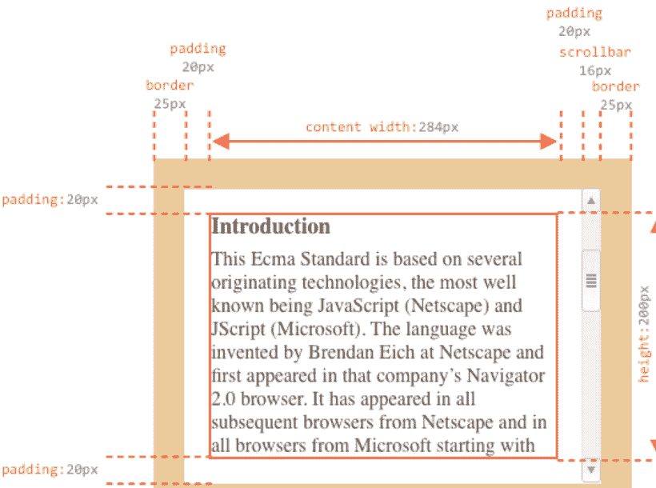

你可以在沙盒中打开文档。

> 上图展示了滚动条最复杂的情况。某些浏览器（并非所有）会通过占用内容区域为其留出空间。
> 所以，如果没有滚动条，内容宽度将是 300px，但如果滚动条宽度为 16px（宽度在设备和浏览器之间可能会变化），则只剩下 300 - 16 = 284px，我们需要考虑这一点。这就是为什么本章的示例假设存在滚动条。如果没有滚动条，情况就会简单一些。
> padding-bottom（内边距边距）区域可能会被文本填充
> 通常在插图中，内边距显示为空，但如果元素中有大量文本并溢出，浏览器会将“溢出”文本显示在 padding-bottom 位置。
> 这是一个为了避免混淆的说明，除非另有说明，否则在后续示例中会设置 padding-bottom。

## 几何结构

这是全景：

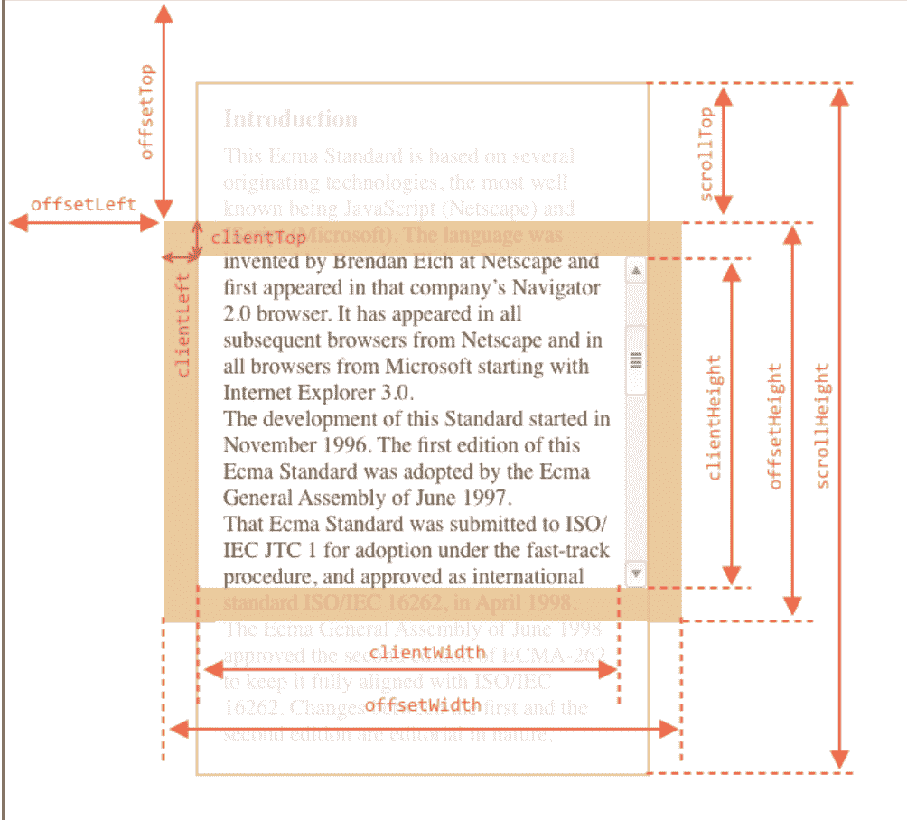

这些属性的值在技术上是数字，但这些数字的单位是“像素”，因此它们是像素测量值。

属性很多，很难将它们全部放在一张图中，但它们的值简单且易于理解。

让我们从元素的外部开始探索它们。

## offsetParent, offsetLeft/Top

这些属性很少需要，但它们仍然是“最外层”的几何属性，所以我们从它们开始。

`offsetParent` 是浏览器在渲染期间计算坐标时使用的最近祖先元素。

它是指满足以下条件的最近祖先：

1. CSS 定位的（position 为 absolute, relative, fixed, sticky）；
2. 或者 `<td>`, `<th>`, `<table>`，
3. 或者 `<body>`

属性 `offsetLeft/offsetTop` 提供了相对于其左上角的 x/y 坐标。

在下示例中，内部的 `<div>` 以 `<main>` 作为 `offsetParent`，且 `offsetLeft/offsetTop` 是相对于其左上角的偏移量 (180)：

```html
<main style="position: relative" id="main">
  <article>
    <div id="example" style="position: absolute; left: 180px; top: 180px"></div>
  </article>
</main>

<script>
  alert(example.offsetParent.id); // main
  alert(example.offsetLeft); // 180（注意：是一个数字，而不是字符串 "180px"）
  alert(example.offsetTop); // 180
</script>
```

## offsetParent 为 null 的情况

`offsetParent` 为 `null` 的情况有几种：

1. 对于未显示的元素 `display:none` 或不在文档中的元素。
2. 对于 `<body>` 和 `<html>`。
3. 对于 `position:fixed` 的元素。

## offsetWidth/Height

现在让我们转向元素本身。

这两个属性是最简单的。

这两个属性提供了元素的“外层”宽度/高度。换句话说，它是包含边框在内的完整尺寸。

## clientWidth/Height

这些属性提供了元素边框内部区域的大小。

它们包含了内容宽度和内边距，但不包含滚动条。

```
clientWidth:284px = content width + padding
CSS width: 300px
```

因此，当没有内边距（padding）时，我们可以使用 `clientWidth/clientHeight` 获取内容区域的大小。

## scrollWidth/Height

- 属性 `clientWidth/clientHeight` 仅考虑元素的可见部分。
- 属性 `scrollWidth/scrollHeight` 还包含了滚出的（隐藏）部分：

在上面的图片中：

- `scrollHeight = 723` 是包含滚动部分的内容区域完整内部高度。
- `scrollWidth = 324` 是完整内部宽度，在这里我们没有水平滚动，所以它等于 `clientWidth`。

我们可以使用这些属性将元素扩展到其完整宽度/高度。如下所示：

```javascript
element.style.height = `${element.scrollHeight}px`;
```

## scrollLeft/scrollTop

属性 `scrollLeft/scrollTop` 是元素隐藏的滚出部分的宽度/高度。

在下方的图片中，我们可以看到带有垂直滚动条的块的 `scrollHeight/scrollTop`。

换句话说，`scrollTop` 是“向上滚动了多少”。

> **scrollLeft/scrollTop 可以被修改**
> 大多数几何属性在这里是只读的，但 `scrollLeft/scrollTop` 可以被更改，浏览器会滚动元素。
> 将 **scrollTop** 设置为 0 或 **Infinity** 将使元素分别滚动到最顶部/最底部。

## 不要从 CSS 中获取宽度/高度

我们刚刚涵盖了 DOM 元素的几何属性，这些属性可以用于获取宽度、高度并计算距离。

但正如我们在“样式和类”章节中所知道的，可以使用 `getComputedStyle` 读取 CSS 高和宽度。

那么，为什么不直接用 `getComputedStyle` 来读取元素的宽度呢？

```javascript
let elem = document.body;
alert(getComputedStyle(elem).width); // 显示 elem 的 CSS 宽度
```

为什么我们应该使用几何属性而不是它？原因有两个：

1. 首先，CSS 宽度/高度依赖于另一个属性：`box-sizing`，它定义了“什么是” CSS 宽度和高度。为了 CSS 的目的而更改 `box-sizing` 可能会破坏此类 JavaScript 代码。
2. 第二，CSS 宽度/高度可能是 `auto`，例如对于内联元素：

```html
<span id="elem">Hello!</span>
<script>
  alert(getComputedStyle(elem).width); // auto
</script>
```

从 CSS 的角度来看，`width:auto` 是完全正常的，但在 JavaScript 中，我们可能需要一个精确的 px 尺寸用于计算。因此，这里的 CSS 宽度完全没有用处。

还有一个原因：滚动条。在没有滚动条时运行良好的代码，在有滚动条时开始出现 Bug，因为滚动条在浏览器中会占用内容的空间。内容的实际可用宽度小于 CSS 宽度。而 `clientWidth/clientHeight` 考虑了这一点。

但使用 `getComputedStyle(elem).width` 情况就不同了。某些浏览器（例如 Chrome）返回减去滚动条后的内部宽度，而某些浏览器（例如 Firefox）返回 CSS 宽度（忽略滚动条）。这种跨浏览器差异是不使用 `getComputedStyle` 而是依赖几何属性的原因。

请注意，所述的差异仅关于从 JavaScript 读取 `getComputedStyle(...).width`，视觉上一切都是正确的。

# 总结

元素具有以下几何属性：

- `offsetParent` – 是最近的定位祖先或 td, th, table, body。
- `offsetLeft/offsetTop` – 相对于 `offsetParent` 左上边缘的坐标。
- `offsetWidth/offsetHeight` – 包含边框的元素“外部”宽度/高度。
- `clientLeft/clientTop` – 从左上外角到其左上内角的距离。
- `clientWidth/clientHeight` – 排除滚动条的内容宽度/高度。
- `scrollWidth/scrollHeight` – 包含滚动部分的内容完整宽度/高度。
- `scrollLeft/scrollTop` – 元素隐藏的滚出部分的宽度/高度。

# 文档尺寸与滚动

## 文档的宽度/高度

理论上，文档的根元素是 `document.documentElement`，它包裹了所有内容。所以我们可以使用 `document.documentElement.scrollWidth/scrollHeight` 获取文档的完整宽度/高度。

但在该元素上，这些属性在浏览器中工作方式不一致。在 Chrome/Safari/Opera 中如果没有滚动条，`document.documentElement.scrollHeight` 甚至可能小于 `document.documentElement.clientHeight`！这很奇怪，对吧？

为了可靠地获取完整的文档高度，我们应该取所有可能值的最大值：

```javascript
let scrollHeight = Math.max(
  document.body.scrollHeight, document.documentElement.scrollHeight,
  document.body.offsetHeight, document.documentElement.offsetHeight,
  document.body.clientHeight, document.documentElement.clientHeight
);

alert('Full document height, with scrolled out part: ' + scrollHeight);
```

为什么这样？别问。这些不一致性源于古代时代，而不是什么“智能”逻辑。

## 获取当前滚动位置

DOM 元素通过 `elem.scrollLeft/scrollTop` 存储当前的滚动状态。

对于文档滚动，`document.documentElement.scrollLeft/scrollTop` 在大多数浏览器中有效，旧版的 Webkit 浏览器除外，例如 Safari (bug 5991)，在那种情况下应该使用 `document.body` 而不是 `document.documentElement`。

幸运的是，我们完全不需要记住这些特殊之处，因为滚动位置可以通过特殊的属性 `pageXOffset/pageYOffset` 获取：

```javascript
alert('Current scroll from the top: ' + window.pageYOffset);
alert('Current scroll from the left: ' + window.pageXOffset);
```

这些属性是只读的。

## 滚动：scrollTo, scrollBy, scrollIntoView

> 重要：
> 要从 JavaScript 滚动页面，其 DOM 必须已完全构建。
> 例如，如果尝试在 `<head>` 中的脚本中滚动页面，它将不起作用。

普通元素可以通过更改 `scrollTop/scrollLeft` 来滚动。
我们也可以对页面执行相同的操作，如上文所述：

- 对于大多数浏览器（旧版 Webkit 浏览器除外），`document.documentElement.scrollTop/scrollLeft` 是正确的属性。
- 否则，使用 `document.body.scrollTop/scrollLeft`。

这些跨浏览器的兼容性问题并不理想。幸运的是，有一个更简单的通用的解决方案：特殊方法 `window.scrollBy(x,y)` 和 `window.scrollTo(pageX, pageY)`。

- `scrollBy(x,y)` 方法相对于当前位置滚动页面。例如，`scrollBy(0,10)` 将页面向下滚动 10px。
- `scrollTo(pageX, pageY)` 方法将页面滚动到绝对坐标，使得可见区域的左上角相对于文档左上角的坐标为 `(pageX, pageY)`。这就像设置 `scrollLeft/scrollTop`。

要滚动到最开始，我们可以使用 `scrollTo(0,0)`。

这些方法在所有浏览器中的工作方式相同。

## scrollIntoView

为了完整起见，我们再来看最后一个方法：`elem.scrollIntoView(top)`

调用 `elem.scrollIntoView(top)` 会滚动页面使 `elem` 可见。它接受一个参数：

- 如果 `top=true`（默认值），则页面将滚动，使 `elem` 出现在窗口顶部。元素的上边缘与窗口顶部对齐。
- 如果 `top=false`，则页面将滚动，使 `elem` 出现在底部。元素的下边缘与窗口底部对齐。

## 禁止滚动

有时我们需要让文档变得“不可滚动”。例如，当我们需要用一个需要立即关注的大型消息覆盖它时，并且我们希望访问者与该消息交互，而不是与文档交互。

要使文档不可滚动，设置 `document.body.style.overflow = "hidden"`。页面将冻结在当前的滚动位置。

我们可以使用相同的技术来“冻结”其他元素的滚动，而不仅仅是 `document.body`。

该方法的缺点是滚动条会消失。如果它之前占据空间，那么现在该空间就空出来了，内容会“跳转”以填充它。

这看起来有点奇怪，但如果比较冻结前后的 `clientWidth`，可以解决这个问题：如果宽度增加了（滚动条消失了），则在 `document.body` 上添加内边距代替滚动条，以保持内容宽度不变。

# 总结

几何：

- 文档可见部分的宽度/高度（内容区域宽/高）：`document.documentElement.clientWidth/Height`
- 整个文档（包括滚出的部分）的宽度/高度：

```javascript
let scrollHeight = Math.max(
  document.body.scrollHeight, document.documentElement.scrollHeight,
  document.body.offsetHeight, document.documentElement.offsetHeight,
  document.body.clientHeight, document.documentElement.clientHeight
);
```

滚动：

- 读取当前滚动位置：`window.pageYOffset/pageXOffset`
- 修改当前滚动位置：
  - `window.scrollTo(pageX, pageY)` - 绝对坐标，
  - `window.scrollBy(x,y)` - 相对于当前位置滚动，
  - `elem.scrollIntoView(top)` - 滚动使 elem 可见（与窗口顶部/底部对齐）。

# 坐标

为了移动元素，我们应该熟悉坐标。
大多数 JavaScript 方法处理两种坐标系之一：

1. 相对于窗口（或另一个视口）的顶部/左侧。
2. 相对于文档的顶部/左侧。

理解区别以及每种类型的适用位置非常重要。

# 窗口坐标：getBoundingClientRect

窗口坐标从窗口的左上角开始。

`elem.getBoundingClientRect()` 方法返回 `elem` 的窗口坐标，这是一个包含属性的对象：

- `top` - 元素顶边缘的 Y 坐标，
- `left` - 元素左边缘的 X 坐标，
- `right` - 元素右边缘的 X 坐标，
- `bottom` - 元素底边缘的 Y 坐标。

```javascript
// 获取元素的文档坐标
function getCoords(elem) {
  let box = elem.getBoundingClientRect();
  return {
    top: box.top + window.pageYOffset,
    left: box.left + window.pageXOffset
  };
}
```

# 总结

页面上的任意一点都有坐标：

1. 相对于窗口 - `elem.getBoundingClientRect()`。
2. 相对于文档 - `elem.getBoundingClientRect()` 加上当前页面滚动量。

窗口坐标配合 `position:fixed` 使用效果很好，而文档坐标配合 `position:absolute` 效果良好。

两个坐标系都有它们的“优点”和“缺点”，有些时候我们需要其中一个，就像 CSS 的 `position: absolute` 和 `fixed` 一样。

# 任务

### 寻找输入框的窗口坐标

**重要性：** 5

在下方的 iframe 中，你可以看到一个带有绿色“field”（字段）的文档。

使用 JavaScript 找到箭头指向的角的窗口坐标。

为了方便，文档中实现了一个小功能。点击任何地方都会显示那里的坐标。

点击任何地方获取窗口坐标。
这是为了测试，以检查你通过 JavaScript 获取的结果。
（点击后的坐标在此显示）

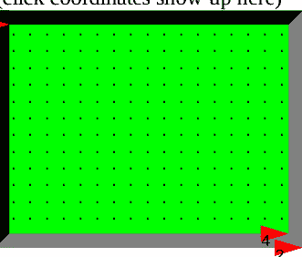

你的代码应该使用 DOM 获取以下位置的窗口坐标：

1. 左上角外角（这很简单）。
2. 右下角外角（也很简单）。
3. 左上角内角（有点难）。
4. 右下角内角（有几种方法，选择其一）。

你计算的坐标应该与鼠标点击返回的相同。

P.S. 如果元素有其他尺寸或边框，代码也应该有效，不限于任何固定值。

打开任务沙盒。

跳转到解决方案

### 在元素附近显示注释

**重要性：** 5

创建一个函数 `positionAt(anchor, position, elem)`，根据 `position` 将 `elem` 放置在 `anchor` 元素的顶部（"top"）、右侧（"right"）或底部（"bottom"）。

在函数 `showNote(anchor, position, html)` 内部调用它，在指定的锚点附近显示一个类名为 "note" 且文本为 html 的元素。

如下所示显示注释：

> Lorem ipsum dolor sit amet, consectetur adipiscing elit. Reprehenderit sint autque dolorem fuga a incid voluptam error fugiat animi amet! Otimius nulla id unde quaerat dignissimos enim isi rem provident sit tempore omnis recusandae esse qui offici sapien.
> 老师：你为什么迟到了？
> 学生：那里掉了一张百元钞票。

P.S. 注释应该使用 `position:fixed`。

打开任务沙盒。↗

跳转解决方案

### 在元素附近显示注释（绝对定位）

**重要性：** 5

修改上一个任务的解决方案，让注释使用 `position:absolute` 而不是 `position:fixed`。

这将防止注释在页面滚动时离开元素。

以该任务的解决方案为起点。为了测试滚动，添加样式 `<body style="height:2000px">`。

跳转解决方案

### 在元素内部定位注释（绝对定位）

**重要性：** 5

扩展之前的任务在元素附近显示注释（绝对定位）：让函数 `positionAt(anchor, position, elem)` 将 `elem` 插入锚点内部。

`position` 的新值：

- top-out, right-out, bottom-out - 与之前相同，它们将 elem 插入到锚点的上方、右侧或下方。
- top-in, right-in, bottom-in - 将 elem 插入锚点内部：将其贴在顶部、右侧或底部边缘。

例如：

```javascript
// 在引用块上方显示注释
positionAt(blockquote, "top-out", note);
// 在引用块内部顶部显示注释
positionAt(blockquote, "top-in", note);
```

结果如下：

| note-out | note right-out |
|---|---|
| note-in | |
| 老师：你为什么迟到了？ |
| 学生：那里掉了一张百元钞票。 |
| 老师：那很好。你是在帮他找吗？ |
| 学生：不，我正站在上面。 |
| bottom-in | |

Lorem ipsum dolor sit amet, consectetur adipiscing elit. Reprehenderit sit augue dolorem fugiat a inciduntamamam error fugiat animet! Odio temporibus nulla id unde quaerat dignissimos enim nisi rem provident molestiae tempore omnis recusae esse sequi sapiente.

作为源代码，采用“在元素附近显示注释（绝对定位）”任务的解决方案。

# 浏览器事件简介

事件是某个事情发生的信号。所有 DOM 节点都会产生信号（但事件不仅限于 DOM）。

这里是常用的 DOM 事件列表，仅供参考：

## 鼠标事件：

- `click` – 当鼠标点击元素时（触摸屏设备在轻触时产生）。
- `contextmenu` – 当鼠标在元素上点击右键菜单时。
- `mouseover` / `mouseout` – 当鼠标光标悬过 / 离开元素时。
- `mousedown` / `mouseup` – 当在元素上按下 / 释放鼠标时。
- `mousemove` – 当鼠标移动时。

## 表单元素事件：

- `submit` – 当访问者提交 `<form>` 时。
- `focus` – 当访问者聚焦元素时，例如聚焦 `<input>`。

## 键盘事件：

- `keydown` and `keyup` – 当访问者按下然后释放按键时。

## 文档事件：

- `DOMContentLoaded` – 当 HTML 加载并处理，DOM 完全构建完成后。

## CSS 事件：

- `transitionend` – 当 CSS 动画结束时。

还有许多其他事件。我们将在接下来的章节中详细介绍特定事件的细节。

## 事件处理器

为了对事件做出反应，我们可以分配一个处理器——一个在事件发生时运行的函数。

处理器是在用户操作时运行 JavaScript 代码的一种方式。

分配处理器有几种方法。让我们从最简单的开始看。

## HTML 属性

可以在 HTML 中通过名为 `on<event>` 的属性来设置处理器。

例如，要为 `input` 分配 `click` 处理器，可以使用 `onclick`，如下：

```html
<input value="Click me" onclick="alert('Click!')" type="button">
```

在鼠标点击时，`onclick` 内部的代码会运行。

请注意，在 `onclick` 内部我们使用单引号，因为属性本身是用双引号括的。如果我们忘记代码在属性内部并在内部使用双引号，例如：`onclick="alert("Click!")"`，那么它将无法正常工作。

HTML 属性并不是编写大量代码的好地方，所以我们最好创建一个 JavaScript 函数并调用它。

这里点击时会运行 `countRabbits()` 函数：

```html
<script>
function countRabbits() {
  for(let i=1; i<=3; i++) {
    alert("Rabbit number " + i);
  }
}
</script>

<input type="button" onclick="countRabbits()" value="Count rabbits">
```

众所周知，HTML 属性名是不区分大小写的，所以 ONCLICK 和 `onclick` 的效果一样。……但通常属性是小写的：`onclick`。

## DOM 属性

我们可以使用 DOM 属性 `on<event>` 来分配处理器。

例如，`elem.onclick`：

```html
<input id="elem" type="button" value="Click me">
<script>
  elem.onclick = function() {
    alert('Thank you');
  };
</script>
```

如果使用 HTML 属性分配处理器，浏览器会读取它，从属性内容创建一个新函数并将其写入 DOM 属性中。

所以，这种方法实际上与之前的方法是相同的。

## 处理器始终在 DOM 属性中：HTML 属性只是初始化它的方法之一。

这两段代码的作用相同：

1. 仅限 HTML：
```html
<input type="button" onclick="alert('Click!')" value="Button">
```

2. HTML + JS：
```html
<input type="button" id="button" value="Button">
<script>
  button.onclick = function() {
    alert('Click!');
  };
</script>
```

由于只有一个 `onclick` 属性，我们不能分配多个事件处理器。

在下面的示例中，为 JavaScript 添加处理器会覆盖现有的处理器：

```html
<input type="button" id="elem" onclick="alert('Before')" value="Click me">
<script>
 elem.onclick = function() { // 覆盖了现有的处理器
  alert('After'); // 只会显示这个
}
</script>
```

顺便说，我们可以直接将现有函数分配为处理器：

```javascript
function sayThanks() {
  alert('Thanks!');
}
elem.onclick = sayThanks;
```

移除处理器——分配 `elem.onclick = null`。

## 访问元素：this

在处理器内部，`this` 的值是元素。即带有该处理器的元素。

在下面的代码中，按钮使用 `this.innerHTML` 显示其内容：

```html
<button onclick="alert(this.innerHTML)">Click me</button>
```

## 可能的错误

如果你正开始处理事件——请注意一些细微差别。

函数应该分配为 `sayThanks`，而不是 `sayThanks()`。

```javascript
// 正确
button.onclick = sayThanks;
```

```javascript
// 错误
button.onclick = sayThanks();
```

如果我们加上括号，`sayThanks()` 是一个函数调用。所以最后一行实际上获取了函数执行的结果，而该结果是 `undefined`（因为函数没有返回内容），并将其赋值给 `onclick`。这行不通。

……但在标记语言中我们需要括号：

```html
<input type="button" id="button" onclick="sayThanks()">
```

## addEventListener

根本问题在于：我们无法为同一事件分配多个处理器。例如，我们想在点击时高亮显示按钮，同时也想在点击时发送分析数据。

使用 `elem.addEventListener(event, handler[, options])` 可以添加多个处理器。

语法：

```javascript
element.addEventListener(event, handler[, options]);
```

- `event` - 事件名，例如 `"click"`。
- `handler` - 处理器函数。
- `options` - 可选对象，包含属性：
  - `once`：如果为 true，处理器在执行后自动移除。
  - `capture`：捕获阶段处理事件（后面会讲）。
  - `passive`：如果为 true，则处理器永远不会调用 `preventDefault()`。

要移除处理器，使用 `element.removeEventListener(event, handler[, options])`。

```html
<input id="elem" type="button" value="Click me">
<script>
  function handler1() {
    alert('Thanks!');
  }
  function handler2() {
    alert('Thanks again!');
  }
  elem.addEventListener("click", handler1);
  elem.addEventListener("click", handler2);
</script>
```

两个处理器都会运行。

## addEventListener 对比 on<event>

正如我们在上面的示例所示，我们可以通过 DOM 属性或 `addEventListener` 来设置处理函数。但通常我们只使用这两种方法中的一种。

- 对于某些事件，处理函数仅在 `addEventListener` 中有效

某些事件是无法通过 DOM 属性赋值的。这些事件必须使用 `addEventListener`。

例如，`transitionend` 事件（CSS 动画结束）就是此类事件。

尝试下面的代码。在大多数浏览器中，只有第二个处理函数有效，而第一个无效。

```html
<style>
input {
  transition: width 1s;
  width: 100px;
}
.wide {
  width: 300px;
}
</style>

<input type="button" id="elem" onclick="this.classList.toggle('wide')" value="">

<script>
elem.ontransitionend = function() {
  alert("DOM property"); // 不生效
};
elem.addEventListener("transitionend", function() {
  alert("addEventListener"); // 动画结束时显示
});
</script>
```

## 事件对象

为了妥善处理事件，我们希望更多地了解发生的情况。不仅仅是“点击”或“按键”，而是指针坐标是什么？按了哪个键？等等。

当事件发生时，浏览器会创建一个事件对象，将细节存入其中，并将其作为参数传递给处理函数。

这里是从事件对象中获取鼠标坐标的示例：

```html
<input type="button" value="Click me" id="elem">
<script>
elem.onclick = function(event) {
  // 显示事件类型、元素和点击坐标
  alert(event.type + " at " + event.currentTarget);
  alert("Coordinates: " + event.clientX + ":" + event.clientY);
};
</script>
```

事件对象的某些属性：

### event.type

事件类型，这里是 "click"。

### event.currentTarget

处理事件的元素。这与此处的 `this` 完全相同，除非处理函数是箭头函数，或者它的 `this` 绑定到了其他地方，此时 `event.currentTarget` 就会变得有用。

### event.clientX / event.clientY

鼠标事件中光标相对于窗口的坐标。

还有更多属性。它们取决于事件类型，因此我们稍后在详细讨论不同事件时再学习它们。

事件对象也可以从 HTML 访问

如果我们在 HTML 中分配了处理函数，我们也可以这样使用 `event` 对象：

```html
<input type="button" onclick="alert(event.type)" value="Event type">
```

这是可行的，因为当浏览器读取该属性时，它会创建一个如下处理函数：`function(event) { alert(event.type) }`。也就是说：它的第一个参数被称为 `"event"`，而函数体取自属性。

## 对象处理函数：handleEvent

我们可以使用 `addEventListener` 将一个对象作为事件处理函数。当事件发生时，该对象的 `handleEvent` 方法会被调用。

例如：

```html
<button id="elem">Click me</button>
<script>
elem.addEventListener('click', {
  handleEvent(event) {
    alert(event.type + " at " + event.currentTarget);
  }
});
</script>
```

换句话说，当 `addEventListener` 接收到一个对象作为处理函数时，它会在事件发生时调用 `object.handleEvent(event)`。

我们也可以使用类来实现：

```html
<button id="elem">Click me</button>
<script>
class Menu {
  handleEvent(event) {
    switch(event.type) {
      case 'mousedown':
        elem.innerHTML = "Mouse button pressed";
        break;
      case 'mouseup':
        elem.innerHTML += "...and released";
        break;
    }
  }
}

let menu = new Menu();
elem.addEventListener('mousedown', menu);
elem.addEventListener('mouseup', menu);
</script>
```

在这里同一个对象处理了两个事件。注意，我们需要使用 `addEventListener` 显式地设置要监听的事件。`menu` 对象只会获取 `mousedown` 和 `mouseup`，而不会获取其他类型的事件。

`handleEvent` 方法不需要独立完成工作。它可以改为调用其他特定事件的方法，如下：

```html
<button id="elem">Click me</button>
<script>
class Menu {
  handleEvent(event) {
    // mousedown -> onMousedown
    let method = 'on' + event.type[0].toUpperCase() + event.type.slice(1);
    this[method](event);
  }

  onmousedown() {
    elem.innerHTML = "Mouse button pressed";
  }

  onmouseup() {
    elem.innerHTML += "...and released";
  }
}

let menu = new Menu();
elem.addEventListener('mousedown', menu);
elem.addEventListener('mouseup', menu);
</script>
```

现在事件处理函数被清晰地分离，这可能更容易维护。

# 总结

有 3 种分配事件处理函数的方法：

1. HTML 属性：`onclick="..."`
2. DOM 属性：`elem.onclick = function`
3. 方法：`elem.addEventListener(event, handler[, phase])` 用于添加，`removeEventListener` 用于移除。

HTML 属性使用较少，因为在 HTML 标签中间写 JavaScript 看起来有点奇怪且不自然。此外在里面无法编写大量代码。

DOM 属性的使用还可以，但我们不能为特定事件分配多个处理函数。在很多情况下，这个限制并不致命。

最后一种方法最灵活，但写起来最长。有少数事件仅在该方法下有效，例如 `transitionend` 和 `DOMContentLoaded`（后将介绍）。此外 `addEventListener` 支持将对象作为事件处理函数。在这种情况下，当事件发生时会调用 `handleEvent` 方法。

无论你如何分配处理函数，它都会接收一个事件对象作为第一个参数。该对象包含了发生情况的细节。

我们将在后续章节中学习更多关于事件以及不同类型事件的知识。

# 任务

### 点击隐藏

重要性：5

为按钮添加 JavaScript，使得点击它时 `<div id="text">` 消失。

演示图：

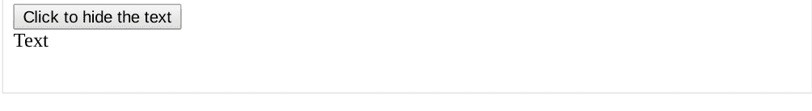

[打开任务沙盒](↗)

前往解决方案

### 隐藏自己

重要性：5

创建一个点击后会隐藏自身的按钮。

### 哪些处理函数在运行？

重要性：5

有一个按钮，没有任何处理函数。

哪些处理函数会显示？

```javascript
button.addEventListener("click", () => alert("1"));
button.removeEventListener("click", () => alert("1"));
button.onclick = () => alert("2");
```

前往解决方案

### 让球跨区域移动

重要性：5

让球跨区域移动。如下：

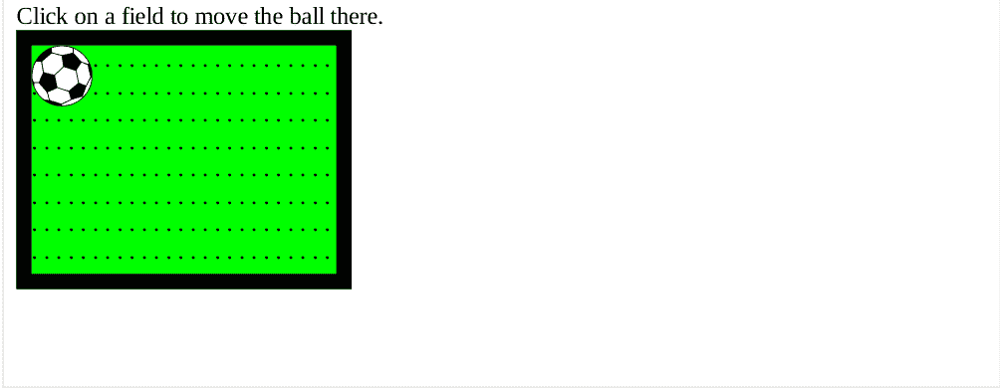

要求：

- 点击时球中心应对齐指针（如果可能）。
- 欢迎使用 CSS 动画。
- 球不能越界。
- 当页面滚动时，不应出错。

注意：

- 代码应支持不同的球和区域大小，不要固定值。
- 使用 `event.clientX/event.clientY` 处理点击。

[前往解决方案]()

### 创建滑动菜单

重要性：5

创建一个点击时可以展开/折叠的菜单：

```html
```


▶ Sweeties (点击我)!

```
P.S. 需要修改源文档的 HTML/CSS。
```

[前往解决方案]()

### 添加关闭按钮

重要性：5

有一个消息列表。使用 JavaScript 在每个消息的右上角添加一个关闭按钮。

结果应该像这样：

## 马

马是 *Equus ferus* 的两个现存亚种之一。它是一种属于马科的奇蹄类哺乳动物。马在过去 4500 万到 5500 万年前从一种小型多趾动物 *Eohippus* 演变成了如今的单趾动物。

## 驴

驴（*Equus africanus asinus*）是马科的一种家驯物种。驴的野生祖先是非洲野驴 *E. africanus*。驴作为工作动物已经使用了至少5000年。

## 猫

猫（拉丁：*Felis catus*）是一种小型、通常有毛的肉食性哺乳动物。当作为室内宠物饲养时被称为家猫，当不需要与其他猫科动物或猫科动物区分时简单被称为猫。猫因其陪伴作用和捕鼠的能力而被人类重视。

## 轮播图

重要性：4

创建一个轮播图——一个可以通过点击箭头滚动的图片带。

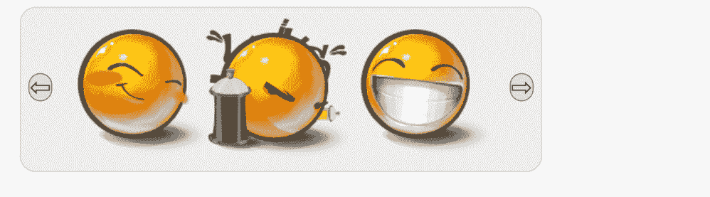

稍后我们可以为其添加更多功能：无限滚动、动态加载等。

P.S. 对于这个任务，HTML/CSS 结构实际上占据了解决方案的 90%。

为任务打开一个沙箱。↗

跳转解决方案

## 冒泡与捕获

让我们从一个示例开始。

这个处理函数被分配给 `<div>`，但如果你点击了任何嵌套标签（如 `<em>` 或 `<code>`），它也会运行：

```html
<div onclick="alert('处理函数被触发了!')">
  <em>如果你点击了 <code>EM</code>，那么 <code>DIV</code> 上的处理函数就会运行。</em>
</div>
```

如果你点击了 EM，DIV 上的处理函数就会运行。

这难道不有点奇怪吗？为什么实际点击是在 `<em>` 上，`<div>` 上的处理函数却会运行呢？

## 冒泡

冒泡原理非常简单。

当事件在某个元素上发生时，它会首先运行该元素上的处理函数，然后是其父元素，最后一直向上运行到其他祖先元素。

假设我们有 3 个嵌套元素 `FORM > DIV > P`，并且每个元素上都有一个处理函数：

```html
<style>
  body {
    margin: 10px;
    border: 1px solid blue;
  }
</style>

<form onclick="alert('form')">FORM
  <div onclick="alert('div')">DIV
    <p onclick="alert('p')">P</p>
  </div>
</form>
```

点击内部的 `<p>` 会首先运行 `onclick`：

1. 在该 `<p>` 上。
2. 然后在外层的 `<div>` 上。
3. 然后在外层的 `<form>` 上。
4. 依此类推向上，直到 `document` 对象。

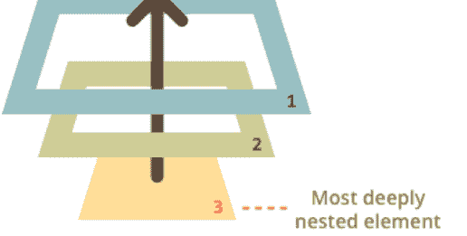

所以，如果我们点击了 `<p>`，就会看到 3 个弹框：`p` -> `div` -> `form`。

这个过程被称为“冒泡”，因为事件像水中的泡泡一样，从内部元素向上穿过父元素。

> **几乎所有事件都会冒泡。** 这句话中的关键词是“几乎”。

例如，`focus` 事件不会冒泡。还有其他例子，我们稍后会遇到。尽管如此，这仍然例外而非规律，大多数事件都会冒泡。

## event.target

父元素上的处理函数始终可以获取关于事件实际发生位置的细节。

**触发事件的最深层嵌套元素被称为 `目标元素 (target element)`，可以通过 `event.target` 访问。**

注意它与 `this (=event.currentTarget)` 的区别：

- `event.target` – 是触发事件的“目标”元素，它在冒泡过程中不会改变。
- `this` – 是“当前”元素，即正在运行处理函数的那个元素。

例如，如果我们有一个单一的处理函数 `form.onclick`，那么它可以“捕获”表单内部的所有点击。无论点击发生在何处，它都会向上冒泡到 `<form>` 并运行处理函数。

在 `form.onclick` 处理函数中：

- `this (=event.currentTarget)` 是 `<form>` 元素，因为处理函数是在它上运行的。
- `event.target` 是表单内部实际被点击的具体元素。

查看示例：https://plkr.co/edit/iaPo3qfpDpHXxu0Jita?p=preview

`event.target` 等于 `this` 是可能的——当直接点击 `<form>` 元素时。

## 停止冒泡

冒泡事件从目标元素直接向上。通常情况下，它会一直向上直到 `<html>`，然后到达 document 对象，某些事件会到达 window，调用路径上所有的处理函数。

但任何处理函数都可以决定事件已完全处理并停止冒泡。

实现的方法是 `event.stopPropagation()`。

例如，如果你点击了 `<button>`，`body.onclick` 将不起作用：

```html
<body onclick="alert('冒泡没有传到这里')">
  <button onclick="event.stopPropagation()">点击我</button>
</body>
```

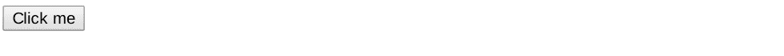

如果一个元素在单个事件上有多个事件处理函数，即使其中一个停止了冒泡，其他处理函数仍然会执行。

换句话说，`event.stopPropagation()` 停止了向上移动，当前元素上的其他处理函数仍会运行。

为了停止冒泡并防止当前元素上的处理函数运行，有一个 `event.stopImmediatePropagation()` 方法。

## 不要在不需要的情况下停止冒泡！

冒泡非常方便。在没有实际需求的情况下不要停止它：除非是明显且经过良好架构构思的。

有时 `event.stopPropagation()` 会产生可能变成问题的隐藏陷阱，例如：

1. 我们创建了一个嵌套菜单。每个子菜单都处理元素上的点击，并调用 `stopPropagation`，这样外部菜单就不会被触发。
2. 稍后我们决定捕获整个窗口的点击以跟踪用户行为（点击位置）。某些分析系统会这样做。通常使用 `document.addEventListener('click'...)` 的代码在被 `stopPropagation` 停止点击的区域内无法工作。我们获得了一个“死区”，这可能需要通过其他手段解决。其中一种方法是使用自定义事件，我们稍后会介绍。此外，我们可以在一个处理函数中向 `event` 对象写入数据，并在下方读取。

## 捕获

事件传播的另一个阶段被称为“捕获 (capturing)”。它在实际代码中很少使用。捕获阶段是事件从根部向目标元素移动的过程。

1. 捕获阶段 – 事件向下移动到元素。
2. 目标阶段 – 事件到达元素。
3. 冒泡阶段 – 事件从元素向上冒泡。

在捕获阶段，处理函数会按照从根到元素的顺序执行。

- `event.currentTarget (= this)` – 处理事件的当前元素（即带有该处理器的元素）
- `event.eventPhase` – 当前阶段（捕获=1，目标=2，冒泡=3）。

任何事件处理器都可以通过调用 `event.stopPropagation()` 来停止事件传播，但并不建议这样做，因为我们无法确定之后是否还会需要它，也许是为了处理完全不同的事情。

捕获阶段很少被使用，通常我们会在冒泡阶段处理事件。这背后是有逻辑支持的。

在现实世界中，当事故发生时，当地当局首先做出反应。他们了解事故发生的最佳区域。然后才需要更高层级的权威介入。

事件处理器也是如此的。在特定元素上设置处理器的代码对该元素及其功能拥有最详细了解。特定 `<td>` 上的处理器可能恰适用于该 `<td>`，它了解该元素的一切，因此它应该首先获得处理机会。然后它的直接父元素也知道上下文，但信息稍少一点，以此类推，直到处理通用概念并在最后运行的最顶层元素。

冒泡和捕获为“事件委托”奠定了基础——这是一种极其强大的事件处理模式，我们将在下一章中学习。

## 事件委托

捕获和冒泡允许我们实现最强大的事件处理模式之一，即事件委托。

核心思想是，如果我们有很多元素以类似的方式被处理，那么与其为它们每一个都分配一个处理器，不如在它们的共同祖先元素上放置单个处理器。

在处理器中，我们获取 `event.target`，查看事件实际发生的位置并对其进行处理。

让我们来看一个例子——反映中国古代哲学的八卦图。

它在这里：

## 八卦图：方向、元素、颜色、意义

| 西北 | 北 | 东北 |
| --- | --- | --- |
| 金、水 | 土 | |
| 银蓝 | 黄色 | |
| 艮卦 | 方向 | |
| 西 | 中 | 东 |
| 金、全 | 木 | |
| 金、紫 | 蓝色 | |
| 兑卦 | 和谐 | 未来 |
| 西南 | 南 | 东南 |
| 土、火 | 木 | |
| 棕橙色 | 绿色 | |
| 宁 | 名 | 浪漫 |

HTML 如下所示：

```html
<table>
  <tr>
    <th colspan="3"><em>八卦</em>图：方向、元素、颜色、意义...</th>
  </tr>
  <tr>
    <td>...<strong>西北</strong>...</td>
    <td>...</td>
    <td>...</td>
  </tr>
  <tr>此类代码还有 2 行..</tr>
  <tr>此类代码还有 2 行..</tr>
</table>
```

该表格有 9 个单元格，但它也可以是 99 个或 9999 个，这并不重要。

我们的任务是在点击时高亮一个单元格 `<td>`。

与其为每个 `<td>`（可能有很多）分配一个 `onclick` 处理器——我们会在 `<table>` 元素上设置一个“捕获”处理器。

它将使用 `event.target` 获取被点击的元素并将其高亮。

代码如下：

```javascript
let selectedTd;

table.onclick = function(event) {
  let target = event.target; // 点击发生在哪里？
  if (target.tagName != 'TD') return; // 不在 TD 上。那么我们就不感兴趣
  highlight(target); // 高亮它
};

function highlight(td) {
  if (selectedTd) {
    // 如果有高亮，则移除
    selectedTd.classList.remove('highlight');
  }
  selectedTd = td;
  selectedTd.classList.add('highlight'); // 高亮新的 td
}
```

这样的代码不在乎表格中有多少单元格。我们可以随时动态添加/删除 `<td>`，高亮功能仍然有效。

尽管如此，这有一个缺点。

点击可能没有发生在 `<td>` 上，而是在它内部。

在我们的情况下，如果查看 HTML 内部，可以看到 `<td>` 内部有嵌套的标签，比如 `<strong>`：

```html
<td>
  <strong>西北</strong>
  ...
</td>
```

自然地，如果点击发生在那个 `<strong>` 上，那么它就会成为 `event.target` 的值。

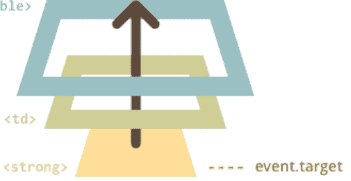

在 `table.onclick` 处理器中，我们应该获取这样的 `event.target` 并找出点击是否发生在 `<td>` 内部。

这里是改进后的代码：

```javascript
table.onclick = function(event) {
  let td = event.target.closest('td'); // (1)
  if (!td) return; // (2)
  if (!table.contains(td)) return; // (3)
  highlight(td); // (4)
}
```

解释：

- 1. 方法 `elem.closest(selector)` 返回匹配选择器的最近的祖先。在我们的案例中，我们用它从源元素向上查找 `<td>`。
- 2. 如果 `event.target` 不在任何 `<td>` 内部，则调用将返回 `null`，我们不需要做任何事情。
- 3. 在嵌套表格的情况下，`event.target` 可能是位于当前表格之外的 `<td>`。因此我们检查它是否真的是我们表格的 `<td>`。
- 4. `highlight(td)` 调用高亮函数。

# 总结

事件委托（Event delegation）非常酷！它是处理 DOM 事件最有用的模式之一。

它通常用于为许多相似的元素添加相同的处理函数，但不仅限于此。

算法如下：

- 在容器上放置单个处理器函数。
- 在处理器中——检查源元素 `event.target`。
- 如果事件发生在我们感兴趣的元素内部，则处理该事件。

优点：

- 简化初始化并节省内存：不需要添加许多处理函数。
- 代码更少：在添加或删除元素时，不需要对应的添加/删除处理函数。
- DOM 修改：我们可以使用 `innerHTML` 等方法批量添加/删除元素。

当然，事件委托也有其局限性：

- 首先，事件必须是冒泡的。某些事件不会冒泡。此外，低级处理器不应使用 `event.stopPropagation()`。
- 第二，委托可能会增加 CPU 负载，因为容器级处理器会对容器内任何位置的事件做出反应，无论这些事件是否对我们感兴趣。但通常这种负载是可以忽略不计的，所以我们不需要考虑。

# 任务

### 使用委托隐藏消息

重要性: 5

有一个消息列表，带有删除按钮 [x]。让这些按钮生效。

如下所示：

| 马 [x] |
| --- |
| 马是马属的两种现存亚种之一。它是马科的一种奇蹄目哺乳动物。马在过去的 4500 万到 5500 万年里，从一种小型多足动物（始马）进化成了今天的大型单蹄动物。 |
| 驴 [x] |
| 驴（Equus africanus asimus）是马科的一种家化物种。驴的野生祖先是非洲野驴（E. africanus）。驴至少已作为工作动物使用了 5000 年。 |
| 猫 [x] |
| 家猫（拉丁语：Felis catus）是一种小型、毛茸茸的肉食性哺乳动物。当不需要与其他猫科动物和猫科动物区分时，它们通常被称为家猫或室内猫。猫因其伴侣价值和捕猎害虫而被人类所重视。 |

注：. 容器上应该只有一个事件监听器，请使用事件委托。

打开任务沙盒。

查看解决方案

### 树菜单

重要性: 5

创建一个树，点击时显示/隐藏节点的子节点：

- 动物
  - 哺乳动物
    - 牛
    - 驴
    - 狗
    - 老虎
  - 其他
    - 蛇
    - 鸟
    - 蜥蜴
- 鱼类
  - 水族箱
    - 斑马鱼
    - 尺藻鱼
  - 海洋
    - 海鳟鱼

要求：

- 仅使用一个事件处理器（使用委托）
- 点击节点标题之外（空白区域）不应执行任何操作。

打开任务沙盒。

查看解决方案

### 可排序表格

重要性: 4

让表格可排序：点击 `<th>` 元素应按相应的列进行排序。

每个 `<th>` 属性中都有一个类型，如下所示：

```html
<table id="grid">
<thead>
  <tr>
    <th data-type="number">Age</th>
    <th data-type="string">Name</th>
  </tr>
</thead>
<tbody>
  <tr>
    <td>5</td>
    <td>John</td>
  </tr>
  <tr>
    <td>10</td>
    <td>Ann</td>
  </tr>
</tbody>
</table>
```

在上面的示例中，第一列是数字，第二列是字符串。排序函数应该根据类型处理排序。

仅支持 "string" 和 "number" 类型。

工作示例：

| Age | 姓名 |
|---|---|
| 5 | John |
| 2 | Pete |
| 12 | Ann |
| 9 | Eugene |
| 1 | Ilya |

注：. 表格可以是很大的，具有任意数量的行和列。

[打开任务沙盒]()

查看解决方案

### 提示框行为

重要性: 5

编写用于提示框（tooltip）行为的 JS 代码。

当鼠标悬停在带有 `data-tooltip` 的元素上时，提示框出现在它上方；当鼠标移开时，隐藏它。

带注释的 HTML 示例：

```html
<button data-tooltip="the tooltip is longer than the element">Short button</button>
<button data-tooltip="HTML<br>tooltip">One more button</button>
```

工作方式如下：

Short button One more button

滚动页面使按钮出现在顶部，检查提示框是否显示正常。

在此项任务中，我们假设所有带有 `data-tooltip` 的元素内部只有文本。目前没有嵌套标签。

细节：

- 提示框不应超出窗口边缘。通常它应该在元素上方，但如果元素位于页面顶部，则在它下方。
- 提示框提供在 `data-tooltip` 属性中。你需要两个事件：
  - `mouseover` 在指针悬停在元素上时触发。
  - `mouseout` 在指针离开元素时触发。

请使用事件委托：在 `document` 上设置处理器，以跟踪所有对带有 `data-tooltip` 的元素的“悬入”和“离开”，并管理提示框。

行为实现后，即使是不熟悉 JavaScript 的人也可以添加。

---

默认情况下，浏览器在右键菜单（右鼠标点击）时会显示包含标准选项的上下文菜单。我们可以阻止它并显示自己的菜单，如下所示：

```html
<button>右键显示浏览器上下文菜单</button>
<button oncontextmenu="alert('Draw our menu'); return false">
右键显示我们的自定义菜单
</button>
```

右键显示浏览器上下文菜单    右键显示我们的自定义菜单

现在，假设我们想要实现一个针对文档的上下文菜单，并包含我们的选项。在文档内部，我们可能还有其他带有各自上下文菜单的元素：

```html
<p>右键点击此处显示文档上下文菜单</p>
<button id="elem">右键点击此处显示按钮上下文菜单</button>

<script>
elem.oncontextmenu = function(event) {
  event.preventDefault();
  alert("Button context menu");
}

document.oncontextmenu = function(event) {
  event.preventDefault();
  alert("Document context menu");
}
</script>
```

右键点击此处显示文档上下文菜单

右键点击此处显示按钮上下文菜单

问题在于，当我们点击 `elem` 时，会得到两个菜单：按钮层级的菜单和（事件冒泡导致的）文档层级菜单。

如何修复它？一种解决方案是这样想：“我们在按钮处理器中完全处理了该事件，让我们停止它”，并使用 `event.stopPropagation()`：

```html
<p>右键点击此处显示文档菜单</p>
<button id="elem">右键点击此处显示按钮菜单（已通过 event.stopPropagation() 固定）</button>

<script>
elem.oncontextmenu = function(event) {
  event.preventDefault();
  event.stopPropagation();
  alert("Button context menu");
}

document.oncontextmenu = function(event) {
  event.preventDefault();
  alert("Document context menu");
}
</script>
```

右键点击此处显示文档菜单

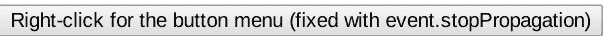

现在按钮层级的菜单按预期工作了。但代价是巨大的。我们永远地拒绝让其他代码访问右键点击的信息，包括收集统计数据的计数器等。这相当不明智。

另一种替代方案是在文档处理器中检查默认操作是否被阻止了？如果是，那么该事件已经被处理了，我们不需要对它做出反应。

```html
<p>右键点击此处显示文档菜单（已通过 event.defaultPrevented 固定）</p>
<button id="elem">右键点击此处显示按钮菜单</button>

<script>
elem.oncontextmenu = function(event) {
  event.preventDefault();
  alert("Button context menu");
}

document.oncontextmenu = function(event) {
  if (event.defaultPrevented) return;
  event.preventDefault();
  alert("Document context menu");
}
</script>
```

右键点击此处显示文档菜单（已通过 event.defaultPrevented 固定）

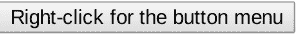

现在一切都工作正常。如果我们有嵌套元素，且每个元素都有自己的上下文菜单，那也可以行。只需确保在每个 `contextmenu` 处理器中检查 `event.defaultPrevented` 即可。

> **event.stopPropagation() 和 event.preventDefault()**
> 我们可以清楚地看到，`event.stopPropagation()` 和 `event.preventDefault()`（称为 `return false`）是两个不同的东西。它们之间没有联系。

> **嵌套上下文菜单架构**
> 实现嵌套上下文菜单有其他替代方法。其中之一是有一个特殊的全局对象，它包含一个处理 `document.oncontextmenu` 的方法，以及允许在其中存储“低层级”处理器的方法。
> 该对象将捕获任何右键点击，遍历存储的处理器并运行相应的那个。
> 但这样一来，每个想要上下文菜单的代码段都应该知道该对象，并使用它的帮助，而不是使用自己的 `contextmenu` 处理器。

# 总结

浏览器有很多许多默认行为：

- `mousedown` – 开始选择（移动鼠标进行选择）。
- 点击 `<input type="checkbox">` – 勾选/取消勾选输入。
- `submit` – 点击 `<input type="submit">` 或在表单内按回车会触发此操作，浏览器提交表单。
- `wheel` – 滚动鼠标轮时滚动滚轮是默认操作。
- `keydown` – 按下键可能导致向字段中添加字符。
- `contextmenu` – 事件在右键点击时发生，动作是显示浏览器菜单。
- ... 还有更多...

如果我们想通过 JavaScript 专有处理事件，可以阻止所有的默认行为。

要阻止默认操作 – 使用 `event.preventDefault()` 或返回 `false`。后者仅对处理器有效。

有一种方法可以区分“真实”用户事件和脚本生成的事件。
`event.isTrusted` 属性对于来自真实用户操作的事件为 `true`，而对于脚本生成的事件为 `false`。

## 冒泡示例

我们可以创建一个名为 "hello" 的冒泡事件并在 `document` 上捕获它。
我们只需要将 `bubbles` 设置为 `true`即可：

```html
<h1 id="elem">Hello from the script!</h1>

<script>
// catch on document...
document.addEventListener("hello", function(event) { // (1)
  alert("Hello from " + event.target.tagName); // Hello from H1
});

// ...dispatch elem!
let event = new Event("hello", {bubbles: true}); // (2)
elem.dispatchEvent(event);
</script>
```

注意事项：

- 1. 自定义事件应该使用 `addEventListener`，因为 `on<event>` 只存在内置事件，`document.onhello` 是不起作用的。
- 2. 必须设置 `bubbles:true`，否则事件不会冒泡。

内置事件（click）和自定义事件（hello）的冒泡机制是相同的。我们还有捕获阶段和冒泡阶段。

## MouseEvent, KeyboardEvent 等

以下是来自 [UI Event 规范 ↗](https://dom.spec.whatwg.org/) 的 UI 事件类列表：

- `UIEvent`
- `FocusEvent`
- `MouseEvent`
- `WheelEvent`
- `KeyboardEvent`
- ...

如果我们想创建此类事件，应该使用它们而不是 `new Event`。例如，`new MouseEvent("click")`。

正确的构造函数允许为该事件指定标准属性。例如鼠标事件的 `clientX/clientY`：

```javascript
let event = new MouseEvent("click", {
  bubbles: true,
  cancelable: true,
  clientX: 100,
  clientY: 100
});

alert(event.clientX); // 100
```

请注意：通用的 `Event` 构造函数不允许这样做。

让我们尝试：

```javascript
let event = new Event("click", {
  bubbles: true, // 仅支持 bubbles 和 cancelable
  cancelable: true, // 在 Event 构造函数中有效
  clientX: 100,
  clientY: 100
});

alert(event.clientX); // undefined，未知的属性被忽略了！
```

从技术上讲，我们可以通过创建后直接赋值 `event.clientX=100` 来绕过这个问题。所以这只是方便程度和遵循规则的问题。浏览器生成的事件始终具有正确的类型。

不同 UI 事件的完整属性列表可以在规范中，例如 `MouseEvent`。

## 自定义事件

对于我们自己的自定义事件（如 "hello"），我们应该使用 `new CustomEvent`。从技术上讲，`CustomEvent` 与 `Event` 相同，但有一个例外。

在第二个参数（对象）中，我们可以添加一个额外的 `detail` 属性，用于传递任何想要随事件传递的自定义信息。

例如：

```html
<h1 id="elem">Hello for John!</h1>

<script>
// 额外的细节会随事件传递给处理器
elem.addEventListener("hello", function(event) {
  alert(event.detail.name);
});

elem.dispatchEvent(new CustomEvent("hello", {
  detail: { name: "John" }
}));
</script>
```

`detail` 属性可以包含任何数据。从技术上讲，我们可以不需要它，因为我们可以在创建后给普通的 `Event` 对象分配任何属性。`CustomEvent` 为其提供了特定的 `detail` 字段以避免与其他事件属性冲突。

事件类告诉了关于“事件类型”的所有信息，如果事件是自定义的，那么我们应该使用 `CustomEvent` 以明确它的身份。

## event.preventDefault()

如果指定了 `cancelable:true` 标记，我们可以在脚本生成的事件上调用 `event.preventDefault()`。

当然，如果事件具有非标准名称，那么浏览器是无法识别它的，并且它没有对应的“默认浏览器行为”。

但生成事件的代码在 `dispatchEvent` 之后可能会执行某些操作。

调用 `event.preventDefault()` 是处理器发送一个信号的方式，表示不应该执行那些操作。

在这种情况下，调用 `elem.dispatchEvent(event)` 会返回 `false`。生成事件的代码就会知道处理应该继续。

例如，在下面的示例中，有一个 `hide()` 函数。它在元素 `#rabbit` 上生成一个 "hide" 事件，通知所有相关方兔子要躲起来了。

通过 `rabbit.addEventListener('hide',...)` 设置的处理器会获知这一点，并如果需要，可以通过调用 `event.preventDefault()` 来阻止该操作。这样兔子就不会躲起来：

```html
<pre id="rabbit">
|\  //
\_\//../_\=_\Y/=
{0<}
</pre>

<script>
// hide() 将在 2 秒后自动调用
function hide() {
  let event = new CustomEvent("hide", {
    cancelable: true // 如果没有这个标记，preventDefault 将不起作用 
  });

  if (rabbit.dispatchEvent(event)) {
    alert('the action was prevented by a handler');
  } else {
    rabbit.hidden = true;
  }
}

rabbit.addEventListener('hide', function(event) {
  if (confirm("Call preventDefault?")) {
    event.preventDefault();
  }
});

// 2 秒后隐藏
setTimeout(hide, 2000);
</script>
```

在本章中，我们将获取更多关于鼠标事件及其属性的细节。

## 鼠标事件类型

我们将鼠标事件分为两类：“简单事件”和“复杂事件”。

## 简单事件

最常用的简单事件有：

- `mousedown/mouseup` – 在元素上按下/释放鼠标键。
- `mouseover/mouseout` – 鼠标指针进入/离开一个元素。
- `mousemove` – 鼠标在元素上每次移动都会触发该事件。
- ... 还有其他几种事件类型，我们稍后会介绍这些内容。

## 复杂事件

- `click` – 如果在同一个元素上使用了左鼠标键，则在触发 `mousedown` 紧接着 `mouseup` 之后触发此事件。
- `contextmenu` – 如果使用了右鼠标键，则在 `mousedown` 之后触发。
- `dblclick` – 在元素上双击鼠标后触发。

复杂事件是由简单事件组成的，因此在理论上我们可以不需要它们。但它们确实存在，这是一件好事，因为它们非常方便。

## 事件顺序

一个动作可能会触发多个事件。

例如，点击（click）会触发按下（mousedown），当按钮释放时触发释放（mouseup）和点击（click）。

在单个动作引发多个事件的情况下，它们的顺序是固定的。也就是说，处理函数是按 `mousedown -> mouseup -> click` 的顺序被调用的。

事件按相同的序列处理：`mouseup` 会在 `onclick` 运行之前完成。

## 获取按钮：which

与点击相关的事件始终具有 `which` 属性，该属性允许获取精确的鼠标按键。

它不用于 `click` 和 `contextmenu` 事件，因为前者发生在左键点击，而后者只发生在右键点击。

但如果我们追踪 `mousedown` 和 `mouseup`，那么我们需要它，因为这些事件在任何按键上都会触发，所以 `which` 允许我们区分“右键按下”和“左键按下”。

有三种可能的取值：

- `event.which == 1` - 左键
- `event.which == 2` - 中键
- `event.which == 3` - 右键

中键目前有些奇特，而且很少被使用。

## 修饰键：shift, alt, ctrl 和 meta

所有的鼠标事件都包含关于按下的修饰键的信息。

这些属性有：

- `shiftKey`
- `altKey`
- `ctrlKey`
- `metaKey (Cmd)` 适用于 Mac

例如，下面的按钮仅在 `Alt-Shift` + 点击时有效：

```html
<button id="button">Alt+Shift+点击我！</button>

<script>
button.onclick = function(event) {
  if (event.altKey && event.shiftKey) {
    alert('Hooray!');
  }
}
</script>
```

## 注意：在 Mac 上通常是 Cmd 而不是 Ctrl

在 Windows 和 Linux 上，有修饰键 Alt、Shift 和 Ctrl。在 Mac 上还有一个：Cmd，它对应于属性 `metaKey`。

在 Windows/Linux 使用 Ctrl+点击的大多数情况下，Mac 用户会使用 Cmd。因此，在 Windows 用户按下 Ctrl+Enter 或 Ctrl+A 的地方，Mac 用户会按下 Cmd+Enter 或 Cmd+A，以此类推，大多数应用使用 Cmd 代替 Ctrl。

即使我们想强制 Mac 用户使用 Ctrl+点击——这也有点困难。问题在于：带 Ctrl 的左键点击在 Mac 上被解释为右键点击，并产生 `contextmenu` 事件，而不是 Windows/Linux 上的 `click`。

所以如果我们让所有操作系统的用户都感到舒服，那么在使用 `ctrlKey` 的同时，我们也应该使用 `metaKey`。

对于 JS 代码，这意味着我们需要检查 `(event.ctrlKey || event.metaKey)`。

## 还有移动设备

键盘组合可以作为工作流的补充。这样如果访客有键盘——就可以用。如果你的设备没有——就有另一种方法实现相同的功能。

## 坐标：clientX/Y, pageX/Y

所有的鼠标事件都有两种风格的坐标：

1. 相对于窗口：`clientX` 和 `clientY`。
2. 相对于文档：`pageX` 和 `pageY`。

例如，如果我们有一个大小为 500x500 的窗口，且鼠标在左上角，那么 `clientX` 和 `clientY` 都是 0。如果鼠标在中心，无论在文档的哪个位置 `clientX` 和 `clientY` 都是 250。它们类似于 `position:fixed`。

相对于文档的坐标是从文档的左上角计算的，而不是窗口。`pageX`、`pageY` 类似于文档层面的 `position:absolute`。你可以在章节中阅读更多关于坐标的知识。

## mousedown 时不选中

鼠标点击有一个可能会干扰操作的副作用。双击会选中文本。

如果我们想自己处理点击事件，那么这种“额外”的选取看起来并不好。例如，在文本上双击除了触发我们的处理函数外，还选中了它：

```html
<b ondblclick="alert('click')">双击</b>
```

有一种 CSS 方法可以停止选取：`user-select` 属性。大多数浏览器都通过带前缀的形式支持它：

```html
<style>
  -webkit-user-select: none;
  -moz-user-select: none;
  -ms-user-select: none;
  user-select: none;
</style>

<b ondblclick="alert('Test')">不可选中</b>
```

现在，如果你在“不可选中”上双击，它就不会被选中。似乎有效。

但存在一个潜在的问题！文本变得真正无法选中了。即使用户从“之前”开始选择并在“之后”结束，选择也会跳过部分部分。我们真的想让文本变得不可选取吗？

大多数时候，我们不想这样做。用户可能有正当理由选取文本，用于复制或其他需求。如果不允许他们这样做，可能会带来不便。我们想要防止双击时的选取，仅此而已。选取是浏览器在 `mousedown` 默认行为。因此替代方案是处理 `mousedown` 并阻止它，如下：

```html
<b onclick="alert('Click!')" onmousedown="return false">双击</b>
```

现在元素在点击时不会被选中。内部的文本仍然是可以选中的。然而，选取不应该从文本本身开始，而是在它之前或之后。通常这没问题。

## 取消选取

与其阻止选取，我们可以在事件处理程序中事后取消。方法如下：

```html
<b onclick="getSelection().removeAllRanges()">双击</b>
```

双击元素时，选取会出现然后被移除。这看起来不太好。

## 禁止复制

如果我们想保护内容不被复制，可以使用另一个事件：`oncopy`。

```html
<div oncopy="alert('禁止复制！');return false">
用户，复制是被禁止的。如果你知道 JS 或 HTML，那么可以获取源码
</div>
```

如果你尝试在 `div` 中复制，这将不起作用，因为默认的复制行为被阻止了。

# 总结

鼠标事件具有以下属性：

- 按钮：`which`。
- 修饰键（按下时为真）：`altKey`, `ctrlKey`, `shiftKey` 和 `metaKey` (Mac)。如果你处理 Ctrl，不要忘记 Mac 用户，他们使用 Cmd，所以最好检查 `event.metaKey`。
- 相对于窗口的坐标：`clientX/clientY`。
- 相对于文档的坐标：`pageX/pageY`。

处理点击时的选取也是重要的。有几种方法可以，例如：

1. CSS `user-select:none`（带浏览器前缀）完全禁用文本选取。
2. 使用 `getSelection().removeAllRanges()` 取消选取。
3. 处理 `mousedown` 并阻止默认行为（通常是最好的）。

# 任务

### 可选取列表

重要性：5

创建一个可以选择列表，类似于文件管理器。

- 点击列表元素将选中该元素（添加 `.selected` 类），取消其他元素的选取。
- 如果带 Ctrl（Mac 上为 Cmd）点击，则切换该元素的选取状态，但其他元素不被修改。

演示：

```
点击列表项以选中它。

- 罗宾·罗宾
- 维尼
- 跳跳
- 坎加
- 兔子。只是兔子。
```

P.S. 对于此任务，我们可以假设列表项仅包含文本。没有嵌套标签。P.P.S. 防止点击时浏览器的原生文本选取。

打开用于任务的沙盒。

---

这些事件是特殊的，因为它们有一个 `relatedTarget`。
该属性补充了 `target`。当鼠标从一个元素移动到另一个元素时，其中一个成为 `target`，另一个成为 `relatedTarget`。

对于 `mouseover`：

- `event.target` – 鼠标移入的元素。
- `event.relatedTarget` – 鼠标离开的元素（relatedTarget → target）。

对于 `mouseout`：
- `event.target` – 鼠标离开的元素。
- `event.relatedTarget` – 鼠标移入的新指针下方元素（target → relatedTarget）。

> **relatedTarget 可以为 null**
> `relatedTarget` 属性可以为 `null`。
> 这是正常现象，意味着鼠标是从另一个元素进入的，但是从窗口外部进入的。或者是它离开了窗口。
> 在代码中使用 `event.relatedTarget` 时，我们应该记住这种可能性。如果我们访问 `event.relatedTarget.tagName`，将会导致错误。

## 事件频率

`mousemove` 事件在鼠标移动时触发。但并不意味着每一个像素都会触发事件。
浏览器会定期地检查鼠标位置。如果发现位置变化，就会触发事件。
这意味着，如果访问者移动鼠标非常快，DOM 元素可能会被跳过：

如果鼠标像上面画的那样从 #FROM 元素快速移动到 #TO 元素，中间的 `<div>`（或部分中间 `<div>`）可能会被跳过。`mouseout` 事件可能在 #FROM 上触发，然后立即在 #TO 上触发 `mouseover`。

在实践中这很有帮助，因为可能存在很多中间元素。我们并不想处理每一个中间元素的进入和离开事件。

另一方面，我们应该记住，不能假设鼠标是缓慢地从一个元素移动到另一个元素的。不，它可以发生“跳跃”。

特别是，光标可能会直接从页面内部跳到窗口外。此时 `relatedTarget=null`，因为它来自“虚无”：

## 离开进入子元素时产生的“额外” mouseout

想象一下 – 鼠标指针进入了一个元素。触发了 `mouseover`。然后光标进入了一个子元素。有趣的事实是，在这种情况下触发了 `mouseout`。光标仍然在元素内，但我们却触发了该元素的 `mouseout`！

这看起来很奇怪，但可以很容易解释。

**根据浏览器逻辑，鼠标光标在任何时候只能位于单个元素上——即嵌套最深的一个（且 z-index 最高的一个）。**

所以，如果它移动到另一个元素（即使是后代），它就离开了上一个。简单如此。

在下面的示例中我们可以看到一个有趣的后果。

红色的 `<div>` 嵌套在蓝 `<div>` 内部。蓝色 `<div>` 的 `mouseover/out` 处理器会在下方的 textarea 中记录所有事件。

尝试进入蓝色元素并将鼠标移动到红色元素上 – 并观察这些事件：

https://plnkr.co/edit/4PtAFMCAPPtyY0Sbl3Zf?p=preview

- 1. 进入蓝色元素时 – 我们得到 `mouseover [target: blue]`。
- 2. 从蓝色元素移动到红色元素后 – 我们得到 `mouseout [target: blue]`（左侧父元素）。
- 3. ...紧接着触发了 `mouseover [target: red]`。

所以，对于一个不考虑 `target` 的处理器来说，看起来就像我们在 `mouseout` (2) 中离开了父元素，并通过 `mouseover` (3) 回到了它。

如果我们在进入/离开元素时执行某些操作，将会得到很多复杂的处理，这可能会带来意外的副作用。

我们可以通过使用 `mouseenter/mouseleave` 事件来修复这个问题。

## 事件 mouseenter/mouseleave

`mouseenter/mouseleave` 事件类似于 `mouseover/mouseout`。它们在鼠标指针进入/离开元素时也会触发。

但它们有两个区别：

- 1. 元素内部的过渡不会被计入。
- 2. `mouseenter/mouseleave` 事件不会冒泡。

这些事件在直觉上非常清晰。

当指针进入一个元素时 – `mouseenter` 触发，之后无论它在元素内部移动到哪里都不重要了。`mouseleave` 事件仅在光标离开时触发。

如果我们做同样的例子，但在蓝色 `<div>` 上放置 `mouseenter/mouseleave` 处理器，并执行相同的操作 – 我们会看到事件只在进入和离开蓝色 `<div>` 时触发。没有额外的事件去往红色元素再回来。子元素被忽略了。

https://plnkr.co/edit/5fnodG34O7ctGxOeb8Y?p=preview

## 事件委托

`mouseenter/leave` 事件非常简单且易用。但它们不冒泡。所以我们不能对它们使用事件委托。

想象我们想要处理表格单元格的鼠标进入/离开事件。但它们不冒泡。所以我们不能对它们使用事件委托。

## “智能”工具提示的文本逻辑

从技术上讲，我们可以测量鼠标在元素上的移动速度，如果速度很慢，我们就假设它是“经过元素”的并显示工具提示；如果速度很快，我们就忽略它。

为它创建一个通用的对象 `new HoverIntent(options)`。带有 `options:`

- `elem` – 需要跟踪的元素。
- `over` – 当鼠标缓慢移动到元素上方时调用的函数。
- `out` – 当鼠标离开元素时调用的函数（如果 `over` 被调用过）。

```javascript
// 示例提示框示例
let tooltip = document.createElement('div');
tooltip.className = "tooltip";
tooltip.innerHTML = "Tooltip";

// 该对象将追踪鼠标并调用 over/out
new HoverIntent({
  elem,
  over() {
    tooltip.style.left = elem.getBoundingClientRect().left + 'px';
    tooltip.style.top = elem.getBoundingClientRect().bottom + 5 + 'px';
    document.body.append(tooltip);
  },
  out() {
    tooltip.remove();
  }
});
```

演示效果：

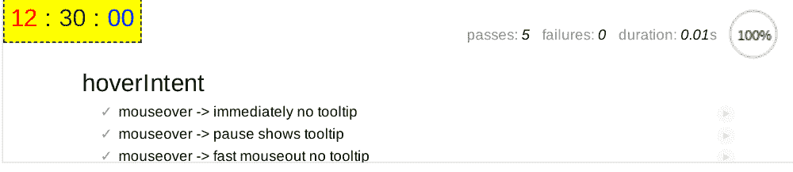

如果你将鼠标悬在“时钟”上，什么都不会发生；但如果你滑过或停在上面，就会出现提示框。

请注意：当鼠标在时钟的子元素之间移动时，提示框不会“闪烁”。

打开带有测试的沙盒。

解决方案

## 使用鼠标事件实现拖放

拖放（Drag'n/Drop）是一种极佳的界面解决方案。抓取某个物体、拖动并释放是完成许多任务的一种清晰简单的方法，从复制和移动（参见文件管理器）到排序（拖入购物车）。

在现代 HTML 标准中，有一部分专门介绍了拖放，并配有诸如 `dragstart`、`dragend` 等特殊事件。

这些事件非常有趣，因为它们允许轻松地解决简单任务，并处理将“外部”文件拖入浏览器。我们可以从操作系统的文件管理器中取一个文件并拖入浏览器窗口，此时 JavaScript 就可以访问其内容。

但原生的拖放事件有其局限性。例如，我们无法将拖拽限制在特定区域。同时也无法将其仅限制为“水平”或“垂直”方向。还有其他拖放任务可以使用该 API 实现。

因此，在这里我们将看到如何使用鼠标事件来实现拖放。这并不困难。

## 拖放算法

基础拖放算法如下：

- 1. 捕获 `mousedown`。
- 2. 为移动准备元素（可能创建它的副本等）。
- 3. 在 `mousemove` 时，通过改变 `left`/`top` 和 `position:absolute` 来移动它。
- 4. 在 `mouseup`（松开按钮）——执行所有与完成拖放相关的操作。

这些都是基础。我们可以对其进行扩展，例如在悬停在可放置元素上时对其进行高亮。

以下是拖动小球的算法：

```javascript
ball.onmousedown = function(event) { // (1) 开始进程
  // (2) 准备移动：设置为绝对定位并通过 z-index 置于顶层
  ball.style.position = 'absolute';
  ball.style.zIndex = 1000;

  // 将其从任何当前父元素移动到 body 中
  // 以使其相对于 body 进行定位
  document.body.append(ball);

  // ...并将绝对定位的小球放在鼠标光标下
  moveAt(event.pageX, event.pageY);

  // 居中小球的 (pageX, pageY) 坐标
  function moveAt(pageX, pageY) {
    ball.style.left = pageX - ball.offsetWidth / 2 + 'px';
    ball.style.top = pageY - ball.offsetHeight / 2 + 'px';
  }

  function onMouseMove(event) {
    moveAt(event.pageX, event.pageY);
  }

  // (3) 在 mousemove 时移动小球
  document.addEventListener('mousemove', onMouseMove);

  // (4) 释放小球，移除不需要的处理器
  ball.onmouseup = function() {
    document.removeEventListener('mousemove', onMouseMove);
    ball.onmouseup = null;
  };
};
```

如果运行代码，我们会发现一些奇怪的现象。在拖放开始时，小球会“分身”：我们开始拖动的是它的“副本”。

这是因为浏览器对图像和其他元素自带了拖放功能，它会自动运行并与我们的逻辑冲突。

要禁用它：

```javascript
ball.ondragstart = function() {
  return false;
};
```

现在一切都正常了。

另一个重要的方面是我们在 `document` 上监听 `mousemove`，而不是在元素上。从初看，鼠标似乎一直都在小球上方，我们可以在元素上放置 `mousemove`。但我们记得，`mousemove` 触发频率很高，并不是每个像素都会触发。在快速移动后，光标可能会从小球跳到文档的某处（甚至窗口外）。因此我们应该在 `document` 上监听以捕获它。

## 正确定位

在上面的示例中，小球始终被移动到其中心位于光标下方：

```javascript
ball.style.left = pageX - ball.offsetWidth / 2 + 'px';
ball.style.top = pageY - ball.offsetHeight / 2 + 'px';
```

这并不坏，但存在一个副作用。为了启动拖放，我们可以在球的任何地方使用 `mousedown`。但如果我们在边缘操作，球会突然“跳”到居中位置。

如果能保持元素相对于光标的初始偏移量会更好。例如，如果我们从小球的边缘开始拖拽，那么光标在拖拽过程中应该保持在边缘处。


```javascript
// ball.hidden = false;

// elemBelow 是球下方的元素，可能是可以被投放的元素
```

请注意：我们需要在调用 (*) 之前隐藏小球。否则，在这些坐标上通常有一个球，因为它是指针上方的顶层元素：`elemBelow=ball`。

我们可以使用代码随时检查我们正“悬浮”在哪个元素上，并在发生投放时处理释放操作。

一个扩展的 `onMouseMove` 代码，用于寻找“可投放的”元素：

```javascript
let currentDroppable = null; // 我们当前正悬浮在其上面的潜在可投放元素

function onMouseMove(event) {
  moveAt(event.pageX, event.pageY);

  ball.hidden = true;

  let elemBelow = document.elementFromPoint(event.clientX, event.clientY);

  ball.hidden = false;

  // mousemove 可能会在窗口之外（当球被拖出窗口时）
  // 如果 clientX/clientY 出了窗口，则 elementFromPoint 返回 null
  if (!elemBelow) return;

  // 潜在的可投放元素被标记为类 'droppable'（也可以是其他类）
  let droppable = elemBelow.closest('.droppable');
}
```


```javascript
if (currentDroppable !== dropDroppable) { // 如果发生任何变化

  // 我们正在移入或移出...

  // 注意：两个值都可以为 null

  // 如果在此事件之前我们没有悬浮在可投放元素上，则 currentDroppable=null

  // 如果在此事件期间我们没有悬浮在可投放元素上，则 dropDroppable=null

  if (currentDroppable) {

    // 处理“移出”可投放元素的逻辑（移除高亮）

    leaveDroppable(currentDroppable);

  }

  currentDroppable = dropDroppable;

  if (currentDroppable) {

    // 处理“移入”可投放元素的逻辑

    enterDroppable(currentDroppable);

  }

}
```

示例中，当球被拖到足球门上方时，球门被高亮了。

[演示链接](https://plnkr.co/VdbuaAVBTOOX3sIR8o66m?p=preview) 🔗

现在我们在整个过程中，变量 `currentDroppable` 中存储了我们当前悬浮的“投放目标”，并可以使用它来进行高亮或其他任何操作。

# 总结

我们考虑了一个基础的拖放（Drag'n'Drop）算法。

关键组件：

- 1. 事件流：`ball.mousedown` → `document.mousemove` → `ball.mouseup`（取消原生 `ondragstart`）。
- 2. 在拖拽开始时记住指针相对于元素的初始偏移：`shiftX/Y` 并在拖拽期间保持。
- 3. 使用 `document.elementFromPoint` 检测指针下的可投放元素。

我们可以在此基础上构建很多功能。

- 在 `mouseup` 时，我们可以完成投放：更改数据，移动元素。
- 我们可以高亮我们悬浮在其上的元素。
- 我们可以根据特定区域或方向限制拖拽。
- 我们可以对 `mousedown/up` 使用事件委托。一个检查 `event.target` 的大区域事件处理器可以管理数百个元素的拖放操作。
- 依此类推。

有一些框架在此之上构建架构：`DragZone`、`Droppable`、`Draggable` 以及其他类。它们大多数都在做与上述描述类似的事情，所以现在应该很容易理解它们了。或者我们可以自己实现，因为我们已经知道如何处理这个过程，而且可能比适配其他东西更灵活。

# 任务

## 滑块 (Slider)

重要性：5

创建一个滑块：

用鼠标拖动并移动蓝色滑块。

重要细节：

- 当按下鼠标按钮时，在拖拽过程中，鼠标可能会滑过滑块上方或下方。滑块仍将工作（对用户方便）。
- 如果鼠标极快速地向左或向右移动，滑块应该恰好停在边缘。

打开该任务的沙盒。

[查看解决方案]

## 在球地上拖拽超级英雄

重要性：5

这个任务可以帮助你检查对拖放和 DOM 几个方面的理解。

让所有类名为 `draggable` 的元素都变为可拖拽的 `draggable`——就像章节中的球一样。

要求：

- 使用事件委托来跟踪拖拽开始：在 `document mousedown` 上设置单个事件处理器。
- 如果元素被拖拽到窗口顶部/底部边缘——页面将向上/向下滚动以允许继续拖拽。
- 没有水平滚动条。
- 可拖拽元素永远不会离开窗口，即使在快速移动后。

演示太大无法放入，所以这里是链接。

[在新窗口中打开演示]

打开该任务的沙盒。

[查看解决方案]

# 键盘：keydown 和 keyup

在介绍键盘之前，请注意在现代设备上还有其他“输入内容”的方法。例如，人们使用语音识别（特别是在移动设备上）或使用鼠标复制粘贴。

所以如果我们想跟踪输入 `<input>` 字段的任何内容，那么键盘事件是不够的。还有一个名为 `input` 的事件来处理通过任何方式对 `<input>` 字段的变化。这对于此类任务来说可能是更好的选择。我们将在后的章节“事件：change, input, cut, copy, paste”中介绍它。

当我们想要处理键盘动作（虚拟键盘也算）时，应该使用键盘事件。例如，对方向键 Up 和 Down 或热键做出反应。

# 测试台 (Teststand)

为了更好地理解键盘事件，你可以使用测试台。

## Key 和 keyup

`keydown` 在按下键时发生，`keyup` 在松开时发生。

### event.code 和 key

`key` 属性允许获取字符，而 `code` 属性允许获取“物理键”。例如，同一个键配合 `Shift` 时，`key` 是不同的，而 `code` 是相同的：

| event.key | event.code |
|---|---|
| z (小写) | KeyZ |
| Z (大写) | KeyZ |

如果用户使用多种语言，`key` 的值是不同的。查看[字母部分](https://developer.mozilla.org/en-US/docs/Web/API/KeyboardEvent)获取更多代码。

例如：

- 字母键代码为 "KeyA", "KeyB" 等。
- 数字键代码为 "Digit0", "Digit1" 等。
- 特殊键的编码为："Enter", "Backspace" 等。

有多种布局，[字母部分](https://developer.mozilla.org/en-US/docs/Web/API/KeyboardEvent)提供了更多代码。

## 大写问题 (Case matters)

这显而易见，但人们仍然会犯错。`event.code=='KeyZ'` 可能不起作用：第一个字母必须是大写。如果按键没有任何字符呢？例如，假设我们要处理热键：Ctrl+Z（在 Mac 上是 Cmd+Z）。我们可以在 `keydown` 上创建一个监听器并检查按了哪个键。

这里有一个困境：我们应该检查 `event.key` 的值还是 `code`？

一方面，`event.key` 的值取决于语言。如果用户在操作系统中有多种语言并切换，同一个键会产生不同的字符。因此检查 `code` 是合理的，它是始终相同的。像这样：

```javascript
document.addEventListener('keydown', function(event) {
  if (event.code === 'KeyZ' && (event.ctrlKey || event.metaKey)) {
    alert('Undo()');
  }
});
```

另一方面，`code` 对于不同的键盘布局，同一个键可能有不同的标签（字母）。例如，这里是美国布局（QWERTY）和下方的德语布局（QERTZ）（感谢维基百科）：

| | | @ | # | $ | % | & | ' | ( | _ | + |
|---|---|---|---|---|---|---|---|---|---|---|
| 1 | 2 | 3 | 4 | 5 | 6 | 7 | 8 | 9 | 0 | | Backspace |
| Tab | Q | W | E | R | T | Y | U | I | O | P | | Enter |
| Caps Lock | A | S | D | F | G | H | J | K | L | < | " |
| Shift | Z | C | V | B | N | M | > | ? | Shift |
| Ctrl | Win Alt | | | Alt | Win Key Menu Ctrl |

| | | ^ | * | ( | ) | ? | $ | % | ` | ~ |
|---|---|---|---|---|---|---|---|---|---|---|
| 1 | 2 | 3 | 4 | 5 | 6 | 7 | 8 | 9 | 0 | 6 | |
| Q | W | E | R | T | Z | U | I | O | P | Ü | |
| @ | A | S | D | F | G | H | J | K | L | Ö | Ä |
| | Y | C | V | B | N | M | | | | |
| Strg | (Win) Alt | Alt Gr | (Win) Menu Strg |

这听起来很奇怪，事实确实如此。[规范](#) 中显式地提到了这种行为。

- `event.code` 的优点是始终保持不变，绑定到物理按键位置，即使访问者更改了语言也是如此。因此，热键依靠它以便在切换语言时能够正常工作。
- `event.code` 可能会因为意外之外的布局匹配到错误的字符。不同布局中的字母映射到不同的物理按键，导致不同的代码。幸运的是，这只发生在几个代码上，例如 `keyA`、`keyQ`、`keyZ`（正如我们所看到的），而发生在像 `Shift` 等特殊键上。你可以在[规范](#) 中找到该列表。

因此，为了可靠地跟踪依赖于布局的字符，`event.key` 可能是更好的方法。

## 自动重复 (Auto-repeat)

如果按键被按住足够的时间，它就会开始“自动重复”：`keydown` 会反复触发，当释放按键时，我们最终会得到 `keyup`。因此，出现多个 `keydown` 和单个 `keyup` 是正常的。

对于由自动重复触发的事件，事件对象的 `event.repeat` 属性被设置为 `true`。

## 默认操作 (Default actions)

默认操作各不相同，因为键盘可能会启动许多可能的操作。

例如：

- 字符出现在屏幕上（最明显的结果）。
- 字符被删除（`Delete` 键）。
- 页面滚动（`PageDown` 键）。
- 浏览器打开“保存页面”对话框（`Ctrl+S`）。
- ...以此此类推。

在 `keydown` 上阻止默认操作可以取消大部分操作，但基于操作系统的特殊键除外。例如，在 Windows 上，`Alt+F4` 会关闭当前浏览器窗口。无法通过 JavaScript 中阻止默认操作来停止它。

例如，下方的 `<input>` 期望电话号码，所以它不接受数字以外的字符、`+`、`()` 或 `-`：

```javascript
<script>
function checkPhoneKey(key) {
  return (key >= '0' && key <= '9') || key == '+' || key == '(' || key == ')'
}
</script>
<input onkeydown="return checkPhoneKey(event.key)" placeholder="Phone, please">
```

请输入电话

请注意，Backspace、左、右、Ctrl+V 等特殊键在输入框中不起作用。这是严格过滤器 `checkPhoneKey` 带来的副作用。

让我们稍微放宽一点：

```javascript
<script>
function checkPhoneKey(key) {
  return (key >= '0' && key <= '9') || key == '+' || key == '(' || key == ')' ||
key == 'ArrowLeft' || key == 'ArrowRight' || key == 'Delete' || key == 'Backspace'
}
</script>
<input onkeydown="return checkPhoneKey(event.key)" placeholder="Phone, please">
```

请输入电话

现在方向键和删除键工作正常了。

但我们仍然可以使用鼠标右键点击 + 粘贴来输入任何内容。因此该过滤器不是 100% 可靠的。我们可以顺其自然，因为大多数时候它是有效的。或者另一种方法是跟踪 `input` 事件——它在任何修改后都会触发。在那里我们可以检查新值，并在无效时对其进行高亮或修改。

## 遗留 (Legacy)

在过去，有 `keypress` 事件，以及事件对象的 `KeyCode`、`charCode`、`which` 属性。

在处理它们时存在许多浏览器不兼容问题，以至于规范的开发者别无办法弃用所有它们并创建新的、现代事件（在本章上面已描述了这些）。旧代码仍然有效，因为浏览器继续支持它们，但完全没有必要再次使用它们了。

曾有一段时间这一章包含了它们的详细描述。但目前，浏览器支持现代事件，因此它们被移除，并替换为更多关于现代事件处理的详细信息。

## 总结 (Summary)

按下键始终会生成键盘事件，无论是符号键还是像 Shift 或 Ctrl 等特殊键。唯一的例外是有时出现在笔记本电脑键盘上的 Fn 键。它没有对应的的键盘事件，因为它通常在比操作系统更低的级别实现。

键盘事件：

- keydown – 在按下按键时触发（如果长按按键会自动重复），
- keyup – 在释放按键时触发。

主要的键盘事件属性：

- code – `code`（`KeyA`、`ArrowLeft` 等），特定于按键在键盘上的物理位置。
- key – 字符（`A`、`a` 等），对于非字符键（如 Esc），其值通常与 `code` 相同。

过去，键盘事件有时用于跟踪表单字段中的用户输入。这不可靠，输入可能来自各种来源。我们有 `input` 和 `change` 事件来处理键盘上的任何输入（在章节后的“Events: change, input, cut, copy, paste”章节中介绍）。它们在任何类型的输入后触发，包括复制-粘贴或语音识别。

当我们真的需要键盘时，应该使用键盘事件。例如，对热键或特殊键做出响应。

# 任务 (Tasks)

## 扩展热键 (Extended hotkeys)

重要性：5

创建一个函数 `runOnKeys(func, code1, code2, ... code_n)`，该函数在同时按下代码为 `code1`、`code2`...`code_n` 的键时运行 `func`。

例如，下面的代码在同时按下 "Q" 和 "W" 时（在任何语言下，开启大写锁定的情况下）会显示 `alert`：

```javascript
runOnKeys(
  () => alert("Hello!"),
  "KeyQ",
  "KeyW"
);
```

在新窗口中演示 ↗

# 滚动 (Scrolling)

滚动事件允许对页面或元素的滚动做出响应。我们可以做的好事其实并不多。

例如：

- 根据用户所在的位置显示/隐藏额外的控制控件或信息。
- 当用户向下滚动到最后时，加载更多数据。

这里有一个显示当前滚动位置的小函数：

```javascript
window.addEventListener('scroll', function() {
  document.getElementById('showScroll').innerHTML = pageOffset + 'px';
});
```

滚动事件在窗口和可滚动元素上均有效。

## 阻止滚动 (Prevent scrolling)

我们如何让某个内容变得可滚动？我们不能在滚动监听器上使用 `preventDefault()` 来阻止滚动，因为滚动已经发生了。但我们可以通过在引起滚动的事件上 `preventDefault()` 来阻止滚动。

例如：

- wheel 事件 – 鼠标轮（触摸板也会生成它）。
- 用于 `pageUp` 和 `pageDown` 的 `keydown` 事件。

如果我们向这些事件添加事件处理器并在其中调用 `preventDefault()`，那么滚动就会被阻止。

# 无限页面 (Endless page)

重要性：5

假设我们有一个慢速客户端并想要节省他们的移动流量。

为了这个目的，我们决定不立即显示图像，而是用占位符替换它们，如下：

```html
img src="placeholder.svg" width="128" height="128" data-src="real.jpg">
```

# 加载可见图像 (Load visible images)

重要性：4

假设我们有一个慢速客户端并想要节省他们的移动流量。

为了这个目的，我们决定不立即显示图像，而是用占位符替换它们，如下：

```html

```

最初，所有图像都是 `placeholder.svg`。当页面滚动到用户可以看到图像的位置时——我们将 `src` 更改为 `data-src` 中的内容，这样图像就会加载。

这是一个在 `iframe` 中的示例：

```
Text and pictures are from https://wikipedia.org.
All images with data-src load when become visible.
```

## 太阳系

太阳系是一个由太阳以及绕它运行的物体（直接或间接）组成的引力束系统。在这些直接绕太阳运行的物体中，最大的八个是行星，其余的是小得多的物体，例如矮行星和小太阳天体。在直接绕太阳运行的物体中，卫星中有两个比最小的行星水星大。

太阳系形成于 46 亿年前，是由一个巨型星际分子云的引力坍塌形成的。系统的大部分质量都在太阳上，剩余的大部分

滚动页面以“按需”加载图像。

要求：

- 当页面加载时，屏幕上的图像应立即加载，无需进行任何滚动操作。
- 某些图像可能是带有 `data-src` 的普通图像。代码不应触碰它们。
- 一旦图像加载，在滚动进入或移出时不应再次重新加载。

附记：如果可以，请制作一个更高级的解决方案，“预加载”当前位置下方或之后页的图像。

双重附记：仅需处理垂直滚动，不处理水平滚动。

[打开任务的沙盒。 ]

解决方案

# 表单、控件

表单 `<form>` 和控件 `<input>`、`<select>` 等等的特殊属性和事件。

## 表单属性和方法

表单和控件元素（如 `<input>`）有很多特殊属性和事件。

学习它们后，操作表单将变得方便得多。

## 导航：表单和元素

文档表单是特殊集合 `document.forms` 的成员。
这是一个所谓的“命名集合”：它既是有命名的也是序的。我们可以使用文档中的名称或索引来获取表单。

```
document.forms.my - 名称为 "my" 的表单
document.forms[0] - 文档中的第一个表单
```

当我们有一个表单时，任何元素都可以在命名集合 `form.elements` 中可用。
例如：

```html
<form name="my">
<input name="one" value="1">
<input name="two" value="2">
</form>
```

```html
<script>
// 获取表单
let form = document.forms.my; // <form name="my"> 元素
// 获取元素
let elem = form.elements.one; // <input name="one"> 元素
alert(elem.value); // 1
</script>
```

可能有多个具有相同名称的元素，单选按钮中很常见。

在这种情况下，`form.elements[name]` 是一个集合，例如：

```html
<form>
  <input type="radio" name="age" value="10">
  <input type="radio" name="age" value="20">
</form>
<script>
  let form = document.forms[0];
  let ageElems = form.elements.age;
  alert(ageElems[0].value); // 10, 第一个输入值
</script>
```

这些导航属性并不取决于标签结构。所有的元素，无论它们在表单中有多深，都可以在 `form.elements` 中访问。

### 作为“子表单”的 Fieldset

表单内部可以包含一个或多个 `<fieldset>` 元素。它们也支持 `elements` 属性。
例如：

```html
<body>
  <form id="formFields">
    <fieldset name="userFields">
      <legend>info</legend>
      <input name="login" type="text">
    </fieldset>
  </form>
  <script>
    alert(form.elements.login); // <input name="login">
    let fieldset = form.elements.userFields;
    alert(fieldset); // HTMLFieldElement
    // 我们既可以从表单从 fieldset 获取 input
    alert(fieldset.elements.login == form.elements.login); // true
  </script>
</body>
```

## 简写：`form.name`

有一种更短的表示法：我们可以通过 `form[index/name]` 访问元素。

与其写 `form.elements.login`，我们可以写 `form.login`。

这同样可行，但有一个细微的问题：如果我们访问了一个元素，然后更改了它的 `name`，它仍然可以通过旧名称访问（同时也依然可以通过新名称访问）。

在这个示例中很容易看出：

```html
<form id="form">
  <input name="login">
</form>
<script>
  alert(form.elements.login == form.login); // true, 同一个 <input
  form.login.name = "username"; // 更改输入的名称
  // form.elements 更新了名称：
  alert(form.elements.login); // undefined
  alert(form.elements.username); // input
  // 现在直接访问可以使用两个名称：新的和旧的
  alert(form.username == form.login); // true
</script>
```

这通常不是一个问题，因为我们很少更改表单元素的名称。

## 反向引用：element.form

对于任何元素，`element.form` 都是其父级表单。
当你有一个元素并想知道它属于哪个表单时，这非常有用。

```html
<form name="form1">
  <input name="input">
</form>
<script>
  let el = document.getElementsByName("input")[0];
  alert(el.form.name); // form1
</script>
```

## 表单导航：

### document.forms

表单可以通过 `document.forms[name/index]` 访问。

### form.elements

表单元素可以通过 `form.elements[name/index]` 访问，也可以直接使用 `form[name/index]`。`elements` 属性也适用于 `<fieldset>`。

### element.form

元素通过 `form` 属性引用其所属的表单。

值可以通过 `input.value`、`textarea`、`select.value` 等获取，或者通过复选框和单选按钮的 `input.checked`。

对于 `<select>`，我们可以通过选项集合 `select.selectedIndex` 或通过 `select.options` 获取值。这些以及其他元素的完整规范请参阅：`https://html.spec.watwg.org/multipage/forms.html`。

这些是开始使用表单的基础知识。我们将在后续教程中遇到许多示例。在下一章节中，我们将介绍任何元素上的 `focus` 和 `blur` 事件，但这些事件主要在表单上处理。

- 任务

## 为选择框添加一个选项

重要性：5

有一个 `<select>`：

```
<select id="genres">
  <option value="rock">Rock</option>
  <option value="blues" selected>Blues</option>
</select>
```

使用 JavaScript 实现：

1. 显示被选中选项的值和文本。
2. 添加一个选项：`<option value="classic">Classic</option>`。
3. 设为选中状态。

# 聚焦：focus/blur

当用户点击元素或使用键盘上的 Tab 键时，元素会获得焦点。还有一个 `autofocus` HTML 属性，它可以在页面加载时默认将焦点赋予元素，以及其他获取焦点的方法。

对元素聚焦通常意味着：“准备在此处接收数据”，这是我们可以运行代码来初始化所需功能的时刻。

失去焦点（“blur”）的时刻甚至更为重要。当用户点击其他地方或按下 Tab 键跳转到下一个表单字段时，或者通过其他方式。

失去焦点通常意味着：“数据已经输入”，因此我们可以运行代码来检查它或将其保存到服务器等。

在处理焦点事件时有一些特殊的之处。我们将在以后尽可能详细介绍它们。

## 事件 focus/blur

在获得焦点时触发 `focus` 事件，在元素失去焦点时触发 `blur` 事件。

让我们用它们来进行输入字段的验证。

在下面的示例中：

- `blur` 处理程序检查是否输入了 email 字段，如果没有输入，则显示错误。
- `focus` 处理程序隐藏错误消息（在失去焦点时会再次检查）：

```html
<style>
  .invalid { border-color: red; }
  #error { color: red; }
</style>
您的邮箱：<input type="email" id="input">
<div id="error"></div>
```

```javascript
<script>
  input.onblur = function() {
    if (!this.value.includes('@')) { // 不是邮箱
      input.classList.add('invalid');
      error.innerHTML = '请输入正确的邮箱地址。
    }
  };
  input.onfocus = function() {
    if (this.classList.contains('invalid')) {
      // 移除“错误”指示，因为用户想要重新输入
      this.classList.remove('invalid');
      error.innerHTML = "";
    }
  };
</script>
```

您的邮箱：

现代 HTML 允许使用输入属性进行许多验证：如 `required`、`pattern` 等。有时这些属性正是我们所需要的。当我们想要更大的灵活性时，可以使用 JavaScript。此外，如果值正确，我们还可以自动将更改的值发送到服务器。

## 方法 focus/blur

方法 `elem.focus()` 和 `elem.blur()` 用于设置/取消元素的焦点。

例如，让访问者在值无效时无法离开输入框：

```html
<style>
.error {
  background: red;
}
</style>
```

```html
您的邮箱：<input type="email" id="input">
<input type="text" style="width:220px" placeholder="邮箱邮箱并尝试">
```

```javascript
<script>
  input.onblur = function() {
    if (!this.value.includes('@')) {
      // 显示错误
      this.classList.add("error");
      // 将焦点移回
      input.focus();
    } else {
      this.classList.remove("error");
    }
  };
</script>
```

您的邮箱：[使邮箱无效并尝试在此聚焦]

它在 Firefox ([bug](#)) 之外的所有浏览器中均有效。

如果在输入框中输入内容，然后尝试使用 `Tab` 或点击 `<input>` 之外，`onblur` 会返回焦点。

请注意，我们无法通过在 `onblur` 上调用 `event.preventDefault()` 来“防止失去焦点”，因为 `onblur` 是在失去焦点后触发的。

其次，还有 `focusin` 和 `focusout` 事件——它们与 `focus/blur` 完全相同，但它们会冒泡。

请注意，它们必须使用 `elem.addEventListener` 进行赋值，而不是 `onevent`。

这里是另一个可行的变：

```
<form id="form">
  <input type="text" name="name" value="Name">
  <input type="text" name="surname" value="Surname">
</form>
<style>
  .focused { outline: 1px solid red; }
</style>
<script>
  form.addEventListener("focusin", () => form.classList.add('focused'));
  form.addEventListener("focusout", () => form.classList.remove('focused'));
</script>
```

# 总结

`focus` 和 `blur` 事件在元素获得焦点/失去焦点时触发。

它们的特殊之处：

- 它们不会冒泡。可以使用捕获状态代替 `focusin/focusout`。
- 大多数元素默认不支持聚焦。使用 `tabindex` 可以任何元素都变得可聚焦。

当前聚焦的元素可以通过 `document.activeElement` 获取。

- 任务

## 可编辑 div

重要性：5

创建一个在点击时会变为 `<textarea>` 的 `<div>`。

`textarea` 允许编辑 `<div>` 中的 HTML。

当用户按下回车键或失去焦点时，`<textarea>` 会变回 `<div>`，其内容将变为 `<div>` 中的 HTML。

在新窗口中演示 ↗

为该任务打开沙盒 ↗

解决方案

## 点击时编辑 TD

重要性：5

让单元格在点击时可编辑。

- 点击时——单元格应变为“可编辑”（内部出现 `textarea`），我们可以更改 HTML。不应缩放，所有几何形状保持不变。
- 单元格下方出现 OK 和取消按钮，以完成/取消编辑。
- 一时刻只有一个单元格是可以编辑的。当 `<td>` 处于“编辑模式”时，对其他单元格的点击将被忽略。
- 表格可能有很多单元格。使用事件委托。

演示：

点击表格进行编辑。完成后按下 OK 或取消。

## 八卦图：方向、元素、颜色、意义

| 西北 | 北 | 东北 | 西 | 中 | 东 | 西南 | 南 | 东南 |
| :--- | :--- | :--- | :--- | :--- | :--- | :--- | :--- | :--- |
| 金 | 水 | 土 | 金 | 木 | 土 | 火 | 木 |
| 银 | 蓝 | 黄 | 金 | 紫 | 蓝 | 褐 | 橙 | 绿 |
| 长者 |  | 方向 | 少年 | 和 | 未来 | 安宁 | 浪漫 |

为任务打开沙盒 ↗

解决方案

## 键盘驱动鼠标

重要性：4

给鼠标获取焦点。然后使用方向键移动它：

在新窗口中演示 ↗

注：除了 `#mouse` 元素外，不要在任何地方放置事件处理程序。另注：不要修改 HTML/CSS，该方法应该是通用的并适用于任何元素。

为该任务打开沙盒 ↗

解决方案

# 事件：change、input、剪切、复制、粘贴

让我们涵盖随数据更新各种事件。

## 事件：change

`change` 事件在元素完成更改时触发。

对于文本输入，这意味着事件在失去焦点时发生。

例如，当我们在下面的文本字段中输入时——没有事件。但当我们把焦点移动到其他地方时，例如点击按钮时——将触发 `change` 事件：

```html
<input type="text" onchange="alert(this.value)">
<input type="button" value="Button">
```

对于其他元素：`select`、`input type=checkbox/radio` 它在选择更改后触发：

```html
<select onchange="alert(this.value)">
  <option value="">选择一项</option>
  <option value="1">选项1</option>
  <option value="2">选项2</option>
  <option value="3">选项3</option>
</select>
```

## 事件：input

`input` 事件在用户每次修改值后触发。

与键盘事件不同，它在任何值变化时触发，即使是不涉及键盘操作的情况：例如使用鼠标粘贴或使用语音识别听述文本。

例如：

```html
<input type="text" id="input"> oninput: <span id="result"></span>
<script>
  input.oninput = function() {
    result.innerHTML = input.value;
  };
</script>
```

如果我们想处理 `<input>` 的每次修改，那么这个事件是最佳选择。
另一方面，`input` 事件不会在键盘输入和其他不涉及值更改的操作时触发，例如在输入框中按下方向键。

> 在 `oninput` 中无法阻止任何操作。
> `input` 事件在值被修改后发生。
> 所以我们不能在那里使用 `event.preventDefault()`——那时太晚了，没有效果。

## 事件：剪切、复制、粘贴

这些事件在剪切/复制/粘贴值时发生。

它们属于 `ClipboardEvent` 类，并提供对复制/粘贴数据的访问。

我们还可以使用 `event.preventDefault()` 取消操作，这样就不会被复制/粘贴。

例如，下面的代码阻止了所有此类事件并显示我们正在尝试剪切/复制/粘贴的内容：

```html
<input type="text" id="input">
<script>
  input.oncopy = input.onpaste = function(event) {
    alert(event.type + ' - ' + event.clipboardData.getData('text/plain'));
    return false;
  }
</script>
```

请注意，可以复制/粘贴不仅是文本，而是所有内容。例如，我们可以在操作系统文件管理器中复制文件，然后粘贴它。
`规范` 中有一个方法列表可以处理不同的数据类型，包括文件、读取/写入剪贴板。
但请注意，剪贴板是一个“全局”的操作系统级事物。大多数浏览器仅在特定的用户操作范围内允许对剪贴板进行读写，例如在 `onclick` 事件处理程序中。

此外，在 Firefox 之外，禁止使用 `dispatchEvent` 生成“自定义”剪贴板事件。

# 总结

数据更改事件：

| 事件 | 描述 | 特点 |
| :--- | :--- | :--- |
| change | 在元素完成更改时触发。 | 不冒泡。 |
| input | 每次修改值时触发。 | 非值变化时不触发。 |
| 剪切、复制、粘贴 | 在剪切/复制/粘贴时发生。 | 提供对 `clipboardData` 的访问。 |

# 任务

重要性：5

创建一个在点击时会变为 `<textarea>` 的 `<div>`。
...（其余文本）

# 模态框

优先级: 5

创建一个函数 `showPrompt(html, callback)`，显示一个包含消息 `html`、一个输入框以及 OK/CANCEL 按钮的表单。

- 用户应该在文本框中输入内容并按下回车键或 OK 按钮，然后调用 `callback(value)` 并传入用户输入的值。
- 否则，如果用户按下 Esc 或 CANCEL，则调用 `callback(null)`。

在这两种情况下，输入过程都会结束并移除表单。

要求：

- 表单应位于窗口中心。
- 表单是模态的。换句话说，在用户关闭之前，无法与页面的其他部分进行交互。
- 当表单显示时，焦点应该在 `<input>` 内部。
- 按 Tab/Shift+Tab 键应在表单字段之间切换焦点，不要允许离开到页面的其他元素。

用法示例：

```
showPrompt("Enter something<br>...smart :", function(value) {
  alert(value);
}
```

iframe 中的演示：

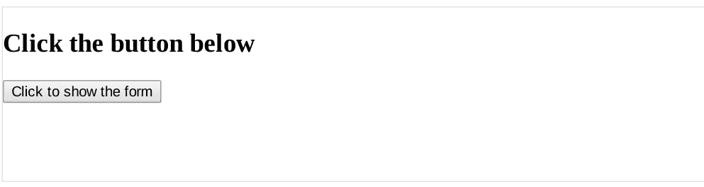

注：源文档提供了具有固定定位的表单的 HTML/CSS，但将其实现为模态框取决于你的决定。

打开沙箱进行任务。 ↗

## 解决方案

# 文档和资源加载
页面：DOMContentLoaded, load, beforeunload, unload

HTML 页面的生命周期有三个重要的事件：

- DOMContentLoaded – 浏览器填充已加载的 HTML，并构建 DOM 树，但外部资源（如图片 `` 和样式表）可能尚未加载。
- load – 不仅加载了 HTML，还加载了所有外部资源：图像、样式等。
- beforeunload/unload – 用户正在离开页面。

每个事件都可能有用：

- DOMContentLoaded 事件 – DOM 已就绪，因此处理程序可以查找 DOM 节点，初始化界面。
- load 事件 – 外部资源已加载，因此样式已应用，图片大小已知等。
- beforeunload 事件 – 用户正在离开：我们可以检查用户是否保存了更改，并询问他们是否真的想离开。
- unload – 用户几乎已经离开了，但我们仍然启动某些操作，例如发送统计数据。

让我们探索这些事件的细节。

## DOMContentLoaded

`DOMContentLoaded` 事件发生在 `document` 对象上。
我们必须使用 `addEventListener` 来捕获它：

```
document.addEventListener("DOMContentLoaded", ready);
// 不要用 "document.onContentLoaded = ..."
```

例如：

```
<script>
function ready() {
  alert('DOM is ready');
  // 图片尚未加载（除非已缓存），所以大小为 0x0
  alert(`Image size: ${img.offsetWidth}x${img.offsetHeight}`);
}
  document.addEventListener("DOMContentLoaded", ready);
</script>
```

```

```

在示例中，DOMContentLoaded 触发了，因此它可以看到所有元素，包括下面的 ``。

但它并没有等待图片加载。所以 alert 显示的大小为 0。

第一个 DOMContentLoaded 事件非常简单。DOM 树已就绪——这就是该事件。不过这里有一些特殊之处。

### DOMContentLoaded 和脚本

当浏览器处理 HTML 文档并遇到 `<script>` 标签时，它需要在继续构建 DOM 之前执行它。这是一种预防措施，因为脚本可能想要修改 DOM，甚至用 `document.write` 写入，所以 DOMContentLoaded 必须等待。

因此 DOMContentLoaded 绝对发生在脚本之后。

```
<script>
document.addEventListener("DOMContentLoaded", () => {
  alert('DOM ready!');
});
</script>
```

```
<script src="https://cdn.cloudflare.com/ajax/libs/lodash.js/4.3.0/lodash.js"></script>
```

```
<script>
alert("Library loaded, inline script executed");
</script>
```

在上面的示例中，我们首先看到 "Library loaded..."，然后是 "DOM ready!"（所有脚本都已执行）。

```
带有 async, defer 或 type="module" 的脚本不会阻塞
DOMContentLoaded
脚本属性 async 和 defer（我们稍后会介绍）不会阻塞
DOMContentLoaded. JavaScript 模块的行为类似于 defer，它们也不会阻塞它。
所以我们在这里讨论的是“普通”脚本，比如 <script>...</script>，
或 <script src="..."></script>
```

### DOMContentLoaded 和样式

外部样式不影响 DOM，所以 DOMContentLoaded 不会等待它们。

但有一个陷阱。如果我们在样式之后有一个脚本，那么该脚本必须等待样式表加载：

```
<link type="text/css" rel="stylesheet" href="style.css">
<script>
// 脚本在样式表加载之前不会执行
alert(getComputedStyle(document.body).marginTop);
</script>
```

这是因为脚本可能想要获取元素的坐标和其他依赖于样式的属性，如上面的示例。自然地，它必须等待样式。

由于 DOMContentLoaded 等待脚本，现在它也会等待它们之前的样式。

### 浏览器内置的自动填充

Firefox、Chrome 和 Opera 在 DOMContentLoaded 时自动填充表单。

例如，如果页面上有一个包含登录和密码的表单，且浏览器记住了这些值，那么在 DOMContentLoaded 时可能会尝试自动填充它们（如果经过用户许可）。

所以，如果 DOMContentLoaded 被长时间运行的脚本推迟，自动填充也会等待。你可能在某些网站上见过这种情况（如果你使用浏览器自动填充）——登录/密码字段不会立即填充，而是有一个延迟，直到页面完全加载。这实际上是直到 DOMContentLoaded 的延迟。

## window.onload

`window` 对象上的 `load` 事件在整个页面加载完成（包括样式、图像和其他资源）时触发。

下面的示例正确显示了图片大小，因为 `window.onload` 等待图片：

```
<script>
window.onload = function() {
  alert('Page loaded');
  // 此时图片已加载
  alert(`Image size: ${img.offsetWidth}x${img.offsetHeight}`);
};
</script>
```


## window.onload / unload

当访问者离开页面时，`window` 上会触发 `unload` 事件。

假设我们正在收集鼠标点击、滚动等信息。`unload` 事件发生在用户离开时，我们希望将数据保存到服务器。

有一个特殊的方法 `navigator.sendBeacon(url, data)` 用于此类需求，见 [https://w3c.github.io/beacon/]。它在后台发送数据。以下是使用方法：

```
let analyticsData = { /* 收集的数据对象 */ };
window.addEventListener("unload", function() {
  navigator.sendBeacon("/analytics", JSON.stringify(analyticsData));
});
```

- 请求以 POST 方式发送。
- 我们不仅可以发送字符串，还可以表单和其他格式（见 Fetch 章节），但通常是字符串化的对象。
- 数据限制为 64kb。

当 `sendBeacon` 请求完成时，浏览器可能已经离开了文档，因此无法获取服务器响应（对于分析来说通常为空）。

`fetch` 方法中的 `keepalive` 标志用于通用网络请求。你可以在 Fetch API 章节找到更多信息。

## window.onbeforeunload

当访问者开始离开页面或尝试关闭窗口时，`beforeunload` 处理程序会请求额外的确认。

如果我们可以取消事件，浏览器可能会询问访问者是否确定。

你可以通过运行这段代码并刷新页面来尝试：

```
window.onbeforeunload = function() {
  return false;
};
```

出于历史原因，返回非空字符串也被视为取消事件。早些浏览器会将其显示为消息，但根据现代规范，它们不应该这样做。

这是一个示例：

```
window.onbeforeunload = function() {
  return "There are unsaved changes. Leave now?";
};
```

这种行为被改变了是因为某些网站滥用了这个事件处理程序，显示误导性且烦人的消息。目前浏览器仍然可能将其显示为消息，但除此之外，无法自定义显示给用户的消息。

## readyState

如果我们在文档加载后设置 `DOMContentLoaded` 处理程序，会发生什么？

理所当然，它永远不会运行。

在某些情况下，我们不确定文档是否已经就绪。我们希望函数在 DOM 加载时执行，无论是现在还是以后。

`document.readyState` 属性告诉我们当前的加载状态。

它有 3 种可能的值：

- "loading" – 文档正在加载。
- "interactive" – 文档已完全读取。
- "complete" – 文档已完全读取且所有资源（如图像）均已加载。

因此我们可以检查 `document.readyState` 并设置处理程序，或者在它就绪时立即执行代码。

如下所示：

```javascript
function work() { /*...*/ }
if (document.readyState == 'loading') {
  // 仍在加载，等待事件
  document.addEventListener('DOMContentLoaded', work);
} else {
  // DOM 已就绪！
  work();
}
```

此外还有 `readyStatechange` 事件，它在状态改变时触发，因此我们可以像这样打印所有这些状态：

```javascript
// 当前状态
console.log(document.readyState);
// 打印状态变化
document.addEventListener('readyStatechange', () => console.log(document.readyState));
```

`readyStatechange` 事件是跟踪文档加载状态的另一种机制，它出现很早了。现在它很少被使用。

为了完整起见，让我们看看完整的事件流。

这是一个包含 `<iframe>`、`` 和记录事件处理程序的文档：

```html
<script>
log('initialState:' + document.readyState);
document.addEventListener('readyState', () => log('readyState:' + document.readyState));
document.addEventListener('DOMContentLoaded', () => log('DOMContentLoaded'));
window.onload = () => log('window onload');
</script>
<iframe src="iframe.html" onload="log('iframe onload')"></iframe>

<script>
img.onload = () => log('img onload');
</script>
```

运行示例在沙箱中。

典型的输出如下：

1. [1] initial readyState:loading
2. [2] readyState:interactive
3. [3] DOMContentLoaded
4. [4] iframe onload
5. [5] img onload
6. [6] readyState:complete
7. [7] window onload

方括号中的数字表示发生的大致时间。带有相同数字的事件大约在同一时间发生（± 几毫秒）。

- `document.readyState` 在 DOMContentLoaded 之前变为 `interactive`。这两者实际上含义相同。
- `document.readyState` 在所有资源（`iframe` 和 `img`）加载后变为 `complete`。我们可以看到它与 `img.onload`（`img` 是最后一个资源）以及 `window.onload` 大约同时发生。切换到 `complete` 状态等同于 `window.onload`。区别在于 `window.onload` 在所有其他 `load` 处理程序之后运行。

## 总结

页面加载事件：

- DOMLoaded 事件在 DOM 就绪时在文档上触发。我们可以在此阶段对元素应用 JavaScript。
- 诸如 `<script>...</script>` 或 `<script src="..."></script>` 的脚本会阻塞 DOMContentLoaded，浏览器会等待它们执行。
- 图像和其他资源可能仍在继续加载。
- window 上的 load 事件在页面和所有资源加载后触发。我们很少使用它，因为通常不需要等待那么久。
- window 上的 beforeunload 事件在用户想要离开页面时触发。如果我们取消该事件，浏览器会询问用户是否真的想离开（例如我们有未保存的更改）。
- window 上的 unload 事件在用户最终离开时触发，在处理程序中我们只能做一些不会延迟或询问用户的简单事情。由于限制，它很少被使用。我们可以使用 `navigator.sendBeacon` 发送网络请求。
- `document.readyState` 是文档的当前状态，变化可以在 `readyStatechange` 事件中跟踪：
  - loading – 文档正在加载。
  - interactive – 文档已解析，与 DOMContentLoaded 大约同时发生，但发生在其之前。
  - complete – 文档和资源已加载，与 window.onload 大约同时发生，但发生在其之前。

# Scripts：async, defer

在现代网站中，脚本通常比 HTML 更“重”：它们的下载体积更大，处理时间也更长。

当浏览器加载 HTML 并遇到 `<script>...</script>` 标签时，它无法继续构建 DOM。它必须立即执行脚本。外部脚本 `src="..."></script>` 也是如此，浏览器必须等待脚本下载、执行它，并在之后处理页面的剩余部分。

这导致了两个重要问题：

1. 脚本看不到它们下方的 DOM 元素，因此无法添加处理程序等。
2. 如果页面顶部有一个庞大的脚本，会“阻塞页面”。用户在脚本下载并运行之前无法看到页面内容：

```html
<p>...脚本之前的内容...</p>
<script src="https://javascript.info/article/script-async-defer/long.js?speed=1">
<!-- 在脚本加载之前，这里是不可见的 -->
<p>...脚本之前的内容...</p>
</script>
```

有两个属性可以解决这个问题：`defer` 和 `async`。

## defer 属性

`defer` 属性告诉浏览器在后台下载脚本，并仅在文档解析后执行它。如果如果多个脚本都有 `defer`，它们将按文档顺序执行。

```html
<p>...脚本之前的内容...</p>
<script src="https://javascript.info/article/script-async-defer/long.js?speed=1" defer></script>
<script src="https://javascript.info/article/script-async-defer/small.js?speed=1" defer></script>
<p>...脚本之后的内容...</p>
```

对于 `defer`，`DOMContentLoaded` 事件在所有 `defer` 脚本执行后触发。

```html
<p>...脚本之前的内容...</p>
<script src="https://javascript.info/article/script-async-defer/long.js?speed=1" defer></script>
<script src="https://javascript.info/article/script-async-defer/small.js?speed=1" defer></script>
<p>...脚本之后的内容...</p>
```

## async 属性

`async` 属性告诉浏览器在后台下载脚本，并在下载完成后立即执行它，不阻塞 DOM 解析。

```html
<p>...脚本之前的内容...</p>
<script async src="https://javascript.info/article/script-async-defer/long.js?speed=1"></script>
<script async src="https://javascript.info/article/script-async-defer/small.js?speed=1"></script>
<p>...脚本之后的内容...</p>
```

对于 `async`，脚本按下载完成的顺序执行。`DOMContentLoaded` 可能在 async 脚本之前或之后触发。

| 属性 | 下载 | 执行 | 顺序 | DOMContentLoaded |
| :--- | :--- | :--- | :--- | :--- |
| 无 | 阻塞解析 | 立即执行 | 顺序执行 | 之后 |
| defer | 后台 | 解析后 | 文档顺序 | 脚本之后 |
| async | 后台 | 下载后立即 | 加载顺序 | 不可靠 |

总结：
- 对于依赖于 DOM 或顺序的脚本，使用 `defer`，或者将其放在 `<body>` 的末尾。
- 对于不依赖其他脚本的独立脚本，使用 `async`。

## 动态脚本

我们也可以使用 JavaScript 动态添加脚本：

```javascript
let script = document.createElement('script');
script.src = "/article/script-async-defer/long.js";
document.body.append(script); // (*)
```

脚本一旦被添加到文档中就会开始加载 (*)。

### 动态脚本默认以“异步 (async)” 方式运行。

这意味着：

- 它们不等待任何内容，没有任何内容在等待它们。
- 先加载的脚本先执行（“加载优先” 顺序）。

我们可以通过显式将 `async` 属性设置为 `false`，将加载优先顺序更改为文档顺序（类似于普通脚本）：

```javascript
let script = document.createElement('script');
script.src = "/article/script-async-defer/long.js";
script.async = false;
document.body.append(script);
```

例如，我们这里有两个脚本。如果不设置 `script.async=false`，它们将按照加载优先顺序执行（可能是 `small.js` 先执行）。但带有此标志后，顺序将变为“与文档顺序一致”：

```javascript
function loadScript(src) {
  let script = document.createElement('script');
  script.src = src;
  script.async = false;
  document.body.append(script);
}

// 因为 async=false，long.js 先执行
loadScript("/article/script-async-defer/long.js");
loadScript("/article/script-async-defer/small.js");
```

## 总结

`async` 和 `defer` 有一个共同点：它们都不会阻塞页面渲染。因此用户可以立即阅读页面内容并熟悉页面。

但它们之间也存在本质区别：

| 顺序 | DOMContentLoaded |
| --- | --- |
| async | 加载优先顺序。与文档无关——哪个先加载就先执行 | 无关。可能在文档完全加载之前就开始加载和执行。这发生在脚本较小或已缓存，且文档足够长的情况下。 |
| defer | 文档顺序（按照在文档中的顺序）。 | 在文档加载并解析后执行（如果需要则等待），在 `DOMContentLoaded` 之前执行。 |

> **没有脚本的页面应该是可**
> 请注意，如果你使用 `defer`，那么页面在脚本加载之前就是可见的。
> 因此用户可以阅读页面，但某些图形组件可能还没有准备好。

在适当的位置应该有“加载”指示，禁用不可用的按钮，以向用户清晰显示哪些已就绪，哪些尚未准备。

在实践中，`defer` 用于需要整个 DOM 和/或对相对执行顺序重要的脚本。而 `async` 用于独立的脚本，例如计数器或广告。它们的相对执行顺序并不重要。

# 资源加载：onload 和 onerror

浏览器允许跟踪外部资源的加载情况——脚本、iframe、图片等。

这里有两个事件用于此类：

- `onload` — 加载成功，
- `onerror` — 发生错误。

## 加载脚本

假设我们需要加载一个第三方脚本并调用其中定义的函数。
我们可以这样动态加载它：

```javascript
let script = document.createElement('script');
script.src = "my.js";
document.head.append(script);
```

但如何运行在该脚本内部定义的函数呢？我们需要等待脚本加载，然后才能调用它。

> **请注意：**
> 对于我们自己的脚本，可以在这里可以使用 JavaScript 模块，但它们并没有
> 被第三方库广泛采用。

## script.onload

主要的辅助工具是 `load` 事件。它在脚本加载并执行后触发。

例如：

```javascript
let script = document.createElement('script');
// 可以加载来自任何域的脚本
script.src = "https://cdnjs.cloudflare.com/ajax/libs/lodash.js/4.3.0/lodash.js";
document.head.append(script);
script.onload = function() {
  // 脚本创建了一个辅助函数 "_"
  alert(_); // 函数已可用
};
```

所以在 `onload` 中，我们可以使用脚本变量、运行函数等。

如果加载失败了呢？例如，不存在该脚本（404 错误）或服务器宕机（不可用）。

## Script.onerror

脚本加载过程中发生的错误可以通过 `error` 事件进行跟踪。
例如，让我们请求一个不存在的脚本：

```javascript
let script = document.createElement('script');
script.src = "https://example.com/404.js"; // 没有这样的脚本
document.head.append(script);
script.onerror = function() {
  alert("加载错误：" + this.src); // 加载错误 https://example.com/404.js;
};
```

请注意，我们无法在此获取 HTTP 错误详情。我们不知道是 404 错误、500 错误或其他。只是加载失败了。

> **重要：**
> `onload/onerror` 事件仅跟踪加载本身。
> 脚本处理和执行期间的错误不在这些事件的范围范围内。要跟踪脚本错误，可以使用 `window.onerror` 全局处理程序。

## 其他资源

加载错误事件也适用于其他资源，基本上适用于任何具有外部 `src` 的资源。

例如：

```javascript
let img = document.createElement('img');
img.src = "https://example.com";
img.onload = function() {
  alert("图片已加载");
};
img.onerror = function() {
  alert("发生错误");
};
```

我们可以在“anonymous”（不发送 cookie，需要一个服务端标头）和“use-credentials”（也发送 cookie，需要两个服务端标头）之间进行选择。

如果我们不在乎 cookie，那么“anonymous”是更好的选择：

```
<script>
window onerror = function(message, url, line, col, errorObj) {
  alert(`{message}\n${url}, ${line}:${col}`);
};
</script>
<script crossorigin="anonymous" src="https://cors.javascript.info/article/onload-"></script>
```

现在，假设服务器提供了 `Access-Control-Allow-Origin` 头部，一切一切正常。我们拥有完整的错误报告。

## 总结

图片 ``、外部样式、脚本和其他资源都提供了加载错误事件来跟踪它们的加载情况：

- load 在加载成功时触发
- error 在加载失败时触发。

唯一的例外是 `<iframe>`：由于历史原因，它在任何加载完成时都会触发 load，即使未找到页面也是。

`reststate` 事件也适用于资源，但很少使用，因为 `load/error` 事件更简单。

# 任务

## 使用回调加载图片

重要性：4

通常，图片在创建时就会被加载。因此，当我们向页面添加 `` 时，用户不会立即看到图片。浏览器需要先加载它。

为了立即显示图片，我们可以“提前”创建它，如下所示：

```
let img = document.createElement('img');
img.src = 'my.jpg';
```

浏览器开始加载图片并将其记录在缓存中。稍后，相同的图片出现在文档中（无论如何），它会立即显示。

## 创建一个函数 `preLoadImages(sources, callback)`，从数组 `sources` 加载所有图片并在准备好后运行 `callback`。

例如，将在图片加载后显示 `alert`：

```
function loaded() {
  alert("Images loaded")
}
preLoadImages(["1.jpg", "2.jpg", "3.jpg"], loaded);
```

在发生错误的情况下，该函数仍应假设图片已“加载”。

换句话说，当所有图片加载完成或出错时，都会执行 `callback`。

该函数非常有用，例如当我们计划显示一个可以滚动的图片库，并想确保所有图片都已加载时。

在源文档中，你可以找到测试图片的链接，以及检查它们是否已加载的代码。它应该输出 `300`。

打开任务的沙盒。↗

# 杂杂

## MutationObserver

`MutationObserver` 是一个内置对象，用于观察 DOM 元素并在发生变化时触发回调。

我们将首先介绍语法，然后探索一个真实的应用用例。

### 语法

`MutationObserver` 很容易使用。

首先，我们创建一个带有一个回调函数的观察者：

```
let observer = new MutationObserver(callback);
```

然后将其附加到 DOM 节点上：

```javascript
observer.observe(node, config);
```

`config` 是一个带有布尔选项的对象，用于定义“对哪种变化做出反应”：

- childList – 节点直接子节点的变化
- subtree – 节点所有后代的变化
- attributes – 节点的属性
- attributeOldValue – 记录属性的旧值（推断属性）
- characterData – 是否观察 node.data（文本内容）
- characterDataOldValue – 记录 node.data 的旧值（推断 characterData）
- attributeFilter – 属性名称数组，仅观察被选属性。

随后在变化发生后，回调被执行，并将 `MutationRecord` 对象列表作为第一个参数，观察者本身作为第二个参数。

`MutationRecord` 对象具有以下属性：

- type – 变化类型，包括：
  - "attributes": 属性被修改
  - "characterData": 数据被修改，用于文本节点
  - "childList": 子元素的添加/移除
  - target – 变化发生的地方：对于 "attributes" 是元素，对于 "characterData" 是文本节点，对于 "childList" 变化是元素
  - addedNodes/removedNodes – 被添加/移除的节点
  - previousSibling/nextSibling 与添加/移除节点的前一个和后续节点
  - attributeName/attributeNamespace – 更改属性的名称/命名空间（针对 XML）
- oldValue – 旧值，仅用于属性或文本变化。

例如，这里有一个 `contentEditable` 属性的 `<div>`。该属性允许我们聚焦并编辑它。

```html
<div contentEditable id="elem">Click and <b></b>, please </div>
<script>
let observer = new MutationObserver(mutationRecords => {
  console.log(mutationRecords); // console.log(变化内容)
});
observer.observe(elem, {
  // 观察属性以外的所有
  childList: true,
  subtree: true,
  characterDataOldValue: true
});
</script>
```

如果我们更改 `<b>me</b>` 内部的文本，我们将得到一次突变：

```javascript
mutationRecords = [{
  type: "characterData",
  oldValue: "me",
  target: <text node>,
  // 其他属性为空
}];
```

如果我们选择并移除 `<b>me</b>`，我们将得到多次突变：

```javascript
mutationRecords = [{
  type: "childList",
  target: <elem>,
  removedNodes: [<b></b>],
  nextSibling: <text node>,
  previousSibling: <text node>,
}, {
  type: "characterData",
  target: <text node>,
  oldValue: "me",
  // 其他属性为空
}];
```

### MutationObserver 用例

`MutationObserver` 是一个内置对象，用于观察 DOM 元素并在发生变化时触发回调。

我们将首先介绍语法，然后探索一个真实的应用用例。

### 语法

`MutationObserver` 很容易使用。

首先，我们创建一个带有一个回调函数的观察者：

```javascript
let observer = new MutationObserver(callback);
```

然后将其附加到 DOM 节点上：

```javascript
observer.observe(node, config);
```

`config` 是一个带有布尔选项的对象，用于定义“对哪种变化做出反应”：

- childList – 节点直接子节点的变化
- subtree – 节点所有后代的变化
- attributes – 节点的属性
- attributeOldValue – 记录属性的旧值（推断属性）
- characterData – 是否观察 node.data（文本内容）
- characterDataOldValue – 记录 node.data 的旧值（推断 characterData）
- attributeFilter – 属性名称数组，仅观察被选属性。

随后在变化发生后，回调被执行，并将 `MutationRecord` 对象列表作为第一个参数，观察者本身作为第二个参数。

`MutationRecord` 对象具有以下属性：

- type – 变化类型，包括：
  - "attributes": 属性被修改
  - "characterData": 数据被修改，用于文本节点
  - "childList": 子元素的添加/移除
  - target – 变化发生的地方：对于 "attributes" 是元素，对于 "characterData" 是文本节点，对于 "childList" 变化是元素
  - addedNodes/removedNodes – 被添加/移除的节点
  - previousSibling/nextSibling 与添加/移除节点的前一个和后续节点
  - attributeName/attributeNamespace – 更改属性的名称/命名空间（针对 XML）
- oldValue – 旧值，仅用于属性或文本变化。

例如，这里有一个 `contentEditable` 属性的 `<div>`。该属性允许我们聚焦并编辑它。

```html
<div contentEditable id="elem">Click and <b></b>, please </div>
```

...（省略重复部分）...

## 动态高亮演示

这是一个可以运行的示例。

如果你运行这段代码，它将开始观察下面的元素并高亮那里出现的任何代码片段：

```javascript
let observer = new MutationObserver(mutations => {
for(let mutation of mutations) {
```

```javascript
for(let node of mutation addedNodes) {
  // 我们只跟踪元素，跳过节点（例如文本节点）
  if(!node instanceof HTMLElement && !(node instanceof HTMLElement)) continue;

  // 检查被插入的元素是否为代码片段
  if (node.matches('pre[class="language-"]')) {
    Prism.highlightElement(node);
  }

  // 也许在其子树的某处有代码片段
  for(let elem of node.querySelectorAll('pre[class="language-"]')) {
    Prism.highlightElement(elem);
  }
}
};
```

let demoElement = document.getElementById('highlight-demo');

observer.observe(demoElement, {childList: true, subtree: true});

id 为="highlight-demo" 的 demo 元素由上面的示例观察。

代码填充了 innerHTML。请先运行上面的代码，它将监听并高亮新内容：

```javascript
let demoElement = document.getElementById('highlight-demo');

// 动态插入包含代码片段的内容
demoElement.innerHTML = `A code snippet is below:
<pre class="language-javascript"><<code>let hello = "world!"; </code></pre>
<<div>Another one: </div>
<<div>
  <pre class="language-css"><code>.class { margin: 5px; } </code></pre>
</div>`;
```

现在我们有了 MutationObserver，它可以跟踪被观察元素或整个文档的高亮情况。我们可以无需担心就在 HTML 中添加/移除代码片段。

## 附加方法

有一个停止观察节点的方法：

- `observer.disconnect()` – 停止观察。

此外：

- `mutationRecords = observer.takeRecords()` – 获取未处理的变动记录列表，即那些已经发生但回调函数尚未处理的记录。

```javascript
// 我们将断开观察器
// 它可能还没有处理某些变动
let mutationRecords = observer.takeRecords();
// 处理 mutationRecords

// 现在所有记录已处理完毕
observer.disconnect();
```

## 垃圾回收

观察器内部对节点使用弱引用（weak references）。这意味着：如果一个节点从 DOM 中移除，它将变得不可达，然后会被垃圾回收，而观察器不会阻止这一过程。

## 总结

MutationObserver 可以对 DOM 的变化做出反应：属性、添加/移除的元素、文本内容。

我们可以用它来跟踪由我们自己的或第三方代码引入的变化。

例如，对动态插入的内容进行后处理，如 demo innerHTML 所示，类似于示例中的高亮。

# 选择（Selection）与范围（Range）

在本章中，我们将介绍文本选择。

JavaScript 可以用它做任何事情：获取现有选择、选择/取消选择其或部分、从文档中移除被选部分、将其封装在标签中等。

你可以在结尾的“总结”部分找到几个现成的可用配方。但如果你继续读下去，将会收获更多。底层的 Range 和 Selection 对象很容易理解，上手后你就不需要配方也能让它们实现你想要的功能。

# Range（范围）

选择 Range 的基本概念：基本上是一对“边界点”：范围开始和范围结束。

每个点都表示为一个 DOM 节点，并带有相对于起始点的相对偏移量。对于元素节点，偏移量是子节点索引；对于文本节点，它是文本中的位置。

首先，我们可以创建一个范围（构造函数没有参数）：


```javascript
let range = new Range();
```

然后我们可以使用 `range.setStart(node, offset)` 和 `range.setEnd(node, offset)` 设置边界。

例如，这段 HTML 片段：

```html
<p id="p">Example: <i>italic</i> and <b>bold</b></p>
```

这是它的 DOM 结构，注意这里文本节点对我们来说很重要：


让我们选择 "Example: italic"。这是 `<p>` 的前两个子节点（计算文本节点）：

```html
<p id="p">Example: <i>italic</i></p> and <b>bold</b></p>
```

Example: <i>italic</i> and <b>bold</b>

```javascript
let range = new Range();

range.setStart(p, 0);
range.setEnd(p, 2);

// 范围的 toString 返回其内容（不带标签）
alert(range); // Example: italic

// 将此范围应用于文档选择（稍后介绍）
document.getSelection().addRange(range);
```

- `range.setStart(p, 0)` – 将起始设置在 `<p>` 的第 0 个子节点（即文本节点 "Example: "）。
- `range.setEnd(p, 2)` – 范围延伸到但不包含 `<p>` 的第 2 个子节点（那是文本节点 " and " 但结尾不包含，所以最后一个选中的节点是 italic）。

这里有一个更完整的测试台，你可以尝试各种变体：

<p id="p">Example: <i>italic</i> and <b>bold</b></p>

从 <input id="start" type="number" value=1> 到 <input id="end" type="number"><button id="button">点击选择</button>

```javascript
button.onclick = () => {
  let range = new Range();
```

```javascript
p.innerHTML = `Example: <i>italic</i> and <b>bold</b>`;
result.innerHTML = '';

range.setStart(p.firstChild, 2);
range.setEnd(p.querySelector('b').firstChild, 3);

window.getSelection().removeAllRanges();
window.getSelection().addRange(range);
```

```javascript
for(let method in methods) {
  document.write(`<button onclick="methods.${method}()">${method}</button></div>`);
}
```

methods.resetExample();

<script>

点击按钮对选中文执行斜体效果，点击 "resetExample" 重置它。

示例：*italic* 和 **bold**

- extractContents
- cloneContents
- insertNode
- surroundContents
- resetExample

还存在比较范围的方法，但这些很少使用。当你需要它们时，请参考规范或 MDN 手册。

# Selection (选择)

Range 是一个用于管理选择范围的通用对象。我们可以创建此类对象并传递它们——它们本身不会在视觉上选择任何内容。

文档选择由 `Selection` 对象表示，可以通过 `window.getSelection()` 或 `document.getSelection()` 获取。

一个选择可能包含零或多个范围。至少，Selection API 是这样说明的。但在实践中，Firefox 允许使用 Ctrl+点击（Mac 上为 Cmd+点击）在文档中选择多个范围。

这里是一个在 Firefox 中创建的具有 3 个范围的选择截图：

# Example Domain (示例域名)

该域名被建立用于文档中的说明性示例。你可以在无需预先协调或请求许可的情况下在示例中使用此域名。

更多信息...

其他浏览器每个选择最多支持 1 个范围。正如我们将看到的，某些 Selection 方法暗示可能存在许多范围，但再次，在除 Firefox 之外的所有浏览器中，最多只有 1 个。

# Selection properties (选择属性)

与范围类似，选择也有一个起点，称为“anchor”（锚点），和一个终点，称为“focus”（焦点）。

主要的选择属性有：

- `anchorNode` – 选择开始的节点，
- `anchorOffset` – 选择在 `anchorNode` 中开始的偏移量，
- `focusNode` – 选择结束的节点，
- `focusOffset` – 选择在 `focusNode` 中结束的偏移量，
- `isCollapsed` – 如果没有选择任何内容（空范围）或不存在则为 true。
- `rangeCount` – 选择中的范围计数，在除 Firefox 之外的所有浏览器中最多为 1。

# Selection may end in the document before start (选择的结束位置可能在起点之前)

选择内容有很多方法，取决于用户代理：鼠标、热键、移动端点击等。

其中某些方法（如鼠标）允许以两个方向创建相同的选择：“从左到右”和“从右到左”。

如果选择的起点（anchor）位于文档中焦点（focus）之前，则该选择被认为具有“向前”方向。

例如，如果用户使用鼠标从 "Example" 移动到 "italic"：anchor

```html
<p>Example: <i>italic</i> and <b>></b></p>
```

否则，如果他们从 "italic" 的末尾移动到 "Example"，则选择是“向后”的，其焦点会在锚点之前：

```html
<p>Example: <i>italic</i> and <b>></b></p>
```

这与 `Range` 对象不同，`Range` 始终是向前的：范围的起点不能在终点之后。

# Selection events (选择事件)

有一些用于跟踪选择的事件：

- `elem.onselectstart` – 选择开始时触发。
  - 可在任何元素上触发。
  - 默认行为将导致选择不开始。
- `document.onselectionchange` – 选择发生变化时触发。
  - 仅在 document 上触发。

# Selection tracking demo (选择跟踪演示)

这是一个小型演示，显示了随变化动态变化的选择边界：

<p id="p">Select: <i>italic</i> and <b>bold</b></p>

（注：由于提供的文本存在大量重复和乱码，此处已根据逻辑流进行了去重和翻译）

- "select" – 将选中新插入的文本。
- "start" – 选取范围收缩到插入文本的正之前。
- "end" – 选取范围收缩到插入文本的之后。
- "preserve" – 尝试保留选取。这是默认值。

在此示例中，使用 `id="area"` 的 `unselect` 事件来跟踪选取：

```
<textarea id="area" style="width:80%;height:60px">Select this text</textarea><br>
From <input id="from" disabled> To <input id="to" disabled>
```

```javascript
<script>
  area.onselect = function() {
    from.value = area.selectionStart;
    to = area.selectionEnd;
  };
</script>
```

根据规范，`document.onselectionchange` 事件不应在表单控件内部的选择时触发，因为它与文档选择和范围无关。某些浏览器会生成该事件。

当未选择任何内容时，`selectionStart` 和 `selectionEnd` 都等于光标位置。

或者换句话说，当未选择任何内容时，选取收缩在光标位置。

我们可以用它来移动光标：

```
<textarea id="area" style="width:80%;height:60px">
Focus on me, the cursor will be at position 10.
</textarea>
```

```javascript
<script>
  area.onfocus = () => {
    // 零延迟的 setTimeout(
    // 在浏览器焦点动作后触发
    setTimeout(() => {
      // 我们可以设置任何选取
      // 如果 start=end，光标恰好位于该位置
      area.selectionStart = area.selectionEnd = 10;
    });
  };
</script>
```

...或者使用 `setRange` 在“光标处”插入某些内容。

这里有一个按钮，可以将选取的内容替换为 "TEXT" 并将光标放在其后。如果选取为空，则将文本插入到光标位置：

```
<textarea id="area" style="width:80%; height:60px">Select something here</textarea><br>

<button id="button">Insert!</button>

<script>
button.onclick = () => {
  // 将范围替换为 TEXT 并收缩选取在其末尾
  area.rangeText("TEXT", area.selectionStart, area.selectionEnd, "end");
};
</script>
</body>
```

# 使内容不可选取

要使某些内容变为不可选取，三种方法：

1. 使用 CSS 属性 `user-select: none`。

```html
<style>
#elem {
  user-select: none;
}
</style>
<div id="elem">Unselectable</div> <div>Selectable</div>
```

这不允许选取从 `elem` 开始。但用户可能会从其他地方开始选取并将 `elem` 包含其中。

此时 `elem` 将成为 `document.getSelection()` 的一部分，因此选取实际上发生了，但在复制粘贴时该内容通常会被忽略。

2. 在 `onselectstart` 或 `mousedown` 事件中阻止默认操作。

```html
<div id="elem">Unselectable</div> <div>Selectable</div>

<script>
elem.onselectstart = () => false;
</script>
```

这阻止了在 `elem` 上开始选取，但访问者可能会从另一个元素开始，然后扩展到 `elem`。

当同一个操作上有另一个触发选取动作的事件处理程序时，这非常方便。所以我们禁用选取以避免冲突。

而且 `elem` 的内容仍然会被复制。

3. 我们也可以在选取发生后通过 `document.getSelection().empty()` 事后清除选取。这很少使用，因为这会导致选取出现又消失时产生不必要的闪烁。

# 参考文献

- DOM 规范: Range ↗
- Selection API ↗
- HTML 规范: APIs for the text control selections ↗

# 总结

我们涵盖了两种用于选取的不同 API：

1. 针对文档：`Selection` 和 `Range` 对象。
2. 针对 `input`, `textarea`：额外的方法和属性。

第二个 API 非常简单，因为它处理的是文本。

最常用的配方可能是：

1. 获取选取内容：

```javascript
let selection = document.getSelection();
// 然后对 selection.getRangeAt(0) 应用 Range 方法
// 如果支持多选，则应用所有范围
for (let i = 0; i < selection.rangeCount; i++) {
  cloned.append(selection.getRangeAt(i).cloneContents());
}
```

2. 设置选取内容：

```javascript
let selection = document.getSelection();
// 直接设置；
```

```javascript
selection.setBaseAndExtent(...from...to...);

// 或者创建范围：
selection.removeAllRanges();
selection.addRange(range);
```

关于选取的另一个知识点：在可编辑元素（如 `<textarea>`）中的光标位置始终位于选取的开始或结束。

我们可以通过设置 `elem.selectionStart` 和 `elem.selectionEnd` 来获取光标位置并移动光标。

# 事件循环：微任务和宏任务

浏览器 JavaScript 的执行流（在 Node.js 中也是如此）基于*事件循环*的。

理解事件循环如何工作对于优化至关重要，有时对于正确的架构也是如此。

在本章中，我们首先涵盖关于工作原理的理论细节，然后查看这些知识的实际应用。

# 事件循环

*事件循环* 的概念非常简单。有一个无尽的循环。

理解事件循环如何工作对于优化至关重要，有时对于正确的架构也是如此。

在本章中，我们首先涵盖关于工作原理的理论细节，然后查看这些知识的实际应用。

# 事件循环：微任务（microtasks）和宏任务（macrotasks）

浏览器 JavaScript 的执行流（在 Node.js 中也是如此）基于一个*事件循环*的。

理解事件循环如何工作对于优化至关重要，有时对于正确的架构也是如此。

在本章中，我们首先涵盖关于工作原理的理论细节，然后查看这些知识的实际应用。

# 事件循环

*事件循环* 的概念非常简单。有一个无尽的循环。

理解事件循环如何工作对于优化至关重要，有时对于正确的架构也是如此。

在本章中，我们首先涵盖关于工作原理的理论细节，然后查看这些知识的实际应用。

# 用例：CPU 密集型任务

假设我们有一个 CPU 密集型任务。

例如，语法高亮（用于为示例着色）是非常消耗 CPU 的。

当引擎忙于语法高亮时，它无法进行 DOM 相关操作、处理用户事件等。在这种情况下，它甚至可能导致浏览器“挂起”，这是不可接受的。

所以我们可以将长文本拆分。先高亮前 100 行，然后使用零延迟的 `setTimeout` 调度另外 100 行，以此类推。

为了演示这种方法，为了简单起见，我们不使用语法高亮，而是取一个从 1 数到 10000000 的函数。

如果你运行下面的代码，引擎将“挂起”一段时间。服务器端的 JS 是显而易见的，如果你在浏览器中运行，尝试点击页面上的其他按钮——你会发现计数完成之前，任何其他事件都不会被处理。

```javascript
let i = 0;
let start = Date.now();
function count() {
  // 执行一项重工作
  for (let j = 0; j < 1e9; j++) {
    i++;
  }
  alert("完成耗时：" + (Date.now() - start) + 'ms');
}
count();
```

浏览器可能会显示“脚本运行时间过长”警告（但希望不会，因为数字并不大）。

让我们使用嵌套的 `setTimeout` 来拆分任务：

```javascript
let i = 0;
let start = Date.now();
function count() {
  // 执行重型任务的一部分 (*)
  do {
    i++;
  } while (i % 1e6 != 0);
}
if (i == 1e9) {
```

```javascript
alert("Done in " + (Date.now() - start) + 'ms');
else {
  setTimeout(count); // 调度新的调用 (**)
}

count();
```

现在在“计数”过程中，浏览器界面是完全功能性的。

单次运行 `count` 执行工作的一部分 (*)，然后在需要时重新调度自己 (**)。

1. 第一次运行计数：`i=1...1000000`
2. 第二次运行计数：`i=1000001..2000000`
3. ...依此类推。

现在，如果在引擎忙于执行第 1 部分时出现了新的侧边任务（例如 onclick 事件），它将进入队列，并在第 1 部分完成后、在下一个部分之前执行。在每次执行 `count` 之间周期性地返回循环，为 JavaScript 引擎提供了足够的“呼吸空间”来处理其他事情，响应用户操作。

值得注意的是，两种变——无论是否通过 `setTimeout` 拆分任务——在速度上是相当的。总计数时间没有太大区别。

为了让它们更接近，让我们来改进一下。

我们将调度移动到 `count()` 的开头，

```javascript
let i = 0;
let start = Date.now();

function count() {
  // 将调度移动到开头
  if (i < 1e9 - 1e6) {
    setTimeout(count); // 调度新的调用
  }
}
do {
  i++;
  while (i % 1e6 != 0);
}

if (i == 1e9) {
  alert("Done in " + (Date.now() - start) + 'ms');

  count();
}
```

现在，当我们开始 count() 并发现我们需要进行更多 count() 时，我们在开始执行工作之前立即对其进行调度。

如果你运行它，很容易注意到它所花费的时间显著少得多。

为什么？

这很简单：正如你记得，对于许多嵌套的 `setTimeout`，浏览器内部有 4ms 的最小延迟。即使我们设置为 0，也是 4ms（或多一点）。所以，我们越早调度它，运行得越快。

## 用例：进度指示

将浏览器脚本中的重型任务拆分的另一个好处是，我们可以显示进度指示。

通常，浏览器在当前运行的代码完成后才会进行渲染。无论任务需要多长时间。。对 DOM 的更改只有在任务完成后才会被绘制。

从一方面来说，这很棒，因为我们的函数可能会创建许多元素，将它们一个一个添加到文档中并更改它们的样式——访问者看不到任何“中间的”、未完成的状态。这是一个重要点，对吧？

这里是演示，对 i 的更改在函数完成之前不会显示，我们只会看到最后一个值：

```html
<div id="progress"></div>
<script>
function count() {
  for (let i = 0; i < 1e6; i++) {
    i++;
    progress.innerHTML = i;
  }
}
count();
</script>
```

...但我们也想在任务期间显示某些内容，例如进度条。

如果我们使用 `setTimeout` 将重型任务拆分成片段，那么更改就会在片段之间被绘制。

这看起来更好看：

```html
<div id="progress"></div>
<script>
let i = 0;

function count() {
  // 执行一部分重型工作 (*)
  do {
    i++;
    progress.innerHTML = i;
  } while (i % 1e3 != 0);

  if (i < 1e7) {
    setTimeout(count);
  }
}

count();
</script>
```

现在 `<div>` 显示了 i 递增的值，这是一种进度条。

## 用例：在事件后执行操作

在事件处理程序中，我们可能决定延迟某些操作，直到事件冒泡并在所有层级处理。我们可以通过将代码封装在零延迟的 `setTimeout` 中来实现。

在“分发自定义事件”章节中我们看到了一个示例：自定义事件 `menu-open` 在“click”事件被完全处理后分发。

```javascript
onclick = function() {
  // ...

  // 使用点击的菜单项数据创建一个自定义事件
  let customEvent = new CustomEvent("menu-open", {
    bubbles: true
  }); /* 在这里可以添加更多细节，例如点击的项数据 */
  // 异步分发自定义事件
  setTimeout(() => menu.dispatchEvent(customEvent));
};
```

自定义事件是完全独立的。它是异步分发的，在点击事件冒泡并被完全处理之后。这有助于避免不同事件相互嵌套时可能发生的潜在 bug。

## 微任务 (Microtasks)

除了本章描述的微任务外，还存在“微任务”章节中提到的微任务。

创建微任务主要有两种方式：

1. 当 promise 准备就绪时，其 `.then/catch/finally` 处理器的执行将变成一个微任务。微任务也被用于 `await` 的“掩护”，因为它是 promise 处理的一种形式，类似于 `.then`，但在语法上不同。
2. 有一个特殊的函数 `queueMicrotask(func)`，它将 `func` 队列到微任务队列中执行。

在每个微任务之后，引擎会在运行任何其他任务之前执行微任务队列中的所有任务。

## 转化为公式

## 兄弟节点问题

1. 是的，正确。元素 `elem.lastChild` 总是是最后一个，它没有 `nextSibling`。
2. 不的，错误的，因为 `elem.children[0]` 是元素中的第一个子元素。但在它之前可能存在非元素节点。所以 `previousSibling` 可能是一个文本节点。此外，如果没有子元素，尝试访问 `elem.children[0]` 将会……

请注意：对于这两种情况，如果没有子元素，将会报错。

如果没有子元素，`elem.lastChild` 为 `null`，所以我们可以访问 `elem.lastChild.nextSibling`。而 `elem.children` 集合是空的（就像一个空数组 `[]`）。

## 转化为公式

## 选择所有对角单元格

我们将使用 `rows` 和 `cells` 属性来访问对角的表格单元格。

在沙箱中打开解决方案。

## 转化为公式

## 查找：getElement*, querySelector*

## 查找元素

有很多种方法可以实现。

以下是其中一些：

```javascript
// 1. 获取 id="age-table" 的表格
let table = document.getElementById('age-table')
```

```javascript
// 2. 该表格内所有的 label 元素
table.getElementsByTagName('label')
//
document.querySelectorAll('#age-table label')
//
// 3. 该表格中的第一个 td（带有 "Age" 字样）
rows[0].cells[0]
//
table.getElementsByTagName('td')[0]
//
table.querySelector('td')
//
// 4. 获取 name 为 "search" 的表单
// 假设只有一个 name="search" 的元素
let form = document.getElementsByTagName('search')[0]
// 或者，专门针对表单
document.querySelector('form[name="search"]')

// 5. 该表单中的第一个 input。
form.getElementsByTagName('input')[0]
//
form.querySelector('input')
//
// 6. 该表单中的最后一个 input。
// 没有直接的查询方法
let inputs = form.querySelectorAll('input') // 查找所有
inputs[inputs.length-1] // 取最后一个
```

## 转化为公式

## 节点属性：type, tag and contents

## 计算后代数量

让我们对 `<li>` 进行循环：

```javascript
for (let li of document.querySelectorAll('li')) {
...
}
```

在循环中，我们需要获取每个 `<li>` 内部的文本。

我们可以从 `<li>` 的第一个子节点（即文本节点）读取文本：

```javascript
for (let li of document.querySelectorAll('li')) {
  let title = li.firstChild.data;

// title 是 <li> 中任何其他节点之前的文本
}
```

然后我们可以通过 `li.getElementsByTagName('li').length` 获取后代的数量。

在沙箱中打开解决方案。🔗

## 转化为公式

## nodeType 中包含什么？

这里有一个陷阱。

在执行 `<script>` 此时，最后一个 DOM 节点恰好是 `<script>`，因为浏览器还没有处理页面的其余部分。

所以结果是 1（元素节点）。

```html
<html
<body>
<script>
  alert(document.body.lastChild.nodeType);
</script>
</body>
</html>
```

## 转化为公式

## 注释中的标签

答案是：BODY。

```javascript
<script>
let body = document.body;

body.innerHTML = "<!---" + body.tagName + "-->";

alert( body.firstChild.data ); // BODY
</script>
```

执行步骤说明：

1. `<body>` 的内容被替换为注释。注释是 `<!--BODY-->`，因为 `body.tagName` == "BODY"。正如我们记得，在 HTML 中 `tagName` 总是大写的。
2. 注释现在是子节点。

在沙箱中打开解决方案。 ↗

数学公式

## 创建日历

我们将创建一个字符串形式表格：`"<table>...</table>`，然后将其赋值给 `innerHTML`。

算法：

1. 使用 `<th>` 和星期名称创建表格表头。
2. 创建日期对象 `d = new Date(year, month-1)`。这是该月的第一天（考虑到 JavaScript 中的月份从 0 开始，而不是 1）。
3. 直到每月第一日的几个单元格 `d.getDay()` 可能是空的。让我们用 `<td></td>` 填充它们。
4. 增加 `d` 中的日期：`d.setDate(d.getDate()+1)`。如果 `d.getMonth()` 不是下个月，则向日历添加新单元格 `<td>`。如果是星期日，则添加换行符 `"</tr>"`。
5. 如果月份已结束，且表格行未满，向其中添加空的 `<td>` 以形成正方形。

在沙箱中打开解决方案。 ↗

数学公式

## 使用 setInterval 创建彩色时钟

首先，我们来编写 HTML/CSS。

团队的每个组件在自己的 `<span>` 中看起来都会非常棒：

```html
<div id="clock">
  <span class="hour">hh</span>:<span class="min">mm</span>:<span class="sec">ss</span>
</div>
```

此外我们还需要 CSS 来给它们上色。

`update` 函数将刷新时钟，并由 `setInterval` 每秒调用一次：

```javascript
function update() {
  let clock = document.getElementById('clock');
  let date = new Date(); // (*)
  let hours = date.getHours();
  if (hours < 10) hours = '0' + hours;
  clock[0].innerHTML = hours;

  let minutes = date.getMinutes();
  if (minutes < 10) minutes = '0' + minutes;
  clock[1].innerHTML = minutes;

  let seconds = date.getSeconds();
  if (seconds < 10) seconds = '0' + seconds;
  clock[2].innerHTML = seconds;
}
```

在 `(*)` 行，我们每次都会检查当前日期。`setInterval` 的调用并不可靠：它们可能会延迟。

管理时钟的函数：

```javascript
let timerId;

function clockStart() { // 运行时钟
  timerId = setInterval(update, 1000);
  update(); // (*)
}

function clockStop() {
  clearInterval(timerId);
  timerId = null;
}
```

请注意，`update()` 的调用没有在 `clockStart()` 中调度，而是在行 (*))`立即运行。否则访问者必须等待 `setInterval` 第一次执行，那时时钟是空的。

在沙箱中打开解决方案。

数学公式

## 在列表中插入 HTML

当我们需要在某处插入一段 HTML 时，`insertAdjacentHTML` 是最佳选择。

解决方案：

```javascript
one.insertAdjacentHTML('afterend', '<li>2</li><li>3</li>');
```

数学公式

## 排序表格

解决方案很短，但看起来可能有点复杂，因此我提供了带有详细注释的代码：

```javascript
let sortedRows = Array.from(table.rows)
  .slice(1)
  .sort((rowA, rowB) => rowA.cells[0].innerHTML > rowB.cells[0].innerHTML);

tableBodies[0].append(...sortedRows);
```

1. 获取所有的 `<tr>`，例如 `table.querySelectorAll('tr')`，然后将它们转换为数组，因为我们需要数组方法。
2. 第一行 `<tr>` `table.rows[0]` 实际上是表格表头，所以我们通过 `.slice(1)` 获取剩余部分。
3. 然后通过比较第一个 `<td>`（名称字段）的内容来进行排序。
4. 现在通过 `.append(...sortedRows)` 按正确顺序插入节点。

表格总有一个隐式元素，因此我们需要获取它并插入到其中：直接使用 `table.append(...)` 会失败。

请注意：我们不需要删除它们，只需“重新插入”，它们会自动离开原来的位置。

在沙箱中打开解决方案。

数学公式

## 样式与类

# 创建通知

在沙箱中打开解决方案。

数学公式

## 元素尺寸与滚动

### 底部的滚动距离是多少？

解决方案是：

```javascript
let scrollBottom = elem.scrollHeight - elem.scrollTop - elem.clientHeight
```

换句话说：（总高度）减去（滚出的顶部）减去（可视部分）——这正好是滚出的底部。

数学公式

## 滚动条宽度是多少？

要获取滚动宽度，我们可以创建一个带有滚动但没有边框和内边距的元素。

然后它的完整宽度 `offsetWidth` 与内容区域宽度 `clientWidth` 之间的差异就是滚动条宽度：

```javascript
// 创建具有滚动条的 div
let div = document.createElement('div');

div.style.overflow = 'scroll';
div.style.width = '50px';
div.style.height = '50px';

// 必须将其放入文档，否则尺寸将为 0
document.body.append(div);
let scrolls = div.offsetWidth - div.clientWidth;
```

数学公式

## 在列表中插入 HTML

（注：OCR 文本“在列表中插入 HTML”出现在第 281 页，但其后的内容是关于滚动条的。将按要求保留文本。）

为了公式

### 在元素附近显示注释（绝对定位）

解决方案其实非常简单：

- 在 CSS 中对 `.note` 使用 `position:absolute` 而不是 `position:fixed`。
- 使用来自 `Coordinates` 章节的函数 `getCoords()` 获取相对于文档的坐标。

在沙盒中打开解决方案。

为了公式

# 将注释定位在元素内部（绝对定位）

在沙盒中打开解决方案。

为了公式

## 浏览器事件简介

# 点击时隐藏

在沙箱中打开解决方案。

为了公式

### 隐藏自己

可以在处理函数中使用 `this` 来在此处引用“该元素本身”：

```
<input type="button" onclick="this.hidden=true" value="Click to hide">
```

为了公式

# 哪些处理函数运行了？

答案是：1 和 2。

第一个处理函数被触发了，因为它没有被 `removeEventListener` 移除。要移除该处理函数，我们需要传递与赋值完全相同的函数。而在代码中传递了一个新函数，它看起来看起来一样，但仍然是另一个函数。

要移除一个函数对象，我们需要存储它的引用，如下所示：

```
function handler() {
  alert(1);
}

button.addEventListener("click", handler);
button.removeEventListener("click", handler);
```

处理函数 `button.onclick` 独立工作，并且作为 `addEventListener` 的补充。

为了公式

# 让球跨越球场

首先，我们需要选择一种定位球的方法。

我们不能对它使用 `position:fixed`，因为滚动页面会让球离开球场。

所以我们应该使用 `position:absolute`，为了让定位非常稳固，让 `field` 本身也被定位。

这样球将相对于 field 进行定位：

```css
#field {
  width: 200px;
  height: 150px;
  position: relative;
}

#ball {
  position: absolute;
  left: 0; /* 相对于最近的已定位祖先 (field) */
}
```


```css
top: 0;
transition: all; /* CSS 对 left/top 的动画让球飞起来 */
}
```

接下来我们需要分配正确的 `ball.style.position.left/top`。它们现在包含了相对于 field 的坐标。

这是这张图片：

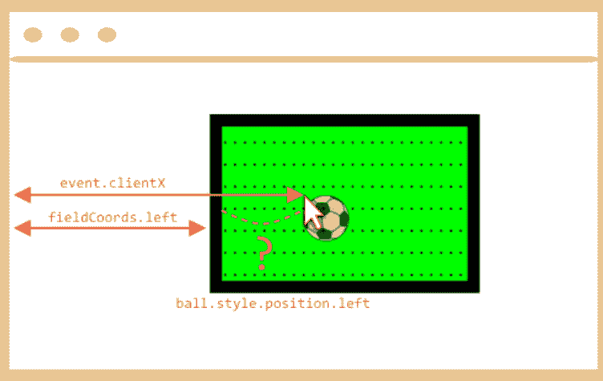

我们有 `event.clientX/clientY` —— 点击相对于窗口坐标。

要获取点击相对于 field 的左坐标，我们可以减去 field 的左边缘和边框宽度：

```javascript
let left = event.clientX - fieldCoords.left - fieldClientLeft;
```

通常，`ball.style.position.left` 意味着“元素的左边缘”（球）。如果我们分配 `left`，那么球的边缘而不是中心将位于鼠标光标下方。

我们需要将球向左移动半宽度并向上移动半高度，使其居中。

所以最终的 left 值将是：

```javascript
let left = event.clientX - fieldCoords.left - fieldClientLeft - ball.offsetWidth;
```

垂直坐标使用相同的逻辑计算。

请注意，球的宽度/高度在访问 `ball.offsetWidth` 时必须是已。应该在 HTML 或 CSS 中指定。

[在沙盒中打开解决方案。]

为了公式

### 创建滑动菜单

### HTML/CSS

首先让我们创建 HTML/CSS。

菜单是页面上的一个独立的图形化组件，因此最好将其放入单个 DOM 元素中。

菜单项列表可以作为 `ul/li` 列表布局。

这是示例结构：

```html
<div class="menu">
  <span class="title">Sweeties (click me)!</span>
  <ul>
    <li>Cake</li>
    <li>Donut</li>
    <li>Honey</li>
  </ul>
</div>
``` (修复了错误的闭合标签)

我们使用 `<span>` 作为标题，因为 `<div>` 具有隐式的 `display:block` 属性，它将占据 100% 的水平宽度。

如下：

```html
<div style="border: solid red 1px" onclick="alert(1)">Sweeties (click me)</div>
```

所以如果我们在它上设置了 `onclick`，它将捕捉到文本右侧的点击。

由于 `<span>` 具有隐式的 `display: inline`，它恰好占据适应所有文本的空间：Sweeties (click me)!

# 切换菜单

切换菜单应该改变箭头并显示/隐藏菜单列表。

所有这些变化由 CSS 完美处理。在 JavaScript 中，我们应该通过添加/移除 `.open` 类来标记菜单当前的状态。

如果没有它，菜单将关闭：

```css
.menu ul {
  margin: 0;
  list-style: none;
  padding-left: 20px;
  display: none;
}

.menu .title::before {
  content: ' ▶';
  font-size: 80%;
  color: green;
}
```

...而通过 `.open` 箭头会改变且列表会出现：

```css
.menu.open .title::before {
  content: ' ▼';
}

.menu.open ul {
  display: block;
}
```

[在沙盒中打开解决方案。]

为了公式

### 隐藏自己

可以在处理函数中使用 `this` 来在此处引用“该元素本身”：

```html
<input type="button" onclick="this.hidden=true" value="Click to hide">
```

为了公式

# 哪些处理函数运行了？

答案是：1 和 2。

第一个处理函数被触发了，因为它没有被 `removeEventListener` 移除。要移除该处理函数，我们需要传递与赋值完全相同的函数。而在代码中传递了一个新函数，它看起来一样，但仍然是另一个函数。

要移除一个函数对象，我们需要存储它的引用，如下所示：

```javascript
function handler() {
  alert(1);
}

button.addEventListener("click", handler);
button.removeEventListener("click", handler);
```

处理函数 `button.onclick` 独立工作，并且作为 `addEventListener` 的补充。

为了公式

# 让球跨越球场

首先，我们需要选择一种定位球的方法。

我们不能对它使用 `position:fixed`，因为滚动页面会让球离开球场。

所以我们应该使用 `position:absolute`，为了让定位非常稳固，让 `field` 本身也被定位。

这样球将相对于 field 进行定位：

```css
#field {
  width: 200px;
  height: 150px;
  position: relative;
}

#ball {
  position: absolute;
  left: 0; /* 相对于最近的已定位祖先 (field) */
}
```


```css
top: 0;
transition: all; /* CSS 对 left/top 的动画让球飞起来 */
}
```

接下来我们需要分配正确的 `ball.style.position.left/top`。它们现在包含了相对于 field 的坐标。

这是这张图片：


我们有 `event.clientX/clientY` —— 点击相对于窗口坐标。

要获取点击相对于 field 的左坐标，我们可以减去 field 的左边缘和边框宽度：

```javascript
let left = event.clientX - fieldCoords.left - fieldClientLeft;
```

通常，`ball.style.position.left` 意味着“元素的左边缘”（球）。如果我们分配 `left`，那么球的边缘而不是中心将位于鼠标光标下方。

我们需要将球向左移动半宽度并向上移动半高度，使其居中。

所以最终的 left 值将是：

```javascript
let left = event.clientX - fieldCoords.left - fieldClientLeft - ball.offsetWidth;
```

垂直坐标使用相同的逻辑计算。

请注意，球的宽度/高度在访问 `ball.offsetWidth` 时必须是已。应该在 HTML 或 CSS 中指定。

[在沙盒中打开解决方案。]

为了公式

### 创建滑动菜单

### HTML/CSS

首先让我们创建 HTML/CSS。

菜单是页面上的一个独立的图形化组件，因此最好将其放入单个 DOM 元素中。

菜单项列表可以作为 `ul/li` 列表布局。

这是示例结构：

```html
<div class="menu">
  <span class="title">Sweeties (click me)!</span>
  <ul>
    <li>Cake</li>
    <li>Donut</li>
    <li>Honey</li>
  </ul>
</div>
``` (修复了错误的闭合标签)

我们使用 `<span>` 作为标题，因为 `<div>` 具有隐式的 `display:block` 属性，它将占据 100% 的水平宽度。

如下：

```html
<div style="border: solid red 1px" onclick="alert(1)">Sweeties (click me)</div>
```

所以如果我们在它上设置了 `onclick`，它将捕捉到文本右侧的点击。

由于 `<span>` 具有隐式的 `display: inline`，它恰好占据适应所有文本的空间：Sweeties (click me)!

# 切换菜单

切换菜单应该改变箭头并显示/隐藏菜单列表。

所有这些变化由 CSS 完美处理。在 JavaScript 中，我们应该通过添加/移除 `.open` 类来标记菜单当前的状态。

如果没有它，菜单将关闭：

```css
.menu ul {
  margin: 0;
  list-style: none;
  padding-left: 20px;
  display: none;
}

.menu .title::before {
  content: ' ▶';
  font-size: 80%;
  color: green;
}
```

...而通过 `.open` 箭头会改变且列表会出现：

```css
.menu.open .title::before {
  content: ' ▼';
}

.menu.open ul {
  display: block;
}
```

[在沙盒中打开解决方案。]

为了公式

### 隐藏自己

可以在处理函数中使用 `this` 来在此处引用“该元素本身”：

```html
<input type="button" onclick="this.hidden=true" value="Click to hide">
```

为了公式

# 哪些处理函数运行了？

答案是：1 和 2。

第一个处理函数被触发了，因为它没有被 `removeEventListener` 移除。要移除该处理函数，我们需要传递与赋值完全相同的函数。而在代码中传递了一个新函数，它看起来看起来一样，但仍然是另一个函数。

要移除一个函数对象，我们需要存储它的引用，如下所示：

```javascript
function handler() {
  alert(1);
}

button.addEventListener("click", handler);
button.removeEventListener("click", handler);
```

处理函数 `button.onclick` 独立工作，并且作为 `addEventListener` 的补充。

为了公式

# 让球跨越球场

首先，我们需要选择一种定位球的方法。

我们不能对它使用 `position:fixed`，因为滚动页面会让球离开球场。

所以我们应该使用 `position:absolute`，为了让定位非常稳固，让 `field` 本身也被定位。

这样球将相对于 field 进行定位：

```css
#field {
  width: 200px;
  height: 150px;
  position: relative;
}

#ball {
  position: absolute;
  left: 0; /* 相对于最近的已定位祖先 (field) */
}
```


```css
top: 0;
transition: all; /* CSS 对 left/top 的动画让球飞起来 */
}
```

接下来我们需要分配正确的 `ball.style.position.left/top`。它们现在包含了相对于 field 的坐标。

这是这张图片：


我们有 `event.clientX/clientY` —— 点击相对于窗口坐标。

要获取点击相对于 field 的左坐标，我们可以减去 field 的左边缘和边框宽度：

```javascript
let left = event.clientX - fieldCoords.left - fieldClientLeft;
```

通常，`ball.style.position.left` 意味着“元素的左边缘”（球）。如果我们分配 `left`，那么球的边缘而不是中心将位于鼠标光标下方。

我们需要将球向左移动半宽度并向上移动半高度，使其居中。

所以最终的 left 值将是：

```javascript
let left = event.clientX - fieldCoords.left - fieldClientLeft - ball.offsetWidth;
```

垂直坐标使用相同的逻辑计算。

请注意，球的宽度/高度在访问 `ball.offsetWidth` 时必须是已。应该在 HTML 或 CSS 中指定。

[在沙盒中打开解决方案。]

为了公式

### 创建滑动菜单

### HTML/CSS

首先让我们创建 HTML/CSS。

菜单是页面上的一个独立的图形化组件，因此最好将其放入单个 DOM 元素中。

菜单项列表可以作为 `ul/li` 列表布局。

这是示例结构：

```html
<div class="menu">
  <span class="title">Sweeties (click me)!</span>
  <ul>
    <li>Cake</li>
    <li>Donut</li>
    <li>Honey</li>
  </ul>
</div>
``` (修复了错误的闭合标签)

我们使用 `<span>` 作为标题，因为 `<div>` 具有隐式的 `display:block` 属性，它将占据 100% 的水平宽度。

如下：

```html
<div style="border: solid red 1px" onclick="alert(1)">Sweeties (click me)</div>
```

所以如果我们在它上设置了 `onclick`，它将捕捉到文本右侧的点击。

由于 `<span>` 具有隐式的 `display: inline`，它恰好占据适应所有文本的空间：Sweeties (click me)!

# 切换菜单

切换菜单应该改变箭头并显示/隐藏菜单列表。

所有这些变化由 CSS 完美处理。在 JavaScript 中，我们应该通过添加/移除 `.open` 类来标记菜单当前的状态。

如果没有它，菜单将关闭：

```css
.menu ul {
  margin: 0;
  list-style: none;
  padding-left: 20px;
  display: none;
}

.menu .title::before {
  content: ' ▶';
  font-size: 80%;
  color: green;
}
```

...而通过 `.open` 箭头会改变且列表会出现：

```css
.menu.open .title::before {
  content: ' ▼';
}

.menu.open ul {
  display: block;
}
```

[在沙盒中打开解决方案。]

(注：由于原始文本中存在大量完全重复的段落，我已按照要求去除了重复内容，确保输出简洁且完整)

# 可选择列表

- 在沙箱中打开解决方案。

转化为公式

# 鼠标悬停：mouseover/out, mouseenter/leave

# 改进的提示框行为

- 在沙箱中打开解决方案。

转化为公式

# “智能”提示框

该算法看起来很简单：

1. 在元素上绑定 `mouseover/out` 处理器。这里也可以使用 `mouseenter/leave`，但它们的通用性较差，如果我们引入了事件委托，它们将无法工作。
2. 当鼠标光标进入元素时，在 `mousemove` 上开始测量速度。
3. 如果速度缓慢，则执行 `over`。
4. 稍后如果我们离开了元素，且执行了 `over`，则执行 `out`。

问题是：“如何测量速度？”

第一个想法是：每隔 `100ms` 运行一次函数，并测量上一次坐标与新坐标之间的距离。如果很小，说明速度慢。

遗憾的是，JavaScript 中无法获取“当前鼠标坐标”。没有像 `getCurrentCoordinates()` 这样的函数。

获取坐标唯一的方法是监听鼠标事件，如 `mousemove`。

所以我们可以在 `mousemove` 上设置一个处理器来跟踪坐标并记住它们。然后我们可以每 `100ms` 比较一次。

P.S. 请注意：解决方案使用了 `dispatchEvent` 来检查提示框是否工作正常。

在沙箱中打开带测试的解决方案。

转化为公式

# 使用鼠标事件的拖放

# 滑块

我们这里有一个水平的拖放功能。

为了定位元素，我们使用 `position:relative` 和相对于滑块的坐标来处理滑块。这里比使用 `position:absolute` 更方便。

在沙箱中打开解决方案。

转化为公式

# 在区域内拖动超级英雄

为了拖动元素，我们可以使用 `position:fixed`，这使得坐标更容易管理。最后，我们应该将其切换回 `position:absolute`。

然后，当坐标位于窗口顶部/底部时，我们使用 `window.scrollTo` 进行滚动。

更多细节请见代码中的注释。

在沙箱中打开解决方案。

转化为公式

# 键盘：keydown 和 keyup

# 扩展热快捷键

我们应该使用两个处理器：`document.keydown` 和 `document.onkeyup`。

变量 `pressed` 应该保存当前按下的键。

第一个处理器负责添加，而第二个负责从从中移除。每次在触发 `keydown` 时，我们都检查按下的键是否足够，如果是，则运行函数。

[在沙箱中打开解决方案。](https://example.com)

转化为公式

# 滚动

# 无尽页

解决方案的核心是一个函数，当我们在页面末尾时，向页面添加更多日期（在现实应用中是加载更多内容）。

我们可以立即调用它，并将其作为 `window.onscroll` 处理器。

最重要的问题：“如何检测页面已滚动到底部？”

让我们使用相对于窗口的坐标。

文档表示（并包含）在 `<html>` 标签内，即 `document.documentElement`。

我们可以通过 `document.documentElement.getBoundingClientRect()` 获取整个文档相对于窗口的坐标。`bottom` 属性将是文档末尾相对于窗口的坐标。

例如，如果整个 HTML 文档的高度为 2000px，那么：

```javascript
// 当我们在页面顶部时
// 相对于窗口的顶部 = 0
document.documentElement.getBoundingClientRect().top = 0

// 相对窗口的底部 = 2000
// 文档很长，所以这可能远超窗口底部
document.documentElement.getBoundingClientRect().bottom = 2000
```

如果再向下滚动 `500px`，那么：

```javascript
// 文档顶部在窗口上方 500px
document.documentElement.getBoundingClientRect().top = -500
// 文档底部靠近了 500px
document.documentElement.getBoundingClientRect().bottom = 1500
```

当滚动到末尾时，假设窗口高度为 `600px`：

```javascript
// 文档顶部在窗口上方 1400px
document.documentElement.getBoundingClientRect().top = -1400
// 文档底部在窗口下方 600px
document.documentElement.getBoundingClientRect().bottom = 600
```

请注意，`bottom` 不可能为 0，因为它永远到达窗口顶部。`bottom` 坐标的最低限制是窗口高度，我们无法再向上滚动。

窗口高度是 `document.documentElement.clientHeight`。

我们希望文档底部距离它的距离不超过 `100px`。

```javascript
function populate() {
  while(true) {
    // 文档底部
    let windowRelativeBottom = document.documentElement.getBoundingClientRect().bottom;
    // 如果大于窗口高度 + 100px，说明我们还没到
    // （见上面的示例，bottom 越大意味着我们需要更多滚动）
    if (windowRelativeBottom > document.documentElement.clientHeight + 100) {
      // 否则我们添加更多数据
      document.body.insertAdjacentHTML("beforeend", `<p>Date: ${new Date()}</p>`);
    }
  }
}
```

在沙箱中打开解决方案。

转化为公式

# 上/下

在沙箱中打开解决方案。

转化为公式

# 滚动

解决方案使用一个半透明的 `<div id="cover-div">` 覆盖整个窗口，如下：

```css
#cover-div {
  position: fixed;
  top: 0;
  left: 0;
  z-index: 9000;
  width: 100%;
  height: 100%;
  background-color: gray;
  opacity: 0.3;
}
```

因为 `<div>` 覆盖了所有内容，它获取了所有点击，而不是下面的页面。

我们还可以通过设置 `body.style='hidden'` 防止页面滚动。

表单不应该在 `<div>` 中，而是在它旁边，因为我们不希望它有透明度。

在沙箱中打开解决方案。

转化为公式

# 表单属性和方法

# 向选择框添加选项

步骤如下：

```html
<select id="genres">
  <option value="rock">Rock</option>
  <option value="blues" selected>Blues</option>
</select>

<script>
  // 1)
  let selectedOption = genres.options[genres.selectedIndex];
  alert(selectedOption);

  // 2)
  let newOption = new Option("Classic", "classic");
  genres.append(newOption);

  // 3)
  newOption.selected = true;
</script>
```

# 聚焦：focus/blur

# 可编辑 div

在沙箱中打开解决方案。

转化为公式

# 点击编辑 TD

1. 点击时——将单元格的 `innerHTML` 替换为相同大小且无边框的 `<textarea>`。使用 JavaScript 或 CSS 设置大小。
2. 将 `td.innerHTML` 设置为 `textarea.value`。
3. textarea。
4. 在单元格下方显示确定/取消按钮，处理点击。

# 键盘驱动鼠标

我们可以使用 `mouse.onclick` 处理点击，并使用 `position:fixed` 让鼠标可“移动”，然后使用 `mouse.onkeydown` 处理方向键。

唯一的陷阱是 `keydown` 只在获得焦点的元素上触发。因此我们需要为元素添加 `tabindex`。由于我们被禁止修改 HTML，可以使用 `mouse.tabIndex` 属性来实现这一点。

P.S. 我们也可以将 `mouse.onclick` 替换为 `mouse.onfocus`。

在沙箱中打开解决方案。

4. 当计数器值等于源的数量时——我们就完成了：执行`callback()`。

在沙箱中打开解决方案。↗

前往公式
