# Java™ 全合一桌边参考指南


---


---

## 关于作者

**道格·劳 (Doug Lowe)** 自 Java 发明者们还在上高中时就开始撰写计算机编程书籍了。他编写了关于 COBOL、Fortran、Visual Basic、IBM 大型计算机、中型系统、PC、Web 编程的书籍，可能还有一些他自己都忘记了的书。他是 30 多本 *For Dummies* 系列书籍的作者，例如 *Networking For Dummies* (第 7 版)、*Networking For Dummies All-in-One Desk Reference*、*PowerPoint 2003 For Dummies* 和 *Internet Explorer 6 For Dummies*。他住在阳光明媚的美国全境城市加利福尼亚州弗雷斯诺，与他的妻子和三个女儿中最小的一位同住，那里的格言是：“这是个阳光明媚、美国全境城市。”他也是那种强迫症装饰狂人之一，在圣诞节会挂上数万盏灯，并制作出可与迪士尼幽灵公馆媲美的电脑控制万圣节装饰品。也许他的下一本书应该是 *Tacky Holiday Decorations For Dummies*。

---

## 献词

献给黛比 (Debbie)、丽贝卡 (Rebecca)、莎拉 (Sarah) 和贝瑟尼 (Bethany)。

## 作者致谢

我要感谢项目编辑金·达罗塞特 (Kim Darosett)，她在紧张的日程和频繁错过的截止日期下，出色地管理了将此书汇集在一起所需的所有编辑工作；还要感谢策划编辑凯蒂·费尔特曼 (Katie Feltman)，她使整个项目成为可能。我还要感谢约翰·珀杜姆 (John Purdum)，他对整份手稿进行了彻底的技术审查，测试了每一行代码，并提出了许多极好的建议；以及文字编辑丽贝卡·森宁格 (Rebecca Senninger)，她确保所有细节都准确无误（哦，说反了！）。最后，一如既往地感谢所有幕后人员，他们提供了我甚至不知道的帮助。

## 出版商致谢

我们为这本书感到自豪；请通过我们位于 www.dummies.com/register/ 的在线注册表单将您的评论发送给我们。

参与将此书推向市场的部分人员包括：

### 策划、编辑和媒体开发

- **项目编辑：** 金·达罗塞特 (Kim Darosett)
- **策划编辑：** 凯蒂·费尔特曼 (Katie Feltman)
- **文字编辑：** 丽贝卡·森宁格 (Rebecca Senninger)
- **技术编辑：** 约翰·珀杜姆 (John Purdum)
- **编辑经理：** 莉亚·卡梅隆 (Leah Cameron)
- **媒体开发经理：** 劳拉·范温克尔 (Laura VanWinkle)
- **媒体开发主管：** 理查德·格雷夫斯 (Richard Graves)
- **编辑助理：** 阿曼达·福克斯沃思 (Amanda Foxworth)
- **漫画：** 里奇·坦南特 (Rich Tennant) (www.the5thwave.com)

### 排版服务

- **项目协调员：** 玛丽迪·恩尼斯 (Maridee Ennis)
- **版面设计与图形：** 安德里亚·达尔 (Andrea Dahl)、劳伦·戈达德 (Lauren Goddard)、斯蒂芬妮·D·琼珀 (Stephanie D. Jumper)、梅拉妮·普伦德加斯特 (Melanee Prendergast)、希瑟·瑞安 (Heather Ryan)、朱莉·特里佩蒂 (Julie Trippetti)
- **校对员：** 约翰·格林诺 (John Greenough)、李安·哈尼 (Leeann Harney)、杰西卡·克莱默 (Jessica Kramer)、阿里尔·门内尔 (Arielle Mennelle)、卡尔·皮尔斯 (Carl Pierce)
- **索引员：** 泰·孔茨 (Ty Koontz)

### 技术类 Dummies 图书的出版与编辑

- **理查德·斯瓦德利 (Richard Swadley)，** 副总裁兼执行集团出版商
- **安迪·卡明斯 (Andy Cummings)，** 副总裁兼出版商
- **玛丽·贝德纳雷克 (Mary Bednarek)，** 执行策划总监
- **玛丽·C·科德 (Mary C. Corder)，** 编辑总监

### 消费类 Dummies 图书的出版

- **黛安·格雷夫斯·斯蒂尔 (Diane Graves Steele)，** 副总裁兼出版商
- **乔伊斯·佩普尔 (Joyce Pepple)，** 策划总监

### 排版服务

- **杰里·法希 (Gerry Fahey)，** 生产服务副总裁
- **黛比·斯泰利 (Debbie Stailey)，** 排版服务总监

---


**xxvi**   《Java 全能办公桌参考手册：傻瓜书》

## 引言

欢迎来到*《Java 全能办公桌参考手册：傻瓜书》*，这是一本旨在替代你原本需要购买的一整书架枯燥乏味的 Java 书籍。本书包含了你开始进行 Java 编程所需的所有基础及进阶信息，从编写语句、使用变量开始，一直到编写使用动画和游戏的程序的技巧。在此过程中，你将了解编程用户界面、使用类和对象、创建 Web 应用程序以及处理文件和数据库的相关信息。

你最终可以，而且很可能应该，购买关于这些主题的单独书籍。用不了多久，你的书架就会堆满超过一万页关于 Java 编程每个可想象细节的详细信息。但在你准备好深入钻研每个主题之前，你需要一个鸟瞰式的概览。这就是本书的初衷。

如果你已经拥有一万页或更多的 Java 信息，你可能会被大量的细节所淹没，并且会想，我真的需要阅读 1200 页关于 JSP 的内容才能创建一个简单的网页吗？我真的需要一本六磅重的 Swing 书籍吗？事实是，大多数 1200 页的编程书籍中，真正有用的信息大约只有 200 页——就是你每天都用得上的那种——而另外大约 1000 页则是令人痛苦的细节，这些细节大多只在你编写核导弹的制导控制程序或纽约证券交易所的交易系统时才会用到。

这里的基本理念是，我试图从九个不同的 Java 编程主题（安装与配置、基础编程、面向对象编程、编程技巧、Swing、文件与数据库编程、Web 编程以及动画与游戏编程）中提炼出大约 100 页最有用的信息。因此，这是一本精炼的 900 页的书，实际上相当于九本 100 页的书。（好吧，它们并非都刚好是 100 页。但很接近！）

因此，无论你是刚刚开始接触 Java 编程，还是经验丰富的专业人士，你都找对了书。

## 关于本书

《Java 全能办公桌参考手册：傻瓜书》旨在成为你在编写 Java 程序时可能需要了解的所有重要事项（可能还有一些不那么重要的事项）的参考书。当然，你可以为本书涵盖的每个编程主题购买一本厚达 1200 页的书。但是，谁会帮你把它们从书店搬回家呢？你又在哪里找书架空间来存放它们呢？在本书中，你需要的所有信息都方便地包装在一套封面之内。

本书并不打算成为涵盖这些主题所有细节的综合参考书。相反，它展示了如何快速上手并开始运行，以便你有更多时间去做你真正想做的事情。本书采用易于遵循的《傻瓜书》格式设计，帮助你轻松获取所需信息，无需费力查找。

《Java 全能办公桌参考手册：傻瓜书》是一本由几本较小的书——可以说是“迷你书”——组成的大书。每本迷你书涵盖了一个关键编程元素的基础知识，例如安装 Java 和编译运行程序，或者使用基本的 Java 语句，或者使用 Swing 编写 GUI 应用程序。

每当一个大事物由几个小事物组成时，混乱总是有可能发生的。这就是为什么本书设计有多个入口点来帮助你找到所需内容。书的开头是一个详细的目录，涵盖了整本书。然后，每本迷你书都以一个迷你目录开始，让你一目了然地看到该迷你书中包含哪些章节。每页顶部都有有用的页眉，指出该页讨论的主题。还有方便的拇指标签沿书页侧面排列，帮助你快速找到每本迷你书。最后，一个全面的索引让你可以在整本书中找到任何信息。

这不是那种你可以从头到尾像读廉价小说一样拿起就读的书。如果我看到你在海滩上读这本书，我会往你脸上踢沙子。这本书更像是一本参考书，那种你可以拿起，翻到几乎任何一页，然后开始阅读的书。你不必记住本书中的任何内容。这是一本“需要知道”的书：当你需要知道某事时，就拿起它。需要回顾 `ArrayList` 类的构造函数？拿起这本书。记不住匿名内部类的古怪语法？拿起这本书。找到你需要的内容后，就把书放下，继续你的生活。

## 如何使用本书

本书的使用方式类似于参考书。从你想要查找的主题开始。在目录或索引中查找它以开始。目录足够详细，你可以找到你正在寻找的大多数主题。如果找不到，请转到索引，那里你可以找到更多细节。

当然，本书信息量很大，所以如果你想简要了解一下你的主题，我们非常欢迎。如果你想知道继承的全貌，请阅读整个关于继承的章节。但如果你只想知道调用超类构造函数的规则，就只阅读关于继承和构造函数的部分。

每当我描述程序的控制台输出或你在屏幕上看到的信息时，我都会这样呈现：

`A message from not-another-Hello-World program`

如果程序涉及与用户的交互，你会看到用户输入的文本以**粗体**显示。

## 本书结构

《Java 全能办公桌参考手册：傻瓜书》中包含的九本迷你书中的每一本都可以独立使用。以下是每本迷你书内容的简要描述。

### 第一卷：Java 基础

本迷你书包含你开始使用 Java 所需的信息。在简要介绍 Java 是什么以及为什么如此流行之后，你将下载 Java 并将其安装在你的计算机上，并使用其命令行工具。然后，你将使用两种流行的开发工具——TextPad 和 Eclipse——来创建 Java 程序。

# 第二卷：编程基础

本迷你书涵盖了使用 Java 语言进行编程的所有基本细节。我从数据类型、变量和语句等基础知识开始，然后转向表达式、条件语句、循环语句和方法。最后讨论了如何处理异常。要进行任何严肃的编程，你确实需要了解本迷你书中的所有内容，因此如果你是编程新手，你可能会在这里花费大量时间。


## 本书的组织结构

# 第三部分：面向对象编程

本小册深入探讨了Java面向对象编程的细节。你将创建自己的类，并学习使用继承和多态。你还将了解到关于抽象类、接口、包、内部类，甚至是匿名内部类的所有内容。

# 第四部分：字符串、数组和集合

本小册专注于处理字符串、数组和集合。你将全面了解Java独特的不可变字符串，以及`StringBuilder`和`StringBuffer`类。你还将创建和使用数组，以及它们的集合对应物，包括数组列表和链表。在此过程中，你将了解到一种很酷的面向对象编程新特性，即*泛型*，它旨在简化数组和集合的处理。

# 第五部分：编程技术

在本小册中，你将发现各种有趣且通常有用的编程技术。例如，我包含了一章关于使用线程的内容，以便你可以创建能够同时执行多项任务的程序。有一章是关于使用正则表达式的，向你展示如何进行一些令人惊叹的字符串处理。还有一章是关于一种称为*递归*的编程技术，每个程序员都需要熟练掌握。

# 第六部分：Swing

Swing是Java中允许你创建图形用户界面的部分。在本小册中，你将全面了解Swing：如何创建带有按钮、文本框、复选框、下拉列表等控件的窗口；如何编写响应用户点击按钮或输入文本的程序；以及如何控制复杂表单的布局。

# 第七部分：Web编程

在本小册中，你将使用各种Java特性来创建Web应用程序。首先，你将把Swing应用程序转换为在用户浏览器中运行的小程序。然后，你将使用servlet和JSP创建完整的Web应用程序。

# 第九部分：趣味与游戏

最后这个小册深入探讨了Java编程中一些更有趣、更好玩的方面。具体来说，你将玩转字体和颜色、绘制图形、处理图像和媒体，甚至创建动画和编写简单的游戏程序。

## 本书的网站

本书有一个配套网站（www.dummies.com/go/javaaiofd），包含更多好东西。如果你是那种总想找方法节省打字时间的人，该网页包含了本书中使用的所有代码清单。对于那些渴望获取更多Java信息的人，请务必查看网站上的三个附赠章节：“使用BigDecimal类”、“位操作技巧”和“使用菜单”。

## 本书使用的图标

和任何《xxx》系列书籍一样，本书充满了有用的图标，它们能将你的注意力吸引到特别重要的内容上。你在整本书中会看到以下图标：


请特别注意这个图标；它让你知道手头有一些特别有用的提示。


停一下——过于技术性的内容即将出现。显然，因为这是一本编程书，接下来的约900页中几乎每一段都可能得到这个图标。因此，我将其保留给那些深入解释某些东西如何在底层工作的段落——可能比你真正需要了解的某个功能的使用要深入，但通常能带来启发。

有时，当我想要用一个例子来说明某个观点，而这个例子使用了一些到目前为止书中尚未介绍但稍后会介绍的Java特性时，你也会看到这个图标。在这些情况下，这个图标只是一个提醒，让你不要陷入说明的细节，而是专注于更重要的观点。


危险，罗宾逊！这个图标突出显示了可能帮助你避免灾难的信息。


我告诉过你我参加的那门记忆课程吗？

## 从这里开始


编程专家们最近热议的话题之一是*设计模式*的概念，它为执行常见任务提供了可预测的方法。这个图标出现在描述此类模式的边栏旁边。

是的，你可以从这里开始。有了这本书在手，你已经准备好勇闯崎岖的Java领域。浏览目录，决定你想从哪里开始。要大胆！要勇敢！要敢于冒险！最重要的是，要玩得开心！

# 第一部分

# Java基础

第五波
作者：里奇·坦南特


> “我确信我毕业时会有个好就业市场。我创建了一个将在那年爆发的病毒。”

## 内容概览

第1章：欢迎来到Java ............. 9

第2章：安装和使用Java工具 ............. 21

第3章：使用TextPad ............. 35

第4章：使用Eclipse ............. 43

## 第1章：欢迎来到Java

### 本章内容

-   了解编程
-   探索Java
-   比较Java与其他编程语言
-   理解Java令人困惑的版本号

本章是对Java世界的温和介绍。在接下来的几页中，你将了解Java是什么，它从哪里来，以及它将走向何方。你还将发现Java的一些独特优势，以及它的一些弱点。我还将Java与其他流行的编程语言进行比较，包括C、C++、C#和Visual Basic。

顺便说一下，我在本章中假设你至少有足够的背景知识，知道计算机编程是怎么回事。这并不意味着我假设你是专家或专业程序员。我只是意味着我不花时间解释诸如什么是计算机程序、什么是编程语言等基础知识。如果你完全没有编程经验，我建议你买一本《Java 2初学者指南》。

在本章中，你会看到一些Java程序代码片段，以及一些用其他语言（如C、C++或Basic）编写的代码片段。如果你完全不知道这些代码的含义或作用，不要惊慌。我只是想让你感受一下Java编程是什么样子的，以及它与其他语言编程相比如何。


本书中使用的所有代码清单都可以在www.dummies.com/go/javaaiofd下载。

### 什么是Java，为什么它如此伟大？

Java是C和C++传统中的编程语言。因此，如果你有任何使用C或C++的经验，在学习Java的各种特性时，你会经常感到熟悉。（关于Java与C或C++的异同，更多信息请参阅本章后面“比较Java与其他语言”部分。）

然而，Java在几个重要方面与其他编程语言不同。以下部分描述了最重要的差异。

#### 平台独立性

Java如此受欢迎的主要原因之一是它的*平台独立性*，这简单意味着Java程序可以在许多不同类型的计算机上运行。Java程序可以在任何安装了*Java运行时环境*（也称为*JRE*）的计算机上运行。JRE几乎适用于你能想到的每一种类型的计算机，从运行任何版本Windows的PC、Macintosh计算机、Unix或Linux计算机、大型机，甚至手机。

在Java出现之前，其他编程语言通过为不同平台提供兼容的编译器来承诺平台独立性。（*编译器*是将用编程语言编写的程序翻译成实际上可以在计算机上运行的形式的程序。）其想法是你可以为每个平台编译程序的不同版本。不幸的是，这个想法从未真正奏效。编译器在每个平台上从未完全相同——每个都有自己的细微差别。因此，你不得不为你想要支持的每个平台维护程序的不同版本。

Java的平台独立性不是基于为不同平台提供兼容的编译器。相反，Java基于*虚拟机*的概念。你可以将Java虚拟机（有时称为*JVM*）视为一个假想的计算机平台——一个在任何实际计算机上都不存在的计算机设计。相反，Java运行时环境是一个模拟器，它创建了一个可以执行Java程序的Java虚拟机环境。

Java编译器不会将Java翻译成程序运行所在计算机的机器语言。相反，编译器将Java翻译成Java虚拟机的机器语言，这称为*字节码*。然后Java运行时环境在JVM中运行字节码。因为有了JVM，你可以在任何安装了Java运行时环境的计算机上执行Java程序，而无需重新编译程序。

这就是Java提供平台独立性的方式，信不信由你，它运行得相当好。你编写的程序在运行任何版本Windows的PC、Macintosh、Unix或Linux，或任何其他安装了JRE的计算机上运行得一样好。

今晚当你躺在床上思考Java平台独立性的意义时，这里有一些额外的想法供你思考：

-   JRE与Java编译器是分开的。因此，你不必安装Java编译器来运行编译后的Java程序。你只需要JRE。


#### 面向对象

Java 本质上是*面向对象*的，这意味着 Java 程序由称为*对象*的编程元素构成。简单来说（你是不是很喜欢在计算机书里看到这种说法？），对象是一个编程实体，代表现实世界中的某个物体或一个抽象概念。

所有对象都有两个基本特征：

- 对象拥有数据，也称为*状态*。例如，一个代表书籍的对象拥有诸如书名、作者和出版社等数据。
- 对象还有*行为*，这意味着它们可以执行某些任务。在 Java 中，这些任务称为*方法*。例如，一个代表汽车的对象可能拥有诸如启动、停止、行驶或碰撞等方法。有些方法只是让你能够访问对象的数据。例如，一个书籍对象可能有一个 `getTitle` 方法，用于告诉你书的标题。

*类*与对象密切相关。类是你编写的用于创建对象的程序代码。类描述了定义对象状态和行为的数据与方法。然后，在程序执行时，类被用来创建对象。

例如，假设你正在编写一个工资单程序。这个程序可能需要对象来代表公司的员工。因此，程序包含一个类（可能命名为 `Employee`），它定义了每个 `employee` 对象的数据和方法。然后，当你的程序运行时，它使用这个类为公司的每位员工创建一个对象。

## 12 什么是 Java，它为何如此出色？

#### Java API

Java 语言本身非常简单。然而，Java 附带了一个类库，其中提供了大多数 Java 程序不可或缺的常用实用功能。这个类库被称为 *Java API*，它与语言本身一样是 Java 的重要组成部分。事实上，学习使用 Java 的真正挑战不在于学习语言本身；而在于学习 API。Java 语言只有 48 个关键字，但 Java API 拥有数千个类，其中包含数万个可在你的程序中使用的方法。

例如，Java API 提供了一些类，让你能够进行三角函数运算、将数据写入文件、在屏幕上创建窗口或从数据库检索信息。API 中的许多类都是通用的，并且常用。例如，有一整系列的类用于存储数据集合。但也有许多是晦涩的，仅在特殊情况下使用。

幸运的是，你不需要学习接近全部的 Java API。大多数程序员只精通其中很小一部分——即与他们编写的程序类型最直接相关的部分。如果你发现需要使用 API 中某个你还不熟悉的类，可以在 `java.sun.com/docs` 的 Java API 文档中查找该类的功能。

#### 互联网

Java 经常与互联网联系在一起，这是理所当然的。因为阿尔·戈尔发明了互联网几天后就发明了 Java。好吧，Java 并不是阿尔·戈尔发明的。但 Java 是在互联网的万维网成为一种现象期间开发的，而且 Java 的设计初衷就是为了利用网络。特别是，Java 虚拟机背后的整个概念，就是让任何连接到互联网的计算机，无论其类型或运行的操作系统如何，都能够运行 Java 程序。

你可以在互联网上找到两种不同类型的 Java 程序：

- **小程序**，是直接在 Web 浏览器中运行的 Java 程序。要运行小程序，浏览器会启动一个 Java 虚拟机，并将网页的一部分交给该虚拟机处理。然后虚拟机运行小程序的字节码。小程序是一个伟大的构想。然而，微软和 Sun 之间的营销和法律战使得小程序处于一个岌岌可危的境地。问题在于，并非所有 Web 浏览器都提供 JVM，而那些提供 JVM 的浏览器往往提供的是一个无法利用最新、最强大 Java 特性的旧版本。
- **Servlet**，是基于 Web 的 Java 程序，运行在互联网服务器计算机上，而不是在互联网用户的 Web 浏览器中。许多（即使不是大多数）商业网站的工作方式都是基于 Servlet。基本上，Servlet 是一个生成 HTML 页面的程序，该页面随后被发送到用户的计算机，在 Web 浏览器中显示。例如，如果你在线商店请求有关产品的信息，商店的 Web 服务器会运行一个 Servlet，生成包含你所请求产品信息的 HTML 页面。

你将在第 VII 卷中了解如何创建这两种类型的应用程序。

#### 将 Java 与其他语言进行比较

表面上看，Java 与许多先于它的编程语言非常相似。例如，这是用 C 编程语言编写的经典 "Hello, World!" 程序：

```c
main()
{
    printf("Hello, world!");
}
```

这个程序只是在计算机控制台上显示文本 "Hello, World!"。以下是用 Java 编写的相同（几乎）程序：

```java
public class HelloApp
{
    public static void main(String[] args)
    {
        System.out.println("Hello, World!");
    }
}
```

## 14 将 Java 与其他语言进行比较

尽管 Java 版本稍微冗长一些，但两者有几个相似之处：

- 两者都要求每个可执行语句以分号结尾。
- 两者都使用花括号 ({}) 来标记代码块。
- 两者都使用一个名为 `main` 的例程作为程序的主入口点。

除了这些，这个简单示例中没有明显体现的其他相似之处还有很多。

然而，这两个简单的例子将 C 和 Java 之间的主要差异推到了最前面：Java 本质上是面向对象的。面向对象编程在这个简单的例子中就已经显露头角：

- 在 Java 中，即使最简单的程序也是一个类，因此你必须提供一行来声明类的名称。在这个例子中，类被命名为 `HelloApp`。`HelloApp` 有一个名为 `main` 的方法，当程序运行时，Java 虚拟机会自动调用它。
- 在 C 的例子中，`printf` 是一个你调用来向控制台打印信息的库函数。在 Java 中，你使用 `PrintStream` 类来向控制台写入信息。`PrintStream`？这个程序中没有 `PrintStream`！实际上有。每个 Java 程序都可以使用一个 `PrintStream` 对象来向控制台写入信息。你可以通过调用另一个名为 `System` 的类的 `out` 方法来获取这个 `PrintStream` 对象。因此，`System.out` 获取了用于向控制台写入的 `PrintStream` 对象。`PrintStream` 类本身又有一个名为 `println` 的方法，用于向控制台写入一行文本。所以 `System.out.println` 实际上做了两件事：
    - 它使用 `System` 类的 `out` 字段来获取一个 `PrintStream` 对象。
    - 然后调用该对象的 `println` 方法，向控制台写入一行文本。
- 令人困惑？确实如此。当你在第 III 卷第 1 章阅读关于面向对象编程的内容时，一切都会变得清晰。
- `void` 看起来很熟悉。虽然在 C 的例子中没有显示，但你本可以在 `main` 函数声明上编写 `void`，以表明该函数不返回值。`void` 在 Java 中具有相同的含义。但 `static` 呢？那是什么意思？那也是 Java 面向对象特性的证据。不过，在本章中解释它的含义还为时过早，你可以在第 II 卷第 7 章中找到答案。

◆ 当有人问你的电脑是否“有 Java”时，他们通常是指“你是否安装了 Java 运行环境”，以便你能运行 Java 程序。

◆ 平台独立性仅在一定程度上成立。如果你使用的是某种冷门类型的计算机系统，比如老式的 Olivetti Programma 101，并且没有适用于它的 Java JRE，那么你就无法在它上面运行 Java 程序。

◆ 如果你感兴趣的话，Java 虚拟机是完全基于栈的——它没有用于存储本地数据的寄存器。我不会解释那是什么意思，所以如果没听懂，可以跳过。这并不重要。这只是对了解栈、寄存器以及类似东西的极客们来说很有趣而已。

◆ Java 的平台独立性并非完美无缺。尽管字节码在每个拥有 JRE 的计算机上运行方式完全相同，但 Java 的某些部分使用了底层操作系统提供的服务。因此，有时会出现细微的差异，尤其是在使用图形界面的应用程序中。

◆ 因为执行 Java 字节码的是一个模拟 Java 虚拟机的运行时系统，有些人错误地将 Java 与解释型语言（如 Basic 或 Perl）相提并论。然而，这些语言根本不是编译的。相反，解释器在执行时读取并解释每条语句。Java 是一种真正的编译语言——它只是被编译成 JVM 的机器语言，而不是实际计算机平台的机器语言。

◆ 我不是在瞎编 Olivetti Programma 101。它是一款在 20 世纪 60 年代初制造的桌面计算机，碰巧是我接触计算机编程的启蒙者。（我初中时的数学老师教室后面就有一台，并且允许我在午餐时间玩它。）用 Google 搜索 "Olivetti Programma 101"，你会找到几个关于它的有趣网站。


#### Java 语言的重要特性

如果你相信 Sun 等公司散布的营销宣传，你会认为 Java 是自计算机内存发明以来最伟大的变革。Java 可能没有*那么*具有革命性，但它确实拥有许多内置特性，使其与其他语言区别开来（Microsoft 的 C# 可能是个例外，它基本上是对 Java 的抄袭）。以下章节将介绍使 Java 如此受欢迎的众多特性中的三个。

##### 类型检查

所有编程语言都必须以某种方式处理*类型检查*。类型检查指的是语言如何处理存储不同类型数据的变量。例如，数字、字符串和日期是大多数编程语言中常用的数据类型。大多数编程语言还包含几种不同类型的数字，如整数和实数。

所有语言都必须进行类型检查，因此请确保不要尝试做无意义的事情，例如将国民生产总值乘以你的姓氏。问题是，语言是否要求你声明每个变量的类型，以便在编译程序时进行类型检查，还是语言只在运行程序后才进行类型检查？

某些语言，如 Basic，在编译时几乎不进行类型检查。例如，在 Microsoft 的 Visual Basic for Applications (VBA) 中，你可以将任何类型的数据赋给变量。因此，以下语句都是允许的：

```
Let A = 5
Let A = "Strategery"
Let A = 3.14159
```

这里，三种不同类型的数据——整数、字符串和十进制数——被赋给了同一个变量。这种灵活性很方便，但代价高昂。例如，以下序列在 VBA 中完全合法：

```
Let A = 5
Let B = "Strategery"
Let C = A * B
```

这里，一个整数被赋给变量 A，一个字符串被赋给变量 B。然后第三条语句试图将字符串乘以整数。你无法将字符串相乘，因此第三条语句会失败。

另一方面，Java 在运行时进行完整的类型检查。因此，你必须将所有变量声明为特定类型，以便编译器可以确保你正确使用变量。例如，以下 Java 代码片段将无法编译：

```
int a = 5;
String b = "Strategery";
String c = a * b;
```

如果你尝试编译这些代码行，会收到一条错误消息，指出 Java 无法将整数和字符串相乘。

在 Java 中，你定义的每个类都会为语言创建一种新的数据类型。因此，你在 Java 中可用的数据类型不仅仅是简单的预定义类型，如数字和字符串。你可以创建自己的类型。例如，如果你正在编写一个工资系统，你可能会创建一个 Employee 类型。然后你可以声明 Employee 类型的变量，这些变量只能保存 Employee 对象。这可以防止许多编程错误。例如，考虑以下代码片段：

```
Employee newHire;
newHire = 21;
```

这段代码创建了一个变量 (newHire)，该变量只能保存 Employee 对象。然后它试图将数字 21 赋给它。Java 编译器不会允许你运行这个程序，因为 21 是一个数字，而不是一个员工。

Java 的一个重要面向对象编程特性称为继承，它为类型检查增添了一个有趣且极其有用的视角。继承太复杂了，无法在此完全展开，所以我将简要介绍。在 Java 中，你可以创建从其他数据类型派生出的自己的数据类型。例如，员工是人。客户也是人。因此，你可以创建一个 Person 类，然后创建继承 Person 类的 Employee 和 Customer 类。然后你可以编写如下代码：

```
Person p;
Employee e;
Customer c;
p = e;    // 这是允许的，因为员工也是一个人。
c = e;    // 这是不允许的，因为员工不是客户。
```

感到困惑了吗？如果是这样，那是我的错。对于 Java 书籍的第一章来说，继承是一个相当深奥的话题。如果它没有意义，请不要惊慌。当你读完第三册第四章时，一切都会变得清晰，该章节涵盖了使用继承的所有微妙之处。

##### 自动内存管理

内存管理是所有编程语言都必须处理的另一个细节。所有编程语言都允许你创建变量。当你创建一个变量时，语言会分配计算机内存的一部分来存储变量引用的数据。无论你使用什么语言，内存的精确分配方式通常都是一个可以安全忽略的细节。但许多语言*不会*让你安全忽略的一个细节是，当你不再需要存储在其中的数据时，那块内存会发生什么。

在 C++ 和类似语言中，你必须编写代码来显式释放该内存，以便其他程序可以访问它。如果你*没有*这样做，或者做错了，你的程序可能会出现*内存泄漏*，这意味着你的程序会缓慢但肯定地从其他程序中窃取内存，直到操作系统内存耗尽，计算机停止运行。

在 Java 中，你不必在完成使用后显式释放内存。相反，当内存不再需要时，它会被自动释放。Java 虚拟机包含一个称为*垃圾收集器*的特殊进程，它会在虚拟机的内存中搜寻，确定数据何时不再被使用，并自动删除该数据并释放其占用的内存。

与垃圾收集相关的一个特性是*边界检查*，它保证程序无法访问不属于它们的内存。像 C 或 C++ 这样的语言没有这种安全性。因此，C 或 C++ 中的编程错误可能导致一个程序践踏另一个程序正在使用的内存。这反过来又可能导致整个计算机崩溃。

### 异常处理

正如罗伯特·彭斯所说，“老鼠和人的最佳计划经常出错，给我们留下的只有悲伤和痛苦，而非承诺的喜悦。”（好吧，这不完全是他所说的话，但很接近。）当你摆弄计算机编程时，你会很快明白他的意思。无论你多么仔细地计划和测试你的程序，错误都会发生。当错误发生时，它们可能会使你的整个程序崩溃停止。

Java 对错误处理有一种独特的方法，它优于任何其他语言（除了我提到过几次的 C#，它只是抄袭了 Java 的方法）。在 Java 中，Java 运行时环境拦截并将所有类型的错误折叠成一种特殊类型的对象，称为*异常对象*。毕竟，Java 是彻头彻尾的面向对象语言，那么它的异常处理特性为什么不也是面向对象的呢？

Java 要求任何可能引发异常的语句都必须用可以捕获和处理异常的代码括起来。换句话说，作为程序员，你必须预测程序运行时可能发生的错误，并确保这些错误得到适当处理。虽然这个功能有时可能很烦人，但结果是程序更可靠。

##### 缺点：Java 的弱点

到目前为止，我一直在大力宣传 Java 的优点。为了防止你认为学习 Java 是一件轻松的事，以下段落指出了一些 Java 的缺点。请注意，许多缺点与 API 有关，而不是语言本身：

-   API 太大了。它包含了如此多的类和方法，你永远无法学会其中一半。而且 Java API 的庞大体积不允许你独自浏览它，希望能找到一个完美适合你正在处理的问题的类。
-   API 过度设计。在某些情况下，Java 设计者似乎刻意让本应简单的东西变得难以使用。例如，定义多行文本输入区域的 API 类没有滚动条。相反，一个单独的类定义了具有滚动条的面板。要创建一个带有滚动条的多行文本区域，你必须同时使用这两个类。如果你曾经想创建一个没有滚动条的文本区域，这很好，但你永远不会这样做。Java 设计者为了提供一个没有人会使用或想要使用的情况，使文本区域和滚动面板类的设计复杂化。
-   API 的某些部分设计得随意。大多数问题可以追溯到 Java 的初始版本，该版本匆忙推向市场，以便在 1990 年代末赶上万维网爆炸的浪潮。从那时起，API 的许多部分已经过更周密的重新设计。但 API 仍然充斥着 Java 早期遗留的问题。
-   只要 Microsoft 和 Sun 不和，装有 Internet Explorer 的 Windows 电脑运行 Java 应用程序时就会出现问题。这些问题可以通过访问 Sun 网站并下载最新版本的 Java 运行时环境轻松解决，但这需要额外的努力，在理想世界中，你不应该处理这些。唉。也许总有一天会和平。
-   在我看来，Java 最大的弱点是它不直接支持真正的十进制数据。这个问题有点复杂，现在无法深入讨论，但其含义是：没有特殊编码（很少有 Java 书籍解释），Java 不知道如何相加。例如，考虑以下代码：


##### Java 版本之乱

如同大多数产品一样，Java 会进行定期的升级和增强。自1996年首次发布以来，Java 经历了以下版本更新：

- **Java 1.0：** 1996年发布的Java初版。语言本身的大部分内容与1.0版本相比变化不大，但API自该版本以来变化甚巨。

- **Java 1.1：** 此版本是Java的首次升级，发布于1997年。这次发布很重要，因为大多数互联网浏览器都内置了对基于Java 1.1的Applet的支持。要运行基于更高版本Java的Applet，在大多数情况下，你必须下载并安装最新的JRE。

- **Java 1.2：** 此版本发布于1998年末，相比前一版本是巨大的改进。事实上，改进如此之大，以至于Sun公司称其为“Java 2”。它包含了一个全新的、用于创建图形用户界面的API——Swing，以及其他主要特性。

- **Java 1.3：** 此版本发布于2000年，主要致力于通过改变运行时系统的工作方式来提升性能。有趣的是，Java 1.3实际上被称为Java 2 version 1.3。真是让人摸不着头脑。

- **Java 1.4：** 发布于2001年，此版本提供了一系列改进。你可能猜到了，它被称为Java 2 version 1.4。继续摸不着头脑……

- **Java 1.5：** 发布于2004年，此版本的Java是当时的最新、最强版本。为增添Sun公司在版本编号上显而易见的不可预测性，此版本官方拥有两个版本号。Sun的官方网站是这样解释的：

> “版本号‘1.5.0’和‘5.0’均用于标识此Java 2平台标准版发布。版本‘5.0’是产品版本，而‘1.5.0’是开发者版本。”

这下完全清楚了，不是吗？就个人而言，我觉得Sun公司里肯定有人和乔治·卢卡斯谈过话。我完全预计下一个Java版本会是一部前传，叫做Java 2 Episode 1。

无论如何，在整本书中，我将交替使用版本号1.5和5.0来指代当前版本。（当然，Sun公司对Java的更新并未停止，所以很可能将来某天会出现1.6版或6.0版或其他什么版本。）

如果你编写的应用程序需要在早期版本的Java上运行，那么你可能需要了解版本差异。但请记住，Java的主要优势之一是其运行时系统是免费的，并且终端用户可以轻松下载和安装。因此，当你需要Java 1.5的特性时，应该毫不犹豫地使用它们。

##### 名称中有什么？

本章我想讨论的最后一个话题是构成Java技术的各个部分的名称——具体来说，是你在阅读或谈论Java时经常遇到的那些缩写词，比如JVM、JRE、JDK、J2EE等等。以下是它们，不按重要性排序：

- **JDK**：*Java开发工具包*——即包含Java编译器和运行时环境的开发者工具包。要编写Java程序，你需要JDK。这个术语用于Java的原始版本（1.0和1.1），并在1.2版本中被*SDK*取代。但在5.0版本中，JDK这个术语又正式回归了。

- **SDK**：*软件开发工具包*——Sun公司在1.2、1.3和1.4版本中对JDK的称呼。

- **JRE**：*Java运行时环境*——模拟JVM的程序，以便用户可以运行Java程序。要运行Java程序，你只需下载并安装JRE。

- **JVM**：*Java虚拟机*——由JRE模拟的平台无关机器。所有Java程序都在JVM中运行。

- **J2SE**：*Java 2 标准版*——一个描述Java语言以及用于创建Windows和Applet应用程序的基本API库集合的术语。本书的大部分内容都聚焦于J2SE。

- **J2EE**：*Java 2 企业版*——一个扩展的API库集合，提供特殊功能，例如servlets。

## 第2章：安装和使用 Java 工具

### 本章内容

- 从Sun网站下载Java
- 安装Java
- 使用Java的命令行工具
- 获取帮助

Java开发环境主要有两种方式。一方面，你可以使用复杂的集成开发环境（IDE），如Sun的Forte for Java或Inprise的JBuilder。这些工具将功能齐全的源代码编辑器（用于编辑Java程序文件）与集成开发工具相结合，包括可视化开发工具，允许你通过将可视化组件拖放到设计界面来创建应用程序。

在另一个极端，你只需使用可以从Sun的Java网站（java.sun.com）免费获得的基本命令行工具。然后，你可以使用任何你喜欢的文本编辑器来创建包含Java程序的文本文件（称为*源文件*），并在命令提示符下输入命令来编译和运行你的程序。

作为折中方案，你可能希望使用一个简单的开发环境，如TextPad或Eclipse。TextPad是一个价格合理的Java工具，为编辑Java程序提供了一些不错的功能（如自动缩进）以及编译和运行程序的快捷方式。但是，它不会为你生成任何代码，也不会提供任何类型的设计辅助。TextPad就是我用来开发本书中所有示例的工具。有关下载和使用TextPad的信息，请参考第1册第3章。Eclipse是一个开源的免费开发环境，正日益流行。我在第1册第4章中介绍了它。

### 下载和安装 Java 开发工具包

在开始编写Java程序之前，你必须为你的计算机系统下载并安装正确版本的Java开发工具包（JDK）。Sun的Java网站提供了Windows、Solaris和Unix的版本。以下部分将向你展示如何下载和安装JDK。

#### 下载 JDK

要访问下载页面，请将浏览器指向：java.sun.com/j2se/1.5.0/download.jsp。然后按照相应的链接下载适用于你操作系统的J2SE 5.0 JDK。

在撰写本文时，Java主页（java.sun.com）的右侧有一个常用下载菜单。该菜单顶部是一个指向当前版本Java下载站点的链接。因此，如果你不想输入完整链接，只需访问java.sun.com，然后使用常用下载链接即可进入下载页面。

当你进入Java下载页面时，会看到下载JDK或JRE的链接。请按照JDK链接操作；JRE链接仅会为你提供Java运行时环境，而非完整的Java开发工具包。

JDK下载提供两个版本：一个需要活动互联网连接才能安装JDK的在线版本，以及一个允许你将JDK安装文件下载到磁盘、然后稍后安装的离线版本。我建议你使用离线版本。这样，如果需要，你可以重新安装JDK而无需再次下载。

离线版本的确切大小取决于平台，但都在40MB到50MB之间。因此，如果你没有高速互联网连接，下载需要几个小时。使用有线电视、DSL或T1连接，下载时间不到五分钟。

#### 法律套话

在下载JDK之前，你必须批准Java许可协议，全部2393个字，包括那些由Sun法律部门精心拟定的“鉴于此”、“在……情况下”和“迄今为止”之类的措辞。我不是律师（我也没有在电视剧里扮演过律师），但我将尝试为你总结一下许可协议：

- Sun授予你按原样使用Java的权利，并不保证它能做任何事情。
- 第二方（即你）反过来承诺仅使用Java编写程序。你不允许试图弄清楚Java的工作原理并将你的秘密出售给微软。
- 你不能使用Java来运行核电站。（我不是瞎编的。这实际上写在许可协议里。）


#### 下载并安装Java开发工具包

#### 安装JDK

下载JDK文件后，你可以通过运行下载的可执行文件来安装它。具体步骤因操作系统而异，但基本流程都是下载后运行JDK安装程序：

*   **Windows系统**：打开保存安装程序的文件夹，双击安装程序图标。
*   **Linux或Solaris系统**：使用控制台命令切换到文件下载目录，然后运行安装程序。

启动安装程序后，它会询问正确安装JDK所需的各项信息。系统会提示你输入如要安装的功能组件、安装目录等信息。对于所有选项，你通常可以直接选择默认设置。

#### 浏览JDK文件夹

JDK安装完成后，会在硬盘上创建多个文件夹。这些文件夹的位置因系统而异，但通常情况下，JDK根目录位于启动盘的`Program Files\Java`下。JDK根目录的名称也因Java版本而异，例如1.5版本的根目录名为`jdk1.5.0`。

表2-1列出了JDK根目录下创建的子文件夹。在使用Java时，你会经常用到这些文件夹。

表2-1：JDK根目录下的文件夹

| 文件夹 | 描述 |
| :--- | :--- |
| bin | 编译器及其他Java开发工具 |
| demo | 示例程序，可通过学习它们来掌握各种Java功能的使用 |
| docs | Java API文档（有关如何创建此文件夹的说明，请参阅本章后续的"使用Java文档"部分） |
| include | 此库包含将Java与其他语言编写的程序集成所需的文件 |
| jre | 运行时环境文件 |
| lib | 库文件，包括Java API类库 |
| src | Java API类的源代码。只有在解压`src.zip`文件（该文件也可能名为`src.jar`）后才会创建此文件夹。当你对Java有一定了解后，研究这些源代码将是深入了解API类工作原理的好方法 |

除了这些文件夹外，JDK还会在根目录中安装多个文件。表2-2列出了这些文件。

表2-2：JDK根目录下的文件

| 文件 | 描述 |
| :--- | :--- |
| README.html | HTML格式的Java自述文件 |
| README.txt | 纯文本格式的自述文件 |
| LICENSE | 下载JDK时同意的Java许可证（如果你觉得第一次没读够，可以再读一遍） |
| LICENSE.rtf | RTF格式的许可证文件（RTF是一种大多数文字处理软件都能识别的文档格式） |
| COPYRIGHT | 大多数公司只会在*自述*文件或*许可证*文件底部写上© 2004 Sun Microsystems, Inc.，但Sun公司不同。它将版权声明单独放在一个文本文件中，并附带所有适用的版权和出口法规信息 |


我猜你必须同意至少两次的Java许可证（下载时一次，安装时一次）对于Java的使用限制说明得还不够清楚。许可证规定不能将其用于核电应用。但版权声明（在COPYRIGHT文件中）还禁止将其用于导弹系统或化学生物武器系统。如果你在国防部工作，最好读读这份版权声明！

#### 设置路径

安装JDK后，需要配置操作系统以便其能找到JDK命令行工具。为此，必须设置Path环境变量。该变量是操作系统用于定位可执行程序的文件夹列表。在Windows XP上设置方法如下：

1.  打开控制面板，双击系统图标，打开系统属性对话框。
2.  点击"高级"选项卡，然后点击"环境变量"按钮，出现如图2-1所示的环境变量对话框。
3.  在系统变量列表中选择Path，点击"编辑"按钮，弹出编辑Path变量值的对话框。
4.  将JDK的bin文件夹添加到路径值的开头。用分号将bin文件夹与路径中可能已有的其他信息分隔开。*注意*：bin文件夹的确切名称在你的系统上可能不同。例如：
    ```
    c:\Program Files\Java\jdk1.5.0\bin;其他目录...
    ```
5.  点击三次"确定"退出。

第一个"确定"返回环境变量对话框，第二个"确定"返回系统属性对话框，第三个"确定"关闭系统属性对话框。

对于早期版本的Windows（如古老的Windows 98或Me），需通过在C盘根目录的`AutoExec.bat`文件中添加Path语句来设置路径。例如：

```
path c:\Program Files\Java\jdk1.5.0\bin;其他目录...
```

对于Linux或Solaris系统，具体步骤取决于你使用的shell。请查阅所用shell的文档获取更多信息。

### 使用Java命令行工具

Java附带了多个可直接从命令提示符运行的命令行工具。其中最重要的是`javac`（用于编译程序的Java编译器）和`java`（用于运行Java程序的运行时工具）。无论使用什么操作系统，这些工具的工作原理基本相同。本节中的示例均适用于Windows XP。

### 编译程序

你可以从命令提示符使用`javac`命令编译程序。但在此之前，你需要先有一个待编译的程序。使用任意文本编辑器，将以下内容输入文件并保存为`HelloApp.java`：

```
public class HelloApp
{
    public static void main(String[] args)
    {
        System.out.println("Hello, World!");
    }
}
```

将文件保存在任意目录。特别注意大小写。例如，如果输入`Public`而不是`public`，程序将无法运行。（如果不想手动输入，可以从本书网站下载示例程序。）

打开命令提示符，使用`cd`命令切换到程序文件所在目录。然后输入命令`javac HelloApp.java`。该命令编译程序（`javac`）并生成名为`HelloApp.class`的类文件。

假设你输入完全正确，`javac`命令不会显示任何消息。如果程序包含错误，会显示一条或多条错误信息。例如，如果输入`Public`而不是`public`，编译器将显示以下错误信息：

```
C:\java\samples>javac HelloApp.java
HelloApp.java:1: 'class' or 'interface' expected
Public class HelloApp
^
1 error

C:\java\samples>
```

编译器错误信息指出错误位于`HelloApp.java`文件的第1行。如果编译器报告类似这样的错误信息，说明你的程序存在编码错误。需要找到错误并修正，然后重新编译程序。

#### 编译多个文件

通常，`javac`命令只编译你在命令行中指定的文件。但是，你可以通过以下段落中描述的任何技巧让`javac`一次编译多个文件：


#### 使用 Java 的命令行工具

- 如果你在命令行指定的 Java 文件包含对同文件夹中另一个 `java` 文件定义的 Java 类的引用，Java 编译器会自动编译该类。例如，假设你有一个名为 `TestProgram` 的 `java` 程序，该程序引用一个名为 `TestClass` 的类，并且 `TestClass.java` 文件与 `TestProgram.java` 文件位于同一文件夹中。那么，当你使用 `javac` 命令编译 `TestProgram.java` 文件时，编译器也会自动编译 `TestClass.java` 文件。

- 你可以在 `javac` 命令上列出多个文件名。例如，以下命令编译三个文件：
    ```
    javac TestProgram1.java TestProgram2.java TestProgram3.java
    ```

- 你可以使用通配符来编译文件夹中的所有文件，如下所示：
    ```
    javac *.java
    ```

- 如果你需要一次编译大量文件，但不想使用通配符（也许你想编译大量文件，但不是文件夹中的所有文件），你可以创建一个*参数文件*来列出要编译的文件。在参数文件中，你可以输入任意数量的文件名。你可以使用空格或换行符来分隔文件。例如，这里有一个名为 `TestPrograms` 的参数文件，列出了三个要编译的文件：
    ```
    TestProgram1.java
    TestProgram2.java
    TestProgram3.java
    ```
    然后，你可以通过在 `javac` 命令行上使用 `@` 字符后跟参数文件的名称来编译此文件中的所有程序，如下所示：
    ```
    javac @TestPrograms
    ```

#### 使用 Java 编译器选项

`javac` 命令有一堆选项，可用于影响其编译程序的方式。供你参考，我在表 2-3 中列出了这些选项。要使用一个或多个这些选项，请在源文件名之前或之后键入选项。例如，以下任一命令都可以使用 `-verbose` 和 `-deprecation` 选项启用编译 `HelloApp.java` 文件：
```
javac HelloWorld.java -verbose -deprecation
javac -verbose -deprecation HelloWorld.java
```

如果你不理解所有这些选项的功能，请不要感到困惑。其中大多数仅在特殊情况下才有用。你最常使用的选项是：

- **-classpath** 或 **-cp**：如果你的程序使用存储在单独文件夹中的类文件，请使用此选项。

- **-deprecation**：如果你希望编译器在每次使用已*过时*的 API 方法时发出警告，请使用此选项。（过时的方法是以前是 Java 标准 API 的一部分，但现在正走向淘汰的旧方法。它们仍然有效，但在未来的 Java 版本中可能不再有效。）

- **-source**：使用此选项将编译器限制为以前版本的 Java。但请注意，此选项仅适用于 Java 语言本身的特性，而不适用于 API 类库。例如，如果你指定 `-source 1.4`，编译器将不允许你使用 Java 1.5 引入的新 Java 语言特性，例如泛型或增强的 `for` 循环。但是，你仍然可以使用 1.5 版本中添加的新 API 特性，例如 `Scanner` 类。

- **-help**：使用此选项列出 `javac` 命令可用的选项。

表 2-3 Java 编译器选项

| 选项 | 描述 |
|---|---|
| -g | 生成所有调试信息 |
| -g:none | 不生成调试信息 |
| -g:{lines,vars,source} | 仅生成部分调试信息 |
| -nowarn | 不生成警告 |
| -verbose | 输出有关编译器正在执行的操作的消息 |
| -deprecation | 输出使用已过时 API 的源位置 |
| -classpath <path> | 指定在哪里查找用户类文件 |
| -cp <path> | 指定在哪里查找用户类文件 |
| -sourcepath <path> | 指定在哪里查找输入源文件 |
| -bootclasspath <path> | 覆盖引导类文件的位置 |
| -extdirs <dirs> | 覆盖已安装扩展的位置 |
| -endorseddirs <dirs> | 覆盖已认可标准路径的位置 |
| -d <directory> | 指定将生成的类文件放置在何处 |
| -encoding <encoding> | 指定源文件使用的字符编码 |
| -source <release> | 提供与指定版本兼容的源 |
| -target <release> | 为特定 VM 版本生成类文件 |
| -version | 版本信息 |
| -help | 打印标准选项的概要 |
| -X | 打印非标准选项的概要 |
| -J<flag> | 将 <flag> 直接传递给运行时系统 |

### 运行 Java 程序

成功编译 Java 程序后，你可以通过键入 `java` 命令后跟包含程序 `main` 方法的类名来运行该程序。Java 运行时环境会加载你指定的类，然后运行该类中的 `main` 方法。例如，要运行 `HelloApp` 程序，请键入以下命令：
```
C:\java\samples>java HelloApp
```
程序会响应并显示消息 "Hello, World!"。

该类必须包含在一个与该类同名且扩展名为 `.class` 的文件中。你通常不必担心类文件的名称，因为当你使用 `javac` 命令编译程序时，它会自动创建。因此，如果你编译名为 `HelloApp.java` 的文件中的程序，编译器会创建一个名为 `HelloApp` 的类，并将其保存在名为 `HelloApp.class` 的文件中。

如果 Java 找不到与该类对应的文件名，你会得到一个简单的错误消息，表示找不到该类。例如，如果你键入 `JelloApp` 而不是 `HelloApp`，会得到以下内容：
```
C:\java\samples>java JelloApp
Exception in thread "main"
  java.lang.NoClassDefFoundError: JelloApp
```
此错误消息简单地表示 Java 找不到名为 `JelloApp` 的类。

然而，如果你正确输入了类名但大小写错误，你会得到一堆错误消息。思考这个例子：
```
C:\java\samples>java helloapp
Exception in thread "main" java.lang.
  NoClassDefFoundError: helloapp (wrong name:
  HelloApp)
  at java.lang.ClassLoader.defineClass1(Native Method)
  at java.lang.ClassLoader.defineClass(ClassLoader.
  java:620)
  at java.security.SecureClassLoader.defineClass
    (SecureClassLoader.java:124)
  at java.net.URLClassLoader.defineClass
    (URLClassLoader.java:260)
  at java.net.URLClassLoader.access$100
    (URLClassLoader.java:56)
  at java.net.URLClassLoader$1.run
    (URLClassLoader.java:195)
  at java.security.AccessController.doPrivileged
    (Native Method)
  at java.net.URLClassLoader.findClass
    (URLClassLoader.java:188)
  at java.lang.ClassLoader.loadClass
    (ClassLoader.java:306)
  at sun.misc.Launcher$AppClassLoader.loadClass
    (Launcher.java:268)
  at java.lang.ClassLoader.loadClass
    (ClassLoader.java:251)
  at java.lang.ClassLoader.loadClassInternal
    (ClassLoader.java:319)
```
哇，考虑到唯一的问题是我忘了将 HelloApp 首字母大写，这组错误消息看起来相当严重。Java 不仅区分大小写，而且非常区分大小写。

与 Java 编译器类似，Java 运行时允许你指定可能影响其行为的选项。表 2-4 列出了最常用的选项。

表 2-4 常用的 Java 命令选项

| 选项 | 描述 |
|---|---|
| -client | 运行客户端虚拟机。 |
| -server | 运行服务器虚拟机，针对服务器系统进行了优化。 |
| -classpath directories and archives | 用于搜索类文件的目录或 JAR 或 Zip 存档文件列表。 |
| -cp <search path> | 与 -classpath 相同。 |
| -D name=value | 设置系统属性。 |
| -verbose | 启用详细输出。 |
| -version | 显示 JRE 版本号，然后停止。 |
| -showversion | 显示 JRE 版本号，然后继续。 |
| -? 或 -help | 列出标准选项。 |
| -X | 列出非标准选项。 |
| -ea 或 -enableassertions | 启用 assert 命令。 |
| -ea classes or packages | 为指定的类或包启用断言。 |
| -esa 或 -enablesystemassertions | 启用系统断言。 |
| -dsa 或 -disablesystemassertions | 禁用系统断言。 |


#### 使用 javap 命令

`javap` 命令被称为 Java *反汇编器*，因为它可以拆解类文件并告诉你里面的内容。这不是一个你经常使用的命令，但用它来弄清楚某个特定 Java 语句是如何工作的有时很有趣。如果你没有用于创建类的源代码，也可以使用它来找出一个类有哪些可用方法。

例如，以下是运行 `javap HelloApp` 命令时得到的信息：

```
C:\java\samples>javap HelloApp
Compiled from "HelloApp.java"
public class HelloApp extends java.lang.Object{
    public HelloApp();
    public static void main(java.lang.String[]);
}
```

如你所见，`javap` 命令表明 `HelloApp` 类是从 `HelloApp.java` 文件编译而来的，它包含一个 `HelloApp` 公共类和一个 `main` 公共方法。

你可能想对 `javap` 命令使用两个选项。如果你使用 `-c` 选项，`javap` 命令会显示编译器为该类生成的实际 Java 字节码。如果你使用 `-verbose` 选项，则会显示字节码以及大量关于类内部结构的其他有趣信息。例如，以下是 `HelloApp` 类的 `-c` 输出：

```
C:\java\samples>javap HelloApp -c
Compiled from "HelloApp.java"
public class HelloApp extends java.lang.Object{
public HelloApp();
  Code:
   0:   aload_0
   1:   invokespecial   #1; //Method java/lang/Object."<init>":()V
   4:   return

public static void main(java.lang.String[]);
  Code:
   0:   getstatic       #2; //Field java/lang/System.out:Ljava/io/PrintStream;
   3:   ldc             #3; //String Hello, World!
   5:   invokevirtual   #4; //Method java/io/PrintStream.println:(Ljava/lang/String;)V
   8:   return

}
```

如果你成为顶级的 Java 大师，可以使用这类信息来确切了解某些 Java 特性的运作方式。在此之前，你可能应该对 `javap` 命令敬而远之，除了那些罕见的情况，比如你想用对 Java 的深入了解来给朋友留下深刻印象。（只希望到那时，他们不会问你 aload 或 invokevirtual 指令是做什么的。）

#### 其他 Java 命令行工具

Java 还有许多其他命令行工具，这些工具可能会不时派上用场。你可以在以下网站找到命令行工具的完整列表：

```
java.sun.com/j2se/1.5.0/docs/tooldocs/index.html#basic
```

我在本书的其他地方描述了其中三个额外的工具：

- **applet viewer：** 运行 Web 小应用程序。更多信息，请参阅第 VII 部分，第 1 章。
- **javadoc：** 为你的 Java 类自动创建 HTML 文档。更多信息，请参阅第 III 部分，第 8 章。
- **jar：** 创建 Java 归档文件，这些文件以类似 Zip 文件的压缩格式存储类。我在第 III 部分，第 8 章介绍了这个命令。

### 使用 Java 文档

在学习 Java 的过程中，你很快就会发现，你需要知道本书中未描述的某个类是否有其他方法，或者你正在开发的应用程序是否更适合使用另一个类。届时，你需要查阅 Java 帮助页面。

Java 的完整文档可以从 Sun Java 网站 `java.sun.com/docs` 获取。虽然此页面包含许多指向文档页面的链接，但你最常使用的是 J2SE API 文档页面和 Java 语言规范页面。以下部分将描述这两个链接。

> 如果你没有可靠的高速互联网连接，可以使用主 `java.sun.com/docs` 页面上的下载链接下载 Java 文档。然后，你可以直接从计算机访问这些文档页面。

#### J2SE API 文档

在 "Java 2 SDK, Standard Edition, Documentation" 标题下的链接将带你访问当前支持的所有版本 Java API 的完整文档，提供英文和日文版本。图 2-2 显示了英文的 J2SE API 文档页面。

你可以使用此页面查找 API 中任何类的完整信息。默认情况下，所有 Java 类都列在页面左下方的框架中。你可以通过从页面左上角的菜单中选择包来将此显示限制为特定包中的类。（如果你不知道什么是包，不用担心。你会在第 I 部分，第 4 章中了解包。）

在类列表中单击你要查找的类，即可调出其文档页面。例如，图 2-3 显示了 `String` 类的文档页面。如果你向下滚动此页面，会找到关于可以使用此类的所有操作的完整信息，包括对类功能的深入讨论、其提供的各种方法列表以及每个方法的详细说明。此外，你还可以找到指向其他类似类的链接。

#### Java 语言规范

如果你有兴趣了解 Java 语言本身某个元素的详细信息，而不是 API 类库中某个类的信息，请单击页面底部附近的 Java 语言规范链接。这将带你进入一组页面，这些页面有时会极其详尽且晦涩地描述 Java 语言的每个元素是如何工作的。

坦率地说，这份文档对初学者程序员来说帮助不大。它是计算机科学家为计算机科学家撰写的。你只需看一眼目录就知道它不适合新手。第一章叫做简介（这还可以），但接下来的第二章和第三章分别名为"语法"和"词法结构"。

毕竟，这就是你读这本书的原因。在本书中，你甚至找不到一句关于词法结构的话（当然，除了这一句）。即便如此，在你的 Java 旅程中，你可能希望深入了解支配一些奇特 Java 特性（如匿名内部类）的规则。当那一天来临时，拿一箱激浪可乐（Jolt Cola），卷起袖子，打开 Java 语言规范页面吧。

## 第 3 章：使用 TextPad

本章内容

- 下载和安装 TextPad
- 使用 TextPad 编辑源文件
- 编译 Java 程序
- 运行 Java 程序

TextPad 是一个价格不高（29 美元）的文本编辑器，你可以将它与 Java SDK 集成，以简化编码、编译和运行 Java 程序的任务。它不是一个真正的集成开发环境（IDE），因为它缺乏集成调试、代码生成器或用于创建图形用户界面的拖放工具等功能。如果你想使用 IDE，我建议你跳过本章，而是查看第 I 部分，第 4 章，该章介绍了一个名为 Eclipse 的免费 IDE。

TextPad 因其简单和快速而成为开发 Java 程序的流行工具。它是学习 Java 的理想工具，因为它不会为你生成任何代码。自己编写每一行代码可能看起来很麻烦，但从长远来看，这种练习是值得的，因为你会更好地理解 Java 的工作原理。

### 下载和安装 TextPad

你可以从 Helios Software Systems 的 www.textpad.com 下载 TextPad 的免费评估版本。你可以免费使用评估版本，但如果你决定保留该程序，必须付费。Helios 接受在线信用卡支付。

如果你在安装 TextPad 时计算机上已安装了 Java SDK，TextPad 会自动配置自己以编译和运行 Java 程序。如果你在安装 TextPad 之后安装 SDK，则需要为 Java 配置 TextPad。请按照以下步骤操作：

1. 选择"配置" > "首选项"。
2. 在"首选项"对话框左侧出现的树中单击"工具"。


## 36 编辑源文件

**3. 点击添加按钮，展开选项下拉列表，然后点击 Java SDK 命令。**
图 3-1 显示了当 Java 工具安装后，首选项对话框的外观。如你所见，对话框左侧树状结构中的“工具”项包含了三个 Java 工具：编译 Java、运行 Java 应用程序和运行 Java Applet。

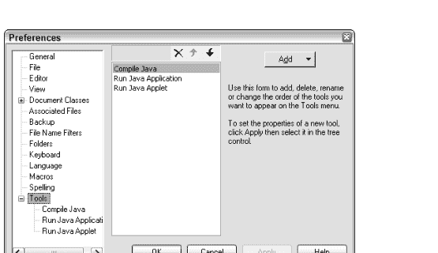

**4. 点击确定。**
用于编译和运行 Java 程序的命令已被添加到 TextPad 的“工具”菜单中。

### 编辑源文件

图 3-2 展示了 TextPad 正在编辑一个 Java 源文件。如果你之前使用过 Windows 文本编辑器，学习 TextPad 的基础知识将不会有任何困难。我不会赘述诸如打开和保存文件之类的基础操作，因为它们是标准的。相反，以下段落将描述 TextPad 中一些对编辑 Java 程序文件有用的功能。

当你首次创建文件时（通过点击工具栏上的“新建”按钮或选择“文件”>“新建”），TextPad 会将该文件视为普通文本文件，而非 Java 程序文件。在你保存文件（点击“保存”按钮或选择“文件”>“保存”）并将 `.java` 指定为文件扩展名后，TextPad 的 Java 编辑功能才会生效。

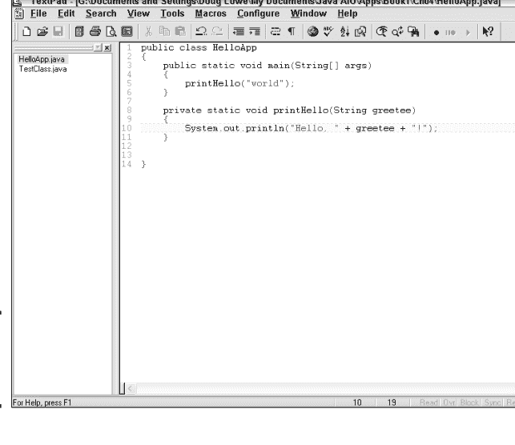

以下段落描述了 TextPad 用于处理 Java 文件的一些更值得注意的功能：

- 你可能无法从图 3-2 中真正看出来，但 TextPad 使用不同的颜色来标识程序中每个单词或符号的功能。括号是红色的，因此你可以快速发现它们并确保它们正确配对。关键字是蓝色的。注释和字符串字面量是绿色的。其他文本，如变量或方法名称，则是黑色的。
- 每当你输入一个开括号时，TextPad 会自动缩进，而在你输入闭括号时，它会恢复到之前的缩进级别。保持代码整齐对齐变得轻而易举。
- 行号显示在编辑窗口的左边缘。你可以通过选择“视图” > “行号”来开启或关闭这些行号。
- 要转到特定行，请按 Ctrl+G 调出“转到”对话框。确保“转到内容”框中选中了“行”，在文本框中输入行号，然后点击“确定”。
- 如果你打开了多个文件，可以使用文档选择器在文件之间切换，它是 TextPad 窗口左侧的窗格。如果文档选择器不可见，请选择“视图” > “文档选择器”来调出它。

### 使用工作区

在 TextPad 中，*工作区*是你一起处理的文件集合。对于涉及多个文件的项目，工作区非常有用。当你打开一个工作区时，TextPad 会打开该工作区中的所有文件。并且，你可以配置 TextPad，使其在每次启动时自动打开你上次正在处理的工作区。

要创建工作区，首先打开你希望包含在工作区中的所有文件。然后，选择“文件” > “工作区” > “另存为”，并为工作区命名。（组成工作区的文件列表会保存在一个扩展名为 .tws 的文件中。）

要打开工作区，选择“文件” > “工作区” > “打开”。然后，选择你之前保存的工作区文件并点击“打开”。或者，从“文件” > “工作区”菜单底部出现的最近使用的工作区列表中选择。

要配置 TextPad 使其在每次启动时自动打开最近使用的工作区，请选择“配置” > “首选项”。点击首选项树中左侧的“常规”，然后勾选“启动时重新加载最后的工作区”选项，并点击“确定”关闭首选项对话框。

- 在多个文件间切换的另一种方法是选择“视图” > “文档标签”。文档窗口底部会显示标签页。你可以点击这些标签页来切换文档。
- 一个方便的“匹配括号”功能可以让你配对括号、大括号和圆括号。要使用此功能，将插入点移动到一个括号上。然后按 Ctrl+M。TextPad 会找到匹配的括号。
- 要搜索文本，请按 F5。在“查找”对话框中，输入你要查找的文本，然后点击“确定”。要重复搜索，请按 Ctrl+F。
- 要替换文本，请按 F8。

### 编译程序

要在 TextPad 中编译 Java 程序，选择“工具” > “编译 Java”或使用键盘快捷键 Ctrl+1。javac 命令在一个单独的命令提示符窗口中启动，并将编译器输出显示在一个单独的“命令结果”窗口中。如果程序编译成功，TextPad 会立即返回到源程序。但如果编译器发现你的程序有错误，“命令结果”窗口将保持打开状态，如图 3-3 所示。

在此示例中，显示了以下三个编译器错误消息：

```
J:\Book1\Ch04\HelloApp.java:10: ')' expected
             System.out.println("Hello, " + greetee + "!");
             ^
J:\Book1\Ch04\HelloApp.java:10: unclosed string literal
                    System.out.println("Hello,  + greetee + "!");
                                          ^
J:\Book1\Ch04\HelloApp.java:11: ';' expected
                    }
                    ^
3 errors

Tool completed with exit code 1
```

如果你双击每条错误消息的第一行，TextPad 会将你带到发生错误的位置。例如，如果你双击带有 `unclosed string literal` 消息的那一行，你会被带到第 10 行，插入点会定位在该行最后一个引号上，正是编译器发现错误的地方。然后，你可以更正错误并重新编译程序。

通常，单个错误可能导致显示多个错误消息。这里就是这种情况。错误在于我在第 10 行的单词 Hello 后漏掉了一个结束引号。这一个错误导致了所有三个错误消息。

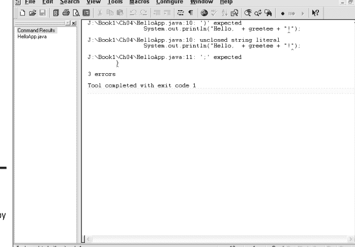

图 3-3：Java 编译器显示的错误消息。

### 运行 Java 程序

在你用没有错误的编译器编译完 Java 程序后，你可以通过选择“工具” > “运行 Java 应用程序”或按 Ctrl+2 来运行它。一个命令窗口会打开，程序将在其中运行。例如，图 3-4 显示了 HelloApp 程序在 TextPad 窗口上方的一个单独窗口中运行。

当程序运行完毕时，命令窗口中会显示消息“按任意键继续”。当你按下一个键时，窗口关闭，TextPad 恢复正常。


如果你好奇的话，TextPad 实际上是通过创建并运行一个批处理文件来运行你的程序的——这是一个包含运行你程序所需命令的短小文本文件。这个批处理文件被赋予一个晦涩难懂的名称，如 tp02a11c.BAT。以下是为 HelloApp 程序生成的批处理文件：

```
@ECHO OFF
C:
CD \Book1\Ch04
"G:\Program Files\Java\jdk1.5.0\bin\java.exe" HelloApp
PAUSE
```

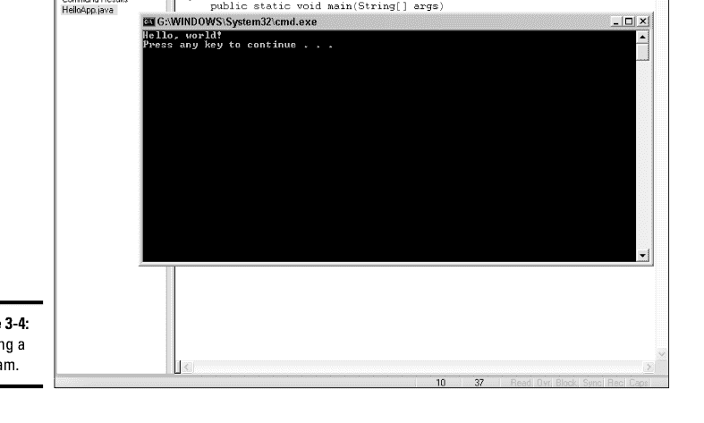

图 3-4：运行程序。

以下是这些命令的详细说明：

- 第一个命令告诉 MS-DOS 在批处理文件执行时不要在命令窗口中显示命令。
- 接下来的两个命令切换到包含 Java 程序的驱动器和目录。
- 然后，调用 `java.exe` 程序来运行 `HelloApp` 类。
- 最后，执行一个 `PAUSE` 命令。这就是程序结束后显示 `按任意键继续` 消息的原因。

### 运行 Applet

你也可以直接从 TextPad 运行 Applet。首先，编译程序。然后，如果程序没有错误，选择“工具” > “运行 Java Applet”或按 Ctrl+3。一个命令窗口出现。接着，Java Applet 查看器启动。它在一个单独的窗口中运行 Applet，而无需 Web 浏览器。图 3-5 显示了正在运行中的 Applet。

当你退出 Applet 时，Applet 查看器窗口和 DOS 命令窗口都会关闭，你将返回到 TextPad。

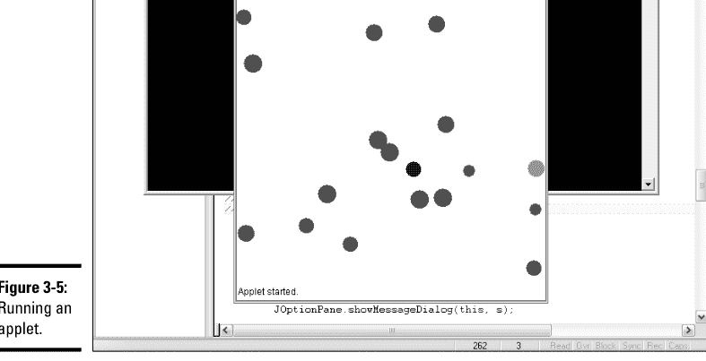


## 42 书籍 1：Java 基础

## 第四章：使用 Eclipse

**本章内容**

-   理解 Eclipse 项目和工作台
-   创建 Java 项目
-   使用 Eclipse 进行编译、运行和调试
-   使用 Eclipse 进行重构

Eclipse 是一个包含许多强大功能的开发环境，可用于创建 Java 程序。由于 Eclipse 免费且功能强大，它在 Java 开发者中广受欢迎。在本章中，你将了解使用 Eclipse 进行简单 Java 开发的基础知识。

由于 Eclipse 是一款功能强大的工具，它的学习曲线相对陡峭。如果你是 Java 新手，我建议你先从更简单的环境开始，例如 TextPad（在第一本书第三章中描述），等你掌握了 Java 编程的一些基础知识后，再转向 Eclipse。这样，你可以首先专注于 Java 编程，而不是先学习 Eclipse。

当你准备好开始使用 Eclipse 时，请访问 Eclipse 网站（www.eclipse.org），点击下载链接，下载当前版本的 Eclipse。与大多数程序不同，Eclipse 没有复杂的安装程序。你只需下载 Eclipse 的 Zip 文件，解压所有文件，然后直接从你解压到的文件夹中运行 Eclipse 可执行文件（eclipse.exe）。

如果你使用的是 Windows，你可能希望为 Eclipse 添加一个桌面快捷方式，以便更方便地启动。为此，请打开包含 `eclipse.exe` 文件的文件夹。然后，右键单击该文件并将其拖动到桌面。松开鼠标按钮，从出现的菜单中选择“创建快捷方式”。之后，你可以通过双击这个桌面快捷方式来启动 Eclipse。

请注意，本章中描述的许多技术，直到你学会如何使用它们所适用的 Java 编程功能后，对你来说才会有意义。例如，在第三本书中学习如何创建 Java 类之前，关于如何创建新 Java 类文件的信息对你来说可能没有太大意义。当你在后续章节中学习 Java 编程功能时，你可能需要回头参考本章，以了解相关的 Eclipse 功能。

如果你计划使用 Eclipse，我建议你购买一本由 Barry Burd（Wiley Publishing 出版）所著的 *Eclipse For Dummies*。

## 44 从某些视角理解 Eclipse

Eclipse 被设计为一个通用的开发环境，这意味着它并非专门为 Java 而设计。它就像 IDE 中的《宋飞正传》：正如其设计者所说，Eclipse 是一个“适用于任何事物，又不特别针对任何事物”的 IDE。你可以通过称为 *功能* 的插件组件轻松地自定义 Eclipse，使其适用于特定类型的开发任务。并且由于 Eclipse 最常用于 Java 程序开发，它预配置了专门为开发 Java 程序而设计的功能。

Eclipse 使用一些不常见的术语来描述其基本操作。特别是：

### ◆ 工作台：
*工作台*是基本的 Eclipse 桌面环境。当你运行 Eclipse 时，工作台会在一个窗口中打开，如图 4-1 所示。

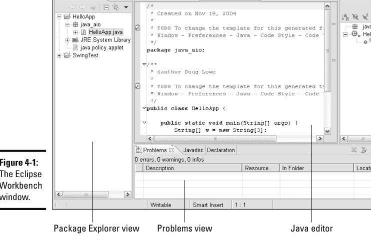

45

如果你能同时做到“多线程处理”，你可能希望打开两个工作台窗口，同时处理两个不同的项目。然而，对于我们这些专注力没有超级英雄能力的人来说，一次只处理一个工作台窗口就足够了。

### ◆ 编辑器：
*编辑器*是工作台窗口中的一个窗格，专门用于编辑某种类型的文件。Eclipse 自带一个标准文本编辑器，可以编辑任何类型的文本文件，以及一个专门用于编辑 Java 程序的特殊 Java 编辑器。在图 4-1 中，Java 编辑器位于工作台窗口的中间部分。

此图中的 Java 编辑器看起来很小，因为我在捕获此屏幕图像时，将计算机显示器设置为 800 x 600 像素。然而，由于 Eclipse 一次会在屏幕上显示大量信息，因此最好在分辨率至少为 1,024 x 768 的较大显示器（最好是 19 英寸或更大）上运行它。这样，编辑器窗口足够大，可以让你舒适地处理程序文本，同时为 Eclipse 工作台窗口中显示的其他元素留出充足的空间。

### ◆ 视图：
*视图*是工作台窗口中的一个窗格，用于显示你在使用 Eclipse 时有用的其他信息。图 4-1 中除了编辑器外，还显示了几个其他视图。例如，*包资源管理器视图*允许你浏览组成 Eclipse 项目的各种文件，而*问题视图*则显示错误消息。

你可以在自己的窗格中显示一个视图，或者将其与其他视图合并到一个窗格中。然后，窗格中的视图通过选项卡式分隔符标示，你可以单击这些分隔符来调用窗格中的每个视图。例如，图 4-1 中的问题视图与另外两个视图（称为 JavaDoc 和声明）共享其窗格。

严格来说，编辑器是一种视图类型。

### ◆ 透视图：
*透视图*是为帮助你完成特定类型编程任务而设计的一组视图的集合。例如，图 4-1 中所示的工作台窗口显示了*Java 透视图*，用于处理 Java 程序文件。图 4-2 显示了另一个不同的透视图，称为*调试透视图*。在此透视图中，Java 编辑器仍然存在，但显示了一组不同的、在测试和调试 Java 程序时很有用的视图。例如，窗口底部出现了一个控制台视图，以便你可以看到程序创建的输出，还有一个变量视图，允许你在程序执行时监视变量的内容。（有关调试透视图的更多信息，请参阅本章后面的“调试 Java 程序”部分。）

## 46 理解项目

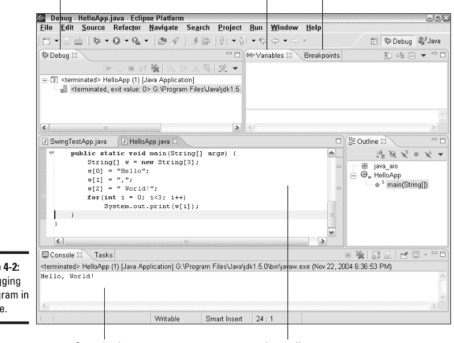

图 4-2：在 Eclipse 中调试程序。

一个 Eclipse 项目是一组共同构建单个 Java 程序的 Java 文件。虽然一些简单的 Java 程序只由一个文件组成，但大多数现实世界中的 Java 程序由多个 Java 程序文件组成。事实上，一个复杂的 Java 程序可能需要数百个 Java 程序文件。当你处理需要多个文件的程序时，Eclipse 允许你将这些文件作为一个项目来对待。

一个项目不仅包含 Java 源文件，还包含编译项目时创建的类文件以及程序所需的任何其他文件。这可能包括数据文件或配置文件，以及其他文件，如自述文件、程序文档、图像文件、声音文件等。

一个项目的所有文件都存储在一个项目文件夹中，如果需要，该文件夹可以包含子文件夹。除了程序所需的文件外，项目文件夹还包括 Eclipse 创建的用于存储项目本身信息的文件。例如，名为 `.project` 的文件存储项目的描述信息，名为 `.classpath` 的文件存储项目使用的类的位置。

你所有的项目文件夹都存储在一个称为*工作空间*的文件夹中。每次启动 Eclipse 时，都会出现一个对话框，询问工作空间文件夹的位置。如果你想切换到不同的工作空间，请使用“文件” > “切换工作空间”。

Eclipse 允许你创建两种类型的项目：

-   对于只有几个 Java 源文件的**简单项目**，你可以创建一个项目，将所有项目的 Java 文件存储在单个文件夹中。然后，当这些文件被编译时，生成的类文件也存储在这个相同的文件夹中。这种类型的项目最容易使用，非常适合中小型项目。
-   对于**大型项目**——涉及数十甚至数百个 Java 源文件的项目——你可以创建一个使用一个或多个子文件夹来存储源文件的项目。然后你可以自由创建任何你想要的子文件夹来帮助你组织文件。例如，你可以为用户界面类创建一个子文件夹，为数据库访问类创建另一个子文件夹，为应用程序显示的图像文件创建第三个子文件夹。

Eclipse 没有“文件” > “打开”命令来让你打开项目或单个文件。相反，包资源管理器视图（位于 Java 透视图的左侧；参见图 4-1）显示了工作空间中所有 Java 项目的列表。当你启动 Eclipse 时，你上次处理的项目会自动显示。你可以通过在包资源管理器中右键单击该项目，然后选择“打开项目”来切换到不同的项目。你可以通过双击包资源管理器中的文件来打开项目中的单个文件。

#### 创建一个简单项目

以下步骤将逐步引导你完成创建一个简单项目的过程，该项目基于第一本书第一章中“Hello, World!”程序的一个稍复杂的版本。请按照这些步骤创建此应用程序：

1.  **启动 Eclipse，当“工作空间启动器”对话框出现时，点击确定。**

    “工作空间启动器”对话框询问你的工作空间文件夹的位置；在大多数情况下，默认位置是可以接受的。当你点击确定时，Eclipse 将以 Java 透视图打开，没有显示任何项目或文件，如图 4-3 所示。


## 48 创建一个简单项目

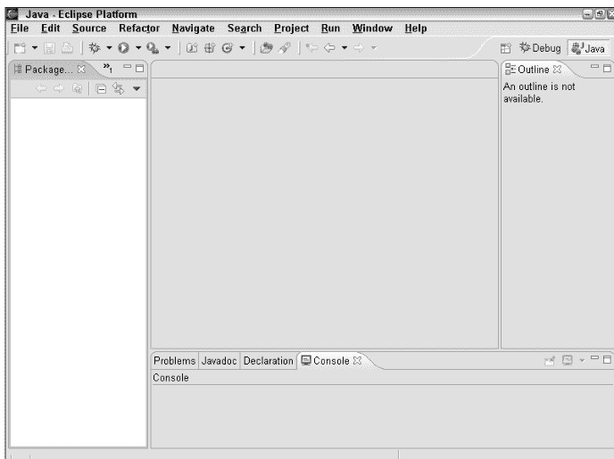

2.  选择 文件 > 新建 > 项目。
    新建项目对话框随即出现，如图 4-4 所示。此对话框列出了几个你可以用来创建各种类型 Eclipse 项目的向导。

3.  从向导列表中选择 Java 项目，然后单击 下一步。
    新建 Java 项目对话框随之显示，如图 4-5 所示。

4.  在文本框中键入 `HelloApp`，然后单击 完成。
    `HelloApp` 是项目名称。此对话框中的其他选项允许你指定项目是存储在工作空间文件夹还是其他文件夹中，以及项目是将源文件放在项目文件夹中还是为源文件创建单独的子文件夹。对于 `HelloApp` 应用程序，这两个选项的默认设置都适用。
    当你单击 完成 时，你将返回到 Java 透视图。但现在，`HelloApp` 出现在包资源管理器视图中，表明你已向工作空间添加了一个同名项目。

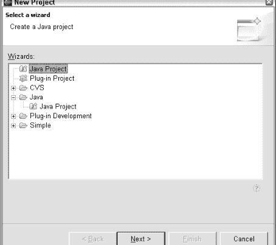

**图 4-4：** 新建项目对话框。

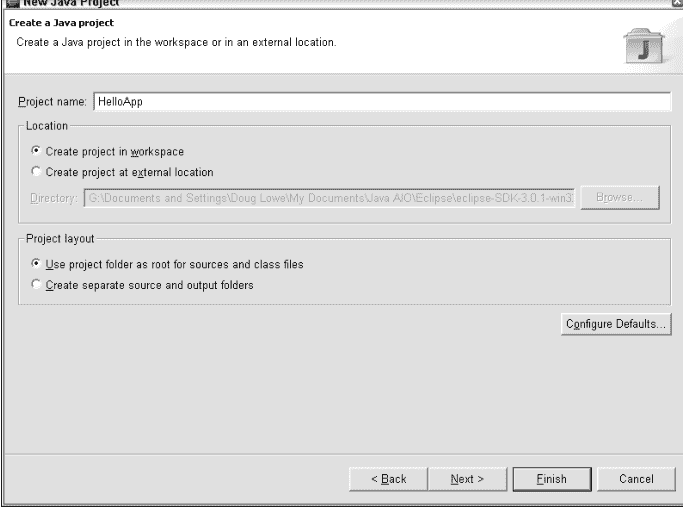

**图 4-5：** 新建 Java 项目对话框。

## 50 创建一个简单项目

5.  在包资源管理器视图中右键单击 `HelloApp`，然后从出现的快捷菜单中选择 新建 > 类。
    新建 Java 类对话框随即打开，如图 4-6 所示。

6.  设置新类的选项。
    具体来说：
    -   将 包 文本字段设置为 `JavaAIO`。
    -   将 名称 文本字段设置为 `HelloApp`。
    -   选中 Public Static Void `main(String[] args)` 复选框。

7.  单击 完成。
    `HelloApp.java` 文件被创建，Eclipse 在 Java 编辑器中显示它，如图 4-7 所示。

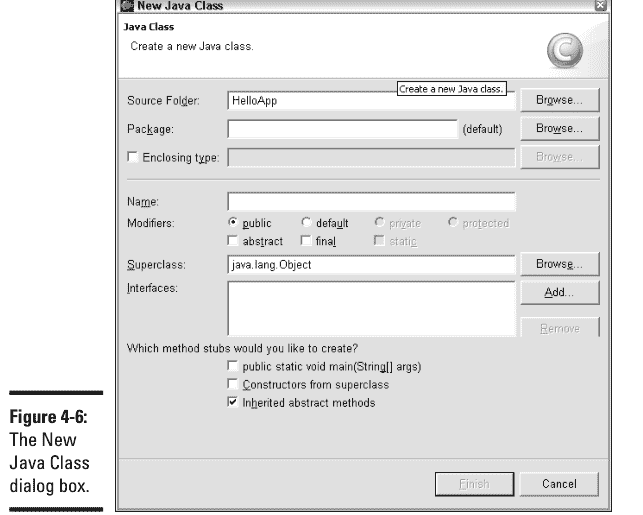

**图 4-6：** 新建 Java 类对话框。

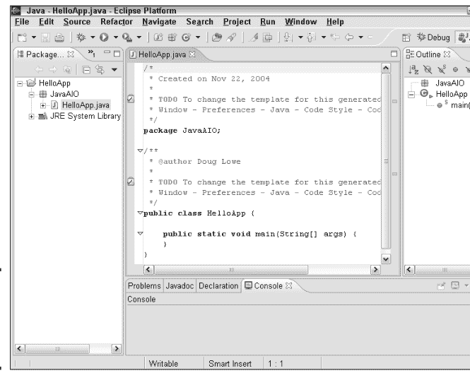

**图 4-7：** 新创建的 HelloApp 类。

8.  **编辑 main 方法。**
    将插入点移动到 main 方法的空代码块，然后将其编辑成与下面完全一致的样子：

    ```
    public static void main(String[] args) {
        String[] w = new String[3];
        w[0] = "Hello";
        w[1] = ", ";
        w[2] = "world!";
        for (int i = 0; i < 3; i++)
            System.out.print(w[i]);
    }
    ```

9.  **选择 运行 > 运行方式 > Java 应用程序。**
    程序被编译并运行。一个包含程序输出的控制台窗口出现在 Eclipse 窗口的底部，如图 4-8 所示。

    > *注意：* 如果在程序运行前出现 保存资源 对话框，请单击 确定。然后程序将会运行。

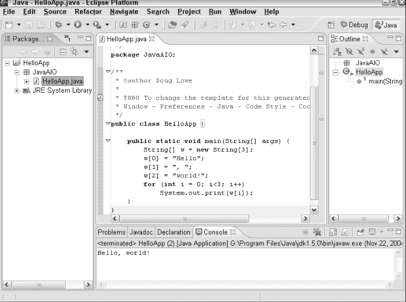

**图 4-8：** Eclipse 中的 HelloApp 程序。

## 52 添加一个类文件

在本节中，我将引导你完成向 `HelloApp` 应用程序添加第二个类文件的过程，以演示 Eclipse 通过为常用类特性生成代码来加速 Java 程序开发的一些最有用的功能。


除非你已经阅读过第 III 部分，否则你可能不会理解此过程中介绍的大部分（如果有的话）代码。别担心；一旦你阅读了关于创建自己的类的内容，这段代码就会变得完全清晰。

因此，请按照以下步骤向 `HelloApp` 应用程序添加第二个类：

1.  **在包资源管理器中右键单击 `HelloApp` 并选择 添加 ➜ 类。**
    新建 Java 类对话框随即打开（参考图 4-6）。

2.  **设置新类的选项。**
    对于这个类，请按如下设置选项：
    -   将 包 文本字段保留为 `JavaAIO`。
    -   将 名称 文本字段设置为 `HelloSayer`。
    -   取消选中 Public Static Void main(String[] args) 复选框。

3.  单击 完成。
    一个名为 HelloSayer 的新类文件被创建，Eclipse 在 Java 编辑器中打开它。

4.  添加两个名为 greeting 和 addressee 的公共字段的声明。
    在声明 HelloSayer 类的那一行之后立即添加这些行。然后，除了注释和类开头的 package 语句外，该类如下所示：

    ```
    public class HelloSayer {

        private String greeting;
        private String addressee;

    }
    ```

5.  使用向导向类添加一个构造函数。
    为此，请选择 源代码 > 使用字段生成构造函数。出现 使用字段生成构造函数 对话框，如图 4-9 所示。

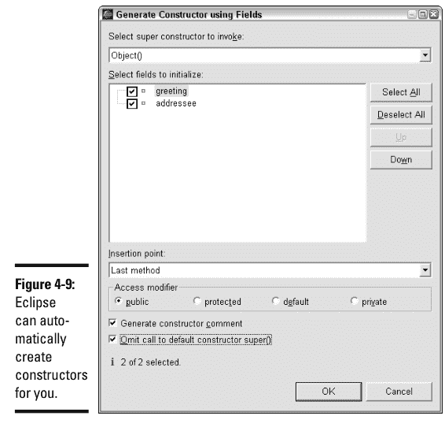

在要初始化的字段列表中选中 greeting 和 addressee，在 插入点 下拉列表中选择 First Method，并选中 省略调用默认构造函数 Super() 选项。然后单击 确定。以下代码被插入到类中：

```
/**
 * @param greeting
 * @param addressee
 */
public HelloSayer(String greeting, String addressee) {
    this.greeting = greeting;
    this.addressee = addressee;
}
```

6.  添加名为 sayHello 的方法的代码。
    在第 5 步创建的构造函数之后、程序最后一行的右花括号 (}) 之前立即添加以下代码：

    ```
    public void sayHello() {
        System.out.println(greeting + ", " + addressee
                + "!");
    }
    ```

整个 HelloSayer 类文件如清单 4-1 所示。

```
清单 4-1：HELLOSAYER 类
/*
 * Created on Nov 22, 2004
 *
 * TODO To change the template for this generated file go to
 * Window - Preferences - Java - Code Style - Code Templates
 */
package JavaAIO;

/**
 * @author Doug Lowe
 *
 * TODO To change the template for this generated type comment
 * go to Window - Preferences - Java - Code Style - Code Templates
 */
public class HelloSayer {

    private String greeting;
    private String addressee;

    /**
     * @param greeting
     * @param addressee
     */
    public HelloSayer(String greeting, String addressee) {
        this.greeting = greeting;
        this.addressee = addressee;
    }

    public void sayHello() {
        System.out.println(greeting + ", " + addressee + "!");
    }
}
```

7.  单击 Java 编辑器窗格顶部的 HelloApp.java 选项卡。
    `HelloApp.java` 文件被带到前台，以便你可以编辑它。

8.  编辑 main 方法，使其使用新的 HelloSayer 类。
    删除 `main` 方法中的代码，并将其替换为以下代码：

    ```
    public static void main(String[] args) {
        HelloSayer h = new HelloSayer("Hello", "World!");
        h.sayHello();
    }
    ```

整个 `HelloApp.java` 类现在如清单 4-2 所示。Eclipse 生成了 `main` 方法中两行代码之外的所有代码。

```
清单 4-2：HELLOAPP 类

/*
 * Created on Nov 22, 2004
 *
 * TODO To change the template for this generated file go to
 * Window - Preferences - Java - Code Style - Code Templates
 */
package JavaAIO;

/**
 * @author Doug Lowe
 *
 * TODO To change the template for this generated type comment
 * go to Window - Preferences - Java - Code Style - Code Templates
 */
public class HelloApp {

    public static void main(String[] args) {
        HelloSayer h = new HelloSayer("Hello", "World!");
        h.sayHello();
    }
}
```

## 56 运行程序

在输入 Eclipse 项目的源代码后，你可以运行它以查看其是否按预期工作。Eclipse 有多种运行 Java 程序的方式：

-   在包资源管理器中，选择你要运行的类的源文件。然后，选择 运行 -> 运行方式 -> Java 应用程序。
-   右键单击你要运行的类的源文件，然后从出现的快捷菜单中选择 运行 -> Java 应用程序。
-   在包资源管理器中选择源文件，然后单击 运行按钮（在边栏中显示），并从出现的菜单中选择 运行方式 -> Java 应用程序。（如果你最近运行过该程序，你也可以从此菜单中最近运行的程序列表中选择该程序。）


当程序运行时，其控制台输出显示在 Java 编辑器窗格下方的控制台视图中，如图 4-10 所示。

**注意：** 如果程序使用 Swing 创建窗口，则该窗口会单独显示，而不是在 Eclipse 工作台窗口内。（有关 Swing 的更多信息，请参阅第 VI 部分。）

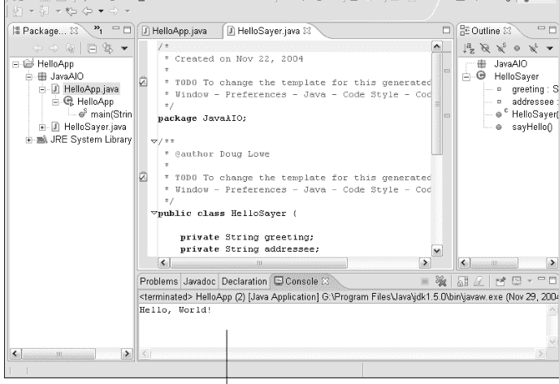

**图 4-10：** 控制台视图显示程序的控制台输出。


Eclipse 被设计为在你处理 Java 程序时自动编译它们。每次在 Eclipse 中保存一个 Java 源文件，该文件都会被自动编译以生成类文件。因此，通常你无需在运行程序前执行单独的编译步骤。如果项目包含大型源文件，此功能可能会变得令人烦恼。要禁用自动编译，请选择 `Project->Build Automatically`。然后，你必须通过选择 `Project->Build All` 手动构建项目，然后才能运行它。（要切换回自动构建，请再次选择 `Project->Build Automatically`。）

### 调试 Java 程序

无论你多么仔细地规划你的程序，迟早都会遇到 bug。你需要警惕两种基本的 bug：

-   **结果不正确**，例如，一个本应计算考试成绩的程序，但当你得分为 99/100 时却给出 C；或者一个本应计算 5% 销售税的程序，却说 29.95 美元购买的销售税是 149.75 美元，而不是 1.50 美元。
-   **程序崩溃**，例如，当一个本应将一个数除以另一个数并打印答案的程序，反而打印出此消息时：

```
Exception in thread "main" java.lang.ArithmeticException: / by zero
	at BugApp.main(BugApp.java:19)
```

然后，程序突然停止。

幸运的是，Eclipse 有一个强大的调试器，可以帮助你找到这两种 bug 的原因并修复它。要启动调试器，请通过选择 `Project->Debug As->Java Application` 而不是 `Project->Run As->Java Application` 来运行你的程序。或者，点击工作台工具栏上的调试按钮，如页边所示。Eclipse 会切换到调试透视图，如图 4-11 所示，并在调试模式下运行程序。

以下部分描述了调试透视图的一些关键功能，这些功能对于跟踪和纠正 Java 程序中的错误非常有用。

#### 单步执行你的程序

调试最基本的技能之一是逐条执行程序语句。这被称为*单步执行*，它是一种非常有用的调试技术。通过逐条语句单步执行你的程序，你可以查看每条语句的效果并识别错误的来源。有时，仅仅知道哪些语句正在被执行，就是你确定程序为何无法工作所需的全部信息。

在 Eclipse 中，调试透视图中的“Debug View”部分是你控制正在调试的程序执行的地方。此视图显示一个树，指示程序中的每个*线程*。（如果你不知道线程是什么，别担心。大多数基于控制台的程序，例如图 4-11 所示的 BugApp 程序，无论如何都只使用一个线程。你将在 Book V 中了解如何编写使用多个线程的程序。）

在你可以控制线程的执行之前，你必须先*挂起*线程，使其语句停止执行。通常，你可以通过三种方式挂起线程进行调试：

-   当发生未处理的异常时，线程会自动挂起。在图 4-11 中，BugApp 程序的 `main` 方法被挂起，因为发生了除以零异常，并且程序没有捕获它。如果你的程序抛出了你未预料到的异常，你可以简单地调试程序，并允许异常挂起线程。然后，你可以尝试找出问题的原因。

图 4-11：调试透视图允许你调试出错的 Java 程序。

在你调试程序之前，你可以在程序的任何语句处设置一个*断点*。然后，当执行到达该语句时，线程将被挂起。要设置断点，只需在 Java 编辑器中，在你希望线程被挂起的语句旁边的左边距处双击即可。

如果一个长时间运行的线程处于循环中，你可以通过在“Debug View”窗口中点击该线程，然后点击“Suspend”按钮（如页边所示）来挂起它。

当你挂起一个线程时，下一条将被执行的语句会在 Java 编辑器中突出显示。然后，你可以通过点击“Debug view”顶部的按钮来继续执行线程的一条或多条语句。表 4-1 描述了最常用的按钮。

| 按钮 | 名称 | 描述 |
|---|---|---|
|  | Resume（恢复） | 从下一条语句恢复执行。线程继续执行，直到被未捕获的异常或断点挂起。 |
|  | Terminate（终止） | 终止线程。 |
|  | Step Into（单步进入） | 执行突出显示的语句，然后挂起线程。 |
|  | Step Over（单步跳过） | 跳过突出显示的语句并执行下一条语句，然后挂起线程。 |
|  | Run to Return（运行到返回） | 执行突出显示的语句并继续执行语句，直到到达当前方法的结尾。然后，线程被挂起。 |

#### 检查变量

当线程被挂起时，你可以检查它的变量，看看它们是否设置为你期望的值。在许多情况下，你可以发现编程错误。例如，如果你认为一个名为 `customerFirstName` 的变量应包含客户的名字，而它却包含了客户所在州的名称，你可以得出结论：你没有正确分配变量的值。（当然，如果客户碰巧叫印第安纳·琼斯，这可能是有歧义的。）

检查变量值最简单的方法是直接将鼠标指向 Java 编辑器中的变量。例如，图 4-12 显示了当鼠标悬停在变量 `i` 上时，该变量的值是如何出现的。这里，弹出消息表明变量 `i` 是一个 `int` 类型，值为 0。（这个消息可能是程序抛出除以零异常原因的线索。）

你也可以使用“Variables”视图来检查变量，如图 4-13 所示。每个变量都列在“Variables”视图顶部部分的单独一行中。此外，底部部分（称为详细信息窗格）显示当前选定变量的值。请注意，当你单步执行程序中的各个语句时，变量在声明时会出现在“Variables”视图中，当它们超出作用域时会从视图中消失。

#### 设置断点

*断点*是你希望程序在其中挂起的程序行。设置断点允许你高效地执行程序中正常工作的部分，同时在程序到达你认为有错误的行时停止程序。

你程序中的所有断点都列在“Breakpoints”视图中，如图 4-14 所示。以下段落描述了你可以在此视图中处理断点的一些方式：

-   每个断点旁边的复选框表示该断点是否启用。只有当断点被启用时，执行才会在该断点处挂起。
-   你可以通过点击断点以选中它，然后按 `Delete` 键或点击“Remove Selected”按钮（如页边所示）来删除一个断点。
-   你可以通过点击“Remove All Breakpoints”按钮（如页边所示）来删除你设置的所有断点。
-   如果你在“Breakpoints”视图中双击一个断点，Java 编辑器窗口将滚动到设置该断点的行。
-   如果你只希望程序在命中某个断点一定次数后才挂起，请右键单击该断点，然后从出现的快捷菜单中选择“Hit Count”。然后，输入你希望语句在挂起程序之前执行的次数，然后点击“OK”。

图 4-14：Breakpoints 视图是你控制断点的地方。

### 重构你的代码

*重构*指的是对项目进行大规模更改的任务。例如，假设你决定在项目开始时创建的类名并未真正准确地描述该类的目的，因此你想更改它。简单的文本编辑器，如 TextPad，包含一个“Replace”命令，允许你更改文件中的文本字符串，但更改类名需要你在项目中的所有文件中更改该名称。

Eclipse 包含一个完整的重构选项菜单——正如你可能猜到的，称为“Refactor”菜单。此菜单包含 18 种不同类型的重构命令。如果你刚开始学习 Java，这 18 个命令中的大多数对你来说都没有意义。例如，“Refactor”菜单包含一些命令，允许你将匿名内部类更改为嵌套类、将成员下推到子类，或引入工厂。

### 重构你的代码

在你学习Java基础知识的过程中，重构菜单中的一些命令会对你很有用。特别包括：

- **重命名：** 允许你重命名变量、方法或其他符号。首先，选择要重命名的符号。然后，选择 Refactor->Rename，输入新名称，再点击确定。

- **提取方法：** 此命令允许你从一条或多条语句中创建一个单独的方法。选择要放入方法中的语句，然后选择 Refactor->Extract Method。在出现的对话框中，输入你希望用于该方法的名称。Eclipse会创建一个包含你所选语句的方法，然后用对该新方法的调用替换原始选中的代码。

- **内联：** 此命令与“提取方法”命令基本相反。它将一个方法调用替换为该方法主体中定义的语句。当你发现一个方法比预想的更复杂，或者你原本计划从更多位置调用它但实际调用较少时，此命令最为有用。

- **提取局部变量：** 这个功能挺巧妙。有时，你会发现一连串语句都在使用同一个表达式，比如 `x + 1`。如果你直接创建一个变量来保存 `x + 1` 的值，然后使用这个变量而不是重复计算该表达式，不是更好吗？“提取局部变量”命令就能为你做到这一点。高亮显示表达式的第一次出现，然后选择 Refactor->Extract Local Variable。Eclipse会创建一个局部变量，添加一条将表达式赋值给新局部变量的赋值语句，然后将表达式的所有出现位置替换为该局部变量。

# 第二卷：编程基础

The 5th Wave

作者：Rich Tennant


## 内容概览

- **第1章：Java编程基础** ....................................................................................................................65
- **第2章：使用变量和数据类型** .......................................................................................83
- **第3章：使用数字和表达式** ................................................................................113
- **第4章：做出选择** .............................................................................................................................141
- **第5章：循环往复（或，使用循环）** ..............................................................................161
- **第6章：玩转Switch语句** .....................................................................................................................187
- **第7章：为你的代码增添一些方法** ................................................................................199
- **第8章：处理异常** ......................................................................................................................217

## 第1章：Java编程基础

### 本章内容

- ✔ 著名的 Hello, World! 程序
- ✔ Java程序的基本元素，如关键字、语句和代码块
- ✔ 为程序添加注释的不同方法
- ✔ 面向对象编程的基础知识
- ✔ 导入类

在本章中，你将学习编写简单Java程序的基础知识。你在本章看到的程序不会做任何非常有趣的事情；它们只是在控制台（在Windows中，是命令提示符窗口）上显示简单信息。在你开始编写任何有价值的程序之前，还需要再学习几章。但你在本章看到的简单程序足以说明Java程序的基本结构。

请注意，在本章中，我将向你介绍一些Java编程特性，这些特性将在后面的章节中详细解释。例如，你会看到一些变量声明、一个方法，甚至一个 `if` 语句和一个 `for` 循环。本章的目标不是让你精通这些编程元素，只是让你初步了解它们。

> 你可以在 www.dummies.com/go/javaaiofd 找到本书使用的所有代码清单。

### 看看那著名的 Hello, World! 程序

许多编程书籍都以一个在控制台显示文本“Hello, World!”的简单示例程序开始。在第一卷第1章中，我向你展示了一个这样的Java程序，并将其与一个用C编写的类似程序进行了比较。现在，让我们仔细看看这个程序中的每个元素，如代码清单1-1所示。

```
public class HelloApp
{
    public static void main(String[] args)
    {
        System.out.println("Hello, World!");
    }
}
```

在本章后面，你将详细发现组成这个程序的所有元素。但首先，我想带你逐字逐句地解读它。

第1行和第2行标记了一个名为 `HelloApp` 的公共类的声明：

→ 1 public：一个 *关键字*，表示紧随其后的元素应该对其他Java元素可用。在这种情况下，紧随其后的是一个名为 `HelloApp` 的类。因此，这个关键字表明 `HelloApp` 类是一个 *公共类*，这意味着其他类可以使用它。（在第三卷第2章中，我将介绍最常见的 `public` 替代方案：`private`。还有其他替代方案，但将在后面章节中介绍。）

class：另一个Java关键字，表示此处定义的元素是一个类。所有Java程序都由一个或多个 *类* 组成。类定义包含定义程序创建和使用的对象行为的代码。虽然大多数实际程序由多个类组成，但你在本小型书中看到的简单程序只有一个类。

HelloApp：一个 *标识符*，为这里定义的类提供名称。关键字（如 `public` 和 `class`）是Java编程语言定义的词，而标识符是你为程序中使用的各种元素提供名称而创建的词。在这种情况下，标识符 `HelloApp` 为这里定义的公共类提供了名称。（尽管 *标识符* 是技术上的正确术语，但有时标识符也被称为 *符号或名称*。）

→ 2 {: 第2行的左花括号标记了类 *主体* 的开始。主体的结束由第7行的右花括号标记。出现在这些花括号内的所有内容都属于该类。在使用Java的过程中，你会发现它大量使用这些花括号。很快，你右手的第三和第四根手指就会确切知道它们在键盘上的位置。

第3行到第6行定义了 `HelloApp` 类的一个名为 `main` 的方法：

→ 3 public：`public` 关键字再次被使用，这次表示此处声明的方法应具有公共访问权限。这意味着除了 `HelloApp` 类之外的其他类也可以使用它。所有Java程序都必须至少有一个声明了名为 `main` 的公共方法的类。`main` 方法包含运行程序时执行的语句。

static：你将在第三卷第3章中找到关于 `static` 关键字的所有内容。现在，只需相信我的话：Java语言要求你在声明 `main` 方法时指定 `static`。

void：在Java中，方法是一个可以计算并返回值的代码单元。例如，你可以创建一个计算销售总额的方法。那么，销售总额就是该方法的返回值。如果一个方法不需要返回值，你必须使用 `void` 关键字来表示没有返回值。因为Java要求 `main` 方法不返回值，所以你在声明 `main` 方法时必须指定 `void`。

main：最后，为这个方法提供名称的标识符。正如我已经提到的，Java要求这个方法必须命名为 `main`。除了 `main` 方法之外，你还可以创建具有任意名称的其他方法。你将在第二卷第7章中学习如何创建其他方法。在此之前，程序只包含一个名为 `main` 的方法。

(String[] args)：哦，这个Java元素太高级了，现在无法彻底解释。它被称为参数列表，用于将数据传递给方法。Java要求 `main` 方法必须接收一个参数，该参数是一个字符串对象数组。按照约定，这个参数名为 `args`。如果你不知道什么是参数、字符串或数组，请不要担心。你可以在下一章了解什么是字符串，参数将在第二卷第7章介绍；数组在第四卷介绍。与此同时，请注意你在所有程序的 `main` 方法声明中都必须编写 `(String[] args)`。

→ 4 Another {: 另一组花括号从第4行开始，到第6行结束。这些标记了 `main` 方法的主体。注意，第6行的右花括号与第4行的左花括号配对，而第7行的右花括号与第2行的配对。这种配对在Java中很常见。简而言之，每当你遇到一个右花括号时，它都与最近一个尚未关闭（即尚未与右花括号配对）的左花括号配对。

→ 5 System.out.println("Hello, World!");：这是整个程序中唯一的语句。它调用 `System.out` 对象的一个名为 `println` 的方法。`println` 方法在控制台上显示一行文本。要显示的文本被传递


## 68 处理关键字

将字符串字面量 `Hello, World!` 作为参数，放在圆括号内，传递给 `println` 方法。在这个例子中，这个文本就是被一对引号包围的字符串字面量 `Hello, World!`。因此，这条语句会在控制台上显示文本 `Hello, World!`。

请注意，在 Java 中，语句以分号结束。由于这是程序中唯一的语句，所以这一行是唯一需要分号的行。

6 }：第6行包含一个右花括号，它标志着由第4行的花括号开始的 `main` 方法体的结束。

7 另一个 }：第7行包含一个右花括号，它标志着由第2行的花括号开始的 `HelloApp` 类体的结束。因为这个程序只包含一个类，所以这一行也标志着整个程序的结束。

要运行这个程序，你首先需要使用文本编辑器，将清单1-1中的内容准确无误地输入到一个名为 `HelloApp.java` 的文本文件中。然后，你可以通过在命令提示符下运行以下命令来编译它：

```
javac HelloApp.java
```

此命令会创建一个名为 `HelloApp.class` 的类文件，其中包含为 `HelloApp` 类编译的 Java 字节码。

你可以通过输入以下命令来运行该程序：

```
java HelloApp
```

既然你已经看到了 Java 程序的实际样子，你就能更好地理解这个命令具体做了什么。首先，它将 Java 虚拟机加载到内存中。然后，它定位 `HelloApp` 类，该类必须包含在名为 `HelloApp.class` 的文件中。最后，它运行 `HelloApp` 类的 `main` 方法。而 `main` 方法接着会在控制台上显示消息 "Hello, World!"。

本章的其余部分将更详细地描述 Java 编程语言的一些基本元素。

### 处理关键字

*关键字*是 Java 编程语言中定义了特殊含义的词。前面清单1-1所示的程序使用了四个关键字：`public`、`class`、`static` 和 `void`。Java 总共有51个关键字。它们按字母顺序列在表1-1中。

#### 表1-1 Java 的关键字

| abstract | do | if | package | synchronized |
|---|---|---|---|---|
| boolean | double | implements | private | this |
| break | else | import | protected | throw |
| byte | extends | instanceof | public | throws |
| case | false | int | return | transient |
| catch | final | interface | short | true |
| char | finally | long | static | try |
| class | float | native | strictfp | void |
| const | for | new | super | volatile |
| continue | goto | null | switch | while |
| default | | | | |

奇怪的是，表1-1中列出的三个关键字——`true`、`false` 和 `null`——严格来说并不被认为是关键字。相反，它们被称为*字面量*。尽管如此，它们仍然像关键字一样被 Java 语言保留使用，所以我将它们与关键字归为一类。

更奇怪的是，有两个关键字——`const` 和 `goto`——被 Java 保留但没有任何作用。两者都是从 C++ 编程语言遗留下来的。`const` 关键字用于定义常量，在 Java 中由 `final` 关键字处理。至于 `goto`，它是一个 C++ 语句，被面向对象编程的纯粹主义者视为大忌，因此在 Java 中不使用。Java 保留它作为关键字的唯一目的，就是在你试图使用它时对你提出警告。

与 Java 中的其他一切一样，关键字是区分大小写的。因此，如果你输入 `If` 而不是 `if`，或者输入 `For` 而不是 `for`，编译器就会报错。因为 Visual Basic 的关键字以大写字母开头，如果你曾经用 Visual Basic 编程，你会经常犯这个错误。

考虑到 Java 社区对 Visual Basic 的蔑视，当你大写关键字时生成的错误信息没有更具侮辱性，这令人惊讶。在 Visual Basic 风格中意外大写关键字真的会让 Java 编译器乱套。例如，考虑这个程序，它包含的唯一错误就是将单词 `For` 大写了：

```
public class CaseApp
{
    public static void main(String[] args)
    {
        For (int i = 0; i<5; i++)
            System.out.println("Hi");
    }
}
```

当你尝试编译这个程序时，编译器为这个错误总共生成了六条错误消息：

```
C:\Java AIO\CaseApp.java:5: '.class' expected
    For (int i = 0; i<5; i++)
                          ^
C:\Java AIO\CaseApp.java:5: ')' expected
    For (int i = 0; i<5; i++)
                       ^
C:\Java AIO\CaseApp.java:5: illegal start of type
    For (int i = 0; i<5; i++)
                                 ^
C:\Java AIO\CaseApp.java:5: > expected
    For (int i = 0; i<5; i++)
                          ^
C:\Java AIO\CaseApp.java:5: not a statement
    For (int i = 0; i<5; i++)
                               ^
C:\Java AIO\CaseApp.java:5: ';' expected
    For (int i = 0; i<5; i++)
                             ^
```

6 个错误

尽管这单个错误产生了六条错误消息，但没有一条消息真正指出了问题所在。源代码行下方的小箭头表示行中出错的部分，而这些错误消息中没有一条的箭头指向 `For` 这个词附近！编译器不够智能，无法意识到你的意思是 `for` 而不是 `For`。所以它将 `For` 视为一个合法的标识符，然后抱怨该行后面的所有其他内容。如果它生成类似这样的错误消息，那将会更有帮助：

```
C:\Java AIO\CaseApp.java:5: 'For' is not a keyword
    For (int i = 0; i<5; i++)
    ^
```

这个故事的寓意是，关键字是区分大小写的，如果你的程序无法编译，而错误消息又毫无意义，请检查是否错误地将关键字大写了。

### 使用语句

与大多数编程语言一样，Java 使用语句来构建程序。但与大多数编程语言不同，语句并不是 Java 中代码的基本单位。这个荣誉属于类。然而，每个类都必须有一个体，而类的体由一个或多个语句组成。换句话说，没有至少一条语句，你就无法编写一个有意义的 Java 程序。以下各节将详细描述使用 Java 语句的方方面面。

#### 语句的类型

Java 有许多不同类型的语句。有些语句只是创建变量，用于存储数据。这些类型的语句通常被称为*声明语句*，通常看起来像这样：

```
int i;
String s = "This is a string";
Customer c = new Customer();
```

另一种常见的语句类型是*表达式语句*，用于执行计算。以下是一些表达式语句的示例：

```
i = a + b;
salesTax = invoiceTotal * taxRate;
System.out.println("Hello, World!");
```

请注意，这组中的最后一条语句与清单1-1中的第5行相同。因此，HelloApp 程序中的单条语句就是一条表达式语句。

除了这两种，还有许多其他类型的语句。例如，if-then 语句仅在满足特定条件时才执行其他语句。而像 for、while 或 do 这样的语句会执行一组语句一次或多次。

> 人们常说，所有 Java 语句都必须以分号结尾。实际上，这并不完全正确。某些类型的 Java 语句必须以分号结尾，但其他的则不需要。基本规则是，声明语句和表达式语句必须以分号结尾，但大多数其他类型的语句则不需要。然而，这个规则变得棘手的地方在于，大多数其他类型的语句都包含一个或多个使用分号的声明或表达式语句。例如，这里是一个典型的 if 语句：

```
if (total > 100)
    discountPercent = 10;
```

这里，如果 `total` 变量的值大于100，则将名为 `discountPercent` 的变量赋值为10。表达式语句以分号结尾，但 if 语句本身不以分号结尾。（Java 编译器会告知你是否在不该使用分号的地方使用了分号。）

#### 空白

在 Java 中，术语*空白*指的是一个或多个连续的空格字符、制表符或换行符。所有空白都被视为相同。换句话说，一个空格与一个制表符或换行符，或者空格、制表符和换行符的任何组合，都被同等对待。


### 使用代码块

如果你曾在 Visual Basic 中编程，会发现空格的使用方式与你习惯的不同。在 Visual Basic 中，除非使用特殊的续行符，否则换行标志着语句的结束。而在 Java 中，将语句延续到第二行无需任何特殊处理。因此，语句

```
x = (y + 5) / z;
```

与下面这个语句是完全相同的：

```
x =
(y + 5) / z;
```

实际上，如果你愿意，也可以像这样编写上面的语句：

```
x
=
(
y
+
5
)
/
z
;
```

我不建议这样做，但这条语句确实能正常编译和执行。


在你的程序中合理使用空格是个好主意。特别是，你应该通常使用换行符将每个语句放在单独的一行，并使用制表符将属于同一逻辑部分的元素对齐。编译器会忽略额外的空格，因此它不会影响为你的程序生成的字节码。因此，在程序中使用额外的空格不会以任何方式影响程序的性能，但它确实使程序的源代码更易于阅读。

### 使用代码块

一个*代码块*是由一个或多个语句组成的、被花括号括起来的组。代码块以左花括号（`{`）开始，以右花括号（`}`）结束。在左花括号和右花括号之间，你可以编写一个或多个语句。例如，下面是一个包含三个语句的代码块：

```
{
    int i, j;
    i = 100;
    j = 200;
}
```


代码块本身也是一种语句。因此，任何时候 Java 语言需要一个语句，你都可以用一个代码块来替代，以执行多个语句。例如，在第二册第四章中，你会发现 `if` 语句的基本语法是这样的：

```
if ( expression ) statement
```

这里的 `statement` 可以是单个语句，也可以是一个代码块。如果你觉得这个概念令人困惑，别担心。当你阅读第二册第四章时，它会变得更容易理解。


你可以用两种流行的方式来编写标记代码块的花括号。一种是将两个花括号分别放在不同的行上，然后对构成代码块的语句进行缩进。例如：

```
if ( i > 0 )
{
    String s = "The value of i is " + i;
    System.out.print(s);
}
```

另一种风格是将代码块的左花括号与它所关联的语句放在同一行，像这样：

```
if ( i > 0 ) {
    String s = "The value of i is " + i;
    System.out.print(s);
}
```

使用哪种风格是个人偏好问题。我更喜欢第一种风格，这也是我在整本书中使用的风格。但两种风格都有效，许多程序员更喜欢第二种风格，因为它更简洁。

### 创建标识符

`标识符`是你自己创造的一个词，用于通过名称引用一个 Java 编程元素。虽然你可以为许多不同类型的 Java 元素分配标识符，但它们最常用于以下元素：

- 类，例如清单 1-1 中的 `HelloApp` 类
- 方法，例如清单 1-1 中的 `main` 方法
- 变量和字段，用于存储程序使用的数据
- 参数，用于向方法传递数据值

标识符有时也被称为*名称*。严格来说，名称与标识符并不完全相同。名称通常由两个或更多标识符通过句点（称为*点号*）连接而成。例如，在清单 1-1 的第 5 行，`System` 和 `out` 都是标识符。但 `System.out` 是一个名称。实际上，*名称*和*标识符*这两个术语可以互换使用。


创建标识符时，你必须遵循一些简单的规则：

- 标识符区分大小写。因此，`SalesTax` 和 `salesTax` 是两个不同的标识符。
- 标识符可以由大写或小写字母、数字、下划线字符（_）和美元符号（$）组成。
- 所有标识符必须以字母开头。因此，`a15` 是一个有效的标识符，但 `13Unlucky` 不是，因为它以数字开头。
- 标识符不能与表 1-1 中列出的任何 Java 关键字相同。因此，你不能创建一个名为 `for` 的变量或一个名为 `public` 的类。
- Java 语言规范建议避免在你创建的名称中使用美元符号。相反，美元符号由代码生成器用来创建标识符。因此，避免使用美元符号有助于避免创建与生成的名称冲突的名称。


### 编写注释

*注释*是提供代码解释的文本片段。编译器完全忽略注释，因此你可以在注释中放置任何你想要的文本。在程序中使用大量注释来解释程序的功能和工作原理是个好主意。

Java 有三种基本类型的注释：*行尾注释*、*传统注释*和*JavaDoc 注释*。

#### 行尾注释

行尾注释以序列 `//` 开始，到行尾结束。你可以在任何行的末尾放置行尾注释。你在 `//` 之后输入的所有内容都会被编译器忽略。例如：

```
total = total * discountPercent; // 计算折后总价
```

如果你愿意，也可以将行尾注释放在单独的行上，像这样：

```
// 计算折后总价
total = total * discountPercent;
```

你可以将行尾注释放在跨越两行或多行的语句中间。例如：

```
total = (total * discountPercent)  // 先应用折扣
           + salesTax;           // 然后加上销售税
```

#### 传统注释

传统注释以序列 `/*` 开始，以序列 `*/` 结束，并且可以跨越多行。例如：

```
/* HelloApp 示例程序。
   本程序演示了所有 Java 程序
   必须遵循的基本结构。 */
```

传统注释可以在线上的任何位置开始和结束。如果你愿意，甚至可以将注释夹在其他 Java 编程元素之间，像这样：

```
x = (y + /* 注释放在奇怪的地方 */ 5) / z;
```

通常，传统注释出现在单独的行上。传统注释的一个常见用法是在类的开头放置一块注释行，以指示有关该类的信息，例如该类的功能、编写者等。然而，这种类型的注释最好编码为 JavaDoc 注释，如下一节所述。


你可能想通过在范围的第一行前放置 `/*` 并在范围的最后一行后放置 `*/` 来临时注释掉一段行。但是，如果你尝试注释掉的范围包含一个传统注释，这可能会给你带来麻烦。这是因为传统注释不能*嵌套*。例如，以下代码将无法编译：

```
/*
int x, y, z;
y = 10;
z = 5;
x = (y + /* 注释放在奇怪的地方 */ 5) / z;
*/
```

这里，我试图注释掉已经包含传统注释的一段行。不幸的是，第五行末尾的 `*/` 序列被解释为第一行开始的传统注释的结束。然后，当编译器在第 6 行遇到 `*/` 序列时，它会产生一条错误消息。

#### JavaDoc 注释

JavaDoc 注释实际上是一种特殊类型的传统注释，你可以用它来自动为你的程序创建基于 Web 的文档。由于当你更了解面向对象编程时，会更好地理解 JavaDoc 注释，我在第三册第八章专门介绍如何创建和使用 JavaDoc 注释。

#### 面向对象编程简介

在介绍了 Java 编程语言的一些最基本元素之后，大多数 Java 书籍接下来会转向变量和数据类型的重要主题。然而，因为 Java 是一种天生的面向对象编程语言，而类是面向对象编程的核心，所以我接下来将探讨类在创建对象中所扮演的重要角色。我将在下一章首先介绍变量和数据类型。

#### 理解类和对象

正如我已经提到的，*类*是定义一个称为*对象*的 Java 编程元素行为的代码。对象是一个同时具有*状态*和*行为*的实体。对象的状态由对象可能跟踪的任何数据组成，行为则由对象可以执行的操作组成。这些行为在类中由一个或多个可以调用来执行操作的方法来表示。

类和对象之间的区别类似于蓝图和房子之间的区别。蓝图是房子的设计图。房子是蓝图的实现。一套蓝图可以用来建造许多房子。同样，类是对象的设计图，而对象——用 Java 术语来说——是类的一个*实例*。你可以使用单个类来创建多个对象。

当创建一个对象时，Java 会分配足够大的计算机内存区域来存储该对象存储的所有数据。因此，类的每个实例都有自己的数据，独立于同一类的其他实例使用的数据。

#### 理解静态方法

你不一定必须创建类的实例才能使用类的方法。如果一个方法是用 `static` 关键字声明的，那么无需先创建类的实例就可以调用该方法。这是因为静态方法是从类调用的，而不是从对象调用的。

Java 应用程序的 `main` 方法必须用 `static` 关键字声明。这是因为当你使用 `java`


#### 面向对象编程简介

当你从命令行运行一个 Java 应用程序时，Java 并不会创建该应用程序类的实例。相反，它只是简单地调用程序的静态 `main` 方法。

当你在第三册中更深入地研究面向对象编程时，静态方法和非静态方法之间的区别将变得更加明显。但现在，可以这样类比：房屋的蓝图包含了在成品房屋中实际执行工作的系统的详细信息，例如电气和管道系统。为了使用这些系统，你必须实际建造一栋房子。换句话说，你不能仅凭蓝图就打开热水；你必须有一栋实际的房子来加热水。

然而，蓝图确实包含了房屋尺寸的详细测量数据。因此，你可以使用蓝图来确定客厅的面积。现在想象一下，如果蓝图实际上内置了一个计算器，当你按下“客厅”按钮时，它会显示客厅的大小。这个按钮就像是类中的一个静态方法：你实际上不必建造一栋房子来使用它；你可以仅凭蓝图就使用它。

许多 Java 程序——事实上，本书第二部分其余部分的许多程序——完全由静态方法组成。然而，大多数现实世界的程序要求你创建一个或多个对象，供程序在执行时使用。因此，学习如何创建简单的类以及如何从这些类创建对象是 Java 编程的一项基本技能。

#### 从类创建对象

在 Java 中，你可以通过多种方式从类创建对象。但最直接的方法是创建一个变量，提供一个可以用来引用该对象的名称，然后使用 `new` 关键字创建该类的一个实例，并将生成的对象赋值给该变量。执行此操作的语句的一般形式如下：

```java
ClassName variableName = new ClassName();
```

例如，要创建一个名为 `Class1` 的类的对象实例，并将其赋值给一个名为 `myClass1Object` 的变量，你可以这样写：

```java
Class1 myClass1Object = new Class1();
```

为什么必须列出两次类名？第一次，你是为变量提供一个类型。换句话说，你是在说，你在这里创建的变量可以用来保存从 `Class1` 类创建的对象。第二次列出类名时，你是在从该类创建一个对象。`new` 关键字告诉 Java 创建一个对象，而类名提供了用于创建该对象的类的名称。

等号（=）是一个*赋值运算符*。它简单地表示将 `new` 关键字创建的对象赋值给该变量。因此，这条语句实际上做了*三*件事：

- 它创建了一个名为 `myClass1Object` 的变量，该变量可用于保存从 `Class1` 类创建的对象。此时，还没有创建任何对象——只是一个可以用来存储对象的变量。
- 它在内存中根据 `Class1` 类创建了一个新对象。
- 它将这个新创建的对象赋值给 `myGreeterObject` 变量。这样，你就可以使用 `myClassObject` 变量来引用创建的对象。

#### 使用对象的程序

为了让你提前一窥面向对象编程的真实面貌，清单 1-2 和 1-3 展示了 `HelloApp` 应用程序的另一个版本，这次使用了两个类，其中一个在程序运行时被实际创建为一个对象。第一个类名为 `HelloApp2`，如清单 1-2 所示。这个类类似于清单 1-1 中所示的 `HelloApp` 类。但是，它使用了一个从第二个类（名为 `Greeter`）创建的对象，来实际在控制台上显示“Hello, World!”消息。`Greeter` 类如清单 1-3 所示。它定义了一个名为 `sayHello` 的方法来显示消息。

`HelloApp2` 和 `Greeter` 类都是公共类。Java 要求每个公共类必须存储在单独的文件中，文件名与类名相同，扩展名为 `.java`。因此，`HelloApp2` 类存储在名为 `HelloApp2.java` 的文件中，`Greeter` 类存储在名为 `Greeter.java` 的文件中。

#### HelloApp2 类

`HelloApp2` 类如清单 1-2 所示。

```java
// This application displays a hello message on
// the console by creating an instance of the
// Greeter class, then calling the Greeter
// object's sayHello method.

public class HelloApp2 {
    public static void main(String[] args) {
        Greeter myGreeterObject = new Greeter();
        myGreeterObject.sayHello();
    }
}
```

以下段落描述了关键点：

- **1** 这个类以一系列注释行开头，标识程序的功能。对于这些注释，我使用了简单的行尾注释，而不是传统注释。（有关注释的更多信息，请参阅本章前面的“制作注释”部分。）
- **6** `HelloApp2` 类从第 6 行开始，使用了公共类声明。由于使用了 `public` 关键字，名为 `HelloApp2.java` 的文件必须包含此类。
- **8** `main` 方法的声明形式与第一个版本（清单 1-1）中的 `main` 方法相同。请习惯这种形式，因为*所有* Java 应用程序都必须包含一个以这种方式声明的 `main` 方法。
- **10** `main` 方法主体中的第一行创建了一个名为 `myGreeterObject` 的变量，该变量可以保存从 `Greeter` 类创建的对象。然后，它使用 `Greeter` 类创建一个新对象，并将该对象赋值给 `myGreeterObject` 变量。
- **11** `main` 方法主体中的第二行调用了 `myGreeterObject` 对象的 `sayHello` 方法。正如你稍后将看到的，此方法只是简单地在控制台上显示消息“Hello, World!”。

#### Greeter 类

`Greeter` 类如清单 1-3 所示。

```java
// LISTING 1-3: THE GREETER CLASS

// This class creates a Greeter object
// that displays a hello message on
// the console.

public class Greeter {
    public void sayHello() {
        System.out.println("Hello, World!");
    }
}
```

以下段落描述了关键点：

- **1** 这个类也以一系列注释行开头，标识程序的功能。
- **5** 类声明从这一行开始。该类被声明为公共类，以便其他类可以使用它。此声明是必需的，以便 HelloApp2 类可以访问 Greeter 类。
- **7** `sayHello` 方法使用 `public` 关键字声明，以便其他使用 `Greeter` 类的类可以访问它。`void` 关键字表示此方法不会向调用它的类返回任何数据，`sayHello` 仅提供方法的名称。
- **9** 此方法的主体仅由一行代码组成，该代码在控制台上显示“Hello, World!”消息。

#### 那么区别是什么？

你可能注意到，在 HelloApp2 程序中，唯一真正执行实际工作的代码行是 Greeter 类（清单 1-3）中的第 9 行，而这一行恰好与原始 HelloApp 类（清单 1-1）中的第 5 行完全相同。除了第二个版本所需的代码量大约是第一个版本的两倍这一事实之外，这两个应用程序之间真正的区别是什么？

简而言之，第一个版本是过程式的，第二个版本是面向对象的。在程序的第一个版本中，应用程序类的 `main` 方法独自完成应用程序的所有工作：它只是说你好。第二个版本定义了一个知道如何向世界问好的类，然后从该类创建一个对象，并要求该对象说你好。应用程序本身不知道甚至不关心 Greeter 对象究竟如何说你好。它不知道具体的问候语是什么，问候语将使用哪种语言，甚至不知道问候语将如何显示。

为了说明这一点，请考虑如果你使用清单 1-4 中所示的 Greeter 类而不是清单 1-3 中所示的类会发生什么。这个版本的 Greeter 类使用一个名为 `JOptionPane` 的 Java 库类在对话框中显示消息，而不是在控制台窗口中显示。（我不会费心解释这段代码是如何工作的，但你可以在下一章中找到更多相关信息。）如果你使用这个版本的 Greeter 类运行 HelloApp2 应用程序，你将得到如图 1-1 所示的对话框。

```java
// LISTING 1-4: ANOTHER VERSION OF THE GREETER CLASS

// This class creates a Greeter object
// that displays a hello message
// in a dialog box.
```


```java
import javax.swing.JOptionPane;
public class Greeter
{
    public void sayHello()
    {
        JOptionPane.showMessageDialog(null, "Hello, World!","Greeter", JOptionPane.INFORMATION_MESSAGE);
    }
}
```

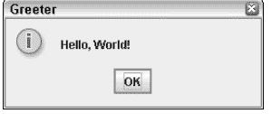

这里需要理解的关键点是，`HelloApp2` 类无需更改即可使用这个新版本的 `Greeter` 类。相反，你只需用新的 `Greeter` 类替换旧的，`HelloApp2` 类不会察觉到任何差异。这就是面向对象编程的主要好处之一。

### 导入 Java API 类

你可能已经注意到，清单 1-4 中的 `Greeter` 类包含了这条语句：

`import javax.swing.JOptionPane;`

`import` 语句的目的是让编译器知道，该程序正在使用一个由名为 `JOptionPane` 的 Java API 定义的类。

因为 Java API 包含了成千上万个类，所以需要某种形式的组织结构来使这些类更易于访问。Java 通过将类分组到称为*包*的可管理组中来实现这一点。在前面的例子中，包含 `JOptionPane` 类的包名为 `javax.swing`。

严格来说，`import` 语句从来不是必需的。但是，如果你不使用 `import` 语句来导入程序使用的 API 类，那么在使用这些类时，你必须*完全限定*它们的名称，即在类名前列出包名。因此，如果清单 1-4 中的类没有在第 5 行包含 `import` 语句，你就必须将第 11 行编写如下：

```
javax.swing.JOptionPane.showMessageDialog(null, "Hello, World!", "Greeter", JOptionPane.INFORMATION_MESSAGE);
```

换句话说，每次引用这个类时，你都必须指定 `javax.swing.JOptionPane`，而不仅仅是 `JOptionPane`。


以下是使用 `import` 语句的一些额外规则：

- `import` 语句必须出现在类文件的开头，在任何类声明之前。
- 你可以包含任意数量的 `import` 语句，以导入程序使用的所有类。
- 你可以通过列出包名后跟一个星号通配符来导入特定包中的所有类，如下所示：`import javax.swing.*;`
- 因为许多程序使用 `java.lang` 包中包含的类，所以你不需要导入该包。相反，这些类对所有程序都是自动可用的。`System` 类定义在 `java.lang` 包中。因此，你不必提供 `import` 语句就可以使用这个类。

## 第 2 章：使用变量和数据类型

本章内容

- 创建正确的变量声明
- 了解基本类型和引用类型之间的区别
- 查看 Java 的内置数据类型
- 介绍字符串
- 从控制台获取输入
- 如果你使用的是旧版本的 Java，如何获取输入

在本章中，你将了解在 Java 中使用变量的基础知识。变量是使 Java 程序具有通用性的关键。例如，前几章的 Hello, World! 程序非常具体：它们唯一能说的就是 "Hello, World!"。但是使用变量，你可以使这类程序更加通用。例如，你可以改变问候语，这样有时它会说 "Hello, World!"，而其他时候它会说 "Greetings, Foolish Mortals."。或者你可以个性化问候语，这样它就不是说 "Hello, World!"，而是说 "Hello, Bob!" 或 "Hello, Amanda!"。

变量也是创建能够执行计算的程序的关键。例如，假设你想创建一个程序，该程序根据给定的半径计算圆的面积。这样的程序使用两个变量：一个表示圆的半径，另一个表示圆的面积。程序要求用户为第一个变量输入一个值。然后，它计算第二个变量的值。

### 声明变量

在 Java 中，你必须在使用所有变量之前显式声明它们。这条规则与某些语言（最著名的是 Basic 和 Visual Basic）形成对比，后者允许你使用尚未自动声明的变量。允许你使用未显式声明的变量初看之下似乎是个好主意。但这是导致因变量名拼写错误而产生 bug 的常见原因。Java 要求你显式声明变量，这样如果你拼错了变量名，编译器就能检测到你的错误并显示编译器错误。

变量声明的基本形式是：

`type name;`

以下是一些例子：

```
int x;
String lastName;
double radius;
```

在这些例子中，声明了名为 x、lastName 和 radius 的变量。x 变量保存整数值，lastName 变量保存 String 值，radius 变量保存 double 值。有关这些类型的更多信息，请参阅本章后面的“使用基本数据类型”部分。在此之前，只需知道 int 变量可以保存整数（如 5、1、340 和 -34），double 变量可以保存带小数部分的数字（如 0.5、99.97 或 3.1415），而 String 变量可以保存文本值（如 "Hello, World!" 或 "Jason P. Finch"）。


注意变量声明以分号结尾。这是因为变量声明本身是一种语句。


变量名遵循与 Java 其他标识符相同的规则，如我在第二卷第 1 章所述。简而言之，变量名可以是字母和数字的任何组合，但必须以字母开头。大多数程序员喜欢以小写字母开头命名变量，并将名称中每个单词的首字母大写。例如，firstName 和 salesTaxRate 是典型的变量名。

#### 在一个语句中声明两个或更多变量

你可以通过用逗号分隔变量名，在一个语句中声明两个或更多相同类型的变量。例如：

```
int x, y, z;
```

这里，声明了三个类型为 `int` 的变量，使用了名称 x、y 和 z。


作为一条规则，我建议你避免在单个语句中声明多个变量。如果你给每个变量一个单独的声明，你的代码会更容易阅读和维护。

- 你必须将声明放在类的主体内，但不能放在任何类方法中。
- 你必须在声明中包含 `static` 一词。`static` 一词位于变量类型之前。

以下程序展示了声明名为 `helloMessage` 的类变量的正确方法：

```
public class HelloApp
{
    static String helloMessage;

    public static void main(String[] args)
    {
        helloMessage = "Hello, World!";
        System.out.println(helloMessage);
    }
}
```

如你所见，声明包含了 `static` 一词，并且放置在 `HelloApp` 类的主体内，但不在 `main` 方法的主体内。


你不必将类变量声明放在类的开头。一些程序员喜欢将它们放在类的末尾，如下例所示：

```
public class HelloApp
{
    public static void main(String[] args)
    {
        helloMessage = "Hello, World!";
        System.out.println(helloMessage);
    }

    static String helloMessage;
}
```

这里，`helloMessage` 变量是在 `main` 方法*之后*声明的。

我认为如果变量先声明，类会更容易阅读，因此在本书中它们就是这样出现的。

### 声明实例变量

*实例变量*类似于类变量，但在声明中不指定 `static` 一词。顾名思义，实例变量与类的实例相关联。因此，你只能使用它们


## 86 变量声明

当你创建一个类的实例时，由于静态方法与类的实例不相关，因此无法在静态方法（包括 `main` 方法）中使用实例变量。

例如，以下程序将无法编译：

```
public class HelloApp
{
    String helloMessage;    // 错误 -- 应使用 static 关键字

    public static void main(String[] args)
    {
        helloMessage = "Hello, World!";
        System.out.println(helloMessage);   // 无法编译
    }
}
```

如果尝试编译此程序，将得到以下错误消息：

```
C:\Java\HelloApp.java:7: non-static variable helloMessage
                cannot be referenced from a static context
                helloMessage = "Hello, World!";
                                 ^
C:\Java\HelloApp.java:8: non-static variable helloMessage
                cannot be referenced from a static context
                System.out.println(helloMessage);
                                        ^
```

这两个错误发生的原因是 `main` 方法是静态的，因此无法访问实例变量。

无论何时创建自己的类，实例变量都很有用。但因为我直到第三卷才介绍这一点，所以在第二卷剩余的章节中，你将不会看到很多实例方法的例子。

### 声明局部变量

*局部变量*是在方法体内部声明的变量。然后，你只能在该方法内部使用该变量。类中的其他方法甚至不知道该变量的存在。

以下是 `HelloApp` 类的一个版本，其中 `helloMessage` 变量被声明为局部变量：

```
public class HelloApp
{
    public static void main(String[] args)
    {
        String helloMessage;
        helloMessage = "Hello, World!";
        System.out.println(helloMessage);
    }
}
```

请注意，在声明局部变量时不要指定 `static`。如果指定了，编译器将生成错误消息并拒绝编译你的程序。局部变量始终存在于方法的上下文中，并且仅在方法执行期间存在。因此，无论是否已创建类的实例都无关紧要。


与类变量和实例变量不同，局部变量的声明位置很重要。特别是，你必须在第一条实际使用该变量的语句之前放置声明。因此，以下程序将无法编译：

```
public class HelloApp
{
    public static void main(String[] args)
    {
        helloMessage = "Hello, World!";    // 错误 -- helloMessage
        System.out.println(helloMessage); // 尚未声明
        String helloMessage;
    }
}
```

当编译器处理到 `main` 方法的第一行时，它会生成一个错误消息，抱怨找不到符号 "`helloMessage`"。这是因为该变量尚未声明。

虽然大多数局部变量是在方法体开头附近声明的，但你也可以在由花括号标记的更小的代码块中声明局部变量。当你阅读使用代码块的语句（如 `if` 和 `for` 语句）时，这对你来说会更有意义。但这里有一个例子：

```
if (taxRate > 0)
{
    double taxAmount;
    taxAmount = subTotal * taxRate;
    total = subTotal + total;
}
```

这里，变量 `taxAmount` 仅存在于属于 `if` 语句的花括号集合内。

## 88 变量初始化

在 Java 中，局部变量不会被赋予初始默认值。编译器会检查以确保你在使用局部变量之前已经为其赋值。例如，以下程序将无法编译：

```
public class testApp
{
    public static void main(String[] args)
    {
        int i;
        System.out.println("The value of i is " + i);
    }
}
```

如果尝试编译此程序，将得到以下错误消息：

```
C:\Java\testApp.java:6: variable i might not have been initialized
                System.out.println("The value of i is " + i);
                                       ^
```

为避免此错误消息，必须在使用局部变量之前初始化它们。你可以通过使用赋值语句或初始化器来完成此操作，如下几节所述。

与局部变量不同，类变量和实例变量会被赋予默认值。数值类型会自动初始化为零，String 变量初始化为空字符串。因此，你不必初始化类变量或实例变量，尽管如果你想让它们具有默认值以外的初始值，可以进行初始化。

#### 使用赋值语句初始化变量

初始化变量的一种方法是在变量声明后编写一个*赋值语句*。赋值语句具有以下通用形式：

*variable = expression;*

这里，*expression* 可以是任何产生与变量相同类型值的 Java 表达式。例如，以下是前面示例中 `main` 方法的一个版本，它在正确使用 `i` 变量之前对其进行了初始化：

```
public static void main(String[] args)
{
    int i;
    i = 0;
    System.out.println("i is " + i);
}
```

在这个例子中，变量在调用 `println` 方法打印变量值之前被初始化为零。

你将在第二卷第 3 章中了解到更多关于表达式的知识。目前，你可以只使用简单的字面值，如本例中的 0。

#### 使用初始化器初始化变量

Java 还允许你在声明变量的同一条语句中初始化变量。为此，你可以使用*初始化器*，其通用形式如下：

```
type name = expression;
```

实际上，初始化器允许你将声明和赋值语句组合成一条简洁的语句。以下是一些示例：

```
int x = 0;
String lastName = "Lowe";
double radius = 15.4;
```

在每种情况下，变量都在单条语句中被声明和初始化。

当你在单条语句中声明多个变量时，每个变量都可以有自己的初始化器。例如，以下代码声明了名为 x 和 y 的变量，并将 x 初始化为 5，y 初始化为 10：

```
int x = 5, y = 10;
```

当你在单条语句中声明两个类变量或实例变量但只使用一个初始化器时，你可能会错误地认为初始化器适用于两个变量。例如，请看以下语句：

```
static int x, y = 5;
```

这里，你可能认为 x 和 y 都将初始化为 5。但初始化器只适用于 y，因此 x 被初始化为其默认值 0。（如果你在局部变量上犯了这个错误，编译器会显示错误消息，因为它没有被正确初始化。）

#### 使用 Final 变量（或常量）

*final 变量*也称为*常量*，是一旦初始化后其值就不能更改的变量。要声明一个 final 变量，你需要在变量声明中添加 `final` 关键字，如下所示：

```
final int WEEKDAYS = 5;
```

## 90 使用基本数据类型

虽然你可以创建 final 的局部变量，但大多数 final 变量是类变量或实例变量。要创建一个 final 的类变量（有时称为*类常量*），请在声明中添加 `static final`（而不是 `final static`）：

```
static final int WEEKDAYS = 5;
```


尽管不是必需的，但通常使用全大写字母作为 final 变量的名称。你可以很容易地在程序中发现 final 变量的使用。

常量对于在程序多处使用且在程序运行过程中不会改变的值非常有用。例如，假设你正在编写一个包含弹跳球的游戏，并且希望球的半径始终为 6 像素。这个程序可能需要在多个不同的地方使用球的直径——例如，在屏幕上绘制球、确定球是否撞到墙、确定球是否撞到另一个球等等。与其在需要球的半径时总是指定 6，你可以设置一个名为 `BALL_RADIUS` 的类常量，如下所示：

```
static final int BALL_RADIUS = 6;
```

使用类常量有两个优点：

- 如果你后来决定球的半径应该是 7，你只需要在一个地方进行更改——即 `BALL_RADIUS` 常量的初始化器。
- 常量有助于记录程序的内部工作原理。例如，使用球半径的复杂计算的操作，如果指定 `BALL_RADIUS` 而不是 6，则更容易理解。

### 使用基本数据类型

术语*数据类型*是指可以存储在变量中的数据类型。Java 有时被称为*强类型*语言，因为当你声明一个变量时，你必须指定变量的类型。然后，编译器会确保你不会尝试将错误类型的数据赋值给该变量。例如，以下代码将生成编译器错误：

```
int x;
x = 3.1415;
```

因为 `x` 被声明为 `int` 类型（存储整数）的变量，所以不能将值 3.1415 赋给它。

Java 在*基本类型*和*引用类型*之间有一个重要的区别。基本类型是由语言本身定义的数据类型。相反，引用类型是由 Java API 中的类定义的类型，而不是由语言本身定义的。


#### Java的基本数据类型

基本类型与引用类型之间的关键区别在于，与基本类型变量关联的内存位置包含该变量的实际值。因此，基本类型有时也被称为*值类型*。相比之下，与引用类型变量关联的内存位置包含一个地址（称为*指针*），该地址指向实际对象所在的内存位置。本章后面“使用引用类型”一节会更全面地介绍引用类型，所以如果这个解释现在不太明白，请不要担心。

说引用类型仅由Java API定义而不由Java语言规范定义，并不完全准确。少数引用类型，如 `Object` 和 `String`，由API中的类定义，但这些类是在Java语言API中指定的。另外，一种称为*数组*的特殊变量类型可以容纳多个基本类型或引用类型的变量，也被视为引用类型。

Java总共定义了八种基本类型。为供参考，表2-1列出了它们。在这八种基本类型中，六种用于数字，一种用于字符，一种用于真/假值。在这六种数字类型中，四种是整数类型，两种是浮点数类型。以下各节将描述每种基本类型。

##### 表2-1：Java的基本类型

| 类型 | 说明 |
| :--- | :--- |
| `int` | 32位（4字节）整数值 |
| `short` | 16位（2字节）整数值 |
| `long` | 64位（8字节）整数值 |
| `byte` | 8位（1字节）整数值 |
| `float` | 32位（4字节）浮点值 |
| `double` | 64位（8字节）浮点值 |
| `char` | 使用Unicode编码方案的16位字符 |
| `boolean` | 真或假值 |

##### 整数类型

*整数*是一个整数——即没有小数部分或十进制部分的数字。Java有四种不同的整数类型，可用于存储不同大小的数字。最常用的整数类型是 `int`。该类型使用四个字节存储一个整数值，范围大约从负二十亿到正二十亿。

如果你正在编写一个统计麦当劳售出多少汉堡的应用程序，`int` 变量可能不够大。在这种情况下，你可以改用 `long` 整数。`long` 是一个64位整数，可以容纳大约从负9,000万亿到正9,000万亿的数字。这个数字非常大，即使按联邦赤字标准来看也是如此。

在某些情况下，你可能不需要像标准 `int` 类型提供的那么大的整数。对于这些情况，Java提供了两种更小的整数类型。`short` 类型表示一个16位整数，可以容纳从-32,768到+32,767的数字。`byte` 类型定义了一个8位整数，范围可以从-128到+127。

尽管 `short` 和 `byte` 类型比 `int` 或 `long` 类型需要更少的内存，但通常没有太多理由使用它们。这里或那里节省几个字节不会对大多数程序的性能产生任何影响，因此大多数时候你应该坚持使用 `int` 和 `long`。只在确定处理的数字对 `int` 来说太大时才使用 `long`。

在Java中，整数数据类型的大小由语言规范指定，并且无论程序在什么计算机上运行都相同。这相对于C和C++语言是一个巨大的改进，后者允许不同平台的编译器确定整数数据类型的最优大小。因此，在一个类型的计算机上编写和测试的C或C++程序可能在另一个计算机上运行时不完全一致。

Java允许你将整数类型*提升*为更大的整数类型。例如，Java允许以下操作：

```java
int xInt;
long yLong;
xInt = 32;
yLong = xInt;
```

这里，你可以将 `xInt` 变量的值赋给 `yLong` 变量，因为 `yLong` 的大小比 `xInt` 大。但是，Java不允许反向操作：

```java
int xInt;
long yLong;
yLong = 32;
xInt = yLong;
```

`yLong` 变量的值不能赋给 `xInt`，因为 `xInt` 比 `yLong` 小。由于这个赋值可能导致数据丢失，Java不允许这样做。

（如果需要将 `long` 赋值给 `int` 变量，你必须使用本章后面“类型转换”一节中描述的显式转换。）

##### 浮点类型

浮点数是包含小数部分的数字。当你需要带小数的数字（例如19.95或3.1415）时，应该使用浮点类型。

Java有两种用于浮点数的基本类型：`float`，使用四个字节；`double`，使用八个字节。在几乎所有情况下，当你需要带小数部分的数字时，都应该使用 `double` 类型。

浮点值的精度表示该值可以有多少有效数字。`float` 类型的精度只有大约6或7位十进制数字，这对于大多数类型的计算来说是不够的。例如，如果你用Java编写工资系统，你可以使用 `float` 变量存储教师或消防员等员工的工资，但对于职业棒球运动员或公司高管来说就不行了。

相比之下，`double` 变量的精度大约为15位数字，这对于大多数用途来说已经足够。

浮点数实际上使用指数表示法（也称为科学计数法）来存储其值。这意味着浮点数实际上记录两个数字：一个基数（也称为尾数）和一个指数。浮点数的实际值是通过将尾数乘以2的指数次幂来计算的。对于 `float` 类型，指数可以从-127到+128。对于 `double` 类型，指数可以从-1023到+1024。因此，`float` 和 `double` 变量都能够表示非常大和非常小的数字。

你可以在第二部分第3章中找到关于处理浮点值的一些细微差别的更多信息。

当使用浮点字面量时，你应该始终包含小数点，如下所示：

```java
double period = 99.0;
```

如果省略小数点，Java编译器会将字面量视为整数。然后，当你试图将字面量赋值给double变量时，它会生成编译器错误消息。

你可以为浮点字面量添加F或D后缀，以指示字面量本身是 `float` 类型还是 `double` 类型。例如：

```java
float value1 = 199.33F;
double value2 = 200495.995D;
```

##### 使用科学计数法表示浮点数

如果你有科学头脑，可能希望在使用科学计数法编写浮点字面量时使用科学计数法。例如：

```java
double e = 5.10e+6;
```

注意，指数可以为负数，表示小于1的值。例如：

```java
double impulse = 23e-7;
```

这个等式等价于：

```java
double e = 5100000D;
```

这个等式等价于：

```java
double impulse = 0.0000023;
```

如果指数为正，符号是可选的，所以你也可以写：

```java
double e = 5.10e6;
```

如果省略后缀，则默认为D。因此，对于 `double` 字面量，通常可以省略D后缀。

有趣的是，浮点数有两个不同的零值：负零和正零。你不必太担心这些，因为Java将它们视为相等。尽管如此，这仍然是一个很好的《危险边缘！》问题（“Alex，我要选200分的‘奇怪数字’。”）。

##### char类型

`char` 类型表示Unicode字符集中的单个字符。记住，字符与字符串不同，这一点很重要。你将在本章后面的“使用字符串”一节中了解字符串。目前，只需意识到 `char` 变量只能存储一个字符，而不能像字符串那样存储字符序列。

要为 `char` 变量赋值，你需要使用字符字面量，它总是用撇号而不是引号括起来。例如：

```java
char code = 'X';
```

这里，字符X被赋给名为 `code` 的变量。

以下语句将无法编译：

```java
char code = "X"; // 错误 -- 应该使用撇号，而不是引号
```

这是因为引号用于标记字符串，而不是字符常量。


Unicode 是一种双字节字符编码，可以表示世界上大多数语言中使用的字符。目前，Unicode 字符集中已定义了大约 35,000 个编码。这还剩下 29,000 个编码未被使用。Unicode 字符集中的前 256 个字符与 ASCII 字符集（这是西语计算机最常用的字符集）的字符相同。

> 有关 Unicode 字符集的更多信息，请参阅 Unicode 官方网站 www.unicode.org。

字符字面量还可以使用特殊的 *转义序列* 来表示特殊字符。表 2-2 列出了允许的转义序列。这些转义序列允许你创建那些在字符常量中无法直接输入的字符的字面量。

表 2-2

| 转义序列 | 说明 |
| :--- | :--- |
| \b | 退格符 |
| \t | 水平制表符 |
| \n | 换行符 |
| \f | 换页符 |
| \r | 回车符 |
| \" | 双引号 |
| \' | 单引号 |
| \\ | 反斜杠 |

##### 布尔类型

布尔类型可以有两种值：`true` 或 `false`。布尔值用于执行逻辑操作，最常见的是确定某个条件是否为真。例如：

```
boolean enrolled = true;
boolean credited = false;
```

这里，声明了一个名为 `enrolled` 的 `boolean` 类型变量并初始化为 `true`，另一个名为 `credited` 的 `boolean` 变量被声明并初始化为 `false`。

> 在某些语言中，例如 C 或 C++，整数值可以被视为布尔值，其中 0 等于 `false`，任何其他值等于 `true`。Java 中则不然。在 Java 中，你不能在整数类型和布尔类型之间进行转换。

##### 包装类

每种基本类型在 Java API 类库中都有一个对应的类。这个类有时被称为包装类，因为它将基本值包装在面向对象的、漂亮的包装纸和蝴蝶结中，使基本类型看起来和表现得像一个对象。表 2-3 列出了八种基本类型各自的包装类。

正如你在本章后面将了解到的，你可以使用这些包装类在字符串和基本值之间进行转换，反之亦然。

| 基本类型 | 包装类 |
| :--- | :--- |
| int | Integer |
| short | Short |
| long | Long |
| byte | Byte |
| float | Float |
| double | Double |
| char | Character |
| boolean | Boolean |

### 使用引用类型

在第三卷第 1 章中，你将接触到面向对象编程的一些基本概念。特别是，你将看到所有 Java 程序是如何由一个或多个类组成的，以及如何使用类来创建对象。在本节中，我将展示如何创建与从类创建的对象一起工作的变量。

首先，引用类型是一种基于类而不是基于 Java 语言内置的基本类型之一的类型。该类可以是作为 Java API 类库一部分提供的类，也可以是你自己编写的类。无论哪种方式，当你从一个类创建一个对象时，Java 会为该对象分配其存储所需的任何内存。然后，如果你将该对象赋给一个变量，该变量实际上被赋予的是对该对象的引用，而不是对象本身。这个引用就是存储对象的内存位置的地址。

例如，假设你正在编写一个涉及球的游戏程序，并且你创建了一个名为 `Ball` 的类来定义球的行为。要声明一个可以引用 `Ball` 对象的变量，你可以使用如下语句：

Ball b;

这里，变量 `b` 是一个 `Ball` 类型的变量。

要从一个类创建一个对象的新实例，你需要使用 `new` 关键字和类名。这个对类名的第二次引用实际上是对类的一个特殊例程的调用，称为 *构造函数*。构造函数负责初始化新对象。例如，下面的语句声明了一个 `Ball` 类型的变量，调用 `Ball` 类构造函数创建一个新的 `Ball` 对象，并将对该 `Ball` 对象的引用赋给该变量：

Ball b = new Ball();

使用引用类型的一个关键概念是记住，特定类型的变量实际上并不包含该类型的对象。相反，它包含一个指向正确类型对象的引用。一个重要的副作用是，两个变量可以引用同一个对象。例如，考虑以下语句：

Ball b1 = new Ball();
Ball b2 = b1;

这里，我声明了两个 `Ball` 变量，分别名为 `b1` 和 `b2`。但我只创建了一个 `Ball` 对象。在第一条语句中，`Ball` 对象被创建，并且 `b1` 被赋予了对它的引用。然后，在第二条语句中，变量 `b2` 被赋予了对 `b1` 所引用的同一个对象的引用。结果，`b1` 和 `b2` 都引用同一个 `Ball` 对象。

如果你使用其中一个变量来改变球的某些方面，这个变化对使用哪个变量引用的球都是可见的。例如，假设 `Ball` 类有一个名为 `setSpeed` 的方法，允许你将球的速度设置为任何 `int` 值，还有一个 `getSpeed` 方法，返回一个反映球当前速度的整数值。现在考虑这些语句：

b1.setSpeed(50);
b2.setSpeed(100);
int speed = b1.getSpeed();

当这些语句完成时，`speed` 变量的值是 50 还是 100？正确答案是 100。因为 `b1` 和 `b2` 都引用同一个 `Ball` 对象，使用 `b2` 更改速度也会影响 `b1`。

这是使用 Java 等面向对象语言进行编程时最令人困惑的方面之一，所以如果你时不时地感到困惑，不要觉得难过。


### 处理字符串

字符串是文本字符的序列，例如本章和上一章中所示的 HelloApp 程序显示的消息 "Hello, World!"。在 Java 中，字符串是一个有趣的类别。Java 没有将字符串定义为基本类型。相反，字符串是由 Java API String 类定义的引用类型。Java 语言确实有一些用于处理字符串的内置特性。在某些情况下，这些特性使得字符串看起来像是基本类型而不是引用类型。

Java 的字符串处理功能非常强大，值得用一整章来解释。因此，关于字符串的完整内容，请参阅第四卷第 1 章。以下几节仅介绍处理字符串的基本要素，以便你可以在程序中使用简单的字符串。

#### 声明和初始化字符串

字符串的声明和初始化方式与基本类型非常相似。事实上，你一开始可能注意到的唯一区别是单词 `String` 的首字母是大写的，不像 `int` 和 `double` 等基本类型的关键字那样小写。这是因为 `String` 不是一个关键字。相反，它是提供字符串对象的 Java API 类的名称。

以下语句定义并初始化一个字符串变量：

```
String s;
s = "Hello, World!";
```

这里，声明了一个名为 `s` 的 `String` 类型变量，并使用字符串字面量 "Hello, World!" 初始化它。注意字符串字面量是用双引号括起来的，而不是单引号。单引号用于字符字面量，这与字符串字面量不同。

像任何变量声明一样，字符串声明可以包含初始化器。因此，你可以在一条语句中声明和初始化一个字符串变量，如下所示：

```
String s = "Hello, World!";
```


类变量和实例变量会自动初始化为空字符串，但局部变量不会。要将局部字符串变量初始化为空字符串，请使用如下语句：

```
String s = "";
```

#### 组合字符串

使用加号 (`+`) 作为 *连接运算符* 来组合两个字符串。（在 Java 术语中，组合字符串称为 *连接*。）例如，以下语句组合两个字符串变量的值以创建第三个字符串：

```
String hello = "Hello, ";
String world = "World!";
String greeting = hello + world;
```

`greeting` 变量的最终值是 "Hello, World!"


当 Java 连接字符串时，它不会在字符串之间插入任何空格。因此，如果你想组合两个字符串并让它们之间出现一个空格，你需要确保第一个字符串以空格结尾，或者第二个字符串以空格开头。在前面的例子中，第一个字符串以空格结尾。

或者，你也可以将字符串字面量与字符串变量连接起来。例如：

```
String hello = "Hello";
String world = "World!";
String greeting = hello + ", " + world;
```

这里，出现在 `Hello` 和 `World` 之间的逗号和空格是作为字符串字面量插入的。

连接是最常用的字符串处理技术之一，因此你将在本书中看到大量的例子。事实上，我在本章中已经使用过一次连接。之前，我向你展示了一个包含以下行的程序：

```
System.out.println("The value of i is " + i);
```

这里，`System.out` 对象的 `println` 方法打印当字面量 "The value of i is " 与变量 `i` 的值连接时创建的字符串。

#### 将基本类型转换为字符串

因为字符串连接允许你组合两个或多个字符串值，而像 `int` 和 `double` 这样的基本类型 *不是* 字符串类型，你可能想知道上一节中的最后一个例子是如何工作的。换句话说，Java 如何在这个语句中将字符串字面量 "The value of i is " 与 `i` 的整数值连接起来：


## 100 字符串操作

```java
System.out.println("The value of i is " + i);
```

答案是，当你在拼接操作中使用原始类型值时，Java 会自动将其转换为字符串值。


你可以通过使用原始类型包装类的 `toString` 方法，将原始类型值显式转换为字符串。例如，要将 `int` 变量 `x` 转换为字符串，请使用以下语句：

```java
String s = Integer.toString(x);
```

在下一章中，你将学习如何使用一个名为 `NumberFormat` 的特殊类，在将原始类型转换为字符串的同时应用各种格式化，例如添加逗号、美元符号或百分号。

#### 将字符串转换为原始类型

将原始类型值转换为字符串相当容易。反向操作——将字符串值转换为原始类型——则稍微复杂一些，因为它并不总是有效。例如，如果一个字符串包含值 10，你可以轻松地将其转换为整数。但如果字符串包含 "thirty-two"，则不行。

要将字符串转换为原始类型，你需要使用相应包装类的 `parse` 方法，如表 2-4 所列。例如，要将字符串值转换为整数，请使用如下语句：

```java
String s = "10";
int x = Integer.parseInt(s);
```

当然，你通常没有真正的理由这样做。然而，正如本章后面所示，你可以使用 `parse` 方法将用户输入的字符串值转换为原始类型。这样，你就可以编写允许用户通过控制台窗口输入数字数据的程序。

| 包装类 | 解析方法 | 示例 |
| :--- | :--- | :--- |
| Integer | `parseInt(String)` | `int x = Integer.parseInt("100");` |
| Short | `parseShort(String)` | `short x = Short.parseShort("100");` |
| Long | `parseLong(String)` | `long x = Long.parseLong("100");` |
| Byte | `parseByte(String)` | `byte x = Byte.parseByte("100");` |
| Float | `parseFloat(String)` | `float x = Float.parseFloat("19.95");` |
| Double | `parseDouble(String)` | `double x = Double.parseDouble("19.95");` |
| Character | (无) | |
| Boolean | `parseBoolean(String)` | `boolean x = Boolean.parseBoolean("true");` |

请注意，将 `String` 转换为 `Character` 不需要 `parse` 方法。如果你需要这样做，可以在第四册第一章中找到方法。

#### 转换和强制转换数值数据

你需要不时地将一种类型的数值数据转换为另一种类型。例如，你可能需要将 `double` 值转换为整数，反之亦然。有些转换可以自动完成，有些则通过一种称为 *强制转换* 的技术来完成。我将在接下来的章节中描述自动类型转换和强制转换。

##### 自动转换

Java 可以自动将某些原始类型转换为其他类型，并在必要时进行转换。图 2-1 显示了 Java 允许的转换。请注意，图中用虚线箭头表示的转换可能会导致部分值的精度损失。例如，`int` 可以转换为 `float`，但较大的 `int` 值将无法精确转换，因为 `int` 值可能包含的数字位数多于 `float` 类型所能表示的位数。

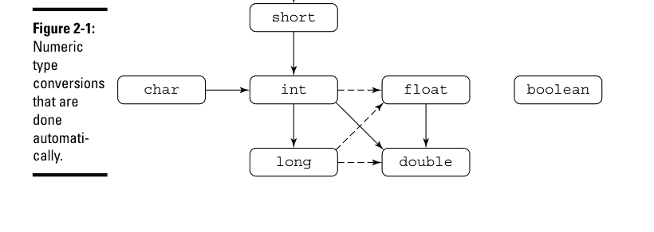

每当你在两个不同类型的值上执行数学运算时，Java 会自动将其中一个转换为另一个的类型。Java 在执行此转换时遵循以下规则：

- 如果其中一个值是 `double`，则另一个值将被转换为 `double`。
- 如果两者都不是 `double`，但其中一个是 `float`，则另一个将被转换为 `float`。
- 如果两者都不是 `double` 或 `float`，但其中一个是 `long`，则另一个将被转换为 `long`。
- 如果以上都不适用，则两个值都将被转换为 `int`。

##### 类型强制转换

*强制转换* 类似于转换，但不是自动执行的。你需要使用强制转换来执行图 2-1 中*未*显示的转换。例如，如果你想将 `double` 转换为 `int`，则必须使用强制转换。

当你使用强制转换时，你可能会面临丢失信息的风险。例如，`double` 可以存储比 `int` 更大的数字。此外，`int` 无法存储 `double` 的小数部分。因此，如果你将 `double` 强制转换为 `int`，则可能面临数据丢失或精度降低的风险。例如，3.1415 会变成 3。

要将原始值从一种类型强制转换为另一种类型，你需要使用*强制转换运算符*，它只是放在你要转换的值前面的、括在括号中的原始类型名称。例如：

```java
double pi = 3.1314;
int iPi;
iPi = (int) pi;
```

请注意，当 `double` 被强制转换为整数时，其小数部分只是被丢弃，而不是四舍五入。例如：

```java
double price = 9.99;
int iPrice = (int) price;
```

这里，`iPrice` 被赋值为 9。如果你想在转换时对 `double` 值进行四舍五入，请使用 `Math` 类的 `round` 方法，正如我在下一章所示。

## 102 理解作用域

变量的*作用域*指的是该变量存在于类的哪些部分。简单来说，每个变量只存在于声明该变量的代码块以及包含在该代码块内的任何其他代码块中。这就是为什么在类体中声明的类变量和实例变量可以被该类定义的任何方法访问，而在方法内定义的局部变量只能被定义它们的方法访问。

在 Java 中，一个*代码块*由一对匹配的花括号标记。Java 有许多不同类型的代码块：类体、方法体，以及属于 `if` 或 `for` 等语句的语句块。但在每种情况下，代码块都标记了其中声明的变量的作用域边界。

清单 2-1 中的程序有助于阐明类变量和局部变量的作用域。

```java
public class ScopeApp
{
    static int x;

    public static void main(String[] args)
    {
        x = 5;
        System.out.println("main: x = " + x);
        myMethod();
    }

    public static void myMethod()
    {
        int y;
        y = 10;
        if (y == x + 5)
        {
            int z;
            z = 15;
            System.out.println("myMethod: z = " + z);
        }
        System.out.println("myMethod: x = " + x);
        System.out.println("myMethod: y = " + y);
    }
}
```

以下段落解释了此类中使用的每个变量的作用域：

- 变量 `x` 是一个类变量。它的作用域从第 2 行开始，到第 27 行结束。因此，`main` 方法和 `myMethod` 方法都可以访问它。
- 变量 `y` 是一个局部变量，它在第 16 行初始化。因此，它的作用域从第 16 行开始，到第 25 行结束，这标志着 `myMethod` 方法体的结束。
- 变量 `z` 是一个局部变量，它在属于第 17 行 `if` 语句的语句块中被声明和初始化。它的作用域从第 20 行变量初始化时开始，到第 22 行语句块结束时结束。

严格来说，局部变量的作用域从变量被初始化时开始，到包含该变量声明的代码块结束时结束。相比之下，类变量或实例变量的作用域是声明该变量的整个类。这意味着你可以在物理上出现在变量声明之前的方法中使用类变量或实例变量。但你不能在局部变量被声明之前使用它。

## 104 变量遮蔽

*被遮蔽的变量*指的是一个原本可以被访问的变量，但由于在更直接的作用域中声明了同名的变量而暂时无法访问。这个定义有些拗口，但清单 2-2 中的示例阐明了这个概念。这里声明了一个名为 `x` 的类变量。然后，在 `main` 方法中，声明了一个同名的局部变量。

#### 清单 2-2：演示遮蔽的类

```java
public class ShadowApp
{
    static int x;

    public static void main(String[] args)
    {
        x = 5;
        System.out.println("x = " + x);
        int x;
        x = 10;
        System.out.println("x = " + x);
        System.out.println("ShadowApp.x = " + ShadowApp.x);
    }
}
```

#### 以下段落解释了此程序中的变量作用域问题：

- 类变量 x 在第 4 行声明。其作用域是整个类体，从第 2 行到第 16 行。
- 类变量 x 在第 8 行被赋值为 5。随后，这个值在第 9 行被打印到控制台。
- 在第 10 行，声明了一个名为 x 的局部变量。这个局部变量**遮蔽**了类变量 x，因此在此方法第 14 行结束之前，任何对 x 的引用都指向局部变量，而非类变量。
- 局部变量 x 在第 11 行被初始化。此时，局部变量 x 进入作用域，并一直保持到该方法第 14 行结束。
- 第 12 行的 `System.out.println` 语句打印了局部变量 x 的值。请注意，此语句与第 9 行的语句完全相同，只是第 9 行打印的是类变量 x，因为那时类变量还未被遮蔽。
- 当一个类变量被遮蔽时，你可以通过指定类名来访问它，如第 13 行所示。这里，`ShadowApp.x` 指的就是类变量。
- 当 `main` 方法在第 14 行结束时，类变量 x 不再被遮蔽。

一个遮蔽了类变量的局部变量，其作用域并不一定从局部变量的作用域开始处开始。遮蔽在局部变量声明时就开始了，但局部变量的作用域直到该变量被初始化后才开始。如果你尝试在声明和初始化之间访问该变量，Java 编译器会显示一条错误消息。

由于遮蔽是错误的常见来源，我建议你尽可能避免它。

### 使用 System.out 打印数据

你已经见过一些程序使用 `System.out.println` 在控制台显示输出。在接下来的章节中，我将正式介绍这个方法的工作原理，以及一个名为 `print` 的相关方法。

### 标准输入和输出流

Java 应用程序设计为在终端 I/O 环境中工作。每个 Java 应用程序都拥有三个 I/O 流，专为基于终端的输入和输出设计，它们简单地以一次一个字符的方式发送或接收数据。这三个流是：

- **标准输入：** 一个设计用于接收输入数据的流。该流通常连接到运行程序的计算机上的键盘。这样，用户就可以直接向标准输入流键入字符。在本章稍后的“使用 Scanner 类获取输入”一节中，你将把这个输入流连接到一个名为 `Scanner` 的类，该类使得从标准输入流读取基本数据类型变得简单。
- **标准输出：** 一个设计用于在屏幕上显示文本输出的流。当你在 Windows 下运行 Java 程序时，会打开一个特殊的控制台窗口，标准输出流就连接到该窗口。然后，你发送到标准输出的任何文本都会显示在该窗口中。
- **标准错误：** 另一个用于输出的流。该流也连接到控制台窗口。因此，写入标准输出流的文本通常会与写入错误流的文本混杂在一起。


Windows 和其他操作系统允许你将标准输出*重定向*到其他目标——通常是一个文件。当你这样做时，只有标准输出数据会被重定向。写入标准错误的文本仍然会显示在控制台窗口中。

要重定向标准输出，你可以在运行 Java 类的命令上使用大于号，后跟你要保存标准输出文本的文件名。例如：

```
C:\Java>java TestApp >output.txt
```

这里，由 `TestApp` 类创建的标准输出被保存在名为 `output.txt` 的文件中。然而，发送到标准错误流的任何文本仍然会出现在控制台窗口中。因此，标准错误流对于使用输出重定向来显示状态消息、错误消息或其他信息的程序非常有用。

所有三个标准流都可以通过 `System` 类的字段供每个 Java 程序使用，如表 2-5 所述。

**表 2-5：System 对象的静态字段**

| **字段** | **描述** |
| :--- | :--- |
| System.in | 标准输入 |
| System.out | 标准输出 |
| System.err | 标准错误 |

### 使用 System.out 和 System.err

`System.out` 和 `System.err` 都代表一个名为 `PrintWriter` 的类的实例，该类定义了 `print` 和 `println` 方法，用于将数据写入控制台。这两个方法都可以使用 `String` 参数或任何基本数据类型的参数。

`print` 和 `println` 方法之间的唯一区别是，`println` 方法在输出末尾添加一个换行符，因此下次调用 `print` 或 `println` 时的输出会从新行开始。

因为 `print` 方法不会开始新行，所以当你想在打印两个或多个项目到同一行时，它很有用。例如：

```
int i = 64;
int j = 23;
System.out.print(i);
System.out.print(" and ");
System.out.println(j);
```

这些行产生的控制台输出是：

`64 and 23`

注意，你也可以使用字符串连接，通过单次调用 `println` 来完成同样的事情，像这样：

```
int i = 64;
int j = 23;
System.out.println(i + " and " + j);
```

### 使用 Scanner 类获取输入

直到最近，在基于控制台的 Java 程序中从用户获取文本输入并不容易。但从 Java 1.5 开始，引入了一个名为 `Scanner` 的新类来简化从用户获取输入的任务。在接下来的章节中，你将使用 `Scanner` 类从用户那里获取简单的输入值。我在这里介绍的技术将在本书其余部分的许多程序中使用。

如果你使用的是旧版本的 Java，你仍然应该阅读这一节，因为本书中的许多程序都使用 `Scanner` 类。然而，你也应该阅读下一节“使用 JOptionPane 类获取输入”，因为那一节描述了一种在更早版本 Java 上也能工作的获取用户输入的方法。

在接下来的章节中，我将参考清单 2-3 中所示的程序。这个简单的程序使用 `Scanner` 类从用户那里读取一个整数值，然后将该值显示回控制台以验证程序接收到了用户输入的值。以下是此程序的控制台窗口示例：

```
Enter an integer: 5
You entered 5.
```

程序首先在第一行显示消息 `Enter an integer:`。然后，它等待你输入一个数字。当你按下回车键时，它在第二行显示确认消息（`You entered 5.`）。

```
清单 2-3：一个使用 Scanner 类的程序

import java.util.Scanner;                         → 1

public class ScannerApp
{
    static Scanner sc = new Scanner(System.in);    → 6

    public static void main(String[] args)
    {
        System.out.print("Enter an integer: ");    → 10
        int x = sc.nextInt();                      → 11
        System.out.println("You entered " + x + "."); → 12
    }
}
```

#### 导入 Scanner 类

在程序中使用 `Scanner` 类之前，你必须导入它。为此，你需要在程序开头，类声明之前，编写一个导入语句，如清单 2-3 的第 1 行所示：

```
import java.util.Scanner;
```

注意 `java` 和 `util` 没有大写，而 `Scanner` 有。

如果你在使用 `java.util` 包中的其他类，你可以通过编写如下导入语句来导入整个包：

```
import java.util.*;
```


#### 声明和创建 Scanner 对象

在使用 `Scanner` 类从控制台读取输入之前，你必须声明一个 `Scanner` 变量并创建一个 `Scanner` 类的实例。我建议你将 `Scanner` 变量创建为类变量，并在类变量初始化器中创建 `Scanner` 对象，如清单 2-3 的第 6 行所示：

```
static Scanner sc = new Scanner(System.in);
```

这样，你可以在类中的任何方法中使用 `sc` 变量。

要创建一个 `Scanner` 对象，你需要使用 `new` 关键字，后跟对 `Scanner` 类构造函数的调用。请注意，`Scanner` 类需要一个参数来指示输入流的来源。这里你可以使用 `System.in` 来指定标准键盘控制台输入。

#### 获取输入

要从用户那里读取一个输入值，你可以使用 `Scanner` 类中列出的方法之一，如表 2-6 所示。如你所见，每种基本数据类型都有一个单独的方法。

**表 2-6：获取输入值的 Scanner 类方法**

| **方法** | **解释** |
| --- | --- |
| boolean nextBoolean() | 从用户那里读取一个布尔值。 |
| byte nextByte() | 从用户那里读取一个字节值。 |
| double nextDouble() | 从用户那里读取一个双精度浮点值。 |
| float nextFloat() | 从用户那里读取一个单精度浮点值。 |
| int nextInt() | 从用户那里读取一个整型值。 |
| String nextLine() | 从用户那里读取一个字符串值。 |
| long nextLong() | 从用户那里读取一个长整型值。 |
| short nextShort() | 从用户那里读取一个短整型值。 |

请注意，在表格的第一列中，每个方法的列表都以该方法返回的值的类型开头。例如，`nextInt` 方法返回一个 `int` 值。另外，请注意每个方法都以一组空括号结束。这意味着这些方法都不需要参数。如果一个方法需要参数，参数会列在这些括号内。

因为这些方法从用户那里读取一个值并返回该值，所以你最常在将值赋给变量的语句中使用它们。例如，清单 2-3 中的第 11 行读取一个 `int` 并将其赋给一个名为 `x` 的变量。


## 110 使用 Scanner 类获取输入

当执行 `nextInt` 方法时，程序会等待用户在控制台窗口输入一个值。为了让用户知道程序期望何种输入，你应该在调用 `Scanner` 方法获取输入之前，先调用 `System.out.print` 方法。例如，代码清单 2-3 的第 10 行调用了 `System.out.print`，在控制台上显示消息 `Enter an integer:`。这样，用户就知道程序正在等待输入。

如果用户输入的值无法转换为正确的类型，程序就会崩溃，这意味着它会突然终止。程序崩溃时，会显示一条晦涩的错误信息，指出导致失败的原因。例如，如果你输入 `three` 而不是一个实际的数字，控制台窗口看起来会像这样：

```
Enter an integer: **three**
    Exception in thread "main" java.util.InputMismatchException
        at java.util.Scanner.throwFor(Scanner.java:819)
        at java.util.Scanner.next(Scanner.java:1431)
        at java.util.Scanner.nextInt(Scanner.java:2040)
        at java.util.Scanner.nextInt(Scanner.java:2000)
        at ScannerApp.main(ScannerApp.java:11)
```

这条信息表明发生了一个名为 `InputMismatchException` 的 **异常**，这意味着程序期望看到一个整数，但收到了其他类型的东西。在第二卷，第 8 章，你将了解如何处理这类异常，以便程序可以显示更友好的消息，并给用户另一次输入正确值的机会。在此之前，你必须接受这样一个事实：如果用户输入错误的数据，你的程序会很不优雅地崩溃。

你可以通过使用表 2-7 中列出的某种方法来首先测试下一个输入以确保其有效，从而防止 `nextInt` 和类似方法因不正确的输入数据而崩溃。我尚未涵盖你需要执行此测试的 Java 语句。别担心；在第二卷，第 8 章，我会向你展示解决方案。

表 2-7 检查有效输入值的 Scanner 类方法

| 方法 | 说明 |
|---|---|
| `boolean hasNextBoolean()` | 如果用户输入的下一个值是有效的 `boolean` 值，则返回 `true`。 |
| `boolean hasNextByte()` | 如果用户输入的下一个值是有效的 `byte` 值，则返回 `true`。 |
| `boolean hasNextDouble()` | 如果用户输入的下一个值是有效的 `double` 值，则返回 `true`。 |
| `boolean hasNextFloat()` | 如果用户输入的下一个值是有效的 `float` 值，则返回 `true`。 |
| `boolean hasNextInt()` | 如果用户输入的下一个值是有效的 `int` 值，则返回 `true`。 |
| `boolean hasNextLong()` | 如果用户输入的下一个值是有效的 `long` 值，则返回 `true`。 |
| `boolean hasNextShort()` | 如果用户输入的下一个值是有效的 `short` 值，则返回 `true`。 |

### 使用 JOptionPane 类获取输入

如果你使用的 Java 版本早于 1.5，你就没有那么幸运可以直接通过控制台窗口使用 `Scanner` 类来读取用户输入。但是，你可以使用 `JOptionPane` 类来显示简单的对话框，如图 2-2 所示，以从用户那里获取文本输入。然后，你可以使用基本类型包装器类的 `parse` 方法将用户输入的文本转换为相应的基本类型。

第二卷
第 2 章
处理变量和数据类型

图 2-2：
由 JOptionPane 类显示的对话框。

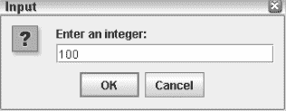

虽然 `JOptionPane` 类有许多方法，但获取简单文本输入你只需要 `showInputDialog` 方法。此方法使用一个参数，该参数指定在对话框中显示的提示消息。它返回一个字符串值，然后你可以将其解析为适当的类型。

`JOptionPane` 类是 `javax.swing` 包的一部分，因此你需要在任何使用此类程序的开头添加一条 `import javax.swing.JOptionPane` 语句。

代码清单 2-4 展示了一个使用 `JOptionPane` 类获取一个整数值并将其显示在控制台上的简单程序。

```java
import javax.swing.JOptionPane; // 1

public class DialogApp
{
    public static void main(String[] args)
    {
        String s;
        s = JOptionPane.showInputDialog("Enter an integer:"); // 8
        int x = Integer.parseInt(s); // 9
        System.out.println("You entered " + x + "."); // 10
    }
}
```

以下段落描述了此程序中的重要行：

+   1. 此行导入 JOptionPane 类。
+   8. 此语句显示一个输入对话框，其中包含提示信息 Enter an integer:，并将用户输入的字符串赋值给名为 s 的变量。
+   9. 此语句使用 Integer 类的 parseInt 方法将用户输入的字符串转换为一个整数。
+   10. 此语句显示整数值，以确认用户输入的数据已正确转换为整数。


如果用户在输入对话框中输入的不是整数，此程序会突然终止。例如，如果用户输入 ten，程序会终止，并显示一条表明发生了 `NumberFormatException` 的晦涩信息。你可以在第二卷，第 8 章中处理这种情况。在此之前，使用 `JOptionPane` 类时，请务必小心输入正确的数字。

## 第 3 章：处理数字和表达式

本章内容

- 处理运算符，如 +、-、* 和 /
- 创建精心构造的表达式
- 递增和递减
- 赋值
- 使用 `Math` 类
- 格式化数字
- 数字可能出现的奇怪现象

在第二卷，第 2 章，你发现了 Java 支持的各种基本数字类型。在本章中，你将在此知识基础上进行数字的基本运算。本章的大部分内容集中在表达式这个复杂主题上，表达式将数字与运算符组合以执行计算。但本章也涵盖了在显示数字时格式化数字的技术，以及使用 `Math` 类执行高级计算。此外，你还将了解为什么 Java 的数学运算有时会产生你可能意想不到的结果。

### 处理算术运算符

*运算符* 是一种特殊符号或关键字，用于指定可在称为 *操作数* 的一个或多个值上执行的数学运算或其他类型的操作。Java 总共有大约 40 种不同的运算符。本章重点介绍执行算术运算的运算符。这些 *算术运算符* 执行基本的算术运算，如加法、减法、乘法和除法。总共有 7 个。表 3-1 对它们进行了总结。

表 3-1 Java 的算术运算符

| 运算符 | 描述 |
|---|---|
| + | 加法 |
| - | 减法 |
| * | 乘法 |
| / | 除法 |
| % | 取余 |
| ++ | 递增 |
| -- | 递减 |

以下代码段可以帮助阐明这些运算符如何用于 int 类型：

```java
int a = 21, b = 6;
int c = a + b;     // c 是 27
int d = a - b;     // d 是 15
int e = a * b;     // e 是 126
int f = a / b;     // f 是 3  (21 / 6 是 3 余 3)
int g = a % b;     // g 是 3  (20 / 6 是 3 余 3)
a++;               // a 现在是 22
b--;               // b 现在是 5
```

请注意，对于除法，结果会被截断。因此，21 / 6 返回 3，而不是 3.5。有关整数除法的更多信息，请参阅本章后面的“整数除法”部分。

运算符在 double 值上的工作方式如下：

```java
double x = 5.5, y = 2.0;
double m = x + y;     // m 是 7.5
double n = x - y;     // n 是 3.5
double o = x * y;     // o 是 11.0
double p = x / y;     // p 是 2.75
double q = x % y;     // q 是 1.5
x++;                   // x 现在是 6.5
y--;                   // y 现在是 1.0
```

> 当你将两个 int 值相除时，结果是一个整数值，即使你将其赋值给一个 double 变量。例如：

```java
int a = 21, b = 6;
double answer = a / b;  // answer = 3.0
```


### 按操作数数量对运算符进行分类

对Java运算符进行分类的一种常见方法是根据其操作的操作数数量。按照这种方式分类，运算符分为三种类型：

-   ✔ 一元运算符：仅作用于一个操作数的运算符。一元运算符的例子包括取反（`~x`，返回`x`的负值）和自增（`x++`，将`x`加1）。
-   ✔ 二元运算符：作用于两个操作数的运算符。二元运算符的例子包括加法（`x + y`）、乘法（`invoiceTotal * taxRate`）和比较运算符（`x < leftEdge`）。
-   ✔ 三元运算符：作用于三个操作数的运算符。Java只有一个三元运算符，称为条件运算符（`?:`）。条件运算符也是中缀运算符：

一元运算符可以是前缀运算符或后缀运算符。前缀运算符写在操作数之前，如下所示：

```
operator operand
```

后缀运算符写在操作数之后：

```
operand operator
```

在Java中，所有二元运算符都是中缀运算符，这意味着它们出现在操作数之间，如下所示：

```
operand1 operator operand2
```

```
operand1 ? operand2 : operand3
```

如果这不是你想要的结果，你可以在执行除法之前将其中一个操作数强制转换为`double`，如下所示：

```
int a = 21, b = 6;
double answer = (double)a / b;    // answer = 3.5
```

这个故事的寓意是，如果你想除以`int`值并获得精确的`double`结果，你必须至少将一个`int`值强制转换为`double`。

今晚当你躺在床上思考Java算术运算符的奇妙之处时，这里还有一些额外的思考点：

-   ◆ 在代数中，你可以将一个数字直接写在变量旁边来表示乘法。例如，`4x`表示“四乘以x”。在Java中并非如此。以下语句无法编译：

```
int x;
y = 4x;     // 错误，无法编译
```

-   ◆ 余数运算符（`%`）也称为模运算符。它返回第一个操作数除以第二个操作数后的余数。余数运算符常用于判断一个数是否能被另一个数整除，此时结果为0。更多信息，请参阅下一节“整数除法”。

## 116 整数除法

在Java中，所有运算符，包括算术运算符，都被视为分隔符。因此，在表达式中使用空格是可选的。因此，以下两个语句是等效的：
`a = ( (x + 4) * 7 ) / (y * x);`
`a=((x+4)*7)/(y*x);`
只需记住，一点点空格对任何人都没有坏处，有时它有助于使Java更具可读性。

### 整数除法

当你除以一个整数时，结果总是另一个整数。任何余数都会被简单地丢弃，结果*不会*向上取整。例如，`5 / 4`的结果是1，`3 / 4`的结果是0。如果你想知道`5 / 4`实际上是1.25或`3 / 4`实际上是0.75，你需要使用浮点数或双精度数而不是整数。

如果你需要知道两个整数相除时的余数，请使用余数运算符（`%`）。例如，假设你有一定数量的弹珠要分发给一定数量的孩子。清单3-1中的程序让你输入弹珠的数量和孩子的数量。然后，它计算每个孩子得到的弹珠数量以及你剩余的弹珠数量。

以下是该程序的一个控制台输出示例，其中输入的弹珠数量为93，孩子数量为5：

```
Welcome to the marble divvy upper.
Number of marbles: 93
Number of children: 5
Give each child 18 marbles.
You will have 3 marbles left over.
```

#### 清单3-1：一个分配弹珠的程序

```java
import java.util.Scanner;
public class MarblesApp
{
    static Scanner sc = new Scanner(System.in);
    public static void main(String[] args)
    {
        // 声明
        int numberOfMarbles;
        int numberOfChildren;
        int marblesPerChild;
        int marblesLeftOver;
        
        // 获取输入数据
        System.out.println("Welcome to the marble divvy upper.");
        System.out.print("Number of marbles: ");
        numberOfMarbles = sc.nextInt();
        System.out.print("Number of children: ");
        numberOfChildren = sc.nextInt();
        
        // 计算结果
        marblesPerChild = numberOfMarbles / numberOfChildren;
        marblesLeftOver = numberOfMarbles % numberOfChildren;
        
        // 打印结果
        System.out.println("Give each child " + marblesPerChild + " marbles.");
        System.out.println("You will have " + marblesLeftOver + " marbles left over.");
    }
}
```

以下段落描述了此程序中的关键行：

-   → 1 导入`java.util.Scanner`类，以便程序可以使用它从用户那里获取输入。
-   → 5 创建`Scanner`对象并将其赋值给一个类变量，以便它可以在类中的任何方法中使用。
-   → 9 接下来的四行声明了程序使用的局部变量。
-   →15 接下来的五行从用户那里获取输入。
-   →23 使用整数除法（丢弃余数）计算每个孩子得到的弹珠数量。
-   →24 计算剩余的弹珠数量。
-   →26 接下来的两个语句打印结果。

> 如果你仔细想想，这可能是显而易见的，但你应该意识到，如果你使用整数除法将`a`除以`b`，那么结果乘以`b`再加上余数等于`a`。换句话说：

```
int a = 29;         // 任何值都可以
int b = 3;          // 任何值都可以
int c = a / b;
int d = a % b;
int e = (c * b) + d; // e将始终等于a
```

### 组合运算符

你可以组合运算符以形成复杂的表达式。当你这样做时，操作执行的顺序由表达式中每个运算符的优先级决定。算术运算符的优先级顺序如下：

-   - 自增（`++`）和自减（`--`）运算符首先求值。
-   接下来，应用符号运算符（`+`或`-`）。
-   然后，乘法（`*`）、除法（`/`）和余数（`%`）运算符求值。
-   最后，应用加法（`+`）和减法（`-`）运算符。

例如，在表达式`a + b * c`中，乘法比加法具有更高的优先级。因此，首先将`b`乘以`c`。然后，将该乘积的结果加到`a`。

如果表达式包含两个或多个具有相同优先级顺序的运算符，则运算符从左到右求值。因此，在表达式`a * b / c`中，首先将`a`乘以`b`，然后将结果除以`c`。

如果你愿意，你可以使用括号来改变操作执行的顺序。括号内的操作始终在非括号操作之前执行。因此，在表达式`(a + b) * c`中，首先将`a`加到`b`。然后，将结果乘以`c`。

如果一个表达式有两组或更多组括号，则首先执行最内层括号中的操作。例如，在表达式`(a * (b + c)) / d`中，首先将`b`加到`c`。然后，将结果乘以`a`。最后，将该结果除以`d`。

除了自增和自减运算符外，这些优先级规则和括号的使用与基础代数中的规则相同。因此，如果你在八年级时用心听了课，优先级应该能说得通。

对于`double`或`float`值，改变相同优先级运算符的从左到右顺序不会影响结果。然而，对于整数类型，如果涉及除法，可能会产生巨大的差异。例如，考虑以下语句：

```
int a = 5, b = 6, c = 7;
int d1 = a * b / c;    // d1 是 4
int d2 = a * (b / c);  // d2 是 0
```

这种差异的发生是因为整数除法总是返回一个整数结果，这是实际结果的截断版本。因此，在第一个表达式中，首先将`a`乘以`b`，得到结果30。然后，将此结果除以`c`。截断答案得到结果4。但在第二个表达式中，首先将`b`除以`c`，得到截断结果0。然后，将此结果乘以`a`，得到最终答案0。

### 使用一元正负运算符

一元加号和减号运算符允许你更改操作数的符号。请注意，用于这些操作的实际运算符与二元加法和减法运算符相同。编译器通过检查表达式来确定你是要使用这些运算符的二元版本还是一元版本。

一元减号运算符不一定使操作数具有负值。相反，它改变操作数最初的任何符号。因此，如果操作数开始时是正值，一元减号运算符将其更改为负值。但如果操作数开始时是负值，一元减号运算符使其为正值。以下示例说明了这一点：

```
int a = 5;      // a 是 5
int b = -a;     // b 是 -5
int c = -b;     // c 是 +5
```

有趣的是，一元加号运算符实际上什么也不做。例如：

```
int a = -5;     // a 是 -5
int b = +a;     // b 是 -5
a = 5;          // a 现在是 5
int c = +a;     // c 是 5
```

请注意，如果`a`开始时是正值，`+a`也是正值。但如果`a`开始时是负值，`+a`仍然是负值。因此，一元`+`运算符没有效果。我猜Java提供一元加号运算符是出于平衡的需要。

你也可以在更复杂的表达式中使用这些运算符，如下所示：

```
int a = 3, b = 4, c = 5;
int d = a * -(b + c);    // d 是 -27
```

这里，将`b`加到`c`，得到结果9。然后，应用一元减号，得到结果-9。最后，将-9乘以`a`，得到结果-27。


### 使用递增和递减运算符

计算机编程中最常见的操作之一就是将变量加1或减1。将变量加1称为*递增*该变量。减1则称为*递减*。递增变量的传统方式如下：

```
a = a + 1;
```

这里，表达式 `a + 1` 被计算，其结果被赋给变量 `a`。

Java 提供了一种更简便的方式来执行此类计算：递增（++）和递减（--）运算符。这些是适用于单个变量的一元运算符。因此，要递增变量 `a`，你只需编写：

```
a++;
```

请注意，使用了递增或递减运算符的表达式本身就是一个语句。这是因为递增或递减运算符也是一种赋值运算符，因为它会改变其所应用的变量的值。

你只能对变量使用递增和递减运算符，不能对数字字面量或其他表达式使用。例如，Java 不允许以下表达式：

```
a = b * 5++;    // 无法递增数字 5
a = (b * 5)++;  // 无法递增表达式 (b * 5)
```

请注意，你可以在赋值语句中使用递增或递减运算符。例如：

```
int a = 5;
int b = a--;   // a 和 b 都被设置为 4
```

当执行第二个语句时，表达式 `a--` 首先被求值，因此 `a` 被设置为 4。然后，`a` 的新值被赋给 `b`。因此，`a` 和 `b` 都被设置为 4。

递增和递减运算符很特殊，因为它们是一元运算符，可以放置在其所应用的变量之前（*前缀*）或之后（*后缀*）。将运算符放在变量之前还是之后，会对应如何求值表达式产生重大影响。如果你将递增或递减运算符放在其变量之前，那么该运算符会在表达式其余部分被求值之前应用。结果是，递增后的变量值被用于表达式中。相反，如果你将运算符放在变量之后，那么该运算符会在表达式被求值之后应用。因此，变量的原始值被用于表达式中。

感到困惑了吗？一个简单的例子可以澄清这一点。首先，考虑以下使用了后缀递增的语句：

```
int a = 5;
int b = 3;
int c = a * b++;  // c 被设置为 15
```

当求值第三个语句中的表达式时，b 的原始值（3）被用于乘法运算。因此，c 被设置为 15。然后，b 递增为 4。

现在考虑这个版本，使用了前缀递增：

```
int a = 5;
int b = 3;
int c = a * ++b;  // c 被设置为 20
```

这一次，b 在乘法执行之前被递增，所以 c 被设置为 20。无论哪种方式，b 最终都被设置为 4。

类似地，考虑这个例子：

```
int a = 5;
int b = --a;  // b 被设置为 5，a 被设置为 4。
```

这个例子与之前的一个类似，但这次使用的是前缀递增运算符。当执行第二个语句时，a 的值被赋给 b。然后，a 被递减。结果是，b 被设置为 5，而 a 被设置为 4。

因为递增和递减运算符在表达式中与其他运算符一起使用时可能会引起混淆，所以我建议你单独使用它们。每当你想将递增或递减运算符合并到一个更大的表达式中时，请将递增或递减操作从表达式中拿出来，使其成为表达式之前或之后的一个独立语句。换句话说，编写：

```
b++;
c = a * b;
```

而不是：

```
c = a * ++b;
```

在第一个版本中，b 在乘法完成之前被递增，这一点非常清楚。

### 使用赋值运算符

标准赋值运算符（`=`）用于将表达式的结果赋给变量。其最简单的形式是：

`variable = expression;`

例如：

`int a = (b * c) / 4;`

你已经见过很多像这样的赋值语句的例子，所以我不再赘述这一点。然而，我想指出——仅为记录在案——你*不能*在等号左边编写算术表达式。因此，以下语句无法编译：

`int a;`
`a + 3 = (b * c);`

在本节的其余部分，我将指出一些你可以使用赋值运算符的特殊方式。我实际上并不建议你使用这些技巧中的任何一种，因为它们很少必要，而且几乎总是令人困惑。然而，了解它们可以阐明 Java 表达式的工作原理，并且有时可以帮助你找到代码中隐蔽的问题。

理解本节其余部分的关键是认识到在 Java 中，赋值是表达式，而不是语句。换句话说，`a = 5` 是一个赋值表达式，而不是一个赋值语句。只有当你在其末尾添加分号时，它才成为一个赋值语句。

赋值表达式的结果是被赋给变量的值。例如，表达式 `a = 5` 的结果是 5。同样，表达式 `a = (b + c) * d` 的结果是表达式 `(b + c) * d` 的结果。

这意味着你可以在其他表达式的中间使用赋值表达式。例如，以下代码是合法的：

`int a;`
`int b;`
`a = (b = 3) * 2;    // a 是 6，b 是 3`

与任何表达式一样，表达式括号内的部分首先被求值。因此，`b` 被赋值为 3。然后，执行乘法运算，结果（6）被赋给变量 `a`。

现在考虑一个更复杂的情况：

```
int a;
int b = 2;
a = (b = 3) * b;    // a 是 9，b 是 3
```

这里发生的情况是，括号中的表达式首先被求值，这意味着 b 在执行乘法之前被设置为 3。

括号在前面的例子中很重要，因为如果没有括号，赋值运算符是 Java 运算符优先级中最后被求值的运算符。因此，再看一个例子：

```
int a;
int b = 2;
a = b = 3 * b;      // a 是 6，b 是 6
```

这一次，乘法 `3 * b` 首先被计算，结果为 6。然后，这个结果被赋给 b。最后，该赋值表达式的结果（6）被赋给 a。

顺便说一下，以下表达式也是合法的：

```
a = b = c = 3;
```

此表达式将值 3 赋给所有三个变量。虽然这段代码看起来相当无害，但你最好只编写三个赋值语句。（你可能猜想将赋值合并在一起比写在三行上更高效，但事实并非如此。无论哪种方式，这三个赋值需要相同数量的字节码指令。）

### 使用复合赋值运算符

复合赋值运算符是一种同时执行计算和赋值的运算符。Java 的所有二元算术运算符（即对两个操作数进行运算的运算符）都有等效的复合赋值运算符。表 3-2 列出了它们。

**表 3-2：复合算术运算符**

| 运算符 | 描述 |
|---|---|
| += | 加法和赋值 |
| -= | 减法和赋值 |
| *= | 乘法和赋值 |
| /= | 除法和赋值 |
| %= | 取余和赋值 |

例如，这个语句

```
a += 10;
```

等价于

```
a = a + 10;
```

而这个语句

```
z *= 2;
```

等价于

```
z = z * 2;
```

为了避免混淆，复合赋值表达式最好单独使用，不要与其他表达式组合。例如，考虑这些语句：

```
int a = 2;
int b = 3;
a *= b + 1;
```

a 被设置为 7 还是 8？

换句话说，第三个语句等价于

```
a = a * b + 1; // 这将导致结果为 7
```

还是

```
a = a * (b + 1); // 这将导致结果为 8
```

乍一看，你可能期望答案是 7，因为乘法的优先级高于加法。但赋值运算符在所有运算符中优先级最低，并且这里的乘法是作为赋值的一部分执行的。因此，加法在乘法之前执行。所以，答案是 8。（没想到吧！）

### 使用 Math 类

Java 的内置运算符很有用，但它们远不能满足大多数 Java 程序员的所有数学需求。这就是 `Math` 类的用武之地。它包含了一系列内置方法，可以执行各种各样的数学计算，从计算绝对值或平方根等基本函数，到三角函数


### 使用 Math 类

从 `sin` 和 `cos` 等三角函数，到四舍五入或生成随机数等实用函数。

我本来想在这里开个玩笑，说必须上数学课才能完全理解 Math 类，或者如果你数学课成绩不太好最好离 Math 类远点，又或者如果你是橄榄球队员，或许可以找人替你上 Math 类。但觉得这个玩笑太没新意了，所以决定不开了。

Math 类的所有方法都声明为静态方法，这意味着你可以通过指定类名 `Math`，后跟一个点号和一个方法名来调用它们。例如，下面的语句计算存储在名为 `y` 的变量中的数字的平方根：

```java
double x = Math.sqrt(y);
```

Math 类包含在 `java.lang` 包中，该包对所有 Java 程序自动可用。因此，你不需要提供 `import` 语句来使用 Math 类。

以下部分描述了 Math 类中最有用的方法。

#### Math 类的常量

Math 类定义了两个在许多数学计算中都很有用的常量。表 3-3 列出了这些常量。

表 3-3：Math 类的常量

| 常量 | 说明 | 值 |
|---|---|---|
| PI | 常量 π，圆的半径与直径的比值 | 3.141592653589793 |
| E | 自然对数的底数 | 2.718281828459045 |

请注意，这些常量只是近似值，因为 π 和 e 都是无理数。

清单 3-2 中显示的程序演示了常量 `PI` 的一个典型用法。这里，程序要求用户输入圆的半径。然后程序在第 13 行计算圆的面积。（该语句中的表达式里的括号并非必需，但它们有助于澄清该表达式是圆面积公式 πr² 的 Java 等效表示。）

#### 清单 3-2：圆面积计算器

```java
import java.util.Scanner;

public class CircleAreaApp
{
    static Scanner sc = new Scanner(System.in);

    public static void main(String[] args)
    {
        System.out.println(
            "Welcome to the circle area calculator.");
        System.out.print("Enter the radius of your circle: ");
        double r = sc.nextDouble();
        double area = Math.PI * (r * r);            -> 13
        System.out.println("The area is " + area);
    }
}
```

以下是该程序一次典型执行的控制台输出，其中用户输入了 5 作为圆的半径：

```
Welcome to the circle area calculator.
Enter the radius of your circle: 5
The area is 78.53981633974483
```

#### 数学函数

表 3-4 列出了 Math 类提供的基本数学函数。如你所见，你可以使用这些函数来计算诸如数字的绝对值、两个值中的最小值和最大值、平方根、幂和对数等内容。

| 方法 | 说明 |
|---|---|
| abs(参数) | 返回参数的绝对值。参数可以是 int、long、float 或 double。返回值类型与参数相同。 |
| cbrt(参数) | 返回参数的立方根。参数和返回值都是 double。 |
| exp(参数) | 返回 e 的参数次幂。参数和返回值都是 double。 |
| hypot(参数1, 参数2) | 返回根据勾股定理计算的直角三角形的斜边长度 — √x² + y²。参数和返回值都是 double。 |
| log(参数) | 返回参数的自然对数（以 e 为底）。参数和返回值都是 double。 |
| log10(参数) | 返回参数的以 10 为底的对数。参数和返回值都是 double。 |
| max(参数1, 参数2) | 返回两个参数中较大的一个。参数可以是 int、long、float 或 double，但两者类型必须相同。返回类型与参数类型相同。 |
| min(参数1, 参数2) | 返回两个参数中较小的一个。参数可以是 int、long、float 或 double，但两者类型必须相同。返回类型与参数类型相同。 |
| pow(参数1, 参数2) | 返回第一个参数的第二个参数次幂的值。两个参数和返回值都是 double。 |
| random() | 返回一个大于或等于 0.0 但小于 1.0 的随机数。此方法不接受参数，但返回值是 double。 |
| signum(参数) | 返回一个表示参数符号的数字：如果参数为负数，则为 -1.0；如果参数为零，则为 0.0；如果参数为正数，则为 1.0。参数可以是 double 或 float。返回值类型与参数类型相同。 |
| sqrt(参数) | 返回参数的平方根。参数和返回值都是 double。 |

清单 3-3 中显示的程序演示了除了 `random` 以外的所有这些方法。运行时，会产生类似以下的输出：

```
abs(b)      = 50
cbrt(x)     = 2.924017738212866
exp(y)      = 54.598150033144236
hypot(y, z) = 5.0
log(y)      = 1.0986122886681096
log10(y)    = 0.47712125471966244
max(a, b)   = 100
min(a, b)   = -50
pow(a, c)   = 1000000.0
random()    = 0.8536014557793756
signum(b)   = -1.0
sqrt(x)     = 1.7320508075688772
```

你可以使用此输出来了解这些 Math 类方法返回的值的大致范围。例如，你可以看到当 `y` 为 25.0 时，表达式 `Math.sqrt(y)` 返回的值为 5.0。

以下段落指出了关于这些方法的一些有趣细节：

-   你可以使用 `abs` 和 `signum` 方法强制将一个变量的符号与另一个变量的符号匹配，如下所示：

```java
int a = 27;
int b = -32;
a = Math.abs(a) * Math.signum(b);    // a 现在为 -27;
```

-   你可以使用 `pow` 方法对数字求平方，如下所示：

```java
double x = 4.0;
double y = Math.pow(x, 2);    // y 现在为 16;
```

然而，直接将数字乘以自身通常同样简单且同样易读：

```java
double x = 4.0;
double y = x * x;    // y 现在为 16;
```

-   在经典电影《绿野仙踪》中，当奥兹巫师最终赋予稻草人智慧时，稻草人突然变得聪明起来，并引用了勾股定理，这也是 `Math` 类中 `hypot` 方法所使用的定理。不幸的是，他引用错了。稻草人在电影中实际说的是：“等腰三角形任意两边的平方根之和等于第三边的平方根。” 傻稻草人。他当然应该说的是：“任意直角三角形的斜边的平方等于其他两边的平方和。”

-   每次运行清单 3-3 中的程序，`random` 方法调用都会得到不同的结果。`random` 方法非常有趣，我将在下一节“生成随机数”中单独介绍它。

#### 清单 3-3：使用 Math 类数学方法的程序

```java
public class MathFunctionsApp
{
    public static void main(String[] args)
    {
        int a = 100;
        int b = -50;
        int c = 3;
        double x = 25.0;
        double y = 3.0;
        double z = 4.0;

        System.out.println("abs(b)    = " + Math.abs(b));
        System.out.println("cbrt(x)   = " + Math.cbrt(x));
        System.out.println("exp(y)   = " + Math.exp(z));
        System.out.println("hypot(y,z)= " + Math.hypot(y,z));
        System.out.println("log(y)    = " + Math.log(y));
        System.out.println("log10(y)  = " + Math.log10(y));
        System.out.println("max(a, b) = " + Math.max(a, b));
        System.out.println("min(a, b) = " + Math.min(a, b));
        System.out.println("pow(a, c) = " + Math.pow(a, c));
        System.out.println("random()  = " + Math.random());
        System.out.println("signum(b) = " + Math.signum(b));
        System.out.println("sqrt(x)   = " + Math.sqrt(y));
    }
}
```

#### 生成随机数

迟早，你会想要编写玩简单游戏的程序。几乎所有游戏都包含某种随机元素，因此你需要一种方法来创建每次运行时行为不完全相同的计算机程序。最简单的方法是使用 `Math` 类的 `random` 方法，该方法在表 3-4 中与其他 `Math` 类的基本数学函数一起列出。

`random` 方法返回一个 `double`，其值大于或等于 0.0 但小于 1.0。在此范围内，`random` 方法返回的值每次调用时都不同，本质上是随机的。

严格来说，计算机无法生成真正的随机数。然而，多年来聪明的计算机科学家们已经开发出了对于所有实际目的而言随机的数字生成方法。这些数字被称为 *伪随机数*，因为尽管它们不是完全随机的，但对大多数普通人来说看起来是随机的。

`random` 方法生成一个介于 0.0（包含，意味着可能是 0.0）和 1.0（不包含，意味着不能是 1.0）之间的随机 `double` 值。然而，大多数需要随机值的计算机应用程序需要介于某个任意低值（通常是 1，但不总是）和某个任意高值之间的随机整数。例如，玩骰子的程序需要 1 到 6 之间的随机数，而发牌的程序则需要 1 到 52（如果使用大小王则为 53）之间的随机数。

因此，你需要一个 Java 表达式，将 `random` 函数返回的 `double` 值转换为程序所需范围内的 `int` 值。以下代码展示了如何实现这一点，数值被设置为 1 和 6 用于一个骰子游戏：

```java
int low = 1;        // 范围内的最低值
int high = 6;       // 范围内的最高值
int rnd = (int) (Math.random() * (high - low + 1)) + low;
```


## 130 使用 Math 类

这个表达式有点复杂，所以我来为你逐步展示它的计算过程：

1.  `random` 方法用于获取一个随机双精度浮点值。这个值大于 0.0 但小于 5.0。
2.  随机值乘以范围的最大值减去最小值再加 1。在这个例子中，最大值是 6，最小值是 1，所以你现在得到一个大于或等于 0.0 但小于 6.0 的随机数。（它可能是 5.999999999999999，但永远不会是 6.0。）
3.  这个值然后通过 `(int)` 强制类型转换为整数。你现在得到一个整数，它是 0、1、2、3、4 或 5 中的一个。（记住，当将 `double` 强制转换为 `int` 时，值的任何小数部分都会被直接丢弃。因为这个数小于 6.0，所以在转换为 `int` 时永远不会截断为 6.0。）
4.  现在将范围的最小值 `low` 加到这个随机数上。假设 `low` 是 1，那么随机数现在就是 1、2、3、4、5 或 6 中的一个。这正是你想要的：一个介于 1 到 6 之间的随机数。

为了让你了解这个随机数计算的工作原理，代码清单 3-4 展示了一个将计算过程封装在名为 `randomInt` 的方法中的程序，然后调用它来模拟 100 次掷骰子。`randomInt` 方法接受两个参数，分别代表范围的最小值和最大值，并返回范围内的一个随机整数。在该程序的 `main` 方法中，`randomInt` 方法被调用了 100 次，每个随机数都通过调用 `System.out.print` 来打印。

该程序的控制台输出大致如下：

```
Here are 100 random rolls of the dice:
4 1 1 6 1 2 6 6 6 6 5 5 5 4 5 4 4 1 3 6 1 3 1 4 4 3 3 3 5 6 5 6 6 3 5 2
2 6 3 3
4 1 2 2 4 2 2 4 1 4 3 6 5 5 4 4 2 4 1 3 5 2 1 3 3 5 4 1 6 3 1 6 5 2 6 6
3 5 4 5
2 5 4 5 3 1 4 2 5 2 1 4 4 4 6 6 4 6 3 3
```

然而，每次运行这个程序，你都会看到一个不同的 100 个数字的序列。

代码清单 3-4 中的程序使用了你尚未见过的几个 Java 特性。

**代码清单 3-4：掷骰子**

```java
public class DiceApp
{
    public static void main(String[] args)
    {
        int roll;
        String msg = "Here are 100 random rolls of the dice:";
        System.out.println(msg);
        for (int i=0; i<100; i++)
        {
            roll = randomInt(1, 6);
            System.out.print(roll + " ");
        }
        System.out.println();
    }

    public static int randomInt(int low, int high)
    {
        int result = (int)(Math.random()
            * (high - low + 1)) + low;
        return result;
    }
}
```

以下段落解释了该程序的工作原理，但如果你没有理解程序中的所有元素，请不要担心。主要需要看的是将 `Math.double` 方法返回的随机 `double` 值转换为整数的表达式。

1.  `for` 语句使其主体中的语句（第 10 行和第 11 行）执行 100 次。现在不用担心这个语句是如何工作的；你将在《第二卷》第 5 章中了解它。
2.  这条语句调用了 `randomInt` 方法，指定了 1 和 6 作为要生成的随机整数的范围。生成的随机数被赋值给 `roll` 变量。
3.  `System.out.print` 方法用于打印随机数，后跟一个空格。因为这条语句调用的是 `print` 方法而不是 `println` 方法，所以随机数会打印在同一行上，而不是在不同的行上。
4.  `randomInt` 方法的声明表明该方法返回一个 `int` 值，并接受两个 `int` 参数，一个名为 `low`，另一个名为 `high`。
5.  这个表达式将随机 `double` 值转换为介于 `low` 和 `high` 之间的整数。
6.  `return` 语句将随机数发送回调用 `randomInt` 方法的语句。

### 舍入函数

`Math` 类有四个用于舍入或截断 `float` 或 `double` 值的方法。表 3-5 列出了这些方法。如你所见，这些方法中的每一个都使用不同的技术来计算一个接近作为参数传递的 `double` 或 `float` 值的整数值。请注意，尽管所有这四个方法都将浮点值舍入为整数值，但只有 `round` 方法实际返回整数类型（`int` 或 `long`，取决于参数是 `float` 还是 `double`）。其他方法返回的是恰好为整数值的 `double`。

| 方法 | 说明 |
| :--- | :--- |
| `ceil(argument)` | 返回大于或等于参数值的最小整数 `double` 值。 |
| `floor(argument)` | 返回小于或等于参数值的最大整数 `double` 值。 |
| `rint(argument)` | 返回最接近参数值的整数 `double` 值。如果两个整数值同样接近，则返回偶数。如果参数已经是整数，则返回参数值。 |
| `round(argument)` | 返回最接近参数的整数。如果参数是 `double`，则返回 `long`。如果参数是 `float`，则返回 `int`。 |

代码清单 3-5 展示了一个使用这四个方法中的每一个来舍入三个不同的 `double` 值（29.4、93.5 和 -19.3）的程序。以下是该程序的输出：

```
round(x) = 29
round(y) = 94
round(z) = -19

ceil(x) = 30.0
ceil(y) = 94.0
ceil(z) = -19.0

floor(x) = 29.0
floor(y) = 93.0
floor(z) = -20.0

rint(x) = 29.0
rint(y) = 94.0
rint(z) = -19.0
```

请注意，这四个方法中至少有一个对每个值都产生了不同的结果：

-   除了 `ceil` 之外的所有方法对值 29.4 都返回 29.0（或 29）。`ceil` 返回 30.0，这是大于 29.4 的最小整数。
-   除了 `floor` 之外的所有方法对值 93.5 都返回 94.0（或 94）。`floor` 返回 93.0，因为这是小于 93.5 的最大整数。`rint` 返回 94.0，因为它是偶数，而 93.5 恰好位于 93.0 和 94.0 的中间。
-   除了 `floor` 之外的所有方法对值 -19.3 都返回 -19.0（或 -19）。`floor` 返回 -20.0，因为 -20 是小于 -19.3 的最大整数。

#### 代码清单 3-5：使用 Math 类舍入方法的程序

```java
public class RoundingApp
{
    public static void main(String[] args)
    {
        double x = 29.4;
        double y = 93.5;
        double z = -19.3;

        System.out.println("round(x) = " + Math.round(x));
        System.out.println("round(y) = " + Math.round(y));
        System.out.println("round(z) = " + Math.round(z));
        System.out.println();
        System.out.println("ceil(x) = " + Math.ceil(x));
        System.out.println("ceil(y) = " + Math.ceil(y));
        System.out.println("ceil(z) = " + Math.ceil(z));
        System.out.println();
        System.out.println("floor(x) = " + Math.floor(x));
        System.out.println("floor(y) = " + Math.floor(y));
        System.out.println("floor(z) = " + Math.floor(z));
        System.out.println();
        System.out.println("rint(x) = " + Math.rint(x));
        System.out.println("rint(y) = " + Math.rint(y));
        System.out.println("rint(z) = " + Math.rint(z));
    }
}
```

### 格式化数字

到目前为止你看到的大多数程序都使用了 `System.out.println` 或 `System.out.print` 方法来打印包含数字的变量的值。当你将一个数值变量传递给这些方法之一时，该变量的值在打印前会被转换为字符串。表示该值的精确格式并不美观。例如，大数字打印时不带任何千位分隔符。而且 `double` 或 `float` 值的所有小数位都会被打印出来，无论你是否需要它们。

在许多情况下，你希望在打印之前格式化你的数字。例如，你可能希望在大数字中添加千位分隔符，并限制打印的小数位数。或者，如果一个数字表示货币金额，你可能希望添加美元符号（或其他货币符号）……


### 格式化数字

根据你的区域设置（locale）选择合适的格式。为此，你可以使用 `NumberFormat` 类。表 3-6 列出了 `NumberFormat` 类的方法。

与 Java 的许多方面一样，使用 `NumberFormat` 类的步骤有点繁琐。它的设计是为了在需要格式化大量数字的应用程序中高效运行，但对于大多数应用程序来说，这有点大材小用。

| 表 3-6 | NumberFormat 类的方法 |
| :--- | :--- |
| **方法** | **解释** |
| `getCurrencyInstance()` | 一个静态方法，返回一个用于格式化货币值的 `NumberFormat` 对象。 |
| `getPercentInstance()` | 一个静态方法，返回一个用于格式化百分比的 `NumberFormat` 对象。 |
| `getNumberInstance()` | 一个静态方法，返回一个用于格式化基本数字的 `NumberFormat` 对象。 |
| `format(number)` | 返回一个包含格式化后数字的字符串。 |
| `setMinimumFractionDigits(int)` | 设置小数点后要显示的最小位数。 |
| `setMaximumFractionDigits(int)` | 设置小数点后要显示的最大位数。 |

使用 `NumberFormat` 类来格式化数字的步骤需要一点时间来适应。首先，你必须调用某个静态的 `getXxxInstance` 方法来创建一个能以特定方式格式化数字的 `NumberFormat` 对象。然后，如果你愿意，可以调用 `setMinimumFractionDigits` 或 `setMaximumFractionDigits` 方法来设置要显示的小数位数。最后，调用该对象的 `format` 方法来实际格式化数字。

请注意，`NumberFormat` 类位于 `java.text` 包中，因此你必须在任何使用 `NumberFormat` 的类开头包含以下 `import` 语句：

```java
import java.text.NumberFormat;
```

下面是一个使用 `NumberFormat` 类将 `double` 值格式化为货币的例子：

```java
double salesTax = 2.425;
NumberFormat cf = NumberFormat.getCurrencyInstance();
System.out.println(cf.format(salesTax));
```

运行此代码时，控制台会打印以下内容：

```
$2.43
```

请注意，货币格式将值从 2.425 四舍五入到了 2.43。

下面是一个使用通用数字格式格式化数字，并保留三位小数的例子：

```java
double x = 19923.3288;
NumberFormat nf = NumberFormat.getNumberInstance();
nf.setMinimumFractionDigits(3);
nf.setMaximumFractionDigits(3);
System.out.println(nf.format(x));
```

运行此代码时，会打印以下内容：

```
19,923.329
```

这里，数字被格式化并带有逗号分隔符，且值被四舍五入到三位小数。

下面是一个使用百分比格式的例子：

```java
double grade = .92;
NumberFormat pf = NumberFormat.getPercentInstance();
System.out.println(pf.format(grade));
```

运行此代码时，会打印以下内容：

```
92%
```

> **提示：** 如果你的程序需要格式化多个数字，可以考虑将 NumberFormat 对象创建为类变量。这样，NumberFormat 对象在程序启动时创建一次。然后，你可以从程序类的任何方法中使用该 NumberFormat 对象。这里有一个简单的例子，展示了如何实现这一点：

```java
import java.text.NumberFormat;

public class NumberFormatClassApp
{
    static NumberFormat cf = NumberFormat.getCurrencyInstance();
    public static void main(String[] args)
    {
        printMyAllowance();
        printCostOfPaintBallGun();
    }

    public static void printMyAllowance()
    {
        double myAllowance = 5.00;
        cf = NumberFormat.getCurrencyInstance();
        System.out.println("My allowance: " + cf.format(myAllowance));
    }

    public static void printCostOfPaintBallGun()
    {
        double costOfPaintBallGun = 69.95;
        cf = NumberFormat.getCurrencyInstance();
        System.out.println("Cost of Paint Ball Gun: " + cf.format(costOfPaintBallGun));
    }
}
```

在这里，`cf` 变量被创建为类变量。然后，`printMyAllowance` 和 `printCostOfPaintBallGun` 两个方法都可以使用它。

### Java 数学运算的怪异之处

信不信由你，计算机——即使是功能最强大的计算机——在进行数学计算时也存在某些限制。这些限制通常微不足道，但有时会悄悄出现并给你带来麻烦。以下部分描述了在 Java 中进行数学运算时需要注意的事项。

#### 整数溢出

整数类型的基本问题是它们具有固定大小。因此，存储在 `short`、`int` 或 `long` 变量中的数字有大小限制。尽管 `long` 变量可以容纳巨大的数字，但迟早你会遇到一个大到连 `long` 变量都无法容纳的数字。

例如，考虑这个虽然牵强但说明问题的例子：

```java
int a = 1000000000;
System.out.println(a);
a += 1000000000;
System.out.println(a);
a += 1000000000;
System.out.println(a);
a += 1000000000;
System.out.println(a);
```

这里，你期望 `a` 的值在每次加法后变得更大。但显示的输出是：

```
1000000000
2000000000
-1294967296
-294967296
```

第一次加法似乎有效，但之后，数字变成了负数！这是因为该值已达到 `int` 数据类型的大小限制。不幸的是，Java 并不会告诉你发生了这个错误。它只是尽可能地填满 `int` 变量的位，丢弃任何不合适的位，并希望你没有注意到。由于 `int` 存储负值的方式，大的正值会突然变成大的负值。

这个故事的寓意是，如果你处理的是大的整数，你应该使用 `long` 而不是 `int`，因为 `long` 可以存储比 `int` 大得多的数字。如果你的程序处理的数字大到对 `long` 都有问题，那么考虑使用浮点类型。正如你在下一节看到的，浮点类型甚至能处理比 `long` 更大的值，并且在超出其容量时会通知你。

#### 浮点数的怪异行为

浮点数有其自身的问题。首先，浮点数使用二进制数字系统（基数为 2）存储，但人类使用十进制数字系统（基数为 10）。不幸的是，在这两个系统之间精确转换数字有时是不可能的。这是因为在任何数制中，某些分数都无法精确表示。例如，十进制无法精确表示分数 ⅓。你可以近似为 0.3333333，但最终你会达到可以存储的位数限制，因此必须停止。在二进制中，恰好有一个无法精确表示的分数是十进制值 1/10。换句话说，`float` 或 `double` 变量无法精确表示 0.1。

不信？试试运行这段代码：

```java
float x = 0.1f;
NumberFormat nf = NumberFormat.getNumberInstance();
nf.setMinimumFractionDigits(10);
System.out.println(nf.format(x));
```

生成的输出如下：

```
0.1000000015
```

虽然 `0.1000000015` 接近 `0.1`，但它并不精确。

138 Java 数学运算的怪异之处

在大多数情况下，Java 的浮点数学运算足够接近，以至于无关紧要。误差范围非常小。如果你使用 Java 来测量房子的大小，你需要电子显微镜才能注意到误差。但是，如果你正在编写处理金融交易的应用程序，正常的四舍五入有时会放大误差，使其变得显著。你可能会多收或少收一分钱的销售税。而且，在极端情况下，你的发票实际上可能会出现明显的加法错误。

我将在本书网站上的奖励章节 1 中详细讨论这个浮点数问题。现在，只需意识到，除非你不在乎账目是否平衡，否则你不能使用 `float` 或 `double` 来表示货币。

当然，整数类型也是以二进制存储的。但整数不会受到与浮点类型相同的错误影响，因为整数根本不表示分数。所以你不必为整数类型担心这种错误。

#### 除以零

根据数学的基本规则，你不能将一个数除以零。原因很简单：除法是乘法的逆运算。这意味着如果 `a * b = c`，那么 `a = c / b` 也成立。如果你允许 `b` 为零，除法将变得毫无意义，因为任何数乘以零都是零。因此，`a` 和 `c` 也必须为零。简而言之，数学家几个世纪前就解决了这个困境，规定除以零是不允许的。

那么，如果你在 Java 程序中尝试将一个数除以零会发生什么？答案取决于你是除以整数还是浮点数。如果你除以整数，尝试除以零的语句会抛出所谓的 *异常*，这是一种让程序崩溃的不礼貌方式。在第 II 卷第 8 章，你将了解如何捕获此异常以允许你的程序继续运行。但与此同时，你编写的任何尝试整数除以零的程序都会崩溃。

如果你尝试将浮点类型除以零，结果不会那么突然。相反，Java 会为浮点结果分配表 3-7 中列出的特殊值之一。以下段落解释了如何确定这些特殊值：

- ◆ 如果你将一个数除以零，并且两个数的符号相同，则结果为正无穷大。例如，`40.0` 除以 `0.0` 是正无穷大，`−34.0` 除以 `−0.0` 也是如此。
- ◆ 如果你将一个数除以零，并且两个数的符号不同，则结果为负无穷大。例如，`−40.0` 除以 `0.0` 是负无穷大，`34.0` 除以 `0.0` 也是如此。


#### Java 数学运算的奇特之处

如果零除以零，无论符号如何，结果都是“非数字”（Not a Number）。

浮点数零可以是正零或负零。Java 在数值上认为正零和负零是相等的。

如果你试图打印具有这些特殊值之一的浮点数值，Java 会将该值转换为合适的字符串。例如，假设你执行以下语句：

```java
double i = 50.0;
double j = 0.0;
double k = i / j;
System.out.println(k);
```

控制台输出结果为

```
infinity
```

如果 i 是 -50.0，控制台将显示 -infinity。而如果 i 是零，控制台将显示 NaN。

**表 3-7 float 和 double 类的特殊常量**

| 常量 | 含义 |
| :--- | :--- |
| POSITIVE_INFINITY | 正无穷大 |
| NEGATIVE_INFINITY | 负无穷大 |
| NaN | 非数字 |

以下段落描述了在结束本章之前我想引入的一些最终怪异现象：

NaN 不等于其自身，这可能会产生一些奇怪的后果。例如：

```java
double x = Math.sqrt(-50); // 非数字
double y = x;
if (x == y)
    System.out.println("x equals y");
```

好吧，我知道我在这里提前使用了 if 语句，因为我直到第 II 册第 4 章才讲解 if 语句。所以为了论证起见，就假设 if 语句测试变量 x 是否等于变量 y。由于这个测试紧接在一个将 x 的值赋给 y 的赋值语句之后，你可以安全地假设 x 等于 y，对吧？

错了。因为 x 是 NaN，y 也是 NaN。而 NaN 永远不会被认为等于任何其他值，包括另一个 NaN。因此，if 语句中的比较失败了。

- 另一个奇怪的后果：你不能假设一个数减去自身总是零。考虑这个语句：

```java
double z = x - x;     // 不一定是零
```

这个语句难道不应该总是将 z 设置为零吗？如果 x 是 NaN 就不是了。在这种情况下，非数字减去非数字仍然是非数字。

- 还有一个，然后我就停了：任何涉及无穷大的数学运算都会产生另一个无穷大或非数字。例如，无穷大加 5 仍然等于无穷大。所以巴斯光年的“飞向无限，超越无限”的呼唤是不可能实现的。但是无穷大减无穷大会得到非数字。

## 第 4 章：做出选择

### 本章内容

- 用于娱乐和盈利（或者是为了娱乐或盈利？）的布尔表达式
- 基本的、普通的 if 语句
- else 子句和 else-if 语句
- 嵌套的 if 语句
- 使用逻辑运算符
- 奇怪的 ?: 运算符
- 比较字符串的正确方法

到目前为止，在本书中，所有程序都是从头到尾直接运行的，途中不做任何决定。在本章中，你将发现两种 Java 语句，它们可以让你在程序中创造一些多样性。if 语句允许你仅在某个条件测试结果为 true 时执行一个语句或语句块。而 switch 语句允许你根据一个整数变量的值来执行几个语句块中的一个。

if 语句严重依赖布尔表达式的使用，这些表达式产生简单的 true 或 false 结果。因为即使是最简单的 if 语句也需要布尔表达式，所以本章首先向你展示如何编写简单的布尔表达式来测试变量的值。之后，在了解了 if 语句的工作原理细节后，我将重新探讨布尔表达式，看看如何组合它们来做出复杂的逻辑决策。然后，我将介绍 switch 语句。

本章的大部分内容都需要你开动脑筋，因为它涉及很多逻辑谜题。在房子的安静角落找一把舒适的椅子，关掉电视，给自己倒杯咖啡。

### 使用简单的布尔表达式

所有的 if 语句，以及我在第 II 册第 5 章中描述的几种其他控制语句（while、do 和 for），都使用布尔表达式来确定是执行还是跳过一个语句（或语句块）。布尔表达式是一个 Java 表达式，当它被求值时，会返回一个布尔值——true 或 false。

正如你在本章后面所发现的，布尔表达式可能非常复杂。然而，在大多数情况下，你使用的是将变量的值与其他变量的值、字面量或可能是一个简单的算术表达式进行比较的简单表达式。这种比较使用表 4-1 中列出的关系运算符之一。所有这些运算符都是二元运算符，这意味着它们作用于两个操作数。

**表 4-1 关系运算符**

| 运算符 | 描述 |
| :--- | :--- |
| == | 如果左侧表达式的求值结果与右侧表达式的求值结果相同，则返回 true。 |
| != | 如果左侧表达式的求值结果与右侧表达式的求值结果不同，则返回 true。 |
| < | 如果左侧表达式的求值结果小于右侧表达式的求值结果，则返回 true。 |
| <= | 如果左侧表达式的求值结果小于或等于右侧表达式的求值结果，则返回 true。 |
| > | 如果左侧表达式的求值结果大于右侧表达式的求值结果，则返回 true。 |
| >= | 如果左侧表达式的求值结果大于或等于右侧表达式的求值结果，则返回 true。 |

基本的布尔表达式形式如下：

`表达式 关系运算符 表达式`

Java 通过对左侧表达式求值，然后对右侧表达式求值，最后应用关系运算符来确定整个表达式是求值为 `true` 还是 `false`，从而对布尔表达式进行求值。

以下是一些关系表达式的简单示例。对于每个示例，假设使用了以下语句来声明和初始化变量：

```java
int i = 5;
int j = 10;
int k = 15;
double x = 5.0;
double y = 7.5;
double z = 12.3;
```

现在，以下是基于提供的值的示例表达式及其结果：

| 表达式 | 值 | 解释 |
|---|---|---|
| `i == 5` | true | i 的值是 5。 |
| `i == 10` | false | i 的值不是 10。 |
| `i == j` | false | i 是 5，j 是 10，所以它们不相等。 |
| `i == j - 5` | true | i 是 5，j - 5 是 5。 |
| `i > 1` | true | i 是 5，大于 1。 |
| `j == i * 2` | true | j 是 10，i 是 5，所以 i * 2 也是 10。 |
| `x == i` | true | 允许进行强制类型转换进行比较，5.0 等于 5。 |
| `k < z` | false | 允许进行强制类型转换进行比较，15 大于 12.3。 |
| `i * 2 < y` | false | i * 2 是 10，不小于 7.5。 |

请注意，测试相等性的关系运算符是两个等号连在一起 (==)。单个等号是赋值运算符。当你刚开始学习 Java 时，你可能会经常在想要使用等号运算符时输入赋值运算符，像这样：

```java
if (i = 5)
```

Java 不会让你这样通过，所以你必须纠正错误并重新编译程序。

起初，这样做似乎是个麻烦。但随着你使用 Java 越来越多，你就会意识到这确实是个麻烦，但这是一个你可以习惯的麻烦。

另一个重要警告：不要使用表 4-1 中列出的任何关系运算符（包括等号运算符）来测试字符串。你可能很想这样测试字符串：

```java
inputString == "Yes"
```

然而，这不是在 Java 中比较字符串的正确方法。你将在本章后面的“比较字符串”部分找到正确的比较字符串的方法。

### 使用 if 语句

if 语句是任何编程语言中最重要的语句之一，Java 也不例外。以下几节将详细描述使用 Java 强大的 if 语句的各种形式。

#### 简单的 if 语句

在其最基本的形式中，if 语句允许你仅在布尔表达式求值为 `true` 时执行单个语句或语句块。if 语句的基本形式如下：

```java
if (布尔表达式)
    语句
```

请注意，布尔表达式必须用括号括起来。另外，如果你只使用一个语句，它必须以分号结尾。但该语句也可以是一个用花括号括起来的语句块。在这种情况下，块内的每个语句都需要分号，但块本身不需要。

这是一个典型的 if 语句示例：

```java
double commissionRate = 0.0;
if (salesTotal > 10000.0)
    commissionRate = 0.05;
```

在这个例子中，一个名为 `commissionRate` 的变量被初始化为 0.0，然后如果 `salesTotal` 大于 10,000，则将其设置为 0.05。

一些程序员发现将 if 语句的操作可视化为流程图很有帮助，如图 4-1 所示。在这个流程图中，菱形符号代表条件测试。如果销售总额大于 10,000，则执行矩形中的语句。如果不是，则跳过该语句。

> 缩进 if 语句下的语句是惯例，以使代码结构更加清晰。这不是必需的，但总是一个好主意。

这是一个使用语句块而不是单个语句的示例：

```java
double commissionRate = 0.0;
if (salesTotal > 10000.0)
{
    commissionRate = 0.05;
    commission = salesTotal * commissionRate;
}
```


## 146 使用 If 语句

在此示例中，如果 `salesTotal` 大于 10000.0，则执行花括号内的两条语句。否则，两条语句都不执行。

关于简单的 `if` 语句，还有几点补充说明：

-   有些程序员倾向于将语句块的左花括号与 `if` 语句本身放在同一行，像这样：

```
if (salesTotal > 10000.0) {
    commissionRate = 0.05;
    commission = salesTotal * commissionRate;
}
```

这种方法纯粹是风格问题，因此两种写法都可以接受。

-   仅靠缩进并不能创建语句块。例如，考虑这段代码：

```
if (salesTotal > 10000.0)
    commissionRate = 0.05;
    commission = salesTotal * commissionRate;
```

这里，我没有用花括号来标记语句块，而是将最后一条语句进行了缩进，使其看起来像是 `if` 语句的一部分。不要被迷惑了；无论 `if` 语句中的表达式求值结果是否为 `true`，最后一条语句都会执行。

-   有些程序员喜欢为即使只有一条条件执行语句的 `if` 语句也编写语句块。例如：

```
if (salesTotal > 10000.0)
{
    commissionRate = 0.05;
}
```

这并非坏主意，因为它通过在语句周围增加额外的空白，使代码结构更清晰。而且如果你后来决定需要向语句块中添加几条语句，花括号也已经准备好了。

-   如果只需要条件执行一条语句，有些程序员会将其与 `if` 语句放在同一行，像这样：

```
if (salesTotal > 10000.0) commissionRate = 0.05;
```

这种方法可行，但我会避免使用。如果你使用换行和缩进来突出代码结构，你的代码类会更容易阅读。

#### if-else 语句

`if-else` 语句在基本 `if` 语句的基础上增加了一个元素：当布尔表达式不为 `true` 时执行的一个语句或语句块。其基本格式为

```
if (boolean-expression)
    statement
else
    statement
```

以下是一个示例：

```
double commissionRate;
if (salesTotal <= 10000.0)
    commissionRate = 0.02;
else
    commissionRate = 0.05;
```

在此示例中，如果销售总额小于或等于 10,000，则佣金费率设置为 2%。如果销售总额大于 10,000，则佣金费率设置为 5%。

图 4-2 展示了此 `if-else` 语句的流程图。

在某些情况下，你可以通过巧妙地重新安排代码来避免使用 `if-else` 语句的 `else` 部分。例如，以下代码与前面的 `if-else` 语句效果相同：

```
double commissionRate = 0.05;
if (salesTotal <= 10000.0)
    commissionRate = 0.02;
```

你可以在 `if-else` 的任意一个或两个语句中使用语句块。例如，这是一个两个语句都是语句块的 `if-else` 语句：

```
double commissionRate;
if (salesTotal <= 10000.0)
{
    commissionRate = 0.02;
    level1Count++;
}
else
{
    commissionRate = 0.05;
    level2Count++;
}
```

#### 嵌套 if 语句

`if-else` 语句中 `if` 或 `else` 部分可以是任何类型的 Java 语句，包括另一个 `if` 或 `if-else` 语句。这被称为嵌套，包含另一个 `if` 或 `if-else` 语句的 `if` 或 `if-else` 语句称为嵌套 `if` 语句。

嵌套 `if` 语句的一般形式如下：

```
if (expression-1)
    if (expression-2)
        statement-1
else
    statement-2
else
    if (expression-3)
        statement-3
    else
        statement-4
```

在此示例中，首先对 *expression-1* 求值。如果它求值为 *true*，则对 *expression-2* 求值。如果该表达式为 *true*，则执行 *statement-1*；否则，执行 *statement-2*。但如果 *expression-1* 为 *false*，则对 *expression-3* 求值。如果 *expression-3* 为 *true*，则执行 *statement-3*；否则，执行 *statement-4*。

包含在另一个 `if` 语句中的 `if` 语句称为 *内部 if 语句*，包含另一个 `if` 语句的 `if` 语句称为 *外部 if 语句*。因此，在前面的示例中，测试 *expression-1* 的 `if` 语句是外部 `if` 语句，而测试 *expression-2* 和 *expression-3* 的 `if` 语句是内部 `if` 语句。

嵌套可以根据你的需要变得非常复杂，但请尽量保持简单。并且一定要使用缩进来指示嵌套语句的结构。

例如，假设你的公司有两类销售代表（1 类和 2 类），根据下表，他们对于低于 10,000 美元和高于 10,000 美元的销售额获得不同的销售佣金：

| 销售额 | 1 类 | 2 类 |
|---|---|---|
| $0 至 $9,999 | 2% | 2.5% |
| $10,000 及以上 | 4% | 5% |

你可以用嵌套的 `if` 语句来实现这种佣金结构：

```
if (salesClass == 1)
    if (salesTotal < 10000.0)
        commissionRate = 0.02;
    else
        commissionRate = 0.04;
else
    if (salesTotal < 10000.0)
        commissionRate = 0.025;
    else
        commissionRate = 0.05;
```

此示例假设如果 `salesClass` 变量不是 1，则它一定是 2。如果情况并非如此，你必须为 2 类销售代表使用额外的 `if` 语句：

```
if (salesClass == 1)
    if (salesTotal < 10000.0)
        commissionRate = 0.02;
    else
        commissionRate = 0.04;
else if (salesClass == 2)
    if (salesTotal < 10000.0)
        commissionRate = 0.025;
    else
        commissionRate = 0.05;
```

请注意，我将这个额外的 `if` 语句与 `else` 关键字放在同一行。这是一种常见的做法，用于一种特殊形式的嵌套 `if` 语句，称为 `else-if` 语句。你将在下一节中找到更多关于这种嵌套类型的信息。

你也可以只使用一对独立的 `if` 语句：

```
if (salesClass == 1)
    if (salesTotal < 10000.0)
        commissionRate = 0.02;
    else
        commissionRate = 0.04;

if (salesClass == 2)
    if (salesTotal < 10000.0)
        commissionRate = 0.025;
    else
        commissionRate = 0.05;
```

结果是一样的。但是，这种技术仅在 `if` 语句本身不改变被测试的变量时才有效。如果第一个 `if` 语句改变了 `salesClass` 变量的值，这种方法就行不通了。

请注意，你也可以通过在外层 `if` 语句中测试销售级别，在内层语句中测试销售代表的类别，来实现销售佣金结构：

```
if (salesTotal < 10000)
    if (salesClass == 1)
        commissionRate = 0.02;
    else
        commissionRate = 0.04;
else
    if (salesClass == 1)
        commissionRate = 0.025;
    else
        commissionRate = 0.05;
```

使用嵌套 `if` 语句的关键在于知道 Java 如何将 `else` 关键字与 `if` 语句配对。规则其实很简单：每个 `if` 关键字都与最近一个尚未与 `else` 关键字配对的 `if` 语句匹配。你不能通过使用缩进来诱使 Java 以不同的方式配对 `if` 和 `else` 关键字。例如，假设 2 类销售代表不获得任何佣金，因此前面示例中的内部 `if` 语句不需要 `else` 语句。你可能想尝试使用以下代码来计算佣金费率：

```
if (salesTotal < 10000)
    if (salesClass == 1)
        commissionRate = 0.02;
else
    if (salesClass == 1)
        commissionRate = 0.025;
```

然而，这行不通。缩进会让人误以为 `else` 关键字与第一个 `if` 语句配对，但实际上它与第二个 `if` 语句配对。结果，对于 10,000 美元或以上的销售额，没有设置任何销售佣金费率。

这个问题有两种解决方案。一种是使用花括号来明确结构：

```
if (salesTotal < 10000)
{
    if (salesClass == 1)
        commissionRate = 0.02;
}
else
{
    if (salesClass == 1)
        commissionRate = 0.025;
}
```

另一种是向第一个内部 `if` 语句添加一个 `else` 语句，该语句指定一个 *空语句*（一个单独的分号）：

```
if (salesTotal < 10000)
    if (salesClass == 1)
        commissionRate = 0.02;
    else ;
else
    if (salesClass == 1)
        commissionRate = 0.025;
```

空的 `else` 语句与内部 `if` 语句配对，因此第二个 `else` 关键字与外部 `if` 语句正确配对。


#### else-if 语句

嵌套 if 语句的一个常见模式是，在一个 else 部分中包含另一个 if-else 语句，从而形成一系列的 if-else 语句：

```
if (expression-1)
    statement-1
else if (expression-2)
    statement-2
else if (expression-3)
    statement-3
```

这些有时被称为 else-if 语句，尽管这不是一个官方术语。从官方角度看，这里发生的所有事情只是 else 部分中的语句恰好是另一个 if 语句，因此这种语句只是嵌套 if 语句的一种类型。不过，这是一种特别有用的嵌套形式。

例如，假设你想根据销售总额，按照下表分配四种不同的佣金率：

| 销售额 | 佣金率 |
| :--- | :--- |
| 超过 $10,000 | 5% |
| $5,000 至 $9,999 | 3.5% |
| $1,000 至 $4,999 | 2% |
| 低于 $1,000 | 0% |

你可以轻松实现一系列 else-if 语句：

```
if (salesTotal >= 10000.0)
    commissionRate = 0.05;
else if (salesTotal >= 5000.0)
    commissionRate = 0.035;
else if (salesTotal >= 1000.0)
    commissionRate = 0.02;
else
    commissionRate = 0.0;
```

图 4-3 展示了这个 else-if 语句序列的流程图。


你必须仔细思考如何设置这些 else-if 语句。例如，乍一看，这个序列似乎也可以工作：

```
if (salesTotal > 0.0)
    commissionRate = 0.0;
else if (salesTotal >= 1000.0)
    commissionRate = 0.02;
else if (salesTotal >= 5000.0)
    commissionRate = 0.035;
else if (salesTotal >= 10000.0)
    commissionRate = 0.05;
```

然而，这种方案行不通。这些 `if` 语句总是将佣金率设置为 0%，因为第一个 `if` 语句中的布尔表达式总是测试为 `true`（假设 `salesTotal` 不为零或负数——如果为零或负数，其他 `if` 语句都不重要）。结果，其他 `if` 语句从未被执行。

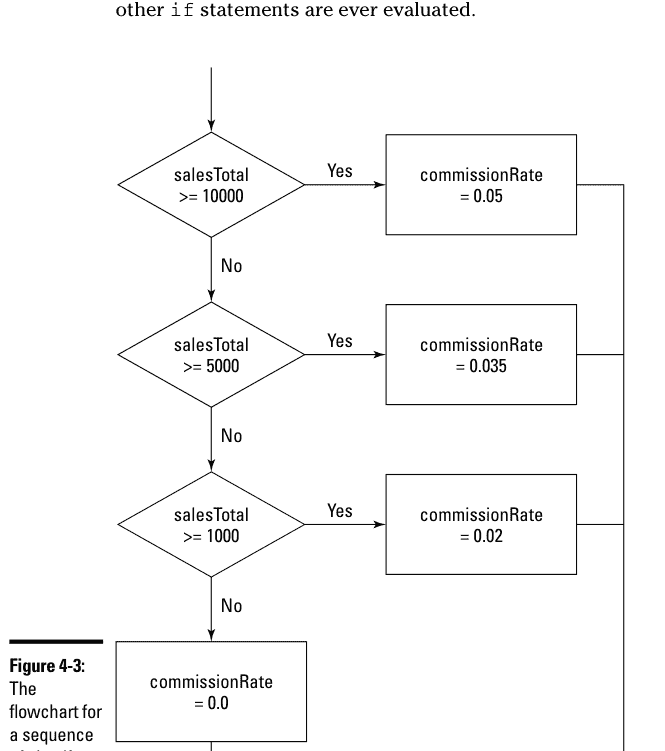

## 152 使用 If 语句

```
else if (salesTotal >= 5000.0)
    commissionRate = 0.035;
else if (salesTotal >= 10000.0)
    commissionRate = 0.05;
```

然而，这种方案行不通。这些 `if` 语句总是将佣金率设置为 0%，因为第一个 `if` 语句中的布尔表达式总是测试为 `true`（假设 `salesTotal` 不为零或负数——如果为零或负数，其他 `if` 语句都不重要）。结果，其他 `if` 语句从未被执行。


### 斯波克先生最爱的操作符（当然是逻辑操作符）

*逻辑操作符*（有时称为*布尔操作符*）是一种操作符，它返回的布尔结果基于一个或两个其他表达式的布尔结果。使用逻辑操作符的表达式有时被称为*复合表达式*，因为逻辑操作符的效果是让你能够将两个或多个条件测试组合成一个表达式。表 4-2 列出了逻辑操作符。

表 4-2 逻辑操作符

| 操作符 | 名称 | 类型 | 描述 |
| :--- | :--- | :--- | :--- |
| ! | 非 | 一元 | 如果右侧的操作数计算结果为 `false`，则返回 `true`。如果右侧的操作数为 `true`，则返回 `false`。 |
| & | 与 | 二元 | 如果两个操作数的计算结果都为 `true`，则返回 `true`。在应用与操作符之前，两个操作数都会被计算。 |
| \| | 或 | 二元 | 如果至少有一个操作数的计算结果为 `true`，则返回 `true`。在应用或操作符之前，两个操作数都会被计算。 |
| ^ | 异或 | 二元 | 如果且仅如果一个操作数的计算结果为 `true`，则返回 `true`。如果两个操作数的计算结果都为 `true` 或都为 `false`，则返回 `false`。 |
| && | 条件与 | 二元 | 与 & 相同，但如果左侧操作数返回 `false`，则不计算右侧操作数，直接返回 `false`。 |
| \|\| | 条件或 | 二元 | 与 \| 相同，但如果左侧操作数返回 `true`，则不计算右侧操作数，直接返回 `true`。 |

以下小节将极其详细地描述这些操作符。

#### 使用 ! 操作符

最简单的逻辑操作符是*非*（`!`）。从技术上讲，它是一元前缀操作符，这意味着它与一个操作数一起使用，并且你将其直接编码在操作数之前。（另外，这个操作符在技术上被称为*补码操作符*，而不是*非操作符*。但实际上，每个人都称之为*非*。）

非操作符会反转布尔表达式的值。因此，如果表达式为 `true`，非会将其变为 `false`。如果表达式为 `false`，非会将其变为 `true`。

例如：

```
! (i == 4)
```

如果 i 是除 4 以外的任何值，此表达式计算结果为 true。如果 i 是 4，则计算结果为 false。它的工作方式是先计算表达式 (i == 4)。然后，它反转该计算的结果。

> 不要混淆非逻辑操作符 (!) 和不等于关系操作符 (!=)。尽管它们有时以类似的方式使用，但非操作符更通用。例如，我本可以这样写前面的例子：

```
i != 4
```

结果是相同的。然而，非操作符可以应用于任何返回 true-false 结果的表达式，而不仅仅是相等性测试。


注意：你几乎总是必须将 ! 操作符所应用的表达式括在括号中。例如，考虑这个表达式：

```
! i == 4
```

假设 i 是一个整数变量，编译器不允许此表达式，因为它看起来像是你试图将 ! 操作符应用于变量，而不是比较的结果。一组简单的括号就可以解决问题：

```
! (i == 4)
```

#### 使用 & 和 && 操作符

& 和 && 操作符组合两个布尔表达式，仅当两个表达式都为 true 时才返回 true。这被称为与运算，因为第一个表达式和第二个表达式都必须为 true，与操作符才能返回 true。

例如，假设当销售类别为 1 且销售总额为 $10,000 或更多时，销售佣金率应为 2.5%。你可以使用两个单独的 if 语句来执行此测试（就像我本章前面所做的那样），或者你可以将测试组合到一个 if 语句中：

```
if ( (salesClass == 1) & (salesTotal >= 10000.0) )
    commissionRate = 0.025;
```

在这里，表达式 (salesClass == 1) 和 (salesTotal >= 10000.0) 是分别计算的。然后，& 操作符比较结果。如果两者都为 true，& 操作符返回 true。如果其中一个或两者都为 false，& 操作符返回 false。


注意，我大量使用了括号来阐明一个表达式在哪里结束以及另一个表达式在哪里开始。使用括号并非总是必要的，但当你使用逻辑操作符时，我建议你始终使用括号来清晰地标识正在比较的表达式。

&& 操作符类似于 & 操作符，但它利用了我们对逻辑的理解。因为 & 操作符比较的两个表达式都必须为 true，整个表达式才为 true，所以如果第一个表达式返回 false，就没有理由去计算第二个表达式。& 并不了解这一点，因此它会在确定结果之前盲目地计算两个表达式。&& 操作符足够智能，当它知道结果时就会停止。

结果，几乎总是应该使用 && 而不是 &。这是前面的例子，这次使用 && 进行智能编码：

```
if ( (salesClass == 1) && (salesTotal >= 10000.0) )
    commissionRate = 0.025;
```


为什么我说你应该几乎总是使用 &&？因为有时表达式本身具有重要的副作用。例如，第二个表达式可能涉及一个更新数据库的方法调用，并且你希望无论第一个表达式是 true 还是 false，数据库都能被更新。在这种情况下，你需要使用 & 而不是 && 来确保两个表达式都被计算。


依赖表达式的副作用可能有风险，你几乎总能找到更好的方法来编写代码以避免副作用。换句话说，将一个重要的数据库更新方法调用放在嵌套在 if 语句中的复合表达式中，可能不是个好主意。

#### 使用 | 和 || 操作符

| 和 || 操作符被称为或操作符，因为如果第一个表达式为 true 或第二个表达式为 true，它们就返回 true。如果两个表达式都为 true，它们也返回 true。（你可以在键盘上找到 | 符号，就在 Enter 键的正上方。）

假设当销售总额低于 $1,000 或销售类别为 3 时，销售代表没有佣金。你可以用两个单独的 if 语句来实现：

```
if (salesTotal < 1000.0)
    commissionRate = 0.0;
if (salesClass == 3)
    commissionRate = 0.0;
```


## 156 斯波克先生最喜欢的运算符（当然是逻辑运算符）

但是使用或（or）运算符，你可以用一个复合条件来完成同样的事情：

```
if ((salesTotal < 1000.0) | (salesClass == 3))
    commissionRate = 0.0;
```

要计算这个 `if` 语句的表达式，Java 会先计算 `|` 运算符两侧的表达式。然后，如果其中至少有一个为 `true`，整个表达式的结果就是 `true`。否则，表达式结果为 `false`。

在大多数情况下，你应该使用条件或运算符（`||`）而不是常规或运算符（`|`），像这样：

```
if ((salesTotal < 1000.0) || (salesClass == 3))
    commissionRate = 0.0;
```

与条件与（And）运算符（`&&`）类似，条件或（Or）运算符（`||`）在知道结果后就会停止计算。例如，假设销售总额为 500 美元。那么，就没有必要去计算第二个表达式了。因为第一个表达式的结果为 `true`，并且只需要其中一个表达式为 `true` 即可，Java 可以完全跳过第二个表达式。当然，如果销售总额是 5,000 美元，第二个表达式仍然必须被计算。

与与（And）运算符一样，只有在你的程序依赖于第二个表达式的某些副作用（例如方法调用所做的工作）时，才应该使用常规或运算符。

#### 使用 `^` 运算符

`^` 运算符执行的是逻辑学中称为*异或*（*exclusive or*，通常简写为 *xor*）的操作。当且仅当两个子表达式中有一个为 `true` 时，它返回 `true`。如果两个表达式都为 `true` 或都为 `false`，`^` 运算符返回 `false`。

大多数程序员不怎么使用 `^` 运算符，因为它相当令人困惑。如果你跳过这一节，我也不会介意。

换句话说，如果两个子表达式的结果不同，`^` 运算符返回 `true`。如果它们的结果相同，则返回 `false`。

```
if ( switch1 == switch2 )
    System.out.println("Trouble! The switches are the same");
else
    System.out.println("OK, the switches are different.");
```

但是，如果由于某种原因，其中一个开关由一个 int 变量表示，其中 1 表示开关在左边，任何其他值表示开关在右边，而另一个是 int 变量，其中 -1 表示开关在左边，任何其他值表示开关在右边。（谁知道呢，也许这些开关是不同制造商生产的。）你可以使用这样的复合条件：

```
if ( ((switch1==1)&&(switch2==-1)) ||
     ((switch1!=1)&&(switch2!=-1)))
    System.out.println("Trouble! The switches are the same");
else
    System.out.println("OK, the switches are different.");
```

但是异或运算符可以用更简单的表达式来完成这项工作：

```
if ( (switch1==1)^(switch2==-1))
    System.out.println("OK, the switches are different.");
else
    System.out.println("Trouble! The switches are the same");
```

坦率地说，`^` 运算符可能是你应该避免使用的一个。事实上，我书架上的大多数 Java 书籍（相信我，我有很多本）甚至没有提到这个运算符，除了它在作为位运算符的其他、更有用的应用（关于位运算符的信息，请参见本书网站上的补充章节 2）。这可能是因为许多应用程序不将其用作逻辑运算符，而它适合的应用程序也可以用更传统的与（And）和或（Or）运算符来解决。

#### 组合逻辑运算符

你可以组合简单的布尔表达式来创建更复杂的表达式。例如：

```
if ((salesTotal<1000.0)||((salesTotal<5000.0)&&
        (salesClass==1))||((salesTotal < 10000.0)&&
        (salesClass == 2)))
    commissionRate = 0.0;
```

你能看出这个 if 语句中的表达式是做什么的吗？如果以下三个条件中的任何一个为真，它会将佣金设为零：

- 销售总额小于 1,000 美元。
- 销售总额小于 5,000 美元，并且销售等级为 1。
- 销售总额小于 10,000 美元，并且销售等级为 2。

在许多情况下，你只需通过不同的缩进和间隔子表达式就可以阐明表达式的工作原理。例如，这个版本的前一个 if 语句更容易理解：

```
if (       (salesTotal < 1000.0)
    ||    ( (salesTotal < 5000.0) && (salesClass == 1) )
    ||    ( (salesTotal < 10000.0) && (salesClass == 2) )
    )
    commissionRate = 0.0;
```

然而，要弄清楚这个 if 语句的确切作用仍然很困难。在许多情况下，更好的做法是跳过复杂的表达式，编写独立的 if 语句：

```
if (salesTotal < 1000.0)
    commissionRate = 0.0;
if ( (salesTotal < 5000.0) && (salesClass == 1) )
    commissionRate = 0.0;
if ( (salesTotal < 10000.0) && (salesClass == 2) )
    commissionRate = 0.0;
```

当你使用多个逻辑运算符时，布尔表达式可能会变得有点复杂，特别是如果你混合使用与（And）和或（Or）运算符。例如，考虑这个表达式：

```
if ( a==1 && b==2 || c==3 )
    System.out.println("It's true!");
else
    System.out.println("No it isn't!");
```

你认为这个 if 语句在 a 是 5，b 是 7，c 是 3 的情况下会做什么？答案是表达式计算结果为 true，并打印 "It's true!"。这是因为 Java 从左到右应用运算符。所以 && 运算符应用于 a==1（结果为 false）和 b==2（结果也为 false）。因此，&& 运算符返回 false。然后 || 运算符应用于这个 false 结果和 c==3 的结果（为 true）。因此，整个表达式返回 true。

如果你使用括号来阐明表达式的功能，这个表达式不是会更清晰吗？例如：

```
if ( (a==1 && b==2) || c==3 )
    System.out.println("It's true!");
else
    System.out.println("No it isn't!");
```

现在你可以清楚地看到 && 运算符是先被计算的。

### 使用条件运算符

Java 有一个特殊的运算符，称为*条件运算符*，旨在某些情况下完全消除对 `if` 语句的需要。它是一个三元运算符，这意味着它适用于三个操作数。使用条件运算符的一般形式如下：

```
boolean-expression ? expression-1 : expression-2
```

首先计算布尔表达式。如果它计算结果为 `true`，则计算 `expression-1`，该表达式的结果成为整个表达式的结果。如果表达式结果为 `false`，则计算 `expression-2`，并使用其结果代替。

例如，假设你想要在总销售额小于 10,000 美元时，将一个名为 `salesTier` 的整数变量赋值为 0，而在销售额为 10,000 美元或更多时赋值为 1。你可以用这条语句来完成：

```
int tier = salesTotal > 10000.0 ? 1 : 0;
```

虽然不是必需的，但使用一组括号有助于使此语句更容易理解：

```
int tier = (salesTotal > 10000.0) ? 1 : 0;
```

条件运算符的一个常见用途是，当你在使用拼接构建文本字符串，并且有一个单词可能需要根据整数变量的值变为复数时。例如，假设你想创建一个字符串，内容为 "You have *x* apples"，其中变量 `appleCount` 的值替换 *x*。但是，如果 `appleCount` 是 1，字符串应该是 "You have 1 apple"，而不是 "You have 1 apples"。
以下语句可以达到这个效果：

```
String msg = "You have " + appleCount + " apple"
    + ((appleCount>1) ? "s." : ".");
```

当 Java 遇到 `?` 运算符时，它会计算表达式 `(appleCount>1)`。如果结果为 `true`，它使用第一个字符串 `(s.)`。如果为 `false`，它使用第二个字符串 `(".")`。

### 比较字符串

在 Java 中比较字符串需要格外小心，因为 `==` 运算符并不真正按其应有的方式工作。例如，假设你想知道一个名为 `answer` 的字符串是否包含值 "Yes"。你可能会忍不住像这样编写一个 `if` 语句：


## 160 比较字符串

```java
if (answer == "Yes")
    System.out.println("The answer is Yes.");
```


很遗憾，这是不正确的。问题在于，在 Java 中，字符串是引用类型，而非基本类型。当你对引用类型使用 `==` 运算符时，Java 比较的是对象的引用（即内存地址），而不是对象本身。因此，表达式 `answer == "Yes"` 并不是在测试 `answer` 变量所引用的字符串的值是否为 "Yes"。相反，它测试的是 `answer` 字符串和字面量字符串 "Yes" 是否指向内存中的同一个字符串对象。在许多情况下，它们确实指向同一个对象。但有时并非如此，而结果也难以预测。

测试字符串是否具有给定值的正确方法是使用 `String` 类的 `equals` 方法：

```java
if (answer.equals("Yes"))
    System.out.println("The answer is Yes.");
```

此方法会实际比较变量所引用的字符串对象与你作为参数传递的字符串的值，并返回一个布尔结果，以指示这两个字符串的值是否相同。

`String` 类还有另一个方法 `equalsIgnoreCase`，它在比较字符串时也很有用。它比较字符串但忽略大小写，这在测试用户输入的字符串值时尤其有用。例如，假设你正在编写一个程序，只有当用户输入单词 `End` 时才会结束。你可以使用 `equals` 方法来测试字符串：

```java
if (input.equals("end"))
    // 结束程序
```

但是，那样的话，用户必须精确地输入 `end`。如果用户输入 `End` 或 `END`，程序就不会结束。更好的做法是这样编写 `if` 语句：

```java
if (input.equalsIgnoreCase("end"))
    // 结束程序
```

这样，用户可以通过输入 `end`、`End`、`END`，甚至是 `eNd` 来结束程序。

你可以在第四卷第一章中找到更多关于处理字符串的内容。目前，只需记住，在 `if` 语句（或下一章介绍的其他控制语句）中测试字符串相等性时，你必须使用 `equals` 或 `equalsIgnoreCase` 方法，而不是 `==` 运算符。

## 第五章：循环往复（或，使用循环）

### 本章内容

- ✔ `while` 循环的刺激
- ✔ 无限循环的狂喜
- ✔ `do` 循环的壮丽
- ✔ 验证输入的喜悦
- ✔ `for` 循环的奇妙
- ✔ 嵌套循环的极乐

到目前为止，本书中的所有程序都是启动、快速运行其 `main` 方法，然后结束。如果《绿野仙踪》里的多萝西使用这些程序，她可能会说：“天哪，这里的程序来去匆匆啊！”

在本章中，你将了解如何编写那些不会如此匆忙结束的程序。它们通过使用 *循环* 来“逗留”，从而多次执行相同的语句。

循环是编写最常见类型程序的关键：这类程序从用户那里获取输入，对其进行处理，然后从用户那里获取更多输入并处理这些输入，并以此方式持续进行，直到用户觉得足够了。

或者，换句话说，循环就像你洗发水瓶上的说明：起泡。冲洗。*重复*。


与 `if` 语句一样，循环依赖于条件表达式来告诉它们何时停止循环。如果没有条件表达式，循环将永远执行下去，你的用户将看着程序运行直到老去。因此，如果你还没有阅读第二卷第四章，我建议你在继续深入之前先去阅读一下。

### 基本的 while 循环

Java 中所有循环语句中最基本的是 `while`。`while` 语句创建一种称为 *while 循环* 的循环类型，它仅仅是一个只要某个条件表达式的值为 `true` 就持续执行的循环。`while` 循环在各种编程场景中都很有用，所以你会经常使用它们。（我将在本章后面介绍其他类型的循环。）

#### while 语句

`while` 语句的基本格式如下：

```java
while (expression)
    statement
```

`while` 语句首先计算表达式。如果表达式为 `true`，则执行 `statement`。然后，再次计算表达式，整个过程重复。如果表达式为 `false`，则不执行 `statement`，`while` 循环结束。

请注意，`while` 循环的 `statement` 部分可以是单条语句，也可以是包含在一对花括号中的语句块。只有一条语句的循环用处不大，所以你编写的几乎所有 `while` 循环都使用语句块。（好吧，有时候单条语句的循环也有用。这并非闻所未闻。只是不那么常见。）

#### 计数循环

这是一个使用 `while` 循环在控制台上打印从 2 到 20 的偶数的简单程序：

```java
public class EvenCounter
{
    public static void main(String[] args)
    {
        int number = 2;
        while (number <= 20)
        {
            System.out.print(number + " ");
            number += 2;
        }
        System.out.println();
    }
}
```

如果你运行这个程序，以下输出将显示在控制台窗口中：

这个程序的 `while` 语句中的条件表达式是 `number <= 20`。这意味着只要 `number` 的值小于或等于 20，循环就会重复。循环体由两条语句组成。第一条打印 `number` 的值，后跟一个空格以将这个数字与下一个数字分隔开。然后，第二条语句将 `number` 的值增加 2。

图 5-1 展示了该程序的流程图。这个流程图可以帮助你可视化循环的基本决策过程。

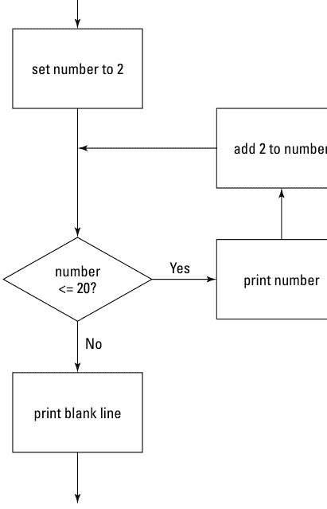

#### 跳出循环

在许多程序中，你需要设置一个带有某种“逃生子句”的循环。Java 的逃生子句是 `break` 语句。当在 `while` 循环中执行 `break` 语句时，循环会立即结束。循环中任何剩余的语句都将被忽略，接下来执行的语句是循环之后的语句。

## 164 无限循环

例如，假设你害怕数字 12。（我不是医生，也没在电视上扮演过医生，但我认为这种情况的学名可能是数字 12 恐惧症。）你可以修改上一节所示的计数程序，使其在遇到数字 12 时恐慌并中止循环：

```java
public class Duodecaphobia
{
    public static void main(String[] args)
    {
        int number = 2;
        while (number <= 20)
        {
            if (number == 12)
                break;
            System.out.print(number + "  ");
            number += 2;
        }
        System.out.println();
    }
}
```

当你运行这个程序时，控制台上会显示以下行：

2 4 6 8 10

呼！好险。差点就到 12 了。

#### 无限循环

一种常见的循环形式称为无限循环。那是一个永远执行下去的循环。你可以用多种方式在 Java 中创建无限循环（并非所有都是有意的），但最简单的方法就是将 while 表达式指定为 `true`。

这里有一个例子：

```java
public class CountForever
{
    public static void main(String[] args)
    {
        int number = 2;
        while (true)
        {
            System.out.print(number + "  ");
            number += 2;
        }
    }
}
```

如果你运行这个程序，你的控制台窗口很快就会被数字填满，并且持续不断。如果你喜欢偶数，这很棒，但最终你会厌倦并希望它停止。你可以通过三种方式停止无限循环：

- ◆ 关闭你的电脑。
- ◆ 用斧头或其他重物击打你的电脑。
- ◆ 关闭控制台窗口。

最后一种可能是你想采用的方法。

显然，在程序中你要避免无限循环。因此，无论何时使用始终为 `true` 的 while 表达式，务必加入一个 `break` 语句，为你的循环提供某种终止方式。例如，你可以在数字 12 恐惧症程序中使用带有 `break` 语句的无限循环：

```java
public class Duodecaphobia
{
    public static void main(String[] args)
    {
        int number = 2;
        while (true)
        {
            if (number == 12)
                break;
            System.out.print(number + " ");
            number += 2;
        }
        System.out.println();
    }
}
```

在这里，循环看起来可能会永远继续下去，但 `break` 语句在遇到 12 时会恐慌地跳出循环。

#### 让用户决定何时退出

事实证明，当你希望由用户来决定何时停止循环时，无限循环也很有用。例如，假设你不知道用户害怕哪些数字，所以你想一直计数，直到用户说停止。下面是一个实现此功能的程序：

```java
import java.util.Scanner;

public class NumberPhobia
{
    static Scanner sc = new Scanner(System.in);

    public static void main(String[] args)
    {
```


### 另一种让用户决定的方法

另一种编写用户可选择退出的循环的方法是在 `while` 条件中测试输入字符串。这里的唯一技巧是，你必须先将输入字符串初始化为使循环继续的值。否则，循环根本不会执行！以下是使用此技术的 `NumberPhobia` 程序的一个变体：

```java
import java.util.Scanner;

public class NumberPhobia2
{
    static Scanner sc = new Scanner(System.in);

    public static void main(String[] args)
    {
        int number = 2;
        String input = "Y";
        while (input.equalsIgnoreCase("Y"))
        {
            System.out.println(number + " ");
            System.out.print("Do you want keep counting?"
                            + " (Y or N)");
            input = sc.next();
            number += 2;
        }
        System.out.println("\nWhew! That was close.");
    }
}
```

这个程序的工作原理与前一个版本几乎相同，但有一个细微的差别。在第一个版本中，如果用户在程序显示 6 后输入 N，循环结束后 `number` 变量的值是 6。这是因为 `break` 语句在将 2 加到 `number` 之前就退出了循环。但在这个版本中，`number` 的值是 8。

### 使用 continue 语句

`break` 语句相当严厉：它会完全退出循环。有时这正是你需要的，但很多时候，你并不真正需要退出循环；你只是需要跳过循环的特定迭代。例如，本章前面介绍的 `Duodecaphobia` 程序在遇到 12 时停止循环。如果你只是想跳过数字 12，从而直接从 10 到 14 呢？

为此，你可以使用 `break` 语句更温和、更友善的“亲戚”——`continue` 语句。`continue` 语句将控制权立即发送回循环的顶部，再次对表达式进行求值。如果表达式仍为真，则再次执行循环的语句或块。

以下是使用 `continue` 语句跳过数字 12 而不是在到达 12 时完全停止计数的 `Duodecaphobia` 程序的一个版本：

```java
public class Duodecaphobia2
{
    public static void main(String[] args)
    {
        int number = 0;
        while (number < 20)
        {
            number += 2;
            if (number == 12)
                continue;
            System.out.print(number + " ");
        }
        System.out.println();
    }
}
```

运行此程序，你将在控制台窗口中获得以下输出：

```
2 4 6 8 10 14 16 18 20
```

请注意，我必须对此程序进行几处更改，才能使其使用 `continue` 语句而不是 `break` 语句。如果我只是将 `break` 一词替换为 `continue`，程序将无法工作。这是因为在原始版本中，将 2 加到 `number` 的语句是在 `break` 语句之后。因此，如果你只是将 `break` 语句替换为 `continue` 语句，一旦到达 12，最终会得到一个无限循环，因为将 2 加到 `number` 的语句永远不会被执行。

为了使此程序能与 `continue` 语句一起工作，我重新排列了循环体中的语句，使得将 2 加到 `number` 的语句出现在 `continue` 语句之前。这样，`continue` 语句跳过的唯一语句就是打印 `number` 到控制台的语句。

不幸的是，这种更改也影响了程序中的其他语句。由于 2 是在打印 `number` 之前加到 `number` 上的，我必须将 `number` 的初始值从 2 更改为 0，并且必须将 `while` 表达式从 `number <= 20` 更改为 `number < 20`。

### do-while 循环

`do-while` 循环（有时简称为 `do` 循环）类似于 `while` 循环，但有一个关键区别：在 `do-while` 循环中，直到循环中的语句执行完毕后才会测试停止循环的条件。`do-while` 循环的基本形式是：

```
do
    语句
while (表达式);
```

请注意，`while` 关键字和表达式是在循环体*之后*才编码的。与 `while` 循环一样，`do-while` 循环的体可以是单条语句，也可以是用大括号括起来的一组语句。

另外，请注意表达式后面跟着一个分号。`do-while` 是唯一以分号结尾的循环语句。

以下是使用 `do-while` 循环而不是 `while` 循环的 `EvenCounter` 程序的一个版本：

```java
public class EvenCounter2
{
    public static void main(String[] args)
    {
        int number = 2;
        do
        {
            System.out.print(number + " ");
            number += 2;
        } while (number <= 20);

        System.out.println();
    }
}
```

关于 `do-while` 循环，需要记住的最重要一点是：`do-while` 循环体中的语句至少会执行一次。相比之下，如果 `while` 表达式在首次求值时为假，则 `while` 循环体中的语句根本不会执行。

查看图 5-2 中的流程图以了解我的意思。你可以看到执行从循环顶部开始，在循环体执行一次后流向判断测试。然后，如果判断测试为真，控制权将飞回循环顶部。否则，它将从流程图底部流出。

关于 `do-while` 循环，还有几点需要注意：

- 你通常可以跳过在循环前初始化表达式中出现的变量，因为表达式是在循环体中的语句至少执行一次之后才被求值的。
- 你可以在 `do-while` 循环中使用 `break` 和 `continue` 语句，就像在 `while` 循环中一样。
- 一些程序员喜欢将开始循环体的大括号与 `do` 语句放在同一行，并将结束 `do-while` 循环的 `while` 语句与标记循环体结束的大括号放在同一行。只要你喜欢，我都可以。只需记住，编译器在缩进和空格问题上是“一视同仁”的。

### 验证用户的输入

`do-while` 循环对于验证用户的输入特别有用。例如，假设你正在编写一个玩博彩游戏的程序，并且你想从控制台获取用户的赌注金额。用户可以下注任何他想要的美元金额（但仅限于整数美元），但他不能下注超过他在银行的金额，也不能下注负数或零。以下是使用 `do-while` 循环从用户获取此输入的程序：

```java
import java.util.Scanner;

public class GetABet
{
    static Scanner sc = new Scanner(System.in);

    public static void main(String[] args)
    {
        int bank = 1000;    // 假设用户有 1000 美元
        int bet;            // 用户输入的赌注

        System.out.println("You can bet between 1 and " +
            bank);
        do
        {
            System.out.print("Enter your bet: ");
            bet = sc.nextInt();
        } while ( (bet <= 0) || (bet > bank) );
        System.out.println("Your money's good here.");
    }
}
```

这里，`do-while` 循环使用的表达式验证用户输入的数据，这意味着它根据一组标准检查数据以确保数据是可接受的。

`||` 运算符执行“或”测试。如果运算符两侧的至少一个表达式为真，则返回 `true`。因此，如果赌注小于或等于零（`bet <= 0`），或者赌注大于银行中的金额（`bet > bank`），此表达式将返回 `true`。

这种类型的验证测试仅检查用户是否输入了有效的数字，并且该数字在可接受的范围内。如果用户输入的内容不是有效的数字，例如单词 `Buttercup` 或 `Humperdink`，程序将严重出错，并在控制台上喷出一堆可怕的异常消息。你将在第 II 卷第 8 章中了解如何清理这个烂摊子。

（实际上，你可以通过使用第 II 卷第 2 章中描述的 `do` 循环或 `while` 循环以及 `Scanner` 类的 `hasNextDouble` 方法来避免此问题。）

如果你想在用户输入不正确的输入时显示错误消息，必须在循环内使用 `if` 语句，并且此 `if` 语句必须重复验证输入数据的表达式。因此，进行验证的表达式必须出现两次。例如：


## 172 验证用户输入

```java
import java.util.Scanner;

public class GetABet2
{
    static Scanner sc = new Scanner(System.in);

    public static void main(String[] args)
    {
        int bank = 1000;   // 假设用户有1000美元
        int bet;           // 用户输入的赌注

        System.out.println("You can bet between 1 and " + bank);
        do
        {
            System.out.print("Enter your bet: ");
            bet = sc.nextInt();
            if ( (bet <= 0) || (bet > bank) )
                System.out.println("What, are you crazy?");
        } while ( (bet <= 0) || (bet > bank) );
        System.out.println("Your money's good here.");
    }
}
```

这里，如果用户试图输入不合适的赌注，`if`语句会显示消息“What, are you crazy?”。

你可以通过两种方式避免重复用于数据验证的表达式。一种是添加一个布尔变量，如果数据无效，则在`do-while`循环体中设置该变量，如本例所示：

```java
import java.util.Scanner;

public class GetABet3
{
    static Scanner sc = new Scanner(System.in);

    public static void main(String[] args)
    {
        int bank = 1000;   // 假设用户有1000美元
        int bet;           // 用户输入的赌注
        boolean validBet; // 指示赌注是否有效

        System.out.println("You can bet between 1 and " + bank);
        do
        {
            System.out.print("Enter your bet: ");
            bet = sc.nextInt();
            validBet = true;
            if ( (bet <= 0) || (bet > bank) )
            {
                validBet = false;
                System.out.println("What, are you crazy?");
            }
        } while (!validBet);
        System.out.println("Your money's good here.");
    }
}
```

在这个例子中，我使用了一个名为`validBet`的布尔变量来指示用户是否输入了有效的赌注。用户输入赌注后，在`if`语句测试验证条件之前，该变量被设置为`true`。然后，如果`if`语句发现赌注无效，`validBet`就被设置为`false`。

#### 著名的for循环

除了`while`和`do-while`循环外，Java还提供了另一种循环：*for循环*。你可能已经注意到，本小节中迄今为止介绍的许多循环都涉及计数。事实证明，计数循环在计算机程序中非常常见，因此设计计算机编程语言的人（他们被称为“计算机编程语言设计者”）很久以前就发明了一种专门用于计数的特殊循环机制。

`for`循环背后的基本原理是，循环本身维护一个*计数器变量*——即一个每次执行循环体时其值都会增加的变量。例如，如果你想要一个从1数到10的循环，你会使用一个计数器变量，其初始值为1，每次循环增加1。然后，你会使用一个测试，在计数器变量达到10时结束循环。`for`循环让你可以在一个方便的语句中完成所有这些设置。

主修计算机科学的人称计数器变量为*迭代器*。他们这样做是因为他们认为我们不知道这是什么意思。但我们很清楚，迭代器就是你放啤酒以保持它凉爽的地方。

#### for循环的正式格式

我现在想通知你`for`循环的正式格式，以便你从现在起知道如何构建它。`for`循环遵循以下基本格式：

```java
for (initialization-expression; test-expression; count-expression)
    statement;
```

关键字`for`后面括号中的三个表达式控制`for`循环的工作方式。以下段落解释这三个表达式的作用：

- *初始化表达式*在循环开始之前执行。通常，你使用此表达式来初始化计数器变量。如果你在`for`语句之前没有声明计数器变量，你也可以在这里声明它。
- *测试表达式*在每次执行循环时进行评估，以确定循环是否应继续循环。通常，此表达式测试计数器变量，以确保它仍然小于或等于你要计数到的值。只要此表达式评估为`true`，循环就继续执行。当测试表达式评估为`false`时，循环结束。
- *计数表达式*在每次循环执行时进行评估。它的任务通常是递增计数器变量。

图5-3显示了一个流程图，帮助你直观地了解`for`循环的工作原理。

这是一个简单的`for`循环，在控制台上显示数字1到10：

```java
public class CountToTen
{
    public static void main(String[] args)
    {
        for (int i = 1; i <= 10; i++)
            System.out.println(i);
    }
}
```

运行此程序，你会在控制台上看到：

```
1
2
3
4
5
6
7
8
9
10
```

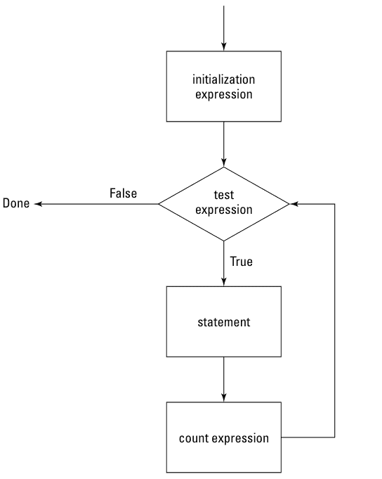

图5-3：for循环的流程图。

这个`for`循环包含以下部分：

1. 初始化表达式是`int i = 1`。此表达式声明一个名为`i`的`int`类型变量，并为其分配初始值`1`。
2. 测试表达式是`i <= 10`。因此，只要`i`小于或等于`10`，循环就继续执行。
3. 计数表达式是`i++`。因此，每次循环执行时，变量`i`都会递增。
4. 循环体是单个语句`System.out.println(i)`。因此，每次循环执行时，`i`变量的值都会打印到控制台。

> 技术内容
我编造了这些用于描述`for`循环中三个表达式的术语。官方上，Java称它们为`ForInit Expression`、`Expression`和`ForUpdate Expression`。你不觉得我的术语更具描述性吗？

#### 探索计数器变量的作用域

如果你在初始化语句中声明计数器变量，计数器变量的作用域仅限于for语句本身。因此，你可以在括号内出现的其他表达式和循环体中使用该变量，但不能在循环外使用它。例如，此代码会导致编译器错误：

```java
public class CountToTenError
{
    public static void main(String[] args)
    {
        for (int i = 1; i <=10; i++)
            System.out.println(i);
        System.out.println("The final value of i is " + i);
    }
}
```

这是因为main方法中的最后一条语句引用了变量i，由于它是在for循环内声明的，因此已超出作用域。

但是，你不必在for语句本身中声明计数器变量。因此，以下程序可以正常工作：

```java
public class CountToTenErrorFixed
{
    public static void main(String[] args)
    {
        int i;
        for (i = 1; i <=10; i++)
            System.out.println(i);
        System.out.println("The final value of i is " + i);
    }
}
```

请注意，因为i变量是在for语句之前声明的，所以初始化表达式没有指定变量的数据类型。当你运行此程序时，控制台窗口中会显示以下内容：

```
1
2
3
4
5
6
7
8
9
10
The final value of i is 11
```

#### 计数偶数

在本章前面，你看到了一个计数到20的偶数的程序。你也可以用for循环来完成。你所要做的就是调整计数表达式。例如，这是一个使用for循环的CountEven程序版本：

```java
public class ForEvenCounter
{
    public static void main(String[] args)
    {
        for (int number = 2; number <= 20; number += 2)
            System.out.print(number + " ");
        System.out.println();
    }
}
```

运行此程序，控制台窗口确实显示以下内容：

```
2 4 6 8 10 12 14 16 18 20
```

#### 倒数计数

没有规则说for循环只能正向计数。要倒数计数，你只需调整for循环的三个表达式。通常，初始化表达式指定计数器变量的起始值。测试表达式使用大于测试而不是小于测试。计数表达式从计数器变量中减去而不是加上。

例如：

```java
public class CountDown
{
    public static void main(String[] args)
    {
        for (int count = 10; count >= 1; count--)
        {
            System.out.println(count);
        }
    }
}
```

运行此程序，你会在控制台窗口中看到以下结果：

```
10
9
8
7
6
5
```

## 178 著名的for循环

对于像我这样在1960年代长大、虔诚观看NASA发射的人来说，你会欣赏这个倒计时程序的变体：

```java
public class LaunchControl
{
    public static void main(String[] args)
    {
        System.out.print("We are go for launch in T minus ");
        for (int count = 10; count >= 0; count--)
        {
            if (count == 8)
                System.out.println("Ignition sequence start!");
            else
                System.out.println(count + "...");
        }
        System.out.println("All engines running!");
        System.out.println("Liftoff! We have a liftoff!");
    }
}
```

当你运行它时，显示的输出如下：

```
We are go for launch in T minus 10...
9...
Ignition sequence start!
7...
6...
5...
4...
3...
2...
1...
0...
All engines running!
Liftoff! We have a liftoff!
```

你难道听不出保罗·哈尼的声音吗？他是1960年代NASA著名的“任务控制之声”。如果你听不出，那说明你远不如我这般“极客”。

#### 无主体的for循环

有些程序员以编写尽可能简洁的代码为乐。我想《宋飞正传》有一集讲过这个……杰瑞有个女朋友是个“简洁派”程序员。他不得不甩了她，因为他看不懂她的代码。

无论如何，简洁派程序员有时喜欢玩弄`for`语句，试图完全摆脱`for`循环的主体。为此，他们利用了一个事实：你可以在`for`语句的计数表达式部分编写任何你想要的表达式，包括方法调用。例如，下面是一个使用无主体的`for`语句在控制台上打印数字1到10的程序：

```java
public class TerseCoder
{
    public static void main(String[] args)
    {
        for (int i = 1; i <=10; System.out.println(i++));
    }
}
```

这里的计数表达式是对`System.out.println`的调用。`println`方法的参数巧妙地使用了自增运算符，使得变量在同一表达式中既被打印又被递增。

远离简洁派程序员！宋飞甩了她是对的。

#### 组合你的表达式

`for`循环的一个晦涩方面是，初始化和计数表达式实际上可以是一个由逗号分隔的表达式列表。如果你需要同时跟踪两个计数器变量，这有时会很有用。例如，下面是一个同时从1计数到10和从10计数到1的程序，使用了两个计数器变量：

```java
public class CountBothWays
{
    public static void main(String[] args)
    {
        int a, b;
        for (a = 1, b = 10; a <= 10; a++, b--)
            System.out.println(a + " " + b);
    }
}
```

如果你运行这个程序，你会在控制台窗口看到：

```
1 10
2 9
3 8
4 7
5 6
6 5
7 4
8 3
9 2
10 1
```

## 180 著名的for循环

当你使用多个表达式进行初始化和计数表达式时，请记住以下规则：

- 在初始化表达式中，如果你使用多个表达式，则不能声明变量。这就是为什么我在CountBothWays示例中在for语句之前声明了变量a和b。
- 表达式列表中的表达式可以是赋值语句、自增或自减语句（如a++）、方法调用，或者是使用new关键字从类创建对象的创建语句。其他类型的语句，如if语句或循环，是不允许的。
- 你不能在测试表达式中列出多个表达式。但是，你可以使用由布尔运算符创建的复合条件，因此你不需要使用表达式列表。

这里，只是为了证明我能做到，是一个使用无主体for循环的LaunchController程序版本：

```java
public class ExpressionGanging
{
    public static void main(String[] args)
    {
        System.out.print("We are go for launch in T minus ");
        for (int count = 10; count >= 0;
            System.out.println((count == 8) ?
                "Ignition sequence start!" :
                count + "..."),
            count--   );
        System.out.println("All engines running!");
        System.out.println("Liftoff! We have a liftoff!");
    }
}
```

这个程序实际上看起来比它本身更复杂。计数表达式是两个表达式的列表。第一个是对System.out.println的调用，使用三元?:运算符来确定打印什么。?:运算符首先计算count变量以查看它是否等于8。如果是，字符串"Ignition sequence start!"被发送到println方法。否则，发送count + "..."。第二个表达式只是递增count变量。

我想你会同意，像这个例子那样编写for语句是极其不妥的。最好保持表达式简单，并在循环的主体中完成实际工作。

#### 省略表达式

for循环的另一个奇特之处是所有三个表达式都是可选的。如果你省略一个或多个表达式，你只需编写分号作为占位符，以便编译器知道。

省略测试表达式或迭代表达式并不常见，但省略初始化表达式很常见。例如，你正在for循环中递增的变量可能在循环之前已经声明并初始化。在这种情况下，你可以省略初始化表达式，如下例所示：

```java
Scanner sc = new Scanner(System.in);
System.out.print("Where should I start? ");
int a = sc.nextInt();
for ( ; a >= 0; a--)
    System.out.println(a);
```

这个for循环只是从用户输入的任何数字倒数到零。

如果你省略了测试表达式，你最好在循环的某个地方放置一个break语句。否则，你会陷入无限循环。

你也可以省略所有三个表达式，如下例所示：

```java
for(;;)
    System.out.println("Oops");
```

这个程序也会导致无限循环。这样做几乎没有意义，因为while(true)具有相同的效果，并且更明显。

#### 中断和继续你的for循环

你可以在for循环中使用break，就像在while或do-while循环中一样。例如，这里我重新审视本章前面的Duodecaphobia程序，这次使用for循环：

```java
public class ForDuodecaphobia
{
    public static void main(String[] args)
    {
        for (int number = 2; number <=20; number += 2)
        {
            if (number == 12)
                break;
            System.out.print(number + " ");
        }
        System.out.println();
    }
}
```

和之前一样，这个版本以2为步长计数，直到达到20。但当它达到12时，它会恐慌并中止循环，因此它实际上永远不会达到14、16、18或20。所以控制台输出如下：

```
2 4 6 8 10
```

这是一个使用`continue`语句简单地跳过12而不是中止循环的版本：

```java
public class ForDuodecaphobia2
{
    public static void main(String[] args)
    {
        for (int number = 2; number <=20; number += 2)
        {
            if (number == 12)
                continue;
            System.out.print(number + " ");
        }
        System.out.println();
    }
}
```

这个版本的控制台输出如下：

```
2 4 6 8 10 14 16 18 20
```

## 182 嵌套你的循环

循环可以包含循环。对此的专业术语是*环环相扣*。开个玩笑。实际上，专业术语是*嵌套循环*。嵌套循环就是一个完全包含在另一个循环内部的循环。内部的循环称为*内层循环*，外部的循环称为*外层循环*。

#### 一个简单的嵌套for循环

为了演示嵌套的基础知识，这里有一个使用一对嵌套`for`循环的简单小程序：

```java
public class NestedLoop
{
    public static void main(String[] args)
    {
        for(int x = 1; x < 10; x++)
        {
            for (int y = 1; y < 10; y++)
            {
                System.out.print("*");
            }
            System.out.println();
        }
    }
}
```


本程序包含两个`for`循环。外层循环使用`x`作为其计数器变量，内层循环使用`y`。每当外层循环执行一次，内层循环就执行10次，并打印一行显示内层循环每次遍历时`x`和`y`的值。当内层循环结束后，调用无参数的`System.out.println`开始一个新行。然后，外层循环继续循环，打印下一行。

当您运行此程序时，控制台会显示以下文本：

```
1-1   1-2   1-3   1-4   1-5   1-6   1-7   1-8   1-9
2-1   2-2   2-3   2-4   2-5   2-6   2-7   2-8   2-9
3-1   3-2   3-3   3-4   3-5   3-6   3-7   3-8   3-9
4-1   4-2   4-3   4-4   4-5   4-6   4-7   4-8   4-9
5-1   5-2   5-3   5-4   5-5   5-6   5-7   5-8   5-9
6-1   6-2   6-3   6-4   6-5   6-6   6-7   6-8   6-9
7-1   7-2   7-3   7-4   7-5   7-6   7-7   7-8   7-9
8-1   8-2   8-3   8-4   8-5   8-6   8-7   8-8   8-9
9-1   9-2   9-3   9-4   9-5   9-6   9-7   9-8   9-9
```

### 猜数字游戏

清单5-1展示了一个更复杂但更现实的嵌套示例。这个程序实现了一个简单的猜数字游戏，计算机在1到10之间选择一个数字，您必须猜出这个数字。猜完后，计算机告诉您猜对了还是猜错了，然后询问您是否想再玩一次。如果您输入`Y`或`y`，游戏将重新开始。

嵌套的应用在于整个游戏是在一个`while`循环中编写的，只要您表示想再玩一局，该循环就会重复执行。然后，在该循环内部，每次游戏要求用户输入时，它都使用一个`do-while`循环来验证用户的输入。因此，当游戏要求用户猜一个1到10之间的数字时，它会一直循环，直到用户输入的数字在该范围内。当游戏询问用户是否想再玩一次时，它会循环直到用户输入`Y`、`y`、`N`或`n`。

以下是此程序显示的控制台输出示例：

```
让我们玩个猜数字游戏吧！

我正在想一个1到10之间的数字。
你猜是多少？ **5**
你猜错了！  这个数字是8

再玩一次吗？（Y或N）y

我正在想一个1到10之间的数字。
你猜是多少？ 32
我说了，1到10之间。再试一次：5
你猜错了！ 这个数字是6

再玩一次吗？（Y或N）也许吧

再玩一次吗？（Y或N）好吧

再玩一次吗？（Y或N）y

我正在想一个1到10之间的数字。
你猜是多少？ 5
你猜对了！

再玩一次吗？（Y或N）n
感谢您的参与。
```

#### 清单 5-1：猜数字游戏

```java
import java.util.Scanner;

public class GuessingGame
{
    static Scanner sc = new Scanner(System.in);

    public static void main(String[] args)
    {
        boolean keepPlaying = true;  // -> 10

        System.out.println("Let's play a guessing game!");
        while (keepPlaying)          // -> 13
        {
            boolean validInput;      // -> 15
            int number, guess;
            String answer;

            // Pick a random number
            number = (int)(Math.random() * 10) + 1; // -> 20

            // Get the guess
            System.out.println("\nI'm thinking of a number " + "between 1 and 10.");
            System.out.print("What do you think it is? ");
            do                       // -> 26
            {
                guess = sc.nextInt();
                validInput = true;
                if ( (guess < 1) || (guess > 10) )
                {
                    System.out.print("I said, between 1 and 10. "
                        + "Try again: ");
                    validInput = false;
                }
            } while (!validInput);                                      // 36

            // Check the guess
            if (guess == number)                                        // 39
                System.out.println("You're right!");
            else
                System.out.println("You're wrong!");

            // Play again?
            do                                                          // 46
            {
                System.out.print("\nPlay again? (Y or N)");
                answer = sc.next();
                validInput = true;
                if (answer.equalsIgnoreCase("Y"))
                    ;
                else if (answer.equalsIgnoreCase("N"))
                    keepPlaying = false;
                else
                    validInput = false;
            } while (!validInput);                                      // 57

            System.out.println("\nThank you for playing!");             // 59
        }
    }
}
```

以下段落描述了本程序中的一些关键行：

-   **→10** 定义了一个名为`keepPlaying`的布尔变量，初始化为`true`，当用户表示他或她已经玩够了这个愚蠢的游戏时，将其更改为`false`。
-   **→13** 开始了游戏的主`while`循环。只要`keepPlaying`为真，循环就会继续。此循环在第58行结束。
-   **→15** 定义了一个名为`validInput`的布尔变量，用于指示用户的输入是否有效。同一个变量既用于用户猜测的输入，也用于每轮结束时的`Y`或`N`字符串。
-   **→20** 选择一个1到10之间的随机数。更多信息，请参阅第二卷，第3章。
-   **→26** 开始`do-while`循环，从用户获取有效的猜测。此循环在第36行结束。此循环中的语句从控制台读取用户的猜测，然后测试确保它在1到10之间。如果是在，则`validInput`设置为`true`。否则，`validInput`设置为`false`，显示错误消息，并且循环重复，迫使用户再次猜测。只要`validInput`为`false`，循环就继续。
-   **→39** `if`语句将用户的猜测与计算机的数字进行比较。显示一条消息以指示用户猜对了还是猜错了。
-   **→46** 开始`do-while`循环，询问用户是否想再玩一次。此循环在第57行结束。此循环中的语句从用户那里读取一个字符串。如果用户输入`Y`或`y`，则`validInput`设置为`true`。（`keepPlaying`已经是`true`，因此保持不变。）如果用户输入`N`或`n`，则`validInput`设置为`true`，并且`keepPlaying`设置为`false`。如果用户输入任何其他内容，则`validInput`设置为`false`。只要`validInput`为`false`，循环就继续。
-   **→59** 此语句在程序的主`while`循环结束后执行，感谢用户参与游戏。

## 第6章：玩转 switch

### 本章内容

- 大型 `else-if` 语句的麻烦
- 使用 `switch` 语句
- 创建 case 组
- 在 case 中使用字符
- 跳过漏洞

在第二卷第4章中，您了解了 Java 决策的主力工具：布尔表达式和强大的 `if` 语句。在本章中，您将发现另一种用于决策的 Java 工具：`switch` 语句。`switch` 语句是一个相当有限的工具，但它擅长一种特定类型的决策：根据存储在整数变量中的值选择多个操作之一。事实证明，这种需求经常出现。因此，当出现这种需求时，您希望手边备好 `switch` 语句。

### 笨重的 else-if 链

许多应用程序要求根据控制一切的某些值来简单地逻辑选择要执行的操作。正如我在第二卷第4章中所描述的，这类事情通常通过链接在一起的大型 `else-if` 语句链来处理。

不幸的是，这些事情可能很快失控。`else-if` 链最终可能看起来像 DNA 双螺旋结构，或者像 *黑客帝国* 中从计算机屏幕顶部滴落下来的东西。

例如，清单 6-1 显示了一段程序，该程序可能用于解码佛罗里达或俄亥俄州投票机的错误代码。

#### 清单 6-1：投票机错误解码器的 ELSE-IF 版本

```java
import java.util.Scanner;

public class VoterApp
{
    static Scanner sc = new Scanner(System.in);

    public static void main(String[] args)
    {
        System.out.println("Welcome to the voting machine "
            + "error code decoder.\n\n"
            + "If your voting machine generates "
            + "an error code,\n"
            + "you can use this program to determine "
            + "the exact\ncause of the error.\n");
        System.out.print("Enter the error code: ");
        int err = sc.nextInt();

        String msg;
        if (err==1)
            msg = "Voter marked more than one candidate.\n"
                + "Ballot rejected.";
        else if (err==2)
            msg = "Box checked and write-in candidate "
                + "entered.\nBallot rejected.";
        else if (err==3)
            msg = "Entire ballot was blank.\n"
                + "Ballot filled in according to secret plan.";
        else if (err==4)
            msg = "Nothing unusual about the ballot.\n"
                + "Voter randomly selected for tax audit.";
        else if (err==5)
            msg = "Voter filled in every box.\n"
                + "Ballot counted twice.";
        else if (err==6)
            msg = "Voter drooled in voting machine.\n"
                + "Beginning spin cycle.";
        else if (err==7)
            msg = "Voter lied to pollster after voting.\n"
                + "Voter's ballot changed "
                + "to match polling data.";
        else
            msg = "Voter filled out ballot correctly.\n"
                + "Ballot discarded anyway.";
        System.out.println(msg);
    }
}
```

哇！而这个程序仅仅需要解码7种不同的错误代码。如果机器有500种不同的代码呢？


#### 投票机错误解码程序的改进版本

幸运的是，Java 有一种专门针对投票机错误解码程序所代表的这类任务设计的特殊语句：`switch` 语句。具体来说，当你需要基于整数或字符类型变量的值从多个选项中选择一个时，`switch` 语句有时非常有用。

代码清单 6-2 展示了使用 `switch` 语句替代大型 `else-if` 结构的投票机错误解码程序版本。我认为你会同意这个版本的程序更容易理解。`switch` 语句明确显示所有消息都是基于 `err` 变量的值进行选择的。

#### 代码清单 6-2：投票机错误解码器的 Switch 版本

```java
import java.util.Scanner;

public class VoterApp2
{
    static Scanner sc = new Scanner(System.in);

    public static void main(String[] args)
    {
        System.out.println("Welcome to the voting machine "
            + "error code decoder.\n\n"
            + "If your voting machine generates "
            + "an error code,\n"
            + "you can use this program to determine "
            + "the exact\ncause of the error.\n");
        System.out.print("Enter the error code: ");
        int err = sc.nextInt();

        String msg;

        switch (err)
        {
            case 1:
                msg = "Voter marked more than one candidate.\n"
                    + "Ballot rejected.";
                break;
            case 2:
                msg = "Box checked and write-in candidate "
                    + "entered.\nBallot rejected.";
                break;
            case 3:
                msg = "Entire ballot was blank.\n"
                    + "Ballot filled in according to secret plan.";
                break;
            case 4:
                msg = "Nothing unusual about the ballot.\n"
                    + "Voter randomly selected for tax audit.";
                break;
            case 5:
                msg = "Voter filled in every box.\n"
                    + "Ballot counted twice.";
                break;
            case 6:
                msg = "Voter drooled in voting machine.\n"
                    + "Beginning spin cycle.";
                break;
            case 7:
                msg = "Voter lied to pollster after voting.\n"
                    + "Voter's ballot changed "
                    + "to match polling data.";
                break;
            default:
                msg = "Voter filled out ballot correctly.\n"
                    + "Ballot discarded anyway.";
                break;
        }
        System.out.println(msg);
    }
}
```

### 使用 switch 语句

`switch` 语句的基本形式如下：

```java
switch (expression)
{
    case constant:
        statements;
        break;
    [ case constant-2:
          statements;
          break; ] ...
    [ default:
          statements;
          break; ] ...
}
```

表达式必须求值为 `int`、`short`、`byte` 或 `char` 类型。它不能是 `long` 或浮点类型。

你可以根据需要或意愿编写任意数量的 `case` 组。每个组都以关键字 `case` 开头，后跟一个常量（通常是简单的数字字面量）和一个冒号。然后，你编写一条或多条语句，这些语句将在 `switch` 表达式的值等于该常量时执行。每个 `case` 组的最后一行是一个 `break` 语句，它使整个 `switch` 语句结束。

`default` 组是可选的，它就像一个万能匹配的 `case` 组。只有当之前的 `case` 常量都不匹配 `switch` 表达式时，其语句才会执行。

请注意，`case` 组不是用花括号标记的真正代码块。相反，每个 `case` 组以 `case` 关键字开始，并以下一个 `case` 组开始的 `case` 关键字结束。然而，所有 `case` 组一起被定义为一个用花括号标记的代码块。

每个 `case` 组中的最后一个语句通常是 `break` 语句。`break` 语句使控制流跳转到 `switch` 语句的末尾。如果你省略 `break` 语句，控制流会“落入”下一个 `case` 组。意外地省略 `break` 语句是使用 `switch` 语句时最常见问题的原因。

#### 包含流程图的无聊商业示例

好了，投票机错误解码器还算有趣。现在来看一个更贴近实际的例子。假设你需要根据销售类别设置佣金率，销售类别由一个可以是 1、2 或 3 的整数表示，具体如下表所示：

| 类别 | 佣金率 |
|---|---|
| 1 | 2% |
| 2 | 3.5% |
| 3 | 5% |
| 任何其他值 | 0% |

你可以使用以下 `switch` 语句来实现：

```java
double commissionRate;
switch (salesClass)
{
    case 1:
        commissionRate = 0.02;
        break;
    case 2:
        commissionRate = 0.035;
        break;
    case 3:
        commissionRate = 0.05;
        break;
    default:
        commissionRate = 0.0;
        break;
}
```

图 6-1 展示了描述此 `switch` 语句操作的流程图。如你所见，该流程图与第二卷第四章图 4-3 中所示的流程图相似。这是因为 `switch` 语句的操作与一系列 `else-if` 语句的操作相似。

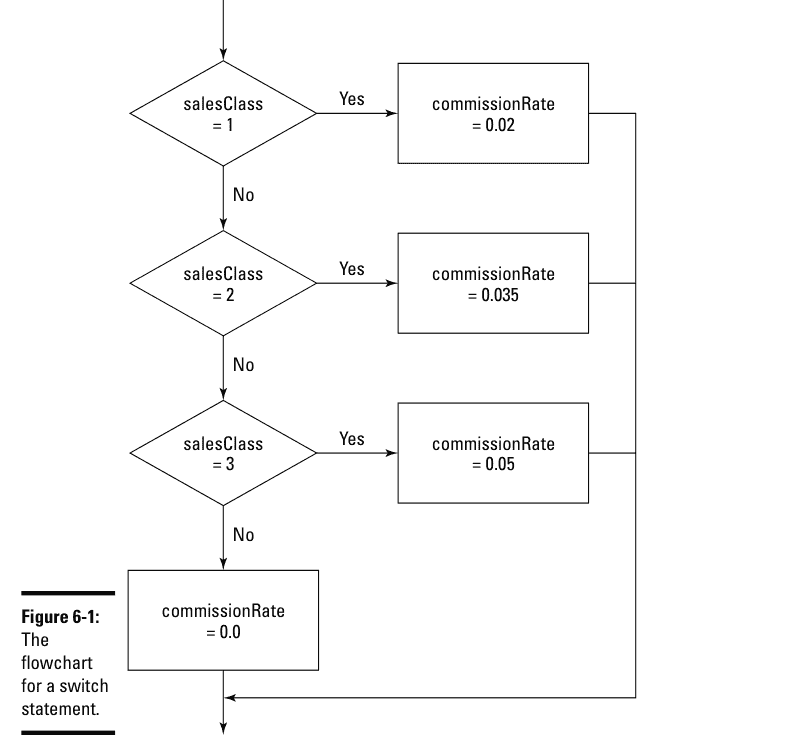

> **提示** 我喜欢流程图，因为它们让我想起早年编程的时光，那时在编写任何代码之前，我们必须为每个编写的程序绘制流程图。流程图实际上并没有帮助我们编写更好的程序，但画起来很有趣。

#### 在 switch 语句中放入 if 语句

你可以自由地在 `case` 组中包含任何类型的语句，包括 `if` 语句。例如，假设你的佣金结构不仅取决于销售类别，还取决于总销售额，如下所示：

| 类别 | 销售额 < $10,000 | 销售额 $10,000 及以上 |
| :--- | :--- | :--- |
| 1 | 1% | 2% |
| 2 | 2.5% | 3.5% |
| 3 | 4% | 5% |
| 任何其他值 | 0% | 0% |

那么，你可以使用以下 `switch` 语句：

```java
double commissionRate;
switch (salesClass)
{
    case 1:
        if (salesTotal < 10000.0)
            commissionRate = 0.01;
        else
            commissionRate = 0.02;
        break;
    case 2:
        if (salesTotal < 10000.0)
            commissionRate = 0.025;
        else
            commissionRate = 0.035;
        break;
    case 3:
        if (salesTotal < 10000.0)
            commissionRate = 0.04;
        else
            commissionRate = 0.05;
        break;
    default:
        commissionRate = 0.0;
        break;
}
```

在这里，每个 `case` 组都包含一个 `if` 语句。如果需要，这些 `if` 语句可以是复杂的嵌套 `if` 语句。

除了 `case` 组中的 `if` 语句外，这里没有其他需要特别说明的了。大家请继续。

#### 创建字符 Case

除了标题朗朗上口外，本节还展示了如何在 `switch` 语句中使用字符变量而非整数。使用字符类型时，为每个 `case` 组提供两个连续的 `case` 常量是常见的做法，以同时处理大小写字母。例如，假设你需要根据销售类别的字符代码而非整数值来设置佣金率，如下表所示：

| 类别 | 佣金率 |
|---|---|
| A 或 a | 2% |
| B 或 b | 3.5% |
| C 或 c | 5% |
| 任何其他值 | 0% |

以下是实现此功能的 `switch` 语句：

```java
double commissionRate;
switch (salesClass)
{
    case 'A':
    case 'a':
        commissionRate = 0.02;
        break;
    case 'B':
    case 'b':
        commissionRate = 0.035;
        break;
    case 'C':
    case 'c':
        commissionRate = 0.05;
        break;
    default:
        commissionRate = 0.0;
        break;
}
```

理解此示例的关键在于，你不必为 `case` 组编写任何语句，并且如果你从一个 `case` 组中省略了 `break` 语句，控制流会“落入”下一个 `case` 组。因此，`case 'A'` 组不包含任何语句，但它会落入 `case 'a'` 组。

你使用撇号（而不是引号）来创建字符字面量。

#### “落入”裂隙

尽管 `switch` 语句中最常见的问题是在 `case` 组末尾意外地省略了 `break` 语句，但有时你需要故意这样做。例如，许多应用程序的功能是基于一个控制变量逐步添加的。例如，你当地的洗车店可能销售几种包含不同服务的套餐：

| 套餐 | 服务 |
| :--- | :--- |
| A | 清洗、吸尘和手工烘干 |
| B | 套餐 A + 打蜡 |
| C | 套餐 B + 皮革/乙烯基处理 |
| D | 套餐 C + 轮胎处理 |
| E | 套餐 D + 新车气味 |

代码清单 6-3 展示了一个应用程序，它显示你订购特定套餐时获得的所有产品。它通过在 `switch` 语句中按相反顺序（从套餐 E 开始）测试套餐代码，并将每个套餐附带的产品添加到 `details` 变量中来工作。除了最后一个 `case` 组外，其他组都不包含 `break` 语句。因此，控制流会从当前 `case` 组“落入”下一个组。这样，一旦某个 `case` 组测试为 `true`，`switch` 语句中其余的 `case` 组都会被执行。

```java
import java.util.Scanner;

public class CarWashApp
{
    static Scanner sc = new Scanner(System.in);

    public static void main(String[] args)
    {
```


## 196 从缝隙中漏掉

```java
清单 6-3 (续)
System.out.println("The car wash application!\n\n");
System.out.print("Enter the package code: ");
String s = sc.next();
char p = s.charAt(0);

String details = "";

switch (p)
{
    case 'E':
    case 'e':
        details += "\tNew Car Scent, plus...\n";
    case 'D':
    case 'd':
        details += "\tTire Treatment, plus...\n";
    case 'C':
    case 'c':
        details += "\tLeather/Vinyl Treatment, plus...\n";
    case 'B':
    case 'b':
        details += "\tWax, plus...\n";
    case 'A':
    case 'a':
        details += "\tWash, vacuum, and hand dry.\n";
        break;
    default:
        details = "That's not one of the codes.";
        break;
}
System.out.println("\nThat package includes:\n");
System.out.println(details);
}
}
```

> 提示 就我们俩之间说，编写像这个示例中那样依赖 switch 语句"漏掉"情况的程序，其实并不是一个好主意。相反，考虑将每个 case 组的语句放在单独的方法中，然后为每个 case 组调用所有需要的方法。接着，你可以在每组末尾使用 break 语句来防止"漏掉"情况。清单 6-4 展示了洗车应用程序的一个版本，它使用这种技术来避免 switch 语句中的"漏掉"问题。（使用简单的"漏掉"情况来将大小写字符视为相同，不会那么混乱，所以这个程序仍然使用那种技巧。）

```java
清单 6-4：避免糟糕漏掉情况的洗车程序版本
import java.util.Scanner;

public class CarWashApp2
{
    static Scanner sc = new Scanner(System.in);

    public static void main(String[] args)
    {
        System.out.println("The car wash application!\n\n");
        System.out.print("Enter the package code: ");
        String s = sc.next();
        char p = s.charAt(0);

        String details = "";

        switch (p)
        {
            case 'E':
            case 'e':
                details = packageE() + packageD() + packageC()
                         + packageB() + packageA();
                break;
            case 'D':
            case 'd':
                details = packageD() + packageC()
                         + packageB() + packageA();
                break;
            case 'C':
            case 'c':
                details = packageC() + packageB() + packageA();
                break;
            case 'B':
            case 'b':
                details = packageB() + packageA();
                break;
            case 'A':
            case 'a':
                details = packageA();
                break;
            default:
                details = "That's not one of the codes.";
                break;
        }
        System.out.println("\nThat package includes:\n");
        System.out.println(details);
    }

    public static String packageA()
    {
        return "\tWash, vacuum, and hand dry.\n";
    }

    public static String packageB()
    {
        return "\tWax, plus...\n";
    }

    public static String packageC()
    {
        return "\tLeather/Vinyl Treatment, plus...\n";
    }

    public static String packageD()
    {
        return "\tTire Treatment, plus...\n";
    }

    public static String packageE()
    {
        return "\tNew Car Scent, plus...\n";
    }
}
```

## 第七章：为你的疯狂添加一些方法

**本章内容**

- ✔ 介绍静态方法
- ✔ 在程序中使用方法的一些好理由
- ✔ 创建返回值的方法
- ✔ 创建接受参数的方法

在 Java 中，方法是一个有名字的语句块，可以通过从程序的其他地方调用（也称为调用）来执行。你可能没有意识到，但你其实已经非常熟练地使用方法了。例如，要向控制台打印文本，你使用 `println` 或 `print` 方法。要从用户那里获取一个整数，你使用 `nextInt` 方法。而要比较字符串值，你使用 `equals` 方法或 `equalsIgnoreCase` 方法。而所有方法中的元老 `main` 方法，就是包含你运行程序时执行的语句的方法。

到目前为止你用过的所有方法（除了 `main`）都是由 Java API 定义并属于特定 Java 类的方法。例如，`nextInt` 方法属于 `Scanner` 类，`equalsIgnoreCase` 方法属于 `String` 类。

相比之下，`main` 方法属于你的应用程序定义的类。在本章中，你将了解如何创建额外的方法，这些方法将成为你应用程序类的一部分。然后你可以从你的 `main` 方法中调用这些方法。正如你将看到的，这种方法对除最短的 Java 程序以外的所有程序都非常有用。

### 方法的乐趣

使用方法可以极大地改善你的编程生活。例如，假设你的程序需要解决的问题很复杂，你至少需要 1,000 条 Java 语句才能完成。你可以把所有这 1,000 条语句都放在 `main` 方法里，但它会延续很多很多页。最好将你的程序分解成几个定义良好的代码部分，并将每个部分放在一个单独的方法中。然后，你的 `main` 方法可以简单地按正确的顺序调用其他方法。

或者，假设你的程序需要执行一些计算，比如计算火箭主引擎需要燃烧多长时间才能在月球飞行途中进行轨道修正，而且程序需要在多个不同地方执行这个计算。如果没有方法，你将不得不复制执行此计算的语句。这不仅容易出错，而且使你的程序更难测试和调试。但是，如果你把计算放在一个方法中，你只需要在需要执行计算时调用该方法即可。因此，方法帮助你减少重复代码。

方法的另一个好用途是简化使用长循环的代码结构。例如，假设你有一个 `while` 循环，其主体中有 500 条语句。这使得追踪标记主体结束的右花括号变得相当困难。等到你找到它时，你可能已经忘记了这个 `while` 循环是做什么的。你可以通过将其主体代码放在一个单独的方法中来简化这个 `while` 循环。然后，`while` 循环所需要做的就是调用新方法。

这时，听众中的面向对象编程狂热者们开始发出嘘声和倒彩。其中一些人已经离开了礼堂。他们感到不满，因为我用传统的过程式编程术语而不是现代的面向对象编程术语来描述方法。

嗯，算了吧。他们是对的，但那又怎样？我在第三卷中会介绍方法的面向对象用法。在那里，你会发现方法的目的远不止是将一个长的 `main` 方法分解成更小的部分。但即便如此，据我所知，一些最具面向对象特征的程序也只是使用方法来避免重复代码或将大方法切分成几个小方法。所以呢。

### 制作方法的基础知识

所有方法——包括 `main` 方法——都必须以一个 *方法声明* 开头。以下是我本章讨论的方法类型的基本形式：

```java
public static return-type method-name (parameter-list)
{
        statements...
}
```

以下段落逐段描述方法声明：

- **`public`：** 此关键字表示该方法的存在应该向全世界公开，并且任何知道你的程序的 Java 程序（或者更准确地说，知道为你的 Java 程序定义的类）都应该能够使用你的方法。这对于你目前在本书中处理的程序类型来说意义不大，但它以后会变得更有意义。在第三卷中，你将了解更多关于 `public` 的含义，以及在各种情况下有用的 `public` 替代方案。

- **`static`：** 此关键字声明该方法是一个 *静态方法*，这意味着它可以在不先创建其定义类的实例的情况下被调用。`main` 方法必须始终是静态的，并且包含 `main` 方法的类中的任何其他方法通常也应该是静态的。
- **`return-type`：** 在 `static` 一词之后是 *返回类型*，它指示方法在被调用时是否返回值，如果是，值的类型是什么。如果方法不返回值，请指定 `void`。（我将在本章稍后的"返回值的方法"部分讨论更多关于返回值的方法。）
- **`method-name`：** 现在是你方法的名称。创建方法名称的规则与创建变量名称的规则相同：你可以使用字母和数字的任意组合，但名称必须以字母开头。并且，它可以包含美元符号 ($) 和下划线字符 (_)。不允许使用其他特殊字符。
- **`parameter list`：** 你可以通过在方法名称后的括号中列出值来向方法传递一个或多个值。方法声明中的参数列表让 Java 知道方法应该期望接收什么类型的参数，并提供名称，以便方法体中的语句可以将参数作为局部变量访问。你将在本章稍后的"使用接受参数的方法"部分发现更多关于参数的信息。
- **方法体：** 方法体由一组花括号中包含的一个或多个 Java 语句组成。与 `if`、`while` 和 `for` 等 Java 语句不同，即使你的方法体只有一条语句，你仍然必须使用花括号。


为方法选择名称时，尽量选择相对简短但具有描述性的名称。像 `calculateTheTotalAmountOfTheInvoice` 这样的方法名有点长，但只用 `calc` 则相当模糊。类似 `calculateInvoiceTotal` 这样的名称在我看来更合理。


如果方法不接受参数，你仍然必须编写围绕参数列表的括号。你只需将括号留空即可。

#### 一个例子

好了，所有这些都有点抽象。现在给你一个具体的例子，我提供一个 "Hello, World!" 程序的版本，其中消息不是由 `main` 方法显示，而是由一个名为 `sayHello` 的方法显示，该方法由 `main` 方法调用：

```java
public class HelloWorldMethod
{
```


## 202 方法基础

```java
public static void main(String[] args)
{
    sayHello();
}

public static void sayHello()
{
    System.out.println("Hello, World!");
}
```

这个程序虽然很简单，但它展示了在 Java 中创建和使用方法的基础。这里，`main` 方法中的语句调用了 `sayHello` 方法，而 `sayHello` 方法则在控制台上显示一条消息。


方法在你的 Java 源文件中出现的顺序并不重要。唯一的规则是，所有方法都必须声明在类体内部——也就是说，在第一个左花括号和最后一个右花括号之间。例如，下面是 HelloWorldMethod 程序的一个版本，其中方法的顺序被调换了：

```java
public class HelloWorldMethod
{
    public static void sayHello()
    {
        System.out.println("Hello, World!");
    }

    public static void main(String[] args)
    {
        sayHello();
    }
}
```

这个版本的程序与前一个版本的工作方式完全相同。

#### 另一个例子

好吧，上一个例子有点傻。任何一个头脑正常的人，都不会创建一个只有一行代码的方法，然后从另一个同样只有一行代码的方法中调用它。Hello, World! 程序太过简单，无法说明任何接近现实的东西。

例如，第 II 卷第 5 章中的一个程序玩了一个猜谜游戏。这个程序的大部分 `main` 方法是一个大型的 `while` 循环，只要用户想继续玩，就会重复游戏。这个循环的循环体有 41 条语句。这还不算太糟，但如果游戏复杂 100 倍，以至于 `while` 循环需要 4100 条语句才能完成一局游戏，你真的想要一个循环体里有 4100 条语句的 `while` 循环吗？我想不会吧。

清单 7-1 展示了如何通过将主 `while` 循环的循环体放入一个单独的方法来稍微简化这个游戏。我将这个方法命名为 `playARound`，因为它的工作是玩一轮猜谜游戏。现在，这个程序的 `main` 方法不再直接玩一轮游戏，而是将该任务委托给了 `playARound` 方法。

#### 清单 7-1：使用 playARound 方法的猜谜游戏程序版本

```java
import java.util.Scanner;

public class GuessingGameMethod
{
    static Scanner sc = new Scanner(System.in);
    static boolean keepPlaying = true;

    public static void main(String[] args)
    {
        System.out.println("Let's play a guessing game!");
        while (keepPlaying)
        {
            playARound();
        }
        System.out.println("\nThank you for playing!");
    }

    public static void playARound()
    {
        boolean validInput;
        int number, guess;
        String answer;

        // Pick a random number
        number = (int)(Math.random() * 10) + 1;
        System.out.println("\nI'm thinking of a number "
            + "between 1 and 10.");

        // Get the guess
        System.out.print("What do you think it is? ");
        do
        {
            guess = sc.nextInt();
            validInput = true;
            if ((guess < 1) || (guess > 10))
            {
                System.out.print("I said, between 1 and 10. " + "Try again: ");
                validInput = false;
            }
        } while (!validInput);

        // Check the guess
        if (guess == number)
            System.out.println("You're right!");
        else
            System.out.println("You're wrong!"
                + " The number was " + number);

        // Play again?
        do
        {
            System.out.print("\nPlay again? (Y or N)");
            answer = sc.next();
            validInput = true;
            if (answer.equalsIgnoreCase("Y"))
                ;
            else if (answer.equalsIgnoreCase("N"))
                keepPlaying = false;
            else
                validInput = false;
        } while (!validInput);
    }
}
```

关于这个方法，有几个重要的细节需要注意：

-   因为 `main` 方法（第 12 行）和 `playARound` 方法（第 60 行）都必须访问 `keepPlaying` 变量，我将其声明为类变量，而不是 `main` 方法中的局部变量。如果你打算从静态方法中访问它们，类变量必须是 `static` 的。
-   `main` 方法中 `while` 循环的循环体只有一行：调用 `playARound` 方法。因此，每次循环重复时，程序就与用户玩一轮游戏。
-   `playARound` 方法的声明将该方法标记为 `static`，这样静态的 `main` 方法才能调用它。

`playARound` 方法的循环体与第 II 卷第 5 章所示的单方法版本程序中原本使用的 `while` 循环体相同。如果你想回顾这段代码是如何工作的，我礼貌地建议你参考那一章。

#### 返回值的方法

那些只执行操作而不返回任何数据的方法，只在有限的情况下有用。方法的真正效用在于它们可以执行一些常规任务（例如计算），然后将该计算的值返回给调用方法，以便调用方法可以对该值进行处理。你将在以下部分了解如何做到这一点。

#### 声明方法的返回类型

要创建一个返回值的方法，你只需在方法声明中将 `void` 关键字替换为方法返回的值的类型。例如，下面是创建一个返回 `int` 值的方法的方法声明：

```java
public static int getRandomNumber()
```

这里，`getRandomNumber` 方法计算一个随机数，然后将该数字返回给调用者。


方法的返回类型可以是 Java 的任何基本返回类型（在第 II 卷第 2 章中描述）：

-   int
-   long
-   float
-   char
-   short
-   byte
-   double
-   boolean

或者，返回类型可以是引用类型，包括 API 定义的类（如 `String`）或你自己创建的类。

#### 使用 return 语句返回值

当你在方法声明中指定了非 `void` 的返回类型时，方法体中必须包含一个 `return` 语句，该语句指定了要返回的值。`return` 语句的形式如下：

```java
return expression;
```

该表达式的值类型必须与方法声明中列出的类型相同。换句话说，如果方法返回 `int`，那么 `return` 语句中的表达式必须求值为一个 `int`。

例如，下面是一个使用方法来确定 1 到 10 之间随机数的程序：

```java
public class RandomNumber
{
    public static void main(String[] args)
    {
        int number = getRandomNumber();
        System.out.println("The number is " + number);
    }

    public static int getRandomNumber()
    {
        int num = (int) (Math.random() * 10) + 1;
        return num;
    }
}
```

在这个程序中，`getRandomNumber` 方法使用 `Math.random` 方法计算一个 1 到 10 之间的随机数。（有关 `Math.random` 方法的更多信息，请参见第 II 卷第 3 章。）`return` 语句返回计算出的随机数。

因为 `return` 语句既可以指定一个简单的变量，也可以指定一个表达式，所以我同样可以这样编写 `getRandomNumber` 方法：

```java
public static int getRandomNumber()
{
    return (int) (Math.random() * 10) + 1;
}
```

这里，`return` 语句包含了计算随机数的表达式。

#### 使用返回类型的方法

你可以在赋值语句中使用返回值的方法，如下所示：

```java
int number = getRandomNumber();
```

这里，调用了 `getRandomNumber` 方法，并将其返回的值赋给变量 `number`。

你也可以在表达式中使用返回值的方法。例如：

```java
number = getRandomNumber() * 10;
```

这里，`getRandomNumber` 方法返回的值乘以 10，结果赋给 `number`。

#### 必须有一个正确的 return 语句

如果一个方法声明了非 `void` 的返回类型，它*必须*使用 `return` 语句来返回一个值。编译器不会让你放过一个没有正确 `return` 语句的方法。

如果你的 `return` 语句位于 `if` 语句内部，情况有时会变得复杂。有时，编译器可能会被迷惑并拒绝编译你的程序。为了解释这一点，我讲述了以下多次尝试解决一个本应简单的编程问题的故事：

假设你想创建一个随机数方法，返回 1 到 20 之间的随机数，但永远不返回 12（因为你有十二恐惧症，正如《花生漫画》里的露西会告诉你的那样，那是对数字 12 的恐惧）。你的第一个想法是直接忽略 12，像这样：


#### 返回值的方法

然而，编译器并没有被你的小把戏愚弄。它知道如果数字是12，`return`语句就不会被执行。所以它会发出`missing return statement`的消息，并拒绝编译你的程序。

你的下一个想法是，每当出现12时，就简单地用11代替：

```
public static int getRandomNumber()
{
    int num = (int)(Math.random() * 20) + 1;
    if (num != 12)
        return num;
    else
        return 11;
}
```

然而，后来你意识到这个解决方案并不好，因为数字不再真正随机了。一个好的随机数生成器的要求之一是，任何数字作为下一个数字出现的可能性都应该相同。但因为你把所有的12都改成了11，你使得11出现的可能性是其他任何数字的两倍。

为了修正这个错误，你决定将随机数生成器放在一个循环中，只有当随机数不是12时才结束循环：

```
public static int getRandomNumber()
{
    int num;
    do
    {
        num = (int)(Math.random() * 20) + 1;
        if (num != 12)
            return num;
    } while (num == 12);
}
```

但现在编译器再次拒绝编译该方法。事实证明，编译器很聪明，但不是真正的聪明。它没有捕捉到`do-while`循环中的条件与`if`语句中的条件相反这一事实，这意味着退出此循环的唯一途径是通过`if`语句中的`return`语句。所以编译器再次抱怨`missing return statement`。

思考了一会儿，你想出了这个解决方案：

```
public static int getRandomNumber()
{
    int num;
    while (true)
    {
        num = (int) (Math.random() * 20) + 1;
        if (num != 12)
            return num;
    }
}
```

现在大家都很高兴。编译器知道退出循环的唯一途径是通过return语句，你的数字12恐惧症用户不必担心看到数字12，你也知道随机数是11的可能性不是其他任何数字的两倍。生活很美好，你可以继续下一个话题了。

#### 猜测游戏程序的另一个版本

为了说明使用返回值的方法的好处，清单7-2展示了猜测游戏程序的另一个版本，该版本在`main`方法之外还使用了四个方法：

- `playARound`：此方法玩一轮猜测游戏。它不返回一个值。
- `getRandomNumber`：返回一个介于1和10之间的随机数。
- `getGuess`：获取用户的猜测，确保它介于1和10之间，并在可接受范围内返回该猜测。
- `askForAnotherRound`：此方法询问用户是否再玩一轮，并返回一个布尔值以指示用户是否想继续玩。

```
import java.util.Scanner;

public class GuessingGameMethod2
{
    static Scanner sc = new Scanner(System.in);

    public static void main(String[] args)
    {
        System.out.println("Let's play a guessing game!");
        do
        {
            playARound();
        } while (askForAnotherRound());
        System.out.println("\nThank you for playing!");
    }

    public static void playARound()
    {
        boolean validInput;
        int number, guess;
        String answer;

        // Pick a random number
        number = getRandomNumber();

        // Get the guess
        System.out.println("\nI'm thinking of a number " +
            "between 1 and 10.");
        System.out.print("What do you think it is? ");
        guess = getGuess();

        // Check the guess
        if (guess == number)
            System.out.println("You're right!");
        else
            System.out.println("You're wrong!" +
                " The number was " + number);
    }

    public static int getRandomNumber()
    {
        return (int) (Math.random() * 10) + 1;
    }

    public static int getGuess()
    {
        while (true)
        {
            int guess = sc.nextInt();
            if ( (guess < 1) || (guess > 10) )
            {
                System.out.print("I said, between 1 and " +
                    "10. " + "Try again: ");
            }
            else
                return guess;
        }
    }

    public static boolean askForAnotherRound()
    {
        while (true)
        {
            String answer;
            System.out.print("\nPlay again? (Y or N) ");
            answer = sc.next();
            if (answer.equalsIgnoreCase("Y"))
                return true;
            else if (answer.equalsIgnoreCase("N"))
                return false;
        }
    }
}
```

以下段落指出了该程序的关键行：

- `main`方法中`do`循环的开始。这个`do`循环的每个周期玩一轮游戏。`do`循环持续到用户表示他或她想停止玩游戏。
- 调用`playARound`方法玩一轮游戏。
- 调用`askForAnotherRound`方法以确定用户是否想再玩一轮。该方法的布尔返回值用作`do`循环的表达式。因此，如果`askForAnotherRound`方法返回`true`，则`do`循环重复。
- `playARound`方法的开始。
- 此行调用`getRandomNumber`方法获取一个介于1和10之间的随机数。此方法返回的值存储在`number`变量中。
- 此行调用`getGuess`方法获取用户的猜测。此方法返回一个介于1和10之间的数字，存储在`guess`变量中。
- `getRandomNumber`方法的开始，表明此方法返回一个`int`值。
- `getRandomNumber`方法的`return`语句。随机数是使用`Math.random`方法计算的，此计算的结果作为`getRandomNumber`方法的值返回。
- `getGuess`方法的开始，表明此方法返回一个`int`值。
- `getGuess`方法使用一个`while`循环，仅当用户输入一个介于1和10之间的数字时才退出。
- `getGuess`方法的`return`语句。请注意，此`return`语句位于一个`if`语句的`else`部分中，该`if`语句检查数字是否小于1或大于10。如果数字超出可接受范围，则不执行`return`语句。相反，程序显示一条错误消息，`while`循环重复。
- `askForAnotherRound`方法的开始，它返回一个`boolean`值。
- `askForAnotherRound`方法使用一个`while`循环，仅当用户输入有效的Y或N响应时才退出。
- 如果用户输入Y或y，`askForAnotherRound`方法返回`true`。
- 如果用户输入N或n，`askForAnotherRound`方法返回`false`。

#### 使用带参数的方法

*参数*是你可以传递给方法的值。然后，该方法可以使用该参数，就像它是用调用方法传递给它的值初始化的局部变量一样。

例如，清单7-2中显示的猜测游戏应用程序有一个名为`getRandomNumber`的方法，它返回一个介于1和10之间的随机数：

```
public static int getRandomNumber()
{
    return (int) (Math.random() * 10) + 1;
}
```

此方法很有用，但如果你能告诉它你希望随机数落在哪个范围，它会更有用。例如，如果你能这样调用它来获取一个介于1和10之间的随机数，那就太好了：

```
int number = getRandomNumber(1, 10);
```

然后，如果你的程序需要掷骰子，你可以调用同一个方法：

```
int number = getRandomNumber(1, 6);
```

或者，要从一副52张牌中随机选择一张牌，你可以这样调用它：

```
int number = getRandomNumber(1, 52);
```

而且你不一定非要从1开始。要获得一个介于50和100之间的随机数，你可以这样调用它：

```
int number = getRandomNumber(50, 100);
```

在以下部分中，你将编写接受参数的方法。

#### 声明参数

接受参数的方法必须在方法声明中列出参数。参数列在*参数列表*中，该列表位于方法名称后的括号内。对于方法使用的每个参数，你列出参数类型后跟参数名称。如果你需要多个参数，请用逗号分隔它们。

例如，下面是`getRandomNumber`方法的接受参数的版本：

```
public static int getRandomNumber(int min, int max)
```


## 212 使用带参数的方法

```java
return (int) (Math.random()
    * (max - min + 1)) + min;
}
```

这里，该方法使用了两个参数，类型都是 `int`，分别命名为 `min` 和 `max`。然后，在方法体内，这些参数可以像局部变量一样使用。

为参数命名可以与调用方法时传递的变量名相同，但也可以不同。例如，你可以这样调用 `getRandomNumber` 方法：

```java
int min = 1;
int max = 10;
int number = getRandomNumber(min, max);
```

或者，你可以这样调用它：

```java
int low = 1;
int high = 10;
int number = getRandomNumber(low, high);
```

或者，你完全可以省略变量，直接向方法传递字面值：

```java
int number = getRandomNumber(1, 10);
```

你也可以将表达式指定为参数值：

```java
int min = 1;
int max = 10;
int number = getRandomNumber(min * 10, max * 10);
```

这里，`number` 被赋值为 10 到 100 之间的某个值。

#### 理解参数的作用域

参数的作用域是声明该参数的方法。因此，参数可以与在其他方法中使用的局部变量同名而不会引起任何冲突。例如，考虑这个程序：

```java
public class ParameterScope
{
    public static void main(String[] args)
    {
        int min = 1;
        int max = 10;
        int number = getRandomNumber(min, max);
        System.out.println(number);
    }

    public static int getRandomNumber(int min, int max)
    {
        return (int) (Math.random()
            * (max - min + 1)) + min;
    }
}
```

这里，`main` 方法声明了名为 `min` 和 `max` 的变量，而 `getRandomNumber` 方法则使用 `min` 和 `max` 作为其参数名。这不会引起任何冲突，因为在每种情况下，作用域都仅限于单个方法。

#### 理解按值传递

当 Java 通过参数将变量传递给方法时，方法接收到的是变量值的副本，而不是变量本身。这个副本被称为 *按值传递*，它有一个重要的后果：如果方法更改了其作为参数接收到的值，这个更改 *不会* 反映到传递给该方法的原始变量中。以下程序可以帮助阐明这一点：

```java
public class ChangeParameters
{
    public static void main(String[] args)
    {
        int number = 1;
        tryToChangeNumber(number);
        System.out.println(number);
    }

    public static void tryToChangeNumber(int i)
    {
        i = 2;
    }
}
```

这里，一个名为 `number` 的变量被设置为 1，然后传递给名为 `tryToChangeNumber` 的方法。该方法接收到这个变量，参数名为 `i`，然后将 `i` 的值设置为 2。同时，回到 `main` 方法，在 `tryToChangeNumber` 方法返回后，使用 `println` 打印 `number` 的值。

因为 `tryToChangeNumber` 只得到了 `number` 的副本，而不是 `number` 变量本身，所以该程序在控制台上显示以下内容（请鼓掌...）：1。

关键点在于：即使 `tryToChangeNumber` 方法更改了其参数的值，这个更改对传递给该方法的原始变量也没有任何影响。

#### 猜数字游戏程序的另一个示例

为了展示接受参数的方法的好处，清单 7-3 展示了猜数字游戏程序的另一个版本。这个版本除了 `main` 方法外，还使用了以下方法：

- **playARound**：此方法玩一轮猜数字游戏。它不返回值，但接受两个参数：`min` 和 `max`，表示待猜数字的最小值和最大值。
- **getRandomNumber**：返回一个介于传递为参数的 `min` 和 `max` 值之间的随机数。
- **getGuess**：此方法也接受两个参数 `min` 和 `max`，以限制用户必须猜测的范围。
- **askForAnotherRound**：此方法询问用户是否再玩一轮，并返回一个布尔值以指示用户是否希望继续玩。它接受一个字符串值作为参数；这个字符串显示在控制台上以提示用户回复。

#### 清单 7-3：猜数字游戏程序的另一个版本

```java
import java.util.Scanner;

public class GuessingGameMethod3
{
    static Scanner sc = new Scanner(System.in);

    public static void main(String[] args)
    {
        System.out.println("Let's play a guessing game!");
        do
        {
            playARound(1, getRandomNumber(7, 12));
        } while (askForAnotherRound("Try again?"));
        System.out.println("\nThank you for playing!");
    }

    public static void playARound(int min, int max)
    {
        boolean validInput;
        int number, guess;
        String answer;

        // Pick a random number
        number = getRandomNumber(min, max);

        // Get the guess
        System.out.println("\nI'm thinking of a number " + "between " + min + " and " + max + ".");
        System.out.print("What do you think it is? ");
        guess = getGuess(min, max);

        // Check the guess
        if (guess == number)
            System.out.println("You're right!");
        else
            System.out.println("You're wrong!"
                + " The number was " + number);
    }

    public static int getRandomNumber(int min, int max)
    {
        return (int)(Math.random()
            * (max - min + 1)) + min;
    }

    public static int getGuess(int min, int max)
    {
        while (true)
        {
            int guess = sc.nextInt();
            if ( (guess < min) || (guess > max) )
            {
                System.out.print("I said, between "
                    + min + " and " + max
                    + ". Try again: ");
            }
            else
                return guess;
        }
    }

    public static boolean askForAnotherRound(String prompt)
    {
        while (true)
        {
            String answer;
            System.out.print("\n" + prompt + " (Y or N) ");
            answer = sc.next();
            if (answer.equalsIgnoreCase("Y"))
                return true;
            else if (answer.equalsIgnoreCase("N"))
                return false;
        }
    }
}
```

以下段落指出了该程序的关键行：

- →13 调用 `playARound` 方法来玩一轮游戏。`min` 和 `max` 的值作为字面值传递。为了给游戏增加一些变化，这里调用 `getRandomNumber` 方法将 `max` 的值设置为 7 到 12 之间的随机数。
- →25 调用 `getRandomNumber` 方法时，将 `min` 和 `max` 的值作为参数传递，以设置随机数的范围。
- →29 向用户宣布计算机已选择一个随机数的消息使用了 `min` 和 `max` 参数来指示范围。
- →31 调用 `getGuess` 方法现在传递了可接受猜测值的范围。
- →41 `getRandomNumber` 方法的声明指定了 `min` 和 `max` 参数。
- →43 随机数的计算有点复杂，因为 `min` 可能不是 1。
- →47 `getGuess` 方法的声明接受 `min` 和 `max` 参数。
- →52 `getGuess` 方法中的 `if` 语句使用 `min` 和 `max` 值来验证用户的输入。
- →59 `getGuess` 方法的 `return` 语句。请注意，这个 `return` 语句位于检查数字是否小于 1 或大于 10 的 `if` 语句的 `else` 部分。如果数字超出可接受范围，则不会执行 `return` 语句。相反，程序显示一条错误消息，`while` 循环会重复执行。
- →63 `askForAnotherRound` 方法接受一个字符串变量作为提示。

## 第 8 章：处理异常

### 本章内容

- 当好事多磨的程序遭遇不幸时该怎么办
- 关于异常的一切
- 使用 try、catch 和 finally
- 从源头预防异常发生

本章讨论当 Java 遇到无法处理的错误情况时会发生什么。多年来，计算机编程语言设计了许多不同的方式来处理这类错误。最早的编程语言处理方式很粗暴：突然终止程序，并以十六进制打印出计算机内存的全部内容。这种输出被称为转储。

后来的编程语言尝试了各种方法，以便在发生严重错误时让程序继续运行。在某些语言中，可能引发错误的语句被添加了额外的元素，以提供关于错误的反馈。例如，从磁盘文件读取数据的语句可能会在发生 I/O 错误时返回一个错误代码。还有一些语言允许你创建一个特殊的错误处理部分，如果发生错误，控制权将转移到该部分。

作为一种面向对象的编程语言，Java 通过使用在错误发生时创建的特殊异常对象来处理错误。此外，Java 还有一个特殊的语句，称为 `try` 语句，你必须使用它来处理异常对象。在本章中，你将了解到使用异常对象和 `try` 语句的所有具体细节。

#### 理解异常

异常是一个对象，它在 Java 程序中发生错误且 Java 无法自动修复该错误时被创建。异常对象包含有关发生的错误类型的信息。然而，最重要的信息——错误的原因——是由用于创建异常的异常类的名称来指示的。除了弄清楚你遇到的是哪种异常外，通常不需要对异常对象做任何其他操作。


## 218 理解异常

可能发生的每种异常都由不同的异常类表示。例如，以下是一些典型的异常：

-   ◆ **IllegalArgumentException:** 你向方法传递了错误的参数。
    ◆ **InputMismatchException:** 控制台输入与 Scanner 类方法预期的数据类型不匹配。
    ◆ **ArithmeticException:** 你尝试了非法的算术运算类型，例如整数除以零。
    ◆ **IOException:** 执行 I/O 的方法遇到了无法恢复的 I/O 错误。
    ◆ **ClassNotFoundException:** 找不到必需的类。

除了这些，还有许多其他类型的异常。你将在本书后续章节中了解到其中许多异常。

关于异常，你还需要知道几件事：

-   ◆ 当错误发生并创建异常对象时，Java 被称为*抛出了异常*。Java 的投掷能力相当不错，所以异常总是被直接抛回给导致其创建的那条语句。
    ◆ 导致异常的语句如果愿意，可以*捕获*该异常。但如果它不想捕获，也不必勉强。相反，它可以避而不接，让其他人来捕获。这个“其他人”就是调用当前正在执行的方法的那条语句。
    ◆ 如果每个人都避而不接，异常从未被程序捕获，程序就会突然终止，并在控制台上显示一条看起来令人不快的异常消息。关于这一点，下一节会有更多说明。
    ◆ Java 中有两种基本类型的异常：受检异常和未受检异常：
    -   *受检异常* 是编译器要求你必须以某种方式处理的异常。如果你不处理，你的程序就无法编译通过。
    -   *未受检异常* 是你可以处理，但并非必须处理的异常。
    ◆ 在本书到目前为止，我一直避免使用任何会抛出受检异常的 Java API 方法。然而，我使用过可能抛出未受检异常的方法。例如，如果用户输入的内容不是有效的整数值，Scanner 类的 nextInt 方法就会抛出未受检异常。更多信息，请继续阅读。

#### 见证一个异常

请批准以下内容：一个关于仓促编写的 Java 程序的故事，该程序为说明某些 Java 编程细节而快速拼凑，同时忽略了其他细节。正如俗话所说，眼不见，心不烦。该程序与用户玩一个猜谜游戏，通过一个名为 `Scanner` 的类接受数字输入。然而，这个程序忽略了用户可能输入奇怪且意外数据的可能性，这些数据几乎不能被视为数字，至少在传统意义上是这样。时间：现在。地点：这里。这个程序即将进入……异常地带。

我在这里谈论的程序，当然是最近几章中以几种形式出现的猜谜游戏程序。（你可以在第二卷第7章的最后找到最新版本。）该程序包含一个验证例程，防止用户做出不在1到10之间的猜测。然而，该验证例程假设用户已输入了有效的整数。如果用户输入的不是整数值，`Scanner` 类的 `nextInt` 方法就会严重失败。

图 8-1 显示了当用户输入文本（例如 `five`）而不是数字时，控制台的示例。用户输入错误数据后的第一行说程序遇到了一个名为 `InputMismatchException` 的异常。简而言之，此异常意味着用户输入的数据无法与 `Scanner` 类预期的数据类型正确匹配。这是因为 `nextInt` 方法期望找到一个整数，结果却找到了单词 `five`。

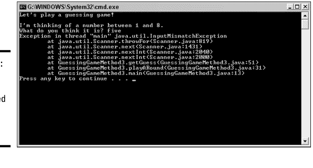

#### 找到罪魁祸首

你可以通过检查显示在指明遇到哪种异常的行之后的那些行，来找到程序中导致异常发生的确切语句。这些行被称为*堆栈跟踪*，它们列出了异常在程序完全终止之前所经过的不同方法。通常，列出的第一个方法位于 Java API 的深层内部，而最后一个方法是你的应用程序的 main 方法。在中间的某个地方，你会找到从 Java API 中的方法到你的程序中的方法的转换点。那通常就是你找到程序中导致错误的语句的地方。

在图 8-1 中，堆栈跟踪行如下所示：

```
at java.util.Scanner.throwFor(Scanner.java:819)
at java.util.Scanner.next(Scanner.java:1431)
at java.util.Scanner.nextInt(Scanner.java:2040)
at java.util.Scanner.nextInt(Scanner.java:2000)
at GuessingGameMethod3.getGuess(GuessingGameMethod3.java:51)
at GuessingGameMethod3.playARound(GuessingGameMethod3.java:31)
at GuessingGameMethod3.main(GuessingGameMethod3.java:13)
```

每一行不仅列出了类和方法名，还列出了包含该类的源文件名以及异常发生所在的行号。因此，此堆栈跟踪中的第一行表明异常在 Scanner.java 文件第 819 行的 Scanner 类的 throwFor 方法中被处理。接下来的三行也指向 Scanner 类中的方法。第一行提到猜谜游戏类（GuessingGameMethod3）的是第五行。它显示异常发生在 GuessingGameMethod3.java 文件的第 51 行。果然，那正是调用 Scanner 类的 nextInt 方法以从用户那里获取输入的那行代码。

## 220 捕获异常

每当你使用可能抛出异常的语句时，都应该编写特定的代码来预见并捕获异常。这样，即使异常发生，你的程序也不会像图 8-1 中那样崩溃。

你可以通过使用 try 语句来捕获异常，其一般形式如下：

```
try
{
    可能会抛出异常的语句
}
catch (异常类型 标识符)
{
    当异常被抛出时执行的语句
}
```

在这里，你将可能抛出异常的语句放在一个 try 块中。然后，用一个 catch 块来捕获异常。

关于 `try` 语句，有几件事需要注意：

-   你可以编写多个 `catch` 块。这样，如果 `try` 块中的语句可能抛出多种类型的异常，你可以在单独的 `catch` 块中捕获每种类型的异常。
-   出于作用域考虑，`try` 块本身是一个独立的块，与 `catch` 块分离。因此，你在 `try` 块中声明的任何变量对 `catch` 块都不可见。如果你希望它们可见，就在 `try` 语句之前立即声明它们。
-   你还可以在所有 `catch` 块之后编写一个称为 `finally` 块的特殊块。有关编码 `finally` 块的更多信息，请参阅本章后面的“使用 finally 块”部分。
-   Java API 中的各种异常类定义在不同的包中。如果你使用的异常类不是始终可用的标准 `java.lang` 包中定义的，你需要为定义该异常类的包提供一条 `import` 语句。

#### 一个简单的例子

为了说明如何处理异常，这里有一个程序，它除两个数，并使用 `try`/`catch` 语句在第二个数为零时捕获异常：

```
public class DivideByZero
{
    public static void main(String[] args)
    {
        int a = 5;
        int b = 0;            // 你知道这行不通
        try
        {
            int c = a / b;    // 但你还是尝试了
        }
        catch (ArithmeticException e)
        {
            System.out.println("Oops, you can't divide by zero.");
        }
    }
}
```

这里，除法发生在 `try` 块内，而一个 `catch` 块处理 `ArithmeticException`。`ArithmeticException` 是由 `java.lang` 定义的，因此不需要为它提供 `import` 语句。


## 222 捕获异常

当你运行这个程序时，控制台将显示以下内容：

`哎呀，不能除以零。`

这里没有其他可看的内容了。不过，下一节将展示一个更复杂的例子。

#### 另一个例子

清单 8-1 展示了一个使用方法从用户处获取有效整数的程序简单示例。如果用户输入的值不是有效的整数，`catch` 块会捕获错误并强制循环重复。

```java
import java.util.*;

public class GetInteger
{
    static Scanner sc = new Scanner(System.in);

    public static void main(String[] args)
    {
        System.out.print("Enter an integer: ");
        int i = GetInteger();
        System.out.println("You entered " + i);
    }

    public static int GetInteger()
    {
        while (true)
        {
            try
            {
                return sc.nextInt();
            }
            catch (InputMismatchException e)
            {
                sc.next();
                System.out.print("That's not an integer. "
                        + "Try again: ");
            }
        }
    }
}
```

这里，从用户获取输入并将其返回给调用方法的语句被编码在 `try` 块中。如果用户输入了一个有效的整数，这是本方法中唯一被执行的语句。

然而，如果用户输入了无法转换为整数的数据，`nextInt` 方法会抛出一个 `InputMismatchException`。然后，这个异常被 `catch` 块拦截，该块通过调用 `next` 方法来处理用户的错误输入，并显示一条错误消息。接着，`while` 循环会重复。

以下是该程序一次典型执行时控制台可能的显示内容：

```
Enter an integer: three
That's not an integer. Try again: 3.001
That's not an integer. Try again: 3
You entered 3
```

关于这个程序，还有几点需要注意：

- `import` 语句指定了 `java.util.*` 以导入 `java.util` 包中的所有类。这样，`InputMismatchException` 类就被导入了。
- 必须在 `catch` 块中调用 `next` 方法以处理用户的无效输入，因为如果抛出 `InputMismatchException`，`nextInt` 方法会将输入值留在 `Scanner` 的输入流中。如果你省略了调用 `next` 的语句，`while` 循环会不断读取它，抛出异常，并无限循环地显示错误消息。如果你不相信我，请看图 8-2。我是费了好大劲才发现这个错误的。（让它停止的唯一方法是关闭控制台窗口。）

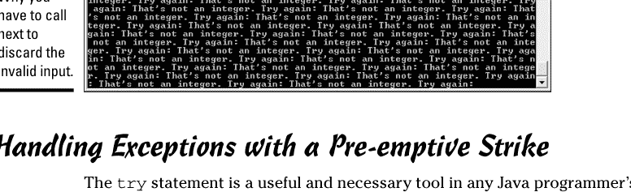

### 通过先发制人的方式处理异常

`try` 语句是任何 Java 程序员工具箱中一个有用且必要的工具。然而，处理异常的最佳方式是首先防止它们发生。这并非总是可行，但在许多情况下是可行的。关键是在执行可能导致异常的操作之前测试你的数据，并跳过或绕过有问题数据的操作。（我非常讨厌有问题的数据。）

例如，通过在执行除法之前检查数据，你通常可以避免整数数据除以零导致的 `ArithmeticException`：

```java
if (b != 0)
    c = a / b;
```

这消除了将除法操作包含在 `try` 块中的需要，因为你知道除以零的情况不会发生。

你可以将此相同技术应用于使用 `Scanner` 类的 `hasNextInt` 方法进行输入验证。此方法检查下一个输入值以确保它是有效的整数。（`Scanner` 类将下一个输入值称为 *token*，但这不会在考试中出现。）你可以用几种方式运用此技巧，自第二卷第二章起，我就一直在鼓励你思考这个问题。现在，期待已久的答案来了。清单 8-2 展示了 `GetInteger` 方法的一个版本，该版本使用 `while` 循环来避免异常。

#### 清单 8-2：GETINTEGER 方法的另一个版本

```java
import java.util.*;

public class GetInteger2
{
    static Scanner sc = new Scanner(System.in);

    public static void main(String[] args)
    {
        System.out.print("Enter an integer: ");
        int i = GetInteger();
        System.out.println("You entered " + i);
    }

    public static int GetInteger()
    {
        while (!sc.hasNextInt())
        {
            sc.nextLine();
            System.out.print("That's not an integer. "
                + "Try again: ");
        }
        return sc.nextInt();
    }
}
```

这真是一段聪明的编程，你不觉得吗？`while` 语句中的条件表达式调用 `Scanner` 的 `hasNextInt` 方法，以查看下一个值是否为整数。只要此调用返回 `false`（表示下一个值不是有效的整数），`while` 循环就会重复。循环体调用 `nextLine` 来丢弃坏数据，并显示一条错误消息。只有当您知道输入流中存在良好的数据时，循环才会结束，因此 `return` 语句调用 `nextInt` 将数据解析为整数并返回结果值。

#### 一次性捕获所有异常

Java 提供了一个名为 `Exception` 的异常捕获类，所有其他类型的异常都基于此类。（别担心我这样说的细节。当你读到第三卷第四章时，它会更有意义。）

如果你不想在 `catch` 块中过于具体，你可以指定 `Exception` 而不是更具体的异常类。例如：

```java
try
{
    int c = a / b;
}
catch (Exception e)
{
    System.out.println("Oops, you can't divide by zero.");
}
```

在这个例子中，`catch` 块指定了 `Exception` 而不是 `ArithmeticException`。

如果你有一些代码可能会抛出几种不同类型的异常，并且你想为某些异常提供特定处理，而为所有其他异常提供通用处理，可以编写 `try` 语句如下：

```java
try
{
    // 可能抛出几种类型异常的语句
}
catch (InputMismatchException e)
{
    // 处理 InputMismatchException 的语句
}
catch (IOException e)
{
    // 处理 IOException 的语句
}
catch (Exception e)
{
    // 处理所有其他异常类型的语句
}
```

在这个例子中，假设 `try` 块中的代码可能抛出 `InputMismatchException`、`IOException`，以及可能的一些其他未预料到的异常类型。这里，三个 `catch` 块为每种可能性提供了解决方案。


当在 `try` 语句上编写多个 `catch` 块时，请务必首先列出更具体的异常。如果你包含一个 `catch` 块来捕获 `Exception`，请将其列在最后。

#### 显示异常消息

在大多数情况下，`try` 语句的 `catch` 块根本不会对接收到的异常对象做任何处理。然而，你偶尔可能想要显示一条错误消息；异常对象有一些有趣的方法可以不时派上用场。这些方法列在表 8-1 中。

| 表 8-1 | Exception 类的方法 |
| :--- | :--- |
| **方法** | **描述** |
| `String getMessage()` | 描述错误的文本消息。 |
| `void printStackTrace()` | 将堆栈跟踪打印到标准错误流。 |
| `String toString()` | 返回异常的描述。此描述包括异常类的名称，后跟冒号和 `getMessage` 消息。 |

以下示例展示了如何在 `catch` 块中打印异常的消息：

```java
try
{
    int c = a / b;
}
catch (Exception e)
{
    System.out.println(e.getMessage());
}
```

如果 `b` 的值为零，此代码将在控制台上显示文本 `/ by zero`。你可以在 `catch` 子句中使用这行代码来获得更有趣的输出：

```java
e.printStackTrace(System.out);
```


### 使用 `finally` 块

`finally` 块是出现在语句所有 `catch` 块之后的一个代码块。无论 `try` 块是否抛出异常，也无论这些异常是否被任何 `catch` 块捕获，它都会被执行。其目的是让你清理异常可能遗留的任何痕迹，例如打开的文件或数据库连接。

带有 `finally` 块的 `try` 语句的基本框架如下：

```
try
{
    可能抛出异常的语句
}
catch (异常类型 标识符)
{
    当异常抛出时执行的语句
}
finally
{
    无论是否发生异常都会执行的语句
}
```

清单 8-3 展示了一个刻意构造但很有帮助的例子，演示了如何使用 `finally` 子句。在这个例子中，一个名为 `divideTheseNumbers` 的方法尝试两次执行除法。如果第一次除法失败（由于除零异常），它会再次尝试除法。我知道这完全不合逻辑。但很执着，就像个青少年。

```
清单 8-3：一个使用 FINALLY 子句的程序

public class CrazyWithZeros
{
    public static void main(String[] args)
    {
        try
        {
            int answer = divideTheseNumbers(5, 0);
        }
        catch (Exception e)
        {
            System.out.println("Tried twice, "
                + "still didn't work!");
        }
    }

    public static int divideTheseNumbers(int a, int b)
        throws Exception
    {
        int c;
        try
        {
            c = a / b;                                          → 22
            System.out.println("It worked!");                   → 23
        }
        catch (Exception e)
        {
            System.out.println("Didn't work the first time.");  → 27
            c = a / b;                                          → 28
            System.out.println("It worked the second time!");   → 29
        }
        finally
        {
            System.out.println("Better clean up my mess.");     → 33
        }
        System.out.println("It worked after all.");             → 35
        return c;                                               → 36
    }
}
```

以下是程序的控制台输出：

```
Didn't work the first time.
Better clean up my mess.
Tried twice, still didn't work!
```

以下段落逐步解释了发生的事情：

- → 7 `main` 方法调用 `divideTheseNumbers` 方法，并将 5 和 0 作为参数传递。你已经知道这个方法不会成功。
- → 9 `catch` 子句捕获第 7 行可能抛出的任何异常。
- → 16 `divideTheseNumbers` 方法声明它会抛出 `Exception`。
- → 22 第一次尝试除法。
- → 23 如果第一次尝试成功，将执行此行，并打印消息 "It worked!"。唉，除法抛出了异常，所以这一行永远不会执行。
- → 27 相反，`catch` 子句捕获了异常，并显示消息 "Didn't work the first time."。这是控制台输出中的第一行。
- → 28 `divideTheseNumbers` 方法固执地再次尝试除以相同的两个数字。这一次，没有 `try` 语句来捕获错误。
- → 29 然而，由于第二次除法再次抛出了异常，这一行永远不会执行。因此，你在控制台上看不到消息 "It worked the second time!"。（如果你看到了，那你一定是在《迷离时空》的某一集里。）
- → 33 `finally` 子句中的这个语句总是被执行，无论发生什么。控制台输出中的第二行就是由此而来的。

`finally` 子句执行后，`ArithmeticException` 会被抛回给调用方法，在那里被第 9 行捕获。这就是控制台输出最后一行的由来。

- → 35 如果除法成功了，这行代码会在 `try` 块结束后执行，你会在控制台上看到消息 "It worked after all."。
- → 36 然后，`return` 语句将返回除法的结果。

### 处理检查型异常

检查型异常是 Java 设计者认为你的程序绝对必须以某种方式处理的异常。每当你编写一个可能抛出检查型异常的语句时，你的程序必须做以下两件事之一：

- 通过将该语句置于一个带有针对该异常的 `catch` 块的 `try` 语句中来捕获该异常。
- 在包含该语句的方法上指定一个 `throws` 子句，表明你的方法不想处理这个异常，因此将其向上传递。

这被称为捕获或抛出规则。简而言之，任何包含可能抛出检查型异常的语句的方法，都必须承认它知道该异常可能被抛出。该方法通过直接处理它或将异常传递给其调用者来实现这一点。


为了说明检查型异常的用法，我必须使用一些包含抛出它们的方法的类。到目前为止，我避免引入抛出检查型异常的类。因此，以下说明使用了一些你还不熟悉的类。不用担心这些类是做什么的或如何工作的。重点是学习如何处理它们抛出的检查型异常。

#### 捕获或抛出编译器错误

这是一个使用名为 `FileInputStream` 的类的程序。要从此类创建对象，必须向构造函数传递一个字符串，其中包含计算机上存在的文件的路径和名称。如果找不到该文件，`FileInputStream` 会抛出一个 `FileNotFoundException`，你必须捕获或抛出该异常。此类位于 `java.io` 包中，因此任何使用它的程序都必须包含 `import java.io` 语句。

考虑以下程序：

```
import java.io.*;

public class FileException1
{
    public static void main(String[] args)
    {
        openFile("C:\\test.txt");
    }

    public static void openFile(String name)
    {
        FileInputStream f = new FileInputStream(name);
    }
}
```

这个程序无法编译。编译器会发出以下错误消息：

`unreported exception java.io.FileNotFoundException; must be caught or declared to be thrown`

这条消息的意思是，你必须处理 `FileNotFoundException`。

#### 捕获 `FileNotFoundException`

处理 `FileNotFoundException` 的一种方法是使用普通的 `try` 语句捕获它：

```
import java.io.*;

public class FileException2
{
    public static void main(String[] args)
    {
        openFile("C:\\test.txt");
    }

    public static void openFile(String name)
    {
        try
        {
            FileInputStream f = new FileInputStream(name);
        }
        catch (FileNotFoundException e)
        {
            System.out.println("File not found.");
        }
    }
}
```

在这个例子中，如果 `C:\test.txt` 文件不存在，将显示消息 "File not found."。

#### 抛出 `FileNotFoundException`

假设你不想在 `openFile` 方法中处理这个错误情况，而宁愿直接将异常传递给调用 `openFile` 的方法？

为此，你需要省略 `try` 语句。相反，你在 `openFile` 方法的声明中添加一个 `throws` 子句。这表示 `openFile` 方法知道它包含一个可能抛出 `FileNotFoundException` 的语句，但它不想在这里处理该异常。相反，该异常被传递给调用者。

这是添加了 `throws` 子句的 `openFile` 方法：

```
public static void openFile(String name)
    throws FileNotFoundException
{
    FileInputStream f = new FileInputStream(name);
}
```

如你所见，`throws` 子句只是列出了该方法可能抛出的一个或多个异常。如果列表中有多个异常，请用逗号分隔：

```
public static void readFile(String name)
    throws FileNotFoundException, IOException
```

在 `openFile` 方法中添加 `throws` 子句意味着当 `FileNotFoundException` 发生时，它会被简单地传递给调用 `openFile` 方法的方法。这意味着调用方法（在此例中是 `main`）必须捕获或抛出该异常。要捕获该异常，`main` 方法必须编码如下：

```
public static void main(String[] args)
{
    try
    {
        openFile("C:\\test.txt");
    }
    catch (FileNotFoundException e)
    {
        System.out.println("File not found.");
    }
}
```


那么，如果文件不存在，`catch` 块会捕获该异常，并显示错误消息。

### 从 main 方法中抛出异常

如果你完全不想让程序处理 `FileNotFoundException`，可以在 `main` 方法中添加 `throws` 子句，如下所示：

```java
public static void main(String[] args)
    throws FileNotFoundException
{
    openFile("C:\\test.txt");
}
```

这样，如果发生异常，程序会突然终止，并显示异常消息和堆栈跟踪。

### 吞没异常

如果你不想在检查型异常发生时做任何事情呢？换句话说，你想简单地忽略该异常？你可以在 `try` 语句的 `catch` 块中捕获异常，但让 `catch` 块的主体为空来做到这一点。例如：

```java
public static void openFile(String name)
{
    try
    {
        FileInputStream f = new FileInputStream(name);
    }
    catch (FileNotFoundException e)
    {
    }
}
```

这里，`FileNotFoundException` 被捕获并忽略。这被称为*吞没异常*。

吞没异常被认为是一种不良的编程实践。在处理复杂程序时，简单地吞没那些你知道应该处理的异常是很有诱惑力的。因为你计划在理顺程序的基本功能后，回头再来处理那个异常处理器，所以一点异常吞没似乎不是什么坏事。问题是，不可避免地，你永远不会再回头去处理那个异常处理器。所以你的程序会在带着被吞没的异常的情况下匆忙投入生产。

如果你必须吞没异常，至少向控制台写一条消息，表明异常已经发生。这样，你就能不断提醒自己，程序还有一些未完成的细节需要处理。


请注意，并非所有的异常吞没都是不好的。例如，假设你希望 `openFile` 方法返回一个布尔值来指示文件是否存在，而不是抛出异常。那么，你可以像这样编写该方法：

```java
public static boolean openFile(String name)
{
    boolean fileOpened = false;
    try
    {
        FileInputStream f = new FileInputStream(name);
        fileOpened = true;
    }
    catch (FileNotFoundException e)
    {
    }
    return fileOpened;
}
```

这里，异常并没有真正被吞没。相反，它的含义被转换为一个从方法返回的布尔结果。因此，`FileNotFoundException` 所指示的错误条件并未丢失。

### 抛出你自己的异常

虽然不常见，但你可能希望编写一些自己抛出异常的方法。为此，你需要使用 `throw` 语句。`throw` 语句具有以下基本格式：

```java
throw new exception-class();
```

异常类可以是 `Exception` 或从 `Exception` 派生的类。你将在第三部分中了解如何创建自己的类——包括异常类。现在，我只关注编写一个抛出通用 `Exception` 的方法。

这是一个演示抛出异常方法基本结构的程序：

```java
public class MyException
{
    public static void main(String[] args)
    {
        try
        {
            doSomething(true);
        }
        catch (Exception e)
        {
            System.out.println("Exception!");
        }
    }

    public static void doSomething(boolean t) throws
        Exception
    {
        if (t)
            throw new Exception();
    }
}
```

这里，`doSomething` 方法接受一个布尔值作为参数。如果这个值为 `true`，它就抛出一个异常。否则，它不做任何事情。

从这个看似简单的例子中，你需要抓住以下要点：

- 通过执行 `throw` 语句来抛出异常。`throw` 语句指定了要抛出的异常对象。
- 如果一个方法包含 `throw` 语句，它必须在其声明中包含一个 `throws` 子句。
- 一个调用抛出异常方法的方法，必须捕获或抛出该异常。
- 是的，这个例子非常简单。但它阐明了要点。


# 第三部分 面向对象编程

**第五波** &nbsp;&nbsp;&nbsp;&nbsp;&nbsp;&nbsp;&nbsp;&nbsp;&nbsp;&nbsp;&nbsp;&nbsp;&nbsp;&nbsp;&nbsp;&nbsp;&nbsp;&nbsp;&nbsp;&nbsp;&nbsp;&nbsp;&nbsp;&nbsp;&nbsp;&nbsp;&nbsp;&nbsp;&nbsp;&nbsp;&nbsp;&nbsp;&nbsp;&nbsp;&nbsp;&nbsp;&nbsp;&nbsp;&nbsp;&nbsp;&nbsp;&nbsp;&nbsp;&nbsp;&nbsp;&nbsp;&nbsp;&nbsp;&nbsp;&nbsp;&nbsp;&nbsp;&nbsp;&nbsp;&nbsp;&nbsp;&nbsp;&nbsp;&nbsp;&nbsp;&nbsp;&nbsp; **作者：Rich Tennant**

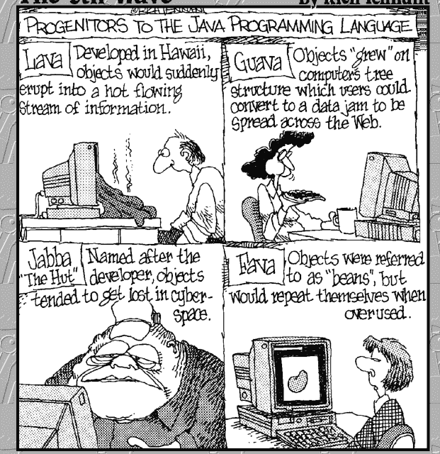

## 内容概览

- 第1章：理解面向对象编程...................................................................................................237
- 第2章：创建你自己的类.....................................................................................................................249
- 第3章：处理静态成员..............................................................................................................................................265
- 第4章：使用子类和继承..........................................................................................................................273
- 第5章：使用抽象类和接口......................................................................................................................293
- 第6章：使用 Object 和 Class 类..........................................................................................................................305
- 第7章：使用内部类.................................................................................................................................................329
- 第8章：打包和记录你的类..............................................................................................................339

## 第1章：理解面向对象编程

### 本章内容

- 了解什么是面向对象编程
- 理解对象和类
- 探究继承和接口
- 使用对象设计程序
- 用 UML 进行图示

本章是对面向对象编程的基本介绍。它向你介绍了学习面向对象编程在 Java 中具体工作细节时需要知道的一些基本概念和术语。

> 如果你更喜欢动手实践，你可能想直接跳过本章，直接进入第三部分，第 2 章，在那里你将学习如何在 Java 中创建自己的类。然后，你随时可以返回本章来学习驱动面向对象编程的基本概念。无论哪种方式，对我来说都可以。无论你阅读本章还是跳过以后再回来，我的报酬都一样。

### 什么是面向对象编程？

*面向对象编程*这个术语包含许多不同的含义。但其核心是，面向对象编程是一种基于以下前提的计算机编程类型：所有程序本质上都是真实世界对象或抽象概念的计算机模拟。例如：

- 飞行模拟器程序试图模拟真实飞机的行为。有些做得非常出色：军事和商业飞行员在其上进行训练。在 1960 年代，阿波罗宇航员使用计算机控制的模拟器来练习他们的登月。
- 许多电脑游戏是人类实际玩的游戏的模拟，例如棒球、纳斯卡赛车和国际象棋。但即使是像吃豆人或最终幻想 4 这样的抽象游戏，也试图模拟那些*可能*存在于某处的生物和物体的行为。因此，这些


## 238 理解对象

程序模拟的是一种概念性的游戏——这种游戏在现实世界中实际上无法进行，但可以通过计算机来模拟。

-   ◆ 商业程序可以被看作是商业流程的模拟，例如订单处理、客户服务、发货和开票。例如，一张发票不仅仅是一张纸；它代表了一家公司与某个客户之间已经发生的一笔交易。因此，计算机化的发票实际上只是对那笔交易的模拟。

编程语言具有这类前提的概念并不新鲜。像 C 及其前身这样的传统编程语言，甚至包括 COBOL，都基于这样一个前提：计算机程序是过程的计算机化实现——相当于“步骤一：将 A 卡舌插入 B 卡槽”的电子版本。LISP 编程语言则基于这样一种思想：所有编程问题都可以被视为操作列表的不同方式。而广受欢迎的数据库操作语言 SQL 则将编程问题视为操作数学集合的方式。

以下是关于计算机程序是现实世界对象或抽象概念模拟这一观点的更多思考：

- ◆ 有时模拟比真实事物更好。文字处理程序最初是打字机的模拟，但现代文字处理程序远优于任何打字机。
- ◆ 所有计算机程序都是某种模拟的想法并非新鲜事。事实上，第一个面向对象的编程语言（Simula）是在20世纪60年代开发的。到1967年，该语言已具备我们现在认为对面向对象编程至关重要的许多特性，包括类、对象、继承和虚方法。
- ◆ 仔细想想，手工的业务记录保存系统也是模拟。一个装满打印发票的文件柜并不保存实际订单。它保存的是那些订单的书面表示。计算机是比文件柜更好的模拟设备，但两者都是模拟。

#### 理解对象

所有关于模拟的讨论让我感到有点存在主义了，所以我现在转向构成面向对象编程的对象的本质。对象——无论是在现实世界中还是在编程世界中——都是具有某些基本特征的实体。以下部分将描述其中一些更重要的特征：标识、类型、状态和行为。

#### 对象具有标识

面向对象程序中的每个对象都有一个*标识*。换句话说，特定类型的每个出现——称为*实例*——都可以与同一类型的其他每个实例区分开来，也可以与其他类型的对象区分开来。

在现实世界中，对象标识是一个相当直观和显而易见的概念。拿起两个苹果，你知道虽然它们都是苹果（那是对象类型，在下一节描述），但它们不是同一个苹果。每个都有独特的标识。它们颜色大致相同，但不完全一样。它们都是圆形的，但形状有细微差别。其中一个（或两个）里面可能都有虫子。

打开一个装满发票的文件柜，你会发现一页又一页的纸看起来几乎一模一样。然而，每张纸在页面顶部附近都印有一个发票号码。这个号码并不是真正赋予每张发票独特标识的东西，但它为你提供了一种识别每张发票的简便方法，就像你的名字让别人能轻松识别你一样。

在面向对象编程中，每个对象在计算机内存中都有自己的位置。因此，两个对象，即使它们可能是同一类型，也有各自的内存位置。对象的起始位置地址为我们提供了一种区分一个对象与另一个对象的方法，因为没有两个对象可以占据内存中的相同位置。

以下是关于 Java 中对象标识的其他几点重要思考：

-   Java 基本上将每个对象的标识保留在其自身。换句话说，没有简单的方法获取对象的内存地址。Java 认为这不关你的事，而且理应如此。如果 Java 轻易地将此信息提供给你，你可能会忍不住去修改它，这会导致各种问题，任何 C 或 C++ 程序员都能告诉你这一点。
- Java 对象有一个叫做*哈希码*的东西，它是一个为每个对象自动生成的`int`值，*几乎*代表了对象的标识。在大多数情况下，对象的哈希码基于对象的内存地址。但并非总是如此。Java 不保证两个不同的对象不会具有相同的哈希码。
- 当与对象一起使用时，相等运算符（==）实际上测试的是两个变量或表达式的对象标识。如果它们引用同一个对象实例，则这两个变量或表达式被认为相等。

#### 对象具有类型

我记得在大学主修英语时学习过亨利·里德于1942年写的一首好诗《部件命名》：

> 今天我们学习部件的命名。昨天，
我们进行了日常清洁。而明天早上，
我们将学习射击后该做什么。但今天，
今天我们学习部件的命名。山茶花
在所有邻近花园里闪耀如珊瑚，
而今天我们学习部件的命名。

当然，这是一首很好的反战诗等等，但它也对面向对象编程有一点启发。在第一节之后，诗继续命名步枪的部件：

> 这是下背带环。而这是
上背带环，你会看到它的用途，
当你拿到背带时。而这是堆积环，
但在你的情况下你没有这个。

想象一下，一整个房间的新兵正在拆卸他们的步枪，而教官告诉他们“这是下背带环。这是上背带环……”。每个士兵的步枪都有这些部件之一——用面向对象的术语来说，是一个特定类型的对象。每个士兵步枪中的下背带环是不同的对象，但都是`LowerSlingSwivel`类型。

就像这首诗中的教官一样，面向对象编程让你可以为程序中不同种类的对象分配名称。在 Java 中，类型由类定义。因此，当你从一个类型创建一个对象时，你是在说该对象是由该类指定的类型的。例如，以下语句创建了一个`Invoice`类型的对象：

```
Invoice i = new Invoice();
```

然后，该对象的标识（即，其内存中的地址）被分配给变量`i`，编译器知道它可以持有对`Invoice`类型对象的引用。

#### 对象具有状态

现在转换到另一位文学天才：

> 一条鱼，两条鱼，
红鱼，蓝鱼

用面向对象的术语来说，苏斯博士在这里列举了一对`Fish`类型的对象。`Fish`类型显然有两个属性——称之为`number`和`color`。这两个对象在这些属性上的值不同：

| 属性 | 对象 1 | 对象 2 |
| :--- | :--- | :--- |
| 数量 | 一 | 二 |
| 颜色 | 红色 | 蓝色 |

对象的类型决定了对象具有哪些属性。因此，所有特定类型的对象都具有相同的属性。但是，它们不一定在这些属性上具有相同的值。在这个例子中，所有`Fish`都有名为`Number`和`Color`的属性，但两个`Fish`对象在这些属性上具有不同的值。

对象所有属性的值的组合称为对象的_状态_。与其标识不同，对象的状态可以并且通常在其生命周期内发生变化。例如，有些鱼会改变颜色。客户的总销售额在客户每次购买另一个产品时都会改变。学生的平均绩点在每次记录新的课程成绩时都会改变。而员工的地址和电话号码在员工搬家时会改变。

以下是关于对象状态的更多有趣细节：

-   对象的某些属性是公开已知的，但其他属性可以是私有的。私有属性可能对对象的内部操作至关重要，但对象外部没有人知道它们的存在。它们就像你的私人想法：它们影响你的言行，但除了你自己没人知道。
- 在 Java 中，对象的状态由类变量表示，这些变量被称为_字段_。`public field`是用`public`关键字声明的字段，因此该变量对外部世界可见。

#### 对象具有行为

对象的另一个特征是它们具有_行为_，这意味着它们能做事。与状态一样，对象的具体行为取决于其类型。但与状态不同的是，行为对于类型的每个实例来说并不是不同的。例如，假设教室里的所有学生都有同一类型的计算器。让他们都拿出计算器并把两个数字相加——任何他们选择的两个数字。所有的计算器都显示不同的数字，但它们的加法方式都一样。换句话说，它们的状态都不同，但行为相同。

说对象具有行为的另一种方式是说它们提供可以被其他对象使用的服务。你已经看到了很多对象为其他对象提供服务的例子。例如，从`NumberFormat`类创建的对象提供格式化服务，将数值转换为格式良好的字符串，如 $32.95。


# 242 对象的生命周期

在 Java 中，对象的行为由其方法提供。因此，`NumberFormat` 类的 `format` 方法正是为 `NumberFormat` 对象提供格式化行为的。

关于对象行为，还有其他几个值得注意的要点：

- 类的*接口*是类公开的方法和字段的集合，以便其他对象可以访问它们。
- 对象具体如何完成其功能可以且应该被隐藏在对象内部。使用该对象的人需要知道它做什么，但不需要知道它如何工作。如果你以后发现对象完成其工作有更好方式，你可以更换为新的改进版本，而无人知晓其中的差异。

### 对象的生命周期

在 Java 中使用对象时，理解对象如何诞生、如何存活以及如何消亡非常重要。这个主题被称为对象的*生命周期*，大致过程如下：

- 在从类创建对象之前，必须先*加载*该类。为此，Java 运行时在磁盘（位于 `.class` 文件）上定位该类并将其读入内存。然后，Java 查找任何用于初始化静态字段的*静态初始化器*——这些字段不属于类的任何特定实例，而属于类本身，并由从该类创建的所有对象共享。

  当你第一次从该类创建对象或第一次访问该类的静态字段或方法时，该类即被加载。例如，当你运行一个类的 `main` 方法时，该类就被初始化，因为 `main` 方法是静态的。

- 当你使用 `new` 关键字时，对象即从类创建。为了初始化类，Java 为对象分配内存，并设置一个指向该对象的引用，以便 Java 运行时可以跟踪它。然后，Java 调用类的*构造函数*，它类似于方法，但仅在对象创建时调用一次。构造函数负责执行初始化对象所需的任何处理，例如初始化变量、打开文件或数据库等。

- 对象存活期间，向任何想要且需要它的对象提供对其公共方法和字段的访问。

- 当对象需要消亡时，它将从内存中移除，Java 会丢弃其内部引用。你无需自己销毁对象。Java 运行时的一个特殊部分，称为*垃圾收集器*，负责在对象不再使用时销毁它们。

### 使用相关类

到目前为止，你在本书中看到的大多数类都创建了独立存在的对象，每个对象都像一个小岛。然而，面向对象编程的真正威力在于它能够创建描述彼此紧密相关对象的类。

例如，棒球与垒球相似。两者都是特定类型的球。它们都有直径和重量。两者都可以被投掷、接住或击打。然而，它们具有不同的特性，导致它们在被投掷、接住或击打时行为不同。

如果你正在创建一个模拟棒球和垒球工作方式的程序，你需要一种方式来表示这两种类型的球。一种选择是创建独立的类来表示每种类型的球。这些类是相似的，所以你可以将大部分代码从一个类复制到另一个类。

另一种选择是使用一个类来表示两种类型的球。然后，你向构造函数传递一个参数，以指示该类的实例的行为像棒球还是垒球。

然而，Java 有两个面向对象编程特性，专门设计用于处理像这样相关的类：继承和接口。我将在以下部分简要描述这些特性。

### 继承

继承是一种面向对象编程技术，允许你将一个类用作另一个类的基础。现有的类称为基类、超类或父类，从中派生的新类称为派生类、子类或子类。

创建子类时，子类会自动获得其超类定义的所有方法和字段。你可以原样使用这些方法和字段，或者覆盖它们以改变其行为。此外，你可以添加额外的方法和字段，以定义子类独有的数据和行为。

你可以使用继承来解决上一节中的棒球/垒球问题，方法是创建一个名为 `Ball` 的类，它提供所有类型球的基本特性，然后将其用作名为 `BaseBall` 和 `SoftBall` 的独立类的基类。然后，这些类可以覆盖需要为每种类型的球表现不同的方法。

思考继承的一种方式是将其实现为一种*是一种类型*的关系。例如，垒球是一种球，棒球也是一种球。因此，继承是实现这些相关类的适当方式。有关继承的更多信息，请参阅第 III 册，第 4 章。

### 接口

*接口*是类必须提供以*实现*该接口的一组方法和字段。接口本身只是一组命名的公共方法和字段声明。请注意，接口本身不提供任何实现这些方法的代码。相反，它只提供声明。然后，*实现*该接口的类为接口定义的每个方法提供一个实现。

你可以使用接口来解决棒球/垒球问题，方法是创建一个名为 `Ball` 的接口，指定球应该具有的所有方法和字段。然后，你可以创建 `SoftBall` 和 `BaseBall` 类，使它们都实现 `Ball` 接口。

接口与继承密切相关，但有两个关键区别：

- 接口本身不提供任何实现其方法的代码。接口只是一组方法和字段的签名。相比之下，基类可以提供其部分或全部方法的实现。
- 一个类只能有一个基类。然而，一个类可以根据需要实现任意数量的接口。

有关接口的信息，请参阅第 III 册，第 5 章。

### 用对象设计程序

面向对象程序通常不仅仅是单个对象。相反，它是一组协同工作以完成一项任务的对象。开发面向对象程序最重要的部分是设计用于创建程序对象的类。基本思想是将一个大问题分解为一组在大小和复杂度上各自可管理的类。然后，你编写实现这些类的 Java 代码。

因此，设计面向对象应用程序的任务归结为决定应用程序需要哪些类以及每个类的公共接口是什么。如果你规划好类，实现应用程序就很容易。但如果你规划得不好，你的应用程序将很难正常工作。

设计面向对象应用程序的一种常见方法是将应用程序划分为几个不同的*层*或* tier*，每个层提供不同类型的功能。最常见的是三层方法，如图 1-1 所示。在这里，应用程序的对象被分为三个基本层：

- **表示层：** 此层中的对象处理与用户的所有直接交互。例如，Web 应用程序中的 HTML 页面放在此层，基于 GUI 的应用程序中的 Swing 页面和框架类也放在此层（我在第 VI 册中介绍 Swing）。
- **逻辑层：** 此层中的对象代表应用程序的核心对象。对于典型的商业类型应用程序，此层包括表示业务实体的对象，如客户、产品、订单、供应商等。此层有时被称为*业务规则层*，因为此层中的对象负责执行管理应用程序的规则。
- **数据库层：** 此层中的对象处理与应用程序使用的任何数据存储形式交互的所有细节。例如，如果数据存储在 SQL 数据库中，此层中的对象处理所有的 SQL。

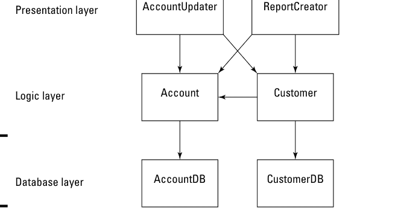

### 用 UML 绘制类图

从计算机编程的最初开始，程序员就喜欢为他们的程序创建图表。最初，他们绘制流程图，以图形方式表示程序的过程逻辑。

流程图擅长绘制过程图，但过于详细。当 1970 年代结构化编程热潮来袭，程序员开始思考程序的整体结构时，他们从流程图转向了*结构图*，它说明了程序或系统中模块之间的组织关系。


#### 使用UML绘制类图

既然面向对象编程已成为主流，程序员们便绘制*类图*来阐明构成应用程序的各个类之间的关系。例如，图1-2所示的简单类图展示了一个包含四个类的简单系统的类结构。矩形框代表类本身，箭头则代表类之间的关系。

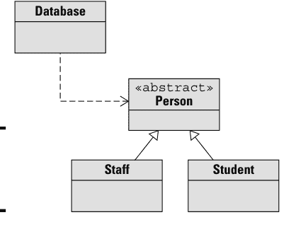

**图1-2：** 一个简单的类图。

你可以用多种方式绘制类图。为了保持图表的一致性，大多数程序员使用名为*UML*的标准，即*统一建模语言*。图1-2中的类图是一个简单的UML图示例，但UML图可以比这个例子复杂得多。

以下部分将描述创建UML类图的详细信息。请注意，这些章节远未涵盖UML的所有功能。我仅介绍创建UML类图的基础知识，以便你在看到UML图时能有所理解，并知道如何绘制简单的类图来帮助你设计应用程序的类结构。如果你有兴趣深入了解UML，可以参考迈克尔·杰西·乔诺尔斯和詹姆斯·A·沙尔特所著的《*UML 2 For Dummies*》（Wiley出版社）。

#### 绘制类

类图中的基本元素是类。在UML中，每个类都绘制为一个矩形框。矩形框至少必须包含类名。但是，你可以将矩形框细分为两到三个部分，其中可以包含有关类的附加信息，如图1-3所示。


类的中间部分列出类变量，而底部部分列出类方法。每个变量或方法的名称前面可以有一个可见性指示符，可以是表1-1中列出的符号之一。在实际操作中，省略可见性指示符，仅列出具有公共可见性的字段或方法是很常见的。

**表1-1 类变量和方法的可见性指示符**

| 指示符 | 描述 |
|---|---|
| + | Public（公共） |
| - | Private（私有） |
| # | Protected（保护） |

如果需要，你可以为变量以及方法和参数包含类型信息。变量的类型通过在变量名后跟冒号和类型来指示：

`connectionString: String`

方法的返回类型以相同的方式指示：

`getCustomer(): Customer`

参数列在括号内，并列出名称和类型。例如：

`getCustomer(custno: int): Customer`

**注意：** 在UML图中省略类型和参数信息是很常见的。

#### 使用UML绘制类

接口的绘制方式与类非常相似，但类名前会加上*interface*关键字：

`<<interface>>`
`ProductDB`

**注意：** *interface*一词被括在一对双左箭头和双右箭头中。这些箭头不仅仅是连续键入的两个小于或大于符号；它们是一个特殊符号。幸运的是，这个符号是ASCII字符集的标准部分。你可以在Microsoft Word中通过“插入符号”命令访问它们。

#### 绘制箭头

除了表示类的矩形框外，类图还包括表示类之间关系的箭头。UML使用多种不同类型的箭头，如下所述。

一端带有空心闭合箭头的实线表示继承：


箭头指向基类。

一端带有空心闭合箭头的虚线表示一个类实现了一个接口：


箭头指向接口。带有开放箭头的实线表示*关联*：


关联仅仅表示两个类一起工作。可能是其中一个类创建另一个类的对象，或者一个类需要另一个类的对象来完成其工作。或者，也许一个类的实例包含另一个类的实例。

你可以为关联箭头添加名称以指示其目的。例如，如果一个关联箭头表示一个类的实例创建另一个类的对象，你可以在箭头旁边放置`Creates`一词。

## 第2章：创建自己的类

**本章内容**

- 创建自己的类
- 查看类声明的组成部分
- 了解类字段
- 构造构造方法
- 为类添加方法
- 使用`this`关键字

好了，同学们，是时候学习如何创建自己的类了。

在本章中，你将了解在Java中创建类的基础知识。所有Java程序都是类，所以你已经见过很多类的例子了。例如，你已经见过`public class GuessingGame`这样的类头和`public static void main`这样的静态方法。现在，在本章中，我将向你展示如何创建包含多个类的程序。

### 声明类

所有类都必须由一个*类声明*来定义，该声明提供类名和类体。以下是最基本的类声明形式：

```
[public] class ClassName {class-body}
```

`public`关键字表明这个类可以被其他类使用。虽然它是可选的，但你通常会在类声明中包含它。毕竟，编写类声明的主要原因是为了让其他类可以从该类创建对象。关于使用`public`关键字的更多信息，请参阅本章后面的“类放置的位置”部分。


在本书的后续章节中，你会发现一些可以放在类声明中的其他元素。我在这里描述的格式只是基本格式，用于创建基本类。

#### 选择类名

ClassName是一个标识符，为你的类提供名称。你可以使用任何标识符来命名类，但以下三条准则可以简化你的生活：

- **以大写字母开头类名。** 如果类名包含多个单词，请将每个单词首字母大写。例如，Ball、RetailCustomer和GuessingGame。
- **尽可能使用名词作为类名。** 类创建对象，而名词是用于标识对象的词语。因此，大多数类名应该是名词。
- **避免使用Java API类的名称。** 没有规定你必须这样做，但如果你创建的类与Java API类同名，就必须使用完全限定名（如`java.util.Scanner`）来区分你的类和同名的API类。

> 实际上有成千上万个Java API类，所以全部避免是很难的。但至少，你应该避免使用常用的Java类名以及你的应用程序可能使用的任何API类名。例如，创建名为`String`或`Math`的类只会自找麻烦。


#### 类体的内容

类的类体是类声明末尾花括号内的所有内容。类声明的`public class ClassName`部分只占一行，但类声明的主体可能占用数百行。如果你得意忘形，甚至可能是数千行。

类体可以包含以下元素：

- **字段：** 变量声明定义类的公共或私有字段。
- **方法：** 方法声明定义类的方法。
- **构造方法：** 构造方法是类似于方法的代码块，但在创建实例时运行以初始化对象。构造方法必须与类本身同名，虽然它类似于方法，但它没有返回类型。
- **初始化块：** 这些是独立的代码块，仅在类初始化时运行一次。实际上有两种类型，称为静态初始化块和实例初始化块。虽然你不会经常使用它们，但我将在本章后面的“使用初始化块”部分讨论实例初始化块。有关静态初始化块的信息，请参考Book III, Chapter 3。


#### 其他类和接口

一个类可以包含另一个类，这样的类被称为*内部类*或*嵌套类*。类也可以包含接口。有关内部类的更多信息，请参阅第三卷第七章。有关接口的信息，请参考第三卷第五章。

与一些编程语言不同，类体内各项出现的顺序并不重要。不过，保持类中成员声明顺序的一致性是个好习惯。这样你就知道在哪里可以找到它们。我通常会在类的开头编写所有字段，接着是构造函数，然后是方法。如果类包含初始化器，我会将它们放在它们初始化的字段附近。如果类包含内部类，我通常会将它们放在使用它们的方法之后。

有些程序员喜欢将字段放在类的末尾而不是开头。只要能让你感到愉快，怎么安排都行。

类中包含的字段、方法、类和接口被称为该类的*成员*。出于一些目前还太技术化的原因，构造函数和初始化器不被视为成员。（你可以在第三卷第三章找到解释。）

#### 类的位置

一个公共类必须写在一个源文件中，该文件必须与类同名，并带有 `.java` 扩展名。例如，一个名为 `Greeter` 的公共类必须放在名为 `Greeter.java` 的文件中。

因此，你不能在同一个文件中放置两个公共类。例如，以下源文件（名为 `DiceGame.java`）将无法编译：

```
public class DiceGame
{
    public static void main(String[] args)
    {
        Dice d = new Dice();
        d.roll();
    }
}

public class Dice
{
    public void roll()
    {
        // 掷骰子的代码写在这里
    }
}
```

#### 声明一个类

编译器会报错，指出 `Dice` 是一个公共类，必须在名为 `Dice.java` 的文件中声明。

这个问题有两种解决方案。第一种是从 `Dice` 类中移除 `public` 关键字：

```
public class DiceGame
{
    public static void main(String[] args)
    {
        Dice d = new Dice();
        d.roll();
    }
}

class Dice
{
    public void roll()
    {
        // 掷骰子的代码写在这里
    }
}
```

编译器愉快地接受了这个程序。

这与内部类不同。内部类是在另一个类的主体内定义的类，只能从该类内部访问。有关内部类的更多信息，请参阅第三卷第七章。

当你在单个源文件中编写多个类时，Java仍会为每个类创建一个单独的类文件。因此，当你编译 `DiceGame.java` 文件时，Java编译器会创建两个类文件，分别名为 `DiceGame.class` 和 `Dice.class`。

对于相对较小的程序，从类中移除 `public` 关键字是可以接受的。但其局限性在于 `Dice` 类只能被 `DiceGame.java` 文件中定义的类访问。如果你希望 `Dice` 类有更广泛的可用性，请选择第二种解决方案：将其（带有 `public` 关键字）放在一个单独的名为 `Dice.java` 的文件中。

如果你要创建一个包含多个公共类的应用程序，请为该应用程序创建一个单独的文件夹。然后，将所有类文件保存到该文件夹中。如果你的类文件都在同一个文件夹中，Java编译器就能找到它们。如果你将它们放在不同的文件夹中，可能需要调整 `ClassPath` 环境变量来帮助编译器找到这些类。

### 处理成员

一个类的*成员*是在类主体中定义的字段和方法。（从技术上讲，在类中定义的类和接口也是成员。但本章不讨论它们，所以你现在可以忽略它们。）

以下部分描述了处理类中字段和方法的基础知识。

#### 字段

*字段*是在类主体内、类任何方法之外定义的变量。字段也称为*类变量*，对类的所有方法都可用。此外，如果字段指定了 `public` 关键字，则该字段在类外部也是可见的。如果你不希望字段在类外部可见，请使用 `private` 关键字代替。

字段的定义与任何其他Java变量相同，但可以有一个修饰符来指定字段是公共的还是私有的。以下是一些公共字段声明的示例：

```
public int trajectory = 0;
public String name;
public Player player;
```

要创建一个私有字段，指定 `private` 而不是 `public`：

```
private int x-position = 0;
private int y-position = 0;
private String error-message = "";
```

字段也可以声明为 `final`：

```
public final int MAX_SCORE = 1000;
```

`final` 字段的值一旦初始化就不能更改。**注意：** 通常（但不是必需）将 `final` 字段名称全部大写拼写。

#### 方法

你使用与我在第二卷第七章中描述的相同技术为类定义方法。要声明一个对类用户可用的方法，请在方法声明中添加 `public` 关键字：

```
public boolean isActive()
{
    return this.isActive;
}
```

要创建一个可在类内部使用但在类外部不可见的私有方法，请使用 `private` 关键字：

```
private void calculateLunarTrajectory()
{
    // 获取计算出的月球轨迹的代码
}
```

#### 理解可见性

在前面的部分中，我提到字段和方法都可以使用 `public` 或 `private` 关键字来指示字段或方法是否可以从类外部访问。这被称为字段或方法的*可见性*。

所有具有 `public` 访问权限的成员的组合有时被称为你的类的*公共接口*。这些成员是其他对象与从你的类创建的对象进行通信的唯一途径。因此，请仔细考虑你的类声明了哪些公共字段和方法。

术语 *expose* 有时用于指代创建公共字段和方法。例如，如果一个类有一个名为 `isActive` 的公共方法，你可以说该类*暴露*了 `isActive` 方法。这仅仅意味着该方法对其他类可用。

你可以在一个类内部使用私有字段和方法，但不能从其他类中使用它们。它们用于提供可能对类的操作至关重要、但不应暴露给外部世界的实现细节。私有字段和方法有时被称为*内部成员*，因为它们只能从类内部访问。

#### Getter和Setter

面向对象编程的基本目标之一是将类的实现细节隐藏在类内部，同时仔细控制类的哪些方面暴露给外部世界。作为一个通用规则，你应该避免创建公共字段。相反，你可以将所有字段设为私有。然后，你可以通过在类中添加称为*访问器*的特殊方法来选择性地授予对这些字段所包含数据的访问权限。

有两种类型的访问器：*get 访问器*（也称为 *getter*）是检索字段值的方法，而 *set 访问器*（*setter*）是设置字段值的方法。这些方法通常分别命名为 `getFieldName` 和 `setFieldName`。例如，如果字段名为 `count`，则 getter 和 setter 方法分别名为 `getCount` 和 `setCount`。

这是一个使用名为 Health 的私有字段来表示游戏程序中玩家生命值的类：

```
public class Player
{
    private int health;

    public int getHealth()
    {
        return health;
    }

    public void setHealth(int h)
    {
        health = h;
    }
}
```

这里，health 字段本身被声明为 private，因此不能直接访问。相反，只能通过 getHealth 和 setHealth 方法进行访问。

使用访问器而不是简单的公共字段创建类有几个好处：

-   *   你可以通过提供 get 访问器而不提供 set 访问器来创建只读属性。然后，其他类可以检索属性值，但不能更改它。
-   *   你可以不将属性值存储在私有字段中，而是在每次调用 get 访问器方法时计算它。例如，假设你有一个名为 Order 的类，其中包含名为 unitPrice 和 quantityOrdered 的字段。该类还可能包含一个如下所示的 getOrderTotal 方法：

```
public double getOrderTotal()
{
    return unitPrice * quantityOrdered;
}
```

这里，get 访问器没有返回类字段的值，而是计算要返回的值。
-   *   你可以通过在属性 set 访问器中验证数据，并在向方法传递无效数据时忽略或抛出异常，来保护类免受错误数据的影响。例如，假设你有一个名为 Health 的 int 属性的 set 访问器，其值可以在 0 到 100 之间。下面是一个防止 Health 属性被设置为不正确值的 set 访问器：


## 256 访问器和修改器

```java
public void setHealth(int h)
{
    if (h < 0)
        health = 0;
    else if (h > 100)
        health = 100;
    else
        health = h;
}
```

在这里，如果以小于零的值调用`setHealth`方法，健康值将被设置为零。同样，如果值大于100，健康值将被设置为100。

关于访问器的使用，可以参考侧边栏“访问器模式”。

#### 访问器模式

本章“访问器和修改器”一节中描述的访问器使用，是Java程序员常用的一种设计模式示例。*访问器模式*旨在提供一种一致的方式来设置或检索类字段的值，而无需将字段本身暴露给外部世界。

大多数Java程序员很快会学到，面向对象编程的基本准则之一是避免使用公共字段。不幸的是，他们常常通过将所有字段设为私有来回应这一准则，然后为每个字段（无论是否需要）都提供get和set访问器。因此，他们编写的类看起来像这样：

```java
public class MyClass
{
    private int fieldX;
    private int fieldY;
    public int getX() { return x; }
    public void setX(int xValue) { this.x = xValue; }
    public int getY() { return y; }
    public void setY(int yValue) { this.y = yValue; }
}
```

为什么不直接将`fieldX`和`fieldY`设为公共字段，跳过访问器呢？

老实说，你不妨这样做。将字段设为私有的目的是为了能够仔细控制对它们的访问。如果你盲目地为所有字段创建访问器，还不如直接将字段设为公共的。

相反，应仔细考虑哪些字段真正需要对外提供访问，并仅为那些确实需要访问的字段提供访问器。

### 方法重载

一个Java类可以包含两个或多个同名方法，前提是这些方法接受不同的参数。这称为*重载*，是为你的类构建灵活性的关键之一。通过重载，你可以预见某人可能希望调用对象函数的不同方式，然后为每种替代方案提供重载方法。

术语*重载*是准确的，但有点不幸。通常，当你说某物过载时，意味着存在问题。例如，我曾见过一张大众捷达车装载了3000磅木材的照片。（你可以在Snopes.com，都市传说参考页面网站，www.snopes.com/photos/lumber.asp找到这张照片。）那是一个经典的过载例子。你不必担心Java会因重载方法过多而崩溃。

你已经熟悉几个具有重载方法的类，尽管你可能没有意识到。例如，`PrintWriter`类（通过`System.out`访问）定义了十个不同版本的`println`方法，允许你打印不同类型的数据。以下行显示了每个重载版本的方法声明：

```
void println()
void println(boolean x)
void println(char x)
void println(char[] x)
void println(double x)
void println(float x)
void println(int x)
void println(long x)
void println(Object x)
void println(String x)
```

创建重载方法的基本规则是每个方法必须具有唯一的*签名*。方法的*签名*是其名称与它所接受的参数的数量和类型的组合。因此，每个`println`方法都有不同的签名，因为尽管每个方法名称相同，但每个方法接受的参数类型不同。

*不*属于方法签名的两件事是：

- **方法的返回类型：** 你不能编写两个同名同参数但返回类型不同的方法。
- **参数的名称：** 方法签名只关心参数的类型及其出现的顺序。因此，以下两个方法具有相同的签名：

```
double someMethodOfMine(double x, boolean y)
double someMethodOfMine(double param1, boolean param2)
```

#### 创建构造方法

构造方法是一个代码块，在创建对象实例时被调用。在许多方面，构造方法类似于方法，但有一些区别：

- 构造方法没有返回类型。
- 构造方法的名称必须与类的名称相同。
- 与方法不同，构造方法不被视为类的成员。（这仅在涉及继承时才重要，相关内容在第三卷第四章中介绍。）
- 构造方法在创建对象的新实例时被调用。实际上，是`new`关键字调用了构造方法。创建对象后，你不能再次调用构造方法。

以下是编写构造方法的基本格式：

```java
public ClassName (parameter-list) [throws exception...]
{
    statements...
}
```

`public`关键字表示其他类可以访问该构造方法。这通常是你想要的，尽管在下一章中你会看到为什么可能需要创建一个私有构造方法。`ClassName`必须与包含该构造方法的类名相同。参数列表的编码方式与方法相同。

还要注意，构造方法在遇到无法恢复的情况时可以抛出异常。有关抛出异常的更多信息，请参阅第二卷第八章。

#### 基本构造方法

编写构造方法最常见原因可能是在创建对象时为类字段提供初始值。例如，假设你有一个名为`Actor`的类，其中包含名为`firstName`和`lastName`的字段。你可以为`Actor`类创建一个构造方法：

```java
public Actor(String first, String last)
{
    firstName = first;
    lastName = last;
}
```

然后，你可以通过调用此构造方法来创建`Actor`类的一个实例：

```java
Actor a = new Actor("Arnold", "Schwarzenegger");
```

一个代表Arnold Schwarzenegger的新`Actor`对象就被创建出来了。

与方法一样，构造方法也可以被重载。换句话说，你可以为一个类提供多个构造方法，前提是每个构造方法都具有唯一的签名。例如，这是`Actor`类的另一个构造方法：

```java
public Actor(String first, String last, boolean good)
{
    firstName = first;
    lastName = last;
    goodActor = good;
}
```

这个构造方法允许你创建一个`Actor`对象，除了演员的姓名外，还可以包含其他信息：

```java
Actor a = new Actor("Arnold", "Schwarzenegger", false);
```

#### 默认构造方法

我是看着*《警网铁金刚》*长大的。我仍然能听到Joe Friday向某个暴徒宣读他的权利："你有权在审讯时请律师。如果你希望请律师但负担不起，将免费为你指定一名律师。"

Java构造方法就像这样。每个类都有权获得一个构造方法。如果你不提供构造方法，Java会免费为你指定一个。这个免费的构造方法称为*默认构造方法*。它不接受任何参数，也不做任何事情，但它确实允许你的类被实例化。

因此，以下两个类是相同的：

```java
public Class1
{
    public Class1() { }
}

public Class1 { }
```

在第一个例子中，类显式地声明了一个不接受任何参数且主体中没有语句的构造方法。在第二个例子中，Java创建了一个默认构造方法，其功能与第一个例子中显示的构造方法完全相同。

#### 创建构造方法

如果你为类声明了任何构造方法，则*不会*创建默认构造方法。因此，如果你声明了一个接受参数的构造方法，但仍然希望有一个空构造方法（无参数且无主体），则必须为类显式声明一个空构造方法。

一个例子可以澄清这一点。以下代码*无法*编译：

```java
public class BadActorApp
{
    public static void main(String[] args)
    {
        Actor a = new Actor();     // 错误：无法编译
    }
}

class Actor
{
    private String lastName;
    private String firstName;
    private boolean goodActor;

    public Actor(String last, String first)
    {
        lastName = last;
        firstName = first;
    }

    public Actor(String last, String first, boolean good)
    {
        lastName = last;
        firstName = first;
        goodActor = good;
    }
}
```

这个程序无法编译，因为它没有显式地为`Actor`类提供默认构造方法，并且因为它提供了其他构造方法，所以默认构造方法不会自动生成。

#### 调用其他构造方法

构造方法可以使用特殊关键字`this`作为方法调用来调用同一类中的另一个构造方法。当你有几个相互依赖的构造方法时，这种技术很常用。

例如，考虑这个类：

```java
public class Actor
{
    private String lastName;
```


此处，第二个构造函数调用第一个构造函数来设置 `lastName` 和 `firstName` 字段。然后，它设置 `goodActor` 字段。

在使用 `this` 关键字进行构造函数调用时，你有一些限制：

- 你只能在构造函数的第一条语句中调用另一个构造函数。因此，以下代码将无法编译：

```java
public Actor(String last, String first, boolean good)
{
    goodActor = good;
    this(last, first);    // 错误：无法编译
}
```

如果你尝试编译包含此构造函数的类，你会得到一条消息，指出 `对 this 的调用必须是构造函数中的第一条语句`。

- 每个构造函数只能调用另一个构造函数。但是，你可以将构造函数链接起来。例如，如果一个类有三个构造函数，第一个构造函数可以调用第二个，第二个又可以调用第三个。

- 你不能创建构造函数相互调用的循环。例如，以下是一个无法编译的类：

```java
class CrazyClass
{
    private String firstString;
    private String secondString;

    public CrazyClass(String first, String second)
    {
        this(first);
        secondString = second;
    }

    public CrazyClass(String first)
    {
        this(first, "DEFAULT");  // 错误：无法编译
    }
}
```

第一个构造函数首先调用第二个构造函数，而第二个构造函数又调用第一个构造函数。编译器会报错，指出这是一个递归构造函数调用，并礼貌地拒绝编译该类。

如果你没有在构造函数的第一行显式调用一个构造函数，Java 会插入一段代码，自动调用基类（即这个类所继承的类）的默认构造函数。这个小细节在你开始接触继承之前并不太重要，相关内容在第三卷第四章中介绍。所以你现在完全可以先忽略它。

### `this` 的更多用途

正如我在上一节所述，你可以在构造函数中使用 `this` 关键字来调用当前类的另一个构造函数。你也可以在类构造函数或方法体中使用 `this` 来引用当前对象——即调用该构造函数或方法的类实例。

`this` 关键字通常用于限定对当前对象实例变量的引用。例如：

```java
public Actor(String last, String first)
{
    this.lastName = last;
    this.firstName = first;
}
```

在这里，`this` 其实不是必需的，因为编译器能识别出 `lastName` 和 `firstName` 指的是类变量。但是，假设你使用 `lastName` 和 `firstName` 作为构造函数的参数名：

```java
public Actor(String lastName, String firstName)
{
    this.lastName = lastName;
    this.firstName = firstName;
}
```

在这种情况下，就需要 `this` 关键字来区分名为 `lastName` 和 `firstName` 的参数与同名的实例变量。

你也可以在方法体中使用 `this`。例如：

```java
public String getFullName()
{
    return this.firstName + " " + this.lastName;
}
```

因为这个例子没有歧义，所以 `this` 也不是必需的。然而，许多程序员喜欢在非必要时也使用 `this`，因为它可以明确表示你引用的是一个实例变量。

有时，你单独使用 `this` 关键字，将当前对象的引用作为方法参数传递。例如，你可以使用以下语句将当前对象打印到控制台：

```java
System.out.println(this);
```

`println` 方法会调用对象的 `toString` 方法来获取对象的字符串表示，然后将其打印到控制台。默认情况下，`toString` 会打印创建该对象的类的名称以及对象的哈希码。如果你希望 `println` 方法打印更有意义的内容，请为你的类提供一个自定义的 `toString` 方法。

### 使用初始化器

一个 *初始化器*（有时也称为 *初始化块*）是一段独立的代码块，放置在任何方法、构造函数或其他代码块之外。每当创建一个类的实例时，初始化器就会被执行，无论使用的是哪个构造函数来创建实例。

初始化器类似于用于初始化变量的变量初始化器。区别在于，使用初始化器块，你可以编写多条语句。例如，下面这个类在初始化时从用户那里获取一个类字段的值：

```java
class PrimeClass
{
    private Scanner sc = new Scanner(System.in);
    public int x;
    {
        System.out.print(
            "Enter the starting value for x: ");
        x = sc.nextInt();
    }
}
```

你几乎总是可以使用其他更直接的编码技术来达到相同的效果。例如，你可以在构造函数中提示用户输入值。或者，你可以在字段初始化器中调用一个方法，像这样：

```java
class PrimeClass
{
    private Scanner sc = new Scanner(System.in);
    public int x = getX();
    private int getX()
    {
        System.out.print("Enter the starting value for x: ");
        return sc.nextInt();
    }
}
```

无论哪种方式，效果都是一样的。

关于初始化器，还有一些其他信息：

- 如果一个类包含多个初始化器，它们将按照在程序中出现的顺序执行。
- 初始化器在所有类构造函数之前执行。
- 一种特殊类型的初始化器块称为静态初始化器，它允许你初始化静态字段。更多信息，请参阅下一章。
- 初始化器有时与匿名类一起使用，正如我在第三卷第六章中描述的那样。

## 第三章：使用静态成员

### 本章内容

- 向类添加静态字段
- 创建静态方法
- 创建可实例化的类
- 使用静态初始化器

一个 *静态方法* 是与类实例无关的方法。（除非你直接跳到这一章，否则你已经知道了。）相反，这个方法属于类本身。因此，你可以在不首先创建类实例的情况下调用该方法。在本章中，你将了解创建和使用静态字段和方法所需的一切知识。

### 理解静态字段和方法

根据我手边的韦氏词典，*static* 这个词有几个不同的含义。其中大多数与静止或不变的概念有关。例如，*static display*（静态显示）是指不移动的显示。*Static electricity*（静电）是指不流动的电荷。*static design*（静态设计）是指不变的设计。

Java 中使用的 *static* 一词并不意味着不变。例如，你可以创建一个静态字段，然后在程序执行过程中为其赋值。因此，静态字段的值可以改变。

更令人困惑的是，*static* 这个词也可以表示干扰，就像收音机中的静电噪音干扰，让你无法听清音乐。但在 Java 中，*static* 一词与干扰或接收不良无关。

那么，Java 中 *static* 这个术语意味着什么？它被用来描述一种特殊类型的字段或方法，该字段或方法不与类的特定实例相关联。相反，静态字段和方法与类本身相关联。这意味着你不必创建类的实例就可以访问静态字段或方法。相反，你通过指定类名（而不是引用对象的变量）来访问静态字段或方法。


## 266 使用静态字段

静态字段和方法有许多常见用途。以下列举几项：

1.  **提供与类实例无关的常量或其他值。** 例如，一个 `Billing` 类可能包含一个名为 `SALES_TAX_RATE` 的常量，用于提供州销售税率。
2.  **跟踪已创建的类实例数量。** 例如，游戏中使用的 `Ball` 类可能有一个静态字段，用于统计当前存在的球的数量。这个计数不属于 `Ball` 类的任何一个特定实例。
3.  **在业务应用中，跟踪分配给每个新对象实例的引用或序列号。** 例如，一个 `Invoice` 类可能维护一个静态字段，其中保存着分配给下一个由该类创建的 `Invoice` 对象的发票号。
4.  **提供创建类实例的另一种方式。** 一个很好的例子是 `NumberFormat` 类，它拥有诸如 `getCurrencyInstance` 和 `getNumberInstance` 等静态方法，这些方法返回以特定方式格式化数字的对象实例。使用此技术的一个原因可能是创建只能拥有一个对象实例的类。这被称为 *单例类*，本章稍后的边栏“单例模式”中会有更详细的描述。
5.  **提供与任何对象都完全无关的实用功能。** Java API 库中的一个好例子是 `Math` 类，它提供了一组用于执行数学计算的静态方法。你自己编写的代码中，一个例子可能是包含用于验证输入数据的静态方法的 `DataValidation` 类，或者包含用于执行数据库操作的静态方法的数据库类。

#### 使用静态字段

*静态字段* 是用 `static` 关键字声明的字段，如下所示：

```
private static int ballCount;
```

请注意，`static` 关键字和访问修饰符关键字（`private` 和 `public`，以及我将在下一章介绍的 `protected`）的位置是可以互换的。因此，以下语句同样有效：

```
static private int ballCount;
```

按照惯例，大多数程序员倾向于将访问修饰符关键字放在前面。

请注意，你不能在类方法中使用 `static` 关键字。因此，以下代码将无法编译：

```
static private void someMethod()
{
    static int x;
}
```

换句话说，字段可以是静态的，但局部变量不能。

你可以为静态字段提供一个初始值：

```
private static String district = "Northwest";
```

静态字段在类首次加载时被创建和初始化。这发生在引用类的静态成员时，或者在创建类的实例时，两者中先发生者为准。

初始化静态字段的另一种方法是使用 *静态初始化器*，我将在本章后面的“使用静态初始化器”一节中介绍。

#### 使用静态方法

*静态方法* 是用 `static` 关键字声明的方法。与静态字段类似，静态方法与类本身相关联，而不是与从该类创建的任何特定对象相关联。因此，你不必先从类创建对象就可以使用该类定义的静态方法。

最著名的静态方法是 `main`，它由 Java 运行时调用以启动应用程序。`main` 方法必须是静态的，这意味着应用程序默认在静态上下文中运行。

使用静态方法的基本规则之一是，你不能从静态方法中访问非静态方法或字段。这是因为静态方法没有类的实例可用于引用实例方法或字段。例如，以下代码将无法编译：

```
public class TestClass
{
    private int x = 5;        // an instance field

    public static void main(String[] args)
    {
        int y = x;           // error: won't compile
    }
}
```

这里，`main` 方法是静态的，因此它无法访问实例变量 x。

**注意：** 但是，你*可以*从实例方法中访问静态方法和字段。例如，以下代码工作正常：

```
public class Invoice
{
    private static double taxRate = 0.75;

    private double salesTotal;

    public double getTax()
    {
        return salesTotal * taxRate;
    }
}
```

这里，名为 `getTax` 的实例方法可以毫无问题地访问静态字段 `taxRate`。

##### 统计实例

静态变量的一个常见用途是跟踪已创建的类实例数量。为了说明如何做到这一点，请看程序清单 3-1。这个程序包含两个类。`CountTest` 类是一个简单的类，用于跟踪其构造函数被调用的次数。然后，`CountTestApp` 使用一个 `for` 循环创建十个该类的实例，并在每次创建实例后显示已创建的实例数量。

请注意，此应用程序中的实例计数在每次运行应用程序时都会重置为零。因此，它并不跟踪 `CountTest` 类曾经创建的实例总数，只跟踪在程序特定执行期间创建的实例数量。

```
LISTING 3-1: THE COUNTTEST APPLICATION

public class CountTestApp
{
    public static void main(String[] args)
    {
        printCount();
        for (int i = 0; i < 10; i++)
        {
            CountTest c1 = new CountTest();
            printCount();
        }
    }

    private static void printCount()
    {
        System.out.println("There are now "
            + CountTest.getInstanceCount()
            + " instances of the CountTest class.");
    }
}

class CountTest
{
    private static int instanceCount = 0;

    public CountTest()
    {
        instanceCount++;
    }

    public static int getInstanceCount()
    {
        return instanceCount;
    }
}
```

以下段落描述了此程序的一些要点：

-   测试 `CountTest` 类的 `CountTestApp` 类的开始。
-   创建 `CountTest` 类的一个实例。由于此代码包含在 `for` 循环中，因此总共创建了 10 个实例。
-   调用 `printCount` 方法，该方法打印迄今为止已创建的 `CountTest` 对象的数量。
-   此行打印一条消息，指示迄今为止已创建了多少个 `CountTest` 对象。它调用 `CountTest` 类的静态 `getInstanceCount` 方法来获取实例计数。
-   `CountTest` 类的开始。
-   静态 `instanceCount` 变量，用于存储实例计数。
-   `CountTest` 类的构造函数。注意，`instanceCount` 变量在构造函数内递增。这样，每次创建类的新实例时，实例计数都会递增。
-   静态 `getInstanceCount` 方法，它简单地返回静态 `instanceCount` 字段的值。

#### 单例模式

单例是一种你可以用来仅创建一个实例的类。当你尝试创建一个实例时，该类首先检查是否已经存在一个实例。如果存在，则使用现有的实例。如果不存在，则创建一个新的实例。

你不能通过使用 Java 构造函数来实现此效果，因为在构造函数执行时，类实例已经被创建了。（这就是为什么你可以在构造函数内部使用 `this` 关键字的原因。）因此，实现单例类的通常方式是将类的所有构造函数声明为私有。这样，构造函数就无法被其他类使用。然后，你提供一个返回实例的静态方法。此方法要么创建一个新实例，要么返回一个现有的实例。

这是一个最简单的单例类示例：

```
class SingletonClass
{
    private static SingletonClass instance;

    private SingletonClass()
    {
    }

    public static SingletonClass getInstance()
    {
        if (instance == null)
            instance = new SingletonClass();
        return instance;
    }
}
```

这里，`SingletonClass` 包含一个 `private` 实例变量，该变量维护一个指向类实例的引用。然后，一个默认构造函数被声明为私有访问权限，以防止该构造函数在类外部被使用。最后，静态 `getInstance` 方法在 `instance` 变量为 null 时调用构造函数创建一个实例。然后，它将实例返回给调用者。

以下是一些代码，调用了两次 `getInstance` 方法，然后比较得到的对象：

```
SingletonClass s1 = SingletonClass.getInstance();
SingletonClass s2 = SingletonClass.getInstance();
if (s1 == s2)
    System.out.println("The objects are the same");
else
    System.out.println("The objects are not the same");
```

当此代码运行时，第一次调用 `getInstance` 创建了 `SingletonClass` 类的一个新实例。第二次调用 `getInstance` 简单地返回了在第一次调用中创建的实例的引用。因此，`if` 语句中的比较结果为真，第一条消息被打印到控制台。


#### 防止实例化

有时，你想要创建一个完全无法实例化的类。这样，该类就只包含静态字段和方法。Java API 中一个很好的例子是 `Math` 类。它的方法提供了与特定对象无关的实用型函数。你可能偶尔会发现自己需要创建类似的类。例如，你可能会创建一个包含用于验证输入数据的静态方法的类。或者，你可能会创建一个包含用于从数据库检索数据的静态方法的数据库访问类。你不需要创建这两种类的实例。

你可以使用一个简单的技巧来防止任何人实例化一个类。要创建一个类的实例，你至少需要有一个公共构造函数。如果你没有在类中提供构造函数，Java 会自动插入一个默认构造函数，而它恰好是公共的。

那么，要防止创建类的实例，你只需提供一个私有构造函数，如下所示：

```
public class Validation
{
    private Validation() {}      // 防止实例化

    // 静态方法和字段放在这里
}
```

现在，由于构造函数是私有的，该类就无法被实例化。

顺便提一下，`Math` 类使用了这种技巧来防止你创建它的实例。以下是 `Math` 类中实际的一段代码：

```
public final class Math {

    /**
     * 不允许任何人实例化此类。
     */
    private Math() {}
}
```

我想，如果这个技巧对于编写 `Math` 类的人来说已经足够好，那么对我来说也足够好。

### 使用静态初始化器

在上一章中，你发现了*初始化块*，可用于初始化实例变量。在创建类的实例之前，初始化块不会被执行，因此你不能指望它们来初始化静态字段。毕竟，你可能在创建类的实例之前就已经访问了静态字段。

Java 提供了一个名为*静态初始化器*的特性，专门用于让你初始化静态字段。静态初始化器的通用形式如下：

```
static
{
    语句...
}
```

如你所见，静态初始化器类似于初始化块，但以 `static` 这个词开头。和初始化块一样，你在类体中编写静态初始化器，但要在任何其他块（例如方法或构造函数的主体）之外。

当你第一次访问静态成员（如静态字段或静态方法）时，只要尚未创建该类的实例，类中的任何静态初始化器都会被执行。这是因为静态初始化器在你第一次创建实例时也会被执行。在这种情况下，静态初始化器在构造函数执行*之前*执行。


如果一个类有多个静态初始化器，它们将按照在程序中出现的顺序执行。

这是一个包含静态初始化器的类的示例：

```
class StaticInit
{
    public static int x;

    static
    {
        x = 32;
    }

    // 其他类成员，如构造函数和方法放在这里...
}
```

这个例子非常简单。事实上，只需在声明变量时将值 32 赋给它，就可以达到同样的效果。然而，假设你必须执行复杂的计算来确定 x 的值，或者假设它的值来自数据库呢？在这种情况下，静态初始化器会非常有用。

## 第 4 章：使用子类和继承

### 本章内容

- 解释继承
- 创建子类
- 使用受保护访问
- 创建最终类
- 揭开多态的神秘面纱
- 创建自定义异常类

正如你在第三卷第一章中了解到的，Java 类可以基于另一个类。然后，该类就变得像父类的子类：它继承了父类的所有特性，无论好坏。父类的所有字段和方法都会传递给子类。子类可以原样使用这些字段或方法，也可以重写它们以提供自己的版本。此外，子类可以添加自己的字段或方法。

在本章中，你将了解这种魔法是如何运作的，以及创建和使用继承其他类的 Java 类的基础知识。你还将发现一些巧妙的技巧，帮助你充分利用继承。

### 介绍继承

"继承"这个词会让人联想到几种不同的非计算机含义：

- 子女从父母那里继承某些特征。例如，我的三个孩子中有两个是红头发。希望他们到 30 岁时不会谢顶一半。
- 子女也可能从父母那里继承行为。正如人们所说，有其父必有其子。
- 当某人去世时，他们的继承人会得到他们的财产。有些是好东西，但有些可能不是。我的孩子们会很享受翻遍我的车库来决定谁得到什么。
- 你可以继承权利和财产。例如，你可能因为父母是某个国家的公民而成为该国的公民。

在 Java 中，*继承*指的是面向对象编程的一个特性，它允许你创建从其他类派生的类。基于另一个类的类被称为*继承*另一个类。被继承的类称为*父类*、*基类*或*超类*。进行继承的类称为*子类*、*派生类*或*子类*。

*子类*和*超类*这两个术语似乎是 Java 专家们偏好的术语。所以如果你想显得很懂行，就使用这些术语。另外，请注意，术语*子类*也可以用作动词。例如，当你创建一个继承基类的子类时，你就是在*子类化*该基类。

你需要了解关于继承的几个重要事项：

- 派生类会自动获得其基类的所有行为和属性。因此，如果你需要创建几个不同的类来描述并不相同但有许多共同特征的类型，你可以创建一个基类来定义所有共同特征。然后，你可以创建几个继承共同特征的派生类。
- 派生类可以通过定义自己的方法和字段来为其继承的基类添加功能。这是派生类区别于其基类的一种方式。
- 派生类也可以更改基类提供的行为。例如，一个基类可能规定所有从中派生的类都有一个名为 `play` 的方法，但每个类都可以自由提供自己的 `play` 方法实现。在这种情况下，所有扩展基类的类都提供自己的 `play` 方法实现。
- 继承最适合用来实现*是一种类型*的关系。例如：纸牌游戏是一种游戏；卡车是一种车辆；发票是一种交易。在每种情况下，特定种类的对象都是更广泛对象类别的特定类型。

以下部分提供了一些示例来帮助说明这些要点。

#### 平原、火车和汽车

继承通常用现实世界中的对象来解释，比如汽车和摩托车、鸟类和爬行动物，或其他熟悉的现实世界对象。例如，考虑各种类型的车辆。汽车和摩托车是两种不同类型的车辆。如果你正在编写表示车辆的软件，你可以从创建一个名为 `Vehicle` 的类开始，该类将描述所有类型车辆的共同特征，例如轮子、驾驶员、运载乘客的能力，以及执行驾驶、停车、转弯或碰撞等动作的能力。

摩托车是一种进一步细化 `Vehicle` 类的车辆类型。`Motorcycle` 类将继承 `Vehicle` 类，因此它将拥有轮子、驾驶员、可能的乘客，以及驾驶、停车、转弯或碰撞的能力。此外，它还将具有使其区别于其他类型车辆的特征。例如，它有两个轮子，并使用手把进行转向控制。

汽车也是一种车辆。`Car` 类将继承 `Vehicle` 类，因此它也将拥有轮子、驾驶员、可能的一些乘客，以及驾驶、停车、转弯或碰撞的能力。此外，它还有一些自己的特征，例如拥有四个轮子和方向盘、安全带和安全气囊，以及可选的自动变速箱。

### 玩游戏

因为你不太可能真的编写一个模拟汽车、摩托车或其他车辆的程序，所以让我们看一个更常见的例子：游戏。假设你想开发一系列棋盘游戏，比如《人生游戏》、《抱歉》或《大富翁》。大多数棋盘游戏都有一些共同特征：

- 它们有一个棋盘，上面有玩家可以占据的位置。
- 它们有由对象表示的玩家。
- 游戏通过每个玩家轮流进行。一旦游戏开始，就会一直进行直到有人获胜。（如果你不相信我，问问那些试图在有人赢之前阻止一场《勇敢者的游戏》的孩子们。）

每种特定类型的游戏都有这些基本特征，但也添加了自己的功能。例如，《人生游戏》添加了金钱、保单、配偶和孩子，以及棋盘中间一个花哨的转盘等功能。《抱歉》有你抽取的卡片来决定每一步，以及一个其他玩家不能攻击你的安全区域。而《大富翁》有“机会”和“社区宝箱”卡、房产、房屋、酒店和金钱。

如果你正在为这些游戏设计类，你可能会创建一个通用的 `BoardGame` 类来定义所有棋盘游戏的共同基本特征，然后将其用作表示特定棋盘游戏的类的基类，例如 `LifeGame`、`SorryGame` 和 `MonopolyGame`。


#### 一个商业案例

如果车辆或游戏的例子还不够清楚，这里我们从商业世界中举个例子。假设你正在设计一个工资系统，并正在处理表示员工的类。你发现工资单基本上包括两种类型的员工：领取月薪的员工和按小时计酬的员工。因此，你决定创建两个类，分别命名为 `SalariedEmployee` 和 `HourlyEmployee`。

你很快发现，这两个类完成的大部分工作是相同的。两种类型的员工都有姓名、地址、社会保障号码、本年度已支付总额和已预扣税款等信息。

然而，他们之间也有重要的区别。最明显的区别是，领取月薪的员工有年薪，而按小时计酬的员工有时薪。但还有其他区别。例如，按小时计酬的员工的班次每周都会变化。而领取月薪的员工可能享有不提供给按小时计酬员工的福利计划。

所以，你决定创建三个类而不是两个。一个名为 `Employee` 的类处理两种类型员工共有的所有特性。然后，这个类作为 `SalariedEmployee` 和 `HourlyEmployee` 类的基类。这些类提供了区分领取月薪员工和按小时计酬员工的额外特性。

### 继承层次结构

继承最重要的方面之一是，从一个基类派生的类本身又可以作为另一个派生类的基类。因此，你可以使用继承来形成类的层次结构。

例如，你已经看到 `Employee` 类如何被用作基类来创建两种子类：一个用于领取月薪员工的 `SalariedEmployee` 类，以及一个用于按小时计酬员工的 `HourlyEmployee` 类。假设领取月薪的员工分为两类：管理层和销售部门。那么，你可以使用 `SalariedEmployee` 类作为另外两个类的基类，分别命名为 `Manager` 和 `SalesPerson`。

因此，`Manager` 是 `SalariedEmployee` 的一种类型。而且因为 `SalariedEmployee` 是 `Employee` 的一种类型，所以 `Manager` 也是 `Employee` 的一种类型。


所有类最终都派生自一个名为 `Object` 的 Java 类。任何没有明确说明其继承自哪个类的类，都被假定继承自 `Object` 类。这个类提供了一些所有 Java 类共有的基本特性，例如 `toString` 方法。更多信息，请参阅第三册第五章。

### 创建子类

创建子类的基本过程很简单。你只需在子类的声明中使用 `extends` 关键字。继承基类的类声明的基本格式如下：

```
public class ClassName extends BaseClass
{
    // class body goes here
}
```

例如，假设你有一个名为 `Ball` 的类定义了基本的球，你想创建一个名为 `BouncingBall` 的子类，添加弹跳的能力。

```
public class BouncingBall extends Ball
{
    // methods and fields that add the ability to bounce
    // to a basic Ball object:

    public void bounce()
    {
        // the bounce method
    }
}
```


### 委托模式

继承是面向对象编程语言（如 Java）的伟大特性之一。然而，它并非解决每个编程问题的万能钥匙。坦率地说，许多 Java 程序员过度使用了继承。在许多情况下，简单地在一个类中包含另一个类的实例，而不是使用继承，会更容易。这种技术有时被称为 *委托设计模式*。

例如，假设你需要创建一个名为 `EmployeeCollection` 的类来表示一组员工。创建这个类的一种方式是扩展 Java API 提供的某个集合类，例如 `ArrayList` 类。那么，你的 `EmployeeCollection` 类将是 `ArrayList` 类的一个特化版本，并将拥有 `ArrayList` 类可用的所有方法。

然而，一个更简单的替代方案是在你的 `EmployeeCollection` 类中声明一个类型为 `ArrayList` 的类字段。然后，你可以提供使用这个 `ArrayList` 对象来从集合中添加或检索员工的方法。

为什么这种技术被称为 *委托*？因为你不是编写实现集合功能的代码，而是将那个任务 *委托* 给一个 `ArrayList` 对象，因为 `ArrayList` 对象已经知道如何执行这些功能。（关于 `ArrayList` 类的更多信息，请参阅第四册第三章。）

#### 方法重写

在这里，我正在创建一个名为 `BouncingBall` 的类，它扩展了 `Ball` 类。（`Extends` 是 Java 中表示 *继承* 的词汇。）

子类自动拥有它所扩展的类的所有方法和字段。因此，如果 `Ball` 类有名为 `size` 和 `weight` 的字段，`BouncingBall` 类也会有这些字段。同样，如果 `Ball` 类有一个名为 `throw` 的方法，`BouncingBall` 类也会获得那个方法。

要正确使用继承，你需要知道一些重要的细节：

- 子类从其基类继承所有成员。但是，构造函数*不*被视为成员。因此，子类*不会*从其基类继承构造函数。
- 从基类继承的任何成员的可见性（`public` 或 `private`）在子类中保持不变。这意味着你无法从子类中访问在基类中声明为 `private` 的方法或字段。
- 你可以通过在子类中声明一个具有相同签名的新成员来 *重写* 一个方法。更多信息，请参阅下一节。
- 有一种特殊的可见性类型叫做 `protected`，它对其他类隐藏字段和方法，但使它们对子类可用。更多信息，请参阅本章后面的“保护你的成员”部分。
- 你也可以向子类添加额外的方法或字段，`private` 或 `protected`。例如，本节前面展示的 `BouncingBall` 类添加了一个名为 `bounce` 的公共方法。

#### 方法重写

如果一个子类声明了一个与基类的公共方法具有相同签名的方法，那么子类版本的方法 *重写* 了基类版本的方法。这种技术让你可以修改基类的行为以适应子类的需求。

例如，假设你有一个名为 `Game` 的基类，它有一个名为 `play` 的方法。这个不表示任何特定游戏的基类，这样实现这个方法：

```
public class Game
{
    public void play()
    {
    }
}
```

然后，你声明一个名为 Chess 的类，它扩展了 Game 类，但为 `play` 方法提供了实现：

```
public class Chess extends Game
{
    public void play()
    {
        System.out.println("I give up. You win.");
    }
}
```

这里，当你调用 Chess 对象的 `play` 方法时，游戏会宣布它认输了。（我原本想为这个例子提供一个完整的实际象棋游戏程序，但那会让这一章长达约600页。所以我选择了这个更简单的版本。）

请注意，要重写一个方法，必须满足三个条件：

- 该类必须扩展定义了你想要重写的方法的类。
- 该方法在基类中必须声明为 public 访问权限。你不能重写 private 方法。
- 子类中的方法必须与基类中的方法具有相同的签名。换句话说，方法的名称和参数类型必须相同。

### 保护你的成员

你已经熟悉 `public` 和 `private` 关键字，它们用于指示类成员是否在类外部可见。当你继承一个类时，超类的所有公共成员对子类可用，但私有成员不可用。它们确实成为派生类的一部分，但你不能在派生类中直接访问它们。

Java 提供了第三种可见性选项，当你创建子类时很有用：`protected`。具有 `protected` 可见性的成员对子类可用，但对其他类不可用。例如，考虑这个例子：

```
public class Ball
{
    private double weight;

    protected double getWeight()
    {
        return this.weight;
    }
}
```


### 在子类中使用 this 和 super

你已经了解了 `this` 关键字：它提供了一种引用当前对象实例的方式。它常用于区分同名的局部变量、参数与类字段。例如：

```java
public class Ball
{
    private int velocity;

    public void setVelocity(int velocity)
    {
        this.velocity = velocity;
    }
}
```

这里，`this` 关键字表明赋值语句左侧的 `velocity` 变量指的是名为 `velocity` 的类字段，而非同名的参数。

但如果你需要引用属于基类的字段或方法呢？为此，你需要使用 `super` 关键字。它的用法与 `this` 类似，但引用的是基类的实例而非当前类的实例。

例如，考虑以下两个类：

```java
public class Ball
{
    public void hit()
    {
        System.out.println("You hit it a mile!");
    }
}

public class BaseBall extends Ball
{
    public void hit()
    {
        System.out.println("You tore the cover off! ");
        super.hit();
    }
}
```

这里，`BaseBall` 类中的 `hit` 方法调用了其基类对象的 `hit` 方法。因此，如果你调用 `BaseBall` 对象的 `hit` 方法，控制台将显示以下两行：

```
You tore the cover off!
You hit it a mile!
```

你也可以在子类的构造函数中使用 `super` 关键字来显式调用父类的构造函数。更多信息，请参见下一节。

### 继承与构造函数

当你创建一个子类的实例时，Java 会在执行子类构造函数之前自动调用基类的默认构造函数。例如，考虑以下类：

```java
public class Ball
{
    public Ball()
    {
        System.out.println(
            "Hello from the Ball constructor");
    }
}

public class BaseBall extends Ball
{
    public BaseBall()
    {
        System.out.println(
            "Hello from the BaseBall constructor");
    }
}
```

如果你创建一个 `BaseBall` 类的实例，控制台将显示以下两行：

```
Hello from the Ball constructor
Hello from the BaseBall constructor
```

如果需要，你可以使用 `super` 关键字从子类显式调用基类的构造函数。由于 Java 会自动为你调用默认构造函数，这样做的唯一理由是调用基类中使用参数的构造函数。例如，这是 `Ball` 和 `BaseBall` 类的一个版本，其中 `BaseBall` 构造函数调用了一个使用参数的 `Ball` 构造函数：

```java
public class Ball
{
    private double weight;

    public Ball(double weight)
    {
        this.weight = weight;
    }
}

public class BaseBall extends Ball
{
    public BaseBall()
    {
        super(5.125);
    }
}
```

这里，`BaseBall` 构造函数调用 `Ball` 构造函数来为球提供默认重量。

在使用父类构造函数时，你需要遵守一些规则：

-   如果你使用 `super` 调用父类构造函数，必须在构造函数的**第一条语句**中完成。
-   如果你没有显式调用 `super`，编译器会插入对基类默认构造函数的调用。在这种情况下，基类必须有一个默认构造函数。如果基类没有默认构造函数，编译器将拒绝编译程序。
-   如果父类本身也是一个子类，那么其父类的构造函数会以相同的方式被调用。这个过程会一直沿着继承层次结构向上进行，直到到达没有父类的 `Object` 类。

### 使用 final

Java 有一个 `final` 关键字，它有三种用途。当你将 `final` 与变量一起使用时，它会创建一个常量，其值一旦初始化就不能更改。常量在第二卷第二章中介绍，因此我不会在这里更详细地描述 `final` 关键字的这种用法。`final` 关键字的另外两种用法是创建 final 方法和 final 类。我将在以下部分中描述 `final` 的这两种用法。

#### Final 方法

`final` 方法是不能被子类重写的方法。要创建一个 final 方法，你只需在方法声明中添加 `final` 关键字。例如：

```java
public class SpaceShip
{
    public final int getVelocity()
    {
        return this.velocity;
    }
}
```

这里，`getVelocity` 方法被声明为 `final`。因此，任何使用 `SpaceShip` 类作为基类的类都不能重写 `getVelocity` 方法。如果它试图这样做，编译器会发出错误消息。

关于 final 方法，还有一些额外细节：

-   你可能认为子类不需要重写某个方法，但无法确保这一点。预测其他人可能如何使用你的类是困难的。因此，除非有令人信服的理由，否则你通常应避免使用 final 方法。
-   Final 方法比非 final 方法执行得更高效。这是因为编译器在编译时就知道对 final 方法的调用不会被其他方法重写。性能提升并不巨大，但对于性能至关重要的应用来说，这种提升可能是显而易见的。
-   私有方法自动被视为 final。这是因为你不能重写你看不见的方法。

#### Final 类

`final` 类是不能用作基类的类。要将一个类声明为 final，只需在类声明中添加 `final` 关键字：

```java
public final class BaseBall
{
    // BaseBall 类的成员放在这里
}
```

这样，任何人都无法将 `BaseBall` 类用作另一个类的基类。

当你将一个类声明为 final 时，它的所有方法也被视为 final。仔细想想，这是有道理的。因为你不能将 final 类用作另一个类的基类，所以任何类都不可能重写 final 类中的任何方法。因此，final 类的所有方法都是 final 方法。

### 向上和向下转型

派生类的对象可以被当作其基类的对象来处理。例如，如果 `BaseBall` 类继承了 `Ball` 类，那么 `BaseBall` 对象可以被当作 `Ball` 对象来处理。这称为向上转型，Java 会自动进行这种转换，因此你不需要编写强制转换运算符。所以，以下代码是合法的：

```java
Ball b = new BaseBall();
```

这里，创建了一个 `BaseBall` 类型的对象。然后，将此对象的引用赋值给类型为 `Ball`（而非 `BaseBall`）的变量 `b`。

现在假设你有一个球类游戏应用程序，其中有一个名为 `hit` 的方法，声明如下：

```java
public void hit(Ball b)
```

换句话说，这个方法接受一个 `Ball` 类型的参数。当你调用这个方法时，你可以传递一个 `Ball` 对象或一个 `BaseBall` 对象，因为 `BaseBall` 是 `Ball` 的子类。所以以下代码是有效的：

```java
BaseBall b1 = new BaseBall();
hit(b1);
Ball b2 = b1;
hit(b2);
```

然而，自动转换不能反向进行。因此，你不能在需要 `BaseBall` 对象的地方使用 `Ball` 对象。例如，假设你的程序有一个声明如下的方法：

```java
public void toss(BaseBall b)
```

那么，以下代码将*无法*编译：

```java
Ball b = new BaseBall();
toss(b);    // 错误：无法编译
```

但是，你可以显式地将 `b` 变量转换为 `BaseBall` 对象，像这样：

```java
Ball b = new BaseBall();
toss((BaseBall) b);
```

请注意，如果 `b` 变量引用的对象不是 `BaseBall` 对象，第二条语句会抛出 `ClassCastException` 类型的异常。所以，以下代码无效：

```java
Ball b = new SoftBall();
toss((BaseBall) b);     // 错误：b 不是 Softball
```

> 如果你想从一个由父类类型变量引用的对象调用一个由子类定义的方法，该怎么办？例如，假设 `SoftBall` 类有一个名为 `riseBall` 的方法，而 `Ball` 类中没有定义该方法。如何从一个 `Ball` 变量调用它？一种方法是创建一个子类变量，然后使用赋值语句转换该对象：

```java
Ball b = new SoftBall();
SoftBall s = (SoftBall)b;  // 将 Ball 转换为
    // SoftBall
s.riseBall();
```

但有一个更好的方法：Java 允许你将 `Ball` 对象转换为 `SoftBall`，并在同一条语句中调用 `riseBall` 方法。你只需要一对额外的括号：

```java
Ball b = new SoftBall();
((SoftBall) b).riseBall();
```

这里，表达式 `((SoftBall) b)` 返回 `b` 变量引用的对象，并将其转换为 `SoftBall`。然后你可以使用点运算符调用 `SoftBall` 类的任何方法。（如果 `b` 不是 `SoftBall` 对象，此运算符会抛出 `ClassCastException`。）

> 作为一个通用规则，你应该将方法参数声明为类层次结构中尽可能高的类型。例如，不要创建分别接受 `BaseBall` 和 `SoftBall` 对象的独立 `toss` 方法，而是创建一个接受 `Ball` 对象的单一 `toss` 方法。如果有必要，`toss` 方法可以使用 `instanceof` 运算符（下一节将介绍）来确定它正在抛出哪种类型的球。


### 确定对象的类型

如上一节所述，一种类型的变量可能持有对另一种类型对象的引用。例如，如果 `SalariedEmployee` 是 `Employee` 类的子类，那么以下语句是完全合法的：

```java
Employee emp = new SalariedEmployee();
```

这里，`emp` 变量的类型是 `Employee`，但它所引用的对象是 `SalariedEmployee`。

假设你有一个名为 `getEmployee` 的方法，其返回类型是 `Employee`，但实际上返回的是 `SalariedEmployee` 或 `HourlyEmployee` 对象：

```java
Employee emp = getEmployee();
```

在许多情况下，你不需要担心这个方法返回的是哪种类型的员工。但有时你确实需要知道。例如，假设 `SalariedEmployee` 类通过添加一个名为 `getFormattedSalary` 的方法扩展了 `Employee` 类，该方法返回格式化为货币形式的员工薪水。同样，`HourlyEmployee` 类通过添加一个 `getFormattedRate` 方法扩展了 `Employee` 类，该方法返回格式化为货币形式的员工时薪。那么，你需要知道一个特定对象是哪种类型的员工，才能确定应该调用 `getFormattedSalary` 方法还是 `getFormattedRate` 方法来获取员工的薪酬。

要判断哪种类型的对象被赋给了 `emp` 变量，你可以使用 `instanceof` 运算符，它就是为此目的设计的。以下是使用 `instanceof` 运算符重写的前述代码：

```java
Employee emp = getEmployee();
String msg;
if (emp instanceof SalariedEmployee)
{
    msg = "The employee's salary is ";
    msg += ((SalariedEmployee) emp).getFormattedSalary();
}
else
{
    msg = "The employee's hourly rate is ";
    msg += ((HourlyEmployee) emp).getFormattedRate();
}
System.out.println(msg);
```

这里，`instanceof` 运算符在 `if` 语句中用于确定 `getEmployee` 方法返回的对象类型。然后，就可以安全地对 `emp` 进行类型转换，而无需担心 `ClassCastException`。

### 多态是什么？

多态这个术语指的是 Java 使用基类变量引用子类对象、跟踪对象所属子类，并在编译时未知子类情况下使用子类重写方法的能力。

这听起来有点绕，但当你看到示例时就不难理解了。假设你正在开发一个可以玩经典的井字棋游戏的应用程序。你首先创建一个名为 `Player` 的类，代表其中一名玩家。这个类有一个名为 `move` 的公共方法，它返回一个 `int`，表示玩家想要标记棋盘的哪个方格：

```java
class Player
{
    public int move()
    {
        for (int i = 0; i < 9; i++)
        {
            System.out.println("\nThe basic player says:");
            System.out.println(
                "I'll take the first open square!");
            return firstOpenSquare();
        }
        return -1;
    }

    private int firstOpenSquare()
    {
        int square = 0;
        // 用于查找第一个空闲方格的代码放在这里
        return square;
    }
}
```

这个基本版本的 `Player` 类使用简单的策略来确定下一步的走法：它选择棋盘上第一个空闲的方格。这种策略让你产生一种每次都能打败计算机的优越感。（为了保持示例简单，我省略了实际选择走法的代码。）

现在，你需要创建一个 `Player` 类的子类，它使用更智能的方法来选择下一步的走法：

```java
class BetterPlayer extends Player
{
    public int move()
    {
        System.out.println("\nThe better player says:");
        System.out.println(
            "I'm looking for a good move...");
        return findBestMove();
    }

    private int findBestMove()
    {
        int square;
        // 用于查找最佳走法的代码放在这里
        return square;
    }
}
```

如你所见，这个版本的 `Player` 类重写了 `move` 方法，并使用更好的算法来选择走法。（同样，为了保持示例简单，我没有展示实际选择走法的代码。）

接下来要做的是编写一个简短的类，使用这两个 `Player` 类来实际进行游戏。这个类包含一个名为 `playTheGame` 的方法，它接受两个 `Player` 对象。它调用第一个玩家的 `move` 方法，然后调用第二个玩家的 `move` 方法：

```java
public class TicTacToeApp
{
    public static void main(String[] args)
    {
        Player p1 = new Player();
        Player p2 = new BetterPlayer();
        playTheGame(p1, p2);
    }

    public static void playTheGame(Player p1, Player p2)
    {
        p1.move();
        p2.move();
    }
}
```

请注意，`playTheGame` 方法并不知道这两个玩家中哪个是基本玩家，哪个是更优的玩家。它只是为每个 `Player` 对象调用 `move` 方法。

当你运行这个程序时，控制台会显示以下输出：

```
Basic player says:
I'll take the first open square!

Better player says:
I'm looking for a good move...
```

当调用 `p1` 的 `move` 方法时，执行的是 `Player` 类的 `move` 方法。但当调用 `p2` 的 `move` 方法时，调用的是 `BetterPlayer` 类的 `move` 方法。

Java 知道要调用 `BetterPlayer` 子类的 `move` 方法，因为它使用了一种称为*后期绑定*的技术。后期绑定简单来说就是，当编译器无法确定变量引用的对象类型时，它不会在编译程序时就硬编码方法调用。相反，它会等到程序执行时才确定具体调用哪个方法。

### 创建自定义异常

本章我想涵盖的最后一个主题是如何使用继承来创建你自己的自定义异常。我在第 II 卷第 8 章已经介绍了处理异常的大部分细节。然而，那时我还没有探索继承，所以无法在那一章讨论自定义异常类。因此我承诺会在本书中讲解。以下各节将兑现这个期待已久的承诺。

#### Throwable 层次结构

如你所知，你使用 `try/catch` 语句来捕获异常，使用 `throw` 语句来抛出异常。每种可以被捕获或抛出的异常类型都由不同的异常类表示。你可能没有意识到的是，这些异常类使用了一个相当复杂的继承链，如图 4-1 所示。

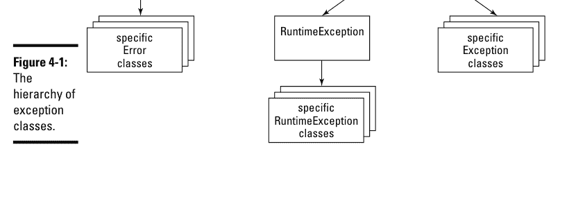

以下段落描述了该层次结构中的每个类：

-   **Throwable**：异常层次结构的根是 `Throwable` 类。这个类表示任何可以用 `throw` 语句抛出并用 `catch` 子句捕获的对象。

-   **Error**：`Throwable` 的这个子类表示合理的程序无法从中恢复的严重错误条件。这个类的子类表示可能发生的具体错误类型。例如，如果虚拟机内存不足，就会抛出 `VirtualMachineError`。你不必担心在程序中捕获这些错误。

-   **Exception**：`Throwable` 的这个子类表示大多数程序应该尝试从中恢复的错误条件。因此，`Exception` 实际上是你用 `try/catch` 语句捕获的异常类型的层次结构顶部。除了 `RuntimeException`（抱歉，双关），`Exception` 的子类表示必须被捕获或抛出的具体受检异常类型。请注意，其中一些子类还有自己的子类。例如，名为 `IOException` 的异常类有超过 25 个子类，表示可能发生的各种 I/O 异常。

-   **RuntimeException**：`Exception` 的这个子类表示非受检异常。你不必捕获或抛出非受检异常，但如果你想的话也可以这样做。`RuntimeException` 的子类包括 `NullPointerException` 和 `ArithmeticException`。

如果你的应用程序需要抛出自定义异常，你可以创建一个继承此层次结构中任何类的异常类。但通常情况下，你会从 `Exception` 类开始创建自定义受检异常。下一节将解释如何做到这一点。

#### 创建异常类

要创建自定义异常类，你只需定义一个扩展 Java 异常层次结构中某个类的类。通常，你扩展 `Exception` 来创建自定义受检异常。

例如，假设你正在开发一个从文件或数据库检索产品数据的类，并且你希望遇到 I/O 错误的方法抛出自定义异常，而不是 Java API 中提供的通用 `IOException`。你可以通过创建一个扩展 `Exception` 类的类来实现这一点：

```java
public class ProductDataException extends Exception
{
}
```


遗憾的是，构造函数不被视为类成员，因此在扩展类时不会被继承。结果，`ProductDataException` 只有一个默认构造函数。`Exception` 类本身以及大多数其他异常类，都有一个允许你传递一个字符串消息的构造函数，该消息会随异常一起存储，并可通过 `getMessage` 方法检索。因此，你想为你的类添加这个构造函数。这意味着你也想添加一个显式的默认构造函数。所以 `ProductDataException` 类现在看起来像这样：

```
public class ProductDataException extends Exception
{
    public ProductDataException
    {
    }

    public ProductDataException(String message)
    {
        super(message);
    }
}
```

尽管可能，但在自定义异常类中添加额外的字段或方法是不常见的。

### 抛出自定义异常

对于任何异常，你都使用 `throw` 语句来抛出自定义异常。你通常在捕获某个其他更通用异常的 `catch` 子句中编写这个 `throw` 语句。例如，这是一个从文件中检索产品数据的方法，如果发生 `IOException`，则抛出 `ProductDataException`：

```
public class ProductDDB
{
    public static Product getProduct(String code)
        throws ProductDataException
    {
        try
        {
            Product p;
            // 从文件中获取产品的代码
            // 可能抛出 IOException
            p = new Product();
            return p;
        }
        catch (IOException e)
        {
            throw new ProductDataException(
                "An IO error occurred.");
        }
    }
}
```

### 创建自定义异常

以下是一些调用 `getProduct` 方法并捕获异常的代码：

```
try
{
    Product p = ProductDB.getProduct(productCode);
}
catch (ProductDataException e)
{
    System.out.println(e.getMessage());
}
```

这里，如果抛出 `ProductDataException`，消息只是显示在控制台上。在实际程序中，你想记录错误、通知用户，并弄清楚如何优雅地继续程序，即使发生了这个数据异常。

## 第五章：使用抽象类和接口

**本章内容**

- ✓ 抽象方法和类
- ✓ 基本接口
- ✓ 将接口用作类型
- ✓ 向接口添加常量
- ✓ 继承接口
- ✓ 使用回调

在本章中，你将了解如何使用两种相似但微妙不同的特性：抽象类和接口。两者都允许你将类实现的方法和字段的签名与类本身分开声明。抽象类通过继承来实现这一点。接口则不使用继承来实现，但效果相似。

#### 使用抽象类

Java 允许你声明一个方法或整个类是 *abstract* 的，这意味着该方法没有主体。抽象方法只是方法的原型：一个返回类型、一个名称、一个参数列表，以及（可选的）一个 `throws` 子句。

要创建一个抽象方法，你需要指定修饰符 `abstract` 并将方法体替换为分号：

```
public abstract int hit(int batSpeed);
```

这里，名为 `hit` 的方法被声明为一个抽象方法，它返回一个 `int` 值并接受一个 `int` 参数。

包含至少一个抽象方法的类称为 *abstract class*，并且必须在类声明上使用 `abstract` 修饰符进行声明。例如：

### 294 使用抽象类

```
public abstract class Ball
{
    public abstract int hit(int batSpeed);
}
```

如果你在类声明中省略了 `abstract` 修饰符，Java 编译器会抛出一个错误消息来提醒你该类必须声明为 `abstract`。

抽象类不能被实例化。因此，给定前面的声明，以下行将无法编译：

```
Ball b = new Ball();    // error: Ball is abstract
```

#### 抽象工厂模式

抽象类的一个常见用途是在你事先不知道需要哪个子类时，提供一种获取几个子类之一实例的方法。为此，你可以创建一个 `Abstract Factory` 类，该类有一个或多个返回抽象类子类的方法。

例如，假设你想创建一个 `Ball` 对象，但你想让用户选择是创建 `SoftBall` 还是 `BaseBall`。要使用抽象工厂模式，你可以创建一个类（我称之为 `BallFactory`），它有一个名为 `getBallInstance` 的方法。该方法接受一个 String 参数，如果你想创建 `BaseBall` 对象，则设置为 "BaseBall"，如果想创建 `SoftBall` 对象，则设置为 "SoftBall"。

以下是工厂类：

```
class BallFactoryInstance
{
    public static Ball getBall(String t)
    {
        if (s.equalsIgnoreCase("BaseBall"))
            return new BaseBall();
        if (s.equalsIgnoreCase("SoftBall"))
            return new SoftBall();
        return null;
    }
}
```

然后，假设 String 变量 `userChoice` 已根据用户选择设置，你可以像这样创建所选类型的球对象：

```
Ball b = BallFactory.getBallInstance(userChoice);
```

在实际应用中，使用 `enum` 变量而不是 String 变量来指示要返回的对象类型会更好。

这里的问题不在于将变量 b 声明为 Ball 类型。而在于试图使用 `new` 关键字与 Ball 类一起创建 Ball 对象。因为 Ball 是一个抽象类，你不能用它来创建对象实例。

你可以像这样从抽象类创建一个子类：

```
public class BaseBall extends Ball
{
    public int hit(int batSpeed)
    {
        // 实现 hit 方法的代码放在这里
    }
}
```

当你继承一个抽象类时，子类必须为抽象类中的每个抽象方法提供实现。换句话说，它必须用一个非抽象方法覆盖每个抽象方法。（如果它没有这样做，那么子类也是抽象的，因此它也不能被实例化。）

抽象类在你想创建一个通用类型用作两个或多个子类的超类，但超类本身不代表实际对象时很有用。例如，如果所有员工都是领薪或小时工，那么创建一个抽象的 Employee 类是有意义的，然后将其用作 SalariedEmployee 和 HourlyEmployee 子类的基类。

关于抽象类，这里有几个要点需要思考：

- 并非抽象类中的所有方法都必须是抽象的。一个类可以为它的一些方法提供实现，但不能为另一些提供。事实上，你可以将一个没有任何抽象方法的类声明为抽象的。在这种情况下，该类不能被实例化。
- 私有方法不能是抽象的。这很合理，因为子类不能覆盖私有方法，而抽象方法必须被覆盖。
- 虽然你不能创建抽象类的实例，但你可以使用抽象类作为其类型来声明一个变量。然后，使用该变量来引用抽象类的任何子类的实例。
- 一个类不能同时指定 `abstract` 和 `final`。这会导致那些会导致整个宇宙彻底湮灭的逻辑悖论之一。嗯，希望效果会局部化。但重点是，因为 `abstract` 类只有在你子类化它时才能使用，而 `final` 类不能被子类化，所以允许你为同一个类同时指定 `abstract` 和 `final` 是没有意义的。

### 296 使用接口

抽象类在 Java API 中被广泛使用。许多抽象类的名称以 `Abstract` 开头，例如 `AbstractBorder`、`AbstractCollection` 和 `AbstractMap`。但大多数抽象类不是这样。例如，`InputStream` 类（由 `System.in` 使用）就是抽象的。

#### 使用接口

*interface* 类似于抽象类。然而，它只能包含抽象方法和最终字段（常量），并且不能用作基类。相反，一个类通过为接口声明的每个方法提供实现来 *implements* 一个接口。

接口比继承有两个优点：

- 接口比继承更容易使用，因为你不必担心在接口中提供任何实现细节。
- 一个类只能扩展另一个类，但根据需要它可以实现任意多个接口。

以下各节详细描述了创建和使用接口。

#### 创建基本接口

这是一个基本接口，它定义了一个名为 `Playable` 的方法，该方法包含一个名为 `play` 的方法：

```
public interface Playable
{
    void play();
}
```

这个接口声明，任何实现 `Playable` 接口的类都必须为一个名为 `play` 的方法提供实现，该方法不接受参数，也不返回值。

这个接口有几个有趣的细节：

- 接口本身被声明为 `public`，以便其他类可以使用它。就像公共类一样，公共接口必须在与其同名的文件中声明。因此，此接口必须在名为 `Playable.java` 的文件中。
- 接口的名称（`Playable`）是一个形容词。大多数接口使用形容词而不是名词来命名，因为它们描述了实现接口的类的一些额外能力或特性。因此，实现 `Playable` 接口的类表示可以被播放的对象。


#### 使用接口

如果你有一段时间没上英语课了，提醒一下：*形容词*是一种修饰名词的词。你可以通过在动词末尾加上 –able 将许多动词转换为形容词。例如：*可玩的、可读的、可驾驶的*和*可停止的*。这类形容词常用于接口名称。

另一种常见的接口命名方式是将形容词与名词组合，表明该接口为特定类型的对象添加了某些功能。例如，你可以将一个提供卡牌游戏特有方法的接口命名为 `CardGame`。该接口可能包含 `deal`（发牌）、`shuffle`（洗牌）和 `getHand`（获取手牌）等方法。

接口中的所有方法都被假定为 `public`（公共）和 `abstract`（抽象）。如果你愿意，可以在接口方法上编写 `public` 和 `abstract` 关键字。但这被认为是不好的做法，因为它可能暗示你认为默认是私有（`private`）的且非抽象。

#### 实现接口

要实现一个接口，一个类必须做两件事：

-   它必须在其类声明中指定一个 `implements`（实现）子句。
-   它必须为接口声明的每个方法提供实现。

例如，这是一个实现了 `Playable` 接口的类：

```java
public class TicTacToe implements Playable
{
    // 此处可添加额外的字段和方法

    public void play()
    {
        // 游戏进行的代码放在这里
    }

    // 此处可添加额外的字段和方法
}
```

这里，`TicTacToe` 类的声明指定了 `implements Playable`。然后，类体中包含了 `play` 方法的实现。

一个类可以实现多个接口：

```java
public class Hearts implements Playable, CardGame
{
    // 必须实现 Playable 和 CardGame 接口的方法
}
```

## 第三册
第5章
使用抽象类和接口

298 使用接口

这里，`Hearts` 类实现了两个接口：`Playable` 和 `CardGame`。
一个类可以继承一个父类并实现一个或多个接口。例如：

```java
public class Poker extends Game
    implements Playable, CardGame
{
    // 继承 Game 类的所有成员
    // 必须实现 Playable 和 CardGame 接口的方法
}
```

#### 将接口用作类型

在 Java 中，接口是一种类型，就像类一样。因此，你可以将接口用作变量、参数或方法返回值的类型。
考虑以下代码片段：

```java
Playable game = getGame();
game.play();
```

这里，我假设 `getGame` 方法返回一个实现了 `Playable` 接口的对象。在第一行语句中，该对象被赋值给一个类型为 `Playable` 的变量。然后，第二行语句调用该对象的 `play` 方法。
再举一个稍微复杂点的例子，假设你有一个名为 `Dealable` 的接口，其中定义了一个名为 `deal` 的方法，该方法接受要发的牌数作为参数：

```java
public interface Dealable
{
    void deal(int cards);
}
```

现在，假设你有一个名为 `startGame` 的方法，它接受两个参数：一个 `Dealable` 对象和一个 `String`，用于指示要玩什么游戏。这个方法可能看起来像这样：

```java
private void startGame(Dealable deck, String game)
{
    if (game.equals("Poker"))
        deck.deal(5);
    else if (game.equals("Hearts"))
        deck.deal(13);
    else if (game.equals("Gin"))
        deck.deal(10);
}
```

假设你还有一个名为 `CardDeck` 的类实现了 `Dealable` 接口，你可能会使用类似下面这样的语句来开始一局红心大战（Hearts）：

```java
Dealable d = new CardDeck();
startGame(d, "Hearts");
```

请注意，变量 `d` 被声明为 `Dealable` 类型。你同样可以将其声明为 `CardDeck` 类型：

```java
CardDeck d = new CardDeck();
startGame(d, "Hearts");
```

因为 `CardDeck` 类实现了 `Dealable` 接口，所以它可以作为参数传递给 `startGame` 方法。

### 使用接口能做的更多事情

接口不仅仅是创建抽象方法。以下部分描述了一些使用接口可以做的额外有趣的事情。请继续阅读...

#### 向接口添加字段

除了抽象方法，接口还可以包含 `final` 字段——即常量。接口字段用于提供与该接口相关的常量值。例如：

```java
public interface GolfClub
{
    int DRIVER = 1;
    int SPOON = 2;
    int NIBLICK = 3;
    int MASHIE = 4;
}
```

这里，任何实现 `GolfClub` 接口的类都可以使用这四个字段常量。

> 请注意，接口字段被自动假定为 `static`（静态的）、`final`（最终的）和 `public`（公共的）。你在创建接口常量时可以包含这些关键字，但不是必须的。

#### 扩展接口

你可以使用 `extends`（扩展）关键字来扩展接口。扩展现有接口的接口称为子接口，被扩展的接口称为超接口。

300 使用接口能做的更多事情

当你对接口使用 `extends` 关键字时，超接口的所有字段和方法都会被有效地复制到子接口中。因此，子接口由其自身的字段和方法以及超接口的字段和方法组合而成。

下面是一个例子：

```java
public interface ThrowableBall
{
    void throwBall();
    void catchBall();
}

public interface KickableBall
{
    void kickBall();
    void catchBall();
}

public interface PlayableBall
    extends ThrowableBall, KickableBall
{
    void dropBall();
}
```

这里声明了三个接口。第一个名为 `ThrowableBall`，定义了两个方法：`throwBall`（投球）和 `catchBall`（接球）。第二个名为 `KickableBall`，也定义了两个方法：`kickBall`（踢球）和 `catchBall`。第三个名为 `PlayableBall`，它扩展了 `ThrowableBall` 和 `KickableBall`，并添加了一个自己的方法，名为 `dropBall`（掉球）。

因此，任何实现 `PlayableBall` 接口的类都必须为四个方法提供实现：`throwBall`、`catchBall`、`kickBall` 和 `dropBall`。请注意，由于 `ThrowableBall` 和 `KickableBall` 接口中定义的 `catchBall` 方法具有相同的签名，所以 `PlayableBall` 接口中只包含一个版本的 `catchBall` 方法。

#### 使用接口实现回调

在剧院里，回调（callback）是指你参加初次试演，他们对你的表现很满意，所以希望你能再来一次以便他们再看看你。

在 Java 中，`回调`有点像这样。它是一种编程技术，一个对象让另一个对象知道，每当某个事件发生时，第二个对象应该调用第一个对象的某个方法。第一个对象被称为`事件监听器`（event listener），因为它会耐心等待直到另一个对象调用它。第二个对象被称为`事件源`（event source），因为它是导致对监听器进行调用的事件的来源。

#### 标记接口模式

*标记接口*是一种没有任何成员的接口。它存在的唯一目的是将一个类标识为属于一组具有某种能力或具有某些共同特性的类。

标记接口最著名的例子是 Java API 的 `Cloneable` 接口。它标记了可以被克隆的类。所有类最终都继承的 `Object` 类提供了一个名为 `clone` 的方法，该方法可用于创建对象的副本。但是，只有当对象实现了 `Cloneable` 接口时，才允许调用 `clone` 方法。如果你尝试对一个没有实现 `Cloneable` 的对象调用 `clone`，将会抛出 `CloneNotSupportedException` 异常。（有关 `clone` 方法的更多信息，请参阅第三册第 6 章。）

这是 `Cloneable` 接口的实际代码：

```java
public interface Cloneable {
}
```

在某些情况下，你可能会发现标记接口在你自己的应用程序中也有用。例如，如果你正在开发一系列用于创建游戏的类，你可能会创建一个名为 `Winnable` 的标记接口，用来区分有赢家的游戏和仅为娱乐而玩的游戏。

好吧，我用剧院打的比方有点牵强。Java 中的回调其实并不太像你争取重要角色时的那种回调。回调更像是当你需要联系某人时，你知道他们不在，于是你打电话过去，在他们的语音信箱里留下你的电话号码，以便他们能回电给你。

Java 中使用一组为此目的设计的接口来处理回调。回调最常见的用途是在使用 Swing 构建的图形应用程序中，你创建事件监听器来处理用户界面事件，例如鼠标点击。

你可以在第六册中全面了解 Swing。现在，我们来看看使用 `Timer` 类（它是 `javax.swing` 包的一部分）实现的回调。这个类实现了一个基本的计时器，它会定期生成事件，并允许你设置一个监听器对象来处理这些事件。监听器对象必须实现 `ActionListener` 接口，该接口定义了一个名为 `actionPerformed` 的方法，该方法会在每个计时器事件发生时被调用。

`Timer` 类构造函数接受两个参数：

-   第一个参数是一个 `int` 值，表示计时器事件发生的频率。


## 302 接口的更多用途

第二个参数是一个实现了 `ActionListener` 接口的对象。每当计时器事件发生时，该对象的 `actionPerformed` 方法就会被调用。

`ActionListener` 接口在 `java.awt.event` 包中定义。它包含以下代码：

```java
public interface ActionListener extends EventListener {
    /**
     * Invoked when an action occurs.
     */
    public void actionPerformed(ActionEvent e);
}
```

如你所见，`ActionListener` 接口由一个名为 `actionPerformed` 的方法组成。它接收一个类型为 `ActionEvent` 的参数，但你在此处并未使用这个参数。（不过你确实在第六册中使用了 `ActionEvent` 类。）

`Timer` 类有大约 20 个方法，但我在这里只讨论其中一个：`start` 方法，它用于启动计时器。此方法不需要任何参数，也不返回任何值。

清单 5-1 展示了一个程序，它使用 `Timer` 类每隔一秒钟在控制台上交替显示消息 `Tick...` 和 `Tock...`。`JOptionPane` 类用于显示一个对话框；程序将运行直到用户点击该对话框中的 OK 按钮。图 5-1 展示了 Tick Tock 程序的运行情况。

```java
清单 5-1：TICK TOCK 程序
import java.awt.event.*;
import javax.swing.*;

public class TickTock
{
    public static void main(String[] args)
    {
        // 创建一个计时器，每隔一秒
        // 调用 Ticker 类
        Timer t = new Timer(1000, new Ticker());
        t.start();

        // 显示一个消息框，防止
        // 程序立即结束
        JOptionPane.showMessageDialog(null,
            "Click OK to exit program");
    }
}

class Ticker implements ActionListener
{
    private boolean tick = true;

    public void actionPerformed(ActionEvent event)
    {
        if (tick)
        {
            System.out.println("Tick...");
        }
        else
        {
            System.out.println("Tock...");
        }
        tick = !tick;
    }
}
```

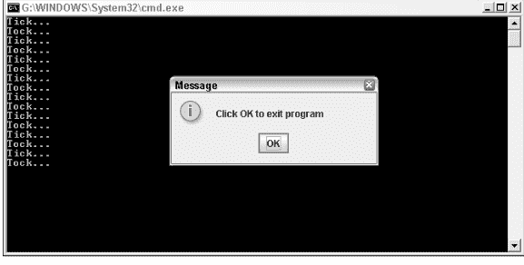

**第三册 第5章**

**使用抽象类与接口**

**图 5-1：运行中的 Tick Tock 应用程序。**

以下段落描述了此程序运行的重要细节：

1.  `ActionListener` 接口是 `java.awt.event` 包的一部分，因此需要这个 `import` 语句。
2.  `Timer` 类是 `javax.swing` 包的一部分，因此需要这个 `import` 语句。
3.  此语句创建了一个新的 `Timer` 对象。计时器的间隔设置为 1000 毫秒——相当于一秒钟。一个新的 `Ticker` 类实例作为第二个参数传递。计时器在每次计时器滴答时调用此对象的 `actionPerformed` 方法——换句话说，每秒一次。
4.  此语句调用 `start` 方法来启动计时器。
5.  `JOptionPane` 类用于显示一个对话框，告诉用户点击 OK 按钮以停止应用程序。你可能认为我包含这个对话框是为了给用户提供一种结束程序的方法。但实际上，我用它来给计时器一些运行时间。如果你在启动计时器后立即结束 `main` 方法，应用程序就会结束，从而终止计时器。通过在这里使用 `JOptionPane`，只要对话框显示，应用程序就会继续运行。（有关 `JOptionPane` 的更多信息，请参阅第二册，第 2 章。）
6.  `Ticker` 类的声明，它实现了 `ActionListener` 接口。
7.  一个私有的布尔类字段，用于跟踪 `Ticker` 显示的是 `Tick...` 还是 `Tock...`。每次调用 `actionPerformed` 方法时，此字段的值就会切换。
8.  `actionPerformed` 方法，在每个计时间隔时被调用。
9.  如果 `tick` 为 true，则在控制台上打印 `Tick...`。
10. 如果 `tick` 为 false，则在控制台上打印 `Tock...`。
11. 切换 `tick` 变量的值。换句话说，如果 `tick` 为 true，则将其设置为 `false`。如果 `tick` 为 false，则将其设置为 `true`。

## 第6章：使用Object和Class类

### 本章内容

- 使用 toString 方法
- 实现 equals 方法
- 尝试使用 clone 方法
- 理解 Class 类

在本章中，你将了解如何使用 Java API 中两个对面向对象编程至关重要的类：

- `Object` 类，每个其他类都继承自它——包括 Java API 中的所有类和你创建的任何类
- `Class` 类，用于获取对象类型的信息

> 如果可以的话，我想给整个章节都打上“技术资料”的标签。所有这些内容都偏向技术性，许多 Java 程序员多年都没有理解或使用过它们。尽管如此，我建议你仔细阅读本章。即使并非所有内容都能完全理解，它也可能有助于解释为什么 Java 中的一些东西并不像你认为的那样工作，并且本章中的信息可能在将来帮助你从困境中解脱出来。

### 所有类的母类：Object

`Object` 是所有类的母类。在 Java 中，每个类最终都继承自 `Object` 类。这个类提供了一组方法，可供每个 Java 对象使用。

#### 每个对象都是一个 Object

任何没有 `extends` 子句的类都隐式地继承自 `Object`。因此，你永远不需要编写像这样的类：

```java
public class Product extends Object...
```

如果一个子类有 `extends` 子句，指定了除 `Object` 之外的父类，该类仍然继承 `Object`。这是因为继承层次结构最终会到达一个没有 `extends` 子句的父类，而该父类继承自 `Object` 并将其传递给所有子类。

例如，假设你有这些类：

`public class Manager extends SalariedEmployee...`

`public class SalariedEmployee extends Employee...`

`public class Employee extends Person...`

`public class Person...`

这里，`Manager` 类间接地继承了 `Object` 类，因为它继承自 `SalariedEmployee`，后者继承自 `Employee`，后者继承自 `Person`，而 `Person` 继承自 `Object`。

在 Java 中，创建一个不继承 `Object` 的类是不可能的。


#### 将 Object 用作类型

如果你不知道或不关心变量引用的对象类型，你可以将其类型指定为 `Object`。例如，以下代码完全合法：

`Object emp = new Employee();`

然而，你无法对 `emp` 变量执行任何有用的操作，因为编译器不知道它是一个 `Employee`。例如，如果 `Employee` 类有一个名为 `setLastName` 的方法，以下代码将无法工作：

`Object emp = new Employee();`
`emp.setLastName("Smith");      // 错误：无法编译`

因为 `emp` 是一个 `Object`，而不是一个 `Employee`，编译器不知道 `setLastName` 方法。

请注意，你仍然可以将对象强制转换为 `Employee`：

`Object emp = new Employee();`
`((Employee)emp).setLastName("Smith");   // 这样可以工作`

但这有什么意义呢？你还不如一开始就将 `emp` 声明为 `Employee`。

然而，在某些情况下，将变量、参数或返回类型声明为 `Object` 确实完全合理。例如，Java API 提供了一组设计用于维护对象集合的类。这些类中最常用的一个是 `ArrayList` 类。它有一个名为 `add` 的方法，接受一个 `Object` 作为参数。此方法将指定的对象添加到集合中。因为参数类型是 `Object`，所以你可以使用 `ArrayList` 类创建任何类型对象的集合。（有关 `ArrayList` 类和其他集合类的更多信息，请参阅第四册。）

#### Object 类的方法

表 6-1 列出了 `Object` 类的所有方法。通常，我不会列出一个类的所有方法——我只会列出我认为最有用的那些。然而，由于 `Object` 在面向对象编程的游戏中如此重要，我认为最好向你展示它的所有功能，尽管其中一些功能有点晦涩。

我警告过你，整个章节都应该有一个技术资料图标。


##### 表 6-1 Object 类的方法

| 方法 | 功能 |
| :--- | :--- |
| `protected Object clone()` | 返回此对象的一个副本。 |
| `boolean equals(Object obj)` | 指示此对象是否等于 `obj` 对象。 |
| `protected void finalize()` | 当对象被销毁时由垃圾收集器调用。 |
| `Class getClass()` | 返回一个 `Class` 对象，该对象表示此对象的运行时类。 |
| `int hashCode()` | 返回此对象的哈希码值。 |
| `void notify()` | 与多线程应用程序一起使用，用于唤醒一个正在此对象上等待的线程。 |
| `void notifyAll()` | 与多线程应用程序一起使用，用于唤醒所有正在此对象上等待的线程。 |
| `String toString()` | 返回此对象的 `String` 表示形式。 |
| `void wait()` | 导致此对象的线程等待，直到另一个线程调用 `notify` 或 `notifyAll`。 |
| `void wait(Long timeout)` | 基本 `wait` 方法的一个变体。 |
| `void wait(Long timeout, int nanos)` | `wait` 方法的另一个变体。 |

*注意*：这些方法中几乎有一半（`notify`、`notifyAll` 和三个 `wait` 方法）与多线程有关。你可以在第五册第 1 章中找到关于这五个方法的完整信息。以下是对其余六个方法的概述：


## 308 所有类之母：Object

- **clone**：此方法常用于创建对象的副本，在自己的类中重写它也不少见。本章后面的“clone 方法”一节将详细解释此方法。
- **equals**：此方法常用于比较对象。任何表示可与其他对象进行比较的对象的类都应该重写此方法。欲了解更多信息，请参阅本章后面的“equals 方法”一节。
- **finalize**：当垃圾收集器发现一个对象不再被使用且可以被丢弃时，会调用此方法。此方法的意图是允许你创建在自身清理后，在被丢弃之前通过关闭打开的文件和执行其他清理任务来清理自身的对象。但由于 Java 垃圾收集器的工作方式，并不能保证 `finalize` 方法一定会被调用。因此，此方法并不常用。
- **getClass**：此方法有时与 Class 类结合使用，我将在本章后面的“Class 类”一节中进行描述。
- **hashCode**：每个 Java 对象都有一个哈希码，它是类的 `int` 表示形式，对于某些操作很有用。在你开始使用哈希表之前，这个方法并不是特别重要，而哈希表是一种相当高级的技术，最好留给那些戴着口袋保护套、用胶带粘着眼镜的人。
- **toString**：此方法是 Java 中最常用的方法之一。我将在本章后面的“toString 方法”一节中进行描述。

### 原始类型不是对象

我需要指出，原始类型，如 `int` 和 `double`，不是对象。因此，它们不继承 `Object` 类，也无法访问上一节中列出的方法。

因此，以下代码将无法工作：

```
int x = 50;
String s = x.toString();  // 错误：无法编译
```

如果你确实想以这种方式将 `int` 转换为字符串，可以使用包装类（如 `Integer`）从值创建一个对象，然后调用其 `toString` 方法：

```
String s = new Integer(x).toString();  // 正确
```

每个包装类还定义了一个静态的 `toString` 方法，你可以这样使用：

```
String s = Integer.toString(x);
```

有时使用编译器快捷方式，让你在字符串连接表达式中使用原始类型会更容易：

```
String s = "" + x;
```

这里，`int` 变量 `x` 与一个空字符串连接。

这一切的重点是原始类型不是对象，因此它们不从 `Object` 继承任何东西。如果你想将原始值当作对象处理，可以使用原始类型的包装类，正如我在第二卷第二章中所描述的。

### toString 方法

`toString` 方法返回对象的字符串表示形式。默认情况下，`toString` 方法返回对象的类名加上其哈希码。在接下来的章节中，我将向你展示如何使用 `toString` 方法，以及如何在自己的类中重写它以创建更有用的字符串。

#### 使用 toString

这是一个使用 `toString` 方法的简单程序：

```
public class TestToString
{
    public static void main(String[] args)
    {
        Employee emp = new Employee("Martinez",
            "Anthony");
        System.out.println(emp.toString());
    }
}

class Employee
{
    private String lastName;
    private String firstName;

    public Employee(String lastName, String firstName)
    {
        this.lastName = lastName;
        this.firstName = firstName;
    }
}
```

这里，这段代码创建了一个新的 `Employee` 对象，然后将其 `toString` 方法的结果打印到控制台。当你运行这个程序时，控制台上会打印以下内容：

```
Employee@82ba41
```

注意：哈希码——在本例中为 82ba41——在你的系统上可能不同。

事实证明，在这个例子中显式调用 `toString` 并非真正必要。我完全可以用以下方式编写 `main` 方法的第二行：

```
System.out.println(emp);
```

这是因为 `println` 方法会自动调用你传递给它的任何对象的 `toString` 方法。

#### 重写 toString

默认的 `toString` 实现在大多数情况下并不是很有用。例如，通过查看哈希码，你并不能真正了解到 `Employee` 对象的多少信息。如果 `toString` 方法返回对象中的一些实际数据，比如员工的名字，不是更好吗？

要做到这一点，你必须在你的类中重写 `toString` 方法。事实上，Java 面向对象编程的基本准则之一就是*总是*重写 `toString`。这是一个重写了 `toString` 的 `Employee` 类的简单程序：

```
public class TestToString
{
    public static void main(String[] args)
    {
        Employee emp = new Employee("Martinez",
            "Anthony");
        System.out.println(emp.toString());
    }
}
```

```
class Employee
{
    private String lastName;
    private String firstName;

    public Employee(String lastName, String firstName)
    {
        this.lastName = lastName;
        this.firstName = firstName;
    }

    public String toString()
    {
        return "Employee[" + this.firstName + " "
            + this.lastName + "]";
    }
}
```

当你运行这个程序时，控制台上会显示以下内容：

```
Employee[Anthony Martinez]
```

请注意，输出由类名后跟方括号中的一些对象数据组成。这种约定在 Java 编程中很常见。

> 前面示例的唯一问题是类名被硬编码到 `toString` 方法中。你可以使用 `getClass` 方法在运行时获取实际的类名：

```
public String toString()
{
    return this.getClass().getName() + "["
            + this.firstName + " "
            + this.lastName + "]";
}
```

这里，`getClass` 方法返回一个表示当前对象类的 `Class` 对象。然后，使用 `Class` 对象的 `getName` 方法来获取实际的类名。（你将在本章后面更多地了解 `Class` 对象。）

#### equals 方法

测试对象是否相等是任何面向对象编程语言的基本任务之一。不幸的是，Java 在这方面做得并不很好。例如，考虑这个程序：

```
public class TestEquality1
{
    public static void main(String[] args)
    {
        Employee emp1 = new Employee(
                "Martinez", "Anthony");
        Employee emp2 = new Employee(
                "Martinez", "Anthony");
        if (emp1 == emp2)
            System.out.println(
                    "These employees are the same.");
        else
            System.out.println(
                    "These are different employees.");
    }
}

class Employee
{
    private String lastName;
    private String firstName;

    public Employee(String lastName, String firstName)
    {
        this.lastName = lastName;
        this.firstName = firstName;
    }
}
```

这里，main 方法创建了两个具有相同数据的 Employee 对象，然后比较它们。唉，比较结果为 false。即使 Employee 对象具有相同的数据，它们也不被认为是相等的。这是因为相等运算符（==）比较的是对象引用，而不是对象包含的数据。因此，只有当 emp1 和 emp2 引用同一个 Employee 类的实例时，比较才返回 true。

如果你想创建仅在包含相同数据时才被认为是相等的对象，你必须做两件事：

1.  使用 equals 方法而不是相等运算符来比较它们。
2.  在你的类中重写 equals 方法，以基于对象的数据进行比较。

以下部分将描述这两个步骤。

#### 使用 equals

要使用 equals 方法而不是相等运算符来测试对象，你只需将比较表达式重写为如下形式：

```
if (emp1.equals(emp2))
    System.out.println("These employees are the same.");
else
    System.out.println("These are different");
```

这里，使用了 emp1 的 equals 方法将 emp1 与 emp2 进行比较。

默认情况下，equals 运算符返回与相等运算符相同的结果。因此，仅将 == 替换为 equals 方法不会有任何效果，除非你也重写了 equals 方法，如下一节所述。


使用哪个对象的 equals 方法并不重要。因此，以下 if 语句返回相同的结果：

```
if (emp2.equals(emp1))
    System.out.println("These employees are the same.");
else
    System.out.println("These are different employees.");
```


请注意，我刚才说的是“不应该有影响”。每次你重写`equals`方法时，都应确保比较在两个方向上都能正常工作。然而，草率的编程有时会导致`equals`方法出现`a`等于`b`，但`b`却不等于`a`的情况。所以要保持警惕。

#### 重写 equals 方法

你可以重写`equals`方法，以便对象能够基于它们的值进行比较。表面上看，你可能认为这很容易做到。例如，你可能会忍不住像这样为`Employee`类编写`equals`方法：

```
// 警告 -- 此代码中存在几处错误！
public boolean equals(Employee emp)
{
    if (this.getLastName().equals(emp.getLastName())
        && this.getFirstName().equals(emp.getFirstName())
    )
        return true;
    else
        return false;
}
```

这段代码的基本问题——以及编写一个好的`equals`方法的挑战——在于传递给`equals`方法的参数必须是一个`Object`，而不是一个`Employee`。这意味着`equals`方法必须准备好处理它遇到的任何情况。例如，有人可能尝试将一个`Employee`对象与一个`Banana`对象进行比较。或者与一个null进行比较。`equals`方法必须准备好处理所有可能性。

具体来说，Java API 文档指出，每次你重写`equals`方法时，你必须确保`equals`方法满足五个特定条件。以下是直接从 API 文档中引用的内容：

1.  **它是自反的。** 对于任何非空引用值 x，`x.equals(x)` 应返回 `true`。
2.  **它是对称的。** 对于任何非空引用值 x 和 y，当且仅当 `y.equals(x)` 返回 `true` 时，`x.equals(y)` 才应返回 `true`。
3.  **它是传递的。** 对于任何非空引用值 x、y 和 z，如果 `x.equals(y)` 返回 `true` 且 `y.equals(z)` 返回 `true`，那么 `x.equals(z)` 也应返回 `true`。
4.  **它是一致的。** 对于任何非空引用值 x 和 y，多次调用 `x.equals(y)` 应始终返回 `true` 或始终返回 `false`，前提是比较对象所用的信息没有被修改。
5.  对于任何非空引用值 x，`x.equals(null)` 应返回 `false`。

#### equals 方法

听起来令人困惑？幸运的是，它并不像最初看起来那么复杂。你可以安全地忽略传递规则，因为如果你其他规则处理得当，这一条会自动满足。而一致性规则基本上意味着你返回一致的结果。只要你不把对 `Math.random` 的调用扔进比较中，这就不应该是个问题。

以下是一个创建好的 `equals` 方法的通用公式（假设参数名为 obj）：

**1. 测试自反规则。**

使用类似这样的语句：

```
if (this == obj)
    return true;
```

换句话说，如果有人愚蠢到检查一个对象是否等于它自己，它应该返回 true。

**2. 测试非空规则。**

使用类似这样的语句：

```
if (this == null)
    return false;
```

Null 不等于任何东西。

**3. 测试 obj 是否与 this 类型相同。**

你可以使用 `getClass` 方法来做到这一点，像这样：

```
if (this.getClass() != obj.getClass())
    return false;
```

如果两个对象类型不同，它们就不可能相同。（起初可能不明显，但此测试是满足对称规则所必需的——即如果 x 等于 y，那么 y 也必须等于 x。）

**4. 将 obj 强制转换为你的类的一个变量。然后，比较你希望作为返回值基础的字段并返回结果。**

这是一个例子：

```
Employee emp = (Employee) obj;
return this.lastName.equals(emp.getLastName())
    && this.firstName.equals(emp.getFirstName());
```

注意，字符串值的字段比较使用了 `equals` 方法而不是 `==`。这是因为你不能信任 `==` 来比较字符串。如果你需要比较基本类型，可以使用 `==`。但你应该使用 `equals` 来比较字符串和任何其他引用类型。

将所有内容组合在一起，清单 6-1 展示了一个使用正确构造的 `equals` 方法比较两个 `Employee` 对象的程序。

##### 清单 6-1：比较对象

```
public class TestEquality2
{
    public static void main(String[] args)
    {
        Employee emp1 = new Employee(
            "Martinez", "Anthony");
        Employee emp2 = new Employee(
            "Martinez", "Anthony");
        if (emp1.equals(emp2))
            System.out.println(
                "These employees are the same.");
        else
            System.out.println(
                "These are different employees.");
    }
}

class Employee
{
    private String lastName;
    private String firstName;

    public Employee(String lastName, String firstName)
    {
        this.lastName = lastName;
        this.firstName = firstName;
    }

    public String getLastName()
    {
        return this.lastName;
    }

    public String getFirstName()
    {
        return this.firstName;
    }

    public boolean equals(Object obj)
    {
        // 一个对象必须等于它自己
        if (this == obj)
            return true;

        // 没有对象等于 null
        if (this == null)
            return false;

        // 不同类型的对象永远不相等
        if (this.getClass() != obj.getClass())
            return false;

        // 转换为 Employee，然后比较字段
        Employee emp = (Employee) obj;
        return this.lastName.equals(emp.getLastName())
            && this.firstName.equals(emp.getFirstName());
    }
}
```

以下是在此清单中值得注意的一些点：

-   创建了一个名为 Anthony Martinez 的 Employee 对象。
-   创建了另一个名为 Anthony Martinez 的 Employee 对象。
-   使用 equals 方法比较这两个 Employee 对象。
-   Employee 类。
-   重写的 equals 方法。
-   如果比较的是同一个对象实例，则返回 true。这满足了第一个相等性测试，即一个对象必须始终等于它自己。
-   如果被比较的对象为 null，则返回 false。这满足了最后一个相等性测试，即任何东西都不等于 null。
-   如果被比较的对象类型不正确，则返回 false。这有助于确保对称性测试，即如果 x 等于 y，那么 y 必须等于 x。
-   通过了其他测试后，你现在可以假设你正在比较两个不同的 Employee 对象。因此，下一步是将另一个对象强制转换为 Employee。
-   将另一个对象强制转换为 Employee 后，比较两个字段（lastName 和 firstName）并返回复合比较的结果。

#### clone 方法

克隆是指创建一个对象的精确副本的过程。不幸的是，这个过程在面向对象语言（如 Java）中被证明是一项相当困难的任务。你会认为克隆会像这样简单：

```
Employee emp1 = new Employee("Stewart", "Martha");
Employee emp2 = emp1;
```

然而，这段代码根本没有复制 Employee 对象。相反，你现在有两个变量指向同一个对象，这通常不是你想要的。例如，假设你执行了这些语句：

```
emp1.setLastName("Washington");
emp2.setLastName("Graham");
String lastName = emp1.getLastName();
```

这些语句执行后，`lastName` 返回的是 Washington 还是 Graham？正确答案是 Graham，因为 `emp1` 和 `emp2` 都指向同一个 Employee 对象。

相比之下，*clone* 是一个全新的对象，它具有与原始对象相同的值。你通常可以使用像这样的代码手动创建一个克隆：

```
Employee emp1 = new Employee("Stewart", "Martha");
Employee emp2 = new Employee();
emp2.setLastName(emp1.getLastName());
emp2.setFirstName(emp1.getFirstName());
emp2.setSalary(emp1.getSalary());
```

这里，创建了一个新的 Employee 对象，并将其字段设置为与原始对象相同的值。

Java 提供了一种更优雅的对象复制方法——`clone` 方法，所有类都可以使用它，因为它继承自 Object 类。然而，正如你将在以下部分中发现的，`clone` 方法可能难以创建和使用。因此，你只想为那些你认为确实能从克隆中受益的类实现它。

#### 实现 clone 方法

`clone` 方法由 Object 类定义，因此所有 Java 类都可以使用它。然而，`clone` 在 Object 类中被声明为具有 `protected` 访问权限。因此，给定类的 `clone` 方法只能在该类内部使用。如果你希望其他对象能够克隆你的对象，你必须重写 `clone` 方法并赋予它 public 访问权限。

请注意，Object 类定义的 `clone` 方法返回一个 Object 类型。这完全合理，因为 Object 类不知道你将在其中重写 `clone` 方法的类的类型。这带来一个不便的副作用：每当你调用一个重写了 `clone` 的类的 `clone` 方法时，你都必须将结果强制转换为所需的对象类型。


#### 克隆方法

清单 6-2 展示了一个克隆 `Employee` 对象的程序简单示例。简而言之，该程序重写了 `Employee` 类的 `clone` 方法。它创建了一个 `Employee` 对象，然后克隆了它。接着，它更改了原始 `Employee` 对象的名称，并将两个对象都打印到控制台。

```
清单 6-2：克隆示例

public class CloneTest
{
    public static void main(String[] args)
    {
        Employee emp1 = new Employee("Martinez", "Anthony");
        emp1.setSalary(40000.0);
        Employee emp2 = (Employee)emp1.clone();
        emp1.setLastName("Smith");
        System.out.println(emp1);
        System.out.println(emp2);
    }
}

class Employee
{
    private String lastName;
    private String firstName;
    private Double salary;

    public Employee(String lastName, String firstName)
    {
        this.lastName = lastName;
        this.firstName = firstName;
    }

    public String getLastName()
    {
        return this.lastName;
    }

    public void setLastName(String lastName)
    {
        this.lastName = lastName;
    }

    public String getFirstName()
    {
        return this.firstName;
    }

    public void setFirstName(String firstName)
    {
        this.firstName = firstName;
    }

    public Double getSalary()
    {
        return this.salary;
    }

    public void setSalary(Double salary)
    {
        this.salary = salary;
    }

    public Object clone()
    {
        Employee emp;
        emp = new Employee(
                this.lastName, this.firstName);
        emp.setSalary(this.salary);
        return emp;
    }

    public String toString()
    {
        return this.getClass().getName() + "["
                + this.firstName + " "
                + this.lastName + ", "
                + this.salary + "]";
    }
}
```

运行此程序后，控制台将显示以下几行：

```
Employee[Anthony Smith, 40000.0]
Employee[Anthony Martinez, 40000.0]
```

如你所见，第二个 `Employee` 对象的名称已被成功更改，且未影响第一个 `Employee` 对象的名称。

以下段落将重点介绍该程序的一些要点：

-   → 5 创建第一个 `Employee` 对象，代表名为 Anthony Martinez 的员工。
-   → 7 设置 Martinez 先生的薪水。
-   → 8 为 Martinez 先生的 `Employee` 对象创建一个克隆。注意，返回值必须强制转换为 `Employee` 类型，这是因为 `clone` 方法的返回值是 `Object` 类型。
-   → 9 更改第二个 Employee 对象的姓氏。
-   → 10 打印第一个 Employee 对象。
-   → 11 打印第二个 Employee 对象。
-   → 15 Employee 类。此类定义了私有字段来存储姓氏、名字和薪水，以及每个字段的 getter 和 setter 方法。
-   → 57 此方法重写了 clone 方法。注意，其返回类型是 Object，而不是 Employee。
-   → 60 使用当前对象的姓氏和名字创建一个新的 Employee 对象。
-   → 62 将新员工的薪水设置为当前对象的薪水。
-   → 63 返回克隆的 Employee 对象。

#### 使用 clone 创建浅拷贝

在前面的例子中，`clone` 方法手动创建原始对象的副本并返回。在许多情况下，这是创建克隆最简单的方法。但是，如果你的类有数百个或更多需要复制的字段，那么意外忘记复制某个字段的可能性就很高。并且，如果你后续向该类添加了一个字段，你可能忘记修改 `clone` 方法以包含新字段。

幸运的是，你可以通过直接在自己的 `clone` 方法中使用 `Object` 类的 `clone` 方法来解决这个问题。`Object` 类的 `clone` 方法可以自动创建一个对象的副本，该副本包含所有原始类型（如 `int` 和 `double`）字段的副本，以及不可变引用类型——最著名的是字符串——的副本。因此，如果你的类中的所有字段都是原始类型或字符串，你就可以使用 `Object` 类提供的 `clone` 方法来克隆你的类。

这种类型的克隆被称为*浅拷贝*，原因我将在下一节解释。

要从自己的 `clone` 方法中调用 `clone` 方法，只需指定 `super.clone()`。但在执行此操作之前，你必须完成两件事：

-   ◆ 声明该类支持 `Cloneable` 接口。`Cloneable` 是一个标记接口，不提供任何方法。它只是将一个类标记为适合克隆。
-   ◆ 将对 `super.clone()` 的调用包裹在 `try/catch` 语句中，以捕获 `CloneNotSupportedException` 异常。如果你尝试对未实现 `Cloneable` 接口的类调用 `clone`，就会抛出此异常。只要你实现了 `Cloneable`，此异常就不会发生。但由于 `CloneNotSupportedException` 是一个受检异常，你必须捕获它。

下面是一个使用 `super.clone()` 克隆自身的 Employee 类的示例：

```
class Employee implements Cloneable
{
    // 省略字段和方法...

    public Object clone()
    {
        Employee emp;
        try
        {
            emp = (Employee) super.clone();
        }
        catch (CloneNotSupportedException e)
        {
            return null;   // 永远不会发生
        }
        return emp;
    }
}
```

请注意，此方法无需知道 Employee 类中声明的任何字段。然而，此克隆方法仅适用于字段均为原始类型或不可变对象（如字符串）的类。

#### 创建深拷贝

类中的某些字段实际上是其他对象的情况并不少见。例如，`Employee` 类可能有一个 `Address` 类型的字段，用于存储每位员工的地址：

```
class Employee
{
    public Address address;

    // 省略其他字段和方法
}
```

如果是这种情况，`super.clone()` 方法将无法创建对象的完整副本。克隆体不会获得地址字段的克隆，而是与原始对象拥有对同一地址对象的引用。

为了解决这个问题，你必须对 `Employee` 对象进行*深拷贝*。深拷贝是指克隆体中主对象内的任何子对象也会被克隆。为了实现这一点，重写的 `clone` 方法首先调用 `super.clone()` 创建对象的浅拷贝，然后调用主对象包含的每个子对象的 `clone` 方法来创建这些对象的克隆。（当然，要使深拷贝正常工作，这些对象也必须支持 `clone` 方法。）

清单 6-3 展示了一个示例。这里，一个 `Employee` 类包含一个名为 `address` 的公共字段，该字段持有 `Address` 类的一个实例。如你所见，`Employee` 类的 `clone` 方法创建了 `Employee` 对象的浅拷贝，然后将副本的 `address` 字段设置为原始对象 `address` 字段的克隆。为了使此示例工作，`Address` 类也重写了 `clone` 方法。它的 `clone` 方法调用 `super.clone()` 来创建 `Address` 对象的浅拷贝。

##### 清单 6-3：创建深拷贝

```
public class CloneTest2
{
    public static void main(String[] args)
    {
        Employee emp1 = new Employee(
            "Martinez", "Anthony");
        emp1.setSalary(40000.0);
        emp1.address = new Address(
            "1300 N. First Street",
            "Fresno", "CA", "93702");
        Employee emp2 = (Employee)emp1.clone();

        System.out.println(
            "**** 克隆后 ****\n");
        printEmployee(emp1);
        printEmployee(emp2);

        emp2.setLastName("Smith");
        emp2.address = new Address(
            "2503 N. 6th Street",
            "Fresno", "CA", "93722");

        System.out.println(
            "**** 更改 emp2 后 ****\n");
        printEmployee(emp1);
        printEmployee(emp2);
    }
}
```


#### clone 方法

```java
private static void printEmployee(Employee e) // 30
{
    System.out.println(e.getFirstName()
        + " " + e.getLastName());
    System.out.println(e.address.getAddress());
    System.out.println("Salary: " + e.getSalary());
    System.out.println();
}
```

```java
class Employee implements Cloneable // 40
{
    private String lastName;
    private String firstName;
    private Double salary;

    public Address address; // 46

    public Employee(String lastName, String firstName)
    {
        this.lastName = lastName;
        this.firstName = firstName;
        this.address = new Address();
    }

    public String getLastName()
    {
        return this.lastName;
    }

    public void setLastName(String lastName)
    {
        this.lastName = lastName;
    }

    public String getFirstName()
    {
        return this.firstName;
    }

    public void setFirstName(String firstName)
    {
        this.firstName = firstName;
    }

    public Double getSalary()
    {
        return this.salary;
    }
```

**第三部分**
**第六章**
**使用 Object 和 Class 类**

#### clone 方法

```java
// 清单 6-3（续）

public void setSalary(Double salary)
{
    this.salary = salary;
}

public Object clone()
{
    Employee emp;
    try
    {
        emp = (Employee) super.clone();
        emp.address = (Address)address.clone();
    }
    catch (CloneNotSupportedException e)
    {
        return null;  // 永远不会发生
    }
    return emp;
}

public String toString()
{
    return this.getClass().getName() + "["
        + this.firstName + " "
        + this.lastName + ", "
        + this.salary + "]";
}
}

class Address implements Cloneable
{
    private String street;
    private String city;
    private String state;
    private String zipCode;

    public Address()
    {
        this.street = "";
        this.city = "";
        this.state = "";
        this.zipCode = "";
    }

    public Address(String street, String city,
                   String state, String zipCode)
    {
        this.street = street;
        this.city = city;
```

```java
this.state = state;
this.zipCode = zipCode;
}

public Object clone()
{
    try
    {
        return super.clone();
    }
    catch (CloneNotSupportedException e)
    {
        return null;   // 永远不会发生
    }
}

public String getAddress()
{
    return this.street + "\n"
        + this.city + ", "
        + this.state + " "
        + this.zipCode;
}
}
```

`CloneTest2` 类中的 `main` 方法创建一个 `Employee` 对象，并设置其姓名、薪水和地址。然后，它创建该对象的一个克隆体，并打印两个对象中包含的数据。接下来，它更改第二个雇员的姓氏和地址，并再次打印数据。以下是运行此程序时产生的输出：

```
**** 克隆后 ****

Anthony Martinez
1300 N. First Street
Fresno, CA 93702
Salary: 40000.0

Anthony Martinez
1300 N. First Street
Fresno, CA 93702
Salary: 40000.0

**** 更改 emp2 后 ****

Anthony Martinez
1300 N. First Street
Fresno, CA 93702
Salary: 40000.0
```

```text
Anthony Smith
2503 N. 6th Street
Fresno, CA 93722
Salary: 40000.0
```

正如你所看到的，两个 `Employee` 对象在克隆后拥有相同的数据。但在更改了第二个雇员的字段后，它们的数据就不同了。因此，你可以安全地更改其中一个对象的数据，而不会影响另一个对象。

以下段落描述了此程序的一些要点：

- **5** 创建一个名为 Anthony Martinez 的雇员。
- **8** 设置该雇员的地址。
- **11** 克隆该雇员。
- **13** 克隆后打印两个 `Employee` 对象。它们应该拥有相同的数据。
- **18** 更改第二个雇员的姓名。
- **19** 更改第二个雇员的地址。
- **23** 更改第二个雇员的数据后，打印两个 `Employee` 对象。此时这两个对象应该拥有不同的数据。
- **30** 一个用于打印 `Employee` 对象数据的实用方法。
- **40** `Employee` 类。注意，此类实现了 `Cloneable` 接口。
- **46** `address` 字段，用于保存 `Address` 类型的对象。
- **85** `Employee` 类中的 `clone` 方法。
- **90** 创建 `Employee` 对象的浅拷贝。
- **91** 创建 `Address` 对象的浅拷贝，并将其赋值给克隆后的 `Employee` 对象的 `address` 字段。
- **93** 捕获 `CloneNotSupportedException`，这永远不会发生，因为该类实现了 `Cloneable` 接口。编译器要求在此处使用 `try/catch` 语句，因为 `CloneNotSupportedException` 是一个受检异常。
- **97** 返回克隆后的 `Employee` 对象。
- **109** `Address` 类，它也实现了 `Cloneable` 接口。
- **133** `Address` 类的 `clone` 方法。
- **137** 返回 `Address` 对象的浅拷贝。

## Class 类

好了，同学们，在结束本章之前，我们来学习最后一个类：`Class` 类。这可能会有点令人困惑，所以请开动脑筋。Java 应用程序中使用的每个类在内存中都由一个 `Class` 类型的对象来表示。例如，如果你的程序使用 `Employee` 对象，那么也会有一个对应于 `Employee` 类的 `Class` 对象。这个 `Class` 对象包含的信息不是关于特定雇员的，而是关于 `Employee` 类本身的。

你已经见过如何使用 `getClass` 方法获取一个 `Class` 对象。此方法由 `Object` 类定义，因此每个对象都可以使用它。例如：

```java
Employee emp = new Employee();
Class c = emp.getClass();
```

请注意，在调用其 `getClass` 方法之前，必须先用对象实例初始化一个变量。这是因为 `getClass` 方法返回的 `Class` 对象对应于变量所引用的对象的类型，而不是变量被声明的类型。

例如，假设有一个 `HourlyEmployee` 类继承了 `Employee` 类。然后考虑以下语句：

```java
HourlyEmployee emp = new Employee();
Class c = emp.getClass();
```

这里，`c` 指向的是 `HourlyEmployee` 类的 `Class` 对象，而不是 `Employee` 类的。

`Class` 类有超过 50 个方法，但只有两个值得你关注：

- `getName()`：返回一个表示该类名称的字符串。
- `getSuperclass()`：返回另一个 `Class` 对象，表示该 `Class` 对象的超类。

如果你对 `Class` 类的其他功能感兴趣，可以随时查看 Java API 文档。

`getClass` 方法最常见的用途之一是通过比较两个对象的 `Class` 对象来判断它们是否属于同一类型。这行得通，因为 Java 保证对于应用程序中使用的每个不同类，`Class` 对象只有一个实例。因此，即使你的应用程序实例化了 1,000 个 `Employee` 对象，`Employee` 类也只有一个 `Class` 对象。

因此，以下代码可以确定两个对象是否是同一类型的对象：

```java
Object o1 = new Employee();
Object o2 = new Employee();
if (o1.getClass() == o2.getClass())
    System.out.println("它们是相同的。");
else
    System.out.println("它们不是相同的。");
```

在这个例子中，两个对象的类型都是 `Employee`，所以比较结果为真。

要确定一个对象是否是特定类型，可以使用该对象的 `getClass` 方法获取对应的 `Class` 对象。然后，使用 `getName` 方法获取类名，并通过字符串比较来检查类名。例如：

```java
if (emp.getClass().getName().equals("Employee"))
    System.out.println("这是一个雇员对象。");
```

如果一长串方法调用让你头疼，你可以将其拆分开来：

```java
Class c = emp.getClass();
String s = c.getName();
if (s.equals("Employee"))
    System.out.println("这是一个雇员对象。");
```

结果是一样的。


## 第7章：使用内部类

**本章内容**

- 使用内部类
- 创建静态内部类
- 实现匿名类

本章将介绍三种高级类类型的使用方法：内部类、静态内部类和匿名内部类。这三者在特定场景下都很有用。特别是，内部类和匿名内部类常与使用Swing创建的图形应用程序配合使用。关于Swing的更多信息，请参阅第六卷。本章将重点讲解创建这些类类型的机制。

再次说明，本章几乎每段旁边都可能标有技术性内容图标。本章介绍的部分信息的实用性可能看似存疑。但请相信，当你开始编写Swing应用程序时，就会需要这些知识。如果你想暂时跳过本章，也没问题。在学习Swing并需要了解内部类和匿名内部类工作原理时，你随时可以回来阅读。

### 声明内部类

*内部类*是在另一个类内部声明的类。因此，创建内部类的基本结构如下：

```
class outerClassName
{
    private class innerClassName
    {
        // body of inner class
    }
}
```

包含内部类的类称为*外部类*。可以为内部类使用可见性修饰符来指定该类应该是*public*、*protected*还是*private*。这种可见性决定了其他类是否能看到该内部类。

### 理解内部类

表面上看，内部类只是包含在另一个类内部的类。但事实远不止如此。以下是关于内部类的一些要点：

-   内部类自动拥有对外部类所有字段和方法的访问权限——甚至是私有字段和方法。因此，内部类对其外部类的访问权限比子类对父类的访问权限更多。（子类可以访问父类的public和protected成员，但不能访问private成员。）
-   内部类携带一个指向外部类当前实例的引用，使其能够访问外部类的实例数据。
-   由于外部类实例引用的存在，你不能从外部类的静态方法中创建或引用内部类。不过，你可以创建一个静态内部类，正如本章后续“使用静态内部类”一节所述。
-   创建内部类的主要原因之一是为了创建一个仅对外部类有用的类。因此，通常将内部类声明为private，这样其他类就无法访问它们。
-   有时，内部类中的代码需要引用其外部类的实例。为此，可以列出外部类的名称，后跟点运算符和this。例如，如果外部类名为MyOuterClass，则可以使用MyOuterClass.this来引用外部类的实例。

### 示例

第三卷第5章介绍了一个使用Swing包中的Timer类（`javax.swing.Timer`）的应用程序，它会在控制台上以一秒间隔显示`Tick...`和`Tock...`行。它使用一个名为Ticker的类实现ActionListener接口来处理Timer对象的时钟事件。

在本章中，你将看到该应用程序的三个不同版本。如果你不清楚此应用程序如何使用Timer类显示`Tick...`和`Tock...`消息，或者为什么需要JOptionPane对话框，可以快速回顾第三卷第5章。

代码清单7-1展示了将Ticker类实现为内部类的应用程序版本。

```
代码清单7-1：使用内部类的Tick Tock程序

import java.awt.event.*;
import javax.swing.*;

public class TickTockInner
{
    private String tickMessage = "Tick...";
    private String tockMessage = "Tock...";

    public static void main(String[] args)
    {
        TickTockInner t = new TickTockInner();
        t.go();
    }

    private void go()
    {
        // create a timer that calls the Ticker class
        // at one second intervals
        Timer t = new Timer(1000, new Ticker());
        t.start();

        // display a message box to prevent the
        // program from ending immediately
        JOptionPane.showMessageDialog(null,
                "Click OK to exit program");
        System.exit(0);
    }

    class Ticker implements ActionListener
    {
        private boolean tick = true;

        public void actionPerformed(ActionEvent event)
        {
            if (tick)
            {
                System.out.println(tickMessage);
            }
            else
            {
                System.out.println(tockMessage);
            }
            tick = !tick;
        }
    }
}
```

### 观察者模式

Java中的事件监听器是Java模型的一部分，该模型称为委托事件模型。委托事件模型是更通用的设计模式——观察者模式的一种实现。当你需要创建在某个对象状态发生变化时能够相互交互的对象时，这种模式就非常有用。被监控变化的对象称为*可观察对象*，监控这些变化的对象称为*观察者对象*。观察者对象向可观察对象注册自己，然后当可观察对象状态发生变化时通知观察者对象。

在第六卷中，你会了解到更多关于Java如何实现这种事件处理模式的信息。但如果你感兴趣，可以研究一下Java API中的Observer和Observable接口。它们提供了创建观察者模式简单实现的标准方法。

以下段落描述了该程序的一些要点：

-   **6** 第7行定义的字符串变量`tickMessage`和`tockMessage`包含要打印在控制台上的消息。注意这些变量被定义为外部类的字段。正如你将看到的，内部类`Ticker`能够直接访问这些字段。
-   **11** 因为内部类只能被实例化的对象使用，你不能直接从静态`main`方法中使用它。因此，此程序中的`main`方法只是创建了应用类（`TickTockInner`）的一个实例。
-   **12** 这行代码执行新创建的`TickTockInner`类实例的`go`方法。
-   第11行和第12行使用的技巧是相当常见的编程技巧，它能让应用程序快速从静态上下文转入面向对象模式。
-   **15** 从第12行调用的`go`方法。
-   **19** 这行代码创建了`Timer`类的一个实例，定时器间隔设置为1000毫秒（1秒），`ActionListener`设置为内部类`Ticker`的一个新实例。
-   **24** 这里使用了`JOptionPane`类来显示一个对话框。这个对话框对于让定时器有机会运行是必要的。用户点击确定后应用程序结束。
-   **26** 这行代码调用`System`类的`exit`方法，它会立即关闭Java虚拟机。这里严格来说不需要这个方法调用，但如果你省略它，点击确定后定时器会继续运行几秒钟，直到JVM意识到应该终止定时器。
-   **29** 这行代码是内部类Ticker的声明。注意这个类实现了ActionListener接口。
-   **33** `actionPerformed`方法每隔1000毫秒被Timer对象调用一次。
-   **37** 在此行和第41行中，内部类直接访问了外部类的一个字段。

### 使用静态内部类

*静态内部类*类似于内部类，但不需要外部类的实例。其基本形式如下：

```
class outerClassName
{
    private static class innerClassName
    {
        // body of inner class
    }
}
```

与静态方法类似，静态内部类不能访问其外部类中的任何非静态字段或方法。但它可以访问静态字段或方法。

代码清单7-2展示了使用静态内部类而非普通内部类的Tick Tock应用程序版本。

### 代码清单7-2：使用静态内部类的Tick Tock程序

```
import java.awt.event.*;
import javax.swing.*;

public class TickTockStatic
{
    private static String tickMessage = "Tick...";     // 6
    private static String tockMessage = "Tock...";     // 7

    public static void main(String[] args)
    {
        TickTockStatic t = new TickTockStatic();
        t.go();
    }
```

## 334 使用匿名内部类

```java
private void go()
{
    // create a timer that calls the Ticker class
    // at one second intervals
    Timer t = new Timer(1000, new Ticker());
    t.start();

    // display a message box to prevent the
    // program from ending immediately
    JOptionPane.showMessageDialog(null,
        "Click OK to exit program");
    System.exit(0);
}

static class Ticker implements ActionListener
{
    private boolean tick = true;

    public void actionPerformed(ActionEvent event)
    {
        if (tick)
        {
            System.out.println(tickMessage);
        }
        else
        {
            System.out.println(tockMessage);
        }
        tick = !tick;
    }
}
```

这个版本的应用程序与清单 7-1 的版本只有三个区别：

- `tickMessage` 字段被声明为静态。这是必要的，以便静态类可以访问它。
- `tockMessage` 字段也被声明为静态。
- `Ticker` 类被声明为静态。

#### 使用匿名内部类

匿名内部类（通常简称为匿名类）可能是 Java 编程语言中最奇特的特性。第一次看到匿名类时，你几乎肯定会认为有人犯了错误，代码不可能编译通过。但它确实编译了，甚至还能运行。一旦你掌握了使用匿名类的技巧，你会奇怪以前没有它们是怎么过来的。

匿名类是一种在需要实例化的地方即时定义的类。因为你在需要的地方直接编写类体，所以不需要给它命名。这就是为什么它被称为*匿名*类。

#### 创建匿名类

声明和实例化匿名类的基本形式如下：

```
new ClassOrInterface() { class-body }
```

如你所见，你指定 `new` 关键字，后跟指定从匿名类创建对象类型的类或接口名称。这个类或接口名称后跟括号，括号中可以包含传递给匿名类构造函数的参数列表。然后，你编写用花括号括起来的类体。这个类体可以包含普通类体可以包含的任何内容：字段、方法，甚至其他类或接口。

这里有一个简单的匿名类示例：

```java
public class AnonClass
{
    public static void main(String[] args)
    {
        Ball b = new Ball()
        {
            public void hit()
            {
                System.out.println("You hit it!");
            }
        };
        b.hit();
    }

    interface Ball
    {
        void hit();
    }
}
```

在这个例子中，我创建了一个名为 `Ball` 的接口，其中有一个名为 `hit` 的方法。然后，回到 `main` 方法中，我声明了一个 `Ball` 类型的变量，并使用匿名类创建了一个对象。匿名类的主体由 `hit` 方法的实现组成，该实现只是在控制台显示消息 "You hit it!"。匿名类实例化并赋值给变量 b 后，下一条语句调用 hit 方法。

运行此程序时，控制台会显示一行 "You hit it!"。

以下是在使用匿名类时需要考虑的一些事项：

- 你不能为匿名类创建构造函数。因为匿名类没有名称，那么你该怎么调用构造函数呢？
- 如果你在类名后的括号中列出参数，Java 会在该类中查找与你提供的参数匹配的构造函数。如果找到，则调用该构造函数并传递参数。如果没有，则会产生编译器错误。
- 如果匿名类基于接口，则无法传递参数。这是合理的，因为接口没有构造函数，所以 Java 没有地方传递参数。
- 赋值语句可以使用匿名类，如本例所示。在这种情况下，匿名类体后跟一个分号，表示赋值语句的结束。请注意，这个分号是赋值语句的一部分，而不是匿名类的一部分。（在下一节中，你将看到一个匿名类作为方法参数传递的示例。在该示例中，类体后没有分号。）
- 匿名类是一种特殊类型的内部类。因此，像任何内部类一样，它自动可以访问其外部类的字段和方法。
- 匿名类不能是静态的。

#### 使用匿名类的 Tick Tock

清单 7-3 展示了一个更复杂的匿名类示例：一个使用匿名类作为计时器动作监听器的 Tick Tock 应用程序版本。

```java
// LISTING 7-3: TICK TOCK WITH AN ANONYMOUS CLASS

import java.awt.event.*;
import javax.swing.*;

public class TickTockAnonymous
{
    private String tickMessage = "Tick...";
    private String tockMessage = "Tock...";

    public static void main(String[] args)
    {
        TickTockAnonymous t = new TickTockAnonymous();
        t.go();
    }

    private void go()
    {
        // create a timer that calls the Ticker class
        // at one second intervals
        Timer t = new Timer(1000,
            new ActionListener()
            {
                private boolean tick = true;

                public void actionPerformed(
                    ActionEvent event)
                {
                    if (tick)
                    {
                        System.out.println(tickMessage);
                    }
                    else
                    {
                        System.out.println(tockMessage);
                    }
                    tick = !tick;
                }
            } );

        t.start();

        // display a message box to prevent the
        // program from ending immediately
        JOptionPane.showMessageDialog(null,
            "Click OK to exit program");
        System.exit(0);
    }
}
```

到现在为止，你已经看够了这个程序的不同版本，应该理解它的工作原理了。以下段落解释了此版本如何使用匿名类作为传递给 Timer 构造函数的 ActionListener 参数：

- 匿名类在静态上下文中不起作用，因此 main 方法创建 TickTockAnonymous 类的实例并执行 go 方法。
- 在 go 方法中，创建 Timer 类的实例。
- Timer 构造函数的第二个参数是实现 `ActionListener` 接口的对象。这个对象通过匿名类在此处创建。`ActionListener` 被指定为此类的类型。
- 这个左花括号标志着匿名类主体的开始。
- 计时器每 1,000 毫秒调用一次 `actionPerformed` 方法。请注意，此方法可以自由访问外部类中定义的字段。
- 这一行上的右花括号标志着匿名类主体的结束。然后，右括号标志着 `Timer` 构造函数参数列表的结束。与此右括号配对的左括号在第 19 行。最后，分号标志着从第 19 行开始的赋值语句的结束。

## 第 8 章：打包和记录你的类

### 本章内容

- 为你的类创建包
- 将包存档在 JAR 文件中
- 使用 JavaDocs 记录你的类

既然你几乎了解了关于创建类的所有知识，本章将向你展示如何处理你创建的类。具体来说，我将向你展示如何将你的类组织成整洁的包。包使你可以将你的类与 Java API 中的类分开，允许你在其他应用程序中重用你的类，甚至可以让你将你的类分发给其他人，假设其他人可能对你的类感兴趣。

如果是这种情况，你可能不想只是将所有单独的类文件发送给那些人。相反，你希望将它们捆绑到一个称为 JAR 文件的单个文件中。这也将在本章中介绍。

最后，你将了解如何使用称为 JavaDocs 的功能，该功能允许你为类添加文档注释。使用 JavaDocs，你可以自动构建专业外观的文档页面。当你将你的 JavaDoc 页面发布到你的网站时，你的朋友会认为你是真正的 Java 大师。

### 使用包

包是一组属于一起的类。没有包，整个 Java 类的世界将是一个巨大的、无组织的混乱。想象一下 Java API 中可用的成千上万个类，加上全球 Java 程序员创建的数百万个 Java 类，全部扔进一个大锅里。包让你可以将这个锅组织成更小、可管理的相关类集合。

### 导入类和包

当你在 Java 源文件开头使用 import 语句时，你可以在整个文件中使用 import 语句中提到的包中的类。（我在第二卷第 1 章中介绍了 import 语句，在这里重复一下也无妨。）


一个 `import` 语句可以使用星号通配符导入包中的所有类：

```
import java.util.*;
```

这里，`java.util` 包中的所有类都被导入了。

或者，你也可以一次导入一个类：

```
import java.util.ArrayList;
```

这里，只导入了 `ArrayList` 类。

**注意：** 使用一个包中的类并不一定非要用 `import` 语句。但如果你不用 `import` 语句，就必须对类的任何引用都进行*完全限定*。例如，你可以不导入 `java.util` 而直接使用 `ArrayList` 类：

```
java.util.ArrayList = new java.util.ArrayList();
```

因为总是拼写完整限定名很麻烦，所以你应该总是使用 `import` 语句来导入你的应用程序所使用的包或单个类。

你永远不需要显式导入两个包：

*   **`java.lang`**：这个包包含了一些非常常用的类，Java 编译器会让每个程序都能使用它们。这个包中的类包括 `String`、`Exception` 以及各种包装类，例如 `Integer` 和 `Boolean`。
*   **默认包**：这个包包含没有被明确放入其他包的类。到目前为止，我在本书中展示的所有程序都依赖于默认包。

对于简单的程序开发和实验，使用默认包是可以接受的。但是，如果你开始开发一个严肃的 Java 应用程序，就应该为它创建一个单独的包，并将所有应用类放在那里。你将在下一节中了解如何做到这一点。

### 创建你自己的包

创建你自己的包来存放你的类很容易。嗯，至少相对容易。你必须经过几个步骤：

1.  **为你的包选择一个名称。**

    你可以使用任何你喜欢的名字，但我建议你遵循既定的惯例，使用你的互联网域名（如果有的话），只是反向书写。我拥有一个域名 `LoweWriter.com`，所以我用 `com.lowewriter` 作为我所有包的名称。（使用反向的域名可以确保你的包名是唯一的。）

    注意，包名都是小写字母。这不是绝对要求，但它是你应该遵守的 Java 惯例。如果你在包名中开始使用大写字母，你肯定会被贴上叛逆者的标签。

    如果你愿意，你可以在域名之后添加额外的层级。例如，我把我的工具类放在一个名为 `com.lowewriter.util` 的包里。

    如果你没有完全属于自己的域名，试试反向使用你的电子邮件地址。例如，如果你的电子邮件地址是 `SomeBody@SomeCompany.com`，就用 `com.somecompany.somebody` 作为你的包名。这样，它们仍然是唯一的。（不过，如果你想分发你的 Java 包，你应该注册一个域名。没有比以 `com.aol` 开头的包名更显“业余”的了。）

2.  **在你的硬盘上选择一个目录作为类库的根目录。**

    你需要在硬盘上有一个地方来存放你的类。我建议你创建一个目录，比如 `c:\javaclasses`。

    这个文件夹将成为你的 Java 包的*根目录*。

3.  **在包根目录中为你的包名创建子目录。**

    例如，对于名为 `com.lowewriter.util` 的包，首先在 `c:\javaclasses` 目录（假设这是你的根目录名）中创建一个名为 `com` 的目录。然后，在 `com` 目录中，创建一个名为 `lowewriter` 的目录。接着，在 `lowewriter` 中，创建一个名为 `util` 的目录。因此，包含 `com.lowewriter.util` 包中类的目录的完整路径是 `c:\javaclasses\com\lowewriter\util`。

4.  **将你的包根目录添加到 ClassPath 环境变量中。**

    具体步骤取决于你的操作系统。在 Windows XP 中，你可以通过双击控制面板中的“系统”来设置 ClassPath。点击“高级”选项卡，然后点击“环境变量”。

    小心不要干扰 ClassPath 中已列出的任何目录。要将你的根目录添加到 ClassPath，请在 ClassPath 值的末尾添加一个分号，后跟你的根目录路径。例如，假设你的 ClassPath 已经设置为：

    ```
    .;c:\util\classes
    ```

    然后，你将其修改为：

    ```
    .;c:\util\classes;c:\javaclasses
    ```

    这里，我在 ClassPath 值的末尾添加了 `;c:\javaclasses`。

5.  **将你希望放在特定包中的任何类的文件保存到该包的目录中。**

    例如，将属于 `com.lowewriter.util` 包的类的文件保存到 `c:\javaclasses\com\lowewriter\util` 中。

6.  **在每个属于某个包的源文件的开头添加一个 package 语句。**

    `package` 语句只是提供该文件中任何类所属包的名称。例如：

    ```
    package com.lowewriter.util;
    ```

    `package` 语句必须是文件中的第一条非注释语句。

#### 一个示例

假设你开发了一个名为 `Console` 的工具类，它有一堆方便的静态方法，用于从控制台获取用户输入。例如，这个类有一个名为 `askYorN` 的静态方法，用于从用户那里获取 Y 或 N，并返回一个布尔值来指示用户输入了哪个值。你决定将这个类放到一个名为 `com.lowewriter.util` 的包中，这样你和其他志同道合的程序员就可以在他们的程序中使用它了。

以下是 `Console` 类的源文件：

```
package com.lowewriter.util;

import java.util.Scanner;

public class Console
{
    static Scanner sc = new Scanner(System.in);

    public static boolean askYorN(String prompt)
    {
        while (true)
        {
            String answer;
            System.out.print("\n" + prompt + " (Y or N) ");
            answer = sc.next();
            if (answer.equalsIgnoreCase("Y"))
                return true;
            else if (answer.equalsIgnoreCase("N"))
                return false;
        }
    }
}
```

好了，到目前为止这个类只有一个方法 (`askYorN`)，但总有一天你会给它添加一堆其他有用的方法。同时，你想把它设置在包中，这样你就可以立即开始使用它了。

所以你创建了一个名为 `c:\javaclasses\com\lowewriter\util` 的目录（如前一节所述），并将源文件保存到这个目录。然后，你编译程序，这样 `Console.class` 文件也会存储在该目录中。接着，你将 `c:\javaclasses` 添加到你的 `ClassPath` 环境变量中。

现在，你可以使用以下程序来测试你的包是否正常工作：

```
import com.lowewriter.util.*;

public class PackageTest
{
    public static void main(String[] args)
    {
        while (Console.askYorN("Keep going?"))
        {
            System.out.println("D'oh!");
        }
    }
}
```

这里，`import` 语句导入了 `com.lowewriter.util` 包中的所有类。然后，`main` 方法中的 `while` 循环会反复询问用户是否想要继续。

### 将你的类放入 JAR 文件

一个 *JAR 文件*是一个单独的文件，可以包含多个类，采用压缩格式，Java 运行时环境可以快速访问。（*JAR* 代表 *Java 归档文件*。）一个 JAR 文件可以只包含几个类，也可以包含数千个类。事实上，整个 Java API 都存储在一个名为 `rt.java` 的单个 JAR 文件中。（`rt` 代表 *runtime*。）这是一个相当大的文件，超过 35MB，但考虑到它包含了超过 12,000 个类，这也不算太坏。

JAR 文件是由 `jar` 工具创建的，你可以在 Java 的 `bin` 目录中找到它，以及其他 Java 命令行工具，如 `java` 和 `javac`。JAR 文件的格式与 Zip 文件类似，这是一种由 PKZIP 程序普及的压缩格式。主要区别在于 JAR 文件包含一个特殊的文件，称为 *manifest 文件*，它包含有关归档文件中文件的信息。这个清单是由 `jar` 工具自动创建的，但你也可以提供自己的清单，以提供有关归档文件的附加信息。

JAR 文件是分发成品 Java 应用程序的标准方式。完成你的应用程序后，你从命令提示符运行 `jar` 命令来准备 JAR 文件。然后，另一个用户可以将 JAR 文件复制到他或她的计算机。用户可以直接从 JAR 文件运行应用程序。

JAR 文件也用于分发类库。你可以将一个 JAR 文件添加到 ClassPath 环境变量中。然后，JAR 文件中的类会自动对导入了包含这些类的包的任何 Java 程序可用。

#### jar 命令行选项

`jar` 命令是一个老式的、类似 Unix 的命令，具有一些深奥的命令行选项，你必须正确使用它们，才能让 `jar` 执行一些有用的操作。

`jar` 命令的基本格式如下：

```
jar options jar-file [manifest-file] class-files...
```

选项指定了你希望 `jar` 执行的基本操作，并提供有关你希望命令如何工作的附加信息。表 8-1 列出了这些选项。

**表 8-1 jar 命令的选项**

| 选项 | 描述 |
| :--- | :--- |
| `c` | 创建一个新的 `jar` 文件。 |
| `u` | 更新一个现有的 `jar` 文件。 |
| `x` | 从现有的 `jar` 文件中提取文件。 |
| `t` | 列出 `jar` 文件的内容。 |
| `f` | 表示 `jar` 文件作为参数指定。你几乎总是想使用这个选项。 |
| `v` | 详细输出。这个选项告诉 `jar` 命令在工作时显示额外信息。 |
| `0` | 在将文件添加到归档文件时不压缩文件。这个选项不常用。 |


| 选项 | 描述 |
| :--- | :--- |
| m | 指定提供了清单文件。它在jar文件后作为下一个参数列出。 |
| M | 指定不应将清单文件添加到归档中。此选项很少使用。 |

请注意，您必须至少指定 `c`、`u`、`x` 或 `t` 选项来告诉 `jar` 您想要执行什么操作。

### 归档包

`jar` 工具最常见的用途是创建整个包的归档。执行此操作的过程因您使用的操作系统而略有不同。然而，`jar` 命令本身与您的操作系统无关。以下是在运行 Windows XP 的 PC 上归档包的过程：

1. **打开一个命令窗口。**
   最简单的方法是选择“开始”>“运行”，在“打开”文本框中键入 `cmd`，然后单击“确定”。

2. **使用 `cd` 命令导航到您的包根目录。**
   例如，如果您的包存储在 `c:\java\classes` 中，请使用以下命令：

```
cd \java\classes
```

3. **使用指定选项 `cf`、jar 文件名和要归档的类文件路径的 `jar` 命令。**
   例如，要创建一个名为 `utils.jar` 的归档，其中包含 `com.lowewriter.util` 包中的所有类文件，请使用以下命令：

```
jar cf utils.jar com\lowewriter\util\*.class
```

4. **要验证 `jar` 文件是否正确创建，请使用指定选项 `tf` 和 jar 文件名的 `jar` 命令。**
   例如，如果 `jar` 文件名为 `utils.jar`，请使用以下命令：

```
jar tf utils.jar
```

这将列出 `jar` 文件的内容，以便您可以看到添加了哪些类。以下是此命令的一些典型输出：

```
META-INF/
META-INF/MANIFEST.MF
com/lowewriter/util/Console.class
com/lowewriter/util/Random.class
```

如您所见，`utils.jar` 文件包含我的 `com.lowewriter.util` 包中的两个类，`Console` 和 `Random`。

**5. 就这样！**
您完成了。您可以将 `jar` 文件保留在原处，也可以将其交给您的朋友，以便他们可以使用它包含的类。

### 将 jar 添加到您的类路径

要使用归档中的类，必须将 `jar` 文件添加到您的 ClassPath 环境变量中。我在本章前面的“创建您自己的包”一节中描述了在 Windows XP 中修改 ClassPath 变量的过程。因此，我不会在这里重复详细信息。

要将归档添加到 ClassPath 变量，只需将归档的完整路径添加到其中，并确保用分号将其与 ClassPath 中已有的任何其他路径分开。例如：

```
.;c:\javaclasses\utils.jar;c:\javaclasses
```

在这里，我将路径 `c:\javaclasses\utils.jar` 添加到我的 ClassPath 变量中。

> 记住

ClassPath 变量中的第一个路径始终是一个点（`.`），它允许 Java 在当前目录中查找类。

> 提示

另外，请注意 Java 按您列出它们的顺序搜索 ClassPath 变量中的各个路径和归档文件。因此，在前面的示例中，Java 首先在当前目录中搜索类，然后在 `utils` 归档中搜索，最后在 `c:\javaclasses` 目录中搜索。

### 直接从归档运行程序

只需一点工作，您就可以设置一个归档，以便可以直接从中运行 Java 程序。您所要做的就是在创建归档之前创建一个 *清单文件*。然后，当您运行 `jar` 实用程序创建归档时，您在 `jar` 命令行上包含清单文件。

清单文件是一个简单的文本文件，包含有关归档中文件的信息。虽然它可以包含许多行信息，但要使 `jar` 文件可执行，只需一行：

```
Main-Class: ClassName
```

`ClassName` 是包含用于启动应用程序的 `main` 方法的类的完全限定名称。这不是必需的，但通常使用扩展名 `.mf` 表示清单文件。

例如，假设您有一个应用程序，其主类是 `GuessingGame`，并且该应用程序的所有类文件都在包 `com.lowewriter.game` 中。首先，在 `com\lowewriter\game` 目录中创建一个名为 `game.mf` 的清单文件。此文件包含以下行：

```
Main-Class: com.lowewriter.game.GuessingGame
```

然后，使用选项 `cfm`、要创建的归档名称、清单文件名和类文件的路径运行 `jar` 命令。例如：

```
jar cfm game.jar com\lowewriter\game\game.mf com\lowewriter\game\*.class
```

现在，您可以通过在命令提示符下使用带有 `-jar` 开关和归档文件名的 `java` 命令直接运行应用程序。例如：

```
java -jar game.jar
```

此命令启动 JRE 并执行 `game.jar` 归档文件中清单文件指定的类的 `main` 方法。

如果您的操作系统配置正确，您还可以通过双击 `jar` 文件的图标来运行应用程序。

### 使用 JavaDoc 为您的类编制文档

在您将全新的热门类库或应用程序公之于众之前，还有最后一步：为其类编制文档。幸运的是，Java 提供了一个名为 `JavaDoc` 的工具，可以根据源文件中的注释自动创建精美的基于 HTML 的文档。您所要做的就是为每个公共类、字段和方法添加注释，将源文件通过 `javadoc` 命令运行，然后，*瞧！* 您就拥有了专业的、基于 Web 的类文档。

以下各节向您展示如何向源文件添加 JavaDoc 注释，如何通过 `javadoc` 命令运行源文件，以及如何查看生成的文档页面。

#### 添加 JavaDoc 注释

创建 JavaDoc 注释的基本规则是它们以 `/*` 开头，以 `*/` 结尾。您可以在源文件中的三个不同位置之一放置 JavaDoc 注释：

+   - 在公共类声明的正前方
- 在公共字段声明的正前方
- 在公共方法或构造函数声明的正前方

JavaDoc 注释可以包含描述类、字段或方法的文本。多行 JavaDoc 注释的每一后续行通常以星号开头。JavaDoc 会忽略此星号以及它与该行第一个单词之间的任何空格。

JavaDoc 注释中的文本可以包含 HTML 标记，如果您想应用精美的格式。您应该避免使用标题标签（`<h1>` 等），因为 JavaDoc 会创建这些标签，而您的标题标签只会混淆事情。但您可以使用粗体和斜体标签（`<b>` 和 `<i>`）或格式化代码示例（使用 `<pre>` 标签）。

此外，您可以包含特殊的 *文档标签*，这些标签提供由 JavaDoc 用于格式化文档页面的特定信息。表 8-2 总结了最常用的标签。

**表 8-2：常用的 JavaDoc 标签**
| 标签 | 说明 |
|---|---|
| `@author` | 提供有关作者的信息，通常是作者的姓名、电子邮件地址、网站信息等。 |
| `@version` | 版本号。 |
| `@since` | 用于指示添加此类、字段或方法的版本。 |
| `@param` | 提供方法或构造函数参数的名称和描述。 |
| `@return` | 提供方法返回值的描述。 |
| `@throws` | 指示方法或构造函数抛出的异常。 |
| `@deprecated` | 指示该类、字段或方法已过时，不应使用。 |

为了让您了解 JavaDoc 注释通常是如何使用的，清单 8-1 显示了一个包含 JavaDoc 注释的 `Employee` 类。

```
package com.lowewriter.payroll;

/**
 * Represents an employee.
 * @author Doug Lowe
 * @author www.LoweWriter.com
 * @version 1.5
 * @since 1.0
 */
public class Employee

```


#### 使用JavaDoc为你的类编写文档

349

```java
{
    private String lastName;
    private String firstName;
    private Double salary;

    /** 表示员工的地址。 */
    public Address address;

    /** 使用指定的姓名创建一个员工。
     * @param lastName 员工的姓氏。
     * @param firstName 员工的名字。
     */
    public Employee(String lastName, String firstName)
    {
        this.lastName = lastName;
        this.firstName = firstName;
        this.address = new Address();
    }

    /** 获取员工的姓氏。
     * @return 一个表示员工姓氏的字符串。
     */
    public String getLastName()
    {
        return this.lastName;
    }

    /** 设置员工的姓氏。
     * @param lastName 包含员工姓氏的字符串。
     * @return 无返回值。
     */
    public void setLastName(String lastName)
    {
        this.lastName = lastName;
    }

    /** 获取员工的名字。
     * @return 一个表示员工名字的字符串。
     */
    public String getFirstName()
    {
        return this.firstName;
    }
}
```

第三册 第8章：打包和文档化你的类

**清单 8-1（续）**

```java
/** 设置员工的名字。
 * @param firstName 包含员工
 *                  名字的字符串。
 * @return 无返回值。
 */
public void setFirstName(String firstName)
{
    this.firstName = firstName;
}

/** 获取员工的薪水。
 * @return 一个表示员工薪水的双精度浮点数。
 */
public double getSalary()
{
    return this.salary;
}

/** 设置员工的薪水。
 * @param salary 包含员工
 *               薪水的双精度浮点数。
 * @return 无返回值。
 */
public void setSalary(double salary)
{
    this.salary = salary;
}
}
```

### 使用 javadoc 命令

`javadoc`命令有几十个可以设置的选项，使其成为一个使用起来比较复杂的命令。但是，你可以忽略所有这些选项来创建一组基本的文档页面。只需指定你想要创建文档的所有Java文件的完整路径，就像这样：

```
javadoc com\lowewriter\payroll\*.java
```

`javadoc`命令会在当前目录中创建文档页面，因此你可能需要先切换到希望页面所在的目录。

有关使用此命令的更完整信息，请参阅Sun网站上的`javadoc`文档。你可以在以下网址找到它：

java.sun.com/j2se/1.5.0/docs/guide/javadoc/index.html

### 查看JavaDoc页面

运行`javadoc`命令后，你可以通过从`index.html`页面开始访问文档页面。要快速显示此页面，只需在运行`javadoc`命令后在命令提示符下输入`index.html`。或者，你可以启动浏览器，导航到创建文档页面的目录，然后打开`index.html`页面。无论哪种方式，图8-1都显示了一个列出了两个类的索引页面。

如果你觉得这个页面看起来很熟悉，那是因为Java API的文档就是使用JavaDocs创建的。所以你应该已经知道如何在这些页面中找到自己的路了。

要查看某个类的文档，请单击该类名链接。一个包含该类完整文档的页面就会出现。例如，图8-2显示了`Employee`类文档页面的一部分。JavaDocs是从清单8-1所示的源文件生成此页面的。

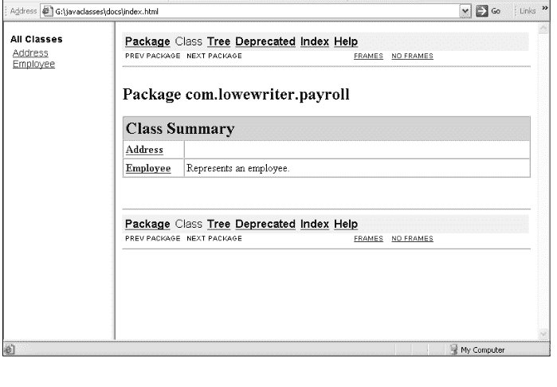

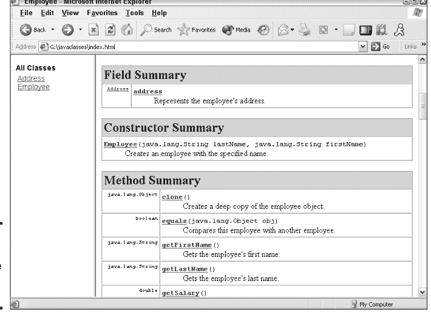

第三册 第8章：打包和文档化你的类

# 第四册：字符串、数组和集合

由里奇·坦南特创作的第5波


“你的数据库已经无法修复了，但在告诉你我们的备份建议之前，让我先问你一个问题。你认为有多少张索引卡片能贴在你电脑室的墙上？”

## 内容概览

- 第1章：处理字符串 ...........................................................................................355
- 第2章：使用数组 ..............................................................................................................371
- 第3章：使用ArrayList类 .....................................................................................397
- 第4章：使用LinkedList类 .................................................................................409
- 第5章：创建泛型集合类 .................................................................419

## 第1章：处理字符串

### 本章内容

- ✓ 快速回顾你已知的关于字符串的知识
- ✓ 检查字符串类的方法
- ✓ 处理子字符串
- ✓ 分割字符串
- ✓ 使用`StringBuilder`和`StringBuffer`类
- ✓ 使用`CharSequence`接口

字符串是Java中最常见的对象类型之一。整本书中都有处理字符串的各种技巧。你已经看到了如何创建字符串变量、如何连接字符串以及如何比较字符串。但到目前为止，我只是浅尝辄止地介绍了字符串能做的所有事情。在本章中，我将更深入地探讨Java可以用字符串做什么。

我首先简要回顾一下到目前为止关于字符串所讲的内容，这样你就不必翻回书本去寻找基本信息。然后，我查看`String`类本身及其提供的一些处理字符串的方法。最后，你将研究两个几乎相同的类，分别名为`StringBuilder`和`StringBuffer`，它们提供了基本`String`类中没有的功能。

### 回顾字符串

为了省去你翻阅本书的麻烦，以下段落总结了前面章节中关于字符串的内容：

- ◆ 字符串是引用类型，而不是值类型，比如`int`或`boolean`。因此，字符串变量保存的是对从`String`类创建的对象的引用，而不是字符串本身的值。
- ◆ 尽管字符串不是原始类型，但Java编译器有一些特性旨在让你几乎可以像处理原始类型一样处理字符串。例如，Java允许你将字符串字面量赋值给字符串变量，就像这样：

```java
String line1 = "Oh what a beautiful morning!";
```

- 字符串可以包含*转义序列*，该序列由一个斜杠后跟另一个字符组成。最常见的转义序列是`\n`表示换行和`\t`表示制表符。如果你想在字符串中包含一个斜杠，你必须使用转义序列`\\`。
- 字符串和字符是不同的。字符串字面量用引号标记；字符字面量用撇号标记。因此，`"a"`是一个恰好只有一个字符长的字符串字面量。相比之下，`'a'`是一个字符字面量。
- 你可以使用`+`运算符组合或*连接*字符串，就像这样：
  `String line2 = line1 + "\nOh what a beautiful day!";`
- 你也可以对字符串使用`+=`运算符，就像这样：
  `line2 += "\nI've got a beautiful feeling";`
- 在连接表达式中使用时，Java会自动将原始类型转换为字符串。因此，Java允许以下操作：
  `int empCount = 50;`
  `String msg = "Number of employees: " + empCount;`

### 不可变模式

许多应用程序可以从描述*不可变对象*的类中受益。不可变对象是一旦创建就不能更改的对象。`String`类是最常见的不可变对象示例。创建`String`对象后，你无法更改它。

创建不可变对象时，请遵循以下三条简单规则：

1.  提供一个或多个接受参数的构造函数，以设置对象的初始状态。
2.  不允许任何方法修改对象中的任何实例变量。用构造函数设置实例变量，然后保持不变。
3.  任何修改对象的方法都应通过创建具有修改后值的新对象来实现。然后此方法返回新对象作为其返回值。

举个例子，假设你正在设计一个游戏，其中游戏区域有固定的障碍物，比如树木。你可以使用不可变模式创建`Tree`类。`Tree`类的构造函数可以接受定义树的大小、类型和位置的参数。但是一旦你创建了这棵树，你就不能移动它了。


### 使用字符串类

各种基本类型包装类（如整数和双精度数）都有解析方法，可以将字符串值转换为数值类型。例如：

```java
String s = "50";
int i = Integer.parseInt(s);
```

不能使用相等运算符（`==`）来比较字符串。相反，应该使用`equals`方法。例如：

```java
if (lastName.equals("Lowe"))
    System.out.println("This is me!");
```

`String`类还有一个`equalsIgnoreCase`方法，用于在不区分大小写的情况下比较字符串。例如：

```java
if (lastName.equalsIgnoreCase("lowe"))
    System.out.println("This is me again!");
```

`String`类是用来创建字符串对象的类。它拥有一系列方法，旨在让你获取有关`String`类所表示的字符串的信息。表1-1列出了其中最有用的方法。

#### 表1-1

| 方法 | 描述 |
| --- | --- |
| `char charAt(int)` | 返回字符串中指定位置的字符。 |
| `int compareTo(String)` | 根据字母顺序将此字符串与另一个字符串进行比较。如果此字符串在另一个字符串之前，则返回-1；如果两个字符串相同，则返回0；如果此字符串在另一个字符串之后，则返回1。 |
| `int compareToIgnoreCase(String)` | 类似于`compareTo`，但忽略大小写。 |
| `boolean contains(CharSequence)` | 如果此字符串包含参数值，则返回`true`。参数可以是`String`、`StringBuilder`或`StringBuffer`。 |
| `boolean endsWith(String)` | 如果此字符串以参数字符串结尾，则返回`true`。 |
| `boolean equals(String)` | 如果此字符串与参数字符串具有相同的值，则返回`true`。 |
| `boolean equalsIgnoreCase(String)` | 类似于`equals`，但忽略大小写。 |
| `int indexOf(char)` | 返回`char`参数在此字符串中首次出现的索引。如果该字符不在字符串中，则返回`-1`。 |
| `int indexOf(String)` | 返回`String`参数在此字符串中首次出现的索引。如果该字符串不在此字符串中，则返回`-1`。 |
| `int indexOf(String, int start)` | 类似于`indexOf`，但从字符串的指定位置开始搜索。 |
| `int lastIndexOf(char)` | 返回`char`参数在此字符串中最后一次出现的索引。如果该字符不在字符串中，则返回`-1`。 |
| `int lastIndexOf(String)` | 返回`String`参数在此字符串中最后一次出现的索引。如果该字符串不在此字符串中，则返回`-1`。 |
| `int lastIndexOf(String, int)` | 类似于`lastIndexOf`，但从字符串的指定位置开始搜索。 |
| `int length()` | 返回此字符串的长度。 |
| `String replace(char, char)` | 返回一个基于原始字符串的新字符串，但将所有出现的第一个参数替换为第二个参数。 |
| `String replaceAll(String old, String new)` | 返回一个基于原始字符串的新字符串，但将所有出现的第一个字符串替换为第二个参数。请注意，第一个参数可以是正则表达式。 |
| `String replaceFirst(String old, String new)` | 返回一个基于原始字符串的新字符串，但将第一个出现的第一个字符串替换为第二个参数。请注意，第一个参数可以是正则表达式。 |
| `String[] split(String)` | 将字符串分割成字符串数组，使用字符串参数作为模式来确定分割字符串的位置。 |
| `boolean startsWith(String)` | 如果此字符串以参数字符串开头，则返回`true`。 |
| `boolean startsWith(String, int)` | 如果此字符串在`int`参数指定的位置包含参数字符串，则返回`true`。 |
| `String substring(int)` | 从`int`参数指定的位置开始提取子字符串，直到字符串末尾。 |
| `String substring(int, int)` | 从第一个参数指定的位置开始提取子字符串，到第二个参数值减一的位置结束。 |
| `char[] toCharArray()` | 将字符串转换为单个字符的数组。 |
| `String toLowerCase()` | 将字符串转换为小写。 |
| `String toString()` | 将字符串作为`String`返回。（说实话这方法没什么用，但所有类都必须有一个`toString`方法。） |
| `String toUpperCase()` | 将字符串转换为大写。 |
| `String trim()` | 返回字符串的副本，但移除所有前导和尾随的空白字符。 |
| `String valueOf(primitiveType)` | 返回任何基本类型的字符串表示形式。 |

关于`String`类最重要的一点是，尽管它有无数个方法，但这些方法都不能让你以任何方式修改字符串。这是因为`String`对象是不可变的，这意味着它不能被更改。

虽然创建字符串后不能更改它，但可以使用`String`类的方法来创建基于原始字符串的新字符串。以下各节将介绍使用这些方法可以做的一些更有趣的事情。

### 查找字符串的长度

最基本的字符串操作之一是确定字符串的长度。你可以使用`length`方法来完成。例如：

```java
String s = "A wonderful day for a neighbor.";
int len = s.length();
```

这里，`len`被赋值为30，因为字符串`s`由30个字符组成。

获取字符串的长度本身通常不是很有用。但`length`方法在其他字符串操作中经常扮演重要角色，正如你在以下各节中所看到的。

### 进行简单的字符串修改

`String`类的一些方法返回原始字符串的修改版本。例如，`toLowerCase`将字符串转换为全小写字母：

```java
String s = "Umpa Lumpa";
s = s.toLowerCase();
```

这里，`s`被设置为字符串`umpa lumpa`。`toUpperCase`方法工作原理相同，但将字符串转换为全大写字母。

`trim`方法从单词的开头和结尾移除空白字符（空格、制表符、换行符等）。例如：

```java
String s = "    Umpa Lumpa    ";
s = s.trim();
```

这里，`Umpa Lumpa`前后的空格被移除。因此，生成的字符串长度为10个字符。

请记住，由于字符串是不可变的，这些方法实际上并不会更改`String`对象。相反，它们会创建一个新的、具有修改后值的`String`。一个常见的错误——尤其是对于熟悉其他语言但刚接触Java的程序员——是忘记将这些方法的返回值赋值。例如，以下语句对`s`没有影响：

```java
s.trim();
```

这里，`trim`方法修剪了字符串，但程序随后丢弃了结果。补救办法是将此表达式的结果赋值回`s`，如下所示：

```java
s = s.trim();
```

### 从字符串中提取字符

可以使用`charAt`方法从字符串的特定位置提取一个字符。这样做时，请记住字符串中第一个字符的索引号是0，而不是1。此外，在提取字符之前，应检查字符串的长度。如果指定的索引值超出了字符串的末尾，则会抛出`StringIndexOutOfBoundsException`异常。（幸运的是，这是一个非受检异常，所以你不需要将`charAt`方法放在`try/catch`语句中。）

下面是一个程序示例，它使用`charAt`方法计算用户输入的字符串中元音字母的数量：

```java
import java.util.Scanner;

public class CountVowels
{
    static Scanner sc = new Scanner(System.in);

    public static void main(String[] args)
    {
        System.out.print("Enter a string: ");
        String s = sc.nextLine();

        int vowelCount = 0;

        for (int i = 0; i < s.length(); i++)
        {
            char c = s.charAt(i);
            if (    (c == 'A') || (c == 'a')
                ||  (c == 'E') || (c == 'e')
                ||  (c == 'I') || (c == 'i')
                ||  (c == 'O') || (c == 'o')
                ||  (c == 'U') || (c == 'u') )
                vowelCount++;
        }
        System.out.println("That string contains "
            + vowelCount + " vowels.");
    }
}
```

这里，`for`循环检查字符串的长度，以确保索引变量`i`不会超过字符串长度。然后，提取每个字符并使用`if`语句检查它是否是元音字母。这个`if`语句中的条件表达式有点复杂，因为它必须检查五种不同的元音字母，并且要兼顾大小写。

### 从字符串中提取子字符串

`substring`方法允许你提取字符串的一部分。该方法有两种形式。第一种接受一个整数参数。它返回从该参数指示的位置开始并延伸到字符串其余部分的子字符串。（记住，字符串位置从0开始，而不是1。）例如：

```java
String s = "Baseball";
String b = s.substring(4);     // "ball"
```

这里，`b`被赋值为字符串`ball`。


## 362 使用字符串类

`substring` 方法的第二个版本接受两个参数，用于指定要提取的子字符串的起始和结束位置。请注意，子字符串实际上结束于第二个参数所指位置**之前**的那个字符。因此，要提取位置2到5的字符，应指定起始位置为1，结束位置为6。例如：

```
String s = "Baseball";
String b = s.substring(2, 6);    // "seba"
```

这里，`b` 被赋值为字符串 `seba`。

以下程序使用子字符串，将用户输入的字符串中的所有元音字母替换为星号：

```
import java.util.Scanner;

public class MarkVowels
{
    static Scanner sc = new Scanner(System.in);

    public static void main(String[] args)
    {
        System.out.print("Enter a string: ");
        String s = sc.nextLine();
        String originalString = s;

        int vowelCount = 0;

        for (int i = 0; i < s.length(); i++)
        {
            char c = s.charAt(i);
            if (    (c == 'A') ||   (c == 'a')
                || (c == 'E') ||   (c == 'e')
                || (c == 'I') ||   (c == 'i')
                || (c == 'O') ||   (c == 'o')
                || (c == 'U') ||   (c == 'u') )
            {
                String front = s.substring(0, i);
                String back = s.substring(i+1);
                s = front + "*" + back;
            }
        }
        System.out.println();
        System.out.println(originalString);
        System.out.println(s);
    }
}
```

这个程序使用一个 `for` 循环和 `charAt` 方法从字符串中提取每个字符。然后，如果该字符是元音字母，就创建一个名为 `front` 的字符串，它由元音字母之前的所有字符组成。接着创建第二个名为 `back` 的字符串，它由元音字母之后的所有字符组成。最后，`s` 字符串被替换为一个由 `front` 字符串、一个星号和 `back` 字符串构建的新字符串。

以下是该程序的一些控制台输出示例，让你了解其工作方式：

```
Enter a string: Where have all the vowels gone?

Where have all the vowels gone?
Wh*r* h*v* *ll th* v*w*ls g*n*?
```

### 分割字符串

`split` 命令对于基于分隔符字符将字符串分割成独立字符串特别有用。例如，假设你有一个字符串，其中地址的各个部分用冒号分隔，如下所示：

```
1500 N. Third Street:Fresno:CA:93722
```

使用 `split` 方法，你可以轻松地将这个字符串分割成四个字符串。在此过程中，冒号被丢弃。

不幸的是，使用 `split` 方法需要你使用一个数组，而数组将在下一章介绍。尽管如此，我还是打算继续讲解这一节，因为你可能已经对数组有一些基本的了解。如果没有，你总可以在阅读下一章后再回到这一节。

`split` 方法通过一个字符串参数传入的分隔符字符，将字符串切割成一个字符串数组。下面是一个例程，它将地址分割成独立的字符串，然后打印出所有字符串：

```
String address =
    "1500 N. Third Street:Fresno:CA:93722";

String[] parts = address.split(":");

for (int i = 0; i < parts.length; i++)
    System.out.println(parts[i]);
```

如果你运行这段代码，控制台将显示以下内容：

```
1500 N. Third Street
Fresno
CA
93722
```

## 364 使用字符串类

传递给 `split` 方法的字符串实际上是一种用于模式识别的特殊类型字符串，称为 *正则表达式*。你将在第五册中学习正则表达式。现在，这里有一些在使用 `split` 方法时可能有用的正则表达式：

| 正则表达式 | 说明 |
|---|---|
| `\t` | 制表符 |
| `\n` | 换行符 |
| `\|` | 竖线 |
| `\s` | 任何空白字符 |
| `\s+` | 一个或多个连续的空白字符 |

此表中的最后一个正则表达式 `\s+` 对于将字符串分割成独立的单词特别有用。例如，以下程序接受用户输入的字符串，将其分割成独立的单词，然后在不同的行上显示这些单词：

```
import java.util.Scanner;

public class CountWords
{
    static Scanner sc = new Scanner(System.in);

    public static void main(String[] args)
    {
        System.out.print("Enter a string: ");
        String s = sc.nextLine();

        String[] word = s.split("\\s+");

        for (String w : word)
            System.out.println(w);
    }
}
```

这是该程序一次典型执行时的控制台输出示例：

```
Enter a string: This string has several words
This
string
has
several
words
```

请注意，用户输入的字符串中，有些单词前面有一个以上的空格字符。`split` 方法使用的 `\\s+` 模式在分割单词时，会将任何连续的空白字符视为单个分隔符。

### 替换字符串的部分内容

你可以使用 `replaceFirst` 或 `replaceAll` 方法，将字符串中与你提供的模式匹配的部分替换为其他文本。例如，下面是一个程序的 `main` 方法，它从用户那里获取一行文本，然后将所有出现的字符串 `cat` 替换为 `dog`：

```
public static void main(String[] args) {
    Scanner sc = new Scanner(System.in);
    System.out.print("Enter a string: ");
    String s = sc.nextLine();

    s = s.replaceAll("cat", "dog");

    System.out.println(s);
}
```

以下是该程序一次典型执行时的控制台输出：

```
Enter a string: I love cats. Cats are the best.
I love dogs. Cats are the best.
```

与 `split` 方法类似，`replace` 方法的第一个参数可以是提供复杂匹配字符串的正则表达式。更多信息请参阅第五册。

> 再次提醒，不要忘记字符串是不可变的。因此，`replace` 方法实际上不会修改 String 对象本身。相反，它们返回一个新的 String 对象，其中包含修改后的值。

### 使用 StringBuilder 和 StringBuffer 类

String 类功能强大，但对于需要大量字符串操作的程序来说，它不是很高效。由于 String 对象是不可变的，String 类中任何以任何方式修改字符串的方法都必须创建一个新的 String 对象，并将原始字符串对象的修改内容复制到新字符串中。如果这偶尔发生，情况还不算太糟，但在频繁进行此类操作的程序中，效率可能较低。

即使是字符串连接本身也是低效的。例如，考虑以下语句：

```
int count = 5;
String msg = "There are ";
String msg += count;
String msg += " apples in the basket.";
```

这四条语句实际上创建了五个 String 对象：

- "There are "：为第二条语句中的字面量创建。msg 变量被赋值为指向此字符串的引用。
- "5"：为保存 `count.toString()` 的结果而创建。toString 方法由第三条语句隐式调用，以便将 count 与 msg 连接。
- "There are 5"：作为第三条语句中连接的结果创建。指向此对象的引用被赋给 msg。
- "apples in the basket."：为保存第四条语句中的字面量而创建。
- "There are 5 apples in the basket."：为保存第四条语句中连接的结果而创建。指向此对象的引用被赋给 msg。

对于只进行偶尔的字符串连接和简单字符串操作的程序，这些效率问题并不严重。然而，对于进行大量字符串操作的程序，Java 为 String 类提供了两个替代方案：StringBuilder 和 StringBuffer 类。

StringBuilder 和 StringBuffer 类是彼此的镜像。两者具有相同的方法并执行相同的字符串操作。唯一的区别是 StringBuffer 类在涉及多线程的应用程序中使用是安全的。StringBuilder 对于多线程应用程序不安全，但比 StringBuffer 更高效。因此，除非你的应用程序使用线程，否则应该使用 StringBuilder 类。（如何使用线程，请参阅第五册。）

> 注意：StringBuilder 类是在 Java 1.5 版本中引入的。如果你使用的是旧的 Java 编译器，则必须改用 StringBuffer。

### 创建 StringBuilder 对象

你不能像处理 String 对象那样将字符串字面量直接赋值给 StringBuilder 对象。但是，StringBuilder 类有一个接受 String 作为参数的构造函数。因此，要创建一个 StringBuilder 对象，你可以使用如下语句：

```
StringBuilder sb = new StringBuilder("Today is the day!");
```


在内部，`StringBuilder` 对象维护一个固定大小的内存区域用于存储字符串值。这个内存区域被称为 `buffer`（缓冲区）。该缓冲区中保存的字符串不必用尽整个缓冲区。因此，`StringBuilder` 对象同时拥有 `length`（长度）和 `capacity`（容量）两个属性。长度表示 `StringBuilder` 当前维护的字符串长度，而 `capacity` 则表示缓冲区本身的大小。请注意，长度不能超过容量。

当你创建一个 `StringBuilder` 对象时，初始容量被设置为字符串长度加16。`StringBuilder` 类会在必要时自动增加其容量，因此你无需担心超出容量的问题。

### 使用 StringBuilder 方法

表1-2列出了 `StringBuilder` 类最常用的方法。请注意，`StringBuffer` 类使用相同的方法。因此，如果你必须使用 `StringBuffer` 而非 `StringBuilder`，只需更改类名并使用相同的方法即可。

表1-2: StringBuilder 方法

| 方法 | 描述 |
| :--- | :--- |
| `append(primitiveType)` | 将基本类型的字符串表示附加到字符串末尾。 |
| `append(Object)` | 调用对象的 `toString` 方法，并将结果附加到字符串末尾。 |
| `append(CharSequence)` | 将字符串附加到 `StringBuilder` 字符串值的末尾。参数可以是 `String`、`StringBuilder` 或 `StringBuffer`。 |
| `int capacity()` | 返回此 `StringBuilder` 的容量。 |
| `char charAt(int)` | 返回字符串中指定位置的字符。 |
| `delete(int, int)` | 删除从第一个 `int` 指定的位置开始，到第二个 `int` 指定位置的前一个字符结束的字符。 |
| `deleteCharAt(int)` | 删除指定位置的字符。 |
| `ensureCapacity(int)` | 确保 `StringBuilder` 的容量至少等于 `int` 指定的值。必要时会增加容量。 |
| `int indexOf(String)` | 返回指定字符串首次出现的索引。如果字符串未出现，则返回 -1。 |
| `int indexOf(String, int)` | 返回指定字符串首次出现的索引，从指定索引位置开始搜索。如果字符串未出现，则返回 -1。 |
| `insert(int, primitiveType)` | 在 `int` 参数指定的位置插入基本类型的字符串表示。 |
| `insert(int, Object)` | 调用 `Object` 参数的 `toString` 方法，然后在 `int` 参数指定的位置插入结果字符串。 |
| `insert(int, CharSequence)` | 在 `int` 参数指定的位置插入字符串。第二个参数可以是 `String`、`StringBuilder` 或 `StringBuffer`。 |
| `int lastIndexOf(String)` | 返回指定字符串最后一次出现的索引。如果字符串未出现，则返回 -1。 |
| `int lastIndexOf(String, int)` | 返回指定字符串最后一次出现的索引，从指定索引位置开始搜索。如果字符串未出现，则返回 -1。 |
| `int length()` | 返回此字符串的长度。 |
| `replace(int, int, String)` | 用第三个参数提供的字符串替换由前两个参数指示的子字符串。 |
| `reverse()` | 反转字符的顺序。 |
| `setCharAt(int, char)` | 将指定位置的字符设置为指定字符。 |
| `setLength(int)` | 设置字符串的长度。如果小于当前长度，则截断字符串。如果大于当前长度，则用十六进制零填充新字符。 |
| `String substring(int)` | 提取从 `int` 参数指示的位置开始，一直到字符串末尾的子字符串。 |
| `String substring(int, int)` | 提取从第一个参数指示的位置开始，到第二个参数值的前一个字符位置结束的子字符串。 |
| `String toString()` | 将当前值作为 `String` 返回。 |
| `String trimToSize()` | 将 `StringBuffer` 的容量调整为与字符串大小匹配。 |

### StringBuilder 示例

为了说明 `StringBuilder` 类的工作原理，这里提供本章前面 MarkVowel 程序的 `StringBuilder` 版本：

```
import java.util.Scanner;

public class StringBuilderApp
{
    static Scanner sc = new Scanner(System.in);

    public static void main(String[] args)
    {
        System.out.print("Enter a string: ");
        String s = sc.nextLine();

        StringBuilder sb = new StringBuilder(s);

        int vowelCount = 0;

        for (int i = 0; i < s.length(); i++)
        {
            char c = s.charAt(i);
            if (    (c == 'A') || (c == 'a')
                ||  (c == 'E') || (c == 'e')
                ||  (c == 'I') || (c == 'i')
                ||  (c == 'O') || (c == 'o')
                ||  (c == 'U') || (c == 'u') )
            {
                sb.setCharAt(i, '*');
            }
        }
        System.out.println();
        System.out.println(s);
        System.out.println(sb.toString());
    }
}
```

该程序使用 `setCharAt` 方法直接将找到的任何元音替换为星号。这比本程序 `String` 版本中拼接子字符串的方式高效得多。

### 使用 CharSequence 接口

Java API 包含一个有用的接口，名为 `CharSequence`。本章中的三个类（`String`、`StringBuilder` 和 `StringBuffer`）都实现了此接口。此接口的主要目的是让你能够互换使用 `String`、`StringBuilder` 和 `StringBuffer`。

370 使用 CharSequence 接口

为此目的，`String`、`StringBuilder` 和 `StringBuffer` 类的多个方法都使用 `CharSequence` 作为参数类型。对于这些方法，你可以传递 `String`、`StringBuilder` 或 `StringBuffer` 对象。请注意，字符串字面量被视为 `String` 对象，因此你可以在任何需要 `CharSequence` 的地方使用字符串字面量。

如果你有兴趣，`CharSequence` 接口定义了四个方法：

- `char charAt(int)`: 返回指定位置的字符。
- `int length()`: 返回序列的长度。
- `subSequence(int start, int end)`: 返回由 start 和 end 参数指示的子字符串。
- `toString()`: 返回序列的 `String` 表示形式。


如果你倾向于将 `CharSequence` 作为方法的参数类型，以便该方法能处理 `String`、`StringBuilder` 或 `StringBuffer` 对象，请注意你只能使用这四个方法。

## 第2章：使用数组

本章内容

- ✓ 处理基本的一维数组
- ✓ 使用数组初始化器设置数组的初始值
- ✓ 在数组中使用 for 循环
- ✓ 处理二维数组
- ✓ 使用 Arrays 类

我该加薪了...

哦，数组。抱歉。

数组是任何编程语言的重要方面，Java也不例外。在本章中，你将了解到关于使用数组所需知道的几乎所有知识。我将涵盖普通的一维数组、多维数组，以及两个用于处理数组的类，分别名为 `Array` 和 `Arrays`。

### 理解数组

数组是一组通过单个变量名和索引号引用的变量。数组的每个项称为一个元素。数组中的所有元素必须是相同类型。因此，数组本身具有一个类型，指定它可以包含哪种元素。例如，一个 `int` 数组可以包含 `int` 值，一个 `String` 数组可以包含字符串。

索引号写在变量名后面，并用方括号括起来。所以，如果变量名是 `x`，你可以用像 `x[5]` 这样的表达式访问特定的元素。


你可能认为 `x[5]` 会引用数组中的第五个元素。但索引号从第一个元素的零开始，所以 `x[5]` 实际上引用的是第六个元素。这个小细节是使用数组时问题的主要原因之一——特别是如果你是在数组索引从1开始而非从0开始的语言中接触数组编程的。所以要习惯从0而不是从1开始计数。


## 372 创建数组

数组的真正威力源于一个简单的事实：你可以使用变量甚至完整的表达式作为数组索引。因此，例如，你不必编写 `x[5]` 来引用特定的数组元素，而是可以编写 `x[i]` 来引用索引变量 `i` 所指示的元素。你将在本章中看到大量索引变量的示例。

在深入了解创建和使用数组的细节之前，这里有一些额外的数组信息要点供你思考：

-   数组本身就是一个对象。你可以通过使用数组的变量名（不带索引）来引用整个数组对象，而不是数组的特定元素。因此，如果 `x[5]` 引用数组的一个元素，那么 `x` 引用的是数组本身。
-   数组具有在创建时设定的固定长度。此长度决定了可以存储在数组中的元素数量。你可以对任何数组使用的最大索引值比数组长度小一。因此，如果你创建一个包含 10 个元素的数组，你可以使用 0 到 9 的索引值。
-   创建数组后，你无法更改其长度。
-   你可以通过使用数组变量的 `length` 字段来访问数组的长度。例如，`x.length` 返回数组 `x` 的长度。

### 创建数组

在创建数组之前，你必须首先声明一个引用该数组的变量。此变量声明应指示数组存储的元素类型，后跟一对空方括号，如下所示：

```
String[] names;
```

这里，声明了一个名为 `names` 的变量。它的类型是 `String` 对象数组。


为了确保你尽可能地感到困惑，Java 还允许你将方括号放在变量名而不是类型上。例如，以下两条语句都创建了 `int` 元素的数组：

```
int[] array1;    // an array of int elements
int array2[];    // another array of int elements
```

这两条语句具有完全相同的效果。大多数 Java 程序员更喜欢将方括号放在类型而不是变量名上。

### 初始化数组

仅凭该语句本身并不会创建一个数组。它只是声明了一个可以引用数组的变量。实际上，你可以通过两种方式创建数组：

-   使用 `new` 关键字后跟数组类型，这次方括号内填充了内容以指示数组可以容纳多少个元素。例如：

```
String[] names;
names = new String[10];
```

这里，创建了一个可以容纳 10 个字符串的 `String` 对象数组。该数组中的每个字符串都初始化为空字符串。

-   像任何其他变量一样，你可以将声明和创建合并为一条语句：

```
String[] names = new String[10];
```

这里，在一条语句中声明了数组变量并创建了数组。


如果在编译时你不知道数组需要多少个元素，你可以使用变量或表达式作为数组长度。例如，这是一个将玩家姓名存储在字符串数组中的方法中的例程。它首先询问用户队伍中有多少名玩家。然后，它创建一个正确大小的数组：

```
System.out.print("How many players? ");
int count = sc.nextInt();           // sc is a Scanner
String[] players = new String[count];
```

### 初始化数组

初始化数组值的一种方法是简单地逐个赋值：

```
String[] days = new Array[7];
Days[0] = "Sunday";
Days[1] = "Monday";
Days[2] = "Tuesday";
Days[3] = "Wednesday";
Days[4] = "Thursday";
Days[5] = "Friday";
Days[6] = "Saturday";
```

Java 提供了一种简写方式来创建数组并用常量值初始化它：

```
String[] days = { "Sunday", "Monday", "Tuesday",
                 "Wednesday", "Thursday",
                 "Friday", "Saturday" };
```

这里，要赋给数组的每个元素都列在数组初始化器中。这是一个 `int` 数组的数组初始化器示例：

```
int[] primes = { 2, 3, 5, 7, 11, 13, 17 };
```

**注意：** 使用初始化器创建的数组的长度由初始化器中列出的值的数量决定。

另一种编码初始化器的方式如下：

```
int[] primes = new int[] { 2, 3, 5, 7, 11, 13, 17 };
```

要使用这种类型的初始化器，你使用 `new` 关键字后跟数组类型和一对空方括号。然后，你编写初始化器。

### 将 for 循环与数组一起使用

处理数组最常见的方法之一是使用 `for` 循环。事实上，`for` 循环就是专门为了处理数组而发明的。例如，这是一个创建包含 100 个随机数字（值从 1 到 100）的数组的 `for` 循环：

```
int[] numbers = new int[100];
for (int i = 0; i < 100; i++)
    numbers[i] = (int) (Math.random() * 100) + 1;
```

这是一个用用户输入的字符串填充玩家姓名数组的循环：

```
String[] players = new String[count];
for (int i = 0; i < count; i++)
{
    System.out.print("Enter player name: ");
    players[i] = sc.nextLine();     // sc is a Scanner
}
```

对于这个示例，假设 `count` 是一个 `int` 变量，它保存着要输入的玩家数量。

你也可以使用 `for` 循环来打印数组的内容。例如：

```
for (int i = 0; i < count; i++)
    System.out.println(players[i]);
```

这里，一个名为 `players` 的 `String` 数组的元素被打印到控制台。

前面的示例假设数组的长度在循环执行之前就已存储在变量中。如果你手头没有数组长度，你可以从数组的 `length` 属性中获取它：

```
for (int i = 0; i < players.length; i++)
    System.out.println(players[i]);
```

### 使用数组解决家庭作业问题

偶尔，一个数组和一两个 `for` 循环可以帮助你为孩子解决家庭作业问题。例如，我曾经帮助我的女儿解决一个七年级数学课的难题作业。这个问题大致是这样的：

Bobo（这些问题中总有一个名叫 Bobo 的角色）在一个星期六去当地高中，发现学校所有的 1000 个储物柜都整齐地关着。所以他从学校的一端开始，打开所有的储物柜。然后，他回到起点，关上每个其他的储物柜（储物柜 2、4、6 等等）。然后，他回到起点，每三个储物柜处理一次：如果它是开着的，他就关上它。如果它是关着的，他就打开它。然后他每四个储物柜处理一次，每五个储物柜处理一次，依此类推。整个周末他都在做这件事，沿着走廊打开和关闭储物柜一千次。然后他感到无聊，回家了。学校的一千个储物柜中有多少个仍然开着，它们是哪些？

天哪！

这个问题提出了一个挑战，而作为一个计算机极客父亲，我认为这是教我女儿关于 `for` 循环和数组的时候了。所以我写了一个小程序，设置了一个包含 1000 个布尔值的数组。每个布尔值代表一个储物柜：`true` 表示打开，`false` 表示关闭。然后我写了一对嵌套的 `for` 循环来进行计算。

我的第一次尝试告诉我，1000 个储物柜中有 10000 个被打开了，所以我猜我一定是哪里搞错了。当我查看代码时，我意识到储物柜编号是 1 到 1000，但我的数组中的元素编号是 0 到 999，这是导致我第一个答案荒谬的混乱部分原因。

所以我决定创建一个有 1001 个元素的数组，并忽略第一个元素。这样，索引就能很好地对应储物柜编号。

经过几个小时的工作，我写出了代码清单 2-1 中的程序。

## 376 使用数组解决家庭作业问题

**代码清单 2-1：经典的储物柜问题解决了！**

```
public class BoboAndTheLockers
{
    public static void main(String[] args)
    {
        // true = open; false = closed
        boolean[] lockers = new boolean[1001];

        // close all the lockers
        for (int i = 1; i <= 1000; i++)
            lockers[i] = false;

        for (int skip = 1; skip <= 1000; skip++)
        {
            System.out.println("Bobo is changing every "
                + skip + " lockers.");
            for (int locker = skip; locker < 1000;
                    locker += skip)
                lockers[locker] = !lockers[locker];
        }

        System.out.println("Bobo is bored"
            + " now so he's going home.");

        // count and list the open lockers
        String list = "";
        int openCount = 0;
        for (int i = 1; i <= 1000; i++)
            if (lockers[i])
            {
                openCount++;
                list += i + " ";
            }

        System.out.println("Bobo left " + openCount
            + " lockers open.");
        System.out.println("The open lockers are: "
            + list);
    }
}
```

以下是这个程序工作原理的重点：

-   这行代码设置了一个包含 1001 个元素的布尔数组。我创建的元素比需要的多一个，这样我就可以忽略元素零。
-   这个 `for` 循环关闭所有的储物柜。这一步实际上不是必需的，因为布尔值初始化为 `false`。但明确初始化是好的。


### 使用增强 for 循环

12 这个循环的每一次迭代代表一次完整的走廊行程，负责打开和关闭储物柜。`skip` 变量表示 Bobo 在每次行程中跳过多少个储物柜。他首先处理每个储物柜，然后处理每隔一个的储物柜，接着处理每隔两个的储物柜。因此，这个循环简单地从 1 数到 1000。

16 这个循环的每一次迭代代表在走廊行程中在一个储物柜前停下。for 语句中的第三个表达式（在下一行）将 `skip` 变量加到索引变量上，以便 Bobo 在每次穿越走廊时都能访问每隔 n 个的储物柜。

18 这条语句使用非运算符（`!`）来反转每个储物柜的状态。因此，如果储物柜是打开的（`true`），它就被设置为关闭（`false`）。反之亦然。

27 另一个 for 循环遍历所有储物柜，并计算那些打开的储物柜。它还将每个打开的储物柜的编号添加到一个字符串的末尾，以便打印出所有打开的储物柜。

这个程序产生超过 1000 行的输出。但只有最后几行是重要的。它们如下：

```
Bobo is bored now so he's going home.
Bobo left 31 lockers open.
The open lockers are: 1 4 9 16 25 36 49 64 81 100 121
144 169 196 225 256 289 324 361 400 441 484 529 576
625 676 729 784 841 900 961
```

所以答案是：有 31 个储物柜保持打开。我得了 A。（我是说，我女儿得了 A。）


顺便说一句，你注意到那些保持打开的储物柜的编号都是完全平方数了吗？或者注意到 31 是其平方小于 1000 的最大整数吗？我也是在我女儿第二天放学后告诉我时才发现的。

### 使用增强 for 循环

Java 1.5 引入了一种新的 for 循环类型，称为增强 for 循环，旨在简化处理数组和集合（我将在下一章介绍）的循环。与数组一起使用时，增强 for 循环具有以下格式：

```
for (type identifier : array)
{
    statements...
}
```

### 在方法中使用数组

`type` 标识数组中元素的类型，`identifier` 为用于访问每个元素的局部变量提供名称。而 `array` 指定要处理的数组名称。

这里有一个例子：

```
String[] days = { "Sunday", "Monday", "Tuesday",
                  "Wednesday", "Thursday",
                  "Friday", "Saturday" };
for (String day : days)
{
    System.out.println(day);
}
```

这个循环将以下行打印到控制台：

```
Sunday
Monday
Tuesday
Wednesday
Thursday
Friday
Saturday
```

换句话说，它将数组中的每个字符串打印在单独的行上。

> 增强 `for` 循环是 Java 1.5 的新功能，因此如果你使用的是早期版本则无法使用。（这是你应该尽快升级的众多原因之一。）


### 在方法中使用数组

你可以编写接受数组作为参数并返回数组作为返回值的方法。你只需使用一对空括号来表示参数类型或返回类型是数组。

例如，这是一个创建并返回一个包含星期名称的 `String` 数组的静态方法：

```
public static String[] getDaysOfWeek()
{
    String[] days = { "Sunday", "Monday", "Tuesday",
                     "Wednesday", "Thursday",
                     "Friday", "Saturday" };
    return days;
}
```

这是一个将任何 `String` 数组的内容打印到控制台的静态方法，每个字符串一行：

```
public static void printStringArray(String[] strings)
{
    for (String s : strings)
        System.out.println(s);
}
```

最后，这是调用这些方法的两行代码：

```
String[] days = getDaysOfWeek();
printStringArray(days);
```

第一条语句声明一个 `String` 数组，然后调用 `getDaysOfWeek` 来创建该数组。第二条语句将该数组作为参数传递给 `printStringArray` 方法。

### 使用二维数组

数组的元素可以是任何你想要的对象类型，包括另一个数组。这被称为*二维数组*，有时也称为*数组的数组*。

二维数组通常用于以列和行格式跟踪数据，就像电子表格的工作方式一样。例如，假设你正在编写一个程序，跟踪一家公司五年的销售额（2001 年至 2005 年），数据按四个销售区域（北、南、东、西）细分。你可以创建 20 个独立的变量，名称如 `sales2001North`、`sales2001South`、`sales2001East` 等。但这会变得有点繁琐。

或者，你可以创建一个包含 20 个元素的数组，像这样：

```
double[] sales = new double[20];
```

但是，你如何在这个数组中组织数据，以便知道每个元素对应的年份和销售区域呢？

使用二维数组，你可以创建一个数组，其每个元素代表一年。每个这样的元素又是一个数组，其每个元素代表一个区域。

### 使用二维数组

将二维数组视为表格或电子表格是很常见的，像这样：

|       | North   | South   | East    | West    |
|-------|---------|---------|---------|---------|
| *2001* | 23,853  | 22,838  | 36,483  | 31,352  |
| *2002* | 25,483  | 22,943  | 38,274  | 33,294  |
| *2003* | 24,872  | 23,049  | 39,002  | 36,888  |
| *2004* | 28,492  | 23,784  | 42,374  | 39,573  |
| *2005* | 31,932  | 23,732  | 42,943  | 41,734  |

这里，电子表格的每一行代表一年的销售额，每一列代表四个销售区域之一。

#### 创建二维数组

要为此销售数据声明一个二维数组，你只需列出两组空括号，像这样：

```
double sales[][];
```

这里，`sales` 是一个 `double` 类型的二维数组。或者，换句话说，`sales` 是一个 `double` 数组的数组。

要实际创建该数组，你需要使用 `new` 关键字并为每组括号提供长度。例如：

```
sales = new double[5][4];
```

这里，第一维指定 `sales` 数组有五个元素。这个数组代表表格中的行。第二维指定每个元素都有一个包含四个元素的 `double` 数组。这个数组代表表格中的列。

> 这里要掌握的一个关键点是，第一个数组只有一个实例，但第一个数组中的每个元素都对应第二个数组的一个独立实例。因此，这条语句实际上创建了五个 `double` 数组，每个数组有四个元素。然后这五个数组被用作第一个数组的元素。

请注意，与一维数组一样，你可以在一条语句中声明并创建一个二维数组，像这样：

```
double[][] sales = new double[5][4];
```

这里，`sales` 数组在一条语句中同时被声明和创建。

#### 访问二维数组元素

要访问二维数组的元素，你需要使用两个索引。例如，以下语句设置了 2001 年北区的销售额：

```
sales[0][0] = 23853.0;
```

正如你可能想象的那样，通过硬编码每个索引值来访问二维数组中的数据会变得很繁琐。因此通常使用 for 循环来替代。例如，以下代码片段使用 for 循环将 sales 数组的内容打印到控制台，用制表符分隔。每年打印在单独的行上，年份位于行的开头。此外，在销售数据之前打印了一行销售区域的标题。以下是代码：

```
NumberFormat cf = NumberFormat.getCurrencyInstance();
System.out.println("\tNorth\t\tSouth\t\tEast\t\tWest");
int year = 2001;
for (int y = 0; y < 5; y++)
{
    System.out.print(year + "\t");
    for (int region = 0; region < 4; j++)
    {
        System.out.print(cf.format(sales[y][region]));
        System.out.print("\t");
    }
    year++;
    System.out.println();
}
```

假设 sales 数组已经被初始化，这段代码将在控制台产生以下输出：

| North | South | East | West |
|---|---|---|---|
| 2001 $23,853.00 | $22,838.00 | $36,483.00 | $31,352.00 |
| 2002 $25,483.00 | $22,943.00 | $38,274.00 | $33,294.00 |
| 2003 $24,872.00 | $23,049.00 | $39,002.00 | $36,888.00 |
| 2004 $28,492.00 | $23,784.00 | $42,374.00 | $39,573.00 |
| 2005 $31,932.00 | $23,732.00 | $42,943.00 | $41,734.00 |


在访问二维数组中每个索引时，嵌套 for 循环的顺序至关重要！前面的示例将每年的销售额列在单独的行上，销售区域排列在列中。例如，你可以通过反转索引数组的 for 循环的嵌套顺序来打印一个列表，其中每个区域的销售额在单独的行上，年份排列在列中：

```
for (int region = 0; region < 4; region++)
{
    for (int y = 0; y < 5; y++)
```


## 382 使用二维数组

```
{
    System.out.print(cf.format(sales[y][region]));
    System.out.print("   ");
}
System.out.println();
}
```

此处，外层循环索引区域，内层循环索引年份。

$23,853.00 $25,483.00 $24,872.00 $28,492.00 $31,932.00
$22,838.00 $22,943.00 $23,049.00 $23,784.00 $23,732.00
$36,483.00 $38,274.00 $39,002.00 $42,374.00 $42,943.00
$31,352.00 $33,294.00 $36,888.00 $39,573.00 $41,734.00

### 初始化二维数组

通过将数组元素值编码在花括号中的数组初始化技术同样适用于二维数组。你只需记住，主数组的每个元素实际上都是另一个数组。因此，你必须嵌套数组初始化器。

这是一个初始化 `sales` 数组的例子：

```
double[][] sales =
    { {23853.0, 22838.0, 36483.0, 31352.0},    // 2001
      {25483.0, 22943.0, 38274.0, 33294.0},    // 2002
      {24872.0, 23049.0, 39002.0, 36888.0},    // 2003
      {28492.0, 23784.0, 42374.0, 39573.0},    // 2004
      {31932.0, 23732.0, 42943.0, 41734.0} };  // 2005
```

这里，我在每行末尾添加了注释以显示该行初始化的年份。请注意，整个初始化器的左大括号位于第二行的开头，关闭整个初始化器的右大括号位于最后一行的末尾。然后，每年的初始化器包含在自己的一组大括号中。

### 使用不规则数组

当你使用类似 `new int[5][3]` 的表达式创建数组时，你是在指定主数组的每个元素实际上是一个包含三个元素的 `int` 类型数组。然而，Java 允许你创建二维数组，其中主数组每个元素的长度不同。这有时被称为*不规则数组*，因为数组不形成一个整齐的矩形。相反，它的边缘是参差不齐的。

例如，假设你需要跟踪四支队伍，每支队伍由两到三个人组成。这些队伍如下：

| 队伍 | 成员 |
|---|---|
| A | Henry Blake, Johnny Mulcahy |
| B | Benjamin Pierce, John McIntyre, Jonathan Tuttle |
| C | Margaret Houlihan, Frank Burns |
| D | Max Klinger, Radar O'Reilly, Igor Straminsky |

以下代码为这些队伍创建了一个不规则数组：

```
String[][] teams
    = { {"Henry Blake", "Johnny Mulcahy"},
        {"Benjamin Pierce", "John McIntyre",
             "Jonathan Tuttle"},
        {"Margaret Houlihan", "Frank Burns"},
        {"Max Klinger", "Radar O'Reilly",
             "Igor Straminsky"} };
```

这里，每个嵌套的数组初始化器指示了每个子数组的字符串数量。例如，第一个子数组有两个字符串，第二个有三个字符串，依此类推。

你可以使用嵌套的 `for` 循环来访问不规则数组中的各个元素。对于主数组的每个元素，你可以使用 `length` 属性来确定该元素的子数组中有多少个条目。例如：

```
for (int i = 0; i < teams.length; i++)
{
    for (int j = 0; j < teams[i].length; j++)
        System.out.println(teams[i][j]);
    System.out.println();
}
```

请注意，每个子数组的长度是通过表达式 `teams[i].length` 确定的。这个 `for` 循环每行打印一个名字，队伍之间用空行分隔，如下所示：

```
John McIntyre
Jonathan Tuttle

Margaret Houlihan
Frank Burns

Max Klinger
Radar O'Reilly
Igor Straminsky

Henry Blake
Johnny Mulcahy
```

Benjamin Pierce
John McIntyre
Jonathan Tuttle

如果你不想费心自己跟踪索引，可以使用增强的 `for` 循环，让 Java 处理索引。例如：

```
for (String[] team : teams)
{
    for (String player : team)
        System.out.println(player);
    System.out.println();
}
```

这里，第一个增强的 `for` 语句指定了 `team` 变量的类型为 `String[]`。因此，这个循环的每次循环都会将 `team` 设置为主 `teams` 数组中的一个子数组。然后，第二个增强的 `for` 循环访问每个子数组中的单个字符串。

### 超越二维

Java 并不限制你只能使用二维数组。数组可以嵌套在数组中，达到程序所需的任意多层。要声明一个超过两维的数组，你只需根据需要指定多组空括号。例如：

```
int[][][] threeD = new int[3][3][3];
```

这里，创建了一个三维数组，每个维度有三个元素。你可以将这个数组想象成一个立方体。每个元素需要三个索引来访问。

你可以通过指定数组所需数量的索引来访问多维数组中的元素。例如：

```
threeD[0][1][2] = 100;
```

这条语句将第0行、第1列的第2个元素设置为100。

你也可以根据需要嵌套初始化器。例如：

```
int[][][] threeD =
    { { {1,    2,    3}, { 4,    5,    6}, { 7,    8,    9} },
      { {10, 11, 12}, {13, 14, 15}, {16, 17, 18} },
      { {19, 20, 21}, {22, 23, 24}, {25, 26, 27} } };
```

这里，用数字1到27初始化了一个三维数组。

你也可以使用多个嵌套的 `if` 语句来处理三维或更高维度的数组。例如，这里是另一种用数字1到27初始化三维数组的方法：

```
int[][][] threeD2 = new int[3][3][3];
int value = 1;
for (int i = 0; i < 3; i++)
    for (int j = 0; j < 3; j++)
        for (int k = 0; k < 3; k++)
            threeD2[i][j][k] = value++;
```

### 一个有趣但复杂的例子：国际象棋棋盘

好了，商业例子就到此为止。下面是一个更有趣的例子，至少如果你觉得国际象棋有趣的话。清单 2-2 中的程序使用一个二维数组来表示一个国际象棋棋盘。它的唯一目的是根据骑士（对那些来自里奥林达的人来说就是马）的起始位置，计算出其可能的移动。程序会要求用户输入一个起始位置（例如 f1），然后程序通过显示可能的方格来回应。接着，程序会打印一个粗糙但可识别的棋盘表示，其中骑士的位置用 X 表示，其可能的移动用问号表示。

> 如果你不熟悉国际象棋，它是在一个8 x 8的棋盘上进行的，有明暗相间的方格。识别每个方格的通常方式是使用一个字母和一个数字，其中字母代表列（称为file），数字代表行（称为rank），如图2-1所示。骑士有一个有趣的移动模式：他向一个方向移动两个方格，然后做一个90度的转弯，向左或向右移动一个方格。给定起始位置为 e4 的骑士的可能移动被阴影标记为深色。如你所见，这个骑士有八个可能的移动：c3、c5、d6、f6、g5、g3、f2 和 d2。

以下是如果你为骑士位置输入 e4 时控制台的示例：

```
Welcome to the Knight Move calculator.

Enter knight's position: e4

The knight is at square e4
From here the knight can move to:
c5
d6
f6
g5
g3
f2
d2
c3

- - - - - - - -
- - - - - - - -
- - - ? - ? - -
- - ? - - - ? -
- - - - X - - -
- - ? - - - ? -
- - - ? - ? - -
- - - - - - - -

Do it again? (Y or N) **n**
```

如你所见，程序表明骑士从 e4 的合法移动是 c5、d6、f6、g5、g3、f2、d2 和 c3。棋盘的图形表示指示了骑士的位置以及他可以去的地方。

| a8 | b8 | c8 | d8 | e8 | f8 | g8 | h8 |
|---|---|---|---|---|---|---|---|
| a7 | b7 | c7 | d7 | e7 | f7 | g7 | h7 |
| a6 | b6 | c6 | d6 | e6 | f6 | g6 | h6 |
| a5 | b5 | c5 | d5 | e5 | f5 | g5 | h5 |
| a4 | b4 | c4 | d4 | e4 | f4 | g4 | h4 |
| a3 | b3 | c3 | d3 | e3 | f3 | g3 | h3 |
| a2 | b2 | c2 | d2 | e2 | f2 | g2 | h2 |
| a1 | b1 | c1 | d1 | e1 | f1 | g1 | h1 |

图2-1：一个经典的国际象棋棋盘。


## 2.2 用 *For Dummies* 书中的代码下国际象棋？

```java
import java.util.Scanner;

public class KnightMoves
{
    static Scanner sc = new Scanner(System.in);

    // the following static array represents the 8
    // possible moves a knight can make
    // this is an 8 x 2 array
    static int[][] moves = { {-2, +1},
                              {-1, +2},
                              {+1, +2},
                              {+2, +1},
                              {+2, -1},
                              {+1, -2},
                              {-1, -2},
                              {-2, -1} };

    public static void main(String[] args)
    {
        System.out.println("Welcome to the "
            + "Knight Move calculator.\n");
        do
        {
            showKnightMoves();
        }
        while (getYorN("Do it again?"));
    }

    public static void showKnightMoves()
    {
        // The first dimension is the file (a, b, c, etc.)
        // The second dimension is the rank (1, 2, 3, etc.)
        // Thus, board[3][4] is square d5.
        // A value of 0 means the square is empty
        // 1 means the knight is in the square
        // 2 means the knight could move to the square
        int[][] board = new int[8][8];

        String kSquare; // the knight's position as a square
        Pos kPos;       // the knight's position as a Pos

        // get the knight's initial position
        do
        {
            System.out.print("Enter knight's position: ");
            kSquare = sc.nextLine();
            kPos = convertSquareToPos(kSquare);
        } while (kPos == null);

        board[kPos.x][kPos.y] = 1;
        System.out.println("\nThe knight is at square "
            + convertPosToSquare(kPos));
        System.out.println(
            "From here the knight can move to:");

        for (int move = 0; move < moves.length; move ++)
        {
            int x, y;
            x = moves[move][0];  // the x for this move
            y = moves[move][1];  // the y for this move
            Pos p = calculateNewPos(kPos, x, y);
            if (p != null)
            {
                System.out.println(convertPosToSquare(p));
                board[p.x][p.y] = 2;
            }
        }

        printBoard(board);

        // this method converts squares such as a1 or d5 to
        // x, y coordinates such as [0][0] or [3][4]
        public static Pos convertSquareToPos(String square)
        {
            int x = -1;
            int y = -1;
            char rank, file;

            file = square.charAt(0);
            if (file == 'a') x = 0;
            if (file == 'b') x = 1;
            if (file == 'c') x = 2;
            if (file == 'd') x = 3;
            if (file == 'e') x = 4;
            if (file == 'f') x = 5;
            if (file == 'g') x = 6;
            if (file == 'h') x = 7;

            rank = square.charAt(1);
            if (rank == '1') y = 0;
            if (rank == '2') y = 1;
            if (rank == '3') y = 2;
            if (rank == '4') y = 3;
            if (rank == '5') y = 4;
            if (rank == '6') y = 5;
            if (rank == '7') y = 6;
            if (rank == '8') y = 7;

            if (x == -1 || y == -1)
            {
                return null;
            }
            else
                return new Pos(x, y);
        }

        // this method converts x, y coordinates such as
        // [0][0] or [3][4] to squares such as a1 or d5.
        public static String convertPosToSquare(Pos p)
        {
            String file = "";
            if (p.x == 0) file = "a";
            if (p.x == 1) file = "b";
            if (p.x == 2) file = "c";
            if (p.x == 3) file = "d";
            if (p.x == 4) file = "e";
            if (p.x == 5) file = "f";
            if (p.x == 6) file = "g";
            if (p.x == 7) file = "h";
            return file + (p.y + 1);
        }

        // this method calculates a new Pos given a
        // starting Pos, an x move, and a y move
        // it returns null if the resulting move would
        // be off the board.
        public static Pos calculateNewPos(Pos p, int x, int y)
        {
            // rule out legal moves
            if (p.x + x < 0)
                return null;
            if (p.x + x > 7)
                return null;
            if (p.y + y < 0)
                return null;
            if (p.y + y > 7)
                return null;

            // return new position
            return new Pos(p.x + x, p.y + y);
        }

        public static void printBoard(int[][] b)
        {
            for (int y = 7; y >= 0; y--)
            {
                for (int x = 0; x < 8; x++)
                {
                    if (b[x][y] == 1)
                        System.out.print(" X ");
                    else if (b[x][y] == 2)
                        System.out.print(" ? ");
                    else
                        System.out.print(" - ");
                }
                System.out.println();
            }
        }

        public static boolean getYorN(String prompt)
        {
            while (true)
            {
                String answer;
                System.out.print("\n" + prompt + " (Y or N) ");
                answer = sc.nextLine();
                if (answer.equalsIgnoreCase("Y"))
                    return true;
                else if (answer.equalsIgnoreCase("N"))
                    return false;
            }
        }
    }

    // this class represents x, y coordinates on the board
    class Pos
    {
        public int x;
        public int y;

        public Pos(int x, int y)
        {
            this.x = x;
            this.y = y;
        }
    }
}
```

你必须绞尽脑汁才能跟上这个程序的思路。它有点复杂。以下段落可以帮助你理解更复杂的代码行：

- 这行声明了一个二维数组，用于存储骑士可能的移动方式，以 x 和 y 坐标表示。例如，骑士向左移动两格、向上移动一格表示为 `{-2, 1}`。总共有八种可能的移动方式，每种移动有两个值（x 和 y）。因此，这个二维数组有八行两列。

- 获取用户输入的骑士起始位置并进行所有计算的代码相当复杂，我不想把它放在 `main` 方法中，所以我把它放在一个名为 `showKnightMoves` 的单独方法中。这样，`main` 方法中的 `do` 循环就保持简单。它只是循环调用 `showKnightMoves`，直到用户在 `getYorN` 被调用时输入 `N`。

- `showKnightMoves` 方法从这里开始。

- `board` 数组将棋盘表示为一个二维数组，包含八行（对应棋盘的行）和八列（对应棋盘的列）。这个数组存储 `int` 值。零表示空方格。骑士所在的方格被标记为 1，骑士可以移动到的任何方格被标记为 2。

- 这个 `do` 循环提示用户输入一个有效的方格来放置骑士。循环中包含对 `convertSquareToPos` 方法的调用，该方法将用户的输入（例如 `e4`）转换为一个 `Pos` 对象。（`Pos` 类在程序后面定义；它将棋盘位置表示为一对 x, y 坐标。）如果用户输入了不正确的方格（如 `a9` 或 `x4`），此方法将返回 `null`。因此，为了确保用户输入一个有效的方格，如果 `convertSquareToPos` 返回 `null`，循环就会重复执行。

- 用户输入的棋盘位置被设置为 1，以指示骑士的位置。

- 使用一个 `for` 循环来测试所有可能的移动，以查看它们从骑士当前位置开始是否有效，这使用了很早之前在第 10 行创建的 `moves` 数组。在该循环的主体中，调用了 `calculateNewPos` 方法。此方法接受一个棋盘位置和一个 x 和 y 值，以指示骑士可以移动到的位置。如果移动合法，它将返回一个新的 `Pos` 对象，指示移动后的位置。如果移动不合法（即会导致骑士移出棋盘），`calculateNewPos` 方法将返回 `null`。

  假设 `calculateNewPos` 返回一个非空值，则循环的主体将打印该方格（它调用 `convertPosToSquare` 将 `Pos` 对象转换为字符串，例如 `c3`）。然后，它将棋盘上该移动所代表的位置标记为 2，表示骑士可以移动到这个方格。

- 在计算完所有移动后，调用 `printBoard` 方法来打印棋盘数组。

- 这是 `convertSquareToPos` 方法。它使用一对暴力 `if` 语句将字符串（如 `a1` 或 `e4`）转换为表示相同位置的 `Pos` 对象。我可能可以通过将字符串中的第一个字母转换为 `char`，然后减去字母 `a` 的偏移量来将值转换为适当的整数，从而使这个方法更优雅一些。但我认为暴力方法更清晰，而且只需要多几行代码。

  注意，如果用户输入了不正确的方格（如 `a9` 或 `x2`），则返回 `null`。

- 这是 `convertPosToSquare` 方法，它执行与 `convertSquareToPos` 方法相反的操作。它接受一个 `Pos` 参数并返回一个对应位置的字符串。它使用一系列暴力 `if` 语句来确定列对应的字母，但通过简单的加法计算出行号。（`Pos` 对象使用从零开始的数组索引作为 y 坐标。因此，加 1 得到从 1 开始的行号。）

- `calculateNewPos` 方法接受一个起始位置、一个 x 偏移量和一个 y 偏移量。如果移动合法，它将返回一个新位置；


### 使用 Arrays 类

本章最后一个主题是 `Arrays` 类，它提供了一系列用于处理数组的`静态`方法。`Arrays` 类位于 `java.util` 包中，因此你需要使用 `import` 语句导入 `java.util.Arrays` 类或整个 `java.util.*` 包才能使用此类。表 2-1 列出了 `Arrays` 类最常用的方法。

**表 2-1 Arrays 类的实用方法**

| 方法 | 描述 |
| --- | --- |
| `static int binarySearch(array, key)` | 在数组中搜索指定的键值。返回值是与键匹配的元素的索引。如果找不到键，则返回 -1。数组和键必须是相同的类型，可以是任何基本类型或对象。 |
| `boolean deepEquals(array1, array2)` | 如果两个数组具有相同的元素值，则返回 `true`。此方法适用于二维或多维数组。 |
| `boolean equals(array1, array2)` | 如果两个数组具有相同的元素值，则返回 `true`。此方法仅检查一维数组的相等性。 |
| `static void fill(array, value)` | 用指定值填充数组。值和数组必须是相同的类型，可以是任何基本类型或对象。 |
| `static void fill(array, from, to, value)` | 用指定值填充由 from 和 to 整数参数指示的元素。值和数组必须是相同的类型，可以是任何基本类型或对象。 |
| `static void sort(array)` | 将数组按升序排序。 |
| `static void sort(array, from, to)` | 将数组的指定元素按升序排序。 |
| `static String toString(array)` | 将数组值格式化为字符串。每个元素值都用括号括起来，元素值之间用逗号分隔。 |

#### 填充数组

如果你想用除数组类型默认值以外的值来预填充数组，`fill` 方法会非常方便。例如，下面的代码片段创建了一个整数数组，并将每个元素初始化为 100：

```
int[] startValues = new int[10];
Arrays.fill(startValues, 100);
```

虽然你可以将复杂的表达式作为第二个参数，但 `fill` 方法只会对该表达式求值一次。然后，它将该表达式的结果赋值给数组中的每个元素。

例如，你可能认为你可以像下面这样用 1 到 100 之间的随机数填充一个包含 1,000 个整数的数组：

```
int[] ran = new int[1000];
Arrays.fill(ran, (int) (Math.random() * 100) + 1);
```

不幸的是，这样行不通。实际情况是，该表达式被求值一次得到一个随机数。然后，数组中所有 1,000 个元素都被设置为该随机数。

#### 数组排序

`sort` 方法是将数组按顺序排序的快捷方式。例如，下面的语句创建一个包含 100 个随机数的数组，然后将数组按顺序排序，使随机数有序排列：

```
int[] lotto = new int[6];
for (int i = 0; i < 6; i++)
    lotto[i] = (int) (Math.random() * 100) + 1;
Arrays.sort(lotto);
```

#### 搜索数组

`binarySearch` 方法是通过值在数组中定位项目的有效方式。例如，假设你想找出你的幸运数字是否在上例中创建的 `lotto` 数组中。你可以只使用一个 `for` 循环，如下所示：

```
int lucky = 13;
int foundAt = -1;
for (int i = 0; i < lotto.length; i++)
    if (lotto[i] == lucky)
        foundAt = i;
if (foundAt > -1)
    System.out.println("My number came up!");
else
    System.out.println("I'm not lucky today.");
```

这里，`for` 循环将数组中的每个元素与我的幸运数字进行比较。这对小数组来说效果很好，但如果数组有 1,000,000 个元素而不是 6 个呢？那样的话，查看每个元素会花费一些时间。如果数组已排序，`binarySearch` 方法可以更高效且用更少的代码找到你的幸运数字：

```
int lucky = 13;
int foundAt = Arrays.binarySearch(lotto, lucky);
if (foundAt > -1)
    System.out.println("My number came up!");
else
    System.out.println("I'm not lucky today.");
```


`binarySearch` 方法使用的技术类似于猜数字的策略。如果我说我想一个 1 到 100 之间的数字，你不会从 1 开始按顺序猜数字。相反，你猜 50。如果我告诉你 50 低了，你就猜 75。然后，如果我告诉你 75 高了，你就猜 50 和 75 之间的中间值。依此类推，直到找到这个数字。`binarySearch` 方法使用类似的技术，但它只在数组预先排序的情况下有效。

#### 比较数组

如果你使用相等运算符（`==`）来比较数组变量，则只有当两个变量指向完全相同的数组实例时，数组变量才被视为相等。要逐个元素比较两个数组，你应该改用 `Arrays.equals` 方法。例如：

```
if (Arrays.equals(array1, array2))
    System.out.println("The arrays are equal!");
```

这里，对两个数组 `array1` 和 `array2` 进行逐个元素的比较。如果两个数组具有相同数量的元素，并且每个元素具有相同的值，则 `equals` 方法返回 `true`。如果任何元素不相等，或者一个数组的元素比另一个多，则 `equals` 方法返回 `false`。

如果数组有多个维度，你可以改用 `deepEquals` 方法。它逐个元素比较任何子数组，以确定两个数组是否相同。

#### 将数组转换为字符串

如果你想快速将数组的内容转储到控制台以查看其内容，`Arrays` 类的 `toString` 方法非常方便。此方法返回一个字符串，显示用括号括起来的数组元素，元素之间用逗号分隔。

例如，下面的代码片段创建一个数组，用随机数填充它，然后使用 `toString` 方法打印数组元素：

```
int[] lotto = new int[6];
for (int i = 0; i < 6; i++)
    lotto[i] = (int) (Math.random() * 100) + 1;
System.out.println(Arrays.toString(lotto));
```

下面是此代码产生的控制台输出示例：

```
[4, 90, 65, 84, 99, 81]
```

请注意，`toString` 方法仅适用于一维数组。要使用 `toString` 方法打印二维数组的内容，请使用 `for` 循环为每个子数组调用 `toString` 方法。

## 396 第四册：字符串、数组和集合

## 第 3 章：使用 ArrayList 类

### 本章内容

- 介绍 `ArrayList` 类
- 创建数组列表
- 向数组列表添加元素
- 从数组列表中删除或修改元素
- 泛型简介

**有**些人喜欢收集东西。我的妻子收集很多东西。盐和胡椒瓶、胡桃夹子、熊、小酒杯和铁皮标志，仅举几例。

如果我要写一个程序来跟踪她的其中一个收藏，使用数组来存储数据将是一个糟糕的选择。这是因为在任何一天，她都可能带回她在遗产拍卖或拍卖会上找到的新物品。所以如果她之前有 87 个铁皮标志，而我创建了一个足够容纳所有 87 个标志的数组，我将不得不更改数组声明以容纳 88 个标志。

Java 的*集合类*旨在简化必须跟踪对象组的应用程序的编程。这些类功能非常强大，而且使用起来出奇地简单——至少基础用法是这样。集合类的更高级功能需要一些认真的编程才能正确实现，但对于大多数应用程序，只需要一些简单的方法就可以使用集合类。

不幸的是，Java 的集合类是根据一个相当复杂的继承层次结构组织的，这对初学者来说可能非常令人困惑。我书架上的大多数 Java 书籍都首先解释这个继承方案，展示各种集合类如何适应这个方案以及原因。

我不会这样做，因为我认为对于集合新手来说，在了解基本类工作原理的一些细节之前，必须理解一个没有意义的类层次结构是非常令人困惑的。所以相反，我只向你展示如何使用其中最好的两个类。在本章中，

否则，它返回 `null`。要查找非法移动，它将 `x` 和 `y` 偏移量添加到起始 `x` 和 `y` 位置，并检查结果是否小于零或大于 7。如果移动是合法的，它将创建一个新的 `Pos` 对象，其位置通过将 `x` 和 `y` 偏移量添加到起始位置的 `x` 和 `y` 值来计算。

150 `printBoard` 方法使用嵌套的 `for` 循环来打印棋盘。外层循环打印每一行。注意它反向索引数组，从 7 开始到 0 结束。这是必要的，以便第一行打印在控制台输出的底部。内层 `for` 循环用于打印每一行的方格。在这个循环中，一个 `if` 语句检查对应于该方格的 `board` 数组元素的值，以确定是打印 X、问号还是连字符。

167 `getYorN` 方法只是在屏幕上显示一个提示，并要求用户输入 `Y` 或 `N`。如果用户输入 `Y`，则返回 `true`；如果用户输入 `N`，则返回 `false`。如果用户输入其他任何内容，此方法会再次提示用户。

183 `Pos` 类只是定义了两个公共字段 `x` 和 `y`，以跟踪棋盘位置。它还定义了一个构造函数，该构造函数接受 `x` 和 `y` 位置作为参数。


你将了解如何使用`ArrayList`类。接着，在下一章中，你将学习如何使用它的近亲`LinkedList`。一旦你掌握了这两个类的使用方法，就应该能轻松地根据API文档学习其他集合类了。

Java 1.5引入了一项重要的新语言特性——*泛型*，它专门旨在使集合操作更加简便。由于泛型是Java 1.5中集合工作机制的核心部分，我将从本章一开始就整合泛型特性。我会指出使用不带泛型的`ArrayList`的差异，以防你使用的是旧版Java或在Java 1.5发布前编写的程序。关于泛型特性的完整解释，你可以参考第4卷第5章。

### ArrayList类

*数组列表*是Java集合中最基本的类型。你可以把数组列表看作是“增强版”数组。它类似于数组，但避免了许多使用数组时最常见的问题。具体来说：

- **数组列表会在需要时自动调整大小。**如果你创建了一个包含100个元素的数组，填满后需要添加第101个元素，那就麻烦了。你最多只能创建一个包含101个元素的新数组，将旧数组中的100个元素复制过去，然后将新数据放入第101个位置。而使用数组列表，你可以随心所欲地添加元素，永无限制。

- **数组列表允许你在集合中间插入元素。**使用数组时，插入元素相当困难。假设你有一个可容纳100个元素的数组，但只有前50个有数据。如果你需要在第25个元素后插入一个新元素，必须首先复制第26到第50个元素以腾出空间。而使用数组列表，你只需表明要在第25个元素后插入新元素，数组列表就会自动处理元素的重新排列。

- **数组列表允许你删除元素。**如果你从数组中删除一个元素，该元素变为null，但原先被其占用的位置仍然留在数组中。而当你从数组列表中删除一个元素时，其后的所有元素会自动向前移动一个位置，填补被删除元素所占用的空间。

- **`ArrayList`类实际上在内部使用数组来存储你添加到列表的数据。**`ArrayList`类负责管理这个内部数组的大小。当你向列表添加元素且底层数组已满时，`ArrayList`类会自动创建一个容量更大的新数组，将现有元素复制过去，然后才添加新元素。

`ArrayList`类有多个构造函数和大量方法。供你参考，表3-1列出了`ArrayList`类的构造函数和方法。

**表3-1：ArrayList类**

| 构造函数/方法 | 说明 |
| :--- | :--- |
| **构造函数** | **说明** |
| `ArrayList()` | 创建一个初始容量为10的数组列表。 |
| `ArrayList(int capacity)` | 创建一个具有指定初始容量的数组列表。 |
| `ArrayList(Collection c)` | 创建一个数组列表，并将指定集合中的所有元素复制到新列表中。 |
| **方法** | **说明** |
| `add(Object element)` | 将指定对象添加到数组列表中。如果在创建列表时指定了类型，则对象必须是正确的类型。 |
| `add(int index, Object element)` | 将指定对象添加到数组列表的指定索引位置。如果在创建列表时指定了类型，则对象必须是正确的类型。 |
| `addAll(Collection c)` | 将指定集合的所有元素添加到此数组列表中。 |
| `addAll(int index, Collection c)` | 将指定集合的所有元素添加到此数组列表的指定索引位置。 |
| `clear()` | 从数组列表中删除所有元素。 |
| `clone()` | 返回数组列表的浅表副本。副本中的元素与原始列表中的元素是相同的对象实例。 |
| `contains(Object elem)` | 返回一个布尔值，指示指定对象是否在数组列表中。 |
| `containsAll(Collection c)` | 返回一个布尔值，指示此数组列表是否包含指定集合中的所有对象。 |
| `ensureCapacity(int minCapacity)` | 将数组列表的容量增加到指定值。（如果容量已大于指定值，则此方法不执行任何操作。） |
| `get(int index)` | 返回列表中指定位置的对象。 |
| `indexOf(Object elem)` | 返回指定对象在数组列表中首次出现的索引位置。如果对象不在列表中，返回-1。 |
| `isEmpty()` | 返回一个布尔值，指示数组列表是否为空。 |
| `iterator()` | 返回数组列表的迭代器。 |
| `lastIndexOf(Object elem)` | 返回指定对象在数组列表中最后一次出现的索引位置。如果对象不在列表中，返回-1。 |
| `remove(int index)` | 移除指定索引处的对象。返回被移除的元素。 |
| `remove(Object elem)` | 从列表中移除一个对象。注意，可能有多个元素引用该对象；此方法仅移除其中一个。返回一个布尔值，指示该对象是否在列表中。 |
| `remove(int fromIndex, int toIndex)` | 移除索引值介于指定值之间的所有对象。注意，位于fromIndex和toIndex位置的元素本身不会被移除。 |
| `removeAll(Collection c)` | 从该数组列表中移除指定集合中的所有对象。 |
| `retainAll(Collection c)` | 从该数组列表中移除所有不在指定集合中的对象。 |
| `set(int index, Object elem)` | 将指定索引处的元素设置为指定对象。先前位于该位置的元素将作为方法的返回值被返回。 |
| `size()` | 返回列表中的元素数量。 |
| `toArray()` | 以对象数组（`Object[]`）的形式返回数组列表的元素。 |
| `toArray(type[] array)` | 以类型与通过参数传入的数组相同的数组形式返回数组列表的元素。 |

本章其余部分将向你展示如何使用这些构造函数和方法来操作`ArrayList`对象。

### 创建ArrayList对象

要创建数组列表，首先声明一个`ArrayList`变量，然后调用`ArrayList`构造函数来实例化一个数组列表对象并将其赋值给该变量。你可以分两行完成：

```
ArrayList signs;
signs = new ArrayList();
```

或者，也可以在一行内完成：

```
ArrayList signs = new ArrayList();
```

创建数组列表时，有几点需要注意：

- `ArrayList`类位于`java.util`包中，因此你的程序必须导入`java.util.ArrayList`或`java.util.*`。

- 与数组不同，你不必为数组列表指定容量。但如果你想指定，也可以。下面这条语句创建了一个初始容量为100的数组列表：

`ArrayList signs = new ArrayList(100);`

如果你不指定数组列表的容量，初始容量将设为10。在创建数组列表时，至少粗略估算一下每个列表可能容纳的元素数量是个好主意。

- 数组列表的容量并非固定限制。`ArrayList`类会在需要时自动增加列表的容量。

- 如果你使用的是Java 1.5，你还可以指定数组列表允许包含的元素类型。例如，以下语句创建了一个存储`String`对象的数组列表：

`ArrayList<String> signs = new ArrayList<String>();`

在声明数组列表时指定类型的好处是，如果你尝试向列表中添加错误类型的对象，编译器会报错。（这个特性被称为*泛型*，因为它允许Java API设计人员创建通用的集合类，可用于存储任何类型的对象。更多信息请参考第4卷第5章。）

- `ArrayList`类还有一个构造函数，允许你指定另一个集合对象（通常是另一个数组列表），其元素会被复制到新的数组列表中。这提供了一种简便的方法来复制数组列表，但你也可以用它将任何其他类型的集合转换为数组列表。


### 添加元素

创建数组列表后，您可以使用 `add` 方法向其中添加对象。例如，以下代码向数组列表中添加字符串：

```
signs.add("Drink Pepsi");
signs.add("No minors allowed");
signs.add("Say Pepsi, Please");
signs.add("7-Up: You Like It, It Likes You");
signs.add("Dr. Pepper 10, 2, 4");
```

如果您在创建数组列表时指定了类型，那么通过 `add` 方法添加的对象必须是正确的类型。

您可以在 `add` 方法中指定位置，从而将对象插入到列表的特定位置。例如，考虑以下语句：

```
ArrayList<String> nums = new ArrayList<String>();
nums.add("One");
nums.add("Two");
nums.add("Three");
nums.add("Four");
nums.add(2, "Two and a half");
```

这些语句执行后，`nums` 数组列表包含以下字符串：

```
One
Two
Two and a half
Three
Four
```

向数组列表添加元素时，请记住以下几点：

-   如果在添加元素时数组列表已达到其容量，数组列表会自动扩展其容量。尽管这种容量是灵活的，但效率不高。因此，只要有可能，您就应该预估要向数组列表添加多少元素，并相应地设置列表的初始容量。（您也可以随时调用 `ensureCapacity` 方法来更改容量。）
-   与数组一样，数组列表的索引从零开始。使用接受索引编号的 `add` 方法版本时，请记住这一点。
-   在特定索引位置插入元素的 `add` 方法，如果在您指定的索引位置没有对象，则会抛出未检查异常 `IndexOutOfBoundsException`。

### 访问元素

要访问数组列表中的特定元素，可以使用 `get` 方法。它指定要检索元素的索引值。例如，以下 `for` 循环打印数组列表中的所有字符串：

```
for (int i = 0; i < nums.size(); i++)
    System.out.println(nums.get(i));
```

这里，`size` 方法用于设置 `for` 循环索引变量的限制。

访问数组列表所有元素最简单的方法是使用增强的 `for` 语句。它让您无需处理索引或 `get` 方法即可检索元素。例如：

```
for (String s : nums)
    System.out.println(s);
```

这里，`nums` 数组列表中的每个 `String` 元素都会被打印到控制台。

如果您需要知道数组列表中某个特定对象的索引编号，并且您持有对该对象的引用，可以使用 `indexOf` 方法。例如，以下增强的 `for` 循环打印每个字符串及其索引编号：

```
for (String s : nums)
{
    int i = nums.indexOf(s);
    System.out.println("Item " + i + ": " + s);
}
```

根据数组列表的内容，此循环的输出大致如下：

```
Item 0: One
Item 1: Two
Item 2: Three
Item 3: Four
```

### 打印 ArrayList

ArrayList 类（以及其他集合类）的 `toString` 方法旨在方便快速打印列表内容。它返回用方括号括起来的数组列表内容，每个元素值用逗号分隔。每个元素的 `toString` 方法被调用以获取元素值。

例如，考虑以下语句：

```
ArrayList<String> nums = new ArrayList<String>();
nums.add("One");
nums.add("Two");
nums.add("Three");
nums.add("Four");
System.out.println(nums);
```

运行这些语句时，控制台将显示以下内容：

```
[One, Two, Three, Four]
```

尽管此输出对于实际应用不是非常有用，但它对于测试目的或调试使用数组列表的程序中的问题很方便。

### 使用迭代器

访问数组列表（或任何其他集合类型）所有元素的另一种方法是使用迭代器。迭代器是一种特殊类型的对象，其唯一目的是让您遍历集合中的元素。

Java 1.5 引入的增强 `for` 语句旨在简化使用迭代器的程序。因此，如果您使用 Java 1.5，可以使用增强的 `for` 语句代替迭代器。尽管如此，您可能仍会遇到使用迭代器的现有程序，因此您需要了解它们的工作原理。

迭代器对象实现了 `Iterator` 接口，该接口定义为 `java.util` 包的一部分。因此，要使用迭代器，您必须导入 `java.util.Iterator` 或 `java.util.*`。`Iterator` 接口仅定义了三个方法，如表 3-2 所列。这些方法足以访问集合的每个元素。（实际上，您只需要 `hasNext` 和 `next` 方法。`remove` 方法是锦上添花。）

表 3-2 Iterator 接口
| 方法 | 说明 |
|---|---|
| hasNext() | 如果集合中至少有一个尚未被检索的元素，则返回 true。 |
| next() | 返回集合中的下一个元素。 |
| remove() | 移除最近被检索的元素。 |

### 迭代器模式

Java 的迭代器遵循一种众所周知的设计模式，称为 *迭代器模式*。当您需要对对象集合进行顺序访问时，迭代器模式非常有用。迭代器模式依赖于接口，因此使用迭代器的代码无需知道正在迭代的实际类是什么。只要该类实现了迭代器接口，它就可以被迭代。

`Iterator` 接口本身定义了用于顺序访问的方法。常见的模式是此接口至少提供两个方法：

-   **hasNext**：返回一个布尔值，指示是否有另一个可用的项。
-   **next**：返回下一个项。

Java 还为其 `Iterator` 接口定义了第三个方法：`remove`，它移除最近被检索的对象。

除了 `Iterator` 接口，集合类本身还需要一种获取迭代器对象的方法。它通过 `iterator` 方法实现，该方法简单地为集合返回一个迭代器对象。`iterator` 方法由 `Iterable` 接口定义。因此，任何实现 `Iterable` 的对象都有一个 `iterator` 方法，该方法为该对象提供迭代器。

要使用迭代器，您首先调用数组列表的 `iterator` 方法来获取迭代器。然后，使用迭代器的 `hasNext` 和 `next` 方法来检索集合中的每个项。通常使用 `while` 循环来执行此操作。例如：

```
ArrayList<String> nums = new ArrayList<String>();
nums.add("One");
nums.add("Two");
nums.add("Three");
nums.add("Four");

String s;
Iterator e = nums.iterator();
while (e.hasNext())
{
    s = (String)e.next();
    System.out.println(s);
}
```

这里，前五条语句创建一个数组列表并向其中添加四个字符串。接下来，调用 `iterator` 方法为 `nums` 数组列表获取一个迭代器。在 `while` 语句中调用 `hasNext` 方法，并调用 `next` 方法来获取要打印的元素。

请注意，`next` 方法返回的对象必须强制转换为 `String`。这是因为 `Iterator` 接口不知道存储在集合中的对象类型。因此，它只是返回一个 `Object`。您必须将此对象强制转换为正确的类型才能使用它。

### 更新元素

您可以使用 `set` 方法用另一个对象替换现有对象。例如：

```
ArrayList<String> nums = new ArrayList<String>();
nums.clear();
nums.add("One");
nums.add("Two");
nums.add("Three");
System.out.println(nums);
nums.set(0, "Uno");
nums.set(1, "Dos");
nums.set(2, "Tres");
System.out.println(nums);
```

这里，创建一个包含三个字符串的数组列表，并将其内容打印到控制台。然后，用另一个字符串替换这三个字符串中的每一个，并再次打印内容。运行此代码时，控制台将打印以下内容：

```
[One, Two, Three]
[Uno, Dos, Tres]
```

因为数组列表包含的是对对象的引用，而不是对象本身，所以您对数组列表中对象所做的任何更改都会自动反映在列表中。因此，您通常不必使用 `set` 方法。

例如：

```
ArrayList<Employee> emps = new ArrayList<Employee>();

// 向数组列表添加员工
emps.add(new Employee("Addams", "Gomez"));
emps.add(new Employee("Taylor", "Andy"));
emps.add(new Employee("Kirk", "James"));
```

### 删除元素

`ArrayList` 类提供了多种方法，让你可以从集合中移除元素。要移除所有元素，可以使用 `clear` 方法，如下所示：

```
emps.clear();
```

要移除特定元素，可以使用 `remove` 方法。它允许你基于索引号来移除元素，如下所示：

```
emps.remove(0);
```

这里，数组列表中的第一个元素被移除了。

或者，你可以传递想要移除的实际对象。如果你不知道想要移除对象的索引，但恰好拥有该实际对象的引用，这会很有用。例如：

```
ArrayList<Employee> emps = new ArrayList<Employee>();

// create employee objects
Employee emp1 = new Employee("Addams", "Gomez");
Employee emp2 = new Employee("Taylor", "Andy");
Employee emp3 = new Employee("Kirk", "James");

// add employee objects to array list
emps.add(emp1);
emps.add(emp2);
emps.add(emp3);

// print the array list
System.out.println(emps);

// remove one of the employees
emps.remove(emp2);

// print the array list again
System.out.println(emps);
```

这段代码在控制台上产生的输出如下：

```
[Gomez Addams, Andy Taylor, James Kirk]
[Gomez Addams, James Kirk]
```

如你所见，Andy Taylor 被从列表中移除了，而无需知道他的索引位置。

以下是一些需要牢记的重要细节：

- `clear` 和 `remove` 方法实际上并不删除对象。它们只是从数组列表中移除了对这些对象的引用。与任何其他对象一样，集合中的对象由垃圾回收器自动删除，并且仅在程序不再引用这些对象时才会被删除。
- 你可以使用 `removeRange` 方法一次移除多个元素。在该方法上，你指定起始和结束索引号。（请注意，此方法会移除你指定元素之间的所有元素，但你指定的元素本身不会被移除。例如，`removeRange(5, 8)` 会移除第 6 和第 7 个元素。第 5 和第 8 个元素不会被移除。）
- 你也可以使用 `removeAll` 方法，从一个集合中移除另一个集合中的所有对象。还有一个类似的方法 `retainAll`，它会移除所有*不在*另一个集合中的对象。


## 第四章：使用 LinkedList 类

### 本章内容

- 介绍链表
- 将链表与数组列表进行比较
- 创建链表
- 向链表添加项目
- 从链表检索项目
- 更新和删除链表中的项目

我在上一章介绍的 `ArrayList` 类是一个基于数组的集合类。数组有其优势和劣势。数组的优势在于它非常高效——至少在你填满它或试图通过插入或删除元素来重组它之前是这样。然后，它突然变得非常低效。

多年来，计算机科学家开发了各种替代数组的方法，对于某些类型的访问更高效。其中之一是*链表*。对于根据索引号直接访问元素等任务，链表的效率低于数组。然而，当你需要在列表中间插入或删除项目时，链表比数组运行得快得多。

在本章中，你将了解如何使用 Java 的 `LinkedList` 类，它提供了一个基于链表而非数组的集合。你会发现，虽然 `LinkedList` 类提供了与 `ArrayList` 类许多相同的功能，但它也有一些自己的独特技巧。

### LinkedList 类

*链表*是一种集合，其中列表中的每个对象都维护一个指向列表中下一个对象和上一个对象的指针。链表完全不涉及数组。相反，列表完全由这些指针管理。


别担心——你不必自己管理这些指针。`LinkedList` 类会为你处理好一切。

这种安排相对于数组有一些引人注目的优势：

- 因为 `ArrayList` 类使用数组来存储列表数据，所以当你向列表添加项目时，`ArrayList` 类经常必须重新分配其数组。`LinkedList` 类则不然。链表没有任何大小问题。你可以不断向链表添加项目，直到计算机内存耗尽。

- 与 `ArrayList` 类一样，`LinkedList` 类允许你将项目插入列表中间。然而，对于 `ArrayList` 类来说，这是一个相当低效的操作。它必须将插入点之后的所有项目向后移动一个位置，以腾出位置给你要插入的项目。`LinkedList` 类则不然。要在链表中间插入一个项目，你只需要更改前一个和下一个对象中的指针即可。

- 对于数组列表来说，从列表中移除项目相当低效。`ArrayList` 类必须将被删除项目之后的每个项目都向前复制一个位置，以填补被删除项目留下的空缺。`LinkedList` 类则不然。要从链表中移除一个项目，只需更新被移除项目之前和之后的项目中的指针即可。

例如，如果你想从一个包含 10,000 个项目的列表中移除第三个项目，`ArrayList` 类必须复制 9,997 个项目。相比之下，`LinkedList` 类只需要更新其中的两个项目。等到 `ArrayList` 类完成操作时，`LinkedList` 类已经可以去修剪草坪、读一本书并去迪士尼乐园了。

- 链表特别适合创建两种常见的列表类型：
    - **栈**：栈是一种列表，其中项目只能从列表前端添加和检索。
    - **队列**：队列是一种列表，其中项目总是添加到列表后端，并总是从前端检索。

对于栈和队列所需的处理类型，数组效率极低。（你可以在第 IV 册，第 5 章中看到如何使用链表创建栈和队列的示例。）


- `ArrayList` 类实际上在内部使用一个数组来存储你添加到数组列表的数据。`ArrayList` 类负责管理这个数组的大小。当你向数组列表添加一个项目，并且底层数组已满时，`ArrayList` 类会自动创建一个容量更大的新数组，并在添加新项目之前将现有项目复制到新数组中。

然而，天下没有免费的午餐。链表的灵活性是有代价的：链表比数组需要更多内存，而且在简单的顺序访问方面，链表的速度也比数组慢。

与`ArrayList`类一样，`LinkedList`类也有多个构造函数和大量方法。供您参考，表4-1列出了`LinkedList`类的构造函数和方法。

在您查看这些方法时，会发现有几个方法似乎执行相同的功能。这些相似的方法通常有微妙的区别。例如，`getFirst`和`peek`方法都从列表中返回第一个元素而不移除该元素。唯一的区别在于列表为空时的行为：在这种情况下，`getFirst`会抛出异常，而`peek`返回`null`。

但在某些情况下，这些方法是完全相同的。例如，`remove`和`removeFirst`方法是完全相同的。事实上，如果您有足够的耐心去查看`LinkedList`类的源代码，就会发现`remove`方法只包含一行代码：调用`removeFirst`方法。

#### 表4-1 LinkedList类

| **构造函数** | **说明** |
| :--- | :--- |
| `LinkedList()` | 创建一个空的链表。 |
| `LinkedList(Collection c)` | 创建一个链表，并将指定集合中的所有元素复制到新的链表中。 |
| **方法** | **说明** |
| `add(Object element)` | 将指定对象添加到链表的末尾。如果在创建链表时指定了类型，该对象必须是正确的类型。 |
| `add(int index, Object element)` | 将指定对象插入到链表中的指定索引位置。如果在创建链表时指定了类型，该对象必须是正确的类型。 |
| `addAll(Collection c)` | 将指定集合中的所有元素添加到此链表中。 |
| `addAll(int index, Collection c)` | 将指定集合中的所有元素插入到此链表中的指定索引位置。 |
| `addFirst(Object element)` | 在列表的开头插入指定对象。如果在创建链表时指定了类型，该对象必须是正确的类型。 |
| `addLast(Object element)` | 将指定对象添加到列表的末尾。此方法的功能与`add`方法相同。如果在创建链表时指定了类型，该对象必须是正确的类型。 |
| `clear()` | 删除链表中的所有元素。 |
| `clone()` | 返回链表的副本。副本中包含的元素与原始列表中的元素是相同的对象实例。 |
| `contains(Object elem)` | 返回一个布尔值，指示指定对象是否在链表中。 |
| `containsAll(Collection c)` | 返回一个布尔值，指示此链表是否包含指定集合中的所有对象。 |
| `element()` | 从列表中检索第一个元素。（该元素不会被移除。） |
| `get(int index)` | 返回列表中指定位置的对象。 |
| `getFirst()` | 返回列表中的第一个元素。如果列表为空，则抛出`NoSuchElementException`。 |
| `getLast()` | 返回列表中的最后一个元素。如果列表为空，则抛出`NoSuchElementException`。 |
| `indexOf(Object elem)` | 返回指定对象在列表中首次出现的索引位置。如果对象不在列表中，则返回-1。 |
| `isEmpty()` | 返回一个布尔值，指示链表是否为空。 |
| `iterator()` | 返回链表的迭代器。 |
| `lastIndexOf(Object elem)` | 返回指定对象在链表中最后一次出现的索引位置。如果对象不在列表中，则返回-1。 |
| `offer(Object elem)` | 将指定对象添加到列表的末尾。此方法返回一个布尔值，其值始终为`true`。 |
| `peek()` | 返回（但不移除）列表中的第一个元素。如果列表为空，则返回`null`。 |
| `remove()` | 检索第一个元素并将其从列表中移除。返回检索到的元素。如果列表为空，则抛出`NoSuchElementException`。 |
| `remove(int index)` | 移除指定索引处的对象。返回被移除的元素。 |
| `remove(Object elem)` | 从列表中移除一个对象。请注意，如果有多个元素引用该对象，则此方法仅移除其中一个。返回一个布尔值，指示该对象是否在列表中。 |
| `removeAll(Collection c)` | 从此链表中移除指定集合中的所有对象。 |
| `removeFirst()` | 检索第一个元素并将其从列表中移除。返回检索到的元素。如果列表为空，则抛出`NoSuchElementException`。 |
| `removeLast()` | 检索最后一个元素并将其从列表中移除。返回检索到的元素。如果列表为空，则抛出`NoSuchElementException`。 |
| `retainAll(Collection c)` | 从此链表中移除所有未包含在指定集合中的对象。 |
| `set(int index, Object elem)` | 将指定元素设置为指定对象。先前位于该位置的元素将作为方法的返回值返回。 |
| `size()` | 返回列表中的元素数量。 |
| `toArray()` | 将链表的元素作为对象数组（`Object[]`）返回。 |
| `toArray(type[] array)` | 将链表的元素作为与通过参数传递的数组类型相同的数组返回。 |

### 创建LinkedList

与任何其他类型的对象一样，创建链表是一个分两步的过程。首先，声明一个`LinkedList`变量，然后调用其中一个`LinkedList`构造函数来创建对象。例如：

```
LinkedList officers = new LinkedList();
```

这里，创建了一个链表并将其赋值给变量`officers`。

如果您使用的是Java 1.5（您应该使用），可以在声明链表时指定类型。例如，下面的语句创建了一个保存字符串的链表：

```
LinkedList<String> officers = new LinkedList<String>();
```

然后，您只能将`String`对象添加到此列表中。如果您尝试添加任何其他类型的对象，编译器会报错。（就像跑垒员被迫进垒一样。）

### 向LinkedList添加元素

LinkedList类提供了许多不同的方法向列表中添加元素。最基本的是add方法，其工作方式与ArrayList类中的add方法大致相同。以下是一个示例：

```
LinkedList<String> officers = new LinkedList<String>();
officers.add("Blake");
officers.add("Burns");
officers.add("Houlihan");
officers.add("Pierce");
officers.add("McIntyre");
for (String s : officers)
    System.out.println(s);
```

add方法将这些元素添加到列表的末尾。因此，输出结果为：

```
Blake
Burns
Houlihan
Pierce
McIntyre
```

addLast方法的工作方式相同。但是，addFirst方法将元素添加到列表的前面。考虑以下语句：

```
LinkedList<String> officers = new LinkedList<String>();
officers.addFirst("Blake");
officers.addFirst("Burns");
officers.addFirst("Houlihan");
officers.addFirst("Pierce");
officers.addFirst("McIntyre");
for (String s : officers)
    System.out.println(s);
```

这里，输出结果显示这些军官的顺序是颠倒的：

```
McIntyre
Pierce
Houlihan
Burns
Blake
```

要将对象插入到列表中的特定位置，请在add方法中指定索引。例如：

```
LinkedList<String> officers = new LinkedList<String>();
officers.add("Blake");
officers.add("Burns");
officers.add("Houlihan");
officers.add("Pierce");
officers.add("McIntyre");
officers.add(2, "Tuttle");
for (String s : officers)
    System.out.println(s);
```

这些语句的控制台输出为：

```
Blake
Burns
Tuttle
Houlihan
Pierce
McIntyre
```

当您考虑如何向链表添加元素时，以下是一些其他需要考虑的要点：

* 如果在创建列表时指定了类型，则添加的元素必须是正确的类型。如果类型不匹配，编译器会报错。
* 与数组以及Java中的其他一切一样，链表的索引也是从零开始的。
* 如果指定的索引不存在，`add`方法会抛出`IndexOutOfBoundsException`。这是一个非检查异常，因此您无需处理它。
* `LinkedList`还有一个名为`offer`的奇特方法。它将元素添加到列表的末尾，返回类型为`boolean`。然而，它总是返回`true`。`offer`方法由`Queue`接口定义，`LinkedList`实现了该接口。一些实现了`Queue`的类可能会拒绝接受通过`offer`添加到列表中的对象。在这种情况下，`offer`方法返回`false`。但由于链表永远不会耗尽空间，`offer`方法总是返回`true`以表示提供给列表的对象已被接受。
* 如果您不是《陆军野战医院》（M*A*S*H）的粉丝，需要说明的是，Tuttle是该剧某一集中Hawkeye和B.J.虚构出来的一名军官，以便他们可以领取他的薪水并将钱捐给当地的孤儿院。不幸的是，这个骗局失控了。当Tuttle获得一枚奖章，并且一位将军想要亲自颁发时，他们安排Tuttle在一次不幸的直升机事故中丧生。


### 从链表中检索项目

与 `ArrayList` 类一样，你可以使用 `get` 方法根据索引检索项目。如果你传递一个无效的索引号，`get` 方法将抛出未检查的 `IndexOutOfBoundsException` 异常。

你也可以使用增强的 `for` 循环来检索链表中的所有项目。上一节中的示例使用这种增强的 `for` 循环来打印 `officers` 链表的内容：

```java
for (String s : officers)
    System.out.println(s);
```

如果你愿意，也可以使用 `iterator` 方法获取一个可以访问列表的迭代器。有关迭代器的更多信息，请参阅第四卷第 3 章。

`LinkedList` 类还有各种其他方法来从列表中检索项目。其中一些方法在检索项目时会将其删除。有些在列表为空时会抛出异常，而另一些则返回 `null`。

有六种方法可以检索列表中的第一个项目：

-   **getFirst：** 从列表中检索第一个项目。此方法不会删除项目。如果列表为空，则抛出 `NoSuchElementException`。
-   **element：** 与 `getFirst` 方法相同。这个命名奇怪的方法存在是因为它由 `Queue` 接口定义，而 `LinkedList` 类实现了 `Queue` 接口。
-   **peek：** 类似于 `getFirst`，但在列表为空时不会抛出异常。相反，它只是返回 `null`。（`Queue` 接口也定义了此方法。）
-   **remove：** 类似于 `getFirst`，但也会从列表中移除该项目。如果列表为空，则抛出 `NoSuchElementException`。
-   **removeFirst：** 与 `remove` 相同。如果列表为空，则抛出 `NoSuchElementException`。
-   **poll：** 类似于 `removeFirst`，但如果列表为空则返回 `null`。（`Queue` 接口定义的又一个方法。）

有两种方法也可以检索列表中的最后一个项目：

-   **getLast：** 从列表中检索最后一个项目。此方法不会删除项目。如果列表为空，则抛出 `NoSuchElementException`。
-   **removeLast：** 类似于 `getLast`，但也会移除该项目。如果列表为空，则抛出 `NoSuchElementException`。

是不是很奇怪，有六种方法获取第一个项目，但只有两种方法获取最后一个？在我看来，应该有 `lastElement`、`peekLast` 和 `pollLast` 这样的方法，与 `element`、`peek` 和 `poll` 方法对应。但他们没有征求我的意见。

### 更新链表项目

与 `ArrayList` 类一样，你可以使用 `set` 方法将链表中的一个对象替换为另一个对象。例如，在那个*陆军野战医院*（M*A*S*H*）的情节中，霍基和 B.J. 捏造了塔特尔上尉，当他在那场不幸的直升机事故中死亡时，他们很快找到了一个替代者。以下是 Java 实现该情节的方式：

```java
LinkedList<String> officers = new LinkedList<String>();

// 添加原始军官
officers.add("Blake");
officers.add("Burns");
officers.add("Tuttle");
officers.add("Houlihan");
officers.add("Pierce");
officers.add("McIntyre");
System.out.println(officers);

// 用默多克替换塔特尔
officers.set(2, "Murdock");
System.out.println("\nTuttle is replaced:");
System.out.println(officers);
```

此代码的输出如下：

```
[Blake, Burns, Tuttle, Houlihan, Pierce, McIntyre]

Tuttle is replaced:
[Blake, Burns, Murdock, Houlihan, Pierce, McIntyre]
```

**提示**
与 `ArrayList` 一样，你对从链表中检索到的对象所做的任何更改都会自动反映在列表中。这是因为列表包含的是对对象的引用，而不是对象本身。有关此问题的更多信息，请参阅第四卷第 3 章。

### 移除链表项目

你已经看到，从链表中检索项目的几种方法也会移除项目。特别是，`remove`、`removeFirst` 和 `poll` 方法移除列表中的第一个项目，而 `removeLast` 方法移除最后一个项目。

你也可以通过指定索引号或要移除的对象的引用来移除任意项目。例如，要移除项目 3，可以使用如下语句：

```java
officers.remove(3);
```

如果你有要移除项目的引用，可以这样使用 `remove` 方法：

```java
officers.remove(tuttle);
```

要移除列表中的所有项目，请使用 `clear` 方法：

```java
officers.clear(); // 再见，永别，阿门。
```

## 第五章：创建泛型集合类

### 本章内容

-   探究为何发明泛型特性
-   在自己的类中使用泛型
-   在泛型类中使用通配符
-   查看两个演示泛型的类

在前两章中，你已经了解了如何为 `ArrayList` 或 `LinkedList` 指定类型，以便编译器可以防止你意外地将错误类型的数据添加到集合中。`ArrayList` 和 `LinkedList` 类能够做到这一点，是因为它们利用了 Java 1.5 的一个新特性，称为*泛型*。

在本章中，我将向你展示泛型特性的工作原理以及如何在自己的类中使用它。具体来说，你将看到两个使用 `LinkedList` 类来实现特定类型集合的类的示例。第一个是*栈*（stack），一种始终将项目添加到列表前端并从前端检索的集合。第二个是*队列*（queue），一种将项目添加到列表末尾并从前端检索的集合。

这是那种整章都贴有“技术内容”图标的章节之一。坦率地说，泛型处于面向对象编程的前沿。你完全可以不知道本章的任何信息，所以如果你正赶着去做更有趣的事情，可以随意跳过它。但是，即使你只是想了解 `ArrayList` 和 `LinkedList` 类如何使用新的泛型特性，本章也值得一看。而且，你可能会发现有一天你想创建自己的泛型类。你的朋友肯定会认为你是天才。

当然，我不会涵盖使用泛型编程的所有复杂性。如果你的下一份工作碰巧是为 Sun 编写 Java 类库，你需要了解的泛型知识将远多于本章涵盖的内容。我将只关注编写简单泛型类的基础知识。

### 为何需要泛型？

在 Java 1.5 之前，集合类可以容纳任何类型的对象。例如，`ArrayList` 类的 `add` 方法有如下声明：

```java
public boolean add(Object o)
{
    // 实现 add 方法的代码
}
```

因此，你可以将任何类型的对象传递给 `add` 方法，而数组列表会欣然接受。

当你从集合中检索一个项目时，在使用它之前，你必须将其转换为正确的对象类型。例如，如果你有一个名为 `empList` 的数组列表，其中包含 `Employee` 对象，你会使用如下语句从列表中获取第一个 `Employee`：

```java
Employee e = (Employee)empList.get(0);
```

问题在于，如果列表中的第一个项目不是 `Employee` 呢？因为 `add` 方法接受任何类型的对象，所以无法保证只有特定类型的对象才能添加到集合中。

这就是发明泛型的原因。现在，你可以这样声明 `ArrayList`：

```java
ArrayList<Employee> empList = new ArrayList<Employee>();
```

这里，`empList` 被声明为一个只能容纳 `Employee` 类型的 `ArrayList`。现在，`add` 方法的声明等效于：

```java
public boolean add(Employee o)
{
    // 实现 add 方法的代码
}
```

因此，你只能向列表中添加 `Employee` 对象。而 `get` 方法的声明等效于：

```java
public Employee get(int index)
{
    // 实现 get 方法的代码
}
```

因此，`get` 方法返回 `Employee` 对象。你不需要将结果强制转换为 `Employee`，因为编译器已经知道该对象是 `Employee`。


### 创建泛型类

泛型使你能够创建可在编译时由程序员指定任意类型的类。为此，Java 设计者向语言中引入了一项新特性，称为*形式类型参数*。要创建使用形式类型参数的类，你需要在类名后的尖括号中列出该类型参数。该类型参数有一个名称——Sun 建议使用单个大写字母作为类型参数名称——然后你可以在整个类中任何使用类型的地方使用它。

例如，下面是 `ArrayList` 类的简化版类声明：

```
public class ArrayList<E>
```

我省略了 extends 和 implements 子句，以便专注于形式类型参数：`<E>`。`E` 参数指定了存储在列表中的元素类型。Sun 建议，对于指定集合中元素类型的任何参数，使用类型参数名 `E`（代表 Element）。

那么，考虑这条语句：

```
ArrayList<Employee> empList;
```

这里，`E` 参数是 `Employee`，这仅仅意味着此 `ArrayList` 类实例的元素类型是 `Employee`。

现在，看看 `ArrayList` 类的 `add` 方法的声明：

```
public boolean add(E o)
{
    // 方法体已省略（谢谢）
}
```

在你通常期望看到参数类型的地方，你看到了字母 `E`。因此，这个方法声明指定参数 `o` 的类型是为形式类型参数 `E` 指定的类型。如果 `E` 是 `Employee`，那么 `add` 方法就只接受 `Employee` 对象。

到目前为止，一切顺利。现在看看如何使用形式类型参数作为返回类型。这是 `get` 方法的声明：

```
public E get(int index)
{
    // 方法体已省略（不客气）
}
```

这里，`E` 被指定为返回类型。这意味着如果 `E` 是 `Employee`，则此方法返回 `Employee` 对象。

## 422 泛型栈类

在继续之前，你需要知道最后一个技巧：你可以在类内部使用形式类型参数来创建任何其他接受形式类型参数的类的对象。例如，`ArrayList` 类的 `clone` 方法是这样写的：

```
public Object clone()
{
    try
    {
        ArrayList<E> v = (ArrayList<E>) super.clone();
        v.elementData = (E[])new Object[size];
        System.arraycopy(elementData, 0, v.elementData, 0, size);
        v.modCount = 0;
        return v;
    }
    catch (CloneNotSupportedException e)
    {
        // 这不应该发生，因为我们可以克隆
        throw new InternalError();
    }
}
```

你不需要过多关注此方法的细节；只需注意 `try` 块中的第一条语句声明了一个类型为 `<E>` 的 `ArrayList`。换句话说，`ArrayList` 类使用其自身的形式类型参数来创建另一个相同类型的数组列表对象。仔细想想，这完全说得通。毕竟，这就是 `clone` 方法的作用：创建另一个与此相同的数组列表。

泛型的关键好处在于这种类型化发生在编译时。因此，在你指定了形式类型参数的值之后，编译器就知道如何执行该参数所隐含的类型检查。这就是它知道不让你将 `String` 对象添加到 `Employee` 集合中的原因。

#### 泛型栈类

既然你已经了解了创建泛型类的基础知识，在本节中，我们将研究一个实现栈的简单泛型类。*栈*是一种简单的集合类型，允许你将对象添加到集合的顶部并从顶部移除它们。我在本节中将这个 `Stack` 类命名为 `GenStack`，它有五个方法：

- **push**：此方法将一个对象添加到栈顶。
- **pop**：此方法从栈中检索顶部的项。在此过程中，该项会从栈中移除。如果栈为空，此方法返回 `null`。
- **peek**：此方法让你窥视栈顶的项。换句话说，它返回顶部的项而不将其移除。如果栈为空，它返回 `null`。
- **hasItems**：如果栈中至少有一个项，此方法返回布尔值 `true`。
- **size**：此方法返回一个 `int` 值，表示栈中有多少项。

`GenStack` 类使用 `LinkedList` 来实现栈。在大多数情况下，这个类只是使用更适合栈的名称来暴露 `LinkedList` 类的各种方法。`GenStack` 类的完整代码如代码清单 5-1 所示。

```
import java.util.*;

public class GenStack<E>
{
    private LinkedList<E> list = new LinkedList<E>();

    public void push(E item)
    {
        list.addFirst(item);
    }

    public E pop()
    {
        return list.poll();
    }

    public E peek()
    {
        return list.peek();
    }

    public boolean hasItems()
    {
        return !list.isEmpty();
    }

    public int size()
    {
        return list.size();
    }
}
```

## 424 泛型栈类

以下段落重点介绍了此类中的重要细节：

- 类声明指定了形式类型参数 `<E>`。因此，此类的用户可以指定栈中元素的类型。
- 此类使用一个私有 `LinkedList` 对象 `list` 来保存存储在栈中的项。`LinkedList` 的声明与 `GenStack` 类本身使用相同的类型。因此，如果 `E` 类型参数是 `Employee`，则此 `LinkedList` 的类型就是 `Employee`。
- `push` 方法接受一个类型为 `E` 的参数。它使用链表的 `addFirst` 方法将项添加到列表的开头。
- `pop` 方法返回一个类型为 `E` 的值。它使用链表的 `poll` 方法，该方法移除并返回链表中的第一个元素。如果列表为空，`poll` 方法——因此 `pop` 方法——返回 `null`。
- `peek` 方法也返回一个类型为 `E` 的值。它只是返回链表的 `peek` 方法的结果。
- `hasItems` 方法返回与链表的 `isEmpty` 方法相反的值。
- `size` 方法只是返回链表的 `size` 方法的结果。

所以，这就是全部内容了。以下程序对 `GenStack` 类进行了一些测试，以确保其功能正常：

```
public class GenStackTest
{
    public static void main(String[] args)
    {
        GenStack<String> gs = new GenStack<String>();

        System.out.println(
            "正在向栈中压入四个项。");
        gs.push("一");
        gs.push("二");
        gs.push("三");
        gs.push("四");

        System.out.println("栈中有 "
            + gs.size() + " 个项。\n");

        System.out.println("栈顶项为：" +
            gs.peek() + "\n");

        System.out.println("栈中仍然有 "
            + gs.size() + " 个项。\n");

        System.out.println("弹出所有项：");
        while (gs.hasItems())
            System.out.println(gs.pop());

        System.out.println("现在栈中有 "
            + gs.size() + " 个项。\n");

        System.out.println("栈顶项为：" +
            gs.peek() + "\n");
    }
}
```

此程序创建了一个可以容纳 `String` 对象的 `GenStack` 对象。然后它将四个字符串压入栈中，并打印栈中的项数。接下来，它使用 `peek` 方法打印栈顶项，并再次打印栈中的项数，以确保 `peek` 方法不会意外移除该项。然后，它使用 `while` 循环弹出栈中的每一项并打印出来。之后，它再次打印项数（现在应该为零），并窥视栈顶项（应该为 `null`）。

运行此程序时的输出如下：

```
正在向栈中压入四个项。
栈中有 4 个项。

栈顶项为：四

栈中仍然有 4 个项。

弹出所有项：
四
三
二
一
现在栈中有 0 个项。

栈顶项为：null
```

注意，当程序从栈中弹出项时，它们出现的顺序与压入栈的顺序相反。这是栈的正常行为。事实上，栈有时被称为*后进先出*列表，或 *LIFO* 列表，原因就在于此。


### 使用通配符类型参数

假设你有一个方法声明如下：

```java
public void addItems(ArrayList<Object> list)
{
    // 方法体未显示
}
```

思考题：以下语句能否编译通过？

```java
addItems(new ArrayList<String>());
```

答案：不行。

这很令人惊讶，因为 `String` 是 `Object` 的子类型。所以你会认为一个声明接受 `Object` 类型 `ArrayList` 的参数，也应当接受 `String` 类型的 `ArrayList`。

不幸的是，当涉及正式类型参数时，继承的工作方式并非如此。相反，你必须使用泛型的另一个特性，称为**通配符**。

简而言之，如果你想创建一个接受任何类型 `ArrayList` 的方法，你必须将方法编码如下：

```java
public void addItems(ArrayList<?> list)
```

这里的问号表示你可以在此处编码任何类型。

这几乎和继承一样好，但如果你想要实际将参数限制为特定父类的集合类型呢？例如，假设你正在开发一个薪资系统，其中有一个 `Employee` 父类和两个名为 `HourlyEmployee` 和 `SalariedEmployee` 的子类，并且你希望此方法接受 `Employee` 对象、`HourlyEmployee` 对象或 `SalariedEmployee` 对象的 `ArrayList`？

在这种情况下，你可以为通配符添加一个 `extends` 子句，如下所示：

```java
public void addItems(ArrayList<? extends Employee> list)
```

然后，你可以使用 `Employee`、`HourlyEmployee` 或 `SalariedEmployee` 类型的 `ArrayList` 来调用 `addItems` 方法。

现在，在你结束工作之前，让我们将此示例更进一步。假设这个 `addItems` 方法出现在一个使用正式类型参数 `<E>` 来指定类所接受元素类型的泛型类中，并且你希望 `addItems` 方法接受类型为 `E` 或其任何子类的 `ArrayList`。为此，你需要像这样声明 `addItems` 方法：

```java
public void addItems(ArrayList<? extends E> list)
```

这里的通配符类型参数 `<? extends E>` 仅表示 `ArrayList` 可以是类型 `E` 或任何扩展 `E` 的类型。

### 泛型队列类

既然你已经了解了如何在泛型类中使用通配符，本节将介绍一个实现队列的泛型类。*队列*是另一种类型的集合，它允许你将对象添加到集合的末尾并从顶部移除它们。队列在各种应用程序中都很常用，从数据处理应用程序到复杂的网络系统。

这个队列类名为 `GenQueue`，具有以下方法：

- **enqueue：** 此方法将一个对象添加到队列末尾。
- **dequeue：** 此方法从队列中检索第一项。此过程会从队列中移除该项。如果队列为空，此方法返回 `null`。
- **hasItems：** 如果队列中至少有一项，此方法返回布尔值 `true`。
- **size：** 此方法返回一个 `int` 值，表示栈中有多少项。
- **addItems：** 此方法接受另一个 `GenQueue` 对象作为参数。该队列中的所有项都会被添加到此队列中。在此过程中，传递给该方法的队列中的所有项都会被移除。`GenQueue` 参数必须与此队列类型相同或为此队列类型的子类型。

`GenQueue` 类使用 `LinkedList` 来实现其队列。`GenQueue` 类的完整代码如清单 5-2 所示。

#### 清单 5-2：GenQueue 类

```java
import java.util.*;

public class GenQueue<E>
{
    private LinkedList<E> list = new LinkedList<E>();

    public void enqueue(E item)
    {
        list.addLast(item);
    }

    public E dequeue()
    {
        return list.poll();
    }

    public boolean hasItems()
    {
        return !list.isEmpty();
    }

    public int size()
    {
        return list.size();
    }

    public void addItems(GenQueue<? extends E> q)
    {
        while (q.hasItems())
            list.addLast(q.dequeue());
    }
}
```

以下段落指出了这个类的要点：

- **第 3 行：** 类声明指定了正式类型参数 `<E>`。因此，此类的用户可以指定队列元素的类型。
- **第 5 行：** 与 `GenStack` 类类似，此类使用一个私有的 `LinkedList` 对象 `list` 来保存其项。
- **第 7 行：** `enqueue` 方法接受一个类型为 `E` 的参数。它使用链表的 `addLast` 方法将项添加到队列末尾。
- **第 12 行：** `dequeue` 方法返回一个类型为 `E` 的值。与 `GenStack` 类的 `pop` 方法类似，此方法使用链表的 `poll` 方法返回列表中的第一项。
- **第 17 行：** `hasItems` 方法返回与链表的 `isEmpty` 方法相反的结果。
- **第 22 行：** `size` 方法返回链表 `size` 方法的结果。
- **第 27 行：** `addItems` 方法接受一个参数，该参数必须是另一个 `GenQueue` 对象，其元素类型与此 `GenQueue` 对象的元素类型相同或是其子类型。此方法使用 `while` 循环从 `q` 参数中移除所有项并将它们添加到此队列中。

以下程序演示了 `GenQueue` 类的使用：

```java
public class GenQueueTest
{
    public static void main(String[] args)
    {
        GenQueue<Employee> empList;
        empList = new GenQueue<Employee>();

        GenQueue<HourlyEmployee> hList;
        hList = new GenQueue<HourlyEmployee>();
        hList.enqueue(new HourlyEmployee(
            "Trump", "Donald"));
        hList.enqueue(new HourlyEmployee(
            "Gates", "Bill"));
        hList.enqueue(new HourlyEmployee(
            "Forbes", "Steve"));

        empList.addItems(hList);

        while (empList.hasItems())
        {
            Employee emp = empList.dequeue();
            System.out.println(emp.getFirstName()
                + " " + emp.getLastName());
        }
    }
}

class Employee
{
    public String lastName;
    public String firstName;

    public Employee() {}

    public Employee(String last, String first)
    {
        this.lastName = last;
        this.firstName = first;
    }

    public String toString()
    {
        return firstName + " " + lastName;
    }
}

class HourlyEmployee extends Employee
{
    public double hourlyRate;

    public HourlyEmployee(String last, String first)
    {
        super(last, first);
    }
}
```

此程序首先创建一个可以保存 `Employee` 对象的 `GenQueue` 对象。该队列被赋值给一个名为 `empList` 的变量。

接下来，程序创建另一个 `GenQueue` 对象。这个对象可以保存 `HourlyEmployee` 对象（`HourlyEmployee` 是 `Employee` 的子类），并被赋值给一个名为 `hList` 的变量。

然后，创建了三名新员工并将其添加到 `hList` 队列中。随后调用 `empList` 队列的 `addItems` 方法，将这些员工从 `hList` 队列转移到 `empList` 队列。因为 `HourlyEmployee` 是 `Employee` 的子类，所以 `empList` 队列的 `addItems` 方法接受 `hList` 作为参数。

最后，使用 `while` 循环打印现在在 `empList` 队列中的员工。

当运行此程序时，控制台会打印以下内容：

```
Donald Trump
Bill Gates
Steve Forbes
```

因此，`addItems` 方法成功地将员工从保存 `HourlyEmployee` 对象的 `hList` 队列转移到了保存 `Employee` 对象的 `empList` 队列。

# 第 V 部分：编程技术

# 快速浏览目录

- 第 1 章：编程线程 ................... 433
- 第 2 章：网络编程 ................... 453
- 第 3 章：使用正则表达式 ............. 475
- 第 4 章：使用递归 ....................... 491

## 第 1 章：编程线程

### 本章内容

- 探索线程
- 从 Thread 类创建线程
- 实现 Runnable 接口
- 创建协同工作的线程
- 中断线程

**请**记住老《埃德·沙利文秀》里那个转盘子的人吗？他 somehow 设法让所有那些盘子都转起来，从一根杆子跑到另一根杆子，给每个盘子轻轻一推——刚好够让它继续转下去。

在 Java 中，*线程*就是那个转盘子的人的等价物。线程让你能够将应用程序的工作分成多个独立的部分，然后所有部分同时运行。结果是更快、更高效的程序，但随着速度的提升，编程和调试也变得更困难了。

说实话，线程编程的微妙之处是计算机科学专业学生的课题。但使用线程的基础知识学起来并不那么困难。在本章中，我将专注于这些基础知识，将高级技术留给研究生们。

> 我在本章中用来说明线程的主要应用程序模拟了航天飞机的倒计时时钟。使用线程实际上并不是火箭科学，但线程用于解决困难的编程问题。你总会发现自己试图让两个或更多独立的代码片段协调它们的活动，而这并不像你最初猜测的那么容易。因此，我在谈论线程时不可避免地会涉及一些具有挑战性的思维训练。所以请准备好花费一些脑力来弄清楚它是如何工作的。

> 本章以及全书的清单可在 www.dummies.com/go/javaaiofd 获取。

### 理解线程

*线程*是在一个更大的程序中的一段可执行代码序列。到目前为止，本书中展示的所有程序都只使用了一个线程——


## 434 创建线程

*主线程*在你运行程序时会自动启动。然而，Java允许你创建启动额外线程来执行特定任务的程序。

你可能已经熟悉使用线程同时执行多个任务的程序。以下是一些常见示例：

- 网络浏览器可以在你浏览网页的同时下载文件。当你在网络浏览器中下载文件时，浏览器会启动一个单独的线程来处理下载。
- 电子邮件程序不会让你等到所有邮件下载完毕才能阅读第一封邮件。相反，这些程序使用独立的线程来显示和下载邮件。
- 文字处理器可以在后台打印长文档，同时你可以继续工作。这些程序启动一个单独的线程来处理打印作业。
- 文字处理器还会在你输入时检查拼写。根据文字处理器的编写方式，它可能会在单独的线程中运行拼写检查。
- 游戏程序通常使用多个线程来处理游戏的不同部分，以提高游戏的整体响应能力。
- 所有基于图形用户界面的程序至少使用两个线程——一个线程运行应用程序的主要逻辑，另一个线程监视鼠标和键盘事件。你将在第六卷中了解如何在Java中创建GUI程序。
- 事实上，Java虚拟机本身在某些内部管理任务中也使用了线程。例如，垃圾收集器作为一个单独的线程运行，这样它就可以持续监视虚拟机内存的状态，并决定何时需要移除不再使用的对象以释放内存。

### 创建线程

假设你正在为美国宇航局开发软件，并负责控制航天飞机倒计时最后31秒的程序。你的软件必须协调时钟到达特定时刻时发生的几个关键事件。具体来说：

- **倒计时16秒：** 发射台注水。这将向发射台释放35万加仑的水，有助于在发射过程中保护航天飞机系统。（这部分不是我编的。）
- **倒计时6秒：** 启动主发动机。在真正的航天飞机中，三台发动机并非同时启动。而是在倒计时6.6秒时启动1号发动机，倒计时6.48秒（120毫秒后）启动2号发动机，倒计时6.36秒（再过120毫秒）启动3号发动机。在我的程序中我做了简化，在倒计时6秒时启动所有三台发动机。
- **倒计时0秒：** 升空！固体火箭助推器点火，夹具释放，航天飞机飞向太空。

对于这个程序，我实际上并不启动任何火箭发动机或释放大量水。相反，我只是在控制台显示消息来模拟这些事件。但我确实创建了四个独立的线程来使一切正常工作。一个线程管理倒计时时钟。另外三个线程分别在倒计时16秒（注水）、倒计时6秒（启动发动机）和倒计时0秒（发射）触发各自的事件。

对于这个程序的首次尝试，我只让倒计时时钟运行起来。倒计时时钟由名为`CountDownClock`的类表示。这个类所做的就是从20倒数到0，每隔一秒计数一次，并在控制台显示`T minus 20`之类的消息。这个版本的程序没有做太多事情，但它确实演示了如何启动一个线程。但首先，我需要了解一下`Thread`类。

### 理解Thread类

`Thread`类让你可以创建一个对象，该对象可以在多线程Java应用程序中作为线程运行。`Thread`类有很多构造函数和方法，但对于大多数应用程序，你只需要使用表1-1中列出的那些。（请注意，此表旨在让你概览`Thread`类并作为参考。暂时不用担心每个构造函数和方法的细节。在本章末尾，我会解释每个构造函数和方法。）

表1-1：Thread类的构造函数和方法

| 构造函数 | 说明 |
| :--- | :--- |
| `Thread()` | 基本的无参`Thread`构造函数。此构造函数只是创建一个`Thread`类的实例。 |
| `Thread(String name)` | 创建一个`Thread`对象，并为线程分配指定的名称。 |
| `Thread(Runnable target)` | 一个更高级的构造函数，允许你将任何实现了名为`Runnable`的API接口的对象转换为线程。你将在本章后面看到如何使用这个构造函数。 |
| `Thread(Runnable target, String name)` | 从任何实现了`Runnable`的对象创建一个线程，并为线程分配指定的名称。 |
| `static int activeCount()` | 返回活动线程的数量。 |
| `static int enumerate(Thread[] t)` | 用每个活动线程的副本填充指定的数组。返回值是添加到数组中的线程数。 |
| `String getName()` | 返回线程的名称。 |
| `int getPriority()` | 返回线程的优先级。 |
| `void interrupt()` | 中断此线程。 |
| `boolean isInterrupted()` | 检查线程是否已被中断。 |
| `void setPriority(int priority)` | 设置线程的优先级。 |
| `void setName(String name)` | 设置线程的名称。 |
| `static void Sleep(int milliseconds)` | 使当前执行的线程休眠指定的毫秒数。 |
| `void run()` | 当线程启动时调用此方法。将你希望线程执行的代码放在此方法内。 |
| `void start()` | 启动线程。 |
| `static void yield()` | 使当前执行的线程让出执行权给其他等待执行的线程。 |

### 扩展Thread类

创建线程最简单的方法是编写一个扩展`Thread`类的类。然后，要启动线程，你只需创建你的线程类的实例并调用其`start`方法即可。

例如，清单1-1是`CountDownClock`类的一个版本，它扩展了`Thread`类。

**清单1-1：COUNTDOWNCLOCK类（版本1）**

```java
public class CountDownClock extends Thread
{
    public void run()
    {
        for (int t = 20; t >= 0; t--)
        {
            System.out.println("T minus " + t);
            try
            {
                Thread.sleep(1000);
            }
            catch (InterruptedException e)
            {
            }
        }
    }
}
```

这个类中有几个关键点需要注意：

1. `CountDownClock`类扩展了`Thread`类。`Thread`在`java.lang`包中定义，因此你不需要提供`import`语句就可以使用它。
2. `CountDownClock`类有一个名为`run`的方法。当时钟线程启动后，Java会调用此方法。线程执行的所有处理必须都在`run`方法内，或者在`run`方法调用的其他方法中。
3. `run`方法包含一个从20倒数到0的`for`循环。
4. `CountDownClock`类使用`sleep`方法暂停一秒。因为`sleep`方法会抛出`InterruptedException`，所以使用`try/catch`语句处理此异常。如果捕获到异常，就直接忽略它。


在其执行的某个时刻，`run`方法必须调用`sleep`或`yield`，以给其他线程执行的机会。

### 创建并启动线程

在你定义了一个包含`Thread`对象的类之后，你就可以创建并启动线程了。例如，这是倒计时应用程序第一版的主类：

```java
public class CountDownApp
{
    public static void main(String[] args)
    {
        Thread clock = new CountDownClock();
        clock.start();
    }
}
```

这里，声明了一个`Thread`类型的变量，并创建了一个`CountDownClock`的实例并将其赋值给它。这创建了一个线程对象，但直到你调用其`start`方法，线程才开始执行。


### 实现 Runnable 接口

当你运行这个程序时，线程会以每秒一次的速度开始倒计时，在控制台上显示如下信息：

```
T-minus 20
T-minus 19
T-minus 18
```

依此类推，一直到零。到目前为止，一切顺利。

对于那些触发特定倒计时事件的线程，例如注水发射台、启动事件或升空，我创建了另一个名为 `LaunchEvent` 的类。这个类使用了另一种创建和启动线程的技术，虽然需要多几行代码，但更加灵活。

创建一个继承 `Thread` 类的类存在一个问题：一个类只能有一个超类。如果你希望你的线程对象继承其他类怎么办？在这种情况下，你可以创建一个实现 `Runnable` 接口的类，而不是继承 `Thread` 类。`Runnable` 接口标记了一个可以作为线程运行的对象。它只有一个方法 `run`，其中包含在该线程中执行的代码。（`Thread` 类本身实现了 `Runnable`，这就是为什么 `Thread` 类有一个 `run` 方法的原因。）

#### 使用 Runnable 接口

要使用 `Runnable` 接口创建和启动线程，你必须执行以下操作：

1.  **创建一个实现 `Runnable` 的类。**
2.  **在该 `Runnable` 类中提供一个 `run` 方法。**
3.  **创建一个 `Thread` 类的实例，并将你的 `Runnable` 对象作为参数传递给其构造函数。** 这会创建一个 `Thread` 对象，该对象可以运行你的 `Runnable` 类。
4.  **调用该 `Thread` 对象的 `start` 方法。** 你的 `Runnable` 对象的 `run` 方法将被调用，并在一个单独的线程中执行。

前两个步骤很简单。诀窍在于第三和第四步，因为你可以用多种方式来完成它们。下面是一种方法，假设你的 `Runnable` 类名为 `RunnableClass`：

```java
RunnableClass rc = new RunnableClass();
Thread t = new Thread(rc);
t.start();
```

Java 程序员喜欢尽可能简洁，所以你经常会看到它被压缩成类似这样：

```java
Thread t = new Thread(new RunnableClass());
t.start();
```

甚至只是这样：

```java
new Thread(new RunnableClass()).start();
```

这个单行版本在程序后面不需要访问线程对象的情况下是有效的。

#### 创建一个实现 Runnable 的类

为了安排 NASA 应用程序的发射事件，我创建了一个名为 `LaunchEvent` 的 `Runnable` 对象。这个类的构造函数接受两个参数：事件触发的倒计时时间，以及时间到达时显示的消息。然后，该类的 `run` 方法使用 `Thread.sleep` 等待直到所需时间到达。然后，它显示消息。

清单 1-2 显示了这个类的代码。

```java
public class LaunchEvent implements Runnable
{
    private int start;
    private String message;

    public LaunchEvent(int start, String message)
    {
        this.start = start;
        this.message = message;
    }

    public void run()
    {
        try
        {
            Thread.sleep(20000 - (start * 1000));
        }
        catch (InterruptedException e)
        {}
        System.out.println(message);
    }
}
```

以下段落将你的注意力引向该清单的关键行：

1.  这个类实现了 `Runnable` 接口。
6.  构造函数接受两个参数：一个代表开始时间（以秒为单位）的整数，以及一个在时间到达时显示的字符串消息。构造函数只是将这些参数值存储在私有字段中。
16. 在 `run` 方法中，调用 `Thread.sleep` 方法使线程休眠，直到所需的倒计时时间到达。线程应该休眠的时间长度由表达式 `20000 - (start * 1000)` 计算。倒计时时钟从 20 秒开始，即 20,000 毫秒。这个表达式只是从 20,000 中减去与所需开始时间对应的毫秒数。因此，如果所需的开始时间是 6 秒，`sleep` 方法将休眠 14,000 毫秒——即 14 秒。
20. 当线程唤醒时，它在控制台上显示通过其构造函数传递的消息。

#### 使用 CountDownApp 类

既然你已经看到了 `LaunchEvent` 和 `CountDownClock` 类的代码，清单 1-3 显示了一个 `CountDownApp` 类的代码，该类使用这些类来发射航天飞机。

```java
public class CountDownApp
{
    public static void main(String[] args)
    {
        Thread clock = new CountDownClock();  // 5

        Runnable flood, ignition, liftoff;    // 7
        flood = new LaunchEvent(16, "Flood the pad!");
        ignition = new LaunchEvent(6, "Start engines!");
        liftoff = new LaunchEvent(0, "Liftoff!");

        clock.start();                        // 12

        new Thread(flood).start();             // 14
        new Thread(ignition).start();
        new Thread(liftoff).start();
    }
}
```

以下段落总结了该程序的工作方式：

5.  `main` 方法首先创建一个 `CountDownClock` 类的实例，并将其保存在 `clock` 变量中。
7.  接下来，它创建三个 `LaunchEvent` 对象，分别用于在 16 秒时注水发射台、6 秒时启动发动机以及 0 秒时升空。这些对象被分配给名为 `flood`、`ignition` 和 `liftoff` 的 `Runnable` 类型变量。
12. 启动时钟线程。倒计时开始滴答作响。
14. 最后，程序将这三个 `LaunchEvent` 对象作为线程启动。这是通过创建一个新的 `Thread` 类实例，将 `LaunchEvent` 对象作为参数传递给 `Thread` 构造函数，然后调用 `start` 方法来启动线程实现的。

注意，因为这个程序在这些线程启动后不需要对它们做任何事情，所以它并不费心为它们创建变量。

当你运行这个程序时，控制台上会显示以下输出：

```
T minus 20
T minus 19
T minus 18
T minus 17
T minus 16
Flood the pad!
T minus 15
T minus 14
T minus 13
T minus 12
T minus 11
T minus 10
T minus 9
T minus 8
T minus 7
T minus 6
Start engines!
T minus 5
T minus 4
T minus 3
T minus 2
T minus 1
Liftoff!
T minus 0
```

如你所见，`LaunchEvent` 消息与 `CountDownClock` 消息交织在一起。因此，发射事件在正确的时间触发。

### 创建协同工作的线程

你可以通过使用 `ArrayList` 来存储 `Runnable` 对象来改进这个类的 `main` 方法。然后，你可以使用增强的 `for` 循环来启动所有 `LaunchEvent` 线程。改进后的代码如下所示：

```java
public static void main(String[] args)
{
    Thread clock = new CountDownClock();

    ArrayList<Runnable> events
        = new ArrayList<Runnable>();
    events.add(new LaunchEvent(16, "Flood the pad!"));
    events.add(new LaunchEvent(6, "Start engines!"));
    events.add(new LaunchEvent(0, "Liftoff!"));

    clock.start();

    for (Runnable e : events)
        new Thread(e).start();
}
```

这种技术的优点在于，你不需要为每个 `LaunchEvent` 创建单独的变量。

不幸的是，上一节中介绍的倒计时应用程序存在一个主要缺陷。`CountDownClock` 和 `LaunchEvent` 线程严格依赖于时间来协调它们的活动。这些线程启动后，它们彼此独立地运行。结果，它们时间上的随机变化可能导致线程行为发生变化。

例如，如果你连续多次运行该程序，你会发现有时 `Start engines!` 消息出现在 `T minus 6` 消息之后，而有时它出现在 `T minus 6` 消息*之前*。这对你来说可能不是什么大事，但对航天飞机上的宇航员来说可能是灾难性的。

这些类真正需要的是一种相互通信的方式。清单 1-4 显示了一个改进版的倒计时应用程序，其中包含了多项增强功能。此版本中的 `CountDownClock` 类添加了一个名为 `getTime` 的新方法，用于获取倒计时中的当前时间。然后，`LaunchEvent` 类每 10 毫秒检查一次倒计时时间，并且仅在倒计时时钟确实显示时间到达时才触发事件。这个版本的应用程序运行一致。


此外，您希望让 `LaunchEvent` 类能够监控 `CountDownClock` 的状态，但又不希望将 `LaunchEvent` 和 `CountDownClock` 类耦合得过于紧密。例如，假设您日后开发了一个更好的倒计时时钟？如果 `LaunchEvent` 类知道是哪个类在进行计时，那么当您使用不同的倒计时类时，就必须重新编译它。

解决方案是在类之间使用一个接口作为缓冲。这个接口定义了一个获取时钟当前状态的方法。然后，`CountDownClock` 类可以实现这个接口，而 `LaunchEvent` 类可以使用任何实现了这个接口的对象来获取时间。

#### 清单 1-4：倒计时应用程序（版本 2）

```java
import java.util.ArrayList;

// version 2.0 of the Countdown application
public class CountDownApp
{
    public static void main(String[] args)
    {
        CountDownClock clock = new CountDownClock(20);
        
        ArrayList<Runnable> events = new ArrayList<Runnable>();
        
        events.add(
            new LaunchEvent(16, "Flood the pad!", clock));
        events.add(
            new LaunchEvent(6, "Start engines!", clock));
        events.add(
            new LaunchEvent(0, "Liftoff!", clock));
        
        clock.start();
        
        for (Runnable e : events)
            new Thread(e).start();
    }
}

interface TimeMonitor
{
    int getTime();
}

class CountDownClock extends Thread implements TimeMonitor
{
    private int t;
    
    public CountDownClock(int start)
    {
        this.t = start;
    }
    
    public void run()
    {
        for (; t >= 0; t--)
        {
            System.out.println("T minus " + t);
            try
            {
                Thread.sleep(1000);
            }
            catch (InterruptedException e)
            {}
        }
    }
    
    public int getTime()
    {
        return t;
    }
}

class LaunchEvent implements Runnable
{
    private int start;
    private String message;
    TimeMonitor tm;

    public LaunchEvent(int start, String message,
                       TimeMonitor monitor)
    {
        this.start = start;
        this.message = message;
        this.tm = monitor;
    }

    public void run()
    {
        boolean eventDone = false;
        while (!eventDone)
        {
            try
            {
                Thread.sleep(10);
            }
            catch (InterruptedException e)
            {}
            if (tm.getTime() <= start)
            {
                System.out.println(this.message);
                eventDone = true;
            }
        }
    }
}
```

### 创建协同工作的线程

以下段落描述了本版本的要点：

-   如第 35 行所示，`CountDownClock` 类的构造函数现在接受一个参数来指定倒计时的起始时间。因此，这行代码将 `CountDownClock` 对象的起始时间指定为 20。
-   使用一个 `LaunchEvent` 对象的 `ArrayList` 来存储每个发射事件。
-   创建 `LaunchEvent` 对象的行将 `CountDownClock` 对象作为参数传递给 `LaunchEvent` 构造函数。这样，`LaunchEvent` 对象就可以在需要时调用时钟的 `abort` 方法。
-   时钟启动了！
-   一个增强型 `for` 循环启动线程来运行 `LaunchEvent` 对象。
-   `TimeMonitor` 接口只定义了一个名为 `getTime` 的方法。此方法返回一个整数，表示倒计时计时器剩余的秒数。
-   `CountDownClock` 类现在实现了 `TimeMonitor` 接口。
-   一个名为 `t` 的私有字段用于存储倒计时时钟的当前值。这样，构造函数、`run` 方法和 `getTime` 方法都可以访问当前的时钟值。
-   `CountDownClock` 类的构造函数接受倒计时的起始时间作为参数。因此，这个倒计时时钟不一定从 20 秒开始。通过此参数传递的值保存在 `t` 字段中。
-   `run` 方法中的 `for` 循环测试并递减 `t` 变量。但由于此变量已经初始化，因此它没有初始化表达式。

### 同步方法

每当您处理使用线程的程序时，都必须考虑*并发*这个棘手的问题。特别是，如果两个线程试图同时访问一个对象的方法怎么办？除非您谨慎编程，否则结果可能是灾难性的。执行简单计算的方法可能返回不准确的结果。在在线银行应用程序中，您可能会发现一些存款被重复记账，而一些取款根本没有记账。在线订购系统中，一个客户的订单可能会被记录在另一个客户的账户中。

处理并发问题的关键是识别那些更新数据且可能被多个线程调用的方法。一旦您识别出这些方法，解决方案就很简单：您只需在方法声明中添加 `synchronized` 关键字，如下所示：

```java
public synchronized void someMethod()...
```

这告诉 Java 在对象上放置一个*锁*，这样在该方法完成之前，其他方法无法调用该对象的任何其他同步方法。换句话说，它暂时禁用了该对象的多线程功能。

困难的部分在于知道哪些方法需要同步。当我说任何更新数据的方法都可以同步时，我不仅仅指任何更新数据库的方法。任何更新实例变量的方法都有风险，需要同步。这是因为当两个或多个线程同时运行一个方法时，这些线程共享该方法实例变量的公共副本。

即使是只包含一行代码的方法也有风险。例如，考虑这个方法：

```java
int sequenceNumber = 0;

public int getNextSequenceNumber()
{
    return sequenceNumber++;
}
```

您可能会认为，因为这个方法只有一条语句，所以其他线程不可能在中途打断它。唉，事实并非如此。此方法必须获取 `sequenceNumber` 字段的值，将其加 1，将更新后的值保存回 `sequenceNumber` 字段，然后返回该值。事实上，这个单独的 Java 语句会编译成 11 个字节码指令。如果该线程在执行这些指令中的任何一个时被另一个调用相同方法的线程抢占，序列号就会被打乱。

为了安全起见，为什么不把所有方法都设为同步的呢？有两个原因：

-   ◆ 同步方法需要时间。Java 必须获取正在同步的对象的*锁*，运行该方法，然后释放锁。但在执行此操作之前，它必须检查以确保没有其他线程已经拥有该对象的锁。所有这些都需要时间。
-   ◆ 更重要的是，同步所有方法违背了多线程的目的。因此，您应该只同步那些需要同步的方法。

`synchronized` 关键字并不会阻止对对象的所有访问。当对象被锁定时，其他线程仍然可以运行该对象的非同步方法。

Object 类提供了三个方法，可以让同步对象协调它们的活动。`wait` 方法将线程置于等待状态，直到其他线程调用该对象的 `notify` 或（更常见的）`notifyAll` 方法。这些方法在需要一个线程等待另一个线程完成某些操作才能继续的情况下非常有用。经典的例子是一个银行系统，其中一个线程进行取款，另一个线程进行存款。如果客户的账户余额降至零，执行取款的线程可以调用 `wait`。然后，执行存款的线程可以调用 `notifyAll`。这样，每次进行存款时，取款线程都可以重新检查客户的账户余额，看看现在是否有足够的钱进行取款。

#### 线程中断

如果您持有该线程的引用，可以通过调用其 `interrupt` 方法来中断另一个线程。例如：

```java
t.interrupt();
```

这里，由变量 `t` 引用的线程被中断。现在，被中断的线程要做的就是发现它已被中断并相应地做出响应。这是接下来几节的主题。

#### 发现是否被中断

正如您已经看到的，Thread 类的几个方法，包括 `sleep` 和 `yield`，都会抛出 `InterruptedException`。到目前为止，我告诉您只需忽略这个异常。在许多情况下，这是合适的。然而，许多（如果不是大多数）线程应该以某种方式响应 `InterruptedException`。在大多数情况下，线程在被中断时应该终止。


# 448 线程中断

不幸的是，查明一个线程是否已被中断并不像听起来那么简单。当另一个线程在该线程未执行时调用其 `interrupt` 方法，就会抛出 `InterruptedException`。这就是为什么那些可能导致线程将控制权让给其他线程的方法会抛出此异常。这样，当线程恢复执行时，你就知道它被中断过。

然而，`yield` 和 `sleep` 方法并非控制权被强制夺走的唯一方式。有时，线程调度器会直接介入并说：“你的时间够多了，现在该轮到别人玩了。” 如果这种情况发生，然后其他线程调用了你的线程的 `interrupt` 方法，`InterruptedException` 并不会被抛出。相反，一个称为 *中断* 标志的特殊标志会被设置，以指示该线程已被中断。你可以通过调用静态的 `interrupted` 方法来测试此标志的状态。

不幸的是，这意味着你的线程必须检查两次才能知道它们是否已被中断。通常的做法是遵循以下形式：

```
public void run()
{
    boolean done = false;
    boolean abort = false;
    while(!done)
    {
        // 在这里执行线程的工作
        // 完成时将 done 设为 true
        try
        {
            sleep(100); // 稍微休眠一下
        }
        catch(InterruptedException e)
        {
            abort = true;
        }
        if (Thread.interrupted())
            abort = true;
        if (abort)
            break;
    }
}
```

这里，如果抛出 `InterruptedException` 或者中断标志被设置，布尔变量 `abort` 就会被设为 `true`。然后，如果 `abort` 已被设为 `true`，就执行 `break` 语句退出 `while` 循环。当然，这个方案有无数种变体。但这个在大多数情况下都有效。

#### 中止倒计时

为了说明如何中断线程，清单 1-5 展示了倒计时应用程序的另一个版本。这个版本在任何发射事件出现问题时中止倒计时。

为了简化代码，我假设 NASA 的情况不太顺利，因此每个发射事件都会导致一个失败，从而指示中止倒计时。因此，每当 `LaunchEvent` 的开始时间到达时，`LaunchEvent` 类都会尝试中止倒计时。不言而喻，在真实的发射控制程序中，除非确实出了问题，否则你不会希望中止发射。

##### 清单 1-5：带有中止功能的倒计时应用

```
import java.util.ArrayList;

public class CountDownApp
{
    public static void main(String[] args)
    {
        CountDownClock clock = new CountDownClock(20);

        ArrayList<Runnable> events = new ArrayList<Runnable>();
        events.add(
            new LaunchEvent(16, "Flood the pad!", clock));
        events.add(
            new LaunchEvent(6, "Start engines!", clock));
        events.add(
            new LaunchEvent(0, "Liftoff!", clock));

        clock.start();

        for (Runnable e : events)
            new Thread(e).start();
    }
}

interface TimeMonitor
{
    int getTime();
    void abortCountDown();
}

class CountDownClock extends Thread implements TimeMonitor
{
    private int t;
    // 续下文
```

```
public CountDownClock(int start)
{
    this.t = start;
}

public void run()
{
    boolean aborted = false;
    for (; t >= 0; t--)
    {
        System.out.println("T minus " + t);
        try
        {
            Thread.sleep(1000);
        }
        catch (InterruptedException e)
        {
            aborted = true;
        }
        if (Thread.interrupted())
            aborted = true;
        if (aborted)
        {
            System.out.println("Stopping the clock!");
            break;
        }
    }
}

public int getTime()
{
    return t;
}

public synchronized void abortCountDown()
{
    Thread[] threads = new Thread[Thread.activeCount()];
    Thread.enumerate(threads);
    for(Thread t : threads)
        t.interrupt();
}
}
```

```
class LaunchEvent implements Runnable
{
    private int start;
    private String message;
    TimeMonitor tm;

    public LaunchEvent(int start, String message,
        TimeMonitor monitor)
    {
        this.start = start;
        this.message = message;
        this.tm = monitor;
    }

    public void run()
    {
        boolean eventDone = false;
        boolean aborted = false;
        while (!eventDone)
        {
            try
            {
                Thread.sleep(10);
            }
            catch (InterruptedException e)
            {
                aborted = true;
            }
            if (tm.getTime() <= start)
            {
                System.out.println(this.message);
                eventDone = true;
                System.out.println("ABORT!!!!!");
                tm.abortCountDown();
            }
            if (Thread.interrupted())
                aborted = true;
            if (aborted)
            {
                System.out.println("Aborting " + message);
                break;
            }
        }
    }
}
```

以下段落指出了本程序的要点：

-   **→ 3** `CountDownApp` 类本身没有改变。这就是面向对象编程的美妙之处。虽然我改变了 `CountDownClock` 和 `LaunchEvent` 类的实现，但我没有改变这些类的公共接口。因此，`CountDownApp` 类不需要任何更改。

-   **→ 26** `LaunchEvent` 类需要一种方式来通知 `CountDownTimer` 类应该中止倒计时。为此，我在 `TimeMonitor` 接口中添加了一个 `abortCountDown` 方法。

-   **→ 40** `CountDownClock` 的 `run` 方法使用一个名为 `aborted` 的布尔变量来指示线程是否已被中断。如果捕获到 `InterruptedException`，该变量在第 50 行被设置为 `true`。如果 `Thread.interrupted()` 返回 `true`，它在第 53 行也会被设置为 `true`。

-   **→ 54** 如果 `aborted` 字段已被设置为 `true`，则意味着线程已被中断。因此，会显示消息 `Stopping the clock!`，并且 `break` 语句退出循环。这样，线程就被终止了。

-   **→ 67** `abortCountDown` 方法是同步的。这是因为任何一个 `LaunchEvent` 对象都可能调用它，而且无法保证它们不会同时尝试调用它。

-   **→ 69** `abortCountDown` 方法首先创建一个 `Thread` 对象数组，其大小足以容纳所有活动线程。活动线程的数量由 `Thread` 类的 `activeCount` 方法提供。

-   **→ 70** 然后，`abortCountDown` 方法调用 `Thread` 类的 `enumerate` 方法，将所有活动线程复制到这个数组中。请注意，此方法是静态的，因此你不需要引用任何特定线程即可使用它。（第 69 行使用的 `activeCount` 方法也是静态的。）

-   **→ 71** 使用增强的 `for` 循环对所有活动线程调用 `interrupt` 方法。这会关闭一切。

-   **→ 92** 与 `CountDownClock` 类一样，`LaunchEvent` 类也使用一个布尔变量来指示线程是否已被中断。如果捕获到 `InterruptedException`（第 101 行）或者 `Thread.interrupted()` 返回 `true`（第 111 行），该变量就会被设置。然后，在第 112 行对其进行测试。如果它被设置为 `true`，线程会打印一条消息，表明发射事件已被中止，并且使用 `break` 语句退出循环，从而终止线程。

-   **→ 101** 当发射事件的开始时间到达时，`LaunchEvent` 类显示消息 `ABORT!` 并调用 `abortCountDown` 方法。因此，当任何发射事件首次发生时，倒计时就会被中止。

当你运行这个版本的倒计时应用程序时，控制台上会出现以下内容：

```
T minus 20
T minus 19
T minus 18
T minus 17
T minus 16
Flood the pad!
ABORT!!!!
Stopping the clock!
Aborting Flood the pad!
Aborting Start engines!
Aborting Liftoff!
```


## 第二章：网络编程

本章内容

- IP地址、DNS名称及其他有趣内容
- `InetAddress`类
- `Socket`类
- `ServerSocket`类
- 一个简单的客户端/服务器程序
- 一个使用线程的服务器程序

*网络编程*这个术语可能涉及多种不同含义。小程序（Applet）是一种网络编程形式，Java服务器页面（Java Server Pages）和服务器小程序（servlet）也是。我在第七卷中详细介绍了这些网络编程特性。

文件和数据库编程也可以被视为一种网络编程形式，因为文件和数据库可能位于服务器计算机上，而非运行应用程序的计算机上。第八卷涵盖了文件和数据库编程的网络方面。

在本章中，你将了解如何使用Java的*套接字接口*，该接口允许你在客户端和服务器计算机上的程序之间建立输入和输出流。实际上，我将向你展示如何创建一个可以通过互联网访问的简单服务器程序。

在此过程中，你将了解TCP/IP网络协议、IP地址和端口以及其他有用的网络主题。

### 理解网络编程

网络编程通常涉及两类程序：客户端程序和服务器程序。*服务器程序*是向一个或多个运行*客户端程序*以访问其服务的用户提供服务的程序。这些客户端和服务器计算机通过成熟的*协议*相互通信，这些协议规定了客户端与服务器之间通信的性质。

客户端和服务器程序的例子比比皆是：

- 万维网使用提供服务的*Web服务器*。万维网中的客户端是Web浏览器，如Internet Explorer或Navigator。Web服务器与浏览器之间通信使用的协议称为*HTTP*。
- 电子邮件通过一种称为*简单邮件传输协议*（SMTP）的协议得以实现。服务器是邮件服务器，如sendmail和Microsoft Exchange；客户端是电子邮件程序，如Microsoft Outlook。
- 将人类友好的地址（如`www.dummies.com`）转换为数字IP地址（如208.215.179.139）的互联网系统由一种称为DNS的协议管理，DNS代表*域名系统*。你自己的计算机充当DNS客户端，向DNS服务器请求地址查询。例如，当你在Web浏览器中输入`www.dummies.com`时，浏览器首先会询问DNS服务器以获取该网站的正确IP地址。

我可以继续列举下去。

### IP地址和端口

*IP地址*是一个唯一标识IP网络上每台计算机的数字。IP地址是32位二进制数，这意味着理论上整个互联网最多可存在约40亿个唯一的主机地址。

IP地址通常以一种称为*点分十进制表示法*的格式表示。在点分十进制表示法中，每组八位（称为一个*八位字节*）以其十进制等效值表示。例如：

```
192.168.136.28
```

你通常会看到IP地址以这种格式表示。

除了IP地址，你还必须使用端口才能通过互联网从计算机访问数据。服务器计算机可能提供的各种服务被分配了众所周知的端口号。例如，Web协议HTTP的端口号是80。因此，想要通过HTTP访问Web服务器的计算机必须通过端口80进行访问。

端口号通常在IP地址后用冒号指定。例如，IP地址为192.168.10.133的服务器上的HTTP服务是192.168.10.133:80。

实际上有成千上万个已建立的端口在使用中。如果你需要为应用程序编造一个端口号，请选择一个大于49151的数字。这些数字可供私人使用。

### 主机名、DNS和URL

主机名是与特定IP地址关联的名称。主机名是使用称为DNS的命名标准创建的，DNS代表域名系统。如果没有DNS，你将从207.171.166.48购买书籍而不是从www.amazon.com，你将在66.135.192.87出售二手家具而不是在www.ebay.com，你将在216.239.57.99搜索网络而不是在www.google.com。

互联网在全世界拥有一个完整的DNS服务器计算机网络，用于查找主机名并提供相应的IP地址。例如，当你在Web浏览器的地址栏中输入www.dummies.com时，你的浏览器会咨询DNS服务器以查找www.dummies.com的IP地址。然后，它会显示该地址的主页。

与DNS密切相关的是URL，它代表统一资源定位符。URL是一种命名方案，可以唯一标识互联网上的任何资源。这里所说的资源，通常是指文件。因此，URL将DNS命名系统转变为一个巨大的文件系统，让你能够访问互联网上任何位置可用的任何文件。它通过将文件路径信息附加到主机名的末尾来实现这一点，如下所示：

```
ftp.someserver.com/pub/myfile.txt
```

此URL指向主机名为ftp.someserver.com的计算机上名为pub的目录中一个名为myfile.txt的文件。本章不讨论URL，但它们在Web编程中扮演着重要角色。因此，请准备好在第七卷中重新审视它们。

每台计算机都有一个特殊的主机名和IP地址，用于向自身标识自身。此主机名是localhost，IP地址是127.0.0.1。这个“一切都是关于我”的地址有时被称为回送地址。localhost是一个无价的测试功能，因为它允许你在不需要使用单独计算机的情况下测试网络程序。换句话说，你可以通过让客户端和服务器程序都使用localhost来相互引用，从而在同一台计算机上运行它们。

### Telnet

Telnet是一个方便的调试工具，可以让你交互式地检查网络程序。它几乎随每个操作系统免费提供，尽管它可能自动安装也可能不自动安装。因此，如果你没有它，可能需要从操作系统磁盘中获取它。

使用telnet很容易。在命令提示符下，只需键入`telnet`，后跟主机名（或其IP地址）和要连接的端口号。例如：

```
telnet somecomputer.com 80
```

此命令连接到`somecomputer.com`的端口80。

要连接到与运行telnet的同一台计算机上运行的网络服务器程序，只需使用`localhost`作为主机名。例如，这是一个连接到使用端口1234的服务器程序的命令：

```
telnet localhost 1234
```

一旦telnet启动，你键入的任何内容都会发送到该端口，从该端口接收的任何内容都会显示在telnet窗口中。

> **技术说明**
> 你可能需要配置telnet以回显你键入的字符，以便看到你正在键入的内容。每个telnet程序都有不同的操作方式，因此你必须查阅程序的帮助文档来了解如何操作。（尝试从命令提示符运行`telnet -?`以获取帮助。）

> **提示**
> `telnet`命令是一个基于命令行的telnet客户端。Windows还附带了一个名为Hyperterminal的基于Windows的telnet客户端。你可以通过选择“开始”>“程序”>“附件”>“通信”>“Hyperterminal”来运行它。

### 获取关于互联网主机的信息

网络编程最有用的Java API类之一是`InetAddress`类。在以下章节中，你将了解此类的作用以及如何在显示任何域名所用IP地址的简单程序中使用它。

### InetAddress类

如前所述，IP地址只是与互联网上特定主机计算机对应的数字。Java的设计者本可以简单地将IP地址表示为`long`类型的数字。但他们没有这样做，而是创建了一个名为`InetAddress`的强大类来表示IP地址。

`InetAddress`包含许多有用的方法，这些方法允许你从表示IP地址或主机名的字符串创建`InetAddress`对象，或者执行有用的查找以找到给定主机名的IP地址，反之亦然。表2-1列出了最常用的方法。


#### 获取互联网主机信息

表2-1 InetAddress 类的方法
| 方法 | 描述 |
| :--- | :--- |
| `byte[] getAddress()` | 返回原始IP地址，以字节数组形式表示。 |
| `static InetAddress[] getAllByName(String host)` | 返回指定主机名对应的互联网地址数组。此方法执行DNS查询以获取地址。如果指定的主机不存在，则抛出`UnknownHostException`。 |
| `static InetAddress getByName(String host)` | 返回指定主机名或IP地址对应的互联网地址。此方法执行DNS查询以获取地址。如果指定的主机不存在，则抛出`UnknownHostException`。 |
| `String getCanonicalHostName()` | 返回此IP地址对应的完全限定主机名。 |
| `String getHostAddress()` | 返回格式化的IP地址字符串。 |
| `String getHostName()` | 执行反向DNS查找，获取此IP地址对应的主机名。 |
| `boolean isReachable(int timeout)` | 判断是否可以到达该IP地址。如果在超时时间（以毫秒为单位）内未收到响应，则尝试失败。 |
| `String toString()` | 将IP地址转换为字符串。结果包含主机名和IP地址。 |

关于此类的其他几点说明：

- 此类没有构造函数。通常，创建其实例的方式是调用其静态方法之一，例如`getByName`。
- `isReachable`、`getAllByName`和`getByName`方法会抛出异常。
- 这些方法中有多个会执行DNS查询以确定其返回值。这些方法使用为您的系统配置的DNS服务器来执行这些查询。
- 此类属于`java.net`包，因此任何使用它的程序都必须导入`java.net.InetAddress`或`java.net.*`。

#### 获取互联网主机信息

##### 一个查询主机名的程序

代码清单2-1展示了一个使用`InetAddress`类来查找与任意给定主机名关联的IP地址的程序。该程序使用`InetAddress`类的`getAllByName`方法来执行此查找。以下是这个便捷小程序所能做的一些示例：

```
欢迎使用IP查询应用程序。

请输入主机名：www.wiley.com
www.wiley.com/208.215.179.146

是否查询其他主机？(Y 或 N) y

请输入主机名：www.dummies.com
www.dummies.com/208.215.179.139

是否查询其他主机？(Y 或 N) y

请输入主机名：amazon.com
amazon.com/207.171.166.48
amazon.com/207.171.166.102
amazon.com/207.171.163.30
amazon.com/207.171.163.90

是否查询其他主机？(Y 或 N) n
```

如您所见，该程序会提示用户输入主机名。然后，它会查找该主机名的一个或多个IP地址，显示结果，并询问用户是否要查询另一个主机。

##### 代码清单2-1：HostLookup 应用程序

```java
import java.util.Scanner;
import java.net.*;

public class HostLookup
{
    static Scanner sc = new Scanner(System.in);

    public static void main(String[] args)
    {
        System.out.println(
            "Welcome to the IP lookup application.");
        String host;
        do
        {
            System.out.print("\nEnter a host name: ");
            host = sc.nextLine();
            try
            {
                InetAddress[] addresses
                    = InetAddress.getAllByName(host);
                for (InetAddress ip : addresses)
                    System.out.println(ip.toString());
            }
            catch (UnknownHostException e)
            {
                System.out.println("Unknown host.");
            }
        } while (doAgain());
    }

    private static boolean doAgain()
    {
        System.out.println();
        String s;
        while (true)
        {
            System.out.print("Look up another? (Y or N) ");
            s = sc.nextLine();
            if (s.equalsIgnoreCase("Y"))
                return true;
            else if (s.equalsIgnoreCase("N"))
                return false;
        }
    }
}
```

以下段落描述了此程序中的关键行：

- 2 `InetAddress`类位于`java.net`包中，因此需要import语句才能使用它。
- 11 此`do`循环允许用户根据需要查询任意多个主机名。循环在第26行结束，该行调用`doAgain`方法询问用户是否要查询另一个主机。
- 14 此行获取用户想要查询的主机名，并将其保存在字符串变量`host`中。
- 17 此语句创建一个名为`addresses`的数组变量，其类型为`InetAddress`。换句话说，该变量持有一个互联网地址数组。然后，它调用`InetAddress`类的静态`getAllByName`方法，并将第14行输入的主机名作为参数传递。此方法对主机名执行DNS查找，并返回一个包含该名称所有互联网地址的数组。
- 19 使用增强的`for`循环来处理`addresses`数组中的每个`InetAddress`对象。
- 20 此行调用`toString`方法将互联网地址转换为字符串。`toString`方法返回的字符串包含主机名和IP地址。

### 外观模式

`InetAddress`类是一个常用设计模式的示例，称为*外观模式*。在此模式中，您使用单个类来隐藏复杂对象或一组相关类的细节。`InetAddress`类将IP地址的表示与通常与IP地址相关的各种任务（例如使用DNS根据主机名获取IP地址）结合在一起。（外观模式的一个更好例子是`URL`类，它提供了一个单一的类来访问URL的复杂功能。）

外观模式在Java编程中很常用，尤其是在需要整合对现有复杂系统访问的系统中。例如，假设您已经有一个完全集成的订单处理系统，并且您希望提供一种方式，让Web用户能够通过此系统直接向您的公司订购。不幸的是，现有的系统对您的客户来说过于复杂，无法直接使用——它的设计初衷是供经过培训的销售人员使用，并提供了许多您的客户不需要也不应接触到的不同销售功能。

一种方法是为订单系统创建一个外观。这个外观包含一个接口，该接口仅提供在线实现您的订单系统所需的类和方法，同时尽可能隐藏真实订单系统的复杂性。

### 创建网络服务器应用程序

一种流行的网络编程形式是创建协同工作以执行特定任务的客户端和服务器程序。这些程序通过在网络上传送信息来相互通信。这种信息的格式由*协议*控制，协议仅仅是关于客户端和服务器可以发送和接收的消息类型的约定。

已经存在几百种成熟的协议，用于发送电子邮件和网页、查找DNS名称、共享文件等。然而，对于专门的网络应用程序，您可能会发现自己需要开发自己的协议来协调您的客户端和服务器。

每种协议通常都有一个唯一分配的端口。例如，端口80保留用于交换网页的HTTP协议，端口25用于交换电子邮件的SMTP协议。如果您最终创建了自己的协议，则需要选择一个不与任何已知端口或您的应用程序用户可能已经用于其他目的的任何端口冲突的端口。

客户端和服务器计算机通过一种称为*套接字*的特殊对象在端口上建立连接。在接下来的几节中，我将讨论两个设计用于与套接字协同工作的Java类。然后，您将看到一个简单服务器程序及其配套客户端的示例。


在本节中，我将介绍两个设计用于通过套接字进行通信的类。第一个是 `Socket`，它代表一个基本的套接字对象。第二个是 `ServerSocket`，它用于帮助服务器与客户端建立套接字连接。

### Socket 类

`Socket` 类表示两个程序之间的套接字连接。虽然这些程序可以在同一台计算机上运行，但并非必须如此。实际上，任何两台连接到互联网的计算机都可以通过套接字相互通信。表 2-2 列出了该类最常用的构造方法和方法。

**表 2-2：Socket 类的构造方法和方法**

| 构造方法 | 描述 |
| :--- | :--- |
| `Socket()` | 创建一个未连接的套接字。 |
| `Socket(InetAddress address, int port)` | 创建一个套接字并将其连接到指定的地址和端口。 |
| `Socket(String host, int port)` | 创建一个套接字并将其连接到指定的主机和端口。 |
| **方法** | **描述** |
| `void Close()` | 关闭套接字。 |
| `void connect(InetSocketAddress endpoint)` | 将套接字连接到指定的地址。 |
| `InetAddress getInetAddress()` | 获取套接字所连接到的地址。 |
| `InputStream getInputStream()` | 获取一个可用于接收通过此套接字发送的数据的输入流。 |
| `OutputStream getOutputStream()` | 获取一个可用于通过此套接字发送数据的输出流。 |
| `int getPort()` | 获取此套接字连接到的端口。 |
| `boolean isBound()` | 指示套接字是否已绑定到端口。 |
| `boolean isClosed()` | 指示套接字是否已关闭。 |

关于 `Socket` 类，有几个重要的细节：
-   尽管 `Socket` 类提供了可以连接到特定地址的构造方法，但创建套接字的正常方式是使用 `ServerSocket` 类的 `attach` 方法。
-   `getInputStream` 方法返回的 `InputStream` 对象可以传递给 `Scanner` 类的构造方法。然后，你可以使用生成的 `Scanner` 对象从套接字检索数据。
-   `getOutputStream` 方法返回一个 `OutputStream` 类的对象。这与 `System.out` 使用的是同一个类。因此，你可以使用熟悉的 `print` 和 `println` 方法向套接字发送数据。
-   此类的所有构造方法和方法（默认构造方法以及 `getInetAddress`、`getPort`、`isBound` 和 `isClosed` 方法除外）都会抛出异常。因此，你需要将调用这些方法的代码放在 `try`/`catch` 语句中。

#### ServerSocket 类

*服务器套接字*是一个允许客户端连接到你的应用程序的套接字。当客户端连接时，服务器套接字会创建一个 `Socket` 对象，应用程序随后可以使用该对象与客户端进行通信。表 2-3 列出了该类最常用的构造方法和方法。

**表 2-3：ServerSocket 类的构造方法和方法**

| 构造方法 | 描述 |
| :--- | :--- |
| `ServerSocket()` | 创建一个未绑定到任何端口的服务器套接字。 |
| `ServerSocket(int port)` | 创建一个服务器套接字并将其绑定到指定端口。然后，服务器套接字会监听此端口的连接请求。 |
| **方法** | **描述** |
| `Socket attach()` | 通过此套接字绑定的端口监听连接请求。调用此方法的线程将等待，直到建立连接。然后，此方法返回，传递一个可用于与客户端通信的 `Socket` 对象。 |
| `void bind(InetSocketAddress endpoint)` | 将此服务器套接字绑定到指定地址。 |
| `void close()` | 关闭服务器套接字。 |
| `InetAddress getInetAddress()` | 获取服务器套接字连接到的地址。 |
| `boolean isBound()` | 指示服务器套接字是否已绑定到端口。 |
| `boolean isClosed()` | 指示服务器套接字是否已关闭。 |

关于 `ServerSocket` 类，有几点需要记住：
-   当你调用 `attach` 方法时，线程会被挂起，直到建立连接。
-   第二个构造方法以及 `attach`、`bind` 和 `close` 方法会抛出异常。因此，你需要将调用这些方法的代码放在 `try`/`catch` 语句中。

### 引入 BART

在本节中，我将创建一个简单的网络服务器程序，该程序从一个名为 *辛普森一家* 的著名电视节目中随机选择一些引语提供给客户端。在这个节目中，某个名字不详的小男孩经常因为惩罚而不得不在黑板上写句子。据我们所知，他写过的这些句子带有一些小趣味。

我将该服务器称为 BartServer，与 BartServer 通信所使用的协议称为 BART，即 *Blackboard Assignment Retrieval Transaction* 的缩写，因为它允许你随机检索黑板上的句子。该协议本身很简单：
1.  当你连接到 BartServer 时，它会显示一行问候语和一行说明。
2.  如果你发送命令 `get`，BartServer 会回复并发送你从这个年轻人黑板作业中随机选择的一句话。
3.  如果你发送命令 `bye`，BartServer 会断开连接。
4.  如果你发送其他任何内容，BartServer 会回复 "Huh?"。

BartServer 通过端口 1234 进行通信。一旦你在计算机上启动并运行了 BartServer，你就可以通过命令提示符运行 `telnet` 命令来测试它。输入命令 `telnet localhost 1234`，你将看到一条消息，表明你已成功连接。以下是与 BartServer 的一个典型 telnet 会话：

```
Welcome to BartServer 1.0
Enter GET to get a quote or BYE to exit.
**get**
I will not waste chalk.
**get**
I will not instigate a revolution.
**get**
I will not conduct my own fire drills.
**gte**
Huh?
**bye**
So long, suckers!

Connection to host lost.
```

别忘了，是*辛普森*一家。我们可不想惹上官司，对吧？

#### BartQuote 类

在卷起袖子查看实现 BartServer 所需的网络编程之前，我们先来看看这个名为 `BartQuote` 的支持类。这个类有一个名为 `getQuote` 的方法，它返回 20 个随机选择的黑板句子中的一个。该类的代码如清单 2-2 所示。

请注意，这些句子是硬编码到这个程序中的。如果你真的想使用 BartServer，就不会采用这种方式。相反，你会将句子放在一个文件中，并在每次启动服务器时读取该文件。不过，我在第八册之前不会介绍文件 I/O，而且我不想在这里引入任何你无法理解的代码，因为本章其余部分的网络编程已经足够复杂了。别抓狂，伙计。

```
清单 2-2：BartQuote 类

import java.util.ArrayList;

public class BartQuote
{
    ArrayList<String> q = new ArrayList<String>();  → 5

    public BartQuote()                             → 7
    {
        q.add("I will not waste chalk.");
        q.add("I will not skateboard in the halls.");
        q.add("I will not burp in class.");
        q.add("I will not instigate a revolution.");
        q.add("It's potato, not potatoe.");
        q.add("I will not encourage others to fly.");
        q.add("Tar is not a plaything.");
        q.add("I will not sell school property.");
        q.add("I will not get very far with this attitude.");
        q.add("I will not sell land in Florida.");
        q.add("I will not grease the monkey bars.");
        q.add("I will not hide behind the Fifth Amendment.");
        q.add("I am not a dentist.");
        q.add("I will finish what I sta");
        q.add("Hamsters cannot fly.");
        q.add("I will not aim for the head.");
        q.add("I will not expose the ignorance "
            + "of the faculty.");
        q.add("I will not conduct my own fire drills.");
        q.add("I will not fake seizures.");
        q.add("This punishment is not boring "
            + "and meaningless.");
    }
    public String getQuote()                       → 33
    {
```


以下是本节课的要点：

-   **5** 这些句子存储在一个名为 `q` 的 `ArrayList` 对象中。如果你还没学过 `ArrayList` 类，请立即（别慢吞吞地）去翻阅第四册第三章。
-   **7** `BartQuote` 构造函数使用 `ArrayList` 类的 `add` 方法，将 20 个句子添加到数组列表中。
-   **33** `getQuote` 方法从数组列表中随机选择并返回一个句子。使用 `Math.random` 来计算随机数。（关于 `Math.random` 的更多信息，请参阅第二册第三章。）

### BartServer 程序

BartServer 程序是你在服务器计算机上运行的程序，用于向需要的客户端提供随机选择的黑板句子。该程序如清单 2-3 所示。

清单 2-3：BartServer 程序
```java
import java.net.*;
import java.util.*;
import java.io.*;

public class BartServer
{
    public static void main(String[] args)
    {
        int port = 1234;

        BartQuote bart = new BartQuote();

        try
        {
            System.out.println("BartServer 1.0");
            System.out.println("Listening on port " + port);
            ServerSocket ss;
            ss = new ServerSocket(port);
            Socket s;
            s = ss.accept();

            String client;
            client = s.getInetAddress().toString();
            System.out.println("Connected to " + client);

            Scanner in;
            in = new Scanner(s.getInputStream());
            PrintWriter out;
            out = new PrintWriter(s.getOutputStream(),
                true);
            out.println("Welcome to BartServer 1.0");
            out.println("Enter GET to get a quote "
                + "or BYE to exit.");
            while (true)
            {
                String input = in.nextLine();
                if (input.equalsIgnoreCase("bye"))
                    break;
                else if (input.equalsIgnoreCase("get"))
                {
                    out.println(bart.getQuote());
                    System.out.println("Serving " + client);
                }
                else
                    out.println("Huh?");
            }
            out.println("So long, suckers!");
            s.close();
            System.out.println(
                "Closed connection to " + client);
        }
        catch (Exception e)
        {
            e.printStackTrace();
        }
    }
}
```

以下段落将带你了解本程序的关键部分：

-   **1** 程序以导入 `java.net` 包的 `import` 语句开始。同时注意，`java.io` 包也被导入。稍后在本程序中，你会看到该程序使用了 `PrintWriter` 类。你已经熟悉这个类了——`System.out` 就是一个 `PrintWriter` 对象。
-   **9** `port` 变量存储服务器通信所用的端口号。这里硬编码为 1234，但你完全可以让用户输入端口号，或者从配置文件中读取。
-   **11** 这一行创建了 `BartQuote` 类的一个新实例，并将其赋值给名为 `bart` 的变量。
-   **17** 这一行和下一行声明了一个 `ServerSocket` 变量，并使用 `port` 变量创建了一个新的 `ServerSocket` 对象。因此，这个 `ServerSocket` 对象可用于在端口 1234 上建立客户端连接。
-   **20** 这一行声明了一个 `Socket` 变量。然后下一行使用 `ServerSocket` 对象的 `accept` 方法来等待客户端连接到端口 1234。当客户端连接时，会创建一个 `Socket` 对象并赋值给变量 `s`。
-   **24** 此语句使用 `Socket` 对象的 `getInetAddress` 方法获取一个表示客户端 IP 地址的 `InetAddress` 对象。然后，使用 `InetAddress` 对象的 `toString` 方法创建一个显示客户端地址的字符串。此字符串被保存到 `client` 变量中。
-   **28** BartServer 程序使用 `Scanner` 对象通过套接字读取从客户端发送的数据。在这一行中，它使用套接字的 `getInputStream` 方法获取套接字的标准输入流。然后，将此输入流作为参数传递给 `Scanner` 构造函数，从而创建一个在套接字输入流上工作的 `Scanner` 对象。接下来，你可以使用由 `in` 变量引用的 `Scanner` 对象来获取客户端发送到服务器的命令。
-   **31** 接下来，你做类似的事情来获取一个 `PrintWriter` 对象，该对象可以通过套接字向客户端发送数据。`getOutputStream` 方法获取标准输出流，然后将其用作 `PrintWriter` 构造函数的参数。这个 `PrintWriter` 然后被赋值给名为 `out` 的变量。
-   **33** 这些行将问候消息发送给客户端。
-   **37** `while` 循环处理来自客户端的命令，直到输入 `bye` 命令。这样，客户端就可以根据需要请求任意数量的黑板句子。
-   **39** `Scanner` 对象用于从客户端获取一行输入。然后，使用嵌套的 `if` 语句检查客户端输入。如果客户端发送了 `bye`，`break` 语句会跳出 `while` 循环。如果客户端发送了 `get`，则会调用 `BartQuote` 对象的 `getQuote` 方法来获取随机引语。然后，通过 `println` 命令将引语发送给客户端。如果用户输入其他任何内容，服务器会回复 `Huh?`。
-   **51** 当循环结束时，程序显示一条告别消息并关闭套接字连接。
-   **55** 如果套接字连接出现问题，`Socket` 类的大多数方法都会抛出异常。这就是为什么 `main` 方法的大部分语句都包含在 `try` 块中。如果抛出异常，会调用 `e.printStackTrace` 在控制台上打印有关异常的详细信息。

你可能已经注意到，BartServer 程序在运行时会在其控制台窗口中显示各种状态消息。例如，当客户端连接时，它会显示一条消息，显示客户端的 IP 地址。当客户端请求引语时，控制台上也会显示一条消息。以下是 BartServer 的一个典型控制台屏幕，其中客户端连接、请求了三个引语，然后断开连接：

```
BartServer 1.0
Listening on port 1234
Connected to /127.0.0.1
Serving /127.0.0.1
Serving /127.0.0.1
Serving /127.0.0.1
Closed connection to /127.0.0.1
```

就网络服务器程序而言，这个程序相当简单。尽管如此，它还是说明了网络服务器编程的基本技术。许多服务器程序主要由一个大的 `while` 循环组成，该循环从客户端获取输入，检查输入以查看客户端想要做什么，执行客户端请求的操作，然后将一些输出发送回客户端。

### BartClient 程序

上一节向你展示了如何使用 telnet 连接到 BartServer 程序并与服务器交互。现在，本节介绍一个与 BartServer 服务器通信的客户端程序。该程序首先询问用户主机名。然后，它连接到该主机上的 BartServer，请求一个引语，并在计算机的控制台上显示该结果 20 次（就好像控制台是一块黑板）。

图 2-1 显示了此程序的典型执行过程。这里，我输入了 `localhost` 作为 BartServer 主机。`localhost` 对于在同一计算机系统上测试客户端和服务器非常有用。此程序的 Java 代码如清单 2-4 所示。

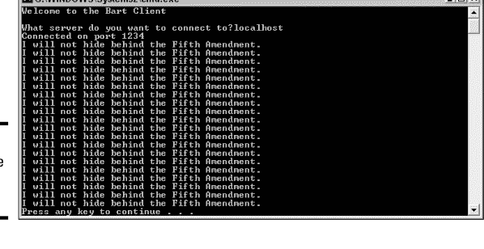

图 2-1：运行 BartClient 程序。

#### 清单 2-4：BARTCLIENT 程序

```java
import java.net.*;
import java.util.*;
import java.io.*;

public class BartClient
{
    public static void main(String[] args)
    {
        int port = 1234;

        System.out.println("Welcome to the Bart Client\n");

        Socket s = getSocket(port);                                       // 13

        try
        {
            System.out.println("Connected on port " + port);

            Scanner in =
                new Scanner(s.getInputStream());                         // 20
            PrintWriter out;
            out = new PrintWriter(s.getOutputStream(),
                true);                                                   // 23

            // discard the welcome message
            in.nextLine();                                               // 26

            // discard the exit instructions
            in.nextLine();                                               // 29

            // get a quote
            out.println("get");                                          // 32
            String quote = in.nextLine();                                // 33

            // disconnect from the server
            out.println("bye");                                          // 36
            s.close();                                                   // 37

            // write the quote on the chalkboard
            for (int i = 0; i < 20; i++)                                  // 41
                System.out.println(quote);
        }
        catch (Exception e)
        {
            e.printStackTrace();                                         // 46
        }
    }

    private static Socket getSocket(int port)                             // 50
    {
        Socket s;
        String host;
        InetAddress ip;

        Scanner sc = new Scanner(System.in);

        continued
```


### BartServer 2.0

以下是该程序中一些较易混淆方面的解释：

13 连接到服务器的过程相当复杂，因此我将其放在了一个名为 `getSocket` 的独立方法中。该方法会提示用户输入主机名，并在用户输入一个程序可以连接的主机名之前不会返回。端口号作为参数传入，返回值是一个已连接到服务器的 `Socket` 对象。（关于此方法工作原理的具体细节从第50行开始。）

20 这条语句获取一个 `Scanner` 对象，用于通过套接字的输入流从客户端读取数据。

23 这条语句获取一个 `PrintWriter` 对象，用于通过套接字的输出流向客户端发送数据。

26 一旦连接建立，服务器会发送一条欢迎消息。这条消息对通过 telnet 连接的用户很有帮助，但对像本例这样的客户端程序却没什么用。因此，这条语句只是使用 `Scanner` 对象从输入流中读取该行并将其丢弃。
由于欢迎消息包含了服务器的版本号，程序可以读取该行并进行检查，以确保你连接的是当前版本的服务器。不过我认为对 BartServer 的额外功能需求不会太多，因此你不必担心版本检查的问题。

29 服务器还会发送一行有用的说明，你需要从流中读取并丢弃它。

**32** 这行将单词 `get` 发送到服务器。这就是客户端程序要求服务器发回一个随机选择句子的方式。

**33** 发送 `get` 请求后，客户端从套接字输入流读取下一行数据。请注意，如果因网络缓慢而发生延迟，`nextLine` 方法会简单地等待，直到该行被发送。

**36** 获得所需内容（一条黑板名言）后，客户端程序向服务器发送 `bye` 命令。服务器会发回一条粗鲁的告别消息，但客户端程序对此不感兴趣，因此甚至懒得读取它。

**37** 与服务器的连接被关闭。

**41** 既然客户端程序已经获得了它的黑板名言书写任务，它便使用一个 `for` 循环将其在黑板上书写20次。

**46** 任何 `socket` I/O 语句都可能抛出异常。它们都在此被捕获为通用异常，并将诊断信息发送到控制台，以便你可以调试可能出现的任何问题。

**50** `getSocket` 方法接受一个端口号作为参数，并返回一个通过指定端口连接的套接字。此方法在用户输入一个程序可以连接的主机名之前不会放弃。

**62** 从控制台读取主机名。

**65** 调用 `InetAddress` 类的静态 `getByName` 方法，以获取用户输入主机名的 IP 地址。请注意，如果用户输入的主机名不存在，将抛出 `UnknownHostException`。此异常在第69行被捕获。

**66** 既然你已拥有 IP 地址，这行代码尝试使用指定的地址和端口创建一个 `Socket` 对象。如果无法连接到该 IP 地址和端口，此方法将抛出 `IOException`。

**67** 如果你执行到这一行，可以假定套接字已创建且已连接。因此，`return` 语句将套接字返回给调用者，即第13行。

上一节中介绍的 BartServer 程序运行良好，但它有一个主要缺陷：它只处理一个客户端的连接。更糟的是，它在该客户端断开连接时就退出了。这算不上一个真正的服务器。

因此，在收到大量用户反馈后，我决定发布具有全新改进功能的 BartServer 2.0。BartServer 2.0 使用线程允许多个客户端同时连接到服务器。每次客户端连接时，都会启动一个线程来处理该客户端的任何请求。主线程继续运行，等待其他客户端连接。图 2-2 展示了 BartServer 2.0 的多线程功能运行情况。清单 2-5 展示了 BartServer 2.0 版本的代码。

#### 清单 2-5 BartServer 2.0

```java
import java.net.*;
import java.io.*;
import java.util.*;

public class BartServer2
{
    public static void main(String[] args)
    {
        int port = 1234;

        BartQuote bart = new BartQuote();

        try
        {
            System.out.println("BartServer 2.0");
            System.out.println("Listening on port " + port);
            ServerSocket ss = new ServerSocket(port);

            while (true)                                                         // 19
            {
                Socket s = ss.accept();
                System.out.println(
                    "Connection established!");
                Thread t = new Thread(
                    new BartThread(s, bart));                                     // 25
                t.start();
            }
        }
        catch (Exception e)
        {
            System.out.println("System exception!");
        }
    }
}

class BartThread implements Runnable                                           // 36
{
    private Socket s;
    private BartQuote bart;

    public BartThread(Socket socket, BartQuote bart)                             // 41
    {
        this.s = socket;
        this.bart = bart;
    }

    public void run()
    {
        String client = s.getInetAddress().toString();
        System.out.println("Connected to " + client);
        try
        {
            Scanner in = new Scanner(s.getInputStream());
            PrintWriter out;
            out = new PrintWriter(s.getOutputStream(),
                                  true);

            out.println("Welcome to the Bart Server");
            out.println("Enter BYE to exit.");

            while (true)
            {
                String input = in.nextLine();
                if (input.equalsIgnoreCase("bye"))
                    break;
                else if (input.equalsIgnoreCase("get"))
                {
                    out.println(bart.getQuote());
                    System.out.println("Serving " + client);
                }
                else
                    out.println("Huh?");
            }
            out.println("So long, suckers!");
            s.close();
        }
        catch (Exception e)
        {
            e.printStackTrace();
        }
        System.out.println("Closed connection to " + client);
    }
}
```

这段代码的大部分与 1.0 版本的代码相同，因此我只强调关键的变化：

- 19 使用一个 while 循环，通过 ServerSocket 对象的 accept 方法来处理连接请求。
- 25 每次新客户端连接时，使用 BartThread 类创建线程的 Runnable 对象来创建一个线程。然后，启动该线程。与此同时，主线程停留在 while 循环中，等待其他客户端连接。

> 如果线程让你感到非常头疼，你可能需要翻回一章，复习第五卷第1章中关于线程编程的信息。

→36 `BartThread` 处理每个已连接客户端所需的处理。此类实现 `Runnable`，这意味着它必须定义一个 `run` 方法。每次创建新线程时，都会调用 `run` 方法。

→41 `BartThread` 类的构造函数使用从主线程传递的参数值初始化两个类字段。这些参数是客户端连接的 `Socket` 对象和由主线程创建的 `BartQuote` 对象的共享副本。

此处未显示，但此版本 `BartServer` 所使用的 `BartQuote` 类的 `getQuote` 方法应该是同步的。这是因为多个线程访问它。有关更多信息，请参阅第五卷第1章。

→47 `run` 方法处理连接到 `BartServer` 的单个客户端的请求。此方法中的大部分代码直接从前一版本复制而来，因此理解此方法的工作原理应该不成问题。

图 2-2：大量的 BartClients！


## 第三章：使用正则表达式

### 本章内容

-   介绍正则表达式
-   使用辅助程序尝试正则表达式
-   创建匹配字符模式的简单表达式
-   使用正则表达式功能，如自定义类、量词和分组
-   将正则表达式与`String`类结合使用
-   使用`Pattern`和`Matcher`类进行更广泛的正则表达式操作

正则表达式并非指饮食中富含纤维的表达式。实际上，*正则表达式*是一种特殊类型的模式匹配字符串，对于进行字符串操作的程序非常有用。正则表达式字符串包含特殊的模式匹配字符，可以与另一个字符串进行匹配，以查看该字符串是否符合该模式。正则表达式对于执行复杂的数据验证非常方便——例如，确保用户输入格式正确的电话号码、电子邮件地址或社会保障号码。

正则表达式对于许多其他用途也很有用，包括搜索文本文件以查看它们是否包含某些模式（你可以说，谷歌？），根据内容过滤电子邮件，或执行复杂的搜索和替换功能。

在本章中，你将了解使用正则表达式的基础知识。我将重点介绍验证，并专注于比较用户输入的字符串与正则表达式指定的模式，以查看它们是否匹配。对于更复杂的正则表达式用法，你必须查阅更广泛的正则表达式参考资料。

正则表达式实际上是使用一种简单但功能强大的小型语言构建的，因此它们本身就类似于小程序。不幸的是，这种小型语言很简洁——*非常*简洁——以至于有时变得非常深奥。大部分内容取决于单个字符，这些字符承载着常常晦涩难懂的含义。因此请注意——正则表达式的语法需要一点时间来适应。但是一旦你掌握了基础知识，你会发现简单的正则表达式并不难创建，并且非常有用。

另外，请注意，本章仅涵盖了你可以用正则表达式做的一部分事情。如果你发现需要使用更复杂的模式，可以在互联网上找到大量有用的信息。只需在任何搜索引擎上搜索`regular expression`即可。

**提示**
正则表达式通常被称为*regex*。大多数人发音时会将其中的*g*发成软音，就像拼写为*rejex*一样。有些人则发音为*rejects*。

### 用于试验正则表达式的程序

在深入讲解如何组合正则表达式的细节之前，清单3-1展示了一个简短的程序，它在你学习如何创建正则表达式时可以成为一个非常有用的工具。该程序允许你输入一个正则表达式。然后，你可以输入一个字符串，程序会将该字符串与正则表达式进行测试，并告诉你该字符串是否匹配该正则表达式。程序随后会提示你输入另一个字符串进行比较。你可以继续输入字符串与已输入的正则表达式进行比较。完成时，只需按回车键而不输入任何字符串。程序会询问你是否要输入另一个正则表达式。如果你回答Y，整个过程将重复。如果你回答N，程序将结束。

以下是该程序的一个示例运行。目前，不要担心正则表达式字符串的细节。只需注意它应该匹配任何以*f*开头、以*r*结尾、中间是*a*、*i*或*o*的三字母单词。

```
Welcome to the Regex Tester

Enter regex:   f[aio]r
Enter string: for
Match.
Enter string: fir
Match.
Enter string: fur
Does not match.
Enter string: fod
Does not match.
Enter string: 
Another? (Y or N) n
```

在这个测试中，我输入了正则表达式`f[aio]r`。然后，我输入了字符串`for`。程序表明该字符串匹配该表达式，并要求输入另一个字符串。所以我输入了`fir`，它也匹配。然后我输入了`fur`和`fod`，它们不匹配。接着我输入了一个空字符串，程序询问我是否要测试另一个正则表达式。我输入了`n`，程序就结束了。

这个程序使用了`Pattern`和`Matcher`类，我将在本章末尾解释它们。然而，我建议你将这个程序与本章内容结合使用。如果你实际尝试正则表达式并观察它们的运行效果，会更容易理解它们。此外，通过尝试简单的变体，你可以学到很多东西。（如果你不想自己输入，可以从本书的网站下载这个程序的源代码。）

事实上，我在本章的其余部分使用了这个程序的控制台输出来说明正则表达式。没有比看到一个表达式以及匹配和不匹配该表达式的字符串示例更好的方式来了解正则表达式是如何工作的了。

**清单3-1：正则表达式测试程序**

```java
import java.util.regex.*;
import java.util.Scanner;

public final class Reg {
    static String r, s;
    static Pattern pattern;
    static Matcher matcher;
    static boolean match, validRegex, doneMatching;

    private static Scanner sc = new Scanner(System.in);

    public static void main(String[] args)
    {
        System.out.println("Welcome to the Regex Tester\n");
        do
        {
            do
            {
                System.out.print("\nEnter regex:   ");
                r = sc.nextLine();
                validRegex = true;
                try
                {
                    pattern = Pattern.compile(r);
                }
                catch (Exception e)
                {
                    System.out.println(e.getMessage());
                    validRegex = false;
                }
            } while (!validRegex);

            doneMatching = false;
            while (!doneMatching)
            {
                System.out.print("Enter string: ");
                s = sc.nextLine();
                if (s.length() == 0)
                    doneMatching = true;
                else
                {
                    matcher = pattern.matcher(s);
                    if (matcher.matches())
                        System.out.println("Match.");
                    else
                        System.out.println(
                            "Does not match.");
                }
            }
        } while (askAgain());
    }

    private static boolean askAgain()
    {
        System.out.print("Another? (Y or N) ");
        String reply = sc.nextLine();
        if (reply.equalsIgnoreCase("Y"))
            return true;
        return false;
    }
}
```

#### 基本字符匹配

大多数正则表达式只是匹配字符，以查看字符串是否符合简单的模式。例如，你可以检查一个字符串是否符合社会保障号码(xxx-xx-xxxx)、电话号码[(xxx) xxx-xxxx]或更复杂的模式（如电子邮件地址）的格式。（实际上，社会保障和电话号码可能比你想象的要复杂得多。稍后会详细介绍。）在以下部分，你将了解如何为基本字符匹配创建正则表达式模式。

#### 匹配单个字符

最简单的正则表达式模式只是精确匹配一个字符串字面量。例如：

```
Enter regex:  abc
Enter string: abc
Match.
Enter string: abcd
Does not match.
```

这里，模式`abc`匹配字符串`abc`，但不匹配`abcd`。

#### 使用预定义字符类

*字符类*代表一种特定类型的字符，而不是特定的字符。正则表达式允许你使用两种类型的字符类：预定义类和自定义类。预定义字符类如表3-1所示。

| 正则表达式 | 匹配 ... |
| :--- | :--- |
| . | 任意字符 |
| \d | 任意数字 (0–9) |
| \D | 任意非数字（除0–9以外的任何字符） |
| \s | 任意空白字符（空格、制表符、换行符、回车符和退格符） |
| \S | 除空白字符以外的任意字符 |
| \w | 任意单词字符（a–z、A–Z、0–9或下划线） |
| \W | 除单词字符以外的任意字符 |

句点类似于匹配任意字符的通配符。例如：

```
Enter regex:  c.t
Enter string: cat
Match.
Enter string: cot
Match.
Enter string: cart
Does not match.
```

这里，`c.t`匹配任何以`c`开头、以`t`结尾的三字母字符串。在这个例子中，前两个字符串（`cat`和`cot`）匹配，但第三个字符串（`cart`）不匹配，因为它超过了三个字符。


## 480 基本字符匹配

`\d` 类表示一个数字，通常用于验证输入数据的正则表达式模式中。例如，这里有一个简单的正则表达式模式，用于验证美国社会安全号码，该号码必须以 XXX-XX-XXXX 的格式输入：

```
Enter regex:  \d\d\d-\d\d-\d\d\d\d
Enter string: 779-54-3994
Match.
Enter string: 550-403-004
Does not match.
```

这里，正则表达式模式规定字符串必须包含三个数字、一个连字符、两个数字、另一个连字符和四个数字。

> **技术细节**
> 请注意，这个正则表达式模式实际上并不足以验证真实的社会安全号码，因为政府对这些号码的限制远不止于 XXX-XX-XXXX 这种模式。例如，任何社会安全号码都不能以 779 开头。因此，在前面示例中输入的号码 779-54-3994 实际上不是一个有效的社会安全号码。

请注意，`\d` 类有一个对应物：`\D`。`\D` 类匹配任何*不是*数字的字符。例如，这里有一个用于验证机器人名字的初次尝试：

```
Enter regex:  \D\d-\D\d
Enter string: R2-D2
Match.
Enter string: C2-D0
Match.
Enter string: C-3P0
Does not match.
```

这里，该模式匹配以非数字字符开头，后跟一个数字字符，再跟一个连字符，然后是非数字字符，最后以数字结尾的字符串。因此，R2-D2 和 C3-P0 匹配。不幸的是，这个正则表达式远非完美，任何*星球大战*粉丝都能告诉你。这是因为那个闪亮的金色礼仪机器人的正确名字是 C-3PO，而不是 C3-P0。典型的。

`\s` 类匹配空白字符，包括空格、制表符、换行符、回车符和退格符。当你想允许用户以多种方式分隔字符串的各个部分时，这个类非常有用。例如：

```
Enter regex:  ...\s...
Enter string: abc def
Match.
Enter string: abc       def
Match.
```

这里，该模式规定字符串可以是两组任意三个字符，由一个空白字符分隔。在输入的第一个字符串中，两组由空格分隔。在第二个字符串中，它们由制表符分隔。`\s` 类也有一个对应物：`\S`。它匹配任何不是空白字符的字符。

如果你想将空白字符限制为实际的空格，只需在正则表达式中使用一个空格即可。例如：

```
Enter regex: ...   ...
Enter string: abc def
Match.
Enter string: abc		def
Does not match.
```

这里，正则表达式规定两组任意字符由一个空格分隔。第一个输入字符串匹配此模式，但第二个不匹配，因为两组由制表符分隔。

最后一组预定义类是 `\w` 和 `\W`。`\w` 类标识通常在单词中使用的任何字符。这包括大写和小写字母、数字和下划线。例如：

```
Enter regex: \w\w\w\W\w\w\w
Enter string: abc def
Match.
Enter string: 123 456
Match.
Enter string: 123A456
Does not match.
```

这里，该模式要求两组单词字符由一个非单词字符分隔。

下划线被视为单词字符，这难道不奇怪吗？我不知道在英语（或任何其他语言）中，有多少单词包含下划线。我猜这体现了正则表达式的计算机极客起源。

#### 使用自定义字符类

要创建一个*自定义字符类*，你只需在一对方括号内列出所有你想包含在该类中的字符。例如：

```
Enter regex: b[aeiou]t
Enter string: bat
Match.
Enter string: bet
Match.
Enter string: bit
Match.
Enter string: bot
Match.
Enter string: but
Match.
Enter string: bmt
Does not match.
```

这里，该模式规定字符串必须以字母 `b` 开头，后跟一个可以包含 `a`、`e`、`i`、`o` 或 `u` 的类，再跟 `t`。换句话说，它接受以 `b` 开头、以 `t` 结尾、中间是元音字母的三个字母单词。

如果你想让该模式同时包含大写字母和小写字母，你必须同时列出它们：

```
Enter regex: b[aAeEiIoOuU]t
Enter string: bat
Match.
Enter string: BAT
Does not match.
Enter string: bAt
Match.
```

你可以在一行中使用任意多个自定义组。例如，下面这个定义了首字母和尾字母的类，因此它们也可以是大写或小写：

```
Enter regex: [bB][aAeEiIoOuU][tT]
Enter string: bat
Match.
Enter string: BAT
Match.
```

这个模式规定了三个字符类。第一个可以是 `b` 或 `B`，第二个可以是任何大写或小写元音字母，第三个可以是 `t` 或 `T`。

#### 使用范围

自定义字符类也可以指定字母和数字的*范围*。例如：

```
Enter regex: [a-z][0-5]
Enter string: r2
Match.
Enter string: b9
Does not match.
```

这里，字符串可以是两个字符长。第一个必须是 a 到 z 之间的字符，第二个必须是 0 到 5 之间的字符。

你也可以在一个类中使用多个范围，像这样：

```
Enter regex: [a-zA-Z][0-5]
Enter string: r2
Match.
Enter string: R2
Match.
```

这里，第一个字符可以是小写 a 到 z 或大写 A 到 Z。

你可以使用范围来构建一个只接受出现在真实单词中的字符的类，这与允许使用下划线的 `\w` 类不同：

```
Enter regex: [a-zA-Z0-9]
Enter string: a
Match.
Enter string: N
Match.
Enter string: 9
Match.
```

#### 使用否定

正则表达式可以包含匹配除类中列出的字符之外的任何字符的类。为此，你需要在类开头使用一个脱字符，像这样：

```
Enter regex: [^cf]at
Enter string: bat
Match.
Enter string: cat
Does not match.
Enter string: fat
Does not match.
```

这里，字符串必须是一个以 at 结尾的三个字母单词，但不能是 fat 或 cat。

#### 匹配多个字符

本章到目前为止描述的正则表达式模式要求输入字符串中的每个位置总是匹配一个特定的字符类。例如，模式 `\d\W[a-z]` 要求第一个位置是数字，第二个位置是空白字符，第三个位置是 a 到 z 之间的字母之一。这些要求相当严格。

## 482 基本字符匹配

要创建更灵活的模式，你可以使用表 3-2 中列出的任何*量词*。这些量词允许你在字符串的某个位置创建匹配可变数量字符的模式。

##### 表 3-2 量词

| 正则表达式 | 匹配前面的元素... |
| :--- | :--- |
| ? | 零次或一次 |
| * | 零次或多次 |
| + | 一次或多次 |
| {n} | 恰好 *n* 次 |
| {n, } | 至少 *n* 次 |
| {n, m} | 至少 *n* 次，但不超过 *m* 次 |

要使用量词，你需要将其编码在你想应用它的元素之后。例如，这里是一个使用量词的社会安全号码模式版本：

```
Enter regex:   \d{3}-\d{2}-\d{4}
Enter string: 779-48-9955
Match.
Enter string: 483-488-9944
Does not match.
```

这里，该模式匹配三个数字，后跟一个连字符，再跟两个数字，再跟另一个连字符，最后是四个数字。

简单地重复元素而不是使用量词同样容易，甚至更容易。例如，`\d\d` 和 `\d{2}` 一样清晰。

`?` 量词允许你创建一个可选的元素，该元素可能在字符串中存在也可能不存在。例如，假设你想允许用户输入不带连字符的社会安全号码。那么，你可以使用这个模式：

```
Enter regex:   \d{3}-?\d{2}-?\d{4}
Enter string: 779-48-9955
Match.
Enter string: 779489955
Match.
Enter string: 779-489955
Match.
Enter string: 77948995
Does not match.
```


问号表示连字符是可选的。请注意，此模式允许你包含或省略任一连字符。最后输入的字符串不匹配，因为它只有八位数字，而模式要求九位。

#### 使用转义

在正则表达式中，某些字符具有特殊含义。这就引出了一个问题：如果你想搜索这些特殊字符中的一个怎么办？在这种情况下，你需要在该字符前加上反斜杠来*转义*它。例如：

```
Enter regex: \(\d{3}\) \d{3}-\d{4}
Enter string: (559) 555-1234
Match.
Enter string: 559 555-1234
Does not match.
```

这里，`\(` 代表左括号，`\)` 代表右括号。如果没有反斜杠，正则表达式会将括号视为分组元素。

关于转义，还有几点需要思考：

- 严格来说，你只需要对正则表达式中具有特殊含义的字符使用反斜杠转义。然而，我建议你转义任何标点符号或符号，以确保安全。
- 你不能转义字母字符（字母）。这是因为反斜杠后跟某些字母字符代表一个字符、一个类或其他正则表达式元素。
- 要转义一个反斜杠，请连续编码两个反斜杠。例如，正则表达式 `\d\d\\\d\d` 接受由两个数字、一个反斜杠和另外两个数字组成的字符串，如 `23\88` 和 `95\55`。

#### 使用括号对字符进行分组

你可以使用括号来创建字符组，以便将其他正则表达式元素应用于该组。例如：

```
Enter regex: (bla)+
Enter string: bla
Match.
Enter string: blabla
Match.
Enter string: blablabla
Match.
Enter string: bla bla bla
Does not match.
```

这里，括号将 `bla` 视为一个组，因此 `+` 量词应用于整个序列。因此，此模式查找一个或多个 `bla` 序列的出现。

这是一个查找带有可选区号的美国电话号码的示例：

```
Enter regex: (\(\d{3}\)\s?)?\d{3}-\d{4}
Enter string: 555-1234
Match.
Enter string: (559) 555-1234
Match.
Enter string: (559)555-1239
Match.
```

这个正则表达式模式有点复杂，但如果你逐个元素地检查它，你应该能弄明白。它以一个表示可选区号的组开始：`(\(\d{3}\)\s?)?`。这个组以标记组开始的左括号开头。组中的字符包括一个转义的左括号、三个数字、一个转义的右括号和一个可选的空白字符。然后，一个右括号关闭该组，问号表示整个组是可选的。正则表达式模式的其余部分查找三个数字，后跟一个连字符和四个数字。

当你用括号标记一组字符时，匹配该组的文本会被*捕获*，以便你可以在模式的后面使用它。被捕获的组称为*捕获组*，并从1开始编号。然后，你可以使用反斜杠后跟捕获组编号来表示文本必须与为指定捕获组捕获的文本匹配。

例如，假设遵循模式 `\w\d-\w\d` 命名的机器人，其第二个和第五个字符必须具有相同的数字。换句话说，`r2-d2` 和 `b9-k9` 是有效的机器人名称，但 `r2-d4` 和 `d3-r4` 则不是。

这是一个可以验证这种名称类型的示例：

```
Enter regex: \w(\d)-\w\1
Enter string: r2-d2
Match.
Enter string: d3-r4
Does not match.
Enter string: b9-k9
Match.
```

这里，`\1` 指的是第一个捕获组。因此，字符串中的最后一个字符必须与第二个字符相同，而第二个字符必须是一个数字。

#### 使用 | 符号

`|` 符号定义了一个或运算，允许你创建接受两个或多个变体中任何一个的模式。例如，这是验证机器人名称模式的改进：

```
Enter regex:  (\w\d-\w\d) | (\w-\d\w\w)
Enter string:  r2-d2
Match.
Enter string:  c-3po
Match.
```

这里，`|` 字符表示左侧的组或右侧的组都可以用于匹配字符串。左侧的组匹配一个单词字符、一个数字、一个连字符、一个单词字符和另一个数字。右侧的组匹配一个单词字符、一个连字符、一个数字和两个单词字符。

你可能想要在 `|` 应用于的部分周围使用一组额外的括号。然后，你可以在 `|` 组之前或之后添加额外的模式元素。例如，如果你想让用户输入带有或不带括号的电话号码区号怎么办？这是一个可以实现此功能的正则表达式模式：

```
Enter regex:  ((\d{3} )|((\d{3}\) )?\d{3}-\d{4}
Enter string:  (559) 555-1234
Match.
Enter string:  559 555-1234
Match.
Enter string:  555-1234
Match.
```

此模式的第一部分是一个组，由两个较小的组组成，它们由一个 `|` 字符分隔。这些组中的第一个匹配不带括号的区号后跟一个空格，第二个匹配带括号的区号后跟一个空格。因此，外层组匹配带或不带括号的区号。整个组用问号标记为可选，然后模式继续查找三个数字、一个连字符和四个数字。

#### 在Java程序中使用正则表达式

到目前为止，本章向你展示了创建正则表达式的基础知识。现在，以下部分向你展示如何在Java程序中使用它们。

#### String问题

在深入介绍处理正则表达式的类之前，我想向你透露Java在处理包含正则表达式的字符串时遇到的一个问题。正如你在本章中看到的，正则表达式模式依赖反斜杠字符来标记模式的不同元素。坏消息是，Java将字符串字面量中的反斜杠字符视为转义字符。因此，你不能直接将正则表达式放在字符串字面量中引用，因为Java会在正则表达式类接收到它们之前就“偷走”这些反斜杠字符。

在大多数情况下，编译器只会抱怨字符串字面量不正确。例如，以下行将无法编译：

```
String regex = "\w\d-\w\d";    // error: won't compile
```

编译器看到字符串中的反斜杠，期望找到一个有效的Java转义序列，而不是正则表达式。

不幸的是，这个问题的解决方案很丑陋：你必须在任何出现反斜杠的地方使用双反斜杠。Java将连续的两个反斜杠视为一个转义的反斜杠，并在字符串中放置一个反斜杠。因此，你必须像这样编写前一段中显示的语句：

```
String regex = "\\w\\d-\\w\\d";    // now it will compile
```

这里，我希望在正则表达式中出现的每个反斜杠在字符串字面量中都编码为一对反斜杠。

> 提示：如果你不确定是否正确编码了字符串字面量，只需使用 `System.out.println` 打印生成的字符串。然后，你可以检查控制台输出以确保你正确编写了字符串字面量。例如，如果我在前面的语句后加上 `System.out.println(regex)`，控制台上将出现以下输出：

```
\w\d-\w\d
```

#### 与String类一起使用正则表达式

如果你想用正则表达式做的只是检查字符串是否匹配某个模式，你可以使用String类的 `matches` 方法。此方法接受一个正则表达式作为参数，并返回一个布尔值，指示字符串是否与该模式匹配。

例如，这是一个验证机器人名称的静态方法：

```
private static boolean validDroidName(String droid)
{
    String regex = "(\w\d-\w\d)|(\w-\d\w\w)";
    return droid.matches(regex);
}
```

这里，机器人的名称通过参数传递，该方法返回一个布尔值，指示机器人的名称是否有效。该方法只是从字符串字面量创建一个正则表达式，然后使用机器人字符串的 `matches` 方法来匹配该模式。

你还可以使用 `split` 方法，根据与正则表达式匹配的分隔符将字符串分割成String对象数组。一种常见的方法是简单地创建一个可用于分隔符的自定义字符类。例如：

```
String s = "One:Two;Three|Four\tFive";
String regex = "[:;|\t]";
String strings[] = s.split(regex);
for (String word : strings)
    System.out.println(word);
```

这里，字符串被分割成由冒号、分号、竖线或制表符标记的单词。当你运行此程序时，控制台上显示的内容如下：

```
One
Two
Three
Four
Five
```

#### 使用Pattern和Matcher类

`matches` 方法对于偶尔使用正则表达式来说已经足够了。但如果你希望你的程序进行大量的模式匹配，你应该改用 `Pattern` 和 `Matcher` 类。`Pattern` 类代表一个已编译成可执行形式的正则表达式（记住，正则表达式就像小程序）。然后，你可以使用编译后的 `Pattern` 对象创建一个 `Matcher` 对象，然后你可以用它来匹配字符串。


## 490 在Java程序中使用正则表达式

`Pattern` 类本身相当简单。虽然它有大约十个方法，但你通常只使用这两个：

-   ◆ `static Pattern compile(String pattern)`：编译指定的模式。此静态方法返回一个 `Pattern` 对象。如果模式包含错误，它会抛出 `PatternSyntaxException`。
    ◆ `Matcher matcher(String input)`：创建一个 `Matcher` 对象，以将此模式与指定字符串进行匹配。

首先，你使用 `compile` 方法来创建一个 `Pattern` 对象。（`Pattern` 是那些没有构造函数的怪异类之一。相反，它依赖静态的 `compile` 方法来创建实例。）因为 `compile` 方法会抛出 `PatternSyntaxException`，所以在编译模式时必须使用 `try/catch` 语句来捕获此异常。

一旦你有了一个 `Pattern` 实例，你就可以使用 `matcher` 方法来创建 `Matcher` 类的一个实例。这个类有超过30个方法，让你能够使用正则表达式做各种事情，这些并未在本章中涉及，例如在输入字符串中查找模式的多次出现，或者将匹配模式的文本替换为替换字符串。就本书而言，我只关心 `matches` 方法：`static boolean matches()` 返回一个布尔值，指示整个字符串是否匹配该模式。

为了说明如何使用这些方法，这里是一个增强版的 `validDroidName` 方法，它创建用于机器人验证正则表达式的模式并将其保存在静态类字段中：

```
private static Pattern droidPattern;

private static boolean validDroidName(String droid)
{
    if (droidPattern == null)
    {
        String regex = "(\\w\\d-\\w\\d)|(\\w-\\d\\w\\w)";
        droidPattern = Pattern.compile(regex);
    }
    Matcher m = droidPattern.matcher(droid);
    return m.matches();
}
```

这里，私有类字段 `droidPattern` 保存了用于验证机器人的已编译模式。`validDroidName` 方法中的 `if` 语句检查模式是否已经创建。如果没有，则通过调用 `Pattern` 类的静态 `compile` 方法来创建模式。然后，使用 `matcher` 方法为作为参数传递的字符串创建一个 `Matcher` 对象，并通过调用 `Matcher` 对象的 `matches` 方法来验证该字符串。

## 第4章：使用递归

本章内容

-   介绍递归
-   用递归计算阶乘
-   用递归列出目录
-   用递归进行排序

递归是一种基本的编程技术，其中方法调用自身来解决某些问题。使用这种技术的方法称为*递归*方法。许多编程问题只能通过递归来解决，而一些可以通过其他技术解决的问题，用递归来解决会更好。


我不确定，但我想术语*递归*来源于拉丁语 *recurse, recurset, recursum*，意思是反复诅咒。我确实知道，这正是许多程序员在努力解决复杂的递归编程问题时的感受。

确实，有时递归的概念可能会变得有点棘手。所以许多程序员避而远之，寻找其他技术来解决手头的问题。在许多情况下，非递归解决方案是最好的。然而，许多问题正是呼唤着递归。

### 经典的阶乘示例

介绍递归的经典问题之一是计算整数的阶乘。任何给定整数的*阶乘*——我称它为*n*以显得数学化——是从1到*n*的所有整数的乘积。因此，5的阶乘是120：5乘以4乘以3乘以2乘以1。

#### 非递归解决方案

计算阶乘不必使用递归。相反，你可以使用一个简单的`for`循环。例如，这里有一个方法，它接受一个`int`数字并将其阶乘作为`long`返回：

```
private static long factorial(int n)
{
    long f = 1;
    for (int i = 1; i <=n; i++)
        f = f * i;
    return f;
}
```

此方法只是使用一个`for`循环从1数到该数字，并跟踪乘积。以下是一段调用此方法并显示结果的代码片段：

```
int n = 5;
long fact;
fact = factorial(n);
System.out.println("The factorial of "+ n + " is " + fact + ".");
```

如果你运行此代码，控制台上将显示以下行：

```
The factorial of 5 is 120.
```


阶乘值增长很快。你应该使用`long`而不是`int`来计算结果。并且你应该使用`NumberFormat`类来格式化结果。例如，如果`int`是20而不是5，之前的代码会在控制台上打印：

```
The factorial of 20 is 2432902008176640000.
```

如果你使用`NumberFormat`类来格式化结果，控制台输出将更具可读性：

```
The factorial of 20 is 2,432,902,008,176,640,000.
```

#### 递归解决方案

阶乘问题的非递归解决方案可行，但乐趣不多。递归解决方案基于这样一个概念：任何数字$n$的阶乘等于$n$乘以$n-1$的阶乘，前提是$n$大于1。如果$n$是1，则$n$的阶乘是1。

阶乘的这个定义是递归的，因为定义本身包含了阶乘方法。它还包含了任何递归方法最重要的部分：一个*结束条件*。结束条件指示递归方法应何时停止调用自身。在这种情况下，当$n$是1时，我只需返回1。没有结束条件，递归方法将永远调用自身。

以下是阶乘方法的递归版本：

```
private static long factorial(int n)
{
    if (n == 1)
        return 1;
    else
        return n * factorial(n-1);
}
```

这个方法返回的结果与上一节中的版本完全相同，但它使用递归来计算阶乘。

一种可视化递归工作方式的方法是想象你有五个朋友，分别叫Jordan、Jeremy、Jacob、Justin和Bob。你的朋友不太聪明，但他们非常相似。事实上，他们是彼此的克隆。克隆技术还不完美，所以这些克隆有限制。每个克隆只能做一次乘法运算，并且可以问其中一个克隆一个问题。

所以你走向Joshua说：“Joshua，五的阶乘是多少？”

Jordan说：“我不知道，但我知道它是四的阶乘的五倍。Jeremy，四的阶乘是多少？”

Jeremy说：“我不知道，但我知道它是三的阶乘的四倍。Jacob，三的阶乘是多少？”

Jacob说：“我不知道，但我知道它是二的阶乘的三倍。Justin，二的阶乘是多少？”

Justin说：“我不知道，但我知道它是一的阶乘的二倍。嘿，Bob！一的阶乘是多少？”

Bob，由于名字不是J开头的，是这群人中最聪明的，回答说：“哎呀，当然是一。”于是他告诉了Justin他的答案。

Justin说：“啊！二乘以一等于二。”于是他把答案告诉了Jacob。

Jacob说：“谢谢。三乘以二等于六。”Jacob告诉了Jeremy他的答案。

Jeremy说：“老兄！四乘以六等于24。”Jeremy告诉了Jordan他的答案。

Jordan说：“非常好！五乘以二十四等于120。”于是他告诉了你答案。

递归的工作原理大致如此。

#### 显示目录

递归非常适合于必须遍历目录结构的应用程序，例如Windows或Unix文件系统。在文件系统中，目录是文件和其他目录的列表。这些目录中的每一个本身又是文件和其他目录的列表，以此类推。目录可以紧密地嵌套在其他目录中，并且数量没有限制。

清单4-1展示了一个使用递归方法列出从给定路径开始找到的所有目录的程序。我使用缩进来显示目录结构。例如，这是我用于组织本书文档的目录的控制台输出：

```
Welcome to the Directory Lister
Enter a path: C:\Java AIO

Listing directory tree of:
C:\Java AIO
  Apps
    Book 1
    Book 2
    Book 3
    Book 4
    Book 5
  Manuscript
    Book 1
    Book 2
    Book 3
    Book 4
    Book 5
    Front
    Plans
Another? (Y or N) n
```

嗯，如你所见，我还没完成第VI到IX卷。当你读到这一章时，将会有更多的目录需要列出！

> 警告！除非你准备好长时间等待程序完成列出硬盘上的所有目录，否则不要输入c:\。

目录列表应用程序非常简单。不过，在我解释其细节之前，我想指出这个程序使用了`File`类，它是`java.io`包的一部分。`File`类代表一个单独的文件或目录。你将在第VIII卷中了解到更多关于这个类的内容。现在，你只需要知道这五个细节：


#### 显示目录

该类的构造函数接受一个目录路径作为参数，并创建一个表示指定目录的对象。

你可以使用 `exists` 方法来检查路径参数指定的目录是否存在。

`listFiles` 方法返回一个 `File` 对象数组，该数组表示当前 `File` 对象中的所有文件和目录。

`isDirectory` 方法返回一个布尔值，指示当前 `File` 对象是否是一个目录。如果此方法返回 false，则可以假定该 `File` 对象是一个文件。

`getName` 方法返回文件的名称。

#### 清单 4-1：目录列表应用程序

```java
import java.io.File;
import java.util.Scanner;

public class DirList
{
    static Scanner sc = new Scanner(System.in);

    public static void main(String[] args)
    {
        System.out.print(
            "Welcome to the Directory Lister");
        do
        {
            System.out.print("\nEnter a path: ");
            String path = sc.nextLine();

            File dir = new File(path);
            if (!dir.exists() || !dir.isDirectory())
                System.out.println(
                    "\nThat directory doesn't exist.");
            else
            {
                System.out.println(
                    "\nListing directory tree of:");
                System.out.println(dir.getPath());
                listDirectories(dir, "  ");
            }
        } while(askAgain());
    }

    private static void listDirectories(
        File dir, String indent)
    {
        File[] dirs = dir.listFiles();
        for (File f : dirs)
        {
            if (f.isDirectory())
            {
                System.out.println(
                    indent + f.getName());
                listDirectories(f, indent + "  ");
            }
        }
    }

    private static boolean askAgain()
    {
        System.out.print("Another? (Y or N) ");
        String reply = sc.nextLine();
        if (reply.equalsIgnoreCase("Y"))
            return true;
        return false;
    }
}
```

以下段落指出了此程序工作方式的关键点：

- →1 此 `import` 语句是使用 `File` 类所必需的。
- →15 一个 `Scanner` 对象用于从用户那里获取路径名。
- →17 路径名被传递给 `File` 类构造函数，以为用户输入的目录创建一个新的 `File` 对象。
- →18 调用 `exists` 和 `isDirectory` 方法，以确保用户输入的路径存在，并且指向一个目录而不是文件。
- →25 如果用户输入了一个有效的路径，则调用 `getPath` 方法来显示 `File` 对象所表示的路径名称。（我同样也可以在这里直接显示 `path` 变量。）
- →26 调用 `listDirectories` 方法来列出用户指定目录中的所有子目录。
- →28 询问用户是否要列出另一个目录，如果用户输入 Y，则循环重复。
- →31 这是 `listDirectories` 方法的开始。此方法接受两个参数：一个表示要列出的目录的 `File` 对象，以及一个提供用于缩进列表每行的空格的 `String` 对象。当此方法首次从 `main` 方法调用时，缩进由一个字符串字面量设置为两个空格。
- →34 调用 `listFiles` 方法以获取此目录中所有 `File` 对象的数组。
- →35 使用增强的 `for` 循环来处理数组中的所有 `File` 对象。
- →37 此 `if` 语句检查一个文件是否是目录而不是文件。
- →40 如果 `File` 对象是一个目录，则打印缩进字符串，后跟由 `getName` 方法返回的目录名称。
- →41 接下来，递归调用 `listDirectories` 方法以列出 `f` 目录的内容。但是，向缩进字符串添加两个空格，以便 `f` 目录中的任何目录都比当前目录向右缩进两个空格。

如果你在理解此程序中的递归工作方式方面有困难，可以这样思考：`listDirectories` 方法列出单个目录中的所有子目录。对于每个目录，此方法执行两项操作：(1) 打印目录的名称，(2) 调用自身以打印该目录的任何子目录。

之前我提到过，所有递归方法都必须有某种类型的条件测试，以使方法停止调用自身。在此程序中，条件测试可能并不明显。然而，最终 `listDirectories` 方法会传递一个没有任何子目录的目录。当发生这种情况时，递归结束——至少对于该分支目录树是这样。

#### 编写你自己的排序例程

世界上满是计算机科学专业的学生，他们对计算机的了解并不比你多。然而，他们曾经上过一门课，老师在课上讲解了排序算法的工作原理。他们可能在那门课上只得了 C，但这已经足够毕业了。

现在，你有机会学习因未主修计算机科学而错过的知识。我将向你展示一种最常用排序技术的实际工作原理。它被称为 *快速排序*，这是对递归的一种非常巧妙的运用。我甚至会向你展示一个简单的 Java 实现。

快速排序无疑是整本书中技术性最强的部分。如果你从不想主修计算机科学，甚至不想和那些主修计算机科学的人交谈，你现在可能想直接跳过本章的剩余部分。

对我们大多数人来说，学习像快速排序这样的排序算法如何工作，仅仅是一种智力练习。Java API 已经内置了排序功能——例如，查看 `Arrays.sort` 方法。这些排序例程比你或我编写的任何例程都要好得多。

#### 理解快速排序的工作原理

快速排序技术使用递归对一组值进行排序。其基本步骤如下：

1.  选择一个位于数组值范围内的任意值。这个值称为 *基准点*。选择基准点最常见的方式是直接选择数组中的第一个值。人们已经撰写了博士论文，探讨更复杂的、能产生更快排序速度的基准点选择方法。我喜欢坚持使用数组中的第一个元素。
2.  重新排列数组中的值，使所有小于基准点的值位于数组的左侧，所有大于或等于基准点的值位于数组的右侧。基准值表示数组左侧和右侧之间的分界线。它可能不会正好在中间，但这并不重要。此步骤称为 *分区*，数组的左侧和右侧部分称为 *分区*。
3.  现在将数组的两个部分视为单独的数组，并对该部分重新开始步骤 1。这就是算法的递归部分。

快速排序算法最难的部分是分区步骤。此步骤必须重新排列分区，使所有小于基准点的值位于左侧，所有大于基准点的值位于右侧。例如，假设数组有以下十个值：

38 17 58 22 69 31 88 28 86 12

这里，基准点是 38，分区步骤的任务是将数组重新排列为类似这样：

17 12 22 28 31 38 88 69 86 58

注意这些值仍然是无序的。然而，数组已经围绕值 38 进行了划分：所有小于 38 的值都位于 38 的左侧，所有大于 38 的值都位于 38 的右侧。

现在，你可以根据值 38 将数组分成两个分区，并对每一侧重复此过程。基准值本身与左分区一起，所以左分区是这样的：

```
17 12 22 28 31 38
```

这一次，分区步骤选择 17 作为基准点，并按如下方式重新排列元素：

```
12 17 22 28 31 38
```

如你所见，数组的这部分现在已经排序了。不幸的是，快速排序此时并不知道这一点，所以它需要几次额外的递归才能确定。但这就是基本过程。

#### sort 方法

驱动快速排序例程的实际代码出奇地简单：

```java
public static void sort(int low, int high)
{
    if (low >= high)
        return;
    int p = partition(low, high);
    sort (low, p);
    sort (p+1, high);
}
```

此方法对由传递给它的低索引和高索引值指定的数组部分进行排序。暂时忽略 `if` 语句，`sort` 方法的工作方式是调用 `partition` 方法。此方法将数组重新排列成两个部分，称为 *分区*，使左分区中的所有值都小于右分区中的所有值。`partition` 方法返回左分区结束的索引。然后，`sort` 方法调用自身两次：一次对左分区排序，然后再次对右分区排序。

要启动 `sort`，你需要以零作为低值，数组长度减一作为高值来调用它。因此，`sort` 方法从对整个数组排序开始。每次 `sort` 方法执行时，它都会调用自身两次来对数组中更小的分区进行排序。


## 500 编写你自己的排序例程

`sort` 方法开头的 `if` 语句会比较低端值与高端值。如果低端值等于或大于高端值，那么分区就只有一个元素（或者可能没有元素），因此已经是有序的。在这种情况下，`sort` 方法会直接返回，而不再调用自身。这就是终止递归的条件。

#### 分区方法

`sort` 方法本身是快速排序技术中简单的部分。难的部分是 `partition` 方法。该方法接受两个参数：标记应排序数组部分的低端索引和高端索引。分区方法的基本轮廓大致如下：

1.  选择一个基准点。
2.  将所有小于基准点的元素移动到分区的左侧。
3.  将所有大于基准点的元素移动到分区的右侧。
4.  返回基准点的索引。

对数组进行分区最常用的技术是维护两个索引变量，命名为 `i` 和 `j`，它们从数组的两端向中间移动。首先，`i` 从数组开头开始向前移动，直到遇到一个大于基准值的值。然后，`j` 从数组的另一端开始向后移动，直到找到一个小于基准点的值。此时，`partition` 方法在数组左侧有一个大于基准点的值，在右侧有一个小于基准点的值。因此，它会交换它们。

然后，它会重复这个循环：递增 `i` 直到找到另一个大于基准值的值，递减 `j` 直到找到另一个小于基准值的值，然后交换元素。这个过程会重复进行，直到 `j` 小于 `i`，这意味着索引已经交叉，分区完成。

现在让我们用一些代码把它组合起来：

```java
public static int partition(int low, int high)
{
    int pivot = a[low];
    int i = low - 1;
    int j = high + 1;

    while (i < j)
    {
        for (i++; a[i] < pivot; i++);
        for (j--; a[j] > pivot; j--);
        if (i < j)
            swap(i, j);
    }
    return j;
}
```

注意，在这段代码中，正在排序的数组是一个名为 `a` 的静态 int 数组。要分区的分区的低端和高端作为参数传入，该方法首先选择分区中的第一个元素作为基准点的值。接下来，它根据参数初始化索引变量 `i` 和 `j`。注意，低端值减去了 1，高端值加上了 1。索引变量在循环开始之前从数组后退一步，以便有一个良好的起点。

`while` 循环用于指示分区何时完成。只要 `i` 小于 `j`，它就会重复。一旦这些索引变量停止，分区就完成了，并且返回 `j` 的值来指示将左侧分区与右侧分区分开的索引点。

在 `while` 循环的主体中，有两个没有主体的奇怪的 `for` 循环。这些 `for` 循环没有主体，因为它们的唯一目的是移动索引值，直到找到小于或大于基准值的值。

第一个 `for` 循环递增 `i` 索引变量，直到找到一个大于基准点的值。因此，这个 `for` 循环找到第一个可能需要移动到数组另一侧的值。

接下来，第二个 `for` 循环递减 `j` 索引变量，直到找到一个小于基准点的值。所以这个循环找到一个可能需要与第一个 `for` 循环找到的值交换的值。

最后，`if` 语句检查索引是否已经交叉。假设它们还没有交叉，则调用 `swap` 方法来交换元素。`swap` 方法非常简单：

```java
public static void swap(int i, int j)
{
    int temp = a[i];
    a[i] = a[j];
    a[j] = temp;
}
```

这个方法将 `i` 元素移动到一个临时变量，将 `j` 元素移动到 `i` 元素，然后将临时变量移动到 `j` 元素。

#### 把它们组合在一起

既然你已经看到了创建一个快速排序程序所需的基本步骤，代码清单 4-2 展示了一个使用这些方法的程序。这个程序创建了一个包含 100 个随机选择的数字的数组，数值范围从 1 到 100。它打印数组，使用前面几节所示的排序方法对数组进行排序，然后打印排序后的数组。以下是一个示例运行：

未排序数组：
65 51 38 47 93 87 50 36 77 58 22 92 46 60 49 90 28 39 27 8
66 76 40 99 90 35 34 30 7 41 45 34 41 17 36 63 52 65 50 77
2 93 48 6 91 67 34 69 33 47 50 12 88 15 65 40 29 74 34 14
55 37 28 25 98 66 69 88 66 27 29 88 29 87 9 29 77 32 4 11
68 40 17 61 50 90 24 1 59 91 69 5 82 69 51 45 29 38 61 86

已排序数组：
1 2 4 5 6 7 8 9 11 12 14 15 17 17 22 24 25 27 27 28
28 29 29 29 29 29 30 32 33 34 34 34 34 35 36 36 37 38 38 39
40 40 40 41 41 45 45 46 47 47 48 49 50 50 50 50 51 51 52 55
58 59 60 61 61 63 65 65 65 65 66 66 66 67 68 69 69 69 69 74 76
77 77 77 82 86 87 87 88 88 88 90 90 90 91 91 92 93 93 98 99

如你所见，第一个数组是随机顺序的，但第二个数组排列得很整齐。

##### 代码清单 4-2：一个排序程序

```java
public class QuickSortApp
{
    public static void main(String[] args)
    {
        int LEN = 100;
        int[] unsorted = new int[LEN];
        for (int i = 0; i < LEN; i++)
            unsorted[i] = (int)(Math.random() * 100) + 1;
        System.out.println("Unsorted array:");
        printArray(unsorted);
        int[] sorted = sort(unsorted);
        System.out.println("\n\nSorted array:");
        printArray(sorted);
    }

    private static void printArray(int[] array)
    {
        System.out.println();
        for (int i = 0; i < array.length; i++)
        {
            if (array[i] < 10)
                System.out.print(" ");
            System.out.print(array[i] + " ");
            if ((i + 1) % 20 == 0)
                System.out.println();
        }
    }

    private static int[] a;                        → 29

    public static int[] sort(int[] array)          → 31
    {
        a = array;
        sort(0, a.length - 1);
        return a;
    }

    public static void sort(int low, int high)     → 38
    {
        if (low >= high)
            return;
        int p = partition(low, high);
        sort(low, p);
        sort(p + 1, high);
    }

    public static int partition(int low, int high) → 47
    {
        int pivot = a[low];
        int i = low - 1;
        int j = high + 1;

        while (i < j)
        {
            for (i++; a[i] < pivot; i++);
            for (j--; a[j] > pivot; j--);
            if (i < j)
                swap(i, j);
        }
        return j;
    }

    public static void swap(int i, int j)          → 64
    {
        int temp = a[i];
        a[i] = a[j];
        a[j] = temp;
    }
}
```

这个程序中的大部分代码已经解释过了，所以我只指出几个要点：

-   → 7 这个 `for` 循环为数组分配了 100 个随机值。
-   → 10 调用 `printArray` 方法来打印未排序的数组。
-   → 11 调用 `sort` 方法来对数组进行排序。
-   → 13 再次调用 `printArray` 方法来打印排序后的数组。
-   → 16 `printArray` 方法使用 `for` 循环来打印数组元素。每个元素之间用两个空格分隔。然而，如果元素的值小于 10，则在元素之前打印一个额外的空格。这样，数值就能在列中对齐。此外，取模运算符 (%) 用于每 20 个元素调用一次 `println` 方法。因此，这个方法打印五行，每行有 20 个值。（如果数组中的最后几个值恰好是 100，它们可能无法完全对齐，但没关系。）
-   → 29 一个名为 `a` 的静态变量用于在数组排序时持有它。
-   → 31 `sort` 方法有两个版本。第一个版本接受一个 `int` 数组作为参数，并返回一个包含排序值的 `int` 数组。这个方法将静态变量 `a` 设置为通过参数传递的数组，调用第二个版本的 `sort` 方法对整个数组进行排序，然后返回排序后的数组。
-   → 38 这是第二个 sort 方法。它对由参数指示的分区进行排序。这个方法的操作在标题为 "The sort method" 的部分有详细解释。
-   → 47 `partition` 方法在前面的部分也有详细解释。
-   → 64 `swap` 方法只是简单地交换两个指定的值。

还记得不需要临时变量就能交换两个整数值的酷炫异或 (XOR) 技巧吗？你可以用这段代码替换 `swap` 方法，从而略微提高排序性能：

```java
public static void swap(int i, int j)
{
    a[i] ^= a[j];
    a[j] ^= a[i];
    a[i] ^= a[j];
}
```


# 第六部分

# Swing

《第5次浪潮》作者：里奇·坦南特


> "...将文档转换为 HTML 文件基本上就是这些步骤。"

## **内容概览**

第1章：初识 Swing .............................................................................................507
第2章：处理事件 .....................................................................................................521
第3章：从用户处获取输入 ....................................................................................537
第4章：从列表中选择 ...............................................................................................563
第5章：使用布局管理器 ..........................................................................................585

## 第1章：初识 Swing

### 本章内容

- 了解一些基本的 Swing 概念
- 搞定框架
- 将面板放入你的框架
- 认识标签
- 从按钮开始
- 跃入布局的世界

到目前为止，本书中的所有程序都是基于控制台的，就像直接从 1980 年代出来的一样。基于控制台的 Java 程序有其用武之地，尤其是在你刚开始学习 Java 的时候。但最终，你会想要创建使用图形用户界面（也称为 GUI）的程序。

本章将引导你开始这个方向。你将创建简单的 GUI 应用程序，展示简单的按钮和文本标签。在此过程中，你将了解两个关键类：`JFrame` 和 `JPanel`，它们提供了可视的容器，用于容纳按钮、标签以及我在后面章节中讨论的其他组件。

### 你需要知道的一些重要 Swing 概念

学习 Swing 是学习 Java 最复杂的任务之一。事实上，复杂到我必须在深入讲解编写 GUI 代码的细节之前，先介绍一些概念性信息。因此，在接下来的几节中，请集中注意力。

### 理解 Swing 的作用

Swing 是一个包，它允许你创建使用炫酷图形用户界面（或 GUI）而不是枯燥控制台界面的应用程序。图 1-1 展示了一个使用 Swing 创建的典型窗口。如你所见，这个窗口包含各种用户界面组件，包括标签、文本字段、下拉列表和按钮。

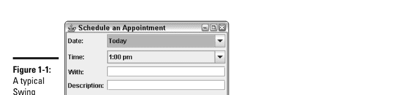

### Swing 类层次结构

Swing API 提供了许多不同的类，用于创建各种类型的用户界面元素。在本章中，我将介绍其中三个类：`JFrame`、`JPanel` 和 `JLabel`。然而，这三个类是一个更大类集合的一部分，它们都通过继承关系相互关联，如图 1-2 所示。Swing 家族树在 `Component` 类处分裂为一组源自 `JComponent` 类的类，以及另一个源自 `Window` 类的分支。

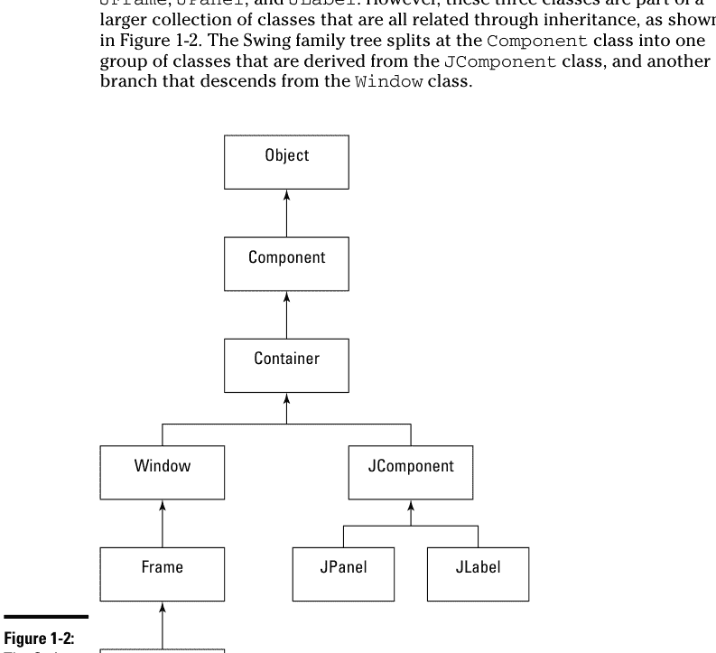

以下段落简要描述了图中显示的每个类：

- **Object**：所有类最终都派生自 `Object`，因此这个类位于树的顶部也就不足为奇了。
- **Component**：`Component` 类代表一个具有可视表示的对象，该对象可以在屏幕上显示并与用户交互。此类定义了一些所有 Swing 类都可以使用的基本方法。例如，`setVisible` 方法确定组件是可见还是隐藏。而 `setBounds` 方法设置组件的位置和大小。这是一个 AWT 类，而不是 Swing 类。
- **Container**：`Container` 类在 `Component` 类的基本可视功能之上构建，增加了容纳其他容器的能力。这同样是一个 AWT 类，而非 Swing 类。从这个类中，你获得了 `add` 方法，它允许你向容器添加组件。正如你将看到的，你几乎在所有 GUI 程序中都会使用这个方法。
- **Window**：此类定义了一个窗口，这是一种特殊类型的容器对象，具有边框、标题栏、最小化、最大化和关闭窗口的按钮，并且可以由用户重新定位，甚至可能调整大小。
- **Frame**：`Frame` 是 `Window` 的一种类型，它作为 Java GUI 应用程序的基础。`Frame` 是一个 AWT 类，已被 `JFrame` 类改进。
- **JFrame**：较旧 `Frame` 类的 Swing 版本。你的大多数 Swing 应用程序至少包含一个 `JFrame` 对象。
- **JComponent**：`JComponent` 类是一个 Swing 类，它是除框架外所有其他 Swing 组件的基础。
- **JPanel**：此类创建 `面板`，这是用于组织和控制其他组件（如标签、按钮、文本字段等）布局的容器。在大多数 Swing 应用程序中，一个或多个面板被添加到一个框架中。然后，当框架显示时，添加到其面板中的组件就会变得可见。
- **JLabel**：此类创建一个显示简单文本值的标签。

在使用 Swing 时，你会发现有些你使用的类定义在 `javax.swing` 包中。因此，你需要以这行代码开始每个 Swing 应用程序：

```java
import javax.swing.*;
```

此外，你会发现一些 Swing 功能使用了 `java.awt` 和 `java.awt.event` 包中的类。因此，你可能也需要导入这些包。

### 我被框架住了！

大多数基于 Swing 的应用程序的顶层组件称为 `框架`，由 `JFrame` 类定义。框架本身做不了太多事情。但要在 Swing 中做任何其他事情，你必须首先创建一个框架。图 1-3 展示了一个除了在标题栏中显示消息 `Hello, World!` 之外什么都不做的框架。

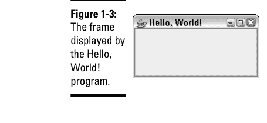

`JFrame` 有海量的方法，但大多数程序中只有少数几个有用。表 1-1 列出了你最常用的 `JFrame` 方法，以及几个构造函数。

**表 1-1 有用的 JFrame 构造函数和方法**

| 构造函数/方法 | 描述 |
| :--- | :--- |
| `JFrame()` | 创建一个没有标题的新框架。 |
| `JFrame(String title)` | 创建一个带有指定标题的新框架。 |
| `void add(Component c)` | 将指定的组件添加到框架中。 |
| `JMenuBar getJMenuBar()` | 获取此框架的菜单栏。 |
| `void pack()` | 调整框架的大小以适应你添加到其中的组件。 |
| `void remove(Component c)` | 从框架中移除指定的组件。 |
| `void setDefaultCloseOperation` | 设置用户关闭框架时采取的操作。你应该几乎总是指定 `JFrame.EXIT_ON_CLOSE`。 |
| `void setIconImage(Icon image)` | 设置框架最小化时显示的图标。 |
| `void setLayout(LayoutManager layout)` | 设置用于控制框架显示时组件排列方式的布局管理器。默认是 BorderLayout 管理器。 |
| `void setLocation(int x, int y)` | 设置框架在屏幕上的 x 和 y 位置。屏幕的左上角是 0, 0。 |
| `void setLocationRelativeTo(Component c)` | 如果参数是 `null`，则在屏幕上居中框架。 |
| `void setResizable(boolean value)` | 设置框架的大小是否可以由用户更改。默认设置为 `true`（框架可以调整大小）。 |
| `void setSize(int width, int height)` | 将框架的大小设置为指定的宽度和高度。 |
| `void setJMenuBar(JMenuBar menu)` | 设置此框架的菜单栏。 |

至少，你需要为新框架设置标题，设置框架的大小，以便足以看到你添加到其中的任何组件（默认情况下，框架宽零像素高零像素，因此用处不大），并调用 `setVisible` 方法使框架可见。完成这三件事的一种方法是创建 `JFrame` 类的一个实例，并使用类似这样的语句设置其属性：

```java
JFrame frame = new JFrame("This is the title");
frame.setSize(350, 260);
frame.setVisible(true);
```

然而，更常见的做法是通过声明一个扩展 `JFrame` 类的类来创建框架。然后，你在构造函数中调用这些方法，正如我在下一节中所描述的。


默认情况下，用户可以更改框架的大小。如果你想固定框架的大小，使用户无法更改，只需调用 `setResizable(false)`。

### Hello, World! in Swing

为了让你开始使用 Swing，清单 1-1 展示了经典 Hello, World! 程序的 Swing 版本，只使用了一个框架。如果你运行这个程序，屏幕上将显示图 1-1 所示的框架。如你所见，框架的标题栏包含文本 "Hello, World!"。

这个看似无用的小程序的目的在于说明一个解决方案，以解决你使用 Swing 时遇到的第一个问题：`main` 方法是一个静态方法，但 Swing 框架是对象。因此，你必须想办法让你的程序跳出静态上下文。这个程序通过创建一个扩展 `JFrame` 的类来实现这一点。然后，`main` 方法调用类的构造函数，实际上创建了它自己的一个实例。这就是 `main` 方法所做的全部工作；这个应用程序的实际工作是由构造函数完成的。


以下段落描述了本程序的大部分特性：

1.  程序以一个`import`语句开头，该语句导入了`javax.swing`包中的所有类。大多数Swing类都定义在此包中。但是，根据程序使用的GUI功能，您可能还需要导入其他类。

3.  此应用程序的类名为`HelloFrame`，它扩展了一个名为`JFrame`的Swing类。扩展`JFrame`的类通常被称为*框架类*。`JFrame`类定义了一个基本框架，您可以在其中显示GUI组件，例如标签和文本框。所有Swing应用程序至少需要一个扩展`JFrame`的类。

5.  Swing应用程序仍然是Java应用程序，所有Java应用程序都需要一个静态`main`方法来启动应用程序。因此，此类中列出的第一个方法就是`main`方法。

7.  `main`方法的第一条（也是唯一的）语句创建了`HelloFrame`类的一个新实例。与控制台应用程序不同，Swing应用程序无法在静态上下文中运行。因此，Swing应用程序中静态`main`方法的主要目的是创建应用程序框架类的一个实例。

10. 当第7行创建了`HelloFrame`类的一个实例时，从本行开始的构造函数将被执行。框架类构造函数的主要工作是设置框架的选项，并创建在框架中显示的任何GUI组件。

12. 此构造函数设置的第一个选项是框架的大小。为此，它调用了`setSize`方法。参数指定框架宽度应为200像素，高度应为100像素。（*像素*是构成计算机屏幕图像的小点之一。*Pixel*是*picture element*（图像元素）的缩写，但这不会在考试中出现。）

13. 此构造函数设置的下一个选项是：当用户通过单击其关闭按钮（通常位于框架的右上角）关闭框架时该如何处理。默认情况下，单击关闭按钮会隐藏框架，但不会终止应用程序。因此，应用程序的主线程（即通过`main`方法仍在静态上下文中运行的那个线程）会继续运行一段时间。最终，Java会检测到没有任何操作发生并关闭应用程序。但是，如果您使用`setDefaultCloseOperation`将关闭操作设置为`JFrame.EXIT_ON_CLOSE`，应用程序会更干净地退出。这会导致程序在关闭框架时终止。

15. 下一条语句使用`setTitle`方法设置框架的标题。

16. 构造函数中的最后一条语句调用`setVisible`方法，并传递参数值*true*，这使得框架在屏幕上可见。如果省略此语句，框架会被创建，但用户永远看不到它。

以上就是此程序的全部内容。诚然，它比第一卷第1章中基于控制台的Hello, World!程序稍微复杂一些。但复杂不了多少。为了确保其操作清晰，以下是程序运行时发生情况的回顾：

1.  Java运行`HelloWorld`类的静态`main`方法。
2.  `main`方法创建`HelloWorld`类的一个实例，这会导致构造函数被执行。
3.  构造函数设置框架大小、默认关闭操作和标题。
4.  现在构造函数已完成，程序继续执行`main`方法，在该方法中调用`setVisible`方法来显示框架。

### 在屏幕上定位框架

`JFrame`类提供了两个方法，让您指定框架在屏幕上的位置。如果想将框架放置在屏幕上的任意位置，请使用`setLocation`方法。例如，要将框架放在屏幕的左上角，请使用此语句：

```
frame.setLocation(0,0);
```

如果想将框架居中显示在屏幕上，请调用`setLocationRelativeTo`方法并传递`null`作为参数：

```
frame.setLocationRelativeTo(null);
```

此方法旨在让您相对于其他已显示的组件来定位框架。但是，如果传递`null`作为参数，该方法会将框架在屏幕上居中。

如果想将窗口定位在左上角或屏幕正中心以外的某个位置，您可能需要知道用户屏幕的宽度和高度，以便为框架计算位置。要确定用户屏幕的大小，可以使用名为`Toolkit`的类。`Toolkit`类有一系列方法，但您需要了解其中两个：

-   **getDefaultToolkit：** 一个静态方法，用于创建`Toolkit`对象。在使用`getScreenSize`方法之前，必须使用此方法。
-   **getScreenSize：** 以`Dimension`对象的形式返回屏幕的大小。`Dimension`类有两个表示屏幕大小的公共字段：`height`和`width`。两个字段的类型均为`int`。

假设您想定位一个框架，使其左下角正好位于屏幕中心。将以下代码放在框架的构造函数中即可实现：

```java
Toolkit tk = Toolkit.getDefaultToolkit();
Dimension d = tk.getScreenSize();
int x = d.width / 2;
int y = (d.height / 2) - this.getHeight();
this.setLocation(x, y);
```

此代码首先创建一个`Toolkit`对象，并使用它获取屏幕尺寸。它将x位置设置为屏幕的水平中心，方法是将屏幕宽度除以2。然后，它将y位置设置为垂直中心（屏幕高度除以2）减去框架的高度。这样就将框架的底部置于垂直中点。

### 使用JPanel类

面板是一种容器，旨在容纳一组组件，以便将它们显示在框架上。显示一组控件（如文本字段、标签、按钮和其他GUI小部件）的常用方法是将这些控件添加到面板中，然后将面板添加到框架中。如果您愿意，可以绕过面板，直接将控件添加到框架中，但使用单独的面板来容纳框架的控件几乎总是一个好主意。

面板由JPanel类定义。与JFrame类类似，JPanel类有一系列方法。表1-2列出了JPanel类最常用的构造函数和方法。

**表1-2 有趣的JPanel构造函数和方法**

| **构造函数/方法** | **描述** |
| :--- | :--- |
| `JPanel()` | 创建一个新面板。 |
| `JPanel(boolean isDoubleBuffered)` | 创建一个新面板。如果参数为*true*，面板将使用一种称为双缓冲的技术，这可以为图形应用程序带来更好的显示效果。此构造函数通常用于游戏程序或其他显示动画的面板。 |
| `JPanel(LayoutManager layout)` | 使用指定的布局管理器创建一个新面板。默认布局管理器是FlowLayout。 |
| `void add(Component c)` | 将指定的组件添加到面板中。 |
| `void remove(Component c)` | 从面板中移除指定的组件。 |
| `void setLayout(LayoutManager layout)` | 设置用于控制面板显示时组件如何排列的布局管理器。默认是FlowLayout管理器。 |
| `void setLocation(int x, int y)` | 设置框架在屏幕上的*x*和*y*位置。屏幕的左上角为0, 0。 |
| `void setSize(int width, int height)` | 将框架大小设置为指定的宽度和高度。 |
| `void setToolTipText(String text)` | 设置工具提示文本，当用户将鼠标悬停在面板的空白部分时会显示该文本。 |

您可以使用几种不同的技术来创建面板并将其添加到框架中。一种方法是在JFrame构造函数中创建一个JPanel对象并将其分配给一个变量。然后，您可以将组件添加到面板中，再将面板添加到框架中。例如：

```java
// HelloFrame 构造函数
public HelloFrame()
{
    this.setSize(200,100);

    this.setDefaultCloseOperation(JFrame.EXIT_ON_CLOSE);
    this.setTitle("Hello, World!");

    JPanel panel = new JPanel();

    // 在此处添加向面板添加组件的代码

    this.setVisible(true);
}
```


### 使用标签

另一种常用的技术是为面板创建一个单独的类。这个类应该继承 `JPanel`。然后，你可以在构造函数中添加面板所需的任何组件：

```
class HelloPanel extends JPanel
{
    public HelloPanel()
    {
        // 在此处添加将组件添加到面板的代码
    }
}
```

然后，在框架类的构造函数中，你创建一个面板类的新实例并将其添加到面板：

```
HelloPanel panel = new HelloPanel();
this.add(panel);
```

或者，只使用这一行语句也可以实现：

```
this.add(new HelloPanel());
```

### 使用标签

既然你已经知道如何创建框架和面板，那么你就可以创建一个有用的组件来添加到面板中：标签。标签是一个简单地显示文本的组件。标签有多种用途：为其他控件（如文本框或组合框）显示标题，显示信息消息，或者显示计算或数据库查询的结果。

标签还可以显示图像，或者同时显示图像和一些文本。并且你可以完全控制文本的外观：你可以指定字体、大小、文本是否加粗、斜体或下划线、文本显示的颜色等等。在本章中，我讨论如何使用基本标签。有关标签更多功能的信息，请参阅 Book IX，第 1 章和第 2 章。

要创建标签，你需要使用 `JLabel` 类。表 1-3 显示了其最常用的构造函数和方法。

| 表 1-3 | 常用的 JLabel 构造函数和方法 |
| :--- | :--- |
| **构造函数** | **描述** |
| `JLabel()` | 创建一个没有初始文本的新标签。 |
| `JLabel(String text)` | 创建一个带有指定文本的新标签。 |
| **方法** | **描述** |
| `String getText()` | 返回标签显示的文本。 |
| `void setText(String text)` | 设置标签显示的文本。 |
| `void setToolTipText(String text)` | 设置当用户将鼠标悬停在标签上几秒钟时显示的工具提示文本。 |
| `void setVisible(boolean value)` | 显示或隐藏标签。 |

当你创建一个标签时，你可以将你想要显示的文本传递给构造函数，如下所示：

```
JLabel label1 = new JLabel("Hello, World!");
```

或者，你可以先创建标签，然后再设置其文本：

```
JLabel label1 = new JLabel();
label1.setText("Hello, World!");
```

除非你将标签添加到一个面板中，而该面板又被添加到框架中，否则标签将不会显示。下面是一个框架类构造函数的示例，该函数创建一个面板，创建一个标签，将标签添加到面板，然后将面板添加到框架：

```
// HelloFrame 构造函数
public HelloFrame()
{
    this.setSize(200,100);
    this.setDefaultCloseOperation(JFrame.EXIT_ON_CLOSE);
    this.setTitle("Hello, World!");

    JPanel panel1 = new JPanel();
    JLabel label1 = new JLabel("Hello, World!")
    panel1.add(label1);
    this.add(panel1);

    this.setVisible(true);
}
```

图 1-4 显示了程序运行时该框架的样子。

图 1-4：一个包含面板的框架，面板中有一个标签。

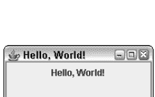

### 创建按钮

除了标签，你最常使用的 Swing 组件就是 `JButton` 组件，它创建一个用户可以点击的按钮。图 1-5 显示了一个包含单个按钮的框架。

图 1-5：一个包含面板的框架，面板中有一个按钮。


在下一章中，你将了解如何编写代码来响应用户点击按钮的操作。在这里，我只专注于如何创建按钮并控制其外观。表 1-4 列出了 `JButton` 类最常用的构造函数和方法。

表 1-4 常用的 JButton 构造函数和方法

| 构造函数 | 描述 |
| :--- | :--- |
| `JButton()` | 创建一个没有初始文本的新按钮。 |
| `JButton(String text)` | 创建一个带有指定文本的新按钮。 |
| **方法** | **描述** |
| `doClick()` | 为按钮触发一个动作事件，就像用户点击了它一样。（我在下一章告诉你为什么这有时很有用。） |
| `String getText()` | 返回按钮显示的文本。 |
| `void setBorderPainted(boolean value)` | 显示或隐藏按钮的边框。默认设置为 `true`（显示边框）。 |
| `void setContentAreaFilled(boolean value)` | 指定按钮的背景是否应该填充或留空。默认设置为 `true`（填充背景）。 |
| `void setEnabled(boolean value)` | 启用或禁用按钮。默认设置为 `true`（启用）。 |
| `void setRolloverEnabled(boolean value)` | 启用或禁用鼠标悬停效果，该效果使鼠标移到按钮上时边框变粗。默认设置为 `true`（启用悬停效果）。 |
| `void setText(String text)` | 设置按钮显示的文本。 |
| `void setToolTipText(String text)` | 设置当用户将鼠标悬停在按钮上时显示的工具提示文本。 |
| `void setVisible(boolean value)` | 显示或隐藏按钮。默认设置为 `true`（按钮可见）。 |

正如你所看到的，`JButton` 类的构造函数与 `JLabel` 类的构造函数类似：你可以创建一个空按钮或一个带有文本的按钮。例如，以下是创建图 1-5 中所示按钮的代码：

```
JButton button1 = new JButton("Click me!");
```

如果你在调用构造函数时没有提供按钮文本，你可以稍后通过 `setText` 方法提供，如下所示：

```
JButton button1 = new JButton();
button1.setText("Click me!");
```

> 你可能认为你永远不需要那样做，但有时按钮的意义取决于用户正在做什么。例如，一个允许用户添加、更改或删除文件中记录的程序，可能会根据用户当时正在执行的操作，将按钮的文本设置为 `Add Record`、`Change Record` 或 `Delete Record`。在这样的程序中，你可能需要使用 `getText` 方法来了解按钮当前显示的文本。

表 1-4 中列出的大多数其他方法只是影响按钮的外观。要禁用按钮使用户无法点击，请调用 `setEnabled(false)`。要从按钮边缘移除深色边框，请调用 `setBorderPainted(false)`。要从按钮移除背景，使其只显示文本，请调用 `setContentAreaFilled(false)`。要使按钮完全消失，请调用 `setVisible(false)`。

### 关于组件布局的说明

控制面板上组件的布局是使用 Swing 最困难的事情之一。事实上，这非常困难，以至于我专门用 Book VI，第 5 章来讨论它。在那之前，你需要了解几个关键点：

-   面板（或框架）上的组件布局由一个 *布局管理器* 控制，它决定每个组件的最终位置。布局管理器在做出决定时，会考虑组件的大小、面板的大小以及其他附近组件的位置。
-   Swing 提供了七种不同的布局管理器供你选择。每种布局管理器都有自己决定每个组件放置位置的方式。
-   面板的默认布局管理器叫做 `FlowLayout`。它将组件一个接一个地放在一行中，只有当它到达面板（或包含它的框架）的末尾时才开始新一行。
-   使用 `FlowLayout`（以及其他的布局管理器），如果用户改变框架的大小，布局也会改变。框架的大小对 `FlowLayout` 如何排列控件有很大影响。
-   你总是可以调用框架的 `setResizable(false)` 方法来防止用户调整框架的大小。
-   如果你想更改面板使用的布局管理器，请调用面板的 `setLayout` 方法。
-   对于许多（如果不是大多数）Swing 应用程序，你会使用多个面板来显示你的组件。每个面板可以有不同的布局管理器。使用这种技术，你可以创建包含大量组件的复杂布局，所有组件都按照你想要的方式排列。
-   如果需要，你总是可以完全关闭布局管理器。为此，你可以将参数设置为 `null` 来调用面板的 `setLayout` 方法。然后，你使用 *绝对定位*，通过调用每个组件的 `setBounds` 方法来设置其 *x* 和 *y* 位置以及大小。
-   这个列表可以一直列下去。有关控制布局的更多信息，请参阅 Book VI，第 5 章。


## 第2章：处理事件

**本章要点**

-   理解重要的事件概念
-   掌握事件处理类与接口
-   响应按钮点击
-   使用内部类进行事件处理
-   提供退出按钮
-   处理关闭按钮

在上一章中，你已经学会了如何创建包含面板、标签和按钮的 Swing 窗体。然而，这些窗体除了静静地待在那里，什么也不会做。它们看起来不错，但完全没有响应。无论你怎么点击它们，它们都毫无反应，有点像青春期的少年。

在本章中，你将让这些按钮行动起来。具体来说，你将学习如何编写代码，以便在用户点击按钮时执行相应的操作。你所使用的技巧叫做*事件监听*，它是编写 Swing 程序最重要的方面之一。起初可能看起来有点复杂，但一旦你掌握了窍门（抱歉，双关），事件监听就变得非常清晰了。

> 提示：虽然事件监听主要用于响应按钮点击，但它也可以用于响应其他类型的用户交互。例如，你可以使用事件监听来编写代码，以便在用户从组合框中选择项、将鼠标悬停在标签上或按下键盘上的某个键时执行。本章介绍的事件监听技术同样适用于这些事件。

### 探索事件

*事件*是在用户对某个用户界面组件进行有意义操作时生成的对象。例如，如果用户点击按钮、将鼠标拖过标签或从组合框中选择一项，就会生成一个事件对象。然后，该事件对象被传递给你创建的一个特殊方法，称为*事件监听器*。事件监听器可以检查事件对象，确定发生了什么类型的事件，并做出相应响应。例如，如果用户点击按钮，事件监听器可能会将用户通过文本字段输入的任何数据写入文件。如果用户将鼠标悬停在标签上，事件处理器可能会更改标签显示的文本。如果用户从组合框中选择一项，事件处理器可能会使用所选的值在数据库中查找信息。可能性是无穷无尽的！

事件对象有几种不同的类型，由各种继承自 `AWTEvent` 的类表示。表 2-1 列出了最常用的事件类。此外，该表还列出了用于创建能够监听事件并在其生成时处理它的对象的*监听器接口*。

请注意，这些事件类包含在 `java.awt` 包中。严格来说，事件处理是由 AWT 提供的，而不是 Swing。

#### 表 2-1 常用的事件类

| **事件类** | **监听器接口** | **描述** |
| :--- | :--- | :--- |
| `ActionEvent` | `ActionListener` | 当用户通过按钮或其他组件执行操作时创建。通常，这意味着用户点击了按钮。但是，用户也可以通过将焦点切换到按钮并按 Enter 键来触发按钮操作。 |
| `ItemEvent` | `ItemListener` | 当列表控件（如组合框或列表框）中的选定项发生变化时创建。 |
| `DocumentEvent` | `DocumentListener` | 当用户更改文本组件（如文本字段）的内容时创建。 |
| `WindowEvent` | `WindowListener` | 当窗口（窗体）的状态发生变化时创建。 |
| `KeyEvent` | `KeyListener` | 当用户按下键盘上的某个键时创建。此事件可用于监视用户输入的特定击键。 |
| `MouseEvent` | `MouseListener` | 当用户对鼠标执行有意义的操作时创建，例如点击其中一个按钮、拖动鼠标或只是将鼠标移动到另一个对象上。 |
| `FocusEvent` | `FocusListener` | 当组件获得或失去焦点时创建。 |

表 2-1 中列出的事件可以分为两类。前三个（ActionEvent、ItemEvent 和 DocumentEvent）称为语义事件，因为它们与通常具有特定意义的用户交互相关。例如，当用户点击按钮时，他或她试图执行某个特定的操作。相比之下，其他事件称为低级事件。

如果你正在为考试突击，你绝对需要知道三个重要术语：

-   **事件**：当用户对组件执行有意义的操作（如点击）时创建的对象。
-   **事件源**：生成事件对象的组件。通常，事件源是用户可以点击的按钮或其他组件，但任何 Swing 组件都可以是事件源。
-   **事件监听器**：监听事件并在其发生时处理它的对象。事件监听器对象必须实现适合该事件的接口。这些监听器接口定义了事件源在事件发生时调用的方法。表 2-2 列出了表 2-1 中列出的每个接口所定义的方法。

#### 表 2-2 事件监听器接口定义的方法

| **监听器接口** | **方法** | **描述** |
| :--- | :--- | :--- |
| `ActionListener` | `void actionPerformed(ActionEvent e)` | 当操作事件发生时调用。 |
| `ItemListener` | `void itemStateChanged(ItemEvent e)` | 当所选项发生变化时调用。 |
| `DocumentListener` | `void changeUpdate(DocumentEvent e)` | 当文本被更改时调用。 |
| | `void insertUpdate(DocumentEvent e)` | 当文本被插入时调用。 |
| | `void removeUpdate(DocumentEvent e)` | 当文本被删除时调用。 |
| `WindowListener` | `void windowActivated(WindowEvent e)` | 当窗口被激活时调用。 |
| | `void windowClosed(WindowEvent e)` | 当窗口已关闭时调用。 |
| | `void windowClosing(WindowEvent e)` | 当用户尝试关闭窗口时调用。 |
| | `void windowDeactivated(WindowEvent e)` | 当窗口被停用时调用。 |
| | `void windowDeiconified(WindowEvent e)` | 当窗口从图标状态恢复为正常状态时调用。 |
| | `void windowIconified(WindowEvent e)` | 当窗口最小化为图标时调用。 |
| | `void windowOpened(WindowEvent e)` | 当窗口被打开时调用。 |
| `KeyListener` | `void keyPressed(KeyEvent e)` | 当用户按下某个键时调用。 |
| | `void keyReleased(KeyEvent e)` | 当用户释放某个键时调用。 |
| | `void keyTyped(KeyEvent e)` | 当用户键入某个键时调用。 |
| `MouseListener` | `void mouseClicked(MouseEvent e)` | 当用户点击鼠标时调用。 |
| | `void mouseEntered(MouseEvent e)` | 当鼠标移动到组件上时调用。 |
| | `void mouseExited(MouseEvent e)` | 当鼠标离开组件时调用。 |
| | `void mousePressed(MouseEvent e)` | 当用户按下鼠标按钮时调用。 |
| | `void mouseReleased(MouseEvent e)` | 当用户释放鼠标按钮时调用。 |
| `FocusListener` | `void focusGained(FocusEvent e)` | 当组件获得焦点时调用。 |
| | `void focusLost(FocusEvent e)` | 当组件失去焦点时调用。 |

### 处理事件

现在你已经了解了用于事件处理的基本对象，你必须将它们实际连接起来，以创建能够响应事件的程序。

要编写能够响应事件的 Java 代码，你必须执行以下操作：

**1. 创建一个可以生成事件的组件。**

你想将按钮或其他能够生成事件的组件添加到你的窗体中，以便它显示用户可以与之交互的组件。（严格来说，所有 Swing 组件都可以生成某些事件。即使是一个标签，当用户将鼠标悬停在其上时，也会生成一个 `MouseEvent`。但一个只包含标签的窗体并不是很有用。）


通常，你会将指向事件源的变量声明为私有类字段，置于框架构造函数或任何其他方法之外。例如：

```
    private JButton button1;
```

然后，在框架类的构造函数中，你可以创建该按钮。例如，以下代码创建了一个面板、一个按钮，将按钮添加到面板中，再将面板添加到框架中：

```
    JPanel panel = new JPanel();
    button1 = new JButton("Click me!");
    panel.add(button1);
    this.add(panel);
```

请注意，此代码出现在框架类的构造函数中，因此最后一行的 `this` 指的是框架本身。

## 2. 创建一个实现所需事件监听器接口的类。

例如，要处理操作事件，你应该创建一个实现 `ActionListener` 接口的类。正如本章后面所示，你至少可以用四种方式来实现。但最简单的方法之一是直接在框架类的定义中添加 `implements ActionListener`。这样，框架类声明看起来就像这样：

```
    public class ClickMe
        extends JFrame implements ActionListener
```

本章稍后将介绍实现事件监听器接口的其他方法。

## 3. 编写监听器接口定义的任何方法的代码。

当你实现监听器接口时，必须提供接口中定义的每个方法的实现。大多数监听器接口只定义了一个方法，对应于该接口所监听的事件类型。例如，`ActionListener` 接口定义了一个名为 `actionPerformed` 的方法。每当创建一个操作事件时，就会调用此方法。因此，你放在 `actionPerformed` 方法内部的代码会在操作事件发生时执行。

例如，这是一个响应操作事件的 `actionPerformed` 方法：

```
    public void actionPerformed(ActionEvent e)
    {
        if (e.getSource() == button1)
            button1.setText("You clicked!");
    }
```

这里，如果事件源是 `button1`，此代码将更改 `button1` 显示的文本。

## 4. 向源注册监听器。

最后一步是向事件源注册事件监听器。每个作为事件源的组件都提供了一个方法，允许你注册事件监听器以监听事件。对于 `ActionEvent` 源，该方法是 `addActionListener`。这是对框架构造函数代码的修改，它创建了 `button1` 按钮并将框架类注册为操作事件监听器：

```
JPanel panel = new JPanel();
button1 = new JButton("Click me!");
button1.addActionListener(this);
panel.add(button1);
this.add(panel);
```

这里，你可以指定 `this` 作为事件监听器，因为框架类本身实现了 `ActionListener`。

### ClickMe 程序

为了看看所有这些元素如何在一个完整的程序中协同工作，图 2-1 展示了由名为 ClickMe 的程序创建的框架的三种形态。该程序显示一个带有一个按钮的框架，按钮最初显示 "Click Me!"。当用户点击按钮时，按钮的文本变为 `I've been clicked!`，如图中第二个框架所示。然后，如果用户再次点击按钮，文本变为 `I've been clicked 2 times!`，如图中第三个框架所示。此后，每次点击按钮时计数都会增加。清单 2-1 显示了该程序的完整代码。


图 2-1：ClickMe 程序运行中。


#### 清单 2-1：CLICKME 程序

```
import javax.swing.*;
import java.awt.event.*;                                    -> 2

public class ClickMe
    extends JFrame implements ActionListener        -> 5
{
    public static void main(String [] args)                    -> 7
    {
        new ClickMe();
    }

    private JButton button1;                                  -> 12

    public ClickMe()                                             -> 14
    {
        this.setSize(200,100);

        this.setDefaultCloseOperation(JFrame.EXIT_ON_CLOSE);
        this.setTitle("I'm Listening");

        JPanel panel1 = new JPanel();
        button1 = new JButton("Click Me!");                      -> 21
        button1.addActionListener(this);                         -> 22
        panel1.add(button1);
        this.add(panel1);

        this.setVisible(true);
    }

    private int clickCount = 0;                                     -> 29

    public void actionPerformed(ActionEvent e)                -> 31
    {
        if (e.getSource() == button1)                                -> 33
        {
            clickCount++;                                              -> 35
            if (clickCount == 1)                                       -> 36
                button1.setText("I've been clicked!");
            else
                button1.setText("I've been clicked "
                    + clickCount + " times!");
        }
    }
}
```

以下段落指出了程序中的一些关键行：

- -> 2 程序必须导入 `java.awt.event` 包，该包定义了 `ActionEvent` 类和 `ActionListener` 接口。
- -> 5 `ClickMe` 类扩展了 `JFrame` 类并实现了 `ActionListener`。这样，这个类就承担了双重职责：它定义了框架，并监听添加到框架的组件生成的事件。
- -> 7 `main` 方法照常是必需的。它只是创建一个 `ClickMe` 类的实例来启动框架。
- -> 12 `button1` 变量被定义为私有类字段，这样 `ClickMe` 构造函数和 `actionPerformed` 方法都可以访问它。
- -> 14 构造函数执行了框架类构造函数通常做的所有工作：设置框架大小、默认关闭操作和标题，然后将组件添加到框架中。最后调用 `setVisible` 使框架在屏幕上可见。
- -> 21 此行创建一个按钮并将其赋值给 `button1` 字段。
- -> 22 此行将当前对象添加为 `button1` 按钮的动作监听器。
- -> 29 一个名为 `clickCount` 的字段用于跟踪按钮被点击的次数。该字段在对象创建时初始化为零。
- -> 31 必须编码 `actionPerformed` 方法，因为 `ClickMe` 类实现了 `ActionListener` 接口。每当用户点击按钮时，`button1` 对象就会调用此方法。`ActionEvent` 参数是由按钮点击生成的事件。
- -> 33 调用 `ActionEvent` 参数的 `getSource` 方法来确定事件源。在这个程序中，这个 `if` 语句并非真正必需，因为程序只有一个事件源。然而，大多数 Swing 程序有多个事件源，因此你需要在事件监听器中测试事件源。
- -> 35 此语句递增点击计数以表示按钮已被点击。
- -> 36 此 `if` 语句测试 `clickCount` 字段的值，并相应更改按钮显示的文本。

### 使用内部类监听事件

正如第 III 册第 7 章所解释的，`内部类`是嵌套在另一个类中的类。内部类通常用作事件监听器。这样，定义框架的类就不必同时实现事件监听器。相反，它包含一个处理事件的内部类。

清单 2-2 展示了 ClickMe 程序的一个版本，该版本使用内部类来处理按钮的操作事件。

#### 清单 2-2：使用内部类的 CLICKME2 程序

```
import javax.swing.*;
import java.awt.event.*;

public class ClickMe2 extends JFrame
{
    public static void main(String [] args)
    {
        new ClickMe2();
    }

    private JButton button1;

    public ClickMe2()
    {
        this.setSize(200,100);
        this.setDefaultCloseOperation(
            JFrame.EXIT_ON_CLOSE);
        this.setTitle("I'm Listening");

        ClickListener cl = new ClickListener();

        JPanel panel1 = new JPanel();
        button1 = new JButton("Click Me!");
        button1.addActionListener(cl);
        panel1.add(button1);
        this.add(panel1);

        this.setVisible(true);
    }

    private class ClickListener
        implements ActionListener
    {
        private int clickCount = 0;

        public void actionPerformed(ActionEvent e)
        {
            if (e.getSource() == button1)
            {
                clickCount++;
                if (clickCount == 1)
                    button1.setText("I've been clicked!");
                else
                    button1.setText("I've been clicked "
                        + clickCount + " times!");
            }
        }
    }
}
```


### 添加退出按钮

该程序与清单 2-1 中所示的程序基本相同，因此我将不回顾基础知识。相反，我只指出一些要点：

- -> 4 `ClickMe2` 类仍然继承自 `JFrame`，但并未实现 `ActionListener`。
- -> 11 作为事件源的按钮必须通过一个类字段来引用，以便内部类可以访问它。该字段可以是 `private`，因为内部类可以访问其所在类的私有成员。
- -> 20 这条语句创建了 `ClickListener` 类（内部类）的一个实例，并将其赋值给变量 `c1`。
- -> 24 这条语句将 `c1` 添加为按钮的动作监听器。请注意，由于此窗体只有一个按钮，我完全可以省略第 20 行，并将第 24 行编写为：`button1.addActionListener(new ClickListener());`。但是，由于大多数实际应用程序有多个事件源，通常先创建监听器类的一个实例，然后将该对象作为每个事件源的监听器重复使用。
- -> 32 `ClickListener` 类通过将其声明完全放在 `ClickMe2` 类内部来声明为内部类。`ClickListener` 类实现了 `ActionListener` 接口，因此它可以处理动作事件。
- -> 34 `clickCount` 变量在内部类中声明为类字段。
- -> 38 `button1` 变量在此处对内部类可用，因为内部类可以访问其所在类的私有成员。

在第六卷第一章中，你将了解如何创建一个窗体，当用户点击窗体的退出按钮时，该窗体会退出应用程序。要将退出按钮添加到你的应用程序中，你必须做三件事：

1. 创建退出按钮并将其添加到窗体。通常，实际上是将退出按钮添加到一个面板，然后将该面板添加到窗体。
2. 为按钮添加一个动作事件监听器。
3. 在动作监听器的 `actionPerformed` 方法中添加代码，以便在用户点击按钮时退出应用程序。通常通过调用 `System.exit(0)` 来实现。

在许多应用程序中，你不想只是盲目地终止应用程序。相反，你应该确保用户在结束前已保存其数据。如果没有，你可以自动保存数据，或者要求用户在允许程序结束之前保存数据。

假设你想修改清单 2-2 中所示的 `ClickMe2` 应用程序，使其具有一个退出按钮，但除非用户至少点击过一次 ClickMe 按钮，否则退出按钮不允许用户退出。首先，你将第 11 行改为声明一个 `exitButton` 类字段：

```
private JButton button1, exitButton;
```

接下来，你在构造方法中添加代码来创建按钮、注册事件监听器并将按钮添加到面板：

```
exitButton = new JButton("Exit");
exitButton.addActionListener(cl);
panel1.add(exitButton);
```

最后，你修改 `ClickListener` 类的 `actionPerformed` 方法以处理退出按钮：

```
public void actionPerformed(ActionEvent e)
{
    if (e.getSource() == button1)
    {
        clickCount++;
        if (clickCount == 1)
            button1.setText("I've been clicked!");
        else
            button1.setText("I've been clicked "
                + clickCount + " times!");
    }
    else if (e.getSource() == exitButton)
    {
        if (clickCount > 0)
            System.exit(0);
        else
        {
            JOptionPane.showMessageDialog(ClickMe3.this,
                "You must click at least once!",
                "Not so fast, buddy",
                JOptionPane.ERROR_MESSAGE);
        }
    }
}
```

这里，使用了一个 `if` 语句来确定当 `actionPerformed` 方法被调用时哪个按钮被点击。这一步是必要的，因为 `ClickHandler` 类用于处理两个按钮的动作事件。如果事件源是退出按钮，则另一个 `if` 语句检查 `clickCount` 变量是否大于零。如果是，则调用 `System.exit(0)` 来结束应用程序。否则，使用 `JOptionPane` 显示错误消息，并且不结束应用程序。

> 警告！

不幸的是，仅仅为退出按钮添加此逻辑是不够的，因为用户可以通过点击窗体的关闭按钮来绕过你的退出按钮。你希望窗体的关闭按钮与退出按钮的行为完全一致。为此，除了动作事件监听器之外，你还需要添加一个窗口事件监听器，正如我在下一节中描述的那样。

### 捕获 WindowClosing 事件

第六卷第一章向你展示了如何使用 `JFrame` 类的 `setDefaultCloseOperation` 方法让用户通过使用窗体的关闭按钮来退出应用程序。但是，如果你的应用程序在允许用户退出之前检查数据是否已保存或其他条件是否满足，则此方法将不起作用。在这种情况下，你需要设置关闭按钮，使其工作方式与你的退出按钮相同。

为此，你需要为窗体添加一个监听窗口事件的监听器。当用户点击关闭按钮时，窗体会生成一个 `windowClosing` 事件，你可以通过在窗体本身注册一个 `WindowListener` 来处理它。然后，在 `WindowListener` 的 `windowClosing` 方法中，你可以直接调用退出按钮的 `doClick` 事件。这将触发退出按钮的动作事件，就像用户点击了它一样。因此，关闭按钮的处理方式与退出按钮完全相同。

设置窗口监听器的第一步是消除当用户点击关闭按钮时自动退出应用程序的默认行为。为此，你必须将 `setDefaultCloseOperation` 中使用的常量从 `EXIT_ON_CLOSE` 更改为 `DO_NOTHING_ON_CLOSE`，如下所示：

```
this.setDefaultCloseOperation(JFrame.DO_NOTHING_ON_CLOSE);
```

这样，`JFrame` 类的默认操作是完全忽略关闭按钮。然后，你可以安装一个窗口监听器，以任何你想要的方式处理关闭按钮。

接下来，你可以设置 `WindowListener` 来监听窗口事件。一种方法是创建一个实现 `WindowListener` 接口的内部类。不幸的是，`WindowListener` 接口有很多方法，即使你不想为某个方法做任何事情，你也必须为每个方法提供一个实现。因此，你的 `WindowListener` 看起来像这样：

```
private class Closer implements WindowListener
{
```

最后，你通过在窗体类构造方法中调用其 `addWindowListener` 方法，将 `WindowListener` 注册到窗体：

```
this.addWindowListener(new Closer());
```

> 如果你觉得在实现 `WindowListener` 接口时必须编写所有那些空方法很烦人，你可以使用一个*适配器类*。适配器类是一个实现了接口并为该接口定义的所有方法提供空实现的类。你不是实现该接口，而是扩展适配器类。然后，你只需为你感兴趣的方法提供实现。

Java 的许多事件监听器接口都有对应的适配器类。它们列在表 2-3 中。以下是 `Closer` 类如果扩展 `WindowAdapter` 而不是实现 `WindowListener` 的样子：

```
private class Closer extends WindowAdapter
{
	public void windowClosing(WindowEvent e)
	{
		exitButton.doClick();
	}
}
```

这节省了一些代码。然而，通过完全跳过 `Closer` 类，而是使用匿名内部类来处理窗口关闭事件，可以节省更多代码。然后，在注册窗口事件监听器的窗体构造方法中的语句如下所示：

```
addWindowListener(new WindowAdapter()
	{
		public void windowClosing(WindowEvent e)
		{
			exitButton.doClick();
		}
	});
```


## 534 重新审视ClickMe程序

在这里，窗口监听器被创建为一个匿名内部类，它继承了`WindowAdapter`并定义了`windowClosing`方法。

| 表 2-3 | 事件监听器的适配器类 |
| :--- | :--- |
| **监听器接口** | **适配器类** |
| WindowListener | WindowAdapter |
| KeyListener | KeyAdapter |
| MouseListener | MouseAdapter |
| FocusListener | FocusAdapter |

匿名内部类是一个没有名称的类，它在程序中只使用一次，并且就在使用它的位置定义。有关创建匿名内部类所用语法的详细解释，请参阅第三册第7章。

### 重新审视ClickMe程序

现在你已经仔细研究了创建Exit按钮和处理Close按钮的各种技术，清单2-3展示了ClickMe程序的第三个版本，它集成了所有这些功能，以便你看到它们如何协同工作。这个版本的程序添加了一个Exit按钮，但用户必须至少点击一次ClickMe按钮后才能退出。并且它处理Close按钮的方式与用户点击Exit按钮相同。

#### 清单2-3：带有退出按钮的CLICKME应用程序

```
import javax.swing.*;
import java.awt.event.*;

public class ClickMe3 extends JFrame
{
    public static void main(String [] args)
    {
        new ClickMe3();
    }

    private JButton button1, exitButton;               → 11

    public ClickMe3()
    {
        this.setSize(275,100);
        this.setTitle("I'm Listening");
        this.setDefaultCloseOperation(               → 17
            JFrame.DO_NOTHING_ON_CLOSE);

        ClickListener cl = new ClickListener();
```

```
JPanel panel1 = new JPanel();
addWindowListener(new WindowAdapter()
{
    public void windowClosing(WindowEvent e)
    {
        exitButton.doClick();
    }
} );

button1 = new JButton("Click Me!");
button1.addActionListener(cl);
panel1.add(button1);

exitButton = new JButton("Exit");
exitButton.addActionListener(cl);
panel1.add(exitButton);
this.add(panel1);

this.setVisible(true);
}

private class ClickListener implements
    ActionListener
{
    private int clickCount = 0;

    public void actionPerformed(ActionEvent e)
    {
        if (e.getSource() == button1)
        {
            clickCount++;
            if (clickCount == 1)
                button1.setText("I've been clicked!");
            else
                button1.setText("I've been clicked "
                    + clickCount + " times!");
        }
        else if (e.getSource() == exitButton)
        {
            if (clickCount > 0)
                System.exit(0);
            else
            {
                JOptionPane.showMessageDialog(
                    ClickMe3.this,
                    "You must click at least once!",
                    "Not so fast, buddy",
                    JOptionPane.ERROR_MESSAGE);
            }
        }
    }
}
```

### 重新审视ClickMe程序

以下段落将你注意力引向该程序的关键部分：

- **`exitButton`变量与`button1`变量一起声明为类字段，以便内部类可以访问它。**
- **`setDefaultCloseOperation`方法告诉`JFrame`类，如果用户关闭窗口，则不采取默认操作。**
- **在框架上安装了一个窗口监听器来监听窗口事件。该监听器由一个匿名内部类构造，该类扩展了`WindowAdapter`类。**
- **在`windowClosing`方法中，调用了Exit按钮的`doClick`方法。这样，Close按钮的处理方式与用户点击Exit按钮完全相同。**
- **此行及下面两行创建了Exit按钮，注册了其动作事件监听器，并将其添加到面板中。**
- **在动作监听器类的`actionPerformed`方法中，这个`if`语句检查动作事件是否来自Exit按钮。如果是，则另一个`if`语句检查用户是否至少点击了一次ClickMe按钮。如果是，应用程序退出。否则，将显示消息，程序拒绝响应。**

## 第3章：从用户获取输入

### 本章内容

- 文本字段
- 文本区域
- 滚动条
- 复选框
- 单选按钮
- 边框
- 滑块

在本书的前两章中，你学习了如何使用两个基本的Swing用户界面组件——标签和按钮——以及如何处理用户点击这些按钮时生成的事件。如果你只想编写点击按钮时显示文本的程序，你现在就可以放下这本书。但如果你想编写真正有用的程序，你需要使用其他Swing组件。

在本章中，你将学习如何使用从用户获取信息的组件。首先，我将介绍两个从用户获取文本输入的组件：获取单行文本的文本字段，以及获取多行文本的文本区域。然后，我将继续介绍两个从用户获取“是/否”信息的组件：单选按钮和复选框。

在此过程中，我会向你介绍一些功能，这些功能可以装饰这些控件以使其更具功能性。具体来说，我将介绍滚动条（通常与文本区域一起使用）以及边框（用于单选按钮和复选框）。

### 使用文本字段

文本字段是用户可以在其中输入文本的框。你通过使用`JTextField`类来创建文本字段。表3-1显示了该类一些更有趣和有用的构造方法和方法。

## 538 使用文本字段

表 3-1 常用的 JTextField 构造方法和方法

| 构造方法 | 描述 |
| :--- | :--- |
| JTextField() | 创建一个新的文本字段。 |
| JTextField(int cols) | 创建一个指定宽度的新文本字段。 |
| JTextField(String text, int cols) | 创建一个指定宽度和初始文本值的新文本字段。 |

| 方法 | 描述 |
| :--- | :--- |
| String getText() | 获取输入到字段中的文本值。 |
| void requestFocus() | 请求将焦点移动到此文本字段。 |
| void setColumns(int cols) | 设置文本字段的大小。（最好在构造方法中设置。） |
| void setEditable(boolean value) | 如果为false，则使字段为只读。 |
| void setText(String text) | 设置字段的文本值。 |
| void setToolTipText(String text) | 设置当用户将鼠标悬停在文本字段上几秒钟时显示的工具提示文本。 |

当你通过调用`JTextField`类的构造方法创建文本字段时，你可以指定文本字段的宽度和初始文本值，如以下示例：

```
JTextField text1 = new JTextField(15);
JTextField text2 = new JTextField("Initial Value", 20);
```

宽度以列为单位指定，这是一个模糊且不精确的度量，大致等于文本字段所用字体中一个字符的宽度。你需要稍加试验才能使文本字段大小合适。

使用文本字段的通常方式是在框架构造方法中创建它们，然后在附加到框架按钮之一的动作监听器的`actionPerformed`方法中检索用户输入的文本，代码如下：

```
String lastName = textLastName.getText();
```

这里，用户输入到`textLastName`文本字段中的值被赋值给字符串变量`lastName`。

以下段落描述了你需要了解的关于使用文本字段的一些额外细节：

- 当你使用文本字段时，通常还想在附近放置一个标签，告诉用户应该输入什么类型的文本到字段中。

◆ 你可以通过调用`setEditable`方法并传递`false`值来创建只读文本字段。该文本字段像普通文本字段一样有边框，但背景是灰色而不是白色，并且用户无法更改控件显示的文本。

◆ 在大多数程序中，你需要确保用户向文本字段中输入可接受的数据。如果用户应该在文本字段中输入数字数据，这一点尤其重要，正如我在本章后面“使用文本字段进行数字输入”一节中描述的那样。

### 查看示例程序

图3-1展示了一个简单程序的操作，该程序使用文本字段询问用户的名字。如果用户输入了名字，程序将使用`JOptionPane`向用户说“早上好”，方法是显示图3-1中所示的中间消息框。但如果用户未输入任何内容就点击按钮，程序将显示底部的第二个`JOptionPane`消息。

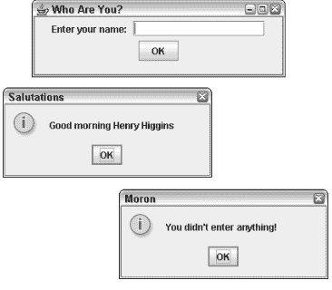

**图3-1：** Namer应用程序运行示例。

该程序的代码如清单3-1所示。

```
import javax.swing.*;
import java.awt.event.*;

public class Namer extends JFrame
{
    public static void main(String [] args)
    {
        new Namer();
    }
}
```

## 540 使用文本字段

### 清单 3-1（续）

```java
private JButton buttonOK;
private JTextField textName; 

public Namer()
{
    this.setSize(325,100);
    this.setTitle("Who Are You?");
    this.setDefaultCloseOperation(
        JFrame.EXIT_ON_CLOSE);

    ButtonListener bl = new ButtonListener();

    JPanel panel1 = new JPanel();

    panel1.add(new JLabel("Enter your name: "));

    textName = new JTextField(15);
    panel1.add(textName);

    buttonOK = new JButton("OK");
    buttonOK.addActionListener(bl);
    panel1.add(buttonOK);

    this.add(panel1);

    this.setVisible(true);
}

private class ButtonListener implements
    ActionListener
{
    public void actionPerformed(ActionEvent e)
    {
        if (e.getSource() == buttonOK)
        {
            String name = textName.getText();
            if (name.length() == 0)
            {
                JOptionPane.showMessageDialog(
                    Namer.this,
                    "You didn't enter anything!",
                    "Moron",
                    JOptionPane.INFORMATION_MESSAGE);
            }
            else
            {
                JOptionPane.showMessageDialog(
                    Namer.this,
                    "Good morning " + name,
                    "Salutations",
                    JOptionPane.INFORMATION_MESSAGE);
            }
            textName.requestFocus(); // 63
        }
    }
}
```

这个程序并不复杂，因此以下段落仅突出讲解要点：

- **4** 框架类的名称是 `Namer`。
- **12** 使用了一个类变量来存储对文本字段的引用，以便构造函数和动作监听器都能访问它。
- **25** 创建了一个标签，用来告诉用户在文本字段中输入什么数据。
- **27** 文本字段的创建长度为 15 列，然后被添加到面板中。
- **46** 在动作监听器类的 `actionPerformed` 方法中，此语句检索用户输入的值并将其存储在一个字符串变量中。
- **47** 此 `if` 语句通过检查第 46 行创建的字符串变量的长度来查看用户是否输入了任何内容。如果长度为零，则使用 `JOptionPane` 显示错误消息。否则，使用 `JOptionPane` 向用户说早上好。
- **63** 在用户点击按钮后，调用 `requestFocus` 方法将焦点移回文本字段。如果不这样做，焦点会停留在按钮上，用户必须使用 Tab 键将焦点移动到文本字段。

### 使用文本字段进行数字输入

如果你使用文本字段从用户那里获取数字数据，需要特别小心。`getText` 方法返回一个字符串值。你可以将此值传递给基本数字类型的包装类的解析方法之一。例如，要将输入到文本框中的值转换为 `int`，你需要使用 `parseInt` 方法：

```java
int count = Integer.parseInt(textCount.getText());
```

这里，`getText` 方法的结果用作 `parseInt` 方法的参数。

表 3-2 列出了各种包装类的解析方法。请注意，如果字符串无法转换，每个方法都会抛出 `NumberFormatException`。因此，你需要在 `try/catch` 块中调用 `parseInt` 方法来捕获此异常。

#### 表 3-2：将字符串转换为数字的方法

| 包装类 | 解析方法 |
| :--- | :--- |
| Integer | `parseInt(String)` |
| Short | `parseShort(String)` |
| Long | `parseLong(String)` |
| Byte | `parseByte(String)` |
| Float | `parseFloat(String)` |
| Double | `parseDouble(String)` |

如果你的程序使用超过一两个数字输入文本字段，考虑创建单独的方法来验证用户的输入。例如，下面是一个方法，它接受一个文本字段和一个字符串，该字符串提供了在字段中输入的数据无法转换为 `int` 时显示的错误消息。该方法返回一个布尔值，指示该字段是否包含有效的整数：

```java
private boolean isInt(JTextField f, String msg)
{
    try
    {
        Integer.parseInt(f.getText());
        return true;
    }
    catch (NumberFormatException e)
    {
        JOptionPane.showMessageDialog(f,
            "Entry Error", msg,
            JOptionPane.ERROR_MESSAGE);
        f.requestFocus();
        return false;
    }
}
```

然后，当你需要检查文本字段是否包含有效的整数时，可以调用此方法。例如，下面是一个程序的 `actionPerformed` 方法，该程序获取 `textCount` 文本字段中输入的值，如果输入的值是有效的整数，则在 `JOptionPane` 消息框中显示它：

```java
public void actionPerformed(ActionEvent e)
{
    if (e.getSource() == buttonOK)
    {
        if (isInt(textCount,
            "You must enter an integer."))
        {
            JOptionPane.showMessageDialog(Number.this,
                "You entered "
                +
                Integer.parseInt(textCount.getText()),
                "Your Number",
                JOptionPane.INFORMATION_MESSAGE);
        }
        textCount.requestFocus();
    }
}
```

这里，调用 `isInt` 方法以确保用户输入的文本可以转换为 `int`。如果可以，则将文本转换为 `int` 并在消息框中显示。（在此示例中，外部类的名称是 `Number`，这就是为什么 `showMessageDialog` 方法的第一个参数指定为 `Number.this`。）

### 创建验证类

如果你雄心勃勃，可以创建一个单独的类来保存执行数据验证的方法。我建议你将这些方法设为静态，这样你就不必创建验证类的实例来使用其方法。并且为了避免解析数据两次，请编写验证方法，使其返回两个值：一个指示数据是否可以被解析的布尔值，以及一个提供解析后值的基本类型。

当然，一个方法只能返回一个值。让方法返回两个值的唯一方法是返回一个包含这两个值的对象。为此，你必须创建一个定义该对象的类。下面是一个类的示例，你可以将其用作验证整数的方法的返回值：

```java
public class IntValidationResult
{
    public boolean isValid;
    public int value;
}
```

下面是一个类，它提供了一个名为 `isInt` 的静态方法，该方法验证整数数据并返回一个 `IntValidationResult` 对象：

```java
public class Validation
{
    public static IntValidationResult isInt(
        JTextField f, String msg)
    {
        IntValidationResult result =
            new IntValidationResult();
        try
        {
            result.value = Integer.parseInt(f.getText());
            result.isValid = true;
            return result;
        }
        catch (NumberFormatException e)
        {
            JOptionPane.showMessageDialog(f,
                "Entry Error", msg,
                JOptionPane.ERROR_MESSAGE);
            f.requestFocus();
            result.isValid = false;
            result.value = 0;
            return result;
        }
    }
}
```

下面是一个 `actionPerformed` 方法，它使用此类的 `isInt` 方法来验证 `textCount` 字段：

```java
public void actionPerformed(ActionEvent e)
{
    if (e.getSource() == buttonOK)
    {
        IntValidationResult ir;
        ir = Validation.isInt(textCount,
            "You must enter an integer.");
        if (ir.isValid)
        {
            JOptionPane.showMessageDialog(Number2.this,
                "You entered " + ir.value,
                "Your Number",
                JOptionPane.INFORMATION_MESSAGE);
        }
        textCount.requestFocus();
    }
}
```

#### 使用文本区域

文本区域与文本字段类似，但允许用户输入多行文本。如果用户在文本区域中输入的文本过多，无法一次全部显示，文本区域可以使用滚动条让用户滚动查看所有文本。图 3-2 展示了一个正在使用的文本区域。

要创建如图 3-2 所示的文本区域，你实际上必须使用两个类。首先，你使用 `JTextArea` 类来创建文本区域。但不幸的是，文本区域本身没有滚动条。所以你必须

需要将文本区域添加到第二个称为 *scroll pane* 的组件中，该组件由 `JScrollPane` 类创建。然后，将 scroll pane（而不是文本区域）添加到面板中，以便可以显示它。

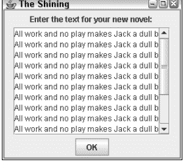

图 3-2：使用文本区域的框架。

创建文本区域并不像听起来那么难。以下是我用于创建图 3-2 所示文本区域的代码，然后将其添加到面板中：

```
textNovel = new JTextArea(10, 20);
JScrollPane scroll = new JScrollPane(textNovel,
        JScrollPane.VERTICAL_SCROLLBAR_ALWAYS,
        JScrollPane.HORIZONTAL_SCROLLBAR_NEVER);
panel1.add(scroll);
```

这里，第一条语句创建一个文本区域，给定其初始大小为 10 行 20 列。然后，第二条语句创建一个 scroll pane。请注意，文本区域对象作为参数传递给 `JScrollPane` 的构造函数，以及指示 scroll pane 是否应包含垂直或水平滚动条（或两者）的常量。最后，第三条语句将 scroll pane 添加到名为 `panel1` 的面板中。

以下各节将更详细地描述 `JTextArea` 和 `JScrollPane` 类的构造函数和方法。

#### JTextArea 类

表 3-3 列出了 `JTextArea` 类最常用的构造函数和方法，您使用它们来创建文本区域。在大多数情况下，您使用第二个构造函数，它允许您设置要显示的行数和列数。`rows` 参数控制文本区域的高度，而 `cols` 参数设置宽度。

#### 使用文本区域

表 3-3：实用的 JTextArea 构造函数和方法
| 构造函数 | 描述 |
| :--- | :--- |
| `JTextArea()` | 创建一个新的文本区域。 |
| `JTextArea(int rows, int cols)` | 创建一个新的文本区域，足以显示指定的行数和列数。 |
| `JTextArea(String text, int rows, int cols)` | 创建一个新的文本区域，具有指定的初始文本值，足以显示指定的行数和列数。 |
| 方法 | 描述 |
| `void append(String text)` | 将指定文本添加到文本区域文本值的末尾。 |
| `int getLineCount()` | 获取文本值当前的行数。 |
| `String getText()` | 获取输入到字段中的文本值。 |
| `void insert(String str, int pos)` | 在指定位置插入指定文本。 |
| `void requestFocus()` | 请求将焦点移动到此文本字段。 |
| `void replaceRange(String str, int start, int end)` | 用新的指定文本替换由起始和结束位置指示的文本。 |
| `void setColumns(int cols)` | 设置文本区域的宽度。（最好在构造函数中进行。） |
| `void setEditable(boolean value)` | 如果为 `false`，则使字段为只读。 |
| `void setLineWrap(boolean value)` | 如果为 `true`，如果文本不适合一行，则行会自动换行。 |
| `void setText(String text)` | 设置字段的文本值。 |
| `void setToolTipText(String text)` | 设置工具提示文本，如果用户将鼠标悬停在文本字段上几秒钟，则会显示该文本。 |
| `void setWrapStyleWord()` | 如果为 `true`，文本将在单词边界处换行。 |

要检索用户输入到文本区域中的文本，请使用 `getText` 方法。例如，以下是从动作监听器中检索文本区域文本的 `actionPerformed` 方法：

```
public void actionPerformed(ActionEvent e)
{
    if (e.getSource() == buttonOK)
    {
        String text = textNovel.getText();
        if (text.contains("All work and no play"))
            JOptionPane.showMessageDialog(textNovel,
                "Can't you see I'm working?",
                "Going Crazy",
                JOptionPane.ERROR_MESSAGE);
    }
}
```

这里，如果文本包含字符串 `All work and no play`，则会显示一个消息框。

请注意，除了 `getText` 方法外，`JTextArea` 类还有一些方法，允许您将文本添加到文本区域当前值的末尾（`append`）、在值中间插入文本（`insert`）以及替换文本（`replace`）。您可以使用这些方法来编辑文本区域的值。


`JTextArea` 的两个方法用于控制如何处理比文本区域宽度更长的行。如果以 `true` 值调用 `setLineWrap`，则太长而无法显示的行会自动换行到下一行。如果以 `true` 值调用 `setWrapStyleWord`，则任何换行的行将在单词之间拆分，而不是在单词中间拆分。您通常一起使用这两个方法：

```
textItinerary = new JTextArea(10, 20);
textItinerary.setLineWrap(true);
textItinerary.setWrapStyleWord(true);
```

#### JScrollPane 类

没有滚动条，文本区域不太有用。要创建带有滚动条的文本区域，请使用 `JScrollPane` 类，其构造函数和字段列于表 3-4 中。请注意，此表未显示 `JScrollPane` 类的任何方法。`JScrollPane` 类确实有方法（实际上有很多）。但它们对于普通编程来说都不是特别有用，所以我没有在表中包含任何方法。

**表 3-4：重要的 JScrollPane 构造函数和字段**
| 构造函数 | 描述 |
| :--- | :--- |
| `JScrollPane(Component view)` | 为指定组件创建一个 scroll pane。 |
| `JScrollPane(Component, int vert, int hor)` | 为指定组件创建一个 scroll pane，并指定垂直和水平滚动条的策略。 |
| 字段 | 描述 |
| `VERTICAL_SCROLLBAR_ALWAYS` | 始终添加垂直滚动条。 |
| `VERTICAL_SCROLLBAR_AS_NEEDED` | 如果需要，则添加垂直滚动条。 |
| `VERTICAL_SCROLLBAR_NEVER` | 永不添加垂直滚动条。 |
| `HORIZONTAL_SCROLLBAR_ALWAYS` | 始终添加水平滚动条。 |
| `HORIZONTAL_SCROLLBAR_AS_NEEDED` | 如果需要，则添加水平滚动条。 |
| `HORIZONTAL_SCROLLBAR_NEVER` | 永不添加水平滚动条。 |

创建 scroll pane 的通常方式是使用第二个构造函数。您使用此构造函数的第一个参数来指定要添加滚动条的组件。例如，要为 `textNovel` 文本区域添加滚动条，请将 `textNovel` 指定为第一个参数。

第二个参数告诉 scroll pane 是否创建垂直滚动条。您为此参数指定的值应是表 3-4 中列出的前三个字段之一。如果您始终希望 scroll pane 显示垂直滚动条，请指定 `VERTICAL_SCROLLBAR_ALWAYS`。如果您希望仅当文本区域包含的行数多于一次可以显示的行数时才看到垂直滚动条，请指定 `VERTICAL_SCROLLBAR_AS_NEEDED`。然后，仅在需要时显示垂直滚动条。最后，如果您永远不想看到垂直滚动条，请指定 `VERTICAL_SCROLLBAR_NEVER`。

第三个参数使用三个 `HORIZONTAL_SCROLLBAR` 常量来指示 scroll pane 是否始终包含水平滚动条、从不包含，或者仅在需要时包含。

因此，以下代码为文本区域添加了滚动条。垂直滚动条始终显示，但水平滚动条仅在需要时显示：

```
JScrollPane scroll = new JScrollPane(textNovel,
    JScrollPane.VERTICAL_SCROLLBAR_ALWAYS,
    JScrollPane.HORIZONTAL_SCROLLBAR_AS_NEEDED);
```

除了文本区域外，还可以将 `JScrollPane` 类与其他类型的组件一起使用。正如您在下一章中看到的，scroll pane 也经常与列表控件一起使用。

### 使用复选框

*复选框*是一种控件，用户可以单击以选中或取消选中。复选框通常用于让用户指定对某个选项是“是”或“否”。图 3-3 显示了一个带有三个复选框的框架。

**图 3-3：** 一个带有三个复选框的框架。

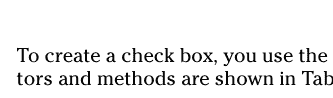

要创建复选框，请使用 `JCheckBox` 类。其常用的构造函数和方法如表 3-5 所示。


#### 表 3-5 常用 JCheckBox 构造方法与方法

| 构造方法/方法 | 描述 |
| :--- | :--- |
| **构造方法** | **描述** |
| `JCheckBox()` | 创建一个新的复选框，初始状态为未选中。 |
| `JCheckBox(String text)` | 创建一个新的复选框，显示指定的文本。 |
| `JCheckBox(String text, boolean selected)` | 创建一个带指定文本的复选框。布尔参数决定复选框初始是选中（`true`）还是未选中（`false`）。 |
| **方法** | **描述** |
| `void addActionListener(ActionListener listener)` | 添加一个 `ActionListener` 来监听动作事件。 |
| `void addItemListener(ItemListener listener)` | 添加一个 `ItemListener` 来监听项目事件。 |
| `String getText()` | 获取复选框显示的文本。 |
| `Boolean isSelected()` | 如果复选框被选中则返回 `true`，如果未选中则返回 `false`。 |
| `void setSelected(boolean value)` | 如果参数为 `true` 则选中复选框；如果参数为 `false` 则取消选中。 |
| `void setText(String text)` | 设置复选框的文本。 |
| `void setToolTipText(String text)` | 设置工具提示文本，当用户将鼠标悬停在复选框上几秒时会显示该文本。 |

与任何 Swing 组件一样，如果你想在框架类构造方法和监听器中都引用该组件，就必须声明类变量来引用复选框组件，如下所示：

```
JCheckBox pepperoni, mushrooms, anchovies;
```

然后，你可以在框架构造方法中使用类似这样的语句来创建复选框并将它们添加到面板（在此例中是 `panel1`）：

```
pepperoni = new JCheckBox("Pepperoni");
panel1.add(pepperoni);

mushrooms = new JCheckBox("Mushrooms");
panel1.add(mushrooms);

anchovies = new JCheckBox("Anchovies");
panel1.add(anchovies);
```

## 550 使用复选框

请注意，我没有在构造方法中指定这些复选框的初始状态。因此，它们最初都是未选中的。如果你想创建一个初始状态为选中的复选框，请像这样调用构造方法：

```
pepperoni = new JCheckBox("Pepperoni", true);
```

在事件监听器中，你可以使用 `isSelected` 方法测试复选框的状态，也可以通过调用其 `setSelected` 方法来设置复选框的状态。例如，下面是一个 `actionPerformed` 方法，当用户点击确定按钮时，它会显示一个消息框并取消选中所有三个复选框：

```
public void actionPerformed(ActionEvent e)
{
    if (e.getSource() == buttonOK)
    {
        String msg = "";
        if (pepperoni.isSelected())
            msg += "Pepperoni\n";
        if (mushrooms.isSelected())
            msg += "Mushrooms\n";
        if (anchovies.isSelected())
            msg += "Anchovies\n";
        if (msg.equals(""))
            msg = "You didn't order any toppings.";
        else
            msg = "You ordered these toppings:\n" +
            msg;
        JOptionPane.showMessageDialog(buttonOK,
            msg, "Your Order",
            JOptionPane.INFORMATION_MESSAGE);
        pepperoni.setSelected(false);
        mushrooms.setSelected(false);
        anchovies.setSelected(false);
    }
}
```

这里，用户选择的每种配料的名称都被添加到一个文本字符串中。例如，如果你选择了意大利辣香肠和凤尾鱼，将会显示以下消息：

```
You ordered these toppings:
Pepperoni
Anchovies
```


如果需要，你可以为复选框添加事件监听器，以响应用户点击复选框时生成的事件。复选框同时支持动作监听器和项目监听器。它们之间的区别很微妙：

-   每当用户点击复选框以改变其状态时，都会生成一个动作事件。
-   每当复选框的状态改变时，无论是否由用户点击引起，还是因为程序调用了 `setSelected` 方法，都会生成一个项目事件。

假设你的餐厅菜单上有凤尾鱼，但实际上你拒绝制作放有凤尾鱼的披萨。下面是一个动作监听器中的 `actionPerformed` 方法，如果用户试图选中凤尾鱼复选框，它会显示一条消息并取消选中该复选框：

```
public void actionPerformed(ActionEvent e)
{
    if (e.getSource() == anchovies)
    {
        JOptionPane.showMessageDialog(anchovies,
                "We don't do anchovies here.",
                "Yuck!",
                JOptionPane.WARNING_MESSAGE);
        anchovies.setSelected(false);
    }
}
```

> 只有在需要用户选中或取消选中复选框时立即提供反馈的情况下，才为复选框添加监听器。在大多数应用中，我们等待用户点击按钮，然后再实际检查框架上任何复选框的状态。

### 使用单选按钮

单选按钮与复选框类似，但有一个关键区别：单选按钮是分组的，用户在每个组中一次只能选择一个单选按钮。当你点击一个单选按钮选中它时，之前被选中的单选按钮会自动取消选中。图 3-4 显示了一个包含三个单选按钮的框架。

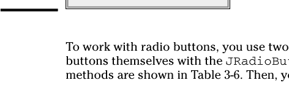

要使用单选按钮，你需要使用两个类。首先，使用 `JRadioButton` 类创建单选按钮本身，其构造方法和方法如表 3-6 所示。然后，使用 `ButtonGroup` 类为按钮创建一个组。你必须将单选按钮本身添加到面板以显示它们，并添加到按钮组以使它们与其他按钮正确分组。

#### 表 3-6 常用 JRadioButton 构造方法与方法

| 构造方法/方法 | 描述 |
| :--- | :--- |
| `JRadioButton()` | 创建一个新的没有文本的单选按钮。 |
| `JRadioButton(String text)` | 创建一个新的带指定文本的单选按钮。 |
| **方法** | **描述** |
| `void addActionListener(ActionListener listener)` | 添加一个 ActionListener 来监听动作事件。 |
| `void addItemListener(ItemListener listener)` | 添加一个 ItemListener 来监听项目事件。 |
| `String getText()` | 获取单选按钮显示的文本。 |
| `Boolean isSelected()` | 如果单选按钮被选中则返回 `true`，如果未选中则返回 `false`。 |
| `void setSelected(boolean value)` | 如果参数为 `true` 则选中单选按钮。 |
| `void setText(String text)` | 设置单选按钮的文本。 |
| `void setToolTipText(String text)` | 设置工具提示文本，当用户将鼠标悬停在单选按钮上几秒时会显示该文本。 |

创建单选按钮的常用方法是声明一个类变量来引用该按钮，以便在类中的任何位置都可以访问。例如

```
JRadioButton small, medium, large;
```

然后，在框架构造方法中，调用 `JRadioButton` 构造方法来创建单选按钮：

```
small = new JRadioButton("Small");
```

然后，你可以按照通常的方式将单选按钮添加到面板中。

要创建一个按钮组来对协同工作的单选按钮进行分组，只需调用 `ButtonGroup` 类的构造方法：

```
ButtonGroup group1 = new ButtonGroup();
```

然后，调用 `ButtonGroup` 的 `add` 方法将每个单选按钮添加到组中：

```
group1.add(small);
group1.add(medium);
group1.add(large);
```

请注意，按钮组与单选按钮在框架上的外观无关。按钮可以出现在框架上的任何位置，甚至在不同的面板中。（我将在下一节“使用边框”中向你展示如何通过使用边框来对单选按钮和其他组件进行视觉分组。）

按钮组真正派上用场的场景是当表单上有不止一组单选按钮时。例如，假设除了选择披萨大小外，用户还可以选择饼皮样式——薄底或厚底。在这种情况下，你总共需要五个单选按钮和两个按钮组。创建单选按钮的构造方法代码可能看起来像这样：

```
ButtonGroup size = new ButtonGroup();
ButtonGroup crust = new ButtonGroup();

small = new JRadioButton("Small");
medium = new JRadioButton("Medium");
large = new JRadioButton("Large");
size.add(small);
size.add(medium);
size.add(large);

thin = new JRadioButton("Thin Crust");
thick = new JRadioButton("Thick Crust");
crust.add(thin);
crust.add(thick);
```

（为了使此示例简单，我省略了将单选按钮添加到面板的语句。）

严格来说，如果框架上的所有单选按钮都在同一个组中，你不必创建按钮组。在这种情况下，Swing 会创建一个默认组并将所有单选按钮添加到其中。然而，由于这只是几行额外的代码，我建议你即使只有一组单选按钮时也始终创建一个按钮组。

### 使用边框

边框是一种装饰元素，通过围绕组件绘制线条来在视觉上对它们进行分组。图 3-5 显示了一个在边框内显示一些单选按钮和复选框的框架。


## 554 使用边框

图 3-5：一个带有边框的框架。

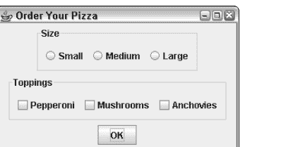

你可以为任何继承了 `JComponent` 的对象添加边框，但通常的做法是给面板添加边框，然后将需要显示在边框内的组件添加到该面板中。要创建边框，你需要调用表 3-7 中列出的某个静态方法。这些方法会创建具有略有不同视觉样式的边框。然后，通过调用面板的 `setBorder` 方法将 `Border` 对象应用到面板上。

> `BorderFactory` 类位于 `javax.swing` 包中，但定义边框对象的 `Border` 接口位于 `javax.swing.border` 包中。因此，如果你计划使用边框，除了导入 `javax.swing.*` 之外，还需要在类的开头添加以下导入语句：

```
import javax.swing.border.*;
```

#### 表 3-7：用于创建边框的 BorderFactory 方法

| 方法 | 描述 |
| :--- | :--- |
| `Border createBevelBorder(int type)` | 创建指定类型的斜面边框。类型参数可以是 `BevelBorder.LOWERED` 或 `BevelBorder.RAISED`。 |
| `Border createEmptyBorder(int top, int left, int bottom, int right)` | 创建一个占用参数指定空间的空边框。 |
| `Border createEtchedBorder()` | 创建蚀刻边框。 |
| `Border createLineBorder()` | 创建线条边框。 |
| `Border createLoweredBevelBorder()` | 创建内陷的斜面边框。 |
| `Border createRaisedBevelBorder()` | 创建凸起的斜面边框。 |
| `Border createTitledBorder(String title)` | 创建带标题的蚀刻边框。 |
| `Border createTitledBorder(Border b, String title)` | 从指定的边框创建带标题的边框。 |

### 工厂模式

`BorderFactory` 类是*工厂模式*这一非常常见的设计模式的一个例子。简而言之，当你使用工厂模式时，你不使用构造函数来创建对象。相反，你使用一个*工厂类*，它包含用于为你创建对象的*工厂方法*。

工厂模式的一个好处是，工厂类的使用者不需要知道实际创建的是什么类型的对象。例如，Swing 实际上为边框定义了几个不同的类，所有这些类都实现了 `Border` 接口。如果你必须使用构造函数来创建边框对象，你就需要了解所有这些边框类。通过创建一个返回 `Border` 对象的 `BorderFactory` 类，你只需要了解 `BorderFactory` 类及其方法。

Java API 的设计者本可以创建一个 `Border` 类（而不是接口），允许你通过传递给构造函数的参数来指定要创建的边框类型。然而，这种方法有很多问题。首先，`Border` 类会很复杂，因为它必须实现每种类型的边框。但更重要的是，以后添加新类型的边框会很困难。使用工厂模式，你可以轻松地创建新的边框类型：（1）创建一个实现 `Border` 接口的新边框类，以及（2）向 `BorderFactory` 类添加一个方法来创建新的边框类型。

表 3-7 中列出的所有方法都是静态方法。因此，你不必创建 `BorderFactory` 类的实例就可以调用这些方法。

例如，下面是一段代码片段，它创建一个面板，创建一个带标题的边框，并将该边框应用到面板：

```
JPanel sizePanel = new JPanel();
Border b1 = BorderFactory.createTitledBorder("Size");
sizePanel.setBorder(b1);
```

然后，你添加到 `sizePanel` 的任何组件都会显示在此边框内。

表 3-7 中列出的最后一个方法需要稍作解释。它只是向由 `BorderFactory` 类的其他任何创建方法创建的边框添加一个标题。例如，你可以这样创建一个带标题 "Options" 的凸起斜面边框：

```
Border b = BorderFactory.createRaisedBevelBorder();
b = BorderFactory.createTitledBorder(b, "Options");
```

### 设计披萨点餐程序

为了让你了解边框如何与单选按钮和复选框一起工作，清单 3-2 展示了创建图 3-5 所示框架的程序的完整代码。当用户点击“确定”按钮时，此程序会显示一个消息框，总结用户的订单。例如，如果用户点了一个中号披萨，上面有意大利辣香肠和蘑菇，将显示以下消息：

```
You ordered a medium pizza with the following toppings:
Pepperoni
Mushrooms
```

如果你点了一个没有配料的披萨，消息大致如下：

```
You ordered a medium pizza with no toppings.
```

#### 清单 3-2：披萨点餐程序

```
import javax.swing.*;
import java.awt.event.*;
import javax.swing.border.*;

public class Pizza extends JFrame
{
    public static void main(String [] args)
    {
        new Pizza();
    }

    private JButton buttonOK;
    private JRadioButton small, medium, large;
    private JCheckBox pepperoni, mushrooms, anchovies;

    public Pizza()
    {
        this.setSize(320,200);
        this.setTitle("Order Your Pizza");
        this.setDefaultCloseOperation(JFrame.EXIT_ON_CLOSE);

        ButtonListener bl = new ButtonListener();

        JPanel mainPanel = new JPanel();

        JPanel sizePanel = new JPanel();
        Border b1 =
            BorderFactory.createTitledBorder("Size");
        sizePanel.setBorder(b1);

        ButtonGroup sizeGroup = new ButtonGroup();

        small = new JRadioButton("Small");
        small.setSelected(true);
        sizePanel.add(small);
        sizeGroup.add(small);

        medium = new JRadioButton("Medium");
        sizePanel.add(medium);
        sizeGroup.add(medium);

        large = new JRadioButton("Large");
        sizePanel.add(large);
        sizeGroup.add(large);

        mainPanel.add(sizePanel);

        JPanel topPanel = new JPanel();
        Border b2 =
            BorderFactory.createTitledBorder("Toppings");
        topPanel.setBorder(b2);

        pepperoni = new JCheckBox("Pepperoni");
        topPanel.add(pepperoni);

        mushrooms = new JCheckBox("Mushrooms");
        topPanel.add(mushrooms);

        anchovies = new JCheckBox("Anchovies");
        topPanel.add(anchovies);

        mainPanel.add(topPanel);

        buttonOK = new JButton("OK");
        buttonOK.addActionListener(bl);
        mainPanel.add(buttonOK);

        this.add(mainPanel);

        this.setVisible(true);
    }

    private class ButtonListener implements ActionListener
    {
        public void actionPerformed(ActionEvent e)
        {
            if (e.getSource() == buttonOK)
            {
                String tops = "";
                if (pepperoni.isSelected())
                    tops += "Pepperoni\n";
                if (mushrooms.isSelected())
                    tops += "Mushrooms\n";
                if (anchovies.isSelected())
                    tops += "Anchovies\n";

                String msg = "You ordered a ";
                if (small.isSelected())
                    msg += "small pizza with ";
                if (medium.isSelected())
                    msg += "medium pizza with ";
                if (large.isSelected())
                    msg += "large pizza with ";

                if (tops.equals(""))
                    msg += "no toppings.";
                else
                    msg += "the following toppings:\n"
                        + tops;
                JOptionPane.showMessageDialog(
                    buttonOK, msg, "Your Order",
                    JOptionPane.INFORMATION_MESSAGE);

                pepperoni.setSelected(false);
                mushrooms.setSelected(false);
                anchovies.setSelected(false);
                small.setSelected(true);
            }
        }
    }
}
```

我在本章（或前面的章节）中涵盖了此程序中的所有内容，因此这里只强调要点：

-   添加到框架的组件被声明为类变量，这样构造函数和动作事件监听器的 `actionPerformed` 方法都可以访问它们。
-   此行创建 `mainPanel`，这是程序使用的三个面板中的第一个。该面板包含其他两个面板，这两个面板使用边框对其组件进行可视化分组。
-   此行创建 `sizePanel`，该面板用于放置允许用户选择披萨尺寸的单选按钮。
-   `BorderFactory` 类用于创建一个以单词 Size 为标题的带标题边框。
-   带标题的边框被附加到尺寸面板上。
-   为单选按钮创建了一个按钮组。
-   创建了 Small 单选按钮。注意，此按钮的 `setSelected` 方法被调用了。因此，Small 是披萨订单的默认尺寸。还要注意，该单选按钮同时被添加到 `sizePanel` 面板和 `size` 按钮组中。
-   创建了 Medium 单选按钮，并添加到面板和按钮组中。
-   创建了 Large 单选按钮，并添加到面板和按钮组中。


## 46 尺寸面板已添加到主面板。

## 48 创建了一个名为 `topPanel` 的新面板，用于容纳配料复选框。与尺寸面板一样，该面板也被赋予了一个带标题的边框。

## 53 创建了意大利辣香肠、蘑菇和鳀鱼复选框，并将其添加到面板中。

## 62 配料面板已添加到主面板。

## 64 创建了“确定”按钮，并直接添加到主面板。由于此按钮不在边框内，因此不需要像单选按钮和复选框那样添加到单独的面板中。

## 68 主面板已添加到窗体。窗体现在已完成，可以使其可见。

## 79 在动作监听器的 `actionPerformed` 方法中，使用用户选择的配料构建了一个名为 `tops` 的字符串。

## 87 接下来，使用披萨尺寸构建了一个名为 `msg` 的字符串。这些行构建了一个字符串，内容为“您点了一份尺寸披萨，配有”，其中 `size` 根据用户选择的单选按钮被替换为 `small`、`medium` 或 `large`。

## 95 此 `if` 语句完成了 `msg` 字符串的构建：如果用户没有选择任何配料，则添加“没有配料”；如果用户选择了配料，则添加 `tops` 字符串。

## 100 此行使用 `JOptionPane` 显示一个消息框，其中显示用户的订单。

## 104 最后，这些行重置了控件，以便应用程序可以接受新订单。

### 使用滑块

如图 3-6 所示，*滑块*是一种组件，允许用户通过移动旋钮从设定范围（例如，从 0 到 50）中选择一个值。当输入落在设定的值范围内时，滑块是从用户获取数值输入的一种便捷方式。

**图 3-6：** 包含滑块的窗体。

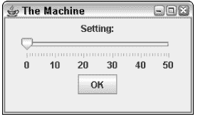

# 560 使用滑块

要创建滑块控件，需使用 `JSlider` 类。表 3-8 列出了其构造方法和方法。

**表 3-8：JSlider 的部分构造方法和方法**

| 构造方法 | 描述 |
| :--- | :--- |
| `JSlider()` | 创建一个新的滑块。最小值和最大值默认为 0 和 100，初始值设置为 50。 |
| `JSlider(int min, int max)` | 创建一个新的滑块，并指定最小值和最大值。初始值为最小值和最大值的中间值。 |
| `JSlider(int min, int max, int value)` | 创建一个新的滑块，并指定最小值、最大值和初始值。 |
| `JSlider(int orientation, int min, int max, int value)` | 创建一个新的滑块，并指定最小值、最大值和初始值。方向可以是 `JSlider.HORIZONTAL` 或 `JSlider.VERTICAL`。 |

| 方法 | 描述 |
| :--- | :--- |
| `void addChangeListener(ChangeListener listener)` | 添加一个 `ChangeListener` 来监听更改事件。 |
| `int getValue()` | 获取当前旋钮位置指示的值。 |
| `void setInvert(boolean value)` | 如果为 `true`，则反转滑块的方向，使最大值在左侧，最小值在右侧。 |
| `void setMajorTickSpacing(int value)` | 设置主刻度线的间隔。除非调用 `setPaintTicks(true)`，否则不会显示刻度线。 |
| `void setMinimum(int value)` | 设置最小值。 |
| `void setMaximum(int value)` | 设置最大值。 |
| `void setMinorTickSpacing(int value)` | 设置次刻度线的间隔。除非调用 `setPaintTicks(true)`，否则不会显示刻度线。 |
| `void setOrientation(int orientation)` | 设置方向。允许的值为 `JSlider.HORIZONTAL` 和 `JSlider.VERTICAL`。 |
| `void setPaintLabels(boolean value)` | 如果为 `true`，则显示刻度标签。 |
| `void setSnapToTicks(boolean value)` | 如果为 `true`，则 `getValue` 方法返回的值将四舍五入到最近的刻度线。 |
| `void setToolTipText(String text)` | 设置工具提示文本，当用户将鼠标悬停在滑块上几秒钟时会显示该文本。 |

要创建一个最简单的滑块，只需调用 `JSlider` 构造方法即可。您可以创建一个范围从 0 到 100 的滑块，如下所示：

```
slider = new JSlider();
```

此处，`slider` 变量被声明为 `JSlider` 类型的类变量。

如果您想指定最小值和最大值，请使用此构造方法：

```
slider = new JSlider(0, 50);
```

此处，滑块允许用户从 0 到 50 中选择一个值。旋钮的初始位置是 25，位于最小值和最大值的中间。

要设置不同的初始值，请使用此构造方法：

```
slider = new JSlider(0, 0, 50);
```

此处，滑块的范围从 0 到 50，初始值为 0。

通常，您希望至少在滑块上添加一些装饰，以使其更易于使用。图 3-6 中显示的滑块具有可见的带标签的最小值和最大值刻度标记。以下是用于创建它的代码：

```
slider = new JSlider(0, 50, 0);
slider.setMajorTickSpacing(10);
slider.setMinorTickSpacing(1);
slider.setPaintTicks(true);
slider.setPaintLabels(true);
panel1.add(slider);
```

> **注意：** 即使您设置了主次刻度间隔值，除非您调用 `setPaintTicks` 并将参数设置为 `true`，否则刻度线不会显示。`setPaintLabels` 方法会连同刻度线一起显示标签。而 `setSnapToTicks` 方法会将值四舍五入到最近的刻度线。

```
"级别 " + level,
JOptionPane.INFORMATION_MESSAGE);
}
}
```

此处，当用户单击“确定”按钮时，会显示一个消息框。检索滑块组件的当前设置并存储在名为 `level` 的 int 变量中，然后使用该变量创建消息框的标题。

您还可以添加一个事件监听器，以便在用户更改滑块值时做出反应。为此，请使用 `addChangeListener` 方法。参数必须是一个实现了 `ChangeListener` 接口的对象，该接口定义了一个名为 `stateChanged` 的方法。以下是可用于响应滑块更改的类示例：

```
private class SliderListener implements ChangeListener
{
    public void stateChanged(ChangeEvent e)
    {
        if (slider.getValue() == 50)
        {
            JOptionPane.showMessageDialog(slider,
                "不！不是50！",
                "机器",
                JOptionPane.WARNING_MESSAGE);
        }
    }
}
```

要将此类的实例连接到滑块，请使用此方法：

```
slider.addChangeListener(new SliderListener());
```

然后，每当用户将旋钮移动到另一个位置时，就会调用 `stateChanged` 方法。它会检查滑块的值，如果用户将滑块一直推进到 50，则显示一个消息框。

## 第四章：从列表中选择

### 本章内容

- 组合框
- 列表
- 微调器
- 树

一整类 Swing 组件的设计目的是让用户从列表中选择一个或多个项目。本章介绍了四种这样的控件。前三种——`JList`、`JComboBox` 和 `JSpinner`——比较直接。第四种——`JTree`——稍微复杂一些，但值得投入精力去掌握。


如果在窗体上放置一个 `JTree` 控件，您的朋友肯定会认为您是某种高手。他们会开始纠缠您，问各种问题并寻求帮助。因此，只有当您的应用程序确实需要它，并且您觉得自己有能力应对弄清楚它如何工作的技术挑战时，才使用此组件。

### 使用组合框

*组合框*是文本字段和下拉列表的组合，用户可以从下拉列表中选择一个值。如果控件的文本字段部分是可编辑的，用户可以向该字段输入一个值或编辑从下拉列表中检索到的值。然而，使文本字段不可编辑是很常见的。然后，用户必须从列表中选择一个值。图 4-1 显示了一个包含简单组合框的窗体。

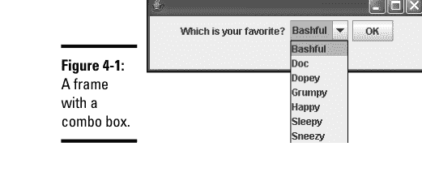

# 564 使用组合框

您使用 `JComboBox` 类来创建组合框。表 4-1 列出了此类最常用的构造方法和方法。

**表 4-1：常用的 JComboBox 构造方法和方法**

| 构造方法 | 描述 |
| :--- | :--- |
| `JComboBox()` | 创建一个空的组合框。 |
| `JComboBox(Object[] items)` | 创建一个组合框并用数组中的值填充。 |
| `JComboBox(Vector[] items)` | 创建一个组合框并用向量中的值填充。 |

| 方法 | 描述 |
| :--- | :--- |
| `void addActionListener(ActionListener listener)` | 向组合框添加一个动作监听器。 |
| `void addItem(Object item)` | 将项目添加到组合框。 |
| `void addItemListener(ItemListener listener)` | 向组合框添加一个项目监听器。 |
| `Object getItemAt(int index)` | 返回指定索引处的项目。 |
| `int getItemCount()` | 返回组合框中的项目数。 |
| `int getSelectedIndex()` | 返回所选项目的索引。 |
| `Object getSelectedItem()` | 返回所选项目。 |
| `void insertItemAt(Object item, int index)` | 在指定索引处插入一个项目。 |
| `Boolean isEditable()` | 指示组合框的文本字段是否可编辑。 |
| `void removeAllItems()` | 从组合框中移除所有项目。 |
| `void removeItem(Object item)` | 移除指定的项目。 |
| `void removeItemAt(int index)` | 移除指定索引处的项目。 |
| `void setEditable(boolean value)` | 指定组合框的文本字段是否可编辑。 |
| `void setMaximumRowCount(int count)` | 设置组合框列表下拉时显示的行数。 |
| `void setSelectedIndex(int index)` | 选择指定索引处的项目。如果索引小于零或大于组合框中的项目数，则抛出 `IllegalArgumentException`。 |
| `void setSelectedItem(Object item)` | 选择指定的项目。如果项目不在组合框中，则抛出 `IllegalArgumentException`。 |


# 创建组合框

创建组合框很简单。你有三种构造函数可以选择。第一种创建一个空的组合框：

```
JComboBox combo1 = new JComboBox();
```

然后，你可以使用 `addItem` 方法向组合框中添加项目：

```
combo1.addItem("Bashful");
combo1.addItem("Doc");
combo1.addItem("Dopey");
combo1.addItem("Grumpy");
combo1.addItem("Happy");
combo1.addItem("Sleepy");
combo1.addItem("Sneezy");
```

或者，你可以创建一个组合框并用数组初始化其内容。例如：

```
String[] theSeven = {"Bashful", "Doc", "Dopey", "Grumpy",
                    "Happy", "Sleepy", "Sneezy"};
JComboBox combo1 = new JComboBox(theSeven);
```

或者，如果你有一个现有的 `Vector` 对象，其中包含了你要显示的数据：

```
JComboBox combo1 = new JComboBox(vector1);
```

如果你要显示的数据在数组列表或其他类型的集合中，请使用 `toArray` 方法将集合转换为数组，然后将数组传递给 `JComboBox` 构造函数：

```
JComboBox combo1 = new JComboBox(arraylist1.toArray());
```

你可以向组合框中添加任何类型的对象。组合框会调用每个项目的 `toString` 方法，以确定在下拉列表中显示的文本。例如，假设你有一个 `Employee` 对象的数组。如果你从这个数组创建一个组合框，每个员工的 `toString` 方法返回的字符串将显示在组合框中。

默认情况下，不允许用户编辑组合框文本字段部分的数据。如果你想允许用户编辑文本字段，请调用 `setEditable(true)`。然后，用户可以输入一个不在组合框中的值。

要从组合框中移除项目，请使用 `remove` 方法之一。如果你知道要移除的项目的索引位置，请调用 `removeItemAt` 方法并将索引号作为参数传递。否则，如果你有要移除的对象，请调用 `removeItem` 并传递该对象。

# 566 使用组合框

要移除组合框中的所有项目，请调用 `removeAllItems`。例如，假设你有一个名为 `custCombo` 的组合框，其中填充了从文件读取的 `Customer` 对象，你需要定期刷新此组合框以确保它包含所有当前的客户。以下是一个实现此功能的方法：

```
private void fillCustomerCombo()
{
    ArrayList<Customer> customers = getCustomers();
    custCombo.removeAllItems();
    for (Customer c : customers)
        custCombo.addItem(c);
}
```

在这个例子中，调用了一个名为 `getCustomers` 的方法，从文件中获取客户对象的 `ArrayList`。然后，删除组合框中当前的所有项目，并使用增强的 `for` 循环将客户添加到组合框中。

### 从组合框中获取项目

要获取用户选择的项目，请使用 `getSelectedItem` 方法。遗憾的是，此方法返回一个 `Object` 类型，因此你必须在使用之前将返回值强制转换为适当的类型。例如，以下是为创建组合框框架（如图 4-1 所示）的程序中的事件监听器的 `actionPerformed` 方法：

```
public void actionPerformed(ActionEvent e)
{
    if (e.getSource() == buttonOK)
    {
        String s = (String)combo1.getSelectedItem();
        JOptionPane.showMessageDialog(combo1,
            "You picked " + s,
            "Your Favorite",
            JOptionPane.INFORMATION_MESSAGE);
    }
}
```

这里，`getSelectedItem` 方法检索所选项目，将其转换为 `String`，并将其保存在一个名为 `s` 的 `String` 变量中。然后，显示一个 `JOptionPane` 消息框以显示用户的选择。

如果你愿意，你可以通过调用 `getSelectedIndex` 方法获取所选项目的索引。如果组合框包含对应于存储在数组或集合中的对象的字符串值，你可能会使用此方法。然后，你可以使用检索到的索引值从集合中获取实际的对象。

### 处理组合框事件

当用户从组合框中选择一个项目时，会生成一个动作事件。在大多数应用程序中，你只需忽略此事件。这是因为当用户选择一个项目时，你通常不需要立即做任何事情。相反，当用户单击按钮时，会处理选定的项目。

如果你想在用户选择项目时提供即时反馈，你可以按照常规方式处理动作事件：创建一个 `ActionListener`，在 `actionPerformed` 方法中处理该事件，然后调用组合框的 `addActionListener` 方法来添加动作监听器。以下动作监听器类在用户选择 Dopey 时显示一个消息框，内容为 "My favorite too!"：

```
private class ComboListener implements ActionListener
{
    public void actionPerformed(ActionEvent e)
    {
        if (e.getSource() == combo1)
        {
            String s =
                (String)combo1.getSelectedItem();
            if (s.equals("Dopey"))
                JOptionPane.showMessageDialog(combo1,
                    "He's my favorite too!",
                    "Good Choice",
                    JOptionPane.INFORMATION_MESSAGE);
        }
    }
}
```

当用户选择一个项目时，组合框也会生成项目事件。事实上，当用户选择一个项目时，组合框会生成*两个*项目事件，这可能会有点令人困惑。第一个事件在先前选定的项目被取消选择时生成。然后，当新项目被选定时，会生成另一个项目事件。在大多数情况下，你处理组合框动作事件而不是项目事件。

### 使用列表

*列表*是一个强大的 Swing 组件，它在框中显示对象列表。根据列表的配置方式，可以允许用户从列表中选择一个项目或多个列表项目。此外，你还可以对列表中项目的显示方式进行精细控制，尽管这并不总是优势。列表几乎总是与滚动窗格（在上一章中介绍）结合使用，以允许用户滚动列表的内容。图 4-2 显示了一个包含列表组件的示例框架。

# 568 使用列表

列表和组合框有几个重要的区别：

-   列表没有供用户编辑所选项目的文本字段。相反，用户必须直接从列表中选择项目。
-   列表不会下拉。相反，列表项目显示在一个你可以指定大小的框中。
-   列表不提供滚动条，因此你几乎总是将列表组件添加到滚动窗格中，以便用户可以滚动浏览列表。
-   列表允许你选择多个项目。默认情况下，列表组件允许你选择列表中项目的任意组合。但是，你可以配置列表以允许选择单个相邻值范围或仅一个值。
-   创建列表后，你无法直接更改列表中的值。如果你想创建一个可以更改其值的列表，你必须采取一些额外的步骤，正如我在本章后面的“更改列表项目”一节中所描述的那样。

> 要在列表中选择多个项目，请按住 Ctrl 键并单击要选择的项目。要选择一系列项目，请单击第一个项目，然后按住 Shift 键并单击最后一个项目。

你使用 `JList` 类创建组合框。表 4-2 列出了该类最常用的构造函数和方法。

#### 表 4-2 常用的 JList 构造函数和方法
| 构造函数 | 描述 |
| :--- | :--- |
| `JList()` | 创建一个空列表。 |
| `JList(ListModel list)` | 创建一个使用指定列表模型的列表。 |
| `JList(Object[] items)` | 创建一个列表并用数组中的值填充它。 |
| `JList(Vector[] items)` | 创建一个列表并用向量中的值填充它。 |
| `void clearSelection()` | 清除所有选择。 |


### 使用列表

| 方法 | 描述 |
| --- | --- |
| `int getSelectedIndex()` | 返回第一个被选中项的索引，如果没有项被选中，则返回 -1。 |
| `int[] getSelectedIndexes()` | 返回一个包含每个被选中项索引的数组。如果没有项被选中，则数组为空。 |
| `Object getSelectedValue()` | 返回第一个被选中的项，如果没有项被选中，则返回 `null`。 |
| `Object[] getSelectedValues()` | 返回一个包含所有被选中项的数组。如果没有项被选中，则数组为空。 |
| `boolean isSelectedIndex(int index)` | 如果指定索引处的项被选中，则返回 `true`。 |
| `boolean isSelectionEmpty()` | 如果没有项被选中，则返回 `true`。 |
| `void setFixedCellHeight(int height)` | 设置每行的高度。 |
| `void setFixedCellWidth(int width)` | 设置每行的宽度。 |
| `void setSelectedIndex(int index)` | 选中指定索引处的项。 |
| `void setSelectedIndices(int[] indices)` | 选中数组中指定索引处的项。 |
| `void setSelectionMode(int mode)` | 设置选择模式。允许的值有：`ListSelectionModel.SINGLE_SELECTION`、`ListSelectionModel.SINGLE_INTERVAL_SELECTION` 和 `ListSelectionModel.MULTIPLE_INTERVAL_SELECTION`。 |
| `void setVisibleRowCount(int count)` | 设置列表显示的行数。 |

### 从列表中选择

#### 创建列表

要创建一个列表并指定其项目，你需要将一个数组传递给 `JList` 构造函数。然后，调用 `setVisibleRowCount` 方法设置你希望可见的行数，将列表添加到滚动窗格，并将滚动窗格添加到一个面板，之后你可以将该面板添加到框架中。例如：

```java
String[] toppings = {"Pepperoni", "Sausage",
    "Linguica",
                    "Canadian Bacon", "Salami",
    "Tuna",
                    "Olives", "Mushrooms", "Tomatoes",
                    "Pineapple", "Kiwi", "Gummy
    Worms"};
list1 = new JList(toppings);
list1.setVisibleRowCount(5);
JScrollPane scroll = new JScrollPane(list1);
```


有关 `JScrollPane` 类的更多信息，包括如何指定你希望它显示的滚动条，请参阅第六册，第三章。

要控制用户可以选择的选择类型，请使用 `setSelectionMode` 方法。你可以将 `ListSelectionModel` 类定义的三个字段之一传递给此方法：

- `ListSelectionModel.SINGLE_SELECTION`：用户一次只能选择一个项目。
- `ListSelectionModel.SINGLE_INTERVAL_SELECTION`：用户可以选择多个项目，只要它们都在单个范围内。
- `ListSelectionModel.MULTIPLE_INTERVAL_SELECTION`：用户可以选择任意组合的项目。

例如，此语句将列表限制为单个选择：

```java
list1.setSelectionMode(ListSelectionModel.SINGLE_SELECTION);
```

请注意，默认设置是允许多个选择的任意组合。

#### 从列表中获取项目

对于只允许单个选择的列表，你可以通过调用 `getSelectedValue` 方法来检索被选中的项。在使用它之前，你必须将值强制转换为适当的类型。例如：

```java
String topping = (String)list1.getSelectedValue();
```

如果列表允许多个选择，`getSelectedValue` 方法仅返回第一个被选中的项。要获取所有选择，你必须改用 `getSelectedValues` 方法。此方法返回一个对象数组，其中包含用户选择的每个项目。当你检索这些对象时，你必须将每个对象强制转换为适当的类型——Java 不提供任何方法来转换整个数组。

例如，你可以在列表框的侦听器中使用以下 `actionPerformed` 方法：

```java
public void actionPerformed(ActionEvent e)
{
    if (e.getSource() == buttonOK)
    {
        String s = (String)combo1.getSelectedItem();
        JOptionPane.showMessageDialog(combo1,
            "You picked " + s,
            "Your Favorite",
            JOptionPane.INFORMATION_MESSAGE);
    }
}
```

在这里，`getSelectedItem` 方法检索被选中的项，将其转换为 `String`，并将其保存在名为 s 的 String 变量中。然后，显示一个 `JOptionPane` 消息框来显示用户的选择。

如果你愿意，你可以通过调用 `getSelectedIndex` 方法来获取被选中项的索引。如果组合框包含与存储在数组或集合中的对象相对应的字符串值，你可能会使用此方法。然后，你可以使用检索到的索引值从集合中获取实际对象。

```java
public void actionPerformed(ActionEvent e)
{
    if (e.getSource() == buttonOK)
    {
        Object[] toppings = list1.getSelectedValues();
        String msg =
            "You selected the following toppings:\n";
        for (Object topping : toppings)
            msg += (String)topping + "\n";
        JOptionPane.showMessageDialog(list1,
            msg,
            "Your Pizza",
            JOptionPane.INFORMATION_MESSAGE);
        list1.clearSelection();
    }
}
```

在这里，`getSelectedValues` 方法返回一个数组，其中包含用户选择的配料。然后，使用增强的 `for` 循环构建一个字符串，将每个选中的配料列在单独的一行中。然后使用 `JOptionPane` 类在消息框中显示 `msg` 字符串。

#### 更改列表项目

默认情况下，`JList` 组件中的项目在创建列表后无法更改。如果你想创建一个项目可以更改的列表，你必须使用另一个名为 `DefaultListModel` 的类来创建一个称为 *列表模型* 的对象，该对象包含你希望在 `JList` 组件中显示的项目。然后，将列表模型对象传递给 `JList` 构造函数。列表模型负责管理由 `JList` 组件显示的列表。因此，你可以使用列表模型的方法来添加或删除项目。`JList` 组件随后会自动更新自身以反映列表更改。表 4-3 显示了 `DefaultListModel` 类最常用的构造函数和方法。

**表 4-3：实用的 DefaultListModel 构造函数和方法**

| 构造函数 / 方法 | 描述 |
| :--- | :--- |
| **构造函数** | |
| `DefaultListModel()` | 创建一个新的列表模型对象。 |
| **方法** | |
| `void add(Object element, int index)` | 在指定位置添加一个元素。 |
| `void addElement(Object element)` | 在列表末尾添加一个元素。 |
| `void clear()` | 从列表中移除所有元素。 |
| `boolean contains(Object element)` | 如果指定元素在列表中，则返回 `true`。 |
| `Object firstElement()` | 返回列表中的第一个元素。 |
| `Object get(int index)` | 返回指定位置的元素。 |
| `boolean isEmpty()` | 如果列表为空，则返回 `true`。 |
| `Object lastElement()` | 返回列表中的最后一个元素。 |
| `void remove(int index)` | 从列表中的指定位置移除该元素。 |
| `void removeElement(Object element)` | 从列表中移除指定的元素。 |
| `int size()` | 返回列表中的元素数量。 |
| `Object[] toArray()` | 返回一个包含列表中每个元素的数组。 |

创建默认数据模型时，它是空的。但你可以调用 `add` 或 `addElement` 方法向列表添加元素。例如：

```java
String[] values = {"Pepperoni", "Sausage", "Linguica",
                   "Canadian Bacon", "Salami", "Tuna",
                   "Olives", "Mushrooms", "Tomatoes",
                   "Pineapple", "Kiwi", "Gummy Worms"};
DefaultListModel model = new DefaultListModel();
for (String value : values)
    model.addElement(value);
```

在这里，`values` 数组中的元素被添加到列表模型中。然后，当你创建列表控件时，将列表模型传递给 `JList` 构造函数：

```java
list = new JList(model);
```

你可以通过调用 `remove` 或 `removeElement` 方法从列表模型中移除一个元素。要从模型中移除所有元素，请调用 `clear` 方法。


### 使用微调框

*微调框*是一个文本字段，旁边有两个小箭头。用户可以点击其中一个箭头来增加或减少文本字段中的值。通常，文本字段包含一个数字，因此点击小箭头会递增或递减该数字。不过，你也可以创建一个显示来自数组或集合的数据的微调框。图4-3展示了一个包含三个微调框的窗体，它们被布置成一个简单的时间选择器。

**图4-3：**
一个包含三个微调框的窗体。

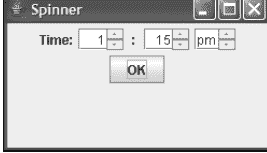

要创建微调框控件，你需要使用`JSpinner`类，其构造方法和方法如表4-4所示。请注意，第二个构造方法接受一个`SpinnerModel`类型的对象作为参数。此表还展示了两个实现了`SpinnerModel`接口的类的构造方法。

#### 表4-4：JSpinner及相关类

| 构造方法 | 描述 |
|---|---|
| `JSpinner()` | 创建一个默认的微调框。默认的微调框允许用户选择一个整数，其初始值为零，没有最小值或最大值。 |
| `JSpinner(SpinnerModel model)` | 使用指定的`SpinnerModel`对象创建一个微调框。 |

| 方法 | 描述 |
|---|---|
| `void addChangeListener(ChangeListener listener)` | 添加一个`ChangeListener`来监听变更事件。 |
| `int getValue()` | 获取值。 |
| `void setToolTipText(String text)` | 设置工具提示文本，当用户将鼠标悬停在滑块上片刻时会显示该文本。 |

| SpinnerModel类的构造方法 | 描述 |
|---|---|
| `SpinnerNumberModel(int init, int min, int max, int step)` | 创建一个数字微调框模型，允许用户从`min`到`max`中选择整数值，增量为`step`。初始值设置为`init`。 |

### 表4-4（续）

| SpinnerModel类的构造方法 | 描述 |
|---|---|
| `SpinnerNumberModel(double init, double min, double max, double step)` | 创建一个数字微调框模型，允许用户从min到max中选择双精度浮点数值，增量为step。初始值设置为init。 |
| `SpinnerListModel(Object[] values)` | 使用指定数组中的值创建一个列表微调框模型。 |
| `SpinnerListModel(List collection)` | 使用指定集合中的值创建一个列表微调框模型。该集合必须实现List接口。 |

你可以像这样创建一个允许用户选择整数值的默认微调框：

```
JSpinner spinner = new JSpinner();
```

这个微调框的初始值为零，每次用户点击微调框的箭头时，值会增加或减少一。你可以随时通过以下方式获取微调框的当前值：

```
int value = spinner.getValue();
```

对于大多数微调框，你会想使用第二个构造方法，它要求你首先创建一个实现了`SpinnerModel`接口的对象。表4-4列出了两个实现了`SpinnerModel`的类的构造方法。第一个是`SpinnerNumberModel`，它创建数字微调框控件，允许你控制初始值、最小值和最大值，以及每次用户点击箭头时增加或减少的步长值。

以下是使用`SpinnerNumberModel`创建图4-3中第一个微调框的代码，该微调框接受1到12的整数，起始值为1：

```
JSpinner hours = new JSpinner(
    new SpinnerNumberModel(1, 1, 12, 1));
```

以下是图4-3中第二个微调框的代码，它允许用户从0到59中选择数字：

```
JSpinner minutes = new JSpinner(
    new SpinnerNumberModel(0, 0, 59, 1));
```

你也可以通过使用`SpinnerListModel`类来构建一个从列表中选择值的微调框控件。这个类的构造方法接受一个数组或一个实现了`List`接口的对象。`ArrayList`类实现了这个接口，这意味着你可以使用`SpinnerListModel`来创建一个从`ArrayList`对象中选择项目的微调框。

以下是图4-3中第三个微调框的代码，它允许用户选择上午或下午：

```
String[] ampmString = {"am", "pm"};
ampm = new JSpinner(
    new SpinnerListModel(ampmString));
```

在这个例子中，`SpinnerListModel`使用了一个包含两个元素的字符串数组：am和pm。

### 使用树

*树*是一种花哨的Swing组件，以轮廓形式显示层次数据，我们计算机迷称之为树。树由`JTree`类创建。

你最熟悉的树类型可能是磁盘驱动器的目录结构。图4-4展示了一个包含树控件的Swing窗体。在这个例子中，我使用树控件来表示一些我最喜欢的电视节目以及从中衍生出的节目。

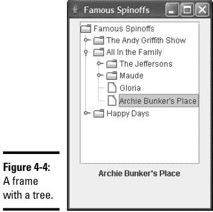

树控件可能是所有Swing控件中最难使用的。要全面介绍它们，我需要花费整整一章，30页或更多。因此，在本章剩下的短短几页里，我将只介绍基础知识：如何创建如图4-4所示的树组件，以及如何找出用户选择了哪个元素。

在我开始介绍如何创建树控件的机制之前，你需要知道一些描述树中元素的术语：

- **节点**：树中的每个元素都称为*节点*。树中的节点必须从实现`TreeNode`接口的类创建。如果愿意，你可以创建自己的类来实现`TreeNode`。然而，对于大多数情况，你可以使用`DefaultMutableTreeNode`类。（遗憾的是，当你使用树控件时，你必须经常输入那个类名。）
- **根节点**：树的起始节点。每个树组件必须有且只有一个根节点。创建树组件时，你需要将根节点传递给`JTree`构造方法。
- **子节点**：紧接在某个节点下方的节点称为该节点的子节点。一个节点可以有多个子节点。
- **父节点**：紧接在某个节点上方的节点称为该节点的父节点。除根节点外，每个节点必须有且只有一个父节点。
- **兄弟节点**：具有相同父节点的节点。
- **叶节点**：没有任何子节点的节点。这些节点表示分支的末端。
- **路径**：一个节点及其所有祖先节点——即其父节点、父节点的父节点，等等——一直到根节点。
- **展开的节点**：子节点可见的节点。
- **折叠的节点**：子节点被隐藏的节点。

#### 构建树

在你实际创建树控件之前，你必须构建它所显示的树。最简单的方法是使用`DefaultMutableTreeNode`类，其详细信息如表4-5所示。


`DefaultMutableTreeNode`类实现了`TreeNode`接口。因此，你可以将`DefaultMutableTreeNode`对象用于此表中列出的任何需要`TreeNode`对象的方法。

##### 表4-5：DefaultMutableTreeNode类

| 构造方法 | 描述 |
|---|---|
| `DefaultMutableTreeNode()` | 创建一个空的树节点。 |
| `DefaultMutableTreeNode(Object userObject)` | 创建一个带有指定用户对象的树节点。 |

| 方法 | 描述 |
|---|---|
| `void add(TreeNode child)` | 添加一个子节点。 |
| `TreeNode getFirstChild()` | 获取此节点的第一个子节点。 |
| `DefaultMutableTreeNode getNextSibling()` | 获取下一个兄弟节点。 |
| `TreeNode getParent()` | 获取此节点的父节点。 |
| `Object getUserObject()` | 获取此节点的用户对象。 |

`DefaultMutableTreeNode`类为每个节点提供了三个基本属性：

- *用户对象*，包含节点所表示的数据。在我的例子中，我使用字符串作为用户对象。但是，你可以使用任何你想要的类型的对象作为用户对象。树控件调用用户对象的`toString`方法来确定为每个节点显示什么文本。设置用户对象的最简单方法是通过`DefaultMutableTreeNode`构造方法传递它。
- 此节点的父节点，除非该节点恰好是根节点。
- 此节点的任何子节点，除非该节点恰好是叶节点。你可以通过调用`add`方法来创建子节点。


`DefaultMutableTreeNode`类在树中导航的方法比这里展示的要多得多。然而，给定一个根节点，你可以使用`getFirstChild`和`getNextSibling`方法来“遍历”整个树并访问每个节点。

在本节中，我将构建一棵树，列出三部过去流行电视剧的衍生节目：

- *安迪·格里菲斯秀*，它有两个衍生节目：*安布尔·普尔斯，美国海军陆战队*和*梅伯里·R.F.D.*。
- *一家子*，它直接衍生出四个节目：*杰斐逊一家*、*莫德*、*格洛里亚*和*阿奇·邦克之地*。此外，其中两个衍生节目又有自己的衍生节目，涉及女佣：杰斐逊一家的女佣成为了一部名为*入住登记*的节目的主题，而莫德的女佣则成为了*好时光*的主角。
- *欢乐时光*，它衍生出*外星人马尔克与明蒂*、*拉文与雪莉*以及*乔安妮爱上了查奇*。

你可以采用多种不同的方法来构建树，其中大多数都涉及一些递归编程。关于递归编程的更多信息，请参见第五册第四章。为了保持简单，我将在本节中避免使用递归编程。然而，这意味着你必须将树的一些细节硬编码到程序中。大多数实际


## 578 使用树

使用树的程序需要某种递归编程方式来构建树。

创建树的第一步是为每个非叶节点声明一个 `DefaultMutableTreeNode` 变量：

```java
DefaultMutableTreeNode andy, archie, happy,
                     george, maude;
```

这些可以是框架构造函数中的局部变量，因为在设置好树结构后，就不再需要这些变量了。稍后你就会明白为什么不需要为叶节点创建变量。

接下来，我创建根节点：

```java
DefaultMutableTreeNode root =
    new DefaultMutableTreeNode("Famous Spinoffs");
```

现在，为了简化创建所有其他节点的任务，我创建了一个名为 `makeShow` 的辅助方法：

```java
private DefaultMutableTreeNode makeShow(String title,
        DefaultMutableTreeNode parent)
{
    DefaultMutableTreeNode show;
    show = new DefaultMutableTreeNode(title);
    parent.add(show);
    return show;
}
```

此方法接受一个字符串和另一个节点作为参数，并返回一个用户对象设置为该字符串参数的节点。返回的节点还会作为子节点添加到父节点中。因此，你可以调用此方法同时创建新节点并将其放置在树中。

现在我创建一些节点。首先，是 *《安迪·格里菲斯秀》* 及其衍生剧的节点：

```java
andy = makeShow("The Andy Griffith Show", root);
makeShow("Gomer Pyle, U.S.M.C.", andy);
makeShow("Mayberry R.F.D.", andy);
```

这里，调用 `makeShow` 创建 *《安迪·格里菲斯秀》* 的节点，并指定根节点为其父节点。此方法返回的节点保存在 `andy` 变量中。然后，再次调用 `makeShow` 两次创建衍生剧，这次指定 `andy` 作为父节点。

由于 *《果梅·派尔》* 和 *《梅贝里 R.F.D.》* 都没有衍生剧，我不需要将这些节点作为父参数传递给 `makeShow` 方法。这就是为什么我不费心创建变量来引用这些节点。

接下来，我需要为 *《全家福》* 及其衍生剧创建节点：

```java
archie = makeShow("All In the Family", root);
george = makeShow("The Jeffersons", archie);
makeShow("Checking In", george);
maude = makeShow("Maude", archie);
makeShow("Good Times", maude);
makeShow("Gloria", archie);
makeShow("Archie Bunker's Place", archie);
```

在这种情况下，*《杰斐逊一家》* 和 *《莫德》* 都有自己的子节点。因此，这两个节目需要变量，以便在创建 *《入住》* 和 *《好时光》* 的节点时，可以将它们作为父参数传递给 `makeShow`。

最后，这是创建 *《快乐时光》* 及其衍生剧节点的代码：

```java
happy = makeShow("Happy Days", root);
makeShow("Mork and Mindy", happy);
makeShow("Laverne and Shirley", happy);
makeShow("Joanie Loves Chachi", happy);
```

完整的树已成功在内存中创建，因此我可以继续创建 `JTree` 组件来展示该树的任务。

#### 创建 *JTree* 组件

你使用 `JTree` 类来创建一个显示树节点的树组件。表 4-6 显示了该类的关键构造函数和方法。

**表 4-6 JTree 类的常用构造函数和方法**

| 构造函数 | 描述 |
| :--- | :--- |
| `void JTree()` | 创建一个空树。要我说，这不太实用。 |
| `void JTree(TreeNode root)` | 创建一个显示从指定节点开始的树的树。 |

| 方法 | 描述 |
| :--- | :--- |
| `void addTreeSelectionListener(TreeSelectionListener listener)` | 添加指定的监听器以监听树选择事件。 |
| `Object getLastSelectedPathComponent()` | 获取当前选中的节点。 |
| `TreeSelectionModel getSelectionModel()` | 获取树的选择模型。关于可以对 `TreeSelectionModel` 对象执行什么操作，请参阅正文。 |
| `void setVisibleRowCount(int count)` | 设置显示中可见的行数。 |

创建 JTree 组件的第一步是将 JTree 变量声明为类实例变量，以便你可以访问构造函数和其他方法：

```java
JTree tree1;
```

然后，在框架构造函数中，调用 JTree 构造函数创建树组件，并将要显示的树的根节点作为参数传递：

```java
tree1 = new JTree(root);
```

默认情况下，用户可以从树中选择多个节点。要将用户限制为单个选择，请使用以下奇怪的代码：

```java
tree1.getSelectionModel().setSelectionMode(
    TreeSelectionModel.SINGLE_TREE_SELECTION);
```

这里，调用 getSelectionModel 方法获取一个 TreeSelectionModel 对象，该对象确定用户如何在树中选择节点。此类提供了一个名为 setSelectionMode 的方法，允许你设置选择模式。要将树限制为单节点选择，必须将 TreeSelectionModel.SINGLE_TREE_SELECTION 字段传递给此方法。（我想，如果能为 JTree 类提供 setSingleTreeSelection 方法，可以为我们大家省去很多工作，但没人问过我。）

你可以通过调用 setVisibleRowCount 方法来控制树组件的大小。例如：

```java
tree1.setVisibleRowCount(12);
```

这里，树的大小刚好够一次显示 12 行。

最后，你需要将树组件添加到滚动窗格，以便在树不适合提供的空间时用户可以滚动树。然后，你应该将滚动窗格添加到面板，再将面板添加到框架：

```java
JScrollPane scroll = new JScrollPane(tree1);
panel1.add(scroll);
```

就是这样！树组件现在如前面的图 4-4 所示。

#### 获取选中的节点

确定树控件中当前选中节点的最简单方法是调用 getLastSelectedPathComponent 方法。此方法返回一个对象，因此你需要将其转换为正确的类型。例如

```java
Object o = tree1.getLastSelectedPathComponent();
DefaultMutableTreeNode show = (DefaultMutableTreeNode) o;
```

这里，检索选中的节点并存储在 `Object` 变量 `o` 中。然后，将其转换为 `DefaultMutableTreeNode` 对象。

你可以在动作事件监听器中使用此方法，在用户单击按钮时检索选中的节点。但是，如果程序需要在用户选择节点时立即响应怎么办？例如，图 4-4 中显示的框架在列表框下方有一个标签。每当用户在树中选择一个节目时，此标签都会更新为选中节目的标题。为此，你需要安装一个监听器来监听树选择事件。

要创建树选择监听器，你需要提供一个实现 `TreeSelectionListener` 接口的类。此接口提供了一个名为 `valueChanged` 的方法，该方法接收一个 `TreeSelectionEvent` 对象作为参数。这是一个简单的 `TreeSelectionListener` 类示例，它只是将名为 `showName` 的标签的值设置为所选项目的用户对象的值：

```java
private class TreeListener
    implements TreeSelectionListener
{
    public void valueChanged(TreeSelectionEvent e)
    {
        Object o = tree1.getLastSelectedPathComponent();
        DefaultMutableTreeNode show;
        show = (DefaultMutableTreeNode) o;
        String title = (String)show.getUserObject();
        showName.setText(title);
    }
}
```

然后，你可以使用以下语句安装此类的实例来监听树选择事件：

```java
tree1.addTreeSelectionListener(new TreeListener());
```

`JTree` 类提供了许多其他方法来检索选中的节点。此外，你可以添加监听器来监听用户选择节点时生成的树选择事件。这些事件使你能够创建在用户选择节点时立即显示所选节点数据的应用程序。如果你想使用这些功能，请查阅 `JTree` 类的 API 文档。

#### 将所有内容整合在一起

呼！这真是大量的信息需要消化。为了将所有内容整合在一起，清单 4-1 显示了创建图 4-4 所示框架的完整程序。


## 582 使用树

此程序允许用户从树中选择一个节目。然后，所选节目的标题会显示在树下方的标签中。

### 代码清单 4-1：衍生节目程序

```java
import javax.swing.*;
import java.awt.event.*;
import javax.swing.tree.*;
import javax.swing.event.*;

public class SpinOffs extends JFrame
{
    public static void main(String [] args)
    {
        new SpinOffs();
    }

    private JTree tree1;
    private DefaultTreeModel model;
    private JLabel showName;

    public SpinOffs()
    {
        this.setSize(225,325);
        this.setTitle("Famous Spinoffs");
        this.setDefaultCloseOperation(JFrame.EXIT_ON_CLOSE);

        JPanel panel1 = new JPanel();

        DefaultMutableTreeNode root, andy, archie,
                               happy, george, maude;

        root =
            new DefaultMutableTreeNode("Famous Spin-offs");

        andy = makeShow("The Andy Griffith Show", root);
        makeShow("Gomer Pyle, U.S.M.C.", andy);
        makeShow("Mayberry R.F.D.", andy);

        archie = makeShow("All In the Family", root);
        george = makeShow("The Jeffersons", archie);
        makeShow("Checking In", george);
        maude = makeShow("Maude", archie);
        makeShow("Good Times", maude);
        makeShow("Gloria", archie);
        makeShow("Archie Bunker's Place", archie);

        happy = makeShow("Happy Days", root);
        makeShow("Mork and Mindy", happy);
        makeShow("Laverne and Shirley", happy);
        makeShow("Joanie Loves Chachi", happy);

        tree1 = new JTree(root);
        tree1.getSelectionModel().setSelectionMode(
            TreeSelectionModel.SINGLE_TREE_SELECTION);
        tree1.setVisibleRowCount(12);
        tree1.addTreeSelectionListener(new TreeListener());

        JScrollPane scroll = new JScrollPane(tree1);
        panel1.add(scroll);

        showName = new JLabel();
        panel1.add(showName);
        this.add(panel1);
        this.setVisible(true);
    }

    private DefaultMutableTreeNode makeShow(
        String title, DefaultMutableTreeNode parent)
    {
        DefaultMutableTreeNode show;
        show = new DefaultMutableTreeNode(title);
        parent.add(show);
        return show;
    }

    private class TreeListener
        implements TreeSelectionListener
    {
        public void valueChanged(TreeSelectionEvent e)
        {
            Object o = tree1.getLastSelectedPathComponent();
            DefaultMutableTreeNode show;
            show = (DefaultMutableTreeNode) o;
            String title = (String)show.getUserObject();
            showName.setText(title);
        }
    }
}
```

此程序中的所有代码都已在本章前面展示过，因此这里只简要指出一些要点：

- 树和列表模型被定义为类的实例变量。
- 为根节点以及每个有衍生节目的节目定义了 `DefaultMutableTreeNode` 变量。
- 根节点使用文本 “Famous Spin-offs” 创建。
- 这些行为 “The Andy Griffith Show” 及其衍生节目创建节点。
- 这些行为 “All In the Family” 及其衍生节目创建节点。
- 这些行为 “Happy Days” 及其衍生节目创建节点。
- 这行代码创建了 `JTree` 组件，指定 `root` 作为树的根节点。
- 这些行配置了 `JTree` 组件，使其只允许单选、一次显示 12 行，并添加了一个树选择监听器。
- `JTree` 组件被添加到一个滚动窗格，然后该窗格被添加到框架中。
- `makeShow` 方法根据字符串创建一个节点，并将该节点添加到作为父参数传递的节点中。
- `TreeListener` 类处理 `valueChanged` 事件，以便在 `showName` 标签中显示所选节目的标题。

## 584 使用树

## 第五章：使用布局管理器

### 本章内容

- 流式布局
- 边框布局
- 盒式布局
- 网格布局
- 网格袋布局

控制框架上组件的布局是使用 Swing 最困难的方面之一。事实上，这简直会让人抓狂。有时组件似乎有自己的想法。它们固执地不肯移动。当你希望它们并排时，它们却堆叠在一起。你对标签或文本框做了一点小改动，整个框架似乎就重新排列了。有时候你真想一拳打穿显示器。

我不建议你一拳打穿显示器。那样你会弄得一团糟，割伤手，还得花钱买新显示器，而且等你让电脑重新工作后，组件仍然不会按你想要的方式排列。

问题不在于组件，而在于负责确定每个组件在其框架或面板中位置的布局管理器。在本章中，你将了解如何使用 Swing 的七种布局管理器。本章将揭开 Swing 布局的神秘面纱，让你完全掌控组件的放置位置。

### 介绍布局管理器

理解布局管理器是创建既美观又易用的 Swing 框架的关键。Swing 提供了七种不同的布局管理器供你使用（以下列表中描述了五种）：

- **流式布局：** 这是面板的默认布局管理器。它将组件一个接一个地排列，直到没有空间为止。然后，它开始新的一行组件。
- **边框布局：** 这是框架的默认布局管理器。它将容器分为五个区域，分别称为北、南、东、西和中心。添加组件时，你可以指定要将组件放置在哪个区域。
- **盒式布局：** 此布局管理器将组件排列成单行或单列，具体取决于创建布局管理器时指定的对齐方式。
- **网格布局：** 当你想创建大小相同的组件网格时，此布局管理器是理想的选择。
- **网格袋布局：** 此布局管理器使用比网格布局管理器更灵活的网格。使用网格袋布局，每行或每列可以有不同的大小，一个组件可以跨越两行或多行或两列或多列，你可以告诉布局管理器当组件小于或大于为其分配的空间时该如何处理。

图 5-1 展示了使用这些布局管理器排列的框架。

除了这五种布局管理器外，Java 还提供了一些额外的布局管理器。卡片布局管理器允许你创建选项卡式布局，但这种管理器已在很大程度上被其他更有效地执行相同功能的组件所取代。而弹簧布局管理器使用了一种称为弹簧的奇特概念来定位组件。这种布局管理器并非旨在手工编码。相反，它是设计供为用户创建 GUI 代码的代码生成器使用的。本书不介绍这两种布局管理器。

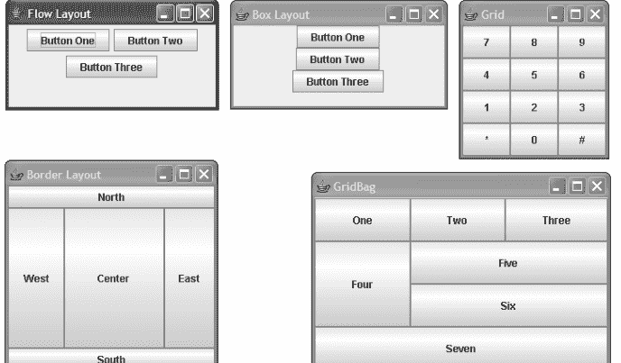

图 5-1：五种布局管理器。

## 586 介绍布局管理器

在许多情况下，创建复杂框架布局的最佳方法是组合使用布局管理器。例如，你可以创建一个包含按钮的面板，并将其放置在框架的底部。该面板将使用流式布局。然后，你可以将此面板添加到框架的南部区域（框架默认使用边框布局）。

要为面板或框架设置布局管理器，你可以使用 `setLayout` 方法。例如，以下是如何创建一个面板并将其布局管理器设置为网格袋布局：

```java
JPanel panel1 = new JPanel();
panel1.setLayout(new GridBagLayout());
```

如果你想对面板使用流式布局或对框架使用边框布局，你无需做任何事情，因为它们是默认设置。

### 使用流式布局

由于流式布局是面板的默认布局管理器，你已经熟悉它的工作方式。如果可能，组件会在单行中布局。如果当前行放不下某个组件，则会开始新的一行。

流式布局管理器本身用处不大。你可能主要会将其用于包含少量组件的小型面板，例如一行按钮，然后将其添加到使用其他布局管理器的较大面板中。

表 5-1 列出了 `FlowLayout` 类的构造函数，你可以使用它们来创建新的流式布局管理器。

| 表 5-1 | FlowLayout 构造函数 |
| :--- | :--- |
| **构造函数** | **描述** |
| `FlowLayout()` | 创建一个居中对齐且无间隙的流式布局管理器。 |
| `FlowLayout(int align)` | 创建一个具有指定对齐方式的流式布局管理器。`align` 参数可以是 `FlowLayout.LEFT`、`FlowLayout.CENTER` 或 `FlowLayout.RIGHT`。 |
| `FlowLayout(int align, int hgap, int vgap)` | 创建一个具有指定对齐方式的流式布局管理器。`int` 参数指定在元素之间插入的间隙大小（以像素为单位），以便稍微分散布局。 |


默认情况下，各行是居中对齐的。你可以像这样为面板指定左对齐：

```
JPanel panel1 = new JPanel();
panel1.setLayout(new FlowLayout(FlowLayout.LEFT));
```

要指定右对齐，请改用以下语句：

```
panel1.setLayout(new FlowLayout(FlowLayout.RIGHT));
```

你还可以指定插入到每个组件之间的间距。例如：

```
panel1.setLayout(new FlowLayout(FlowLayout.LEFT, 20, 15));
```

这里，水平间距设置为 20，垂直间距设置为 15。图 5-2 显示了使用这些设置创建的带有六个按钮的面板。

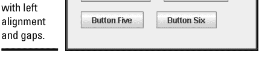

### 使用边界布局

边界布局管理器将框架或面板划分为五个区域：北、南、东、西和中，如图 5-3 所示。然后，当你向框架或面板添加组件时，你可以指定该组件放置在哪个区域。

边界布局是框架的默认布局。要创建使用边界布局的面板，请使用 `BorderLayout` 类的构造函数之一，如表 5-2 所示。例如：

```
JPanel panel1 = new JPanel();
panel1.setLayout(new BorderLayout());
```

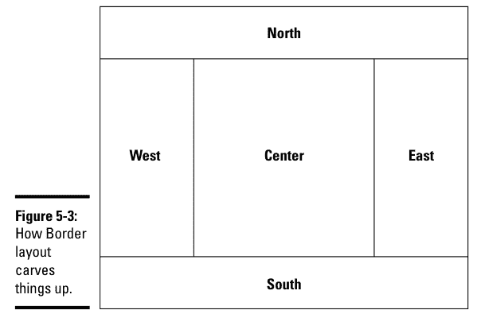

#### 表 5-2：边界布局的构造函数和字段

| 构造函数 | 描述 |
| --- | --- |
| `BorderLayout()` | 创建一个没有间距的边界布局管理器。 |
| `BorderLayout(int hgap, int vgap)` | 创建一个具有指定水平和垂直间距的边界布局管理器。 |

| 字段 | 描述 |
| --- | --- |
| `NORTH` | 北区域（位于容器顶部）。 |
| `SOUTH` | 南区域（位于容器底部）。 |
| `WEST` | 西区域（位于容器左侧）。 |
| `EAST` | 东区域（位于容器右侧）。 |
| `CENTER` | 中间区域。 |

当你向使用边界布局管理器的面板或框架添加组件时，可以通过使用 `BorderLayout` 字段之一来指定放置组件的区域，如以下示例所示：

```
panel1.add(new JLabel("Welcome!"), BorderLayout.NORTH);
```

这里，标签被添加到北区域。

以下是关于边界布局需要了解的几个额外要点：

-   如果在添加组件时未指定区域，组件将放置在中间区域。
-   当边界布局管理器确定每个区域的大小时，它首先确定边缘区域（北、南、东和西）的大小。然后，剩余的空间全部给予中间区域。
-   边界布局管理器会自动调整每个区域中组件的大小，以完全填满该区域。如果你不希望发生这种情况，请将组件放入使用流式布局的单独面板中，然后将这些面板添加到边界布局区域。
-   如果你向边界布局面板或框架的同一区域添加两个或更多组件，最后一个组件将赢得空间争夺；其他组件将完全不可见。要向一个区域添加多个组件，你需要先将组件添加到一个面板，然后将该面板添加到边界布局区域。

### 使用盒式布局

你可以使用盒式布局来创建包含单行或单列组件的面板。如果组件排列成单行，则该盒称为*水平盒*。如果组件堆叠成一列，则该盒是*垂直盒*。

尽管你可以直接将盒式布局应用于面板，但更常见的是使用 `Box` 类，它类似于面板，但默认使用盒式布局而非流式布局。此外，`Box` 类有几个静态方法，对于在盒中布局组件非常有用。表 5-3 列出了该类的方法。

#### 表 5-3：Box 和 Dimension 类

| **Box 方法** | **描述** |
| --- | --- |
| `static Component createGlue()` | 创建一个胶水组件。该组件会使其两侧的组件尽可能远离彼此。 |
| `static Box createHorizontalBox()` | 创建一个水平盒。 |
| `static Component createHorizontalGlue()` | 创建一个水平胶水组件。该组件会使其两侧的组件尽可能远离彼此。 |
| `static Component createHorizontalStrut(int width)` | 创建一个水平支柱组件，该组件在其两侧的组件之间放置指定量的空间。 |
| `static Component createRigidArea(Dimension d)` | 创建一个具有固定大小的区域。 |
| `static Box createVerticalBox()` | 创建一个垂直盒。 |
| `static Component createVerticalGlue()` | 创建一个垂直胶水组件。该组件会使其上下的组件尽可能远离彼此。 |
| `static Component createVerticalStrut(int width)` | 创建一个垂直支柱组件，该组件在其上下的组件之间放置指定量的空间。 |

| **Dimension 构造函数** | **描述** |
| --- | --- |
| `Dimension(int width, int height)` | 创建一个具有指定宽度和高度的新 Dimension 对象。 |

下面是一个创建水平盒并向其中添加三个按钮的示例：

```
Box box1 = Box.createHorizontalBox();
box1.add(new JButton("Accept"));
box1.add(new JButton("Cancel"));
box1.add(new JButton("Close"));
```

盒式布局的真正强大之处在于支柱、固定区域和胶水的使用：

-   **支柱**是在组件之间插入指定空间量的组件。你可以通过调用 createHorizontalStrut 或 createVerticalStrut 方法来创建支柱，具体取决于你想创建哪种类型的支柱。例如，假设你希望前面示例中的三个按钮之间相隔 20 像素，并且你希望盒子的两端也有 20 像素的空白。这段代码可以实现：

```
Box box1 = Box.createHorizontalBox();
box1.add(Box.createHorizontalStrut(20));
box1.add(new JButton("Accept"));
box1.add(Box.createHorizontalStrut(20));
box1.add(new JButton("Cancel"));
box1.add(Box.createHorizontalStrut(20));
box1.add(new JButton("Close"));
box1.add(Box.createHorizontalStrut(20));
```

-   **固定区域**类似于支柱，但会在水平和垂直方向上分隔组件。例如：

```
box1.add(new JButton("Accept"));
box1.add(Box.createRigidArea(new Dimension(20, 40)));
box1.add(new JButton("Cancel"));
```

这里，我使用了一个 20x40 像素的固定区域来分隔 Accept 按钮和 Cancel 按钮。这个固定区域的一个副作用是它将盒子本身的高度增加到 40 像素。按钮的上下方留有空白。

-   **胶水**类似于支柱，但它会将组件在盒子本身的边界内尽可能地推开。例如，这段代码使用胶水根据盒子的宽度将第三个按钮尽可能地远离前两个按钮：

```
Box box1 = Box.createHorizontalBox();
box1.add(Box.createHorizontalStrut(20));
box1.add(new JButton("Accept"));
box1.add(Box.createRigidArea(new Dimension(20, 40)));
box1.add(new JButton("Cancel"));
box1.add(Box.createHorizontalGlue());
box1.add(new JButton("Close"));
box1.add(Box.createHorizontalStrut(20));
```

现在，如果你将这个盒式布局添加到框架的南区域，按钮将如图 5-4 所示。

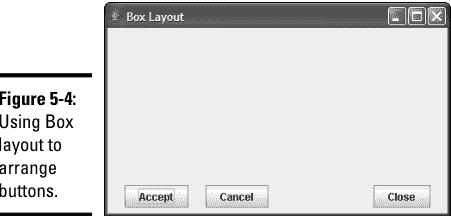

### 使用网格布局

网格布局专为需要一组数量固定、大小相等且排列成网格的组件的面板而设计。你可能不会经常使用它，但如果你需要创建类似计算器或电话的东西，这就是你需要的布局管理器。表 5-4 列出了 `GridLayout` 类的构造函数，你使用它来创建网格布局。

#### 表 5-4：GridLayout 构造函数

| 构造函数 | 描述 |
| --- | --- |
| `GridLayout()` | 创建一个将组件排列成单行的网格布局。这等同于 `GridLayout(1, 0)`。 |
| `GridLayout(int rows, int columns)` | 创建一个具有指定行数和列数的网格布局。如果其中一个参数为零，则网格会扩展以填充必要的行或列数。（不能同时将两个参数都指定为零。） |
| `GridLayout(int rows, int columns, int hgap, int vgap)` | 创建一个具有指定行数和列数，并且行和列之间具有指定间距的网格布局。 |

要创建具有网格布局的面板，你需要调用 `GridLayout` 构造函数来指定网格的大小。其中一个参数可以为零，以便网格扩展到容纳你添加到面板的所有组件所需的任意行数或列数。

例如，以下是创建类似于电话的网格布局面板的代码，该面板在图 5-1 中已展示过：

```
JPanel panel1 = new JPanel();
panel1.setLayout(new GridLayout(0,3));
panel1.add(new JButton("7"));
panel1.add(new JButton("8"));
panel1.add(new JButton("9"));
panel1.add(new JButton("4"));
panel1.add(new JButton("5"));
panel1.add(new JButton("6"));
panel1.add(new JButton("1"));
panel1.add(new JButton("2"));
panel1.add(new JButton("3"));
panel1.add(new JButton("*"));
panel1.add(new JButton("0"));
panel1.add(new JButton("#"));
```

当你向具有网格布局的面板添加组件时，组件会逐行放入网格的单元格中，从左到右填充每一行。每一行填满后，就会开始新的一行。

### 使用网格袋布局

网格袋布局管理器可能是你用于布局复杂面板最常用的布局管理器。与网格布局管理器类似，网格袋允许你将面板划分为网格。然而，该网格具有以下特殊功能：


## 594 使用 GridBag 布局

-   行和列不必都保持相同的尺寸。相反，GridBag 会根据你添加到面板中的组件自动调整每列的宽度和每行的高度。
-   你可以指定每个组件所在的单元格。你可以控制每个组件在面板上的位置。
-   你可以创建跨越多行或多列的组件。例如，你可以创建一个两列宽的按钮，或一个四行高的列表框。
-   如果组件不够大以填满分配给它的整个空间，你可以告诉 GridBag 拉伸该组件以填满整个区域。你可以指定这种拉伸在水平方向、垂直方向或两个方向上进行。
-   如果组件没有填满分配给它的区域，你可以告诉 GridBag 如何在区域内定位该组件。例如，组件可以左对齐或右对齐。

以下章节将介绍使用 GridBag 布局的细节。

### 规划草图

准备创建 GridBag 面板的第一步是绘制一个草图，说明你希望面板上的组件如何显示。然后，将面板切割成行和列，并从左上角开始从零开始为行和列编号。图 5-5 展示了这样一个草图，是我亲手绘制的。

画好面板草图后，列出组件清单，包括它们在网格上的 x 和 y 坐标、对齐方式，以及组件是否跨越多行或多列。例如

| 组件 | x | y | 对齐方式 | 跨越 |
| :--- | :--- | :--- | :--- | :--- |
| 标签 "Name" | 0 | 0 | 右对齐 | |
| 标签 "Phone" | 0 | 1 | 右对齐 | |
| 标签 "Address" | 0 | 2 | 右对齐 | |
| Name 文本框 | 1 | 0 | 左对齐 | 2 |
| Phone 文本框 | 1 | 1 | 左对齐 | |
| Address 文本框 | 1 | 2 | 左对齐 | |
| Size 复选框 | 0 | 3 | 左对齐 | |
| Style 复选框 | 1 | 3 | 左对齐 | |
| Toppings 复选框 | 2 | 3 | 左对齐 | |
| Button 按钮 | 2 | 4 | 右对齐 | |

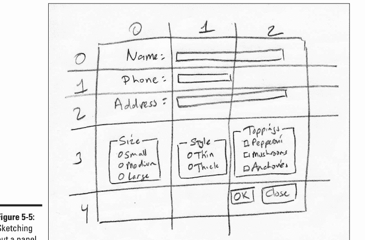

图 5-5：绘制面板草图。

布局网格后，你可以编写代码将每个组件添加到其正确位置。

### 向 GridBag 添加组件

在使用 GridBag 布局向面板添加组件之前，你必须先将 GridBag 指定为面板的布局管理器。你可以通过调用 `setLayout` 方法并传递一个新的 `GridBagLayout` 对象作为参数来实现这一点：

```
JPanel panel1 = new JPanel();
panel1.setLayout(new GridBagLayout());
```

当面板使用 GridBag 布局时，`add` 方法接受两个参数：要添加的组件和一个 `GridBagConstraints` 对象，该对象指定在网格中放置组件的位置。使用 GridBag 布局的技巧在于弄清楚如何设置 `GridBagConstraints` 值，以使每个组件都按照你希望的位置放置。表 5-5 列出了 `GridBagConstraints` 类的字段。

表 5-5 GridBagContraints 类

| 字段 | 描述 |
| --- | --- |
| int gridx | 组件的 x 位置。 |
| int gridy | 组件的 y 位置。 |
| int gridwidth | 组件跨越的列数。默认值为 1。 |
| int gridheight | 组件跨越的行数。默认值为 1。 |
| double weightx | 为网格布局提供提示的值，用于分配组件宽度的空间。 |
| double weighty | 为网格布局提供提示的值，用于分配组件高度的空间。 |
| Insets insets | 一个 Insets 对象，指示在每个组件周围使用多少空间作为填充。Insets 类有一个简单的构造函数：Insets(int top, int left, int bottom, int right)。 |
| int anchor | 一个常量，指示如果组件未填满空间，应将其放置在何处。值可以是 GridBagConstraints 类的以下字段中的任何一个：CENTER, NORTH, NORTHEAST, EAST, SOUTHEAST, SOUTH, SOUTHWEST, WEST, 和 NORTHWEST。 |
| int fill | 一个常量，指示是否应拉伸对象以填满可用空间。值可以是 GridBagConstraints 类的以下字段中的任何一个：NONE, HORIZONTAL, VERTICAL, 或 BOTH。 |

其中一些字段需要额外解释：

-   weightx 和 weighty 字段为 GridBag 布局管理器提供有关如何调整列和行大小的提示。如果你将其中一个值设置为零，则行或列将保持固定大小。一种常见的技术是将这两个参数都设置为 100，然后如果你认为布局可以从一些调整中受益，再调整它们。
-   insets 字段允许你为组件提供一些填充。你将此字段设置为一个 Insets 对象。例如，假设 GridBagConstraints 对象名为 gc，以下语句在组件的每一侧提供 5 像素的空间，并设置 insets 字段：`gc.insets = new Insets(5, 5, 5, 5);`
-   默认情况下，组件会被拉伸以填满网格单元格。这很少是你想要的，因此你通常需要设置 fill 字段来更改此行为。

```
gc.insets = new Insets(5, 5, 5, 5);
```

-   你还想设置 `anchor` 字段，以指示如果组件未填满分配给它的单元格或多个单元格，你希望将其放置在何处。

### 使用 GridBagConstraints

要创建一个 `GridBagConstraints` 对象，你需要调用 `GridBagConstraints` 构造函数，然后设置任何你希望与默认值不同的字段。例如，以下是创建一个 `GridBagConstraints` 对象以添加之前在图 5-5 中显示的名称文本字段的代码：

```
GridBagConstraints nameConstraints
    = new GridBagConstraints();
nameConstraints.gridx = 1;
nameConstraints.gridy = 0;
nameConstraints.gridwidth = 2;
nameConstraints.gridheight = 1;
nameConstraints.weightx = 100.0;
nameConstraints.weighty = 100.0;
nameConstraints.insets = new Insets(5, 5, 5, 5);
nameConstraints.anchor = GridBagConstraints.WEST;
nameConstraints.fill = GridBagConstraints.NONE;
```

然后，你可以调用 `add` 方法将名称文本字段添加到面板：

```
panel1.add(name, nameConstraints);
```

显然，这种控制约束的方法需要大量的编码。你有两种常见的替代方法来为添加到面板的每个组件创建新的约束对象。第一种是创建一个单一的约束对象并将其重用于面板中的所有组件。然后，你只需为每个组件更改需要更改的字段。例如，以下是使用单个约束对象添加所有三个文本字段的代码：

```
GridBagConstraints gc = new GridBagConstraints();
gc.gridx = 0;
gc.gridy = 0;
gc.gridwidth = 1;
gc.gridheight = 1;
gc.weightx = 100.0;
gc.weighty = 100.0;
gc.insets = new Insets(5, 5, 5, 5);
gc.anchor = GridBagConstraints.WEST;
gc.fill = GridBagConstraints.NONE;

gc.gridy = 0;
gc.gridwidth = 2;
add(name, gc);
gc.gridy = 1;
gc.gridwidth = 1;
add(phone, gc);
gc.gridy = 2;
gc.gridwidth = 2;
add(address, gc);
```

这里，第一组语句创建了一个名为 `gc` 的 `GridBagConstraints` 对象，并将其值设置为我想要应用于面板中大多数组件的默认值。然后，第二组语句在将每个文本字段添加到面板之前设置 `gridy` 和 `gridwidth` 字段。

第二种选项是创建一个辅助方法，你可以调用它，只传递每个组件的值变化。例如，以下是一个名为 `addItem` 的方法，该方法添加一个组件并在指定的单元格内左对齐：

```
private void addItem(JPanel p, JComponent c, int x, int y,
    int width, int height, int align)
{
    GridBagConstraints gc = new GridBagConstraints();
    gc.gridx = x;
    gc.gridy = y;
    gc.gridwidth = width;
    gc.gridheight = height;
    gc.weightx = 100.0;
    gc.weighty = 100.0;
    gc.insets = new Insets(5, 5, 5, 5);
    gc.anchor = align;
    gc.fill = GridBagConstraints.NONE;
    p.add(c, gc);
}
```

然后，你可以调用此方法将组件添加到面板。你必须传递面板和组件，其 x 和 y 位置，以及其宽度和高度。例如，以下是添加名称文本字段的方法：

```
addItem(panel1, name, 0, 1, 2, 1,
    GridBagConstraints.WEST);
```

### GridBag 布局示例

清单 5-1 显示了显示我在图 5-5 中绘制的框架的程序代码，图 5-6 显示了程序运行时此框架的外观。如你所见，此框架的最终外观与我在麦当劳绘制的草图非常接近。我可能可以通过一些微调来修正一些微小的差异。


# 第七卷：Web 编程

《第五波》作者：里奇·坦南特


> "嘿，真热闹——一个微型内网漂浮在 Java 小程序的漩涡之中！"

## 内容概览

- **第 1 章：创建小程序** ..................................................................................... 605
- **第 2 章：创建 Servlet** ..................................................................................... 613
- **第 3 章：使用 Java Server Pages** ........................................................................ 633
- **第 4 章：使用 JavaBeans** ..................................................................................... 647

## 第 1 章：创建小程序

### 本章内容

- 了解小程序
- 创建小程序
- 创建显示小程序的 HTML
- 使用小程序查看器测试小程序

小程序不是一种小水果。相反，它是一种 Java 应用程序，旨在 Internet 用户的计算机上的浏览器窗口中运行。当 Internet 用户访问包含小程序的网页时，Java 小程序类会被下载到用户的计算机并运行。小程序接管页面的一部分，并在该区域内执行任何操作。

小程序（至少在大多数情况下）是 Swing 应用程序。因此，第六卷涵盖的所有内容都适用于小程序。在本章中，你将创建包含 Swing 组件的小程序。然后，你将小程序添加到网页中，以便任何查看该页面的人都可以使用它。

### 理解小程序

小程序类似于 Swing 应用程序，但有几个关键区别：

- 小程序不继承 JFrame 类，而是继承 JApplet 类。JFrame 和 JApplet 都为你的 Swing 应用程序提供了一个运行“空间”：
  - 对于 JFrame，该空间是由主机操作系统窗口系统管理的窗口。
  - 对于 JApplet，该空间是由 Web 浏览器管理的网页的矩形区域。
- 独立 Swing 应用程序在 JVM 调用静态 main 方法时启动。因此，Swing 应用程序通常通过创建继承 JFrame 的类的实例来启动。相比之下，浏览器在小程序启动时自动创建继承 JApplet 的类的实例。因此，小程序没有静态 main 方法。相反，会调用一个名为 init 的方法来启动小程序。因此，init 方法是你放置通常放在继承 JFrame 的类的构造函数中的代码的地方。
- 独立 Swing 方法需要一种让用户关闭它们的方法。通常，Swing 应用程序包含一个“退出”按钮或“退出”菜单命令。小程序则没有。只要包含它的页面显示，小程序就保持活动状态。
- 小程序不在窗口中显示；它们在网页的区域中显示。因此，你无法设置小程序标题栏的文本，也无法设置 `DefaultCloseOperation`，因为没有供用户单击的“关闭”按钮。此外，用户无法调整小程序的大小。
- 出于安全原因，小程序被禁止执行某些操作。特别是，小程序不允许执行任何影响客户机计算机文件系统的操作，包括读取或写入文件，或在客户机计算机上运行程序。

除了这些差异和限制之外，小程序的工作方式与 Swing 应用程序基本相同。事实上，小程序内部的 Swing 组件看起来和表现 *完全* 就像它们在独立 Swing 应用程序中一样。因此，小程序允许你创建 Swing 应用程序并在世界任何地方的任何计算机上运行它们。对吗？

但愿如此。不幸的是，制造世界上最受欢迎的 Web 浏览器的公司（我不愿提及其名，但其首字母是 MICROSOFT）与 Sun 公司不太友好。或者也许是 Sun 与 Microsoft 不太友好。谁知道呢。无论如何，结果是一团糟，涉及用户的计算机是否能运行小程序，如果能运行，它们支持哪个版本的 Java。用户可以从 Sun 下载 Java 插件，但下载量很大，大多数用户要么不想花时间，要么不明白这个过程，要么不信任它。

因此，小程序并不是创建你期望被大众使用的基于 Web 的应用程序的最佳方式。互联网上最大的网站，如 eBay 和 Amazon，*没有* 使用小程序实现；相反，它们是使用 Servlet 和 Java Server Pages 等工具构建的，这些工具在第七卷的其他章节中有所描述。

### JApplet 类

如前所述，小程序继承 `JApplet` 类而不是 `JFrame` 类。在大多数情况下，`JApplet` 类的工作方式与 `JFrame` 类基本相同。因此，你可以向其中添加面板和其他组件、创建菜单、在其上绘图，等等。表 1-1 列出了 `JApplet` 类最常用的方法。

#### 清单 5-1：披萨订购应用程序


图 5-6：运行中的披萨订购应用程序。

```java
import javax.swing.*;
import java.awt.event.*;
import java.awt.*;

public class Pizza extends JFrame
{
    public static void main(String [] args)
    {
        new Pizza();
    }

    JTextField name, phone, address;
    JRadioButton small, medium, large, thick, thin;
    JCheckBox pepperoni, mushrooms, anchovies;
    JButton okButton, closeButton;

    public Pizza()
    {
        this.setTitle("Pizza Order");
        this.setDefaultCloseOperation(JFrame.EXIT_ON_CLOSE);

        JPanel panel1 = new JPanel();
        panel1.setLayout(new GridBagLayout());

        addItem(panel1, new JLabel("Name:"),
            0, 0, 1, 1, GridBagConstraints.EAST);
        addItem(panel1, new JLabel("Phone:"),
            0, 1, 1, 1, GridBagConstraints.EAST);
        addItem(panel1, new JLabel("Address:"),
            0, 2, 1, 1, GridBagConstraints.EAST);

        name = new JTextField(20);
        phone = new JTextField(10);
        address = new JTextField(20);

        addItem(panel1, name, 1, 0, 2, 1,
            GridBagConstraints.WEST);
        addItem(panel1, phone, 1, 1, 1, 1,
            GridBagConstraints.WEST);
        addItem(panel1, address, 1, 2, 2, 1,
            GridBagConstraints.WEST);

        Box sizeBox = Box.createVerticalBox();
        small = new JRadioButton("Small");
        medium = new JRadioButton("Medium");
        large = new JRadioButton("Large");
        ButtonGroup sizeGroup = new ButtonGroup();
        sizeGroup.add(small);
        sizeGroup.add(medium);
        sizeGroup.add(large);
        sizeBox.add(small);
        sizeBox.add(medium);
        sizeBox.add(large);
        sizeBox.setBorder(
            BorderFactory.createTitledBorder("Size"));
        addItem(panel1, sizeBox, 0, 3, 1, 1,
            GridBagConstraints.NORTH);

        Box styleBox = Box.createVerticalBox();
        thin = new JRadioButton("Thin");
        thick = new JRadioButton("Thick");
        ButtonGroup styleGroup = new ButtonGroup();
        styleGroup.add(thin);
        styleGroup.add(thick);
        styleBox.add(thin);
        styleBox.add(thick);
        styleBox.setBorder(
            BorderFactory.createTitledBorder("Style"));
        addItem(panel1, styleBox, 1, 3, 1, 1,
            GridBagConstraints.NORTH);

        Box topBox = Box.createVerticalBox();
        pepperoni = new JCheckBox("Pepperoni");
        mushrooms = new JCheckBox("Mushrooms");
        anchovies = new JCheckBox("Anchovies");
        ButtonGroup topGroup = new ButtonGroup();
        topGroup.add(pepperoni);
        topGroup.add(mushrooms);
        topGroup.add(anchovies);
        topBox.add(pepperoni);
        topBox.add(mushrooms);
        topBox.add(anchovies);
        topBox.setBorder(
            BorderFactory.createTitledBorder("Toppings"));
        addItem(panel1, topBox, 2, 3, 1, 1,
            GridBagConstraints.NORTH);

        Box buttonBox = Box.createHorizontalBox();
        okButton = new JButton("OK");
        closeButton = new JButton("Close");
        buttonBox.add(okButton);
        buttonBox.add(Box.createHorizontalStrut(20));
        buttonBox.add(closeButton);
        addItem(panel1, buttonBox, 2, 4, 1, 1,
            GridBagConstraints.NORTH);

        this.add(panel1);
        this.pack();
        this.setVisible(true);
    }

    private void addItem(JPanel p, JComponent c,
        int x, int y, int width, int height, int align)
    {
        GridBagConstraints gc = new GridBagConstraints();
        gc.gridx = x;
        gc.gridy = y;
        gc.gridwidth = width;
        gc.gridheight = height;
        gc.weightx = 100.0;
        gc.weighty = 100.0;
        gc.insets = new Insets(5, 5, 5, 5);
        gc.anchor = align;
        gc.fill = GridBagConstraints.NONE;
        p.add(c, gc);
    }
}
```

请注意，此应用程序不包含任何事件监听器，因此按钮除了演示如何使用 GridBag 布局外，不会执行任何操作。以下段落指出了重点：

- **→23** 这一行为面板创建了一个 GridBag 布局管理器。
- **→25** 这些行将标签添加到面板。
- **→36** 这些行将文本字段添加到面板。
- **→43** 这些行使用一个垂直 Box 对象创建允许用户选择尺寸的单选按钮。
- **→59** 这些行使用一个垂直 Box 对象创建允许用户选择饼皮样式的单选按钮。
- **→72** 这些行使用一个垂直 Box 对象创建允许用户选择配料的复选框。
- **→88** 这些行使用一个水平 Box 对象来容纳“确定”和“关闭”按钮。

# 600 使用 GridBag 布局

## 602 第六卷：Swing


| 表 1-1 | 常用的 JApplet 构造函数和方法 |
| :--- | :--- |
| **构造函数** | **说明** |
| JApplet() | 创建一个新的小程序。你通常不需要调用 `JApplet` 构造函数，因为当浏览器加载小程序时，它会被自动调用。 |
| **方法** | **说明** |
| void add(Component c) | 将指定的组件添加到小程序中。 |
| void destroy() | 由浏览器调用，通知小程序其内存即将被 JVM 回收。大多数小程序不需要重写此方法。 |
| void init() | 由浏览器调用，通知小程序它已被加载。此方法取代了 Swing 应用程序中 `JFrame` 构造函数的功能。 |
| void setLayout(LayoutManager layout) | 设置用于控制小程序显示时组件排列方式的布局管理器。默认是边界布局管理器。 |
| void setLocation(int x, int y) | 设置小程序在屏幕上的 x 和 y 位置。屏幕左上角为坐标原点 0,0。 |
| void setLocationRelativeTo(Component c) | 如果参数为 `null`，则在屏幕上居中显示小程序。 |
| void setSize(int width, int height) | 将小程序的大小设置为指定的宽度和高度。 |
| void setJMenuBar(JMenuBar menu) | 设置此小程序的菜单。 |
| void start() | 由浏览器调用，通知小程序开始执行。 |
| void stop() | 当小程序暂时离开视图时由浏览器调用。如果你需要在小程序隐藏时停止活动，请重写此方法。 |

### 查看一个示例小程序

要了解一个完整的小程序是如何工作的，清单 1-1 展示了一个小程序的完整代码，该程序允许用户订购三种尺寸（小、中、大）之一、三种配料（意大利辣香肠、蘑菇和凤尾鱼）之一的披萨。图 1-1 显示了该小程序在网页上运行的效果。


#### 清单 1-1：披萨订购小程序

```java
import javax.swing.*;
import java.awt.event.*;
import javax.swing.border.*;

public class PizzaApplet extends JApplet
{
    private JButton buttonOK;
    private JRadioButton small, medium, large;

    private JCheckBox pepperoni, mushrooms, anchovies;

    public void init()
    {
        this.setSize(320,200);

        ButtonListener bl = new ButtonListener();

        JPanel mainPanel = new JPanel();

        JPanel sizePanel = new JPanel();
        Border b1 =
            BorderFactory.createTitledBorder("Size");
        sizePanel.setBorder(b1);

        ButtonGroup sizeGroup = new ButtonGroup();

        small = new JRadioButton("Small");
        small.setSelected(true);
        sizePanel.add(small);
        sizeGroup.add(small);

        medium = new JRadioButton("Medium");
        sizePanel.add(medium);
        sizeGroup.add(medium);

        large = new JRadioButton("Large");
        sizePanel.add(large);
        sizeGroup.add(large);

        mainPanel.add(sizePanel);

        JPanel topPanel = new JPanel();
        Border b2 =
            BorderFactory.createTitledBorder("Toppings");
        topPanel.setBorder(b2);

        pepperoni = new JCheckBox("Pepperoni");
        topPanel.add(pepperoni);

        mushrooms = new JCheckBox("Mushrooms");
        topPanel.add(mushrooms);

        anchovies = new JCheckBox("Anchovies");
        topPanel.add(anchovies);

        mainPanel.add(topPanel);

        buttonOK = new JButton("OK");
        buttonOK.addActionListener(bl);
        mainPanel.add(buttonOK);

        this.add(mainPanel);

        this.setVisible(true);
    }

    private class ButtonListener implements ActionListener
    {
        public void actionPerformed(ActionEvent e)
        {
            if (e.getSource() == buttonOK)
            {
                String tops = "";
                if (pepperoni.isSelected())
                    tops += "Pepperoni\n";
                if (mushrooms.isSelected())
                    tops += "Mushrooms\n";
                if (anchovies.isSelected())
                    tops += "Anchovies\n";

                String msg = "You ordered a ";
                if (small.isSelected())
                    msg += "small pizza with ";
                if (medium.isSelected())
                    msg += "medium pizza with ";
                if (large.isSelected())
                    msg += "large pizza with ";

                if (tops.equals(""))
                    msg += "no toppings.";
                else
                    msg += "the following toppings:\n"
                         + tops;
                JOptionPane.showMessageDialog(buttonOK,
                    msg, "Your Order",
                    JOptionPane.INFORMATION_MESSAGE);

                pepperoni.setSelected(false);
                mushrooms.setSelected(false);
                anchovies.setSelected(false);
                small.setSelected(true);
            }
        }
    }
}
```

这是本书第六卷第三章中一个 Swing 程序的小程序版本。关于 Swing 组件如何工作的详细信息，你可以参考那一章。在这里，我只想指出几个小程序特有的细节：

-   该类继承自 `JApplet` 而非 `JFrame`。
-   `init` 方法被重写，通常放在 `JFrame` 类构造函数中的代码被放置在了 `init` 方法中。
-   调用 `setSize` 方法来设置小程序的大小。然而，这个程序的 Swing 版本中出现的几个方法被移除了。特别是，`setTitle` 和 `setDefaultCloseOperation` 方法被删除了，因为这些方法不适用于小程序。然而，从这个方法的其余部分你可以看到，大部分代码与独立的 Swing 应用程序完全相同。

### 为小程序创建 HTML 页面

要运行小程序，你必须创建一个 HTML 页面，其中包含一个 APPLET 标签，该标签指定了小程序的名称和你希望小程序在其内运行的区域大小。APPLET 标签还包括一些文本，当 Web 浏览器无法运行小程序时显示。

APPLET 标签的基本形式如下：

```
<APPLET code="classname" width=width height=height>
    无法加载小程序时显示的文本
</APPLET>
```

例如，这是我用于显示图 1-1 所示页面的 HTML 文件：

```html
<html>
    <head>
        <title>The Pizza Applet</title>
    </head>
    <body>
        <H1>Welcome to the Pizza Applet!</H1>
        <APPLET code="PizzaApplet" width="300" height="180">
            Sorry, your browser isn't able to run Java applets.
        </APPLET>
    </body>
</html>
```

### 测试小程序

Java 附带了一个名为 applet viewer 的特殊程序，它允许你在编译小程序后快速运行它。图 1-2 显示了在 applet viewer 中显示的披萨小程序。


图 1-2：在 applet viewer 中显示的披萨小程序。

如果你使用 TextPad，可以在编译小程序后通过按 Ctrl+3 来调用查看器。从命令提示符，你必须首先按照上一节描述创建 HTML 文件。然后，导航到包含该 HTML 文件的目录并输入以下命令：

```
appletviewer filename
```

例如，要使用名为 PizzaApplet.html 的 HTML 文件来显示披萨小程序，请使用以下命令：

```
Appletviewer PizzaApplet.html
```

## 第 2 章：创建 Servlet

### 本章内容

-   了解 Servlet
-   下载、安装和配置 Tomcat
-   创建简单的 Servlet
-   使用表单从用户获取数据

Servlet 是当今开发 Web 应用程序最受欢迎的方式之一。互联网上许多最著名的网站都是由 Servlet 提供支持的。在本章中，我只给你介绍基础知识：什么是 Servlet，如何设置你的计算机以便编写和测试 Servlet，以及如何创建一个简单的 Servlet。接下来的两章将在此基础上介绍更多的 Web 编程技术。

### 理解 Servlet

在你理解什么是 Servlet 以及它如何工作之前，你需要了解 Web 服务器工作原理的基础知识。Web 服务器使用一种名为 *HTTP* 的网络协议向用户发送网页。（HTTP 代表 *超文本传输协议*，但这不会出现在考试中。）使用 HTTP，客户端计算机使用 URL 来请求位于服务器计算机上的文档。HTTP 使用一种 *请求/响应* 模型，这意味着客户端计算机（Web 用户）向 HTTP 服务器发送请求消息，服务器反过来向客户端发送响应消息。

一个基本的 HTTP 交互大致如下：

1.  **在客户端计算机上运行的 Web 浏览器程序中，你指定要访问文件的 URL。**
    在某些情况下，你实际上会输入地址的 URL。但大多数时候，你会点击一个指定 URL 的链接。
2.  **你的 Web 浏览器向 URL 指示的服务器计算机发送一个 HTTP 请求消息。**
    该请求包含你想要检索的文件的名称。
3.  **服务器计算机接收到文件请求，检索请求的文件，并以 HTTP 响应消息的形式将文件发送回给你。**


### 使用 Tomcat

遗憾的是，你无法直接在任意旧计算机上运行 Servlet 程序。首先，你必须安装一个名为 Servlet 引擎的特殊程序，将你的计算机转变为能够运行 Servlet 的服务器。最著名的 Servlet 引擎是 Tomcat，你可以从 Apache 软件基金会的网站 jakarta.apache.org/tomcat 免费获取。

Tomcat 也可以作为基本的 Web 服务器使用。在实际生产环境中，Tomcat 通常与专业的 Web 服务器（如 Apache 的 HTTP 服务器）结合使用。

#### 安装与配置 Tomcat

安装 Tomcat 并非难如登天，但也并非易如反掌。以下是在 Windows XP 系统上设置 Tomcat 5.5 的步骤：

1.  **下载 Tomcat Zip 文件。**

    你可以在 Apache 网站上找到 Zip 文件。虽然 Apache 也提供用于安装 Tomcat 的可执行安装文件，但我建议你下载 Zip 文件。

2.  **通过右键单击 Zip 文件并选择“全部解压缩”来解压文件内容。然后，将 `c:\` 指定为解压位置。**

    我知道你不想让一堆文件弄乱你的根目录，但 Tomcat Zip 文件包含一个名为 jakarta-tomcat-5.5.4 的文件夹（版本号可能不同），因此只会创建这个文件夹。所有文件解压后，将此文件夹重命名为一个更容易输入的名字。我建议使用 `c:\tomcat`。

3.  **创建一个名为 `JAVA_HOME` 的环境变量，指向你的 JDK 位置。**

    要创建环境变量，请打开控制面板，双击“系统”图标，单击“高级”选项卡，然后单击“环境变量”。接着，单击“新建”，创建一个名为 `JAVA_HOME` 的变量。此变量的值需要是你的 JDK 安装文件夹的完整路径。例如：`c:\Program Files\Java\jdk1.5.0`。

    一个常见的错误是将此变量设置为 `bin` 目录或 JRE 的目录，而不是 JDK 的目录。如果 Tomcat 稍后无法启动，请仔细检查 `JAVA_HOME` 目录。

4.  **将 `servlet-api.jar` 文件复制到你的 JDK 根目录下的 `jre\lib\ext` 文件夹中。**

    例如，如果你的 JDK 安装在 `c:\Program Files\Java\jdk1.5.0`，则将此文件复制到 `c:\Program Files\Java\jdk1.5.0\jre\lib\ext`。假设你将 Tomcat 文件解压到了 `c:\tomcat`，那么你可以在 `c:\tomcat\common\lib` 中找到 `servlet-api.jar` 文件。

    如果你跳过此步骤或错误地将 `servlet-api.jar` 文件复制到错误的位置，你将无法编译你的 Servlet 程序。如果你收到编译器消息抱怨 `javax.servlet` 包不存在，请仔细检查你是否正确执行了此步骤。

5.  **编辑 `context.xml` 配置文件，并在 `<Context>` 标签中添加 `reloadable="true"`。**

    `context.xml` 文件位于 `c:\tomcat\conf`。第二行最初是：

    `<Context>`

    将其改为：
    `<Context reloadable="true">`

6.  **修改 web.xml 文件以启用 invoker servlet。**

    与 context.xml 一样，web.xml 文件也位于 `c:\tomcat\conf`。它包含两组配置 Tomcat 特性（称为 invoker servlet）的行，你需要进行修改。这些行最初被注释掉以禁用 invoker servlet；你所要做的就是移除每组行前后的注释行。

    你需要取消注释的第一组行如下所示：

    ```xml
    <!--
        <servlet>
            <servlet-name>invoker</servlet-name>
            <servlet-class>
                org.apache.catalina.servlets.InvokerServlet
            </servlet-class>
            <init-param>
                <param-name>debug</param-name>
                <param-value>0</param-value>
            </init-param>
            <load-on-startup>2</load-on-startup>
        </servlet>
    -->
    ```

    只需移除这些行的第一个 (`<!--`) 和最后一个 (`-->)` 即可。

    第二组行如下所示：

    ```xml
    <!--
        <servlet-mapping>
            <servlet-name>invoker</servlet-name>
            <url-pattern>/servlet/*</url-pattern>
        </servlet-mapping>
    -->
    ```

    同样，你必须移除第一行和最后一行，这样这些行就不会被当作注释处理。

    你可以通过搜索 `invoker` 这个词快速找到这些行。

7.  **创建 classes 目录。**

    默认情况下，Tomcat 在 `c:\tomcat\webapps\ROOT\WEB-INF\classes` 目录中查找 Servlet 的类文件。不幸的是，classes 目录缺失。因此，你必须导航到 `c:\tomcat\webapps\ROOT\WEB-INF` 并创建 classes 目录。（当然，如果你将 Tomcat 安装在其他位置，这些路径中的 `c:\tomcat` 部分会有所不同。）

#### 启动与停止 Tomcat

安装和配置 Tomcat 后，你可以通过打开命令行窗口，切换到 `c:\tomcat\bin` 目录，并输入 `startup` 来启动它。一个批处理文件将运行并启动 Tomcat。Tomcat 启动时，它会打开第二个命令行窗口，显示各种状态消息。图 2-1 显示了这两个窗口运行时的状态。


当你看到类似下面的一行，显示启动所花费的时间时，你就知道 Tomcat 已成功启动：

```
INFO: Server startup in 2817 ms
```

如果 Tomcat 窗口出现几秒钟，然后一个异常消息快速闪过，接着窗口关闭，最可能的原因是你系统上已经运行了一个 Web 服务器，而该服务器已经占用了 Tomcat 想要用于 HTTP 通信的端口。解决方法是编辑 `c:\tomcat\conf` 中的 `server.xml` 文件，并找到以下标签：

```xml
<Connector port="8080" ... />
```

将端口号从 8080 更改为其他数字，例如 18080。稍后，当你要在浏览器窗口中显示 Servlet 时，你必须指定这个数字作为 HTTP 端口号，而不是 8080。

除非你修改了其中一个配置文件，否则你不需要在启动 Tomcat 后将其关闭。如果确实修改了，你可以通过运行 `c:\tomcat\bin` 目录中的 `shutdown` 批处理文件来关闭 Tomcat。然后，你可以运行 `startup` 批处理文件再次启动 Tomcat。

#### 测试 Tomcat

要检查你是否正确安装了 Tomcat，你可以尝试运行安装 Tomcat 时自动安装的测试 Servlet。打开浏览器窗口并输入此地址：

`http://localhost:8080/servlets-examples/index.html`

（如果你通过编辑 `server.xml` 文件更改了端口号，请使用你指定的端口号而不是 8080。）图 2-2 所示的页面将会出现。如果没有出现，请回到前面的“安装与配置 Tomcat”部分，仔细检查你是否正确执行了每个步骤。

> **注意：** 如果你向下滚动此页面，你会发现指向各种示例 Servlet 的链接，你可以运行它们，同时还有指向每个 Servlet 源代码的链接。一定要尝试这些示例，以了解 Servlet 的工作原理以及你可以用它们做什么。


### 创建简单的 Servlet

好了，配置内容到此为止；现在你可以开始编写一些代码了。接下来的章节将介绍创建类似“Hello, World!”这种简单 Servlet 的基础知识。

### 导入 Servlet 包

大多数 Servlet 至少需要访问三个包——`javax.servlet`、`javax.servlet.http` 和 `java.io`。因此，你通常会以这些 `import` 语句开头：

```java
import java.io.*;
import javax.servlet.*;
import javax.servlet.http.*;
```

根据你的 Servlet 执行的其他处理，你可能需要额外的 `import` 语句。

### 扩展 HttpServlet 类

要创建一个 Servlet，你需要编写一个继承自 `HttpServlet` 类的类。表 2-1 列出了你可以在 Servlet 类中重写的六个方法。

| 方法 | 何时调用 | 方法签名 |
|---|---|---|
| doDelete | HTTP DELETE 请求 | `public void doDelete(HttpServletRequest request, HttpServletResponse response) throws IOException, ServletException` |
| doGet | HTTP GET 请求 | `public void doGet(HttpServletRequest request, HttpServletResponse response) throws IOException, ServletException` |
| doPost | HTTP POST 请求 | `public void doPost(HttpServletRequest request, HttpServletResponse response) throws IOException, ServletException` |
| doPut | HTTP PUT 请求 | `public void doPut(HttpServletRequest request, HttpServletResponse response) throws IOException, ServletException` |
| init() | Servlet 首次运行 | `public void init() throws ServletException` |
| destroy() | Servlet 被销毁 | `public void destroy()` |

大多数 Servlet 至少会重写 `doGet` 方法。当用户通过在浏览器地址栏输入地址或点击指向该 Servlet 的链接来请求 Servlet 时，Servlet 引擎会调用此方法。

`doGet` 方法接收两个参数：

- 一个 `HttpServletRequest` 对象，代表来自用户的传入请求。你主要使用 `request` 参数来检索用户在表单字段中输入的数据。你将在本章后面了解如何操作。
- 一个 `HttpServletResponse` 对象，代表发送回用户的响应。你使用 `response` 参数来组合发送回用户的输出。你将在下一节了解如何操作。

### 打印到网页

大多数 Servlet 的主要工作之一是将 HTML 输出写回用户的浏览器。为此，你首先调用 `HttpServletResponse` 类的 `getWriter` 方法。这将返回一个连接到响应对象的 `PrintWriter` 对象。因此，你可以使用熟悉的 `print` 和 `println` 方法来编写 HTML 文本。

例如，这是一个简单的 `HelloWorld` Servlet 的 `doGet` 方法：

```java
public void doGet(HttpServletRequest request,
    HttpServletResponse response)
        throws IOException, ServletException
{
    PrintWriter out = response.getWriter();
    out.println("Hello, World!");
}
```

这里，`response.getWriter()` 返回的 `PrintWriter` 对象用于向浏览器发送一个简单的文本字符串。如果你运行这个 Servlet，浏览器将显示文本 `Hello, World!`。

### 使用 HTML 响应

在大多数情况下，你不想向浏览器发送简单的文本。相反，你想发送格式化的 HTML。为此，你必须首先告诉响应对象输出是 HTML 格式。你可以通过调用 `setContentType` 方法并传递字符串 `"text/html"` 作为参数来实现。然后，你可以使用 `PrintWriter` 对象发送 HTML。例如，清单 2-1 展示了一个发送 HTML 响应的基本 HelloWorld Servlet。

#### 清单 2-1: HELLOWORLD SERVLET

```java
import java.io.*;
import javax.servlet.*;
import javax.servlet.http.*;
import java.util.*;

public class HelloWorld extends HttpServlet
{
    public void doGet(HttpServletRequest request,
            HttpServletResponse response)
            throws IOException, ServletException
    {
        response.setContentType("text/html");
        PrintWriter out = response.getWriter();
        out.println("<html>");
        out.println("<head>");
        out.println("<title>HelloWorld</title>");
        out.println("</head>");
        out.println("<body>");
        out.println("<h1>Hello, World!</h1>");
        out.println("</body>");
        out.println("</html>");
    }
}
```

这里，以下 HTML 被发送到浏览器（我添加了缩进以显示 HTML 结构）：

```html
<html>
    <head>
        <title>HelloWorld</title>
    </head>
    <body>
        <h1>Hello, World!</h1>
    </body>
</html>
```

运行时，HelloWorld Servlet 生成图 2-3 所示的页面。


显然，你需要扎实理解 HTML 才能编写 Servlet。如果 HTML 像一门外国语言，那么在进一步学习之前，你需要找一本好的 HTML 书籍，例如 Ed Tittel 和 Natanya Pitts 所著的《HTML 4 For Dummies》。供你参考，表 2-2 总结了我在本书中使用的所有 HTML 标签。

| 表 2-2 | 够用的 HTML 知识 |
| :--- | :--- |
| **HTML 标签** | **描述** |
| `<html>,</html>` | 标记 HTML 文档的开始和结束。 |
| `<head>,</head>` | 标记 HTML 文档头部的开始和结束。 |
| `<title>,</title>` | 标题元素。开始和结束标签之间的文本显示在浏览器窗口的标题栏中。 |
| `<body>,</body>` | 标记 HTML 文档正文的开始和结束。文档内容位于这些标签之间。 |
| `<h1>,</h1>` | 这些标签之间的文本格式化为一级标题。 |
| `<h2>,</h2>` | 这些标签之间的文本格式化为二级标题。 |
| `<h3>,</h3>` | 这些标签之间的文本格式化为三级标题。 |
| `<form action="url", method="method">` | 标记表单的开始。`action` 属性指定表单提交到的页面、Servlet 或 JSP 的名称。`method` 属性可以是 `GET` 或 `POST`；它表示发送到服务器的 HTTP 请求类型。 |
| `</form>` | 标记表单的结束。 |
| `<input type="type", name="name">` | 创建一个输入字段。指定 `type="text"` 创建文本框，或 `type="submit"` 创建提交按钮。`name` 属性提供你在程序中用于检索用户输入数据的名称。 |
| `&nbsp;` | 不换行空格。 |

### 运行 Servlet

那么，究竟如何运行一个 Servlet 呢？首先，你必须将编译好的类文件移动到 Tomcat 可以运行该 Servlet 的目录中。出于测试目的，你可以将 Servlet 的类文件移动到 `c:\tomcat\webapps\ROOT\WEB-INF\classes`。然后，在浏览器的地址栏中输入如下地址：

http://localhost:8080/servlet/HelloWorld

你可能还想重写 `doPost` 方法。如果用户从表单请求你的 Servlet，则会调用此方法。在许多情况下，你只需在 `doPost` 方法中调用 `doGet`，以便以相同的方式处理 GET 和 POST 请求。

众所周知，每当用户在地址栏输入你的 Servlet 地址或点击指向你的 Servlet 的链接时，`doGet` 方法就会被调用。但大多数（即使不是全部）Servlet 都与 HTML 表单相关联，这些表单提供了用户可以输入数据的字段。从浏览器向服务器发送表单数据的常规方式是使用 HTTP POST 请求，而不是 GET 请求。

如果你想让 Servlet 响应 POST 请求，你可以重写 `doPost` 方法，代替或在 `doGet` 方法之外。除了方法名不同，`doPost` 的签名与 `doGet` 相同。事实上，在 Servlet 中看到 `doPost` 方法简单地调用 `doGet` 的情况并不少见，这样 POST 和 GET 请求的处理方式就完全相同了。要实现这一点，可以按如下方式编写 `doPost` 方法：

```java
public void doPost(HttpServletRequest request,
        HttpServletResponse response)
        throws IOException, ServletException
{
    doGet(request, response);
}
```

### 改进的 HelloWorld Servlet

清单 2-1 中展示的 HelloWorld Servlet 不是很有趣，因为它总是发送相同的文本。本质上，它是一个静态 Servlet，这几乎违背了使用 Servlet 的初衷。你完全可以直接提供一个静态 HTML 页面。

清单 2-2 展示了一个更具动态性的 HelloWorld Servlet 的代码。此版本随机显示六种不同的问候语之一。它使用 `Math` 类的 `random` 方法选择一个 1 到 6 之间的随机数，然后


# 624 一个改进的 HelloWorld Servlet

该数字用于决定显示哪种问候语。它还同时重写了 `doPost` 方法和 `doGet` 方法，因此 GET 和 POST 请求会被以相同方式处理。

```java
import java.io.*;
import javax.servlet.*;
import javax.servlet.http.*;
import java.util.*;

public class HelloServlet extends HttpServlet
{
    public void doGet(HttpServletRequest request,
                      HttpServletResponse response)
        throws IOException, ServletException
    {
        response.setContentType("text/html");
        PrintWriter out = response.getWriter();
        String msg = getGreeting();
        out.println("<html>");
        out.println("<head>");
        out.println("<title>HelloWorld Servlet</title>");
        out.println("</head>");
        out.println("<body>");
        out.println("<h1>");
        out.println(msg);
        out.println("</h1>");
        out.println("</body>");
        out.println("</html>");
    }
    public void doPost(HttpServletRequest request,
                       HttpServletResponse response)
        throws IOException, ServletException
    {
        doGet(request, response);
    }

    private String getGreeting()
    {
        String msg = "";
        int rand = (int)(Math.random() * (6)) + 1;
        switch (rand)
        {
            case 1:
                return "Hello, World!";
            case 2:
                return "Greetings!";
            case 3:
                return "Felicitations!";
            case 4:
                return "Yo, Dude!";
            case 5:
                return "Whasssuuuup?";
            case 6:
                return "Hark!";
        }
        return null;
    }
}
```

### 从用户获取输入

如果一个 Servlet 是由来自表单的 HTTP GET 或 POST 请求调用的，你可以调用请求对象的 `getParameter` 方法来获取用户在每个表单字段中输入的值。例如

```java
String name = request.getParameter("name");
```

这里，名为 `name` 的表单输入框中输入的值被检索并赋值给了 String 变量 `name`。

### 处理表单

正如你所见，在 Servlet 中检索用户输入的数据很简单。难的部分在于创建一个用户可以输入数据的表单。完成这件事有两种基本方法。一种是使用单独的 HTML 文件来创建表单。例如，清单 2-3 展示了一个名为 `InputServlet.html` 的 HTML 文件，它显示了图 2-4 中所示的表单。

**清单 2-3：InputServlet.html 文件**

```html
<html>
  <head>
    <title>Input Servlet</title>
  </head>
  <body>
    <form action="/servlet/InputServlet" method="post">
      Enter your name:&nbsp;
      <input type="text" name="Name">
      <br><br>
      <input type="submit" value="Submit">
    </form>
  </body>
</html>
```

这个表单 `<form>` 标签中的 `action` 属性指定了当表单提交时将调用 `/servlet/InputServlet`，而 `method` 属性表明表单是通过 POST 而非 GET 请求提交的。

该表单本身由一个名为 `name` 的输入文本框和一个提交按钮组成。没什么特别的；只是足以从用户那里获取一些文本并将其发送到 Servlet。

### InputServlet Servlet

清单 2-4 展示了一个可以检索清单 2-3 所示表单中数据的 Servlet。

```java
import java.io.*;
import javax.servlet.*;
import javax.servlet.http.*;

public class InputServlet extends HttpServlet
{
    public void doGet(HttpServletRequest request,
                      HttpServletResponse response)
                      throws IOException, ServletException
    {
        String name = request.getParameter("Name");

        response.setContentType("text/html");
        PrintWriter out = response.getWriter();
        out.println("<html>");
        out.println("<head>");
        out.println("<title>Input Servlet</title>");
        out.println("</head>");
        out.println("<body>");
        out.println("<h1>");
        out.println("Hello " + name);
        out.println("</h1>");
        out.println("</body>");
        out.println("</html>");
    }

    public void doPost(HttpServletRequest request,
                       HttpServletResponse response)
                       throws IOException, ServletException
    {
        doGet(request, response);
    }
}
```

如你所见，这个 Servlet 和清单 2-1 中的第一个 HelloWorld Servlet 并没有太大不同。最大的区别在于它检索了用户在 `name` 字段中输入的值，并在发送给响应 `PrintWriter` 对象的 HTML 中使用了它。例如，如果用户在 `name` 输入框中输入了 Calvin Coolidge，则会生成以下 HTML：

```html
<html>
  <head>
    <title>HelloWorld</title>
  </head>
  <body>
    <h1>Hello Calvin Coolidge</h1>
  </body>
</html>
```

因此，消息 `Hello Calvin Coolidge` 会显示在页面上。

尽管真实的 Servlet 所做的事情远不止简单地重复用户输入的信息，但大多数 Servlet 都遵循这种简单得出奇的结构，当然也有一些变体。例如，真实的 Servlet 会验证输入数据，并在用户输入不正确的数据或遗漏重要数据时显示错误消息。而且大多数真实的 Servlet 会从文件或数据库中检索或更新数据。即便如此，基本结构基本上是相同的。

### 在 Servlet 中使用类

当你开发 Servlet 时，你经常希望访问你创建的其他类，例如从文件或数据库中检索数据的 IO 类、提供数据验证等通用功能的工具类或辅助类，甚至可能是代表业务对象（如客户或产品）的类。要做到这一点，你只需将类文件保存在 Servlet 主目录的 `classes` 目录中，对于本章，这个目录是 `c:\tomcat\webapps\ROOT\WEB-INF\classes`。

为了说明一个使用多个类的 Servlet，图 2-5 展示了一个列出从文本文件中读取的电影的 Servlet 的输出。这个 Servlet 使用了三个类：

- **Movie**：一个表示单个电影的类。
- **MovieIO**：一个具有名为 `getMovies` 的静态公共方法的类。该方法返回一个包含从文件中读取的所有电影的 `ArrayList` 对象。
- **ListFiles**：主要的 Servlet 类。它调用 `MovieIO.getMovies` 类来获取一个电影的 `ArrayList`，然后在页面上显示这些电影。

`Movie` 类的代码如清单 2-5 所示。如你所见，这个类并没有太多内容：它定义了三个公共字段（`title`、`year` 和 `price`）和一个构造函数，该构造函数允许你创建一个新的 `Movie` 对象并初始化这三个字段。请注意，`price` 字段并未被这个 Servlet 使用。

**清单 2-5：Movie 类**

```java
public class Movie
{
    public String title;
    public int year;
    public double price;

    public Movie(String title, int year, double price)
    {
        this.title = title;
        this.year = year;
        this.price = price;
    }
}
```

清单 2-6 展示了 MovieIO 类。这个类使用了第 VIII 部分第 2 章中介绍的文件 I/O 功能从文本文件中读取数据。该文本文件使用制表符分隔字段，并包含以下几行：

```
It's a Wonderful Life	1946	14.95
The Great Race	1965	12.95
Young Frankenstein	1974	16.95
The Return of the Pink Panther	1975	11.95
Star Wars	1977	17.95
The Princess Bride	1987	16.95
Glory	1989	14.95
Apollo 13	1995	19.95
The Game	1997	14.95
The Lord of the Rings: The Fellowship of the Ring	2001	19.95
```

这里，箭头代表文件中的制表符。我不打算在这里详细介绍这个类，只是指出 `getMovies` 是该类中唯一的公共方法，并且它是静态的，因此你不必创建 MovieIO 类的实例来使用它。关于此类工作原理的详细信息，请参阅第 VIII 部分第 2 章。

**清单 2-6：MovieIO 类**

```java
import java.io.*;
import java.util.*;

public class MovieIO
{
    public static ArrayList<Movie> getMovies()
    {
        ArrayList<Movie> movies = new ArrayList<Movie>();
        BufferedReader in =
            getReader("c:\\data\\movies.txt");
        Movie movie = readMovie(in);
        while (movie != null)
        {
            movies.add(movie);
            movie = readMovie(in);
```


630 在Servlet中使用类

清单 2-6（续）

```
    }
    return movies;
}

private static BufferedReader getReader(String name)
{
    BufferedReader in = null;
    try
    {
        File file = new File(name);
        in = new BufferedReader(
            new FileReader(file) );
    }
    catch (FileNotFoundException e)
    {
        System.out.println("The file doesn't exist.");
        System.exit(0);
    }
    catch (IOException e)
    {
        System.out.println("I/O Error");
        System.exit(0);
    }
    return in;
}

private static Movie readMovie(BufferedReader in)
{
    String title;
    int year;
    double price;
    String line = "";
    String[] data;

    try
    {
        line = in.readLine();
    }
    catch (IOException e)
    {
        System.out.println("I/O Error");
        System.exit(0);
    }

    if (line == null)
        return null;
    else
    {
        data = line.split("\t");
        title = data[0];
        year = Integer.parseInt(data[1]);
        price = Double.parseDouble(data[2]);
        return new Movie(title, year, price);
    }
}
```

清单 2-7展示了 `ListMovie` servlet 类的代码。

清单 2-7：ListMovie Servlet 类

```
import java.io.*;
import javax.servlet.*;
import javax.servlet.http.*;
import java.util.*;

public class ListMovies extends HttpServlet
{
    public void doGet(HttpServletRequest request,
                      HttpServletResponse response)
            throws IOException, ServletException
    {
        response.setContentType("text/html");
        PrintWriter out = response.getWriter();
        String msg = getMovieList();
        out.println("<html>");
        out.println("<head>");
        out.println("<title>List Movies Servlet</title>");
        out.println("</head>");
        out.println("<body>");
        out.println("<h1>Some of My Favorites</h1>");
        out.println("<h3>");
        out.println(msg);
        out.println("</h3>");
        out.println("</body>");
        out.println("</html>");
    }

    public void doPost(HttpServletRequest request,
                       HttpServletResponse response)
            throws IOException, ServletException
    {
        doGet(request, response);
    }

    private String getMovieList()
    {
        String msg = "";
        ArrayList<Movie> movies = MovieIO.getMovies();
        for (Movie m : movies)
        {
            msg += m.year + ": ";
            msg += m.title + "<br>";
        }
        return msg;
    }
}
```

以下段落描述了其每个方法的功能：

1.  `doGet` 方法调用 `getMovieList` 方法，获取一个包含所有电影列表的字符串，列表项之间用换行标签分隔。然后，它使用一系列 `out.println` 语句来编写显示此列表的 HTML 代码。
2.  `doPost` 方法只是简单地调用 `doGet` 方法。这样，无论 servlet 是由 GET 还是 POST 请求调用，它都能正常工作。
3.  `getMovieList` 方法调用 `MovieIO.getMovies` 方法，获取一个包含从文件中读取的所有电影的 `ArrayList`。然后，它使用增强的 `for` 循环来检索每个 `Movie` 对象。每部电影的年份和标题都被添加到 `msg` 字符串中，并用 `<br>` 标签分隔。

## 第3章：使用Java Server Pages

### 本章内容

- 理解Servlet的工作原理
- 使用页面指令
- 尝试表达式
- 让脚本小程序发挥作用
- 设计声明
- 理解类

在上一章中，你学会了如何创建直接使用通过 `response.out` 访问的 `PrintWriter` 对象将 HTML 数据写入页面的 servlet。虽然这种技术有效，但它有一个主要缺点：你必须手动将 HTML 组合成一堆字符串字面量。如果 HTML 有错误，你只能在运行 servlet 查看效果时才能发现。而在 `out.println` 语句中手工制作 HTML 绝对不是创建美观网页的最有效方式。

这就是*Java Server Pages*，通常简称*JSP*的用武之地。JSP 是一个 HTML 文件，其中通过特殊标签嵌入了 Java servlet 代码。当你运行 JSP 时，所有的 HTML 会自动作为响应的一部分发送，同时发送的还有你在 JSP 文件中嵌入的 Java 代码所生成的任何 HTML。因此，JSP 使你免于编写所有那些 `out.println` 语句的繁琐工作。

在本章中，你将学习如何创建基本的 Java Server Pages。然后，在下一章中，我将向你展示如何将称为*JavaBeans*的特殊 Java 类集成到你的 JSP 页面中。

### 理解 Java Server Pages

Java Server Page 是一个 HTML 文档，它被保存在扩展名为 `.jsp` 而不是 `.htm` 或 `.html` 的文件中。与 servlet 类文件不同，你可以将 JSP 文件存储在 Web 服务器可以访问的任何目录中。

当用户第一次请求 JSP 文件时，该 JSP 文件会经过一个翻译器程序，该程序将文件转换为 Java servlet 程序并对其进行编译。原始 JSP 文件中的所有 HTML 都被转换为将 HTML 发送到响应的 `out.print` 语句，而 JSP 文件中的 Java 语句则被合并到 servlet 程序中。然后，servlet 程序被执行，结果被发送回浏览器。

请注意，此翻译仅在有人首次请求 JSP 时发生一次。之后，每当用户请求该 JSP 时，都会直接运行该 servlet 本身。

概念就讲这么多，现在来看代码。当你创建一个 JSP 时，你会将特殊的 JSP 元素与你的普通 HTML 混合在一起。你可以包含四种类型的 JSP 元素：

- **指令（Directives）**：*指令*是一个影响如何从 JSP 页面构建 servlet 的选项设置。指令允许你执行诸如指定 servlet 所需的 `import` 语句、指定 servlet 是否是线程安全的以及在 servlet 中包含其他源文件等操作。
- **表达式（Expressions）**：*表达式*可以是任何 Java 表达式。该表达式被求值，转换为字符串（如果需要），并将结果插入文档中。表达式采用以下形式：`<%= expression %>`
- **脚本小程序（Scriptlets）**：*脚本小程序*是一系列直接插入为 JSP 生成的 servlet 代码中的 Java 语句。你可以在脚本小程序中执行几乎任何操作，包括 *if* 语句、循环和调用其他方法。你甚至可以使用 `out.println` 向页面添加输出；输出会插入到脚本小程序出现的页面位置。脚本小程序具有以下形式：`<% statements %>`
- **声明（Declarations）**：*声明*是放置在 servlet 类中任何方法之外的 Java 代码。你使用声明来创建类变量或定义可由脚本小程序或表达式调用的方法。声明采用以下形式：`<%! statements %>`

本章的剩余部分将向你展示如何创建包含每种这些元素的 JSP 页面。

不幸的是，当前版本的 Tomcat（5.5.4）不支持 Java 1.5 的新特性，除非你进行一大堆额外的配置。由于配置可能很麻烦，我在本章中避免使用 Java 1.5 的特性。希望下一个版本的 Tomcat 能更好地与 Java 1.5 配合。

### 使用页面指令

*页面指令*是一个 JSP 元素，它设置决定 JSP 如何转换为 servlet 的选项。页面指令的基本格式如下：

```
<%@ page attribute=value %>
```

*属性*可以是表 3-1 中列出的任何属性。（除了这些之外还有其他几个属性，但它们很少使用。）

#### 表 3-1 常用页面指令属性

| 名称 | 描述 |
| :--- | :--- |
| `import="package.class"` | 向 servlet 添加一个 `import` 语句，以便你可以在其他 JSP 元素中使用类，而无需完全限定它们。 |
| `content-Type="MIME-type"` | 允许你指定 servlet 创建的文档类型。默认是 `text/html`。你很少需要更改此项。 |
| `isThreadSafe="boolean"` | 如果为 `true`，则假定 servlet 是线程安全的。如果为 `false`，则向 servlet 类声明添加 `implements SingleThreadModel`，以便线程在单线程模型中运行。默认是 `true`。 |
| `session="boolean"` | 如果为 `true`，则 servlet 使用会话管理。默认是 `true`。 |
| `buffer="size"` | 指定 `out` 变量使用的缓冲区大小。默认值取决于服务器，但不会小于 8K。 |
| `errorPage="URL"` | 指定错误页面的名称，如果此 servlet 抛出未捕获的异常，则会显示该错误页面。 |
| `isErrorPage="boolean"` | 如果为 `true`，则此页面是其他某个 JSP 页面的错误页面。默认是 `false`。 |

你最常使用的页面指令是 `import`，因为它允许你导入 API 类的包，以便你可以在表达式、脚本小程序和声明元素中使用它们。例如，这是一个导入 `java.util` 包的页面指令：

```
<%@ page import="java.util.*" %>
```

你可以将页面指令放在 JSP 文档中的任何位置，但我建议你将它们放在顶部或靠近顶部。


### 使用表达式

JSP表达式是指任何可以计算出字符串的Java表达式。实际上，表达式并不一定需要直接进行计算。例如，下面展示了如何使用`java.util.Date`类来显示当前的日期和时间：

```
<%=new java.util.Date()%>
```

这个表达式会创建`java.util.Date()`类的一个新实例，该实例代表当前的日期和时间。系统会隐式调用`toString()`方法，将该对象转换为字符串。

如果包含了页面导入指令（page import directive），你可以省略此表达式中的限定符。例如：

```
<%@ page import="java.util" %>
<%=new Date()%>
```

要使用表达式完成更多有趣的操作，可以使用预定义变量，也称为隐式对象。这些是Java变量，可在整个JSP页面中的表达式、脚本片段（scriptlet）或声明（declaration）中使用。表3-2列出了最常用的JSP隐式对象。

#### 表3-2 隐式对象

| 名称 | 描述 |
| :--- | :--- |
| out | 用于向响应（response）写入数据，等同于Servlet中的`response.getWriter()`。 |
| request | 请求对象，等同于Servlet的`doGet`或`doPost`方法中的`request`参数。 |
| response | 响应对象，等同于Servlet的`doGet`或`doPost`方法中的`response`参数。 |
| session | 用于管理会话。等同于Servlet中的`request.getSession()`。 |

隐式对象的工作方式与其在Servlet中对应的对象相同。例如，`response`对象实际上就是传递给`doGet`或`doPost`方法的`response`参数。

在表达式中，最常用的隐式对象是`request`对象。特别是，你可以使用它的`getParameter`方法来获取用户在表单中输入的值。例如，以下表达式显示在名为`Name`的输入字段中输入的值：

```
<%= request.getParameter("Name")%>
```

`Name`字段的值会被插入到该表达式在JSP文件中出现的位置。例如，下面是一个名为`InputJSP.jsp`的简单JSP，它显示一个输入文本框和一个按钮。当用户点击按钮时，他在输入字段中输入的任何文本都会显示在按钮下方：

```
<html>
  <head>
    <title>Input JSP</title>
  </head>
  <body>
    <form action="InputJSP.jsp" method="post">
      Enter some text:&nbsp;
      <input type="text" name="Text">
      <br><br>
      <input type="submit" value="Submit">
    </form><br>
    <h3>You entered:&nbsp;
    <%= request.getParameter("Text")%></h3>

  </body>
</html>
```

这个JSP的HTML代码定义了一个表单，其中包含一个名为`Text`的输入文本字段和一个提交（Submit）按钮。当用户点击提交按钮时，一个HTTP POST请求会发送到服务器，请求`InputJSP.jsp`。用户输入的任何文本都会随请求一起发送。当Servlet运行时，表达式`request.getParameter("Text")`会检索出该文本，并显示在按钮下方。图3-1展示了该Servlet运行时的情景。


**图3-1：** InputJSP 运行时。

*注意：* 表达式也可以调用你通过声明元素（declaration element）添加到JSP中的方法。本章后面的“使用声明”一节将展示如何操作的示例。

### 使用脚本片段

*脚本片段（scriptlet）* 是指直接插入到Servlet中的语句或语句组，其插入位置是在生成周围HTML的`out.print`语句生成的地方。简而言之，脚本片段允许你将自己的代码添加到渲染页面的代码中。

脚本片段遵循以下基本形式：

```
<% statements... %>
```

例如，下面是一个名为`DateJSP.jsp`的JSP，它使用`DateFormat`类来格式化日期并在页面上显示：

```
<html>
  <%@ page import="java.text.*" %>
  <%@ page import="java.util.*" %>
  <head>
    <title>Date JSP</title>
  </head>
  <body>
    <h1>
      Today is
      <%
        DateFormat df = DateFormat.getDateInstance(
          DateFormat.FULL);
        Date today = new Date();
        String msg = df.format(today);
        out.println(msg);
      %>
    </h1>
    <h1>Have a nice day!</h1>
  </body>
</html>
```

这个JSP以一对`page import`指令开始，用于导入`java.text`和`java.util`包。然后，以下Java语句被插入在生成文本`Today is`和`Have a nice day!`的行之间：

```
DateFormat df
    = DateFormat.getDateInstance(DateFormat.FULL);
Date today = new Date();
String msg = df.format(today);
out.println(msg);
```

这些行创建了一个名为`msg`的字符串变量，然后使用`out.println`将该字符串写入响应输出。结果，格式化后的日期被插入在`<h1>Today is</h1>`和`<h1>Have a nice day!</h1>`之间。图3-2展示了由该JSP生成的页面。


**注意：** 脚本片段不必向HTML输出添加任何内容。在许多情况下，它们执行诸如将信息写入文件等功能。例如，假设你有一个JSP，它从包含名为`FirstName`和`LastName`的输入文本字段的表单中获取数据。同时假设你有一个名为`CustFile`的类，其中有一个名为`writeCustomer`的静态方法，该方法接受名字和姓氏作为参数，并将它们写入文件。下面是一个脚本片段，它获取名字和姓氏，并调用`writeCustomer`方法将姓名写入客户文件：

```
<% String firstName =
    request.getParameter("FirstName");
    String lastName = request.getParameter("LastName");
    CustFile.writeCustomer(firstName, lastName);
%>
```

如果你愿意，你可以用脚本片段玩出很多花样。没有规则规定你必须在单个脚本片段中完成`if`或`while`等块语句。如果你在一个脚本片段的末尾留下一个未关闭的块，那么其后的任何HTML都将由包含在该块中的`out.print`语句生成。唯一的限制是，你最终必须用另一个脚本片段来结束这个块。

例如，下面是一个名为`LoopyJSP.jsp`的脚本片段，它通过将一行文本包含在`for`循环的块中，在页面上重复显示该行12次：

```
<html>
  <head>
    <title>Can't you see I'm trying to work here?</title>
  </head>
  <body>
    <% for (int i = 0; i < 12; i++)
       {%>
    All work and no play makes Jack a dull boy.<br>
    <% } %>
  </body>
</html>
```

如果你运行这个脚本片段，页面将如图3-3所示。


显然，这种编程结构容易出错。我建议你尽可能避免使用它。

### 使用声明

*声明（declaration）* 是指被包含在Servlet中，但在任何方法之外的代码。声明用于创建可在表达式、脚本片段或其他声明中使用的类变量或方法。声明遵循以下格式：

```
<%! statements... %>
```

你可以在JSP中的任意位置放置声明。

下面是一个Servlet，它声明了一个名为`count`的静态类字段，该字段在每次显示页面时递增：

```
<html>
  <%@ page import="java.text.*" %>
  <%@ page import="java.util.*" %>
  <head>
    <title>Counter JSP</title>
  </head>
  <body>
    <h1>
        This JSP has been displayed <%= count++ %>
        time.</h1>
  </body>
</html>
```

```
<%!
private static int count = 1;
%>
```

在这个Servlet中，`count`变量由JSP文档末尾的声明元素声明：

```
<%!
private static int count = 1;
%>
```

然后，文档主体中的表达式显示并递增`count`变量：

```
<%= count++ %>
```

运行时，JSP将显示自服务器启动以来该页面被显示的次数。

下面是另一个示例，这次声明了一个在表达式中调用的方法：

```
<html>
    <%@ page import="java.text.*" %>
    <%@ page import="java.util.*" %>
    <head>
        <title>Date JSP</title>
    </head>
    <body>
        <h1>
            Today is <%= getDate() %></h1>
        <h1>Have a nice day!</h1>
    </body>
</html>
```

```
<%!
private String getDate()
{
    DateFormat df =
        DateFormat.getDateInstance(DateFormat.FULL);
    Date today = new Date();
    return df.format(today);
}
%>
```


## 642 使用类

本文档末尾的声明定义了一个返回当前日期字符串的方法。然后，表达式 `<%= getDate() %>` 用于将日期插入文档中。

### 使用类

大多数 JSP 应用程序足够复杂，需要额外的类来保持代码的可管理性。例如，你希望创建处理应用程序文件或数据库 I/O 的类，或者可能希望创建代表业务对象（如 `Products` 或 `Customers`）的类。

配置 Tomcat 以使用类可能有点棘手，但如果你遵循以下简单准则，就会变得容易：

- 将所有类放在包中。为你的应用程序选择一个合适的包名，然后在每个类文件的开头添加 `package` 语句。
- 将类文件（不一定是源文件）存储在 JSP 页面所在目录下的 `WEB-INF\classes\package\` 目录中。例如，如果你将 JSP 页面存储在 `c:\tomcat\webapps\ROOT\Movies`，并且你使用的包名是 `movie`，则将类文件保存在以下目录：
  `C:\tomcat\webapps\ROOT\Movies\WEB-INF\classes\movie`
- 如果你愿意，可以将类文件保存在 `c:\tomcat\shared\classes\package`，其中 `package` 是你的包名。然后，这些类对任何 JSP 或 servlet 都可用。
- 任何使用你的某个类的 JSP 都必须包含一个导入该包的页面指令。例如
  `<%@ page import="movie.*" %>`
- 将你保存包的目录添加到你的 ClassPath 环境变量中。注意，你需要添加包含包的目录，而不是包含类本身的目录。这是因为 Java 编译器使用包名来查找包目录。所以，如果你将类放在 `shared\classes` 目录中，你需要将 `c:\tomcat\shared\classes` 添加到你的 ClassPath。

为了说明 JSP 如何使用类，图 3-4 显示了一个列出 `movies.txt` 文件中电影的 JSP。

显示此页面的 JSP 文件如清单 3-1 所示。JSP 文件本身存储在 `c:\tomcat\webapps\ROOT`。

#### 清单 3-1: LISTMOVIES.JSP

```html
<!doctype html public "-//W3C//DTD HTML 4.0 Transitional//EN">
<%@ page import="movie.*" %>
<%@ page import="java.util.*" %>
<html>
  <head>
    <title>List Movies: The Servlet</title>
  </head>
  <body>
    <h1>Some of My Favorites</h1>
    <h3>
      <%= getMovieList() %>
    </h3>
  </body>
</html>

<%!
private String getMovieList()
{
    String msg = "";
    ArrayList movies = MovieIO.getMovies();
    for (int i = 0; i < movies.size(); i++)
    {
        Movie m = (Movie)movies.get(i);
        msg += m.year + ": ";
        msg += m.title + "<br>";
    }
    return msg;
}
%>
```

以下是此 JSP 中关键行的说明：

- → 3 JSP 包含两个页面指令，分别导入 `movie` 和 `java.util` 包。
- → 12 使用了一个表达式来调用 `getMovieList` 方法，该方法返回要显示为字符串的电影列表。
- → 18 `getMovieList` 方法在声明中定义。
- → 21 调用 `MovieIO` 类的 `getMovies` 方法来检索一个包含 `movies.txt` 文件中所有电影的 `ArrayList`。注意我没有为 `ArrayList` 类指定类型。这是因为 Tomcat 在没有额外配置工作的情况下无法处理泛型类型所需的语法。
- → 22 使用了传统的 for 循环而不是增强 for 循环从 ArrayList 中获取电影。同样，这是为了避免使用 Java 1.5 特性。
- → 24 从 ArrayList 中检索 Movie 对象，并将年份和标题添加到 msg 字符串中。注意，从 ArrayList 中检索的对象必须转换为 Movie 对象。
- → 28 返回完成的 msg 字符串。

图 3-4: 运行中的 ListMovies JSP。

清单 3-2 显示了 Movie 类。这里没有什么特别需要注意的，除了将 Movie 类放入 movie 包中的 package 语句。从此 .java 文件编译的类文件保存在 `c:\tomcat\shared\classes\movie`。

```java
package movie;

public class Movie
{
    public String title;
    public int year;
    public double price;

    public Movie(String title, int year, double price)
    {
        this.title = title;
        this.year = year;
        this.price = price;
    }
}
```

最后，清单 3-3 显示了 MovieIO 类。这个类从文本文件中读取电影。关于此类如何工作的详细解释，请跳转到第 VIII 卷，第 2 章。注意，这个类与 Movie 类一样，包含一个将 MovieIO 类放入 movie 包的 package 语句。从此 java 文件编译的类文件保存在 `c:\tomcat\shared\classes\movie`。

#### 清单 3-3: MOVIEIO.JAVA

```java
package movie;

import java.io.*;
import java.util.*;

public class MovieIO
{
    public static ArrayList<Movie> getMovies()
    {
        ArrayList<Movie> movies = new ArrayList<Movie>();
        BufferedReader in =
            getReader("g:\\data\\movies.txt");
        Movie movie = readMovie(in);
        while (movie != null)
        {
            movies.add(movie);
            movie = readMovie(in);
        }
        return movies;
    }

    private static BufferedReader getReader(String name)
    {
        BufferedReader in = null;
        try
        {
            File file = new File(name);
            in = new BufferedReader(
                new FileReader(file) );
        }
        catch (FileNotFoundException e)
        {
            System.out.println("The file doesn't exist.");
            System.exit(0);
        }
        catch (IOException e)
        {
            System.out.println("I/O Error");
            System.exit(0);
        }
        return in;
    }

    private static Movie readMovie(BufferedReader in)
    {
        String title;
        int year;
        double price;
        String line = "";
        String[] data;

        try
        {
            line = in.readLine();
        }
        catch (IOException e)
        {
            System.out.println("I/O Error");
            System.exit(0);
        }

        if (line == null)
            return null;
        else
        {
            data = line.split("\t");
            title = data[0];
            year = Integer.parseInt(data[1]);
            price = Double.parseDouble(data[2]);
            return new Movie(title, year, price);
        }
    }
}
```

## 第 4 章：使用 JavaBeans

### 本章内容

- 什么是 JavaBean？
- 创建你自己的 JavaBean 类
- 在 JSP 页面中使用 JavaBeans
- 使用会话作用域创建一个简单的购物车

JavaBean 是一种特殊类型的 Java 类，你可以用几种有趣的方式来简化程序开发。一些 bean，如 Swing 组件，被设计为可视组件，你可以在 GUI 编辑器中使用它们来快速构建用户界面。其他 bean，称为 Enterprise JavaBeans，被设计为在特殊的 EJB 服务器上运行，可以运行大型 Web 应用程序的数据访问和业务逻辑。

在本章中，我将介绍一种更简单的 JavaBean 类型，它旨在简化构建 Java Server Pages 的任务。简而言之，你可以使用简单的 JavaBeans 来构建 Java Server Pages，而无需在 JSP 本身中编写任何 Java 代码。JavaBeans 允许你通过在 JSP 页面中使用类似 HTML 的特殊标签来访问 Java 类。

### 什么是 JavaBean？

简单来说，JavaBean 是任何符合以下规则的 Java 类：

- **它必须有一个空构造函数。** 即，一个不接受任何参数的构造函数。如果该类没有任何构造函数，它就符合条件，因为默认构造函数没有参数。但是，如果该类至少有一个接受一个或多个参数的构造函数，那么它也必须有一个没有参数的构造函数才能算作 JavaBean。
- **它必须没有公共实例变量。** 类定义的所有实例变量必须是 `private` 或 `protected`。
- **它必须提供名为 `getProperty` 和 `setProperty` 的方法来获取和设置类提供的任何属性的值，除了使用 `isProperty` 获取属性值的布尔属性。** 术语“属性”实际上并不是一个正式的 Java 术语。简而言之（或者应该说，在一个豆荚里？），属性是对象的任何值，可以通过 `get` 方法（或者如果属性是

boolean) 或通过 set 方法设置。例如，如果一个类有一个名为 `lastName` 的属性，它应该使用名为 `getLastName` 的方法来获取姓氏，使用 `setLastName` 来设置姓氏。或者，如果一个类有一个名为 `taxable` 的布尔属性，设置它的方法名为 `setTaxable`，而获取它的方法名为 `isTaxable`。

请注意，一个类不一定必须有任何属性才能成为 JavaBean，但如果它有属性，则必须按照这种命名模式来访问。此外，并非所有属性都必须同时有 get 和 set 访问器。只读属性可以只有 get 访问器，而只写属性可以只有 set 访问器。

在访问属性的方法中，属性名首字母大写，但属性名本身并不大写。因此，`setAddress` 设置的是名为 `address` 的属性，而不是 `Address`。

就是这么简单。更高级的 Bean 还可以具有其他特性，允许它们拥有可视化界面，以便可以在 IDE 中以拖放方式使用。有些 Bean 实现了一个接口，允许将其状态写入输出流，以便稍后重新创建。但这些功能是可选的；任何满足此处所述三个标准的类都是 Bean，并且可以在 JSP 页面中用作 Bean。

你已经看到许多类具有名为 `getCount` 和 `setStatus` 的方法。这些名称是称为访问器模式的设计模式的一部分，该模式在第三卷第二章中介绍。因此，你在本书中已经看到了许多 Bean 的示例，并且可能已经自己编写了许多 Bean 类。

任何符合此模式的类都是 Bean。没有必须扩展的 JavaBean 类，也没有必须实现的 Bean 接口才能成为 Bean。一个类要成为 Bean 所需做的就是坚持使用该模式。

### 查看一个示例 Bean

清单 4-1 展示了一个名为 `Triangle` 的示例 JavaBean 类，它计算勾股定理，即在已知两条短边长度的情况下计算直角三角形的长边。这个类定义了三个属性：`sideA` 和 `sideB` 代表三角形的两条短边，`sideC` 代表长边。使用这个 Bean 的正常方式是首先使用 `setSideA` 和 `setSideB` 方法将 `sideA` 和 `sideB` 属性设置为短边的长度，然后使用 `getSideC` 方法获取长边的长度。

以防你记不清高中的知识，长边等于第一条短边的平方加上第二条短边的平方的平方根。

```
package calculators;

public class Triangle
{
    private double sideA;
    private double sideB;

    public Triangle()
    {
        this.sideA = 0.0;
        this.sideB = 0.0;
    }

    public String getSideA()
    {
        return Double.toString(this.sideA);
    }

    public void setSideA(String value)
    {
        try
        {
            this.sideA = Double.parseDouble(value);
        }
        catch (Exception e)
        {
            this.sideA = 0.0;
        }
    }

    public String getSideB()
    {
        return Double.toString(this.sideB);
    }

    public void setSideB(String value)
    {
        try
        {
            this.sideB = Double.parseDouble(value);
        }
        catch (Exception e)
        {
            this.sideB = 0.0;
        }
    }
```

清单 4-1（续）

```
}

public String getSideC()
{
    if (sideA == 0.0 || sideB == 0.0)
        return "Please enter both sides.";
    else
    {
        Double sideC;
        sideC = Math.sqrt(
            (sideA * sideA) + (sideB * sideB));
        return Double.toString(sideC);
    }
}
}
```

以下段落指出了这个 Bean 类的要点：

- 1. 与大多数 Servlet 类一样，这个 Bean 是一个包的一部分。在这种情况下，包名为 `calculators`。（我假设如果你需要一个计算勾股定理的 Bean，你可能还需要其他 Bean 来计算导数、质数、Demlo 数等。你也可以将这些 Bean 放在这个包中。）
- 5. 这个类使用一对实例变量来跟踪两条短边。根据 JavaBean 的规则，这些实例变量被声明为 `private`。
- 8. 声明了一个无参数的构造函数。（严格来说，这个构造函数不一定必须在这里显式编码，因为默认构造函数就能完成这项工作，而且两个实例变量会自动初始化为默认值零。）
- 14. `getSideA` 方法以字符串形式返回 `sideA` 属性的值。
- 19. `setSideA` 方法允许你用字符串设置 `sideA` 属性的值。此方法使用 `try/catch` 语句来捕获如果字符串无法解析为 `double` 而引发的异常。如果字符串无效，则 `sideA` 属性被设置为零。
- 31. `getSideB` 方法以字符串形式返回 `sideB` 属性的值。
- 36. `setSideB` 方法从字符串设置 `sideB` 属性的值。同样，`try/catch` 语句捕获任何异常，并在字符串无法解析为 `double` 时将属性设置为零。

`getSideC` 方法计算长边的长度，然后以字符串形式返回结果。但是，如果任一值为零，则该方法假定用户尚未输入任何数据，因此返回错误消息。（这是一个合理的假设，因为三角形的任何边都不能为零。）请注意，没有 `setSideC` 方法。因此，`sideC` 是只读属性。

关于勾股定理和《绿野仙踪》的有趣轶事，请参考第三卷第二章。

### 在 JSP 页面中使用 Bean

要在 JSP 页面中使用 Bean，你需要向页面添加特殊标签来创建 Bean、设置其属性和检索其属性。表 4-1 列出了这些标签，以下部分描述了使用每个标签的详细信息。

**表 4-1：用于处理 Bean 的 JSP 标签**

| **标签** | **描述** |
| :--- | :--- |
| `<jsp:useBean id="name" class="package.class" />` | 建立对 Bean 的引用，并在必要时创建一个实例。在 id 属性中指定的名称被其他标签用来引用该 Bean。 |
| `<jsp:getProperty name="name" property="property" />` | 从由 name 属性标识的 Bean 中检索指定的属性。 |
| `<jsp:setProperty name="name" property="property" value="value" />` | 将指定属性设置为 value 属性中指定的值。 |
| `<jsp:setProperty name="name" property="property" param="parameter" />` | 将指定属性设置为 param 属性中指定的参数值。该参数通常是表单字段的名称。 |
| `<jsp:setProperty name="name" property="*" />` | 将 Bean 定义的所有属性设置为对应的参数值，前提是存在具有正确名称的参数。 |

#### 创建 Bean 实例

要在 JSP 页面中包含一个 Bean，你需要向页面添加一个特殊的 `jsp:useBean` 标签。其最简单的形式如下：

```
<jsp:useBean id="name" class="package.Class" />
```

`id` 属性提供了你在 JSP 其他地方用来引用该 Bean 的名称，而 `class` 属性提供了类的名称，包含包名。例如，这是一个使用 `Triangle` Bean 的 `jsp:useBean` 标签：

```
<jsp:useBean id="triangle" class="calculators.Triangle"
/>
```

`jsp:useBean` 标签通过调用无参构造函数来创建 Bean 的实例（如果实例尚未存在）。但是，如果 Bean 已经存在，则会使用现有实例。

关于 `jsp:useBean` 标签，你还需要了解一些其他事项：

- `jsp:useBean` 标签可以出现在 JSP 文档中的任何位置，但它必须在任何引用该 Bean 的其他标签之前出现。
- 此标签以及所有 Bean 标签都区分大小写，因此请务必精确编码。`<jsp:useBean . . ./>` 不起作用。
- 如果在运行 JSP 时 Tomcat 抱怨找不到你的 Bean，请仔细检查包和类名——它们也区分大小写——并确保 Bean 存储在 WEB-INF\classes 下与包同名的目录中。例如，将 `Triangle` Bean 的类文件存储在 `WEB-INF\classes\calculators` 中。
- `jsp:useBean` 元素可以包含一个正文，其中包含用于初始化属性值的 `jsp:setProperty` 标签。然后，该元素的形成更像普通的 HTML，带有正确的开始和结束标签。例如：
- `jsp:useBean` 标签还有一个 `scope` 属性，我将在本章后面的“限定 Bean 的作用域”部分解释。

```
<jsp:useBean id="t1" class="calculators.Triangle" >
    <jsp:setProperty name="t1" property="sideA"
        value="3.0" >
    <jsp:setProperty name="t1" property="sideB"
        value="3.0" >
</jsp:useBean>
```

目前不要担心 `jsp:setProperty` 标签的细节。相反，请注意，它们仅在 `jsp:useBean` 标签实际创建了 Bean 的新实例时才会执行。如果 Bean 的实例已经存在，则不会执行 `jsp:setProperty` 标签。

### 获取属性值

要获取 Bean 属性的值，你可以使用 `jsp:getProperty` 标签。该标签的形式很直接：

```
<jsp:getProperty name="name" property="property" />
```


#### 代码清单 4-2：Triangle.jsp 页面

```html
<html>
<jsp:useBean id="triangle"
            class="calculators.Triangle" />
<jsp:setProperty name="triangle" property="*" />
<head>
  <title>直角三角形计算器</title>
</head>
<body>
  <h1>直角三角形计算器</h1>
  <form action="Triangle.jsp" method="post">
    边 A:&nbsp;
    <input type="text" name="sideA"
           value="<jsp:getProperty
                      name="triangle"
                      property="sideA" />" >
    <br><br>
    边 B:&nbsp;
    <input type="text" name="sideB"
           value="<jsp:getProperty
                      name="triangle"
                      property="sideB" />" >
    <br><br>
    边 C:&nbsp;
    <jsp:getProperty name="triangle"
                     property="sideC" />
    <br><br>
    <input type="submit" value="计算" >
  </form>
</body>
</html>
```

### 656 限定 Bean 的作用域

以下段落解释了此 JSP 中的关键行：

-   `jsp:useBean` 标签创建一个 `calculators.Triangle` bean 的实例，并将其命名为 `triangle`。
-   `jsp:setProperty` 标签将 `sideA` 和 `sideB` 属性设置为名为 `sideA` 和 `sideB` 的相应输入字段的值。
-   `form` 标签创建一个表单，该表单使用 HTTP POST 方法回发到同一个 JSP 文件。
-   这是两个输入文本字段中的第一个。它被命名为 `sideA`，其初始值设置为 bean 的 `sideA` 属性的值。
-   第二个输入文本字段被命名为 `sideB`。其初始值设置为 bean 的 `sideB` 属性的值。
-   这一行用于获取 `sideC` 属性，从而根据边 A 和边 B 的长度计算三角形边 C 的长度。结果直接插入文档中。
-   提交按钮提交表单，以便 `Triangle` bean 可以执行其操作。

### 限定 Bean 的作用域

JavaBean 的 `scope` 属性表示该 bean 被保留多久。你通过在 `jsp:useBean` 标签上使用 `scope` 属性来指定作用域。`scope` 属性可以具有表 4-2 中列出的四个值中的任何一个。

| 表 4-2 | 作用域设置 |
| :--- | :--- |
| **作用域** | **说明** |
| `page` | bean 与当前页面关联。这意味着每次用户请求该页面时，都会创建一个新的 bean。然后，当页面被发送回浏览器时，bean 被销毁。因此，每次往返服务器都会创建一个新的 bean 实例。 |
| `request` | 与 `page` 类似，但 bean 对同一请求处理的其他页面可用。此作用域对于在单个请求中使用多个不同 servlet 或 JSP 的应用程序非常有用。 |
| `session` | bean 与用户的会话关联。当用户第一次从应用程序请求页面时，会创建一个 bean 并与用户关联。然后，同一用户后续的其他请求将使用同一个 bean。 |
| `application` | 应用程序的所有用户共享 bean 的单个副本。 |

默认作用域是 `page`，这意味着每次用户请求新页面时，bean 都会被创建和销毁。但是，`session` 作用域对于需要从一页到下一页跟踪用户信息的 Web 应用程序非常有用。最著名的例子是购物车，用户可以在其中选择他/她想要购买的商品。购物车的内容可以保存在一个会话 bean 中。

### 购物车应用程序

图 4-2 显示了一个简单的购物车应用程序，用户可以通过点击三个按钮之一来选择购买我的三本新书。当用户点击一个按钮时，一个商品被添加到购物车中。如果用户已经将该书添加到购物车中，则数量会增加一个。在该图中，用户点击了两次 *《网络傻瓜书》* 的按钮，一次点击了 *《网络傻瓜书入门》* 的按钮。

以下段落描述了使此购物车工作的关键技术：

-   购物车本身是一个 JavaBean，只有两个公共方法：`setBook` 用于将一本书添加到购物车，`getList` 返回一个字符串，该字符串以格式良好的 HTML 表格形式显示购物车中的商品。
-   购物车类包含一个表示 `Book` 对象的内部类。为保持应用程序简单，`Book` 类将三个书名硬编码在其中。在实际的购物车程序中，你需要使用文件或数据库而不是硬编码这些值。


◆ 页面顶部显示的产品列表实际上由三个独立的表单组成，每个表单对应一个产品。每个表单都指定一个通过查询字符串传递给服务器端JSP的参数。该参数名为`book`，其值是用户订购的图书代码。此参数被绑定到购物车bean的`book`属性，因此当用户点击任一按钮时，系统会通过`book`参数的值调用`setBook`方法。这就是购物车识别用户所订图书的方式。

◆ 在图书列表下方，JSP使用`jsp:getProperty`标签获取`list`属性，用于显示购物车内容。

### 购物车页面

清单4-3展示了购物车页面的JSP代码。

```
清单4-3：BuyMyBook.jsp

<html>
<jsp:useBean id="cart" class="books.BookCart" → 2
    scope="session"/>
<jsp:setProperty name="cart" property="*" /> → 4
<head>
    <title>购买我的图书！</title>
</head>
<body>
    <h1>您想购买我的哪本书？</h1>
    <form action="BuyMyBook.jsp?book=netfd" → 10
        method="post">
        <input type="submit" value="购买" >&nbsp;&nbsp;
        网络入门经典<br><br>
    </form>
    <form action="BuyMyBook.jsp?book=netaio" → 15
        method="post">
        <input type="submit" value="购买" >&nbsp;&nbsp;
        网络全宝典：从入门到精通
        <br><br>
    </form>
    <form action="BuyMyBook.jsp?book=wordaio" → 21
        method="post">
        <input type="submit" value="购买" >&nbsp;&nbsp;
        Word 2003全宝典：从入门到精通
        <br><br>
    </form>
    <br><h2>您的购物车包含：</h2>
    <jsp:getProperty name="cart" property="list" /> → 28
</body>
</html>
```

以下段落描述了JSP中最重要的代码行：

→ **2** `jsp:useBean`标签加载了`books.BookCart`这个JavaBean，并指定其作用域为session。因此，该bean不会在每次页面请求后被删除。相反，用户在整个会话期间都将使用同一个bean实例。

→ **4** 设置参数属性。当用户首次显示`BuyMyBook.jsp`页面时，没有参数，因此该方法不执行任何操作。但当用户点击三个表单按钮中的一个时，一个`book`参数会被添加到发送到服务器的URL末尾，从而调用购物车的`setBook`方法。这会导致一本所选书籍的副本被添加到购物车中。

→ **10** 这是第一本书的表单。每本书都有自己的表单，包含一个标签为“购买”的提交按钮和一个书名。`action`属性指定了当提交按钮被点击时，表单将被发送到`BuyMyBook.jsp`，且`book`参数设置为`netfd`。

→ **15** 第二本书的表单。此处指定了`netaio`作为`book`参数的值。

→ **21** 第三本书的表单。此处指定了`wordaio`作为`book`参数的值。

→ **28** 在每本书的表单之后，一个`jsp:getProperty`标签调用了bean的`getList`方法。该方法返回一个字符串，其中包含一个HTML表格，用于显示购物车的当前内容。

### BookCart JavaBean

既然您已经看到了购物车应用的JSP代码，现在让我们来看看`BookCart` bean的Java代码。如清单4-4所示。

```
清单4-4：BookCart JavaBean
package books;                     → 1
import java.util.ArrayList;
import java.text.NumberFormat;
public class BookCart {
  private ArrayList<Book> cart;     → 8
  private NumberFormat cf
    = NumberFormat.getCurrencyInstance();
  public BookCart()                 → 13
  {
    cart = new ArrayList<Book>();
}

public void setBook(String code)
{
    boolean found = false;
    for (Book b : cart)
        if (b.getCode().equals(code))
        {
            b.addQuantity(1);
            found = true;
        }
    if (!found)
        cart.add(new Book(code));
}

public String getList()
{
    String list = "<table border=2>";
    list +="<tr><td>书名</td><td>数量</td>"
        + "<td>单价</td><td>总价</td></tr>";
    double total = 0.0;
    for (Book b : cart)
    {
        list += "<tr><td>" + b.getTitle() + "</td>"
            + "<td>" + b.getQuantity() + "</td>"
            + "<td>" + cf.format(b.getPrice()) + "</td>"
            + "<td>" + cf.format(b.getTotal()) + "</td>"
            + "</tr>";
        total += b.getTotal();
    }
    list +="<tr><td></td><td></td><td>总计:</td>"
        + "<td>" + cf.format(total) + "</td></tr>";
    list += "</table>";
    return list;
}

private class Book
{
    private String code;
    private int quantity;

    public Book(String code)
    {
        this.code = code;
        this.quantity = 1;
    }

    public String getCode()
    {
        return this.code;
    }

    public String getTitle()
    {
        if (code.equals("netfd"))                     → 18
            return "网络入门经典";
        else if (code.equals("netaio"))
            return "网络全宝典：从入门到精通";
        else if (code.equals("wordaio"))
            return "Word 2003全宝典：从入门到精通";
        else
            return "未知图书";
    }

    public double getPrice()                     -> 82
    {
        if (code.equals("netfd"))
            return 24.99;
        else if (code.equals("netaio"))
            return 34.99;
        else if (code.equals("wordaio"))
            return 29.99;
        else
            return 0.0;
    }

    public int getQuantity()                     -> 94
    {
        return this.quantity;
    }

    public void addQuantity(int qty)             -> 99
    {
        this.quantity += qty;
    }

    public double getTotal()                     -> 104
    {
        return this.quantity * this.getPrice();
    }
}
}
```

以下段落描述了该bean的要点：

+   -> 1 BookCart类位于books包中。
-> 8 购物车本身作为Book类项的私有数组列表，保存在BookCart bean内部。
-> 13 要成为一个JavaBean，你需要一个无参构造函数。这个构造函数仅仅初始化了购物车数组列表。
-> 18 setBook方法被调用以向购物车添加一本书。图书代码作为参数传递。此方法首先查看数组列表中的所有图书，以检查用户是否已经添加了具有此代码的图书。如果是，则调用该图书的addQuantity方法将其订单数量增加1。如果不是，则创建一个具有指定代码的新图书对象并将其添加到购物车。
-> 31 此方法构建一个字符串，其中包含购物车中所有图书的HTML表格表示。如果您不熟悉HTML表格，您只需要知道`<tr>`和`</tr>`标签标记每一行的开始和结束，而`<td>`和`</td>`标签标记行内每个单元格的开始和结束。该表格包含购物车中每本书的一行。每行包含书名、数量、单价和总价的单元格。如果您将此方法中的代码与图4-2中显示的实际表格进行比较，您可以了解此方法实际创建的HTML结构。

还要注意，构建每行表格的循环会为整个购物车维护一个累计总和，该总和显示在表格底部的单独一行中。同时，表格开头显示了一行标题。

-> 52 Book类被定义为一个内部类，以便它可以表示数组列表中的图书。
-> 54 Book类只为每本书存储两项信息：图书代码和数量，后者表示用户订购的图书数量。其他值由返回它们的方法计算得出。
-> 57 构造函数接受一个图书代码并初始化实例字段。注意数量被初始化为1。
-> 63 getCode方法仅仅返回code变量。
-> 68 getTitle方法根据代码返回三个书名之一。如果代码不是三个预定义代码之一，则返回"未知图书"。
-> 82 同样，getPrice方法根据代码返回三个价格之一。如果代码不是三个允许代码之一，该书免费！
-> 94 getQuantity方法只是返回quantity变量。
-> 99 addQuantity方法向quantity变量增加一个值。
-> 104 getTotal方法通过将单价乘以数量来计算总价。


# 第八卷
## 文件与数据库

第5波
作者：里奇·坦南特


> "我无法让我的电脑运行这个'职业技能'程序，于是我换了主板，升级了BIOS，并编写了一个程序将其链接到我的个人数据库。它告诉我，我在技术方面没有天赋，应该从事销售工作。"

## 内容概览

- 第1章：使用文件 .................................................................... 665
- 第2章：使用文件流 ..................................................................... 679
- 第3章：数据库仅需100美元 ............................................................. 703
- 第4章：使用JDBC连接数据库 ............................................ 717
- 第5章：使用XML ...................................................................... 733

## 第1章：使用文件

### 本章内容

- 探索File类
- 理解命令行参数
- 介绍JFileChooser类

在本章中，你将探索使用文件和目录的方方面面。我不会向你展示如何读取或写入文件，但你将了解如何在磁盘上查找文件、如何创建、删除或重命名文件，以及如何操作目录。你将了解如何使用Swing文件选择器对话框，该对话框允许你为Swing应用程序添加文件管理功能。最后，你将了解如何从命令行检索参数，这是一项有用的技术，因为命令行参数通常用于向控制台程序传递文件信息。

### 使用File类


`File`类是你处理文件和目录的关键。一个`File`对象代表一个单独的文件或目录。请注意，文件或目录实际上并不一定必须存在于磁盘上。相反，`File`对象代表一个可能存在也可能不存在的文件。

Java使用单个类来表示文件和目录，因为目录实际上只不过是一种特殊类型的文件。我想Java的设计者本可以创建一个单独的`Directory`类来表示目录，但使用一个类来表示两者有其优势。

`File`类位于`java.io`包中，因此任何使用它的程序都应导入`java.io.File`或`java.io.*`。

表1-1列出了`File`类的主要构造方法和方法。

#### 表1-1 File类

| 构造方法 / 字段 / 方法 | 描述 |
| :--- | :--- |
| `File(String pathname)` | 使用指定的路径名创建一个文件。 |
| `String separator` | 在此系统上用于分隔路径名各部分的字符；通常是 \ 或 /。 |
| `boolean canRead()` | 判断文件是否可读。 |
| `boolean canWrite()` | 判断文件是否可写。 |
| `boolean createNewFile()` | 如果文件不存在，则在磁盘上创建该文件。如果文件已创建，返回`true`；如果文件已存在，返回`false`。抛出`IOException`。 |
| `boolean delete()` | 删除文件或目录。如果文件成功删除，返回`true`。 |
| `boolean exists()` | 如果文件在磁盘上存在，返回`true`；如果文件在磁盘上不存在，返回`false`。 |
| `String getCanonicalPath()` | 返回文件的完整路径，如果在Windows系统上运行，则包括驱动器盘符。抛出`IOException`。 |
| `String getName()` | 获取此文件的名称。 |
| `String getParent()` | 获取此文件或目录的父目录名称。 |
| `File getParentFile()` | 获取一个表示此文件或目录的父目录的`File`对象。 |
| `boolean isDirectory()` | 如果此`File`对象是一个目录，返回`true`；如果是一个文件，返回`false`。 |
| `boolean isFile()` | 如果此`File`对象是一个文件，返回`true`；如果是一个目录，返回`false`。 |
| `boolean isHidden()` | 如果此文件或目录被操作系统标记为隐藏，返回`true`。 |
| `long lastModified()` | 返回文件最后修改的时间，以自1970年1月1日凌晨0:00:00以来的毫秒数表示。 |
| `long length()` | 返回文件的大小（以字节为单位）。 |
| `String[] list()` | 返回一个`String`对象数组，其中包含此目录中每个文件和目录的名称。每个字符串是简单的文件名，而不是完整路径。如果此`File`对象不是一个目录，返回`null`。 |
| `File[] listFiles()` | 返回一个`File`对象数组，表示此目录中的每个文件和目录。如果此`File`对象不是一个目录，返回`null`。 |
| `static File[] listRoots()` | 返回一个数组，其中包含一个`File`对象，代表Java运行时可用的每个文件系统的根目录。Unix系统通常只有一个根目录，但Windows系统每个驱动器都有一个根目录。 |
| `boolean mkdir()` | 根据此`File`对象在磁盘上创建一个目录。如果目录成功创建，返回`true`。 |
| `boolean mkdirs()` | 根据此`File`对象在磁盘上创建一个目录，包括目录路径中列出但尚不存在的任何父目录。如果目录成功创建，返回`true`。 |
| `boolean renameTo(File dest)` | 将`File`对象重命名为指定的目标`File`对象。如果重命名成功，返回`true`。 |
| `boolean setLastModified(long time)` | 设置`File`对象的最后修改时间。如果时间设置成功，返回`true`。 |
| `boolean setReadOnly()` | 将文件标记为只读。如果文件成功标记，返回`true`。 |
| `String toString()` | 以字符串形式返回此文件或目录的路径名。 |

### 创建文件对象

要创建一个`File`对象，你需要调用`File`构造方法，并传递一个表示文件名的字符串作为参数。例如：

```java
File f = new File("hits.log");
```

这里，文件的名称是`hits.log`，它位于当前目录中，这通常是启动Java虚拟机的目录。

如果你不希望文件位于当前目录，你可以在参数字符串中提供一个完整的路径名。然而，你现在进入了Java中少数几个依赖于系统的领域之一，因为编写路径名的方式取决于你使用的操作系统。例如，`c:\logs\hits.log`是Windows系统上的有效路径名，但在Unix或Macintosh系统上无效，因为它们不使用驱动器盘符，并且使用正斜杠而不是反斜杠来分隔目录。

> 如果你将路径名作为字符串字面量硬编码，请记住反斜杠字符是Java字符串的转义字符。因此，你必须编写两个反斜杠才能在路径名中得到一个反斜杠。例如，你必须这样编写路径`c:\logs\hits.log`：

```java
String path = "c:\\logs\\hits.log";
```

### 创建文件

创建`File`对象并不会在磁盘上创建一个文件。相反，它创建一个内存中的对象，该对象代表一个磁盘上可能存在也可能不存在的文件或目录。要查明文件或目录是否存在，可以使用`exists`方法。例如：

```java
File f = new File(path);
if (!f.exists())
    System.out.println("输入文件不存在！");
```

这里，如果文件不存在，将在控制台上显示一条错误消息。

要在磁盘上创建一个新文件，首先用你想要使用的文件名创建一个`File`对象。然后，使用`createNewFile`方法，如下所示：

```java
File f = new File(path);
if (f.createNewFile())
    System.out.println("文件已创建。");
else
    System.out.println("文件无法创建。");
```

请注意，`createNewFile`方法返回一个布尔值，指示文件是否成功创建。如果文件已存在，`createNewFile`返回`false`，因此你不必在调用`createNewFile`之前使用`exists`方法。

**提示：** 当你使用`createNewFile`方法创建文件时，文件不包含任何内容。如果你确实希望文件包含数据，可以使用我在下一章中描述的类将信息写入文件。

### 获取文件信息

`File`类的几个方法只是返回有关文件或目录的信息。例如，你可以通过调用`File`对象的`isDirectory`或`isFile`方法来找出它代表的是文件还是目录。其他方法让你可以查明文件是只读的还是隐藏的，或者检索文件的创建时间和最后修改时间。

你可以通过几种常用方式获取`File`对象所代表的文件的名称：

- 要获取文件名本身，请使用`getName`方法。此方法返回一个仅包含文件名的字符串，不包含完整路径。
- 要获取创建`File`对象时指定的路径（例如`\logs\hit.log`），请改用`toString`方法。

要获取文件的完整路径——即包括驱动器盘符（对于Windows系统）以及指向该文件的所有目录和子目录的完整路径——请使用`getCanonicalPath`方法。此方法会消除任何系统相关的特殊性，如相对路径、点（代表当前目录）和双点（代表父目录），从而获取文件的实际路径。

### 获取目录的内容

目录是一个包含其他文件或文件列表的文件。由于目录只是一种特殊类型的文件，因此它由`File`类的对象表示。你可以通过调用特定`File`对象的`isDirectory`方法来判断它是否是一个目录。如果该方法返回`true`，则该`File`是一个目录。然后，你可以通过调用`listFiles`方法获取目录中所有文件的数组。

例如，以下代码片段列出了路径名存储在字符串变量`path`中的目录下的每个文件的名称：

```java
File dir = new File(path);
if (dir.isDirectory())
{
    File[] files = dir.listFiles();
    for (File f : files)
        System.out.println(f.getName());
}
```

以下代码片段更具选择性：它仅列出文件，不列出子目录，并且不列出隐藏文件：

```java
File dir = new File(path);
if (dir.isDirectory())
{
    File[] files = dir.listFiles();
    for (File f : files)
    {
        if (f.isFile() && !f.isHidden())
            System.out.println(f.getName());
    }
}
```

> 目录列表特别适合递归编程，因为`listFiles`方法返回的每个`File`对象本身可能又是一个目录，而该目录自身也包含文件和目录的列表。有关递归编程的解释以及递归列出目录的示例，请参阅第V卷第4章。

### 重命名文件

你可以使用`renameTo`方法重命名文件。此方法接受另一个`File`对象作为参数，该参数指定了你希望将当前文件重命名为何种名称。它返回一个布尔值，指示文件是否已成功重命名。

例如，以下语句将名为`hits.log`的文件重命名为`savedhits.log`：

```java
File f = new File("hits.log");
if (f.renameTo(new File("savedhits.log")))
    System.out.println("File renamed.");
else
    System.out.println("File not renamed.");
```

根据操作系统的能力，`renameTo`方法还可以将文件从一个目录移动到另一个目录。例如，以下代码将文件`hits.log`从文件夹`logs`移动到文件夹`savedlogs`：

```java
File f = new File("logs\\hits.log");
if (f.renameTo(new File("savedlogs\\hits.log")))
    System.out.println("File moved.");
else
    System.out.println("File not moved.");
```

> **提示**：始终测试`renameTo`方法的返回值，以确保文件已成功重命名。

### 删除文件

要删除文件，请为该文件创建一个`File`对象，然后调用`delete`方法。例如：

```java
File f = new File("hits.log");
if (f.delete())
    System.out.println("File deleted.");
else
    System.out.println("File not deleted.");
```

如果文件是一个目录，则该目录必须为空才能被删除。

> **提示**：通过一些递归编程，你可以创建一个删除非空目录的方法。该方法大致如下所示：

```java
private static void deleteFile(File dir)
{
    File[] files = dir.listFiles();
    for (File f : files)
    {
        if (f.isDirectory())
            deleteFile(f);
        else
            f.delete();
    }
    dir.delete();
}
```

然后，要删除名为`folder1`的文件夹及其所有文件和子目录，请调用`deleteFile`方法：

```java
deleteFile(new File("folder1"));
```

> **警告！** 将此功能添加到程序中极其危险！除非先进行仔细测试，否则请勿使用。如果不慎删除了硬盘驱动器上的所有文件，请勿归咎于我。

### 使用命令行参数

自第I卷第1章以来，我在迄今为止展示的每个Java程序中都使用了这种结构：

```java
public static void main(String[] args)
```

现在是时候了解`main`方法的`args`参数的用途了。`args`参数是一个字符串数组，它允许你访问用户运行程序时指定的任何命令行参数。

例如，假设你从命令程序运行一个名为Test的Java程序，如下所示：

```
C:\>java Test the quick brown fox
```

在这种情况下，Java程序接收四个参数：`the`、`quick`、`brown`和`fox`。你可以通过`args`数组访问这些参数。

假设`Test`类的`main`方法编写如下：

```java
public static void main(String[] args)
{
    for (String s : args)
        System.out.println(s);
}
```

那么，当使用几段之前所示的命令运行程序时，程序将在控制台上显示以下输出：

```
the
quick
brown
fox
```

命令行参数在处理文件的Java程序中很有用，可以作为向程序传递路径名的一种方式。例如，以下程序列出了作为参数传递给程序的目录中的所有文件：

```java
import java.io.*;

public class ListDirectory
{
    public static void main(String[] args)
    {
        String path = args[0];
        File dir = new File(path);
        if (dir.isDirectory())
        {
            File[] files = dir.listFiles();
            for (File f : files)
            {
                System.out.println(f.getName());
            }
        }
        else
            System.out.println("Not a directory.");
    }
}
```

### 在Swing应用程序中选择文件

在大多数情况下，你不希望在Swing应用程序中使用命令行参数。相反，你会希望使用`JFileChooser`类让用户选择他们想要处理的文件。这个类允许你仅用几行代码就显示类似于其他GUI应用程序中常见的“打开”和“保存”对话框。

例如，图1-1显示了一个仅用两行代码创建的“打开”对话框：

```java
JFileChooser fc = new JFileChooser();
int result = fc.showOpenDialog(this);
```

此代码出现在一个扩展`JFrame`类的框架类中，因此`showOpenDialog`调用中的`this`关键字指的是父框架。

图1-1：由JFileChooser类显示的“打开”对话框。

showOpenDialog方法返回的结果指示用户是选择打开文件还是点击取消。并且JFileChooser类提供了一个方便的getSelectedFile方法，你可以使用它获取用户所选文件的File对象。

**记住** 关于JFileChooser类，需要记住的重要一点是，它并不实际打开或保存用户选择的文件。相反，它只返回用户所选文件的File对象。你的程序随后承担打开或保存文件的任务。

当然，JFileChooser类有许多额外的方法，你可以使用这些方法以几乎任何可想象的方式自定义其外观和行为。表1-2列出了这个强大类的常用构造方法和方法。

#### 表1-2：JFileChooser构造方法和方法

| 构造方法 | 描述 |
|---|---|
| `JFileChooser()` | 创建一个从用户默认目录开始的文件选择器。在Windows系统上，这通常是“我的文档”。 |
| `JFileChooser(File file)` | 创建一个从file参数指定的位置开始的文件选择器。 |
| `JFileChooser(String path)` | 创建一个从path字符串指定的位置开始的文件选择器。 |

| 方法 | 描述 |
|---|---|
| `void addChoosableFileFilter(FileFilter filter)` | 向选择器添加一个文件过滤器。 |
| `File getSelectedFile()` | 返回用户所选文件的File对象。 |
| `File[] getSelectedFiles()` | 如果文件选择器允许多选，则返回用户所选文件的File对象数组。 |
| `void setAcceptAllFileFilterUsed(boolean value)` | 如果为false，则从文件选择器中移除“所有文件”过滤器。 |
| `void setApproveButtonText(String text)` | 设置“批准”按钮的文本。 |
| `void setDialogTitle(String title)` | 设置文件选择器对话框显示的标题。 |
| `void setFileHidingEnabled(boolean value)` | 如果为true，则不显示隐藏文件。 |
| `void setMultiSelectionEnabled(boolean value)` | 如果为true，则用户可以选择多个文件。 |
| `int showDialog(Component parent, String text)` | 显示一个自定义对话框，其“接受”按钮具有指定的文本。返回值为JFileChooser.CANCEL_OPTION、APPROVE_OPTION和ERROR_OPTION。 |
| `void setFileSelectionMode(int mode)` | 确定用户可以选择文件、目录或两者。参数可以指定为JFileChooser.FILES_ONLY、DIRECTORIES_ONLY或FILES_AND_DIRECTORIES。 |
| `int showOpenDialog(Component parent)` | 显示一个“打开”对话框。返回值与showDialog方法相同。 |
| `int showSaveDialog(Component parent)` | 显示一个“保存”对话框。返回值与showDialog方法相同。 |

### 创建“打开”对话框

如你刚才所见，你可以用几行代码创建一个“打开”对话框。首先，调用JFileChooser构造方法创建一个JFileChooser实例。然后，调用showOpenDialog方法显示一个“打开”对话框。


### 在 Swing 应用程序中选择文件

如果在构造函数中未传递参数，文件选择器将从用户的默认目录开始，在大多数系统上，这是操作系统的当前目录。如果您希望从其他目录开始，有两种选择：

- 您可以为该目录创建一个 `File` 对象，然后将该 `File` 对象传递给构造函数。
- 您也可以直接将要开始的目录的路径名传递给构造函数。

`JFileChooser` 类还包含一些方法，让您控制选择器对话框的外观。例如，您可以使用 `setDialogTitle` 方法设置标题（默认为“打开”），并使用 `setFileHidingEnabled` 方法控制是否显示隐藏文件。如果要允许用户选择多个文件，请使用 `setMultiSelectionEnabled` 方法。

`setFileSelectionMode` 方法让您指定用户可以选择文件、目录或两者。此方法的选项需要稍作解释：

- `JFileChooser.FILES_ONLY`：这是默认选项，用户只能在文件选择器对话框中选择文件。用户可以在对话框中浏览目录，但不能实际选择目录。
- `JFileChooser.DIRECTORIES_ONLY`：使用此选项，用户只能选择目录，不能选择文件。此选项的一个常见用途是让用户选择应用程序文件的默认位置，而无需实际打开文件。
- `JFileChooser.FILES_AND_DIRECTORIES`：此选项允许用户选择文件或目录。对于大多数应用程序，您希望用户选择文件或目录其中之一，而不是两者都选。因此，您可能不会经常使用此选项。


除了“打开”对话框，您还可以通过调用 `showSaveDialog` 方法显示“保存”对话框。“保存”对话框与“打开”对话框类似，但标题和“确定”按钮上显示的文本具有不同的默认值。除此之外，这些对话框的工作方式基本相同。

### 获取选定的文件

文件选择器对话框是一个模式对话框，这意味着在调用 `showOpenDialog` 方法后，您的应用程序会被阻塞，直到用户通过单击“打开”或“取消”按钮关闭对话框。

您可以通过检查 `showOpenDialog` 方法返回的值来确定用户单击了哪个按钮：

- 如果用户单击“打开”，返回值为 `JFileChooser.APPROVE_OPTION`。
- 如果用户单击“取消”，返回值为 `JFileChooser.CANCEL_OPTION`。
- 如果发生 I/O 或其他错误，返回值为 `JFileChooser.ERROR_OPTION`。

假设 `showOpenDialog` 方法返回 `APPROVE_OPTION`，您可以使用 `getSelectedFile` 方法获取用户所选文件的 `File` 对象。然后，您可以在程序的其他部分使用此 `File` 对象来读取或写入数据。

综合起来，下面是一个显示文件选择器对话框并返回用户所选文件的 `File` 对象的方法。如果用户取消或发生错误，则返回 `null`：

```
private File getFile()
{
    JFileChooser fc = new JFileChooser();
    int result = fc.showOpenDialog(null);
    File file = null;
    if (result == JFileChooser.APPROVE_OPTION)
        file = fc.getSelectedFile();
    return file;
}
```

当用户单击按钮、选择菜单命令或以其他方式表示想要打开文件时，您可以从操作事件处理程序中调用此方法。

### 使用文件过滤器

文件选择器对话框包含一个“文件类型”下拉列表 *过滤器*，用户可以选择以控制选择器显示哪些类型的文件。默认情况下，此下拉列表中唯一可用的项目是“所有文件”，它不对文件进行任何过滤。如果要向此列表添加另一个过滤器，必须首先创建一个扩展 `FileFilter` 抽象类的类。然后，将此类的实例传递给 `addChoosableFileFilter` 方法。

表 1-3 列出了 `FileFilter` 类的方法。幸运的是，它只有两个需要实现的方法。此类位于 `javax.swing.filechooser` 包中。

由于某种原因，Java 设计者将此类命名为与 `java.io` 包中的一个接口相同，而后者也经常在处理文件的应用程序中使用。因此，当您扩展此类时，需要使用完全限定名，如下所示：

```
class JavaFilter
    extends javax.swing.filechooser.FileFilter
```

| 表 1-3 | FileFilter 类 |
| :--- | :--- |
| **方法** | **描述** |
| `public boolean abstract accept(File f)` | 您必须实现此方法，如果希望文件在选择器中显示，则返回 `true`；如果不想显示，则返回 `false`。 |
| `public String abstract getDescription()` | 您必须实现此方法，返回在选择器对话框的“文件类型”下拉列表中显示的描述字符串。 |

`getDescription` 方法只是返回在“文件类型”下拉列表中显示的文本。您通常用单个返回语句实现它，返回描述。例如：

```
public String getDescription()
{
    return "Java files (*.java)";
}
```

这里，字符串 `Java files (*.java)` 将显示在“文件类型”下拉列表中。

`accept` 方法执行文件过滤器的工作。文件选择器为它显示的每个文件调用此方法。文件作为参数传递。`accept` 方法返回一个布尔值，指示是否显示该文件。

`accept` 方法可以使用任何它想要的标准来决定接受哪些文件和拒绝哪些文件。大多数过滤器基于文件名的文件扩展名部分进行判断。不幸的是，`File` 类没有返回文件扩展名的方法。但您可以使用 `getName` 方法获取名称，然后使用正则表达式的 `matches` 方法确定文件是否是您要查找的类型。例如，下面是一个 `if` 语句，用于确定 `name` 变量中的文件名是否是 java 文件：

```
if (name.matches(".*\\.java"))
```

这里，正则表达式匹配以任意字符序列开头并以 `.java` 结尾的字符串。（有关正则表达式的更多信息，请参考第五册第三章。）

下面是一个完整的文件过滤器类，显示扩展名为 .java 的文件：

```
private class javaFilter
    extends javax.swing.filechooser.FileFilter
{
    public boolean accept(File f)
    {
        if (f.isDirectory())
            return true;
        String name = f.getName();
        if (name.matches(".*\\.java"))
            return true;
        else
            return false;
    }

    public String getDescription()
    {
        return "Java files (*.java)";
    }
}
```

创建实现文件过滤器的类后，可以通过调用 `addChoosableFileFilter` 方法并将文件过滤器类的新实例传递给它，将过滤器添加到文件选择器中：

```
fc.setChoosableFileFilter(new JavaFilter());
```

如果您愿意，可以通过调用 `setAcceptAllFileFilterUsed` 方法来移除“所有文件”过滤器，如下所示：

```
fc.setAcceptAllFileFilterUsed(false);
```

然后，只有您添加到文件选择器的文件过滤器才会出现在“文件类型”下拉列表中。

## 第二章：使用文件流

### 本章内容

- 理解流
- 读取文本文件
- 写入文本文件
- 读取二进制文件
- 写入二进制文件

I/O，I/O，我去工作。

正如这首经典歌曲所唱，它几乎概括了计算机的全部目的。没有 I/O，计算机——以及运行其上的程序——将毫无价值。

想象一个不进行任何形式 I/O 的有用计算机程序是很难的。即使是本书中介绍的第一个程序——经典的“Hello, World!”程序——也进行了 I/O：它在屏幕上显示一条简单的消息。

在本章中，您将了解 Java 用于将数据输入和输出程序的最基本技术：流。在本书中，您一直在使用流。当您使用 `System.out.print` 或 `System.out.println` 方法在控制台上显示文本时，实际上是在将数据发送到输出流。当您使用 `Scanner` 对象从 `System.in` 获取数据时，您是在从输入流读取数据。

在本章中，您将在已知的流 I/O 基础上，了解如何使用它来读写磁盘文件上的数据。

### 理解流

流只是进出程序的字符流。流的另一端可以是任何能够接受或生成字符流的东西，包括控制台窗口、打印机、磁盘驱动器上的文件，甚至是另一个程序。

流不知道数据的结构或含义；流只是一个字符序列。在第八册后面的章节中，您将了解如何通过使用数据库和 XML 在更高级别上处理数据。


# 680 阅读字符流

你可以大致将Java流I/O的世界划分为两大阵营：

- 字符流：字符流读写表示字符串的文本字符。你可以将字符流连接到文本文件，以便在磁盘上存储文本数据。通常，文本文件使用称为分隔符的特殊字符来分隔文件的元素。例如：
  - 以逗号分隔的文件使用逗号分隔各个数据字段。
  - 以制表符分隔的文件使用制表符分隔字段。
  你通常可以在文本编辑器中显示文本文件并理解其内容。

- 二进制流：二进制流读写表示基本数据类型的单个字节。你可以将二进制流连接到二进制文件，以便在磁盘上存储二进制数据。二进制文件的内容对于读写它们的程序来说完全有意义。但是，如果你尝试在文本编辑器中打开二进制文件，文件的内容看起来就像乱码。

从概念上讲，理解流工作原理最棘手的部分是理解所有不同的类。Java有60多个用于处理流的类。幸运的是，对于大多数文件I/O应用程序，你只需要了解其中几个。在本章的其余部分，我将向你介绍处理字符流和二进制流最重要的类。

本章中的所有类都在`java.io`包中。因此，处理文件流的程序需要包含`import java.io.*`语句。

### 阅读字符流

要通过字符流读取文本文件，你通常使用以下类：

- File：`File`类在前一章中已详细介绍，表示磁盘上的文件。在文件I/O应用程序中，`File`类的主要目的是标识要从中读取或写入的文件。
- FileReader：`FileReader`类提供了从源自文件的字符流读取数据的基本方法。它提供了让你一次读取一个字符的方法。你通常不会直接使用此类。相反，你创建一个`FileReader`对象将程序连接到文件，然后将该对象传递给`BufferedReader`类的构造函数，该类提供对文件更有效的访问。（此类扩展了抽象类`Reader`，该类是各种可以从流中读取字符数据的类的基类。）
- BufferedReader：此类"包装"FileReader类以提供更有效的输入。此类在输入流中添加了一个缓冲区，允许以大块而不是一次一个字节的方式从磁盘读取输入。这可以带来性能的巨大提升。BufferedReader类允许你一次读取一个字符或一次读取一行数据。在大多数程序中，你一次读取一行数据，然后使用Java的字符串处理功能将该行分解为各个字段。

表2-1列出了这些类最重要的构造函数和方法。

**表2-1 BufferedReader和FileReader类**

| 构造函数 | 描述 |
| :--- | :--- |
| BufferedReader (Reader in) | 从任何扩展Reader类的对象创建缓冲读取器。通常，你将此构造函数传递一个FileReader对象。 |
| FileReader(File file) | 从指定的File对象创建文件读取器。如果文件不存在或它是目录而不是文件，则抛出FileNotFoundException。 |
| FileReader(String path) | 从指定的路径名创建文件读取器。如果文件不存在或它是目录而不是文件，则抛出FileNotFoundException。 |

| 方法 | 描述 |
| :--- | :--- |
| void close() | 关闭文件。抛出IOException。 |
| int read() | 从文件中读取单个字符并将其作为整数返回。如果已到达文件末尾，则返回-1。抛出IOException。 |
| String readLine() | 读取整行并将其作为字符串返回。如果已到达文件末尾，则返回null。抛出IOException。 |
| void skip(long num) | 跳过指定数量的字符。 |

在以下部分中，你将了解如何读取名为movies.txt的文件，该文件包含我最喜欢的十部电影，每行一个。文件的每一行包含电影标题、制表符、电影发行年份、另一个制表符和我在录像店支付的价格。以下是文件内容：

```
It's a Wonderful Life	1946	14.95
The Great Race	1965	12.95
Young Frankenstein	1974	16.95
The Return of the Pink Panther	1975	11.95
Star Wars	1977	17.95
The Princess Bride	1987	16.95
Glory	1989	14.95
Apollo 13	1995	19.95
The Game	1997	14.95
The Lord of the Rings: The Fellowship of the Ring	2001	19.95
```

（在此列表中，箭头代表制表符。）在本章后面，我将向你展示一个将数据写入此文件的程序。

如果你使用文本编辑器创建此文件，请确保文本编辑器正确保留制表符。

### 创建BufferedReader

将字符流连接到文件的正常方法是使用前一章介绍的技术之一为文件创建`File`对象。然后，你可以调用`FileReader`构造函数创建`FileReader`对象，并将此对象传递给`BufferedReader`构造函数以创建`BufferedReader`对象。例如：

```java
File f = new File("movies.txt");
BufferedReader in = new BufferedReader(
                        new FileReader(f));
```

这里创建了一个`BufferedReader`对象来读取`movies.txt`文件。

### 从字符流中读取

要从文件中读取一行，请使用`BufferedReader`类的`readLine`方法。当到达文件末尾时，此方法返回`null`。因此，通常在`while`循环中测试`readLine`方法返回的字符串以处理文件中的所有行。

例如，此代码片段从文件中读取每一行并将其打印到控制台：

```java
String line = in.readLine();
while (line != null)
{
    System.out.println(line);
    line = in.readLine();
}
```

从文件中读取一行数据后，你可以使用Java的字符串处理功能从该行中提取各个数据位。具体来说，你可以使用`split`方法将该行分隔为由制表符分隔的各个字符串。然后，你可以使用适当的解析方法（例如`parseInt`和`parseDouble`）将每个字符串转换为其正确的数据类型。

例如，这是一个将从movies.txt文件读取的一行转换为标题（字符串）、年份（整数）和价格（双精度浮点数）的例程：

```java
String[] data = line.split("\t");
String title = data[0];
int year = Integer.parseInt(data[1]);
double price = Double.parseDouble(data[2]);
```

读取整个文件后，你可以通过调用close方法来关闭流：

```java
in.close();
```

### 读取movies.txt文件

清单2-1展示了一个完整但简单的程序，该程序读取movies.txt文件并将文件内容打印到控制台。

```java
清单2-1：从文本文件读取

import java.io.*;
import java.text.NumberFormat;

public class ReadFile
{
    public static void main(String[] args)
    {
        NumberFormat cf = NumberFormat.getCurrencyInstance();

        BufferedReader in = getReader("movies.txt");

        Movie movie = readMovie(in);
        while (movie != null)
        {
            String msg = Integer.toString(movie.year);
            msg += ": " + movie.title;
            msg += " (" + cf.format(movie.price) + ")";
            System.out.println(msg);
            movie = readMovie(in);
        }
    }

    private static BufferedReader getReader(String name)
    {
        BufferedReader in = null;
        try
        {
            File file = new File(name);
            in = new BufferedReader(
                new FileReader(file) );
        }
        catch (FileNotFoundException e)
        {
```

## 684 读取字符流

**代码清单 2-1（续）**

```java
System.out.println("The file doesn't exist.");
System.exit(0);
}
catch (IOException e)
{
    System.out.println("I/O Error");
    System.exit(0);
}
return in;
}

private static Movie readMovie(BufferedReader in)
{
    String title;
    int year;
    double price;
    String line = "";
    String[] data;

    try
    {
        line = in.readLine();
    }
    catch (IOException e)
    {
        System.out.println("I/O Error");
        System.exit(0);
    }

    if (line == null)
        return null;
    else
    {
        data = line.split("\t");
        title = data[0];
        year = Integer.parseInt(data[1]);
        price = Double.parseDouble(data[2]);
        return new Movie(title, year, price);
    }
}

private static class Movie
{
    public String title;
    public int year;
    public double price;

    public Movie(String title, int year, double price)
    {
        this.title = title;
        this.year = year;
        this.price = price;
    }
}
}
```

## 685 读取字符流

如果你运行这个程序，控制台将显示以下输出：

```
1946: It's a Wonderful Life ($14.95)
1965: The Great Race ($12.95)
1974: Young Frankenstein ($16.95)
1975: The Return of the Pink Panther ($11.95)
1977: Star Wars ($17.95)
1987: The Princess Bride ($16.95)
1989: Glory ($14.95)
1995: Apollo 13 ($19.95)
1997: The Game ($14.95)
2001: The Lord of the Rings: The Fellowship of the Ring ($19.95)
```

由于我已经解释了大部分代码，以下段落仅为该程序提供一个路线图：

-   程序以 `import java.io.*` 开头，导入程序使用的所有 Java I/O 类。
-   程序使用一个名为 `getReader` 的方法创建一个能够读取文件的 `BufferedReader` 对象。文件名作为参数传递给此方法。请注意，在实际程序中，你可能通过 `JFileChooser` 对话框或其他方式从用户那里获取此文件名。无论如何，`getReader` 方法返回的 `BufferedReader` 对象保存在一个名为 `in` 的变量中。
-   另一个名为 `readMovie` 的方法用于从文件中读取每部电影。此方法返回一个 `Movie` 对象——`Movie` 是在程序后面定义的一个私有类。如果到达文件末尾，此方法返回 `null`。
-   使用 `while` 循环处理每部电影。此循环仅从 `Movie` 对象构建一条消息字符串，在控制台上显示它，然后调用 `readMovie` 读取文件中的下一部电影。
-   程序在不关闭文件的情况下结束。不过没关系，因为当打开它的程序结束时，文件会自动关闭。如果程序在处理完文件后还要继续其他处理，你将需要先关闭文件。
-   `getReader` 方法为作为参数传递的文件名创建一个 `BufferedReader` 对象。如果在尝试创建 `BufferedReader` 时抛出任何异常，程序将退出。
-   `readMovie` 方法从作为参数传递的读取器中读取一行，解析行中的数据，根据数据创建一个 `Movie` 对象，并返回该 `Movie` 对象。如果到达文件末尾，此方法返回 `null`。从文件读取行的语句包含在 `try/catch` 块中，如果发生 I/O 错误则退出程序。

`Movie` 类是一个私有内部类，用于定义电影对象。为了保持类的简单性，它使用公共字段和一个初始化字段的单一构造函数。

## 686 写入字符流

将数据写入文本文件的通常方法是使用 `PrintWriter` 类，碰巧你已经熟悉它了：它就是提供用于写入控制台输出的 `print` 和 `println` 方法的同一个类。因此，将输出写入文本文件的唯一真正技巧是弄清楚如何将打印写入器连接到文本文件。为此，你需要使用三个类：

-   **FileWriter：** `FileWriter` 类连接到一个 `File` 对象，但只提供基本的写入能力。
-   **BufferedWriter：** 此类连接到一个 `FileWriter` 并提供输出缓冲。没有缓冲区，数据将一次一个字符地写入磁盘。此类允许程序在缓冲区中积累数据，仅在缓冲区写满或程序请求写入数据时才将数据写入磁盘。
-   **PrintWriter：** 此类连接到一个 `Writer`，该 `Writer` 可以是 `BufferedWriter`、`FileWriter` 或任何扩展抽象 `Writer` 类的其他对象。最常见的情况是，你将此类连接到 `BufferedWriter`。

`PrintWriter` 类是这些类中唯一一个你在将数据写入文件时通常会使用其方法的类。表 2-2 列出了该类最重要的构造函数和方法。

**表 2-2 PrintWriter、BufferedWriter 和 FileWriter 类**

| 构造函数 | 描述 |
|---|---|
| `PrintWriter(Writer out)` | 为指定的输出写入器创建一个打印写入器。 |
| `PrintWriter(Writer out, boolean flush)` | 为指定的输出写入器创建一个打印写入器。如果第二个参数为 `true`，则每次调用 `println` 方法时都会自动刷新缓冲区。 |
| `BufferedWriter(Writer out)` | 从指定的写入器创建一个缓冲写入器。通常，你向此构造函数传递一个 `FileWriter` 对象。 |
| `FileWriter(File file)` | 从指定的 `File` 对象创建一个文件写入器。如果发生错误，则抛出 `IOException`。 |
| `FileWriter(File file, boolean append)` | 从指定的 `File` 对象创建一个文件写入器。如果发生错误，则抛出 `IOException`。如果第二个参数为 `true`，且文件已存在，则将数据添加到文件末尾。 |
| `FileWriter(String path)` | 从指定的路径名创建一个文件写入器。如果发生错误，则抛出 `IOException`。 |
| `FileWriter(String path, boolean append)` | 从指定的路径名创建一个文件写入器。如果发生错误，则抛出 `IOException`。如果第二个参数为 `true`，且文件已存在，则将数据添加到文件末尾。 |

| PrintWriter 方法 | 描述 |
|---|---|
| `void close()` | 关闭文件。 |
| `void flush()` | 将缓冲区的内容写入磁盘。 |
| `int read()` | 从文件中读取单个字符并将其作为整数返回。如果到达文件末尾，则返回 `-1`。抛出 `IOException`。 |
| `void print(value)` | 写入值，该值可以是任何基本类型或任何对象。如果值是对象，则调用对象的 `toString()` 方法。 |
| `void println(value)` | 写入值，该值可以是任何基本类型或任何对象。如果值是对象，则调用对象的 `toString()` 方法。在值之后写入换行符。 |

### 将 PrintWriter 连接到文本文件

要将字符流连接到输出文件，你首先需要为文件创建一个 `File` 对象，如前一章所述。然后，调用 `PrintWriter` 构造函数创建一个可用于写入文件的 `PrintWriter` 对象。此构造函数包装了一个 `BufferedWriter` 对象，而后者又包装了一个 `FileWriter` 对象，如下所示：

```java
File file = new File("movies.txt");
PrintWriter out =
    new PrintWriter(
        new BufferedWriter(
            new FileWriter(file) ) );
```

如果你觉得这有点令人困惑，那很好！这让我感觉好一点，因为我也觉得它有点令人困惑。这里的基本思想是，每个类都在其包装的类上添加一种能力。底层是 `FileWriter` 类，它能够将字符写入文件。`BufferedWriter` 类在此基础上添加了缓冲功能，将数据保存在缓冲区中，直到可以一次性大块写入文件。而 `PrintWriter` 类添加了基本格式化功能，例如在每行末尾添加行尾符以及将基本类型转换为字符串。

`FileWriter` 和 `PrintWriter` 类都有一个可选的 `boolean` 参数，你可以使用它来为文件流添加额外的功能。


### 读取字符流

#### 写入字符流

在成功将字符流连接到文件后，向其中写入数据就像向控制台写入文本一样简单。你只需像写入控制台那样，直接使用 `print` 和 `println` 方法即可。

一个小麻烦是，如果你正以分隔格式向文本文件写入数据，必须包含将分隔符写入文件的语句。例如，假设你要写入文本文件的电影标题和年份存储在名为 `title` 和 `year` 的字符串变量中。以下代码片段在它们之间用制表符分隔符写入这些字段：

```
System.out.print(title);
System.out.print("\t");
System.out.println(year);
```

这里，最后一个写入的项使用 `println` 方法而非 `print` 方法。这会结束当前行。

如果你希望效率稍高一些，可以构建一个表示整行内容的字符串，然后一次性写入整行：

```
String line = title + "\t" + year;
System.out.println(line);
```

这种方式比前一个版本稍微高效一点，但效率提升不如你想象的那么大。在大多数情况下，`BufferedWriter` 会将你的文本保存在缓冲区中，直到调用 `println` 方法。

如果你在创建 `PrintWriter` 对象时没有指定刷新选项，你仍然可以通过调用 `flush` 方法定期强制将缓冲区中的任何数据写入磁盘：

```
out.flush();
```

另外，当你完成向文件写入数据时，可以通过调用 `close` 方法关闭文件：

```
out.close();
```

#### FileWriter 追加与刷新

如果在 `FileWriter` 构造函数中指定 `true`，如果文件存在则会被*追加*。这仅仅意味着文件中的任何数据都会被保留；你在程序中写入文件的数据只会被添加到文件的末尾。以下是将数据追加到文件的 `PrintWriter` 构造函数：

```
File file = new File("movies.txt");
PrintWriter out =
    new PrintWriter(
        new BufferedWriter(
            new FileWriter(file, true )));// 追加模式
```

如果你指定 `false` 而不是 `true`，或者完全省略此参数，现有文件将被删除，其数据会丢失。

`PrintWriter` 类中的 `boolean` 参数后果没那么严重。它只是告诉 `PrintWriter` 类，当使用 `println` 方法写入一行数据时，应该告知 `BufferedWriter` 类刷新其缓冲区。虽然此选项可能会略微降低程序的效率，但它也使程序更加可靠，因为它降低了因程序或整个计算机崩溃导致缓冲区中未写入数据丢失的风险。

不幸的是，由于 `BufferedWriter` 和 `FileWriter` 类的构造函数嵌套方式，指定此选项的代码看起来有点笨拙：

```
File file = new File("movies.txt");
PrintWriter out =
    new PrintWriter(
        new BufferedWriter(
            new FileWriter(file) ), true); ////模式 刷新
```

> 如果所有这些嵌套的构造函数让你感到头晕，你完全可以分别构造每个对象并使用变量来跟踪它们。以下是一个这样做的示例，并为 `FileWriter` 开启了追加模式，为 `PrintWriter` 开启了刷新模式：

```
FileWriter fw = new FileWriter(file, true);
BufferedWriter bw = new BufferedWriter(fw);
PrintWriter out = new PrintWriter(bw, true);
```

如果你发现这种编码技术更容易理解，请务必使用它。

### 写入 movies.txt 文件

清单 2-2 展示了一个将行写入文本文件的完整程序。写入的数据取自硬编码到文件中的数组，但你可以很容易地想象如何通过提示控制台输入或使用 Swing 应用程序中的文本框从用户那里获取数据。

```
**清单 2-2：写入文本文件**
import java.io.*;

public class WriteFile
{
    public static void main(String[] args)
    {
        Movie[] movies = getMovies();

        PrintWriter out = openWriter("movies.txt");
        for (Movie m : movies)
            writeMovie(m, out);
        out.close();
    }

    private static Movie[] getMovies() → 15
    {
        Movie[] movies = new Movie[10];

        movies[0] = new Movie("It's a Wonderful Life", 1946, 14.95);
        movies[1] = new Movie("The Great Race", 1965, 12.95);
        movies[2] = new Movie("Young Frankenstein", 1974, 16.95);
        movies[3] = new Movie("The Return of the Pink Panther", 1975,
                              11.95);
        movies[4] = new Movie("Star Wars", 1977, 17.95);
        movies[5] = new Movie("The Princess Bride", 1987, 16.95);
        movies[6] = new Movie("Glory", 1989, 14.95);
        movies[7] = new Movie("Apollo 13", 1995, 19.95);
        movies[8] = new Movie("The Game", 1997, 14.95);
        movies[9] = new Movie("The Lord of the Rings: The Fellowship
                              of the Ring", 2001, 19.95);

        return movies;
    }

    private static PrintWriter openWriter(String name) → 40
    {
        try
        {
            File file = new File(name);
            PrintWriter out =
                new PrintWriter(
                    new BufferedWriter(
                        new FileWriter(file) ), true );
            return out;
        }
        catch (IOException e)
        {
            System.out.println("I/O Error");
            System.exit(0);
        }
        return null;
    }

    private static void writeMovie(Movie m,
                                   PrintWriter out) → 58
    {
        String line = m.title;
        line += "\t" + Integer.toString(m.year);
        line += "\t" + Double.toString(m.price);
        out.println(line);
    }

    private static class Movie
    {
        public String title;
        public int year;
        public double price;

        public Movie(String title, int year, double price)
        {
            this.title = title;
            this.year = year;
            this.price = price;
        }
    }
}
```

由于本章前面已经解释了此程序中的所有编码元素，以下段落仅提供程序主要部分的路线图：

-   -> 5 `main` 方法首先调用一个名为 `getMovies` 的方法，该方法返回一个 `Movie` 对象数组，以便写入文件。（`Movie` 类在程序后面定义为内部类。）然后，它调用 `openWriter`，创建一个程序可用于向文件写入数据的 `PrintWriter` 对象。接着，它使用增强的 `for` 循环为数组中的每个电影调用 `writeMovie` 方法。此方法接受一个包含要写入的电影的 `Movie` 对象和一个用于写入电影的 `PrintWriter` 对象。最后，关闭 `PrintWriter`。
-   ->15 `getMovies` 方法返回一个要写入文件的 `Movie` 对象数组。在真实的程序中，你可能不会在此方法中硬编码电影信息。例如，你可能会提示用户输入数据，或使用 Swing 框架获取数据。
-   ->40 `openWriter` 方法为作为参数传递给它的文件名创建一个 `PrintWriter` 对象。`PrintWriter` 使用一个缓冲区，每次调用 `println` 时都会刷新。
-   ->58 `writeMovie` 方法接受要写入的 `Movie` 对象和应写入电影的 `PrintWriter` 作为参数。它创建一个包含标题、制表符、年份、另一个制表符和价格的字符串。然后，将字符串写入文件。
-   ->67 `Movie` 类是一个定义电影对象的内部类。此类仅由三个公共字段（标题、年份和价格）和一个初始化字段的构造函数组成。

### 读取二进制流

二进制流比字符流稍微难读一些，但难不了多少。读取二进制流时需要克服的最大障碍是你需要确切知道写入文件的每一项的数据类型。如果文件中存在任何不正确的数据，程序将无法工作。因此，你需要确保文件包含程序期望其包含的数据。

要读取二进制文件，通常使用以下类：

1.  **File**：再次使用 `File` 类来表示文件本身。
2.  **FileInputStream**：`FileInputStream` 将输入流连接到文件。
3.  **BufferedInputStream**：此类为基本的 `FileInputStream` 添加了缓冲，提高了流的效率并赋予其湿润有嚼劲的质感。
4.  **DataInputStream**：这是你实际用于从流中读取数据的类。其他 `Stream` 类每次读取一个字节。此类知道如何读取基本数据类型，包括原始类型和字符串。

表 2-3 列出了这些类的重要构造函数和方法。

#### 表 2-3 BufferedInputStream 和 DataInputStream 类

| 构造函数 | 描述 |
| :--- | :--- |
| `BufferedInputStream(InputStream in)` | 从任何扩展 `InputStream` 类的对象创建缓冲输入流。通常，你将此构造函数传递一个 `FileInputStream` 对象。 |
| `DataInputStream(InputStream in)` | 从任何扩展 `InputStream` 类的对象创建数据输入流。通常，你将此构造函数传递一个 `BufferedInputStream` 对象。 |
| `FileInputStream(File file)` | 从指定的 `File` 对象创建文件输入流。如果文件不存在或它是目录而不是文件，则抛出 `FileNotFoundException`。 |
| `FileInputStream(String path)` | 从指定的路径名创建文件输入流。如果文件不存在或它是目录而不是文件，则抛出 `FileNotFoundException`。 |
| **DataInputStream 方法** | **描述** |
| `boolean readBoolean()` | 从输入流读取一个 `boolean` 值。抛出 `EOFException` 和 `IOException`。 |
| `byte readByte()` | 从输入流读取一个 `byte` 值。抛出 `EOFException` 和 `IOException`。 |
| `char readChar()` | 从输入流读取一个 `char` 值。抛出 `EOFException` 和 `IOException`。 |


#### DataInputStream 方法

| DataInputStream 方法 | 描述 |
|---|---|
| `double readDouble()` | 从输入流读取一个 `double` 值。抛出 `EOFException` 和 `IOException`。 |
| `float readFloat()` | 从输入流读取一个 `float` 值。抛出 `EOFException` 和 `IOException`。 |
| `int readInt()` | 从输入流读取一个 `int` 值。抛出 `EOFException` 和 `IOException`。 |
| `long readLong()` | 从输入流读取一个 `long` 值。抛出 `EOFException` 和 `IOException`。 |
| `short readShort()` | 从输入流读取一个 `short` 值。抛出 `EOFException` 和 `IOException`。 |
| `String readUTF()` | 从输入流读取以 UTF 格式存储的字符串。抛出 `EOFException`、`IOException` 和 `UTFDataFormatException`。 |

以下章节将展示一些程序，它们读取和写入一个名为 `movies.dat` 的二进制文件，该文件包含关于电影的信息。该文件中的每条记录由一个包含电影标题的 UTF 字符串、一个表示电影发行年份的 `int` 值和一个表示我在当地折扣音像店购买这部电影所支付价格的 `double` 值组成。虽然该文件的格式与本章前面展示的 `movies.txt` 文件不同，但文件包含的数据是相同的。你可以参考前面的“读取字符流”一节来查看该文件中的电影列表。

#### 创建 DataInputStream

要从二进制文件中读取数据，你需要将一个 `DataInputStream` 对象连接到输入文件。为此，你需要使用一个 `File` 对象来表示该文件，一个 `FileInputStream` 对象将文件表示为输入流，一个 `BufferedInputStream` 对象为混合过程添加缓冲，最后使用一个 `DataInputStream` 对象来提供读取各种数据类型的方法。这样一个复杂对象的构造方法看起来如下：

```
File file = new File("movies.dat");
DataInputStream in = new DataInputStream(
        new BufferedInputStream(
            new FileInputStream(file) ) );
```

如果所有这些嵌套让你感到不适，你也可以这样做：

```
File file = new File("movies.dat");
FileInputStream fs = new FileInputStream(file);
BufferedInputStream bs = new BufferedInputStream(fs);
DataInputStream in = new DataInputStream(bs);
```

无论哪种方式，效果都是一样的。

#### 从数据输入流读取

对于二进制文件，你不是将整行读入程序并将其解析为各个字段。相反，你使用 `DataInputStream` 类的各种 `read` 方法来逐个读取字段。为此，你必须知道数据值在文件中出现的准确顺序。

例如，下面是一个代码片段，它读取单部电影的信息并将数据存储在变量中：

```
String title = in.readUTF();
int year = in.readInt();
double price = in.readDouble();
```

请注意，所有读取方法在到达文件末尾时都会抛出 `EOFException`，在发生 I/O 错误时抛出 `IOException`。因此，你需要在能够捕获这些异常的 try/catch 块内调用这些方法。`readUTF` 方法还会抛出 `UTFDataFormatException`，但该异常是 `IOException` 的一种类型，因此你可能不需要单独捕获它。

读取方法通常在 while 循环中使用，以读取文件中的所有数据。当到达文件末尾时，会抛出 `EOFException`。然后你可以捕获此异常并停止循环。一种方法是使用一个 `boolean` 变量来控制循环：

```
boolean eof = false;
while (!eof)
{
    try
    {
        String title = in.readUTF();
        int year = in.readInt();
        double price = in.readDouble();
        // 在此处对数据进行处理
    }
    catch (EOFException e)
    {
        eof = true;
    }
    catch (IOException e)
    {
        System.out.println("发生 I/O 错误！");
        System.exit(0);
    }
}
```

这里，当 `EOFException` 被抛出时，`boolean` 变量 `eof` 被设置为 `true`，只要 `eof` 为 `false`，循环就会继续执行。

从文件中读取一行数据后，你可以使用 Java 的字符串处理功能从该行中提取各个数据位。特别是，你可以使用 `split` 方法将该行分隔为由制表符分隔的各个字符串。然后，你可以使用适当的解析方法将每个字符串解析为正确的数据类型。

例如，这里有一个例程，它将从 `movies.txt` 文件读取的一行转换为标题（字符串）、年份（`int`）和价格（`double`）：

```
String[] data = line.split("\t");
String title = data[0];
int year = Integer.parseInt(data[1]);
double price = Double.parseDouble(data[2]);
```

读取完整个文件后，你可以通过调用 `close` 方法来关闭流：

```
in.close();
```

此方法也会抛出 `IOException`，因此你需要将其放在 `try/catch` 块内。

#### 读取 movies.dat 文件

既然你已经了解了从二进制文件读取数据的各个要素，清单 2-3 展示了一个使用这些技术的完整程序。该程序读取 `movies.dat` 文件，为每个标题、年份和价格值创建一个 `Movie` 对象，并在控制台打印一行关于该电影的信息。如果你运行此程序，输出将与本章前面“读取 movies.txt 文件”一节中展示的文本文件版本的输出完全相同。

**清单 2-3：从二进制文件读取**

```
import java.io.*;
import java.text.NumberFormat;

public class ReadBinaryFile
{
    public static void main(String[] args)
    {
        NumberFormat cf = NumberFormat.getCurrencyInstance();

        DataInputStream in = getStream("movies.dat");

        boolean eof = false;
        while (!eof)
        {
            Movie movie = readMovie(in);
            if (movie == null)
                eof = true;
            else
            {
                String formattedPrice = cf.format(movie.price);
                String output = movie.title + " (" + movie.year + ") " + formattedPrice;
                System.out.println(output);
            }
        }
        in.close();
    }

    private static DataInputStream getStream(String name)
    {
        DataInputStream in = null;
        try
        {
            File file = new File(name);
            in = new DataInputStream(
                new BufferedInputStream(
                    new FileInputStream(file) ) );
        }
        catch (FileNotFoundException e)
        {
            System.out.println("文件不存在。");
            System.exit(0);
        }
        catch (IOException e)
        {
            System.out.println("创建文件时发生 I/O 错误。");
            System.exit(0);
        }
        return in;
    }

    private static Movie readMovie(DataInputStream in)
    {
        String title = "";
        int year = 0;
        double price = 0.0;

        try
        {
            title = in.readUTF();
            year = in.readInt();
            price = in.readDouble();
        }
        catch (EOFException e)
        {
            return null;
        }
        catch (IOException e)
        {
            System.out.println("I/O 错误");
            System.exit(0);
        }
        return new Movie(title, year, price);
    }

    private static void closeFile(DataInputStream in)
    {
        try
        {
            in.close();
        }
        catch(IOException e)
        {
            System.out.println("关闭文件时发生 I/O 错误。");
            System.out.println();
        }
    }

    private static class Movie
    {
        public String title;
        public int year;
        public double price;

        public Movie(String title, int year, double price)
        {
            this.title = title;
            this.year = year;
            this.price = price;
        }
    }
}
```

以下段落描述了此程序中每个方法的功能：

- **6** `main` 方法被有意保持简单，以便它可以专注于控制程序的流程，而不是执行访问文件的详细工作。因此，它调用一个名为 `getStream` 的方法来获取一个用于读取文件的数据输入流对象。然后，它使用一个 `while` 循环来调用一个名为 `readMovie` 的方法以获取一个电影对象。如果 `Movie` 对象不是 `null`，则电影的数据将被打印到控制台。最后，当循环结束时，调用一个名为 `closeFile` 的方法来关闭文件。
- **28** `getStream` 方法为作为参数传递的文件名创建一个 `DataInputStream` 对象。如果抛出任何异常，程序将退出。
- **51** `readMovie` 方法读取单部电影的数据并创建一个 `Movie` 对象。如果到达文件末尾，该方法返回 `null`。
- **76** `closeFile` 方法关闭输入流。
- **89** 与本章中的其他程序一样，`Movie` 类被定义为一个私有内部类。


#### 写入二进制流

要向二进制文件写入数据，你需要使用以下类：

- **FileOutputStream**：`FileOutputStream` 类连接到一个 `File` 对象，并创建一个可以向该文件写入数据的输出流。然而，这个输出流的功能有限：它只能向文件写入原始字节。换句话说，它不知道如何写入 `ints`、`doubles` 或 `strings` 等值。
- **BufferedOutputStream**：此类连接到 `FileOutputStream` 并添加输出缓冲。
- **DataOutputStream**：此类增加了向流中写入基本数据类型和字符串的能力。

表 2-4 列出了这些类的基本构造方法和方法。

**表 2-4：DataOutputStream、BufferedOutputStream 和 FileOutputStream 类**

| 构造方法 | 描述 |
| :--- | :--- |
| `DataOutputStream(OutputStream out)` | 为指定的输出流创建一个数据输出流。 |
| `BufferedOutputStream(OutputStream out)` | 为指定的流创建一个缓冲输出流。通常，你会向此构造方法传递一个 `FileOutputStream` 对象。 |
| `FileOutputStream(File file)` | 从文件创建一个文件写入器。如果发生错误，抛出 `FileNotFoundException`。 |
| `FileOutputStream(File file, boolean append)` | 从文件创建一个文件写入器。如果发生错误，抛出 `FileNotFoundException`。如果第二个参数为 true，并且文件已存在，则数据将追加到文件末尾。 |
| `FileOutputStream(String path)` | 从指定的路径名创建一个文件写入器。如果发生错误，抛出 `FileNotFoundException`。 |
| `FileOutputStream(String path, boolean append)` | 从指定的路径名创建一个文件写入器。如果发生错误，抛出 `FileNotFoundException`。如果第二个参数为 true，并且文件已存在，则数据将追加到文件末尾。 |
| **DataOutputStream 方法** | **描述** |
| `void close()` | 关闭文件。 |
| `void flush()` | 将缓冲区的内容写入磁盘。 |
| `int size()` | 返回写入文件的字节数。 |
| `void writeBoolean(boolean value)` | 将 `boolean` 值写入输出流。抛出 `IOException`。 |
| `void writeByte(byte value)` | 将 `byte` 值写入输出流。抛出 `IOException`。 |
| `void writeChar(char value)` | 将 `char` 值写入输出流。抛出 `IOException`。 |
| `void writeDouble(double value)` | 将 `double` 值写入输出流。抛出 `IOException`。 |
| `void writeFloat(float value)` | 将 `float` 值写入输出流。抛出 `IOException`。 |
| `void writeInt(int value)` | 将 `int` 值写入输出流。抛出 `IOException`。 |
| `void writeLong(long value)` | 将 `long` 值写入输出流。抛出 `IOException`。 |
| `void writeShort(short value)` | 将 `short` 值写入输出流。抛出 `IOException`。 |
| `void writeUTF(String value)` | 将以 UTF 格式存储的字符串写入输出流。抛出 `EOFException`、`IOException` 和 `UTFDataFormatException`。 |

#### 创建 DataOutputStream

创建 `DataOutputStream` 对象需要使用那些疯狂的嵌套构造方法之一：

```
File file = new File(name);
DataOutputStream out = new DataOutputStream(
    new BufferedOutputStream(
        new FileOutputStream(file) ) );
```

如果你愿意，可以像这样逐步展开构造方法：

```
File file = new File(name);
FileOutputStream fos = new FileOutputStream(file);
BufferedOutputStream bos = new BufferedOutputStream(fos);
DataOutputStream out = new DataOutputStream(bos);
```

`FileOutputStream` 类有一个可选的 `boolean` 参数，你可以用它来指定如果文件存在则应该追加。要使用此功能，请像这样调用构造方法：

```
File file = new File(name);
DataOutputStream out = new DataOutputStream(
    new BufferedOutputStream(
        new FileOutputStream(file, true) ) );
```

如果你指定 `false` 而不是 `true`，或者完全省略该参数，则现有文件将被删除，其数据将丢失。

#### 写入二进制流

在你成功地将 `DataOutputStream` 连接到文件后，向其写入数据就只是调用各种写入方法将不同数据类型写入文件的问题。例如，以下代码将 `Movie` 对象的数据写入文件：

```
out.writeUTF(movie.title);
out.writeInt(movie.year);
out.writeDouble(movie.price);
```

当然，这些方法会抛出 `IOException`。因此，你必须将它们包含在 `try/catch` 块中。

如果你在流中包含了 `BufferedOutputStream` 类，它会在其缓冲区中累积数据，直到决定将数据写入磁盘。如果你愿意，可以通过调用 `flush` 方法强制将缓冲区写入磁盘，如下所示：

```
out.flush();
```

此外，当你完成向文件写入数据时，通过调用 `close` 方法关闭文件，如下所示：

```
out.close();
```

`flush` 和 `close` 方法也会抛出 `IOException`，因此你需要一个 `try/catch` 来捕获该异常。

#### 写入 movies.dat 文件

清单 2-4 展示了一个程序，该程序从一个值被硬编码到程序中的 `Movie` 对象数组写入 `movies.dat` 文件。

```
import java.io.*;

public class WriteBinaryFile
{
    public static void main(String[] args)
    {
        Movie[] movies = getMovies();
        DataOutputStream out = openOutputStream("movies.dat");
        for (Movie m : movies)
            writeMovie(m, out);
        closeFile(out);
    }

    private static Movie[] getMovies()
    {
        Movie[] movies = new Movie[10];

        movies[0] = new Movie("It's a Wonderful Life", 1946, 14.95);
        movies[1] = new Movie("The Great Race", 1965, 12.95);
        movies[2] = new Movie("Young Frankenstein", 1974, 16.95);
        movies[3] = new Movie("The Return of the Pink Panther", 1975, 11.95);
        movies[4] = new Movie("Star Wars", 1977, 17.95);
        movies[5] = new Movie("The Princess Bride", 1987, 16.95);
        movies[6] = new Movie("Glory", 1989, 14.95);
        movies[7] = new Movie("Apollo 13", 1995, 19.95);
        movies[8] = new Movie("The Game", 1997, 14.95);
        movies[9] = new Movie("The Lord of the Rings: The Fellowship of the Ring", 2001, 19.95);
        return movies;
    }

    private static DataOutputStream
    openOutputStream(String name)
    {
        DataOutputStream out = null;
        try
        {
            File file = new File(name);
            out = new DataOutputStream(
                    new BufferedOutputStream(
                        new FileOutputStream(file) ) );
            return out;
        }
        catch (IOException e)
        {
            System.out.println(
                    "I/O Exception opening file.");
            System.exit(0);
        }
        return out;
    }

    private static void writeMovie(Movie m,
        DataOutputStream out)
    {
        try
        {
            out.writeUTF(m.title);
            out.writeInt(m.year);
            out.writeDouble(m.price);
        }
        catch (IOException e)
        {
            System.out.println(
                    "I/O Exception writing data.");
            System.exit(0);
        }
    }

    private static void closeFile(DataOutputStream out)
    {
        try
        {
            out.close();
        }
        catch (IOException e)
        {
            System.out.println("I/O Exception closing file.");
            System.exit(0);
        }
    }

    private static class Movie
    {
        public String title;
        public int year;
        public double price;

        public Movie(String title, int year, double price)
        {
            this.title = title;
            this.year = year;
            this.price = price;
        }
    }
}
```

由于本章解释了此程序中的所有编码元素，以下段落仅提供程序主要部分的路线图：

- **→ 5** `main` 方法调用 `getMovies` 获取一个 `Movie` 对象数组。然后，它调用 `openOutputStream` 获取一个输出流以将数据写入文件。然后，一个增强的 `for` 循环调用 `writeMovie` 将电影写入文件。最后，它调用 `closeFile` 关闭文件。
- **→14** `getMovies` 方法创建一个要写入文件的电影数组。
- **→39** `openOutputStream` 方法创建一个 `DataOutputStream` 对象，以便程序可以将数据写入文件。
- **→59** `writeMovie` 方法接受两个参数：要写入的电影和用于写入数据的输出流。
- **→76** `closeFile` 方法关闭文件。
- **→89** 同样，`Movie` 类作为内部类被包含。


## 第三章：数据库，价值一百美元

### 本章内容

- 理解一些基本的数据库概念
- 快速了解 SQL
- 创建表
- 选择数据
- 连接数据
- 更新和删除数据

SQL 代表结构化查询语言。SQL 是关系数据库的 *通用语言*（这可不是一种面食——它是一种语言）。SQL 是用于创建和访问关系数据库的标准语言，也是 Java 中数据库处理的基础。

请注意，Java 本身并不提供任何 SQL 实现。相反，Java 提供了 *JDBC*——Java 数据库连接——它让你能够编写 SQL 语句，将它们发送到数据库服务器，并处理结果。但要使用 JDBC，你需要了解一些 SQL 数据库的基本概念，并且至少掌握足够的 SQL 知识来编写合理的 SQL 语句。

本章不会让你成为数据库大师或 SQL 专家。SQL 是一门复杂的语言，关于它的专门书籍有很多，包括艾伦·G·泰勒（Wiley 出版）的 *《SQL 入门》*。本章涵盖的 SQL 知识足以让你开始使用 JDBC。此外，本章不涉及 JDBC。我决定将其推迟到下一章，这样如果你已经了解 SQL，完全可以跳过本章。

### 什么是关系数据库？

术语 *关系数据库* 是整个计算机领域中使用最广泛、也最容易被滥用的流行词之一。关系数据库可以是：

- 一种数据存储在表中的数据库。表之间可以根据共同信息建立关系。例如，一个客户表和一个发票表可能都包含一个客户编号列。这个列可以作为两表之间关系的基础。
- 一种通过结构化查询语言（SQL）访问的数据库。SQL 最初由 IBM 在 20 世纪 70 年代发明，旨在提供一种访问存储在关系数据库中数据的实用方法。
- 任何自大约 1980 年以来开发的数据库系统，除少数前沿的面向对象数据库外。营销人员很快就明白，销售数据库程序的方法是将其宣传为关系型的。因此，几乎所有曾制作过的数据库程序都声称自己是关系型的，无论其是否真的如此。

从 Java 程序员的角度来看，只有第二个定义才重要。如果你可以使用 SQL 访问数据库，那么该数据库就是关系型的。

### SQL 是什么，如何发音？

SQL 是一种查询语言，这意味着它被设计用于从关系数据库中提取、组织和更新信息。早在 SQL 被发明的 20 世纪 70 年代（SQL 老得足以成为 Java 的祖父），SQL 本应是一种类似英语的查询语言，无需编程即可供未经培训的最终用户用来访问和更新关系数据库数据。当然，这并没有发生。SQL 一点也不像英语。它对于未经培训的最终用户来说过于复杂和深奥，难以学习，但它已成为程序员中压倒性的最爱。

自从你第一次看到字母 SQL 以来，你可能一直在想如何发音。如果不是这样，就迁就我一下吧。关于这个话题存在两种观点：

- 逐个拼写字母：*Es – Que – El*。
- 将其发音为单词 *sequel*。

两种发音都能完成任务，但 *sequel* 让你听起来不那么像数据库新手。

### SQL 语句

与 Java 不同，SQL *不是* 面向对象的。记住，SQL 是在尼克松执政时期发明的。然而，像 Java 一样，SQL 确实使用语句来完成工作。表 3-1 列出了你最常用的 SQL 语句。

### 创建 SQL 数据库

**表 3-1：常用 SQL 语句**

| SQL 语句 | 描述 |
| :--- | :--- |
| **数据操作** | |
| `select` | 从一个或多个表中检索数据。这是你最常用的语句。 |
| `insert` | 向表中插入一行或多行数据。 |
| `delete` | 从表中删除一行或多行数据。 |
| `update` | 更新表中的现有行。 |
| **数据定义** | |
| `create` | 创建表和其他数据库对象。 |
| `alter` | 更改表或其他数据库对象的定义。 |
| `drop` | 删除表或其他数据库对象。 |
| `use` | 在脚本中用于指明后续语句适用于哪个数据库。 |

请注意，与 Java 不同，SQL 中的语句不区分大小写。因此，你可以写 `select`、`Select` 或 `SELECT`。你甚至可以写成 sElEcT 来找点乐子。

在将数据存储到关系数据库之前，你必须先创建数据库。通常不会在 Java 程序中完成此操作。相反，你需要编写一个脚本文件，其中包含创建表所需的 `Create` 语句，然后通过数据库服务器的管理程序运行该脚本。（请注意，一些数据库服务器也允许你交互式地定义数据库。但是，更推荐使用脚本方法，因为在测试应用程序时，你经常需要删除并重新创建数据库。）

本节（以及本章其余部分）中显示的脚本适用于 MySQL 4.1 版本。MySQL 是一个免费的 SQL 数据库服务器，你可以从 www.mysql.com 下载。MySQL 包含一个名为 MySQL 命令行客户端的程序，它允许你从提示符输入 SQL 命令并立即查看结果。

脚本语句以分号结尾。这大概是 SQL 脚本与 Java 唯一的共同点。但请注意，在 Java 程序中使用 SQL 语句时，分号不是必需的。分号仅在脚本中使用 SQL 语句或从 MySQL 命令行客户端程序交互式地使用 SQL 语句时才是必需的。

我没有足够的篇幅在本书中深入讲解创建 SQL 数据库脚本的完整教程。因此，我将提供一个示例脚本，即清单 3-1，它创建了一个名为 `movies` 的数据库，该数据库将在本章及下一章中使用，并带你了解其最重要的几行。

```
drop database movies;
create database movies;
use movies;
create table movie (
    id int not null auto_increment,
    title varchar(50),
    year int,
    price decimal(8,2),
    primary key(id)
);
insert into movie (title, year, price)
    values ("It's a Wonderful Life", 1946, 14.95);
insert into movie (title, year, price)
    values ("The Great Race", 1965, 12.95);
insert into movie (title, year, price)
    values ("Young Frankenstein", 1974, 16.95);
insert into movie (title, year, price)
    values ("The Return of the Pink Panther", 1975, 11.95);
insert into movie (title, year, price)
    values ("Star Wars", 1977, 17.95);
insert into movie (title, year, price)
    values ("The Princess Bride", 1987, 16.95);
insert into movie (title, year, price)
    values ("Glory", 1989, 14.95);
insert into movie (title, year, price)
    values ("Apollo 13", 1995, 19.95);
insert into movie (title, year, price)
    values ("The Game", 1997, 14.95);
insert into movie (title, year, price)
    values ("The Lord of the Rings: The Fellowship of the Ring", 2001, 19.95);
```

以下段落描述了此脚本中的重要行：

1. 创建数据库的脚本通常以 `drop database` 语句开始，用于删除任何同名的现有数据库。在测试期间，删除并重新创建数据库是很常见的，因此你需要在脚本中包含此语句。
2. 此语句创建一个名为 `movies` 的新数据库。
3. `use` 语句表示脚本中后续的语句适用于新创建的 `movies` 数据库。
4. 此 `create table` 语句创建一个名为 `movie` 的表，其中包含名为 `id`、`title`、`year` 和 `price` 的列。此语句还指定表的主键是 `id` 列。
5. `id` 列的数据类型是 `int`，对应于 Java 的 `int` 类型。此列还指定了 `not null`，这意味着每一行都必须有一个值，并且指定了 `auto increment`，这意味着数据库服务器本身为此列提供值。每次向表中添加新行时，`id` 列的值都会自动递增。
6. `title` 列的数据类型是 `varchar`，类似于 Java 的 String。
7. `year` 列的数据类型是 `int`。
8. `price` 列的数据类型是 `decimal`。Java 没有 `decimal` 类型，因此此列中的值将转换为 double。
9. `create table` 语句指定 `id` 列是表的主键。*主键* 是一个列（或一组列），它为表中的每一行包含一个唯一的值。每个表都应该有一个主键。
12. `insert` 语句将数据添加到数据库中。这十条语句中的每一条都向 `movie` 表添加一行数据。insert 语句的语法有点奇怪，因为你首先列出要插入数据的所有列，然后列出实际的数据。例如，每个 insert 语句为三列插入数据：`title`、`year` 和 `price`。第一个 insert 语句（即第 12 行的那个）插入了值 "It's a Wonderful Life"、1946 和 14.95。

要在 MySQL 中运行此脚本，请从“开始”菜单启动 MySQL 命令行客户端。然后，使用 `source` 命令并指定脚本名称。例如：

```
mysql> source c:\data\create.sql
```

### 查询数据库

正如结构化查询语言这个名称所暗示的，查询是 SQL 的核心。*查询* 是针对一个或多个 SQL 表执行的操作，它从表中提取数据并创建一个包含所选行和列的 *结果集*。一个需要理解的关键点是，结果集本身就是一个由行和列组成的表。当你从 Java 程序查询数据库时，结果集会通过一个由 `ResultSet` 类创建的对象返回给程序。此类提供了方法，使你能够从结果集中每一行的每一列中提取数据。

### 使用基本 Select 查询

要查询数据库，你需要使用 `select` 语句。在 `select` 语句中，你列出要从中检索数据的表或多个表，以及要检索的具体表列（你可能对所有列都感兴趣，但你可能不想全部获取）


## 708 查询数据库

`select`语句可以从数据库表中检索数据。它包含`select`子句，用于指定要检索的列；`from`子句，用于指定要从哪个表中检索行；以及其他子句，用于指示要检索哪些特定的行、以什么顺序呈现这些行等。以下是一个简单的`select`语句，它列出了`movie`表中的所有电影：

```
select title, year
    from movie
    order by year;
```

将这个语句分解来看：

- `select title, year` 指定了你希望在查询结果中包含的列。
- `from movie` 指定了你要从中检索行的表。
- `order by year` 指示结果按`year`列排序，这样最早的电影会首先出现。

换句话说，这个`select`语句检索`movie`表中所有行的标题和年份，并按`year`序列排序。你可以通过直接在MySQL命令行客户端中输入这个查询来运行它。结果如下：

```
mysql> select title, year from movie order by year;
+--------------------------------------+------+
| title                                | year |
+--------------------------------------+------+
| It's a Wonderful Life                | 1946 |
| The Great Race                       | 1965 |
| Young Frankenstein                   | 1974 |
| The Return of the Pink Panther       | 1975 |
| Star Wars                            | 1977 |
| The Princess Bride                   | 1987 |
| Glory                                | 1989 |
| Apollo 13                            | 1995 |
| The Game                             | 1997 |
| The Lord of the Rings: The Fellowship of the Ring | 2001 |
+--------------------------------------+------+
10 rows in set (0.09 sec)
```


如你所见，命令行客户端显示了`select`语句返回的行。这在你规划程序所需的`select`语句，或者在你测试一个更新表的程序并想确保更新正确进行时，会非常方便。

如果你想检索每行的所有列，可以使用星号(*)代替命名单个列：

```
select * from movie order by year;
```

然而，在程序中以这种方式使用星号并不是一个好主意，因为构成表的列可能会发生变化。如果你使用星号，你的程序将无法应对表结构的变化。

前面的两个例子都包含了`order by`子句。在SQL数据库中，存储在表中的行不假定是任何特定序列的。因此，如果你想按顺序显示查询结果，必须在`select`语句中包含`order by`。

### 缩小查询范围

假设你想查找某个特定视频标题的信息。要从表中选择某些行，请在`select`语句中使用`where`子句。例如：

```
mysql> select title, year from movie
    ->      where year <= 1980
    ->      order by year;
+-------------------------------------+------+
| title                               | year |
+-------------------------------------+------+
| It's a Wonderful Life               | 1946 |
| The Great Race                      | 1965 |
| Young Frankenstein                  | 1974 |
| The Return of the Pink Panther      | 1975 |
| Star Wars                           | 1977 |
+-------------------------------------+------+
5 rows in set (0.00 sec)
```

这里，`select`语句选择了`year`列小于或等于1980的所有行。结果按`year`列排序。

### 排除行

也许你想检索除符合某些条件的行之外的所有行。例如，以下查询忽略了1970年代制作的电影（这可能是个好主意）：

```
mysql> select title, year from movie
    ->      where year < 1970 or year > 1979
    ->      order by year;
+----------------------------------------------+------+
| title                                        | year |
+----------------------------------------------+------+
| It's a Wonderful Life                        | 1946 |
| The Great Race                               | 1965 |
| The Princess Bride                           | 1987 |
| Glory                                        | 1989 |
| Apollo 13                                     | 1995 |
| The Game                                     | 1997 |
| The Lord of the Rings: The Fellowship of the Ring | 2001 |
+----------------------------------------------+------+
7 rows in set (0.41 sec)
```

### 单例行选择

当你想检索特定行的信息时，在`where`子句中提及主键列，如下所示：

## 710 查询数据库

```
mysql> select title, year from movie where id = 7;
+--------+------+
| title  | year |
+--------+------+
| Glory  | 1989 |
+--------+------+
1 row in set (0.49 sec)
```

这里，`where`子句选择了`id`列等于7的行。这种类型的`select`语句被称为*单例行选择*，因为它只检索一行。单例行选择在Java程序中很常见，用于允许用户访问或更新特定的数据库行。

### 模糊匹配

假设你想检索关于一部电影的信息，但你不太记得名字了。你知道它里面有“princess”这个词。`where`子句一个更有趣的变体是使用`like`关键词，它允许你使用通配符搜索行。以下是一个例子，其中百分号(%)是一个通配符字符：

```
mysql> select title, year from movie
    ->      where title like "%princess%";
+------------------+------+
| title            | year |
+------------------+------+
| The Princess Bride | 1987 |
+------------------+------+
1 row in set (0.00 sec)
```

### 列函数

如果你想统计movie表中电影的总数怎么办？或者统计1970年之前制作的电影数量怎么办？为此，你需要使用*列函数*。SQL的列函数允许你对列进行计算。你可以计算整个列的总和、平均值、最大值或最小值，或者计算值的数量。表3-2总结了这些函数。请注意，这些函数操作的是结果集中的值，不一定是整个表。

**表3-2 列函数**

| 函数 | 描述 |
| :--- | :--- |
| sum(column-name) | 将列中的值相加。 |
| avg(column-name) | 计算列的平均值。空值不计入计算。 |
| min(column-name) | 确定列中的最小值。 |
| max(column-name) | 确定列中的最大值。 |
| `count(column-name)` | 计算列中具有数据值的行数。 |
| `countDistinct(column-name)` | 计算列中不同值的数量。 |
| `count (*)` | 计算结果集中的行数。 |

要使用这些函数之一，请在`select`语句中指定函数而不是列名。例如，以下`select`语句计算表中的行数以及最老电影的年份：

```
mysql> select count(*), min(year) from movie;
+----------+------------+
| count(*) | min(year) |
+----------+------------+
|       10 |       1946 |
+----------+------------+
1 row in set (0.00 sec)
```

如你所见，表中有十部电影，最老的是1946年制作的。

如果`select`语句包含`where`子句，则只有符合标准的行才会计入计算。例如，以下语句找出表中有多少部电影是在1970年之前制作的：

```
mysql> select count(*) from movie where year < 1970;
+----------+
| count(*) |
+----------+
|        2 |
+----------+
1 row in set (0.00 sec)
```

结果只有两部。

### 从多个表中选择

在现实世界中，大多数`select`语句从两个或更多表中检索数据。假设你想列出你目前借给朋友的所有电影。为此，你必须在数据库中创建另一个表，列出你朋友的名字以及他们借过的任何电影的id。以下`create table`语句创建了这样一个表：

```
create table friend (
    lastname varchar(50),
    firstname varchar(50),
    movieid int
);
```

现在填充一些数据：


## 712 查询数据库

```sql
insert into friend (lastname, firstname, movieid)
    values ("Haskell", "Eddie", 3);
insert into friend (lastname, firstname, movieid)
    values ("Haskell", "Eddie", 5);
insert into friend (lastname, firstname, movieid)
    values ("Cleaver", "Wally", 9);
insert into friend (lastname, firstname, movieid)
    values ("Mondello", "Lumpy", 2);
insert into friend (lastname, firstname, movieid)
    values ("Cleaver", "Wally", 3);
```

完成上述操作后，你就可以开始在一个 `select` 语句中同时使用 `friend` 和 `movie` 两个表了。你只需要在 `from` 子句中列出这两个表，并在 `where` 子句中提供一个将它们关联起来的条件。例如：

```
mysql> select lastname, firstname, title
    ->     from movie, friend
    ->     where movie.id = friend.movieid;
+-----------+-----------+---------------------+
| lastname  | firstname | title               |
+-----------+-----------+---------------------+
| Haskell   | Eddie     | Young Frankenstein  |
| Haskell   | Eddie     | Star Wars           |
| Cleaver   | Wally     | The Game            |
| Mondello  | Lumpy     | The Great Race      |
| Cleaver   | Wally     | Young Frankenstein  |
+-----------+-----------+---------------------+
5 rows in set (0.00 sec)
```

在这里，你可以看到哪些电影被借出以及是谁借走的。请注意，`where` 子句中的 `id` 和 `movieid` 列名都使用了它们所属表的名称作为限定。

下面是一个列出埃迪·哈斯克尔（Eddie Haskell）借阅的所有电影的 `select` 语句：

```
mysql> select title from movie, friend
    ->     where movie.id = friend.movieid
    ->     and lastname = "Haskell";
+---------------------+
| title               |
+---------------------+
| Young Frankenstein  |
| Star Wars           |
+---------------------+
2 rows in set (0.00 sec)
```

那个家伙借了你的两部好电影！请注意这个例子，即使你没有实际检索 `friend` 表的任何列，你仍然可以在 `where` 子句中引用它。但是，你仍然必须在 `from` 子句中提到两个表。

##### 更新和删除行

#### 713

#### 消除重复项

如果你只想知道所有借出电影的人的姓名，你可以从 `friend` 表中进行一个简单的 `select` 查询：

```
mysql> select lastname, firstname from friend;
+----------+-----------+
| lastname | firstname |
+----------+-----------+
| Haskell  | Eddie     |
| Haskell  | Eddie     |
| Cleaver  | Wally     |
| Mondello | Lumpy     |
| Cleaver  | Wally     |
+----------+-----------+
5 rows in set (0.00 sec)
```

然而，这个结果集有个问题：埃迪·哈斯克尔和沃利·克利弗被列出了两次。如果能消除重复行不是很好吗？你的愿望将在下一段实现。

你可以通过在 `select` 语句中添加 `distinct` 关键字来消除重复行：


```
mysql> select distinct lastname, firstname from friend;
+----------+-----------+
| lastname | firstname |
+----------+-----------+
| Haskell  | Eddie     |
| Cleaver  | Wally     |
| Mondello | Lumpy     |
+----------+-----------+
3 rows in set (0.07 sec)
```

请注意，没有重复项出现；每个唯一的姓名在结果集中只出现一次。

##### 更新和删除行

第八卷，第3章

你已经了解了如何创建数据库、插入行和检索结果集。剩下的就是在表中更新和删除数据了。为此，你将使用 `update` 和 `delete` 语句，如下文所述。我将首先解释 `delete` 语句，因为它的语法更简单。

请给我价值100美元的数据库

##### delete 语句

`delete` 语句的基本语法是：

```sql
delete from table-name where condition;
```

#### 714 更新和删除行

例如，下面的语句删除 `id` 为 10 的电影：

```
mysql> delete from movie where id = 10;
Query OK, 1 row affected (0.44 sec)
```

请注意，命令行客户端显示此语句影响了一行。你可以通过执行一个 `select` 语句来确认电影已被删除：

```
mysql> select * from movie;
+----+-----------------------------------------+------+-------+
| id | title                                   | year | price |
+----+-----------------------------------------+------+-------+
|  1 | It's a Wonderful Life                   | 1946 | 14.95 |
|  2 | The Great Race                          | 1965 | 12.95 |
|  3 | Young Frankenstein                      | 1974 | 16.95 |
|  4 | The Return of the Pink Panther          | 1975 | 11.95 |
|  5 | Star Wars                               | 1977 | 17.95 |
|  6 | The Princess Bride                      | 1987 | 16.95 |
|  7 | Glory                                   | 1989 | 14.95 |
|  8 | Apollo 13                               | 1995 | 19.95 |
|  9 | The Game                                | 1997 | 14.95 |
+----+-----------------------------------------+------+-------+
9 rows in set (0.00 sec)
```

如你所见，电影10已经消失了。

如果 `where` 子句选中了多行，所有选中的行都将被删除。例如：

```
mysql> delete from friend where lastname = "Haskell";
Query OK, 2 rows affected (0.45 sec)
```

对 `friend` 表的一个快速查询显示，埃迪·哈斯克尔的两条记录都被删除了：

```
mysql> select * from friend;
+-----------+-----------+---------+
| lastname  | firstname | movieid |
+-----------+-----------+---------+
| Cleaver   | Wally     |       9 |
| Mondello  | Lumpy     |       2 |
| Cleaver   | Wally     |       3 |
+-----------+-----------+---------+
3 rows in set (0.00 sec)
```


如果你不包含 `where` 子句，整个表都将被删除。例如，下面的语句删除 `movie` 表中的所有行：

```
mysql> select * from movie;
Empty set (0.00 sec)
```

幸运的是，你现在只需再次运行 create.sql 脚本即可重新创建表。

##### update 语句

update 语句从表中选择一行或多行，然后修改所选行中一个或多个列的值。其语法如下：

```sql
update table-name
    set expressions...
    where condition;
```

set 表达式类似于 Java 赋值语句。例如，下面的语句将电影8的价格更改为18.95：

```
mysql> update movie set price = 18.95 where id = 8;
Query OK, 1 row affected (0.44 sec)
Rows matched: 1  Changed: 1  Warnings: 0
```

你可以使用一个快速的 select 语句来验证价格是否已更改：

| id | price |
|---|---|
| 1 | 14.95 |
| 2 | 12.95 |
| 3 | 16.95 |
| 4 | 11.95 |
| 5 | 17.95 |
| 6 | 16.95 |
| 7 | 14.95 |
| 8 | 18.95 |
| 9 | 14.95 |
| 10 | 19.95 |

10 rows in set (0.01 sec)

要更新多个列，请使用逗号分隔表达式。例如，下面的语句在 friend 表中更改埃迪·哈斯克尔的姓名：

```
mysql> update friend set lastname = "Bully",
    ->       firstname = "Big"
    ->       where lastname = "Haskell";
Query OK, 2 rows affected (0.46 sec)
Rows matched: 2  Changed: 2  Warnings: 0
```

#### 716 更新和删除行

再次，一个快速的 `select` 显示行已被正确更新：

```
mysql> select firstname, lastname from friend;
+-----------+-----------+
| firstname | lastname  |
+-----------+-----------+
| Big       | Bully     |
| Big       | Bully     |
| Wally     | Cleaver   |
| Lumpy     | Mondello  |
| Wally     | Cleaver   |
+-----------+-----------+
5 rows in set (0.00 sec)
```

关于 `update` 语句，你应该知道最后一个技巧是，set 表达式可以包含计算。例如，以下语句将所有电影的价格提高10%：

```
mysql> update movie set price = price * 1.1;
Query OK, 10 rows affected (0.46 sec)
Rows matched: 10  Changed: 10  Warnings: 0
```

这是一个验证此更新是否成功的 `select` 语句：

```
mysql> select id, price from movie;
+----+--------+
| id | price  |
+----+--------+
|  1 |  16.45 |
|  2 |  14.25 |
|  3 |  18.65 |
|  4 |  13.15 |
|  5 |  19.75 |
|  6 |  18.65 |
|  7 |  16.45 |
|  8 |  20.85 |
|  9 |  16.45 |
| 10 |  21.95 |
+----+--------+
10 rows in set (0.01 sec)
```


## 第4章：使用JDBC连接数据库

### 本章内容
- ✓ 配置JDBC驱动程序
- ✓ 创建连接
- ✓ 执行SQL语句
- ✓ 检索结果数据
- ✓ 更新和删除数据

JDBC — *Java数据库连接* — 是一项Java特性，允许您从Java程序内部连接几乎任何关系型数据库系统、执行SQL命令并处理结果。在本章中，您将设置JDBC并使用它来访问MySQL数据库中的数据。

如果您不熟悉SQL基础知识，请在阅读本章之前先阅读上一章。

### 设置驱动程序

在编写通过JDBC访问数据库的Java程序之前，您必须首先安装一个驱动程序，该驱动程序将Java的数据库API类链接到实际的数据库。正确设置驱动程序可能有些棘手，但一旦设置成功，访问数据库就会变得很容易。

以下部分描述了设置连接数据库驱动程序的两种基本方法：ODBC或数据库连接器。

### 设置ODBC数据源

ODBC是一种通用的数据库连接标准，几乎所有可用的数据库程序都能与之通信。它本身效率不高，但易于设置，并且对于小型应用程序和测试目的来说性能足够。如果您使用Access文件作为数据库，ODBC是最佳选择。

假设您已经创建了一个想要从Java程序访问的Access数据库，您可以按照以下步骤为该Access数据库创建ODBC数据源：

1. **打开控制面板并双击“管理工具”。**
    出现一个包含各种管理工具图标的窗口。
2. **双击“数据源(ODBC)”。**
    打开ODBC数据源管理器对话框，如图4-1所示。
3. **单击“系统DSN”选项卡，然后单击“添加”。**
    出现一个列出一堆ODBC驱动程序的对话框。
4. **选择“Microsoft Access Driver”，然后单击“完成”。**
    “完成”按钮的名称有些奇怪，但这实际上才是真正的配置开始。此时将显示图4-2所示的对话框。
5. 为数据源键入一个名称。
    您将在Java程序中使用此名称访问数据源，因此请明智地选择。
6. 单击“选择”按钮，然后选择要连接的数据库并单击“确定”。
    出现“选择数据库”对话框。通过此对话框，您可以导航到包含Access数据文件的文件夹并选择它。
7. 单击“确定”。
    数据源将添加到已配置的ODBC数据源列表中。
8. 单击“确定”关闭ODBC数据源管理器。
    一切就绪。

### 设置MySQL JDBC连接器

使用ODBC的替代方法是使用*数据库连接器*，这是由数据库供应商提供的驱动程序。数据库连接器设计用于专门与特定类型的数据库一起工作。因此，它们比ODBC效率更高、功能更强大。

您必须从制造您所使用数据库服务器的公司获取用于您所用数据库的JDBC连接器。例如，您可以从MySQL网站`www.mysql.com`获取用于MySQL的JDBC连接器。除了驱动程序，您还将获得有关如何设置它的详细说明。但以下过程适用于简单的测试环境：

1. 从`www.mysql.com/products/connector`下载驱动程序并解压缩。
    您要找的驱动程序名为*MySQL Connector/J*。从MySQL网站下载后，将文件解压缩到您希望的任何文件夹。我建议使用路径名简单的文件夹，例如`c:\MySql`。
2. 将驱动程序的`.jar`文件添加到您的ClassPath变量中。
    要更改ClassPath，请打开控制面板并双击“系统”。然后，单击“高级”选项卡，再单击“环境变量”。接着您可以单击“新建”添加新的环境变量。ClassPath变量必须指定连接器`.jar`文件的完整路径。例如，以下是位于`c:\mysql`的驱动程序的示例ClassPath变量：
    ```
    .;c:\mysql\mysql-connector-java-3.1.6-bin.jar
    ```
    请注意，ClassPath变量以句点和分号开头。这确保Java可以找到当前目录中的类。如果ClassPath变量已存在，只需将连接器的jar文件添加到现有文本的末尾即可。

这就是您需要做的全部。现在您可以从Java程序连接到MySQL了。

### 连接到数据库

在使用JDBC访问SQL数据库之前，您必须首先建立与数据库的连接。建立连接的第一步涉及注册驱动程序类，以便该类可用。为此，您使用Class类的forName方法，指定驱动程序的包名和类名。例如，要注册MySQL连接器，请使用以下语句：
```java
Class.forName("com.mysql.jdbc.Driver");
```
要注册标准ODBC驱动程序，请改用以下语句：
```java
Class.forName("sun.jdbc.odbc.JdbcOdbcDriver");
```
请注意，forName方法会抛出ClassNotFoundException，因此您必须将此语句放在try/catch块中以捕获ClassNotFoundException。

注册驱动程序类后，您可以调用DriverManager类的静态getConnection方法来打开连接。此方法接受三个String参数：数据库URL、用户名和密码。示例如下：
```java
String url = "jdbc:mysql://localhost/Movies";
String user = "root";
String pw = "pw";
con = DriverManager.getConnection(url, user, pw);
```
URL参数的语法如下：
```
jdbc:subprotocol:subname
```
其中subprotocol对于MySQL数据库是mysql，对于ODBC驱动程序是odbc。subname是数据库名称。对于MySQL数据库，这可以是完整的URL，但对于您自己计算机上的数据库，只需指定//localhost/加上数据库名称。对于ODBC，使用创建数据源时使用的名称。例如：
```java
String url = "jdbc:odbc:Movies";
```
user和password参数也必须对您使用的数据库服务器有效。对于MySQL数据库的测试，您可以使用`root`和安装MySQL时创建的密码。对于ODBC，测试时使用`admin`且无密码。

请注意，`getConnection`方法会抛出`SQLException`，因此您需要将其放在捕获此异常的`try/catch`块语句中。

将所有内容整合在一起，以下是一个返回连接到MySQL中`movies`数据库的`Connection`对象的方法：
```java
private static Connection getConnection()
{
    Connection con = null;
    try
    {
        Class.forName("com.mysql.jdbc.Driver");
        String url = "jdbc:mysql://localhost/Movies";
        String user = "root";
        String pw = "NuttMutt";
        con = DriverManager.getConnection(url, user, pw);
    }
    catch (ClassNotFoundException e)
    {
        System.out.println(e.getMessage());
        System.exit(0);
    }
    catch (SQLException e)
    {
        System.out.println(e.getMessage());
        System.exit(0);
    }
    return con;
}
```
> 您可以在`java.sql`包中找到这些类——以及用于处理SQL数据库的其他类。因此，在任何使用JDBC的程序中，您都必须包含指定此包的`import`语句。

### 查询数据库

建立与数据库的连接后，您可以执行`select`语句来检索数据。为此，您需要使用几个类和接口：

- **Connection：** `Connection`类有两个您可能会用到的方法。`close`方法关闭连接，`createStatement`方法返回一个`Statement`对象，然后您使用该对象执行语句。
- **Statement：** `Statement`接口包含将语句发送到数据库执行并返回结果所必需的方法。特别是，您使用`executeQuery`方法执行`select`语句，或使用`executeUpdate`方法执行`insert`、`update`或`delete`语句。
- **ResultSet：** `ResultSet`接口表示查询返回的行。它提供了可用于逐行移动以及获取列数据的方法。

表4-1列出了用于执行查询的`Connection`类和`Statement`接口的方法。本章稍后在“在结果集中导航”部分，您将了解`ResultSet`接口的众多方法。

**表4-1：Connection和Statement方法**

| 方法 | 描述 |
| :--- | :--- |
| **Connection类方法** | |
| `void close()` | 关闭连接。 |
| `Statement createStatement()` | 创建一个`Statement`对象，该对象可以在连接所连接的数据库上执行SQL语句。 |
| `Statement createStatement(int type, int concur)` | 创建一个`Statement`对象，该对象可以在连接所连接的数据库上执行SQL语句。 |
| **Statement接口方法** | |
| `ResultSet executeQuery(String sql)` | 执行字符串参数中包含的`select`语句，并将结果数据作为`ResultSet`对象返回。 |
| `int executeUpdate(String sql)` | 执行字符串参数中包含的`insert`、`update`或`delete`语句，并将结果数据作为`ResultSet`对象返回。 |

`createStatement`方法的第一个参数指定创建的结果集类型，可以是以下之一：
```
ResultSet.TYPE_FORWARD_ONLY
ResultSet.TYPE_SCROLL_INSENSITIVE
ResultSet.TYPE_SCROLL_SENSITIVE
```
第二个参数指示结果集是只读还是可更新的，可以是以下之一：


### 执行 select 语句

以下代码片段执行一个 select 语句并获取结果集：

```
Statement s = con.createStatement();
String select = "Select title, year, price "
	+ "from movie order by year";
ResultSet rows = s.executeQuery(select);
```

这里，结果集存储在 `rows` 变量中。

### 遍历结果集

`executeQuery` 语句返回的 `ResultSet` 对象包含了 select 语句检索到的所有行。你一次只能访问其中的一行。结果集维护一个称为游标的指针来跟踪当前行。你可以使用表 4-2 中所示的方法在结果集中移动游标。

例如，以下代码片段展示了如何构建代码来处理结果集中的每一行：

```
while(rows.next())
{
	// process the current row
}
```

你只需将注释替换为从结果集检索数据并进行处理的语句即可，如下一节所述。

**表 4-2：ResultSet 接口的导航方法**

| 方法 | 描述 |
| :--- | :--- |
| void close() | 关闭结果集。 |
| void last() | 将游标移动到最后一行。 |
| int getRow() | 获取当前行号。 |
| boolean next() | 移动到下一行。 |

### 从结果集获取数据

表 4-3 列出了 `ResultSet` 接口的方法，你可以使用这些方法从当前行检索数据。如你所见，这些方法中的每一个都有两个版本：一个通过列名指定列，另一个通过索引号指定列。如果你知道索引号，使用它来访问列值比使用列名更高效。

以下是一些代码，用于获取当前行的标题、年份和价格：

```
String title = row.getString("title");
int year = row.getInt("year");
double price = row.getDouble("price");
```

以下代码执行相同的操作，假设列按顺序出现：

```
String title = row.getString(1);
int year = row.getInt(2);
double price = row.getDouble(3);
```

请注意，与 Java 中几乎所有其他索引不同，列索引从 1 开始，而不是从零开始。

**表 4-3：用于检索数据的 ResultSet 接口方法**

| 方法 | 描述 |
| :--- | :--- |
| `BigDecimal getBigDecimal(String columnName)` | 将指定列的值作为 `BigDecimal` 获取。 |
| `BigDecimal getBigDecimal(int columnIndex)` | 将指定列的值作为 `BigDecimal` 获取。 |
| `boolean getBoolean(String columnName)` | 将指定列的值作为 `boolean` 获取。 |
| `boolean getBoolean(int columnIndex)` | 将指定列的值作为 `boolean` 获取。 |
| `Date getDate(String columnName)` | 将指定列的值作为 `Date` 获取。 |
| `Date getDate(int columnIndex)` | 将指定列的值作为 `Date` 获取。 |
| `double getDouble(String columnName)` | 将指定列的值作为 `double` 获取。 |
| `double getDouble(int columnIndex)` | 将指定列的值作为 `double` 获取。 |
| `float getFloat(String columnName)` | 将指定列的值作为 `float` 获取。 |
| `float getFloat(int columnIndex)` | 将指定列的值作为 `float` 获取。 |
| `int getInt(String columnName)` | 将指定列的值作为 `int` 获取。 |
| `int getInt(int columnIndex)` | 将指定列的值作为 `int` 获取。 |
| `long getLong(String columnName)` | 将指定列的值作为 `long` 获取。 |
| `long getLong(int columnIndex)` | 将指定列的值作为 `long` 获取。 |
| `short getShort(String columnName)` | 将指定列的值作为 `short` 获取。 |
| `short getShort(int columnIndex)` | 将指定列的值作为 `short` 获取。 |
| `String getString(String columnName)` | 将指定列的值作为 `String` 获取。 |
| `String getString(int columnIndex)` | 将指定列的值作为 `String` 获取。 |

### 综合运用：一个从数据库读取的程序

既然你已经看到了构成使用 JDBC 查询数据库程序的各个元素，清单 4-1 展示了一个从 `movies` 数据库读取数据并在控制台列出数据的程序。运行此程序时，控制台将显示以下内容：

```
1946: It's a Wonderful Life ($16.45)
1965: The Great Race ($14.25)
1974: Young Frankenstein ($18.65)
1975: The Return of the Pink Panther ($13.15)
1977: Star Wars ($19.75)
1987: The Princess Bride ($18.65)
1989: Glory ($16.45)
1995: Apollo 13 ($20.85)
1997: The Game ($16.45)
2001: The Lord of the Rings: The Fellowship of the Ring ($21.95)
```

**清单 4-1：电影列表程序**

```
import java.sql.*;
import java.text.NumberFormat;

public class ListMovies
{
    public static void main(String[] args)
    {
        NumberFormat cf = NumberFormat.getCurrencyInstance();
        ResultSet movies = getMovies();
        try
        {
            while (movies.next())
            {
                Movie m = getMovie(movies);
                String msg = Integer.toString(m.year);
                msg += ": " + m.title;
                msg += " (" + cf.format(m.price) + ")";
                System.out.println(msg);
            }
        }
        catch (SQLException e)
        {
            System.out.println(e.getMessage());
        }
    }

    private static ResultSet getMovies()
    {
        Connection con = getConnection();
        try
        {
            Statement s = con.createStatement();
            String select = "Select title, year, price " + "from movie order by year";
            ResultSet rows;
            rows = s.executeQuery(select);
            return rows;
        }
        catch (SQLException e)
        {
            System.out.println(e.getMessage());
        }
        return null;
    }

    private static Connection getConnection()
    {
        Connection con = null;
        try
        {
            Class.forName("com.mysql.jdbc.Driver");
            String url = "jdbc:mysql://localhost/Movies";
            String user = "root";
            String pw = "NuttMutt";
            con = DriverManager.getConnection(url, user, pw);
        }
        catch (ClassNotFoundException e)
        {
            System.out.println(e.getMessage());
            System.exit(0);
        }
        catch (SQLException e)
        {
            System.out.println(e.getMessage());
            System.exit(0);
        }
        return con;
    }

    private static Movie getMovie(ResultSet movies)
    {
        try
        {
            String title = movies.getString("Title");
            int year = movies.getInt("Year");
            double price = movies.getDouble("Price");
            return new Movie(title, year, price);
        }
        catch (SQLException e)
        {
            System.out.println(e.getMessage());
        }
        return null;
    }

    private static class Movie
    {
        public String title;
        public int year;
        public double price;

        public Movie(String title, int year, double price)
        {
            this.title = title;
            this.year = year;
            this.price = price;
        }
    }
}
```

以下段落描述了此程序工作方式的基本原理：

-   `main` 方法首先调用 `getMovies` 方法以获取一个包含待列出电影的 `ResultSet` 对象。然后，一个 `while` 循环读取结果集的每一行。调用 `getMovie` 方法从当前行的数据创建一个 `Movie` 对象。接着，创建一个输出字符串并发送到控制台。该循环包含在一个 `try/catch` 语句中，因为 `next` 方法可能会抛出 `SQLException`。

-   `getMovies` 方法负责获取数据库连接，然后查询数据库以获取电影。第一个任务委托给 `getConnection` 方法。然后，创建一个 `Statement` 并执行以下 select 语句：

    `select title, year, price from movie order by year`

    然后，将结果集返回给 `main` 方法。

-   `getConnection` 方法创建一个到数据库的 `Connection` 对象。请注意，用户 ID 和密码是硬编码到此方法中的。在实际应用中，你需要从用户或配置文件中获取此信息。

-   `getMovie` 方法从当前行中提取标题、年份和价格，并使用这些值创建一个 `Movie` 对象。

-   `Movie` 类被创建为一个内部类。为保持此应用程序简单，此类使用公共字段和一个用传入参数初始化字段的构造函数。

### 更新 SQL 数据

除了执行 `select` 语句之外，你还可以使用 `Statement` 对象来执行 `insert`、`update` 或 `delete` 语句。为此，你需要调用 `executeUpdate` 方法而不是 `executeQuery` 方法。此方法返回一个 `int` 值，指示更新了多少行。你可以测试返回值以确定数据是否已正确更新。

例如，以下是一个接受电影 ID、姓氏和名字并向 `friend` 表插入一行的方法：

```
private static void loanMovie(int id, String lastName,
                              String firstName)
{
    Connection con = getConnection();
    try
    {
        Statement stmt = con.createStatement();
        String insert = "insert into friend "
            + "(lastname, firstname, movieid) "
            + "values ("
            + "\"" + lastName + "\", \""
            + firstName + "\", " +
            + id + ")";
        int i = stmt.executeUpdate(insert);
        if (i == 1)
            System.out.println("Loan recorded.");
        else
            System.out.println("Loan not recorded.");
    }
    catch (SQLException e)
    {
        System.out.println(e.getMessage());
        System.exit(0);
    }
}
```


此方法开头调用的 `getConnection` 方法与清单 4-1 中的 `getConnection` 方法相同。创建连接后，会创建一个 `Statement` 对象，并使用通过参数传递的值构建一个 `insert` 语句。例如，如果传递 `id` 为 3，姓氏为 `Haskell`，名字为 `Eddie`，则会构建以下 `insert` 语句：

```
Insert into friend (lastname, firstname, movieid)
    Values ("Haskell", "Eddie", 3)
```

然后，调用 `executeUpdate` 方法来执行 `insert` 语句。使用 `if` 语句来确定是否插入了该行。

你可以用同样的方式执行 `update` 或 `delete` 语句。

> **提示**
> 当你测试执行从字符串构建的 SQL 语句的数据库代码时，可以加入 `System.out.println` 调用，将语句打印到控制台。这样，你就可以验证语句是否被正确创建。

### 使用可更新的 RowSet 对象

如果你使用的是较新的 JDBC 驱动程序（支持 JDBC 2.0 或更高版本），你还有另一种更新数据的方式：使用可更新的结果集。使用可更新的结果集，你可以更改结果集行中的数据、向结果集添加行，或从结果集中删除行。当你这样做时，更新会自动写回到基础数据库。

要创建可更新的结果集，必须在创建 `Statement` 对象时，在 `createStatement` 方法上指定 `ResultSet.CONCUR_UPDATABLE` 字段，如下所示：

```
Statement stmt = con.createStatement(
    ResultSet.TYPE_SCROLL_SENSITIVE,
    ResultSet.TYPE_CONCUR_UPDATABLE);
```

第一个参数表示结果集是可滚动的，这意味着你可以向后和向前移动结果集中的游标。你可以使用表 4-4 中列出的方法来滚动结果集。此参数还表示结果集可以与数据库同步，以便其他用户所做的任何更改都会反映在结果集中。

第二个参数表示结果集是可更新的，你对结果集所做的任何更改都会自动写回到数据库。你可以使用表 4-5 中列出的任何方法来更新结果集，从而更新基础数据库。

**表 4-4：用于可滚动结果集的方法**

| 方法 | 描述 |
|---|---|
| boolean absolute(int row) | 将游标移动到此 ResultSet 对象中的给定行号。 |
| void afterLast() | 将游标移动到此 ResultSet 对象的末尾，即最后一行之后。 |
| void beforeFirst() | 将游标移动到此 ResultSet 对象的开头，即第一行之前。 |
| boolean first() | 将游标移动到此 ResultSet 对象的第一行。 |
| boolean last() | 将游标移动到此 ResultSet 对象的最后一行。 |
| boolean next() | 将游标从当前位置向下移动一行。 |
| boolean previous() | 将游标移动到此 ResultSet 对象中的上一行。 |
| boolean relative(int rows) | 将游标移动一个相对行数，可以是正数或负数。 |

**表 4-5：用于可更新结果集的方法**

| 方法 | 描述 |
|---|---|
| void cancelRowUpdates() | 取消对当前行进行的更新。 |
| void deleteRow() | 从 ResultSet 对象和基础数据库中删除当前行。 |
| void insertRow() | 将插入行的内容插入到此 ResultSet 对象和数据库中。 |
| void moveToCurrentRow() | 将游标移动到记住的游标位置，通常是当前行。 |
| void moveToInsertRow() | 将游标移动到插入行。 |
| void refreshRow() | 使用数据库中最新的值刷新当前行。 |
| void updateRow() | 使用此 ResultSet 对象当前行的新内容更新基础数据库。 |

#### 删除行

要从结果集中删除一行，请使用表 4-4 中的一种导航方法移动到要删除的行，然后使用 deleteRow 方法删除该行。例如，以下是删除结果集中第三行的代码：

```
try
{
    rs.absolute(3);
    rs.deleteRow();
}
catch (SQLException e)
{
    System.out.println(e.getMessage());
    System.exit(0);
}
```

#### 更新行的列值

要更新行的列值，请导航到要更新的行，然后使用表 4-6 中列出的一种更新方法来更改一个或多个列的值。最后，调用 `updateRow` 以应用更改。

例如：

```
try
{
    rs.absolute(6);
    rs.updateInt("year", 1975);
    rs.updateRow();
}
catch (SQLException e)
{
    System.out.println(e.getMessage());
    System.exit(0);
}
```

此处，结果集中第六行的 `year` 列被更改为 1975。

**表 4-6：ResultSet 接口的更新方法**

| 按列名更新 | 按列索引更新 |
| :--- | :--- |
| void updateBigDecimal(String columnName, BigDecimal value) | void updateBigDecimal(int columnIndex, BigDecimal value) |
| void updateBoolean(String columnName, boolean value) | void updateBoolean(int columnIndex, boolean value) |
| void updateDate(String columnName, Date value) | void updateDate(int columnIndex, Date value) |
| void updateDouble(String columnName, double value) | void updateDouble(int columnIndex, double value) |
| void updateFloat(String columnName, float value) | void updateFloat(int columnIndex, float value) |
| void updateInt(String columnName, int value) | void updateInt(int columnIndex, int value) |
| void updateLong(String columnName, long value) | void updateLong(int columnIndex, long value) |
| void updateShort(String columnName, short value) | void updateShort(int columnIndex, short value) |
| void updateString(String columnName, String value) | void updateString(int columnIndex, String value) |

#### 插入行

要插入一行，你需要使用结果集中称为*插入行*的特殊行。首先，调用 moveToInsertRow 方法将游标移动到插入行。然后，使用更新方法设置插入行中每一列的值。接着，调用 insertRow 方法将插入行复制到结果集中，这反过来会向数据库写入一个新行。最后，调用 moveToCurrentRow 以移回结果集中的先前位置。

这里有一个示例：

```
try {
    rs.moveToInsertRow();
    rs.updateString("title",
        "Monty Python and the Holy Grail");
    rs.updateInt("year", 1975);
    rs.updateDouble("price", 13.95);
    rs.insertRow();
    rs.moveToCurrentRow();
} catch (SQLException e) {
    System.out.println(e.getMessage());
    System.exit(0);
}
```

## 第五章：处理 XML

### 本章内容

- 理解 XML
- 使用 DTD 定义结构
- 了解 DOM 和 SAX
- 将文档读入内存
- 导航文档
- 获取属性和元素值

在本章中，你将了解如何处理 XML——至少根据一些过于热情的预言家的说法，这是自真空管发明以来计算领域最美好的事情。

本章重点介绍将 XML 文档读入内存并从中提取数据的基础知识。有了本章的背景知识，你应该可以轻松地自行研读 API 文档，以了解更多关于 XML 编程的知识。

### XML 到底是什么？

XML 是计算领域最新、最热门的潮流。大多数计算机行业专家一致认为，XML 将彻底改变你使用计算机的方式。以下只是 XML 将彻底改变计算机世界的一些方式：

- 解锁存储在公司大型计算机保险库中的所有庞大数据仓库。
- 使地球上从最复杂的超级计算机到台式机、手机、手表的所有电子设备都能相互通信。
- 允许编写的每个计算机程序与其他每个编写的计算机程序交换数据。
- 可能还能治愈癌症并解决预算赤字。

呵。


## 734 XML 到底是什么？

那么，XML 究竟是什么呢？简单来说，XML 是一种以标准化方式存储和交换信息的方法，这种方法易于创建、检索，并且便于在不同类型的计算机系统或程序之间交换。

当 XML 存储在文件中时，该文件通常使用扩展名 `xml`。

### 标签

与 HTML 类似，XML 使用标签来标记数据。例如，下面是一段描述书籍的 XML 代码：

```
<Book>
    <Title>Java All-In-One Desk Reference For Dummies</Title>
    <Author>Lowe</Author>
</Book>
```

这段 XML 定义了一个名为 `Book` 的 *元素*，它包含了一本书的信息。而 `Book` 元素本身又包含两个子元素：`Title` 和 `Author`。

请注意每个元素是如何以一个列出元素名称的标签开始的。这个标签被称为 *开始标签*。元素以一个重复元素名称（前面带有一个斜杠）的标签结束（一个 *结束标签*）。

在开始标签和结束标签之间出现的所有内容就是该元素的 *内容*。元素的内容可以由文本数据组成，也可以由一个或多个额外的元素组成。在这种情况下，嵌套在元素内的额外元素称为 *子元素*，而包含它们的元素称为 *父元素*。

XML 文档中最高级别的元素称为 *根元素*。一个格式正确的 XML 文档由一个根元素组成，该根元素可以包含嵌套在其中的元素。例如，假设你想创建一个包含两部电影信息的 XML 文档。该 XML 文档可能看起来像这样：

```
<Movies>
    <Movie>
        <Title>It's a Wonderful Life</Title>
        <Year>1946</Year>
        <Price>14.95</Price>
    </Movie>
    <Movie>
        <Title>The Great Race</Title>
        <Year>1965</Year>
        <Price>12.95</Price>
    </Movie>
</Movies>
```

这里，名为 `Movies` 的根元素包含了两个 `Movie` 元素，每个 `Movie` 元素又包含一个 `Title`、一个 `Year` 和一个 `Price` 元素。

尽管 XML 在表面上与 HTML 相似，但你会发现 XML 和 HTML 有两个关键区别：

-   HTML 中使用的标签表示所显示数据的格式。相反，XML 文档中的标签表示数据的含义。例如，HTML 有像 `<B>` 和 `<I>` 这样的标签，表示数据是粗体或斜体。相反，一个存储书籍信息的 XML 文档可能有像 `<Title>` 和 `<Author>` 这样的标签，用来提供书籍的标题和作者。
-   HTML 文档中使用的标签是固定的。相反，你可以在 XML 文档中任意创建想要使用的标签。如果你正在创建一个关于汽车的 XML 文档，你可能会使用像 `<Make>`、`<Model>` 和 `<Year>` 这样的标签。但如果你正在创建一个关于大学课程的 XML 文档，你可能会使用像 `<Course>`、`<Title>`、`<Instructor>`、`<Room>` 和 `<Schedule>` 这样的标签。

### 属性

你可以使用属性来为元素提供数据，而不是使用子元素。*属性* 是一个名称-值对，写在元素的开始标签内。例如，下面是一个使用属性而不是子元素来记录年份的 `Movie` 元素：

```
<Movie year="1946">
    <Title>It's a Wonderful Life</Title>
    <Price>14.95</Price>
</Movie>
```

使用属性还是子元素在很大程度上是个人偏好问题。许多 XML 纯粹主义者认为应该避免使用属性，或者只将它们用于标识数据，如识别号或代码。另一些人则认为可以自由使用属性。根据我的经验，偶尔使用一些属性没有坏处，但我大部分情况下会避免使用它们。

### *movies.xml* 文件

供你参考，清单 5-1 显示了本章后面程序将使用的 `movies.xml` 文件。

```
<Movies>
    <Movie year="1946">
        <Title>It's a Wonderful Life</Title>
        <Price>14.95</Price>
    </Movie>
    <Movie year="1965">
        <Title>The Great Race</Title>
        <Price>12.95</Price>
    </Movie>
    <Movie year="1974">
        <Title>Young Frankenstein</Title>
        <Price>16.95</Price>
    </Movie>
    <Movie year="1975">
        <Title>The Return of the Pink Panther</Title>
        <Price>11.95</Price>
    </Movie>
    <Movie year="1977">
        <Title>Star Wars</Title>
        <Price>17.95</Price>
    </Movie>
    <Movie year="1987">
        <Title>The Princess Bride</Title>
        <Price>16.95</Price>
    </Movie>
    <Movie year="1989">
        <Title>Glory</Title>
        <Price>14.95</Price>
    </Movie>
    <Movie year="1995">
        <Title>Apollo 13</Title>
        <Price>19.95</Price>
    </Movie>
    <Movie year="1997">
        <Title>The Game</Title>
        <Price>14.95</Price>
    </Movie>
    <Movie year="2001">
        <Title>The Fellowship of the Ring</Title>
        <Price>19.95</Price>
    </Movie>
</Movies>
```

### 使用 DTD

XML 文档可以有一个 DTD，它详细说明了 XML 文档中可以出现哪些元素以及这些元素可以出现的顺序。DTD 代表文档类型定义，但这不会出现在考试中。

例如，一个关于电影的 XML 文档的 DTD 可能会指定每个 Movie 元素必须有一个 Title 和一个 Price 子元素，以及一个名为 `year` 的属性。它还可以指定根元素名为 `Movies`，并由任意数量的 `Movie` 元素组成。

DTD 的主要目的是详细说明 XML 文档的结构，以便文档的用户知道如何解释它。但 DTD 的另一个同等重要的用途是 `验证` 文档，确保它没有任何结构错误。例如，如果你创建了一个电影 XML 文档，其中一部电影有两个标题，你可以使用 DTD 来检测这个错误。

你可以将 XML 文档的 DTD 与 XML 数据存储在同一个文件中，但更常见的是将 DTD 存储在一个单独的文件中。这样，你就可以使用一个 DTD 来控制多个相同类型 XML 文档的格式。要指明包含 DTD 的文件名，你需要在 XML 文档中添加一个 `<!DOCTYPE>` 标签。例如：

```
<!DOCTYPE Movies SYSTEM "movies.dtd">
```

这里，XML 文件被标识为 `Movies` 文档，其 DTD 可以在 `movies.dtd` 文件中找到。将此标签添加到 `movies.xml` 文件的开头附近，紧接在 `<?xml>` 标签之后。

清单 5-2 显示了清单 5-1 中所示的 `movies.xml` 文件的 DTD 文件。

**清单 5-2: MOVIES.XML 文件的 DTD 文件**

```
<?xml version="1.0" encoding="UTF-8"?>
<!ELEMENT Movies (Movie*)>
<!ELEMENT Movie (Title, Price)>
<!ATTLIST Movie year CDATA #REQUIRED>
<!ELEMENT Title (#PCDATA)>
<!ELEMENT Price (#PCDATA)>
```

DTD 中的每个 `ELEMENT` 标签定义了可以在文档中出现的一种元素类型，并指明了该元素类型的内容可以是什么。`ELEMENT` 标签的一般形式如下：

```
<!ELEMENT element (content)>
```

使用表 5-1 中列出的规则来表达内容。

例如，我在清单 5-2 中展示的 DTD 中的第一个 `ELEMENT` 标签表示，一个 `Movies` 元素由零个或多个 `Movie` 元素组成。第二个 `ELEMENT` 标签表示，一个 `Movie` 元素由一个 `Title` 元素后跟一个 `Price` 元素组成。第三个和第四个 `ELEMENT` 标签表示，`Title` 和 `Price` 元素由文本数据组成。

## 738 使用 DTD

| 内容 | 描述 |
| :--- | :--- |
| `element*` | 指定的元素可以出现零次或多次。 |
| `element+` | 指定的元素可以出现一次或多次。 |
| `element?` | 指定的元素可以出现零次或一次。 |
| `element1\|element2` | 可以出现 element1 或 element2 中的任意一个。 |
| `element1, element2` | element1 后面跟着 element2。 |
| `#PCDATA` | 文本数据。 |
| `ANY` | 允许任何子元素。 |
| `EMPTY` | 不允许任何类型的子元素。 |

如果这种表示法看起来有点熟悉，那是因为它源自正则表达式。

ATTLIST 标签提供了每个属性的名称。其一般形式如下：

```
<!ATTLIST element attribute type default-value>
```

以下是此标签的详细说明：

-   *element* 命名了属性可以出现在其中的元素标签。
-   *attribute* 提供了属性的名称。
-   *type* 指定了可以作为属性值出现的内容。*type* 可以是表 5-2 中列出的任何项。
-   *default* 提供了默认值，并指示该属性是必需的还是可选的。*default* 可以是表 5-3 中列出的任何项。

| 元素 | 属性值 ... |
| :--- | :--- |
| `CDATA` | 可以是任何字符串。 |
| `(string1\|string2...)` | 可以是列出的字符串之一。 |
| `NMTOKEN` | 必须是名称令牌，即由字母和数字组成的字符串。 |
| `NMTOKENS` | 必须是一个或多个由空格分隔的名称令牌。 |
| `ID` | 是一个必须唯一的名称令牌。换句话说，文档中没有其他元素可以具有此属性的相同值。 |


| 元素 | 属性值…… |
| --- | --- |
| IDREF | 必须与文档其他地方使用的ID值相同。 |
| IDREFS | 是由空白分隔的IDREF值列表。 |

| 表 5-3 | 属性默认值 |
| --- | --- |
| 默认值 | 可选还是必需？ |
| #REQUIRED | 必需。 |
| #IMPLIED | 可选。 |
| value | 可选。如果省略该属性，则使用此值。 |
| #FIXED value | 可选。但是，如果包含，则必须是此值；如果省略，则默认使用此值。 |

例如，下面是`movies.dtd`中的`ATTLIST`标签声明：

```
<!ATTLIST Movie year CDATA #REQUIRED>
```

此声明表明该属性属于`Movie`元素，名为`year`，可以是任何类型的数据，并且是必需的。

下面是一个指定了可能值列表和默认值的`ATTLIST`标签：

```
<!ATTLIST Movie genre (SciFi|Action|Comedy|Drama)
    Comedy>
```

这种形式的`ATTLIST`标签允许你创建一个类似于枚举的属性，具有一组可接受的值。

### 两种处理XML的方式

通常，你可以在Java程序中使用两种方法处理XML文档。这两种方法分别称为DOM和SAX：

-   DOM：DOM代表文档对象模型。DOM的基本思想是将整个XML文档从文件读入内存，在内存中将文档存储为以树形结构组织的对象集合。然后你可以随心所欲地处理树的元素（称为节点）。如果你更改了任何节点，可以将文档写回文件。

-   SAX：SAX代表简单XML API。SAX是一种只读的XML处理技术，它允许你从文件中读取XML文档的元素，并在元素出现时对其作出反应。因为SAX不需要你一次性将整个XML文档存储在内存中，所以它经常被用于处理非常大的XML文档。

在本章中，我将介绍使用DOM从XML文档检索信息的基础知识。DOM在内存中将XML文档表示为`Node`对象树。例如，图5-1显示了一个具有两个`Movie`元素的XML文档的简化DOM树。注意，根元素（Movies）是一个节点，每个`Movie`元素是一个节点，每个`Title`和`Price`元素也是一个节点。此外，文本值存储为其所属元素的子节点。因此，`Title`和`Price`元素各有一个包含这些元素文本的子节点。


### 读取DOM文档

在处理DOM文档之前，你必须先将文档从XML文件读入内存。你可能认为这是一个相当直接的任务，但不幸的是，这涉及到一些非常奇怪的步骤。我不会逐一介绍你必须使用的所有类和方法，而是直接查看一个完整方法的最终代码。这个方法接受一个包含文件名的`String`作为参数，并返回一个文档对象。在这个过程中，你会了解每个类和方法的作用。

代码如下：

```
private static Document getDocument(String name)
{
    try
    {
        DocumentBuilderFactory factory =
            DocumentBuilderFactory.newInstance();
        factory.setIgnoringComments(true);
        factory.setIgnoringElementContentWhitespace(true);
        factory.setValidating(true);
        DocumentBuilder builder =
            factory.newDocumentBuilder();
        return builder.parse(new InputSource(name));
    }
    catch (Exception e)
    {
        System.out.println(e.getMessage());
    }
    return null;
}
```

#### 创建文档构建器工厂

上面示例的第一条语句调用`DocumentBuilderFactory`类的`newInstance`方法来创建一个新的`DocumentBuilderFactory`对象。文档构建器工厂的任务是创建能够读取XML输入并在内存中创建DOM文档的文档构建器对象。

为什么不直接调用`DocumentBuilderFactory`的构造函数呢？事实上，`DocumentBuilderFactory`是一个抽象类，因此它没有构造函数。`newInstance`是一个静态方法，它根据系统的配置方式来确定要创建哪个类的实例。

#### 配置文档构建器工厂

获得文档构建器工厂后，你可以对其进行配置，使其按照你希望的方式读取文档。接下来的三条语句配置了三个选项，这些选项将应用于由此工厂对象创建的文档构建器：

```
factory.setIgnoringComments(true);
factory.setIgnoringElementContentWhitespace(true);
factory.setValidating(true);
```

以下是这些语句的详细说明：

-   `setIgnoringComments`方法告诉文档构建器不要为XML文件中的注释创建节点。大多数XML文件不包含注释，但如果包含，它们也不是文档所表示数据的一部分，因此可以安全地忽略。设置此选项会使它们被自动忽略。（如果你不设置此选项，则会为文档中的每个注释创建一个节点。因为你无法预测注释出现的时间或位置，所以你的程序必须检查它处理的每个节点以确保它不是注释。）

-   `setIgnoringElementContentWhitespace`方法使文档构建器忽略任何不属于文本值的空白。如果你不包含此选项，DOM文档将包含表示空白的节点。这些空白节点唯一的作用就是使DOM文档更难处理，因此你应该始终设置此选项。

-   `setValidating`方法告诉文档构建器在输入XML指定了DTD时对其进行验证。验证输入还可以大大简化你的程序，因为你可以确信DOM文档符合DTD的要求。例如，如果你正在处理清单5-1中所示的movies.xml文件，你肯定知道Movie元素的第一个子元素是Title元素，第二个子元素是Price元素。如果没有验证，你只知道Movie元素的第一个子元素应该是Title元素，但你必须检查它以确保。

#### 创建文档构建器和文档

设置选项后，你可以调用`newDocumentBuilder`方法来创建文档构建器：

```
DocumentBuilder builder =
    factory.newDocumentBuilder();
```

这里，文档构建器由名为`builder`的变量引用。

最后，你可以通过调用文档构建器的`parse`方法来创建DOM文档。此方法接受一个`InputSource`对象作为参数。幸运的是，`InputSource`类有一个接受文件名参数并返回链接到该文件的输入源的构造函数。因此，你可以在一个语句中创建输入源、解析XML文件、创建DOM文档，并将DOM文档返回给调用者：

```
return builder.parse(new InputSource(name));
```

请注意，其中几个方法会抛出异常。特别是，`newDocumentBuilder`抛出`ParserConfigurationException`，`parse`抛出`IOException`和`SAXException`。为了使示例简单，我在一个`catch`子句中捕获了所有异常，并将异常消息打印到控制台。

#### 使用getDocument方法

通过添加`getDocument`方法，你可以使用单个语句从文件创建DOM文档，如下所示：

```
Document doc = getDocument("movies.xml");
```

这里，`movies.xml`文件被读取，创建了一个DOM文档，并将其赋值给`doc`变量。

另外，请注意，你必须提供三个`import`语句才能使用`getDocument`方法：

```
import javax.xml.parsers.*;
import org.w3c.dom.*;
import org.xml.sax.*;
```

`DocumentBuilder`和`DocumentBuilderFactory`在`javax.xml.parsers`包中，`Document`在`org.w3c.dom`中，`InputSource`在`org.xml.sax`中。

> 还记得我说过本章不会使用SAX吗？我说谎了。`DocumentBuilder`类的`parse`方法在构建DOM对象时使用SAX来读取XML文件。

### 读取DOM节点

在将DOM文档放入内存后，你可以轻松地从文档的节点中检索数据。DOM API基于接口而不是类，因此DOM文档的每个节点都由实现一个或多个DOM接口的对象表示。以下段落概述了你需要使用的关键接口：


# 744 读取DOM节点

**文档：** 整个文档由一个实现了Document接口的对象表示。你最常使用此接口的方法是`getDocumentElement`，它返回一个表示文档根节点的Element对象。获得根节点后，你就可以导航到文档中的其他节点，以获取所需信息。

**节点：** Node接口表示DOM文档中的一个节点。此接口提供了所有节点通用的方法。表5-4列出了其中最常用的方法。该表还列出了`getNodeType`方法可能返回的一些字段值。

**元素：** Element接口表示对应于XML文档中元素的节点。Element扩展了Node，因此任何实现Element的对象也是Node。表5-5列出了此接口一些更有用的方法。

**文本：** 元素的文本内容并非存储在元素本身中，而是存储在作为该元素子节点的Text节点中。Text接口有一些有趣的方法，你可能想查阅一下，但对于大多数应用，你只需使用从Node接口继承的`getNodeValue`方法来检索文本节点存储的文本。

**NodeList：** NodeList是由方法返回的节点集合，例如Node接口的`getChildNodes`方法或Element接口的`getElementsByTagName`方法。NodeList只有两个方法：`item(int i)`，返回指定索引处的节点；以及`getLength()`，返回列表中的项目数量。（与Java中几乎所有的其他索引一样，第一个节点的索引是0，而不是1。）

**表5-4 Node接口**

| 方法 | 描述 |
| :--- | :--- |
| `NodeList getChildNodes()` | 获取一个NodeList对象，其中包含此节点的所有子节点。 |
| `Node getFirstChild()` | 获取此节点的第一个子节点。 |
| `Node getLastChild()` | 获取此节点的最后一个子节点。 |
| `int getNodeType()` | 获取一个表示节点类型的整数。其值可以是本表后面列出的字段之一。 |
| `String getNodeValue()` | 获取此节点的值（如果节点有值）。 |
| `Node getNextSibling()` | 获取下一个兄弟节点。 |
| `Node getPreviousSibling()` | 获取上一个兄弟节点。 |
| `boolean hasChildNodes()` | 确定节点是否有任何子节点。 |

| 字段 | 描述 |
| :--- | :--- |
| `ATTRIBUTE_NODE` | 该节点是属性节点。 |
| `CDATA_SECTION_NODE` | 该节点包含内容数据。 |
| `COMMENT_NODE` | 该节点是注释。 |
| `DOCUMENT_NODE` | 该节点是文档节点。 |
| `ELEMENT_NODE` | 该节点是元素节点。 |
| `TEXT_NODE` | 该节点是文本节点。 |

**表5-5 Element接口**

| 方法 | 描述 |
| :--- | :--- |
| `String getAttribute(String name)` | 获取指定属性的值。 |
| `NodeList getElementsByTagName(String name)` | 获取一个NodeList对象，其中包含此元素内所有具有指定名称的元素节点。 |
| `boolean hasAttribute(String name)` | 确定元素是否具有指定的属性。 |

# 745 处理元素

假设你在构建文档时使用DTD来验证XML文件，通常你可以直接在文档中导航以获取所需信息，而无需借助NodeList对象。例如，下面是一个简单的例程，它计算`movies.xml`文件（如前面清单5-1所示）中所有`Movie`元素的数量，该文件已被解析为名为`doc`的Document对象：

```java
int count = 0;
Element root = doc.getDocumentElement();
Node movie = root.getFirstChild();
while (movie != null)
{
    count++;
    movie = movie.getNextSibling();
}
System.out.println("There are " + count + " movies.");
```

此方法首先调用`getFirstChild`方法获取根元素的第一个子节点。然后，它使用每个子元素的`getNextSibling`方法获取下一个同为根元素子节点的元素。

如果你运行包含这些行的程序，控制台将显示以下行：

```
There are 10 movies.
```

此程序除了计数外，并未对`Movie`元素做任何处理，但你很快就会看到如何从`Movie`元素中提取数据。

处理`movies.xml`文件中所有元素的另一种方法是使用`getChildNodes`方法返回一个包含所有元素的NodeList对象。然后你可以使用`for`循环单独访问每个元素。例如，下面是一段列出每个元素名称的代码片段：

```java
Element root = doc.getDocumentElement();
NodeList movies = root.getChildNodes();
for (int i = 0; i < movies.getLength(); i++)
{
    Node movie = movies.item(i);
    System.out.println(movie.getNodeName());
}
```

这里，`for`循环中使用`item`方法来检索每个`Movie`元素。如果你运行包含这些行的程序，控制台窗口将显示十行包含`Movie`一词的行。

# 746 获取属性值

要获取元素属性的值，请调用`getAttribute`方法，并将属性名称作为参数传递。这将返回属性的字符串值。然后，如果需要，你可以将此值转换为其他类型。请注意，该值可能包含一些空格，因此你应该使用`trim`方法去除多余的空格。

以下示例获取`movies.xml`文件中每部电影的`year`属性，并确定收藏中最古老电影的年份：

```java
Element root = doc.getDocumentElement();
Element movie = (Element)root.getFirstChild();
int oldest = 9999;
while (movie != null)
{
    String s = movie.getAttribute("year");
    int year = Integer.parseInt(s);
    if (year < oldest)
        oldest = year;
    movie = (Element)movie.getNextSibling();
}
System.out.println("The oldest movie in the file "
    + "is from " + oldest + ".");
```

`year`属性通过以下两行代码提取：

```java
String s = movie.getAttribute("year");
int year = Integer.parseInt(s);
```

第一行获取`year`属性的字符串值，第二行将其转换为`int`。

请注意此方法中进行的额外类型转换。这是必要的，因为`movie`变量必须是`Element`类型，以便你可以调用`getAttribute`方法。然而，`getNextSibling`方法返回的是`Node`，而不是`Element`。因此，除非你首先将其转换为`Element`，否则编译器不允许你将该节点赋值给`movie`变量。

# 747 获取子元素值

你可能会惊讶地发现，元素的文本内容并不与元素存储在一起。相反，它存储在类型为`Text`的子节点中。例如，考虑以下XML：

```xml
<Title>The Princess Bride</Title>
```

此元素在XML文档中产生两个节点：一个名为`Title`的Element节点，以及一个包含文本`The Princess Bride`的Text节点。

因此，如果你手头有一个`Title`元素，必须先获取Text元素，然后才能获取文本内容。例如：

```java
Node textElement = titleElement.getFirstChild();
String title = textElement.getNodeValue();
```

如果你希望代码更简洁一些，可以像这样在单个语句中完成：

```java
String title =
    titleElement.getFirstChild().getNodeValue();
```

如果你觉得这种写法有点繁琐，并且在你的程序中经常这样做，可以为自己编写一个小的辅助方法。例如：

```java
private static String getTextValue(Node n)
{
    return n.getFirstChild().getNodeValue();
}
```

然后，你可以通过调用`getTextValue`方法来获取元素的文本内容，如下所示：

```java
String title = getTextValue(titleElement);
```

获取文本内容后，如果需要，可以将其解析为数字类型。


### 综合运用：一个列出电影的程序

既然你已经了解了用于从XML文件获取数据的各种接口和类，清单5-3展示了一个完整的程序，该程序读取 `movies.xml` 文件（之前在清单5-1中展示过），并在控制台上列出每部电影的标题、年份和价格。运行此程序时，控制台上将显示以下内容：

```
1946: It's a Wonderful Life ($14.95)
1965: The Great Race ($12.95)
1974: Young Frankenstein ($16.95)
1975: The Return of the Pink Panther ($11.95)
1977: Star Wars ($17.95)
1987: The Princess Bride ($16.95)
1989: Glory ($14.95)
1995: Apollo 13 ($19.95)
1997: The Game ($14.95)
2001: The Lord of the Rings: The Fellowship of the Ring ($19.95)
```

**清单5-3：读取XML文档**

```java
import java.io.*;
import javax.xml.parsers.*;
import org.xml.sax.*;
import org.w3c.dom.*;
import java.text.*;

public class ListMoviesXML
{
    private static NumberFormat cf =
        NumberFormat.getCurrencyInstance();

    public static void main(String[] args)
    {
        Document doc = getDocument("movies.xml");

        Element root = doc.getDocumentElement();

        Element movieElement = (Element)root.getFirstChild();
        Movie m;
        while (movieElement != null)
        {
            m = getMovie(movieElement);
            String msg = Integer.toString(m.year);
            msg += ": " + m.title;
            msg += " (" + cf.format(m.price) + ")";
            System.out.println(msg);
            movieElement =
                (Element)movieElement.getNextSibling();
        }
    }
}
```

```java
private static Document getDocument(String name)
{
    try
    {
        DocumentBuilderFactory factory =
            DocumentBuilderFactory.newInstance();
        factory.setIgnoringComments(true);
        factory.setIgnoringElementContentWhitespace(true);
        factory.setValidating(true);
        DocumentBuilder builder =
            factory.newDocumentBuilder();
        return builder.parse(new InputSource(name));
    }
    catch (Exception e)
    {
        System.out.println(e.getMessage());
    }
    return null;
}
```

```java
private static Movie getMovie(Element e)
{
    // get the year attribute
    String yearString = e.getAttribute("year");
    int year = Integer.parseInt(yearString);

    // get the Title element
    Element tElement = (Element)e.getFirstChild();
    String title = getTextValue(tElement).trim();

    // get the Price element
    Element pElement =
        (Element)tElement.getNextSibling();
    String pString = getTextValue(pElement).trim();
    double price = Double.parseDouble(pString);

    return new Movie(title, year, price);
}
```

```java
private static String getTextValue(Node n)
{
    return n.getFirstChild().getNodeValue();
}
```

```java
private static class Movie
{
    public String title;
    public int year;
    public double price;

    public Movie(String title, int year, double price)
    {
        this.title = title;
        this.year = year;
        this.price = price;
    }
}
```

由于本程序中的所有代码都已在本章其他地方介绍过，以下段落仅简要描述该程序中每个方法的作用：

1.  哇，需要导入这么多包。可惜Java的设计者未能将所有这些XML类放入一个大包中。
2.  `main` 方法首先调用 `getDocument` 方法，从文件 `movies.xml` 获取一个 `Document` 对象。然后，它获取根元素，并使用 `while` 循环遍历所有子元素（由于文档在解析时进行了验证，你知道这些子元素都是 `Movie` 元素）。处理每个 `Movie` 元素时，会将其传递给 `getMovie` 方法，该方法提取 `year` 属性以及 `title` 和 `price` 元素，并返回一个 `Movie` 对象。然后，将电影信息打印在控制台上。
3.  `getDocument` 方法接受一个文件名作为参数，并返回一个 `Document` 对象。在创建 `DocumentBuilder` 对象之前，它会设置配置选项，以便忽略注释和空白，并对XML文件进行验证。
4.  `getMovie` 方法接收一个表示 `Movie` 元素的 `Element` 对象。它提取 `year` 属性，获取 `title` 元素的文本值，并将 `price` 元素的文本值解析为 `double` 类型。然后，使用这些值创建一个新的 `Movie` 对象，并将其返回给调用者。
5.  `getTextValue` 方法只是一个辅助方法，用于从节点获取文本内容。此方法假设该节点有一个包含文本值的子节点，因此除非你确定情况如此，否则不应调用此方法。（由于XML文档经过了验证，你可以确定。）
6.  `Movie` 类是一个表示单部电影的私有内部类。它使用公共字段来保存标题、年份和价格，并提供了一个简单的构造函数来初始化这些字段。

# 第九册：趣味与游戏

第5波 作者：里奇·坦南特

> “这次，纯粹为了好玩，让我们看看你戴上蝙蝠耳朵、用南瓜当鼻子会是什么样子。”

## 目录概览

- 第1章：字体与颜色的乐趣 .......... 753
- 第2章：绘制图形 .......... 767
- 第3章：使用图像与声音 .......... 789
- 第4章：动画与游戏编程 .......... 803

## 第1章：字体与颜色的乐趣

**本章内容**

- 设置文本控件的字体
- 获取可用字体列表
- 玩转颜色
- 使用系统颜色
- 设置前景色和背景色

在本章中，我将探讨美化Swing控件中显示文本的方法。具体来说，我将向你展示如何更改文本显示的字体——包括粗体、斜体和大小——以及如何更改文本颜色。

大多数示例都使用标签，但用于设置字体和颜色的方法适用于所有Swing组件，因为它们由 `Component` 类定义，而所有Swing组件都继承了该类。

此外，本章介绍的关于字体和颜色的信息也适用于使用第九册第3章中 `Graphics2D` 类的方法创建的图形。

### 处理字体

在Java中，字体由 `Font` 类表示。每个 `Font` 对象有三个基本特征：字体名称、样式标识符（普通、粗体、斜体或粗斜体）和点大小。

尽管 `Font` 类有大量方法，但除非你正在用Java编写桌面出版程序，否则可能不会用到它们。相反，你可以使用基本构造函数，其形式如下：

```java
Font(String name, int style, int size)
```

例如，以下语句为名为 Papyrus 的字体创建一个 `Font` 对象：

```java
Font("Papyrus", Font.PLAIN, 14)
```

这里，字体样式是普通样式，大小是14点。

理解 `Font` 类构造函数并不真正创建字体这一点很重要。相反，它创建的是一个表示已安装在你计算机上的字体的 `Font` 对象。用名称 "Comic Strip" 创建一个 `Font` 对象，并不会实际创建一个名为 `Circus Clowns` 的字体，除非该字体已安装在计算机上。

#### 使用字体名称

`name` 参数指定你要使用的已安装字体的名称。例如，如果你指定 `Times New Roman`，则使用 Times New Roman 字体。

通常不建议对特定字体使用字符串字面量编码，因为你无法保证每台计算机都安装了你指定的确切字体。你可以通过两种方式解决这个问题：

- 让用户通过从可用字体列表中选择来配置字体。请参阅后面的章节“获取所有可用字体列表”。
- 使用Java提供的几种 *逻辑字体名称* 之一，以便让你泛型地指定字体。表1-1列出了逻辑字体名称。使用逻辑字体名称时，你的选择不多，但至少可以选择基本的有衬线字体、无衬线字体和等宽字体。并且你可以使用 `Dialog` 和 `Dialog Input` 字体来设置对话框中使用的字体。

| 逻辑字体 | 描述 |
| --- | --- |
| Serif | 一种基本的有衬线字体。在Windows上是 Times New Roman，在其他系统上通常是 Times Roman。 |
| SansSerif | 一种无衬线字体。在Windows上是 Arial，在非Windows系统上通常是 Helvetica。 |
| Monospaced | 一种等宽字体。在Windows上是 Courier New，在非Windows系统上通常是 Courier。 |
| Dialog | 用于在系统对话框中显示文本的字体。 |
| DialogInput | 用于系统对话框中文本输入的字体。 |

#### 使用字体样式

字体可以有四种样式之一：普通、粗体、斜体和粗斜体。要设置字体样式，请使用以下三个常量作为 `Font` 类构造函数的第二个参数：


### 设置组件的字体

要设置用于显示组件的字体，只需调用组件的 `setFont` 方法并传递一个 `Font` 对象。例如：

```java
JLabel textLabel = new JLabel("Arghh, Matey");
Font f = new Font("JSL Ancient", Font.PLAIN, 16);
textLabel.setFont(f);
```

此处，名为 `textLabel` 的标签的字体被设置为 16 点的 JSL Ancient。（JSL Ancient 是我最喜欢的字体之一；它用于迪士尼乐园的加勒比海盗游乐设施中。）

如果该字体仅用于一个组件，你可以直接在 `setFont` 方法调用中创建该组件：

```java
textLabel.setFont(new Font("JSL Ancient", Font.PLAIN, 16));
```

如果你想让一个组件继承其容器（如面板）所使用的字体，请将组件的 `setFont` 方法的参数设置为 `null`。例如，下面的代码将一个名为 `panel1` 的面板中的一对按钮的字体设置为 JSL Ancient：

```java
JPanel panel1 = new JPanel();
panel1.setFont(new Font("JSL Ancient", Font.PLAIN, 16));

JButton b1 = new JButton("Jolly");
b1.setFont(null);
panel1.add(b1);

JButton b2 = new JButton("Roger");
b2.setFont(null);
panel1.add(b2);
```

在此示例中，两个按钮的字体都被设置为 `null`，因此它们都继承了其父容器 `panel1` 的字体。

### 获取所有可用字体的列表

如果你想让用户选择字体，你需要获取系统上所有可用字体的列表，以便将字体名称放入组合框中。为此，你首先需要获取一个名为 `GraphicsEnvironment` 的对象，它代表程序运行的图形环境。`GraphicsEnvironment` 类有一个名为 `getLocalGraphicsEnvironment` 的静态方法可以为你完成此操作：

```java
GraphicsEnvironment g;
g = GraphicsEnvironment.getLocalGraphicsEnvironment();
```

请注意，`GraphicsEnvironment` 类位于 `java.awt` 包中，因此你需要提供一条 `import` 语句来导入该包。

获得 `GraphicsEnvironment` 对象后，你可以调用其 `getAvailableFontFamilyNames` 方法，该方法返回一个包含系统上所有可用字体名称的字符串数组。例如：

```java
String[] fonts;
fonts = g.getAvailableFontFamilyNames();
```

然后，你可以在组合框的构造函数中使用此数组，如下所示：

```java
JComboBox fontComboBox = new JComboBox(fonts);
```

接着，你可以使用类似以下的代码，根据用户选择的名称创建一个字体：

```java
String name = (String) fontComboBox.getSelectedItem();
Font f = new Font(name, Font.PLAIN, 12);
```

### 一个关于字体的演示程序

为了让你了解这些元素如何协同工作，清单 1-1 展示了一个简单的程序，该程序允许用户为显示的示例文本选择字体、样式和大小。图 1-1 显示了该程序的运行效果。每当用户从任一组合框中选择字体或大小，或选中/取消选中任一复选框时，用于显示表单顶部文本的字体就会相应更改。

使用字体 757

第 IX 卷 第 1 章

图 1-1：字体程序运行效果。


字体与颜色的乐趣

#### 清单 1-1：一个关于字体的演示程序

```java
import javax.swing.*;
import java.awt.event.*;
import java.awt.*;

public class Fonts extends JFrame
{
    public static void main(String [] args)
    {
        new Fonts();
    }

    private JLabel sampleText;                                       → 12

    private JComboBox fontComboBox;
    private JComboBox sizeComboBox;
    private CheckBox boldCheck, italCheck;                           → 14

    private String[] fonts;                                          → 18

    public Fonts()
    {
        this.setSize(500,150);
        this.setTitle("Fun with Fonts ");
        this.setDefaultCloseOperation(JFrame.EXIT_ON_CLOSE);

        FontListener fl = new FontListener();                        → 26

        sampleText = new JLabel(
            "All work and no play makes Jack a dull boy");
        this.add(sampleText, BorderLayout.NORTH);                    → 30

        GraphicsEnvironment g;                                       → 32
        g = GraphicsEnvironment
                .getLocalGraphicsEnvironment();
        fonts = g.getAvailableFontFamilyNames();

        JPanel controlPanel = new JPanel();                          → 37

        fontComboBox = new JComboBox(fonts);                         → 39
        fontComboBox.addActionListener(fl);
        controlPanel.add(new JLabel("Family: "));
        controlPanel.add(fontComboBox);

        Integer[] sizes = {7, 8, 9, 10, 11, 12,
                           14, 18, 20, 22, 24, 36};                → 44
        sizeComboBox = new JComboBox(sizes);
        sizeComboBox.setSelectedIndex(5);
        sizeComboBox.addActionListener(fl);
        controlPanel.add(new JLabel("Size: "));
        controlPanel.add(sizeComboBox);

        boldCheck = new JCheckBox("Bold");
        boldCheck.addActionListener(fl);
        controlPanel.add(boldCheck);

        italCheck = new JCheckBox("Ital");
        italCheck.addActionListener(fl);
        controlPanel.add(italCheck);

        this.add(controlPanel, BorderLayout.SOUTH);
        fl.updateText();

        this.setVisible(true);
    }

    private class FontListener implements ActionListener
    {
        public void actionPerformed(ActionEvent e)
        {
            updateText();
        }

        public void updateText()
        {
            String name = (String) fontComboBox.getSelectedItem();

            Integer size = (Integer)sizeComboBox.getSelectedItem();

            int style;
            if ( boldCheck.isSelected()
                    && italCheck.isSelected())
                style = Font.BOLD | Font.ITALIC;
            else if (boldCheck.isSelected())
                style = Font.BOLD;
            else if (italCheck.isSelected())
                style = Font.ITALIC;
            else
                style = Font.PLAIN;

            Font f = new Font(name, style,
                    size.intValue());
            sampleText.setFont(f);
        }
    }
}
```

以下段落概括了该程序的要点：

- 12 当用户做出选择时，其字体会发生变化的标签。
- 14 用户用来选择字体、大小和样式的控件。
- 18 `fonts` 变量是一个字符串数组，用于存放系统上每种可用字体的名称。
- 26 `fl` 变量保存对一个动作监听器对象的引用，该对象处理两个组合框和两个复选框的动作事件。
- 30 包含示例文本的标签被添加到框架的北部区域。
- 32 这些行获取 `GraphicsEnvironment` 对象，然后使用它用系统上可用字体的名称填充 `fonts` 数组。
- 37 使用一个面板来容纳两个组合框和两个复选框控件。
- 39 这些行创建字体组合框并将其添加到面板。
- 44 这些行创建大小组合框并将其添加到面板。该组合框由一个列出常用点大小的整数数组填充。如果你愿意，可以调用 `setEditable(true)` 使该组合框可编辑。这样，用户就可以在组合框中输入任何想要的字体大小。为了保持应用程序简单，我没有将组合框设置为可编辑。
- 52 这些行创建粗体复选框并将其添加到面板。
- 56 这些行创建斜体复选框并将其添加到面板。
- 60 将面板添加到框架的南部区域。然后，下一行调用动作监听器的 `updateText` 方法，该方法将当前选定的字体、样式和大小应用于标签。（如果你不在这里调用此方法，标签最初将使用默认字体显示，而不是字体组合框初始值所指示的字体。）
- 70 动作监听器类的 `actionPerformed` 方法只是简单地调用 `updateText`。
- 73 `updateText` 方法将 `sampleText` 标签的字体更改为用户选择的字体。首先，它获取字体组合框中选定的名称。接下来，它获取用户在大小组合框中选择的大小。由于组合框返回对象，因此选定的项目被强制转换为 `Integer`。接下来，评估两个复选框的设置以确定如何设置 `style` 变量。最后，创建一个新的 `Font` 对象并分配给 `sampleText` 标签。


### 使用颜色

在 Java 中，特定颜色由 `Color` 类的一个实例表示。每种颜色都是三种不同组成颜色的独特组合：红色、绿色和蓝色。每个组成成分由一个范围从 0 到 255 的整数表示，其中零表示该组成颜色完全缺失，255 表示颜色完全饱和。

在接下来的章节中，你将学习如何使用 `Color` 类创建颜色对象。然后，你将把颜色应用于 Swing 组件。最后，你将使用一个名为颜色选择器的便捷 Swing 对话框。

#### 创建颜色

创建 `Color` 对象的一种方式是调用 `Color` 构造函数，传递你想要使用的红色、绿色和蓝色值。例如：

```
Color c = new Color(255, 255, 0);
```

这里，创建了一个具有满红色、满绿色且无蓝色的颜色。这会产生亮黄色。

如果所有三种组成颜色都是零，结果颜色是黑色。如果所有三种都是 255，结果是白色。如果所有三个值相同，介于 0 和 255 之间，结果是某种色调的灰色。

由于颜色数字使用起来可能令人困惑且难以记忆，`Color` 类提供了几个静态常量，这些常量给出了预定义的颜色。表 1-2 列出了这些常量。例如，下面这条语句创建了一个表示红色的 `Color` 对象：

```
Color c = Color.RED;
```

**表 1-2：Color 类定义的常量**

| | | | |
|---|---|---|---|
| BLACK | GRAY | MAGENTA | RED |
| BLUE | GREEN | ORANGE | WHITE |
| CYAN | LIGHT_GRAY | PINK | YELLOW |
| DARK_GRAY | | | |

颜色还有一个称为 *alpha* 的特性，它表示颜色的透明度。默认情况下，alpha 设置为 255，表示颜色不透明。如果你想设置不同的 alpha 值，你可以调用第二个 `Color` 构造函数，该函数接受 alpha 值作为第四个参数。例如：

```
Color c = new Color(255, 0, 0, 128);
```

这里，颜色是半透明的。

以下段落描述了关于 Color 类值得了解的一些额外细节：

- Color 对象是不可变的；没有 set 方法可以让你更改颜色。
- 你可以使用 getRed、getGreen、getBlue 和 getAlpha 方法获取红色、绿色、蓝色和 alpha 值。
- 你可以使用 brighter 方法创建一个比当前颜色更亮的颜色。类似地，darker 方法返回一个比当前颜色稍暗的颜色对象。这些方法通过增加红色、绿色和蓝色值但保持它们彼此成比例来工作。
- 如果你调用 Color 构造函数时传递了小于零或大于 255 的参数，将抛出 IllegalArgumentException。因此，你需要在调用构造函数之前检查参数值。
- Color 类提供了一个替代构造函数，允许你使用介于 0.0 和 1.0 之间的浮点值设置组成颜色。
- Color 类在 java.awt 包中，因此你需要一个指定 java.awt.Color 或 java.awt.* 的 import 语句。

#### 使用系统颜色

你可以使用 SystemColor 类来获取与底层操作系统为各种 GUI 元素（如菜单文本或桌面背景）配置的颜色相对应的颜色。请注意，SystemColor 类扩展了 Color 类，因此你可以将 SystemColor 对象与 setForeground 和 setBackground 方法或任何其他需要 Color 对象的方法一起使用。

SystemColor 类有一系列静态方法，返回用于系统 GUI 接口不同部分颜色的 SystemColor 对象，如表 1-3 所列。例如，下面这条语句将按钮的背景颜色设置为用于工具提示的背景颜色：

```
button1.setBackground(SystemColor.info);
```

**表 1-3：SystemColor 方法**

| 字段 | 描述 |
| :--- | :--- |
| static SystemColor activeCaption | 活动窗口标题栏的背景颜色。 |
| static SystemColor activeCaptionBorder | 活动窗口标题栏的边框颜色。 |
| static SystemColor activeCaptionText | 活动窗口标题栏的文本颜色。 |
| static SystemColor control | 用于控件的背景颜色。 |
| static SystemColor controlText | 用于控件的文本颜色。 |
| static SystemColor desktop | 用于桌面的背景颜色。 |
| static SystemColor inactiveCaption | 用于非活动窗口标题栏的背景颜色。 |
| static SystemColor inactiveCaptionBorder | 用于非活动窗口标题栏的边框颜色。 |
| static SystemColor inactiveCaptionText | 用于非活动窗口标题栏的文本颜色。 |
| static SystemColor info | 用于工具提示的背景颜色。 |
| static SystemColor infoText | 用于工具提示的文本颜色。 |
| static SystemColor menu | 用于菜单的背景颜色。 |
| static SystemColor menuText | 用于菜单的文本颜色。 |
| static SystemColor textHighlight | 用于高亮文本的背景颜色。 |
| static SystemColor textHighlightText | 用于高亮文本的文本颜色。 |
| static SystemColor textInactiveText | 用于非活动文本的文本颜色。 |
| static SystemColor textText | 用于文本框和其他文本控件的文本颜色。 |
| static SystemColor extHighlight | 用于高亮文本的背景颜色。 |
| static SystemColor window | 用于窗口的背景颜色。 |
| static SystemColor windowBorder | 用于窗口的边框颜色。 |
| static SystemColor windowText | 用于窗口的文本颜色。 |

#### 设置 Swing 组件的颜色

每个 Swing 组件都有两个方法可以让你设置用于绘制组件的颜色：`setForeground` 和 `setBackground`。`setForeground` 方法设置用于绘制组件文本的颜色，而 `setBackground` 方法设置填充在文本后面的颜色。

例如，下面这段代码将标签的前景颜色设置为红色：

```
JLabel errorMessage = new JLabel("Oops!");
errorMessage.setForeground(Color.RED);
```

与字体类似，你可以通过将颜色设置为 `null` 来强制组件使用其容器的颜色，如下所示：

```
textLabel.setForeground(null);
```

然后，如果你将 `textLabel` 添加到面板中，标签将使用面板的前景颜色。

#### 使用颜色选择器

`JColorChooser` 类创建一个标准化的对话框，允许用户选择颜色。此对话框包含三个选项卡，允许用户选择三种方法之一来选择颜色：

- 色板选项卡（如图 1-2 所示）提供了 279 种不同的预定义颜色选择。
- HSB 选项卡允许用户通过指定色相（即基本颜色）、饱和度（颜色的数量）和亮度来选择颜色。
- RGB 选项卡允许用户指定颜色的红色、绿色和蓝色值。

你只需要一行代码就能显示一个颜色选择器对话框。只需调用静态 `showDialog` 方法，该方法接受三个参数：

- 对话框的父组件（`null` 表示将对话框居中在屏幕上）
- 在标题栏中显示的文本
- 初始颜色

`showDialog` 方法返回用户选择的颜色，或者如果用户取消而没有选择颜色，则返回 `null`。

下面是一个例子：

```
Color c = JColorChooser.showDialog(null, "Choose a Color",
sampleText.getForeground());
```

为了证明使用颜色选择器有多容易，清单 1-2 显示了一个使用颜色选择器的程序的完整代码。此程序显示如图 1-3 所示的框架；当用户点击“选择颜色”按钮时，一个与图 1-2 中相同的颜色选择器出现。然后，当用户选择一个颜色并点击“确定”时，用户选择的颜色将应用于标签。

##### 清单 1-2：一个使用颜色选择器的程序

```java
import javax.swing.*;
import java.awt.event.*;
import java.awt.*;

public class ColorChooser extends JFrame
{
    public static void main(String [] args)
    {
        new ColorChooser();
    }
```


## 第766页 第九册：趣味与游戏

## 第2章：绘制图形

本章要点

- 创建基本图形，如线条、矩形和椭圆
- 设置填充颜色和描边粗细
- 创建透明图形
- 创建渐变填充
- 旋转图形
- 在屏幕上绘制文字

你还记得上学时那些在代数课上无聊时，在课本边角涂鸦度日的孩子们吗？如果是这样，那你很幸运。如今你已长大，正在学习Java编程，你不再需要在书本上涂鸦。取而代之的是，你可以编写程序在屏幕上涂鸦。

本章是对Java绘图世界迷人领域的温和介绍。Java的设计者们称此特性为Java 2D。借助Java 2D，你可以绘制基本图形，如线条、弧线、矩形、椭圆等等。你可以设置绘制图形轮廓的样式，也可以用纯色、渐变填充或由图像创建的文本来填充图形。你可以使图形不透明或透明，并且可以对其进行旋转、裁剪、扭曲以及各种其他难以名状的操作。

### 获取图形上下文

在使用Java 2D进行任何绘图之前，你必须获取一个称为图形上下文的对象。最好的方法是将所有绘图代码放在添加到框架（frame）或面板（panel）的组件的`paint`方法中，以便能够显示。`paint`方法接收该组件的图形上下文作为参数。

每当组件因任何原因需要重绘时，Swing框架都会调用`paint`方法。这发生在组件首次显示时，但如果用户最小化显示组件的窗口然后又恢复它，或者用户将另一个窗口移动到它上面然后再将该窗口移开，它也可能再次发生。此外，你可以随时通过调用组件的`repaint`方法来触发`paint`方法。每当发生影响组件外观的事情时，你都应该这样做。

## 第768页 绘制图形

图形上下文对象是从名为`Graphics2D`的类创建的。然而，为了制造点麻烦，`paint`方法接收的是`Graphics`类的对象（`Graphics2D`派生自该类）。因此，你需要在`paint`方法中做的第一件事就是将`Graphics`参数强制转换为`Graphics2D`对象，如下所示：

```java
public void paint(Graphics g)
{
    Graphics2D g2 = (Graphics2D)g;

    // 后续内容...
}
```

`Graphics2D`类有一个`setRenderingHint`方法，允许你设置各种影响绘图如何渲染到组件的提示。其中大多数都相当深奥，但有一个可以显著提升图形外观：抗锯齿提示。要应用它，请使用以下语句：

```java
g2.setRenderingHint(
    RenderingHints.KEY_ANTIALIASING,
    RenderingHints.VALUE_ANTIALIAS_ON);
```

### 绘制图形

要绘制一个图形，你必须首先创建一个表示要绘制的图形的`Shape`对象。Java 2D提供了几个实现`Shape`接口的不同类。我将在本章后面详细讨论这些类，但为了入门，我先创建一个基本的矩形：

```java
Shape rect = new Rectangle2D.Float(10, 20, 120, 150);
```

此语句创建一个矩形，其左上角位于坐标(10, 20)，宽度为120，高度为150。请注意，组件的左上角是(0, 0)，因此此矩形将出现在组件显示区域的左上部分。

不用担心奇怪的咒语`Rectangle2D.Float`。我将在本章后面的“创建图形”部分解释它。

一旦你手头有了图形，就可以通过调用图形上下文的`draw`方法来绘制它，如下所示：

```java
g2.draw(rect);
```

此方法使用当前颜色绘制图形的轮廓。

以下是你调整图形的一些方法：

- 在绘制图形之前更改颜色：调用`setColor`方法，如下所示：

```java
g2.setColor(Color.RED);
```

这里，颜色被更改为红色。

- 更改用于绘制图形的线条粗细：调用`setStroke`并传递一个新的`BasicStroke`类实例。例如：

```java
g2.setStroke(new BasicStroke(4));
```

这里，描边粗细被设置为4。

- 用颜色填充图形：调用`fill`方法。例如：

```java
g2.fill(rect);
```

- 创建一个既有轮廓又有填充色的图形：同时调用`draw`和`fill`，并在中间更改颜色。例如：

```java
g2.setColor(Color.BLACK);
g2.draw(rect);
g2.setColor(Color.MAGENTA);
g2.fill(rect);
```

这里，矩形先用黑色轮廓绘制，然后用洋红色填充。

为了让你了解图形程序通常是如何构建的，清单2-1展示了一个显示椭圆的简单程序。图2-1显示了此程序显示的框架。它不是特别令人兴奋，但我保证到本章结束时事情会变得更有趣。

> **注意**
> 我将在整个本章中使用此程序的基本结构来说明图形编程的工作原理。特别是，每当你看到在名为`g2`的对象上调用方法的代码示例时，你可以假定该代码出现在`paint`方法内部，如本清单所示。

**图2-1：** 清单2-1中程序显示的框架。

## 第770页 绘制图形

**清单2-1：SIMPLESHAPE程序**

```java
import javax.swing.*; // 1
import java.awt.*;
import java.awt.geom.*;

public class SimpleShape extends JFrame // 5
{
    public static void main(String [] args) // 7
    {
        new SimpleShape();
    }

    public SimpleShape() // 12
    {
        this.setSize(300, 300);
        this.setTitle("A Simple Shape Program");
        this.setDefaultCloseOperation(JFrame.EXIT_ON_CLOSE);

        this.add(new PaintSurface(), BorderLayout.CENTER);

        this.setVisible(true);
    }

    private class PaintSurface extends JComponent // 23
    {
        public void paint(Graphics g) // 25
        {
            Graphics2D g2 = (Graphics2D)g;

            g2.setRenderingHint( // 29
                RenderingHints.KEY_ANTIALIASING,
                RenderingHints.VALUE_ANTIALIAS_ON);

            Shape s = new Ellipse2D.Float( // 33
                20, 50, 250, 150);
            g2.setPaint(Color.BLACK);
            g2.draw(s);
        }
    }
}
```

以下段落指出了此程序的要点：

- // 1 该程序导入了三个包：`javax.swing`、`java.awt`和`java.awt.geom`。大多数绘图程序至少需要这三个类，某些功能可能需要你导入额外的类。
- // 5 `SimpleShape`类扩展了`JFrame`。但是，通过改为扩展`JApplet`，它同样可以作为小程序（applet）工作，前提是你移除调用`JApplet`未定义方法（特别是`setTitle`和`setDefaultCloseOperation`）的构造函数语句。

```java
private JLabel sampleText;
private JButton chooseButton;

public ColorChooser()
{
    this.setSize(300, 100);
    this.setTitle("Color Chooser");
    this.setDefaultCloseOperation(JFrame.EXIT_ON_CLOSE);

    JPanel panel1 = new JPanel();

    sampleText = new JLabel(
            "All work and no play makes Jack a dull boy");
    sampleText.setBackground(null);
    panel1.add(sampleText);

    chooseButton = new JButton("Choose Color");
    chooseButton.addActionListener(new ButtonListener());
    panel1.add(chooseButton);

    this.add(panel1);
    this.setVisible(true);
}

private class ButtonListener implements ActionListener
{
    public void actionPerformed(ActionEvent e)
    {
        Color c = JColorChooser.showDialog(null,
                "Choose a Color",
                sampleText.getForeground());
        if (c != null)
            sampleText.setForeground(c);
    }
}
}
```

在浏览此程序时，请注意以下关键点：

- // 12 此标签的颜色被设置为用户选择的值。
- // 40 在附加到按钮的动作监听器的`actionPerformed`方法中，此语句调用`JColorChooser`类的静态`showDialog`方法来显示颜色选择器对话框。用户选择的颜色被保存在变量`c`中。
- // 43 如果`c`为`null`，则用户取消了颜色选择器对话框，因此标签的前景色保持不变。否则，将调用标签的`setForeground`方法将标签的颜色设置为用户选择的颜色。


### 创建形状

`main` 方法只是创建一个 `SimpleShape` 类的新实例来启动程序。

`SimpleShape` 构造函数执行常规的框架维护工作。然后，在使框架可见之前，它将 `PaintSurface` 类的一个实例添加到框架中。

`PaintSurface` 类继承自 `JComponent`。

这里的 `paint` 方法被重写。它接收一个类型为 `Graphics` 的参数，名为 `g`。注意，这个方法做的第一件事是将 `Graphics` 参数强制转换为 `Graphics2D` 类型的变量。这个参数允许你使用 `Graphics2D` 类的特性，而如果图形上下文被视为 `Graphics` 对象，这些特性是不可用的。

在强制转换图形上下文对象后，程序设置渲染提示以使用抗锯齿。这将产生更平滑的输出。

设置渲染提示后，程序创建一个形状（一个椭圆），将绘画颜色设置为黑色，并在组件上绘制该形状。

### 创建形状

你可以使用 Java 2D 绘制的所有各种形状都是通过实现 `Shape` 接口的类来创建的。虽然 `Shape` 接口本身有一些有趣的方法，但目前我将重点介绍表 2-1 中列出的各种实现 `Shape` 接口的类。

表 2-1：表示基本形状的类

| 类构造函数 | 描述 |
| :--- | :--- |
| `Arc2D.Float(float x, float y, float w, float h, float start, float extent, int type)` | 创建一个弧，即由前四个参数定义的椭圆的一段。`start` 是弧的起始角度（以度为单位），`extent` 是弧的角范围，`type` 是要绘制的弧的类型。类型可以是 `OPEN`、`CHORD` 和 `PIE`。 |
| `Ellipse2D.Float(float x, float y, float w, float h)` | 创建一个椭圆，使其适合左上角位于 (x, y)、宽度为 w、高度为 h 的矩形。要创建一个圆，请为 w 和 h 指定相同的值。 |
| `Line2D.Float(float x1, float y1, float x2, float y2)` | 创建从 (x1, y1) 到 (x2, y2) 的直线。 |
| `Line2D.Float(Point2D p1, Point2D p2)` | 创建从 p1 到 p2 的直线。 |
| `Rectangle2D.Float(float x, float y, float w, float h)` | 创建一个矩形，其左上角位于 (x, y)，宽度为 w，高度为 h。 |
| `RoundRectangle2D.Float (float x, float y, float w, float h, float arcw, float arch)` | 创建一个圆角矩形，其左上角位于 (x, y)，宽度为 w，高度为 h。arcw 和 arch 参数指定角弧的宽度和高度。 |

使用这些类时，你可能会立即注意到一个复杂之处，即类名很奇怪。例如，创建矩形的类是 Rectangle2D.Float。原因如下：Float 类实际上是 Rectangle2D 类的一个内部类，而 Rectangle2D 是一个抽象类。表中未显示的是，每个这样的类还有一个名为 Double 的内部类，它允许你以更高的精度表示形状。对于大多数目的，浮点精度就足够了，但如果你正在开发需要高精度表示形状的应用程序，你可能需要使用 Double 类。

图 2-2 显示了在框架中绘制的几种这样的形状。创建此图的代码在本章后面的清单 2-2 中展示。然而，在详细查看代码之前，我将描述如何使用表 2-1 中列出的每个构造函数来创建这些形状。

#### 创建直线

最基本的形状类型是直线，使用 `Line2D.Float` 类创建。要创建一条直线，你需要指定直线起点和终点的 x 和 y 坐标。例如：

```java
Shape line1 = new Line2D.Float(0, 0, 100, 200);
```

这里，创建了一条从 (0,0) 到 (100, 200) 的直线。

`Line2D.Float` 类有一个备用构造函数，接受 `Point2D` 对象作为其参数。`Point2D` 也是一个抽象类，具有名为 Float 和 Double 的内部类，因此你必须使用 `Point2D.Float` 或 `Point2D.Double` 来实际创建 `Point2D` 对象。例如，以下是使用 `Point2D` 对象创建的同一条直线：

```java
Point2D start = new Point2D.Float(0, 0);
Point2D end = new Point2D.Float(100, 200);
Shape line1 = new Line2D.Float(start, end);
```

图 2-2 中的网格线是通过 for 循环内的直线形状绘制的，如下所示：

```java
for (int i = 0; i < getSize().width; i += 10)
    g2.draw(new Line2D.Float(i, 0, i,
                            getSize().height));
for (int i = 0; i < getSize().height; i += 10)
    g2.draw(new Line2D.Float(0, i, getSize().width, i));
```

第一个 `for` 循环绘制垂直线，第二个绘制水平线。

#### 创建矩形

一个矩形需要一个 (x, y) 起始点以及宽度和高度。例如，以下是创建图 2-2 中显示的第一个矩形的代码：

```java
Shape rect1 = new Rectangle2D.Float(10, 10, 60, 80);
```

这里，矩形从 (10, 10) 开始。其宽度为 60，高度为 80。

Java2D 还提供了一个 `RoundRectangle2D` 类，允许你创建带有圆角的矩形。这个类的构造函数有两个额外的参数，用于指定绘制角所用弧的宽度和高度。例如，以下是图 2-2 第一行形状中中间的圆角矩形：

```java
Shape round1 = new RoundRectangle2D.Float(
                    110, 10, 80, 80, 10, 10);
```

这里，角是使用高度和宽度均为 10 的弧来圆角的。

你可以通过使用弧宽度和高度的不相等值来创建一些有趣的形状。例如，以下是图 2-2 第一行中第三个形状的代码：

```java
Shape round2 = new RoundRectangle2D.Float(210, 10, 60,
                                          80, 50, 75);
```

这里，弧的宽度为 50，高度为 75。

#### 创建椭圆

一个*椭圆*是适合矩形区域的圆形。因此，`Ellipse2D.Float` 类的构造函数类似于 `Rectangle2D.Float` 构造函数。以下是一个创建椭圆的示例，其中边界矩形是一个正方形：

```java
Shape ellipse1 = new Ellipse2D.Float(10, 110, 80, 80);
```

请注意，如果边界矩形恰好是一个正方形，那么椭圆就是一个圆。这是图 2-2 第二行中的第一个形状。以下是图中第二个椭圆的代码：

```java
Shape ellipse2 = new Ellipse2D.Float(110, 110, 80, 40);
```

这里，椭圆适合宽度为 80、高度为 40 的矩形。因此，这个椭圆是矮胖的，有点像我。如果我少吃一点，多锻炼一点，也许我看起来会更像第三个椭圆，其创建代码如下：

```java
Shape ellipse3 = new Ellipse2D.Float(210, 110, 40, 80);
```

#### 创建弧

另一种有用的形状类型是*弧*，它是椭圆的一段。要创建一个弧，你需要提供包含椭圆的边界矩形。以下是需要指定的参数：

-   弧的起始角度（以度为单位）—— 0 度是正东方向，或者像电影里说的那样是3点钟方向。
-   *范围*，这是一个表示弧跨越椭圆多少的角。这也以度为单位指定。需要知道的重要一点是，弧是从起点逆时针方向延伸的。因此，如果你指定 0 作为起点，90 作为范围，那么弧将从3点钟方向延伸到12点钟方向。
-   三种弧类型之一：`Arc2D.OPEN` 表示你只想绘制弧本身。`Arc2D.CHORD` 表示你想绘制弧，然后用一条直线连接两端以创建一个封闭形状。`Arc2D.PIE` 表示你想用直线将两端连接回椭圆的中心，以创建一个看起来像一块馅饼的形状。


### 查看 ShapeMaker 程序

既然你已经了解了如何创建各种形状，现在可以快速浏览一下代码清单 2-2，它绘制了之前图 2-2 中展示的图形。对于任何需要处理多个形状的程序，这个程序依赖一个非常有用的技术。它并没有在 `paint` 方法中分别创建和绘制每个形状，而是将形状存储在一个 `Shape` 类型的 `ArrayList` 对象中。形状在 `PaintComponent` 构造方法中被创建，因此创建形状的代码只执行一次。然后，在 `paint` 方法中，使用增强的 for 循环来绘制 `ArrayList` 中的每个形状。这个技术对于允许用户绘制形状的程序特别方便。每次用户绘制一个新形状时，你只需将该形状添加到 `ArrayList` 中。这样，每当 `paint` 方法被调用时，所有形状都会被绘制出来。

以下是创建图中第一个弧形的示例：

```java
Shape arc1 = new Arc2D.Float(10, 210, 80, 80, 90, 90,
    Arc2D.OPEN);
```

第二个弧形是用这条语句创建的：

```java
Shape arc1 = new Arc2D.Float(110, 210, 80, 80, 0, 180,
    Arc2D.CHORD);
```

而第三个弧形（扇形）是由这条语句创建的：

```java
Shape arc1 = new Arc2D.Float(210, 210, 45, 180, 45, 90,
    Arc2D.PIE);
```

```java
// 代码清单 2-2  ShapeMaker 程序
import javax.swing.*;
import java.awt.event.*;
import java.awt.*;
import java.awt.geom.*;
import java.util.*;

public class ShapeMaker extends JFrame
{
    public static void main(String [] args)
    {
        new ShapeMaker();
    }

    public ShapeMaker()
    {
        this.setSize(300, 300);
        this.setTitle("Shape Maker");
        this.setDefaultCloseOperation(JFrame.EXIT_ON_CLOSE);
        this.add(new PaintSurface(), BorderLayout.CENTER);
        this.setVisible(true);
    }

    private class PaintSurface extends JComponent
    {
        ArrayList<Shape> shapes = new ArrayList<Shape>();
        Point startDrag, endDrag;
        Shape found = null;

        public PaintSurface()
        {
            Shape s;

            // 一个矩形
            s = new Rectangle2D.Float(10, 10, 60, 80);
            shapes.add(s);

            // 一个圆角矩形
            s = new RoundRectangle2D.Float(110, 10, 80, 80, 10, 10);
            shapes.add(s);

            // 一个圆角矩形
            s = new RoundRectangle2D.Float(210, 10, 60, 80, 50, 75);
            shapes.add(s);

            // 一个圆形
            s = new Ellipse2D.Float(10, 110, 80, 80);
            shapes.add(s);

            // 一个椭圆
            s = new Ellipse2D.Float(110, 110, 80, 40);
            shapes.add(s);

            // 另一个椭圆
            s = new Ellipse2D.Float(210, 110, 40, 80);
            shapes.add(s);

            // 一个弧形
            s = new Arc2D.Float(10, 210, 80, 80, 90, 90, Arc2D.OPEN);
            shapes.add(s);

            // 另一个弧形
            s = new Arc2D.Float(110, 210, 80, 80, 0, 180, Arc2D.CHORD);
            shapes.add(s);

            // 另一个弧形
            s = new Arc2D.Float(210, 210, 80, 80, 45, 90, Arc2D.PIE);
            shapes.add(s);
        }

        public void paint(Graphics g)
        {
            Graphics2D g2 = (Graphics2D)g;

            // 开启抗锯齿
            g2.setRenderingHint(
                RenderingHints.KEY_ANTIALIASING,
                RenderingHints.VALUE_ANTIALIAS_ON);

            // 绘制背景网格
            g2.setPaint(Color.LIGHT_GRAY);
            for (int i = 0; i < getSize().width; i += 10)
                g2.draw(new Line2D.Float(i, 0, i, getSize().height));
            for (int i = 0; i < getSize().height; i += 10)
                g2.draw(new Line2D.Float(0, i, getSize().width, i));

            // 绘制数组列表中的所有形状
            g2.setColor(Color.BLACK);
            g2.setStroke(new BasicStroke(2));
            for (Shape s : shapes)
                g2.draw(s);
        }
    }
}
```

### 填充形状

正如本章前面所解释的，你可以通过先调用 `setPaint` 方法设置填充颜色，然后调用 `fill` 方法来用纯色填充一个形状。例如：

```java
g2.setColor(Color.RED);
g2.fill(rect1);
```

这里，填充颜色被设置为红色，然后名为 `rect1` 的形状被填充。

但填充不仅仅是纯色。在接下来的几节中，你将了解如何创建部分透明的填充，以及如何创建从一种颜色逐渐淡变为另一种颜色的填充。

### 绘制透明图形

Java 2D 允许你通过指定合成规则来创建透明形状。合成规则不仅仅可以设置透明度，但它的其他用途比本短章所能涵盖的更为高级。因此，不要陷入所有复杂的细节，就请接受我的说法：要设置透明度，你必须使用这个奇怪的咒语：

```java
g2.setComposite(AlphaComposite.getInstance(
    AlphaComposite.SRC_OVER, 0.50F));
```

这里的关键是 `float` 参数值，它必须介于 0.0 到 1.0 之间。在这个例子中，透明度被设置为 0.50F，这意味着形状是 50% 透明的。结果，当形状被绘制时，它下面的任何内容都会部分地透显出来。

### 使用渐变填充

除了使用纯色，你还可以指定一种 *渐变填充*，它使用 `GradientPaint` 类来混合两种颜色，该类的构造方法如表 2-2 所示。渐变填充由两个颜色点创建。想象一条在这两个点之间画出的线。渐变填充将颜色从设置在第一个点的颜色平滑地变化到设置在第二个点的颜色。然后，它将这些颜色以与这条线成 90 度角的方向延伸，以填充整个区域。

#### 表 2-2 GradientPaint 类的构造方法

| 构造方法 | 描述 |
| :--- | :--- |
| `GradientPaint(float x1, float y1, Color c1, float x2, float y2, Color c2)` | 创建一个渐变，其中点 x1, y1 处的颜色为 color1，点 x2, y2 处的颜色为 color2，中间的点被平滑地混合。所有超出 x1, y1 点的区域颜色为 color1，所有超出 x2, y2 点的区域颜色为 color2。 |
| `GradientPaint(Point2D p1, Color c1, Point2D p2, Color c2)` | 创建一个渐变，其中点 p1 处的颜色为 color1，点 p2 处的颜色为 color2，中间的点被平滑地混合。所有超出 p1 的点颜色为 color1，所有超出 p2 的点颜色为 color2。 |
| `GradientPaint(float x1, float y1, Color c1, float x2, float y2, Color c2, boolean cyclic)` | 与第一个构造方法相同，但如果 cyclic 参数为 true，则渐变模式在两点之外无限重复。 |
| `GradientPaint(Point2D p1, Color c1, Point2D p2, Color c2, boolean cyclic)` | 与第二个构造方法相同，但如果 cyclic 参数为 true，则渐变模式在两点之外无限重复。 |

以下是一个设置从品红色渐变到黄色的渐变填充示例：

```java
GradientPaint gp =
    new GradientPaint(0, 0, Color.MAGENTA,
                      0, 100, Color.YELLOW);
```

以下是一些关于如何选择两个颜色点位置的建议：

-   这些点是相对于组件的左上角，而不是你正在填充的形状。你通常希望两个点都位于你正在绘制的形状的边缘或附近。
-   保持数字清晰的最简单方法是创建名为 `x`、`y`、`width` 和 `height` 的变量，并使用这些变量来创建形状和渐变填充。
-   如果你想让第一种颜色在顶部，第二种颜色在底部，使用 `(x, y)` 作为第一个点，`(x, y+height)` 作为第二个点。
-   如果你想让第一种颜色在左侧，第二种颜色在右侧，使用 `(x, y)` 作为第一个点，`(x+width, y)` 作为第二个点。
-   每个点都以你指定的完整颜色进行绘制。如果你想在渐变开始之前在对象的边缘保留一条纯色带，请选择稍微位于对象内部的点。例如，使用 `(10, 10)` 和 `(width-10, height-10)`。
-   如果你使用第三个或第四个构造方法并为 `cyclic` 参数指定 true，渐变模式会重复。那么，你会想选择彼此更近的点，以便在你的对象内看到重复。例如，如果对象的宽度是 150，可以选择 `(0, 0)` 和 `(0, 50)` 这样的点，以便在对象内看到循环重复三次。

#### 表 2-3 四种渐变填充示例

| 渐变填充 | 名称 | 点 1（黑色） | 点 2（白色） |
|---|---|---|---|
|  | gp1 | x, y | x, y + height |
|  | gp2 | x, y | x + width, y |
|  | gp3 | x, y+35 | x, y + height + 35 |
|  | gp4 | x+35, y+35 | x+width-35, y+height-35 |


## 780 旋转与平移

以下是创建这四种渐变填充的代码：

```java
GradientPaint gp1 = new GradientPaint(x, y,
        Color.BLACK,
        x, y + h, Color.WHITE);
GradientPaint gp2 = new GradientPaint(x, y,
        Color.BLACK,
        x + w, y, Color.WHITE);
GradientPaint gp3 = new GradientPaint(x, y+35,
        Color.BLACK, x, y+h-35, Color.WHITE, true);
GradientPaint gp4 = new GradientPaint(x+35, y+35,
        Color.BLACK, x+w-35, y+h-35, Color.WHITE, true);
```

以这段代码为起点，你可以设计出许多不同的变体来创建你自己的填充效果。

### 旋转与平移

本节描述`Graphics2D`类的两个方法，它们修改了形状的绘制方式：

-   `translate`方法将(0, 0)点从左上角移动到任意指定点。
-   `rotate`方法旋转组件的坐标系，使形状以一定角度绘制。

#### Translate方法

`translate`方法接受两个参数，即你希望指定为宇宙中心的点的x和y坐标。对于许多图形应用来说，平移到组件的中心非常有用，这样(0, 0)就位于组件的中心。此时，x值为负的点出现在中心左侧，y值为负的点出现在中心上方。以下是一个代码片段，无论组件大小如何，它都能实现这一点：

```java
int cx = getSize().width / 2;     // 中心X坐标
int cy = getSize().height / 2;    // 中心Y坐标
g2.translate(cx, cy);
```

#### Rotate方法

旋转稍微复杂一些。`rotate`方法本身很简单——它只需要一个参数，该参数将坐标系旋转你指定的角度。例如：

```java
g2.rotate(angle);
```

角度不是以度为单位，而是以*弧度*为单位。如果你还记得高中数学，弧度就是角度所对弧的长度（假设半径为1）。Java的`Math`类有一个方便的`toRadians`方法，可以自动将度转换为弧度。因此，要将坐标空间旋转45度，可以使用以下语句：

```java
g2.rotate(Math.toRadians(45));
```

请注意，`rotate`方法旋转的是你正在绘制的整个组件的坐标空间，而不仅仅是单个形状。因此，要绘制一个围绕其中心旋转的形状，你首先需要平移到要旋转的形状的中心，调用`rotate`方法，然后绘制该形状。`Graphics2D`类提供了一个方便版本的`rotate`方法，可以自动完成这个操作。它接受三个参数：旋转角度以及你希望围绕其旋转的点的x和y坐标。例如：

```java
g2.rotate(Math.toRadians(45), 100, 150);
```

这里，坐标空间围绕点(100, 150)旋转45度。（平移只是临时的；`rotate`方法在完成旋转后会恢复之前的平移状态。）

以下是一个来自`paint`方法的示例，它创建一个椭圆，然后在不同角度多次绘制它：

```java
int x = 50;
int y = 75;
int width = 200;
int height = 100;
Shape r1 = new Ellipse2D.Float(x, y, width, height);
for (int angle = 0; angle <= 360; angle += 45)
{
    g2.rotate(Math.toRadians(angle),
              x + width/2, y + height/2);
    g2.setPaint(Color.YELLOW);
    g2.fill(r1);
    g2.setStroke(new BasicStroke(4));
    g2.setPaint(Color.BLACK);
    g2.draw(r1);
}
```

这里，`rotate`方法在一个`for`循环内被调用，角度从0度以45度为增量变化到360度。假设`paint`方法已设置抗锯齿和50%透明度，并绘制了前面示例中所示的线条网格，图2-3展示了这些语句绘制的形状外观。

## 782 绘制文本


### 绘制文本

你可以使用`drawString`方法绘制字符串中包含的文本。此方法接受三个参数：要绘制的字符串，以及要绘制的第一个字符的左下角的x和y坐标（严格来说，是文本*基线*的起点）。例如：

```java
g2.drawString("This is some text!", 100, 50);
```

这里，字符串"This is some text!"被绘制在点(100, 50)处。

当前的画笔、颜色、平移和旋转都会应用于绘制的文本，同时也包括你通过`setFont`方法指定的当前字体。此方法接受一个`Font`对象，如下所示：

```java
g2.setFont(new Font("Times New Roman", Font.PLAIN, 36));
```

这里，字体被设置为36磅的Times New Roman。有关创建字体的更多信息，请参阅第九卷第一章。

### 让用户在组件上绘制

在许多应用中，你需要让用户直接在面板上涂鸦。为此，你需要创建监听器来监听鼠标事件，如单击、拖动或基本移动。然后，你需要将这些监听器与`paint`方法协调，以便用户生成的鼠标事件被转换为绘制在组件上的形状。表2-4列出了在允许用户绘制形状的程序中需要监听的鼠标事件。

## 783 让用户在组件上绘制

#### 表2-4 鼠标事件与监听器

| MouseListener方法 | 描述 |
|---|---|
| void mouseClicked(MouseEvent e) | 用户点击了鼠标按钮。 |
| void mouseEntered(MouseEvent e) | 鼠标进入了一个组件。 |
| void mouseExited(MouseEvent e) | 鼠标离开了一个组件。 |
| void mousePressed(MouseEvent e) | 用户按下了鼠标按钮。 |
| void mouseReleased(MouseEvent e) | 用户释放了鼠标按钮。 |

| MouseMotionListener方法 | 描述 |
|---|---|
| void mouseMoved(MouseEvent e) | 用户在没有按下按钮的情况下移动了鼠标。 |
| void mouseDragged(MouseEvent e) | 用户在按下按钮的同时移动了鼠标。 |

| MouseEvent方法 | 描述 |
|---|---|
| int getButton() | 获取被点击、按下或释放的鼠标按钮。结果可以是BUTTON1、BUTTON2、BUTTON3或NOBUTTON。 |
| int getClickCount() | 获取点击次数，以确定用户是否双击或三击。 |
| Point getPoint() | 以Point对象的形式获取鼠标位置。 |
| int getX() | 获取x位置。 |
| int getY() | 获取y位置。 |

请注意，`MouseListener`和`MouseMotionListener`接口都有对应的适配器类，分别名为`MouseAdapter`和`MouseMotionAdapter`。如果你使用其中一个或两个适配器类，你只需要重写要响应的事件的方法。（有关适配器类和监听器的更多信息，请参阅第六卷第二章。）

要了解如何使用鼠标事件来创建允许用户在屏幕上绘制的程序，让我们看一个允许用户绘制矩形的简单程序。该程序使用的基本技术大致如下：

-   当用户按下鼠标按钮时，你记下该位置作为要绘制的矩形的起点。

## 784 让用户在组件上绘制

-   当检测到鼠标移动时，你记下鼠标位置并调用`repaint`来强制组件重绘。然后，在`paint`方法中，你绘制一个从原始起始位置到当前鼠标位置的临时矩形，以便用户在绘制矩形时获得视觉提示。这个矩形用浅灰色线条绘制，不填充。每当用户移动鼠标时，这个矩形都会根据当前鼠标位置重新绘制。结果，矩形看起来随着鼠标移动而增大和缩小。
-   当用户释放鼠标按钮时，你使用原始起始位置和释放按钮时的鼠标位置创建一个新的`Rectangle2D.Float`对象。然后，你将该矩形添加到一个`Shape`对象的`ArrayList`中，并调用`repaint`来强制组件重绘。这导致`ArrayList`中的所有矩形按用户创建的顺序绘制。
-   当用户释放鼠标按钮时，你还会清除用户在绘制矩形期间保存的两个鼠标位置。这样，`paint`方法就知道不要绘制临时矩形了。

在我深入代码之前，关于这个程序还有几点需要了解：

-   使用`Rectangle2D`类创建的矩形总是由左上角的(x, y)坐标以及宽度和高度来指定。然而，用户并不总是从左上角开始绘制矩形。用户可能会按下鼠标按钮来锚定矩形，然后将鼠标向上和向左拖动，使得原始位置成为右下角而不是左上角。为了方便这一点，程序包含一个辅助方法，该方法可以从任意两个标记对角点的任意点创建一个矩形。此方法使用这些点来确定左上角的位置以及宽度和高度。
-   为了使矩形在视觉上有趣，程序使用一个颜色数组为每个矩形填充不同的颜色。并且每个矩形都填充了50%的透明度，以便其下方的矩形可见。
-   组件表面还显示了用`Line2D`形状绘制的网格。

图2-4展示了这个程序在运行中的情况，用户已经绘制了几个矩形。清单2-3提供了该程序的完整代码。


### 让用户在组件上绘图

第九册 第二章

#### 绘制形状


**图 2-4：绘图板程序运行示意图。**

**代码清单 2-3：绘图板程序**

```java
import javax.swing.*;
import java.awt.event.*;
import java.awt.*;
import java.awt.geom.*;
import java.util.*;

public class DrawingBoard extends JFrame
{
    public static void main(String [] args)
    {
        new DrawingBoard();
    }

    public DrawingBoard()
    {
        this.setSize(300, 300);
        this.setTitle("The Drawing Board");
        this.setDefaultCloseOperation(JFrame.EXIT_ON_CLOSE);
        this.add(new PaintSurface(), BorderLayout.CENTER);
        this.setVisible(true);
    }

    private class PaintSurface extends JComponent
    {
        ArrayList<Shape> shapes = new ArrayList<Shape>();
        Point startDrag, endDrag;

        public PaintSurface()
        {
            this.addMouseListener(new MouseAdapter()
            {
                public void mousePressed(MouseEvent e)
                {
                    startDrag = new Point(e.getX(), e.getY());
                }
            });

            this.addMouseMotionListener(new MouseMotionAdapter()
            {
                public void mouseDragged(MouseEvent e)
                {
                    endDrag = new Point(e.getX(), e.getY());
                    repaint();
                }
            });
        }

        public void paint(Graphics g)
        {
            Graphics2D g2 = (Graphics2D)g;

            // turn on antialiasing
            g2.setRenderingHint(
                RenderingHints.KEY_ANTIALIASING,
                RenderingHints.VALUE_ANTIALIAS_ON);

            // draw background grid
            g2.setPaint(Color.LIGHT_GRAY);
            for (int i = 0; i < getSize().width; i += 10)
            {
                Shape line = new Line2D.Float(
                    i, 0, i, getSize().height);
                g2.draw(line);
            }

            for (int i = 0; i < getSize().height; i += 10)
            {
                Shape line = new Line2D.Float(
                    0, i, getSize().width, i);
                g2.draw(line);
            }

            // draw the shapes
            Color[] colors = {Color.RED, Color.BLUE,
                               Color.PINK, Color.YELLOW,
                               Color.MAGENTA, Color.CYAN };
            int colorIndex = 0;
            g2.setStroke(new BasicStroke(2));
            g2.setComposite(AlphaComposite.getInstance(
                AlphaComposite.SRC_OVER, 0.50f));

            for (Shape s : shapes)
            {
                g2.setPaint(Color.BLACK);
                g2.draw(s);
                g2.setPaint(colors[(colorIndex++)%6]);
                g2.fill(s);
            }

            // paint the temporary rectangle
            if (startDrag != null && endDrag != null)
            {
                g2.setPaint(Color.LIGHT_GRAY);
                Shape r = makeRectangle(
                    startDrag.x, startDrag.y,
                    endDrag.x, endDrag.y);
                g2.draw(r);
            }
        }

        private Rectangle2D.Float makeRectangle(
            int x1, int y1, int x2, int y2)
        {
            int x = Math.min(x1, x2);
            int y = Math.min(y1, y2);
            int width = Math.abs(x1 - x2);
            int height = Math.abs(y1 - y2);
            return new Rectangle2D.Float(
                x, y, width, height);
        }
    }
}
```

以下段落将引导你了解这个程序：

-   第 8 行：`main` 方法创建了 `DrawingBoard` 类的一个实例。
-   第 13 行：`DrawingBoard` 类的构造函数以常规方式初始化框架，并添加了一个名为 `PaintSurface` 的 `JComponent` 类的新实例。
-   第 24 行：`PaintSurface` 类首先定义了三个实例变量。第一个名为 `shapes`，是一个 `ArrayList` 对象，用于存放用户绘制的形状。接下来的两个是 `Point` 对象，表示用户当前正在绘制的矩形的起始点和终止点。
-   第 31 行：`PaintSurface` 构造函数使用匿名内部类来创建鼠标监听器。当用户按下鼠标按钮时，调用 `mousePressed` 方法。它将 `startDrag` 和 `endDrag` 变量设置为当前鼠标位置，然后调用 `repaint` 强制重绘组件。
-   第 38 行：当用户释放鼠标时，调用 `mouseReleased` 方法，表示矩形已绘制完成。它调用 `makeRectangle` 方法，根据起始的 x 和 y 值以及当前的 x 和 y 值创建一个矩形。然后，将这个矩形添加到 `shapes` 集合中，清除 `startDrag` 和 `endDrag` 点，并调用 `repaint` 强制重绘组件。
-   第 52 行：`MouseMotionAdapter` 匿名类中的 `mouseDragged` 方法在按住鼠标按钮移动鼠标时被调用。此方法简单地将 `endDrag` 变量设置为新的鼠标位置，并调用 `repaint` 重绘组件。
-   第 59 行：`paint` 方法是此程序中核心功能实现的地方。它首先将 `Graphics` 对象转换为 `Graphics2D` 对象，开启抗锯齿，并绘制背景网格。然后，绘制 `shapes` 集合中的形状。
-   第 85 行：为了用不同颜色填充每个矩形，程序创建了一个包含六种不同颜色的 `Color` 对象数组。然后，定义一个名为 `colorIndex` 的变量来索引该数组。每绘制一个矩形，此索引值递增。
-   第 90 行：笔画粗细设置为 2，并使用 `setComposite` 方法将透明度设置为 50%。
-   第 94 行：使用增强的 `for` 循环来绘制每个矩形。首先，将颜色设置为黑色并绘制矩形轮廓。然后，设置颜色并填充矩形。模运算符（`%`）用于将索引值限制在 0 到 5 之间，并且索引递增，以便下一个矩形使用数组中的下一个颜色。
-   第 103 行：这个 `if` 语句在用户拖动鼠标时绘制临时矩形。如果 `startDrag` 或 `endDrag` 为 `null`，则不绘制矩形。
-   第 113 行：`makeRectangle` 是一个辅助方法，它给定两个对角点来创建一个 `Rectangle2D.Float` 对象。它将起点设置为两个 x 值中较小的一个和两个 y 值中较小的一个，并将宽度和高度设置为两个 x 值之差和两个 y 值之差的绝对值。

## 第三章：使用图像和声音

### 本章内容

-   在 Swing 组件中显示图像
-   直接在面板上绘制图像
-   缩放图像
-   使用文件选择器选择图像
-   为你的程序添加恼人的音效和音乐

到目前为止，本书中的所有 Swing 应用程序都相当无聊。它们有大量的标签、文本框、组合框等等，但没有图片！

本章将解决这个问题。你将了解如何将图形图像（即图片——不一定是具有图形性质的图像）整合到你的 Swing 应用程序中。为了让事情更有趣，我还向你展示了如何添加音效和音乐。

Java 对图像和声音的支持设计初衷是假设你将在通过慢速互联网连接运行的 applet 中使用它们。因此，它们竭尽全力适应可能需要很长时间下载的大文件。它们包含了一个名为 `MediaTracker` 的特殊类，旨在让你监控长时间下载的进度，这样你就可以显示进度条，或者在图像到达时逐部分显示图像或播放声音片段。幸运的是，它们还包含了一些快捷方法，让你可以加载图像或声音文件并使用它们，而无需担心 `MediaTracker` 的细节。

我是快捷方式的忠实信徒，除了家庭度假时。有一次在家庭旅行中去看拉森火山时，我走了捷径。结果发现这条捷径涉及大约五英里蜿蜒的土路，花了一个小时。如果我们走远路，反而会早到半小时。但相信我，这不是那种快捷方式。如果你跳过 `MediaTracker` 的细节直到最后，你确实会更快到达目的地。


### 使用图像

*图像*是一种包含图片的文件。Java 支持多种不同格式的图片，包括：

- **GIF**：图形交换格式，常用于小型图像，如按钮图标等。
- **JPEG**：由一个名为联合图像专家组（因此得名 JPEG）的组织设计的格式，用于以压缩形式存储图像。JPEG 是存储较大图像的首选格式。
- **PNG**：便携式网络图形格式，专为可移植性和网络访问而设计。你可能会认为这将是 Java 应用程序最常用的格式，因为 Java 也是为可移植性和网络访问而设计的。但尽管 Java 确实支持 PNG，GIF 和 JPEG 是更受欢迎的选择。

> Java *不*直接支持其他常见的图形文件格式，如 BMP（Windows 位图）、PCX（PC Paintbrush 位图）或 WMF（Windows 媒体格式）。处理这种限制最简单的方法就是将你的图像转换为 GIF、JPEG 或 PNG。能够进行这种转换的程序很容易找到。如果你坚持使用这些格式的图像，可以找到第三方软件包来实现。上网并访问你最喜欢的搜索引擎，搜索“Java”和你想要支持的格式。

### 使用 ImageIcon 类

处理图像最简单的方法是使用 `ImageIcon` 类。这个类允许你使用文件名或 URL 从文件加载图像。然后，你可以通过将其附加到标签或按钮组件，或者直接绘制来显示它。`ImageIcon` 类通过自动等待整个图像加载，为你屏蔽了使用 `MediaTracker` 类的细节。

*图标*通常是小图像，用于为按钮的功能提供视觉提示。然而，`ImageIcon` 类不仅用于小图像。只要你愿意在图像加载时等待程序响应，你也可以用它来显示大图像。对于 Swing 应用程序来说，这通常不是问题。对于小程序，对于大图像文件，你可能需要考虑其他方案。

表 3-1 列出了处理 `ImageIcon` 对象时使用的类最重要的构造方法和方法。我将在以下部分描述这些构造方法和方法。

#### 表 3-1 用于处理 ImageIcon 对象的类

| ImageIcon 构造方法和方法 | 描述 |
| :--- | :--- |
| `ImageIcon(String filename)` | 从指定文件名指示的文件创建一个 `ImageIcon` 对象。 |
| `ImageIcon(URL url)` | 从指定 URL 指示的文件创建一个 `ImageIcon` 对象。 |
| `Image getImage()` | 获取与此 `ImageIcon` 关联的 `Image` 对象。 |

| JLabel 和 JButton 构造方法 | 描述 |
| :--- | :--- |
| `JLabel(Icon image)` | 创建具有指定图像的标签。（注意 `ImageIcon` 实现了 `Icon` 接口。） |
| `JButton(Icon image)` | 创建具有指定图像的按钮。 |
| `JButton(String text, Icon image)` | 创建具有指定文本和图像的按钮。 |

### 在 Swing 应用程序中使用 ImageIcon

在 Swing 应用程序中，你可以通过在 `ImageIcon` 构造方法中指定文件名，直接将图像加载到 `ImageIcon` 对象中，像这样：

```
ImageIcon pic = new ImageIcon("HalfDome.jpg");
```

这里，从一个名为 `HalfDome.jpg` 的文件创建了一个 `ImageIcon` 对象。此文件必须位于与类文件相同的目录中。然而，你同样可以在字符串参数中提供路径，像这样：

```
ImageIcon pic = new ImageIcon("c:\\HalfDome.jpg");
```

这里，文件位于 C: 驱动器的根目录中。（记住，在 Java 字符串字面量中，你需要使用两个反斜杠来表示一个反斜杠。）

然后，你可以将图像附加到一个 Swing 组件（如标签或按钮）上以显示图像。许多 Swing 组件可以直接显示图标，包括 `JLabel`、`JButton`、`JCheckBox` 和 `JRadioButton`。如果你只想显示图像，可以使用 `JLabel` 组件并在其构造方法中指定 `ImageIcon` 对象，像这样：

```
JLabel picLabel = new JLabel(pic);
```

这里，从之前创建的名为 `pic` 的 `ImageIcon` 对象创建了一个标签。然后，当你将此标签添加到面板或框架时，图像就会显示出来。

将所有这些放在一起，这是一个完整的应用程序，在框架中显示 `HalfDome.jpg` 图像；图 3-1 显示了运行此程序时显示的框架。

```java
import javax.swing.*;

public class PictureApp extends JFrame
{
    public static void main(String [] args)
    {
        new PictureApp();
    }

    public PictureApp()
    {
        this.setTitle("Picture Application");
        this.setDefaultCloseOperation(
            JFrame.EXIT_ON_CLOSE);

        JPanel panel1 = new JPanel();

        ImageIcon pic = new ImageIcon("HalfDome.jpg");
        panel1.add(new JLabel(pic));

        this.add(panel1);
        this.pack();
        this.setVisible(true);
    }
}
```


虽然此示例展示了如何显示大型 JPEG 文件，但 `ImageIcon` 类也常用于将较小的 GIF 图像作为各种按钮的图标。为此，你只需将 `ImageIcon` 对象传递给按钮构造方法即可。

例如，以下代码生成边注中显示的按钮：

```
JButton openButton;
ImageIcon openIcon = new ImageIcon("OpenIcon.gif");
openButton = new JButton(openIcon);
```

你也可以创建同时带有文本和图标的按钮。例如，我使用此代码创建了边注中显示的按钮：


```
openButton = new JButton("Open", openIcon);
```

### 在小程序中使用 ImageIcon

如果程序是小程序，请使用 URL 而不是文件名来标识图像文件。唯一的技巧是弄清楚如何获取与小程序本身位于同一位置的文件的 URL。为此，你可以使用以下这个奇特但有效的代码：

```
URL url = PictureApplet.class.getResource("HalfDome.jpg");
```

这里，你使用定义你的小程序的类（在本例中为 PictureApplet）的 `class` 属性来获取其 `Class` 对象，然后调用 `getResource` 方法，该方法返回指定文件的 URL 对象。获得图像文件的 URL 后，你可以像这样从中创建一个 ImageIcon：

```
pic = new ImageIcon(url);
```

然后，你可以在标签或按钮组件中使用 ImageIcon 对象，或者你可以使用 `getImage` 方法获取底层的 Image 对象，以便直接将其绘制到屏幕上。

### 使用 Image 类

如果你想要将图像直接绘制到图形上下文（例如，从面板的 `paintComponent` 方法），你需要使用 `Image` 类来表示图像。你希望在面板构造方法中创建 `Image` 对象，但在 `paintComponent` 方法中绘制它。因此，你需要将引用图像的变量声明为实例变量，以便你可以在构造方法和 `paintComponent` 方法中都引用它。实例变量的声明类似于：

```
Image img;
```

表 3-2 列出了处理 Image 对象时使用的类最重要的构造方法和方法。我将在以下部分描述这些构造方法和方法。

#### 表 3-2 用于处理 Image 对象的类

| Image 类方法和字段 | 描述 |
|---|---|
| Image getScaledInstance(int x, int y, int hints) | 获取一个已根据 x 和 y 参数缩放的 Image 对象。如果 x 或 y 为负数，则保持图像的宽高比。hints 参数可以是以下字段之一：DEFAULT、SPEED 或 SMOOTH。 |
| int DEFAULT | 默认的缩放方法。 |
| int SPEED | 偏重速度而非平滑度的缩放方法。 |
| int SMOOTH | 偏重平滑度而非速度的缩放方法。 |

| Toolkit 类方法 | 描述 |
|---|---|
| static Toolkit getDefaultToolkit() | 获取一个 Toolkit 对象。 |
| Image getImage(String filename) | 从指定的文件名获取一个 Image 对象。 |

| Graphics 类方法 | 描述 |
|---|---|
| void drawImage(Image img, int x, int y, ImageObserver observer) | 在 x 和 y 参数指示的位置绘制指定的图像。observer 参数指定监听图像更新事件的对象。 |
| void drawImage(Image img, int x, int y, int width, int height, ImageObserver observer) | 在 x 和 y 参数指示的位置使用 width 和 height 参数指定的尺寸绘制指定的图像。observer 参数指定监听图像更新事件的对象。 |

### 创建 Image 对象

Image 是一个抽象类，因此它没有方便的构造方法让你从文件或 URL 创建图像。然而，你可以通过两种相当简单的方法从文件创建 Image 对象：使用 ImageIcon 类，如前一节所述，或者使用 Toolkit 类。

要从 ImageIcon 对象创建图像，你首先按照前一节所述创建一个 ImageIcon 对象。然后，你可以使用 `getImage` 方法从 ImageIcon 中提取 Image。例如：

```
ImageIcon picIcon = new ImageIcon("c:\\HalfDome.jpg");
Image picImage = picIcon.getImage();
```

你希望将此代码放在面板构造方法中，以便只执行一次。


另一种方式是使用`Toolkit`类的`getImage`方法。首先，你使用静态的`getDefaultToolkit`方法获取一个`Toolkit`对象。然后，调用`getImage`从文件加载图像。例如：

```
Toolkit kit = Toolkit.getDefaultToolkit();
img = kit.getImage("HalfDome.jpg");
```

同样，这段代码应放在面板构造函数中，以避免每次需要绘制图像时都重新加载。

如果你只加载单个图像且图像较小，两种技术都适用。如果你要加载大量图像，或者图像很大，那么使用`Toolkit`技术是更好的选择，原因有二。首先，它避免了创建大量不必要的`ImageIcon`对象。其次，在整个图像加载完成之前，它不会阻塞应用程序的执行。

### 绘制 Image 对象

加载图像并创建`Image`对象后，你可以通过在`paint`方法中添加代码来绘制它：

```
g.drawImage(img, 0, 0, this);
```

`drawImage`方法接受四个参数。前三个参数很容易理解：它们是要绘制的图像，以及你希望图像出现的 x 和 y 坐标。第四个参数是一个实现了`ImageObserver`接口的对象。该接口包含一个名为`imageUpdate`的方法，每当图像状态发生变化时都会调用此方法。对于小图像或从本地文件加载图像的应用程序，此方法可能只会被调用一次，即在图像加载完成时。然而，如果你通过互联网加载大图像（例如，在小程序中），`imageUpdate`方法可能会在图像的每一部分数据被接收时被多次调用。

幸运的是，事实证明，所有 Swing 组件（包括`JPanel`）都实现了`ImageObserver`接口，并且它们对`imageUpdate`方法的默认实现只是简单地调用`repaint`。此方法进而调用`paint`方法，因此图像会自动被重新绘制。

请注意，`drawImage`方法还有另一种形式，允许你设置绘制图像时的大小。例如：

```
g.drawImage(img, 0, 0, 200, 200, this);
```

这里，图像被绘制在一个从面板左上角开始的 200 x 200 像素的矩形区域内。

## 796 使用 Image 类

根据原始图像的大小，这可能会导致一些失真。例如，如果原始图像是 400 x 600 像素，将其显示为 200 x 200 像素意味着图像宽度减半但高度减至三分之一，这会让所有人都显得又矮又胖。一个更好的缩放图像的方法是调用图像的`getScaledInstance`方法：

```
img = img.getScaledInstance(200, -1,
                             Image.SCALE_DEFAULT);
```

此方法的前两个参数指定所需的宽度和高度。如果你将其中一个参数设置为负值，`getScaledInstance`方法在计算合适的值时会保留原始图像的纵横比。第三个参数是一个常量，指示要使用哪种缩放方法。最常用的三种选择是：`SCALE_DEFAULT`（使用默认方法）、`SCALE_SPEED`（优先考虑速度而非平滑度）和`SCALE_SMOOTH`（优先考虑平滑度而非速度）。

### 图像示例

为了展示最后两节介绍的元素如何协同工作，清单 3-1 展示了一个完整的程序，该程序使用`Image`类在面板中显示图像。

为了增加一点趣味性，这个应用程序使用了`JFileChooser`对话框，让用户选择要显示的图像，如图 3-2 所示。文件选择器包含一个过滤器，因此只列出 JPEG、GIF 和 PNG 文件。有关`JFileChooser`类的更多信息，请参考本书第八卷第一章。


#### 清单 3-1：画框应用程序

```
import javax.swing.*;
import java.awt.event.*;
import java.awt.*;
import java.io.*;

public class PictureFrame extends JFrame
    implements ActionListener
{
    Image img;
    JButton getPictureButton;

    public static void main(String [] args)
    {
        new PictureFrame();
    }

    public PictureFrame()
    {
        this.setSize(300, 300);
        this.setTitle("Picture Frame Application");
        this.setDefaultCloseOperation(JFrame.EXIT_ON_CLOSE);

        JPanel picPanel = new PicturePanel();
        this.add(picPanel, BorderLayout.CENTER);

        JPanel buttonPanel = new JPanel();
        getPictureButton = new JButton("Get Picture");
        getPictureButton.addActionListener(this);
        buttonPanel.add(getPictureButton);
        this.add(buttonPanel, BorderLayout.SOUTH);

        this.setVisible(true);
    }

    public void actionPerformed(ActionEvent e)
    {
        String file = getImageFile();
        if (file != null)
        {
            Toolkit kit = Toolkit.getDefaultToolkit();
            img = kit.getImage(file);
            img = img.getScaledInstance(
                300, -1, Image.SCALE_SMOOTH);
            this.repaint();
        }
    }

    private String getImageFile()
    {
        JFileChooser fc = new JFileChooser();
        fc.setFileFilter(new ImageFilter());
        int result = fc.showOpenDialog(null);
        File file = null;
        if (result == JFileChooser.APPROVE_OPTION)
        {
            // code continues...
            file = fc.getSelectedFile();
            return file.getPath();
        }
        else
            return null;
    }

    private class PicturePanel extends JPanel
    {
        public void paint(Graphics g)
        {
            g.drawImage(img, 0, 0, this);
        }
    }

    private class ImageFilter
        extends javax.swing.filechooser.FileFilter
    {
        public boolean accept(File f)
        {
            if (f.isDirectory())
                return true;
            String name = f.getName();
            if (name.matches(".*((.jpg)|(.gif)|(.png))"))
                return true;
            else
                return false;
        }

        public String getDescription()
        {
            return "Image files (*.jpg, *.gif, *.png)";
        }
    }
}
```

以下段落概述了该程序的主要部分：

- **→ 9** `img` 变量在此声明，以便类可以访问它。
- **→ 23** 在框架类的构造函数中，创建了一个新的`PicturePanel`类实例并将其添加到框架的中心。
- **→ 26** 接下来，创建一个面板来容纳用户点击以打开图像文件的按钮。该按钮将`this`指定为动作监听器，并将面板添加到框架的南部区域。
- **→ 35** 当用户点击“获取图片”按钮时，会调用`actionPerformed`方法。它调用`getImageFile`方法，该方法显示文件选择器并返回用户选择文件的文件名。然后，假设返回的文件名不是`null`，就使用 Toolkit 类加载图像。接着，对图像进行缩放，使其宽度为 300 像素同时保持纵横比，最后重绘框架。
- **→ 48** `getImageFile`方法创建并显示一个文件选择器对话框，该对话框仅显示 .jpg、.gif 和 .png 文件。如果用户选择了文件，则返回用户所选文件的完整路径。否则，返回`null`。
- **→ 63** `PicturePanel`类定义了显示图片的面板。它只包含一个方法——`paint`，该方法使用`drawImage`方法来绘制图像。
- **→ 71** `ImageFilter`类用于将文件选择器的显示限制为仅 .jpg、.gif 和 .png 文件。它使用以下正则表达式来实现这一点：

`.*((.jpg)|(.gif)|(.png))`

有关文件过滤器的更多信息，请参考本书第八卷第一章。有关正则表达式的更多信息，请参考本书第五卷第三章。

### 播放声音和制作音乐

Java 为播放声音和音乐文件提供了内置支持。你可以播放多种格式的声音和音乐文件，包括几种格式的波形文件（WAV、AU、RMF 和 AIFF 以及 MIDI 文件）。波形文件通常用于为应用程序添加特定的音效，例如钟声、爆炸声或鼓声。MIDI 文件允许你在应用程序运行时播放音乐。

音频文件由一个实现了`AudioClip`接口的对象表示，其方法列于表 3-3 中。如你所见，这个接口很简单：你可以播放一次声音、循环播放声音，以及停止播放声音。请注意，当你播放或循环播放声音时，你的程序不会等待声音播放完毕。相反，声音是在一个单独的线程中播放的，因此你的程序可以继续执行其他任务。

**表 3-3** AudioClip 接口

| 方法 | 描述 |
| :--- | :--- |
| `void play()` | 播放一次音频片段。 |
| `void loop()` | 循环播放音频片段。 |
| `void stop()` | 停止播放音频片段。 |


有趣的是，创建`AudioClip`对象最简单的方法是使用`Applet`类的一个名为`newAudioClip`的静态方法。这有点令人困惑；因为这是一个静态方法，你可以在非小程序程序中像在小程序中一样轻松地使用它。真想不到。总之，`newAudioClip`方法需要一个URL，而不是一个简单的文件名，所以你必须首先弄清楚如何获取要播放的声音文件的URL。

下面是一段代码片段，它从一个名为`hit.wav`的文件创建一个`AudioClip`并播放它：

```java
URL url = MyApp.class.getResource("hit.wav");
click = Applet.newAudioClip(url);
click.play();
```

第一行获取当前类（此处假设为`MyApp`）的`Class`对象，然后使用`getResource`方法获取指定文件的URL对象，该文件必须与`MyApp`类位于同一目录中。然后，调用`newAudioClip`方法创建一个`AudioClip`对象。最后，调用`play`方法来播放它。

为了增加一点趣味性，代码清单3-2展示了一个程序，该程序在每次点击程序框架中的鼠标时播放`hit.wav`声音。这个程序显示一个空的框架，其中安装了一个`MouseListener`。然后，每次调用`mouseClicked`方法时，就会播放声音。

#### 代码清单3-2：MouseClicker程序

```java
import javax.swing.*;
import java.awt.event.*;
import java.awt.*;
import java.applet.*;
import java.net.URL;

public class MouseClicker extends JFrame
{
    AudioClip click;

    public static void main(String [] args)
    {
        new MouseClicker();
    }

    public MouseClicker()
    {
        this.setSize(400, 400);
        this.setTitle("Mouse Clicker");
        this.addMouseListener(new Clicker());

        URL urlClick = MouseClicker.class.getResource("hit.wav");
        click = Applet.newAudioClip(urlClick);
        this.setVisible(true);
    }

    private class Clicker extends MouseAdapter
    {
        public void mouseClicked(MouseEvent e)
        {
            click.play();
        }
    }
}
```

## 第四章：动画与游戏编程

### 本章内容

- 使用线程控制动画
- 创建弹跳球
- 创建满屋子的弹跳球
- 设计一个简单的Pong类游戏

**由**于其强大的绘图能力，Java特别适合创建游戏程序——尤其是那些作为小程序创建以便可以通过互联网玩的游戏。游戏编程是一个庞大的主题，足够写满一整排书。在本章中，我只是浅尝辄止地介绍了创建基本动画和玩简单游戏。具体来说，你将了解到如何让一个球在小程序中弹跳，如何创建一个击打球的挡板，以及如何发现你错过了。

换句话说，欢迎来到1970年代！你将创建一个玩Pong游戏的小程序！

> 本章结合了本书不同章节中介绍的几个功能。具体来说，你可以在第IX部分第2章找到关于绘制形状的信息。有关线程工作的信息，请参考第V部分第1章。有关创建事件监听器的信息，请参见第VI部分第2章。有关创建和运行小程序的详细信息，请参见第VII部分第1章。

### 精灵动画

在动画和游戏编程中，在屏幕上移动的对象通常被称为*精灵*。精灵本身可以通过多种方式绘制。如果精灵是一个简单的几何形状，比如圆形，你可以创建一个`Ellipse2D`对象，并使用`draw`或`fill`方法来渲染它。更常见的是，精灵由一个小图像表示。然后，你使用`drawImage`方法来渲染精灵。

在某些情况下，精灵可能有一系列相关的图像。例如，如果精灵是在你的游戏世界中走动的小人物，你可能有几张图像代表他向左和向右走，或者处于他小步伐的不同阶段。然后，你可以将这些图像放入一个数组，并使用一个索引变量来跟踪要绘制哪张图像。

无论精灵看起来如何，在Java中动画化精灵的基本技术是相同的：创建一个线程，定期重绘绘图组件，然后在每次重绘组件时计算精灵的新位置，并在新位置绘制精灵。

例如，假设你想创建一个球在组件上移动，从组件的左侧开始，移动到右侧。为此，你必须做以下事情：

- 创建绘制球的组件。通常，这个组件可以只是扩展`JComponent`。
- 创建一个线程，其`run`方法包含一个循环。在循环内部，调用`sleep`方法休眠一小段时间间隔（通常是10或20毫秒），然后调用绘图组件的`repaint`方法。最简单的方法是创建绘图组件，使其不仅扩展`JComponent`，还实现`Runnable`。这样，你可以将`run`方法创建为绘图组件类的成员。
- 在`paint`方法中，重新计算每个被动画化形状的位置，然后绘制它。
- 要启动动画，创建绘图组件的一个实例并将其添加到框架或小程序中。然后，将此实例传递给`Thread`类构造函数以创建一个`Thread`对象。最后，调用`Thread`对象的`start`方法。

听起来很简单？代码清单4-1显示了一个小程序程序的第一个版本，该程序动画化了一个移动的球。图4-1显示了该小程序在小程序查看器中运行时的情况。

**图4-1：** 运行中的BallRoom小程序。

#### 代码清单4-1：BALLROOM小程序

```java
import java.applet.*;
import java.awt.*;
import javax.swing.*;
import java.awt.geom.*;

public class BallRoom extends JApplet
{
    private final int WIDTH = 350;
    private final int HEIGHT = 300;

    private PaintSurface canvas;

    public void init()
    {
        this.setSize(WIDTH, HEIGHT);
        canvas = new PaintSurface();
        this.add(canvas, BorderLayout.CENTER);
        Thread t = new AnimationThread(this);
        t.start();
    }
}

class AnimationThread extends Thread
{
    JApplet c;

    public AnimationThread(JApplet c)
    {
        this.c = c;
    }

    public void run()
    {
        while (true)
        {
            c.repaint();
            try
            {
                Thread.sleep(20);
            }
            catch (InterruptedException ex)
            {
                // 吞掉异常
            }
        }
    }
}

class PaintSurface extends JComponent
{
    int x_pos = 0;     // 初始X位置
    int y_pos = 150;    // 初始Y位置
    int d = 20;         // 球的直径

    public void paint(Graphics g)
    {
        Graphics2D g2 = (Graphics2D)g;
        g2.setRenderingHint(
            RenderingHints.KEY_ANTIALIASING,
            RenderingHints.VALUE_ANTIALIAS_ON);

        x_pos += 1;    // 将球向右移动一个像素

        Shape ball = new Ellipse2D.Float(
            x_pos, y_pos, d, d);
        g2.setColor(Color.RED);
        g2.fill(ball);
    }
}
```

以下段落描述了该程序的关键部分：

- `BallRoom`类扩展了`JApplet`并定义了两个公共静态常量，分别名为`WIDTH`和`HEIGHT`。这些常量用于设置球在其中动画化的组件的大小。它还定义了一个名为`canvas`的`PaintSurface`变量，用作绘制动画球的画布。

- `init`方法在小程序启动时被调用。它设置小程序的大小，然后创建一个新的`PaintSurface`类实例（球在其上动画化）并将其添加到小程序中。然后，它使用`AnimationThread`类创建一个线程，然后调用线程的`start`方法来启动动画。

- `AnimationThread`类定义了用于动画化球的线程。

- `AnimationThread`类的构造函数接受一个`JApplet`对象作为参数，并将其存储在`c`变量中，以便稍后使用。

- `run`方法包含控制动画的代码。如你所见，它由一个无限循环组成，该循环调用传递给构造函数的`JApplet`对象的`repaint`方法。接下来，调用`sleep`方法使线程休眠20毫秒。（因为`sleep`方法可能抛出`InterruptedException`，所以必须在`try/catch`语句中调用它。然而，catch子句只是忽略了异常。）


`PaintSurface` 类继承自 `JComponent`。该类定义的实例变量描述了动画中球体的特征：它在组件上的 x 和 y 位置，以及球的直径。

每当需要重绘 `PaintSurface` 组件时，就会调用 `paint` 方法。该方法由 `AnimationThread` 类的 `run` 方法每隔 20 毫秒触发一次。`paint` 方法首先将图形上下文转换为 `Graphics2D` 对象并开启抗锯齿。然后，它通过将 x 位置增加 1 来计算球的新位置。接着，它创建一个 `Shape` 对象，在当前 `x_pos` 和 `y_pos` 位置，使用 `d` 变量指定的宽度和高度，将球表示为一个椭圆。最后，它设置颜色并通过调用 `fill` 方法绘制球体。

### 那么双缓冲呢？

如果你以前研究过动画和游戏编程，可能听说过一种称为 *双缓冲* 的技术，这是生成平滑、无闪烁动画所必需的。使用双缓冲时，你不会直接将形状绘制到组件上。相反，你会创建一个称为 *缓冲区* 的离屏图像对象，并将形状绘制到其中。然后，当所有形状都绘制完成后，再将整个缓冲图像传输到组件上。

幸运的是，你在 Swing 组件上进行的任何绘图都会自动进行双缓冲。在 Swing 出现之前，你必须通过创建一个 `Image` 对象并创建一个图形上下文来手动实现双缓冲，以便向 `Image` 写入内容。但使用 Swing，你无需进行任何特殊操作即可使用双缓冲。

如果出于某种原因你想关闭双缓冲——也许只是为了看看它对你的应用程序动画有多大改善——你可以通过调用你正在绘制到的组件的 `setDoubleBuffered` 方法来实现，如下所示：

```
this.setDoubleBuffered(false);
```

### 让球弹跳

清单 4-1 所示的程序说明了动画精灵程序的基本框架。然而，它动画的球并不十分有趣：它只是沿直线飞过屏幕，然后从右边缘消失，再也看不到了。为了更有趣，球应该朝不同的方向运动，并从组件的边缘弹回，从而保持可见。

让球沿非水平（或垂直）线运动并从墙壁弹回的技巧是计算球在每个动画周期的新 (x, y) 位置。这个问题至少有两种基本方法：

-   最真实的方法是为球跟踪两个变量：它的运动角度和速度。然后，你可以使用高中三角函数来计算球在每个周期的新 (x, y) 位置。如果球撞到其中一个边缘，你必须计算球的新角度。你可能需要一些正弦和余弦，也许还需要平方根或对数之类的。我不确定，我数学不太好。
-   更简单的方法是存储两个变量——称为 x_speed 和 y_speed——它们表示球在每个动画周期水平和垂直移动的距离。这种技术要简单得多，因为它不需要比加法更复杂的数学运算。在每个动画周期，只需将 x_speed 加到 x 位置，将 y_speed 加到 y 位置。如果球撞到左边缘或右边缘，则取反 x_speed 以反转球的水平方向；如果球撞到上边缘或下边缘，则取反 y_speed 使球反转其垂直方向。结果就是一个相当令人信服的撞墙弹跳效果。

为了添加球的弹跳能力，你需要添加一些实例变量并稍微修改 paint 方法。结果如清单 4-2 中的 PaintSurface 类所示。

```
清单 4-2：可弹跳的 PaintSurface 类版本

class PaintSurface extends JComponent
{
    int x_pos = 0;
    int y_pos = 0;
    int x_speed = 1;
    int y_speed = 2;
    int d = 20;
    int width = BallRoom.WIDTH;
    int height = BallRoom.HEIGHT;

    public void paint(Graphics g)
    {
        Graphics2D g2 = (Graphics2D)g;
        g2.setRenderingHint(
            RenderingHints.KEY_ANTIALIASING,
            RenderingHints.VALUE_ANTIALIAS_ON);
        if (x_pos < 0 || x_pos > width - d)
            x_speed = -x_speed;
        if (y_pos < 0 || y_pos > height - d)
            y_speed = -y_speed;
        x_pos += x_speed;
        y_pos += y_speed;

        Shape ball = new Ellipse2D.Float(
            x_pos, y_pos, d, d);
        g2.setColor(Color.RED);
        g2.fill(ball);
    }
}
```

以下段落描述了此类的关键元素：

-   对于这个版本的 PaintSurface 类，实例变量跟踪球的 x 和 y 位置及速度，以及它的直径和绘图表面的宽度和高度。
-   这个 if 语句检查球是否撞到了左墙（x 位置小于零）或右墙（x 位置大于组件宽度减去球的直径）。如果是这样，x 速度就反转。（在右墙处你必须考虑球的直径，因为 x 位置表示球左侧的位置，而你希望球的右侧撞到右墙时发生弹跳。）
-   这个 if 语句对 y 速度应用相同的逻辑，以检查球是否撞到了上墙或下墙。
-   在调整了 x 和 y 速度值以应对弹跳之后，接下来的两条语句移动球。如果 x_speed 是正数，球向右移动。如果是负数，球向左移动。类似地，如果 y_speed 是正数，球向下移动；如果是负数，球向上移动。
-   这些行在新位置绘制球体。

### 弹跳多个球

大多数游戏需要你动画化多个精灵。例如，屏幕上可能同时存在多个球，或者可能存在除球之外的其他精灵。因此，paint 方法需要能够移动和绘制多个精灵。

一种方法是为要动画化的精灵创建一个类，然后将该类的实例添加到数组列表或其他集合中。然后，paint 方法可以使用循环来移动和绘制集合中的每个精灵。

#### 创建一个 Ball 类

为了添加动画化多个球的能力，首先添加一个表示单个球的类，如清单 4-3 所示。

```
清单 4-3：一个 Ball 类

class Ball extends Ellipse2D.Float
{
    private int x_speed, y_speed;
    private int d;
    private int width = BallRoom.WIDTH;
    private int height = BallRoom.HEIGHT;

    public Ball(int diameter)
    {
        super((int)(Math.random() * (BallRoom.WIDTH - 20) + 1),
              (int)(Math.random() * (BallRoom.HEIGHT - 20) + 1),
              diameter, diameter);
        this.d = diameter;
        this.x_speed = (int)(Math.random() * 5 + 1);
        this.y_speed = (int)(Math.random() * 5 + 1);
    }

    public void move()
    {
        if (super.x < 0 || super.x > width - d)
            x_speed = -x_speed;
        if (super.y < 0 || super.y > height - d)
            y_speed = -y_speed;
        super.x += x_speed;
        super.y += y_speed;
    }
}
```

以下段落指出了此程序的要点：

-   因为球本质上是一个带有一些额外特征的椭圆，所以这个类继承自 `Ellipse2D.Float` 类。以这种方式实现 `Ball` 类的一个优点是，你可以将 `Ball` 对象直接传递给 `draw` 和 `fill` 方法来绘制球。
-   `Ball` 类定义了五个私有实例变量，分别代表 x 和 y 速度、球的直径以及球在其中动画化的组件的宽度和高度。注意，球的 x 和 y 位置没有实例变量。因为 `Ellipse2D.Float` 类已经跟踪了其 x 和 y 位置，所以当你需要这些值时，只需使用超类的 x 和 y 字段即可。
-   `Ball` 类定义了一个接受球的直径作为参数的构造函数，但其他值都是随机计算的。因此，你可以多次调用 `Ball` 构造函数来创建多个球，每个球都有不同的起始位置和轨迹。


### 动画随机小球

`Ball`类还有一个`move`方法，可以调用它来移动小球。该方法首先在小球碰到边缘时调整其轨迹。然后，只需将`x_speed`和`y_speed`的值加到超类的`x`和`y`字段上。

掌握了`Ball`类后，清单4-4展示了一个`PaintComponent`类的版本，该类创建了一个包含10个随机放置小球的数组列表，然后在`paint`方法中绘制每个小球。

```java
class PaintSurface extends JComponent
{
    public ArrayList<Ball> balls = new ArrayList<Ball>();

    public PaintSurface()
    {
        for (int i = 0; i < 10; i++)
            balls.add(new Ball(20));
    }

    public void paint(Graphics g)
    {
        Graphics2D g2 = (Graphics2D)g;
        g2.setRenderingHint(
            RenderingHints.KEY_ANTIALIASING,
            RenderingHints.VALUE_ANTIALIAS_ON);
        g2.setColor(Color.RED);
        for (Ball ball : balls)
        {
            ball.move();
            g2.fill(ball);
        }
    }
}
```

这个类首先声明了一个名为`balls`的实例变量，用于保存需要动画处理的小球。然后，在构造函数中，它使用一个`for`循环创建10个小球并将其添加到集合中。在每20毫秒调用一次的`paint`方法中，使用`for`循环调用每个小球的`move`方法，然后将小球传递给`fill`方法，将其绘制在组件上。

图4-2展示了该程序运行时的效果，十个小球在屏幕上随机弹跳。如果你胆子够大，可以尝试修改`PaintComponent`构造函数中的`for`语句，让它创建100个小球而不是10个。那个小应用程序窗口会变得相当拥挤！

### 创建可碰撞的小球


#### 图4-2：一个充满弹跳小球的房间！

前面所示的`Ball`类创建的小球有一个略显不真实的行为：它们彼此是透明的。如果两个小球恰好在同一时间到达同一位置，它们只会直接穿过彼此，毫无察觉。

如果你想创建既能相互弹跳又能从墙壁弹开的小球，你只需对`Ball`类的`move`方法进行修改。只需获取一个包含所有其他小球的集合的引用，并检查每个小球，看看当前小球是否碰到了其他小球。如果是，则相应地调整每个小球的轨迹。

清单4-5展示了一个`Ball`类的版本，其中小球可以相互弹跳。

```
清单4-5：处理碰撞的 BALL 类

class Ball extends Ellipse2D.Float
{
    public int x_speed, y_speed;
    private int d;
    private int width = BallRoom.WIDTH;
    private int height = BallRoom.HEIGHT;
    private ArrayList<Ball> balls;

    public Ball(int diameter, ArrayList<Ball> balls)
    {
        super((int)(Math.random() * (BallRoom.WIDTH - 20) + 1),
              (int)(Math.random() * (BallRoom.HEIGHT - 20) + 1),
              diameter, diameter);
        this.d = diameter;
        this.x_speed = (int)(Math.random() * 5 + 1);
        this.y_speed = (int)(Math.random() * 5 + 1);
        this.balls = balls;
    }

    public void move()
    {
        // 检测与其他小球的碰撞
        Rectangle2D r = new Rectangle2D.Float(
            super.x, super.y, d, d);
        for (Ball b : balls)
        {
            if (b != this &&
                b.intersects(r))
            {
                // 碰撞时，小球交换速度
                int tempx = x_speed;
                int tempy = y_speed;
                x_speed = b.x_speed;
                y_speed = b.y_speed;
                b.x_speed = tempx;
                b.y_speed = tempy;
                break;
            }
        }
        if (super.x < 0)
        {
            super.x = 0;
            x_speed = Math.abs(x_speed);
        }
        else if (super.x > width - d)
        {
            super.x = width - d;
            x_speed = -Math.abs(x_speed);
        }
        if (super.y < 0)
        {
            super.y = 0;
            y_speed = Math.abs(y_speed);
        }
        else if (super.y > height - d)
        {
            super.y = height - d;
            y_speed = -Math.abs(y_speed);
        }
        super.x += x_speed;
        super.y += y_speed;
    }
}
```

以下几行描述了此版本`Ball`类的要点：

- 构造函数接受一个指向保存小球的数组列表的引用。`Ball`类需要这个列表，以便每个小球可以确定它是否碰到了其他任何小球。对数组列表的引用保存在一个名为`balls`的实例变量中。

- `move`方法首先从当前小球创建一个矩形。你很快就会看到这是如何使用的。然后，它使用`for`循环检查与`balls`数组列表中每个小球的碰撞。

- 对于每个小球，一个`if`语句测试两个条件。首先，它通过检查`b != this`来排除当前小球。如果你允许小球与自身碰撞，小球将处于持续碰撞状态，无法移动。

- 接下来，`if`语句检查当前小球是否与其他小球发生碰撞。它是通过调用`Shape`接口定义的方法`intersects`来实现的。该方法接受一个矩形对象，如果形状与指定矩形的任何部分相交，则返回`true`。在`for`循环开始之前创建的矩形对象被用作此方法的参数。（注意，这不是一个完美的碰撞检测；它有时会将几乎未命中视为碰撞。但已经足够接近了。）

- 如果检测到碰撞，则交换两个小球的`x`和`y`速度值。这意味着小球不仅相互弹开，而且较慢的小球会加速，而较快的小球会减速。

- 如果检测到碰撞，则执行`break`语句。这是为了防止检测到多个小球的碰撞。如果没有这个`break`语句，涉及两个以上小球的碰撞通常会导致非常奇怪的行为。尝试删除`break`语句看看会发生什么。（即使有这个`break`语句，小球有时也会表现得出乎意料。我觉得看着挺有趣的，不过话说回来，我挺容易被娱乐到的。）

- 该方法的其余部分与之前的版本主要不同之处在于，当你同时检查与组件边缘和其他小球的碰撞时，小球总是有机会同时与边缘和另一个小球发生碰撞。因此，检查边缘碰撞的`if`语句强制`x`和`y`速度值为适当的负数或正数。

### 玩游戏

将动画程序转变为游戏程序的关键是添加用户交互，通过鼠标或键盘。无论哪种方式，技巧都是一样的：你添加事件监听器来处理键盘或鼠标事件。

然后，在事件监听器中，你根据用户的操作对游戏精灵进行适当的更改。

例如，假设你想创建一个用户可以通过拖动鼠标来来回移动的挡板。为此，只需添加一个鼠标运动监听器，并将鼠标的`x`位置保存在一个表示挡板左上角的实例变量中。以下是使用匿名内部类实现此操作的代码：

```java
addMouseMotionListener(new MouseMotionAdapter()
{
    public void mouseMoved(MouseEvent e)
    {
        paddle_x = e.getX() - 30;
    }
} );
```

将此代码放置在动画绘制所在组件的构造函数中。注意我从`x`位置减去了30。这是因为挡板的宽度是60，你希望鼠标位置位于挡板的中心，而不是左边缘。

将鼠标位置存储在实例变量中后，你可以在`paint`方法中使用它来绘制挡板。例如：

```java
Shape paddle = new Rectangle2D.Float(
    paddle_x, 360, 60, 8);
g2.setColor(Color.BLACK);
g2.fill(paddle);
```

这里，挡板被绘制为一个60 x 8的黑色矩形。当用户在小应用程序上移动鼠标时，挡板会随之移动。

为了展示如何将此技术整合到一个玩简单游戏的程序中，清单4-6展示了一个简单的类Pong游戏的完整代码，其中一个小球四处弹跳，用户试图用挡板击打它。每次用户击中小球，他或她都会根据小球当时的速度获得分数。如果用户错过小球，则扣除1,000分，并用一个具有随机速度和轨迹的新小球替换旧球。

为了给这个公认的无聊游戏增加一点趣味，玩家可以通过在击中小球的瞬间快速移动鼠标来给小球加上“旋”。当程序检测到此运动时，小球会改变颜色，其`x`速度会增加50%。因此，小球以一个倾斜的角度从挡板弹开，并增加其速度。玩家每次击打得更多分，但当然，当小球移动更快时，也更难击中。

图4-3展示了该程序运行时的效果。如你所见，我已经玩得相当好了。


### 玩游戏


**图 4-3：** NotPong游戏运行中。

#### 清单 4-6：NOTPONG程序

```java
import java.applet.*;
import java.awt.*;
import java.awt.event.*;
import javax.swing.*;
import java.awt.geom.*;

public class NotPong extends JApplet
{
    public static final int WIDTH = 400;
    public static final int HEIGHT = 400;

    private PaintSurface canvas;

    public void init()
    {
        this.setSize(WIDTH, HEIGHT);
        canvas = new PaintSurface();
        this.add(canvas, BorderLayout.CENTER);
        Thread t = new AnimationThread(this);
        t.start();
    }
}

class AnimationThread extends Thread
{
    JApplet c;

    public AnimationThread(JApplet c)
    {
        this.c = c;
    }

    public void run()
    {
        while (true)
        {
            c.repaint();
            try
            {
                Thread.sleep(20);
            }
            catch (InterruptedException ex)
            {
                // swallow the exception
            }
        }
    }
}

class PaintSurface extends JComponent
{
    int paddle_x = 0;
    int paddle_y = 360;

    int score = 0;
    float english = 1.0f;

    Ball ball;

    Color[] color = {Color.RED, Color.ORANGE,
                     Color.MAGENTA, Color.ORANGE,
                     Color.CYAN, Color.BLUE};
    int colorIndex;

    public PaintSurface()
    {
        addMouseMotionListener(new MouseMotionAdapter()
        {
            public void mouseMoved(MouseEvent e)
            {
                if (e.getX() - 30 - paddle_x > 5)
                    english = 1.5f;
                else if (e.getX() - 30 - paddle_x < -5)
                    english = -1.5f;
                else
                    english = 1.0f;
                paddle_x = e.getX() - 30;
            }
        });
        ball = new Ball(20);
    }

    public void paint(Graphics g)
    {
        Graphics2D g2 = (Graphics2D)g;
        g2.setRenderingHint(
            RenderingHints.KEY_ANTIALIASING,
            RenderingHints.VALUE_ANTIALIAS_ON);

        Shape paddle = new Rectangle2D.Float(
            paddle_x, paddle_y, 60, 8);

        g2.setColor(color[colorIndex % 6]);

        if (ball.intersects(paddle_x, paddle_y, 60, 8)
            && ball.y_speed > 0)
        {
            ball.y_speed = -ball.y_speed;
            ball.x_speed = (int)(ball.x_speed * english);
            if (english != 1.0f)
                colorIndex++;
            score += Math.abs(ball.x_speed * 10);
        }

        if (ball.getY() + ball.getHeight()
            >= NotPong.HEIGHT)
        {
            ball = new Ball(20);
            score -= 1000;
            colorIndex = 0;
        }

        ball.move();
        g2.fill(ball);

        g2.setColor(Color.BLACK);
        g2.fill(paddle);

        g2.drawString("Score: " + score, 250, 20);
    }
}

class Ball extends Ellipse2D.Float
{
    public int x_speed, y_speed;
    private int d;
    private int width = NotPong.WIDTH;
    private int height = NotPong.HEIGHT;

    public Ball(int diameter)
    {
        super((int)(Math.random() * (NotPong.WIDTH - 20) + 1),
              0, diameter, diameter);
        this.d = diameter;
        this.x_speed = (int)(Math.random() * 5 + 5);
        this.y_speed = (int)(Math.random() * 5 + 5);
    }

    public void move()
    {
        if (super.x < 0 || super.x + d >= width)
            x_speed = -x_speed;
        if (super.y < 0 || super.y + d >= height)
            y_speed = -y_speed;
        super.x += x_speed;
        super.y += y_speed;
    }
}
```

以下段落详细解释了此程序的工作原理：

- 与本章的其他示例一样，`NotPong` 类扩展了 `JApplet`。然而，只需进行一些微小的修改，就可以让该程序作为独立的Swing应用程序运行。

- `init` 方法在小程序启动时被调用。它设置小程序的大小，创建一个新的 `PaintSurface` 对象并将其添加到小程序中，然后创建并启动控制动画的线程。

- 本程序中的 `AnimationThread` 类与本章其他程序中的相同。在 `run` 方法中，一个 `while` 循环调用 `repaint` 方法以强制动画更新自身，然后休眠20毫秒。

- `PaintSurface` 类扩展了 `JComponent`。它提供了绘制动画的表面。

- 这些实例变量定义了挡板的初始位置。

- 这些实例变量用于跟踪得分和施加到球上的“旋转”（English）。旋转最初设置为1.0，但正如你稍后所见，如果用户在击球时快速移动挡板，它会更改为 -1.5 或 1.5。

- 此实例变量代表球。

- 使用了一个 `Color` 对象数组和一个索引变量，以便球可以用几种不同的颜色绘制。每次用户在施加旋转的情况下击球时，索引变量都会递增，从而使用不同的颜色绘制球。

- `PaintSurface` 类的构造函数添加了一个扩展 `MouseMotionAdapter` 类的鼠标移动监听器。在这个匿名类中，`mouseMoved` 方法只是更新挡板的 x 位置。添加监听器后，会创建一个新的球对象。

- `paint` 方法在组件每次重绘时被调用，由于线程的 `run` 方法中的循环调用了 `repaint` 方法，这大约每20毫秒发生一次。此方法首先将图形上下文对象转换为 `Graphics2D` 并启用抗锯齿以消除闪烁。

- 此语句创建代表挡板的 `Shape` 对象。

- 此语句设置用于绘制球的颜色。请注意，使用了取模运算符来提供始终在0到6之间的索引值。

- 此 `if` 语句确定球是否击中了挡板。它通过调用球的 `intersects` 方法（`Ball` 类从其基类 `Rectangle2D.Float` 继承此方法）来实现这一点。（`if` 条件的第二部分确保球在击中时是向下运动的。因此，如果球是向上运动的，则不会记录击中。这种情况偶尔会发生，特别是在球移动很快时。）

如果球击中了挡板，y速度会反转（使球向上移动而不是向下），并且x速度乘以旋转量。然后，如果旋转量不是1.0，则颜色索引变量会递增。最后，玩家的得分增加10倍的球的x速度。因此，如果用户击中快速移动的球，得分会更高。

- 此 `if` 语句检查球是否击中了底部墙壁。如果是，则创建一个新球，颜色索引重置为零，并从得分中扣除1,000分。

- 这些语句移动球并在其新位置绘制它。

- 这些语句在将颜色设置为黑色后绘制挡板。

- 此语句在游戏区域的右上方附近绘制得分。

- 此类定义了球。事实证明，此类与本章前面“创建Ball类”一节中显示的 `Ball` 类几乎完全相同。有关其工作原理的说明，请参考该章节。

# 索引

## 符号和数字

- **& (与号)** 表示与运算符，第154–155页
- **\* (星号)**
    - 用于复合赋值运算符 (\*=)，第123、124页
    - 用于JavaDoc注释 (/\*\* and \*/)，第347页
    - 作为乘法运算符，第114、118页
    - 作为正则表达式量词，第484页
    - 作为SQL通配符，第708页
    - 用于传统注释 (/\* and \*/)，第75页
- **@ (艾特符号)** 在文档标签中，第348页
- **\ (反斜杠)**
    - 在字符类中，第479页
    - 在转义序列中，第95、356、485页
    - 转义，第485页
    - 字符串问题，第488页
- **{ } (花括号)**
    - 用于代码块，第72–73页
    - 用于类体，第66页
    - 用于方法体，第67页
    - 用于do-while循环，第169页
    - 与if语句一起使用，第145页
- **^ (脱字符)**
    - 用于正则表达式中的取反，第483页
    - 用于异或运算符 (^)，第156–157页
- **: (冒号)** 在IP地址中，第454页
- **$ (美元符号)**，避免在名称中使用，第74页
- **. (点)**
    - 在名称中，第74页
    - 在正则表达式中，第479页
- **= (等号)**
    - 作为赋值运算符，第78、122–123页
    - 用于复合赋值运算符，第123–124、356页
    - 与JSP表达式一起使用，第634页
    - 用于关系运算符，第142、159–160页
- **! (感叹号)**
    - 与JSP表达式一起使用，第634页
    - 用于不等关系运算符 (!=)，第142页
    - 作为非运算符，第153–154页
- **> (大于号)**
    - 用于重定向标准输出，第106页
    - 用于关系运算符，第142页
- **# (井号)** 在类图中，第247页
- **< (小于号)** 用于关系运算符，第142页
- **- (减号)**
    - 在类图中，第247页
    - 用于复合赋值运算符 (-=)，第123页
    - 作为递减运算符 (--)，第114、118、120–121页
    - 作为减法运算符，第114、118页
- **( ) (圆括号)**
    - 包围布尔表达式，第144页
    - 包围带有非运算符的表达式，第154页
    - 在正则表达式中，第485–487页
- **% (百分号)**
    - 用于复合赋值运算符 (%=)，第123页
    - 与JSP元素一起使用，第634页
    - 作为取模运算符，第114、115、116–117、118页
    - 作为SQL通配符，第710页
- **. (句点)**. 参见 . (点)
- **+ (加号)**
    - 作为加法运算符，第114、118页
    - 在类图中，第247页
    - 用于复合赋值运算符 (+=)，第123、124、356页
    - 作为连接运算符，第99、356页
    - 作为递增运算符 (++)，第114、118、120–121页
    - 作为正则表达式量词，第484页
- **? (问号)**
    - 用于条件运算符 (?)，第159页
    - 作为正则表达式量词，第484–485页
- **; (分号)**
    - 结束SQL脚本语句，第705页
    - 结束语句，第71页
    - 结束变量声明，第84页
- **/ (斜杠)**
    - 用于复合赋值运算符 (/=)，第123页
    - 作为除法运算符，第114、116、118页
    - 用于行尾注释 (//)，第74页
    - 用于JavaDoc注释 (/\*\* and \*/)，第347页
    - 用于传统注释 (/\* and \*/)，第75页
    - 三层设计方法，第244–245页
- **| (竖线)**
    - 用于或运算符 (| and ||)，第155–156、171页
    - 在正则表达式中，第487页


## Java 一学就会全能手册

A

**abortCountDown** 方法，450，452
**abs** 方法，126，128
抽象类
- 抽象工厂类，294
- 声明，293-294
- 定义，293
- 继承与，293
- 防止其被实例化，294-295
- 在 Java API 中，296
- 方法签名与，293
- 子类，295
- 用途，295
抽象工厂设计模式，294
抽象方法，293，295，296
**abstract** 修饰符，293，295
**accept** 方法，677
Access，用于 ODBC 数据源设置，717-719
访问器设计模式，256
访问器，254，255-256
**ActionListener** 接口，333
**actionPerformed** 方法（Swing）
- 用于复选框，550，551
**ClickListener** 类，531
**ClickMe** 程序，527，528
- 用于组合框，566，567
**add** 方法
- **ArrayList** 类，399，402，420
- **DefaultListModel** 类（Swing），572
- 泛型特性与，420
- **LinkedList** 类，411，414-415，417
**addActionListener** 方法，564，566
**addChoosableFileFilter** 方法，674，676，678
**addFirst** 方法，411，414
**addItems** 方法，427，429
**addLast** 方法，412，414
**addWindowListener** 方法（Swing），533-534
`alter` 语句（SQL），705
与运算符 (&) 用于与运算，154-155
与运算符，154-155
动画
- 动画随机球，811-812
- **Ball** 类，809-811，812-814
- **BallRoom** 小程序，804-807
- 弹跳多个球，809-812
- 弹跳球，807-809
- 可碰撞的球，812-814
- 双缓冲，807
- **PaintSurface** 类，807，808-809，811
- 滚动球，804-807
匿名类，334-336
Apache Tomcat。*参见* Tomcat servlet 引擎
Apache 网站，614
API。*参见* Java API
APPLET HTML 标签，611
小程序查看器，32，41，611-612
小程序。*另请参见* Swing
- BallRoom 动画，804-807
- 为其创建 HTML 页面，611
- 定义，13
- 在其中使用 **ImageIcon** 类，793
- **init** 方法，605
- **JApplet** 类，605，606-607
- 其法律问题，13
- 在 TextPad 中运行，41
- 示例小程序，607-610
- 其安全禁止事项，606
- Sun/Microsoft 之争与，606
- 作为 Swing 应用程序，605
- Swing 与之比较，605-606
- 在其中使用 Swing 组件，606
- 在小程序查看器中测试，611-612
- 其查看器，32，41，611-612
圆弧，在 Java 2D 中创建，774-775
**args** **main** 方法的参数，671-672
编译器的参数文件，27
算术运算符
- 代数用法与 Java 用法，115
- 在表达式中组合使用，118-119
- 复合赋值，123-124
- 递减，120-121
- 与 **double** 类型一起使用，114-115
- 递增，120-121
- 与 **int** 类型一起使用，114
- 运算符优先级顺序，118
- 概述，113-116
- 取余，116-117
- 总结表格，114
- 一元加和减，119
**ArithmeticException**，218
数组列表。*另请参见* **ArrayList** 类
- 访问元素，403
- 添加元素，398，402，410
- 数组与之比较，398
- 创建，401
- 定义，398
- 删除元素，398，407-408，410
- 泛型特性，398，401
- 使用迭代器，404-406
- 打印，403-404
- 自动调整大小，398，402
- 指定初始容量，401
- 指定元素类型，401
- 更新元素，406-407
数组的数组。*参见二维数组*
**ArrayList** 类。*另请参见* 数组列表
- **add** 方法，399，402，420
- **clear** 方法，399，407，408
- **clone** 方法，399，422
- 构造方法，399，401
- 创建对象，401
- 形式类型参数，421-422，426-427
- 与之一起使用的泛型特性，420
- **get** 方法，399，403，420
- 导入，401
- 其内部数组，398
- **iterator** 方法，400，404-406
- **LinkedList** 类与之比较，410-411
- 方法（表格），399-400
- **remove** 方法，400，407-408
- **removeAll** 方法，400，408
- **removeRange** 方法，408
- **retainAll** 方法，400，408
- **set** 方法，400，406-407
- **toString** 方法，403-404
**ArrayList** 构造方法，399，401
数组
- 数组列表与之比较，398
- **ArrayList** 类对它的使用，398
- 集合不适用的场景，397
- 用于组合框内容（Swing），565
- 比较，394-395
- 转换为字符串，395
- 创建，372-373
- 定义，371
- 元素，371
- 用于数组的增强 **for** 循环，377-378
- 查找长度，372
- 与数组一起使用的 **for** 循环，374-378，381-382，383-384
- 索引号，371
- 初始化，373-374，382，393
- 不规则数组，382-384
- 使用数组计算骑士移动，385-392
- 长度固定，372
- 链表与之比较，409，410-411
- 用于储物柜问题解决方案，375-377
- 与数组一起使用的方法，378-379
- 多维数组，嵌套，384-385
- 作为对象，372
- 使用数组的快速排序技术，497-504
- 搜索，394
- 排序，393-394
- 二维数组，379-384
- 类型与，371
- 数组的变量声明，372，373
- 用于长度的变量或表达式，373
**Arrays** 类
- **binarySearch** 方法，392，394
- **equals** 方法，392，394-395
- **fill** 方法，393
- 导入其包，392
- 方法（表格），392-393
- **sort** 方法，393-394
- **toString** 方法，393，395
类图中的箭头，248
**askForAnotherRound** 方法
- **GuessingGameMethod2** 类，208，209，210
- **GuessingGameMethod3** 类，214，215，216
赋值运算符，78
赋值语句
- 带有匿名类的赋值语句，336
- 其中的递增或递减运算符，120
- 用赋值语句初始化变量，88-89
关联，248
星号 (*)
- 在复合赋值运算符 (*=) 中，123，124
- 用于 JavaDoc 注释 (/* 和 */)，347
- 作为乘法运算符，114，118
- 作为正则表达式量词，484
- 作为 SQL 通配符，708
- 用于传统注释 (/* 和 */)，75
文档标签中的 at 符号 (@)，348
ATTLIST 标签（DTDs），738-739
属性（XML）
- ATTLIST 标签，738-739
- 与子元素相比，241
- 默认值，739
- 定义，735
- 获取值，746-747
- 类型，738-739
音频文件，播放（Swing），799-801
AudioClip 接口，799-800

B

**B**

反斜杠 (\)
- 在字符类中，479
- 在转义序列中，95，356，485
- 转义，485
- 字符串问题，488
球动画
- 弹跳多个球，809-812
- 弹跳球，807-809
- 可碰撞的球，812-814
- 非乒乓游戏，815-820
- 滚动球，804-807
**Ball** 类
- 用于弹跳球，809-811
- 用于可碰撞球，812-814
- 构造方法继承与，281-282
- protected 可见性与，279-280
BallFactoryInstance 工厂类，294
**BallRoom** 小程序，804-807
**BartClient** 程序，468-471
**BartQuote** 类，464-465
**BartServer** 程序
- 其客户端程序 **BartClient**，468-471
- **BartQuote** 类，464-465
- 代码清单，465-467
- 协议，463
- 状态消息，467-468
- 使用 telnet 测试，463
- 2.0 版本，471-474
Basic，Java 与之比较，11
批处理文件，TextPad 创建，40-41
Bean。*参见* JavaBeans
行为，11-12，241-242，274
**BetterPlayer** 类，287-288
bin 文件夹，23
二进制文件，680
二元运算符，115，142
二进制流
- 字符流与之比较，680
- 定义，680
- 读取，692-697
- 写入，698-702
**binarySearch** 方法，392，394
位运算符，157
块。*另请参见* for 循环；if 语句
- 大括号标记，72-73
- 在块中声明局部变量，87
- 定义，72
- 与 if 语句一起使用，145-146
- 仅靠缩进不会创建块，145
- 变量的作用域与，102-103
- 在 try 语句中，220-221
本书中的粗体类型，3
**BoboAndTheLockers** 类，376-377
**BookCart** JavaBean，659-662
布尔表达式
- 基本形式，142
- 在其中组合逻辑运算符，157-158
- 比较字符串，159-160
- 条件运算符，159
- 定义，141
- 逻辑运算符，153-158
- 用圆括号括起来，144
- 关系运算符，142
- if 语句所需的布尔表达式，141
- 简单表达式，141-143
布尔运算符。*参见* 逻辑运算符
布尔参数
- **FileOutputStream** 类，699
- **FileWriter** 类，687-688
- **PrintWriter** 类，688
布尔类型，95
**Border** 接口，554
BMP（Windows 位图）格式，790

C


# 索引

边框布局管理器（Swing），585–586, 588–590
*BorderFactory* 类（Swing），554–555
*BorderLayout* 类（Swing），588–589
边框（Swing）
- *BorderFactory* 类，554–555
- 定义，553
- 导入接口，554
- 披萨订购程序，556–559
*BouncingBall* 子类，277–278
边界检查，17
*Box* 类（Swing），589–590
箱式布局管理器（Swing），586, 590–592
花括号（`{}`）
- 用于代码块，72–73
- 用于类体，66
- 用于方法体，67
- 用于 *do-while* 循环，169
- 与 *if* 语句配合使用，145
*break* 语句
- 用于避免无限循环，165
- 与 *continue* 语句的对比，167, 168
- 用于结束 *while* 循环，163–164, 165
- 与 *for* 循环配合使用，181–182
- 在 *switch* 语句中省略，195–196
- 与 *switch* 语句配合使用，191
断点，60–61
*BufferedInputStream* 类，692
*BufferedOutputStream* 类，698, 700
*BufferedReader* 类，681, 682–683
*BufferedWriter* 类，686
业务规则层，245

*ButtonGroup* 类（Swing），552–553
按钮（Swing）。另见事件（Swing）
- 为按钮添加文本，519
- *ClickMe* 程序，526–528
- *ClickMe2* 程序，528–530
- *ClickMe3* 程序，534–536
- 控制外观，519
- 创建，519
- 禁用，519
- *Exit* 按钮，530–532, 534–536
*BuyMyBook.jsp* JSP，657–659
*byte* 类型，92, 101–102
字节码，10

# C

C 语言，与 Java 的比较，13–14
-option（javap 命令），31
*calculateNewPos* 方法，389, 391–392
计算，用于计算的方法，200
回调，300–304
大小写。另见大小写敏感性
- 编译器错误消息与，69–70
- *final* 字段名中的，253
- *final* 变量名中的，90
- 包名中的，341
- Visual Basic 中的，69–70
*Card* 布局管理器（Swing），586
脱字符（`^`）
- 正则表达式中用于取反，483
- 用于异或运算符（`^`），156–157
*CarWashApp* 类，195–196
*CarWashApp2* 类，196–198
大小写敏感性。另见大小写
- 编译器错误消息与，69–70
- 标识符的，74
- 关键字的，69–70
- SQL 语句与，705
类型转换，102, 314
*catch* 块
- 用于受检异常，229
- 用于自定义异常，291–292
- 定义，220
- 显示错误消息，226–227
- 多个块，221
- 变量与，221
捕获异常
- 定义，218
- 除以零示例，221–222
- *Exception* 类用于，225–226
- 整数输入示例，222–223
- *try* 语句用于，220–221
*cbrt* 方法，126
*ceil* 方法，132–133
*ChangeParameters* 类，213
*char* 类型
- 自动转换，101–102
- 字符与字符串，94
- 概述，94–95
- 使用 *switch* 语句，194–195
字符类。另见正则表达式
- 自定义，481–482
- 定义，479
- 预定义，479–481
字符常量，94–95

# 索引

字符匹配。参见正则表达式

字符流
- 与二进制流对比，680
- 定义，680
- 读取，680–686
- 写入，686–691

字符
- 从字符串中提取，360–361, 370
- 字符串与，94
- Unicode 字符集，94, 95

`charAt` 方法
- 描述，357
- 使用提取字符，360–361
- 在 `MarkVowels` 类中，362–363

`charAt` 方法（`CharSequence` 接口），370

`CharSequence` 接口，369–370

复选框（Swing），548–551

受检异常
- `catch` 块用于，229
- 使用 `try` 语句捕获，230–231
- 捕获或抛出编译器错误，229–230
- 捕获或抛出规则，229
- 定义，218, 229
- 吞没异常，232–233
- 从调用方法中抛出，231–232
- 从 `main` 方法中抛出，232
- `throws` 子句用于，229

Chess 类，279

使用数组的棋盘，385–392

子类。参见子类（派生类或子类）

圆面积计算器，125–126

`CircleAreaApp` 类，126

`Class` 类，327–328

类常量，90

类声明。参见声明类

类图，246–248

`class` 关键字，66

类变量。另见字段；变量
- 用于复选框（Swing），548
- 创建 `Scanner` 变量作为类变量，109
- 声明，84–85
- 默认值，88
- 定义，84
- final 变量（类常量），90
- 作用域，103, 104
- 遮蔽，105
- 字符串，98

类。另见 Java API；特定类
- 抽象类，293–296
- 访问器方法，254–256
- 在 Eclipse 中添加，52–55
- 在 JAR 文件中归档，343–347
- 集合类，397–398
- 从类创建对象，77–78
- 为类创建包，340–343
- 由类定义的数据类型，16
- 声明，249–252
- 声明类变量，84–85
- 事件类，522
- final 类，283–284
- 作为代码的基本单元，70
- 类层次结构，276
- 标识符，66, 250
- `import` 语句在类中，81–82
- 从包导入，339–340
- 导入 Java API 类，81–82
- 继承，243
- Java 与 C 和类，14
- 用于 JDBC 查询，721–722
- 与 JSP，642–646
- J2SE API 文档，32–34
- 加载，242
- 成员，251, 253–254
- 嵌套类，251
- 对象与类，12, 76
- 防止实例化，271
- public 类，66
- 用于读取二进制流，692–693
- 用于读取字符流，680–681
- 相关类，243–244
- 在 servlet 中，627–632
- 单例类，270
- 类的源文件，251–252
- 包装类，96
- 用于写入二进制流，698–699
- 用于写入字符流，686–687

`ClassNotFoundException`，218, 720

`-classpath` 编译器选项，28

ClassPath 环境变量，341–342, 346, 642

`clear` 方法
- `ArrayList` 类，399, 407, 408
- `LinkedList` 类，418

`ClickListener` 类（Swing），529, 530

ClickMe 程序，526–528

# 索引

ClickMe2 程序，528–530
ClickMe3 程序，534–536
客户端程序，453–454
Clonable 接口，301, 320–321
clone 方法（ArrayList 类），399, 422
clone 方法（Object 类）
- Clonable 接口用于，301, 320–321
- 克隆的定义，316
- 创建深拷贝，321–326
- 创建浅拷贝，320–321
- 定义，307, 308
- 实现，317–320
- 必要性，316–317
- 重写，317–320
- 受保护的访问权限，317
CloneNotSupportedException，301, 320–321, 326
CloneTest 类，318–320
CloneTest2 类，322–326
close 方法，695, 700, 721
Closer 类（Swing），532–533
集合。另见数组列表；泛型特性；链表
- 集合类，397–398
- 用于集合的增强 for 循环，377
- 队列，410, 427–430
- 栈，410, 421–425
IP 地址中的冒号（:），454
Color Chooser 程序，763–765

Color 类，760
Color 构造函数，760–761
Java 2D 形状的颜色，769
颜色（Swing）
- Color 类，760
- Color 构造函数，760–761
- 创建 Color 对象，760–761
- 为组件设置颜色，763
- 系统颜色，761–762
- 使用颜色选择器，763–765
列函数（SQL），710–711
组合框（Swing）
- 添加项目，565
- 创建，565–566
- 定义，563
- 获取项目，566
- 处理事件，567
- 初始化内容，565
- JComboBox 类，564
- 列表与，568
- 移除项目，565–566
文件的命令行参数，671–672
命令行工具
- applet 查看器，32, 41, 611–612
- jar 命令，32, 343–346
- java 命令，25, 29–30
- javac 编译器，25–28
- javadoc 命令，32, 350–352
- javap 命令，31–32
- 在线列表，32
- 概述，21
注释，74–76, 347–350
比较运算符。参见关系运算符
compile 方法，490

编译器
- 参数文件，27
- 生成的字节码，10
- 错误消息，26
- 解释型与编译型语言，11
- javac 命令，25–28
- JRE 与编译器分离，10
- JVM 与编译器，10
- 限制为以前的 Java 版本，28
- 选项，27–28
- 空白与编译器，72
编译器错误。参见错误消息（编译器）
编译
- 通过 Eclipse，57
- final 方法与编译，283
- 使用 javac 命令编译多个文件，26–27
- 在 TextPad 中编译程序，38–39
- 使用 javac 命令编译程序，26–28
补码（非）运算符，153–154
Component 类（Swing），509
合成规则（Java 2D），777–778
复合赋值运算符，123–124
复合表达式，153
连接
- 定义，99
- 示例，99
- 使用 String 类的低效性，365–366
- 连接运算符，99, 356
- 与 println 方法配合使用，99, 107
连接运算符，99, 356
线程并发问题，446
条件与运算符（&&），154, 155


## 828 Java 一全通晓手册

条件运算符 (?), 159
逻辑或运算符 (||), 155, 156, 171
配置。另请参阅安装
DOM 文档构建器工厂, 742
TextPad 文本编辑器, 35-36, 38
Tomcat Servlet 引擎, 615-616, 642
连接类 (JDBC), 724-725
const 关键字, 69
常量。另请参阅 final 变量或字段（常量）
类常量, 90
用于的 final 关键字, 69
使用初始化数组, 373-374
Math 类, 125-126
浮点和双精度类的特殊常量, 139
构造方法
在 Eclipse 中添加, 53-54
匿名类
缺失, 336
ArrayList 类, 399, 401
基本构造方法，创建, 258-259
基本形式, 258
BorderLayout 类 (Swing), 589
Box 类 (Swing), 590
BufferedInputStream 类, 692
BufferedOutputStream 类, 698
BufferedReader 类, 681
BufferedWriter 类, 686
调用其他构造方法, 260-262
在类声明中, 250
用于颜色, 760-761
DataInputStream 类, 692
DataOutputStream 类, 698
默认构造方法, 259-260, 262
DefaultListModel 类 (Swing), 572
DefaultMutableTreeNode 类 (Swing), 576
定义, 242, 258
File 类, 666
FileInputStream 类, 692
FileOutputStream 类, 698
FileWriter 类, 686-687
FlowLayout 类 (Swing), 587
用于字体, 753-755
GradientPaint 类, 778
GridLayout 类 (Swing), 593
ImageIcon 类, 791
继承与构造方法, 281-282
JApplet 类, 607
用于 JavaBeans 的空构造方法, 647
JButton 类 (Swing), 518, 791
JCheckBox 类 (Swing), 549
JComboBox 类 (Swing), 564
JFileChooser 类 (Swing), 673
JFrame 类 (Swing), 510
JLabel 类 (Swing), 516, 791
JList 类 (Swing), 568
JPanel 类 (Swing), 515
JRadioButton 类 (Swing), 552
JScrollPane 类 (Swing), 547
JSlider 类 (Swing), 560
JSpinner 类 (Swing), 573
JTextArea 类 (Swing), 546
JTextField 类 (Swing), 538
JTree 类 (Swing), 579
LinkedList 类, 411, 413
方法与构造方法的比较, 258
重载构造方法, 259
PrintWriter 类, 686-687
私有构造方法，用于防止实例化, 271
私有构造方法，用于单例类, 270
public 关键字用于, 258
ServerSocket 类, 462
用于图形 (Java 2D), 771-772
Socket 类, 461
SpinnerModel 类 (Swing), 573-574
子类构造方法中的 super 关键字, 281, 282
this 关键字与构造方法, 260-263
Thread 类, 435
Container 类 (Swing), 509
context.xml 文件, 615-616
continue 语句
do-while 循环, 169
for 循环, 181, 182
while 循环, 167-168
转换
数组转字符串, 395
自动类型转换, 101-102
数值数据在类型间转换, 101-102
基本类型转字符串, 99-100, 356
随机方法结果转整型值, 129-130
+ 字符串转基本类型, 100-101, 357
类型转换, 102
convertPosToSquare 方法, 389, 391
convertSquareToPos 方法, 388, 391
COPYRIGHT 文件, 24
计数表达式 (for 循环)
定义, 174
ForUpdate 表达式名称, 175
使用多个表达式, 179-180
省略, 181
CountBothWays 类, 179
CountDown 类, 177-178
CountDownApp 类, 440-441, 442-445, 449-452
CountDownClock 类
中止倒计时与, 449-450, 451
描述, 435
第一版, 436-437
使用 getTime 方法, 442-444, 445
run 方法, 437
使用 for 循环, 442
计数器变量 (for 循环), 173, 176
CountForever 类, 164
CountTest 类, 268-269
CountTestApp 类, 268-269
CountToTen 类, 174-175
CountToTenError 类, 176
CountToTenErrorFixed 类, 176
-cp 编译器选项, 28
CrazyWithZeros 类, 227-229
create table 语句 (SQL), 705, 706, 707, 711-712
+ createNewFile 方法, 666, 668
createStatement 方法 (JDBC), 721, 722-723
自定义异常, 289-292
\d 字符类, 479, 480
\D 字符类, 479, 480
浮点字面量的 D 后缀, 93-94
数据类型。*另请参阅特定类型*
抽象类的数据类型, 295
数组列表元素的数据类型, 401
数组与数据类型, 371
在类图中, 247
定义, 90
在类中定义, 16
确定对象类型, 286
元素类型, 421-422
形式类型参数, 421-422, 426-427
泛型数据类型，用于抽象类, 295
继承, 16
用作数据类型的接口, 298-299
Java 为强类型语言, 90
列表选择的数据类型 (Swing), 570
Object 类用作数据类型, 306-307
基本类型, 90-96
基本类型与引用类型, 90-91
读取二进制流与数据类型, 692
引用类型, 90-91, 96-97
switch 语句与数据类型, 190
类型转换, 102
类型检查, 15-16
+ 数据库层, 245
数据库。*另请参阅 JDBC（Java 数据库连接）；关系数据库；SQL（结构化查询语言）*
DataInputStream 类, 692-694
DataOutputStream 类, 698-699, 700
DateJSP.jsp JSP, 637-638
调试程序。*另请参阅错误消息（编译器）；错误消息（运行时）*
在 Eclipse 中调试, 57-61
检查变量, 59-80
设置断点, 60-61
单步执行, 57-59
挂起线程, 58-59
错误类型, 57
十进制数据
附录章节关于, 19
用于的浮点类型, 93-94
Java 处理十进制数据的弱点, 18-19
声明语句, 71
声明 (JSP), 634, 640-642
声明类
用于抽象类, 293-294
基本形式, 249
类体, 250-251
标识符, 250
用于内部类, 329-333
public 关键字, 249
Java 中必需, 249
声明方法
基本形式, 200
方法体, 201
Hello! World 示例, 201-202
方法命名, 201
顺序, 202
参数列表, 201
private 关键字, 254
public 关键字, 200-201, 253
返回类型, 201, 205
static 关键字, 201
声明变量
用于数组列表, 401
用于数组, 372, 373
基本形式, 84
类变量, 84-85
for 循环的计数器变量, 175
显式声明的原因, 83
字段, 253
final 变量（常量）, 89-90
实例变量, 85-86
用于链表, 413
局部变量, 86-87
引用类型与变量声明, 96-97
Scanner 变量, 109
以分号结尾, 84
字符串, 98
一条语句中声明两个或多个变量, 84
使用抽象类类型, 295
递减运算符, 118, 120-121
DefaultListModel 类 (Swing), 571-572
DefaultMutableTreeNode 类 (Swing), 576-578
默认值
类变量值, 88
构造方法, 259-260, 262
实例变量值, 88
包, 340
switch 语句
默认组, 191
XML 属性, 739
委托设计模式, 277
委托事件模型, 332
delete 方法, 666, 670-671
delete 语句 (SQL), 705, 713-715
deleteRow 方法, 730-731
删除
数组列表元素, 398, 407-408, 410
组合框项 (Swing), 565-566
使用 JDBC 删除数据库行, 730-731
使用 SQL 删除数据库行, 713-715
使用 SQL 删除数据库表, 714
文件, 670-671
链表项, 410, 416, 417-418
demo 文件夹, 23
*-deprecation* 编译器选项, 28
*dequeue* 方法, 427, 428
派生类。*参见* 子类（派生类或子类）
设计模式图标, 6
设计模式
抽象工厂, 294
访问者, 256
委托, 277
外观, 458
工厂, 555
不可变, 356
迭代器, 405
标记接口, 301
观察者, 332
单例, 270
设计，三层方法, 244-245
开发环境, 21。*另请参阅* Eclipse IDE
对话框
用于的 JOptionPane 类, 80-81, 111-112
打开对话框 (Swing), 672-678
保存对话框 (Swing), 676
DialogApp 类, 112
Dice 类, 251-252
掷骰子程序示例, 129-131
DiceApp 类, 129-131
DiceGame 类, 251-252
指令。*参见* 页面
指令 (JSP)
目录
将根目录添加到 ClassPath, 341-342
检查目录是否存在, 668
使用递归显示目录, 494-497
File 对象的目录, 667
获取目录内容, 669
用于 jar 命令的目录, 343
JDK 目录, 23
列出目录中的文件, 672
包的根目录, 341
Tomcat Servlet 引擎的目录, 615, 616, 642
目录列表应用程序, 494-497
显示图像 (Swing)
将图像附加到组件, 791
创建 Image 对象, 794-795
绘制 Image 对象, 795-796
支持的文件格式, 790
Halfdome 示例, 791-793
用于的 Image 类, 793-799
用于的 ImageIcon 类, 790-793
Java 对图像的支持, 789
用于的 MediaTracker 类, 789
相框应用程序, 796-799
*distinct* 关键字 (SQL), 713
DivideByZero 类, 221-222


## 索引 831

`divideTheseNumbers` 方法，227，228

### 除法
- 运算符优先级，118
- 优先级与，118–119
- 取余运算符，115，116–117
- 除以零，异常处理，221–222
- 除以零，结果，138–139

### DNS（域名系统），454，455

`docs` 文件夹，23

### DTDs 的 `DOCTYPE` 标签，737

### `Document` 接口，744，745–746

### 文档对象模型。*参见* DOM

### 文档类型定义（DTDs），736–739

### Java 文档
- 完整文档，32
- Java 语言规范，34
- J2SE API，32，33–34

### 程序文档
- 类常量，90
- JavaDoc 注释，75–76，347–350
- JavaDoc 页面，347，350–352

### `DocumentBuilderFactory` 类（DOM），741–743

### `doGet` 方法，620，623

### 美元符号（$），在名称中避免使用，74

### DOM（文档对象模型）
- 定义，739
- 文档树，740
- 电影列表程序示例，748–750
- 读取 DOM 文档，741–743
- 读取 DOM 节点，743–747

### 域名，使用反转域名命名包，340–341

### 域名系统（DNS），454，455

### 点（.）
- 在名称中，74
- 在正则表达式中，479

### 点分十进制表示法，454

### 双缓冲，807

### `double` 类型
- 算术运算符，114–115
- 自动转换，101–102
- 转换为 `int`，102，129–130
- 精度，93
- 舍入函数，131–133

### `do-while` 循环
- 基本形式，168
- 花括号，169
- `break` 语句，169
- `continue` 语句，169
- 使用其计算偶数，169
- 流程图，169，170
- 在循环中初始化变量，169
- 嵌套循环，183–186
- 语句总是执行，169
- 用于验证用户输入，170–173

### 下载。*另见* 互联网资源
- Eclipse IDE，43
- Java 文档，32
- JDK，22
- JRE，22
- 用于监控的 `MediaTracker` 类，789，790
- MySQL 数据库服务器，705
- Tomcat servlet 引擎，614，615

### `draw` 方法，768

### `drawImage` 方法（Swing），795–796

### 绘制形状。*参见* Java 2D

### `DrawingBoard` 程序，782–788

### `drawString` 方法，782

### `drop` 语句（SQL），705

### DTDs（文档类型定义），736–739

### 转储，217

### `Duodecophobia` 类，164，165

### `Duodecophobia2` 类，167–168

## E

### E 常量，125

### Eclipse IDE
- 添加类文件，52–55
- 添加桌面快捷方式，43
- 编译，57
- 创建简单项目，47–52
- 调试透视图，45–46，58–59
- 调试程序，57–61
- 描述，21，43
- 下载与安装，43
- 编辑器，44
- `Extract Local Variable` 命令，62
- `Extract Method` 命令，62
- 更多信息，43
- `Inline` 命令，62
- 检查变量，59–80
- Java 透视图，44，45
- 新建 Java 类对话框，50
- 新建 Java 项目对话框，48–49
- 新建项目对话框，48，49
- 透视图定义，44
- 项目概览，46–47
- 重构，61–62
- 重命名命令，62
- 运行，43
- 运行程序，56–57
- 保存资源对话框，51
- 设置断点，60–61
- 简单与大型项目，47
- 单步执行程序，57–59
- 挂起线程，58–59
- 切换项目，47
- 视图，44
- 工作台，43–44
- 工作空间启动器对话框，47–48

### 编辑器（Eclipse），44

### EJBs（企业级 JavaBeans），647

### Element 接口，744，745，746–747

### element 方法，412，416

### ELEMENT 标签（DTDs），737–738

### 椭圆，在 Java 2D 中创建，774

### else-if 语句，149，151–152，187–188

### 电子邮件地址，使用反转域名命名包，341

### 递归的结束条件，492

### 行尾注释，74–75

### 增强的 for 循环，377–378，404–406

### enqueue 方法，427，428

### 企业级 JavaBeans（EJBs），647

### EOFException，694

### 相等运算符，239，311–312，394

### equals 方法（Arrays 类），392，394–395

### equals 方法（Object 类）
- 重写的条件，313–314
- 定义，307，308
- 相等运算符的局限性，311–312
- 重写，313–316
- 使用，312–313

### equals 方法（String 类），160

### 等号（=）
- 作为赋值运算符，78，122–123
- 在复合赋值运算符中，123–124，356
- 与 JSP 表达式，634
- 在关系运算符中，142，159–160

### equalsIgnoreCase 方法，160

### Error 类，289，290

### 错误消息（编译器）。*另见* 调试程序
- 针对大小写错误，69–70
- 针对捕获或抛出错误，229–230
- 来自 javac 命令，26
- 针对缺少抽象修饰符，294
- 缺少返回语句，207–208
- 非静态变量消息，86
- 在 TextPad 中，38–39
- 针对未声明的局部变量，87
- 针对未初始化的变量，88
- 针对在循环外使用计数器变量，176

### 错误消息（运行时）。*另见* 调试程序；异常处理
- 用于显示的 Exception 类，226–227
- 针对类名错误，29–30
- 程序崩溃，57

### 转义序列
- 用于字符常量，95
- 在正则表达式中，485
- 在字符串中，356

### EvenCounter 类，162

### EvenCounter2 类，169

### 事件监听器（Swing）。*另见* 事件（Swing）
- 用于动作与项事件，550–551
- 适配器类，534
- 用于复选框，550–551
- 定义，300，523
- 实现接口，525
- 实现方法，525
- 内部类，528–530
- 接口，522
- 方法，523–524
- 用于鼠标事件，783–784
- 观察者设计模式，332
- 概览，521–522
- 向事件源注册，526
- 用于滑块，562
- 树选择监听器，581

### 事件源（Swing）
- 定义，300，523
- 向其注册监听器，526
- 引用它的变量，525

### 事件（Swing）。*另见* 事件监听器（Swing）
- 动作与项事件，550–551
- ClickMe 程序，526–528
- ClickMe2 程序（使用内部类），528–530
- ClickMe3 程序（带退出按钮），534–536
- 定义，521，523
- 事件类，522
- 退出按钮，530–532
- 处理事件，524–526
- 监听器接口，522
- 底层事件，523
- 鼠标事件，782–784
- 语义事件，523
- WindowClosing 事件，532–534

### Exception 类
- 扩展它的自定义类，290–291
- 定义，290
- 显示错误消息，226–227
- 方法，226
- throw 语句，233
- Throwable 层次结构，289，290
- try 语句使用，225–226

### 异常处理
- 捕获异常，218，220–223
- 用于受检异常，229–233
- 受检与非受检异常，218
- 创建异常类，290–291
- 自定义异常，289–292
- 显示错误消息，226–227
- 用于它的 Exception 类，225–226
- 异常对象，17，217–218
- finally 块，221，227–229
- 找到引发异常的语句，219–220
- 继承，289–292
- 需要，17
- 概览，17–18
- 用于异常类的包，221
- 防止异常，223–225
- 读取二进制流，694，695
- 吞没异常，232–233
- Throwable 层次结构，289–290
- 抛出自定义异常，281–282
- 抛出异常，218，233–234
- 典型异常，218

### 异常对象，17，217，218

### 感叹号（!）
- 与 JSP 表达式，634
- 在不等关系运算符（!=）中，142
- 作为非运算符，153–154

### 异或运算符（^），156–157

### executeQuery 方法，722

### 执行。*参见* 运行

### 退出按钮（Swing）
- ClickMe3 程序，534–536
- 概览，530–532

### exp 方法，126

### 指数表示法，93，94

### 公开字段和方法，254

### ExpressionGanging 类，180

### 表达式。*另见* 正则表达式
- 用于数组长度，373
- 在表达式中组合运算符，118–119
- 复合表达式，153
- 定义，71
- 用于 for 循环，174
- 递增或递减运算符，121
- JSP 表达式，634，636–637
- 带 return 语句，206
- 以分号结尾，71

### 扩展类。*参见* 继承；子类（派生类或子类）

### 扩展接口，299–300

### extends 关键字
- 用于自定义异常类，291
- 带正式类型参数，426–427
- 用于接口，299–300
- Object 类，305–306
- 用于子类，277–278

### Extract Local Variable 命令（Eclipse），62

### Extract Method 命令（Eclipse），62

## F

### 浮点字面量的 F 后缀，93–94

### 外观（Façade）设计模式，458

### 阶乘，491–493

### 工厂类，294

### 工厂设计模式，555

### 字段。*另见* 类变量
- 访问器，254–256
- 添加到接口，299


# Java 从入门到精通全能参考手册

字段（续）

-   BorderLayout 类（Swing），589
-   计算值，255
-   在类声明中，250, 251
-   声明，253
-   定义，253
-   File 类，666
-   final，253
-   GridBagConstraints 类（Swing），596
-   Image 类，794
-   继承与，274, 278
-   JScrollPane 类（Swing），547
-   Node 接口，744-745
-   private，253, 255-256
-   public，241, 253, 254, 256
-   用于对象状态，241
-   static，类加载与，242
-   静态初始化器，242
-   可见性，254

文件选择器对话框。参见打开对话框（Swing）

File 类

-   检查文件是否存在，668
-   构造函数，666
-   创建文件，668
-   创建对象，667
-   删除文件，670-671
-   字段，666
-   获取目录内容，669
-   获取文件信息，668-669
-   导入，665
-   方法，666-667
-   读取二进制流，692
-   读取字符流，680
-   重命名文件，670

文件扩展名（TextPad），36, 38

文件筛选器（Swing），676-678

FileFilter 抽象类（Swing），676-678

FileInputStream 类，692

FileNotFoundException

-   使用 try 语句捕获，230-231
-   编译器对捕获或抛出的错误，229-230
-   吞没异常，232-233
-   在调用方法中使用 throws 子句，231-232
-   在 main 方法中使用 throws 子句，232

FileOutputStream 类，698, 699

FileReader 类，680

文件。另参见目录；I/O 流

-   编译器参数文件，27
-   二进制文件，680
-   检查是否存在，668
-   在 Swing 应用程序中选择，672-678
-   命令行参数与，671-672
-   编译多个文件，26-27
-   创建 File 对象，667
-   使用 createNewFile 创建，668
-   删除，670-671
-   File 类，665-671
-   获取信息，668-669
-   图像文件，790
-   JDK 根目录中的文件，24
-   将标准输出重定向到文件，106
-   重命名，670

FileWriter 类，686-688

fill 方法

-   Arrays 类，393
-   Java 2D，769, 777

final 类，283-284

final 字段。参见 final 变量或字段（常量）

final 关键字

-   禁止与 abstract 修饰符一起使用，295
-   用于类，283-284
-   用于字段，253
-   用于 final 变量（常量），69, 89
-   用于方法，283

final 方法，283, 284

final 变量或字段（常量）。另参见常量

-   类常量优势，90
-   类变量，90
-   声明，89-90, 253
-   定义，89
-   final 关键字用于，89
-   在接口中，296, 299
-   用途，90

finalize 方法，307, 308

finally 块，221, 227-229

float 类型

-   自动转换，101-102
-   精度，93
-   舍入函数，131-133

浮点数据。参见十进制数据

浮点类型。另参见具体类型

-   精度问题，137-138
-   自动转换，101-102
-   字面量中的小数点，93
-   除以零，138-139
-   浮点数定义，93
-   字面量，93-94
-   正零与负零，139
-   精度，93
-   科学计数法，93

`floor` 方法，132-133

流式布局管理器（Swing），585, 587-588

-   在屏幕上定位，513-514
-   设置布局管理器，587
-   大小设置，511, 512-513
-   作为顶层组件，510

流程图

-   `do-while` 循环，169
-   `else-if` 语句，152
-   `for` 循环，175
-   `if` 语句，144, 145
-   `if-else` 语句，147
-   用于过程化逻辑，245
-   `switch` 语句，192
-   `while` 循环，163

储物柜问题解决方案，375-377

for 循环。另参见代码块

-   与 ArrayList，403
-   与数组，374-378, 381-382, 383-384
-   基本形式，174
-   配合 `break` 语句，181-182
-   配合 `continue` 语句，181, 182
-   使用倒计数，177-178
-   使用计数偶数，177
-   声明计数器变量，175
-   增强型 `for` 循环，377-378, 404-406
-   用于阶乘，491-492
-   流程图，175
-   在 `LoopyJSP.jsp` 中，639-640
-   多个表达式，179-180
-   嵌套循环，182-183, 383-384, 385
-   初始化表达式（ForInit Expression），174, 175
-   省略表达式，181
-   概述，173
-   简单示例，174-175
-   测试表达式（Expression），174, 175
-   无循环体，178-179

`from` 子句（SQL），708, 712

函数。参见方法

# G

`FlowLayout` 类（Swing），520, 587-588

`flush` 方法，700

文件夹。参见目录

Font 类构造函数，753-755

Fonts 程序，756-759

`fonts`（Swing）

-   Font 类构造函数，753-755
-   列出可用字体，756
-   名称，754
-   演示程序，756-759
-   设置组件字体，755-756
-   样式，754-755

`ForDuodecaphobia2` 类，182

`ForEvenCounter` 类，177

`format` 方法，134

数字格式化

-   将 `NumberFormat` 对象创建为类变量，135-136
-   需求，133-134
-   `NumberFormat` 类方法，134
-   使用 `NumberFormat` 类，134-135

Frame 类（Swing），509

窗体（Swing）。另参见 `JFrame` 类（Swing）；布局管理器（Swing）

-   添加面板，517
-   创建，511
-   退出按钮，530-532

Forte for Java（Sun），21

Game 类，278

游戏。另参见猜数游戏程序

-   棋盘游戏基类，275
-   设计，继承与，275
-   骑士移动计算器，385-392
-   NotPong 程序，815-820
-   作为模拟，237-238
-   用户交互，814-815

垃圾回收器，17, 242

泛型特性

-   `ArrayList` 类使用，420
-   创建泛型类，421-422
-   形式类型参数与，421-422, 426-427
-   Java 版本与，398
-   需求，420
-   队列类使用，427-430
-   指定元素类型，401
-   栈类使用，421-425
-   技术性质，419
-   通配符参数，426-427

`GenQueue` 类，427-430

`GenQueueTest` 程序，429-430

GenStack 类，422-425

GenStackTest 程序，424-425

get 访问器，254, 255-256

get 方法

-   ArrayList 类，399, 403, 420
-   泛型特性与，420
-   LinkedList 类，412, 416

Servlet 的 GET 请求，623

GetABet 类，171

GetABet2 类，172

GetABet3 类，172-173

getAllByName 方法，457, 458, 460

getAttribute 方法（XML），746-747

getAvailableFontFamilyNames 方法，756

getCanonicalPath 方法，666, 669

getClass 方法

-   比较 Class 对象，327-328
-   定义，307, 308
-   重写 toString 方法与，311

getCurrencyInstance 方法，134

getDaysOfWeek 方法，378

getDefaultToolkit 方法，514

getDescription 方法，677

getDocument 方法（XML），743, 750

getFirst 方法，412, 416

getFirstChild 方法（XML），747

getGuess 方法

-   GuessingGameMethod2 类，208, 209, 210
-   GuessingGameMethod3 类，214, 215, 216

getInteger 类，222-223

getInteger2 类，224-225

getLast 方法，412, 416

getLocalGraphicsEnvironment 方法，756

getName 方法

-   Class 类，327-328
-   File 类，666, 668

getNextSibling 方法（XML），747

getNumberInstance 方法，134

getPercentInstance 方法，134

getProperty 方法（JavaBeans），647-648

getRandomNumber 方法（接受参数），211-212

GuessingGameMethod 类，205-206

GuessingGameMethod2 类，208, 209, 210

GuessingGameMethod3 类，214, 215

getScreenSize 方法，514

getSelectedFile 方法，674, 676

getSelectedIndex 方法

-   JComboBox 类，564, 566
-   JList 类，569, 571

getSelectedItem 方法，564, 566

getSelectedValue 方法，569, 570

getSelectedValues 方法，569, 570, 571

getSuperclass 方法，327

获取器（get 访问器），254, 255-256

getTextValue 方法（XML），747, 750

getYorN 方法，389-390, 392

GIF（图形交换格式），790

胶水组件（Swing），592

goto 关键字，69

GradientPaint 类，778-780

Graphics 类，794

Java 2D 图形上下文，767-768

图形交换格式（GIF），790

GraphicsEnvironment 类，756

Graphics2 类，768

大于号（>）用于重定向标准输出，106

-   关系运算符中，142

Greeter 类

-   导入 Java API 类，81-82
-   原始示例，79-80
-   使用 JOptionPane，80-81

网格布局管理器（Swing），586, 592-593

GridBag 布局管理器（Swing）

-   添加组件，595-597
-   定义，586

GridBagConstraints 类，596, 597-598

-   布局示例，598-601
-   绘制计划草图，594-595
-   特殊功能，593-594

GridBagConstraints 类（Swing），596, 597-598

GridLayout 类（Swing），592-593


## 索引 837

猜谜游戏程序与 do-while 循环，183-186 异常及其，219 与四种方法，208-210 与接受参数的方法，214-216 与单一方法，202-204
GuessingGame 类，183-186
GuessingGameMethod 类，202-204
GuessingGameMethod2 类，208-210
GuessingGameMethod3 类，214-216

## H

异常处理。参见 异常处理
对象的哈希码，239
类图中的井号 (#)，247
hashCode 方法，307，308
hasItems 方法
GenQueue 类，427，429
GenStack 类，423，424
hasNext 方法，404-406
Hello! World 示例。另请参见 HelloApp.java 程序
声明方法，201-202
Swing，511-513
HelloApp 类，50，55，66
HelloApp.java 程序
在 Eclipse 中添加类文件，52-55
编译器选项及其，27
在 TextPad 中编译，38-39
使用 javac 命令编译，26，68
在 Eclipse 中创建，47-51
使用对象的示例，78-80
Greeter 类，79-81
HelloApp 类，50，55，66
HelloApp2 类，78-79
HelloSayer 类，52-55
javap 命令及其，31-32
main 方法，51，55，67-68
在 Eclipse 中运行，51
在 TextPad 中运行，40-41
使用 java 命令运行，29，68
HelloApp2 类，78-79
HelloFrame 类 (Swing)，512-513
HelloFrame 构造函数 (Swing)，517
HelloSayer 类，52-55
HelloServlet 类，624-625
HelloWorld servlet 动态版本，623-625
静态版本，619-622
HelloWorldMethod 类，201-202
帮助。另请参见文档
Java `-help` 编译器选项，28
javac 命令，28
telnet，456
类的层次结构。另请参见 继承
集合类，397-398
概述，276
在 Swing API 中，508-509
Throwable 类，289，290
主机名
定义，455
localhost，455，456
主机名查找程序，458-460
HostLookup 程序，458-460
HTML。另请参见 JSP (Java Server Pages)
APPLET 标签，611
为小程序创建页面，611
更多信息，621
使用 HTML 的 servlet 响应，620-622
本书中的标签 (表格)，622
XML 与 HTML，735
HTTP (超文本传输协议)，613-614，623，625
HttpServlet 类，619-620
超文本传输协议 (HTTP)，613-614，623，625
hypot 方法，126，128

## I

图标
定义，790
ImageIcon 类，790，791-793
在本书页边距中，5-6
标识符。另请参见 名称
类的标识符，66，250
定义，66，73
使用标识符的元素，73
接口的标识符，297
方法的标识符，67，201
名称与标识符，74
创建规则，74，84
变量的标识符，84
恒等性，239
IDE (集成开发环境)，21。另请参见 Eclipse IDE

838 Java All-in-One Desk Reference For Dummies

if 语句。***另请参见*** 块
基本形式，144
带块的 if 语句，145-146
所需的布尔表达式，141
块的大括号，73
比较字符串，159-160
用于比较的条件运算符，159
在 if 语句中声明变量，87，104
用于显示错误消息，171-172
else-if 语句，151-152，187-188
空的 else 语句，150
流程图，144，145，147，152
if-else 语句，146-147
重要性，144
缩进，144，145
与 instanceof 运算符，286
逻辑运算符，153-158
NaN 常量及比较，139-140
嵌套，147-150，385
if 语句中的 return 语句，206-208
else 关键字配对规则，150
分号及，71
简单语句，144-146
在 switch 语句中，193-194
IllegalArgumentException，218
Image 类
创建对象，794
绘制 Image 对象，795-796
方法和字段，794
paintComponent 方法及 (Swing)，793
ImageIcon 类，790，791-793
图像。*参见* 显示图像 (Swing)
不可变设计模式，356
不可变对象，356，359，365
implements 子句，297
隐式对象 (JSP)，636
import 页面指令 (JSP)，635
import 语句。*另请参见* 导入
用于异常类包，221
用于 Java API 类，81-82
用于包，339-340
使用规则，82
导入
ArrayList 类，401
Border 接口，554
包中的类，339-340
异常类包，221
File 类，665
InetAddress 类，457
Iterator 接口，404
Java API 类，81-82
java.io 包，619，665，680
java.net 包，457
java.sql 包，721
java.text 包，134
java.util 包，108，392，401，404
包，339-340
不需要导入的包，82，340
Scanner 类，108
servlet 包，619
Swing 相关包，509，554
使用 import 语句，81，82
不使用 import 语句，82
include 文件夹，23
增量运算符，118，120-121
代码缩进，144，145，148
数组的索引
使用索引初始化数组，373
索引的最大值，372
二维数组，381-382
零作为起始编号，371
index.html 页面 (JavaDoc)，351-352
IndexOutOfBoundsException，402，415，416
InetAddress 类
外观设计模式及其，458
使用它的主机名查找程序，458-460
概述，456-457
无限循环，164，165-167
继承。*另请参见* 基类 (超类或父类)；子类 (派生类或子类)
抽象类及其，293
行为及其，274
在类图中，248
构造函数及其，281-282
使用继承的自定义异常，289-292
定义，16，243，274
委托设计模式与继承，277
层次结构，276
接口相对于继承的优势，296
接口与继承，244
用于 "是一种类型" 的关系，274
成员及其，278

## 索引 839

非计算机含义，273-274
**Object** 类及其，305-306
方法重写及其，278-279
多态，287-289
现实世界的例子，274-276
类型检查及其，16
向上转型及其，284-285
用途，243
可见性及其，278
init 方法用于小程序，605
初始化表达式 (for 循环)
定义，174
ForInit Expression 名称，175
多个表达式，179-180
省略，181
初始化器
数组的初始化器，374，384
类的初始化器，250
执行顺序，264
概述，89
静态初始化器，264，271-272
静态与实例初始化器，250
字符串的初始化器，98
使用，263-264
初始化数组
逐个赋值，373
使用常量值，373-374
fill 方法，393
二维数组，382
使用赋值语句初始化变量，88-89
布尔值，95
在 do-while 循环中，169
使用初始化器，89
必要性，88
字符串，98
内联命令 (Eclipse)，62
内部类
访问外部类的字段和方法，330
匿名内部类，334-338
基本形式，329
声明，329-333
定义，251
用于事件监听器，528-530
实现 Ticker 类的示例，330-333
要点，330
源文件中的多个类与内部类，252
外部类引用，330
私有内部类，330
引用外部类实例，330
静态内部类，333-334
内部 if 语句，148
Inprise 的 JBuilder，21
InputJSP.jsp JSP，637
InputMismatchException，218，222-223
InputServlet servlet，626-627
insert 语句 (SQL)，705，707
插入数据库行
使用 JDBC，732
使用 SQL，705，707
安装。另请参见 配置
Eclipse IDE，43
JDK，23
TextPad 文本编辑器，35
Tomcat servlet 引擎，615-616
实例
类防止实例化，271
单例类及其，270
跟踪创建的数量，268-269
实例变量。另请参见 变量
声明，85-86
默认值，88
定义，85
确定类型，286
作用域，103，104
静态方法及其，86
字符串，98
instanceof 运算符，286
int 类型
算术运算符，114
自动转换，101-102
将 double 转换为 int，102，129-130
对象的哈希码，239
整数溢出，136-137
概述，91-92
提升，92
整数溢出，136-137
整数类型。另请参见 具体类型
自动转换，101-102
除以零，138
整数
定义，91
整数溢出，136-137
在 Java 中与其他语言中，92
概述，91-92
提升，92
集成开发环境 (IDE)，21。另请参见 Eclipse IDE
接口。另请参见 具体接口
向接口添加字段，299
相对于继承的优势，296
基本接口，创建，296-297
用于回调，300-304
在类声明中，251
在类图中，248
定义，242，244
扩展接口，299-300
接口中的 final 字段，296，299
接口的实现，244

840 Java All-in-One Desk Reference For Dummies

接口 (续)
实现接口，297-298
接口与继承，244
用于 JDBC，722，724-725
监听器接口，522，523-524，534
标记接口，301
命名接口，297
公共接口，254
用于读取 DOM 节点，743-745
签名及其，293
作为类型使用，298-299
Internet，Java 的关联，12-13
互联网资源
Apache 站点，614
命令行工具信息，32
Eclipse 站点，43
Java API 文档，12
Java 完整文档，32
Java 语言规范，34
javadoc 命令信息，350
JDK 下载站点，22
JRE 下载站点，22
J2SE API 文档，32，33-34
MySQL 站点，705，719
servlet 示例，618
Snopes.com，257
Sun 的 Java 站点，21
用于测试 Tomcat servlet 引擎，618
Tomcat servlet 引擎，614
Unicode 站点，95
本书网站，5，9，433
解释型语言与 Java，11
interrupt 方法，447，448
InterruptedException，437，447-448，451，452
IntValidationResult 类 (Swing)，543
I/O 流
字符与二进制，680
定义，679
导入包，680
概述，105-106
读取二进制流，692-697
读取字符流，680-686
System 类及其，106
写入二进制流，698-702
写入字符流，686-691
IOException，218，694，695
IP 地址
定义，454
点分十进制表示法，454
InetAddress 类用于，456-460
由 DNS 管理，454，455
端口号，454
"is-a-type-of" 关系，274
isDirectory 方法，666，668，669
isFile 方法，666，668
isInt 方法 (Swing)，542
Iterator 设计模式，405
Iterator 接口，404-406
iterator 方法，400，404-406
迭代器，404-406

参差不齐的数组，382-384
JApplet 类，605，607
jar 命令
归档包，345-346
基本形式，344
描述，32
目录，343
选项，344-345
JAR (Java 归档) 文件
添加到 ClassPath，346
归档包，345-346
定义，343
清单文件，344，346-347
rt.jar 文件，343
运行程序，346-347
Zip 文件与 JAR，343-344
页边距中的图标，5-6
组织，3-6
概述，1-2
排版约定，3
使用，1，3，6
网站，5，9，433
Java API
抽象类，296
在线文档，12，32-34
JDK 根文件夹中的文件夹，23
导入类，81-82
在 J2SE 与 J2EE 中，20
概述，12
定义的引用类型，90，91
rt.jar 文件，343
大小，12，18
弱点，18
Java 归档文件。参见 JAR 文件
Java 基础
首字母缩略词，20
API，12
自动内存管理，17
文档，32-34
异常处理，17-18
恒等性，239
Internet 与 Java，12-13


# 索引 841

解释型与编译型语言，11
Java 定义，9
Java 语言规范，34
面向对象，11-12，14
其他语言与 Java 比较，13-14
平台无关性，10-11
强类型语言，90
Sun 网站，21
类型检查，15-16
Java 程序类型，13
版本，19-20
弱点，18-19
java 命令，25，29-30。另见 JRE（Java 运行时环境）
Java 数据库连接。见 JDBC
Java 开发工具包。见 JDK
java 文件扩展名，TextPad 和，36
Java 语言规范，34
Java 运行时环境（JRE），10，20，22。另见 java 命令
Java 2 企业版（J2EE），20
Java 2 标准版。见 J2SE
Java 2D
基本形状的类，771-772
形状的颜色，769
合成规则，777-778
创建弧形，774-775
创建椭圆，774
创建线条，772-773
创建矩形，773-774
创建透明形状，777-778
绘制形状，768-771
绘制文本，782
DrawingBoard 程序，782-788
渐变填充，778-780
图形上下文，767-768
允许用户在组件上绘图，782-788
rotate 方法，780-782
ShapeMaker 程序，775-777
SimpleShape 程序，769-771
实心填充，769，777
translate 方法，780
Java 虚拟机（JVM），10，11，17，20
java.awt 包，221，522
java.awt.event 包，221
JavaBeans。另见 Swing
BookCart 示例，659-662
创建实例，651-652
定义，647-648
其空构造函数，647
企业级（EJBs），647
获取属性值，652-653
与 JSP 页面一起使用，651-662
jsp:getProperty 标签，651，652-653
jsp:setProperty 标签，651，653-654
jsp:useBean 标签，651-652
所需方法，647-648
属性，647-648
禁止使用公共实例变量，647
作用域，656-657
设置属性值，653-654
购物车示例，657-659
Triangle 示例，648-651
Triangle.jsp 示例，654-656
javac 命令。另见编译器
其参数文件，27
编译器选项，27-28
编译程序，26
编译多个文件，26-27
定义，25
错误消息，26-27
javadoc 命令
创建 JavaDoc 页面，350
描述，32
更多信息，350
查看使用其创建的页面，351-352
JavaDoc 注释
添加到源文件，347-348
从中创建文档页面，347，350
定义，75-76
文档标签，348
Employee 类示例，348-350
位置，347
JavaDoc 页面
从注释创建，347，350
查看，351-352
JavaDoodle。见 Java 2D
javaFilter 类，678
JAVA_HOME 环境变量，615
java.io 包，619，665，680
java.lang 包，82，125，340
java.net 包，457
javap 命令，31-32
**java.sql 包，** 721
**java.text 包，** 134
**java.util 包，** 108，223，392，401，404
**javax.servlet 包，** 619
**javax.servlet.http 包，** 619
**javax.swing 包，** 509
**javax.swing.border 包，** 554
**JBuilder (Inprise)，** 21
**JButton 类 (Swing)，** 518-519，791
**JCheckBox 类 (Swing)，** 548-549
**JColorChooser 类 (Swing)，** 763-765
**JComboBox 类 (Swing)，** 564
**JComponent 类 (Swing)，** 509
**JDBC (Java 数据库连接)**
用于查询的类，721-722
连接到数据库，720-721
定义，717
删除行，730-731
驱动程序设置，717-720
插入行，732
Movie Listing 程序示例，725-728
MySQL 连接器，719-720
ODBC 数据源设置，717-719
查询数据库，721-728
注册驱动程序类，720
**ResultSet 接口，** 722，723-725
**所需 SQL 知识，** 703
**Statement 接口，** 722
更新 SQL 数据，728-729
使用可更新的 RowSet 对象，729-732
**JDK (Java 开发工具包)**
定义，20
下载，22
根文件夹中的文件，24
文件夹，23
安装，23
许可协议，22，24
需要，21
在线与离线版本，22
路径设置，24-25
**JFileChooser 类 (Swing)**
addChoosableFileFilter 方法，674，676，678
构造函数和方法（表格），673-674
getSelectedFile 方法，674，676
在 Picture Frame 应用程序中，796
setAcceptAllFileFilterUsed 方法，674，678
setChoosableFileFilter 方法，678
setDialogTitle 方法，674，675
setFileHidingEnabled 方法，674，675
setFileSelectionMode 方法，674，675
setMultipleSelectionEnabled 方法，674，675
showOpenDialog 方法，672-673，674-675，676
showSaveDialog 方法，674，675
**JFrame 类 (Swing)**
构造函数，510
描述，509
框架位置方法，513-514
与 **JApplet 类** 比较，605
方法，510-511
**JLabel 类 (Swing)，** 509，516-517，791
**JList 类 (Swing)，** 568-569
**联合图像专家小组 (JPEG) 格式，** 790
**JOptionPane 类**
使用其显示消息，80-81
使用其获取输入，111-112
**Greeter 类** 使用，80-81
showInputDialog 方法，111-112
**TickTock 程序** 使用，302，304，331，332
**JPanel 类 (Swing)，** 509，515-516
**JPEG (联合图像专家小组) 格式，** 790
**jre 文件夹，** 23
**JRE (Java 运行时环境)，** 10，20，22。*另见* java 命令
**JScrollPane 类 (Swing)，** 545，547-548
**JSlider 类 (Swing)，** 560
**JSP (Java 服务器页面)。** *另见* JavaBeans
BuyMyBook.jsp 示例，657-659
类与，642-646
DateJSP.jsp 示例，637-638
声明，634，640-642
定义，633
元素，634
表达式，634，636-637
隐式对象，636
InputJSP.jsp 示例，637
JavaBeans 与，651-662
jsp:getProperty 标签，651，652-653
jsp:setProperty 标签，651，653-654
jsp:useBean 标签，651-652
LoopyJSP.jsp 示例，639-640
概述，633-634
页面指令，634，635
脚本片段，634，638-640
嵌入其中的 servlet 代码，633
Triangle.jsp 示例，654-656
jsp:getProperty 标签，651，652-653
**JSpinner 类 (Swing)，** 573，574
jsp:setProperty 标签，651，653-654
jsp:useBean 标签，651-652
**JTextArea 类 (Swing)，** 545-547
**JTextField 类 (Swing)，** 537-538
**JTree 类 (Swing)，** 579-580
**J2EE (Java 2 企业版)，** 20
**J2SE (Java 2 标准版) API 文档，** 32，33-34
定义，20
**JVM (Java 虚拟机)，** 10，11，17，20

## K

关键字。另见运算符；特定关键字 其大小写敏感性，69-70 定义，68
禁止用于标识符，74
Java 中的（表格），69
与字面量比较，69
操作数，113
骑士移动计算器，385-392

## L

标签 (Swing)，516-518
后进先出 (LIFO) 列表，425
后期绑定，289
LaunchControl 类，178
LaunchEvent 类，439-440，442-443，444，445，450-451
布局管理器 (Swing) Border，585-586，588-590 Box，586，590-592 Card，586 组合，587 Flow，585，587-588 Grid，586，592-593 GridBag，586，593-601 关键点，520 Spring，586
小程序的法律问题，13
长度 查找数组长度，372 查找字符串长度，359，370 数组固定长度，372 数组的变量或表达式长度，373
length 方法 CharSequence 接口，370 String 类，358，359
小于号 (<) 在关系运算符中，142
lib 文件夹，23
JDK 许可协议，22，24
LICENSE 文件，24
LICENSE.rtf 文件，24
对象生命周期，242
LIFO (后进先出) 列表，425
like 关键字 (SQL)，710
线条，在 Java 2D 中创建，772-773
链表。另见 LinkedList 类 添加项目，410，414-415 数组与之比较，409，410-411 创建，413 定义，409 其内存使用，411 队列，410，427-430 移除项目，410，416，417-418 检索项目，416-417 栈，410，421-425 用于字符串，413 更新项目，417
LinkedList 类。另见链表 add 方法，411，414-415，417 addFirst 方法，411，414 addLast 方法，412，414
与 ArrayList 类比较，410-411
clear 方法，418 构造函数，411，413 创建对象，413 element 方法，412，416
GenQueue 类使用，427-430
GenStack 类使用，422-425
get 方法，412，416 getFirst 方法，412，416
getLast 方法，412，416
方法（表格），411-413
offer 方法，412，415
peek 方法，412，416
poll 方法，416
remove 方法，412-413，416，417-418
removeFirst 方法，413，416，417
removeLast 方法，413，416，417
ListDirectory 类，672
监听器接口，522，523-524，534
监听器。*见* 事件监听器 (Swing)
listFiles 方法，666，669
ListMovies servlet 类，628，631-632
ListMovies.jsp JSP，643-644
ListMoviesXML 类，748-750
列表 (Swing)
更改项目，571-572
组合框与之比较，568
控制选择类型，570
创建，569-570
DefaultListModel 类，571-572
定义，567
从中获取项目，570-571
JList 类，568-569
ListSelectionModel 类，570
ListSelectionModel 类 (Swing)，570
字面量
浮点，93-94
与关键字比较，69
加载类，242
局部变量。*见* 变量
块与，87
声明，86-87
定义，86
需要初始化，88
声明位置，87
其作用域，103，104
被其隐藏，104-105
字符串，98
主机名 localhost，455，456
储物柜问题，375-377
log 方法，127
对数，125，127
逻辑层，245
逻辑运算符
与 (& 和 &&)，154-155
组合，157-158
定义，153
非 (!)，153-154
或 (| 和 ||)，155-156
总结表格，153
异或 (^)，156-157
log10 方法，127
long 类型
自动转换，101-102
用于阶乘，492
概述，91-92
用于防止整数溢出，136-137
循环。*另见* for 循环；特定语句
其 break 语句，163-164
需要条件表达式，161
其 continue 语句，167-168
do-while 循环，168-173，183-186
流程图，163，169，175
无限循环，165-167
嵌套，182-186
概述，161
用方法简化，200
用于验证用户输入，170-173
while 循环，162-167
LoopyJSP.jsp JSP，639-640
低级事件 (Swing)，523

## M

main 方法
args 参数，671-672
从中调用方法，199
HelloApp.java 程序，51，55，67-68
HelloApp2 类，79
需要 static 关键字，67，267
在 Swing 中，511，512，513
从中抛出异常，232
JAR 文件中的清单文件，344，346-347
MarblesApp 类，116-117
Marker Interface 设计模式，301
MarkVowel 程序，362-363，369
MarkVowels 类，362-363
Matcher 类，477，489-490
matcher 方法，490
matches 方法，489
匹配字符。*见* 正则表达式
Math 类
常量，125-126
创建随机数，129-131
防止其被实例化，271
其所属 java.lang 包，125
数学函数，126-129
方法声明为 static，125


# 索引

-   四舍五入函数，131–133
-   的实用性，124–125

`MathFunctionsApp` 类，127–129
-   max 方法，127

`MediaTracker` 类（Swing），789，790

类的成员
-   定义，243，251
-   继承与，278

内存管理，17

消息，错误。*请参阅* 错误消息（编译器）；错误消息（运行时）

方法。*另请参阅具体方法*
-   抽象，293
-   访问器，254–256
-   `ArrayList` 类，399–400
-   `Arrays` 类，392–393
-   数组与，378–379
-   `BorderFactory` 类（Swing），554
-   `Box` 类（Swing），589–590
-   `BufferedReader` 类，681
-   从 `main` 方法调用，199
-   从 `switch` 语句调用，196–198
-   `CharSequence` 接口，369–370
-   类声明中的，250
-   构造函数与其对比，258
-   将字符串转换为原始类型，100–101
-   `DataInputStream` 类，692–693
-   `DataOutputStream` 类，698–699
-   声明局部变量，86–87
-   声明方法，200–204，253–254
-   `DefaultListModel` 类（Swing），572
-   `DefaultMutableTreeNode` 类（Swing），577
-   定义，11–12，67，199
-   `Element` 接口，745
-   事件监听器接口的，523–524
-   在 Eclipse 中提取，62
-   `File` 类，666–667
-   `FileFilter` 类（Swing），677
-   final，283，284
-   `Graphics` 类，794
-   `HttpServlet` 类，619
-   标识符，67
-   `Image` 类，794
-   `ImageIcon` 类，791
-   `InetAddress` 类，457
-   继承与，274，278
-   `Iterator` 接口，404–406
-   `JApplet` 类，607
-   JavaBean 要求，647–648
-   `JButton` 类（Swing），518–519
-   `JCheckBox` 类（Swing），549
-   `JComboBox` 类（Swing），564
-   `JFileChooser` 类（Swing），674
-   `JFrame` 类（Swing），510–511
-   `JLabel` 类（Swing），517
-   `JList` 类（Swing），569
-   `JPanel` 类（Swing），515
-   `JRadioButton` 类（Swing），552
-   `JSlider` 类（Swing），560
-   `JSpinner` 类（Swing），573
-   `JTextArea` 类（Swing），546
-   `JTextField` 类（Swing），538
-   `JTree` 类（Swing），579
-   后期绑定，289
-   `LinkedList` 类，411–413
-   `Math` 类，用于四舍五入，131–133
-   `Math` 类，数学运算，126–129
-   `Node` 接口，744
-   `NumberFormat` 类，134
-   重载，257
-   重写，278–279，295
-   值传递，213
-   `PrintWriter` 类，687
-   private，254，283
-   public，67，200–201，253
-   递归，491
-   `ResultSet` 接口（JDBC），722，724–725，730，731–732
-   `return` 语句用于，205–208
-   返回值，204–210
-   命名规则，201
-   参数作用域，212–213
-   `ServerSocket` 类，462
-   签名，257，278
-   `Socket` 类，461
-   `String` 类，357–359
-   `StringBuilder` 类，367–368
-   `SystemColor` 类，761–762
-   接受参数，211–216
-   方法体中的 `this` 关键字，263
-   `Thread` 类，436
-   从方法抛出异常，231–232，233–234
-   `Toolkit` 类（Swing），794
-   用途，199–200
-   可见性，定义，254
-   类图中的可见性指示符，247
-   void 关键字用于，14，67

Microsoft，Sun 与其竞争，13，18，606

Microsoft Windows
-   为 Eclipse 添加桌面快捷方式，43
-   在 XP 中设置 ClassPath，341–342
-   设置 JDK 路径，25

min 方法，127

减号（-）
-   类图中，247
-   复合赋值运算符（–=）中，123
-   作为自减运算符（–），114，118，120–121
-   作为减法运算符，114，118

缺少 return 语句消息，207–208

模态对话框，675

取模（求余）运算符，115，116–117

鼠标事件和监听器（Swing），782–784

MouseClicker 程序，800–801

Movie 类
-   与 JSP，644–645
-   与 servlet，628–629

Movie Listing 示例
-   JDBC，725–728
-   JSP，643–644
-   读取二进制流，695–697
-   读取字符流，681–682，683–686
-   servlet，628，631–632
-   写入二进制流，700–702
-   写入字符流，681–682，689–691
-   XML，748–750

MovieIO 类
-   与 JSP，645–646
-   与 servlet，628，629–631

movies.dat 文件
-   读取，695–697
-   写入，700–702

movies.txt 文件
-   将 PrintWriter 对象连接到，687–688
-   内容，681–682
-   读取，683–686
-   写入，689–691

movies.xml 文件
-   内容，735–736
-   DOM 文档树，740
-   DTD 文件，737
-   Movie Listing 程序，748–750

MyException 类，233–234

MySQL 数据库服务器
-   下载，705
-   JDBC 连接器，719–720
-   MySQL 命令行客户端，705
-   网站，705，719

# N

Namer 类（Swing），539–541

名称。*另请参阅标识符*
-   名称中的点，74
-   字体名称，754
-   标识符与名称，74
-   包名称，340–341
-   重命名命令（Eclipse），62
-   重命名文件，670
-   源文件名称，251
-   Naming of Parts (Reed, Henry)，239

NaN 常量，139–140
正则表达式中的否定，483
NEGATIVE_INFINITY 常量，139

嵌套数组
-   多维，384–385
-   二维，379–384

嵌套类。*请参阅* 内部类

嵌套 if 语句
-   定义，147
-   else-if 语句，149，151–152，187–188
-   示例，148–149
-   一般形式，147–148
-   缩进，148
-   内部 if 语句，148
-   与多维数组，385
-   外部 if 语句，148
-   将 else 关键字与 if 语句配对的规则，150

NestedLoop 类，182–183

嵌套循环
-   与数组，383–384，385
-   do-while 循环，183–186
-   for 循环，182–183，383–384，385

网络编程。*另请参阅具体编程形式*
-   BartServer 程序示例，463–474
-   客户端程序，453
-   DNS，454，455
-   形式，453
-   主机名，455
-   InetAddress 类，456–460
-   IP 地址和端口，454–455
-   服务器应用程序，460–463
-   服务器程序，453
-   telnet，455–456
-   URL，455

网络服务器应用程序
-   BartServer 程序示例，463–474
-   概述，460–461
-   用于服务器的 ServerSocket 类，462–463
-   用于客户端的 Socket 类，461–462

新建 Java 类对话框（Eclipse），50
新建 Java 项目对话框（Eclipse），48–49

new 关键字
-   用于匿名类，335
-   用于创建数组，373
-   用于创建对象实例，77，242

新建项目对话框（Eclipse），48，49

newAudioClip 方法，800

next 方法，404–406
nextInt 方法，109–110

Node 接口，744–745
NodeList 接口，744
not 运算符，153–154
notify 方法，307，447
notifyAll 方法，307，447
NotPong 游戏，815–820
NumberFormat 类，134–136，492
NumberFormatClassApp 类，135–136
NumberPhobia 类，165–166
NumberPhobia2 类，166–167

数字。*另请参阅浮点类型；整数类型*
-   算术运算符，113–124
-   数字的字符类，479，480
-   数据类型间转换，101–102
-   除以零，138–139
-   阶乘，491–493
-   格式化，133–136
-   用于数字的 Math 类，124–133
-   特殊常量，139–140
-   Java 中的怪异之处，136–140

# O

Object 类（Java）。*另请参阅具体方法*
-   继承与，305–306
-   方法，307–308
-   作为所有类的母类，305
-   原始类型与，308–309
-   同步对象与，447
-   用作类型，306–307

Object 类（Swing），509

Java 的面向对象性，11–12，14

面向对象编程
-   类与对象，76
-   从类创建对象，77–78
-   使用对象设计程序，244–245
-   使用 UML 绘制类图，245–248
-   使用对象的示例程序，78–80
-   对象生命周期，242
-   对象概述，238–242
-   相关类，243–244
-   模拟作为前提，237–238
-   静态方法，76–77

对象
-   数组作为对象，372
-   基本特征，11–12
-   行为，11–12，241–242
-   类与对象，12，76
-   从类创建对象，77–78
-   使用对象设计程序，244–245
-   确定对象类型，286
-   使用对象的示例程序，78–80
-   哈希码，239
-   标识，239
-   不可变对象，356
-   实例，239
-   生命周期，242
-   new 关键字用于创建实例，77，242
-   被观察者与观察者，332
-   概述，238–242
-   原始类型不是对象，308–309
-   状态，11，240–241
-   类型，240

被观察者对象，332
观察者设计模式，332
观察者对象，332

ODBC，717–720

offer 方法，412，415

Olivetti Programma 101，11

打开对话框（Swing）
-   控制其外观，675
-   创建，672–673，674–675
-   获取选定文件，675–676
-   作为模态对话框，675
-   设置选择选项，675
-   使用文件过滤器，676–678

操作数
-   按操作数对运算符分类，115
-   定义，113
-   后缀运算符与，115，120–121

运算符。*另请参阅具体运算符*
-   算术运算符，113–116
-   赋值运算符，78，122–123
-   位运算符，157
-   按操作数分类，115
-   在表达式中组合，118–119
-   复合赋值运算符，123–124
-   连接运算符，99
-   条件运算符，159
-   自减运算符，120–121
-   定义，113
-   自增运算符，120–121
-   `instanceof`，286
-   逻辑运算符，153–158
-   后缀运算符，115，120–121
-   前缀运算符，120–121
-   取模运算符，116–117
-   作为分隔符，116
-   一元加减运算符，119
-   空格与，116

或运算符（`|` 和 `||`），155–156，171，487

## p

-   面板上显示控件，514
-   设置布局管理器，520，587

参数
-   匿名类与，336
-   类图中，247
-   命令行参数，用于文件，671–672
-   在参数列表中声明，67，201，211–212
-   定义，211
-   形式类型参数，421–422，426–427
-   `getRandomNumber` 方法示例，211–212
-   方法签名与，257
-   值传递，213
-   作用域，212–213
-   `this` 关键字用于传递，262，263
-   通配符，泛型特性与，426–427

`order by` 子句（SQL），708，709

`package` 语句，342

包。*另请参阅导入；具体包*
-   将根目录添加到 ClassPath，341–342
-   在 JAR 文件中归档，345–346
-   用于 `Arrays` 类，392
-   创建，340–343
-   默认包，340
-   定义，339
-   分发，341
-   自定义包示例，342–343
-   用于异常类，221
-   用于 `File` 类，665
-   导入类，340
-   导入包，339–340
-   用于 `Iterator` 接口，404
-   命名，340–341
-   根目录，341
-   用于 servlet，619
-   用于 SQL 数据库，721
-   用于 Swing，509

页面指令（JSP），634，635
`paint` 方法（Swing），767–768
`paintComponent` 方法（Swing），793

`PaintSurface` 类
-   用于弹跳球，808–809
-   用于多个弹跳球，811
-   用于滚动球，807

面板（Swing）
-   添加标签，517
-   添加到框架，517
-   应用边框，555
-   创建，515–516
-   定义，514
-   初始化器的执行顺序，264
-   算术运算符的优先级顺序，118
-   外部 `if` 语句，148

重载
-   构造函数重载，259
-   方法重载，257

重写方法
-   抽象类子类与，295
-   `clone` 方法，317–320
-   `doGet` 方法，620
-   `equals` 方法，313–316
-   概述，278–279
-   `toString` 方法，310–311

`ParameterScope` 类，212–213

父类。*请参阅* 基类（超类或父类）

括号 `()`
-   括起布尔表达式，144
-   括起带 `not` 运算符的表达式，154
-   正则表达式中，485–487

解析方法，100–101，357
`partition` 方法，500–501
值传递，213
路径，设置 JDK，24–25
`Pattern` 类，477，489–490
PCX（PC Paintbrush 位图）格式，790


## 索引 849

peek 方法
GenStack 类，423, 424
LinkedList 类，412, 416

百分号 (%)
在复合赋值运算符 (%=) 中，123
与 JSP 元素一起使用，634
作为取余运算符，114, 115, 116–117, 118
作为 SQL 通配符，710

句点。参见点号 (.)

Perl，Java 与之比较，11

视角 (Eclipse)
调试视角，45–46, 58–59
定义，44
Java 视角，44, 45

PI 常量，125–126

图片框应用程序，796–799

PictureApp 类，792–793

比萨点餐程序
小程序版本，607–610
Swing 版本，556–559, 598–601

Java 的平台无关性，10–11

Playable 接口，296–298

playAround 方法
GuessingGameMethod 类，203–204
GuessingGameMethod2 类，208, 209, 210
GuessingGameMethod3 类，214–215

Player 类，255, 287

播放声音和音乐文件 (Swing)，799–801

加号 (+)
作为加法运算符，114, 118
在类图中，247
在复合赋值运算符 (+=) 中，123, 124, 356
作为连接运算符，99, 356
作为自增运算符 (++)，114, 118, 120–121
作为正则表达式量词，484

PNG（可移植网络图形）格式，790

poll 方法，416

多态性，287

pop 方法，422, 424

端口号，454

可移植网络图形 (PNG) 格式，790

POSITIVE_INFINITY 常量，139

使用 Servlet 处理 POST 请求，623

后缀运算符，115, 120–121

pow 方法，127, 128

算术运算符优先级，118

预定义变量 (JSP)，636

首选项对话框 (TextPad)，35–36

前缀运算符，120–121

表示层，245

PrimeClass 类，263–264

基本类型。另请参见特定类型
自动转换，101–102
布尔类型，95
字符类型，94–95
将字符串转换为基本类型，100–101, 357
将基本类型转换为字符串，99–100, 356
定义，90
浮点类型，93–94
整数类型，91–92
不是对象，308–309
引用类型与之比较，90–91
总结表格，91
类型转换，102
作为值类型，91
包装类，96

print 方法
通过该方法将数字数据转换为字符串，133
println 方法与之比较，107
使用该方法提示输入，110
与 Servlet 一起使用，620
使用，107
写入字符流，688–689

printBoard 方法，389, 392

打印。另请参见 print 方法；println 方法
数组列表，403–404
println 与 print 方法用于打印，107
使用 System.out 打印，105–107
使用 Servlet 打印到网页，620

println 方法
与该方法进行连接，99, 107
在控制台显示文本，14, 67–68
通过该方法将数字数据转换为字符串，133
作为重载方法，257
print 方法与之比较，107
与 Servlet 一起使用，620
与 this 关键字一起使用，263
写入字符流，688–689

PrintStream 类，14

printStringArray 方法，379

PrintWriter 类。另请参见 print 方法；println 方法
布尔参数，688
连接到文本文件，687–688
构造方法，686–687
创建对象，687
方法，687
用于写入控制台的方法，107
其中的重载方法，257
概述，686
与 Servlet 一起使用，620

private 关键字
用于字段，253
用于内部类，330
用于方法，254

私有方法
在类图中，247
声明，254
作为 final，283
不允许是抽象的，295

私有变量
在类图中，247
字段，253, 255–256

ProductDataException
类，290–291
ProductDDB 类，291–292

项目 (Eclipse)
创建简单项目，47–52
概述，46–47
简单项目与大型项目，47
切换项目，47

提升整数类型，92

属性 (JavaBeans)
定义，647–648
获取值，652–653
设置值，653–654

受保护的可见性
在类图中，247
clone 方法的可见性，317
定义，278, 279
示例，279–280

协议。另请参见特定协议
用于客户端和服务器程序，454
定义，453, 460
用于套接字，460

公共类
定义，66
源文件和类，251–252

公共字段
避免使用，254, 255, 256
定义，241
示例，253

公共接口，254

public 关键字
用于类，66, 249, 252
用于构造方法，258
用于字段，241, 253
用于接口，296
用于方法，67, 200–201, 253

公共方法
在类图中，247
声明，200–201, 253
定义，67
程序所需，67

公共变量
在类图中，247
JavaBeans 禁止使用，647

push 方法，422, 424

勾股定理
hypot 方法与之相关，126, 128
使用勾股定理的 JavaBean，648–651
使用勾股定理的 JSP，654–656

使用 JDBC 查询数据库
用于查询的类，721–722
createStatement 方法，721, 722–723
从结果集获取数据，723–725
电影列表程序示例，725–728

问号 (?)
用于条件运算符 (?)，159
作为正则表达式量词，484–485

队列。另请参见链表
定义，410, 427
GenQueue 类，427–430

快速排序技术
算法，498
partition 方法，500–501
分区，498–499
枢轴点，497–504
QuickSortApp 类，502–504
示例运行，502
sort 方法，499–500
技术性，498

使用 SQL 查询数据库。另请参见 select 语句 (SQL)
基本 select，707–709
确认删除，714–715
定义，707
消除重复项，713
排除行，709
从多个表查询，711–712
缩小查询范围，709
单例查询，709–710
使用列函数，710–711
使用通配符，708, 710
验证更新，715, 716

单选按钮 (Swing)，551–553

random 方法
将 double 值转换为 int，129–130
定义，127
掷骰子程序示例，129–131
每次调用产生不同结果，128
返回 double 值，129
getRandomNumber 方法使用该方法，206
RandomNumber 类，205–206

正则表达式中的范围，482–483

ReadBinaryFile 类，695–697

ReadFile 类，683–686

读取二进制流
类，692–693
关闭流，695
创建 DataInputStream 对象，693
异常处理，694, 695
读取 movies.dat 文件，695–697
字符串处理，695
类型，692
使用 DataInputStream 的 read 方法，694
用于读取的 while 循环，694

读取字符流
类，680–681
创建 BufferedReader 对象，682
用于示例的 movies.txt 文件，681–682
读取 movies.txt 文件，683–686
使用 readLine 方法，682–683

读取 DOM 文档
代码清单，741
配置文档构建器工厂，742
创建文档构建器和文档，742–743
创建文档构建器工厂，741
getDocument 方法，743

读取 DOM 节点
获取属性值，746–747
获取子元素值，747
用于读取的接口，743–745
处理元素，745–746

readLine 方法，681, 682–683

README.html 文件，24
README.txt 文件，24

只读属性，使用访问器创建，255

矩形，在 Java 2D 中创建，773–774

递归
定义，491
用于显示目录，494–497
结束条件，492
用于解决阶乘问题，491–493
递归方法，491
用于排序程序，497–504

重定向标准输出，106

Reed, Henry (Naming of Parts), 239

重构，61–62

引用类型，90–91, 96–97。另请参见字符串

正则表达式测试程序，476–478

注册事件监听器 (Swing)，526

注册 JDBC 驱动程序类，720

正则表达式
定义，475
使用分组字符与括号，485–487
在 Java 程序中使用，488–490
与 Matcher 类一起使用，489–490
匹配多个字符，483–485
匹配单个字符，479
用于正则表达式的微型语言，475–476
与 Pattern 类一起使用，489–490
进行实验的程序，476–478
量词，484
与 String 类一起使用，489
字符串问题，488
用途，475, 478
使用 | 符号，487
使用自定义字符类，481–482
使用转义，485
使用否定，483
使用预定义字符类，479–481
使用范围，482–483

关系数据库。另请参见 JDBC（Java 数据库连接）；SQL（结构化查询语言）
创建，705–707
定义，703–704
删除行，713–715
删除表，714
查询，707–713
更新，715–716

关系运算符
作为二元运算符，142
比较字符串，159–160
NaN 常量，139–140
总结表格，142

取余运算符，115, 116–117

Remember 图标，5

remove 方法
ArrayList 类，400, 407–408
Iterator 接口，404, 405
LinkedList 类，412–413, 416, 417–418

removeAll 方法，400, 408

removeAllItems 方法，564, 566

removeFirst 方法，413, 416, 417

removeItemAt 方法，564, 565

removeLast 方法，413, 416, 417

removeRange 方法，408

移除。参见删除

Rename 命令 (Eclipse)，62

renameTo 方法，667, 670

重命名。另请参见标识符；名称
Eclipse 命令，62
文件，670

replaceAll 方法，358, 365

replaceFirst 方法，358, 365

ResultSet 接口 (JDBC)
executeQuery 方法，722
get 方法，724–725
从结果集获取数据，723–725
导航结果集，723
概述，722
可滚动结果集方法，730
可更新结果集方法，730
可更新结果集，729–732
update 方法，731–732

retainAll 方法，400, 408

return 语句
基本形式，205
带表达式，206
在 if 语句中，206–208
随机数示例，205–206
非 void 返回类型必需，205, 206–208

返回类型
在类图中，247
声明，201, 205
形式类型参数，421
不是方法签名的一部分，257
用于返回类型的 return 语句，205–208
使用具有返回类型的方法，206

固定区域 (Swing)，591–592

rint 方法，132–133

包的根目录，341

rotate 方法，780–782

round 方法，131–133

Math 类中的取整函数，131–133

RoundingApp 类，132–133

rt.java 文件，341

run 方法
CountDownClock 类，437
LaunchEvent 类，440
Runnable 对象，438
Runnable 接口，438–440

运行。另请参见特定命令
在 TextPad 中运行小程序，41
Eclipse IDE，43
从 JAR 文件运行程序，346–347
在 Eclipse 中运行程序，56–57
在 TextPad 中运行程序，40–41
Servlet，623
在 MySQL 中运行 SQL 脚本，707
Tomcat Servlet 引擎，617

运行时环境
java 命令，25, 29–30
JRE（Java 运行时环境），10, 20, 22

运行时错误。参见错误消息（运行时）

RuntimeException 类，289, 290

\s 字符类，479, 480–481

\S 字符类，479, 481

保存对话框 (Swing)，676

保存资源对话框 (Eclipse)，51

SAX（用于 XML 的简单 API），740

sayHello 方法
Greeter 类，79, 80
HelloSayer 类，54
HelloWorldMethod 类，201–202

Scanner 类，107–111

ScannerApp 类，108

科学记数法，93, 94

JavaBeans 的作用域，656–657

参数的作用域，212–213

变量的作用域
定义，102–103
循环计数器变量，176
演示该概念的程序，103–104
遮蔽变量，104–105

ScopeApp 类，103–104


## 索引 853

脚本小程序 (JSP), 634, 638–640
脚本 (SQL), 705, 706–707
SDK (软件开发工具包), 20
数组搜索, 394
小程序安全限制, 606
select 语句 (JDBC), 723
select 语句 (SQL). 另请参阅使用 SQL 查询数据库
基本用法, 707–709
from 子句, 708, 712
列函数, 710–711
确认删除操作, 714–715
描述, 705
distinct 关键字, 713
like 关键字, 710
多表查询, 711–712
order by 子句, 708, 709
验证更新操作, 715, 716
where 子句, 709–710, 711, 712
通配符使用, 708, 710
语义事件 (Swing), 523
分号 (;) 结束 SQL 脚本语句, 705
结束语句, 71
结束变量声明, 84
分隔符, 运算符作为分隔符, 116
服务器程序, 453–454
ServerSocket 类, 462–463
servlet 引擎, 614. 另请参阅 Tomcat servlet 引擎 (Apache)
servlet-api.jar 文件, 615

servlet. 另请参阅 JSP (Java 服务器页面)
(JSP) 中的声明, 634, 640–642
定义, 13
doGet 方法, 620, 623
doPost 方法, 623
提供的动态内容, 614
扩展 HttpServlet 类, 619–620
GET 和 POST 请求, 623, 625
获取用户输入, 625–627
HelloWorld servlet, 动态, 623–625
HelloWorld servlet, 简单, 619–622
导入包, 619
InputServlet servlet, 626–627
JSP 与 servlet, 633
(JSP) 页面指令, 634, 635
向网页打印内容, 620
使用 HTML 响应, 620
每个请求运行一次, 614
运行 servlet, 623
servlet 中的脚本小程序, 634, 638–640
Tomcat servlet 引擎, 614–618
使用类, 627–632
Web 服务器与 servlet, 613–614
set 访问器, 254, 255–256
set 方法, 400, 406–407
setAcceptAllFileFilterUsed 方法, 674, 678
setBorderPainted 方法, 518, 519
setBounds 方法 (Swing), 520
setCharAt 方法, 368, 369
setChoosableFileFilter 方法, 678
setColor 方法, 769
setContentAreaFilled 方法, 519
setDialogTitle 方法, 674, 675
setDoubleBuffered 方法 (Swing), 807
setEditable 方法, 564, 565
setEnabled 方法, 519
setFileHidingEnabled 方法, 674, 675
setFileSelectionMode 方法, 674, 675
setFont 方法 (Swing), 755–756
setIgnoringComments 方法 (DOM), 742
setIgnoringElementContentWhitespace 方法 (DOM), 742
setLayout 方法, 515, 520, 587
setLocation 方法, 510, 513–514
setMaximumFractionDigits 方法, 134
setMinimumFractionDigits 方法, 134
setMultipleSelectionEnabled 方法, 674, 675
setPaint 方法, 777
setProperty 方法 (JavaBeans), 647–648
setRenderingHint 方法, 768
setResizable 方法, 511, 520
setSize 方法, 511
setStroke 方法, 769
setters (set 访问器), 254, 255–256
setText 方法, 519
setValidating 方法 (DOM), 742
setVisible 方法
JButton 类 (Swing), 519
JFrame 类 (Swing), 511
setVisibleRowCount 方法, 569
ShadowApp 类, 104–105
影子变量, 104–105
Shape 对象, 768
ShapeMaker 程序, 775–777
形状. 参见 Java 2D
购物车应用
BookCart bean, 659–662
JSP 实现, 657–659
short 类型
自动转换, 101–102
整数溢出, 136–137
概述, 92
提升, 92
showInputDialog 方法, 111–112
showKnightMoves 方法, 387–388, 390–391
showOpenDialog 方法, 672–673, 674–675, 676
showSaveDialog 方法, 674, 675
关闭 Tomcat servlet 引擎, 618
方法签名, 257, 278–279, 293
signum 方法, 127, 128
简单 XML API (SAX), 740
SimpleShape 程序, 769–771
简化方法, 199–200
模拟, 237–238
单例类, 270
单例设计模式, 270

## 索引 854

SingletonClass 类, 270
size 方法
GenQueue 类, 427, 429
GenStack 类, 423, 424
斜杠 (/)
复合赋值运算符 (/=) 中, 123
除法运算符, 114, 116, 118
行尾注释 (//), 74
JavaDoc 注释 (/** 和 */), 347
传统注释 (/* 和 */), 75
sleep 方法, 436, 437, 440
SliderListener 类, 562
滑块 (Swing), 559–562
Snopes.com, 257
Socket 类, 461–462
套接字
创建, 461
定义, 460
ServerSocket 类, 462–463
Socket 类, 461–462
软件开发工具包 (SDK), 20
sort 方法
Arrays 类, 393–394
快速排序技术, 499–500
排序
数组排序, 393–394
快速排序技术, 497–504
递归例程, 497–504
-source 编译器选项, 28
源文件
添加 JavaDoc 注释, 347–348
定义, 21
在 TextPad 中编辑, 36–38
Java API 类文件夹, 23
多类文件, 251–252
命名, 251
包语句, 342
航天飞机倒计时程序
中止倒计时, 449–452
CountDownApp 类, 440–441, 442–445, 449–452
CountDownClock 类, 435, 436–437, 442–444, 445, 449–450, 451
LaunchEvent 类, 439–440, 442–443, 444, 445, 450–451
问题陈述, 434–435
计时问题, 442
SpinnerModel 类 (Swing), 573–575
微调框 (Swing), 573–575
Spin-Off 程序 (Swing), 581–584
split 方法, 489, 695
Spring 布局管理器 (Swing), 586
SQL 脚本, 705, 706–707
SQL (结构化查询语言). 另请参阅使用 SQL 查询数据库
alter 语句, 705
create table 语句, 705, 706, 707, 711–712
定义, 703, 704
delete 语句, 705, 713–715
drop 语句, 705
insert 语句, 705, 707
发明, 704
JDBC 与 SQL, 703
发音, 704
select 语句, 705, 707–713
update 语句, 705, 715–717
use 语句, 705
SQLException, 721
sqrt 方法, 127
src 文件夹, 23
JVM 的栈结构, 11
堆栈跟踪, 219–220
栈. 另请参阅链表
定义, 410, 422
GenStack 类, 422–425
作为后进先出列表, 425
标准错误, 106
标准输入
定义, 106
使用 JOptionPane 类获取, 111–112
使用 Scanner 类获取, 107–111
标准输出, 106
start 方法, 436, 438–439
startGame 方法, 298–299
启动. 参见运行
对象状态, 11, 240–241
Statement 接口 (JDBC), 722
语句. 另请参阅具体语句
块, 72–73
重要性, 70–71
分号结束语句, 71
类型, 71
空白字符, 71–72
static, 定义, 265
静态字段
类加载, 242
声明, 266
定义, 265, 266
用途, 266
使用, 266–267
静态初始化器, 242, 264, 271–272
静态内部类, 333–334
static 关键字
调用用 static 声明的方法, 76
用于类变量, 85
用于字段, 266–267
用于 final 类变量, 90
用于初始化器, 272
实例变量与 static, 85
局部变量与 static, 87
用于方法, 201, 267
main 方法必需, 67, 267
静态方法
数组静态方法, 378–379
调用, 76
定义, 265, 267
实例变量与静态方法, 86
main 方法作为静态方法, 267
Math 类方法作为静态方法, 125
非静态方法对比, 77
用途, 266
使用, 267–268
静态变量, 268–269
StaticInit 类, 272
单步调试程序 (Eclipse), 57–59
停止
无限循环, 165
Tomcat servlet 引擎, 618
流. 参见 I/O 流
String 类. 另请参阅具体方法
CharSequence 接口, 369–370
字符串连接效率低, 365–366
初始化字符串变量, 98
方法, 357–359
对象不可变, 359, 365
正则表达式使用, 489
StringBuffer 类, 366, 369–370
StringBuilder 类
CharSequence 接口, 369–370
创建对象, 366–367
示例, 369
Java 版本, 366
方法, 367–368
非线程安全, 366
对比 StringBuffer 类, 366
StringBuilderApp 类, 369
字符串. 另请参阅连接; 正则表达式
与字符对比, 94
比较, 159–160
数组转字符串, 395
基本类型转字符串, 99–100, 356
字符串转基本类型, 99–100
声明, 98
定义, 98
提取字符, 360–361, 370
提取子串, 361–363, 370
查找长度, 359, 370
初始化器, 98
初始化, 98
链表实现, 413
简单修改, 360
概述, 355–357
正则表达式问题, 488
作为引用类型, 98
替换部分内容, 365
分割, 363–365
String 对象不可变, 359, 365
结构图, 245
结构化查询语言. 参见 SQL

## 索引 855

支柱 (Swing), 591
字体样式, 754–755
子类 (派生类或子类). 另请参阅继承
抽象类子类, 295
基本形式, 277
创建, 277–278
自定义异常子类, 289–292
定义, 243, 274
实现接口, 297
方法重写, 278–279
多态性与子类, 287–289
super 关键字与子类, 280–281, 282
this 关键字与子类, 280
向上转型与子类, 284–285
子类化, 274
子接口, 299–300
subSequence 方法 (CharSequence 接口), 370
substring 方法, 359, 361–363
Sun Microsystems
Forte for Java, 21
Java 网站, 21, 32
JDK 许可协议, 22, 24
与 Microsoft 竞争, 13, 18, 606
super 关键字, 280–281, 282
超类. 参见基类 (超类或父类)
super.clone 方法, 320, 321–322
超接口, 299–300
挂起线程 (Eclipse), 58–59
吞没异常, 232–233

Swing. 另请参阅小程序; 事件 (Swing); Java 2D; 具体类和组件
小程序作为应用程序, 605
小程序与 Swing 对比, 605–606
Border 布局管理器, 585–586, 588–590
边框, 553–559
Box 布局管理器, 586, 590–592
按钮, 518–519
使用 Timer 类的回调, 301–304
Card 布局管理器, 586
复选框, 548–551
在应用程序中选择文件, 672–678
颜色, 760–765
组合布局管理器, 587
组合框, 563–567
小程序中的组件, 606
创建保存对话框, 675
定义, 507
显示图像, 790–799
双缓冲, 807
事件类, 522
Flow 布局管理器, 585, 587–588
字体, 753–759
框架, 510–511, 512–514
胶水, 592
Grid 布局管理器, 586, 592–593
GridBag 布局管理器, 586, 593–601
Hello! World 示例, 511–513
类层次结构, 508–509
导入包, 509
标签, 516–518
组件布局, 520
允许用户在组件上绘图, 782–788
列表框, 567–572
main 方法, 511, 512, 513
面板, 514–516, 517, 520
披萨订购程序, 556–559, 598–601
播放声音和音乐文件, 799–801
单选按钮, 551–553
刚性区域, 591–592
滚动条, 547–548
滑块, 559–562
微调框, 573–575
Spring 布局管理器, 586
支柱, 591
文本区域, 544–548
文本字段, 537–544
树, 575–584
典型窗口创建, 507–508
switch 语句
基本形式, 190
break 语句配合, 191
从 switch 调用方法, 196–198
case 组, 191
char 变量配合, 194–195
佣金率示例, 191–195
数据类型与 switch, 190
default 组, 191
流程图, 192
switch 内的 if 语句, 193–194
省略 break 语句, 195–196
用途, 187
synchronized 关键字, 446–447
System 类, 106


## T

标签
- 文档标签（JavaDoc），348
- HTML，611，622
- `jsp:getProperty` 标签，651，652–653
- `jsp:setProperty` 标签，651，653–654
- `jsp:useBean` 标签，651–652
- XML，734–735

文本区域（Swing）
- 创建，544–545
- 定义，544
- `JScrollPane` 类，545，547–548
- `JTextArea` 类，545–547
- 滚动条，547–548
- 绘制文本，782

Thread 类
- 构造方法，435
- `CountDownLatch` 类继承自，436–437
- 方法，436
- `Runnable` 接口，438–439
- 线程。另请参阅航天飞机倒计时程序
    - 使用挑战，433
    - 在线代码清单，333
    - 常见示例，434
    - 并发问题，446
    - 创建，437
    - 创建协同工作的线程，442–445
    - 定义，433
    - 中断，447–452
    - 主线程，433–434
    - `Runnable` 接口，438–439
    - 启动，437–438
    - `StringBuilder` 与 `StringBuffer` 类及线程，366
    - 挂起，58–59
    - 同步方法，446–447
    - 三层设计方法，244–245

技术细节图标，5
`telnet`，455–456，463
三元运算符，115
`TeraseCoder` 类，179
测试表达式（`for` 循环）复合条件，180
- 定义，174
- 表达式名称，175
- 省略，181
`TestEquality1` 类，311–312
`TestEquality2` 类，315–316
测试相等性
- 相等运算符，239
- 相等运算符限制及，311–312，394
- `equals` 方法（Arrays 类），394–395
- `equals` 方法（Object 类），307，308，312–316
`TestToString` 类
- 重写 `toString` 方法，310–311
- 使用 `toString` 方法，309–310

文本字段（Swing）
- 创建，538
- 定义，537
- 示例程序，539–541
- `JTextField` 类，537–538
- 要点，538–539
- 用于数字输入，541–543
- 验证类，543–544
`Text` 接口，744，747
TextPad 文本编辑器
- 创建的批处理文件，40–41
- 编译程序，38–39
- 配置，35–36，38
- 描述，21，35
- 下载，35
- 编辑源文件，36–38
- 错误消息，38–39
- 功能，37–38
- 安装，35
- 运行程序，40–41
- 运行小程序，41
- 工作区，38
`this` 关键字
- 调用其他构造方法，260–262
- 单独使用，263
- 在方法体中，263
- 传递参数，262，263
- 限定变量引用，262
- 子类与，280
- 测试 `equals` 方法，314

`throw` 语句，233–234，291
`Throwable` 类，289–290
抛出异常
- 从调用方法，231–232
- 自定义异常，281–282
- 定义，218
- 从 `main` 方法，232
- `throw` 语句，233–234
- `throws` 子句，229，231–232

858 Java 全合一 desk 参考手册 for Dummies

Tick Tock 应用程序使用匿名类，336–338
- 使用内部类，330–333
- 使用静态内部类，333–334
- 使用 Timer 类（Swing），302–304

`TicTacToe` 类，297
`TicTacToeApp` 类，288–289

Timer 类（Swing）回调使用，301–302
- TickTock 程序使用，302–304

提示图标，5

`toLowerCase` 方法，359，360

Tomcat servlet 引擎（Apache）
- 下载，614，615
- 安装和配置，615–616
- 不支持 Java 1.5，634
- 设置与类协同工作，642
- 关闭，618
- 启动，617
- 测试，618

`Toolkit` 类（Swing），514，794，795

`toString` 方法
- `ArrayList` 类，403–404
- `Arrays` 类，393，395
- `CharSequence` 接口，370
- 组合框项，565
- `File` 类，667，668
- `Object` 类，100，307–311

`toString` 方法（Object 类）
- 定义，307
- 重写，310–311
- 普遍性，308
- 使用，309–310
- 包装类，100，308–309

`toUpperCase` 方法，359，360

传统注释，75

`translate` 方法，780

`TreeListener` 类（Swing），581

树（Swing）
- 构建，576–579
- 创建 `JTree` 组件，579–580
- `DefaultMutableTreeNode` 类，576–578
- 定义，575
- 获取选定节点，580–581
- `JTree` 类，579–580
- 演示程序，581–584
- 术语，576
- 树选择监听器，581

`TreeSelectionListener` 接口，581

`Triangle` JavaBean，648–651

`Triangle.jsp` JSP，654–656

`trim` 方法，359，360

`try` 块，220，221

`try` 语句
- `catch` 块，220，221，226–227
- 自定义异常，291–292
- 显示错误消息，226–227
- 除以零示例，221–222
- `Exception` 类，225–226
- `FileNotFoundException`，230–231
- `finally` 块，221，227–229
- 一般形式，220
- 整数输入示例，222–223
- `try` 块，220，221

二维数组
- 访问元素，381
- 创建，380
- 定义，379
- 初始化，382
- 不规则数组，382–384
- 使用马步计算器，385–392
- 用于表格或电子表格，379–380

`tws` 文件扩展名，38

类型检查，15–16

类型。参见数据类型

本书中的印刷惯例，3

U

UML（统一建模语言），246–248

一元运算符，115，118

未检查异常，218，289，290

Unicode 字符集，94，95

统一建模语言（UML），246–248

`use` 语句（SQL），705
使用 servlet 的用户输入，625–627
使用 Swing 的用户输入
- 复选框，548–551
- 组合框，563–567
- 让用户在组件上绘图，782–788
- 列表框，567–572
- 比萨订购程序，556–559
- 单选按钮，551–553
- 滑块，559–562
- 微调器，573–575
- 文本区域，544–548
- 文本字段，537–544
- 树，575–584

声明实例变量，85–86
声明局部变量，86–87
用于事件源（Swing），525
在 Eclipse 中提取局部变量，62
`final` 变量（常量），89–90
隐式对象（JSP），636
初始化，88–89
在 Eclipse 中检查，59–80
局部变量，88
多态与，287–289
预定义（JSP），636
命名规则，84
作用域，102–105
被遮蔽，104–105
`this` 关键字，262–263
类图中的可见性指示符，247
`Vector` 对象与组合框（Swing），565
`-verbose` 选项（`javap` 命令），31
Java 版本
- 增强型 `for` 循环，378，404
- 泛型特性，398
- 限制编译器使用先前版本，28
- 概述，19–20
- `Scanner` 类，107
- `StringBuilder` 类，366
- Tomcat，634

视图（Eclipse），44
可见性
- 类图中，247
- 字段和方法，254
- 继承，278
- `protected`，247，278，279–280，317
`void` 关键字，14，67
投票机错误解码器程序，188–190
`VoterApp` 类，188
`VoterApp2` 类，189–190

## V

## W

验证输入
- 检查数字是否在范围内，170–173
- 使用 `do-while` 循环，170–173
- 使用异常处理，222–223
- 使用 `if` 语句显示错误消息，171–172
- 用于整数输入，222–223，224–225
- 防止异常，224–225
- `Scanner` 类方法，110–111
- 使用 set 访问器，255–256
- 使用验证类，543–544
`Validation` 类（Swing），543–544
值类型。参见原始类型
变量。另请参见数据类型；字段；字符串；特定种类
- 数组长度变量，373
- 声明类变量，84–85

竖线（`|`）
- 用于运算符（`|` 和 `||`），155–156，171
- 在正则表达式中，487
查看
- 小程序，32，41，611–612
- JavaDoc 页面，351–352

`\w` 字符类，479，481
`\W` 字符类，479，481
`wait` 方法，307，447
警告！图标，5
Web 编程。参见小程序；JavaBeans；JSP（Java Server Pages）；servlets
`web.xml` 文件，616
`where` 子句（SQL）
- 列函数，711
- 与 `delete` 语句，713–714
- 用于排除行，709
- 与 `like` 关键字，710
- 用于多表，712
- 用于缩小查询范围，709
- 与 `select` 语句，709–710，711，712
- 用于单值选择，709–710
- 与 `update` 语句，715
`while` 循环
- 基本形式，162
- 使用 `break` 语句，163–164，165
- 使用统计偶数，162–163
- 流程图，163
- 无限循环，164–167
- 用于打印偶数，162–163
- 用于读取二进制流，694
- 使用方法简化，200
- 在 `while` 条件中测试输入字符串，166–167

860

# Java 全合一 desk 参考手册 for Dummies

空白字符
- 字符类，479，480–481
- 运算符与，116
- 语句中，71–72
- 用于提高可读性，72
通配符
- 泛型特性，426–427
- 与 `javac` 命令，27
- 正则表达式中，479
- 与 SQL `select` 语句，708，710
`Window` 类（Swing），509
`windowClosing` 方法（Swing），533–534，535，536
Windows。参见 Microsoft Windows
Windows 位图（BMP）格式，790
Windows 媒体格式（WMF），790
WMF（Windows 媒体格式），790
单词字符，479，481
工作台（Eclipse），43–44

工作空间启动器对话框（Eclipse），47–48
工作区（TextPad），38
包装类
- 将原始类型转换为字符串，100
- 将字符串转换为原始类型，100–101
- 定义，96
- `parse` 方法，100–101，357
- 汇总表格，96
- 用于 `toString` 方法，100，308–309
- `write` 方法，699，700
- `WriteBinaryFile` 类，700–702
- `WriteFile` 类，689–691
编写二进制流
- 相关类，698–699
- 关闭文件，700
- 连接到文件，699
- 创建 `DataOutputStream` 对象，699
- 编写 `movies.dat` 文件，700–702
编写字符流
- 相关类，686–687
- 连接到文本文件，687–688
- 示例 `movies.txt` 文件，681–682
- 使用 `print` 和 `println` 方法，688–689
- 编写 `movies.txt` 文件，689–691

X

XML
- 属性，735
- 定义，734
- DOM 方法，739，740–747
- DTD，736–739
- 元素，734
- HTML 对比，735
- 电影列表程序示例，748–750
- `movies.xml` 文件列表，735–736
- 前景，733
- 读取 DOM 文档，741–743
- 读取 DOM 节点，743–747
- 根元素，734
- SAX 方法，740
- 标签，734–735
- `xor` 运算符（`^`），156–157

Z

零
- 数组索引从零开始，371
- 除以零，138–139
- 除以零的异常处理，221–222
- 正数与负数，139


# 商业、职业与个人理财

另有其他版本：
- 会计入门 0-7645-5314-3
- 商业计划入门 0-7645-5365-8
- 求职信入门 0-7645-5224-4
- 节俭生活入门 0-7645-5403-4
- 领导力入门 0-7645-5176-0
- 管理入门 0-7645-1771-6
- 市场营销入门 0-7645-5600-2
- 个人理财入门 0-7645-2590-5
- 项目管理入门 0-7645-5283-X
- 简历写作入门 0-7645-5471-9
- 销售入门 0-7645-5363-1
- 小型企业入门 0-7645-5093-4

# 家庭与商业计算机基础

另有其他版本：
- ACT! 6 入门 0-7645-2645-6
- iLife '04 全能桌面参考手册 0-7645-7347-0
- iPAQ 入门 0-7645-6769-1
- Mac OS X Panther 节时技巧入门 0-7645-5812-9
- Mac 电脑入门 0-7645-5656-8
- Microsoft Money 2004 入门 0-7645-4195-1
- Office 2003 全能桌面参考手册 0-7645-3883-7
- Outlook 2003 入门 0-7645-3759-8
- PC 电脑入门 0-7645-4074-2
- TiVo 入门 0-7645-6923-6
- PC 升级与维修入门 0-7645-1665-5
- Windows XP 节时技巧入门 0-7645-3748-2

# 美食、家居、园艺、爱好、音乐与宠物

另有其他版本：
- 低音吉他入门 0-7645-2487-9
- 糖尿病食谱入门 0-7645-5230-9
- 园艺入门 0-7645-5130-2
- 吉他入门 0-7645-5106-X
- 节日装饰入门 0-7645-2570-0
- 家居改善全能手册 0-7645-5680-0
- 编织入门 0-7645-5395-X
- 钢琴入门 0-7645-5105-1
- 小狗饲养入门 0-7645-5255-4
- 剪贴簿制作入门 0-7645-7208-3
- 老年犬护理入门 0-7645-5818-8
- 歌唱入门 0-7645-2475-5
- 30 分钟速成餐入门 0-7645-2589-1

# 互联网与数字媒体

另有其他版本：
- 2005 网上购物指南入门 0-7645-7495-7
- CD 与 DVD 录制入门 0-7645-5956-7
- eBay 入门 0-7645-5654-1
- 对抗垃圾邮件入门 0-7645-5965-6
- 在线家谱入门 0-7645-5964-8
- Google 入门 0-7645-4420-9
- 音乐家家庭录音入门 0-7645-1634-5
- 互联网入门 0-7645-4173-0
- iPod 与 iTunes 入门 0-7645-7772-7
- 防范身份盗窃入门 0-7645-7336-5
- Pro Tools 全能桌面参考手册 0-7645-5714-9
- Roxio Easy Media Creator 入门 0-7645-7131-1

* 另有加拿大版
† 另有英国版
各大书店均有销售。欲了解更多信息或直接订购：美国客户请访问 www.dummies.com 或致电 1-877-762-2974。英国客户请访问 www.wileyeurope.com 或致电 0800 243407。加拿大客户请访问 www.wiley.ca 或致电 1-800-567-4797。

# 运动、健身、育儿、宗教与灵性

另有其他版本：
- 领养入门 0-7645-5488-3
- 篮球入门 0-7645-5248-1
- 圣经入门 0-7645-5296-1
- 佛教入门 0-7645-5359-3
- 天主教入门 0-7645-5391-7
- 冰球入门 0-7645-5228-7
- 犹太教入门 0-7645-5299-6
- 武术入门 0-7645-5358-5
- 普拉提入门 0-7645-5397-6
- 宗教入门 0-7645-5264-3
- 教孩子阅读入门 0-7645-4043-2
- 重量训练入门 0-7645-5168-X
- 瑜伽入门 0-7645-5117-5

# 旅行

另有其他版本：
- 阿拉斯加入门 0-7645-1761-9
- 亚利桑那入门 0-7645-6938-4
- 坎昆与尤卡坦入门 0-7645-2437-2
- 邮轮度假入门 0-7645-6941-4
- 欧洲入门 0-7645-5456-5
- 爱尔兰入门 0-7645-5455-7
- 拉斯维加斯入门 0-7645-5448-4
- 伦敦入门 0-7645-4277-X
- 纽约市入门 0-7645-6945-7
- 巴黎入门 0-7645-5494-8
- 房车度假入门 0-7645-5443-3
- 华特迪士尼世界与奥兰多入门 0-7645-6943-0

# 图形、设计与网站开发

另有其他版本：
- Adobe Acrobat 6 PDF 入门 0-7645-3760-1
- 建立网站入门 0-7645-7144-3
- Dreamweaver MX 2004 入门 0-7645-4342-3
- FrontPage 2003 入门 0-7645-3882-9
- HTML 4 入门 0-7645-1995-6
- Illustrator cs 入门 0-7645-4084-X
- Macromedia Flash MX 2004 入门 0-7645-4358-X
- Photoshop 7 全能桌面参考手册 0-7645-1667-1
- Photoshop cs 节时技巧入门 0-7645-6782-9
- PHP 5 入门 0-7645-4166-8
- PowerPoint 2003 入门 0-7645-3908-6
- QuarkXPress 6 入门 0-7645-2593-X

# 网络、安全、编程与数据库

另有其他版本：
- A+ 认证入门 0-7645-4187-0
- Access 2003 全能桌面参考手册 0-7645-3988-4
- 编程入门 0-7645-4997-9
- C 语言入门 0-7645-7068-4
- 防火墙入门 0-7645-4048-3
- 家庭网络入门 0-7645-4279-6
- 网络安全入门 0-7645-1679-5
- 网络入门 0-7645-1677-9
- TCP/IP 入门 0-7645-1760-0
- VBA 入门 0-7645-3989-2
- 无线网络全能桌面参考手册 0-7645-7496-5
- 无线家庭网络入门 0-7645-3910-8
