# JBuilder 7.0 EJB 编程（Wordware Jbuilder 文库）


美国国会图书馆编目出版数据

Easttom, Chuck.
    JBuilder 7.0 EJB programming / by Chuck Easttom.
       p.   cm.
    Includes index.
    ISBN  1-55622-874-0
    1.  Java (Computer program language).    2.  JBuilder.   I.  Title.

QA76.73.J38 E23       2002
005.2'762—dc21              2002008517
                                    CIP


JBuilder、Enterprise JavaBeans、JavaBeans 和 Borland 是 Borland International 的商标或注册商标。提到的其他名称仅供识别之用，可能是其各自公司的商标。

所有批量购买本书的咨询应通过上述地址致函 Wordware Publishing, Inc.。电话咨询可致电：

(972) 423-0090


# 致谢

本书花费了大量心血，但完成它也是一种乐趣。我有很多要感谢的人；没有他们，这一切都不可能发生。首先，我要感谢我的妻子 Misty 和我的儿子 AJ，当我埋头写书时，他们总是那么有耐心。当我将自己关在书房里写作时，他们非常理解。接下来，我要感谢 Wordware Publishing 出版公司的优秀团队。Jim Hill 和 Wes Beckwith 总是合作得非常愉快。没有他们，我今天就不会在写编程书籍。当我不断修订本书的里程碑日期时，Wes 表现出了难以置信的耐心。我还要深深感谢 Beth Kohler 和 Heather Hill，她们编辑了草稿，让我免于出丑！

我还要深深感谢 Borland 公司的杰出人们。他们为我提供了关于其产品的所有可能需要的资料，包括 JBuilder 6.0 和 7.0 的 beta 版本、文档和其他资源。他们的帮助使我能够真正深入他们的产品，并给予其应得的关注。

最后，我要感谢我的学生和同事们，他们偶尔会耐心地听取我对某个特定主题的看法，或者帮我检查一段代码的准确性。


### 引言

Sun Microsystems 的 Java 编程语言已迅速成为当今最流行的编程语言之一。其平台独立性只是其成功的原因之一。其他原因包括其强大的面向对象编程方法以及可以从 Sun Microsystems 网站免费获取的事实。然而，正如你们许多人无疑已经发现的那样，从文本编辑器和命令行编译器进行编程并不总是开发专业应用程序最有效的方式。这正是 Borland JBuilder 产品发挥作用的地方。JBuilder 为你提供 100% 纯 Java，但拥有易于使用的环境。JBuilder 开发环境与任何流行的 RAD（快速应用程序开发）工具一样易于使用。

Java 已经成为一门非常丰富且强大的编程语言，具有许多不同的特性。关于 Java 编程各个方面的书籍层出不穷。本书的重点在于 JavaBeans 的开发，更具体地说是企业 JavaBeans (EJBs)。Beans 是可重用组件，可用于构建应用程序或促进分布式计算设计。你手中这卷书的目的在于教会你如何使用 Sun Java 开发工具包和 Borland JBuilder 7.0 开发工具包来开发企业 JavaBeans (EJBs)。每种技术首先使用标准文本编辑器和 Sun Microsystems Java 工具的命令行编译进行讨论和演示，然后我将向你展示如何使用 JBuilder 7.0 实现相同的技术。我的目标是演示企业 Bean 开发的内部工作原理，同时向你展示如何使用 JBuilder 7.0 更高效地开发它们。JBuilder 7.0 提供了开发标准 JavaBeans 和企业 JavaBeans 可能需要或想要的一切。它拥有非常丰富的易于使用的工具集，将协助你的开发工作。本书不会使你成为企业 JavaBeans 大师；没有哪一本书能实现如此雄心勃勃的目标。

然而，它可以为你提供对企业 JavaBeans 及相关主题的坚实基础理解。

# 本书对你有什么假设？

假设你具备 Java 的工作知识。本书并非意在教授基础 Java 编程。然而，我尽量不假设超出此范围的更多知识：即 Java 的基本工作知识。虽然你们中的一些人可能以前开发过标准 JavaBeans，但本书并未假设具备此知识。前四章介绍了标准 JavaBeans 的概念并展示如何开发这些 beans。第 5 章和第 6 章提供了理解企业 JavaBeans 如何工作以及为何工作所需的知识基础。本书的其余部分在此基础上扩展，并专门教授如何开发企业 JavaBeans。如果你已经熟悉标准 JavaBeans，那么可以随意跳过前四章。

# 信息是如何呈现的？

本书充满了示例。一些读者甚至可能认为示例太多，其中一些可能是冗余的。我还使用完整的示例，而不是代码片段。大多数读者发现将代码放在完整的上下文中会有所帮助。显然，对该主题有经验并正在寻找复习或参考的人可能不需要完整的代码。我希望通过看到一些技术以几种不同的方式进行演示，你将对该主题有更透彻的理解。示例的完整代码可从可下载文件中获取。每章最后还列出了关键章节术语和十个复习问题。这旨在促进你获取从本书中所需的知识。

本书是关于企业 JavaBeans 的。然而，在确保你具备标准 JavaBeans 基本理解之前，我们无法讨论该主题。这就是为什么前四章专门用于该主题。两者之间的主要区别在于，标准 JavaBean 是用于创建应用程序的组件，而企业 JavaBean 可以是独立的组件。本质上，企业 JavaBeans 是可部署的，而标准 JavaBeans 则不是。还应注意，你可以使用标准 JavaBeans 来构建企业 JavaBeans，因此这也是首先介绍标准 beans 的另一个充分理由。

# 前提条件

在开始阅读本书之前，我必须向你强调它假设了一些知识。它假定你至少具有开发简单 Java 应用程序的经验，并且对 Borland JBuilder 有一些基本了解。如果你需要更多关于 Java 或 JBuilder 7.0 的基础知识，我强烈推荐阅读 *Charlie Calvert's Learn JBuilder 7.0*（由 Charlie 和 Margie Calvert 著，Wordware Publishing 出版）。Charles 和 Margie 都是优秀的作者，也是 Java 和 JBuilder 方面的专家。他们的书将是为 Java 和 JBuilder 打下坚实基础的绝佳选择。然而，我也必须强调本书并未假定超出 Java 基本工作知识的任何内容。因此，一些与企业 JavaBeans 相关的主题，如标准 JavaBeans、异常处理和分布式计算，也给予了一些基本的介绍。

# JBuilder

正如标题所示，本书强调使用 Borland 的 JBuilder 来创建企业 JavaBeans。这就引出了一个明显的问题：你将需要哪个版本的 JBuilder。本书的重点是最新的版本，JBuilder 7.0。然而，本书中的大多数示例都可以在 JBuilder 5.0 和 6.0 中完成。因此，如果你碰巧正在使用旧版本的 JBuilder，你仍然可以使用本书。

# 示例文件

本书的示例文件可从 www.wordware.com/EJB 下载。

# 第 1 章：Bean 简介

### 引言

如果你正在阅读本书，那么你可能已经意识到 JavaBeans 是当今 Java 编程中最热门的话题之一。在对本书进行最后修订时，我浏览了各种计算机工作网站，并注意到大量招聘广告要求程序员懂 JavaBeans 或企业 JavaBeans。仅这些技能所带来的广泛工作机会就足以让你熟悉这个话题。然而，如果你正在阅读本书，你可能已经意识到了这一事实。

比简单地增加你的工作机会（至少从学术或哲学角度来看）更重要的是，JavaBeans 代表了当今可用的面向对象编程能力的最佳实现。JavaBeans 是完全自包含的面向对象代码，可以在各种编程环境中轻松重用。本质上，JavaBeans（包括标准 JavaBeans 和企业 JavaBeans）体现了面向对象编程最重要的方面。

EJB 编程

本书的主要目的是教你企业 JavaBeans (EJB) 的精髓。在此过程中，必然会介绍一些其他密切相关的话题。你对企业 JavaBeans 的学习将包括 EJB 的理论基础、其结构以及如何创建你自己的企业 JavaBeans。然而，如果不牢固理解标准 JavaBeans，你就无法真正学习企业 JavaBeans。因此，本章以及接下来三章的目标是为你提供 JavaBeans 的基本工作知识。掌握了这些知识，你应该能够掌握本书其余部分介绍的企业 JavaBeans 概念。显然，既然你在读这本书，我不必告诉你 JavaBeans 知识的重要性。那么为什么我不直接进入主题呢？

在演示如何构建你自己的 JavaBeans，甚至如何使用现有 JavaBeans 之前，应该回答两个重要问题：JavaBean 到底是什么？为什么应该使用 JavaBeans？

让我试着回答第一个问题。Java 是一种面向对象编程语言，这一事实你无疑已经非常熟悉。面向对象编程的标志之一是代码可重用性。事实上，面向对象编程最初开发的全部原因就是为了支持代码可重用性。使用过程式编程语言（BASIC、Pascal、C、COBOL 等）和技术，重用代码既困难又繁琐。面向对象编程的出现使得代码能够非常高效地重用。这个概念相当简单。一旦程序员投入大量时间和精力开发了一个编程对象，其他程序员应该能够在他们自己的程序中简单地使用这个对象，前提是它具有他们所需的功能。另一种解释方式很简单，引用一句流行的民间智慧：“不要重新发明轮子。”在我看来，JavaBeans 至少是代码可重用性的最终表达，至少就目前可用的技术而言。Beans 本质上是功能齐全的编译代码组件，你可以在应用程序开发中以多种方式使用它们。你甚至可以简单地将 JavaBeans 连接在一起来创建应用程序。你可能觉得将 beans 视为零件很有用，Java 程序员可以将这些零件组装成有用的程序。因此，回答最初的问题，JavaBean 是一个自包含、可重用的 Java 代码组件。这是我们目前可以使用的工作定义。随着我解释更多方面的

JavaBeans，我将再次扩展这个定义，以包含JavaBeans的另一个关键特性，而这个特性我还没有向你们展示过。

第二个问题比第一个问题更容易回答。程序员可能希望使用JavaBeans的主要原因是为了促进代码重用，从而更高效地利用他或她自己的编程时间。由于JavaBeans是完全自包含的，它们非常容易重用。在我看来，JavaBeans是程序员目前可用的可重用组件概念的最佳体现。通过理解和有效地实施JavaBeans，你将把你的代码重用提升到仅仅导入包之上的水平。

你可能会想，标准Java类提供了足够程度的代码重用性。你为什么还需要任何进一步的技术呢？类确实提供了一定程度的代码重用性。你可以将你自己甚至其他程序员开发的类包含在你自己的程序中，从而重用那些代码。在Java中，有两种基本方法可以做到这一点。对于简单的类，你可以简单地将所需的代码复制到你程序的源代码文件之一。这可能不是一个优雅的解决方案，但它确实有效。

> **注意：** 我确信，阅读本文的面向对象纯粹主义者看到我甚至提到这一点时，简直会畏缩不前。然而，为我辩护一下，我确实提到了它，但我并没有推荐它！

一个更好的解决方案（并且会让那些面向对象纯粹主义者再次微笑！）是简单地导入包含此类的包。事实上，所有Java编程都是这样做的。Java语言的所有功能都包含在存储在包中的类中。你只需导入包含你需要的类的包，然后就可以自由地实例化该类并利用其方法和属性。JavaBeans将这一概念提升到了一个新的水平：你甚至不需要将包导入到项目中。你可以简单地将编译后的对象链接到你的应用程序中，或者甚至将JavaBean链接在一起以形成一个完全由JavaBeans构建的应用程序。这是面向对象完全成熟的形式。事实上，一个技能最低的程序员，至少在理论上，可以将JavaBeans链接在一起并创建一个功能齐全的程序。

## JavaBeans 对比 ActiveX

现在你对JavaBean是什么有了一些概念，你可能会认为它似乎提供了与你见过的其他技术（如ActiveX组件）惊人的相似功能。如果你使用过快速应用程序开发工具，如Borland的Delphi或Microsoft Visual Basic，你应该熟悉可重用组件的概念。Windows程序员经常在他们的编程工作中使用ActiveX控件，特别是那些选择Microsoft Visual Basic作为Windows开发工具的程序员，他们的大部分代码都基于使用ActiveX组件。确实，ActiveX组件是由面向对象代码制成的自包含对象，它们被集成到应用程序中。所以，ActiveX和JavaBeans共享一些共同特征，这绝对是真实的。所有可重用组件架构背后的基本概念本质上是相同的，只是实现方式不同。JavaBean是为与Java一起使用而设计的可重用软件组件。JavaBean比ActiveX组件有几个优势，第一个是它可以在任何操作系统上使用。ActiveX组件只能在Microsoft Windows环境中使用。随着Unix的广泛使用、Linux的日益流行以及Macintosh的市场份额，将你的组件编程基于单一平台似乎是不明智的。此外，ActiveX组件通常被集成到应用程序中。

> **注意：** 也有以独立方式分发的ActiveX可执行文件和DLL。

JavaBeans可以集成到应用程序中，或者你可以简单地将不同的JavaBean链接在一起，形成一个完全由JavaBeans创建的应用程序。

## JavaBeans 基础

你要采取的第一步是深入理解JavaBean究竟是什么。之前，我给了你一个工作定义。在我对JavaBeans做更多解释之后，我将给你一个最终的、你可以使用的定义。要理解JavaBean的确切含义，你必须首先理解以下术语：

- 软件组件
- 构建工具
- 可视化操作

软件组件只是一段你可以用来构建应用程序的自包含代码。该组件应该是完全自包含的，这意味着两点：第一，该组件不应有任何外部依赖性。这个要求经常被ActiveX组件未能满足，因为它们通常依赖于其他DLL才能正常工作。然而，理想情况下，任何组件都应该是自给自足的。第二，该组件的内部机制对于使用该组件的程序员来说应该是完全无关的。使用该组件的程序员不需要了解有关该组件内部机制的任何信息。他或她应该只需要操作属性并调用方法就可以让组件工作。这个概念有时被称为“黑盒子”。所讨论的组件对于使用它的程序员来说应该是一个黑盒子。他们不需要关心组件如何实现其方法的细节。

构建工具只是促进代码组件可视化操作的开发/设计工具。在JavaBeans的背景下，构建工具帮助你创建JavaBeans。

术语*可视化操作*意味着你可以以可视化/图形化的方式操作JavaBean，就像使用任何快速应用程序开发工具一样。通常，JavaBean构建工具会为你提供一个拖放图形界面，你可以在其中操作现有的JavaBean，甚至创建新的。

## 第1章：JavaBean 简介

因此，JavaBean只是你可以用来构建解决方案的自包含组件。重要的是要认识到，JavaBeans是开发组件，而不是部署组件。这意味着你使用JavaBeans来创建应用程序；它们不是作为应用程序直接分发的。你不能像分发独立应用程序一样简单地分发一个标准JavaBean。然而，你可以将几个JavaBean链接在一起以创建一个独立应用程序。这项技术一直是Java开发人员的一个令人兴奋的工具，使他们能够充分利用面向对象编程的代码重用方面。JavaBean是你可以插入应用程序并使用的代码片段。标准JavaBean只能用作应用程序的构建块，不能作为独立组件部署。相比之下，企业JavaBean可以作为独立组件部署。现在，我将推迟进一步讨论企业JavaBean。本书第5章及以后的章节将专门致力于让你熟悉企业JavaBean的复杂性。

另一种更技术性的定义JavaBean的方式是说它是一个或多个Java类的集合，这些类作为一个自包含、可重用的组件。JavaBean可以是用于构建用户界面的组件，也可以是非图形用户界面组件，例如数据模块。JavaBean具有遵循某些命名约定的属性、方法和事件。JavaBean比其他组件有一些优势；它们是纯Java、跨平台的组件。如果你使用JBuilder，你甚至可以将它们安装在JBuilder组件面板上，并在构建和设计你的其他应用程序时使用它们。JavaBean也可以与其他Java应用程序构建工具一起使用。

## Sun 的 Bean 开发工具包

此时，你应该对JavaBean有了牢固的理解。下一个合乎逻辑的步骤是向你展示如何使用JavaBean。你无疑已经熟悉Sun Microsystems的Java开发工具包。如果你不熟悉，那你可能读错了书！Sun Microsystems还提供了一个Bean开发工具包，或称BDK。截至出版时，当前版本是BDK 1.1，可从Sun Microsystems网站免费下载。这个工具包将提供你创建标准JavaBean所需的一切，以及一些你可以使用的示例JavaBean

帮助你了解有关Bean的知识。该工具包可从 http://java.sun.com/products/javabeans/software/bdk_download.html 免费下载。它包含多个项目。以下是工具包中项目的简要概述：

-   `README.html` 是整个Bean开发工具包文档的起点。从这个网页开始，你可以阅读Sun Microsystems为Bean开发提供的各种文档。需要提醒你的是，与大多数技术文档一样，这读起来相当枯燥。但如果你想获得关于JavaBeans（或任何Java技术）的权威信息，Sun Microsystems的文档是首选。
-   `LICENSE.html` 包含Bean开发工具包的许可协议。许多开发者从不阅读免费软件工具的许可协议。然而，我强烈建议你阅读一下。它概述了你可以合法使用和分发使用此开发工具包创建的Java程序的方式。
-   `GNUmakefile` 和 `Makefile` 是用于构建演示程序和BeanBox以及运行BeanBox的Unix和Windows的make文件（这些文件的扩展名为`.gmk`和`.mk`）。没错，它的意思正是你所想的那样。你可以重新构建BeanBox本身。如果你愿意，你也可以修改BeanBox并重新编译它，尽管我不建议胆小者尝试。你更有可能让你的BeanBox变得无法使用，而不是为它创建任何新的增强功能（但谁知道呢……）。
-   `Beans/apis` 文件夹有一个子目录，其中包含JavaBeans的源文件。这些是许多现有Bean的实际源文件。如果你想看看Sun Microsystems的程序员是如何构建JavaBeans的，可以在这里找到源代码。
-   `Beans/BeanBox` 文件夹包含一个`classes`目录，其中存放BeanBox的类文件，一个`lib`目录，其中包含BeanBox支持的JAR文件，以及运行BeanBox所需的其他文件。
-   `Beans/demos` 文件夹有一个`html`子文件夹，其中包含一个需要在applet查看器或符合JDK 1.1标准的浏览器中运行的applet包装器演示。这将让你看到使用JavaBeans可以实现的一些令人难以置信的功能。在开始创建自己的Bean之前，你最好先看看这个演示。
-   `Beans/doc` 文件夹包含各种支持文档。再次说明，我必须承认这些文档有些枯燥，但它们是关于JavaBeans在技术上最准确的权威资料。你可能不会希望立即深入研究这些文档。毕竟，这就是你购买本书的原因！然而，在你积累了一些JavaBeans开发经验之后，你可能会发现这些文档对于查找所需信息很有用。
-   `Beans/JARs` 文件夹包含演示Bean的JAR文件。如果你不知道JAR文件是什么，不要惊慌。你将在第2章中创建一个。但是，如果你实在好奇，等不到那个时候才了解JAR文件是什么，我可以告诉你：本质上，它是一个归档文件，其中包含一组将被分发在一起的文件。

## JavaBean基本概念

在向你展示如何使用JavaBeans之前，先审视一些关键的JavaBean概念是明智的。JavaBeans API（应用程序编程接口）使程序员能够使用Java编程语言编写组件软件。这些组件是自包含的、可重用的软件单元，称为JavaBeans。这些Bean可以组合成用于applet的复合组件，或集成到应用程序中。JavaBeans规范概述了Bean接口应如何设计。遵循这个标准化的接口，不同开发者创建的Bean才能相互通信。它也使得Bean开发工具（如BeanBox）能够与Bean进行通信。关于Bean开发，你必须记住的第一个事实是，开发JavaBean时必须遵循JavaBean规范。只有通过使用标准化的接口和规范，JavaBeans才能够彼此通信，并与构建工具通信。

Bean通过公共方法和事件来暴露其功能。事实上，Bean的方法和事件之所以能被暴露，正是因为它们遵循了特定的设计模式。启用了JavaBeans的构建工具随后可以检查Bean的模式，由于它们遵循这些预定的设计模式，工具就能暴露这些方法以供操作。Bean构建工具会将它所知道的Bean保存在工具箱中。然后你可以从工具箱中选择一个Bean，将其放置在提供的工作区域中，并修改其属性或将其事件链接到其他Bean。这个工作区域看起来非常像大多数图形软件（如Adobe Photoshop或Microsoft Paint）中的画布。Sun Microsystems Bean开发工具包（BDK）提供了BeanBox，它允许你获取Bean，将它们放置在工作区域中，并定义它们的交互以及更改它们的属性。下图展示了BeanBox的外观：

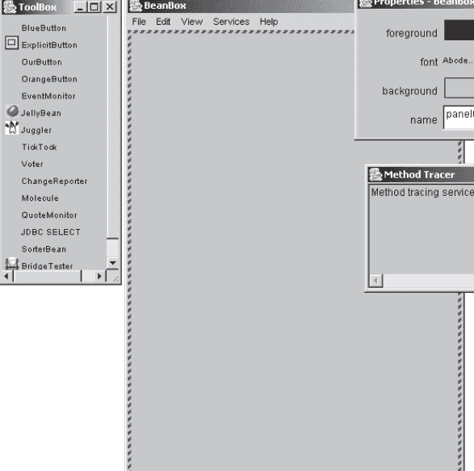

在本章后面，我将向你展示如何使用BeanBox，并引导你完成几个演示如何使用BeanBox的示例。你会发现BeanBox非常易于使用，并且是一个直观的工具，可以让你将各种Bean连接起来。我猜你几乎不会遇到什么困难就能熟练掌握BeanBox。

## 自省

在上一节中，我提到了JavaBeans暴露其属性和方法。你可能想知道它们是如何暴露这些方法和属性的。Bean构建工具通过一个称为*自省*的过程来了解Bean的成员。自省是一个过程，外部对象（无论是Bean开发工具、应用程序还是其他Bean）可以通过此过程了解关于Bean成员的信息。每个Bean都有一个相关的Bean信息类，该类提供有关Bean属性、方法和事件的信息。每个Bean信息类必须实现`BeanInfo`接口，该接口列出了要暴露的Bean功能。正是这个接口定义了Bean如何传达其信息。如果你还不知道这一点，你应该注意，Java语言中的许多功能都是通过实现特定接口来使用的。

Bean还通过遵循JavaBean标准定义的特定规则（或设计模式）来支持自省，在为Bean功能命名时，遵循这些规则。`Introspector` Java类会检查这些设计模式，从而了解Bean的成员。`Introspector`类为工具提供了一种标准方法来了解目标JavaBean支持的属性、事件和方法。`Introspector`将分别分析Bean的每个类和超类以查找信息，并使用这些信息构建一个全面描述目标Bean的`BeanInfo`对象。

## 与Bean通信

JavaBeans需要某种方式与外界通信。这种通信是通过使用属性和事件来实现的。属性允许你（开发者）向Bean发送信息。事件允许Bean向外界发送信息。属性在第2章讨论，第3章将讨论属性和事件。但是，我将在这里为你提供这两个概念的简要定义。属性字面上是描述性的形容词，告诉你关于Bean的信息。事件是Bean响应某个动作而启动的函数。如果你曾经使用过AWT或Swing，那么你已经对使用事件有了一些经验。

你可以通过操作其属性来更改Bean的内部信息。属性是定义Bean外观和行为的特征。这些属性也可以在设计时更改。Bean构建工具使用前面描述的自省方法来了解Bean的属性，并暴露这些属性以供操作。

Bean利用事件与其他Bean通信。希望接收事件的Bean会向触发事件的Bean注册其兴趣。接收事件的Bean称为*接收器Bean*。为其他Bean接收而启动事件的Bean称为*源Bean*。Bean构建工具可以检查一个Bean，并确定该Bean可以启动（发送）哪些事件以及可以接收哪些事件。单个Bean可以既是事件的源又是事件的接收器。事实上，一个Bean通常既作为其他Bean的事件源，又作为其他Bean产生的事件的接收器。事件将在第3章“事件和属性”中详细讨论。

*持久化*是使Bean能够保存和恢复其状态的过程。在更改了Bean的属性后，你可能希望保存该Bean的状态，以便下次使用该Bean时可以恢复它及其属性。JavaBeans使用Java对象序列化来支持持久化。这个主题将在第4章“JavaBean持久化”中更深入地讨论。


## Bean构建工具

Bean的主要目的是实现应用程序的可视化构建。如果您之前使用过RAD工具，如Delphi或Visual Basic，那么您已经使用过可视化应用程序工具了。这些工具被称为可视化应用程序构建器，或简称构建器工具。通常，这些工具是GUI（图形用户界面）应用程序，尽管创建非GUI构建器工具也是可能的。通常有一个称为工具箱的组件调色板，程序设计者可以从中拖放项目到客户窗口或表单上。

开发Java应用程序最受欢迎的工具之一是Borland公司的JBuilder。该工具为您提供了非常丰富的开发工具集，用于创建Java应用程序。JBuilder中的向导负责处理JavaBean开发和打包的许多细节。我们将在第2章简要介绍JBuilder，并在第3章及后续章节中广泛使用它。

### 使用BeanBox

接下来，我们将讨论BeanBox的使用以及各种Bean操作。beans/BeanBox目录包含启动BeanBox的Windows（run.bat）和Unix（run.sh）脚本。您可以使用其中任何一个命令来启动BeanBox。如果您使用的是任何版本的Windows，请运行run.bat（可以从命令提示符或Windows资源管理器启动）。如果您使用的是Unix，请从您喜欢的shell中运行run.sh。

我们将使用BeanBox附带的一些示例Bean，向您展示如何使用Bean。在下一章中，我将向您展示如何创建自己的JavaBeans。请记住，如果您的PC上没有安装Sun标准Java开发工具包，您将无法使用BeanBox。

首次启动时，BeanBox会显示三个独立的窗口：工具箱、BeanBox窗口和属性窗口。工具箱包含可供BeanBox使用的Bean。它最初包含Bean开发套件附带的示例Bean，但随后将包含我们创建的Bean。要使用一个Bean，请从工具箱中选择它并将其拖放到BeanBox窗口。BeanBox窗口是您将Bean可视化连接在一起的区域。您可以将此窗口视为一个JavaBean工作区。您使用此工作区来定义Bean的外观以及它们与其他Bean的交互方式。您可能有兴趣知道，BeanBox窗口本身就是一个BeanBox Bean的实例。您只需点击Bean即可在BeanBox窗口中选择它们。属性表显示当前在BeanBox窗口中选中的Bean的属性。如果您在BeanBox窗口中放置另一个Bean，属性表将显示该Bean的属性。

让我们使用两个现有的Bean进行操作，以便您了解BeanBox的工作原理。完成后，我将更详细地介绍BeanBox的各个组成部分。

通过以下明确的示例，您将能够看到如何使用BeanBox来操作JavaBeans。这个教程相当容易遵循，但它为您提供了JavaBeans的良好初步认识。

#### 步骤1：

启动BeanBox。这可以通过进入beans/BeanBox目录并运行run.sh（用于Unix的BASH shell脚本）或run.bat（用于Microsoft操作系统的批处理文件）来完成。如果您使用Windows，应该从DOS shell（Win 95/98）或命令提示符（Win NT/2000/XP）中执行此操作。

#### 步骤2：

找到工具箱。它将垂直显示在屏幕的左侧。将鼠标放在BeanBox中的Juggler Bean上。用左键单击此Bean。

#### 步骤3：

将鼠标移动到画布区域并绘制一个矩形。当您松开鼠标时，您将看到画布窗口中的杂耍者开始动画：


#### 步骤4：

现在将鼠标放在BeanBox中的OurButton Bean上。这应该是工具箱中的第三个Bean。然后只需在画布上Juggler Bean的上方绘制一个小矩形。

#### 步骤5：

重复步骤4中的过程以创建第二个按钮。您的画布现在应该看起来像这样：

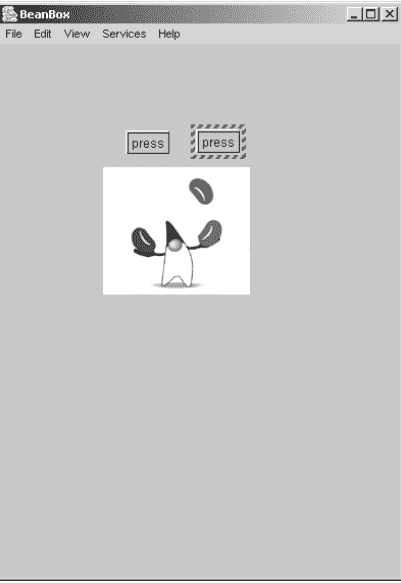

#### 步骤6：

现在我们将设置两个按钮的几个属性。请注意，当一个按钮被高亮显示（获得焦点）时，其属性会显示在属性窗口中。将一个按钮的标题属性更改为"Start"，另一个更改为"Stop"。

#### 步骤7：

现在进入关于Bean真正令人兴奋的部分。我们将把按钮的事件连接到杂耍者的事件。单击“开始”按钮一次，然后转到画布顶部的下拉菜单。选择Edit ▸ Events ▸ Action ▸ Action Performed。执行此操作后，将出现一条红线。将鼠标拖到Juggler Bean上并单击。

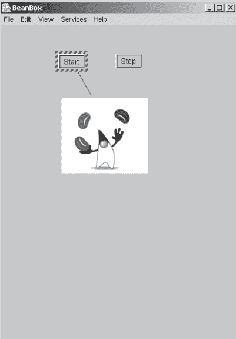

将出现一个对话框，您需要在其中选择要连接的杂耍者事件。选择startJuggling。

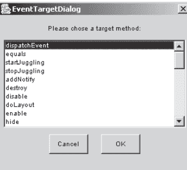

现在您的开始按钮动作事件已直接链接到杂耍者的开始杂耍事件。

#### 步骤8：

下一步是映射停止按钮。同样，单击停止按钮一次，然后选择Edit ▸ Events ▸ Action ▸ Action Performed。将鼠标拖到Juggler Bean上并再次单击。您将再次看到一个对话框；这次选择stopJuggling。

现在，如果您单击stopJuggling按钮，Juggler Bean将停止杂耍。要重新启动它，只需单击startJuggling按钮。您刚刚见证的是Bean开发的美妙之处。您可以将一个Bean中的事件连接到另一个Bean中的事件。通过以这种方式连接Bean，您可以快速轻松地创建基本应用程序，而无需编写任何代码。

这个相当简单的例子说明了关于Bean开发的几点，首先是一旦创建了一个Bean，就可以在几乎不需要实际编程的情况下使用它。在前面的示例中，您没有编写一行代码。这个例子还向您展示了使用合适的Bean构建工具操作JavaBeans是多么容易。您实际上能够将一个Bean中的一个事件拖动到另一个Bean中的事件，并导致两个事件连接起来。您从这个例子中应该学到的最后一个教训是，确实可以通过简单地组装现有的Bean来创建完整的应用程序。事实上，您刚刚就这样做了！

然而，根据我的经验，一个例子很少足以确保一个人已经掌握了一个主题。考虑到这一点，让我们看看另一个例子：

#### 步骤1：

从下拉菜单中选择File ▸ Clear来清空画布。这将清除工作区的当前内容，并准备BeanBox以处理新的JavaBean。

#### 步骤2：

在画布上放置一个Molecule Bean实例和一个TickTock Bean实例。请记住，您可以通过在工具箱中用左键单击所需的Bean，然后使用鼠标在画布上“绘制”出您希望Bean占据的区域来完成此操作。

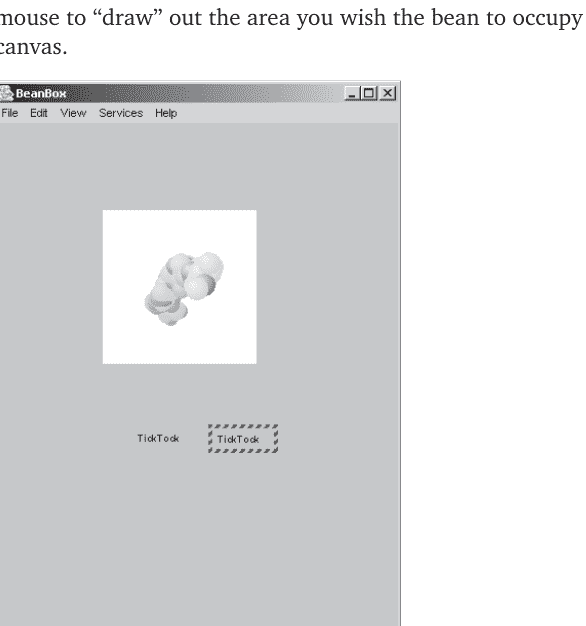

#### 步骤3：

选中TickTock Bean后，转到下拉菜单并选择Edit ▶ Events ▶ Property Changed ▶ Property Changed，然后将生成的红线拖入分子框。当属性窗口弹出时，选择“绕x轴旋转”。您现在将看到分子沿着x轴缓慢旋转。

您可以通过更改TickTock Bean的interval属性来更改其旋转速度。您也可以添加第二个TickTock Bean，并将其设置为使分子绕y轴旋转。这个例子很有趣，原因有几个。第一个是它提供了另一个关于我之前提到并向您展示的Bean原理的示例

例如，它也有趣之处在于这个Bean实际上具有一定的实际用途。制作一系列基于Bean的应用程序来让入门化学学生查看各种分子并在三维空间中旋转它们，这并非难事。再次回顾一下，这样的应用程序完全可以通过操作现有的Bean来创建，而无需编写任何代码！

这两个简单的例子应该向你展示了如何利用BeanBox以及如何使用现有Bean的基础知识。如果你仍然对BeanBox不完全熟悉，我鼓励你花些时间在继续本章其余内容之前进行实验。你可能希望简单地打开BeanBox，在画布上放置不同的Bean，尝试如何操作和连接它们。但是，如果你准备好继续，我想更详细地为你介绍下拉菜单中的各种选项以及BeanBox为你提供的各种窗口：

| 下拉菜单 | 用途 |
| --- | --- |
| **文件 (File)** | |
| 保存 (Save) | 允许你保存当前画布上的工作。 |
| 序列化组件 (Serialize Component) | 允许你通过序列化保存当前的属性设置（本书后面会有更多细节）。 |
| 生成小程序 (Make Applet) | 允许你从Bean配置创建一个Applet。 |
| 加载 (Load) | 允许你加载一个Bean。 |
| 加载JAR (Load Jar) | 允许你加载一个Java归档文件（JAR）。 |
| 打印 (Print) | 打印当前屏幕。 |
| 清除 (Clear) | 清除画布上的所有工作。 |
| 退出 (Exit) | 退出BeanBox。 |

## 第1章：Bean简介

| 下拉菜单 | 用途 |
| --- | --- |
| **编辑 (Edit)** | |
| 剪切 (Cut) | 此菜单选项用于剪切画布内容并将其放置在系统剪贴板上。 |
| 复制 (Copy) | 此选项允许你将画布内容复制到剪贴板。 |
| 粘贴 (Paste) | 允许你从剪贴板粘贴内容。 |
| 报告 (Report) | 这会导致一个详细的报告，说明正在发生的一切，显示在命令行窗口中。 |
| 事件 (Events) | 允许你从当前获得焦点的Bean中选择一个事件。 |
| 绑定属性 (Bind Property) | 允许你将一个Bean的属性绑定到另一个Bean的属性。 |
| **视图 (View)** | |
| 禁用设计模式 (Disable Design Mode) | 隐藏所有设计工具，只保留画布。请注意，一旦选择此项，其标题将更改为“查看设计模式 (View Design Mode)”。 |
| 隐藏不可见Bean (Hide Invisible Beans) | 隐藏画布上的所有不可见Bean。请注意，一旦选择此项，其标题将更改为“查看不可见Bean (View Invisible Beans)”。 |
| **帮助 (Help)** | |
| 关于 (About) | 显示你正在使用的BDK版本信息。 |
| 文档 (Documentation) | 指向当前BDK文档的网站。 |

这只是一个快速概览，介绍了可用的不同下拉菜单项。我相信其中大部分对你来说都是相对不言自明的。然而，熟悉BeanBox中各种选项的一个简单方法就是动手实验。我建议你在继续下一章之前，花些时间尝试工具箱中提供的各种Bean，并尝试各种下拉菜单命令。花些时间确保你对BeanBox相当熟悉，因为它将是你在JavaBean开发中的一个重要工具。既然我已经向你概述了BeanBox中可用的下拉菜单选项，让我们来看看BeanBox的各种窗口及其功能。

首先，也是最明显的区域是画布或工作区。它看起来像你在这里看到的图像：


工作区是你放置Bean并连接Bean事件的地方。正是在这里，Bean开发的真正“行动”发生了。画布只是一个空白区域，你可以用它来放置Bean并与之交互。如果你曾经使用过Microsoft Windows画图或Adobe Photoshop，这个工作区看起来非常像这两个图形软件包中的画布区域，而且有充分的理由，因为它服务于类似的目的。

接下来是工具箱。它看起来像这张图片：

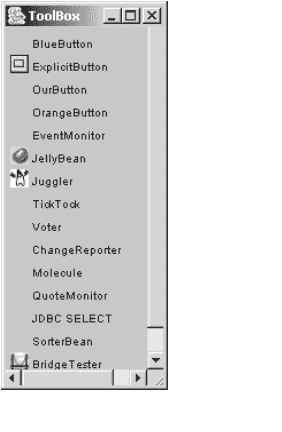

工具箱包含你可以使用的各种Bean。JavaBean开发工具包（BDK）附带了16个不同的Bean供你使用。当你创建自己的JavaBean时（从第2章开始），我将向你展示如何将它们添加到工具箱中。在本章后面，我将与你讨论大多数这些Bean的使用和功能。我还有另一个使用其中另一个Bean的例子。

然后是属性窗口。此窗口应看起来像你在这里看到的图像：

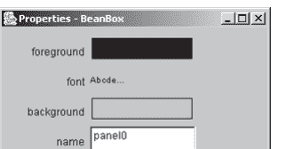

每个Bean都有不同的属性，因此属性窗口将为每个Bean显示不同的值。在此窗口中，你可以更改任何给定Bean的属性，并会立即看到更改生效。例如，Juggler Bean有一个名为“动画速率 (animation rate)”的属性。此属性决定了杂耍者杂耍的速度。默认情况下，此属性设置为125。数字越低，他杂耍得越快。要验证这一点，你可以尝试重置该属性，先设为35，然后设为250，并观察效果。

最后是方法跟踪器窗口，它看起来像你在这里看到的图像：

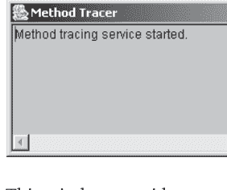

此窗口提供了对实际被调用的方法的跟踪。如果你的Bean遇到问题，这可能非常有用。

使用BeanBox，你可以轻松地处理Bean，操作它们的属性，并连接它们的事件。你需要熟悉各种窗口和下拉菜单。对你来说，获得对Bean开发工具包提供的示例Bean的基本理解也可能是有用的。这可能会让你洞察到哪些类型的功能可以被整合到JavaBean中。下表总结了BDK 1.1附带的一些Bean：

| Bean | 描述 |
| --- | --- |
| BlueButton | 创建一个用户可以点击的蓝色按钮。 |
| ExplicitButton | 同样创建一个按钮；但是，背景只是灰色。 |
| OurButton | 创建一个与ExplicitButton非常相似的按钮，但它有更多的属性选项可以设置。 |
| OrangeButton | 与蓝色按钮完全相同，只是它是橙色的。 |
| Juggler | 显示一个正在杂耍大咖啡豆的杂耍者。 |
| TickTock | 这是一个计时器，将逐秒计数。 |
| Voter | 显示“是”或“否”。 |
| Molecule | 显示一个特定的有机分子，可以在三维空间中旋转。 |
| QuoteMonitor | 这个有趣的小Bean可以显示给定股票的当前报价。 |
| JDBC SELECT | 此Bean允许你访问数据库。 |
| SorterBean | 此Bean根据某些预设算法对信息进行排序，例如冒泡排序。 |

其中许多Bean与其他Bean结合使用时效果最佳，正如我们在两个独立的示例中已经看到的那样。

## 更多的JavaBean概念

单个JavaBean的功能当然会有所不同。但是，它们必须具有某些共同的定义特征。为了遵循Sun Microsystems制定的JavaBean开发标准，需要这些特征。所有JavaBean共享的这些共同特征总结如下：

- 支持内省（Introspection），从而允许构建工具分析Bean的方法、事件和属性。所有JavaBean都必须提供对内省的支持。没有这个，它们将无法被任何构建工具或其他Bean使用。
- 支持定制（Customization），允许用户更改Bean的外观和行为。这通常通过属性来实现。如果你的JavaBean没有可操作的属性，从技术上讲它可能仍然是一个JavaBean，但它将完全无用。
- 支持事件（Events），允许Bean触发事件、接收事件，并告知构建工具它们可以触发和接收哪些事件。没有事件过程，Bean就无法进行通信。

通过构建工具或其他 Bean。你已经看到，简单地将 Bean 事件链接在一起可以成为一个非常有用的工具。

-   支持属性，允许以编程方式操作 Bean，以及支持上述提到的自定义。
-   支持持久化，允许在应用程序构建器中自定义过的 Bean 能够保存和恢复其状态。通常，持久化是通过应用程序构建器的保存命令实现的。Bean 工具的加载菜单命令用于恢复在构建应用程序过程中所做的任何工作。持久化将在第4章中更深入地讨论。现在，你只需要记住所有的 Bean 都支持持久化。

虽然 JavaBean 通常主要通过构建工具进行操作，但这并非操作 JavaBean 的唯一方式。JavaBean 可以通过文本工具以编程接口进行手动操作。所有关键 API，包括事件、属性和持久化的支持，都被设计成易于人类程序员以及构建工具阅读和理解。然而，这不是常规做法。JavaBean 开发人员几乎总是使用某种开发工具，如 Bean Builder 或 JBuilder，来创建、连接和使用 JavaBean。这些工具的图形界面更适合 JavaBean，因为在大多数情况下，Bean 本身就是图形对象。

有些人可能会好奇，为什么有人会使用 Bean 而不是标准的 Java 类文件。与类相比，使用 Bean 最有力的理由是 Bean 支持内省。也就是说，它们允许开发环境分析 Bean，确定其属性和方法，并在设计时而不是运行时操作 Bean。然而，利用 JavaBean 还有许多其他原因。与标准类不同，它们可以在编程环境之外使用。我的意思是，可以利用和链接 Bean 而无需进行任何实际的编程。

一种使用 Bean 的新方式是在 Java 和 ActiveX 之间创建桥梁。几家软件公司正在致力于快速将 ActiveX 控件转换为 JavaBean 的方法（例如 IBM 的 Visual Age）。这允许 Java 开发人员在 Java 环境中使用 ActiveX 组件功能。迄今为止，微软尚未提供任何允许 ActiveX 组件使用 Java 或 JavaBean 的反向功能。

## JBuilder 与 Bean

本书的重点是向你展示如何使用 Borland 的 JBuilder 来利用 JavaBean 和企业 JavaBean（Enterprise JavaBeans）。这个例子，以及本书中的大多数例子，都侧重于 JBuilder 7.0 版本。然而，你将遇到的大多数技术在 JBuilder 5.0 和 6.0 中同样适用。这种侧重于 Bean 开发的原因有几个。首先，JBuilder 是当今市场上最强大、最受欢迎的 Java 开发工具。其次，使用 JBuilder 进行 Bean 开发要容易和高效得多。我将演示如何在没有 JBuilder 的情况下完成各种任务；然而，你会发现使用 JBuilder 几乎可以使任何 Java 任务更简单、更不容易出错。

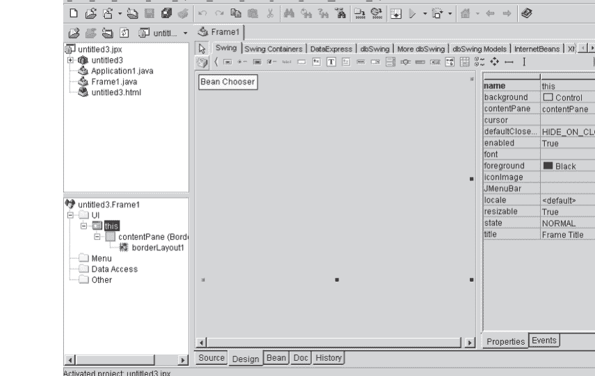

Borland 的 JBuilder 附带了多种用于创建和使用 Bean 的工具。我们将在本书后面讨论其中大部分工具。现在，我想向你展示如何在任何 JBuilder 项目中使用现有的 Bean。同样有趣的是，JBuilder 附带的 Bean 比标准的 Sun JavaBean 开发工具包（BDK）多得多。如果你打开任何 JBuilder 项目（无论是新项目还是现有项目）并选择 Design 选项卡，你会注意到屏幕左上角有一个图标。这是 Bean Chooser（Bean 选择器）图标，允许你从可用的 JavaBean 中进行选择。

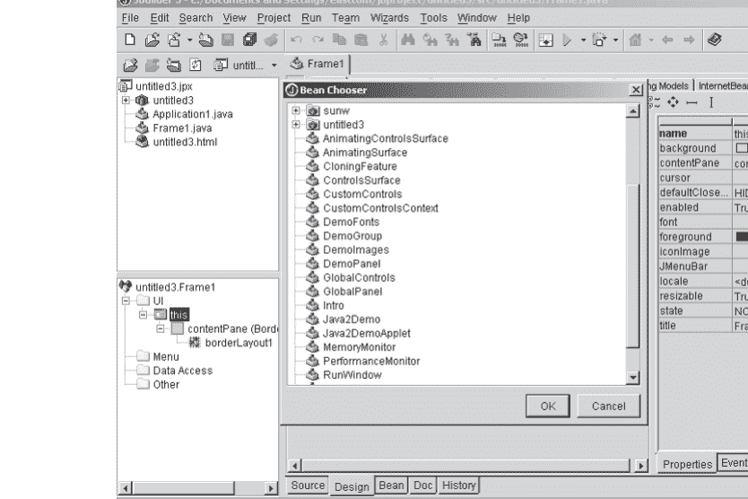

选择任何可用的 Bean 后，你将返回到主设计屏幕，此时鼠标指针将变成一个简单的十字准星。然后你可以将该 Bean 绘制到设计表面上。如果你碰巧将 Bean 绘制到了后来认为不合适的位置，别担心——你只需将其拖动到另一个位置即可。

使用此工具，你可以将 JavaBean 添加到任何项目中。在本章前面，我向你展示了如何将一个 Bean 链接到另一个 Bean，这是 JavaBean 的一个有用应用。然而，当你考虑将它们作为更大应用程序内部的组件使用时，JavaBean 的真正效用就变得清晰了。你可以创建一个封装了一组功能的 JavaBean，然后将该功能添加到你喜欢的任何 Java 项目中。这就是 JavaBean（尤其是）以及面向对象编程（一般）的真正目标——代码可重用性。你还可以在互联网上找到各种 JavaBean，无论是共享软件还是商业产品，你都可以下载并在自己的应用程序中使用。面向对象编程的核心理念是创建易于移植和在各种不同应用环境中可重用的代码。JavaBean 将这一概念提升到了一个新的水平。

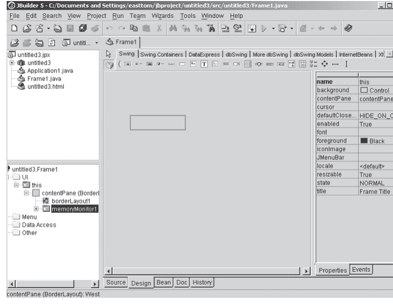

## 总结

本章向你介绍了 JavaBean 的概念。它也让你第一次认识了 Bean 开发工具包（BDK）。你看到了如何将一个 Bean 的事件连接到另一个 Bean 的事件。这种将 Bean 拼接在一起的方式正是 JavaBean 组件架构的核心。我还向你展示了一些使用 Bean 并将它们链接在一起的例子。有了这些信息，你应该对 JavaBeans 的工作原理有了基本的了解，并且应该准备好继续第2章，开始创建你自己的 Bean。

本章是 Bean 开发的基础，也是我们后续探索企业 JavaBean（Enterprise JavaBeans）开发的基础。你可以在附录A中找到更多资源，以继续你的 JavaBean 探索。我同样建议，如果你使用的是 Borland JBuilder，那么请充分利用其帮助文件，其中充满了示例代码。

## 术语

-   *JavaBean* – 一个符合 JavaBean 规范的独立 Java 对象。
-   *RAD* – 快速应用开发工具。任何通过提供图形编程界面来简化软件开发的工具。
-   *构建工具（Builder Tool）* – 任何使 Bean 开发人员能够操作现有 JavaBean 和创建新 JavaBean 的工具。
-   *JDK* – Java 开发工具包。由 Sun Microsystems 提供的可免费下载的 Java 编译器和工具。
-   *BDK* – Bean 开发工具包。由 Sun Microsystems 提供的可免费下载的 JavaBean 开发工具包，包含一个构建工具。
-   *API* – 应用程序编程接口。一个对象中暴露给外部环境的一组函数，程序员可以利用这些函数。
-   *GUI* – 图形用户界面。

## 复习题

1.  JavaBean 用什么过程来揭示关于其自身的信息？
2.  如何在 Microsoft Windows 操作系统中启动 BeanBox？
3.  “序列化组件（Serialize Component）”下拉菜单选项的作用是什么？
4.  什么是持久化？
5.  标准 JavaBean 可以作为独立产品部署吗？
6.  Bean 如何暴露其特性？
7.  如何更改 Bean 的内部信息？
8.  哪个类为 Bean 开发工具提供了一种学习 Bean 的标准方式？
9.  什么是 JAR？
10. 如何从画布上移除所有 Bean？

# 第2章 创建你自己的 Bean

### 简介

前一章仅仅是 JavaBean 的介绍。本质上，它旨在通过向你介绍 JavaBean 背后的基本概念，让你适应这个主题领域。我还演示了如何使用 Bean 工具来操作现有的 Bean。此时，你应该已经熟悉了 JavaBean 的基本特性，并理解了如何使用现有的 JavaBean。现在是时候在你的 JavaBean 世界之旅中迈出下一步了。本章将向你展示如何创建你自己的 JavaBean，以及如何将它们添加到 BeanBox 中。然后你将能够以与操作 Bean 开发工具附带的标准 Bean 相同的方式操作这些 Bean。

在本章中，你将学习如何：

-   创建一个简单的 Bean
-   编译 Bean 并将其保存为 Java 归档（JAR）文件
-   将 Bean 加载到 Bean 工具的 ToolBox 中


+   - 将一个 Bean 实例放入 BeanBox
- 检查 Bean 的属性、方法和事件

请务必牢记 JavaBean 的基本要求和基本结构。这些基础知识对于你成功创建自己的 Bean 至关重要。在继续学习之前，请确保你已充分掌握第 1 章的内容。

## 使用 BDK

要使用 JavaBeans，你需要 JavaBean 开发工具包，即 BDK。你可以从 http://java.sun.com/products/javabeans/software/bdk_download.html 免费下载。要使用此工具包，你还需要 Java 开发工具包，即 JDK。你可以从 http://java.sun.com/products/jdk/1.1/index.html 免费下载。

> 注意：如果你的 JavaBean 开发工具包无法正常工作，很可能是因为你的机器上安装了多个版本的 JDK，导致了一些冲突。使用 IBM Visual Age 或 Borland JBuilder 的用户有时会遇到这种情况，因为这些产品也会安装一个 JDK 版本。这是因为 JavaBean 开发工具包可能无法确定应该使用你机器上的哪个 Java 虚拟机 (JVM)。你可能需要更改系统类路径设置或卸载其中一个 JVM。如果你使用的是 JBuilder 或其他任何 Java 开发工具，则无需将 JDK 下载到你的机器上。它已经存在了。

当然，你可以使用其他 Bean 构建工具来创建自己的 JavaBeans，但由于 Sun Microsystems 的 BDK 是免费下载的，因此对所有读者都可用，我们将从 BDK 开始学习 Bean 开发。在本章后面，我将向你展示如何使用 JBuilder 创建 JavaBeans。虽然 JBuilder 工具不是免费的，但它们使用起来容易得多，你可以从 Borland 网站获取免费试用版：http://www.borland.com/jbuilder/offers/。

## Bean 创建基础

在大多数情况下，创建 JavaBean 与创建标准 Java 类没有太大区别。任何 Java 类的所有基本要求都必须满足。如果你对 Java 开发有点生疏，请让我总结一下所有 Java 程序的主要要求：

+   - 所有 Java 源文件都有三个部分。它们是包声明、导入语句和类声明。你首先为你正在创建的源文件声明包名。然后导入代码中需要使用的任何包。最后，定义你的各种类。并不要求定义的第一个类是源文件的主类。然而，代码通常这样编写，为了清晰起见，我推荐这种方法。你偶尔也会看到一些代码在编写时没有包声明行。但是，如果你这样做，那么你的源文件就不能成为包的一部分，因此不能被导入到另一个应用程序中。
- 你的主类必须与源文件同名。如果文件名为 mybean.java，则主类必须名为 mybean。按照惯例（但不是必需的），类名首字母应大写。我必须承认这是我自己偶尔会违反的一个惯例，但它是一个被广泛使用的惯例。不过，请注意，这只是一个惯例，而不是要求。
- 记得处理异常。所有受检错误都必须进行异常处理。我个人认为，异常处理越多越好。

如你所见，JavaBeans 与标准 Java 程序有很多共同之处。事实上，所有 Java 类都共享某些共同的结构相似性。然而，为了让一个类能够与 Bean 和 Bean 容器通信（该类成为 JavaBean 的先决条件），需要遵循某些开发规范。这些特定规范是 JavaBean 独有的。事实上，正是这些规范使一个 Bean 成为 Bean，而不仅仅是一个普通类。为了创建 JavaBean，你的代码必须遵守这些规范。像所有 Java 规范一样，这些规范由 Sun Microsystems 制定，并且定义得相当清楚。我将在本章中介绍要点。但是，如果你想更深入地了解 JavaBeans API，我建议你查阅 Sun Microsystems 的文档。你可以在附录 A 中找到该文档的链接以及其他资源。

Bean 能够相互通信，并且 Bean 构建工具能够理解和操作 Bean 的原因在于，所有 JavaBeans 都遵守这些特定标准。这些规范主要关注 Bean 将如何将其接口暴露给外部世界。JavaBean 规范主要关注的领域是类名、构造函数和内省。接下来的几节将详细介绍 JavaBean 规范。在阅读这些章节时，请记住，并非所有规范都是绝对要求。有些只是推荐。但是，如果你希望其他开发者能轻松理解你的 JavaBean 代码，那么遵循所有规范是明智的。你可能也希望考虑那些仅仅是“推荐”的规范，因为它们是 JavaBeans 的创建者推荐的。这应该足以成为你强烈考虑遵循这些建议的理由。

## 类命名规范

在创建自己的 JavaBeans 时，你需要了解的一个规范是命名约定。Bean 开发者在选择组成 Bean 的类的名称时遵循某些规则。你应该注意到，在大多数情况下，Bean 类的名称中包含“Bean”一词。例如包括 UserBean、JugglerBean、DataAccessBean 等。这种特定的命名约定并不是 Bean 正常工作所必需的；然而，它确实使你的代码更具可读性。虽然 JavaBean API 规范并不绝对要求你以这种方式命名 Bean，但使用行业标准的命名约定将增强你的 Bean 的可读性和可维护性。更有经验的读者会立即看到任何提高代码可维护性的技术的价值。如果你是一个新手程序员，那么请相信我的话：代码可维护性是所有经验丰富的程序员都追求的宝贵财富。遵循任何有助于实现这一目标的规范。它是软件开发的圣杯！

除了上述命名约定外，JavaBeans 遵循与其他 Java 类相同的类命名规则。它们必须以字母字符开头，仅包含字母数字和下划线字符，并且区分大小写。你不能使用任何其他字符（如 #、$、& 等）。此外，与其他 Java 类一样，通常的做法是以大写字母开始 Bean 类的名称。这种命名约定也不是必需的，但在 Java 社区中很常见。如果你想让你的代码更容易被其他 Java 程序员阅读，这是另一个有助于实现该目标的惯例。

我必须提醒你，这些命名约定不是绝对要求。你当然可以创建不遵循任何这些命名约定的 Bean。然而，这将使你的 Bean 代码难以理解。难以阅读的代码也是难以维护的代码。回想一下可维护代码的至高无上重要性。如果你未能遵循任何标准命名约定，你可能会招致同事的不满！

## 必需的 Bean 约定

以下 JavaBean 约定对于 JavaBeans 的开发至关重要。这是因为它们允许 Bean 容器分析 Java 类文件并解释其方法和属性，从而将该类指定为 Bean。Bean 容器只是任何能够容纳和使用 JavaBean 的工具。这包括 Bean 开发工具（如 BeanBox）以及开发工具（如 JBuilder）。这些约定规定了定义 Bean 的构造函数、方法和属性的规则。如果你不遵循这些约定，Bean 容器将不会将你的产品识别为 Bean。在尝试创建任何 Bean 之前，请确保你遵循了这些约定。


## Java Bean 构造器

JavaBean 开发的关键规则之一是你必须有一个不带参数的构造器。当您将 Bean 的实例放置在画布上时，Bean Builder 工具将使用此构造器。仔细想想，这非常合理。Bean 工具在实例化 Bean 时不会传递任何参数给它，因此该类必须有一个无参构造器。每个 Java 类都有一个构造器方法，用于创建该类的实例。如果一个类没有明确指定任何构造器，则默认假定有一个零参数的构造器。由于这个默认构造器规则，以下 Java 类是完全有效的，并且在技术上满足了 Bean 的规范：

```java
public class SampleBean
{
}
```

这个 Bean 没有属性或方法，不能做任何有用的事情，但它在技术上仍然满足了 JavaBean 的无参构造器要求。请记住，Java 提供了一个默认的无参构造器；因此，这个类有一个无参构造器。让我们看一个更适合用作 Bean 的类的更好的例子。请注意，它有一个零参数构造器，该构造器在实例化时将时间设置为当前时间。

```java
import java.util.*;
public class NowBean
{
    private int hours;
    private int minutes;
    public NowBean()
    {
        Date now = new Date();
        this.hours = now.getHours();
        this.minutes = now.getMinutes();
    }
}
```

请注意，构造器用于将 Bean 的实例变量 `hours` 和 `minutes` 初始化为实例化时的当前时间。当然，这个类仍然不是一个 Bean，因为它没有实现 JavaBean API 要求的所有必要接口。但这个类确实拥有必要的构造器，因此可以作为 Bean 使用。与前一个例子不同，这个类的构造器确实做了一些有用的事情。你可以看到，我展示的每一个例子都在一步步地引导你，更接近创建自己的 JavaBean 的目标。

## 内省与反射

当你的 Bean 运行时，Bean 容器能够检索关于你的 Bean 的属性、事件和方法的信息是至关重要的。如果它不能，那么你的 Bean 就无法被访问或操作，因此完全无用。实现此目的的过程称为内省。内省是 Bean 可以了解其自身方法和属性，然后将这些方法和属性暴露给外部世界的过程。如果你考虑一下“内省”这个词在日常生活中的用法，它在 JavaBeans 上下文中的使用对你来说应该是非常清楚的。

在一些组件架构（如 COM 和 CORBA）中，有一个独立的接口定义语言，它独立于所使用的编程语言。Sun Microsystems 希望确保所有 Bean 开发完全在 Java 中完成。因此，没有单独的接口定义语言。JavaBean 的所有行为都可以直接用 Java 指定。这就是内省发挥作用的地方。它处理其他组件架构（如 CORBA、COM 和 DCOM）中由接口定义语言完成的功能。

JavaBeans 的目的是拥有一个完全基于 Java 的、易于使用的组件架构。然而，让开发者能够完全且精确地控制暴露哪些方法、事件和属性以及如何暴露它们也很重要。一种称为“反射”的底层机制用于检查目标 Bean 支持的方法，并确定该 Bean 支持哪些属性、事件和方法。请记住，确定 Bean 内部工作方式的唯一方法是检查其公共方法。即使是属性，实际上也是提供对 Bean 实例变量访问的公共方法。

如果 Bean 开发者提供了一个描述该 Bean 的 BeanInfo 类，那么这个 BeanInfo 类将被用于以编程方式发现 Bean 的行为。为了允许 Bean 容器分析 Bean，提供了一个 Introspector 类。这个类理解各种设计模式和标准接口，并提供了对不同 Bean 进行内省的统一方式。

*反射* 是一个过程，它允许 Bean 容器在运行时检查任何类以确定其属性集。Bean 容器通过分析 Bean 的公共方法中是否存在属性访问方法来确定该 Bean 支持哪些属性。当然，这些属性访问方法必须满足某些特定的标准。这些标准由 JavaBeans API 定义。一个属性要存在，其 Bean 类必须定义一个访问方法来返回属性值、更改属性值，或两者兼有。正是这些特殊命名的访问方法的存在决定了 Bean 类的属性。本质上，提供与 Bean 的私有成员变量交互手段的访问方法就是 Bean 的属性。

用一个类比来说明，考虑一辆汽车。它有各种私有变量。这些是你无法直接访问的项目（好吧，至少不费很大力气和没有一些机械知识是做不到的）。汽车类的这样一个私有成员变量是油位。你不能直接伸手进油箱改变油位。然而，有一些访问方法允许你操作油位。其中一个方法是“给油箱加油”方法。当你将燃料倒入提供的开口时，它会为你放入油箱。你可以把加的油想象成你传递给访问属性的参数。如果有过滤器防止杂物进入你的油箱，你可以把它想象成属性方法中进行的数据验证。希望这个类比有助于澄清属性/访问方法的使用。

## 设计模式

在前一节中，我提到了设计模式。“设计模式”一词仅指用于标准目的的方法集和接口的约定名称和类型签名。例如，考虑用于检索和设置属性 X 值的 `getX` 和 `setX` 方法的使用。这些是所有 JavaBean 用于暴露其实例变量的标准访问方法/属性。Get 方法检索给定成员变量的当前值。Set 方法更改该值。在前面使用的油箱类比中，“给油箱加油”方法更恰当地命名为 `setGas`。

使用这些标准化的设计模式有两个宝贵的目的。首先，它们是程序员有用的文档辅助工具。通过允许程序员快速识别符合标准设计模式的特定方法，开发者可以更快地吸收和使用新的类。其次，开发者可以编写识别设计模式并使用它们来分析和理解组件的工具和库。如果没有这些标准化的设计模式，Bean 容器将无法发现 Bean 的属性、方法和事件。最后，与任何约定一样，它将使你的代码更具可读性，因此更易于维护。

请记住，在 Bean 的所有公共接口中，遵循 JavaBean 设计模式很重要。然而，在 JavaBeans 内部，使用与设计模式匹配的方法和类型名称是可选的。如果你准备使用 BeanInfo 接口明确指定你的 Bean 的属性、方法和事件，你可以随意命名它们的方法和类型。但是，这些方法和类型仍然必须匹配所需的类型签名，因为这对它们的操作至关重要。简而言之，可以灵活变通设计模式，但这样做需要你付出更多工作。我建议你直接遵循设计模式。我将在我们遇到它们时向你介绍具体的设计模式。你已经看到了获取和设置属性的模式。

## 指定 Bean 的属性

Bean 的属性只需为它们创建适当的访问方法即可定义。访问方法用于检索属性的值或对其进行更改。用于检索属性值的方法称为 get 方法，而修改其值的方法称为 set 方法。这个术语并非 JavaBeans 独有。这是在任何面向对象语言中访问属性的标准方法。使用 Visual Basic 或 C++ 编写类的程序员应该非常熟悉 get 和 set 方法。这些方法统称为访问方法。


它们提供了对 bean 私有成员变量中存储的值的访问。你的 bean 中不应该有任何公共变量。所有成员变量都应仅能通过访问方法进行访问。

要为 bean 定义属性，只需创建一个公共方法，该方法以你希望定义的属性名称命名，并根据需要加上 `get` 或 `set` 前缀。`get` 方法应返回相应的数据类型，而对应的 `set` 方法应接受一个相应类型的参数并设置该属性。`set` 方法通常具有 `void` 返回类型。正是 `get` 或 `set` 前缀使 Java 能够确定你正在定义一个属性。因此，属性访问方法的格式如下：

```
public void setPropertyName(PropertyType value);
public PropertyType getPropertyName();
```

例如，要定义一个名为 `age` 的属性，该属性可用于存储代表一个人年龄的数值，并且可读可写，我需要创建以下方法：

```
public void setAge(int age)
{
}
public String getAge()
{
}
```

阐述此主题的一个好方法是回到之前的示例并添加一些属性访问方法。我将在 `nowBean` 中添加几个属性，称为 `hours` 和 `minutes`，它们将允许我们在页面中引用当前时间。为了使 Java 识别这些属性，它们必须遵循 JavaBean 设计模式定义的 `get` 方法格式。这些方法应如下所示：

```
public int getHours()
{
}
public int getMinutes()
{
}
```

请注意，我创建了两个 `get` 方法，没有任何关联的 `set` 方法。当这样做时，属性是只读的。使用该 bean 的人可以检索值，但无法设置它们。鉴于这个 bean 旨在返回当前时间，只读方法是完全合理的。

在构造函数中，我将当前时间的小时和分钟存储在实例变量中。我可以让我们的属性引用这些变量并返回其值。

```
import java.util.*;
public class nowBean
{
    private int hours;
    private int minutes;
    public nowBean()
    {
        Date now = new Date();
        this.hours = now.getHours();
        this.minutes = now.getMinutes();
    }

    public int getHours()
    {
        return hours;
    }
    public int getMinutes()
    {
        return minutes;
    }
}
```

这两个方法只是简单地返回存储在实例变量中的相应值。由于这些方法符合 bean 的访问方法命名约定，我刚刚定义了两个可以通过任何 bean 容器访问的属性。请记住，这些是只读属性。如果你愿意，你可以创建 `set` 属性，并使用用户传递给你的值来更改 `now` 对象中的时间值。

Bean 属性不应与实例变量混淆，即使实例变量通常直接映射到属性名称。属性是允许你访问存储在实例变量中的数据的方法。然而，bean 的属性不一定需要与实例变量直接对应。你可以将属性视为允许你与实例变量交互的公共接口。当然，并非所有实例变量都映射到属性。Bean 的属性由方法名称本身定义，而不是其背后的变量或实现。这使得 bean 设计者可以自由地更改 bean 的内部工作方式，而无需更改暴露给 bean 用户的接口和属性集合。然而，我通常建议你使用的属性名称与其映射的实例变量名称接近。这使得你的代码更易于阅读，并将提高你的 JavaBean 代码的可维护性。

## 序列化

JavaBeans 通过一个称为序列化的过程来保存有关自身的信息。此过程允许 bean 将其当前状态保存到机器上的文件中。该文件可以在 bean 下次实例化时被读取，其中包含的信息可用于将 bean 恢复到其先前状态。我将在第 4 章“JavaBean 持久性”中更详细地讨论序列化。目前，重要的是你要意识到 JavaBeans 使用序列化来存储有关其状态的数据。为此，bean 必须实现 `Serializable` 接口。所有 JavaBeans 都必须实现 `Serializable` 接口。

## JAR 文件和清单文件

JAR 文件在第 1 章中已简要提及，但只给出了粗略的定义。JAR 是一个 Java 归档文件。它是压缩和打包文件以进行分发的一种标准方式。单个 JAR 文件可以包含单个 JavaBean 或多个 JavaBean 的文件。在 JAR 文件中，你可以打包你的 JavaBean 所需的所有文件。这可以包括以下任何或所有类型的文件：

-   已编译的 JavaBean
-   为 bean 提供文档的 `.txt` 和 `.html` 文件
-   图像
-   音频或视频片段
-   任何支持性的 `.class` 文件

JAR 文件中的元素使用行业标准的 ZIP 压缩算法进行压缩。你甚至可以将数字签名与 JAR 文件关联起来。如果你通过互联网分发 JAR，这尤其有用。数字签名可以识别 JAR 内容的创建者，并可用于确定是否有人更改了内容。

JAR 文件中的第一个元素是清单文件。此文件只是一个纯文本文件，包含有关 JAR 文件内容的信息。它还将指示哪些 `.class` 文件是 JavaBeans。Sun JDK 附带了一个 JAR 工具，允许你创建和管理 JAR 文件。它将位于与 `javac` 编译器相同的目录中，并从命令行操作。语法是：

```
jar options files
```

`files` 部分是你希望包含在 JAR 文件中的文件列表。`options` 标签代表你可以使用的各种命令行参数选项中的任何一个。下表总结了它们：

| 选项 | 描述 |
| :--- | :--- |
| c | 创建一个归档文件。 |
| f | `files` 中的第一个元素是归档文件的名称。 |
| t | 列出归档文件的内容。 |
| m | `files` 中的第二个元素是清单文件的名称。 |
| v | 提供详细输出。 |
| x | 从 JAR 中提取文件。 |
| M | 不创建清单文件。 |

以下是创建 JAR 文件的示例：

```
jar cfm c:\bdk\jars\myBean.jar myBean\*.mft myBean\*.class
```

这将创建一个归档文件，其中第一个元素（`myBean`）是归档的名称，第二个元素是清单的名称。它将包括 `c:\bdk\jars\myBean` 中所有具有 `.mft`（清单）或 `.class` 扩展名的文件。

为了从 JAR 中提取这些文件，你需要创建一个文件夹（在我们的例子中是“myfolder”）。将 JAR 文件复制到新文件夹，然后执行以下命令：

```
jar xvf myBean.jar
```

清单文件是一个简单的纯文本文件，显示 JAR 的内容。它列出了 JAR 中包含的所有文件。如果你没有创建自己的清单，并且在创建 JAR 文件时没有使用 `M` 选项，则会为你创建一个清单文件。

我已向你展示了 JavaBean 开发的基本概念以及决定如何编写 bean 的规范。你现在应该拥有进行下一步所需的知识。现在是时候实际编写一个 bean 了。以下示例将创建一个简单的 JavaBean。请完全按照步骤操作，你将创建你的第一个 JavaBean！这个 bean 不做太多事情，但它是创建一个 bean 的良好开端示例。

步骤 1：

在你的机器上创建一个与你将要给源文件命名的名称相同的文件夹或目录（在本例中为“myBean”）。

步骤 2：

在该文件夹或目录中，你将使用文本编辑器编写以下代码：

```
import java.awt.*;
import java.io.Serializable;
public class myBean extends Canvas implements Serializable
{
    //构造函数设置继承的属性
    public myBean()
    {
        setSize(50,50);
        setBackground(Color.blue);
    }
}
```


## **步骤 3：**

这就是为我们的 Bean 编写代码所需的全部步骤。现在，你必须编译你的 JavaBean。编译方式与编译任何标准 Java 源代码文件相同：

```
javac myBean.java
```

这将生成类文件 myBean.class。

## **步骤 4：**

现在你需要创建一个清单文件。请记住，清单文件实际上是在创建 JAR 时使用的模板文件；它描述了 JAR 的内容。你可以使用任何文本编辑器来创建清单文件。我将其命名为 manifest.mft，其中包含以下文本：

```
Name: myBean.class
Java-Bean: True
```

创建 JAR 文件。JAR 文件将包含清单和 myBean 类文件：

```
jar cfm myBean.jar manifest.tmp myBean.class
```

## **步骤 5：**

现在，转到包含 BeanBox 工具的文件夹并启动 BeanBox 工具。然后，你应该将 JAR 文件加载到 ToolBox 中。你可以通过选择 File ▶ Load Jar 菜单项来完成此操作。这将打开一个文件浏览对话框。导航到 myBean.jar 的位置并选择它。MyBean 现在将出现在 ToolBox 的底部。

请注意，当 BeanBox 启动时，beans/jars 目录中所有 JAR 文件中的 Bean 都会自动加载到 ToolBox 中。因此，如果你希望你的 Bean 自动加载到 ToolBox 中，只需将其放入 beans/jars 文件夹即可。

将 myBean 的一个实例放置到画布上。myBean 的属性将出现在 Properties 表中。你可以通过拖动一个角来调整 myBean 的大小。你会看到当光标在角上时会变成直角。你也可以通过在带阴影的边框的任何非角部分上拖动来重新定位 myBean。你会看到当光标处于可以移动 Bean 的位置时，它会变成十字箭头。就是这么简单。你刚刚创建了你的第一个 Bean！

这个示例不是特别令人兴奋，但它确实说明了创建 JavaBean 的基础知识。让我们继续看一个更有用的例子，以便你再次了解创建 JavaBean 的过程。在这个例子中，你将创建一个检查一天中的时间并提供适当问候的 Bean。

步骤 1：

在你的机器上创建一个与你将给源文件命名的相同名称的文件夹或目录（在本例中为 “greetingBean”）。

步骤 2：

在该文件夹或目录内，你将使用文本编辑器编写以下代码：

```
import java.util.*;
import java.io.*;
public class greetingbean extends Canvas implements Serializable
{
    private final static int XPAD = 5;
    private final static int YPAD = 5;
    private String morning, afternoon, evening;
    public greetingBean()
    {
        morning    = "Good morning.";
        afternoon = "Good afternoon.";
        evening    = "Good evening.";
    }
    public String getMorning()
    {
        return morning;
    }

    public void setMorning(String morning)
    {
        this.morning = morning;
        adjustSize();
    }

    public String getAfternoon()
    {
        return afternoon;
    }

    public void setAfternoon(String afternoon)
    {
        this.afternoon = afternoon;
        adjustSize();
    }

    public String getEvening()
    {
        return evening;
    }

    public void setEvening(String evening)
    {
        this.evening = evening;
        adjustSize();
    }

    public void setFont(Font font)
    {
        super.setFont(font);
        adjustSize();
    }

    public Dimension getPreferredSize()
    {
        Graphics g = getGraphics();
        FontMetrics fm = g.getFontMetrics();
        int w = fm.stringWidth(selectGreeting()) + 2*XPAD;
        int h = fm.getHeight() + 2*YPAD;
        return new Dimension(w, h);
    }

    private void adjustSize()
    {
        Dimension d = getPreferredSize();
        setSize(d.width, d.height);
        Component parent = getParent();
        if(parent != null)
        {
            parent.invalidate();
            parent.doLayout();
        }
    }

    public void paint(Graphics g)
    {
        String greeting = selectGreeting();
        Dimension d = getSize();
        FontMetrics fm = g.getFontMetrics();
        int x = (d.width - fm.stringWidth(greeting))/2;
        int y = (d.height + fm.getMaxAscent() -
                 fm.getMaxDescent())/2;
        g.drawString(greeting, x, y);
        if(border) {
            g.drawRect(0, 0, d.width - 1, d.height - 1);
        }
    }

    private String selectGreeting()
    {
        Calendar calendar = Calendar.getInstance();
        int hour = calendar.get(Calendar.HOUR_OF_DAY);
        if(hour < 12)
        {
            return morning;
        }
        else if(hour < 17)
        {
            return afternoon;
        }
        else
        {
            return evening;
        }
    }
}
```

**步骤 3：**

现在你可以简单地编译你的 JavaBean。编译方式与编译任何 Java 源文件相同。

```
javac greetingBean.java
```

**步骤 4：**

现在你需要创建一个清单文件。请记住，清单文件实际上是在创建 JAR 时使用的模板文件，它描述了 JAR 的内容。你可以使用任何文本编辑器来创建清单文件。

```
Name: greetingBean.class
Java-Bean: True
```

现在创建 JAR 文件。JAR 文件将包含清单和 greetingBean 类文件：

```
jar cfm greetingBean.jar manifest.mft greetingBean.class
```

**步骤 5：**

现在，转到包含 BeanBox 工具的文件夹并启动 BeanBox 工具。然后，你应该将 JAR 文件加载到 ToolBox 中。

希望你觉得这个 Bean 更有趣一点。它实际上做了一些有用的事情。它根据一天中的特定时间展示了一个合适的问候。这也说明了使用 JavaBeans 的原因之一。你现在可以将此 Bean 集成到任何你希望显示每日问候的应用程序中。你无需重写此代码，甚至无需导入包就能在另一个应用程序中使用。这个 Bean 处理了所有事情，包括问候的视觉呈现。

## 使用 JBuilder 创建 Bean

回想一下，我说过 JBuilder 使 Java 编程变得容易得多。它尤其简化了诸如编译和创建 JAR 文件之类的任务。事实上，它使 Bean 编程的所有方面都变得简单。为了说明这一点，让我们使用 JBuilder 创建一个 JavaBean。

**步骤 1：**
启动 JBuilder。

**步骤 2：**
启动你的 JBuilder 副本后，开始一个新项目。然后，要向项目中添加文件，请选择 File ▸ New。这将向你展示以下屏幕：

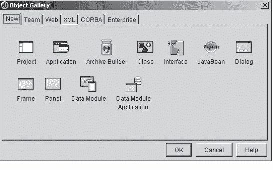

**步骤 3：**
选择 JavaBean 作为要添加的项目类型。这将启动 JavaBean 向导，如图所示在下一页顶部。

请注意，此屏幕上你有几个选项。前两个文本字段允许你设置 Bean 的包名和其主类的名称。第三个允许你为 JavaBean 选择一个基类。屏幕底部的复选框允许你设置其他项目，例如让向导为你创建一个默认的无参数构造函数。出于我们的目的，除了包名和类名外，我们将保留所有默认设置。将包命名为 “coolBean”。

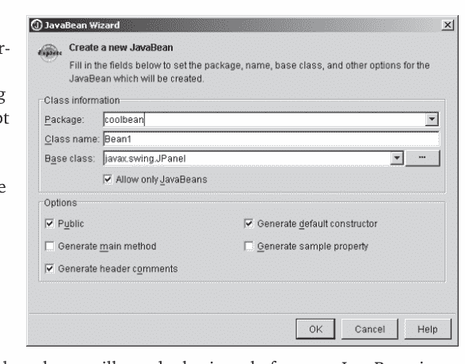

## **步骤 4：**

当你在该屏幕上单击 OK 时，向导将完成，你将在如下所示的代码窗口中看到 JavaBean 的基本代码：


## **步骤 5：**

你可以直接在此窗口中编辑代码，或者你可以选择底部的 Design 标签页。它将向你展示 JavaBean 外观的可视化表示。

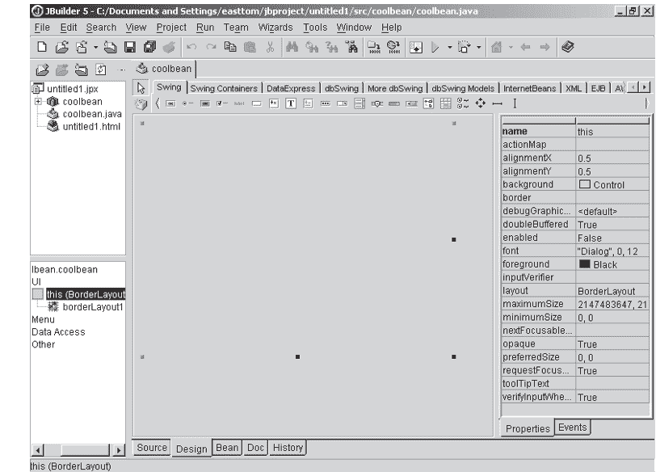

从这个屏幕中，你可以添加更多的视觉元素并操作视觉界面。


你可以选择的另一个标签页是 **Bean** 标签页。它会带您进入类似这样的一个界面：

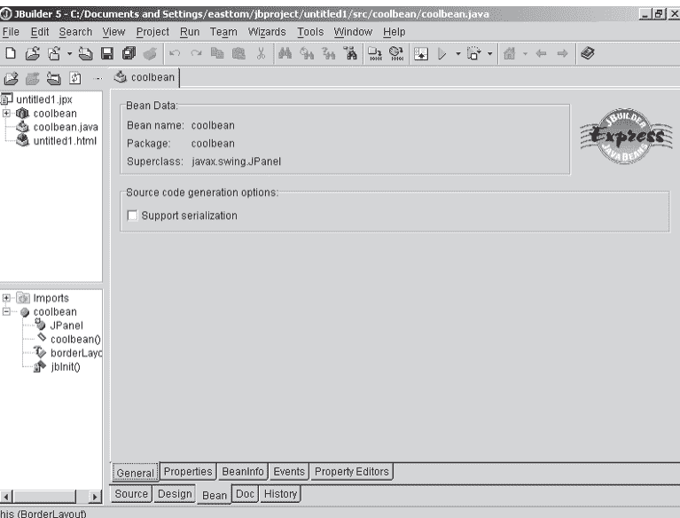

请注意，这里您有几个选项。在主屏幕或 **General** 标签页上，您可以设置支持序列化。如果您选中此项，系统会自动为您在源代码中添加实现 `serializable` 的代码。您也可以操作其他标签页，例如设置 Bean 的属性：

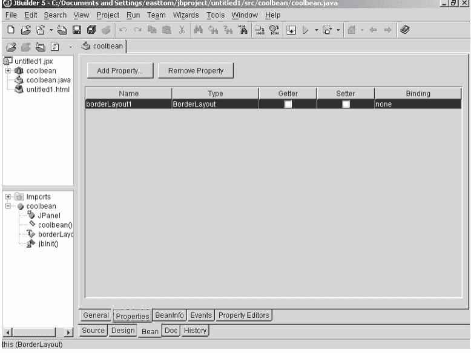

## 生成 Bean 信息：

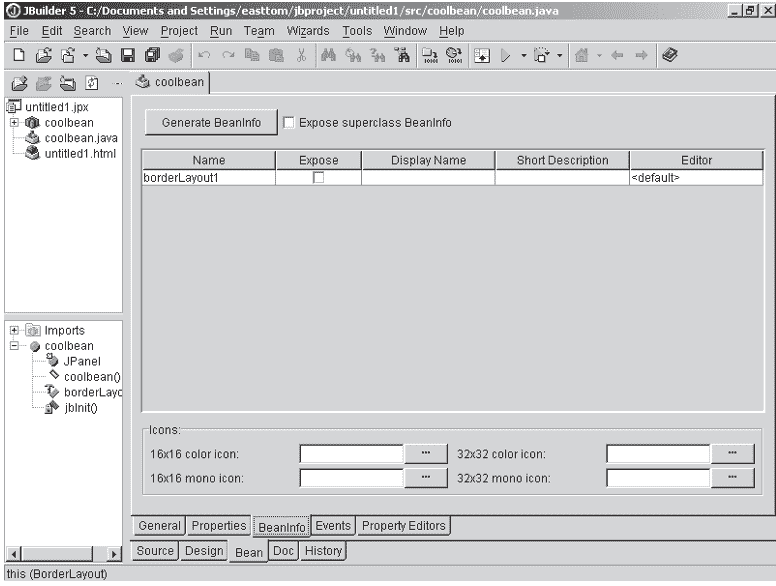

您的 Bean 的事件：

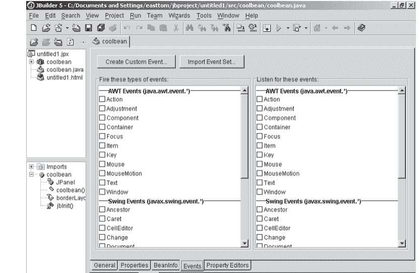

随着您阅读接下来的两章，您将更加熟悉这些不同的标签页，但现在，我们只为我们的 JavaBean 设置几个项目。

**步骤 6：**

在 **General** 标签页上，选择支持序列化。

**步骤 7：**

在 **Properties** 标签页上，添加一个名为 `text` 的新属性。

**步骤 8：**

运行您的 Bean。您可以通过点击工具栏上一个看起来很像 CD 播放按钮的按钮来执行此操作，或者通过从下拉菜单中选择 **Run**，然后选择 **Run Project**。您也可以使用快捷键 `F9`。无论您选择哪种方法，您随后都会看到类似这样的一个屏幕：

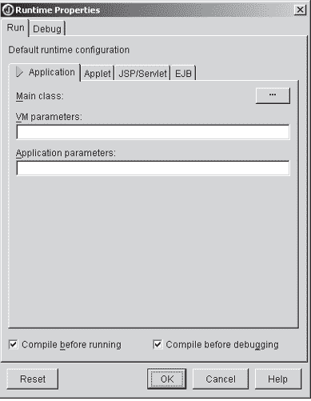

出于我们的目的，只需保留默认值并点击 **OK**。现在您的 Bean 将会运行。但是，由于我们没有为其添加代码，它不会执行太多操作。稍后我们将在 JBuilder 中创建一些功能性的 Bean。现在，如果您希望看到一个功能性的 Bean，可以从之前的 Bean 中提取代码并将其添加到我们的 JBuilder Bean 代码中。您甚至可以在 JBuilder 中创建 JAR 文件。只需选择 **Wizards ► Archive Builder**，如下图所示。

60 第 2 章：创建您自己的 Bean

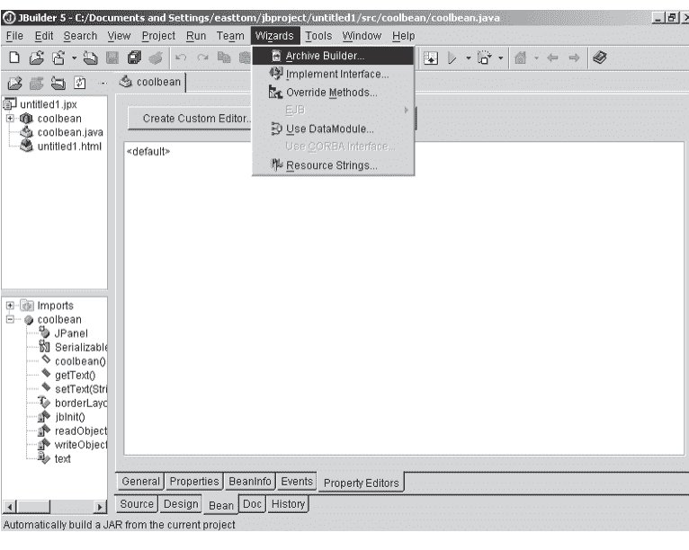

这将启动一个五步向导，为您创建 JAR 文件。出于我们的目的，只需选择 **Basic** 类型，但请注意还有其他类型。我们将在本书后面使用其中一些。

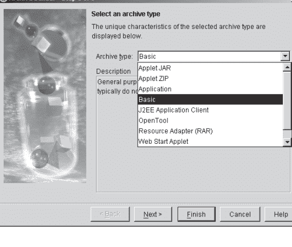

按下 **Next** 后，您将进入步骤 2。在这里，您可以选择归档文件的名称以及是否希望它压缩文件。

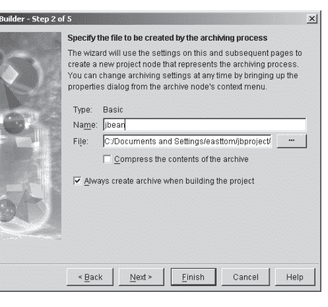

下一步，即步骤 3，允许您指定要包含在此归档中的文件。

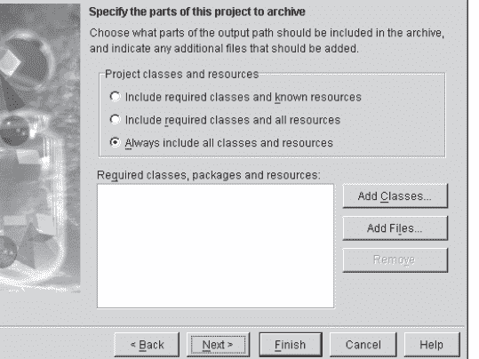

第四步允许您决定如何处理您包含项目的依赖文件。

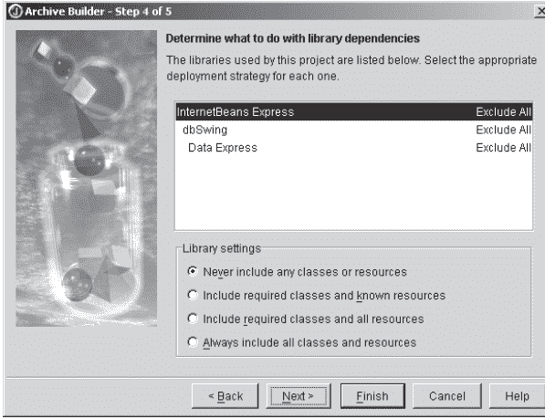

第五步，也是最后一步，允许您指定关于清单文件的信息。

然后只需点击 **Finish**，您的 JAR 文件就会为您创建完成。

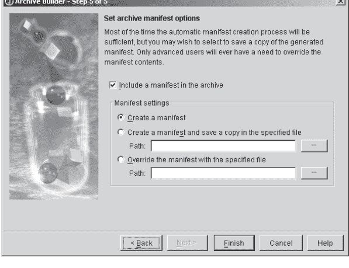

这个示例应该能给您提供利用 JBuilder 创建 JavaBeans 的基础知识。在本书中，我将首先向您展示如何使用标准的 Sun Microsystems 开发工具执行任务，然后再展示如何使用 JBuilder。我认为，当您读完本书时，您会同意使用 JBuilder 做事情更高效，也更容易！

## 总结

在本章中，我向您展示了决定如何开发 JavaBean 的标准。您还了解了如何使用 Sun Java SDK 创建一个简单的 JavaBean。本章还涵盖了 JavaBean 的要求，例如如何定义属性和设计模式。最后，本章向您展示了如何使用 Borland JBuilder 创建 JavaBean。这应该能让您对 JavaBeans 的创建有一个基本的理解，并让我们能够继续探索 JavaBeans。

阅读本章后需要记住的最重要的概念是创建 JavaBean 的指导原则以及您的 JavaBean 必须符合的、才能成为一个 JavaBean 的各种标准。我建议您确保至少实际操作过本章中的示例一次，并彻底阅读了创建 JavaBeans 的要求。

## 术语

JAR – Java 归档文件。这是一个包含您将与 JavaBean 一起分发的所有必需对象的文件。

清单文件 – 这个文件只是一个文本文件，它描述了 JAR 文件中包含的内容。

内省 – Bean 暴露其函数供外部使用的过程。

反射 – Bean 发现其要暴露的函数的过程。

序列化 – 将数据保存到文件的过程。

## 复习题

- 1. Bean 必须实现什么接口才能允许保存其属性？
- 2. 什么是 JAR 文件？
- 3. 什么是清单文件？
- 4. `x` 选项会导致 JAR 工具做什么？
- 5. 什么是属性？
- 6. 什么是内省？
- 7. 什么是 Bean 容器？
- 8. JavaBean 必须拥有什么类型的构造函数？
- 9. `M` 选项会导致 JAR 工具做什么？
- 10. JAR 文件中的第一个文件是什么？

# 第 3 章 事件和属性

### 简介

如果您还记得第 1 章，当我首次向您介绍 JavaBeans 时，我也简要介绍了与 JavaBeans 相关的事件概念。您看到了如何将一个 Bean 中的事件映射到另一个 Bean 中的事件。使用 BeanBox，这就像从下拉菜单中选择一个选项并将光标拖动到下一个 Bean 一样简单。回想一下，连接这些 Bean 事件您根本不需要编写任何代码。在前两章中，您粗略地了解了事件的定义并进行了几个简短的连接事件的练习。然而，我还没有解决事件究竟是什么的问题。本章将弥补您在 JavaBean 教育方面的这一不足。

事件是相关组件（在本例中为 JavaBean）向外界公开的方法，代表正在发生的一些活动。事件是允许 JavaBean 与容器通信的方法。这不同于允许程序员或 Bean 容器与 JavaBean 通信的标准方法。事件是 JavaBean 架构的核心特征。这些事件是响应某些操作而触发的。该操作可能是另一个 Bean、用户或系统本身执行的操作。JavaBean 事件是对 JavaBean 内部发生的活动的响应。

事件不仅仅指示某些操作已经发生。它们提供了一种便捷的机制，允许组件在应用程序构建器或 Bean 构建器工具中链接在一起。事件是当源中发生某些状态变化时发生的方法。任何此类更改都可以生成事件。在 Java applet 中，事件通常是在用户与 applet 的某些图形部分交互时生成的。使用事件，您可以有一个与一个 Bean 相关的操作触发另一个 Bean 中的操作（事件）。这种链接允许在源 Bean 中发生的活动启动存储在第二个 Bean 中的代码。通过其事件将 Bean 链接在一起的能力是 JavaBeans 的基石特性。您可以将一个 JavaBean 中发生的事件链接到另一个 JavaBean，从而触发第二个 JavaBean 中发生的新事件。

对事件更技术性的定义是：事件是一种在源对象和一个或多个目标或监听器对象之间传播状态更改通知的机制。如果您曾经使用过 applet，您应该熟悉事件。applet 经常使用动作事件和各种鼠标事件。

Java 实现了一种称为委托模型的事件架构。该模型为事件源生成事件并将其发送到事件监听器提供了标准机制。本质上，事件源将事件应该如何处理“委托”给事件监听器（因此得名“委托模型”）。为了使监听器能够接收事件，它必须首先向事件源注册。*事件源*是生成事件的任何类。*事件接收者*是接收事件的任何类。事件的接收是通过事件监听器完成的。*事件监听器*是实现特定接口的类。该接口标识了该事件监听器感兴趣的事件。

事件监听器还必须向事件源注册。这是通过调用源的适当方法来完成的。当事件监听器调用事件源的适当方法时，它就准备好接收该源可能生成的任何事件。调用该特定方法会在事件监听器和事件源之间建立通信。一个例子您


## 事件类

您可能从小程序开发中熟悉了ActionListener。ActionListener接口提供了一个接收操作事件的方法：

```
void actionPerformed(ActionEvent ae)
```

如你所见，此方法接受一个参数。该参数是`ActionEvent`类的一个实例。通过接收这个对象作为参数，该方法便能访问已发生事件的所有方法和属性。你可能在此方法内编写代码，利用这些方法和属性来获取有关该事件的信息，并根据需要做出响应。

## 事件类

有一组类代表AWT（抽象窗口工具包）事件。这些类是源自`Object`类的明确定义的对象层次结构的一部分。这些AWT事件代表了你在JavaBean开发中将使用的大多数事件。虽然并非必需，但在开始学习JavaBeans之前，拥有一些使用AWT的经验通常会很有帮助。原因在于AWT编程和JavaBean编程之间存在许多相似之处。然而，最明显的相似之处是事件。事实上，正如我们将在本书中看到的，AWT类经常在创建JavaBeans时被用作子类。但是，如果你对AWT没有太多经验，也不必担心。你仍然能够创建JavaBeans。不过，如果你之前使用过AWT，这个过程对你来说会更容易、更自然。

## 第3章：事件和属性

AWT类层次结构中的关键类如下所示：

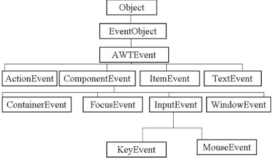

在我们继续探索事件之前，我想更全面地解释一下上图层次结构中表示的一些对象，以及一些未在层次结构中显示的重要事件类。我将特别关注作为`AWTEvent`类子类的类。原因在于这些事件在JavaBeans中被广泛使用。

*EventObject* 继承自 `Object` 类。`EventObject`有两个方法：

-   * Object getSource() – 返回生成事件的对象的引用。
-   String toString() – 返回事件的字符串等价形式。

*AWTEvent* 类是一个抽象类。它继承自 `EventObject`，位于 `java.awt` 包中。所有AWT事件类都是这个抽象类的子类。它拥有许多方法，其子类会继承这些方法。然而，你最常遇到的两个方法是：

-   * int getId() – 返回事件的类型。
-   String toString() – 返回事件的字符串等价形式。

我将为你描述`AWTEventClass`层次结构中的所有事件类，尽管图中只说明了几个。下表总结了所有直接继承自`AWTEventClass`的事件类。该表还列出了这些类相关的监听器接口。监听器接口将在下一节中解释。

| 事件类 | 监听器接口 |
|---|---|
| ActionEvent | ActionListener |
| ComponentEvent | ComponentListener |
| ItemEvent | ItemListener |
| TextEvent | TextListener |
| FocusEvent | FocusListener |
| AdjustmentEvent | AdjustmentListener |
| InputEvent | InputListener |
| KeyEvent | KeyListener |
| MouseEvent | MouseListener 和 MouseMotionListener |
| WindowEvent | WindowListener |

当按钮被按下、菜单项被点击或列表中的项被双击时，会调用`ActionEvent`类。这个类是`AWTEvent`类的子类。这是一个你可能很熟悉的事件，特别是如果你曾经开发过小程序。Java小程序经常需要响应`ActionEvent`，因此，大多数关于Java小程序的文本都充满了使用此事件的代码示例。还有一些整数常量可以帮助你确定在`ActionEvent`中按下了哪个键。下表列出了最常见的常量：

| 整数常量 | 按下的键 |
|---|---|
| SHIFT_MASK | Shift键 |
| META_MASK | Meta键 |
| ALT_MASK | Alt键 |
| CTRL_MASK | Ctrl键 |

## 第70章 第3章：事件和属性

当组件被隐藏、调整大小、显示或移动时，会触发`ComponentEvent`类。与`ActionEvent`一样，这个类是`AWTEvent`类的子类。同样与`ActionEvent`类似，它也有整数常量帮助你确定具体发生了什么。

| 整数常量 | 描述 |
|---|---|
| COMPONENT_HIDDEN | 组件从视图中隐藏。 |
| COMPONENT_SHOWN | 组件变为可见。 |
| COMPONENT_RESIZED | 组件的大小已改变。 |
| COMPONENT_MOVED | 组件被移动。 |

当用户从选择框、可选菜单或列表中选择一个项目时，会生成`ItemEvent`类。这个类是`AWTEvent`类的子类。与之前的事件类类似，`ItemEvent`类指定了一些整数常量来帮助你确定发生了什么。

| 常量 | 描述 |
|---|---|
| DESELECTED | 项目已被取消选中。 |
| SELECTED | 项目已被选中。 |
| ITEM_STATE_CHANGED | 项目的状态已改变。 |

当文本字段或文本区域中的文本发生变化时，会调用`TextEvent`类。这个类是`AWTEvent`类的子类。然而，这个类没有指定常量。

`FocusEvent`类是`ComponentEvent`类的子类，当组件获得或失去键盘焦点时被调用。该类定义了两个整数常量来标识焦点是被获得还是失去。这些常量按逻辑分别是`FOCUS_GAINED`和`FOCUS_LOST`。

`AdjustmentEvent`类与滚动条的移动相关联。这个类是`AWTEvent`类的子类。它还定义了几个整数常量来精确标识滚动条上发生了什么。

| 常量 | 描述 |
|---|---|
| BLOCK_INCREMENT | 在滑块和滚动条上边界之间的区域点击了鼠标，导致块增量。 |
| BLOCK_DECREMENT | 在滑块和滚动条下边界之间的区域点击了鼠标，导致块减量。 |
| UNIT_INCREMENT | 点击了上边界按钮。 |
| UNIT_DECREMENT | 点击了下边界按钮。 |
| TRACK | 正在拖动滑块。 |

`InputEvent`类是`ComponentEvent`类的另一个子类，它本身有两个重要的子类：`KeyEvent`和`MouseEvent`。这个类用于处理各种输入功能。下表描述了其最常用的方法：

| 方法 | 描述 |
|---|---|
| int getModifiers() | 此方法返回有关适用于此输入事件的任何修饰符的信息。 |
| boolean isAltDown() | 如果Alt键被按下，此方法返回true。 |
| boolean isControlDown() | 如果Ctrl键被按下，此方法返回true。 |
| boolean isMetaDown() | 如果Meta键被按下，此方法返回true。 |
| boolean isShiftDown() | 如果Shift键被按下，此方法返回true。 |

当按键被按下或释放时，会调用`KeyEvent`类。这个类是`InputEvent`类的子类。该类定义了大量的整数常量，以帮助确定具体按下了哪个键以及它关联的是哪个键。下表总结了这些常量：

| 常量 | 描述 |
| --- | --- |
| KEY_PRESSED | 按键被按下。 |
| KEY_RELEASED | 按键被释放。 |
| KEY_TYPED | 按键已被键入。 |
| VK_A, VK_B, VK_C, ...VK_Z | 从A到Z每个字母都有一个常量。 |
| VK_0, VK_1, ...VK_9 | 从0到9的所有十进制数字都有一个常量。 |
| VK_ENTER | 回车键被按下。 |
| VK_DELETE | 删除键被按下。 |
| VK_INSERT | 插入键被按下。 |
| VK_TAB | 制表键被按下。 |
| VK_ESCAPE | 转义键被按下。 |
| VK_BACK_SPACE | 退格键被按下。 |

当鼠标被移动、点击、拖动或双击时，会调用`MouseEvent`类。这个类有几个事件。下表描述了最常用的事件。

| 方法 | 描述 |
| --- | --- |
| Point getPoint() | 此方法返回一个`Point`对象，指定鼠标的精确位置。 |
| int getX() | 此方法返回一个整数，表示鼠标的x坐标。 |
| int getY() | 此方法返回一个整数，表示鼠标的y坐标。 |

当窗口被激活、停用、打开、关闭、图标化或取消图标化时，会调用`WindowEvent`类。这个类是`ComponentEvent`类的子类。这个类最常用的方法是：

```
Window getWindow()
```


此方法返回作为事件来源的窗口。该类也是`AWTEvent`类的子类，并定义了一系列整数常量。

| 常量 | 描述 |
| :--- | :--- |
| WINDOW_ACTIVATED | 窗口已被激活。 |
| WINDOW_DEACTIVATED | 窗口已被停用。 |
| WINDOW_OPENED | 窗口已被打开。 |
| WINDOW_CLOSING | 已收到关闭窗口的请求。 |
| WINDOW_CLOSED | 窗口已关闭。 |
| WINDOW_ICONIFIED | 窗口已最小化。 |
| WINDOW_DEICONIFIED | 窗口已取消最小化。 |

这些事件类中的每一个都用于处理特定的一组事件。这些类也通过其常量提供了一种方式，来确定已发生事件的具体细节。这些事件在小程序开发中很常见，因此您可能以前见过并使用过它们。您还会看到这些事件也常用于JavaBeans的创建。

## 监听器接口

如前所述，为了让监听器类实际监听事件，它必须实现一个EventListener接口。EventListener接口位于`java.util`包中。它不定义任何常量或方法；它只是标识那些处理事件的接口。每个事件类的所有具体事件监听器类都继承自此类。

事件源通过定义符合特定设计模式并接受特定EventListener接口实例引用的注册方法，来标识它们是特定事件的来源。所有事件处理方法必须在EventListener接口（继承自`java.util.EventListener`的接口）中定义。将这些EventListener接口命名为以“Listener”结尾已成为一种惯例。任何想要处理给定EventListener接口中定义的任何一组事件的类都必须实现该接口。

EventListener接口中定义的任何事件处理方法通常都符合标准的设计模式。编写符合此模式的事件监听器类有助于提高事件系统的实用性和文档化，允许第三方以编程方式确定此类接口，并允许自动构建通用事件适配器。如前所述，JavaBeans的创建依赖于遵循某些定义明确的设计模式。以下是必须遵守的设计模式：
此设计模式的签名是

```
void <eventOccurrenceMethodName>(<EventStateObjectType> evt);
```

`EventStateObjectType`必须是`java.util.EventObject`的子类。
下面是一个可能作为MouseMove事件监听器的类的示例。

```
public class MyMouseMovedEvent extends java.util.EventObject
{
    // 此处放置实际类的代码
}
interface MyMouseMovedListener extends java.util.EventListener
{
    // 此接口定义了任何“MouseMovedExample”事件监听器必须支持的监听器方法。
    void mouseMoved(MyMouseMovedEvent mymouse);
}
```

请注意方法`void mouseMoved(MyMouseMovedEvent mymouse)`。此函数声明符合事件监听器的要求。它返回`void`，其名称表明发生了什么事件，并接受一个事件类类型的对象作为参数。这是事件监听器如何构建的实用示例。

为了监听该事件，一个类必须实现`MyMouseMovedListener`接口。下面是一个执行此操作的类的示例：

```
class myexample implements MyMouseMovedListener
{
    public void mouseMoved(MyMouseMovedEvent mymouse)
    {
        // 在此处放置代码
    }
}
```

在此示例中，相关类可以接收`MyMouseMovedEvent`类型的事件。在此类对`mouseMoved`事件的实现中，程序员编写任何她希望作为对此特定事件响应而执行的代码。

将相关的事件处理方法分组到同一个EventListener接口中是一种常见做法。例如，`mouseEntered`、`mouseMoved`和`mouseExited`会被分组在同一个EventListener接口中。在可能存在大量相关事件类型的情况下，可以定义EventListener的层次结构，以便将大多数潜在监听器最常关注的事件暴露在其自己的EventListener接口中。

关于事件处理方法和参数的通常做法是，事件处理方法应有一个参数，该参数是`java.util.EventObject`的子类。然而，在某些特定情况下，遵循此标准方法签名可能不合适。其中一种情况发生在将事件通知转发到以不同语言或不同约定实现的外部环境时。在这些情况下，可能需要以与目标环境更一致的风格来表达通知方法签名。在这些情况下，允许方法签名包含任意Java类型的任意数量的参数。

此类情况允许的签名是：

```
void event_method_name(parameter-list);
```

为了使潜在的EventListener能够将自己注册到适当的事件源实例，事件源类必须提供用于注册和注销事件监听器的方法。您可能已经猜到，有一组设计模式定义了如何创建此类方法。是的，在JavaBeans开发中，几乎所有事情都有设计模式！EventListener注册的设计模式如下所示：

```
public void addListenerType(ListenerType listener);
public void removeListenerType(ListenerType listener);
```

当程序员使用`addListenerType`方法时，它会将给定的监听器添加到为与`ListenerType`关联的事件注册的事件监听器集合中。正如我所希望您推测的那样，调用`removeListenerType`方法会从与该方法关联的事件注册的事件监听器集合中移除给定的监听器。

因此，一旦您创建了一个实现特定监听器接口的类，您将需要调用事件源的`addListenerType`方法，以便将您的类注册为该事件源的事件监听器。完成此操作后，您的类将接收到从该事件源生成的该类型的事件。

## 内部类

适配器类经常使用内部类，一些读者可能不熟悉这个主题。因此，我将在此处简要介绍内部类。如果您已经熟悉内部类，那么可以随意跳到下一节“适配器类”。

最初，Java只支持顶层类。顶层类是您熟悉并在本书和之前的Java编程经验中使用过的标准Java类。从Java 1.1开始，现在可以在语句块内将内部类定义为其他类的成员。本质上，内部类只是在另一个类内部定义的类，因此得名。

一旦您掌握了内部类的基本概念，您可能仍然怀疑其实用性。您可能会问：为什么要有内部类？嗯，内部类有一些对程序员有用的有趣特性。首先，内部类可以使用外围作用域的成员变量和方法。这包括外围类的类和实例成员，以及外围块的局部变量。请注意，我使用了“外围作用域”和“外围块”这两个术语。由于内部类可以在方法内部定义，也可以在类内部定义，因此它可以访问其外围作用域可以访问的任何内容，无论该外围作用域是整个类还是特定方法。关于内部类的另一个有趣之处是它们在其作用域之外不可用。这意味着此内部类仅由外围作用域使用。这使得其功能及其与程序中其他类的关系极其清晰。如果您想了解更多关于内部类的详细信息，我建议您参阅本书末尾的附录A。那里有关于这个主题和许多其他主题的资源。

## 适配器类

如果出于任何原因，事件监听器无法直接实现特定接口，则可以在源和一个或多个监听器之间插入一个自定义适配器类的实例，以建立关系。如果需要一些额外的行为，也可以使用适配器类。适配器类提供了给定EventListener接口中定义的所有方法的空实现。下表总结了一些适配器类及其关联的EventListener接口。

| 适配器类 | EventListener接口 |
|---|---|
| ComponentAdapter | ComponentListener |
| ContainerAdapter | ContainerListener |
| FocusAdapter | FocusListener |
| KeyAdapter | KeyListener |
| MouseAdapter | MouseListener |
| MouseMotionAdapter | MouseMotionListener |


## 适配器类 | 事件监听器接口
---|---
WindowAdapter | WindowListener

如果你使用Java已有一段时间，可能已经意识到内部类作为适配器类的用途。内部类是指完全定义在另一个类定义内部的类。在所示的示例中，内部类 `innerA` 是一个内部类。

```
Class myclass
{
    class innerA
    {
    }
}
```

让我们来看一个使用事件、监听器以及内部类作为适配器的JavaBean示例。希望这个示例能使我们一直在讨论的概念更加清晰。第一个示例使用记事本，然后我们将用JBuilder做另一个示例。

**步骤1：**
使用记事本，创建一个新项目，源文件名为 `mydot.java`。

**步骤2：**
输入以下代码：

```
package mydot;
import java.awt.*;
import java.awt.event.*;
import java.util.*;
public class mydot extends Canvas implements java.io.Serializable,
    MouseListener, MouseMotionListener
{
    private Point a;
    public mydot()
    {
        setSize(300,300);
        a = new Point(150,150);
        addMouseListener(new MyMouseAdapter());
    }// 构造函数结束
```

```
public void changePoint(MouseEvent e)
{
    a = new Point(e.getX(), e.getY());
    repaint();
} // changePoint方法结束
public void paint (Graphics g)
{
    Dimension d = getSize();
    g.drawEllipse(0, 0, d.width -1, d.height -1);
    g.fillRect(a.x -2, a.y -2, 4 , 4);
}
class MyMouseAdapter extends MouseAdapter
{
    public void mouseClicked(MouseEvent e)
    {
        changePoint(e);
    }
}// 内部类适配器结束
}// mydot类结束
```

这个示例在功能上可能不是特别令人兴奋，但它确实阐述了我到目前为止向你展示的所有概念。它使用了一个内部类和适配器类作为事件监听器，然后使用该事件监听器从事件源接收事件并响应这些事件。你还应该注意，它有一个无参构造函数，并使用了 `addListener` 方法将监听器添加到源。简而言之，它具备一个即将从某个事件源接收事件的JavaBean所需的所有特质。

如我所承诺的，我现在将带你用JBuilder走一遍相同的过程。代码要求当然是相同的。然而，你很快会看到JBuilder为你生成了许多JavaBean所需的代码。这使你，作为程序员，可以专注于特定于你应用程序的代码。

**步骤1：**
第一步当然是启动JBuilder。

**步骤2：**
启动你的JBuilder副本后，开始一个新项目。然后要向项目添加文件，请选择“File ▸ New”。这将向你展示以下屏幕：

**步骤3：**

选择“JavaBean”作为要添加的项目类型。这将启动JavaBean向导。

**步骤4：**
在此屏幕上，选择名称 `mydot`。对于基类，输入“java.awt.Canvas”。

现在你将看到这个Bean的代码窗口：

请注意，甚至注释部分也已经为你提供好了。

**步骤5：**
你可以手动输入我们在第一个示例中使用的相同Bean代码，或者你可以简单地在JBuilder的代码窗口中高亮显示Bean代码，然后像你在这里看到的那样粘贴其他代码：

```
/**
 * Title:
 * Description:
 * Copyright:   Copyright (c) 2002
 * Company:
 * @author
 * @version 1.0
 */

public class mydot extends Canvas {
    BorderLayout borderLayout1 = new BorderLayout();

    public mydot() {
        try {
            jbInit();
        }
        catch(Exception ex) {
            ex.printStackTrace();
        }
    }

    private void jbInit() throws Exception {
        this.setLayout(borderLayout1);
    }
}
```

```
{
    setSize(300,300);
    a = new Point(150,150);
    addMouseListener(new MyMouseAdapter);
}// 构造函数结束

public void changePoint(MouseEvent e)
{
    a = new Point(e.getX(),e.getY());
    repaint();
} // changePoint方法结束

public void paint (Graphics g)
{
    Dimension d = getSize();
    g.drawEllipse(0,0, d.width -1, d.height -1);
    g.fillRect(a.x -2, a.y -2, 4 , 4);
}

class MyMouseAdapter extends MouseAdapter
{
    public void mouseClicked(MouseEvent e)
    {
        changePoint(e);
    }
}// 内部类适配器结束
}// mydot类结束
```

## 第3章：事件和属性

**步骤6：**
由于我们希望在此Bean中使用鼠标事件，请选择“Bean”选项卡，然后选择其“Event”选项卡。然后勾选以监听鼠标事件和鼠标移动事件的复选框。

**步骤7：**
现在从下拉菜单中选择“Project ▸ Rebuild”。

如果你正确输入了所有代码，这个对话框将很快出现，通知你没有错误或警告：

你可能现在已经注意到，使用JBuilder创建JavaBeans比使用JDK容易得多。事实上，JBuilder环境将允许你指定你希望实现的接口、你需要继承的类以及你希望支持的事件。然后它将为你生成适当的代码。它甚至允许你指定你的Bean是生成这些事件还是监听它们。使用JBuilder调试也更容易，因为它会告诉你错误是什么，你可以直接定位到那个错误。我还要提醒你，JBuilder有一个内容广泛、可搜索且非常易读的帮助文件，你应该熟悉它。

## 事件状态对象

如果在阅读本书之前你还没有完全意识到Java中的所有东西都有一个关联的类，那么现在你应该意识到了。因此，事件的状态与一个类相关联，这应该不会让你感到惊讶。有一个事件状态对象用于封装与给定事件关联的状态。这个事件状态对象继承自 `java.util.EventObject`。这个对象是传递给事件方法的唯一参数。与特定事件通知相关的信息通常封装在一个 `java.util.EventObject` 的子类中，即事件状态对象。按照惯例，这些事件状态类的名称以“Event”结尾。

```
public class MyMouseMovedEvent extends java.util.EventObject
{
    protected int x, y;
    MyMouseMovedEvent(java.awt.Component source, Point location)
    {
        super(source);
        x = location.x;
        y = location.y;
    }// 构造函数结束
    public Point getLocation()
    {
        return new Point(x, y);
    }// location访问方法结束
    public void translateLocation(int dx, int dy)
```

```
{
    x += dx;
    y += dy;
}// 类结束
```

你可以在这个示例中看到，`MyMouseEvent` 扩展了 `java.util.EventObject`。此外，请注意，访问此 `MyMouseEvent` 类内部变量的唯一方式是通过访问器方法。这在任何面向对象的开发中都是良好的实践，但对于开发你自己的事件类来说是至关重要的。这些类通常被认为是不可变的。

## 总结

本章通过让你更深入地了解事件，带你更深入地进行JavaBean开发。学习本章后，你应该理解事件对象层次结构以及该层次结构中事件之间的关系。你还应该理解事件在Java中以及特别是在JavaBeans中是如何处理的。我还向你介绍了创建支持事件的Bean。你已经看到了使用JDK和JBuilder完成的示例。

理解Java事件对于理解所有JavaBean开发至关重要。如果你还不熟悉本章介绍的所有材料，我建议你重读本章。我还建议你亲自编写示例代码并亲眼看看它们是如何工作的。如果你仍然需要额外的解释，你可以尝试附录A中列出的一些资源。


## 术语

*事件对象* – 表示一个事件的对象，用作事件监听器的参数。
*AWT* – 抽象窗口工具包。
*内部类* – 在另一个类中定义的类。
*AWTEvent类* – 所有特定AWT事件类的父类。有多个AWT事件类用于处理特定的AWT事件。
*监听器接口* – 一个接口，当被实现时，允许一个类成为特定类型事件的监听器。
*委托模型* – 一种标准机制，事件源可以使用该模型生成事件并将其发送给事件监听器。

## 复习题

1. 什么是事件？
2. 组件如何接收事件？
3. 所有事件的父对象是什么？
4. 列出`InputEvent`类的两个子类。
5. 列出`AWTEvent`类的四个子类。
6. 事件源如何将自己标识为特定事件的来源？
7. 所有`EventListener`接口都继承自哪个类？
8. 什么是适配器类？
9. 什么是内部类？
10. 什么是事件状态对象？

### 第4章

## JavaBean持久化

### 介绍

在本书前面，我简要介绍了持久化的主题。持久化是指bean保留其当前状态信息的能力。然后在下次调用bean时刷新该信息。bean的状态在多次调用之间得以持续。bean通过保存和恢复其属性、字段和状态信息来实现持久化。使持久化成为可能的机制称为序列化。当一个bean实例被序列化时，它会被转换为数据流并写入存储在硬盘上的平面文件。任何使用该bean的小程序、应用程序或工具随后都可以通过反序列化来恢复该bean的状态。这个主题不仅对标准JavaBeans很重要，而且将在本书稍后将遇到的几种企业JavaBeans中发挥重要作用。因此，我鼓励你特别注意本章内容。你甚至可能希望阅读两遍！

所有JavaBeans都必须支持持久化。这是JavaBean API规范的要求，并非可选。然而，为了满足这一要求，bean开发者有两种可实现的方法。JavaBean可以通过实现`java.io.Serializable`接口或`java.io.Externalizable`接口来支持序列化。（回想一下，在第1章中我提到过，Java语言的许多功能是通过实现特定接口完成的。这是一个很好的例子。你将在本书中看到更多这样的例子）。这些接口为你提供了自动序列化和由程序员控制的自定义序列化之间的选择。

`Serializable`接口将序列化所有符合序列化条件的变量。在实现`Serializable`接口时，程序员只需要实现该接口。无需任何其他编码或操作即可使相应的变量持久化。`Externalizable`接口则要求你决定哪些变量将被持久化。你必须实现一些代码才能使特定变量持久化。如果你希望你的bean使用自动序列化，那么你应该选择实现`Serializable`。如果你想控制bean的哪些方面被持久化，那么就实现`Externalizable`。

对于大多数情况，你实际上并不需要`Externalizable`接口提供的额外控制，因此通常只需实现`Serializable`。使用序列化时，bean类层次结构中至少有一个类必须是可序列化的。只要一个类的继承层次结构中有一个类实现了`Serializable`或`Externalizable`，那么该类就是可序列化的。这意味着你的bean中的每个类并不都需要直接实现`Serializable`接口。然而，任何JavaBean中的主类必须是可序列化的。

当你选择实现`Serializable`时，类中所有符合条件的实例变量都会被持久化。这一过程会自动发生，你完全不需要编写任何代码。这可能是选择使用`Serializable`而非`Externalizable`的最有力理由。但是，你可以通过用`transient`修饰符标记来选择性地排除你不想序列化的字段。将变量排除在持久化之外的第一种方法是将其标记为`transient`。瞬态变量不会被持久化。原因在于瞬态变量的本质。仅从其名称就应清楚表明它是临时的或瞬态的。一个定义上就是临时的变量，不需要被持久化到永久存储。将变量排除在持久化之外的另一种方法是将其标记为`final`。与`transient`变量一样，`final`变量也是不可序列化的。原因是它们的值是常量，不能更改。将变量标记为`transient`或`final`会使其不符合序列化条件。当类被序列化时，任何定义为`transient`或`final`的变量将被忽略，其状态不会被保存。但是，所有其他成员变量（那些未声明为`final`或`transient`的）将被持久化。你还应该注意，只有成员变量才能被持久化；局部变量不能。回想一下，成员变量是类的成员，其作用域贯穿整个类。另一方面，局部变量在函数内声明，其作用域仅限于该函数。

如果你想对哪些项目被序列化有更多控制，那么你应该选择实现`Externalizable`。当你实现`Externalizable`接口时，你将需要添加特定代码来决定哪些变量将被持久化。这种持久化方法有些繁琐。此外，考虑到使用`Serializable`接口方法时，只有既非`transient`也非`final`的成员变量才会被持久化，你会意识到大多数编程场景都可以通过使用序列化作为持久化机制来充分处理。在本书中，我将使用序列化作为持久化JavaBean数据的机制。

## 序列化与反序列化

*序列化*是将对象状态保存到流的过程。然后将该流写入文件进行存储。该文件只是一个标准的平面文件，可以被任何标准文本编辑器读取。这与简单地使用各种`java.io`类从任何标准平面文件读取和写入并无不同。与大多数JavaBean代码一样，序列化文件遵循特定的命名约定，即以实现`Serializable`接口的类名命名文件，并给文件添加`.ser`扩展名。例如，如果你有一个名为`myclass`的类实现了序列化，生成的文件将是：

myclass.ser

*反序列化*，顾名思义，字面上就是逆转序列化过程的过程。*反序列化*是从先前保存的文件恢复对象先前状态的过程。当一个实现了`Serializable`接口的对象被实例化时，`.ser`文件（如果存在）将被读取，放入流中，然后实例变量从流中的数据中恢复。如果找不到`.ser`文件，不会引发异常。对象只需假设没有先前序列化的数据可供反序列化，然后继续执行。序列化和反序列化的组合过程允许对象在多次调用之间保持其状态。

本质上，整个序列化和反序列化过程仅仅是将变量的值写入纯文本文件，并在下次类实例化时将它们读回来的过程。通过实现`Serializable`接口，这个过程对你来说是自动化的。这意味着一旦你实现了`Serializable`接口，你就不需要编写任何额外的代码来使类的状态信息被序列化或反序列化。坦率地说，我认为仅此一点就使得使用`Serializable`接口成为一个非常可取的方法。

你遇到的大多数JavaBeans将简单地实现`Serializable`接口，而不是实现`Externalizable`接口。`Serializable`接口通过使用Java对象序列化工具提供自动序列化。实现`Serializable`的类也必须实现一个无参构造函数。当从`.ser`文件恢复对象时，将调用此构造函数。需要无参构造函数的原因是，bean很可能由bean工具（如BeanBox）初始化，该工具无法向构造函数传递任何参数。如果你回想第2章，所有JavaBeans都必须使用一个无参构造函数。本质上，这仅仅意味着你的主bean类必须遵守所有标准JavaBean要求。

`Serializable`接口需要存在于类层次结构中的某个位置，以便该类支持序列化。但是，它不需要被该层次结构中的每一个类实现。如果在父类中实现了序列化，你就不需要在子类中实现它。所有从实现了序列化的类继承的类的数据也将被保存。该类引用的任何对象也将被保存。

被序列化。实际上，当对象被卸载时，所有引用类中未声明为`final`或`transient`的成员变量默认都会被序列化。请记住，如果你不希望某个特定字段被序列化，必须使用`transient`修饰符或`final`修饰符来指定这些成员变量。

在进一步讨论持久化之前，我们先来看一个在JavaBean中使用持久化的例子。通过研究这个例子，你将从外部视角了解序列化。你将看到序列化和反序列化为你完成了什么。我不仅鼓励你仔细阅读这个例子，而且要实际执行给出的任务。只需严格按照给出的每个步骤操作，你就能亲眼看到序列化和反序列化的过程。

#### 步骤 1：

第一步是启动BeanBox。你只需找到安装BeanBox的文件夹，选择相应的文件来启动BeanBox（Unix系统下为`run.sh`，Windows系统下为`run.bat`），然后执行该文件即可。

#### 步骤 2：

将Molecule bean的一个实例放置到工作区。你可以通过在屏幕左侧的ToolBox中找到Molecule bean并点击它来完成此操作。然后将鼠标移动到工作区，“绘制”出bean要占据的区域。

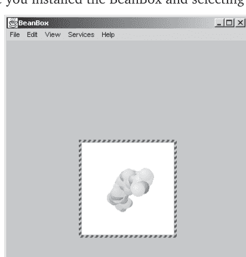

#### 步骤 3：

这个bean只有一个属性：moleculeName。你将使用屏幕右侧的Properties窗口，将该属性更改为巴克明斯特富勒烯分子。（我选择巴克明斯特富勒烯bean有个人原因。大学时我曾为分析化学课程写过一篇关于富勒烯的研究论文。是的，在你发邮件之前，我确实意识到对一种分子结构产生情感有点奇怪；我能说什么呢？）你可以随意选择任何你想要的分子。


你应该会注意到画布上显示的分子立即发生了变化。这就是BeanBox的奇妙之处。当你更改bean属性时，你可以立即看到这些更改的效果。


#### 步骤 4：

现在是时候序列化这个组件了。别担心，这一点也不会伤到你。只需从下拉菜单中选择`File ▶ Serialize Component`。然后会出现一个对话框，提示你为希望保存状态数据的文件命名。你实际上可以选择任何你喜欢的文件名；然而，我建议你选择`molecule.ser`。

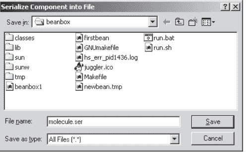

#### 步骤 5：

序列化还剩最后一步。从下拉菜单中选择`File ▶ Save`。这将保存整个bean。你的bean以及你所做的属性更改现在被序列化了。什么？你不信？继续看下去，接下来的两个步骤会让你信服！

#### 步骤 6：

清空工作区。你可以通过从下拉菜单中选择`File ▶ Clear`来清空画布。

#### 步骤 7：

现在是见证真相的时刻。选择`File ▶ Load`重新加载你的bean。你应该会注意到它完全恢复到了之前的状态。

瞧！你刚刚使用了序列化和反序列化。这虽然比不上大卫·科波菲尔的魔术表演，但仍然令人兴奋。至少，对我来说很兴奋，不过话说回来，我对分子结构是有感情的。

我认为关于前面的例子，你最应该注意到的是序列化和反序列化的整个过程是在后台发生的，并且对你这个bean开发者来说是完全透明的。你所做的只是选择了Save选项。然而，这实际上导致了bean对自身进行序列化。但是，如果你查看硬盘上bean所在的目录，你现在会注意到一个`molecule.ser`文件。你确实没有理由用文本编辑器打开那个文件，但我敢肯定至少有些读者会这么做（你们这群调皮鬼！）。如果你真的用文本编辑器打开了它，不要惊讶；大部分内容将是难以理解的。这并不表示有任何问题，而是完全正常的。数据呈现这种方式的原因是，它采用了一种特定的格式，JavaBean在反序列化bean时期望看到这种格式。

## Serializable 接口

既然你已经对通过序列化实现持久化的概念有了初步（尽管简短）的介绍，现在是时候更深入地了解序列化接口了。由于这个接口使你能够执行序列化，你明智地了解它的工作原理、能做什么以及不能做什么，似乎是审慎的。

`Serializable` 接口位于`java.io`包中。这个接口没有定义任何方法或常量。它的唯一目的是标识实现它的类希望其状态被序列化。`Serializable` 接口绝不是唯一没有实现代码的接口。不定义任何方法或常量的接口通常被称为*标记接口*。它们的目的仅仅是标识实现它们的类是某种特定类型的类。为了使用序列化，必须实现一个类（或其父类）的`java.io.Serializable`接口。如果你尝试序列化一个未实现此接口的对象，将会抛出`java.io.NotSerializableException`。

值得注意的是，并非所有类都是可序列化的。幸运的是，经常与图形界面一起使用的大多数类都是可序列化的。这是幸运的，因为大多数标准JavaBean（我们前四章讨论的那种JavaBean）都实现了图形接口，无论是来自AWT还是Swing（请原谅我这里的无耻宣传，但如果你希望了解更多关于Swing的知识，你可以看看我的书*JBuilder JFC and Swing Programming*，该书将于2002年底出版）。例如，`Component`类，因此它的所有子类，都是可序列化的。这意味着所有各种AWT（抽象窗口工具包）组件（文本框、按钮等）都是可序列化的。

然而，正如我所提到的，并非所有类都是可序列化的。例如，`Thread`类就不是可序列化的。原因在于线程的实际实现与Java虚拟机（JVM）的特定实现密切相关。尝试在不同的平台上序列化线程组，其复杂性是令人生畏的任务。因此，这个类就是不可序列化的。我也不知道在未来的Java版本中有任何计划使其可序列化。

`java.io`包中的一些类不可序列化。考虑到`java.io`包正是包含`Serializable`接口的包，这可能让你觉得有点奇怪。然而，由于这些类中的一些运作方式，序列化变得不切实际。由于文件访问类（如`FileInputStream`）具有瞬时状态，取决于文件写入或读出的量，在给定时刻持久化它们的状态可能非常困难。因此，许多`java.io`类就是不可序列化的。出于类似的原因，`java.net`包中的许多类，如`Socket`和`ServerSocket`，也是不可序列化的。

## Java 2 持久化的基础

JavaBeans API规范详细说明了JavaBean序列化机制的具体细节。对于那些希望比本书更深入研究这个主题的读者，你应该参考Java API规范（附录A中提供了这个和其他资源的URL）。然而，在接下来的几段中，我将努力让你一瞥JavaBean持久化幕后发生的事情。一个称职的JavaBean开发者完全有可能不需要这些


## 序列化流

正如我已经提到的，序列化是通过将关于特定对象的数据写入机器上的一个简单平面文件来完成的。此文件以 `.ser` 后缀结尾。您应该知道，Java 文件是通过 `java.io` 中的流类进行读写的。因此，存在对序列化过程至关重要的流类也就不足为奇了。与持久性主题特别相关的三个流类是 `ObjectOutputStream`、`ObjectInputStream` 和 `ObjectStreamClass`。这三个类对于序列化过程至关重要，将在本节中进行详细讨论。

`ObjectOutputStream` 类显然与序列化有关（与之相对的是反序列化，由 `ObjectInputStream` 类处理）。此类用于序列化简单数据类型、数组，甚至对象。它有许多方法，其中几个在序列化过程中使用。此类的所有方法都可能抛出 `IOException`。`ObjectOutputStream` 类的方法总结在下表中：

| 方法 | 描述 |
|---|---|
| void close() | 此方法关闭流。 |
| void flush() | 此方法刷新流。 |
| void reset() | 此方法重置流。 |
| void write(int l) | 此方法将整数写入流。 |
| void write(byte b[]) | 此方法将字节数组写入流。 |
| void write(byte b[], int index, int num) | 此方法将数组中的一定数量的字节写入流。它从提供的索引处开始。 |
| void writeBoolean(Boolean b) | 此方法将布尔值写入流。 |
| void writeByte(int b) | 此方法将单个字节写入流。 |
| void writeByte(String str) | 此方法将一系列字节写入流。 |
| void writeChar(int chr) | 此方法将单个字符写入流。 |
| void writeChars(String str) | 此方法将一系列字符写入流。 |
| void writeDouble(double d) | 此方法将双精度浮点数写入流。 |
| void writeFloat(float f) | 此方法将单精度浮点数写入流。 |
| void writeInt(int l) | 此方法将整数写入流。 |
| void writeLong(long l) | 此方法将长整型写入流。 |
| void writeObject(Object o) | 此方法将对象写入流。 |
| void defaultWriteObject() | 此方法将类的非静态和非瞬态值写入流。 |

如果您正忙于尝试记忆上表，则无需付出那样的努力。深入了解所有这些方法并非关键。重要的是您对这些方法有基本的熟悉程度。但是，您应特别注意最后两个方法。`defaultWriteObject()` 方法处理标准持久化。正如您可能猜到的，`writeObject()` 方法用于持久化整个对象，并与对象序列化一起使用。

`ObjectInputStream` 类用于反序列化对象。请记住，反序列化是在对象重新实例化时恢复该对象先前状态的过程。`ObjectInputStream` 类负责从保存该对象状态信息的文件中读取数据。下表总结了此类的方法。

| 方法 | 描述 |
|---|---|
| int available() | 此方法返回可用于读取的字节数。 |
| void close() | 此方法关闭流。 |
| void defaultReadObject() | 此方法读取类的所有非静态和非瞬态字段。 |
| int read() | 此方法从流中返回单个字节。如果没有可用数据，则阻塞。 |
| int read(byte b[], int index, int num) | 此方法从流中读取一定数量的字节（num）到数组中，从提供的索引处开始。 |
| Boolean readBoolean() | 此方法从流中读取布尔值。 |
| Byte readByte() | 此方法从流中读取单个字节。 |
| Char readChar() | 此方法从流中读取单个字符。 |
| Double readDouble() | 此方法从流中读取双精度浮点数。 |
| Float readFloat() | 此方法从流中读取单精度浮点数。 |
| Int readInt() | 此方法从流中读取整数。 |
| Long readLong() | 此方法从流中读取长整型。 |
| int skipBytes(int num) | 此方法跳过流中的一定数量的字节。 |

同样，您可以停止记忆此表。与上表一样，理解每一个方法并非关键。但是，您应对所使用的方法和过程有基本的熟悉程度。提供此表主要是作为参考工具，以帮助您理解反序列化。在编写自己的 JavaBeans 时，您可能需要参考它（当然，您会将这本书放在桌上，随时可以取用！）。

## 对象持久化

您已经看到，可以持久化单个变量。通常，您会有成员变量是原始数据类型，例如 `integer`、`long`、`float` 等。这些原始数据类型可以使用标准序列化技术轻松持久化。只需将它们设为成员变量，并且不要将它们声明为 `transient` 或 `final`。然而，这并非成员变量持久化的极限。持久化整个对象也是可能的。正如您可能猜到的，这被称为对象持久化。对象持久化可能看起来是一个新颖甚至令人生畏的概念；然而，它实际上并不比标准序列化更难掌握和使用。通过在您的类中实现和使用两个特定方法，您可以覆盖默认序列化，转而使用对象持久化。

如果在您实现 `Serializable` 接口的类中，您为以下两个方法中的任何一个提供了实现，那么默认序列化将不会发生。相反，这些方法将用于执行对象序列化。

此处列出相关方法：

```
private void writeObject(java.io.ObjectOutputStream out)
    throws IOException;
private void readObject(java.io.ObjectInputStream in)
    throws IOException, ClassNotFoundException;
```

这些方法的存在将自动覆盖默认序列化机制。然后您将使用这些方法来实现对象序列化。您可以利用这两个对象来处理更复杂对象的序列化。回想一下，通常，序列化只是存储类的实例变量的值。但是，当您希望存储的值是复杂对象时，您将需要不同的序列化方法。

您可以通过编写自己的 `writeObject` 和 `readObject` 方法实现来控制更复杂对象的序列化方式。当您需要对哪些数据被序列化进行更多控制时，可以使用 `writeObject` 方法。当您需要序列化默认序列化无法处理的对象时，对象序列化就是使用的方法论。然后您可以实现 `readObject` 来重建您用 `writeObject` 写入的数据流。您可能不需要频繁使用对象序列化。我甚至可以保证，完成本书您不需要用到它。如果您正在寻找关于该主题的更深入信息，我建议您参考 Sun Microsystems 文档或 JBuilder 帮助文件。

## Externalizable 接口

如前所述，`Serializable` 接口只是实现对象持久性的方法之一，尽管是最常用的方法。`Externalizable` 接口是您可以使用的另一种方法论，它让您对持久化过程拥有更大的控制权。当您需要完全控制 Bean 的持久化时，应考虑使用 `Externalizable` 接口。为了使此接口工作，您需要实现两个方法：`readExternal` 和 `writeExternal`。就像可序列化类一样，可外部化类也必须实现一个无参构造函数。

与序列化不同，外部化时每个单独的变量不会写入流中。序列化流中只写入可外部化实例的类标识。保存和恢复实例变量内容的责任必须由类本身处理。`Externalizable` 接口的 `writeExternal` 和 `readExternal` 方法由希望使用外部化来持久化的类实现。这些方法使类能够完全控制对象的流内容。它们还提供对格式的控制，这是选择外部化而非序列化的主要原因之一。

Java 2 中实现的持久性并非一项全新的技术。Java 2 中的 JavaBeans 持久性实际上是建立在 Java 1.1 的两个特性框架之上：对象序列化和内省。正如我将在本章后面向您展示的，如果您愿意，仍然可以覆盖 Java 2 序列化并实现对象序列化。

为了支持 Java 2 中的持久性，有必要向 `java.io` 包添加几个类和接口。当然，这些新的类和接口可以读写 Java 所有的内置数据类型（`int`、`float`、`double` 等）。描述如何读写这些数据类型的接口在 `java.io.DataOutput` 和 `java.io.DataInput` 中指定。

我知道对于本书的主题，您可能只需要知道这些基本知识，但我始终觉得，对于任何想要使用的技术，拥有更全面的理解总是更好的。此外，我确信我的读者绝不会满足于仅仅胜任而已！


当一个可外部化的对象被重建时，系统会使用公共无参构造函数创建一个实例。然后调用 `readExternal` 方法来读取已存储的状态信息。

对象序列化可以使用 `Serializable` 或 `Externalizable` 接口。每个待存储的对象都会被检查是否支持 `Externalizable` 接口。如果对象支持可外部化，则调用 `writeExternal` 方法。但是，如果对象不支持可外部化但确实实现了 `Serializable` 接口，则对象将使用 `ObjectOutputStream` 进行保存。

显然，对象序列化涉及一些标准序列化所不包含的复杂性。正如我之前所说，在大多数情况下，您只需使用标准序列化即可，因为它实现起来要容易得多。然而，在某些情况下，您可能需要使用对象序列化。

## JBuilder 中的序列化

与 Java 中的其他所有内容一样，使用 JBuilder 实现序列化要容易得多。让我们看一个 JavaBean 示例，并使用 JBuilder 为其添加序列化功能。

一旦您有一个希望序列化的 bean，实现起来就很简单。回想一下，在 JBuilder 中，当您选择“文件”▸“新建”时，您可以选择将新代码设为 JavaBean，如下图所示：

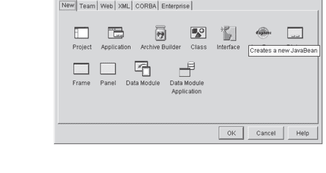

选择底部的“Bean”选项卡，然后选择“常规”选项卡。剩下的就是勾选“支持序列化”复选框：

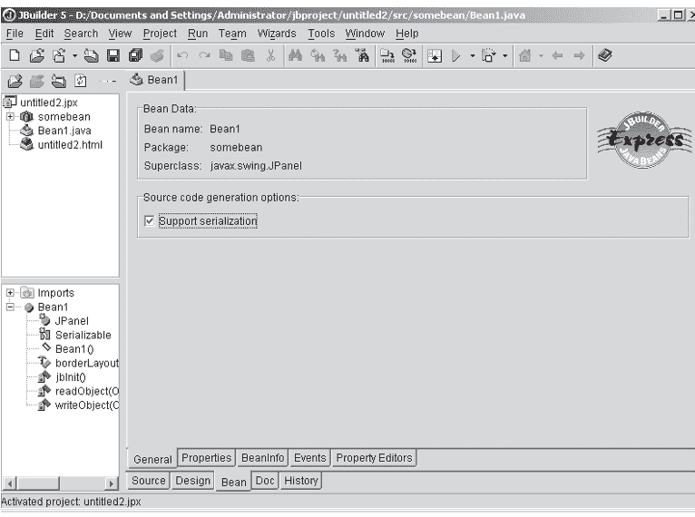

执行此操作后，`implements serializable` 代码将自动添加到您的 bean 类中。如果您返回“源代码”选项卡查看源代码，您将看到类似这样的内容：

```
package somebean;
import java.awt.*;
import javax.swing.JPanel;
import java.io.*;
public class Bean1 extends JPanel implements Serializable
{
    BorderLayout borderLayout1 = new BorderLayout();
    public Bean1()
    {
        try
        {
            jbInit();
        }
        catch(Exception ex)
        {
            ex.printStackTrace();
        }
    }
    private void jbInit() throws Exception
    {
        this.setLayout(borderLayout1);
    }
    private void WriteObject(ObjectOutputStream oos) throws IOException
    {
        oos.defaultWriteObject();
    }
    private void ReadObject(ObjectInputStream ois) throws
        ClassNotFoundException, IOException
    {
        ois.defaultReadObject();
    }
}
```

请注意，为您生成的源代码包含了有效 JavaBean 所需的所有必要项。它导入了 `java.io` 并实现了 `java.io.Serializable`。提供了一个无参构造函数。您还应该注意两个方法：`WriteObject()` 和 `ReadObject()`。如您所见，JBuilder 省去了创建 JavaBean 的大量工作。

您还应该注意，JBuilder 为您生成的各种方法都抛出了相应的异常。您可能需要在 bean 中编写一些异常处理，但只需在较高的层次上进行，因为所有方法都抛出了适当的异常。但是，您应该注意，主方法（即启动所有其他代码的方法）中有一个通用的 try-catch 块。因此，您可以直接使用该代码。

## 总结

本章向您介绍了 JavaBeans 和企业 JavaBeans 的一个关键主题——持久化。您看到了有两种不同的接口允许您实现持久化，每种都有其自身的优缺点。您应该回忆一下，绝大多数 JavaBeans 使用序列化接口的自动持久性。本章也标志着标准 JavaBeans 部分的结束。这四章的目的绝非让您成为 JavaBeans 专家。但是，如果您缺乏 JavaBean 开发背景或需要复习，那么这些章节应该已经让您具备了必要的理解，以便继续学习本书的主要内容——企业 JavaBeans。请在继续之前，确保您完全掌握了前四章的概念。然而，我必须强调，序列化将是本书后面一个至关重要的概念。请在继续之前确保您扎实掌握了该主题。

第 4 章：JavaBean 持久化

107

## 术语

*Externalizable（可外部化）* —— 一种持久化形式，允许程序员更精确地控制哪些变量被持久化。

*java.io.NotSerializableException* —— 如果您尝试序列化一个来自不支持序列化的类的对象，则会抛出此异常。

*序列化流（Serialization Stream）* —— 用于读取和写入序列化数据到数据存储所在的平面文件，以及从该文件读取的流。

*.ser 文件* —— 用于存储序列化数据的平面文件。

*反序列化（De-serialization）* —— 从平面文件将数据恢复到对象的过程。

*对象序列化（Object Serialization）* —— 序列化对象变量的过程。

## 复习题

1.  什么是持久化？
2.  哪两种接口允许您实现持久化？
3.  在一个实现了 `Serializable` 的类中，如何使某个特定的实例变量不被持久化？
4.  实现 `Serializable` 接口的类必须使用什么类型的构造函数？
5.  线程对象是可序列化的吗？
6.  `Serializable` 接口位于哪个包中？
7.  对象序列化中使用哪两种方法？
8.  何时应该实现 `Externalizable` 而不是 `Serializable`？
9.  `Externalizable` 有什么优点？
10. 套接字类是可序列化的吗？

EJB 编程

# 第 5 章

## 企业 JavaBeans 介绍

### 简介

既然您已经了解了 JavaBeans 的基本概念和用途，您应该准备好前进到企业 JavaBeans 了。本章旨在作为从关于标准 JavaBeans 的前四章过渡到企业 JavaBeans 主题的桥梁。为此，您在继续之前必须牢固掌握前四章中介绍的主题。显然，如果您有开发 JavaBeans 的背景，那么您应该准备好直接进入企业 JavaBeans。如果没有，您应该学习本书的前四章。在本章中，我将努力为您提供企业 JavaBeans 的基础工作和概念知识库，这将贯穿本书的剩余部分。我强烈建议您在进入第 6 章之前，确保您非常熟悉本章内容并彻底理解它。

前四章已经带您逐步了解了 JavaBeans 的基本概念。这些章节向您介绍了 JavaBeans 背后的概念、JavaBeans 的用途以及简单 JavaBeans 的创建。然而，本书的主要重点是 *企业 JavaBeans*。本章将总结企业 JavaBeans 的用途、特性和类型。本章的材料为本书其余大部分内容提供了重要的概述。事实上，第 6 章到第 12 章实际上只是您将在本章中初步介绍的主题的扩展。有些读者可能会忍不住跳过这个概述，直接进入下一章。我强烈建议不要这样做，因为本章提供的概述将为您完全掌握后续章节中介绍的主题提供必要的基础。

在您继续阅读本书之前，我需要解决一个基本问题。这个问题很简单：什么是企业 JavaBeans，它们与标准 JavaBeans 有何不同？显然，两者都是 JavaBeans，因此具有一些相似的特性。然而，我向您保证，两者的功能大不相同。企业 bean 是在应用服务器内运行的服务器端组件。它与标准 JavaBeans 有一些显著的不同。首先，它不被用作其他应用程序的构建块。相反，它本身就是一个可部署的组件。事实上，在能够使用之前，它总是会被部署到 EJB 容器中。EJB 永远不会被用作应用程序的构建块，尽管它通常是多层系统中的一个组件。

企业 JavaBeans 最常见的用途是封装多层应用程序的业务逻辑。业务逻辑是实现应用程序主要功能的代码。您可以将业务逻辑视为多层应用程序的“引擎”。例如，如果您有一个销售应用程序，您可能会创建一个企业 JavaBean，该 bean 封装了各种销售规则，例如验证库存、计算销售税和总计佣金。企业 JavaBeans 是创建多层应用程序的首选 Java 方法。下一节提供了分布式应用程序的概述，本书后面将对分布式应用程序进行更详细的探讨。


由于企业JavaBean（EJB）不是构建应用程序的组件，它们不是小程序，也不是控制台应用程序，你可能会好奇它们如何以及在哪里运行。它们运行在服务器上，由一个称为应用服务器的EJB容器托管。许多EJB开发者为此目的使用BEA WebLogic。然而，购买了Borland JBuilder企业版的用户已经拥有了一个功能齐全的应用服务器。该版本的JBuilder自带应用服务器，以及许多其他有趣且有用的工具。无论你使用哪个具体品牌，这个应用服务器所做的事情远不止简单地为Enterprise JavaBean提供一个容器。它处理分布式应用程序所需的许多服务。例如，EJB容器负责系统级服务，例如事务管理和安全授权。

Enterprise JavaBeans可以显著简化分布式应用程序的开发。Enterprise JavaBeans可以简化你的开发，因为它们运行在应用服务器中。这个EJB容器为企业Bean提供了许多服务，从而让Bean开发者能够专注于解决业务问题，而不是实现和维护业务层的细节。Enterprise JavaBeans还能简化分布式应用程序开发，因为业务逻辑包含在EJB中，允许客户端开发者专注于客户端的呈现。这也意味着客户端变得更"瘦"。更瘦的客户端意味着需要的资源更少（即占用更少的RAM）。由于业务逻辑实际上位于驻留在应用服务器上的EJB上，客户端可以相当小，无需无用资源。虽然这在任何开发场景中都可能是一个优势，但对于运行在低资源设备上的客户端尤其有用。瘦型或轻量级客户端也使部署客户端变得更加简单。客户端的资源和依赖项越少，你需要分发和配置的东西就越少。这也意味着对业务逻辑的修改不需要重写和重新部署客户端。

## 分布式应用程序

由于Enterprise JavaBeans用于分布式应用程序的开发，简要讨论一下分布式应用程序似乎是审慎的。许多读者已经熟悉分布式应用程序。本节是为那些不熟悉或只是想简单复习一下这个主题的人提供的。分布式应用程序已成为现代业务开发的规范，因此任何开发者都必须彻底熟悉这个主题。

过去，大多数应用程序是单组件的单体应用程序。从用COBOL编写的大型机应用程序到用C编写的桌面应用程序，一切都由单个单体组件构成。如果流程的任何部分发生变化，整个应用程序都必须重新编译和重新分发。这种单层方法也阻碍了可扩展性。如果业务如所有企业所希望的那样增长，单元软件无法轻松扩展以处理增加的需求。这种类型的架构设计被称为单层架构。

最终，客户端-服务器应用程序的概念变得突出。在客户端-服务器架构中，有一个集中的服务器组件用于存储数据。业务规则也可以在这一层实现，或者可以在客户端实现。客户端层位于各个机器上，为用户提供与系统交互的接口。该界面通常是图形化的。当你使用网页时，你正在与一个客户端-服务器系统交互。你的网络浏览器是客户端，你连接的网络服务器是服务器。

虽然这种架构比单元应用程序有了显著改进，但它仍然存在一些严重的局限性。可扩展性仍然难以实现。如果你有多种类型的客户端，例如桌面应用程序客户端或Web界面客户端，也会出现问题。然而，这种类型的架构是分布式的，被称为两层架构。

分布式架构发展的下一阶段是*n*层架构。*n*只是代表某个数字，通常大于二。三层和四层架构相当常见。在这个系统中，额外的层被插入到客户端和数据库之间。

你可能会发现一个处理组织所有业务规则的业务层。你也可能会发现一个处理与数据库实际通信的数据库层。

*N*层架构有助于可扩展性和可维护性。如果系统的特定部分成为性能瓶颈，那么该层可以分布到多个服务器上，或者简单地移动到更强大的服务器上。这两种方法对客户端应用程序都可以完全透明。此外，客户端应用程序本身只需要处理向用户呈现界面以及与下一层的通信。这意味着你可以创建非常轻量级的客户端。

Enterprise JavaBeans特别适合*n*层架构。它们最常用于创建业务层，但也可以创建数据库层。事实上，它们适用于除实际用户界面之外的任何层。EJB的全部目的是在多层架构中为你提供中间层。它们可以在你的分布式架构中充当数据层、业务层或其他一些中间层。然而，它们从不用于表示层。表示层几乎总是GUI（图形用户界面）客户端。EJB根本不适合这项特定任务。更适合表示层的技术包括小程序、HTML文档、Java服务器页面和标准Java应用程序。

## 何时应该使用EJB？

虽然我恰好认为Enterprise JavaBeans是开发者的绝佳工具，但没有工具能完美适用于每种情况。在你开始创建自己的Enterprise JavaBeans之前，了解使用这些Bean的最合适情况很重要。当然，你几乎可以在任何情况下使用EJB。然而，像任何工具一样，以非设计方式使用它肯定会降低该工具的有效性。如果你的应用程序需求包括以下任何一项，你应该考虑使用Enterprise JavaBeans：

- 应用程序可能拥有多样化的客户端。EJB可以同时被多种客户端访问。你可能有一个标准Java应用程序和一个Java服务器页面，但作为同一EJB的不同类型的表示层。
- 应用程序需要可扩展。可扩展性是任何开发企业解决方案的人应该关注的问题。EJB可以移动到不同的机器上，并且位置对客户端是透明的。这意味着如果你需要升级到更好的机器或将组件分布到更多机器上，可以相对容易地完成。

## EJB的类型

既然你已经对什么是Enterprise JavaBean以及在哪些情况下最适合使用它有了基本了解，是时候开始更详细地描述EJB了。描述任何对象的第一步是分类。Enterprise JavaBeans不止一种，这些不同类型的EJB根据其功能进行分类。有三种类型的Enterprise JavaBeans：会话Bean、实体Bean和消息驱动Bean。每种类型都有不同的用途，行为也与其他类型有些不同。本章将讨论每种类型，并在后续章节中更全面地探讨。事实上，每种类型的EJB都有专门的一章，在某些情况下是两章。下表列出了三种不同类型的企业Bean：

| 类型 | 用途 |
| --- | --- |
| 会话Bean | 为客户应用程序执行任务。 |
| 实体Bean | 代表存在于持久性存储中的业务实体对象。 |
| 消息驱动Bean | 作为Java消息服务API的监听器，异步处理消息。 |


## 会话 Bean

第一种 Bean 类型，即会话 Bean，可能是最常遇到的企业级 Java Bean (EJB) 类型。顾名思义，会话 Bean 代表与客户端的单次会话。当然，这会引出一个明显的问题：会话究竟是什么？*会话*是在特定时间框架内发生的一系列事件。一旦客户端与服务器断开连接，会话就结束了。会话的另一个更通用的术语是对话。你可以将会话视为客户端与企业级 JavaBean 之间一次有限的对话。每次对话只涵盖一个主题，当对话结束时，双方断开连接。

会话 Bean 代表应用程序服务器中的单个客户端。要访问部署在服务器上的应用程序，客户端会利用会话 Bean 的公共方法和属性。会话 Bean 为其客户端执行任务并将结果返回给客户端。它代表与客户端的单次交互会话。会话 Bean 不能被多个客户端同时共享；同一时间只能有一个用户使用它。然而，一个会话 Bean 可以有无限数量的顺序客户端。换句话说，会话 Bean 一次只能处理一个客户端，但它可以按顺序处理几乎无限数量的客户端。

会话 Bean 的一个重要特性是它们是非持久化的（请回想第 4 章关于持久化的讨论）。当客户端终止时，其会话 Bean 似乎也随之终止，并且不再与该客户端关联。其状态信息不会被保留，其数据也不会保存到任何类型的永久存储中。但是，需要注意的是，会话 Bean 很可能只是被返回到应用程序服务器中的一个 Bean 池中，而并非真正被销毁。通常，EJB 容器会将可用的会话 Bean 保存在池中。当客户端请求会话 Bean 的服务时，其中一个可用的 EJB 会从池中取出并提供给客户端。会话结束后，该 Bean 会被返回到池中。

会话 Bean 实际上有两个子类型：有状态和无状态。

对象的状态本质上由其在实例变量中的值组成。在有状态会话 Bean 中，这些实例变量代表特定客户端-Bean 会话的状态。由于客户端与 Bean 进行交互，这种状态有时也被称为会话状态。所有会话 Bean 的状态在客户端-Bean 会话期间都会保留。如果客户端移除该 Bean 或终止连接，会话结束，状态消失。有状态会话 Bean 本质上就是那种在会话结束前保留其与客户端对话的当前状态的 Bean。重要的是，不要将这与持久化混淆，持久化是在会话之间存储状态，而会话 Bean 并不这样做。有状态会话 Bean 可能在一段包含多个不同方法调用的时间内继续其与客户端的“对话”。客户端-Bean 会话可能跨越多个方法调用，这就是为什么有状态会话 Bean 会在方法调用之间保留状态信息的原因。

无状态会话 Bean 就是不为客户端维护任何会话状态的会话 Bean。当客户端调用无状态 Bean 的方法时，Bean 的实例变量可能包含一个状态，但仅存在于该方法执行期间。当方法执行完毕后，状态就不再被保留。有状态会话 Bean 在整个会话期间保留状态，而无状态会话 Bean 仅在执行一个方法所需的时间内保留给定的状态。超出执行单个方法所需的时间后，会话就不再保持。因此，本质上，无状态会话 Bean 适用于单次方法调用的对话，如果会话期间需要调用多个方法，那么有状态会话 Bean 就是合适的选择。

你可能会想，为什么有人会希望拥有无状态会话 Bean？为什么不总是保留客户端状态呢？由于无状态 Bean 在整个会话期间不保留客户端的状态，它可以支持多个同时连接的客户端。因为无状态会话 Bean 可以并发支持多个客户端，它们能为需要大量客户端的应用程序提供更好的可扩展性。由于你不需要在无状态会话 Bean 和客户端之间保持一对一的比例，因此支持相同数量的客户端，应用程序所需的无状态会话 Bean 比有状态会话 Bean 更少。

重要的是要弄清楚何时使用会话 Bean，而不是实体 Bean 或消息驱动 Bean。尽管我还没有向你解释这些其他的 EJB 类型，但我仍然可以给你一个充分的答案。有几种情况更适合使用会话 Bean 而不是其他类型的 Bean。如果在任何给定时间，有多个客户端可以访问 Bean 实例，那么可能更倾向于使用会话 Bean。如果 Bean 的状态不需要是持久化的，只需短期存在，那么会话 Bean 更合适。或者简单地说，如果你不需要持久化，不想表示一个数据库表，并且希望几个客户端与单个 EJB 交互，那么会话 Bean 是合乎逻辑的选择。

一旦你确定会话 Bean 是你情况的合适选择，你仍然需要做出另一个决定。然后你需要确定是有状态还是无状态会话 Bean 更适合你的情况。有状态 Bean 就是在给定会话期间维护状态信息的 Bean。无状态 Bean 甚至不在方法调用之间保留状态信息。

如果 Bean 的状态表示该 Bean 与单个特定客户端之间的交互，你可能希望使用有状态 Bean。或者，如果客户端-EJB 的交互需要多次方法调用才能完成，有状态会话 Bean 可能是你的最佳选择。但是，如果你的 Bean 需要同时与多个客户端协作，你将需要使用无状态 Bean。如果 Bean 需要在方法调用之间持有客户端的信息，你将需要一个无状态会话 Bean。在选择将使用何种类型的会话 Bean 之前，请仔细考虑你的开发项目的情况。第 7 章和第 8 章详细讨论了无状态和有状态会话 Bean。那些章节也向你展示了如何创建自己的会话 Bean。

你会注意到第 7 章和第 8 章完全致力于会话 Bean。会话 Bean 获得整整两章篇幅的原因很简单：会话 Bean 是最常用的 Bean 类型。它们也可能是最简单易创建和实现的。因此，它们值得比其他类型的企业级 JavaBeans 获得更彻底的讲解。

## 实体 Bean

我想介绍的下一种企业级 JavaBean 是实体 Bean。实体 Bean 代表特定的业务对象或实体，因此得名。它们通常与底层数据库紧密相关，并可能表示数据库中的一个实际表。由于它们代表的是特定的业务对象，而不是特定的会话，因此它们支持持久化。考虑到特定的业务对象可能独立于与其交互的特定客户端会话而存在，这应该是相当明显的。简而言之，实体 Bean 表示具有持久存储机制的某些业务对象。在 Java 2 企业版软件开发工具包 (SDK) 中，持久存储机制是关系数据库。每个实体 Bean 在关系数据库中都有一个关联的表。由于你可能在任何给定时间有多个活动的实体 Bean 实例，因此 Bean 的每个实例都存储在该表的单独一行中。数据库只是一个标准的关系数据库。你可以使用任何你熟悉的数据库系统。在本书中，我使用 Microsoft Access 示例，仅仅是因为 Microsoft Access 非常常见，并且读者很可能可以访问它。然而，所示的技术同样适用于 Oracle、DB2 或 Microsoft SQL Server。

实体 Bean 和会话 Bean 之间有几个区别，但最明显的是实体 Bean 支持持久化。会话 Bean 不能在会话之间保留其状态；然而，实体 Bean 可以并且确实会保留其状态。事实上，实体 Bean 不仅可以保留其状态，它*必须*保留其状态。只要它所代表的业务对象是一个有效且可访问的业务对象，它就必须保留该状态。除了支持持久化之外，实体 Bean 还允许共享访问。这意味着多个客户端可以同时访问同一个实体 Bean。记住，实体 Bean 代表某个业务对象，而不是特定的会话。因此，支持多个客户端同时访问是完全合理的。

第 4 章已经相当详细地讨论了持久化。如果你需要温习该主题，请重读该章。但是，在实体 Bean 的情况下，持久化的含义可以总结如下：持久化意味着实体 Bean 的状态存在于应用程序或应用程序服务器进程的生命周期之外。肯定会有这种情况变得必要的时候。

对于实体Bean，持久性实际上分为两种类型：Bean管理持久性和容器管理持久性。Bean管理持久性与容器管理持久性的根本区别在于，是否由Bean本身负责底层的持久化机制。在Bean管理持久性中，实体Bean的代码包含访问数据库的调用。持久化机制在Bean内部管理。这意味着，作为EJB程序员，你需要在实体Bean中编写实际的数据库访问代码。然而，在容器管理持久性中，EJB容器会自动生成必要的数据库访问调用。容器（通常是应用程序服务器）负责处理持久化机制。

实体Bean可以被多个客户端共享。但是，不同的客户端可能希望操作相同的基础数据。如何处理这个问题至关重要，不仅对于EJB开发，对于任何分布式开发都是如此。因此，实体Bean在*事务*中工作。事务是一组内聚的操作，通常是方法调用和返回，它们协同工作，通常在自己的线程中。你将在本书后面更深入地了解事务。目前，只需要基本的操作知识。你不需要深入了解事务的原因是，Enterprise JavaBean容器将为你处理大部分事务细节。通常，EJB容器负责管理事务；开发人员不需要直接处理事务管理的编码。程序员只需在Bean的部署描述符中指定事务属性。

回想一下，实体Bean将其状态信息存储在底层的关系数据库管理系统中。这意味着实体Bean与RDBMS的结构有一些共同点，例如主键。每个实体Bean都有一个唯一的对象标识符或主键，用于标识该Bean。这个唯一标识符使客户端能够定位特定的实体Bean。

实体Bean与关系型数据库系统的另一个重要共同特征是能够在对象之间建立明确的关系。在关系型数据库中，一个数据库表中的一条记录或一组记录可以与一个或多个其他数据库表中的记录相关联或链接。事实上，“关系型数据库”这个术语本身就指的是数据库的各个元素之间具有明确定义的关系。这对EJB开发意味着一个实体Bean可以与其他实体Bean相关。例如，在一个员工应用程序中，EmployeeEJB和JobDescriptionEJB Bean可以是相关的。

关系处理是Bean管理持久性和容器管理持久性之间的一个关键区别。在Bean管理持久性中，程序员必须编写管理持久化的代码。然而，在容器管理持久性中，EJB容器处理关系。因此，具有容器管理持久性的实体Bean中的关系通常被称为容器管理关系。

记住，容器管理持久性意味着EJB容器处理实体Bean所需的所有数据库访问。Bean的代码不包含任何访问数据库的代码。这样做的好处是，容器管理的实体Bean不绑定到特定的数据库平台，使其更具可移植性。

为了生成处理数据访问调用的代码，容器需要你在实体Bean的抽象模式中提供的信息。

抽象模式是实体Bean部署描述符的一部分。它定义了Bean的持久字段和关系。“抽象”一词旨在说明此模式与底层数据库的物理模式之间的区别。例如，在关系型数据库中，物理模式由表、记录和列等结构组成。抽象模式的名称在部署描述符中指定。对于具有容器管理持久性的实体Bean，你必须为所有查找器方法（除findByPrimaryKey外）定义EJB查询语言查询。EJB查询决定了当调用查找器方法时EJB容器执行的查询。我们将在后面的章节中更深入地讨论这种查询语言。

## 接口

我简要讨论了客户端与会话和实体Enterprise JavaBeans的交互。你可能好奇客户端究竟如何与Enterprise JavaBeans交互。客户端不直接与EJB交互。事实上，客户端甚至不知道EJB在哪台机器上。但是，客户端知道企业正在使用哪个应用程序服务器。该应用程序服务器负责处理与EJB通信的具体细节。这是通过向客户端提供接口来实现的。接口与应用程序服务器通信，后者定位所需的EJB。客户端只能通过Bean接口中定义的方法访问会话或实体Bean。这些接口定义了客户端将如何查看Bean。所有其他方面的Bean都对客户端隐藏。

在我们实际开发Enterprise JavaBeans时，将接口的设计考虑周全将非常重要。理想情况下，在任何分布式架构中，接口都应该是不可变的，无论底层机制发生任何变化。这意味着一旦你设计了接口并部署它，它就不会改变。你可以更改接口内部的底层代码，但实际的方法声明、参数和返回类型不应更改。如果接口发生了更改，那么任何客户端应用程序也必须进行修改。精心设计的接口可以简化J2EE应用程序的开发和维护。例如，即使你将实体Bean从Bean管理更改为容器管理持久性，你也不应该必须更改客户端代码。如果你的接口设计良好，就会是这种情况。事实上，业务层的大多数更改对于客户端层应该是完全透明的。但是，如果你没有正确设计EJB，维护可能是一项非常繁琐的任务。

## 消息驱动Bean

正如你可能猜测的那样，消息驱动Bean通过消息传递来工作。如果你有使用C++（尤其是Visual C++）进行Windows编程的经验，你应该熟悉消息的概念。对于缺乏此类背景的读者，这里有一个简单的解释。消息类似于事件，但指向特定的目标。目标随后有代码来响应给定的消息。事件是通用的，任何组件都可以监听给定的事件，而消息则针对特定的对象。消息驱动Bean是一种允许应用程序异步处理消息的企业Bean。它充当消息监听器，类似于事件监听器，但接收的是消息而不是事件。消息可以由任何Java 2 Enterprise组件发送，无论是应用程序客户端、另一个企业Bean还是Web组件。在某些情况下，消息驱动Bean甚至可以接收来自非J2EE组件的消息，前提是它们以兼容的方式发送。消息驱动Bean依赖于Java消息服务（JMS）技术。因此，消息驱动Bean目前只能处理JMS消息。

消息被发送到消息驱动EJB，当消息到达时，容器调用消息驱动Bean的onMessage方法来处理消息。onMessage方法通常会将消息转换为五种JMS消息类型之一，并根据应用程序的业务逻辑进行处理。当然，onMessage方法可以调用其他辅助方法。它甚至可以调用会话或实体Bean来处理消息中的信息或将其存储在数据库中。

消息可以在事务上下文中传递给消息驱动Bean。这意味着onMessage方法中的所有操作都是单个事务的一部分。


此时，一个显而易见的问题是：消息驱动Bean与会话Bean或实体Bean之间存在哪些本质区别？消息驱动Bean与会话Bean和实体Bean最显著的区别在于，客户端不通过接口访问消息驱动Bean。与会话Bean或实体Bean不同，消息驱动Bean只有一个Bean类。在某些方面，消息驱动Bean类似于无状态会话Bean。

消息驱动Bean的实例不保持其状态。由于消息驱动Bean没有状态，因此一个消息驱动Bean的所有实例都是等效的。这意味着EJB容器可以将消息分配给任何消息驱动Bean实例。容器可以将这些实例放入池中，以便并发处理消息流。消息驱动Bean实例的实例变量可以在处理客户端消息的过程中包含一些非常有限的状态数据（例如，一个打开的数据库连接）。单个消息驱动Bean可以处理来自多个客户端的消息。

现在，我们当然会遇到何时使用消息驱动Bean而非会话Bean或实体Bean的问题。会话Bean和实体Bean也允许你发送和接收JMS消息。然而，会话Bean或实体Bean发送和接收的消息必须同步处理，而非异步处理。如果你希望异步接收消息，请使用消息驱动Bean。在任何分布式架构系统中，异步操作都至关重要。它们允许客户端在业务层中启动某些流程，而不会因等待流程结束而阻塞客户端。

所有Enterprise JavaBeans必须实现`javax.ejb.EnterpriseBeans`接口或从其继承的接口之一，例如`javax.ejb.SessionBean`或`javax.ejb.EntityBean`。这个接口只是一个标记接口（没有实现代码），仅用于将该类标识为EJB类。你应该注意，`javax.ejb.EnterpriseBeans`接口实现了`Serializable`。这是任何希望序列化其数据的类所必需的。这意味着所有EJB都具备序列化能力。

## EJB客户端

我本章的大部分内容都在向你介绍Enterprise JavaBeans的基础知识及其在多层企业系统业务层中的作用。然而，没有用户可与之交互的客户端层，任何系统都用处不大。因此，我需要花一点时间为你概述客户端层与Enterprise JavaBean业务层的交互情况，这很重要。当你设计一个J2EE应用时，首先要做的决定之一就是企业Bean允许的客户端访问类型。客户端只有两种访问选项：远程或本地。

使用远程访问与Enterprise JavaBean交互的客户端可能运行在与它访问的企业Bean不同的机器和不同的Java虚拟机（JVM）上。它可能是一个Web组件、一个J2EE应用客户端，甚至是另一个企业Bean。Enterprise JavaBean的位置对于远程客户端应该是完全透明的。

创建具有远程访问权限的企业Bean需要你实际创建两个接口。你需要创建一个远程接口和一个主接口。远程接口定义了特定于该Bean的业务方法。用户将通过调用远程接口来实际访问Bean的功能。主接口将定义Bean的生命周期方法。这些生命周期方法是`create`和`remove`。本质上，远程接口定义了与EJB的实际交互，而主接口仅允许客户端创建和销毁EJB的实例。对于实体Bean，主接口还必须定义查找器方法和主方法。查找器方法用于定位实体Bean。主方法是在实体Bean类的所有实例上调用的业务方法。

本地访问客户端必须与它访问的企业Bean在同一个JVM中运行。它很可能是Web组件或另一个企业Bean。本地客户端通常是一个实体Bean，它与另一个实体Bean具有容器管理的关系。它所访问的企业Bean的位置对于本地客户端不是透明的。

如果一个实体Bean是容器管理关系的目标，它必须具有本地接口。关系的方向决定了一个Bean是否是目标。由于它们需要本地访问，参与容器管理关系的实体Bean必须驻留在同一个EJB JAR文件中。这种本地接口方法的一个显著好处是性能提升。本地调用几乎总是比远程调用更快。

这在创建Enterprise JavaBeans之前增加了一个需要你做出的决定。那个决定是使用本地访问还是远程访问。如果一个实体Bean是容器管理关系的目标，那么这个决定就替你做好了；它必须使用本地访问。如果一个企业Bean被J2EE应用客户端访问，那么它应该允许远程访问。注意我说的是允许远程访问。这并不意味着它不能同时拥有，甚至主要使用本地访问。这些客户端几乎总是运行在与J2EE服务器不同的机器上。如果一个企业Bean的客户端是Web组件或其他企业Bean，那么访问类型取决于你希望如何分布你的组件。如果Web服务器和应用服务器在同一台机器上，本地访问可能是合适的。

决定实现哪种类型的另一个重要因素是你希望在EJB和客户端之间具有的耦合类型。紧耦合的Bean相互依赖。如果一个Bean与另一个Bean紧耦合，那么没有另一个Bean它就无法运行。如果你使用的是紧耦合的Bean，你至少应该考虑本地访问。由于这些组件作为一个逻辑单元一起工作，它们很可能会经常相互调用，并且会从本地访问可能带来的性能提升中获益。当客户端是另一个EJB时，耦合的决定尤其重要。

如果你不确定EJB应该具有哪种类型的客户端访问，请使用远程访问。这个决定给你更多的灵活性和可扩展性。将来，你可以分布你的组件以适应应用程序不断增长的需求。虽然不常见，但一个企业Bean确实可以同时允许远程和本地访问。然而，这样的Bean将同时需要远程和本地接口。

任何EJB程序员都需要认识到的一件重要事情是参数在不同接口中是如何传递的。远程调用中的参数是按值传递的，而本地调用中的参数是按引用传递的，就像Java编程语言中的普通方法调用一样。按值传递意味着某个变量中包含的值从调用函数复制到参数。在按引用传递中，传递的只是指向调用函数中该变量所在内存位置的引用。如果你仔细想想，按值传递看起来非常合乎逻辑。不可能按引用传递值给驻留在不同JVM、不同机器上的组件。指向内存地址的引用在另一台机器上将毫无意义。

由于远程调用中的参数是按值传递的，远程调用的参数比本地调用的参数隔离得更好。如果客户端更改了对象的值，Bean中副本的值不会改变。这种隔离层很容易有助于改进数据验证。请记住，按值传递时，客户端和Bean操作的是参数对象的不同副本。当按引用传递时，如在本地接口中，客户端和Bean可能修改同一个对象。

## 企业Bean的生命周期

与任何软件组件一样，EJB具有定义良好的生命周期。在开始开发自己的Enterprise JavaBeans之前，你应该熟悉这个生命周期。每种类型的企业Bean都有不同的生命周期。本节将讨论每种EJB的生命周期。

在有状态会话Bean的生命周期中，客户端通过调用`create`方法来启动生命周期。然后EJB容器实例化该Bean，并在该会话Bean中调用`setSessionContext`和`ejbCreate`方法。此时Bean被完全调用，准备好被调用其业务方法。EJB容器可能决定通过将Bean从内存移动到辅助存储器来使其失效，或称为钝化。这通过在钝化Bean之前立即调用Bean的`ejbPassivate`方法来完成。如果客户端在Bean处于被动阶段时对其调用业务方法，EJB容器将激活该Bean，将其移回就绪阶段，然后调用Bean的`ejbActivate`方法。当客户端使用完Bean后，它可以调用`remove`方法，然后EJB容器调用`ejbRemove`方法。

the bean's ejbRemove method. This marks the end of the stateful bean's life cycle, and the bean's instance is now ready for garbage collection.

无状态会话 Bean 永远不会被钝化。因此，其生命周期只有两个阶段：不存在和准备就绪。简而言之，无状态会话 Bean 要么准备好使用，要么从内存中移除。

实体 Bean 的生命周期与会话 Bean 略有不同。EJB 容器创建实例后，会调用实体 Bean 类的 setEntityContext 方法。setEntityContext 方法将实体上下文传递给 Bean。它实质上确定了该业务对象在什么上下文中操作。一旦实体 Bean 被实例化，它就进入可用实例池。在池化阶段，该实例与任何特定的 EJB 对象标识都不关联。池中的所有实例都是相同的。当将其移至就绪阶段时，EJB 容器会为该实例分配一个标识。实例从池化状态移动到就绪状态的一种方式是客户端调用 create 方法。这会导致 EJB 容器调用 ejbCreate 和 ejbPostCreate 方法。EJB 容器也可以通过调用 ejbActivate 方法将实例从池化状态移至就绪状态。在就绪阶段，可以调用实体 Bean 的业务方法。

正如您可能猜测的那样，客户端和容器也可以将实例从就绪状态移回池化状态。客户端可以调用 remove 方法，这会导致 EJB 容器调用 ejbRemove 方法。EJB 容器也可以调用 ejbPassivate 方法。当 EJB 容器将实例从池中移除并调用 unsetEntityContext 方法时，生命周期结束。

EJB 容器通常会创建一组消息驱动 Bean 实例池。对于每个实例，EJB 容器会实例化该 Bean 并执行多项任务。首先，它会让 Bean 知道其上下文是什么。它通过调用 setMessageDrivenContext 方法将上下文对象传递给实例来实现这一点。

EJB 容器还会调用实例的 ejbCreate 方法。与无状态会话 Bean 类似，消息驱动 Bean 永远不会被钝化，它只有两个状态：不存在和准备好接收消息。在生命周期结束时，容器调用 ejbRemove 方法。Bean 的实例准备好被垃圾回收。

## 钝化和激活

我还需要向您介绍两个术语，以便您从理论上理解 Enterprise JavaBeans 的工作原理。这些术语是*钝化*和*激活*。钝化和激活是资源管理技术的两个阶段，该技术减少了为服务所有客户端所需的 Bean 实例数量。钝化是将 Bean 实例与其 EJB 对象解除关联的过程，以便该实例可以被另一个客户端重用或直接从内存中移除。激活是相反的过程。钝化字面上意味着使 Bean 处于被动或非活动状态。激活是将 Bean 实例与 EJB 对象关联的过程，以便它可以服务客户端请求。激活字面上意味着激活 Bean，或使其准备好执行某些操作。当 EJB 对象收到请求时，Bean 就被激活。当 Bean 空闲一段时间后，它就会被钝化。这个过程对程序员来说是完全透明的。

会话 Bean 和实体 Bean 都支持激活和钝化。它们通过其实现的接口中的方法来完成此操作。javax.ejb.SessionBean 和 javax.ejb.EntityBean 接口都包含一个回调方法，该方法在 Bean 即将被钝化或激活时通知 Bean 实例。ejbPassivate() 方法通知 Bean 它即将被钝化，正如您可能猜到的，ejbActivate() 方法通知 Bean 它即将被激活。当然，您可以编写代码来响应这些事件；然而，这个过程是自动的，并且通常如果您不干预它，效果最好！

当 Bean 被激活或钝化时具体会发生什么，取决于所讨论的 EJB 类型。例如，当有状态会话 Bean 被钝化时，它通常从内存中移除，而实体 Bean 和无状态会话 Bean 则被池化以供将来使用。

## 使用 Borland JBuilder 和 EJB

本书的目标是教您创建和使用 Enterprise JavaBeans。在整本书中，我将继续我在第 1 章中开始的做法，向您展示如何使用标准的 Sun Java 开发工具来完成某些事情，然后再向您展示如何使用 Borland 的 JBuilder 更高效地完成它。您会发现，从第 7 章开始，使用 Borland JBuilder 开发 EJB 要高效得多。但是，在您能够在 JBuilder 中启用企业开发工具之前，必须确保已安装了 Borland Application Server。它与您的 JBuilder Enterprise 在同一张 CD 上。如果您在安装 JBuilder 时没有安装它，请立即停止并安装应用程序服务器。安装后，您可以按照以下简单步骤启用企业开发工具：

**步骤 1：**
从 JBuilder 的下拉菜单中，选择 Tools ► Enterprise Setup，如下图所示。

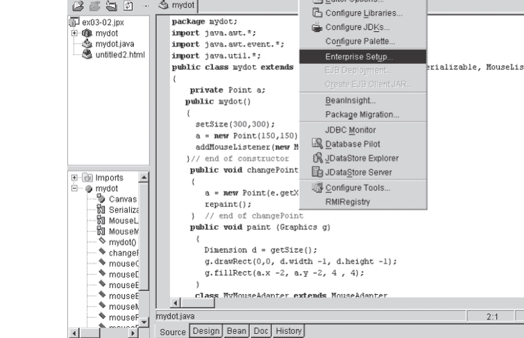

EJB 编程

**步骤 2：**
这将带您到一个界面，在此选择您希望使用的应用程序服务器。

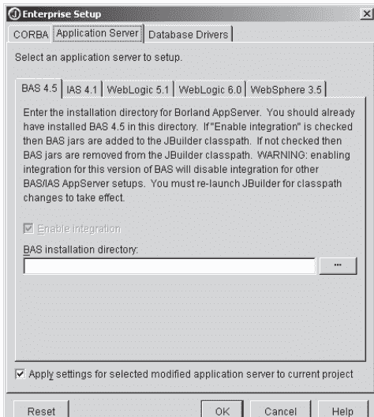

Borland 允许您将其他供应商的应用程序服务器集成到您的 JBuilder 中；然而，我们将使用 Borland Application Server。因此，单击文本字段旁边的小按钮，您将看到一个对话框。

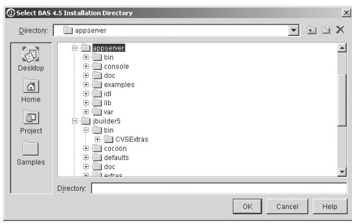

**步骤 3：**
使用此对话框定位安装 Borland Application Server 的目录。

**步骤 4：**
然后单击确定，应用程序服务器将与 JBuilder 集成。

您需要重启 JBuilder 才能看到所有更改。当您重新启动时，您会注意到下拉菜单中有几个引人入胜的新选项。您会注意到一个用于创建 EJB 的新向导，如下图所示。这个向导是我们将在本书后面频繁使用的工具。

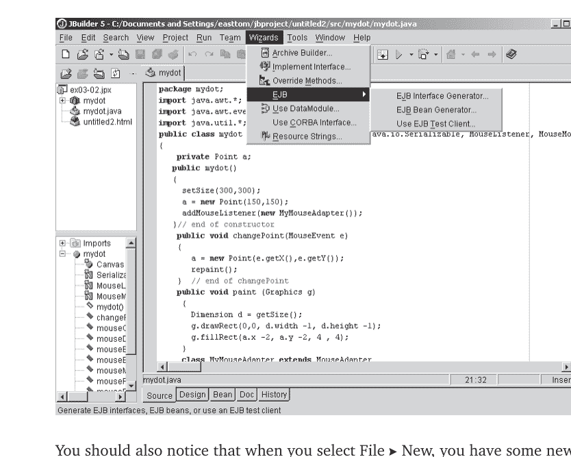

您还应该注意到，当您选择 File ▸ New 时，在 Enterprise 选项卡上有一些新选项。

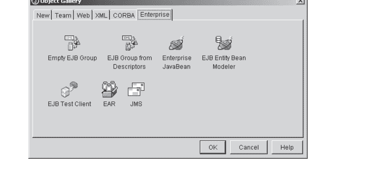

## 总结

在本章中，我为 Enterprise JavaBeans 建立了基本的概念基础。您已经看到了标准 JavaBeans 和 Enterprise JavaBeans 之间的本质区别。我还向您展示了三种不同类型的 Enterprise JavaBeans、它们的操作方式以及它们的生命周期。本章讨论的 EJB 开发的另一个重要方面是如何确定哪种类型的 EJB 适合给定的情况。阅读和理解本章的概念将为您学习本书的其余部分奠定必要的基础。

## 术语

- *n 层应用程序* – 由多个层组成的应用程序。字母 *n* 代表实际存在的层数。
- *会话 Bean* – 代表与客户端单个会话的 Bean。这些 Bean 可以是有状态或无状态的。
- *实体 Bean* – 代表基础数据对象的 Bean。这些 Bean 是持久的，其结构类似于数据库。
- *消息驱动 Bean* – 用于处理消息的 Bean。
- *接口* – 客户端用于创建 Enterprise JavaBeans 实例并访问这些 Bean 的接口。有两种此类接口：本地（home）和远程（remote）。
- *钝化* – 将 Enterprise JavaBean 移至非活动状态的过程，如果需要，还会存储状态信息。
- *激活* – 重新激活先前被钝化的 Bean 的过程，如果需要，还会恢复状态信息。


## 复习题

- 1. 标准JavaBean与企业JavaBean（Enterprise JavaBean）的主要区别是什么？
- 2. 企业JavaBean在哪里运行？
- 3. 列出企业JavaBean的三种类型。
- 4. 远程客户端如何传递参数？
- 5. 本地客户端如何传递参数？
- 6. 简述会话Bean的定义。
- 7. 处理实体Bean持久性的两种机制是什么？
- 8. 消息驱动Bean会保留其状态吗？
- 9. 一个实体Bean能否同时处理多个客户端？
- 10. 一个会话Bean能否处理多个客户端？

### 第6章

### EJB远程调用

### 引言

既然你已经熟悉了JavaBean的基础知识以及企业JavaBean（EJB）的基本概念，现在是时候深入了解使EJB能够相互通信的复杂细节了。鉴于企业JavaBean是专门为分布式软件设计的，理解分布式组件如何通信至关重要。你在第五章应该已经注意到一个重要概念，即企业JavaBean的位置对客户端是完全透明的。这意味着客户端不应知道，甚至无需关心该EJB位于何处。它很可能位于运行在不同Java虚拟机（JVM）上的另一台机器。

你现在可能想问的问题是，EJB如何调用位于完全不同的机器上、不同JVM中的函数？嗯，如何调用远程过程的问题并不仅限于企业JavaBean。实际上，这是所有分布式应用程序架构的共同问题。每种分布式架构都有自己解决此问题的方法。企业JavaBean使用远程方法调用（RMI）来解决此问题。远程方法调用允许程序员访问远程位置的方法，因此得名。“远程”一词仅意味着该过程位于与客户端不同的机器上。这意味着远程过程不仅位于其他机器或Java虚拟机的其他实例上，也可能仅指同一台机器上的其他组件。对于调用它们的客户端组件而言，该组件中的方法是远程的。在Java中，任何方法可以从另一个JVM调用的对象都是远程对象。

在继续阅读本书的后续内容——你将逐步学习如何创建自己的企业JavaBean——之前，我认为掌握一些关于EJB通信机制底层技术的基础知识非常重要。虽然在对RMI知之甚少的情况下确实可以创建企业JavaBean，但这并非最佳方法。我坚信，你对底层技术的理解越全面，在理解和使用EJB方面就会越成功。然而，对于那些只想要一个“快速入门”企业JavaBean操作指南的读者，你们完全可以简单浏览本章，甚至直接跳过。不过，我确信我的读者中没有任何人会满足于对手头主题的一知半解！

### RPC与编组

远程过程调用（RPC）是指对运行在某个其他组件中的过程的调用（即，它相对于客户端是“远程的”）。这可以是JavaBean、同一台机器上的另一个应用程序，甚至是运行在另一台机器上的应用程序。这在所有分布式架构中都很常见。为了完成一次RPC，必须有某种机制来处理对象间的通信。必须有某种机制在对象之间传递数据。在对象之间来回传递数据的过程通常称为**编组**。远程过程调用和编组的概念并非EJB独有。它们是所有分布式架构都需要克服的共同问题。在所有分布式架构中，都需要一种方法来查找远程过程、向其传递任何必需的参数，并接收任何返回值。

要使用远程方法，你必须找到某种方式将数据从客户端传递到服务器，反之亦然。即使是调用单个函数，也需要你将参数从客户端传递到服务器。然后，你还必须将返回值从服务器获取回客户端。完成此过程的过程称为*编组*。编组是指从计算机存储中的一个或多个应用程序或源收集数据，并使该数据可供另一个应用程序使用的过程。这通过将数据放入消息中，然后组织或转换数据为适合特定接收者的格式来实现。当将一种语言编写的程序的输出参数作为另一种语言编写的程序的输入传递时，可能需要编组。编组就是收集数据（如参数）以传递给远程过程的过程。它也是分布式架构（如EJB和COM）用来使远程函数对客户端可用的方法。

> 注意：COM（组件对象模型）主要是微软的架构，并非Java原生支持。但是，你可以使用JNI（Java本地接口）与COM对象通信。然而，该过程的细节超出了本书的范围。所有分布式架构都有一些共同的基本特征，因此你会发现企业JavaBean、COM、DCOM和CORBA之间存在一些相似之处。

术语“编组”的使用源于军事术语中的同一单词。在军事领域，编组是指在战斗准备阶段集结和部署军事力量（即“集结军队以备战斗”）。RMI利用对象序列化来对函数的参数进行编组和反编组。你应该回忆一下第四章中关于序列化的主题。使用相同的进程将参数从客户端对象传递给它试图传递参数的对象。

### RMI

远程方法调用（Remote Method Invocation）字面意思是一种调用远程方法的方法论，因此得名。远程，我指的是位于不同的进程中。这可以是在同一台机器上的不同对象中、在不同的Java虚拟机中，或者在不同的机器上。如果该过程存在于不同的内存进程中，那么它就是远程的。远程方法调用使程序员能够创建分布式Java解决方案，在这些方案中，无论对象的位置如何，都可以从其他Java对象调用远程Java对象的方法。

在使用RMI调用远程对象之前，你必须先获得对该远程对象的引用。这可以通过两种方式之一完成。第一种是作为参数或返回值接收引用。简单来说，这意味着客户端对象调用的某个其他函数返回了一个包含远程过程的引用。这实际上是获取远程过程引用的一种相当常见的方式。你肯定熟悉Java中以对象作为返回类型的函数。这完全是同一回事。唯一的区别是返回的对象是远程的。另一种获取引用的方法是在RMI提供的引导命名服务中查找远程对象（本章稍后会详细介绍引导命名服务）。无论客户端如何获得引用，一旦获得，客户端就可以调用服务器中的远程对象并使用其方法，而不管客户端和服务器组件的相对位置如何。简而言之，远程方法调用是Java与远程对象通信的机制。

RMI应用程序通常由至少两个独立的组件组成：服务器和客户端。典型的服务器组件创建许多远程对象，使这些对象的引用对客户端可访问，并响应客户端请求。典型的客户端应用程序获取服务器中一个或多个远程对象的远程引用，并使用这些对象中的方法。RMI提供了服务器和客户端交换信息的机制。这种分布式架构正在成为商业领域的常态。正如你在第五章所看到的，分布式架构和*n*层软件现在已司空见惯。


如前所述，客户端组件必须通过某种方法来获取远程对象的引用。应用程序可以通过 RMI 的命名设施 `rmiregistry` 注册其远程对象。应用程序也可以将远程对象引用作为其方法的一部分进行传递和返回。无论通过何种方式实现，远程对象之间的通信细节均由 RMI 处理。这一过程对程序员来说是完全透明的。这对你来说应该是个好消息。这意味着在本章中，你将掌握一些概念，但无需学习新的编码技术。对于使用 RMI 的开发者而言，远程通信看起来就像标准的方法调用。这是 RMI 最佳特性之一。应用程序开发者可以专注于解决手头的业务问题，而无需过度关注远程过程通信处理的细节。

请记住，在 Java 中，所有类都会被编译为字节码。这对 RMI 通信而言具有重要意义。你还应了解 RMI 不仅允许客户端传递简单数据类型，还可以传递对象给远程对象。RMI 提供了必要的机制来加载对象的代码并传输其数据。RMI 可以使用 Java 平台支持的任何 URL 协议加载类字节码，这包括 FTP 和 HTTP。这为程序员在定位所使用的对象时提供了极大的灵活性。这也完全适用于分布式应用，其中 Web 是应用层分发的媒介之一。

## 远程接口

远程对象通过远程接口进行访问。远程接口是一组方法的声明，这些方法可以从远程 Java 虚拟机中调用。一个有效的远程接口必须满足若干要求。最重要的要求是远程接口必须继承自 `java.rmi.Remote` 接口。当然，可能该接口继承的另一个接口本身又继承自 `java.rmi.Remote`。只要在接口的继承层次结构中的某处实现了 `java.rmi.Remote` 或继承了实现了该接口的其他接口，即满足要求。同样重要的是，远程接口中的方法声明必须符合某些要求。

远程接口方法声明有若干要求。远程方法声明必须抛出 `java.rmi.RemoteException` 异常。当然，它也可能抛出其他异常。同样值得注意的是，如果接口的父类抛出了 `java.rmi.RemoteException`，则此要求已满足。如果接口抛出了 `java.rmi.RemoteException` 的父类（如 `Exception`），此要求也视为满足。另一个要求是，在远程方法声明中，声明为参数或返回值的远程对象必须声明为远程*接口*。将其声明为该接口的实现类将无法满足此要求。

既然我们已经讨论了远程接口的要求，或许有必要审视 `java.rmi.Remote` 接口本身。`java.rmi.Remote` 是一个没有定义任何方法的接口。

```java
public interface Remote
{
}
```

此接口的唯一目的是标记实现了它的类为远程对象。它仅用于允许创建远程对象。这类接口被称为*标记接口*。你可能在 Java 中见过其他此类接口，例如 `java.io.Serializable`。还需注意的是，据称新的 Java SDK 1.4 包含了一些新的标记接口，例如 `java.util.RandomAccess`。这对你——一位 Java 程序员——意味着标记接口在当前版本的 Java 中很常见，并且它们的使用将在下一个版本中继续并扩展，因此你可能需要熟悉它们。

## 引导过程

我之前提到过有两种方法可以获取远程对象的引用，但到目前为止我只向你解释了一种。回想一下，我早先提到你可以通过将远程对象作为返回类型/参数传递，或者使用 RMI 引导方法来获取远程对象引用。提供了一个简单的引导名称服务器，用于存储远程对象的命名引用。可以使用 `java.rmi.Naming` 类的基于 URL 的方法存储远程对象引用。RMI 注册表本身就是一个远程对象，客户端反过来使用它进行引导。远程对象在此注册表中注册自身，而注册表则向客户端提供所需信息，以便它们能够调用所需的对象。引导本质上是客户端和远程对象开始对话的机制。幸运的是，对于使用客户端的程序员来说，这个过程的大部分是完全透明的。

## RemoteObject 类

我已经讨论了客户端使用远程服务器调用与服务器通信的机制。显然，这仅在存在一个符合 RMI 的服务器对象可供通信时才有效。下一个显而易见的问题是，什么构成了一个符合 RMI 的对象？换句话说，一个对象必须满足哪些标准才能参与远程方法调用？这就是 `RemoteObject` 类的作用所在。所有 RMI 服务器功能都由 `java.rmi.server.RemoteObject` 或其子类提供：

-   `java.rmi.server.RemoteServer`
-   `java.rmi.server.UnicastRemoteObject`
-   `java.rmi.activation.Activatable`

创建远程对象并使其对远程客户端可用所需的方法由 `UnicastRemoteObject` 和 `Activatable` 类提供。这些子类标识服务器是简单的远程对象还是可激活的远程对象。可激活的远程对象是在被调用时执行的。简单的远程对象则在被调用时不立即执行。实例化后，你必须调用其某个方法才能使其执行。

`java.rmi.server.UnicastRemoteObject` 类定义了一个远程对象，其引用仅在服务器进程存活期间有效。

`java.rmi.activation.Activatable` 类是一个抽象类，它定义了一个*可激活的*远程对象，该对象在其远程方法被调用时开始执行，并会自行关闭。

回想一下，为了使客户端能够在远程对象上调用方法，客户端必须首先获取对该远程对象的引用。远程对象的引用可以作为方法调用中的参数或返回值获取。同时回想一下，RMI 提供了一个简单的引导名称服务器，用于从给定主机获取远程对象。`java.rmi.Naming` 类提供了基于统一资源定位符（URL）的方法，用于查找、绑定、重新绑定、解除绑定和列出特定主机和端口上维护的名称-对象对。

下表列出了各种类、接口和异常：

| 类/接口 | 用途 |
| --- | --- |
| Remote | Remote 接口标识那些方法可以从非本地 JVM 调用的接口。 |
| Naming | Naming 类提供了用于在远程对象注册表中存储和获取远程对象引用的方法。 |
| MarshalledObject | 此类包含一个字节流，其中包含传递给其构造函数的对象的序列化表示。 |
| AccessException | AccessException 由 `java.rmi.Naming` 类的某些方法以及 `java.rmi.activation.ActivationSystem` 接口的方法抛出。它用于指示调用者没有执行该方法所请求操作的权限。 |
| AlreadyBoundException | 如果尝试将注册表中已绑定名称的对象绑定到另一个名称，则会抛出 AlreadyBoundException。 |
| ConnectException | 如果对远程主机的远程方法调用连接被拒绝，则会抛出 ConnectException。 |
| ConnectIOException | 如果在连接远程主机时发生 IOException，则会抛出 ConnectIOException。 |
| MarshalException | 如果在编组远程方法调用时发生 `java.io.IOException`，则会抛出 MarshalException。 |
| NotBoundException | 如果尝试查找或解除注册表中未绑定的名称，则会抛出 NotBoundException。 |


| 类/接口 | 用途 |
|---|---|
| NoSuchObjectException | 如果尝试对远程虚拟机中不存在的对象调用方法，将抛出 `NoSuchObjectException`。 |
| RemoteException | `RemoteException` 是在执行远程方法调用过程中可能发生的多种通信相关异常的公共超类。 |
| StubNotFoundException | 当远程对象被导出时，如果无法找到其有效的存根类，则会抛出 `StubNotFoundException`。 |
| UnexpectedException | 如果远程方法调用的客户端接收到一个在远程接口方法的 `throws` 子句中未声明的受检异常，则会抛出 `UnexpectedException`。 |
| ServerError | 如果服务器机器上远程方法的执行抛出 `java.lang.Error`，则作为远程方法调用的结果，将抛出 `ServerError`。 |
| ServerException | 如果服务器机器上远程方法的执行抛出 `RemoteException`，则作为远程方法调用的结果，将抛出 `ServerException`。 |

这些类、异常和接口是讨论远程方法调用时最相关的部分。虽然深入理解每一个并非至关重要，但对它们有基本的熟悉是很重要的。你需要记住的最重要的概念是，`RemoteObject` 类及其子类对于创建远程对象至关重要。我确实建议你反复阅读这个列表，直到对它们有基本的了解。

## RemoteException 类

你可能知道，Java 为特定问题定义了许多特定的错误处理类。实际上，有一个相当庞大的异常类层次结构，每个类都是为特定类型的异常量身定制的。这些不同的异常类适用于特定类型的错误。远程方法调用也不例外。正如关于 RMI 接口的部分所提到的，这些接口必须抛出 `java.rmi.RemoteException` 错误。本节将详细研究这个特定的类。`java.rmi.RemoteException` 类是 RMI 在远程方法调用期间抛出的异常的父类。在远程接口中声明的每个远程方法都必须抛出 `java.rmi.RemoteException`（或其父类之一，如 `java.io.IOException` 或 `java.lang.Exception`）。

当远程方法调用因任何原因失败时，就会抛出此异常。你可能会问哪些情况会导致远程调用失败。`RemoteException` 类是一个受检异常，而不是运行时异常。这意味着它必须由远程方法的调用者处理，并且编译器会进行检查。请记住，如果受检异常没有为它们编写某种类型的异常处理代码，则无法成功编译该类。有几种情况可能导致异常；这里列出了一些比较常见的：

-   参数或返回值编组或解组失败。
-   远程服务器不可达。
-   远程服务器拒绝连接。
-   连接已被服务器关闭。
-   协议错误

这些情况中的任何一种都可能导致异常。到目前为止，远程服务器不可达的问题可能是最常见的。如果由于任何原因对远程服务器的访问中断，就会发生异常。这可能是由从网络问题到托管对象的服务器问题等各种原因引起的。

## RMI 示例

在本章中，我向你展示了远程方法调用的具体要求。我还描述了 RMI 过程中涉及的各种接口、类和异常。鉴于 RMI 过程对于 EJB 开发者是透明的，这些信息可能足以让你对 RMI 的工作原理有一个基本的理解。然而，我认为向你展示一个直接在代码中使用 RMI 的例子会很有用。这不是一个 EJB 示例。原因是，在 EJB 中，应用程序容器处理所有 RMI 细节并将它们对你（程序员）隐藏。通过直接编写 RMI 代码，你将能够确切地看到远程方法调用背后发生的事情。让我提醒你，直接编写 RMI 代码可能相当繁琐。至少，检查这段代码应该会让你对 Enterprise JavaBeans 为你处理了这一切而感到高兴！

这可能不是特别有创意，但我将使用无处不在的 "Hello World" 示例的一个变体来演示 RMI 的编码。然而，将会有两个变体。第一个是我目前居住在德克萨斯州。因此，我觉得有必要通过使用 "Howdy" 而不是 "Hello" 这种当地方言来向我的州致敬。所以你现在将被引导完成创建 "Howdy Y'all" 示例程序的过程。我希望你觉得这个例子至少有点意思，因为我在本书后面使用类似的例子来说明其他技术。在这个例子中，一个小程序是客户端，当它运行时，它显示 "Howdy Y'all"。第二个变体是，为了显示此文本，它必须向服务器进行远程过程调用。

在此过程中，我们将创建三个单独的文件（我警告过你，手动编写 RMI 相当繁琐！）。

-   `Howdy.java` — 一个远程接口
-   `HowdyApplet.java` — 显示 "Hello World" 的客户端小程序
-   `howdy.html` — 承载上述小程序的 HTML 页面

## 第 6 章：EJB 中的远程调用

在我们开始之前，你应该从之前的 Java 编程经验中回忆起，Java 要求类的完全限定包名与该类的目录路径之间存在映射。这意味着包名需要反映包所在的目录。在我的 PC 上，这意味着包名是 `rmi.howdy`，源目录是 `c:/ejbbook/rmi/howdy`。在你的 PC 上可能非常不同。

请记住，在 Java 中，远程对象只是实现了远程接口的类的实例。你的远程接口将声明你希望从其他 JVM 调用的每个方法。所有远程接口共享以下特征：

-   远程接口必须声明为 `public`。这应该是很明显的。如果不是公共的，客户端将如何访问它？
-   远程接口扩展了 `java.rmi.Remote` 接口。与 Java 中的许多事情一样，必须实现或扩展接口才能实现某些功能。
-   作为参数传递或从方法返回的任何远程对象的数据类型必须声明为远程接口类型，而不是实现类（在我们的例子中，这意味着 `Howdy` 而不是 `HowdyImp`）。
-   每个方法都必须在其 `throws` 子句中声明 `java.rmi.RemoteException`。当然，它也可以声明其他特定于应用程序的异常。

我想首先向你展示实际的远程接口 `rmi.Howdy`。这个接口只有一个方法 `sayHowdy`，它向调用者返回一个字符串：

```java
package rmi.Howdy;
import java.rmi.Remote;
import java.rmi.RemoteException;
public interface Howdy extends Remote
{
    String sayHowdy() throws RemoteException;
}
```

这就是接口部分的全部内容。远程方法可能以本地方法无法失败的方式失败。它们可能由于网络问题、服务器响应问题等原因而失败。因此，远程方法将通过抛出 `java.rmi.RemoteException` 来报告通信故障。

现在让我们看看实际的实现类。这是实际拥有该远程接口方法的类。正如你可能猜到的，它必须实现该接口。它还必须具有该接口中定义的方法的实现，并为远程对象提供一个构造函数。

我还将向你展示服务器类。服务器类是一个具有 `main` 方法的类，该方法创建远程对象实现的实例，并将该实例绑定到 `rmiregistry` 中的一个名称。包含此 `main` 方法的类可以是实现类本身，甚至可以是另一个完全不同的类。

```java
package rmi.HowdyImp;
import java.rmi.Naming;
import java.rmi.RemoteException;
import java.rmi.RMISecurityManager;
import java.rmi.server.UnicastRemoteObject;
public class HowdyImp extends UnicastRemoteObject implements Howdy
{
    public HowdyImp() throws RemoteException
    {
        super();
    }
    public String sayHowdy()
    {
        return "Howdy Y'all!";
    }
    public static void main(String args[])
    {
        // Create and install a security manager
        if (System.getSecurityManager() == null)
        {
            System.setSecurityManager(new RMISecurityManager());
        }
        try
        {
            HowdyImp obj = new HowdyImp();
```


首先，让我纠正明显的OCR错误并处理文档结构。

// 将此对象实例绑定到名称“HowdyServer”
Naming.rebind("//myhost/HowdyServer", obj);
System.out.println("HowdyServer bound in registry");
}
catch (Exception e)
{
    System.out.println("Oops: " + e.getMessage());
    e.printStackTrace();
}
}
}

现在你可能对此感到有点困惑。在阅读的这个阶段，你可能已经预期到了前几行代码。这个类继承自UnicastRemoteObject、实现了Howdy接口并抛出RemoteException，这对你来说可能并不意外。然而，一旦我们进入main函数，那里可能有很多新代码需要你消化。那段代码就是远程方法调用发生的地方。我将更详细地向你展示每行代码的作用。

首先，让我引导你关注这段代码：

```
// 创建并安装安全管理器
if (System.getSecurityManager() == null)
{
    System.setSecurityManager(new RMISecurityManager());
}
```

还要回想一下，在此源文件的开头，在import部分，我导入了java.rmi.RMISecurityManager。所有RMI事务都在某种安全上下文中进行，因此必须调用系统安全管理器。

接下来，我想请你关注实际在rmiregistry中注册此对象的代码。

```
HowdyImp obj = new HowdyImp();
Naming.rebind("//myhost/HowdyServer", obj);
System.out.println("HowdyServer bound in registry");
```

你应该从本章前面的内容中回忆起，RMI接口需要在rmiregistry中注册才能被远程调用。你上面看到的代码正是这样做的。首先，创建一个实现类的对象实例。然后，该对象使用Naming对象的rebind方法与rmiregistry进行绑定。现在，其他对象可以在rmiregistry中通过名称“HowdyServer”查找Howdy对象，然后使用该对象。

既然我已经向你展示了如何构建服务器端，现在是时候看看客户端了。接下来，我将向你展示如何创建一个applet，该applet将使用服务器对象来显示“你们好”。

```
package rmi.HowdyClient;
import java.applet.Applet;
import java.awt.Graphics;
import java.rmi.Naming;
import java.rmi.RemoteException;
public class HowdyApplet extends Applet
{
    String texasgreeting = "None"; // 默认值
    Howdy howdyobj = null; // Howdy对象的初始实例
    public void init()
    {
        try
        {
            howdyobj = (Howdy)Naming.lookup("//" + getCodeBase().getHost() + "/HowdyServer");
            texasgreeting = howdyobj.sayHowdy();
        }
        catch (Exception e)
        {
            System.out.println("Oops: " + e.getMessage());
            e.printStackTrace();
        }
    }
    public void paint(Graphics g)
    {
        g.drawString(texasgreeting, 25, 50);
    }
}
```

## 第六章：使用EJB进行远程调用

这个applet非常直观，大部分内容你应该都很熟悉。只有一小部分是新的。首先注意开头的import语句。你应该注意到导入了几个通常不会与applet一起导入的包。这些包用于远程方法调用。相关的实际代码段很小：

```
howdyobj = (Howdy)Naming.lookup("//" + getCodeBase().getHost() + 
"/HowdyServer");
texasgreeting = howdyobj.sayHowdy();
```

对rmiregistry发起调用，尝试查找HowdyServer。如果在注册表中找到该对象，则调用其sayHowdy方法。

最后，我们有了从标准HTML页面显示applet的代码。这段代码非常简单，就是标准的HTML。

```
<HTML>
  <head>
    <title>你好世界</title>
  </head>
  <body bgcolor = white>
    <center> <h1>你们好世界</h1> </center>
    <applet codebase="myclasses/"
      code="rmi.howdy.HowdyApplet" width=500 height=120>
    </applet>
  </body>
</HTML>
```

显然，你需要在你希望下载类的机器上运行HTTP服务器。否则，你将无法运行网页，从而也无法运行applet。HTML文件中的codebase属性指定了一个相对于网页本身加载目录的子目录。使用这种相对路径是非常常见的做法。applet的code属性指定了applet的完全限定包名（在此示例中，是rmi.howdy.HowdyApplet）。

如果你发现所有这些代码仅仅是为了显示“你们好”而显得很麻烦，你是对的。首先，没有任何程序员会仅仅为了显示问候而做所有这些事情。至少，没有一个理智的程序员会这么做！然而，这段代码提供了一个简单易懂的示例，展示了远程方法调用的工作原理。第二点需要记住的是，当使用企业JavaBeans时，RMI调用由应用程序服务器为你处理。你不需要自己编写这些代码。正如我之前所说，至少，这个例子应该让你感激EJB应用程序服务器为你所做的一切！

## 总结

本章让你深入了解了远程方法调用过程的幕后。这个过程是与企业JavaBeans通信的支柱。你已经看到了RMI的基本机制，并接触了远程过程调用和序列化等概念。此外，我还向你展示了RMI涉及的基本类和抛出的异常类。你也在RemoteObject类中看到了远程对象的基础。本章与第5章相结合，应该为你提供了完全理解本书其余内容以及全面掌握企业JavaBean开发所涉及的概念和技术所必需的知识。

## 术语

- **RMI** – 远程方法调用。这是在独立的内存过程中调用方法的过程。这些方法可能存在于同一台机器上的不同对象中，也可能存在于不同的机器上。
- **RPC** – 远程过程调用。调用存在于另一个对象中的过程的通用术语。它相对于调用它的过程是远程的。
- **序列化** – 这是组件收集其希望发送给远程对象的参数的过程。
- **JNI** – Java本地接口。这是Java可以与COM对象通信的一种方法。
- **java.rmi.Remote 接口** – 这是在Java中使用RMI所必需的接口。
- **引导** – 获取远程对象引用的过程。
- **RemoteException** – 这是Java中所有远程过程调用抛出的异常。

## 复习题

1. 什么是RMI？
2. 什么是序列化？
3. 什么是RPC？
4. 使用RMI必须实现哪个接口？
5. 什么会导致抛出ServerException？
6. RMI接口中包含哪些方法？
7. 列出一种获取远程对象引用的方法。
8. 所有RMI对象必须抛出什么异常？
9. 远程接口的目的是什么？
10. 序列化对象的目的是什么？

# 第七章

## 无状态会话Bean

### 简介

本书的前六章为你掌握了企业JavaBeans主题构建了必要的框架。第1至4章为你提供了标准JavaBean的扎实工作知识。第5和6章应该已经为你提供了对企业JavaBeans所使用的底层机制的坚实理论理解。现在是时候开始研究特定类型的企业JavaBeans，并实际创建一些EJB了。在第5章中，你被介绍了各种类型的JavaBean，包括会话bean。回想一下，会话bean本质上是一个为特定用户会话提供服务的EJB。会话bean通常模拟特定的业务流程。相对于实体bean，会话bean是短暂的。回想一下，会话bean可以是无状态的，也可以是有状态的。

回想第5章，无状态bean不保留任何关于其状态的信息，即使在方法调用之间也是如此。这些EJB适用于客户端和某些应用程序服务之间的简单交互。任何在单次方法调用中完成的交互都可以与无状态

**会话 bean**。一个常见的例子是处理订单的 EJB。每个订单都可以通过调用单个方法（例如 `processOrder()`）来处理。由于此操作是通过单次调用完成的，因此它非常适合**无状态会话 bean**。

无论您希望创建何种类型的会话 bean，所有会话 bean 都有一些共同点。每个会话 bean 由特定部分组成。这些部分必须由企业 bean 程序员开发。首先也是最明显的，是远程接口。正是这个远程接口提供了客户端对 bean 的视图。主接口也由 EJB 提供者开发。它包含了客户端应用程序使用的、用于 bean 生命周期的所有方法。

同样显而易见的是，EJB 开发人员将必须创建实际的 bean 实现类。这个类提供了您试图实现的实际 bean 功能。也是这个类必须支持诸如序列化等项目。最后，EJB 开发人员必须开发部署描述符，其中包含可在组装或部署时编辑的 bean 属性。

## 远程接口

在向您展示如何创建远程接口之前，谨慎的做法可能是先定义远程接口。简单来说，远程接口只是一个允许客户端使用 EJB 对象的接口。由于客户端交互的接口是针对远程对象的，因此它被称为远程接口。此接口将复制 EJB 的方法名称。它字面上为客户端提供了一个到远程 EJB 对象的接口。这个接口将为客户端提供其对会话 bean 的视图。此接口包含了企业 bean 的实际业务方法。客户端将在这里调用其感兴趣执行的方法，以执行其所需的任务。远程接口最重要的要求是它必须扩展 `javax.ejb.EJBObject` 接口。这是对所有远程接口的绝对要求。您可能会发现查看 `javax.ejb.EJBObject` 接口的实际代码很有用，以便更好地理解其功能。以下是 `javax.ejb.EJBObject` 接口的源代码：

```
public interface javax.ejb.EJBObject extends java.rmi.Remote
{
    public abstract javax.ejb.EJBHome getEJBHome()
        throws java.rmi.RemoteException;
    public abstract java.lang.Object getPrimaryKey()
        throws java.rmi.RemoteException;
    public abstract void remove()
        throws java.rmi.RemoteException, java.ejb.RemoveException;
    public abstract javax.ejb.Handle getHandle()
        throws java.rmi.RemoteException;
    public abstract Boolean isIdentical(javax.ejb.EJBObject)
        throws java.rmi.RemoteException;
}
```

请注意，此接口使用了多个远程方法调用类。实际上，它扩展了 `java.rmi.Remote` 类。回顾第 6 章，RMI 负责促进与远程对象的通信。但是，您还应该记住，大部分 RMI 代码实际上为您处理了。部分原因在于像这样的接口继承自 RMI 对象。同样重要的是，此接口中定义的方法必须遵循 Java RMI 的规则。其中最重要的一点是，这些方法必须抛出 `java.rmi.RemoteException`。您会记得在第 5 章和第 6 章中，这些问题已被详细讨论。如果您需要复习，请重新阅读这些章节。对于远程接口中定义的每个方法，在企业 bean 的类中必须有一个匹配的方法。该方法必须具有相同的名称、参数、返回类型和异常列表。唯一的区别是接口会抛出 `RemoteException`。

让我们看一个接口的示例：

```
public interface myremote extends EJBObject
{
    public void somemethod (int x) throws RemoteException;
    public int someothermethod () throws RemoteException;
}
```

请注意，该接口定义了一些没有任何实现的方法。这些方法声明应与实际 EJBObject 中使用的方法声明完全匹配。实现实际上将在相关的 EJBObject 中完成。您还应该注意，这些方法都抛出 `RemoteException`。正如之前在第 6 章中提到的，远程过程调用可能以本地过程调用无法发生的方式失败；因此，它们必须抛出 `RemoteException`。

## 主接口

主接口是提供用于创建 EJB 实例的方法的接口。主接口和远程接口协同工作，为客户端提供对 Enterprise JavaBean 的访问。会话 bean 的主接口定义了一个或多个 `create()` 方法。每个 create 方法必须命名为 `create`，并且必须匹配 Enterprise JavaBean 类中定义的一个 `ejbCreate` 方法。create 方法允许客户端创建 EJB 的类的实例并使用它们。无状态会话 bean 的主接口必须有一个不带参数的 create 方法。create 方法的返回类型必须是企业 bean 的远程接口类型。本质上，无状态会话 bean 的 create 方法将不带参数，并返回 EJB 对象的远程接口。这将允许客户端创建远程接口的实例，从而利用 EJB 的方法。希望您开始理解这些不同的类和接口如何协同工作，使程序员能够使用 Enterprise JavaBeans 中包含的远程过程。

`ejbCreate` 方法的 throws 子句中定义的所有异常，都必须在主接口匹配的 create 方法的 throws 子句中定义。

让我们考虑一个使用前面的远程接口示例作为返回类型的主接口：

```
public interface myhome extends EJBHome
{
    myremote create() throws CreateException, RemoteException;
}
```

请注意，根据我给您的要求，主接口返回了先前定义的远程接口。它还有一个不带参数的 create 方法。还请注意，这个 create 方法抛出两个异常，第一个是 `CreateException`。如果存在问题阻止接口创建相关对象，则会发生此情况。抛出的第二个异常是 `RemoteException`。此异常的原因已经解释过。

## 企业 Bean 类

创建接口是能够访问 EJB 的一个组成部分；但是，我们还必须有一个实际的 Enterprise JavaBean 来访问。企业 bean 类是 Enterprise JavaBean 的真正核心。其他类仅仅是辅助类，用于促进对企业 bean 类方法的远程访问。这引出了 Enterprise JavaBean 类本身的主题。这个类实现了 bean 的业务方法以及 bean 中专门用于 EJB 环境的方法。“专门用于 EJB 环境”，我指的是那些用于允许 EJB 与其托管的应用程序服务器集成的方法。请记住，应用程序服务器是整个 EJB 架构的关键。

与我们讨论过的所有类一样，这个类也有某些必须满足的要求。首先，该类必须定义为 `public`。如果它不是公共的，那么它将无法访问，这一点相当明显。任何不可访问的 EJB 都是浪费时间，对任何人都没有用。此外，其他类将需要创建此类的实例。因此，它不能被声明为 `abstract`。请记住，抽象类不能直接实例化，必须被继承。会话 bean 接口还需要某些方法，如下表所述。


## 7. 无状态会话 Bean

| 方法 | 目的 |
|---|---|
| public void setSessionContext(SessionContext ic) | 此方法供容器使用，用于将 SessionContext 的引用传递给 bean 实例。容器在实例创建后调用此方法。 |
| public void ejbRemove() | 此方法在容器从容器中移除 bean 实例的过程中被调用。 |
| public void ejbPassivate() | 此方法在容器尝试钝化实例时被调用。此方法完成后，实例必须处于允许容器使用 Java 序列化协议来外部化和存储实例状态的状态。 |
| public void ejbActivate() | 此方法在 bean 实例被重新激活后立即由容器调用。实例将重新获取在 ejbPassivate() 方法中早先释放的任何资源。 |
| public void afterBegin() | 此方法通知会话 bean 实例一个新事务已开始。 |
| public void afterCompletion(boolean committed); | 此方法通知会话 bean 实例一个事务提交协议已完成，并告知实例该事务是已提交还是已回滚。 |
| public void beforeCompletion() | 此方法通知会话 bean 实例一个事务即将被提交。 |

你无需将此表记住。然而，你应该花些时间熟悉这些方法及其目的。逐字逐句地记住它们并不重要，但你应该对它们有所了解。

所有会话 bean 的要求总结如下：

- 它实现了 SessionBean 接口。
- 该类被定义为 public。
- 该类不能被定义为 abstract 或 final。
- 它实现了一个或多个 ejbCreate 方法。
- 它实现了业务方法。
- 它包含一个无参数的 public 构造函数。
- 它不得定义 finalize 方法。

这些要求对于创建会话 bean 至关重要。它们是绝对的，并且在所有情况下都必须遵守。在你尝试编译会话 bean 之前，明智的做法是首先将你的代码与此列表进行比较，以确保你满足了会话 bean 的所有要求。

## ejbCreate 方法

在上一节中，我向你介绍了构建会话 bean 的要求。其中一项要求是 create 方法。此方法对于会话 bean 的使用相当关键，因此仔细审视它是明智的。因为企业 bean 在 EJB 容器内运行，客户端无法直接实例化该 bean。只有 EJB 容器可以实例化企业 bean。这涉及几个步骤：

1. 客户端在 home 对象上调用一个 create 方法。
2. EJB 容器创建企业 bean 的一个实例。
3. EJB 容器在 bean 中调用 ejbCreate 方法。

通常，ejbCreate 方法会将 bean 初始化为某种默认状态。企业 bean 必须至少有一个 ejbCreate 方法。必需的 create 方法不接受任何参数。但是，EJB 可以重载此 create 方法，这些其他版本的 create 方法确实可以接受参数。然而，所有 create 方法都必须返回 void。方法的签名必须满足以下要求：

- 访问修饰符必须是 public。
- 如果 bean 允许远程访问，参数必须是 Java 远程方法调用 (RMI) API 的合法类型。
- 特殊修饰符不能是 static 或 final。

同样，这些要求是不可侵犯的；必须严格遵守。在你编写自己的 create 方法时，我建议你对照此清单进行检查，以确保在尝试编译类之前满足所有要求。

## 业务方法

到目前为止，我们已经讨论了如何为 bean 设置主要关注于创建 bean 实例和允许远程访问的方法。在所有关于这些基本维护问题的讨论中，我们似乎忽略了拥有 EJB 的目的。请记住，创建此 bean 的全部原因是为了为客户运行业务任务。客户端在 create 方法返回的远程对象引用上调用业务方法。

这些业务方法也有必须满足的某些要求。这些要求是：

- 方法名称不得与 EJB 架构定义的方法冲突。
- 访问修饰符必须是 public。
- 如果 bean 允许远程访问，参数和返回类型必须是 Java RMI API 的合法类型。
- 特殊修饰符不能是 static 或 final。
- throws 子句可以包括你为应用程序定义的异常。

为了指示系统级问题，例如无法连接到数据库，业务方法应该抛出 javax.ejb.EJBException。这样做的原因是，当业务方法抛出 EJBException 时，容器会将其包装在 RemoteException 中，由客户端捕获。容器不会包装应用程序异常。因此，这些异常不会返回给客户端。客户端意识到错误至关重要。因为 EJBException 是 RuntimeException 的子类，所以你不需要将其包含在业务方法的 throws 子句中。

## 关于 Home 接口

Home 接口扩展了 javax.ejb.EJBHome 接口。对于会话 bean，home 接口的目的是定义远程客户端可能调用的 create 方法。
远程接口中的方法定义必须遵循以下规则：

- 远程接口中的每个方法必须与企业 bean 类中实现的方法匹配。
- 远程接口中的方法签名必须与企业 bean 类中相应方法的签名完全相同。
- 参数和返回值必须是有效的 RMI 类型。
- throws 子句必须包括 java.rmi.RemoteException。

## 部署描述符

你应该记得我们在前四章的讨论中使用了清单文件。你仍然可以在 EJB 的 JAR 文件中使用它们。然而，EJB 需要一个称为部署描述符的文件。这个描述符实际上是一个本身可序列化的 Java 对象。这些描述符使用你的 EJB 容器或你的开发环境生成（我将在本章后面讨论如何使用 JBuilder 来做这件事）。该文件用于允许一定程度的自定义。可以使用此文件来设置 Enterprise JavaBean 的某些属性。部署描述符文件中的一些设置在下表中描述。

| 设置 | 描述 |
|---|---|
| Home 接口类名 | Home 接口的完全限定名。 |
| 远程接口类名 | 远程接口的完全限定名。 |
| Bean home 名称 | 客户端用于查找你的 bean 的“昵称”。 |
| 企业 bean 类名 | EJB 类的完全限定名。 |
| 会话超时 | 客户端在调用你的 bean 上的方法时超时前的秒数。 |
| 有状态或无状态 | bean 是有状态会话 bean 还是无状态会话 bean。 |

让我提醒你，这些设置将使用你的 EJB 容器或你选择的开发工具提供的实用程序来为你完成。因此，目前你需要做的只是熟悉这些设置的用途。不要担心如何实现这些设置。描述符文件实际上是 XML 文件；你将在本章后面看到一个示例。

## 系统属性和上下文

在带你直接进入创建无状态会话 bean 之前，还有一个遗留问题需要讨论。我谈了很多关于客户端获取对 home 接口的引用、该 home 接口用于创建 EJB 实例以及 EJB-客户端通信的其他细节。然而，有一个真正悬而未决的大问题：客户端如何获得对应用程序服务器的访问并请求 home 接口的副本？

这实际上始于一个相当常见的 Java 类，系统类。你可能过去使用过此类来查找操作系统，

当前用户以及其他信息。它甚至可以提供更多关于客户端系统的信息。系统类方法 `getProperties()` 返回一个属性对象，该对象代表系统的主要属性。其中一项属性将标识客户端机器当前正在使用哪个应用服务器。然后，你可以使用一个上下文变量来存储对该应用服务器的引用。该服务器就是你的客户端运行的“上下文”。下面是一个代码片段，向你展示我的意思：

```
Properties myprop = system.getProperties();
Context cont = new InitialContext(myprop);
SomeHomeInterface myhome = (SomeHomeInterface)
    cont.lookup("SomeHomeInterface");
```

你首先获得系统属性的引用，然后用它来获取上下文（即对应用服务器的引用）。现在你已经拥有了这个上下文，就可以查询它以获取你的本地接口。

### 构建无状态会话 Bean

在过去的几页中，我一直在向你灌输无状态会话 Bean 的各种细节。我想现在绝对是时候来实际编写一个了，你觉得呢？第一个 Bean 不会是什么惊天动地的东西，这完全是刻意为之。我希望你专注于实现无状态会话 Bean 的代码，而不是陷入业务方法的实现细节中。似乎每一本编程书都必须做个“Hello World”应用，所以我打算用无状态会话 Bean 来做这个 Hello World。首先，我们将使用标准的 Sun Java 工具和文本编辑器，用比较麻烦的方式来创建我们的 Bean。然后，我们将使用 JBuilder 重复这个过程。不过别惊慌，因为这个 Hello World 程序比你在第 6 章看到的 Howdy Y'all 程序要简单一些！

要自己创建这个代码，你需要任何标准的文本编辑器。Windows 用户可能想用记事本。大多数操作系统都自带某种文本编辑器。对于使用 KDE 界面的 Linux 用户来说，你会发现高级文本编辑器完全足以胜任这项任务。

#### 步骤 1：

创建远程接口。代码相当简单。我将代码放在名为 `Hello.java` 的文件中。

```
import javax.ejb.*;
import java.rmi.*;
public interface Hello extends EJBObject
{
    public String hello() throws java.rmi.RemoteException;
}// end of interface
```

注意我们导入了 `javax.ejb` 和 `java.rmi`。还要注意我们的接口继承了 `EJBObject`，并且我们的单个方法抛出了 `java.rmi.RemoteException`。这些是任何远程接口的基本要求。

#### 步骤 2：

现在我们需要实际 Bean 的代码。我将这段代码放在名为 `HelloBean.java` 的文件中。

```
package projects.ejb.chp7.helloworld;
import javax.ejb.*;
public class HelloBean implements SessionBean
{
    public void ejbCreate()
    {
    }
    public void ejbRemove()
    {
    }
    public void ejbActivate()
    {
    }
    public void ejbPassivate()
    {
    }
    public void setSessionContext(SessionContext ct)
    {
    }
    public String hello()
    {
        return "Hello World";
    }
} // end of HelloBean
```

我希望你注意这段代码的几个要点。首先，它实现了 `SessionBean`。这至关重要，所有会话 Bean 都必须实现这个特定接口。还要注意有几个方法内部没有实际代码。你的无状态会话 Bean 实际上不会进行任何钝化或激活，所以你不需要在这些方法里放代码，但你必须把方法放进去。出于教学目的，你可能想在每个方法中写入 `System.out.println`，表明该方法被调用了。这将允许你观察 Bean 在整个生命周期中的使用情况。

#### 步骤 3：

我们有了 Bean，有了远程接口，现在我们需要一个本地接口。回想一下，本地接口是客户端用来创建 EJB 实例的，所以这是一个非常重要的接口。我将把代码放在名为 `HelloHome.java` 的文件中。

```
package projects.ejb.chp7.helloworld;
import javax.ejb.*;
import java.rmi.RemoteException;
public interface HelloHome extends EJBHome
{
    Hello create() throws RemoteException, CreateException;
}// end of Home Interface
```

首先注意 `create` 方法返回一个 `Hello` 对象。还要注意它抛出了两个异常：`RemoteException` 和 `CreateException`。最后，注意该接口继承了 `EJBHome`。这些都是任何本地接口的核心要求。

现在，当你创建你的 EJB-JAR 文件时，你需要包含 Bean 类（编译后的）、远程接口和本地接口。你还需要一个部署描述符。回想一下，部署描述符本质上是清单文件的一个更现代的版本。

一旦你组装好了所有部分，你只需创建你的 JAR 文件：

```
Jar cmf helloworld.jar *
```

这假设所有文件都在当前文件夹中。

现在我们来到了旅程的最后一段——创建使用企业 JavaBean 的客户端代码。回想一下，你必须建立一个应用服务器，并且必须将你的 Bean 加载到应用服务器中。你需要参考你的应用服务器的文档以了解如何操作。我将在本章后面介绍使用 Borland 应用服务器。

#### 步骤 4：

我将客户端代码放在名为 `helloclient.java` 的文件中。

```
import javax.ejb.*;
import javax.naming.*;
import java.rmi.*;
import java.util.*;
public class helloclient
{
    public static void main(String args[])
    {
        try
        {
            Properties myprop = System.getProperties();
            Context cont = new InitialContext(myprop);
            HelloHome myhome = (HelloHome) cont.lookup("HelloHome");
            Hello hello = myhome.create();
            System.out.println(hello.hello());
            hello.remove();
        }// end of try
        catch(Exception e)
        {
            e.printStackTrace();
        }// end of catch
    }// end of main
}// end of class helloclient
```

这段客户端代码有几个有趣的点值得我们审视。首先，注意这两行：

```
Properties myprop = System.getProperties();
Context cont = new InitialContext(myprop);
```

回想一下前面关于系统属性和上下文的讨论。这两行代码让你的客户端能够访问应用服务器。显然，如果你的应用服务器没有运行，你会得到一个错误。

我想让你看的下一行代码与这两行密切相关。

```
HelloHome myhome = (HelloHome) cont.lookup("HelloHome");
```

这使用了先前创建的上下文对象去查找 `HelloHome` 接口，并给我们一个该本地接口的实例，我们称之为“myhome”。我们现在可以使用这个本地接口来创建“Hello World EJB”的一个实例。

```
Hello hello = myhome.create();
```

虽然这个示例中的内容不会载入计算机科学史册，但它确实阐明了创建和使用无状态会话 Bean 的所有基本部分。这个 Bean 与大多数现实世界 Bean 唯一的区别在于业务方法。我们的 Bean 只有一个简单的业务方法。现实世界的 Bean 通常有多个方法，每个方法执行一些相关的业务任务。

### 使用 JBuilder 构建无状态会话 Bean

那么，正如承诺的那样，现在是时候向你展示如何用简单的方式，即 JBuilder 的方式来完成事情了。就像我向你展示的所有其他东西一样，JBuilder 让创建无状态会话 Bean 变得轻而易举。它会为你处理开发的所有方面。只需打开你的 JBuilder（这些示例都适用于 5.0 和 6.0 版本；我无法保证它们在早期版本上的工作效果），然后按照以下步骤操作：

#### 步骤 1：

选择一个新项目。在出现的对话框中，将你的项目命名为 HelloWorld，并选择一个目录来存储它。


#### 步骤 2：

现在你可以选择“新建”和“企业”选项卡。然后选择“企业 JavaBean”。

#### 步骤 3：

这将带您进入下一个屏幕，在这里我们可以选择我们的 EJB 组。我们目前还没有一个，所以我们将选择“新建”并创建一个。

#### 步骤 4：

然后我们只需选择一个名称，JBuilder 将为我们创建一个 EJB 组。

#### 步骤 5：

下一个屏幕允许我们选择几个其他选项。

请注意，此屏幕为您提供了几个可以为 EJB 设置的选项。您可以选择 bean 的类型、如何管理持久性以及使用什么作为基类。我将我的 EJB 类命名为 HelloWorld。然后单击“下一步”。

#### 步骤 6：

下一个屏幕显示将生成的类名。

#### 步骤 7：

接下来的屏幕将为您设置前面提到的描述符文件。

在此屏幕上，您只需填写希望用于文件的名称。

第二个选项卡“Contents”列出了 EJB JAR 的当前内容。

如果您选择查看“Source”选项卡，您将看到描述符文件的实际源代码。请记住，它实际上是一个 XML 文件。

```xml
<?xml version="1.0" encoding="Cp1252"?>
<!DOCTYPE ejb-jar PUBLIC '-//Sun Microsystems, Inc.//DTD Enterprise JavaBeans 1.1//EN' 'http://java.sun.com/j2ee/dtds/ejb-jar_1_1.dtd'>
<ejb-jar>
  <description>This is my hello world EJB Jar!</description>
  <display-name>HelloWorld</display-name>
  <enterprise-beans>
    <session>
      <ejb-name>HelloWorld</ejb-name>
      <home>helloworld.HelloWorldHome</home>
      <remote>helloworld.HelloWorldRemote</remote>
      <ejb-class>helloworld.HelloWorld</ejb-class>
      <session-type>Stateless</session-type>
      <transaction-type>Container</transaction-type>
    </session>
  </enterprise-beans>
  <assembly-descriptor>
    <container-transaction>
      <method>
        <ejb-name>HelloWorld</ejb-name>
        <method-name>*</method-name>
      </method>
      <trans-attribute>Required</trans-attribute>
    </container-transaction>
  </assembly-descriptor>
  <ejb-client-jar>HelloClient</ejb-client-jar>
</ejb-jar>
```

#### 步骤 8：

如果您查看 IDE 左上角的选项卡，您会注意到您需要的所有文件（EJB bean 代码、远程接口和本地接口）都已经为您准备好了。您所要做的只是在 HelloWorld.java 文件中添加单个业务方法。

```java
public String hello()
{
    return "Hello World";
}
```

您现在已经完成了 bean 的编码。在继续之前，我希望您注意使用 JBuilder 相对于手工编码的几个优点。第一个优点是您只需编写业务方法。这意味着，作为 EJB 开发者，您可以专注于您试图实现的实际业务流程，而不是担心创建 EJB 的简单细节。另一个主要优点是，由于 JBuilder 为您生成了所需的代码，因此不会有机会忽略任何细微的细节。

#### 步骤 9：

现在进入最后一个阶段，部署您的 EJB。手动执行时可能很棘手，而使用 JBuilder 则是一件轻而易举的事情。选择“工具” ▸ “EJB 部署”。

> 注意：除非您已经编译了您的 bean，否则“EJB 部署”选项将不会启用。

这将启动一个向导，指导您完成部署 EJB 的过程。

通常您可以在向导的每个屏幕上都采用默认设置，直到您到达第四个屏幕，在那里您可以选择希望部署到哪个 EJB 容器。

## 第 7 章：无状态会话 Bean

您的 EJB 现已创建并部署！正如您所看到的，使用 Borland JBuilder 开发工具使得创建和部署 EJB 变得更加容易。

## 总结

本章介绍了无状态会话 bean。学习本章后，您应该了解创建无状态会话 bean 的各种要求。您还应该理解，无状态会话 bean 在方法调用之间不保留任何状态。这允许任何客户端使用任何无状态会话 bean。无状态会话 bean 通常保存在池中，应用服务器可以根据需要启动任何 bean。您还应该回忆一下，由于这些 EJB 是无状态的，它们不需要钝化或激活。

## 术语

*无状态* – 一种不保留任何状态信息的会话 bean。

*本地接口* – 本地接口是提供用于创建 EJB 实例的方法的接口。

*部署描述符* – 这是清单文件的替代品。它描述了部署 Enterprise JavaBeans 所需的所有内容。

## 复习题

1.  所有远程接口都必须扩展什么接口？
2.  您可以对 EJB 类使用哪些访问修饰符？
3.  远程接口中的每个方法都必须与哪个类中的方法匹配？
4.  哪个对象负责创建 EJB 对象的客户端实例？
5.  ejbCreate 方法返回什么？
6.  本地接口必须扩展哪个对象？
7.  所有远程接口都必须抛出什么异常？
8.  无状态会话 bean 的创建方法通常接受参数吗？
9.  所有业务方法都必须抛出什么异常？
10. 是否可能有一个抽象的会话 bean？

# 第 8 章：有状态会话 Bean

### 简介

在第 7 章中，我向您展示了无状态会话 bean 并讨论了其背后的理论、如何创建它们以及如何使用它们。然而，有时需要 EJB 和客户端进行多方法对话。有状态会话 bean 是在可能跨越多个方法调用的客户端对话期间保留信息的会话 bean。这些 EJB 对于需要客户端和应用服务之间进行交互的业务流程非常有用，这些交互持续时间比单个方法调用更长，并且需要维护交互状态。一个常见的例子是在线购物车。最终用户可以订购多个商品。每个商品的订购可能是一个单独的方法调用。但是，您肯定希望在这些不同的订单之间建立某种联系。管理交互的有状态会话 bean 必须累积所有订单，直到最终用户完成下单。有状态 EJB 必须在允许最终用户添加更多订单的同时保留未处理的订单。

### 激活与钝化

回顾第 5 章，激活是激活先前已钝化 bean 的过程。换句话说，激活是将当前处于空闲状态的 JavaBean 提升到活动状态的过程。钝化本质上是将 bean 置于空闲状态的过程。此信息不适用于无状态会话 bean，因为它们不使用激活或钝化。由于它们不保留任何状态信息，因此没有必要。回想一下，对于无状态 bean，任何客户端都可以访问任何 bean。由于它们不保留任何状态信息，因此这并不重要。所有无状态会话 bean 始终处于活动状态，随时准备接受客户端调用。

激活和钝化对有状态会话 bean 有重大影响。但是，每个 EJB 客户端只能有一个有状态会话 bean。由于它们确实保留了一些状态信息，每个客户端必须在对话开始时锁定到一个特定的有状态会话 bean，并在该单个对话（无论涉及多少个方法调用）完成之前保持该锁定。由于有状态会话 bean 可以被持久化，因此它们有时也被称为持久会话 bean。有两种特定方法允许您在有状态会话 bean 中实现某种类型的持久性。getHandle() 方法返回 bean 对象的实例句柄，可用于保存 bean 的状态。要从持久存储中恢复 bean，您可以使用 getEJBObject() 方法。

有状态会话 bean 在客户端对话期间与特定客户端绑定。与实体 bean 或无状态会话 bean 不同，它们不会在各个 EJB 对象之间交换。由于在方法调用之间可能存在不活动期，因此可以将有状态会话 bean 钝化以保留系统资源，同时仍然保留状态信息。当这样做时，bean 的可序列化字段被序列化到二级存储中。当 bean 被激活时，这些字段可以被恢复。请记住第 4 章的内容，任何声明为 transient 的变量都不会被序列化。

有状态会话 bean 的当前状态存储在实例变量中。如果 bean 被钝化，那么这些变量将被序列化。与实体 bean 和无状态会话 bean 不同，有状态会话 bean 在被钝化时通常会从内存中移除。并非所有应用服务器都会这样做。


大多数情况是这样，但并非全部。当有状态会话 Bean 经历一段较长的空闲期时，容器可能会选择钝化该有状态 Bean 实例。然而，请记住，由应用程序服务器决定如何处理此操作。钝化空闲 Bean 是最常见的方法。为了节省系统资源，EJB 容器会从内存中移除 Bean 实例。这意味着该 Bean 将被取消引用并被垃圾回收。当 EJB 对象收到新的客户端请求时，一个新的有状态实例将被实例化并与 EJB 对象关联以处理该请求。这意味着钝化是 Enterprise JavaBean 容器用于资源管理的重要技术。

有状态会话 Bean 维护一个会话状态，该状态必须在 Bean 实例从内存中移除之前被保留。为了实现这一点，容器会将 Bean 实例的会话状态写入辅助存储。请记住，用于保留状态信息的方法是序列化。这意味着只有非瞬态实例变量会被保留。当 Bean 被激活时，新的实例变量将填充保存的状态。先前的状态信息将被反序列化。

回想第 7 章，所有会话 Bean 都必须实现 `javax.ejb.SessionBean` 接口。该接口提供两个回调方法，用于通知 Bean 实例它即将被钝化或刚刚被激活。`ejbPassivate()` 方法通知 Bean 实例它即将从内存中移除，其实例变量将被序列化。在此方法内，Bean 开发者可以执行 Bean 在钝化前可能需要的任何操作，例如关闭打开的资源。这可能包括断开与数据库源的连接、关闭文件或释放其控制的任何资源。`ejbActivate()` 方法在新的 Bean 实例被实例化并从辅助存储填充状态信息之后执行。Bean 开发者可以使用 `ejbActivate()` 方法在为客户端请求提供服务之前执行操作。这可能包括重新打开文件、重新建立数据库连接或激活其所需的任何资源。

## 有状态会话 Bean 的生命周期

有状态会话 Bean 的生命始于客户端调用会话 Bean 主接口的 `create()` 方法。然后容器创建该会话 Bean 的新实例。随后它将初始化该实例，并向客户端返回一个对象引用。在创建过程中，容器调用 `SessionBean` 接口的 `setSessionContext()` 方法，并调用会话 Bean 实现类的 `ejbCreate()` 方法。在 `ejbCreate()` 和 `setSessionContext()` 方法内部，你可以编写任何你希望的代码。如果你想在 Bean 实例化后立即访问某些资源，这里是放置该代码的合适位置（例如，如果你需要访问数据库，或者可能需要打开一个 TCP 套接字）。此时，会话 Bean 就准备就绪了。有些人称之为“方法就绪”，意味着它准备好让你调用其方法。

Bean 将保持此就绪状态，直到它进入事务、被钝化或被移除。当客户端调用远程或主接口的 `remove()` 方法时，容器会调用会话 Bean 对象上对应的 `ejbRemove()` 方法。你可以在 `ejbRemove()` 方法中放置任何特定于应用程序的清理代码（例如，如果你想断开与某些资源（如数据库）的连接，或者可能希望关闭一个 TCP 套接字）。在 `ejbRemove()` 方法中，你可以断开与相关资源的连接并释放所使用的对象，从而使它们有资格被垃圾回收。

`ejbRemove()` 方法完成后，该 Bean 对象将不再可用。如果客户端在 `ejbRemove()` 方法被调用后尝试调用 Bean 对象中的方法，容器将抛出 `java.rmi.NoSuchObjectException`。

停用 Bean 最常见的方法是客户端调用相应的方法。然而，这并不是 Bean 可以被停用的唯一方式。容器可以停用会话 Bean；这可能发生在 Bean 实例空闲了一段时间且系统资源变得紧张时。容器判定必须释放内存，因此它会停用那些它认为已经空闲了足够长时间的 Bean 实例。重要的是你要记住，容器仍然会以与客户端相同的方式钝化 Bean。容器通过调用 Bean 的 `ejbPassivate()` 方法来停用 Bean。当一个 Bean 实例被钝化时，容器会将会话对象的状态存储到磁盘上，并释放分配给该 Bean 的内存。当然，容器可以通过调用 `ejbActivate()` 方法来重新激活 Bean。如果客户端在一个已被钝化的 Bean 实例上调用方法，容器将简单地激活该 Bean。此活动对客户端完全透明。

在重新激活的过程中，容器会在内存中重新创建会话对象并恢复先前序列化的状态。它本质上模仿了 `ejbCreate()` 方法中所做的大部分工作。当然，你可以向 `ejbActivate()` 方法添加代码以执行任何初始化过程。你经常会使用与可能放在 `ejbCreate()` 方法中类似的项。这可能包括打开 TCP 套接字或连接到数据源。

## 有状态会话 Bean 与事务

如本文前面所指出的，Bean 可能在一个事务上下文中运行。这仅仅意味着 Bean 本身当前是一个更大的操作系列（称为事务）的一部分。当客户端在一个事务上下文中调用会话 Bean 对象上的方法时，容器将启动一个新事务或将该 Bean 包含在现有事务中。与你学习过的关于 Enterprise JavaBeans 的所有其他内容一样，事务的生命周期也有阶段。每个阶段都称为 *事务同步点*。在每个事务同步点，会话 Bean 可以被通知即将发生的事务事件，并且对象可以采取任何可能需要的行动。

正如你根据目前所学到的内容可能猜测的那样，会话 Bean 需要实现一个特定的接口才能参与此事务同步。如果会话 Bean 希望被告知其参与的任何事务状态的任何变化，则必须实现 `SessionSynchronization` 接口。有状态会话 Bean 不必实现此接口；这是可选的。但是，你应该注意，只有使用容器管理事务的有状态会话 Bean 才能实现 `SessionSynchronization`。`SessionSynchronization` 的方法是容器回调到 Bean 中的方法。这些方法代表事务中的特定点。以下是 `SessionSynchronization` 接口的源代码：

```java
public interface javax.ejb.SessionSynchronization
{
  public abstract void afterBegin() throws RemoteException;
  public abstract void beforeCompletion() throws RemoteException;
  public abstract void afterCompletion(boolean completionStatus) throws RemoteException;
}
```

下表总结了 `SessionSynchronization` 接口所需的方法：

| 方法 | 描述 |
|---|---|
| afterBegin() | 通知 Bean 实例它即将在一个事务中被使用 |
| beforeCompletion() | 通知 Bean 实例事务即将提交 |
| afterCompletion() | 通知 Bean 实例事务已完成。如果事务被提交，则参数 `completionStatus` 设置为 TRUE。如果事务被回滚，则该参数设置为 FALSE。 |

正如你可能猜测的那样，使用 JBuilder 创建你的 Enterprise JavaBeans 将极大地简化编码。Enterprise JavaBean 向导可以为你将这些方法添加到你的 Bean 类中。使用向导时，你只需选中“会话同步”复选框，向导就会在你的 Bean 类中声明三个带有空方法体的方法。让我们来看一个例子。


本示例将向你展示如何创建一个简单的无状态会话Bean。步骤相对简单，你可能会惊讶于JBuilder为你完成了多少工作。

#### 步骤 1：

第一步当然是启动JBuilder Enterprise并开始一个新项目。

对于向导的第二步，你可以直接保留默认值。

当然，向导的第三页仅用于你添加一些文档（如果你希望的话）。

#### 步骤 2：

现在，你将选择“文件” ▶ “新建”，并选择“Enterprise JavaBean”。

这将启动EJB向导。它会询问此EJB应属于哪个组；你应该选择“新建”并为其赋予一个合适的名称。

#### 步骤 3：

EJB向导的第二个屏幕将要求你选择希望创建的Bean类型。选择“有状态会话Bean”和“会话同步”。

我们将保留EJB向导第三个屏幕的默认设置，但你应该注意到JBuilder正在为你创建所有必需的接口和类。

既然JBuilder已经创建了所有必需的类，你可以定义EJB JAR名称以及你喜欢的任何其他参数，如下图所示。

## 第8章：有状态会话Bean

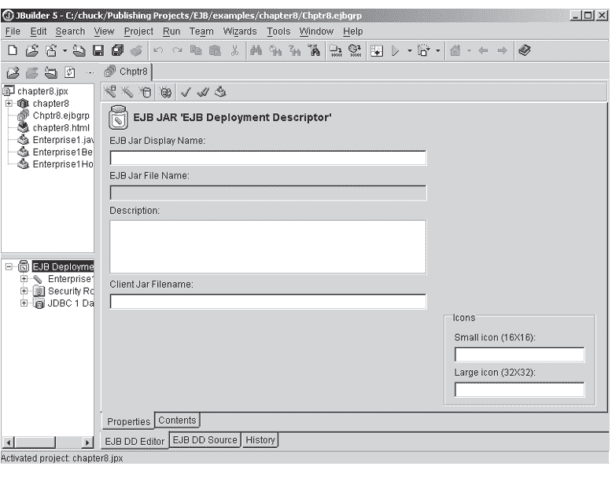

正如我之前向你指出的，JBuilder将创建EJB所需的所有必要的类和方法。然后你就可以专注于实现你所需的业务方法。以下是JBuilder在此示例中为你生成的代码：

首先是实际的Bean类：

```
package chapter8;
import java.rmi.*;
import javax.ejb.*;
public class Enterprise1Bean implements SessionBean, SessionSynchronization
{
    private SessionContext sessionContext;
    public void ejbCreate()
    {
    }
    public void ejbRemove() throws RemoteException
    {
    }
    public void ejbActivate() throws RemoteException
    {
    }
    public void ejbPassivate() throws RemoteException
    {
    }
    public void setSessionContext(SessionContext sessionContext) throws RemoteException
    {
        this.sessionContext = sessionContext;
    }
    public void afterBegin()
    {
    }
    public void beforeCompletion()
    {
    }
    public void afterCompletion(boolean committed)
    {
    }
}
```

请注意，ejbCreate()、ejbPassivate()和ejbRemove()方法都已为你创建。所有会话Bean都需要这些。你还应该注意，会话同步所需的代码也已为你创建，包括afterBegin()、beforeCompletion()和afterCompletion()方法，以及implements SessionSynchronization声明。

主接口也已为你创建：

```
package chapter8;
import java.rmi.*;
import javax.ejb.*;
public interface Enterprise1Home extends EJBHome
{
    public Enterprise1 create() throws RemoteException, CreateException;
}
```

当然，你可以选择在任何你选择的文本编辑器中手动编写此代码，并使用可免费下载的Java开发工具包进行命令行编译。然而，我认为你会发现，当你让JBuilder为你生成代码时，速度会快得多，也更不容易出错。

我已向你展示了如何使用JBuilder创建基本代码。然而，到目前为止我们所做的一切并不是特别有用。它确实是一个带有同步功能的会话Bean，但它不会完成任何业务任务。接下来我将向你展示一个确实执行某些有用任务的Bean。这个Bean是一个购物车Bean。大多数EJB书籍都会在某个时候向你展示一个购物车Bean，事实上，JBuilder的帮助文件也展示了这样一个。它是一个如此有用的产品，以至于它似乎已经成为Bean示例中的事实标准。

以下示例有两个目的。第一个是为你提供另一个关于创建有状态会话Bean要点的示例。另一个目的是向你展示一个具有一些业务方法（换句话说，一个完成某些有用或有趣任务）的有状态会话Bean的示例。

#### 步骤 1：

你可以使用JBuilder来创建Bean，就像你在第一个示例中所做的那样，或者你可以手动创建代码。无论哪种方式，你都需要稍微修改以下生成的代码：

```
import java.rmi.*;
import javax.ejb.*;
public class ShoppingCartBean implements SessionBean
{
    private SessionContext sessionContext;
    private Vector items = new Vector();
    private String cardHolderName;
    private String creditCardNumber;
    private Date expirationDate;

    public void ejbCreate(String sz_cardholdername, String sz_cardnumber,
                          Date dtexpiredate) throws CreateException
    {
        _cardHolderName = cardholdername;
        _creditCardNumber = sz_cardnumber;
        expirationDate = dtexpiredate;
    }
}

public void ejbRemove() throws RemoteException
{
}

public void ejbActivate() throws RemoteException
{
}

public void ejbPassivate() throws RemoteException
{
}

public void setSessionContext(SessionContext context) throws RemoteException
{
    sessionContext = context;
}

public void addItem(Item item)
{
    items.addElement(item);
}

public void removeItem(Item item) throws ItemNotFoundException
{
    Enumeration elements = items.elements();
    while(elements.hasMoreElements())
    {
        Item current = (Item) elements.nextElement();
        // 如果项具有相同的类和标题，则认为它们相等
        if(item.getClass().equals(current.getClass()) &&
           item.getTitle().equals(current.getTitle())) {
            items.removeElement(current);
            return;
        }
    }
}

public float getTotalPrice()
{
    float totalPrice = 0.00f;
    Enumeration elements = items.elements();
    while(elements.hasMoreElements())
    {
        Item current = (Item) elements.nextElement();
        totalPrice += current.getPrice();
    }
    // 将价格四舍五入到最接近的整数美分
    return (long) (totalPrice * 100) / 100f;
}

public java.util.Enumeration getContents()
{
    return new com.inprise.ejb.util.VectorEnumeration(items);
}

public void purchase() throws PurchaseProblemException
{
    // 确保信用卡尚未过期
    Date today = Calendar.getInstance().getTime();
    if(_expirationDate.before(today))
    {
        throw new CardExpiredException("Expiration date: " + _expirationDate);
    }
}

public String toString()
{
    return "ShoppingCartBean[name=" + cardHolderName + "]";
}
}
```

ShoppingCartBean示例使用了一个Item类。这个类代表购物车中的一个给定项目。

```
package shoppingcart;
public class Item implements java.io.Serializable
{
    private String sz_title;
    private float f_price;
    public Item(String title, float price)
    {
        sz_title = title;
        f_price = price;
    }
    public String getTitle()
    {
        return sz_title;
    }
    public float getPrice()
    {
        return f_price;
    }
}
```

ShoppingCart示例中使用了三个自定义异常类。
它们都是Java类Exception的扩展。

```
public class ItemNotFoundException extends Exception
{
    public ItemNotFoundException(String message)
    {
        super(message);
    }
}
public class PurchaseProblemException extends Exception
{
    public PurchaseProblemException(String message)
    {
        super(message);
    }
}
public class CardExpiredException extends Exception
{
    public CardExpiredException(String message)
    {
        super(message);
    }
}
```

请注意，我们的ShoppingCart示例符合所有必需的EJB规范。记住，会话Bean类必须定义为public。你还应该记住，它不能定义为final或abstract。最后，请记住Bean类必须实现SessionBean接口。我们创建的两个Bean都遵守这些规则。然而，为了具有功能性，我们需要添加一些东西。你应该注意到这个类开头的成员变量。它们的名字应该表明它们的用途。items变量保存当前在购物车对象中的项目。我在这里使用了一个向量，因为这样我可以根据需要添加任意数量的项目。另外三个成员变量保存购买所需的信用卡信息。

## 第8章：有状态会话Bean

在线购物者的信用卡信息。（您总希望客户付款吧？）

我们的购物车Bean的工作方式与任何其他有状态会话Bean类似。容器调用`setSessionContext()`方法将Bean实例与其会话上下文关联。然后，Bean可以将此会话上下文引用作为其会话状态的一部分保留。如果您使用了JBuilder EJB向导，会话上下文引用会被保留。会话Bean可以使用会话上下文来获取关于其自身的信息。它可能检索的信息包括环境变量或其主接口。当容器需要将Bean实例置于被动状态时，它会调用Bean实例上的`ejbPassivate()`方法。当Bean被钝化时，容器会将Bean的当前状态写入二级存储。这允许容器在稍后激活Bean时恢复此状态。

请记住，虽然不要求会话Bean实现构造函数，但它必须至少实现一个`ejbCreate()`方法。该方法可以以与构造函数非常相似的方式用于创建新的Bean实例。有状态会话可以实现多个`ejbCreate()`方法。每个`ejbCreate()`方法仅在其参数上有所不同。同样，这非常类似于构造函数。ShoppingCartBean示例声明了一个接受三个参数的`ejbCreate()`方法。这三个参数用于将Bean初始化为给定购物者的上下文。

当然，我们的ShoppingCartBean还有一些额外的方法，即业务方法。所有业务方法必须遵循一些规则：方法名称不应以"ejb"前缀开头，以避免与EJB架构保留的名称冲突。每个方法必须声明为public。没有方法可以声明为final或static。throws子句可以包含`javax.ejb.EJBException`异常，并且可以定义特定于应用程序的任意异常。在ShoppingCartBean示例中，实现了五个业务方法。您必须记住，会话Bean类方法的签名（即方法名称、参数数量、参数类型和返回类型）必须与远程接口中的签名匹配。为确保这一点，您可以使用Bean设计器将添加到Bean类的业务方法移动到Bean的远程接口。

我们添加的方法应该相当直接且易于理解。`addItem()`方法用于将商品添加到购物车，而`removeItem()`方法用于从购物车中移除商品。`getTotalPrice()`方法用于计算总购买金额。

您还应该记住，在客户端和服务器之间传递的所有数据类型必须是可序列化的。因此，它们必须实现`java.io.Serializable`接口。在ShoppingCart示例中，Bean返回商品列表给客户端。如果没有序列化限制，您可以使用`items.elements()`返回商品向量的内容。然而，`items.elements()`返回一个Java Enumeration对象，它不是可序列化的。为避免此问题，程序实现了一个名为`com.inprise.ejb.util.VectorEnumeration`的类。该类接受一个向量并返回一个可序列化的实际枚举，用于该向量的内容。该类是Borland（JBuilder的制造商）优秀团队的创造，这是使用JBuilder进行Java开发的又一好理由！ShoppingCartBean对象将此可序列化的向量传递给客户端，并接收从客户端传递的可序列化的向量。`getContents()`方法执行Java Enumeration和可序列化的VectorEnumeration之间的转换。

`purchase()`方法应执行以下操作：获取当前时间，并将信用卡的过期日期与当前时间进行比较。如果过期日期早于当前时间，该方法将抛出`CardExpiredException`应用程序异常。它还将完成购买过程，包括更新库存、向信用卡公司收取费用以及启动商品发货。（在购物车示例中，这些都未实际实现。）如果在任何时候发生错误，购买过程不会完成，该方法将抛出`PurchaseProblemException`异常。ShoppingCartBean还包括一个`toString()`方法，用于打印ShoppingCartBean和持卡人姓名。

当然，我们的ShoppingCartBean，像所有EJB一样，必须有一个主接口。以下是主接口的代码。请记住，这里的`ejbCreate()`方法必须与实际Bean类中的`ejbCreate()`方法的签名完全匹配。

```java
public interface ShoppingCartHome extends javax.ejb.EJBHome
{
    Cart create(String cardHolderName, String creditCardNumber,
                java.util.Date expirationDate)
        throws java.rmi.RemoteException, javax.ejb.CreateException;
}
```

回想一下，我们的EJB还必须有一个部署描述符。如果您使用JBuilder，它会为您生成一个。然而，对于那些坚持采用复杂方式的读者，以下是购物车会话Bean的部署描述符文件：

```xml
<ejb-jar>
  <enterprise-beans>
    <session>
      <description>
        XML deployment descriptor cart session bean
      </description>
      <ejb-name>cart</ejb-name>
      <home>ShoppingCartHome</home>
      <remote>Cart</remote>
      <ejb-class>ShoppingCartBean</ejb-class>
      <session-type>Stateful</session-type>
      <transaction-type>Container</transaction-type>
    </session>
  </enterprise-beans>
  <assembly-descriptor>
    <container-transaction>
      <method>
        <ejb-name>cart</ejb-name>
        <method-name>*</method-name>
      </method>
      <trans-attribute>NotSupported</trans-attribute>
    </container-transaction>
    <container-transaction>
      <method>
        <ejb-name>cart</ejb-name>
        <method-name>purchase</method-name>
      </method>
      <trans-attribute>Required</trans-attribute>
    </container-transaction>
  </assembly-descriptor>
</ejb-jar>
```

## 我们的EJB的客户端

无论您的EJB设计得多好，没有客户端它都没有多大用处。以下文本将首先描述，然后向您展示此ShoppingCartBean的客户端应用程序。它的`main()`例程包含所有企业Bean客户端应用程序必须实现的元素。此客户端还提供了一个如何使用JNDI定位Bean的主接口的示例。然后，它使用主接口的`create()`方法创建一个新的远程购物车对象。最后，它调用在购物车对象中声明的方法。

```java
public static void main(String args[]) throws Exception
{
    // get a JNDI context using the Naming service
    javax.naming.Context context = new javax.naming.InitialContext();
    Object objref = context.lookup("cart");
    ShoppingCartHome home =
        (ShoppingCartHome)javax.rmi.PortableRemoteObject.narrow(objref,
                                                               CartHome.class);
    ShoppingCart cart;
    {
        String cardHolderName = "Jack B. Quick";
        String creditCardNumber = "1234-5678-9012-3456";
        Date expirationDate = new GregorianCalendar(2001,
                                                   Calendar.JULY,1).getTime();
        cart = home.create(cardHolderName, creditCardNumber,
                           expirationDate);
    }
    Item widget = new Item("The Ubiquitous Widget", 19.95f);
    cart.addItem(widget);
    ... // create compact disc and add it to cart, then list cart contents
    summarize(cart);
    cart.removeItem(widget);
    ... // add a different book and summarize cart contents
    try
    {
        cart.purchase();
    }
    catch(PurchaseProblemException e)
    {
        System.out.println("Could not purchase the items:\n\t" + e);
    }
    cart.remove();
}
```

`main()`例程以一个JNDI上下文开始来查找对象。它构造一个初始上下文（一个Java命名上下文）。这是标准的JNDI代码。`main()`查找名为`cart`的`CartHome`对象。使用JNDI查找名称会从客户端调用到CosNaming服务以在CosNaming中查找该名称。CosNaming服务将一个对象引用返回给客户端。在本例中，它返回一个CORBA对象引用。程序必须对该对象引用执行`PortableRemoteObject.narrow()`操作，将返回的对象强制转换为`CartHome`类型，并将其赋值给变量`home`。此调用对于分布式应用程序是典型的。此调用使用CORBA和IIOP执行以下操作：

- 与服务器通信
- 执行CosNaming查找
- 获取CORBA对象引用
- 将对象引用返回给客户端

程序声明一个对远程购物车对象的引用，初始化三个`create()`参数变量，并创建一个新的购物车远程对象。程序创建两个购物车商品，一本书和一个光盘，并使用购物车的`addItem()`方法将这些商品添加到购物车。然后，该例程通过调用`summarize()`函数列出购物车中当前的商品。`summarize()`使用购物车的`getContents()`方法检索购物车中的元素或商品，该方法返回一个Java枚举。然后，它使用Java Enumeration接口方法读取枚举中的每个元素，提取每个元素的标题和价格。以下是`summarize()`函数代码：

```java
static void summarize(Cart cart) throws Exception
{
    System.out.println("========= Cart Summary =========");
```


枚举元素 = cart.getContents();
while(elements.hasMoreElements())
{
    Item current = (Item) elements.nextElement();
    System.out.println("价格: $" + current.getPrice() + "\t" +
        current.getClass().getName() + " 标题: " + current.getTitle());
}
System.out.println("总计: $" + cart.getTotalPrice());
System.out.println("==============================");
}

然后，程序调用购物车的 removeItem() 方法，从购物车中移除一个商品。它添加另一个不同的商品，并再次汇总购物车内容。最后，程序尝试购买这些商品。购买操作失败，因为它在服务器端未实现，并抛出 PurchaseProblemException。由于用户已完成购物会话，程序会移除购物车。虽然不是必须移除购物车，但这样做是良好的编程实践。会话 bean 为创建它的客户端存在。当客户端结束会话时，容器会自动移除会话 bean 对象。当会话 bean 超时，容器也会移除会话 bean 对象，尽管这不会立即发生。ShoppingCartClient 还包含扩展通用 Item 类的代码，提供两种类型的商品：书籍和光盘。

## 总结

在本章中，你对企业 JavaBeans 的知识得到了扩展，包括了对有状态会话 bean 的基本介绍。阅读本章后，你应该熟悉任何有状态会话 bean 的基本要求。本章以一个购物车示例作为有状态会话 bean 的演示结束。你应该对有状态会话 bean 的要求、优缺点以及生命周期有了扎实的理解。

## 术语

- *会话* – 客户端与企业 JavaBean 之间的完整事务列表
- *有状态* – 在方法调用之间保留状态信息的会话 bean
- *无状态* – 不保留任何状态信息的会话 bean。它仅在单次方法调用期间与客户端交互。
- *事务* – 客户端与企业 JavaBean 之间的单个操作
- *远程接口* – 客户端实际交互的接口
- *本地接口* – 用于获取远程接口引用的接口
- *SessionContext* – 会话 bean 交互的上下文
- *激活* – 指将 JavaBean 从空闲状态移动到活动状态。
- *钝化* – 这个术语指将活动的 JavaBean 移动到空闲状态。这通常由 EJB 容器执行以节省资源。

## 复习问题

1.  你使用什么方法从持久存储中恢复 EJB？
2.  所有有状态会话 bean 必须实现哪个接口？
3.  在新 bean 实例被实例化并从二级存储填充状态信息后，紧接着执行哪个方法？
4.  事务生命周期中的阶段被称为什么？
5.  会话同步需要哪三个方法？
6.  哪个方法通知 bean 实例它即将从内存中移除，并且其实例变量将被序列化？
7.  在什么过程中，容器在内存中重新创建会话对象并恢复先前序列化的状态？
8.  如果会话 bean 希望被告知其参与的任何事务状态的变化，它必须实现哪个接口？
9.  bean 将保持在此“就绪”状态，直到发生以下三种操作之一。是哪三种操作？
10. 只有使用何种类型事务的有状态会话 bean 才能实现 SessionSynchronization？

# 第9章 Java 与数据库编程

### 引言

既然你已经了解了标准 JavaBean 和会话 JavaBean，接下来你将在第10章学习实体 JavaBean。然而，正如我在第5章提到的，实体 bean 代表某些数据实体。如果没有扎实掌握 Java 中的基本数据库编程，你将无法理解和使用实体 bean。同样，如果没有这些知识，你也无法完成第11章中的示例。许多读者可能已经具备这项技能。如果你已经熟悉 Java 数据库编程，那么可以跳过本章。但是，如果你不熟悉 Java 中的数据库编程，或者需要简要复习，那么本章正适合你。

## 数据库概念

将数据存储在永久性二级存储（即硬盘、CD、软盘等）是所有程序员的常见活动。你可以以多种格式存储数据。过去，数据通常以顺序方式存储在平面文件（如文本文件）中。你必须从头开始搜索，直到找到所需的数据。

然而，与存储数据同样重要的是能够高效地检索数据。关系数据库为你提供了一种有组织的方式来存储数据，使得数据更容易组织、操作和检索。顾名思义，关系数据库是数据单元之间相互关联的数据库。具体来说，是数据库表之间相互关联。有一些数据库术语你需要熟悉。这些术语在下表中描述：

| 术语 | 定义 |
|---|---|
| 记录 | 这是特定条目的所有字段。例如，组成单个员工文件的所有字段就是一条记录。 |
| 字段 | 这是特定的数据项，如姓氏、地址、电话等。在 SQL Server 或 Oracle 中，这被称为列。 |
| 表 | 这些是存储在一起的相关记录。例如，所有员工的所有记录可能存储在一个员工表中。 |
| 数据库 | 这些是存储在一起的相关表。例如，员工表、库存表和财务表可能存储在一个常见的小型企业数据库中。 |
| 主键 | 这是用于在数据库表中唯一标识一条记录的字段。该字段必须包含唯一值。一个很好的主键示例是使用社会安全号码作为员工表的主键。 |

关系数据库管理系统（RDBMS）指的是相互关联的数据单元。假设你有一个包含员工数据的数据库。对于每个员工，你可能想要一个工作描述。如果你有20个人具有相同的工作描述（例如，20个 Java 程序员），你真的想把工作描述重写20遍吗？在关系数据库模型中，你只需有一个工作描述表，员工表中每个员工的记录都与他们的工作描述相关或链接。这大大减少了数据库所需的开销。它也使数据库的布局非常合乎逻辑。市场上有各种各样的商业关系数据库管理系统，它们都提供某种类型的工具，允许你创建表之间的关系。

这种数据存储方法与之前描述的平面文件有显著不同。平面文件只是按顺序方式存储信息，一条记录接着一条记录。记录或字段之间没有关系。这导致数据文件异常庞大且包含大量重复。执行搜索也相当困难。事实上，搜索平面文件的唯一方法是从头开始，循环遍历每条记录，直到检索到你正在寻找的数据。

如今，大多数数据存储在关系数据库中，而不是平面文件。为了实现关系数据库，你需要一个关系数据库管理系统。当今市场上有广泛的关系数据库系统。最受欢迎的有：

- Oracle
- Microsoft SQL Server
- Microsoft Access（用于小型桌面数据库）
- IBM DB2
- Sybase SQL Anywhere

如果你认真对待数据库编程，你应该花时间至少精通其中一种数据库系统，最好两种。在附录 A 中，我列出了一些好的书籍和在线网页教程，将帮助你快速掌握你所选择的关系数据库系统。如果你还没有扎实掌握至少一种关系数据库管理系统，你应该意识到，在职业生涯中，如果没有至少中等水平的某种商业数据库系统技能，是很难走得很远的。毕竟，几乎所有业务

从某种程度上说，编程就是数据库编程。幸运的是，你会发现所有这些数据库系统共享许多共同特性；它们之间的区别仅仅在于各自对这些特性的实现方式，以及它们的存储容量和提供的额外工具。

## SQL

数据库一旦建立，就必须有某种方法与之交互。这将包括以下活动：

- 添加新记录
- 删除记录
- 编辑当前记录
- 根据某些条件查找记录

在数据库编程的早期，每个关系数据库系统都有自己专有的方法来完成这些任务。这带来了两个严重的困难。第一个是，在一个商业数据库系统中学到的技能在另一个系统中几乎完全不适用。其次，也许更成问题的是，这些专有的方案与底层数据库架构紧密相连。大多数现代数据库程序员，甚至数据库管理员，都无需处理，甚至无需了解数据库系统存储和访问数据的底层机制。然而，面对各种专有的机制，程序员往往需要非常清楚这些细节。因此，要进行任何数据库操作，需要更多的知识和付出更多的努力。

对于现代商业数据库系统来说，情况已不再如此。如今几乎所有可用的数据库系统都使用结构化查询语言进行所有数据库访问和操作。这意味着为 Microsoft 的 SQL Server 2000 编写的数据库查询同样适用于 Oracle 8i 数据库。这是商业编程的一个巨大进步。现在，数据库程序员可以将在一个数据库平台上获得的技能完全应用于不同的产品。程序员无需关心关系数据库系统实现的数据存储和访问架构的复杂细节。

SQL（通常发音为 S-Q-L 或 “sequel”），即结构化查询语言，是用于与关系数据库对话的语言。这个系统现在几乎是所有数据库方法的标准。事实上，我不知道有任何数据库系统不使用 SQL。然而，由于确实可能存在我不知道的系统，所以我使用“几乎是通用的”这个说法。关系数据库设计模型由 E.F. Codd 博士在 1969 年发明，并于 1985 年在 *Computer World* 上发表。

SQL 于 1974 年在 IBM 圣何塞研究实验室首次实现。SQL 本质上是一种非过程化语言，它使用类似英语的单词与数据库对话。美国国家标准协会（ANSI）持续更新其 SQL 标准版本。SQL 独立于具体的数据库。这意味着 SQL 查询在 MS Access、MS SQL Server、IBM DB2、Oracle 或任何其他关系数据库系统上都能同样良好地工作。一条 SQL 语句通常是一个传递给数据库的字符串变量。下面是一个 SQL 查询示例，用于从名为 MYTABLE 的表中检索所有数据。

```
"SELECT * FROM [MYTABLE]"
```

> **注意：** 方括号用于表示数据库中的一个表。星号 (*) 符号是计算机简写，代表“所有内容”。大小写并非绝对必要，但通常是 SQL 命令本身的常用约定。

下表列出了最常见的 SQL 语句及其用途。当然，SQL 命令远不止你在这里看到的这些，但这些基本命令在关系数据库管理和数据库编程领域无处不在。

| 命令 | 用途 | 示例 |
| --- | --- | --- |
| SELECT | 检索数据 | "SELECT * FROM [MYTABLE]" |
| FROM | 指定从哪个表检索数据 | "SELECT * FROM [MYTABLE]" |
| WHERE | 定义选择数据的某些条件 | "SELECT [field1],[field2],.... FROM [sometable] WHERE [somefield] = SomeCriteria" |
| ORDER BY | 此语句根据您希望排序的特定字段对记录进行排序。 | "SELECT * FROM [MYTABLE] ORDER BY [SomeField]" |
| DISTINCT | 如果存在重复项，则仅返回第一条。 | "SELECT DISTINCT FROM [MYTABLE] ORDER BY [SomeField]" |
| INNER JOIN | 连接两个独立表中的数据 | "SELECT * FROM [TABLE1] INNER JOIN [TABLE2] ON table1.fieldname=table2.fieldname" |
| OUTER JOIN | 连接两个独立表中的数据 | "SELECT * FROM [TABLE1] OUTER JOIN [TABLE2] ON table1.fieldname=table2.fieldname" |

让我们看一些你可能想要使用 SQL 语句的示例。为了演示，我们将假设你有一个包含名为 EMPLOYEE 表的数据库。此表包含以下字段：

- Last Name
- First Name
- Phone Number
- Position
- Hire Date
- Salary

使用此配置，我将向你展示如何使用 SQL 语句从该表中提取各种类型的数据。正如你已经看到的，你可以使用以下语句检索所有记录的所有字段：

```
"SELECT * FROM [EMPLOYEE]"
```

然而，如果你只需要检索员工姓名列表，则没有理由同时检索其他四个字段。那是浪费资源。在这种情况下，你可以使用此 SQL 语句仅检索所需的字段：

```
"SELECT [Last Name], [First Name] FROM [EMPLOYEE]"
```

当然，这两个 SQL 语句都返回给定表中的所有记录。在许多情况下，你只想要满足特定条件的记录。例如，你可能只想要姓氏为 Jones 的员工。或者，你可能希望检索所有年薪超过 50,000 美元的员工。以下 SQL 语句正是为你做这件事：

```
"SELECT * FROM [TABLE] WHERE [Last Name] = 'Smith'"
"SELECT * FROM [TABLE] WHERE [Salary] > 50000"
```

在这两种情况下，只有符合你条件的记录才会返回给你。你甚至可以选择那些接近你条件的记录。例如，如果你想要所有姓氏以“Smi”开头的员工：

```
"SELECT * FROM [Employees] WHERE [Last Name] LIKE 'Smi*'"
```

还有许多其他具有各种用途的 SQL 命令。INNER JOIN 和 OUTER JOIN 都从两个表中获取数据，并将它们合并到一个结果集中。像 INSERT 和 DELETE 这样的命令具有明显的用途。对结构化查询语言的全面介绍超出了本书的范围。

以上只是对数据库概念和 SQL 的简要介绍。如果这些材料对你来说是新的，那么我强烈建议你花时间学习更多关于数据库和 SQL 的知识。你可以在本书末尾的附录 A 中找到一些资源，包括书籍和在线教程。然而，目前，这些概念应该足以让你理解本书的其余部分。

## JDBC

既然你已经了解了基本的数据库概念和一些结构化查询语言，现在是时候看看如何在 Java 中进行数据访问代码了。JDBC 是 Java 数据库连接的缩写。JDBC 是连接到数据源的 Java 驱动程序集。这个概念与你可能熟悉的 ODBC（开放数据库连接）驱动程序非常相似。

在 java.sql 包中，有一套丰富的类，可以让你执行可能需要的任何数据库活动。java.sql 包包含提供用于从数据源访问和处理数据的 API（应用程序编程接口）的类。java.sql 包有时被称为 JDBC 2.0 API。JDBC 是一个允许 Java 连接几乎任何数据库的标准。java.sql 包包括用于建立数据库连接、向数据库发送 SQL 语句、检索查询结果、提供有关数据库的信息以及抛出异常的类、接口和方法。java.sql 中有几个类，但有几个是最重要的。下表总结了这些类及其功能：

| 类 | 功能 |
|---|---|
| Connection | 此类表示与实际数据库的连接。你使用此类的对象来选择数据源、驱动程序和数据库位置，并打开连接。你还可以使用此类的方法在完成后关闭连接。 |
| Statement | 此类的对象允许你在数据源上执行任何有效的 SQL 语句。这对你来说将特别有价值。 |
| ResultSet | 此类的对象表示执行语句后返回的记录集。这非常类似于 Microsoft ADO 技术中的 recordset 对象。 |


| 类 | 功能描述 |
| :--- | :--- |
| DriverManager | 在初始化期间，此类将尝试加载“jdbc.drivers”系统属性中引用的驱动程序类。这意味着它能够定位系统上所有JDBC驱动程序。这允许用户自定义其应用程序使用的JDBC驱动程序。 |

对于任何Java程序员来说，熟悉JDBC以及JDBC编程中使用的各种类都至关重要。对于希望开发实体Bean的程序员来说，掌握这些类及其用法的工作知识是绝对关键的。让我们来看一个在Java中处理基本数据访问的示例类。在示例之后，我将详细解释具体发生了什么。

```java
import java.sql.*;
class sql
{
    // The URL is the location of the data source
    static String url = "jdbc:odbc:mysource";
    // Connection objects represent the actual connection to
    // some data source.
    static Connection connection;
    public static void main(String args[])
    {
        String sz_field;  // This will hold a single field/column returned
                          // from a database

        String sqlquery;  // This will hold any valid SQL Query
        try
        {

            // These statements make the initial connection to
            // The data source
            Class.forName("sun.jdbc.odbc.JdbcOdbcDriver");
            connection = DriverManager.getConnection(url);
            // Build an sql query that will be passed to the data source
            sqlquery = "SELECT * FROM bank";
            // The statement object represents any valid sql statement
            Statement statement = connection.createStatement();
            // Execute the sql and get back the recordset
            ResultSet rs = statement.executeQuery(sqlquery);
            // move to the first record
            rs.next();
            // retrieve and display the first field
            sz_field= rs.getString(1);
            System.out.println("The account number " + sz_field);
            // retrieve and display the second field
            sz_field= rs.getString(2);
            System.out.println("The checking balance is " + sz_field);
            // retrieve and display the third field
            sz_field= rs.getString(3);
            System.out.println("The savings balance is " + sz_field);
            // close the connection
            connection.close();
        }
        catch(Exception e)
        {
            System.out.println("Error! " + e.toString());
        }
    }
}
```

这是我向初次学习Java课程、试图了解Java数据库编程的学生展示的完全相同的代码。它可能不是特别令人印象深刻，但经验证明，它在展示Java数据库编程的基本概念方面是有效的。这里展示的大部分代码是标准Java代码。main函数、异常捕获以及这段代码的其他方面都是标准的Java代码。然而，这个示例的某些部分是JDBC数据库编程所特有的。代码中第一部分可能让你觉得有点奇怪的是这个字符串声明：

```java
static String url = "jdbc:odbc:mysource";
```

这个字符串提供了数据源的位置；在这个例子中，它是一个代表Access数据库的DSN（数据源名称）。它还表明将使用围绕ODBC驱动程序的JDBC“包装器”。注意字符串名是“url”。这是有意的。使用Java JDBC API，你可以通过互联网访问数据库资源。因此，在某些情况下，数据库位置可能确实是一个URL，或称统一资源定位符（即网址）。

接下来你可能不立刻清楚的两行代码是实际建立与数据源连接的代码：

```java
Class.forName("sun.jdbc.odbc.JdbcOdbcDriver");
connection = DriverManager.getConnection(url);
```

这个代码片段的第一行只是标识了要使用哪一组驱动程序。在我们的例子中，我们使用的是Sun Microsystems的JDBC驱动程序。下一行代码将connection对象设置为等于与之前指定的数据源位置的有效连接。DriverManager类实际上管理各种JDBC驱动程序的使用。

接下来，我们有执行适当SQL语句以检索特定表中项目的代码。在我们的示例中，表名为“bank”。

```java
sqlquery = "SELECT * FROM [bank]";
Statement statement = connection.createStatement();
ResultSet rs = statement.executeQuery(sqlquery);
```

首先，你看到一个被设置为等于特定SQL语句的字符串。这可以是任何有效的SQL语句。如果你还不熟悉SQL，网上有许多优秀的教程可供参考（参见附录A获取一些此类资源）。然后，我们将该语句设置为等于connection对象的`createStatement()`方法的返回值。该方法将返回一个statement对象。最后，我们将resultset对象设置为等于statement对象的`executeQuery()`语句的返回值。

最后一行代码只是让resultset指向返回的第一条记录。如果不执行这行代码，后续对resultset对象的操作将产生错误。

```java
rs.next();
```

从根本上说，这就是使用Java JDBC API访问数据库所需的全部内容。如你所见，只要你牢固掌握数据库基础知识并具备结构化查询语言的工作知识，代码并非过于复杂。

### 使用JBuilder进行数据库连接

正如我在本书中所展示的，Java中的大多数任务都可以用JBuilder更高效地完成。数据库连接也不例外。现在，让我们通过一个例子来看看它是如何工作的。

这是一个相当简单的例子，但它将展示使用JBuilder创建数据库应用程序是多么容易。如果你完全按照给定的步骤操作，你将生成一个Java数据库应用程序。

#### 步骤1：

启动一个新项目，并选择一个合适的名称。你可以选择任何你喜欢的名字。在可下载的文件中，我将项目命名为example 09_01，但我相信你可以为你的项目想出更有创意的名字。

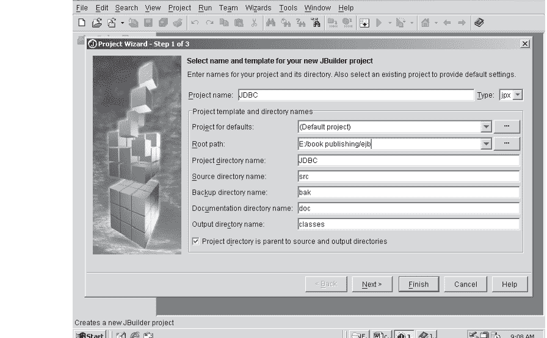

在“项目向导”的步骤2和3中，只需使用默认值。

#### 步骤2：

现在你需要实际添加一个数据模块。为此，你必须选择“文件” ▸ “新建”，然后选择“数据模块”。

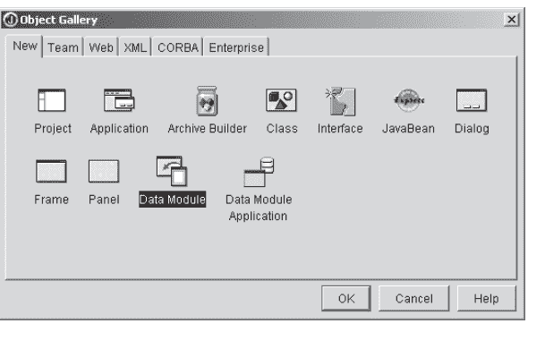

#### 步骤3：

接下来，你将必须设置这个数据模块的名称。

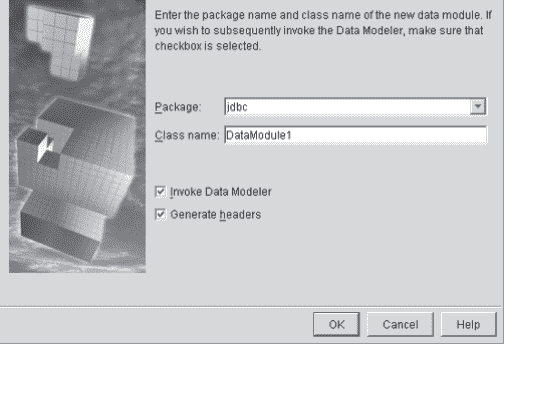

#### 步骤4：

下一个屏幕允许你通过GUI（图形用户界面）构建查询并生成所需的数据库代码。

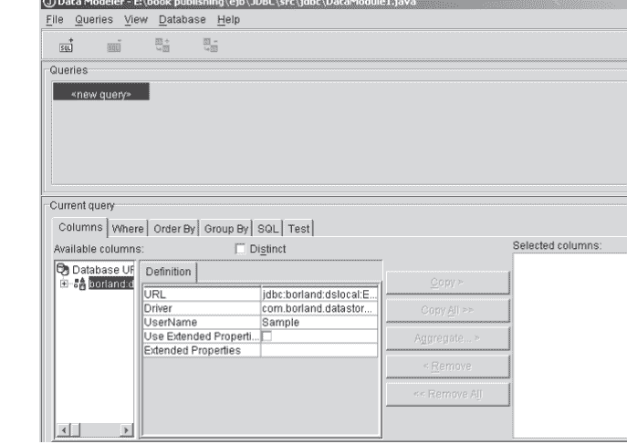

#### 步骤5：

我们现在将添加一个连接URL。

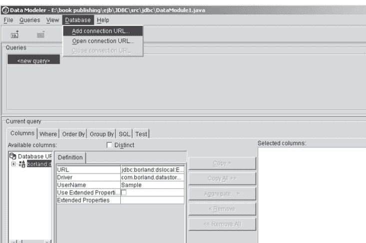

#### 步骤6：

你现在可以选择机器上的任何驱动程序和任何有效的数据源。我选择了`sun.jdbc.odbc.JdbcOdbcDriver`驱动程序和我PC上的一个测试MS Access数据库。

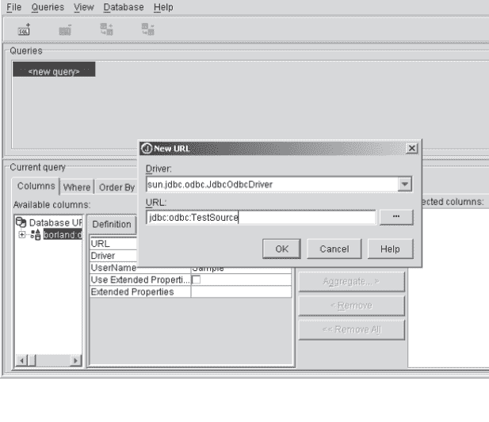

#### 步骤7：

打开数据库连接很容易：

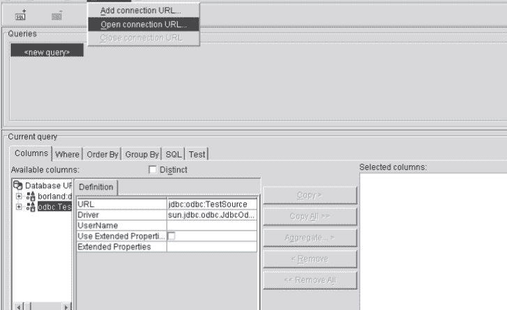

#### 步骤8：

构建SQL查询就像点击你想要的表和字段一样简单。

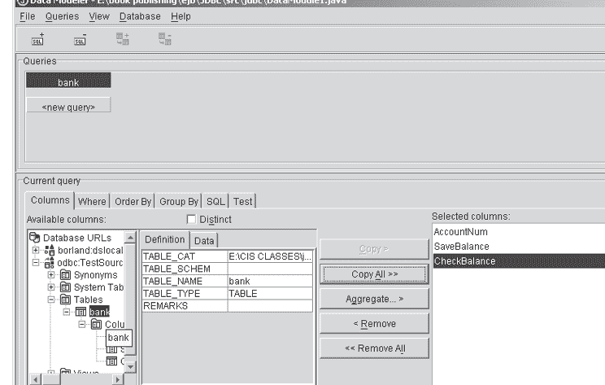

#### 步骤9：

现在保存你的数据模块并退出向导。JBuilder已经为你生成了以下源代码。仔细检查这段代码；它是完全可运行的数据库代码，所有基础工作都已为你完成：

```java
package jdbc;
import java.awt.*;
import java.awt.event.*;
import com.borland.dx.dataset.*;
import com.borland.dx.sql.dataset.*;
public class DataModule1 implements DataModule
{
    private static DataModule1 myDM;
    Database database1 = new Database();
    QueryDataSet bank = new QueryDataSet();
    public static DataModule1 getDataModule()
```

```markdown
### JBuilder 数据工具

除了能够让您相对轻松地创建数据库代码的向导外，JBuilder 还附带了一组用于创建数据库本身和管理连接的工具。任何使用过 Microsoft Visual Basic 及其数据管理器（Data Manager）的人，都会熟悉那些提供丰富图形化数据库管理实用程序的开发工具。然而，JBuilder 为此目的提供的工具是我所见过的最完整的。

#### Database Pilot

我们将要查看的第一个此类工具是 Database Pilot。您可以通过选择 Tools ► Database Pilot 来找到此工具。

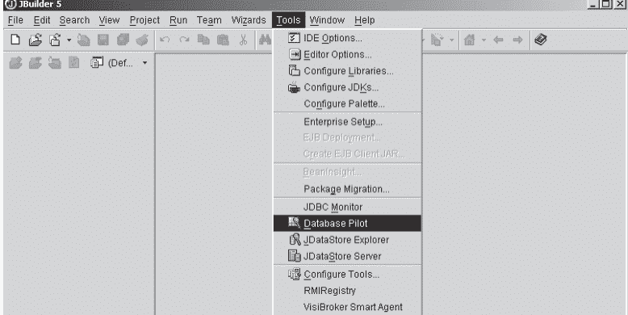

完成此操作后，您将看到 Database Pilot 的主屏幕。

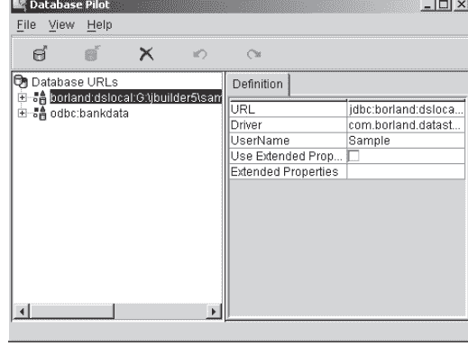

Database Pilot 本质上是一个数据库浏览器。它以分层的“树状”格式呈现数据，并且允许您编辑数据库中的数据。它在双窗格窗口中呈现基于 JDBC 的元数据库信息。在左侧窗格中，您应该看到一棵树，其中显示了一组数据库及其关联的表、视图、存储过程和元数据。右侧窗格是关于树中每个节点的多页信息显示。在某些情况下，您也可以在右侧窗格中编辑数据。

您可以使用 Database Pilot 来创建、查看或编辑现有数据库表中的数据。您也可以输入和执行 SQL 语句。让我们通过几个简单的示例来了解 Database Pilot。

在这个示例中，我将向您展示如何使用 Database Pilot 连接到现有的数据库和表。

#### 步骤 1：

在 Database Pilot 中，双击提供的示例数据库。您可以看到树已展开，显示了表和存储过程。您还应该注意到，在左侧窗格中，您可以看到此机器上的任何其他数据源，包括为之前的数据库示例创建的那个。

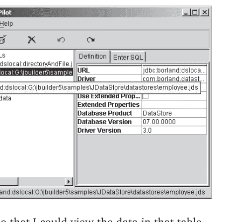

#### 步骤 2：

我选择了 Addresses 表，以便查看该表中的数据。当您双击一个表时，其内容将显示在右侧窗格中。

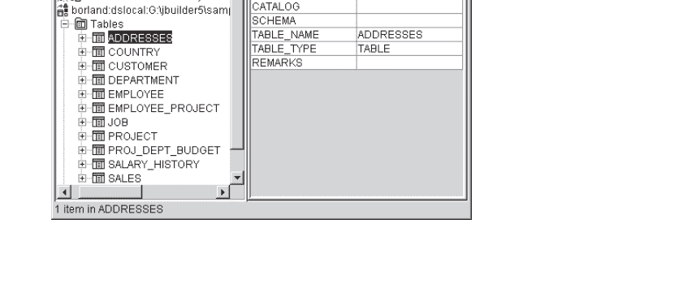

请注意，第一个选项卡，即 Definition 选项卡，只是告诉您关于该表的信息。第二个选项卡，即 Data 选项卡，向您显示该表中的实际数据。您实际上可以直接在此屏幕中输入新数据、删除数据或编辑数据。

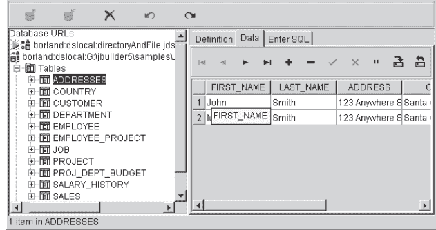

第三个选项卡，即 Enter SQL 选项卡，允许您直接键入 SQL 语句并执行它们。

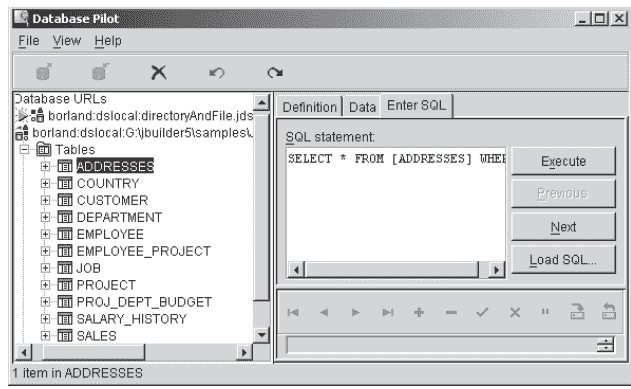

这只是一个关于 Database Pilot 的简要介绍。然而，即使通过简要介绍，您也应该能够看到它是一个非常通用且功能强大的数据库工具。如果您打算使用 JBuilder 进行大量的数据库编程，我强烈建议您花时间更彻底地熟悉此工具。

您还会在 Tools 下拉菜单中找到 JDataStore Server 和 JDataStore Explorer。两者都提供了一组丰富的工具，可以简化您的数据库工作。我将在这里简要描述每一个。

#### JDataStore Explorer

JDataStore Explorer 顾名思义，是一个用于数据存储（datastores）的浏览器。使用此浏览器，您可以检查数据存储的内容。存储的目录以树状结构显示，每个数据集及其索引被分组在一起。当选择特定的数据流时，将显示其内容。使用 JDataStore Explorer，您可以在不编写任何代码的情况下执行许多存储操作。您可以创建新的 JDataStore、导入文件、删除数据、编辑数据集，并将更改保存回服务器表。JDataStore Explorer 看起来像您在这里看到的图像：


#### JDataStore Server

一旦您完成了数据库应用程序的开发并准备投入生产，您将需要一个数据库服务器。JDataStore 就是这样的服务器。它将允许您使您的数据存储在整个网络甚至互联网上可用。JDataStore Server 窗口看起来像您在这里看到的图像：


关于 JBuilder 数据库编程的更全面内容，我建议您查看附录 A 中列出的 *Charlie Calvert's Learn JBuilder 7*。您还可以在 JBuilder 帮助文件中找到很多有用的信息。除了这些资源，我还为您在附录 A 中提供了一些相当可靠的在线教程链接。

## 总结

在本章中，我向您展示了关系数据库和结构化查询语言的基本概念。我还向您展示了从 Java 内部访问数据的基础知识。本章涵盖了 `java.sql` 中找到的基本类，例如 DriverManager、Connection、ResultSet 和 Statement 类。您还了解了如何利用 JBuilder 来相对轻松地帮助您创建数据库应用程序。本章介绍的基本概念应该能让您进行基本的 Java 数据库编程。在继续之前，请确保您对本章中的所有主题都感到满意。

本章只是对数据库概念和 JBuilder 中可用的数据库工具的介绍。我强烈建议，如果这些材料对您来说是新的，您应该在不久的将来分配一些时间来更彻底地探索 Java 和 JBuilder 中的数据库编程。

## 术语

- *记录* – 表示数据库中一个连贯条目的字段或列的集合。
- *字段* – 记录中的单个项目。在 SQL Server 中，这称为列。
- *表* – 逻辑上分组在一起的记录集合。
- *SQL* – 结构化查询语言。这是关系数据库使用的语言。
- *RDBMS* – 关系数据库管理系统。这是一个用于创建和管理关系数据库的软件包，通常带有图形用户界面。
- *ODBC* – 开放数据库连接。这些是数据库驱动程序。
- *JDBC* – Java 数据库连接。这些是充当 ODBC 驱动程序包装器的 Java 类。

## 复习题

1.  JDBC 是什么？
2.  一组相关字段被称为什么？
3.  DriverManager 类的用途是什么？
4.  SQL 是谁发明的？
5.  列出 `java.sql` 包中的三个类。
6.  ORDER BY SQL 语句是做什么的？
7.  ODBC 是什么？
8.  是否可以搜索数据库中仅与给定条件相似的项目？
9.  在成功从语句对象获得返回的结果集后，在尝试处理该结果集对象之前，您必须做什么？
10. 连接对象的用途是什么？
```


## 第十章
实体Bean

### 简介

到目前为止，我只讨论了会话企业JavaBean。回顾一下，会话Bean代表与客户端的特定会话。会话Bean可以是有状态的，也可以是无状态的。现在，该轮到我们讨论实体Bean了。实体Bean代表某些数据对象，而非某个业务流程。通常，数据存储在某种关系型数据库中。实体Bean直接映射到关系型数据库表中的一行或多行数据。它也可以映射到多个表中的一行或多行数据。显然，在深入研究实体Bean之前，假定你对数据库有基本的理解。对于缺乏这方面知识的读者，我建议你回看第九章。

在数据库中，主键唯一标识表中的特定行。由于实体Bean代表数据存储对象，主键也标识特定的实体Bean实例这一点也就不足为奇了。关系型数据库表中的每个列（或字段）都映射到实体Bean中的特定实例变量。因此，每个实例变量实际上是一个底层列/字段的表示。因为实体Bean代表一个底层数据源，所以它的生命周期与会话Bean的生命周期有些不同。本质上，Bean的生命周期与数据源存在并可访问的时间一样长。这意味着，无论实体Bean处于非活动状态多久，容器都不会将其从持久存储中移除。移除实体Bean的唯一方法是显式地执行操作。实体Bean通过调用其 `remove()` 方法来移除，该方法也会从数据库中删除底层数据。

## 持久性

所有实体企业Bean本质上都是持久的。如果一个实体Bean不能持久化数据，它就无法代表数据对象。因此，所有实体Bean都支持某种形式的持久性。但是，你可以选择如何实现你的实体Bean的持久性。你可以直接在实体Bean类中实现Bean的持久性。这意味着Bean本身负责维护其持久性。这被称为Bean管理的持久性（BMP）。Bean管理的持久性让你能够更精确地控制Bean何时以及如何持久化其数据，以及如何检索这些数据。你也可以选择让容器来处理实体Bean的持久性。这被称为容器管理的持久性（CMP）。容器管理的持久性对程序员来说可能更容易，因为他或她不必编写处理数据持久化的代码。

实现Bean管理的持久性的实体Bean包含了访问和更新数据库的代码。创建Bean的程序员必须直接在实体Bean或其关联类中编写数据库访问代码。数据库访问调用可以出现在实体Bean的业务方法中，或者出现在实体Bean接口方法中。

编写具有Bean管理持久性的实体Bean可能更困难，因为你必须直接编写所有数据访问代码。修改实体Bean以与不同的数据源协同工作也可能相当困难。如果你选择使用Bean管理的持久性，我强烈建议你创建一个单独的辅助类来处理所有数据访问。这样，在数据源或数据访问方法发生变化时，你可以相对轻松地修改或替换该类。

如果你选择使用容器管理的持久性，你就不必编写处理数据库访问的代码；容器会为你处理。与Bean管理的持久性相比，容器管理的持久性具有某些明显的优势。容器管理的Bean显然更容易编码。由于你（程序员）不必编写任何数据访问代码，你的工作得到了简化。使用容器管理的实体Bean，持久性细节可以在不修改和重新编译Bean的情况下进行更改。如果数据源发生变化，只需要部署者或应用程序组装者修改部署描述符即可。这使你（程序员）能够专注于Bean的业务逻辑和业务方法，而不是底层系统问题。然而，使用容器管理的持久性并非实体Bean编程的万能药；它确实有一些限制。其中一个限制是，容器可能会在调用 `ejbLoad()` 方法之前将实体对象的整个状态加载到Bean实例的字段中。如果实体Bean有许多字段，这可能会导致一些严重的性能问题。

请记住，实体Bean是底层数据源的表示。这意味着每个实体Bean实例都需要有一个主键，就像底层数据源应该有一个主键一样。回顾一下，主键是唯一标识实例的值。有关主键的更多信息，请参阅第九章。例如，包含员工记录的数据库表可以使用员工的社会安全号码作为其主键。建模此员工表的实体Bean也会使用社会安全号码作为其主键。对于企业Bean，主键通常由字符串或整数类型表示。但是，它也可以由包含唯一数据的Java类表示。这个主键类可以是任何类，只要该类是RMI/IIOP中的合法值类型即可。当然，这意味着该类必须扩展 `java.io.Serializable` 接口。主键类可以特定于某个实体Bean类。也就是说，每个实体Bean都可以定义自己的主键类。你也可以使用单个键类，并让多个实体Bean共享同一个主键类。

要创建一个实体Bean类，你需要创建一个实现 `javax.ejb.EntityBean` 接口的类。正如你现在应该知道的那样，所有企业JavaBean都实现来自 `javax.ejb` 包的特定接口，以赋予它们你试图创建的EJB类型的特定特征。当然，它必须实现一个或多个 `ejbCreate()` 方法。与会话Bean一样，它必须有一个Bean的本地接口。对于本地接口中的每个 `create()` 方法，实体Bean必须有一个具有相同签名的 `ejbCreate()` 方法。你还需要一个远程接口。最后，你需要定义并实现你希望你的Bean具有的业务方法。你可以看到，Bean创建的基本要素（即本地接口、远程接口、实现可序列化接口等）对所有类型的EJB都是通用的。

对于具有Bean管理持久性的实体Bean，你将需要实现查找器方法（finder methods）。这些方法本质上是为你查找数据的方法。正如你将在本章后面看到的，JBuilder的企业JavaBean向导可以为你完成许多此类任务。它创建一个扩展 `EntityBean` 接口的类，并为空实体Bean方法编写空实现。然后，如果你的Bean需要，你只需填充特定的业务实现即可。

## EntityBean接口

这个接口是实体Bean的核心和灵魂，因此在我们开始编写实体Bean之前值得仔细研究。`EntityBean` 接口定义了所有实体Bean必须实现的方法。它扩展了 `EnterpriseBean` 接口。

```java
public interface EntityBean extends EnterpriseBean
{
    public void setEntityContext(EntityContext ctx) throws EJBException,
RemoteException;
    public void unsetEntityContext() throws EJBException, RemoteException;
    void ejbRemove() throws RemoveException, EJBException, RemoteException;
    void ejbActivate() throws EJBException, RemoteException;
    void ejbPassivate() throws EJBException, RemoteException;
    void ejbLoad() throws EJBException, RemoteException;
    void ejbStore() throws EJBException, RemoteException;
}
```


EntityBean 接口的方法与实体 Bean 的生命周期紧密相关。下表概述了它们的目的：

| 方法 | 描述 |
| :--- | :--- |
| EntityContext() | 此方法用于设置实体 Bean 的上下文。容器使用此方法将 `EntityContext` 接口的引用传递给 Bean 实例。该上下文随后存储在一个实例变量中。 |
| unsetEntityContext() | 此方法用于释放 `setEntityContext()` 方法调用期间分配的资源。容器在终止当前实体 Bean 实例之前调用此方法。 |
| ejbRemove() | 此方法用于移除与此特定实体 Bean 关联的数据库条目。当客户端调用 `remove()` 方法时，容器调用此方法。 |
| ejbActivate | 此方法用于通知实体 Bean 它已被激活。容器在已激活的实体 Bean 实例上调用此方法。 |
| ejbPassivate() | 此方法通知实体 Bean 它即将被停用。 |
| ejbLoad() | 此方法从数据库刷新实体对象所代表的数据。 |
| ejbStore() | 调用此方法是为了将实体对象所代表的数据存储到数据库中。 |

## 实体 Bean 方法

实体 Bean 可以有三种不同类型的方法：创建方法、查找方法和业务方法。

### 创建方法

如果您使用 Enterprise JavaBeans 向导来开始创建您的企业 Bean，您会看到向导会为您创建一个 `ejbCreate()` 方法和一个 `ejbPostCreate()` 方法，它们属于不带参数的 Bean 类。如果您的 Bean 需要，您可以编写额外的创建方法。您应该记住，调用实体 Bean 的创建方法会在数据库中插入新数据。如果实体对象的新实例只应通过 DBMS 更新或遗留应用程序添加到数据库中，您可以拥有没有创建方法的实体 Bean。

如果您选择添加包含参数的额外 `ejbCreate()` 方法，请记住以下几条规则：

- 所有 `ejbCreate()` 方法必须具有 `public` 访问修饰符。
- 如果您的实体 Bean 使用容器管理的持久性，`ejbCreate()` 方法必须返回 `null`。
- 如果您的实体 Bean 使用 Bean 管理的持久性，`ejbCreate()` 方法必须返回新实体对象的主键类的一个实例。容器使用此主键来创建实际的实体引用。
- `ejbCreate()` 方法的参数与对应的 `create()` 方法具有相同的签名。这意味着它们必须与 Bean 远程接口中对应的 `create()` 方法具有相同的数量和类型。
- 所有 `ejbCreate()` 方法都必须有一个对应的 `ejbPostCreate()` 方法。
- 无论 Bean 使用容器管理还是 Bean 管理的持久性，`ejbCreate()` 方法的签名都是相同的。

以下是实体 Bean 所有 `ejbCreate()` 方法的签名：

```
public PrimaryKeyClass ejbCreate(parameters)
{
    // implementation code goes here
}
```

当客户端应用程序调用 `create()` 方法时，容器随后执行 `ejbCreate()` 方法，并将代表实体对象的记录插入数据库。`ejbCreate()` 方法通常初始化一些实体状态。因此，它们经常有一个或多个参数，并包含将实体状态设置为参数值的代码。例如，考虑一个银行有一个支票账户实体 Bean，其 `ejbCreate()` 方法接受两个参数：一个字符串和一个浮点值。该方法将账户名称初始化为字符串值，将账户余额初始化为浮点值：

```
public Checking ejbCreate(String customername, float balance)
{
    this.customername = customername;
    this.balance = balance;
}
```

当 `ejbCreate()` 方法执行完毕后，容器随后调用匹配的 `ejbPostCreate()` 方法，以允许实例完成其初始化。回想一下，`ejbPostCreate()` 在参数方面与 `ejbCreate()` 方法匹配，但它返回 `void`：

```
public void ejbPostCreate(parameters)
{
    // implementation code goes here
}
```

定义 `ejbPostCreate()` 时请遵循以下规则：

- 它必须声明为具有 `public` 访问修饰符。
- 不能声明为 `final` 或 `static`。
- 必须具有 `void` 返回类型。
- 其参数列表必须与对应的 `ejbCreate()` 方法匹配。

您应该使用 `ejbPostCreate()` 来执行您的 Bean 在可供客户端使用之前需要进行的任何特殊处理。如果您的 Bean 不需要执行任何特殊处理，您可以简单地将方法体留空。

### 查找方法

每个实体 Bean 都必须有一个或多个查找方法。客户端使用查找方法来定位实体 Bean。每个 Bean 管理的实体 Bean 都必须有一个 `ejbFindByPrimaryKey()` 方法，该方法在 Bean 的本地接口中有一个对应的 `findByPrimaryKey()`。以下是 `ejbFindByPrimaryKey()` 方法的签名：

```
public PrimaryKeyClass ejbFindByPrimaryKey(<PrimaryKeyClass primaryKey>)
{
    // implementation code goes here
}
```

当然，您可以为您的 Bean 定义额外的查找方法。例如，您可能有一个 `ejbFindByLastName()` 方法。每个查找方法必须遵循某些规则：

- 必须具有 `public` 访问修饰符。
- 名称必须以 `ejbFind` 为前缀。
- 不能声明为 `static` 或 `final`。
- 必须返回主键、主键集合或主键枚举。
- 方法的参数和返回类型必须是有效的 Java RMI 类型。
- 对于具有 Bean 管理持久性的实体 Bean，在 Bean 类中声明的每个查找方法都必须在 Bean 的本地接口中有一个具有相同参数但返回实体 Bean 远程接口的对应查找方法。客户端通过调用本地接口的查找方法来定位其想要的实体 Bean，然后容器在 Bean 类中调用对应的查找方法。

## 业务方法

一旦您创建了实体 Bean，选择了要使用的持久性类型，并处理了所有基础代码，您仍然需要让 Bean 做一些具有实际价值的事情。它需要具有执行某些业务功能的方法。这正是创建实体 Bean 的全部目的。这些就是您的业务方法。要使这些方法可供客户端使用，您需要使用完全相同的签名在 Bean 的远程接口中声明它们。除了这个要求之外，这些业务方法只是执行某些所需任务并返回某些所需值或 `void` 的标准 Java 方法。

当然，您可以使用 JBuilder 的 Enterprise JavaBeans 向导来快速开始创建实体 Bean。如果您有希望用来创建企业 Bean 的现有数据库表，请从 JBuilder 的 EJB 实体建模器开始。如果您有一个现有的实体 Bean 但没有其本地和远程接口，请使用 EJB 接口向导创建它们。然后您可以使用代码编辑器和 Bean 设计器在 JBuilder 中修改代码。使用 JBuilder 的部署描述符编辑器编辑部署描述符。使用 EJB 测试客户端应用程序向导创建一个测试客户端应用程序来测试您的新企业 Bean。在本章后面，我们将使用 JBuilder 5.0 企业版及更高版本中可用的 JBuilder 工具创建一个完整的实体 Bean。

## 实体 Bean 生命周期

实体企业 Bean 的生命周期中有三个状态：

- 不存在
- 池化
- 就绪

下表概述了每个状态的特征。

| 状态 | 描述 |
|---|---|
| 不存在 | 起初，实体 Bean 实例不存在。EJB 容器创建一个实体 Bean 的实例，然后它在该实体 Bean 上调用 `setEntityContext()` 方法，向该实例传递对其上下文（即 `EntityContext` 接口的引用）的引用。然后实体 Bean 就处于池化状态。 |
| 池化 | 每种类型的实体 Bean 都有自己的池。池中没有任何实例与数据关联。由于它们的实例变量都未设置，这些实例没有身份，并且它们都是等效的。容器可以自由地将任何实例分配给请求此类实体 Bean 的客户端。当客户端应用程序调用实体 Bean 的某个查找方法时，容器在池中的任意实例上执行对应的 `ejbFind()` 方法。在查找方法执行期间，实例保持在池化状态。当容器选择一个实例来服务客户端对实体对象的请求时，该实例从池化状态移动到就绪状态。实体实例从池化状态移动到就绪状态有两种方式：通过 `ejbCreate()` 和 `ejbPostCreate()` 方法。 |
| 就绪 | 通过 `ejbActivate()` 方法，容器选择该实例来处理客户端对 Bean 本地接口上的 `create()` 请求。响应 `create()` 调用，容器创建一个实体对象，并在将实例分配给实体对象时调用 `ejbCreate()` 和 `ejbPostCreate()` 方法。当实例处于就绪状态时，它与特定主键关联。 |

就绪状态是真正执行操作的地方。正是在这个状态下，客户端可以调用实体 Bean 上的业务方法。容器调用 `ejbLoad()` 和 `ejbStore()` 方法来告诉 Bean 加载和存储其数据。


这些方法也允许 Bean 实例将其状态与底层数据实体的状态同步。

当实体 Bean 实例回到池化状态时，该实例将与实体所代表的数据解耦。容器现在可以将同一实体 Bean 主目录内的任何实体对象的实例分配给它。实体 Bean 实例从就绪状态回到池化状态有两种方式：容器调用 `ejbPassivate()` 方法将实例与其主键分离，而不移除底层实体对象。容器调用 `ejbRemove()` 方法移除实体对象。当客户端应用程序调用 Bean 的主远程或远程 `remove()` 方法时，它会调用 `ejbRemove()`。要从池中移除一个未关联的实例，容器会调用该实例的 `unsetEntityContext()` 方法。

### 使用 JBuilder 构建实体 Bean

我已经花了好几页来讨论实体 Bean 的结构和使用。看来是时候给你一个实际的例子了。最普遍使用的实体 Bean 示例之一是银行账户示例。这样做的原因是银行账户是实体 Bean 的理想候选者。这个示例将向你展示开发实体 Bean 的所有细节。

如果你使用 JBuilder Enterprise 按照这些步骤操作，你将能够创建必要的 Bean。如果你没有 JBuilder，那么只需查看示例末尾的代码，在你最喜欢的文本编辑器中输入它，并使用 Sun Java 编译器进行编译。

# 第10章：实体 Bean

#### 步骤1：

启动 JBuilder Enterprise 版本。创建一个新项目。然后选择文件 -> 新建。你将看到此屏幕：


选择 EJB Entity Bean Modeler。

#### 步骤2：

一个向导将启动，指导你完成为实体 Bean 创建基本代码的步骤。使用以下准则来完成向导。


在7个步骤中的第1步，选择新建。你将看到一个类似这样的屏幕，你可以在其中为实体 Bean 分配名称：

在7个步骤中的第2步，你可以选择一个数据源。你电脑上可能已经有一些现有的数据库。如果没有，只需在你喜欢的关系数据库管理系统（MS Access、Oracle、SQL Server、DB2 等）中创建一个数据库。如果你愿意，可以使用可下载文件中的 bank.mdb MS Access 数据库。在我的机器上，我通过创建一个要使用的数据源来简化了我的任务。


在7个步骤中的第3步期间，你将选择需要建模的数据库中的表。如果你使用了我的示例数据库，则有两个表，一个用于支票账户，一个用于储蓄账户。我正在使用这两个表。


在7个步骤中的第4步，你可以选择要包含的表的哪些字段。我将选择所有字段（在我的示例数据库中有三个）。

7个步骤中的第5步允许你决定数据库表中的哪个字段将成为实体 Bean 中的主键。显然，你应该使用与数据库表中主键相同的字段。


> **注意：** 你将必须使用单个单词的字段名作为 Bean 的名称，原因很明显，因为你将用这些名称创建方法。

7个步骤中的第6步允许你为你的 EJB 包命名。


向导的最后一步允许你选择希望使用哪种类型的持久性。对于这个第一个示例，我将使用容器管理的持久性。在第11章中，我将详细讨论 Bean 管理的持久性。


#### 步骤3：

现在，如果你查看 JBuilder 为你生成的源代码，你就会明白 JBuilder 向导是多么有用。

> 注意：以下代码段相当长，但为了那些手动编写代码的读者能够看到需要输入什么，这是必要的。

首先是 checking.java 文件：

```java
package entitysample;
import java.rmi.*;
import javax.ejb.*;
import java.math.*;
public interface Checking extends EJBObject
{
    public Integer getAccountNumber() throws RemoteException;
    public String getAccountName() throws RemoteException;
    public void setAccountName(String accountName) throws RemoteException;
    public BigDecimal getBalanc() throws RemoteException;
    public void setBalanc(BigDecimal balanc) throws RemoteException;
}
```

接下来是 checkingbean.java：

```java
package entitysample;
import java.rmi.*;
import javax.ejb.*;
import java.math.*;
public class CheckingBean implements EntityBean
{
    EntityContext entityContext;
    public Integer accountNumber;
    public String accountName;
    public BigDecimal balanc;
    public Integer ejbCreate(Integer accountNumber, String accountName,
        BigDecimal balanc) throws CreateException, RemoteException
    {
        this.accountNumber = accountNumber;
        this.accountName = accountName;
        this.balanc = balanc;
        return null;
    }
    public Integer ejbCreate(Integer accountNumber) throws RemoteException,
        CreateException, RemoteException
    {
        return ejbCreate(accountNumber, null, null);
    }
    public void ejbPostCreate(Integer accountNumber, String accountName,
        BigDecimal balanc) throws CreateException, RemoteException
    {
    }
    public void ejbPostCreate(Integer accountNumber) throws CreateException,
        RemoteException
    {
        ejbPostCreate(accountNumber, null, null);
    }
    public void ejbLoad() throws RemoteException
    {
    }
    public void ejbStore() throws RemoteException
    {
    }
    public void ejbRemove() throws RemoveException, RemoteException
    {
    }
    public void ejbActivate() throws RemoteException
    {
    }
    public void ejbPassivate() throws RemoteException
    {
    }
    public void setEntityContext(EntityContext entityContext) throws
        RemoteException
    {
        this.entityContext = entityContext;
    }
    public void unsetEntityContext() throws RemoteException
    {
        entityContext = null;
    }
    public Integer getAccountNumber()
    {
        return accountNumber;
    }
    public String getAccountName()
    {
        return accountName;
    }
    public void setAccountName(String accountName)
    {
        this.accountName = accountName;
    }
    public BigDecimal getBalanc()
    {
        return balanc;
    }
    public void setBalanc(BigDecimal balanc)
    {
        this.balanc = balanc;
    }
}
```

然后是 checkinghome.java：

```java
package entitysample;
import java.rmi.*;
import javax.ejb.*;
import java.util.Collection;
import java.math.*;
public interface CheckingHome extends EJBHome
{
    public Checking create(Integer accountNumber, String accountName,
        BigDecimal balanc) throws CreateException, RemoteException;
    public Checking create(Integer accountNumber) throws RemoteException,
        CreateException;
    public Checking findByPrimaryKey(Integer primaryKey) throws
        RemoteException, FinderException;
    public Collection findAll() throws RemoteException, FinderException;
}
```

当然还有 savingsaccount.java：

```java
package entitysample;
import java.rmi.*;
import javax.ejb.*;
import java.math.*;
public interface Savings extends EJBObject
{
    public Integer getAccountNumber() throws RemoteException;
    public String getAccountName() throws RemoteException;
    public void setAccountName(String accountName) throws RemoteException;
    public BigDecimal getBalance() throws RemoteException;
    public void setBalance(BigDecimal balance) throws RemoteException;
}
```

接下来是 savingbean.java：

```java
package entitysample;
import java.rmi.*;
import javax.ejb.*;
import java.math.*;
public class SavingsBean implements EntityBean {
    EntityContext entityContext;
    public Integer accountNumber;
    public String accountName;
    public BigDecimal balance;
    public Integer ejbCreate(Integer accountNumber, String accountName,
        BigDecimal balance) throws CreateException, RemoteException
    {
        this.accountNumber = accountNumber;
        this.accountName = accountName;
        this.balance = balance;
        return null;
    }
    public Integer ejbCreate(Integer accountNumber) throws RemoteException,
        CreateException, RemoteException
    {
        return ejbCreate(accountNumber, null, null);
    }
```


## 第10章：实体Bean

```java
public void ejbPostCreate(Integer accountNumber, String accountName, BigDecimal balance) throws CreateException, RemoteException
{
}
public void ejbPostCreate(Integer accountNumber) throws CreateException, RemoteException
{
    ejbPostCreate(accountNumber, null, null);
}
public void ejbLoad() throws RemoteException
{
}
public void ejbStore() throws RemoteException
{
}
public void ejbRemove() throws RemoveException, RemoteException
{
}
public void ejbActivate() throws RemoteException
{
}
public void ejbPassivate() throws RemoteException
{
}
public void setEntityContext(EntityContext entityContext) throws RemoteException
{
    this.entityContext = entityContext;
}
public void unsetEntityContext() throws RemoteException
{
    entityContext = null;
}
public Integer getAccountNumber()
{
    return accountNumber;
}
public String getAccountName()
{
    return accountName;
}
    public void setAccountName(String accountName)
    {
      this.accountName = accountName;
    }
    public BigDecimal getBalance()
    {
      return balance;
    }
    public void setBalance(BigDecimal balance)
    {
      this.balance = balance;
    }
  }
```

EJB编程

最后是savingshome.java：

```java
package entitysample;
import java.rmi.*;
import javax.ejb.*;
import java.util.Collection;
import java.math.*;

    public interface SavingsHome extends EJBHome
    {
      public Savings create(Integer accountNumber, String accountName,
                             BigDecimal balance) throws CreateException, RemoteException;
      public Savings create(Integer accountNumber) throws RemoteException,
                             CreateException;
      public Savings findByPrimaryKey(Integer primaryKey) throws
                             RemoteException, FinderException;
      public Collection findAll() throws RemoteException, FinderException;
    }
```

现在，这是一段需要阅读的大量代码，我向那些觉得它乏味的读者表示歉意。然而，许多读者认为将完整代码打印出来供他们查阅很有帮助。那些没有JBuilder的读者需要完整的代码，以便他们可以在文本编辑器中输入并编译它。我想让你注意这段代码中几个特别值得关注的地方。请注意，除了必需的实体Bean材料外，JBuilder还为实例变量创建了所有必需的get和set方法。这意味着你只需要创建你的实体Bean需要实现的特定业务方法。现在是时候问问自己，这些方法可能是什么。对于一个真正的银行系统，你可能有几十个方法。然而，对于我们这个例子，我们只想在储蓄账户和支票账户中都添加一个贷记和借记方法。你将把这些方法添加到checkingbean和JavaBean类中。这两个类将具有相同的贷记和借记方法。

```java
public void debit(float amount)
{
    balance = balance - amount;
}
public void credit(float amount)
{
    balance = balance + amount;
}
```

当然，你可能希望用其他方法来扩展这些类，例如转账、计算费用或利息，或者简单地检查在调用借记方法时账户是否透支。所有这些都可以用标准的Java代码完成。

## 总结

在本章中，你了解了实体JavaBeans的基本概念、结构和要求。解释了必需的接口和方法，并向你展示了一个功能齐全的实体Bean的完整示例。阅读完本章后，你应该能够创建实现容器管理持久性的基本实体Bean。下一章将向你介绍Bean管理的持久性。

## 术语

- PrimaryKeyClass – 对应于数据库中主键的类
- Finder Methods（查找器方法） – 客户端用于定位实体Bean的方法。
- Pooled State（池化状态） – 实体Bean处于静止状态且未准备好使用的一种状态。
- Ready State（就绪状态） – 在这种状态下，实体Bean已从池中取出并准备好使用。

## 复习题

- 1. 所有实体Bean都必须实现什么接口？
- 2. 有哪两种类型的持久性？
- 3. 实体Bean有哪三种状态？
- 4. 列出EntityBean接口的任意三个方法。
- 5. 所有ejbCreate()方法必须具有什么类型的访问修饰符？
- 6. 所有容器管理的实体Bean创建方法必须返回什么？
- 7. 所有Bean管理的实体Bean创建方法必须返回什么？
- 8. 所有查找器方法的名称中必须包含什么？
- 9. 查找器方法可以是静态的吗？
- 10. 所有ejbCreate()方法必须有什么对应的方法？

# 第11章 Bean管理的实体Bean持久性

### 引言

在第10章中，我们了解了如何使用容器管理的持久性创建实体Bean。显然，容器管理的持久性实现起来可以容易得多。然而，在某些情况下，你作为程序员，可能希望直接且完全地控制持久性机制。一种这样的情况是，如果你希望根据某些标准仅持久化选定的数据。如果你的应用程序在保存数据之前需要一些复杂的数据验证，容器管理的持久性也可能是有用的。在这些以及其他情况下，使用Bean管理的持久性可能对你更有利。使用Bean管理持久性的实体Bean包含访问和更新数据库所需的代码。这意味着程序员需要直接在实体Bean或其关联类之一中编写数据库访问调用。数据库访问调用可以出现在实体Bean的业务方法中，也可以出现在实体Bean接口方法之一中。

使用Bean管理持久性的实体Bean编写起来可能要困难得多。这仅仅是因为你必须编写所有必需的数据访问代码。这也可能使将实体Bean适配到不同的数据库变得更加困难。对于使用容器管理持久性的实体Bean，你不必编写访问和更新数据库的代码。

实体Bean的许多方面对所有实体Bean都是通用的，无论它们是使用容器管理的持久性还是Bean管理的持久性。回想一下，每个实体Bean实例都必须有一个主键。另外，回想一下，对于企业Bean，主键通常由String或Integer类型表示，但它也可以由包含唯一数据的Java类表示。这个主键类可以是任何类，只要该类在RMI-IIOP中是合法的值类型。这意味着该类必须扩展java.io.Serializable接口，并且必须实现所有Java类继承的Object.equals(Other other)和Object.hashCode()方法。主键类可以特定于某个实体Bean类，或者多个实体Bean可以共享同一个主键类。无论相关的实体Bean使用容器管理的持久性还是Bean管理的持久性，所有这些规则都适用。

如你所见，使用Bean管理持久性的Bean和使用容器管理持久性的Bean之间有许多相似之处。然而，实体Bean的某些元素对于使用Bean管理持久性的Bean是独特的。使用Bean管理持久性的实体Bean必须实现ejbRemove()方法。它必须实现这个方法，以便能够从数据库中删除实体对象。使用容器管理持久性的Bean不需要实现此方法，因为容器负责数据库管理。在构建使用Bean管理持久性的实体Bean时，请记住，访问底层数据库对象的方法必须包含正确的数据库访问代码。这些方法是ejbStore、ejbLoad()、ejbCreate()、ejbRemove()、ejbFindByPrimaryKey()以及所有其他查找器方法。任何访问底层数据库的业务方法也需要编写适当的数据库访问代码。每个方法都需要包含连接数据库的代码。这些方法还将

需要编写代码来构建并执行实现该方法功能的SQL语句。SQL语句执行完毕后，该方法在返回前应关闭数据库连接。

以下示例展示了一个名为Bank_Accounts的容器管理实体Bean所需的代码。该示例删除了仅作为EntityBean接口方法空实现的代码，例如ejbActivate()和ejbPassivate()。但是，它们在代码注释中列出，以便你知道需要输入这些空方法。如果你使用JBuilder创建你的Bean，所有必需的实体Bean方法都将为你创建，你只需输入某些方法的实现代码即可。

在研究该示例时，请务必查看ejbLoad()方法，该方法访问数据库实体对象。这很好地说明了具有容器管理持久化的Bean如何实现数据库访问。请注意，Bank_Accounts类中实现的所有方法都遵循与ejbLoad()相同的方法。ejbLoad()方法首先建立与数据库的连接。它调用内部getConnection()方法，该方法使用数据源从JDBC连接池获取到数据库的JDBC连接。连接建立后，ejbLoad()创建一个PreparedStatement对象并构建其SQL数据库访问语句。可以在一个单独的方法中实现连接以供调用，甚至可以创建一个数据库帮助类供这些方法使用。实际上，本章的第二个示例正是我将要做的。

因为ejbLoad()将实体对象值读入实体Bean的实例变量，所以它构建一个SQL SELECT语句，用于查询名称匹配某个模式的储蓄账户的余额值。然后该方法执行查询。如果查询返回结果，它会提取余额金额。ejbLoad()方法最后关闭PreparedStatement对象，然后关闭数据库连接。注意，ejbLoad()方法实际上并没有关闭连接。它只是将连接返回到连接池。

以下代码用于一个通用的Bank_Accounts类，适用于任何类型的银行账户。代码相当长，因此我省略了空方法。但是，它们在注释中提及，以便你知道它们是什么。如果你使用JBuilder，可以在帮助文件中搜索"persistence, bean-managed"，你会看到一个更长的示例，其中有用于支票账户和储蓄账户的单独类。

```java
import java.sql.*;
import java.util.*;
import javax.ejb.*;
import java.rmi.RemoteException;
public class BankAccount implements EntityBean
{
    private EntityContext beancontext;
    private String sz_name;
    private float f_balance;
    public float getBalance()
    {
        return f_balance;
    }
    public void withdraw(float amount)
    {
        if(amount > f_balance)
        {
            // mark the current transaction for rollback...
            beancontext.setRollbackOnly();
        }
        else
        {
            f_balance = f_balance - amount;
        }
    }
    public void deposit(float amount)
    {
        f_balance = f_balance + amount;
    }
    // setEntitycontext(), unsetEntityContext(), ejbActivate(),
    // ejbPassivate(),
    // ejbPostCreate() implementations are not shown here because those
    // functions are empty in this bean
    public PK_Account ejbCreate(String name, float balance)
        throws RemoteException, CreateException
    {
        sz_name = name;
        f_balance = balance;
        try
        {
            Connection connection = getConnection();
            PreparedStatement statement = connection.prepareStatement
            ("INSERT INTO Bank_Accounts (name, balance) VALUES (?,?)");
            statement.setString(1, sz_name);
            statement.setFloat(2, f_balance);
            if(statement.executeUpdate() != 1)
            {
                throw new CreateException("Could not create: " + name);
            }
            statement.close();
            connection.close();
            return new PK_Account(name);
        }
        catch(SQLException e)
        {
            throw new RemoteException("Could not create: " + name, e);
        }
    }
    public void ejbRemove() throws RemoveException, RemoteException
    {
        try
        {
            Connection connection = getConnection();
            PreparedStatement statement = connection.prepareStatement
            ("DELETE FROM Bank_Accounts WHERE name = ?");
            statement.setString(1, sz_name);
            if(statement.executeUpdate() != 1)
            {
                throw new RemoteException("Could not remove: " + sz_name, e);
            }
            statement.close();
            connection.close();
        }
        catch(SQLException e)
        {
            throw new RemoteException("Could not remove: " + sz_name, e);
        }
    }
    public PK_Account ejbFindByPrimaryKey(PK_Account key) throws
        RemoteException,
        FinderException
    {
        try
        {
            Connection connection = getConnection();
            PreparedStatement statement = connection.prepareStatement
            ("SELECT name FROM Bank_Accounts WHERE name = ?");
            statement.setString(1, key.name);
            ResultSet resultSet = statement.executeQuery();
            if(!resultSet.next())
            {
                throw new FinderException("Could not find: " + key);
            }
            statement.close();
            connection.close();
            return key;
        }
        catch(SQLException e)
        {
            throw new RemoteException("Could not find: " + key, e);
        }
    }
    public java.util.Enumeration ejbFindAccountsLargerThan(float balance)
        throws RemoteException, FinderException
    {
        try
        {
            Connection connection = getConnection();
            PreparedStatement statement = connection.prepareStatement
            ("SELECT name FROM Bank_Accounts WHERE balance > ?");
            statement.setFloat(1, balance);
            ResultSet resultSet = statement.executeQuery();
            Vector keys = new Vector();
            while(resultSet.next())
            {
                String name = resultSet.getString(1);
                keys.addElement(new PK_Account(name));
            }
            statement.close();
            connection.close();
            return keys.elements();
        }
        catch(SQLException e)
        {
            throw new RemoteException("Could not find any Accounts LargerThan: " + balance, e);
        }
    }
    public void ejbLoad() throws RemoteException
    {
        // retrieve the name from the primary key
        sz_name = ((PK_Account) beancontext.getPrimaryKey()).name;
        try
        {
            Connection connection = getConnection();
            PreparedStatement statement = connection.prepareStatement
            ("SELECT balance FROM Bank_Accounts WHERE name = ?");
            statement.setString(1, sz_name);
            ResultSet resultSet = statement.executeQuery();
            if(!resultSet.next())
            {
                throw new RemoteException("Account not found: " + sz_name);
            }
            f_balance = resultSet.getFloat(1);
            statement.close();
            connection.close();
        }
        catch(SQLException e)
        {
            throw new RemoteException("Could not load: " + sz_name, e);
        }
    }
    public void ejbStore() throws RemoteException
    {
        try
        {
            Connection connection = getConnection();
            PreparedStatement statement = connection.prepareStatement
            ("UPDATE Bank_Accounts SET balance = ? WHERE name = ?");
            statement.setFloat(1, f_balance);
            statement.setString(2, sz_name);
            statement.executeUpdate();
            statement.close();
            connection.close();
        }
        catch(SQLException e)
        {
            throw new RemoteException("Could not store: " + sz_name, e);
        }
    }
    private Connection getConnection() throws SQLException
    {
        Properties properties = beancontext.getEnvironment();
        String url = properties.getProperty("db.url");
        String username = properties.getProperty("db.username");
        String password = properties.getProperty("db.password");
        if(username != null)
        {
            return DriverManager.getConnection(url, username, password);
        }
        else
        {
            return DriverManager.getConnection(url);
        }
    }
    public String toString()
    {
        return "Bank Account[name=" + sz_name + ",balance=" + f_balance +"]";
    }
}
```

注意，Bank_Accounts类使用主键类来唯一标识特定的账户记录。你可能会想起，实体Bean可以使用字符串、整数或类作为它们的主键。主键类定义为PK_Account。以下是该主键类的源代码：


public class PK_Account implements java.io.Serializable
{
    public String name;
    public PK_Account()
    {
        // 空的无参构造函数
    }
    public PK_Account(String name)
    {
        this.name = name;
    }
}

这段代码中，有几点我想请你特别注意，因为它们展示了 Bean 管理的实体 Bean 的关键概念。这个 Bean 有三个主要的业务方法，分别是 `getBalance`、`deposit` 和 `withdraw`。这些方法都不与底层数据库进行通信。数据只是简单地存储到或从 Bean 的一个成员变量中检索。你应该注意到，`ejbCreate()` 和 `ejbLoad()` 方法从数据库检索数据或将数据放入数据库。然而，`ejbRemove` 会删除底层数据。`ejbStore()` 方法包含了将数据存储到所需底层数据库的代码。理解 Bean 管理持久化的真正关键在于理解 Bean 的每个方法的作用，并将正确的数据库代码简单地放在该方法中。实际的数据库代码是相当标准的数据库访问代码，任何使用过 JDBC 的人都应该很熟悉。仅仅因为你从企业 Java Bean 中访问数据，并不需要特殊的或特殊的数据库调用。

## 部署描述符

银行账户示例的部署描述符部署了两种类型的 Bean：柜员会话 Bean 和具有 Bean 管理持久化的 `Bank_Accounts` 实体 Bean。你在部署描述符中使用属性来指定有关实体 Bean 的接口、事务属性等信息，就像为会话 Bean 所做的一样。`bean-managed` XML 代码示例展示了任何具有 Bean 管理持久化的实体 Bean 的典型部署描述符属性标签。Bean 的部署描述符类型设置为 `<entity>`。所有 EJB 使用 `<home>` 标签指定其本地接口，使用 `<remote>` 标签指定其远程接口，并使用 `<ejb-class>` 标签指定其实现类名称。

```xml
<enterprise-beans>
  <entity>
    <description>此实体 Bean 是 Bean 管理持久化的一个示例</description>
    <ejb-name>Bank</ejb-name>
    <home>AccountHome</home>
    <remote>Account</remote>
    <ejb-class>Bank_Accounts</ejb-class>
    <persistence-type>Bean</persistence-type>
    <prim-key-class>PK_Account</prim-key-class>
    <reentrant>False</reentrant>
  </entity>
</enterprise-beans>
<assembly-descriptor>
  <container-transaction>
    <method>
      <ejb-name>Bank</ejb-name>
      <method-name>*</method-name>
    </method>
    <trans-attribute>Required</trans-attribute>
  </container-transaction>
</assembly-descriptor>
```

这个例子向你展示了 Bean 管理的实体 Bean 的所有要点。它包含一些业务方法和数据访问方法，并遵循了 Bean 管理实体 Bean 的所有要求。你应该花一些时间仔细研究这个例子，也许可以做一些小的修改。通过操作示例代码，你将能更好地理解 Bean 管理的实体 Bean 是如何工作的。

既然我们已经了解了如何创建一个基本的 Bean 管理实体 Bean，让我们再做第二个，这次使用 JBuilder。此外，这个特定的 Bean 将使用一个辅助类来处理所有数据访问。这个练习将帮助你掌握 Bean 管理持久化的概念。

由于我们将需要使用我们数据辅助类所在的包来创建所有 Bean，我也会将主键类放在同一个包中。

#### 步骤 1：

第一步，你现在应该非常熟悉了，就是启动一个新的 JBuilder 项目。项目加载后，你将转到 “File ▸ New” 并添加一个新的实体 Bean 建模器，如下所示：


#### 步骤 2：


创建一个名为 “helper” 的新 EJB 组（因为这个 Bean 正在实现一个辅助类）。

## 第 11 章：Bean 管理的实体 Bean 持久化

在向导的数据源屏幕上，只需选择一个通用的 ODBC 驱动程序和第 10 章中的银行数据 DSN。


#### 步骤 3：
按照第 10 章中的向导操作，直到进入步骤 7/7，你应该选择 “Bean-managed persistence” 选项。


JBuilder 7.0

所有基本源代码都将为你创建。我们现在要做的是创建数据访问辅助类，然后在检查类和储蓄类的数据访问方法中使用它。

#### 步骤 4：

选择 “File ▸ New Class” 向你的项目添加一个类。将该类命名为 `DataHelper`：


所有将为我们生成的是基本的类体和构造函数方法。现在我们将添加数据库方法。在这里展示全部代码会很繁琐，并且会重复你以前见过的内容。主键类和业务方法完全没有改变。所以我将在这里为你提供数据库辅助类和一些使用辅助类的 ejb 方法。

```java
package DataHelper;
import java.sql.*;
import java.util.*;
import javax.ejb.*;
import java.rmi.RemoteException;
class PK_Account implements java.io.Serializable
{
    public String name;
    public PK_Account()
    {
        // 空的无参构造函数
    }
    public PK_Account(String name)
    {
        this.name = name;
    }
}

public class DataHelper
{
    private Connection connection;
    private PreparedStatement statement;
    private EntityContext beancontext;
    private String name;
    private float balance;
    public DataHelper()
    {

    }
    private Connection getConnection() throws SQLException
    {
        Properties properties = beancontext.getEnvironment();
        String url = properties.getProperty("db.url");
        String username = properties.getProperty("db.username");
        String password = properties.getProperty("db.password");
        if(username != null)
        {
            return DriverManager.getConnection(url, username, password);
        }
        else
        {
            return DriverManager.getConnection(url);
        }
    }

    public boolean insert(String sz_name, float f_balance) throws Exception
    {
        connection = getConnection();
        statement = connection.prepareStatement
            ("INSERT INTO Bank_Accounts (name, balance) VALUES (?,?)");
        statement.setString(1, sz_name);
        statement.setFloat(2, f_balance);
        if(statement.executeUpdate() != 1)
        {
            throw new Exception();
        }
        statement.close();
        connection.close();
        //return new PK_Account(name);
        return true;
    }

    public boolean delete(String sz_name)
    {
        try
        {
            PreparedStatement statement = connection.prepareStatement
                ("DELETE FROM Bank_Accounts WHERE name = ?");
            statement.setString(1, sz_name);
        }
        catch (SQLException s)
        {
            s.toString();
        }
        return true;
    }

    public PK_Account findbykey(PK_Account key)throws Exception
    {
        Connection connection = getConnection();
        PreparedStatement statement = connection.prepareStatement
            ("SELECT name FROM Bank_Accounts WHERE name = ?");
        statement.setString(1, key.name);
        ResultSet resultSet = statement.executeQuery();
        if(!resultSet.next())
            throw new Exception("could not open recordset");
        statement.close();
        connection.close();
        return key;
    }

    public void load() throws RemoteException
    {
        // 从主键中检索名称
        name = beancontext.getPrimaryKey().toString();
        try
        {
            Connection connection = getConnection();
            PreparedStatement statement = connection.prepareStatement
                ("SELECT balance FROM Bank_Accounts WHERE name = ?");
            statement.setString(1, name);
            ResultSet resultSet = statement.executeQuery();
            if(!resultSet.next())
                throw new RemoteException("Account not found: " + name);

            balance = resultSet.getFloat(1);
            statement.close();
            connection.close();
        }
        catch(SQLException e)
        {
            throw new RemoteException(e.toString() + "could not load");
        }
    }
    public void save(String sz_name, float f_balance) throws RemoteException
    {
        try
        {
            Connection connection = getConnection();
            PreparedStatement statement = connection.prepareStatement
                ("UPDATE Bank_Accounts SET balance = ? WHERE name = ?");
            statement.setFloat(1, f_balance);
            statement.setString(2, sz_name);
            statement.executeUpdate();
            statement.close();
            connection.close();
        }
        catch(SQLException e)
        {
            throw new RemoteException(e.toString() + "could not save");
        }
    }
}
```


```catch(SQLException e)
{
    throw new RemoteException("Could not store: " + sz_name, e);
}
```

这个数据库辅助类的方法与第一个示例中的 EJB 方法在本质上具有相同的代码。然而，在这种情况下，由于所有数据访问都集中在一个类中，如果需要，相对容易地修改该类以访问不同的数据源或返回不同的数据。将数据访问代码放入单独辅助类中的主要优势正在于此。现在，让我们来看一个或两个调用这些辅助类的 EJB 方法。

首先，任何希望使用数据辅助类的类，都必须实例化该类。因此，如果你希望在支票账户类中使用它，你需要在类的开头声明它。

```
DataHelper myhelper = new DataHelper();
public void ejbStore() throws RemoteException
{
    myhelper.save(sz_name); //其中 name 是你要保存的账户名称。
}
public void ejbRemove() throws RemoveException, RemoteException
{
    myhelper.delete(sz_name);//其中 sz_name 是你要删除的账户名称。
}
```

这就是使用这个辅助类所需的全部操作。只需实例化它并调用其方法，就像使用任何其他标准 Java 类一样。在我看来，将所有数据访问代码封装到一个单独的辅助类中，使你的实体 Bean 更加灵活和可扩展。

## 总结

在本章中，你探索了 Bean 管理持久性的各个方面和用途。我们研究了如何直接在实体 Bean 的方法中实现数据访问方法，以及如何使用辅助类。本章融合了第 9 章的数据库访问方法和第 10 章的实体 Bean 概念，向你展示了如何创建 Bean 管理的持久性实体 Bean。你看到了使用纯 Java 代码和 JBuilder 工具的示例。

**术语**

*EjbRemove()* – 由使用 Bean 管理持久性的实体 Bean 用来移除该实体 Bean 的方法。

*辅助类* – 用来为一些主类提供所需功能的类。

## 复习问题

1.  列举一个使用 Bean 管理持久性优于容器管理持久性的情景。
2.  所有 EJB 如何指定它们的本地接口？
3.  可以用作主键的三种数据类型是什么？
4.  使用 Bean 管理持久性的实体 Bean 必须实现哪个方法？
5.  哪些方法访问底层数据库对象？
6.  SQL 语句执行完成后，方法在返回之前应该做什么？
7.  ejbLoad() 方法会关闭连接吗？
8.  一个主键类可以被多个实体 Bean 类共享吗？
9.  Bean 管理和容器管理的实体 Bean 之间有许多相似之处吗？
10. 所有数据库代码是否都必须直接编写在使用它的方法中？

## 第 12 章

## 消息驱动 Bean

### 介绍

到目前为止，我已经向你展示了如何使用会话 Bean 和实体 Bean。我首先讨论了它们，因为它们是最常用的 Bean 类型。本章将向你介绍一种不太为人所知但同样重要的企业 JavaBean 类型——消息驱动 Bean。消息 Bean 的一个简单定义是，它是一个旨在响应消息的 Bean。这看起来可能有点过于直白，但它准确地描述了消息驱动 Bean 的功能。这些消息是通过 Java 消息服务接收的。

对消息驱动 Bean 的更技术性的定义是：它是一个无状态的、服务器端的、事务感知的组件，由 Java 消息驱动。当从 JMS 队列或主题接收到消息时，企业 JavaBean 容器会调用消息 Bean。本质上，消息驱动 Bean 就是一个消息监听器。在本文前面，你已经了解了事件监听器的用法，许多读者过去可能也使用过事件监听器。消息驱动 Bean 与标准事件监听器非常相似，不同之处在于它响应的是消息而不是事件。事件监听器和消息监听器的基本结构和功能非常相似。

消息可能来自多种来源。潜在的消息发起者包括 Java 客户端、企业 Bean 或 Java Server Page 组件。这些组件中的任何一个都能够发送消息。甚至可能有一个消息来自非 Java 应用程序。无论消息的来源是什么，消息驱动 Bean 都会响应此消息并采取适当的行动。发送消息的客户端甚至不需要知道在 EJB 容器中部署了 MDB。只要消息符合预定规范，该过程就会正常运行，消息将被传播到 MDB。

简而言之，某些外部来源生成一条消息。然后该消息由应用程序服务器接收。服务器识别出这是一个 JMS 兼容的消息后，会将该消息转发给消息 Bean 进行处理。虽然消息可能源自多种来源，但应用程序服务器本身才是消息驱动 Bean 的实际客户端。这就是为什么发起组件在某种程度上不那么重要的一个原因，至少从消息驱动 Bean 的角度来看是这样。无论最初生成消息的是什么应用程序或组件，MDB 实际上都是从 EJB 容器接收消息。这使得消息驱动 Bean 的创建和管理变得更加直接明了。你只需要关心处理来自 EJB 容器的、具有一致格式的消息。

### 消息与 JMS

在我过于深入地讨论消息驱动 Bean 之前，首先对消息进行一些解释似乎是明智的。正如你可能推测的那样，*消息*仅仅是从一个源发送到接收者的信息或数据的定义。在 Java 中，消息由 Java 消息服务处理。消息系统允许独立的应用程序进行异步通信。这意味着通信不必实时发生。消息源可以向接收者发送一条消息，而接收者可以在稍后的时间做出响应。作为 Java 2 企业版的一部分，Java 消息服务为你（开发者）提供了利用企业消息系统创建应用程序所需的 API。

异步通信相比同步通信有几个优势。第一个优势是，许多项目根本不需要实时处理。例如，如果我在我的支票账户中存入一笔款项，这笔存款不必在那个确切的时间点立即处理。这只是处理可以在操作完成后几小时进行的一个例子。然而，在任何情况下，只要处理可以在发起活动后甚至几秒钟内完成，就可以使用异步通信。

异步通信对相关系统的要求较低。如果当前没有足够的资源来处理数据，那么该消息可以排队，在资源可用时稍后处理。这也有助于避免 CPU 瓶颈。你可以看到，在许多情况下，异步通信比同步通信更可取。

在引入消息驱动 Bean 之前，Java 消息服务使用了一种不同的方法来实现异步方法调用。该方法使用一个外部 Java 程序充当监听器，接收到消息后调用一个会话 Bean 方法。换句话说，会话 Bean 是消息的最终接收者，但需要一个中间 Java 程序来监听传入的消息，然后调用相应的会话 Bean。这种方法存在问题。最严重的问题是，由于消息是在应用程序服务器外部接收的，它不属于 EJB 服务器中的事务。这使得消息处理超出了应用程序服务器的范围和控制。此外，使用外部监听器来处理消息使得系统变得笨重且难以使用。消息 Bean 缓解了这些问题，并允许在应用程序服务器的范围内处理整个过程。
```


## 消息驱动 Bean 结构

我已经向你解释过，消息驱动 Bean 在某些方面类似于标准的事件监听器。同时，消息驱动 Bean 与所有企业 JavaBean 也共享某些关键特征。然而，确切了解消息驱动 Bean 与标准事件监听器及其他企业 JavaBean 之间的区别非常重要。消息驱动 Bean 具有某些定义性特征，使其区别于会话 Bean 和实体 Bean。其中最关键的特征如下：

- 消息驱动 Bean 没有本地接口。
- 消息驱动 Bean 没有远程接口。
- 消息驱动 Bean 是无状态的。这意味着它们是短暂存在的实例，并且不会为客户端保留状态。
- EJB 2.0 容器会将自身设置为异步调用的监听器，并直接调用 Bean。这就是为什么消息驱动 Bean 没有接口。EJB 容器就是它们的客户端。
- 特定 MDB 类型的所有实例都是等价的，因为它们对客户端不可见，并且不维护会话状态。

这些关键特性使得消息驱动 Bean 区别于其他类型的企业 JavaBean。你应该注意到，MDB 的这些特性中有几个依赖于消息驱动 Bean 的其他特性。首先，消息驱动 Bean 没有远程或本地接口这一事实，依赖于它们由 EJB 容器直接调用。本地和远程接口供客户端应用程序用于远程调用企业 JavaBean。而对于消息驱动 Bean，应用程序服务器是客户端，并且它与企业 JavaBean 位于同一位置。因此，客户端调用时不需要本地或远程接口。

还要注意，特定类型的所有消息驱动 Bean 都是等价的。其原因在于，消息驱动 Bean 在某些方面表现得像无状态会话 Bean。这些 Bean 被调用来处理消息，当消息处理完成后，Bean 被释放回 MDB 池中。它们不与客户端保留任何会话状态。因此，从客户端的角度看，一个消息驱动 Bean 与另一个基本相同。只要它是正确类型的消息驱动 Bean，调用哪个特定的 MDB 并不重要。

## 消息驱动 Bean 生命周期

与所有企业 JavaBean 一样，消息驱动 Bean 有其特定的生命周期。有效使用任何 EJB 都取决于理解其生命周期。EJB 容器直接管理消息驱动 Bean 的生命周期。在 MDB 生命周期的开始阶段，EJB 会执行以下任务：

- 创建一个消息消费者来接收消息。该消费者要么是 `QueueReceiver`，要么是 `TopicSubscriber`。
- EJB 将 Bean 与一个目标地址和连接工厂关联起来。
- 注册消息监听器和消息确认模式。

同样，如果你考虑消息驱动 Bean 的本质，这些步骤是完全合乎逻辑的。企业 JavaBean 容器必须设置消息驱动 Bean 来“捕获”传入的消息。特定类型的消息与特定的 MDB 相关联。

正如你可能猜到的那样，MDB 生命周期的结束也由 EJB 容器管理。这通过调用 `ejbRemove()` 方法实现，该方法将 Bean 从可用消息 Bean 池中移除。由于消息驱动 Bean 由 EJB 容器管理而非客户端管理，因此是 EJB 容器本身会调用消息驱动 Bean 的 `ejbRemove()` 方法。

## MDB 类

与所有 EJB 一样，消息驱动 Bean 必须遵守一些特定要求。这些规范构成了消息驱动 Bean 的基础。首先要记住的是，消息驱动 Bean 必须实现某些接口。这与所有 EJB 类似，实际上也类似于 Java 编程中的许多其他类型的类。消息驱动 Bean 必须实现两个接口：

- `javax.ejb.MessageDrivenBean`
- `javax.jms.MessageListener`

显然，`javax.ejb.MessageDrivenBean` 接口负责将此类标识为消息驱动 Bean。与大多数企业 JavaBean 一样，消息驱动 Bean 调用特定接口以提供其 EJB 类型的特性。需要 `javax.jms.MessageListener` 接口才能使该 Bean 成为消息监听器。此接口提供了监听消息和接收消息所需的功能。

我想暂停一下，更仔细地审视这些接口。这是一个可能被忽略的细节，但我认为大多数程序员喜欢彻底理解事物运作的原因，而不仅仅是它们如何运作。

所有消息驱动 Bean 都需要 `MessageDrivenBean` 接口。它定义了所有 MDB 必须实现的两个方法。它扩展了 `EnterpriseBean` 接口：

```java
package javax.ejb;
public interface MessageDrivenBean extends javax.ejb.EnterpriseBean
{
    public void setMessageDrivenContext(MessageDrivenContext context)
        throws EJBException;
    public void ejbRemove() throws EJBException;
}
```

注意此接口中定义的两个方法。`MessageDrivenBean` 接口的方法与 Bean 的生命周期相关联。容器调用 `setMessageDrivenContext()` 为消息驱动 Bean 实例提供对其 `MessageDrivenContext` 的引用。容器在 Bean 生命周期的开始时调用此方法。`ejbRemove()` 方法在 Bean 生命周期结束时由容器调用。你可以使用此方法释放 `ejbCreate()` 方法中分配的任何资源。

消息驱动 Bean 关注的第二个接口是 `MessageListener` 接口。只有消息驱动 Bean 实现 `MessageListener` 接口。因此，如果你在任何 EJB 的源代码中看到此方法，这是一个明确的标志，表明该 Bean 必须是 MDB。此接口仅定义了一个方法 `onMessage()`：

```java
package javax.jms;
public interface MessageListener
{
    public void onMessage(Message message);
}
```

通过检查这些接口的代码，你应该能更好地理解消息驱动 Bean 背后的工作原理。

与所有企业 JavaBean 一样，消息驱动 Bean 类定义为 `public`。它也不能定义为 `abstract` 或 `final`。你需要立即关注的主要问题是确保你的消息驱动 Bean 类实现了正确的接口、是 `public` 的，并且既不是 `final` 也不是 `abstract`。如果我直接向你展示一个 MDB 示例，所有这些可能会更清楚。

```java
public class SampleMDB implements MessageDrivenBean, MessageListener
{
    private MessageDrivenContext mdbContext;
}
```

这仅仅是类的基本框架，没有任何方法。我们稍后将讨论方法，包括构造函数。你应该注意 `MessageDrivenContext` 类的私有实例。这个 `mdbContext` 对象用于访问 MDB 运行所在的上下文。这将是托管 MDB 的特定 EJB 容器。

一旦创建了 MDB 类的基本框架，还需要考虑一些其他事项。它们是：

- MDB 必须有一个无参构造函数。
- 它必须有一个返回 `void` 的无参 `ejbCreate()` 方法。
- 它必须支持一个返回 `void` 的 `ejbRemove()` 方法。
- 它必须有一个 `onMessage()` 方法。
- 它必须这样声明：`public void setMessageDrivenContext(MessageDrivenContext mdc)`。

当然，每个要求都有其逻辑原因。让我在此为你总结这些原因。构造函数必须没有参数，因为它是由 EJB 容器调用的，并且不会向其传递任何参数。`ejbCreate()` 方法返回 `void`，因为没有远程客户端需要返回任何内容。对于其他类型的 EJB，`ejbCreate()` 方法返回一个对象。Bean 在应用程序服务器上下文中被调用，因此不需要返回对象。`setMessageDrivenContext` 方法在创建没有任何事务上下文的实例后由 EJB 容器调用。`ejbRemove()` 方法执行任何所需的清理工作。最后，我们有 `onMessage()` 方法，本章后面将详细讨论。

请记住，当你创建消息驱动 Bean 时，只需要创建 Bean 类。你不需要创建任何接口类。这使得编写消息驱动 Bean 的任务大大简化，因为你只需创建一个 Bean 类。回顾一下，消息驱动 Bean 没有本地或远程接口。要创建自己的消息驱动 Bean，你需要遵循以下步骤：

1. 创建一个实现 `javax.ejb.MessageDrivenBean` 接口的类。
2. 将该类定义为 `public`，而不是 `final` 或 `abstract`。
3. 在 Bean 类中，实现 `javax.jms.MessageListener` 接口。
4. 包含一个不带参数的公共构造函数。


## 实现 ejbCreate() 方法

实现一个不带参数的 ejbCreate() 方法。请记住，该方法必须声明为 public，且不能是 final 或 static。其返回类型必须是 void，且不能定义任何应用异常。

这些基本步骤允许您创建消息驱动 Bean。由于这些 Bean 没有本地或远程接口，其创建实际上比其他类型的企业 JavaBean 更简单。

## ejbCreate 方法

ejbCreate() 方法相当重要，它是 EJB 容器将要调用的第一个方法。此方法在 Bean 实例化时被调用。其功能是在 Bean 发送消息时分配资源（例如连接工厂）。如果 Bean 需要访问数据库，也可以用于分配数据源。

让我们看一个 ejbCreate() 方法的示例：

```java
public void ejbCreate () throws CreateException
{
}
```

这是所有用于消息驱动 Bean 的 ejbCreate 方法的基本结构。与所有类型的企业 JavaBean 的所有 ejbCreate 方法一样，此方法抛出 CreateException，但与所有其他类型的企业 JavaBean 不同的是，它返回 void。

## 事务管理方法

由于消息驱动 Bean 参与 EJB 容器的事务，因此需要一个或多个方法来处理事务管理。setMessageDrivenContext 提供了事务管理的方法。SampleMDB 实现了 setMessageDrivenContext。EJB 容器调用此方法以关联 SampleMDB 实例。上下文由容器维护。

setMessageDrivenContext 只有一个输入参数。它是 MessageDrivenContext 接口的一个实例。这使得 MDB 可以访问有关运行时环境的信息。正如您可能想象的那样，这可能是 MDB 的关键信息，具体取决于您希望在 Bean 本身内实现的功能。

## ejbRemove 方法

ejbRemove() 方法负责在 Bean 被移除时进行任何“清理”工作。当 MDB 从可用 Bean 池中移除时，将调用此方法。不同的应用程序服务器供应商可能会实现各种方法来决定何时从池中移除 MDB 实例。因此，您无法确定 Bean 何时会被移除，但您可以控制此方法被调用时发生的情况。

这是一个 ejbRemove() 方法的示例：

```java
public void ejbRemove()
{
    //Removes the bean from the pool
}
```

您在 ejbCreate() 和 ejbRemove() 中放置的具体代码完全取决于您的情况和特定应用程序的需求。

## 业务方法

到目前为止讨论的所有结构和方法都涉及管理消息驱动 Bean 及其与 EJB 容器的通信。然而，如果 Bean 没有完成某些有用的任务，所有这些工作都是徒劳的。EJB 的业务逻辑由 MDB 的 onMessage() 方法触发。当 JMS 队列接收到消息时，容器会调用 onMessage() 方法。此方法不返回任何值，只有一个参数。完整的 JMS 消息对象作为参数传递。这意味着该方法接收一个消息对象，然后可以访问该对象的属性和方法以获取有关特定消息的信息。

该方法的签名是：

```java
public void onMessage(Message msg)
{
  try
  {
    // business logic goes here
  }
  catch(JMSException ex)
  {
    ex.printStackTrace();
  }
}
```

## 确认消息

显然，当收到消息时，通知发送方消息已被接收并正在处理非常重要。对于使用容器管理事务的 MDB，只要 EJB 事务提交，容器就会自动确认消息。如果 EJB 使用 Bean 管理的事务，消息的接收和确认都发生在 EJB 事务上下文之外。

某些情况可能需要响应消息的发送方。要注册发送方的“回复到”目的地，客户端可以使用消息对象的 getJMSReplyTo 方法。这只是消息对象为您提供的众多功能之一。JMSReplyTo 是“回复消息”可能发送到的目的地。带有 JMSReplyTo 值发送的消息通常是这样做的，因为它们期望某种类型的响应。

使用 JMSReplyTo 标头的代码如下所示：

```java
public void onMessage(Message msg)
{
  try
  {
    Destination d = msg.getJMSReplyTo();
  }
  catch(JMSException jmse)
  {
  }
}
```

## 部署 MDB

与所有 EJB 一样，一旦创建了 Bean，就需要部署它。MDB 的目标位置在 ejb-jar.xml 文件的 MDB 部署描述符中指定。目标位置是通过 JNDI 可访问的 JMS 管理对象。

以下是部署描述符中的目标位置条目示例：

```xml
<message-driven-destination>
  <destination-type>javax.jms.Topic</destination-type>
  <subscription-durability>NonDurable</subscription-durability>
</message-driven-destination>
```

您可能会注意到此部署描述符中有一些在以前的描述符中未见过的项目。EJB 2.0 部署描述符中 MDB 的描述包含以下特定于 MDB 的元素：

-   一个 message-driven-destination，其中包含目标类型（Queue 或 Topic）。
-   JMS 确认模式。这可以是 auto-acknowledge 或 dups-ok-acknowledge。
-   一个 JMS 消息选择器。这是一个 JMS 概念，允许过滤发送到目标的消息。

MDB 部署描述符指定 Bean 是用于主题还是队列。为主题设置的 Bean 可以充当持久订阅者，即使监听器在很长一段时间内不可用，也能保证监听器接收所有消息。部署描述符还设置事务划分和安全性。

如果事务类型是容器，则 MDB 方法的事务行为在部署描述符中与其他企业 Bean 的定义相同。

以下是部署描述符中事务类型的条目：

```xml
<transaction-type>Container</transaction-type>
<acknowledge-mode>Auto-acknowledge</acknowledge-mode>
```

您应该注意到，部署描述符包含除目标名称之外的所有部署消息驱动 Bean 所需的信息。目标名称在应用程序服务器的供应商特定配置文件或系统属性中设置。

### JBuilder MDB 示例

在所有这些关于消息驱动 Bean 的讨论之后，现在似乎是时候实际看一个示例了。在本节中，我将逐步引导您完成使用 JBuilder 创建消息驱动 Bean 的过程。

一如既往，该项目将首先启动 JBuilder，然后开始一个新项目。但是，之后，消息驱动 Bean 的情况有些不同。JBuilder 不直接提供消息驱动 Bean 的向导，因此您需要有点创意。我将向您展示如何使用向导创建一个无状态会话 Bean（最接近消息驱动 Bean 的一种），我们将对其进行自定义以满足我们的需求。

#### 步骤 1：

选择 File > New，将新的 EJB 添加到您的项目中。


#### 步骤 2：

通过 EJB 向导采取的许多步骤将与以前完全相同。只需按照我们的常规流程操作，就像创建无状态会话 Bean 一样。向导完成后，您应该会看到类似这样的内容：


#### 步骤 3：

现在您需要删除一些为您创建的不必要项。您需要删除的第一项是本地接口代码。回想一下，消息驱动 Bean 没有本地或远程接口。


#### 步骤 4：

现在我们来添加一些内容并修改一些细节。你需要更改主类实现的接口，并为消息驱动 Bean 添加所需的方法。完成后，你的类应该如下所示：

```java
package mdbexample;
import java.rmi.*;
import javax.ejb.*;
public class Enterprise1Bean implements MessageDrivenBean,
MessageListener
{
    private MessageDrivenContext mdbContext;
    public void ejbCreate()throws CreateException
    {
    }
    public void ejbRemove()
    {
    }
    public void onMessage(Message msg)
    {
        try
        {
            // 业务逻辑写在这里
        }
        catch(JMSException ex)
        {
            ex.printStackTrace();
        }
    }
}
```

你应该注意到这段代码与无状态会话 Bean 的代码差别不大。与所有 Enterprise JavaBeans 一样，这段代码导入了 `java.rmi` 和 `javax.ejb` 包。但存在一些差异，列举如下：

-   新增了 `onMessage()` 方法
-   类实现的接口发生了变化
-   消息驱动 Bean 中的 `ejbCreate()` 方法抛出异常，而无状态会话 Bean 中则不抛出。
-   消息驱动 Bean 中的 `ejbRemove()` 方法不抛出异常，而无状态会话 Bean 中则抛出。
-   消息驱动 Bean 使用 `MessageContext` 类的实例，而无状态会话 Bean 使用 `SessionContext` 类的实例。

请记住，你的业务逻辑应该包含在 `onMessage()` 方法中。然而，这完全不会阻止你在该方法中调用其他方法，甚至实现辅助类。你可以拥有额外的类，并在 `onMessage()` 方法中调用它们，以实现业务逻辑的目标。

## 总结

本章向你介绍了一种新型的 Enterprise JavaBean：消息驱动 Bean。MDB 克服了在 EJB 1.1 容器中使用会话和实体 Bean 进行同步消息传递的局限性。我已向你展示了消息驱动 Bean 的基本要求，并让你了解了消息 Bean 如何与容器交互。最后，本章向你展示了如何使用 Borland 的 JBuilder 开发环境创建你自己的消息驱动 Bean。

## 术语

*JMS* – Java 消息服务

*MessageContext* – 一个类似于 `SessionContext` 类的类，提供有关消息上下文的信息。

*MessageListener* – 一个接口，允许 Bean 类接收 JMS 消息。

## 复习题

1.  什么是消息驱动 Bean？
2.  消息驱动 Bean 必须实现哪些接口？
3.  消息驱动 Bean 的本地接口有哪些要求？
4.  消息驱动 Bean 的远程接口有哪些要求？
5.  `onMessage()` 方法的参数是什么？
6.  在消息驱动 Bean 中，业务逻辑放置在何处？
7.  消息驱动 Bean 如何维护其状态？
8.  必须将哪些参数传递给消息驱动 Bean 的构造函数？
9.  如何管理消息驱动 Bean 的生命周期？
10. 哪些对象可以成为消息消费者？

# 第 13 章 Java Server Pages

### 简介

看到本章标题，你可能会问 Java Server Pages 与 Enterprise JavaBeans 有什么关系。答案是，Java Server Pages (JSP) 经常与 Enterprise JavaBeans 结合使用。Java Server Pages 是一种 Web 开发技术，用于动态配置可视化界面。你看，使用 Java Server Pages，用户界面与内容生成是分离的。这本质上意味着实际的用户界面不包含包含业务逻辑的代码。而这正是 EJB 的用武之地。它们是包含实际业务逻辑的绝佳候选者。然后，JSP 页面充当 Enterprise JavaBeans 的客户端。这使得 Enterprise JavaBeans 和 Java Server Pages 成为天然的合作伙伴。事实上，标准 JavaBeans 和 EJB 都可以，并且经常被有效地与 Java Server Pages 集成。

在 *n* 层架构中，应用程序的各个层处理操作的不同方面。开发者常常使用相同的工具来开发应用程序的所有各种组件。由于每个组件的功能非常不同，使用相同的工具来开发这些不同的组件似乎有些不合适。这就是 JSP 和 EJB 结合发挥作用的地方。JSP 是用户层的完美工具，而 Enterprise JavaBeans 是 *n* 层架构中间层的理想解决方案。这种工具组合对于 *n* 层架构是理想的。

本章将向你介绍 Java Server Pages。第 14 章将说明如何将这些页面与 Enterprise JavaBeans 集成。JBuilder 也为创建 Java Server Pages 提供了一些非常好的工具，这对你来说应该不足为奇。我将在本章稍后向你介绍这些工具。

### JSP 基础

我想先给你一个 JSP 技术的概述。Java Server Pages 使用类似 XML（可扩展标记语言）的标签和用 Java 编程语言编写的脚本生成页面内容。任何格式标签（如 HTML 和 XML）都直接传回响应页面。本质上，Java Server Pages 是嵌入 HTML 文档中的 Java 代码。这使你可以将 Java 编程技能应用到 HTML 技能中。有一点需要注意，你的 Web 服务器必须支持 Java Server Pages，你才能使用此技术。幸运的是，大多数服务器都支持。在处理本章中的示例时请记住这一点。如果你的 Web 服务器不支持 Java Server Pages，本章（以及下一章）中的示例将无法正常工作。

Java Server Pages 实际上只是 Java servlet 技术的扩展。对你们中的一些人来说，这可能会引出一个问题：什么是 servlet？*Servlet* 本质上是平台独立的服务器端模块，适用于 Web 服务器框架。这与嵌入 HTML 文档中的客户端模块 applet 形成对比。Servlet 可用于扩展 Web 服务器的功能。基本上，applet 与显示其嵌入的 HTML 文档的浏览器协同工作。相反，servlet 与托管 HTML 文档的 Web 服务器协同工作。与其他脚本语言不同，servlet 不需要特定于平台的修改。Servlet 是 Java 应用程序组件，可在需要时下载到系统的相应部分。这使它们成为一种非常灵活、平台无关的技术。

与所有 Java 事物一样，Java Server Pages 是根据特定规范创建的，主要由 Sun Microsystems 定义。然而，Sun 在制定任何规范时确实会从软件开发行业获得大量反馈，JSP 规范也不例外。Java Server Page 规范有一些关键组件你需要记住，这些将在本章后面介绍。

Java Server Pages 是一种允许你将静态 HTML 与动态生成的 HTML 混合到单个 HTML 文档中的技术。一些读者可能会问：CGI 不是已经做到了吗？为什么我需要 Java Server Pages？确实，通用网关接口 (CGI) 试图提供类似的功能，但其功能要有限得多。大多数使用 CGI 程序构建的网页大部分是静态 HTML，动态部分仅限于页面的一小部分。不幸的是，大多数 CGI 变体迫使你通过代码生成整个页面，尽管只有一小部分是实际动态生成的。JSP 允许你分别创建这两个部分。

本章将带你了解 Java Server Pages 的基础知识。我打算用几个例子来阐明这项技术的基础。在你掌握了本章开头介绍的基本 JSP 技能之后，你就可以进入最后一节，在那里我将向你展示如何将 JavaBeans 与 Java Server Pages 一起使用。如果你已经具备基本的 JSP 工作知识，只是想了解如何将 Enterprise JavaBeans 集成到 Java Server Pages 中，那么你可以直接跳转到本章的“JSP 和 JavaBeans”部分。

### 如何构建 JSP

我已经用几段话简要概述了 Java Server Pages。现在似乎是时候向你展示一个示例 Java Server Page 了。这个页面相当简单；它不执行惊人的任务，但它确实说明了 JSP 的基础知识。


这份第一份文档是一份标准的 HTML 文档。

> **注意：** 如果你对 HTML 知识有些生疏，请参阅附录 E 以复习 HTML 基础知识。

如果你仔细查看这份 HTML 文档，你会注意到它大部分是你可能见过多次的标准 HTML。只有一行 HTML 代码可能对你来说显得新奇或不同：

```
<FORM METHOD ="post" action = "Howdy.jsp">
```

你以前可能见过 FORM METHOD。然而，在这种情况下，Action 标签的目标对象是一个 Java Server Page。许多 HTML 程序员习惯使用 Java 脚本或 VB 脚本作为表单动作的目标，但在这个例子中，目标是一个独立的文档，一个 Java Server Page 文档。这意味着 HTML 页面中 HTML 表单部分的内容将被定向到我们的 Java Server Page，作为该 JSP 的输入。

我们的示例依赖于两个文档：HTML 文档和 JSP 文档。你刚刚看到了 HTML 文档，其内容也已为你仔细解释过。它大部分是一个相当简单的标准 HTML 页面。现在，我想请你将注意力转向 Java Server Page 文档。JSP 文档可以用任何标准文本编辑器编写。Windows 用户可能希望使用记事本或写字板文本编辑器，而使用 KDE 界面的 Linux 用户可能会选择高级文本编辑器。无论你使用哪种文本编辑器，都应该将你的 Java Server Page 以扩展名 ".jsp" 保存。

实际的 JSP 看起来会非常像标准的 HTML 文档，只是添加了几行新内容。

> 注意：如果没有兼容 JSP 的 Web 服务器，你将无法看到此工作效果。事实上，如果你的 Web 服务器不兼容 Java Server Page，本章中的所有示例都将无法工作。请检查你的 Web 服务器文档，看它是否兼容 JSP。

以下是 howdy.jsp 的实际代码。

```
<html>
<head>
<Title> Who am I and what time is it?</title>
<Body>
Howdy,
<%= request.getParameter("username") %>
<br>
The current time is
<%= new java.util.Date() %>
</body>
</html>
```

正如我在本章前面告诉你的，这里大部分只是标准 HTML。然而，有两行代码应该明显不同于基本 HTML 代码。这些行是：

```
<%= request.getParameter("username") %>
<%= new java.util.Date() %>
```

请注意，这两行都以 `<%` 符号开头，以 `%>` 符号结尾。任何放在这两个符号之间的代码基本上都是嵌入到 HTML 文档中的 Java 代码。换句话说，它是 Java Server Page 代码。所以，对 Java Server Pages 的一个很好的基本定义是，它们是嵌入在 HTML 文档中的 Java 代码。

第一行 JSP 代码只是检索从 HTML 表单提交的 “username” 值。该值与单词 “Howdy” 一起显示。第二行 Java Server Page 代码使用工具包中熟悉的 Java 数据对象检索当前日期/时间。如果你在运行兼容 JSP 浏览器的机器上启动第一个代码，你将能够查看以下序列：


大多数 JSP 代码使用 Java 命令（因此得名 Java Server Pages）。在开发 Java Server Pages 时，你应该牢记这一点。大多数标准 Java 代码都可以在 JSP 文档中使用。这是 Java Server Pages 最有用的功能之一。除了 Java 代码之外，还有一些其他对象隐式地可供所有 Java Server Pages 使用。其中一个对象是在前面示例中使用的 request 对象。该对象允许你获取有关已发送到 JSP 的请求的信息。它还允许你获取有关该请求生成器的信息。下表总结了你隐式可用的对象及其用途。

| 对象 | 类型 | 对象代表什么 |
| :--- | :--- | :--- |
| request | 这是 javax.servlet.ServletRequest 的子类型。 | 触发此 JSP 的请求 |
| response | 这是 javax.servlet.ServletResponse 的子类型。 | 对调用此 JSP 的请求的响应 |
| session | java.servlet.HttpSession | 为请求客户端创建的会话 |
| application | java.servlet.ServletContext | 从 servlet 配置对象获取的上下文 |
| out | javax.servlet.ServletConfig | 这是一个写入输出流的对象。它与 system.out 对象非常相似。 |
| page | java.lang.Object | 这是此页面实现类的实例。 |
| pageContext | javax.servlet.PageContext | 这是从 servlet 配置对象检索到的 servlet 上下文。 |

你在本表中看到的每个对象在开发 Java Server Pages 时都可能对你非常有用。你将在本章的示例中看到其中几个对象的使用。就本书的目的而言，没有必要对每个这些对象的细微差别进行深入讨论。你只需要知道它们是什么以及它们的一般用途即可。但是，如果你想更深入地讨论这些 Java Server Page 对象，我建议你参阅本书末尾的附录 A，以获取对该主题进行更彻底处理的其他资源。

前面的示例确实说明了 Java Server Pages 的基础知识，但它只是不够深入。例如，如果有人在没有先输入名字的情况下点击提交按钮会发生什么？如果你希望对该用户名做其他事情呢？如果将名字存储在某个变量中，这些问题会得到更好的解决吗？让我给你看一个解决所有这些问题的示例。

在这个示例中，原始的 HTML 文档不会改变，只改变 Java Server Page 文档。我不会再次向你展示 HTML 文档，而只展示 JSP 文档。让我们在这里看一下那个文档：

```
<html>
<head>
<Title> Howdy Part 2</title>
<Body>
Howdy,
<%
    String s_name= request.getParameter("username");
    if(s_name.length() == 0)
    {
        %>
            You did not enter a name!
        <%
    }
    else
    {
        %>
        <%= "Howdy there " + s_name %>
    }
%>
<br>
The current time is
<%= new java.util.Date() %>
</body>
</html>
```

这个 JSP 和我们第一个 JSP 之间有一些简单但有趣的区别。你可以看到几个项目已经被更改。你应该首先注意到的是，我创建了一个名为 s_name 的字符串变量，它保存从 HTML 文档传递过来的名字。这很重要，因为它说明了我可以以与普通 Java 应用程序中大致相同的方式声明和使用变量。这是另一个示例，说明如何通过使用 Java Server Pages 将 Java 代码集成到网页中。

接下来，我想请你注意 if-else 语句。关于这一点，你首先应该注意到的是这些语句的结构与 Java 中的完全相同。这是另一个说明你可以在 JSP 中使用 Java 代码的示例。在这个特定的 if 语句中，我检查字符串变量的长度。回想一下，在 Java 中，字符串对象具有许多属性，包括 length。这表明你不仅可以在 JSP 中创建对象变量，而且它们与你在以前的 Java 编程经验中习惯使用的属性和方法基本相同。唯一需要注意的其他事项是在 if-else 语句中，有些地方我用 `%>` 关闭 JSP 代码，然后用 `<%` 重新打开它。这允许我轻松地将标准 HTML 代码穿插在我的 Java Server Page 代码中。

虽然这个示例并不比第一个复杂多少，但它应该向你说明 Java Server Pages 的一些重要方面，首先是你可以在 JSP 中使用标准 Java 代码。事实上，这正是 JSP 的全部意义所在。第二点是你可以将 HTML 和 Java 代码混合在 Java Server Page 文档中。对于 Java 程序员来说，利用 Java Server Pages 最令人信服的理由可能是它允许你将现有的 Java 编程技能用于服务器端 Web 开发技术。

## 使用固有对象

正如我之前提到的，有几个对象你可以隐式访问。这些特定对象在前面的表格中已经为你概述。你可能不会立即意识到这些对象对你有多大用处。这些固有对象中的每一个都为你提供了丰富的信息和功能。也许说明这一点的最好方法是用另一个例子。

我称这个例子为 “snoop”。原因是它有点 “窥探” 并给你一些关于 JSP 运行的服务器的信息。你可以在可下载文件 examples/chapter 13/snoop.jsp 下找到此示例的源代码。此代码的目的是向你展示如何使用 request 对象检索有关请求页面的用户的信息。request 对象具有许多属性，这些属性可以告诉你有关承载该页面并向 JSP 发出请求的服务器的大量信息。

```
<html>
<head>
<title> Snoop </title>
</head>
<body bgcolor = white>
<br>
<br>
```


服务器名称为：
<%= request.getServerName() %><br>
使用的协议是：
<%= request.getProtocol() %><br>
使用的端口是：
<%= request.getServerPort() %><br>
使用的 HTTP 方法是：
<%= request.getMethod() %> <br>
</body>
</html>

如果您在支持 JSP 的 Web 服务器中运行此代码，您应该会看到如下图像（当然，您的服务器上检索到的实际信息将与我的不同）。


您应该注意到，您可以从请求对象获取各种各样的信息。您在 Java Server Pages 中可以访问的每个对象都有同样丰富的信息可供您使用。如果您考虑这些固有对象的实用性，再加上标准的 Java 编程对象，您立刻就能明白为什么 Java Server Pages 是如此令人兴奋的 Web 开发工具。

## JSP 的优势

您可能已经意识到，Java Server Pages 并不是完成您已看到的任务的唯一方法。有许多 Web 开发技术可供选择，每种技术都有其自身的优点和缺点。在本节中，我将比较 Java Server Pages 与其他 Web 技术。然而，在我们开始这种比较之前，我必须承认我确实对所有与 Java 相关的事物都怀有好感，包括 JSP，因此我无法保证我的分析是完全公正的。既然我无法保证这一点，我当然会尽力至少做到准确！

以下章节将帮助您理解为什么 Java Server Pages 如此受欢迎。简而言之，它试图回答这个问题：为什么我应该使用 Java Server Pages？

## JSP 与 JavaScript

对我来说这是一个困难的比较，因为我是 Java Server Pages 和 JavaScript 的狂热粉丝。JavaScript 可以在客户端动态生成 HTML。然而，它是一种客户端技术。它可以与客户端（即浏览器）交互，但它无法与服务器交互。这对电子商务解决方案来说是一个重大障碍。除了 cookie 之外，JavaScript 无法访问 HTTP 和表单提交数据。我仍然觉得 JavaScript 是最好的客户端解决方案，它在各种图像效果和浏览器操作方面简直棒极了。但是，它根本无法处理服务器端的功能。

## JSP 与静态 HTML

由于 JSP 嵌入到标准 HTML 中，很明显 Java Server Pages 包含了 HTML 的所有功能，以及 JSP 的功能。仅这一事实就使得 JSP 成为比标准 HTML 更优越的选择。当然，标准 HTML 无法包含动态信息。

## JSP 与 Active Server Pages (ASP)

Active Server Pages 是一种类似于 Java Server Pages 的技术。ASP 仅由 Microsoft 提供。Java Server Pages 相对于 ASP 最大的优势是平台独立性。Active Server Pages 只能在 Microsoft 的 Web 服务器 Internet Information Server (IIS) 上运行。

## JSP 与纯 Servlets

您可能会说 Servlet 提供了 Java Server Pages 的所有功能，这是正确的。Java Server Pages 的主要优势不在于功能。而在于它们可以直接嵌入到 HTML 文档中。这使得它们非常易于编码，并且同样易于维护。

## JSP 是如何工作的？

至此，您已经知道 JSP 有多容易使用。您刚刚阅读了 JSP 与其他 Web 开发技术的比较。唯一剩下的问题是，这些 JSP 究竟是如何工作的？您已经看到了运行中的例子，但是这一切究竟是如何发生的呢？让我花点时间来回答您的问题。第一步是将 Java Server Page 代码解析为一个 Java 源文件，然后将其编译为一个 servlet 类。这在页面首次被请求时立即发生。这意味着您放置在 `<%` 和 `%>` 之间的代码（即 Java Server Page 代码）在服务器端被编译成 Java 类。然后从 HTML 文档访问 Java servlet 类文件。

## JBuilder 中的 JSP

在本书中，您已经看到，几乎任何任务如果使用 JBuilder 完成都会更容易、更高效。考虑到这一点，Java Server Pages 也不例外应该不会让您惊讶。JBuilder 为您提供了用于开发 Java Server Page 项目的一组工具。让我带您通过一个例子来说明这个简单的事实。

像往常一样，您应该首先启动 JBuilder 并选择 File ▶ New Project。此项目的代码可在下载文件的 examples/chapter 13/example_04 下找到。

#### 步骤 1：

选择 File ▶ New。在 Web 选项卡上，您会注意到一个 Java Server Page 对象。


选择该选项将启动 Java Server Page 向导。向导中的大多数屏幕都是不言自明的。大部分情况下，我们将只使用默认设置。该向导只有三个屏幕，显示如下：


现在我想让您特别注意这最后一个屏幕。这个在下一章中将非常重要。如您所见，JBuilder 允许您选择要嵌入 Java Server Page 的 JavaBeans。我将把该讨论推迟到“JSP 和 JavaBeans”部分，但请记住这一点。

#### 步骤 2：

此时，JBuilder 已为您生成了基本的 JSP 代码。您可能会注意到 JBuilder 确实假设您会将一些 JavaBeans 合并到您的 JSP 中。以下是 JBuilder 将为您生成的代码：

```
<html>
<head>
<title>
Jsp1
</title>
</head>
```

```
<jsp:useBean id="Jsp1BeanId" scope="session"
             class="example_04.Jsp1Bean" />
<jsp:setProperty name="Jsp1BeanId" property="*" />
<body>
<h1>
JBuilder Generated JSP
</h1>
<form method="post">
<br>Enter new value : <input name="sample"><br>
<br><br>
<input type="submit" name="Submit" value="Submit">
<input type="reset" value="Reset">
<br>
Value of bean property is :<jsp:getProperty name="Jsp1BeanId"
                                            property="sample" />
</form>
</body>
</html>
```


就是这样；只需通过向导进行几个简单的步骤，JBuilder 就为您完成了基本代码。现在您可以以任何您认为合适的方式修改该代码。真正有趣的是 JBuilder 为您提供的用于查看您创建的 Java Server Page 的各种选项。例如，上图中的“View”选项卡将向您显示此页面的外观。

如您所见，JBuilder 在创建 Java Server Pages 时可以是一个非常有用的工具。它使这些页面的创建和管理变得更容易、更快捷。

## 指令和属性

到目前为止，我只介绍了 Java Server Pages 的一些基础知识，而对 JSP 的全面介绍超出了本书的范围。但是，我想向您展示 JSP 的一些您可能会觉得有用的特性。由于这些项目非常有用且仍然相当容易掌握，因此至少对它们进行简要介绍似乎是合适的。

让我从指令和属性开始。您可以在 Java Server Pages 中使用许多指令来实现各种编程目标。*指令*仅仅是给 JSP 容器的消息，指示该容器执行某些操作。这些指令中的每一个都有您可以用来获取重要信息的属性。让我们看看其中一些指令及其属性。

## Page 指令

这个指令是使用相当频繁的指令之一。它有许多对您非常有用的属性。Page 指令的属性在此列出。更常用的属性将用示例代码解释。

- Language
- Extends
- Import
- Session


## Import 指令

另一个非常重要的指令是 import 指令。这个指令没有很多可供你使用的属性，但它确实允许你做一些非常有用的事情。它允许你导入其他文件。你可以导入标准 Java 包（实际上，任何 Java 包）、URL，甚至其他 JSP 文件。你会发现这个指令相当有用。以下是一个示例：

```
<%@ page import = "java.util.*" %>
<html>
<head>
    <title> Importing the java.util example </title>
</head>
<body bgcolor = white>
    <br>
    <br>
        The time is now
    <% new Date() %>
</body>
</html>
```

请注意，这里的 import 语句的工作方式与在标准 Java 应用程序中完全相同。这对你来说将非常有用。

### JSP 与 JavaBeans

到目前为止，本章已经为你简要但充分地介绍了 Java Server Pages 的结构和用法。本章剩余部分将通过展示如何将 JavaBeans 集成到 Java Server Pages 中，将这些知识推进一步。在继续之前，你必须牢固掌握前面章节中的信息。没有对 Java Server Pages 基础的牢固理解，你将无法完成本章剩余部分的内容。

在深入探讨之前，我想解决一个问题，那就是：为什么将 JavaBeans 与 JSP 结合起来如此重要？答案是电子商务。你已经知道 JavaBeans 是一种非常有用且功能多样的组件架构。你也知道企业 JavaBeans 是 *n* 层架构中业务层的绝佳候选者。阅读本章后，你现在意识到 Java Server Pages 是开发服务器端 Web 解决方案的一种非常通用的方式。

由于电子商务涉及将网页用作 *n* 层系统的客户端层，因此 Java Server Pages 处理表示层细节与 JavaBeans 封装业务逻辑之间的协作，是一个自然而然的步骤。对于 Java 程序员来说，幸运的是，这也是一个相当简单的步骤（特别是如果你使用 JBuilder）。与本书中的大多数其他章节不同，本章将仅使用 JBuilder 来进行各种示例演示。原因有二。第一个原因是使用 JBuilder 做起来确实要简单得多。第二个原因是，一旦我向你展示了 JBuilder 生成的代码，你就可以在任何文本编辑器中轻松地复制相同或类似的代码，从而无需使用 JBuilder 就能将 beans 嵌入到你的 Java Server Pages 中。

我将一步一步地向你展示如何使用 JBuilder 创建一个 Java Server Page/JavaBean 组合项目。这个 JSP 功能有些有限，但它确实说明了我试图传达的要点。该 JSP 将允许文本输入，当按下“提交”按钮时，它将显示文本输出。在这个示例中，JavaBean 用于计算网页被访问的次数。在我们的第一个示例中，我将向你展示如何使用 JSP 向导来完成此操作。这个向导是开发 JSP 的一个绝佳起点。遗憾的是，该向导不会生成一个完整的应用程序，但它会处理让应用程序启动和运行所需的所有细节。你只需要添加很少的代码。

#### 第 1 步：
当然，第一步是启动一个新的 JBuilder 项目。这显然是本书中任何 JBuilder 示例的第一步。

#### 第 2 步：
现在你将使用 JSP 向导。要启动此向导，请选择“文件”(File) ▸ “新建”(New)。你将看到一个类似于下图的屏幕。从“Web”选项卡中选择“Java Server Page”选项。


按照 JSP 向导操作，保持所有默认值不变，就像我之前在本章中要求你做的那样。

当向导完成时，查看屏幕左上角的项目浏览器，你会注意到其中包含一个 bean。Beans 与 JSP 一起使用非常普遍，以至于当你创建 Java Server Page 时，JSP 向导会为你创建一个空的 JavaBean。考虑到我们的目的是将这两种技术集成到一个项目中，这对我们来说非常方便。


然而，这个示例 bean 并不完全具有我们想要的功能。因此，我将在下一步中用新的 JavaBean 代码替换该 bean 代码（只需选中它，删除它，然后输入新代码）。

#### 第 3 步：
将示例 bean 代码替换为以下代码：

```
package example13_07;
public class CounterBean
{
    private int count=0;
    public int getCount()
    {
        return count;
    }
    public void increaseCount()
    {
        count++;
    }
}
```

现在我们有了一个充当页面访问计数器的 JavaBean，但我们仍然需要将其与 Java Server Page 关联起来才能使其工作。我们现在需要更改 JSP 代码。你可以用下面看到的代码替换 Borland JBuilder 为你创建的默认代码：

```
<html>
<head>
<jsp:useBean id="CounterBean" scope="session"
    class="jsptutorial.CounterBean" />
<jsp:setProperty name="CounterBean" property="*" />
<title>
JSP using a JavaBean as a counter:
</title>
</head>
<body>
<h1>
JBuilder Generated JSP:
</h1>
<form method="post">
<br>Enter new value: <input name="sample">
<br>
<br>
<input type="submit" name="Submit" value="Submit">
<input type="reset" value="Reset">
<br>
<p>This page has been visited :<%= CounterBean.count() %> times.</p>
</form>
</body>
</html>
```

你可以看到这段代码并不特别复杂，但它确实演示了在 Java Server Pages 中实现 JavaBean 的基础。接下来，我想让你关注这段代码中的几行特定代码。这些特定的代码行向你准确展示了如何在你的 Java Server Page 中实现一个 JavaBean。

```
<jsp:useBean id="CounterBean" scope="session"
class="jsptutorial.CounterBean" />
```

这行代码简单地告诉 Java Server Pages 使用一个特定的 bean。`id` 属性给 bean 一个 ID，`scope` 属性指定了使用范围。最后，代码指定了 bean 所属的类。你实际上可以用这种方式实现任何 JavaBean。

最后，在页面的底部，有一段代码实际访问了我们的 JavaBean 的一个属性。

```
This page has been visited :<%= CounterBean.count() %> times
```

你可以访问连接到你的 Java Server Page 的任何 JavaBean 的公共方法或属性。只需使用 bean 名称和属性名称或方法名即可。

## 总结

本章向你介绍了 Java Server Pages 的基础知识。你看到了 JSP 如何嵌入到 HTML 文档中。我还向你展示了 JSP 如何将传统的 Java 代码与各种固有的 JSP 对象结合起来。本章完整展示并解释了几个使用 Java Server Pages 的示例。

在本章中，你还了解了 Java Server Pages 与其他 Web 开发技术之间的比较。这是你需要了解的重要信息。最后，我向你展示了如何使用 JBuilder 创建 Java Server Pages。本章的目的不是让你成为 JSP 专家。其目的是让你对 Java Server Pages 有一个入门介绍。


## 术语

*JSP* – Java 服务器页面。一种将 Java 代码嵌入 HTML 文档的服务器端技术。

*CGI* – 通用网关接口。另一种服务器端 Web 技术。

*ASP* – 活动服务器页面。一种特定于微软的服务器端 Web 技术。

*指令* – 这些仅仅是发送给 JSP 容器的消息。

*XML* – 可扩展标记语言。这是一种类似于 HTML 的标记语言，允许开发者创建自己的标签。

## 复习问题

1.  请给出 Java 服务器页面的简单定义。
2.  HTML 文档中使用什么代码来嵌入 JSP 代码？
3.  使用哪个内置的 JSP 对象将输出发送到屏幕？
4.  列出五个内置的 JSP 对象。
5.  JSP 相对于 ASP 的主要优势是什么？
6.  Java 服务器页面将在什么类型的平台上执行？
7.  使用哪个内置的 JSP 对象来获取从 HTML 表单提交的信息？
8.  在 JSP 中可以使用哪些类型的 Java 变量？
9.  JSP 相对于 JavaScript 的主要优势是什么？
10. 企业 JavaBeans 能否与 JSP 结合使用？

# 第 14 章：分布式计算

### 引言

本书主要探讨了企业 JavaBeans 和 JBuilder 的主题。对你来说重要的是要认识到，EJB 只是众多分布式计算方法中的一种。这意味着分布式计算的领域比单纯的 EJB 更加广泛和多样化。我当然认为企业 JavaBeans 是企业计算的最佳方法之一，但它并非唯一的选择。你还应该意识到，JBuilder 企业版附带了许多专为企业计算设计的工具。本章有两个目标。第一个目标是让你对分布式计算有一个广泛的了解。在第 5 章，我们简要介绍了这个主题，本章将对此进行深入探讨。我相信，如果你对所使用编程技术背后的底层技术有基本的了解，你将成为一个更优秀的开发者。本章的第二个目标是简要介绍 JBuilder 中可用的其他分布式计算工具。

第 5 章对分布式计算进行了简要介绍，足以让你入门。对于那些跳过该部分或不记得它的读者，其中的要点将在下文中呈现并扩展。本章其余部分将详细阐述分布式计算的主题以及 JBuilder 中可用的工具。第 15 章将深入探讨 CORBA，这是一种非常流行的分布式方法。

## 分布式计算基础

在计算机的早期，所有应用程序都是单组件的整体式应用程序。这种策略一直延续到个人计算机时代很久。从用 COBOL 编写的大型机应用程序到用 C 编写的桌面应用程序，所有应用程序都由单个组件构成。这种单组件架构有几个严重的缺点。如果流程的任何部分发生更改，整个应用程序都必须重新编译和重新分发。这种单层方法也严重限制了可扩展性。如果企业如所有企业所希望的那样发展壮大，单单元软件无法轻易扩展以处理增加的需求。没有办法将工作负载分配到多台机器上。这种类型的架构设计现在被称为单层架构。

最终，客户端-服务器应用程序的概念在个人计算机领域变得突出。在客户端-服务器架构中，有一个集中的服务器组件存储数据。业务规则也可以在这一层实现，或者可以在客户端实现。客户端层位于各个机器上，为用户提供与系统交互的接口。这个接口通常是图形化的。当你使用网页时，你就是在与一个客户端-服务器系统交互。你的 Web 浏览器是客户端，你连接的 Web 服务器是服务器。下一页的图形概览展示了客户端-服务器（或两层）架构的工作方式。


虽然这种架构比单单元应用程序有了显著改进，但它仍然存在一些严重的局限性。可扩展性难以实现。工作负载仍然集中在特定位置，你无法轻松地将工作负载分配到更多机器上。如果你有多种类型的客户端，例如桌面应用程序客户端和 Web 界面客户端，也会出现问题。然而，这种类型的架构是分布式的，并且是对单层架构的改进。客户端-服务器架构的另一个术语是两层架构。

分布式架构发展的下一阶段是 *n* 层架构。*n* 仅代表某个数字，通常大于 2。三层和四层架构相当常见。在这个系统中，在客户端和数据库之间插入了额外的层。你可能会发现一个处理组织所有业务规则的业务层。你也可能发现一个处理所有与数据库实际通信的数据库层。下一页的图片展示了 *n* 层应用程序的图形化设计。


N 层架构有利于可扩展性和可维护性。如果系统的特定部分成为性能瓶颈，那么该层可以被重新定义为多个组件并分发到多个服务器，或者简单地移动到更强大的服务器上。任何一种方法都可以对客户端应用程序完全透明。其他层的位置和分布对客户端无关紧要。此外，客户端应用程序本身只需要处理向用户呈现界面以及与下一层的通信。这意味着你可以创建非常轻量级的客户端。

自从互联网和企业内部网出现以来，这种类型的架构变得非常流行。使用 n 层方法，你可以开发一个使用网页作为客户端的应用程序（回顾第 13 章和 Java 服务器页面）。如果中间层甚至数据库层之一发生更改，该更改对客户端是透明的。无论客户端是基于 Web 的还是传统的桌面应用程序，都无需以任何方式修改客户端，因此也无需重新分发它。

企业 JavaBeans 特别适合 n 层架构。它们最常用于创建业务层，但也可以创建数据库层。事实上，它们适用于除实际用户界面之外的任何层。EJB 的全部目的是在多层架构中为你提供中间层。

你可能想知道这些不同的架构如何通信。本质上，无论具体的分布式架构如何，它们都必须找到某种方式来收集它们希望暴露的方法，暴露这些方法，然后允许客户端应用程序与这些方法交互。客户端收集信息并将其发送到远程方法参数的过程称为 *编组*。使用另一个组件中存在的任何过程称为远程过程调用或 RPC。

有各种方法可以让客户端了解远程组件的方法和方法签名。在本书中，你已经看到了企业 JavaBeans 如何使用远程接口和本地接口来实现这一目标。许多分布式组件架构，包括 CORBA、COM 和 DCOM，都使用一种专门的语言来定义公共接口。这通常被称为接口定义语言。接口定义语言是描述暴露方法的代码。它独立于组件中使用的实现代码。此图应为你提供一个图形化的概述，说明这是如何完成的：


本节应为你提供分布式计算如何发展以及不同分布式架构是什么的基本概述。本章的其余部分将向你介绍三件事。第一是 Java 中设计工具的使用，特别是使用 UML。


## Java与UML

UML，或称统一建模语言，已成为面向对象编程设计的首要方法。这个特定工具


现在已成为软件设计的行业事实标准。

显然，设计分布式系统有几种不同的方法。几乎所有方法都依赖于面向对象编程。分布式程序也相当复杂。这意味着在编写实际代码之前，你必须花一些时间进行规划和设计。事实上，在编写任何代码之前花一些时间进行规划是明智的。

正如我之前提到的，当今最重要的面向对象设计方法是统一建模语言。UML是建模面向对象系统的标准符号。它本质上是一个设计工具，


用于图形化地描述一组元素。UML不是一种编程语言；它是一种设计语言。你可以使用UML来设计任何面向对象程序，无论应用程序是用什么编程语言编写的。由于UML是面向对象编程的，它对Java的重要性怎么强调都不为过。与其他编程语言如C++不同，Java是纯粹面向对象的。正如你所知，不使用面向对象就不可能编写Java程序。仅凭这个原因，学习UML对任何Java程序员都很重要。然而，在处理诸如EJB或CORBA（你将在第15章了解更多）等复杂的分布式架构时，使用像UML这样的有效设计语言甚至更为重要。

UML本质上是面向对象程序的蓝图。UML提供了系统设计的图形表示。拥有标准化的表示系统各部分的方法对于团队成员之间的沟通至关重要。统一建模语言标准定义了12种不同的图，可用于建模任何给定软件系统的不同方面。这些图各有不同的用途。下表总结了各种图的类型。

| 类型 | 图 |
| :--- | :--- |
| 结构型 | 类图 |
| | 对象图 |
| | 组件图 |
| | 部署图 |
| 行为型 | 用例图 |
| | 序列图 |
| | 活动图 |
| | 协作图 |
| | 状态图 |
| 模型管理 | 包图 |
| | 子系统图 |
| | 模型图 |

如你所见，有几种不同的图类型，每种都有其自身的用途。这12种图可以根据其功能分为三个不同的类别。并非所有项目都需要使用全部12种图。然而，有些图类型比其他图更常用。我想花点时间回顾一下最常用的UML图。

类图是一种无处不在的图。几乎所有使用UML设计的软件都会包含类图。鉴于UML是用于设计面向对象程序的工具，类图出现在几乎每个UML项目中是有道理的。这些图定义了类的代码框架。类图分为多个部分，每部分定义类的一部分。下图显示了类图的组成部分：

接下来在UML项目中经常看到的另一种图是用例图。此图的目的是提供与系统交互的参与者以及他们如何交互的概述。参与者可能是系统的用户或与此系统交互的其他系统（通过输入数据或使用数据）。参与者基本上是任何可能与系统交互的实体。下图显示了一个用例图：


另一种也经常使用的图，虽然不如前两种常见，是序列图。顾名思义，序列图用于描述程序执行过程中发生的事件序列。每个可能发生的事件又可能触发另一个事件。这个序列在序列图中被图形化地说明。请看这个示例：


其他广泛使用的图包括组件图（显示由类创建的对象）和部署图（图形化地说明这些对象的实际部署）。状态图图形化地演示了系统状态的变化。由于状态变化与操作有关，状态图和序列图密切相关。

UML中的每个图都有特定的用途。有些图，如用例图，提供了程序总体流程的战略性、全局性视图。其他图，如类图，则说明了为实现系统而将编写的具体代码的框架。

UML旨在描述各种不同的场景。因此，它使用广泛的术语来描述不同的关系。UML规范必须足够通用，才能适用于各种编程情况。

显然，在单章的篇幅内全面审查统一建模语言是不可能的。此外，这样的任务超出了本书的范围。我希望本节为你提供了足够的信息，为继续学习这个主题奠定基础。请查阅附录A，你将找到关于此主题和其他主题的大量资源。

## JBuilder与UML

JBuilder提供了许多可用于使用UML设计项目的工具。如果你在下拉菜单中查看Tools和IDE Options，你可以为在JBuilder中使用UML设置一些视觉参数。


较新版本的JBuilder（如6.0和7.0）有一个名为UML Browser的工具。当你查看任何项目时，你会在底部看到一个标题为“UML”的标签页。该标签页会自动为你完成类的类图。例如，如果你回到第11章的第一个示例，你会看到UML标签页。

## 第14章：分布式计算


如果你选择该标签页，你会看到一个已经为你完成的类图。


当然，你应该先创建UML图，然后编写代码。然而，看到从你的类自动生成的类图可以是你学习UML图的好方法。如果你选择查看具有外部依赖的类的UML图，JBuilder甚至会提供显示这些依赖的图。


JBuilder的UML浏览器提供了各种功能，用于自定义图显示；导航图和源代码；查看内部类、源代码和Javadoc；创建和打印图像；以及重构。

### 自定义UML图

虽然你不能操作UML图（例如移动或调整元素大小），但你可以在Project Properties和IDE Options对话框中自定义UML显示。例如，你可以根据项目过滤给定图中显示的内容，以及包含来自项目库的引用。你还可以通过设置排序顺序、字体、颜色和各种其他选项来自定义UML图的显示。

### 设置项目属性

你可以在Project Properties对话框中为UML图设置几个项目属性。过滤在UML页面上可用。库引用在General页面上可用。要打开Project Properties对话框，请选择Project > Project Properties，或在项目窗格中右键单击项目文件并选择Properties。

### 过滤包和类

在Project Properties对话框的UML页面上，你可以从项目的UML图中排除包和类，以及包含来自生成源代码的引用。选择Add按钮以将任何类或包添加到排除列表中。列表中的任何类或包随后都会从UML图中排除。如果你选择Diagram References From Generated Source选项，生成的源代码引用（如IIOP文件和EJB存根）将显示在UML图中。

## Java原生接口

虽然许多程序员发现Java是他们的首选语言，但并非所有遇到的组件都是用Java编写的。事实上，用C++等语言编写的COM和DCOM组件相当常见。有许多工具包可用于简化各种编程任务，并作为COM组件分发。这就引出了我们如何让Java与COM通信的问题。答案在于Java原生接口，即JNI。通过这个接口，Java程序员可以访问COM和DCOM组件。

在某些操作系统中，COM组件变得越来越重要。例如，Windows平台的COM组件激增是惊人的。尽管Java代码旨在跨多个平台运行，但在某些情况下，这可能不够。标准Java类库根本不支持你的应用程序所需的平台相关特性。因此，你可能希望访问


## JNI 是如何工作的？

你可能觉得这一切听起来很有趣，但它是如何实际工作的呢？Java 应用程序访问原生方法的方式随着 JDK 1.1 的出现而改变。之前的方法允许一个 Java 类直接访问原生库中的方法。采用新方法后，JNI 充当 Java 类与原生库之间的中间层。JVM 不再直接调用原生方法，而是使用指向 JNI 的指针进行实际调用。这种方法甚至允许使用不同的 Java 虚拟机。即使 JVM 的实现有所不同，它们用来访问原生方法的层（即 JNI）也将保持一致。

幸运的是，将 JNI 集成到你的 Java 应用程序中并没有那么困难。使用关键字 “native” 可以非常容易地将 Java 方法设置为原生方法。以下是需要采取的步骤摘要：

1.  删除方法体。
2.  在方法签名末尾添加分号。
3.  在方法签名开头添加 native 关键字。
4.  将方法体包含在运行时要加载的原生库中。

当然，一个例子会很有帮助。假设以下方法存在于一个 Java 类中。

```
public void nativeMethod ()
{
    //the method's body
}
```

该方法变为原生方法的方式如下：

```
public native void nativeMethod ();
```

一旦你将方法声明为原生方法，其实际实现将包含在一个原生库中。是的，就这么简单。最重要的事情是记住使用关键字 “native”。它将该方法标识为原生方法。该方法所属的类负责调用库，使其实现变得全局可用。让类调用库的最简单方法是在类中添加以下内容：

```
static
{
    System.loadLibrary (nameOfLibrary);
}
```

注意关键字 “static” 在这里的使用方式。你以前可能从未见过它以这种方式使用。之所以这样使用，是因为静态代码块在类首次加载时总是会执行。你可以在静态代码块中包含几乎任何你想要的东西。然而，加载库是其最常见的用途。

但是，库可能无法正常加载。如果由于任何原因库加载失败，一旦调用该库中的方法，就会抛出 UnsatisfiedLineError 异常。JVM 会为其名称添加正确的扩展名（在 Windows 中为 .dll，在 Unix 中为 .so）。这意味着你不必在库名称中指定它。

Java 开发工具包甚至包含一种方法，允许程序员为 Java 类生成 C 头文件。JDK 提供了一个名为 javah 的工具，用于为 Java 类生成 C 头文件。以下是使用 javah 的通用语法：

```
javah [options] className
```

`className` 代表你希望为其生成 C 头文件的类的名称（不带 .class 扩展名）。你可以在命令行上指定多个类。对于每个类，javah 默认将 .h 文件添加到该类的目录中。要将 .h 文件放在不同的目录中，请使用 -o 选项。如果一个类位于包中，你必须在指定类名的同时指定包。例如，要为包 myPackage 中的类 myClass 生成头文件，请执行以下操作：

```
javah myPackage.myClass
```

生成的头文件将包含包名（myPackage_myClass.h）。以下是部分 javah 选项列表：

| 选项 | 描述 |
| :--- | :--- |
| -jni | 创建 JNI 头文件 |
| -verbose | 显示进度信息 |
| -version | 显示 javah 的版本 |
| -o directoryName | 在指定目录输出 .h 文件 |
| -classpath path | 覆盖默认的类路径 |

javah 生成的 .h 文件的内容包含该类中所有原生方法的函数原型。这些原型经过修改，以便 Java 运行时系统能够找到并调用原生方法。这种修改基本上涉及根据为原生方法调用建立的命名约定来更改方法名称。修改后的名称在类名和方法名前添加了前缀 Java_。因此，如果你有一个名为 myClass 的类中的一个名为 nativeMethod 的原生方法，那么在 myClass.h 文件中出现的名称将是 Java_myClass_nativeMethod。

## COM 和 DCOM

本书的主要目的是向你展示如何利用 JavaBeans 和 Enterprise JavaBeans。Java 是一个强大的编程工具，EJB 是用于分布式组件架构的非常好的工具。然而，Java 并不是孤立存在的。你会遇到其他分布式架构。甚至有可能通过 Java 原生接口，你可以在 Java 代码中与这些组件架构进行交互。

除了 JavaBeans，最常用的组件架构是 CORBA、COM 和 DCOM。CORBA 在 Java 程序员中相当流行，因此，有一个完整的章节（第 15 章）专门讨论该主题。COM 和 DCOM 主要是 Microsoft 技术，在 Visual Basic 和 Visual C++ 程序员中很受欢迎。然而，正如你刚刚看到的，你可以使用 Java 原生接口访问用其他语言编写的代码。这意味着完全有可能通过 JNI 从 Java 程序内部访问用 Visual C++ 编写的 COM 代码。考虑到 COM 组件的激增以及大多数编程团队的异构性质，遇到这种情况不仅是可能的，而且非常有可能。

COM 代表组件对象模型。它是一种方法，通过该方法，组件可以向外界公开其部分方法。然后其他组件/应用程序可以访问这些方法。在 Microsoft Windows 操作系统中，通过 ActiveX 使用基于 COM 的组件是常见的做法。ActiveX 只是 COM 的一种易于使用的实现。ActiveX 完全依赖于类。为了公开一个方法，该方法必须是一个类的成员，并且该类必须以使其可能被外部代码访问的方式进行声明。

在许多方面，COM 的工作方式与 CORBA 非常相似。当编写一个应用程序时，某些方法被公开。它们通过使用接口定义语言来公开，该语言定义了要公开的方法以及这些方法的签名。接口定义语言独立于实现语言。这意味着无论你使用 C++、Visual Basic 还是 Delphi 编写组件都没有区别。对于任何符合 COM 规范编写的组件，接口定义语言都是相同的。这就是为什么应用程序组件并不关心给定的 COM 组件是用哪种编程语言编写的。


下图以图形化方式展示了COM组件的结构：


分布式组件对象模型，即DCOM，本质上是COM的远程访问实现。COM组件可能位于局域网中的另一台机器上，或者通过互联网位于不同城市。DCOM使得COM能够实现真正的分布式部署，甚至可以使用互联网作为组件间的通信媒介。COM和DCOM共同构成了微软组件策略的基石。我理解一些Java程序员对使用微软技术有些顾虑；但事实是，你总会遇到它们。如果你掌握了COM和DCOM的基本工作原理以及Java本地接口的实际应用知识，就能在Java环境中利用这些组件。有趣的是，虽然Java提供了相对简便的访问COM和DCOM的方法，但截至本书出版时，反向操作尚未实现。微软尚未提供从微软开发工具中访问Java组件的方法。这一事实恰好证明了Java是一种功能强大且灵活的开发工具。

## 总结

本章旨在从Java程序员的角度，让你扎实理解分布式计算。我介绍了分布式编程的基本概念，并展示了如何通过Java本地接口访问COM组件的具体方法，同时也向你介绍了统一建模语言。

你还学习了如何利用JBuilder提供的丰富工具集来简化分布式计算。JBuilder在创建JNI应用程序以及运用UML设计方面都能提供有效帮助。

## 术语

*UML* – 统一建模语言。UML是用于设计面向对象程序的工具。

*JNI* – Java本地接口。这是访问用其他编程语言编写的代码的接口。

*ActiveX* – 一种易于使用的COM实现。

*静态块* – 声明为静态的代码块。它会在类加载时立即执行。

## 复习题

1.  UML图分为哪三类？
2.  哪种UML图用于展示类的基本代码？
3.  哪种图展示了可能在系统上操作的各种实体/参与者？
4.  哪个关键字用于标记为其他语言库编写的方法？
5.  本地库通常在什么类型的代码块中加载？
6.  UML图共有多少种？
7.  UML标准由________定义。
8.  类图中的 # 符号表示什么？
9.  类首次加载时，什么总是会被执行？
10. 如果库加载失败，会抛出什么异常？

## 第15章

## CORBA与EJB

### 引言

在整本书中，我专注于将企业JavaBeans用作Java的分布式架构。考虑到本书的标题，这对我来说似乎是合理的做法。然而，EJB并不是支持分布式架构的唯一机制。另一种非常流行的架构是CORBA。

CORBA，即公共对象请求代理架构，是一种广泛使用的技术，可与多种语言协同工作。由于CORBA应用如此广泛，并且确实能与Java和企业JavaBeans配合使用，我认为有必要对其进行一些介绍。本章不会让你成为CORBA专家；但它应该能让你对这一主题有基本的实用了解。有许多书籍相当详细地描述了CORBA与Java、C++及其他语言的结合使用。如果你需要深入了解CORBA，应该查看我在附录A中列出的资源。然而，本章应该足以让你获得该主题的基础知识。

企业JavaBeans是一项比CORBA更新的技术，并且在很多方面是一种更灵活、用途更广的技术。一些开发者甚至认为企业JavaBeans是CORBA的替代品，最终CORBA将被EJB完全取代。然而，关于CORBA即将消亡的传言被大大夸大了。经验丰富的开发者更普遍的看法是，尽管EJB将在许多方面取代CORBA，但更有可能看到这两种技术继续被共同使用。使用JBuilder，你甚至可以混合使用这两种技术（正如你将在本章后面看到的）。因此，CORBA不仅没有被EJB取代，而且两者可以并且经常协同工作。

第14章向你概述了使用Java和JBuilder进行分布式计算的知识。这些信息应该为你提供了足够的基础知识，以继续深入本章的主题。本章将向你介绍如何使用Java和JBuilder来运用CORBA。重要的是你要认识到，CORBA既可以独立于企业JavaBeans使用，也可以与它们结合使用。EJB和CORBA协同工作的能力是在一本关于企业JavaBeans的书中讲解CORBA的另一个非常好的理由。本章的目的不是让你成为CORBA大师。一整本书都无法实现如此雄心勃勃的目标。然而，CORBA在分布式Java应用中的使用非常广泛，因此你至少对这项技术有基本的概念性理解是很重要的。

### CORBA基础

我们旅程的第一步是确保你牢固掌握CORBA的基础知识。CORBA标准由对象管理组织制定。这是一个与供应商无关的组织，致力于协作制定包括CORBA和UML（统一建模语言）在内的多种面向对象技术的标准。本章将涵盖CORBA的基本标准和功能。如果你希望获取关于该组织的更多信息，应该访问他们的网站。考虑到OMG在软件开发界，特别是面向对象编程领域的知名度，你至少花些时间熟悉一下该组织可能是明智的。

让我们从首字母缩略词“CORBA”开始。它代表公共对象请求代理架构。通过思考这个缩写中每个词的含义，你可以对CORBA有一个基本的理解。术语“组件”仅指软件组件。对象是由类创建的软件对象。CORBA应用程序由对象组成。这些对象基本上是结合了功能和数据的独立软件单元。这些对象是从类创建的，就像你在Java中处理的所有对象一样。一个单一类型的对象可以有多个实例。“请求”这个词应该表明某些对象会请求其他对象的服务。接下来，考虑“代理”这个术语。它表明CORBA的目的是代理这些对象请求。最后，我们来看“架构”这个词，它指的是一种设计方法。因此，我们得出的CORBA定义是：一种管理远程对象资源请求的分布式架构。

CORBA的一个优势在于它是一项与语言无关的技术。你可以将CORBA与大多数现代商业编程语言结合使用。然而，它似乎在Java和C++开发者中最受欢迎。当你使用CORBA时，对象实际使用的编写语言并不重要。只要对象符合CORBA标准，它就可以被任何其他使用CORBA的对象访问。这意味着每个对象甚至可以用不同的编程语言编写。因此，你甚至可以用C++创建对象，然后使用CORBA从Java中访问它们，反之亦然。

### 接口定义语言

接口定义语言，或IDL，是一种处理公开接口的语言。由于这种接口定义语言对所有CORBA对象都是相同的，所以对象使用的编写语言并不重要。正是IDL实现了跨语言的互操作性。使用接口定义语言的概念在许多分布式架构中很常见。组件对象模型和分布式组件对象模型也使用接口定义语言为组件创建接口。IDL的概念实际上相当简单。它是一种非常基础的、符合特定分布式编程架构规范的伪编程语言。接口是用接口定义语言编写的，而不是用特定的编程语言。

语言。这使得使用该特定 IDL 编程语言的组件变得与语言无关。它们并不关心组件是用哪种编程语言编写的；它们只关心接口定义语言的格式。

在 CORBA 中，IDL 用于为你希望使用的远程对象创建接口。对于每种对象类型，你都在 IDL 中定义一个接口。接口是契约的一部分，它由服务器对象提供给调用它的客户端。任何想要在对象上调用操作的客户端都必须使用此 IDL 接口来指定它想要执行的操作，并编组它发送的参数。回忆一下第 6 章的内容，编组是将参数收集起来以发送给远程对象的过程。当方法调用到达远程对象时，相同的接口定义在那里用于解组参数。这使得这些参数可以传递给相关方法，就像该方法被本地调用一样。所有这一切都是为了让对象能够使用这些参数执行请求的操作，并在方法返回值的情况下返回适当的值。然后，接口定义用于编组结果，以便将返回值发送回客户端，并在到达客户端时进行解组。

IDL 接口定义独立于用于创建对象的编程语言，但通过对象管理组建立的标准映射到许多流行的编程语言。OMG 已经标准化了从 IDL 到 C、C++、Java、Lisp、Python 以及其他几种流行编程语言的映射。这意味着在决定使用何种特定语言来创建你的 CORBA 对象时，你有多种选择。

这本质上意味着对象和用于访问对象的接口是分离的实体，各自有其自己的规范。这种通过 IDL 实现的接口与实现的分离，正是 CORBA 的真正精髓。将实现代码与接口代码分离实现了互操作性。每个对象的接口都根据非常具体的准则进行严格定义。然而，实际的实现代码可以按照程序员认为合适的任何方式完成。由于实际的实现代码与接口分离，这意味着从接口的角度来看，实现代码实际上是无关紧要的。客户端仅通过其公开的接口访问对象。客户端只能通过其 IDL 接口调用对象公开的特定操作，并且只能使用调用中包含的那些参数。

## IDL 实现的具体细节

既然我已经向你解释了接口定义语言的目的，你可能好奇这是如何实现的。在本节中，我将努力向你解释这一点。用于实现 IDL 的主要编码技术是使用 *存根*。存根是具有方法声明但没有方法体的代码模块。你将你的 IDL 编译为客户端存根和对象骨架。这些存根分别作为客户端和服务器的代理。由于 IDL 如此严格地定义了接口，客户端的存根可以毫无问题地与服务器上的骨架完美契合，即使两者被编译成不同的编程语言。通过使用存根，客户端实际上将拥有服务器对象的框架。它将能够访问方法的签名、所需的参数以及返回的数据类型。这为客户端提供了服务器对象的相当完整的图景。

记住，对象是从类创建的。这意味着即使两个或多个对象可能从同一个类创建，它们也是不同的对象。必须有某种方法来保持这些对象身份的清晰。这是通过对象引用来实现的。在 CORBA 中，每个对象实例都有自己唯一的对象引用。客户端使用对象引用来定向它们的调用，将它们希望调用的特定对象实例标识给对象请求代理。客户端表现得就像在对象实例上调用一个操作，但实际上它是在调用位于 IDL 存根上的方法。这个存根方法充当对象实例中真实方法的代理。方法调用通过客户端的存根传递。然后它通过对象请求代理和实现端的骨架发送。最后，方法调用到达对象并在那里被执行。下图说明了这一过程：

上图让你对 CORBA 通信如何进行有了一个大致的了解。为了给你一个完整的 CORBA 图景，有几个细节需要讨论。为了进行远程调用，客户端使用与前面描述的本地调用中相同的代码。然而，在这个调用中，它用对象引用替代了实际的远程实例。这个讨论中明显缺少的一个细节是调用如何路由到实际的远程对象。这就是对象请求代理的用武之地。顾名思义，它为对象中介请求。当对象请求代理检查对象引用时，它会意识到目标对象是远程的。然后，对象请求代理将调用路由到适当远程对象的对象请求代理。

接口定义语言标准化使客户端能够了解远程对象的所有相关信息。由于标准化的 IDL，客户端知道它正在调用的对象类型。这是由于客户端存根和对象骨架是从同一个 IDL 生成的。这意味着客户端确切地知道它可以调用哪些操作、参数是什么，以及方法可能返回什么数据类型。第二个问题涉及客户端对象请求代理和服务器对象对象请求代理之间数据传输的方法论。它们都必须就一个通用协议达成一致。你可能已经猜到，对象管理组也定义了这个标准。使用的协议是标准协议 IIOP。当然，单个对象请求代理可能使用 IIOP 以外的其他协议，但出于互操作性的原因，几乎所有对象请求代理都说标准协议 IIOP。为了符合 OMG CORBA 标准，这也是必需的。

显然，客户端不知道它正在调用的对象是否是远程的。然而，对象请求代理确实知道。客户端持有的并在调用时使用的对象引用令牌中，没有任何内容可以标识目标对象的位置。IDL 中的存根并不标识被调用对象的位置。这确保了位置透明性。客户端不仅不知道对象在哪里，它也不需要知道。

## 对象请求代理

既然 CORBA 依赖于使用对象请求代理，花些时间来研究这些请求代理以及它们如何运行似乎是明智的。CORBA 规定了一个在异构、分布式环境中为对象提供互操作性的系统，并且这种方式对程序员是透明的。这对你来说可能听起来像是一个过于技术性的定义，我也倾向于同意。

让我用更容易理解的术语来解释一下。CORBA 系统被设计成在分布在多台机器上的环境中运行（因此有“分布式”这个术语）。这个环境可能包含用不同语言编写的组件（因此有“异构”这个术语）。这些对象的位置和底层通信策略不应该成为程序员的担忧（这就是“透明”部分）。CORBA 和任何软件开发过程都不是在真空中创造的。每项新技术都基于其他技术。CORBA 设计也不例外；它基于 OMG 对象模型。

## OMG 对象模型

对象管理组定义了一个用于所有面向对象架构的对象模型。OMG 对象模型定义了公共对象语义，用于指定对象的外部可见特征。这种方法标准独立于具体的实现。在这个模型的框架中，客户端通过定义良好的接口向服务器对象请求服务。接口在 OMG IDL 中指定。因此，IDL 本质上是 CORBA 中对象模型的关键。客户端通过向对象发送请求来访问对象。请求首先被发送到代理存根，然后对象请求代理将其发送到实际的远程对象。对象引用是可靠定义对象的名称。

CORBA 的基础是对象请求代理。正是通过对象请求代理，通信从代理存根被发送到适当的服务器对象。对象请求代理包含了识别和定位对象以及处理通信所需的所有通信基础设施。不同的供应商可以创建他们自己的对象请求代理，只要它们符合对象请求代理规定的关键规范。对象请求代理核心是对象请求代理最关键的部分；它负责请求的通信。

对象请求代理提供的基本功能包括将请求从客户端传递到适当的服务器对象。为了发出请求，

客户端可以通过IDL存根（IDL stub）与ORB核心进行通信。存根代表了客户端的实现语言与ORB核心之间的映射关系。这意味着客户端可以使用任何编程语言编写，只要ORB的实现支持这种映射。请记住，语言无关性是CORBA的一个标志性特点。ORB核心通过服务器端的IDL骨架（IDL skeleton）将请求传递给特定的对象实现。

## 底层机制

本节将带你更深入地了解CORBA的底层结构。首先，我们将讨论服务器对象与其ORB之间的通信是如何工作的。服务器对象与ORB核心之间的通信由对象适配器（Object Adaptor, OA）完成。它为服务器对象处理多种服务，包括对象引用的生成和解释。对象适配器还负责方法调用、对象及实现的激活与停用、将引用映射到对应的对象实现，以及实现的注册。一个给定的ORB系统会拥有多个对象适配器，每个处理不同的功能。预计会有许多不同的专用对象适配器，以满足特定对象的需求。

另一个需要解决的问题是如何处理对象实现的激活。与CORBA中的所有其他部分一样，对象管理组（Object Management Group）为此制定了一套规范。OMG指定了四种策略，供OA处理对象实现激活。第一种策略是共享服务器策略（Shared Server Policy），多个对象可以在同一个程序中实现。当然，这引出了另一种策略，称为非共享服务器策略（Unshared Server Policy），即多个对象不能在同一个程序中实现。第三种策略是每方法一个服务器策略（Server-per-Method Policy）。在此策略下，每次收到请求都会启动一个新的服务器。第四种策略是持久服务器策略（Persistent Server Policy）。在持久服务器策略中，对象的实现应当始终保持活动状态。下表列出了这些策略并总结了它们的功能：

第15章：CORBA与EJB

| 策略 | 功能 |
| :--- | :--- |
| 共享服务器 | 使用此策略，单个ORB可用于多次方法调用。 |
| 非共享服务器 | 此策略不允许单个ORB被不同的方法调用使用。 |
| 每方法一个服务器 | 使用此策略，每次调用一个方法时，都会实例化一个单独的ORB来处理该对象。 |
| 持久服务器 | 使用此策略，ORB是持久的；它会保持加载到内存中。它一次处理一个方法调用，但当该方法调用完成后，ORB不会从内存中移除。 |

如果请求在任何其他策略下调用，对象将根据该策略的规范由OA激活。为了完成此任务，OA需要访问有关对象位置和操作环境的信息。这些信息存储在一个称为实现库（Implementation Repository）的特殊数据库中。该库是CORBA架构的标准组件。OA在对象激活时从那里获取信息。实现库还可能包含与服务器实现相关的其他信息，例如调试信息、版本和管理信息。

对象的接口可以通过两种方式指定：一种是使用OMG IDL，另一种是将其添加到接口库（Interface Repository），这是架构的另一个组件。如果使用后一种方法，则会利用动态调用接口（Dynamic Invocation Interface）。动态调用接口允许客户端指定对那些在客户端编译时其定义和接口未知的对象的请求。为了使用DII，客户端必须编写一个包含对象引用、被调用的方法以及参数列表的请求。这些规范从接口库中检索，接口库是一个提供对象接口定义持久存储的数据库。接口库还包含有关参数类型、某些调试信息等的信息。

因此，虽然使用接口定义语言（Interface Definition Language）通过CORBA进行客户端到对象的静态连接更为常见，但还存在一种使用动态接口语言（Dynamic Interface Language）的动态方法。正如你可能猜到的，服务器端也有一个类似的动态方法。与DII对应的服务器端组件是动态骨架接口（Dynamic Skeleton Interface, DSI）。使用此接口时，不再通过从IDL接口规范生成的、特定于操作的骨架来访问操作；而是通过一个提供访问操作名称和参数的接口来访问。因此，DSI是一种将请求从ORB传递到未在编译时知晓其正在实现的对象的对象实现的方法。尽管乍一看这种情况似乎不常发生，但实际上，DSI是基于解释器和调试器的交互式软件开发工具的一种解决方案。它也可用于提供ORB之间的互操作性。

## 关于OMG

过去几页中，“OMG”这个术语被频繁提及。显然，这是一个关注面向对象编程标准的组织。你可能希望了解更多细节。对象管理组（Object Management Group）是一个非营利性联盟，旨在促进分布式计算系统中面向对象技术的理论和实践。OMG成立于1989年，已成为面向对象编程领域最具影响力的单一力量。它最初由13家公司组成的联盟发起成立。如今，OMG的成员已发展到超过500家软件供应商、开发商和用户。

OMG是一个自愿性组织。它没有法律手段来强制执行其制定的标准。然而，标准化符合所有软件开发者的利益。当这一事实与软件开发的主要参与者都参与OMG这一情况相结合时，合规性就几乎成为自动的事情。参与OMG的公司包括阿尔卡特（Alcatel）、Borland、康柏（Compaq）、惠普（Hewlett-Packard）、EDS、甲骨文（Oracle）、Rational Rose、洛斯阿拉莫斯国家实验室（Los Alamos National Laboratory）、思科（CISCO）以及众多其他行业巨头。有这么多行业重量级公司参与OMG，该组织的影响力显然得到了提升。

从实际角度来看，OMG通过制定允许分布式面向对象应用程序互操作和可移植的标准来实现其目标。OMG不生产软件、开发工具或实现指南。它只制定规范，这些规范是使用响应信息请求（RFI）和建议请求（RFP）的OMG成员的想法汇编而成的。使用RFI和RFP收集输入的格式类似于互联网工程任务组（IETF）使用征求意见稿（RFC）的方式。这种协作制定标准的方法的优势在于，大多数对分布式面向对象开发感兴趣的大型软件公司也是OMG成员。

## 对象管理架构（OMA）

CORBA是OMG倡导的一种分布式软件方法。OMG确实支持多种分布式软件架构和面向对象设计方法。存在一个总体的、面向对象的架构，为CORBA提供了一个适配的框架。这个架构就是对象管理架构（Object Management Architecture, OMA）。OMA是对完整分布式环境的高层次愿景。可以将OMA视为战略视图，而实际的CORBA规范则是战术视图。OMA由四个组件组成。这四个组件大致可以分为两个子类别：面向系统的组件（对象请求代理和对象服务）和面向应用的组件（应用对象和公共设施）。

在这四个部分中，对象请求代理（Object Request Broker）是构成OMA基础的那个组件。ORB管理其所有组件之间的通信。它允许对象在异构的、分布式的环境中交互，与这些对象所在的平台以及用于实现它们的技术无关（回想一下我之前向你提供的这个“定义”的解释）。在执行其任务时，它依赖于对象服务（Object Services），这些服务负责一般的对象管理，例如创建对象、访问控制、跟踪已重新定位的对象等。


## CORBA 的实现

公共设施和应用对象是最接近最终用户的组件，在其功能中，它们调用系统组件的服务。

请记住，OMG 并不创建软件或开发工具。它创建的是标准。这意味着，只要遵守标准，该标准就可以有多种具体实现。CORBA 正是如此。目前已有许多 CORBA 实现；它们在 CORBA 合规程度、支持质量、可移植性以及附加功能的可用性方面各不相同。大多数 CORBA 实现是作为商业软件包（如 JBuilder）的一部分提供的，因此需要付费。遗憾的是，截至本书出版时，还没有完全合规的公共域实现；来自 Xerox PARC 的 ILU 可能是目前最接近免费 CORBA 实现的选项。

然而，市场上确实存在多种商业 CORBA 实现。Iona 的 Orbix 是一款非常可靠、完全合规的商业实现，并提供出色的支持。Visigenic 的 VisiBroker 也符合 2.0 标准，并提供了与 Java 的互操作性。Digital 的 ObjectBroker 符合 1.2 标准。其他实现包括 Expersoft 的 Xshell。

## CORBA 与 JBuilder

与我在 Java 中向你展示的所有内容一样，使用 JBuilder 让 CORBA 变得容易得多。在本节中，我将向你展示 JBuilder 提供的用于创建 CORBA 应用程序的各种工具。如你所见，JBuilder 会处理实现 CORBA 的许多细节，让你专注于你试图解决的具体业务问题。

在使用 JBuilder 中为你提供的 CORBA 工具之前，你需要转到“工具”▸“企业设置”。你将看到一个屏幕，允许你为 JBuilder 配置各种企业选项。你必须使用下拉框选择一个 CORBA 配置；我选择了 VisiBroker。设置该选项后，你可以转到“文件”▸“新建”并选择“CORBA”选项卡。你将看到一系列可供选择的 CORBA 对象。


## 第 15 章：CORBA 与 EJB

## JBuilder 7.0

我首先选择的是一个示例 IDL。这将为一个示例 IDL 生成代码，你可以查看它以更好地了解 IDL 的工作原理。这段代码非常简单：

```
module Module1
{
    interface Interface1
    {
        string operation1(in long param1, in float param2);
    };
};
```

如你所见，这个示例 IDL 实际上是一个“存根”，对应于服务器对象中将要存在的一个实际方法。该存根被创建为一个接口，可以用任何 Java 类来实现。

在查看了该示例 IDL 之后，使用 JBuilder 创建一个 CORBA 服务器和一个 CORBA 客户端对象。当你选择“文件”▸“新建”时，你可以选择“CORBA”选项卡和服务器对象。

这将带你到一个屏幕，允许你为 CORBA 服务器对象设置各种配置。


让我们花点时间来审视一下 JBuilder 为我们生成的源代码，并确保你理解了这段代码的所有细微之处。

```
package sample;
import sample.Module1.server.*;
import javax.swing.UIManager;
import java.awt.*;
import org.omg.PortableServer.*;
public class Module1ServerApp
{
    boolean packFrame = false;

    public Module1ServerApp()
    {
        ServerFrame frame = new ServerFrame();

        if (packFrame)
            frame.pack();
        else
            frame.validate();
        Dimension screenSize = Toolkit.getDefaultToolkit().getScreenSize();
        Dimension frameSize = frame.getSize();
        if (frameSize.height > screenSize.height)
            frameSize.height = screenSize.height;
        if (frameSize.width > screenSize.width)
            frameSize.width = screenSize.width;
        frame.setLocation((screenSize.width - frameSize.width) / 2,
            (screenSize.height - frameSize.height) / 2);
        frame.setVisible(true);
    }
    public static void main(String[] args)
    {
        try
        {
            UIManager.setLookAndFeel("com.sun.java.swing.plaf.windows.WindowsLookAndFeel");
        }
        catch (Exception ex)
        {
        }
        new Module1ServerApp();
        try
        {
            java.util.ResourceBundle res = java.util.ResourceBundle.getBundle("sample.Module1.server.ServerResources");
            String name;
            if (System.getProperties().get("vbroker.agent.port") == null)
            {
                System.getProperties().put("vbroker.agent.port", "14000");
            }
            if (System.getProperties().get("org.omg.CORBA.ORBClass") == null)
            {
                System.getProperties().put("org.omg.CORBA.ORBClass", "com.inprise.vbroker.orb.ORB");
            }
            if (System.getProperties().get("org.omg.CORBA.ORBSingletonClass") == null)
            {
                System.getProperties().put("org.omg.CORBA.ORBSingletonClass", "com.inprise.vbroker.orb.ORB");
            }
            org.omg.CORBA.ORB orb = org.omg.CORBA.ORB.init(args, System.getProperties());
            POA poaRoot = POAHelper.narrow(orb.resolve_initial_references("RootPOA"));
            name = "Interface1";
            org.omg.CORBA.Policy[] Interface1Policies =
            {
                poaRoot.create_lifespan_policy(LifespanPolicyValue.PERSISTENT)
            };
            POA poaInterface1 = poaRoot.create_POA(name + "_poa", poaRoot.the_POAManager(), Interface1Policies);
            poaInterface1.activate_object_with_id(name.getBytes(), new Interface1Impl());
            ServerMonitor.log(ServerResources.format(res.getString("created"), "Module1ServerApp.java Interface1"));
            poaRoot.the_POAManager().activate();
            ServerMonitor.log(ServerResources.format(res.getString("isReady"), "Module1ServerApp.java Module1"));
            orb.run();
        }
        catch(Exception ex)
        {
            System.err.println(ex);
        }
    }
}
```

我意识到这段代码有很多内容需要消化。你不需要逐行检查并完全理解每一行。重要的是你浏览这段代码，并对其中某些关键部分有个整体印象。

首先要注意的是 import 语句。注意这段代码导入了 org.omg.PortableServer。org.omg 包包含许多封装了 OMG 标准所定义功能的类。当我们浏览代码时，你会注意到这个包中的几个类被使用了。

你可能注意到这段代码只是生成了一些基于 Swing 的 GUI 元素。如果你不熟悉 Swing，不用担心。对于我们的目的而言，Swing 的细节并不重要。但是，如果允许我做一个完全大胆和厚颜无耻的宣传，我建议如果你想了解更多关于 Swing 的知识，可以考虑我的 *JBuilder JFC and Swing Programming* 一书，该书将于 2002 年秋季出版。

开头的大部分代码是相对标准的 Java 代码，类似于你可能已经多次见过的代码。然而，当你进入 main 函数的 try 块时，你应该会注意到几个可能不熟悉的项目。首先值得注意的是，代码多次调用了 system.getProperties 方法。你还应该注意到，在同一段代码中，有多个代码段使用了在 org.omg 包中找到的类。谢天谢地，JBuilder 包含了一些你可以导入的代码，这些代码将为你提供所需的对象请求代理功能。

你还可以使用 JBuilder 来创建你的 CORBA 服务器对象的接口。

```
package sample;
import org.omg.CORBA.*;
import org.omg.PortableServer.*;
public class Interface1ServerImpl1 extends sample.Module1.Interface1POA
{
    String _name = "Interface1";
```


## 第15章：CORBA 与 EJB

```
public Interface1ServerImpl1(java.lang.String name)
{
    this._name = name;
}
public Interface1ServerImpl1()
{
}
public String operation1(int param1, float param2)
{
    return "";
}
```

我敢肯定你已经注意到，服务器接口比服务器实现代码简单得多。这是预料之中的。接口是相当简单的代码。它只是提供了一个关于相关对象内容的“粗略概述”。

你应该注意到，JBuilder 会处理实现 CORBA 的大部分细节，从而让程序员可以专注于他或她试图解决的实际业务问题。

### 在 CORBA 中使用 EJB

可能存在一些情况，你希望在同一项目中同时使用这两种分布式技术。幸运的是，对于你来说，JBuilder 使这成为一个相对容易的任务。在本节中，我将带你了解将服务器端 CORBA 集成到 Enterprise JavaBean 中的过程。这意味着这个 bean 中的代码可以通过 EJB 在 Java 中访问，也可以通过 CORBA 使用其他编程语言访问。

与所有 JBuilder 示例一样，你应该首先启动 JBuilder 并开始一个新项目。确保你将项目创建在一个你稍后能够找到的文件夹或目录中。

#### 步骤 1：

向项目中添加一个 EJB。

为了本示例的目的，我将使用一个无状态会话 bean，如图中所示：


#### 步骤 2：

我现在将添加一个单一的方法。这个方法的唯一目的是证明我们的项目可以同时通过 EJB 和 CORBA 暴露方法。因此，我将继续使用无处不在的 "Hello World"，并将其以德州风格改为 "Howdy Y'all"。考虑到这一点，我将添加这个 bean 唯一的业务方法：

```
public String howdy()
{
    return "Howdy Yall";
}
```

#### 步骤 3：

添加一个示例接口。这将用于在步骤 4 中创建你的 CORBA 服务器接口。

#### 步骤 4：

现在要添加 CORBA 接口，你应该知道我们将创建服务器端接口。我们正在创建一个既作为 EJB 又作为 CORBA 服务器的单一应用程序。


默认情况下，JBuilder 为我们创建的服务器接口中包含一个示例业务方法：

```
public String operation1(int param1, float param2)
{
    return "";
}
```

显然，这个方法不适合我们的需求，所以我将进行一些更改。我要做的第一件事是导入包含我们 Enterprise JavaBean 代码的文件。

```
import example_02.Enterprise1Bean;
```

现在我将更改 CORBA 接口的业务方法，以便它调用这个类的业务方法。

```
public String SayHowdy()
{
    EnterpriseBean localbean = new EnterpriseBean();
    return localbean.Howdy();
}
```

现在你可能觉得创建一个既符合 EJB 标准又符合 CORBA 标准的应用程序完全没有必要。在大多数情况下，你可能是对的。然而，你可能会遇到这样的情况：你希望利用这两种架构的功能来暴露一个业务方法。正如前面的例子所示，这当然是可能的。

## 总结

本章为你提供了 CORBA 内部工作原理的扎实介绍。本章的大部分内容集中于确保你理解 CORBA 架构。你了解了接口定义语言如何用于创建存根和骨架。我还向你展示了对象请求Broker如何允许在存根上执行的代码被重定向到相应的服务器对象。

本章还涵盖了更新、更动态的方法来促进对远程对象中方法的调用。这些方法依赖于动态接口语言和动态骨架语言。这两者也都依赖于服务器端的仓库来提供成功建立连接所需的信息。

最后，本章向你展示了如何将 CORBA 与 JBuilder 结合使用。我们再次看到，与大多数其他编程任务一样，使用 Borland 的 JBuilder 提供的丰富工具集，CORBA 也变得更加容易。学习完本章后，你应该对 CORBA、CORBA 架构以及如何在 JBuilder 中使用 Java 实现它有了扎实的基础理解。

## 术语

- **ORB** – 对象请求代理。这是 CORBA 中使与远程服务器对象通信成为可能的部分。
- **CORBA** – 公共对象请求代理架构。
- **IDL** – 接口定义语言。这是用于在 CORBA 应用程序中定义客户端接口的语言。
- **存根** – 这是服务器组件代码的副本，但只定义了接口。它没有实现代码。
- **骨架** – 这是服务器端与 IDL 等效的部分。
- **代理** – 代替其他代码的代码。IDL 作为服务器对象的代理。
- **DIL** – 动态接口语言。这是一种客户端技术，用于在客户端编译时对服务器对象了解不足的情况。它是 IDL 的替代品。
- **DSI** – 动态骨架接口。这是与骨架类似的动态对象。

## 复习题

1.  CORBA 架构的哪个部分在客户端用于定义远程对象中的方法？
2.  CORBA 架构的哪个部分用于管理客户端和远程对象之间的通信？
3.  什么是 OMA？
4.  OMA 定义了哪四种策略？
5.  CORBA 中使用什么协议进行通信？
6.  什么是对象适配器？
7.  CORBA 中哪个对象负责实际的远程方法调用？
8.  什么是仓库？
9.  目前有多少种免费的 CORBA 实现可用？
10. 是什么允许跨语言互操作性？

# 第16章：EJB 中的异常处理

### 简介

在本书前面的章节中，我已经向你展示了一些使用异常处理的例子。在使用异常处理的每个地方，要么捕获异常，要么抛出异常。然而，在这些例子中，异常处理只是次要于正在展示的 Enterprise JavaBeans 技术。我还没有花时间给你任何关于异常处理及其与 Enterprise JavaBeans 具体关系的详尽解释。

现在是时候给你一些关于 Enterprise JavaBeans 中异常处理的细节了。希望本章能解答你可能有的关于何时应使用某些异常处理策略的问题。为什么有些异常被捕捉，而另一些被抛出？为什么使用某些异常类而不是其他异常类？我的目标是在本章中回答这些问题以及其他问题。阅读本章后，你应该对一般异常处理以及特别是 EJB 异常处理有基本的、实用的了解。

异常是软件开发中的一个事实。它们能够而且确实会发生。能够恰当地处理它们是良好软件开发的重要组成部分。你可以简单地模仿你在像这样的书中看到的例子中的异常处理。但是，如果你想有效地利用异常处理，你至少需要粗略了解它如何以及为什么有效；仅仅模仿别人的异常处理是远远不够的。这在处理相当专业的情况时尤其如此，例如在 Enterprise JavaBeans 中。

## 基本异常处理

毫无疑问，你已经在之前的 Java 编程经验中使用过异常处理。如果你没有使用过任何 throws 子句和 try-catch 块，几乎不可能做过任何 Java 编程。事实上，一些读者可能拥有足够的 Java 经验，以至于他们编写了大量的异常处理代码。然而，如果你像许多程序员一样，你并没有过多思考异常处理的结构和机制。因此，在我们深入探讨与 Enterprise JavaBeans 相关的相当狭窄和专业的话题之前，回顾一下关于异常处理基础知识的更广泛话题将是一个好主意。

需要回答的第一个问题是，异常究竟是什么？令人惊讶的是，许多开发者会答错这个简单的问题。通常开发者将异常等同于错误。异常不是，与普遍的误解相反，仅仅是错误的同义词。错误基本上是代码段中出错的任何东西。异常是一种特定类型的错误。它实际上是程序正常执行过程中的一个例外。错误是一个通用的笼统术语，适用于任何级别的任何类型的编程缺陷。异常是一种非常特定类型的错误。它是一种错误。

在软件开发的语境中，“错误”（error）一词是一个宽泛的、包罗万象的术语。根据错误的性质和成因，可以将其划分为特定的类别。本质上，编程错误有三种类型，它们普遍存在于所有软件开发中，并非特定于任何编程语言：语法错误、逻辑错误和运行时错误。

第一类错误是*语法错误*。当你试图以一种与编译器标准不一致的方式使用编程语言时，就会发生语法错误。这可能很简单，比如拼错关键字或未遵循给定语言的规则。一些常见的Java示例包括忘记在语句末尾加分号，或忘记给定代码块的右花括号。这种类型的错误最容易发现和修复，因为编译器不会编译你的程序，并会告诉你存在语法错误。许多编译器甚至允许你单击（或双击）错误消息，然后直接带你到产生错误的代码行。Borland的JBuilder会为你这样做。Sun的Java开发工具包则不会这样做；然而，它的编译器错误消息确实包含了产生错误的行号。语法错误通常只是初学者的绊脚石。即使是经验中等的开发者，通常也能在追踪和纠正语法错误方面几乎没有遇到什么麻烦。

第二种错误是*逻辑错误*。与语法错误不同，这类错误对所有技能水平的程序员——从新手到专家——都相当棘手。逻辑错误不会立即显现。即使你的程序包含逻辑错误，它仍然会编译，甚至执行，而不会有任何明显的即时问题。然而，如果你代码中某部分的逻辑存在缺陷，数据处理就会不准确。逻辑错误可能是某些关键算法或函数中的重大缺陷，也可能是一个小公式中被错误编码的最微小的部分。逻辑错误尤其难以检测和调试，特别是当逻辑错误很微妙时。考虑一个编程错误，它错误计算了储蓄账户的利息，但只少算了0.005%。这可能在相当长的一段时间内——也许是几个月——都不会显现。然而，尽管错误看似很小，但到被发现时，它可能已经造成了重大的经济损失。这通常就是当使用“调试”一词时所指的那种错误。逻辑错误是所有程序员的克星，无论他们的训练水平或经验如何。

最后，我们来到*运行时错误*这一类别。顾名思义，这些是在运行时发生的错误。本质上，你的代码在运行时试图做一些它无法做的事情。这可能包括打开一个不存在的文件（或文件名拼写错误），试图连接一个不可用的Internet资源，除以零，或许多其他可能的场景。这一类错误就是我们所说的*异常*（exception）。这个词字面意思是你的程序正常、有计划执行过程中的一个例外。

逻辑错误必须通过缓慢、细致的调试来找出。根据定义，语法错误在编译时被捕获和纠正，对除新手程序员外的所有人来说通常没有太大困难。运行时错误，或异常，实际上无法被调试或移除。至少，在许多情况下是这样。因此，这些异常必须被捕获。在大多数流行的商业编程语言中，这是通过try-catch块（或非常类似的东西）来实现的。Java就是这种情况。一个Java try-catch块的示例如下所示：

```java
public void sampleFunction(String filename)
{
    try
    {
        // 用于打开文件的代码放在这里
    }
    catch (Exception e)
    {
        // 异常处理代码放在这里。
    }
}
```

try-catch块字面上是指示Java虚拟机尝试，或“试运行”，try块中的代码。如果在该尝试过程中发生异常，代码将在发生异常的行停止执行并抛出一个异常。catch块字面意思是“捕获”被抛出的异常。你如何处理这个异常完全由你这个程序员决定。你可以给用户一些视觉指示，表明发生了错误（例如，一个弹出框）。通常也会简单地将错误记录到标准文本文件中。你甚至可能试图纠正产生错误的情况，然后重试try块中的代码。

在Java中，在任何给定的方法内，你有两种异常处理选择。你可以实现try-catch块来立即处理发生的任何异常。或者，你可以用throws子句声明该方法，指定该方法抛出指定类型的所有异常。如果发生异常，它会被“抛出”到调用栈上，直到它遇到一个带有try-catch块的方法，或者停止执行——如果它在没有遇到此类异常捕获器的情况下返回到应用程序的开头，就会发生这种情况。

回顾我们之前的try-catch块示例以及你自己的Java经验，catch块有一个参数。该参数是一个异常类型的类。Java定义了许多异常类，每个类都旨在处理特定类型异常的细节。Exception类是所有这些类的父类。这可以用作你的catch块的参数来捕获所有异常，无论其类型如何。或者，你可以有多个catch块，每个块捕获特定类型的异常。这种异常类的多样性——每个都专门处理特定类型的异常——是Java编程语言的真正优势之一。所有这些异常类都继承自java.lang.Exception。Java中主要异常类的层次结构如下图所示。


当然，Java中定义的异常类远不止这些。彻底探讨所有这些异常类超出了本书的范围。现在要问的真正问题是，你什么时候在方法内捕获异常，什么时候抛出异常？对于大多数编程情况，这仅仅是程序员的个人选择。你是喜欢在每一个方法中进行异常处理，还是喜欢在少数集中位置捕获异常？两种选择都可以有合理的论据。然而，对于企业JavaBean（EJB）异常，情况并非如此。选择不仅仅取决于你个人的偏好。在许多情况下，Java编程规范要求采用特定的异常处理方法。你已经看到了几个EJB规范要求EJB方法抛出某些异常的例子。

> **注意：** EJB方法被要求抛出异常，而不是捕获它们。

你可能问过自己为什么会这样。一个很好的理由是，这些方法中的许多是由客户端调用的。如果该方法在内部被拦截和处理，客户端仍然保持连接；因此，它也会被锁定，直到异常处理完成。当你抛出一个异常时，你不会遇到这种情况。抛出异常的另一个原因（这适用于EJB异常）是，该异常旨在被EJB容器捕获，而不是被EJB类本身捕获。正如你在本书中已经看到的，EJB容器为你处理了许多管理EJB的细节。EJB容器还处理一些EJB特定的异常，这应该不足为奇。

## EJB异常

除了为处理每一种可想象的错误类型而创建的大量异常类之外，还有专门用于EJB和在开发EJB时遇到的独特异常的异常类。你在本书中无疑已经注意到的两个这样的异常类是无处不在的EJBException和同样常见的RemoteException。

正如你可能猜到的（至少，我希望你猜到了！），EJBException类专门设计用于捕获那些EJB特有的异常。EJBException异常由企业bean的实例抛出。当异常被抛出时，该方法被抛出给它的容器，以报告由于某些意外错误，被调用的业务方法或回调方法无法完成。

异常类和所有类一样，也有构造函数。为EJB异常类定义了多个构造函数。调用哪个构造函数取决于传递给异常类的参数。此表总结了EJBException类的各种构造函数：

| 构造函数 | 目的 |
| :--- | :--- |
| public EJBException() | 构造一个没有详细消息的EJBException |
| public EJBException(java.lang.String message) | 构造一个带有指定详细消息的EJBException |


## EJBException的构造方法和成员方法

| 构造方法 | 用途 |
| --- | --- |
| public EJBException(java.lang.Exception ex) | 构造一个内嵌原始异常的EJBException |

除了EJBException类本身的几个构造方法外，该类还定义了多个方法，用于提供有关发生异常的各种有价值信息。

| 方法 | 用途 |
| --- | --- |
| public java.lang.Exception getCausedByException() | 获取导致EJBException被抛出的原始异常 |

除了EJBException类特有的构造方法和成员方法外，该类还从其超类继承了多个方法。

从类 java.lang.Throwable 继承的方法：
- fillInStackTrace
- getLocalizedMessage
- getMessage
- printStackTrace
- toString

从类 java.lang.Object 继承的方法：
- clone
- getClass
- finalize
- equals
- hashCode
- notify
- notifyAll
- wait

作为Enterprise JavaBean开发者，面对EJBException类实例提供的这一长串可用方法，您应该感到振奋。实际上，您可能想了解的关于一个异常的任何信息，都可以通过上述方法之一获得。

除了本书中反复遇到的EJBException类，您还接触过RemoteException类。这个异常类并非Enterprise JavaBeans所特有，而是用于多种远程访问异常。RemoteException是多种通信相关异常的公共超类，这些异常可能在任何远程过程调用执行期间发生。远程接口的每个方法都必须在throws子句中声明RemoteException。远程接口是任何扩展自java.rmi.Remote的接口。与EJBException类类似，该类也有多个不同的构造方法。下表总结了这些构造方法及其用途：

| 构造方法 | 用途 |
| --- | --- |
| RemoteException() | 构造一个没有指定详细信息的RemoteException |
| RemoteException(String s) | 构造一个带有指定详细信息的RemoteException |
| RemoteException(String s, Throwable ex) | 构造一个带有指定详细信息和嵌套异常的RemoteException |

除了这些构造方法外，RemoteException类还有一个此类特有的方法。

| 方法 | 用途 |
| --- | --- |
| String getMessage() | 返回详细信息，包括嵌套异常的消息（如果存在） |
| getCausedByException() | 返回导致RemoteException被抛出的异常 |

除了这些方法外，RemoteException类还从其层次结构中的类继承了多个方法。

从类 java.lang.Object 继承的方法：
- clone
- finalize
- getClass
- equals
- hashCode
- notify
- notifyAll
- wait

从类 java.lang.Throwable 继承的方法：
- fillInStackTrace
- getMessage
- getLocalizedMessage
- printStackTrace
- toString

与EJBException类类似，RemoteException类也为您提供了丰富的方法，帮助您确定异常的原因以及异常发生时的系统状态。

Java编程语言拥有多种异常类，每种都专门设计用于处理特定类型的异常。在本章前面，我已向您展示了与Enterprise JavaBeans相关联的基本异常层次结构。然而，在本书中，您还接触到了许多与EJB以各种方式相关的异常类。我现在想做的是为您总结这些类及其用途。现在做这件事似乎很合适，原因有二。首先，我刚刚完成了关于异常及其工作原理的基础讲解，这意味着您现在可能能够更深入地理解这些异常类。其次，这些类及其解释分散在本书各处，难以查找。将它们集中在一个地方，将使您更容易查询关于特定异常的信息。

| 异常类型 | 异常类 | 用途 |
| --- | --- | --- |
| RMI 异常 | java.rmi.NoSuchObjectException | 如果客户端在ejbRemove()方法被调用后尝试调用bean对象中的方法，容器会抛出java.rmi.NoSuchObjectException。 |
| | java.rmi.RemoteException | 远程方法声明必须抛出java.rmi.RemoteException异常。 |
| | AccessException | 某些java.rmi.Naming类的方法以及java.rmi.activation.ActivationSystem接口的方法会抛出AccessException。它用于表明调用者没有权限执行方法请求的操作。 |
| IO 异常 | java.io.NotSerializableException | 如果您尝试序列化一个未实现此接口的对象，将抛出java.io.NotSerializableException。 |
| | IOException | ObjectOutputStream类的所有方法都可能抛出IOException。 |
| | ConnectIOException | 如果在连接远程主机时发生IOException，将抛出ConnectIOException。 |
| | MarshalException | 如果在编组远程方法调用时发生java.io.IOException，将抛出MarshalException。 |
| 其他异常 | ServerException | 如果远程方法调用在服务器机器上执行时抛出RemoteException，则会抛出ServerException。 |
| | UnexpectedException | 如果远程方法调用的客户端收到一个检查异常，而该异常类型未在远程接口的throws子句中声明，则会抛出UnexpectedException。 |
| | ServerError | 如果远程方法调用在服务器机器上执行时抛出java.lang.Error，则会抛出ServerError。 |
| | StubNotFoundException | 如果在导出远程对象时无法为其找到有效的存根类，则会抛出StubNotFoundException。 |
| | NotBoundException | 如果尝试在注册中心查找或解绑一个未绑定的名称，会抛出NotBoundException。 |
| | NoSuchObjectException | 如果尝试在远程JVM中不存在的对象上调用方法，会抛出NoSuchObjectException。 |
| | RemoteException | RemoteException是远程方法调用执行期间可能发生的多种通信相关异常的公共超类。 |
| | ConnectException | 如果远程方法调用连接到远程主机被拒绝，会抛出ConnectException。 |
| | AlreadyBoundException | 如果尝试将注册中心中的一个对象绑定到一个已被占用的名称，会抛出AlreadyBoundException。 |

当然，这不是Java异常的详尽列表。详尽的列表确实会相当长。然而，它总结了与学习Enterprise JavaBeans及相关主题最密切相关的一些异常类。您无需将此表格背下来；但我确实建议您复习几次以确保熟悉它。如果将来需要再次查阅此列表，我相信您会将本书作为您的主要EJB参考书放在手边！

如果您想更深入地了解这些异常类的细节，包括查看其源代码，我推荐两个来源。第一个是您的JBuilder帮助文件。它经常包含异常类的详细信息，包括用法示例，并且在许多情况下还包含源代码。接下来显而易见的查阅来源是Sun Microsystems的Java页面；您可以在附录A中找到他们的网址。

## 总结

您编写的任何代码都可能出现异常，而且很可能确实会发生。正确处理异常与正确实现编程语言的语法同样重要。我相信您在之前的编程经验中遇到过异常，可能对Java中的基本异常处理也已熟悉。本章的目标是向您介绍异常处理的概念基础，并提供有关Enterprise JavaBeans特有异常的具体细节。希望在阅读本章后，您对EJB异常处理有了更深入的理解。

对异常处理的一般原理及其在Enterprise JavaBeans中的应用有了更深入的理解。

> 术语
*错误* – 程序执行或编译过程中的任何缺陷
*异常* – 程序正常执行流程中的意外中断
*语法错误* – 编程语言实现中的错误
*逻辑错误* – 应用程序中逻辑数据处理的任何错误

## 复习题

1.  哪两个异常类是Enterprise JavaBeans特有的？
2.  “错误”和“异常”这两个术语是同义的吗？为什么？
3.  错误有哪三种类型？
4.  所有异常类都继承自哪两个类？
5.  EJBException类有多少个不同的构造函数？
6.  EJBException类直接继承自哪个类？
7.  RemoteException类有多少个不同的构造函数？
8.  RemoteException类继承自哪个类？
9.  `printStackTrace()`方法的目的是什么？
10. RemoteException类是否用于非EJB类？

## 第17章

## EJB安全

### 简介

到目前为止，你已经接触了许多主题。你通过学习标准JavaBeans的结构、创建和使用，开始了你的JavaBeans之旅。然后，你花了几个章节学习Enterprise JavaBeans。在第13章中，你了解了Java Server Pages以及如何将JavaBeans集成到JSP中。第14章和第15章介绍了分布式计算和CORBA的基本概念。上一章，第16章，深入讲解了Enterprise JavaBeans中的异常处理。所有这些应该已经为你提供了扎实的EJB技术实践知识。

至此，我还有一个问题没有问，更不用说回答了。Enterprise JavaBean通信的安全性如何？我已经提到过EJB在电子商务领域日益普及。在将技术用于传输客户订单、私人信息、信用卡号码等之前，询问其安全性似乎是审慎的。幸运的是，Enterprise JavaBeans有一个内置的安全模型，因此你不必自己关心实现安全的细微细节。本章将努力为你介绍Enterprise JavaBeans中的安全知识。

## EJB安全模型

与Java中的所有其他事物一样，Enterprise JavaBean安全也有一个明确定义的规范。我们将研究的安全模型是随Java 1.1（即本书出版时的当前Java版本）发布而实施的模型。EJB 1.1规范所倡导的安全模型是一种声明式模型。声明式安全模型不涉及在EJB的业务方法中引入任何面向安全的代码。这意味着你创建的业务方法将不需要包含任何处理EJB安全的代码。实际上，使用此安全模型，你将不需要在Enterprise JavaBean的任何位置编写任何安全代码。这对你来说应该相当宽慰，因为在前16章中我们没有编写任何安全代码！因此，你不需要回头修改已经创建的任何Enterprise JavaBeans来考虑安全问题。简而言之，在本书中你遇到的EJB示例中没有引入安全代码，因为安全代码通常不会写入Enterprise JavaBean。

为了尽可能准确地描述EJB安全，让我直接引用《Enterprise JavaBeans Specification, v1.1》第15.1节的内容：

> EJB架构鼓励bean提供者实现Enterprise bean类时，不要将安全策略和机制硬编码到业务方法中。在大多数情况下，enterprise bean的业务方法不应包含任何与安全相关的逻辑。
>
> 这使得部署者能够以最适合企业运营环境的方式配置应用程序的安全策略。

这段摘录的实质是，负责部署Enterprise JavaBean的人也对其安全负责，而不是Enterprise JavaBean开发者。当然，也有可能，甚至很可能，你将同时负责编写EJB代码和部署它。如果是这种情况，那么你将对EJB的安全负责，但这完全是由于你作为部署者的角色，而不是开发者。

如果你仔细思考，并结合你已经学过的关于Enterprise JavaBeans的知识，这种安全责任的分配对你来说应该完全合理。记住，你关于Enterprise JavaBeans最先学到的事情之一是EJB由Enterprise JavaBean容器托管。你还应该从已学知识中回忆起，EJB容器负责客户端与Enterprise JavaBean之间的通信。既然容器负责通信，那么它也负责保护该通信的安全，这是合乎逻辑的。

既然我已经为你确定了容器负责EJB安全，这引出了另一个问题：如何定义你希望EJB容器实施的安全参数？答案是它们在JAR文件中定义。这在EJB的部署和管理框架内再次具有重要意义。由于JAR文件将用于安装bean，使用它来告知EJB容器应建立哪些安全参数是非常合乎逻辑的。特定Enterprise JavaBean的安全参数在用于分发该bean的JAR文件中定义。回想一下，JAR文件有一个描述符文件，用于描述该JAR的内容。此描述符文件的某些元素也用于定义EJB的安全参数。回想一下，我在本章早些时候说过，Enterprise JavaBeans使用声明式安全模型。这字面意思是你在JAR文件中声明各种安全参数。

### 声明式安全设置

现在我们已经回答了谁负责安全的问题，也许是时候解决他们具体应该如何实施安全的问题了。EJB 1.1声明式安全模型使用`ejb-JAR`的`security-role`和`method-permission`元素来指定。用简单的英语来说，这意味着安全规范在JAR归档文件中设置。当该文件用于安装Enterprise JavaBean时，bean容器将读取其安全规范并尽可能遵守。JAR文件中有两个特定元素定义了正在安装的EJB的安全属性。它们是`ejb-JAR`的`security-role`元素和`method-permission`元素。`security-role`元素为特定用户组定义安全角色。`method-permission`元素确定哪些角色将有权调用特定Enterprise JavaBean的方法。这意味着通过使用这种声明式安全模型，你可以非常细粒度地控制对Enterprise JavaBean的访问。你不仅能够按组定义对bean的访问权限，还可以指定对该bean特定方法的访问。你可能有一个组可以访问EJB的一个方法，但无法访问另一个方法。

应用程序组装者为每个安全角色定义所需的方法权限。通过查看Enterprise JavaBean的角色，方法权限在逻辑上随之而来。以下是理解声明式安全模型实现的另一种方式：方法权限是调用Enterprise JavaBean的home和/或remote接口的特定方法或一组方法的权限。安全角色是方法权限的语义分组。用户必须至少具有与方法关联的一个安全角色，或者具有调用该方法的权限。你可以看到安全角色和方法权限协同工作以处理EJB安全。你还应该注意到，你可以高度控制对Enterprise JavaBeans的访问。你可以仔细微调访问，精确到方法级别。这使得EJB具有非常高的安全级别。这也恰好是它们如此受电子商务开发者欢迎的原因之一。

现在是时候审视声明式安全模型的一些具体细节了。考虑一个简单的事实：应用程序组装者对Enterprise JavaBean将要运行的实际安全环境一无所知。换句话说，当EJB正在组装并准备分发和安装时，执行此任务的人可能不知道EJB将被安装和执行的环境的具体情况。他或她不会知道应用服务器、网络基础设施，甚至操作系统。这意味着在安装期间无法为特定用户分配特定权限。正因为这个事实，安全角色旨在是逻辑角色，每个角色代表应该对方法组具有相同访问权限的用户类型。这意味着安全角色是分配给用户类型，而不是单个用户。

## 安全角色

我们可以看到，安全角色是分配给用户类型的，而不是特定的用户。然而，这并没有回答更根本的问题：角色究竟是什么？让我通过直接引用《企业JavaBeans规范》第1.1版第15.3节的内容，给出我能给出的关于安全角色最精确的定义：

> 请务必牢记，安全角色用于定义应用程序的逻辑安全视图。不应将其与目标企业运营环境中存在的用户组、用户、主体和其他概念混淆。

用更简单的话说，这段摘录表明角色仅仅是一个预定义的应用程序视图。这个视图基于你希望该角色拥有的安全级别。角色不是用户组或用户。角色被分配给用户组，以定义这些组的权限。你确实可以将安全角色分配给特定的组，但不要因此混淆。一个角色可以被分配给一个组，并且它本质上可以是一个组的属性，但它本身并不是一个组。这是一个需要你理解的重要区别。

现在我们知道了什么是安全角色，了解角色是如何定义的也很重要。回想一下，安全角色是在ejb-JAR中建立的。ejb-JAR文件中有用于描述安全角色的特定元素。安全角色使用以下ejb-JAR元素来定义：

| 元素 | 描述 |
| --- | --- |
| security-role | 此元素包含安全角色的定义。 |
| role-name | role-name元素包含安全角色的名称。 |
| description | 对安全角色的可选描述。 |

注意：虽然description元素是可选的，但**强烈**建议你使用它。

你可以看到，ejb-JAR中主要有三个元素用于定义安全角色。虽然你可能愿意或不愿意花时间仅仅记住这三个元素，但随着一点开发企业JavaBeans的经验，你会发现这些元素以及ejb-JAR文件的其他细节都会深深印在你的记忆中。

既然你了解了安全角色的基础知识，让我们来看一个例子。这个例子说明了部署描述符中的一个安全角色定义。

```
<assembly-descriptor>
    <security-role>
        <description>
            This role includes only the management personnel at Acme Widgets.
        </description>
        <role-name>management</role-name>
    </security-role>
    <security-role>
        <description>
            This role includes the employees of the human resources department. The role is allowed to view and update all employee records.
        </description>
        <role-name>human-resources</role-name>
    </security-role>
</assembly-descriptor>
```

花些时间仔细研究一下这个例子。你可以看到它相对简单且易于理解。这就是你将遇到的所有安全角色声明的格式。一旦应用程序组装者在ejb-JAR文件中为企业Bean定义了安全角色，它还可以指定每个安全角色被允许调用的远程接口和主接口的方法。组装者同时定义安全角色和方法权限是合乎逻辑的。组装者在部署描述符中使用method-permission元素定义方法权限，如下所示：

-   每个method-permission元素必须包含一个或多个安全角色的列表，以及一个或多个方法的列表。所有列出的安全角色都被允许调用所有列出的方法。
-   列表中的每个安全角色由role-name元素标识。
-   每个方法（或一组方法，如下所述）由method元素标识。
-   一个可选的描述可以使用description元素与method-permission元素关联。同样，虽然此描述是可选的，但不建议省略它。描述对于维护代码可能是关键。
-   一个安全角色或一个方法可以出现在多个method-permission元素中。

如果你遵循这些规则，设置安全角色和方法权限将非常容易。你可能会注意到此文件的外观与HTML代码的外观有一些相似之处。就像HTML代码一样，ejb-JAR文件中的代码有开始和结束的标签。这些标签的内容定义了该EJB的安全性，就像HTML标签的内容定义了网页一样。

并非所有方法都一定会被分配给安全角色。完全有可能一些方法没有被分配给任何安全角色。这意味着应用程序组装者定义的任何安全角色都不需要访问这些方法。如果你有一个企业JavaBean中的方法不希望在此特定部署中暴露，你可以这样做。你可以选择提供或拒绝单个方法访问的事实，让你在创建和部署EJB时拥有更大的灵活性。你可以创建一个单一的企业JavaBean，而不是为各种安全情况创建多个EJB副本。然后你可以使用ejb-JAR文件来定义适合特定安全设置的权限。

method元素使用ejb-name、method-name和method-params元素来表示企业Bean的远程接口和主接口中的一个或多个方法。像编程中的许多事情一样，编写一个method元素没有唯一正确的方式。实际上，有三种合法的风格来编写method元素。这些风格总结在下表中：

| 风格 | 示例 |
| --- | --- |
| 风格1 | `<method>`<br>`<ejb-name>SAMPLENAME</ejb-name>`<br>`<method-name>*</method-name>`<br>`</method>` |
| 风格2 | `<method>`<br>`<ejb-name>SAMPLENAME</ejb-name>`<br>`<method-name>Method</method-name>`<br>`</method>` |
| 风格3 | `<method>`<br>`<ejb-name>SAMPLENAME</ejb-name>`<br>`<method-name>Method</method-name>`<br>`<method-params>`<br>`<method-param>Parameter 1</method-param>`<br>`<method-param>Parameter 2</method-param>`<br>`</method-params>`<br>`</method>` |

你可以使用任何你喜欢的方法。它们都是“合法的”，并且会被你安装企业JavaBean的容器接受。然而，我个人更喜欢细节多而不是少，所以我推荐风格三或风格二。风格一似乎信息不足，但我强调这仅仅是我的个人偏好，绝不是Java标准甚至行业普遍实践的反映。

以下示例说明了使用这三种风格中的每一种的method元素用法：

```
<method-permission>
    <role-name>manager</role-name>
    <method>
        <ejb-name>ManagerBean</ejb-name>
        <method-name>*</method-name>
    </method>
</method-permission>
<method-permission>
    <role-name>Human Resources</role-name>
    <method>
        <ejb-name>AcmeWidgetPayroll</ejb-name>
        <method-name>findByPrimaryKey</method-name>
    </method>
    <method>
        <ejb-name>AcmeWidgetPayroll</ejb-name>
        <method-name>getEmployeeSalary</method-name>
    </method>
    <method>
        <ejb-name>AcmeWidgetPayroll</ejb-name>
        <method-name>changeSalary</method-name>
    </method>
</method-permission>
```

注意你如何定义对JavaBean每个单独方法的访问。你可以看到方法访问权限如何映射到特定的安全角色。希望通过这些示例，方法权限和安全角色之间的关联对你来说变得更加清晰。

## EJB自定义安全

对于大多数目的，基本的声明性安全模型就足够了。但是，在某些情况下，你可能希望对安全访问的具体细节进行更严格的控制。在这些情况下，你可以利用自定义EJB安全。

你可能已经猜到，有关于如何使用自定义EJB安全的规范。EJB 1.1规范定义了一种机制，Bean提供者可以通过它来实现自定义安全。然而，这样做需要将安全逻辑引入到EJB的业务方法中。让我引用《企业JavaBeans规范》第1.1版第15.2.5节的内容，其中指出：


## 第17章：EJB安全

请注意：一般来说，安全管理应由容器以对企业Bean业务方法透明的方式实施。本节描述的安全API仅应在企业Bean业务方法需要访问安全上下文信息的少数情况下使用。

尽管这是“自定义”EJB安全，但Enterprise JavaBean规范为此定义了一些标准。实际上，它为此目的定义了一整套API。EJB 1.1自定义安全API包含以下两个`javax.ejb.EJBContext`接口方法：

- `java.security.Principal getCallerPrincipal()`
- `boolean isCallerInRole(java.lang.String roleName)`

通过实现这些方法，并结合您自己的一些自定义代码，您可以为您的EJB添加任何类型的安全验证。使用`isCallerInRole`时，ejb-JAR部署描述符中必须为所有在企业Bean代码中使用的安全角色名称包含一个`security-role-ref`元素。在代码中声明安全角色引用允许应用程序组装者或部署者将代码中使用的安全角色名称与通过`security-role`元素为组装应用程序定义的安全角色关联起来。即使`role-name`的值与`role-link`引用的值相同，也必须使用`role-link`元素。请查看以下部署描述符示例：

```xml
<enterprise-beans>
    <entity>
        <ejb-name>AcmeWidgetsPayroll</ejb-name>
        <ejb-class>com.acme.payroll.PayrollBean</ejb-class>
        <security-role-ref>
            <description>
                此角色应仅分配给薪资部门的员工。
                此角色的成员可以访问所有薪资记录。
                此角色已链接到payroll-department角色。
            </description>
            <role-name>payroll</role-name>
            <role-link>payroll-department</role-link>
        </security-role-ref>
    </entity>
</enterprise-beans>
```

如您所见，在Enterprise JavaBeans安全方面，您有多种选择。您可能会发现需要实现自定义安全的情况。然而，除非您发现绝对100%必要，否则我建议不要这样做。我建议不这样做的原因有几个：

- 将安全代码放入业务方法会降低代码的可读性。
- 安全代码分散在Bean中会使维护更加困难。
- 自己处理安全会留下您可能错过安全某些关键部分并在应用程序中留下重大安全漏洞的可能性。

除了这些反对自定义EJB安全的技术原因外，还有一个实际原因：自定义安全为您的编程增加了一层难度，而这在大多数情况下可能并不需要。

## 总结

在本章中，我向您展示了Enterprise JavaBeans安全是如何实现的。最常见的方法是在JAR描述符中指定安全角色和方法权限。因此，当EJB安装时，容器将知道使用哪些安全角色和权限。

也可以创建自定义EJB安全解决方案。这使您能够更深入地控制Enterprise JavaBean的安全性和访问权限；然而，它也给您的编码带来了更多的复杂性。本章应该已经为您提供了EJB安全的基础工作知识，并应使您能够理解并欣赏Enterprise JavaBeans中安全是如何处理的。

## 术语

**安全角色** – 为给定元素集定义安全的角色

**方法权限** – 分配给安全角色的、针对给定方法的特定权限

## 复习题

1.  EJB安全使用什么模型？
2.  在此模型中，谁负责EJB安全？
3.  这些安全参数在哪里建立？
4.  自定义安全API中定义了哪两个方法？
5.  `method`元素使用哪三个元素来定义方法权限？
6.  允许多少种`method`元素声明风格？
7.  每个安全角色由什么标识？
8.  一个给定的安全角色是否可以出现在多个`method-permission`元素中？
9.  是否存在可能将安全逻辑放在业务方法内的情况？
10. 给出一个自定义安全可能不理想的理由。

# 第18章：EJB与事务

### 引言

在本书的这个阶段，您应该对Enterprise JavaBeans有了非常扎实的掌握。您应该熟悉EJB的基本结构、创建和使用。第13章和第17章应该已经强调了EJB对电子商务的重要性。Enterprise JavaBeans是任何多层电子商务系统中非表示层的绝佳选择。鉴于EJB对电子商务开发的重要性，以及电子商务（以及通常的数据库编程）涉及事务这一事实，将本书的一部分用于研究事务及其与Enterprise JavaBeans的关系似乎是明智的。本章将重点定义事务、理解事务以及在EJB中使用事务。

## 事务基础

我认为大多数读者对什么是事务有一个基本概念，但可能缺乏清晰、正式的定义。因此，让我们从审视事务究竟是什么开始我们对事务的研究。在您的日常生活中，交易通常指一些商业交易。您交换一定数量的钱以换取货物或服务。您进行的任何购买都是一笔交易。然而，这样的交易通常由几个较小的步骤组成。让我们考虑一个简单的例子，比如购买电影票。这个简单的交易实际上涉及几个小步骤，所有这些步骤最终都导致购买一张电影票。

1.  您向售票员请求一张票。
2.  售票员告知您价格。
3.  您给售票员相应金额的钱。
4.  售票员（通常借助计算机）生成一张或多张您想观看的电影的票。
5.  售票员将票给您。
6.  如果需要，售票员还会给您适当的找零。

您可以看到这个相当简单的任务实际上涉及六个独立的步骤。现在问题出现了：每个步骤是一个单独的交易吗？还是这些步骤的组合才构成一笔交易？事实上，您可能想知道，除了我们未考虑的其他步骤外，这些步骤是否构成一笔交易。例如，开车去电影院会是交易的一部分吗？甚至选择您想看的电影的过程也可能是交易的一部分。在这种情况下，正如您可能猜到的，我们原始列表中所有步骤的最终完成才构成一笔交易。提到的额外步骤不构成交易的一部分，同样，单个步骤本身也不构成一笔交易。在这种情况下，实际交易是什么相对明显；然而，并非所有情况都如此简单直接。需要一种可量化的方法来确定什么是什么不是交易。幸运的是，存在这样一种方法；它被称为ACID测试。事务必须满足ACID属性，即原子性、一致性、隔离性和持久性。

ACID测试中的这些术语各自意味着什么？它们如何帮助我们确定什么是什么不是交易？让我们逐一查看每个术语的含义。要将某项视为事务，它必须符合所有这些标准。

-   *原子性* – 在涉及两个或多个离散信息片段的事务中，要么所有片段都被提交，要么都不提交。
-   *一致性* – 事务要么创建数据的新有效状态，如果发生任何故障，则将所有数据恢复到事务开始前的状态。
-   *隔离性* – 正在处理且尚未提交的事务必须与其他任何事务保持隔离。
-   *持久性* – 已提交的数据由系统保存，以便即使在故障和系统重启的情况下，数据也能以其正确的状态可用。

通过检查ACID测试的特性，您可以看到，购买票的各个步骤不符合事务的条件。首先，每个项目都不能在隔离状态下执行。那些步骤中的每一个都只在与其他步骤相关时才有意义。这些单独的步骤也未能通过持久性测试；除非所有步骤都完成，否则数据不会被保存。然而，如果您将所有步骤视为一个整体单位，那么它们确实符合标准。从原子性开始，所有步骤要么全部提交，要么都不提交。所有步骤一起也通过了持久性和隔离性标准。因此，所有步骤结合在一起构成一笔交易。您还可以很容易地看到，我提到的额外步骤不是交易的一部分。首先，这些步骤都不具备持久性属性。此外，额外的步骤缺乏隔离性和一致性属性。然而，它们不是交易部分的最重要原因是原子性。列出的原始步骤具有原子性：它们要么全部成功，要么全部不成功。选择电影和开车去电影院的额外步骤则不是这种情况。

现在，您已经对什么构成了交易、一个交易的示例，以及一个可靠的测试来检查特定项目是否确实是交易有了透彻的解释。现在需要的是一个清晰简洁的交易定义。让我给您一个可能的

定义。（如果你查阅十本不同的计算机编程书籍，你可能会发现十种略有不同的事务定义；然而，它们本质上都应该意味着同一件事。）

*一个事务*是一个或一系列动作，必须全部执行才能完成给定的流程。

尽管一个给定的事务可以被视为一个单一、连贯的操作单元，但事务确实发生在一些更广泛的上下文中。事务上下文由唯一标识一个事务的所有参与组件组成。这个定义可能仍然不能让你清楚地理解事务上下文的概念，所以我们来看一个具体的例子。回想我们之前使用购买电影票的例子。在电影院由人工售票员发起的事务的事务上下文，将与在线购买门票的事务上下文不同。事务上下文本质上是事务发生的环境。在电子商务情况下，这种上下文会显著影响代码的编写或执行方式。在我们购买电影票的例子中，虽然最终目标是相同的，但在线购票和在电影院购票之间存在显著差异。

回想一下ACID测试，事务的另一个标准是隔离性。电影院可能有多个售票窗口，也许还有一个允许购票的网站。这意味着可能会同时发生多个事务。这些事务甚至可能几乎完全相同。例如，毫无疑问会同时发生多个涉及购买恰好两张最新大片电影票的事务。每个事务必须是一个完全隔离的单元。每个事务不应直接影响任何其他事务。显然，在我们的例子中，每个事务都会间接影响其他事务。每个事务都减少了可用电影票的总数，从而间接影响了其他事务。然而，这不涉及事务之间的任何直接交互。这只是各种并发事务都在与同一个数据库交互，但它们彼此之间并不交互。可以同时处理多个此类事务。

然而，在某些情况下，多个事务不能同时处理。每个事务必须排队并一次处理一个。这意味着对于这些事务，ACID测试的原子性标准更加重要。我们必须隔离每个事务，使每个事务作为一个单一的原子单元执行。一旦特定事务完成，你必须拥有一致的数据，并且数据已经变得持久。将事务提交到某种持久状态通常是通过将其保存到某个永久存储（例如关系数据库）来实现的。为了实现这一点，容器可以在单独的线程中执行不同的事务，并以某种方式管理所有这些线程，以确保每个事务的ACID属性得到仔细维护。从本节中需要回忆的最重要一点是，事务隔离对于任何涉及修改底层数据库的操作都是至关重要的。

## EJB与事务

这把我们带到了企业JavaBean及其与事务关系的主题。保持事务原子化并处于单独线程中的需求，是EJB不应启动或管理自己的线程的原因之一。此类线程可能会干扰容器的线程管理，并可能导致不可预测的结果。所有与企业JavaBean一起使用的线程都应由EJB容器启动和管理。你可能想知道为什么这本书不研究企业JavaBean的多线程。你现在可以看到答案很简单：EJB不处理多线程；EJB容器处理。它的线程处理对EJB开发人员是透明的。

使用企业JavaBean时，任何客户端对任何EJB调用的每个方法都会启动一个事务。从客户端请求服务到结果返回给客户端的时刻，构成一个单一的事务。根据所请求的服务，事务上下文可能需要也可能不需要传播。如果需要维护事务上下文，那么也需要事务隔离。这意味着如果一个服务需要多次方法调用（正如你经常在有状态会话Bean中看到的那样），则需要维护一个事务上下文。

# 第18章：EJB与事务

这些关于事务的信息对你来说不应该完全是新信息。你在本书中使用的错误处理（你在第17章中仔细研究过）部分旨在如果发生错误就“回滚”这些事务之一。你使用过的所有EJB方法调用都通过了ACID测试。每次调用都是原子的、一致的和隔离的。并非所有EJB事务都是持久的，因为并非所有事务都保存到数据库中。当然，所有实体Bean都是持久的，而会话Bean则不是。

不要让事务的加入使你担心。它实际上根本不是新增的。你已经在本书中创建的所有企业JavaBean上使用了事务。对于EJB，处理给定事务的细节主要由EJB容器管理。企业JavaBean规范要求EJB容器向所有参与事务的企业JavaBean提供事务支持。这意味着无论你使用哪个特定供应商的EJB容器，你都可以确信该容器支持事务。这通常在bean的ejb-JAR文件中以声明方式完成。回想第17章，安全参数也是在ejb-JAR文件中定义的。根据你之前对各种类型EJB的研究，你应该意识到所有有状态会话Bean和实体Bean都需要某种形式的事务支持。另一方面，无状态会话Bean可能需要也可能不需要事务支持。容器如何管理EJB的事务要求是使用事务属性指定的。这些属性由EJB 1.1规范定义，如下所列。

1. Not Supported
2. Supports
3. Required
4. Requires New
5. Mandatory
6. Never

这个列表本身可能没有太大意义，除非在上下文中看到它。以下列表显示了这些规范在ejb-JAR文件中的样子。

1. NotSupported
2. Supports
3. Required
4. RequiresNew
5. Mandatory
6. Never

这些不同的属性为容器提供了指令，告诉容器应如何管理特定bean的事务。上述属性的含义在下表中列出。

| 属性 | 含义 |
| --- | --- |
| Not Supported | 此属性表示bean不需要容器提供任何事务支持。容器不会将与客户端关联的任何事务上下文传播到此bean或此bean调用的其他bean。一旦此bean上的方法返回，客户端的原始事务上下文将恢复。 |
| Supports | 这与Not Supported正好相反。事务上下文被传播到该bean以及此bean联系的所有其他bean。如果此bean的客户端是事务的一部分，此bean以及此bean调用的所有其他bean都成为原始事务的一部分。 |
| Required | 这意味着相关bean必须有一个事务上下文。具有Required属性的bean不能在没有与其关联的事务上下文的情况下操作。如果不在事务中的客户端调用此bean，容器将启动一个新事务。一旦Required bean上被调用的方法返回，由Required bean启动的新事务结束。然而，如果客户端是事务作用域的一部分，Required bean将自动包含在该事务作用域中。 |


| 属性 | 含义 |
| --- | --- |
| Requires New | 此事务属性总是启动一个新事务，无论调用此 bean 方法的客户端是否属于事务的一部分。如果此 bean 的客户端已经是事务的一部分，则该事务将被挂起，直到新事务完成，然后恢复旧事务。 |
| Mandatory | 具有此属性的 bean 要求它始终是事务的一部分。如果调用此 bean 的客户端不是事务的一部分，则 bean 将抛出 TransactionRequiredException。 |
| Never | 此属性与 *Mandatory* 恰好相反。如果设置了此属性，则 bean 永远不能成为事务的一部分。如果调用此 bean 方法的客户端是事务的一部分，则此 bean 将抛出 RemoteException。 |

## 声明式指定事务支持

回想一下第 17 章，Enterprise JavaBeans 的首选安全模型是声明式模型。你会很高兴地知道，Java 是一种非常一致的语言。如果一种方法在一个上下文中有效，那么在另一个上下文中应用它通常是个好主意。考虑到这一点，当你得知指定事务支持的首选方法也是声明式时，不应该感到惊讶。这意味着事务属性在 ejb-JAR 文件的 assembly-descriptor 部分中指定，其方式与安全角色和方法权限非常相似。使用的元素是 `container-transaction`，它包含另一个元素 `method`。通常，一个 bean 的所有方法都被赋予相同的事务属性。一个示例 assembly-descriptor 将如下所示：

```
<assembly-descriptor>
    <method>
        <ejb-name>Your Beans Name goes here</ejb-name>
        <method-name>*</method-name>
    </method>
    <transaction-attribute> Supports </transaction-attribute>
</assembly-descriptor>
```

你可以看到，这与第 17 章中使用的声明式安全非常相似。你也应该认识到 ejb-JAR 文件是多么重要且有用。你之前可能认为它只是列出了归档的文件并允许提取它们。你现在可以看到，JAR 文件本身负责为你的 Enterprise JavaBeans 设置安全和事务。

## 事务隔离

根据 ACID 测试，事务必须是隔离的。这意味着它的操作不得与其他任何事务的操作相干扰，反之亦然。这种隔离是事务的一个关键特性。当多个 Enterprise JavaBeans 并发访问数据库表时，仔细管理事务及其访问数据库的顺序变得非常重要。事务隔离定义了并发事务的特性行为。例如，当库存数据库表正在被更新时，你可能不希望任何其他事务读取这些表，直到事务完成。这个级别称为 `TRANSACTION_READ_COMMITTED`。EJB 标准定义了五个事务隔离级别。这些级别总结在下表中：

| 隔离级别 | 描述 |
|---|---|
| TRANSACTION_READ_COMMITTED | 此级别意味着另一个事务只能在第一个事务提交或执行回滚之后才能读取表。 |
| TRANSACTION_NONE | 此级别表示没有事务隔离。 |
| TRANSACTION_READ_UNCOMMITTED | 此隔离级别允许对表进行未提交的读取。 |
| TRANSACTION_SERIALIZABLE | 此隔离级别不允许事务多次读取满足 WHERE 子句的一组行。此外，它防止事务在读取一组行之后读取由另一个事务插入的、满足 WHERE 子句的新行。 |
| TRANSACTION_REPEATABLE_READ | 使用这种事务隔离级别，如果一个事务读取了一行，然后另一个事务更新了同一行，则第二个事务对行的更改对第一个事务不可见，直到第一个事务提交然后再次读取表。 |

当你利用 `java.sql` 包执行事务时，`java.sql.Connection` 对象通过调用 `setTransactionIsolation(int)` 设置事务隔离级别。参数指定事务隔离级别在连接接口中定义为 `public static final int`。它们的值如下所列：

```
TRANSACTION_NONE = 0
TRANSACTION_READ_UNCOMMITTED = 1
TRANSACTION_READ_COMMITTED = 2
TRANSACTION_REPEATABLE_READ = 3
TRANSACTION_SERIALIZABLE = 4
```

你可以看到 `setTransactionIsolation` 允许你以编程方式设置事务隔离级别。`getTransactionIsolationLevel()` 方法返回使用特定连接的事务的隔离级别。

给出这个来自 `java.sql` 的示例是为了向你展示设置事务隔离级别的其他方法。在开发 Enterprise JavaBeans 时，你永远不会以这种方式设置事务隔离级别。这项工作由容器开发人员完成。容器开发人员又可以将这项工作委托给数据库实现。所选的方法是特定于供应商的。

## 非事务 Bean

在开发参与事务的 Enterprise JavaBeans 时，此信息非常有价值。然而，有些 EJB 不参与事务。这些是非事务 Bean。大多数无状态会话 Bean 是非事务的。

## 客户端划定事务

在大多数情况下，你只需让容器管理你的事务。但是，客户端可以管理事务。J2EE 提供了 `javax.transaction` 包来执行此操作。具体来说，你使用 `javax.transaction.UserTransaction` 接口。此接口提供了开始和结束事务、标记事务以进行回滚、设置事务超时参数等方法。客户端可以是外部客户端，也可以是另一个 EJB。在 EJB 1.1 规范中，实体 Bean 只能有容器管理的事务。但是，会话 Bean 可以划定事务。该过程包括创建一个 `UserTransaction` 对象，并在 `begin` 和 `commit` 或 `rollback` 方法之间调用所有方法。

如果客户端是另一个 bean，ejb-JAR 文件中的 `transaction-type` 元素应具有如下所示的值 `bean`：

```
<ejb-jar>
  <enterprise-bean>
    <session>
      <transaction-type>bean</transaction-type>
```

在使用客户端管理的事务时，必须记住一些事项。当客户端显式启动事务时，抛出的任何应用程序异常都不会自动导致回滚。客户端有责任确定事务是否可以提交或回滚。即使客户端调用事务属性设置为 Required 或 Supports 的 bean 上的方法，也是如此。如果从方法中抛出系统异常，事务将被回滚，客户端将收到 `TransactionRollBackException`。

## 总结

本章为你提供了关于事务及其在 Enterprise JavaBeans 中使用的基本工作知识。你已经看到事务通常使用声明式模型，与第 17 章中使用的安全声明式模型非常相似。我向你展示了定义事务的各种标准，以及你可以使用的事务隔离级别。虽然不推荐初学者使用，但我向你简要介绍了客户端管理的事务。

**术语**

*事务* – 一个操作或一系列操作，必须全部执行才能完成给定进程

*ACID 测试* – 用于确定给定操作或一系列操作是否构成事务的测试

## 复习题

1.  ACID 测试的四个部分是什么？
2.  什么是事务上下文？
3.  事务隔离对于任何 __________ 的操作都是必不可少的。
4.  什么是原子性？
5.  Enterprise JavaBeans 应该处理线程管理吗？
6.  六个事务属性是什么？
7.  哪个事务属性阻止 bean 参与事务？
8.  TransactionRequiredException 异常表示什么？
9.  Requires New 属性的作用是什么？
10. 定义事务支持的首选方法是什么？


# 附录 A

## 资源

本附录旨在帮助您继续学习本书介绍的任何主题。显然，一本书无法涵盖所有内容，因此提供的每种资源都是深化您在特定领域知识的绝佳渠道。此列表并未穷尽所有可能，因为我只列出了我会亲自推荐给学生或同事的资源。

产品：

| 产品 | 网址 |
| --- | --- |
| Borland JBuilder | http://www.inprise.com/jbuilder/ |
| JBuilder 下载 | http://www.borland.com/jbuilder/offers/ |
| Sun Microsystems JavaBean 页面 | http://java.sun.com/products/javabeans/ |
| Sun Java BDK | http://java.sun.com/products/javabeans/software/ |
| Sun Java SDK | http://java.sun.com/products/jdk/1.1/index.html |

## 在线 Java 教程：

| Sun Microsystems EJB 教程 | http://developer.java.sun.com/developer/onlineTraining/Beans/EJBTutorial/ |
| EJB 教程 | http://www.ejbtut.com/ |
| 另一个 EJB 教程 | http://www.execpc.com/~gopalan/java/ejb.html |
| Java Cabana | http://www.javacabana.com/ |
| Sun Microsystems JavaBean 教程 | http://developer.java.sun.com/developer/onlineTraining/Beans/Beans1/ |
| JGuru.com | http://www.jguru.com/ |
| 免费 Java 帮助 | http://www.freejavahelp.com/ |
| Java 开发者列表 | http://www.jfind.com/ |
| Sun Microsystems Java 内部类页面 | http://tns-www.lcs.mit.edu/manuals/java-api-1.1beta2/guide/innerclasses/ |
| Java World 内部类 | http://www.idg.net/english/crd_class_756221.html |

## Java 杂志：

| Java Developer's Journal | http://www.javadevelopersjournal.com/java/ |
| Java Report 在线版 | http://www.adtmag.com/java/index.asp |
| Java Pro | http://www.fawcette.com/javapro/ |
| Java World | http://www.javaworld.com/ |

## 其他在线教程和指南：

| 标题 | 网址 |
|---|---|
| SQL 入门指南 | http://www.dcs.napier.ac.uk/~andrew/sql/ |
| SQL 解释器和教程 | http://www.sqlcourse.com/ |
| Java 服务器页面 | http://java.sun.com/products/jsp/ |
| Java 服务器页面与 Servlet 教程 | http://www.apl.jhu.edu/~hall/java/Servlet-Tutorial/ |
| CORBA 官方网站 | http://www.corba.org/ |
| 使用 CORBA 进行分布式对象计算 | http://www.cs.wustl.edu/~schmidt/corba.html |
| UML 资源页面 | http://www.omg.org/uml/ |
| UML 教程 | http://uml.tutorials.trireme.com/ |
| 统一建模语言词典 | http://uml.tutorials.trireme.com/ |

## 关于 Java、JBuilder 及相关主题的书籍：

| 标题 | 作者 | 出版社 |
|---|---|---|
| *Charlie Calvert's Learn JBuilder 7* | Charlie Calvert and Margie Calvert | Wordware Publishing |
| *Learn Oracle 8i* | José Ramalho | Wordware Publishing |
| *Learn JavaScript* | Chuck Easttom | Wordware Publishing |
| *Advanced JavaScript, 2nd Edition* | Chuck Easttom | Wordware Publishing |
| *Developing Applications with UML and Java* | Paul Reed | Addison-Wesley Publishing |
| *Pure CORBA* | by Fintan Boltan | Sams Publishing |
| *Instant Java Server Pages* | by Paul Tremblet | McGraw Hill |

# 附录 B

## EJB 术语表

*激活 (Activation)* – 重新激活先前被钝化的 Bean，并在需要时恢复状态信息的过程。

*API* – 应用程序编程接口。对象中暴露给外部环境的一组函数，程序员可以利用它们。

*应用程序服务器 (Application Server)* – 作为 EJB 容器的应用程序。

*AWT* – 抽象窗口工具包。

*AWTEventClass* – 所有特定 AWT 事件类的父类。有多个 AWT 事件类用于处理特定的 AWT 事件。

*BDK* – Bean 开发工具包。Sun Microsystems 提供的免费 JavaBean 开发工具包。

*BeanBox* – 附带在 Java BDK 中的标准 Bean 构建工具。

*引导 (Bootstrapping)* – 获取 EJB 对象引用的一种方法。

*构建工具 (Builder Tool)* – 任何能够操作并帮助创建 JavaBeans 的工具。

*COM* – 组件对象模型。这是另一种允许远程过程调用的架构。常与 Microsoft 开发工具一起使用。

*会话 (Conversation)* – 客户端与企业 JavaBean 之间的完整事务列表。

*CORBA* – 公共对象请求代理架构。一种在许多 Java 和 C++ 程序员中非常流行的分布式架构方法。

*DCOM* – 分布式组件对象模型。这是 COM 的增强版本，用于远程位置的机器，可能仅通过互联网连接。

*委托模型 (Delegation Model)* – 为事件源生成事件并将其发送到事件监听器提供标准机制的模型。

*反序列化 (De-serialization)* – 从平面文件将数据恢复到对象的过程。

*DIL* – 动态接口语言。这是一种客户端技术，用于在客户端编译时对服务器对象了解不足的情况。它是 IDL 的替代品。

*DSI* – 动态骨架接口。这是与骨架相对应的动态对象。

*EJB* – 企业 JavaBean。

*实体 Bean (Entity Beans)* – 表示数据源的企业 JavaBean。

*事件对象 (Event Object)* – 表示事件的对象，用作事件监听器的参数。

*异常 (Exception)* – 程序执行正常流程中的意外中断。

*Externalizable* – 一种持久化形式，赋予程序员更多控制哪些变量被持久化的权利。

*字段 (Field)* – 记录中的单个项。在 SQL 服务器中，这称为列。

*查找器方法 (Finder Methods)* – 客户端用于定位实体 Bean 的方法。

*GUI* – 图形用户界面。

*辅助类 (Helper Class)* – 用于为主类提供某些所需功能的类。

*主接口 (Home Interface)* – 主接口是提供创建 EJB 实例方法的接口。

*IDL* – 接口定义语言。这是在 CORBA 应用程序中用于定义客户端接口的语言。

*内部类 (Inner Class)* – 在另一个类内部定义的类。

*接口 (Interfaces)* – 用于客户端创建企业 JavaBean 实例并访问这些 Bean。有两种这样的接口——主接口和远程接口。

*内省 (Introspection)* – Bean 暴露其函数以供外部使用的过程。

*JAR* – Java 归档文件。

*JavaBean* – 符合 JavaBean 规范的自包含 Java 对象。

*Java.io.NotSerializableException* – 如果尝试序列化不支持序列化的类中的对象时抛出的异常。

*Java.rmi.Remote 接口* – Java 中所有 RMI 使用所需的接口。

*JDK* – Java 开发工具包。这是 Sun Microsystem 的免费 Java 开发工具。它基于命令行。

*JMS* – Java 消息服务。这是 Java 在组件之间传递消息的方法。

*JNI* – Java 本机接口。这是一种允许 Java 与 COM 对象通信的方法。

*JSP* – Java 服务器页面。这是一种 Web 开发技术，用于将网页的图形表示与业务逻辑分离。它常与 EJB 一起用作业务层。

*JVM* – Java 虚拟机。这是任何 Java 组件都必须在其中运行的实际 Java 环境。

*ListenerInterface* – 一个接口，实现后允许类成为特定类型事件的监听器。

*局部变量 (Local Variable)* – 在函数内部声明的任何变量都被视为局部变量，其作用域仅限于该函数。

*逻辑错误 (Logic Error)* – 用于创建代码的逻辑中的缺陷。这可能是算法中的缺陷。

*编组 (Marshalling)* – 将要发送到远程对象的参数收集在一起的过程。

*MDB* – 消息驱动 Bean。这些是响应 Java 消息服务发送的消息的 Bean。具有 Microsoft 背景的读者应尝试记住，在本书上下文中，MDB 并不指 MS Access 数据库。

*成员变量 (Member Variable)* – 成员变量在类开头、任何函数外部声明。其作用域贯穿整个类。

*消息 Bean (Message Beans)* – 用于处理从 JMS 发送的消息的企业 JavaBean。

*N 层应用程序 (N-tiered application)* – 由多个层组成的应用程序。字母 *n* 代表实际存在的层数。

*对象序列化 (Object Serialization)* – 序列化对象变量的过程。

*ORB* – 对象请求代理。这是 CORBA 中使与远程服务器对象通信成为可能的部分。

*钝化 (Passivation)* – 将企业 JavaBean 移至非活动状态并在需要时存储状态信息的过程。

*RAD* – 快速应用程序开发工具。任何通过提供图形界面来简化软件开发的工具。

*RDBMS* – 关系数据库管理系统。这是一个用于创建和管理关系数据库的软件包，通常带有 GUI 接口。

*记录 (Record)* – 表示数据库中一个连贯条目的字段或列的集合。

*反射 (Reflection)* – Bean 发现其要暴露的函数的过程。

*RemoteException* – Java 中所有远程过程调用抛出的异常。

*远程接口 (Remote Interface)* – 客户端实际与之交互的接口。


## 附录C

## 复习题答案

### 第1章

1.  JavaBean用什么方法来揭示自身信息？
    *内省（Introspection）*
2.  在Microsoft Windows操作系统中，如何启动BeanBox？
    *C:\bdk1.1\bin\run.bat*
3.  “序列化组件”下拉菜单选项有什么作用？
    *它保存bean的当前状态。*
4.  什么是持久性？
    *在bean的多次调用之间保留状态信息的能力*
5.  标准的JavaBean可以作为独立产品部署吗？
    *不能*
6.  bean如何公开其特性？
    *通过属性*
7.  如何更改bean的内部信息？
    *只能通过调用方法或属性*
8.  哪个类为bean开发工具提供了一种标准方式来了解bean？
    *BeanInfo*
9.  什么是JAR？
    *Java归档文件（Java Archive file）*
10. 如何从画布上移除所有bean？
    *文件（File）▸ 清除（Clear）*

### 第2章

1.  bean必须实现哪个接口才能允许其属性被保存？
    *Serializable*
2.  什么是JAR文件？
    *Java归档文件（Java Archive file）*
3.  什么是清单文件？
    *列出JAR内容的文本文件*
4.  x选项导致JAR工具执行什么操作？
    *从JAR中提取文件*
5.  什么是属性？
    *用于访问bean实例变量的方法*
6.  什么是内省？
    *bean揭示自身信息的过程*
7.  什么是bean容器？
    任何能够托管bean的应用程序。这包括bean开发工具，如BeanBox。
8.  JavaBean必须拥有什么类型的构造函数？
    无参构造函数
9.  M选项导致JAR工具执行什么操作？
    使其不创建清单文件
10. JAR文件中的第一个文件是什么？
    清单文件

### 第3章

1.  什么是事件？
    事件是在源对象和一个或多个目标或监听对象之间传播状态变更通知的机制。
2.  组件如何接收事件？
    通过事件监听器
3.  所有事件的父对象是什么？
    EventObject
4.  列出InputEvent类的两个子类。
    MouseEvent和KeyEvent
5.  列出AWTEvent类的四个子类。
    ComponentEvent、ActionEvent、ItemEvent、TextEvent、FocusEvent、AdjustmentEvent、WindowEvent、InputEvent
6.  事件源如何将自己标识为特定事件的源？
    通过定义符合特定设计模式并接受特定EventListener接口实例引用的注册方法
7.  所有EventListener接口都继承自哪个类？
    java.util.EventListener
8.  什么是适配器类？
    *适配器类为给定EventListener接口中定义的所有方法提供了空实现。*
9.  什么是内部类？
    *内部类是完全在另一个类内部定义的类。*
10. 什么是事件状态对象？
    *它是一个用于封装与给定事件关联的状态的对象。*

### 第4章

1.  什么是持久性？
    *bean保留有关其当前状态的信息的能力*
2.  哪两个接口允许你实现持久性？
    *Serializable和Externalizable*
3.  在实现了Serializable接口的类中，如何使特定的实例变量不被持久化？
    *通过将其声明为transient*
4.  实现Serializable接口的类必须使用什么类型的构造函数？
    *无参构造函数*
5.  线程对象是可序列化的吗？
    *不是*
6.  Serializable接口位于哪个包中？
    *Java.io*
7.  对象序列化中使用哪两个方法？
    *WriteObject和ReadObject*
8.  何时应该实现Externalizable而不是Serializable？
    *当你需要对持久化过程有更多控制时*
9.  Externalizable有什么优势？
    *它为你提供了对持久化过程的完全控制*
10. 套接字类是可序列化的吗？
    不是

### 第5章

1.  标准JavaBean和企业JavaBean之间的主要区别是什么？
    *标准JavaBean是用于构建应用程序的组件。企业JavaBean是用于多层架构的可部署组件。*
2.  企业JavaBean在哪里运行？
    *在EJB容器中，例如应用服务器*
3.  列出三种类型的企业JavaBean。
    *会话（Session）、实体（Entity）和消息驱动（Message-driven）*
4.  远程客户端如何传递参数？
    *按值传递*
5.  本地客户端如何传递参数？
    *按引用传递*
6.  简要定义会话bean。
    *它是一个表示与单个客户端的单次会话的bean。*
7.  处理实体bean持久性的两种机制是什么？
    *Bean管理（Bean-managed）和容器管理（Container-managed）*
8.  消息驱动bean会保留其状态吗？
    *不会*
9.  实体bean可以同时处理多个客户端吗？
    *是*
10. 会话bean可以处理多个客户端吗？
    *不能*

### 第6章

1.  什么是RMI？
    *远程方法调用（Remote Method Invocation），从字面上看是一种调用远程方法的方法论*
2.  什么是编组（Marshalling）？
    *编组是指从计算机存储中的一个或多个应用程序或源收集数据，并使该数据可供另一个应用程序使用的过程。*
3.  什么是RPC？
    *远程过程调用（Remote Procedure Call）*
4.  使用RMI必须扩展哪个接口？
    `java.rmi.Remote`
5.  什么会导致抛出ServerException？
    *如果在服务器机器上执行远程方法时抛出了RemoteException，那么作为远程方法调用的结果，会抛出ServerException。*
6.  RMI接口中有哪些方法？
    没有
7.  列出一种获取远程对象引用的方法。
    a. 应用程序可以使用RMI的命名服务rmiregistry注册其远程对象。
    b. 应用程序还可以在其方法中传递和返回远程对象引用。
8.  所有RMI对象必须抛出什么异常？
    `java.rmi.RemoteException`
9.  远程接口的目的是什么？
    *远程接口标识那些方法可以从非本地JVM调用的接口。*
10. 编组对象的目的是什么？
    编组对象表示要传递给远程对象的实际参数。

### 第7章

1.  所有远程接口必须扩展哪个接口？
    *java.rmi.Remote*
2.  对EJB类可以使用哪些访问修饰符？
    *仅限public*
3.  远程接口中的每个方法必须与哪个类中的方法匹配？
    *企业bean类*
4.  哪个对象负责创建EJB对象的客户端实例？
    *本地接口（home interface）*
5.  ejbCreate方法返回什么？
    *create方法的返回类型必须是企业bean的远程接口类型。*
6.  本地接口必须扩展哪个对象？
    *EJBHome*
7.  所有远程接口必须抛出什么异常？
    *java.rmi.RemoteException*
8.  无状态会话bean的create方法通常接受参数吗？
    *不接受*
9.  所有业务方法必须抛出什么异常？
    *javax.ejb.EJBException*
10. 可以有抽象的会话bean吗？
    *不可以*

### 第8章

1.  你使用什么方法从持久化存储中恢复EJB？
    *getEJBObject()*


## 附录 C：复习题答案

- 2. 所有有状态会话 Bean 必须实现什么接口？
  *javax.ejb.SessionBean*

- 3. 在新 Bean 实例被实例化并从二级存储填充状态信息后，紧接着执行什么方法？
  *ejbActivate()*

- 4. 事务生命周期的各个阶段被称为什么？
  *事务同步点*

- 5. 会话同步需要哪三个方法？
  *afterBegin(), beforeCompletion(), afterCompletion()*

- 6. 哪个方法通知 Bean 实例它即将从内存中移除，其实例变量将被序列化？
  *ejbPassivate()*

- 7. 在什么过程中，容器会在内存中重新创建会话对象并恢复先前序列化的状态？
  *重新激活过程*

- 8. 如果希望被告知其参与的任何事务状态变化，会话 Bean 必须实现什么接口？
  *SessionSynchronization 接口*

- 9. Bean 将保持在此“就绪”状态，直到发生以下三种操作之一。这三种操作是什么？
  *进入事务、被钝化或被移除*

- 10. 只有使用何种事务类型的有状态会话 Bean 才能实现 SessionSynchronization？
  *容器管理事务*

## 第 9 章

- 1. 什么是 JDBC？
  *Java 数据库连接。用于数据库连接的 Java 驱动程序。*

- 2. 一组相关字段被称为什么？
  *一条记录*

- 3. DriverManager 类的目的是什么？
  *管理系统上所有数据库驱动程序的访问*

- 4. 谁发明了 SQL？
  *Codd 博士*

- 5. 列出 java.sql 包中找到的三个类。
  *Statement, ResultSet, Connection, DriverManager*

- 6. ORDER BY SQL 语句的作用是什么？
  *根据你选择用于 ORDER BY 的字段对 ResultSet 进行排序*

- 7. 什么是 ODBC？
  *开放数据库连接，标准数据库驱动程序*

- 8. 是否可以搜索数据库中仅与给定条件相似的项目？
  *是的。使用 LIKE 命令，而不是 = 命令。*

- 9. 在成功从 Statement 对象获得返回的 ResultSet 后，在尝试使用该结果集对象之前，你必须做什么？
  *确保指向数据库中的第一条记录，rs.next()。*

- 10. Connection 对象的目的是什么？
  *它表示到数据源的实际连接，并用于打开和关闭该连接。*

## 第 10 章

- 1. 所有实体 Bean 必须实现什么接口？
  *javax.ejb.EntityBean 接口*

- 2. 有哪两种类型的持久化？
  *Bean 管理和容器管理*

- 3. 实体 Bean 有哪三种状态？
  *不存在、池化和就绪*

- 4. 列出 EntityBean 接口的任何三个方法。
  *ejbStore(), ejbLoad(), ejbActivate(), ejbPassivate(), ejbRemove(), EntityContext(), unSetEntityContext()*

- 5. 所有 ejbCreate() 方法必须具有何种类型的访问修饰符？
  *公共*

- 6. 所有容器管理的实体 Bean 创建方法必须返回什么？
  *空值*

- 7. 所有 Bean 管理的实体 Bean 创建方法必须返回什么？
  *新实体对象的主键类的实例*

- 8. 所有查找器方法的名称中必须包含什么？
  *ejbFind 前缀*

- 9. 查找器方法可以是静态的吗？
  *不可以，查找器方法不能是静态的或最终的。*

- 10. 所有 ejbCreate() 方法必须有什么对应的方法？
  *所有 ejbCreate() 方法必须有一个对应的 ejbPostCreate() 方法。*

## 第 11 章

- 1. 列举一个 Bean 管理持久化优于容器管理持久化的情况。
  *如果你希望仅根据某些条件持久化选定的数据，或者你的应用程序在保存数据之前需要一些复杂的数据验证*

- 2. 所有 EJB 如何指定其本地接口？
  *通过使用 `<Home>` 标签*

- 3. 可用于主键的三种数据类型是什么？
  *整数、字符串和主键类*

- 4. 具有 Bean 管理持久化的实体 Bean 必须实现什么方法？
  *ejbRemove()*

- 5. 哪些方法访问底层数据库对象？
  *ejbStore(), ejbLoad(), ejbCreate(), ejbRemove(), ejbFindByPrimaryKey()*

- 6. 在 SQL 语句完成后，方法在返回之前应该做什么？
  *关闭数据库连接*

- 7. ejbLoad() 方法是否关闭连接？
  *不，它只是将连接返回给连接池。*

- 8. 主键类可以由多个实体 Bean 类共享吗？
  *是的，它可以特定于某个实体 Bean 类，或者多个实体 Bean 可以共享相同的主键类。*

- 9. Bean 管理和容器管理的实体 Bean 之间是否有许多相似之处？
  *是的，实体 Bean 的许多方面对于所有实体 Bean 都是通用的，无论它们使用容器管理持久化还是 Bean 管理持久化。*

- 10. 所有数据库代码是否都必须直接写在使用它的方法中？
  *不，你可以创建一个数据库帮助类，供这些方法中的每一个使用。*

## 第 12 章

- 1. 什么是消息驱动 Bean？
  *一个无状态的、服务器端的、事务感知的组件，由 Java 消息驱动*

- 2. 消息驱动 Bean 必须实现什么接口？
  *javax.ejb.MessageDrivenBean 和 javax.jms.MessageListener*

- 3. 消息驱动 Bean 的本地接口有什么要求？
  *没有。消息驱动 Bean 没有本地接口。*

- 4. 消息驱动 Bean 的远程接口有什么要求？
  *没有。消息驱动 Bean 没有远程接口。*

- 5. 什么作为参数传递给 onMessage() 方法？
  *完整的 JMS 消息对象作为参数传递。*

- 6. 消息驱动 Bean 中的业务逻辑放在哪里？
  *在 onMessage() 方法中*

- 7. 消息驱动 Bean 如何维护其状态？
  *它们不维护。消息驱动 Bean 是无状态的。*

- 8. 消息驱动 Bean 的构造函数必须传递什么参数？
  *没有。MDB 必须有一个无参构造函数。*

- 9. 如何管理消息驱动 Bean 的生命周期？
  *由 EJB 容器管理*

- 10. 哪些对象可以是消息使用者？
  *使用者是 QueueReceiver 或 TopicSubscriber。*

## 第 13 章

- 1. 给出 Java Server Pages 的简单定义。
  *Java Server Pages 允许你将 Java 代码嵌入 HTML 文档中。*

- 2. HTML 文档中用于嵌入 JSP 代码的是什么代码？
  *<% 和 %> *

- 3. 使用哪个内置 JSP 对象将输出发送到屏幕？
  *out*

- 4. 列出五个内置 JSP 对象。
  *request, response, session, application, page*

- 5. JSP 相对于 ASP 的主要优势是什么？
  *JSP 是平台无关的。*

- 6. Java Server Pages 将在何种类型的平台上执行？
  *任何平台*

- 7. 使用哪个内置 JSP 对象获取从 HTML 表单提交的信息？
  *request*

- 8. 在 JSP 中可以使用哪些类型的 Java 变量？
  *原始数据类型和对象数据类型*

- 9. JSP 相对于 JavaScript 的主要优势是什么？
  *JSP 在服务器端，而 JavaScript 纯粹在客户端。*

- 10. Enterprise JavaBeans 可以与 JSP 结合使用吗？
  *可以。标准 JavaBeans 和 Enterprise JavaBeans 都可以与 Java Server Pages 一起使用。*

## 第 14 章

- 1. UML 图的三大类别是什么？
  *结构、行为和模型*

- 2. 哪个 UML 图用于显示类的基本代码？
  *类图*

- 3. 哪个图显示了可能操作系统或用例的各种实体/参与者？
  *用例图*

- 4. 用于表示为其他语言的库编写的方法的关键词是什么？
  *native*

- 5. 本机库通常在 ________ 代码块中加载。
  *静态*

- 6. 有多少种 UML 图？
  *12*

- 7. UML 标准由 ________ 定义。
  *OMG*

- 8. 类图中的 # 符号表示什么？
  *私有*

- 9. 当类首次加载时，什么总是被执行？
  *静态代码块*

- 10. 如果库加载失败，将抛出什么异常？
  *UnsatisfiedLinkError*


## 第15章

1.  在CORBA架构中，客户端的哪一部分用于定义远程对象中的方法？
    *IDL（接口定义语言）*

2.  CORBA架构的哪一部分用于管理客户端和远程对象之间的通信？
    *对象请求代理*

3.  什么是OMA？
    *对象管理架构*

4.  OMA定义了哪四种策略？
    *共享服务器策略、非共享服务器策略、每方法一个服务器策略、持久服务器策略*

5.  CORBA中使用什么协议进行通信？
    *IIOP*

6.  什么是对象适配器？
    *对象适配器是CORBA中处理服务器对象与ORB核心之间通信的部分。*

7.  CORBA中哪个对象负责实际的远程方法调用？
    *对象适配器也负责方法调用。*

8.  什么是仓库？
    *一个提供对象接口定义持久化存储的数据库*

9.  目前有多少免费的CORBA实现可用？
    *没有*

10. 是什么使得跨语言互操作成为可能？
    *IDL*

## 第16章

1.  Enterprise JavaBeans特有的两个异常类是什么？
    *EJBException 和 RemoteException*

2.  “错误”和“异常”这两个术语是同义词吗？为什么是或为什么不是？
    *不是，错误是程序执行或编译中的任何缺陷。异常是一种特定类型的错误——运行时错误。*

3.  有哪三种类型的错误？
    *语法错误、逻辑错误和运行时错误*

4.  所有异常类都继承自哪两个类？
    *java.lang.Object 和 java.lang.Throwable*

5.  EJBException类有多少个不同的构造函数？
    *三个*

6.  EJBException类直接继承自哪个类？
    *java.lang.Exception*

7.  RemoteException类有多少个不同的构造函数？
    *三个*

8.  RemoteException类继承自哪个类？
    *java.io.Exception*

9.  printStackTrace() 方法的目的是什么？
    *显示调用栈的内容*

10. RemoteException类是否用于非EJB类？
    *是的，它可以用于任何远程通信。*

## 第17章

1.  EJB安全使用什么模型？
    EJB 1.1规范倡导的安全模型是一个声明式模型。

2.  在这个模型中，谁负责EJB安全？
    负责部署Enterprise JavaBean的人员负责其安全。

3.  这些安全参数在哪里建立？
    在ejb-JAR描述符文件中。

4.  自定义安全API中定义了哪两个方法？
    `java.security.Principal getCallerPrincipal()` 和 `boolean isCallerInRole(java.lang.String roleName)`

5.  method 元素使用哪三个元素来定义方法权限？
    security-role、role-name、description。

6.  允许多少种方法元素声明样式？
    三种。

7.  每个安全角色由什么标识？
    列表中的每个安全角色都由 role-name 元素标识。

8.  给定的安全角色是否可以出现在多个 method-permission 元素中？
    是的，一个安全角色或一个方法可以出现在多个 method-permission 元素中。

9.  是否存在需要在业务方法中放置安全逻辑的情况？
    是的，在使用自定义安全时。

10. 给出一个可能不需要自定义安全的原因。
    - 将安全代码放入业务方法会使代码可读性降低。
    - 将安全代码分散在bean各处会使维护更加困难。
    - 自己处理安全会留下遗漏某些关键安全部分的可能性，从而在应用程序中留下重大的安全漏洞。

## 第18章

1.  ACID测试的四个部分是什么？
    *原子性、一致性、隔离性和持久性*

2.  什么是事务上下文？
    *事务上下文由唯一标识事务的所有参与组件组成。*

3.  事务隔离对于任何涉及_______________的操作至关重要。
    *涉及底层数据库修改的操作*

4.  什么是原子性？
    *在一个涉及两个或多个离散信息片段的事务中，要么所有片段都被提交，要么都不提交。*

5.  Enterprise JavaBeans是否应该处理线程管理？
    *保持事务原子化并处于单独线程中的需求是EJB不应启动或管理自己线程的原因之一。*

6.  六种事务属性是什么？
    *Not Supported、Supports、Required、Requires New、Mandatory、Never*

7.  哪种事务属性阻止bean参与事务？
    *Never属性。如果设置了此属性，该bean永远不能成为事务的一部分。*

8.  TransactionRequiredException异常表示什么？
    *您尝试在任何事务上下文之外使用具有Mandatory属性的bean。*

9.  Requires New 属性的作用是什么？
    此事务属性无论调用此bean方法的客户端是否属于事务，都会始终启动一个新事务。

10. 定义事务支持的首选方法是什么？
    指定事务支持的首选方法是声明式的。

# 附录D

### Java.Beans 包

`java.beans` 包包含与 JavaBeans 开发相关的类。其中一些类在 bean 运行于应用程序中时（即在运行时）由 bean 使用。例如，事件类被触发事件的 bean 使用。但是，该包中的大多数类旨在由 bean 工具使用。这些类帮助 bean 工具创建一个界面，程序员随后可以使用该界面来自定义 bean。

为了最小化 bean 使用的资源，bean 工具使用的类仅在 bean 被编辑时加载。在 bean 运行于应用程序中时不需要这些类，因此它们不会被加载。

| 接口 | 用途 |
| :--- | :--- |
| AppletInitializer | 此接口旨在与 `java.beans.Beans.instantiate` 结合使用。 |
| BeanInfo | 一个类可以实现此 BeanInfo 接口，并提供有关其 bean 的方法、属性和事件的明确信息。 |
| Customizer | 定制器类为自定义目标 JavaBean 提供自定义 GUI。 |
| DesignMode | 此接口旨在由 `java.beans.beancontext.BeanContext` 的实例实现，以传播到其嵌套的 `java.beans.beancontext.BeanContextChild` 实例层次结构。 |
| PropertyChangeListener | 当 bean 更改“绑定”属性时，会触发属性更改事件。 |
| PropertyEditor | PropertyEditor 类为希望允许用户编辑给定类型属性值的用户界面提供支持。 |
| VetoableChangeListener | 当 bean 更改“约束”属性时，会触发 VetoableChange 事件。 |
| Visibility | 在某些情况下，bean 可能在没有图形用户界面的服务器上运行。 |

| 类 | 描述 |
| :--- | :--- |
| BeanDescriptor | BeanDescriptor 提供有关 bean 的全局信息。 |
| Beans | 此类提供一些通用 bean 控制方法。 |
| EventSetDescriptor | EventSetDescriptor 描述一组给定的 JavaBean 发起的事件。 |
| FeatureDescriptor | FeatureDescriptor 类是 PropertyDescriptor、EventSetDescriptor 和 MethodDescriptor 以及其他描述符 bean 的公共基类。 |
| IndexedPropertyDescriptor | IndexedPropertyDescriptor 描述一个表现得像数组的属性，该属性具有索引读取和/或索引写入方法来访问数组的特定元素。 |
| Introspector | Introspector 类为工具提供了一种标准方法来了解目标 JavaBean 支持的属性、事件和方法。 |
| MethodDescriptor | MethodDescriptor 描述 JavaBean 支持用于从其他组件进行外部访问的特定方法。 |
| ParameterDescriptor | ParameterDescriptor 类允许 bean 实现者为其参数提供额外信息，超越 `java.lang.reflect.Method` 类提供的低级类型信息。 |
| PropertyChangeEvent | 每当 bean 更改“绑定”或“约束”属性时，就会交付属性更改事件。 |
| PropertyChangeSupport | 这是一个实用程序类，可由支持绑定属性的 bean 使用。 |
| PropertyDescriptor | PropertyDescriptor 描述一个 JavaBean 通过一对访问器方法导出的属性。 |
| PropertyEditorManager | PropertyEditorManager 可用于为任何给定类型名称定位属性编辑器。 |
| PropertyEditorSupport | 这是一个支持类，用于帮助构建属性编辑器。 |
| SimpleBeanInfo | 这是一个支持类，使人们更容易提供 BeanInfo 类。 |
| VetoableChangeSupport | 这是一个实用程序类，可由支持约束属性的 bean 使用。 |


# 附录 E：HTML 入门

本书第 13 章和第 14 章向你展示了如何使用 Java Server Pages 以及如何将 Enterprise JavaBeans 集成到这些页面中。为了使用 Java Server Pages，你需要具备 HTML 的基本操作知识。大多数读者可能已经掌握了所需的 HTML 技能；然而，对于那些不熟悉或需要复习的人，我们提供了此附录。

HTML，即超文本标记语言，是一种相对简单的标记语言，Web 浏览器可以使用它来显示网页。你可以在任何文本编辑器中编写 HTML 代码。我个人使用 Windows 记事本，至少在 Windows 平台上工作时是这样。使用 KDE 界面的 Linux 用户可能会发现内置的高级文本编辑器是一个合适的选择。选择使用哪个文本编辑器纯粹是个人喜好问题。保存文件时，请记得将其另存为 .htm 或 .html 文件。浏览器会识别 .htm 和 .html 扩展名的文件，并在其中查找有效的 HTML 代码。

HTML 有着悠久的历史，并经历了多次修订。每次修订都为 HTML 增加了更多功能，而当前版本（截至出版时）的 HTML（版本 4.0）是一种功能非常强大的语言，可能需要一些时间来学习。然而，大多数浏览器尚未完全支持 HTML 4.0 的许多标签。本章介绍的 HTML 应该可以在任何自 1997 年以来发布的浏览器中运行。幸运的是，大多数网页制作工作都可以仅使用 HTML 的基础知识来完成，而这正是本章将要教给你的。

> 注意：HTML 中的许多标签必须闭合。`<B>` 标签必须以 `</B>` 闭合。然而，有些标签，如 `<TD>` 和 `<TR>`，则不必闭合。有些 HTML 程序员无论如何都倾向于闭合它们。我则不然。这仅仅是风格上的差异，但你会在本书中始终看到这一点。这似乎让一些阅读过我以前著作的 HTML 纯粹主义者感到困扰，因此我在此说明这一事实（以避免收到一些令人不快的邮件）。

第一个问题是，我们如何让 Web 浏览器知道我们的文档中有供它读取的 HTML 代码？HTML 代码由标签组成，这些标签告诉浏览器如何处理某些文本。在文档的开头放置命令 `<HTML>`，在结尾使用 `</HTML>`；Web 浏览器就会知道中间的代码应该是 HTML。

```
<HTML>
    put HTML code here
</HTML>
```

你不得不承认这非常简单，但这个网页实际上做不了太多事情。所以让我们使用每个编程书都从之开始的经典的 "Hello World" 示例。它将演示如何处理文本和一些基本的 HTML。

```
<HTML>
    <HEAD>
        <TITLE>My First HTML Page</TITLE>
    </HEAD>
    <BODY>
        <P><CENTER>
            <B><FONT SIZE="+2">Hello World</FONT></B>
        </CENTER>
    </BODY>
</HTML>
```

信不信由你，这个小代码片段向你展示了 HTML 大部分内容。首先，注意所有内容都包含在 `<HTML>` 和 `</HTML>` 标签之间。这两个命令定义了 HTML 文档的开始和结束。Web 浏览器会忽略这些命令之外的任何项目。接下来我们有一个包含在 `<HEAD>` 和 `</HEAD>` 命令之间的部分。这是你 HTML 文档的头部部分。`<TITLE>` 和 `</TITLE>` 命令包含实际出现在浏览器标题栏中的标题。

然后我们有 `<BODY></BODY>` 命令。正如你可能猜到的，这是你 HTML 文档的主体（你网页代码的大部分内容将放在这里）。在主体部分内部，我们有一些文本，这些文本将定义文本在浏览器中的显示方式。`<P>` 命令定义段落的开始和结束。`<B>` 和 `</B>` 命令告诉浏览器将其间的任何文本加粗。`<FONT SIZE="+2">` 告诉浏览器文本应该有多大（有多种方法可以实现）。`</FONT>` 命令结束 HTML 代码的字体部分。

到现在为止，我相信你已经注意到了一个模式。所有命令都有一个开始命令和一个结束命令。几乎所有 HTML 命令都是如此。只需记住，你闭合命令的顺序与你打开它们的顺序相反。注意在示例中，我在文本之前像这样打开命令：

```
<P><CENTER><B><FONT SIZE="+2">
```

并像这样闭合它们：

```
</FONT></B></CENTER></P>
```

记住这一点很重要。你可以将其视为从你的命令中 "退出"。

## 图像和超链接

到目前为止，我们已经为你提供了一个非常简单的网页，它显示一个加粗的短语。诚然，这并不十分令人印象深刻，但如果你理解了使用这些 HTML 命令所涉及的概念，那么你就从概念上理解了 HTML。现在让我们扩展你对 HTML 的了解。通常，网页不仅仅包含标题和一些文本。你可能放在网页中的其他项目包括图像和指向其他网页的链接。在 HTML 文档中放置图像相当简单：

```

```

只需提供图像的路径和图像的名称，包括其文件扩展名（如 .gif、.bmp、.jpg 等）。此命令中的其他属性允许你更改图像的放置位置和大小。你可以更改其宽度和高度，以及其对齐方式。

你还会注意到，当你第一次在 HTML 页面上放置图像时，它周围会有一个边框。你可以通过在标签中添加 "border = 0" 来去掉它，如下例所示：

```

```

在另一个网站或电子邮件地址上添加超链接同样简单：

```
<A HREF="http://www.wordware.com">
```

此链接将连接到引号内包含的 URL（统一资源定位符）。为了使用此方法创建电子邮件链接，只需使用：

```
<A HREF="mailto:sombody@somemail.com">
```

你只需将 "http://" 部分改为 "mailto:"。注意前面所有三种方法有一个共同点；它们没有以其他 HTML 命令通常闭合的方式闭合命令。

现在让我们看看一个简单但完整的 HTML 文档的源代码：

```
<HTML>
<HEAD>
<TITLE>Test HTML Page</TITLE>
</HEAD>
<BODY BGCOLOR="blue">
<P>
<CENTER><B><FONT SIZE="+2">My First Web Page </FONT></B></CENTER>
<P>I am learning HTML ! I <B><I>LOVE</I></B> HTML!
<P><CENTER></CENTER>
<P>
<P><CENTER>You can e-mail me at</CENTER>
<P>
<CENTER><A HREF="mailto:myemail@someemail.com">E-mail ME</A>
</CENTER>
<P><CENTER>Or go to this publisher's web site </CENTER>
<P><CENTER><A HREF="http://www.wordware.com">Wordware Publishing</A></CENTER>
</BODY>
</HTML>
```

这里有一些澄清。你应该在开头注意到一个新命令：

```
<BODY BGCOLOR="blue">
```

你可以使用此命令和任何标准颜色来更改页面的背景颜色。你也可以使用类似的命令为 HTML 文档设置背景图像：

```
<BODY background="mypicture.gif">
```

我首先承认这个示例网页非常简单，但它确实包含了 HTML 的基础知识。根据我们到目前为止所涵盖的内容，你可以显示图像、文本、链接、电子邮件链接、背景颜色和背景图像——仅仅几页内容就很不错了。你可能还想查看可下载文件中的 Sample HTML 文件夹，以查看几个用于各种目的的示例 HTML 文档。这些可以用作你自己的网页模板。检查它们可以让你更深入地理解基础 HTML。

| 异常类 | 描述 |
| :--- | :--- |
| IntrospectionException | 在自省过程中发生异常时抛出此异常。 |
| PropertyVetoException | 当对属性的提议更改代表不可接受的值时，抛出 PropertyVetoException。 |


## 颜色与背景

让我们看看可以添加到 HTML 文档中的其他一些简单项。首先是更改文本颜色。你可以设置整个文档的默认文本颜色，并更改特定文本的颜色。你可以使用一种与更改文档背景颜色非常相似的技术来更改整个文档的默认文本颜色：

```
<BODY TEXT="blue">
```

这段文本只是告诉浏览器，除非另有指定，否则此文档中的所有文本都应为蓝色。除了更改文档中所有文本的默认颜色外，你可能还想简单地更改特定文本部分的颜色。这也相当容易做到。我们不使用 `<BODY TEXT>` 命令，而是使用 `<FONT>` 命令：

```
<FONT COLOR="red">This is red text</FONT>
```

这个命令与其他颜色命令一样，可以使用任何标准颜色。你可以使用各种各样的标签来改变文本和图像的外观和行为。考虑一下 `<BLINK></BLINK>` 标签，顾名思义，它会使文本闪烁（此功能仅受 Netscape 支持，在 Internet Explorer 中无效）。另一个例子是 `<STRIKE></STRIKE>`，它会使文本显示为带有一条贯穿线（删除线）。到目前为止，我们介绍的标签已经足以让你在 HTML 中完成所需的工作。

## 表格

接下来我们要研究的 HTML 命令是表格。你经常在网页上看到表格，因为它们是组织数据的一种非常好的方式。你可以使用带边框或不带边框的表格，我将解释使用一种或另一种方法的各种原因。

首先，我将向你展示如何创建一个带边框的表格：

```
<TABLE BORDER=1>
<TR>
<TD>
<P>This
<P>Is a
<TR>
<TD>
<P>Table
<TD>
<P>With a border
</TABLE>
```

到目前为止，你应该能够认识到 `<TABLE></TABLE>` 标签实际上包含了表格。每个 `<TR>` 标签指定表格中的另一行。`<TD></TD>` 在该行内创建一个单元格（TD 代表表格数据）。使用这三个标签，你可以创建任意行数或列数的表格。注意，此代码的第一行中 BORDER 属性设置为 1。这意味着边框有宽度，因此是可见的。

在某些情况下，你可能不希望显示边框。表格可以简单地用于将图像和文本保持在相对位置。在这种情况下，你可能不希望显示边框。下面是一个表格边框不显示的示例：

```
<P><TABLE BORDER=0 CELLSPACING=0 CELLPADDING=0>
<TR>
<TD>
<P>This
<TD>
<P>is a
<TR>
<TD>
<P>Table
<TD>
<P>With no borders or padding
</TABLE>
```

请注意，BORDER、CELLPADDING 和 CELLSPACING 都设置为 0。这导致表格本身不被显示。但是，表格的内容将会显示。你还应该注意到，在两个示例中，我都在每个单元格中放置了文本。

## 列表

以列表形式呈现数据很常见。使用 HTML，你可以使用多种类型的列表。我们要讨论的第一种是无序列表：

```
<UL>
  <LI> First Item
  <LI> Second Item
</UL>
```

`<UL></UL>` 标签将其间的代码定义为无序列表的一部分。`<LI>` 标签标识列表项。无序列表项将简单地显示为一个项目符号。

有序列表没有太大不同。`<LI>` 列表项保持不变，但 `<UL>` 将有所变化：

```
<OL type = I>
  <LI> First Item
  <LI> Second Item
</OL>
```

标签中的 "type =" 部分告诉浏览器这是哪种类型的列表。我们示例中的大写 "I" 将为你的列表项提供大写罗马数字。

下表包含所有类型的有序列表及其在浏览器中的显示方式：

| Type = | 结果 |
| :--- | :--- |
| I | I. 第一项<br>II. 第二项 |
| i | i. 第一项<br>ii. 第二项 |
| 1 | 1. 第一项<br>2. 第二项 |
| a | a. 第一项<br>b. 第二项 |
| A | A. 第一项<br>B. 第二项 |

## 滚动字幕

你可以添加到网页中的一个非常吸引人的项目是滚动字幕。滚动字幕可以将消息或图像在屏幕上滚动。基本格式是：

```
<MARQUEE LOOP = INFINITE> Hey this is really cool </MARQUEE>
```

除了文本，你还可以将图像放入滚动字幕中，使其在屏幕上滚动：

```
<MARQUEE LOOP = INFINITE> </MARQUEE>
```

你还可以更改滚动字幕移动的方向。方向标签将告诉滚动字幕向哪个方向滚动，而不是从哪个方向滚动。

```
<MARQUEE LOOP = INFINITE DIRECTION = RIGHT>Hey this is a cool marquee
</MARQUEE>
```

你可以从以下方向中选择：左、右、上、下。滚动字幕提供了一种有趣且相对简单的方式来在网页上显示非常引人注目的信息。

## HTML 表单

获取用户提供信息的最常用方法可能是通过网络表单。网络表单只是使用专门的表单元素标签放置在网页上的表单元素。这些标签相当简单。最常见的元素是：

- 按钮
- 文本字段
- 文本区域
- 组合框
- 单选按钮（也称为选项框）
- 复选框

每个元素的目的都相对不言而喻。让我们看一个简单的 HTML 表单示例：

```
<form>
  <input type = "textfield" name ="test" value ="Chuck"> <br>
  <input type = "button" name = "ok" value = "OK"> <br>
</form>
```

这个非常简单的 HTML 表单将显示一个文本字段和一个位于文本字段下方的按钮。在文本字段中填入数据后，点击按钮。按钮点击事件可用于调用某个 JavaScript 函数，该函数通常在 HTML 文档的 head 部分定义。HTML 表单本身不是特别有用，但当它们与 JavaScript 或 JSP 结合使用时就会变得有用。

# 附录 E：HTML 入门

# 索引

- 抽象窗口工具包，*参见* AWT
- 访问方法，41-42
- ACID 测试，392-393
- 激活，128，182-183
- 活动服务器页面，*参见* ASP
- ActiveX，336
  - 与 JavaBeans 对比，4
- 适配器类，77-78
- 小程序，294
- 应用程序对象，300
- 归档构建器，使用，60-62
- ASP，305
  - 与 JSP 对比，305
- 异步通信，277
- 原子性，393
- AWT，67
  - 类层次结构，68
  - 事件，67
- BDK，6-8
  - 下载，34
- Bean 开发套件，*参见* BDK
- BeanBox，9，12-13
  - 菜单选项，19-20
  - 持久化示例，93-96
  - 使用，13-17，17-19
  - 窗口，21-23
- BeanInfo 接口，10
- Bean 管理的持久化，119-120，232，255-256
  - 示例，257-263
- Bean，*另见* EJB *和* JavaBeans
  - 实体，114，118-120，231
  - 消息驱动，114，122-123，275-276
  - 会话，114-117
    - 有状态会话，116
    - 无状态会话，116
- 引导，140
- 构建工具，5，12
- 业务方法，要求，160-161
- CGI，295
- 客户端-服务器架构，112，320-321
- 代码重用，2-3
- COM，336
- 通用网关接口，*参见* CGI
- 组件对象模型，*参见* CORBA
- 一致性，393
- 构造函数，38-39
- 容器管理的持久化，119-120，232-233，255-256
- 会话，115
- CORBA，341-343
  - 实现，353
  - 与 JBuilder 一起使用，353-359
- 自定义 EJB 安全性，387-389
- 数据，
  - 在 Java 中访问，211-213
  - 存储，204
- 数据建模器，216-220
- 数据库，204
  - 数据库连接，使用 JBuilder 实现，214-222
- 数据库向导，222-226
- DCOM，337
- 声明式安全模型，380-382
- 声明式事务模型，398-399
- 委托模型，66
- 部署描述符，161-162，263-264
  - 用于消息驱动 Bean，286-287
- 反序列化，92
- 设计模式，40-41
- 指令，310-312
- 分布式应用程序，112-113
- 分布式组件对象模型，*参见* DCOM
- 分布式计算，319-324
- 持久性，393
- 动态调用接口，350
- 动态骨架接口，351

## E

- EJB，2，110-111，341-342 *另见 Bean 和 JavaBeans*
  - 客户端，124-126
  - 创建客户端应用程序，197-199
  - 异常，371-377
  - 生命周期，126-128
  - 使用原因，114
  - 事务，395-396
  - 类型，114
  - 与 JBuilder 一起使用，359-362
- EJB 实体 Bean 建模器向导，243-246
- EJB 安全性，380-381
  - 自定义，387-389
- ejbActivate() 方法，183
- ejbCreate 方法，159-160
- ejbCreate() 方法，283
- EJBException 类，371-373
- ejbLoad() 方法，257
- ejbPassivate() 方法，183
- ejbRemove() 方法，184，256，284
- 企业 Bean 类，157
  - 方法，158
- 企业开发工具，安装，129-132
- 企业 JavaBean 向导，168-171
- 企业 JavaBeans，*参见* EJB
- 实体 Bean，114，118-120，231
  - 业务方法，239
  - 创建方法，236-238
  - 创建，257-263
  - 使用 JBuilder 创建，241-253，264-271
  - 查找器方法，238
  - 生命周期，127，231-232，239-241
  - 方法，236
  - 持久性，232-234
- EntityBean 接口，234-235
  - 方法，235
- 错误，366-367
- 事件类，68-73
- 事件监听器，66-67
- 事件接收器，66
- 事件源，66，73-76
- 事件状态对象，86-87
- EventListener 接口，73-76
- 事件，11，65-66
- 异常类，375-377
- 异常处理，366-371
  - 在 Java 中，368-371
- 异常，366-367
  - EJB，371-377
  - 捕获，368-369
- Externalizable 接口，90-93，102-103

## F

- 字段，204
- final 修饰符，90-91
- 平面文件，205

## G

- get 方法，41-42
- 术语表，407-411

## H

- 主接口，124，156-157，161
- HTML，435
  - 标签，436-437
  - 与 JSP 对比，305


# 索引

HTML 文档，创建，436-444
超文本标记语言，*参见* HTML

# I

IDL，323，336，343-345
  实现，345-347
实现仓库，350
import 指令，312
固有对象，使用，302-304
内部类，76-77
接口定义语言，*参见* IDL
自省，10，39
Introspector 类，10
隔离，393，399
  级别，399-400

# J

J2EE 部署向导，177-178
JAR 文件，8，44-45
  在其中实现安全性，381
Java，2
  数据访问，211-213
  第2版中的持久性，97-98
Java 归档文件，*参见* JAR 文件
Java 数据库连接，*参见* JDBC
Java 开发工具包，*参见* JDK
Java 消息服务，*参见* JMS
Java 本机接口，*参见* JNI
Java 服务器页面，*参见* JSP
java.beans 包，431-434
java.lang.exception，369-370
java.sql 类，210-211
JavaBean 构造函数，38-39
JavaBean 属性，定义，41-44
JavaBeans，1-3，5-6，8-9 *另请参见* beans *和* EJB
  特性，24-26
  约定，36-41
  创建，35，46-48，48-51，78-79
  使用 JBuilder 创建，52-63，79-86
  持久化，89-91
  与 JBuilder 一起使用，26-28
  与 JSP 一起使用，313-317
  与 ActiveX 比较，4

JavaScript 与 JSP 比较，304
JBuilder，26
  序列化，103-105
  用于创建实体 bean，241-253，264-271
  用于创建 JavaBean，52-63，79-86
  用于创建 JSP 文档，306-310
  用于创建 JSP/JavaBean 项目，314-317
  用于创建消息驱动 bean，287-291
  用于创建有状态会话 bean，187-190，190-197
  用于创建无状态会话 bean，167-178
  用于实现数据库连接，214-222
  与 CORBA 一起使用，353-359
  与 EJB 一起使用，359-362
  与 JavaBeans 一起使用，26-28
  与 UML 一起使用，328-331
JDataStore Explorer，226
JDataStore Server，227
JDBC，210
JDK，6
JMS，122，275-277
JNI，332-333
  使用，333-335
JSP，293-295
  使用优势，304-305
  指令，310-312
  使用，305-301
  与 JavaBeans 一起使用，313-317
  与 ASP 比较，305
  与 HTML 比较，305
  与 JavaScript 比较，304
  与 servlets 比较，305
JSP 文档，
  创建，295-299，300-302
  使用 JBuilder 创建，306-310

# L

监听器接口，73-76
本地访问客户端，124-125
逻辑错误，367-368

# M

清单文件，45-46
标记接口，96，140
编组，136，323
MDB，*参见* 消息驱动 bean
消息驱动 bean，114，122-123，275-276
  特性，278-279
  类，282
  创建，282-283
  使用 JBuilder 创建，287-291
  部署，286-287
  生命周期，127-128，279
  使用原因，123
MessageDrivenBean 接口，280-281
MessageListener 接口，281
消息，122，276
  确认，285-286
方法跟踪器窗口，23
多层架构，321-322

# N

非事务性 bean，401
*n* 层架构，112-113，321-322

# O

对象适配器，349
  策略，349-350
对象管理架构，*参见* OMA
对象管理组，*参见* OMG
对象持久性，101
对象请求代理，*参见* ORB
ObjectInputStream 类，98，100
面向对象编程，2-3
ObjectOutputStream 类，98-99
对象，使用，302-304
ObjectStreamClass 类，98

# P

页面指令，310-312
页面对象，300
pageContext 对象，300
按引用传递，126
按值传递，126
钝化，128，182-183
持久性，11，89，232-234
  与 JavaBeans，89-90
  在 Java 2 中，97-98
  Bean 管理的，119-120，232，255-256
  容器管理的，119-120，232-233，255-256
  示例，93-96
  Bean 管理的示例，257-263
持久服务器策略，349-350
持久会话 bean，*参见* 有状态会话 bean
主键，119，204，231，233
项目向导，168
属性，11
  定义，41-43
属性窗口，22-23

# R

关系数据库管理系统，204-205
接收器 bean，11
记录，204
反射，39-40
关系数据库，204-205
关系数据库管理系统，*参见* RDBMS
关系数据库系统，119-120
远程访问客户端，124-125
远程接口，124，139-140，154-156
远程方法调用，*参见* RMI
远程过程调用，*参见* RPC
RemoteException 类，144，373-374
RemoteObject 类，141
请求对象，299
接口，142
远程过程调用，136-137，323
运行时错误，368

# S

可伸缩性，114
安全角色，383
  定义，383-385
EJB 安全性，380-381
Serializable 接口，44，90-93，96-97
序列化，44，89，91-92
  示例，93-96
  在 JBuilder 中，103-105
每方法服务器策略，349-350
servlets，294-295
  与 JSP 比较，305
会话，115
会话对象，300
会话 bean，114-117
  使用 JBuilder 创建有状态会话 bean，187-190，190-197
  创建无状态会话 bean，163-167
  使用 JBuilder 创建无状态会话 bean，167-178
  生命周期，126-127，184-185
  使用原因，117
  要求，159
  有状态，181
  无状态，153-154
SessionSynchronization 接口，185-186
set 方法，41-42
共享服务器策略，349-350
单层架构，320
软件组件，5
源 bean
结构化查询语言，*参见* SQL
存根，345
同步通信，277
语法错误，367
系统类，162-163

# T

表，204
throws 子句，366，369
工具箱，22
事务同步点，185
事务管理，283-284
事务，119，394
  属性，396-398
  客户端管理的，401
  步骤，392
  在事务中使用有状态会话 bean，185-186
  与 EJB 一起使用，395-396
transient 修饰符，90-91
try-catch 块，368-369
两层架构，*参见* 客户端-服务器架构

# U

统一建模语言，324-325
  与 JBuilder 一起使用，328-331
UML 图，325-328
  自定义，331-332
统一建模语言，*参见* UML
非共享服务器策略，349-350

# V

可视化操作，5
