# Jbuilder 8.0 Jfc 和 Swing 编程


由互联网档案馆于2018年数字化，
资金来自 Kahle/Austin 基金会

https://archive.org/details/jbuilder80jfcswi0000east

# 致谢

这本书是一项繁重的工作，但也充满了许多乐趣。它涵盖了一个我真正热衷的主题。然而，如果没有许多人的帮助，这是不可能完成的。尽管封面上只出现了一个作者的名字，但有许多人参与其中并帮助实现了这个项目。我想在此花一点时间感谢其中的一些人。

首先，我需要感谢我的妻子 Misty 和我的儿子 A.J.。当我在写书时，他们总是对我如此耐心。他们的耐心和理解让我能够安心写作。

接下来，我要感谢 Wordware Publishing 出色的工作人员。编辑团队工作非常出色，确保我不会出丑。如果我有点赶不上进度，他们也总是对我很有耐心！

最后，我必须感谢 JBuilder 的优秀团队。他们一直为我提供对其 JBuilder 产品线的完全访问权限，包括测试版，让我能够第一时间体验他们的产品，以便在书中更全面地介绍它们。

如果没有所有这些人的帮助，这本书根本不可能完成。我认为对所有书籍来说都是如此；封面上可能只出现一个名字，但一个团队参与了作品的制作。

### 简介

Sun Microsystems 的 Java™ 编程语言已迅速成为当今最受欢迎的编程语言之一。其跨平台性只是其成功的原因之一。其他原因包括其强大的面向对象编程方法及其内置的内存管理。它可从 Sun Microsystems 网站免费获取的事实也无损于其受欢迎程度！然而，正如你们许多人无疑已经发现的那样，从文本编辑器和命令行编译器开始编程并非总是开发专业应用程序最高效的方式。这正是 Borland® JBuilder® 产品的切入点。JBuilder 为您提供了 100% 纯 Java，但又处于一个易于使用的环境中。JBuilder 开发环境与任何流行的 RAD（快速应用开发）工具一样易于使用。

Java 提供了一套强大的类，可用于为用户创建图形用户界面（GUI）。Java 最初提供的一组类是抽象窗口工具包（AWT）。然而，随着 Java 2 的出现，您可以使用更新、更丰富的类集来构建 GUI。这套新类可以在 Java 基础类（JFC）和 Swing 类中找到。在本书中，我将向您展示如何使用各种 JFC 和 Swing 类。每种技术都使用 JBuilder 进行演示，但也提供了完整的源代码，以便没有 JBuilder 的读者仍能使用本书。所有示例均使用 JBuilder 7.0 或 8.0 版本完成。

# 前提知识

您必须具备基本的 Java 工作知识。本书假设您基本上知道如何用 Java 编程，并基于此假设进行。但是，并不要求您有广泛的经验。基本上，假设您能够使用 Java 编写一些基本的控制台应用程序。如果您以前使用过 JBuilder，阅读本书会更快，但即使没有这个背景，也可以完成学习。如果您没有 Java 或 JBuilder 的基础知识，那么我强烈推荐 *Charlie Calvert 的《Learn JBuilder》*，该书同样由 Wordware Publishing 出版。这确实是关于 JBuilder 的一本杰出入门书，我毫不保留地推荐它。

# 本书格式

本书有一些您应该了解的具体特点。尽管它本身不是一本教科书，但我仍然使用了一些您在教科书中期望看到的技巧。每章末尾都有章节摘要和一组复习题。这些旨在帮助确保您掌握了该章节的基本概念。

本书的附录旨在为您提供一个快速参考，以获取可用于补充本书的额外材料。附录 A 列出了其他资源，如网站和书籍。附录 B 包含术语表和定义。附录 C 提供了复习题的答案。附录 D 和 E 是简短的教程，仅为那些可能在某些必需知识领域有欠缺的读者提供。附录 D 是数据库基础知识入门。这是学习第 11 章内容所必需的知识。附录 E 是一个简短的 HTML 入门，以便您可以学习第 12 章涵盖的小程序材料。


# 写作风格

我尽量以对话的语气写作，就像在课堂上与学生交流一样。我真心希望你能接受这种方式。另外，我习惯将示例的完整代码放在正文中。我个人非常讨厌阅读计算机书籍时，只看到零散的代码片段。因此，对于任何示例，我都会在正文中提供完整的代码。这样你就能在上下文中看到我所讲解的部分。我还喜欢加入大量图片。这样你就能非常直观地看到我描述的内容。我倾向于遵循那句老话：一图胜千言……只不过我更喜欢同时给你图片*和*千言万语！有些读者可能觉得这样为代码示例留出了太多空间。如果你这么觉得，可以自由选择跳过不读那些代码示例。

# 关于配套文件

配套文件可以从以下网站下载：

www.wordware.com/files/jbuilder

这些文件包含书中讨论的所有示例，并按章节名称组织到不同的文件夹中。只需将文件复制到硬盘即可使用它们。

### 第 1 章

## JFC 和 Swing 简介

本章涵盖以下内容：

- Java 2D API
- 可插拔的外观与感觉
- 无障碍性
- Swing
- 关键的 JFC 类
- 编写 JFC 应用程序

### 简介

Java 是一种非常强大且灵活的开发工具。其众多优势之一是平台独立性。*平台独立性*意味着你编写的代码不依赖于你编写代码的操作系统。这意味着一旦你在某个特定操作系统上开发了应用程序，你可以将该可执行文件直接带到任何你想要的操作系统上运行。你甚至不需要重新编译程序。平台独立性对你，软件开发者来说，是一个巨大的优势。然而，和任何技术一样，这种独立性本身也有一些问题。任何多平台工具可能出现的问题之一，就是确保图形界面在不同操作系统上显示方式相同。过去，Java 程序员使用 AWT（抽象窗口工具包）来开发图形组件。这个工具过去是，现在仍然是一个非常可靠的图形用户界面开发工具。它非常易于使用，并且拥有开发界面可能需要的所有基本元素。尽管有许多优点，抽象窗口工具包确实存在一些问题。一个问题是它提供的类集不完整。自从 AWT 首次引入以来，用户已经习惯了许多 AWT 未提供的新图形组件。也许最重要的问题是图形在不同操作系统上的显示方式并不总是一致。这是导致 Swing 开发的一个因素。Java 基础类（JFC）和 Swing 扩展了原始的抽象窗口工具包，并提供了一套全面的图形用户界面类库。其中许多类只是 AWT 类的升级改进版本，但有几类是全新的。

### JFC/Swing 特性

Java 开发工具包（JDK）可以从 Sun Microsystems 的 Java 网站免费下载。如果你使用的是较新版本的 JBuilder（5.0 或更高版本），你已经拥有了最新版本的 JDK，其中包含了新的 JFC 类。你可以在本书的附录 A 中找到该网址。截至本书出版时，最新版本的 JDK 是 1.3 版。1.4 版目前处于测试阶段。当你下载最新版本的 Java 开发工具包时，你就可以使用 JFC 和 Swing（当然，早期版本的 JDK 没有此功能）。JFC 包含许多新项目。你在下面看到的列表总结了最重要的特性：

- JFC/Swing 组件
- Java 2D API
- 可插拔的外观与感觉
- 无障碍性 API
- 拖放功能（仅限 Java 2）

JFC/Swing GUI 类的全部意义在于提供一组类，使你能够创建平台无关的窗口组件。基本上，它们的目的在于让程序员能够创建各种视觉组件，并且这些组件在任何平台上都具有相同的外观和感觉。JFC 是一套用于帮助程序员创建 Java 程序的类。Swing 是 Java 基础类的一部分，专门用于创建图形界面。你可以将 Swing 视为 JFC 中的 GUI 组件套件。

Swing 允许你创建具有一致性的图形界面，无论它们运行在什么操作系统上。Swing 组件允许自定义外观和感觉，而不依赖于任何特定的操作系统。如果你在 MS Windows 平台上使用 Swing 构建应用程序，它在 Linux 机器、Macintosh 等设备上看起来将完全一样。Swing 是 Java 2 平台不可或缺的一部分。如果你使用的是 Sun JDK 1.3.0 或更高版本，或者 JBuilder 5.0 或更高版本，那么你就可以使用 JFC 和 Swing。如果你无法使用这些产品之一，你应该考虑在继续阅读本书之前获取一个。

如果你的系统安装了 JDK 1.1，你可以单独下载并安装 Java 基础类。然而，这实际上没有必要，因为 Sun JDK 是免费的；你最好直接下载并安装最新版本的 JDK。

回想一下我在本节开头提供的列表。该列表列出了 JFC/Swing 的所有主要特性，但没有解释。以下是这些特性的简要描述。

## Java 2D API

老实说：你可能希望在你的应用程序或小程序中拥有一些酷炫的图形。事实上，你甚至可能需要某些特定的形状和图形。Java 2D 应用程序编程接口（API）正是为此目的而设计的。这个 API 便于创建各种二维图像和图形。你将在本书后面接触到这个 API 的基础知识。

### 什么是可插拔的外观与感觉？

毫无疑问，你知道“外观和感觉”这个术语是什么意思。它简单来说就是你的图形用户界面提供的总体布局和印象。然而，“可插拔”这个术语可能看起来有点不清楚。在这个上下文中，*可插拔*仅仅指你可以“动态地”更新应用程序的外观和感觉。换句话说，你可以在运行时调整图形用户界面，而无需重新启动你的小程序或应用程序。这是图形用户界面的一个真正改进。现在你不需要重新加载小程序或应用程序；你只需在运行时修改特定组件即可。

### 无障碍性

术语*无障碍性*简单来说是指让你的应用程序可供残障人士使用。如果你的应用程序没有做到无障碍，你就放弃了一个巨大的市场份额，这通常不是个好主意。幸运的是，有一整套 API 可以帮助你使应用程序或小程序更具无障碍性。无障碍性 API 为你提供了一个接口，便于辅助技术与 JFC 或 AWT 组件进行通信。请注意，此 API 确实支持 AWT 组件。这意味着它向后兼容。到目前为止，Sun Microsystems 在这方面做得非常好。他们推出的任何新技术都是向后兼容的。人们使用的辅助技术包括屏幕阅读器、屏幕放大器、语音识别、文本转语音引擎等。

内置于 Java 基础类中的无障碍性 API 相当广泛，使得软件供应商能够为残障用户提供无障碍性。这意味着你的程序现在可以被更广泛地使用。以前可能被阻止使用你软件的那一部分人群现在可以

访问。虽然我并不自称是业务流程专家，但我想您会同意，为软件拥有更多客户总是一件好事。

### 拖放

这部分实际上非常有趣。在JFC和Swing中，对拖放的支持有了显著的增强。*拖放*指的是点击一个图形组件并将其拖动到另一个组件，然后将其放置在那里的过程。与AWT相比，拖放功能有了显著的改进。

### Java基础类（JFC）

我之前提到过，Java基础类是添加到Java 2中的一组类。JFC是一个广泛的类集合，程序员可以使用它来构建应用程序。Java基础类仅仅是Java合乎逻辑的下一步发展，即为您提供处理各种任务的类。简而言之，JFC允许您更专注于特定的应用程序问题，因为许多常见的编程问题都由各种JFC类处理。这些类中的每一个都有明确的定义。Java基础类可分为四大类：

- 用户界面组件
- Java 2D
- 辅助功能
- 拖放支持

在本书中，我们将探讨所有这四类。每一类都为Java程序员提供不同类型的功能。然而，我们目前（以及接下来几章）主要关注的是用户界面组件。还应该注意的是，Swing组件构成了JFC的大部分内容，也涵盖了本书的大部分章节。这些组件是AWT组件的重大改进。原因包括：

- **轻量级：** JFC组件比AWT组件使用更少的资源。它们通常是更小的类，使用更少的内存。
- **功能增强：** 有许多组件和功能是AWT所没有的，现在通过Swing可用。
- **外观一致：** AWT组件通常在不同平台上外观不一致。Swing组件则具有相同的外观，无论它们运行在什么操作系统上。

与Java中的所有事物一样，Java基础类存在于一个对象层次结构中。所有Java类最终都继承自`java.lang.Object`，因此继承了该类的所有方法。所有图形组件（JFC和AWT）都继承自`java.awt.Component`，而后者又直接继承自`java.lang.Object`。了解任何Java类的继承层次结构都很重要，因为您可以访问从层次结构中更高层对象继承的所有公共方法和属性。图1.1总结了Swing组件的继承层次结构。

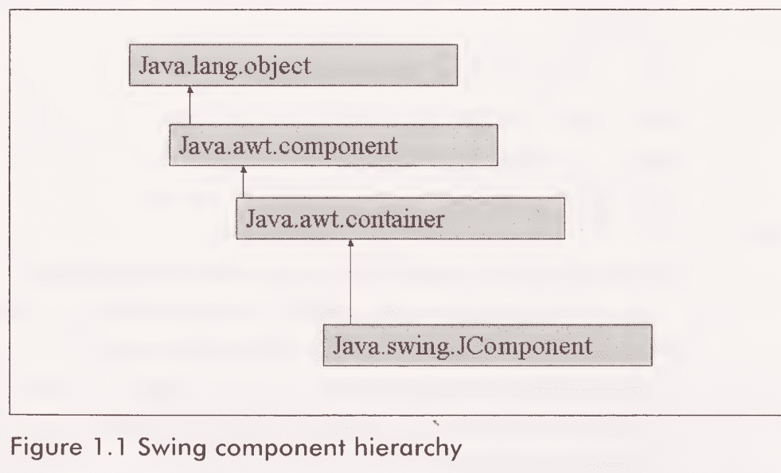

### Swing

如我之前所述，Java基础类的大部分内容都与Swing可视化组件相关。这些轻量级组件极大地扩展了Java程序员可用的可能性。我需要解决的第一个问题是：“轻量级”是什么意思？轻量级用户界面类是用100%纯Java编写的广泛用户界面组件集合。它们提供从简单的文本标签和按钮到选项卡式笔记本、颜色拾取器和电子表格样式表格等各种简单和复杂的用户界面组件。它们还提供了以前基本AWT控件所不具备的功能级别。因为它们是100%用Java编写的，轻量级用户界面控件无论操作系统如何，行为都相同。使用“轻量级”一词是因为JFC类自行完成所有渲染，除了基本窗口外，不依赖操作系统的内置组件。

Swing组件的一个重要特征是它们的外观是可编程的。JFC类附带了多种不同的外观感觉集，可以通过编程进行切换。您可以选择“Windows”外观感觉或其他方案。

#### 一些关键的JFC类

JFC有大量类。我尝试首先介绍最常用的类，然后介绍其他类。下表列出了一些关键的JFC用户界面类的名称及其提供的功能。您可能会注意到，其中许多类只是旧版AWT类的升级。

**表1.1 关键的Swing类**

| 类名 | 用途 |
| :--- | :--- |
| JBorderFactory | 此类用于创建放置在组件周围的边框。 |
| JCheckBox | 此组件在屏幕上放置一个复选框。复选框用于多选。 |
| JCheckBoxMenuItem | 此组件创建带有复选标记的菜单项。 |
| JColorChooser | 此组件允许您显示一个色轮，用户可以点击它来选择给定的颜色。 |
| JComboBox | 此组件创建一个可编辑的下拉列表。 |
| JComponent | 此类是许多其他JFC组件的父类。 |
| JFileChooser | 文件选择对话框。 |
| JFrame | 此类允许您创建框架窗口。 |
| ImageIcon | 此类允许从存储中加载图像并在组件中使用。 |
| JLabel | 此类允许您创建标签。 |
| JList | 此类允许您创建列表。 |
| JMenu | 此类允许您创建菜单。 |
| JMenuBar | 此类允许您创建可以添加到框架的菜单栏。 |
| JMenuItem | 此类允许您创建可以添加到菜单的菜单项。 |
| JOptionPane | 允许显示几个标准对话框。 |
| JPanel | 此类允许您创建和操作面板。 |
| JPasswordField | 此类允许您创建一个非常适合输入密码的输入字段。 |
| JPopupMenu | 此类允许您创建弹出菜单。 |
| JProgressBar | 此类允许您创建进度指示条。 |
| JRadioButton | 此类允许您创建单选按钮。 |
| JRadioButtonMenuItem | 此类允许您在菜单中创建单选按钮。 |
| JScrollBar | 此类允许您创建滚动条。 |
| JScrollPane | 此类允许您创建滚动窗格。 |
| JSeparator | 此类允许您创建菜单分隔符。 |
| JSlider | 此类允许您创建滑块。 |
| JSplitPane | 此类允许您创建可以垂直或水平分割的窗口窗格。 |
| JTabbedPane | 此类允许您创建选项卡式笔记本风格的面板。 |
| JTable | 此类允许在二维（电子表格样式）表格中显示和操作数据。 |
| JTextArea | 此类允许您创建多行、可编辑的文本区域。 |
| JTextField | 此类允许您创建单行文本输入字段。 |
| JToggleButton | 此类允许您创建一个具有两种状态的按钮。 |
| JToolBar | 此类允许您创建一个可以由图像以及常规按钮组成的工具栏，并且可以“撕下”并拖动到桌面作为一个单独的窗口。 |
| JToolTip | 此类允许您创建一个弹出提示窗口，当鼠标移动到组件上方时显示。 |
| JTree | 此类允许您创建数据的树视图。 |

一旦您在系统上安装了**JDK**（同样，要么是下载最新版本的**JDK**，要么是安装JBuilder），您的第一步将是熟悉JFC类。您可以运行几个演示程序，看看JFC能做什么，并验证您是否已正确安装所有内容，以及CLASSPATH变量是否设置正确。

### SwingSet演示

Java SDK附带了SwingSet演示程序。这个程序在熟悉Swing时非常有用，它还可以用于验证您是否已成功安装了JFC类，并更新了CLASSPATH和其他环境变量。SwingSet程序位于\examples\swingset目录中。对于使用JBuilder的用户（鉴于本书书名，我希望是大多数用户！），您会在安装JBuilder的文件夹下找到您的JDK。它将位于名为\jdk1.3.1\demo\jfc\SwingSet2\的目录中。要在任何Windows系统上运行SwingSet演示程序，请从SwingSet目录执行`runnit`命令。这将执行文件`runnit.bat`并启动程序。对于Unix/Linux用户，也有一个`runnit`脚本文件。如果您使用的是JBuilder，有一个HTML文件会为您演示Swing类，如图1.2所示。

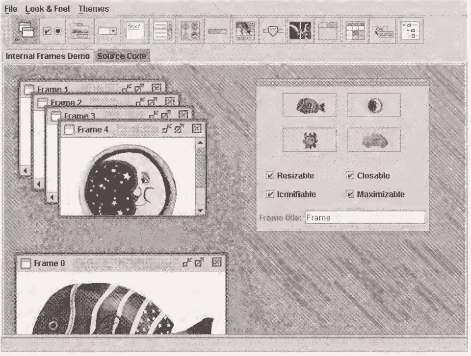

图1.2 SwingSet演示


### SwingSet 程序很好地展示了所有主要的 JFC 用户界面类，并允许你亲手操作它们。它还让你能够尝试不同的外观和感觉选项。

### 编写一个 JFC 应用程序

显然，你不会满足于仅仅查看 SwingSet 演示并看到别人编写的内容。你会想要编写自己的 JFC 应用程序。本章并不从编写程序开始，但随后的所有章节都会让你编写自己的程序。让我告诉你，编写 JFC/Swing 应用程序与编写任何其他 Java 应用程序或小程序并无二致。在下一章中，我们将退一步，审视抽象窗口工具包（Swing 的前身），并通过几个示例进行实践。之后的所有章节都包含多个你需要完成的完整示例。所以别担心，你会有大量实践 Swing 的机会！

### 总结

本章向你介绍了 JFC 和 Swing 的基础知识。目的是向你确切解释什么是 Java 基础类，以及为什么它们是相对于 Java 1.1 技术（如抽象窗口工具包）的重大改进。阅读本章后，你应该对 JFC/Swing、相关类及其用途有了基本的了解。

### 复习题

- 1. 什么是 AWT？
- 2. 什么是 Swing？
- 3. 什么是 JFC？
- 4. JFC 类的四大主要分组是什么？
- 5. JFC 无障碍功能的目的是什么？
- 6. 列举四个关键的 JFC 类。
- 7. 使用 Swing 而非 AWT 的目的是什么？
- 8. BorderFactory 类的目的是什么？
- 9. Sun JDK 的哪个版本首次附带 JFC/Swing？
- 10. 什么是可插拔的外观和感觉？

### 第 2 章

## 抽象窗口工具包

本章涵盖以下内容：

- 什么是 AWT？
- AWT 中的组件和容器
- 容器的类型
- 创建一个容器
- 管理组件布局
- 事件处理
- 一个重要的 JBuilder 示例

## 引言

你可能想知道，为什么一本关于 Java 基础类和 Swing 的书会包含一章关于抽象窗口工具包的内容。这有一个非常好的理由；嗯，实际上有两个原因。首先，在许多情况下，你仍然需要至少具备 AWT 的基础知识。例如，你可能被要求将一个应用程序或小程序从 AWT 转换为 Swing。在同一个应用程序中同时使用 AWT 和 Swing 也是可能的。事实上，将这两种技术结合使用并不少见。另一个花时间研究 AWT 的原因是，Swing 在某种程度上是 AWT 的扩展。首先牢固掌握 AWT 可能有助于你理解 Swing。如果你已经有使用抽象窗口工具包的经验，你可能希望简单浏览本章，甚至完全跳过它。

### 什么是 AWT？

AWT 代表抽象窗口工具包。AWT 实际上是 Java 基础类的一部分，但它是一个较旧的部分，最早在 Java 的早期版本中引入。本质上，AWT 是一组类，你可以用它们来创建应用程序和小程序中的图形组件。AWT 主要用于创建图形用户界面。用户界面是应用程序或小程序中用户可以直接交互的部分。用户界面可以有各种不同的形式。有些用户界面是简单的命令行界面，而另一些则是非常吸引人的图形界面。AWT 主要用于创建此类图形界面。

在某个时刻，用户的交互必须由计算机硬件和操作系统来处理。操作系统将来自鼠标、键盘或其他设备的信息作为输入传输给程序。操作系统还必须获取程序的输出，并以可理解的格式将其发送到打印机或显示器。即使是最有经验的程序员，直接处理所有这些也是一项艰巨的任务。AWT 的设计使得程序员无需关心这些活动的细节。程序员只需要知道需要 AWT 中的哪个类以及要调用哪些方法。AWT 会为你处理底层细节。

请记住，Java 的标志之一是其平台独立性。Java 的座右铭是“一次编写，到处运行”。因为 Java 编程语言是平台无关的，所以 AWT 也必须是平台无关的。当然，这就引出了 AWT 到底如何实现这一点的问题。在单个操作系统上正确呈现图形元素可能就是一项艰巨的任务。让一个组件在多个不同的操作系统上正确呈现则是一项更加困难的任务。AWT 通过让操作系统完成部分工作来处理这个问题。AWT 提供的用户界面元素是使用每个平台的本机图形工具包实现的，从而保留了每个平台的外观和感觉。这意味着在 Windows 机器上的 AWT 按钮看起来会像一个 Windows 按钮。同一个按钮显示在 Macintosh 上时，看起来会像一个 Mac 按钮。这种方法的缺点在于，在一个平台上设计的图形用户界面在另一个平台上查看时可能看起来非常不同。

### AWT 中的组件和容器

我已经提到，AWT 的主要目的是让程序员能够实现图形用户界面并与用户交互，而无需关心底层细节。我还提到这是通过创建组件的类来完成的。因此，现在可能是时候给你一个组件究竟是什么的正式定义了。在此上下文中，*组件*就是用于创建用户界面的图形元素。典型的组件包括按钮、文本字段、复选框等项。组件允许用户与程序交互，也可以用来向用户提供视觉反馈。在 AWT 中，所有用户界面组件都是 Component 类或其子类型的实例。实际上，大多数是子类型的实例，但它们确实继承自 Component 类。

这解释了什么是组件。接下来需要处理的概念是容器。*容器*正如其名所示；它是一种可以包含其他组件的特殊组件。容器包含组件并控制它们的布局。你需要使用容器，因为你需要在逻辑区域中组织你的组件。由于容器本身也是组件，容器甚至可以包含其他容器。在 AWT 中，所有容器都是 Container 类或其子类型的实例。与前面提到的组件一样，大多数是简单继承自 Container 类的子类型的实例。

适当的布局对所有程序员来说都可能是一个重大问题。当你的应用程序或小程序可能在任意数量的完全不同的操作系统上运行时，这个问题就更加重要了。组件必须在包含它们的容器内以某种空间方向排列。这种将组件嵌套到容器中的方式创建了图形元素的层次结构。AWT 提供了九个基本的非容器组件类，可以用来构建用户界面。这九个类是 TextField、TextArea、Label、Button、Canvas、Choice、Checkbox、List 和 Scrollbar。

### 容器的类型

除了 AWT 提供的九个非容器控件外，它还提供了四个容器类：Window、Frame、Dialog 和 Panel。请注意，Frame 和 Dialog 类是 Window 类的子类。除了 AWT 提供的容器外，Applet 类也是一个容器；事实上，它是 Panel 类的子类型，因此可以容纳组件。下表简要介绍了每个容器类。

| 类名 | 用途 |
| :--- | :--- |
| Window | 此类提供顶级显示。Window 类的实例不附加或嵌入到另一个容器中，并且没有边框和标题。 |
| Dialog | 对话框是带有边框和标题的顶级显示。没有关联的 Frame 类实例，就不能有 Dialog 类的实例。 |
| Frame | 框架是带有边框和标题的顶级显示。Frame 类的实例可以有一个或多个菜单栏。 |


### 创建容器

既然你已经了解组件可以，也常常被包含在其他组件中（即容器组件），现在似乎是向你展示如何创建这些容器组件的恰当时机。在构建具有图形用户界面（GUI）的应用程序时，程序员必须首先创建 `Window` 类或 `Frame` 类的实例。回想一下，这两种都是可以独立运行或独立操作的顶层显示组件。`Dialog` 类不用于初始容器组件，因为它不能独立操作；它需要一个关联的框架。无论你使用 `Window` 类还是 `Frame` 类，你必须实例化某个顶层容器类，然后才能向应用程序添加任何组件。这是因为你不会直接向应用程序添加组件；你是将它们添加到容器中。

构建小程序与构建具有GUI的应用程序类似，只有少数几个细微差别。当构建小程序时，一个框架已经存在。那个框架就是浏览器本身。由于 `Applet` 类是 `Panel` 类的子类型，程序员可以直接将组件添加到 `Applet` 类本身的实例中。你不需要为了向小程序添加组件而创建 `Container` 类。

既然我已经讨论了向应用程序添加AWT组件以赋予其图形用户界面的基础知识，那么向你展示一个示例似乎是很好的主意。

### 示例 2.1

本例的目的仅仅是向你展示在应用程序中使用抽象窗口工具包（Abstract Windowing Toolkit）的基础知识。本例演示了使用一个顶层容器并向其添加其他容器。该示例使用了Sun Microsystems的JDK。稍后，我将提供几个使用Borland JBuilder的示例。

**步骤 1：** 打开你最喜欢的文本编辑器并输入以下代码：

```
import java.awt.*;
public class example1
{
    public static void main(String [] args)
    {
        Frame f = new Frame("Hey Java is Cool");
        Button b = new Button ("Click me");
        f.add(b);
        f.show();
    }
}
```

**步骤 2：** 将文件保存为 **Example2.java**。

**步骤 3：** 从命令行（Windows 98中的DOS提示符，Windows NT/2000中的命令提示符，Linux中的Shell），使用标准JDK编译命令编译程序：

`javac Example.java`

**步骤 4：** 只需输入 **java Example** 即可运行应用程序。运行此应用程序时，你应该会看到类似于图2.1所示的内容。

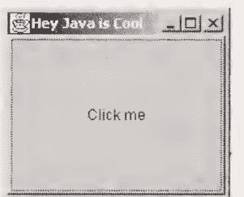

你应该特别注意在此应用程序中使用的 `add` 方法。所有容器都有一个 `add` 方法，你可以调用它来向容器添加组件。这非常简单，但你会在本书或任何其他讨论Java组件的书籍的几乎每一个示例中看到它。

我坦率地承认这个例子并不特别令人兴奋；然而，它确实演示了如何创建一个使用容器组件然后向其添加其他组件的应用程序的基础知识。现在让我们看看这在小程序而非应用程序中是如何工作的。

### 示例 2.2

**步骤 1：** 打开你最喜欢的文本编辑器并输入你在此处看到的代码：

```
import java.awt.*;
import java.awt.event.*;
import java.applet.*;
public class example2 extends Applet
{
    public void init()
    {
        Button b = new Button("Click Me");
        add(b);
    }
}
```

**步骤 2：** 将文件保存为 **example2.java**。

**步骤 3：** 从命令行（Windows 98中的DOS提示符，Windows NT/2000中的命令提示符，Linux中的Shell），使用标准JDK编译命令编译程序：

```
javac Example.java
```

**步骤 4：** 创建一个简单的HTML页面来显示小程序，如下所示：

```
<HTML>
<HEAD>
    <TITLE>Applets Are Awesome</TITLE>
</HEAD>
<BODY BGCOLOR = white>
<CENTER>
    <APPLET>
        CODE="example2"
        WIDTH=600
        HEIGHT=300
    </APPLET>
</CENTER>
</BODY>
</HTML>
```

现在，如果你在浏览器中查看此HTML文档，你应该会看到类似于这张图片所示的内容：

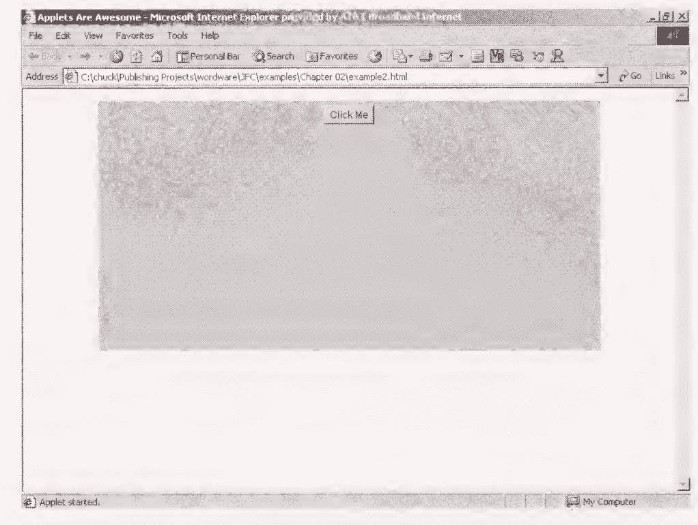

**图2.2 示例2.2图解**

关于这个例子，有几件事你应该注意到，第一是没有使用容器组件来容纳按钮。记住，对于小程序，小程序本身可以充当容器组件。你应该注意的另一件事是，`add` 命令不是发送给容器，而是直接发送给小程序。你可以对小程序这样做，但不能对应用程序这样做。对于应用程序，`add` 命令只能作为容器组件的方法被调用。

我们将在本书后面讨论小程序与Swing组件的关系。我们将用一整个章节来讨论它们。所以，如果此时你对小程序还不完全清楚，别担心：所有这些后面都会解释清楚的。

### 管理组件布局

如果你只是简单地将组件添加到容器或浏览器中，你将得到一个相当不吸引人的显示。组件将一个接一个地放置在容器上。大多数程序员更喜欢能够控制他们组件的布局。抽象窗口工具包提供了布局管理器来处理你的组件布局。布局不是由容器控制，而是由与容器关联的布局管理器控制。在AWT中，所有布局管理器类都实现了 `LayoutManager` 接口。

抽象窗口工具包为程序员提供了五种布局管理器，可用于以逻辑和视觉上吸引人的方式组织组件。当然，有些比其他的更简单。五种不同的布局管理器在表2.2中列出并简要描述。

表2.2 布局管理器

| 管理器 | 格式 |
| :--- | :--- |
| GridLayout | GridLayout管理器将组件放置在均匀分布的网格中。网格中的每一行必须具有相同数量的单元格。 |
| GridbagLayout | GridbagLayout管理器也将组件放置在网格中；然而，每一行可以有不同数量的单元格。 |
| CardLayout | CardLayout管理器一次显示一个组件，就像翻阅一副扑克牌。 |
| FlowLayout | FlowLayout管理器只是简单地将组件一个接一个地从左到右、从上到下放置。 |
| BorderLayout | 此布局管理器允许你将组件放置在容器的边界周围或中心位置。 |

如表中所述，BorderLayout类有五个区域可用于放置组件。这些区域被命名为North（北）、South（南）、East（东）、West（西）和Center（中心）。可以在每个区域放置一个单独的组件。当包含容器的大小被调整时，每个边界区域的大小会调整到刚好能容纳其中放置的组件。实际上，将其他容器组件放入每个区域是很常见的。这些区域及其布局如图2.3所示。

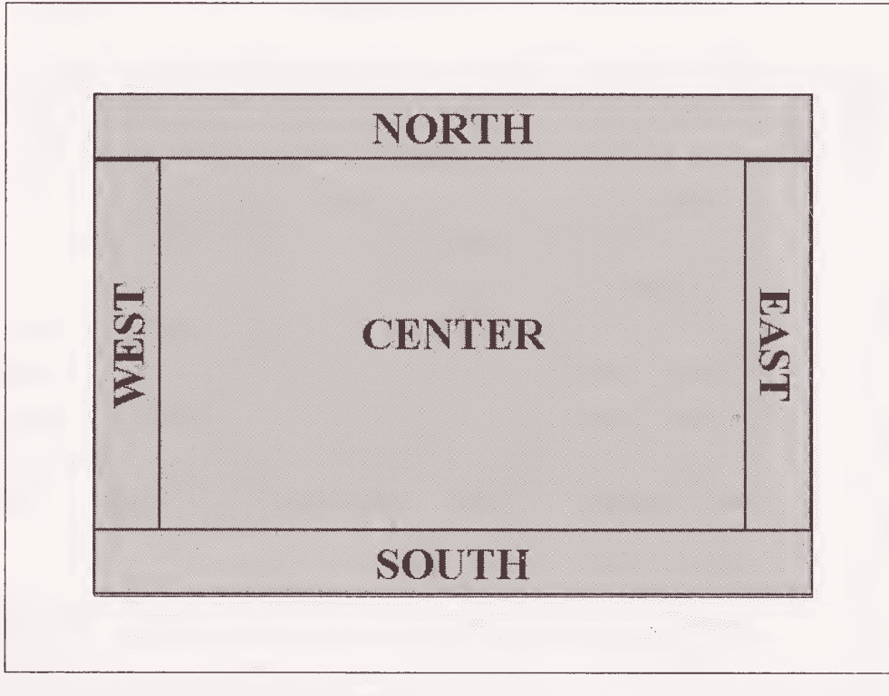

图2.3 BorderLayout区域

容器管理器是抽象窗口工具包的重要组成部分。你可以为任何容器选择任何布局管理器；然而，每个容器类都有自己的默认布局管理器。对于

### Panel类和Applet类使用FlowLayout布局管理器。Frame类和Dialog类的默认布局管理器是BorderLayout管理器。

让我们来看一个使用两种布局的示例。第一种用于包含按钮的面板。第二种布局用于将该面板放置在小程序中的特定位置。

#### 示例2.3

**步骤1：** 使用你喜欢的文本编辑器输入以下代码：

```java
import java.awt.*;
import java.awt.event.*;
import java.applet.*;
public class example3 extends Applet
{
    public void init()
    {
        setLayout(new GridLayout(2,2));
        Panel p = new Panel();
        p.setLayout(new BorderLayout());
        Button b = new Button("Click Me");
        p.add("Center",b);
        add(p);
    }
}
```

**步骤2：** 从命令行（Windows 98中的DOS提示符，Windows NT/2000中的命令提示符，Linux中的Shell），使用标准JDK编译程序：

```
Javac Example.java
```

**步骤3：** 创建一个简单的HTML页面来显示该小程序。

在这个示例中，我使用了两种不同的布局。第一种是网格布局，它简单地将项目显示在网格中。传递给网格布局类构造函数的数字告诉它要创建多少行和多少列的网格。第二种布局是边框布局，应用于面板本身，允许程序员在边框周围的不同位置和中心放置代码。还要注意按钮会扩展以填充其所在的空间。如果你正确输入并编译了代码，你应该能够使用浏览器显示这个小程序，并看到类似图2.4所示的效果。

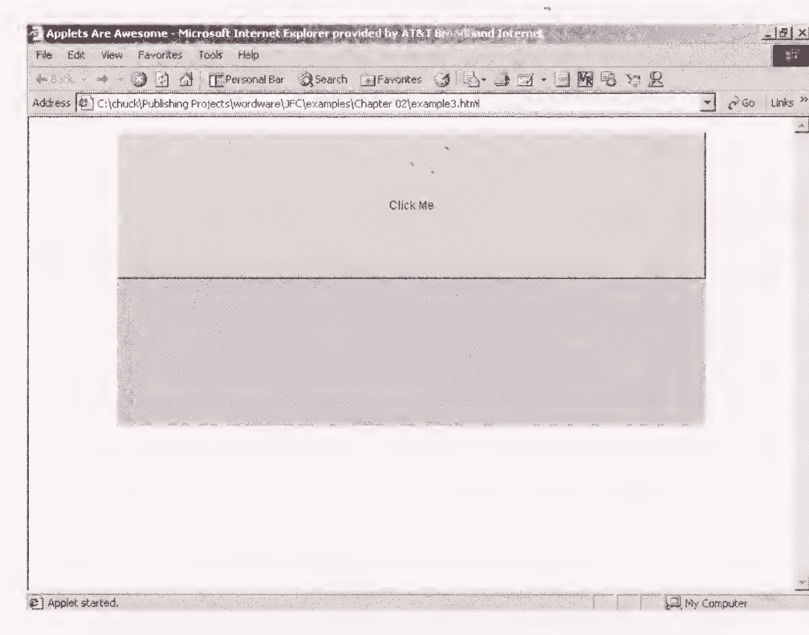

## 事件处理

前面的示例只是显示某些组件——具体来说是面板上的按钮。当用户按下按钮或执行任何操作时，它们都没有任何反应。构建图形用户界面只是故事的一部分。另一部分是与用户交互并响应用户。Java为此提供了一种优秀的机制。该机制就是事件模型。用户的每个操作都会生成一些事件。你只需在类中添加一些代码，让该类能够响应这些事件。有许多AWT事件，每种单独类型的动作对应一个事件。动作事件用于响应用户点击按钮，而鼠标移动事件用于响应鼠标移动到特定区域。让我们来看一个使用事件响应用户点击按钮的示例。

#### 示例2.4

步骤1：打开你喜欢的文本编辑器，输入以下代码：

```java
import java.awt.*;
import java.applet.*;
// 这个小程序的目的在于演示 //java //applets
// 如何在屏幕上创建控件并响应 //这些控件上的 //事件。
// 这个类继承了java Applet类。所有 //小程序都必须 //这样做。
public class example4 extends Applet
{
  Button hiButton;
  // 小程序使用init而不是main函数。
  public void init()
  {
    // 创建一个带有标题的按钮组件
    hiButton = new Button("Click Me!");
    // 将该按钮添加到浏览器窗口
    add(hiButton);
  }// 关闭init
  // action函数处理小程序可能响应的各种事件。
  public boolean action(Event evt, Object objme)
  {
    // 检查事件是否发生在我们的hi按钮上
    if(evt.target == hiButton)
    {
      // 更改该按钮的标题
      hiButton.setLabel("Ahhhh!");
      return true;
    }// 关闭if语句
    else
      return false;
  }// 关闭action
}// 关闭类button
```

**步骤2：** 从命令行（Windows 98中的DOS提示符，Windows NT/2000中的命令提示符，Linux中的Shell），使用标准JDK编译程序：

```
Javac Example.java
```

**步骤3：** 创建一个简单的HTML页面来显示该小程序。
编译小程序并在浏览器中查看后，它应该看起来像图2.5所示。

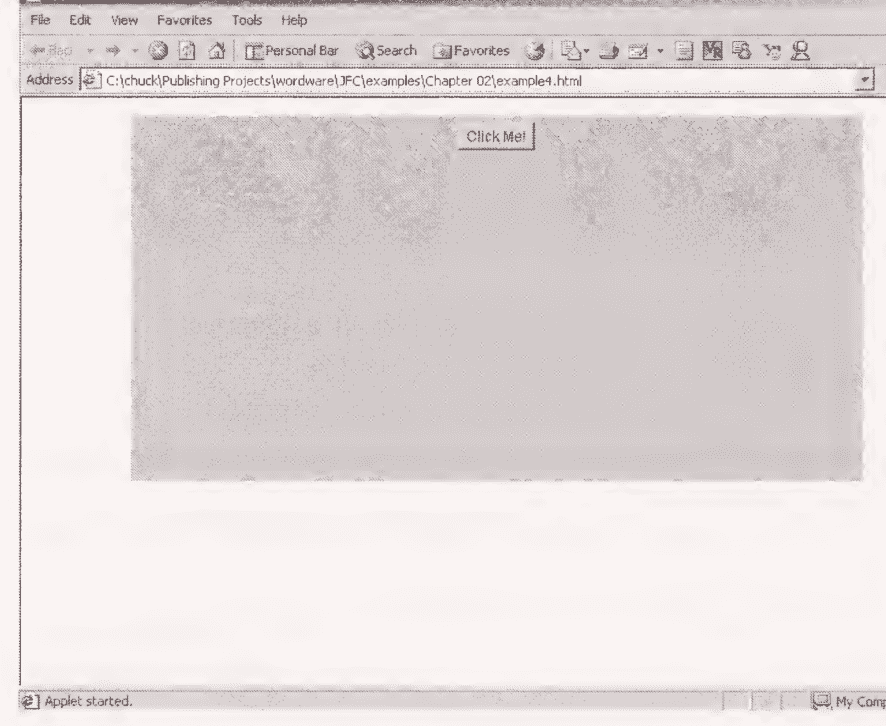

当你实际点击按钮时，正如其标题所指示的，你会看到类似图2.6所示的效果。

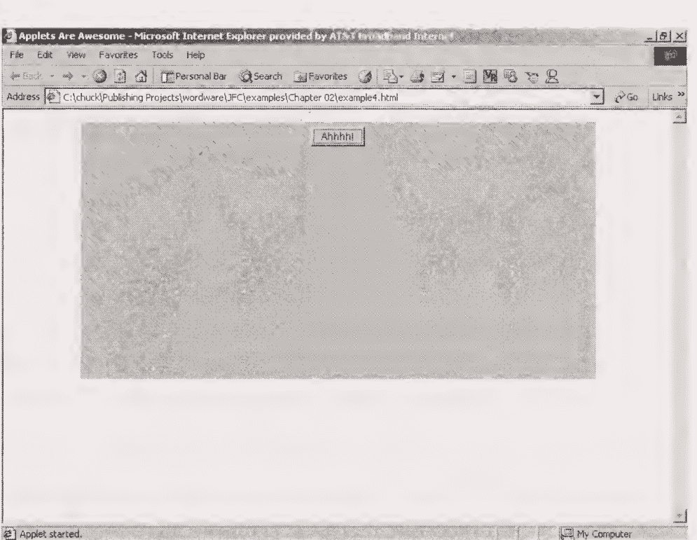

这个示例与前面示例的最大区别在于添加了"public boolean action (Event evt, Object objme)"代码。

此函数设计用于在用户点击小程序中的某些内容时被调用。传递的Event对象包含有关发生事件的信息，包括是什么触发了事件以及事件的目标组件是什么。在此函数内部，我只放置了一个if语句，询问目标是否确实是我们的按钮。如果是，则更改按钮的标题。

#### 示例2.5

到目前为止，这些示例都是使用简单的文本编辑器和Sun JDK编译器完成的。然而，我们的示例也只有几个简单的组件。在无法看到所形成图像类型的情况下尝试排列多个组件可能相当困难。这就是Borland的JBuilder可以为您提供宝贵帮助的地方。使用JBuilder，您可以以"所见即所得"（WYSIWYG）的方式将抽象窗口工具包组件拖放到屏幕上。所以现在我想引导您使用JBuilder完成这样一个示例。

**步骤1：** 显然，您需要启动JBuilder。然后开始一个新项目。

**步骤2：** 从下拉菜单中选择 **文件**。然后选择 **新建**。您将看到一个向导的第一个屏幕，该向导将引导您将新项目添加到您的项目中。

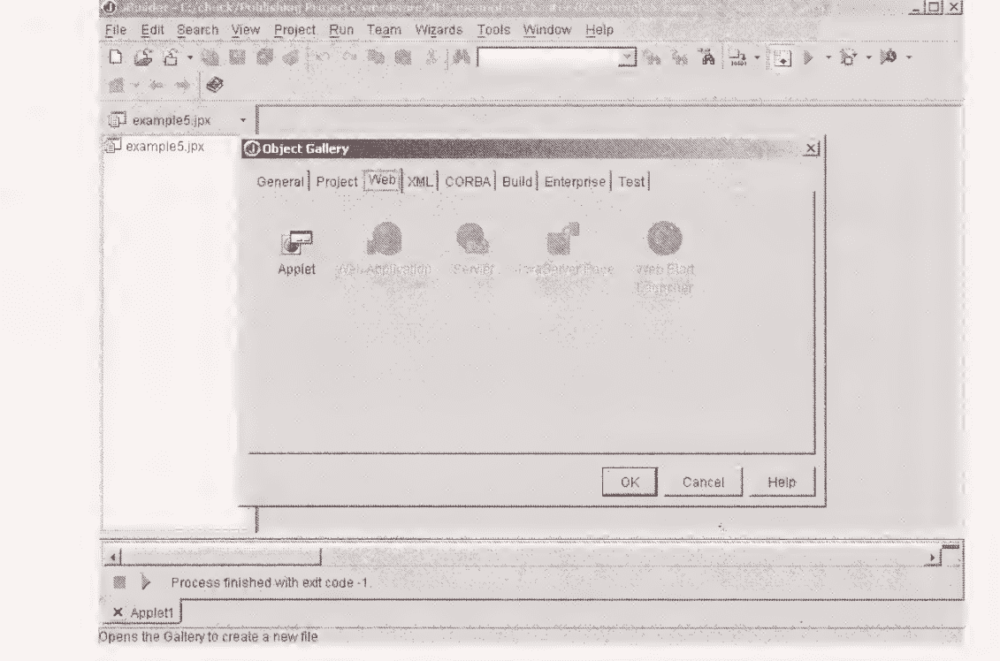

出于本示例的目的，我将从常规选项卡中选择 **应用程序**。

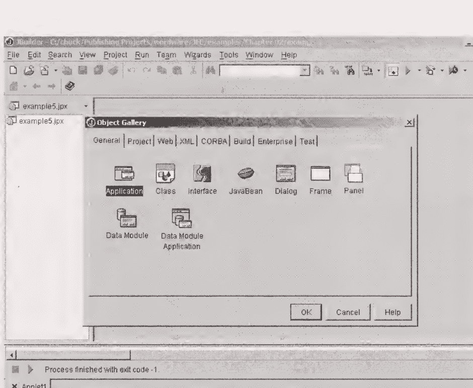

**步骤3：** JBuilder现在将引导您完成三个简单的屏幕，提示您设置希望应用程序具有的设置。出于我们的目的，我选择默认设置，如图2.9至图2.11所示。

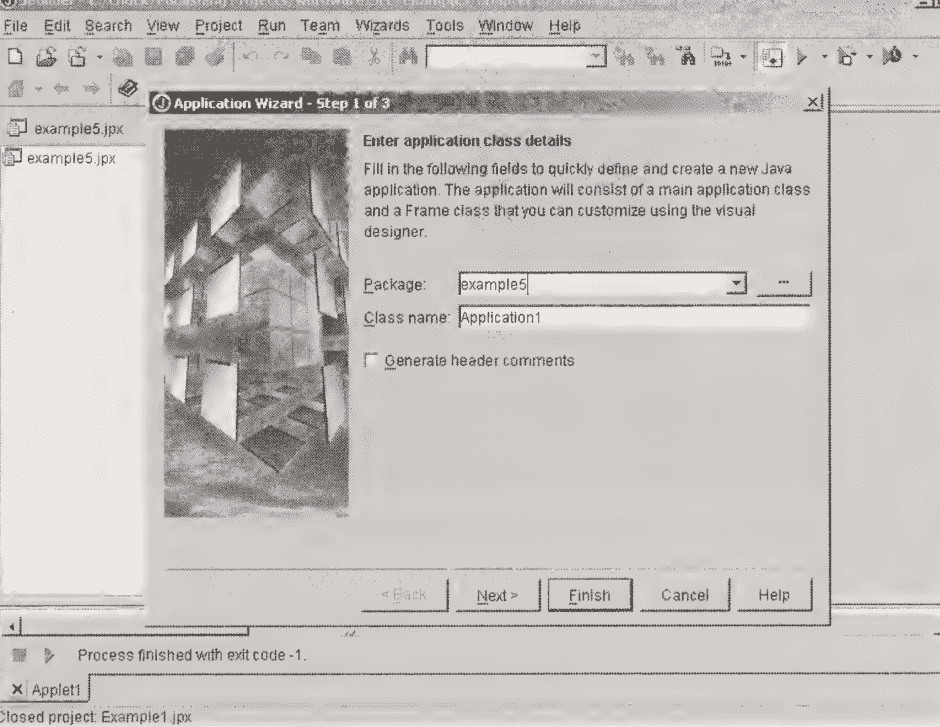

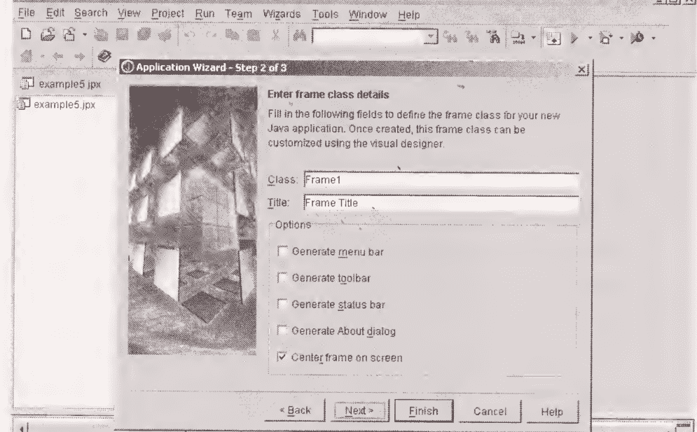

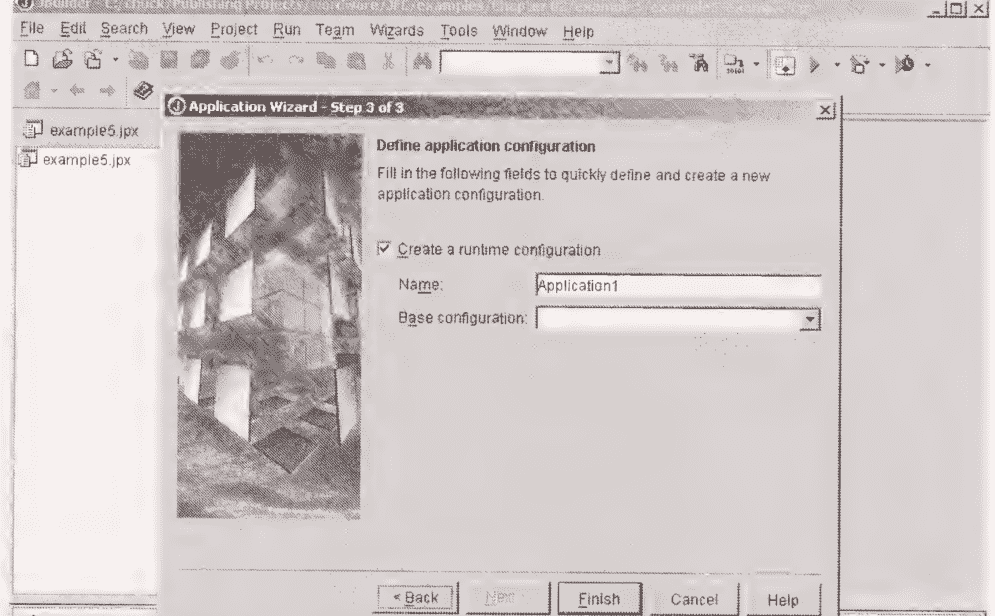

完成向导后，JBuilder将为您构建应用程序的基本框架。您应该注意，屏幕底部有各种选项卡。默认情况下，向导完成后您将看到源代码选项卡。但是，您应该切换到设计选项卡。

**步骤4：** 注意顶部有几个选项卡，用于各种不同的组件，以及箭头表示屏幕外还有更多组件。您需要使用这些箭头进行滚动，直到看到AWT选项卡，然后选择该选项卡。

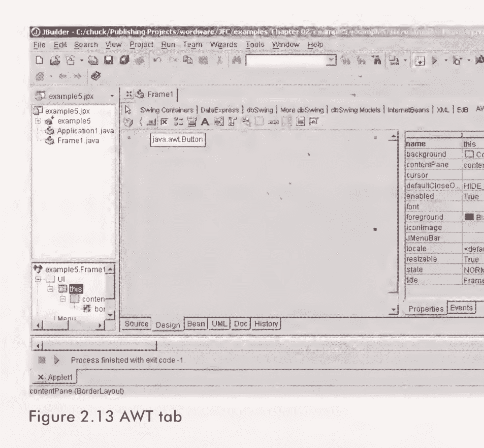

步骤5：注意屏幕右侧有一个属性窗口，显示当前选定组件的属性。在当前情况下，它显示应用程序容器组件（框架）的属性。您会注意到布局设置为默认的BorderLayout。

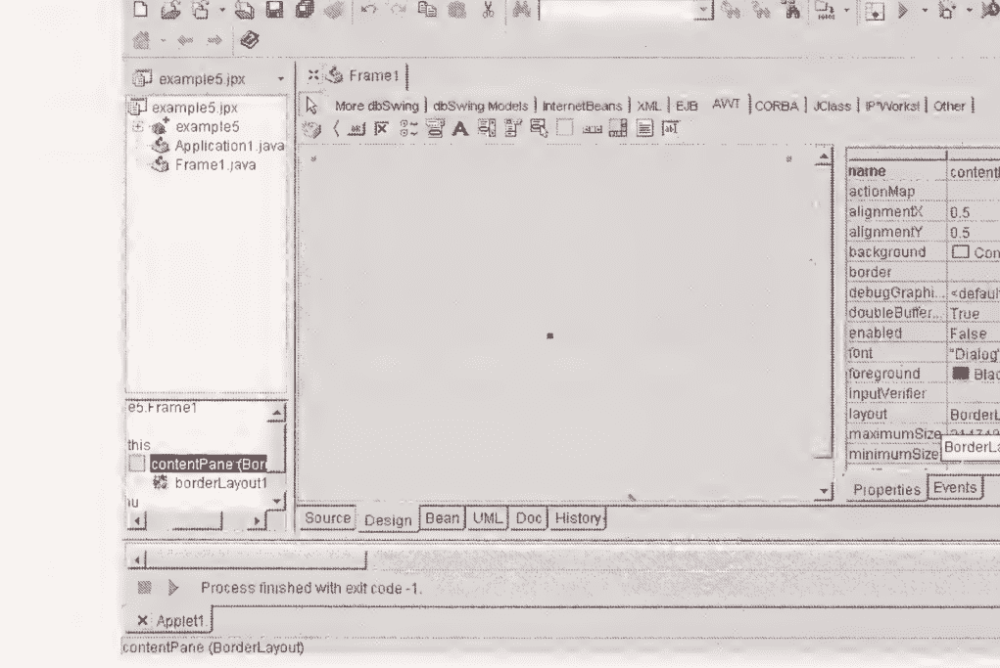

步骤6：将鼠标放在任何组件对象上并单击一次。

然后您可以在屏幕上绘制一个或多个组件的轮廓。对于本示例，在屏幕中央放置一个JBuilder Panel类的实例，并将面板的布局管理器属性设置为2,2的网格。然后您将向此面板添加四个按钮。它应该看起来像您在这里看到的图像。

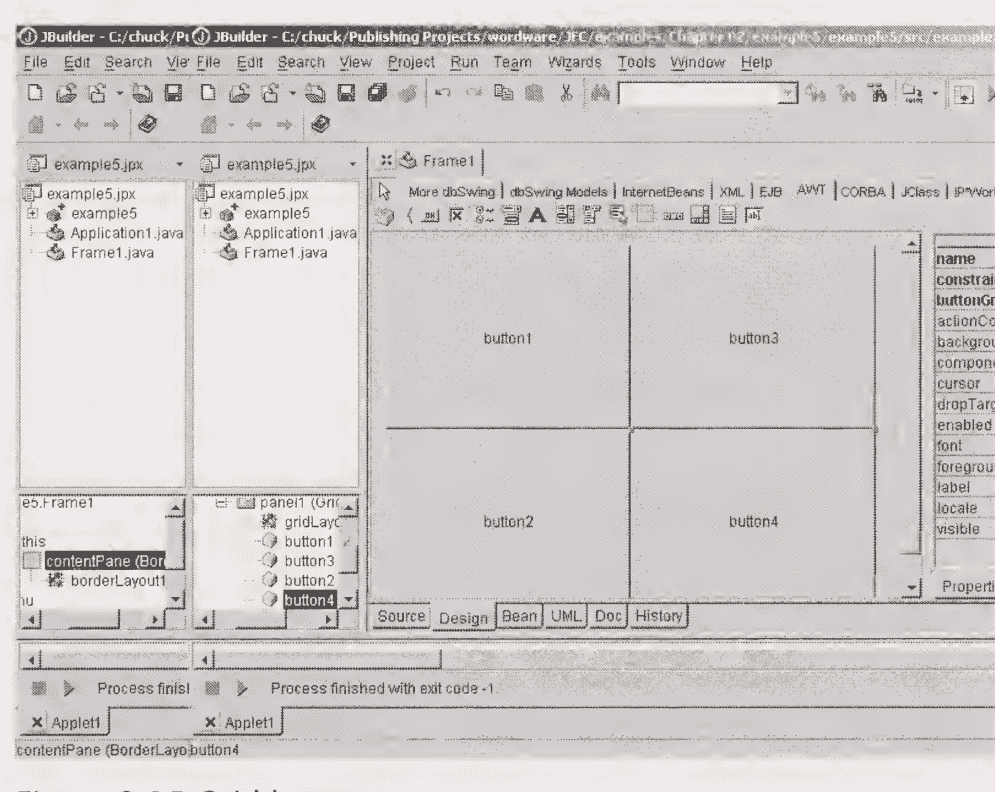

如果您返回到JBuilder的源代码选项卡，您可以看到JBuilder为您创建的源代码。该代码显示在下方。请注意，布局、初始化、添加组件等都是为您自动完成的。此外，应用程序终止代码和其他必需代码也为您完成。

```java
package example5;
import java.awt.*;
import java.awt.event.*;
import javax.swing.*;
public class Frame1 extends JFrame
{
```


# 第2章

```java
JPanel contentPane;
BorderLayout borderLayout1 = new BorderLayout();
Panel panel1 = new Panel();
GridLayout gridLayout1 = new GridLayout(2,2);
Button button1 = new Button();
Button button2 = new Button();
Button button3 = new Button();
Button button4 = new Button();
//构造框架
public Frame1()
{
  enableEvents(AWTEvent.WINDOW_EVENT_MASK);
  try
  {
    jbInit();
  }
  catch(Exception e)
  {
    e.printStackTrace();
  }
}
//组件初始化
private void jbInit() throws Exception
{
  contentPane = (JPanel) this.getContentPane();
  contentPane.setLayout(borderLayout1);
  this.setSize(new Dimension(400, 300));
  this.setTitle("Frame Title");
  panel1.setLayout(gridLayout1);
  button1.setLabel("button1");
  button2.setLabel("button2");
  button3.setLabel("button3");
  button4.setLabel("button4");
  contentPane.add(panel1, BorderLayout.CENTER);
  panel1.add(button1, null);
  panel1.add(button3, null);
  panel1.add(button2, null);
  panel1.add(button4, null);
}
//重写此方法以便在窗口关闭时退出
protected void processWindowEvent(WindowEvent e)
{
  super.processWindowEvent(e);
  if (e.getID() == WindowEvent.WINDOW_CLOSING)
  {
    System.exit(0);
  }
}
}
```

你应该意识到，随着你的图形用户界面变得越来越复杂，可视化你编写的代码的输出将变得更加困难。JBuilder为你处理布局细节。这使得JBuilder成为设计具有重要图形用户界面的程序的一个非常强大的工具。

## 一个重要的JBuilder示例

你在本章中迄今为止看到的示例都很简单（事实上，简单到基本上没有实际价值）。这样做的原因是为了让你轻松地入门这些概念，而不会让你处理过多的代码。重要的是，一个人有机会去使用一个概念，直到他对基本要素感到满意。然而，同样重要的是，你能够将这个概念应用到某个实际目的上。考虑到这一点，让我们探索一个使用JBuilder创建AWT应用程序的实际示例。我们将使用JBuilder构建一个功能齐全的计算器。

### 示例 2.6

1.  **步骤 1：** 开始一个新项目。向该项目添加一个Application对象。
2.  **步骤 2：** 确保框架的布局管理器是边界布局。
3.  **步骤 3：** 我们将向此应用程序添加两个面板和一个标签。一个面板将被添加到中心并命名为pnlnumbers。第二个面板将被添加到东部并命名为pnlbuttons。标签将被添加到北部并命名为lbldisplay。标签的对齐方式应设置为右对齐，文本设置为"0"。两个面板之间很难区分，因此我们将pnlnumbers的背景颜色重置为黄色。你的屏幕应看起来与图2.16所示的非常相似。

    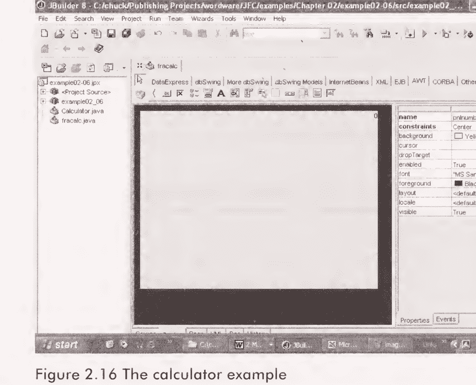

    **图 2.16 计算器示例**

    > **注意：** 记住，对于本章，我们使用的是AWT选项卡中的组件，而不是Swing选项卡！

4.  **步骤 4：** 现在将pnlnumbers布局设置为网格布局。将网格更改为四行三列。要更改网格布局的行数和列数，你需要转到JBuilder中的源代码选项卡，并在grid后面的括号中简单地输入4,3。如图2.17所示。

    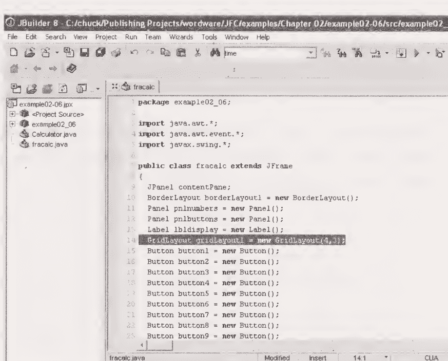

5.  **步骤 5：** 现在我们将pnlbuttons布局更改为五行一列的网格布局。我们还将向两个面板添加一系列按钮，并设置这些按钮的标题。你可以在图2.18中看到这一点。

    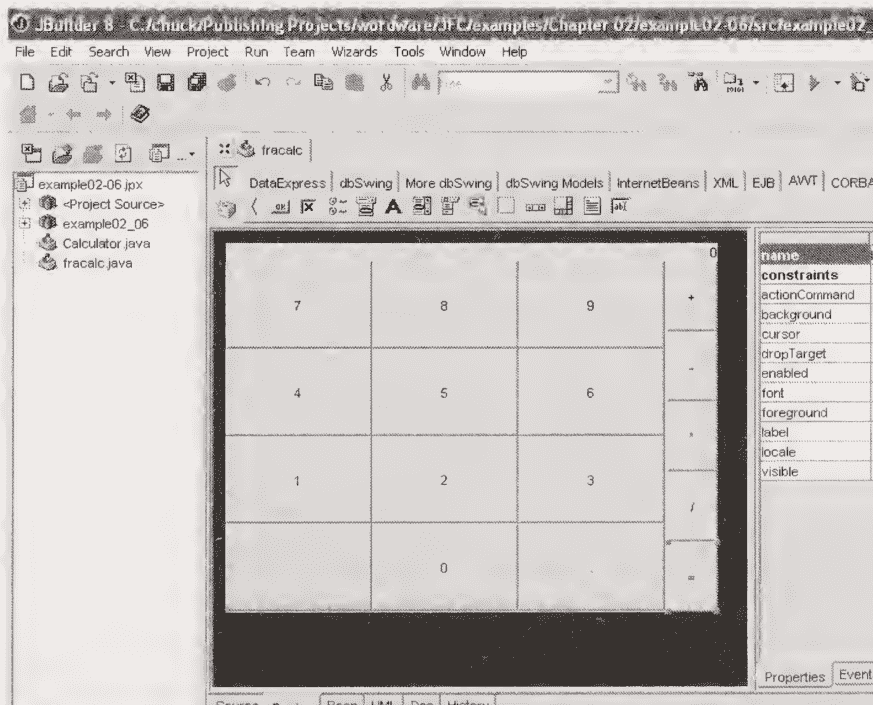

    确保你将每个按钮的名称更改为与其label属性匹配。例如，标签属性为"9"的按钮应命名为btn9。标签属性为"+"的按钮应命名为btnadd。

6.  **步骤 6：** 既然我们有了计算器的框架，是时候添加一些代码了！首先，在类的开头，我们将添加一些变量：

    ```java
    String temp;
    float firstnumber;
    float secondnumber;
    float answer;
    int operation;
    int ADD = 0;
    int SUBTRACT = 1;
    int MULTIPLY = 2;
    int DIVIDE = 3;
    ```

    现在我们转到运算符按钮（+、-、*、/和=）。在每个按钮中，我们将int运算符设置为相应的整数值。添加按钮的代码如下所示：

    ```java
    operation = ADD;
    temp = lbldisplay.getText();
    firstnumber= Float.valueOf(temp).floatValue();
    lbldisplay.setText("0");
    ```

    代码的第一行应该很容易理解。我们只是在确定选择了什么操作。接下来的两行获取lbldisplay中的值并将其转换为浮点数。最后，我们将显示重置为零，以便用户可以输入第二个数字。所有四个运算符按钮中的代码将相同，除了第一行，你将在那里将操作设置为该按钮的适当操作。

    每个数字按钮只需要将你按下的数字添加到标签中。该代码将如下所示：

    ```java
    temp = lbldisplay.getText();
    temp = temp + "7";
    lbldisplay.setText(temp);
    ```

    显然，每个按钮都必须设置为适当的数字。小数按钮的设置类似于数字按钮。在等号按钮中，我们将有更多的代码：

    ```java
    temp = lbldisplay.getText();
    secondnumber= Float.valueOf(temp).floatValue();
    if(operation == ADD)
        answer = firstnumber + secondnumber;
    if(operation == SUBTRACT)
        answer = firstnumber - secondnumber;
    if(operation == MULTIPLY)
        answer = firstnumber * secondnumber;
    if(operation == DIVIDE)
        answer = firstnumber / secondnumber;
    temp = " " + answer;
    lbldisplay.setText(temp);
    ```

    所有这些代码所做的就是获取当前显示，将其转换为浮点数，并将其存储在名为secondnumber的变量中。然后我们执行适当的数学运算。最后，我们显示答案。当你运行此应用程序时，你可以执行所有基本的计算器操作，就像你在图2.19中看到的那样。

    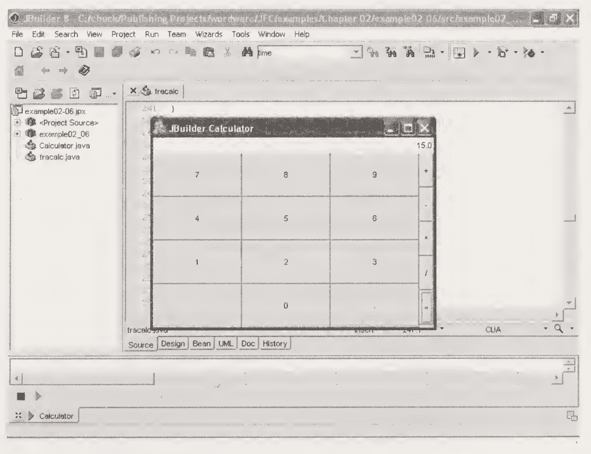

    图 2.19 运行计算器示例

对于那些不使用JBuilder或只是希望查看所有源代码的读者，此处提供了源代码。

> 注意：这是一个较长的示例。

```java
package example02_06;
import java.awt.*;
import java.awt.event.*;
import javax.swing.*;
public class fracalc extends JFrame
{
    JPanel contentPane;
    BorderLayout borderLayout1 = new BorderLayout();
    Panel pnlnumbers = new Panel();
    Panel pnlbuttons = new Panel();
    Label lbldisplay = new Label();
    GridLayout gridLayout1 = new GridLayout(4,3);
    Button btn7 = new Button();
    Button btn2 = new Button();
    Button btn3 = new Button();
    Button btn1 = new Button();
    Button btn6 = new Button();
    Button btn5 = new Button();
    Button btn4 = new Button();
    Button btn8 = new Button();
    Button btn9 = new Button();
    Button btnadd = new Button();
    Button btnminus = new Button();
    GridLayout gridLayout2 = new GridLayout(5,1);
    Button btnplaceholder = new Button();
    Button btn0 = new Button();
    Button btndecimal = new Button();
    Button btnmultiply = new Button();
    Button btndivide = new Button();
    Button btnequals = new Button();
    String temp;
    float firstnumber;
    float secondnumber;
    float answer;
    int operation;
    int ADD = 0;
    int SUBTRACT = 1;
    int MULTIPLY = 2;
    int DIVIDE = 3;
```

```java
//构造框架
public fracalc()
{
    enableEvents(AWTEvent.WINDOW_EVENT_MASK);
    try
    {
        jbInit();
    }
    catch(Exception e)
    {
        e.printStackTrace();
    }
}
```

```java
//组件初始化
private void jbInit() throws Exception
{
    contentPane = (JPanel) this.getContentPane();
    contentPane.setLayout(borderLayout1);
    this.setSize(new Dimension(400, 300));
    this.setTitle("JBuilder Calculator");
    pnlnumbers.setBackground(Color.yellow);
    pnlnumbers.setLayout(gridLayout1);
    lbldisplay.setAlignment(Label.RIGHT);
    lbldisplay.setBackground(Color.white);
    lbldisplay.setText("0");
    pnlbuttons.setLayout(gridLayout2);
    btn7.setLabel("7");
    btn7.addActionListener(new fracalc_btn7_action
                            Adapter(this));
    btn2.setLabel("2");
    btn2.addActionListener(new fracalc_btn2_action
                            Adapter(this));
    btn3.setLabel("3");
    btn3.addActionListener(new fracalc_btn3_action
                            Adapter(this));
    btn1.setLabel("1");
    btn1.addActionListener(new fracalc_btn1_action
                            Adapter(this));
    btn6.setLabel("6");
    btn6.addActionListener(new fracalc_btn6_action
                            Adapter(this));
    btn5.setLabel("5");
    btn5.addActionListener(new fracalc_btn5_action
                            Adapter(this));
```


```java
btn4.setLabel("4");
btn4.addActionListener(new fracalc_btn4_actionAdapter(this));
btn8.setLabel("8");
btn8.addActionListener(new fracalc_btn8_actionAdapter(this));
btn9.setLabel("9");
btn9.addActionListener(new fracalc_btn9_actionAdapter(this));
btnadd.setLabel("+");
btnadd.addActionListener(new fracalc_btnadd_actionAdapter(this));
btnminus.setLabel("-");
btnminus.addActionListener(new fracalc_btnminus_actionAdapter(this));
btn0.setLabel("0");
btndecimal.setLabel(".");
btndecimal.addActionListener(new fracalc_btndecimal_actionAdapter(this));
btnplaceholder.setLabel("");
btnmultiply.setLabel("*");
btnmultiply.addActionListener(new fracalc_btnmultiply_actionAdapter(this));
btndivide.setLabel("/");
btndivide.addActionListener(new fracalc_btndivide_actionAdapter(this));
btnequals.setLabel("=");
btnequals.addActionListener(new fracalc_btnequals_actionAdapter(this));
contentPane.add(pnlnumbers, BorderLayout.CENTER);
pnlnumbers.add(btn7, null);
pnlnumbers.add(btn8, null);
pnlnumbers.add(btn9, null);
pnlnumbers.add(btn4, null);
pnlnumbers.add(btn5, null);
pnlnumbers.add(btn6, null);
pnlnumbers.add(btn1, null);
pnlnumbers.add(btn2, null);
pnlnumbers.add(btn3, null);
pnlnumbers.add(btnplaceholder, null);
pnlnumbers.add(btn0, null);
pnlnumbers.add(btndecimal, null);
contentPane.add(pnlbuttons, BorderLayout.EAST);
pnlbuttons.add(btnadd, null);
pnlbuttons.add(btnminus, null);
contentPane.add(lbldisplay, BorderLayout.NORTH);
pnlbuttons.add(btnmultiply, null);
pnlbuttons.add(btndivide, null);
pnlbuttons.add(btnequals, null);
}

//重写此方法以便在窗口关闭时可以退出程序
protected void processWindowEvent(WindowEvent e)
{
    super.processWindowEvent(e);
    if (e.getID() == WindowEvent.WINDOW_CLOSING)
    {
        System.exit(0);
    }
}

void btnadd_actionPerformed(ActionEvent e)
{
    operation = ADD;
    temp = lbldisplay.getText();
    firstnumber = Float.valueOf(temp).floatValue();
    lbldisplay.setText("0");
}

void btnminus_actionPerformed(ActionEvent e)
{
    operation = SUBTRACT;
    temp = lbldisplay.getText();
    firstnumber = Float.valueOf(temp).floatValue();
    lbldisplay.setText("0");
}

void btnmultiply_actionPerformed(ActionEvent e)
{
    operation = MULTIPLY;
    temp = lbldisplay.getText();
    firstnumber = Float.valueOf(temp).floatValue();
    lbldisplay.setText("0");
}

void btndivide_actionPerformed(ActionEvent e)
{
    operation = DIVIDE;
    temp = lbldisplay.getText();
    firstnumber = Float.valueOf(temp).floatValue();
    lbldisplay.setText("0");
}

void btn7_actionPerformed(ActionEvent e)
{
    temp = lbldisplay.getText();
    temp = temp + "7";
    lbldisplay.setText(temp);
}

void btn9_actionPerformed(ActionEvent e)
{
    temp = lbldisplay.getText();
    temp = temp + "9";
    lbldisplay.setText(temp);
}

void btn8_actionPerformed(ActionEvent e)
{
    temp = lbldisplay.getText();
    temp = temp + "8";
    lbldisplay.setText(temp);
}

void btn6_actionPerformed(ActionEvent e)
{
    temp = lbldisplay.getText();
    temp = temp + "6";
    lbldisplay.setText(temp);
}

void btn5_actionPerformed(ActionEvent e)
{
    temp = lbldisplay.getText();
    temp = temp + "5";
    lbldisplay.setText(temp);
}

void btn4_actionPerformed(ActionEvent e)
{
    temp = lbldisplay.getText();
    temp = temp + "4";
    lbldisplay.setText(temp);
}

void btn3_actionPerformed(ActionEvent e)
{
    temp = lbldisplay.getText();
    temp = temp + "3";
    lbldisplay.setText(temp);
}

void btn2_actionPerformed(ActionEvent e)
{
    temp = lbldisplay.getText();
    temp = temp + "2";
    lbldisplay.setText(temp);
}

void btn1_actionPerformed(ActionEvent e)
{
    temp = lbldisplay.getText();
    temp = temp + "1";
    lbldisplay.setText(temp);
}

void btndecimal_actionPerformed(ActionEvent e)
{
    temp = lbldisplay.getText();
    temp = temp + ".";
    lbldisplay.setText(temp);
}

void btnequals_actionPerformed(ActionEvent e)
{
    temp = lbldisplay.getText();
    secondnumber = Float.valueOf(temp).floatValue();
    if (operation == ADD)
        answer = firstnumber + secondnumber;
    if (operation == SUBTRACT)
        answer = firstnumber - secondnumber;
    if (operation == MULTIPLY)
        answer = firstnumber * secondnumber;
    if (operation == DIVIDE)
        answer = firstnumber / secondnumber;
    temp = " " + answer;
    lbldisplay.setText(temp);
}

class fracalc_btnadd_actionAdapter implements java.awt.event.ActionListener
{
    fracalc adaptee;
    fracalc_btnadd_actionAdapter(fracalc adaptee)
    {
        this.adaptee = adaptee;
    }
    public void actionPerformed(ActionEvent e)
    {
        adaptee.btnadd_actionPerformed(e);
    }
}

class fracalc_btnminus_actionAdapter implements java.awt.event.ActionListener
{
    fracalc adaptee;
    fracalc_btnminus_actionAdapter(fracalc adaptee)
    {
        this.adaptee = adaptee;
    }
    public void actionPerformed(ActionEvent e)
    {
        adaptee.btnminus_actionPerformed(e);
    }
}

class fracalc_btnmultiply_actionAdapter implements java.awt.event.ActionListener
{
    fracalc adaptee;
    fracalc_btnmultiply_actionAdapter(fracalc adaptee)
    {
        this.adaptee = adaptee;
    }
    public void actionPerformed(ActionEvent e)
    {
        adaptee.btnmultiply_actionPerformed(e);
    }
}

class fracalc_btndivide_actionAdapter implements java.awt.event.ActionListener
{
    fracalc adaptee;
    fracalc_btndivide_actionAdapter(fracalc adaptee)
    {
        this.adaptee = adaptee;
    }
    public void actionPerformed(ActionEvent e)
    {
        adaptee.btndivide_actionPerformed(e);
    }
}

class fracalc_btn7_actionAdapter implements java.awt.event.ActionListener
{
    fracalc adaptee;
    fracalc_btn7_actionAdapter(fracalc adaptee)
    {
        this.adaptee = adaptee;
    }
    public void actionPerformed(ActionEvent e)
    {
        adaptee.btn7_actionPerformed(e);
    }
}

class fracalc_btn9_actionAdapter implements java.awt.event.ActionListener
{
    fracalc adaptee;
    fracalc_btn9_actionAdapter(fracalc adaptee)
    {
        this.adaptee = adaptee;
    }
    public void actionPerformed(ActionEvent e)
    {
        adaptee.btn9_actionPerformed(e);
    }
}

class fracalc_btn8_actionAdapter implements java.awt.event.ActionListener
{
    fracalc adaptee;
    fracalc_btn8_actionAdapter(fracalc adaptee)
    {
        this.adaptee = adaptee;
    }
    public void actionPerformed(ActionEvent e)
    {
        adaptee.btn8_actionPerformed(e);
    }
}

class fracalc_btn6_actionAdapter implements java.awt.event.ActionListener
{
    fracalc adaptee;
    fracalc_btn6_actionAdapter(fracalc adaptee)
    {
        this.adaptee = adaptee;
    }
    public void actionPerformed(ActionEvent e)
    {
        adaptee.btn6_actionPerformed(e);
    }
}

class fracalc_btn5_actionAdapter implements java.awt.event.ActionListener
{
    fracalc adaptee;
    fracalc_btn5_actionAdapter(fracalc adaptee)
    {
        this.adaptee = adaptee;
    }
    public void actionPerformed(ActionEvent e)
    {
        adaptee.btn5_actionPerformed(e);
    }
}

class fracalc_btn4_actionAdapter implements java.awt.event.ActionListener
{
    fracalc adaptee;
    fracalc_btn4_actionAdapter(fracalc adaptee)
    {
        this.adaptee = adaptee;
    }
    public void actionPerformed(ActionEvent e)
    {
        adaptee.btn4_actionPerformed(e);
    }
}

class fracalc_btn3_actionAdapter implements java.awt.event.ActionListener
{
    fracalc adaptee;
    fracalc_btn3_actionAdapter(fracalc adaptee)
    {
        this.adaptee = adaptee;
    }
    public void actionPerformed(ActionEvent e)
    {
        adaptee.btn3_actionPerformed(e);
    }
}

class fracalc_btn2_actionAdapter implements java.awt.event.ActionListener
{
    fracalc adaptee;
    fracalc_btn2_actionAdapter(fracalc adaptee)
    {
        this.adaptee = adaptee;
    }
    public void actionPerformed(ActionEvent e)
    {
        adaptee.btn2_actionPerformed(e);
    }
}

class fracalc_btn1_actionAdapter implements java.awt.event.ActionListener
{
    fracalc adaptee;
    fracalc_btn1_actionAdapter(fracalc adaptee)
    {
        this.adaptee = adaptee;
    }
    public void actionPerformed(ActionEvent e)
    {
        adaptee.btn1_actionPerformed(e);
    }
}

class fracalc_btndecimal_actionAdapter implements java.awt.event.ActionListener
{
    fracalc adaptee;
    fracalc_btndecimal_actionAdapter(fracalc adaptee)
    {
        this.adaptee = adaptee;
    }
    public void actionPerformed(ActionEvent e)
    {
        adaptee.btndecimal_actionPerformed(e);
    }
}

class fracalc_btnequals_actionAdapter implements java.awt.event.ActionListener
{
    fracalc adaptee;
    fracalc_btnequals_actionAdapter(fracalc adaptee)
    {
        this.adaptee = adaptee;
    }
    public void actionPerformed(ActionEvent e)
    {
        adaptee.btnequals_actionPerformed(e);
    }
}
```


### 总结

本章为你提供了 AWT 的基本概览。如果你之前未曾深入了解过抽象窗口工具包，确保理解本章所有重要概念至关重要。你已经接触了组件和容器，以及布局管理器。你看到了 AWT 和容器如何在应用程序和小程序中使用。你也看到了几个使用 AWT 的示例。至此，你应当对抽象窗口工具包有了基本的理解。

此示例兼具实用价值和教学价值。在此示例中，你看到了各种组件、容器、操作等的使用。你本质上看到了使用 AWT 和 JBuilder 创建图形用户界面的精髓。

### 复习题

- 1. 五种布局管理器是什么？
- 2. 实际上属于 Window 类子类的两个组件是什么？
- 3. 哪个组件必须与框架关联？
- 4. 边界布局管理器的区域有哪些？
- 5. 小程序的顶层组件是什么？
- 6. 列出九个非容器 AWT 组件。
- 7. Frame 类的默认布局管理器是什么？
- 8. 用户点击按钮时，哪个事件被调用？
- 9. Applet 是哪个类的子类型？
- 10. Applet 类的默认布局管理器是什么？

# 第3章：用户输入

本章涵盖以下内容：

- JTextField
- JPasswordField
- JLabel
- JTextArea
- EditorKit
- JTextPane
- JEditorPane
- JButton

## 引言

既然你已经对抽象窗口工具包有了初步了解，是时候深入探讨 Swing 了。一个好的起点似乎是提供用户输入的方式。在任何应用程序中，从用户那里获取输入都至关重要。无论是控制台应用程序、AWT 应用程序，还是 JFC/Swing 应用程序，都是如此。但用户已经习惯了为输入提供多种选择。幸运的是，在 Java 基础类中，有几个 Swing 组件非常适合用户输入信息。你可能会考虑使用几种不同的组件进行用户输入；然而，有些比其他更合适。这些组件包括 JTextField、JLabel、JTextArea、JPasswordField、JTextPane 和 JEditorPane。

在本章中，你将了解这些组件以及如何使用它们。表 3.1 总结了这些类的用途。

**表 3.1 输入组件**

| 类 | 用途 |
| --- | --- |
| JTextField | 允许输入和编辑单行文本 |
| JPasswordField | 允许输入密码并在屏幕上显示密码字符，例如星号 |
| JLabel | 允许向用户进行只读显示 |
| JTextArea | 允许输入和编辑多行文本 |
| JTextPane | 允许输入和编辑多行文本以及多种格式选项 |
| JEditorPane | 允许输入和编辑多种格式的文本，包括 HTML 和富文本 (RTF) |

所有这些组件都旨在允许用户向程序提供输入。每个组件在输入方式或可接受的输入类型上有所不同。

### JTextField

 JTextField 是最基本的用户输入字段。它允许用户输入和编辑单行文本。此组件继承自 javax.swing.text.JTextComponent，而 JTextComponent 又继承自 javax.swing.JComponent。JTextComponent 是我们本章讨论的许多组件的基础类。 JTextField 类被设计为与 java.awt.TextField 类兼容，但它确实具有 java.awt.TextField 类所没有的功能。我们将在本节中探讨其中的一些功能。 JTextField 类最重要的方法及其用途总结在表 3.2 中。此表很重要，因为其中许多方法与本章涵盖的其他组件共享。

**表 3.2 JTextField 方法**

| 方法 | 用途 |
| :--- | :--- |
| getHorizontalAlignment | public int getHorizontalAlignment()<br>此函数简单地返回文本的水平对齐方式。<br>有效键：JTextField.LEFT、JTextField.CENTER、JTextField.RIGHT、JTextField.LEADING 和 JTextField.TRAILING |
| setHorizontalAlignment | public void setHorizontalAlignment(int alignment)<br>此函数是前一个函数的补充。它用于设置文本的水平对齐方式。<br>有效键：JTextField.LEFT、JTextField.CENTER、JTextField.RIGHT、JTextField.LEADING（默认值）和 JTextField.TRAILING |
| getColumns | public int getColumns()<br>此函数简单地返回此 JTextField 中的列数。 |
| setColumns | public void setColumns(int columns)<br>此函数用于设置此 JTextField 中的列数。 |
| setFont | public void setFont(Font f)<br>此函数用于设置当前字体。 |
| addActionListener | public void addActionListener(ActionListener l)<br>此函数将指定的操作监听器添加到此 JTextField 以接收操作事件。 |
| removeActionListener | public void removeActionListener(ActionListener l)<br>此函数将移除指定的操作监听器，使其不再接收来自此 JTextField 的操作事件。 |
| copy | public void copy()<br>此函数用于将关联文本模型中当前选定范围的副本传输到系统剪贴板，同时保留文本模型中的内容。 |
| paste | public void paste()<br>此函数将系统剪贴板内容的副本传输到关联的文本模型中。如果关联视图中存在选择，则将其替换为剪贴板的内容。 |
| getText | public String getText()。此函数用于检索此文本组件中包含的文本。 |
| setText | public void setText(String t) 此方法将此文本组件的文本设置为指定的文本。如果文本为 null 或空，则其效果只是删除旧文本。 |

除了你在表中看到的方法外，当然还有其他方法；然而，这些方法是与 JTextField 一起使用最频繁的方法。请记住，此组件的目的仅仅是允许用户输入单行文本。这意味着表中总结的大多数方法应以某种方式与实现该目标相关。例如，getText 方法允许你检索应用程序内部的代码。当然，setText 方法允许你将代码放入 JTextField 中。其他各种方法大多与格式化 JTextField 相关，使其以适合你的方式显示文本。

除了类提供的方法外，该类还有几个不同的构造函数。它们总结在表 3.3 中。

**表 3.3 JTextField 构造函数**

| 构造函数 | 用途 |
|---|---|
| JTextField() | 此构造函数简单地创建一个新的 JTextField。 |
| JTextField(String text) | 此构造函数创建一个新的 JTextField，但该字段使用指定的文本初始化。 |
| JTextField(int columns) | 此构造函数构建一个新的空 JTextField，具有指定的列数。 |
| JTextField(String text, int columns) | 此构造函数构建一个新的 JTextField，该字段使用指定的文本和特定列数进行初始化。 |

既然你已经阅读了一些关于 JTextField 类的内容，最好看一个使用此 JTextField 的实际示例。

### 示例 3.1

此示例简单地向你展示了 JTextField 类的一些用途。我将使用 JBuilder 为你逐步讲解示例。但是，如果你没有 JBuilder（即使是早期版本也可以），那么请直接跳到源代码清单，在你喜欢的文本编辑器中输入该代码，并像编译任何其他 Java 程序一样使用 Sun Java Development Kit 编译器进行编译。

> **注意：** 在所有 JBuilder 示例中，我提供完整的源代码，以便不使用 JBuilder 的读者可以使用他们希望的任何 Java 编译器。提供完整代码也是为了让你在示例无法工作时，可以将自己的代码与示例源代码进行比较。

> **注意：** 此示例引导你完成使用 JBuilder 创建应用程序的每一个步骤。这是为之前未使用过 JBuilder 的读者提供的。本书中的大多数后续示例都不会详细说明每一个步骤，因此如果你忘记了步骤，只需参考此示例。如果你不熟悉 JBuilder，我强烈建议你获取一份 *Charlie Calvert's Learn JBuilder*（Wordware Publishing）。这可能是学习如何使用 JBuilder 的最佳书籍。

**步骤 1：** 打开 JBuilder 并启动一个新项目。你需要使用适合你的任何位置和名称；此处的图片显示了我机器上的设置。以下图片显示了通过新建项目向导的步骤。但是，除了路径和项目名称外，如果你愿意，只需使用默认设置即可。


### 56 ■ 第三章

图3.1 项目向导 步骤1

图3.2 项目向导 步骤2

图3.3 项目向导 步骤3

步骤2：既然你已经启动了一个JBuilder项目，你可以向其中添加多种不同类型的源文件。当你选择一种源文件类型时，你会得到为它编写好的所有基本代码。为了本例的目的，只需选择**应用程序**。

图3.4 选择应用程序

这将引导你完成所选特定对象的向导。在我们的例子中，你可以使用下图所示的默认设置。

图3.5 应用程序向导 步骤1

图3.6 应用程序向导 步骤2

请注意此屏幕，你可以请求将多个项目添加到你的应用程序中。我们在这里不使用这些功能（但稍后会用到）。然而，请注意，JBuilder可以为你创建诸如工具栏和“关于”对话框等项目的代码。这是一个非常有用的功能。

当你完成此向导后，你将看到源代码的框架。请注意，其中包含一个Frame类的代码。回顾一下，对于应用程序，必须有一个容器类来放置组件类。对于小程序（applet）则不是这样，因为浏览器本身提供了一个容器。

图3.7 一个容器

**步骤3：** 你当然可以在这个代码窗口中直接添加你的代码。但是，在设计窗口上添加组件要快得多、容易得多。点击屏幕底部的**设计**选项卡，你会看到一个可以直接在框架上放置组件的窗口。

图3.8 设计选项卡

从左数第六个组件是JTextField。我们打算在屏幕上放置两个这样的组件。

> 注意：框架默认使用边界布局。如果你保持这种布局，请不要将你的JTextField放在中心位置，否则它会占据整个屏幕。在本例中，我将它分别放在北边和南边。

你可能也需要暂停片刻，查看屏幕右侧的属性窗口。在这里你可以设置JTextField的许多属性。大多数属性的含义不言自明（对齐、背景、工具提示文本、文本等）。

图3.9 放置两个JTextField

**步骤4：** 让我们返回代码窗口来输入一些代码。如果你只需双击一个JTextField，该JTextField的action事件将被添加到你的源代码中，并且你会被直接带到那里（这多方便啊！）。

我只向这个action事件添加了一行代码：

```
jTextField2.setText(jTextField1.getText());
```

当我在第一个JTextField中输入一些内容并按下回车键时，它会被复制到第二个JTextField中。这段代码可能并不特别令人兴奋，但它确实演示了JTextField的基础知识。具体来说，它演示了getText和setText方法以及JBuilder的一些有用功能。迄今为止，getText和setText方法是JTextField类中最常用的方法。

图3.10 使用JTextField

对于那些没有JBuilder或者只是想检查自己代码的人，以下是完整的源代码：

```
package example03;
import java.awt.*;
import java.awt.event.*;
public class Frame1 extends JFrame
{
    private JPanel contentPane;
    private BorderLayout borderLayout1 = new BorderLayout();
    private JTextField jTextField1 = new JTextField();
    private JTextField jTextField2 = new JTextField();
    //构造框架
    public Frame1()
    {
        enableEvents(AWTEvent.WINDOW_EVENT_MASK);
        try
        {
            jbInit();
        }
        catch(Exception e)
        {
            e.printStackTrace();
        }
    }
    //组件初始化
    private void jbInit() throws Exception
    {
        contentPane = (JPanel) this.getContentPane();
        jTextField1.setText("jTextField1");
        jTextField1.addActionListener(new java.awt.event
                .ActionListener()
        {
            public void actionPerformed(ActionEvent e)
            {
                jTextField1_actionPerformed(e);
            }
        });
        contentPane.setLayout(borderLayout1);
        this.setSize(new Dimension(400, 300));
        this.setTitle("Frame Title");
        jTextField2.setText("jTextField2");
        contentPane.add(jTextField1, BorderLayout.NORTH);
        contentPane.add(jTextField2, BorderLayout.SOUTH);
    }
    protected void processWindowEvent(WindowEvent e)
    {
        super.processWindowEvent(e);
        if (e.getID() == WindowEvent.WINDOW_CLOSING)
        {
            System.exit(0);
        }
    }
    void jTextField1_actionPerformed(ActionEvent e)
    {
        jTextField2.setText(jTextField1.getText());
    }
}
```

如你所见，JBuilder为你生成了大量代码。这非常有用，因为它让你能够专注于手头的实际任务，而无需担心基础知识。现在，是时候看看其他一些输入组件了。

### JPasswordField

JPasswordField类相当简单直接。它的目的是为用户提供一个输入密码的地方。它与JTextField非常相似，唯一的区别在于其显示文本的方式。它不是将按键显示在屏幕上，而是显示一个密码字符。它与JTextField共享大多数方法。事实上，JPasswordField组件继承自JTextField。这意味着它拥有JTextField的所有方法，外加一些额外的方法。此类独有的方法总结在下表中。

#### 表3.4 JPasswordField方法

| 方法 | 用途 |
| :--- | :--- |
| setEchoChar(char c) | 此方法为这个JPasswordField设置回显字符。这可能是此类最重要的方法。 |
| char getText() | 此方法已被弃用。自Java 2平台v1.2起，它已被getPassword()取代。这意味着它不再打算使用，但仍然有效。 |
| char[] getPassword() | 这是用于返回此组件中包含的文本的方法。 |
| char getEchoChar() | 这是用于检索要用于回显的字符的方法。 |
| append(string) | 此函数接受一个字符串，并简单地将其追加到现有文本中。 |

所有这些方法都与如何在不让旁观者从屏幕上读取密码的情况下显示密码有关。请记住，此类还拥有它从JTextField继承的所有方法。除了这些方法之外，JPasswordField还具有多种构造函数选项。每个构造函数都用于以略有不同的参数构建JPasswordField。表3.5总结了这些构造函数。

#### 表3.5 JPasswordField构造函数

| 构造函数 | 用途 |
| :--- | :--- |
| JPasswordField() | 此构造函数创建一个新的、空白的JPasswordField，没有列数。 |
| JPasswordField(Document doc, String txt, int columns) | 此构造函数创建一个新的JPasswordField，使用给定的文本存储模型和指定的列数。 |
| JPasswordField(int columns) | 此构造函数将创建一个新的、空的JPasswordField，具有指定的列数。 |
| JPasswordField(String text) | 此构造函数创建一个新的JPasswordField，用指定的文本初始化。 |
| JPasswordField(String text, int columns) | 此构造函数将创建一个新的JPasswordField，用指定的文本和指定的列数初始化。 |

由于此组件在功能上与JTextField几乎完全相同，因此这里没有提供其用法的明确示例。那将是多余的，并且浪费空间。相反，本章后面提供的示例将几个这样相对简单的组件组合成一个单独的示例，说明了所有这些组件的用法。

### JLabel

与其他类相比，JLabel类相对简单，但相当重要。此类允许你向用户提供只读文本。标签在标识应用程序中的其他可视化组件时非常有用。例如，如果你想让用户在JTextField中输入她的名字，在旁边放一个写着“请输入姓名”的JLabel可能是个好主意。此类可能是你在本章中遇到的最简单的类。然而，与本章中的许多组件不同，此组件直接继承自JComponent，而不是JTextComponent。这意味着有几个属性和方法JLabel不与本章中的其他组件共享。其最常用的方法总结在表

3.6. 由于标签（label）通常在应用程序启动时设置且保持不变，因此我在这里也包含了构造方法。

表 3.6 JLabel 方法
| 方法 | 用途 |
|---|---|
| `icon getDisabledIcon()` | 此函数用于返回 `disabledIcon` 属性的值（如果该属性已被设置）。如果未设置且 `icon` 属性的值是 `ImageIcon`，则我们计算一个“灰色”版本的图标并用其更新 `disabledIcon` 属性。 |
| `icon getIcon()` | 此方法将返回标签显示的图形图像（如果有的话）。 |
| `string getText()` | 此方法简单地返回标签显示的文本字符串。 |
| `void setIcon(Icon icon)` | 此函数用于设置此组件将显示的图标。 |
| `void setText(String text)` | 此方法用于设置此组件将显示的文本。 |

这些方法的目的相当直接。它们用于在运行时设置或检索 `JLabel` 要显示的文本或图像。`JLabel` 是一个相当简单的组件，其唯一目的是以静态或只读格式向用户显示文本或图像。除了上表所示的方法外，`JLabel` 当然还有几个构造选项。这些总结在表 3.7 中。

表 3.7 JLabel 构造方法
| 构造方法 | 用途 |
|---|---|
| `JLabel()` | 此构造方法用于创建一个当前未显示任何内容的 `JLabel` 实例。 |
| `JLabel(String text)` | 此构造方法创建一个具有指定文本的 `JLabel`。 |
| `JLabel(String text, int horizontalAlignment)` | 此构造方法创建一个具有指定文本和指定水平对齐方式的 `JLabel` 实例。 |
| `JLabel(Icon image)` | 此构造方法将创建一个显示指定图像的 `JLabel` 实例。 |
| `JLabel(Icon image, int horizontalAlignment)` | 此构造方法将创建一个具有指定图像和指定水平对齐方式的 `JLabel` 实例。 |
| `JLabel(String text, Icon icon, int horizontalAlignment)` | 此构造方法将创建一个具有指定文本、图像和水平对齐方式的 `JLabel` 实例。 |

与 `JPasswordField` 一样，此组件非常易于使用。事实上，它非常容易使用，以至于单独提供一个示例都是一种浪费。本章稍后有一个示例将演示 `JLabel`、`JPasswordField` 和其他几个组件。

### JTextArea

如本章前面提到的，`JTextArea` 只是 `JTextField` 的多行版本。使用此组件，您可以显示多行文本，而不是 `JTextField` 允许您显示的单行文本。有几种情况这会很有用。例如，如果您正在创建一个用于跟踪员工数据的应用程序，并且您想要一个备注字段，`JTextArea` 将非常适合允许用户输入多行文本。与本章讨论的许多组件一样，`JTextArea` 继承自 `javax.swing.text.JTextComponent`。

AWT 有一个此组件的版本，简单称为 `TextArea`。它原生地处理滚动（如果文本超出了组件的范围）；然而，`JTextArea` 并不这样做。相反，它实现了 Swing 的 `Scrollable` 接口。这允许它被放置在 `JScrollPane` 内，如果需要滚动行为的话。此类共享在 `JTextField` 中找到的许多方法。下表总结了一些 `JTextArea` 独有或实现方式稍有不同的方法。

表 3.8 JTextArea 方法
| 方法 | 用途 |
|---|---|
| `void append(String str)` | 此方法将传递给它的文本追加到文档的末尾。 |
| `int getLineCount()` | 此方法返回 `JTextArea` 当前包含的行数。 |
| `boolean getLineWrap()` | 此方法返回文本区域的换行策略——如果换行开启则为 `true`，否则为 `false`。 |
| `int getColumns()` | 此方法将简单地返回 `JTextArea` 中的列数。 |
| `int getRows()` | 此方法将返回 `JTextArea` 中的行数，作为整数值。 |
| `void setLineWrap(boolean wrap)` | 此方法用于设置 `JTextArea` 的换行策略——`true` 表示开启换行，`false` 表示关闭。 |

如您所见，这些方法大多涉及设置 `JTextArea` 组件中文本的格式，特别是行数、列数和换行等项目。其他方法如 `getText` 和 `setText` 与 `JTextField` 类中的相同。

除了所示的方法（以及您可以在 JBuilder 帮助文件中找到的其他方法）之外，此类还有几个不同的构造方法，每个都有其自己的目的。表 3.9 为您总结了这些。

表 3.9 JTextArea 构造方法
| 构造方法 | 用途 |
|---|---|
| `JTextArea()` | 此构造方法创建一个新的 `JTextArea` 类实例，其中没有任何默认文本（即，一个空白的实例）。 |
| `JTextArea(Document doc)` | 此构造方法将使用给定的文档模型创建一个新的 `JTextArea`。 |
| `JTextArea(String text)` | 此构造方法用于创建一个新的 `JTextArea`，并显示指定的文本。 |
| `JTextArea(int rows, int columns)` | 此构造方法创建一个新的空 `JTextArea`，具有指定的行数和列数。 |

鉴于各种输入组件非常相似，我不会为每个组件提供单独的示例。相反，我将等待并在一个应用程序中为您提供所有组件的示例。

### 示例 3.2

回想一下，到目前为止涵盖的几个组件没有给出单独的示例程序。您被告知稍后的示例将涵盖所有这些组件。这就是那个示例程序，它向您展示了到目前为止讨论的几个组件类的用法。您将看到如何在一个应用程序中使用 `JTextField`、`JLabel` 和 `JTextArea`。再次说明，如果您没有 JBuilder（早期版本如 4.0、5.0 和 6.0 也可以使用，尽管我使用的是 7.0），那么只需跳转到此示例的源代码部分，并在您喜欢的文本编辑器中输入该代码。使用 Sun JDK 编译器从命令行/Shell 编译它。

**步骤 1：** 第一步是启动一个新项目，就像您在前面的示例中所做的那样。我不会在这里向您展示所有这些步骤；只需选择 **File** 然后 **New Project**，然后按照向导操作。项目完成后，您可以选择 **File** 然后 **New**。然后选择 **Application** 以便向您的项目添加一个新的基本源文件。

**步骤 2：** 使用屏幕底部的 Design 选项卡，以便您可以将各种组件图形化地放置在屏幕上。这正是我们在前面的示例中放置组件的方式。然后将布局管理器更改为 `FlowLayout`。各种布局管理器将在下一章中更详细地讨论。现在，您只需要理解布局管理器决定了其他组件将在屏幕上如何布局。

### 第 3 章

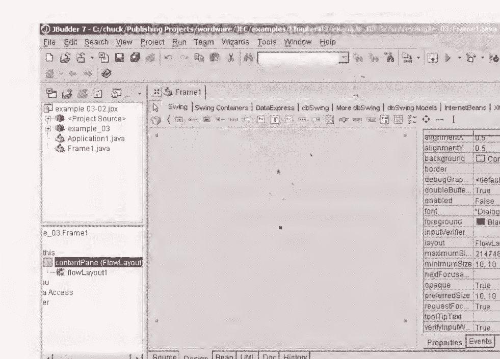

图 3.11 布局管理器

现在的目标是在屏幕上放置各种组件，以便我们了解如何使用它们。我们将一个 `JLabel`（其文本已更改，如下图所示）、一个 `JTextArea` 和一个 `JTextField` 放在屏幕上，如图 3.12 所示。

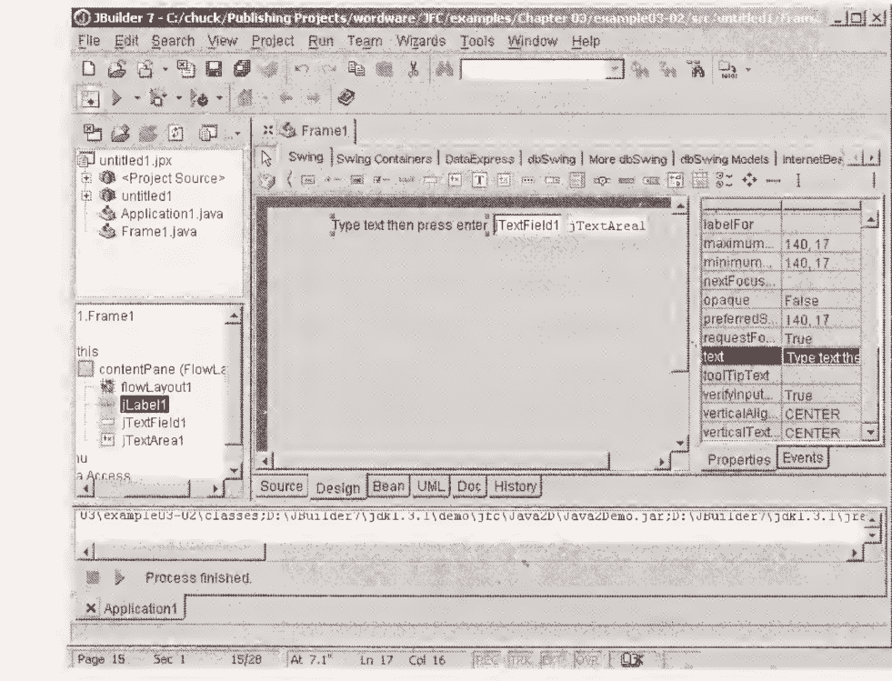

图 3.12 组件布局

**步骤 3：** 双击文本区域，您将进入其操作事件。放置您在此处看到的这一行代码：

```
void jTextField1_actionPerformed(ActionEvent e)
{
    jTextArea1.append(jTextField1.getText());
}
```

现在，每次您在 `jTextField1` 上按下 Enter 键时，其内容将被追加到 `jTextArea1`，如图 3.13 所示。

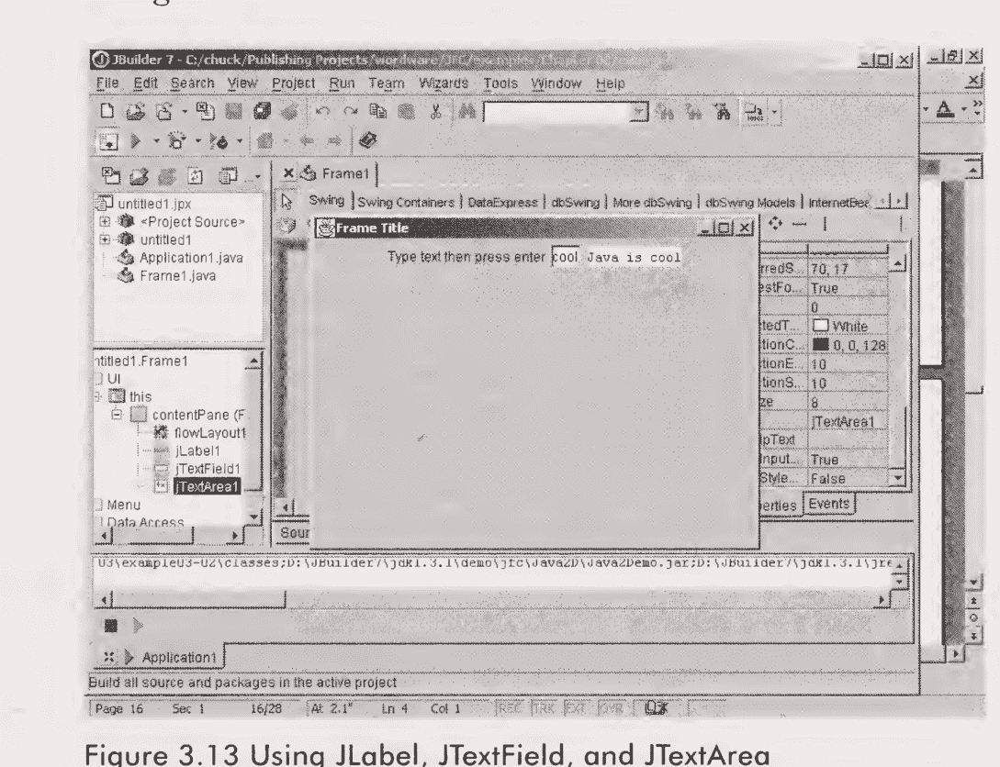

未使用 JBuilder 的读者只需将以下代码输入到他们喜欢的文本编辑器中并编译即可：

```
package untitled1;
import java.awt.*;
import java.awt.event.*;
import javax.swing.*;
public class Frame1 extends JFrame
{
    private JPanel contentPane;
    private JLabel jLabel1 = new JLabel();
    private FlowLayout flowLayout1 = new FlowLayout();
```


private JTextField jTextField1 = new JTextField();
private JTextArea jTextArea1 = new JTextArea();

// 构造窗体
public Frame1()
{
    enableEvents(AWTEvent.WINDOW_EVENT_MASK);
    try
    {
        jbInit();
    }    // 结束 try 块
    catch(Exception e)
    {
        e.printStackTrace();
    }    // 结束 catch 块
}    // 结束窗体构造函数

// 组件初始化
private void jbInit() throws Exception
{
    contentPane = (JPanel) this.getContentPane();
    jLabel1.setText("Type text then press enter");
    contentPane.setLayout(flowLayout1);
    this.setSize(new Dimension(400, 300));
    this.setTitle("Frame Title");
    jTextField1.setText("jTextField1");
    jTextField1.addActionListener(new java.awt.event
        .ActionListener()
    {
        public void actionPerformed(ActionEvent e)
        {
            jTextField1_actionPerformed(e);
        }
    });
    jTextArea1.setText("jTextArea1");
    contentPane.add(jLabel1, null);
    contentPane.add(jTextField1, null);
    contentPane.add(jTextArea1, null);
}

// 重写以在窗体关闭时退出
protected void processWindowEvent(WindowEvent e)
{
    super.processWindowEvent(e);
    if (e.getID() == WindowEvent.WINDOW_CLOSING)
    {
        System.exit(0);
    }    // 结束 if
} // 结束函数

void jTextField1_actionPerformed(ActionEvent e)
{
    jTextArea1.append(jTextField1.getText());
} // 结束事件处理方法
} // 结束类

## EditorKit

您会注意到接下来的两个类都使用了名为 EditorKit 的方法。因此，在介绍使用它的类之前，先向您介绍这个组件似乎是明智的。该类为文本组件成为某种文本内容的功能齐全的编辑器建立了一组所需的东西。工具包可以安全地将编辑状态存储为工具包的实例。工具包将专用于一个文本组件。新的工具包通常通过克隆原型工具包来创建。将调用工具包的 setComponent 方法以建立其与 JTextComponent 的关系。

### JTextPane

JTextPane 与 JTextArea 有一些相似之处，因为它也可以容纳多行文本。但是，您会使用 JTextPane 的原因是其格式化功能。通过 JTextPane，您可以像文字处理器一样，逐个字符地格式化文本。本质上，此类为您提供了一个文本编辑器。此类提供了各种允许您进行格式化的方法。此类继承自 JEditorPane，而 JEditorPane 又继承自 JTextComponent。当然，它也与 JTextField 和 JTextArea 共享许多方法。表 3.10 总结了 JTextPane 独有的字段。

表 3.10 JTextPane 方法

| 方法 | 目的 |
| --- | --- |
| Style addStyle(String nm, Style parent) | 此方法用于将新样式添加到逻辑样式层次结构中。 |
| Style getLogicalStyle() | 此方法将返回分配给由插入符当前位置表示的段落的逻辑样式，如果不存在则返回 null。 |
| Style getStyle(String nm) | 此方法将返回先前添加的具有指定名称的非空样式。 |
| getCharacterAttributes() | 此方法将返回插入符当前位置生效的字符属性，如果不存在则返回 null。 |
| getParagraphAttributes() | 此方法用于返回插入符位置生效的当前段落属性，如果不存在则返回 null。 |
| insertIcon(Icon g) | 此方法用于将图标作为替换当前选定内容插入到文档中。 |
| removeStyle(String nm) | 此方法从文档中移除先前添加的具有指定名称的非空样式。 |
| setDocument(Document doc) | 此方法用于为编辑器设置文本文档。 |
| setLogicalStyle(Style s) | 此方法用于设置要在当前插入符位置的段落使用的逻辑样式。 |
| protected EditorKit createDefaultEditorKit() | 此方法将为组件首次创建时创建默认编辑器工具包（PlainEditorKit）。 |
| protected StyledEditorKit getStyledEditorKit() | 此方法将检索编辑器工具包。 |

其中一些方法可能让您感到奇怪。您可能已经注意到，这些方法中有几个要么接受要么返回类型为 Style 的项。Style 是一个接口，本质上是一组与文档中某个元素关联的属性。其他与该元素关联的自定义属性实际上是在层次结构中存在的名称-值对，如果未在本地找到名称（键），则请求将被转发给父级。常用属性被分离出来，以促进更高效的替代实现。

与我们研究的其他用户输入类不同，JTextPane 只有两个构造函数，总结在表 3.11 中。

表 3.11 JTextPane 构造函数

| 构造函数 | 目的 |
| :--- | :--- |
| JTextPane() | 此构造函数是默认的、无参数构造函数，用于创建一个空白的 JTextPane。 |
| JTextPane(StyledDocument doc) | 此构造函数用于使用指定的文档模型创建一个新的 JTextPane。 |

这个特定组件的使用频率不如其他一些组件。事实上，您可能编程多年而从未有机会使用它。因此，本书不会深入探讨其用法。但是，提供了这个基本的介绍，以便您至少对 JTextPane 是什么以及它能做什么有一些基本的了解。

### JEditorPane

此组件与 JTextPane 非常相似。然而，它不是允许您编辑基本文本，而是允许您在文本、HTML 和 RTF（富文本格式）样式之间进行选择。请注意，它使您能够处理 HTML，从而允许您创建 HTML 编辑器。此类继承自 javax.swing.text.JTextComponent。

正如您可能猜到的，此类与 JTextPane 共享几个方法。那些它不与 JTextPane 共享并且实现方式不同的方法总结在表 3.12 中。这些方法主要涉及如何将文本加载到 JEditorPane 中。

表 3.12 JEditorPane 方法

| 方法 | 目的 |
| --- | --- |
| void setText(String t) | setText 方法用于从字符串初始化组件。在这种情况下，将使用当前的 EditorKit，并且内容类型应为该类型。 |
| void read(Reader r) | read 方法用于从读取器初始化组件。请注意，如果内容类型是 HTML，除非使用 <base> 标签或设置了 HTMLDocument 的 Base 属性，否则相对引用（例如，对于图像等）将无法解析。 |
| void setPage(String url) | setPage 方法用于从 URL 初始化组件。在这种情况下，内容类型将由 URL 确定，并且将设置该内容类型的已注册 EditorKit。 |
| void addHyperlinkListener(HyperlinkListener listener) | 此方法添加一个超链接监听器，用于通知任何更改（例如，当链接被选中并进入时）。 |
| void fireHyperlinkUpdate(HyperlinkEvent e) | 此方法通知所有已注册对此事件类型通知感兴趣的监听器。 |
| URL getPage() | 此方法返回当前正在显示的 URL。 |
| EditorKit getEditorKit() | 此方法检索当前安装的用于处理内容的工具包。 |
| protected InputStream getStream(URL page) | 此方法检索给定 URL 的输入流，该 URL 即将由 setPage 方法加载。 |
| void read(InputStream in, Object desc) | 此方法从输入流初始化。 |

JEditorPane 是另一个虽然非常有用但并不常见的组件。您可能在 Java 中编程多年而没有机会使用此组件。在本书中，我们试图让您尽快掌握 JFC 和 Swing 最常用的功能。但是，像这个这样的较不常见的组件也被介绍，以便您至少熟悉它们。

### JButton

严格来说，JButton 组件不是用户输入组件。然而，它的使用如此广泛，以至于必须在本书的早期介绍它，因为您将在后面的章节中使用它。此外，可以论证（尽管论证相当薄弱）JButton 允许用户提交输入。无论如何，JButton 是 AWT 按钮的 Swing/JFC 版本。JButton 继承自 javax.swing.AbstractButton，而 AbstractButton 又继承自 JComponent。

此组件的使用应该相当明显。您将一个按钮放在屏幕上，用户用鼠标点击它以触发某些操作。此按钮具有许多您无疑会发现非常有用的属性和事件。最常用的属性和方法总结在表 3.13 中。

表 3.13 JButton 方法和属性

| 属性/方法 | 目的 |
| --- | --- |
| text | 此属性允许您设置用户将看到的文本。 |
| foreground | 此属性允许您设置字体的颜色。 |
| background | 此属性允许您设置按钮的颜色。 |
| font | 此属性允许您为按钮的文本选择各种字体。 |
| icon | 此属性允许您在按钮上显示图标。 |
| tooltipText | 此属性允许您创建简短的文本段，当用户的鼠标悬停在按钮上时自动显示。 |
| actionPerformed | 这是与 JButton 关联的主要事件，在按钮被点击时执行。 |


### 表 3.14 JButton 构造方法

| 构造方法 | 用途 |
| --- | --- |
| JButton() | 此构造方法创建一个空白按钮（即，没有设置文本或图标的按钮）。 |
| JButton(Action a) | 此构造方法创建一个按钮，其属性取自提供的动作。 |
| JButton(Icon icon) | 此构造方法创建一个显示图标的按钮。 |
| JButton(String text) | 此构造方法创建一个带文本的按钮。 |
| JButton(String text, Icon icon) | 此构造方法用于创建一个带有初始文本和图标的按钮。 |

当然，JButton 的属性远不止这些，但这些是你最常用的。你应该熟悉这些属性和方法，以便能够恰当地使用 JButton。如果你使用 JBuilder，其中许多属性都可以通过属性窗口进行设置。JButton 还有许多不同的构造方法，你可以用它们来创建各种不同的 JButton。这些构造方法在表 3.14 中进行了总结。

第 6 章将非常详细地讨论事件和事件处理。你可能对按钮的工作方式有直观的认识，因为你肯定在软件中使用过许多按钮。让我们看一个示例，它应该能帮助你了解 JFC/Swing 按钮的功能。

### 示例 3.3

**步骤 1：** 启动一个新项目，并像之前的示例一样向其中添加一个标准应用程序。

**步骤 2：** 在设计屏幕上，将容器的布局更改为 **Flow**。别担心，布局管理器将在第 4 章中详细解释。

**步骤 3：** 在屏幕上放置一个单独的按钮。

**步骤 4：** 现在我们将更改它的几个属性。将文本更改为 Java，并将背景和前景色更改为任何你认为合适的颜色。（只需单击背景或前景属性，你就会看到一个小窗口，允许你混合颜色。）

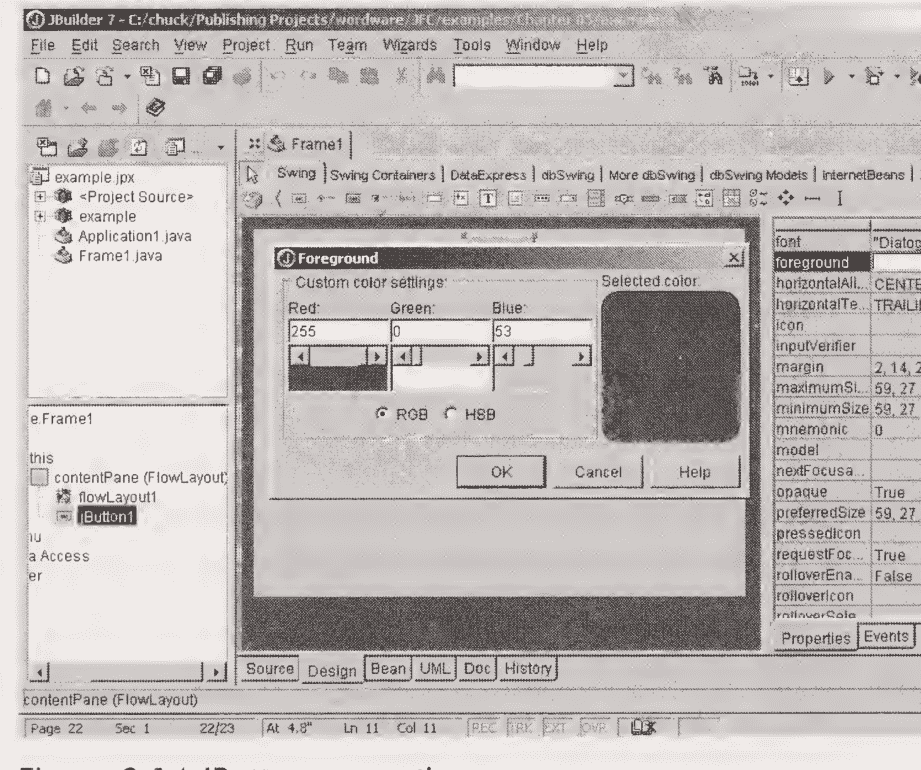

我还将字体更改为 SansSerif 并加粗。完成这些属性的更改后，你的按钮应如图 3.15 所示。

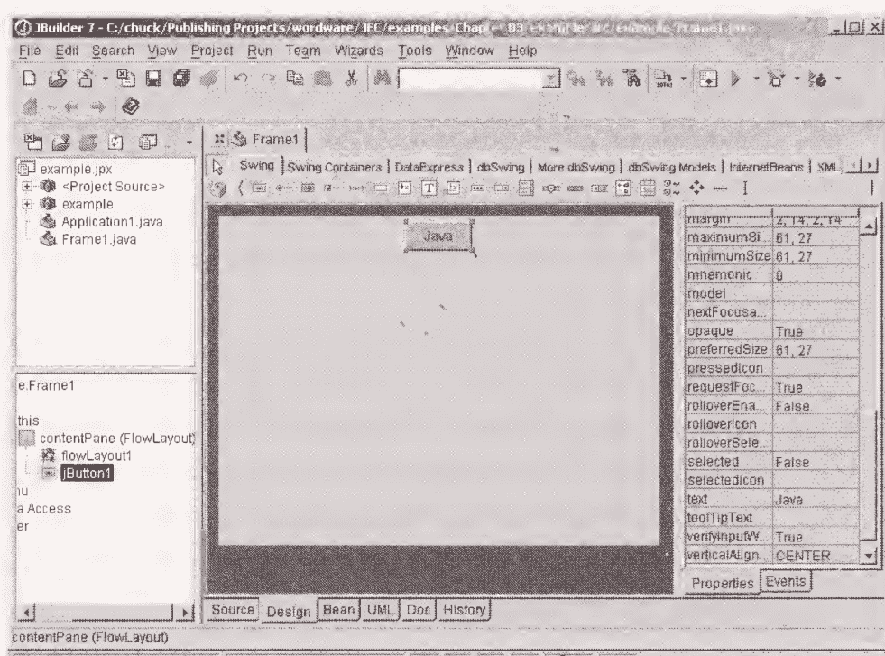

图 3.15 完成的 JButton

**步骤 5：** 现在双击按钮，进入其 actionPerformed 事件。只需输入一行代码：

```
void jButton1 actionPerformed(ActionEvent e)
{
    jButton1.setText("Is Cool");
}
```

**步骤 6：** 对于那些不使用 JBuilder 的读者，只需将以下代码输入你最喜欢的文本编辑器并编译它：

```
package example;
import java.awt.*;
import java.awt.event.*;
import javax.swing.*;
public class Frame1 extends JFrame
{
    private JPanel contentPane;
    private FlowLayout flowLayout1 = new FlowLayout();
    private JButton jButton1 = new JButton();
    //Construct the frame
    public Frame1()
    {
        enableEvents(AWTEvent.WINDOW_EVENT_MASK);
        try
        {
            jbInit();
        }    // end of try block
        catch(Exception e)
        {
            e.printStackTrace();
        }    // end of catch block
    }    // end of constructor
    //Component initialization
    private void jbInit() throws Exception
    {
        contentPane = (JPanel) this.getContentPane();
        // The following lines set the properties for the JButton
        jButton1.setBackground(new Color(212, 171, 200));
        jButton1.setFont(new java.awt.Font("SansSerif", 1, 12));
        jButton1.setForeground(new Color(255, 0, 53));
        jButton1.setText("Java");
        jButton1.addActionListener(new java.awt.event.ActionListener()
        {
            public void actionPerformed(ActionEvent e)
            {
                jButton1_actionPerformed(e);
            }
        });
        contentPane.setLayout(flowLayout1);
        this.setSize(new Dimension(400, 300));
        this.setTitle("Frame Title");
        contentPane.add(jButton1, null);
    }
    //Overridden so we can exit when window is closed
    protected void processWindowEvent(WindowEvent e)
    {
        super.processWindowEvent(e);
        if (e.getID() == WindowEvent.WINDOW_CLOSING)
        {
            System.exit(0);
        }    // end of if
    }    // end of processWindowEvent
    void jButton1_actionPerformed(ActionEvent e)
    {
        jButton1.setText("Is Cool");
    }    // end of action performed event
}// end of class
```

**步骤 7：** 运行你的应用程序。当它首次启动时，按钮应显示 "Java"，然后当你单击它时，标题应更改为 "Is Cool"。

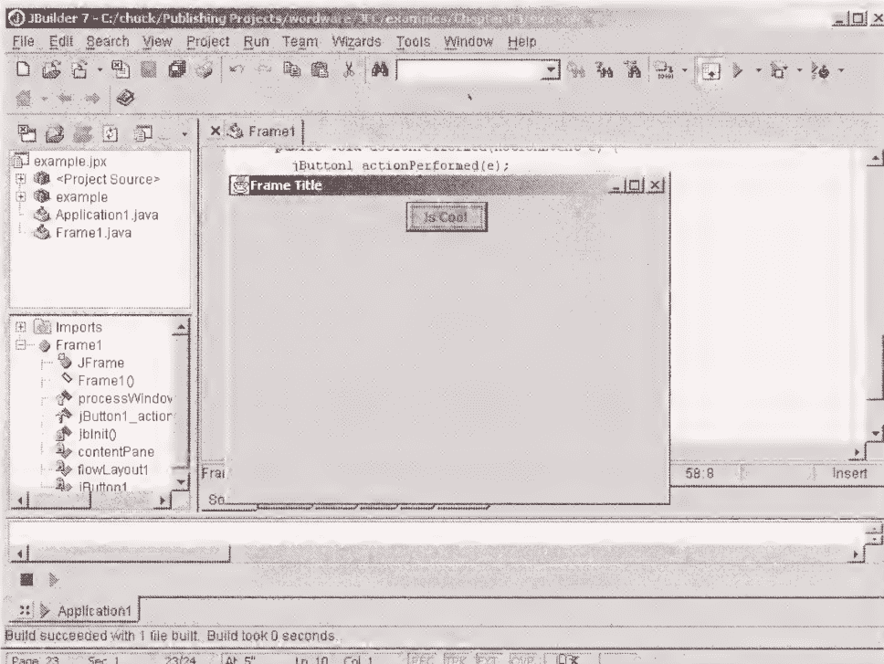

显然，JButton 还有更多的属性和方法，它们会在本书的示例中根据需要介绍。然而，这个示例应该向你展示了 JButton 的基础知识，并让你对其用法有良好的感觉。

### 总结

本章总结了最基本的用户输入和显示类。这些类创建了允许你以多种格式向用户显示文本，并以同样多样化的格式从用户获取文本输入的组件。这些是基础类；很难想象一个 Java 程序员在不使用它们的情况下编写许多应用程序。因此，你必须对它们非常熟悉。JTextField 组件是目前最常用的，JTextArea 和 JPasswordField 并列第二。

### 复习题

1.  本章列出的哪两个类不允许显示多行？
2.  你会使用哪个类来显示 HTML？
3.  如果你不希望屏幕上显示实际的按键，你会使用哪个类？
4.  列出 JTextField 组件的两个方法。
5.  列出 JPasswordField 组件的两个方法。
6.  JTextField 和 JTextArea 的主要区别是什么？
7.  什么是 EditorKit？
8.  你将如何向 JTextArea 的末尾添加文本？
9.  说出 AWT TextArea 和 JFC JTextArea 之间的一个区别。
10. JTextPane 和 JTextArea 的主要区别是什么？

# 第 4 章

# 外观和感觉

本章涵盖以下内容：

- 布局管理器
- BorderLayout
- GridLayout
- XYLayout
- FlowLayout
- VerticalFlowLayout
- BoxLayout2
- CardLayout
- OverlayLayout
- GridbagLayout
- PaneLayout
- 外观和感觉

### 简介

图形用户界面最重要的方面之一是能够改变应用程序的外观以及感觉。你的应用程序的外观和感觉将对用户的印象产生巨大影响。JFC/Swing 提供了多种方法和类来帮助你实现这一点。首先是布局管理器类。这些布局管理器允许你设置容器上组件的排列方式。我们在上一章中已经使用了布局管理器，但没有提供太多解释。本章将为你提供布局管理器的详细解释和几个示例。

能够设置应用程序的感觉也很重要。使用 AWT 时，所有组件都是根据它们运行的操作系统生成的。JFC 允许你设置你想要的外观类型，无论操作系统如何，你的组件都会以那种方式显示。如果你只是右键单击一个组件，你会看到一个名为“外观和感觉”的选项，它为你提供了三个选项：Metal、CDE/Motif 和 Windows。我将在本章后面探讨这些选项。

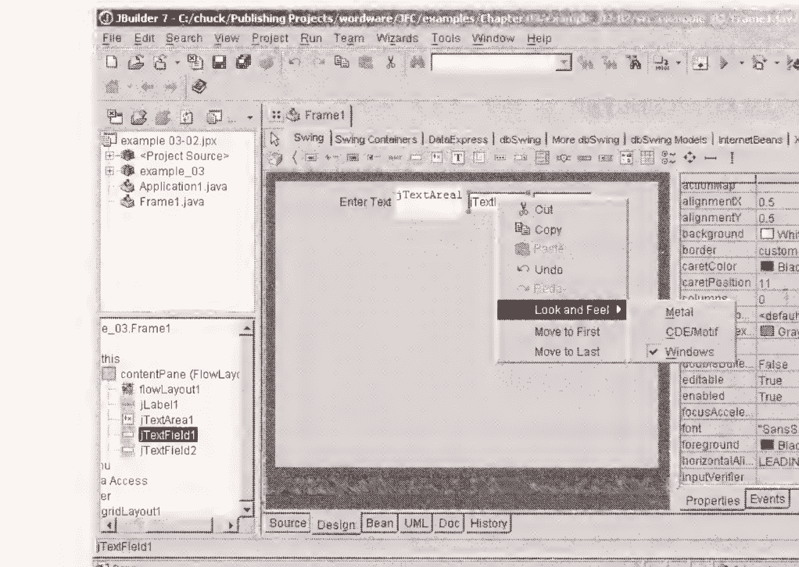

### 布局管理器

你的组件应该以某种类型的格式显示。布局管理器允许你改变显示方式。使用 JFC，有十种布局管理器。使用 AWT，有五种（GridLayout、GridbagLayout 等）。每一种都规定了将使用给定布局管理器添加到容器中的组件的不同布局顺序。下表总结了布局管理器及其基本用途。

表 4.1 JFC 布局管理器

| 布局管理器 | 用途 |
|---|---|
| BorderLayout | 这种布局管理器非常常见。它将容器的组件排列在名为北、南、东、西和中心的区域中。北和南区域的组件获得其首选高度并横向拉伸到容器的整个宽度。东和西区域的组件获得其首选宽度并纵向拉伸以填充北和南区域之间的空间。你会在各种情况下遇到 BorderLayout 管理器。 |
| BoxLayout2Layout | 此布局管理器允许多个组件垂直或水平排列。组件不会换行；因此，组件的垂直排列在调整框架大小时将保持垂直排列。 |
| CardLayout | CardLayout 将组件一个接一个地堆叠放置，类似于一副牌。一次只能看到一个组件。 |
| FlowLayout | FlowLayout 按从左到右、然后从上到下的顺序排列组件，使用每个组件的正常大小。FlowLayout 在一行中尽可能多地排列组件，然后移动到新的一行。这种简单的布局管理器是某些容器的默认布局管理器；然而，它的布局，至少在许多情况下，对于一个真正有吸引力的图形用户界面来说过于简单了。 |


# 第4章

| 布局管理器 | 用途 |
|---|---|
| GridLayout | GridLayout管理器将组件放置在由行和列组成的单元格网格中。GridLayout会扩展每个组件以填充其单元格内的可用空间。这种特定的布局管理器非常常见。你应该确保自己熟练掌握它，因为你会经常看到它。 |
| GridbagLayout | GridbagLayout管理器与GridLayout类似，但更灵活。GridbagLayout在一个动态矩形网格上水平和垂直地放置组件。各行不必具有相同的单元格数。 |
| OverlayLayout | 此布局管理器类似于CardLayout管理器，因为它将组件彼此叠加放置。然而，与CardLayout不同的是，如果你使容器中的每个组件透明，则可以同时显示多个组件。 |
| PaneLayout | PaneLayout允许你指定组件相对于其同级组件的大小。 |
| VerticalFlowLayout | VerticalFlowLayout管理器使用每个组件的默认大小，从上到下、从左到右将组件排列成列。此布局管理器会尽可能多地将组件排列在一列中，然后移到新列。 |
| XYLayout | XYLayout不是标准的Java布局管理器。如果你使用的是Sun JDK而不是JBuilder，你将无法访问此特定的布局管理器；它仅在JBuilder中可用。XYLayout将组件放置在容器中的特定x,y坐标处，因此得名。在此坐标系中，原点(0,0)位于左上角。这是本章中提到的唯一不属于Java SDK的布局管理器。 |

所有各种布局管理器类都实现了Layout接口。该接口定义了所有布局管理器实现的通用方法。下表总结了这些方法。

## 表 4.2 Layout接口方法

| 方法 | 用途 |
| :--- | :--- |
| void addLayoutComponent (String name, Component comp) | 此方法用于将具有指定名称的指定组件添加到布局中。如果不向布局管理器添加组件，你确实无法使用它们，因此这是Layout接口中最常用的方法。 |
| void layoutContainer (Container parent) | 此方法将在指定的面板中布局容器。 |
| void removeLayoutComponent(Component comp) | 此方法用于从布局中移除指定的组件。 |
| Dimension minimumLayoutSize(Container parent) | 此方法根据指定父容器中的组件，计算指定面板的最小尺寸。 |
| Dimension preferredLayoutSize(Container parent) | 此方法根据指定父容器中的组件，计算指定面板的首选尺寸。 |

这些只是部分方法，但它们包含了你可能需要的所有功能，以便有效利用任何特定的布局管理器。当然，与所有类一样，你需要实例化一个布局管理器类才能使用该特定的布局管理器。你创建布局管理器的方式与创建任何其他Java类的实例相同。以下是一个示例：

```java
private GridLayout gridLayout1 = new GridLayout(4,1);
```

我们创建了一个GridLayout管理器的实例，命名为gridLayout1。我们的GridLayout管理器有四行一列。你的应用程序或小程序可能包含多个容器组件。你需要将特定的容器与特定的布局管理器关联起来。所有容器组件都有一个名为setLayout的方法，允许你将特定的布局与特定的容器关联。以下是一个示例：

`contentPane.setLayout(gridLayout1);`

你可以看到，将特定的布局与特定的容器组件关联相当简单。困难之处在于为特定情况选择正确的布局管理器以及正确地操作该布局管理器。让我们看看各种布局管理器、它们的实现方式以及最适合使用它们的情况。为最常用的布局管理器提供了示例。

### BorderLayout

BorderLayout管理器将组件排列成五个区域。有一个相当大的Center区域，以及较小的North、South、East和West区域。此布局管理器经常用于放置容器组件，这些组件随后将托管其他组件。图4.2为你描述了这种布局安排。

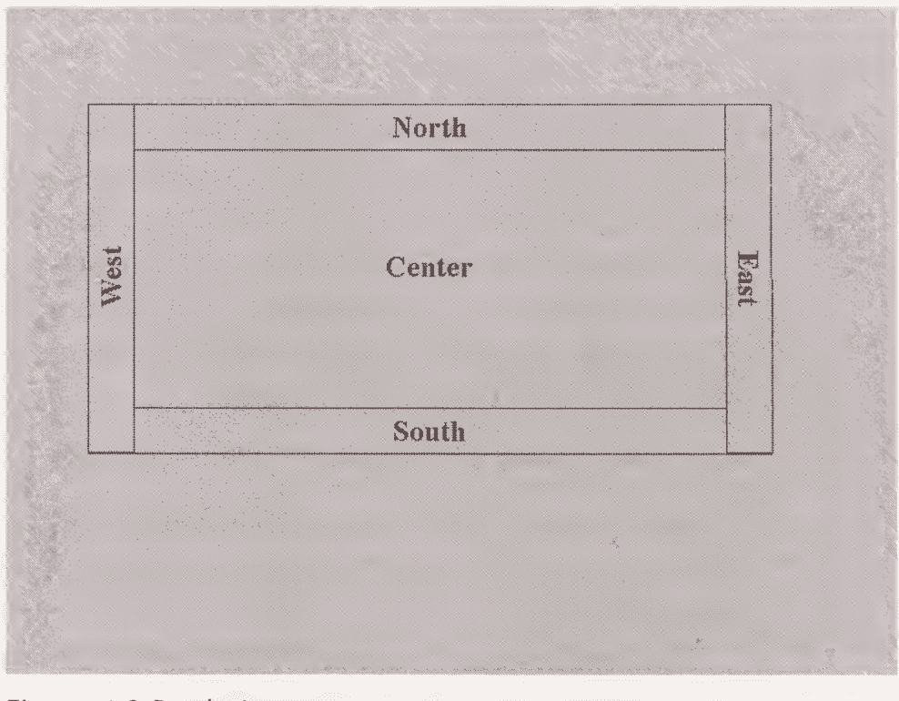

### GridLayout

如前所述，GridLayout管理器将组件排列在一个网格中，每行具有相同数量的单元格。行数和列数由实例化时传递给GridLayout管理器的两个数字决定。第一个数字表示行，第二个表示列。因此，如果你写：

`GridLayout mygrid = new GridLayout(4,2);`

...你声明了一个四行两列的网格布局。这在计算器应用程序中特别有用。由于按钮必须以网格格式排列，因此GridLayout管理器非常适合这种情况。以下示例有点长，但为你提供了GridLayout管理器以及BorderLayout各种用途的良好示例。

### 示例 4.1

**步骤1：** 使用JBuilder打开一个新项目。（同样，没有JBuilder的用户可以简单地跳到源代码，将其输入到他们喜欢的文本编辑器中并编译。）

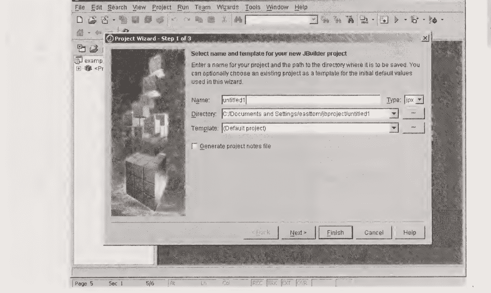

图 4.3 示例 4.1

**步骤2：** 向项目添加一个标准应用程序。你可以为此使用默认设置。

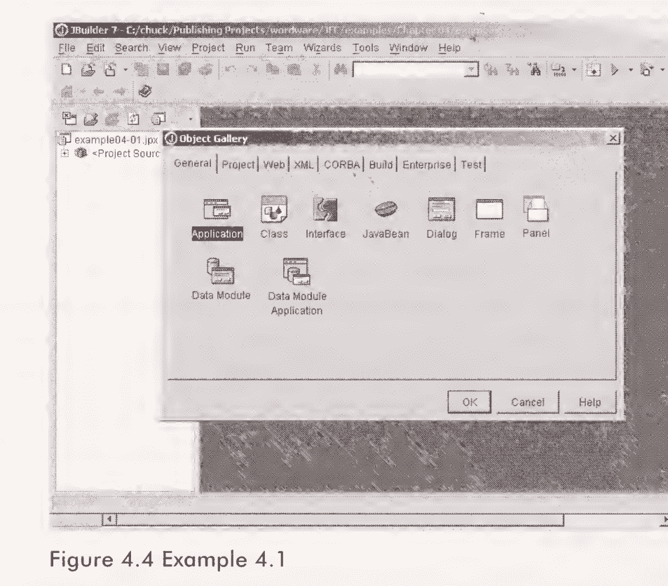

**步骤3：** 使用“设计”选项卡设置BorderLayout管理器。

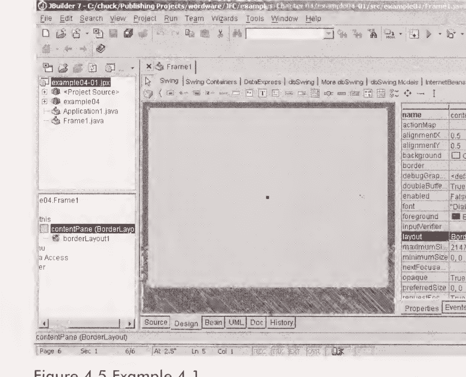

**步骤4：** 设置BorderLayout管理器后，在Center和East区域放置面板（你会在第二个标题为“Swing容器”的选项卡上找到JPanel控件）。每个面板都应使用网格布局。然后你可以进入代码并像这样更改行和列：

```java
private GridLayout gridLayout1 = new GridLayout(5,1);
private GridLayout gridLayout2 = new GridLayout(3,4);
```

> **注意：** 第5章将详细讨论容器；目前只需将它们放在所需的位置。

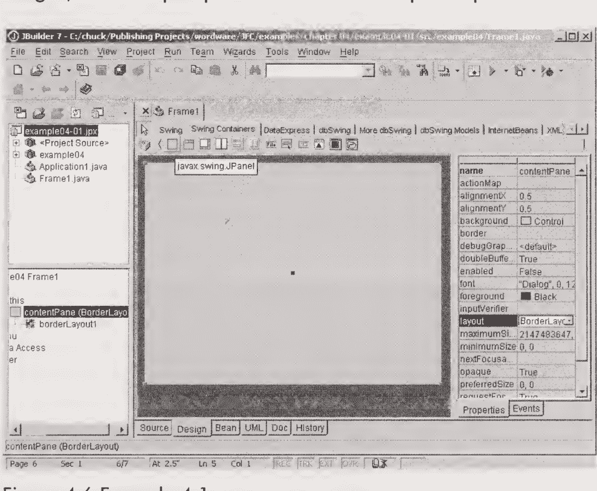

> **注意：** 如果为每个面板设置不同的背景颜色，可能更容易查看面板的位置。这可能不是视觉上最吸引人的布局，但它将帮助你记住放置物品的位置！

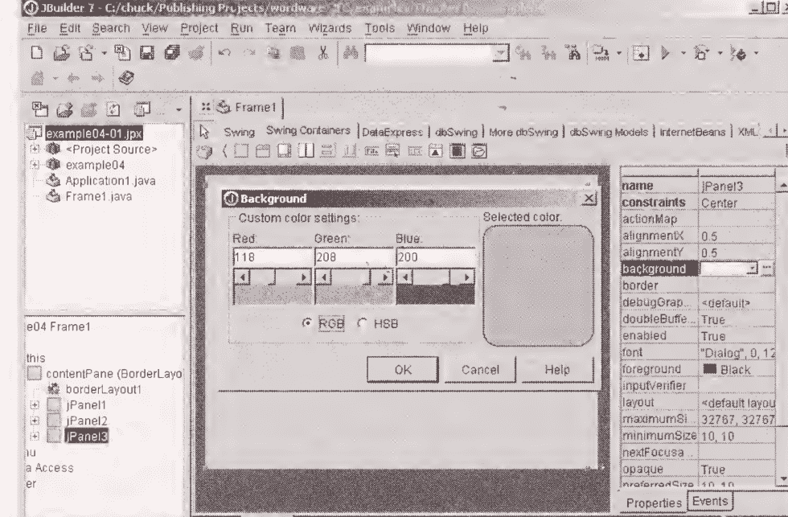

图 4.7 示例 4.1

**步骤5：** 在North区域放置一个带有白色背景、默认标题为“0”的标签。将标签的水平对齐属性设置为White，边框类型设置为Etched。

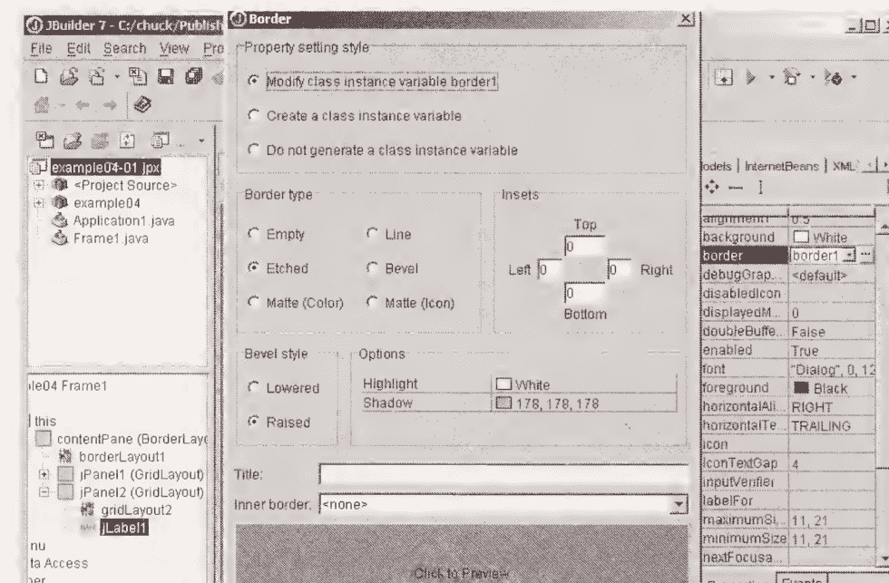

图 4.8 示例 4.1

**步骤6：** 我们现在要向此显示添加一些按钮。屏幕东侧面板上的按钮将包含我们计算器的功能按钮；因此，我们将创建一个名为btnfunction的按钮数组。

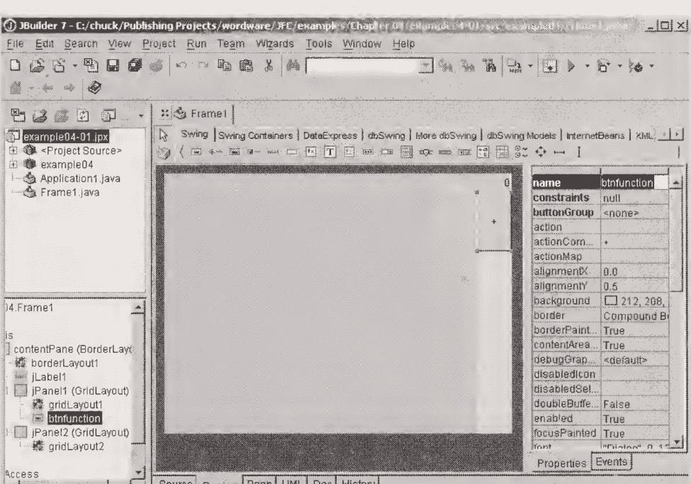

图 4.9 计算器按钮

> 注意：你只需右键单击第一个按钮，选择“复制”，然后粘贴四次。然后只需像这里所示更改标题。

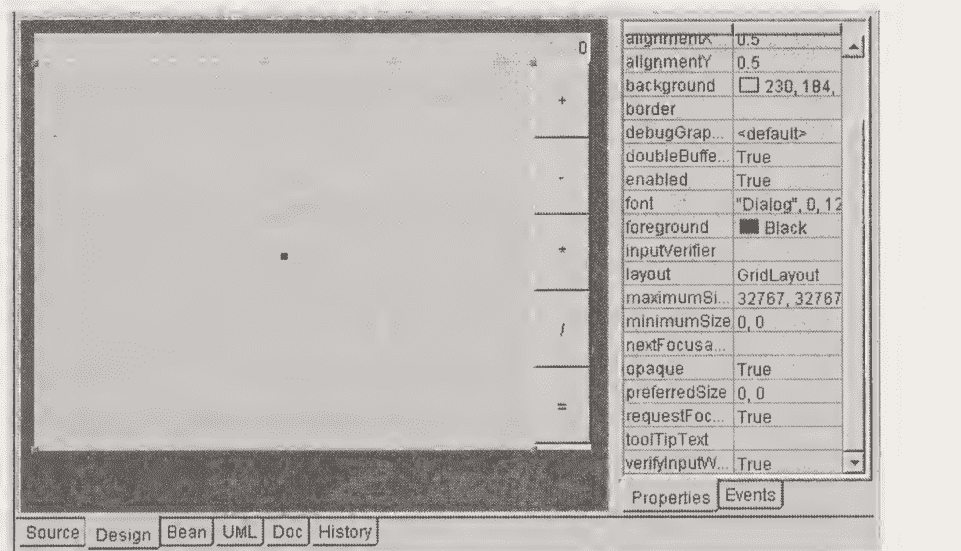

图 4.10 计算器按钮 2

要将按钮添加到Center面板，你要做的工作大致相同。从一个名为btnnumber的按钮开始，然后创建一个数组。然后你可以像在此图像中看到的那样更改标题：

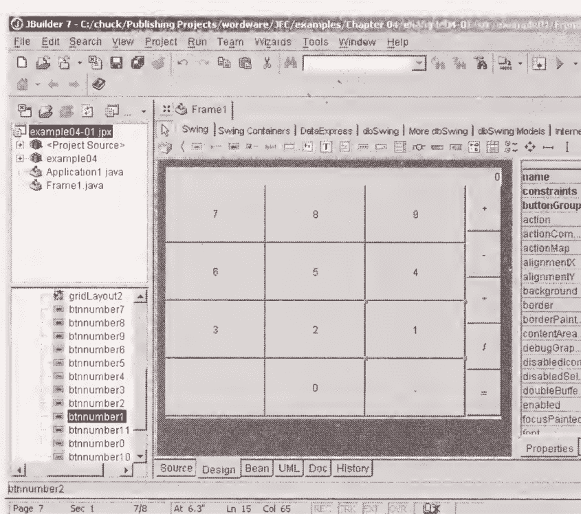

警告：你将不得不移动按钮，直到数字按钮与文本字段匹配。换句话说，btnnumber1必须是文本属性为“1”的按钮。Btnnumber10应该是“.”按钮。零按钮将是原始的btnnumber，你需要将其名称更改为btnnumber0。

这应该为你准确说明了BorderLayout和GridLayout管理器的工作原理。此时，我们不会为此计算器添加任何功能。我们将在关于事件的章节（第6章）中这样做，因为所有这些代码都与发生的事件（如按下按钮）有关。对于那些不使用JBuilder的读者，你可以通过打开你喜欢的文本编辑器并输入此处看到的代码来完成此处完成的所有操作：

package example04;
import java.awt.*;
import java.awt.event.*;
import javax.swing.*;
import javax.swing.border.*;

public class Frame1 extends JFrame
{
    private JPanel contentPane;
    private BorderLayout borderLayout1 = new BorderLayout();
    private Border border1;
    private JLabel jLabel1 = new JLabel();
    private JPanel jPanel1 = new JPanel();
    private JPanel jPanel2 = new JPanel();
    private JButton btnfunction = new JButton();
    private GridLayout gridLayout1 = new GridLayout(5,1);
    private GridLayout gridLayout2 = new GridLayout(4,3);
    private JButton btnfunction1 = new JButton();
    private JButton btnfunction2 = new JButton();
    private JButton btnfunction3 = new JButton();
    private JButton btnfunction4 = new JButton();
    private JToggleButton btnnumber0 = new JToggleButton();
    private JToggleButton btnnumber1 = new JToggleButton();
    private JToggleButton btnnumber2 = new JToggleButton();
    private JToggleButton btnnumber3 = new JToggleButton();
    private JToggleButton btnnumber4 = new JToggleButton();
    private JToggleButton btnnumber5 = new JToggleButton();
    private JToggleButton btnnumber6 = new JToggleButton();
    private JToggleButton btnnumber7 = new JToggleButton();
    private JToggleButton btnnumber8 = new JToggleButton();
    private JToggleButton btnnumber9 = new JToggleButton();
    private JToggleButton btnnumber10 = new JToggleButton();
    private JToggleButton btnnumber11 = new JToggleButton();

    //构造窗体
    public Frame1()
    {
        enableEvents(AWTEvent.WINDOW_EVENT_MASK);
        try
        {
            jbInit();
        }
        catch(Exception e)
        {
            e.printStackTrace();
        }
    }

    //组件初始化
    private void jbInit() throws Exception
    {
        contentPane = (JPanel) this.getContentPane();
        border1 = new EtchedBorder(EtchedBorder.RAISED,
            Color.white, new Color(178, 178, 178));
        contentPane.setLayout(borderLayout1);
        this.setSize(new Dimension(400, 300));
        this.setTitle("窗体标题");
        jLabel1.setBackground(Color.white);
        jLabel1.setBorder(border1);
        jLabel1.setHorizontalAlignment(SwingConstants.RIGHT);
        jLabel1.setText("0");
        jPanel1.setBackground(new Color(230, 255, 105));
        jPanel1.setLayout(gridLayout1);
        jPanel2.setBackground(new Color(230, 184, 255));
        jPanel2.setLayout(gridLayout2);
        btnfunction.setText("+");
        btnfunction1.setText("-");
        btnfunction2.setText("*");
        btnfunction3.setText("/");
        btnfunction4.setText("=");
        btnnumber0.setText("0");
        btnnumber1.setText("1");
        btnnumber2.setText("2");
        btnnumber3.setText("3");
        btnnumber4.setText("4");
        btnnumber5.setText("5");
        btnnumber6.setText("6");
        btnnumber7.setText("7");
        btnnumber8.setText("8");
        btnnumber10.setText(".");
        btnnumber9.setText("9");
        contentPane.add(jLabel1, BorderLayout.NORTH);
        contentPane.add(jPanel1, BorderLayout.EAST);
        contentPane.add(jPanel2, BorderLayout.CENTER);
        jPanel2.add(btnnumber7, null);
        jPanel2.add(btnnumber8, null);
        jPanel2.add(btnnumber9, null);
        jPanel2.add(btnnumber6, null);
        jPanel2.add(btnnumber5, null);
        jPanel2.add(btnnumber4, null);
        jPanel2.add(btnnumber3, null);
        jPanel2.add(btnnumber2, null);
        jPanel2.add(btnnumber1, null);
        jPanel2.add(btnnumber11, null);
        jPanel2.add(btnnumber0, null);
        jPanel2.add(btnnumber10, null);
        jPanel1.add(btnfunction, null);
        jPanel1.add(btnfunction1, null);
        jPanel1.add(btnfunction2, null);
        jPanel1.add(btnfunction3, null);
        jPanel1.add(btnfunction4, null);
    }

    //重写此方法以便在关闭窗口时退出
    protected void processWindowEvent(WindowEvent e)
    {
        super.processWindowEvent(e);
        if (e.getID() == WindowEvent.WINDOW_CLOSING) {
            System.exit(0);
        }
    }
}

# 第4章

现在，我毫不怀疑，看到所有这些代码对你来说可能显得相当令人畏惧。不用担心——一切都会被解释清楚。事实上，代码本身相当简单；只是恰好有很多。真正构成代码主体的部分只有两个。第一个是在`Frame`类的开头。在这里，所有将要使用的组件都被声明。它们的声明方式与其他任何对象变量的实例化非常相似。下一个部分是`jbInit`函数。这是初始化各项设置的地方。在这里设置尺寸，并将布局管理器与特定组件关联起来。如果你逐行检查这段代码，它实际上并不那么复杂。由于我们还没有在这个程序中添加任何功能，`jbInit`是程序中唯一的真正函数。我们还没有任何处理动作或操作数据的函数（但你将在第6章中实现！）。

## XY布局

当您需要将组件放置在特定且精确的位置时，`XYLayout`管理器非常有用。使用此布局管理器，您可以指定您希望组件放置位置的x和y坐标，因此得名。让我们看一个示例。

### 示例4.2

**步骤1：** 启动一个新项目，并向其添加一个标准的`Application`对象。此操作方式与之前的示例完全相同。

**步骤2：** 将背景容器的布局管理器设置为**XY**。（如果您在添加`Application`对象时使用默认设置，还会添加一个窗体并将其用作其他组件的容器。）

**步骤3：** 为演示起见，在屏幕上放置三个不同的按钮。请注意，您可以将它们移动到任何您想要的位置。

图4.13 XY示例

这就是人们选择`XYLayout`管理器的原因——因为您可以将组件放置在精确的位置。

为您生成了以下代码：

```java
package untitled1;
import java.awt.*;
import java.awt.event.*;
import javax.swing.*;
import com.borland.jbcl.layout.*;

public class Frame1 extends JFrame
{
    private JPanel contentPane;
    private XYLayout xYLayout1 = new XYLayout();
    private JButton jButton1 = new JButton();
    private JButton jButton2 = new JButton();
    private JButton jButton3 = new JButton();

    //构造窗体
    public Frame1()
    {
        enableEvents(AWTEvent.WINDOW_EVENT_MASK);
        try
        {
            jbInit();
        }
        catch(Exception e)
        {
            e.printStackTrace();
        }
    }

    //组件初始化
    private void jbInit() throws Exception
    {
        contentPane = (JPanel) this.getContentPane();
        jButton1.setText("jButton1");
        contentPane.setLayout(xYLayout1);
        this.setSize(new Dimension(400, 300));
        this.setTitle("窗体标题");
        jButton2.setText("jButton2");
        jButton3.setText("jButton3");
        contentPane.add(jButton1, new XYConstraints(120, 93, 114, 29));
        contentPane.add(jButton2, new XYConstraints(281, 169, 97, 33));
        contentPane.add(jButton3, new XYConstraints(32, 190, 103, 32));
    }

    //重写此方法以便在关闭窗口时退出
    protected void processWindowEvent(WindowEvent e)
    {
        super.processWindowEvent(e);
        if (e.getID() == WindowEvent.WINDOW_CLOSING)
        {
            System.exit(0);
        }
    }
}
```

从我们的角度来看，这段代码中真正有趣的部分是与`XYLayout`管理器特定的代码。这实际上由两种类型的表达式组成，第一种是建立`XYLayout`管理器的使用。这是通过以下代码行完成的：

```java
contentPane.setLayout(xYLayout1);
```

当添加其他组件时，会为它们指定具体的x和y坐标。每个组件将被赋予四个数字。前两个是组件左上角的x和y坐标；然后是组件右下角的x和y坐标。

```java
contentPane.add(jButton1, new XYConstraints(120, 93, 114, 29));
contentPane.add(jButton2, new XYConstraints(281, 169, 97, 33));
contentPane.add(jButton3, new XYConstraints(32, 190, 103, 32));
```

`XYLayout`管理器是使用JBuilder优势的又一个例子。您不仅可以访问诸如`XYLayout`这样的额外布局管理器，而且如果仅基于x和y坐标，您将很难直观地了解组件的确切放置位置。使用JBuilder，您只需在图形化环境中放置它们即可。

### 流式布局

`FlowLayout`管理器是最简单的之一。组件只是从左到右放置在屏幕上，直到一行填满，然后开始下一行。这通常不利于创建美观的布局。

### 垂直流式布局

`VerticalFlowLayout`管理器与`FlowLayout`管理器几乎相同，只是组件被安排在垂直列中，直到一列填满，然后开始下一列。以下示例展示了`FlowLayout`和`VerticalFlowLayout`。


### 示例 4.3

**步骤 1：** 启动一个新项目，并向其中添加一个标准的 Application 对象。

**步骤 2：** 保持背景框架使用其默认的边框布局。

**步骤 3：** 在西端放置一个 `JPanel`（记住你可以从 Swing 容器选项卡中获取），并在东端放置另一个。回想一下，更改面板的背景颜色将使你更容易记住它们放置的位置。

**步骤 4：** 将西面板的布局管理器设置为 **VerticalFlowLayout**，将东面板的布局管理器设置为 **FlowLayout**。现在，向每个面板添加三个按钮。你应该会看到类似图 4.14 所示的内容。

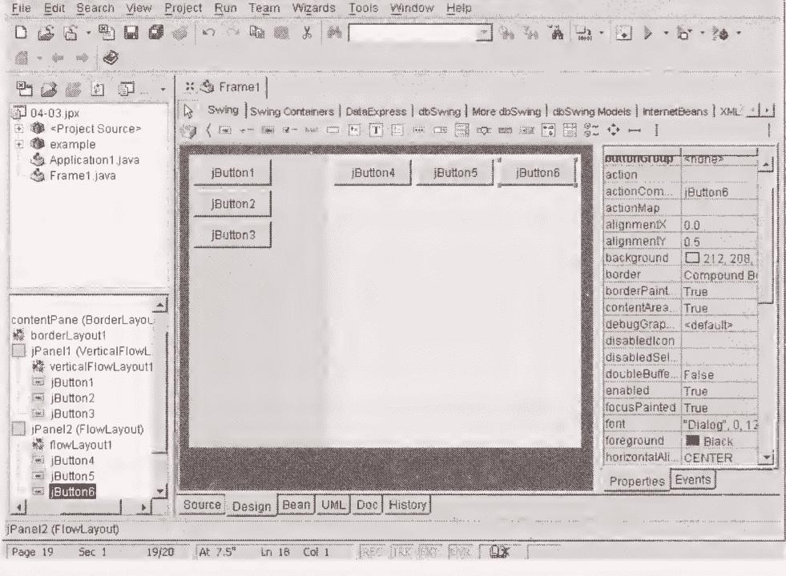

如你所见，主要区别在于 FlowLayout 是水平方向的，而 VerticalFlowLayout 管理器当然是垂直的。

如果你不使用 JBuilder，只需将以下代码输入到你喜欢的文本编辑器中：

```
package example;
import java.awt.*;
import java.awt.event.*;
import javax.swing.*;
import com.borland.jbcl.layout.*;
public class Frame1 extends JFrame
{
  private JPanel contentPane;
  private BorderLayout borderLayout1 = new BorderLayout();
  private JPanel jPanel1 = new JPanel();
  private JPanel jPanel2 = new JPanel();
  private FlowLayout flowLayout1 = new FlowLayout();
  private VerticalFlowLayout verticalFlowLayout1 = new VerticalFlowLayout();
  private JButton jButton1 = new JButton();
  private JButton jButton2 = new JButton();
  private JButton jButton3 = new JButton();
  private JButton jButton4 = new JButton();
  private JButton jButton5 = new JButton();
  private JButton jButton6 = new JButton();
  //Construct the frame
  public Frame1()
  {
    enableEvents(AWTEvent.WINDOW_EVENT_MASK);
    try
    {
      jbInit();
    }
    catch(Exception e)
    {
      e.printStackTrace();
    }
  }
  //Component initialization
  private void jbInit() throws Exception
  {
    contentPane = (JPanel) this.getContentPane();
    contentPane.setLayout(borderLayout1);
    this.setSize(new Dimension(400, 300));
    this.setTitle("Frame Title");
    jPanel1.setBackground(new Color(212, 208, 160));
    jPanel1.setLayout(verticalFlowLayout1);
    jPanel2.setBackground(new Color(212, 255, 200));
    jPanel2.setLayout(flowLayout1);
    jButton1.setText("jButton1");
    jButton2.setText("jButton2");
    jButton3.setText("jButton3");
    jButton4.setText("jButton4");
    jButton5.setText("jButton5");
    jButton6.setText("jButton6");
    contentPane.add(jPanel1, BorderLayout.WEST);
    jPanel1.add(jButton1, null);
    jPanel1.add(jButton2, null);
    jPanel1.add(jButton3, null);
    contentPane.add(jPanel2, BorderLayout.EAST);
    jPanel2.add(jButton4, null);
    jPanel2.add(jButton5, null);
    jPanel2.add(jButton6, null);
  }
  //Overridden so we can exit when window is closed
  protected void processWindowEvent(WindowEvent e)
  {
    super.processWindowEvent(e);
    if (e.getID() == WindowEvent.WINDOW_CLOSING)
    {
      System.exit(0);
    }
  }
}
```

### BoxLayout2

BoxLayout2 管理器直接继承自 `java.lang.Object`，因此你不需要继承自 AWT 或 Component 类。此布局管理器允许多个容器对象垂直或水平排列。与 FlowLayout 和 VerticalFlowLayout 管理器不同，此布局管理器的组件不会换行。这意味着当容器大小调整时，它们的位置不会改变。

### CardLayout

CardLayout 管理器一次只允许查看一个组件，很像一副纸牌。你可以翻阅组件，一次查看一个组件。通常，组件本身就是容器组件。你可以通过使用类似这里看到的代码来更改“卡片”：

```
CardLayout cl = (CardLayout)(nameofcontainerwithcardlayout.getLayout());
cl.show(nameofcontainerwithcardlayout, "nameofcontainer youwanttoshow");
```

让我们看一个说明此布局管理器的示例。

#### 示例 4.4

步骤 1：启动一个新项目并向其中添加一个 Application 对象，就像你在之前的示例中所做的那样。

步骤 2：在 Design 选项卡上，将布局设置为 Card。

步骤 3：在屏幕上放置两个面板。使每个面板颜色不同，并在每个面板上放置一个按钮。按钮和颜色只是为了让你在翻阅各个组件时能够分辨。

步骤 4：当你第一次运行该项目时，你会看到类似下图所示的内容。

# 第 4 章

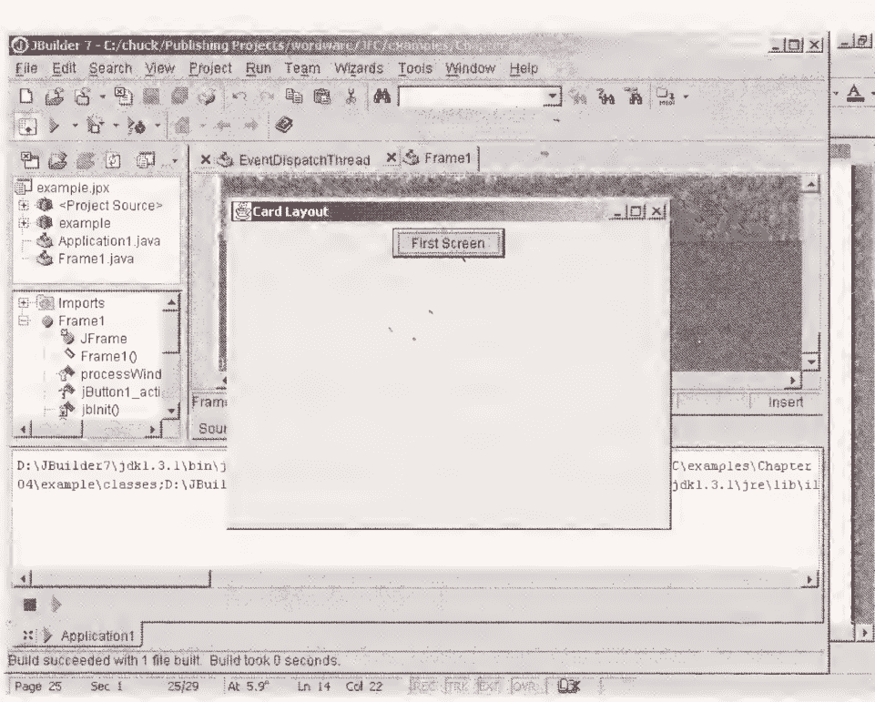

按下按钮后，你会看到类似下图所示的内容。

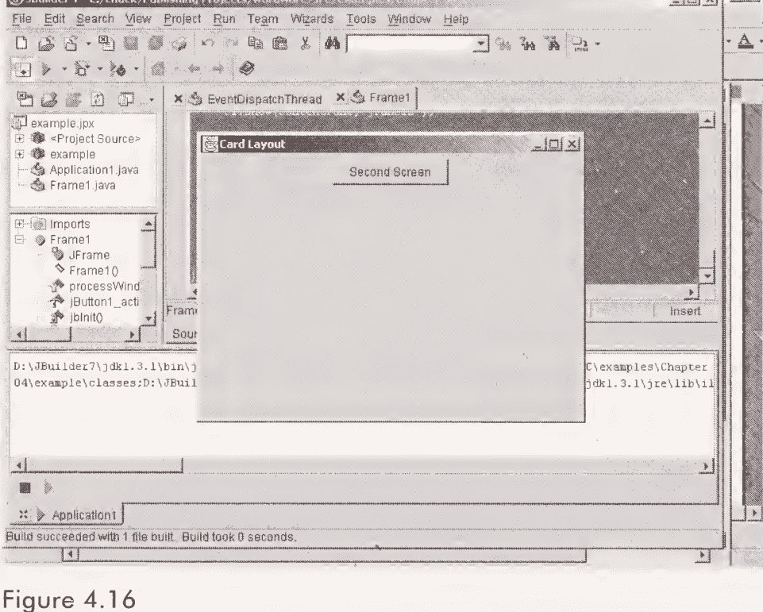

对于不使用 JBuilder 的读者，只需将以下代码输入到你喜欢的文本编辑器中并编译即可：

```
package example;
import java.awt.*;
import java.awt.event.*;
import javax.swing.*;
public class Frame1 extends JFrame
{
    private JPanel contentPane;
    private CardLayout cardLayout1 = new CardLayout();
    private JPanel jPanel1 = new JPanel();
    private JButton jButton1 = new JButton();
    private JPanel jPanel2 = new JPanel();
    private JButton jButton2 = new JButton();
    private JPanel jPanel3 = new JPanel();
    private JButton jButton3 = new JButton();
    //Construct the frame
    public Frame1()
    {
        enableEvents(AWTEvent.WINDOW_EVENT_MASK);
        try
        {
            jbInit();
        }    // end of try
        catch(Exception e)
        {
            e.printStackTrace();
        }    // end of catch
    }
    //Component initialization
    private void jbInit() throws Exception
    {
        contentPane = (JPanel) this.getContentPane();
        contentPane.setLayout(cardLayout1);
        this.setSize(new Dimension(400, 300));
        this.setTitle("Card Layout");
        jPanel1.setBackground(new Color(212, 255, 211));
        jButton1.setText("First Screen");
        contentPane.add(jPanel1, "jPanel1");
        jPanel1.add(jButton1, null);
        jButton2.setText("Second Screen");
        contentPane.add(jPanel2, "jPanel2");
        jPanel2.add(jButton2, null);
        jButton1.addActionListener(new java.awt.event.ActionListener() {
            public void actionPerformed(ActionEvent e)
            {
                jButton1_actionPerformed(e);
            } //end of action performed
        });
    }
    //Overridden so we can exit when window is closed
    protected void processWindowEvent(WindowEvent e)
    {
        super.processWindowEvent(e);
        if (e.getID() == WindowEvent.WINDOW_CLOSING)
        {
            System.exit(0);
        }
    }
    void jButton1_actionPerformed(ActionEvent e)
    {
        try
        {
            CardLayout cl = (CardLayout)(contentPane.getLayout());
            cl.show(contentPane,"jPanel2");
        }// end of try
        catch(Exception err)
        {
            err.printStackTrace();
            jButton1.setText(err.toString());
        }// end of catch
    }
}
```

如你所见，CardLayout 管理器使用起来相当简单。不要让所有的代码吓到你。基本上，所发生的一切就是组件被创建、初始化并与所需的容器关联起来。

## OverlayLayout

OverlayLayout 管理器将项目堆叠放置，很像 CardLayout。然而，与 CardLayout 不同，各个项目可以同时被看到。除此之外，它的行为与前面描述的 CardLayout 管理器非常相似。

### GridBagLayout

GridBagLayout 与网格布局几乎完全相同，只是各个行不必具有相同数量的单元格。除了这一例外，它与你在之前的计算器示例中使用的 GridLayout 管理器几乎完全相同。

### PaneLayout

此布局管理器允许你相对于其兄弟组件指定组件的大小。每个组件都非常类似于窗口中的窗格（因此得名）；但是，每个组件的大小是相对于其他正在显示的组件的大小来确定的。让我们看一个说明这一点的示例。

#### 示例 4.5

**步骤 1：** 启动一个新项目并向其中添加一个新的 Application 对象，就像你在所有之前的示例中所做的那样。

**步骤 2：** 将容器的布局管理器设置为 **Pane**。然后添加四个按钮。当你运行它时，你会看到类似以下内容：


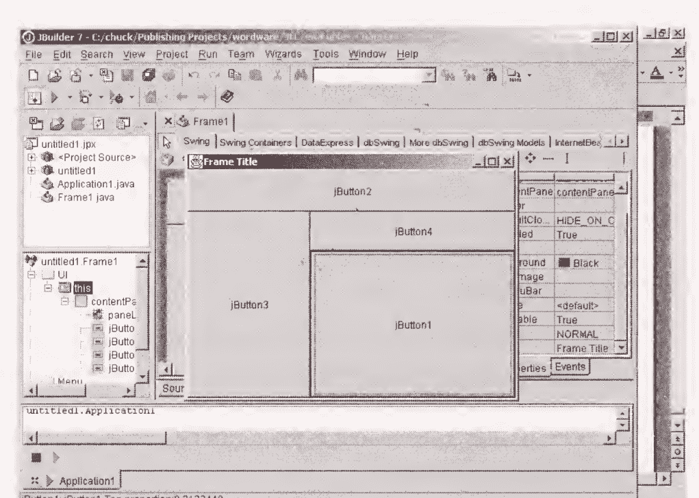

图 4.17

请注意每个按钮是如何位于单独窗格中的。你可以在设计时调整组件的大小。其他组件将相应调整大小以匹配。无论你选择哪种布局，整个屏幕都会被占满。对于那些不使用 JBuilder 的读者，你可以像往常一样，将以下代码输入到你喜欢的文本编辑器中并编译：

```java
package untitled1;
import java.awt.*;
import java.awt.event.*;
import javax.swing.*;
import com.borland.jbcl.layout.*;
public class Frame1 extends JFrame
{
    private JPanel contentPane;
    private PaneLayout paneLayout1 = new PaneLayout();
    private JButton jButton1 = new JButton();
    private JButton jButton2 = new JButton();
    private JButton jButton3 = new JButton();
    private JButton jButton4 = new JButton();
    //Construct the frame
    public Frame1()
    {
        enableEvents(AWTEvent.WINDOW_EVENT_MASK);
        try
        {
            jbInit();
        }// end of try
        catch(Exception e)
        {
            e.printStackTrace();
        }// end of catch block
    }
    //Component initialization
    private void jbInit() throws Exception
    {
        contentPane = (JPanel) this.getContentPane();
        jButton1.setText("jButton1");
        contentPane.setLayout(paneLayout1);
        this.setSize(new Dimension(400, 300));
        this.setTitle("Frame Title");
        jButton2.setText("jButton2");
        jButton3.setText("jButton3");
        jButton4.setText("jButton4");
        contentPane.add(jButton1, new PaneConstraints("jButton1", "jButton1", PaneConstraints.ROOT, 0.5f));
        contentPane.add(jButton2, new PaneConstraints("jButton2", "jButton1", PaneConstraints.TOP, 0.26333332f));
        contentPane.add(jButton3, new PaneConstraints("jButton3", "jButton1", PaneConstraints.LEFT, 0.23000002f));
        contentPane.add(jButton4, new PaneConstraints("jButton4", "jButton1", PaneConstraints.TOP, 0.4244898f));
    }
    //Overridden so we can exit when window is closed
    protected void processWindowEvent(WindowEvent e)
    {
        super.processWindowEvent(e);
        if (e.getID() == WindowEvent.WINDOW_CLOSING)
        {
            System.exit(0);
        }
    }
}
```

# 外观和感觉

正如我在本章开头提到的，你可以右键单击一个组件并选择其外观和感觉。此设置旨在帮助你使组件的视觉界面符合给定操作系统的标准。三个选项是金属风格、Windows 风格和 CDE/Motif 风格，如下所示：

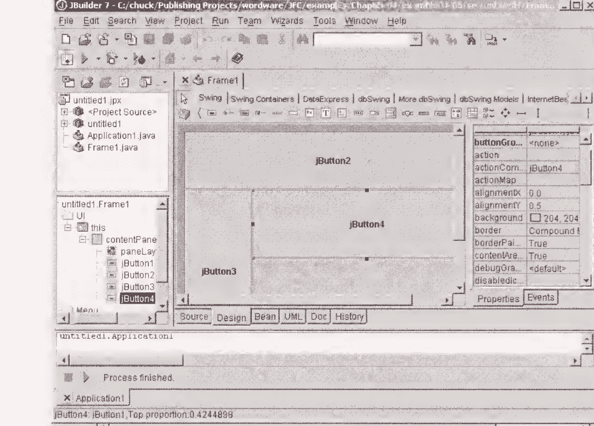

设置组件的外观和感觉可以赋予它们特定的外观，使它们看起来更符合目标操作系统。

外观和感觉 115

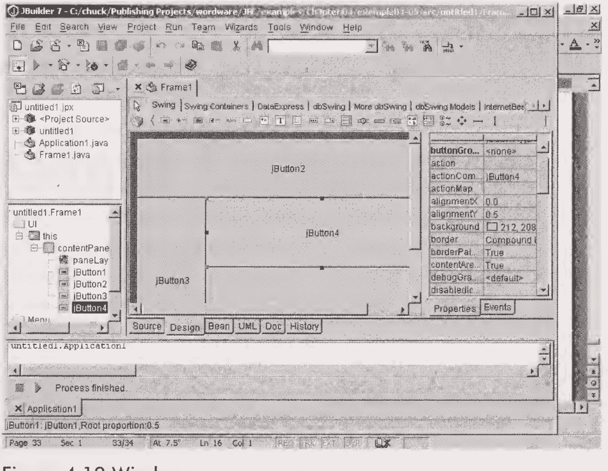

图 4.19 Windows 风格

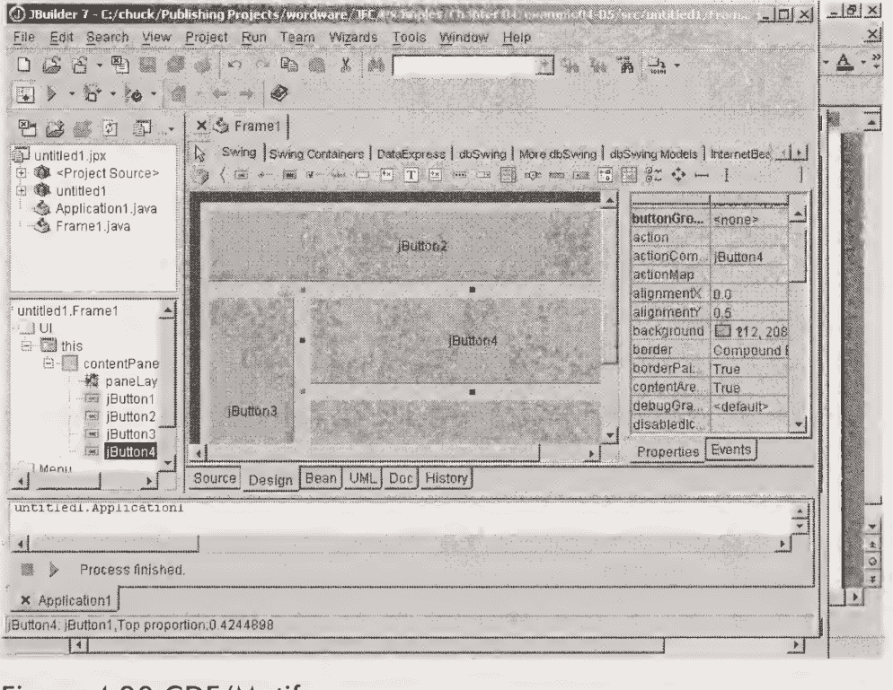

图 4.20 CDE/Motif 风格

### 总结

本章向你介绍了创建合适图形用户界面的两个非常强大的工具：布局管理器和外观和感觉设置。你现在应该熟悉了各种布局管理器，并了解了何时最适合使用每种管理器。你也应该准备好在不同的设置中使用它们。本书后面的例子将使用你在这里看到的许多布局管理器。你还应该熟悉外观和感觉的各种选项。

### 复习题

- 1. 外观和感觉的三个选项是什么？
- 2. AWT 中有多少种布局管理器？
- 3. JFC 中有多少种布局管理器？
- 4. 如果你希望一次只显示一个组件或容器，哪种布局管理器最合适？
- 5. Grid 布局管理器和 GridBag 布局管理器有什么区别？
- 6. 哪些布局管理器只是将组件一个接一个地放置，直到到达容器的边缘？
- 7. 哪种布局管理器用于将组件放置在精确的坐标位置？
- 8. 哪种布局管理器有东、北等区域？
- 9. 哪种布局管理器根据容器上其他组件的大小来调整组件的大小？
- 10. 列出 JFC 中的五种布局管理器。

# 第五章

## 容器组件

本章涵盖以下内容：

- JPanel
- JTabbedPane
- JScrollPane
- JSplitPane
- JBox

### 简介

在上一章中，你了解了布局管理器。布局管理器应用于各种容器组件（如框架和面板）。这些容器已经向你简要介绍过，但没有真正解释它们的功能和用途。本章致力于纠正这种情况。容器与其他任何组件非常相似。它们只是具有方法、属性等的 Java 类。容器组件仅仅是用于包含或容纳其他组件的组件。这样做的原因有几个，最明显的是将组件组织成逻辑分组。另一个原因是通过与特定的布局管理器（如你在上一章看到的 CardLayout 管理器）合作，以特定格式排列其他组件。还应该指出的是，所有图形组件*必须*位于某个容器组件上。

你可以使用许多容器组件来构建你的应用程序和小程序。如果你使用 JBuilder，你可以在设计屏幕的第二个选项卡上找到它们，标记为 Swing 容器，如图 5.1 所示。

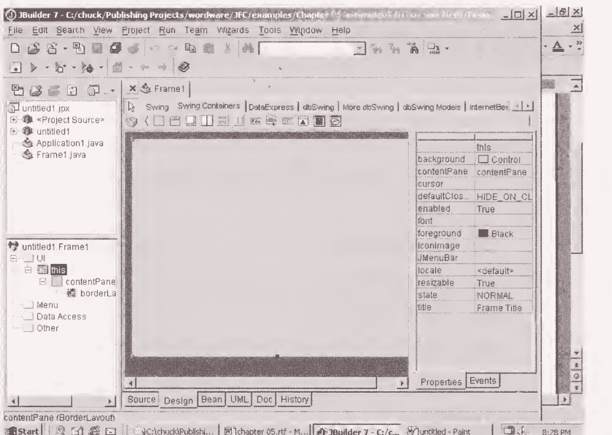

图 5.1 容器组件

事实上，JFC 中有六个容器组件可供你使用。你在图片中看到的选项卡显示了超过六个组件。然而，另外六个组件不仅仅是容器，它们还支持其他功能，例如下拉菜单和工具栏。这些组件将在后续章节中讨论。六种容器组件及其基本用途总结在表 5.1 中。

表 5.1 容器组件

| 容器 | 用途 |
| :--- | :--- |
| JPanel | 这是一个很好的通用轻量级组件，仅用于容纳其他组件。你会经常看到这个组件。 |
| JTabbedPane | 此组件允许你在多个容器之间进行选项卡切换。 |
| JScrollPane | 此组件仅为一个组件提供可滚动视图。 |
| JSplitPane | 此容器提供一个拆分的窗格，可以是垂直或水平拆分，并且拆分可以移动。 |
| JBox（垂直和水平） | 这是一个基本的轻量级容器，利用 BoxLayout 管理器。 |

JPanel 无疑是最常见的容器组件，经常用作简单的通用容器。事实上，在上一章中它就使用过。Pane 组件的三种变体显然各有其专用用途。也许最专业和最不常见的容器是 JBox 容器的两种变体。

# JPanel

如前所述，此组件是最常用的容器。因此，它比其他容器组件需要更仔细的审视。乍一看，它相对容易使用。你只需将它放在你的设计器屏幕上，设置其布局管理器，然后在其上放置组件。如果你不使用 JBuilder，那么只需声明一个实例，设置其布局管理器，并向其中添加组件。无论哪种方式，它的使用都相当简单。这主要是因为它的界面整洁。它没有窗格、拆分或选项卡来使事情复杂化。此组件与许多容器一样，继承自 JComponent 类。JPanel 默认使用 FlowLayout 管理器，但你可以将其设置为使用任何你希望的布局管理器。

你在上一章中已经广泛看到了这个组件的使用，应该对其用法有很好的了解。JPanel 组件与所有组件一样，拥有大量的方法和属性。然而，许多方法要么不经常使用，要么更适合在后面的章节中解释。那些常用属性和方法总结在下表中。


## 表 5.2 JPanel 属性与方法

| 属性/方法 | 用途 |
| --- | --- |
| layout | 如您在前一章所见，此属性允许您为任何容器选择布局管理器。 |
| background | 此属性在第 3 章中已展示过。它允许您更改背景颜色。 |
| border | 此属性允许您更改面板的边框。 |
| tooltipText | 这是许多组件都具有的属性。它允许您为组件设置弹出工具提示。 |
| add | 这是所有容器都有的方法，允许您将组件添加到容器中。 |
| isShowing | 此属性在大多数组件中也很常见，如果组件当前正在显示，则返回 true。 |
| remove | 此方法在所有容器中都很常见，允许您从容器中移除组件。 |

这些方法和属性大多数可以通过 JBuilder 中的属性窗口访问，也可以直接在代码中访问。除了所示的方法外，还有几种不同的方式可以构造 JPanel。此类可用的各种构造方法如表 5.3 所示。

## 表 5.3 JPanel 构造方法

| 构造方法 | 用途 |
| --- | --- |
| JPanel() | 此构造方法将创建一个具有双缓冲和默认 FlowLayout 的 JPanel。 |
| JPanel(boolean isDoubleBuffered) | 这将创建一个具有默认 FlowLayout 和指定缓冲策略的 JPanel。 |
| JPanel(LayoutManager layout) | 此构造方法将创建一个具有指定布局管理器的 JPanel。这可能是此类最常用的构造方法。 |
| JPanel(LayoutManager layout, boolean isDoubleBuffered) | 此构造方法创建一个具有指定布局管理器和缓冲策略的 JPanel。 |

正如您在前一章已经看到的，Panel 组件是一个相对易于使用的、基本的通用容器。它的大多数方法也相对简单直接，易于使用。由于您已经见过这个容器，并且确实在本书中经常看到它的使用，因此在这里再提供一个完整的示例就显得多余了。

# JTabbedPane

顾名思义，JTabbedPane 容器旨在以一系列标签页的形式向用户展示项目。像大多数容器一样，此类直接继承自 JComponent。为用户提供一系列标签页，每个标签页包含一组逻辑分组的组件，通常非常方便。例如，如果您希望编写一个跟踪员工的应用程序，您可能会有一个标签页显示个人信息，另一个显示当前职位信息，还有一个显示工作经历。我相信您能想象到更多使用标签页显示对用户来说很方便的情况。

该容器只是允许用户通过点击特定的标签页来选择他们可能希望查看的组件集。这个容器实际上相当容易使用，尽管它有一些您应该了解的特定属性和方法。这些属性和方法列在下表中。

## 表 5.4 JTabbedPane 属性与方法

| 属性/方法 | 用途 |
| --- | --- |
| tabPlacement | 此属性决定标签页放置的位置。 |
| model | 此属性显示当前选中的模型。 |
| Componentadd(Component component) | 此方法用于添加一个组件，其标签页标题默认为组件的名称。 |
| Componentadd(Component component, int index) | 此方法在指定的标签页索引处添加一个组件，其标签页标题默认为组件的名称。 |
| void add(Component component, Object constraints) | 此方法用于向选项卡窗格添加一个组件。 |
| void add(Component component, Object constraints, int index) | 此方法将在指定的标签页索引处添加一个组件。 |
| component add(String title, Component component) | 此方法用于添加一个具有指定标签页标题的组件。 |
| void addTab(String title, Icon icon, Component component) | 此方法将添加一个由标题和/或图标表示的组件，两者均可为 null。 |
| addTab(String title, Component component) | 此方法仅添加一个由标题表示且没有图标的标签页。 |
| addTab(String title, Icon icon, Component component, String tip) | 此方法添加一个标签页以及一个图标和一个工具提示。 |
| getTabCount | 此方法返回当前标签页的数量。 |
| getTitleAt(int index) | 此方法返回位于您传递给它的索引处的标签页的标题。 |
| remove(Component component) | 此方法将从容器中移除特定的组件。 |
| remove(int index) | 此方法将移除位于您传递给它的索引处的标签页。 |
| removeall() | 此方法移除所有标签页。 |

您可能注意到有很多 add 方法。这仅仅是因为您可以通过多种方式将组件添加到 JTabbedPane。Swing 尝试尽可能多地兼容这些方法。即使这里提供的列表也不是详尽无遗的；它只包含主要的添加组件方法。本表并非详尽无遗的列表，也不打算如此。然而，它应该为您总结了 JTabbedPane 类一些更常用的属性和方法。下一步显然要带您完成一个示例，说明 JTabbedPane 类的各种用法。

# 示例 5.1

**步骤 1：** 开始一个项目并像之前所有示例一样向其中添加一个新的应用程序。

**步骤 2：** 将选项卡窗格容器添加到应用程序的框架容器的 Center 部分。您还需要向选项卡窗格容器添加两个标签页。在它们上面有一些组件之前，您将看不到框架，而在代码中这样做是最容易的。因此，转到 Code 标签页并将以下代码添加到 jbInit() 函数中：

```
JButton mybutton = new JButton("Click Me");
JButton mybutton2 = new JButton("No Click Me");
jTabbedPane1.addTab("tab 1",mybutton);
jTabbedPane1.addTab("tab 2",mybutton2);
```

现在您应该可以回到 Design 标签页，看到类似图 5.2 所示的内容。

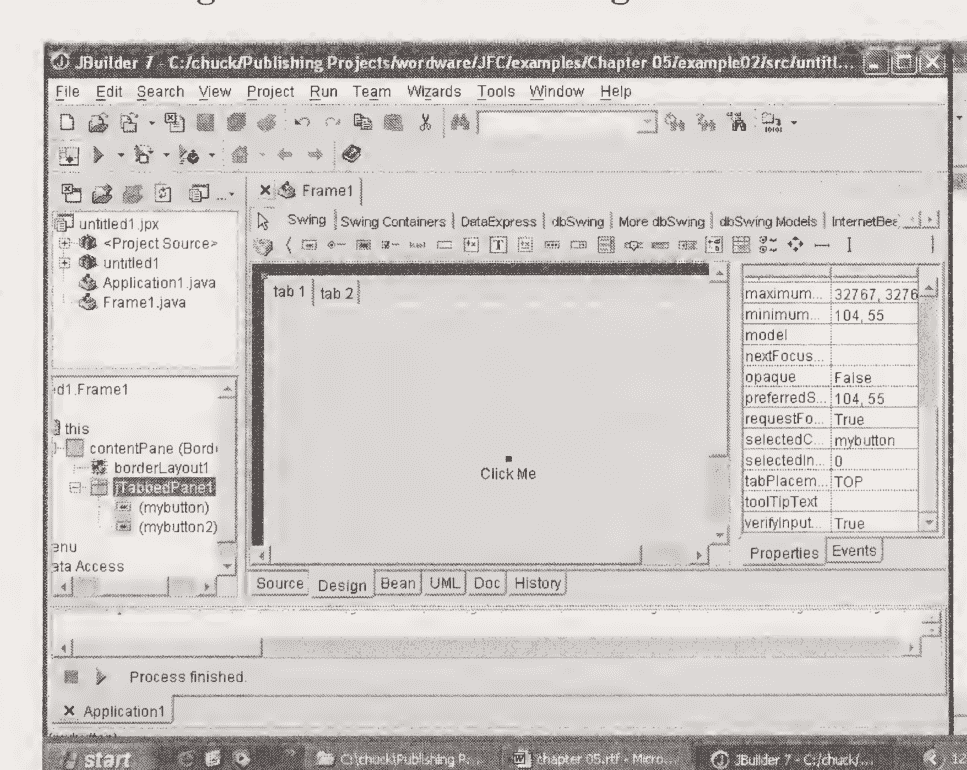

对于那些不使用 JBuilder 的人，您可以简单地将以下代码输入到您喜欢的文本编辑器中并编译它：

```
package untitled1;
import java.awt.*;
import java.awt.event.*;
import javax.swing.*;
public class Frame1 extends JFrame
{
  private JPanel contentPane;
  private BorderLayout borderLayout1 = new BorderLayout();
  private JTabbedPane jTabbedPane1 = new JTabbedPane();
  //Construct the frame
  public Frame1()
  {
    enableEvents(AWTEvent.WINDOW_EVENT_MASK);
    try
    {
      jbInit();
    }
    catch(Exception e)
    {
      e.printStackTrace();
    }
  }
  private void jbInit() throws Exception
  {
    contentPane = (JPanel) this.getContentPane();
    contentPane.setLayout(borderLayout1);
    this.setSize(new Dimension(400, 300));
    this.setTitle("Frame Title");
    contentPane.add(jTabbedPane1, BorderLayout.CENTER);
    JButton mybutton = new JButton("Click Me");
    JButton mybutton2 = new JButton("No Click Me");
    jTabbedPane1.addTab("tab 1",mybutton);
    jTabbedPane1.addTab("tab 2",mybutton2);
  }
  protected void processWindowEvent(WindowEvent e)
  {
    super.processWindowEvent(e);
    if (e.getID() == WindowEvent.WINDOW_CLOSING)
    {
      System.exit(0);
    }
  }
}
```

**步骤 3：** 运行程序。您应该会看到与图 5.3 和图 5.4 所描绘的非常相似的图像。

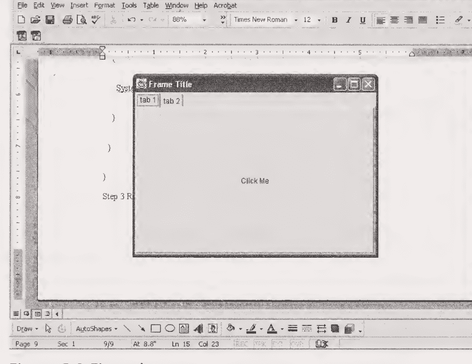

图 5.3 第一个标签页

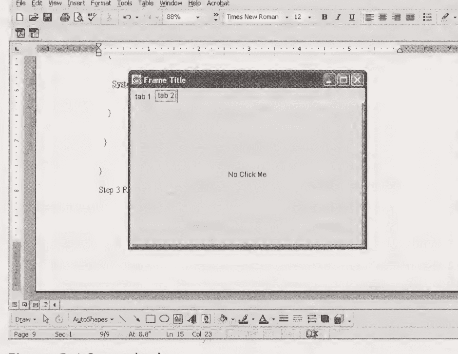

图 5.4 第二个标签页

如您所见，选项卡窗格允许您在单个屏幕上放置比通常情况下更多的组件，这是它最大的优势。当您需要在屏幕上显示大量组件时，您应该考虑使用 JTabbedPane 容器将它们显示在不同的标签页中。

# JScrollPane

正如您可能推断的那样，当您需要滚动时，会使用 JScrollPane 容器。如果您觉得您的容器需要垂直滚动条、水平滚动条或两者都需要，您应该认真考虑使用 JScrollPane。同样，这个容器类直接继承自 java.swing.JComponent。表 5.5 总结了许多方法。

## 表 5.5 JScrollPane 属性与方法

| 属性/方法 | 用途 |
| --- | --- |
| int getBlockIncrement(int direction) | 此方法返回一个整数，即当容器接收到向上/向下请求时，滚动条值应更改的量。 |
| int getMaximum() | 此属性表示滚动条的最大值。 |
| int getMinimum() | 此属性表示滚动条支持的最小值。此属性的典型值为零。 |
| int getValue() | 此方法返回滚动条的当前值。 |
| void setMaximum(int maximum) | 此方法设置容器的 maximum 属性。 |
| void setMinimum(int minimum) | 此方法设置容器的 minimum 属性。 |
| void setValue(int value) | 此方法是滚动条的值。 |

与本书中的其他表格一样，此表并非旨在详尽覆盖所讨论容器的所有属性和方法，而只是总结最常用的方法和属性。您还可以选择水平和垂直滚动条是始终显示、需要时显示还是从不显示。


在JBuilder中，这很简单，只需设置一个属性即可，如图5.5所示。

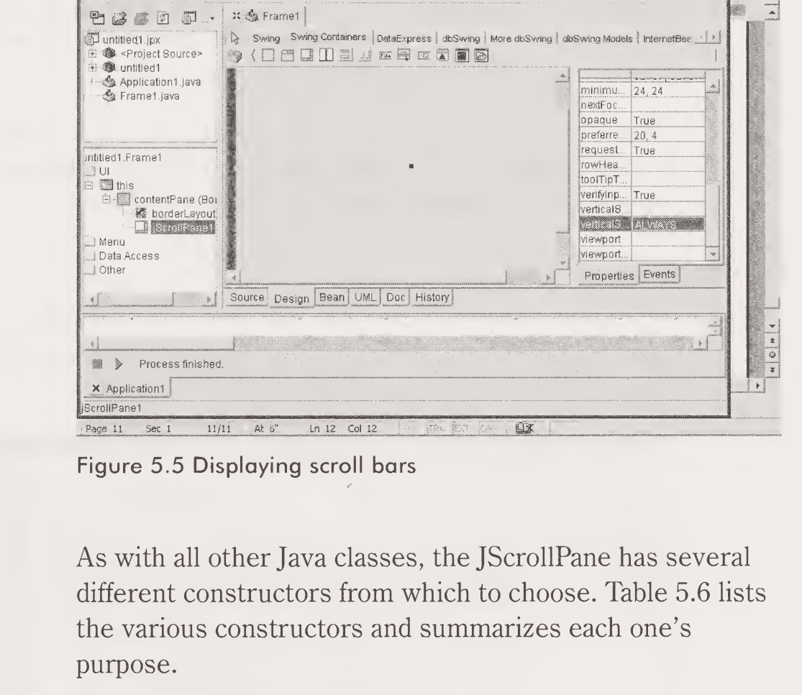

## 图 5.5 显示滚动条

与所有其他Java类一样，`JScrollPane`有几个不同的构造函数可供选择。表5.6列出了各种构造函数并总结了每个函数的用途。

## 表 5.6 JScrollPane 构造函数

| 构造函数 | 用途 |
| --- | --- |
| `JScrollPane()` | 这个构造函数最简单，只是创建一个空的JScrollPane，当需要时，水平和垂直滚动条都会出现。 |
| `JScrollPane(Component view)` | 此构造函数用于创建一个显示指定组件内容的JScrollPane，当组件内容大于视图时，水平和垂直滚动条将始终出现。 |
| `JScrollPane(Component view, int vsbPolicy, int hsbPolicy)` | 此构造函数将创建一个JScrollPane，该窗格在一个视口中显示视图组件，其视口位置可通过一对滚动条来控制。 |
| `JScrollPane(int vsbPolicy, int hsbPolicy)` | 此函数用于创建一个具有指定滚动条策略的空JScrollPane。 |

滚动条是一个相对易于使用的容器；事实上，它比选项卡窗格更容易。但为了谨慎起见，在继续之前，最好还是先研究一个示例。

### 示例 5.2

**步骤 1：** 当然，像所有其他项目一样开始这个项目。然后你只需将`JScrollPane`添加到应用程序窗口的中心，如图5.6所示。

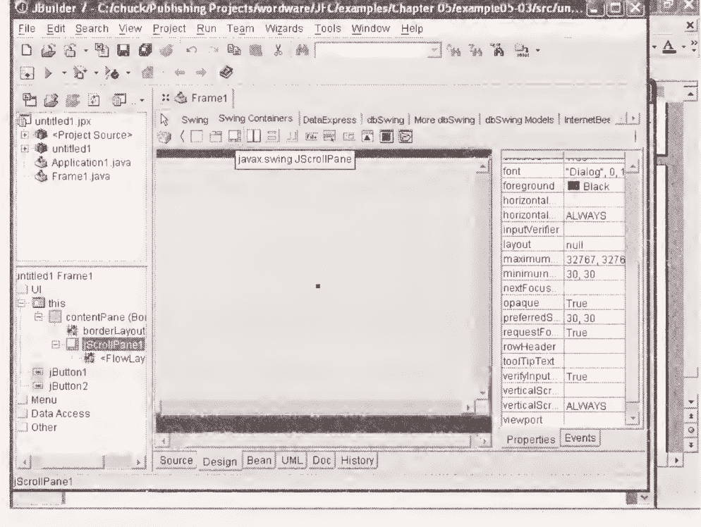

图 5.6 放置滚动窗格

**步骤 2：** 现在我们需要在滚动窗格上放置几个组件，以便在运行时看到它的滚动效果。所以我建议在容器的不同位置放置两个按钮，如图5.7所示。


图 5.7 在滚动窗格上放置按钮

你最终得到的源代码将与此处看到的非常相似：

```
package untitled1;
import java.awt.*;
import java.awt.event.*;
import javax.swing.*;
import javax.swing.border.*;
public class Frame1 extends JFrame
{
    private JPanel contentPane;
    private BorderLayout borderLayout1 = new BorderLayout();
    private JButton jButton1 = new JButton();
    private JScrollPane jScrollPane1 = new JScrollPane();
    private JButton jButton2 = new JButton();
    private Border border1;
    //Construct the frame
    public Frame1()
    {
        enableEvents(AWTEvent.WINDOW_EVENT_MASK);
        try
        {
            jbInit();
        }
        catch(Exception e)
        {
            e.printStackTrace();
        }
    }
    //Component initialization
    private void jbInit() throws Exception
    {
        contentPane = (JPanel) this.getContentPane();
        border1 = BorderFactory.createLineBorder
        (SystemColor.controlText,1);
        contentPane.setLayout(borderLayout1);
        this.setSize(new Dimension(400, 300));
        this.setTitle("Frame Title");
        jButton1.setText("jButton1");
        jButton2.setText("jButton2");
        jScrollPane1.setHorizontalScrollBarPolicy
        (JScrollPane.HORIZONTAL_SCROLLBAR_ALWAYS);
        jScrollPane1.setVerticalScrollBarPolicy
        (JScrollPane.VERTICAL_SCROLLBAR_ALWAYS);
        jScrollPane1.setViewportBorder(border1);
        contentPane.add(jScrollPane1, BorderLayout.CENTER);
        jScrollPane1.setLayout(new FlowLayout());
        jScrollPane1.getViewport().add(jButton1,null);
        jScrollPane1.getViewport().add(jButton2, null);
    }
    protected void processWindowEvent(WindowEvent e)
    {
        super.processWindowEvent(e);
        if (e.getID() == WindowEvent.WINDOW_CLOSING)
        {
            System.exit(0);
        }
    }
}
```

**注意：** 到这时，你应该注意到JBuilder中的属性框中发生的事情与为你生成的代码之间存在着非常紧密的联系。例如，当你选择“Vertical Scroll Bar”属性并将其设置为“Always”时，会生成以下代码：

```
jScrollPane1.setVerticalScrollBarPolicy(JScrollPane.VERTICAL_SCROLLBAR_ALWAYS);
```

这说明了JBuilder之所以成为任何Java开发有价值的工具的本质所在。当你专注于试图解决的实际问题并制作一个视觉上吸引人的图形用户界面时，它会为你生成Java代码。

## JSplitPane

顾名思义，这个特定的容器允许你将容器分割成两个不同的区域，这两个区域都是可调整大小的。我个人发现在许多情况下，这种配置在美学上令人愉悦，所以我经常使用这个容器。与本章中提到的其他容器类一样，这个类直接继承自`java.swing.JComponent`。下表总结了其主要属性和方法。

表 5.7 JSplitPane 方法和属性

| 方法/属性 | 用途 |
| --- | --- |
| `Divider_size` | 此属性设置分隔两个窗格的分隔条的大小。默认值为5。 |
| `Divider_location` | 此属性设置分隔两个窗格的分隔条的位置。 |
| `StringDIVIDER` | 此方法用于添加一个代表分隔条的组件。 |
| `Int HORIZONTAL_SPLIT` | 水平分割表示窗格的分割是水平的。 |
| `Int VERTICAL_SPLIT` | 这表示窗格是垂直分割的。 |
| `String RIGHT` | 此方法用于在其他组件的右侧添加一个组件。 |
| `String BOTTOM` | 此方法用于在其他组件的下方添加一个组件。 |
| `String TOP` | 此方法用于在其他组件的上方添加一个组件。 |

此方法和属性列表并非详尽无遗，但它涵盖了有效使用JSplitPane所需的基本方法和属性。表5.8总结了该特定类的构造函数。

表 5.8 JSplitPane 构造函数

| 构造函数 | 用途 |
| :--- | :--- |
| `JSplitPane()` | 此构造函数创建一个JSplitPane，配置为将子组件水平并排放置，使用两个按钮作为组件。 |
| `JSplitPane(int newOrientation)` | 此构造函数构建一个JSplitPane，配置了指定的方向，且没有连续布局。 |
| `JSplitPane(int newOrientation, boolean newContinuousLayout)` | 此构造函数将创建一个具有指定方向和连续布局的JSplitPane。 |
| `JSplitPane(int newOrientation, boolean newContinuousLayout, Component newLeftComponent, Component newRightComponent)` | 此构造函数将创建一个具有指定方向和指定组件的JSplitPane。 |
| `JSplitPane(int newOrientation, Component newLeftComponent, Component newRightComponent)` | 此构造函数将创建一个具有指定方向和指定组件的JSplitPane，且不进行连续重绘。 |

这组多样的构造函数允许你，作为程序员，选择你希望使用的分割窗格类型，以及它将如何显示和使用。这个组件使用起来非常简单（实际上比选项卡窗格更容易），所以让我们来看一个使用此组件的示例。

### 示例 5.3

**步骤 1：** 你需要启动一个新项目。你还需要添加一个新的应用程序。

**步骤 2：** 将分割窗格容器放置在应用程序的框架上。你应该会看到与图5.8所示非常相似的内容。


图 5.8 分割窗格

注意，你已经有两个窗格，并且每个窗格都有标签。当你现在运行应用程序时，你可以轻松地前后移动窗格，调整它们的大小。这在图5.9和图5.10中清楚地显示出来。


图 5.9 运行分割窗格


图 5.10 调整分割窗格的大小

此容器组件的全部目的是为你提供一个具有独立窗格的可调整大小的容器。你甚至可以在不同的窗格上放置组件，它们将随窗格一起移动。


对于那些没有使用JBuilder、不得不手动完成所有操作的用户，以下是源代码：

```
package untitled1;
import java.awt.*;
import java.awt.event.*;
import javax.swing.*;
public class Frame1 extends JFrame
{
    private JPanel contentPane;
    private BorderLayout borderLayout1 = new BorderLayout();
    private JSplitPane jSplitPane1 = new JSplitPane();

    //Construct the frame
    public Frame1()
    {
        enableEvents(AWTEvent.WINDOW_EVENT_MASK);
        try
        {
            jbInit();
        }
        catch(Exception e)
        {
            e.printStackTrace();
        }
    }
    //Component initialization
    private void jbInit() throws Exception
    {
        contentPane = (JPanel) this.getContentPane();
        contentPane.setLayout(borderLayout1);
        this.setSize(new Dimension(400, 300));
        this.setTitle("Frame Title");
        contentPane.add(jSplitPane1, BorderLayout.CENTER);
    }
    //Overridden so we can exit when window is closed
    protected void processWindowEvent(WindowEvent e)
    {
        super.processWindowEvent(e);
        if (e.getID() == WindowEvent.WINDOW_CLOSING)
        {
            System.exit(0);
        }
    }
}
```

如您所见，这个特定的容器相当有趣。将显示区域分割成两个独立且大小可调（至少相对彼此而言）的部分，是让用户对焦点区域拥有更多控制权的一种方式。这个容器可以极大地增强图形界面的用户友好性。

## JBox

在您的JBuilder Swing容器工具栏上，实际上有两个JBox容器，一个垂直，一个水平。顾名思义，这个容器使用盒式布局作为其默认布局管理器。坦率地说，在我职业生涯中审查的代码里，我并没有看到这个特定容器被频繁使用。该容器有时用于创建影响整体布局的不可见区域。本质上，如果您需要图形用户界面中的某个特定区域保持空白，您可能需要考虑使用JBox容器。其最常用的方法总结在表5.9中。

表5.9 JBox方法

| 方法 | 用途 |
|---|---|
| component createGlue() | 此方法创建一个不可见的组件，它对于可见组件具有最大宽度（对于水平框）或高度（对于垂直框）的框非常有用。此组件本质上是其他组件的“粘合剂”。 |
| Box createHorizontalBox() | 此方法创建一个从左到右显示其组件的框。 |
| component createHorizontalGlue() | 此方法创建一个水平粘合组件。 |
| component createHorizontalStrut (int width) | 此方法创建一个不可见的、固定宽度的组件。 |
| Box createVerticalBox() | 此方法创建一个从上到下显示其组件的框。 |
| component createRigidArea(Dimension d) | 此方法创建一个不可见的组件，其大小始终为指定值。 |

正如我之前提到的，这个特定容器的使用频率不如其他容器高。

### 总结

本章为您全面介绍了Swing中可用的容器。容器在创建图形用户界面方面扮演着至关重要的角色。为特定情况选择合适的容器绝对至关重要。只有理解了各种容器、它们的用途和用法，您才能选择合适的容器。如果您完成了本章中的示例，您应该已经具备了有效使用Swing容器的必要知识。如果您没有完成，请重新阅读本章并再次尝试示例。

### 复习题

1. 列出Swing容器的名称。
2. 哪个容器最常使用？
3. 您应该设置哪个属性以确保滚动条窗格始终显示垂直滚动条？
4. 您可以更改分隔窗格中分隔线的大小吗？
5. 哪个容器可用于创建占位符以及组件之间的连接？
6. JBuilder有多少个版本的JBox容器？
7. 您会使用哪个方法来移动滚动条？

# 第6章

## 事件处理

本章涵盖以下内容：

- 事件
- 监听器
- 应用事件
- 匿名内部类适配器

## 引言

希望在前面的章节中，您已经注意到事件经常用于响应用户的操作。您可能对什么是事件有一个直观的概念，但更正式的定义可能会有所帮助。*事件*是由用户、另一个程序或另一个函数发起的操作。此类操作包括单击鼠标、按下键，甚至只是将鼠标移动到给定区域。当操作被触发时，会生成一个事件并发送给任何可用的事件处理程序。这些事件处理程序随后可以适当地响应事件。事件处理程序是专门设计用于处理特定事件的类。

Swing和JFC中的事件处理基于早期的AWT事件处理模型。这两种方法有许多相似之处。如果您熟悉AWT事件处理，可能只需要粗略浏览一下本章。如果您之前没有AWT事件处理的经验，可能需要更深入地研究此处提供的材料。

### 事件

事件是可能发生的任何事情。从用户的角度来看，事件是任何操作，例如单击按钮或将鼠标移动到给定组件上。从程序员的角度来看，每个事件都是一个专门设计用于该事件的类。所有事件都以`java.awt.AWTEvent`类作为根类。AWTEvent随后被子类化为各种特定的事件类，例如ActionEvent、WindowEvent、ItemEvent、KeyEvent、MouseEvent等。这意味着每个特定的事件都将共享一定数量的方法和属性。

AWTEvent的直接子类及其用途总结在表6.1中。

表6.1 AWTEvent的子类

| 类 | 用途 |
| :--- | :--- |
| ActionEvent | 这是一个表示发生了组件定义的操作的事件。当发生特定于组件的操作（例如单击按钮）时，组件会生成此事件。然后，该事件传递给每个使用组件的`addActionListener`方法注册以接收此类事件的ActionListener对象。 |
| AdjustmentEvent | 当可调整对象之一被调整时，会触发由该对象发出的调整事件。 |
| AncestorEvent | 这是向子组件报告的、源自组件层次结构中祖先的事件。换句话说，它告诉子组件其某个父组件发生了事件。 |
| ComponentEvent | 这是一个低级事件，表示组件移动、更改大小、变为可见或不可见等。此事件仅用于通知目的。无论您对此事件采取何种操作，组件的操作都会发生。 |
| HierarchyEvent | 此事件表示组件所属的组件层次结构发生了某些更改。 |
| InputMethodEvent | 当向适当的组件输入文本时，会触发此事件。只要文本因任何原因发生更改，输入方法就会发送一个事件。 |
| InternalFrameEvent | InternalFrameEvent是一个相当奇怪的事件。您不会经常看到它被使用。它是一个添加了对JInternalFrame对象作为事件源支持的AWTEvent。此类与WindowEvent具有相同的事件类型。 |
| InvocationEvent | 当由AWT事件分派线程分派时，此事件将在Runnable上执行`run()`方法。 |
| ItemEvent | 此事件表示一个项目被选中或取消选中。您会经常看到它与列表框关联。 |
| TextEvent | 此事件表示对象的文本已更改。 |

其中一些类本身又是其他事件的父类。这是Java如何利用面向对象，从更通用的基类构建专门类并形成不断增长的分层类结构的另一个例子。

由于所有事件都派生自AWTEvent类，因此研究它的一些更常用和实用的方法是明智的。这些方法总结在表6.2中。

表6.2 AWTEvent方法

| 方法 | 用途 |
| :--- | :--- |
| protected void consume() | 此方法用于消耗相关事件。一旦被消耗，事件即被销毁，无法进一步传播。 |
| int getID() | 此方法用于返回表示事件类型的数值。 |
| String toString() | 此方法将返回此事件对象的字符串表示形式。 |
| protected void finalize() | 当垃圾收集确定对象不再有引用时，垃圾收集器实际上会在对象上调用此方法。 |
| protected Boolean isConsumed() | 此方法将告诉您相关事件是否已被消耗。 |


### 方法 | 用途
:--- | :---
String paramString() | 此方法用于返回一个表示此事件状态的字符串。

此类只有两个可能的构造函数。这些构造函数在表6.3中进行了总结。

#### 表6.3 AWTEvent构造函数

| 构造函数 | 用途 |
| :--- | :--- |
| AWTEvent(Event event) | 此构造函数用于根据1.0风格事件的参数创建一个AWTEvent对象。 |
| AWTEvent(Object source, int id) | 此构造函数将使用指定的源对象和类型创建一个AWTEvent对象。 |

理解AWTEvent类及其直接子类对于理解事件的一般工作方式至关重要。你无需记忆这些表格中的每一项或本章内容。然而，熟悉这些材料是个好主意。

### 监听器

当事件被触发时，它会被一个或多个对此事件进行操作的监听器接收。*监听器*只是一个为监听特定事件发生而专门设计的特殊类。事件处理是通过使用监听器接口来完成的，这些接口在`java.awt.event`包中定义。在Java中，有许多内建接口作为不同类型事件处理的监听器。

### 应用事件

关于事件是什么以及它们如何工作的这些通用知识是有用的，但还不完整。缺失的是对如何在程序中应用事件的概述。以下是应用事件的基本步骤概述：

1.  决定将事件应用于哪个GUI组件。
2.  实现适当的监听器接口或多个接口。适当的接口是与该组件相对应的那些接口。
3.  现在应用接口中涉及的方法。

如果你了解常见的接口，这些步骤可能会更有帮助。下面是最常见接口的简要示例和描述。

### 动作监听器

动作监听器与各种用户动作相关联，但主要与按钮的点击相关。该函数如下所示：

```java
public void actionPerformed(ActionEvent e)
{
    //your code goes here
}
```

### 项目监听器

此函数被调用以响应各种项目事件。例如，从列表框中选择一个项目将触发此事件。

```java
public void itemStateChanged(ItemEvent e)
{
    //your code goes here
}
```

在JBuilder中使用事件被显著简化，因为JBuilder本身会为你处理部分工作。JBuilder会为该特定组件/事件创建一个EventAdapter类，并赋予其一个与该特定组件和事件相对应的适当名称。这只需双击特定组件即可实现。例如，如果你双击一个按钮，JBuilder将为你生成动作监听器。JBuilder还会在`jbInit()`方法中创建一行代码，通过EventAdapter将组件的事件源连接到你的事件处理方法。这是通过调用组件的`addListener`方法来完成的。你需要做的只是填充事件适配器在事件发生时调用的事件处理方法。

### 匿名内部类适配器

Java程序员也经常使用匿名内部类作为适配器类。JBuilder也可以生成这些内部类事件适配器。内部类有几个优点，包括：

-  代码内联生成，从而简化了代码。
-  不生成单独的类。
-  内部类可以访问其声明作用域内的所有变量，而标准事件适配器只能访问public和包级别的变量。

JBuilder生成的特定类型的内部类事件适配器被称为匿名适配器。这种适配器样式避免了创建单独的适配器类。生成的代码紧凑而优雅。例如，以下代码是使用匿名适配器为`focusGained()`事件生成的：

```java
jButton1.addFocusListener(new java.awt.event.FocusAdapter()
{
    public void focusGained(FocusEvent e)
    {
        jButton1_focusGained(e);
    }
});

void jButton1_focusGained(FocusEvent e)
{
}
```

将此代码与前面显示的标准适配器代码示例进行比较。JBuilder使用标准适配器类生成了那段代码。两种使用适配器的方式都提供了处理`focusGained()`事件的代码，但匿名适配器方法更为紧凑。

### 总结

本章向你介绍了事件、事件监听器和事件处理的概念。事件是你能够响应用户操作的主要方式。用户的操作通常会触发特定事件。你的事件监听器将监听与特定组件相关的事件的发生。然后你的事件处理器将响应该事件。事件和事件处理是用户交互的核心。我们在本章中看到了事件处理器、适配器类，甚至是匿名内部适配器类的基本结构。

### 复习题

1.  从用户的角度来看，什么是事件？
2.  什么是事件处理器？
3.  所有事件类的父类是什么？
4.  列出四个常见的事件类。
5.  什么是监听器？
6.  使用内部类适配器有哪三个优点？
7.  AWTEvent类有多少个构造函数？

第7章

## 用户选择

本章涵盖以下内容：

-  JRadioButton
-  JToggleButton
-  JCheckBox
-  JComboBox
-  JList
-  JSlider

## 引言

到目前为止，本书讨论了有关Swing组件结构、容器、更改外观甚至处理复杂事件结构的问题。然而，我们尚未解决设计图形用户界面时的核心问题之一。我们作为程序员开发丰富的GUI界面的全部目的，是为了促进增加用户交互。我们希望给用户一种掌控感和能够做出选择的感觉。考虑到这一点，似乎不言而喻，任何GUI工具包（无论是AWT、Swing还是其他方法）的一个不可或缺的部分就是允许用户做出选择。Java基础类提供了许多允许用户做出选择的可视组件。在本章中，我们将探讨这些组件。

当然，允许用户做出选择与第3章讨论的用户输入主题密切相关。然而，第3章关注的是允许用户输入文本的组件。本章关注的是允许用户从你提供的一组选项中进行选择的组件。我们都曾多次遇到过这样的软件。当你去ATM机取钱时，你很可能会看到一系列按特定增量设定的选项，或者你可以输入特定金额。这些预定义的选项正是本章所关注的。表7.1总结了我们在本章中探讨的组件，并简要描述了它们的用途。

#### 表7.1 用户选择组件

| 组件 | 用途 |
|---|---|
| JRadioButton | 单选按钮允许用户在两个或多个互斥选项之间进行选择。 |
| JCheckBox | 复选框用于当你希望用户选择一个或多个非互斥选项时。 |
| JComboBox | 组合框呈现一个下拉列表，只允许用户选择其中一个选项。 |
| JList | 列表与组合框非常相似，只是所有选项都已显示。框不需要下拉。 |
| JSlider | 滑块允许用户从预定义的值范围中选择一个值。 |
| JToggleButton | 切换按钮允许你在两个互斥选项之间切换。 |

本章将通过示例深入探讨这些组件。这些组件相当直观且易于学习。然而，它们对于设计真正用户友好的界面至关重要。

### JRadioButton

单选按钮是无处不在的组件。许多应用程序经常使用它们。它们类似于前面提到的ATM机中呈现的预定义增量值。单选按钮看起来像图7.1所示的图像。


#### 图7.1 单选按钮

用户界面上会呈现一系列两个或以上的单选按钮，且只能选择其中一个。这正是单选按钮与复选框的区别；单选按钮允许用户做出单一的、互斥的选择。`JRadioButton` 类实际上继承自 `JToggleButton` 类。有人可能会认为，先介绍 `JToggleButton` 类会更合理；然而，单选按钮的使用要常见得多。单选按钮通常与按钮组组件配合使用，以便将相关的按钮分组在一起。单选按钮最重要的方法和属性总结在表7.2中。

#### 表7.2 JRadioButton 方法和属性

| 方法/属性 | 用途 |
|---|---|
| getText | 此方法获取单选按钮中的文本。 |
| setText | 此方法将设置显示为单选按钮标题的文本。 |
| toolTipText | 此属性设置当用户鼠标悬停在单选按钮上时显示的工具提示。 |
| enabled | 此属性决定单选按钮是否被启用。 |
| String paramString() | 此函数/方法返回此 `JRadioButton` 的字符串表示形式。 |

作为一名 Java 程序员，在使用 `JRadioButton` 构造函数时有几种选择。创建一个 `JRadioButton` 实例时，可以传递一个字符串作为标题，一个要显示的图标，或者两者都不传，从而创建一个空白的单选按钮。显然，所有 Swing 甚至 AWT 组件都有许多通用的函数。我们在此不展开讨论。相反，我们将通过一个简短的例子来演示使用单选按钮的基本要点。

### 示例 7.1

**步骤1：** 创建一个新项目和一个应用程序对象，就像在之前的章节中所做的那样。

**步骤2：** 将屏幕的布局管理器设置为五行一列的 `GridLayout`。

**步骤3：** 向应用程序添加三个单选按钮，并按照图7.2所示更改它们的标题（文本）。

**步骤4：** 添加一个按钮组。它不会显示在屏幕上，但不用担心；它是存在的。当你选择单选按钮的 `buttonGroup` 属性时，你会看到按钮组出现。如图7.3所示。逐个选择每个单选按钮，并将其 `buttonGroup` 属性设置为 `buttonGroup1`。

通过将所有单选按钮分配到同一个组，你使它们协同工作并保持互斥。

> **注意：** 在屏幕上使用多个按钮组，可以让你拥有多个单选按钮分组，每个组作为一个整体单元运行，但组之间没有交互。

**步骤5：** 向屏幕添加一个文本框和一个按钮。

**步骤6：** 在类的开头，添加一个名为 `choice` 的私有整型变量声明。然后，在每个单选按钮的事件处理中，你可以设置该整型变量以反映所选的按钮。例如，在单选按钮1中，将 `choice` 设置为1。

**步骤7：** 在按钮的事件处理中，放置以下代码：

```java
switch(choice)
{
    case 1:
        jTextField1.setText("Hey, you pressed radio button 1");
        break;
    case 2:
        jTextField1.setText("You pressed radio button 2");
        break;
    case 3:
        jTextField1.setText("You have pressed radio button 3");
        break;
} // end of switch
```

运行应用程序时，你将看到如图7.4所示的界面。当你选择不同的单选按钮时，按下屏幕底部的按钮。文本框将显示一条消息，指示你选择了哪个单选按钮。

#### 图7.4 示例7.1的演示

如果你没有 JBuilder，可以将以下代码输入到你最喜欢的文本编辑器中并编译它。你将获得相同的效果。

```java
package untitled1;
import java.awt.*;
import java.awt.event.*;
import javax.swing.*;
public class Frame1 extends JFrame
{
    private JPanel contentPane;
    private GridLayout grid1 = new GridLayout(5,1);
    private JRadioButton jRadioButton1 = new JRadioButton();
    private JRadioButton jRadioButton2 = new JRadioButton();
    private JRadioButton jRadioButton3 = new JRadioButton();
    private ButtonGroup buttonGroup1 = new ButtonGroup();
    private JTextField jTextField1 = new JTextField();
    private int choice;
    private JButton jButton1 = new JButton();
    //Construct the frame
    public Frame1()
    {
        enableEvents(AWTEvent.WINDOW_EVENT_MASK);
        try
        {
            jbInit();
        }
        catch(Exception e)
        {
            e.printStackTrace();
        }
    }
    //Component initialization
    private void jbInit() throws Exception
    {
        contentPane = (JPanel) this.getContentPane();
        jButton1.setText("Button One");
        jButton1.addActionListener(new java.awt.event.ActionListener()
        {
            public void actionPerformed(ActionEvent e)
            {
                jButton1_actionPerformed(e);
            }
        });
        contentPane.setLayout(grid1);
        this.setSize(new Dimension(400, 300));
        this.setTitle("Frame Title");
        jButton2.setText("Button Two");
        jButton2.addActionListener(new java.awt.event.ActionListener()
        {
            public void actionPerformed(ActionEvent e)
            {
                jButton2_actionPerformed(e);
            }
        });
        jButton3.setText("Button Three");
        jButton3.addActionListener(new java.awt.event.ActionListener()
        {
            public void actionPerformed(ActionEvent e)
            {
                jButton3_actionPerformed(e);
            }
        });
        jTextField1.setText("jTextField1");
        jButton1.setToolTipText("");
        jButton1.setText("Click Me");
        jButton1.addActionListener(new java.awt.event
            .ActionListener()
        {
            public void actionPerformed(ActionEvent e)
            {
                jButton1_actionPerformed(e);
            }
        });
        contentPane.add(jRadioButton1, null);
        contentPane.add(jRadioButton2, null);
        contentPane.add(jRadioButton3, null);
        contentPane.add(jTextField1, null);
        contentPane.add(jButton1, null);
        buttonGroup1.add(jRadioButton1);
        buttonGroup1.add(jRadioButton2);
        buttonGroup1.add(jRadioButton3);
    }
    //Overridden so we can exit when window is closed
    protected void processWindowEvent(WindowEvent e)
    {
        super.processWindowEvent(e);
        if (e.getID() == WindowEvent.WINDOW_CLOSING)
        {
            System.exit(0);
        }
    }
    void jRadioButton2_actionPerformed(ActionEvent e)
    {
        choice = 2;
    }
    void jRadioButton1_actionPerformed(ActionEvent e)
    {
        choice = 1;
    }
    void jRadioButton3_actionPerformed(ActionEvent e)
    {
        choice = 3;
    }
    void jButton1_actionPerformed(ActionEvent e)
    {
        switch(choice)
        {
            case 1:
                jTextField1.setText("Hey, you pressed radio button 1");
                break;
            case 2:
                jTextField1.setText("You pressed radio button 2");
                break;
            case 3:
                jTextField1.setText("You have pressed radio button 3");
                break;
        } // end of switch
    }
}
```

这个特定的例子可能并不令人兴奋，但它应该演示了如何使用单选按钮。你会发现，单选按钮是一个非常有用的组件，可以引导用户从一组有限的选项中做出单一选择。

### JToggleButton

如上一节所述，`JToggleButton` 是 `JRadioButton` 的基类。你可能会猜到，它比单选按钮的可能性范围更有限，因此使用得较少。这个组件之所以值得研究，有两个重要原因。第一个原因是，它是 `JRadioButton` 的基础，因此它的方法和属性被 `JRadioButton` 继承。另一个原因是，它在某些有限的情况下非常有用。

`JToggleButton` 也允许我们使用一个字符串作为标题、一个图标和一个布尔值来确定当前是否被选中来创建它。切换按钮看起来实际上有点像普通按钮，不同之处在于当点击它时，它会保持按下的状态，直到你再次点击它。在向用户显示布尔值时，这提供了一个非常有用的视觉效果。考虑下面这个使用切换按钮来指示应用程序声音是否打开或关闭的例子。


**注意：** 本应用示例仅展示切换按钮及其属性的使用——并未实际开启或关闭声音。

### 示例 7.2

**步骤 1：** 像之前所有示例一样，创建一个标准应用程序。

**步骤 2：** 将容器的布局管理器更改为 `GridLayout`，并在布局上放置一个切换按钮。

**步骤 3：** 将以下代码添加到该切换按钮的 `actionEvent` 中。请记住，在设计视图中双击切换按钮，将直接跳转到其 `actionEvent`。

```
if(jToggleButton1.getText()=="Sound On")
{
    jToggleButton1.setSelected(false);
    jToggleButton1.setText("Sound Off");
}
else
{
    jToggleButton1.setSelected(true);
    jToggleButton1.setText("Sound On");
}
```

现在运行该应用程序。你将看到类似于图 7.5 和图 7.6 所示的画面。


图 7.5 选中状态的切换按钮


图 7.6 未选中状态的切换按钮

对于未使用 JBuilder 的读者，此处提供了本示例的完整代码：

```
package untitled1;
import java.awt.*;
import java.awt.event.*;
import javax.swing.*;
public class Frame1 extends JFrame
{
    private JPanel contentPane;
    private GridLayout mygrid = new GridLayout(2,2,0,2);
    private JToggleButton jToggleButton1 = new JToggleButton();
    //Construct the frame
    public Frame1()
    {
        enableEvents(AWTEvent.WINDOW_EVENT_MASK);
        try
        {
            jbInit();
        }
        catch(Exception e)
        {
            e.printStackTrace();
        }
    }
    private void jbInit() throws Exception
    {
        contentPane = (JPanel) this.getContentPane();
        jToggleButton1.setSelected(true);
        jToggleButton1.setText("Sound On");
        jToggleButton1.addActionListener(new java.awt.event
            .ActionListener()
        {
            public void actionPerformed(ActionEvent e)
            {
                jToggleButton1_actionPerformed(e);
            }
        });
        contentPane.setLayout(mygrid);
        this.setSize(new Dimension(400, 300));
        this.setTitle("Toggle Buttons");
        contentPane.add(jToggleButton1, null);
    }
    //Overridden so we can exit when window is closed
    protected void processWindowEvent(WindowEvent e)
    {
        super.processWindowEvent(e);
        if (e.getID() == WindowEvent.WINDOW_CLOSING)
        {
            System.exit(0);
        }
    }
    void jToggleButton1_actionPerformed(ActionEvent e)
    {
        if(jToggleButton1.getText()=="Sound On")
        {
            jToggleButton1.setSelected(false);
            jToggleButton1.setText("Sound Off");
        }
        else
        {
            jToggleButton1.setSelected(true);
            jToggleButton1.setText("Sound On");
        }
    }
}
```

如你所见，切换按钮是一个功能相当有限的组件。它用于允许用户在两个互斥选项（如开和关）之间进行选择。尽管该组件功能有限，但它是 `JRadioButton` 类的基类。在前面描述的有限场景中，例如开/关开关，它是理想的组件。

### 复选框（JCheckBox）

复选框与单选按钮相似，但有一个非常重要的区别：用户可选择的选项不是互斥的。用户可以选择多个选项。有趣的是，复选框同样继承自切换按钮。这是你在深入学习 Java 以及面向对象编程时需要考虑的一个重要点。面向对象编程的全部目的就是允许重用甚至扩展现有对象。Java 在这方面做得相当出色。切换按钮具有基本功能，但对于许多应用来说它过于受限。因此，JFC/Swing 的开发者们没有重复造轮子，而是基于该组件进行了扩展。

与你见过的许多组件一样，复选框具有多种不同的构造方法。因此，你可以根据当前需求以多种方式之一创建复选框。表 7.3 列出了复选框的构造方法。

#### 表 7.3 JCheckBox 构造方法

| 构造方法 | 用途 |
| :--- | :--- |
| JCheckBox() | 此构造方法创建一个没有文本和图标且未选中的复选框按钮。 |
| JCheckBox(Action a) | 此构造方法创建一个复选框，其属性从提供的 `Action` 获取。 |
| JCheckBox(Icon icon) | 此构造方法创建一个未选中且带有图标的复选框。 |
| JCheckBox(Icon icon, boolean selected) | 此构造方法创建一个带有图标的复选框，并指定该复选框初始是否选中。 |
| JCheckBox(String text) | 此构造方法创建一个带有文本标题且初始未选中的复选框。 |
| JCheckBox(String text, boolean selected) | 此构造方法创建一个带有文本的复选框，并指定其初始是否选中。 |
| JCheckBox(String text, Icon icon) | 此构造方法创建一个未选中但带有指定文本和图标的复选框。 |
| JCheckBox(String text, Icon icon, boolean selected) | 此构造方法创建一个带有文本和图标的复选框，并指定其初始是否选中。 |

从表 7.3 可以看出，在创建复选框时你有多种选择。你的复选框可以有标题、有图标、初始选中，或以上都没有。复选框是一个非常通用的组件。显然，如果复选框继承自切换按钮，那么它就继承了切换按钮的所有方法。然而，复选框也有一些自己独有的方法，这些是切换按钮所没有的。这些方法在表 7.4 中进行了总结。

#### 表 7.4 JCheckBox 方法

| 方法 | 用途 |
| :--- | :--- |
| void configurePropertiesFromAction(Action a) | 此方法根据 `Action` 实例的值设置 `ActionEvent` 源的属性。 |
| createActionPropertyChangeListener(Action a) | 此方法创建用于在 `Action` 实例属性更改时更新 `ActionEvent` 源的 `PropertyChangeListener`。 |
| AccessibleContext getAccessibleContext() | 此方法获取与此 `JCheckBox` 关联的 `AccessibleContext`。 |
| String getUIClassID() | 此方法返回一个字符串，指定呈现此组件的类的名称。 |
| Boolean isBorderPaintedFlat() | 此方法返回边框是否为平面。 |
| String paramString() | 此方法返回此 `JCheckBox` 的字符串表示。 |
| void setBorderPaintedFlat(boolean b) | 此方法设置边框是否应绘制为平面（它是 `isBorderFlat()` 的互补方法）。 |

复选框有多种方法和属性与之关联。有些方法相当晦涩，不常使用，而另一些则频繁使用。下面示例演示了更常用的方法和属性。

### 示例 7.3

**步骤 1：** 如之前示例所示，使用标准应用程序对象开始一个新项目。将布局管理器设置为 `GridLayout`，包含六行一列。

**步骤 2：** 如图 7.7 所示，在屏幕上放置四个复选框、一个按钮和一个标签。注意我已更改了它们的标题（即它们的 `text` 属性）。


图 7.7 复选框

本示例旨在向你展示如何在实际场景中使用复选框。在此示例中，复选框用于指示终端用户使用何种特定的通信方式。如果你将注意力转向按钮的 `actionEvent`，你会看到复选框属性的使用。在 `actionEvent` 内部，我们只需放置一系列 `if` 语句来确定哪些复选框被选中，并设置一些布尔变量来反映这一事实。这些布尔值在类的开头进行了声明。完整代码如下所示：


# 第7章

#### 7.4 复选框与组合框示例

**示例7.3：复选框示例**

```java
package chkboxexample;
import java.awt.*;
import java.awt.event.*;
import javax.swing.*;
public class Frame1 extends JFrame
{
    private JPanel contentPane;
    private GridLayout mygrid = new GridLayout(6,1);
    private JCheckBox jCheckBox1 = new JCheckBox();
    private JCheckBox jCheckBox2 = new JCheckBox();
    private JCheckBox jCheckBox3 = new JCheckBox();
    private JCheckBox jCheckBox4 = new JCheckBox();
    private JLabel jLabel1 = new JLabel();
    private JButton jButton1 = new JButton();
    private boolean cell, phone, email, imessage;
    //Construct the frame
    public Frame1()
    {
        enableEvents(AWTEvent.WINDOW_EVENT_MASK);
        try
        {
            jbInit();
        }
        catch(Exception e)
        {
            e.printStackTrace();
        }
    }
    //Component initialization
    private void jbInit() throws Exception
    {
        contentPane = (JPanel) this.getContentPane();
        jCheckBox1.setText("Email");
        contentPane.setLayout(mygrid);
        this.setSize(new Dimension(400, 300));
        this.setTitle("Frame Title");
        jCheckBox2.setText("Phone");
        jCheckBox3.setText("Cell Phone");
        jCheckBox4.setText("Instant Messaging");
        jLabel1.setText("Modes of Communication you use");
        jButton1.setText("Submit");
        jButton1.addActionListener(new java.awt.event.ActionListener()
        {
            public void actionPerformed(ActionEvent e)
            {
                jButton1_actionPerformed(e);
            }
        });
        contentPane.add(jLabel1, null);
        contentPane.add(jCheckBox1, BorderLayout.SOUTH);
        contentPane.add(jCheckBox2, BorderLayout.NORTH);
        contentPane.add(jCheckBox3, BorderLayout.WEST);
        contentPane.add(jCheckBox4, BorderLayout.CENTER);
        contentPane.add(jButton1, null);
    }
    //Overridden so we can exit when window is closed
    protected void processWindowEvent(WindowEvent e)
    {
        super.processWindowEvent(e);
        if (e.getID() == WindowEvent.WINDOW_CLOSING)
        {
            System.exit(0);
        }
    }
    void jButton1_actionPerformed(ActionEvent e)
    {
        if (jCheckBox1.isSelected()== true)
        {
            email = true;
        }
        if (jCheckBox2.isSelected()== true)
        {
            phone = true;
        }
        if (jCheckBox3.isSelected()== true)
        {
            cell = true;
        }
        if (jCheckBox4.isSelected()== true)
        {
            imessage = true;
        }
    }
}
```

运行此程序，你将看到与图7.8类似的界面。


*图7.8 复选框示例*

一旦设置了布尔值，你可以用它们做任何你想做的事情。你可能希望将它们传递给其他函数来使用这些信息，或者将数据写入某个数据库表（本书后面会介绍）。这个例子并不是特别复杂或令人印象深刻。然而，它确实说明了复选框组件的基本用途，即允许用户从一系列选项中选择多个选项。

### JComboBox

组合框是程序员的最爱。很难找到任何具有GUI界面的程序不包含组合框。组合框就是一个下拉列表。它允许用户从列表中选择一个选项。它最初显示时类似于一个文本框，只是右侧有一个向下的箭头。这如图7.9所示。


*图7.9 组合框*

当你用鼠标点击箭头时，完整的列表会下拉，显示所有选项。这如图7.10所示。


*图7.10 展开的组合框*

该组件直接继承自JComponent。JComboBox的构造函数如表7.5所示。

*表7.5 JComboBox构造函数*

| 构造函数 | 用途 |
|---|---|
| JComboBox() | 这是默认构造函数，它创建一个具有默认数据模型的JComboBox。 |
| JComboBox(ComboBoxModel aModel) | 此构造函数将创建一个从现有ComboBoxModel中获取项目的JComboBox。 |
| JComboBox(Object[] items) | 此构造函数创建一个包含指定数组中元素的JComboBox。 |
| JComboBox(Vector items) | 此构造函数将创建一个包含指定向量中元素的JComboBox。 |

这些构造函数中的每一个都允许你创建一个以特定初始状态开始的组合框。请记住，当你在设计屏幕上放置组合框时，JBuilder将使用默认的无参数构造函数。除了构造函数，组合框还有许多有用的方法。最常用的方法如表7.6所示。

*表7.6 JComboBox方法*

| 方法 | 用途 |
|---|---|
| void addItem(Object anObject) | 此方法将项目添加到项目列表中。 |
| Object getItemAt(int index) | 此方法将返回指定索引处的列表项目。 |
| int getItemCount() | 此方法用于返回列表中的项目数量。 |
| int getSelectedIndex() | 此方法用于返回列表中与给定项目匹配的索引。 |
| Object getSelectedItem() | 此方法将返回当前选中的项目。 |
| void insertItemAt(Object anObject, int index) | 此方法在给定索引处将项目插入项目列表。 |
| void removeAllItems() | 此方法通过移除列表中的所有项目来清空列表。 |
| void removeItem(Object anObject) | 此方法从列表中移除特定项目。 |
| void removeItemAt(int anIndex) | 此方法将移除特定索引处的项目。此方法仅在JComboBox使用默认数据模型时有效。 |
| void setMaximumRowCount(int count) | 此方法设置JComboBox显示的最大行数。 |
| void showPopup() | 此方法用于强制组合框显示其弹出窗口。 |

这些函数中的每一个都有不同的用途，而且都非常有用。然而，addItem方法的不同变体是我们最感兴趣的。最常用的版本如表7.6所示。addItem方法用于向组合框添加项目。在你编写的代码中某处，你将利用此方法向组合框添加项目。以下示例说明了这一点。

#### 示例7.4

**步骤1：** 启动一个新项目并添加一个新的应用程序对象。将屏幕的布局管理器设置为网格布局；四行一列。

**步骤2：** 在设计屏幕上放置一个新的组合框。

**步骤3：** 在项目的init部分（JBuilder用户的jbInit），放置以下代码：

```java
Object myobject = new Object();
myobject= "Item One";
jComboBox1.addItem(myobject);
myobject= "Item Two";
jComboBox1.addItem(myobject);
myobject= "Item Three";
jComboBox1.addItem(myobject);
contentPane.add(jComboBox1, null);
```

**步骤4：** 在设计屏幕上添加一个按钮并将其text属性更改为**Combo Test**。它应该看起来像图7.11中的图像。


*图7.11 组合框示例项目*

**步骤5：** 现在将以下代码放在按钮的action事件中：

```java
Object cmboitem = new Object();
cmboitem = jComboBox1.getSelectedItem();
this.setTitle(cmboitem.toString());
```

运行此示例时，你将看到与图7.12和图7.13中显示的相似的图像。


*图7.12 运行组合框示例*


*图7.13 获取当前选中的项目*

对于不使用JBuilder的读者，以下是此示例的完整代码：

```java
package comboboxexample;
import java.awt.*;
import java.awt.event.*;
import javax.swing.*;
public class Frame1 extends JFrame
{
  private JPanel contentPane;
  private GridLayout mygrid = new GridLayout(4,1);
  private JComboBox jComboBox1 = new JComboBox();
  private JButton jButton1 = new JButton();
  //Construct the frame
  public Frame1()
  {
    enableEvents(AWTEvent.WINDOW_EVENT_MASK);
    try
    {
      jbInit();
    }
    catch(Exception e)
    {
      e.printStackTrace();
    }
  }
  private void jbInit() throws Exception
  {
    contentPane = (JPanel) this.getContentPane();
    contentPane.setLayout(mygrid);
    this.setSize(new Dimension(400, 300));
```


### JList

我们需要探索的下一个组件是列表。列表与组合框非常相似，不同之处在于它不像组合框那样下拉，而是始终显示其项目。同样，像组合框一样，它直接继承自JComponent。与组合框不同的是，用户可以从列表中选择多个项目。你可以创建一个已经包含数据的列表，也可以先创建列表再添加数据。后者的方法如下所示：

```
String[] mystring = {"one", "two", "three", "four"};
JList someList = new JList(mystring);
```

与所有组件一样，列表拥有多种不同的构造函数，允许你使用一系列不同的初始选项来创建列表。表7.7总结了这些构造函数选项。

#### 表7.7 JList构造函数

| 构造函数 | 用途 |
| :--- | :--- |
| JList() | 此构造函数将创建一个具有空模型的JList。 |
| JList(ListModel dataModel) | 此构造函数将创建一个显示指定模型中元素的JList。 |
| JList(Object[] listData) | 此方法用于构造一个显示指定数组中元素的JList。 |
| JList(Vector listData) | 此方法构造一个显示指定向量中元素的JList。 |

请注意某些构造函数描述中的术语“模型”。这个术语简单地指的是JList如何处理数据以及它使用哪种操作模型。你在本节开头看到了第二个构造函数的使用。

除了这些构造函数，列表还有许多你需要熟悉的方法。最常用的方法总结在表7.8中。

#### 表7.8 JList方法

| 方法 | 用途 |
|---|---|
| void clearSelection() | 此方法用于清除选择。 |
| ListModel getModel() | 此方法将返回保存JList组件显示项目列表的数据模型。 |
| int getSelectedIndex() | 此方法返回第一个选定的索引。如果没有选定索引，则返回-1。 |
| Object[] getSelectedValues() | 此方法返回选定单元格值的数组。 |
| void setListData(Object[] listData) | 此方法从对象数组构建一个ListModel，然后对其应用setModel。 |
| void setListData(Vector listData) | 此方法从向量构建一个ListModel，然后应用setModel。 |
| void setModel(ListModel model) | 此方法设置代表列表内容或“值”的模型，并在通知PropertyChangeListeners后清除列表选择。 |
| void setSelectedIndex(int index) | 此方法从列表中检索单个项目。 |
| void setSelectedIndices(int[] indices) | 此方法选择一组项目。 |

如你所见，与列表组件相关的方法多种多样。特别值得关注的是那些允许你选择多个项目的方法以及允许你检索多个选择的相关方法。这是列表相对于组合框的主要优势——能够选择多个项目。如果你希望将其与其他组件进行类比，可以说组合框的用途本质上与单选按钮相同（即允许从多个选项中选择一个），而列表的用途则与复选框相同（即允许多个选项被选中）。一个如何从列表中选择和检索单个选项的示例可能会很有用。

### 示例7.5

**步骤1：** 启动一个新项目并添加一个新的应用程序对象。在此情况下，你可以将布局管理器保留为默认的BorderLayout。

**步骤2：** 将一个列表添加到BorderLayout的Center区域，一个文本字段添加到North区域，一个按钮添加到South区域。它应如图7.14所示。


**步骤3：** 你需要进入此项目的代码，更改列表的构造方式。JBuilder为所有组件使用默认的无参构造函数。打开源代码，找到创建JList组件实例的地方。然后将那一行代码替换为以下两行：

```
private String[] mystring = {"Java", "JBuilder",
    "JFC", "Swing"};
private JList jList1 = new JList(mystring);
```

**步骤4：** 在按钮的动作事件中，放置以下代码：

```
Object contents = new Object();
contents = jList1.getSelectedValue();
jTextField1.setText(contents.toString());
```

当你运行此应用程序并从列表中选择任何单个项目后，你可以点击按钮，该项目将显示在文本字段中。虽然这个示例相当简单，但它确实演示了使用列表的基础知识，并展示了它与其他组件结合使用的场景。你应该能够运行该应用程序并看到一个与图7.15所示非常相似的图像。


对于那些不使用JBuilder或希望仔细检查代码的读者，此项目的完整示例代码如下：

```
package listboxexample;
import java.awt.*;
import java.awt.event.*;
import javax.swing.*;

public class Frame1 extends JFrame
{
  private JPanel contentPane;
  private BorderLayout borderLayout1 = new BorderLayout();
  private String[] mystring = {"Java", "JBuilder",
                               "JFC", "Swing"};
  private JList jList1 = new JList(mystring);
  private JButton jButton1 = new JButton();
  private JTextField jTextField1 = new JTextField();

  public Frame1()
  {
    enableEvents(AWTEvent.WINDOW_EVENT_MASK);
    try
    {
      jbInit();
    }
    catch(Exception e)
    {
      e.printStackTrace();
    }
  }

  private void jbInit() throws Exception
  {
    contentPane = (JPanel) this.getContentPane();
    contentPane.setLayout(borderLayout1);
    this.setSize(new Dimension(400, 300));
    this.setTitle("Frame Title");
    jButton1.setText("jButton1");
    jButton1.addActionListener(new java.awt.event
        .ActionListener() {
      public void actionPerformed(ActionEvent e) {
        jButton1_actionPerformed(e);
      }
    });
    jTextField1.setText("jTextField1");
    contentPane.add(jList1, BorderLayout.CENTER);
    contentPane.add(jButton1, BorderLayout.SOUTH);
    contentPane.add(jTextField1, BorderLayout.NORTH);
  }

  protected void processWindowEvent(WindowEvent e)
  {
    super.processWindowEvent(e);
    if (e.getID() == WindowEvent.WINDOW_CLOSING)
    {
      System.exit(0);
    }
  }

  void jButton1_actionPerformed(ActionEvent e)
  {
    Object contents = new Object();
    contents = jList1.getSelectedValue();
    jTextField1.setText(contents.toString());
  }
}
```


列表是一种多功能且实用的组件。花时间熟悉它的各种方法是非常值得的。希望本节和这个示例能让你对列表有充分的理解，以便在自己的程序中使用它。

### JSlider

本章我们考察的最后一个组件是滑块。滑块允许用户沿着预设的连续范围选择一组值，通常是数值。例如，如果你有一个应用程序允许订票代理为乘客预订航班，乘客人数可以从1到100，那么滑块可能是促进这一操作的最佳组件。

与本章中我们考察的许多组件一样，滑块直接继承自JComponent，并且有多种构造函数选项。这些选项列在表7.9中。

**表7.9 JSlider构造函数**

| 构造函数 | 用途 |
|---|---|
| JSlider() | 此构造函数将创建一个水平滑块，范围为0到100，初始值为50。 |
| JSlider(BoundedRangeModel brm) | 此构造函数使用指定的BoundedRangeModel创建一个水平滑块。 |
| JSlider(int orientation) | 此构造函数使用指定的方向创建一个滑块，范围为0到100，初始值为50。注意：水平是所有滑块的默认方向。 |
| JSlider(int min, int max) | 此构造函数使用指定的最小值和最大值创建一个水平滑块，初始值为50。 |
| JSlider(int min, int max, int value) | 此构造函数使用指定的最小值、最大值和初始值创建一个水平滑块。 |
| JSlider(int orientation, int min, int max, int value) | 此构造函数用于创建具有指定方向以及指定最小值、最大值和初始值的滑块。 |

每种构造函数选项都允许你构建具有不同初始设置的滑块。当然，与Swing中的所有组件一样，滑块组件也有许多有用的方法，你应该熟悉它们。这些方法在表7.10中进行了总结。

### 表7.10 JSlider方法

| 方法 | 用途 |
|---|---|
| int getExtent() | 此方法返回滑块中值的范围。 |
| int getMaximum() | 此方法返回滑块支持的最大值。 |
| int getMinimum() | 此方法返回滑块支持的最小值。 |
| int getMinorTickSpacing() | 此方法返回次要刻度间距。 |
| boolean getSnapToTicks() | 如果滑块解析到用户定位滑块旋钮附近最近的刻度线，此方法将返回true。 |
| int getValue() | 此方法返回滑块的当前值。 |
| void setMaximum(int maximum) | 此方法将设置滑块的最大值属性。 |
| void setMinimum(int minimum) | 此方法将设置滑块的最小值属性。 |
| void setOrientation(int orientation) | 此方法将滑块的方向设置为垂直或水平。 |
| void setValue(int n) | 此方法设置滑块的当前值。 |

所有这些方法都非常有用，并且不言自明。然而，使用其中一些方法的示例可能是有必要的。

### 示例7.6

步骤1：与所有前面的示例一样，你需要用一个新的Application对象开始一个新项目。你应该将布局管理器更改为四行两列的网格布局。

步骤2：在设计屏幕上放置一个滑块、一个按钮和一个文本字段；它应该看起来像你在图7.16中看到的那样。


步骤3：现在设置滑块的几个属性。我们通过找到滑块添加到内容窗格的位置，并将那一行代码替换为以下几行来完成此操作：

```java
jSlider1.setMajorTickSpacing(5);
jSlider1.setSnapToTicks(true);
jSlider1.setToolTipText("Sliders are cool");
contentPane.add(jSlider1, null);
```

步骤4：现在在按钮的动作事件中，放置以下代码：

```java
int value = jSlider1.getValue();
String mystring = new String();
mystring = mystring.valueOf(value);
jTextField1.setText(mystring);
```

当你运行这个应用程序时，它应该工作得像图7.17所示的那样。


图7.17 运行滑块示例

对于需要查看此示例完整代码的读者，此处提供了完整代码：

```java
package sliderexample;
import java.awt.*;
import java.awt.event.*;
import javax.swing.*;
import javax.swing.border.*;

public class Frame1 extends JFrame
{
    private JPanel contentPane;
    private GridLayout mygrid = new GridLayout(4,2);
    private JSlider jSlider1 = new JSlider(0,100,50);
    private JTextField jTextField1 = new JTextField();
    private Border border1;
    private JButton jButton1 = new JButton();
    //Construct the frame
    public Frame1()
    {
        enableEvents(AWTEvent.WINDOW_EVENT_MASK);
        try
        {
            jbInit();
        }
        catch(Exception e)
        {
            e.printStackTrace();
        }
    }
    private void jbInit() throws Exception
    {
        contentPane = (JPanel) this.getContentPane();
        border1 = BorderFactory.createEmptyBorder();
        contentPane.setLayout(mygrid);
        this.setSize(new Dimension(400, 300));
        this.setTitle("Slider Example");
        jTextField1.setText("jTextField1");
        jTextField1.setBounds(new Rectangle(213, 32, 105, 22));
        jSlider1.setMajorTickSpacing(5);
        jSlider1.setSnapToTicks(true);
        jSlider1.setToolTipText("Sliders are cool");
        jButton1.setBounds(new Rectangle(50, 31, 138, 25));
        jButton1.setText("Get Slider Value");
        jButton1.addActionListener(new java.awt.event
            .ActionListener()
        {
            public void actionPerformed(ActionEvent e)
            {
                jButton1_actionPerformed(e);
            }
        });
        contentPane.add(jSlider1, null);
        jSlider1.add(jButton1, null);
        jSlider1.add(jTextField1, null);
    }
    protected void processWindowEvent(WindowEvent e)
    {
        super.processWindowEvent(e);
        if (e.getID() == WindowEvent.WINDOW_CLOSING)
        {
            System.exit(0);
        }
    }
    void jButton1_actionPerformed(ActionEvent e)
    {
        int value = jSlider1.getValue();
        String mystring = new String();
        mystring = mystring.valueOf(value);
        jTextField1.setText(mystring);
    }
}
```

如你所见，滑块非常易于使用，甚至可能是我们在本章中使用过的最简单的组件。在这个项目中唯一需要克服的实际问题是将滑块的整数值转换为字符串，以便可以在文本字段中显示。滑块的实际使用和检索其值相当容易。然而，与切换按钮一样，它的用途仅限于特定类型的编程场景。

### 总结

在本章中，你已经了解了各种Swing组件。这些组件中的每一个都旨在帮助用户从一组选项中进行个别选择。组件之间的区别在于用户可以选择多少个选项以及这些选项是如何呈现的。在本章中，你已经看到了单选按钮、切换按钮、复选框、组合框、列表和滑块在示例程序中的使用。其中每一个的用法和结构都在一定程度上进行了详细说明。此时，你应该能够自如地在自己的程序中使用这些组件中的任何一个。

你在本章中获得的知识，加上前面章节提供的信息，应该使你准备好使用Swing组件制作相当复杂的图形用户界面。重要的是，你作为程序员，要牢记现代计算机用户习惯于与响应迅速且直观的图形用户界面进行交互。如果你的GUI不够响应迅速或不够直观，你的应用程序将不会获得广泛的用户接受。

### 复习题

1.  JComboBox继承自哪个组件？
2.  本章中哪些组件允许用户选择多个选项？
3.  对于组合框，你使用什么方法在组合框的特定位置插入项目？
4.  何时滑块是理想的组件？


# 第八章
## 菜单与工具栏

本章涵盖以下内容：

- 菜单
- 工具栏
- 一个实践示例

### 介绍

在本章中，我们将扩展前几章的内容。我们将在图形用户界面组件和技术的宝库中加入各种下拉菜单和工具栏的使用。同时，本章将开始通过一些实际示例，将前七章中我们一直在发展的技术整合起来。既然我们已经为如何利用这些各种组件打下了基础，现在正是开始将它们组合起来以构建实用应用的好时机。

菜单和工具栏在你可能遇到的任何图形用户界面中都极为普遍。大多数Windows程序都使用它们，Macintosh程序以及KDE或GNOME程序也同样如此。用户已经习惯了在应用程序中使用下拉菜单和工具栏。事实上，JBuilder提供的集成开发环境就拥有大量的下拉菜单以及若干工具栏。本章将探讨这些组件的使用。

5.  在什么情况下，切换按钮是合适的组件？
6.  复选框和单选按钮之间的主要区别是什么？
7.  列表相对于组合框的主要优势是什么？
8.  你使用什么方法从列表中检索多项选择？
9.  那个方法返回什么？

### 菜单

下拉菜单之所以非常受欢迎，是因为它们允许你为应用程序的用户提供广泛的选择，而不会使屏幕显得杂乱。每个选项都包含在逻辑分组的下拉菜单中，这些菜单在用户选择它们之前几乎是不可见的。这使得你可以拥有一个整洁、外观清晰的用户界面，同时仍然提供丰富的用户选项集。

创建菜单比创建大多数其他组件要复杂一些。这就是为什么直到第八章才讨论它的一个原因。你需要结合使用JMenuBar类和JPopupMenu类。JMenuBar创建基本的菜单栏，而JPopupMenu创建各个菜单项。

要创建一个下拉菜单，可以从JMenuBar类开始。在创建了JMenuBar的实例之后，只需向菜单栏添加JMenu对象来构建菜单。当用户选择一个JMenu对象时，其关联的JPopupMenu将会显示，允许用户选择上面的JMenuItem。与我们处理过的其他组件一样，JMenuBar组件有几个方法。最重要的方法总结在表8.1中。

**表8.1 JMenuBar方法**

| 方法 | 目的 |
| :--- | :--- |
| `JMenu add(JMenu c)` | 此函数将指定的菜单附加到菜单栏的末尾。 |
| `Component getComponent()` | 此方法返回一个特定的组件。 |
| `Component getComponentAtIndex(int i)` | 这是一个已弃用的旧方法，但你可能仍然会经常看到它。它已被`getComponent(int i)`取代。 |
| `int getComponentIndex(Component c)` | 此函数将返回指定组件的索引。 |
| `Insets getMargin()` | 此函数返回菜单栏边框与其菜单之间的边距。 |
| `int getMenuCount()` | 此函数用于检索菜单栏中的项目数量。 |
| `MenuElement[] getSubElements()` | 此函数返回特定菜单栏中的菜单。 |
| `boolean isSelected()` | 如果菜单栏当前有一个组件被选中，此函数将返回true值。 |
| `void setHelpMenu(JMenu menu)` | 此函数用于设置当用户在菜单栏中选择“帮助”选项时显示的帮助菜单。 |
| `void setMargin(Insets m)` | 此函数将设置菜单栏边框与其菜单之间的边距。 |
| `void setSelected(Component sel)` | 此函数用于选择给定的组件。 |

这些是JMenuBar类最重要且使用最广泛的方法。与你在前面七章中考察的其他组件不同，JMenuBar只有一个基本的无参数构造函数。因此，没有必要总结构造函数选项。

如前所述，JMenuBar并非单独工作。它与JMenu和JMenuItem协同工作。这三个组件中的每一个都用于成功创建菜单。这是一个标准、相当通用的三者协同创建菜单的示例：

```java
// 创建菜单栏的实例
JMenuBar mymenuBar = new JMenuBar();
// 创建一个菜单
JMenu menu = new JMenu("This is a menu");
mymenuBar.add(menu);
// 创建菜单项的实例
JMenuItem myitem = new JMenuItem("This is an item");
myitem.addActionListener(actionListener);
menu.add(myitem);
// 在框架中安装菜单栏
frame.setJMenuBar(mymenuBar);
```

如你所见，菜单需要所有这三个组件。JMenuBar创建包含其他菜单的栏。JMenu提供一个顶级下拉菜单（例如“文件”或“帮助”）。JMenuItem提供该菜单下的各个项目。如果你在使用向导为你的项目添加应用程序对象时选择了“添加菜单栏”选项，将生成以下代码：

```java
package example08_01;
import java.awt.*;
import java.awt.event.*;
import javax.swing.*;

public class jMenuExample extends JFrame {
    private JPanel contentPane;
    private JMenuBar jMenuBar1 = new JMenuBar();
    private JMenu jMenuFile = new JMenu();
    private JMenuItem jMenuFileExit = new JMenuItem();
    private JMenu jMenuHelp = new JMenu();
    private JMenuItem jMenuHelpAbout = new JMenuItem();
    private BorderLayout borderLayout1 = new BorderLayout();

    // 构造框架
    public jMenuExample() {
        enableEvents(AWTEvent.WINDOW_EVENT_MASK);
        try {
            jbInit();
        } catch (Exception e) {
            e.printStackTrace();
        }
    }

    // 组件初始化
    private void jbInit() throws Exception {
        contentPane = (JPanel) this.getContentPane();
        contentPane.setLayout(borderLayout1);
        this.setSize(new Dimension(400, 300));
        this.setTitle("Menu Example");
        jMenuFile.setText("File");
        jMenuFileExit.setText("Exit");
        jMenuFileExit.addActionListener(new ActionListener() {
            public void actionPerformed(ActionEvent e) {
                jMenuFileExit_actionPerformed(e);
            }
        });
        jMenuHelp.setText("Help");
        jMenuHelpAbout.setText("About");
        jMenuHelpAbout.addActionListener(new ActionListener() {
            public void actionPerformed(ActionEvent e) {
                jMenuHelpAbout_actionPerformed(e);
            }
        });
        jMenuFile.add(jMenuFileExit);
        jMenuHelp.add(jMenuHelpAbout);
        jMenuBar1.add(jMenuFile);
        jMenuBar1.add(jMenuHelp);
        this.setJMenuBar(jMenuBar1);
    }

    // 文件 | 退出 操作执行
    public void jMenuFileExit_actionPerformed(ActionEvent e) {
        System.exit(0);
    }

    // 帮助 | 关于 操作执行
    public void jMenuHelpAbout_actionPerformed(ActionEvent e) {
    }

    // 重写以便在窗口关闭时可以退出
    protected void processWindowEvent(WindowEvent e) {
        super.processWindowEvent(e);
        if (e.getID() == WindowEvent.WINDOW_CLOSING) {
            jMenuFileExit_actionPerformed(null);
        }
    }
}
```

通过检查这段由JBuilder向导生成的代码，我们可以确切地了解菜单是如何工作的。首先，请将你的注意力集中在类的开头。注意一个JMenuItem-Bar（JMenuBar）被实例化。请记住，这是所有下拉菜单将连接的实际起点或基础。然后创建JMenu和JMenuItem的实例。JMenu是你看到的顶级下拉菜单。JMenu本质上如图8.1所示。


注意标题“File”和“Help”。这些通过JMenu类的text属性显示。如果你点击其中一个，菜单会下拉，显示各个JMenuItem对象，如图8.2所示。


你可以看到，创建菜单栏、顶级菜单和下拉菜单实际上只是实例化正确的JFC类并使用add方法连接它们的问题。真正的技巧在于当用户点击一个项目时该怎么办。当一个顶级菜单（JMenu类的一个实例）被选中时，所采取的操作只是下拉并显示其下方的菜单项。但当你选中其中一个菜单项时该怎么做呢？答案是，在jbInit方法期间添加一个动作监听器……


操作（对于那些不使用 JBuilder 的读者，只需调用 `init()` 即可）。

```java
jMenuFileExit.addActionListener(new ActionListener()
{
    public void actionPerformed(ActionEvent e)
    {
        jMenuFileExit_actionPerformed(e);
    }
});
```

此代码创建一个 `ActionListener` 类的新实例，并将其分配给特定的 `JMenuItem`。这使得该菜单项能够监听并响应事件。然后，你只需要一个简单的函数来响应某个操作：

```java
public void jMenuFileExit_actionPerformed(ActionEvent e)
{
    System.exit(0);
}
```

在这个例子中，所选操作是退出。

下一个明显的步骤是演示如何添加更多菜单项并使它们响应用户。这个过程实际上相当简单。然而，在深入探讨之前，最好先给你一个关于 `JMenu` 和 `JMenuItem` 类的概述。

#### 表 8.2 JMenu 和 JMenuItem 方法

| 方法 | 用途 |
| :--- | :--- |
| JMenuItem add(Action a) | 此函数添加一个新的菜单项，该菜单项关联到指定的 `Action` 对象，并将其附加到此菜单的末尾。 |
| Component add(Component c) | 此函数将一个组件添加到此菜单的末尾。 |
| JMenuItem add(JMenuItem menuItem) | 此函数将一个菜单项添加到此菜单的末尾。 |
| void addSeparator() | 此函数在菜单末尾插入一个新的分隔符。 |
| void addMenuListener(MenuListener l) | 此函数用于添加菜单事件的监听器。 |
| void doClick(int pressTime) | 此函数触发一次“点击”。它本质上模拟用户点击菜单的操作。 |
| Component getComponent() | 此函数将返回用于绘制此 `MenuElement` 的 `java.awt.Component`。 |
| JMenuItem getItem(int pos) | 此函数将返回指定位置处的 `JMenuItem`。 |
| int getItemCount() | 此函数返回菜单上的项数，包括分隔符。 |
| JMenuItem insert(Action a, int pos) | 此函数用于在指定位置插入一个新的菜单项，该菜单项关联到指定的 `Action` 对象。 |
| JMenuItem insert(JMenuItem mi, int pos) | 此函数在指定位置插入指定的 `JMenuItem`。 |
| boolean isTopLevelMenu() | 如果菜单是顶级菜单（即，它是菜单栏的直接子菜单），则此函数返回 `true`。 |
| boolean isSelected() | 如果菜单当前被选中，则此函数返回 `true`。 |
| void remove(int pos) | 此函数将从此菜单中移除指定索引处的菜单项。 |
| void remove(JMenuItem item) | 此函数将从此菜单中移除指定的菜单项。 |
| void removeAll() | 此函数将从此菜单中移除所有菜单项。 |
| void setSelected(boolean b) | 此函数设置菜单的选中状态。 |

如你所见，这个类中有许多非常有用的方法。表 8.2 也不是一个详尽的列表；它仅仅总结了最常见和广泛使用的方法。

> **注意：** 在作者看来，菜单是 Java 的众多优势之一。Java 中菜单提供的选项远远超过了 C++ 或 Visual Basic 中的选项。

与我们研究过的几乎所有组件类一样，这个类的构造函数也有几种不同的选项。这些选项在表 8.3 中进行了总结。

#### 表 8.3 JMenu 构造函数

| 构造函数 | 用途 |
| :--- | :--- |
| JMenu() | 这是默认的无参构造函数，它创建一个没有文本的 `JMenu`。 |
| JMenu(Action a) | 此构造函数将创建一个菜单，其属性取自提供的 `action`。 |
| JMenu(String s) | 此构造函数用于创建一个 `JMenu`，其文本为提供的字符串。 |
| JMenu(String s, boolean b) | 此构造函数用于创建一个 `JMenu`，其文本为提供的字符串，并指定其是否为撕离菜单。 |

尽管 `JMenu` 类重要且功能多样，但如果没有单独的菜单项，它的用处并不大。因此，我们接下来要研究的是 `JMenuItem` 类可用的方法和构造函数。在深入探讨这些特定方法之前，你应该注意 `JMenuItem` 继承自 `JAbstractButton`，而后者又继承自 `JComponent`。如果你仔细想想，这确实合乎逻辑。菜单项的目的本质上与按钮相同；它只是向用户展示的方式略有不同。

#### 表 8.4 JMenuItem 方法

| 方法 | 用途 |
| :--- | :--- |
| protected void getComponent() | 此方法返回用于绘制菜单的 `java.awt.Component`。 |
| protected void init(String text, Icon icon) | 此方法将使用指定的文本和图标初始化菜单项。 |
| void setEnabled(boolean b) | 此方法用于启用或禁用菜单项。 |

虽然此表绝非详尽无遗，但应注意 `JMenuItem` 的方法比 `JMenu` 少。这完全合理，因为一个 `JMenu` 可能需要管理其下方菜单层次结构中的多个 `JMenuItem`。

#### 表 8.5 JMenuItem 构造函数

| 构造函数 | 用途 |
| :--- | :--- |
| JMenuItem() | 此构造函数用于创建一个没有设置文本或图标的 `JMenuItem`。 |
| JMenuItem(Action a) | 此构造函数用于创建一个 `JMenuItem`，其属性取自提供的 `action`。 |
| JMenuItem(Icon icon) | 此函数创建一个带图标的 `JMenuItem`。 |
| JMenuItem(String text) | 此函数将创建一个带文本的 `JMenuItem`。 |

添加其他菜单项实际上非常简单。在下面的示例中，我们将向默认菜单添加一些项。

### 示例 8.1

**步骤 1：** 创建一个新项目并添加一个新的 `Application` 对象。在 `Application` 对象的向导中，选择 **Add JMenuBar**。我们刚刚研究的默认代码将被生成。

**步骤 2：** 在类的开头，就在创建 `JMenuExit` 之前，添加以下代码：

```java
private JMenuItem jmenuclick = new JMenuItem("Click me");
```

这将创建另一个 `JMenuItem`，其标题为“Click me”。

**步骤 3：** 我们需要为新的菜单项添加另一个动作监听器。因此，在 `jbInit()` 函数中，在将动作监听器添加到 `Exit` 菜单项之前或之后，我们将放入几乎相同的代码来为新的菜单项添加动作监听器。

```java
jmenuclick.addActionListener(new ActionListener()
{
    public void actionPerformed(ActionEvent e)
    {
        jmenuclick_actionPerformed(e);
    }
});
```

**步骤 4：** 在 `jbInit` 函数的末尾，就在将 `JMenuExit` 项添加到 `JMenuFile` 之前，添加我们的菜单项：

```java
jMenuFile.add(jmenuclick);
```

**步骤 5：** 此时，我们的菜单项正在监听事件，但当它接收到事件时会做什么？目前，什么也不做。我们需要在 `JMenuFileExit` 代码（如下所示）的后面或前面进入代码，然后添加我们自己的代码。

```java
public void jMenuFileExit_actionPerformed(ActionEvent e)
{
    System.exit(0);
}
```

在此函数之前或之后，我们需要创建一个 `actionPerformed` 函数。你可以在此处执行任何你希望的操作。你可以实例化新的类、调用函数、启动新屏幕等。然而，我们将要做的是简单地更改应用程序的标题。

```java
public void jmenuclick_actionPerformed(ActionEvent e)
{
    this.setTitle("Ahhhh, much better");
}
```

运行此程序时，你会看到两幅图像。图 8.3 显示了菜单被选中之前的应用程序，而图 8.4 显示了点击我们的菜单选项之后的情况。


你可以看到，添加自己的菜单项实际上并不特别困难。即使让这些菜单项响应用户交互也并不困难。虽然前面的例子实际上相当简单，但它确实说明了创建菜单和菜单项所需的所有步骤。

### 工具栏

使用上一节中描述的菜单是一种极好的方式，可以在不使屏幕杂乱的情况下为用户提供多个选项，但它只是让用户有机会与你的应用程序交互的一种技术。工具栏提供了另一种选择。工具栏特别适合显示那些用户最需要频繁访问的项目。无需浏览多个不同的菜单来查找特定项目，该项目始终显示在屏幕顶部，并且可以随时选择。

工具栏非常适合显示少量频繁使用的项目。工具栏的设置实际上比菜单稍微简单一些。`JToolBar` 类直接继承自 `JComponent`。让我们先看看工具栏的方法，然后是它的构造函数。


#### 表 8.6 JToolBar 方法

| 方法 | 用途 |
| :--- | :--- |
| JButton add(Action a) | 此方法用于添加一个执行指定动作的新 JButton。 |
| void addSeparator() | 此方法将在工具栏末尾添加一个默认大小的分隔符。 |
| void addSeparator(Dimension size) | 此方法将在工具栏末尾添加一个指定大小的分隔符。 |
| Component getComponentAtIndex(int i) | 此函数返回指定索引处的组件。 |
| Insets getMargin() | 此函数返回工具栏边框与其按钮之间的间距。 |
| int getOrientation() | 此函数用于返回工具栏的当前方向。 |
| boolean isFloatable() | 如果 JToolBar 可以被用户拖出，则此函数返回 true。 |
| void setFloatable(boolean b) | 此函数用于设置工具栏是否可以浮动。 |
| void setMargin(Insets m) | 此函数设置工具栏边框与其按钮之间的间距。 |
| void setOrientation(int o) | 此函数用于设置工具栏的方向。 |

#### 表 8.7 JToolBar 构造方法

| 构造方法 | 用途 |
| :--- | :--- |
| JToolBar() | 此构造方法将创建一个新的工具栏；方向默认为水平。 |
| JToolBar(int orientation) | 此构造方法用于创建一个具有指定方向的新工具栏。 |
| JToolBar(String name) | 此构造方法将创建一个具有指定名称的新工具栏。 |
| JToolBar(String name, int orientation) | 此构造方法将创建一个具有指定名称和方向的新工具栏。 |

### 示例 8.2

如果你使用 JBuilder 的向导来设置应用程序，它可以为你设置一个基本的工具栏（就像你之前使用它来设置一个基本菜单一样）。如果你选择这样做，JBuilder 将生成以下代码：

```java
package example8_02;
import java.awt.*;
import java.awt.event.*;
import javax.swing.*;
public class toolbarexample extends JFrame
{
    private JPanel contentPane;
    private JToolBar jToolBar = new JToolBar();
    private JButton jButton1 = new JButton();
    private JButton jButton2 = new JButton();
    private JButton jButton3 = new JButton();
    private ImageIcon image1;
    private ImageIcon image2;
    private ImageIcon image3;
    private BorderLayout borderLayout1 = new BorderLayout();
    //Construct the frame
    public toolbarexample()
    {
        enableEvents(AWTEvent.WINDOW_EVENT_MASK);
        try
        {
            jbInit();
        }
        catch(Exception e)
        {
            e.printStackTrace();
        }
    }
    //Component initialization
    private void jbInit() throws Exception
    {
        image1 = new ImageIcon(example8_02.toolbarexample.class
                .getResource("openFile.gif"));
        image2 = new ImageIcon(example8_02.toolbarexample.class
                .getResource("closeFile.gif"));
        image3 = new ImageIcon(example8_02.toolbarexample.class
                .getResource("help.gif"));
        contentPane = (JPanel) this.getContentPane();
        contentPane.setLayout(borderLayout1);
        this.setSize(new Dimension(400, 300));
        this.setTitle("Toolbar Example");
        jButton1.setIcon(image1);
        jButton1.setToolTipText("Open File");
        jButton2.setIcon(image2);
        jButton2.setToolTipText("Close File");
        jButton3.setIcon(image3);
        jButton3.setToolTipText("Help");
        jToolBar.add(jButton1);
        jToolBar.add(jButton2);
        jToolBar.add(jButton3);
        contentPane.add(jToolBar, BorderLayout.NORTH);
    }
    //File | Exit action performed
    public void jMenuFileExit_actionPerformed(ActionEvent e)
    {
        System.exit(0);
    }
    //Help | About action performed
    public void jMenuHelpAbout_actionPerformed(ActionEvent e)
    {
    }
    protected void processWindowEvent(WindowEvent e)
    {
        super.processWindowEvent(e);
        if (e.getID() == WindowEvent.WINDOW_CLOSING)
        {
            System.exit(0);
        }
    }
}
```

如果你运行这段代码，你将看到与下一页图 8.5 所示非常相似的内容。

让我们逐行仔细查看这段代码。首先，我们来看工具栏的初始创建。在类的开始部分，你创建了一个工具栏和一些按钮：

```java
private JToolBar jToolBar = new JToolBar();
private JButton jButton1 = new JButton();
private JButton jButton2 = new JButton();
private JButton jButton3 = new JButton();
```

重要的是要认识到，工具栏本质上只是一组协同工作的按钮。这在我们的例子中变得很清晰，因为你确实创建了单独的按钮并将它们放置在工具栏上。接下来你应该注意，大多数工具栏使用图标。因此，JBuilder 创建了一些图标对象：

```java
private ImageIcon image1;
private ImageIcon image2;
private ImageIcon image3;
```

在 `jbInit()` 函数中，这些图像和按钮被全部整合到工具栏上。首先，图标对象被设置为硬盘驱动器上的特定图像：

```java
image1 = new ImageIcon(example8_02.toolbarExample.class
    .getResource("openFile.gif"));
image2 = new ImageIcon(example8_02.toolbarExample.class
    .getResource("closeFile.gif"));
image3 = new ImageIcon(example8_02.toolbarExample.class
    .getResource("help.gif"));
```

接下来，每个按钮被赋予一个图像和工具提示文本：

```java
jButton1.setIcon(image1);
jButton1.setToolTipText("Open File");
jButton2.setIcon(image2);
jButton2.setToolTipText("Close File");
jButton3.setIcon(image3);
jButton3.setToolTipText("Help");
```

最后，按钮被添加到工具栏中：

```java
jToolBar.add(jButton1);
jToolBar.add(jButton2);
jToolBar.add(jButton3);
```

我们可以将此总结为创建带有图像的工具栏的四步流程：

1.  创建 JToolBar、JButton 和 Icon 的实例。
2.  将图标设置为硬盘驱动器上的某个图像。
3.  使用按钮的 setIcon 方法将图标添加到按钮。
4.  将按钮添加到工具栏。

就是这样。如果你希望添加更多按钮，只需遵循概述的步骤即可（当然，你只需要一个 JToolBar）。

使用任何工具栏你能做的最酷的事情之一是使其可浮动。这意味着用户可以根据需要将工具栏拖动到屏幕的不同部分。使用 JFC，这非常简单。只需在 `jbInit` 函数中添加一行小代码：

```java
jToolBar.setFloatable(true);
```

当你这样做时，你将能够将工具栏拖放到应用程序屏幕的其他部分。这一点在图 8.6 和 8.7 中得到了清晰的展示。

现在许多应用程序都提供可移动的工具栏。你可能应该考虑将你放入应用程序中的任何工具栏设置为可移动的。

### 一个实际的例子

在本章和前面的章节中，你看到了相当简单的例子。这些例子旨在演示特定 JFC 组件的功能，而不一定展示这些组件的实际应用。这个例子将把你在本书迄今为止看到的许多组件结合在一起，创建一个实际的（尽管相当简单的）应用程序。

### 示例 8.3

**步骤 1：** 使用新的 Application 对象启动一个新项目。使用 Application 向导时，选择生成工具栏、菜单栏和关于对话框。如图 8.8 所示。

**步骤 2：** 创建应用程序后，向用户界面添加几个组件。在 JBuilder 的 Design 选项卡上，首先将面板添加到屏幕的中心（记住默认使用边框布局）。然后将面板的布局设置为三行三列。如果你有任何


# 第8章

如果您在“设计”标签页上操作遇到困难，可以转到源代码并添加三行简单的代码来完成此操作：

```
private JPanel innerpanel = new JPanel();
innerpanel.setLayout(new GridLayout(3,3));
contentPane.add(innerpanel,BorderLayout.CENTER);
```

现在，添加两个文本字段、两个标签、一个组合框和一个按钮。所有这些组件都应添加到当前位于应用程序界面中心的面板中。其外观应与图8.9所示的类似。


图8.9 GUI布局

**注意：** 为了按照图8.9所示的方式排列组件间距，您需要将内部面板设置为网格布局，并修改网格布局构造函数的参数。不能只写：
`innerpanel.setLayout(new GridLayout(2,3)`
而需要使用：
`innerpanel.setLayout(new GridLayout(2,3,20,150)`
最后两个参数分别指定了水平和垂直间距。

**步骤4：** 我们需要将各种转换选项放入组合框。回顾第7章中我们如何使用对象变量和`addItem`方法向组合框添加项目。在`jbInit()`函数中的某个位置，在将组合框添加到面板之前，您需要添加以下代码：

```
Object cboitem = new Object();
cboitem = "Centimeters to Inches";
jComboBox1.addItem(cboitem);
cboitem = "Inches to Centimeters";
jComboBox1.addItem(cboitem);
cboitem = "Kilograms to Pounds";
jComboBox1.addItem(cboitem);
cboitem = "Pounds to Kilograms";
jComboBox1.addItem(cboitem);
```

**步骤5：** 现在我们需要为“转换”按钮添加一些代码。如您所料，我们的意图是提供一系列转换功能。如果您双击标题为“转换”的按钮，将进入其操作事件（您应该还记得第6章中的事件）。在此事件中，我们将放置以下代码：

```
float finputval=0, foutputval=0;
int itemp;
String stemp = new String();
stemp = jTextField1.getText();
finputval = Float.valueOf(stemp).floatValue();
Object cmboitem = new Object();
cmboitem = jComboBox1.getSelectedItem();
stemp = cmboitem.toString();
jTextField2.setText(stemp);
if(stemp == "Centimeters to Inches")
    foutputval = finputval/2.54f;
if(stemp == "Inches to Centimeters")
    foutputval =finputval * 2.54f;
if(stemp == "Kilograms to Pounds")
    foutputval = finputval * 2.2f;
if(stemp == "Pounds to Kilograms")
    foutputval = finputval/2.2f;
stemp = String.valueOf(foutputval);
jTextField2.setText(stemp);
```

**步骤6：** 现在进行一些美化修饰。您应该将框架的标题更改为“公制/英制转换”。然后按照图8.10所示更改内部面板的边框属性。


图8.10 内部面板边框属性

现在运行您的应用程序。您应该看到如图8.11所示的内容。


图8.11 转换应用程序

这个应用程序并非特别震撼；然而，它确实将您迄今为止在本书中看到的技术综合运用了起来。按钮、文本字段、标签、组合框和工具栏都被结合使用，共同构成了这个应用程序。

对于未使用JBuilder或仅希望查看完整源代码的读者，此处提供完整代码：

```
package example08_03;
import java.awt.*;
import java.awt.event.*;
import javax.swing.*;
import javax.swing.border.*;
public class practicalexample extends JFrame
{
    private JPanel contentPane;
    private JPanel innerpanel = new JPanel();
    private JMenuBar jMenuBar1 = new JMenuBar();
    private JMenu jMenuFile = new JMenu();
    private JMenuItem jMenuFileExit = new JMenuItem();
    private JMenu jMenuHelp = new JMenu();
    private JMenuItem jMenuHelpAbout = new JMenuItem();
    private JToolBar jToolBar = new JToolBar();
    private JButton jButton1 = new JButton();
    private JButton jButton2 = new JButton();
    private JButton jButton3 = new JButton();
    private ImageIcon image1;
    private ImageIcon image2;
    private ImageIcon image3;
    private BorderLayout borderLayout1 = new BorderLayout();
    private JLabel jLabel1 = new JLabel();
    private JTextField jTextField1 = new JTextField();
    private JLabel jLabel2 = new JLabel();
    private JTextField jTextField2 = new JTextField();
    private JComboBox jComboBox1 = new JComboBox();
    private JButton jButton4 = new JButton();
    private Border border1;

    //Construct the frame
    public practicalexample()
    {
        enableEvents(AWTEvent.WINDOW_EVENT_MASK);
        try
        {
            jbInit();
        }
        catch(Exception e)
        {
            e.printStackTrace();
        }
    }
    //Component initialization
    private void jbInit() throws Exception {

        border1 = BorderFactory.createCompoundBorder
            (BorderFactory.createBevelBorder
            (BevelBorder.RAISED,Color.white,Color
            .white,new Color(115, 114, 105),
            new Color(165, 163, 151)),BorderFactory
            .createEmptyBorder(10,10,10,10));
        innerpanel.setLayout(new GridLayout(2,3,20,150));
        image1 = new ImageIcon(example08_03.practicalexample
            .class.getResource("openFile.gif"));
        image2 = new ImageIcon(example08_03.practicalexample
            .class.getResource("closeFile.gif"));
        image3 = new ImageIcon(example08_03.practicalexample
            .class.getResource("help.gif"));

        contentPane = (JPanel) this.getContentPane();
        contentPane.setLayout(borderLayout1);
        this.setSize(new Dimension(400, 300));
        this.setTitle("Metric/English conversions");
        jMenuFile.setText("File");
        jMenuFileExit.setText("Exit");
        jMenuFileExit.addActionListener(new ActionListener()
        {
            public void actionPerformed(ActionEvent e)
            {
                jMenuFileExit_actionPerformed(e);
            }
        });
        jMenuHelp.setText("Help");
        jMenuHelpAbout.setText("About");
        jMenuHelpAbout.addActionListener(new ActionListener()
        {
            public void actionPerformed(ActionEvent e)
            {
                jMenuHelpAbout_actionPerformed(e);
            }
        });
        jButton1.setIcon(image1);
        jButton1.setToolTipText("Open File");
        jButton2.setIcon(image2);
        jButton2.setToolTipText("Close File");
        jButton3.setIcon(image3);
        jButton3.setToolTipText("Help");
        jLabel1.setText("Input");
        jTextField1.setText("0.0");
        jLabel2.setText("Output");
        jTextField2.setText("0.0");
        jButton4.setMaximumSize(new Dimension(27, 27));
        jButton4.setMinimumSize(new Dimension(27, 27));
        jButton4.setPreferredSize(new Dimension(27, 27));
        jButton4.setToolTipText("This will execute the conversion");
        jButton4.setMnemonic('O');
        jButton4.setText("Conversion");
        jButton4.addActionListener(new java.awt.event.ActionListener()
        {
            public void actionPerformed(ActionEvent e) {
                jButton4_actionPerformed(e);
            }
        });
        innerpanel.setBorder(border1);
        jToolBar.add(jButton1);
        jToolBar.add(jButton2);
        jToolBar.add(jButton3);
        jMenuFile.add(jMenuFileExit);
        jMenuHelp.add(jMenuHelpAbout);
        jMenuBar1.add(jMenuFile);
        jMenuBar1.add(jMenuHelp);
        this.setJMenuBar(jMenuBar1);
        contentPane.add(innerpanel,BorderLayout.CENTER);
        Object cboitem = new Object();
        cboitem = "Centimeters to Inches";
        jComboBox1.addItem(cboitem);
        cboitem = "Inches to Centimeters";
        jComboBox1.addItem(cboitem);
        cboitem = "Kilograms to Pounds";
        jComboBox1.addItem(cboitem);
        cboitem = "Pounds to Kilograms";
        jComboBox1.addItem(cboitem);
        innerpanel.add(jLabel1, null);
        innerpanel.add(jTextField1, null);
        innerpanel.add(jComboBox1, null);
        innerpanel.add(jLabel2, null);
        innerpanel.add(jTextField2, null);
        innerpanel.add(jButton4, null);
        contentPane.add(jToolBar, BorderLayout.NORTH);
    }

    public void jMenuFileExit_actionPerformed(ActionEvent e) {
        System.exit(0);
    }

    public void jMenuHelpAbout_actionPerformed(ActionEvent e) {
        practicaleexample_AboutBox dlg = new practicaleexample_AboutBox(this);
        Dimension dlgSize = dlg.getPreferredSize();
        Dimension frmSize = getSize();
        Point loc = getLocation();
        dlg.setLocation((frmSize.width - dlgSize.width) / 2 + loc.x, (frmSize.height - dlgSize.height) / 2 + loc.y);
        dlg.setModal(true);
        dlg.pack();
        dlg.show();
    }

    protected void processWindowEvent(WindowEvent e) {
        super.processWindowEvent(e);
        if (e.getID() == WindowEvent.WINDOW_CLOSING) {
            jMenuFileExit_actionPerformed(null);
        }
    }

    void jButton4_actionPerformed(ActionEvent e)
    {
        float finputval=0, foutputval=0;
        int itemp;
        String stemp = new String();
        stemp = jTextField1.getText();
        finputval = Float.valueOf(stemp).floatValue();
        Object cmboitem = new Object();
        cmboitem = jComboBox1.getSelectedItem();
        stemp = cmboitem.toString();
        jTextField2.setText(stemp);

        if(stemp == "Centimeters to Inches")
            foutputval = finputval/2.54f;
    }
}
```


```
if(stemp == "Inches to Centimeters")
    foutputval = finputval * 2.54f;
if(stemp == "Kilograms to Pounds")
    foutputval = finputval * 2.2f;
if(stemp == "Pounds to Kilograms")
    foutputval = finputval / 2.2f;
stemp = String.valueOf(foutputval);
jTextField2.setText(stemp);
}
}

### 总结

本章介绍了在大多数现代图形界面中使用的两个非常重要的组件。当你拥有大量选项并且不希望屏幕杂乱时，菜单是最合适的选择。你可以按功能对选项进行分组，这样用户就只能在选择顶级菜单时看到各个菜单项。

工具栏更适合用于将少数常用功能始终置于用户的掌控之中。每个功能只需通过点击工具栏上的一个按钮即可使用，而且工具栏始终可见。大多数现代应用程序都包含下拉菜单和工具栏。

### 复习题

- 1. 创建一个完整的下拉菜单需要哪些类？
- 2. `JMenuBar` 类的用途是什么？
- 3. 如何添加一条分隔菜单项的线？
- 4. 如何清空一个菜单？
- 5. `JToolBar` 可以设置为可浮动吗？
- 6. 如何使工具栏初始显示为垂直方向而非水平方向？
- 7. 可以模拟用户点击菜单项吗？
- 8. 新菜单项必须添加到当前菜单项列表的末尾吗？

# 第9章

## 对话框

本章涵盖以下内容：

- 对话框
- 使用对话框
- 创建自定义对话框
- 使用颜色选择器
- 使用文件选择器

## 引言

如前所述，Java 基础类库的最终目标是用户交互。对话框提供了一种实现复杂交互的通用方法。有时，仅仅点击一个按钮或下拉菜单不足以进行适当的用户交互。当用户需要打开文件、将文件保存到特定位置，或者从调色板中选择颜色时，对话框是提供用户交互最合适的方法。本章将向你介绍对话框，以及如何创建和使用它们。

### 什么是对话框？

在我们深入探讨对话框的细节之前，最好先准确定义什么是对话框。一个技术性的定义可能是：对话框是一个带有标题和边框的顶级窗口，通常用于从用户那里获取某种形式的输入。一个不那么技术性的定义可能是：对话框是一个弹出窗口，允许用户进行一些复杂的选择。

对话框的大小包括为边框指定的任何区域。你可以使用 `getInsets` 方法获取边框区域的尺寸。由于边框区域包含在对话框的总体尺寸中，边框实际上遮挡了对话框的一部分，将显示子组件的可用区域限制在一个矩形内，该矩形的左上角位于 (insets.left, insets.top)，大小为 width – (insets.left + inlets.right) 乘以 height – (insets.top + inlets.bottom)。对话框的默认布局是 `BorderLayout`。重要的是要记住，对话框不是独立的项目；它必须在某个容器的上下文中创建。对话框必须有一个被定义为其所有者/容器的框架或另一个对话框。当可见对话框的所有者窗口被隐藏或最小化时，对话框将自动对用户隐藏。如果所有者窗口重新打开，对话框当然也会再次变得可见。

对话框可以是无模式的或模态的。模态对话框会阻止应用程序上下文中所有其他顶级窗口的输入。这意味着在你响应对话框之前，你不能使用应用程序的任何其他部分。如果你在任何图形界面（Windows、Macintosh、Gnome 或 KDE）中见过操作系统错误消息弹出，它们很可能就是模态对话框。然而，对话框的默认模式是无模式的。对话框能够生成以下窗口事件（你应该回忆一下第6章中的事件）：

- WindowOpened
- WindowClosing
- WindowClosed
- WindowActivated
- WindowDeactivated

对话框有许多你可能会用到的方法。这些方法总结在表9.1中。

#### 表 9.1 对话框方法

| 方法 | 用途 |
|---|---|
| void addNotify() | 此函数将通过将对话框连接到本机屏幕资源使其变为可显示状态。 |
| void dispose() | 此函数用于销毁对话框。 |
| AccessibleContext getAccessibleContext() | 此函数检索与此对话框关联的 `AccessibleContext`。 |
| String getTitle() | 此函数将返回对话框的标题。 |
| void hide() | 此函数用于隐藏对话框。 |
| Boolean isModal() | 此函数指示对话框是否为模态。 |
| Boolean isResizable() | 此函数将指示此对话框是否可由用户调整大小。 |
| void setModal(boolean b) | 此函数用于指定此对话框是否应为模态。 |
| void setResizable(boolean resizable) | 此函数用于指定此对话框是否可由用户调整大小。 |
| void setTitle(String title) | 此函数用于指定对话框的标题。 |
| void show() | 此函数用于使对话框可见。 |

除了这些方法之外，`Dialog` 类还有许多构造函数选项。这些选项总结在表9.2中。

#### 表 9.2 对话框构造函数

| 构造函数 | 用途 |
|---|---|
| Dialog(Dialog owner) | 此构造函数将创建一个初始不可见、非模态、具有空标题和指定所有者对话框的对话框。 |
| Dialog(Dialog owner, String title) | 此构造函数将创建一个初始不可见、非模态、具有指定所有者对话框和标题的对话框。 |
| Dialog(Dialog owner, String title, boolean modal) | 此构造函数将创建一个初始不可见、具有指定所有者对话框、标题和模态性的对话框。 |
| Dialog(Frame owner) | 此构造函数用于创建一个初始不可见、非模态、具有空标题和指定所有者框架的对话框。 |
| Dialog(Frame owner, boolean modal) | 此构造函数将创建一个初始不可见、具有空标题、指定所有者框架和模态性的对话框。 |
| Dialog(Frame owner, String title) | 此构造函数用于创建一个初始不可见、非模态、具有指定所有者框架和标题的对话框。 |
| Dialog(Frame owner, String title, boolean modal) | 此构造函数用于创建一个初始不可见、具有指定所有者框架、标题和模态性的对话框。 |

你可以看到，对于对话框构造函数，你有许多选择。如此众多的选择表明了该组件的灵活性。除了这些构造函数之外，你还可以看到 `Dialog` 类有几个你可以利用的方法。在我们开始使用 `Dialog` 类之前，对构造函数和方法有基本的了解将是必要的。

### 使用对话框

尽管前面的表格信息量很大，但它们并没有触及问题的核心，那就是：如何将对话框添加到项目中并使用它？

实际上，你有两种选择可以将对话框添加到任何给定的项目中。第一种选择是从组件面板中添加一个现有的对话框。第二种选择是使用对象库中的对话框向导创建一个自定义对话框。让我们从考察第一种选择开始，因为它要简单得多。如果你想添加一个现有的对话框，你只需在组件面板上选择一个对话框组件，例如 `JFileChooser`。你会在 Swing Containers 选项卡上找到它们，如图9.1所示。


图 9.1 组件面板上的对话框

如果你拥有 JBuilder 的企业版，你可以在 More dbSwing 选项卡上找到更多对话框，如图9.2所示。


图 9.2 dbSwing 面板上的对话框
```


### 创建自定义对话框

JBuilder 内置的对话框非常实用。然而，在某些情况下，您可能需要创建自定义对话框。幸运的是，使用对话框向导可以相对轻松地完成此操作。选择 **File** > **New**，然后双击对象库中的 **Dialog** 图标，如图 9.3 所示。


图 9.3 新对话框

选择此选项后，您将启动对话框向导。它与任何其他项目向导非常相似。它首先让您选择项目名称和位置，如图 9.4 所示。


图 9.4 项目向导步骤 1

这个过程相对简单，但让我们通过一个示例来确保您能熟练掌握。

### 示例 9.1

让我们创建一个允许用户选择其希望使用的进制的对话框。项目向导的进行方式与您在本书中看到的其他向导非常相似。


图 9.5 项目向导步骤 2

但是，在步骤 3 中点击“完成”按钮后，您将进入一些特定于对话框应用程序的界面。这才是我们示例真正开始的地方。

步骤 1：为您的对话框类命名，并选择您希望该类继承的基类：`javax.swing.JDialog` 或 `java.awt.Dialog`。


图 9.6 对话框向导

**步骤 2：** 就我们的目的而言，我们保留大多数默认对话框设置。我们只需将类名更改为 **testdialog**，然后单击 **OK**。这将创建一个基本的 shell 对话框项目。

**步骤 3：** 现在在 Design 选项卡上放置您需要的任何可视化组件。这些组件可以是文本字段、标签或您希望的任何其他内容。首先，将面板设置为五行一列的网格布局。对于我们这个示例，我们有一个对话框，允许用户选择要使用的进制，因此我们的对话框组件看起来会很像图 9.7 中所示的样子。


图 9.7 对话框组件

**步骤 4：** 在类的开头，放置以下变量声明：

```
public int numsys;
```

然后在每个单选按钮的 action event 中，将其设置为相应的值；例如，对于十进制基数 10，您会输入：

```
numsys = 10;
```

**步骤 5：** 现在处理屏幕底部的“确定”按钮。这就是操作发生的地方。在 action event 中（记住，您通过双击按钮本身来到达这里），放置以下代码：

```
this.hide();
```

现在您拥有一个具有名为 `numsys` 的公共属性的对话框，该属性代表用户选择的数字系统。恭喜，您已经创建了自己的自定义对话框。

> **注意：** 要使用任何非 Bean 的对话框，您必须从代码中可以访问到可作为父级或容器组件的 Frame 的地方实例化该 Dialog 类。

如果您希望对话框是模态的，则需要使用构造函数的一种形式，其中布尔型 `modal` 参数设置为 `true`，如以下示例所示：

```
Dialog1 dialog1=new Dialog1(this, true);
```

请记住，Java 关键字“`this`”指的是您所在的类，因此您是在说明这个类应该是模态的。您可能希望将此行代码作为实例变量放在类的顶部（在这种情况下，对话框将在 Frame 构造期间被实例化并且可以重用）。此行代码实例化了对话框，但尚未使其可见。在使对话框可见之前，您可能希望设置对话框字段应显示的任何默认值。

当用户按下“确定”按钮（或非模态对话框上的“应用”按钮）时，使用对话框的代码将需要调用对话框的属性和方法来读取用户从对话框中输入的信息，然后对该信息进行一些操作。对于模态对话框，您可以在 `show()` 方法调用后立即执行此操作，因为 `show()` 在模态对话框关闭之前不会返回。您可以使用 result 属性来确定是按下了“确定”还是“取消”按钮。对于非模态对话框，`show()` 会立即返回。因此，Dialog 类本身需要为每个按钮按下事件公开事件。使用对话框时，您需要向对话框的事件注册监听器，并在事件处理方法中放置代码以使用属性 getter 从对话框中获取信息。

此时，您可能会对大量的构造函数和事件感到有些不知所措。您可能已经准备好完全忘记对话框了！别担心——JBuilder 使得创建和使用对话框变得非常容易。但如果您仍然觉得创建一个对话框实在太麻烦，JBuilder 为您提供了多个标准对话框，可以在各种情况下使用。在接下来的章节中，我们将详细探讨这些内容。

### 使用颜色选择器

`JColorChooser` 是 Swing 中的新组件。在 AWT 中没有类似的组件。它允许用户从调色板中选择一种颜色。默认行为是呈现一个包含选项卡窗格的对话框，让用户选择颜色。

用户需要特定颜色设置的情况非常普遍。如果您使用过任何流行的图形程序，例如 Adobe Photoshop、CorelDRAW 或 GIMP，您肯定见过用户从调色板中选择特定颜色的对话框。如果您允许程序用户自定义应用程序中的任何颜色，强烈建议您使用内置的颜色选择器对话框。

`JColorChooser` 类继承自 `JComponent` 类，因此从该类继承了方法和属性。`JColorChooser` 提供了一个控制面板，旨在允许用户选择特定的颜色。该类的方法总结在表 9.3 中。

表 9.3 JColorChooser 方法

| 方法 | 目的 |
| :--- | :--- |
| void addChooserPanel(AbstractColorChooserPanel panel) | 将颜色选择器面板添加到颜色选择器。 |
| static JDialog createDialog(Component c, String title, boolean modal, JColorChooser chooserPane, ActionListener okListener, ActionListener cancelListener) | 创建并返回一个包含指定颜色选择器面板以及“确定”、“取消”和“重置”按钮的新对话框。 |
| AbstractColorChooserPanel[] getChooserPanels() | 返回指定的颜色面板。 |
| Color getColor() | 从颜色选择器获取当前颜色值。 |
| JComponent getPreviewPanel() | 返回显示所选颜色的预览面板。 |
| void setChooserPanels(AbstractColorChooserPanel[] panels) | 指定用于选择颜色值的颜色面板。 |
| void setColor(Color color) | 将颜色选择器的当前颜色设置为指定的颜色。 |
| void setColor(int c) | 将颜色选择器的当前颜色设置为指定的颜色。 |
| void setColor(int r, int g, int b) | 将颜色选择器的当前颜色设置为指定的 RGB 颜色。 |
| static Color showDialog(Component component, String title, Color initialColor) | 显示一个模态颜色选择器对话框并阻塞直到对话框隐藏。 |

除了这些方法之外，还可以将几个可能的构造函数与 `JColorChooser` 一起使用。这些总结在表 9.4 中。

表 9.4 JColorChooser 构造函数

| 构造函数 | 目的 |
| --- | --- |
| JColorChooser() | 创建一个初始颜色为白色的颜色选择器面板。 |
| JColorChooser(Color initialColor) | 创建一个具有指定初始颜色的颜色选择器面板。 |
| JColorChooser(ColorSelectionModel model) | 创建一个具有指定 `ColorSelectionModel` 的颜色选择器面板。 |

显然，每个构造函数都有不同的用途。第一个构造函数的目的相对明显。第二个构造函数被调用时，会传递一个 `Color` 对象的实例。由于某些读者可能不熟悉这一点，各种颜色类方法总结在表 9.5 中。

表 9.5 颜色类方法

| 方法 | 目的 |
| --- | --- |
| static Color getColor(String nm) | 在系统属性中查找颜色。 |
| static Color getColor(String nm, Color v) | 在系统属性中查找颜色。 |
| Color darker() | 创建一个比此颜色更暗的新颜色。 |
| Color brighter() | 创建一个比此颜色更亮的新颜色。 |

当然，在使用这些方法之前，您需要创建一个 `Color` 类的实例。使用哪个构造函数至关重要。表 9.6 总结了最常用的构造函数。

表 9.6 颜色类构造函数

| 构造函数 | 目的 |
| --- | --- |
| Color(int rgb) | 创建一个不透明的 sRGB 颜色，其指定的组合 RGB 值包含第 16 到 23 位的红色分量、第 8 到 15 位的绿色分量和第 0 到 7 位的蓝色分量。 |
| Color(float r, float g, float b) | 创建一个不透明的 sRGB 颜色，其指定的红色、绿色和蓝色值在 0.0 到 1.0 的范围内。 |


| 构造函数 | 用途 |
| :--- | :--- |
| `Color(int r, int g, int b)` | 创建一个不透明的 sRGB 颜色，其红、绿、蓝分量值在 0 到 255 范围内指定。 |

最后一种最容易理解，因此我们在本节的示例中使用它。以下代码展示了如何在 Java 中实现颜色选择器：

```java
import java.awt.*;
import java.awt.event.*;
import javax.swing.*;
public class JColorChooserExample extends JFrame implements
ActionListener
{
    public static void main(String[] args)
    {
        new JColorChooserExample();
    }
    public JColorChooserExample()
    {
        super("Using the JColorChooser");
        WindowUtilities.setNativeLookAndFeel();
        addWindowListener(new ExitListener());
        Container content = getContentPane();
        content.setBackground(Color.white);
        content.setLayout(new FlowLayout());
        JButton btncolor = new JButton("Choose Color");
        btncolor.addActionListener(this);
        content.add(btncolor);
        setSize(300, 100);
        setVisible(true);
    }
    public void actionPerformed(ActionEvent e)
    {
        Color backcolor = new Color();
        backcolor = JColorChooser.showDialog(this,
            "Choose Background Color", getBackground());
        if (bgColor != null)
            getContentPane().setBackground(backcolor);
    }
}
```

这段代码中有几个值得注意的地方，它相当直接，仅仅涉及创建标准组件来显示。然而，这一行：

```java
backcolor= JColorChooser.showDialog(this,
    "Choose Background Color", getBackground());
```

……是新的代码。它基本上展示了如何使用 `showDialog` 方法显示一个 `JColorChooser`。该方法接受三个参数：你希望对话框与之关联的组件、标题以及初始颜色。在我们的通用示例中，组件是对你所在类的引用；这是通常的做法。在我们的示例中，颜色是当前的背景颜色；然而，你可以让它默认为你希望的任何颜色。

### 示例 9.2

**步骤 1：** 像之前所有示例一样，创建一个带有 `Application` 对象的新项目。

**步骤 2：** 将布局更改为五行一列的网格。你将放置三个文本字段、一个按钮和一个颜色选择器。它应该看起来与你在图 9.8 中看到的非常相似。


**步骤 3：** 现在我们只需要在命令按钮中添加少量代码。

```java
Color cred = new Color(255,0,0);
Color fcolor = jColorChooser1.showDialog(this,
    "Pick Font Color",cred);
jTextField1.setForeground(fcolor);
jTextField2.setForeground(fcolor);
jTextField3.setForeground(fcolor);
```

这段代码以红色作为默认颜色显示颜色选择器。然后，它获取你选择的任何颜色，并将各个文本字段的前景色更改为匹配该颜色。当你运行应用程序并点击按钮时，你将看到类似于图 9.9 和 9.10 中显示的内容。


图 9.9 选择颜色

226 ■ 第 9 章


图 9.10 颜色选择完成后

当你选择一种颜色时，你可能已经注意到颜色选择器上还有其他选项卡。这些选项卡允许你手动设置颜色。图 9.11 和 9.12 展示了这些选项卡。


图 9.11 HSB 颜色选择

图 9.12 RGB 颜色选择

如你所见，颜色选择器为你提供了多种选择颜色的选项。你可以使用色板、HSB 颜色或 RGB 颜色。这使得它成为一个非常通用的组件。对于那些没有 JBuilder 或只是希望查看完整源代码的用户，这里是代码：

```java
package colorchooseex;
import java.awt.*;
import java.awt.event.*;
import javax.swing.*;
public class Frame1 extends JFrame
{
    private JPanel contentPane;
    private GridLayout gridLayout1 = new GridLayout(5,1);
    private JTextField jTextField1 = new JTextField();
    private JTextField jTextField2 = new JTextField();
    private JTextField jTextField3 = new JTextField();
    private JColorChooser jColorChooser1 = new JColorChooser();
    private JButton jButton1 = new JButton();
    //Construct the frame
    public Frame1()
    {
        enableEvents(AWTEvent.WINDOW_EVENT_MASK);
        try
        {
            jbInit();
        }
        catch(Exception e)
        {
            e.printStackTrace();
        }
    }
    //Component initialization
    private void jbInit() throws Exception
    {
        contentPane = (JPanel) this.getContentPane();
        jTextField1.setText("jTextField1");
        contentPane.setLayout(gridLayout1);
        this.setSize(new Dimension(400, 300));
        this.setTitle("Frame Title");
        jTextField2.setText("jTextField2");
        jTextField3.setText("jTextField3");
        jButton1.setText("jButton1");
        jButton1.addActionListener(new java.awt.event.ActionListener()
        {
            public void actionPerformed(ActionEvent e)
            {
                jButton1_actionPerformed(e);
            }
        });
    }
    //Overridden so we can exit when window is closed
    protected void processWindowEvent(WindowEvent e)
    {
        super.processWindowEvent(e);
        if (e.getID() == WindowEvent.WINDOW_CLOSING)
        {
            System.exit(0);
        }
    }
    void jButton1_actionPerformed(ActionEvent e)
    {
        Color cred = new Color(255,0,0);
        Color fcolor = jColorChooser1.showDialog(this,
                "Pick Font Color", cred);
        jTextField1.setForeground(fcolor);
        jTextField2.setForeground(fcolor);
        jTextField3.setForeground(fcolor);
    }
}
```

### 使用文件选择器

文件选择器的使用更为普遍。通常，用户需要打开一个给定的文件，为此他们必须选择该文件。这是使用 `JFileChooser` 类的绝佳场景。这个类与 Java 中的大多数类一样，有许多有用的方法。最重要和最常用的方法总结在表 9.7 中。

#### 表 9.7 JFileChooser 方法

| 方法 | 用途 |
| :--- | :--- |
| boolean accept(File f) | 如果该文件应该被显示，此函数将返回 `true`。 |
| void approveSelection() | 当用户点击批准按钮（标记为“打开”或“保存”）时，用户界面会调用此函数。 |
| void cancelSelection() | 当用户选择“取消”按钮时，用户界面会调用此函数。 |
| void ensureFileIsVisible(File f) | 此函数用于确保指定的文件可见且未被隐藏。 |
| File getCurrentDirectory() | 此方法将返回当前目录。 |
| String getDescription(File f) | 此方法将返回当前选定文件的描述。 |
| String getDialogTitle() | 此函数检索显示在 `JFileChooser` 标题栏中的字符串。 |
| Icon getIcon(File f) | 此方法将返回此文件或文件类型的图标，具体取决于系统。 |
| String getName(File f) | 此函数返回文件的名称。 |
| File getSelectedFile() | 此函数实际返回文件本身。 |
| boolean isFileSelectionEnabled() | 此方法根据当前文件选择模式确定是否可以选择文件。 |
| void setCurrentDirectory(File dir) | 此方法将设置当前目录。 |
| void setDialogTitle(String dialogTitle) | 此方法将设置显示在 `JFileChooser` 窗口标题栏中的字符串。 |
| void setSelectedFile(File file) | 此方法设置选定的文件。 |
| int showDialog(Component parent, String approveButtonText) | 此方法将显示一个带有自定义批准按钮的自定义文件选择器对话框。 |
| int showOpenDialog(Component parent) | 此方法将显示一个“打开文件”文件选择器对话框。 |
| int showSaveDialog(Component parent) | 此方法将显示一个“保存文件”文件选择器对话框。 |


正如您可能从本书前面的例子中推测的那样，这个类提供了多种构造函数选项。这些在表 9.8 中进行了总结。

表 9.8 JFileChooser 构造函数

| 构造函数 | 用途 |
|---|---|
| JFileChooser() | 此构造函数将构建一个指向用户主目录的 JFileChooser。 |
| JFileChooser(File currentDirectory) | 此构造函数将使用给定的文件作为路径来构建一个 JFileChooser。 |
| JFileChooser(File currentDirectory, FileSystemView fsv) | 此构造函数将使用给定的当前目录和 FileSystemView 来构建一个 JFileChooser。 |
| JFileChooser(FileSystemView fsv) | 此构造函数将使用给定的 FileSystemView 创建一个 JFileChooser。 |
| JFileChooser(String currentDirectoryPath) | 此构造函数将使用给定的路径创建一个 JFileChooser。 |
| JFileChooser(String currentDirectoryPath, FileSystemView fsv) | 此构造函数将使用给定的当前目录路径和 FileSystemView 创建一个 JFileChooser。 |

### 示例 9.3

步骤 1：启动一个新项目，并添加一个 Application 对象，就像你在所有前面的示例中所做的那样。

步骤 2：将你的布局管理器更改为三行一列的网格，然后放置一个文本框、一个按钮和一个文件选择器，如图 9.13 所示。


步骤 3：在按钮的 action 事件中，放置以下代码：

```
String filename;
int retval;
retval = jFileChooser1.showDialog(this, "Save");
filename = jFileChooser1.getName();
jTextField1.setText(filename);
```

现在运行并点击按钮，你应该会看到类似于图 9.14 中显示的序列。


图 9.14 文件选择器

这个简单的例子应该说明了使用 JFileChooser、查找文件以及使用 JFileChooser 方法的基础知识。你应该注意，一旦你将文件选择器指向某个文件，它就代表了那个文件。然后你可以使用诸如 getName() 之类的方法来获取关于该文件的信息。对于那些不使用 JBuilder 或只是想查看完整源代码的用户，以下是完整代码：

```
package filechooserexample;

import java.awt.*;
import java.awt.event.*;
import javax.swing.*;
public class Frame1 extends JFrame
{
    private JPanel contentPane;
    private GridLayout gridLayout1 = new GridLayout(3,1);
    private JTextField jTextField1 = new JTextField();
    private JButton jButton1 = new JButton();
    private JFileChooser jFileChooser1 = new JFileChooser();
    //Construct the frame
    public Frame1()
    {
        enableEvents(AWTEvent.WINDOW_EVENT_MASK);
        try
        {
            jbInit();
        }
        catch(Exception e)
        {
            e.printStackTrace();
        }
    }
    //Component initialization
    private void jbInit() throws Exception
    {
        contentPane = (JPanel) this.getContentPane();
        jTextField1.setText("jTextField1");
        contentPane.setLayout(gridLayout1);
        this.setSize(new Dimension(400, 300));
        this.setTitle("Frame Title");
        jButton1.setText("Pick a file");
        jButton1.addActionListener(new java.awt.event.ActionListener()
        {
            public void actionPerformed(ActionEvent e)
            {
                jButton1_actionPerformed(e);
            }
        });
        contentPane.add(jTextField1, null);
        contentPane.add(jButton1, null);
        contentPane.add(jFileChooser1, null);
    }
    //Overridden so we can exit when window is closed
    protected void processWindowEvent(WindowEvent e)
    {
        super.processWindowEvent(e);
        if (e.getID() == WindowEvent.WINDOW_CLOSING)
        {
            System.exit(0);
        }
    }
    void jButton1_actionPerformed(ActionEvent e)
    {
        String filename;
        int retval;
        retval = jFileChooser1.showMessageDialog(this, "Save");
        filename = jFileChooser1.getName();
        jTextField1.setText(filename);
    }
}
```

### 总结

本章介绍了对话框。向你展示了它们的方法和构造函数，以及如何创建和使用它们。本章还探讨了专门的对话框，如颜色选择器和文件选择器。有了这些信息，你应该能够为你的程序添加重要的功能。

### 复习题

1. 默认情况下，对话框是模态的还是非模态的？
2. 说一个给定的对话框是模态的意味着什么？
3. `showDialog` 中的 `this` 参数代表什么？
4. 在 JColorChooser 中，有哪三种选择颜色的方式？
5. 哪个方法可以获取你用 JFileChooser 选定文件的名称？
6. 在 JFileChooser 中，如果用户选择了取消按钮，会调用哪个方法？
7. 你会用哪些方法来改变你用 JColorChooser 选定的颜色的亮度？

# 第 10 章

## Graphics 类

本章涵盖以下内容：

- Graphics 类基础
- Graphics 类详解
- 实践示例

### 简介

Graphics 类可能是 JFC 中最灵活的类之一。它以前存在于抽象窗口工具包中，并在 Java 基础类中得到了增强和扩展。该类提供了一组丰富的方法，允许你执行各种图形渲染，包括绘图。本章将详细探讨这个类及其各种方法。

### Graphics 类基础

Graphics 类直接继承自 Object 类。这意味着它在 Java 的对象层次结构中相对靠上。Graphics 类是所有图形上下文的抽象基类，允许应用程序在组件上绘制。Graphics 类是抽象的这一事实意味着你不能直接实例化它。但是，大多数组件都有一个 getGraphics 方法，该方法返回一个图形方法的实例，你可以用它在该组件上进行绘制。Graphics 对象封装了 Java 支持的基本渲染操作所需的所有状态信息。这些状态信息包括几个属性：

- 要绘制的组件对象
- 当前颜色
- 当前字体
- 当前裁剪区域
- 渲染和裁剪坐标的平移原点
- 当前的逻辑像素操作函数（XOR 或 Paint）
- 当前的 XOR 备选颜色（参见 setXORMode (java.awt.Color)）

### Graphics 类详解

Graphics 类有一些细节，虽然对于使用该类不是必需的，但对于希望深入了解该类如何实际渲染图像的读者来说可能很有用。这些细节在本节中进行了总结。

各种渲染操作的工作原理是将像素视为一组无限细的坐标。绘制图形轮廓的操作通过用像素大小的笔在像素之间绘制一条无限细的路径来工作，该笔悬挂在路径上锚点的右下方。填充图形的操作则是通过填充该相同无限细路径的内部来完成。图形笔悬挂在它所遍历路径的右下方。这意味着如果你绘制一个覆盖特定矩形的图形，该图形在右侧和底部比图片多占据一行像素。这也意味着如果你沿着与文本行基线相同的 y 坐标绘制一条水平线，该线实际上绘制在文本下方。

Graphics 类的许多方法将坐标作为参数。通常有四个数字。前两个定义起点，后两个定义终点。此图形系统的原点 (0,0) 是左上角。它*不是*笛卡尔坐标系中的屏幕中心。所有作为此 Graphics 对象方法参数出现的坐标，在调用方法前都被认为是相对于此 Graphics 对象平移原点的。所有渲染操作仅修改位于当前裁剪区域内的像素，该区域由用户空间中的形状指定，并由使用 Graphics 对象的程序控制。此用户裁剪区被转换到设备空间，并与由窗口可见性和设备范围定义的设备裁剪区结合。用户裁剪区和设备裁剪区的组合定义了复合裁剪区，它决定了最终的裁剪区域。渲染系统无法修改用户裁剪区以反映最终的复合裁剪区。用户裁剪区只能通过 setClip 或 clipRect 方法更改。所有绘制或写入都使用当前颜色、当前绘制模式和当前字体完成。

本章我们将探索这个类中许多令人兴奋的方法。表 10.1 总结了最常用的方法。

表 10.1 Graphics 类方法

| 方法 | 用途 |
|---|---|
| abstract void clearRect(int x, int y, int width, int height) | 此方法将通过使用当前绘图表面的背景色填充指定矩形来清除该矩形。 |
| abstract void copyArea(int x, int y, int width, int height, int dx, int dy) | 此方法用于将组件的一个区域复制 dx 和 dy 指定的距离。 |
| abstract Graphics create() | 此方法将创建一个新的 Graphics 对象，该对象是当前 Graphics 对象的副本。 |
| abstract void dispose() | 此方法将处理当前的图形上下文并释放其正在使用的任何系统资源。 |
| void draw3DRect(int x, int y, int width, int height, boolean raised) | 此方法用于绘制指定矩形的 3D 高亮轮廓。 |


### Graphics 类方法列表

| 方法 | 用途 |
|---|---|
| abstract void drawArc(int x, int y, int width, int height, int startAngle, int arcAngle) | 此方法将绘制覆盖指定矩形的圆形或椭圆弧的轮廓。 |
| abstract Boolean drawImage(Image img, int x, int y, Color bgcolor, ImageObserver observer) | 此方法将绘制指定图像中当前可用的部分。 |
| abstract void drawLine(int x1, int y1, int x2, int y2) | 此方法将在此图形上下文的坐标系中绘制点 (x1, y1) 和 (x2, y2) 之间的直线。 |
| abstract void drawOval(int x, int y, int width, int height) | 此方法用于绘制椭圆的轮廓。 |
| abstract void drawPolygon(int[] xPoints, int[] yPoints, int nPoints) | 此方法将绘制由 x 和 y 坐标数组定义的封闭多边形。 |
| void drawRect(int x, int y, int width, int height) | 此方法用于绘制矩形的轮廓。 |
| abstract void drawRoundRect(int x, int y, int width, int height, int arcWidth, int arcHeight) | 此方法用于绘制带圆角的矩形轮廓。 |
| abstract void drawString(String str, int x, int y) | 此方法用于使用此图形上下文当前的字体和颜色，绘制由指定字符串给出的文本。 |
| void fill3DRect(int x, int y, int width, int height, boolean raised) | 此方法将绘制一个用当前颜色填充的、具有3D高亮效果的矩形。 |
| abstract void fillArc(int x, int y, int width, int height, int startAngle, int arcAngle) | 此方法将填充覆盖指定矩形的圆形或椭圆弧。 |
| abstract void fillOval(int x, int y, int width, int height) | 此方法用于用当前颜色填充由指定矩形界定的椭圆。 |
| abstract void fillPolygon(int[] xPoints, int[] yPoints, int nPoints) | 此方法用于填充由 x 和 y 坐标数组定义的封闭多边形。 |
| abstract void fillRect(int x, int y, int width, int height) | 此方法用于填充指定的矩形。 |
| abstract void fillRoundRect(int x, int y, int width, int height, int arcWidth, int arcHeight) | 此方法用于用当前颜色填充指定的圆角矩形。 |
| abstract Color getColor() | 此方法将返回此图形上下文的当前颜色。 |
| abstract void setColor(Color c) | 此方法将此图形上下文的当前颜色设置为指定的颜色。 |

与我们在本书中看到的许多其他类不同，这个类只有一个无参构造函数。不过理论部分已经讲得够多了；让我们来看一个示例。

### 示例 10.1

**步骤 1：** 与本书前面的示例一样，创建一个包含标准 Application 对象的新项目。

**步骤 2：** 在布局的西部（West）放置一个名为 **pnlbuttons** 的面板，在中央（Center）放置一个名为 **pnldraw** 的面板。将 pnldraw 的背景色更改为白色，如图 10.1 所示。


**步骤 3：** 西侧的面板 pnlbuttons 应具有4行1列的网格布局（GridLayout）。然后在上面放置四个按钮。完成后，你的设计界面应与图 10.2 所示的非常相似。


**步骤 4：** 请记住，Graphics 类是抽象的。这意味着你不能直接实例化它。然而，大多数组件都支持一个 `getGraphics()` 方法，该方法返回一个 Graphics 类的实例。我们将使用它来进行绘图。在“Draw Line”按钮的代码中，放置以下代码：

```
Graphics g = pnldraw.getGraphics();
g.drawLine(50, 50, 200, 200);
```

然后在“Draw Rect”按钮的动作事件中，放置以下代码：

```
Graphics g = pnldraw.getGraphics();
g.drawRect(55, 55, 100, 100);
```

在“Draw Oval”按钮的动作事件中，放置以下代码：

```
Graphics g = pnldraw.getGraphics();
g.drawOval(25, 25, 75, 75);
```

最后，在“Draw 3D Rect”按钮的动作事件中，放置以下代码：

```
Graphics g = pnldraw.getGraphics();
g.draw3DRect(60, 60, 120, 120, true);
```

当你点击每个按钮时，你会看到该按钮对应的图像被绘制出来。这在图 10.3 到图 10.6 中有所展示。


图 10.3 drawLine 方法


图 10.4 drawRect 方法


图 10.5 drawOval 方法


图 10.6 draw3DRect 方法

如你所见，这些方法中的每一个都相当容易使用。使用 Graphics 类绘制基本的线条、形状等非常简单。对于那些不使用 JBuilder 或只是想查看完整代码的读者，代码如下：

```
package graphicsex1;
import java.awt.*;
import java.awt.event.*;
import javax.swing.*;
public class Frame1 extends JFrame
{
    private JPanel contentPane;
    private BorderLayout borderLayout1 = new BorderLayout();
    private JPanel pnldraw = new JPanel();
    private JPanel pnlbutton = new JPanel();
    private GridLayout gridLayout1 = new GridLayout(4,1);
    private JButton jButton1 = new JButton();
    private JButton jButton2 = new JButton();
    private JButton jButton3 = new JButton();
    private JButton jButton4 = new JButton();
    //Construct the frame
    public Frame1()
    {
        enableEvents(AWTEvent.WINDOW_EVENT_MASK);
        try
        {
            jbInit();
        }
        catch(Exception e)
        {
            e.printStackTrace();
        }
    }
    //Component initialization
    private void jbInit() throws Exception
    {
        contentPane = (JPanel) this.getContentPane();
        contentPane.setLayout(borderLayout1);
        this.setSize(new Dimension(400, 300));
        this.setTitle("Graphics Example");
        pnldraw.setBackground(Color.white);
        pnlbutton.setLayout(gridLayout1);
        jButton1.setText("Draw Line");
        jButton1.addActionListener(new java.awt.event
                .ActionListener()
        {
            public void actionPerformed(ActionEvent e)
            {
                jButton1_actionPerformed(e);
            }
        });
        jButton2.setText("Draw Rectangle");
        jButton2.addActionListener(new java.awt.event
                .ActionListener()
        {
            public void actionPerformed(ActionEvent e)
            {
                jButton2_actionPerformed(e);
            }
        });
        jButton3.setText("Draw Oval");
        jButton3.addActionListener(new java.awt.event
                .ActionListener()
        {
            public void actionPerformed(ActionEvent e)
            {
                jButton3_actionPerformed(e);
            }
        });
        jButton4.setText("Draw 3D Rect");
        jButton4.addActionListener(new java.awt.event
                .ActionListener()
        {
            public void actionPerformed(ActionEvent e) {
                jButton4_actionPerformed(e);
            }
        });
        pnlbutton.add(jButton1, null);
        pnlbutton.add(jButton2, null);
        pnlbutton.add(jButton3, null);
        pnlbutton.add(jButton4, null);
        contentPane.add(pnlbutton, BorderLayout.WEST);
        contentPane.add(pnldraw, BorderLayout.CENTER);
    }
    //Overridden so we can exit when window is closed
    protected void processWindowEvent(WindowEvent e)
    {
        super.processWindowEvent(e);
        if (e.getID() == WindowEvent.WINDOW_CLOSING)
        {
            System.exit(0);
        }
    }
    void jButton1_actionPerformed(ActionEvent e)
    {
        Graphics g = pnldraw.getGraphics();
        g.drawLine(50,50,200,200);
    }
    void jButton2_actionPerformed(ActionEvent e)
    {
        Graphics g = pnldraw.getGraphics();
        g.drawRect(55,55,100,100);
    }
    void jButton3_actionPerformed(ActionEvent e)
    {
        Graphics g = pnldraw.getGraphics();
        g.drawOval(25,25,75,75);
    }
    void jButton4_actionPerformed(ActionEvent e)
    {
        Graphics g = pnldraw.getGraphics();
        g.draw3DRect(60,60,120,120,true);
    }
}
```

这个示例应该向你展示了 Graphics 类是多么灵活和有用。


# 一个实际例子

前面关于如何绘制圆形、线条和矩形的例子很有趣，但实用性不强。在本节中，我们将探讨一个非常实用的方法，即如何使用这些相同的图形方法，结合实时数据即时创建有用的图表。这无疑是 `Graphics` 类的一个有用应用。

#### 示例 10.2

**步骤 1：** 创建一个新的 `Application` 对象来启动一个新项目，就像本书中所有其他示例一样。

**步骤 2：** 保留应用程序框架的默认边框布局。在中心区域放置一个面板。将该面板命名为 **pnldraw**，并将其背景颜色设置为白色。在西侧放置另一个面板，命名为 **pnlstart**。将 pnlstart 的布局设置为 **VerticalFlow**。

**步骤 3：** 在 pnlstart 面板上放置三个标签、三个文本框和一个按钮。按照图 10.7 所示进行布局。


**步骤 4：** 在类的开头添加以下声明：

```java
private float currenty, totentry = 0, meanentry;
private String stemp;
private int numenteries;
```

**步骤 5：** 现在将以下代码放入按钮的 `action` 事件中：

```java
stemp = jTextField1.getText();
currenty = Float.valueOf(stemp).floatValue();
totentry = totentry + currenty;  // total of all entries
numentries++;            // how many items have been entered
meanentry = totentry/numentries;  // compute the mean
stemp = Float.toString(totentry);
jTextField2.setText(stemp);
stemp = Float.toString(meanentry);
jTextField3.setText(stemp);

//now we draw a line graph for each line added
//Color c = new Color(0,0,255);
//g.setColor(c);

int temp1, temp2;      //temp variables to draw graph
temp1 = numentries *15; // this will be used for the y
                       // coordinate when graphing
temp2 =(int)currenty;  // This converts the current entry
                       // to an integer for use in the graph
Graphics g = pnlDisplay.getGraphics();
Color c = new Color(temp1,temp1,temp2); //this makes a unique
                                        //color for each line
g.setColor(c);
g.drawRect(10,temp1,temp2,10);
g.fillRect(10,temp1,temp2,10);
```

这段代码本质上计算了你输入数据的总和与平均值，并为每个条目绘制了一个条形图。运行它时，你应该会看到一系列与图 10.8、10.9 和 10.10 中描绘的相似的图像。


通过运用本书中你所见过的一些非常基础的技术，结合对 `Graphics` 类的创造性使用，我们现在有了一个程序，它可以计算任意一组浮点值的平均值，并显示各个条目的条形图。这个程序本身就很实用，并且可以轻松扩展以满足你可能有的任何特殊需求。

对于那些没有 JBuilder 或者只想查看完整代码的读者，代码如下：

```java
package pracexample;
import java.awt.*;
import java.awt.event.*;
import javax.swing.*;
import com.borland.jbcl.layout.*;
public class Frame1 extends JFrame
{
  private JPanel contentPane;
  private BorderLayout borderLayout1 = new BorderLayout();
  private JPanel pnldisplay = new JPanel();
  private JPanel pnlstart = new JPanel();
  private VerticalFlowLayout verticalFlowLayout1 =
    new VerticalFlowLayout();
  private JTextField jTextField1 = new JTextField();
  private JLabel jLabel1 = new JLabel();
  private JLabel jLabel2 = new JLabel();
  private JTextField jTextField2 = new JTextField();
  private JButton jButton1 = new JButton();
  private JLabel jLabel3 = new JLabel();
  private JTextField jTextField3 = new JTextField();
  private float currentry, totentry=0, meanentry;
  private int numentries;
  private String stemp;
  //Construct the frame
  public Frame1()
  {
    enableEvents(AWTEvent.WINDOW_EVENT_MASK);
    try
    {
      jbInit();
    }
    catch(Exception e)
    {
      e.printStackTrace();
    }
  }
  //Component initialization
  private void jbInit() throws Exception
  {
    contentPane = (JPanel) this.getContentPane();
    contentPane.setLayout(borderLayout1);
    this.setSize(new Dimension(400, 300));
    this.setTitle("Frame Title");
    pnldisplay.setBackground(Color.white);
    pnlstart.setLayout(verticalFlowLayout1);
    jTextField1.setText("0");
    jLabel1.setText("Current Entry");
    jLabel2.setText("Entries");
    jTextField2.setText("0");
    jButton1.setText("Add Entry");
    jButton1.addActionListener(new java.awt.event
            .ActionListener() {
        public void actionPerformed(ActionEvent e) {
            jButton1_actionPerformed(e);
        }
    });
    jLabel3.setText("Mean");
    jTextField3.setText("0");
    contentPane.add(pnldisplay, BorderLayout.CENTER);
    contentPane.add(pnlstart, BorderLayout.WEST);
    pnlstart.add(jLabel1, null);
    pnlstart.add(jTextField1, null);
    pnlstart.add(jButton1, null);
    pnlstart.add(jLabel2, null);
    pnlstart.add(jTextField2, null);
    pnlstart.add(jLabel3, null);
    pnlstart.add(jTextField3, null);
  }
  //Overridden so we can exit when window is closed
  protected void processWindowEvent(WindowEvent e)
  {
    super.processWindowEvent(e);
    if (e.getID() == WindowEvent.WINDOW_CLOSING)
    {
      System.exit(0);
    }
  }
  void jButton1_actionPerformed(ActionEvent e)
  {
    stemp = jTextField1.getText();
    currentry = Float.valueOf(stemp).floatValue();
    totentry = totentry + currentry;   // total of all entries
    numentries++;                      // how many items have been
                                      // entered

    meanentry = totentry/numentries;   // compute the mean
    stemp = Float.toString(totentry);
    jTextField2.setText(stemp);
    stemp = Float.toString(meanentry);
    jTextField3.setText(stemp);
    //now we draw a line graph for each line added.
    //Color c = new Color(0,0,255);
    //g.setColor(c);
    int temp1, temp2;                 //temp variables to draw graph
    temp1 = numentries *15;           // this will be used for the y
                                      // coordinate when graphing
    temp2 =(int)currentry;            // This converts the current entry
                                      // to an integer for use in the graph
    Graphics g = pnldisplay.getGraphics();
    Color c = new Color(temp1,temp1,temp2);//this makes a unique
    g.setColor(c);                    //color for each line
    g.drawRect(10,temp1,temp2,10);
    g.fillRect(10,temp1,temp2,10);
  }
}
```

### 总结

本章向你介绍了 `Graphics` 类。这个类有许多非常有用且有趣的方法。使用这些方法，你可以绘制任何基本形状、线条或弧线。你可以设置线条颜色、更改填充颜色，或者完全擦除整个图像。更具艺术倾向的程序员可能希望花更多时间仔细探索这个令人兴奋的类。发挥一点创造力（这可能超出了作者的能力），你可以做一些有趣的图形工作。

同样重要的是，你要意识到，除了艺术创作，你还可以使用 `Graphics` 类来生成商业图形，包括图表和示意图。这使得这个类非常有用且功能强大。

### 复习题

1.  如何创建 `Graphics` 类的一个实例？
2.  列举 `Graphics` 类的任何四个方法。
3.  `Graphics` 类继承自哪个类？
4.  如何填充你使用 `Graphics` 类绘制的矩形？
5.  传递给图形方法的数字代表什么？
6.  如何清除 `Graphics` 类实例的所有绘图？
7.  在 `Graphics` 类的坐标系中，点 0,0 代表什么？
8.  如何更改 `Graphics` 类实例正在使用的颜色？


# 第11章

## JFC 数据库

本章涵盖以下内容：

- Swing
- dbSwing

## 引言

前面的章节已经带你几乎遍历了 JFC 和 Swing 提供的图形元素的方方面面。Java 基础类库（JFC）以其图形特性而闻名。然而，图形并非 JFC 为程序员提供的全部——恰恰相反。事实上，你有大量数据库类可用。其中一些在 AWT 中就已存在，但在 JFC 中得到了增强和扩展。JBuilder 更进一步，使得数据库编程变得非常简单。本章探讨了使用 JFC（特别是通过 JBuilder）创建数据库应用程序的各种可用选项。本章假设你对数据库的工作原理有一些基本知识，并且至少对结构化查询语言（SQL）有所了解。但是，如果你缺乏这些知识，请不要惊慌。附录 D 提供了使用 Microsoft Access 数据库的教程，以及结构化查询语言的基础知识。

正如你已经在本书中看到的，JBuilder 经常使 Java 编程变得简单得多。数据库编程也不例外。JBuilder 为你提供了标准 Swing 组件和 dbSwing 之间的选择。前者就是 Java 中标准的 JFC 数据库类。后者 dbSwing 则提供了比 Swing 显著的优势，具有增强的功能和数据感知能力。JBuilder 的妙处在于你可以使用任一选项。

### Swing

让我们首先看看标准的 JFC 数据库类。它们是一组属于 Java 规范的类，适用于任何 Java 编译器。与 Java 的所有方面一样，数据库连接通过一组位于特定包中的类来处理。在这种情况下，该包是 `java.sql`。最重要的类和接口总结在表 11.1 中。

**表 11.1 Java.sql 类**

| 类/接口 | 描述 |
| --- | --- |
| Connection | 此类表示与相关数据库的实际连接。它允许你打开和关闭与数据库的连接。 |
| Statement | 此类用于表示传输到底层数据库的 SQL 语句。 |
| ResultSet | 此类表示给定 SQL 查询的实际结果。 |

正如你所看到的，所有基本功能（连接到数据库和执行各种 SQL 语句）都有相应的类。当然，每个类都有各种方法。每个类最重要的方法总结在以下表格中。

**表 11.2 Connection 接口方法**

| 方法 | 用途 |
| --- | --- |
| void close() | 此方法立即释放连接的数据库和 JDBC 资源，而不是等待它们自动释放。 |
| String nativeSQL(String sql) | 此方法将给定的 SQL 语句转换为系统的原生 SQL 语法。 |
| void commit() | 此方法使自上次提交/回滚以来所做的所有更改成为永久性更改，并释放连接当前持有的任何数据库锁。 |
| Statement createStatement() | 此方法将创建一个 Statement 对象，用于将 SQL 语句发送到数据库。 |
| Boolean isClosed() | 此方法检查连接是否已关闭。 |

此接口对于使用 Java 进行数据库操作显然是基础性的。它是允许你连接到给定数据源的类。没有 Connection 对象，你就无法进行数据库编程，至少在 Java 中是如此。

**表 11.3 Statement 接口方法**

| 方法 | 用途 |
| --- | --- |
| void cancel() | 如果 DBMS 和驱动程序都支持中止 SQL 语句，此方法将取消此 Statement 对象。 |
| boolean execute(String sql) | 此方法将执行一个可能返回多条记录的 SQL 语句。 |
| void close() | 此方法立即释放此 Statement 对象的数据库和 JDBC 资源，而不是等待其自动关闭时发生。 |
| Int getMaxRows() | 此方法将返回 ResultSet 对象可以包含的最大行数。 |
| ResultSet getResultSet() | 此方法将当前结果作为 ResultSet 对象返回。 |
| void setMaxRows(int max) | 此方法将任何 ResultSet 对象可以包含的最大行数的限制设置为给定数字。 |

Statement 接口是 `java.sql` 包中真正的工作horse。SQL 查询在这里被传递到数据库，结果在这里返回。最终，所有数据库操作不过是对某些数据库表执行的一系列 SQL 语句。

**表 11.4 ResultSet 接口方法**

| 方法 | 用途 |
| --- | --- |
| void deleteRow() | 此方法将从当前的 ResultSet 对象和底层数据库中删除当前行。 |
| void close() | 此方法将立即释放此 ResultSet 对象的数据库和 JDBC 资源。 |
| Boolean first() | 此方法将游标移动到此 ResultSet 对象的第一行。 |
| Array getArray(String colName) | 此方法将当前行中指定列的值作为 Java 编程语言中的 Array 对象返回。 |
| Int getRow() | 此方法检索当前行号。 |
| void insertRow() | 此方法将插入行的内容插入到此 ResultSet 和数据库中。 |
| void moveToCurrentRow() | 此方法将游标移动到记住的游标位置，通常是当前行。 |
| Boolean last() | 此方法将游标移动到此 ResultSet 对象的最后一行。 |
| Boolean next() | 此方法将游标从当前位置向下移动一行。 |
| Boolean previous() | 此方法将游标移动到此 ResultSet 对象的前一行。 |

连接到数据库并执行 SQL 查询通常是为了从该数据库获取一些记录。ResultSet 接口用于处理结果记录。它允许你浏览该结果集，插入或删除行，并以各种格式检索数据。

这一切都很好，但你可能想看一个使用这些类和接口实际连接到某个数据库并检索一些值的示例。以下是一个使用 `java.sql` 包连接到数据库并返回特定数据的示例。此示例可以在任何文本编辑器中完成并编译。我在此提供它是为了向你展示如何在没有 JBuilder 的情况下完成数据库连接。

### 示例 11.1

**步骤 1：** 在你喜欢的文本编辑器中编写以下代码：

```java
import java.sql.*;
class sql
{
// URL 是数据源的位置
static String url = "jdbc:odbc:mysource";
// Connection 对象表示与某个数据源的实际连接。
static Connection connection;
public static void main(String args[])
{
String sz_field;   // 这将保存从数据库返回的单个字段/列
String sqlquery;  // 这将保存任何有效的 SQL 查询
try
{
// 这些语句用于建立与数据源的初始连接
Class.forName("sun.jdbc.odbc.JdbcOdbcDriver");
connection = DriverManager.getConnection(url);
// 构建一个将传递给数据源的 SQL 查询
sqlquery = "SELECT * FROM bank";
// Statement 对象表示任何有效的 SQL 语句
Statement statement = connection.createStatement();
// 执行 SQL 并获取记录集
ResultSet rs = statement.executeQuery(sqlquery);
// 移动到第一条记录
rs.next();
// 检索并显示第一个字段
sz_field= rs.getString(1);
System.out.println("The account number " + sz_field);
// 检索并显示第二个字段
sz_field= rs.getString(2);
System.out.println("The checking balance is " + sz_field);
// 检索并显示第三个字段
sz_field= rs.getString(3);
System.out.println("The savings balance is " + sz_field);
// 关闭连接
connection.close();
}
```


```java
}
catch(Exception e)
{
    System.out.println("Error! " + e.toString());
}
}
```

**步骤 2：** 使用任意 Java 编译器编译代码。

**步骤 3：** 确保你有一个已创建适当表的 MS Access 数据库（表的字段必须与我们代码中的字段相同）。同时，为此数据库创建一个数据源。如果你不知道如何操作，请参考附录 D。

**步骤 4：** 从命令行执行代码。

这个示例展示了一种简单直接的方式来连接数据库表、检索特定字段并在控制台应用程序中显示它们。首先引起你注意的应该是 URL 对象。它代表了数据源。在我们的情况下，它代表了 Windows PC 上的一个数据源或 DSN。然而，它理论上可以代表从客户端 PC 可访问的任何机器上的任何数据源。

两个字符串 `sz_field` 和 `sqlquery` 的用途相当单一。第一个用于保存数据库单个字段中包含的数据。第二个用于保存你可能希望发送到基础数据库表的任何有效 SQL 查询。你还可以在这段代码中看到 `Statement` 对象和 `ResultSet` 对象的创建。SQL 查询只能通过 `Statement` 对象传递给基础数据库。`ResultSet` 对象包含执行给定 SQL 查询后得到的记录。

> **注意：** 在尝试访问任何记录之前，请注意 `rs.next` 命令。结果集最初指向一个空记录。调用结果集的 `next` 方法将使其指向结果集中的第一条记录。

这种连接数据库的方法实际上相当简单。如你所见，只需使用少数几个 SQL 对象，如 `Statement`、`ResultSet` 和 `Connection`，就可以连接到数据源并检索数据。让我们看另一个稍微复杂一点的例子，它具有完整的 JFC Swing 图形用户界面。

### 示例 11.2

**步骤 1：** 启动一个标准项目，就像你在前面所有示例中所做的那样。

**步骤 2：** 我们将在界面上放置一些组件。这个布局比我们之前见过的一些布局稍复杂一些，所以让我们一步步来检查。

1.  保留内容面板的默认边界布局，但在北边部分放置一个面板，在中间部分放置一个。
2.  北边面板将使用网格布局，一行三列。
3.  中间面板将使用网格布局，三行两列。
4.  然后，你可以像图 11.1 中看到的那样，将按钮、文本字段和标签放置在这些面板上。


在我们继续之前，请注意我们使用了容器（即面板）嵌套在其他容器内部，以精确地获得我们想要的布局。这是 Java 程序员常用的一个技巧。

**步骤 3：** 在代码开头的 `import` 语句中，添加 `import.sql.*;` 语句。

**步骤 4：** 在声明变量的类模块开头，添加这些与数据库相关的变量声明：

```java
// The URL is the location of the data source
static String url = "jdbc:odbc:mysource";
// Connection objects represent the actual connection to
// some data source.
static Connection connection;
String sz_field; // This will hold a single field/column
                 // returned from a database
String sqlquery; // This will hold any valid SQL query
ResultSet rs;
```

**步骤 5：** 在 `jbInit` 函数中，添加以下代码：

```java
connection = DriverManager.getConnection(url);
// Build an SQL query that will be passed to the data source
sqlquery = "SELECT * FROM names";
// The Statement object represents any valid SQL statement
Statement statement = connection.createStatement();
// Execute the SQL and get back the record set
rs = statement.executeQuery(sqlquery);
// move to the first record
rs.next();
// retrieve and display the first field
sz_field = rs.getString(1);
jTextField1.setText(sz_field);
// retrieve and display the second field
sz_field = rs.getString(2);
jTextField2.setText(sz_field);
// retrieve and display the third field
sz_field = rs.getString(3);
jTextField3.setText(sz_field);
```

**步骤 6：** 现在，在“Move Previous”按钮中，我们将添加以下代码：

```java
try
{
    rs.previous();
    // retrieve and display the first field
    sz_field = rs.getString(1);
    jTextField1.setText(sz_field);
    // retrieve and display the second field
    sz_field = rs.getString(2);
    jTextField2.setText(sz_field);
    // retrieve and display the third field
    sz_field = rs.getString(3);
    jTextField3.setText(sz_field);
}
catch(Exception be)
{
}
```

**步骤 7：** 最后，在“Move Next”按钮中，我们将添加以下代码：

```java
try
{
    rs.next();
    // retrieve and display the first field
    sz_field = rs.getString(1);
    jTextField1.setText(sz_field);
    // retrieve and display the second field
    sz_field = rs.getString(2);
    jTextField2.setText(sz_field);
    // retrieve and display the third field
    sz_field = rs.getString(3);
    jTextField3.setText(sz_field);
}
catch(Exception be)
{
}
```

运行此程序时，你应该能看到与图 11.2 和图 11.3 所示非常相似的内容。


图 11.2 数据库示例


图 11.3 数据库示例第二部分

这个示例中发生的事情其实非常简单。我们将示例 11.1 中所示的基于控制台的示例代码放置到了 JFC 界面中。这为最终用户提供了一种良好的图形化方式来浏览数据库。你可能会想知道为什么在“Move Next”和“Move Previous”按钮中使用了 `try/catch` 块。答案很简单：`java.sql` 包中的许多类必须位于 `try/catch` 块内才能执行。这是 Java 内置的一种保护机制。考虑到在进行数据库编程时可能出现的问题非常多，Java 的创建者认为谨慎地加入这种保护措施是明智的。

> **注意：** 此示例使用的数据库包含在可下载的配套文件 (www.wordware.com/files/jbuilder) 的示例代码中。如果你使用不同的数据库，你将需要更改代码中使用的表名。你还需要为此创建一个数据源。如果你不知道如何操作，请参考附录 D。

对于那些不使用 JBuilder 或只是希望查看完整源代码的读者，这里提供了完整的代码。这是一个相当长的代码示例。

```java
package example11_02;
import java.awt.*;
import java.awt.event.*;
import javax.swing.*;
import java.sql.*;

public class dbframe extends JFrame
{
    JPanel contentPane;
    BorderLayout borderLayout1 = new BorderLayout();
    JPanel jPanel1 = new JPanel();
    GridLayout gridLayout1 = new GridLayout(1, 3);
    JPanel jPanel2 = new JPanel();
    GridLayout gridLayout2 = new GridLayout(3, 2, 10, 30);
    JButton jButton1 = new JButton();
    JButton jButton2 = new JButton();
    JButton jButton3 = new JButton();
    JLabel jLabel1 = new JLabel();
    JTextField jTextField1 = new JTextField();
    JLabel jLabel2 = new JLabel();
    JTextField jTextField2 = new JTextField();
    JLabel jLabel3 = new JLabel();
    JTextField jTextField3 = new JTextField();
    // database variables/objects
    // The URL is the location of the data source
    static String url = "jdbc:odbc:mysource";
    // Connection objects represent the actual connection to
    // some data source.
    static Connection connection;
    String sz_field;   // This will hold a single field/column
                       // returned from a database
    String sqlquery;   // This will hold any valid SQL query
    ResultSet rs;
    //Construct the frame
    public dbframe()
    {
        enableEvents(AWTEvent.WINDOW_EVENT_MASK);
        try
        {
            jbInit();
        }
        catch (Exception e)
        {
            e.printStackTrace();
        }
    }
    //Component initialization
    private void jbInit() throws Exception
    {
        contentPane = (JPanel)this.getContentPane();
        contentPane.setLayout(borderLayout1);
        this.setSize(new Dimension(400, 300));
        this.setTitle("Database Example");
        jPanel1.setLayout(gridLayout1);
        jPanel2.setLayout(gridLayout2);
        jButton1.setActionCommand("jButton1");
        jButton1.setText("Move Previous");
        jButton1.addActionListener(new dbframe_jButton1_actionAdapter(this));
        jButton2.setToolTipText("Connect or disconnect from the database");
        jButton2.setText("Connect");
        jButton2.addActionListener(new dbframe_jButton2_actionAdapter(this));
        jButton3.setText("Move Next");
        jButton3.addActionListener(new dbframe_jButton3_actionAdapter(this));
        jLabel1.setText("First Name");
        jTextField1.setText("jTextField1");
        jLabel2.setText("Last Name");
        jTextField2.setText("jTextField2");
        jLabel3.setText("Phone Number");
        jTextField3.setText("jTextField3");
        contentPane.add(jPanel1, BorderLayout.NORTH);
        contentPane.add(jPanel2, BorderLayout.CENTER);
        jPanel2.add(jLabel1, null);
        jPanel2.add(jTextField1, null);
        jPanel2.add(jLabel2, null);
        jPanel2.add(jTextField2, null);
        jPanel2.add(jLabel3, null);
        jPanel2.add(jTextField3, null);
        jPanel1.add(jButton1, null);
    }
}
```


```markdown
 jPanel1.add(jButton2, null);
jPanel1.add(jButton3, null);
Class.forName("sun.jdbc.odbc.JdbcOdbcDriver");

connection = DriverManager.getConnection(url);
// 构建将传递给数据源的SQL查询
sqlquery = "SELECT * FROM names";
// Statement对象代表任何有效的SQL语句
Statement statement = connection.createStatement();
// 执行SQL并获取记录集
rs = statement.executeQuery(sqlquery);
// 移动到第一条记录
rs.next();
// 检索并显示第一个字段
sz_field = rs.getString(1);
jTextField1.setText(sz_field);
// 检索并显示第二个字段
sz_field = rs.getString(2);
jTextField2.setText(sz_field);
// 检索并显示第三个字段
sz_field = rs.getString(3);
jTextField3.setText(sz_field);
}
// 重写此方法以便在窗口关闭时能够退出
protected void processWindowEvent(WindowEvent e)
{
super.processWindowEvent(e);
if (e.getID() == WindowEvent.WINDOW_CLOSING)
{
System.exit(0);
}
}
void jButton2_actionPerformed(ActionEvent e)
{
}
class dbframe_jButton2_actionAdapter
implements java.awt.event.ActionListener
{
dbframe adaptee;
dbframe_jButton2_actionAdapter(dbframe adaptee)
{
this.adaptee = adaptee;
}
public void actionPerformed(ActionEvent e)
{
adaptee.jButton2_actionPerformed(e);
}
}

void jButton1_actionPerformed(ActionEvent e)
{
    try
    {
        rs.previous();
        // 检索并显示第一个字段
        sz_field = rs.getString(1);
        jTextField1.setText(sz_field);
        // 检索并显示第二个字段
        sz_field = rs.getString(2);
        jTextField2.setText(sz_field);
        // 检索并显示第三个字段
        sz_field = rs.getString(3);
        jTextField3.setText(sz_field);
    }
    catch(Exception be)
    {
    }
}

void jButton3_actionPerformed(ActionEvent e)
{
    try
    {
        rs.next();
        // 检索并显示第一个字段
        sz_field = rs.getString(1);
        jTextField1.setText(sz_field);
        // 检索并显示第二个字段
        sz_field = rs.getString(2);
        jTextField2.setText(sz_field);
        // 检索并显示第三个字段
        sz_field = rs.getString(3);
        jTextField3.setText(sz_field);
    }
    catch(Exception be)
    {
    }
}
}

class dbframe_jButton1_actionAdapter
implements java.awt.event.ActionListener
{
    dbframe adaptee;
    dbframe_jButton1_actionAdapter(dbframe adaptee)
    {
        this.adaptee = adaptee;
    }
    public void actionPerformed(ActionEvent e)
    {
        adaptee.jButton1_actionPerformed(e);
    }
}
class dbframe_jButton3_actionAdapter implements java.awt.event.ActionListener
{
    dbframe adaptee;
    dbframe_jButton3_actionAdapter(dbframe adaptee)
    {
        this.adaptee = adaptee;
    }
    public void actionPerformed(ActionEvent e)
    {
        adaptee.jButton3_actionPerformed(e);
    }
}
```

显然，你可以通过添加新建、删除和保存按钮来为这个程序添加更多功能。你可能还会考虑添加一个表格来同时显示所有记录。然而，这个示例，以及前面的示例，应该能为你提供足够的信息，使你能够创建任何你可能需要的数据库应用程序。

### dbSwing

正如本章前面提到的，JBuilder提供了一些额外的数据库操作方式。除了你在上一节中看到的标准对象，你还可以使用dbSwing对象。dbSwing包包含了你将会需要的所有类。

> **注意：** dbSwing仅在JBuilder企业版中可用。如果你没有企业版，你将无法使用这些组件。

你可能也注意到JBuilder有一个专门用于dbSwing组件的选项卡。dbSwing包允许你构建使用Java Swing组件架构的数据库应用程序。除了大多数Swing组件的这些数据感知子类之外，dbSwing还包括几个专门设计用于开发DataExpress和JDataStore应用程序的实用程序组件。DataExpress和JDataStore是JBuilder附带的实用程序。如果你不熟悉这些基本的JBuilder组件，我建议你阅读*Charlie Calvert's Learn JBuilder*，这本书由Wordware Publishing, Inc.出版。这确实是一本出色的书；读完它，你将对JBuilder的要点有一个非常透彻的理解。

dbSwing类的真正意义在于它们是数据感知的。这意味着你可以让它们自动与底层数据库同步。对于那些有Microsoft Visual Basic背景的读者来说，这听起来可能非常像数据绑定组件。关键在于，一旦你创建了组件和底层数据源之间的关联，组件就会自动与该数据源同步。dbSwing中使用的主要类总结在表11.5中。

表11.5 dbSwing类

| 类 | 用途 |
| :--- | :--- |
| **JdbTable** | 这是JTable的数据感知扩展。 |
| **JdbTextField** | 这是JTextField的数据感知扩展。 |
| **JdbList** | 这是JList的数据感知扩展。 |
| **JdbTextArea** | 这是JTextArea类的数据感知扩展。 |

表11.5并不全面。事实上，大多数标准Swing组件都有数据感知的dbSwing子类。此列表仅显示了最常见的dbSwing类。JBuilder帮助文件包含几个教程，将指导你如何使用dbSwing创建应用程序。由于此选项仅适用于JBuilder企业版用户，我们在此不会花费过多时间讨论它。

### 总结

本章向你展示了如何使用Java连接到数据库并检索数据。首先，你看到了如何使用简单的控制台应用程序完成此操作，然后是如何使用JFC图形用户界面完成此操作。最后，向你展示了如何使用dbSwing类完成此任务。正如你所看到的，在数据库编程方面，Java和JBuilder提供了一系列丰富的选项。

### 复习题

- 1. 什么是结果集？
- 2. 什么是dbSwing？
- 3. Connection类的目的是什么？
- 4. 为什么在首次连接到数据源时必须使用ResultSet类的next方法？
- 5. Statement类的execute方法的目的是什么？
- 6. 列举ResultSet类的三个方法。
- 7. 你可以在不使用特定错误处理的情况下使用java.sql中的类吗？
- 8. 为了使用Connection、ResultSet和Statement等类，你需要导入哪个包？

# 第12章

## JFC Applets

- 本章涵盖以下内容：
    - Applet基础
    - 在JBuilder中创建Applet
    - 创建带参数的Applet
    - 创建双用途Applet

### 简介

使用JFC Applet与使用JFC应用程序确实没有太大区别。类和方法的工作方式基本相同。然而，一般环境不同，需要我们花一些时间来介绍这个主题。本章将引导你了解Applet的基础知识。由于Applet嵌入在HTML中，因此你必须至少对HTML有基本的了解。我相信大多数读者都具备这方面的知识。但是，如果你不具备，请在继续之前参考附录E中的简要HTML入门知识。

### Applet基础

在我们深入讨论如何使用Borland的JBuilder和Java基础类（Java Foundation Classes）创建Applet之前，我们需要先明确什么是Applet，以及它与标准应用程序有何不同。Applet是用Java编程语言编写的程序，可以直接嵌入到HTML页面中。当你使用支持Java的浏览器查看包含Applet的页面时，Applet的代码会传输到你的系统，并由浏览器的Java虚拟机（JVM）执行。幸运的是，几乎所有的浏览器都支持Java，因此你不太可能遇到一个不能正确显示你的Applet的浏览器。由于Applet在浏览器中运行，浏览器实际上是它们的运行环境，而不是主机本身。

Java有一个名为Applet的基类。这个类是抽象的；它不能直接实例化。它被用作所有Applet的基类。每个Applet都是通过创建Applet类的子类来实现的。

每个Applet都有一个特定的生命周期。这个生命周期体现在每个Applet的四个与生命周期相关的函数中：init、start、stop和destroy。表12.1总结了每个函数的用途。

表12.1 Applet中的生命周期函数

| 函数 | 用途 |
|---|---|
| init | 此函数将在每次加载或重新加载Applet时对其进行初始化。 |
| start | 此函数用于启动Applet的执行，例如当Applet被加载或用户重新访问包含该Applet的页面时。 |
| stop | 此函数用于停止Applet的执行，例如当用户离开Applet所在的页面或关闭浏览器时。 |
| destroy | 此函数用于在卸载前执行最终的清理工作。 |

需要在这几个函数中编写代码的Applet只需重写相应的函数即可。并非每个Applet都需要重写所有这些方法。Applet甚至可以不重写其中任何一个方法。然而，大多数Applet会至少重写init方法。

init方法适用于进行一次性的、不太耗时的初始化工作。你可以将init方法的作用类比于标准应用程序中的构造函数。Applet实际上并没有
```


构造函数，但你放在构造函数中的任何代码都可以放到 init 方法中。

每个在初始化之后执行操作（而非直接响应用户操作）的小程序都需要重写 start 方法。我所说的“执行非直接响应用户操作的操作”是什么意思？其实很简单。如果你的小程序在 init 函数之后会执行任何由用户事件以外的事件引发的操作，那么这些代码就应该放在 start 函数中。

stop 方法当然用于你的小程序停止正常操作时。一个经验法则是，任何重写了 start 方法的小程序也应该重写 stop 方法。stop 方法应挂起小程序的执行，以便在用户未查看小程序页面时不占用系统资源。

destroy 方法可能是这四个方法中最不常用的。许多小程序不需要重写 destroy 方法，因为它们的 stop 方法已经完成了关闭小程序执行所需的一切操作。但是，destroy 可供需要释放额外资源的小程序使用。

你当然可以在不使用 JBuilder 的情况下创建小程序。使用任何文本编辑器创建你的小程序代码，并使用任何 Java 编译器（例如 Sun Java SDK）进行编译。然后再次使用你最喜欢的文本编辑器创建一个 HTML 文档，并将代码放入 HTML 文档中以包含你的小程序。以下是一个非常简单的小程序的源代码：

```
import java.awt.*;
import java.applet.*;
// create controls on the screen and respond to // events on
// those controls.
// This class inherits the Java Applet class. All applets must
// do this.
class button extends Applet
{
    // create an instance of the Button class
    Button hiButton;
    // applets use an init instead of a main function.
    public void init()
    {
        // create a button component with a caption
        hiButton = new Button("Click Me!");
        // Add that button to the browser window
        add(hiButton);
    }// close init
    // The action function handles the various events the // applet
    // can potentially respond to.
    public boolean action(Event evt, Object objme)
    {
        // see if the event was on our hi button
        if(evt.target == hiButton)
        {
            // change that button's caption
            hiButton.setLabel("Ahhhh!");
            return true;
        }// close if statement
        else
            return false;
    }// close action
}// close class button
```

这个小程序功能不多。提供这段代码是出于教学目的。你可以看到小程序与标准应用程序有几个显著的不同。首先，你应该注意到组件不是首先放置在容器控件上的。这是因为浏览器本身就是容器。你不必先将组件放在面板或其他容器上才能显示它们。接下来你应该注意到的是我们之前讨论过的 init 函数的使用。正是在这个函数中，组件才真正显示给用户。

### 在 JBuilder 中创建小程序

到现在，你应该已经习惯了在 JBuilder 中做大多数事情比在文本编辑器中手动操作要容易得多。小程序也不例外。要创建一个小程序，你需要启动一个标准项目；然而，当你准备好添加一个对象时，你需要从“Web”选项卡中添加一个“Applet”对象。如图 12.1 所示。


图 12.1 启动一个小程序项目

完成此操作后，操作流程将与传统应用程序略有不同。向导的第一个屏幕只是要求你为你的类和包选择名称。如图 12.2 所示。


图 12.2 Applet 向导的 4 个步骤中的第 1 步

下一个屏幕与传统应用程序确实有很大不同。此屏幕要求你输入将传递给小程序的参数。参数是写入 HTML 代码中的项，会被传递给你的小程序。这允许你创建一个可定制的小程序。我们在第一个示例中不使用参数，但我们稍后会使用。此屏幕如图 12.3 所示。


图 12.3 Applet 向导的 4 个步骤中的第 2 步

我们看到的最后一个屏幕实际上是为包含小程序的 HTML 页面设置参数。JBuilder 会为你创建一个包含小程序的基本 HTML 页面。这非常有用，应该能帮助你理解小程序是如何插入到网页中的。此屏幕如图 12.4 所示。

最后一个屏幕与创建标准应用程序时的最后一个屏幕非常相似，只是为了让你完成向导过程。此时，你看到的是 JBuilder 为你生成的源代码。事实上，你拥有与 Java 应用程序中相同的设计屏幕和所有相同的工具。如图 12.5 所示。


图 12.4 使用 Applet 向导设置 HTML 参数


图 12.5 小程序 IDE

现在你可以设计任何你想要的类型的 Java 小程序。事实上，你可以设计出几乎能做标准应用程序能做的任何事情的小程序。我们现在为什么不直接创建一个简单的 JFC/Swing 小程序呢？

### 示例 12.1

步骤 1：按照你在上一节中看到的，创建一个包含 Applet 对象的新项目。将背景布局设置为边界布局。

步骤 2：在边界布局的中心部分直接放置一个标签。使用属性窗口，将标签的边框设置为**凸起**的斜面，如图 12.6 所示。


然后将标签的字体大小设置为 **24**，前景色设置为 **蓝色**，水平对齐方式设置为 **居中**，文本设置为 **00:00**，如图 12.7 所示。


我们将使用此标签向用户显示时间信息。本质上，我们正在创建一个时钟小程序。

**步骤 3：** 在源代码开头的 import 语句中，添加 `java.util` 包：

```
import java.util.*;
```

**步骤 4：** 然后在边界布局的北部放置一个面板。将该面板的布局设置为三列一行的网格布局。然后在该面板上放置三个按钮，如图 12.8 所示。


图 12.8 时区按钮

步骤 5：将以下代码放入 `jbInit` 函数中。此代码将初始化时钟，使其根据你的系统时钟显示当前时间。

```
Calendar curtime = Calendar.getInstance();
int h = curtime.get(10);   // 10 is the constant for hour
int m = curtime.get(12);   // 12 is the constant for minute
String time = h + ":" + m;
```

我们所做的一切就是使用 `Calendar` 类来检索当前时间。

步骤 6：现在将以下代码放入标记为 PST 的按钮中：

```
TimeZone t = TimeZone.getTimeZone("PST");
curtime.setTimeZone(t);
int h = curtime.get(10);// 10 is the constant for hour
int m = curtime.get(12);// 12 is the constant for minute
String time = h + ":" + m;
jLabel1.setText(time);
```

我们将几乎相同的代码放入标记为 CST 和 EST 的按钮中，不同之处在于传递给 `TimeZone` 类的参数将是相应的三字母缩写（即与该按钮的 `text` 属性匹配）。

此时你所做的是创建一个时钟，它可以向你显示不同时区的当前时间。当你运行这个应用程序时，你应该会看到类似图 12.9 和图 12.10 所示的内容。


图 12.9 时钟小程序第一部分


图 12.10 时钟小程序第二部分


本章的目的并非探讨`Calendar`或`TimeZone`类的复杂性。如果你查阅JBuilder的帮助文件，会看到这些类附带了许多有趣的方法。要创建一个显示世界任何地方当前时间的时钟是轻而易举的事。稍加创意，还能制作一个可点击的地图，显示对应区域的时间。

对于那些不使用JBuilder或只想查看完整源代码的读者，以下是代码：

```java
package example12_01;
import java.awt.*;
import java.awt.event.*;
import java.applet.*;
import javax.swing.*;
import javax.swing.border.*;
import java.util.*;
public class applettest extends Applet
{
    private boolean isStandalone = false;
    BorderLayout borderLayout1 = new BorderLayout();
    JLabel jLabel1 = new JLabel();
    Border border1;
    Calendar curtime = Calendar.getInstance();
    int h = curtime.get(10);    // 10是小时的常量
    int m = curtime.get(12);    // 12是分钟的常量
    String time = h + ":" + m;
    GridLayout gridLayout1 = new GridLayout(1,3);
    JPanel jPanel1 = new JPanel(gridLayout1);
    JButton jButton1 = new JButton();
    JButton jButton2 = new JButton();
    JButton jButton3 = new JButton();

    //获取参数值
    public String getParameter(String key, String def)
    {
        return isStandalone ? System.getProperty(key, def) :
            (getParameter(key) != null ? getParameter(key) : def);
    }
    //构造小程序
    public applettest()
    {
    }
    //初始化小程序
    public void init()
    {
        try
        {
            jbInit();
        }
        catch(Exception e)
        {
            e.printStackTrace();
        }
    }
    //组件初始化
    private void jbInit() throws Exception
    {
        border1 = BorderFactory.createCompoundBorder(BorderFactory
            .createBevelBorder(BevelBorder.RAISED, Color.white,
            Color.white, new Color(115, 114, 105), new Color(165,
            163, 151)), BorderFactory.createEmptyBorder
            (10,10,10,10));
        jLabel1.setFont(new java.awt.Font("Dialog", 1, 24));
        jLabel1.setForeground(new Color(0, 0, 201));
        jLabel1.setBorder(border1);
        jLabel1.setHorizontalAlignment(SwingConstants.CENTER);
        jLabel1.setText(time);
        this.setLayout(borderLayout1);
        jPanel1.setLayout(gridLayout1);
        jButton1.setText("PST");
        jButton2.setText("CST");
        jButton2.addActionListener(new applettest_jButton2_actionAdapter(this));
        jButton3.setText("EST");
        jButton3.addActionListener(new applettest_jButton3_actionAdapter(this));
        jPanel1.add(jButton1);
        jPanel1.add(jButton2, null);
        jPanel1.add(jButton3, null);
        this.add(jLabel1, BorderLayout.CENTER);
        this.add(jPanel1, BorderLayout.NORTH);
    }
    //获取小程序信息
    public String getAppletInfo()
    {
        return "Applet Information";
    }
    //获取参数信息
    public String[][] getParameterInfo()
    {
        return null;
    }
    void jButton1ActionPerformed(ActionEvent e)
    {
        TimeZone t = TimeZone.getTimeZone("PST");
        curtime.setTimeZone(t);
        int h = curtime.get(10);  // 10是小时的常量
        int m = curtime.get(12);  // 12是分钟的常量
        String time = h + ":" + m;
        jLabel1.setText(time);
    }
    void jButton2ActionPerformed(ActionEvent e)
    {
        TimeZone t = TimeZone.getTimeZone("CST");
        curtime.setTimeZone(t);
        int h = curtime.get(10);  // 10是小时的常量
        int m = curtime.get(12);  // 12是分钟的常量
        String time = h + ":" + m;
        jLabel1.setText(time);
    }
    void jButton3ActionPerformed(ActionEvent e)
    {
        TimeZone t = TimeZone.getTimeZone("EST");
        curtime.setTimeZone(t);
        int h = curtime.get(10);  // 10是小时的常量
        int m = curtime.get(12);  // 12是分钟的常量
        String time = h + ":" + m;
        jLabel1.setText(time);
    }
}
class applettest_jButton2_actionAdapter implements java.awt.event.ActionListener {
    applettest adaptee;
    applettest_jButton2_actionAdapter(applettest adaptee) {
        this.adaptee = adaptee;
    }
    public void actionPerformed(ActionEvent e) {
        adaptee.jButton2ActionPerformed(e);
    }
}
class applettest_jButton3_actionAdapter implements java.awt.event.ActionListener {
    applettest adaptee;
    applettest_jButton3_actionAdapter(applettest adaptee)
    {
        this.adaptee = adaptee;
    }
    public void actionPerformed(ActionEvent e)
    {
        adaptee.jButton3ActionPerformed(e);
    }
}
```

这个小程序示例应该向你展示，在Java中创建小程序与创建应用程序只有细微的差别。它也应该让你明白，JBuilder使得创建基于Swing的小程序变得非常容易。

### 创建带参数的小程序

有时你可能希望你的小程序在不同网页中表现不同。你可以让HTML代码向你的小程序传递特定参数，然后利用这些参数来改变小程序的行为。使用JBuilder时，真正的区别在于小程序向导的第二步。在这一步，你可以为小程序添加参数。让我们看一个使用此功能的例子。

### 示例 12.2

**第一步：** 启动一个新项目并添加一个小程序对象。

**第二步：** 在向导的参数屏幕中，添加两个布尔参数：`seconds`和`militarytime`。这看起来应该很像你在图12.11中看到的样子。


对于向导的其余部分，你可以直接使用默认值。

**第三步：** 我们将创建一个非常类似于之前应用程序的东西。然而，在本例中，参数将决定是否显示秒数以及是否使用军用时间（即1300代表下午1点）。所以，在类的开头，你需要导入`java.util`。在`jbInit`函数中，你将拥有与之前使用的非常相似的代码，只有少许差异。

```java
Calendar curtime = Calendar.getInstance();
int h = curtime.get(10);  // 10是小时的常量
int m = curtime.get(12);  // 12是分钟的常量
int s = curtime.get(13);  // 13是秒的常量
int mil = curtime.get(9); // 9是上午/下午的常量
if(mil ==1)  //值为1表示这是下午
    h = h + 12;
String time = h + ":" + m;
if(var0==true)
    time = time + ":" + s;
```

这些改动其实非常简单。JBuilder为我们创建的小程序框架将第一个参数赋给变量`var0`，第二个赋给`var1`，以此类推。因此，就我们的目的而言，`var0`告诉我们是否显示秒数，`var1`决定是否显示军用时间。对于其余的代码，我们将完全重复我们在示例12.1中的做法。顶部会有三个按钮（PST、CST和EST），中间有一个标签。它看起来应该很像图12.12所示的布局。


然后在每个按钮的动作事件中放置代码。这段代码将与你在上一个示例中使用的代码非常相似，只需做少许改动以适应秒数和军用时间的显示。

```java
TimeZone t = TimeZone.getTimeZone("PST");
Calendar curtime = Calendar.getInstance();
curtime.setTimeZone(t);
int h = curtime.get(10);  // 10是小时的常量
int m = curtime.get(12);  // 12是分钟的常量
int s = curtime.get(13);  // 13是秒的常量
int mil = curtime.get(9);
String time = h + ":" + m;
if(mil ==1)  // 值为1表示这是下午
    h = h + 12;
if(var0==true)
    time = time + ":" + s;
jLabel1.setText(time);
```

你将在其他按钮中放入类似的代码，进行修改以显示相应时区的时间。

**第四步：** 这是本例中*真正*区别发生的地方。编译完小程序后，你无需重新编译它就能在“显示秒数”与“不显示秒数”，或“军用时间”与“标准时间”之间切换。你只需在HTML代码本身中更改传递给它的参数即可。在`Applet`标签中，你只需像这样添加一个`param`标签：

```html
<Applet
code = "example12_02.ParamExample.class"
name = "TestApplet"
width = "400"
height = "300"
>
<param name = "seconds" value = "true">
<param name = "militarytime" value = true>
</Applet>
```

现在，任何使用HTML创建网页的人都可以使用你的小程序，只需更改HTML小程序标签中的参数，就能改变你小程序的行为。如果你将两个属性都设置为`true`，你应该能看到类似图12.13所示的内容。


对于那些不使用 JBuilder 或只想查看小程序完整代码的读者，代码提供如下：

```
package example12_02;
import java.awt.*;
import java.awt.event.*;
import java.applet.*;
import java.util.*;
import javax.swing.*;
import javax.swing.border.*;
public class ParamExample extends Applet
{
    private boolean isStandalone = false;
    boolean var0;
    boolean var1;
    BorderLayout borderLayout1 = new BorderLayout();
    GridLayout gridLayout1 = new GridLayout(1,3);
    JLabel jLabel1 = new JLabel();
    Border border1;
    JPanel jPanel1 = new JPanel();
    JButton jButton1 = new JButton();
    JButton jButton2 = new JButton();
    JButton jButton3 = new JButton();
    BorderLayout borderLayout2 = new BorderLayout();
    //Get a parameter value
    public String getParameter(String key, String def)
    {
        return isStandalone ? System.getProperty(key, def) :
            (getParameter(key) != null ? getParameter(key) : def);
    }
    //Construct the applet
    public ParamExample()
    {
    }
    //Initialize the applet
    public void init()
    {
        try
        {
            var0 = Boolean.valueOf(this.getParameter("seconds",
                    "false")).booleanValue();
        }
        catch(Exception e)
        {
            e.printStackTrace();
        }
        try
        {
            var1 = Boolean.valueOf(this.getParameter("militarytime",
                    "false")).booleanValue();
        }
        catch(Exception e)
        {
            e.printStackTrace();
        }
        try
        {
            jbInit();
        }
        catch(Exception e)
        {
            e.printStackTrace();
        }
    }
    //Component initialization
    private void jbInit() throws Exception
    {
        Calendar curtime = Calendar.getInstance();
        int h = curtime.get(10);  // 10 is the constant for hour
        int m = curtime.get(12);  // 12 is the constant for minute
        int s = curtime.get(13);  // 13 is the constant for seconds
        int mil = curtime.get(9); // 9 is the constant for AM_PM
        String time ;
        if(mil ==1)  // a value of 1 would indicate that this is pm
            h = h + 12;
        time = h + ":" + m;
        if(var0==true)
            time = time + ":" + s;
        jLabel1.setText(time);
        border1 = BorderFactory.createCompoundBorder
            (BorderFactory.createBevelBorder(BevelBorder.RAISED,
                Color.white, Color.white, new Color(115, 114, 105),
                new Color(165, 163, 151)), BorderFactory.createEmpty
                Border(15,15,15,15));
        jLabel1.setFont(new java.awt.Font("Serif", 1, 32));
        jLabel1.setForeground(Color.blue);
        jLabel1.setBorder(border1);
        jLabel1.setHorizontalAlignment(SwingConstants.CENTER);
        jLabel1.setText("0:00:00");
        jPanel1.setLayout(gridLayout1);
        jButton1.setText("PST");
        jButton1.addActionListener(new ParamExample_jButton1_actionAdapter(this));
        jButton2.setText("CST");
        jButton2.addActionListener(new ParamExample_jButton2_actionAdapter(this));
        jButton3.setText("EST");
        jButton3.addActionListener(new ParamExample_jButton3_actionAdapter(this));
        this.setLayout(borderLayout2);
        jPanel1.add(jButton1);
        jPanel1.add(jButton2);
        jPanel1.add(jButton3);
        this.add(jPanel1, BorderLayout.NORTH);
        this.add(jLabel1, BorderLayout.CENTER);
    }
    //Get Applet information
    public String getAppletInfo()
    {
        return "Applet Information";
    }
    //Get parameter info
    public String[][] getParameterInfo()
    {
        String[][] pinfo =
        {
            {"seconds", "boolean", ""},
            {"militarytime", "boolean", ""},
        };
        return pinfo;
    }
    void jButton1_actionPerformed(ActionEvent e)
    {
        TimeZone t = TimeZone.getTimeZone("PST");
        Calendar curtime = Calendar.getInstance();
        curtime.setTimeZone(t);
        int h = curtime.get(10);  // 10 is the constant for hour
        int m = curtime.get(12);  // 12 is the constant for minute
        int s = curtime.get(13);  // 13 is the constant for seconds
        int mil = curtime.get(9);
        String time = h + ":" + m;
        if(mil ==1)  // a value of 1 would indicate that this is pm
            h = h + 12;
        if(var0==true)
            time = time + ":" + s;
        jLabel1.setText(time);
    }
    void jButton2_actionPerformed(ActionEvent e)
    {
        TimeZone t = TimeZone.getTimeZone("CST");
        Calendar curtime = Calendar.getInstance();
        curtime.setTimeZone(t);
        int h = curtime.get(10); // 10 is the constant for hour
        int m = curtime.get(12); // 12 is the constant for minute
        int s = curtime.get(13); // 13 is the constant for seconds
        int mil = curtime.get(9);
        String time = h + ":" + m;
        if(mil ==1) // a value of 1 would indicate that this is pm
            h = h + 12;
        if(var0==true)
            time = time + ":" + s;
        jLabel1.setText(time);
    }
    void jButton3_actionPerformed(ActionEvent e)
    {
        TimeZone t = TimeZone.getTimeZone("EST");
        Calendar curtime = Calendar.getInstance();
        curtime.setTimeZone(t);
        int h = curtime.get(10); // 10 is the constant for hour
        int m = curtime.get(12); // 12 is the constant for minute
        int s = curtime.get(13); // 13 is the constant for seconds
        int mil = curtime.get(9);
        String time = h + ":" + m;
        if(mil ==1) // a value of 1 would indicate that this is pm
            h = h + 12;
        if(var0==true)
            time = time + ":" + s;
        jLabel1.setText(time);
    }
}
class ParamExample_jButton1_actionAdapter implements
java.awt.event.ActionListener {
    ParamExample adaptee;
    ParamExample_jButton1_actionAdapter(ParamExample adaptee)
    {
        this.adaptee = adaptee;
    }
    public void actionPerformed(ActionEvent e) {
        adaptee.jButton1_actionPerformed(e);
    }
}
class ParamExample_jButton2_actionAdapter implements java.awt.event.ActionListener {
    ParamExample adaptee;
    ParamExample_jButton2_actionAdapter(ParamExample adaptee) {
        this.adaptee = adaptee;
    }
    public void actionPerformed(ActionEvent e) {
        adaptee.jButton2_actionPerformed(e);
    }
}
class ParamExample_jButton3_actionAdapter implements java.awt.event.ActionListener {
    ParamExample adaptee;
    ParamExample_jButton3_actionAdapter(ParamExample adaptee) {
        this.adaptee = adaptee;
    }
    public void actionPerformed(ActionEvent e) {
        adaptee.jButton3_actionPerformed(e);
    }
}
```

你可以看到，添加参数并不是特别困难。然而，它非常有用。当你添加参数时，你允许你的小程序变得可定制。如果你打算分发你的小程序，最好考虑为它添加参数。这样，最终用户（即使没有任何编程经验的人）也可以自定义小程序在他们网页中的显示方式。

# 第 12 章

## 创建两用小程序

我们要介绍的最后一项是两用小程序。如果你回想一下之前运行 Applet Wizard 的时候，你可能会记得我们大多保留了默认值。然而，在第一个屏幕上，有一个选项可以勾选“Can run standalone”。这在图 12.14 中显示。


图 12.14 选择独立运行选项

所谓独立运行，是指你的小程序可以作为标准的 Java 应用程序运行，而不必在浏览器上下文中运行。如果你选择此选项，你的小程序可以作为小程序在浏览器上下文中运行，也可以作为独立应用程序运行。这确实非常有用。它使你的小程序更加灵活。让我们看一个实现这一点的简单示例。

#### 示例 12.3

-   **步骤 1：** 创建一个包含小程序的新项目。请务必选择独立运行选项。
-   **步骤 2：** 就我们的目的而言，我们只关心独立运行选项，而不是小程序的实际功能。因此，在这种情况下，与前面两个示例不同，我们使用一个非常简单的小程序——仅仅是一个标题为“Click Me”的按钮。
-   **步骤 3：** 在按钮的动作事件中，将按钮的文本更改为 **Thanks**。

你的小程序应该看起来很像图 12.15 中描绘的那样


# 第12章

独立小程序

当你运行它时，你会看到如图12.16所示的内容。

运行小程序

这个小程序本身并不特别令人兴奋。不过有趣的是，你可以将它作为小程序或独立应用程序运行。整个代码及其注释如下所示：

```
package example12_03;
import java.awt.*;
import java.awt.event.*;
import java.applet.*;
import javax.swing.*;
public class standaloneexample extends Applet
{
  private boolean isStandalone = true;
  JButton jButton1 = new JButton();
  //Get a parameter value
  public String getParameter(String key, String def)
  {
    return isStandalone ? System.getProperty(key, def) :
      (getParameter(key) != null ? getParameter(key) : def);
  }
  //Construct the applet
  public standaloneexample()
  {
  }
  //Initialize the applet
  public void init()
  {
    try
    {
      jbInit();
    }
    catch(Exception e)
    {
      e.printStackTrace();
    }
  }
  //Component initialization
  private void jbInit() throws Exception
  {
    jButton1.setText("Click Me");
    jButton1.addActionListener(new standaloneexample_jButton1
        _actionAdapter(this));
    this.add(jButton1, null);
  }
  //Get Applet information
  public String getAppletInfo()
  {
    return "Applet Information";
  }
  //Get parameter info
public String[][] getParameterInfo()
{
    return null;
}
//Main method
public static void main(String[] args)
{
    standaloneexample applet = new standaloneexample();
    applet.isStandalone = true;
    Frame frame;
    frame = new Frame();
    frame.setTitle("Applet Frame");
    frame.add(applet, BorderLayout.CENTER);
    applet.init();
    applet.start();
    frame.setSize(400,320);
    Dimension d = Toolkit.getDefaultToolkit().getScreenSize();
    frame.setLocation((d.width - frame.getSize().width) / 2,
                      (d.height - frame.getSize().height) / 2);
    frame.setVisible(true);
}
void jButton1_actionPerformed(ActionEvent e)
{
    jButton1.setText("Thanks");
}
}
class standaloneexample_jButton1_actionAdapter implements
        java.awt.event.ActionListener
{
    standaloneexample adaptee;
    
    standaloneexample_jButton1_actionAdapter(standaloneexample adaptee)
    {
        this.adaptee = adaptee;
    }
    public void actionPerformed(ActionEvent e)
    {
        adaptee(jButton1_actionPerformed(e);
    }
}
```

如果你仔细查看这段代码，你会发现真正的技巧在于包含了小程序和应用程序所需的函数。这里有一个构造函数和一个主函数，如果它作为小程序在浏览器中启动，这两个函数都不会被调用。然后是那些在浏览器环境中使用的 `init` 函数。这样，你就得到了一个既可以作为小程序运行，也可以作为独立应用程序运行的小程序。本质上，通过添加一个主函数和一个构造函数，你就创建了一个独立小程序。

## 本章小结

在本章中，我们探讨了如何在小程序中使用Java基础类。希望你已经看到，在小程序中使用JFC其实并没有太大难度。我们研究了小程序的结构、小程序所需的函数以及如何使用这些函数。我们还探讨了如何向小程序传递参数，以及如何创建一个可以作为独立应用程序运行的小程序。

小程序在网页中相当常见。如果你在小程序中整合JFC组件，你将得到一个用户友好的小程序。如果你进一步利用参数和独立运行选项，你还将得到一个功能极其强大的小程序，可以根据最终用户的需求进行定制。

### 复习题

- 1. 什么是小程序？
- 2. 所有小程序共有的四个函数是什么？
- 3. 所有小程序类都必须扩展什么？
- 4. 什么是参数？
- 5. 如何将参数从HTML传递到你的小程序？
- 6. 什么是独立小程序？
- 7. 如何创建一个独立小程序？
- 8. 小程序程序员最不常覆盖和使用的小程序函数是哪个？

# 第13章

## Java 2D API

本章涵盖以下内容：

- Java 2D API 基础
- Graphics2D 类
- 坐标空间与 Graphics2D 类
- 渲染过程
- 图像与 Java 2D API

### 简介

在第10章中，我们简要探讨了 Graphics 类。回顾一下，Graphics 类存在于AWT中，但在Swing下得到了扩展。同样回顾一下，AWT是Java基础类的一部分。Graphics 类可以灵活且有用，它是Java图形编程的重要组成部分。但它只是一部分，而非全部。Java现在包含了一个完整的2D图形库，称为Java 2D API。Java 2D API是一组用于高级2D图形和图像处理的类。这些类涵盖了多种不同类型的图形，包括线条艺术、文本和图像。

### Java 2D API 基础

Java 2D API是一套大大扩展和增强的图形工具。它远不止你在第10章看到的由Graphics类产生的简单图形。Java 2D API首次在JDK 1.2中引入，提供了增强的二维图形、文本和图像处理能力。你很快会发现，Java 2D API是一套丰富的图形工具。

Java 2D API提供以下功能：

- 一系列几何图元，如矩形、曲线和椭圆
- 渲染几乎任何几何形状的机制
- 针对显示设备和打印机的统一渲染模型
- 对形状、文本和图像执行碰撞检测的机制
- 增强的颜色支持
- 打印复杂文档的支持

基本的渲染机制与JDK的早期版本相同。绘图系统本身控制程序何时以及如何绘制。当需要显示一个组件时，会自动使用合适的图形上下文调用其`paint`或`update`方法。如果你使用过Graphics类，这应该很熟悉——你确实在本书的第10章中使用过！

### Graphics2D 类

Java 2D API引入了一种新的Graphics对象类型，即`java.awt.Graphics2D`类。`Graphics2D`基于旧的Graphics类，实际上扩展了Graphics类，以提供对Java 2D API增强的图形和渲染功能的访问。这意味着它可以做Graphics类能做的一切，并且功能更多。`Graphics2D`类扩展了Graphics类，以便对几何图形、坐标变换、颜色管理和文本布局提供更复杂的控制。这个类现在是Java平台上渲染二维形状、文本和图像的基础类。

使用`Graphics2D`类仅比使用标准Graphics类稍微复杂一点。回忆一下，要使用标准Graphics类，你有一个函数（如`paint`），它接受一个Graphics类的实例。你也可以调用特定组件的`getGraphics`函数，它将返回一个Graphics类的实例。要使用Java 2D API功能，你需要将传入组件渲染方法的Graphics对象强制转换为Graphics2D对象。

```
public void paint (Graphics g)
{
    Graphics2D g2 = (Graphics2D) g;
}
```

与`Graphics2D`对象关联的各种状态属性被称为`Graphics2D`渲染上下文。要使用这个类的任何方法，你必须设置`Graphics2D`渲染上下文，然后调用`Graphics2D`的某个渲染方法，例如某个绘图方法。你可能猜到了，这个类有很多方法。最重要的方法总结在表13.1中。

#### 表 13.1 Graphics2D 方法

| 方法 | 用途 |
|---|---|
| void draw3DRect(int x, int y, int width, int height, boolean raised) | 绘制指定矩形的3D高亮轮廓。 |
| abstract void drawImage(BufferedImage img, BufferedImageOp op, int x, int y) | 渲染一个经过BufferedImageOp过滤的BufferedImage。 |
| abstract void drawString(String str, int x, int y) | 使用Graphics2D上下文中的当前文本属性状态渲染指定字符串的文本。 |
| void fill3DRect(int x, int y, int width, int height, boolean raised) | 用当前颜色绘制一个填充的3D高亮矩形。 |
| abstract void rotate(double theta) | 将当前Graphics2D变换与旋转变换连接。 |

这些方法以及其他许多方法，提供了多种方式来使用

Graphics2D 类。与其简单地列举 `Graphics2D` 类中的几个方法，我们何不通过一个示例来了解其中许多方法的用法呢？

### 示例 13.1

**步骤 1：** 创建一个包含 `Application` 对象的新项目。

**步骤 2：** 在设计界面中，为背景框架保留边界布局（border layout）。在中心区域（Center）放置一个名为 **pnldisplay** 的面板，在西部区域（West）放置一个名为 **pnlwest** 的面板。中心区域的面板背景颜色应设为纯白色。西部区域的面板应使用垂直流布局（vertical flow layout）。然后，你将在 `pnlwest` 上放置三个按钮。整体效果应与图 13.1 所示相似。


*图 13.1 示例组件布局*

**步骤 3：** 现在开始编写代码——这是最有趣的部分。在“绘制立方体”按钮的动作事件中，放入以下代码：

```
g = pnldisplay.getGraphics();
g2 = (Graphics2D) g;
g2.draw3DRect(10,10,40,40,true);
Color c = new Color(200,0,0);
g2.setColor(c);
g2.fill3DRect(20,20,40,40,true);
g2.drawLine(10,10,20,20);
g2.drawLine(10,50,20,60);
g2.drawLine(50,10,60,20);
```

> **注意：** 你应该注意前两行，我们将现有的图形类强制转换为 `Graphics2D` 类。这是在使用 `Graphics2D` 类之前必须执行的操作。

现在，在“绘制字符串”按钮中，放入以下代码：

```
g = pnldisplay.getGraphics();
g2 = (Graphics2D) g;
// 注意，值为 1 表示粗体。
Font f = new Font("Serif", 1, 24);
Color c = new Color(0,0,255);
g2.setFont(f);
g2.setColor(c);
g2.drawString("JBuilder is Cool",10,100);
```

最后，在“绘制圆弧”按钮中，放入以下代码：

```
g = pnldisplay.getGraphics();
g2 = (Graphics2D) g;
Color c = new Color(255,0,0);
g2.setColor(c);
g2.drawArc(10,200,100,25,15,90);
```

请注意，在所有三种情况下，我们都必须首先将现有的 `Graphics` 类强制转换为 `Graphics2D` 类。完成此操作后，使用 `Graphics2D` 类与使用旧的 `Graphics` 类没有太大区别。运行你的应用程序时，你应该会看到类似图 13.2、13.3 和 13.4 所示的内容。


*图 13.2 “绘制立方体”按钮*


*图 13.3 “绘制字符串”按钮*


*图 13.4 “绘制圆弧”按钮*

对于那些不使用 JBuilder 或者只想查看完整代码的读者，代码如下：

```
package example13_01;
import java.awt.*;
import java.awt.event.*;
import javax.swing.*;
import com.borland.jbcl.layout.*;

public class TwoDFrame extends JFrame
{
    JPanel contentPane;
    BorderLayout borderLayout1 = new BorderLayout();
    JPanel pnldisplay = new JPanel();
    JPanel pnlwest = new JPanel();
    Graphics g;
    Graphics2D g2;
    JButton jButton1 = new JButton();
    VerticalFlowLayout verticalFlowLayout1 = new
            VerticalFlowLayout();
    JButton jButton2 = new JButton();
    JButton jButton3 = new JButton();
    //构造框架
    public TwoDFrame() {
        enableEvents(AWTEvent.WINDOW_EVENT_MASK);
        try
        {
            jbInit();
        }
        catch(Exception e)
        {
            e.printStackTrace();
        }
    }
    //组件初始化
    private void jbInit() throws Exception
    {
        contentPane = (JPanel) this.getContentPane();
        contentPane.setLayout(borderLayout1);
        this.setSize(new Dimension(400, 300));
        this.setTitle("2D Graphics API  Example");
        pnldisplay.setBackground(Color.white);
        jButton1.setText("Draw Cube");
        jButton1.addActionListener(new TwoDFrame_jButton1_
                actionAdapter(this));
        pnlwest.setLayout(verticalFlowLayout1);
        jButton2.setText("Draw String");
        jButton2.addActionListener(new TwoDFrame_jButton2_
                actionAdapter(this));
        jButton3.setText("Draw Arc");
        jButton3.addActionListener(new TwoDFrame_jButton3_
                actionAdapter(this));
        contentPane.add(pnldisplay, BorderLayout.CENTER);
        contentPane.add(pnlwest, BorderLayout.WEST);
        pnlwest.add(jButton1, null);
        pnlwest.add(jButton2, null);
        pnlwest.add(jButton3, null);
    }
    //重写此方法以便在窗口关闭时退出
    protected void processWindowEvent(WindowEvent e)
    {
        super.processWindowEvent(e);
        if (e.getID() == WindowEvent.WINDOW_CLOSING)
        {
            System.exit(0);
        }
    }
    void jButton1_actionPerformed(ActionEvent e)
    {
        g = pnldisplay.getGraphics();
        g2 = (Graphics2D) g;
        g2.draw3DRect(10,10,40,40,true);
        Color c = new Color(200,0,0);
        g2.setColor(c);
        g2.fill3DRect(20,20,40,40,true);
        g2.drawLine(10,10,20,20);
        g2.drawLine(10,50,20,60);
        g2.drawLine(50,10,60,20);
    }
    void jButton2_actionPerformed(ActionEvent e)
    {
        g = pnldisplay.getGraphics();
        g2 = (Graphics2D) g;
        // 注意，值为 1 表示粗体。
        Font f = new Font("Serif", 1, 24);
        Color c = new Color(0, 0, 255);
        g2.setFont(f);
        g2.setColor(c);
        g2.drawString("JBuilder is Cool", 10, 100);
    }
    void jButton3_actionPerformed(ActionEvent e)
    {
        g = pnldisplay.getGraphics();
        g2 = (Graphics2D) g;
        Color c = new Color(255,0,0);
        g2.setColor(c);
        g2.drawArc(10,200,100,25,15,90);
    }
}
class TwoDFrame_jButton1_actionAdapter implements java.awt.event.ActionListener
{
    TwoDFrame adaptee;

    TwoDFrame_jButton1_actionAdapter(TwoDFrame adaptee)
    {
        this.adaptee = adaptee;
    }
    public void actionPerformed(ActionEvent e)
    {
        adaptee(jButton1_actionPerformed(e);
    }
}
class TwoDFrame_jButton2_actionAdapter implements java.awt.event.ActionListener
{
    TwoDFrame adaptee;
    TwoDFrame_jButton2_actionAdapter(TwoDFrame adaptee)
    {
        this.adaptee = adaptee;
    }
    public void actionPerformed(ActionEvent e)
    {
        adaptee(jButton2_actionPerformed(e);
    }
}
class TwoDFrame_jButton3_actionAdapter implements java.awt.event.ActionListener {
    TwoDFrame adaptee;
    TwoDFrame_jButton3_actionAdapter(TwoDFrame adaptee)
    {
        this.adaptee = adaptee;
    }
    public void actionPerformed(ActionEvent e)
    {
        adaptee(jButton3_actionPerformed(e);
    }
}
```

这个例子虽然相当简单，但应该能为你阐明使用 `Graphics2D` 类的基本要点。它并非特别复杂。实际上，它与使用标准的 `Graphics` 类并没有太大不同。它确实有一些新的方法，而且在我看来，它能渲染出更清晰、更优质的图像。

你可能已经注意到，在前面的例子中，我们使用了某些数字常量。这些数字值用于向特定的类（如 `Font` 类）指示特定的值。表 13.2 列出了 `Font` 类最重要的常量。

#### 表 13.2 Font 类常量值

| 常量 | 用途 |
|---|---|
| 1 | 粗体 |
| 2 | 斜体 |
| 0 | 普通 |

请记住这个类如何处理属性。`Graphics2D` 持有对其属性对象的引用。如果你修改了 `Graphics2D` 上下文中的属性对象，则需要调用相应的 `set` 方法来通知上下文。

前面的章节和示例应该使你基本熟悉了 `Graphics2D` 类。实际上，这应该为你提供了足够的信息来恰当地使用这个类。但是，对于那些希望更深入了解此类工作原理和原因的读者，接下来的两个章节应该能满足这一需求。

### 坐标空间与 Graphics2D 类

任何图形技术都必须依赖某种坐标系统，这应该不足为奇。在我们前面的示例中使用的方法里，我们提供了 x 和 y 起始坐标，以及结束坐标或高度和宽度。对你来说，了解 `Graphics2D` 类如何处理坐标可能是有用的。传递给 `Graphics2D` 对象的所有坐标都在一个称为用户空间（user space）的设备无关坐标系中指定。


需要特别注意“**设备无关性**”这一部分。这意味着无论在何种设备上渲染，坐标的呈现方式都是相同的。这一点非常重要，因为它表明向打印机渲染的方式与向监视器渲染的方式基本一致。显然，在某个阶段，必须进行转换以适应用于渲染图形的设备特定上下文。`Graphics2D`对象包含一个`AffineTransform`对象作为其渲染状态的一部分。正是这个对象定义了如何将坐标从用户空间转换到设备空间中依赖于设备的坐标。

让一个中间对象来处理从用户空间到设备特定上下文的转换是有充分理由的。当你引用设备空间中的坐标时，通常指的是单个设备像素。某些`Graphics2D`对象可用于捕获渲染操作，将其存储到图形元文件中，以便稍后在物理分辨率未知的设备上回放。由于在捕获渲染操作时可能尚不清楚目标设备的分辨率，因此使用`Graphics2D` Transform对象将用户坐标转换到一个近似于目标设备预期分辨率的虚拟设备空间。如果估算不正确，在回放时可能需要进一步应用变换。

所有`Graphics2D`对象都关联一个定义渲染位置的目标。在本章前面你看到的示例中，目标是一个在你的监视器屏幕上渲染的面板（而不是在打印机上渲染）。在那里，使用`GraphicsConfiguration`对象来定义渲染目标的特性，例如像素格式和分辨率。在`Graphics2D`对象的整个生命周期中，都使用相同的渲染目标。

当你创建一个`Graphics2D`对象时，`GraphicsConfiguration`指定了该`Graphics2D`目标的默认变换。这个目标可以是一个组件或一个图像。在本章前面的示例中，目标是一个组件（具体来说，是一个面板）。这个默认的Transform对象将用户空间坐标系映射到屏幕和打印机设备坐标（如果正在打印），使得原点映射到设备目标区域的左上角，x坐标从最左侧向右延伸，y坐标从顶部向下延伸。在很多情况下，你可以使用`Graphics2D`对象而无需关心所使用的坐标系（当然，除了知道x和y坐标的起点）。然而，如果你遇到图形显示方面的任何重大问题，了解这个坐标系对于确定原因和采取纠正措施可能是无价的。

### 渲染过程

当你运行应用程序或小程序时，图形似乎是一次性渲染完成的。然而，事实并非如此。渲染过程实际上可以分为四个阶段。每个阶段都由`Graphics2D`渲染属性控制。渲染器可以优化其中的许多步骤。优化过程最常见的方法是缓存结果以备将来使用。这意味着如果再次调用相同的图形过程，渲染过程已被缓存，无需重新执行。

渲染过程中的步骤如下：

1.  确定渲染什么。
2.  确定用什么颜色渲染。
3.  将渲染操作约束到当前裁剪区。
4.  应用颜色。

第一步相对容易理解。必须确定要渲染的合适图形对象。你是在渲染一个3D矩形、一个圆弧、一个图像还是其他对象？确定用什么颜色渲染也应该相对容易理解。为了获得精确的渲染，必须确定合适的颜色。

将渲染操作约束到当前裁剪区可能听起来有点奇怪。裁剪区由用户空间中的一个形状指定，并由程序使用`Graphics`和`Graphics2D`的裁剪操作方法控制。正是在这个阶段，必须发生从用户空间到设备依赖空间的任何转换。这个用户裁剪区由当前Transform对象转换到设备空间，并与设备裁剪区组合。用户裁剪区和设备裁剪区的组合定义了复合裁剪区，它决定了最终的裁剪区域。

正如渲染过程有多个阶段一样，渲染操作也有不同的类型。事实上，有三种类型的渲染操作：

-   形状操作
-   文本操作
-   图像操作

形状操作是任何直接或间接使用`draw-Shape`方法的操作。当前`Graphics2D`上下文中的画笔会被查询以获取`Paint-Context`，该上下文指定了在设备空间中渲染的颜色。

文本操作是任何渲染文本的操作。最明显应该立即想到的方法是`drawString`。如果参数是一个字符串，当前选中的字体将被要求将字符串中的Unicode字符转换为一组字形进行呈现。

如果参数是一个`AttributedCharacterIterator`，则要求迭代器使用其嵌入的字体属性将自身转换为`TextLayout`。这样做是因为`TextLayout`实现了更复杂的字形布局算法。

如果参数是一个`GlyphVector`，则不需要中间对象。这是因为`GlyphVector`对象已经包含了适当的、特定于字体的字形代码以及每个字形位置的显式坐标。

最后一种操作类型是图像操作。图像的区域由源图像的边界框定义。这个边界框在图像空间中指定，这是图像对象的本地坐标系。为了渲染目的，该图像空间需要转换为用户空间。
如果向`drawImage(Image, AffineTransform, ImageObserver)`传递了一个`AffineTransform`，则该`AffineTransform`将用于将边界框从图像空间转换到用户空间。如果未提供`AffineTransform`，则边界框被视为已经在用户空间中。

### 图像与Java 2D API

Java 2D API实现了一种新的成像模型。该模型支持对存储在内存中的固定分辨率图像进行操作。`java.awt.image`包中的一个新Image类——`BufferedImage`，可用于保存和操作从文件或URL检索到的图像数据。例如，`BufferedImage`可用于实现一个称为双缓冲的过程。在双缓冲中，图形元素被渲染到屏幕外的`BufferedImage`中，然后通过调用`Graphics2D drawImage`将其复制到屏幕上。`BufferedImage`和`BufferedImageOp`类还使你能够执行各种图像过滤操作，例如模糊和锐化。这种过滤图像的能力是Java 2D API众多新特性之一。
在Java 2D API中处理图像可能听起来很复杂，也确实可能很复杂。如果你希望使用所有可用的各种选项，仅探索这些选项就需要一整本书。然而，其核心与旧的`Graphics`对象非常相似。让我们看一个例子。

### 示例 13.2

**步骤 1：** 创建一个带有`Application`对象的新项目。
**步骤 2：** 将背景布局保留为边框布局。在Center区域放置一个名为**pnlDisplay**的白色面板，在West区域放置另一个名为**pnlWest**的面板。在West面板上放一个按钮。它应该看起来很像图13.5所示的样子。


图 13.5 示例13.2的布局

**步骤 3：** 在该按钮的动作事件中，放置以下代码：

```
Image img1 = Toolkit.getDefaultToolkit().getImage("java.gif");
Graphics g = pnlDisplay.getGraphics();
Graphics2D g2 = (Graphics2D) g;
g2.drawImage(img1, 10, 10, this);
g2.finalize();
```

现在，当你运行应用程序并按下按钮时，将显示一个图像，如图13.6所示。


图 13.6 显示图像


注意：本代码中使用的图像已包含在本书源代码中。您可以使用任何您喜欢的图像。

对于那些不使用 JBuilder 或只是希望查看完整代码的读者，代码已在此处提供：

```
package example13;
import java.awt.*;
import java.awt.event.*;
import javax.swing.*;
public class framain extends JFrame
{
    JPanel contentPane;
    BorderLayout borderLayout1 = new BorderLayout();
    JPanel pnlDisplay = new JPanel();
    JPanel pnlwest = new JPanel();
    JButton jButton1 = new JButton();
    //构造框架
    public framain()
    {
        enableEvents(AWTEvent.WINDOW_EVENT_MASK);
        try
        {
            jbInit();
        }
        catch(Exception e)
        {
            e.printStackTrace();
        }
    }
    //组件初始化
    private void jbInit() throws Exception
    {
        contentPane = (JPanel) this.getContentPane();
        contentPane.setLayout(borderLayout1);
        this.setSize(new Dimension(400, 300));
        this.setTitle("Image Example");
        pnlDisplay.setBackground(Color.white);
        jButton1.setText("Render Image");
        jButton1.addActionListener(new framain_jButton1_actionAdapter(this));
        contentPane.add(pnlDisplay, BorderLayout.CENTER);
        contentPane.add(pnlwest, BorderLayout.WEST);
        pnlwest.add(jButton1, null);
    }
    //重写以在窗口关闭时退出
    protected void processWindowEvent(WindowEvent e)
    {
        super.processWindowEvent(e);
        if (e.getID() == WindowEvent.WINDOW_CLOSING)
        {
            System.exit(0);
        }
    }
    void jButton1_actionPerformed(ActionEvent e)
    {
        Image img1 = Toolkit.getDefaultToolkit().getImage("java.gif");
        Graphics g = pnlDisplay.getGraphics();
        Graphics2D g2 = (Graphics2D) g;
        g2.drawImage(img1, 10, 10, this);
        g2.finalize();
    }
}
class framain_jButton1_actionAdapter implements java.awt.event.ActionListener
{
    framain adaptee;
    framain_jButton1_actionAdapter(framain adaptee)
    {
        this.adaptee = adaptee;
    }
    public void actionPerformed(ActionEvent e)
    {
        adaptee(jButton1_actionPerformed(e));
    }
}
```

如您所见，使用 `Graphics2D` 类显示图像的要点与使用旧的 `Graphics` 类没有太大不同。只是现在您有更多可用选项。

### 总结

本章向您介绍了 Java 2D API。向您展示了如何使用新的 `Graphics2D` 类、渲染过程如何工作以及如何在 Java 2D API 中处理图像。

### 复习题

- 1. `Graphics2D` 类位于哪个包中？
- 2. 在使用 `Graphics2D` 类之前，您必须做什么？
- 3. 渲染过程的步骤是什么？
- 4. 有哪些类型的渲染操作？
- 5. 传递给 `Font` 类的什么值会使字体加粗？
- 6. 列举 Java 2D API 处理的至少一件事。
- 7. 在渲染操作中，什么决定了图像的区域？
- 8. 什么是双重缓冲？

# 第 14 章：线程和 Swing

本章涵盖以下内容：

- 线程基础
- 单线程规则
- 在 Java 中使用线程
- JBuilder 中的线程安全应用程序

## 引言

我们把一个特别重要的主题留到了本书的结尾。这个主题是使用 Swing 时如何处理线程。第一个问题可能是，为什么这个主题被搁置了？答案很简单：我们到目前为止创建的所有示例都可以完全不考虑线程来完成。您可能有的第二个问题是，什么是线程？

要回答这个问题，我们需要考虑操作系统如何处理各种应用程序。每个应用程序（或小应用程序）都在自己的内存空间中运行，这通常被称为一个进程。这意味着有一个特定的内存地址范围（可以说是一块内存）被分配给该应用程序。因为每个应用程序都在单独的进程中运行，一个应用程序的故障不会导致其他正在运行的应用程序崩溃。

有时，在一个给定的应用程序内，您需要几个不同的活动同时发生。考虑一个文字处理器。您希望它处理来自键盘的输入作为其主要任务。但是，您可能还希望您的文字处理器执行某种后台拼写检查，甚至可能定期自动保存。计算机如何处理这个问题？答案是线程。您可以将线程视为一个子进程。它是在进程或内存空间的上下文中发生的独立操作。许多应用程序是单线程的；它们只有一个线程。然而，文字处理器将是多线程的。它会有一个线程处理来自键盘的输入，另一个执行拼写检查，还有一个处理定期保存。

线程都发生在同一个进程或内存空间内。因此，正确处理线程非常重要。如果一个线程更改变量的值，访问该变量的其他线程将获得更改后的值，而不是原始值。同样重要的是要注意，由于它们在同一个内存空间中，如果一个线程崩溃，整个应用程序（即其所有线程）都会崩溃。

有些人发现以下类比很有帮助。将进程想象成高速公路的一条车道，车辆在其中顺畅行驶。如果其他车道中的车辆发生碰撞，不会阻碍这条车道。现在将线程想象为车道中的单个车辆。如果一辆车发生碰撞，整条车道都会被堵塞。

### 线程基础

既然您已经基本了解了什么是线程，现在是时候考虑 Java 环境中的线程了。不同的编程语言提供处理线程的不同方法。如果您的程序以正确的方式创建和引用其 GUI 组件，您可能不需要担心线程。您可能会问，什么是正确的方式？如果您的程序是一个小应用程序，正确的方式是在 `init` 方法中构建其 GUI。这似乎相对简单且显而易见。然而，我见过一些代码试图在 `start` 方法中执行此操作，这可能导致灾难性的结果。如果您的程序是一个应用程序，而不是小应用程序，您最好考虑以下关于如何正确构建界面的通用示例：

```
public class MyApp
{
    public static void main(String[] args)
    {
        JFrame f = new JFrame(...);
        ...//在此处向框架添加组件...
        f.setVisible(true);
    }
}
```

您会看到 GUI 元素在类的开头创建，GUI 组件的方法在事件处理函数中处理。如果您遵循此格式，您将拥有一个线程安全的应用程序。但是，有两个重要的情况，这个标准模板可能不足以保证线程安全的应用程序。一种情况是，如果您的程序创建线程来执行影响 GUI 的任务。第二种情况是，如果它响应除标准事件之外的任何事件来操作已经可见的 GUI 组件。我们将在以下部分讨论如何处理这些情况。

### 单线程规则

Swing 中的线程实际上并没有那么复杂。这一切都归结为一条简单的规则，称为单线程规则。该规则简单地指出，**Swing 组件只能由一个线程一次访问**。通常，该线程将是事件分派线程。因此，永远不要编写允许多个线程同时访问 GUI 的代码。单线程规则的一个更正式的版本是：

> 一旦 Swing 组件被实现，所有可能影响或依赖于该组件状态的代码都应该在事件分派线程中执行。

当然，这可能会让你问：说一个组件被“实现”是什么意思？*实现*仅意味着该组件已被绘制在屏幕上或已准备好被绘制。作为顶级窗口的 Swing 组件通过调用以下方法之一来实现：一旦窗口被实现，它包含的所有组件也被实现。实现组件的另一种方法是将它添加到已经实现的容器中。换句话说，如果一个面板已经显示，您向该面板添加一个按钮，则该按钮就被实现了。

与大多数规则一样，此规则也有一些例外。在某些情况下，您可以忽略单线程规则，仍然拥有线程安全的代码。

> **注意：** 如果您需要在事件处理或绘制代码之外访问 UI，可以使用 `SwingUtilities` 类的 `invokeLater` 或 `invokeAndWait` 方法。这些方法将在本章后面更详细地讨论。

> **注意：** 在 Swing API 文档中，线程安全的方法用文本标记：“This method is thread safe.” 不要期望经常看到这个，因为大多数 Swing 方法不是线程安全的。

单线程规则实际上有四个例外。每个例外都在以下段落中详细解释，但这里列出了它们：

- 使用主线程
- 使用 `init`
- 使用 `repaint` 和 `revalidate`
- 使用监听器线程

第一个例外涉及使用主线程操作 GUI 组件。只要在当前运行时尚未实现任何组件（Swing 或其他组件），在应用程序的主线程中构建和显示 GUI 是完全可以接受的。


### 在Java中使用线程

本章已详细讨论了与Java相关的线程使用的复杂性。如果我们简要介绍一下Java中线程的一般用法，上述所有内容可能对您来说会更易于理解。虽然线程的概念对您来说可能比较新，但线程实际上是每个Java程序的一部分。回想一下，线程仅仅是程序内单一的顺序控制流。这意味着每个程序至少有一个线程。您在前13章中使用过的应用程序和小程序都是单线程的。当您的程序是单线程时，您不需要显式地设置一个线程；Java虚拟机会为您处理这些。然而，Java语言最强大的特性之一是，您可以轻松地编程实现多个执行线程在同一个程序中并发运行，而且可以相当轻松地做到这一点。对于那些在C++等语言中使用过多线程应用程序的读者来说，这令人耳目一新，因为在那些语言中，多线程可能是一个棘手的过程。

另一个例外涉及使用小程序。小程序的GUI可以在`init`方法中构建并显示。事实上，它就应该如此。现有的浏览器在调用小程序的`init`和`start`方法之后才会绘制它。因此，在小程序的`init`方法中构建GUI是安全的，只要您从不在实际的小程序对象上调用`show()`或`setVisible(true)`。

第三个例外涉及两个始终线程安全的方法。**事实上，有两种JComponent方法可以从任何线程安全地调用。这些方法是`repaint`和`revalidate`。** 这些方法之所以安全，是因为它们的执行方式。这两个方法都将请求排队到事件分派线程上执行。

最后一个例外涉及监听器线程。**始终可以从任何线程安全地调用`addListenerTypeListener`和`removeListenerTypeListener`方法。** 这些方法的添加和删除操作不会影响正在进行的事件分派。

这些例外情况可能听起来有点复杂；别担心。坦率地说，您已经完成了本书的前13章，而完全没有担心过线程问题。正确处理线程问题足以构成一整本书。我们在本章中试图完成的，是让您对线程以及它们如何与Swing应用程序协同工作有一个基本的了解。

一旦GUI被初始化，大部分工作就发生在事件分派线程中。事件分派线程仅仅是应用程序的主线程。因此，它是负责分派各种事件的线程，因此得名。一旦GUI可见，大多数Java程序都由事件驱动。回想一下，事件就是操作——通常是由用户执行的操作，例如按钮操作或鼠标点击。

虽然大多数程序的工作方式如上所述，但有些程序需要在GUI可见后执行非事件驱动的GUI工作。这就是为什么我们进行了关于线程使用、单线程规则及其例外情况的讨论。您可能想知道我们谈论的是哪种类型的应用程序，因为到目前为止您看到的所有应用程序都是单线程的。以下是两个示例：

- 那些必须执行冗长初始化操作才能使用的应用程序或小程序。由于初始化过程漫长，这类应用程序在初始化期间需要显示一些GUI。因此，初始化不应在事件分派线程中发生。如果在事件分派线程中进行初始化，您可能会遇到重绘和事件分派停止的情况。然而，一旦初始化完成，GUI的更新/更改应在事件分派线程中进行。
- 那些GUI必须由于非标准事件而更新的应用程序和小程序。考虑一个从运行在不同机器上的其他应用程序接收请求的服务器应用程序。这些请求可能随时到来，它们会导致服务器的某个方法在某个可能未知的线程中被调用。该方法可以通过在事件分派线程中执行GUI更新代码来更新GUI。

幸运的是，Java提供了一些方法，可以帮助您在事件分派线程中运行代码。这些方法可以在`SwingUtilities`类中找到。`SwingUtilities`类提供了两种这样的方法来帮助您在事件分派线程中运行代码：

- `invokeLater`
- `invokeAndWait`

`invokeLater`方法请求在事件分派线程中执行某些代码。此方法会立即返回，而无需等待代码执行。`invokeAndWait`方法的工作方式与`invokeLater`类似，只是此方法会等待代码执行完成。

您实际上会经常遇到多线程应用程序。回想一下前面提到的文字处理程序的例子。它似乎同时处理键盘输入、拼写检查和自动保存。实际上，这些操作并不是同时发生的。每个操作都由不同的线程处理，并且每个线程轮流操作。可以为给定线程设置优先级，以便在需要时，它可以从优先级较低的线程那里抢占处理器的注意力。

当您创建一个使用线程的类时，它将自动具有一些功能，可用于使线程执行、暂停执行或停止。可供您使用的方法在表14.1中进行了总结。

表14.1 线程方法

| 方法 | 用途 |
| :--- | :--- |
| `void run()` | 此方法使线程执行。 |
| `void start()` | 此方法也使线程执行。 |
| `void destroy()` | 此方法会销毁线程，不进行任何清理。 |
| `void interrupt()` | 此方法会中断线程的执行。 |
| `void resume()` | 此方法已弃用。此方法仅用于与`suspend()`配合使用。 |
| `void suspend()` | 此方法会临时暂停线程的执行。它本质上是一个“暂停”方法。 |
| `static void sleep(long millis)` | 此方法使当前正在执行的线程在指定的毫秒数内暂停执行。 |
| `static void yield()` | 此方法使当前正在执行的线程对象临时暂停，并允许其他线程执行。 |

如果您希望在应用程序中使用线程，可以使用以下两种技术之一来实现线程的`run()`方法：

- 继承`java.lang.Thread`类
- 实现`java.lang.Runnable`接口

如果您正在创建一个新类，并且希望其对象在单独的线程中执行，您可能需要继承`java.lang.Thread`类。`Thread`类的默认`run()`方法不执行任何操作，因此您的类需要用您自己的run方法覆盖它。`run()`方法是线程启动时首先执行的方法。例如，下面的类`ThreadExample1`继承了`Thread`类并覆盖了其`run()`方法。在这个例子中，`run()`方法仅仅标识一个线程并将其名称打印到屏幕上。for循环从起始值计数到结束值，并将每个计数打印到屏幕上。然后，在循环完成执行之前，该方法打印一条消息，表明线程已完成执行。

```java
public class ThreadExample1 extends Thread
{
    private int start;
    private int finish;
    public CountThread(int from, int to)
    {
        this.start = from;
        this.finish = to;
    }
    public void run()
    {
        System.out.println(this.getName() + " begun executing...");
        for (int i = start; i <= finish; i++)
        {
            System.out.print(i + " ");
        }
        System.out.println(this.getName() + " finished executing.");
    }
}
```

要测试`ThreadExample1`类，您可以创建一个测试应用程序，就像这里展示的一样：

```java
public class ThreadTester
{
    static public void main(String[] args)
    {
        ThreadExample1 thread1 = new ThreadExample1(1, 5);
        ThreadExample1 thread2 = new ThreadExample1(10, 15);
        thread1.start();
        thread2.start();
    }
}
```

测试应用程序的`main()`方法创建了两个`ThreadExample1`类的实例。然后通过调用它们的`start()`方法来启动这两个线程。此测试应用程序的输出可能如下所示：

```
Thread-0 started executing...
1 2 3 4 5
Thread-0 finished executing.
Thread-1 started executing...
10 11 12 13 14 15
Thread-1 finished executing.
```


请注意，我们使用了 `this.getName` 来显示线程的名称。您还应该注意到，第一个线程被命名为 Thread-0，下一个则是 Thread-1。除非您为线程指定了特定名称，否则 Java 会自动以 Thread-n 的形式为其命名，其中 n 是从 0 开始的某个数字。您可以选择在类构造函数中或使用 `setName(String)` 方法为线程分配名称。

重要的是要牢记一个事实：Java 中的线程不能保证按任何特定顺序执行。实际上，每次执行 `ThreadTester` 时，您都可能得到不同的输出。线程调度过程由 Java 线程调度器控制。您无法通过编程方式直接控制它。

如果您希望使用的类继承自 Thread 类，前面的示例是可行的。正如您已经知道的，在 Java 中只能继承一个类；没有多重继承。那么，如果您想在一个已经继承自其他类的类中使用线程，该怎么办呢？幸运的是，Java 提供了一个您可以实现的接口。那就是 `java.lang.Runnable` 接口，它为那些没有继承 Thread 类的类提供了线程支持。它只提供一个方法，即 `run()` 方法，您必须在您的类中实现它。让我们看一下对之前示例的修改，这次实现了 Runnable 接口：

```java
public class ThreadExample2 implements Runnable
{
    private int start;
    private int finish;
    public ThreadExample2 (int from, int to)
    {
        this.start = from;
        this.finish = to;
    }
    public void run()
    {
        System.out.println(Thread.currentThread() + " started executing...");
        for (int i=start; i <= finish; i++)
        {
            System.out.print (i + " ");
        }
        System.out.println(Thread.currentThread() + " finished executing.");
    }
}
```

就像您需要修改 Thread 类本身一样，您也需要对测试应用程序进行小幅修改：

```java
public class ThreadTester
{
    static public void main(String[] args)
    {
        CountThreadRun thread1 = new CountThreadRun(1, 5);
        new Thread(thread1).start();
        CountThreadRun thread2 = new CountThreadRun(10, 15);
        new Thread(thread2).start();
    }
}
```

如您所见，使用线程并不是特别困难。实际上，它相当直接。

### JBuilder 中的线程安全应用

我们已经花了几个章节来探讨线程使用的复杂性。现在是时候创建一个使用线程的 JBuilder 应用了。

### 示例 14.1

#### 步骤 1：创建一个带有 Application 对象的新项目。

#### 步骤 2：保留框架的边界布局，并添加两个面板：一个放在 Center，另一个放在 West。放在 West 的面板应使用垂直流布局。放在 Center 的面板应使用流布局。在 West 面板上放置两个按钮，在 Center 面板上放置一个标签。其外观应与图 14.1 中描绘的非常相似。


图 14.1 组件布局

#### 步骤 3：在 JBuilder 为您创建的主类最后一个括号之后，您将添加一个新类。这与我们之前的示例非常相似。

```java
class ThreadExample1 extends Thread
{
    public String name;
    public ThreadExample1(String threadname)
    {
        name = threadname;
    }
    public void run()
    {
        name = name + " Has begun!";
    }
}
```

#### 步骤 4：在标签为 "Start Thread 1" 的按钮的 action 事件中，放置以下代码：

```java
ThreadExample1 mythread = new ThreadExample1("Thread A");
mythread.run();
String txt = jLabel1.getText();
txt = txt + mythread.name;
jLabel1.setText(txt);
```

您将在另一个按钮的 action 事件中放置几乎相同的代码——唯一的区别是它应该读取 "Thread B"。当您运行此应用程序时，您应该看到类似于图 14.2 和图 14.3 中描绘的内容。


图 14.2 运行 JBuilder 线程示例


图 14.3 JBuilder 线程示例续

> **注意：** 每次您按下其中一个按钮时，都会启动一个新线程。如果您继续持续点击按钮，最终（但经过很长一段时间后）可能会对您的计算机造成一些问题。

对于那些不使用 JBuilder 或希望查看完整代码的读者，代码如下：

```java
package example14_01;
import java.awt.*;
import java.awt.event.*;
import javax.swing.*;
import com.borland.jbcl.layout.*;
import javax.swing.border.*;
public class frathread extends JFrame
{
    JPanel contentPane;
    BorderLayout borderLayout1 = new BorderLayout();
    JPanel jPanel1 = new JPanel();
    FlowLayout flowLayout1 = new FlowLayout();
    JPanel jPanel2 = new JPanel();
    VerticalFlowLayout verticalFlowLayout1 = new VerticalFlowLayout();
    JButton jButton1 = new JButton();
    JButton jButton2 = new JButton();
    JLabel jLabel1 = new JLabel();
    Border border1;
    //Construct the frame
    public frathread()
    {
        enableEvents(AWTEvent.WINDOW_EVENT_MASK);
        try {
            jbInit();
        }
        catch(Exception e)
        {
            e.printStackTrace();
        }
    }
    //Component initialization
    private void jbInit() throws Exception
    {
        contentPane = (JPanel) this.getContentPane();
        border1 = BorderFactory.createCompoundBorder(new EtchedBorder(EtchedBorder.RAISED, Color.white, new Color(178, 178, 178)), BorderFactory.createEmptyBorder(5, 5, 5, 5));
        contentPane.setLayout(borderLayout1);
        this.setSize(new Dimension(400, 300));
        this.setTitle("Using Threads");
        jPanel1.setLayout(flowLayout1);
        jPanel2.setLayout(verticalFlowLayout1);
        jButton1.setText("Start Thread 1");
        jButton1.addActionListener(new frathread_jButton1_actionAdapter(this));
        jButton2.setText("Start Thread 2");
        jButton2.addActionListener(new frathread_jButton2_actionAdapter(this));
        jLabel1.setBackground(Color.white);
        jLabel1.setBorder(border1);
        jLabel1.setMaximumSize(new Dimension(100, 50));
        jLabel1.setMinimumSize(new Dimension(100, 50));
        jLabel1.setPreferredSize(new Dimension(100, 50));
        jLabel1.setText("jLabel1");
        contentPane.add(jPanel1, BorderLayout.CENTER);
        jPanel1.add(jLabel1, null);
        contentPane.add(jPanel2, BorderLayout.WEST);
        jPanel2.add(jButton1);
        jPanel2.add(jButton2, null);
    }
    //Overridden so we can exit when window is closed
    protected void processWindowEvent(WindowEvent e)
    {
        super.processWindowEvent(e);
        if (e.getID() == WindowEvent.WINDOW_CLOSING)
        {
            System.exit(0);
        }
    }
    void jButton1_actionPerformed(ActionEvent e)
    {
        ThreadExample1 mythread = new ThreadExample1("Thread A");
        mythread.run();
        String txt = jLabel1.getText();
        txt = txt + mythread.name;
        jLabel1.setText(txt);
    }
    void jButton2_actionPerformed(ActionEvent e)
    {
        ThreadExample1 mythread = new ThreadExample1("Thread B");
        mythread.run();
        String txt = jLabel1.getText();
        txt = txt + mythread.name;
        jLabel1.setText(txt);
    }
}

class ThreadExample1 extends Thread
{
    public String name;
    public ThreadExample1(String threadname)
    {
        name = threadname;
    }
    public void run()
    {
        name = name + " Has begun!";
    }
}

class frathread_jButton1_actionAdapter implements java.awt.event.ActionListener
{
    frathread adaptee;
    frathread_jButton1_actionAdapter(frathread adaptee)
    {
        this.adaptee = adaptee;
    }
    public void actionPerformed(ActionEvent e)
    {
        adaptee.jButton1_actionPerformed(e);
    }
}

class frathread_jButton2_actionAdapter implements java.awt.event.ActionListener
{
    frathread adaptee;
    frathread_jButton2_actionAdapter(frathread adaptee)
    {
        this.adaptee = adaptee;
    }
    public void actionPerformed(ActionEvent e)
    {
        adaptee.jButton2_actionPerformed(e);
    }
}
```

如您所见，在 JBuilder 中使用线程与在 Java 中使用线程并没有什么不同。在您的大部分编程生涯中，您可能不需要多线程应用程序。希望阅读完本章后，您已经掌握了足够的基础知识，可以开始使用线程了。


### 总结

本章介绍了在基于 Java Swing 的小程序和应用程序上下文中的线程。你已了解此类应用程序的基本规则、这些规则的例外情况，以及编写线程安全的 Swing 应用程序的一些通用指南。你已看到了在 Java 上下文中如何使用线程的具体细节，以及一个在 JBuilder 中设计的多线程应用程序示例。

### 复习题

1. 什么是线程？
2. 单线程规则的四个例外情况是什么？
3. 什么是单线程规则？
4. `SwingUtilities` 类提供了哪两种方法来帮助你处理线程安全？
5. 不安全的线程处理可能引发哪两个问题？
6. “进程”的另一个术语是什么？
7. 说一个组件已被“实现”是什么意思？
8. 在你的类中实现线程有哪两种方式？

# 附录 A

## 其他资源

提供本附录是为了让你进一步学习本书中介绍的任何主题。显然，一本书无法涵盖所有内容，因此这些资源旨在为你提供帮助。所提供的每个资源都是在特定领域提升知识的绝佳场所。这个列表没有像它可能的那样大，因为我特意只列出了那些我会亲自推荐给学生或同事的资源。

### 产品

- Borland JBuilder
  http://www.inprise.com/jbuilder/
- JBuilder 下载
  http://www.borland.com/jbuilder/offers/
- Sun Microsystems 的 JFC 页面
  http://java.sun.com/products/jfc/
- Sun Java SDK
  http://java.sun.com/products/jdk/1.1/index.html

### 在线 Java 教程

- Sun Microsystems JFC GUI 构建
  http://suned.sun.com/US/catalog/courses/SL-320.html
- JFC 教程
  http://www.acm.org/sigchi/chi99/cp/?show=tut_15
- Dev Central Java 教程
  http://devcentral.iftech.com/articles/Java/default.php
- Java Cabana
  http://www.javacabana.com/
- JFC/Swing 教程
  http://www.olabs.com/training/courses/ol319.html
- AWT 教程
  http://www.javaworld.com/javaworld/jw-07-1996/jw-07-awt.html
- 另一个 JFC/Swing 教程
  http://www.javaworld.com/jw-03-1998/jw-03-swinggui.html
- JGuru.com
  http://www.jguru.com/
- 免费 Java 帮助
  http://www.freejavahelp.com/
- Java 开发者列表
  http://www.jfind.com/
- Java AWT 包
  http://java.sun.com/products/jdk/1.2/docs/api/java/awt/package-summary.html

### Java 杂志

- Java Developer's Journal
  http://www.javadevelopersjournal.com/java/
- Java Report Online
  http://www.adtmag.com/java/index.asp
- Java Pro
  http://www.fawcette.com/javapro/
- Java World
  http://www.javaworld.com/

### 其他在线教程和指南

- Sun Microsystems 的 Java Applet 页面
  http://java.sun.com/applets/
- Java Boutique Applet 仓库
  http://javaboutique.internet.com/
- Java on the Brain
  http://www.javaonthebrain.com/

### 关于 Java、JBuilder 和相关主题的书籍

*《Charlie Calvert 学习 JBuilder》*
Charlie Calvert 和 Margie Calvert 著，Wordware Publishing, Inc.
http://www.wordware.com

*《JBuilder 7.0 EJB 编程》*
Chuck Easttom 著，Wordware Publishing, Inc.
http://www.wordware.com

## JFC/Swing 术语表

**API:** 应用程序编程接口——一个对象中暴露给外部环境的一组函数，程序员可以使用它们。

**AWT:** 抽象窗口工具包

**AWTEventClass:** 所有特定 AWT 事件类的父类。有多个 AWT 事件类来处理特定的 AWT 事件。

**事件对象:** 表示一个事件并用作事件监听器参数的对象

**异常:** 程序执行正常流程中的意外中断

**GUI:** 图形用户界面

**辅助类:** 用于向主类提供所需功能的类

**内部类:** 在另一个类内部定义的类

**JDK:** Java 开发工具包——Sun Microsystems 的免费 Java 开发工具。它是基于命令行的。

**JNI:** Java 本机接口——一种允许 Java 与 COM 对象通信的方法

**JVM:** Java 虚拟机——任何 Java 组件必须在其中运行的实际 Java 环境

**监听器接口:** 当实现时，允许一个类成为特定类型事件的监听器的接口

**局部变量:** 在函数内声明的任何变量都被视为局部变量，其作用范围限于该函数。

**成员变量:** 成员变量在类的开头声明，位于任何函数之外。其作用范围贯穿整个类。

**RAD 工具:** 快速应用程序开发工具——任何通过提供图形界面编程来简化软件开发的工具

**运行时错误:** 在运行时发生的意外错误

**Swing:** 这是一系列新的类，其中许多是 AWT 中类的增强版本。

**语法错误:** 你使用的编程语言实现中的错误

# 附录 C

## 复习题答案

### 第 1 章

1. **什么是 AWT?**
   *抽象窗口工具包——一组已被 Swing 取代但仍广泛使用的图形界面组件*
2. **什么是 Swing?**
   *一组替换 AWT 组件的图形界面组件，并且实际上还添加了一些全新的组件*
3. **什么是 JFC?**
   *Java 基础类——Java 2 中相当大的一组类。除其他外，JFC 添加了新的图形类。*
4. **JFC 类的四个主要类别是什么？**
   *用户界面组件、Java 2D、辅助功能特性、拖放支持*
5. **JFC 辅助功能特性的目的是什么？**
   *术语“辅助功能” simply 指的是使你的应用程序可供残障人士使用。*
6. **列出任何四个关键 JFC 类。**
   *JButton, JPanel, JMenu, JPopupMenu, JLabel, JRadioButton, JProgressBar, JScrollBar* (参见表 1.1)
7. **使用 Swing 而不是 AWT 的目的是什么？**
   *JFC/Swing GUI 类的全部目的是提供一组类，允许你创建平台独立的窗口组件。*
8. **`BorderFactory` 类的目的是什么？**
   *它用于创建放置在组件周围的边框。*
9. **Sun JDK 的哪个版本首次附带了 JFC/Swing？**
   *如果你有 Sun JDK 版本 1.3.0 或更高版本，或者你有 JBuilder 版本 5.0 或更高版本，那么你就可以使用 JFC 和 Swing。*
10. **什么是可插拔的外观和感觉？**
    *术语“可插拔” simply 指的是你可以即时更新应用程序的外观和感觉这一事实。*

### 第 2 章

1. **五种布局管理器是什么？**
    *Grid, Gridbag, Flow, Card, Border*
2. **哪两个组件实际上是 `Window` 类的子类？**
    *Dialog 和 Frame*
3. **哪个组件必须与框架关联？**
    *Dialog*
4. **边框布局管理器的区域是什么？**
    *北、南、东、西、中*
5. **小程序的顶层组件是什么？**
    *浏览器本身*
6. **列出九个非容器 AWT 组件。**
    *TextField, TextArea, Label, Button, Canvas, Choice, Checkbox, List, Scrollbar*
7. **`Frame` 类的默认布局管理器是什么？**
    *BorderLayout 管理器*
8. **当用户点击按钮时调用哪个事件？**
    *Action 事件*
9. **`Applet` 是哪个类的子类型？**
    *Panel 类*
10. **`Applet` 类的默认布局管理器是什么？**
    *FlowLayout 管理器*

### 第 3 章

1. **本章列出的哪两个类*不允许*多行显示？**
    *JTextField 和 JLabel*
2. **你会使用哪个类来显示 HTML？**
    *JEditorPane*
3. **如果你不想在屏幕上显示实际按键，你会使用哪个类？**
    *JPasswordField*
4. **列出 `JTextField` 组件的两个方法。**
    *`setText()` 和 `getText()`* (参见表 3.2)
5. **列出 `JPasswordField` 组件的两个方法。**
    *`getEchoChar` 和 `setEchoChar`* (参见表 3.4)
6. **`JTextField` 和 `JTextArea` 的主要区别是什么？**
    *`JTextArea` 允许多行显示。*


# 第三章

7. 什么是 EditorKit？
    *一种被多个输入组件使用的辅助类*

8. 如何在 JTextArea 的末尾添加文本？
    *使用 append 方法*

9. 请说出 AWT TextArea 和 JFC JTextArea 的一个区别。
    *AWT 版本原生处理滚动，而 JFC 版本则不然。*

10. JTextPane 和 JTextArea 的主要区别是什么？
    *JTextPane 允许更多的格式化选项。*

# 第四章

1. 外观和感觉的三个选项是什么？
    *CDE/Motif，Metallic，Windows*

2. AWT 中有多少种布局管理器？
    *五种*

3. JFC 中有多少种布局管理器？
    *十种*

4. 如果你希望一次只显示一个组件或容器，哪种布局管理器最合适？
    *CardLayout 管理器*

5. Grid 和 Gridbag 有什么区别？
    *使用 Grid 时，每一行必须有相同数量的字段。使用 Gridbag 时，每一行可以有不同数量的字段。*

6. 哪些布局管理器只是将组件一个接一个地放置，直到达到容器的边缘？
    *FlowLayout 和 VerticalFlowLayout*

7. 哪种布局管理器用于将组件放置在精确的坐标位置？
    *XYLayout 管理器*

8. 哪种布局管理器具有像 East 和 North 这样的区域？
    *BorderLayout 管理器*

9. 哪种布局管理器会根据容器上其他组件的大小来调整组件大小？
    *PaneLayout 管理器*

10. 列出 JFC 中的五种布局管理器。
    *BorderLayout, BoxLayout2, CardLayout, FlowLayout, GridLayout, GridbagLayout, OverlayLayout, PaneLayout, VerticalFlowLayout, XYLayout*

# 第五章

1. 说出 Swing 容器。
    *JPanel, JScrollPane, JTabbedPane, JSplitPane, JBox*

2. 最常用的容器是哪个？
    *JPanel*

3. 为了确保滚动条窗格始终显示垂直滚动条，你会设置什么属性？
    *setHorizontalScrollBarPolicy 或 setScrollBarVerticalPolicy*
    示例：
    `jScrollPane1.setHorizontalScrollBarPolicy(JScrollPane.HORIZONTAL_SCROLLBAR_ALWAYS);`

4. 你能更改分割窗格中分隔线的大小吗？
    *是的，使用 Divider_size 属性*

5. 哪种容器用于在组件之间创建占位符和连接？
    *Box*

6. JBuilder 有几个版本的 Box 容器？
    *两个：垂直和水平*

7. 你会使用什么方法来移动滚动条？
    `setValue(int);`

# 第六章

1. 从用户的角度来看，什么是事件？
    *用户可以采取的任何行动：单击按钮、移动鼠标等。*

2. 什么是事件处理程序？
    *响应事件的函数*

3. 所有事件类的父类是什么？
    *AWTEvent*

4. 列出四种常见的事件类。
    *ActionEvent, ComponentEvent, AdjustmentEvent, TextEvent, ItemEvent（见表 6.1）*

5. 什么是监听器？
    *一种专门设计用于响应给定事件的特殊类*

6. 使用内部类适配器的三个优点是什么？
    - 代码是内联生成的，从而简化了代码。
    - 不会生成单独的类。
    - 内部类可以访问其声明作用域中的所有变量，而标准事件适配器只有公共和包级别访问权限。

7. AWTEvent 类有多少个构造函数？
    *两个*

# 第七章

1. JComboBox 继承自哪个组件？
    *JComponent*

2. 本章中哪些组件允许多选？
    *JCheckBox 和 JList*

3. 对于组合框，你会使用什么方法在特定位置插入项目？
    *insertItemAt*

4. 什么时候滑块是理想的组件？
    *当你需要用户从一系列数值中选择时*

5. 在什么情况下切换按钮是合适的组件？
    *当你需要用户从两个互斥的选项中选择一个时*

6. 复选框和单选按钮的主要区别是什么？
    *复选框允许多选；单选按钮只允许用户选择一个选项。*

7. 列表相对于组合框的主要优势是什么？
    *组合框只允许用户选择一个项目，而列表允许多选。*

8. 你会使用什么方法从列表中检索多个选择？
    *getSelectedValues()*

9. 该方法返回什么？
    *一个数组*

# 第八章

1. 创建一个完整的下拉菜单需要哪些类？
    *JMenuBar, JMenu, JMenuItem*

2. JMenuBar 类的目的是什么？
    *为 JMenu 类实例关联提供一个基点或锚点*

3. 如何添加一条分隔菜单项的线？
    *调用 addSeparator 方法*

4. 如何清除菜单？
    *调用 removeAll 方法*

5. JToolBar 可以设置为可浮动的吗？
    *是的，使用 setFloatable 方法*

6. 如何使工具栏最初显示为垂直而不是水平？
    *要么调用允许你设置方向的构造函数，要么调用 setOrientation 方法*

7. 你能模拟用户单击菜单项吗？
    *可以，使用 doClick 方法*

8. 新菜单项必须添加在当前菜单项列表的末尾吗？
    *不，你可以使用 JMenuItem insert(JMenuItem mi, int pos) 函数在任何你希望的位置插入菜单项。*

# 第九章

1. 默认情况下，对话框是模态的还是非模态的？
    *非模态的*

2. 说一个给定的对话框是模态的意味着什么？
    *这意味着必须先处理该对话框，然后才能使用应用程序的任何其他部分。*

3. showDialog 中的“this”参数代表什么？
    *它是对话框父类的引用。*

4. 在 JColorChooser 中选择颜色的三种方式是什么？
    *色板、HSB、RGB*

5. 什么方法可以获取你使用 JFileChooser 选择的文件名？
    *getName()*

6. 在 JFileChooser 中，如果用户选择“取消”按钮，会调用什么方法？
    *cancelSelection()*

7. 你会使用什么方法来改变你用 JColorChooser 选择的颜色的强度？
    *brighter() 和 darker()*

# 第十章

1. 如何创建 Graphics 类的实例？
    *你必须使用你希望在其中显示图形的容器的 getGraphics 方法。*

2. 列出 Graphics 类的任意四个方法。
    *drawLine, drawArc, drawOval, drawRect, setColor, draw3DRect, drawRoundRect（见表 10.1）*

3. Graphics 类继承自哪个类？
    *Object*

4. 如何填充你使用 Graphics 类绘制的矩形？
    *使用 fillRect 方法*

5. 传递给图形方法的数字代表什么？
    *被绘制对象的起始和结束坐标*

6. 如何清除 Graphics 类实例所做的所有绘图？
    *调用 dispose 方法*

7. 在 Graphics 类坐标系中，点 0,0 代表什么？
    *原点，左上角*

8. 如何更改 Graphics 类实例正在使用的颜色？
    *调用 setColor 方法*

# 第十一章

1. 什么是结果集？
    *执行 SQL 语句后返回的记录集*

2. 什么是 dbSwing？
    *一组数据感知类，是各种 Swing 组件的子类*

3. Connection 类的目的是什么？
    *表示与底层数据源的实际连接*

4. 为什么在首次连接到数据源时必须使用 ResultSet 类的 next 方法？
    *因为结果集最初指向一个不确定的位置*

5. Statement 类的 execute 方法的目的是什么？
    *在底层数据源上执行任何有效的 SQL 语句*

6. 列出 ResultSet 类的任意三个方法。
    *deleterow, close, next, previous, first, last, inserrow, getrow, getarray*（见表 11.1）

7. 不进行特定错误处理，你能使用 java.sql 中的类吗？
    *不能，这些类必须包含在它们自己的 try/catch 块中。*

8. 为了使用 Connection、ResultSet 和 Statement 等类，你需要导入哪个包？
    *import java.sql.\*;*

复习题答案
351

# 第十二章

1. 什么是小程序？
    *可以在 Web 浏览器上下文中运行的 Java 应用程序*

2. 所有小程序的四个函数是什么？
    *init、start、stop 和 destroy*

3. 所有小程序类必须扩展什么？
    *Applet*

4. 什么是参数？
    *从包含小程序的 HTML 页面传递给你的小程序的变量*

5. 如何将参数从 HTML 传递到你的小程序？
    *使用 param 标签 — &lt;param name = “something” value = “somevalue”&gt;*

6. 什么是独立小程序？
    *也可以作为应用程序运行的小程序*

7. 如何创建一个独立小程序？
    *通过添加一个构造函数和一个 main 函数*


# 第13章

#### 8. 哪个小程序函数最不常被小程序程序员重写和使用？

销毁

#### 1. `Graphics2D`类位于哪个包中？

Java.awt

#### 2. 在使用`Graphics2D`类之前，必须对其执行什么操作？

将一个标准`Graphics`对象进行强制类型转换

示例：
`Graphics2D g2 = (Graphics2D) g;`

#### 3. 渲染过程包含哪些步骤？

1.  确定渲染内容。
2.  确定渲染颜色。
3.  将渲染操作限制在当前裁剪区域内。
4.  应用颜色。

#### 4. 渲染操作有哪些类型？

-   形状操作
-   文本操作
-   图像操作

#### 5. 传递给`Font`类的哪个值会使字体变为粗体？

值1

#### 6. 请至少列出Java 2D API处理的一项功能。

-   处理一系列几何图元，如矩形、曲线和椭圆
-   提供渲染几乎任何几何形状的机制
-   为显示设备和打印机提供统一的渲染模型
-   提供对形状、文本和图像进行命中检测的机制
-   增强的颜色支持
-   支持打印复杂文档

#### 7. 渲染操作期间，图像的哪个区域由什么决定？

图像的区域由源图像的边界框定义。

#### 8. 什么是双重缓冲？

在双重缓冲中，图形元素被渲染到屏幕外的`BufferedImage`中，然后通过调用`Graphics2D drawImage`方法复制到屏幕上。

# 第14章

#### 1. 什么是线程？

应用程序内存空间内的一个子进程

#### 2. 单线程规则的四个例外情况是什么？

-   使用主线程
-   使用`init`
-   使用`repaint`和`revalidate`
-   使用监听器线程

#### 3. 什么是单线程规则？

一旦一个Swing组件被实现（realized），所有可能影响或依赖该组件状态的代码都应在事件分派线程中执行。

#### 4. `SwingUtilities`类提供了哪两种方法来帮助确保线程安全？

-   `invokeLater`
-   `invokeAndWait`

#### 5. 不安全的线程处理可能导致哪两个问题？

如果一个线程更改变量的值，访问该变量的其他线程将获得更改后的值，而不是原始值。同样重要的是要注意，由于它们在相同的内存空间中，如果一个线程崩溃，整个应用程序（即其所有线程）都会崩溃。

#### 6. “进程”的另一个术语是什么？

内存空间

#### 7. 说一个组件已被“实现”（realized）是什么意思？

实现（Realized）简单来说，就是指该组件已被绘制在屏幕上，或者已准备好进行绘制。

#### 8. 在自己的类中实现线程的两种方法是什么？

-   继承`java.lang.Thread`类
-   实现`java.lang.Runnable`接口

# 附录 D

## 数据库编程简介

本书第11章介绍了使用JFC进行数据库编程。大多数读者可能对基本的数据库概念相当熟悉。但是，对于那些可能不熟悉这些概念或需要复习的读者，我们提供了这个附录。

大多数商业编程在某种程度上都是数据库编程。员工控制程序不是数据库程序吗？销售点或库存控制程序不是数据库程序吗？作为一名专业程序员，要取得长远发展，几乎不可避免地需要进行某种数据库编程。

### 数据库简介

本节旨在让你对使用Microsoft Access创建表有一个非常简要的介绍。Access是当今市场上最受欢迎的关系数据库系统之一（至少对于中小型数据库而言）。但首先让我定义一些数据库术语：

*字段（Field）*：这是特定的数据项，如姓氏、地址、电话等。在SQL Server或Oracle中，这被称为列。

*记录（Record）*：这是特定条目的所有字段。例如，构成单个员工档案的所有字段构成一条记录。

*表（Table）*：这是存储在一起的相关记录。例如，所有员工的所有记录可能存储在一个Employee表中。

*数据库（Database）*：这是存储在一起的相关表。例如，Employee表、Inventory表和Finance表可能存储在一个常见的小型企业数据库中。

*关系数据库管理系统（Relational Database Management System）*：RDBMS指的是相互关联的数据。假设你有一个包含员工数据的数据库。对于每个员工，你都会希望有一份工作描述。如果你有20个人具有相同的工作描述（例如20个Java程序员）怎么办？你真的想把工作描述重写20遍吗？在关系数据库模型中，你只需有一个工作描述表，Employee表中每个员工的记录都与他或她的工作描述相关联或链接。这大大减少了数据库所需的开销，也为你的数据库提供了一个非常逻辑化的布局。

这种存储数据的方法与以前使用的平面文件（flat file）不同。平面文件只是简单地存储信息，一条记录接一条记录。文本文档就是平面文件的一个例子。记录或字段之间没有关系。这会导致数据文件异常庞大，并且包含大量重复数据。执行搜索也相当困难。

## 创建数据库/表

要在Access中执行此操作，首先通过选择“Blank Access Database”（如图D.1所示）开始一个全新的空白数据库。


> **注意：** 你可以让向导为你创建整个数据库，但这将无法让你学到太多关于数据库结构的知识。

然后系统会询问你将该数据库保存在何处以及如何命名。做出这些选择后，你应该会看到一个类似于图D.2所示的对话框。


点击**创建（Create）**。要创建新表，请选择**表（Tables）, 新建（New）**，然后选择**在设计视图中创建表（Create table in Design view）**。这在图D.3中有展示。


你现在看到的是一个用于设计数据库表的网格。这在图D.4中有展示。


继续我们前面段落中开始的表，让我们为姓（Last Name）、名（First Name）、街道地址（Street Address）、城市（City）、州（State）、邮政编码（Zip Code）、电话号码（Phone Number）和电子邮件（Email）创建字段。你也可以在这里添加一个字段，例如“Entry Key”，然后右键单击它并选择“主键（Primary Key）”，或者你可以等到关闭设计视图时，系统会提示你让Access为你创建一个主键。主键是用于唯一标识数据库中每条记录的字段。你的表应该看起来类似于图D.5中描绘的图像。


当你关闭设计窗口时，系统会要求你为表命名。将你的表命名为“Contacts”。保存后，双击该表以打开它并添加一条或多条示例记录。

## SQL

既然你已经了解了如何在MS Access中创建简单的数据库和表，现在是时候向你介绍SQL了，即结构化查询语言。SQL是用来与关系数据库通信的语言。数据库设计的关系数据库模型由E.F. Codd博士于1969年发明，并于1985年在《Computer World》杂志上发表。

SQL于1974年首次在IBM的圣何塞研究实验室实现。SQL本质上是一种非过程化语言，使用类似英语的词语与数据库对话。美国国家标准协会（ANSI）不断更新其SQL标准版本。

你可以在Java中创建SQL语句并将其传递给数据源。考虑以下示例：

```
String sz_sql;
sz_sql = "SELECT * FROM mytable ";
```

这里我们使用一个字符串变量，并将其设置为等于一条SQL（发音为S-Q-L或sequel）语句。星号（*）符号是“所有内容”的计算机简写。所以基本上我们告诉数据控件给我们名为mytable的表中的所有记录。大写字母并非绝对必要，但这是一个常用的约定。

在继续之前，你应该认识到结构化查询语言*不是*Java（或任何其他编程语言）的一部分；这就是为什么我们必须将SQL语句放在字符串中。它是关系数据库使用的语言。大多数关系数据库都使用结构化查询语言，包括MS Access、MS SQL Server、Oracle、MS Access和Sybase SQL Anywhere。

通常你会遇到一个更复杂的SQL语句，包含如下子句：

```
"....WHERE [state] =California"
```

基本格式是：

```
"SELECT [field1],[field2],..... FROM [sometable] WHERE
[somefield] = SomeCriteria"
```


# 附录 E

## HTML 入门

本附录旨在提供一份相当简明的 HTML 教程。HTML 是网络的语言，对于任何基于网络的项目都至关重要。本书第 12 章涵盖了小程序，它们恰好是在网页内运行的。许多读者可能已经熟悉 HTML，完全可以跳过本附录。它仅为那些缺乏任何 HTML 背景知识或需要简短复习的读者提供。

HTML，即超文本标记语言，是一种相对简单的标记语言，网络浏览器可以使用它来显示网页。你可以在任何文本编辑器中编写 HTML 代码；我个人使用 Windows 记事本。保存文件时，只需记住将其保存为 .htm 或 .html 文件。浏览器能识别 .htm 和 .html 扩展名的文件，并会在其中查找有效的 HTML 代码。HTML 历史悠久，经历了多次修订。每一次后续修订都为 HTML 添加了更多功能，而当前版本（截至本书出版时）的 HTML（版本 4.0）是一门功能非常强大的语言，需要花些时间来学习。幸运的是，大多数网页工作只需使用 HTML 的基础知识即可完成，而这正是本附录要教给你的。

> **注意：** HTML 中的许多标签*必须*闭合。例如，`<B>` 标签必须用 `</B>` 闭合。然而，像 `<TD>` 和 `<TR>` 这样的标签则不必闭合。一些 HTML 程序员还是喜欢闭合它们。我不这样做。

第一个问题是，我们如何让网络浏览器知道我们的文档中有供其阅读的 HTML 代码？HTML 代码由*标签*组成，这些标签告知浏览器如何处理某些文本。在文档开头，你放置命令 `<HTML>`，在末尾放置 `</HTML>`。这样网络浏览器就知道这两个标签之间的代码应该是 HTML：

```
<HTML>
    put HTML code here
</HTML>
```

你不得不承认这非常简单。但这个网页做不了多少事情。那么，我们来完成每个编程书都会以之开始的“Hello World”示例吧。它将向你展示如何创建一个包含一些基本 HTML 格式的简单网页。

```
<HTML>
<HEAD>
    <TITLE>My First HTML Page</TITLE>
</HEAD>
<BODY>
<P><CENTER>
    <B><FONT SIZE="+2">Hello World</FONT></B>
</CENTER>
</BODY>
</HTML>
```

信不信由你，这个简短的示例向你展示了你需要了解的关于 HTML 的大部分内容。首先，注意所有内容都包含在 `<HTML>` 和 `</HTML>` 标签之间。这两个命令定义了 HTML 文档的开始和结束。网络浏览器会忽略这些命令之外的任何项目。接下来，我们有一个包含在 `<HEAD>` 和 `</HEAD>` 命令之间的部分。这是你 HTML 文档的头部部分。`<TITLE>` 和 `</TITLE>` 命令包含实际上将出现在浏览器标题栏中的标题。

然后我们有 `<BODY>` 和 `</BODY>` 命令。正如你可能猜到的，这是你 HTML 文档的主体。你的大部分网页代码将放在这里。现在在主体部分内，我们有一些文本和一些额外的代码，用于定义文本在浏览器中的显示方式。`<P>` 命令定义了一个段落的开始和结束。`<B>` 和 `</B>` 命令告诉浏览器将它们之间的任何文本设置为粗体。`<FONT SIZE="+2">` 命令告诉浏览器文本应该有多大（有多种方法可以实现，我们将会看到）。`</FONT>` 命令结束了 HTML 代码的字体部分。如果你正确输入了 HTML 代码，你应该能够在任何浏览器中查看你的网页，并看到与图 E.1 非常相似的图像。


图 E.1 一个基本的 HTML 文档

到现在，我希望你已经注意到一个规律。所有命令都有一个开始命令和一个结束命令。嗯，对于绝大多数 HTML 命令来说确实如此。只需记住这个规则：你以与打开命令相反的顺序关闭它们。注意在上面的示例代码中，我在文本之前打开命令，像这样：<P><CENTER><B><FONT SIZE="+2">。然后我这样关闭它们：</FONT></B></CENTER>。（注意 `<P>` 不必闭合。）记住这点很重要。你可以将此视为“退出”你的命令。

### 图像和超链接

我们目前得到的是一个非常简单的网页，以粗体文本显示一个短语。诚然，这并不十分令人印象深刻，但如果你理解了使用这些 HTML 命令的相关概念，那么你基本上就理解了 HTML。现在让我们扩展你的 HTML 知识。通常网页包含的内容远不止一个标题和一些文本。你可能在网页中放置的其他项目包括图像和指向其他网页的链接。在 HTML 文档上放置图像相当简单：

```

```

你只需提供图像的路径和图像的名称，包括其文件扩展名（例如 .gif、.bmp、.jpg 等）。此命令中的其他属性允许你更改图像的位置和大小。你可以更改其宽度和高度以及对齐方式。

还要注意，当你第一次在 HTML 页面上放置图像时，它周围会有一个边框。你可以通过在标签中添加“BORDER=0”来去除它，如本例所示：

```

```

放置指向另一个网站或电子邮件地址的超链接同样简单：

```
<A HREF="http://www.wordware.com">
```

此链接将连接到引号中包含的 URL（统一资源定位符）。要使用此方法创建电子邮件链接，只需使用以下格式：

```
<A HREF="mailto:sombody@somemail.com">
```

WHERE 子句表示某些条件。基本上，你是说如果满足特定标准，你想要所有指定的字段。

ORDER BY 语句只是根据你希望排序的特定字段对记录进行排序。这里有一个例子：

```
strSQL = strSQL & "ORDER BY [Publishers.State]"
```

此语句表示按出版商所在的州对我们 SQL 查询返回的记录进行排序。程序员经常使用此语句以特定方式排列数据。例如，可以将此语句添加到员工数据库中：

```
strSQL = strSQL + "ORDER BY [Employee ID]"
```

这样，所有记录现在都按员工 ID 号排序。我经常使用此语句，因为它是对记录进行排序的最快、最简单的方法。在某些情况下，我会创建一个下拉菜单或命令按钮，以便按不同标准进行排序。通过这种方式使用 ORDER BY 语句，我让用户可以按任何他们希望的方式对数据进行排序。

如果你想搜索多个表以获取出版商记录怎么办？不用担心——SQL 提供了 INNER JOIN 语句：

```
SELECT Publishers.[company Name] FROM Publishers
INNER JOIN Titles ON Publishers.PubID = Titles.PubID
```

此语句表示，如果出版商 ID 匹配，则从出版商表或图书表中获取所有出版商的公司名称。

那么重复记录呢？尤其是在上述示例中，同一记录可能会重复多次。解决此问题的一种方法是在 SELECT 语句中简单地添加 DISTINCT 语句，例如：

```
strSQL = "SELECT DISTINCT..."
```

我们刚刚介绍了 SELECT、INNER JOIN 和 DISTINCT 语句。虽然 SQL 的内容远不止这些，但这将为你提供一个开端。你可能会经常使用 SELECT 语句。将 ORDER BY 语句视为按任何你希望的方式对数据控件中的记录进行排序的好方法。

> **提示：** 始终仔细检查 SQL 语句的拼写。一个小小的拼写错误，它就*无法*工作。

这仅仅是对结构化查询语言的一个简要实用介绍。它应该能让你开始运行，以便在程序中使用 SQL。我强烈建议你在编程职业生涯的早期就认真学习更多关于 SQL 的知识。


你只需将 http:// 部分改为 mailto:。请注意，前述的三种方法有一个共同点：它们没有像其他 HTML 命令那样以典型方式结束命令。现在让我们来查看一个简单但完整的 HTML 文档的源代码：

```
<HTML>
<HEAD>
 <TITLE>Using Images And Links in HTML</TITLE>
</HEAD>
<BODY BGCOLOR=white>
<P>
<CENTER><B><FONT SIZE="+2">My First Web Page with Links!
</FONT></B></CENTER>
<P>I am learning HTML !. I <B><I>LOVE</I></B> HTML!
<P><CENTER></CENTER>
<P>
<P><CENTER>You can email me at</CENTER>
<P>
<CENTER><A HREF="mailto:chuckeasttom@yahoo.com">Email ME</A>
</CENTER>
<P><CENTER>Or go to this publisher's Web Site </CENTER>
<P><CENTER><A HREF="http://www.wordware.com">Wordware
Publishing</A></CENTER>
</BODY>
</HTML>
```

首先，这里有一些说明。你应该注意到开头有一个新命令：

```
<BODY BGCOLOR=white>
```

你可以使用此命令和任何标准颜色来更改页面的背景颜色。你也可以使用类似的命令为你的 HTML 文档设置背景图片：

```
<BODY background="mypicture.gif">
```

你可以使用任何你想要的图片来替代 java.gif 图片。如果你正确输入了代码并使用了附带文件中包含的图片，那么你的网页应该看起来像图 E.2。


首先我要承认这个示例网页非常简单。但它确实包含了 HTML 的基础知识。通过我们目前涵盖的内容，你可以显示图像、文本、链接、电子邮件链接、背景颜色和背景图片。仅仅几页的内容，效果就相当不错。

### 颜色和背景

让我们看看还可以添加到 HTML 文档中的其他一些简单元素。首先是更改文本颜色。你可以设置整个文档的默认文本颜色，也可以更改特定文本的颜色。你可以使用一种与更改文档背景颜色非常相似的技术来更改整个文档的默认文本颜色：

```
<BODY TEXT="blue">
```

此文本只是告诉浏览器，除非另有说明，否则本文档中的所有文本应为蓝色。除了更改文档中所有文本的默认颜色外，你可能还希望简单地更改特定部分文本的颜色。这也相当容易实现。我们不使用 BODY TEXT 命令，而是使用 FONT 命令：

```
<FONT COLOR="red">This is red text</FONT>
```

此命令与其他颜色命令一样，可以使用任何标准颜色。

有许多标签可用于更改文本和图像的外观和行为。这里还有几个供你参考：`<BLINK> </BLINK>` 标签，顾名思义，它使文本闪烁（仅受 Netscape 支持，在 Internet Explorer 中无效）。另一个例子是 `<STRIKE> </STRIKE>` 标签，它使文本出现删除线。我们到目前为止涵盖的标签足以让你在 HTML 中完成许多需要的工作。

### 表格

我们接下来要查看的 HTML 命令是表格。你经常在网页上看到表格，它们是组织数据的好方法。你可以使用有边框或无边框的表格，我会解释使用每种方法的各种原因。

首先，这里是如何创建带边框的表格：

```
<TABLE BORDER=1>
  <TR>
    <TD>
      <P>This
      <P>Is a
  <TR>
    <TD>
      <P>Table
    <TD>
      <P>With a border
</TABLE>
```

到目前为止，你应该能认出 `<TABLE>` 和 `</TABLE>` 标签实际上包含了表格。每个 `<TR>` 标签指定表格中的另一行。事实上，TR 是 table row（表格行）的缩写。`<TD>` 标签在该行中创建一个单元格（TD 指 table data，表格数据）。使用这三个标签，你可以创建任意行数和列数的表格。请注意，在此代码的第一行中，BORDER 属性设置为 1。这意味着边框有宽度，因此是可见的。

在某些情况下，你可能不希望边框显示。表格可以用来简单地将图像和文本保持在相对位置。在这种情况下，你可能不希望边框显示。这是一个边框不会显示的表格示例：

```
<P><TABLE BORDER=0 CELLSPACING=0 CELLPADDING=0>
  <TR>
    <TD>
      <P>This
    <TD>
      <P>is a
  <TR>
    <TD>
      <P>Table
    <TD>
      <P>With no borders or padding
</TABLE>
```

请注意，BORDER、CELLPADDING 和 CELLSPACING 都设置为 0。这导致表格本身不显示。但是，表格的内容将显示。你还应该注意到，在两个示例中，我都在每个单元格中放置了文本。

### 列表

以列表形式呈现数据很常见。使用 HTML，你可以使用多种类型的列表。我们首先讨论的是无序列表。

```
<UL>
  <LI> First Item
  <LI> Second Item
</UL>
```

`<UL>` 和 `</UL>` 标签将它们之间的代码定义为无序列表的一部分。`<LI>` 标签标识列表项。无序列表项将显示为项目符号。
有序列表没有太大不同。`<LI>` 列表项保持不变。但 `<UL>` 会有所变化。

```
<OL type = I>
    <LI> First Item
    <LI> Second Item
</OL>
```

标签中的 type = 部分告诉浏览器这是哪种类型的列表。我们在示例中使用了大写 I，这将为你的列表项提供大写罗马数字。
表 E.1 包含了所有有序列表的类型及其在浏览器中的显示方式。

#### 表 E.1 列表类型

| 列表类型 | 在浏览器中的外观 |
| :--- | :--- |
| Type = I | I. 第一项<br>II. 第二项 |
| Type = i | i. 第一项<br>ii. 第二项 |
| Type = 1 | 1. 第一项<br>2. 第二项 |
| Type = a | a. 第一项<br>b. 第二项 |
| Type = A | A. 第一项<br>B. 第二项 |

### 跑马灯

你可以添加到网页的一个有趣元素是跑马灯。滚动的跑马灯会将消息或图像在屏幕上滚动。基本格式如下：

```
<MARQUEE LOOP = INFINITE> Hey this is really cool </MARQUEE>
```

除了文本，你还可以将图像放入跑马灯中，在屏幕上滚动。

```
<MARQUEE LOOP = INFINITE> </MARQUEE>
```

你还可以更改跑马灯移动的方向。DIRECTION 标签将告诉跑马灯滚动到哪个方向，而不是从哪个方向滚动。

```
<MARQUEE LOOP = INFINITE DIRECTION = RIGHT>Hey this is a cool marquee </MARQUEE>
```

你可以选择以下方向：left（左）、right（右）、up（上）和 down（下）。跑马灯提供了一种有趣且相对简单的方式来在网页上显示引人注目的信息。

### 小程序

本附录的全部目的是教你足够的 HTML，以便你可以在 HTML 代码中使用 Java 小程序。因此，讨论小程序这个主题似乎是谨慎的。小程序可以非常简单地插入到你的代码中。

```
<applet
    code = "thejavaclass.class">
</applet>
```

这些 HTML 标签将在特定位置插入小程序。"thejavaclass.class" 文件是你编译后的小程序的实际类文件。假定该类文件与 HTML 文档位于同一目录中。此外，如果该类文件需要其他类文件，它们也需要放置在同一目录中。

你可以用这个小程序标签做更多事情。例如，你可以设置小程序显示的高度和宽度。你也可以将小程序标签放在其他标签内部。你可以使用其他 HTML 标签将小程序放在居中位置、表格中，甚至作为滚动跑马灯的一部分。以下 HTML 示例页面说明了这一点：

```
<HTML>
<HEAD>
    <TITLE>Applet Stuff</TITLE>
</HEAD>
<BODY BGCOLOR = white>
<CENTER>Applet stuff
    <HR>
<MARQUEE LOOP = INFINITE>
<APPLET
    CODE ="myapplet.class"
    HEIGHT = "120"
    WIDTH = "200"
    HSPACE = "20"
    VSPACE = "20">
    </APPLET>
</MARQUEE>
</CENTER>
</BODY>
</HTML>
```

如你所见，代码确实非常简单。只是使用一些新标签将你的小程序放入 HTML 页面。在这个例子中，我们的小程序是居中的，并且在跑马灯内！这意味着我们的小程序将不断在 HTML 页面的中心滚动。

> **注意：** 有些人花很多钱购买网页开发软件。就我个人而言，我认为彻底了解 HTML、Java 小程序和一些脚本语言（如 JavaScript）足以创建任何你喜欢的网页效果。只需使用这些免费工具，加上一点创造力，你就不需要昂贵的网页开发软件包了！


## 索引

- **A**
  - 抽象窗口工具包，*参见* AWT
  - 无障碍性，4-5
  - 无障碍性 API，4-5
  - 动作监听器，143
  - 适配器类，144
  - 匿名内部类适配器，144
  - Applet 类，272
  - 小程序生命周期函数，272
  - 小程序向导，275-277
  - 小程序，271-272
    - 向其添加 AWT 组件，19-21
    - 创建，273-274
    - 创建双用途小程序，294-298
    - 在 JBuilder 中创建，274-277
    - 创建 JFC/Swing 小程序，278-285
    - 双用途小程序，293-294
    - 将其放入 HTML 文档，372-373
    - 在其中使用参数，285-293
  - 应用程序向导，29-30, 58
  - 应用程序，向其添加 AWT 组件，18-19
  - AWT，1-2, 13-15
    - 组件类，16
    - 容器类，16-17
    - 布局管理器，21-23
  - AWTEvent 类，
    - 构造函数，142
    - 方法，141-142
    - 子类，140-141

- **B**
  - 背景，向 HTML 文档添加，368-369
  - 条形图示例，245-250
  - 边界布局管理器 (AWT)，22
    - 使用，22
  - 边界布局管理器 (JFC)，87, 90
    - 示例，91-99
  - 盒子容器，*参见* JBox
  - BoxLayout2 管理器，87, 106
  - 按钮，添加，77

- **C**
  - 计算器，创建，35-50
  - 卡片布局管理器 (AWT)，21
  - 卡片布局管理器 (JFC)，87, 107
    - 示例，107-110
  - 复选框，*参见* JCheckBox
  - 类，
    - JFC，7-9
    - Swing，7-9
  - 时钟示例，278-285, 285-293
  - Color 类
    - 构造函数，222-223
    - 方法，222
  - 调色板，*参见* JColorChooser
  - 颜色，向 HTML 文档添加，368-369
  - 组合框，*参见* JComboBox
  - Component 类，15
  - 组件布局，21
  - 组件，15
    - 输入组件，51-52
    - JFC 容器，118-119
    - 轻量级组件，6
    - 管理，21-23
    - Swing 组件，5-6, 7
    - 用户选择，148
  - Connection 接口，254
    - 方法，254-255
  - 容器，15-16
    - 创建，17-18
  - Container 类，16
  - 容器类 (AWT)，16-17
  - 容器组件 (JFC)，118-119
  - 转换应用程序示例，200-208
  - 坐标空间和 Graphics2D 类，308-310

- **D**
  - 数据库，356
    - 创建，357-359
    - 示例，259-267
  - 数据库连接，实现，257-259
  - 数据库编程概念，355-356
  - dbSwing，267-268
    - 类，268
    - 与 JBuilder 一起使用，267-269
  - Dialog 类，16
    - 构造函数，213-214
    - 方法，213
  - 对话框，211-212 *另请参见* Dialog 类
    - 创建，216-217
    - 示例，217-220
    - 使用，214-216
  - 双缓冲，312
  - 拖放，5
  - 双用途小程序，293-294
    - 创建，294-298

- **E**
  - EditorKit，73
  - 事件处理器，139
    - 示例，25-27
  - 事件处理，24-25, 139
  - EventAdapter 类，143
  - 事件分发线程，321
  - 事件，139-140
    - 应用，142-144
    - 在 JBuilder 中使用，143-144
  - 示例
    - 向小程序添加 AWT 组件，19-21
    - 向应用程序添加 AWT 组件，18-19
    - 向小程序添加参数，285-293
    - 转换应用程序，200-208
    - 在 JBuilder 中创建小程序，274-277
    - 创建计算器，35-50
    - 创建时钟，278-285, 285-293
    - 创建数据库，259-267
    - 创建对话框，217-220
    - 创建双用途小程序，294-298
    - 创建 JFC/Swing 小程序，278-285
    - 创建菜单，192-194
    - 创建工具栏，196-200
    - 使用 Java 2D API 显示图像，312-315
    - 实现数据库连接，257-259
    - 使用 BorderLayout 和 GridLayout，91-99
    - 使用 CardLayout，107-110
    - 使用事件，25-27
    - 使用 FileChooser，230-233
    - 使用 FlowLayout 和 VerticalFlowLayout，104-106
    - 使用 Graphics 类，239-244
    - 使用 Graphics 类创建条形图，245-250
    - 使用 JBuilder，28-35
    - 使用 JButton，79-82
    - 使用 JCheckBox，161-164
    - 使用 JColorChooser，224-228
    - 使用 JComboBox，167-171
    - 使用 JList，173-176
    - 使用 JMenu、JMenuBar 和 JMenuItem，186-189
    - 使用 JRadioButton，150-155
    - 使用 JScrollPane，128-131
    - 使用 JSlider，177-181
    - 使用 JSplitPane，133-136
    - 使用 JTabbedPane，123-126
    - 使用 JTextField，55-63
    - 使用 JTextField、JLabel 和 JTextArea，69-73
    - 使用 JToggleButton，156-158
    - 使用布局，23-24
    - 使用 PaneLayout，111-113
    - 使用 Graphics2D 类，302-308
    - 使用线程，327-332
    - 使用 XYLayout，100-103

- **F**
  - 字段，355
  - 文件选择器，*参见* JFileChooser
  - 流式布局管理器 (AWT)，22
  - 流式布局管理器 (JFC)，87, 103
    - 示例，104-106
  - Frame 类，16

- **G**
  - Graphics 类，235-239
    - 示例，239-244, 245-250
    - 方法，237-239
  - Graphics2D 类，300
    - 和坐标空间，308-310
    - 示例，302-308
    - 方法，301
    - 渲染过程，310-312
    - 使用，301
  - GridbagLayout 管理器 (AWT)，21
  - GridbagLayout 管理器 (JFC)，88, 111
  - 网格布局管理器 (AWT)，21
  - 网格布局管理器 (JFC)，88, 91
    - 示例，91-99

- **H**
  - HTML，363-366
    - 标签，363-364
  - HTML 文档，
    - 向其添加背景，368-369
    - 向其添加颜色，368-369
    - 创建，364-366
    - 将小程序放入其中，372-373
    - 将超链接放入其中，366-368
    - 将图像放入其中，366-368
    - 将列表放入其中，370-371
    - 将跑马灯放入其中，371-372
    - 将表格放入其中，369-370
  - 超链接，将其放入 HTML 文档，366-368
  - 超文本标记语言，*参见* HTML

- **I**
  - 图像，将其放入 HTML 文档，366-368
  - 内部类事件适配器，144
  - 内部类，144
  - 输入组件，51-52
  - 项目监听器，143

- **J**
  - Java，1
    - 在其中使用线程，318-319, 323-327
  - Java 2D API，3-4, 299-300
    - 示例，312-315
    - 用于显示图像，312
  - Java 开发工具包，*参见* JDK
  - Java 基础类，*参见* JFC
  - java.sql 包，
    - 类，254
    - 使用，256-259
  - JBorderFactory，8
  - JBox，119, 136-137
    - 方法，136
  - JBuilder，
    - 在其中创建小程序，274-277
    - 使用，28-35
    - 在其中使用事件，143-144
    - 用于创建计算器应用程序，35-50
    - 与 dbSwing 一起使用，267-269
    - 与 Swing 一起使用，254-257
    - 与线程一起使用，327-332
  - JButton 类，77
    - 构造函数，78
    - 示例，79-82
    - 方法，77-78
    - 属性，77-78
  - JCheckBox，8, 148, 159-161
    - 构造函数，159-160
    - 示例，161-164
    - 方法，160
  - JCheckBoxMenuItem，8
  - JColorChooser，8, 220-224
    - 构造函数，222
    - 示例，224-228
    - 实现，223-224
    - 方法，221
  - JComboBox，8, 148, 164-167
    - 构造函数，165-166
    - 示例，167-171
    - 方法，166
  - JComponent，8
  - JDK，2
  - JEditorPane，52, 75-77
    - 方法，76
  - JFC，2-3, 5
    - 类，7-9
    - 组件，5-6
    - 容器组件，118-119
    - 数据库类，254
    - 特性，2
    - 布局管理器，87-88
  - JFC/Swing 小程序，创建，278-285
  - JFileChooser，8, 228-230
    - 构造函数，230
    - 示例，230-233
    - 方法，229
  - JFrame，8
  - JImageIcon，8
  - JLabel，8, 52, 65-67
    - 构造函数，66-67
    - 示例，69-73
    - 方法，66
  - JList，8, 148, 171-173
    - 构造函数，171
    - 示例，173-176
    - 方法，172
  - JMenu，8, 184-185
    - 构造函数，191
    - 示例，186-189
    - 方法，189-190
  - JMenuBar，8, 184-185
    - 示例，186-189
    - 方法，184-185
  - JMenuItem，8, 184-185
    - 构造函数，192
    - 示例，186-189
    - 方法，189-190, 191
  - JOptionPane，8
  - JPanel，8, 118, 119-121
    - 构造函数，120
    - 方法，120
    - 属性，120
  - JPasswordField，8, 52, 64-65
    - 构造函数，65
    - 方法，64
    - 属性，64
  - JPopupMenu，8, 184
  - JProgressBar，8
  - JRadioButton，8, 148-149
    - 示例，150-155
    - 方法，149
    - 属性，149
  - JRadioButtonMenuItem，8
  - JScrollBar，8
  - JScrollPane，9, 119, 126-128
    - 构造函数，127-128
    - 示例，128-131
    - 方法，126
    - 属性，126
  - JSeparator，9
  - JSlider，9, 148, 176-177
    - 构造函数，176-177
    - 示例，177-181
  - JSplitPane，9, 119, 131-132
    - 构造函数，132
    - 示例，133-136
    - 方法，131
    - 属性，131
  - JTabbedPane，9, 118, 121-123
    - 示例，123-126
    - 方法，121-122
    - 属性，121-122
  - JTable，9
  - JTextArea，9, 52, 67-69
    - 构造函数，68
    - 示例，69-73
    - 方法，68
  - JTextField，9, 52, 52-55
    - 构造函数，54-55
    - 示例，55-63, 69-73
    - 方法，53-54
  - JTextPane，52, 73-75
    - 构造函数，75
    - 方法，74
  - JToggleButton，9, 148, 155-156
    - 示例，156-158
  - JToolBar，9
    - 构造函数，195
    - 方法，195
  - JToolTip，9
  - JTree，9

- **L**
  - 标签，*参见* JLabel
  - Layout 接口，88
    - 方法，89
  - 布局管理器，21-23
    - JFC，87-88
  - LayoutManager 接口，21
  - 布局，使用，23-24
  - 轻量级组件，6
  - 列表，*参见* JList
  - 监听器，142
  - 列表，将其放入 HTML 文档，370-371
  - 外观和感觉，4, 85-86
    - 可插拔的，4
    - 设置，114-115

- **M**
  - 跑马灯，将其放入 HTML 文档，371-372
  - 菜单，184-185 *另请参见* JMenuBar
    - 创建，185-189, 192-194
  - Microsoft Access，355
  - 多线程应用程序，323

- **O**
  - 对象图库对话框，28-29
  - OverlayLayout 管理器，88, 111

- **P**
  - Panel 类，17
  - 面板容器，*参见* JPanel
  - PaneLayout 管理器，88, 111
    - 示例，111-113
  - 密码，输入，64-65


## 索引

-   平台独立性，114-115
-   可插拔的外观，4
-   进程，317
-   项目向导，56-57

### R

-   单选按钮，*参见* JRadioButton
-   关系数据库管理系统，356
-   记录，356
-   关系数据库管理系统，*参见* RDMS
-   使用 Graphics2D 类进行渲染的过程，310-312
-   资源，335-337
-   ResultSet 接口，254
    -   方法，256

### S

-   滚动窗格容器，*参见* JScrollPane
-   Scrollable 接口，67
-   单线程规则，319-320
    -   例外情况，320-321
-   滑块，*参见* JSlider
-   分割窗格容器，*参见* JSplitPane
-   SQL，360-362
-   Statement 接口，254
    -   方法，255
-   结构化查询语言，*参见* SQL
-   Swing，2-3
    -   类，7-9
    -   组件层次结构，6
    -   特性，2
    -   与 JBuilder 配合使用，254-227
-   Swing 组件，5-7
    -   优点，5-6
-   SwingSet 演示程序，10-11

### T

-   选项卡窗格容器，*参见* JTabbedPane
-   表格，356
    -   创建，357-359
    -   在 HTML 文档中放置，369-370
-   文本，
    -   选择样式，75-77
    -   输入，52-55
    -   输入多行文本，67-69
    -   格式化，73-75
-   Thread 类，323-327
    -   方法，324
-   线程，317-318
    -   示例，327-332
    -   在 Java 中的使用，318-319, 323-327
-   切换按钮，*参见* JToggleButton
-   工具栏，194-195 *另见* JToolBar
    -   创建，196-200
-   顶层显示，17

### U

-   用户选择组件，148
-   用户输入组件，51-52
-   用户界面，14

### V

-   VerticalFlowLayout 布局管理器，88, 103, 104-106

### W

-   网页，*参见* HTML 文档
-   Window 类，16

### X

-   XYLayout 布局管理器，88, 100
    -   示例，100-103

### 想了解更多？

请查看 Wordware 市场领先的 JBuilder 书库，其中包含以下新出版物和即将出版的图书。

### 同样可用：

### 即将推出：


**JBuilder 7.0 EJB 编程**
1-55622-874-0 • $49.95
7½ x 9¼ • 464 pp.

**查理·考尔特的《学习 JBuilder》**
1-55622-330-7 • $59.95
7½ x 9¼ • 912 pp.

**JBuilder 8 OpenTools API 开发者指南**
1-55622-955-0 • $49.95
7½ x 9¼ • 500 pp.

### 不要错过我们的 Delphi 和 Kylix 开发者书库


**Delphi 典籍：Win 32 Shell API—Windows 2000 版**
1-55622-749-3
$59.95
7½ x 9¼
768 pp.


**Kylix 2 开发**
1-55622-774-4
$54.95
7½ x 9¼
664 pp.


**Delphi 典籍：Win32 核心 API—Windows 2000 版**
1-55622-750-7
$59.95
7½ x 9¼
760 pp.


**Kylix 典籍：Linux API**
1-55622-823-6
$59.95
7½ x 9¼
560 pp.

访问我们的网站 **www.wordware.com** 获取更多信息。
使用以下优惠券代码享受在线特价：**ib-9003**

### 扩展您的力量。


Borland 解决方案合作伙伴资源指南为软件产品和服务提供商提供了一个机会，这些产品和服务旨在扩展 Borland 开发者工具和技术的能力，从而在购买点接触开发者和 IT 专业人士。

*Borland 解决方案合作伙伴资源指南* 的主要发行方式是将其放入 Borland 软件公司的每个北美版 Delphi（包括 Linux 和 Windows 版本）、C++Builder、JBuilder、Application Server、VisiBroker 和 AppCenter 的产品包装盒中。此外，Borland 软件公司和 Informant Communications Group 将在多个领先的行业贸易展上分发 *Borland 解决方案合作伙伴资源指南*。

当您在 *Borland 解决方案合作伙伴资源指南* 上刊登广告时，您还将获得 www.BorlandSolutions.com 上电子版的 **免费** 广告。来自 Borland 和 Informant Communications Group 网站的流量将被引导至该站点。电子版广告可以每月更新一次。访问您在线广告的访客将直接链接到您的网站。您的电子广告将一直保留，直到 *Borland 解决方案合作伙伴资源指南* 的下一期出版。

> 没有其他出版物能如此快速或高效地覆盖如此众多的 Borland 开发者和 IT 专业人士。

### 两种获取 Delphi 体验的绝佳方式！

### Delphi Informant 杂志：免费赠阅，免费网站


接收 **一本免费的** **Delphi™ Informant® 杂志**，以及 **免费** 的 30 天 **DelphiZine.com** 网站会员资格。如果您选择订阅，您将额外获得 12 期杂志（共计 13 期）和一年的网站会员资格，只需支付超低价 **$49.99**。如果您不选择订阅，只需在发票上写上“取消”，无需支付任何费用。

通过第一期杂志，您将了解为何 **Delphi Informant 杂志** 是世界领先的 Delphi 开发出版物。您还会看到为何 **DelphiZine.com** 是世界上最全面、最有价值的 Delphi 开发信息资源。

-   完整的 Delphi 6 报道
-   提示、技巧和技术
-   即用型代码示例
-   Web 和数据库开发
-   实际解决方案
-   COM+、MTS、LDAP 等

### Delphi Informant 杂志合集 CD-ROM


通过这份全面的参考文献，提升您的 Delphi 技能。**Delphi Informant 杂志合集 CD-ROM** 包含了 **Delphi Informant 杂志** 从 1995 年至 2000 年出版的所有内容，包括所有配套代码和示例文件。仅需 **$49.99** 即可订购这份令人难以置信的合集（需额外支付运费和手续费）。

### Delphi 开发者必备的终极参考资源 *包含*：**(1995-2000)**

-   1995 年至 2000 年间发表在 **Delphi Informant 杂志** 上的超过 500 篇技术文章、产品评论、书评及其他内容
-   CD-ROM 上所有文章的快速文本搜索功能
-   每篇文章的所有配套代码、示例和工具
-   便于导航的书签
-   ...以及更多内容

### 立即致电！

### 是的！我想提升我的 Delphi™ 编程技能...

800-884-6367 x10 美国境外请拨打 (916) 686-6610

## INFORMANT COMMUNICATIONS GROUP

## 关于附带文件

附带文件可从以下网站下载：

www.wordware.com/files/jbuilder

这些文件包含书中讨论的所有示例，并按章节名称组织在文件夹中。只需将文件复制到硬盘驱动器即可使用它们。

## WORDWARE JBUILDER 书库

## JBUILDER® 8.0 JFC 和 Swing 编程

Borland 的 JBuilder 简化了使用 Java 创建专业应用程序的过程。最新版本的 Java——Java 2，提供了对 Java 基础类 (JFC) 和 Swing 类的访问，这两者共同使得在 Java 程序中创建平台独立的图形界面成为可能。*《JBuilder® 8.0 JFC 和 Swing 编程》* 介绍了用于处理事件、促进用户交互以及在容器上排列组件的各种 JFC 和 Swing 组件，并通过各种示例演示了这些主题。本书还涵盖了向应用程序添加菜单、工具栏和对话框，以及在 Swing 中处理线程的内容。每章都包含复习题，以确保掌握了基本概念。

*关于作者：* **Chuck Easttom** 是德克萨斯州达拉斯一所私立两年制技术学院计算机信息系统系的系主任。他拥有多年使用 Java、JavaScript、Visual Basic、C 和 C++ 进行专业软件开发的经验，其职业生涯包括在金融行业进行软件咨询以及电信软件产品和 Web 开发。他还是 *Learn JavaScript* 和 *Advanced JavaScript, Second Edition*（均由 Wordware Publishing 出版）的作者。

-   了解 JFC 和 Swing 类如何扩展抽象窗口工具包。
-   发现如何使用布局管理器更改应用程序的外观。
-   了解 Graphics 类如何允许您执行各种图形渲染。
-   学习如何使用 JFC 和 JBuilder 创建数据库应用程序和小程序。
-   探索 Java 2D API 的功能，该 API 提供了增强的二维图形、文本和图像处理能力。

附带文件可从 www.wordware.com/files/jbuilder 下载。

| 级别 | 中级/高级 |
|---|---|
| 类别 | JBuilder/Java |
