# JBuilder 8.0 JFC 和 Swing 编程 (JBuilder Wordware 库)


## 致谢

本书的编写是一项繁重但充满乐趣的工作。它涵盖了我非常感兴趣的一个主题。然而，没有许多人的帮助，这是不可能完成的。虽然封面上只出现了一位作者的名字，但有许多人参与其中，帮助实现了这个项目。我想在此花些时间感谢其中的一些人。

首先，我需要感谢我的妻子 Misty 和我的儿子 A.J.。当我埋头写书时，他们总是对我如此耐心。他们的耐心和理解使我能够安心写作。

接下来，我要感谢 Wordware Publishing 的优秀员工。编辑团队的工作非常出色，确保我不会因疏忽而出丑。如果我的进度稍有落后，他们也总是对我保持耐心！

最后，我必须感谢 JBuilder 的杰出团队。他们一直为我提供对其 JBuilder 产品线（包括测试版）的全面访问权限，让我能够率先体验他们的产品，从而在我的书中进行更详尽的介绍。

没有所有这些人的帮助，这本书根本无法问世。我认为对所有书籍而言都是如此；封面上可能只有一个名字，但背后却有一个团队在共同完成这项工作。

### 引言

Sun Microsystems 的 Java™ 编程语言已迅速成为当今最流行的编程语言之一。其平台独立性只是其成功的原因之一。其他原因包括其强大的面向对象编程方法和内置的内存管理。它可以从 Sun Microsystems 网站免费获取的事实也无损于其受欢迎程度！然而，正如你们许多人无疑已经发现的那样，使用文本编辑器和命令行编译器进行编程并不总是开发专业应用程序的最有效方式。这正是 Borland® JBuilder® 产品的用武之地。JBuilder 为你提供了 100% 纯 Java，但拥有一个易于使用的环境。JBuilder 开发环境与任何流行的 RAD（快速应用开发）工具一样易于使用。

Java 提供了一套强大的类库，你可以用它们为用户创建图形用户界面（GUI）。Java 最初提供的类库是抽象窗口工具包（AWT）。然而，随着 Java 2 的出现，你可以使用一套更新、更丰富的类库来构建 GUI。这套新的类库包含在 Java 基础类（JFC）和 Swing 类中。在本书中，我将向你展示如何使用各种 JFC 和 Swing 类。每种技术都通过 JBuilder 进行演示，但同时也提供了完整的源代码，以便没有 JBuilder 的读者也能使用本书。所有示例均使用 JBuilder 7.0 或 8.0 版本完成。

### 前置知识

你必须具备 Java 的基本工作知识。本书假设你基本上了解如何用 Java 编程，并在此基础上进行讲解。然而，并不要求你有广泛的经验。基本上，我们假设你能够使用 Java 编写一些基本的控制台应用程序。如果你以前使用过 JBuilder，本书的学习过程会快一些，但即使没有该背景，也可以顺利学完。如果你没有 Java 或 JBuilder 的基础知识，那么我强烈推荐 *Charlie Calvert 的《Learn JBuilder》*，同样由 Wordware Publishing 出版。它确实是对 JBuilder 的出色入门介绍，我毫不含糊地推荐此书。

### 本书格式

本书有一些你需要了解的具体特点。虽然它不是一本严格的教科书，但我仍然使用了一些你期望在教科书中看到的技巧。每章末尾都有章小结和一组复习题。这些内容旨在帮助确保你掌握了本章的基本概念。

本书的附录旨在为你提供对可用于补充本书内容的额外材料的快速参考。附录 A 列出了其他资源，如网站和书籍。附录 B 包含术语表和定义。附录 C 包含复习题的答案。附录 D 和 E 是为那些可能在某些必需知识领域存在欠缺的读者提供的简要教程。附录 D 是数据库基础知识入门。学习第 11 章的内容需要这些知识。附录 E 是一个简要的 HTML 入门，以便你能够学习第 12 章涉及的小程序材料。


### 写作风格

我尽量以对话式的口吻来写作，这与我在课堂上与学生交流的方式非常相似。我当然希望你能接受这种方式。我也喜欢将整个示例代码直接放在正文中。我个人非常不喜欢阅读计算机书籍时只看到零散的代码片段。因此，我会在正文中为你提供任何示例的完整代码。这样，你就能在上下文中看到我正在演示的部分。我还喜欢插入大量图片。这样你就能非常直观地理解我所描述的内容。我倾向于遵循那句老话：一图胜千言……不过我更喜欢同时给你图片*和*千言万语！有些读者可能会觉得这样为代码示例留出的篇幅太多了。如果你有这种感觉，完全可以跳过不读那些代码示例。

# 关于配套文件

配套文件可以从以下网站下载：

www.wordware.com/files/jbuilder

这些文件包含了书中讨论的所有示例，并按照每一章的名称组织到相应的文件夹中。只需将文件复制到你的硬盘上即可使用它们。

## 第 1 章

### JFC 与 Swing 简介

本章涵盖以下内容：

-   Java 2D API
-   可插拔的外观和感觉
-   无障碍访问
-   Swing
-   关键的 JFC 类
-   编写一个 JFC 应用程序

### 简介

Java 是一种非常强大且灵活的开发工具。它众多优势之一就是平台无关性。*平台无关性*简单来说就是你编写的代码不依赖于编写它的操作系统。这意味着一旦你在某个特定操作系统上开发了一个应用程序，你就可以将该可执行文件拿到任何你想要的操作系统上原样运行。你甚至不需要重新编译你的程序。平台无关性对作为软件开发者的你来说是一个巨大的优势。然而，就像任何技术一样，这种独立性也存在一些自身的问题。任何跨平台工具都可能出现的一个问题是确保图形界面在不同操作系统上显示方式一致。在过去，Java 程序员使用 AWT（抽象窗口工具包）来开发图形组件。这个工具过去是，现在仍然是开发图形用户界面的一个非常可靠的工具。它非常易于使用，并包含了开发界面可能需要的所有基本元素。尽管 AWT 有许多优点，但它确实存在一些问题。其中一个问题是它提供的类集不完整。自 AWT 首次引入以来，用户已经习惯了 AWT 不提供的一些新图形组件。也许最严重的问题是图形在不同操作系统上的显示方式并不总是一致。这是导致 Swing 发展的一个因素。Java 基础类（JFC）和 Swing 在原始的抽象窗口工具包基础上进行了扩展，提供了一套全面的图形用户界面类库。其中许多类仅仅是 AWT 类的升级和改进版本，但也有几个是全新的。

### JFC/Swing 特性

Java 开发工具包（JDK）可以从 Sun Microsystems 的 Java 网站免费下载。如果你有较新版本的 JBuilder（5.0 或更高版本），那么你已经拥有了最新版本的 JDK，其中包含了新的 JFC 类。你可以在本书的附录 A 中找到该网址。截至本书出版时，最新的 JDK 版本是 1.3 版。1.4 版本当时正处于测试阶段。当你下载最新版本的 Java 开发工具包时，你就可以访问 JFC 和 Swing（当然，早期版本的 JDK 没有这些功能）。JFC 具有许多新特性。你在下面看到的列表总结了最重要的特性：

-   JFC/Swing 组件
-   Java 2D API
-   可插拔的外观和感觉
-   无障碍访问 API
-   拖放（仅限 Java 2）

### Java 2D API

JFC/Swing GUI 类的核心目的，是提供一套允许你创建平台无关的窗口组件的类。基本上，它们的目的是允许程序员创建各种可视组件，这些组件在任何平台上都具有相同的外观和感觉。JFC 是一组用于协助程序员创建 Java 程序的类。Swing 是 Java 基础类的一部分，专门用于创建图形界面。你可以将 Swing 视为 JFC 内的 GUI 组件工具包。

Swing 允许你创建一致的图形界面，无论它们运行在什么操作系统上。Swing 组件允许自定义外观和感觉，而不依赖于任何特定的操作系统。如果你在 MS Windows 平台上使用 Swing 构建你的应用程序，它在 Linux 机器、Macintosh 等上的外观将完全相同。Swing 是 Java 2 平台不可或缺的一部分。如果你有 Sun JDK 1.3.0 或更高版本，或者 JBuilder 5.0 或更高版本，那么你就可以访问 JFC 和 Swing。如果你没有这些产品中的任何一个，你应该考虑在继续阅读本书之前获取一个。

如果你的系统安装了 JDK 1.1，你可以单独下载并安装 Java 基础类。然而，这实际上没有必要，因为 Sun JDK 是免费的；你不如直接下载并安装最新版本的 JDK。

回想一下我在本节开头提供的列表。该列表列出了 JFC/Swing 的所有主要特性，但没有解释。以下是这些特性的简要描述。

坦率地说：你可能希望在你的应用程序或小程序中有一些酷炫的图形。事实上，你甚至可能需要某些特定的形状和图形。Java 2D 应用程序编程接口（API）正是为此目的而设计的。这个 API 有助于创建各种二维图像和图形。你将在本书的后面部分接触到这个 API 的基础知识。

### 什么是可插拔的外观和感觉？

毫无疑问，你知道“外观和感觉”这个术语的含义。它就是你的图形用户界面提供的总体布局和印象。然而，“可插拔”这个术语可能显得有点模糊。在这个语境中，*可插拔*仅仅指的是你可以“动态地”更新应用程序的外观和感觉。换句话说，你可以在运行时调整图形用户界面，而无需重启你的小程序或应用程序。这是图形用户界面的一个真正改进。现在你不需要重新加载小程序或应用程序；你只需在运行时更改特定组件即可。

### 无障碍访问

*无障碍访问*这个术语简单来说就是让你的应用程序可以被残疾人使用。如果你的应用程序没有做到无障碍访问，那么你就排除了很大一部分潜在用户，这通常不是一个好主意。幸运的是，有一个完整的 API 可以帮助你让你的应用程序或小程序更具可访问性。无障碍访问 API 为你提供了一个接口，便于辅助技术与 JFC 或 AWT 组件进行通信。请注意，这个 API 确实支持 AWT 组件。这意味着它是向后兼容的。到目前为止，Sun Microsystems 在这方面做得非常好。他们推出的任何新技术都是向后兼容的。人们使用的辅助技术包括诸如屏幕阅读器、屏幕放大器、语音识别、文本转语音引擎等。

内置于 Java 基础类中的无障碍访问 API 相当广泛，使得软件供应商能够为残疾用户提供无障碍访问功能。这意味着你的程序现在可以被更广泛地使用。一大部分此前可能无法使用你的软件的人群现在可以

访问。虽然我不敢自称是业务流程专家，但我想你会同意，你的软件拥有更多用户总是一件好事。

### 拖放功能

这部分实际上非常有趣。在JFC和Swing中，你拥有了显著改进的拖放支持。*拖放*仅仅是指点击一个图形组件，将其拖动到另一个组件，然后在那里释放的过程。与AWT相比，拖放能力得到了显著提升。

### Java基础类（JFC）

我之前已经提到，Java基础类是添加到Java 2中的一组类。JFC是一个广泛的类集合，程序员可以使用它们来构建应用程序。Java基础类只是Java中下一个合乎逻辑的步骤，也就是为你提供处理各种任务的类。简而言之，JFC允许你更多地关注你的特定应用问题，因为许多常见的编程问题都由各种JFC类处理。这些类中的每一个都有明确定义的用途。Java基础类可以分为四大类：

- 用户界面组件
- Java 2D
- 无障碍功能
- 拖放支持

本书我们将探讨所有这四类。它们为Java程序员提供了不同类型的然而，我们当前（以及接下来的几章）的主要关注点是用户界面组件。还应该注意的是，Swing组件构成了JFC的主体，也涵盖了本书的大部分章节。这些组件是对AWT组件的重大改进。原因包括：

-   轻量级：JFC组件比AWT组件使用更少的资源。它们通常是更小的类，并使用更少的内存。
-   功能增强：有一些组件和功能在AWT中不可用，现在在Swing中可用。
-   一致的外观：AWT组件在不同平台上通常没有一致的外观。Swing组件则无论在哪种操作系统上运行，都具有相同的外观。

就像Java中的所有事物一样，Java基础类存在于一个对象层次结构中。所有Java类最终都继承自`java.lang.Object`，因此继承自该类的所有方法。所有图形组件（包括JFC和AWT）都继承自`java.awt.Component`，而后者又直接继承自`java.lang.Object`。了解Java类的继承层次结构很重要，因为你可以访问从层次结构中更高层对象继承的所有公共方法和属性。图1.1总结了Swing组件的继承层次结构。

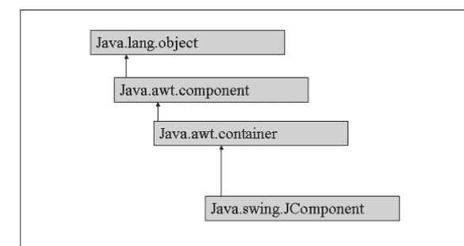

图1.1 Swing组件层次结构

### Swing

如我之前所述，Java基础类的大部分内容都与Swing可视化组件相关。这些轻量级组件极大地扩展了Java程序员可用的可能性。我需要解决的第一个问题是：“轻量级”是什么意思？轻量级用户界面类是一套用100%纯Java编写的广泛用户界面组件。它们提供了从简单的文本标签和按钮一直到选项卡式笔记本、颜色选择器和电子表格样式表格的各种简单和复杂的用户界面组件。它们还提供了以前基本AWT控件无法提供的功能级别。因为它们是100%用Java编写的，轻量级用户界面控件无论在什么操作系统上，行为方式都是相同的。“轻量级”一词的使用，是因为JFC类自己完成所有渲染工作，除了基本窗口外，不依赖于操作系统内置组件。

Swing组件的一个重要特性是它们的外观是可编程的。JFC类附带了许多不同的外观套件，可以通过编程方式切换。你可以选择“Windows”外观或其他方案。

### 一些关键的JFC类

JFC拥有大量的类。我首先尝试介绍最常用的类，然后再介绍其他类。下表列出了一些关键JFC用户界面类的名称及其提供的功能。你可能会注意到，这些类中很多只是旧AWT类的升级版。

表1.1 关键Swing类

| 类名 | 用途 |
| :--- | :--- |
| JBorderFactory | 此类用于创建放置在组件周围的边框。 |
| JCheckBox | 此组件在屏幕上放置一个复选框。复选框用于多重选择。 |
| JCheckBoxMenuItem | 此组件创建带有选中标记的菜单项。 |
| JColorChooser | 此组件允许你显示一个颜色轮，用户可以点击选择给定的颜色。 |
| JComboBox | 此组件创建一个可编辑的下拉列表。 |
| JComponent | 此类是许多其他JFC组件的父类。 |
| JFileChooser | 文件选择对话框。 |
| JFrame | 此类允许你创建框架窗口。 |
| ImageIcon | 此类允许从存储加载图像并在组件中使用。 |
| JLabel | 此类允许你创建标签。 |
| JList | 此类允许你创建列表。 |
| JMenu | 此类允许你创建菜单。 |
| JMenuBar | 此类允许你创建可以添加到框架的菜单栏。 |
| JMenuItem | 此类允许你创建可以添加到菜单的菜单项。 |
| JOptionPane | 允许显示几种标准对话框。 |
| JPanel | 此类允许你创建和操作面板。 |
| JPasswordField | 此类允许你创建一个非常适合输入密码的输入字段。 |
| JPopupMenu | 此类允许你创建弹出式菜单。 |
| JProgressBar | 此类允许你创建进度指示条。 |
| JRadioButton | 此类允许你创建单选按钮。 |
| JRadioButtonMenuItem | 此类允许你在菜单中创建单选按钮。 |
| JScrollBar | 此类允许你创建滚动条。 |
| JScrollPane | 此类允许你创建滚动窗格。 |
| JSeparator | 此类允许你创建菜单分隔符。 |
| JSlider | 此类允许你创建滑块。 |
| JSplitPane | 此类允许你创建可以垂直或水平分割的窗口窗格。 |
| JTabbedPane | 此类允许你创建选项卡式笔记本风格的面板。 |
| JTable | 此类允许在二维（电子表格样式）表格中显示和操作数据。 |
| JTextArea | 此类允许你创建多行、可编辑的文本区域。 |
| JTextField | 此类允许你创建单行文本输入字段。 |
| JToggleButton | 此类允许你创建一个具有两种状态的按钮。 |
| JToolBar | 此类允许你创建一个工具栏，该工具栏可以由图像以及常规按钮组成，并且可以“撕下”并拖动到桌面作为单独的窗口。 |
| JToolTip | 此类允许你创建一个弹出提示窗口，当鼠标悬停在组件上时显示。 |
| JTree | 此类允许你创建数据的树状视图。 |

一旦你的系统安装了JDK（再次说明，可以通过下载最新版本的JDK或安装JBuilder），你的第一步将是熟悉JFC类。有几个你可以运行的演示程序，看看JFC能做什么，并验证你是否已正确安装所有内容以及CLASSPATH变量是否设置正确。

### SwingSet演示

Java SDK附带了一个SwingSet演示程序。这个程序在熟悉Swing时非常有用，也可以用来验证你是否成功安装了JFC类以及更新了CLASSPATH和其他环境变量。SwingSet程序位于`\examples\swingset`目录中。对于那些使用JBuilder的读者（考虑到本书书名，我希望是大多数人！），你会在安装JBuilder的文件夹下找到你的JDK。它将位于名为`\jdk1.3.1\demo\jfc\SwingSet2\`的目录中。要在任何Windows系统上运行SwingSet演示程序，请从SwingSet目录执行`runnit`命令。这会执行`runnit.bat`文件并启动程序。Unix/Linux用户也有一个`runnit`脚本文件。如果你使用JBuilder，会有一个HTML文件为你演示Swing类，如图1.2所示。

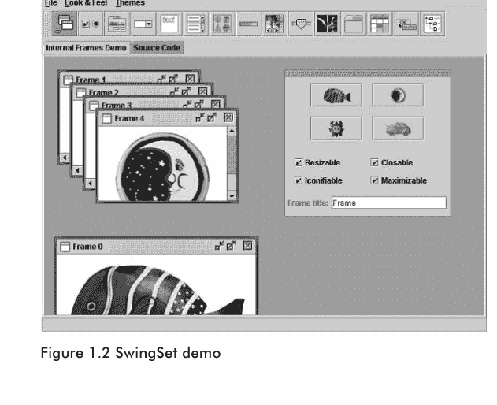

图1.2 SwingSet演示


### 编写 JFC 应用程序

显然，你不仅希望查看 SwingSet 演示程序和他人编写的项目。你将希望编写自己的 JFC 应用程序。本章并非从编写程序开始，但后续所有章节都将引导你编写自己的程序。让我告诉你，编写 JFC/Swing 应用程序与编写任何其他 Java 应用程序或小程序并无不同。在下一章，我们将回过头来探讨抽象窗口工具包（Swing 的前身），并研究几个示例。之后的所有章节都包含多个你将深入学习的完整示例。所以别担心，你将有大量实践机会来掌握 Swing！

### 总结

本章为你提供了关于 JFC 和 Swing 的基础介绍。目的是向你精确解释什么是 Java 基础类库，以及为什么它们相比 Java 1.1 技术（如抽象窗口工具包）是一次重大改进。阅读本章后，你应该对 JFC/Swing、相关类及其用途有了基本的了解。

### 复习题

1.  什么是 AWT？
2.  什么是 Swing？
3.  什么是 JFC？
4.  JFC 类库的四大主要分组是什么？
5.  JFC 无障碍功能的目的是什么？
6.  列举任意四个关键的 JFC 类。
7.  使用 Swing 而非 AWT 的目的是什么？
8.  `BorderFactory` 类的目的是什么？
9.  哪个版本的 Sun JDK 首次包含了 JFC/Swing？
10. 什么是可插拔外观和感觉？

## 第 2 章

### 抽象窗口工具包

本章涵盖以下内容：

-   什么是 AWT？
-   AWT 中的组件和容器
-   容器的类型
-   创建容器
-   管理组件布局
-   事件处理
-   一个重要的 JBuilder 示例

### 引言

你可能想知道，为什么一本关于 Java 基础类库和 Swing 的书会包含关于抽象窗口工具包的章节。这有一个非常充分的理由；嗯，实际上有两个原因。第一是，在许多情况下，你仍然需要至少具备 AWT 的基础知识。例如，你可能需要将一个应用程序或小程序从 AWT 转换为 Swing。在同一应用程序中同时使用 AWT 和 Swing 也是可能的。事实上，看到这两种技术结合使用的情况并不少见。花时间研究 AWT 的另一个原因是，Swing 在某种程度上是 AWT 的扩展。首先牢固掌握 AWT，可能会有助于你理解 Swing。如果你已经有使用抽象窗口工具包的经验，你可能希望简单浏览本章，甚至完全跳过它。

### 什么是 AWT？

AWT 代表抽象窗口工具包。AWT 实际上是 Java 基础类库的一部分，但它是较旧的部分，最早在 Java 的早期版本中引入。本质上，AWT 是一组你可以用来在应用程序和小程序中创建图形组件的类。AWT 主要用于创建图形用户界面。用户界面是应用程序或小程序中用户可以直接交互的部分。用户界面可以有各种不同的形式。有些用户界面是简单的命令行界面，而另一些则是非常吸引人的图形界面。AWT 主要用于创建此类图形界面。

在某些时刻，用户的交互必须由计算机硬件和操作系统来处理。操作系统将鼠标、键盘或其他设备的信息作为输入传输给程序。操作系统还必须从程序获取输出，并以可理解的格式将其发送到打印机或显示器。即使是最有经验的程序员，直接处理所有这些也会是一项艰巨的任务。设计 AWT 就是为了让程序员无需关心这些活动的细节。程序员只需要知道 AWT 中需要哪个类以及要调用什么方法。AWT 会为你处理底层细节。

请记住，Java 的标志之一是其平台独立性。Java 的座右铭是“一次编写，到处运行”。因为 Java 编程语言是平台独立的，所以 AWT 也必须是平台独立的。当然，这就引出了 AWT 究竟如何实现这一点的问题。在单个操作系统上正确渲染图形元素可能已经是一项艰巨的任务。让一个组件在多个不同的操作系统上都能正确渲染则要困难得多。AWT 通过让操作系统完成部分工作来处理这个问题。AWT 提供的用户界面元素是使用每个平台的原生图形工具包实现的，从而保留了每个平台的外观和感觉。这意味着，在 Windows 机器上的 AWT 按钮看起来会像一个 Windows 按钮。同一个按钮在 Macintosh 上显示时，则看起来会像一个 Mac 按钮。这种方法的缺点是，在一个平台上设计的图形用户界面，在另一个平台上查看时可能看起来非常不同。

### AWT 中的组件和容器

我已经提到，AWT 的主要目的是让程序员能够在不关心底层细节的情况下实现图形用户界面并与用户交互。我还提到这是通过创建组件的类来完成的。因此，现在是时候给你一个关于什么是组件的正式定义了。在此上下文中，*组件*就是用于创建用户界面的图形元素。典型的组件包括按钮、文本框、复选框等项目。组件允许用户与程序交互，也可用于向用户提供视觉反馈。在 AWT 中，所有用户界面组件都是 `Component` 类或其子类型的实例。实际上，大多数是子类型的实例，但它们确实继承自 `Component` 类。

这解释了什么是组件。接下来需要解决的概念是容器。*容器*正如其名所示；它是一种可以包含其他组件的特殊组件。容器包含组件并控制其布局。你需要使用容器，是因为你需要将组件组织在逻辑区域中。由于容器本身也是组件，因此容器甚至可以包含其他容器。在 AWT 中，所有容器都是 `Container` 类或其子类型的实例。与前述组件类似，大多数是简单继承自 `Container` 类的子类型的实例。

对于所有程序员来说，正确的布局可能是一个重大问题。当你的应用程序或小程序可能在任何数量的完全不同的操作系统上运行时，这个问题就更加显著了。组件必须在其所在容器内的某个空间方向上适配。这种将组件嵌套到容器中的方式创造了图形元素的层次结构。AWT 提供了九个基本的非容器组件类，可用于构建用户界面。这九个类是 `TextField`、`TextArea`、`Label`、`Button`、`Canvas`、`Choice`、`Checkbox`、`List` 和 `Scrollbar`。

### 容器的类型

除了 AWT 提供的九个非容器控件外，它还提供了四个容器类：`Window`、`Frame`、`Dialog` 和 `Panel`。请注意，`Frame` 和 `Dialog` 类是 `Window` 类的子类。除了 AWT 提供的容器外，`Applet` 类也是一个容器；实际上，它是 `Panel` 类的子类型，因此可以容纳组件。下表对每种容器类进行了简要描述。

#### 表 2.1 容器类

| 类名 | 用途 |
| :--- | :--- |
| Window | 此类提供一个顶层显示。`Window` 类的实例不附属于或嵌入另一个容器中，并且没有边框和标题。 |
| Dialog | 对话框是具有边框和标题的顶层显示。如果没有关联的 `Frame` 类实例，你无法拥有 `Dialog` 类的实例。 |
| Frame | 框架是具有边框和标题的顶层显示。`Frame` 类的实例可以拥有一个或多个菜单栏。 |


| 类名 | 用途 |
| --- | --- |
| Panel | Panel类只是一个用于容纳组件的通用容器。 |

关于此表格，有几点需要澄清说明。首先，需要解释什么是**顶层显示**。简而言之，*顶层显示*不包含在另一个组件内部。你当然可以拥有多个嵌套组件，而顶层显示将位于任何此类嵌套层次结构的最顶层。另一个需要澄清的要点是，Dialog类的实例与Frame类的实例相关联意味着什么。这意味着Dialog类不能单独使用，它需要与Frame类结合使用。需要注意的是，Frame类可以在没有Dialog类的情况下使用，但反之则不然。

### 创建容器

既然你已经了解了组件可以（并且通常也）被包含在其他组件（即容器组件）内，那么现在是时候向你展示如何创建这些容器组件了。在构建具有图形用户界面的应用程序时，程序员必须首先创建Window类或Frame类的实例。回想一下，这两者都是可以独立运行的顶层显示。Dialog类不用于初始的容器组件，因为它不能独立运行，它需要一个关联的框架。无论你使用Window类还是Frame类，都必须实例化某个顶层容器类，然后才能向应用程序添加任何组件。这是因为你不是直接向应用程序添加组件；而是向容器添加组件。

构建Applet与构建具有图形用户界面的应用程序类似，只有几个细微的差别。当构建Applet时，框架已经存在。那个框架就是浏览器本身。由于Applet类是Panel类的子类型，程序员可以直接将组件添加到Applet类的实例本身。你不需要创建Container类来向Applet添加组件。

既然我已经讨论了向应用程序添加AWT组件以赋予其图形用户界面的基础知识，那么现在向你展示一个示例似乎是合适的。

### 示例 2.1

本示例的目的仅仅是向你展示在应用程序中使用Abstract Windowing Toolkit的基础知识。该示例演示了如何使用一个顶层容器并向其中添加其他容器。示例使用Sun Microsystems JDK。稍后，我将提供几个使用Borland JBuilder的示例。

步骤1：打开你喜欢的文本编辑器，输入以下代码：

```java
import java.awt.*;
public class example1
{
    public static void main(String [] args)
    {
        Frame f = new Frame("Hey Java is Cool");
        Button b = new Button ("Click me");
        f.add(b);
        f.show();
    }
}
```

步骤2：将文件保存为**Example2.java**。

步骤3：从命令行（Windows 98中为DOS提示符，Windows NT/2000中为命令提示符，Linux中为Shell），使用标准JDK编译来编译程序：

```
javac Example.java
```

步骤4：只需输入 **Java Example.java** 来运行应用程序。当你运行此应用程序时，你应该会看到类似图2.1所示的内容。

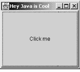

图 2.1 示例 2.1 的演示

你应该特别注意此应用程序中使用的add方法。所有容器都有一个add方法，你可以调用它来向容器添加组件。这非常简单，但你几乎会在本书或任何其他讨论Java组件的书籍的每个示例中看到它。

我坦率地承认这个例子并不特别令人兴奋；然而，它确实演示了如何创建一个使用容器组件然后向该容器添加其他组件的应用程序的基础知识。现在让我们看看这如何与Applet一起工作，而不是应用程序。

### 示例 2.2

**步骤1：** 打开你喜欢的文本编辑器，输入此处看到的代码：

```java
import java.awt.*;
import java.awt.event.*;
import java.applet.*;
public class example2 extends Applet
{
    public void init()
    {
        Button b = new Button("Click Me");
        add(b);
    }
}
```

**步骤2：** 将文件保存为 **example2.java**。

**步骤3：** 从命令行（Windows 98中为DOS提示符，Windows NT/2000中为命令提示符，Linux中为Shell），使用标准JDK编译来编译程序：

```
javac Example.java
```

步骤4：创建一个简单的HTML页面来显示Applet，如下所示：

```html
<HTML>
<HEAD>
  <TITLE>Applets Are Awesome </TITLE>
</HEAD>
<BODY BGCOLOR = white>
<CENTER>
  <APPLET>
    CODE="example2"
    WIDTH=600
    HEIGHT=300
  </APPLET>
</CENTER>
</BODY>
</HTML>
```

现在，如果你在浏览器中查看此HTML文档，你应该会看到类似此图像中所示的内容：

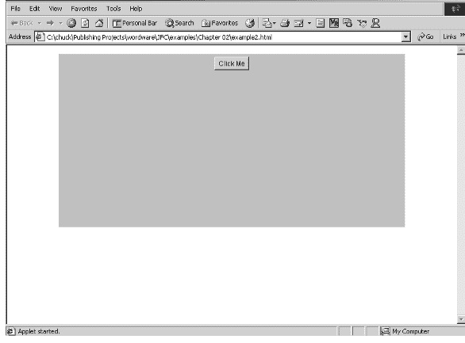

图 2.2 示例 2.2 的演示

这个例子中有几件事应该引起你的注意。首先是没有使用容器组件来容纳按钮。记住，对于Applet，Applet本身就可以充当容器组件。另一件你应该注意的事情是，add命令不是发出给容器，而是直接发出给Applet。你可以对Applet这样做，但不能对应用程序这样做。对于应用程序，add命令只能作为容器组件的方法来调用。

我们将在本书后面讨论与Swing组件相关的Applet。我们将用一整个章节来讨论它们。所以，如果你目前对Applet还不完全清楚，不要担心：这一切稍后都会变得清晰。

### 管理组件布局

如果你只是将组件添加到容器或浏览器，你将得到一个相当不吸引人的显示。组件将一个接一个地放置在容器上。大多数程序员更喜欢对组件的布局进行一些控制。Abstract Windowing Toolkit 提供了布局管理器来处理组件的布局。布局不由容器控制，而是由与容器关联的布局管理器控制。在AWT中，所有布局管理器类都实现了LayoutManager接口。

Abstract Windowing Toolkit 为程序员提供了五种布局管理器，可用于以逻辑和视觉上吸引人的方式组织组件。当然，有些比其他的更简单。这五种不同的布局管理器在表2.2中列出并简要描述。

| 管理器 | 格式 |
| --- | --- |
| GridLayout | GridLayout管理器将组件放置在均匀间隔的网格中。网格中的每一行必须具有相同数量的单元格。 |
| GridbagLayout | GridbagLayout管理器也将组件放置在网格中；但是，每一行可以具有不同数量的单元格。 |
| CardLayout | CardLayout管理器一次显示一个组件，就像翻阅一叠卡片一样。 |
| FlowLayout | FlowLayout管理器只是将组件从左到右、从上到下一个接一个地放置。 |
| BorderLayout | 此布局管理器允许你将组件放置在容器的边框周围或中心。 |

如表中所述，BorderLayout类有五个可用于放置组件的区域。这些区域被命名为North、South、East、West和Center。可以在每个区域中放置一个单独的组件。当包含的容器调整大小时，每个边框区域都会调整大小，刚好足以容纳放置在其中的组件。实际上，将其他容器组件放入每个区域是很常见的。这些区域及其布局如图2.3所示。

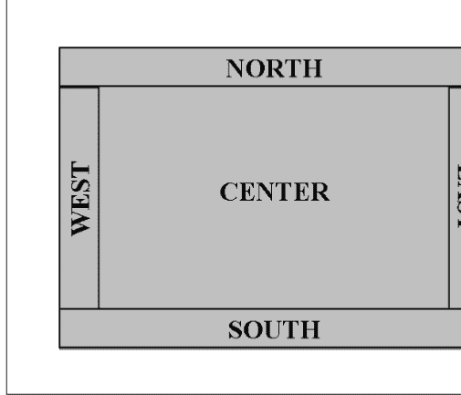

图 2.3 BorderLayout 区域

容器管理器是 Abstract Windowing Toolkit 的重要组成部分。你可以为任何容器选择任何布局管理器；但是，每个容器类都有其自己的默认布局管理器。


### 示例 2.3

Panel 类和 Applet 类使用的是 FlowLayout 布局管理器。Frame 类和 Dialog 类的默认布局管理器则是 BorderLayout。

让我们来看一个使用两种布局的例子。第一种用于一个包含按钮的面板。第二种布局用于将该面板放置在小程序的特定位置。

步骤 1：使用您喜欢的文本编辑器输入以下代码：

```java
import java.awt.*;
import java.awt.event.*;
import java.applet.*;
public class example3 extends Applet
{
    public void init()
    {
        setLayout(new GridLayout(2,2));
        Panel p = new Panel();
        p.setLayout(new BorderLayout());
        Button b = new Button("Click Me");
        p.add("Center",b);
        add(p);
    }
}
```

步骤 2：从命令行（Windows 98 的 DOS 提示符、Windows NT/2000 的命令提示符或 Linux 的 Shell），使用标准的 JDK 编译命令编译程序：

```
Javac Example.java
```

步骤 3：创建一个简单的 HTML 页面来显示小程序。

在这个例子中，我使用了两种不同的布局。第一种是网格布局，它简单地将项目显示在一个网格中。传递给网格布局类构造函数的数字告诉它要创建多少行和多少列的网格。第二种布局是边界布局，应用于面板本身，允许程序员将代码放置在边界周围的不同位置以及中心。还需注意按钮会扩展以填满其所在的空间。如果您正确输入了代码并编译了它，您应该能够使用浏览器显示这个小程序，并看到与图 2.4 所描绘的非常相似的内容。

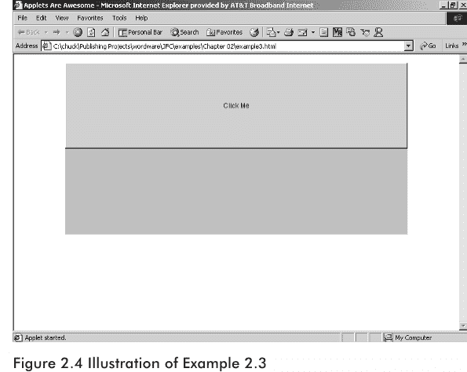

### 事件处理

前面的例子只是简单地显示了某些组件——具体来说是面板上的一个按钮。当用户按下按钮或执行任何操作时，它们都没有反应。构建图形用户界面只是故事的一部分。另一部分是与用户交互并对其做出响应。Java 提供了一种优秀的机制来实现这一点。这种机制就是事件模型。用户的每个操作都会生成一些事件。您只需要在类中添加一些代码，以允许该类响应这些事件。有许多 AWT 事件，每种类型的操作对应一个事件。`ActionEvent` 用于响应用户点击按钮，而 `MouseEvent` 用于响应鼠标移动到特定区域。让我们来看一个使用事件来响应用户点击按钮的例子。

### 示例 2.4

步骤 1：打开您喜欢的文本编辑器并输入以下代码：

```java
import java.awt.*;
import java.applet.*;
// This little applet demonstrates how Java applets
// create controls on the screen and respond to events on
// those controls.
// This class inherits the java Applet class. All applets
// must do this.
public class example4 extends Applet
{
    Button hiButton;
    // applets use an init instead of a main function.
    public void init()
    {
        // create a button component with a caption
        hiButton = new Button("Click Me!");
        // Add that button to the browser window
        add(hiButton);
    }// close init
    // The action function handles the various events the applet
    // can potentially respond to.
    public boolean action(Event evt, Object objme)
    {
        // see if the event was on our hi button
        if(evt.target == hiButton)
        {
            // change that button's caption
            hiButton.setLabel("Ahhhh!");
            return true;
        }// close if statement
        else
            return false;
    }// close action
}// close class button
```

步骤 2：从命令行（Windows 98 的 DOS 提示符、Windows NT/2000 的命令提示符或 Linux 的 Shell），使用标准的 JDK 编译命令编译程序：

```
Javac Example.java
```

步骤 3：创建一个简单的 HTML 页面来显示小程序。

编译小程序并在浏览器中查看后，它应该看起来像图 2.5 所示。

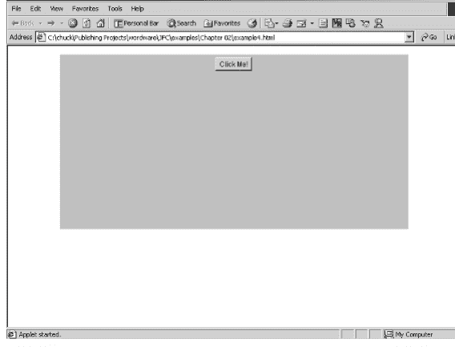

当您实际点击按钮（如其标题所提示的那样）时，您将看到类似图 2.6 的内容。

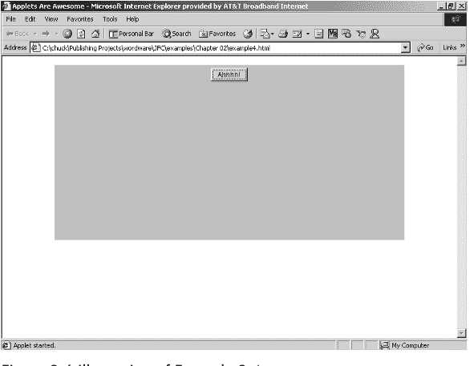

图 2.6 示例 2.4 的演示

此示例与前面示例的最大区别在于添加了 `"public boolean action (Event evt, Object objme)"` 代码。
此函数设计用于在用户点击小程序中的某些内容时被调用。传递的 `Event` 对象包含有关已发生事件的信息，包括触发事件的原因以及事件所指向的组件。在此函数内部，我简单地放置了一个 `if` 语句来询问目标是否确实是我们的按钮。如果是，则更改按钮的标题。

### 示例 2.5

到目前为止，所有示例都是使用简单的文本编辑器和 Sun JDK 编译器完成的。然而，我们的示例也只包含一些简单的组件。尝试在无法看到正在形成何种图像的情况下排列多个组件可能相当困难。这正是 Borland 的 JBuilder 能为您提供宝贵帮助的地方。使用 JBuilder，您可以以“所见即所得”（WYSIWYG）的方式将抽象窗口工具包组件拖放到屏幕上。因此，现在我想带您逐步完成一个使用 JBuilder 的示例。

**步骤 1：** 显然，您需要启动 JBuilder。然后开始一个新项目。

**步骤 2：** 从下拉菜单中选择 **文件**。然后选择 **新建**。您将看到向导的第一个屏幕，该向导将引导您完成向项目中添加新项目的步骤。


图 2.7 对象库

为此示例，我将从“常规”选项卡中选择 **应用程序**。


图 2.8 添加应用程序

**步骤 3：** 现在，JBuilder 将引导您完成三个简单的屏幕，提示您输入希望应用程序具有的设置。为了我们的目的，我选择了默认设置，如图 2.9 到图 2.11 所示。


图 2.9 应用程序向导步骤 1


图 2.10 应用程序向导步骤 2


图 2.11 应用程序向导步骤 3

完成向导后，JBuilder 将为您构建应用程序的基本框架。您应该注意，屏幕底部有各种选项卡。默认情况下，向导完成时，您将看到“源代码”选项卡。但是，您应该切换到“设计”选项卡。


步骤 4：请注意，顶部有几个用于各种不同组件的选项卡，以及指示屏幕外还有更多组件的箭头。您需要使用这些箭头滚动，直到看到 AWT 选项卡，然后选择该选项卡。


图 2.13 AWT 选项卡

**步骤 5：** 注意，屏幕右侧有一个“属性”窗口，显示当前选定组件的属性。在当前情况下，它显示的是应用程序容器组件（即框架）的属性。您会注意到布局被设置为默认的 BorderLayout。


图 2.14 默认布局

**步骤 6：** 将鼠标放在任何组件的对象上并单击一次。

然后您可以在屏幕上绘制一个或多个组件的轮廓。在此示例中，在屏幕中央放置一个 JBuilder Panel 类的实例，并将面板的布局管理器属性设置为 2x2 的网格。然后，您将向此面板添加四个按钮。它应该看起来像您在这里看到的图像。


图 2.15 网格布局

如果您返回到 JBuilder 的“源代码”选项卡，可以看到 JBuilder 为您创建的源代码。该代码显示在下方。请注意，布局、`init`、添加组件等都是为您自动完成的。此外，应用程序终止代码和其他所需代码也是为您完成的。

```java
package example5;
import java.awt.*;
import java.awt.event.*;
import javax.swing.*;
public class Frame1 extends JFrame
{
```


### 2.6 一个重要的 JBuilder 示例

你应该意识到，随着图形用户界面变得越来越复杂，可视化你正在编写的代码输出也会变得更加困难。JBuilder 会为你处理布局细节。这使得 JBuilder 成为设计具有复杂图形用户界面程序的强大工具。

到目前为止，你在本章中看到的示例都很简单（事实上简单到几乎没有任何实际价值）。这样做的目的是让你在不被大量代码负担的情况下，逐步熟悉这些概念。让人有机会持续钻研一个概念直到掌握其要领是重要的。然而，同样重要的是，你能够将这个概念应用于实际目的。基于这个想法，让我们探索一个使用 JBuilder 创建 AWT 应用程序的实际示例。我们将使用 JBuilder 构建一个可运行的计算器。

#### 示例 2.6

-   第 1 步：开始一个新项目。向该项目添加一个 Application 对象。
-   第 2 步：确保框架的布局管理器是边界布局。
-   第 3 步：我们将向此应用程序添加两个面板和一个标签。一个面板将添加到中心区域，并命名为 pnlnumbers。第二个面板将添加到东部区域，并命名为 pnlbuttons。标签将添加到北部区域，并命名为 lbldisplay。标签的对齐方式应设置为右对齐，文本设置为 "0"。很难区分两个面板，因此我们将 pnlnumbers 的背景色重置为黄色。你的屏幕应该看起来与图 2.16 所示相似。

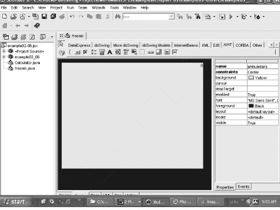

> 注意：请记住，本章我们使用的是 AWT 选项卡中的组件，而不是 Swing 选项卡！

-   **第 4 步：** 现在将 pnlnumbers 的布局设置为网格。将网格更改为四行三列。要更改网格布局的行数和列数，你需要转到 JBuilder 中的 Source 选项卡，并在 grid 后的括号中直接输入 4,3。如图 2.17 所示。

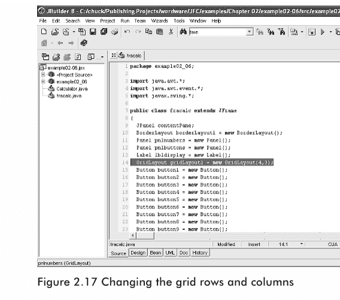

-   第 5 步：现在我们将 pnlbuttons 的布局更改为五行一列的网格布局。我们还将向两个面板添加一系列按钮，并设置这些按钮的标题。你可以在图 2.18 中看到这一点。

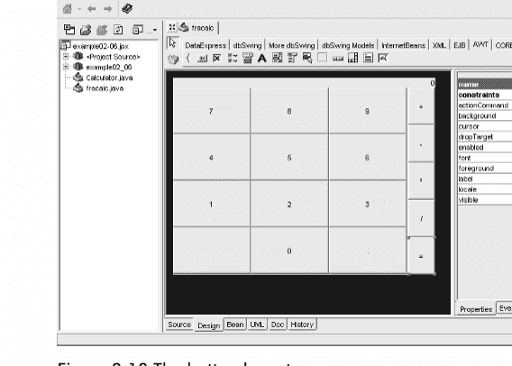

请确保你将每个按钮的名称更改为与其标签属性匹配。例如，标签属性为 "9" 的按钮应命名为 btn9。标签属性为 "+" 的按钮应命名为 btnadd。

#### 第 6 步：

既然我们有了计算器的框架，是时候添加一些代码了！首先，在类的开头，我们将添加一些变量：

```
String temp;
float firstnumber;
float secondnumber;
float answer;
int operation;
int ADD = 0;
int SUBTRACT = 1;
int MULTIPLY = 2;
int DIVIDE = 3;
```

现在我们转到运算符按钮（+、-、*、/ 和 =）。在每个按钮中，我们将 int 运算符设置为相应的整数值。加法按钮的代码如下所示：

```
operation = ADD;
temp = lbldisplay.getText();
firstnumber= Float.valueOf(temp).floatValue();
lbldisplay.setText("0");
```

第一行代码应该很容易理解。我们只是确定选择了哪种操作。接下来的两行获取 lbldisplay 中的值并将其转换为浮点数。最后，我们将显示设置回零，以便用户可以输入第二个数字。所有四个运算按钮的代码将相同，除了第一行，你需要在其中将操作设置为适用于该按钮的操作。

每个数字按钮只需要将你按下的数字添加到标签中。该代码如下所示：

```
temp = lbldisplay.getText();
temp = temp + "7";
lbldisplay.setText(temp);
```

显然，每个按钮都必须设置为相应的数字。小数点按钮的设置与数字按钮类似。在等号按钮中，我们将有更多一些代码：

```
temp = lbldisplay.getText();
secondnumber= Float.valueOf(temp).floatValue();
if(operation == ADD)
    answer = firstnumber + secondnumber;
if(operation == SUBTRACT)
    answer = firstnumber - secondnumber;
if(operation == MULTIPLY)
    answer = firstnumber * secondnumber;
if(operation == DIVIDE)
    answer = firstnumber / secondnumber;
temp = " " + answer;
lbldisplay.setText(temp);
```

所有这些代码的作用是获取当前显示，将其转换为浮点数，并存储在名为 secondnumber 的变量中。然后我们执行适当的数学运算。最后，我们显示答案。当你运行此应用程序时，你可以执行所有基本的计算器操作，就像你在图 2.19 中看到的那样。

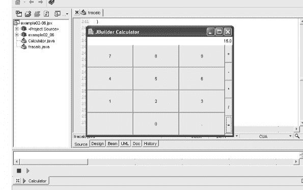

对于那些不使用 JBuilder 或希望查看所有源代码的读者，此处提供了源代码。

> 注意：这是一个较长的示例。

```
package example02_06;
import java.awt.*;
import java.awt.event.*;
import javax.swing.*;
public class fracalc extends JFrame
{
    JPanel contentPane;
    BorderLayout borderLayout1 = new BorderLayout();
    Panel pnlnumbers = new Panel();
    Panel pnlbuttons = new Panel();
    Label lbldisplay = new Label();
    GridLayout gridLayout1 = new GridLayout(4,3);
    Button btn7 = new Button();
    Button btn2 = new Button();
    Button btn3 = new Button();
    Button btn1 = new Button();
    Button btn6 = new Button();
    Button btn5 = new Button();
    Button btn4 = new Button();
    Button btn8 = new Button();
    Button btn9 = new Button();
    Button btnadd = new Button();
    Button btnminus = new Button();
    GridLayout gridLayout2 = new GridLayout(5,1);
    Button btnplaceholder = new Button();
    Button btn0 = new Button();
    Button btndecimal = new Button();
    Button btnmultiply = new Button();
    Button btndivide = new Button();
    Button btnequals = new Button();
    String temp;
    float firstnumber;
    float secondnumber;
    float answer;
    int operation;
    int ADD = 0;
    int SUBTRACT = 1;
    int MULTIPLY = 2;
    int DIVIDE = 3;

//构造框架
public fracalc()
{
    enableEvents(AWTEvent.WINDOW_EVENT_MASK);
    try
    {
        jbInit();
    }
    catch(Exception e)
    {
        e.printStackTrace();
    }
}
//组件初始化
private void jbInit() throws Exception
{
    contentPane = (JPanel) this.getContentPane();
    contentPane.setLayout(borderLayout1);
    this.setSize(new Dimension(400, 300));
    this.setTitle("JBuilder Calculator");
    pnlnumbers.setBackground(Color.yellow);
    pnlnumbers.setLayout(gridLayout1);
    lbldisplay.setAlignment(Label.RIGHT);
    lbldisplay.setBackground(Color.white);
    lbldisplay.setText("0");
    pnlbuttons.setLayout(gridLayout2);
    btn7.setLabel("7");
    btn7.addActionListener(new fracalc_btn7_action
            Adapter(this));
    btn2.setLabel("2");
    btn2.addActionListener(new fracalc_btn2_action
            Adapter(this));
    btn3.setLabel("3");
    btn3.addActionListener(new fracalc_btn3_action
            Adapter(this));
    btn1.setLabel("1");
    btn1.addActionListener(new fracalc_btn1_action
            Adapter(this));
    btn6.setLabel("6");
    btn6.addActionListener(new fracalc_btn6_action
            Adapter(this));
    btn5.setLabel("5");
    btn5.addActionListener(new fracalc_btn5_action
            Adapter(this));
```


btn4.setLabel("4");
btn4.addActionListener(new fracalc_btn4_actionAdapter(this));
btn8.setLabel("8");
btn8.addActionListener(new fracalc_btn8_actionAdapter(this));
btn9.setLabel("9");
btn9.addActionListener(new fracalc_btn9_actionAdapter(this));
btnadd.setLabel("+");
btnadd.addActionListener(new fracalc_btnadd_actionAdapter(this));
btnminus.setLabel("-");
btnminus.addActionListener(new fracalc_btnminus_actionAdapter(this));
btn0.setLabel("0");
btndecimal.setLabel(".");
btndecimal.addActionListener(new fracalc_btndecimal_actionAdapter(this));
btnplaceholder.setLabel("");
btnmultiply.setLabel("*");
btnmultiply.addActionListener(new fracalc_btnmultiply_actionAdapter(this));
btndivide.setLabel("/");
btndivide.addActionListener(new fracalc_btndivide_actionAdapter(this));
btnequals.setLabel("=");
btnequals.addActionListener(new fracalc_btnequals_actionAdapter(this));

contentPane.add(pnlnumbers, BorderLayout.CENTER);
pnlnumbers.add(btn7, null);
pnlnumbers.add(btn8, null);
pnlnumbers.add(btn9, null);
pnlnumbers.add(btn4, null);
pnlnumbers.add(btn5, null);
pnlnumbers.add(btn6, null);
pnlnumbers.add(btn1, null);
pnlnumbers.add(btn2, null);
pnlnumbers.add(btn3, null);
pnlnumbers.add(btnplaceholder, null);
pnlnumbers.add(btn0, null);
pnlnumbers.add(btndecimal, null);

contentPane.add(pnlbuttons, BorderLayout.EAST);
pnlbuttons.add(btnadd, null);
pnlbuttons.add(btnminus, null);
contentPane.add(lbldisplay, BorderLayout.NORTH);
pnlbuttons.add(btnmultiply, null);
pnlbuttons.add(btndivide, null);
pnlbuttons.add(btnequals, null);
}

//重写此方法以便在窗口关闭时退出程序
protected void processWindowEvent(WindowEvent e)
{
    super.processWindowEvent(e);
    if (e.getID() == WindowEvent.WINDOW_CLOSING)
    {
        System.exit(0);
    }
}

void btnadd_actionPerformed(ActionEvent e)
{
    operation = ADD;
    temp = lbldisplay.getText();
    firstnumber= Float.valueOf(temp).floatValue();
    lbldisplay.setText("0");
}

void btnminus_actionPerformed(ActionEvent e)
{
    operation = SUBTRACT;
    temp = lbldisplay.getText();
    firstnumber= Float.valueOf(temp).floatValue();
    lbldisplay.setText("0");
}

void btnmultiply_actionPerformed(ActionEvent e)
{
    operation = MULTIPLY;
    temp = lbldisplay.getText();
    firstnumber= Float.valueOf(temp).floatValue();
    lbldisplay.setText("0");
}

void btndivide_actionPerformed(ActionEvent e)
{
    operation = DIVIDE;
    temp = lbldisplay.getText();
    firstnumber= Float.valueOf(temp).floatValue();
    lbldisplay.setText("0");
}

void btn7_actionPerformed(ActionEvent e)
{
    temp = lbldisplay.getText();
    temp = temp + "7";
    lbldisplay.setText(temp);
}

void btn9_actionPerformed(ActionEvent e)
{
    temp = lbldisplay.getText();
    temp = temp + "9";
    lbldisplay.setText(temp);
}

void btn8_actionPerformed(ActionEvent e)
{
    temp = lbldisplay.getText();
    temp = temp + "8";
    lbldisplay.setText(temp);
}

void btn6_actionPerformed(ActionEvent e)
{
    temp = lbldisplay.getText();
    temp = temp + "6";
    lbldisplay.setText(temp);
}

void btn5_actionPerformed(ActionEvent e)
{
    temp = lbldisplay.getText();
    temp = temp + "5";
    lbldisplay.setText(temp);
}

void btn4_actionPerformed(ActionEvent e)
{
    temp = lbldisplay.getText();
    temp = temp + "4";
    lbldisplay.setText(temp);
}

void btn3_actionPerformed(ActionEvent e)
{
    temp = lbldisplay.getText();
    temp = temp + "3";
    lbldisplay.setText(temp);
}

void btn2_actionPerformed(ActionEvent e)
{
    temp = lbldisplay.getText();
    temp = temp + "2";
    lbldisplay.setText(temp);
}

void btn1_actionPerformed(ActionEvent e)
{
    temp = lbldisplay.getText();
    temp = temp + "1";
    lbldisplay.setText(temp);
}

void btndecimal_actionPerformed(ActionEvent e)
{
    temp = lbldisplay.getText();
    temp = temp + ".";
    lbldisplay.setText(temp);
}

void btnequals_actionPerformed(ActionEvent e)
{
    temp = lbldisplay.getText();
    secondnumber= Float.valueOf(temp).floatValue();
    if(operation == ADD)
        answer = firstnumber + secondnumber;
    if(operation == SUBTRACT)
        answer = firstnumber - secondnumber;
    if(operation == MULTIPLY)
        answer = firstnumber * secondnumber;
    if(operation == DIVIDE)
        answer = firstnumber / secondnumber;
    temp = " " + answer;
    lbldisplay.setText(temp);
}

class fracalc_btnadd_actionAdapter implements java.awt.event.ActionListener
{
    fracalc adaptee;
    fracalc_btnadd_actionAdapter(fracalc adaptee)
    {
        this.adaptee = adaptee;
    }
    public void actionPerformed(ActionEvent e)
    {
        adaptee.btnadd_actionPerformed(e);
    }
}

class fracalc_btnminus_actionAdapter implements java.awt.event.ActionListener
{
    fracalc adaptee;
    fracalc_btnminus_actionAdapter(fracalc adaptee)
    {
        this.adaptee = adaptee;
    }
    public void actionPerformed(ActionEvent e)
    {
        adaptee.btnminus_actionPerformed(e);
    }
}

class fracalc_btnmultiply_actionAdapter implements java.awt.event.ActionListener
{
    fracalc adaptee;
    fracalc_btnmultiply_actionAdapter(fracalc adaptee)
    {
        this.adaptee = adaptee;
    }
    public void actionPerformed(ActionEvent e)
    {
        adaptee.btnmultiply_actionPerformed(e);
    }
}

class fracalc_btndivide_actionAdapter implements java.awt.event.ActionListener
{
    fracalc adaptee;
    fracalc_btndivide_actionAdapter(fracalc adaptee)
    {
        this.adaptee = adaptee;
    }
    public void actionPerformed(ActionEvent e)
    {
        adaptee.btndivide_actionPerformed(e);
    }
}

class fracalc_btn7_actionAdapter implements java.awt.event.ActionListener
{
    fracalc adaptee;
    fracalc_btn7_actionAdapter(fracalc adaptee)
    {
        this.adaptee = adaptee;
    }
    public void actionPerformed(ActionEvent e)
    {
        adaptee.btn7_actionPerformed(e);
    }
}

class fracalc_btn9_actionAdapter implements java.awt.event.ActionListener
{
    fracalc adaptee;
    fracalc_btn9_actionAdapter(fracalc adaptee)
    {
        this.adaptee = adaptee;
    }
    public void actionPerformed(ActionEvent e)
    {
        adaptee.btn9_actionPerformed(e);
    }
}

class fracalc_btn8_actionAdapter implements java.awt.event.ActionListener
{
    fracalc adaptee;
    fracalc_btn8_actionAdapter(fracalc adaptee)
    {
        this.adaptee = adaptee;
    }
    public void actionPerformed(ActionEvent e)
    {
        adaptee.btn8_actionPerformed(e);
    }
}

class fracalc_btn6_actionAdapter implements java.awt.event.ActionListener
{
    fracalc adaptee;
    fracalc_btn6_actionAdapter(fracalc adaptee)
    {
        this.adaptee = adaptee;
    }
    public void actionPerformed(ActionEvent e)
    {
        adaptee.btn6_actionPerformed(e);
    }
}

class fracalc_btn5_actionAdapter implements java.awt.event.ActionListener
{
    fracalc adaptee;
    fracalc_btn5_actionAdapter(fracalc adaptee)
    {
        this.adaptee = adaptee;
    }
    public void actionPerformed(ActionEvent e)
    {
        adaptee.btn5_actionPerformed(e);
    }
}

class fracalc_btn4_actionAdapter implements java.awt.event.ActionListener
{
    fracalc adaptee;
    fracalc_btn4_actionAdapter(fracalc adaptee)
    {
        this.adaptee = adaptee;
    }
    public void actionPerformed(ActionEvent e)
    {
        adaptee.btn4_actionPerformed(e);
    }
}

class fracalc_btn3_actionAdapter implements java.awt.event.ActionListener
{
    fracalc adaptee;
    fracalc_btn3_actionAdapter(fracalc adaptee)
    {
        this.adaptee = adaptee;
    }
    public void actionPerformed(ActionEvent e)
    {
        adaptee.btn3_actionPerformed(e);
    }
}

class fracalc_btn2_actionAdapter implements java.awt.event.ActionListener
{
    fracalc adaptee;
    fracalc_btn2_actionAdapter(fracalc adaptee)
    {
        this.adaptee = adaptee;
    }
    public void actionPerformed(ActionEvent e)
    {
        adaptee.btn2_actionPerformed(e);
    }
}


```java
public void actionPerformed(ActionEvent e)
{
    adaptee.btn2_actionPerformed(e);
}
class fracalc_btn1_actionAdapter implements java.awt.event
        .ActionListener
{
    fracalc adaptee;
    fracalc_btn1_actionAdapter(fracalc adaptee)
    {
        this.adaptee = adaptee;
    }
    public void actionPerformed(ActionEvent e)
    {
        adaptee.btn1_actionPerformed(e);
    }
}
class fracalc_btndecimal_actionAdapter implements java.awt
        .event.ActionListener
{
    fracalc adaptee;
    fracalc_btndecimal_actionAdapter(fracalc adaptee)
    {
        this.adaptee = adaptee;
    }
    public void actionPerformed(ActionEvent e)
    {
        adaptee.btndecimal_actionPerformed(e);
    }
}
class fracalc_btnequals_actionAdapter implements java.awt.event
        .ActionListener
{
    fracalc adaptee;
    fracalc_btnequals_actionAdapter(fracalc adaptee)
    {
        this.adaptee = adaptee;
    }
    public void actionPerformed(ActionEvent e)
    {
        adaptee.btnequals_actionPerformed(e);
    }
}
```

这个例子既具有实用价值，也具有教学价值。在这个例子中，你看到了各种组件、容器、操作等的使用。你本质上看到了使用AWT在JBuilder中创建图形用户界面的精髓。

### 总结

本章为你提供了AWT的基本概述。如果你之前没有接触过抽象窗口工具包，那么确保你理解本章的所有重要概念就非常重要。你已经了解了组件和容器以及布局管理器。你已经看到了AWT和容器如何在应用程序和小程序中使用。你也看到了几个使用AWT的例子。此时，你应该对抽象窗口工具包有了基本的理解。

### 复习问题

-   1. 五种布局管理器是什么？
-   2. 实际上是Window类子类的两个组件是什么？
-   3. 哪个组件必须与框架关联？
-   4. 边界布局管理器的区域有哪些？
-   5. 小程序的顶层组件是什么？
-   6. 列出九个非容器AWT组件。
-   7. Frame类的默认布局管理器是什么？
-   8. 当用户点击按钮时会调用哪个事件？
-   9. Applet是什么类的子类型？
-   10. Applet类的默认布局管理器是什么？

### 第3章

### 用户输入

本章涵盖以下内容：

-   JTextField
-   JPasswordField
-   JLabel
-   JTextArea
-   EditorKit
-   JTextPane
-   JEditorPane
-   JButton

### 简介

既然你已经对抽象窗口工具包有了简要的了解，现在是时候深入研究Swing了。一个很好的起点似乎是提供用户输入的方法。在任何应用程序中，从用户那里获取输入都是至关重要的。对于控制台应用程序、AWT应用程序以及JFC/Swing应用程序来说都是如此。但是用户已经习惯了拥有多种多样的输入选项。幸运的是，在Java基础类库中，有几种Swing组件非常适合用户输入信息。你可以想象使用几种不同的组件进行用户输入；然而，有些比其他更适合。这些组件是JTextField、JLabel、JTextArea、JPasswordField、JTextPane和JEditorPane。

本章将介绍这些组件及其使用方法。表3.1总结了每个类的用途。

#### 表3.1 输入组件

| 类 | 用途 |
| :--- | :--- |
| JTextField | 允许输入和编辑单行文本 |
| JPasswordField | 允许输入密码并在屏幕上显示密码字符，例如星号 |
| JLabel | 允许向用户进行只读显示 |
| JTextArea | 允许输入和编辑多行文本 |
| JTextPane | 允许输入和编辑多行文本以及各种格式选项 |
| JEditorPane | 允许输入和编辑多种格式的文本，包括HTML和富文本（RTF） |

所有这些组件都旨在允许用户向程序提供输入。每个组件在输入方式或可接受的输入类型上有所不同。

### JTextField

JTextField是用户输入字段中最基本的。它允许用户输入和编辑单行文本。该组件继承自`java.swing.text.JTextComponent`，而后者又继承自`java.swing.JComponent`。`JTextComponent`是本章讨论的许多组件的基类。`JTextField`类被设计为与`java.awt.TextField`类兼容，但它确实具有一些在`java.awt.TextField`类中找不到的功能。我们将在本节中探讨其中一些功能。`JTextField`类最重要的方法及其用途总结在表3.2中。该表很重要，因为其中许多方法与本章涵盖的其他组件共享。

#### 表3.2 JTextField方法

| 方法 | 用途 |
| :--- | :--- |
| getHorizontalAlignment | `public int getHorizontalAlignment()`<br>此函数简单返回文本的水平对齐方式。<br>有效键：`JTextField.LEFT`, `JTextField.CENTER`, `JTextField.RIGHT`, `JTextField.LEADING`, 和 `JTextField.TRAILING` |
| setHorizontalAlignment | `public void setHorizontalAlignment(int alignment)`<br>此函数是前一个函数的对应函数。它用于设置文本的水平对齐方式。<br>有效键：`JTextField.LEFT`, `JTextField.CENTER`, `JTextField.RIGHT`, `JTextField.LEADING`（默认值）, 和 `JTextField.TRAILING` |
| getColumns | `public int getColumns()`<br>此函数简单返回此JTextField中的列数。 |
| setColumns | `public void setColumns(int columns)`<br>此函数用于设置此JTextField中的列数。 |
| setFont | `public void setFont(Font f)`<br>此函数用于设置当前字体。 |
| addActionListener | `public void addActionListener(ActionListener l)`<br>此函数将指定的动作监听器添加到接收来自此JTextField的动作事件。 |
| removeActionListener | `public void removeActionListener(ActionListener l)`<br>此函数将移除指定的动作监听器，使其不再接收来自此JTextField的动作事件。 |
| copy | `public void copy()`<br>此函数用于将关联文本模型中当前选定范围的副本传输到系统剪贴板，同时保留文本模型中的内容。 |
| paste | `public void paste()`<br>此函数将系统剪贴板内容的副本传输到关联的文本模型中。如果关联视图中存在选择，则将其替换为剪贴板的内容。 |
| getText | `public String getText()`<br>此函数用于检索包含在此文本组件中的文本。 |
| setText | `public void setText(String t)`<br>此方法将此文本组件的文本设置为指定的文本。如果文本为null或空，则效果只是删除旧文本。 |

除了此表中看到的方法外，当然还有其他方法；然而，这些是与JTextField最常一起使用的方法。请记住，此组件的目的是允许用户输入单行文本。这意味着上表中总结的大多数方法应该以某种方式与实现该目标相关。例如，`getText`方法允许你在应用程序中检索代码。当然，`setText`方法允许你将代码放入JTextField中。各种其他方法大多涉及格式化JTextField，使其以适合你的方式显示文本。

除了类提供的方法外，该类还有几种不同的构造函数。它们总结在表3.3中。

#### 表3.3 JTextField构造函数

| 构造函数 | 用途 |
| :--- | :--- |
| `JTextField()` | 此构造函数简单创建一个新的JTextField。 |
| `JTextField(String text)` | 此构造函数创建一个新的JTextField，但用指定文本初始化。 |
| `JTextField(int columns)` | 此构造函数构建一个具有指定列数的新空JTextField。 |
| `JTextField(String text, int columns)` | 此构造函数构建一个用指定文本和特定列数初始化的新JTextField。 |


既然你已经对 JTextField 类有了一些了解，现在最好还是看一个在实际操作中使用 JTextField 的示例。

### 示例 3.1

这个示例只是向你展示 JTextField 类的一些用途。我将使用 JBuilder 带你逐步完成这个示例。然而，如果你没有 JBuilder（即使是早期版本也可以），那么只需跳到源代码清单，然后在你最喜欢的文本编辑器中输入该代码，并像编译任何其他 Java 程序一样，使用 Sun Java Development Kit 编译器进行编译。

**注意：** 在我提供的所有 JBuilder 示例中，我都提供了完整的源代码，以便不使用 JBuilder 的读者可以使用他们想要的任何 Java 编译器。提供完整代码也是为了让你在示例运行遇到问题时，可以将自己的代码与示例源代码进行比较。

**注意：** 这个示例将带你逐步完成使用 JBuilder 创建应用程序的每一个步骤。这是为那些以前没有使用过 JBuilder 的读者提供的。本书后续的大多数示例将不会详细说明每一个步骤，因此如果你忘记了步骤，只需参考这个示例。如果你不熟悉 JBuilder，我强烈建议你弄一本 Charlie Calvert 的 *《学习 JBuilder》*（Wordware Publishing 出版）。这也许是目前学习如何使用 JBuilder 最好的一本书。

**步骤 1：** 打开 JBuilder 并启动一个新项目。你需要使用任何适合你的位置和名称；这里的图像显示的是我机器上的设置。以下图像展示了通过新建项目向导的步骤。但是，除了路径和项目名称外，如果你愿意，可以使用默认设置。

56 ■ 第 3 章

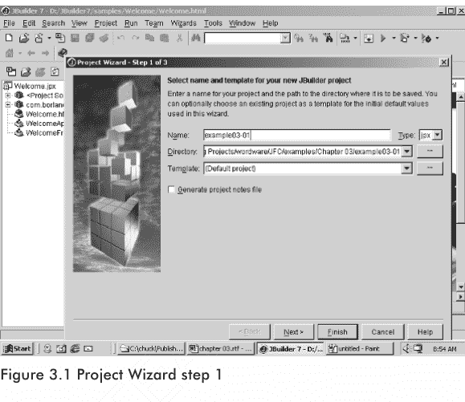

图 3.1 项目向导步骤 1

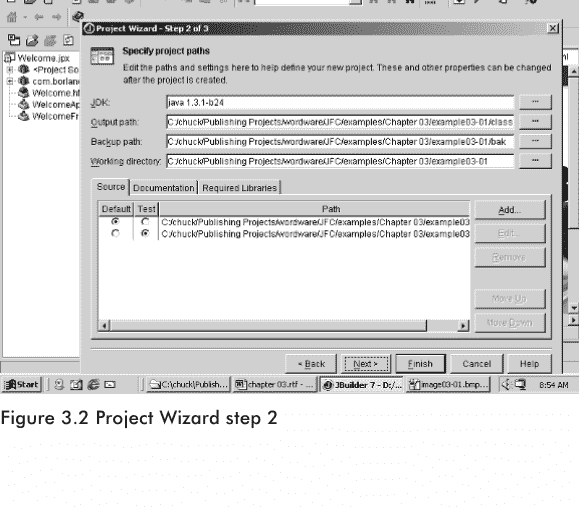

图 3.2 项目向导步骤 2

Team-Fly®

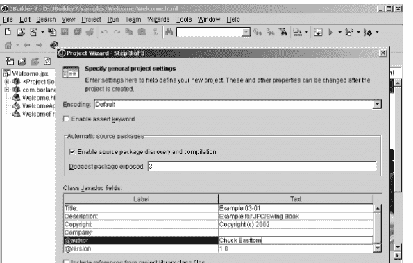

图 3.3 项目向导步骤 3

**步骤 2：** 现在你已经启动了一个 JBuilder 项目，你可以向其中添加多种不同类型的源文件。当你选择一种源文件类型时，你会得到所有为你预先编写好的基本代码。为了本示例的目的，只需选择 **Application**。

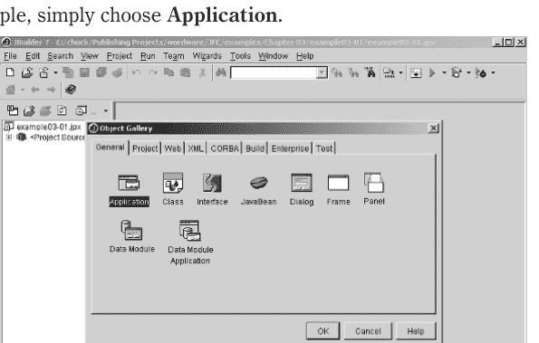

图 3.4 选择 Application

第 3 章

这将依次带你通过所选特定对象的向导。在我们的例子中，你可以使用以下图像中显示的默认设置。

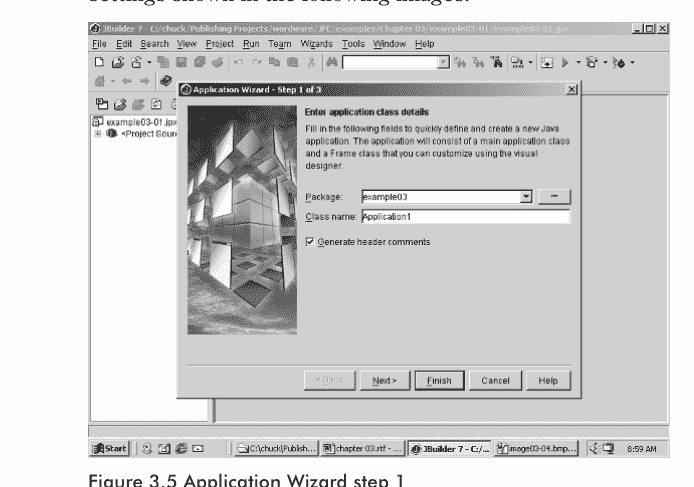

图 3.5 应用程序向导步骤 1

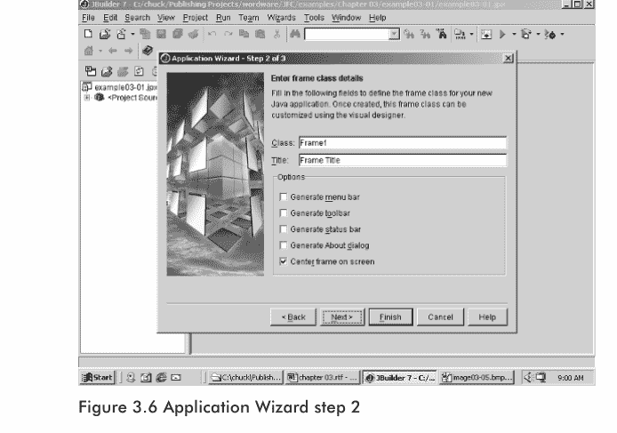

图 3.6 应用程序向导步骤 2

注意在这个屏幕上，你可以请求将几个项目添加到你的应用程序中。我们这里不会使用这些项目（但稍后会用到）。不过，请注意，JBuilder 可以为诸如工具栏和关于对话框之类的项目创建代码。这是一个非常有用的功能。
完成此向导后，你将看到源代码的框架。请注意，包含了 Frame 类的代码。回想一下，应用程序必须有某个容器类来放置组件类。这对于小程序来说不成立，因为浏览器本身提供了一个容器。

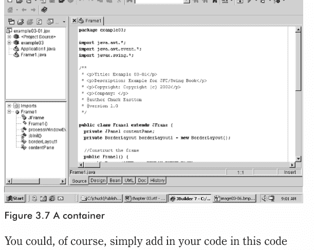

图 3.7 一个容器

**步骤 3：** 当然，你可以直接在这个代码窗口中添加你的代码。但是，在设计窗口上添加组件要快得多，也容易得多。点击屏幕底部的 **Design** 选项卡，你会看到一个可以直接将组件放置在框架上的窗口。

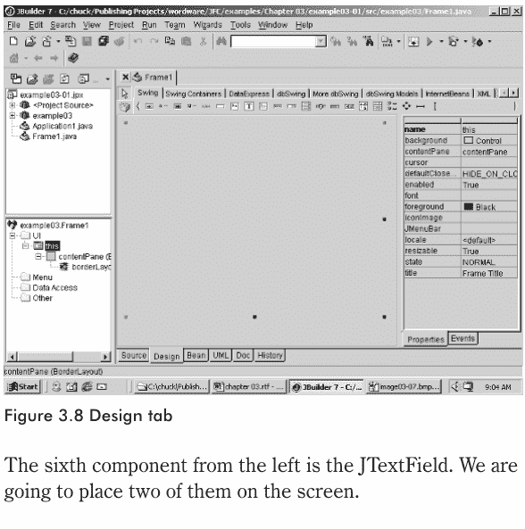

图 3.8 设计选项卡

从左数第六个组件是 JTextField。我们打算在屏幕上放置两个。

> 注意：框架默认使用边界布局。如果你保持这种布局，不要将 JTextField 放在中心位置，否则它会占据整个屏幕。在这个示例中，我将它放在了北部和南部。

对你来说，暂停一下，查看屏幕右侧的属性窗口可能也是一个好主意。你可以在这里设置 JTextField 的许多属性。大多数都是相当不言自明的（对齐、背景、工具提示文本、文本等）。

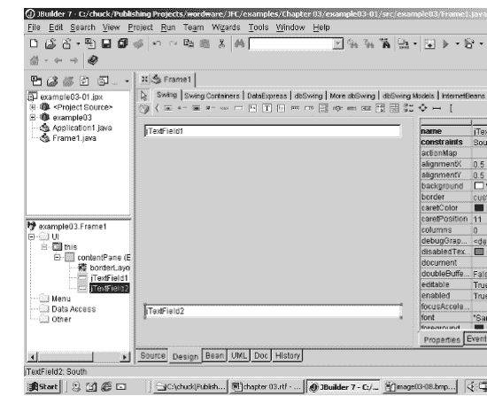

图 3.9 放置两个 JTextField

**步骤 4：** 让我们返回代码窗口输入一些代码。如果你简单地双击一个 JTextField，该 JTextField 的动作事件将被添加到你的源代码中，并且你将直接跳转到那里（这很方便！）。

我只向这个动作事件添加了一行代码：

```
jTextField2.setText(jTextField1.getText());
```

当我在第一个 JTextField 中输入内容并按下 Enter 键时，它会被复制到第二个 JTextField 中。这段代码可能不是特别令人兴奋，但它确实演示了 JTextField 的核心功能。具体来说，它演示了 getText 和 setText 方法以及 JBuilder 的一些有用功能。到目前为止，getText 和 setText 方法是 JTextField 类中最常用的方法。

62 ■ 第 3 章

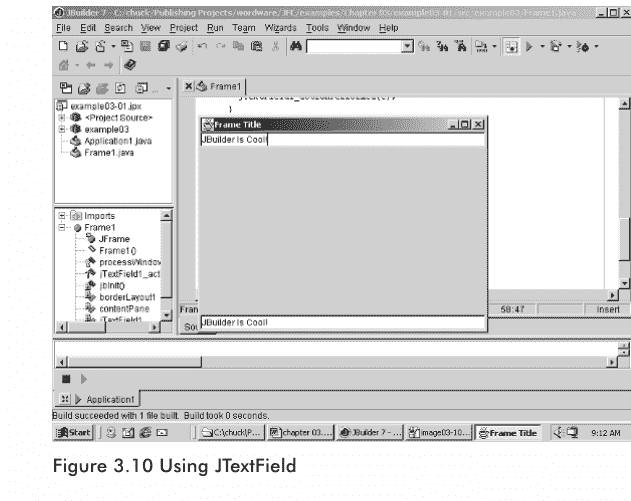

图 3.10 使用 JTextField

对于那些没有 JBuilder 的朋友，或者你只是想检查自己的代码，下面是完整的源代码：

```
package example03;
import java.awt.*;
import java.awt.event.*;
public class Frame1 extends JFrame
{
  private JPanel contentPane;
  private BorderLayout borderLayout1 = new BorderLayout();
  private JTextField jTextField1 = new JTextField();
  private JTextField jTextField2 = new JTextField();
  //Construct the frame
  public Frame1()
  {
    enableEvents(AWTEvent.WINDOW_EVENT_MASK);
    try
    {
      jbInit();
    }
    catch(Exception e)
    {
      e.printStackTrace();
    }
  }
  //Component initialization
  private void jbInit() throws Exception
  {
        contentPane = (JPanel) this.getContentPane();
        jTextField1.setText("jTextField1");
        jTextField1.addActionListener(new java.awt.event
            .ActionListener()
        {
            public void actionPerformed(ActionEvent e)
            {
                jTextField1_actionPerformed(e);
            }
        });
        contentPane.setLayout(borderLayout1);
        this.setSize(new Dimension(400, 300));
        this.setTitle("Frame Title");
        jTextField2.setText("jTextField2");
        contentPane.add(jTextField1, BorderLayout.NORTH);
        contentPane.add(jTextField2, BorderLayout.SOUTH);
    }
    protected void processWindowEvent(WindowEvent e)
    {
        super.processWindowEvent(e);
        if (e.getID() == WindowEvent.WINDOW_CLOSING)
        {
            System.exit(0);
        }
    }
    void jTextField1_actionPerformed(ActionEvent e)
    {
        jTextField2.setText(jTextField1.getText());
    }
}
```

正如你所看到的，JBuilder 为你生成了很多代码。这非常有用，因为它让你可以专注于手头的实际任务，而不必担心基础知识。现在是时候看看其他一些输入组件了。

### JPasswordField

JPasswordField 类相当直接。它的目的是为用户提供一个输入密码的地方。它非常类似于 JTextField，只是显示文本的方式不同。它不在屏幕上显示按下的键，而是显示一个密码字符。它与 JTextField 共享大部分方法。事实上，JPasswordField 组件继承自 JTextField。这意味着它拥有 JTextField 的所有方法，再加上一些额外的方法。这个类独有的方法总结在下表中。

| 方法 | 用途 |
| --- | --- |
| setEchoChar(char c) | 此方法为此 JPasswordField 设置回显字符。这可能是此类最重要的方法。 |
| char getText() | 这是一个已弃用的方法。从 Java 2 平台 v1.2 开始，它被 getPassword() 取代。这意味着它不再用于新代码，但仍然有效。 |
| char[] getPassword() | 这是用于返回此组件中包含的文本的方法。 |
| char getEchoChar() | 这是用于检索用于回显的字符的方法。 |
| append(String s) | 此函数接受一个字符串并简单地将其附加到现有文本中。 |

所有这些方法都涉及如何在不让旁观者从屏幕上读取密码的情况下显示密码。请记住，这个类也拥有从 JTextField 继承的所有方法。除了这些方法之外，JPasswordField 还有许多构造函数选项。每个都用于构造具有稍有不同的参数的 JPasswordField。表 3.5 总结了这些构造函数。


#### 表3.5 JPasswordField构造函数

| 构造函数 | 用途 |
|---|---|
| JPasswordField() | 此构造函数用于创建一个新的、空的JPasswordField，且不指定列数。 |
| JPasswordField(Document doc, String txt, int columns) | 此构造函数用于创建一个新的JPasswordField，它使用给定的文本存储模型和指定的列数。 |
| JPasswordField(int columns) | 此构造函数将创建一个新的、空的JPasswordField，并指定列数。 |
| JPasswordField(String text) | 此构造函数用于创建一个新的JPasswordField，并用指定的文本初始化。 |
| JPasswordField(String text, int columns) | 此构造函数将创建一个新的JPasswordField，用指定的文本和指定的列数初始化。 |

由于此组件在功能上几乎与`JTextField`完全相同，因此这里没有提供其使用的显式示例。那样做将是多余的，并且浪费篇幅。相反，本章后面将提供一个示例，将几个这些相当简单的组件组合成一个单一的示例，以展示它们的用法。

### JLabel

与其他类相比，`JLabel`类相对简单，但非常重要。此类允许你向用户提供只读文本。标签在标识应用程序中的其他可视组件时非常有用。例如，如果你希望用户在`JTextField`中输入她的名字，那么在其旁边放置一个标签（label）可能是个好主意，标签上写着“输入姓名”。这个类可能是你在本章中遇到的最简单的类。然而，与本章中的许多组件不同，此组件直接继承自`JComponent`，而不是`JTextComponent`。这意味着有一些属性和方法是`JLabel`与本章中其他组件所不共享的。其最常用的方法在表3.6中进行了总结。由于标签通常在应用程序启动时设置且保持不变，我在这里也包含了构造函数方法。

#### 表3.6 JLabel方法

| 方法 | 用途 |
| :--- | :--- |
| getDisabledIcon() | 此函数用于返回`disabledIcon`属性的值（如果该属性已设置）。如果未设置，并且`icon`属性的值是一个`ImageIcon`，我们将计算该图标的“灰度”版本，并用它来更新`disabledIcon`属性。 |
| getIcon() | 此方法将返回标签显示的图形图像（如果有）。 |
| getText() | 此方法简单地返回标签显示的文本字符串。 |
| setIcon(Icon icon) | 此函数用于设置此组件将要显示的图标。 |
| setText(String text) | 此方法用于设置此组件将要显示的文本。 |

这些方法的目的都相当直接。它们用于在运行时设置或检索`JLabel`将要显示的文本或图像。`JLabel`是一个相当简单的组件，其唯一目的是以静态或只读格式向用户显示文本或图像。除了前面表格中显示的方法外，`JLabel`当然也有几个构造函数选项。这些在表3.7中进行了总结。

#### 表3.7 JLabel构造函数

| 构造函数 | 用途 |
| :--- | :--- |
| JLabel() | 此构造函数用于创建一个`JLabel`实例，当前不显示任何内容。 |
| JLabel(String text) | 此构造函数创建一个带有指定文本的`JLabel`。 |
| JLabel(String text, int horizontalAlignment) | 此构造函数创建一个带有指定文本和指定水平对齐方式的`JLabel`实例。 |
| JLabel(Icon image) | 此构造函数将创建一个显示指定图像的`JLabel`实例。 |
| JLabel(Icon image, int horizontalAlignment) | 此构造函数将创建一个带有指定图像和指定水平对齐方式的`JLabel`实例。 |
| JLabel(String text, Icon icon, int horizontalAlignment) | 此构造函数将创建一个带有指定文本、图像和水平对齐方式的`JLabel`实例。 |

与`JPasswordField`一样，此组件非常易于使用。事实上，它非常易于使用，以至于仅仅为它提供一个单独的例子将是浪费。本章后面有一个示例，演示了`JLabel`、`JPasswordField`以及其他几个组件。

### JTextArea

如本章前面提到的，`JTextArea`只是`JTextField`的多行版本。通过此组件，你可以显示多行文本，而不是`JTextField`允许你显示的单行文本。有几个场景可以发挥其用处。例如，如果你正在创建一个跟踪员工数据的应用程序，并且你想要一个备注字段，那么`JTextArea`将非常适合允许用户输入多行文本。与本章讨论的许多组件一样，`JTextArea`继承自`javax.swing.text.TextComponent`。

AWT有一个此组件的版本，简单地称为`TextArea`。它本质上处理了滚动（如果文本超出了组件的边界）；然而，`JTextArea`没有。相反，它实现了Swing的`Scrollable`接口。这允许它在需要滚动行为时被放置在`JScrollPane`内部。此类共享在`JTextField`中发现的许多方法。下表总结了一些方法，这些方法要么是`JTextArea`特有的，要么是实现方式稍有不同。

#### 表3.8 JTextArea方法

| 方法 | 用途 |
|---|---|
| void append(String str) | 此方法将把传递给它的文本追加到文档的末尾。 |
| int getLineCount() | 此方法返回`JTextArea`当前包含的行数。 |
| Boolean getLineWrap() | 此方法返回文本区域的换行策略——如果开启换行则为`true`，否则为`false`。 |
| int getColumns() | 此方法将简单地返回`JTextArea`中的列数。 |
| int getRows() | 此方法将返回`JTextArea`中的行数，作为整数值。 |
| void setLineWrap(boolean wrap) | 此方法用于设置`JTextArea`的换行策略——`true`表示开启换行，`false`表示关闭。 |

如你所见，这些方法大多数都涉及设置`JTextArea`组件中文本的格式，特别是诸如行数、列数和换行等项目。其他方法如`getText`和`setText`与`JTextField`类中的相同。

除了显示的方法（以及你可以在JBuilder帮助文件中找到的其他方法）之外，此类还有几个不同的构造函数，每个都有其自己的目的。表3.9为您总结了这些。

#### 表3.9 JTextArea构造函数

| 构造函数 | 用途 |
|---|---|
| JTextArea() | 此构造函数创建一个新的`JTextArea`类实例，其中没有任何默认文本（即，一个空白实例）。 |
| JTextArea(Document doc) | 此构造函数将使用给定的文档模型创建一个新的`JTextArea`。 |
| JTextArea(String text) | 此构造函数用于创建一个新的`JTextArea`，并显示指定的文本。 |
| JTextArea(int rows, int columns) | 此构造函数创建一个新的空的`JTextArea`，指定行数和列数。 |

鉴于各种输入组件非常相似，我将不会为你提供每个组件的单独示例。相反，我将稍后在一个应用程序中将它们全部放在一起给你一个例子。

### 示例 3.2

请记住，到目前为止涵盖的几个组件没有给出单独的示例程序。你被告知稍后会有一个示例涵盖所有这些组件。这里就是那个示例程序，它向你展示了到目前为止讨论的几个组件类的用法。你将看到如何在一个应用程序中同时使用`JTextField`、`JLabel`和`JTextArea`。

再次说明，如果你没有JBuilder（早期版本如4.0、5.0和6.0也可以，尽管我使用的是7.0），那么只需直接跳到此示例的源代码部分，并在你最喜欢的文本编辑器中输入该代码。使用Sun JDK编译器从命令行/shell编译它。

**步骤1：** 第一步是像在上一个示例中那样启动一个新项目。我不会在这里向你展示所有那些步骤；只需选择**文件**和**新建项目**，然后按照向导操作。项目完成后，你可以选择**文件**和**新建**。然后选择**应用程序**，以便向你的项目添加一个新的基本源文件。

**步骤2：** 使用屏幕底部的**设计**选项卡，以便你可以图形化地将各种组件放置在屏幕上。这与我们在上一个示例中放置组件的方式完全相同。然后将布局管理器更改为`FlowLayout`。各种布局管理器将在下一章中更详细地讨论。目前，你只需要明白布局管理器决定了其他组件将如何布局在屏幕上。


### 第3章

现在，我们的目标是在屏幕上放置各种组件，以便学习如何使用它们。我们将一个JLabel（其文本已更改为下图所示内容）、一个JTextArea和一个JTextField放置在屏幕上，如图3.12所示。

步骤3：双击文本区域，你将进入其动作事件。将此处显示的这行代码放入其中：

```java
void jTextField1_actionPerformed(ActionEvent e)
{
    jTextArea1.append(jTextField1.getText());
}
```

现在，每次在JTextField1上按下回车键，其内容都会追加到JTextArea1中，如图3.13所示。

不使用JBuilder的读者，可以简单地在喜欢的文本编辑器中输入以下代码并进行编译：

```java
package untitled1;
import java.awt.*;
import java.awt.event.*;
import javax.swing.*;
public class Frame1 extends JFrame
{
    private JPanel contentPane;
    private JLabel jLabel1 = new JLabel();
    private FlowLayout flowLayout1 = new FlowLayout();
    private JTextField jTextField1 = new JTextField();
    private JTextArea jTextArea1 = new JTextArea();
    //Construct the frame
    public Frame1()
    {
        enableEvents(AWTEvent.WINDOW_EVENT_MASK);
        try
        {
            jbInit();
        }    // end of try block
        catch(Exception e)
        {
            e.printStackTrace();
        }    //end of catch block
    }    // end of frame constructor
    //Component initialization
    private void jbInit() throws Exception
    {
        contentPane = (JPanel) this.getContentPane();
        jLabel1.setText("Type text then press enter");
        contentPane.setLayout(flowLayout1);
        this.setSize(new Dimension(400, 300));
        this.setTitle("Frame Title");
        jTextField1.setText("jTextField1");
        jTextField1.addActionListener(new java.awt.event
            .ActionListener()
        {
            public void actionPerformed(ActionEvent e)
            {
                jTextField1_actionPerformed(e);
            }
        });
        jTextArea1.setText("jTextArea1");
        contentPane.add(jLabel1, null);
        contentPane.add(jTextField1, null);
        contentPane.add(jTextArea1, null);
    }
    //Overridden so we can exit when window is closed
    protected void processWindowEvent(WindowEvent e)
    {
        super.processWindowEvent(e);
        if (e.getID() == WindowEvent.WINDOW_CLOSING)
        {
            System.exit(0);
        }    // end of if
    }    // end of function

    void jTextField1_actionPerformed(ActionEvent e)
    {
        jTextField1.append(jTextField1.getText());
    }    // end of action performed
}    // end of class
```

### EditorKit

你会注意到接下来的两个类有一些方法使用了叫做EditorKit的东西。因此，在介绍使用它的类之前，我们先向你介绍一下这个概念。这个类建立了一套文本组件成为某种文本内容的功能性编辑器所需的组件。一个工具包可以安全地将其编辑状态存储为该工具包的一个实例。工具包将专用于一个文本组件。新的工具包通常通过克隆一个原型工具包来创建。工具包的setComponent方法将被调用，以建立它与JTextComponent的关系。

### JTextPane

JTextPane与JTextArea有相似之处，因为它也能容纳多行文本。然而，你之所以使用JTextPane，是因为它的格式化功能。使用JTextPane，你可以逐字符地格式化文本，就像文字处理器一样。本质上，这个类为你提供了一个文本编辑器。这个类有各种各样的方法允许你进行这种格式化。这个类继承自JEditorPane，而JEditorPane又继承自JTextComponent。当然，它也与JTextField和JTextArea共享许多方法。表3.10总结了JTextPane特有的字段。

**表3.10 JTextPane方法**

| 方法 | 用途 |
| --- | --- |
| Style addStyle(String nm, Style parent) | 此方法用于向逻辑样式层次结构中添加新样式。 |
| Style getLogicalStyle() | 此方法将返回分配给由当前插入符位置表示的段落的逻辑样式，或返回null。 |
| Style getStyle(String nm) | 此方法将返回先前添加的命名非空样式。 |
| getCharacterAttributes() | 此方法将返回在当前插入符位置生效的字符属性，或返回null。 |
| getParagraphAttributes() | 此方法用于返回在插入符位置生效的当前段落属性，如果没有则返回null。 |
| insertIcon(Icon g) | 此方法用于将一个图标插入文档中，作为当前选定内容的替换。 |
| removeStyle(String nm) | 此方法移除先前添加到文档中的命名非空样式。 |
| setDocument(Document doc) | 此方法用于为编辑器设置一个文本文档。 |
| setLogicalStyle(Style s) | 此方法用于设置当前插入符位置段落要使用的逻辑样式。 |
| protected EditorKit createDefaultEditorKit() | 此方法将创建默认的编辑器工具包（PlainEditorKit），用于组件首次创建时。 |
| protected StyledEditorKit getStyledEditorKit() | 此方法将检索编辑器工具包。 |

其中一些方法对你来说可能有些奇怪。你可能注意到其中几个方法要么接受要么返回一个Style类型的项目。Style本质上是一个接口，是一个与文档中元素关联的属性集合。其他与元素关联的自定义属性实际上将是在层次结构中存在的名称-值对，并且如果本地未找到名称（键），则请求将被转发到父级。常用的属性被分离出来，以方便更高效的替代实现。

与我们研究过的其他用户输入类不同，JTextPane只有两个构造函数，总结在表3.11中。

**表3.11 JTextPane构造函数**

| 构造函数 | 用途 |
| :--- | :--- |
| JTextPane() | 此构造函数是默认的无参数构造函数，用于创建一个空白的JTextPane。 |
| JTextPane(StyledDocument doc) | 此构造函数用于使用指定的文档模型创建一个新的JTextPane。 |

这个特定组件的使用频率不如其他一些组件。事实上，你可能编程多年也从未有机会使用它。因此，本书不会深入探讨其用法。然而，提供这个基本介绍是为了让你至少对JTextPane是什么以及它能做什么有一些基本的了解。

### JEditorPane

这个组件与JTextPane非常相似。然而，它不是允许你编辑基本文本，而是允许你在文本、HTML和RTF（富文本格式）样式之间进行选择。注意它支持HTML，允许你创建一个HTML编辑器。这个类继承自javax.swing.text.JTextComponent。

正如你可能猜到的，这个类与JTextPane共享几个方法。那些它与JTextPane不同且实现方式不同的方法总结在表3.12中。这些方法主要处理如何将文本加载到JEditorPane中。

**表3.12 JEditorPane方法**

| 方法 | 用途 |
|---|---|
| void setText(String t) | setText方法用于从字符串初始化组件。在这种情况下，将使用当前的EditorKit，并且内容类型应为此类型。 |
| read | read方法用于从读取器初始化组件。请注意，如果内容类型是HTML，除非使用<base>标签或设置了HTMLDocument的Base属性，否则无法解析相对引用（例如，对于图像之类的东西）。 |
| void setPage(String url) | setPage方法用于从URL初始化组件。在这种情况下，内容类型将从URL确定，并且将设置该内容类型的已注册EditorKit。 |
| void addHyperlinkListener(HyperlinkListener listener) | 此方法添加一个超链接监听器，用于通知任何更改（例如，当链接被选中并进入时）。 |
| void fireHyperlinkUpdate(HyperlinkEvent e) | 此方法通知所有已注册对此事件类型通知感兴趣的监听器。 |
| URL getPage() | 此方法返回当前显示的URL。 |
| EditorKit getEditorKit() | 此方法检索当前安装的用于处理内容的工具包。 |
| protected InputStream getStream(URL page) | 此方法为给定的URL检索一个流，该流将被setPage方法加载。 |
| void read(InputStream in, Object desc) | 此方法从流初始化。 |

JEditorPane是另一个虽然非常有用但不常见的组件。你可能使用Java多年都没有机会使用这个组件。在本书中，我们正努力让你尽快掌握JFC和Swing最常用的方面。

然而，像这样不太常见的组件之所以被引入，是为了让你至少对它们有所了解。

### JButton

严格来说，JButton 组件并非用户输入组件。然而，它的使用如此广泛，以至于本书必须在早期就对其进行介绍，因为你在后续章节中会用到它。此外，人们可能会认为（尽管这种观点相当站不住脚）JButton 允许用户提交输入。无论如何，JButton 是 AWT 按钮的 Swing/JFC 版本。JButton 继承自 `javax.swing.AbstractButton`，而后者又继承自 JComponent。

这个组件的使用应该相当直观。你在屏幕上放置一个按钮，用户用鼠标点击它以触发某个动作的发生。这个按钮具有许多属性和事件，你无疑会发现它们非常有用。最常用的属性和方法总结在表 3.13 中。

表 3.13 JButton 方法和属性

| 属性/方法 | 用途 |
| --- | --- |
| text | 此属性允许你设置用户将看到的文本。 |
| foreground | 此属性允许你设置字体颜色。 |
| background | 此属性允许你设置按钮的颜色。 |
| font | 此属性允许你为按钮文本选择各种字体。 |
| icon | 此属性允许你显示按钮上的图标。 |
| tooltipText | 此属性允许你创建简短的文本段，当用户的鼠标悬停在按钮上时会自动显示。 |
| actionPerformed | 这是与 JButton 关联的主要事件，当按钮被点击时执行。 |
| setText(String) | 此方法允许你更改按钮显示的文本。 |
| getText() | 此方法返回包含按钮上文本的字符串。 |
| hasFocus() | 如果按钮当前具有焦点，则此属性为 true，否则为 false。 |

当然，JButton 的属性不止这些，但这些是你最常用的。你应该熟悉这些属性和方法，以便能够恰当地使用 JButton。如果你使用的是 JBuilder，其中许多可以通过属性窗口进行设置。JButton 还有许多不同的构造函数，可用于创建各种不同类型的 JButton。这些构造函数总结在表 3.14 中。

表 3.14 JButton 构造函数

| 构造函数 | 用途 |
|---|---|
| JButton() | 此构造函数创建一个空白按钮（即一个没有设置文本或图标的按钮）。 |
| JButton(Action a) | 此构造函数创建一个按钮，其属性从提供的 action 中获取。 |
| JButton(Icon icon) | 此构造函数创建一个显示图标的按钮。 |
| JButton(String text) | 此构造函数创建一个带有文本的按钮。 |
| JButton(String text, Icon icon) | 此构造函数用于创建带有初始文本和图标的按钮。 |

第 6 章将非常详细地讨论事件和事件处理。你可能对按钮的工作原理有一个直观的认识，因为你在软件中无疑使用过许多按钮。让我们看一个例子，它应该能帮助你了解如何使用 JFC/Swing 按钮。

### 示例 3.3

步骤 1：启动一个新项目并为其添加一个标准应用程序，就像你在前面的示例中所做的那样。

步骤 2：在设计屏幕上，将容器的布局更改为 **FlowLayout**。不用担心，布局管理器将在第 4 章中详细解释。

步骤 3：在屏幕上放置一个按钮。

步骤 4：我们现在要更改它的几个属性。将文本更改为 "Java"，将背景色和前景色更改为任何你认为合适的颜色。（只需点击背景或前景属性，就会出现一个允许你混合颜色的小窗口。）

我还将字体更改为 SansSerif 并加粗。完成这些属性的更改后，你的按钮应该如图 3.15 所示。

**步骤 5：** 现在双击按钮，进入其 actionPerformed 事件。只需输入一行代码：

```java
void jButton1_actionPerformed(ActionEvent e)
{
    jButton1.setText("Is Cool");
}
```

**步骤 6：** 对于不使用 JBuilder 的读者，只需将以下代码输入到你喜欢的文本编辑器中并编译它：

```java
package example;
import java.awt.*;
import java.awt.event.*;
import javax.swing.*;
public class Frame1 extends JFrame
{
    private JPanel contentPane;
    private FlowLayout flowLayout1 = new FlowLayout();
    private JButton jButton1 = new JButton();
    //Construct the frame
    public Frame1()
    {
        enableEvents(AWTEvent.WINDOW_EVENT_MASK);
        try
        {
            jbInit();
        }       // end of try block
        catch(Exception e)
        {
            e.printStackTrace();
        }       // end of catch block
    }       // end of constructor
    //Component initialization
    private void jbInit() throws Exception
    {
        contentPane = (JPanel) this.getContentPane();
        // The following lines set the properties for the JButton
        jButton1.setBackground(new Color(212, 171, 200));
        jButton1.setFont(new java.awt.Font("SansSerif", 1, 12));
        jButton1.setForeground(new Color(255, 0, 53));
        jButton1.setText("Java");
        jButton1.addActionListener(new java.awt.event
                .ActionListener()
        {
            public void actionPerformed(ActionEvent e)
            {
                jButton1_actionPerformed(e);
            }
        });
        contentPane.setLayout(flowLayout1);
        this.setSize(new Dimension(400, 300));
        this.setTitle("Frame Title");
        contentPane.add(jButton1, null);
    }
    //Overridden so we can exit when window is closed
    protected void processWindowEvent(WindowEvent e)
    {
        super.processWindowEvent(e);
        if (e.getID() == WindowEvent.WINDOW_CLOSING)
        {
            System.exit(0);
        }       // end of if
    }       // end of processWindowEvent
    void jButton1_actionPerformed(ActionEvent e)
    {
        jButton1.setText("Is Cool");
    }       // end of action performed event
}// end of class
```

步骤 7：运行你的应用程序。当它首次启动时，按钮应显示 "Java"，然后当你点击它时，标题应更改为 "Is Cool"。

显然，JButton 还有更多的属性和方法，你将在本书后续示例中需要时接触到它们。然而，这个例子应该向你展示了 JButton 的基础知识，并让你对其使用有了很好的感觉。

### 总结

本章总结了最基本的用户输入和显示类。这些类创建了允许你以各种格式向用户显示文本，并从用户那里以同样多样化的格式获取文本输入的组件。这些是基础类；很难想象一个 Java 程序员在不使用它们的情况下编写许多应用程序。因此，你必须非常熟悉它们。迄今为止，JTextField 组件是使用最广泛的，JTextArea 和 JPasswordField 紧随其后并列第二。

### 复习题

- 1. 本章列出的哪两个类不允许显示多行文本？
- 2. 你会使用哪个类来显示 HTML？
- 3. 如果你不想在屏幕上显示实际的按键，你会使用哪个类？
- 4. 列出 JTextField 组件的两个方法。
- 5. 列出 JPasswordField 组件的两个方法。
- 6. JTextField 和 JTextArea 的主要区别是什么？
- 7. 什么是 EditorKit？
- 8. 如何向 JTextArea 的末尾添加文本？
- 9. 说出 AWT TextArea 和 JFC JTextArea 的一个区别。
- 10. JTextPane 和 JTextArea 的主要区别是什么？

## 第 4 章

### 外观与感觉

本章涵盖以下内容：

- 布局管理器
- BorderLayout
- GridLayout
- XYLayout
- FlowLayout
- VerticalFlowLayout
- BoxLayout2
- CardLayout
- OverlayLayout
- GridbagLayout
- PaneLayout
- 外观与感觉

### 简介

图形用户界面最重要的方面之一是能够改变应用程序的外观以及它的感觉。你的应用程序的外观和感觉将对用户对其的印象产生巨大影响。JFC/Swing 提供了多种方法和类来帮助你实现这一点。第一种是布局管理器类。这些布局管理器允许你设置容器上组件的排列方式。我们已经在上一章中使用了一个布局管理器，而没有


### 布局管理器

你的组件需要以某种格式显示。布局管理器允许你修改显示方式。使用JFC时，有十种布局管理器。使用AWT时，有五种（GridLayout、GridbagLayout等）。其中每一种都规定了使用给定布局管理器添加到容器中的组件的不同布局顺序。下表总结了这些布局管理器及其基本用途。

表4.1 JFC布局管理器

| 布局管理器 | 用途 |
| --- | --- |
| BorderLayout | 这种布局管理器非常常见。它将容器的组件排列在名为北、南、东、西和中的区域。北和南区域的组件会被赋予其首选高度，并水平拉伸以填满容器的整个宽度。东和西区域的组件会被赋予其首选宽度，并垂直拉伸以填充北和南区域之间的空间。你会在各种情况下遇到BorderLayout管理器。 |
| BoxLayout2Layout | 这种布局管理器允许多个组件垂直或水平排列。组件不会换行；因此，当框架调整大小时，组件的垂直排列将保持垂直排列。 |
| CardLayout | CardLayout将组件彼此堆叠放置，类似于一叠卡片。一次只能看到一个组件。 |
| FlowLayout | FlowLayout按从左到右、从上到下的顺序排列组件行，使用每个组件的正常大小。FlowLayout在一行中排列尽可能多的组件，然后移到新行。这个简单的布局管理器是某些容器的默认布局管理器；然而，它的布局，至少在许多情况下，对于真正吸引人的图形用户界面来说过于简单。 |
| GridLayout | GridLayout管理器将组件放置在由行和列组成的网格单元格中。GridLayout会扩展每个组件以填满其单元格内的可用空间。这种特定的布局管理器非常常见。你应该确保你很熟悉它，因为你会经常看到它。 |
| GridbagLayout | GridbagLayout管理器类似于GridLayout，但更灵活。GridbagLayout在动态矩形网格上水平和垂直定位组件。行不必具有相同数量的单元格。 |
| OverlayLayout | 这种布局管理器类似于CardLayout管理器，因为它将组件彼此堆叠放置。然而，与CardLayout不同的是，如果你使容器中的每个组件都透明，则几个组件可以同时可见。 |
| PaneLayout | PaneLayout允许你指定组件相对于其同级组件的大小。 |
| VerticalFlowLayout | VerticalFlowLayout管理器按从上到下、从左到右的列排列组件，使用每个组件的默认大小。这种布局管理器在一列中排列尽可能多的组件，然后移到新列。 |
| XYLayout | XYLayout不是标准的Java布局管理器。如果你使用的是Sun JDK而不是JBuilder，你将无法访问这个特定的布局管理器；它仅适用于JBuilder。XYLayout将组件放置在容器中的特定x,y坐标，因此得名。在此坐标系中，原点(0,0)是左上角。这是本章中唯一提到的不属于Java SDK的布局管理器。 |

所有各种布局管理器类都实现了Layout接口。该接口定义了所有布局管理器实现的通用方法。下表总结了这些方法。

表4.2 Layout接口方法

| 方法 | 用途 |
| :--- | :--- |
| void addLayoutComponent(String name, Component comp) | 此方法用于将指定组件以指定名称添加到布局中。如果不将组件添加到布局管理器中，你确实无法使用它们，因此这是Layout接口中最常用的方法。 |
| void layoutContainer(Container parent) | 此方法将在指定的面板中布局容器。 |
| void removeLayoutComponent(Component comp) | 此方法用于从布局中移除指定组件。 |
| dimension minimumLayoutSize(Container parent) | 此方法根据指定父容器中的组件计算指定面板的最小尺寸。 |
| dimension preferredLayoutSize(Container parent) | 此方法根据指定父容器中的组件计算指定面板的首选尺寸。 |

这些只是一些方法，但它们包含了你有效使用任何特定布局管理器可能需要的所有功能。当然，像所有类一样，你需要实例化一个布局管理器类才能使用该特定布局管理器。你创建布局管理器的方式与创建任何其他Java类的实例相同。这是一个例子：

```java
private GridLayout gridLayout1 = new GridLayout(4,1);
```

我们创建了一个GridLayout管理器的实例，命名为gridLayout1。我们的GridLayout管理器有四行一列。你的应用程序或applet可能包含多个容器组件。你需要将特定容器与特定布局管理器关联起来。所有容器组件都有一个方法setLayout，它允许你将特定布局与特定容器关联。这是一个例子：

```java
contentPane.setLayout(gridLayout1);
```

你可以看到，将特定布局与特定容器组件关联起来相当简单。困难在于为特定情况选择正确的布局管理器，并正确操作该布局管理器。让我们来看看各种布局管理器，它们是如何实现的，以及什么情况最适合使用它们。对于最常用的布局管理器提供了示例。

### BorderLayout

BorderLayout管理器将组件排列到五个区域。有一个相当大的中央区域，以及较小的北、南、东和西区域。这种布局管理器常用于放置将托管其他组件的容器组件。图4.2为你描述了布局安排。

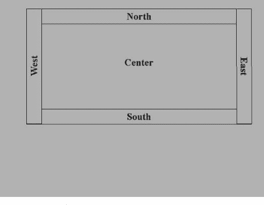

图4.2 BorderLayout

### GridLayout

如前所述，GridLayout管理器将组件排列在一个网格中，每行具有相同数量的单元格。行数和列数由实例化时传递给GridLayout管理器的两个数字确定。第一个数字表示行数，第二个表示列数。所以如果你写：

```java
GridLayout mygrid = new GridLayout(4,2);
```

...你正在声明一个具有四行两列的网格布局。一个特别有用的场景是计算器应用程序。由于按钮必须排列成网格格式，GridLayout管理器非常适合这种情况。以下示例有点长，但为你提供了GridLayout管理器各种用途的良好示例，以及BorderLayout。

### 示例4.1

**步骤1：** 使用JBuilder打开一个新项目。（同样，没有JBuilder的用户可以简单地跳转到源代码，将其输入到他们喜欢的文本编辑器中并编译它。）

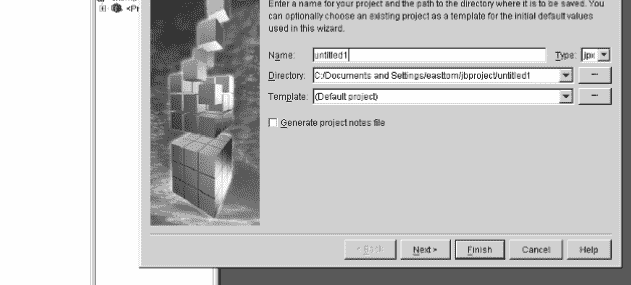

图4.3 示例4.1

### 步骤 2：向项目添加一个标准应用程序。你可以使用此步骤的默认设置。

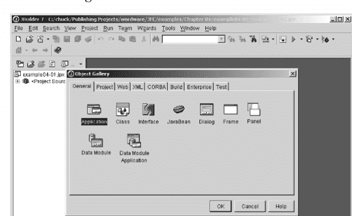

图 4.4 示例 4.1

### 步骤 3：使用“设计”选项卡设置 BorderLayout 管理器。

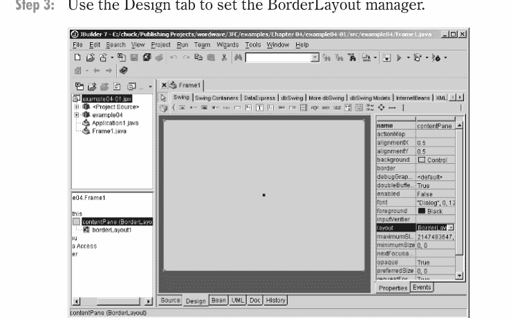

图 4.5 示例 4.1

### 步骤 4：设置好 BorderLayout 管理器后，将面板放置在居中（Center）和右侧（East）区域（你会在第二个标题为 "Swing Containers" 的选项卡上找到 `JPanel` 控件）。每个面板都应使用网格布局。然后，你可以进入代码部分，像这样修改行数和列数：

```
private GridLayout gridLayout1 = new GridLayout(5,1);
private GridLayout gridLayout2 = new GridLayout(3,4);
```

> **注意：** 第 5 章将详细讨论容器；现在只需将它们放置在所需位置即可。

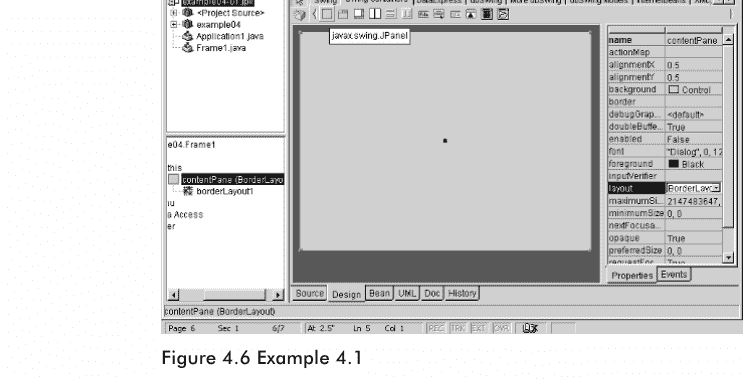

图 4.6 示例 4.1

> **注意：** 如果你为每个面板设置不同的背景颜色，可能更容易看清它们的位置。这也许不是最美观的布局，但它将帮助你记住物品的放置位置！

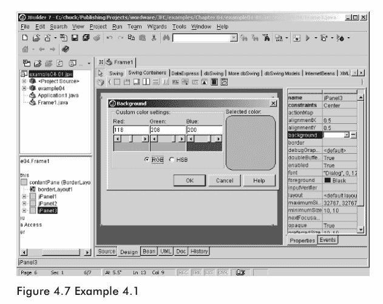

### 步骤 5：在北侧（North）区域放置一个背景为白色、默认标题为 "0" 的标签。将标签的水平对齐属性设置为 **右对齐 (RIGHT)**，其边框类型设置为 **蚀刻 (Etched)**。

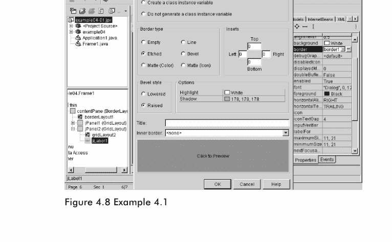

### 步骤 6：我们现在要在这个显示界面上添加一些按钮。屏幕东侧（右侧）面板上的按钮将包含我们计算器的功能按钮；因此，我们将创建一个名为 `btnfunction` 的按钮数组。

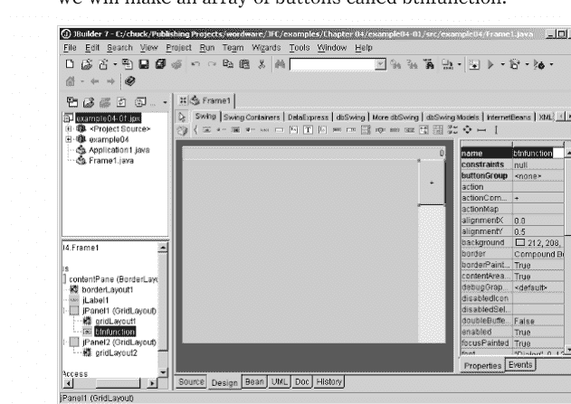

图 4.9 计算器按钮

> **注意：** 你可以简单地右键单击第一个按钮，选择复制，然后粘贴四次。接着，按照此处所示更改标题即可。

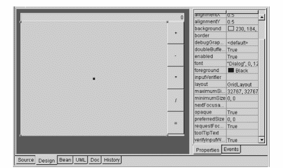

图 4.10 计算器按钮 2

要将按钮添加到居中（Center）面板，操作过程基本相同。从一个名为 `btnnumber` 的按钮开始，然后创建一个数组。然后你可以像这张图片中看到的那样更改标题：

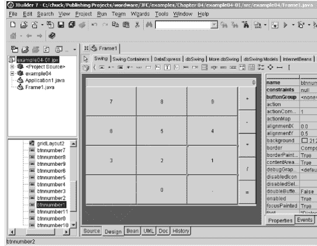

图 4.11 数字按钮

> **警告：** 你将不得不移动按钮，直到数字按钮与文本字段匹配。换句话说，`btnnumber1` 必须是文本属性为 "1" 的按钮。`btnnumber10` 应该是 "." 按钮。零按钮将是原始的 `btnnumber`，你需要将其名称更改为 `btnnumber0`。

这将向你清楚地展示 BorderLayout 和 GridLayout 管理器的工作方式。此时，我们不打算为这个计算器添加任何功能。我们将在事件章节（第 6 章）中这样做，因为所有这些代码都将与发生的事件（如按下按钮）相关。对于未使用 JBuilder 的读者，你可以通过打开你喜爱的文本编辑器并输入此处看到的代码来完成此处所有操作：

```
package example04;
import java.awt.*;
import java.awt.event.*;
import javax.swing.*;
import javax.swing.border.*;
public class Frame1 extends JFrame
{
    private JPanel contentPane;
    private BorderLayout borderLayout1 = new BorderLayout();
    private Border border1;
    private JLabel jLabel1 = new JLabel();
    private JPanel jPanel1 = new JPanel();
    private JPanel jPanel2 = new JPanel();
    private JButton btnfunction = new JButton();
    private GridLayout gridLayout1 = new GridLayout(5,1);
    private GridLayout gridLayout2 = new GridLayout(4,3);
    private JButton btnfunction1 = new JButton();
    private JButton btnfunction2 = new JButton();
    private JButton btnfunction3 = new JButton();
    private JButton btnfunction4 = new JButton();
    private JToggleButton btnnumber0 = new JToggleButton();
    private JToggleButton btnnumber1 = new JToggleButton();
    private JToggleButton btnnumber2 = new JToggleButton();
    private JToggleButton btnnumber3 = new JToggleButton();
    private JToggleButton btnnumber4 = new JToggleButton();
    private JToggleButton btnnumber5 = new JToggleButton();
    private JToggleButton btnnumber6 = new JToggleButton();
    private JToggleButton btnnumber7 = new JToggleButton();
    private JToggleButton btnnumber8 = new JToggleButton();
    private JToggleButton btnnumber9 = new JToggleButton();
    private JToggleButton btnnumber10 = new JToggleButton();
    private JToggleButton btnnumber11 = new JToggleButton();
    //构造框架
    public Frame1()
    {
        enableEvents(AWTEvent.WINDOW_EVENT_MASK);
        try
        {
            jbInit();
        }
        catch(Exception e)
        {
            e.printStackTrace();
        }
    }
```

//组件初始化
private void jbInit() throws Exception
{
    contentPane = (JPanel) this.getContentPane();
    border1 = new EtchedBorder(EtchedBorder.RAISED,
        Color.white,new Color(178, 178, 178));
    contentPane.setLayout(borderLayout1);
    this.setSize(new Dimension(400, 300));
    this.setTitle("框架标题");
    jLabel1.setBackground(Color.white);
    jLabel1.setBorder(border1);
    jLabel1.setHorizontalAlignment(SwingConstants.RIGHT);
    jLabel1.setText("0");
    jPanel1.setBackground(new Color(230, 255, 105));
    jPanel1.setLayout(gridLayout1);
    jPanel2.setBackground(new Color(230, 184, 255));
    jPanel2.setLayout(gridLayout2);
    btnfunction.setText("+");
    btnfunction1.setText("-");
    btnfunction2.setText("*");
    btnfunction3.setText("/");
    btnfunction4.setText("=");
    btnnumber0.setText("0");
    btnnumber1.setText("1");
    btnnumber2.setText("2");
    btnnumber3.setText("3");
    btnnumber4.setText("4");
    btnnumber5.setText("5");
    btnnumber6.setText("6");
    btnnumber7.setText("7");
    btnnumber8.setText("8");
    btnnumber10.setText(".");
    btnnumber9.setText("9");
    contentPane.add(jLabel1, BorderLayout.NORTH);
    contentPane.add(jPanel1, BorderLayout.EAST);
    contentPane.add(jPanel2, BorderLayout.CENTER);
    jPanel2.add(btnnumber7, null);
    jPanel2.add(btnnumber8, null);
    jPanel2.add(btnnumber9, null);
    jPanel2.add(btnnumber6, null);
    jPanel2.add(btnnumber5, null);
    jPanel2.add(btnnumber4, null);
    jPanel2.add(btnnumber3, null);
    jPanel2.add(btnnumber2, null);
    jPanel2.add(btnnumber1, null);
    jPanel2.add(btnnumber11, null);
    jPanel2.add(btnnumber0, null);
    jPanel2.add(btnnumber10, null);
    jPanel1.add(btnfunction, null);
    jPanel1.add(btnfunction1, null);
    jPanel1.add(btnfunction2, null);
    jPanel1.add(btnfunction3, null);
    jPanel1.add(btnfunction4, null);
}
//重写此方法以便在窗口关闭时退出
protected void processWindowEvent(WindowEvent e)
{
    super.processWindowEvent(e);
    if (e.getID() == WindowEvent.WINDOW_CLOSING) {
        System.exit(0);
    }
}
}
```

现在我不怀疑，看到所有这些代码可能让你感到相当畏难。别担心——所有内容都会被解释。事实上，代码本身相当简单；只是碰巧量很大。真正构成代码主体的只有两个部分。第一部分在 `Frame` 类的开头。此时，所有将要使用的组件都被声明。它们的声明非常类似于任何其他对象变量的实例化。接下来是 `jbInit` 函数。这是初始化项目的地方。设置了尺寸，并将布局管理器与特定组件关联起来。如果你逐行检查这段代码，它实际上并不那么复杂。由于我们尚未向此程序添加任何功能，`jbInit` 是程序中唯一真正的函数。我们还没有任何处理动作或操作数据的函数（但你将在第 6 章中实现！）。

100 ■ 第 4 章

### XYLayout

当你需要将组件放置在特定且精确的位置时，XYLayout 管理器非常有用。使用此布局管理器，你可以指定希望放置组件的 x 和 y 坐标，因此得名。让我们看一个例子。

### 示例 4.2

**步骤 1：** 启动一个新项目，并向其添加一个标准的 Application 对象。操作方法与之前的示例完全相同。

### 步骤 2：将背景容器的布局管理器设置为 **XY**。（如果你在添加 Application 对象时使用默认设置，还会添加一个帧并将其用作其他组件的容器。）

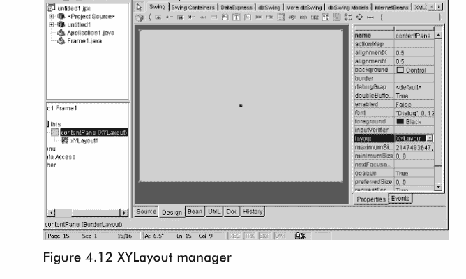


### XYLayout

步骤 3：为了演示，在屏幕上放置三个不同的按钮。请注意，您可以将它们移动到您想要的任何位置。

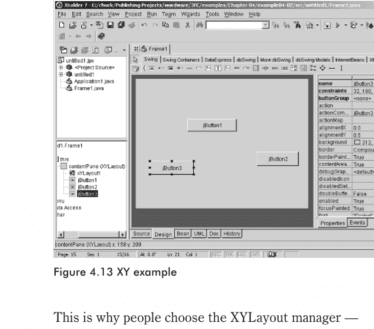

图 4.13 XY 示例

这就是人们选择 XYLayout 布局管理器的原因——因为它可以将组件放置在精确的位置。为您生成了以下代码：

```java
package untitled1;
import java.awt.*;
import java.awt.event.*;
import javax.swing.*;
import com.borland.jbcl.layout.*;

public class Frame1 extends JFrame {
    private JPanel contentPane;
    private XYLayout xYLayout1 = new XYLayout();
    private JButton jButton1 = new JButton();
    private JButton jButton2 = new JButton();
    private JButton jButton3 = new JButton();

    //Construct the frame
    public Frame1() {
        enableEvents(AWTEvent.WINDOW_EVENT_MASK);
        try {
            jbInit();
        } catch(Exception e) {
            e.printStackTrace();
        }
    }

    //Component initialization
    private void jbInit() throws Exception {
        contentPane = (JPanel) this.getContentPane();
        jButton1.setText("jButton1");
        contentPane.setLayout(xYLayout1);
        this.setSize(new Dimension(400, 300));
        this.setTitle("Frame Title");
        jButton2.setText("jButton2");
        jButton3.setText("jButton3");
        contentPane.add(jButton1, new XYConstraints(120, 93, 114, 29));
        contentPane.add(jButton2, new XYConstraints(281, 169, 97, 33));
        contentPane.add(jButton3, new XYConstraints(32, 190, 103, 32));
    }

    //Overridden so we can exit when window is closed
    protected void processWindowEvent(WindowEvent e) {
        super.processWindowEvent(e);
        if (e.getID() == WindowEvent.WINDOW_CLOSING) {
            System.exit(0);
        }
    }
}
```

从我们的角度来看，这段代码中唯一真正有趣的部分是与 XYLayout 布局管理器相关的特定代码。这实际上由两种类型的表达式组成，第一种是建立使用 XYLayout 布局管理器。这是通过以下代码行完成的：

```java
contentPane.setLayout(xYLayout1);
```

当添加其他组件时，它们会被赋予特定的 x 和 y 坐标。每个组件将被赋予四个数字。前两个是组件左上角的 x 和 y 坐标；然后是组件右下角的 x 和 y 坐标。

```java
contentPane.add(jButton1, new XYConstraints(120, 93, 114, 29));
contentPane.add(jButton2, new XYConstraints(281, 169, 97, 33));
contentPane.add(jButton3, new XYConstraints(32, 190, 103, 32));
```

XYLayout 布局管理器是使用 JBuilder 优势的又一个例子。您不仅可以访问像这样额外的布局管理器，而且仅凭 x 和 y 坐标来直观地查看组件的确切位置对您来说可能很困难。使用 JBuilder，您只需在一个图形环境中放置它们即可。

### FlowLayout

FlowLayout 布局管理器是最简单的布局管理器之一。组件只是从左到右放置在屏幕上，直到一行填满，然后开始下一行。这通常不能产生有吸引力的布局。

### VerticalFlowLayout

VerticalFlowLayout 布局管理器实际上与 FlowLayout 布局管理器相同，只是组件按垂直列排列，直到一列填满，然后开始下一列。以下示例同时展示了 FlowLayout 和 VerticalFlowLayout。

#### 示例 4.3

步骤 1：启动一个新项目并添加一个标准的 Application 对象到其中。

步骤 2：将背景框架保持其默认的边界布局。

步骤 3：在西端放置一个 JPanel（记住，您可以从 Swing Containers 选项卡中获取它），在东端放置一个。回想一下，更改面板的背景颜色将使您更容易记住您放置它们的位置。

步骤 4：将西端面板的布局管理器设置为 **VerticalFlowLayout**，将东端面板的布局管理器设置为 **FlowLayout**。现在向每个面板添加三个按钮。您应该看到类似图 4.14 所显示的内容。

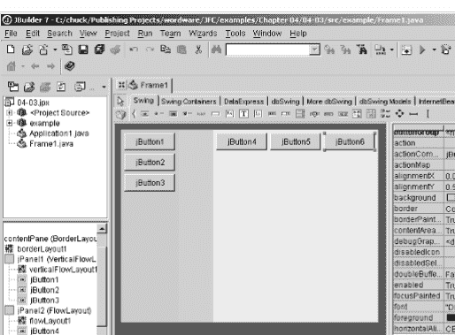

正如您所看到的，主要区别在于 FlowLayout 是水平方向的，而 VerticalFlowLayout 布局管理器当然是垂直的。

如果您不使用 JBuilder，您可以简单地将以下代码输入到您喜欢的文本编辑器中：

```java
package example;
import java.awt.*;
import java.awt.event.*;
import javax.swing.*;
import com.borland.jbcl.layout.*;

public class Frame1 extends JFrame {
    private JPanel contentPane;
    private BorderLayout borderLayout1 = new BorderLayout();
    private JPanel jPanel1 = new JPanel();
    private JPanel jPanel2 = new JPanel();
    private FlowLayout flowLayout1 = new FlowLayout();
    private VerticalFlowLayout verticalFlowLayout1 = new VerticalFlowLayout();
    private JButton jButton1 = new JButton();
    private JButton jButton2 = new JButton();
    private JButton jButton3 = new JButton();
    private JButton jButton4 = new JButton();
    private JButton jButton5 = new JButton();
    private JButton jButton6 = new JButton();

    //Construct the frame
    public Frame1() {
        enableEvents(AWTEvent.WINDOW_EVENT_MASK);
        try {
            jbInit();
        } catch(Exception e) {
            e.printStackTrace();
        }
    }

    //Component initialization
    private void jbInit() throws Exception {
        contentPane = (JPanel) this.getContentPane();
        contentPane.setLayout(borderLayout1);
        this.setSize(new Dimension(400, 300));
        this.setTitle("Frame Title");
        jPanel1.setBackground(new Color(212, 208, 160));
        jPanel1.setLayout(verticalFlowLayout1);
        jPanel2.setBackground(new Color(212, 255, 200));
        jPanel2.setLayout(flowLayout1);
        jButton1.setText("jButton1");
        jButton2.setText("jButton2");
        jButton3.setText("jButton3");
        jButton4.setText("jButton4");
        jButton5.setText("jButton5");
        jButton6.setText("jButton6");
        contentPane.add(jPanel1, BorderLayout.WEST);
        jPanel1.add(jButton1, null);
        jPanel1.add(jButton2, null);
        jPanel1.add(jButton3, null);
        contentPane.add(jPanel2, BorderLayout.EAST);
        jPanel2.add(jButton4, null);
        jPanel2.add(jButton5, null);
        jPanel2.add(jButton6, null);
    }

    //Overridden so we can exit when window is closed
    protected void processWindowEvent(WindowEvent e) {
        super.processWindowEvent(e);
        if (e.getID() == WindowEvent.WINDOW_CLOSING) {
            System.exit(0);
        }
    }
}
```

### BoxLayout2

BoxLayout2 布局管理器直接继承自 java.lang.Object，因此您不必从 AWT 或 Component 类继承。此布局管理器允许多个容器对象垂直或水平排列。与 FlowLayout 和 VerticalFlowLayout 布局管理器不同，此布局管理器的组件不会换行。这意味着当容器调整大小时，它们的位置不会改变。

### CardLayout

CardLayout 布局管理器一次只允许查看一个组件，很像一副扑克牌。您可以翻阅组件，一次查看一个组件。通常，组件本身就是容器组件。您可以使用类似此处看到的代码来更改“卡片”：

```java
CardLayout cl = (CardLayout)(nameofcontainerwithcardlayout.getLayout());
cl.show(nameofcontainerwithcardlayout, "nameofcontaineryouwanttoshow");
```

让我们看一个说明此布局管理器的示例。

#### 示例 4.4

步骤 1：启动一个新项目并添加一个 Application 对象到其中，就像您在前面的示例中所做的那样。

步骤 2：在 Design 选项卡上，将布局设置为 Card。

步骤 3：在屏幕上放置两个面板。将每个面板设置为不同的颜色，并在每个面板上放置一个按钮。按钮和颜色只是为了在您翻阅各个组件时能够分辨。

步骤 4：当您第一次运行项目时，您将看到类似下图所示的内容。

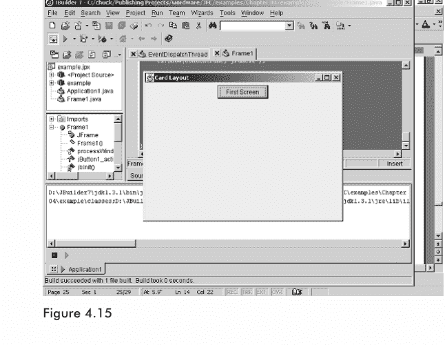

图 4.15

按下按钮后，您将看到类似此图所示的内容。

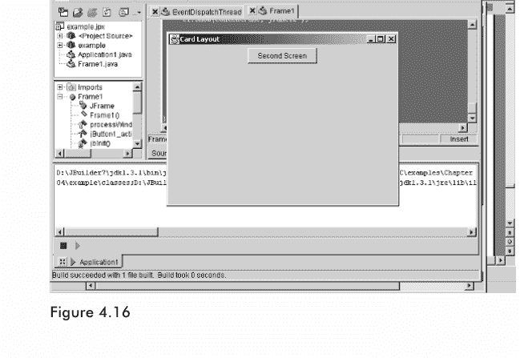

图 4.16

对于那些不使用 JBuilder 的读者，只需将以下代码输入到你喜爱的文本编辑器中并编译即可：

```java
package example;
import java.awt.*;
import java.awt.event.*;
import javax.swing.*;
public class Frame1 extends JFrame
{
    private JPanel contentPane;
    private CardLayout cardLayout1 = new CardLayout();
    private JPanel jPanel1 = new JPanel();
    private JButton jButton1 = new JButton();
    private JPanel jPanel2 = new JPanel();
    private JButton jButton2 = new JButton();
    private JPanel jPanel3 = new JPanel();
    private JButton jButton3 = new JButton();
    //Construct the frame
    public Frame1()
    {
        enableEvents(AWTEvent.WINDOW_EVENT_MASK);
        try
        {
            jbInit();
        }       // end of try
        catch(Exception e)
        {
            e.printStackTrace();
        }       // end of catch
    }
    //Component initialization
    private void jbInit() throws Exception
    {
        contentPane = (JPanel) this.getContentPane();
        contentPane.setLayout(cardLayout1);
        this.setSize(new Dimension(400, 300));
        this.setTitle("Card Layout");
        jPanel1.setBackground(new Color(212, 255, 211));
        jButton1.setText("First Screen");
        contentPane.add(jPanel1, "jPanel1");
        jPanel1.add(jButton1, null);
        jButton2.setText("Second Screen");
        contentPane.add(jPanel2, "jPanel2");
        jPanel2.add(jButton2, null);
        jButton1.addActionListener(new java.awt.event
            .ActionListener() {
            public void actionPerformed(ActionEvent e)
            {
                jButton1_actionPerformed(e);
            }    //end of action performed
        });
    }
    //Overridden so we can exit when window is closed
    protected void processWindowEvent(WindowEvent e)
    {
        super.processWindowEvent(e);
        if (e.getID() == WindowEvent.WINDOW_CLOSING)
        {
            System.exit(0);
        }
    }

    void jButton1_actionPerformed(ActionEvent e)
    {
        try
        {
            CardLayout cl = (CardLayout)(contentPane.getLayout());
            cl.show(contentPane,"jPanel2");
        }// end of try
        catch(Exception err)
        {
            err.printStackTrace();
            jButton1.setText(err.toString());
        }// end of catch
    }
}
```

如你所见，`CardLayout` 布局管理器使用起来相当简单。不要被所有的代码吓倒。基本上，这里发生的就是组件被创建、初始化，并与所需的容器关联起来。

### OverlayLayout

`OverlayLayout` 管理器将各项彼此叠放，有点像 `CardLayout`。然而，与 `CardLayout` 不同的是，各个项目可以同时可见。除此以外，其行为与前面描述的 `CardLayout` 管理器非常相似。

### GridbagLayout

`GridbagLayout` 实际上与网格布局相同，只是各个行不必具有相同数量的单元格。除此以外，它几乎与你在计算器示例中使用过的 `GridLayout` 管理器完全相同。

### PaneLayout

此布局管理器允许你根据组件的同级组件来指定其大小。每个组件都非常像窗口中的窗格（因此得名）；但是，每个组件的大小是根据正在显示的其他组件的大小来确定的。让我们看一个示例来说明这一点。

### 示例 4.5

1.  **步骤 1：** 启动一个新项目并向其添加一个新的 `Application` 对象，就像你在之前所有示例中所做的那样。
2.  **步骤 2：** 将容器的布局管理器设置为 **Pane**。然后添加四个按钮。当你运行它时，你会看到类似以下的内容：

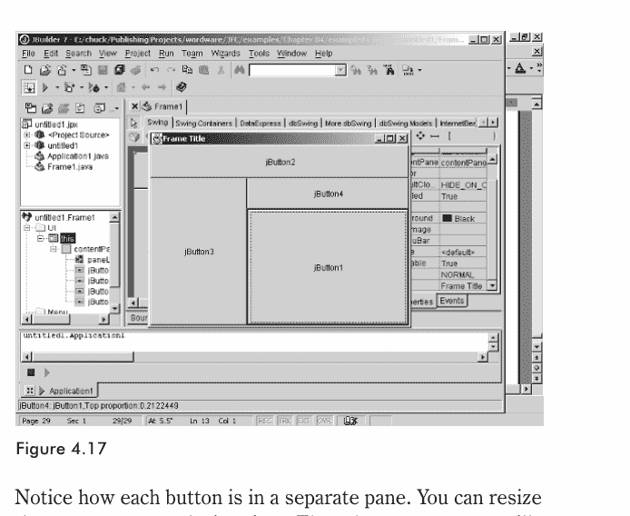

请注意每个按钮是如何位于单独的窗格中的。你可以在设计时调整组件的大小。其他组件将简单地调整大小以匹配。无论你选择哪种布局，整个屏幕都将被占用。

对于那些不使用 JBuilder 的读者，你可以像往常一样，只需将以下代码输入到你喜爱的文本编辑器中并编译即可：

```java
package untitled1;
import java.awt.*;
import java.awt.event.*;
import javax.swing.*;
import com.borland.jbcl.layout.*;
public class Frame1 extends JFrame
{
    private JPanel contentPane;
    private PaneLayout paneLayout1 = new PaneLayout();
    private JButton jButton1 = new JButton();
    private JButton jButton2 = new JButton();
    private JButton jButton3 = new JButton();
    private JButton jButton4 = new JButton();
    //Construct the frame
    public Frame1()
    {
        enableEvents(AWTEvent.WINDOW_EVENT_MASK);
        try
        {
            jbInit();
        }// end of try
        catch(Exception e)
        {
            e.printStackTrace();
        }// end of catch block
    }
    //Component initialization
    private void jbInit() throws Exception
    {
        contentPane = (JPanel) this.getContentPane();
        jButton1.setText("jButton1");
        contentPane.setLayout(paneLayout1);
        this.setSize(new Dimension(400, 300));
        this.setTitle("Frame Title");
        jButton2.setText("jButton2");
        jButton3.setText("jButton3");
        jButton4.setText("jButton4");
        contentPane.add(jButton1,  new PaneConstraints
            ("jButton1", "jButton1", PaneConstraints.ROOT, 0.5f));
        contentPane.add(jButton2,  new PaneConstraints
            ("jButton2", "jButton1", PaneConstraints.TOP,
             0.26333332f));
        contentPane.add(jButton3,  new PaneConstraints
            ("jButton3", "jButton1", PaneConstraints.LEFT,
             0.23000002f));
        contentPane.add(jButton4,  new PaneConstraints
            ("jButton4", "jButton1", PaneConstraints.TOP,
             0.4244898f));
    }
    //Overridden so we can exit when window is closed
    protected void processWindowEvent(WindowEvent e)
    {
        super.processWindowEvent(e);
        if (e.getID() == WindowEvent.WINDOW_CLOSING)
        {
            System.exit(0);
        }
    }
}
```

### 外观和感觉

正如我在本章开头提到的，你可以右键单击一个组件并选择其外观和感觉。此设置旨在帮助你使组件的视觉界面符合给定操作系统的标准。三种选择是 Metallic、Windows 和 CDE/Motif，如下所示：

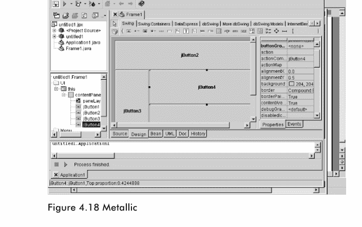

设置组件的外观和感觉可以赋予它们特定的外观，使其看起来与给定的目标操作系统更加协调。

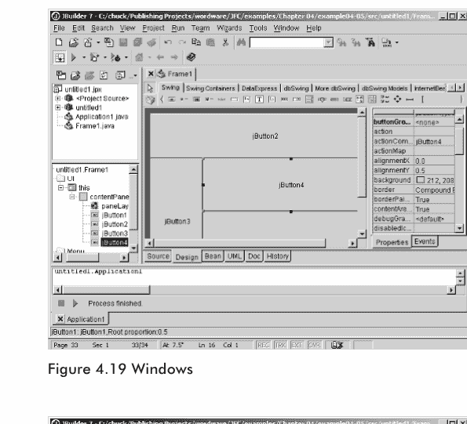

图 4.19 Windows

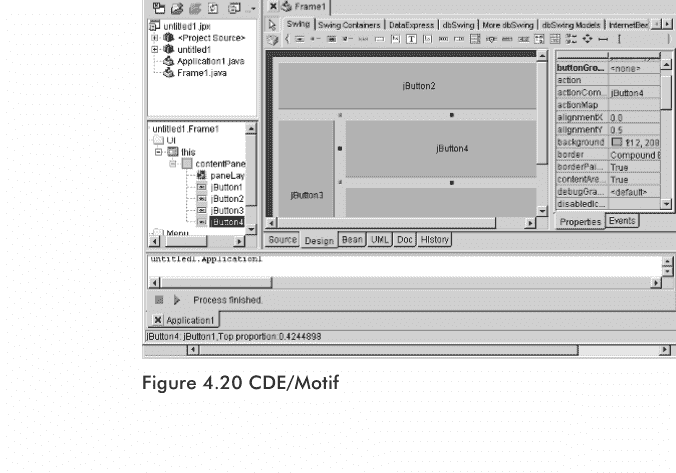

图 4.20 CDE/Motif

### 总结

在本章中，你已经了解了创建适当图形用户界面的两个非常强大的工具：布局管理器和外观和感觉设置。你现在应该能够熟练使用各种布局管理器，并理解何时最适合使用每一种。你也应该准备好在各种设置中使用它们。本书后面的示例将利用你在这里看到的许多布局管理器。你还应该熟悉外观和感觉的各种选项。

### 复习题

1.  外观和感觉的三种选项是什么？
2.  AWT 中有多少种布局管理器？
3.  JFC 中有多少种布局管理器？
4.  如果你希望一次显示一个组件或容器，哪种布局管理器最合适？
5.  `Grid` 和 `Gridbag` 有什么区别？
6.  哪些布局管理器只是简单地将组件一个接一个地放置，直到到达容器的边缘？
7.  哪种布局管理器用于将组件放置在精确的坐标位置？
8.  哪种布局管理器具有像 East 和 North 这样的区域？
9.  哪种布局管理器根据容器上其他组件的大小来调整组件的大小？
10. 列出 JFC 中五种布局管理器。

## 第 5 章 容器组件

本章涵盖以下内容：

-   JPanel
-   JTabbedPane
-   JScrollPane
-   JSplitPane
-   JBox

### 简介

在上一章中，你了解了布局管理器。布局管理器应用于各种容器组件（如框架和面板）。这些容器向你介绍得非常简略，没有真正解释它们的功能和用途。本章旨在纠正这种情况。容器与其他任何组件非常相似。它们只是具有方法、属性等的 Java 类。容器组件只是旨在容纳或持有其他组件的组件。这样做有几个原因，最明显的是将组件组织成逻辑分组。另一个原因是通过与特定的布局管理器（例如你在上一章看到的 `CardLayout` 管理器）合作，以特定的格式安排其他组件。还应该指出的是，所有图形组件*必须*位于某个容器组件上。


在您的应用程序和小程序中，可以使用多种容器组件。如果您使用的是 JBuilder，可以在设计界面的第二个选项卡（标记为“Swing Containers”）中找到这些组件，如图 5.1 所示。

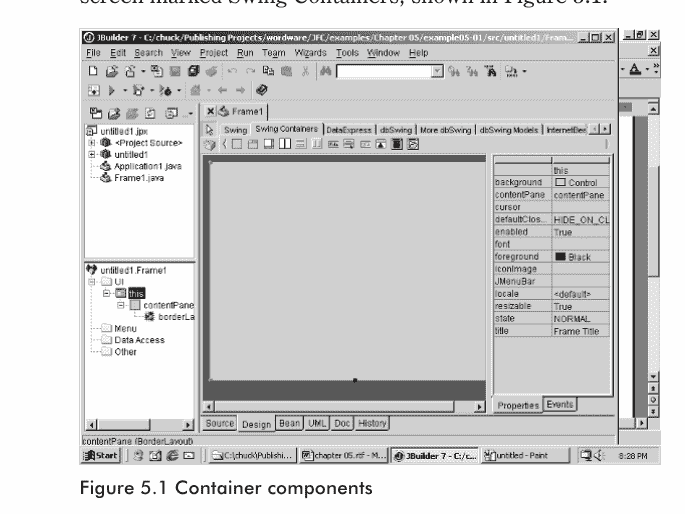

图 5.1 容器组件

实际上，JFC 中为您提供了六种容器组件。您在图片中看到的选项卡显示了超过六个组件。然而，另外六个组件并非简单的容器，而是支持其他功能，例如下拉菜单和工具栏。这些组件将在后续章节中讨论。六种容器组件及其基本用途总结在表 5.1 中。

表 5.1 容器组件

| 容器 | 用途 |
| --- | --- |
| JPanel | 这是一个很好的通用轻量级组件，仅用于容纳其他组件。您将经常看到这个组件。 |
| JTabbedPane | 此组件允许您在几个容器之间进行选项卡切换。 |
| JScrollPane | 此组件仅为一个组件提供可滚动视图。 |
| JSplitPane | 此容器提供一个窗格，该窗格可以垂直或水平分割，并且分割线可以移动。 |
| JBox（垂直和水平） | 这是一个基本的轻量级容器，使用 BoxLayout 管理器。 |

JPanel 无疑是最常见的容器组件，通常用作简单的通用容器。事实上，上一章中已经使用过它。Pane 组件的三种变体显然各有其专门用途。也许最专业且最少遇到的容器是 JBox 容器的两种变体。

### JPanel

如前所述，此组件是最常用的容器。因此，与其他容器组件相比，它需要更仔细的审视。乍一看，它相对容易使用。您只需将其放在设计器屏幕上，设置其布局管理器，然后将组件放在其上。如果您不使用 JBuilder，那么只需声明一个实例，设置其布局管理器，并向其添加组件。无论哪种方式，它的使用都相当直接。这主要是由于其界面简洁明了。它没有窗格、分割或选项卡来使事情复杂化。此组件与许多容器一样，继承自 JComponent 类。JPanel 默认使用 FlowLayout 管理器，但您可以将其设置为使用任何您希望的布局管理器。

您在上一章中看到了这个组件的广泛使用，应该对其使用方式有了很好的了解。JPanel 组件与所有组件一样，拥有大量的方法和属性。然而，其中许多要么不经常使用，要么在后续章节中更恰当地解释。常用属性和方法总结在下表中。

表 5.2 JPanel 属性和方法

| 属性/方法 | 用途 |
| --- | --- |
| layout | 正如您在上一章中看到的，此属性允许您为任何容器选择布局管理器。 |
| background | 此属性在第 3 章中展示过。它允许您更改背景颜色。 |
| border | 此属性允许您更改面板的边框。 |
| tooltipText | 这是许多组件都有的属性。它允许您为组件设置弹出提示。 |
| add | 这是所有容器都有的方法，允许您向容器添加组件。 |
| isShowing | 此属性也对大多数组件通用，如果组件当前正在显示，则返回 true。 |
| remove | 此方法对所有容器通用，允许您从容器中移除组件。 |

这些方法和属性大多数可以通过 JBuilder 中的属性窗口访问，或者您可以直接在代码中访问。除了所示的方法外，构建 JPanel 还有几种不同的方式。此类可用的各种构造函数如表 5.3 所示。

表 5.3 JPanel 构造函数

| 构造函数 | 用途 |
| --- | --- |
| JPanel() | 此构造函数将创建一个具有双缓冲和默认 FlowLayout 的 JPanel。 |
| JPanel(boolean isDoubleBuffered) | 这将创建一个具有默认 FlowLayout 和指定缓冲策略的 JPanel。 |
| JPanel(LayoutManager layout) | 此构造函数将创建一个具有指定布局管理器的 JPanel。这可能是此类最常用的构造函数。 |
| JPanel(LayoutManager layout, boolean isDoubleBuffered) | 此构造函数创建一个具有指定布局管理器和缓冲策略的 JPanel。 |

正如您在上一章中已经看到的，Panel 组件是一个相对易于使用的、基本的通用容器。它的大多数方法也相对直接且易于使用。由于您已经见过此容器，并且确实会在本书中频繁看到它的使用，在此提供另一个完整的示例将是多余的。

### JTabbedPane

顾名思义，JTabbedPane 容器旨在通过一系列选项卡向用户呈现项目。与大多数容器一样，此类直接继承自 JComponent。为用户提供一系列选项卡通常非常方便，每个选项卡包含一组逻辑分组的组件。例如，如果您希望编写一个跟踪员工的应用程序，可以有一个选项卡用于个人信息，另一个用于当前职位信息，还有一个用于工作历史。我相信您能想象出更多选项卡显示对用户方便的情景。

此容器简单地允许用户通过单击特定选项卡来选择他们可能希望查看的组件集。此容器实际上相当容易使用，尽管它有一些您应该了解的特定属性和方法。这些属性和方法列在下表中。

表 5.4 JTabbedPane 属性和方法

| 属性/方法 | 用途 |
| --- | --- |
| **tabPlacement** | 此属性决定选项卡放置的位置。 |
| **model** | 此属性显示当前选中的模型。 |
| Componentadd(Component component) | 此方法用于添加一个组件，其选项卡标题默认为组件的名称。 |
| Componentadd(Component component, int index) | 此方法在指定的选项卡索引处添加一个组件，其选项卡标题默认为组件的名称。 |
| void add(Component component, Object constraints) | 此方法用于向选项卡窗格添加一个组件。 |
| void add(Component component, Object constraints, int index) | 此方法将在指定的选项卡索引处添加一个组件。 |
| component add(String title, Component component) | 此方法用于添加一个具有指定选项卡标题的组件。 |
| void addTab(String title, Icon icon, Component component) | 此方法将添加一个由标题和/或图标表示的组件，两者都可以为 null。 |
| addTab(String title, Component component) | 此方法简单地添加一个由标题表示且没有图标的选项卡。 |
| addTab(String title, Icon icon, Component component, String tip) | 此方法添加一个选项卡以及一个图标和一个工具提示。 |
| getTabCount | 此方法返回当前选项卡的数量。 |
| getTitleAt(int index) | 此方法返回传递给它的索引位置处选项卡的标题。 |
| remove(Component component) | 此方法将从容器中移除特定组件。 |
| remove(int index) | 此方法将移除传递给它的索引位置处的选项卡。 |
| removeall() | 此方法移除所有选项卡。 |

您可能注意到有很多 add 方法。这仅仅是因为您可以通过多种方式将组件添加到 JTabbedPane。Swing 尽可能多地尝试适应这些方法。即使是这里提供的列表也不是详尽的；它只包含了主要的添加组件方法。此表并非详尽无遗，也无意如此。然而，它应该为您总结了 JTabbedPane 类的一些更常用的属性和方法。下一

接下来的步骤显然是带您通过一个示例，来说明 JTabbedPane 类的各种用法。

### 示例 5.1

**步骤 1：** 开始一个项目并为其添加一个新的应用程序，就像您在之前的所有示例中所做的那样。

**步骤 2：** 将选项卡窗格容器添加到应用程序的框架容器的中心区域。您还需要向选项卡窗格容器添加两个选项卡。在它们上面放置一些组件之前，您将看不到这些框架，而在代码中添加是最简单的方法。所以转到“代码”标签页，并将以下代码添加到 `jbInit()` 函数中：

```java
JButton mybutton = new JButton("Click Me");
JButton mybutton2 = new JButton("No Click Me");
jTabbedPane1.addTab("tab 1",mybutton);
jTabbedPane1.addTab("tab 2",mybutton2);
```

现在，您应该可以返回到“设计”标签页，并看到类似图 5.2 所示的内容。

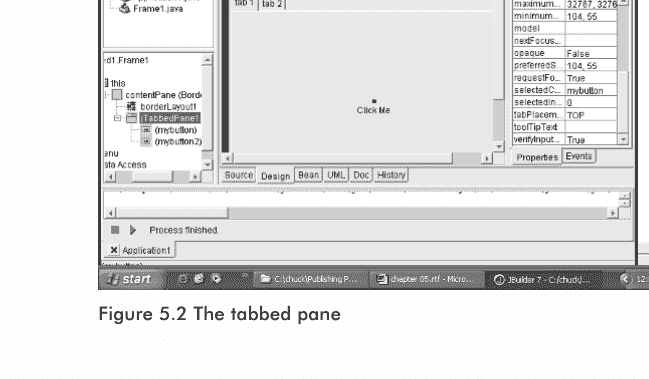

对于不使用 JBuilder 的读者，您可以简单地将以下代码输入到您喜欢的文本编辑器中并编译它：

```java
package untitled1;
import java.awt.*;
import java.awt.event.*;
import javax.swing.*;
public class Frame1 extends JFrame
{
    private JPanel contentPane;
    private BorderLayout borderLayout1 = new BorderLayout();
    private JTabbedPane jTabbedPane1 = new JTabbedPane();
    //Construct the frame
    public Frame1()
    {
        enableEvents(AWTEvent.WINDOW_EVENT_MASK);
        try
        {
            jbInit();
        }
        catch(Exception e)
        {
            e.printStackTrace();
        }
    }
    private void jbInit() throws Exception
    {
        contentPane = (JPanel) this.getContentPane();
        contentPane.setLayout(borderLayout1);
        this.setSize(new Dimension(400, 300));
        this.setTitle("Frame Title");
        contentPane.add(jTabbedPane1, BorderLayout.CENTER);
        JButton mybutton = new JButton("Click Me");
        JButton mybutton2 = new JButton("No Click Me");
        jTabbedPane1.addTab("tab 1",mybutton);
        jTabbedPane1.addTab("tab 2",mybutton2);
    }
    protected void processWindowEvent(WindowEvent e)
    {
        super.processWindowEvent(e);
        if (e.getID() == WindowEvent.WINDOW_CLOSING)
        {
            System.exit(0);
        }
    }
}
```

**步骤 3：** 运行程序。您应该会看到与图 5.3 和 5.4 所示非常相似的图像。

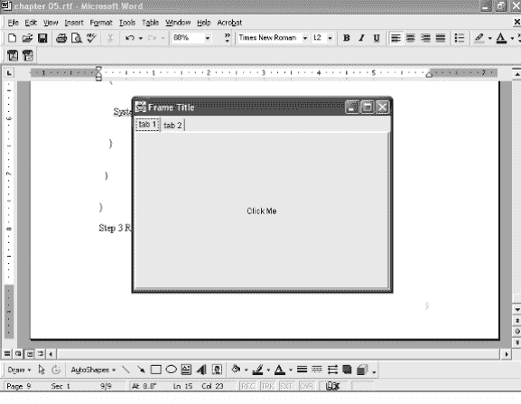

图 5.3 第一个选项卡


图 5.4 第二个选项卡

正如您所看到的，选项卡窗格允许您在单个屏幕上放置比通常情况下更多的组件，这是它最大的优势。当您需要在屏幕上显示大量组件时，应考虑使用 JTabbedPane 容器将它们分开展示在不同的选项卡中。

### JScrollPane

正如您可能推测的那样，JScrollPane 容器用于需要滚动的情况。如果您觉得您的容器需要垂直滚动条、水平滚动条或两者都需要，那么您应该认真考虑使用 JScrollPane。同样，这个容器类直接继承自 `java.swing.JComponent`。表 5.5 总结了许多常用的方法。

#### 表 5.5 JScrollPane 属性和方法

| 属性/方法 | 用途 |
| :--- | :--- |
| `int getBlockIncrement(int direction)` | 此方法返回一个整数，即当容器收到向上/向下请求时，滚动条值改变的量。 |
| `int getMaximum()` | 此属性代表滚动条的最大值。 |
| `int getMinimum()` | 此属性代表滚动条支持的最小值。此属性的典型值为零。 |
| `int getValue()` | 此方法返回滚动条的当前值。 |
| `void setMaximum(int maximum)` | 此方法设置容器的最大属性。 |
| `void setMinimum(int minimum)` | 此方法设置容器的最小属性。 |
| `void setValue(int value)` | 此方法设置滚动条的值。 |

与本书中的其他表格一样，此表格并非旨在详尽覆盖所述容器的所有属性和方法，而仅仅是总结最常用的属性和方法。您还可以选择水平和垂直滚动条是始终显示、在需要时显示，还是从不显示。

在 JBuilder 中，这非常简单，只需设置一个属性即可，如图 5.5 所示。

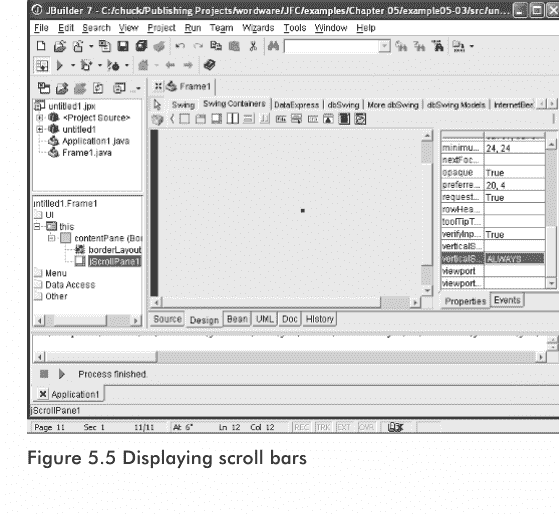

与所有其他 Java 类一样，JScrollPane 有多个不同的构造函数可供选择。表 5.6 列出了各种构造函数，并总结了每个构造函数的用途。

#### 表 5.6 JScrollPane 构造函数

| 构造函数 | 用途 |
| :--- | :--- |
| `JScrollPane()` | 此构造函数最简单，只创建一个空的 JScrollPane，其中水平和垂直滚动条仅在需要时出现。 |
| `JScrollPane (Component view)` | 此构造函数用于创建一个 JScrollPane，用于显示指定组件的内容，当组件内容大于视图时，水平和垂直滚动条将始终出现。 |
| `JScrollPane(Component view, int vsbPolicy, int hsbPolicy)` | 此构造函数将创建一个 JScrollPane，在视口中显示视图组件，其视图位置可以通过一对滚动条进行控制。 |
| `JScrollPane(int vsbPolicy, int hsbPolicy)` | 此函数用于创建一个具有指定滚动条策略的空 JScrollPane。 |

128 第 5 章

滚动条是一个相对容易使用的容器；事实上，它比选项卡窗格更容易使用。但在继续之前，让您查看一个示例仍然是审慎的。

### 示例 5.2

**步骤 1：** 当然，像之前所有项目一样开始项目。然后您只需将 JScrollPane 添加到应用程序窗口的中心，如图 5.6 所示。

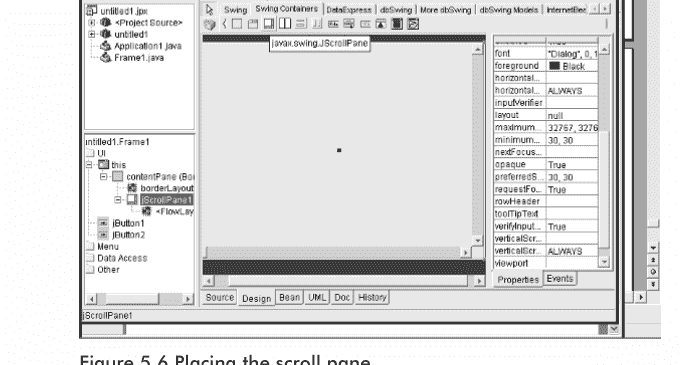

图 5.6 放置滚动窗格

**步骤 2：** 现在我们需要在滚动窗格上放置一些组件，以便在运行时看到它滚动。因此我建议在容器的不同位置放置两个按钮，如图 5.7 所示。

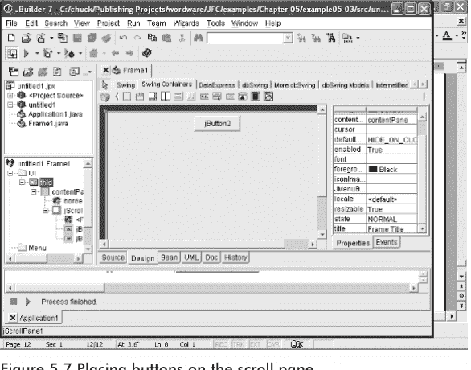

图 5.7 在滚动窗格上放置按钮

您最终得到的源代码将与此处看到的非常相似：

```java
package untitled1;
import java.awt.*;
import java.awt.event.*;
import javax.swing.*;
import javax.swing.border.*;
public class Frame1 extends JFrame
{
    private JPanel contentPane;
    private BorderLayout BorderLayout1 = new BorderLayout();
    private JButton jButton1 = new JButton();
    private JScrollPane jScrollPane1 = new JScrollPane();
    private JButton jButton2 = new JButton();
    private Border border1;
    //Construct the frame
    public Frame1()
    {
        enableEvents(AWTEvent.WINDOW_EVENT_MASK);
        try
        {
            jbInit();
        }
        catch(Exception e)
        {
            e.printStackTrace();
        }
    }
    //Component initialization
    private void jbInit() throws Exception
    {
        contentPane = (JPanel) this.getContentPane();
        border1 = BorderFactory.createLineBorder
                (SystemColor.controlText,1);
        contentPane.setLayout(borderLayout1);
        this.setSize(new Dimension(400, 300));
        this.setTitle("Frame Title");
        jButton1.setText("jButton1");
        jButton2.setText("jButton2");
        jScrollPane1.setHorizontalScrollBarPolicy
                (JScrollPane.HORIZONTAL_SCROLLBAR_ALWAYS);
        jScrollPane1.setVerticalScrollBarPolicy
                (JScrollPane.VERTICAL_SCROLLBAR_ALWAYS);
        jScrollPane1.setViewportBorder(border1);
        contentPane.add(jScrollPane1, BorderLayout.CENTER);
        jScrollPane1.setLayout(new FlowLayout());
        jScrollPane1.getViewport().add(jButton1,null);
        jScrollPane1.getViewport().add(jButton2, null);
    }
    protected void processWindowEvent(WindowEvent e)
    {
        super.processWindowEvent(e);
        if (e.getID() == WindowEvent.WINDOW_CLOSING)
        {
            System.exit(0);
        }
    }
}
```

130 第 5 章

注意：此时，您应该注意到 JBuilder 中的“属性”框中发生的事情与为您生成的代码之间存在非常密切的关联。例如，当您选择“垂直滚动条”

property并将它设置为Always时，会生成以下代码：

```java
jScrollPane1.setVerticalScrollBarPolicy(JScrollPane.VERTICAL_SCROLLBAR_ALWAYS);
```

这体现了JBuilder为何成为Java开发中如此宝贵的工具的本质。它可以在你专注于实际要解决的问题并设计美观的图形用户界面时，为你生成Java代码。

### JSplitPane

顾名思义，这种特定的容器允许你将容器分成两个不同的区域，这两个区域都可调整大小。我个人发现这种配置在许多情况下在美学上令人愉悦，因此我经常使用这个容器。与本章提到的其他容器类一样，此类直接继承自java.swing.JComponent。下表总结了其主要属性和方法。

表5.7 JSplitPane方法与属性

| 方法/属性 | 用途 |
|---|---|
| Divider_size | 此属性设置分隔两个窗格的分隔线的大小。默认值为5。 |
| Divider_location | 此属性设置分隔两个窗格的分隔线的位置。 |
| StringDIVIDER | 此方法用于添加一个将作为分隔线的组件。 |
| Int HORIZONTAL_SPLIT | 水平分割表示窗格的分割方向是水平的。 |
| Int VERTICAL_SPLIT | 这表示窗格是垂直分割的。 |
| String RIGHT | 此方法用于将一个组件添加到其他组件的右侧。 |
| String BOTTOM | 此方法用于将一个组件添加到其他组件的下方。 |
| String TOP | 此方法用于将一个组件添加到其他组件的上方。 |

这个方法和属性列表并非详尽无遗，但它涵盖了有效利用JSplitPane所需的核心方法和属性。表5.8总结了此类的构造方法。

表5.8 JSplitPane构造方法

| 构造方法 | 用途 |
|---|---|
| JSplitPane() | 此构造方法创建一个配置为水平并排排列子组件的JSplitPane，为两个组件使用两个按钮。 |
| JSplitPane(int newOrientation) | 此构造方法构建一个配置为指定方向且无连续布局的JSplitPane。 |
| JSplitPane(int newOrientation, boolean newContinuousLayout) | 此构造方法将创建一个具有指定方向和连续布局的JSplitPane。 |
| JSplitPane(int newOrientation, boolean newContinuousLayout, Component newLeftComponent, Component newRightComponent) | 此构造方法将创建一个具有指定方向和指定组件的JSplitPane。 |
| JSplitPane(int newOrientation, Component newLeftComponent, Component newRightComponent) | 此构造方法将创建一个具有指定方向和指定组件的JSplitPane，且不进行连续重绘。 |

这组多样化的构造方法允许你，这位程序员，选择你希望使用的分割窗格类型以及它将如何显示和使用。这个组件使用起来相当简单（实际上比选项卡窗格更容易），所以让我们来看一个使用此组件的示例。

### 示例5.3

**步骤1：** 你需要启动一个新项目。你还需要添加一个新应用程序。

**步骤2：** 将分割窗格容器放置在应用程序的框架上。你应该会看到类似图5.8所示的内容。

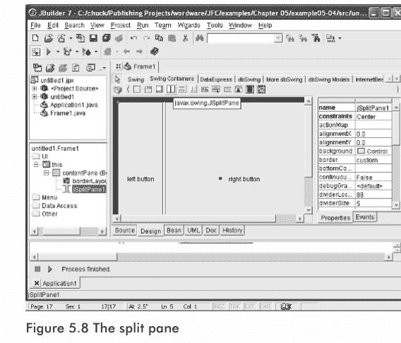

图5.8 分割窗格

请注意，你已经有两个窗格，并且每个窗格都有标签。当你现在运行应用程序时，你可以轻松地前后移动窗格，调整它们的大小。这在图5.9和5.10中有清晰的展示。

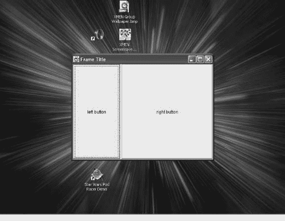

图5.9 运行分割窗格

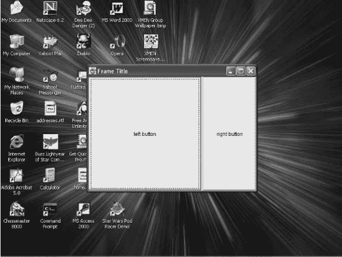

图5.10 调整分割窗格大小

这个容器组件的全部目的是为你提供一个具有独立窗格的可调整大小的容器。你甚至可以将组件放置在不同的窗格上，它们会随窗格一起移动。

对于那些没有使用JBuilder而不得不手动完成所有这些操作的用户，以下是源代码：

```java
package untitled1;
import java.awt.*;
import java.awt.event.*;
import javax.swing.*;
public class Frame1 extends JFrame
{
    private JPanel contentPane;
    private BorderLayout borderLayout1 = new BorderLayout();
    private JSplitPane jSplitPane1 = new JSplitPane();

    //构造框架
    public Frame1()
    {
        enableEvents(AWTEvent.WINDOW_EVENT_MASK);
        try
        {
            jbInit();
        }
        catch(Exception e)
        {
            e.printStackTrace();
        }
    }
    //组件初始化
    private void jbInit() throws Exception
    {
        contentPane = (JPanel) this.getContentPane();
        contentPane.setLayout(borderLayout1);
        this.setSize(new Dimension(400, 300));
        this.setTitle("Frame Title");
        contentPane.add(jSplitPane1, BorderLayout.CENTER);
    }
    //重写以便在窗口关闭时退出
    protected void processWindowEvent(WindowEvent e)
    {
        super.processWindowEvent(e);
        if (e.getID() == WindowEvent.WINDOW_CLOSING)
        {
            System.exit(0);
        }
    }
}
```

如你所见，这个特定的容器相当有趣。将显示区域分成两个独立且可调整大小（至少是相对可调整）的部分，是让用户对焦点区域有更多控制权的一种方式。这个容器可以极大地增强你图形界面的用户友好性。

### JBox

在你的JBuilder Swing Containers工具栏上，实际上有两个JBox容器，一个垂直，一个水平。顾名思义，此容器使用框布局作为其默认布局管理器。坦率地说，在我职业生涯中检查过的代码中，我并未看到这个特定容器被频繁使用。该容器有时用于创建影响整体布局的不可见区域。本质上，如果你需要GUI的某个给定区域保持空白，你可能希望考虑使用JBox容器。其最常用的方法总结在表5.9中。

表5.9 JBox方法

| 方法 | 用途 |
| :--- | :--- |
| component createGlue() | 此方法创建一个不可见的组件，对于其可见组件具有最大宽度（对于水平框）或高度（对于垂直框）的框很有用。此组件本质上是其他组件的“粘合剂”。 |
| Box createHorizontalBox() | 此方法创建一个从左到右显示其组件的框。 |
| component createHorizontalGlue() | 此方法创建一个水平粘合组件。 |
| component createHorizontalStrut(int width) | 此方法创建一个不可见的、固定宽度的组件。 |
| Box createVerticalBox() | 此方法创建一个从上到下显示其组件的框。 |
| component createRigidArea(Dimension d) | 此方法创建一个始终具有指定大小的不可见组件。 |

正如我之前提到的，这个特定容器的使用频率不如其他容器。

### 总结

本章为你全面介绍了Swing中可用的容器。容器在创建图形用户界面方面起着至关重要的作用。为特定情况选择合适的容器绝对至关重要。只有了解各种容器、它们的用途以及它们的使用方法，你才能选择合适的容器。如果你完成了本章中的示例，你应该具备了有效使用Swing容器的必要知识。如果没有，请重新阅读本章并再次尝试示例。

### 复习题

1. 列出Swing容器的名称。
2. 哪种容器最常使用？
3. 你会设置哪个属性来确保滚动条窗格始终显示垂直滚动条？
4. 你能更改分割窗格中分隔线的大小吗？
5. 哪种容器用于创建占位符和组件之间的连接？
6. JBuilder有多少个版本的JBox容器？
7. 你会使用什么方法来移动滚动条？


### 第6章

### 事件处理

本章涵盖以下内容：

-   事件
-   监听器
-   应用事件
-   匿名内部类适配器

### 引言

希望你在前面的章节中已经注意到，事件被频繁用于响应用户的操作。你可能对什么是事件有一个直观的概念，但更正式的定义或许会有所帮助。*事件*是由用户、另一个程序或另一个函数发起的操作。这类操作包括点击鼠标、按下按键，甚至只是将鼠标移动到指定区域。当一个操作被发起时，就会生成一个事件，并发送给所有可用的事件处理程序。然后，这些事件处理程序可以适当地响应事件。事件处理程序是专门设计用于处理特定事件的类。

基于 Swing 和 JFC 的事件处理源自早期的 AWT 事件处理模型。这两种方法有许多相似之处。如果你熟悉 AWT 事件处理，那么可能只需要对本章进行粗略的检视。如果你没有 AWT 事件处理的经验，那么可能需要更透彻地研究这里呈现的材料。

### 事件

事件就是任何可能发生的事情。从用户的角度来看，事件是任何操作，比如点击按钮或将鼠标移到某个组件上。从程序员的角度来看，每个事件都是一个为该事件专门设计的类。所有事件都以 `java.awt.AWTEvent` 类为根类。`AWTEvent` 随后被子类化为多种具体的事件类，例如 `ActionEvent`、`WindowEvent`、`ItemEvent`、`KeyEvent`、`MouseEvent` 等。这意味着每个具体事件都将共享一定数量的方法和属性。

`AWTEvent` 的直接子类及其用途总结在表 6.1 中。

#### 表 6.1 AWTEvent 的子类

| 类名 | 用途 |
| :--- | :--- |
| `ActionEvent` | 这是一个指示组件定义的操作已发生的事件。当组件特定的操作发生时（例如点击按钮），组件会生成此事件。然后，该事件会传递给每个使用该组件的 `addActionListener` 方法注册以接收此类事件的 `ActionListener` 对象。 |
| `AdjustmentEvent` | 当可调整对象被调整时，会触发此调整事件。 |
| `AncestorEvent` | 这是一个报告给子组件的事件，它源自组件层次结构中的一个祖先。换句话说，它告诉子组件，其某个父组件上发生了事件。 |
| `ComponentEvent` | 这是一个低级事件，指示组件移动、改变大小、变得可见或不可见等。此事件仅用于通知目的。无论你对此事件做什么或不做什么，组件的操作都将发生。 |
| `HierarchyEvent` | 此事件指示组件所属的组件层次结构发生了某些变化。 |
| `InputMethodEvent` | 当文本被输入到合适的组件时，此事件会触发。任何时候文本因任何原因发生变化，输入法都会发送一个事件。 |
| `InternalFrameEvent` | `InternalFrameEvent` 是一个相当奇怪的事件。你不会经常看到它被使用。它是一个支持 `JInternalFrame` 对象作为事件源的 `AWTEvent`。此类具有与 `WindowEvent` 相同的事件类型。 |
| `InvocationEvent` | 当 AWT 事件分派线程调度此事件时，它会执行 `Runnable` 上的 `run()` 方法。 |
| `ItemEvent` | 此事件指示一个项目被选中或取消选中。你会经常看到它与列表框相关联。 |
| `TextEvent` | 此事件指示对象的文本发生了更改。 |

这些类中的一些反过来又是其他事件的父类。这是 Java 如何使用面向对象技术，在一个不断增长的层次类结构中，从更通用的基类基础上构建专业化类的又一个例子。  
由于所有事件都派生自 `AWTEvent` 类，因此谨慎地研究一些其更常见和有用的方法是明智的。这些方法总结在表 6.2 中。

#### 表 6.2 AWTEvent 方法

| 方法 | 用途 |
| :--- | :--- |
| `protected void consume()` | 此方法用于消费（消耗）当前事件。事件一旦被消费，就会被销毁，无法再进一步传播。 |
| `int getID()` | 此方法用于返回指示事件类型的数值。 |
| `String toString()` | 此方法将返回此事件对象的字符串表示形式。 |
| `protected void finalize()` | 此方法实际上是由垃圾收集器在对象上调用的，当垃圾收集确定没有更多对对象的引用时。 |
| `protected Boolean isConsumed()` | 此方法将告诉你当前事件是否已被消费。 |
| `String paramString()` | 此方法用于返回表示此事件状态的字符串。 |

此类只有两个可能的构造函数。这些构造函数总结在表 6.3 中。

#### 表 6.3 AWTEvent 构造函数

| 构造函数 | 用途 |
| :--- | :--- |
| `AWTEvent(Event event)` | 此构造函数用于从 1.0 风格事件的参数创建一个 `AWTEvent` 对象。 |
| `AWTEvent(Object source, int id)` | 此构造函数将使用指定的源对象和类型创建一个 `AWTEvent` 对象。 |

理解 `AWTEvent` 类及其直接子类对于理解事件总体上如何工作至关重要。你不必记住每个表格或本章内容。但是，熟悉这些材料是一个好主意。

### 监听器

当一个事件被触发时，它会被一个或多个监听器接收并处理。*监听器*只是一个专门为监听特定事件发生而设计的特殊类。事件处理是通过使用监听器接口完成的，这些接口定义在 `java.awt.event` 包中。在 Java 中，有许多内置接口作为不同类型事件处理的监听器。

### 应用事件

关于事件、它们是什么以及如何工作的这些通用知识是有用的，但并不完整。缺少的是关于如何在程序中应用事件的概述。以下是应用事件的基本步骤概述：

1.  决定将事件应用于哪个 GUI 组件。
2.  实现适当的监听器接口。适当的接口是那些与该组件相对应的接口。
3.  现在，实现接口中涉及的方法。

如果你了解常见的接口，这些步骤可能会更有帮助。下面是最常见接口的简要示例和描述。

动作监听器与各种用户操作相关联，但主要与按钮点击相关。函数如下所示：

```java
public void actionPerformed(ActionEvent e)
{
    //你的代码放在这里
}
```

此函数在响应广泛的项事件时被调用。例如，从列表框中选择一个项目会触发此事件。

```java
public void itemStateChanged(ItemEvent e)
{
    //你的代码放在这里
}
```

在 JBuilder 中使用事件被显著简化，因为 JBuilder 本身会为你处理部分工作。JBuilder 会为该特定组件/事件创建一个 `EventAdapter` 类，并为其分配一个适当的名称，该名称对应于特定的组件和事件。这只需双击特定组件即可完成。例如，如果你双击一个按钮，JBuilder 将为你生成动作监听器。JBuilder 还会在 `jbInit()` 方法中创建一行代码，通过 `EventAdapter` 将组件的事件源连接到你的事件处理方法。这是通过调用组件的 `addListener` 方法实现的。剩下的全部


### 匿名内部类适配器

匿名内部类也经常被 Java 程序员用作适配器类。JBuilder 也可以生成这些内部类事件适配器。内部类有几个优点，包括：

- 代码内联生成，从而简化了代码。
- 不会生成单独的类。
- 内部类可以访问其声明作用域内的所有变量，不像标准事件适配器只能进行公共和包级别的访问。

JBuilder 生成的特定类型的内部类事件适配器被称为匿名适配器。这种风格的适配器避免了创建单独的适配器类。生成的代码简洁而优雅。例如，以下代码是为 focusGained() 事件使用匿名适配器生成的：

```
jButton1.addFocusListener(new java.awt.event.FocusAdapter()
{
    public void focusGained(FocusEvent e)
    {
        jButton1_focusGained(e);
    }
}
void jButton1_focusGained(FocusEvent e)
{
}
```

将此代码与前面显示的标准适配器代码示例进行比较。JBuilder 使用标准适配器类生成了该代码。两种使用适配器的方式都提供了处理 focusGained() 事件的代码，但匿名适配器方法更为紧凑。

### 总结

本章向你介绍了事件、事件监听器和事件处理的概念。事件是你能够响应用户操作的主要方式。用户的操作通常会触发特定的事件。你的事件监听器将监听与特定组件相关的该事件发生。然后你的事件处理器将响应那个事件。事件和事件处理是用户交互的核心。我们在本章中了解了事件处理器、适配器类甚至匿名内部适配器类的基本结构。

### 复习题

1. 从用户的角度来看，什么是事件？
2. 什么是事件处理器？
3. 所有事件类的父类是什么？
4. 列出四个常见的事件类。
5. 什么是监听器？
6. 使用内部类适配器有哪三个优点？
7. AWTEvent 类有多少个构造函数？

## 第7章：用户选择

本章涵盖以下内容：

- JRadioButton
- JToggleButton
- JCheckBox
- JComboBox
- JList
- JSlider

### 简介

到目前为止，本书已经讨论了关于 Swing 组件结构、容器、改变外观甚至处理复杂事件结构的问题。然而，我们尚未解决设计图形用户界面时的一个核心问题。我们作为程序员开发丰富的 GUI 界面，其全部原因是为了促进更多的用户交互。我们希望给用户一种掌控感和能够做出选择的感觉。考虑到这一点，任何 GUI 工具包（无论是 AWT、Swing 还是其他方法）的一个组成部分理所当然地应该是允许用户做出选择。Java 基础类提供了许多允许用户做出选择的可视化组件。在本章中，我们将探讨这些组件。

当然，允许用户做出选择与第3章讨论的用户输入主题密切相关。然而，第3章关注的是允许用户输入文本的组件。本章关注的是允许用户从你提供的一组选项中进行选择的组件。我们都多次遇到过这样的软件。当你去 ATM 取钱时，你可能会被提供一系列特定增量的选项，或者你可以输入一个特定的金额。那些预定义的选项正是本章关注的内容。表 7.1 总结了我们在本章中探讨的组件，并简要描述了它们的用途。

**表 7.1 用户选择组件**

| 组件 | 用途 |
|---|---|
| JRadioButton | 单选按钮允许用户在两个或多个互斥的选项中进行选择。 |
| JCheckBox | 当你希望用户选择一个或多个非互斥的选项时，使用复选框。 |
| JComboBox | 组合框呈现一个下拉列表，允许用户仅选择其中一个选项。 |
| JList | 列表与组合框非常相似，只是所有选项都已显示。框不需要下拉。 |
| JSlider | 滑块允许用户从预定义的值范围中选择一个值。 |
| JToggleButton | 切换按钮允许你在两个互斥的选项之间切换。 |

本章将通过示例深入探讨每个组件。这些组件相当直观且易于学习。然而，它们对于设计真正用户友好的界面至关重要。

### JRadioButton

单选按钮是随处可见的组件。许多应用程序经常使用它们。它们类似于前面提到的在 ATM 中显示的预定增量值。单选按钮如图 7.1 所示。


用户会看到一系列两个或更多的单选按钮，并且可以选择一个选项。这就是单选按钮与复选框的区别；单选按钮允许用户做出单一的、互斥的选择。JRadioButton 类实际上继承自 JToggleButton 类。有人可能会认为首先描述 JToggleButton 类更为谨慎；然而，单选按钮更为常见。单选按钮与按钮组组件结合使用，以便将适当的按钮分组在一起。单选按钮最重要的方法和属性总结在表 7.2 中。

**表 7.2 JRadioButton 方法和属性**

| 方法/属性 | 用途 |
|---|---|
| getText | 此方法检索单选按钮中的文本。 |
| setText | 此方法将设置显示为单选按钮标题的文本。 |
| toolTipText | 此属性设置当用户的鼠标悬停在单选按钮上时显示的工具提示。 |
| enabled | 此属性确定单选按钮是否启用。 |
| String paramString() | 此函数/方法返回此 JRadioButton 的字符串表示形式。 |

作为 Java 程序员，你在使用 JRadioButton 构造函数时有几种选择。创建 JRadioButton 的实例时，你可以传递一个将用作标题的字符串、一个将显示的图标，或者两者都不传递，从而创建一个空白的单选按钮。显然，所有 Swing 甚至 AWT 组件都有许多通用功能。我们不在这里探讨这些。相反，我们将通过一个简短的示例来演示使用单选按钮的基本要点。

#### 示例 7.1

步骤 1：创建一个新项目和一个应用程序对象，就像你在前面章节中所做的那样。

步骤 2：将屏幕的布局管理器设置为五行一列的 GridLayout。

步骤 3：向应用程序添加三个单选按钮，并按照图 7.2 所示更改它们的标题（文本）。


步骤 4：添加一个按钮组。它不会在屏幕上显示，但不用担心；它确实存在。当你选择单选按钮的 buttonGroup 属性时，你会看到按钮组出现。如图 7.3 所示。逐一选择每个单选按钮，并将其 buttonGroup 属性设置为 buttonGroup1。


通过将所有单选按钮分配到同一个组，你可以使它们协同工作并相互排斥。

> 注意：在屏幕上使用多个按钮组可以让你拥有多个单选按钮组，每组作为一个整体工作，但组之间没有交互。

步骤 5：向屏幕添加一个文本字段和一个按钮。

步骤 6：在类的开头，添加一个名为 choice 的私有 int 的声明。然后，在每个单选按钮的 action 事件中，你可以设置该 int 以反映所选的按钮。例如，在单选按钮 1 中，你将 choice 设置为 1。

步骤 7：在按钮的 action 事件中，放置以下代码：

```
switch(choice)
{
    case 1:
        jTextField1.setText("嘿，你按下了单选按钮 1");
        break;
    case 2:
        jTextField1.setText("你按下了单选按钮 2");
        break;
    case 3:
        jTextField1.setText("你按下了单选按钮 3");
        break;
}
```

### 示例 7.2

**步骤 1：** 创建一个标准应用程序，与之前所有应用程序一样。

**步骤 2：** 将容器的布局管理器更改为GridLayout，并在布局上放置一个切换按钮。

**步骤 3：** 将以下代码添加到该切换按钮的动作事件中。请记住，通过在设计屏幕上双击切换按钮，您将直接进入动作事件。

```
if(jToggleButton1.getText()=="Sound On")
{
    jToggleButton1.setSelected(false);
    jToggleButton1.setText("Sound Off");
}
else
{
    jToggleButton1.setSelected(true);
    jToggleButton1.setText("Sound On");
}
```

现在运行应用程序。您将看到与图7.5和图7.6中描绘的图像非常相似的内容。


**注意：** 此应用程序示例仅演示了切换按钮的使用及其属性设置——并未实际开启或关闭声音。

对于未使用JBuilder的读者，此处提供了本示例的完整代码：

```
package untitled1;
import java.awt.*;
import java.awt.event.*;
import javax.swing.*;
public class Frame1 extends JFrame
{
    private JPanel contentPane;
    private GridLayout mygrid = new GridLayout(2,2,0,2);
    private JToggleButton jButton1 = new JToggleButton();
    //Construct the frame
    public Frame1()
    {
        enableEvents(AWTEvent.WINDOW_EVENT_MASK);
        try
        {
            jbInit();
        }
        catch(Exception e)
        {
            e.printStackTrace();
        }
    }
    private void jbInit() throws Exception
    {
        contentPane = (JPanel) this.getContentPane();
        jButton1.setSelected(true);
        jButton1.setText("Sound On");
        jToggleButton1.addActionListener(new java.awt.event.ActionListener()
        {
            public void actionPerformed(ActionEvent e)
            {
                jToggleButton1_actionPerformed(e);
            }
        });
        contentPane.setLayout(mygrid);
        this.setSize(new Dimension(400, 300));
        this.setTitle("Toggle Buttons");
        contentPane.add(jToggleButton1, null);
    }
    //Overridden so we can exit when window is closed
    protected void processWindowEvent(WindowEvent e)
    {
        super.processWindowEvent(e);
        if (e.getID() == WindowEvent.WINDOW_CLOSING)
        {
            System.exit(0);
        }
    }
    void jToggleButton1_actionPerformed(ActionEvent e)
    {
        if(jToggleButton1.getText()=="Sound On")
        {
            jToggleButton1.setSelected(false);
            jToggleButton1.setText("Sound Off");
        }
        else
        {
            jToggleButton1.setSelected(true);
            jToggleButton1.setText("Sound On");
        }
    }
}
```

如您所见，切换按钮是一个功能相当有限的组件。它用于允许用户在两个互斥选项之间进行选择的场景，例如开和关。尽管此组件功能有限，但它是JRadioButton类的基类。在前面描述的有限情况下，例如开/关开关，它是理想的组件。

### JCheckBox

复选框与单选按钮相似，有一个非常重要的区别：用户可选择的选项并非互斥。用户可以选择多个选项。有趣的是，复选框也继承自切换按钮。这是您在扩展对Java以及面向对象编程知识时需要考虑的一个重要点。面向对象编程的全部目的是允许人们利用现有对象并重用甚至扩展它们。Java在这方面做得相当好。切换按钮具有基本功能，但其限制性对于许多应用来说过于严格。因此，JFC/Swing的创建者没有重新发明轮子，而是直接采用该组件并对其进行了扩展。

与您见过的许多组件一样，复选框也有多种不同的构造函数。因此，您可以根据当前需求以多种不同方式之一创建复选框。表7.3列出了复选框的构造函数。

#### 表 7.3 JCheckBox 构造函数

| 构造函数 | 用途 |
|---|---|
| JCheckBox() | 此构造函数创建一个没有文本或图标且未被选中的复选框按钮。 |
| JCheckBox(Action a) | 此构造函数创建一个复选框，其属性取自提供的动作。 |
| JCheckBox(Icon icon) | 此构造函数创建一个未被选中且带有图标的复选框。 |
| JCheckBox(Icon icon, boolean selected) | 此构造函数创建一个带有图标的复选框，并指定复选框最初是否被选中。 |
| JCheckBox(String text) | 此构造函数创建一个带有文本标题且最初未被选中的复选框。 |

break;
} // end of switch

当您运行应用程序时，您将看到图7.4中描绘的图像。当您选择不同的单选按钮时，按下屏幕底部的按钮。文本字段将显示一条消息，指示您选择了哪个单选按钮。


如果您没有JBuilder，可以将以下代码输入您喜欢的文本编辑器并编译它。您将获得相同的效果。

```
package untitled1;
import java.awt.*;
import java.awt.event.*;
import javax.swing.*;
public class Frame1 extends JFrame
{
    private JPanel contentPane;
    private GridLayout grid1 = new GridLayout(5,1);
    private JRadioButton jRadioButton1 = new JRadioButton();
    private JRadioButton jRadioButton2 = new JRadioButton();
    private JRadioButton jRadioButton3 = new JRadioButton();
    private ButtonGroup buttonGroup1 = new ButtonGroup();
    private JTextField jTextField1 = new JTextField();
    private int choice;
    private JButton jButton1 = new JButton();
    //Construct the frame
    public Frame1()
    {
        enableEvents(AWTEvent.WINDOW_EVENT_MASK);
        try
        {
            jbInit();
        }
        catch(Exception e)
        {
            e.printStackTrace();
        }
    }
    //Component initialization
    private void jbInit() throws Exception
    {
        contentPane = (JPanel) this.getContentPane();
        jRadioButton1.setText("Button One");
        jRadioButton1.addActionListener(new java.awt.event.ActionListener()
        {
            public void actionPerformed(ActionEvent e)
            {
                jRadioButton1_actionPerformed(e);
            }
        });
        contentPane.setLayout(grid1);
        this.setSize(new Dimension(400, 300));
        this.setTitle("Frame Title");
        jRadioButton2.setText("Button Two");
        jRadioButton2.addActionListener(new java.awt.event.ActionListener()
        {
            public void actionPerformed(ActionEvent e)
            {
                jRadioButton2_actionPerformed(e);
            }
        });
        jRadioButton3.setText("Button Three");
        jRadioButton3.addActionListener(new java.awt.event.ActionListener()
        {
            public void actionPerformed(ActionEvent e)
            {
                jRadioButton3_actionPerformed(e);
            }
        });
        jTextField1.setText("jTextField1");
        jButton1.setToolTipText("");
        jButton1.setText("Click Me");
        jButton1.addActionListener(new java.awt.event.ActionListener()
        {
            public void actionPerformed(ActionEvent e)
            {
                jButton1_actionPerformed(e);
            }
        });
        contentPane.add(jRadioButton1, null);
        contentPane.add(jRadioButton2, null);
        contentPane.add(jRadioButton3, null);
        contentPane.add(jTextField1, null);
        contentPane.add(jButton1, null);
        buttonGroup1.add(jRadioButton1);
        buttonGroup1.add(jRadioButton2);
        buttonGroup1.add(jRadioButton3);
    }
    //Overridden so we can exit when window is closed
    protected void processWindowEvent(WindowEvent e)
    {
        super.processWindowEvent(e);
        if (e.getID() == WindowEvent.WINDOW_CLOSING)
        {
            System.exit(0);
        }
    }
    void jRadioButton2_actionPerformed(ActionEvent e)
    {
        choice = 2;
    }
    void jRadioButton1_actionPerformed(ActionEvent e)
    {
        choice = 1;
    }
    void jRadioButton3_actionPerformed(ActionEvent e)
    {
        choice = 3;
    }
    void jButton1_actionPerformed(ActionEvent e)
    {
        switch(choice)
        {
            case 1:
                jTextField1.setText("Hey, you pressed radio button 1");
                break;
            case 2:
                jTextField1.setText("You pressed radio button 2");
                break;
            case 3:
                jTextField1.setText("You have pressed radio button 3");
                break;
        }   // end of switch
    }
}
```

这个特定的例子可能不那么令人兴奋，但它应该演示如何使用单选按钮。您会发现单选按钮对于引导用户从有限选项列表中做出单一选择是一个非常有用的组件。

### JToggleButton

如上一节所述，JToggleButton是JRadioButton的基类。正如您可能推测的，它的可能性比单选按钮更为有限，因此较少遇到。应该检查此组件有两个重要原因。第一个原因是它是JRadioButton的基础，因此其方法和属性被JRadioButton继承。另一个原因是它在某些特定有限情况下可能非常有用。

JToggleButton也允许我们使用字符串作为标题、图标和布尔值来创建它，该布尔值确定它当前是否被选中。切换按钮实际上看起来有点像普通按钮，区别在于点击时它会保持按下状态，直到再次点击。当向用户显示布尔值时，这会产生非常有用的视觉效果。考虑以下使用切换按钮指示您的应用程序声音是开启还是关闭的示例。


### JCheckBox 构造函数

| 构造函数 | 用途 |
| --- | --- |
| JCheckBox(String text, boolean selected) | 此构造函数创建一个带文本的复选框，并指定其是否初始选中。 |
| JCheckBox(String text, Icon icon) | 此构造函数创建一个未选中的复选框，但带有指定的文本和图标。 |
| JCheckBox(String text, Icon icon, boolean selected) | 此构造函数创建一个带有文本和图标的复选框，并指定其是否初始选中。 |

正如你从表 7.3 中所看到的，在创建复选框时，你有许多选项可用。你的复选框可以有标题、图标、初始选中，或以上都没有。复选框是一种非常通用的组件。

显然，如果复选框继承自切换按钮，那么它会继承切换按钮的所有方法。然而，复选框确实有一些它自己独有的、不与切换按钮共享的方法。这些方法在表 7.4 中进行了总结。

#### 表 7.4 JCheckBox 方法

| 方法 | 用途 |
| --- | --- |
| void configurePropertiesFromAction(Action a) | 此方法根据 Action 实例的值设置 ActionEvent 源的属性。 |
| createActionPropertyChangeListener(Action a) | 此方法创建一个 PropertyChangeListener，用于在其 Action 实例属性更改时更新 ActionEvent 源。 |
| AccessibleContext getAccessibleContext() | 此方法检索与此 JCheckBox 关联的 AccessibleContext。 |
| String getUIClassID() | 此方法将返回一个字符串，指定渲染此组件的类名。 |
| Boolean isBorderPaintedFlat() | 此方法返回边框是否为平面。 |
| string paramString() | 此方法将返回此 JCheckBox 的字符串表示形式。 |
| void setBorderPaintedFlat(boolean b) | 此方法将设置边框是否应绘制为平面（它是 isBorderFlat() 的互补方法）。 |

复选框有多种相关的方法和属性。有些比较晦涩，不常使用，而另一些则经常使用。更常用的方法和属性在以下示例中进行了说明。

### 示例 7.3

**步骤 1：** 启动一个标准应用程序对象的新项目，如你在之前的示例中所做。将布局管理器设置为 GridLayout，包含六行和一列。

**步骤 2：** 在屏幕上放置四个复选框、一个按钮和一个标签，如图 7.7 所示。注意，我已更改了它们的标题（即它们的文本属性）。


图 7.7 复选框

此示例旨在向你展示如何在实际场景中使用复选框。在示例中，复选框用于指示最终用户使用哪种特定的通信模式。如果你将注意力转向按钮的动作事件，你将看到正在使用复选框的属性。在动作事件内部，我们只需放置一系列 if 语句来确定哪些复选框被选中，并设置一些布尔变量来反映这一事实。这些布尔值在类的开头进行了声明。整个代码如下所示：

162 ■ 第 7 章

```
package chkboxexample;
import java.awt.*;
import java.awt.event.*;
import javax.swing.*;
public class Frame1 extends JFrame
{
    private JPanel contentPane;
    private GridLayout mygrid = new GridLayout(6,1);
    private JCheckBox jCheckBox1 = new JCheckBox();
    private JCheckBox jCheckBox2 = new JCheckBox();
    private JCheckBox jCheckBox3 = new JCheckBox();
    private JCheckBox jCheckBox4 = new JCheckBox();
    private JLabel jLabel1 = new JLabel();
    private JButton jButton1 = new JButton();
    private boolean cell, phone, email, imessage;
    //构造 frame
    public Frame1()
    {
        enableEvents(AWTEvent.WINDOW_EVENT_MASK);
        try
        {
            jbInit();
        }
        catch(Exception e)
        {
            e.printStackTrace();
        }
    }
    //组件初始化
    private void jbInit() throws Exception
    {
        contentPane = (JPanel) this.getContentPane();
        jCheckBox1.setText("Email");
        contentPane.setLayout(mygrid);
        this.setSize(new Dimension(400, 300));
        this.setTitle("Frame Title");
        jCheckBox2.setText("Phone");
        jCheckBox3.setText("Cell Phone");
        jCheckBox4.setText("Instant Messaging");
        jLabel1.setText("Modes of Communication you use");
        jButton1.setText("Submit");
        jButton1.addActionListener(new java.awt.event
            .ActionListener()
        {
            public void actionPerformed(ActionEvent e)
            {
                jButton1_actionPerformed(e);
            }
        });
        contentPane.add(jLabel1, null);
        contentPane.add(jCheckBox1, BorderLayout.SOUTH);
        contentPane.add(jCheckBox2, BorderLayout.NORTH);
        contentPane.add(jCheckBox3, BorderLayout.WEST);
        contentPane.add(jCheckBox4, BorderLayout.CENTER);
        contentPane.add(jButton1, null);
    }
    //重写以便在窗口关闭时退出
    protected void processWindowEvent(WindowEvent e)
    {
        super.processWindowEvent(e);
        if (e.getID() == WindowEvent.WINDOW_CLOSING)
        {
            System.exit(0);
        }
    }
    void jButton1_actionPerformed(ActionEvent e)
    {
        if (jCheckBox1.isSelected() == true)
        {
            email = true;
        }
        if (jCheckBox2.isSelected() == true)
        {
            phone = true;
        }
        if (jCheckBox3.isSelected() == true)
        {
            cell = true;
        }
        if (jCheckBox4.isSelected() == true)
        {
            imessage = true;
        }
    }
}
```

运行此程序时，你将看到类似图 7.8 的界面。

164 第 7 章


图 7.8 复选框示例

一旦设置了布尔值，你就可以用它们做任何你想做的事情。你可能希望将它们传递给其他函数以使用该信息，或者将数据写入某个数据库表（这将在本书后面介绍）。这个示例不是特别复杂或令人印象深刻。然而，它确实说明了复选框组件的基本目的，即允许用户从一系列选项中选择多个选项。

### JComboBox

组合框是程序员们的最爱。很难找到任何具有 GUI 界面的程序不包含组合框。组合框就是一个下拉列表。它允许用户从列表中选择一个选项。初始显示时，它看起来类似于一个文本框，只是其右侧有一个向下的箭头。如图 7.9 所示。

# 7


图 7.9 组合框

当您用鼠标单击箭头时，完整的列表会下拉，显示所有选项。如图 7.10 所示。


图 7.10 展开的组合框

此组件直接继承自 JComponent。JComboBox 的构造函数列在表 7.5 中。

#### 表 7.5 JComboBox 构造函数

| 构造函数 | 用途 |
| :--- | :--- |
| JComboBox() | 这是默认构造函数，它创建一个具有默认数据模型的 JComboBox。 |
| JComboBox(ComboBoxModel aModel) | 此构造函数将创建一个 JComboBox，其项来自现有的 ComboBoxModel。 |
| JComboBox(Object[] items) | 此构造函数创建一个包含指定数组中元素的 JComboBox。 |
| JComboBox(Vector items) | 此构造函数将创建一个包含指定向量中元素的 JComboBox。 |

每个构造函数都允许你创建一个以特定初始状态开始的组合框。请记住，当您将组合框放置在设计屏幕上时，JBuilder 将使用默认的无参数构造函数。除了构造函数之外，组合框还有许多有用的方法。最常用的方法在表 7.6 中描述。

#### 表 7.6 JComboBox 方法

| 方法 | 用途 |
| :--- | :--- |
| void addItem(Object anObject) | 此方法将一个项添加到项列表。 |
| Object getItemAt(int index) | 此方法将返回指定索引处的列表项。 |
| Int getItemCount() | 此方法用于返回列表中的项数。 |
| Int getSelectedIndex() | 此方法用于返回与给定项匹配的列表中的索引。 |
| Object getSelectedItem() | 此方法将返回当前选中的项。 |
| void insertItemAt(Object anObject, int index) | 此方法在给定索引处将一个项插入项列表。 |
| void removeAllItems() | 此方法通过删除列表中的所有项来清空列表。 |
| void removeItem(Object anObject) | 此方法从列表中移除特定项。 |
| void removeItemAt(int anIndex) | 此方法将移除特定索引处的项。此方法仅在 JComboBox 使用默认数据模型时有效。 |
| void setMaximumRowCount(int count) | 此方法设置 JComboBox 显示的最大行数。 |
| void showPopup() | 此方法用于强制组合框显示其弹出窗口。 |

Team-Fly®


这些函数各有其用途，且都非常实用。然而，我们最感兴趣的是 `addItem` 方法的不同变体。最常用的版本如表 7.6 所示。`addItem` 方法用于向组合框添加项目。在你编写的代码中的某个地方，你会利用此方法向你的组合框添加项目。以下示例阐明了这一点。

### 示例 7.4

**步骤 1：** 启动一个新项目并添加一个新的应用程序对象。将屏幕的布局管理器设置为网格布局，四行一列。
**步骤 2：** 在设计屏幕上放置一个新的组合框。
**步骤 3：** 在你项目的 `init` 部分（对于 JBuilder 用户是 `jbInit`），放置以下代码：

```java
Object myobject = new Object();
myobject= "Item One";
jComboBox1.addItem(myobject);
myobject= "Item Two";
jComboBox1.addItem(myobject);
myobject= "Item Three";
jComboBox1.addItem(myobject);
contentPane.add(jComboBox1, null);
```

**步骤 4：** 在设计屏幕上添加一个按钮，并将其 `text` 属性更改为 **Combo Test**。它看起来应该像你在图 7.11 中看到的图像。

168 ■ 第 7 章


**步骤 5：** 现在将以下代码放入按钮的 `action` 事件中：

```java
Object cmboitem = new Object();
cmboitem = jComboBox1.getSelectedItem();
this.setTitle(cmboitem.toString());
```

当你运行该示例时，你会看到类似于图 7.12 和图 7.13 中显示的图像。


对于不使用 JBuilder 的读者，以下是此示例的完整代码：

```java
package comboboxexample;
import java.awt.*;
import java.awt.event.*;
import javax.swing.*;
public class Frame1 extends JFrame
{
    private JPanel contentPane;
    private GridLayout mygrid = new GridLayout(4,1);
    private JComboBox jComboBox1 = new JComboBox();
    private JButton jButton1 = new JButton();
    //Construct the frame
    public Frame1()
    {
        enableEvents(AWTEvent.WINDOW_EVENT_MASK);
        try
        {
            jbInit();
        }
        catch(Exception e)
        {
            e.printStackTrace();
        }
    }
    private void jbInit() throws Exception
    {
        contentPane = (JPanel) this.getContentPane();
        contentPane.setLayout(mygrid);
        this.setSize(new Dimension(400, 300));
        this.setTitle("Combo Box Example");
        Object myobject = new Object();
        myobject= "Item One";
        jComboBox1.addItem(myobject);
        myobject= "Item Two";
        jComboBox1.addItem(myobject);
        myobject= "Item Three";
        jComboBox1.addItem(myobject);

        jButton1.setText("Combo Test");
        jButton1.addActionListener(new java.awt.event
                .ActionListener()
        {
            public void actionPerformed(ActionEvent e)
            {
                jButton1_actionPerformed(e);
            }
        });
        contentPane.add(jComboBox1, null);
        contentPane.add(jButton1, null);
    }
    protected void processWindowEvent(WindowEvent e)
    {
        super.processWindowEvent(e);
        if (e.getID() == WindowEvent.WINDOW_CLOSING)
        {
            System.exit(0);
        }
    }
    void jButton1_actionPerformed(ActionEvent e)
    {
        Object cmboitem = new Object();
        cmboitem = jComboBox1.getSelectedItem();
        this.setTitle(cmboitem.toString());
    }
}
```

这个示例阐明了组合框组件的基本要素。在 `init` 函数中，我们使用一个对象变量和 `addItem` 方法，将一系列字符串加载到组合框中。然后在按钮的 `action` 事件中，我们检索用户选择的项目，并将我们示例的标题更改为与该项目匹配。虽然这个示例可能看起来并非惊人的展示

### JList

我们需要探索的下一个组件是列表。列表与组合框非常相似，不同之处在于其项目不是下拉显示，而是始终显示。同样，与组合框一样，它直接继承自 `JComponent`。与组合框不同的是，用户可以从列表中选择多个项目。你可以创建一个已经包含数据的列表，也可以先创建列表，然后再添加数据。后一种方法如下所示：

```java
String[] mystring = {"one", "two", "three", "four"};
JList someList = new JList(mystring);
```

列表与所有组件一样，具有多种不同的构造函数，允许你使用一系列不同的初始选项来创建列表。表 7.7 总结了这些构造函数选项。

#### 表 7.7 JList 构造函数

| 构造函数 | 用途 |
| --- | --- |
| JList() | 此构造函数将创建一个具有空模型的 JList。 |
| JList(ListModel dataModel) | 此构造函数将创建一个显示指定模型中元素的 JList。 |
| JList(Object[] listData) | 此方法用于构造一个显示指定数组中元素的 JList。 |
| JList(Vector listData) | 此方法构造一个显示指定向量中元素的 JList。 |

请注意一些构造函数描述中的术语“模型”。这个术语仅仅是指 JList 如何处理数据以及它使用哪种操作模型。你在本节开头看到了第二个构造函数的使用。

除了这些构造函数之外，列表还有许多你需要熟悉的方法。最常用的方法总结在表 7.8 中。

#### 表 7.8 JList 方法

| 方法 | 用途 |
| --- | --- |
| void clearSelection() | 此方法用于清除选择。 |
| ListModel getModel() | 此方法将返回保存 JList 组件显示的项目列表的数据模型。 |
| int getSelectedIndex() | 此方法返回第一个选中的索引。如果没有选中索引，则返回 -1。 |
| Object[] getSelectedValues() | 此方法返回所选单元格的值的数组。 |
| void setListData(Object[] listData) | 此方法从对象数组构建一个 `ListModel`，然后对其应用 `setModel`。 |
| void setListData(Vector listData) | 此方法从向量构建一个 `ListModel`，然后应用 `setModel`。 |
| void setModel(ListModel model) | 此方法设置表示列表内容或“值”的模型，并在通知 `PropertyChangeListeners` 后清除列表选择。 |
| void setSelectedIndex(int index) | 此方法只是从列表中检索单个项目。 |
| void setSelectedIndices(int[] indices) | 此方法选择一组项目。 |

如你所见，列表组件有多种相关方法。特别需要关注的是那些允许你选择多个项目的方法以及允许你检索多个选择的相关方法。这是列表相对于组合框的主要优势——能够选择多个项目。如果你希望与其他组件进行类比，可以说组合框本质上与单选按钮具有相同的用途（即允许从多个选项中选择一个），而列表与复选框具有相同的用途（即允许多个选项被选择）。下面展示一个从列表中选择和检索单个选项的示例可能会很有用。

### 示例 7.5

**步骤 1：** 启动一个新项目并添加一个新的应用程序对象。在这种情况下，你可以保留布局管理器为默认的 `BorderLayout`。

**步骤 2：** 在 `BorderLayout` 的 `Center` 部分添加一个列表，在 `North` 部分添加一个文本字段，在 `South` 部分添加一个按钮。它应该看起来像图 7.14。


**步骤 3：** 你需要进入此项目的代码并更改列表的构造方式。JBuilder 为所有组件使用默认的无参构造函数。打开源代码，找到创建 `JList` 组件实例的位置。然后将该单行代码替换为这两行：

```java
private String[] mystring = {"Java", "JBuilder", "JFC", "Swing"};
private JList jList1 = new JList(mystring);
```


**步骤4：** 在按钮的动作事件中，放入以下代码：

```
Object contents= new Object();
contents = jList1.getSelectedValue();
jTextField1.setText(contents.toString());
```

运行此应用程序并从列表中选择任意单项后，你可以点击按钮，该项目将显示在文本字段中。虽然此示例非常简单，但它确实演示了如何使用列表的基础知识，并展示了其与其他组件的结合使用。你应该能够运行该应用程序并看到与图7.15所示类似的图像。


对于未使用JBuilder或希望仔细检查代码的读者，本项目的完整示例代码如下所示：

```
package listboxexample;
import java.awt.*;
import java.awt.event.*;
import javax.swing.*;
public class Frame1 extends JFrame
{
    private JPanel contentPane;
    private BorderLayout borderLayout1 = new BorderLayout();
    private String[] mystring = {"Java", "JBuilder",
        "JFC", "Swing"};
    private JList jList1 = new JList(mystring);
    private JButton jButton1 = new JButton();
    private JTextField jTextField1 = new JTextField();
    public Frame1()
    {
        enableEvents(AWTEvent.WINDOW_EVENT_MASK);
        try
        {
            jbInit();
        }
        catch(Exception e)
        {
            e.printStackTrace();
        }
    }

    private void jbInit() throws Exception
    {
        contentPane = (JPanel) this.getContentPane();
        contentPane.setLayout(borderLayout1);
        this.setSize(new Dimension(400, 300));
        this.setTitle("Frame Title");
        jButton1.setText("jButton1");
        jButton1.addActionListener(new java.awt.event
            .ActionListener() {
                public void actionPerformed(ActionEvent e) {
                    jButton1_actionPerformed(e);
                }
            });
        jTextField1.setText("jTextField1");
        contentPane.add(jList1, BorderLayout.CENTER);
        contentPane.add(jButton1, BorderLayout.SOUTH);
        contentPane.add(jTextField1, BorderLayout.NORTH);
    }

    protected void processWindowEvent(WindowEvent e)
    {
        super.processWindowEvent(e);
        if (e.getID() == WindowEvent.WINDOW_CLOSING)
        {
            System.exit(0);
        }
    }

    void jButton1_actionPerformed(ActionEvent e)
    {
        Object contents= new Object();
        contents = jList1.getSelectedValue();
        jTextField1.setText(contents.toString());
    }
}
```

列表是一个功能多样的实用组件。花时间熟悉它的各种方法是非常值得的。希望本节和这个示例能让你充分理解列表，以便在你自己的程序中使用它。

### JSlider

本章我们研究的最后一个组件是滑块。滑块允许用户沿着预设的连续范围选择一组值，通常是数值。例如，如果你有一个允许订票代理为乘客预订航班的应用程序，而乘客人数从1到100不等，那么滑块可能是促进此功能的最佳组件。

像本章我们研究过的许多组件一样，滑块直接继承自JComponent，并且有多种构造函数选项。这些选项列在表7.9中。

**表7.9 JSlider构造函数**

| 构造函数 | 用途 |
| --- | --- |
| JSlider() | 此构造函数将创建一个范围从0到100、初始值为50的水平滑块。 |
| JSlider(BoundedRangeModel brm) | 此构造函数使用指定的BoundedRangeModel创建一个水平滑块。 |
| JSlider(int orientation) | 这使用指定的方向创建一个滑块，范围从0到100，初始值为50。注意：水平是所有滑块的默认方向。 |
| JSlider(int min, int max) | 此构造函数使用指定的最小值和最大值以及初始值50创建一个水平滑块。 |
| JSlider(int min, int max, int value) | 此构造函数使用指定的最小值、最大值和初始值创建一个水平滑块。 |
| JSlider(int orientation, int min, int max, int value) | 此构造函数用于创建一个具有指定方向和指定最小值、最大值以及初始值的滑块。 |

这些构造函数选项中的每一个都允许你构建一个具有不同初始设置的滑块。当然，像Swing中的所有组件一样，滑块组件有许多有用的方法，你应该熟悉它们。这些方法总结在表7.10中。

**表7.10 JSlider方法**

| 方法 | 用途 |
|---|---|
| int getExtent() | 此方法返回滑块中的值范围。 |
| int getMaximum() | 此方法返回滑块支持的最大值。 |
| int getMinimum() | 此方法返回滑块支持的最小值。 |
| int getMinorTickSpacing() | 此方法返回次刻度线的间距。 |
| boolean getSnapToTicks() | 如果滑块解析到用户放置滑块旋钮附近最接近的刻度线，则此方法将返回true。 |
| int getValue() | 此方法返回滑块的当前值。 |
| void setMaximum(int maximum) | 此方法将设置滑块的最大属性。 |
| void setMinimum(int minimum) | 此方法将设置滑块的最小属性。 |
| void setOrientation(int orientation) | 此方法将滚动条的方向设置为垂直或水平。 |
| void setValue(int n) | 此方法将设置滑块的当前值。 |

这些方法中的每一个都非常有用，而且它们相当不言自明。然而，可能有必要提供一个使用其中一些方法的示例。

### 示例7.6

**步骤1：** 与前面的所有示例一样，你需要使用新的Application对象开始一个新项目。你应该将布局管理器更改为四行两列的网格布局。

**步骤2：** 在设计屏幕上放置一个滑块、一个按钮和一个文本字段；它应该看起来像图7.16所示的那样。


图7.16 滑块示例组件布局

**步骤3：** 现在设置滑块的几个属性。我们通过找到滑块被添加到内容面板的位置，并将该单行代码替换为以下代码行来实现：

```
jSlider1.setMajorTickSpacing(5);
jSlider1.setSnapToTicks(true);
jSlider1.setToolTipText("Sliders are cool");
contentPane.add(jSlider1, null);
```

**步骤4：** 现在在按钮的动作事件中，放入以下代码：

```
int value = jSlider1.getValue();
String mystring = new String();
mystring = mystring.valueOf(value);
jTextField1.setText(mystring);
```

当你运行此应用程序时，它的工作方式应该与图7.17所示的类似。


图7.17 运行滑块示例

对于需要查看此示例完整代码的读者，代码如下：

```
package sliderexample;
import java.awt.*;
import java.awt.event.*;
import javax.swing.*;
import javax.swing.border.*;

public class Frame1 extends JFrame
{
    private JPanel contentPane;
    private GridLayout mygrid = new GridLayout(4,2);
    private JSlider jSlider1 = new JSlider(0,100,50);
    private JTextField jTextField1 = new JTextField();
    private Border border1;
    private JButton jButton1 = new JButton();
    //Construct the frame
    public Frame1()
    {
        enableEvents(AWTEvent.WINDOW_EVENT_MASK);
        try
        {
            jbInit();
        }
        catch(Exception e)
        {
            e.printStackTrace();
        }
    }
    private void jbInit() throws Exception
    {
        contentPane = (JPanel) this.getContentPane();
        border1 = BorderFactory.createEmptyBorder();
        contentPane.setLayout(mygrid);
        this.setSize(new Dimension(400, 300));
        this.setTitle("Slider Example");
        jTextField1.setText("jTextField1");
        jTextField1.setBounds(new Rectangle(213, 32, 105, 22));
        jSlider1.setMajorTickSpacing(5);
        jSlider1.setSnapToTicks(true);
        jSlider1.setToolTipText("Sliders are cool");
        jButton1.setBounds(new Rectangle(50, 31, 138, 25));
        jButton1.setText("Get Slider Value");
        jButton1.addActionListener(new java.awt.event.ActionListener()
        {
            public void actionPerformed(ActionEvent e)
            {
                jButton1_actionPerformed(e);
            }
        });
        contentPane.add(jSlider1, null);
        jSlider1.add(jButton1, null);
        jSlider1.add(jTextField1, null);
    }

    protected void processWindowEvent(WindowEvent e)
    {
        super.processWindowEvent(e);
        if (e.getID() == WindowEvent.WINDOW_CLOSING)
        {
            System.exit(0);
        }
    }

    void jButton1_actionPerformed(ActionEvent e)
    {
        int value = jSlider1.getValue();
        String mystring = new String();
        mystring = mystring.valueOf(value);
        jTextField1.setText(mystring);
    }
}
```

正如你所看到的，滑块非常容易使用，甚至可能是我们在本章中使用的最简单的组件。唯一需要真正克服的问题是...

此项目是将滑块的整数值转换为字符串，以便能够在文本字段中显示。滑块的实际使用和获取其值非常简单。然而，与切换按钮一样，它的实用性仅限于特定的编程场景。

### 总结

本章向您介绍了各种 Swing 组件。这些组件中的每一个都旨在帮助用户从一组选项中进行个别选择。各组件之间的区别在于用户可以选择多少个选项以及选项的呈现方式。在本章中，您已经在示例程序中看到了单选按钮、切换按钮、复选框、组合框、列表和滑块的使用。每种组件的用法和结构都在一定程度上得到了详细解释。至此，您应该能够在自己的程序中自如地使用这些组件中的任何一种。您在本章中获得的知识，加上前面章节中介绍的信息，应该使您准备好使用 Swing 组件构建相当复杂的图形用户界面。作为程序员，您必须牢记，现代计算机用户习惯于与响应灵敏且直观的图形用户界面进行交互。如果您的 GUI 响应不够灵敏或不够直观，您的应用程序将不会被广大用户所接受。

### 复习题

- 1. JComboBox 继承自哪个组件？
- 2. 本章中哪些组件允许用户选择多个选项？
- 3. 使用组合框时，您使用哪个方法在特定位置插入一个项目？
- 4. 滑块在什么情况下是理想的组件？
- 5. 在何种情况下切换按钮是合适的组件？
- 6. 复选框和单选按钮之间的主要区别是什么？
- 7. 列表相对于组合框的主要优势是什么？
- 8. 您使用哪个方法从列表中获取多个选择？
- 9. 该方法返回什么？

## 第 8 章

### 菜单和工具栏

本章涵盖以下内容：

- 菜单
- 工具栏
- 一个实际示例

### 引言

在本章中，我们将扩展前几章的内容。我们将各种下拉菜单和工具栏的使用加入到我们的图形用户界面组件和技术库中。同样在本章中，我们将开始使用一些实际示例，这些示例将我们在前七章中开发的技术串联起来。既然我们已经奠定了如何使用这些各种组件的基础，现在正是开始将它们组合起来以生成实际应用的好时机。

菜单和工具栏在您可能遇到的任何 GUI 中都很普遍。大多数 Windows 程序都使用它们，Macintosh 程序以及 KDE 或 GNOME 程序也是如此。用户已经习惯于在应用程序中使用下拉菜单和工具栏。事实上，JBuilder 提供的 IDE 有一套广泛的下拉菜单以及几个工具栏。本章将探讨这些组件的使用。

### 菜单

下拉菜单非常受欢迎，原因很简单，因为它们允许您在不使屏幕混乱的情况下为应用程序用户提供广泛的选择。每个选项都包含在逻辑分组的下拉菜单中，这些菜单在用户选择之前几乎不可见。这使您能够拥有一个整洁、外观清爽的用户界面，同时仍提供丰富的用户选项集。

创建菜单比创建大多数其他组件要稍微复杂一些。这就是为什么直到第 8 章才讨论它的一个原因。您需要将 JMenuBar 类与 JPopupMenu 类结合使用。JMenuBar 创建基本的菜单栏，而 JPopupMenu 创建各个菜单项。

要创建一个下拉菜单，从 JMenuBar 类开始。创建了 JMenuBar 的实例后，只需将 JMenu 对象添加到菜单栏以构建菜单。当用户选择一个 JMenu 对象时，其关联的 JPopupMenu 将被显示，允许用户在其中选择一个 JMenuItem。与我们处理过的其他组件类似，JMenuBar 组件有几个方法。最重要的方法总结在表 8.1 中。

表 8.1 JMenuBar 方法

| 方法 | 用途 |
| :--- | :--- |
| JMenu add(JMenu c) | 此函数将指定的菜单追加到菜单栏的末尾。 |
| Component getComponent() | 此方法返回一个特定的组件。 |
| Component getComponentAtIndex(int i) | 这是一个已被弃用的旧方法，但您仍可能经常看到它。它已被 getComponent(int i) 取代。 |
| int getComponentIndex(Component c) | 此函数将返回指定组件的索引。 |
| Insets getMargin() | 此函数返回菜单栏边框与其菜单之间的边距。 |
| int getMenuCount() | 此函数用于检索菜单栏中的项目数量。 |
| MenuElement[] getSubElements() | 此函数返回特定菜单栏中的菜单。 |
| boolean isSelected() | 如果菜单栏当前有一个组件被选中，此函数将返回 true 值。 |
| void setHelpMenu(JMenu menu) | 此函数用于设置当用户选择菜单栏中的“帮助”选项时出现的帮助菜单。 |
| void setMargin(Insets m) | 此函数将设置菜单栏边框与其菜单之间的边距。 |
| void setSelected(Component sel) | 此函数用于选择给定的组件。 |

这些是 JMenuBar 类最重要和最广泛使用的方法。与您在前七章中检查的其他组件不同，JMenuBar 只有一个基本的、无参数的构造函数。因此，没有必要总结构造函数选项。

如前所述，JMenuBar 不单独工作。它与 JMenu 和 JMenuItem 结合工作。这三个组件中的每一个都用于成功创建菜单。以下是这三个组件协同工作创建菜单的标准、相当通用的示例：

```java
// Create an instance of the menu bar
JMenuBar mymenuBar = new JMenuBar();
// Create a menu
JMenu menu = new JMenu("This is a menu");
mymenuBar.add(menu);
// Create an instance of the menu item
JMenuItem myitem = new JMenuItem("This is an item");
myitem.addActionListener(actionListener);
menu.add(myitem);
// Install the menu bar in the frame
frame.setJMenuBar(mymenuBar);
```

如您所见，创建一个菜单需要所有这三个组件。JMenuBar 创建包含其他菜单的栏。JMenu 提供一个顶级下拉菜单（如“文件”或“帮助”）。JMenuItem 提供该菜单下的各个项目。如果在使用向导将“应用程序”对象添加到您的项目时选择了“添加菜单栏”选项，将生成以下代码：

```java
package example08_01;
import java.awt.*;
import java.awt.event.*;
import javax.swing.*;
public class jMenuExample extends JFrame
{
    private JPanel contentPane;
    private JMenuBar jMenuBar1 = new JMenuBar();
    private JMenu jMenuFile = new JMenu();
    private JMenuItem jMenuFileExit = new JMenuItem();
    private JMenu jMenuHelp = new JMenu();
    private JMenuItem jMenuHelpAbout = new JMenuItem();
    private BorderLayout borderLayout1 = new BorderLayout();
    //Construct the frame
    public jMenuExample()
    {
        enableEvents(AWTEvent.WINDOW_EVENT_MASK);
        try {
            jbInit();
        }
        catch(Exception e)
        {
            e.printStackTrace();
        }
    }
    //Component initialization
    private void jbInit() throws Exception
    {
        contentPane = (JPanel) this.getContentPane();
        contentPane.setLayout(borderLayout1);
        this.setSize(new Dimension(400, 300));
        this.setTitle("Menu Example");
        jMenuFile.setText("File");
        jMenuFileExit.setText("Exit");
        jMenuFileExit.addActionListener(new ActionListener()
        {
            public void actionPerformed(ActionEvent e)
            {
                jMenuFileExit_actionPerformed(e);
            }
        });
        jMenuHelp.setText("Help");
```


## 第8章 Java菜单

通过分析这段由JBuilder向导生成的代码，我们可以确切地了解菜单的工作原理。首先，请注意类的开头部分。注意，这里实例化了一个`JMenuBar`。请记住，这是所有下拉菜单连接的实际起点或基础。接着，创建了`JMenu`和`JMenuItem`的实例。`JMenu`是你看到的顶级下拉菜单。`JMenu`本质上就是图8.1中显示的内容。


**图 8.1 JMenu**

注意标题“File”和“Help”。它们是通过`JMenu`类的`text`属性显示的。如果你点击其中一个，一个菜单会下拉，显示各个`JMenuItem`对象，如图8.2所示。


**图 8.2 JMenu Item**

你可以看到，创建菜单栏、顶级菜单和下拉菜单实际上就是实例化合适的JFC类并使用`add`方法连接它们。真正的技巧在于当用户点击一个项目时该如何处理。当一个顶级菜单（`JMenu`类的一个实例）被选中时，执行的操作只是下拉并显示其下的菜单项。但当这些菜单项之一被选中时，你该怎么做呢？答案是在`jbInit`操作（对于不使用JBuilder的读者，就是简单的`init()`）期间添加一个动作监听器。

```java
jMenuFileExit.addActionListener(new ActionListener()
{
  public void actionPerformed(ActionEvent e)
  {
    jMenuFileExit_actionPerformed(e);
  }
});
```

这段代码创建了一个`ActionListener`类的新实例，并将其分配给特定的`JMenuItem`。这使得该菜单项能够监听并响应事件。然后，你只需要一个简单的函数来响应某个动作：

```java
public void jMenuFileExit_actionPerformed(ActionEvent e)
{
  System.exit(0);
}
```

在这个例子中，选择的动作是退出。

接下来显而易见的步骤是演示如何添加更多菜单项并使它们响应用户。这个过程实际上相当简单。然而，在我们深入探讨之前，最好先给你概述一下`JMenu`和`JMenuItem`类。

**表 8.2 JMenu 和 JMenuItem 方法**

| 方法 | 目的 |
|---|---|
| JMenuItem add(Action a) | 此函数添加一个新的菜单项，该菜单项连接到指定的`Action`对象，并将其追加到此菜单的末尾。 |
| Component add(Component c) | 此函数将一个组件添加到此菜单的末尾。 |
| JMenuItem add(JMenuItem jMenuItem) | 此函数将一个菜单项添加到此菜单的末尾。 |
| void addSeparator() | 此函数在菜单末尾插入一个新的分隔符。 |
| void addMenuListener(MenuListener l) | 此函数用于为菜单事件添加监听器。 |
| void doClick(int pressTime) | 此函数导致一次“点击”发生。它本质上模拟了用户点击菜单。 |
| Component getComponent() | 此函数返回用于绘制此`MenuElement`的`java.awt.Component`。 |
| JMenuItem getItem(int pos) | 此函数返回指定位置的`JMenuItem`。 |
| int getItemCount() | 此函数返回菜单中的项目数量，包括分隔符。 |
| JMenuItem insert(Action a, int pos) | 此函数用于在给定位置插入一个新的菜单项，该菜单项连接到指定的`Action`对象。 |
| JMenuItem insert(JMenuItem mi, int pos) | 此函数在给定位置插入指定的`JMenuItem`。 |
| boolean isTopLevelMenu() | 如果菜单是顶级菜单（即它是菜单栏的直接子项），则此函数返回`true`值。 |
| boolean isSelected() | 如果菜单当前被选中，则此函数返回`true`值。 |
| void remove(int pos) | 此函数将从该菜单中移除指定索引处的菜单项。 |
| void remove(JMenuItem item) | 此函数将从该菜单中移除指定的菜单项。 |
| void removeAll() | 此函数将从该菜单中移除所有菜单项。 |
| void setSelected(boolean b) | 此函数设置菜单的选择状态。 |

如你所见，这个类中有许多非常有用的方法。表8.2也不是详尽的列表；它仅仅是总结了最常见和最广泛使用的方法。

注意：在作者看来，菜单是Java的众多优势之一。Java中菜单提供的选项远远超过了C++或Visual Basic中的选项。

与我们研究过的几乎所有组件类一样，这个类的构造函数也有几个不同的选项。这些选项总结在表8.3中。

**表 8.3 JMenu 构造函数**

| 构造函数 | 目的 |
|---|---|
| JMenu() | 这是默认的无参构造函数，它创建一个没有文本的`JMenu`。 |
| JMenu(Action a) | 此构造函数将创建一个菜单，其属性取自提供的操作。 |
| JMenu(String s) | 此构造函数用于创建一个`JMenu`，其文本为提供的字符串。 |
| JMenu(String s, boolean b) | 此构造函数用于创建一个`JMenu`，其文本为提供的字符串，并指定其是否为撕裂菜单。 |

尽管`JMenu`类重要且功能强大，但如果没有单独的菜单项，它就没什么用处。因此，我们接下来要研究的是`JMenuItem`类可用的方法和构造函数。在我们深入探讨这些特定方法之前，你应该注意，`JMenuItem`继承自`JAbstractButton`，而后者又继承自`JComponent`。如果你稍加思考，这确实合乎逻辑。菜单项本质上与按钮的目的相同；它只是以稍微不同的方式显示给用户。

**表 8.4 JMenuItem 方法**

| 方法 | 目的 |
|---|---|
| protected void getComponent() | 此方法返回用于绘制菜单的`java.awt.Component`。 |
| protected void init(String text, Icon icon) | 此方法将用指定的文本和图标初始化菜单项。 |
| void setEnabled(boolean b) | 此方法用于启用或禁用菜单项。 |

虽然此表绝非详尽，但应注意`JMenuItem`的方法比菜单的要少。这完全合乎情理，因为一个`JMenu`可能需要管理位于其菜单层次结构下方的多个`JMenuItem`。

**表 8.5 JMenuItem 构造函数**

| 构造函数 | 目的 |
|---|---|
| JMenuItem() | 此构造函数用于创建一个没有设置文本或图标的`JMenuItem`。 |
| JMenuItem(Action a) | 此构造函数用于创建一个`JMenuItem`，其属性取自提供的操作。 |
| JMenuItem(Icon icon) | 此函数创建一个带有图标的`JMenuItem`。 |
| JMenuItem(String text) | 此函数将创建一个带有文本的`JMenuItem`。 |

添加其他菜单项实际上非常简单。在下面的示例中，我们向默认菜单添加几个项目。

### 示例 8.1

**步骤 1：** 创建一个新项目并添加一个新的`Application`对象。从`Application`对象的向导中，选择**Add JMenuBar**。我们刚刚检查过的默认代码将被生成。

**步骤 2：** 在类的开头，在创建`JMenuExit`之前，添加以下代码：

```java
private JMenuItem jmenuclick = new JMenuItem("Click me");
```

这将创建另一个`JMenuItem`，其标题为“Click me”。

**步骤 3：** 我们需要为新的菜单项添加另一个动作监听器。因此，在`jbInit()`函数中，在为Exit菜单项添加动作监听器之前或之后，我们将输入几乎相同的代码来为我们的新菜单项添加一个动作监听器。

```java
jmenuclick.addActionListener(new ActionListener()
{
    public void actionPerformed(ActionEvent e)
    {
        jmenuclick_actionPerformed(e);
    }
});
```


**步骤 4:** 在 `jbInit` 函数的末尾，就在将 `JMenuExit` 项添加到 `JMenuFile` 之前，添加我们的菜单项：

```
jMenuFile.add(jmenuclick);
```

**步骤 5:** 此时，我们的菜单项正在监听事件，但当它收到一个事件时会做什么？目前，什么也不做。我们需要进入代码，在 `JMenuFileExit` 代码（如下所示）之后或之前，添加我们自己的代码。

```
public void jMenuFileExit_actionPerformed(ActionEvent e)
{
    System.exit(0);
}
```

无论是在此函数之前还是之后，我们需要创建一个 `actionPerformed` 函数。你可以在此处执行任何你希望的操作。你可以实例化新的类、调用函数、启动新屏幕等。但是，我们将要做的只是简单地更改应用程序的标题。

```
public void jmenuclick_actionPerformed(ActionEvent e)
{
    this.setTitle("Ahhhh, much better");
}
```

当你运行它时，你将看到两幅图像。图 8.3 显示了菜单被选中之前的应用程序，而图 8.4 显示了点击我们的菜单选项之后的情况。


图 8.3 点击菜单项之前


图 8.4 点击菜单项之后

你可以看到，添加自己的菜单项实际上并不是特别困难。即使让这些菜单项响应用户交互也不难。虽然前面的例子实际上相当简单，但它确实说明了创建菜单和菜单项所需的所有步骤。

### 工具栏

使用菜单，如前面章节所述，是在不让屏幕混乱的情况下为用户提供多种选项的一种绝佳方式，但它只是让用户有机会与你的应用程序交互的一种技术。工具栏提供了另一种选择。工具栏特别适合显示那些用户需要最频繁访问的项目。与其通过几个不同的菜单去查找某个特定项目，不如让该项目始终显示在屏幕顶部，并随时可以选择。

工具栏非常适合显示少量的常用项目。实际上，工具栏的设置比菜单稍微简单一些。`JToolBar` 类直接继承自 `JComponent`。让我们先看看工具栏的方法，然后是其构造函数。

表 8.6 JToolBar 方法

| 方法 | 用途 |
|---|---|
| JButton add(Action a) | 此方法用于添加一个分派操作的新 `JButton`。 |
| void addSeparator() | 此方法将在工具栏末尾添加一个默认大小的工具栏分隔符。 |
| void addSeparator(Dimension size) | 此方法将在工具栏末尾添加一个指定大小的工具栏分隔符。 |
| Component GetComponentAtIndex(int i) | 此函数返回指定索引处的组件。 |
| insets getMargin() | 此函数返回工具栏边框与其按钮之间的边距。 |
| int getOrientation() | 此函数用于返回工具栏的当前方向。 |
| Boolean isFloatable() | 如果 `JToolBar` 可以被用户拖出，则此函数返回 `true`。 |
| void setFloatable(boolean b) | 此函数用于设置工具栏是否可以浮动。 |
| void setMargin(Insets m) | 此函数设置工具栏边框与其按钮之间的边距。 |
| void setOrientation(int o) | 此函数用于设置工具栏的方向。 |

表 8.7 JToolBar 构造函数

| 构造函数 | 用途 |
|---|---|
| JToolBar() | 此构造函数将创建一个新的工具栏；方向默认为水平。 |
| JToolBar(int orientation) | 此构造函数用于创建一个具有指定方向的新工具栏。 |
| JToolBar(String name) | 此构造函数将创建一个具有指定名称的新工具栏。 |
| JToolBar(String name, int orientation) | 此构造函数将创建一个具有指定名称和方向的新工具栏。 |

196 第 8 章

### 示例 8.2

如果你使用 JBuilder 的向导来设置你的应用程序，它可以为你设置一个基本的工具栏（就像你之前用它来设置一个基本菜单一样）。如果你选择这样做，JBuilder 将生成以下代码：

```
package example8_02;
import java.awt.*;
import java.awt.event.*;
import javax.swing.*;
public class toolbarexample extends JFrame
{
    private JPanel contentPane;
    private JToolBar jToolBar = new JToolBar();
    private JButton jButton1 = new JButton();
    private JButton jButton2 = new JButton();
    private JButton jButton3 = new JButton();
    private ImageIcon image1;
    private ImageIcon image2;
    private ImageIcon image3;
    private BorderLayout borderLayout1 = new BorderLayout();
    //Construct the frame
    public toolbarexample()
    {
        enableEvents(AWTEvent.WINDOW_EVENT_MASK);
        try
        {
            jbInit();
        }
        catch(Exception e)
        {
            e.printStackTrace();
        }
    }
    //Component initialization
    private void jbInit() throws Exception
    {
        image1 = new ImageIcon(example8_02.toolbarexample.class.getResource("openFile.gif"));
        image2 = new ImageIcon(example8_02.toolbarexample.class.getResource("closeFile.gif"));
        image3 = new ImageIcon(example8_02.toolbarexample.class.getResource("help.gif"));
        contentPane = (JPanel) this.getContentPane();
```

```
contentPane.setLayout(borderLayout1);
this.setSize(new Dimension(400, 300));
this.setTitle("Toolbar Example");
jButton1.setIcon(image1);
jButton1.setToolTipText("Open File");
jButton2.setIcon(image2);
jButton2.setToolTipText("Close File");
jButton3.setIcon(image3);
jButton3.setToolTipText("Help");
jToolBar.add(jButton1);
jToolBar.add(jButton2);
jToolBar.add(jButton3);
contentPane.add(jToolBar, BorderLayout.NORTH);
}
//File | Exit action performed
public void jMenuFileExit_actionPerformed(ActionEvent e)
{
    System.exit(0);
}
//Help | About action performed
public void jMenuHelpAbout_actionPerformed(ActionEvent e)
{
}
protected void processWindowEvent(WindowEvent e)
{
    super.processWindowEvent(e);
    if (e.getID() == WindowEvent.WINDOW_CLOSING)
    {
        System.exit(0);
    }
}
}
```

如果你运行它，你将看到与下一页图 8.5 所示非常相似的内容。让我们逐行仔细查看这段代码。首先，让我们看看工具栏的初始创建。在类的开头，你创建了一个工具栏和一些按钮：

```
private JToolBar jToolBar = new JToolBar();
private JButton jButton1 = new JButton();
private JButton jButton2 = new JButton();
private JButton jButton3 = new JButton();
```

## 第 8 章


图 8.5 默认工具栏

重要的是要认识到，工具栏本质上只是一组协同工作的按钮。这在我们的示例中变得很清楚，因为你实际上创建了放置在工具栏上的单个按钮。接下来你应该注意，大多数工具栏都使用图标。因此，JBuilder 创建了一些图标对象：

```
private ImageIcon image1;
private ImageIcon image2;
private ImageIcon image3;
```

在 `jbInit()` 函数中，这些图像和按钮都被放置在工具栏上。首先，图标对象被设置为位于硬盘上的特定图像：

```
image1 = new ImageIcon(example8_02.toolbarexample.class
                            .getResource("openFile.gif"));
image2 = new ImageIcon(example8_02.toolbarexample.class
                            .getResource("closeFile.gif"));
image3 = new ImageIcon(example8_02.toolbarexample.class
                            .getResource("help.gif"));
```

接下来，每个按钮都被赋予一个图像和工具提示文本：

```
jButton1.setIcon(image1);
jButton1.setToolTipText("Open File");
jButton2.setIcon(image2);
jButton2.setToolTipText("Close File");
jButton3.setIcon(image3);
jButton3.setToolTipText("Help");
```

最后，将按钮添加到工具栏中：

```
jToolBar.add(jButton1);
jToolBar.add(jButton2);
jToolBar.add(jButton3);
```

我们可以将此过程总结为创建带图像的工具栏的四个步骤：

1. 创建 `JToolBar`、`JButton` 和 `Icon` 的实例。
2. 将图标设置为你硬盘上的某个图像。
3. 使用按钮的 `setIcon` 方法为按钮添加图标。
4. 将按钮添加到工具栏中。

就是这样。如果你希望添加更多按钮，只需遵循概述的步骤（当然，你只需要一个 `JToolBar`）。

你可以用任何工具栏做的最酷的事情之一就是使其可浮动。这意味着用户可以根据需要将工具栏拖动到屏幕的不同位置。使用 JFC，这变得惊人地简单。只需在 `jbInit` 函数中添加一行小代码：

```
jToolBar.setFloatable(true);
```

当你这样做时，你将能够将工具栏拖放到应用程序屏幕的其他部分。这在图 8.6 和图 8.7 中得到了清晰的展示。


许多应用程序现在都提供了可以四处移动的工具栏。你可能应该考虑将应用程序中的任何工具栏都设置为可移动的。

### 一个实际示例

在本章和前面的章节中，你已经看到了相当简单的示例。这些示例旨在演示给定 JFC 组件的功能，而不一定是展示这些组件的实际应用。这个示例将把你在本书迄今为止看到的许多组件结合在一起，创建一个实用的、虽然相当简单的应用程序。

### 示例 8.3

**步骤 1：** 启动一个新项目，并创建一个新的 `Application` 对象。使用应用程序向导时，选择生成工具栏、菜单栏和“关于”对话框。如图 8.8 所示。


图 8.8 应用程序向导

**步骤 2：** 创建应用程序后，向用户界面添加几个组件。在 JBuilder 的“设计”选项卡上，首先在屏幕中心添加一个面板（记住默认使用的是边界布局）。然后将面板的布局设置为三行三列。如果你在“设计”选项卡上操作有困难，可以转到源代码并添加三行简单代码来完成此操作：

```
private JPanel innerpanel = new JPanel();
innerpanel.setLayout(new GridLayout(3,3));
contentPane.add(innerpanel,BorderLayout.CENTER);
```

**步骤 3：** 现在添加两个文本字段、两个标签、一个组合框和一个按钮。所有这些组件都应该添加到当前位于应用程序界面中心的面板中。它看起来应该与你在图 8.9 中看到的类似。


图 8.9 GUI 布局

> **注意：** 为了像图 8.9 中那样排列组件，你需要将内部面板设置为网格布局，并修改网格布局构造函数的参数。不能仅仅写：
`innerpanel.setLayout(new GridLayout(2,3))`
你需要使用：
`innerpanel.setLayout(new GridLayout(2,3,20,150))`
最后两个参数指定水平和垂直间距。

**步骤 4：** 我们需要将各种转换选项放入组合框中。回忆一下我们在第 7 章中如何使用对象变量和 `addItem` 方法向组合框中添加项目。在 `jbInit()` 函数中，在将组合框添加到面板之前，你需要添加以下代码：

```
Object cboitem = new Object();
cboitem = "Centimeters to Inches";
jComboBox1.addItem(cboitem);
cboitem = "Inches to Centimeters";
jComboBox1.addItem(cboitem);
cboitem = "Kilograms to Pounds";
jComboBox1.addItem(cboitem);
cboitem = "Pounds to Kilograms";
jComboBox1.addItem(cboitem);
```

**步骤 5：** 现在我们需要为“转换”按钮添加一些代码。你可能猜到了，我们的意图是提供一系列转换。如果你双击标题为“转换”的按钮，将进入其操作事件（你应该记得第 6 章中的事件）。在此事件内部，我们将放置以下代码：

```
float finputval=0, foutputval=0;
int itemp;
String stemp = new String();
stemp = jTextField1.getText();
finputval = Float.valueOf(stemp).floatValue();
Object cmoitem = new Object();
cmoitem = jComboBox1.getSelectedItem();
stemp = cmoitem.toString();
jTextField2.setText(stemp);
if(stemp == "Centimeters to Inches")
    foutputval = finputval/2.54f;
if(stemp == "Inches to Centimeters")
    foutputval = finputval * 2.54f;
if(stemp == "Kilograms to Pounds")
    foutputval = finputval * 2.2f;
if(stemp == "Pounds to Kilograms")
    foutputval = finputval/2.2f;
stemp = String.valueOf(foutputval);
jTextField2.setText(stemp);
```

**步骤 6：** 现在进行一些装饰性调整。你应该将框架的标题更改为“公制/英制转换”。然后按照图 8.10 所示更改内部面板的边框属性。


图 8.10 内部面板边框属性

现在运行你的应用程序。你应该会看到类似图 8.11 所示的内容。


图 8.11 转换应用程序

这个应用程序并非特别惊天动地；然而，它确实汇集了你在本书中迄今为止看到的技术。你使用了按钮、文本字段、标签、组合框和工具栏，它们协同工作使此应用程序得以运行。
对于那些不使用 JBuilder 或只是希望查看完整源代码的读者，源代码提供如下：

```
package example08_03;
import java.awt.*;
import java.awt.event.*;
import javax.swing.*;
import javax.swing.border.*;
public class practicalexample extends JFrame
{
    private JPanel contentPane;
    private JPanel innerpanel = new JPanel();
    private JMenuBar jMenuBar1 = new JMenuBar();
    private JMenu jMenuFile = new JMenu();
    private JMenuItem jMenuFileExit = new JMenuItem();
    private JMenu jMenuHelp = new JMenu();
    private JMenuItem jMenuHelpAbout = new JMenuItem();
    private JToolBar jToolBar = new JToolBar();
    private JButton jButton1 = new JButton();
    private JButton jButton2 = new JButton();
    private JButton jButton3 = new JButton();
    private ImageIcon image1;
    private ImageIcon image2;
    private ImageIcon image3;
    private BorderLayout borderLayout1 = new BorderLayout();
    private JLabel jLabel1 = new JLabel();
    private JTextField jTextField1 = new JTextField();
    private JLabel jLabel2 = new JLabel();
    private JTextField jTextField2 = new JTextField();
    private JComboBox jComboBox1 = new JComboBox();
    private JButton jButton4 = new JButton();
    private Border border1;

    //Construct the frame
    public practicalexample()
    {
        enableEvents(AWTEvent.WINDOW_EVENT_MASK);
        try
        {
            jbInit();
        }
        catch(Exception e)
        {
            e.printStackTrace();
        }
    }
    //Component initialization
    private void jbInit() throws Exception  {

        border1 = BorderFactory.createCompoundBorder
            (BorderFactory.createBevelBorder
            (BevelBorder.RAISED,Color.white,Color
            .white,new Color(115, 114, 105),
            new Color(165, 163, 151)),BorderFactory
            .createEmptyBorder(10,10,10,10));
        innerpanel.setLayout(new GridLayout(2,3,20,150));
        image1 = new ImageIcon(example08_03.practicalexample
            .class.getResource("openFile.gif"));
        image2 = new ImageIcon(example08_03.practicalexample
            .class.getResource("closeFile.gif"));
        image3 = new ImageIcon(example08_03.practicalexample
            .class.getResource("help.gif"));

        contentPane = (JPanel) this.getContentPane();
        contentPane.setLayout(borderLayout1);
        this.setSize(new Dimension(400, 300));
        this.setTitle("Metric/English conversions");
        jMenuFile.setText("File");
        jMenuFileExit.setText("Exit");
        jMenuFileExit.addActionListener(new ActionListener()
        {
            public void actionPerformed(ActionEvent e)
            {
                jMenuFileExit_actionPerformed(e);
            }
        });
        jMenuHelp.setText("Help");
        jMenuHelpAbout.setText("About");
        jMenuHelpAbout.addActionListener(new ActionListener()
        {
            public void actionPerformed(ActionEvent e)
            {
                jMenuHelpAbout_actionPerformed(e);
            }
        });
```


## 206 ■ 第8章

```java
});
jButton1.setIcon(image1);
jButton1.setToolTipText("打开文件");
jButton2.setIcon(image2);
jButton2.setToolTipText("关闭文件");
jButton3.setIcon(image3);
jButton3.setToolTipText("帮助");
jLabel1.setText("输入");
jTextField1.setText("0.0");
jLabel2.setText("输出");
jTextField2.setText("0.0");
jButton4.setMaximumSize(new Dimension(27, 27));
jButton4.setMinimumSize(new Dimension(27, 27));
jButton4.setPreferredSize(new Dimension(27, 27));
jButton4.setToolTipText("这将执行转换");
jButton4.setMnemonic('0');
jButton4.setText("转换");
jButton4.addActionListener(new java.awt.event.ActionListener() {
    public void actionPerformed(ActionEvent e) {
        jButton4_actionPerformed(e);
    }
});
innerpanel.setBorder(border1);
jToolBar.add(jButton1);
jToolBar.add(jButton2);
jToolBar.add(jButton3);
jMenuFile.add(jMenuFileExit);
jMenuHelp.add(jMenuHelpAbout);
jMenuBar1.add(jMenuFile);
jMenuBar1.add(jMenuHelp);
this.setJMenuBar(jMenuBar1);
contentPane.add(innerpanel, BorderLayout.CENTER);
Object cboitem = new Object();
cboitem = "厘米转英寸";
jComboBox1.addItem(cboitem);
cboitem = "英寸转厘米";
jComboBox1.addItem(cboitem);
cboitem = "千克转磅";
jComboBox1.addItem(cboitem);
cboitem = "磅转千克";
jComboBox1.addItem(cboitem);
innerpanel.add(jLabel1, null);
innerpanel.add(jTextField1, null);
innerpanel.add(jComboBox1, null);
innerpanel.add(jLabel2, null);
innerpanel.add(jTextField2, null);
innerpanel.add(jButton4, null);
contentPane.add(jToolBar, BorderLayout.NORTH);
}

// 文件 | 退出 操作执行
public void jMenuFileExit_actionPerformed(ActionEvent e) {
    System.exit(0);
}

// 帮助 | 关于 操作执行
public void jMenuHelpAbout_actionPerformed(ActionEvent e) {
    practicalexample_AboutBox dlg = new practicalexample_AboutBox(this);
    Dimension dlgSize = dlg.getPreferredSize();
    Dimension frmSize = getSize();
    Point loc = getLocation();
    dlg.setLocation((frmSize.width - dlgSize.width) / 2 + loc.x,
        (frmSize.height - dlgSize.height) / 2 + loc.y);
    dlg.setModal(true);
    dlg.pack();
    dlg.show();
}

// 重写此方法以便在窗口关闭时可以退出程序
protected void processWindowEvent(WindowEvent e) {
    super.processWindowEvent(e);
    if (e.getID() == WindowEvent.WINDOW_CLOSING) {
        jMenuFileExit_actionPerformed(null);
    }
}

void jButton4_actionPerformed(ActionEvent e) {
    float finputval = 0, foutputval = 0;
    int itemp;
    String stemp = new String();
    stemp = jTextField1.getText();
    finputval = Float.valueOf(stemp).floatValue();
    Object cmboitem = new Object();
    cmboitem = jComboBox1.getSelectedItem();
    stemp = cmboitem.toString();
    jTextField2.setText(stemp);

    if(stemp == "厘米转英寸")
        foutputval = finputval / 2.54f;
    if(stemp == "英寸转厘米")
        foutputval = finputval * 2.54f;
    if(stemp == "千克转磅")
        foutputval = finputval * 2.2f;
    if(stemp == "磅转千克")
        foutputval = finputval / 2.2f;
    stemp = String.valueOf(foutputval);
    jTextField2.setText(stemp);
}
```

### 总结

本章向你介绍了现代图形界面中使用的两个非常重要的组件。当你有大量选项且不希望屏幕显得杂乱时，菜单是最合适的选择。你可以按功能对选项进行分组，这样用户只需选择顶层菜单即可看到各个菜单项。

工具栏则更适用于将少量常用功能始终置于用户随手可及之处。每个功能只需点击工具栏上的一个按钮即可访问，且该工具栏始终可见。大多数现代应用程序都同时具有下拉菜单和工具栏。

### 复习题

1.  创建一个完整的下拉菜单需要哪些类？
2.  `JMenuBar`类的作用是什么？
3.  你如何在菜单项之间添加一条分隔线？
4.  你如何清空一个菜单？
5.  `JToolBar`是否可以设置为可浮动？
6.  你如何让工具栏初始时显示为垂直而非水平方向？
7.  你能否模拟用户点击菜单项？
8.  新的菜单项是否必须添加到当前菜单项列表的末尾？

### 第9章

### 对话框

本章涵盖以下内容：

- 对话框
- 使用对话框
- 创建自定义对话框
- 使用颜色选择器
- 使用文件选择器

### 引言

如前所述，Java基础类库的最终目标是实现用户交互。对话框提供了一种用于复杂交互的通用方法。有时，仅仅点击按钮或下拉菜单不足以进行恰当的用户交互。当用户需要打开文件、将文件保存到特定位置或从调色板中选择颜色时，对话框是提供用户交互的最合适方法。本章将向你介绍对话框以及如何创建和使用它们。

### 什么是对话框？

在深入对话框的细节之前，最好先准确定义什么是对话框。一个技术性的定义可能是：*对话框*是一个带有标题和边框的顶层窗口，通常用于从用户那里获取某种形式的输入。一个不那么技术性的定义可能是：对话框是一个弹出窗口，允许用户进行某些复杂选择。

对话框的尺寸包括为边框指定的任何区域。你可以使用`getInsets`方法获取边框区域的尺寸。由于边框区域包含在对话框的整体尺寸中，边框实际上遮挡了对话框的一部分，将可用于显示子组件的区域限制在一个矩形内，该矩形的左上角位置为`（insets.left, insets.top）`，大小为`width – (insets.left + insets.right)`乘以`height – (insets.top + insets.bottom)`。对话框的默认布局是`BorderLayout`。重要的是要记住，对话框不是独立的项目；它必须在某个容器的上下文中创建。对话框必须有一个框架或另一个对话框定义为其所有者/容器。当可见对话框的所有者窗口被隐藏或最小化时，对话框将自动对用户隐藏。如果所有者窗口重新打开，对话框当然也会再次变得可见。

对话框可以是无模式的或模态的。模态对话框会阻止应用程序上下文中所有其他顶层窗口的输入。这意味着你必须先响应对话框，然后才能使用应用程序的任何其他部分。如果你在任何图形界面（Windows、Macintosh、Gnome或KDE）中见过操作系统错误消息弹出，它们很可能是模态对话框。然而，对话框的默认模式是无模式的。对话框能够生成以下窗口事件（你应该回忆一下第6章的事件）：

- `WindowOpened`
- `WindowClosing`
- `WindowClosed`
- `WindowActivated`
- `WindowDeactivated`

对话框有许多你可能会用到的方法。这些方法在表9.1中进行了总结。

表9.1 对话框方法

| 方法 | 目的 |
| :--- | :--- |
| `void addNotify()` | 此函数将通过将对话框连接到本机屏幕资源使其可显示。 |
| `void dispose()` | 此函数用于处置对话框。 |
| `AccessibleContext getAccessibleContext()` | 此函数检索与此对话框关联的`AccessibleContext`。 |
| `String getTitle()` | 此函数将返回对话框的标题。 |
| `void hide()` | 此函数用于隐藏对话框。 |
| `Boolean isModal()` | 此函数指示对话框是否为模态。 |
| `Boolean isResizable()` | 此函数将指示此对话框是否可由用户调整大小。 |
| `void setModal(boolean b)` | 此函数用于指定此对话框是否应为模态。 |
| `void setResizable(boolean resizable)` | 此函数用于指定此对话框是否可由用户调整大小。 |
| `void setTitle(String title)` | 此函数用于指定对话框的标题。 |
| `void show()` | 此函数用于使对话框可见。 |

除了这些方法，`Dialog`类还有一些构造函数选项。这些选项在表9.2中进行了总结。

表9.2 对话框构造函数

| 构造函数 | 目的 |
| :--- | :--- |
| `Dialog(Dialog owner)` | 此构造函数将创建一个初始不可见、非模态、标题为空并具有指定所有者对话框的对话框。 |
| `Dialog(Dialog owner, String title)` | 此构造函数将创建一个初始不可见、非模态、具有指定所有者对话框和标题的对话框。 |


### 使用对话框

尽管前面的表格信息量丰富，但它们并未触及问题的核心，即究竟如何向项目中添加并使用对话框呢？
实际上，向任何给定项目添加对话框有两种选择。第一种是从组件面板中添加现有的对话框。第二种是在对象库中使用对话框向导创建自定义对话框。让我们先考察第一种方法，因为它简单得多。如果你想添加一个现有的对话框，只需在组件面板上选择一个对话框组件，例如 `JFileChooser`。你会发现它们位于 Swing 容器选项卡中，如图 9.1 所示。

如果你使用的是 JBuilder 的企业版，还可以在更多 dbSwing 选项卡上找到更多对话框，如图 9.2 所示。

这些预先存在的对话框非常实用，我们将在本章后续部分对它们进行实践。

### 创建自定义对话框

JBuilder 内置的对话框非常实用。然而，在某些情况下，你可能希望创建一个自定义对话框。幸运的是，使用对话框向导相对容易。选择 **文件 > 新建**，然后在对象库中双击 **对话框** 图标，如图 9.3 所示。

**图 9.3 新建对话框**

选择此项后，你将启动对话框向导。它与任何其他项目向导非常相似。首先，它会要求你选择项目名称和位置，如图 9.4 所示。

**图 9.4 项目向导步骤 1**

这个过程相对直接，但让我们通过一个示例来确保你能够轻松掌握。

### 示例 9.1

让我们创建一个对话框，允许用户选择他们希望使用的进制系统。项目向导的操作方式与本书中见过的其他向导非常相似。

但是，在步骤 3 中点击“完成”按钮后，你将进入一些专用于对话框应用程序的界面。我们的示例从这里真正开始。

+   **步骤 1：** 为你的对话框类命名，并选择你希望该类继承的基类：`javax.swing.JDialog` 或 `java.awt.Dialog`。

218  第 9 章

**图 9.6 对话框向导**

**步骤 2：** 就我们的目的而言，我们保留大多数默认对话框设置。我们只需将类名更改为 **testdialog**，然后点击 **确定**。这将创建一个基本的外壳对话框项目。

**步骤 3：** 现在将你需要的任何可视组件放置在设计选项卡上。这些组件可以是文本字段、标签或你希望的任何其他组件。首先，将面板设置为五行一列的网格布局。在我们的示例中，有一个对话框让用户选择要使用的进制系统，因此我们的对话框组件看起来会很像图 9.7 所示的那样。

**图 9.7 对话框组件**

**步骤 4：** 在类的开头，放置以下变量声明：

```
public int numsys;
```

然后在每个单选按钮的动作事件中，将其设置为适当的值；例如，对于十进制，你会输入：

```
numsys = 10;
```

**步骤 5：** 现在处理屏幕底部的确定按钮。这是动作发生的地方。在动作事件中（记住，通过双击按钮本身来进入），放置以下代码：

```
this.hide();
```

现在你有了一个带有公共属性 `numsys` 的对话框，该属性代表用户选择的数制系统。恭喜，你已经创建了自己的自定义对话框。

注意：要使用任何不是 Bean 的对话框，你必须在代码中可以访问到能作为父容器或容器组件的帧（Frame）的某个位置实例化该 Dialog 类。

如果你希望你的对话框是模态的，你需要使用构造函数的一种形式，其中布尔型 `modal` 参数设置为 `true`，如下例所示：

```
Dialog1 dialog1=new Dialog1(this, true);
```

请记住，Java 关键字 “`this`” 指的是你当前所在的类，所以你是在说这个类应该是模态的。你可能会希望将这行代码作为实例变量放在类的顶部（在这种情况下，对话框将在帧构造期间被实例化并且可重用）。这行代码实例化了对话框但尚未使其可见。在使对话框可见之前，你可能需要设置对话框字段应显示的任何默认值。

220 ■ 第 9 章

当用户按下确定按钮（或非模态对话框上的应用按钮）时，使用对话框的代码将需要调用对话框的属性和方法，从对话框中读取用户输入的信息，然后使用该信息进行某些操作。对于模态对话框，你可以在 `show()` 方法调用之后立即执行此操作，因为 `show()` 在模态对话框关闭之前不会返回。你可以使用 `result` 属性来确定是按下了确定按钮还是取消按钮。对于非模态对话框，`show()` 会立即返回。因此，Dialog 类本身需要为每个按钮按下事件暴露事件。使用对话框时，你需要向对话框的事件注册监听器，并在事件处理方法中放置代码，以使用属性获取器从对话框中获取信息。

此时，你可能会觉得大量的构造函数和事件让你有点不知所措。你可能准备完全忘掉对话框！别担心——JBuilder 使得创建和使用对话框变得非常容易。但如果你仍然觉得创建对话框工作量太大，JBuilder 为你提供了几个标准对话框，可以在各种情况下使用。在接下来的几节中，我们将详细探讨这些对话框。

### 使用颜色选择器

`JColorChooser` 是 Swing 中的一个新组件。在 AWT 中没有类似的组件。它允许用户从调色板中选择颜色。默认行为是显示一个包含选项卡窗格的对话框，让用户选择颜色。

用户需要某些特定颜色设置的情况并不少见。如果你使用过任何流行的图形程序，如 Adobe Photoshop、CorelDRAW 或 GIMP，你肯定见过用户从调色板中选择特定颜色的对话框。如果你允许程序的用户自定义程序中的任何颜色

| 构造函数 | 用途 |
| :--- | :--- |
| `Dialog(Dialog owner, String title, boolean modal)` | 此构造函数将创建一个初始不可见的对话框，具有指定的拥有者对话框、标题和模态性。 |
| `Dialog(Frame owner)` | 此构造函数用于创建一个初始不可见且非模态的对话框，标题为空，并具有指定的拥有者帧。 |
| `Dialog(Frame owner, boolean modal)` | 此构造函数将创建一个初始不可见的对话框，标题为空，并具有指定的拥有者帧和模态性。 |
| `Dialog(Frame owner, String title)` | 此构造函数用于创建一个初始不可见且非模态的对话框，具有指定的拥有者帧和标题。 |
| `Dialog(Frame owner, String title, boolean modal)` | 此构造函数用于创建一个初始不可见的对话框，具有指定的拥有者帧、标题和模态性。 |

你可以看到你有多种对话框构造函数的选择。这种丰富的选择表明该组件实际上非常灵活。除了这些构造函数，你还可以看到 Dialog 类有几个可以使用的方法。在继续使用 Dialog 类之前，对构造函数和方法有基本的熟悉是必不可少的。


应用程序中，强烈建议你使用内置的颜色选择器对话框。

JColorChooser 类继承自 JComponent 类，因此也继承了该类的方法和属性。JColorChooser 提供了一个控制面板，旨在允许用户选择特定的颜色。此类的方法总结在表 9.3 中。

**表 9.3 JColorChooser 方法**

| 方法 | 用途 |
|---|---|
| void addChooserPanel (AbstractColorChooserPanel panel) | 将一个颜色选择器面板添加到颜色选择器中。 |
| static JDialog createDialog (Component c, String title, boolean modal, JColorChooser chooserPane, ActionListener okListener, ActionListener cancelListener) | 创建并返回一个包含指定颜色选择器面板以及“确定”、“取消”和“重置”按钮的新对话框。 |
| AbstractColorChooserPanel[] getChooserPanels() | 返回指定的颜色面板。 |
| Color getColor() | 从颜色选择器中获取当前颜色值。 |
| JComponent getPreviewPanel() | 返回显示所选颜色的预览面板。 |
| void setChooserPanels (AbstractColorChooserPanel[] panels) | 指定用于选择颜色值的颜色面板。 |
| void setColor(Color color) | 将颜色选择器的当前颜色设置为指定的颜色。 |
| void setColor(int c) | 将颜色选择器的当前颜色设置为指定的颜色。 |
| void setColor(int r, int g, int b) | 将颜色选择器的当前颜色设置为指定的 RGB 颜色。 |
| static Color showDialog (Component component, String title, Color initialColor) | 显示一个模态颜色选择器对话框，并阻塞直到对话框隐藏。 |

除了这些方法，你还可以使用多个可能的构造函数与 JColorChooser 一起使用。这些总结在表 9.4 中。

**表 9.4 JColorChooser 构造函数**

| 构造函数 | 用途 |
|---|---|
| JColorChooser() | 创建一个初始颜色为白色的颜色选择器面板。 |
| JColorChooser(Color initialColor) | 创建一个具有指定初始颜色的颜色选择器面板。 |
| JColorChooser(ColorSelectionModel model) | 创建一个具有指定 ColorSelectionModel 的颜色选择器面板。 |

显然，每个构造函数都有不同的用途。第一个构造函数的用途相对明显。第二个构造函数被调用时，会传递一个 Color 对象的实例。由于一些读者可能对此不熟悉，各种颜色类方法总结在表 9.5 中。

**表 9.5 Color 类方法**

| 方法 | 用途 |
|---|---|
| static Color getColor(String nm) | 在系统属性中查找一种颜色。 |
| static Color getColor(String nm, Color v) | 在系统属性中查找一种颜色。 |
| Color darker() | 创建一个比此颜色更深的新的颜色。 |
| Color brighter() | 创建一个比此颜色更亮的新的颜色。 |

当然，在使用这些方法之前，你需要创建一个 Color 类的实例。使用哪个构造函数至关重要。表 9.6 总结了最常用的构造函数。

**表 9.6 Color 类构造函数**

| 构造函数 | 用途 |
|---|---|
| Color(int rgb) | 创建一个不透明的 sRGB 颜色，其指定的组合 RGB 值由位 16 到 23 的红色分量、位 8 到 15 的绿色分量和位 0 到 7 的蓝色分量组成。 |
| Color(float r, float g, float b) | 创建一个不透明的 sRGB 颜色，其指定的红色、绿色和蓝色值在 0.0 到 1.0 的范围内。 |
| Color(int r, int g, int b) | 创建一个不透明的 sRGB 颜色，其指定的红色、绿色和蓝色值在 0 到 255 的范围内。 |

最后一个是最容易理解的，因此我们在本节中将其用作示例。以下代码展示了如何在 Java 中实现颜色选择器：

```
import java.awt.*;
import java.awt.event.*;
import javax.swing.*;
public class JColorChooserExample extends JFrame implements
    ActionListener
{
    public static void main(String[] args)
    {
        new JColorChooserExample ();
    }
    public JColorChooserExample ()
    {
        super("Using the JColorChooser");
        WindowUtilities.setNativeLookAndFeel();
        addWindowListener(new ExitListener());
        Container content = getContentPane();
        content.setBackground(Color.white);
        content.setLayout(new FlowLayout());
        JButton btncolor = new JButton("Choose Color");
        btncolor.addActionListener(this);
        content.add(btncolor);
        setSize(300, 100);
        setVisible(true);
    }
    public void actionPerformed(ActionEvent e)
    {
        Color backcolor = new Color();
        backcolor= JColorChooser.showDialog(this,
            "Choose Background Color", getBackground());
        if (backcolor != null)
            getContentPane().setBackground(backcolor);
    }
}
```

这段代码中有几件事值得注意，它相当直接，只是涉及创建要显示的标准组件。但是，这一行：

```
backcolor= JColorChooser.showDialog(this,
    "Choose Background Color", getBackground());
```

...是新的代码。基本上，这展示了如何使用 `showDialog` 方法显示一个 JColorChooser。该方法接受三个参数：你希望对话框关联的组件、标题和初始颜色。在我们的通用示例中，组件是对你当前所在类的引用；这是通常的做法。在我们的示例中，颜色是当前背景颜色；但是，你可以将其默认为你希望的任何颜色。

### 示例 9.2

**步骤 1：** 像之前所有示例一样，使用 Application 对象创建一个新项目。

**步骤 2：** 将布局更改为五行一列的网格。你将放置三个文本字段、一个按钮和一个颜色选择器。它应该看起来与你在图 9.8 中看到的非常相似。


**步骤 3：** 现在我们只需要在命令按钮上添加一点代码。

```
Color cred = new Color(255,0,0);
Color fcolor = jColorChooser1.showDialog(this,
    "Pick Font Color",cred);
jTextField1.setForeground(fcolor);
jTextField2.setForeground(fcolor);
jTextField3.setForeground(fcolor);
```

这段代码显示了一个默认颜色为红色的颜色选择器。然后，它获取你选择的任何颜色，并更改各个文本字段的前景色以匹配该颜色。当你运行应用程序并单击按钮时，你将看到与图 9.9 和 9.10 中所示类似的内容。


**图 9.9 选择颜色**


**图 9.10 颜色选择完成后**

当你选择一种颜色时，你可能注意到颜色选择器上还有其他选项卡。这些选项卡允许你手动设置颜色。图 9.11 和 9.12 显示了这些选项卡。


**图 9.11 HSB 颜色选择**

**图 9.12 RGB 颜色选择**

如你所见，颜色选择器为你提供了多种选择颜色的方式。你可以使用颜色样本、HSB 颜色或 RGB 颜色。这使得它成为一个非常通用的组件。对于那些没有 JBuilder 或只是想查看完整源代码的用户，这里提供如下：

```
package colorchooseex;
import java.awt.*;
import java.awt.event.*;
import javax.swing.*;
public class Frame1 extends JFrame
{
    private JPanel contentPane;
    private GridLayout gridLayout1 = new GridLayout(5,1);
    private JTextField jTextField1 = new JTextField();
    private JTextField jTextField2 = new JTextField();
    private JTextField jTextField3 = new JTextField();
    private JColorChooser jColorChooser1 = new JColorChooser();
    private JButton jButton1 = new JButton();
    //Construct the frame
    public Frame1()
    {
        enableEvents(AWTEvent.WINDOW_EVENT_MASK);
        try
        {
            jbInit();
        }
        catch(Exception e)
        {
            e.printStackTrace();
        }
    }
    //Component initialization
    private void jbInit() throws Exception
    {
        contentPane = (JPanel) this.getContentPane();
        jTextField1.setText("jTextField1");
        contentPane.setLayout(gridLayout1);
        this.setSize(new Dimension(400, 300));
        this.setTitle("Frame Title");
        jTextField2.setText("jTextField2");
        jTextField3.setText("jTextField3");
        jButton1.setText("jButton1");
        jButton1.addActionListener(new java.awt.event
            .ActionListener()
            {
                public void actionPerformed(ActionEvent e)
                {
                    jButton1_actionPerformed(e);
                }
            });
    }
```


### 使用文件选择器

文件选择器更为常用。用户经常需要打开一个给定的文件，为此他们必须先选择该文件。这正是使用 `JFileChooser` 类的绝佳场景。和大多数 Java 类一样，这个类也有许多有用的方法。其中最重要且最常用的方法汇总在表 9.7 中。

#### 表 9.7 JFileChooser 方法

| 方法 | 用途 |
| --- | --- |
| boolean accept(File f) | 如果文件应该被显示，则此函数返回 `true`。 |
| void approveSelection() | 当用户点击“批准”按钮（标记为“打开”或“保存”）时，用户界面会调用此函数。 |
| void cancelSelection() | 当用户选择“取消”按钮时，用户界面会调用此函数。 |
| void ensureFileIsVisible(File f) | 此函数用于确保指定的文件可见且未被隐藏。 |
| File getCurrentDirectory() | 此方法返回当前目录。 |
| String getDescription(File f) | 此方法返回当前选定文件的描述。 |
| String getDialogTitle() | 此函数检索放在 `JFileChooser` 标题栏中的字符串。 |
| Icon getIcon(File f) | 此方法根据系统返回此文件或此类文件的图标。 |
| String getName(File f) | 此函数返回文件名。 |
| File getSelectedFile() | 此函数实际返回文件本身。 |
| boolean isFileSelectionEnabled() | 此方法根据当前文件选择模式确定文件是否可选。 |
| void setCurrentDirectory(File dir) | 此方法设置当前目录。 |
| void setDialogTitle(String dialogTitle) | 此方法设置放在 `JFileChooser` 窗口标题栏中的字符串。 |
| void setSelectedFile(File file) | 此方法设置选定的文件。 |
| int showDialog(Component parent, String approveButtonText) | 此方法将显示一个带有自定义“批准”按钮的自定义文件选择器对话框。 |
| int showOpenDialog(Component parent) | 此方法将显示一个“打开文件”的文件选择器对话框。 |
| int showSaveDialog(Component parent) | 此方法将显示一个“保存文件”的文件选择器对话框。 |

正如您可能从本书前面的示例中猜测到的，这个类有多种构造函数选项。这些在表 9.8 中进行了总结。

#### 表 9.8 JFileChooser 构造函数

| 构造函数 | 用途 |
|---|---|
| JFileChooser() | 此构造函数将构建一个指向用户主目录的 `JFileChooser`。 |
| JFileChooser(File currentDirectory) | 此构造函数将构建一个使用给定文件作为路径的 `JFileChooser`。 |
| JFileChooser(File currentDirectory, FileSystemView fsv) | 此构造函数将构建一个使用给定当前目录和 `FileSystemView` 的 `JFileChooser`。 |
| JFileChooser(FileSystemView fsv) | 此构造函数将使用给定的 `FileSystemView` 创建一个 `JFileChooser`。 |
| JFileChooser(String currentDirectoryPath) | 此构造函数将使用给定路径创建一个 `JFileChooser`。 |
| JFileChooser(String currentDirectoryPath, FileSystemView fsv) | 此构造函数将使用给定的当前目录路径和 `FileSystemView` 创建一个 `JFileChooser`。 |

### 示例 9.3

步骤 1：启动一个新项目并添加一个 `Application` 对象，就像您在之前的所有示例中所做的那样。

步骤 2：将您的布局管理器更改为三行一列的网格，然后放置一个文本框、一个按钮和一个文件选择器，如图 9.13 所示。


步骤 3：在按钮的点击事件中，放置以下代码：

```
String filename;
int retval;
retval = jFileChooser1.showDialog(this, "Save");
filename = jFileChooser1.getName();
jTextField1.setText(filename);
```

现在当您运行此程序并点击按钮时，您应该会看到类似于图 9.14 中显示的序列。


这个简单的示例应该阐明了使用 `JFileChooser`、查找文件以及使用 `JFileChooser` 方法的基础知识。您应该注意，当您将文件选择器指向一个特定文件后，它就代表了那个文件。然后您可以使用 `getName()` 等方法来查找有关该文件的信息。对于那些不使用 JBuilder 或只是喜欢查看完整源代码的用户，以下是代码：

```
package filechooserexample;

import java.awt.*;
import java.awt.event.*;
import javax.swing.*;
public class Frame1 extends JFrame
{
    private JPanel contentPane;
    private GridLayout gridLayout1 = new GridLayout(3,1);
    private JTextField jTextField1 = new JTextField();
    private JButton jButton1 = new JButton();
    private JFileChooser jFileChooser1 = new JFileChooser();

    //Construct the frame
    public Frame1()
    {
        enableEvents(AWTEvent.WINDOW_EVENT_MASK);
        try
        {
            jbInit();
        }
        catch(Exception e)
        {
            e.printStackTrace();
        }
    }

    //Component initialization
    private void jbInit() throws Exception
    {
        contentPane = (JPanel) this.getContentPane();
        jTextField1.setText("jTextField1");
        contentPane.setLayout(gridLayout1);
        this.setSize(new Dimension(400, 300));
        this.setTitle("Frame Title");
        jButton1.setText("Pick a file");
        jButton1.addActionListener(new java.awt.event
            .ActionListener()
        {
            public void actionPerformed(ActionEvent e)
            {
                jButton1_actionPerformed(e);
            }
        });
        contentPane.add(jTextField1, null);
        contentPane.add(jButton1, null);
        contentPane.add(jFileChooser1, null);
    }

    //Overridden so we can exit when window is closed
    protected void processWindowEvent(WindowEvent e)
    {
        super.processWindowEvent(e);
        if (e.getID() == WindowEvent.WINDOW_CLOSING)
        {
            System.exit(0);
        }
    }

    void jButton1_actionPerformed(ActionEvent e)
    {
        String filename;
        int retval;
        retval = jFileChooser1.showDialog(this, "Save");
        filename = jFileChooser1.getName();
        jTextField1.setText(filename);
    }
}
```

### 总结

本章介绍了对话框。向您展示了它们的方法和构造函数，以及如何创建和使用它们。本章还探讨了专门的对话框，如颜色选择器和文件选择器。掌握了这些信息，您应该能够为您的程序添加重要的功能。

### 复习题

-   1. 对话框默认是模态的还是非模态的？
-   2. 说一个给定的对话框是模态的是什么意思？
-   3. `showDialog` 中的 `this` 参数代表什么？
-   4. 在 `JColorChooser` 中，您可以通过哪三种方式选择颜色？
-   5. 哪个方法可以获取您通过 `JFileChooser` 选定的文件名？
-   6. 在 `JFileChooser` 中，如果用户选择了“取消”按钮，会调用哪个方法？
-   7. 您会使用哪些方法来更改通过 `JColorChooser` 选定的颜色的强度？

## 第 10 章

### Graphics 类

本章涵盖以下内容：

-   Graphics 类基础知识
-   Graphics 类详解
-   一个实践示例

### 引言

`Graphics` 类可能是 JFC 中最灵活的类之一。它以前就存在于抽象窗口工具包（Abstract Windowing Toolkit）中，并在 Java 基础类（Java Foundation Classes）中得到了增强和扩展。这个类提供了一套丰富的方法，允许您执行各种图形渲染，包括绘图。本章将详细探讨这个类及其各种方法。

### Graphics 类基础知识

`Graphics` 类直接继承自 `Object` 类。这意味着它在 Java 的对象层次结构中处于相对较高的位置。`Graphics` 类是所有图形上下文的抽象基类，它允许应用程序在组件上进行绘制。`Graphics` 类是抽象的这一事实意味着您无法直接实例化它。但是，大多数组件都有一个 `getGraphics` 方法，该方法返回一个图形上下文的实例，您可以使用它在该组件上绘图。`Graphics` 对象封装了执行基本渲染操作所需的所有状态信息。

Java语言支持图形上下文的概念。此状态信息包含多个属性：

-   要进行绘制的组件对象
-   当前颜色
-   当前字体
-   当前裁剪区域
-   用于渲染和裁剪坐标的平移原点
-   当前的逻辑像素操作函数（异或或绘制模式）
-   当前的异或替代颜色（参见 `setXORMode(java.awt.Color)`）

### Graphics 类详解

Graphics 类有几个细节，虽然对于使用该类并非必不可少，但对于想要深入了解该类如何实际渲染图像的读者可能很有用。这些细节将在本节中概述。

各种渲染操作的工作原理是将像素视为一组无限薄的坐标。绘制图形轮廓的操作通过遍历像素之间无限薄的路径来执行，使用一个像素大小的画笔，该画笔悬挂在路径锚点的右下方。填充图形的操作则是通过填充该同一无限薄路径的内部来实现。图形画笔悬挂在它遍历的路径的右下方。这意味着如果你绘制一个覆盖特定矩形的图形，该图形在右侧和底部会比实际图像多占据一行像素。这也意味着，如果你沿着与文本基线相同的 y 坐标绘制一条水平线，该线实际上绘制在文本下方。

Graphics 类的许多方法接受坐标作为参数。通常有四个数字。前两个定义起点，后两个定义终点。此图形系统的原点 (0,0) 位于左上角。它*不是*笛卡尔坐标系中的屏幕中心。作为此 Graphics 对象方法参数出现的所有坐标，在方法调用前，均被视为相对于此 Graphics 对象的平移原点。所有渲染操作仅修改位于当前裁剪区域内的像素，该裁剪区域在用户空间中由形状指定，并由使用 Graphics 对象的程序控制。此用户裁剪区被转换到设备空间，并与设备裁剪区（由窗口和设备范围的可见性定义）组合。用户裁剪区和设备裁剪区的组合定义了复合裁剪区，它决定了最终的裁剪区域。渲染系统不能修改用户裁剪区以反映最终的复合裁剪区。用户裁剪区只能通过 setClip 或 clipRect 方法更改。所有绘制或书写均使用当前颜色、当前绘制模式和当前字体完成。

本章我们将探索这个类的许多实用方法。表 10.1 总结了最常用的方法。

**表 10.1 Graphics 类方法**

| 方法 | 用途 |
|---|---|
| abstract void clearRect(int x, int y, int width, int height) | 此方法将通过使用当前绘图表面的背景色填充指定矩形来清除它。 |
| abstract void copyArea(int x, int y, int width, int height, int dx, int dy) | 此方法用于将组件的一个区域复制一段由 dx 和 dy 指定的距离。 |
| abstract Graphics create() | 此方法将创建一个新的 Graphics 对象，它是当前 Graphics 对象的副本。 |
| abstract void dispose() | 此方法将释放当前的图形上下文，并释放其使用的所有系统资源。 |
| void draw3DRect(int x, int y, int width, int height, boolean raised) | 此方法用于绘制指定矩形的 3D 高亮轮廓。 |
| abstract void drawArc(int x, int y, int width, int height, int startAngle, int arcAngle) | 此方法将绘制覆盖指定矩形的圆形或椭圆弧的轮廓。 |
| abstract Boolean drawImage(Image img, int x, int y, Color bgcolor, ImageObserver observer) | 此方法将绘制指定图像的当前可用部分。 |
| abstract void drawLine(int x1, int y1, int x2, int y2) | 此方法将在此图形上下文的坐标系中绘制点 (x1, y1) 和 (x2, y2) 之间的线段。 |
| abstract void drawOval(int x, int y, int width, int height) | 此方法用于绘制椭圆的轮廓。 |
| abstract void drawPolygon(int[] xPoints, int[] yPoints, int nPoints) | 此方法将绘制由 x 和 y 坐标数组定义的闭合多边形。 |
| void drawRect(int x, int y, int width, int height) | 此方法用于绘制矩形的轮廓。 |
| abstract void drawRoundRect(int x, int y, int width, int height, int arcWidth, int arcHeight) | 此方法用于绘制带轮廓的圆角矩形。 |
| abstract void drawString(String str, int x, int y) | 此方法使用此图形上下文的当前字体和颜色绘制指定字符串给出的文本。 |
| void fill3DRect(int x, int y, int width, int height, boolean raised) | 此方法将绘制一个填充当前颜色的 3D 高亮矩形。 |
| abstract void fillArc(int x, int y, int width, int height, int startAngle, int arcAngle) | 此方法将填充覆盖指定矩形的圆形或椭圆弧。 |
| abstract void fillOval(int x, int y, int width, int height) | 此方法用于使用当前颜色填充由指定矩形限定的椭圆。 |
| abstract void fillPolygon(int[] xPoints, int[] yPoints, int nPoints) | 此方法用于填充由 x 和 y 坐标数组定义的闭合多边形。 |
| abstract void fillRect(int x, int y, int width, int height) | 此方法用于填充指定的矩形。 |
| abstract void fillRoundRect(int x, int y, int width, int height, int arcWidth, int arcHeight) | 此方法用于使用当前颜色填充指定的圆角矩形。 |
| abstract Color getColor() | 此方法将返回此图形上下文的当前颜色。 |
| abstract void setColor(Color c) | 此方法将此图形上下文的当前颜色设置为指定颜色。 |

与我们在本教程中看到的许多其他类不同，此类只有一个无参构造函数。但是理论已经足够了；让我们来看一个例子。

### 示例 10.1

步骤 1：创建一个具有标准 Application 对象的新项目，与本书前面的示例一样。

步骤 2：在布局的西部部分放置一个名为 **pnlbuttons** 的面板，在中心部分放置一个名为 **pnldraw** 的面板。将 pnldraw 的颜色更改为白色，如图 10.1 所示。


图 10.1 面板绘图区的背景颜色

步骤 3：西侧的面板 pnlbuttons 应具有四行一列的网格布局。然后，您将在其上放置四个按钮。完成后，您的设计屏幕应与图 10.2 中看到的非常相似。


图 10.2 示例组件布局

步骤 4：请记住，Graphics 类是抽象的。这意味着您不能直接实例化它。但是，大多数组件都支持一个 `getGraphics()` 方法，该方法返回 Graphics 类的一个实例。这就是我们将用于进行绘制的方法。在“Draw Line”按钮中，放置此代码：

```java
Graphics g = pnldraw.getGraphics();
g.drawLine(50,50,200,200);
```

然后，在“Draw Rect”按钮的动作事件中，放置此代码：

```java
Graphics g = pnldraw.getGraphics();
g.drawRect(55,55,100,100);
```

在“Draw Oval”按钮的动作事件中，放置此代码：

```java
Graphics g = pnldraw.getGraphics();
g.drawOval(25,25,75,75);
```

最后，在“Draw 3D Rect”按钮的动作事件中，放置此代码：

```java
Graphics g = pnldraw.getGraphics();
g.draw3DRect(60,60,120,120,true);
```


当你点击这些按钮中的每一个时，你将看到该按钮对应的图像被显示出来。这在图10.3到10.6中有所展示。


图10.3 drawLine方法


图10.4 drawRect方法


图10.5 drawOval方法


图10.6 draw3DRect方法

如你所见，这些方法中的每一个都相当易于使用。使用Graphics类绘制基本线条、形状等非常简单。对于那些不使用JBuilder或只是想查看完整代码的读者，代码如下所示：

```java
package graphicsex1;
import java.awt.*;
import java.awt.event.*;
import javax.swing.*;
public class Frame1 extends JFrame
{
    private JPanel contentPane;
    private BorderLayout borderLayout1 = new BorderLayout();
    private JPanel pnlDraw = new JPanel();
    private JPanel pnlButton = new JPanel();
    private GridLayout gridLayout1 = new GridLayout(4,1);
    private JButton jButton1 = new JButton();
    private JButton jButton2 = new JButton();
    private JButton jButton3 = new JButton();
    private JButton jButton4 = new JButton();
    //Construct the frame
    public Frame1()
    {
        enableEvents(AWTEvent.WINDOW_EVENT_MASK);
        try
        {
            jbInit();
        }
        catch(Exception e)
        {
            e.printStackTrace();
        }
    }
    //Component initialization
    private void jbInit() throws Exception
    {
        contentPane = (JPanel) this.getContentPane();
        contentPane.setLayout(borderLayout1);
        this.setSize(new Dimension(400, 300));
        this.setTitle("Graphics Example");
        pnlDraw.setBackground(Color.white);
        pnlButton.setLayout(gridLayout1);
        jButton1.setText("Draw Line");
        jButton1.addActionListener(new java.awt.event.ActionListener()
        {
            public void actionPerformed(ActionEvent e)
            {
                jButton1_actionPerformed(e);
            }
        });
        jButton2.setText("Draw Rectangle");
        jButton2.addActionListener(new java.awt.event.ActionListener()
        {
            public void actionPerformed(ActionEvent e)
            {
                jButton2_actionPerformed(e);
            }
        });
        jButton3.setText("Draw Oval");
        jButton3.addActionListener(new java.awt.event.ActionListener()
        {
            public void actionPerformed(ActionEvent e)
            {
                jButton3_actionPerformed(e);
            }
        });
        jButton4.setText("Draw 3D Rect");
        jButton4.addActionListener(new java.awt.event.ActionListener()
        {
            public void actionPerformed(ActionEvent e) {
                jButton4_actionPerformed(e);
            }
        });
        pnlButton.add(jButton1, null);
        pnlButton.add(jButton2, null);
        pnlButton.add(jButton3, null);
        pnlButton.add(jButton4, null);
        contentPane.add(pnlButton, BorderLayout.WEST);
        contentPane.add(pnlDraw, BorderLayout.CENTER);
    }
    //Overridden so we can exit when window is closed
    protected void processWindowEvent(WindowEvent e)
    {
        super.processWindowEvent(e);
        if (e.getID() == WindowEvent.WINDOW_CLOSING)
        {
            System.exit(0);
        }
    }
    void jButton1_actionPerformed(ActionEvent e)
    {
        Graphics g = pnlDraw.getGraphics();
        g.drawLine(50,50,200,200);
    }
    void jButton2_actionPerformed(ActionEvent e)
    {
        Graphics g = pnlDraw.getGraphics();
        g.drawRect(55,55,100,100);
    }
    void jButton3_actionPerformed(ActionEvent e)
    {
        Graphics g = pnlDraw.getGraphics();
        g.drawOval(25,25,75,75);
    }
    void jButton4_actionPerformed(ActionEvent e)
    {
        Graphics g = pnlDraw.getGraphics();
        g.draw3DRect(60,60,120,120,true);
    }
}
```

这个例子应该向你展示了Graphics类是多么灵活和有用。

### 一个实际的例子

前面关于如何绘制圆圈、线条和矩形的例子很有趣，但实用性不强。在本节中，我们探讨一种非常实用的方法，即使用这些相同的图形方法，利用实时数据动态创建有用的图表。这无疑是Graphics类的一个有用应用。

### 示例10.2

**步骤1：** 像本书所有其他示例一样，用一个新的Application对象开始一个新项目。

**步骤2：** 保留应用程序框架的默认边界布局。在Center区域放置一个面板。将该面板命名为**pnldraw**，并将其背景颜色设置为白色。在West侧放置另一个面板，并将其命名为**pnlstart**。将pnlstart的布局设置为**VerticalFlow**。

**步骤3：** 在pnlstart面板上放置三个标签、三个文本框和一个按钮。按照你在图10.7中看到的方式布局它们。


**步骤4：** 在类的开头添加这些声明：

```java
private float currententry, totentry = 0, meanentry;
private String stemp;
private int numentries;
```

**步骤5：** 现在将以下代码放入按钮的action事件中：

```java
stemp = jtextfield1.getText();
currententry = Float.valueOf(stemp).floatValue();
totentry = totentry + currententry; // total of all entries
numentries++; // how many items have been entered
meanentry = totentry/numentries; // compute the mean
stemp = Float.toString(totentry);
jtextfield2.setText(stemp);
stemp = Float.toString(meanentry);
jtextfield3.setText(stemp);

//now we draw a line graph for each line added
//Color c = new Color(0,0,255);
//g.setColor(c);

int temp1, temp2; //temp variables to draw graph
temp1 = numentries * 15; // this will be used for the y
// coordinate when graphing
temp2 = (int)currententry; // This converts the current entry
// to an integer for use in the graph
Graphics g = pnldisplay.getGraphics();
Color c = new Color(temp1,temp1,temp2); //this makes a unique
g.setColor(c); //color for each line
g.drawRect(10,temp1,temp2,10);
g.fillRect(10,temp1,temp2,10);
```

这段代码本质上计算你输入条目的总和与平均值，并为每个条目绘制一个条形图。当你运行它时，你应该看到一系列图像，非常类似于图10.8、10.9和10.10中所描绘的。


图10.8 条形图示例屏幕 1


图10.9 条形图示例屏幕 2


图10.10 条形图示例屏幕 3

通过使用你在本书中学到的一些非常基础的技术，结合对Graphics类的创造性运用，我们现在有了一个可以计算任何一组浮点值的平均值并显示各个条目条形图的程序。这个程序本身就很实用，并且可以轻松扩展以满足你可能有的任何特殊需求。对于那些没有JBuilder或只是想查看完整代码的读者，完整代码如下：

```java
package pracexample;
import java.awt.*;
import java.awt.event.*;
import javax.swing.*;
import com.borland.jbcl.layout.*;
public class Frame1 extends JFrame
{
    private JPanel contentPane;
    private BorderLayout borderLayout1 = new BorderLayout();
    private JPanel pnlstart = new JPanel();
    private VerticalFlowLayout verticalFlowLayout1 =
        new VerticalFlowLayout();
    private JTextField jTextField1 = new JTextField();
    private JLabel jLabel1 = new JLabel();
    private JLabel jLabel2 = new JLabel();
    private JTextField jTextField2 = new JTextField();
    private JButton jButton1 = new JButton();
    private JLabel jLabel3 = new JLabel();
    private JTextField jTextField3 = new JTextField();
    private float currentry, totentry=0, meanentry;
    private int numentries;
    private String stemp;
    //Construct the frame
    public Frame1()
    {
        enableEvents(AWTEvent.WINDOW_EVENT_MASK);
        try
        {
            jbInit();
        }
        catch(Exception e)
        {
            e.printStackTrace();
        }
    }
    //Component initialization
    private void jbInit() throws Exception
    {
        contentPane = (JPanel) this.getContentPane();
        contentPane.setLayout(borderLayout1);
        this.setSize(new Dimension(400, 300));
        this.setTitle("Frame Title");
        pnldisplay.setBackground(Color.white);
        pnlstart.setLayout(verticalFlowLayout1);
        jTextField1.setText("0");
        jLabel1.setText("Current Entry");
        jLabel2.setText("Entries");
        jTextField2.setText("0");
        jButton1.setText("Add Entry");
        jButton1.addActionListener(new java.awt.event.ActionListener() {
            public void actionPerformed(ActionEvent e) {
                jButton1_actionPerformed(e);
            }
        });
        jLabel3.setText("Mean");
        jTextField3.setText("0");
        contentPane.add(pnldisplay, BorderLayout.CENTER);
        contentPane.add(pnlstart, BorderLayout.WEST);
        pnlstart.add(jLabel1, null);
        pnlstart.add(jTextField1, null);
        pnlstart.add(jButton1, null);
        pnlstart.add(jLabel2, null);
        pnlstart.add(jTextField2, null);
        pnlstart.add(jLabel3, null);
        pnlstart.add(jTextField3, null);
    }
    //Overridden so we can exit when window is closed
    protected void processWindowEvent(WindowEvent e)
    {
        super.processWindowEvent(e);
        if (e.getID() == WindowEvent.WINDOW_CLOSING)
        {
            System.exit(0);
        }
    }
    void jButton1_actionPerformed(ActionEvent e)
    {
```


stemp = jTextField1.getText();
currenttry = Float.valueOf(stemp).floatValue();
totentry = totentry + currenttry;   // 所有条目的总和
numentries++;                     // 已输入的项目数量

meanentry = totentry/numentries;  // 计算平均值
stemp = Float.toString(totentry);
jTextField2.setText(stemp);
stemp = Float.toString(meanentry);
jTextField3.setText(stemp);
//现在我们为添加的每一行绘制折线图。
//Color c = new Color(0,0,255);
//g.setColor(c);
int temp1, temp2;                //用于绘制图形的临时变量
temp1 = numentries *15;          // 这将在绘图时用作 y 坐标
temp2 =(int)currenttry;         // 这会将当前条目转换为整数，以便在图形中使用
Graphics g = pnldisplay.getGraphics();
Color c = new Color(temp1,temp1,temp2);//这为每一行创建了唯一的颜色
g.setColor(c);                   //颜色
g.drawRect(10,temp1,temp2,10);
g.fillRect(10,temp1,temp2,10);
}

### 总结

在本章中，您了解了 `Graphics` 类。这个类拥有许多非常有用且有趣的方法。借助这些方法，您可以绘制任何基本形状、线条或弧线。您可以设置线条的颜色、更改填充颜色，或者完全擦除整个图像。更具艺术天赋的程序员可能希望花更多时间仔细探索这个令人兴奋的类。发挥一点创造力——这可能超出了本作者的能力——您就能完成一些有趣的图形工作。同样重要的是，您要认识到，除了艺术作品，您还可以使用 `Graphics` 类生成商业图形，包括图表和示意图。这使得该类非常有用且功能强大。

### 复习题

- 1. 如何创建 `Graphics` 类的一个实例？
- 2. 列出 `Graphics` 类的任意四个方法。
- 3. `Graphics` 类继承自哪个类？
- 4. 您将如何使用 `Graphics` 类来填充您绘制的矩形？
- 5. 传递给图形方法的数字代表什么？
- 6. 您将如何清除 `Graphics` 类实例所做的所有绘图？
- 7. 在 `Graphics` 类坐标系中，点 0,0 代表什么？
- 8. 您将如何更改 `Graphics` 类实例当前使用的颜色？

## 第 11 章

### JFC 数据库

本章涵盖以下内容：

- Swing
- dbSwing

### 引言

前面的章节已带您了解了 JFC 和 Swing 提供的图形元素的几乎每个方面。Java 基础类（JFC）以其图形特性而闻名。然而，图形并不是 JFC 提供给程序员的唯一东西——恰恰相反。事实上，您拥有大量可用的数据库类。其中一些在 AWT 中就已经可用，但在 JFC 中得到了增强和扩展。JBuilder 更进一步，使数据库编程变得非常容易。本章探讨了使用 JFC，特别是通过使用 JBuilder 来创建数据库应用程序的各种可用选项。本章假设您对数据库的工作原理有一些基本的了解，并且至少对结构化查询语言（SQL）有初步的熟悉。但是，如果您缺乏这些知识，不要惊慌。附录 D 提供了使用 Microsoft Access 数据库的教程，以及结构化查询语言的基础知识。

正如您在本书中已经看到的，JBuilder 经常使 Java 编程变得更加容易。数据库编程也不例外。JBuilder 为您提供了在标准 Swing 组件和 dbSwing 之间进行选择的机会。前者只是 Java 中标准的 JFC 数据库类。后者，即 dbSwing，与 Swing 相比具有显著优势，提供了增强的功能和数据感知能力。JBuilder 的妙处在于您可以使用任一选项。

### Swing

让我们首先看看标准的 JFC 数据库类。这些类是 Java 规范的一部分，可与任何 Java 编译器一起工作。与 Java 的所有方面一样，数据库连接通过位于特定包中的一组类来处理。在这种情况下，该包是 `java.sql`。最重要的类和接口总结在表 11.1 中。

表 11.1 java.sql 类

| 类/接口 | 描述 |
| --- | --- |
| `Connection` | 此类表示与特定数据库的实际连接。它允许您打开和关闭与数据库的连接。 |
| `Statement` | 此类用于表示传输到底层数据库的 SQL 语句。 |
| `ResultSet` | 此类表示给定 SQL 查询的实际结果。 |

正如您显而易见的，所有连接数据库和执行各种 SQL 语句所需的基本功能都有对应的类。当然，每个类都有各种方法。每个类最重要的方法总结在以下表格中。

表 11.2 `Connection` 接口方法

| 方法 | 目的 |
| --- | --- |
| `void close()` | 此方法立即释放连接的数据库和 JDBC 资源，而不是等待它们自动释放。 |
| `String nativeSQL(String sql)` | 此方法将给定的 SQL 语句转换为系统的本机 SQL 语法。 |
| `void commit()` | 此方法使自上次提交/回滚以来所做的所有更改永久生效，并释放连接当前持有的任何数据库锁。 |
| `Statement createStatement()` | 此方法将创建一个 `Statement` 对象，用于向数据库发送 SQL 语句。 |
| `Boolean isClosed()` | 此方法检查连接是否已关闭。 |

这个接口显然是使用 Java 进行数据库操作的基础。它是允许您连接到特定数据源的类。没有 `Connection` 对象，您就无法进行数据库编程，至少使用 Java 时是这样。

表 11.3 `Statement` 接口方法

| 方法 | 目的 |
| --- | --- |
| `void cancel()` | 如果 DBMS 和驱动程序都支持中止 SQL 语句，此方法将取消此 `Statement` 对象。 |
| `boolean execute(String sql)` | 此方法将执行一个可能返回多条记录的 SQL 语句。 |
| `void close()` | 此方法立即释放此 `Statement` 对象的数据库和 JDBC 资源，而不是等待其自动关闭时发生。 |
| `int getMaxRows()` | 此方法将返回 `ResultSet` 对象可以包含的最大行数。 |
| `ResultSet getResultSet()` | 此方法将当前结果作为 `ResultSet` 对象返回。 |
| `void setMaxRows(int max)` | 此方法将任何 `ResultSet` 对象可以包含的最大行数限制设置为给定数字。 |

`Statement` 接口是 `java.sql` 包真正的主力。这是将 SQL 查询传递给数据库并返回结果的地方。最终，所有的数据库操作都只是对某些数据库表执行的一系列 SQL 语句。

表 11.4 `ResultSet` 接口方法

| 方法 | 目的 |
| --- | --- |
| `void deleteRow()` | 此方法将从当前 `ResultSet` 对象和底层数据库中删除当前行。 |
| `void close()` | 此方法将立即释放此 `ResultSet` 对象的数据库和 JDBC 资源。 |
| `Boolean first()` | 此方法将游标移动到此 `ResultSet` 对象的第一行。 |
| `Array getArray(String colName)` | 此方法将当前行中指定列的值作为 Java 编程语言中的 `Array` 对象返回。 |
| `int getRow()` | 此方法检索当前行号。 |
| `void insertRow()` | 此方法将插入行的内容插入到此 `ResultSet` 和数据库中。 |
| `void moveToCurrentRow()` | 此方法将游标移动到记住的游标位置，通常是当前行。 |
| `Boolean last()` | 此方法将游标移动到此 `ResultSet` 对象的最后一行。 |
| `Boolean next()` | 此方法将游标从当前位置向下移动一行。 |
| `Boolean previous()` | 此方法将游标移动到此 `ResultSet` 对象的前一行。 |

连接到数据库并执行 SQL 查询通常是为了从该数据库获取一些记录。`ResultSet` 接口用于处理结果记录。它允许您在结果集中导航、插入或删除行，并以各种格式检索数据。

这一切都很好，但您可能希望看到一个使用这些类和接口实际连接到某个数据库并检索一些值的示例。以下是使用 `java.sql` 包连接到数据库并返回特定数据的示例。此示例可以在任何文本编辑器中完成并编译。我提供它


### 11.1 数据库连接示例

**步骤 1：** 在你喜欢的文本编辑器中编写以下代码：

```java
import java.sql.*;
class sql
{
// The URL is the location of the data source
static String url = "jdbc:odbc:mysource";
// Connection objects represent the actual connection to
// some data source.
static Connection connection;
public static void main(String args[])
{
String sz_field;   // This will hold a single field/column
// returned from a database
String sqlquery;  // This will hold any valid SQL Query
try
{
// These statements make the initial connection to
// The data source
Class.forName("sun.jdbc.odbc.JdbcOdbcDriver");
connection = DriverManager.getConnection(url);
// Build an sql query that will be passed to the data source
sqlquery = "SELECT * FROM bank";
// The statement object represents any valid sql statement
Statement statement = connection.createStatement();
// Execute the sql and get back the recordset
ResultSet rs = statement.executeQuery(sqlquery);
// move to the first record
rs.next();
// retrieve and display the first field
sz_field= rs.getString(1);
System.out.println("The account number " + sz_field);
// retrieve and display the second field
sz_field= rs.getString(2);
System.out.println("The checking balance is " + sz_field);
// retrieve and display the third field
sz_field= rs.getString(3);
System.out.println("The savings balance is " + sz_field);
// close the connection
connection.close();
}
catch(Exception e)
{
    System.out.println("Error! " + e.toString());
}
}
}
```

**步骤 2：** 使用任何Java编译器编译代码。

**步骤 3：** 确保你有一个MS Access数据库，并创建了相应的表（表必须具有与代码中相同的字段）。还要为其创建一个数据源。如果你不知道如何操作，请参考附录D。

**步骤 4：** 从命令行执行代码。

这个示例展示了一种简单直接的方式来连接到数据库表、检索某些字段，并在控制台应用程序中显示它们。首先应该引起你注意的是URL对象。这代表了数据源。在我们的例子中，它代表Windows PC上的数据源或DSN。然而，它理论上可以代表从客户端PC可访问的任何机器上的任何数据源。

字符串`sz_field`和`sqlquery`各自有明确的用途。第一个保存数据库单个字段中的数据。第二个保存你希望发送到基础数据库表的任何有效SQL查询。你也可以在这段代码中看到Statement对象和ResultSet对象的创建。SQL查询只能通过Statement对象传递给基础数据库。ResultSet对象包含执行给定SQL查询后返回的记录。

> **注意：** 在尝试访问任何记录之前，请注意`rs.next`命令。结果集开始时指向一个空记录。调用结果集的next方法会将其指向结果集中的第一条记录。

这种方法连接数据库实际上相当简单。如你所见，只需使用少数几个SQL对象，如Statement、ResultSet和Connection，你就可以连接到数据源并检索数据。让我们看另一个例子，它稍微复杂一些，包含一个完整的JFC Swing图形用户界面。

### 11.2 数据库连接示例

**步骤 1：** 启动一个标准项目，就像你在前面所有示例中所做的那样。

**步骤 2：** 我们将在界面上放置几个组件。这个布局比我们之前看到的一些其他布局更复杂一点，所以让我们一步一步地检查它。

1.  为内容窗格保留默认的边界布局，但在北部分区放置一个面板，在中央分区放置一个面板。
2.  北部面板将使用一行三列的网格布局。
3.  中央面板将使用三行两列的网格布局。
4.  然后你可以按照你在图11.1中看到的方式，将按钮、文本字段和标签放置在这些面板上。


在我们继续之前，请注意我们使用了容器（即面板）嵌套在其他容器内部，以获得我们想要的布局。这是Java程序员常用的技巧。

**步骤 3：** 在代码开头的import语句中添加`import.sql*;`语句。

**步骤 4：** 在类模块的开头声明变量的地方，添加以下数据库相关变量的声明：

```java
// The URL is the location of the data source
static String url = "jdbc:odbc:mysource";
// Connection objects represent the actual connection to
// some data source.
static Connection connection;
String sz_field; // This will hold a single field/column
// returned from a database
String sqlquery; // This will hold any valid SQL query
ResultSet rs;
```

**步骤 5：** 在`jbInit`函数中，添加以下代码：

```java
connection = DriverManager.getConnection(url);
// Build an SQL query that will be passed to the data source
sqlquery = "SELECT * FROM names";
// The Statement object represents any valid SQL statement
Statement statement = connection.createStatement();
// Execute the SQL and get back the record set
rs = statement.executeQuery(sqlquery);
// move to the first record
rs.next();
// retrieve and display the first field
sz_field = rs.getString(1);
jTextField1.setText(sz_field);
// retrieve and display the second field
sz_field = rs.getString(2);
jTextField2.setText(sz_field);
// retrieve and display the third field
sz_field = rs.getString(3);
jTextField3.setText(sz_field);
```

**步骤 6：** 现在在“上一条”按钮中，我们将添加以下代码：

```java
try
{
    rs.previous();
    // retrieve and display the first field
    sz_field = rs.getString(1);
    jTextField1.setText(sz_field);
    // retrieve and display the second field
    sz_field = rs.getString(2);
    jTextField2.setText(sz_field);
    // retrieve and display the third field
    sz_field = rs.getString(3);
    jTextField3.setText(sz_field);
}
catch(Exception be)
{
}
```

**步骤 7：** 最后，在“下一条”按钮中，我们将添加以下代码：

```java
try
{
    rs.next();
    // retrieve and display the first field
    sz_field = rs.getString(1);
    jTextField1.setText(sz_field);
    // retrieve and display the second field
    sz_field = rs.getString(2);
    jTextField2.setText(sz_field);
    // retrieve and display the third field
    sz_field = rs.getString(3);
    jTextField3.setText(sz_field);
}
catch(Exception be)
{
}
```

当你运行这个程序时，你应该能看到与图11.2和图11.3所示非常相似的内容。

262 ■ 第11章


图11.2 数据库示例


图11.3 数据库示例（第二部分）

这个示例中发生的事情实际上相当简单。我们将控制台示例（示例11.1）中的代码放入了一个JFC界面中。这为最终用户提供了一种漂亮的图形化方式来浏览数据库。你可能会想知道为什么我们在“下一条”和“上一条”按钮中使用try/catch块。答案很简单：`java.sql`包中的许多类必须放在try/catch块中才能执行。这是Java内置的安全措施。考虑到在进行数据库编程时可能会出这么多问题，Java的创建者认为加入这个安全措施是明智的。

> 注意：此示例使用的数据库包含在可下载的配套文件（www.wordware.com/files/jbuilder）中的示例代码中。如果你使用不同的数据库，你将需要更改代码中使用的表名。你还需要为此创建一个数据源。如果你不知道如何操作，请参考附录D。

对于那些不使用JBuilder或者只想查看完整源代码的读者，源代码在这里呈现。这是一个相当长的代码示例。

```java
package example11_02;
import java.awt.*;
import java.awt.event.*;
import javax.swing.*;
import java.sql.*;

public class dbframe extends JFrame
{
    JPanel contentPane;
    BorderLayout borderLayout1 = new BorderLayout();
    JPanel jPanel1 = new JPanel();
    GridLayout gridLayout1 = new GridLayout(1, 3);
    JPanel jPanel2 = new JPanel();
    GridLayout gridLayout2 = new GridLayout(3, 2, 10, 30);
    JButton jButton1 = new JButton();
    JButton jButton2 = new JButton();
    JButton jButton3 = new JButton();
    JLabel jLabel1 = new JLabel();
    JTextField jTextField1 = new JTextField();
    JLabel jLabel2 = new JLabel();
    JTextField jTextField2 = new JTextField();
    JLabel jLabel3 = new JLabel();
    JTextField jTextField3 = new JTextField();
    // database variables/objects
    // The URL is the location of the data source
    static String url = "jdbc:odbc:mysource";
    // Connection objects represent the actual connection to
    // some data source.
    static Connection connection;
    String sz_field;   // This will hold a single field/column
                       // returned from a database
    String sqlquery;   // This will hold any valid SQL query
    ResultSet rs;
    //Construct the frame
    public dbframe()
    {
        enableEvents(AWTEvent.WINDOW_EVENT_MASK);
```


## 第 11 章

```java
try
{
    jbInit();
}
catch (Exception e)
{
    e.printStackTrace();
}

//组件初始化
private void jbInit() throws Exception
{
    contentPane = (JPanel)this.getContentPane();
    contentPane.setLayout(borderLayout1);
    this.setSize(new Dimension(400, 300));
    this.setTitle("数据库示例");
    jPanel1.setLayout(gridLayout1);
    jPanel2.setLayout(gridLayout2);
    jButton1.setActionCommand("jButton1");
    jButton1.setText("上一条");
    jButton1.addActionListener(new dbframe_jButton1_actionAdapter(this));
    jButton2.setToolTipText("连接或断开数据库连接");
    jButton2.setText("连接");
    jButton2.addActionListener(new dbframe_jButton2_actionAdapter(this));
    jButton3.setText("下一条");
    jButton3.addActionListener(new dbframe_jButton3_actionAdapter(this));
    jLabel1.setText("名字");
    jTextField1.setText("jTextField1");
    jLabel2.setText("姓氏");
    jTextField2.setText("jTextField2");
    jLabel3.setText("电话号码");
    jTextField3.setText("jTextField3");
    contentPane.add(jPanel1, BorderLayout.NORTH);
    contentPane.add(jPanel2, BorderLayout.CENTER);
    jPanel2.add(jLabel1, null);
    jPanel2.add(jTextField1, null);
    jPanel2.add(jLabel2, null);
    jPanel2.add(jTextField2, null);
    jPanel2.add(jLabel3, null);
    jPanel2.add(jTextField3, null);
    jPanel1.add(jButton1, null);
    jPanel1.add(jButton2, null);
    jPanel1.add(jButton3, null);
    Class.forName("sun.jdbc.odbc.JdbcOdbcDriver");

    connection = DriverManager.getConnection(url);
    // 构建一个将传递给数据源的 SQL 查询
    sqlquery = "SELECT * FROM names";
    // Statement 对象表示任何有效的 SQL 语句
    Statement statement = connection.createStatement();
    // 执行 SQL 并获取结果集
    rs = statement.executeQuery(sqlquery);
    // 移动到第一条记录
    rs.next();
    // 检索并显示第一个字段
    sz_field = rs.getString(1);
    jTextField1.setText(sz_field);
    // 检索并显示第二个字段
    sz_field = rs.getString(2);
    jTextField2.setText(sz_field);
    // 检索并显示第三个字段
    sz_field = rs.getString(3);
    jTextField3.setText(sz_field);
}
```

```java
//重写此方法以便在窗口关闭时退出
protected void processWindowEvent(WindowEvent e)
{
    super.processWindowEvent(e);
    if (e.getID() == WindowEvent.WINDOW_CLOSING)
    {
        System.exit(0);
    }
}

void jButton2_actionPerformed(ActionEvent e)
{
}

class dbframe_jButton2_actionAdapter implements java.awt.event.ActionListener
{
    dbframe adaptee;
    dbframe_jButton2_actionAdapter(dbframe adaptee)
    {
        this.adaptee = adaptee;
    }
    public void actionPerformed(ActionEvent e)
    {
        adaptee.jButton2_actionPerformed(e);
    }
}

void jButton1_actionPerformed(ActionEvent e)
{
    try
    {
        rs.previous();
        // 检索并显示第一个字段
        sz_field = rs.getString(1);
        jTextField1.setText(sz_field);
        // 检索并显示第二个字段
        sz_field = rs.getString(2);
        jTextField2.setText(sz_field);
        // 检索并显示第三个字段
        sz_field = rs.getString(3);
        jTextField3.setText(sz_field);
    }
    catch(Exception be)
    {
    }
}

void jButton3_actionPerformed(ActionEvent e)
{
    try
    {
        rs.next();
        // 检索并显示第一个字段
        sz_field = rs.getString(1);
        jTextField1.setText(sz_field);
        // 检索并显示第二个字段
        sz_field = rs.getString(2);
        jTextField2.setText(sz_field);
        // 检索并显示第三个字段
        sz_field = rs.getString(3);
        jTextField3.setText(sz_field);
    }
    catch(Exception be)
    {
    }
}
}

class dbframe_jButton1_actionAdapter implements java.awt.event.ActionListener
{
    dbframe adaptee;
    dbframe_jButton1_actionAdapter(dbframe adaptee)
    {
        this.adaptee = adaptee;
    }
    public void actionPerformed(ActionEvent e)
    {
        adaptee.jButton1_actionPerformed(e);
    }
}

class dbframe_jButton3_actionAdapter implements java.awt.event.ActionListener
{
    dbframe adaptee;

    dbframe_jButton3_actionAdapter(dbframe adaptee)
    {
        this.adaptee = adaptee;
    }
    public void actionPerformed(ActionEvent e)
    {
        adaptee.jButton3_actionPerformed(e);
    }
}
```

显然，你可以通过添加“新建”、“删除”和“保存”按钮来为此添加更多功能。你可能还会考虑添加一个表格来同时显示所有记录。然而，本示例及前面的示例，应该能为你提供足够的信息，以创建你可能需要的任何数据库应用程序。

### dbSwing

正如本章前面提到的，JBuilder 提供了操作数据库的额外方式。除了你在上一节看到的标准对象之外，你还可以使用 dbSwing 对象。dbSwing 包包含了你将需要的所有类。

**注意：** dbSwing 仅在 JBuilder 企业版中可用。如果你没有企业版，将无法使用这些组件。

你可能还注意到 JBuilder 有一个专门用于 dbSwing 组件的选项卡。dbSwing 包允许你构建使用 Java Swing 组件架构的数据库应用程序。除了这些大多数 Swing 组件的数据感知子类外，dbSwing 还包含几个专门设计用于开发 DataExpress 和 JDataStore 应用程序的实用组件。DataExpress 和 JDataStore 是 JBuilder 自带的实用工具。如果你不熟悉这些 JBuilder 的基本组件，我建议你阅读由 Wordware Publishing, Inc. 出版的 *Charlie Calvert's Learn JBuilder*。这确实是一本非常出色的书；阅读后，你将对 JBuilder 的精髓有一个非常透彻的理解。

dbSwing 类的真正价值在于它们是**数据感知**的。这意味着你可以让它们自动与底层数据库同步。对于那些有微软 Visual Basic 背景的读者来说，这听起来非常像数据绑定组件。关键在于，一旦你在组件和底层数据源之间建立了关联，该组件就会自动与该数据源同步。dbSwing 中使用的主要类总结在表 11.5 中。

**表 11.5 dbSwing 类**

| 类 | 用途 |
| :--- | :--- |
| JdbTable | 这是 JTable 的一个数据感知扩展。 |
| JdbTextField | 这是 JTextField 的一个数据感知扩展。 |
| JdbList | 这是 JList 的一个数据感知扩展。 |
| JdbTextArea | 这是 JTextArea 类的一个数据感知扩展。 |

表 11.5 并不全面。事实上，大多数标准 Swing 组件都有数据感知的 dbSwing 子类。此列表仅展示了最常遇到的 dbSwing 类。JBuilder 的帮助文件包含几个教程，将引导你了解如何使用 dbSwing 创建应用程序。由于此选项仅对 JBuilder 企业版的用户开放，我们在此不会花费过多时间。

### 小结

本章向你展示了如何使用 Java 连接到数据库并检索数据。首先，你看到了如何通过一个简单的控制台应用程序实现，然后是通过一个 JFC 图形用户界面。最后，你看到了如何使用 dbSwing 类来完成此任务。如你所见，当涉及数据库编程时，Java 和 JBuilder 提供了丰富的选择。

### 复习题

-   1. 什么是结果集？
    2. 什么是 dbSwing？
    3. Connection 类的目的是什么？
    4. 为什么在首次连接到数据源时必须使用 ResultSet 类的 next 方法？
    5. Statement 类的 execute 方法的目的是什么？
    6. 列举 ResultSet 类的任意三个方法。
    7. 使用 java.sql 中的类是否可以不进行特定的错误处理？
    8. 为了使用 Connection、ResultSet 和 Statement 等类，你需要导入哪个包？


### JFC Applets

本章涵盖以下内容：

- Applet 基础知识
- 在 JBuilder 中创建 applet
- 创建带参数的 applet
- 创建双用途 applet

### 简介

使用 JFC applets 与使用 JFC 应用程序实际上没有太大不同。类和方法的工作方式基本相同。然而，整体环境有所不同，因此我们需要花一些时间来讨论这个主题。本章将引导你了解 applet 的基础知识。由于 applets 嵌入在 HTML 中，你必须至少具备一些基本的 HTML 知识。我确信大多数读者已经掌握了这些知识。但如果你还不熟悉，请在继续之前参阅附录 E 中的 HTML 简明教程。

### Applet 基础知识

在深入探讨如何使用 Borland 的 JBuilder 和 Java 基础类创建 applets 之前，我们需要明确 applet 是什么，以及它与标准应用程序有何不同。*applet* 是一种用 Java 编程语言编写的程序，可以直接嵌入到 HTML 页面中。当你使用支持 Java 的浏览器查看包含 applet 的页面时，applet 的代码会被传输到你的系统，并由浏览器的 Java 虚拟机 (JVM) 执行。幸运的是，几乎所有浏览器都支持 Java，因此你几乎不可能找到一个无法正确显示你的 applet 的浏览器。由于 applets 在浏览器中运行，浏览器才是它们真正的运行环境，而不是宿主机。

Java 有一个名为 Applet 的基类。这个类是抽象的；它不能直接实例化。它被用作所有 applets 的基类。每个 applet 都是通过创建 Applet 类的子类来实现的。

每个 applet 都有一个特定的生命周期。这个生命周期通过每个 applet 中的四个与生命周期相关的函数来体现：init、start、stop 和 destroy。表 12.1 总结了每个函数的目的。

表 12.1 Applets 中的生命周期函数

| 函数 | 目的 |
| --- | --- |
| init | 此函数在每次加载或重新加载 applet 时初始化它。 |
| start | 此函数用于启动 applet 的执行，例如在 applet 被加载或用户重新访问包含该 applet 的页面时。 |
| stop | 此函数用于停止 applet 的执行，例如当用户离开 applet 所在页面或退出浏览器时。 |
| destroy | 此函数用于在卸载前执行最终清理。 |

需要使用这些函数中任意一个功能的 applet 只需覆盖相应的函数即可。并非每个 applet 都需要覆盖所有这些方法。applet 甚至可以一个都不覆盖。不过，大多数 applet 至少会覆盖 init 方法。

init 方法适用于不需要特别耗时的一次性初始化。你可以将 init 方法的作用类比为标准应用程序中的构造函数。applet 实际上没有构造函数，但你放在构造函数中的任何代码都可以放入 init 方法中。

每个在初始化后需要执行操作（而非直接响应用户操作）的 applet 都需要覆盖 start 方法。我所说的“执行非直接响应用户操作的其他操作”是什么意思呢？其实很简单。如果你的 applet 在 init 函数之后需要执行任何不是由用户事件触发的操作，那么这些代码就会放在 start 函数中。

stop 方法当然用于你的 applet 停止正常运行的时候。一个好的经验法则是，任何覆盖了 start 方法的 applet 也应该覆盖 stop 方法。stop 方法应该暂停 applet 的执行，以便在用户未查看 applet 页面时不会占用系统资源。

destroy 方法可能是这四个方法中最不常用的。许多 applet 不需要覆盖 destroy 方法，因为它们的 stop 方法已经完成了关闭 applet 执行所需的一切。但是，destroy 适用于需要释放额外资源的 applet。

当然，你也可以在没有 JBuilder 的情况下创建 applet。使用任何文本编辑器创建你的 applet 代码，然后用任何 Java 编译器（例如 Sun Java SDK）进行编译。接着，再次使用你喜欢的文本编辑器创建一个 HTML 文档，并将代码放入 HTML 文档中以包含你的 applet。以下是一个非常简单的 applet 的源代码：

```java
import java.awt.*;
import java.applet.*;
// 在屏幕上创建控件并响应这些控件上的事件。
// 此类继承了 Java Applet 类。所有 applets 都必须这样做。
class button extends Applet
{
// 创建 Button 类的一个实例
Button hiButton;
// applets 使用 init 而不是 main 函数。
public void init()
{
    // 创建一个带标题的按钮组件
    hiButton = new Button("Click Me!");
    // 将该按钮添加到浏览器窗口
    add(hiButton);
}// 关闭 init
// action 函数处理 applet 可能响应的各种事件。
public boolean action(Event evt, Object objme)
{
    // 查看事件是否发生在我们的 hi 按钮上
    if(evt.target == hiButton)
    {
        // 更改该按钮的标题
        hiButton.setLabel("Ahhh!");
        return true;
    }// 关闭 if 语句
    else
        return false;
}// 关闭 action
}// 关闭 class button
```

这个 applet 做的事情不多。提供此代码是为了教学目的。你可以看到 applets 与标准应用程序有几个显著的不同之处。首先，你应该注意到组件不是首先放置在容器控件上的。这是因为浏览器本身就是容器。你不必先将组件放在面板或其他容器上才能显示它们。你接下来应该注意到的是我们之前讨论的 init 函数的使用。正是在这个函数中，组件才实际显示给用户。

### 在 JBuilder 中创建 Applets

现在你应该已经习惯了在 JBuilder 中做大多数事情比在文本编辑器中手动操作要容易得多。applets 也不例外。要创建一个 applet，你将启动一个标准项目；但是，当你准备添加对象时，你需要从 Web 选项卡中添加一个 Applet 对象。这在图 12.1 中显示。


图 12.1 启动一个 applet 项目

完成此操作后，操作流程将与传统应用程序略有不同。向导的第一屏只是要求你为类和包选择名称。这在图 12.2 中显示。


图 12.2 Applet 向导的 4 个步骤中的第 1 步

下一屏与传统应用程序确实有很大不同。此屏幕要求你输入将传递给你的 applet 的参数。参数是写入 HTML 代码中的项，它们会被传递给你的 applet。这允许你创建一个可自定义的 applet。我们在第一个示例中不使用参数，但稍后会用到。此屏幕如图 12.3 所示。


图 12.3 将参数传递给你的 applet

我们查看的最后一屏实际上是在设置将包含你的 applet 的 HTML 页面的参数。JBuilder 会为你创建一个包含你的 applet 的基本 HTML 页面。这非常有用，应该能帮助你理解如何将 applets 插入到网页中。此屏幕如图 12.4 所示。

最后一屏与创建标准应用程序时的最后一屏非常相似，只是让你完成向导流程。此时，你看到的是 JBuilder 为你生成的源代码。实际上，你拥有与在 Java 应用程序中相同的相同设计屏幕和所有工具。这在图 12.5 中描绘。

Team-Fly®


### 示例 12.1

**步骤 1：** 创建一个包含 Applet 对象的新项目，如上一节所示。将背景布局设置为边框布局。

**步骤 2：** 将一个标签直接放置在边框布局的中心部分。使用属性窗口，将标签的边框设置为**凸起**的斜面，如图 12.6 所示。

然后，将标签的字体设置为大小 **24**，前景色设置为 **蓝色**，水平对齐方式设置为**居中**，文本内容设置为 **00:00**，如图 12.7 所示。

我们将使用此标签向用户显示时间信息。本质上，我们正在创建一个时钟小程序。

**步骤 3：** 在源代码开头的 import 语句中，添加 java.util 包：

```java
import java.util.*;
```

**步骤 4：** 然后在边框布局的北部区域放置一个面板。将该面板设置为三列一行的网格布局。然后在该面板上放置三个按钮，如图 12.8 所示。

**步骤 5：** 将以下代码放入 `jbInit` 函数中。此代码将初始化时钟，使其根据系统时钟显示当前时间。

```java
Calendar curtime = Calendar.getInstance();
int h = curtime.get(10); // 10 是表示小时的常量
int m = curtime.get(12); // 12 是表示分钟的常量
String time = h + ":" + m;
```

我们所做的只是使用 `Calendar` 类来检索当前时间。

**步骤 6：** 现在将以下代码放入标记为 PST 的按钮中：

```java
TimeZone t = TimeZone.getTimeZone("PST");
curtime.setTimeZone(t);
int h = curtime.get(10);// 10 是表示小时的常量
int m = curtime.get(12);// 12 是表示分钟的常量
String time = h + ":" + m;
jLabel1.setText(time);
```

我们将几乎相同的代码放入标记为 CST 和 EST 的按钮中，不同之处在于传递给 `TimeZone` 类的参数将是相应的三字母缩写（即与该按钮的文本属性匹配）。此时你已创建了一种时钟，可以显示不同时区的当前时间。运行此应用程序时，你应该能看到与图 12.9 和图 12.10 所示类似的内容。

本章的目的并非深入探讨 `Calendar` 或 `TimeZone` 类的复杂细节。如果你浏览 JBuilder 帮助文件，会看到这些类有许多有趣的方法。创建一个显示世界任何地方当前时间的时钟是件轻而易举的事情。稍加创意，还可以创建一个可点击的地图，显示该地区的时间。

对于不使用 JBuilder 或希望查看完整源代码的读者，以下是代码：

```java
package example12_01;
import java.awt.*;
import java.awt.event.*;
import java.applet.*;
import javax.swing.*;
import javax.swing.border.*;
import java.util.*;
public class applettest extends Applet
{
    private boolean isStandalone = false;
    BorderLayout borderLayout1 = new BorderLayout();
    JLabel jLabel1 = new JLabel();
    Border border1;
    Calendar curtime = Calendar.getInstance();
    int h = curtime.get(10);    // 10 是表示小时的常量
    int m = curtime.get(12);    // 12 是表示分钟的常量
    String time = h + ":" + m;
    GridLayout gridLayout1 = new GridLayout(1,3);
    JPanel jPanel1 = new JPanel(gridLayout1);
    JButton jButton1 = new JButton();
    JButton jButton2 = new JButton();
    JButton jButton3 = new JButton();

    //获取参数值
    public String getParameter(String key, String def)
    {
        return isStandalone ? System.getProperty(key, def) :
            (getParameter(key) != null ? getParameter(key) : def);
    }
    //构造小程序
    public applettest()
    {
    }
    //初始化小程序
    public void init()
    {
       try
       {
          jbInit();
       }
       catch(Exception e)
       {
          e.printStackTrace();
       }
    }
    //组件初始化
    private void jbInit() throws Exception
    {
       border1 = BorderFactory.createCompoundBorder(BorderFactory
                .createBevelBorder(BevelBorder.RAISED, Color.white,
                Color.white, new Color(115, 114, 105), new Color(165,
                163, 151)), BorderFactory.createEmptyBorder
                (10,10,10,10));
       jLabel1.setFont(new java.awt.Font("Dialog", 1, 24));
       jLabel1.setForeground(new Color(0, 0, 201));
       jLabel1.setBorder(border1);
       jLabel1.setHorizontalAlignment(SwingConstants.CENTER);
       jLabel1.setText(time);
       this.setLayout(borderLayout1);
       jPanel1.setLayout(gridLayout1);
       jButton1.setText("PST");
       jButton2.setText("CST");
       jButton2.addActionListener(new applettest_jButton2_action
                Adapter(this));
       jButton3.setText("EST");
       jButton3.addActionListener(new applettest_jButton3_action
                Adapter(this));
       jPanel1.add(jButton1);
       jPanel1.add(jButton2, null);
       jPanel1.add(jButton3, null);
       this.add(jLabel1, BorderLayout.CENTER);
       this.add(jPanel1, BorderLayout.NORTH);
    }
    //获取小程序信息
    public String getAppletInfo()
    {
       return "Applet Information";
    }
    //获取参数信息
    public String[][] getParameterInfo()
    {
      return null;
    }
    void jButton1_actionPerformed(ActionEvent e)
    {
      TimeZone t = TimeZone.getTimeZone("PST");
      curtime.setTimeZone(t);
      int h = curtime.get(10);  // 10 是表示小时的常量
      int m = curtime.get(12);  // 12 是表示分钟的常量
      String time = h + ":" + m;
      jLabel1.setText(time);
    }
    void jButton2_actionPerformed(ActionEvent e)
    {
      TimeZone t = TimeZone.getTimeZone("CST");
      curtime.setTimeZone(t);
      int h = curtime.get(10);  // 10 是表示小时的常量
      int m = curtime.get(12);  // 12 是表示分钟的常量
      String time = h + ":" + m;
      jLabel1.setText(time);
    }
    void jButton3_actionPerformed(ActionEvent e)
    {
      TimeZone t = TimeZone.getTimeZone("EST");
      curtime.setTimeZone(t);
      int h = curtime.get(10);  // 10 是表示小时的常量
      int m = curtime.get(12);  // 12 是表示分钟的常量
      String time = h + ":" + m;
      jLabel1.setText(time);
    }
}
class applettest_jButton2_actionAdapter implements java.awt.event.ActionListener {
  applettest adaptee;
  applettest_jButton2_actionAdapter(applettest adaptee) {
    this.adaptee = adaptee;
  }
  public void actionPerformed(ActionEvent e) {
    adaptee(jButton2_actionPerformed(e));
  }
}
class applettest_jButton3_actionAdapter implements java.awt.event.ActionListener {
  applettest adaptee;
  applettest_jButton3_actionAdapter(applettest adaptee)
  {
      this.adaptee = adaptee;
  }
  public void actionPerformed(ActionEvent e)
  {
      adaptee(jButton3_actionPerformed(e));
  }
}
```

这个小程序示例应该能让你明白，在 Java 中创建小程序与创建应用程序仅有细微差别。同时它也展示了 JBuilder 使得创建基于 Swing 的小程序变得非常简单。

### 创建带参数的小程序

有时你可能希望小程序在不同网页中表现出不同的行为。你可以让 HTML 代码将某些参数传递给你的小程序，然后使用这些参数来改变小程序的行为。使用 JBuilder 时，真正的区别在于小程序向导的第 2 步。在此步骤中，你可以为小程序添加参数。让我们来看一个使用此功能的例子。

### 示例 12.2

**步骤 1：** 启动一个新项目并添加一个 Applet 对象。

**步骤 2：** 在向导的参数屏幕中，添加两个布尔参数：`seconds` 和 `militarytime`。此步骤的界面应与你在图 12.11 中看到的类似。


对于向导的其余部分，你可以直接使用默认值。

**第3步：** 我们将创建一个与之前应用程序非常相似的东西。然而，在本例中，参数将决定是否显示秒以及是否使用军用时间（即，1300表示下午1点）。因此，在你的类的开始部分，你需要导入 `java.util`。在 `jbInit` 函数中，你将拥有与之前使用的非常相似的代码，只有少许细微差别。

```java
Calendar curtime = Calendar.getInstance();
int h = curtime.get(10);  // 10是表示小时的常量
int m = curtime.get(12);  // 12是表示分钟的常量
int s = curtime.get(13);  // 13是表示秒的常量
int mil = curtime.get(9); // 9是表示上午/下午的常量
if(mil ==1)  // 值为1表示这是下午
    h = h + 12;
String time = h + ":" + m;
if(var0==true)
    time = time + ":" + s;
```

这些改动其实相当简单。JBuilder为我们创建的小程序框架将第一个参数分配给变量 `var0`，第二个分配给 `var1`，以此类推。因此，就我们的目的而言，`var0` 告诉我们是否显示秒，而 `var1` 决定是否显示军用时间。对于其余的代码，我们将完全重复我们在示例12.1中所做的。我们将在顶部有三个按钮（PST、CST和EST），中间有一个标签。它应该看起来很像图12.12所示的样子。


图12.12 示例12.2的布局

然后你在每个按钮的点击事件中放置代码。该代码将与你在之前示例中使用的代码非常相似，只是为了适应秒和军用时间的显示而做了一些更改。

```java
TimeZone t = TimeZone.getTimeZone("PST");
Calendar curtime = Calendar.getInstance();
curtime.setTimeZone(t);
int h = curtime.get(10); // 10是表示小时的常量
int m = curtime.get(12); // 12是表示分钟的常量
int s = curtime.get(13); // 13是表示秒的常量
int mil = curtime.get(9);
String time = h + ":" + m;
if(mil ==1) // 值为1表示这是下午
    h = h + 12;
if(var0==true)
    time = time + ":" + s;
jLabel1.setText(time);
```

你将在其他按钮中放入类似的代码，修改它以显示相应的时区。

**第4步：** 这是本示例中*真正*的不同之处。编译完小程序后，你无需重新编译它就能在显示秒与不显示秒之间切换，或在军用时间和标准时间之间切换。你只需在HTML代码本身中更改传递给它的参数。在小程序标签中，你只需添加一个参数标签，如下所示：

```html
<Applet
code = "example12_02.ParamExample.class"
name = "TestApplet"
width = "400"
height = "300"
>
<param name = "seconds" value = "true">
<param name = "militarytime" value = true>
</applet>
```

现在，任何使用HTML创建网页的人都可以使用你的小程序，只需更改HTML小程序标签中的参数即可改变你的小程序的行为。如果你将两个属性都设置为true，你应该会看到类似图12.13所示的内容。


**图12.13 运行小程序**

对于那些不使用JBuilder或只是希望看到小程序完整代码的读者，这里提供了完整代码：

```java
package example12_02;
import java.awt.*;
import java.awt.event.*;
import java.applet.*;
import java.util.*;
import javax.swing.*;
import javax.swing.border.*;
public class ParamExample extends Applet
{
    private boolean isStandalone = false;
    boolean var0;
    boolean var1;
    BorderLayout borderLayout1 = new BorderLayout();
    GridLayout gridLayout1 = new GridLayout(1,3);
    JLabel jLabel1 = new JLabel();
    Border border1;
    JPanel jPanel1 = new JPanel();
    JButton jButton1 = new JButton();
    JButton jButton2 = new JButton();
    JButton jButton3 = new JButton();
    BorderLayout borderLayout2 = new BorderLayout();
    //获取参数值
    public String getParameter(String key, String def)
    {
        return isStandalone ? System.getProperty(key, def) : 
            (getParameter(key) != null ? getParameter(key) : def);
    }
    //构造小程序
    public ParamExample()
    {
    }
    //初始化小程序
    public void init()
    {
        try
        {
            var0 = Boolean.valueOf(this.getParameter("seconds",
                "false")).booleanValue();
        }
        catch(Exception e)
        {
            e.printStackTrace();
        }
        try
        {
            var1 = Boolean.valueOf(this.getParameter("militarytime",
                "false")).booleanValue();
        }
        catch(Exception e)
        {
            e.printStackTrace();
        }
        try
        {
            jbInit();
        }
        catch(Exception e)
        {
            e.printStackTrace();
        }
    }
    //组件初始化
    private void jbInit() throws Exception
    {
        Calendar curtime = Calendar.getInstance();
        int h = curtime.get(10); // 10是表示小时的常量
        int m = curtime.get(12); // 12是表示分钟的常量
        int s = curtime.get(13); // 13是表示秒的常量
        int mil = curtime.get(9); // 9是表示上午/下午的常量
        String time ;
        if(mil ==1) // 值为1表示这是下午
            h = h + 12;
        time = h + ":" + m;
        if(var0==true)
            time = time + ":" + s;
        jLabel1.setText(time);
        border1 = BorderFactory.createCompoundBorder
            (BorderFactory.createBevelBorder(BevelBorder.RAISED,
                Color.white, Color.white, new Color(115, 114, 105),
                new Color(165, 163, 151)), BorderFactory.createEmpty
                Border(15,15,15,15));
        jLabel1.setFont(new java.awt.Font("Serif", 1, 32));
        jLabel1.setForeground(Color.blue);
        jLabel1.setBorder(border1);
        jLabel1.setHorizontalAlignment(SwingConstants.CENTER);
        jLabel1.setText("0:00:00");
        jPanel1.setLayout(gridLayout1);
        jButton1.setText("PST");
        jButton1.addActionListener(new ParamExample_jButton1_action
            Adapter(this));
        jButton2.setText("CST");
        jButton2.addActionListener(new ParamExample_jButton2_action
            Adapter(this));
        jButton3.setText("EST");
        jButton3.addActionListener(new ParamExample_jButton3_action
            Adapter(this));
        this.setLayout(borderLayout2);
        jPanel1.add(jButton1);
        jPanel1.add(jButton2);
        jPanel1.add(jButton3);
        this.add(jPanel1, BorderLayout.NORTH);
        this.add(jLabel1, BorderLayout.CENTER);
    }
    //获取小程序信息
    public String getAppletInfo()
    {
        return "Applet Information";
    }
    //获取参数信息
    public String[][] getParameterInfo()
    {
        String[][] pinfo =
            {
                {"seconds", "boolean", ""},
                {"militarytime", "boolean", ""},
            };
        return pinfo;
    }
    void jButton1_actionPerformed(ActionEvent e)
    {
        TimeZone t = TimeZone.getTimeZone("PST");
        Calendar curtime = Calendar.getInstance();
        curtime.setTimeZone(t);
        int h = curtime.get(10);  // 10是表示小时的常量
        int m = curtime.get(12);  // 12是表示分钟的常量
        int s = curtime.get(13);  // 13是表示秒的常量
        int mil = curtime.get(9);
        String time = h + ":" + m;
        if(mil ==1)  // 值为1表示这是下午
            h = h + 12;
        if(var0==true)
            time = time + ":" + s;
        jLabel1.setText(time);
    }
    void jButton2_actionPerformed(ActionEvent e)
    {
        TimeZone t = TimeZone.getTimeZone("CST");
        Calendar curtime = Calendar.getInstance();
        curtime.setTimeZone(t);
        int h = curtime.get(10);  // 10是表示小时的常量
        int m = curtime.get(12);  // 12是表示分钟的常量
        int s = curtime.get(13);  // 13是表示秒的常量
        int mil = curtime.get(9);
        String time = h + ":" + m;
        if(mil ==1)  // 值为1表示这是下午
            h = h + 12;
        if(var0==true)
            time = time + ":" + s;
        jLabel1.setText(time);
    }
    void jButton3_actionPerformed(ActionEvent e)
    {
        TimeZone t = TimeZone.getTimeZone("EST");
        Calendar curtime = Calendar.getInstance();
        curtime.setTimeZone(t);
        int h = curtime.get(10);  // 10是表示小时的常量
        int m = curtime.get(12);  // 12是表示分钟的常量
        int s = curtime.get(13);  // 13是表示秒的常量
        int mil = curtime.get(9);
        String time = h + ":" + m;
        if(mil ==1)  // 值为1表示这是下午
            h = h + 12;
        if(var0==true)
            time = time + ":" + s;
        jLabel1.setText(time);
    }
}
class ParamExample_jButton1_actionAdapter implements
java.awt.event.ActionListener {
    ParamExample adaptee;
    ParamExample_jButton1_actionAdapter(ParamExample adaptee)
    {
        this.adaptee = adaptee;
    }
    public void actionPerformed(ActionEvent e) {
        adaptee(jButton1_actionPerformed(e);
    }
}
```

```python
# [PAGE 307]

```java
}
class ParamExample_jButton2_actionAdapter implements java.awt
        .event.ActionListener {
    ParamExample adaptee;
    ParamExample_jButton2_actionAdapter(ParamExample adaptee)
    {
        this.adaptee = adaptee;
    }
    public void actionPerformed(ActionEvent e)
    {
        adaptee(jButton2_actionPerformed(e));
    }
}
class ParamExample_jButton3_actionAdapter implements java.awt
        .event.ActionListener {
    ParamExample adaptee;
    ParamExample_jButton3_actionAdapter(ParamExample adaptee)
    {
        this.adaptee = adaptee;
    }
    public void actionPerformed(ActionEvent e)
    {
        adaptee(jButton3_actionPerformed(e));
    }
}
```

你可以看到，添加参数并不特别困难。然而，这非常有用。当你添加参数时，你就允许你的小程序可定制。如果你打算发布你的小程序，最好考虑为其添加参数。这样，最终用户（甚至那些没有任何编程经验的用户）就可以自定义小程序在网页中的显示方式。

### 创建双重用途的小程序

我们需要涵盖的最后一个项目是双重用途的小程序。回想一下你之前运行Applet Wizard的时候，你可能记得我们大部分都保留了默认值。然而，在第一个屏幕上，有一个选项可以勾选“可以独立运行”。这在图12.14中显示。


所谓独立运行，是指你的小程序可以作为标准的Java应用程序运行，而无需在浏览器上下文中。如果你选择此选项，你的小程序可以作为小程序在浏览器上下文中运行，也可以作为独立应用程序运行。这确实非常有用。它使你的小程序更加灵活。让我们看一个简单的例子。

### 示例 12.3

- 第一步：创建一个带有小程序的新项目。确保选择独立运行选项。
- 第二步：就我们的目的而言，我们只关心独立运行选项，而不是小程序的实际功能。因此，在这种情况下，与前面两个例子不同，我们使用一个非常简单的小程序——仅仅是一个带有“Click Me”标题的按钮。
- 第三步：在按钮的动作事件中，将按钮的文本更改为**Thanks**。

你的小程序应该看起来很像图12.15所描绘的样子。


当你运行它时，你会看到图12.16所示的内容。


这个小程序并不特别令人兴奋。但有趣的是，你可以将小程序作为小程序运行，也可以作为独立应用程序运行。完整的代码如下，并附有注释：

```java
package example12_03;
import java.awt.*;
import java.awt.event.*;
import java.applet.*;
import javax.swing.*;
public class standaloneexample extends Applet
{
   private boolean isStandalone = true;
   JButton jButton1 = new JButton();
   //Get a parameter value
   public String getParameter(String key, String def)
   {
      return isStandalone ? System.getProperty(key, def) :
         (getParameter(key) != null ? getParameter(key) : def);
   }
   //Construct the applet
   public standaloneexample()
   {
   }
   //Initialize the applet
   public void init()
   {
      try
      {
         jbInit();
      }
      catch(Exception e)
      {
         e.printStackTrace();
      }
   }
   //Component initialization
   private void jbInit() throws Exception
   {
      jButton1.setText("Click Me");
      jButton1.addActionListener(new standaloneexample_jButton1_actionAdapter(this));
      this.add(jButton1, null);
   }
   //Get Applet information
   public String getAppletInfo()
   {
      return "Applet Information";
   }
   //Get parameter info
   public String[][] getParameterInfo()
   {
     return null;
   }
   //Main method
   public static void main(String[] args)
   {
     standaloneexample applet = new standaloneexample();
     applet.isStandalone = true;
     Frame frame;
     frame = new Frame();
     frame.setTitle("Applet Frame");
     frame.add(applet, BorderLayout.CENTER);
     applet.init();
     applet.start();
     frame.setSize(400,320);
     Dimension d = Toolkit.getDefaultToolkit().getScreenSize();
     frame.setLocation((d.width - frame.getSize().width) / 2,
       (d.height - frame.getSize().height) / 2);
     frame.setVisible(true);
   }
   void jButton1_actionPerformed(ActionEvent e)
   {
     jButton1.setText("Thanks");
   }
}
class standaloneexample_jButton1_actionAdapter implements
  java.awt.event.ActionListener
{
  standaloneexample adaptee;

  standaloneexample_jButton1_actionAdapter(standaloneexample
    adaptee)
  {
    this.adaptee = adaptee;
  }
  public void actionPerformed(ActionEvent e)
  {
    adaptee(jButton1_actionPerformed(e));
  }
}
```

如果你仔细研究这段代码，你会看到真正的技巧在于拥有小程序和应用程序两者所需的功能。这里有一个构造函数和一个main函数，如果作为小程序在浏览器中启动，这两个都不会被调用。然后你在浏览器上下文中使用的init函数。现在你有了一个也可以作为独立应用程序运行的小程序。本质上，通过添加一个main函数和一个构造函数，你就创建了一个独立的小程序。

### 总结

在本章中，我们探索了如何在Java基础类中使用小程序。我希望你已经看到，在小程序中使用JFC其实并没有太大的困难。我们研究了小程序的结构、小程序必需的函数，以及如何使用这些函数。我们还研究了如何向小程序传递参数，以及如何创建一个也可以作为独立应用程序运行的小程序。小程序在网页上很常见。如果你在小程序中使用JFC组件，你将拥有一个用户友好的小程序。如果你进一步利用参数和独立运行选项，你还将拥有一个极其通用的小程序，可以根据最终用户的需求进行定制。

### 复习题

- 1. 什么是小程序？
- 2. 所有小程序的四个必需函数是什么？
- 3. 所有小程序类必须扩展什么？
- 4. 什么是参数？
- 5. 如何将参数从HTML传递到你的小程序？
- 6. 什么是独立运行的小程序？
- 7. 如何创建一个？
- 8. 哪个小程序函数最不常被小程序程序员重写和使用？

## 第 13 章

### Java 2D API

本章涵盖以下内容：

- Java 2D API 基础
- Graphics2D 类
- 坐标空间与 Graphics2D 类
- 渲染过程
- 图像与 Java 2D API

### 简介

在第10章中，我们简要探讨了Graphics类。回想一下，Graphics类存在于AWT中，但在Swing下得到了扩展。还要记住，AWT是Java基础类的一部分。Graphics类可以灵活且有用，它是Java图形编程的重要组成部分。但它只是一部分，而不是全部。Java现在包含了一个完整的2D图形库，称为Java 2D API。Java 2D API是一组用于高级2D图形和成像的类。这些类涵盖了多种不同类型的图形，包括线条艺术、文本和图像。

### Java 2D API 基础

Java 2D API 是一个大大扩展和增强的图形工具集。它远远超出了你在第10章看到的由Graphics类产生的简单图形。Java 2D API，首次在JDK 1.2中引入，提供了增强的二维图形、文本和成像能力。你很快就会发现Java 2D API是一套丰富的图形工具。

Java 2D API 提供以下功能：

- 一系列几何图元，如矩形、曲线和椭圆
- 用于渲染几乎所有几何形状的机制
- 面向显示设备和打印机的统一渲染模型
- 用于对形状、文本和图像执行点击检测的机制
- 增强的颜色支持
- 支持打印复杂文档

基本的渲染机制与以前版本的JDK相同。绘图系统本身控制着程序何时以及如何绘图。当一个组件需要显示时，其paint或update方法会自动被调用，并使用适当的图形上下文。如果你使用过Graphics类（你应该在本书第10章中已经用过了），这应该很熟悉。

### Graphics2D 类

Java 2D API 引入了一种新的Graphics对象类型，即类java.awt.Graphics2D。Graphics2D基于旧的Graphics类，并且实际上扩展了Graphics类，以提供对Java 2D API增强图形和渲染功能的访问。这意味着它可以做Graphics类能做的一切，并且做得更多。Graphics2D类扩展了Graphics类，以便对几何图形、坐标变换、颜色管理和文本布局提供更复杂的控制。此类现在是在Java平台上渲染二维形状、文本和图像的基础类。
```


使用 `Graphics2D` 类仅比使用标准 `Graphics` 类稍微复杂一些。如果你还记得，要使用标准 `Graphics` 类，你会有一个函数，比如 `paint`，它接收一个 `Graphics` 类的实例。你也可以调用某个特定组件的 `getGraphics` 函数，这将返回一个 `Graphics` 类的实例。要使用 Java 2D API 功能，你需要将传入组件渲染方法的 `Graphics` 对象强制转换为 `Graphics2D` 对象。

```java
public void Paint (Graphics g)
{
    Graphics2D g2 = (Graphics2D) g;
}
```

与 `Graphics2D` 对象相关的各种状态属性被称为 **Graphics2D 渲染上下文**。要使用此类的任何方法，你必须设置好 Graphics2D 渲染上下文，然后调用其中一个 Graphics2D 渲染方法，例如绘图方法之一。你或许可以猜到，这个类有很多方法。其中最重要的方法在表 13.1 中进行了总结。

| 方法 | 用途 |
|---|---|
| void draw3DRect(int x, int y, int width, int height, boolean raised) | 绘制指定矩形的 3D 高亮轮廓。 |
| abstract void drawImage(BufferedImage img, BufferedImageOp op, int x, int y) | 渲染一个经过 `BufferedImageOp` 滤镜处理的 `BufferedImage`。 |
| abstract void drawString(String str, int x, int y) | 使用 Graphics2D 上下文中的当前文本属性状态，渲染指定字符串的文本。 |
| void fill3DRect(int x, int y, int width, int height, boolean raised) | 用当前颜色填充一个 3D 高亮矩形。 |
| abstract void rotate(double theta) | 将当前 Graphics2D 变换与旋转变换连接起来。 |

所有这些方法以及其他方法，都提供了多种使用 `Graphics2D` 类渲染二维图形的方式。与其简单地列出 `Graphics2D` 类的几个方法，我们不如看一个示例，它展示了其中许多方法的用法？

### 示例 13.1

**步骤 1：** 使用一个 `Application` 对象开始一个新项目。

**步骤 2：** 在设计屏幕上，保留带有边界布局的背景框架。在中央放置一个名为 **pnldisplay** 的面板，在西部放置一个名为 **pnlwest** 的面板。中央的那个背景颜色应该是纯白色的。西部的那个应该是垂直流式布局。然后你将在 `pnlwest` 上放置三个按钮。这应该看起来很像图 13.1 所示的样子。


**步骤 3：** 现在是关键部分——代码。在 **Draw Cube** 按钮的动作事件中，放置以下代码：

```java
g = pnldisplay.getGraphics();
g2 = (Graphics2D) g;
g2.draw3DRect(10,10,40,40,true);
Color c = new Color(200,0,0);
g2.setColor(c);
g2.fill3DRect(20,20,40,40,true);
g2.drawLine(10,10,20,20);
g2.drawLine(10,50,20,60);
g2.drawLine(50,10,60,20);
```

> **注意：** 你应该注意前两行，我们将现有的图形类强制转换为 `Graphics2D` 类。这是在使用 `Graphics2D` 类之前必须始终做的事情。

现在在 **Draw String** 按钮中，放置以下代码：

```java
g = pnldisplay.getGraphics();
g2 = (Graphics2D) g;
// 注意值为 1 表示粗体。
Font f = new Font("Serif", 1, 24);
Color c = new Color(0,0,255);
g2.setFont(f);
g2.setColor(c);
g2.drawString("JBuilder is Cool",10,100);
```

最后，在 **Draw Arc** 按钮中，放置以下代码：

```java
g = pnldisplay.getGraphics();
g2 = (Graphics2D) g;
Color c = new Color(255,0,0);
g2.setColor(c);
g2.drawArc(10,200,100,25,15,90);
```

注意，在所有三种情况下，我们都必须首先将现有的 `Graphics` 类强制转换为 `Graphics2D` 类。之后，使用 `Graphics2D` 类与使用旧的 `Graphics` 类没有太大区别。当你运行应用程序时，你应该会看到类似图 13.2、13.3 和 13.4 所示的内容。


对于那些不使用 JBuilder 或只是想查看完整代码的读者，这里提供了代码：

```java
package example13_01;
import java.awt.*;
import java.awt.event.*;
import javax.swing.*;
import com.borland.jbcl.layout.*;
public class TwoDFrame extends JFrame
{
    JPanel contentPane;
    BorderLayout borderLayout1 = new BorderLayout();
    JPanel pnlDisplay = new JPanel();
    JPanel pnlWest = new JPanel();
    Graphics g;
    Graphics2D g2;
    JButton jButton1 = new JButton();
    VerticalFlowLayout verticalFlowLayout1 = new
            VerticalFlowLayout();
    JButton jButton2 = new JButton();
    JButton jButton3 = new JButton();
    //构造框架
    public TwoDFrame() {
        enableEvents(AWTEvent.WINDOW_EVENT_MASK);
        try
        {
            jbInit();
        }
        catch(Exception e)
        {
            e.printStackTrace();
        }
    }
    //组件初始化
    private void jbInit() throws Exception
    {
        contentPane = (JPanel) this.getContentPane();
        contentPane.setLayout(borderLayout1);
        this.setSize(new Dimension(400, 300));
        this.setTitle("2D Graphics API  Example");
        pnlDisplay.setBackground(Color.white);
        jButton1.setText("Draw Cube");
        jButton1.addActionListener(new TwoDFrame_jButton1_
                actionAdapter(this));
        pnlWest.setLayout(verticalFlowLayout1);
        jButton2.setText("Draw String");
        jButton2.addActionListener(new TwoDFrame_jButton2_
                actionAdapter(this));
        jButton3.setText("Draw Arc");
        jButton3.addActionListener(new TwoDFrame_jButton3_
                actionAdapter(this));
        contentPane.add(pnlDisplay, BorderLayout.CENTER);
        contentPane.add(pnlWest, BorderLayout.WEST);
        pnlWest.add(jButton1, null);
        pnlWest.add(jButton2, null);
        pnlWest.add(jButton3, null);
    }
    //重写以在窗口关闭时退出
    protected void processWindowEvent(WindowEvent e)
    {
        super.processWindowEvent(e);
        if (e.getID() == WindowEvent.WINDOW_CLOSING)
        {
            System.exit(0);
        }
    }
    void jButton1_actionPerformed(ActionEvent e)
    {
        g = pnlDisplay.getGraphics();
        g2 = (Graphics2D) g;
        g2.draw3DRect(10,10,40,40,true);
        Color c = new Color(200,0,0);
        g2.setColor(c);
        g2.fill3DRect(20,20,40,40,true);
        g2.drawLine(10,10,20,20);
        g2.drawLine(10,50,20,60);
        g2.drawLine(50,10,60,20);
    }
    void jButton2_actionPerformed(ActionEvent e)
    {
        g = pnlDisplay.getGraphics();
        g2 = (Graphics2D) g;
        // 注意值为 1 表示粗体。
        Font f = new Font("Serif", 1, 24);
        Color c = new Color(0, 0, 255);
        g2.setFont(f);
        g2.setColor(c);
        g2.drawString("JBuilder is Cool", 10, 100);
    }
    void jButton3_actionPerformed(ActionEvent e)
    {
        g = pnlDisplay.getGraphics();
        g2 = (Graphics2D) g;
        Color c = new Color(255,0,0);
        g2.setColor(c);
        g2.drawArc(10, 200, 100, 25, 15, 90);
    }
}
class TwoDFrame_jButton1_actionAdapter implements java.awt
    .event.ActionListener
{
    TwoDFrame adaptee;

    TwoDFrame_jButton1_actionAdapter(TwoDFrame adaptee)
    {
        this.adaptee = adaptee;
    }
    public void actionPerformed(ActionEvent e)
    {
        adaptee(jButton1_actionPerformed(e);
    }
}
class TwoDFrame_jButton2_actionAdapter implements java.awt
    .event.ActionListener
{
    TwoDFrame adaptee;
    TwoDFrame_jButton2_actionAdapter(TwoDFrame adaptee)
    {
        this.adaptee = adaptee;
    }
    public void actionPerformed(ActionEvent e)
    {
        adaptee(jButton2_actionPerformed(e);
    }
}
class TwoDFrame_jButton3_actionAdapter implements java.awt
    .event.ActionListener {
    TwoDFrame adaptee;
    TwoDFrame_jButton3_actionAdapter(TwoDFrame adaptee)
    {
        this.adaptee = adaptee;
    }
    public void actionPerformed(ActionEvent e)
    {
        adaptee(jButton3_actionPerformed(e);
    }
}
```

这个示例虽然相当简单，但应该能向你说明使用 `Graphics2D` 类的要点。这并

特别复杂。实际上，它与使用标准 Graphics 类没有太大区别。它确实有一些新方法，而且在我看来，它能渲染出更清晰、更好的图像。

你可能已经注意到，在前面的示例中，我们使用了某些数值常量。这些数值用于指定某些类（如 Font 类）的特定值。表 13.2 列出了 Font 类最重要的常量。

**表 13.2 Font 类的常量值**

| 常量 | 用途 |
|---|---|
| 1 | 粗体 |
| 2 | 斜体 |
| 0 | 普通 |

请记住这个类如何处理属性。Graphics2D 持有其属性对象的引用。如果你修改了 Graphics2D 上下文的一部分属性对象，你需要调用相应的 set 方法来通知该上下文。

前面的章节和示例应该让你对 Graphics2D 类有了基本的了解。实际上，这应该为你提供了足够的信息来恰当地使用这个类。然而，对于那些希望更深入了解这个类如何以及为何工作的读者来说，接下来的两节应该会提供这些内容。

### 坐标空间与 Graphics2D 类

任何图形技术都必须依赖某种坐标系统，这应该不足为奇。在我们前面的示例中使用的方法里，我们提供了 x 和 y 起始坐标，以及结束坐标或高度和宽度。理解如何使用 Graphics2D 类处理坐标可能对你很有用。传递给 Graphics2D 对象的所有坐标都在一个称为用户空间的设备无关坐标系中指定。请注意“设备无关”这部分。这意味着无论渲染在什么设备上，坐标的渲染方式都是相同的。这相当重要，因为这意味着渲染到打印机的方式与渲染到你的显示器基本相同。显然，在某个时刻，必须进行一些转换以适应用于渲染图形的设备特定上下文。Graphics2D 对象在其渲染状态中包含一个 AffineTransform 对象。正是这个对象定义了如何将坐标从用户空间转换到设备空间中的设备相关坐标。

有一个很好的理由让一个中间对象来处理从用户空间到设备特定上下文的转换。当你引用设备空间中的坐标时，这通常意味着单个设备像素。一些 Graphics2D 对象可用于捕获渲染操作，以便存储到图形元文件中，以便稍后在未知物理分辨率的设备上播放。由于在捕获渲染操作时可能不知道分辨率，因此 Graphics2D Transform 对象用于将用户坐标转换到一个近似目标设备预期分辨率的虚拟设备空间。如果估计不正确，可能需要在播放时应用进一步的转换。

所有 Graphics2D 对象都与一个定义渲染发生位置的目标相关联。你在本章前面看到的示例中，目标是一个在显示器屏幕上渲染的面板（与在打印机上渲染相对）。在那里，GraphicsConfiguration 对象用于定义渲染目标的特性，例如像素格式和分辨率。在 Graphics2D 对象的整个生命周期中，都使用相同的渲染目标。

当你创建一个 Graphics2D 对象时，GraphicsConfiguration 指定了 Graphics2D 目标的默认变换。这个目标可以是一个组件或一个图像。在我们本章前面的示例中，目标是一个组件（具体来说，是一个面板）。这个默认的 Transform 对象将用户空间坐标系映射到屏幕和打印机设备坐标（如果正在打印），使得原点映射到设备目标区域的左上角，x 坐标从最左边向右延伸，y 坐标从顶部向下延伸。在许多情况下，你将能够使用 Graphics2D 对象而无需关心所使用的坐标系（当然，除了知道 x 和 y 坐标从哪里开始）。然而，如果你遇到任何重大的图形显示问题，了解这个坐标系可能对于确定原因和采取纠正措施非常宝贵。

### 渲染过程

当你运行应用程序或小程序时，图形似乎是被一气呵成地渲染出来的。然而，事实并非如此。渲染过程实际上可以分为四个阶段。每个阶段都由 Graphics2D 渲染属性控制。渲染器可以优化其中的许多步骤。优化过程的最常见方式是缓存结果以备将来使用。这意味着如果再次调用相同的图形过程，则渲染过程已被缓存，无需重做。

渲染过程的步骤是：

1.  确定要渲染的内容。
2.  确定要渲染的颜色。
3.  将渲染操作限制在当前剪裁区域内。
4.  应用颜色。

第一步相对容易理解。必须确定要渲染的适当图形对象。你是要渲染一个 3D 矩形、一个圆弧、一个图像还是其他对象？确定要渲染什么颜色也应该相对容易理解。为了进行准确的渲染，必须确定适当的颜色。

将渲染操作限制在当前剪裁区域内可能听起来有点奇怪。剪裁区由用户空间中的一个形状指定，并由程序使用 Graphics 和 Graphics2D 的剪裁操作方法控制。正是在这个阶段，任何从用户空间到设备相关空间的转换都必须发生。这个用户剪裁区通过当前的 Transform 对象转换到设备空间，并与设备剪裁区组合。用户剪裁区和设备剪裁区的组合定义了复合剪裁区，它决定了最终的剪裁区域。

正如渲染过程中有不同阶段一样，也有不同类型的渲染操作。实际上，有三种类型的渲染操作：

-   形状操作
-   文本操作
-   图像操作

形状操作是任何直接或间接使用 draw-Shape 方法的操作。Graphics2D 上下文中的当前绘制颜色被查询以获取一个 Paint-Context，该上下文指定了在设备空间中要渲染的颜色。

文本操作是任何将渲染文本的操作。一个显而易见的方法应该立刻浮现在脑海中，那就是 drawString。如果参数是一个字符串，则要求当前选定的字体将字符串中的 Unicode 字符转换为一组用于呈现的字形。

如果参数是一个 AttributedCharacterIterator，则要求迭代器使用其嵌入的字体属性将自身转换为 TextLayout。这样做是因为 TextLayout 实现了更复杂的字形布局算法。

如果参数是一个 GlyphVector，则不需要中间对象。这是因为 GlyphVector 对象已经包含了适当的字体特定的字形代码以及每个字形位置的明确坐标。

最后一种操作类型是图像操作。图像区域由源图像的边界框定义。这个边界框在图像空间中指定，图像空间是图像对象的局部坐标系。该图像空间需要转换为用户空间以用于渲染。

如果将 AffineTransform 传递给 drawImage(Image, AffineTransform, ImageObserver)，则 AffineTransform 将用于将边界框从图像空间转换到用户空间。如果未提供 AffineTransform，则边界框被视为已经在用户空间中。

### 图像与 Java 2D API

Java 2D API 实现了一种新的成像模型。该模型支持对存储在内存中的固定分辨率图像进行操作。java.awt.image 包中的一个新 Image 类，BufferedImage，可用于保存和处理从文件或 URL 检索的图像数据。例如，BufferedImage 可用于实现一种称为双缓冲的过程。在双缓冲中，图形元素被离屏渲染到 BufferedImage，然后通过调用 Graphics2D drawImage 将其复制到屏幕。BufferedImage 和 BufferedImageOp 类还使你能够执行各种图像过滤操作，例如模糊和锐化。这种过滤图像的能力是 Java 2D API 中的许多新功能之一。

在 Java 2D API 中使用图像可能听起来很复杂，而且确实如此。如果你希望使用所有可用的不同选项，仅探索这些就需要一整本书。然而，其要点与旧的 Graphics 对象非常相似。让我们看一个例子。

### 示例 13.2

**步骤 1：** 创建一个带有 Application 对象的新项目。

**步骤 2：** 将背景布局保留为边界布局。在 Center 区域放置一个名为 **pnlDisplay** 的白色面板，在 West 区域放置另一个名为 **pnlwest** 的面板。在 West 区域的面板上放置一个按钮...


西侧面板。它应看起来与图 13.5 所示的非常相似。


图 13.5 示例 13.2 的布局

**步骤 3：** 在该按钮的动作事件中，放置以下代码：

```java
Image img1 = Toolkit.getDefaultToolkit().getImage("java.gif");
Graphics g = pnlDisplay.getGraphics();
Graphics2D g2 = (Graphics2D) g;
g2.drawImage(img1, 10, 10, this);
g2.finalize();
```

现在，当你运行应用程序并按下按钮时，将显示一张图片，如图 13.6 所示。


图 13.6 显示图片

> 注意：此代码中使用的图片已包含在本书的源代码中。你可以使用任何你喜欢的图片。

对于那些不使用 JBuilder 或只是希望查看完整代码的读者，代码如下所示：

```java
package example13;
import java.awt.*;
import java.awt.event.*;
import javax.swing.*;
public class framain extends JFrame
{
    JPanel contentPane;
    BorderLayout borderLayout1 = new BorderLayout();
    JPanel pnlDisplay = new JPanel();
    JPanel pnlwest = new JPanel();
    JButton jButton1 = new JButton();
    //Construct the frame
    public framain()
    {
        enableEvents(AWTEvent.WINDOW_EVENT_MASK);
        try
        {
            jbInit();
        }
        catch(Exception e)
        {
            e.printStackTrace();
        }
    }
    //Component initialization
    private void jbInit() throws Exception
    {
        contentPane = (JPanel) this.getContentPane();
        contentPane.setLayout(borderLayout1);
        this.setSize(new Dimension(400, 300));
        this.setTitle("Image Example");
        pnlDisplay.setBackground(Color.white);
        jButton1.setText("Render Image");
        jButton1.addActionListener(new framain_jButton1_actionAdapter(this));
        contentPane.add(pnlDisplay, BorderLayout.CENTER);
        contentPane.add(pnlwest, BorderLayout.WEST);
        pnlwest.add(jButton1, null);
    }
    //Overridden so we can exit when window is closed
    protected void processWindowEvent(WindowEvent e)
    {
        super.processWindowEvent(e);
        if (e.getID() == WindowEvent.WINDOW_CLOSING)
        {
            System.exit(0);
        }
    }
    void jButton1_actionPerformed(ActionEvent e)
    {
        Image img1 = Toolkit.getDefaultToolkit().getImage("java.gif");
        Graphics g = pnlDisplay.getGraphics();
        Graphics2D g2 = (Graphics2D) g;
        g2.drawImage(img1, 10, 10, this);
        g2.finalize();
    }
}
class framain_jButton1_actionAdapter implements java.awt.event.ActionListener
{
    framain adaptee;

    framain_jButton1_actionAdapter(framain adaptee)
    {
        this.adaptee = adaptee;
    }
    public void actionPerformed(ActionEvent e)
    {
        adaptee(jButton1_actionPerformed(e);
    }
}
```

如你所见，使用 `Graphics2D` 类显示图像的基本原理与使用旧的 `Graphics` 类并没有太大不同。只是现在有更多选项可供你使用。

### 总结

本章向你介绍了 Java 2D API。向你展示了如何使用新的 `Graphics2D` 类、渲染过程是如何工作的，以及如何在 Java 2D API 中处理图像。

### 复习题

1.  `Graphics2D` 类位于哪个包中？
2.  在使用 `Graphics2D` 类之前，必须做什么？
3.  渲染过程有哪些步骤？
4.  有哪些类型的渲染操作？
5.  传递给 `Font` 类的什么值会使字体变为粗体？
6.  至少列举一件 Java 2D API 可以处理的事情。
7.  在渲染操作中，什么决定了图像的区域？
8.  什么是双缓冲？

## 第 14 章

### 线程与 Swing

本章涵盖以下内容：

-   线程基础
-   单线程规则
-   在 Java 中使用线程
-   在 JBuilder 中构建线程安全的应用程序

### 引言

我们将一个特别重要的话题留到了本书的最后。这个话题就是在使用 Swing 时如何处理线程。第一个问题可能是，为什么这个话题要推迟？答案很简单：到目前为止我们创建的所有示例在完全不必考虑线程的情况下都可以完成。你可能有的第二个问题是，什么是线程？

要回答这个问题，我们需要考虑操作系统如何处理各种应用程序。每个应用程序（或小应用程序）都在自己的内存空间中运行，这通常被称为一个进程。这意味着为该应用程序分配了一个特定的内存地址范围（你可以理解为一块内存）。因为每个应用程序都在单独的进程中运行，所以一个应用程序的崩溃不会导致其他正在运行的应用程序崩溃。

有时在给定的应用程序内，你需要同时进行几种不同的活动。考虑一个文字处理器。你希望它主要处理来自键盘的输入。然而，你可能还希望你的文字处理器执行某种后台拼写检查，甚至可能进行定期的自动保存。计算机如何处理这个问题？答案是线程。你可以将线程视为一个子进程。它是在一个进程或内存空间的上下文中发生的单个操作。许多应用程序是单线程的；它们只有一个线程。然而，文字处理器将是多线程的。它会有一个线程处理来自键盘的输入，另一个线程执行拼写检查，还有一个线程处理定期保存。

所有线程都发生在同一个进程或内存空间内。因此，正确处理线程非常重要。如果一个线程更改变量的值，访问该变量的其他线程将获得更改后的值，而不是原始值。同样重要的是要注意，由于它们在相同的内存空间中，如果一个线程崩溃，整个应用程序（即其所有线程）都会崩溃。

有些人觉得以下类比很有帮助。将进程想象成高速公路的一个车道，汽车在其中顺畅行驶。如果另一条车道中的汽车发生事故，不会阻碍本车道。现在将线程想象成车道中的单个汽车。如果一辆车发生事故，整个车道都会被堵塞。

### 线程基础

既然你对线程有了基本的了解，是时候在 Java 的背景下考虑线程了。不同的编程语言为处理线程提供了不同的方法。如果你的程序以正确的方式创建并引用其 GUI 组件，你可能不需要担心线程。你可能会问，什么是正确的方式？如果你的程序是一个小程序（applet），正确的方式是在 `init` 方法中构建其 GUI。这看起来相对简单和明显。然而，我见过一些代码试图在 `start` 方法中执行此操作，这可能会导致灾难性的结果。如果你的程序是一个应用程序（application），而不是小程序，那么你最好考虑以下关于如何正确构建界面的通用示例：

```java
public class MyApp
{
    public static void main(String[] args)
    {
        JFrame f = new JFrame(...);
        ....//Add components to the frame here...
        f.setVisible(true);
    }
}
```

你会看到 GUI 的元素在类的开始处创建，而 GUI 组件的方法在事件处理函数中处理。如果你遵循这种格式，你将拥有一个线程安全的应用程序。然而，有两个重要情况，这个标准模板可能不足以保证线程安全的应用程序。一种情况是，如果你的程序创建线程来执行影响 GUI 的任务。第二种情况是，如果它响应任何非标准事件而操作已经可见的 GUI 组件。我们将在以下部分讨论如何处理这些情况。

### 单线程规则

Swing 中的线程其实并没有那么复杂。这都归结为一个称为单线程规则的简单规则。该规则只是指出，Swing 组件一次只能由一个线程访问。通常，该线程将是事件分派线程。因此，永远不要编写允许多个线程同时访问 GUI 的代码。单线程规则更正式的版本是：

> 一旦一个 Swing 组件被实现（realized），所有可能影响或依赖于该组件状态的代码都应该在事件分派线程中执行。

当然，这可能会让你产生疑问：说一个组件已经被“实现”是什么意思？*实现*仅仅意味着该组件已被绘制在屏幕上或已准备好被绘制。一个作为顶级窗口的Swing组件通过调用以下任一方法来实现。一旦窗口被实现，它包含的所有组件也就被实现了。另一种实现组件的方法是将它添加到一个已经实现的容器中。换句话说，如果一个面板已经显示出来，并且你向该面板添加一个按钮，那么这个按钮就被实现了。

和大多数规则一样，这个规则也有几个例外。存在一些情况，你可以忽略单线程规则，同时仍然能保证线程安全的代码。

> 注意：如果你需要从事件处理或绘制代码之外访问UI，可以使用SwingUtilities类的*invokeLater*或*invokeAndWait*方法。这些方法将在本章后面更详细地讨论。

> 注意：在Swing API文档中，线程安全的方法会用以下文本标记：“此方法是线程安全的。”不要期望经常看到这个标记，因为大多数Swing方法都不是线程安全的。

单线程规则实际上有四个例外。每个例外都将在以下段落中详细解释，但这里先列出它们：

-   使用主线程
-   使用init方法
-   使用repaint和revalidate方法
-   使用监听器线程

第一个例外涉及使用主线程来操作GUI组件。只要在当前运行时环境中没有（Swing或其他）组件被实现，在应用程序的主线程中构造和显示GUI是完全可以接受的。

另一个例外涉及使用小程序。小程序的GUI可以在init方法中构造和显示。事实上，应该这样做。现有的浏览器在调用小程序的init和start方法之前不会绘制它。因此，在小程序的init方法中构造GUI是安全的，只要你不调用实际小程序对象的show()或setVisible(true)方法。

第三个例外涉及两个始终线程安全的方法。实际上，有两个JComponent方法可以从任何线程安全地调用。这些方法是repaint和revalidate。这些方法之所以安全，在于它们的执行方式。这两个方法都将请求加入队列，以便在事件分派线程上执行。

最后一个例外涉及监听器线程。从任何线程调用addListenerTypeListener和removeListenerTypeListener方法始终是安全的。这些方法的添加和删除操作不会影响正在进行的事件分派。

这些例外可能听起来有点复杂；别担心。坦率地说，你已经能够在不考虑线程的情况下完成本书的前13章。正确处理线程可能需要一整本书来阐述。我们在本章中试图做的，只是让你对线程以及它们如何与Swing应用程序协同工作有一个基本的理解。

一旦GUI被初始化，大部分工作就发生在事件分派线程上。事件分派线程其实就是应用程序的主（或UI）线程。因此，它是负责分派各种事件的线程，故得名。一旦GUI可见，大多数Java程序都是由事件驱动的。回想一下，事件就是动作——通常是由用户执行的动作，比如按钮操作或鼠标点击。

虽然大多数程序的工作方式如前所述，但有些程序需要在GUI可见后执行非事件驱动的GUI工作。这就是为什么我们要讨论线程的使用、单线程规则以及该规则的例外情况。你可能想知道我们谈论的是哪种类型的应用程序，因为到目前为止你所看到的所有应用程序都是单线程的。这里有两个例子：

-   那些必须在使用前执行长时间初始化操作的应用程序或小程序。由于初始化时间长，这类应用程序将需要在初始化过程中显示一些GUI。因此，初始化不应在事件分派线程中进行。如果那样做，你可能会遇到重绘和事件分派停止的情况。然而，一旦初始化完成，GUI的更新/更改应该在事件分派线程中进行。
-   那些必须因非标准事件而更新GUI的应用程序和小程序。考虑一个服务器应用程序，它接收来自运行在不同机器上的其他应用程序的请求。这些请求随时可能到来，并导致在某些可能未知的线程中调用服务器的某个方法。该方法可以通过在事件分派线程中执行GUI更新代码来更新GUI。

幸运的是，Java提供了一些方法来帮助你在事件分派线程中运行代码。这些方法可以在SwingUtilities类中找到。SwingUtilities类提供了两个这样的方法来帮助你在事件分派线程中运行代码：

-   invokeLater
-   invokeAndWait

invokeLater方法请求在事件分派线程中执行某些代码。此方法会立即返回，而不会等待代码执行。invokeAndWait方法的行为与invokeLater类似，但此方法会等待代码执行完成。

### 在Java中使用线程

本章已经相当详细地讨论了与Java相关的线程使用的复杂性。如果我们简要地介绍一下Java中线程的一般使用情况，这些内容对你来说可能会更容易理解。虽然线程的概念对你来说可能是新的，但线程实际上是每个Java程序的一部分。回想一下，线程只是程序中的一个单一的顺序控制流。这意味着每个程序至少有一个线程。你在本书前13章中处理的应用程序和小程序都是单线程的。当你的程序是单线程时，你不需要显式地设置一个线程；Java虚拟机会为你处理这个。然而，Java语言最强大的特性之一是，你可以轻松地编程多个执行线程，让它们在同一个程序中并发运行，而且你可以相当容易地做到这一点。对于那些使用C++等语言编写过多线程应用程序的读者来说，这是一个令人耳目一新的变化，因为在那些语言中，多线程可能是一个棘手的过程。

你实际上会经常遇到多线程应用程序。回想一下前面提到的文字处理程序的例子。它似乎同时处理键盘输入、拼写检查和自动保存。实际上，这些操作并不是同时发生的。每个操作都由不同的线程处理，并且每个线程轮流操作。可以设置给定线程的优先级，以便在需要时，它可以从优先级较低的线程那里抢占处理器资源。

当你创建一个将使用线程的类时，它将自动具有一些可用于使线程执行、挂起执行或停止的方法。可供你使用的方法总结在表14.1中。

#### 表14.1 线程方法

| 方法 | 用法 |
| --- | --- |
| void run() | 此方法使线程执行。 |
| void start() | 此方法也使线程执行。 |
| void destroy() | 此方法销毁线程而不进行任何清理。 |
| void interrupt() | 此方法中断线程的执行。 |
| void resume() | 此方法已过时。此方法的存在仅为与suspend()配合使用。 |
| void suspend() | 此方法临时停止线程的执行。它本质上是一个“暂停”方法。 |
| static void sleep(long millis) | 此方法使当前执行的线程在指定的毫秒数内暂时停止执行。 |
| static void yield() | 此方法使当前执行的线程对象暂时暂停，并允许其他线程执行。 |

如果你希望在应用程序中使用线程，可以使用以下两种技术之一来为线程实现run()方法：

-   继承java.lang.Thread类
-   实现java.lang.Runnable接口

如果你正在创建一个新类，并且希望其对象在单独的线程中执行，你可能需要继承java.lang.Thread类。Thread类的默认run()方法什么都不做，所以你的类需要用你自己的run方法来覆盖它。run()方法是线程启动时首先执行的东西。例如，下面的类ThreadExample1继承了Thread类并覆盖了其run()方法。在这个例子中，run()方法仅仅标识一个线程并将其名称打印到屏幕上。for循环只是从起始值到结束值计数整数，并将每个计数打印到屏幕上。然后，在循环完成执行之前，该方法打印一条消息，表明线程已完成执行。

```java
public class ThreadExample1 extends Thread
{
```


private int start;
private int finish;
public CountThread(int from, int to)
{
    this.start = from;
    this.finish = to;
}
public void run()
{
    System.out.println("this.getName() + \"begun executing...\"");
    for (int i = start; i <= finish; i++)
    {
        System.out.print (i + " ");
    }
    System.out.println(this.getName() + " finished executing.");
}
}

要测试 ThreadExample1 类，你可以创建一个测试应用程序，就像这里展示的这个：

public class ThreadTester
{
    static public void main(String[] args)
    {
        ThreadExample1 thread1 = new ThreadExample1 (1, 5);
        ThreadExample1 thread2 = new ThreadExample1 (10, 15);
        thread1.start();
        thread2.start();
    }
}

这个测试应用程序的 main() 方法创建了 ThreadExample1 类的两个实例。然后通过调用它们的 start() 方法启动了两个线程。这个测试应用程序的输出可能如下所示：

```
Thread-0 started executing...
1 2 3 4 5
Thread-0 finished executing.
Thread-1 started executing...
10 11 12 13 14 15
Thread-1 finished executing.
```

请注意，我们使用了 this.getName 来显示线程的名称。你还应该注意到第一个线程被称为 Thread-0，下一个被称为 Thread-1。除非你明确地给线程分配一个名称，否则 Java 会自动以 Thread-*n* 的形式给它一个名称，其中 *n* 是从 0 开始的某个数字。你可以在类构造函数中或者使用 setName(String) 方法来选择给线程分配一个名称。

重要的是你要记住一个事实：Java 中的线程不能保证以任何特定的顺序执行。事实上，每次执行 ThreadTester 时，你都可能得到不同的输出。线程调度的过程由 Java 线程调度器控制。你无法通过编程直接控制它。

如果你想让你使用的类扩展 Thread 类，前面的例子就可以了。正如你已经知道的，在 Java 中你只能继承一个类；不存在多重继承。那么，如果你想将线程与一个已经继承了其他某个类的类一起使用，该怎么办呢？幸运的是，Java 提供了一个你可以实现的接口。这个接口就是 java.lang.Runnable 接口，它为不继承 Thread 类的类提供线程支持。它只提供一个方法，即 run() 方法，你必须为你的类实现这个方法。让我们看看我们之前示例的一个修改版本，这个版本实现了 Runnable 接口：

public class ThreadExample2 implements Runnable
{
    private int start;
    private int finish;
    public ThreadExample2 (int from, int to)
    {
        this.start = from;
        this.finish = to;
    }
    public void run()
    {
        System.out.println(Thread.currentThread() + " started executing...");
        for (int i=start; i <= finish; i++)
        {
            System.out.print (i + " ");
        }
        System.out.println(Thread.currentThread() + " finished executing.");
    }
}

就像你需要改变 Thread 类本身一样，你还需要稍微修改一下测试应用程序：

public class ThreadTester
{
    static public void main(String[] args)
    {
        CountThreadRun thread1 = new CountThreadRun(1, 5);
        new Thread(thread1).start();
        CountThreadRun thread2 = new CountThreadRun(10, 15);
        new Thread(thread2).start();
    }
}

正如你所见，使用线程并不是特别困难。事实上，它相当直接。

### JBuilder 中的线程安全应用程序

我们已经用了几页篇幅来探讨线程使用的复杂细节。现在是时候创建一个使用线程的 JBuilder 应用程序了。

#### 示例 14.1

**步骤 1：** 使用一个 Application 对象创建一个新项目。

**步骤 2：** 保留框架的边界布局，并添加两个面板：一个放在 Center，一个放在 West。West 的面板应该使用垂直流布局。Center 的面板应该使用流布局。在 West 面板上放置两个按钮，在 Center 面板上放置一个标签。它应该看起来很像图 14.1 描绘的那样。

328 ■ 第14章


图 14.1 组件布局

**步骤 3：** 在 JBuilder 为你创建的 main 类的最后一个大括号之后，你将添加一个新类。这与我们之前的例子非常相似。

class ThreadExample1 extends Thread
{
    public String name;
    public ThreadExample1(String threadname)
    {
        name = threadname;
    }
    public void run()
    {
        name = name + " Has begun!";
    }
}

**步骤 4：** 在标记为 "Start Thread 1" 的按钮的动作事件中，放置以下代码：

ThreadExample1 mythread = new ThreadExample1("Thread A");
mythread.run();
String txt = jLabel1.getText();
txt = txt + mythread.name;
jLabel1.setText(txt);

你将在另一个按钮的动作事件中放置几乎相同的代码——唯一的不同之处在于它应该是 Thread B。当你运行这个应用程序时，你应该会看到类似图 14.2 和图 14.3 描绘的内容。


图 14.2 运行 JBuilder 线程示例


图 14.3 JBuilder 线程示例续

> 注意：每次你按下其中一个按钮，都会启动一个新线程。如果你持续不断地点击按钮，你最终（但经过很长时间后）可能会给你的机器造成一些问题。

对于那些不使用 JBuilder 或希望查看完整代码的读者，代码在此提供：

package example14_01;
import java.awt.*;
import java.awt.event.*;
import javax.swing.*;
import com.borland.jbcl.layout.*;
import javax.swing.border.*;
public class frathread extends JFrame
{
    JPanel contentPane;
    BorderLayout borderLayout1 = new BorderLayout();
    JPanel jPanel1 = new JPanel();
    FlowLayout flowLayout1 = new FlowLayout();
    JPanel jPanel2 = new JPanel();
    VerticalFlowLayout verticalFlowLayout1 = new
        VerticalFlowLayout();
    JButton jButton1 = new JButton();
    JButton jButton2 = new JButton();
    JLabel jLabel1 = new JLabel();
    Border border1;
    //构造框架
    public frathread()
    {
        enableEvents(AWTEvent.WINDOW_EVENT_MASK);
        try {
            jbInit();
        }
        catch(Exception e)
        {
            e.printStackTrace();
        }
    }
    //组件初始化
    private void jbInit() throws Exception
    {
        contentPane = (JPanel) this.getContentPane();
        border1 = BorderFactory.createCompoundBorder(new
            EtchedBorder(EtchedBorder.RAISED, Color.white,
            new Color(178, 178, 178)), BorderFactory
            .createEmptyBorder(5, 5, 5, 5));
        contentPane.setLayout(borderLayout1);
        this.setSize(new Dimension(400, 300));
        this.setTitle("使用线程");
        jPanel1.setLayout(flowLayout1);
        jPanel2.setLayout(verticalFlowLayout1);
        jButton1.setText("启动线程 1");
        jButton1.addActionListener(new frathread_jButton1
            _actionAdapter(this));
        jButton2.setText("启动线程 2");
        jButton2.addActionListener(new frathread_jButton2_actionAdapter(this));
        jLabel1.setBackground(Color.white);
        jLabel1.setBorder(border1);
        jLabel1.setMaximumSize(new Dimension(100, 50));
        jLabel1.setMinimumSize(new Dimension(100, 50));
        jLabel1.setPreferredSize(new Dimension(100, 50));
        jLabel1.setText("jLabel1");
        contentPane.add(jPanel1, BorderLayout.CENTER);
        jPanel1.add(jLabel1, null);
        contentPane.add(jPanel2, BorderLayout.WEST);
        jPanel2.add(jButton1);
        jPanel2.add(jButton2, null);
    }
    //重写此方法以便在窗口关闭时退出
    protected void processWindowEvent(WindowEvent e)
    {
        super.processWindowEvent(e);
        if (e.getID() == WindowEvent.WINDOW_CLOSING)
        {
            System.exit(0);
        }
    }
    void jButton1_actionPerformed(ActionEvent e)
    {
        ThreadExample1 mythread = new ThreadExample1("Thread A");
        mythread.run();
        String txt = jLabel1.getText();
        txt = txt + mythread.name;
        jLabel1.setText(txt);
    }
    void jButton2_actionPerformed(ActionEvent e)
    {
        ThreadExample1 mythread = new ThreadExample1("Thread B");
        mythread.run();
        String txt = jLabel1.getText();
        txt = txt + mythread.name;
        jLabel1.setText(txt);
    }
}
class ThreadExample1 extends Thread
{
    public String name;
    public ThreadExample1(String threadname)
    {


### 第14章

```java
    name = threadname;
}
public void run()
{
    name = name + " Has begun!";
}
}
class frathread_jButton1_actionAdapter implements java.awt.event.ActionListener
{
    frathread adaptee;

    frathread_jButton1_actionAdapter(frathread adaptee)
    {
        this.adaptee = adaptee;
    }
    public void actionPerformed(ActionEvent e)
    {
        adaptee(jButton1_actionPerformed(e);
    }
}
class frathread_jButton2_actionAdapter implements java.awt.event.ActionListener
{
    frathread adaptee;
    frathread_jButton2_actionAdapter(frathread adaptee)
    {
        this.adaptee = adaptee;
    }
    public void actionPerformed(ActionEvent e)
    {
        adaptee(jButton2_actionPerformed(e);
    }
}
```

如您所见，在 JBuilder 中使用线程与在 Java 中使用它们并无不同。在您大部分的编程生涯中，可能并不需要多线程应用程序。希望阅读本章后，您已对线程有了足够的基础掌握，可以开始学习了。

### 本章总结

本章在基于 Java Swing 的小程序和应用程序的上下文中介绍了线程。您已了解了此类应用程序的基本规则、这些规则的例外情况，以及编写线程安全的 Swing 应用程序的一些通用指南。您还看到了在 Java 上下文中如何使用线程的具体细节，以及一个在 JBuilder 中设计的多线程应用程序示例。

### 复习题

- 1. 什么是线程？
- 2. 单线程规则的四个例外是什么？
- 3. 什么是单线程规则？
- 4. SwingUtilities 类提供了哪两种方法来帮助您处理线程安全？
- 5. 不安全的线程处理可能导致哪两个问题？
- 6. “进程”的另一个术语是什么？
- 7. 说一个组件已被“实现”是什么意思？
- 8. 在类中实现线程的两种方式是什么？

## 附录A

### 其他资源

本附录旨在让您进一步学习本书中介绍的任何主题。显然，一本书无法涵盖所有内容，因此这些资源旨在为您提供帮助。每个提供的资源都是在特定领域提升知识的绝佳场所。此列表并未尽可能详尽，因为我特意只列出了我会亲自推荐给学生或同事的资源。

### 产品

- Borland JBuilder
  http://www.inprise.com/jbuilder/
- JBuilder 下载
  http://www.borland.com/jbuilder/offers/
- Sun Microsystems 的 JFC 页面
  http://java.sun.com/products/jfc/
- Sun Java SDK
  http://java.sun.com/products/jdk/1.1/index.html

### 在线 Java 教程

- Sun Microsystems 使用 JFC 进行 GUI 构建
  http://suned.sun.com/US/catalog/courses/SL-320.html
- JFC 教程
  http://www.acm.org/sigchi/chi99/cp/?show=tut_15
- **Dev Central Java 教程**
  http://devcentral.iftech.com/articles/Java/default.php
- **Java Cabana**
  http://www.javacabana.com/
- **JFC/Swing 教程**
  http://www.olabs.com/training/courses/ol319.html
- **AWT 教程**
  http://www.javaworld.com/javaworld/jw-07-1996/jw-07-awt.html
- **另一个 JFC/Swing 教程**
  http://www.javaworld.com/jw-03-1998/jw-03-swinggui.html
- **JGuru.com**
  http://www.jguru.com/
- **免费 Java 帮助**
  http://www.freejavahelp.com/
- **Java 开发者列表**
  http://www.jfind.com/
- **Java AWT 包**
  http://java.sun.com/products/jdk/1.2/docs/api/java/awt/package-summary.html

### Java 杂志

- **Java 开发者期刊**
  http://www.javadevelopersjournal.com/java/
- **Java Report Online**
  http://www.adtmag.com/java/index.asp
- **Java Pro**
  http://www.fawcette.com/javapro/
- **Java World**
  http://www.javaworld.com/

### 其他在线教程和指南

- Sun Microsystems 的 Java Applet 页面
  http://java.sun.com/applets/
- Java Boutique Applet 仓库
  http://javaboutique.internet.com/
- Java on the Brain
  http://www.javaonthebrain.com/

### 关于 Java、JBuilder 及相关主题的书籍

- Charlie Calvert 的《Learn JBuilder》
  Charlie and Margie Calvert, Wordware Publishing, Inc.
  http://www.wordware.com
- 《JBuilder 7.0 EJB Programming》
  Chuck Easttom, Wordware Publishing, Inc.
  http://www.wordware.com

## 附录B

### JFC/Swing 术语表

- **API**：应用程序编程接口——一个对象中暴露给外部环境并可供程序员使用的一组函数。
- **AWT**：抽象窗口工具包。
- **AWTEventClass**：所有特定 AWT 事件类的父类。有多个 AWT 事件类用于处理特定的 AWT 事件。
- **事件对象**：表示事件并用作事件监听器参数的对象。
- **异常**：程序执行正常流程中意外的中断。
- **GUI**：图形用户界面。
- **辅助类**：用于为主类提供某些所需功能的类。
- **内部类**：在另一个类中定义的类。
- **JDK**：Java 开发工具包——Sun Microsystems 的免费 Java 开发工具。它是基于命令行的。
- **JNI**：Java 本机接口——一种允许 Java 与 COM 对象通信的方法。
- **JVM**：Java 虚拟机——任何 Java 组件都必须运行的实际 Java 环境。
- **ListenerInterface**：实现后允许类成为特定类型事件监听器的接口。
- **局部变量**：在函数内声明的任何变量都被视为局部变量，其作用域仅限于该函数。
- **成员变量**：在类的开头、任何函数之外声明的变量。其作用域延伸至整个类。
- **RAD 工具**：快速应用程序开发工具——通过提供图形界面来简化软件开发的任何工具。
- **运行时错误**：在运行时发生的意外错误。
- **Swing**：这是一大堆新类，其中许多是 AWT 中类的增强版本。
- **语法错误**：所使用的编程语言实现中的错误。

## 附录C

### 复习题答案

### 第1章

- 1. 什么是 AWT？
  *抽象窗口工具包——一组已被 Swing 取代但仍广泛使用的图形界面组件。*
- 2. 什么是 Swing？
  *一组替代 AWT 组件的图形界面组件，并且实际上还添加了一些全新的组件。*
- 3. 什么是 JFC？
  *Java 基础类——Java 2 中相当大的一组类。除了其他功能外，JFC 添加了新的图形类。*
- 4. JFC 类的四大主要组是什么？
  *用户界面组件、Java 2D、辅助功能、拖放支持。*
- 5. JFC 辅助功能特性的目的是什么？
  *“辅助功能”一词简单地指的是让您的应用程序对残障人士可访问。*
- 6. 列出任意四个关键的 JFC 类。
  JButton, JPanel, JMenu, JPopupMenu, JLabel, JRadioButton, JProgressBar, JScrollBar（见表 1.1）
- 7. 使用 Swing 而不是 AWT 的目的是什么？
  JFC/Swing GUI 类的全部意义在于提供一组允许您创建与平台无关的窗口组件的类。
- 8. BorderFactory 类的目的是什么？
  用于创建放置在组件周围的边框。
- 9. 哪个版本的 Sun JDK 最初附带了 JFC/Swing？
  如果您拥有 Sun JDK 版本 1.3.0 或更高版本，或者您拥有 JBuilder 版本 5.0 或更高版本，那么您就可以访问 JFC 和 Swing。
- 10. 什么是可插拔外观？
  “可插拔”一词简单地指的是您可以随时更新应用程序的外观。

### 第2章

- 1. 五种布局管理器是什么？
  *Grid, Gridbag, Flow, Card, Border*
- 2. 哪两个组件实际上是 Window 类的子类？
  *Dialog 和 Frame*
- 3. 哪个组件必须与帧关联？
  *Dialog*
- 4. 边界布局管理器的区域有哪些？
  *North, South, East, West, Center*
- 5. 小程序的顶层组件是什么？
  *浏览器本身*


### 第3章

## 附录C

1.  列出九个非容器AWT组件。
    *TextField, TextArea, Label, Button, Canvas, Choice, Checkbox, List, Scrollbar*

2.  Frame类的默认布局管理器是什么？
    *The BorderLayout manager*

3.  当用户点击按钮时，会调用什么事件？
    *The Action event*

4.  Applet是什么类的子类型？
    *The Panel class*

5.  Applet类的默认布局管理器是什么？
    *The FlowLayout manager*

### 第3章

1.  本章列出的哪两个类*不*允许多行显示？
    *JTextField and JLabel*

2.  你会使用哪个类来显示HTML？
    *JEditorPane*

3.  如果你不希望实际的按键显示在屏幕上，你会使用哪个类？
    *JPasswordField*

4.  列出JTextField组件的两个方法。
    *setText() and getText()*（参见表3.2）

5.  列出JPasswordField组件的两个方法。
    *getEchoChar and setEchoChar*（参见表3.4）

6.  JTextField和JTextArea之间的主要区别是什么？
    *JTextArea允许多行显示。*

7.  什么是EditorKit？
    *一个被多个输入组件使用的辅助类*

8.  你会如何在JTextArea的末尾添加文本？
    *使用append方法*

9.  指出AWT TextArea和JFC JTextArea之间的一个区别。
    *AWT版本本质上处理滚动，而JFC版本则不处理。*

10. JTextPane和JTextArea之间的主要区别是什么？
    *JTextPane允许更多的格式化选项。*

### 第4章

1.  外观和感觉的三个选项是什么？
    *CDE/Motif, Metallic, Windows*

2.  AWT中有多少种布局管理器？
    *Five*

3.  JFC中有多少种布局管理器？
    *Ten*

4.  如果你希望一次只显示一个组件或容器，哪种布局管理器最合适？
    *The CardLayout manager*

5.  Grid和Gridbag之间有什么区别？
    *With the Grid, each row must have the same number of fields. With the Gridbag, each row can have a different number of fields.*

6.  哪些布局管理器只是将组件一个接一个地放置，直到到达容器的边缘？
    *FlowLayout and VerticalFlowLayout*

### 第5章

1.  命名Swing容器。
    *JPanel, JScrollPane, JTabbedPane, JSplitPane, JBox*

2.  哪个容器最常使用？
    *JPanel*

3.  你会设置什么属性来确保你的滚动条窗格始终显示垂直滚动条？
    *setHorizontalScrollBarPolicy or setScrollBarVerticalPolicy*

    示例：
    *jScrollPane1.setHorizontalScrollBarPolicy(JScrollPane.HORIZONTAL_SCROLLBAR_ALWAYS);*

4.  你能改变分割窗格中分隔线的大小吗？
    *Yes, using the Divider_size property*

5.  哪个容器将用于在组件之间创建占位符和连接？
    *Box*

## 附录C

6.  JBuilder有多少个版本的Box容器？
    *Two: vertical and horizontal*

7.  你会使用什么方法来移动滚动条？
    *setValue(int);*

### 第6章

1.  从用户的角度来看，什么是事件？
    *Any action the user can take: clicking a button, moving a mouse, etc.*

2.  什么是事件处理器？
    *A function that responds to an event*

3.  所有事件类的父类是什么？
    *AWTEvent*

4.  列出四个常见的事件类。
    *ActionEvent, ComponentEvent, AdjustmentEvent, TextEvent, ItemEvent*（参见表6.1）

5.  什么是监听器？
    *A special class designed to respond to a given event*

6.  使用内部类适配器的三个优点是什么？
    - *The code is generated inline, thereby simplifying the code.*
    - *No separate class is generated.*
    - *The inner class has access to all variables in scope where it is declared, unlike the standard event adapters that have only public and package level access.*

7.  AWTEvent类有多少个构造函数？
    *Two*

### 第7章

1.  JComboBox组件继承自哪个组件？
    *JComponent*

2.  本章中哪些组件允许用户选择多个选项？
    *JCheckBox and JList*

3.  对于组合框，你会使用什么方法在特定位置插入一个项目？
    *insertItemAt*

4.  滑块在什么时候是理想的组件？
    *When you need the user to select from a range of numeric values*

5.  在什么情况下，切换按钮是合适的组件？
    *When you need the user to select one of two mutually exclusive choices*

6.  复选框和单选按钮之间的主要区别是什么？
    *The check box allows the selection of multiple options; the radio button only allows the user to select a single option.*

7.  列表相对于组合框的主要优势是什么？
    *The combo box only allows the user to select a single item, while the list allows multiple choices to be selected.*

8.  你会使用什么方法从列表中检索多个选择？
    *getSelectedValues()*

9.  该方法返回什么？
    *An array*

## 附录C

### 第8章

1.  创建一个完整的下拉菜单需要哪些类？
    *JMenuBar, JMenu, JMenuItem*

2.  JMenuBar类的目的是什么？
    *To provide a base, or anchor point, for JMenu class instances to be associated with*

3.  你会如何添加一条分隔菜单项的线？
    *Call the addSeparator method*

4.  你会如何清空一个菜单？
    *Call the removeAll method*

5.  JToolBars可以设置为可浮动的吗？
    *Yes, by using the setFloatable method*

6.  你会如何使工具栏最初显示为垂直而不是水平？
    *Either call the constructor that will allow you to set the orientation, or call the setOrientation method*

7.  你能模拟用户点击菜单项吗？
    *Yes, with the doClick method*

8.  新的菜单项必须添加到当前菜单项列表的末尾吗？
    *No, you can use the JMenuItem insert(JMenuItem mi, int pos) function to insert a menu item at any position you wish.*

### 第9章

1.  默认情况下，对话框是模态的还是非模态的？
    *Modeless*

2.  说一个给定的对话框是模态的意味着什么？
    *It means that dialog must be addressed before any other part of the application can be utilized.*

3.  showDialog中的“this”参数代表什么？
    *It is a reference to the parent class of the dialog.*

4.  在JColorChooser中，你可以选择颜色的三种方式是什么？
    *Swatch, HSB, RGB*

5.  使用JFileChooser选择文件后，什么方法会获取文件名？
    *getName()*

6.  在JFileChooser中，如果用户选择“取消”按钮，会调用什么方法？
    *cancelSelection()*

7.  你会使用什么方法来改变使用JColorChooser选择的颜色的亮度？
    *brighter() and darker()*

### 第10章

1.  你如何创建Graphics类的实例？
    *You must use the getGraphics method of the container on which you wish to display the graphics.*

2.  列出Graphics类的任意四个方法。
    *drawLine, drawArc, drawOval, drawRect, setColor, draw3DRect, drawRoundRect*（参见表10.1）

3.  Graphics类继承自哪个类？
    *Object*

4.  你会如何填充使用Graphics类绘制的矩形？

## 附录C

5.  传递给图形方法的数字代表什么？
    *The beginning and ending coordinates for the object being drawn*

6.  你会如何清除Graphics类实例完成的所有绘图？
    *By calling the dispose method*

7.  在Graphics类坐标系中，点0,0代表什么？
    *The point of origin, the upper left-hand corner*

8.  你会如何改变Graphics类实例正在使用的颜色？
    *By calling the setColor method*

### 第11章

1.  什么是结果集？
    *The set of records returned after an SQL statement has been executed*

2.  什么是dbSwing？
    *A set of data-aware classes that are subclasses of various Swing components*

3.  Connection类的目的是什么？
    *To represent an actual connection to an underlying data source*

4.  为什么在你首次连接到数据源时必须使用ResultSet类的next方法？
    *Because the result set is initially pointing to an indeterminate location*

5.  Statement类的execute方法的目的是什么？
    *To execute any valid SQL statement on the underlying data source*


### 第12章

1.  什么是小程序？
    *一种能在Web浏览器环境中运行的Java应用程序*
2.  所有小程序共有哪四个函数？
    *init、start、stop和destroy*
3.  所有小程序类必须继承什么？
    *Applet*
4.  什么是参数？
    *从包含小程序的HTML页面传递给你的小程序的变量*
5.  如何从HTML向你的小程序传递参数？
    *使用param标签——<param name="something" value="somevalue">*
6.  什么是独立小程序？
    *一种也能作为应用程序运行的小程序*
7.  如何创建独立小程序？
    *通过添加一个构造函数和一个main函数*
8.  哪个小程序函数最不常被小程序程序员重写和使用？
    *Destroy*

### 第13章

1.  Graphics2D类位于哪个包中？
    *Java.awt*
2.  使用Graphics2D类之前必须做什么？
    *转换标准的Graphics对象*
    示例：
    `Graphics2D g2 = (Graphics2D) g;`
3.  渲染过程的步骤是什么？
    1.  确定要渲染的内容。
    2.  确定要渲染的颜色。
    3.  将渲染操作约束到当前裁剪区域。
    4.  应用颜色。
4.  渲染操作有哪些类型？
    -   形状操作
    -   文本操作
    -   图像操作
5.  传递给Font类的什么值会使字体加粗？
    *值为1*
6.  至少说出Java 2D API处理的一项内容。
    -   一系列几何图元，如矩形、曲线和椭圆
    -   渲染几乎任何几何形状的机制
    -   适用于显示设备和打印机的统一渲染模型
    -   对形状、文本和图像执行点击检测的机制
    -   增强的颜色支持
    -   支持打印复杂文档
7.  渲染操作中，图像的哪个区域由什么决定？
    *图像的区域由源图像的边界框定义。*
8.  什么是双重缓冲？
    *在双重缓冲中，图形元素被渲染到屏幕外的BufferedImage中，然后通过调用Graphics2D drawImage复制到屏幕上。*

### 第14章

1.  什么是线程？
    *应用程序内存空间内的一个子进程*
2.  单线程规则的四个例外情况是什么？
    -   使用主线程
    -   使用init
    -   使用repaint和revalidate
    -   使用监听器线程
3.  什么是单线程规则？
    *一旦一个Swing组件被实现，所有可能影响或依赖该组件状态的代码都应在事件分派线程中执行。*
4.  SwingUtilities类提供了哪两个方法来帮助你保证线程安全？
    -   invokeLater
    -   invokeAndWait
5.  不安全的线程处理可能导致哪两个问题？
    *如果一个线程更改变量的值，其他访问该变量的线程将获取更改后的值，而不是原始值。同样重要的是要注意，由于它们处于相同的内存空间中，如果一个线程崩溃，整个应用程序（即其所有线程）都会崩溃。*
6.  “进程”的另一个术语是什么？
    *内存空间*
7.  说一个组件已被“实现”是什么意思？
    *实现仅意味着该组件已被绘制在屏幕上或已准备好被绘制。*
8.  你可以在自己的类中实现线程的两种方式是什么？
    -   继承`java.lang.Thread`类
    -   实现`java.lang.Runnable`接口

## 附录 D

### 数据库编程简介

本书的第11章介绍了使用JFC进行数据库编程。大多数读者可能对基本的数据库概念相当熟悉。但是，对于那些可能不熟悉这些概念或需要复习的读者，本附录是提供的。

大多数业务编程在某种程度上都是数据库编程。员工控制程序不是数据库程序是什么？销售点或库存控制程序不是数据库程序是什么？你几乎不可能在任何专业程序员的职业生涯中走得更远，而不需要执行某种形式的数据库编程。

### 数据库简介

本节旨在让你简要了解如何使用Microsoft Access创建表。Access是当今市场上最受欢迎的关系数据库系统之一（至少对于中小型数据库）。但首先让我定义一些数据库术语：

*字段：* 这是特定的一段数据，如姓氏、地址、电话等。在SQL Server或Oracle中，这称为列。

*记录：* 这是特定条目的所有字段。例如，构成单个员工文件的所有字段就是一条记录。

*表：* 这些是存储在一起的相关记录。例如，所有员工的所有记录可能存储在员工表中。

*数据库：* 这些是存储在一起的相关表。例如，员工表、库存表和财务表可能存储在一个通用的小型企业数据库中。

*关系数据库管理系统：* RDMS指的是相关数据。假设你有一个包含员工数据的数据库。对于每个员工，你都需要一个工作描述。如果你有20个人拥有相同的工作描述（例如，20个Java程序员）怎么办？你真的想把工作描述重写20遍吗？在关系数据库模型中，你只需有一个工作描述表，员工表中每个员工的记录都与他或她的工作描述相关或链接。这大大减少了数据库所需的开销。它也为你的数据库提供了非常合理的布局。

这种数据存储方法不同于以前使用的平面文件。平面文件只是简单地存储信息，一条记录接一条记录。文本文档就是平面文件的一个例子。记录或字段之间没有关系。这导致数据文件异常大，并且有很多重复。执行搜索也相当困难。

### 创建数据库/表

要在Access中执行此操作，首先通过选择“空白Access数据库”来创建一个新的空白数据库，如图D.1所示。

> **注意：** 你可以让向导为你创建整个数据库，但这不会让你学到太多关于数据库结构的知识。

然后系统会询问你在哪里创建该数据库以及如何命名它。做出这些选择后，你应该看到一个类似于图D.2所示的对话框。

单击**创建**。要创建一个新表，请选择**表**、**新建**，然后选择**在设计视图中创建表**。如图D.3所示。

你现在看到的是一个用于设计数据库表的网格。如图D.4所示。

继续我们在前面段落中开始的表，让我们为姓氏、名字、街道地址、城市、州、邮政编码、电话号码和电子邮件创建字段。你也可以在此处添加一个字段，如“条目键”，然后右键单击它并选择“主键”，或者你可以等到关闭设计视图后，系统会提示你让Access为你创建一个主键。主键是用于唯一标识数据库中每条记录的字段。你的表应该看起来像图D.5描绘的图像。

当你关闭设计窗口时，系统会要求你为表命名。将你的表命名为“联系人”。保存后，双击该表将其打开，并添加一条或多条示例记录。


## 附录 D

### SQL

既然你已经了解了如何在 MS Access 中创建简单的数据库和表，现在是时候向你介绍 SQL，或称结构化查询语言了。SQL 是用于与关系型数据库通信的语言。数据库设计的关系型数据库模型由 E.F. Cobb 博士于 1969 年发明，并于 1985 年在 *Computer World* 上发表。

SQL 于 1974 年首次在 IBM 的圣何塞研究实验室实现。SQL 本质上是一种非过程化语言，使用类似英语的词汇与数据库对话。美国国家标准协会（ANSI）持续更新其 SQL 标准版本。

你可以在 Java 中创建 SQL 语句并将其传递给数据源。考虑这个例子：

```
String sz_sql;
sz_sql = "SELECT * FROM mytable ";
```

这里我们定义了一个字符串变量，并将其设置为一个 SQL（发音为 S-Q-L 或 sequel）语句。星号（*）符号是“所有内容”的计算机简写。所以基本上我们告诉数据控件，返回名为 mytable 的表中的所有记录。大写并非绝对必要，但是一种常用的约定。

在我们进一步讨论之前，你应该认识到，结构化查询语言*不是* Java（或任何其他编程语言）的一部分；这就是为什么我们必须将 SQL 语句放在字符串中。它是关系型数据库使用的语言。大多数关系型数据库都使用结构化查询语言，包括 MS Access、MS SQL Server、Oracle、MS Access 和 Sybase SQL Anywhere。

通常你会遇到更复杂的 SQL 语句，包含子句，例如：

```
"...WHERE [state] = California"
```

基本格式是：

```
"SELECT [field1],[field2],.... FROM [sometable] WHERE [somefield] = SomeCriteria"
```

WHERE 子句表示某些条件。基本上，你是说如果满足特定条件，你想要所有指定的字段。

ORDER BY 语句只是根据你希望排序的特定字段对记录进行排序。这里有一个例子：

```
strSQL = strSQL & "ORDER BY [Publishers.State]"
```

这个语句是说按出版商所在州对我们的 SQL 查询返回的记录进行排序。程序员经常使用这个语句以特定方式排列数据。例如，可以将此语句添加到员工数据库：

```
strSQL = strSQL + "ORDER BY [Employee ID]"
```

这样，所有记录现在都按员工 ID 号排序。我经常使用这个语句，因为这是对记录进行排序最快、最简单的方法。在某些情况下，我将创建一个下拉菜单或命令按钮，按不同的条件排序。通过这种方式使用 ORDER BY 语句，我让用户可以按照他们希望的任何方式对数据进行排序。

如果你想要搜索多个表以获取出版商的记录呢？别担心——SQL 提供了 INNER JOIN 语句：

```
SELECT Publishers.[company Name] FROM Publishers
INNER JOIN Titles ON Publishers.PubID = Titles.PubID
```

这个语句只是说，如果出版商 ID 匹配，就从出版商表或书名表中获取出版商的所有公司名称。

那么重复记录呢？特别是在上面的例子中，相同的记录可能会重复多次。解决这个问题的一种方法是在 SELECT 中简单地添加 DISTINCT 语句，例如：

```
strSQL = "SELECT DISTINCT..."
```

我们刚刚介绍了 SELECT、INNER JOIN 和 DISTINCT 语句。虽然 SQL 还有很多内容，但这将为你提供一个起点。你可能会经常使用 SELECT 语句。将 ORDER BY 语句视为一种好方法，可以按照任何你希望的方式对数据控件中的记录进行排序。

> 提示：务必仔细检查 SQL 语句的拼写。一个拼写错误，它就*无法*工作。

这只是一个关于结构化查询语言的简要实用介绍。它应该能让你开始并运行，以便你可以在程序中使用 SQL。我强烈建议你在编程职业生涯的早期就着手学习更多关于 SQL 的知识。

## 附录 E

### HTML 入门

本附录提供了一个相当简短的 HTML 教程。HTML 是 Web 的语言，对于任何基于 Web 的项目都至关重要。本书第 12 章涵盖了小程序，它们恰好在网页内部运行。许多读者可能已经熟悉 HTML，完全可以跳过本附录。它仅为那些缺乏 HTML 背景知识或需要简要复习的读者提供。

HTML，或称超文本标记语言，是一种相对简单的标记语言，Web 浏览器可以用它来显示网页。你可以在任何文本编辑器中编写 HTML 代码；我个人使用 Windows 记事本。保存文件时，只需记住将其保存为 .htm 或 .html 文件。浏览器识别 .htm 和 .html 扩展名的文件，并会在其中查找有效的 HTML 代码。HTML 有悠久的历史，并经历了多次修订。每次后续修订都会为 HTML 添加更多功能，而当前版本（截至本书出版时）的 HTML（版本 4.0）是一种非常强大的语言，需要一些时间来学习。幸运的是，大多数网页工作都可以仅使用 HTML 的基础知识来完成，而这正是本附录要教你的。

> 注意：HTML 中许多标签*必须*闭合。例如，<B> 标签必须用 </B> 闭合。然而，一些标签如 <TD> 和 <TR> 则不必闭合。一些 HTML 程序员倾向于无论如何都闭合它们。我不这样做。

第一个问题是，我们如何让 Web 浏览器知道我们的文档中有 HTML 代码供它读取？HTML 代码由*标签*组成，这些标签让浏览器知道应该对某些文本执行什么操作。在文档的开头，你放置命令 `<HTML>`，在结尾放置 `</HTML>`。然后 Web 浏览器就知道两个标签之间的代码应该是 HTML：

```
<HTML>
    在此处放置 HTML 代码
</HTML>
```

你必须承认这非常简单。但这个网页不会做太多事情。那么我们来做一下每个编程书都以之开头的强制性“Hello World”示例如何。它将向你展示如何使用一些基本的 HTML 格式创建一个简单的网页。

```
<HTML>
<HEAD>
    <TITLE>我的第一个 HTML 页面</TITLE>
</HEAD>
<BODY>
<P><CENTER>
    <B><FONT SIZE="+2">你好，世界</FONT></B>
</CENTER>
</BODY>
</HTML>
```

信不信由你，这个简短的例子向你展示了你需要了解的大部分关于 HTML 的内容。首先，注意所有内容都包含在 `<HTML>` 和 `</HTML>` 标签之间。这两个命令定义了 HTML 文档的开始和结束。Web 浏览器将忽略这些命令之外的任何项目。接下来，我们有一个包含在 `<HEAD>` 和 `</HEAD>` 命令之间的部分。这是 HTML 文档的头部部分。`<TITLE>` 和 `</TITLE>` 命令包含实际将出现在浏览器标题栏中的标题。

然后我们有 `<BODY>` 和 `</BODY>` 命令。你可能已经猜到了，这是 HTML 文档的主体。这是你网页的大部分代码将放置的地方。现在在主体部分内，我们有一些文本和一些额外的代码，定义文本在浏览器中的显示方式。`<P>` 命令定义一个段落的开始和结束。`<B>` 和 `</B>` 命令告诉浏览器将它们之间的任何文本设置为粗体。`<FONT SIZE="+2">` 命令告诉浏览器文本应该有多大（有多种方法可以做到这一点，我们将会看到）。`</FONT>` 命令结束 HTML 代码的字体部分。如果你正确输入了 HTML 代码，你应该能够在任何浏览器中查看你的网页，并看到一个类似于图 E.1 的图像。


到目前为止，我希望你已经注意到了一个模式。所有命令都有一个打开命令和一个关闭命令。嗯，这对于除少数 HTML 命令之外的所有命令都是正确的。只需记住这个规则：你以与打开命令相反的顺序关闭命令。注意在上面的示例代码中，我在文本之前打开了命令，像这样：`<P><CENTER><B><FONT SIZE="+2">`。然后我


### 图片与超链接

到目前为止，我们介绍的内容创建了一个非常简单的网页，它只用粗体显示一个短语。诚然，这并不太令人印象深刻，但如果你理解了使用这些HTML命令所涉及的概念，那么你基本上就掌握了HTML。现在让我们扩展你的HTML知识。通常，网页不仅仅包含标题和一些文本。你可能还会在网页中放置其他元素，比如图片和指向其他网页的链接。在HTML文档中放置图片相当简单：

```

```

你只需提供图片的路径和名称，包括其文件扩展名（如.gif、.bmp、.jpg等）。此命令中的其他属性允许你更改图片的放置位置和大小。你可以调整其宽度、高度以及对齐方式。

还要注意，当首次在HTML页面上放置图片时，它的周围会有一个边框。你可以通过在标签中添加`"BORDER=0"`来去掉这个边框，如下例所示：

```

```

创建指向另一个网站或电子邮件地址的超链接同样简单：

```
<A HREF="http://www.wordware.com">
```

此链接将连接到引号内的URL（统一资源定位符）。要使用此方法创建电子邮件链接，只需使用以下格式：

```
<A HREF="mailto:sombody@somemail.com">
```

你只需将`http://`部分改为`mailto:`。注意，前面提到的所有三种方法都有一个共同点：它们没有以其他HTML命令的典型方式关闭命令。现在让我们来分析一个简单但完整的HTML文档源代码：

```
<HTML>
<HEAD>
 <TITLE>Using Images And Links in HTML</TITLE>
</HEAD>
<BODY BGCOLOR=white>
<P>
<CENTER><B><FONT SIZE="+2">My First Web Page with Links!
</FONT></B></CENTER>
<P>I am learning HTML !. I <B><I>LOVE</I></B> HTML!
<P><CENTER></CENTER>
<P>
<P><CENTER>You can email me at</CENTER>
<P>
<CENTER><A HREF="mailto:chuckeasttom@yahoo.com">Email ME</A>
</CENTER>
<P><CENTER>Or go to this publisher's Web Site </CENTER>
<P><CENTER><A HREF="http://www.wordware.com">Wordware
Publishing</A></CENTER>
</BODY>
</HTML>
```

首先，这里有一些说明。你应该注意到开头有一个新命令：

```
<BODY BGCOLOR=white>
```

你可以使用此命令和任何标准颜色来更改页面的背景色。你也可以使用类似的命令为HTML文档设置背景图片：

```
<BODY background="mypicture.gif">
```

你可以使用任何你喜欢的图片来替代`java.gif`。如果你正确输入了代码并使用了配套文件中的图片，那么你的网页应该看起来像图E.2。

368 附录 E


首先我得承认，这个示例网页非常简单。但它确实包含了HTML的基础知识。通过我们目前涵盖的内容，你可以显示图片、文本、链接、电子邮件链接、背景色和背景图片。仅凭这几页内容，效果已经相当不错了。

### 颜色与背景

让我们再来看几个可以添加到HTML文档中的简单项目。第一个是更改文本颜色。你可以设置整个文档的默认文本颜色，也可以更改特定文本的颜色。你可以使用与更改文档背景色非常相似的技术来更改整个文档的默认文本颜色：

```
<BODY TEXT="blue">
```

这条语句告诉浏览器，除非另有指定，否则本文档中的所有文本都应为蓝色。除了更改文档中所有文本的默认颜色外，你可能还希望仅更改特定部分文本的颜色。这也相当容易实现。我们不使用`BODY TEXT`命令，而是使用`FONT`命令：

```
<FONT COLOR="red">This is red text</FONT>
```

这个命令与其他颜色命令一样，可以使用任何标准颜色。

你可以使用各种各样的标签来更改文本和图片的外观及行为。这里再为你介绍几个，例如<BLINK></BLINK>标签，顾名思义，它使文本闪烁（这仅受Netscape支持，在Internet Explorer中无效）。另一个例子是<STRIKE></STRIKE>标签，它使文本显示为带删除线。我们目前涵盖的标签已经足以让你在HTML中完成许多需要的工作。

### 表格

接下来我们要学习的HTML命令是表格。你经常在网页上看到表格，它们是组织数据的绝佳方式。你可以使用有边框或无边框的表格，我会解释使用各种方法的不同原因。

首先，以下是创建带边框表格的方法：

```
<TABLE BORDER=1>
<TR>
<TD>
<P>This
<P>Is a
<TR>
<TD>
<P>Table
<TD>
<P>With a border
</TABLE>
```

到现在，你应该能认出`<TABLE>`和`</TABLE>`标签实际包含了表格。每个`<TR>`标签表示表格中的另一行。事实上，TR是table row（表格行）的缩写。`<TD>`标签在该行中创建一个单元格（TD指的是table data，表格数据）。使用这三个标签，你可以创建任意行数和列数的表格。请注意，在此代码的第一行中，`BORDER`属性被设置为1。这意味着边框有宽度，因此是可见的。

在某些情况下，你可能不希望显示边框。表格可以仅用于将图片和文本保持在相对位置。在这种情况下，你可能不希望显示边框。这是一个边框不会显示的表格示例：

```
<P><TABLE BORDER=0 CELLSPACING=0 CELLPADDING=0>
  <TR>
    <TD>
      <P>This
    <TD>
      <P>is a
  <TR>
    <TD>
      <P>Table
    <TD>
      <P>With no borders or padding
</TABLE>
```

请注意，`BORDER`、`CELLPADDING`和`CELLSPACING`都设置为0。这使得表格本身不被显示。然而，表格的内容会显示。你还应该注意到，在两个示例中，我都在每个单元格中放置了文本。

### 列表

以列表形式呈现数据是很常见的。使用HTML，你可以访问多种类型的列表。我们首先讨论的是无序列表。

```
<UL>
  <LI> First Item
  <LI> Second Item
</UL>
```

`<UL>`和`</UL>`标签将它们之间的代码定义为无序列表的一部分。`<LI>`标签标识列表项。无序列表项将简单地显示为一个项目符号。
有序列表没有太大不同。`<LI>`列表项保持不变。但`<UL>`会有所改变。

```
<OL type = I>
    <LI> First Item
    <LI> Second Item
</OL>
```

标签中的`type =`部分告诉浏览器这是哪种类型的列表。我们在示例中使用了大写I，这将为你的列表项提供大写罗马数字。
表E.1包含了所有有序列表类型及其在浏览器中的显示方式。

表E.1 列表类型

| 列表类型 | 在浏览器中的显示 |
| :--- | :--- |
| Type = I | I. First Item<br>II. Second Item |
| Type = i | i. First Item<br>ii. Second Item |
| Type = 1 | 1. First Item<br>2. Second Item |
| Type = a | a. First Item<br>b. Second Item |
| Type = A | A. First Item<br>B. Second Item |

### 跑马灯

你可以添加到网页中的一个有趣元素是跑马灯。滚动的跑马灯将一条消息或一张图片在屏幕上滚动。基本格式如下：

```
<MARQUEE LOOP = INFINITE> Hey this is really cool </MARQUEE>
```

除了文本，你还可以在跑马灯中放置一张图片，并让它在屏幕上滚动。

```
<MARQUEE LOOP = INFINITE> </MARQUEE>
```

你还可以更改跑马灯移动的方向。`DIRECTION`标签将告诉跑马灯滚动到哪个方向，而不是从哪个方向滚动。

```
<MARQUEE LOOP = INFINITE DIRECTION = RIGHT>Hey this is a cool marquee </MARQUEE>
```

你可以从以下方向中选择：左、右、上、下。跑马灯提供了一种有趣且相对简单的方法，用于在网页上显示引人注目的信息。

### 小程序

本附录的全部目的是教你足够的HTML知识，以便你能在HTML代码中使用Java小程序。因此，讲解小程序这个主题似乎是明智的。小程序可以相当简单地插入到你的代码中。

```
<applet
    code = "thejavaclass.class">
</applet>
```

这些HTML标签将在特定位置插入小程序。`"thejavaclass.class"`文件是你的已编译小程序的实际类文件。假定该类文件与HTML文档位于同一目录中。另外，如果该类文件需要其他类文件，它们也需要放置在同一目录中。

你可以使用这个小程序标签做更多事情。例如，你可以设置小程序显示区域的高度和宽度。你还可以将小程序标签放在其他标签内部。你可以使用其他HTML标签将小程序置于中心位置、表格中，甚至作为滚动跑马灯的一部分。以下HTML示例页面说明了这一点：

```
<HTML>
<HEAD>
    <TITLE>Applet Stuff</TITLE>
</HEAD>
<BODY BGCOLOR = white>
```


### 小程序相关内容

---

**小程序代码示例：**

```html
<MARQUEE LOOP=INFINITE>
<APPLET
    CODE="myapplet.class"
    HEIGHT="120"
    WIDTH="200"
    HSPACE="20"
    VSPACE="20">
</APPLET>
</MARQUEE>
```

如你所见，代码确实非常简单。这只不过是使用几个新标签将你的小程序放置在HTML页面中。在这个例子中，我们的小程序居中放置，并且位于一个滚动字幕内！这意味着我们的小程序将不断地在HTML页面的中心滚动。

**注意：** 有些人花费大量金钱购买网页开发软件。就我个人而言，我认为，只要透彻理解HTML、Java小程序以及一些脚本语言（如JavaScript），就足以创建任何你想要的网页效果。只需使用这些免费工具，加上一点创造力，你就无需昂贵的网页开发软件包了！

---

## 索引

**A**

- 抽象窗口工具包，*参见* AWT
- 可访问性，4-5
- 无障碍访问API，4-5
- 动作监听器，143
- 适配器类，144
- 匿名内部类适配器，144
- Applet类，272
- 小程序生命周期函数，272
- Applet向导，275-277
- 小程序，271-272
    - 添加AWT组件到，19-21
    - 创建，273-274
    - 创建两用型，294-298
    - 在JBuilder中创建，274-277
    - 创建JFC/Swing，278-285
    - 两用型，293-294
    - 放置于HTML文档中，372-373
    - 使用参数，285-293
- 应用向导，29-30，58
- 应用程序，添加AWT组件到，18-19
- AWT，1-2，13-15
    - 组件类，16
    - 容器类，16-17
    - 布局管理器，21-23
- AWTEvent类，
    - 构造函数，142
    - 方法，141-142
    - 子类，140-141

**B**

- 背景，添加到HTML文档，368-369
- 条形图示例，245-250
- 边界布局管理器 (AWT)，22
    - 使用，22
- 边界布局管理器 (JFC)，87，90
    - 示例，91-99
- 盒子容器，*参见* JBox
- 盒子布局管理器2，87，106
- 按钮，添加，77

**C**

- 计算器，创建，35-50
- 卡片布局管理器 (AWT)，21
- 卡片布局管理器 (JFC)，87，107
    - 示例，107-110
- 复选框，*参见* JCheckBox
- 类，
    - JFC，7-9
    - Swing，7-9
- 时钟示例，278-285，285-293
- 颜色类
    - 构造函数，222-223
    - 方法，222
- 颜色调色板，*参见* JColorChooser
- 颜色，添加到HTML文档，368-369
- 组合框，*参见* JComboBox
- 组件类，15
- 组件布局，21
- 组件，15
    - 输入，51-52
    - JFC容器，118-119
    - 轻量级，6
    - 管理，21-23
    - Swing，5-6，7
    - 用户选择，148
- 连接接口，254
    - 方法，254-255
- 容器，15-16
    - 创建，17-18
- 容器类，16
- 容器类 (AWT)，16-17
- 容器组件 (JFC)，118-119
- 转换应用程序示例，200-208
- 坐标空间与Graphics2D类，308-310

**D**

- 数据库，356
    - 创建，357-359
    - 示例，259-267
- 数据库连接，实现，257-259
- 数据库编程概念，355-356
- dbSwing，267-268
    - 类，268
    - 与JBuilder一起使用，267-269
- Dialog类，16
    - 构造函数，213-214
    - 方法，213
- 对话框，211-212 *另见* Dialog类
    - 创建，216-217
    - 示例，217-220
    - 使用，214-216
- 双缓冲，312
- 拖放，5
- 两用型小程序，293-294
    - 创建，294-298

**E**

- 编辑器工具包，73
- 事件处理程序，139
    - 示例，25-27
- 事件处理，24-25，139
- EventAdapter类，143
- 事件分发线程，321
- 事件，139-140
    - 应用，142-144
    - 在JBuilder中使用，143-144
- 示例
    - 添加AWT组件到小程序，19-21
    - 添加AWT组件到应用程序，18-19
    - 为小程序添加参数，285-293
    - 转换应用程序，200-208
    - 在JBuilder中创建小程序，274-277
    - 创建计算器，35-50
    - 创建时钟，278-285，285-293
    - 创建数据库，259-267
    - 创建对话框，217-220
    - 创建两用型小程序，294-298
    - 创建JFC/Swing小程序，278-285
    - 创建菜单，192-194
    - 创建工具栏，196-200
    - 使用Java 2D API显示图像，312-315
    - 实现数据库连接，257-259
    - 使用BorderLayout和GridLayout，91-99
    - 使用CardLayout，107-110
    - 使用事件，25-27
    - 使用FileChooser，230-233
    - 使用FlowLayout和VerticalFlowLayout，104-106
    - 使用Graphics类，239-244
    - 使用Graphics类创建条形图，245-250
    - 使用JBuilder，28-35
    - 使用JButton，79-82
    - 使用JCheckBox，161-164
    - 使用JColorChooser，224-228
    - 使用JComboBox，167-171
    - 使用JList，173-176
    - 使用JMenu、JMenuBar和JMenuItem，186-189
    - 使用JRadioButton，150-155
    - 使用JScrollPane，128-131
    - 使用JSlider，177-181
    - 使用JSplitPane，133-136
    - 使用JTabbedPane，123-126
    - 使用JTextField，55-63
    - 使用JTextField、JLabel和JTextArea，69-73
    - 使用JToggleButton，156-158
    - 使用布局，23-24
    - 使用PaneLayout，111-113
    - 使用Graphics2D类，302-308
    - 使用线程，327-332
    - 使用XYLayout，100-103
- 超链接，放置在HTML文档中，366-368
- 超文本标记语言，*参见* HTML

**F**

- 字段，355
- 文件选择器，*参见* JFileChooser
- 流式布局管理器 (AWT)，22
- 流式布局管理器 (JFC)，87，103
    - 示例，104-106
- Frame类，16

**G**

- Graphics类，235-239
    - 示例，239-244，245-250
    - 方法，237-239
- Graphics2D类，300
    - 与坐标空间，308-310
    - 示例，302-308
    - 方法，301
    - 渲染过程，310-312
    - 使用，301
- 网格袋布局管理器 (AWT)，21
- 网格袋布局管理器 (JFC)，88，111
- 网格布局管理器 (AWT)，21
- 网格布局管理器 (JFC)，88，91
    - 示例，91-99

**H**

- HTML，363-366
    - 标签，363-364
- HTML文档，
    - 添加背景，368-369
    - 添加颜色，368-369
    - 创建，364-366
    - 放置小程序，372-373
    - 放置超链接，366-368
    - 放置图像，366-368
    - 放置列表，370-371
    - 放置滚动字幕，371-372
    - 放置表格，369-370

**I**

- 图像，放置在HTML文档中，366-368
- 内部类事件适配器，144
- 内部类，144
- 输入组件，51-52
- 项目监听器，143

**J**

- Java，1
    - 与坐标空间，308-310
    - 在其中使用线程，318-319，323-327
- Java 2D API，3-4，299-300
    - 示例，312-315
    - 使用来显示图像，312
- Java开发工具包，*参见* JDK
- Java基础类，*参见* JFC
- java.sql包，
    - 类，254
    - 使用，256-259
- JBorderFactory，8
- JBox，119，136-137
    - 方法，136
- JBuilder，
    - 在其中创建小程序，274-277
    - 使用，28-35
    - 在其中使用事件，143-144
    - 使用来创建计算器应用程序，35-50
    - 与dbSwing一起使用，267-269
    - 与Swing一起使用，254-257
    - 与线程一起使用，327-332
- JButton类，77
    - 构造函数，78
    - 示例，79-82
    - 方法，77-78
    - 属性，77-78
- JCheckBox，8，148，159-161
    - 构造函数，159-160
    - 示例，161-164
    - 方法，160
- JCheckBoxMenuItem，8
- JColorChooser，8，220-224
    - 构造函数，222
    - 示例，224-228
    - 实现，223-224
    - 方法，221
- JComboBox，8，148，164-167
    - 构造函数，165-166
    - 示例，167-171
    - 方法，166
- JComponent，8
- JDK，2
- JEditorPane，52，75-77
    - 方法，76
- JFC，2-3，5
    - 类，7-9
    - 组件，5-6
    - 容器组件，118-119
    - 数据库类，254
    - 特性，2
    - 布局管理器，87-88
- JFC/Swing小程序，创建，278-285
- JFileChooser，8，228-230
    - 构造函数，230
    - 示例，230-233
    - 方法，229
- JFrame，8
- JImageIcon，8
- JLabel，8，52，65-67
    - 构造函数，66-67
    - 示例，69-73
    - 方法，66
- JList，8，148，171-173
    - 构造函数，171
    - 示例，173-176
    - 方法，172
- JMenu，8，184-185
    - 构造函数，191
    - 示例，186-189
    - 方法，189-190
- JMenuBar，8，184-185
    - 示例，186-189
    - 方法，184-185
- JMenuItem，8，184-185
    - 构造函数，192
    - 示例，186-189
    - 方法，189-190，191
- JOptionPane，8
- JPanel，8，118，119-121
    - 构造函数，120
    - 方法，120
    - 属性，120
- JPasswordField，8，52，64-65
    - 构造函数，65
    - 方法，64
    - 属性，64
- JPopupMenu，8，184
- JProgressBar，8
- JRadioButton，8，148-149
    - 示例，150-155
    - 方法，149
    - 属性，149
- JRadioButtonMenuItem，8
- JScrollBar，8
- JScrollPane，9，119，126-128
    - 构造函数，127-128
    - 示例，128-131
    - 方法，126
    - 属性，126
- JSeparator，9
- JSlider，9，148，176-177
    - 构造函数，176-177
    - 示例，177-181
- JSplitPane，9，119，131-132
    - 构造函数，132
    - 示例，133-136
    - 方法，131
    - 属性，131
- JTabbedPane，9，118，121-123
    - 示例，123-126
    - 方法，121-122
    - 属性，121-122
- JTable，9
- JTextArea，9，52，67-69
    - 构造函数，68
    - 示例，69-73
    - 方法，68
- JTextField，9，52，52-55
    - 构造函数，54-55
    - 示例，55-63，69-73
    - 方法，53-54
- JTextPane，52，73-75
    - 构造函数，75
    - 方法，74
- JToggleButton，9，148，155-156
    - 示例，156-158
- JToolBar，9
    - 构造函数，195
    - 方法，195
- JToolTip，9
- JTree，9

**L**

- 标签，*参见* JLabel
- 布局接口，88
    - 方法，89
- 布局管理器，21-23
    - JFC，87-88
- LayoutManager接口，21
- 布局，使用，23-24
- 轻量级组件，6
- 列表，*参见* JList
- 监听器，142
- 列表，放置在HTML文档中，370-371
- 外观，4，85-86
    - 可插拔的，4
    - 设置，114-115

**M**

- 滚动字幕，放置在HTML文档中，371-372
- 菜单，184-185 *另见* JMenuBar
    - 创建，185-189，192-194
- Microsoft Access，355
- 多线程应用程序，323

**O**

- 对象库对话框，28-29
- 叠加布局管理器，88，111

**P**

- Panel类，17
- 面板容器，*参见* JPanel
- PaneLayout管理器，88，111
    - 示例，111-113
- 密码，输入，64-65


380 ■ 索引

- 平台无关性，114-115
- 可插拔外观，4
- 进程，317
- 项目向导，56-57

# R

- 单选按钮，*参见* JRadioButton
- RDMS，356
- 记录，356
- 关系数据库管理系统，*参见* RDMS
- 使用 Graphics2D 类进行渲染的过程，310-312
- 资源，335-337
- ResultSet 接口，254
    - 方法，256

# S

- 滚动窗格容器，*参见* JScrollPane
- Scrollable 接口，67
- 单线程规则，319-320
    - 例外情况，320-321
- 滑块，*参见* JSlider
- 分割窗格容器，*参见* JSplitPane
- SQL，360-362
- Statement 接口，254
    - 方法，255
- 结构化查询语言，*参见* SQL
- Swing，2-3
    - 类，7-9
    - 组件层次结构，6
    - 特性，2
    - 在 JBuilder 中使用，254-227
- Swing 组件，5-7
    - 优势，5-6
- SwingSet 演示程序，10-11

# T

- 标签页窗格容器，*参见* JTabbedPane
- 表格，356
    - 创建，357-359
    - 在 HTML 文档中放置，369-370
- 文本，
    - 选择样式，75-77
    - 输入，52-55
    - 输入多行文本，67-69
    - 格式化，73-75
- Thread 类，323-327
    - 方法，324
- 线程，317-318
    - 示例，327-332
    - 在 Java 中使用，318-319, 323-327
- 切换按钮，*参见* JToggleButton
- 工具栏，194-195 *另参见* JToolBar
    - 创建，196-200
- 顶层显示，17

# U

- 用户选择组件，148
- 用户输入组件，51-52
- 用户界面，14

# V

- VerticalFlowLayout 管理器，88, 103, 104-106

# W

- 网页，*参见* HTML 文档
- Window 类，16

# X

- XYLayout 管理器，88, 100
    - 示例，100-103

# 寻找更多内容？

请查阅 Wordware 市场领先的 JBuilder 系列库，其中包含以下新版本和即将出版的图书。

# 同样可选：

### JBuilder 7.0 EJB 编程
Chuck Easttom
1-55622-874-0 • $49.95
7½ x 9¼ • 464 页.

### Charlie Calvert 的《学习 JBuilder》
1-55622-330-7 • $59.95
7½ x 9¼ • 912 页.

### JBuilder 8 OpenTools API 开发者指南
Keith Wood
1-55622-955-0 • $49.95
7½ x 9¼ • 500 页.

# 即将推出：

# 不要错过我们的 Delphi 和 Kylix 开发者库

### Delphi 典籍：Win 32 Shell API — Windows 2000 版
1-55622-749-3
$59.95
7½ x 9¼
768 页.

### Kylix 2 开发
Eric Whipple 和 Rick Ross 合著，Nick Hodges 协助
1-55622-774-4
$54.95
7½ x 9¼
664 页.

### Delphi 典籍：Win32 核心 API — Windows 2000 版
1-55622-750-7
$59.95
7½ x 9¼
760 页.

### Kylix 典籍：Linux API
1-55622-823-6
$59.95
7½ x 9¼
560 页.

访问我们的网站 [www.wordware.com](http://www.wordware.com) 获取更多信息。
使用以下优惠券代码获取在线优惠：`jb-9003`

# 关于配套文件

配套文件可从以下网站下载：

www.wordware.com/files/jbuilder

这些文件包含书中讨论的所有示例，并按照每章的名称组织到文件夹中。只需将文件复制到硬盘即可使用。
