# Ajax 高级指南

# 关于作者

**Nicholas C. Zakas** 拥有梅里马克学院计算机科学学士学位和恩迪科特学院工商管理硕士学位。他是 *Professional JavaScript for Web Developers* 一书的作者，并撰写了多篇在线文章。Nicholas 从事网络开发工作已有五年以上，并帮助开发了用于世界上一些最大公司的网络解决方案。Nicholas 可通过其网站 www.nczonline.net 联系。

**Jeremy McPeak** 于 1998 年开始将网络开发作为业余爱好。目前在学区 IT 部门工作，Jeremy 拥有使用 JavaScript、PHP 和 C# 开发网络解决方案的经验。他撰写了几篇在线文章，涵盖 XSLT、WebForms 和 C# 等主题。

**Joe Fawcett** 在 20 世纪 70 年代开始编程，并在结束全日制教育后短暂从事 IT 工作。之后他从事了更多样化的职业生涯，并于 1994 年重返软件开发领域。2003 年，他因社区贡献和技术专长被授予 Microsoft 最有价值专业人士（XML）称号。Joe 目前在伦敦担任 The Financial Training Company 的开发人员，该公司提供专业认证和商业培训。

# 致谢

**高级策划编辑**
Jim Minatel

**开发编辑**
John Sleeva

**技术编辑**
Alexei Gorkov

**制作编辑**
Kathryn Duggan

**文字编辑**
Michael Koch

**编辑经理**
Mary Beth Wakefield

**制作经理**
Tim Tate

**副总裁兼执行集团出版商**
Richard Swadley

**副总裁兼执行出版商**
Joseph B. Wikert

**图形与制作专家**
Carrie A. Foster
Lauren Goddard
Joyce Haughey
Jennifer Heleine
Barbara Moore
Melanee Prendergast
Alicia B. South

**质量控制技术员**
John Greenough

**校对与索引**
TECHBOOKS Production Services

> 献给我的家人和 Emily，在过去的几年里，他们的爱和支持是无价的。

—Nicholas C. Zakas

献给我的父母 Sheila 和 William，是他们培养了我对阅读的热爱。谢谢你们！

—Jeremy McPeak

# 鸣谢

创作这样一本书需要许多人的努力，我们在此感谢一些人对本书的贡献。

首先，感谢 Wiley 的每一位同仁：Jim Minatel 启动了这个项目，Gabrielle Nabi 帮助完成了前几章，John Sleeva 接替 Gabrielle 完成了后续工作。同时，非常感谢我们的技术编辑 Alexei Gorkov，他出色地完成了校审工作，确保了内容的准确性。

最后，衷心感谢所有提供出版前反馈的人，包括 Martin Honnen、Peter Frueh、Mike Shaffer、Brad Neuberg、Steven Peterson 和 Eric Miraglia。

# 引言

随着 JavaScript 的最新进展，网络开发人员能够在网络应用程序中创造出前所未有的用户体验。摆脱自网络诞生以来一直占主导地位的“点击-等待”模式，开发人员现在可以使用一种称为 Ajax 的技术，将以前仅限于桌面应用程序的功能引入网络。

Ajax 是一个涵盖性术语，指使用 JavaScript 发起的异步 HTTP 请求，旨在从服务器检索信息而无需卸载页面。这些请求可以通过多种方式执行，并使用多种不同的数据传输格式。将这种远程数据检索与文档对象模型（DOM）的交互性相结合，孕育了新一代的网络应用程序，它们似乎打破了网络上可能发生的一切传统规则。Google、Yahoo! 和 Microsoft 等大公司已投入专门资源，致力于创建外观和行为都像桌面应用程序的网络应用程序。

本书涵盖了 Ajax 的各个方面，包括向服务器发起 HTTP 请求的不同方式以及可用于数据来回传输的不同格式。你将学习不同的 Ajax 技术和模式，以便在你的网站和网络应用程序中执行客户端-服务器通信。

## 本书面向的读者

本书面向两类读者：

- 希望增强其网站和网络应用程序可用性的网络应用程序开发人员。
- 希望进一步理解该语言的中级 JavaScript 开发人员。

此外，熟悉以下相关技术是本书适合你的强烈指标：

- XML
- XSLT
- Web 服务
- PHP
- C#
- HTML
- CSS

本书不针对缺乏上述技术基础知识的初学者。同时，对 JavaScript 的良好理解对于理解本书至关重要。不具备这些知识的读者应参考《Beginning JavaScript, Second Edition》（Wiley Publishing，ISBN 0-7645-5587-1）和《Professional JavaScript for Web Developers》（Wiley Publishing，ISBN 0-7645-7908-8）等书籍。


## 本书涵盖内容

*Professional Ajax* 为开发者提供了关于 Ajax 技术、模式和用例的教程。

本书首先探索 Ajax 的根源，阐述了 Web 的演变以及新技术如何直接推动了 Ajax 技术的发展。书中详细讨论了框架、JavaScript、Cookie、XML 和 XMLHttpRequest 与 Ajax 的关联。

介绍完这些背景后，本书接着讨论具体 Ajax 技术的实现。比较和对比了诸如隐藏框架、动态 iframe 和 XMLHttpRequest 等请求代理机制，并解释了何时应使用一种方法而非另一种。为了使讨论更清晰，书中简要概述了 HTTP 请求和响应。

在讨论了各种请求类型的基本知识后，本书继续深入讲解在网站或 Web 应用程序中使用 Ajax 的具体示例。讨论了不同的数据传输格式——包括纯文本、HTML、XML 和 JSON——的优缺点。同时还讨论了 Web 服务以及如何利用它们来执行 Ajax 技术。

本书的最后一部分将引导你创建一个名为 AjaxMail 的完整 Ajax Web 应用程序，该应用整合了书中讨论的多项技术，并向你介绍了几个旨在简化 Ajax 开发工作的 Ajax 库。

## 本书结构

本书首先提供 Ajax 起源的背景知识，然后进入实际实现。接下来，讨论了实现客户端-服务器通信的各种方式，为本书其余部分奠定基础。建议你从头到尾阅读本书，因为每一章都建立在前一章信息的基础之上。

各章内容细分如下：

- **第 1 章：“什么是 Ajax？”** 本章解释了 Ajax 的起源及相关技术。它描述了 Ajax 随 Web 发展而发展的过程，以及谁（如果有的话）可以声称拥有该术语和技术的发明权。
- **第 2 章：“Ajax 基础。”** 本章介绍了实现 Ajax 通信的各种方式，包括隐藏框架技术和 XMLHttpRequest。讨论了每种方法的优缺点，以及何时应使用每种方法的指导原则。
- **第 3 章：“Ajax 模式。”** 本章重点关注使用 Ajax 的设计模式。将 Ajax 融入网站和 Web 应用程序有多种方式；这些方式已被归纳为几种设计模式，描述了整合 Ajax 的最佳实践。
- **第 4 章：“XML、XPath 和 XSLT。”** 本章介绍了 XML、XPath 和 XSLT 作为 Ajax 的补充技术。讨论集中在将 XML 用作数据传输格式，以及使用 XPath 和 XSLT 来访问和显示信息。
- **第 5 章：“使用 RSS/Atom 进行内容聚合。”** 本章探讨如何将 Ajax 与数据聚合格式 RSS 和 Atom 结合使用，以创建一个基于 Web 的新闻聚合器。
- **第 6 章：“Web 服务。”** 本章将 Web 服务引入 Ajax 场景。解释了如何从客户端调用 Web 服务的示例，以及如何创建服务器端代理以规避浏览器安全限制。
- **第 7 章：“JSON。”** 本章介绍了 JavaScript 对象符号（JSON）作为 Ajax 通信的替代数据传输格式。讨论了与使用 XML 和纯文本相比的优缺点。
- **第 8 章：“网站小部件。”** 本章将前几章的技术聚焦于创建可包含在你网站中的 Ajax 小部件。
- **第 9 章：“AjaxMail。”** 本章将引导你完成一个完整 Web 应用程序 AjaxMail 的开发。该应用程序是一个基于 Ajax 的电子邮件系统，使用了本书前面描述的许多技术。
- **第 10 章：“Ajax 框架。”** 本章涵盖了三个 Ajax 框架：用于 PHP 的 JPSPAN，用于 Java 和 JSP 的 DWR，以及用于 .NET 框架的 Ajax.NET。这些框架中的每一个都试图自动化 Ajax 开发过程的某些部分。

## 使用本书所需条件

要运行书中的示例，你需要以下环境：

- Windows 2000、Windows Server 2003、Windows XP 或 Mac OS X
- Internet Explorer 5.5 或更高版本（Windows），Mozilla 1.0 或更高版本（所有平台），Opera 7.5 或更高版本（所有平台），或 Safari 1.2 或更高版本（Mac OS X）。

示例的完整源代码可从 [www.wrox.com](http://www.wrox.com) 下载。

## 约定

为了帮助你更好地理解文本并跟踪内容，我们在全书中使用了一些约定。

- **重要提示**  类似这样的框内包含重要的、不可遗忘的、与周围文本直接相关的信息。
- **注意**  与当前讨论相关的提示、技巧、诀窍和旁注会以单独的段落呈现，并用斜体标示，如此处所示。

至于文本中的样式：

- 我们在引入新术语和重要词语时，使用斜体突出显示。
- 我们像这样显示键盘按键：Ctrl+A。
- 我们在文本中这样显示文件名、URL 和代码：`persistence.properties`。
- 我们用两种不同的方式呈现代码：

```
在代码示例中，我们用灰色背景突出显示新的和重要的代码。
```

```
在当前上下文中不太重要或之前已展示过的代码，则不使用灰色突出显示。
```

## 源代码

在学习本书示例时，你可以选择手动输入所有代码，也可以使用随书附带的源代码文件。本书使用的所有源代码均可在 [www.wrox.com](http://www.wrox.com) 下载。访问该网站时，找到本书的书名（使用搜索框或标题列表之一），然后在书籍详情页面点击“Download Code”链接，即可获取本书的全部源代码。

- **注意**  因为许多书名相似，你可能会发现通过 ISBN 搜索最方便；本书的 ISBN 是 0-471-77778-1。

下载代码后，使用你喜欢的解压缩工具解压。或者，你也可以访问 Wrox 的主要代码下载页面 [www.wrox.com/dynamic/books/download.aspx](http://www.wrox.com/dynamic/books/download.aspx)，查看本书以及所有其他 Wrox 书籍的可用代码。

## 勘误

我们尽一切努力确保文本或代码中没有错误。但是，人无完人，错误难免会发生。如果你在我们的某本书中发现错误，比如拼写错误或有问题的代码，我们将非常感谢你的反馈。提交勘误信息可以帮助其他读者节省大量解决问题的时间，同时也能帮助我们提供更高质量的信息。

要查找本书的勘误页面，请访问 [www.wrox.com](http://www.wrox.com)，使用搜索框或标题列表之一找到书名。然后，在书籍详情页面点击“Book Errata”链接。在这个页面上，你可以查看已提交并由 Wrox 编辑发布的关于本书的所有勘误。包含每本书勘误链接的完整书目也可在 [www.wrox.com/misc-pages/booklist.shtml](http://www.wrox.com/misc-pages/booklist.shtml) 查看。

如果你在“Book Errata”页面上没有发现“你的”错误，请访问 [www.wrox.com/contact/techsupport.shtml](http://www.wrox.com/contact/techsupport.shtml) 并填写表格，将你发现的错误发送给我们。我们会核实信息，如果适当，会在本书的勘误页面发布信息，并在后续版本中修正该问题。

要参与作者和读者讨论，请加入 P2P 论坛 [p2p.wrox.com](http://p2p.wrox.com)。这些论坛是一个基于 Web 的系统，你可以在此发布与 Wrox 书籍及相关技术相关的消息，并与其他读者和技术用户互动。论坛提供订阅功能，当有新帖子发布到论坛时，会通过电子邮件通知你感兴趣的主题。Wrox 的作者、编辑、其他行业专家以及你的读者同伴都在这些论坛上。

在 [http://p2p.wrox.com](http://p2p.wrox.com) 你会发现许多不同的论坛，它们不仅会在你阅读本书时提供帮助，也会在你开发自己的应用程序时提供协助。要加入论坛，只需按照以下步骤操作：

1.  访问 [p2p.wrox.com](http://p2p.wrox.com) 并点击“Register”链接。
2.  阅读使用条款并点击“Agree”。
3.  完成加入所需的信息以及任何你希望提供的可选信息，然后点击“Submit”。
4.  你将收到一封电子邮件，其中包含说明如何验证你的账户并完成加入过程的信息。

**注意**  你无需加入 P2P 即可在论坛中阅读消息，但要发布自己的消息，你必须加入。

加入论坛后，你可以发布新消息并回复其他用户发布的消息。你可以随时在网上阅读消息。如果你想将特定论坛的新消息通过电子邮件发送给你，请在论坛列表中点击该论坛名称旁边的“Subscribe to this Forum”图标。

有关如何使用 Wrox P2P 的更多信息，请务必阅读 P2P 常见问题解答，其中包含关于论坛软件如何工作的问题答案，以及许多针对 P2P 和 Wrox 书籍的常见问题。要阅读常见问题解答，请在任何 P2P 页面点击“FAQ”链接。


## 第一章：什么是 Ajax？

### 概述

从 2001 年到 2005 年，万维网在用于将这一曾经静态的媒介变得生动起来的技术和方法方面经历了巨大的增长。在线宣传册和目录不再主宰网络，因为网络应用开始作为在线目的地的重要组成部分而兴起。网络应用与其网站祖先的不同之处在于，它们为用户提供了即时服务。无论是用于业务流程管理还是个人兴趣，开发者被迫创建新的交互范式，因为用户开始期望更丰富的功能。

在一段时间内包含在网络浏览器中但鲜为人知、使用较少的技术的推动下，网络迈出了大胆的一步，打破了传统的使用模型——该模型要求每次访问新数据或应用程序逻辑的新部分时都进行完整的页面加载。公司开始尝试动态重新加载网页的部分内容，仅向客户端传输少量数据，从而带来更快且可以说更好的用户体验。

这场运动的前沿是 Google。在这家搜索巨头上市后，Google 工程师进行的新实验开始通过一个名为 Google Labs 的特殊站点部分涌现出来。Google Labs 的许多项目，如 Google Suggest 和 Google Maps，仅涉及一个永远不会卸载但持续更新的单个网页。这些创新开始将桌面软件界面的功能带入浏览器屏幕的局限中，被整个网络誉为开启了网络开发的新时代。确实如此。

众多开源和商业产品开始开发，以利用这种新的网络应用模型。这些项目使用各种术语来解释它们的技术，例如 JavaScript 远程处理、网络远程过程调用和动态更新。然而，很快就会出现一个新的术语。

### Ajax 的诞生

2005 年 2 月，Adaptive Path, LLC 的 Jesse James Garrett 发表了一篇题为 "Ajax: A New Approach to Web Applications" 的在线文章（仍然可以在 www.adaptivepath.com/publications/essays/archives/000385.php 找到）。在这篇文章中，Garrett 解释了他认为网络应用正在缩小网络与传统桌面应用程序之间的差距。他引用了新技术和一些 Google 项目作为例子，说明了传统上基于桌面的用户交互模型现在如何在网络上使用。然后，出现了两句话，引发了一场关于兴趣、兴奋和争议的风暴：

> 注意
> Google Suggest 和 Google Maps 是我们在 Adaptive Path 称之为 Ajax 的一种新的网络应用方法的两个例子。这个名称是 Asynchronous JavaScript + XML 的缩写，它代表了网络上可能性发生了根本性的转变。

从那时起，大量的 Ajax 文章、代码示例和辩论开始在网络上涌现。开发者博客讨论它，技术杂志撰写它，公司开始将它们的产品与它挂钩。但要理解什么是 Ajax，你首先必须理解几种网络技术的演变如何导致了它的发展。

### 网络的演变

材料几乎可以立即获取。事实上，超文本标记语言（HTML）的第一个版本除了格式化和链接命令外几乎没有其他功能，它不是一个用于构建丰富的交互式软件的平台，而是用于分享在印刷时代晚期占主导地位的文本和插图信息。正是从这些静态网页开始，网络得以成长。

随着网络的发展，企业很快看到了向大众分发有关产品和服务的信息的潜力。下一代网络看到了格式化和显示信息能力的提升，因为 HTML 也在演变以满足这些精通新媒体的用户的需求和期望。但一家名为 Netscape 的小公司很快准备好以更快的速度推动网络的演变。

### JavaScript

Netscape Navigator 是第一个成功的主流网络浏览器，因此它快速推动了网络技术的发展。然而，Netscape 经常因在标准制定之前实施新技术和扩展现有技术而受到标准组织的嘲笑（就像微软今天因在其 Internet Explorer 开发中忽视现有标准而受到谴责一样）。其中一项技术就是 JavaScript。

JavaScript 最初名为 LiveScript，由 Netscape 的 Brendan Eich 创建，并包含在 1.0 版本的浏览器中（1995 年发布）。开发者第一次能够影响网页如何与用户交互。对于像数据验证这样的简单任务，不再需要不断地访问服务器再返回，而是可以将这一小部分处理转移到浏览器中。在大多数互联网用户通过 28.8 Kbps 调制解调器连接的时代，这一能力非常重要，因为每次向服务器请求都会变成一场等待游戏。最小化用户等待响应的次数是迈向 Ajax 方法的第一个重要步骤。

### 框架

HTML 的原始版本旨在让每个文档都是独立的，直到 HTML 4.0 才正式引入框架。将网页的显示分成多个文档的想法是激进的，当 Netscape 选择在 HTML 4.0 完成之前实施该功能时，争议四起。Netscape Navigator 2.0 是第一个同时支持框架和 JavaScript 的浏览器。这最终成为 Ajax 演变中的一个重要步骤。

当 20 世纪 90 年代末微软和 Netscape 之间的浏览器大战开始时，JavaScript 和框架都变得正式化。随着两者功能的增加，富有创造力的开发者开始尝试将它们一起使用。因为框架代表对服务器的完全独立的请求，用 JavaScript 控制框架及其内容的能力为一些令人兴奋的可能性打开了大门。

## 隐藏框架技术

随着开发者开始理解如何操作框架，出现了一种新技术来促进客户端-服务器通信。隐藏框架技术涉及设置一个框架集，其中一个框架的宽度或高度设置为 0 像素，其唯一目的是与服务器发起通信。隐藏框架将包含一个 HTML 表单，其中的特定表单字段可以由 JavaScript 动态填写并提交回服务器。当框架返回时，它将调用另一个 JavaScript 函数来通知原始页面数据已返回。隐藏框架技术代表了网络应用的第一个异步请求/响应模型。

虽然这是第一个 Ajax 通信模型，但另一项技术进步即将到来。

### 动态 HTML 和 DOM

直到大约 1996 年，网络主要还是一个静态的世界。虽然 JavaScript 和隐藏框架技术使用户交互变得生动起来，但仍然没有办法在不重新加载页面的情况下更改其显示。然后 Internet Explorer 4.0 出现了。

此时，Internet Explorer 已经赶上市场领导者 Netscape Navigator 的技术，甚至通过引入动态 HTML（DHTML）在一个重要方面超越了它。尽管仍处于开发阶段，DHTML 代表了自静态网页时代以来的重大进步，使开发者能够使用 JavaScript 修改已加载页面的任何部分。随着层叠样式表（CSS）的出现，DHTML 为网络开发注入了新的活力，尽管微软和 Netscape 在各自学科的早期阶段走的路径存在巨大差异。然而，开发者社区的兴奋是有道理的，因为将 DHTML 与隐藏框架技术相结合意味着页面的任何部分都可以随时用服务器信息刷新。这是网络真正的范式转变。

DHTML 从未进入标准化组织，尽管微软的影响力随着文档对象模型（DOM）作为标准化工作的核心而感受到强烈影响。与只寻求修改网页部分的 DHTML 不同，DOM 有一个更宏大的目标：为整个网页提供一个结构。对该结构的操纵随后将允许对页面进行类似 DHTML 的修改。这是 Ajax 的下一步发展。

### Iframes

尽管隐藏框架技术变得极其流行，但它有一个缺点——必须提前计划并编写一个框架集，以预期隐藏框架的使用。当 `<iframe/>` 元素在 1997 年作为 HTML 4.0 的官方部分引入时，它代表了网络演变的另一个重要步骤。

开发者不再需要定义框架集，而是可以将 iframe 放置在页面上的任何位置。这使开发者能够完全放弃框架集，只需在页面上放置不可见的 iframe（通过使用 CSS）来实现客户端-服务器通信。当 DOM 最终在 Internet Explorer 5 和 Netscape 6 中实现时，它引入了动态创建 iframe 的能力，这意味着可以使用 JavaScript 函数来创建 iframe、发出请求并获取响应——所有这些都无需在页面中包含任何额外的 HTML。这导致了下一代隐藏框架技术：隐藏 iframe 技术。

### XMLHttp

微软的浏览器开发者一定意识到了隐藏框架技术和更新的隐藏 iframe 技术的流行，因为他们决定为开发者提供更好的客户端交互工具。该工具于 2001 年以名为 XMLHttp 的 ActiveX 对象的形式出现。

微软对 JavaScript 的扩展之一允许创建 ActiveX 控件，这是微软专有的编程对象。当微软开始通过名为 MSXML 的库支持 XML 时，XMLHttp 对象被包含在内。尽管它带有 XML 名称，但这个对象不仅仅是操作 XML 数据的另一种方式。实际上，它更像一个可以从 JavaScript 控制的临时 HTTP 请求。开发者可以访问 HTTP 状态码和标头，以及从服务器返回的任何数据。这些数据可能是结构化的 XML、预格式化的 HTML 块、序列化的 JavaScript 对象或开发者期望的任何其他格式的数据。现在可以不使用隐藏框架或 iframe，而是使用纯 JavaScript 以编程方式访问服务器，独立于页面加载/重新加载周期。XMLHttp 对象在 Internet Explorer 开发者中变得非常受欢迎。

随着普及度不断提升，开源 Mozilla 项目中的开发者们开始了他们自己的 XMLHttpRequest 移植工作。Mozilla 开发者们没有采用访问 ActiveX 的方式，而是在一个原生浏览器对象 XMLHttpRequest 中复制了该对象的主要方法和属性。随着两大主要浏览器都开始支持某种形式的 XMLHttpRequest，Ajax 类型界面的开发真正兴起，并迫使边缘浏览器 Opera 和 Safari 也支持某种形式的 XMLHttpRequest（两者都选择原生实现 XMLHttpRequest 对象，模仿 Mozilla 的做法）。

### 真正的 Ajax

尽管 Garrett 文章末尾附带了常见问题解答，但关于 Ajax 究竟是什么，仍然存在一些困惑。简而言之，Ajax 不过是一种 Web 交互方式。这种方式涉及仅与服务器传输少量信息，以便为用户提供尽可能响应迅速的体验。

传统的 Web 应用模型中，浏览器本身负责向 Web 服务器发起请求和处理来自服务器的请求。而 Ajax 模型提供了一个中间层——Garrett 称之为 *Ajax 引擎*——来处理这种通信。Ajax 引擎实际上就是一个 JavaScript 对象或函数，每当需要从服务器请求信息时就会被调用。在这种模型中，每个链接不是采用提供指向另一个资源（如另一个网页）的传统模式，而是调用 Ajax 引擎，由引擎来调度和执行请求。请求是异步完成的，这意味着代码执行不会等待响应就继续进行。

服务器——传统上负责提供 HTML、图像、CSS 或 JavaScript——被配置为返回 Ajax 引擎可以使用的数据。这些数据可以是纯文本、XML 或任何其他你需要的数据格式。唯一的要求是 Ajax 引擎能够理解并解释这些数据。

当 Ajax 引擎收到服务器响应时，它就会开始行动，通常会解析数据，并根据提供的信息对用户界面进行几项更改。由于这个过程涉及传输的信息比传统 Web 应用模型更少，因此用户界面更新更快，用户能够更快地完成工作。图 1-1 改编自 Garrett 文章中的图示，展示了传统 Web 应用模型与 Ajax Web 应用模型之间的区别。

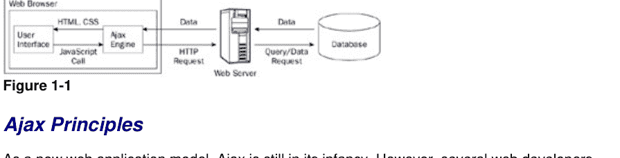

### Ajax 原则

作为一种新的 Web 应用模型，Ajax 仍处于起步阶段。然而，一些 Web 开发者已将此新发展视为一项挑战。挑战在于定义什么是好的 Ajax Web 应用，以及什么是糟糕或平庸的 Ajax 应用。软件开发人员和可用性专家 Michael Mahemoff (http://mahemoff.com/) 总结了优秀 Ajax 应用的几个关键原则，值得重申：

- **最小流量**：Ajax 应用应尽可能少地与服务器发送和接收信息。简而言之，Ajax 可以最小化客户端和服务器之间的流量。确保你的 Ajax 应用不发送和接收不必要的信息，能增加其稳健性。
- **无意外**：Ajax 应用通常引入与传统 Web 应用不同的用户交互模型。与点击等待的 Web 标准不同，一些 Ajax 应用使用其他用户交互范式，如拖放或双击。无论你选择哪种用户交互模型，都要保持一致，以便用户知道下一步该做什么。
- **遵循惯例**：不要浪费时间发明用户不熟悉的新的用户交互模型。大量借鉴传统 Web 应用和桌面应用，以最小化学习曲线。
- **无干扰**：避免不必要的、干扰性的页面元素，如循环动画和闪烁的页面部分。这种花招会使用户分心，无法专注于他或她想要完成的任务。
- **可访问性**：考虑你的主要用户和次要用户可能是谁，以及他们最可能如何访问你的 Ajax 应用。不要把自己逼到死角，以至于意想不到的新受众完全无法使用。你的用户是否会使用较旧的浏览器或特殊软件？确保提前了解并做好规划。
- **避免整页下载**：初始页面加载后的所有服务器通信都应由 Ajax 引擎管理。不要在一个地方下载少量数据，却在另一个地方重新加载整个页面，从而破坏用户体验。
- **用户至上**：设计 Ajax 应用时，要将用户放在首位。尝试使常见用例易于完成，不要过分纠结于如何融入广告或炫酷效果。

所有这些原则的共同主线是可用性。Ajax 主要是为了增强用户的 Web 体验；其背后的技术只是实现这一目标的手段。通过遵守上述原则，你可以合理地确保你的 Ajax 应用是有用且可用的。

### Ajax 背后的技术

Garrett 的文章提到了他认为构成 Ajax 解决方案的几项技术，包括：

- **HTML/XHTML**：主要的内容表示语言
- **CSS**：为 XHTML 提供样式化格式
- **DOM**：动态更新已加载的页面
- **XML**：数据交换格式
- **XSLT**：将 XML 转换为 XHTML（由 CSS 设置样式）
- **XMLHttp**：主要的通信代理
- **JavaScript**：用于编程 Ajax 引擎的脚本语言

实际上，所有这些技术都可用于 Ajax 解决方案，但只有三项是必需的：HTML/XHTML、DOM 和 JavaScript。XHTML 显然是显示信息所必需的，而 DOM 是更改 XHTML 页面部分而不重新加载页面所必需的。最后一项 JavaScript 是发起客户端-服务器通信和操作 DOM 以更新网页所必需的。列表中的其他技术有助于优化 Ajax 解决方案，但并非必需。

Garrett 文章中忽略了一个主要组成部分：服务器端处理的必要性。所有前面列出的技术都直接与客户端 Ajax 引擎相关，但如果没有一个稳定、响应迅速的服务器等待向引擎发送内容，就没有 Ajax。为此，你可以使用你选择的应用服务器。无论你选择将服务器端组件编写为 PHP 页面、Java servlets 还是 .NET 组件，你只需要确保将正确的数据格式发送回 Ajax 引擎。

> **注意** 本书中的示例尽可能多地使用了服务器端技术，以便为你提供足够的信息，在各种服务器上设置 Ajax 通信系统。

### 谁在使用 Ajax？

许多商业网站使用 Ajax 技术来改善用户体验。这些网站更像是 Web 应用，而不是仅仅显示信息的传统宣传网站，因为访问它们是为了完成特定目标。以下是一些较为知名且执行良好的使用 Ajax 的 Web 应用。

### Google Suggest

开发者们谈论 Ajax 时引用的第一个例子通常是 Google Suggest（[www.google.com/webhp?complete=1](http://www.google.com/webhp?complete=1)）。该界面简单地克隆了主要的 Google 界面，其突出特点是用于输入搜索词的文本框。一切看起来都一样，直到你开始在文本框中输入。当你输入时，Google Suggest 会向服务器请求建议，显示一个你可能感兴趣的搜索词下拉列表。每个建议都显示了该给定术语可用的结果数量，以帮助你决定（参见 [图 1-2](#Figure_1-2)）。

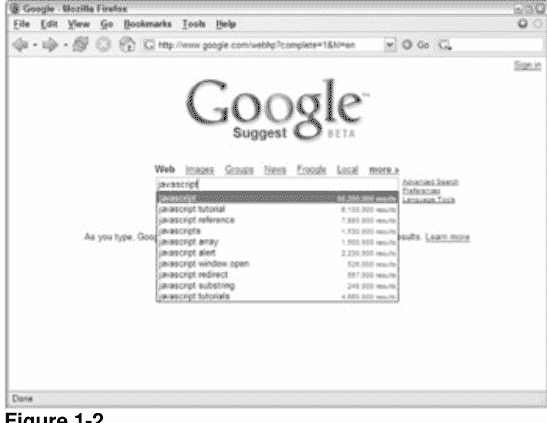

**图 1-2**

这个简单的客户端-服务器交互非常强大和有效，而不会对用户造成干扰。该界面的响应速度超出了你可能从 Web 应用中习得的期望；无论你输入多快，它都会更新，而且就像桌面软件中的自动完成功能一样，你可以使用上下箭头来突出显示并选择建议列表中的每一项。尽管仍处于测试阶段，但可以预期这种方法最终会进入 Google 主页面。

### Gmail

Gmail，Google 的免费电子邮件服务，被誉为 Ajax 时代客户端-服务器交互的奇迹。当你第一次登录 Gmail 时，一个用户界面引擎会加载到应用程序使用的几个 iframe 之一中。所有后续返回服务器的请求都通过这个用户界面引擎，经由 XMLHttp 对象进行。传输回来的数据……


### 谷歌地图

谷歌在其主导地位的 Ajax 网络应用中最新加入的是谷歌地图（[http://maps.google.com](http://maps.google.com)）。该应用旨在与成熟的地图网站竞争，谷歌地图运用 Ajax 技术，完全避免了主页面的重新加载（参见图 1-4）。

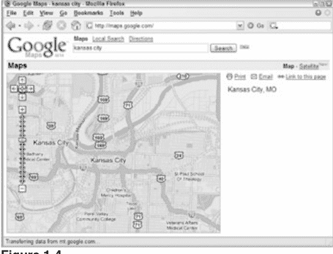

**图 1-4**

与其他地图网络应用不同，谷歌地图允许你拖拽地图以向各个方向移动。对于 JavaScript 开发者来说，拖拽功能本身并不新鲜，但地图的瓦片化和看似无尽的滚动效果则是另一回事。地图被分割成一系列图像，这些图像以瓦片方式拼接在一起，形成连续的视觉效果。用于显示地图的图像是有限的，因为每次用户移动地图都创建新图像会很快导致内存问题。因此，系统会重复使用相同的图像来显示地图的不同片段。

客户端与服务器的通信通过一个隐藏的 iframe 完成。每当你执行搜索或请求新的路线时，信息都会在这个 iframe 中提交和返回。返回的数据采用 XML 格式，并传递给一个 JavaScript 函数（Ajax 引擎）进行处理。这些 XML 随后以多种方式使用：一些用于调用正确的地图图像，另一些则通过 XSLT 转换为 HTML 并在主窗口中显示。总而言之，这是另一个具有无限光明前景的复杂 Ajax 应用。

### A9

亚马逊公司（Amazon.com）作为几乎能买到任何东西的在线市场而闻名世界，但它推出搜索引擎时却异常低调。A9（[www.a9.com](http://www.a9.com)）的推出展示了增强的搜索功能，使你能够同时搜索不同类型的信息。对于网页和图片搜索，它使用谷歌来获取结果。它还能搜索亚马逊网站上的书籍和 IMDb（互联网电影数据库）上的电影。黄页、维基百科和 Answers.com 的搜索功能于 2005 年中推出。

A9 的独特之处在于其用户界面的工作方式。当你执行搜索时，不同类型的结果会显示在页面的不同区域（参见图 1-5）。

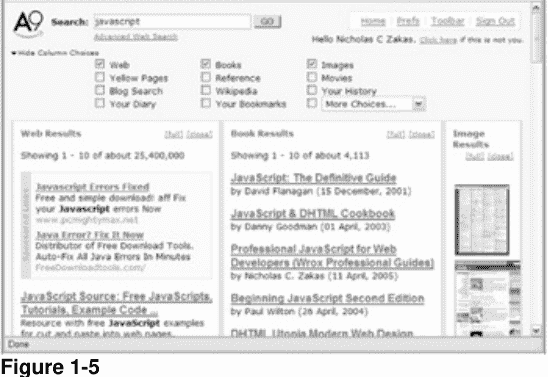

**图 1-5**

在搜索结果页面上，你可以选择使用相同的条件执行其他搜索。当你选择与某种搜索类型对应的复选框时，系统会在后台使用隐藏的 iframe 和 XMLHttp 的组合执行搜索。用户界面会相应调整，为额外的搜索结果腾出空间，这些结果一旦从服务器接收到就会立即加载。其结果是，当你想搜索不同类型的信息时，无需重新加载页面，搜索结果页面能提供更快速的响应。

### 雅虎新闻

同样在 2005 年推出的还有雅虎新闻网站（[http://news.yahoo.com](http://news.yahoo.com)）的新设计。新设计包含一个有趣的功能增强：当你将鼠标悬停在某个特定标题上时，会弹出一个小框，显示该新闻的摘要，以及可选的、与该新闻相关的照片（参见图 1-6）。

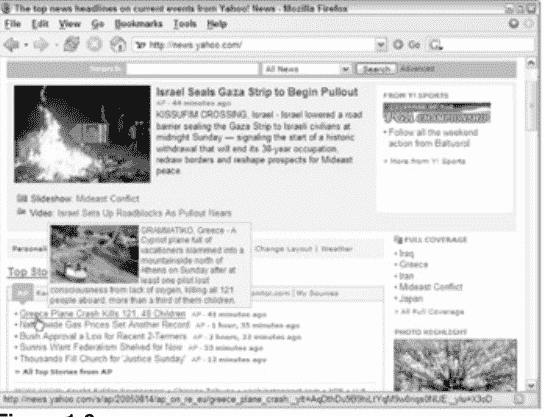

**图 1-6**

照片信息和摘要是通过 XMLHttpRequest 从服务器获取的，并动态插入到页面中。这是 Ajax 如何用于增强网页的绝佳范例。雅虎新闻网站并非将 Ajax 作为主要使用模式；即使没有 Ajax，该网站也完全可用。Ajax 功能仅用于在支持的浏览器中提供更具响应性的用户体验。其底层是一个语义正确的 HTML 页面，即使没有 CSS 格式化，其布局也是合乎逻辑的。

### Bitflux 博客

另一个仅将 Ajax 用作增强功能的绝佳示例是 Bitflux 博客（[http://blog.bitflux.ch/](http://blog.bitflux.ch/)），其特色是一项名为 LiveSearch 的技术。LiveSearch 与网站上的搜索框协同工作。当你在框中输入内容时，可能的搜索结果列表会立即显示在下方（参见图 1-7）。

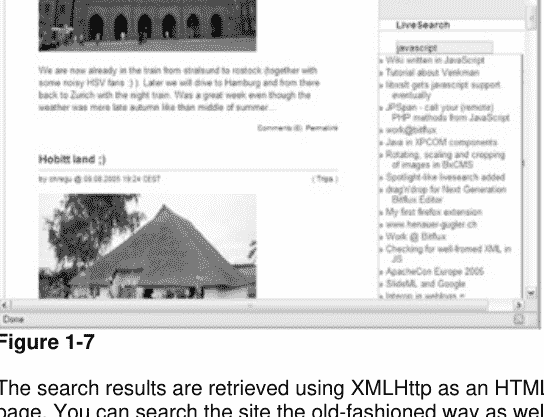

**图 1-7**

搜索结果是通过 XMLHttpRequest 作为 HTML 字符串检索的，然后插入到页面中。你也可以使用传统方式搜索网站：填写文本框并按 Enter 键。LiveSearch Ajax 功能只是整个网站的增强功能，搜索本身并不需要它。

### 混淆与争议

尽管 *Ajax* 这个术语很流行，但它也面临着不少反对和争议。有些人认为 Ajax 偏离了 Ajax 出现之前网络的发展方向。语义化 HTML 设计、可访问性以及内容与表现分离的支持者们在网页开发者中正获得越来越多的认可，而一些人则认为 Ajax 的流行将这一运动推向了背景。这些批评者相信 Ajax 倡导在 JavaScript 中创建表现，从而将其变成一种类似早期服务器端脚本的混乱混合体。许多人认为，如果更多开发者转向 Ajax 解决方案，网站的可访问性将会受损。

另一些人则花了大量时间剖析加勒特（Garrett）的文章，并驳斥了他提出的若干假设。例如，文章中反复提及使用 XML 和 XMLHttpRequest 作为 Ajax 模型的核心，但他列出的许多示例并未使用它们。Gmail 和谷歌地图都没有使用这两项技术；谷歌建议（Google Suggest）仅使用 XMLHttpRequest，并使用 JavaScript 数组而非 XML 进行数据交换。批评者还指出，文章中对 Ajax 的技术解释完全具有误导性，提到了几项不仅不必要（如 XML 和 XMLHttpRequest），而且在许多情况下不太可能使用（如 XSLT）的技术。

围绕 Ajax 和加勒特在 Adaptive Path 文章的另一个主要争议是，它仅仅是为一项已经使用了一段时间的技术起了个新名字。尽管这类数据检索在 Netscape Navigator 2.0 中就已实现，但它真正在 2001-2002 年间变得尤为突出，特别是在苹果开发者联盟网站上发表了一篇题为“使用 IFRAME 的远程脚本”的文章（可在 http://developer.apple.com/internet/webcontent/iframe.html 获取）。这篇文章被广泛认为是首篇关于类似 Ajax 方法论的主流文章。*远程脚本* 这个术语从未像 Ajax 那样获得持久的流行度。

还有些人对 *Ajax* 和加勒特的文章嗤之以鼻，认为它的创建不过是加勒特的公司 Adaptive Path, LLC 的营销噱头。一些人认为，为一项已经存在的技术创造一个名称是不真诚的，并且是明显恶意的迹象。尽管 Ajax 周围存在这样和那样的争议，这种方法现在有了一个开发者们正在迅速熟悉的名称，随之而来的是对深入理解和解释的需求，以便它能以最佳方式被使用。

## 总结

本章向你介绍了 Ajax 的基本前提。*Ajax* 是 Asynchronous JavaScript + XML（异步 JavaScript 和 XML）的缩写，这个术语由杰西·詹姆斯·加勒特在他发表于 Adaptive Path, LLC 网站上的一篇文章中首创。该文章将 Ajax 介绍为一种新的网页应用用户交互模型，其中不再需要完整的页面加载。

本章还探讨了网络的演变与使 Ajax 如今成为现实的相关技术发展之间的关系。Ajax 的存在得益于 JavaScript 和框架被引入网络浏览器，这使得在 Netscape Navigator 2.0 中使用 JavaScript 进行异步数据检索在理论上成为可能。在整个新网络技术的演变过程中，诸如隐藏框架技术等 Ajax 方法学得以发展。iframe 和 XMLHttpRequest 的引入真正推动了 Ajax 开发的前进。

尽管 Ajax 可用于完成许多事情，但它最好用于增强用户体验，而不是提供炫酷效果。本章讨论了若干 Ajax 原则，所有这些原则都回到同一点：在网页应用开发中，用户需求至高无上。


而其他人则质疑加勒特撰写这篇现已闻名文章的动机。与所有方法一样，Ajax在作为精心设计的Web应用程序的逻辑增强时才能发挥最佳效果。

## 第2章：Ajax基础

Ajax背后的驱动力是客户端（Web浏览器）与服务器之间的交互。以前，对这种通信的理解仅限于那些使用Perl和C等语言进行纯服务器端开发的人员。较新的技术，如ASP.NET、PHP和JSP，鼓励对创建Web应用程序感兴趣的软件工程师更多地采用客户端和服务器端技术的混合，但他们往往缺乏对所有客户端技术（如JavaScript）的全面理解。现在，钟摆已摆向另一端，客户端开发人员需要更深入地了解服务器端技术，以便创建Ajax解决方案。

### HTTP入门

要很好地掌握Ajax技术，核心是超文本传输协议（HTTP），这是将网页、图像和其他类型的文件通过Internet传输到你的Web浏览器并返回的协议。每当在浏览器中输入URL时，地址前会自动加上"http://"，表示你将使用HTTP来访问给定位置的信息。（大多数浏览器也支持多种其他协议，最显著的是FTP。）

> **注意** 注意，本节仅涵盖Ajax开发人员感兴趣的HTTP方面。它不构成HTTP参考指南或教程。

HTTP由两部分组成：请求和响应。当在Web浏览器中输入URL时，浏览器会代表你创建并发送一个请求。此请求包含你输入的URL以及一些关于浏览器本身的信息。服务器接收此请求并返回一个响应。响应包含有关请求的信息以及URL处的数据（如果有）。解释响应并显示网页（或其他资源）由浏览器负责。

### HTTP请求

HTTP请求的格式如下：

```
<request-line>
<headers>
<blank line>
[<request-body>]
```

在HTTP请求中，第一行必须是请求行，指示请求类型、要访问的资源以及所使用的HTTP版本。接下来，一个头部部分指示可能对服务器有用的额外信息。头部之后是一个空行，其后可以选择性地跟有额外数据（称为*正文*）。

HTTP中定义了大量请求类型，但Ajax开发人员感兴趣的两种是GET和POST。每当在Web浏览器中输入URL时，浏览器会向该URL的服务器发送一个GET请求，这基本上是告诉服务器获取资源并将其发送回来。以下是针对www.wrox.com的GET请求示例：

```
GET / HTTP/1.1
Host: www.wrox.com
User-Agent: Mozilla/5.0 (Windows; U; Windows NT 5.1; en-US; rv:1.7.6)
    Gecko/20050225 Firefox/1.0.1
Connection: Keep-Alive
```

请求行的第一部分指定这是一个GET请求。该行的第二部分是正斜杠（/），表示请求针对域名的根目录。请求行的最后一部分指定使用HTTP版本1.1（替代版本是1.0）。请求发送到哪里？这就是第二行的作用。

第二行是请求中的第一个头部`Host`。`Host`头部指示请求的目标。将`Host`与第一行的正斜杠结合，告诉服务器请求针对www.wrox.com/。（`Host`头部是HTTP 1.1的要求；较旧的版本1.0不要求它。）第三行包含`User-Agent`头部，该头部可由服务器端和客户端脚本访问，是大多数浏览器检测逻辑的基石。此信息由你使用的浏览器定义（在此示例中为Firefox 1.0.1），并在每个请求中自动发送。最后一行是`Connection`头部，对于浏览器操作通常设置为`Keep-Alive`（也可以设置为其他值，但这超出了本书的范围）。请注意，最后一个头部之后有一个空行。即使没有请求正文，空行也是必需的。

如果请求www.wrox.com域下的页面，例如http://www.wrox.com/books，请求将如下所示：

```
GET /books/ HTTP/1.1
Host: www.wrox.com
User-Agent: Mozilla/5.0 (Windows; U; Windows NT 5.1; en-US; rv:1.7.6)
    Gecko/20050225 Firefox/1.0.1
Connection: Keep-Alive
```

请注意，只有第一行发生了变化，它只包含URL中www.wrox.com之后的部分。

发送GET请求的参数需要将额外信息附加到URL本身。格式如下：

```
URL ? name1=value1&name2=value2&..&nameN=valueN
```

此信息称为*查询字符串*，在HTTP请求的请求行中重复，如下所示：

```
GET /books/?name=Professional%20Ajax HTTP/1.1
Host: www.wrox.com
User-Agent: Mozilla/5.0 (Windows; U; Windows NT 5.1; en-US; rv:1.7.6)
    Gecko/20050225 Firefox/1.0.1
Connection: Keep-Alive
```

请注意，文本"Professional Ajax"必须进行编码，将空格替换为%20，以便将其作为参数发送到URL。这称为*URL编码*，在HTTP的许多部分使用。（JavaScript具有内置函数来处理URL编码和解码；本章稍后将讨论这些内容。）名称-值对用&号分隔。大多数服务器端技术会自动解码请求正文，并以某种逻辑方式提供对这些值的访问。当然，由服务器决定如何处理这些数据。

> **重要提示** 浏览器通常发送比本节讨论的更多的头部。为简洁起见，此处的示例已保持简短。

另一方面，POST请求在请求正文中向服务器提供额外信息。通常，当你填写在线表单并提交时，这些数据就是通过POST请求发送的。

以下是典型POST请求的示例：

```
POST / HTTP/1.1
Host: www.wrox.com
User-Agent: Mozilla/5.0 (Windows; U; Windows NT 5.1; en-US; rv:1.7.6)
    Gecko/20050225 Firefox/1.0.1
    Content-Type: application/x-www-form-urlencoded
    Content-Length: 40
    Connection: Keep-Alive

    name=Professional%20Ajax&publisher=Wiley
```

你应该注意POST请求和GET请求之间的一些区别。首先，请求行以POST而不是GET开头，指示请求类型。你会注意到Host和User-Agent头部仍然存在，同时还有两个新的头部。Content-Type头部指示请求正文的编码方式。浏览器始终将POST数据编码为application/x-www-form-urlencoded，这是简单URL编码的MIME类型。Content-Length头部指示请求正文的字节长度。Connection头部和空行之后是请求正文。与大多数浏览器POST请求一样，这由简单的名称-值对组成，其中name是Professional Ajax，publisher是Wiley。你可能认出此格式与URL上查询字符串参数的格式相同。

如前所述，还有其他HTTP请求类型，但它们遵循与GET和POST相同的基本格式。下一步是查看服务器在响应HTTP请求时返回的内容。

### HTTP响应

HTTP响应的格式与请求非常相似，如下所示：

```
<status-line>
<headers>
<blank line>
[<response-body>]
```

如你所见，响应中唯一真正的区别是第一行包含状态信息而不是请求信息。状态行通过提供状态码告诉你有关请求资源的信息。以下是HTTP响应示例：

```
HTTP/1.1 200 OK
Date: Sat, 31 Dec 2005 23:59:59 GMT
Content-Type: text/html;charset=ISO-8859-1
Content-Length: 122

<html>
    <head>
        <title>Wrox Homepage</title>
    </head>
    <body>
        <!-- body goes here -->
    </body>
</html>
```

在此示例中，状态行给出HTTP状态码200和消息OK。状态行始终包含状态码和相应的简短消息，以免产生任何混淆。最常见的状态码是：

-   **200（OK）：** 资源已找到，一切正常。


**304 (未修改)：** 自上次请求以来资源未被修改。这最常用于浏览器缓存机制。
- **401 (未授权)：** 客户端未被授权访问资源。通常，这会导致浏览器提示输入用户名和密码以登录服务器。
- **403 (禁止)：** 客户端未能获得授权。这通常发生在你在收到 401 状态码后未能使用正确的用户名和密码登录时。
- **404 (未找到)：** 资源在给定的位置不存在。

状态行之后是一些头部信息。通常，服务器会返回一个 `Date` 头部，指示响应生成的日期和时间。（服务器通常也会返回一些关于自身的其他信息，尽管这不是必需的。）接下来的两个头部也应该看起来很熟悉，因为它们与 POST 请求中使用的 `Content-Type` 和 `Content-Length` 头部相同。在这种情况下，`Content-Type` 头部指定了 HTML 的 MIME 类型（text/html），编码为 ISO-8859-1（这是美国英语资源的标准编码）。响应的主体只包含所请求资源的 HTML 源代码（尽管对于其他类型的资源，它也可能包含纯文本或二进制数据）。正是这些数据被浏览器显示给用户。

请注意，这里没有指明是哪种类型的请求要求了这个响应；然而，这对服务器来说无关紧要。由客户端来决定对于每种类型的请求应该发回什么类型的数据，以及如何使用这些数据。

## Ajax 通信技术

既然你已经了解了 HTTP 通信工作原理的基础知识，现在是时候研究如何在网页内部实现这种通信了。如你所知，当你在冲浪时，浏览器和服务器之间会来回发送大量的请求。最初，所有这些请求的发生是因为用户执行了一个需要此步骤的显式操作。Ajax 技术将开发者从等待用户执行此类操作中解放出来，允许你在任何时候发起对服务器的调用。

如 [第 1 章](第 1 章) 所述，Ajax 通信支持多种不同的技术。每种技术都有其优点和缺点，因此理解在何种情况下使用哪种技术非常重要。

## 隐藏框架技术

随着 HTML 框架的引入，隐藏框架技术应运而生。该技术背后的基本思想是创建一个框架集，其中包含一个用于客户端-服务器通信的隐藏框架。你可以通过将框架的宽度或高度设置为 0 像素来隐藏它，从而有效地将其从显示中移除。尽管一些早期的浏览器（如 Netscape 4）无法完全隐藏框架，常常会留下粗边框，但该技术仍然在开发者中获得了普及。

### 模式

隐藏框架技术遵循一个非常具体的四步模式（参见 [图 2-1](图 2-1)）。第一步总是从可见框架开始，用户正在与一个网页进行交互。自然地，用户不知道有一个隐藏框架（在现代浏览器中，它不会被渲染），并像平常一样与页面交互。在某个时刻，用户执行了一个需要从服务器获取额外数据的操作。当这种情况发生时，该过程的第一步发生：调用一个 JavaScript 函数到隐藏框架。这个调用可以像将隐藏框架重定向到另一个页面一样简单，也可以像发布表单数据一样复杂。无论函数多么复杂，其结果都是该过程的第二步：向服务器发出请求。

该模式的第三步是从服务器接收响应。因为你处理的是框架，所以这个响应必须是另一个网页。这个网页必须包含从服务器请求的数据以及一些用于将该数据传输到可见框架的 JavaScript。通常，这是通过在返回的网页中分配一个 `onload` 事件处理程序来完成的，该处理程序在页面完全加载后调用可见框架中的一个函数（这是第四步）。此时数据已在可见框架中，由该框架决定如何处理这些数据。

### 隐藏框架 GET 请求

既然已经解释了隐藏框架技术，现在是时候进一步了解它了。与任何新技术一样，最好的学习方法是通过一个示例来实践。在这个示例中，你将创建一个简单的查询页面，客服代表可以查询客户信息。由于这是本书的第一个示例，它非常简单：用户将输入一个客户 ID，并接收有关客户的信息返回。由于此类功能最常与数据库一起使用，因此也需要进行一些服务器端编程。这个示例使用 PHP（一种优秀的开源服务器端语言）和 MySQL（可在 www.mysql.org 获取），这是一种开源数据库，与 PHP 结合得非常好。

**重要提示** 尽管此示例旨在与 MySQL 一起使用，但你应该能够在其他数据库上运行它，只需很少或根本不需要修改。

首先，在查询客户数据之前，你必须有一个包含它的表。你可以使用以下 SQL 脚本创建客户表：

```sql
CREATE TABLE `Customers` (
    `CustomerId` int(11) NOT NULL auto_increment,
    `Name` varchar(255) NOT NULL default '',
    `Address` varchar(255) NOT NULL default '',
    `City` varchar(255) NOT NULL default '',
    `State` varchar(255) NOT NULL default '',
    `Zip` varchar(255) NOT NULL default '',
    `Phone` varchar(255) NOT NULL default '',
    `E-mail` varchar(255) NOT NULL default '',
    PRIMARY KEY (`CustomerId`)
) TYPE=MyISAM COMMENT='Sample Customer Data';
```

此表中最重要的字段是 `CustomerId`，你将使用它来查询客户信息。

**注意** 你可以从 www.wrox.com 下载此脚本以及一些示例数据。

数据库表设置完成后，现在是时候转向 HTML 代码了。要使用隐藏框架技术，你必须从一个 HTML 框架集开始，如下所示：

```html
<frameset rows="100%,0" frameborder="0">
    <frame name="displayFrame" src="display.htm" noresize="noresize" />
    <frame name="hiddenFrame" src="about:blank" noresize="noresize" />
</frameset>
```

此代码的重要部分是 `<frameset/>` 元素的 rows 属性。通过将其设置为 100%, 0，浏览器就知道不要显示第二个框架的主体，其名称为 hiddenFrame。接下来，frameborder 属性设置为 0，以确保每个框架周围没有可见的边框。框架集声明中最后一个重要步骤是为每个框架设置 noresize 属性，这样用户就不会意外地调整框架大小并看到隐藏框架中的内容；隐藏框架的内容永远不应成为显示界面的一部分。

接下来是请求和显示客户数据的页面。这是一个相对简单的页面，包含一个用于输入客户 ID 的文本框、一个执行请求的按钮和一个用于显示检索到的客户信息的 `<div/>` 元素：

```html
<p>Enter customer ID number to retrieve information:</p>
<p>Customer ID: <input type="text" id="txtCustomerId" value="" /></p>
<p><input type="button" value="Get Customer Info" onclick="requestCustomerInfo()" /></p>
<div id="divCustomerInfo"></div>
```

你会注意到按钮调用了一个名为 requestCustomerInfo() 的函数，该函数与隐藏框架交互以检索信息。它只是获取文本框中的值并将其添加到 getcustomerdata.php 的查询字符串中，创建一个形式为 getcustomerdata.php?id=23 的 URL。然后将此 URL 分配给隐藏框架。以下是该函数：

```javascript
function requestCustomerInfo() {
    var sId = document.getElementById("txtCustomerId").value;
    top.frames["hiddenFrame"].location = "getcustomerdata.php?id=" + sId;
}
```

此函数的第一步是从文本框中检索客户标识号（"txtCustomerId"）。为此，使用文本框 ID "txtCustomerId" 调用 document.getElementById()，并获取 value 属性。（value 属性保存文本框内的文本。）然后，将此 ID 添加到字符串 "getcustomerdata.php?id=" 中以创建完整的 URL。第二行创建 URL 并将其分配给隐藏框架。要获得对隐藏框架的引用，你首先需要使用 top 对象访问浏览器的最顶层窗口。该对象有一个 frames 数组，你可以在其中找到隐藏框架。由于每个框架只是另一个窗口对象，你可以将其 location 设置为所需的 URL。

请求信息只需要这些。注意，由于这是一个 GET 请求（通过查询字符串传递信息），它使请求变得非常简单。（你很快就会看到如何使用隐藏框架技术执行 POST 请求。）

除了 requestCustomerInfo() 函数之外，你还需要另一个函数来在接收到客户信息后显示它。这个函数 displayCustomerInfo() 将在隐藏框架返回数据时被调用。唯一的参数是一个包含要显示的客户数据的字符串：

```javascript
function displayCustomerInfo(sText) {
    var divCustomerInfo = document.getElementById("divCustomerInfo");
```


在此函数中，第一行获取了用于显示数据的`<div/>`元素的引用。第二行将客户信息字符串（sText）赋值给`<div/>`元素的`innerHTML`属性。使用`innerHTML`可以将HTML嵌入字符串中以实现格式化。至此，主显示页面的代码完成。现在，是时候创建服务端逻辑了。

`getcustomerdata.php`的基本代码是一个非常基础的HTML页面，其中包含两处PHP代码：

```html
<html>
    <head>
        <title>Get Customer Data</title>
<?php

    //php code

?>
    </head>
    <body>
        <div id="divInfoToReturn"><?php echo $sInfo ?></div>
    </body>
</html>
```

在此页面中，第一个PHP代码块将包含检索客户数据的逻辑（稍后讨论）。第二个PHP代码块将包含客户数据的变量`$sInfo`输出到`<div/>`中。正是从这个`<div/>`中，你将读取数据并发送到显示框架。为此，你需要创建一个在页面完全加载后被调用的JavaScript函数：

```javascript
window.onload = function () {
    var divInfoToReturn = document.getElementById("divInfoToReturn");
    top.frames["displayFrame"].displayCustomerInfo(divInfoToReturn.innerHTML);
};
```

此函数直接赋值给`window.onload`事件处理程序。它首先获取包含客户信息的`<div/>`的引用。然后，它通过`top.frames`数组访问显示框架，并调用之前定义的`displayCustomerInfo()`函数，传入`<div/>`的`innerHTML`。这就是将信息发送到指定位置所需的全部JavaScript代码。但信息最初是如何到达那里的呢？需要一些PHP代码将其从数据库中取出。

PHP代码的第一步是定义你所需的所有数据片段。在本例中，这些数据片段包括要查询的客户ID、用于返回信息的`$sInfo`变量，以及访问数据库所需的信息（数据库服务器、数据库名、用户名、密码和SQL查询字符串）：

```php
<?php
$sID = $_GET["id"];
$sInfo = "";

$sDBServer = "your.databaseserver";
$sDBName = "your_db_name";
$sDBUsername = "your_db_username";
$sDBPassword = "your_db_password";
$sQuery = "Select * from Customers where CustomerId=".$sID;

//More here
?>
```

此代码首先从查询字符串中检索`id`参数。PHP将所有查询字符串参数组织到`$_GET`数组中以便于检索。此`id`存储在`$sID`中，并用于创建存储在`$sQuery`中的SQL查询字符串。`$sInfo`变量也在此处创建并设置为空字符串。此代码块中的所有其他变量都包含特定于你数据库配置的信息；你必须根据你的实际实现替换这些值。

捕获用户输入并设置好与数据库连接的基础之后，下一步是调用该数据库连接、执行查询并返回结果。如果存在具有给定ID的客户，`$sInfo`将被填充为一个包含所有数据的HTML字符串，包括为电子邮件地址创建链接。如果客户ID无效，`$sInfo`将被填充为一条错误消息，该消息将被传回显示框架：

```php
<?php

$sID = $_GET["id"];
$sInfo = "";

$sDBServer = "your.databaseserver";
$sDBName = "your_db_name";
$sDBUsername = "your_db_username";
$sDBPassword = "your_db_password";
$sQuery = "Select * from Customers where CustomerId=".$sID;

$oLink = mysql_connect($sDBServer,$sDBUsername,$sDBPassword);
@mysql_select_db($sDBName) or $sInfo=" Unable to open database";

if($oResult = mysql_query($sQuery) and mysql_num_rows($oResult) > 0) {
    $aValues = mysql_fetch_array($oResult,MYSQL_ASSOC);
    $sInfo = $aValues['Name']."<br />".$aValues['Address']."<br />".
    $aValues['City']."<br />".$aValues['State']."<br />".
    $aValues['Zip']."<br /><br />Phone: "."<br />".
    $aValues['Phone']."<br />".
    "<a href=\"mailto:".$aValues['E-mail']."\">".
    $aValues['E-mail']."</a>";
} else {
    $sInfo = "Customer with ID $sID doesn't exist.";
}
mysql_close($oLink);
?>
```

高亮部分的前两行包含从PHP连接到MySQL数据库的调用。之后，调用`mysql_query()`函数来执行SQL查询。如果该函数返回结果且结果至少有一行，则代码继续获取信息并存储在`$sInfo`中；否则，`$sInfo`将被填充为一条错误消息。最后两行清理数据库连接。

> **注意：** 解释PHP和MySQL编程的复杂性超出了本书的范围。如果你想了解更多，可以考虑阅读*Beginning PHP, Apache, MySQL Web Development*（Wiley Press，ISBN 0-7645-5744-0）。

现在，当`$sInfo`输出到`<div/>`时，它将包含相应的信息。`onload`事件处理程序读取该数据并将其发送回显示框架。如果找到了客户，信息将被显示，如**图2-2**所示。

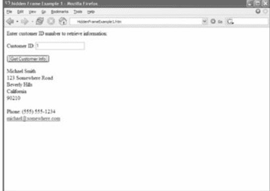

另一方面，如果客户不存在，屏幕上的同一位置将显示一条错误消息。无论哪种方式，客户服务代表都将获得良好的用户体验。至此，你的第一个Ajax示例完成。

## 隐藏框架POST请求

前面的示例使用GET请求从数据库检索信息。这相当简单，因为客户ID可以附加到查询字符串中的URL并发送出去。但如果你需要发送POST请求呢？使用隐藏框架技术这也是可能的，尽管需要一些额外的工作。

POST请求通常在需要向服务器发送数据时使用，而GET请求仅从服务器请求数据。尽管GET请求可以通过查询字符串发送额外数据，但某些浏览器最多只能处理512KB的查询字符串信息。另一方面，POST请求最多可以发送2GB的信息，使其适用于大多数用途。

传统上，发送POST请求的唯一方法是使用`method`属性设置为`post`的表单。然后，表单中包含的数据以POST请求发送到`action`属性中指定的URL。更复杂的是，典型的表单提交会导航页面到新URL。这完全违背了Ajax的目的。值得庆幸的是，有一个非常简单的解决方法，使用一个鲜为人知的属性`target`。

`<form/>`元素的`target`属性的使用方式与`<a/>`元素的`target`属性类似：它指定导航应在何处发生。通过在表单上设置`target`属性，你可以有效地告诉表单页面保留原地，而表单提交的结果显示在另一个框架或窗口中（在本例中，是一个隐藏框架）。

首先，定义另一个框架集。与前面示例的唯一区别是可见框架包含一个客户数据输入表单：

```html
<frameset rows="100%,0" frameborder="0">
    <frame name="displayFrame" src="entry.htm" noresize="noresize" />
    <frame name="hiddenFrame" src="about:blank" noresize="noresize" />
</frameset>
```

输入表单的主体包含在`<form/>`元素中，并为存储在数据库中的每个字段（客户ID除外，它将自动生成）提供文本框。还有一个`<div/>`用于显示与客户端-服务器通信相关的状态消息：

```html
<form method="post" action="SaveCustomer.php" target="hiddenFrame">
    <p>Enter customer information to be saved:</p>
    <p>Customer Name: <input type="text" name="txtName" value="" /><br />
        Address: <input type="text" name="txtAddress" value="" /><br />
        City: <input type="text" name="txtCity" value="" /><br />
        State: <input type="text" name="txtState" value="" /><br />
        Zip Code: <input type="text" name="txtZipCode" value="" /><br />
        Phone: <input type="text" name="txtPhone" value="" /><br />
        E-mail: <input type="text" name="txtEmail" value="" /></p>
    <p><input type="submit" value="Save Customer Info" /></p>
</form>
<div id="divStatus"></div>
```

还要注意，`<form/>`元素的`target`设置为`hiddenFrame`，这样当用户点击按钮时，提交将进入隐藏框架。

在此示例中，主页面只需要一个JavaScript函数：`saveResult()`。当隐藏框架从保存客户数据返回时，将调用此函数：

```javascript
function saveResult(sMessage) {
    var divStatus = document.getElementById("divStatus");
    divStatus.innerHTML = "Request completed: "+ sMessage;
}
```

隐藏框架有责任向此函数传递一条消息，该消息将显示给用户。这将要么是信息已保存的确认，要么是解释为什么未保存的错误消息。


## 接下来是处理 POST 请求的 SaveCustomer.php 文件。与上一个示例一样，该页面被设置为一个结合了 PHP 和 JavaScript 代码的简单 HTML 页面。PHP 代码用于从请求中收集信息并将其存储在数据库中。由于这是一个 POST 请求，`$_POST` 数组包含了所有提交的信息：

```php
<?php
$sName = $_POST["txtName"];
$sAddress = $_POST["txtAddress"];
$sCity = $_POST["txtCity"];
$sState = $_POST["txtState"];
$sZipCode = $_POST["txtZipCode"];
$sPhone = $_POST["txtPhone"];
$sEmail = $_POST["txtEmail"];

$sStatus = "";

$sDBServer = "your.database.server";
$sDBName = "your_db_name";
$sDBUsername = "your_db_username";
$sDBPassword = "your_db_password";

$sSQL = "Insert into Customers(Name,Address,City,State,Zip,Phone,'E-mail') " .
        " values ('".$sName."','".$sAddress."','".$sCity."','".$sState."','".$sZipCode."','".$sPhone."','".$sEmail."')";

//此处还有更多代码
?>
```

此代码片段检索了关于客户的所有 POST 信息；此外，它还定义了一个状态消息 (`$sStatus`) 和所需的数据库信息（与上一个示例相同）。这次的 SQL 语句是 INSERT，用于添加所有检索到的信息。

执行 SQL 语句的代码与上一个示例非常相似：

```php
<?php
$sName = $_POST["txtName"];
$sAddress = $_POST["txtAddress"];
$sCity = $_POST["txtCity"];
$sState = $_POST["txtState"];
$sZipCode = $_POST["txtZipCode"];
$sPhone = $_POST["txtPhone"];
$sEmail = $_POST["txtEmail"];

$sStatus = "";

$sDBServer = "your.database.server";
$sDBName = "your_db_name";
$sDBUsername = "your_db_username";
$sDBPassword = "your_db_password";

$sSQL = "Insert into Customers(Name,Address,City,State,Zip,Phone,'E-mail') " .
    " values ('$sName','$sAddress','$sCity','$sState',
    '$sZipCode'",
    ", '$sPhone', '$sEmail')";

$oLink = mysql_connect($sDBServer,$sDBUsername,$sDBPassword);
@mysql_select_db($sDBName) or $sStatus = "Unable to open database";

if($oResult = mysql_query($sSQL)) {
    $sStatus = "Added customer; customer ID is " .mysql_insert_id();
} else {
    $sStatus = "An error occurred while inserting; customer not saved.";
}

mysql_close($oLink);
?>
```

这里，`mysql_query()` 函数的结果只是指示该语句是否已成功执行。如果是这样，`$sStatus` 变量将被填充一条消息，表示保存成功并返回分配给该数据的客户 ID。`mysql_insert_id()` 函数总是返回最近一次 INSERT 语句的最后一个自增值。如果由于某种原因语句未成功执行，则 `$sStatus` 变量将被填充一条错误消息。

`$sStatus` 变量被输出到一个在窗口加载时运行的 JavaScript 函数中：

```html
<script type="text/javascript">
window.onload = function () {
    top.frames["displayFrame"].saveResult("<?php echo $sStatus ?>");
}
</script>
```

此代码调用在显示框架中定义的 `saveResult()` 函数，并传入 PHP 变量 `$sStatus` 的值。因为此变量包含一个字符串，所以必须将 PHP echo 语句用引号括起来。当此函数执行时，假设客户数据已保存，入口表单页面将类似于图 2-3 所示。

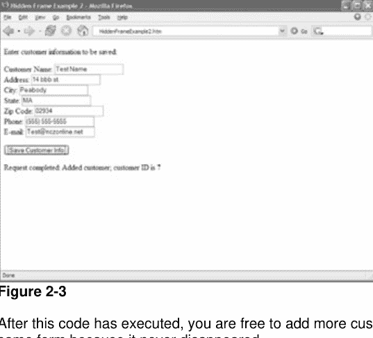

执行此代码后，你可以自由地使用同一表单将更多客户添加到数据库，因为它从未消失。

## 隐藏的 iFrame

下一代的后台客户端-服务器通信利用了在 HTML 4.0 中引入的 iframe。基本上，iframe 与框架相同，不同之处在于它可以放置在非框架集的 HTML 页面内，从而有效地允许页面的任何部分成为框架。iframe 技术可以应用于最初并非作为框架集创建的页面，使其更适合增量添加功能；iframe 甚至可以在 JavaScript 中动态创建，从而允许向浏览器提供简单、语义化的 HTML，而增强的 Ajax 功能则作为渐进增强（稍后讨论）。因为 iframe 可以像常规框架一样使用和访问，所以它们是 Ajax 通信的理想选择。

有两种方法可以利用 iframe。最简单的方法是在页面内嵌入一个 iframe，并将其用作隐藏框架来发出请求。这样做会将第一个示例的显示页面更改为：

```html
<p>Enter customer ID number to retrieve information:</p>
<p>Customer ID: <input type="text" id="txtCustomerId" value="" /></p>
<p><input type="button" value="Get Customer Info"
    onclick="requestCustomerInfo()" /></p>
<div id="divCustomerInfo"></div>
<iframe src="about:blank" name="hiddenFrame" width="0" height="0"
    frameborder="0"></iframe>
```

请注意，iframe 的 `width`、`height` 和 `frameborder` 属性都设置为 0；这有效地将其从视图中隐藏。由于 iframe 的名称是 `hiddenFrame`，因此此页面中的所有 JavaScript 代码将继续像以前一样工作。但是，`GetCustomerData.php` 页面需要一个小小的更改。该页面中的 JavaScript 函数以前在名为 `displayFrame` 的框架中查找 `displayCustomerInfo()` 函数。如果你使用此技术，则没有具有该名称的框架，因此你必须更新代码以使用 `parent` 代替：

```javascript
window.onload = function () {
    var divInfoToReturn = document.getElementById("divInfoToReturn");
    parent.displayCustomerInfo(divInfoToReturn.innerHTML);
};
```

现在，这个示例将像本章的第一个示例一样工作。

使用隐藏 iframe 的第二种方法是使用 JavaScript 动态创建它们。这可能会有点棘手，因为并非所有浏览器都以相同的方式实现 iframe，因此逐步创建隐藏 iframe 会有所帮助。

第一步很简单；你使用 `document.createElement()` 方法创建 iframe 并分配必要的属性：

```javascript
function createIFrame() {
    var oIFrameElement = document.createElement("iframe");
    oIFrameElement.width=0;
    oIFrameElement.height=0;
    oIFrameElement.frameBorder=0;
    oIFrameElement.name = "hiddenFrame";
    oIFrameElement.id = "hiddenFrame";
    document.body.appendChild(oIFrameElement);

    //更多代码
}
```

此代码的最后一行非常重要，因为它将 iframe 添加到文档结构中；未添加到文档的 iframe 无法执行请求。还要注意，`name` 和 `id` 属性都设置为 `hiddenFrame`。这是必要的，因为某些浏览器通过其 `name` 访问新框架，而某些浏览器则通过其 `id` 属性访问。

接下来，定义一个全局变量来保存对框架对象的引用。请注意，iframe 元素的框架对象不是 `createElement()` 返回的内容。为了获得此对象，你必须查看 `frames` 集合。这就是将存储在全局变量中的内容：

```javascript
var oIFrame = null;

function createIFrame() {
    var oIFrameElement = document.createElement("iframe");
    oIFrameElement.width=0;
    oIFrameElement.height=0;
    oIFrameElement.frameBorder=0;
    oIFrameElement.name = "hiddenFrame";
    oIFrameElement.id = "hiddenFrame";
    document.body.appendChild(oIFrameElement);

    oIFrame = frames["hiddenFrame"];
}
```

如果你将此代码放入上一个 iframe 示例中，然后可以对 `requestCustomerInfo()` 进行以下修改：

```javascript
function requestCustomerInfo() {
    if (!oIFrame) {
        createIFrame();
        setTimeout(requestCustomerInfo, 10);
        return;
    }

    var sId = document.getElementById("txtCustomerId").value;
    oIFrame.location = "GetCustomerData.php?id=" + sId;
}
```

通过这些更改，该函数现在会检查 `oIFrame` 是否为 null。如果是，则调用 `createIFrame()`，然后设置一个超时，以便在 10 毫秒后再次运行该函数。这是必要的，因为只有 Internet Explorer (IE) 浏览器会立即识别插入的 iframe；大多数其他浏览器需要几毫秒才能识别它并允许发送请求。当该函数再次执行时，它将继续执行其余代码，其中最后一行已更改为引用 `oIFrame` 对象。

虽然这种技术对于 GET 请求相当容易，但 POST 请求则情况不同。只有部分浏览器允许你将表单的目标设置为动态创建的 iframe；IE 不在其中。因此，要将隐藏 iframe 技术用于 POST 请求需要一些技巧。

## 隐藏的 IFrame POST 请求

要使用隐藏 iframe 完成 POST 请求，方法是将包含表单的页面加载到隐藏框架中，用数据填充该表单，然后提交该表单。当可见表单（你实际输入的那个）被提交时，你需要取消该提交并将信息转发到隐藏框架。为此，你需要定义一个处理 iframe 创建和隐藏表单加载的函数：

```javascript
function checkIFrame() {
    if (!oIFrame) {
        createIFrame();
    }

    setTimeout(function () {
        oIFrame.location = "ProxyForm.htm";
    }, 10);
}
```

此函数 `checkIFrame()` 首先检查隐藏 iframe 是否已创建。如果没有，则调用 `createIFrame()`。然后，在将 iframe 的位置设置为 `ProxyForm.htm`（即隐藏表单页面）之前设置一个超时。因为此函数可能被多次调用，所以每次提交表单时都加载此页面非常重要。

`ProxyForm.htm` 文件非常简单。它只包含少量 JavaScript 代码，用于通知主页面它已加载：

```html
<html>
<head>
    <title>Proxy Form</title>
    <script type="text/javascript">
        window.onload = function () {
            parent.formReady();
        };
    </script>
</head>
<body>
</body>
</html>
```


正如你所见，此页面的主体部分只包含一个空白表单，而头部仅有一个`onload`事件处理程序。当页面加载完成时，它会调用`parent.formReady()`来告知主页面已准备好接受请求。`formReady()`函数位于主页面本身，其代码如下：

```javascript
function formReady() {
    var oHiddenForm = oIFrame.document.forms[0];
    var oForm = document.forms[0];

    for (var i=0 ; i < oForm.elements.length; i++) {
        var oHidden = oIFrame.document.createElement("input");
        oHidden.type = "hidden";
        oHidden.name = oForm.elements[i].name;
        oHidden.value = oForm.elements[i].value;
        oHiddenForm.appendChild(oHidden);
    }

    oHiddenForm.action = oForm.action;
    oHiddenForm.submit();
};
```

该函数的第一步是获取隐藏iframe中表单的引用，你可以通过访问该框架的`document.forms`集合来实现。由于页面上只有一个表单，因此可以安全地获取集合中的第一个表单（索引为0）；这被存储在`oHiddenForm`中。随后，主页面上表单的引用被保存到`oForm`中。接下来，一个`for`循环遍历主页面上的表单元素（使用`elements`集合）。对于每个表单元素，都会在隐藏框架中创建一个新的隐藏输入元素（注意，你必须使用`oIFrame.document.createElement()`，而不仅仅是`document.createElement()`）。这个隐藏输入元素被赋予表单元素的名称和值，并使用`appendChild()`函数添加到隐藏表单中。

在添加了每个表单元素后，隐藏表单被赋予与主页面表单相同的action属性。通过从表单中读取action而不是硬编码，你可以在任意多个页面上使用`formReady()`。函数的最后一步是提交隐藏表单。

剩下的唯一事情就是确保主页面表单不会以正常方式提交自身。为此，需要分配一个`onsubmit`事件处理程序，该程序调用`checkIFrame()`并返回`false`：

```html
<form method="post" action="SaveCustomer.php"
      onsubmit="checkIFrame();return false">
    <p>输入要保存的客户信息：</p>
    <p>客户姓名：<input type="text" name="txtName" value="" /><br />
    地址：<input type="text" name="txtAddress" value="" /><br />
    城市：<input type="text" name="txtCity" value="" /><br />
    州/省：<input type="text" name="txtState" value="" /><br />
    邮政编码：<input type="text" name="txtZipCode" value="" /><br />
    电话：<input type="text" name="txtPhone" value="" /><br />
    电子邮件：<input type="text" name="txtEmail" value="" /></p>
    <p><input type="submit" value="保存客户信息" /></p>
</form>
<div id="divStatus"></div>
```

通过这种方式返回`false`，你阻止了表单的默认行为（即直接将自身提交到服务器）。取而代之的是，调用了`checkIFrame()`方法，开始向隐藏iframe提交数据的过程。

至此，你可以像使用隐藏帧POST示例一样使用此示例；`SaveCustomer.php`页面处理数据，并在完成后调用主页面中的`saveResult()`。

> **重要提示** 请注意，本节中的示例已进行简化，以聚焦于所涉及的Ajax技术。如果你要在真实的Web应用程序中使用这些技术，你需要提供更多用户反馈，例如在发出请求时禁用表单。

## 隐藏帧的优缺点

既然你已经了解了使用隐藏帧可以实现的强大功能，现在是时候讨论其实际应用的可行性了。如前所述，这项技术已经存在多年，并且仍在许多Ajax应用程序中使用。

使用隐藏帧最大的优势之一是你能够维护浏览器历史记录，从而让用户仍然可以使用浏览器的“后退”和“前进”按钮。因为浏览器并不知道一个隐藏帧实际上是隐藏的，所以它会跟踪通过该帧发出的所有请求。尽管Ajax应用程序的主页面可能没有变化，但隐藏帧中的变化意味着“后退”和“前进”按钮将遍历该帧的历史记录，而不是主页面的历史记录。正是由于这个原因，Gmail和Google Maps都使用了这项技术。

> **重要提示** 请小心，因为iframe并不总是存储浏览器历史记录。虽然IE总会存储iframe的历史记录，但Firefox仅在iframe是通过HTML定义时（即不是通过JavaScript动态创建）才会存储。Safari则从不存储iframe的浏览器历史记录，无论它们是如何包含在页面中的。

隐藏帧的缺点是，对于幕后发生的事情几乎没有任何信息。你完全依赖于返回正确的页面。本节中的所有示例都有相同的问题：如果隐藏帧页面加载失败，没有通知告知用户问题已发生；主页面将继续等待，直到调用相应的JavaScript函数。你可以通过设置一个较长时间的超时（例如五分钟），并在页面尚未加载时显示一条消息来为用户提供一些安慰，但这只是一个权宜之计。主要问题在于你没有足够的信息来了解幕后发生的HTTP请求。幸运的是，还有另一个选择。

## XMLHttpRequest 请求

当微软的Internet Explorer 5.0引入初步的XML支持时，一个名为MSXML的ActiveX库也随之推出（在[第4章](http://example.com)中有详细讨论）。该库提供的一个对象迅速变得非常流行：XMLHttpRequest。

`XMLHttpRequest`对象的创建旨在使开发人员能够从应用程序中的任何位置发起HTTP请求。这些请求旨在返回XML，因此`XMLHttpRequest`对象提供了一种以XML文档形式轻松访问此信息的方式。由于它是一个ActiveX控件，`XMLHttpRequest`不仅可以在网页中使用，也可以在任何基于Windows的桌面应用程序中使用；然而，它在Web上的流行度远远超过了其在桌面应用程序中的流行度。

 Mozilla抓住了这一流行趋势，为其浏览器（如Firefox）复制了`XMLHttpRequest`功能。不久之后，Safari（从1.2版本开始）和Opera（7.6版本）浏览器也复制了Mozilla的实现。如今，所有四种浏览器都在某种程度上支持`XMLHttpRequest`。（Safari和Opera的实现仍不完整，仅支持GET和POST，不支持其他请求类型。）

### 创建 XMLHttpRequest 对象

使用`XMLHttpRequest`对象的第一步显然是创建一个。由于微软的实现是一个ActiveX控件，你必须在JavaScript中使用专有的`ActiveXObject`类，并传入`XMLHttpRequest`控件的签名：

```javascript
var oXmlHttp = new ActiveXObject("Microsoft.XMLHttp");
```

这一行创建了第一个版本的`XMLHttpRequest`对象（随IE 5.0一起发布的那个）。问题在于，随着MSXML库后续版本的发布，已经发布了几个新版本。每个版本都带来了更好的稳定性和速度，因此你需要确保始终使用用户机器上可用的最新版本。其签名如下：

- Microsoft.XMLHttp
- MSXML2.XMLHttp
- MSXML2.XMLHttp.3.0
- MSXML2.XMLHttp.4.0
- MSXML2.XMLHttp.5.0

不幸的是，确定最佳版本的唯一方法是尝试创建每个版本。由于这是一个ActiveX控件，任何创建对象的失败都会抛出错误，这意味着你必须将每次尝试都包含在一个`try...catch`块中。最终结果是一个如下所示的函数：

```javascript
function createXMLHttp() {
    var aVersions = [ "MSXML2.XMLHttp.5.0",
                      "MSXML2.XMLHttp.4.0","MSXML2.XMLHttp.3.0",
                      "MSXML2.XMLHttp","Microsoft.XMLHttp"
    ];

    for (var i = 0; i < aVersions.length; i++) {
        try {
            var oXmlHttp = new ActiveXObject(aVersions[i]);
            return oXmlHttp;
        } catch (oError) {
            //Do nothing
        }
    }
}
```

`createXMLHttp()` 函数存储一个 `XMLHttp` 签名的数组，最新的一个排在最前面。它遍历这个数组，并尝试用每个签名创建一个 `XMLHttp` 对象。如果创建失败，`catch` 语句会阻止 JavaScript 错误终止执行；然后尝试下一个签名。当对象创建成功后，它会被返回。如果函数执行完毕但未能创建出 `XMLHttp` 对象，则会抛出一个错误，表明创建失败。

幸运的是，在其他浏览器中创建 `XMLHttp` 对象要容易得多。Mozilla Firefox、Safari 和 Opera 都使用相同的代码：

```javascript
var oXmlHttp = new XMLHttpRequest();
```

自然，拥有一个跨浏览器的方式来创建 `XMLHttp` 对象会很有帮助。你可以通过修改前面定义的 `createXMLHttp()` 函数来创建这样的函数：

```javascript
function createXMLHttp() {
    if (typeof XMLHttpRequest != "undefined") {
        return new XMLHttpRequest();
    } else if (window.ActiveXObject) {
        var aVersions = [ "MSXML2.XMLHttp.5.0",
            "MSXML2.XMLHttp.4.0","MSXML2.XMLHttp.3.0",
            "MSXML2.XMLHttp","Microsoft.XMLHttp"
        ];
        for (var i = 0; i < aVersions.length; i++) {
            try {
                var oXmlHttp = new ActiveXObject(aVersions[i]);
                return oXmlHttp;
            } catch (oError) {
                //Do nothing
            }
        }
    }
    throw new Error("XMLHttp object could not be created.");
}
```

现在这个函数首先检查是否定义了 `XMLHttpRequest` 类（使用 `typeof` 操作符）。如果 `XMLHttpRequest` 存在，就用它来创建 `XMLHttp` 对象；否则，它会检查 `ActiveXObject` 类是否存在，如果存在，则执行同样的过程为 IE 创建 `XMLHttp` 对象。如果这两项检查都失败，则会抛出一个错误。

创建跨浏览器 `XMLHttp` 对象的另一个选择是使用一个已经编写了跨浏览器代码的库。zXml 库是由本书的两位作者编写的，正是这样一个库，可以从 [www.nczonline.net/downloads/](http://www.nczonline.net/downloads/) 下载。该库定义了一个用于创建 `XMLHttp` 对象的函数：

```javascript
var oXmlHttp = zXmlHttp.createRequest();
```

本书将使用 `createRequest()` 函数以及 zXml 库本身，以辅助进行 Ajax 技术的跨浏览器处理。

## 使用 XmlHttp

在创建了 `XmlHttp` 对象之后，你就可以开始从 JavaScript 发出 HTTP 请求了。第一步是调用 `open()` 方法，它初始化该对象。此方法接受以下三个参数：

- **请求类型：** 一个字符串，指示要进行的请求类型——通常是 GET 或 POST（这是目前所有浏览器唯一支持的类型）。
- **URL：** 一个字符串，指示请求要发送到的 URL。
- **Async：** 一个布尔值，指示是否应进行异步请求。

最后一个参数 `async` 非常重要，因为它控制 JavaScript 如何执行请求。当设置为 `true` 时，请求异步发送，JavaScript 代码在不等待响应的情况下继续执行；你必须使用事件处理程序来监视对请求的响应。如果 `async` 设置为 `false`，则请求同步发送，JavaScript 会等待服务器的响应再继续执行代码。这意味着如果响应耗时较长，在响应完成之前用户将无法与浏览器交互。因此，围绕 Ajax 应用程序开发的最佳实践倾向于对常规数据检索使用异步请求，而将同步请求保留用于与服务器之间发送和接收的短消息。

要异步发出对 `info.txt` 的 GET 请求，你可以从以下操作开始：

```javascript
var oXmlHttp = zXmlHttp.createRequest();
oXmlHttp.open("get", "info.txt", true);
```

请注意，即使请求类型在技术上定义为全大写，第一个参数（请求类型）的大小写也无关紧要。

接下来，你需要定义一个 `onreadystatechange` 事件处理程序。`XmlHttp` 对象有一个名为 `readyState` 的属性，它会在请求进行和接收响应的过程中变化。`readyState` 有五种可能的值：

- **0 (未初始化)：** 对象已创建，但 `open()` 方法尚未被调用。
- **1 (加载中)：** `open()` 方法已被调用，但请求尚未发送。
- **2 (已加载)：** 请求已发送。
- **3 (交互中)：** 已收到部分响应。
- **4 (完成)：** 已收到所有数据，并且连接已关闭。

每次 `readyState` 属性从一个值变为另一个值时，`readystatechange` 事件就会触发，并调用 `onreadystatechange` 事件处理程序。由于浏览器实现的差异，对于跨浏览器开发，唯一可靠的 `readyState` 值是 0、1 和 4。然而，在大多数情况下，你只会检查是否为 4 来判断请求何时返回：

```javascript
var oXmlHttp = zXmlHttp.createRequest();
oXmlHttp.open("get", "info.txt", true);
oXmlHttp.onreadystatechange = function () {
    if (oXmlHttp.readyState == 4) {
        alert("Got response.");
    }
};
```

最后一步是调用 send() 方法，它实际发送请求。此方法接受一个参数，即作为请求体的字符串。如果请求不需要请求体（请记住，GET 请求不需要），你必须传入 null：

```javascript
var oXmlHttp = zXmlHttp.createRequest();
oXmlHttp.open("get", "info.txt", true);
oXmlHttp.onreadystatechange = function () {
    if (oXmlHttp.readyState == 4) {
        alert("Got response.");
    }
};
oXmlHttp.send(null);
```

就是这样！请求已发送，当收到响应时，会显示一个警报。但仅仅显示一条已收到请求的消息并没有太大用处。XMLHttpRequest 的真正威力在于你可以访问返回的数据、响应状态和响应头。

要检索从请求返回的数据，你可以使用 responseText 或 responseXML 属性。responseText 属性返回一个包含响应体的字符串，而 responseXML 属性是一个 XML 文档对象，仅当返回数据的内容类型为 text/xml 时才使用。（XML 文档将在第 4 章讨论。）因此，要获取 info.txt 中包含的文本，调用如下：

```javascript
var sData = oXmlHttp.responseText;
```

请注意，这只会返回 info.txt 中的文本，前提是文件被找到且没有发生错误。例如，如果 info.txt 不存在，那么 responseText 将包含服务器的 404 消息。幸运的是，有办法确定是否发生了任何错误。

status 属性包含响应中发送的 HTTP 状态码，statusText 包含状态的文本描述（例如 "OK" 或 "Not Found"）。使用这两个属性，你可以确保你收到的数据确实是你想要的数据，或者告诉用户为什么没有检索到数据：

```javascript
if (oXmlHttp.status == 200) {
    alert("Data returned is: " + oXmlHttp.responseText);
} else {
    alert("An error occurred: " + oXmlHttp.statusText);
}
```

通常，你应该始终确保响应的状态为 200，表示请求完全成功。即使发生服务器错误，readyState 属性也会设置为 4，因此仅检查这一点是不够的。在此示例中，仅当状态为 200 时才显示 responseText 属性；否则，显示错误消息。

**重要** Opera 没有实现 statusText 属性，并且在其他浏览器中有时会返回不准确的描述。你绝不应该仅仅依赖 statusText 来确定是否发生了错误。


正如之前提到的，也可以访问响应头。你可以使用 `getResponseHeader()` 方法并传入要检索的头信息名称来获取特定的头信息值。最有用的响应头之一是 `Content-Type`，它告诉你发送的数据类型：

```javascript
var sContentType = oXmlHttp.getResponseHeader("Content-Type");
if (sContentType == "text/xml") {
    alert("XML content received.");
} else if (sContentType == "text/plain") {
    alert("Plain text content received.");
} else {
    alert("Unexpected content received.");
}
```

此代码片段检查响应的内容类型并显示一个提示框，指示返回的数据类型。通常，你会从服务器接收到 XML 数据（内容类型为 `text/xml`）或纯文本（内容类型为 `text/plain`），因为使用 JavaScript 处理这些内容类型最为方便。

如果你希望查看服务器返回的所有头信息，可以使用 `getAllResponseHeaders()` 方法，它返回一个包含所有头信息的字符串。字符串中的每个头信息行由换行符（JavaScript 中的 `\n`）或回车符加换行符（JavaScript 中的 `\r\n`）分隔，因此你可以按如下方式处理单个头信息：

```javascript
var sHeaders = oXmlHttp.getAllResponseHeaders();
var aHeaders = sHeaders.split(/\r?\n/);

for (var i=0; i < aHeaders.length; i++) {
    alert(aHeaders[i]);
}
```

此示例使用 JavaScript 字符串的 `split()` 方法并传入一个正则表达式（匹配回车符/换行符组合或仅换行符），将头信息字符串分割为一个头信息数组。现在你可以遍历这些头信息并根据需要处理它们。请记住，`aHeaders` 中的每个字符串格式都是 `headername: headervalue`。

也可以在请求发送之前设置请求头。你可能需要指明将要发送的数据的内容类型，或者只是想发送一些服务器可能需要用来处理请求的额外数据。为此，请在调用 `send()` 之前使用 `setRequestHeader()` 方法：

```javascript
var oXmlHttp = zXmlHttp.createRequest();
oXmlHttp.open("get", "info.txt", true);
oXmlHttp.onreadystatechange = function () {
    if (oXmlHttp.readyState == 4) {
        alert("Got response.");
    }
};
oXmlHttp.setRequestHeader("myheader", "myvalue");
oXmlHttp.send(null);
```

在此代码中，一个名为 `myheader` 的头信息在发送请求之前被添加到请求中。该头信息将作为 `myheader: myvalue` 添加到默认头信息中。

到目前为止，你一直在处理异步请求，这在大多数情况下是首选的。发送同步请求意味着你不需要分配 `onreadystatechange` 事件处理程序，因为当 `send()` 方法返回时，响应已经接收到。这使得可以这样做：

```javascript
var oXmlHttp = zXmlHttp.createRequest();
oXmlHttp.open("get", "info.txt", false);
oXmlHttp.send(null);

if (oXmlHttp.status == 200) {
    alert("Data returned is: " + oXmlHttp.responseText);
} else {
    alert("An error occurred: " + oXmlHttp.statusText);
}
```

同步发送请求（将 `open()` 的第三个参数设置为 `false`）允许你在调用 `send()` 之后立即开始评估响应。如果你希望用户交互等待响应，或者你预计只接收少量数据（例如，少于 1K），这会很有用。对于中等或更大数据量的情况，最好使用异步调用。

## XMLHttpRequest GET 请求

现在是时候重新审视隐藏帧 GET 示例，看看如何使用 `XMLHttp` 来改进这个过程。第一个改动将是针对 `GetCustomerData.php`，它必须从 HTML 页面改为仅返回 HTML 代码片段。现在整个文件变得更为精简：

```php
<?php
    header("Content-Type: text/plain");

    $sID = $_GET["id"];

    $sInfo = "";

    $sDBServer = "your.database.server";
    $sDBName = "your_db_name";
    $sDBUsername = "your_db_username";
    $sDBPassword = "your_db_password";
    $sQuery = "Select * from Customers where CustomerId=".$sID;

    $oLink = mysql_connect($sDBServer, $sDBUsername, $sDBPassword);
    @mysql_select_db($sDBName) or $sInfo=" Unable to open database";

    if($oResult = mysql_query($sQuery) and mysql_num_rows($oResult) > 0) {
        $aValues = mysql_fetch_array($oResult, MYSQL_ASSOC);
        $sInfo = $aValues['Name']."<br />".$aValues['Address']."<br />".
            $aValues['City']."<br />".$aValues['State']."<br />".
            $aValues['Zip']."<br /><br />Phone: ".$aValues['Phone']."<br />".
            "<a href=\"mailto:".$aValues['E-mail']."\">".$aValues['E-mail']."</a>";
    } else {
        $sInfo = "Customer with ID $sID doesn't exist.";
    }

    mysql_close($oLink);

    echo $sInfo;
?>
```

如你所见，页面中没有可见的 HTML 或 JavaScript 调用。所有主要逻辑保持不变，但有两行额外的 PHP 代码。第一行出现在开头，使用 `header()` 函数设置页面的内容类型。即使页面将返回 HTML 代码片段，将内容类型设置为 `text/plain` 也是可以的，因为它不是完整的 HTML 页面（因此无法作为 HTML 进行验证）。在任何向浏览器发送非 HTML 内容的页面中，你都应该设置内容类型。第二行添加的代码在底部附近，其中 `$sInfo` 变量通过 `echo` 命令输出到流中。

在主 HTML 页面中，基本设置如下：

```html
<p>Enter customer ID number to retrieve information:</p>
<p>Customer ID: <input type="text" id="txtCustomerId" value="" /></p>
<p><input type="button" value="Get Customer Info"
    onclick="requestCustomerInfo()" /></p>
<div id="divCustomerInfo"></div>
```

之前创建的 `requestCustomerInfo()` 函数现在必须改为使用 XMLHttp：

```javascript
function requestCustomerInfo() {
    var sId = document.getElementById("txtCustomerId").value;
    var oXmlHttp = zXmlHttp.createRequest();
    oXmlHttp.open("get", "GetCustomerData.php?id=" + sId, true);
    oXmlHttp.onreadystatechange = function () {
        if (oXmlHttp.readyState == 4) {
            if (oXmlHttp.status == 200) {
                displayCustomerInfo(oXmlHttp.responseText);
            } else {
                displayCustomerInfo("An error occurred: " +
                    oXmlHttp.statusText);
            }
        }
    };
    oXmlHttp.send(null);
}
```

请注意，该函数以相同的方式开始，即检索用户输入的 ID。然后，使用 zXml 库创建一个 XMLHttpRequest 对象。调用 `open()` 方法，指定一个对 GetCustomerData.php 的异步 GET 请求（将前述 ID 添加到其查询字符串中）。接下来是事件处理程序的赋值，它检查 readyState 是否为 4，然后检查请求的状态。如果请求成功（状态为 200），则使用响应体（通过 responseText 访问）调用 `displayCustomerInfo()` 函数。如果发生错误（状态不是 200），则将错误信息传递给 `displayCustomerInfo()`。

这与隐藏帧/iframe 示例有几个不同之处。首先，主页面之外不需要任何 JavaScript 代码。这一点很重要，因为任何时候你需要将代码放在两个不同的地方，都可能存在创建不兼容性的可能性；在基于帧的示例中，你依赖于显示页面和隐藏帧中的独立脚本来相互通信。通过将 GetCustomerInfo.php 改为仅返回你感兴趣的数据，你消除了这些位置之间 JavaScript 调用的潜在问题。第二个区别是更容易判断执行请求时是否出现问题。在以前的示例中，没有机制让你识别和响应请求过程中的服务器错误。使用 XMLHttpRequest，所有服务器错误都会暴露给你（开发者），使你能够向用户传递有意义的错误反馈。在许多方面，XMLHttpRequest 是处理页面内 HTTP 请求比隐藏帧更优雅的解决方案。

## XMLHttpRequest POST 请求

既然你已经看到 XMLHttpRequest 如何简化 GET 请求，现在是时候看看 POST 请求了。首先，你需要对 SaveCustomer.php 进行与对 GetCustomerInfo.php 相同的更改，这意味着你需要移除多余的 HTML 和 JavaScript，添加内容类型信息，并输出文本：

```php
<?php

    header("Content-Type: text/plain");

    $sName = $_POST["txtName"];
    $sAddress = $_POST["txtAddress"];
    $sCity = $_POST["txtCity"];
    $sState = $_POST["txtState"];
    $sZipCode = $_POST["txtZipCode"];
    $sPhone = $_POST["txtPhone"];
    $sEmail = $_POST["txtEmail"];

    $sStatus = "";

    $sDBServer = "your.database.server";
    $sDBName = "your_db_name";
    $sDBUsername = "your_db_username";
    $sDBPassword = "your_db_password";
```


## SaveCustomer.php

```php
$sSQL = "Insert into Customers(Name,Address,City,State,Zip,Phone,'E-mail') ".
    " values ('$sName','$sAddress','$sCity','$sState','$sZipCode','" .
    "', '$sPhone', '$sEmail')";
```

```php
$oLink = mysql_connect($sDBServer,$sDBUsername,$sDBPassword);
@mysql_select_db($sDBName) or $sStatus = "Unable to open database";
```

```php
if($oResult = mysql_query($sSQL)) {
    $sStatus = "Added customer; customer ID is ".mysql_insert_id();
} else {
    $sStatus = "An error occurred while inserting; customer not saved.";
}
```

```php
mysql_close($oLink);
```

```php
echo $sStatus;
```

```php
?>
```

这便是 `SaveCustomer.php` 的全部内容。请注意，调用了 `header()` 函数来设置内容类型，并使用 `echo` 输出 `$sStatus`。

在主页面中，用于输入新客户信息的简单表单如下所示：

```html
<form method="post" action="SaveCustomer.php"
    onsubmit="sendRequest(); return false">
<p>Enter customer information to be saved:</p>
<p>Customer Name: <input type="text" name="txtName" value="" /><br />
Address: <input type="text" name="txtAddress" value="" /><br />
City: <input type="text" name="txtCity" value="" /><br />
State: <input type="text" name="txtState" value="" /><br />
Zip Code: <input type="text" name="txtZipCode" value="" /><br />
Phone: <input type="text" name="txtPhone" value="" /><br />
E-mail: <input type="text" name="txtEmail" value="" /></p>
<p><input type="submit" value="Save Customer Info" /></p>
</form>
<div id="divStatus"></div>
```

你会注意到，`onsubmit` 事件处理程序现在改为调用 `sendRequest()` 函数（尽管事件处理程序仍然返回 `false` 以防止实际的表单提交）。此方法首先组装 POST 请求的数据，然后创建 `XMLHttp` 对象来发送它。数据必须以查询字符串的格式发送：
`name1=value1&name2=value2&name3=value3`

为了避免传输过程中的数据丢失，每个参数的名称和值都必须经过 URL 编码。JavaScript 提供了一个名为 `encodeURIComponent()` 的内置函数可用于执行此编码。要创建此字符串，你需要遍历表单字段，提取并编码名称和值。`getRequestBody()` 函数处理此操作：

```javascript
function getRequestBody(oForm) {
    var aParams = new Array();

    for (var i=0 ; i < oForm.elements.length; i++) {
        var sParam = encodeURIComponent(oForm.elements[i].name);
        sParam += "=";
        sParam += encodeURIComponent(oForm.elements[i].value);
        aParams.push(sParam);
    }

    return aParams.join("&");
}
```

此函数假设你将提供一个对表单的引用作为参数。创建一个数组 (`aParams`) 来存储每个单独的名称-值对。然后，遍历表单的元素，构建一个字符串并将其存储在 `sParam` 中，然后将其添加到数组。这样做可以防止多次字符串连接，这在某些浏览器中会导致代码执行变慢。最后一步是在数组上调用 `join()`，传入连字符。这有效地将所有名称-值对用连字符连接起来，创建一个正确格式的单一字符串。

> **注意** 在大多数浏览器中，字符串连接是一个昂贵的过程，因为字符串是不可变的，这意味着一旦创建，其值就不能更改。因此，连接两个字符串首先需要分配一个新字符串，然后将另外两个字符串的内容复制到其中。重复此过程会导致严重的速度减慢。因此，最好尽量减少字符串连接，并使用 `数组的 join()` 方法来处理较长的字符串连接。

`sendRequest()` 函数调用 `getRequestBody()` 并设置请求：

```javascript
function sendRequest() {
    var oForm = document.forms[0];
    var sBody = getRequestBody(oForm);

    var oXmlHttp = zXmlHttp.createRequest();
    oXmlHttp.open("post", oForm.action, true);
    oXmlHttp.setRequestHeader("Content-Type", "application/x-www-form-urlencoded");

    oXmlHttp.onreadystatechange = function () {
        if (oXmlHttp.readyState == 4) {
            if (oXmlHttp.status == 200) {
                saveResult(oXmlHttp.responseText);
            } else {
                saveResult("An error occurred: " + oXmlHttp.statusText);
            }
        }
    };
    oXmlHttp.send(sBody);
}
```

与前面的示例一样，此函数的第一步是获取对表单的引用并将其存储在一个变量 (`oForm`) 中。然后，生成请求体并将其存储在 `sBody` 中。接下来是创建和设置 `XMLHttp` 对象。请注意，`open()` 的第一个参数现在是 `post` 而不是 `get`，第二个参数设置为 `oForm.action`（再次强调，以便此脚本可以在多个页面上使用）。你还会注意到正在设置一个请求头。当浏览器向服务器发送表单时，它将请求的内容类型设置为 `application/x-www-form-urlencoded`。大多数服务器端语言会查找此编码以正确解析传入的 POST 数据，因此设置它非常重要。

`onreadystatechange` 事件处理程序与 GET 示例非常相似；唯一的更改是调用 `saveResult()` 而不是 `displayCustomerInfo()`。最后一行非常重要，因为将 `sBody` 字符串传递给 `send()`，使其成为请求体的一部分。这有效地模拟了浏览器的行为，因此所有服务器端逻辑都应该按预期工作。

## XMLHttp 的优缺点

毫无疑问，你可以看到使用 `XMLHttp` 进行客户端-服务器通信相比隐藏框架的优势。你编写的代码更清晰，代码的意图也比使用大量带有隐藏框架的回调函数更明显。你可以访问请求和响应头以及 HTTP 状态码，从而能够确定你的请求是否成功。

缺点是，与隐藏框架不同，没有关于已进行调用的浏览器历史记录。后退和前进按钮与 `XMLHttp` 请求无关，因此你实际上切断了它们的使用。正是由于这个原因，许多 Ajax 应用程序混合使用 `XMLHttp` 和隐藏框架来构建真正可用的界面。

另一个缺点（仅适用于 Internet Explorer）是你依赖于启用 ActiveX 控件。如果用户将你的页面设置在不允许 ActiveX 控件的特定安全区域中，你将无法访问 `XMLHttp` 对象。在这种情况下，你可能必须默认使用隐藏框架。

## 进一步考虑

无论你决定使用隐藏框架还是 `XMLHttp`，在构建 Ajax 应用程序时都需要考虑几件事。将 JavaScript 的作用扩展到服务器端逻辑领域带来了强大的功能，但也带来了几个需要网络开发人员保持警惕的陷阱。

## 同源策略

因为网络浏览器运行在用户的计算机上，浏览器制造商制定了重要的安全限制，以防止恶意编码人员对用户的机器造成损害。JavaScript 范式中最重要的安全限制称为*同源策略*，它决定了某个页面允许与哪些服务器进行通信。

一个*源*被视为一个单一的域名，例如 www.wrox.com，通过单一的协议（最常见的是 HTTP）访问。同源策略规定，从此源加载的任何页面都可以访问、下载和交互（使用 JavaScript）来自同一源的任何其他资源。这就是隐藏框架技术能够工作的原因：两个框架都从同一源加载页面；因此，它们被允许使用 JavaScript 进行通信。如果你尝试加载来自另一个源的页面所在的框架，你将无法与该页面交互或访问其任何脚本功能。其目的是防止恶意程序员从合法网页中获取你的信息。

同源策略也会影响 `XMLHttp` 的工作方式。使用 `XMLHttp`，你无法访问任何与运行代码的页面不同源的资源。这意味着，默认情况下，你无法在 `open()` 方法中使用以 `http://` 开头的 URL；你只能使用同一域内的绝对或相对 URL。如果你需要访问位于不同源的 URL，你必须创建一个服务器端代理来处理通信（见图 2-4）。


**图 2-4**

使用服务器端代理，浏览器向 Web 服务器发出请求。Web 服务器然后联系域外的另一个 Web 服务器以请求适当的信息。当你的 Web 服务器收到响应时，它会被转发回浏览器。结果是外部数据的无缝传输。你将在本书后面使用服务器端代理。

> **重要提示** Internet Explorer 没有明确的同源策略。相反，它依赖于自己的安全区域来确定可以访问什么和不可以访问什么。属于 Internet 安全区域的那些页面通常遵循与同源策略类似的规则，而属于受信任区域的页面则可能被豁免。

## 缓存控制

每当处理对同一页面的重复调用时，都应该关注浏览器缓存。对于不了解情况的人来说，网络浏览器倾向于缓存某些资源，以提高网站下载和显示的速度。这可以在经常访问的网站上带来巨大的速度提升，但也可能给频繁更改的页面带来问题。如果你正在进行多次 Ajax 调用，你需要意识到缓存可能会给你带来问题。

处理缓存的最佳方法是在从服务器发送到浏览器的任何数据上包含一个 `no-cache` 头。这可以使用 `Cache-Control` 头来完成，应设置如下：

```
Cache-Control: no-cache
```

这告诉浏览器不要缓存来自特定 URL 的数据。相反，浏览器总是从服务器调用新版本，而不是使用自己缓存中保存的版本。

## 总结

本章介绍了几种用于客户端-服务器通信的 Ajax 技术。它从 HTTP 入门开始，探讨了 HTTP 请求和响应。你了解了

HTTP消息的格式以及GET请求与POST请求的区别。介绍了报头和消息体的概念。

你学到的第一个Ajax技巧是隐藏帧技术，它使用一个宽度或高度为零的帧，从而有效地将其对用户隐藏。此技术使用与隐藏帧之间的JavaScript调用来促进客户端-服务器通信。使用隐藏帧技术，你学习了如何发送GET和POST请求。

接下来，你学习了用隐藏iframe替换隐藏帧。因为iframe可以使用JavaScript动态创建，这可能是在现代浏览器中发起客户端-服务器通信的更优方式。使用的技术与隐藏帧相同，尽管iframe在页面设计方面提供了更大的灵活性。

本章还介绍了使用`XMLHttp`进行客户端-服务器通信。你了解到Internet Explorer、Mozilla Firefox、Safari和Opera都支持某种形式的`XMLHttp`对象，并且需要额外的代码来检测这些差异。解释了异步和同步请求的区别，你学习了如何使用`XMLHttp`发出GET和POST请求。你还学习了如何结合HTTP状态码使用请求和响应报头来更好地处理请求。

最后，讨论了发起客户端-服务器通信时的注意事项。你了解了同源策略及其如何影响与其他服务器通信的能力。讨论了各种安全限制，并简要介绍了服务器端代理。你还了解了在创建Ajax功能时缓存控制的重要性。

## 第三章：Ajax模式

### 概述

设计模式描述了解决常见问题的编程技术。鉴于编程已经存在数十年，你每天面临的许多问题很可能已经被其他人解决了。自20世纪90年代中期以来，设计模式作为一种缩短开发时间的方式受到了广泛关注。

尽管Ajax一词直到2005年初才出现，但Ajax描述的技术自90年代末以来就已被使用，从而产生了一些解决特定问题的Ajax模式。你已经看到过其中一些模式的实际应用，即隐藏帧技术和异步XMLHttpRequest调用。这些是使用JavaScript在客户端和服务器之间进行通信的模式。正如你可能预料到的，还有更多类型的模式。

作者兼程序员Michael Mahemoff是第一个尝试在其网站www.ajaxpatterns.org上记录Ajax设计模式的人。本章介绍的模式是Mahemoff和其他人所识别的模式的混合。请注意，设计模式，无论是在网站上还是在书中描述，都不可能是官方的，只能是被接受的。设计模式不是需要遵循的标准，仅仅是之前奏效的解决方案的设计。需要围绕特定模式由开发社区形成“集体智慧”；是否在自己的应用程序中实现特定模式则由单个开发者决定。

### 通信控制模式

你已经从第二章知道了如何使用JavaScript与服务器进行通信。真正的问题是：发起并持续向服务器发出请求的最佳方式是什么？在某些情况下，最好从服务器预加载信息，以便在用户执行某些操作时信息立即可用。在其他情况下，你可能希望以不同的时间间隔向服务器发送数据或从服务器接收数据。也许不应该一次性下载所有内容，而是应该按特定顺序下载。Ajax为你提供了精细的控制粒度，以实现客户端和服务器之间的通信，从而达到你想要的行为。

### 预测获取

在传统的Web解决方案中，应用程序不知道接下来会发生什么。一个页面呈现了任意数量的链接，每个链接都指向站点的不同部分。这可以称为“按需获取”，即用户通过其操作告诉服务器应该检索什么数据。虽然这种模式自Web诞生以来就定义了Web，但它有一个不幸的副作用，就是将启动-停止的用户交互模型强加给了用户。然而，在Ajax的帮助下，这种情况开始改变。

预测获取模式是一个相对简单的想法，但实现起来可能有些困难：Ajax应用程序猜测用户接下来要做什么，并检索相应的数据。在完美的世界里，总是知道用户将要做什么，并确保在需要时下一个数据已经准备好，那将是美妙的。然而在现实中，确定未来的用户行为只是一个取决于你意图的猜测游戏。

有一些简单的用例，预测用户行为相对容易。假设你正在阅读一篇在线文章，它被分成了三页。可以合理地假设，如果你有兴趣阅读第一页，那么你也对阅读第二页和第三页感兴趣。因此，如果第一页已经加载了几秒钟（这可以通过超时轻松确定），那么在后台下载第二页可能是安全的。同样，如果第二页已经加载了几秒钟，那么可以合理地假设读者将继续阅读第三页。当这些额外的数据在客户端加载和缓存时，读者继续阅读，几乎不会注意到在点击“下一页”链接后，下一页几乎瞬间出现。

另一个简单的用例发生在撰写电子邮件时。大多数时候，你会给认识的人写电子邮件，因此可以合理地假设这个人已经在你的通讯录中了。为了帮助你，明智的做法可能是在后台预加载你的通讯录并提供建议。许多基于Web的电子邮件系统（包括Gmail和AOL Webmail）都采用了这种方法。关键再次在于“合理假设”的标准。通过预测和预加载与用户最可能的下一步操作相关的信息，你可以让你的应用程序感觉更轻快、响应更迅速；通过使用Ajax获取与任何可能的下一步操作相关的信息，你可以很快使服务器过载，并使浏览器因额外处理而变得迟缓。根据经验，只有当你认为有理由假设该信息将是完成用户下一个请求所必需时，才预取信息。

### 页面预加载示例

如前所述，预测获取模式最简单、最合理的用法之一是在线文章中的页面预加载。随着博客（或简称博客）的出现，每个人都似乎染上了出版热，写自己的文章发布在自己的网站上。在线阅读长文章对眼睛非常困难，因此许多网站将其分成多个页面。这样更利于阅读，但加载时间更长，因为每个新页面都带来了原始页面上的所有格式、菜单和广告。预测获取通过在读者仍在阅读第一页时只加载下一页的文本来减轻客户端和服务器的负担。

首先，你需要一个处理页面预加载服务器端逻辑的页面。文件`ArticleExample.php`包含在网上的显示文章的代码：

```php
<?php
    $page = 1;
    $dataOnly = false;
    if (isset($_GET["page"])) {
        $page = (int) $_GET["page"];
    }
}

if (isset($_GET["data"]) && $_GET["dataonly"] == "true") {
        $dataOnly = true;
}

if (!$dataOnly) {
?>
<!DOCTYPE html PUBLIC "-//W3C//DTD XHTML 1.0 Transitional//EN"
    "http://www.w3.org/TR/xhtml1/DTD/xhtml1-transitional.dtd">
<html xmlns="http://www.w3.org/1999/xhtml" xml:lang="en" lang="en">
    <head>
        <title>Article Example</title>
        <script type="text/javascript" src="zxml.js"></script>
        <script type="text/javascript" src="Article.js"></script>
        <link rel="stylesheet" type="text/css" href="Article.css" />
    </head>
```


## 文章标题

```php
<body>
    <h1>Article Title</h1>
    <div id="divLoadArea" style="display:none"></div>
<?php
    $output = "<p>Page ";

    for ($i=1; $i < 4; $i++) {
        $output .= "<a href=\"ArticleExample.php?page=$i\" 
id=\"aPage$i\"";
        if ($i==$page) {
            $output .= "class=\"current\"";
        }
        $output .= ">$i</a> ";
    }
    echo $output;
}

if ($page==1) {
    echo $page1Text;
} else if ($page == 2) {
    echo $page2Text;
} else if ($page == 3) {
    echo $page3Text;
}

if (!$dataOnly) {
?>
</body>
</html>
<?php
}
?>
```

默认情况下，此文件显示文章的第一页。如果指定了 `page` 查询字符串参数，例如 `page=2`，则会显示文章的指定页面。当查询字符串包含 `dataonly=true` 时，页面仅输出一个包含给定页面文章文本的 `<div/>` 元素。将其与 `page` 参数结合使用，您可以检索所需的任何页面内容。

此页面中的 HTML 包含文章标题的占位符，以及一个用于加载额外页面的 `<div/>` 元素。该 `<div/>` 元素的 display 属性被设置为 none，以确保其内容不会意外显示。紧随其后的 PHP 逻辑用于输出文章可用的页面列表。在此示例中，将有三页内容，因此在顶部输出了三个链接（参见 [图 3-1](#)）。

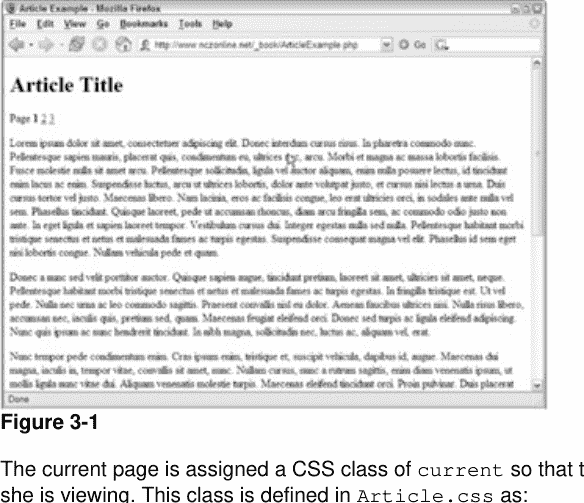

图 3-1

当前页面被赋予 CSS 类 `current`，以便用户知道正在查看哪一页。此类在 `Article.css` 中定义如下：

```css
a.current {
    color: black;
    font-weight: bold;
    text-decoration: none;
}
```

当读者查看特定页面时，该页面的链接变为黑色、粗体且不再带下划线，清晰地指示出他/她正在阅读的页面。默认情况下，这些链接只是加载相同页面并更改查询字符串的 page 参数；这是大多数网站处理多页文章的方式。然而，使用预测获取将改善用户体验和数据可用的速度。

实现此示例的预测获取需要几个全局 JavaScript 变量：

```javascript
var oXmlHttp = null;                //XMLHttpRequest 对象
var iPageCount = 3;                //文章总页数
var iCurPage = -1;                 //当前显示的页码
var iWaitBeforeLoad = 5000; //加载新页面前的等待时间（毫秒）
var iNextPageToLoad = -1;    //下一个要加载的页码
```

第一个变量是一个全局 XMLHttpRequest 对象，用于发出所有获取更多信息的请求。第二个变量 `iPageCount` 是此文章使用的页数。（此处是硬编码，但在实际应用中需要动态生成。）`iCurPage` 变量存储当前向用户显示的页码。接下来的两个变量直接处理数据的预加载：`iWaitBeforeLoad` 是加载下一页前等待的毫秒数，`iNextPageToLoad` 包含指定时间过后应加载的页码。在此示例中，后台每 5 秒（5000 毫秒）加载一个新页面，这段时间应该足够长，让某人阅读文章的前几句话，以决定是否值得阅读其余部分。如果读者在 5 秒内离开，很可能他们没有阅读剩余文章的打算。

要开始这个过程，您需要一个函数来确定获取特定页面的 URL。此函数 `getURLForPage()` 接受一个参数，该参数指定您要检索的页码。然后，提取当前 URL 并在末尾附加 `page` 参数：

```javascript
function getURLForPage(iPage) {
    var sNewUrl = location.href;
    if (location.search.length > 0) {
        sNewUrl = sNewUrl.substring(0, sNewUrl.indexOf("?"))
    }
    sNewUrl += "?page=" + iPage;
    return sNewUrl;
}
```

此函数首先从 `location.href` 提取 URL，它给出了页面的完整 URL，包括查询字符串。然后，通过确定 `location.search` 的长度是否大于 0（`location.search` 仅返回查询字符串，包括问号，如果有的话）来测试 URL 是否指定了查询字符串。如果存在查询字符串，则使用 `substring()` 方法将其剥离。然后将 page 参数附加到 URL 并返回。此函数将在多个不同场景中派上用场。

下一个函数名为 `showPage()`，正如您可能猜到的那样，它负责显示文章的下一页：

```javascript
function showPage(sPage) {
    var divPage = document.getElementById("divPage" + sPage);
    if (divPage) {
        for (var i=0; i < iPageCount; i++) {
            var iPageNum = i+1;
            var divOtherPage = document.getElementById("divPage" + iPageNum);
            var aOtherLink = document.getElementById("aPage" + iPageNum);
            if (divOtherPage && sPage != iPageNum) {
                divOtherPage.style.display = "none";
                aOtherLink.className = "";
            }
        }
        divPage.style.display = "block";
        document.getElementById("aPage" + sPage).className = "current";
    } else {
        location.href = getURLForPage(parseInt(sPage));
    }
}
```

此函数首先检查给定页面是否已加载 `<div/>` 元素。`<div/>` 元素的命名格式为 divPage 加页码（例如，第一页为 divPage1，第二页为 divPage2，依此类推）。如果此 `<div/>` 元素存在，表示该页面已被预取，因此只需切换当前可见页面即可。这是通过遍历所有页面并隐藏除参数 `sPage` 指定的页面之外的所有页面来实现的。同时，为每个页面的链接赋予一个空字符串作为其 CSS 类。然后，将当前页面 `<div/>` 元素的 `display` 属性设置为 `block` 以显示它，并将该页面链接的 CSS 类设置为 `current`。

另一方面，如果 `<div/>` 元素不存在，则页面以传统方式导航到文章的下一页，方法是获取 URL（使用之前定义的 `getURLForPage()` 函数）并将其赋值给 `location.href`。这是一个后备功能，以便如果用户在 5 秒内点击页面链接，体验会回退到传统的网页范式。

`loadNextPage()` 函数用于在后台加载每个新页面。此函数负责确保仅对有效页面发出请求，并按顺序和指定的间隔检索页面：

```javascript
function loadNextPage() {

    if (iNextPageToLoad <= iPageCount) {

        if (!oXmlHttp) {
            oXmlHttp = zXmlHttp.createRequest();
        } else if (oXmlHttp.readyState != 0) {
            oXmlHttp.abort();
        }

        oXmlHttp.open("get", getURLForPage(iNextPageToLoad)
                     + "&dataonly=true", true);
        oXmlHttp.onreadystatechange = function () {

            //更多代码在此处

        };
        oXmlHttp.send(null);
    }
}
```

该函数首先通过将存储在 `iNextPageToLoad` 中的页码与 `iPageCount` 进行比较，确保其有效。通过此测试后，下一步是检查全局 `XMLHttp` 对象是否已创建。如果没有，则使用 `zXml` 库的 `createRequest()` 方法创建它。如果已经实例化，则检查 `readyState` 属性以确保其为 0。如果 `readyState` 不是 0，则必须调用 `abort()` 方法来重置 `XMLHttp` 对象。

接下来，调用 `open()` 方法，指定请求将发出异步 GET 请求。通过使用 `getURLForPage()` 函数获取 URL，然后附加字符串 `"&dataonly=true"` 来确保仅返回页面文本。所有这些设置好后，就该处理 `onreadystatechange` 事件处理器了。

在这种情况下，`onreadystatechange` 事件处理器负责检索文章文本以及创建适当的 DOM 结构来表示它：

```javascript
function loadNextPage() {

    if (iNextPageToLoad <= iPageCount) {
```


if (!oXmlHttp) {
    oXmlHttp = zXmlHttp.createRequest();
} else if (oXmlHttp.readyState != 0) {
    oXmlHttp.abort();
}

oXmlHttp.open("get", getURLForPage(iNextPageToLoad)
                                + "&dataonly=true", true);
oXmlHttp.onreadystatechange = function () {

    if (oXmlHttp.readyState == 4) {
        if (oXmlHttp.status == 200) {
            var divLoadArea =
                document.getElementById("divLoadArea");
            divLoadArea.innerHTML = oXmlHttp.responseText;
            var divNewPage = document.getElementById("divPage" +
                                                 iNextPageToLoad);
            divNewPage.style.display = "none";
            document.body.appendChild(divNewPage);
            divLoadArea.innerHTML = "";
            iNextPageToLoad++;
            setTimeout(loadNextPage, iWaitBeforeLoad);
        }
    }
};
oXmlHttp.send(null);
}

如前一章所述，需要检查 `readyState` 属性是否等于 4，并检查 `status` 属性以确保没有错误。一旦通过这两个条件，真正的处理就开始了。首先，获取加载区域 `<div/>` 元素的引用并存储在 `divLoadArea` 中。然后，将请求的 `responseText` 赋值给加载区域的 `innerHTML` 属性。由于返回的文本是一个 HTML 片段，它将被解析并创建相应的 DOM 对象。接下来，获取包含下一页的 `<div/>` 元素的引用（你知道 ID 将是 `divPage` 加上 `iNextPageToLoad`），并将其 `display` 属性设置为 `none`，以确保在将其移出加载区域时保持不可见。下一行将 `divNewPage` 附加到文档的 body 中，将其放入常规查看区域以供使用。然后将加载区域的 `innerHTML` 属性设置为空字符串，为加载下一页做准备。之后，`iNextPageToLoad` 变量递增，并设置一个新的超时，在指定时间后再次调用此函数。此函数将每 5 秒被调用一次，直到所有页面都加载完毕。

因为此页面应该在没有 JavaScript 的情况下也能正常工作，所有这些代码都是在确定浏览器是否能够使用 XMLHttpRequest 之后在运行时附加的。幸运的是，zXml 库中的 `zXmlHttp` 对象有一个函数 `isSupported()`，可用于确定这一点：

```
window.onload = function () {
    if (zXmlHttp.isSupported()) {
        //begin Ajax code here
    }
};
```

在这个代码块内部将是所有预测获取代码的放置位置，确保不支持 XMLHttpRequest 的浏览器不会因功能不全的代码而影响可用性。

为文章设置预测获取的第一步是确定用户当前正在查看哪一页。为此，你必须查看 URL 的查询字符串，以查看是否指定了 `page` 参数。如果是，你可以从中提取页码；否则，你可以假设页码为 1（默认值）：

```
window.onload = function () {
    if (zXmlHttp.isSupported()) {
        if (location.href.indexOf("page=") > -1) {
            var sQueryString = location.search.substring(1);
            iCurPage = parseInt(sQueryString.substring(sQueryString.indexOf("=")+1));
        } else {
            iCurPage = 1;
        }
        iNextPageToLoad = iCurPage+1;
        //more code here
    }
};
```

在这部分代码中，测试页面的 URL（可通过 `location.href` 访问），查看是否指定了 `page=`。如果是，则使用 `location.search` 检索查询字符串（它只返回查询字符串，包括问号，`substring(1)` 调用将其去除）。下一行检索查询字符串中等号之后的部分（应该是页码），使用 `parseInt()` 将其转换为整数，并将结果存储在 `iCurPage` 中。另一方面，如果查询字符串中未指定页参数，则假设页面为第一页，并将 1 赋值给 `iCurPage`。此部分的最后一行将 `iNextPageToLoad` 变量设置为当前页加一，确保你不会最终重新加载已有的数据。

下一步是覆盖页面链接的功能。请记住，默认情况下，这些链接会重新加载同一页面，并使用不同的查询字符串来指定应显示哪一页。如果支持 XMLHttpRequest，你需要覆盖此行为，并用 Ajax 功能的函数调用替换它：

```
window.onload = function () {
    if (zXmlHttp.isSupported()) {
        if (location.href.indexOf("page=") > -1) {
            var sQueryString = location.search.substring(1);
            iCurPage = parseInt(sQueryString.substring(sQueryString.indexOf("=")+1));
        } else {
            iCurPage = 1;
        }

        iNextPageToLoad = iCurPage+1;
```

```
        var colLinks = document.getElementsByTagName("a");
        for (var i=0; i < colLinks.length; i++) {
            if (colLinks[i].id.indexOf("aPage") == 0) {
                colLinks[i].onclick = function (oEvent) {
                    var sPage = this.id.substring(5);
                    showPage(sPage);

                    if (oEvent) {
                        oEvent.preventDefault();
                    } else {
                        window.event.returnValue = false;
                    }
                }
            }
        }

        setTimeout(loadNextPage, iWaitBeforeLoad);

    }
};
```

这里，使用 `getElementsByTagName()` 检索一个链接集合（`<a/>` 元素）。如果链接的 ID 以 `aPage` 开头，则它是一个页面链接，需要处理；这是通过使用 `indexOf()` 并检查值为 0 来确定的，这表示 `aPage` 是字符串的第一部分。接下来，为链接分配一个 `onclick` 事件处理程序。在此事件处理程序中，通过使用链接的 ID（可通过 `this.id` 访问）并使用 `substring()` 返回 `aPage` 之后的所有内容来提取页码。然后，将此值传递给本节前面定义的 `showPage()` 函数，该函数显示相应的页面。在那之后，你只需要担心取消链接的默认行为，即导航到新页面。由于 Internet Explorer (IE) 和 DOM 事件模型的差异，需要一个 `if` 语句来确定适当的处理方式。如果将 `event` 对象传递给函数（参数 `oEvent`），那么这是一个符合 DOM 标准的浏览器，并且调用 `preventDefault()` 方法来阻止默认行为。但是，如果 `oEvent` 为 null，则意味着它是 IE，因此可以通过 `window.event` 访问 `event` 对象。然后将 `returnValue` 属性设置为 `false`，这是 IE 取消默认事件操作的方式。

在链接被正确处理后，会为初始调用 `loadNextPage()` 创建一个超时。此第一次调用将在 5 秒后发生，并将自动加载第二页。

当你自己测试此功能时，尝试在不同时间点点击页面链接。如果在 5 秒过去之前点击它，你将看到页面导航到一个新 URL，并且查询字符串已更改。下次，等待大约十秒，然后点击页面链接。你应该看到文本发生了变化，而 URL 没有变化（它也明显比导航到 URL 更快）。

## 提交节流

预测获取是从服务器检索数据的一种模式；Ajax 解决方案的另一面是将数据发送到服务器。由于你希望避免页面刷新，因此何时发送用户数据的问题很重要。在传统的网站或 Web 应用程序中，每次点击都会向服务器发回一个请求，因此服务器始终知道客户端正在做什么。在 Ajax 模型中，用户与站点或应用程序交互，而不会为每次点击生成额外的请求。

一个解决方案是每当用户操作发生时就将数据发送回服务器，类似于传统的 Web 解决方案。因此，当用户键入一个字母时，该字母会立即发送到服务器。然后对键入的每个字母重复此过程。这种方法的问题在于它有可能在短时间内创建大量请求，这不仅可能给服务器带来问题，还可能因为每个请求的发出和处理而导致用户界面变慢。提交节流设计模式是针对此问题的一种替代方法。

使用提交节流，你在客户端缓冲要发送到服务器的数据，然后在预定时间发送数据。著名的 Google Suggest 功能出色地做到了这一点。它不会在输入每个字符后都发送请求。相反，它会等待一段时间，然后发送文本框中的所有文本。从输入到发送的延迟经过微调，以至于似乎没有任何延迟。提交节流在一定程度上赋予了 Google Suggest 其速度。

提交节流通常在网站或应用程序首次加载时开始，或者由于特定的用户操作而开始。然后，调用客户端函数开始缓冲数据。每隔一段时间，检查用户的状态，看他或她是否空闲（这样做是为了避免干扰用户界面）。如果用户仍然处于活动状态，则继续收集数据。当用户空闲时，也就是说他或她没有执行操作，就该决定是否发送数据。此确定取决于你的用例；你可能只想在数据达到一定大小时发送它，或者你可能只想在用户空闲时发送它。数据发送后，应用程序通常会继续收集数据，直到收到服务器响应或某个用户操作发出停止收集数据的信号。图 3-2 概述了此过程。


## 增量表单验证示例

如前所述，提交节流可以通过多种用户交互方式实现。在使用表单时，有时在填写表单的过程中逐步上传数据非常有用。最常见的用法是在用户填写表单时就验证数据，而不是等到最后才确定是否存在错误。在这种情况下，你很可能会使用每个表单元素的 `onchange` 事件处理程序来确定何时上传数据。

当为 `<select/>` 元素选择不同的选项时，就会触发 `change` 事件；对于其他控件，当其值发生变化并失去焦点时，也会触发该事件。例如，如果你在文本框中输入了几个字母，然后点击屏幕上的其他位置（导致文本框失去焦点），`change` 事件就会触发，`onchange` 事件处理程序也会被调用。如果你再次点击文本框，然后点击其他位置（或按下 Tab 键），文本框将失去焦点，但 `change` 事件不会触发，因为没有进行任何更改。使用此事件处理程序进行提交节流可以防止产生额外的请求。

通常，表单验证只是提交的前奏。表单的提交按钮最初是禁用的，只有在服务器验证了表单中的所有字段后才会变为启用状态。例如，假设你正在运营一个网站，用户必须注册才能访问某些功能。这可能是一个需要登录才能购买商品的购物网站，或者是一个需要会员身份才能访问留言板的网站。在创建这个新账户时，你需要确认的事项包括：

- 用户名不能已被占用。
- 电子邮件地址必须有效。
- 出生日期必须是有效日期。

当然，所需的数据类型会因你的具体用途而异，但这些项目为大多数应用程序提供了良好的起点。

创建此类交互的第一步是定义用于收集数据的 HTML 表单。此表单应独立存在，以便即使无法进行 Ajax 调用也能使用：

```html
<form method="post" action="Success.php">
    <table>
        <tr>
            <td><label for="txtFirstName">First Name</label></td>
            <td><input type="text" id="txtFirstName" name="txtFirstName" /></td>
        </tr>
        <tr>
            <td><label for="txtLastName">Last Name</label></td>
            <td><input type="text" id="txtLastName" name="txtLastName" /></td>
        </tr>
        <tr>
            <td><label for="txtEmail">E-mail</label></td>
            <td><input type="text" id="txtEmail" name="txtEmail" /></td>
        </tr>
        <tr>
            <td><label for="txtUsername">Username</label></td>
            <td><input type="text" id="txtUsername" name="txtUsername" /></td>
        </tr>
        <tr>
            <td><label for="txtBirthday">Birthday</label></td>
            <td><input type="text" id="txtBirthday" name="txtBirthday" /> (m/d/yyyy)</td>
        </tr>
        <tr>
            <td><label for="selGender">Gender</label></td>
            <td><select id="selGender" name="selGender">
                <option>Male</option>
                <option>Female</option>
            </select></td>
        </tr>
    </table>
    <input type="submit" id="btnSignUp" value="Sign Up!" />
</form>
```

你应该注意到这个表单的几点。首先，并非所有字段都会使用 Ajax 调用进行验证。名字和姓氏字段以及性别字段（由组合框表示）不需要验证。其他字段——电子邮件、用户名和出生日期——将使用 Ajax 验证。其次，你会注意到这些字段在文本框后面都有一个隐藏的图片。此图片仅在发生验证错误时使用。最初这些图片是隐藏的，因为那些不具备 Ajax 功能的浏览器永远不应看到它们。此表单上绝对没有 JavaScript；所有相应的函数和事件处理程序都在一个单独的文件中定义。

一个名为 `validateField()` 的单一函数用于验证每个表单字段。这是可行的，因为每个字段都使用相同的验证技术（调用服务器并等待响应）。唯一的区别是被验证的数据类型以及验证不成功时要显示哪张图片。

服务器端功能存储在名为 `ValidateForm.php` 的文件中。此文件期望在查询字符串中传递一个名称-值对。名称应该是正在检查其值的控件的名称，值应该是该控件的值。根据控件的名称，此页面对值运行相应的验证测试。然后，它以以下格式输出一个简单的字符串：
`<true|false>||<error message>`

此字符串的第一部分指示该值是否有效（如果有效则为 `true`；如果无效则为 `false`）。第二部分在双竖线 (`||`) 之后，是仅在值无效时提供的错误消息。以下是返回字符串可能样貌的几个示例：
`true||`
`false||Invalid date.`

第一行代表一个有效的值；第二行代表一个无效的日期。

> **重要提示** 这是一条纯文本消息，尽管在本书后面你将了解如何使用其他数据格式（如 XML 和 JSON）来达到同样的目的。

执行验证的代码如下：

```php
<?php
    $valid = "false";
    $message = "An unknown error occurred.";

    if (isset($_GET["txtUsername"])) {
        //load array of usernames
        $usernames = array();
        $usernames[] = "SuperBlue";
        $usernames[] = "Ninja123";
        $usernames[] = "Daisy1724";
        $usernames[] = "NatPack";

        //check usernames
        if (in_array($_GET["txtUsername"], $usernames)) {
            $message = "This username already exists. Please choose another.";

        } else if (strlen($_GET["txtUsername"]) < 8) {
            $message = "Username must be at least 8 characters long.";

        } else {
            $valid = "true";
            $message = "";
        }

    } else if (isset($_GET["txtBirthday"])) {
        $date = strtotime($_GET["txtBirthday"]);
        if ($date < 0) {
            $message = "This is not a valid date.";
        } else {
            $valid = "true";
            $message = "";
        }

    } else if (isset($_GET["txtEmail"])) {
        if(!eregi(
            "^[_a-z0-9-]+(\.[_a-z0-9-]+)*@[a-z0-9-]+(\.[a-z0-9-]+)*(\.[a-z]{2,3})$",
            $_GET["txtEmail"])) {
            $message = "This e-mail address is not valid";
        } else {
            $valid = "true";
            $message = "";
        }
    }
    echo "$valid||$message";
?>
```

在此文件中，第一步是确定要验证哪个字段。这是通过使用 `isset()` 函数测试 `$_GET` 数组中是否存在值来完成的。如果特定字段有值，则验证开始。对于用户名，会检查该值是否已存在于用户名数组中，然后检查以确保其至少有八个字符长。出生日期直接传递给 PHP 内置的 `strtotime()` 函数，该函数将任何美国格式的日期字符串转换为 UNIX 时间戳（自 1970 年 1 月 1 日以来的秒数）。如果存在错误，此函数返回 -1，表示传入的字符串不是有效日期。电子邮件地址会根据正则表达式进行检查，以确保其格式正确。该正则表达式是由 John Coggeshall 在他的文章中设计的，


## 增量字段验证示例

可在以下在线资源中找到“使用PHP 4进行电子邮件验证”的内容：
[www.zend.com/zend/spotlight/ev12apr.php](http://www.zend.com/zend/spotlight/ev12apr.php)。

> **重要提示** 请注意，此示例中的用户名存储在简单的数组中，并硬编码到页面中。在实际实现中，用户名应存储在数据库中，并通过查询数据库来确定该用户名是否已存在。

`$valid` 和 `$message` 变量分别初始化为 `false` 和 *发生未知错误。* 这确保了如果文件使用不当（例如，传递了一个无法识别的字段名），总会返回验证失败的结果。然而，当验证成功时，需要将这两个变量都重置为适当的值（`$valid` 为 `true`，`$message` 为空字符串）。在验证失败的情况下，只需设置 `$message` 变量，因为 `$valid` 已经是 `false`。此页面的最后一步是以之前提到的格式输出响应字符串。

接下来，必须创建用于执行验证的JavaScript代码。只要知道应该验证哪个字段，就可以使用单个函数 `validateField()` 来验证每个字段。这需要做一点工作来解决跨浏览器兼容性问题：

```javascript
function validateField(oEvent) {
    oEvent = oEvent || window.event;
    var txtField = oEvent.target || oEvent.srcElement;

    //更多代码待续
}
```

此函数内的前两行代码统一了IE和符合DOM标准的浏览器（如Mozilla Firefox、Opera和Safari）之间事件模型的差异。符合DOM标准的浏览器将 `event` 对象传递给每个事件处理程序；触发事件的控件存储在 `event` 对象的 `target` 属性中。在IE中，`event` 对象是 `window` 的一个属性；因此，函数内的第一行代码将正确的值赋给 `oEvent` 变量。逻辑或运算符（`||`）在与一个对象和一个空对象一起使用时，返回一个非空值。如果你使用的是IE，`oEvent` 将为null；因此，`window.event` 的值会被赋给 `oEvent`。如果你使用的是符合DOM标准的浏览器，`oEvent` 将被重新赋值为它自己。第二行代码对触发事件的控件执行相同的操作，该控件在IE中存储在 `srcElement` 属性中。这两行代码执行完毕后，触发事件的控件就被存储在 `txtField` 变量中。下一步是使用XMLHttpRequest创建HTTP请求：

```javascript
function validateField(oEvent) {
    oEvent = oEvent || window.event;
    var txtField = oEvent.target || oEvent.srcElement;

    var oXmlHttp = zXmlHttp.createRequest();
    oXmlHttp.open("get", "ValidateForm.php?" + txtField.name + "="
        + encodeURIComponent(txtField.value), true);
    oXmlHttp.onreadystatechange = function () {
        //更多代码待续
    };
    oXmlHttp.send(null);
}
```

与[第2章](http://)中一样，你正在使用 `zXml` 库来实现跨浏览器的XMLHttpRequest支持。XMLHttpRequest对象被创建并存储在 `oXmlHttp` 中。接下来，使用 `open()` 方法初始化连接为GET请求。请注意，`ValidateForm.php` 的查询字符串是通过组合字段名、等号和字段值（使用 `encodeURIComponent()` 进行URL编码）来创建的。还要注意，这是一个异步请求。对于此用例，这一点非常重要，因为在你检查单个字段的有效性时，不希望干扰用户填写表单的其他部分；记住，使用XMLHttpRequest对象发起的同步请求在执行期间会冻结用户界面的大多数方面（包括输入和点击）。此函数的最后部分是处理来自服务器的响应：

```javascript
function validateField(oEvent) {
    oEvent = oEvent || window.event;
    var txtField = oEvent.target || oEvent.srcElement;
    var oXmlHttp = zXmlHttp.createRequest();
    oXmlHttp.open("get", "ValidateForm.php?" + txtField.name + "=" +
        encodeURIComponent(txtField.value), true);
    oXmlHttp.onreadystatechange = function () {
        if (oXmlHttp.readyState == 4) {
            if (oXmlHttp.status == 200) {
                var arrInfo = oXmlHttp.responseText.split("||");
                var imgError = document.getElementById("img" +
                    txtField.id.substring(3) + "Error");
                var btnSignUp = document.getElementById("btnSignUp");

                if (!eval(arrInfo[0])) {
                    imgError.title = arrInfo[1];
                    imgError.style.display = "";
                    txtField.valid = false;
                } else {
                    imgError.style.display = "none";
                    txtField.valid = true;
                }

                btnSignUp.disabled = !isFormValid();
            } else {
                alert("尝试联系服务器时发生错误。");
            }
        }
    };
    oXmlHttp.send(null);
}
```

在检查了正确的 `readyState` 和 `status` 之后，使用JavaScript的 `split()` 方法将 `responseText` 分割成一个字符串数组（`arrInfo`）。`arrInfo` 中第一个位置的值将是PHP变量 `$valid` 的值；第二个位置的值将是PHP变量 `$message` 的值。同时，还会获取对相应错误图像和注册按钮的引用。错误图像的获取方法是解析字段名，移除前面的“txt”（使用 `substring()`），在前面添加“img”，并在末尾添加“Error”（因此，对于字段“txtBirthday”，错误图像的名称被构造为“imgBirthdayError”）。

`arrInfo[0]` 中的值必须传入 `eval()` 才能获得一个真正的布尔值。（记住，它是一个字符串：要么是 `true`，要么是 `false`。）如果此值为false，则将错误消息从 `arrInfo[1]` 赋值给错误图像的 `title` 属性，显示该图像，并将文本框的自定义 `valid` 属性设置为 `false`（这将在后面派上用场）。当值无效时，错误图像会出现，并且当用户将鼠标悬停在其上时，错误消息就会出现（参见图3-3）。然而，如果值有效，则错误图像被隐藏，并且自定义 `valid` 属性被设置为 `true`。

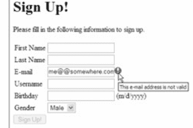

**图3-3**

你还会注意到，注册按钮在此函数中被使用。如果表单中存在任何无效数据，注册按钮应该被禁用。为了实现这一点，会调用一个名为 `isFormValid()` 的函数。如果此函数返回 `false`，则注册按钮的 `disabled` 属性将被设置为true，从而禁用它。`isFormValid()` 函数只是遍历表单字段并检查 `valid` 属性：

```javascript
function isFormValid() {
    var frmMain = document.forms[0];
    var blnValid = true;

    for (var i=0; i < frmMain.elements.length; i++) {
        if (typeof frmMain.elements[i].valid == "boolean") {
            blnValid = blnValid && frmMain.elements[i].valid;
        }
    }

    return blnValid;
}
```

对于表单中的每个元素，首先检查 `valid` 属性是否存在。这是通过使用 `typeof` 运算符完成的，如果该属性存在并已赋予布尔值，它将返回 `boolean`。因为有些字段没有被验证（因此不会有自定义的 `valid` 属性），此检查确保只考虑已验证的字段。

脚本的最后一部分是为文本框设置事件处理程序。这应在表单加载完成后执行，但前提是支持XMLHttp（因为这是此处执行Ajax验证的方式）：

```javascript
//如果启用了Ajax，禁用提交按钮并分配事件处理程序
window.onload = function () {
    if (zXmlHttp.isSupported()) {
        var btnSignUp = document.getElementById("btnSignUp");
        var txtUsername = document.getElementById("txtUsername");
        var txtBirthday = document.getElementById("txtBirthday");
        var txtEmail = document.getElementById("txtEmail");

        btnSignUp.disabled = true;
        txtUsername.onchange = validateField;
        txtBirthday.onchange = validateField;
        txtEmail.onchange = validateField;
        txtUsername.valid = false;
        txtBirthday.valid = false;
        txtEmail.valid = false;
    }
};
```

此onload事件处理程序为每个文本框分配onchange事件处理程序，并将自定义的valid属性初始化为false。此外，注册按钮从一开始就被禁用，以防止提交无效数据。但是，请注意，按钮只有在支持XMLHttp时才会被禁用；否则，表单将像普通Web表单一样运行，验证必须在整个表单提交时进行。

当你加载此示例时，三个已验证的文本字段中的每一个在值更改并移动到另一个字段时，都会向服务器发出验证请求。使用提交节流模式可以提供无缝的用户体验，即使JavaScript被关闭或XMLHttp不被支持，表单仍然可以正常工作。

> **重要提示** 即使使用这种类型的验证，在整个表单提交后，也必须再次验证所有数据。记住，如果用户关闭了JavaScript，你仍然需要确保在使用数据执行操作之前数据是有效的。

## 增量字段验证示例

前面的示例在字段值更改时验证每个字段，而提交节流设计模式的另一种流行形式是，在发生更改时定期提交单个字段。这是Bitflux LiveSearch和Google Suggest所使用的提交节流版本，在这两个示例中，随着用户的输入，数据会反复发送到服务器。在这两种情况下，提交都会在服务器上触发搜索；然而，相同的方法可用于在用户键入时重复验证单个字段。

假设不是要求你填写整个表单，注册某个站点需要你首先选择一个用户名（可能是多步注册过程中的第一步）。在这种情况下，你会希望确保只使用不存在的用户名。你可以定期将数据上传到服务器进行验证，而不是等待表单提交，确保在输入有效的用户名之前无法提交数据。

> **重要提示** 请注意，此示例仅用于演示目的。如果你要在生产环境中使用描述的技术，则必须防范可能使用此功能来收集用户名和密码的垃圾邮件机器人。


本示例的表单要简单得多，仅由一个文本框和一个“下一步”按钮组成：

```html
<form method="post" action="Success.php">
    <table>
        <tr>
            <td><label for="txtUsername">Username</label></td>
            <td><input type="text" id="txtUsername" name="txtUsername"/>
                </td>
        </tr>
    </table>
    <input type="submit" id="btnNext" value="Next" />
</form>
```

请注意，上一个示例的基本格式得以保留，包括隐藏的错误图像。接下来，上一个示例中的 `validateField()` 函数被使用，并做了一些修改：

```javascript
var oXmlHttp = null;
var iTimeoutId = null;

function validateField(oEvent) {
    oEvent = oEvent || window.event;
    var txtField = oEvent.target || oEvent.srcElement;

    var btnNext = document.getElementById("btnNext");
    btnNext.disabled = true;

    if (iTimeoutId != null) {
        clearTimeout(iTimeoutId);
        iTimeoutId = null;
    }

    if (!oXmlHttp) {
        oXmlHttp = zXmlHttp.createRequest();
    } else if (oXmlHttp.readyState != 0) {
        oXmlHttp.abort();
    }

    oXmlHttp.open("get", "ValidateForm.php?" + txtField.name + "="
        + encodeURIComponent(txtField.value), true);
    oXmlHttp.onreadystatechange = function () {
        if (oXmlHttp.readyState == 4) {
            if (oXmlHttp.status == 200) {
                var arrInfo = oXmlHttp.responseText.split("||");
                var imgError = document.getElementById("img"
                    + txtField.id.substring(3) + "Error");
                if (!eval(arrInfo[0])) {
                    imgError.title = arrInfo[1];
                    imgError.style.display = "";
                    txtField.valid = false;
                } else {
                    imgError.style.display = "none";
                    txtField.valid = true;
                }
                btnNext.disabled = !txtField.valid;
            } else {
                alert("An error occurred while trying to contact the server.");
            }
        }
    };

    iTimeoutId = setTimeout(function () {
        oXmlHttp.send(null);
    }, 500);
}
```

首先要注意这个更新函数中包含的两个全局变量：`oXmlHttp` 和 `iTimeoutId`。第一个 `oXmlHttp` 保存了一个 XMLHttpRequest 对象的全局引用，该对象被重复使用（与上一个示例中仅使用一次不同）；第二个 `iTimeoutId` 保存了一个超时标识符，用于延迟发送请求。在函数内部，第一个新增的部分是立即将“下一步”按钮设为禁用状态。这很重要，因为请求可能不会在调用此函数后立即发出。之后的下一段代码会检查超时标识符是否不为 null，如果是，则清除它，以防止连续发送过多请求。（如果存在挂起的请求，这将取消它。）

接下来，检查全局 `oXmlHttp` 对象是否为 `null`。如果是，则创建一个新的 XMLHttpRequest 对象并赋值给它。如果 XMLHttpRequest 对象已经存在，则检查其 `readyState` 以确定它是否已准备好接受请求。如上一章所述，当调用 `open()` 方法时，`readyState` 会从 0 变为 1；因此，任何非 0 的 `readyState` 都表示请求已经启动，因此在尝试发送新请求之前必须调用 `abort()` 方法。请注意，这里使用了相同的 `ValidateForm.php` 页面进行验证。

在 `onreadystatechange` 事件处理程序内部，唯一新增的一行是根据用户名的有效性来更改“下一步”按钮的禁用状态。在函数接近尾声处，调用 `setTimeout()` 函数将请求发送延迟半秒（500 毫秒）。这次调用的标识符保存在 `iTimeoutId` 中，以便在下次调用函数时可以取消该请求。通过以这种方式使用 JavaScript 的超时功能，你可以确保用户至少有半秒钟没有输入任何内容。如果用户快速输入内容，超时将被反复清除，请求也会被中止。只有当用户暂停输入时，请求最终才会被发送。

现在剩下的唯一部分是设置事件处理程序。由于此方法在用户输入时上传信息，你不能仅依赖 `onchange` 事件处理程序（尽管它仍然是必需的）。在这种情况下，你需要使用 `onkeyup` 事件处理程序，该程序在每次按键并释放后都会被调用：

```javascript
window.onload = function () {
    if (zXmlHttp.isSupported()) {
        var btnNext = document.getElementById("btnNext");
        var txtUsername = document.getElementById("txtUsername");

        btnNext.disabled = true;
        txtUsername.onkeyup = validateField;
        txtUsername.onchange = validateField;
        txtUsername.valid = false;
    }
};
```

再次说明，这与上一个示例非常相似。唯一的更改是按钮的名称（现在是 `btnNext`）以及将 `validateField()` 赋值给 `onkeyup` 事件处理程序。随着用户的输入，将检查用户名的有效性。每次输入有效的用户名时，“下一步”按钮就会变为启用状态。每当进行请求时，按钮会首先被禁用以适应特定情况。用户有可能在输入有效的用户名后继续输入。作为副作用，额外的字符可能导致用户名变得无效，而你不希望允许提交无效的数据。

> **重要提示** 尽管这是一个不错的功能，但增量字段验证应谨慎使用，因为它会产生大量的请求。除非你的服务器配置专门用于处理增加的请求量，否则最好放弃这种方法。

## 定期刷新

定期刷新设计模式描述了以特定间隔检查新服务器信息的过程。这种方法，也称为 *轮询*，要求浏览器跟踪下一次向服务器发出请求的时间。

此模式在网络上以多种不同的方式使用：

-   ESPN 使用定期刷新来自动更新其在线记分板。例如，位于 http://sports.espn.go.com/nfl/scoreboard 的 NFL 记分板会显示当时正在进行的每场 NFL 比赛的最新比分和进攻图表。使用 XMLHttpRequest 对象和一点 Flash，页面会用新信息反复更新自己。
-   Gmail (http://gmail.google.com) 使用定期刷新来通知用户收到新邮件。当你阅读电子邮件或执行其他操作时，Gmail 会反复检查服务器是否有新邮件到达。除非有新邮件，否则此操作不会通知用户，此时收到的新邮件数量会显示在收件箱菜单项旁边的括号中。
-   XHTML 实时聊天 (www.plasticshore.com/projects/chat/) 使用定期刷新来使用简单的 Web 技术实现聊天室。通过检查服务器获取新信息，聊天室文本每隔几秒钟会自动更新一次。如果有新消息，页面将更新以反映该消息，从而创建传统的聊天室体验。
-   磁性 Ajax 演示 (www.broken-notebook.com/magnetic/) 在线重现了磁性诗歌（使用可以重新排列组成句子的单词磁贴）的体验。完整版每隔几秒钟轮询服务器以获取新的排列，因此如果你和另一个人同时在重新排列单词，你会看到这些移动。

显然，定期刷新可以通过许多不同的方式来提升用户体验，但其基本目的保持不变：通知用户信息已更新。

## 新评论通知器示例

自 2005 年初以来，一个逐渐出现在网络博客中的功能是新评论通知器。新评论通知器的作用正如其名：它在添加新评论时提醒用户。这可以表现为显示在页面上的简单文本消息，或从视图外滑入的动画消息，但其基本思想是相同的。在本示例中，使用定期刷新来检查包含评论的数据库表，以查看哪一条是最新的。

假设你有一个简单的 MySQL 表，定义如下：

```sql
CREATE TABLE `BlogComments` (
  `CommentId` INT NOT NULL AUTO_INCREMENT,
  `BlogEntryId` INT NOT NULL,
  `Name` VARCHAR(100) NOT NULL,
  `Message` VARCHAR(255) NOT NULL,
  `Date` DATETIME NOT NULL,
  PRIMARY KEY (`CommentId`)
) COMMENT = 'Blog Comments';
```

运行此操作的 SQL 查询是：

```sql
select CommentId,Name,LEFT(Message, 50)
from BlogComments order by Date desc
limit 0,1
```

此查询返回最新评论的评论 ID（自动生成）、留下评论的人员姓名以及消息文本的前 50 个字符（使用 `LEFT()` 函数）。这 50 个字符用作实际评论的预览（你可能不想获取整个消息，因为它可能很长）。

运行此查询的页面名为 `CheckComments.php`，它输出以下格式的字符串：

```
<评论 ID>|||<姓名>|||<消息>
```

此格式允许使用 JavaScript 的 `Array.split()` 方法，以便毫不费力地提取各个信息片段。如果没有评论或出现错误，评论 ID 将为 -1，字符串的其他部分将为空。以下是 `CheckComments.php` 的完整代码清单：

```php
<?php
header("Cache-control: No-Cache");
header("Pragma: No-Cache");

//数据库信息
$sDBServer = "your.database.server";
```


$sDBName = "your_db_name";
$sDBUsername = "your_db_username";
$sDBPassword = "your_db_password";

```php
//创建SQL查询字符串
$sSQL = "select CommentId,Name,LEFT(Message, 50) as ShortMessage
from
BlogComments order by Date desc limit 0,1";
```

```php
$oLink = mysql_connect($sDBServer,$sDBUsername,$sDBPassword);
@mysql_select_db($sDBName) or die("-1|| || ");
```

```php
if($oResult = mysql_query($sSQL) and mysql_num_rows($oResult) > 0)
{
    $aValues = mysql_fetch_array($oResult,MYSQL_ASSOC);
    echo $aValues['CommentId']."||".$aValues['Name']."||".
         $aValues['ShortMessage'];
} else {
    echo "-1|| || ";
}
```

```php
mysql_free_result($oResult);
mysql_close($oLink);
?>
```

或许这个文件最重要的部分是顶部包含的两个头部设置。通过将 `Cache-control` 和 `Pragma` 设置为 `No-Cache`，你是在告诉浏览器始终从服务器获取此文件，而不是从客户端缓存中获取。如果没有这样设置，一些浏览器会反复返回相同的信息，实际上完全使此功能失效。文件的其余部分应该看起来非常熟悉，因为它使用了与之前使用 MySQL 数据库调用的示例基本相同的算法。

**注意：** 你也可以通过每次请求此文件时更改查询字符串来避免缓存问题。这通常通过在查询字符串中分配一个时间戳来实现，以欺骗浏览器从服务器获取新的副本。

接下来是调用此文件的 JavaScript 代码。首先，你再次需要几个全局变量：

```javascript
var oXmlHttp = null;      //XMLHttpRequest 对象
var iInterval = 1000;     //检查间隔（以毫秒为单位）
var iLastCommentId = -1;   //收到的最后一条评论的 ID
var divNotification = null; //用于显示通知的层
```

与往常一样，第一个全局变量是一个名为 `oXmlHttp` 的 XMLHttpRequest 对象，它将用于所有请求。第二个变量 `iInterval` 指定了每次检查新评论之间应间隔的毫秒数。在这个例子中，它被设置为 1000 毫秒，即 1 秒，虽然你可以并且应该根据你的需求进行自定义。接下来，`iLastCommentId` 变量用于存储数据库中的最后一条评论 ID。通过将此值与最近检索到的评论 ID 进行比较，你可以确定是否添加了新评论。最后一个变量 `divNotification` 保存了对 `<div/>` 元素的引用，该元素用于向用户显示关于新评论的通知。

当检测到新评论时，`divNotification` 会被填充关于新评论的信息，包括发表评论的人的名字、消息摘要，以及查看完整评论的链接。如果 `<div/>` 元素尚未创建，则必须创建它并分配适当的样式信息：

```javascript
function showNotification(sName, sMessage) {
    if (!divNotification) {
        divNotification = document.createElement("div");
        divNotification.className = "notification";
        document.body.appendChild(divNotification);
    }

    divNotification.innerHTML = "<strong>New Comment</strong><br />" + sName
        + "says: "+ sMessage + "...<br /><a href=\"ViewComment.php?id="
        + iLastCommentId + "\">View</a>";

    divNotification.style.top = document.body.scrollTop + "px";
    divNotification.style.left = document.body.scrollLeft + "px";
    divNotification.style.display = "block";

    setTimeout(function () {
        divNotification.style.display = "none";
    }, 5000);
}
```

如你所见，`showNotification()` 函数接受两个参数：一个名字和一条消息。然而，在使用此信息之前，你必须确保 `divNotification` 不为 null。如果需要，会创建一个新的 `<div/>` 元素，并在将其添加到文档的 body 之前，将其 CSS 类设置为 `notification`。之后，`innerHTML` 属性用于设置通知 HTML，该 HTML 以粗体显示“New Comment”，后跟名字、消息和查看评论的链接。该链接指向 `ViewComment.php` 并将查询字符串参数 `id` 赋值为 `iLastCommentId` 的值，该值表示要查看的评论。然后，通过使用 `document.body` 的 `scrollTop` 和 `scrollLeft` 属性来设置通知的位置。这确保了无论滚动位置如何（如果你向下或向右滚动了），通知始终在页面的左上角可见。之后，将 `display` 属性设置为 `block` 以使通知可见。

此函数的最后一部分是一个超时设置，它在 5 秒（5000 毫秒）后隐藏通知。除非你的设计中专门为此目的留出了位置，否则让通知一直显示不是一个好主意；否则，你可能会遮盖重要信息。

在此示例中，`notification` CSS 类定义如下：

```css
div.notification {
    border: 1px solid red;
    padding: 10px;
    background-color: white;
    position: absolute;
    display: none;
    top: 0px;
    left: 0px;
}
```

这将创建一个带有红色边框的白色框。当然，你会希望根据其使用的网站或应用程序进行适当的样式设计。此示例的重要部分是将 `position` 设置为 `absolute`，将 `display` 设置为 `none`。同时设置这两个属性可确保当 `<div/>` 元素添加到页面时，它不会中断正常的页面流程或移动任何元素。结果是一个通知区域，如图 3-4 所示。

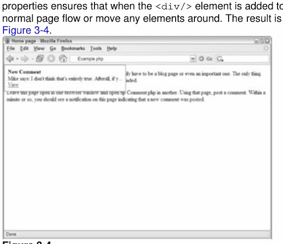

回到 JavaScript。承担最多工作的函数是 `checkComments()`，它负责检查服务器是否有更新。代码与之前的示例非常相似：

```javascript
function checkComments() {
    if (!oXmlHttp) {
        oXmlHttp = zXmlHttp.createRequest();
    } else if (oXmlHttp.readyState != 0) {
        oXmlHttp.abort();
    }

    oXmlHttp.open("get", "CheckComments.php", true);
    oXmlHttp.onreadystatechange = function () {
        if (oXmlHttp.readyState == 4) {
            if (oXmlHttp.status == 200) {
                var aData = oXmlHttp.responseText.split("||");
                if (aData[0] != iLastCommentId) {
                    if (iLastCommentId != -1) {
                        showNotification(aData[1], aData[2]);
                    }
                    iLastCommentId = aData[0];
                }

                setTimeout(checkComments, iInterval);
            }
        }
    };

    oXmlHttp.send(null);
}
```

此函数创建一个 XMLHttpRequest 对象并异步调用 `CheckComments.php`。这段代码的重要部分已突出显示（其余部分与之前的示例几乎完全相同）。在此部分，`responseText` 使用 `split()` 方法被分割成一个数组。数组中的第一个值 `aData[0]` 是最后添加的评论 ID。如果它不等于存储的最后一条评论 ID，则可能需要通知。接下来，如果最后一条评论 ID 是 -1，则尚未检索到任何评论 ID，因此不应显示通知。如果最后一条评论 ID 不是 -1，则至少检索到了一个评论 ID，并且由于它与刚从服务器收到的不同，因此应显示通知。之后，将新 ID 分配给 `iLastCommentId` 以供将来使用。事件处理程序的最后一步是为 `checkComments()` 设置另一个超时，以继续检查更多评论。

该过程的最后一步是在页面加载完成后发起对 `checkComments()` 的调用。这将检索数据库中最新的评论 ID，但不会显示通知（因为 `iLastCommentId` 最初等于 -1）。当再次调用 `checkComments()` 时，可以从数据库中检索到的 ID 与存储在 `iLastCommentId` 中的 ID 进行比较，以确定是否必须显示通知。与往常一样，此功能应仅在浏览器支持 XMLHttpRequest 时才启用：

```javascript
window.onload = function () {
    if (xmlHttp.isSupported()) {
        checkComments();
    }
};
```

创建此定期刷新解决方案就是这么简单。你只需要记得在任何希望拥有此功能的页面中包含必要的 JavaScript 和 CSS 文件即可。

> **重要提示：** 此示例的文件可从 [www.wrox.com](http://www.wrox.com) 下载。与这些文件一起的还有其他页面，你可以使用它们来添加和查看评论以进行测试。

## 多阶段下载

Web 上一个持久存在的问题是页面下载的速度。当所有人都在使用 56 Kbps 调制解调器时，网页设计师更加关注他们的页面有多“重”（以总字节为单位的页面大小）。随着住宅宽带互联网解决方案的普及，许多网站已经进行了升级，包括了多媒体、更多图片、


## 多阶段下载

这种方法虽然为用户提供了更多信息，但也导致下载速度变慢，因为所有内容都以看似随机的顺序加载。幸运的是，有一个Ajax解决方案可以解决这个问题。

多阶段下载是一种Ajax模式，它最初只将最基本的功能加载到页面中。完成后，页面再开始下载其他应该出现在页面上的组件。如果用户在所有组件下载完成之前离开页面，这并无大碍。然而，如果用户在页面上停留较长时间（例如阅读一篇文章），额外的功能会在后台加载，并在用户需要时可用。这里的主要优势在于，作为开发者，你可以决定下载什么内容以及在何时下载。

这是一个相当新的Ajax模式，已被微软的start.com推广。当你首次访问start.com时，它是一个非常简单的页面，中间有一个搜索框。然而在后台，一系列请求正在被发出，以在页面上填充更多内容。几秒钟内，页面就活跃起来，来自多个不同位置的内容被拉取并显示。

尽管很好，但多阶段下载确实有一个缺点：页面必须在最简单的形式下工作，以适应不支持Ajax技术的浏览器。这意味着所有基本功能都必须无需任何额外下载即可工作。处理这个问题的典型方法是提供*优雅降级*，即支持Ajax技术的浏览器将获得更丰富的界面，而其他浏览器则获得一个简单、基本的界面。如果你期望搜索引擎抓取你的网站，这一点尤其重要；因为这些机器人不支持JavaScript，它们完全依赖页面中的HTML来确定你网站的价值。

## 附加信息链接示例

在线阅读文章时，通常会包含附加信息链接以供进一步阅读。关键问题在于：主要内容是什么？显然，文章文本是页面上的主要内容，因此它应该在页面初始加载时下载。附加链接不那么重要，因此可以稍后加载。本示例将引导你创建这样一个解决方案。

首先，你需要设计一个页面来承载文章。在本例中，这是一个非常简单的布局：

```
<!DOCTYPE html PUBLIC "-//W3C//DTD XHTML 1.0 Transitional//EN"
    "http://www.w3.org/TR/xhtml1/DTD/xhtml1-transitional.dtd">
<html xmlns="http://www.w3.org/1999/xhtml" xml:lang="en" lang="en">
  <head>
    <title>Article Example</title>
    <script type="text/javascript" src="zxml.js"></script>
    <script type="text/javascript" src="Article.js"></script>
    <link rel="stylesheet" type="text/css" href="Article.css" />
  </head>
  <body>
    <h1>Article Title</h1>
    <div id="divAdditionalLinks"></div>
    <div id="divPage1">
      <!--  article content here -->
    </div>
  </body>
</html>
```

HTML中的重要部分是ID为`divAdditionalLinks`的`<div/>`。这是用于下载文章附加链接的容器。默认情况下，它被设置为右对齐且不可见：

```
#divAdditionalLinks {
    float: right;
    padding: 10px;
    border: 1px solid navy;
    background-color: #cccccc;
    display: none;
}
```

CSS `display`属性设置为`none`非常重要，这样空的`<div/>`元素才不会占用页面布局中的任何空间。否则，你会在文章右侧看到一个小空盒子。

与之前的示例不同，要下载的内容只是纯文本，包含在一个包含链接和标题的文本文件中。这个文件`AdditionalLinks.txt`包含一些简单的HTML代码：

```
<h4>Additional Information</h4>
<ul>
    <li><a href="http://www.wrox.com">Wrox</a></li>
    <li><a href="http://www.nczonline.net">NCZOnline</a></li>
    <li><a href="http://www.wdonline.com">XWeb</a></li>
</ul>
```

这个文件同样可以使用服务器端逻辑动态创建，但出于本示例的目的，静态内容效果相同。

实现此功能的JavaScript非常简单，并且与本章前面的所有示例非常相似：

```
function downloadLinks() {
    var oXmlHttp = zXmlHttp.createRequest();

    oXmlHttp.open("get", "AdditionalLinks.txt", true);
    oXmlHttp.onreadystatechange = function () {
        if (oXmlHttp.readyState == 4) {
            if (oXmlHttp.status == 200) {
                var divAdditionalLinks =
                    document.getElementById("divAdditionalLinks");
                divAdditionalLinks.innerHTML = oXmlHttp.responseText;
                divAdditionalLinks.style.display = "block";
            }
        }
    };
    oXmlHttp.send(null);
}

window.onload = function () {
    if (zXmlHttp.isSupported()) {
        downloadLinks();
    }
};
```

执行工作的函数是`downloadLinks()`，它仅在浏览器支持XMLHttp并且页面完全加载后才被调用。`downloadLinks()`内部的代码是你之前使用过的标准XMLHttp算法。从`AdditionalLinks.txt`检索到内容后，它通过`innerHTML`属性被设置到占位符`<div/>`中。过程的最后一步是将`<div/>`元素的`display`属性设置为`block`，使其可见。最终结果显示在图3-5中。

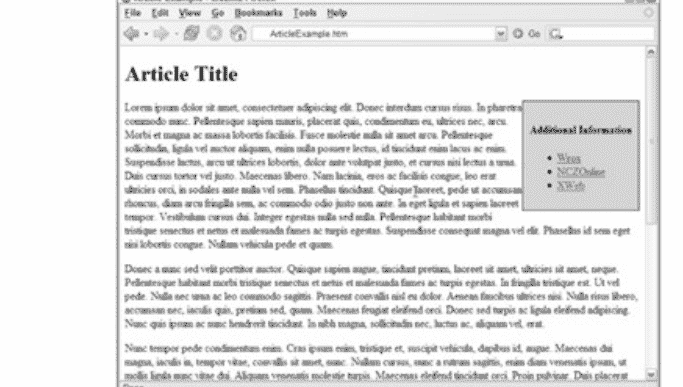

如果浏览器不支持XMLHttp，包含附加链接的块将永远不会出现，因此第一段会一直延伸到顶部。

这种技术可以多次用于页面的任意数量的部分；你肯定不限于仅在初始页面完成后加载一个部分。你可以为每个请求创建新的XMLHttp对象，然后一个接一个地发送它们，或者你可以按顺序执行，等待收到响应后再发送下一个请求。选择完全取决于你和你期望的功能。

## 回退模式

上一节讨论了何时从服务器发送或接收数据，这预设了服务器端一切按计划进行：请求被接收，进行必要的更改，并将适当的响应发送给客户端。但如果服务器上发生错误怎么办？更糟糕的是，如果请求从未到达服务器怎么办？在开发Ajax应用程序时，你必须提前计划这些问题，并描述如果发生其中一种情况，你的应用程序应如何工作。

## 取消待处理的请求

如果服务器上发生错误，意味着返回的状态不是200，你需要决定该怎么做。如果文件未找到（404）或发生内部服务器错误（500），几分钟后重试可能无济于事，因为这两种情况都需要管理员来解决问题。处理这种情况的最简单方法是直接取消所有待处理的请求。你可以在代码中的某个地方设置一个标志，表示“不再发送任何请求”。这显然对使用定期刷新模式的解决方案影响最大。

评论通知示例可以修改以考虑这一点。在这种情况下，Ajax解决方案为用户提供了额外价值，但并非页面的主要焦点。如果请求失败，没有理由提醒用户；你可以简单地取消任何未来的请求以防止进一步的错误发生。为此，你必须添加一个全局变量来指示是否启用请求：

```
var oXmlHttp = null;
var iInterval = 1000;
var iLastCommentId = -1;
var divNotification = null;
var blnRequestsEnabled = true;
```

现在，在发出任何请求之前，必须检查`blnRequestsEnabled`变量。这可以通过将`checkComments()`函数的主体包装在`if`语句中来实现：

```
function checkComments() {

    if (blnRequestsEnabled) {
        if (!oXmlHttp) {
            oXmlHttp = zXmlHttp.createRequest();
        } else if (oXmlHttp.readyState != 0) {
            oXmlHttp.abort();
        }

        oXmlHttp.open("get", "CheckComments.php", true);
        oXmlHttp.onreadystatechange = function () {
            if (oXmlHttp.readyState == 4) {
                if (oXmlHttp.status == 200) {
                    var aData = oXmlHttp.responseText.split("||");
                    if (aData[0] != iLastCommentId) {
                        if (iLastCommentId != -1) {
                            showNotification(aData[1], aData[2]);
                        }
                        iLastCommentId = aData[0];
                    }
                    setTimeout(checkComments, iInterval);
                }
            }
        };

        oXmlHttp.send(null);
    }
}
```


但这并非全部；你还需要检测可能发生的两种不同类型的错误：给出状态码的服务器错误，以及无法连接到服务器的错误（服务器宕机或网络连接丢失）。

首先，将初始`if`语句中的所有内容包裹在一个`try...catch`块中。当服务器无法访问时，不同的浏览器会在不同时间做出反应，但它们都会抛出错误。将整个请求块包裹在`try...catch`中，确保你能捕获抛出的任何错误，此时你可以将`blnRequestsEnabled`设置为`false`。接下来，对于服务器错误，你可以在状态不等于200时抛出自定义错误。这将被`try...catch`块捕获，并产生与无法访问服务器相同的效果（将`blnRequestsEnabled`设置为`false`）：

```javascript
function checkComments() {
    if (blnRequestsEnabled) {
        try {
            if (!oXmlHttp) {
                oXmlHttp = zXmlHttp.createRequest();
            } else if (oXmlHttp.readyState != 0) {
                oXmlHttp.abort();
            }

            oXmlHttp.open("get", "CheckComments.php", true);
            oXmlHttp.onreadystatechange = function () {
                if (oXmlHttp.readyState == 4) {
                    if (oXmlHttp.status == 200) {
                        var aData = oXmlHttp.responseText.split("||");
                        if (aData[0] != iLastCommentId) {
                            if (iLastCommentId != -1) {
                                showNotification(aData[1], aData[2]);
                            }
                            iLastCommentId = aData[0];
                        }
                        setTimeout(checkComments, iInterval);
                    } else {
                        throw new Error("An error occurred.");
                    }
                }
            };
            oXmlHttp.send(null);
        } catch (oException) {
            blnRequestsEnabled = false;
        }
    }
}
```

现在，当两种错误类型中的任何一种发生时，都会抛出一个错误（由浏览器或你抛出），并且`blnRequestsEnabled`变量将被设置为`false`，从而有效地取消任何后续调用`checkComments()`时发出的进一步请求。

**重要** 你可能还注意到，只有在状态为200时才会创建另一个请求的超时，这防止了在其他任何状态下发生另一个请求。这对服务器错误很有效，但对通信错误却无济于事。在错误发生时，有不止一种处理方法总是更好的。

## 重试

处理错误的另一个选项是静默地持续尝试，指定时间或特定次数。再次强调，除非Ajax功能对用户体验至关重要，否则没有必要通知他或她失败情况。最好在后台处理问题，直到它能被解决。

为了说明重试模式，考虑多阶段下载示例。在该示例中，额外的链接被下载并显示在文章旁边。如果在请求期间发生错误，大多数浏览器中会弹出一条错误消息。用户不知道错误是什么或是什么引起的，那为什么还要显示消息呢？相反，在放弃之前继续尝试下载信息几次会更有意义。

要跟踪失败尝试的次数，需要一个全局变量：

```javascript
var iFailed = 0;
```

`iFailed`变量从0开始，每次请求失败时递增。因此，如果`iFailed`大于某个特定数字，你就可以取消请求，因为它显然不会成功。例如，如果你想在取消所有待处理请求之前尝试十次，你可以这样做：

```javascript
function downloadLinks() {
    var oXmlHttp = zXmlHttp.createRequest();
    if (iFailed < 10) {
        try {
            oXmlHttp.open("get", "AdditionalLinks.txt", true);
            oXmlHttp.onreadystatechange = function () {
                if (oXmlHttp.readyState == 4) {
                    if (oXmlHttp.status == 200) {
                        var divAdditionalLinks =
                            document.getElementById("divAdditionalLinks");
                        divAdditionalLinks.innerHTML =
                            oXmlHttp.responseText;
                        divAdditionalLinks.style.display = "block";
                    } else {
                        throw new Error("An error occurred.");
                    }
                }
            };
            oXmlHttp.send(null);
        } catch (oException) {
            iFailed++;
            downloadLinks();
        }
    }
}
```

这段代码的结构类似于前面的示例。使用`try...catch`块来捕获通信期间可能发生的任何错误，并在`status`不是200时抛出自定义错误。主要区别在于，当捕获到错误时，`iFailed`变量会递增，并且会再次调用`downloadLinks()`。只要`iFailed`小于10（意味着失败次数少于十次），就会发出另一个请求来尝试下载。

通常，重试模式应仅在请求本应只发生一次时使用，例如在多阶段下载中。如果你尝试将此模式与间隔驱动的请求一起使用，例如周期性刷新，你可能会得到数量不断增加的打开请求，从而占用内存。

## 总结

在本章中，你学习了用于Ajax解决方案的各种设计模式。你首先学习了如何使用预测性获取来改善用户体验，通过预加载未来可能使用的信息。你创建了一个使用预测性获取在几秒钟后预加载文章中页面的示例，此时用户很可能打算阅读整篇文章。

接下来，你学习了提交节流，这是一种将数据增量发送到服务器而不是一次性全部发送的方法。你学习了如何将此模式用于表单中的数据验证。它的姊妹模式周期性刷新也被讨论，该模式定期从服务器接收信息。你构建了一个使用周期性刷新的示例，当博客或留言板上有新评论发布时显示通知。

本章还向你介绍了多阶段下载模式，这是一种在页面加载后继续下载额外信息的方法。你了解到这将导致页面初始下载时间更快，并且你可以以任何你认为合适的方式控制请求的频率和顺序。

最后一节讨论了用于处理客户端-服务器通信中错误的回退模式。你了解到你可能遇到两种类型的错误：服务器错误（例如404未找到）或通信错误（无法联系到服务器）。讨论了两种模式：取消待处理请求和重试，作为处理这些错误的方法。

## 第4章：XML、XPath和XSLT

*概述*

随着XML的流行，Web开发人员希望在服务器和客户端都使用这项技术，但最初只有服务器端提供了XML功能。从Internet Explorer 5.0和Mozilla 1.0开始，微软和Mozilla开始通过JavaScript在其浏览器中支持XML。最近，苹果和Opera也在其浏览器中添加了一些XML支持，尽管不如微软和Mozilla的支持程度。浏览器制造商继续通过新功能扩大XML支持的可用性，为Web开发人员提供了以前只在服务器上才有的强大工具。

在本章中，你将学习如何在XML DOM对象中加载和操作XML文档，使用XPath选择满足特定条件的XML节点，以及使用XSLT将XML文档转换为HTML。

*浏览器中的XML支持*

如今有许多Web浏览器可用，但很少有像Internet Explorer (IE)和Mozilla Firefox那样完整地支持XML及其相关技术。尽管其他浏览器（如Safari和Opera现在可以打开XML文档）正在迎头赶上，但其功能要么不完整，要么不正确。由于这些问题，本章主要关注IE和Firefox中的实现。

### IE中的XML DOM

当微软在IE 5.0中添加XML支持时，他们通过引入MSXML ActiveX库来实现，该库最初是为了在IE 4.0中解析活动频道而编写的。这个原始版本并非打算供公众使用，但开发人员开始了解并使用该组件。微软随后发布了完全升级的MSXML版本，该版本包含在IE 4.01中。MSXML主要是一个仅限IE的组件，直到2001年微软发布MSXML 3.0，这是一个通过公司网站分发的独立组件。同年晚些时候，发布了4.0版本，MSXML被重命名为Microsoft XML Core Services Component。自诞生以来，MSXML从一个基本的、非验证的XML解析器发展成为一个功能齐全的组件，可以验证XML文档、执行XSL转换、支持命名空间使用、XML的简单API (SAX) 以及W3C XPath和XML Schema标准，同时每个新版本都在性能上有所提升。

要在JavaScript中创建ActiveX对象，微软实现了一个名为`ActiveXObject`的新类，可用于实例化多个ActiveX对象。其构造函数接受一个参数，一个包含要创建的ActiveX对象版本的字符串；在本例中，它是XML文档的版本。第一个XML DOM ActiveX对象被称为`Microsoft.XmlDom`，其创建方式如下：

```javascript
var oXmlDom = new ActiveXObject("Microsoft.XmlDom");
```

新创建的XML DOM对象的行为类似于任何其他DOM对象，使你能够遍历DOM树并操作DOM节点。

在撰写本文时，有五种不同版本的MSXML DOM文档，它们的版本字符串如下：

- Microsoft.XmlDom
- MSXML2.DOMDocument
- MSXML2.DOMDocument.3.0
- MSXML2.DOMDocument.4.0
- MSXML2.DOMDocument.5.0

**重要** MSXML是一个ActiveX实现；因此，它仅在Windows平台上可用。Mac上的IE 5不支持XML DOM。


因为存在五个不同的版本，而你可能总是想使用最新的版本，所以使用一个函数来确定使用哪个版本会很有帮助。这样做可以确保你获得最新的支持和最高的性能。下面的函数 `createDocument()` 使你能够创建正确的 MSXML DOM 文档：

```javascript
function createDocument() {
    var aVersions = ["MSXML2.DOMDocument.5.0",
                     "MSXML2.DOMDocument.4.0",
                     "MSXML2.DOMDocument.3.0",
                     "MSXML2.DOMDocument",
                     "Microsoft.XmlDom"];

    for (var i = 0; i < aVersions.length; i++) {
        try {
            var oXmlDom = new ActiveXObject(aVersions[i]);
            return oXmlDom;
        } catch (oError) {
            //Do nothing
        }
    }
    throw new Error("MSXML is not installed.");
}
```

此函数遍历 `aVersions` 数组，该数组包含 MSXML DOM 文档的版本字符串。它从最新版本 `MSXML2.DOMDocument.5.0` 开始，并尝试创建 DOM 文档。如果对象创建成功，则将其返回，`createDocument()` 退出；如果失败，则会抛出一个错误，然后被 `try...catch` 块捕获，因此循环继续并尝试下一个版本。如果 MSXML DOM 文档创建失败，则会抛出错误，说明 MSXML 未安装。此函数不是一个类，因此其使用方式看起来像任何其他返回值的函数：

```javascript
var oXmlDom = createDocument();
```

使用 `createDocument()` 将确保使用最新的 DOM 文档。既然你已经可以使用 XML 文档了，那么就该加载一些 XML 数据了。

## 在 IE 中加载 XML 数据

MSXML 支持两种加载 XML 的方法：`load()` 和 `loadXML()`。`load()` 方法加载位于 Web 上特定位置的 XML 文件。与 `XMLHttp` 类似，`load()` 方法使你能够以两种模式加载数据：异步或同步。默认情况下，`load()` 方法是异步的；要使用同步模式，必须将 MSXML 对象的 `async` 属性设置为 `false`，如下所示：

```javascript
oXmlDom.async = false;
```

在异步模式下，MSXML 对象公开 `readyState` 属性，该属性具有与 `XMLHttp` `readyState` 属性相同的五个状态。

此外，DOM 文档支持 `onreadystatechange` 事件处理程序，使你能够监视 `readyState` 属性。由于异步模式是默认模式，因此将 `async` 属性设置为 `true` 是可选的：

```javascript
oXmlDom.async = true;
oXmlDom.onreadystatechange = function ( ) {
    if (oXmlDom.readyState == 4) {
        //当文档完全加载时执行某些操作。
    }
};
oXmlDom.load("myxml.xml");
```

在这个示例中，虚构的名为 myxml.xml 的 XML 文档被加载到 XML DOM 中。当 `readyState` 达到值 4 时，文档完全加载，`if` 块内的代码将执行。

加载 XML 数据的第二种方式 `loadXML()` 与 `load()` 方法不同，前者从字符串加载 XML。此字符串必须包含格式良好的 XML，如以下示例所示：

```javascript
var sXml = "<root><person><name>Jeremy McPeak</name></person></root>";
oXmlDom.loadXML(sXml);
```

这里，变量 `sXml` 中包含的 XML 数据被加载到 `oXmlDom` 文档中。使用 `loadXML()` 时，无需检查 `readyState` 属性或设置 `async` 属性，因为它不涉及服务器请求。

## 在 IE 中遍历 XML DOM

导航 XML DOM 与导航 HTML DOM 非常相似：它是一个分层的节点结构。树的顶部是 `documentElement` 属性，它包含文档的根元素。从那里，你可以使用表 4-1 中列出的属性访问文档中的任何元素或属性。

**表 4-1：XML DOM 属性**

| 属性 | 描述 |
| :--- | :--- |
| attributes | 包含此节点的属性数组。 |
| childNodes | 包含子节点的数组。 |
| firstChild | 引用节点的第一个直接子节点。 |
| lastChild | 引用节点的最后一个子节点。 |
| nextSibling | 返回紧随当前节点之后的节点。 |
| nodeName | 返回节点的限定名。 |
| nodeType | 指定节点的 XML DOM 节点类型。 |
| nodeValue | 包含与节点关联的文本。 |
| ownerDocument | 返回文档的根元素。 |
| parentNode | 引用当前节点的父节点。 |
| previousSibling | 返回紧接在当前节点之前的节点。 |
| text | 返回节点的内容或当前节点及其后代的连接文本。这是一个仅限 IE 的属性。 |
| xml | 以字符串形式返回当前节点及其子节点的 XML。这是一个仅限 IE 的属性。 |

遍历和检索 DOM 中的数据是一个直接的过程。考虑以下 XML 文档：

```xml
<?xml version="1.0" encoding="utf-8"?>
<books>
    <book isbn="0471777781">Professional Ajax</book>
    <book isbn="0764579088">Professional JavaScript for Web Developers</book>
    <book isbn="0764557599">Professional C#</book>
    <book isbn="1861002025">Professional Visual Basic 6 Databases</book>
</books>
```

这个简单的 XML 文档包含一个根元素 `<books/>`，其中有四个子元素 `<book/>`。以此文档为参考，你可以探索 DOM。DOM 树基于节点与其他节点的关系。一个节点可能包含其他节点，即子节点。另一个节点可能与其它节点共享同一个父节点，这些节点就是兄弟节点。

也许你想检索文档中的第一个 `<book/>` 元素。这可以使用 `firstChild` 属性轻松实现：

```javascript
var oRoot = oXmlDom.documentElement;
var oFirstBook = oRoot.firstChild;
```

将 `documentElement` 赋值给 `oRoot` 将节省空间和输入，尽管这不是必需的。使用 `firstChild` 属性，第一个 `<book/>` 元素被引用并赋值给变量 `oFirstBook`，因为它是根元素 `<books/>` 的第一个子元素。

你也可以使用 `childNodes` 集合来达到同样的效果：

```javascript
var oFirstBook2 = oRoot.childNodes[0];
```

选择 `childNodes` 集合中的第一项将返回节点的第一个子节点。因为 `childNodes` 在 JavaScript 中是一个 `NodeList`，所以你可以使用 `length` 属性检索一个节点拥有的子节点数量，如下所示：

```javascript
var iChildren = oRoot.childNodes.length;
```

在这个示例中，整数 4 被赋值给 `iChildren`，因为文档元素有四个子节点。

如前所述，节点可以有子节点，这意味着它们也可以有父节点。`parentNode` 属性选择当前节点的父节点：

```javascript
var oParent = oFirstBook.parentNode;
```

你之前在本节中见过 `oFirstBook`，但快速回顾一下，它是文档中的第一个 `<book/>` 元素。该节点的 `parentNode` 属性引用 `<books/>` 元素，即 DOM 的 `documentElement`。

如果当前节点是一个 book 元素，而你想选择另一个 book 元素怎么办？`<book/>` 元素彼此是兄弟节点，因为它们共享同一个直接父节点。有两个属性 `nextSibling` 和 `previousSibling` 用于选择当前节点的相邻节点。`nextSibling` 属性引用下一个出现的兄弟节点，而 `previousSibling` 属性选择前一个兄弟节点：

```javascript
var oSecondBook = oFirstBook.nextSibling;
oFirstBook2 = oSecondBook.previousSibling;
```

在这段代码中，第二个 `<book/>` 元素被引用并赋值给 `oSecondBook`。然后变量 `oFirstBook2` 被重新赋值为引用紧接在 `oSecondBook` 之前的兄弟节点，结果 `oFirstBook2` 包含与之前相同的值。如果一个节点之后没有兄弟节点，那么 `nextSibling` 为 `null`。对于 `previousSibling` 也是如此；如果当前节点之前没有紧邻的兄弟节点，`previousSibling` 为 `null`。

现在你知道如何遍历文档层次结构了，你应该知道如何从树中的节点检索数据。例如，要检索第三个 `<book/>` 元素中包含的文本，你可以使用 `text` 属性，如下所示：

```javascript
var sText = oRoot.childNodes[2].text;
```

`text` 属性检索此节点中包含的所有文本节点，这是 Microsoft 的专有属性，但它非常有用。如果没有 `text` 属性，你将不得不如下所示地访问文本节点：

```javascript
var sText = oRoot.childNodes[2].firstChild.nodeValue;
```

这段代码实现了与使用 `text` 属性相同的结果。与前面的示例一样，使用 `childNodes` 集合引用第三个 `<book/>` 元素；然后使用 `firstChild` 引用 `<book/>` 元素的文本节点，因为文本节点仍然是 DOM 中的一个节点。然后通过使用检索当前节点值的 `nodeValue` 属性来检索文本。

这两个示例的结果是相同的；但是，`text` 属性的行为与在文本节点上使用 `nodeValue` 属性不同。`text` 属性检索元素及其子元素中包含的所有文本节点的值，而 `nodeValue` 属性仅获取当前节点的值。这是一个有用的属性，但它有可能返回比预期更多的文本。例如，考虑这个修改后的 XML 文档：

```xml
<?xml version="1.0" encoding="utf-8"?>
<books>
    <book isbn="0471777781">
        <title>Professional Ajax</title>
        <author>Nicholas C. Zakas, Jeremy McPeak, Joe Fawcett</author>
    </book>
    <book isbn="0764579088">Professional JavaScript for Web Developers</book>
    <book isbn="0764557599">Professional C#</book>
    <book isbn="1861002025">Professional Visual Basic 6 Databases</book>
</books>
```


## 在 IE 中检索 XML 数据

检索 XML 数据就像使用属性一样简单，这个属性就是 `xml` 属性。此属性序列化当前节点的 XML 数据。*序列化*是将对象转换为易于存储或传输格式的过程。`xml` 属性将 XML 转换为字符串表示形式，包括标签名、属性和文本：

```
var sXml = oRoot.xml;
alert(sXml);
```

这段代码从文档元素开始序列化 XML 数据，然后将其传递给 `alert()` 方法。序列化后的 XML 部分如下所示：

```
<books><book isbn="0471777781">Professional Ajax</book></books>
```

你可以将序列化数据加载到另一个 XML DOM 对象中，发送到服务器应用程序，或传递给另一个页面。`xml` 属性返回的序列化 XML 数据取决于当前节点。在 `documentElement` 节点上使用 `xml` 属性将返回整个文档的 XML 数据，而在 `<book/>` 元素上使用它则仅返回该 `<book/>` 元素中包含的 XML 数据。

`xml` 属性是只读的。如果你想向文档添加元素，则必须使用 DOM 方法来实现。

## 在 IE 中操作 DOM

到目前为止，你已经学习了如何遍历 DOM、从中提取信息以及将 XML 转换为字符串格式。你还具备了向 DOM 添加节点、从中删除节点以及替换节点的能力。

### 创建节点

你可以使用 DOM 方法创建多种节点，首先是使用 `createElement()` 方法创建元素。此方法接受一个参数，一个包含要创建的元素标签名的字符串，并返回一个 `XMLDOMElement` 引用：

```
var oNewBook = oXmlDom.createElement("book");
oXmlDom.documentElement.appendChild(oNewBook);
```

这段代码创建了一个新的 `<book/>` 元素，并使用 `appendChild()` 方法将其附加到 `documentElement`。`appendChild()` 方法将新元素（由其参数指定）附加为最后一个子节点。但是，这段代码附加了一个空的 `<book/>` 元素到文档中，因此该元素需要一些文本：

```
var oNewBook = oXmlDom.createElement("book");
var oNewBookText = oXmlDom.createTextNode("Professional .NET 2.0 Generics");
oNewBook.appendChild(oNewBookText);
oXmlDom.documentElement.appendChild(oNewBook);
```

这段代码使用 `createTextNode()` 方法创建了一个文本节点，并使用 `appendChild()` 将其附加到新创建的 `<book/>` 元素上。`createTextNode()` 方法接受一个字符串参数，该参数指定应用于文本节点的值。

至此，你已经以编程方式创建了一个新的 `<book/>` 元素，为其提供了一个文本节点，并将其附加到文档中。要使此新元素与其他兄弟元素齐平，还需要最后一条信息：`isbn` 属性。创建属性就像使用 `setAttribute()` 方法一样简单，该方法在每个元素节点上都可用：

```
var oNewBook = oXmlDom.createElement("book");
var oNewBookText = oXmlDom.createTextNode("Professional .NET 2.0 Generics");
oNewBook.appendChild(oNewBookText);
oNewBook.setAttribute("isbn","0764559885");
oXmlDom.documentElement.appendChild(oNewBook);
```

此示例中的新代码行创建了一个 `isbn` 属性并为其赋值 0764559885。`setAttribute()` 方法接受两个字符串参数：第一个是属性的名称，第二个是分配给该属性的值。IE 还提供了其他方法向元素添加属性；然而，它们与 `setAttribute()` 相比并没有真正的优势，并且需要编写更多的代码。

### 移除、替换和插入节点

如果你可以向文档添加节点，那么能够移除它们似乎也是理所当然的。`removeChild()` 方法正是用于此目的。此方法有一个参数：要移除的节点。例如，假设你想从文档中移除第一个 `<book/>` 元素。你可以使用以下代码：

```
var oRemovedChild = oRoot.removeChild(oRoot.firstChild);
```

`removeChild()` 方法返回被移除的子节点，因此 `oRemovedChild` 现在引用被移除的 `<book/>` 元素。你现在有了对旧节点的引用，因此可以将其放置到文档中的任何其他位置。

也许你想用 `oRemovedChild` 替换第三个 `<book/>` 元素。`replaceChild()` 方法执行此操作并返回被替换的节点：

```
var oReplacedChild = oRoot.replaceChild(oRemovedChild, oRoot.childNodes[2]);
```

`replaceChild()` 方法接受两个参数：要添加的节点和要替换的节点。在此代码中，由 `oRemovedChild` 引用的节点替换了第三个 `<book/>` 元素，而被替换的节点现在由 `oReplacedChild` 引用。

因为 `oReplacedChild` 引用被替换的节点，所以你可以轻松地将其插入到文档中。你可以使用 `appendChild()` 将节点添加到子节点列表的末尾，或者使用 `insertBefore()` 方法在另一个兄弟节点之前插入节点：

```
oRoot.insertBefore(oReplacedChild, oRoot.lastChild);
```

`insertBefore()` 方法接受两个参数：要插入的节点和要在其之前插入的节点。此方法还返回插入节点的值，但对于此示例来说，这并非必需。

如你所见，DOM 是一个强大的接口，你可以从中检索、移除和添加数据。

### 在 IE 中处理错误

当加载 XML 数据时，可能会因各种原因抛出错误。例如，可能找不到外部 XML 文件，或者 XML 格式不正确。为了处理这些情况，MSXML 提供了 `parseError` 对象，其中包含错误信息。此对象是 MSXML 创建的每个 XML DOM 文档的一个属性。

要检查错误，`parseError` 对象公开了 `errorCode` 属性，可以将其与整数 0 进行比较；如果 `errorCode` 不等于 0，则表示发生了错误。以下示例专门设计用于导致错误：

```
var sXml = "<root><person><name>Jeremy McPeak</name></root>";
var oXmlDom = createDocument();
oXmlDom.loadXML(sXml);

if (oXmlDom.parseError.errorCode != 0) {
    alert("An Error Occurred: " + oXmlDom.parseError.reason);
} else {
    //加载成功后执行的代码。
}
```

在突出显示的行中，注意 `<person/>` 元素未关闭。由于加载的 XML 格式不正确，因此发生了错误。然后将 `errorCode` 与 0 进行比较；如果不匹配（在此示例中不匹配），将显示一个警告框，说明导致错误的原因。为此，它使用了 `parseError` 对象的 `reason` 属性，该属性描述了错误的原因。

`parseError` 对象提供以下属性，以帮助你更好地理解错误：

- `errorCode`：错误代码，为长整型
- `filePos`：一个长整型，指定文件中发生错误的位置
- `line`：包含错误的行号，为长整型
- `linePos`：行中发生错误的字符位置（长整型）
- `reason`：一个字符串，指定错误发生的原因
- `srcText`：发生错误的行的文本
- `url`：XML 文档的 URL，为字符串

尽管所有这些属性都提供了有关每个错误的信息，但根据你的需求，由你决定哪些最有意义。

> **重要提示**：`errorCode` 属性可以是正数或负数；只有当 `errorCode` 为 0 时，你才能确定没有发生错误。

## Firefox 中的 XML DOM

当需要在 Mozilla Firefox 中实现 XML DOM 时，开发者采取了更以标准为中心的方法，使其成为 JavaScript 实现的一部分。通过这样做，Mozilla 确保了所有基于 Gecko 的浏览器在所有平台上都支持 XML DOM。

---

这个新的 XML 文档为第一个 `<book/>` 元素添加了两个新的子节点：包含书籍标题的 `<title/>` 元素和包含作者数据的 `<author/>` 元素。再次使用 `text` 属性：
`alert(oFirstChild.text);`

这段代码没有新内容，因为你之前已经见过它。但是，请查看结果，如图 4-1 所示。

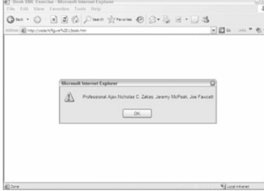

注意，来自 `<title/>` 和 `<author/>` 元素的文本节点被检索并连接在一起。这就是 `text` 与 `nodeValue` 的区别。`nodeValue` 属性仅检索当前节点的值，而 `text` 属性检索包含在当前节点及其子节点中的所有文本节点。

MSXML 还提供了许多方法来检索特定节点或值；最常用的两个是 `getAttribute()` 和 `getElementsByTagName()`。

`getAttribute()` 方法接受一个包含属性名称的字符串参数，并返回该属性的值。如果属性不存在，则返回的值为 `null`。使用本节前面介绍的相同 XML 文档，考虑以下代码：
`var sAttribute = oFirstChild.getAttribute("isbn");`
`alert(sAttribute);`

这段代码检索第一个 `<book/>` 元素的 isbn 属性的值，并将其分配给 `sAttribute` 变量。然后在 `alert()` 方法中使用此值来显示该值。

`getElementsByTagName()` 方法返回一个 `NodeList`，其中包含其参数指定名称的子元素。此方法仅在给定节点内搜索元素，因此返回的 `NodeList` 不包括任何外部元素。例如：
`var cBooks = oRoot.getElementsByTagName("book");`
`alert(cBooks.length);`

这段代码检索文档中所有 `<book/>` 元素，并将 `NodeList` 返回给 `cBooks`。对于示例 XML 文档，将显示一个警告框，指出找到了四个 `<book/>` 元素。要检索所有子元素，请将 "*" 作为参数传递给 `getElementsByTagName()`，如下所示：
`var cElements = oRoot.getElementsByTagName("*");`

由于示例 XML 文档仅包含 `<book/>` 元素，因此此代码示例生成的 `NodeList` 与前一个示例的匹配。


要在 Firefox 中创建 XML DOM，需调用 `document.implementation` 对象的 `createDocument()` 方法。该方法接受三个参数：第一个是包含文档命名空间 URI 的字符串，第二个是包含文档根元素限定名的字符串，第三个是要创建的文档类型（也称为 `doctype`）。要创建一个空的 DOM 文档，可以这样做：

```javascript
var oXmlDom = document.implementation.createDocument("", "", null);
```

通过将前两个参数传入空字符串，最后一个参数传入 `null`，可以确保创建一个完全空的文档。事实上，目前 Firefox 的 JavaScript 尚不支持 doctype，因此第三个参数必须始终为 `null`。要创建一个带文档元素的 XML DOM，可在第二个参数中指定标签名：

```javascript
var oXmlDom = document.implementation.createDocument("", "books", null);
```

这段代码创建了一个 `documentElement` 为 `<books/>` 的 XML DOM。你还可以更进一步，在创建 DOM 时通过第一个参数指定命名空间：

```javascript
var oXmlDom =
document.implementation.createDocument("http://www.site1.com", "books",
null);
```

当在 `createDocument()` 方法中指定了命名空间时，Firefox 会自动分配前缀 `a0` 来表示该命名空间 URI：

```xml
<a0:books xmlns:a0="http://www.site1.com" />
```

至此，你就可以通过编程方式填充 XML 文档了；不过通常，你会希望将已有的 XML 文档加载到一个空的 XML DOM 对象中。

## 在 Firefox 中加载 XML 数据

将 XML 加载到 XML DOM 中，类似于 Microsoft 的方式，但有一个显著区别：Firefox 仅支持 `load()` 方法。因此，你可以使用相同的代码在两种浏览器中加载外部 XML 数据：

```javascript
oXmlDom.load("books.xml");
```

与 Microsoft 类似，Firefox 也实现了 `async` 属性，其行为与 Microsoft 的一致：将 `async` 设置为 `false` 会强制文档以同步模式加载；否则，文档将异步加载。

Firefox 与 Microsoft XML DOM 实现的另一个区别是，Firefox 不支持 `readyState` 属性或 `onreadystatechange` 事件处理程序。相反，它支持 `load` 事件和 `onload` 事件处理程序。`load` 事件在文档完全加载后触发：

```javascript
oXmlDom.load("books.xml");
oXmlDom.onload = function () {
    //文档完全加载时执行操作。
};
```

如前所述，Firefox 实现中不存在 `loadXML()` 方法；然而，可以通过 Firefox 的 `DOMParser` 类来模拟 `loadXML()` 的行为。该类有一个名为 `parseFromString()` 的方法，用于加载字符串并将其解析为文档：

```javascript
var sXml = "<root><person><name>Jeremy McPeak</name></person></root>";
var oParser = new DOMParser();
var oXmlDom = oParser.parseFromString(sXml, "text/xml");
```

在此代码中，创建了一个 XML 字符串传递给 DOMParser 的 `parseFromString()` 方法。`parseFromString()` 的两个参数分别是 XML 字符串和数据的内容类型（通常设置为 "text/xml"）。`parseFromString()` 方法返回一个 XML DOM 对象，因此你可以将此代码中的 `oXmlDom` 视为一个 XML DOM 对象。

## 在 Firefox 中检索 XML 数据

尽管存在诸多差异，IE 和 Firefox 在检索文档中包含的 XML 数据时，确实共享许多属性和方法。与在 IE 中一样，你可以使用 `documentElement` 属性检索文档的根元素，如下所示：

```javascript
var oRoot = oXmlDom.documentElement;
```

Firefox 也支持 W3C 标准属性：`attributes`、`childNodes`、`firstChild`、`lastChild`、`nextSibling`、`nodeName`、`nodeType`、`nodeValue`、`ownerDocument`、`parentNode` 和 `previousSibling`。遗憾的是，Firefox 不支持 Microsoft 专有的 `text` 和 `xml` 属性，但得益于其灵活性，你可以模拟它们的行为。

快速回顾一下，`text` 属性返回节点的内容，或者当前节点及其所有后代的拼接文本。因此，它不仅返回现有节点的文本，还返回所有子节点的文本；这很容易模拟。一个接受节点作为参数的简单函数即可提供相同结果：

```javascript
function getText(oNode) {
    var sText = "";

    for (var i = 0; i < oNode.childNodes.length; i++) {
        if (oNode.childNodes[i].hasChildNodes()) {
            sText += getText(oNode.childNodes[i]);
        } else {
            sText += oNode.childNodes[i].nodeValue;
        }
    }

    return sText;
}
```

在 `getText()` 中，`sText` 用于存储检索到的每一段文本。当 `for` 循环遍历 `oNode` 的子节点时，会检查每个子节点是否包含子节点。如果包含，则将该 `childNode` 传递给 `getText()` 并执行相同的过程。如果没有子节点，则将当前节点的 `nodeValue` 添加到字符串中（对于文本节点，这本身就是文本字符串）。处理完所有子节点后，函数返回 `sText`。

IE 的 `xml` 属性将当前节点中包含的所有 XML 序列化。Firefox 通过提供 `XMLSerializer` 对象来实现相同的结果。该对象有一个可通过 JavaScript 访问的方法，名为 `serializeToString()`。使用此方法可以序列化 XML 数据：

```javascript
function serializeXml(oNode) {
    var oSerializer = new XMLSerializer();
    return oSerializer.serializeToString(oNode);
}
```

`serializeXml()` 函数接受一个 XML 节点作为参数。创建一个 `XMLSerializer` 对象，并将节点传递给 `serializeToString()` 方法。此方法返回的结果（XML 数据的字符串表示）将返回给调用者。

**注意** Firefox 与 IE 共享用于操作节点的相同 DOM 方法。如需复习，请参阅“在 IE 中操作 DOM”部分。

## 在 Firefox 中的错误处理

毫不意外，Firefox 处理错误的方式与 IE 不同。当 IE 遇到错误时，它会填充 `parseError` 对象；而当 Firefox 遇到错误时，它会将一个包含错误的 XML 文档加载到 XML DOM 文档中。请看以下示例：

```javascript
var sXml = "<root><person><name>Jeremy McPeak</name></root>";
var oParser = new DOMParser();
var oXmlDom = oParser.parseFromString(sXml, "text/xml");

if (oXmlDom.documentElement.tagName != "parsererror") {
    //未发生错误。在此执行操作。
} else {
    alert("发生错误");
}
```

在高亮显示的行中，你会看到导致错误的原因：一个格式错误的 XML 字符串（因为 `person/>` 元素未关闭）。当加载格式错误的 XML 时，XML DOM 对象会加载一个错误文档，其 `documentElement` 为 `<parsererror/>`。你可以通过检查 `documentElement.tagName` 属性来轻松确定是否发生了错误；如果它不是 `parsererror`，你可以确信没有发生错误。

此示例中创建的错误文档如下所示：

```xml
<parsererror xmlns="http://www.mozilla.org/newlayout/xml/parsererror.xml">XML Parsing Error: mismatched tag. Expected: </person>.
Location: http://yoda/fooreader/test.htm
Line Number 1, Column 43:<sourcetext><root><person><name>Jeremy McPeak</name></root>
-------------------------------------------^</sourcetext></parsererror>
```

所有关于错误的信息都作为文本包含在错误文档中。如果你想以编程方式使用这些信息，必须先对其进行解析。最简单的方法是使用一个相当长的正则表达式：

```javascript
var reError = />([\s\S]*?)Location:([\s\S]*?)Line Number (\d+), Column (\d+):<sourcetext>([\s\S]*?) (?:\-*\^)/;
```

这个正则表达式将错误文档分为五个部分：错误消息、发生错误的文件名、行号、错误发生的行内位置，以及导致错误的源代码。使用正则表达式对象的 `test()` 方法将使你能够使用这些数据：

```javascript
if (oXmlDom.firstChild.tagName != "parsererror") {
    //未发生错误。在此执行操作。
} else {
    var oXmlSerializer = new XMLSerializer();
    var sXmlError = oXmlSerializer.serializeToString(oXmlDom);
    var reError = />([\s\S]*?)Location:([\s\S]*?)Line Number (\d+), Column (\d+):<sourcetext>([\s\S]*?) (?:\-*\^)/;
```


var reError = /\((\d+)\):<sourcetext>([\s\S]*?)(?:\-\*\^)/;
reError.test(sXmlError);

正则表达式捕获的第一块数据是错误信息，第二块是文件名，第三块是行号，第四块是行内位置，第五块是源代码。你现在可以利用这些解析后的信息来创建自定义错误消息：

var str = "An error occurred!!\n" +
    "Description: " + RegExp.$1 + "\n" +
    "File: " + RegExp.$2 + "\n" +
    "Line: " + RegExp.$3 + "\n" +
    "Line Position: " + RegExp.$4 + "\n" +
    "Source Code: " + RegExp.$5;

alert(str);

如果发生错误，警告框将以易于阅读的方式显示相关错误信息。

## 跨浏览器XML处理

在Ajax应用以及大多数JavaScript代码中，你总是需要考虑跨浏览器的差异。在IE和Firefox中使用基于XML的解决方案时，你有两个选择：创建自己的函数，根据浏览器使用正确的代码；或者使用现成的库。大多数情况下，使用预先存在的库（如第2章介绍的zXml库）是最简便的。除了支持`XMLHttpRequest`，zXml还提供了用于XML操作的通用接口。

例如，要创建一个XML DOM文档，你可以使用`zXmlDom.createDocument()`：

var oXmlDom = zXmlDom.createDocument();

这行代码可以替代每次需要DOM文档时编写特定于浏览器的代码。此外，zXml为标准的Firefox DOM文档添加了许多IE特有的功能。

zXml为了方便所做的主要工作之一是添加了对`readyState`属性和`onreadystatechange`事件处理程序的支持。你无需在Firefox中使用单独的`onload`事件处理程序，只需编写一套无需浏览器检测的代码，例如：

oXmlDom.onreadystatechange = function ()
{ if (oXmlDom.readyState == 4) {
    // 文档完全加载时执行操作。
}
};

zXml库还在Firefox中为所有节点添加了`xml`和`text`属性。你无需使用`XMLSerializer`或独立函数来获取这些值，可以像在IE中一样使用它们：

var oRoot = oXmlDom.documentElement;
var sFirstChildText = oRoot.firstChild.text;
var sXml = oRoot.xml;

zXml还为Firefox的DOM文档提供了`loadXML()`方法，无需使用`DOMParser`对象。

var oXmlDom2 = zXmlDom.createDocument();
oXmlDom2.loadXML(sXml);

最后，zXml库在Firefox的实现中添加了一个`parseError`对象。该对象与IE中的相应对象非常相似。一个主要区别是`errorCode`属性，当发生错误时它只是被设置为一个非零数字。因此，你不应使用此属性来查找特定错误，只能用来判断是否发生了错误。除此之外，你可以像在IE中一样使用其他属性：

if (oXmlDom.parseError.errorCode != 0) {
    var str = "An error occurred!!\n" +
    "Description: " + oXmlDom.parseError.reason + "\n" +
    "File: " + oXmlDom.parseError.url + "\n" +
    "Line: " + oXmlDom.parseError.line + "\n" +
    "Line Position: " + oXmlDom.parseError.linePos + "\n" +
    "Source Code: " + oXmlDom.parseError.srcText;
    alert(str);
} else {
    // 加载成功时执行的代码。
}

你当然不是必须为解决方案使用跨浏览器XML库，但它绝对能提供帮助。下一节将使用zXml库开发一个示例。

## 基本XML示例

XML是一种语义化、描述性的语言。通常，任何给定XML文档中包含的元素描述了该文档的数据，因此它是存储静态信息或不常变化信息的合适数据存储方式。

假设你经营一个在线书店，有一个精选书籍列表，其信息存储在名为`books.xml`的XML文档中。你需要将这些信息显示给用户，但又想在不使用服务器组件的情况下完成，因此你转向了JavaScript解决方案。你将编写一个使用zXml库的JavaScript方案，它将加载XML文件，解析它，并使用DOM方法在网页上显示信息。

`books.xml`文件包含以下XML数据：

<?xml version="1.0" encoding="utf-8"?>
<bookList>
    <book isbn="0471777781">
        <title>Professional Ajax</title>
        <author>Nicholas C. Zakas, Jeremy McPeak, Joe Fawcett</author>
        <publisher>Wrox</publisher>
    </book>
    <book isbn="0764579088">
        <title>Professional JavaScript for Web Developers</title>
        <author>Nicholas C. Zakas</author>
        <publisher>Wrox</publisher>
    </book>
    <book isbn="0764557599">
        <title>Professional C#</title>
        <author>Simon Robinson, et al</author>
        <publisher>Wrox</publisher>
    </book>
    <book isbn="1861006314">
        <title>GDI+ Programming: Creating Custom Controls Using C#</title>
        <author>Eric White</author>
        <publisher>Wrox</publisher>
    </book>
    <book isbn="1861002025">
        <title>Professional Visual Basic 6 Databases</title>
        <author>Charles Williams</author>
        <publisher>Wrox</publisher>
    </book>
</bookList>

如你所见，文档元素`<bookList/>`包含几个`<book/>`元素，每个元素包含了关于特定书籍的信息。

## 加载XML数据

第一步是创建一个XML DOM文档并将XML数据加载到其中。由于`books.xml`将被异步加载，你需要设置`onreadystatechange`事件处理程序：

var oXmlDom = zXmlDom.createDocument();
oXmlDom.onreadystatechange = function () {
    if (oXmlDom.readyState == 4) {

    }
};

当`readystatechange`事件触发并调用事件处理程序时，你检查`readyState`属性；值为4表示文档已完全加载，DOM已准备好使用。

下一步是检查错误，因为即使文档已加载，也不一定意味着一切正常运行：

var oXmlDom = zXmlDom.createDocument();
oXmlDom.onreadystatechange = function () {
    if (oXmlDom.readyState == 4) {
        if (oXmlDom.parseError.errorCode == 0) {
            parseBookInfo(oXmlDom);
        } else {
            var str = "An error occurred!!\n" +
                     "Description: " + oXmlDom.parseError.reason + "\n" +
                     "File: " + oXmlDom.parseError.url + "\n" +
                     "Line: " + oXmlDom.parseError.line + "\n" +
                     "Line Position: " + oXmlDom.parseError.linePos + "\n" +
                     "Source Code: " + oXmlDom.parseError.srcText;
            alert(str);
        }
    }
};

如果未发生错误，则将XML DOM文档传递给`parseBookInfo()`函数，该函数负责解析书籍列表。如果确实发生了错误，则将`parseError`对象中收集的错误信息显示在警告框中。

编写好`onreadystatechange`事件处理程序后，使用`load()`方法来加载XML数据：

oXmlDom.load("books.xml");

XML文档现已加载。下一步是解析XML数据。

## 解析书籍列表

`parseBookInfo()`函数负责解析DOM文档。该函数接受一个参数，即DOM文档本身：

function parseBookInfo(oXmlDom) {
    var oRoot = oXmlDom.documentElement;
    var oFragment = document.createDocumentFragment();

变量`oRoot`被设置为XML文档的`documentElement`。这仅仅是为了方便，因为输入`oRoot`比输入`oXmlDom.documentElement`要容易和快捷得多。你还需要创建一个文档片段。`parseBookInfo()`函数会生成许多HTML元素，因此会对加载在浏览器中的HTML DOM进行许多更改。将每个元素单独添加到HTML DOM中，在显示更改所需的时间方面是一个开销较大的过程。相反，每个元素都被添加到一个文档片段中，该片段将在所有HTML元素创建完成后一次性添加到文档中。这样做使得HTML DOM只更新一次而不是多次，从而加快了渲染速度。

你知道只有`<book/>`元素是文档元素的子元素，所以你可以遍历`childNodes`集合：

var aBooks = oRoot.getElementsByTagName("book");

for (var i = 0; i < aBooks.length; i++) {
    var sIsbn = aBooks[i].getAttribute("isbn");


## 融会贯通

该网页的主体完全由 JavaScript 生成。因此，元素的创建和插入代码必须在文档加载后执行。请记住，`parseBookInfo()` 是在 `books.xml` 加载后调用的，因此 XML DOM 对象创建代码需要在页面加载时执行。创建一个名为 `init()` 的函数来存放 XML DOM 创建代码：

```
function init() {
    var oXmlDom = zXmlDom.createDocument();
    oXmlDom.onreadystatechange = function () {
        if (oXmlDom.readyState == 4) {
            if (oXmlDom.parseError.errorCode == 0) {
                parseBookInfo(oXmlDom);
            } else {
                alert("An Error Occurred: " + oXmlDom.parseError.reason);
            }
        }
    };
    oXmlDom.load("book.xml");
}
```

你将使用 `init()` 来处理 `window.onload` 事件。这有助于确保 JavaScript 生成的元素被添加到页面时不会引起错误。

这个小型应用程序内嵌于一个 HTML 文档中。只需要两个 `<script/>` 元素、一个用于 CSS 的 `<link/>` 元素，以及 `onload` 事件处理程序的赋值：

```
<!DOCTYPE html PUBLIC "-//W3C//DTD XHTML 1.1//EN"
"http://www.w3.org/TR/xhtml11/DTD/xhtml11.dtd">
<html xmlns="http://www.w3.org/1999/xhtml" >
<head>
	<title>Book XML Exercise</title>
	<link rel="stylesheet" type="text/css" href="books.css" />
	<script type="text/javascript" src="zxml.js"></script>
	<script type="text/javascript" src="books.js"></script>
</head>
<body onload="init()">
</body>
</html>
```

运行此代码时，你将看到如图 4-2 所示的结果。


## 浏览器中的 XPath 支持

随着 XML 的日益普及，直接访问特定数据片段的需求变得显而易见。1999年7月，XML路径语言（XPath）在可扩展样式表语言（XSL）规范中被引入，作为在XML文档中查找任何节点的一种方法。XPath使用一种类似于文件系统路径语法的非XML语法。该语言由定位路径和表达式组成，以及一些用于辅助检索特定数据的实用函数。

## XPath 简介

XPath 表达式由两部分组成：上下文节点和选择模式。上下文节点是选择模式开始的起点。参考上一节的 books.xml，看看这个 XPath 表达式：

```
book/author
```

如果在根级别（它的上下文）执行此表达式，将返回所有 `<author/>` 节点，因为 `<book/>` 元素是文档元素的子元素，并且包含一个 `<author/>` 元素。这个表达式不是非常具体，因此所有 `<author/>` 元素都会被返回。

如果你想检索具有特定 ISBN 的 `<book/>` 元素怎么办？XPath 表达式会是这样：

```
book[@isbn='0471777781']
```

表达式中的 `book` 部分描述了要检索哪个元素。方括号内是该元素必须匹配的条件。`@isbn` 部分代表 `isbn` 属性（`@` 是属性的缩写）。因此，此表达式的含义是“查找 isbn 属性为 '0471777781' 的 book 元素。”

XPath 表达式也可以非常复杂。考虑以下表达式：

```
book[author[contains(text(), 'McPeak')]]
```

这个表达式的含义是，“查找那些 author 元素的文本包含字符串 'McPeak' 的 book 元素。”由于这是一个更复杂的表达式，将其分解开来理解会更有帮助，从外向内进行分析。去掉所有条件后，你得到这个表达式：

```
book[...]
```

首先，你知道会返回一个 `<book/>` 元素，因为这是最外层的元素；接下来是条件。在第一组括号内，你看到了 `<author/>` 元素：

```
author[...]
```

现在你知道你正在查找一个带有子元素 `<author/>` 的 book 元素。然而，`<author/>` 元素的子元素也需要检查，因为表达式并没有到此结束：

```
contains(text(), 'McPeak')
```

`contains()` 函数接受两个参数，如果第一个字符串参数包含第二个字符串参数，则返回 true。`text()` 函数返回给定上下文中的所有文本，因此 `<author/>` 元素的文本内容作为 `contains()` 的第一个参数传入。传递给 `contains()` 的第二个参数是搜索文本，在本例中是 'McPeak'。

> **重要提示** 请注意，**contains()** 函数与所有 XPath 函数一样，是区分大小写的。

结果节点集是一个 `<book/>` 元素，因为只有一本书的作者（或合著者）名字是 McPeak。

如你所见，XPath 是一种有用的语言，它使得在 XML 数据中查找特定节点变得相当简单。难怪 Microsoft 和 Mozilla 在他们的浏览器中实现了 XPath 以供客户端使用。

## IE 中的 XPath

Microsoft 对 XPath 的实现是 MSXML 3.0 及更高版本的一部分。如果你使用的是任何版本的 Windows XP，或者安装了 IE 6.0 或更高版本，那么你的计算机就具备此功能。如果没有，你需要下载并安装最新的 MSXML 包。

Microsoft 选择了两种基于 XPath 表达式选择节点的方法。第一种是 `selectSingleNode()`，它在其上下文中返回匹配该表达式的第一个节点。例如：

```
var oFirstAuthor = oXmlDom.documentElement.selectSingleNode("book/author");
```

此代码在 `documentElement` 上下文中返回第一个作为 `<book/>` 元素子元素的 `<author/>` 元素。其结果是以下节点：

```
<author>Nicholas C. Zakas, Jeremy McPeak, Joe Fawcett</author>
```

Microsoft 的 XPath 实现中的第二种方法是 `selectNodes()`。此方法返回一个 `NodeList`，即匹配 XPath 表达式中模式的所有节点的集合：

```
var cAuthors = oXmlDom.documentElement.selectNodes("book/author");
```

正如你可能猜到的，文档上下文中所有父元素为 `<book/>` 的 `<author/>` 元素都将被返回。如果在文档中无法匹配到该模式，仍然会返回一个 `NodeList`，但其 `length` 为 0。在尝试使用返回的 `NodeList` 之前，检查其长度是一个好习惯：

```
var cAuthors = oXmlDom.documentElement.selectNodes("book/author");
```

```
if (cAuthors.length > 0) {
    //Do something
}
```

## 使用命名空间

XML 中的 *X* 代表 *eXtensible*。XML 文档中没有预定义的元素；任何给定 XML 文档中的每个元素都是由开发人员创建的。这种可扩展性是 XML 如此受欢迎的部分原因，但它也固有地导致了一个问题：命名冲突。例如，考虑以下 XML 文档：

```
<?xml version="1.0" encoding="utf-8"?>
<addresses>
    <address>
        <number>12345</number>
        <street>Your Street</street>
        <city>Your City</city>
        <state>Your State</state>
        <country>USA</country>
    </address>
</addresses>
```

这个文档中没有什么不寻常的。它只是描述了一个位于美国的地址。但是如果添加以下几行会怎样：

```
<?xml version="1.0" encoding="utf-8"?>
<addresses>
    <address>
        <number>12345</number>
        <street>Your Street</street>
        <city>Your City</city>
        <state>Your State</state>
        <country>USA</country>
    </address>
    <address>
        <ip>127.0.0.1</ip>
        <hostname>localhost</hostname>
    </address>
</addresses>
```

这个文档现在描述了两种类型的地址：物理邮寄地址和计算机地址。虽然这两种地址都是合法的地址，但处理这些信息需要不同的方法，特别是因为两个 `<address/>` 元素包含完全不同的子元素。XML 处理器将无法区分这两个 `<address/>` 元素之间的差异，因此需要由你来区分。这就是命名空间发挥作用的地方。

命名空间由两部分组成：*命名空间URI* 和 *前缀*。*命名空间URI* 标识命名空间。通常，*命名空间URI* 是网站 URL，因为它们必须是唯一的才能访问不同的网站。*前缀* 是 XML 文档中该命名空间的本地名称。命名空间中的每个标签名都使用该命名空间前缀。命名空间声明的语法如下：

```
xmlns:namespace-prefix="namespaceURI"
```

`xmlns` 关键字告诉 XML 解析器正在进行命名空间声明。`namespaceprefix` 是用于属于此命名空间的元素的本地名称，而 `namespaceURI` 是前缀所代表的统一资源定位符。

命名空间声明必须出现在命名空间在 XML 文档中使用之前。在示例中，根元素包含了命名空间声明：

```
<?xml version="1.0" encoding="utf-8"?>
<addresses xmlns:mail="http://www.wrox.com/mail"
          xmlns:comp="http://www.wrox.com/computer">
    <mail:address>
        <mail:number>12345</mail:number>
        <mail:street>Your Street</mail:street>
        <mail:city>Your City</mail:city>
        <mail:state>Your State</mail:state>
        <mail:country>USA</mail:country>
    </mail:address>
    <comp:address>
        <comp:ip>127.0.0.1</comp:ip>
        <comp:hostname>localhost</comp:hostname>
    </comp:address>
</addresses>
```

这个新编辑的 XML 文档定义了两个命名空间：一个前缀为 `mail`，代表邮寄地址；另一个前缀为 `comp`，代表计算机地址。你可能首先注意到的是前缀的使用。每个与特定地址类型相关联的元素都与相应的命名空间相关联，因此每个与邮寄地址相关的元素都有 `mail` 前缀，而每个基于计算机的地址都有 `comp` 前缀。

命名空间的使用避免了命名冲突，XML 处理器现在可以理解这两种地址类型之间的区别。

XPath 中的命名空间在使用 `selectSingleNode()` 和 `selectNodes()` 时会增加一点复杂性。考虑以下修改后的 books.xml 版本：

```
<?xml version="1.0" encoding="utf-8"?>
<bookList xmlns="http://site1.com" xmlns:pub="http://site2.com">
    <book isbn="0471777781">
        <title>Professional Ajax</title>
        <author>Nicholas C. Zakas, Jeremy McPeak, Joe Fawcett</author>
        <pub:name>Wrox</pub:name>
    </book>
    <book isbn="0764579088">
        <title>Professional JavaScript for Web Developers</title>
        <author>Nicholas C. Zakas</author>
        <pub:name>Wrox</pub:name>
    </book>
    <book isbn="0764557599">
        <title>Professional C#</title>
        <author>Simon Robinson, et al</author>
        <pub:name>Wrox</pub:name>
    </book>
    <book isbn="1861006314">
        <title>GDI+ Programming: Creating Custom Controls Using C#</title>
        <author>Eric White</author>
```


## Firefox 中的 XPath

Firefox 的 XPath 实现遵循 DOM 标准，这与 IE 的实现有很大不同。Firefox 的实现允许 XPath 表达式同样适用于 HTML 和 XML 文档。其核心是两个主要对象：`XPathEvaluator` 和 `XPathResult`。

`XPathEvaluator` 类使用 `evaluate()` 方法来计算给定的 XPath 表达式，该方法接受五个参数：要计算的 XPath 表达式字符串、表达式应在其中运行的上下文节点、一个命名空间解析器（这是一个处理表达式中命名空间的函数）、你想要的结果类型（有十种不同的结果类型可供选择），以及一个用于容纳结果的 `XPathResult` 对象（如果此参数为 `null`，则返回一个新的 `XPathResult` 对象）。

在继续之前，了解 `evaluate()` 可能返回的各个结果类型非常重要。这些类型包括：

-   `XPathResult.ANY_TYPE`，不返回特定类型。该方法返回由表达式自然计算得出的类型。
-   `XPathResult.ANY_UNORDERED_NODE_TYPE`，返回包含一个节点的无序节点集，该节点通过 `singleNodeValue` 属性访问；如果没有匹配的节点，则返回 `null`。返回的节点可能是也可能不是第一个出现的节点。
-   `XPathResult.BOOLEAN_TYPE`，返回一个布尔值。
-   `XPathResult.FIRST_ORDERED_NODE_TYPE`，返回包含一个节点的节点集。该节点通过 `XPathResult` 类的 `singleNodeValue` 属性访问。返回的节点是文档中第一个出现的节点。
-   `XPathResult.NUMBER_TYPE`，返回一个数值。
-   `XPathResult.ORDERED_NODE_ITERATOR_TYPE`，返回一个按文档顺序排列的节点集，可以使用 `iterateNext()` 方法进行迭代；因此，你可以轻松访问集合中的每个节点。
-   `XPathResult.ORDERED_NODE_SNAPSHOT_TYPE`，返回一个按文档顺序排列的节点集，它是结果集的快照。对文档中节点所做的任何修改都不会影响检索到的结果。
-   `XPathResult.STRING_TYPE`，返回一个字符串值。
-   `XPathResult.UNORDERED_NODE_ITERATOR_TYPE`，返回一个可迭代的节点集；然而，结果可能与它们在文档中出现的顺序相同，也可能不同。
-   `XPathResult.UNORDERED_NODE_SNAPSHOT_TYPE`，返回一个无序的快照节点集。对文档中节点所做的任何修改都不会影响结果集。

最常见的结果类型是 `XPathResult.ORDERED_NODE_ITERATOR_TYPE`：

```javascript
var oEvaluator = new XPathEvaluator();
var sXPath = "book/author";
var oResult = oEvaluator.evaluate(sXPath,oXmlDom.documentElement,null,
    XPathResult.ORDERED_NODE_ITERATOR_TYPE, null);

var aNodes = new Array;

if (oResult != null) {
    var oElement;
    while (oElement = oResult.iterateNext()) {
        aNodes.push(oElement);
    }
}
```

在这段代码中，创建了一个 XPathEvaluator 对象，并用于在文档根元素的上下文中计算 XPath 表达式 `book/author`。由于结果类型是 `ORDERED_NODE_ITERATOR_TYPE`，计算返回一个节点集，你可以使用 `iterateNext()` 方法对其进行迭代。

`iterateNext()` 方法类似于 DOM 节点的 `nextSibling` 属性，因为它会选择结果集中的下一个节点，并在到达结果集末尾时返回 `null`。此函数使你可以在 `while` 循环中使用它，如前面的例子所示；只要 `oElement` 不为 `null`，它就会通过 `push()` 方法添加到 `aNodes` 数组中。填充数组使你获得了类似 IE 的功能；因此，你可以将其用于 `for` 循环或轻松访问单独的数组元素。

## 使用命名空间解析器

在 `evaluate()` 方法的语法中，你看到了对命名空间解析器的引用。*命名空间解析器*是一个函数，它将 XPath 表达式中出现的任何命名空间前缀解析为命名空间 URI。命名空间解析器函数可以命名为任何你想要的名字，但它要求接受一个字符串参数（这是要检查的前缀）。

解析器检查参数提供的前缀，并应返回与之关联的命名空间 URI。要使用 IE 示例中的值，你可以编写以下解析器：

```javascript
function nsResolver(sPrefix) {
    switch (sPrefix) {
        case "na":
            return "http://site1.com";
            break;
        case "pub":
            return "http://site2.com";
            break;
        default:
            return null;
            break;
    }
}
```

有了编写好的解析器，你可以在来自 IE 命名空间示例的修改后的 `books.xml` 文档上使用以下 XPath 表达式：

```javascript
var sXPath = "na:book/pub:name";
var oEvaluator = new XPathEvaluator();
var oResult =
oEvaluator.evaluate(sXPath, oXmlDom.documentElement, nsResolver,
                    XPathResult.ORDERED_NODE_ITERATOR_TYPE, null);
var aNodes = new Array;
if (oResult != null) {
    var oElement;
    while (oElement = oResult.iterateNext()) {
        aNodes.push(oElement);
    }
}
```

这个例子类似于上一个计算代码。但是，请注意 `evaluate()` 方法中添加的内容：指向之前编写的 `nsResolver()` 函数的指针被传递给 `evaluate()` 方法，以处理 XPath 表达式中的命名空间。其余的代码你应该很熟悉。结果 `NodeList` 通过使用 `XPathResult` 类的 `iterateNext()` 方法迭代结果而被转换为一个数组。

如你所见，Firefox 的 XPath 实现与 Microsoft 的方法有很大不同；因此，使用一个支持跨浏览器的库来轻松执行 XPath 计算是很有帮助的。

## 跨浏览器的 XPath

作者创建的 zXml 库通过一个通用的接口提供跨浏览器的 XPath 功能。负责提供 XPath 功能的对象是 `zXPath`，它有两个方法。

第一个方法是 `selectSingleNode()`。这个方法，与同名的 IE 方法一样，返回与模式匹配的第一个节点。与 IE 实现不同，此方法接受三个参数：上下文节点、XPath 表达式字符串，以及包含命名空间声明的字符串。命名空间字符串应采用以下格式：

```
"xmlns:na='http://site1.com' xmlns:pub='http://site2.com'
    xmlns:ns='http://site3.com'"
```

如果你不使用命名空间，那么 `selectSingleNode()` 的前两个参数是唯一必需的参数。

`selectSingleNode()` 返回的结果是选定的 XML 节点，或者如果找不到匹配项则为 `null`。如果浏览器不支持 XPath，则会抛出一个错误，指出浏览器没有安装 XPath 引擎。以下示例在文档元素上计算一个 XPath 表达式：

```javascript
var oRoot = oXmlDom.documentElement;
var oNode = zXPath.selectSingleNode(oRoot, "book/author", null);

if (oNode) {
    alert(oNode.xml);
}
```

此示例在文档根元素的上下文中搜索 `<book/>` 元素中包含的第一个 `<author/>` 元素。如果找到，则以序列化形式在警报框中向用户显示 XML 数据。

`zXPath` 的第二个方法是 `selectNodes()`，它返回一个节点集，非常类似于 IE 的 `selectSingleNode()` 方法。其语法与上面的 `selectSingleNode()` 方法非常相似，参数完全相同，并且适用相同的命名空间规则。同样，如果浏览器没有安装 XPath 引擎，也会抛出一个错误。下一个示例演示了 `selectNodes()` 方法：


## 浏览器中的 XSL 转换支持

可扩展样式表语言（XSL）是一组旨在转换 XML 数据的语言族。XSL 指的是三种主要语言：XSL 转换（XSLT），这是一种将 XML 文档转换为其他 XML 文档的语言；上一节讨论过的 XPath；以及 XSL 格式化对象（XSL-FO），它描述了转换后的数据在呈现时应如何渲染。由于目前没有任何浏览器支持 XSL-FO，因此任何转换都必须通过使用 XSLT 来完成。

## XSLT 简介

XSLT 是一种基于 XML 的语言，旨在将 XML 文档转换为另一种数据形式。这个定义可能让 XSLT 显得不是那么有用，但事实远非如此。XSLT 最流行的用途是将 XML 文档转换为 HTML 文档，而这正是本节介绍的内容。

XSLT 文档本身就是专门的 XML 文档，因此它们必须遵守与所有 XML 文档相同的规则：必须包含 XML 声明，必须有单个根元素，并且必须格式良好。

作为示例，你将再次使用 `books.xml`。该文件中包含的信息可以使用 XSLT 转换为 HTML，而无需手动构建 DOM 结构。首先，你需要一个 XSLT 文档 `books.xsl`，它以 XML 声明和根元素开始：

```
<?xml version="1.0" encoding="UTF-8"?>

<xsl:stylesheet version="1.0"
    xmlns:xsl="http://www.w3.org/1999/XSL/Transform">
    <xsl:output method="html" omit-xml-declaration="yes" indent="yes" />

</xsl:stylesheet>
```

XSLT 文档的文档元素是 `<xsl:stylesheet/>`。在此元素中，指定了 XSL 版本，并声明了 `xsl` 命名空间。这些必需的信息决定了 XSLT 处理器的行为；没有它，将会抛出错误。`xsl` 前缀也很重要，因为它允许所有 XSL 指令在逻辑上与文档中的其他代码清晰地区分开。

`<xsl:output/>` 元素定义了最终输出的格式。在此示例中，转换的最终结果是 HTML 数据，省略了 XML 声明，并且元素进行了缩进。你可以指定格式为纯文本、XML 或 HTML 数据。

就像任何应用程序一样，转换必须有一个入口点。XSLT 是一种基于模板的语言，处理器通过匹配模板规则来处理 XML 文档。在此示例中，第一个要匹配的元素是 XML 文档的根。这是通过使用 `<xsl:template/>` 指令完成的。指令告诉处理器执行特定函数。`<xsl:template/>` 指令创建一个模板，当 `match` 属性中的模式匹配时使用该模板：

```
<?xml version="1.0" encoding="UTF-8"?>

<xsl:stylesheet version="1.0"
xmlns:xsl="http://www.w3.org/1999/XSL/Transform">

<xsl:template match="/">

<html>
    <head>
        <link rel="stylesheet" type="text/css" href="books.css" />
        <title>XSL Transformations</title>
    </head>
    <body>
        <xsl:apply-templates />
    </body>
</html>

</xsl:template>

</xsl:stylesheet>
```

`match` 属性接受一个 XPath 表达式作为其值，以选择正确的 XML 节点。在这种情况下，它是 `books.xml` 的根元素（XPath 表达式 `/` 始终选择文档元素）。在模板内部，你会注意到 HTML 元素。这些元素是转换输出的一部分。在 `<body/>` 元素内部，发现了另一个 XSL 指令。`<xsl:apply-templates />` 元素告诉处理器开始在文档元素的上下文中解析所有模板，这引入了下一个模板：

```
<?xml version="1.0" encoding="UTF-8"?>

<xsl:stylesheet version="1.0"
xmlns:xsl="http://www.w3.org/1999/XSL/Transform">
<xsl:output method="html" omit-xml-declaration="yes" indent="yes" />

<xsl:template match="/">
<html>
    <head>
        <link rel="stylesheet" type="text/css" href="books.css" />
        <title>XSL Transformations</title>
    </head>
    <body>
        <xsl:apply-templates />
    </body>
</html>

</xsl:template>

<xsl:template match="book">
    <div class="bookContainer">
        <xsl:variable name="varIsbn" select="@isbn" />
        <xsl:variable name="varTitle" select="title" />
        
        <div class="bookContent">
            <h3><xsl:value-of select="$varTitle" /></h3>
            Written by: <xsl:value-of select="author" /><br />
            ISBN #<xsl:value-of select="$varIsbn" />
            <div class="bookPublisher"><xsl:value-of
select="publisher" /></div>
        </div>
    </div>
</xsl:template>

</xsl:stylesheet>
```

这个新模板匹配所有 `<book/>` 元素，因此当处理器到达 XML 文档中的每个 `<book/>` 时，都会使用此模板。此模板中的前两个 XSL 指令是 `<xsl:variable/>`，用于定义变量。

XSL 中的变量主要用于 XPath 表达式或属性（在不能使用元素的场合，否则会破坏 XML 语法）。`<xsl:variable/>` 元素有两个属性：**name** 和 **select**。正如你可能猜测的那样，**name** 属性设置变量的名称。**select** 属性指定一个 XPath 表达式，并将匹配的值存储在变量中。在初始声明之后，变量通过 `$` 符号引用（因此定义为 **varIsbn** 的变量后来被引用为 **$varIsbn**）。

第一个变量 **$varIsbn** 被赋值为 `<book/>` 元素的 **isbn** 属性的值。第二个变量 **$varTitle** 被赋值为 `<title/>` 元素的值。这两个信息用于 HTML `` 元素的属性中。要在属性中输出变量，你需要将变量名用花括号括起来：``。如果没有花括号，输出将使用字符串字面量 "`$varTitle`" 和 "`$varIsbn`"。

**重要提示**：在 XSL 指令的属性中使用变量，例如 `select`，是此规则的例外。在这些类型的属性中使用花括号会导致错误，并且文档转换将失败。

本示例中剩余的 XSL 指令是 `<xsl:value-of/>` 元素。这些元素根据 `select` 属性检索匹配的变量或节点的值。`select` 属性的行为与 `<xsl:variable/>` 的 `select` 属性相同：它们接受一个 XPath 表达式并选择匹配该表达式的节点或变量。此模板中第一个 `<xsl:value-of/>` 实例引用了 `$varTitle` 变量（注意没有花括号），因此使用了变量的值。接下来，使用了 `<author/>` 元素的值；`$varIsbn` 和 `<publisher/>` 也是如此。

为了让 XML 文档在浏览器中转换，必须指定一个样式表。在 `books.xml` 中，在 XML 声明之后立即添加以下行：

```
<?xml-stylesheet type="text/xsl" href="books.xsl"?>
```

这告诉 XML 处理器将样式表 `books.xsl` 应用于此文档。在网页浏览器中查看此修改后的 XML 文档将不再显示 XML 结构，而是显示转换为 HTML 的结果。但是，使用此指令在 JavaScript 中不起作用。为此，你需要使用一些特殊的对象。

## IE 中的 XSLT

在 IE 中转换 XML 文档有两种方式，都需要使用 MSXML。从 3.0 版本开始，MSXML 完全支持 XSLT 1.0。如果你没有 Windows XP 或 IE 6，是时候升级了。你可以在 [http://msdn.microsoft.com/XML/XMLDownloads/](http://msdn.microsoft.com/XML/XMLDownloads/) 找到最新的 MSXML 下载。

第一种也是最简单的方法是将 XML 和 XSLT 文档分别加载到单独的 XML DOM 对象中：

```
var oXmlDom = zXmlDom.createDocument();
var oXslDom = zXmlDom.createDocument();
oXmlDom.async = false;
oXslDom.async = false;
oXmlDom.load("books.xml");
oXslDom.load("books.xsl");
```

当两个文档都加载后，调用 `transformNode()` 方法开始转换：

```
var sResults = oXmlDom.transformNode(oXslDom);
```

`transformNode()` 方法接受一个 XML DOM 对象作为参数（在本例中是 XSL 文档），并将转换后的数据作为字符串返回。但你不必在文档级别调用 `transformNode()`；可以从 XML 文档中的任何元素调用它：

```
var sResults = oXmlDom.documentElement.firstChild.transformNode(oXslDom);
```

`transformNode()` 方法将只转换调用它的元素及其子元素。在此示例中，转换了第一个 `<book/>` 元素，如图 4-3 所示。


这是因为你只对一个没有子节点的元素调用了 `transformNode()` 进行转换。

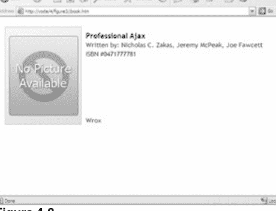

**图 4-3**

在 IE 中进行转换的第二种方法稍微复杂一些，但它也给你更多的控制和功能。这个过程涉及在 MSXML 库中创建多个对象。这个有些冗长过程的第一步是创建一个线程安全的 XML DOM 对象，XSL 样式表将被加载到其中：

```
var oXmlDom = zXmlDom.createDocument();
oXmlDom.async = false;
oXmlDom.load("books.xml");

var oXslDom = new ActiveXObject("Msxml2.FreeThreadedDOMDocument.3.0");
oXslDom.async = false;
oXslDom.load("books.xsl");
```

`FreeThreadedDOMDocument` 类是另一个 ActiveX 类，也是 MSXML 库的一部分。你必须使用 `FreeThreadedDomDocument` 类来创建 `XSLTemplate` 对象，本例正是这样做的（下一个示例展示了如何创建 `XSLTemplate` 对象）。在 MSXML 的早期版本中，每次调用 `transformNode()` 方法都会强制重新编译 XSL 样式表，这显著减慢了转换过程。使用 `FreeThreadedDOMDocument` 后，编译后的样式表会被缓存并随时可用，直到它从内存中移除。

创建 XML DOM 对象后，你必须创建另一个 ActiveX 对象，一个 XSL 模板：

```
var oXslTemplate = new ActiveXObject("Msxml2.XSLTemplate.3.0");
oXslTemplate.stylesheet = oXslDom;
```

`XSLTemplate` 类用于缓存 XSL 样式表并创建 `XSLProcessor`；因此，在模板创建后，XSL 文档被赋给 `XSLTemplate` 类的 `stylesheet` 属性，这会缓存并加载 XSL 样式表。

此过程的下一步是创建 `XSLProcessor`，它通过调用 `XSLTemplate` 类的 `createProcessor()` 方法来创建：

```
var oXslProcessor = oXslTemplate.createProcessor();
oXslProcessor.input = oXmlDom;
```

创建处理器后，其 `input` 属性被赋值为 `oXmlDom`，即包含要转换的 XML 文档的 XML DOM 对象。此时，处理器所需的一切都已就位，所以剩下的就是实际的转换和获取输出：

```
oXslProcessor.transform();
document.body.innerHTML = oXslProcessor.output;
```

与 `transformNodes()` 不同，`transform()` 方法不会将结果输出作为字符串返回。要检索转换输出，请使用 `XSLProcessor` 对象的 `output` 属性。整个过程比 `transformNode()` 方法需要更多的代码，但产生的结果相同。那么为什么还要使用这个过程呢？

MSXML 提供了一些额外的方法可用于这些转换。第一个是 `addObject()`。此方法将一个 JavaScript 对象添加到样式表，甚至可以在转换后的文档中调用方法和输出属性值。考虑以下对象：

```
var oBook = {
    propertyOne : "My Current Books",
    methodOne : function () {
        alert("Welcome to my Book List");
        return "";
    }
};
```

如果你想在转换中使用这些信息呢？使用 `addObject()` 方法，你可以将这些信息传递给 XSLT 样式表，传递两个参数：`oBook` 对象和一个用于标识它的命名空间 URI。因此，要添加一个命名空间 URI 为 "http://my-object" 的对象，你可以这样做：

```
var oXmlDom = zXmlDom.createDocument();
oXmlDom.async = false;
oXmlDom.load("books.xml");

var oXslDom = new ActiveXObject("Msxml2.FreeThreadedDOMDocument.3.0");
oXslDom.async = false;
oXslDom.load("books.xsl");

var oXslTemplate = new ActiveXObject("Msxml2.XSLTemplate.3.0");
oXslTemplate.stylesheet = oXslDom;

var oXslProcessor = oXslTemplate.createProcessor();

oXslProcessor.input = oXmlDom;

oXslProcessor.addObject(oBook, "http://my-object");

oXslProcessor.transform();
document.body.innerHTML = oXslProcessor.output;
```

现在 oBook 对象被传递给 XSLProcessor，这意味着 XSLT 样式表可以使用它。现在必须修改 XSL 文档以查找此对象并使用其信息。第一个要求是在根元素 <xsl:stylesheet/> 中添加一个新的命名空间。这个命名空间应与 `addObject()` 中使用的命名空间匹配：

```
<xsl:stylesheet version="1.0"
xmlns:xsl="http://www.w3.org/1999/XSL/Transform"
xmlns:bookObj="http://my-object">
```

前缀 bookObj 将用于访问此信息。现在命名空间和前缀已准备就绪，应在文档中添加一些 <xsl:value-of/> 元素来检索对象的成员：

```
<xsl:template match="/">
<html>
    <head>
        <link rel="stylesheet" type="text/css" href="books.css" />
    </head>
    <body>
        <xsl:value-of select="bookObj:methodOne()" />
        <div align="center">
            <b><xsl:value-of select="bookObj:get-propertyOne()" /></b>
        </div>
        <xsl:apply-templates />
    </body>
</html>
</xsl:template>
```

请记住，<xsl:value-of/> XSL 指令检索元素的值，在这种情况下是对象的值。第一个 <xsl:value-of/> 指令检索（或调用） methodOne()，该方法发送一个欢迎用户访问页面的警报。第二个 <xsl:value-of/> 指令与第一个类似，不同之处在于它检索 oBook 对象的 propertyOne 属性的值。当转换后的输出在浏览器中显示时，用户将在页面顶部看到短语 "My Current Books"。

> **重要提示** 在转换中使用对象时，所有属性和方法必须返回 **XSLProcessor** 能理解的值。字符串、数字和布尔值都能按预期工作；返回任何其他值将在转换执行时引发 JavaScript 错误。

XSLProcessor 的下一个有用特性是 `addParameter()` 方法。与将对象发送到转换不同，参数是 XSLT 的标准部分。参数被传递给 XSL 样式表并用作变量。要指定一个参数，请传递其名称和值，如下所示：

```
var oXslProcessor = oXslTemplate.createProcessor();
oXslProcessor.input = oXmlDom;
oXslProcessor.addParameter("message", "My Book List");
```

此代码将 "message" 参数添加到 XSLProcessor。当 XSL 转换执行时，处理器使用参数的值 "My Book List" 并将其放置在相应的位置。XSL 中的参数使用 <xsl:param/> 指令：

```
<xsl:param name="message" />
```

请注意，name 属性与 `addParameter()` 中传递的名称匹配。此参数接收值 "My Book List"，该值使用你之前学到的变量语法进行检索：

```
<xsl:value-of select="$message" />
```

在此示例中，<xsl:value-of/> 指令检索参数的值。更新后的 XSL 样式表将如下所示：

```
<xsl:stylesheet version="1.0"
xmlns:xsl="http://www.w3.org/1999/XSL/Transform">
```

```
<xsl:param name="message" />
```

```
<xsl:template match="/">
```

```
<html>
    <head>
        <link rel="stylesheet" type="text/css" href="books.css" />
    </head>
    <body>

        <xsl:value-of select="$message" />

        <xsl:apply-templates />
    </body>
</html>
```

```
</xsl:template>
```

更新后的样式表添加了两行新代码。第一行是添加 <xsl:param/> 指令，第二行是检索参数值的 <xsl:value-of/> 指令。参数声明可以存在于 XSL 文档中的任何位置。此代码将参数声明放在文档顶部，但你并不限于此位置。

使用 XSLProcessor 的最后一个特性是它的速度；它编译 XSL 样式表，因此使用相同样式表进行的后续转换会更快（与使用 `transformNodes()` 相比）。为此，请使用 XSLProcessor 对象的 `reset()` 方法。此方法清除输入和输出属性，但不清除样式表属性。这会使处理器准备好使用相同样式表进行下一次转换。


## Firefox 中的 XSLT

与 XML 和 XPath 类似，Firefox 对 XSLT 转换的实现与 IE 的实现有所不同。Firefox 确实实现了一个 `XSLTProcessor` 类来执行转换，但相似之处仅此而已。

在 Firefox 中执行转换的第一步是将 XML 和 XSL 文档加载到 DOM 对象中：

```
var oXmlDom = zXmlDom.createDocument();
var oXslDom = zXmlDom.createDocument();

oXmlDom.async = false;
oXslDom.async = false;

oXmlDom.load("books.xml");
oXslDom.load("books.xsl");
```

`XSLTProcessor` 类公开了 `importStylesheet()` 方法，该方法接受一个包含 XSLT 文档的 XML DOM 对象作为参数：

```
var oXsltProcessor = new XSLTProcessor();
oXsltProcessor.importStylesheet(oXslDom);
```

最后，调用转换方法。共有两个这样的方法：`transformToDocument()` 和 `transformToFragment()`。`transformToDocument()` 方法接受一个 XML DOM 对象作为参数，并返回一个包含转换结果的新的 XML DOM 文档。通常，这是你想要使用的方法：

```
var oNewDom = oXsltProcessor.transformToDocument(oXmlDom);
```

生成的 DOM 对象可以像任何其他 XML DOM 对象一样使用。你可以使用 XPath 选择特定节点，使用属性和方法遍历节点结构，甚至可以在另一个转换中使用它。

顾名思义，`transformToFragment()` 方法返回一个文档片段，用于附加到另一个 DOM 文档。此方法接受两个参数：第一个是要转换的 XML DOM 对象，第二个是你打算将结果附加到的 DOM 对象：

```
var oFragment = oXsltProcessor.transformToFragment(oXmlDom, document);
document.body.appendChild(oFragment);
```

在这个例子中，生成的文档片段被附加到文档对象的 body 中。请注意，你可以将生成的片段附加到传递给 `transformToFragment()` 方法的 DOM 对象内的任何节点。

但是，如果你想要像 Microsoft 实现的 `transformNode()` 方法那样，将转换结果以字符串形式返回呢？你可以使用之前介绍的 `XMLSerializer` 类。只需将转换结果传递给 `serializeToString()` 方法：

```
var oSerializer = new XMLSerializer();
var str = oSerializer.serializeToString(oNewDom);
```

如果使用 zXml 库，可以通过使用 `xml` 属性来简化此操作：

```
var str = oFragment.xml;
```

`XSLTProcessor` 类还允许你设置要传递给 XSL 样式表的参数。`setParameter()` 方法实现了此功能；它接受三个参数：命名空间 URI、参数名称以及要分配给参数的值。例如：
```
oXsltProcessor.setParameter(null, "message", "My Book List");
```

```
var oNewDom = oXsltProcessor.transformToDocument(oXmlDom);
```

在这个例子中，参数 `message` 被赋值为 "My Book List"。命名空间 URI 传入了 `null`，这允许参数在样式表中使用，而无需指定前缀和相应的命名空间 URI：
```
<xsl:param name="message" />
```

`setParameter()` 方法必须在调用 `transformToDocument()` 或 `transformToFragment()` 之前调用，否则参数值不会在转换中使用。

## 跨浏览器的 XSLT

在前面的章节中，你已经看到了 zXml 库如何简化在两个主要平台上处理 XML 数据。现在你将使用该库执行 XSLT 转换。该库中只有一种用于 XSLT 的方法：`transformToText()`。此方法返回转换后的文本，它接受两个参数：要转换的 XML 文档和 XSL 文档：
```
var sResult = zXslt.transformToText(oXmlDom, oXslDom);
```

正如方法名称所示，返回的结果是一个字符串。然后，你可以将转换结果（sResult）添加到 HTML 文档中：

```
var oDiv = document.getElementById("transformedData");
oDiv.innerHTML = sResult;
```

这可能是 zXml 库中最简单的对象。

## 重新审视“精选推荐”

再次想象你经营着一家在线书店。你的访客喜欢你实现的“精选推荐”功能，但你开始收到反馈，说他们也想看上周的推荐。你决定采用 Ajax 解决方案。

使用 XMLHttpRequest，浏览器检索书单，请求的 `responseText` 被加载到一个 XML DOM 对象中。样式表也被加载到其自身的 XML DOM 对象中，书单中的 XML 数据被转换为 HTML，然后写入页面。为了提供一些可用性，你在右上角提供了一个链接，用于在两个列表之间切换。

这个解决方案的第一步是使用 XMLHttpRequest 检索 XML 文件。这是代码的开始，也是这个小型应用程序的入口点，因此你将代码封装在一个名为 `init()` 的函数中：

```
function init(sFilename) {
    var oReq = zXmlHttp.createRequest();
    oReq.onreadystatechange = function () {
        if (oReq.readyState == 4) {
            // only if "OK"
            if (oReq.status == 200) {
                transformXml(oReq.responseText);
            }
        }
    };
    oReq.open("GET", sFilename, true);
    oReq.send();
}
```

`init()` 函数接受一个参数：要加载的 XML 文件的文件名。为了跨浏览器兼容性（更不用说为你简化编码），你使用 zXml 库创建了一个 XMLHttpRequest 对象。这是一个异步请求，因此必须使用 `onreadystatechange` 事件处理程序检查 `readyState` 属性。当请求返回成功状态时，`responseText` 被发送到 `transformXml()` 函数：

```
function transformXml(sResponseText) {
    var oXmlDom = zXmlDom.createDocument();
    oXmlDom.async = false;
    oXmlDom.loadXML(sResponseText);

    var oXslDom = zXmlDom.createDocument();
    oXslDom.async = false;
    oXslDom.load("books.xsl");

    var str = zXslt.transformToText(oXmlDom, oXslDom);
    document.getElementById("divBookList").innerHTML = str;
}
```

调用 `transformXml()` 使用 `loadXML()` 方法将传入的响应文本加载到 XML DOM 对象中。XSL 样式表也被加载，两个对象都被传递给 zXml 库中的 `transformToText()` 方法。转换结果（一个字符串）然后通过 `innerHTML` 属性添加到文档中的一个元素。此函数执行后，用户就可以看到本周的书单了。

大部分代码已经写好，但你仍然缺少列表切换功能。为了实现这个功能，需要编写另一个函数，但首先，应用程序需要知道用户点击链接时要加载哪个列表。这可以通过一个名为 `bIsThisWeek` 的布尔变量轻松处理。当加载本周的书单时，`bIsThisWeek` 变为 `true`，否则为 `false`。由于本周的列表已经加载，`bIsThisWeek` 被设置为 `true`：

```
var bIsThisWeek = true;
```

用户点击以更改列表的链接使用 `onclick` 事件，因此下一个函数将处理该事件：

```
function changeList() {
    var aChanger = document.getElementById("aChanger");

    if (bIsThisWeek) {
        aChanger.innerHTML = "This Week's Picks";
        init("lastweekbooks.xml");
        bIsThisWeek = false;
    } else {
        aChanger.innerHTML = "Last Week's Picks";
        init("thisweekbooks.xml");
        bIsThisWeek = true;
    }

    return false;
}
```

在此代码中，使用 `getElementById()` 方法获取链接（aChanger）。检查变量 `bIsThisWeek`。根据其值，通过将文件名发送给 `init()` 函数来加载适当的列表。这将检索新列表，转换数据，并将其写入页面。另外，请注意链接文本会发生变化，以提示用户下次点击时会发生什么。变量 `bIsThisWeek` 也会更改，以便下次用户点击链接时加载正确的列表。最后，函数返回 `false`。由于此函数是链接的事件处理程序，返回任何其他值都会导致链接表现得像普通链接，可能将用户带离应用程序。

最后，你可以用 HTML 完成这个小型应用程序，以下是完整的文档：

```
<!DOCTYPE html PUBLIC "-//W3C//DTD XHTML 1.1//EN"
    "http://www.w3.org/TR/xhtml11/DTD/xhtml11.dtd">
<html xmlns="http://www.w3.org/1999/xhtml">
<head>
    <title>Book XML Exercise</title>
    <link rel="stylesheet" type="text/css" href="books.css" />
    <script type="text/javascript" src="zxml.js"></script>
    <script type="text/javascript">
        function init(sFilename) {
            var oReq = zXmlHttp.createRequest();
            oReq.onreadystatechange = function () {
                if (oReq.readyState == 4) {
                    // only if "OK"
                    if (oReq.status == 200) {
                        transformXml(oReq.responseText);
                    }
                }
            };
            oReq.open("GET", sFilename, true);
            oReq.send();
        }

        function transformXml(sResponseText) {
            var oXmlDom = zXmlDom.createDocument();
            oXmlDom.async = false;
            oXmlDom.loadXML(sResponseText);
```


var oXslDom = zXmlDom.createDocument();
oXslDom.async = false;
oXslDom.load("books.xsl");

var str = zXslt.transformToText(oXmlDom, oXslDom);
document.getElementById("divBookList").innerHTML = str;
}

var bIsThisWeek = true;

function changeList() {
    var aChanger = document.getElementById("aChanger");
    if (bIsThisWeek) {
        aChanger.innerHTML = "本周精选";
        init("lastweekbooks.xml");
        bIsThisWeek = false;
    } else {
        aChanger.innerHTML = "上周精选";
        init("thisweekbooks.xml");
        bIsThisWeek = true;
    }
    return false;
}
</script>
</head>
<body onload="init('thisweekbooks.xml')">
    <a id="aChanger" href="#" onclick="changeList();">上周精选</a>
    <div id="divBookList"></div>
</body>
</html>
```

要运行这个迷你应用，必须通过 Web 服务器来运行，因为其中使用了 XMLHttpRequest。任何 Web 服务器软件都可以正常工作。只需将此 HTML 文件、zXml 库和 CSS 文件放入 Web 服务器上名为 `booklists` 的目录中。然后启动浏览器，将其指向 `http://localhost/booklists/book.htm`。

## 总结

在本章中，你学习了如何在 Internet Explorer 和 Firefox 中创建和遍历 XML DOM 对象，以及这两种浏览器实现之间的差异。你再次使用了跨浏览器的 XML 库 zXml，它使你能够通过单一接口轻松地创建、遍历和操作 XML DOM 对象。你还学习了如何使用 JavaScript 加载 XML 数据并将其输出到页面。

在第二部分中，对 XPath 的简要介绍展示了该语言为 XML 文档提供的强大功能。你了解了 IE 和 Firefox 支持 XPath 和命名空间的方式，它们彼此大不相同。为了简化这一难题，引入了 zXml 库的 zXPath 对象，它同样为两种浏览器提供了一个统一的接口，以便轻松选择所需的节点。

最后，你学习了 XSLT 转换，以及如何使用 MSXML 和 Firefox 的 `XSLTProcessor` 类来执行转换。尽管这两个接口有一些共同之处，但为了消除差异，又引入了 zXml 库的另一个跨浏览器对象：zXslt 对象，它允许使用一次方法调用在两种平台上执行 XSLT 转换。

## 第5章：使用 RSS/Atom 进行内容聚合

XML 的引入开创了信息共享的新时代。在此之前，数据共享即使在最好的情况下也十分困难。公司通常拥有自己的专有传输协议和数据格式，且都不对公众开放。使用 HTML 以外的方式在网站上传输信息的想法，即便不是闻所未闻，也显得很奇怪。但这种情况在 1998 年微软推出 Internet Explorer 4.0 及其新功能“活动频道”时发生了改变。活动频道基于微软开发的频道定义格式，允许网站内容通过捆绑的活动桌面传输（或 *聚合*）到用户的桌面上。然而，活动频道的问题在于它对普通用户的支持不足。任何人都可以创建频道，但业界缺乏轻松创建和管理 CDF 文件的工具。活动频道的主要用户——大型媒体公司——通过过多的广告将用户拒之门外，这增加了频道使用的带宽。此外，人们对使用活动频道的需求或感知价值很小。随着活动频道的失败以及 CDF 未能获得万维网联盟的推荐地位，整个聚合的概念似乎也随之消亡。然后，RSS 出现了。

### RSS

1999年3月，Netscape 推出了 My Netscape 门户网站，这是一个用户获取所有新闻的单一场所。这个想法很简单：从任意数量的新闻源拉取信息并将其显示在 My Netscape 上。为了实现这一想法，Netscape Communications 的 Dan Libby 开发了 RDF 站点摘要，这是一种基于资源描述框架的 XML 数据格式。它后来被称为 RSS 0.9。

在 RSS 0.9 推出后不久，Userland Software 的 Dave Winer 联系了 Libby，讨论 RSS 0.9 格式。Winer 开发了一种 XML 格式用于他的网站 ScriptingNews，他认为该格式与 RSS 0.9 可以合并并简化，以创建一个更好、更可用的格式。1999年7月，Libby 发布了新版丰富站点摘要的原型，即 RSS 0.91。My Netscape 随后开始使用 RSS 0.91，并一直使用到2001年，当时对外部 RSS 源的支持被取消。Netscape 很快对 RSS 失去了兴趣，使其失去了所有者。随后的分裂将 RSS 格式分成了两个不同的版本。

一个由开发者和其他相关人士组成的邮件列表成立，以继续 RSS 的开发。这个名为 RSS-DEV 的小组在2000年12月发布了一个名为 RSS 1.0 的规范。RSS 1.0 基于最初的 RDF 站点摘要，旨在通过模块化原始的 0.9 版本来扩展它。这些模块是可以由任何人创建的命名空间，允许在不更改规范的情况下添加新功能。需要指出的是，RSS 1.0 是 RSS 0.9 的后代，但与 RSS 0.91 无关。

与此同时，Winer 宣称自己是 RSS 的所有者，并继续开发他自己的版本，发布了他认为是 RSS 2.0 的版本。这个新的 RSS 格式基于 RSS 0.91，即 Winer 和 Libby 共同开发的那个版本。RSS 2.0 的重点是格式的简单性。当 Winer 最终在哈佛工作时，他将 RSS 2.0 的所有权分配给了哈佛的伯克曼互联网与社会中心，该中心现在管理并在 http://blogs.law.harvard.edu/tech/rss 发布该规范。RSS 2.0 是当今使用最广泛的 RSS 格式。

> **注意** 如今，术语 RSS 包含三个不同的 RSS 格式版本：RSS 0.91、RSS 1.0 和 RSS 2.0。

### RSS 0.91

RSS 0.91 基于文档类型声明，在 RSS 2.0 发布之前，它可能是最受欢迎的 RSS 版本。一些统计数据显示，RSS 0.91 在2001年占据了聚合市场52%的份额，直到2.0版本的推出，这一份额稳步增长。它的流行归功于其极其简单的特性。如今只有少数 0.91 源仍在使用，但 RSS 2.0 的当前成功在很大程度上要归功于 RSS 0.91。

RSS 0.91 的 DTD 列出了24个元素（比 RSS 0.9 多14个）；它易于人类和机器阅读。

看看这个 0.91 示例：

```xml
<?xml version="1.0" encoding="UTF-8" ?>

<!DOCTYPE rss PUBLIC "-//Netscape Communications//DTD RSS 0.91//EN"
"http://my.netscape.com/publish/formats/rss-0.91.dtd">

<rss version="0.91">
    <channel>
        <title>My Revenge</title>
        <link>http://sithboys.com</link>
        <description>Dedicated to having our revenge</description>
        <item>
            <title>At last!</title>
            <link>http://sithboys.com/atlast.htm</link>
            <description>
                At last we will reveal ourselves to the Jedi. At last
we will have
                our revenge.
            </description>
        </item>
    </channel>
</rss>
```

RSS 0.91（实际上 RSS 2.0 也是）的一个决定性特征是将所有数据包含在 `<channel/>` 元素内。所有定义站点的信息以及 `<item/>` 元素都由 `<channel/>` 包含。这与下一个 RSS 版本——RSS 1.0 形成了鲜明对比。

### RSS 1.0

RSS 1.0 脱离了当时的 0.91 标准，遵循 0.9 的 RDF 格式。RSS 1.0 比以前的版本冗长得多，其可扩展性使其成为一种有吸引力的格式，特别是对于基于 RDF 的应用程序的开发者。

RSS 1.0 虽然保留了与 RSS 0.91 的一些相似之处，但在结构上不同，类似于 RSS 0.9。

```xml
<?xml version="1.0"?>

<rdf:RDF xmlns:rdf="http://www.w3.org/1999/02/22-rdf-syntax-ns#"
    xmlns="http://purl.org/rss/1.0/">

    <channel rdf:about="http://sithboys.com/about.htm">
        <title>My Revenge</title>
        <link>http://sithboys.com</link>
```


### RSS 2.0

RSS 2.0 几乎完全复刻了 RSS 0.91。版本 2.0 引入了许多新元素，例如以下示例中的 `<author/>` 元素，同时也允许像 RSS 1.0 那样的模块化扩展。由于其继承自 RSS 0.91 的简洁性，以及与 RSS 1.0 相似的可扩展性，难怪 RSS 2.0 是当今使用最广泛的 RSS 格式。

以下是一个基本 RSS 2.0 文档的示例：

```xml
<?xml version="1.0" encoding="UTF-8" ?>
<rss version="2.0">
<channel>
    <title>My Revenge</title>
    <description>Dedicated to having our revenge</description>
    <link>http://sithboys.com</link>
    <item>
        <title>At last!</title>
        <link>http://sithboys.com/atlast.htm</link>
        <author>DarthMaul@sithboys.com</author>
        <description>
            At last we will reveal ourselves to the Jedi. At last we will have
            our revenge.
        </description>
    </item>
</channel>
</rss>
```

RSS 2.0 的流行使其成为备受推崇的支持格式。本章所涵盖的应用程序支持一种 RSS 格式，即 RSS 2.0。

### Atom

Atom 是联合信息领域的新成员。自其诞生以来，Atom 已经获得了相当多的关注和使用。与 RSS 不同，Atom 是一个严格的规范。RSS 规范的一个问题是缺乏关于开发者如何在元素中处理 HTML 标记的信息。Atom 的规范解决了这个问题，并为开发者提供了他们必须遵循的严格规则，以及一系列新功能，使开发者能够选择元素的内容类型并指定如何处理特定元素的属性。有了这些功能，像 Google 和 Movable Type 这样的行业巨头支持 Atom 也就不足为奇了。

Atom 在某种程度上与 RSS 相似；除了元素名称不同外，文档结构也不同：

```xml
<?xml version="1.0" encoding="iso-8859-1"?>

<feed version="0.3" xmlns="http://www.w3.org/2005/Atom" xml:lang="en">
    <title>My Revenge</title>
    
    <link rel="alternate" type="text/html" href="http://sithboys.com" />
    <modified>2005-06-30T15:51:21-06:00</modified>
    <tagline>Dedicated to having our revenge</tagline>
    <id>tag:sithboys.com</id>
    <copyright>Copyright (c) 2005</copyright>
    <entry>
        <title>At last!</title>
        <link rel="alternate" type="text/html" href="http://sithboys.com/atlast.htm" />
<modified>2005-06-30T15:51:21-06:00</modified>
<issued>2005-06-30T15:51:21-06:00</issued>
<id>tag:sithboys.com/atlast</id>
<author>
    <name>Darth Maul</name>
</author>
<content type="text/html" xml:lang="en" xml:base="http://sithboys.com">
    At last we will reveal ourselves to the Jedi. At last we
will have
    our revenge.
</content>
</entry>
</feed>
```

### FooReader.NET

使用 RSS 和 Atom 进行联合信息的核心是信息的共享。为了查看来自多个不同来源的信息，使用一种称为*聚合器*的应用程序将不同的信息源整合到一处。聚合器使得跟踪来自网络各处的信息变得更容易、更快捷（比每天访问多个网站容易得多）。本章的其余部分将重点关注这样一个聚合器的设计与开发。

FooReader.NET 是一个基于 Web 的、使用 .NET 技术的 RSS/Atom 聚合器，它移植自 ForgetFoo 的基于 ColdFusion 的 FooReader（[http://reader.forgetfoo.com/](http://reader.forgetfoo.com/)）。尽管有许多传统应用程序（包括流行的电子邮件应用程序）填补了聚合器的空白，但为什么还要构建一个基于 Web 的 RSS/Atom 聚合器呢？请考虑以下原因：

- **Web 是跨平台的。** 构建一个基于 Web 的聚合器确保任何拥有现代浏览器的人都可以访问它。
- **Web 是集中式的。** 传统安装在计算机上的聚合器的问题之一是需要在多个位置维护数据。如果您喜欢在工作和家中阅读联合信息源，则必须在每台计算机上安装一个聚合器，并加载相应的信息源。基于 Web 的聚合器消除了这个问题，因为对信息源列表所做的任何更改无论用户身处何处都能看到。

接下来的部分将解释如何使用 Ajax 构建 FooReader.NET。与任何 Web 应用程序一样，它有两个主要组成部分：客户端和服务器端。

### 客户端组件

如前所述，Ajax 解决方案的客户端组件负责向用户呈现数据以及与服务器通信。对于 FooReader.NET，需要几个客户端组件来管理整体用户体验。

- `XParser`，一个负责请求信息并在接收到数据时进行解析的 JavaScript 类。
- 用户界面将用户与其数据连接起来。由于用户界面本质上是一个网页，因此使用了常见的 Web 浏览器技术：HTML、CSS 和 JavaScript。
- 接收 `XParser` 获取的信息并将其显示到用户界面的 JavaScript 代码。

> **注意** 尽管 JavaScript 没有正式的类定义，但它具有逻辑上的等价物。为了便于理解，本文将创建对象的函数称为类。

### XParser

FooReader.NET 中的第一个组件是 `XParser`，一个将 RSS 和 Atom 信息源解析为 JavaScript 对象的 JavaScript 类，这些对象可以在 Web 应用程序中轻松使用。`XParser` 的主要目标是为开发者提供一个易于访问最重要元素的接口。这不仅节省了代码行数（更不用说下载时间），还减少了客户端额外且不必要的工作。

其设计主要受到以类为中心的 .NET Framework 的启发：由三个类组成主要的 `XParser` 类：`XParserItem`、`XParserElement` 和 `XParserAttribute`。

从 `XParser` 中最简单的类开始，`XParserAttribute` 表示一个元素的属性。属性通常只期望一个数据点：它的值，这也是 `XParserAttribute` 唯一的属性。

```javascript
function XParserAttribute(oNode) {
    this.value = oNode.nodeValue;
}
```

`XParserAttribute` 构造函数接受一个参数，即 DOM 属性节点。从此节点中，通过节点的 `nodeValue` 属性访问属性值并存储到 `value` 属性中。很简单，对吧？

`XParserElement` 类表示一个 XML 元素，负责访问和检索元素的值和属性。该类的构造函数接受两个参数：XML 元素的节点和该节点的值。

```javascript
function XParserElement(oNode,sValue) {
    this.node = oNode || false;
    this.value = sValue || (this.node && this.node.text) || false;
}
```

在前几行代码中，根据参数的值设置了四个类属性中的两个。注意赋值中使用了 OR (`||`) 运算符。

在 `node` 的赋值中，使用 OR 运算符是三元运算符的简写形式，其产生的结果与 `this.node = (oNode) ?oNode:false;` 相同。`value` 的赋值更像是一个 `if...else if` 块。

```javascript
if (sValue) {
    this.value = sValue;
}else if (this.node && this.node.text) {
    this.value = this.node.text;
} else {
    this.value = false;
}
```

简写版本去掉了 `if...else if` 块一半以上的字符，而减少多余的字符总是好的。

> **注意** Firefox DOM 中的元素没有 `text` 属性。为了获得此功能，`XParser` 使用了前面章节介绍的 zXml 库，该库扩展了 Firefox DOM 以包含 `text` 和 `xml` 属性。

接下来的几行代码构建了 `attributes` 集合，一个 `XParserAttribute` 对象的集合。

if (this.node) {
    this.attributes = [];
    var oAtts = this.node.attributes;
    for (var i = 0; i < oAtts.length; i++) {
        this.attributes[i] = new XParserAttribute(oAtts[i]);
        this.attributes[oAtts[i].nodeName] = new
            XParserAttribute(oAtts[i]);
    }
} else {
    this.attributes = false;
}
this.isNull = (!this.node && !this.value && !this.attributes);

首先检查节点是否存在。（创建不存在的节点的属性集没有意义。）然后创建一个数组，并通过 DOM 属性 `attributes` 收集元素的属性。使用 `for` 循环，将属性节点用于创建 `XParserAttribute` 对象；一个使用整数键，另一个使用属性名作为键，通过 `nodeName` 属性检索。后者是为了在已知属性名时，能轻松访问特定属性。

如果元素的节点不存在，则将 `attributes` 设置为 `false`。（不能除以零，也无法从不存在的节点获取属性。）最后，赋值 `isNull`。`isNull` 属性使您能够检查生成的对象是否为 `null`。如果 `node`、`value` 和 `attributes` 属性都为 `false`，则 `XParserElement` 对象被视为 null。

`XParserItem` 类表示一个 `<rss:item/>` 或 `<atom:entry/>` 元素（从现在起，这些元素将简称为 `items`）。项目由多个元素组成，因此自然会有相当多的解析工作。`XParserItem` 构造函数接受一个名为 `itemNode` 的参数，它代表项目的 DOM 节点。

```javascript
function XParserItem(itemNode) {
    this.title=this.link=this.author=this.description=this.date =
        new XParserElement();

    for (var i = 0; i < itemNode.childNodes.length; i++) {
        var oNode = itemNode.childNodes[i];
        if (oNode.nodeType == 1) {
            switch (oNode.tagName.toLowerCase()) {
```

这个类的第一行代码很重要。尽管 RSS 和 Atom 是标准，但这并不意味着每个人都遵循给定的标准。RSS 订阅源可能在一个或所有项目中省略 `<author/>` 元素，或者 Atom 订阅源可能忽略 `<content/>` 标签而使用 `<summary/>` 标签。由于存在这些差异，`XParserItem` 属性具有默认值非常重要，以避免后续出现错误。这个默认值是一个 `null` 的 `XParserElement`。现在是时候开始解析子元素了。

首先，一个 `for` 循环遍历子元素。然后检查节点的类型；如果 `nodeType` 是 `1`，则当前节点是一个元素。检查节点的类型可能看起来很奇怪，但这是必要的。Mozilla 可能会将元素之间的空白计为子节点；因此，检查 `nodeType` 可以在节点发送到 `XParserElement` 时避免错误。确认当前节点确实是一个元素后，标签名称用于 `switch...case` 块，并根据其对应的标签名称分配项目的属性。

```javascript
//共享标签
case "title":
    this.title = new XParserElement(oNode);
    break;
case "link":
    if (oNode.getAttribute("href")) {
        this.link = new XParserElement(oNode,oNode.getAttribute("href"));
    } else {
        this.link = new XParserElement(oNode);
    }
    break;
case "author":
    this.author = new XParserElement(oNode);
    break;
```

尽管在许多方面不同，RSS 和 Atom 确实有一些共同的元素。在此代码中，这些相似的元素是 `<title/>`、`<link/>` 和 `<author/>` 元素。唯一的区别在于 `<link/>` 元素；在 Atom 订阅源中，所需值位于 href 属性中。RSS 值只是元素的值。

```javascript
//RSS 标签
case "description":
    this.description = new XParserElement(oNode);
    break;
case "pubdate":
    this.date = new XParserElement(oNode);
    break;
```

共享元素之后是 RSS 特有的元素，其中匹配 `<description/>` 和 `<pub-date />` 元素并发送到 XParserElement。

```javascript
//Atom 标签
case "content":
    this.description = new XParserElement(oNode);
    break;
case "issued":
    this.date = new XParserElement(oNode);
    break;
```

在此代码中，匹配 Atom 特有的元素 `<content/>` 和 `<issued/>`。最后检查的元素是扩展：

```javascript
//扩展
case "dc:date":
    this.date = new XParserElement(oNode);
    break;
default:
    break;
```

此代码检查 `<dc:date/>` 元素，它是 Dublin Core 扩展的一部分（[http://dublincore.org/documents/dcmi-terms/](http://dublincore.org/documents/dcmi-terms/)）。此扩展被广泛使用，因此检查并使用其值是一个好主意。

如果由于某种原因，订阅源在 `switch` 块中没有某个元素，则代表该元素的属性默认为空的 `XParserElement` 对象（来自 `XParserItem` 类的第一行）。因为 `XParser` 是一个 JavaScript 类，所以并非每个元素都需要解析。但是，使用 `switch` 可以轻松地在需要时添加其他元素。

`XParser` 类是包含所有先前讨论过的类的主类。其构造函数接受一个参数 `sFileName` 和一个可选参数 `bIsXml`。为了最大限度的灵活性，`XParser` 被设计为既可以自己发出 XMLHttpRequest，也可以将外部请求的 `responseText` 传递给构造函数。如果 `bIsXml` 为 false 或 undefined，则 `sFileName` 被视为 URL，并且 `XParser` 将发出自己的请求；否则，`sFileName` 被视为 XML 字符串，将加载到 XML DOM 对象中。

```javascript
var oThis = this;
this.title=this.link=this.description=this.copyright=this.generator=
this.modified=
this.author = new XParserElement();
this.onload = null;
```

将一个变量赋值为包含对象的引用可能看起来很奇怪，但这种技术在处理 `XMLHttpRequest` 对象的 `onreadystatechange()` 事件处理程序时非常方便，稍后将看到。下一行代码在思想和功能上与 `XParserItem` 中的第一行类似。它将代表重要元素的对象属性设置为默认值。下一行声明了 `onload`，这是一个事件处理程序，在订阅源完全加载时触发。

当检索到 XML 数据时，会调用 `XParser` 的 `load()` 方法。当 XML 传递给构造函数时，`load()` 方法会立即被调用，并且 `sFileName` 中包含的 XML 数据会传递给该方法。

```javascript
if (bIsXml) {
    this.load(sFileName);
} else {
    var oReq = zXmlHttp.createRequest();
    oReq.onreadystatechange = function () {
        if (oReq.readyState == 4) {
            //仅在"OK"时
            if (oReq.status == 200) {
                oThis.load(oReq.responseText);
            }
        }
    };
    oReq.open("GET", sFileName, true);
    oReq.send(null);
}
```

请注意，此代码使用了本书前面介绍的 `zXmlHttp` 跨浏览器工厂，使用了 `onreadystatechange()` 事件，检查了请求的状态，并在请求成功时将 `responseText` 传递给 `load()` 方法。这就是 `oThis` 变量发挥作用的地方。如果使用 `this.load(oReq.responseText)`，将会抛出一个错误，指出 `this.load()` 不是一个函数。这个特定的错误被抛出是因为在 `onreadystatechange` 事件处理程序内部，`this` 关键字引用的是事件处理程序，而不是 `XParser` 对象。

最后，通过 `send()` 方法发送请求。

仅当 XML 数据准备好解析时才调用 `load()` 方法。它接受一个参数 `sXml`，即要解析的 XML 数据。

```javascript
XParser.prototype.load = function (sXml) {
    var oXmlDom = zXmlDom.createDocument();
    oXmlDom.loadXML(sXml);
```

在此代码中，XML 数据被加载到从[第 4 章]讨论的跨浏览器 XML DOM 工厂创建的 XMLDOM 对象中。现在 DOM 准备就绪，解析可以开始了。

```javascript
this.root = oXmlDom.documentElement;
```

第一步是解析文件的简单属性。使用 `root` 属性（引用 XML 文档元素），可以确定正在解析的订阅源类型。

```javascript
this.isRss = (this.root.tagName.toLowerCase() == "rss");
if (this.isRss && parseInt(this.root.getAttribute("version")) < 2) {
    throw new Error("RSS version is less than 2");
}

this.isAtom = (this.root.tagName.toLowerCase() == "feed");
this.type = (this.isRss)?" RSS":" Atom";
```

要了解订阅源的类型，请检查文档的根元素。如果标签名称是 `rss`，则正在使用 RSS 的某个版本。如果文档的根元素是 `feed`，则它是 Atom 订阅源。布尔属性 `isRss` 和 `isAtom` 根据订阅源类型分配其值。最后，设置 `type` 属性以反映订阅源类型。此特定属性将显示给用户。

> **注意** 如果订阅源是 RSS，检查订阅源的版本非常重要。XParser 是为解析 RSS 2.x 订阅源而编写的，如果版本小于 2，则会抛出错误并停止所有解析。

RSS 和 Atom 都有包含有关订阅源本身信息的元素，但它们位于文档的不同部分。在 RSS 中，此信息包含在 `<channel/>` 元素中，该元素包围订阅源中的所有其他元素。另一方面，Atom 使用其根元素来包围信息。这种相似性可用于轻松解析订阅源：

```javascript
var oChannel =
(this.isRss)?this.root.getElementsByTagName("channel")[0]:this.root;
```

如果订阅源是 RSS，则 `oChannel` 变量设置为 `<channel/>` 元素；否则，它设置为订阅源的文档元素。在此共同起点之后，可以开始解析非项目元素：

```javascript
for (var i = 0; i < oChannel.childNodes.length; i++) {
```


```markdown
var oNode = oChannel.childNodes[i];
if (oNode.nodeType == 1) {
    switch (oNode.tagName.toLowerCase()) {
        //Shared Tags
        case "title":
            this.title = new XParserElement(oNode);
            break;
        case "link":
            if (this.isAtom) {
                if (oNode.getAttribute("href")) {
                    this.link = new XParserElement(oNode, oNode.getAttribute("href"));
                }
            } else {
                this.link = new XParserElement(oNode);
            }
            break;
        case "copyright":
            this.copyright = new XParserElement(oNode);
            break;
        case "generator":
            this.generator = new XParserElement(oNode);
            break;
        //RSS Tags
        case "description":
            this.description = new XParserElement(oNode);
            break;
        case "lastbuilddate":
            this.modified = new XParserElement(oNode);
            break;
        case "managingeditor":
            this.author = new XParserElement(oNode);
            break;
    }
}
```

一个 for 循环用于遍历频道的子节点。同样，会检查当前节点的 nodeType 属性。如果确认其是一个元素，则继续解析。与 XParserItem 一样，使用了一个 switch 块。

RSS 和 Atom 的规范在这部分有不少相似的元素，这使得工作更轻松（也减少了代码量）。这些元素中的主要区别在于 `<link/>` 元素（就像在 XParserItem 中一样）。Atom 订阅源包含一个 `<link/>` 元素，但你要使用的值是一个属性。使用 getAttribute() 方法，可以获取 href 属性的值，并将其包含在 XParserElement 构造函数中。接下来是 RSS 特有的元素。

然后是 Atom 特有的元素。

```javascript
//Atom Tags
case "tagline":
    this.description = new XParserElement(oNode);
    break;
case "modified":
    this.modified = new XParserElement(oNode);
    break;
case "author":
    this.author = new XParserElement(oNode);
    break;
default:
    break;
```

订阅源的信息元素解析完成后，接下来需要创建并填充 items 数组。顾名思义，`items` 数组是 `XParserItem` 对象的集合。将遍历 `<rss:item/>` 和 `<atom:entry/>` 元素，并将其传递给 `XParserItem` 构造函数：

```javascript
var oItems = null;
if (this.isRss) {
    oItems = oChannel.getElementsByTagName("item");
} else {
    try {
        oXmlDom.setProperty('SelectionLanguage', 'XPath');
        oXmlDom.setProperty("SelectionNamespaces",
            "xmlns:atom='http://www.w3.org/2005/Atom'");
        oItems = oXmlDom.selectNodes("/atom:feed/atom:entry");
    } catch (oError) {
        oItems = oChannel.getElementsByTagName("entry");
    }
}
```

从 Microsoft XML DOM 版本 4 开始，`getElementsByTagName()` 方法发生了一些变化。在版本 3 及以下版本中，使用 `getElementsByTagName()` 时会忽略限定名，因此检索任何元素只需将标签名传递给该方法即可。

然而，在版本 4 及更高版本中，要选择具有默认命名空间的元素，需要使用 `selectNodes()` 方法，该方法接受一个 XPath 表达式。用于设置 XML DOM 解析器附加属性的 `setProperty()` 方法被用来设置命名空间，以便能够使用 `selectNode()` 进行选择。在前面的示例中，使用了一个 `try...catch` 块来判断应该使用哪种方法。先尝试使用较新的 `selectNodes()` 方法；如果失败，则使用 `getElementsByTagName()` 来检索元素。

> **重要提示** `selectNodes()` 是一个仅限 Internet Explorer 的方法，因为它是 MSXML 的一部分。基于 Mozilla 的浏览器则继续允许使用 `getElementsByTagName()` 来检索具有默认命名空间的元素。

在检索到 `<rss:item/>` 和 `<atom:entry/>` 元素后，每个单独的节点都被传递给 `XParserItem` 类构造函数，以创建 `items` 数组：

```javascript
for (var i = 0; i < oItems.length; i++) {
    this.items[i] = new XParserItem(oItems[i]);
}
```

此时，所有重要的元素都已解析并包含在各自的属性中。剩下的唯一事情就是触发 `onload` 事件：

```javascript
if (typeof this.onload == "function") {
    this.onload();
}
```

当 `onload` 最初被声明时，它被赋值为 `null`。因此，检查 `onload` 的类型很重要。如果它是一个函数（意味着该事件现在有一个处理程序），则调用 `onload()` 方法。在本章后面将会看到此事件的使用。

### 用户体验

用户界面可能是任何应用程序最重要的部分；如果用户无法使用该应用程序，那么应用程序就没有存在的必要。FooReader.NET 被设计为易于用户使用和理解。事实上，它大量借鉴了 Microsoft Outlook 2003 的用户界面。它有一个三窗格界面，其中前两个窗格是固定宽度的，而第三个窗格是流动的（参见 [图 5-1](#Figure5-1)）。

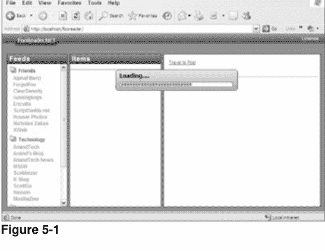

**图 5-1**

第一个窗格称为 *feeds pane*（订阅源窗格），以用户可以点击的链接形式显示不同的订阅源。订阅源窗格中一个 `id` 为 `divFeedList` 的 `<div/>` 元素允许将订阅源列表写入文档。由于此窗格是动态填充的，因此只静态写入包含元素：

```html
<div id="divFeedsPane">
    <div class="paneheader">Feeds</div>
    <div id="divFeedList"></div>
</div>
```

当用户点击一个订阅源时，订阅源条目会被加载到中间窗格：*items pane*（条目窗格）。这第二个窗格有两个用于显示信息的元素。第一个是一个 `id` 为 `divViewingItem` 的 `<div/>` 元素。此元素向用户显示两件事：他们当前正在阅读的订阅源以及订阅源文档类型（RSS 或 Atom）。第二个元素是另一个 `<div/>` 元素，其 `id` 属性设置为 `divItemList`。此元素将包含 `<item/>` RSS 元素或 `<entry/>` Atom 元素的列表。与订阅源窗格一样，只静态写入包含元素到页面：

```html
<div id="divItemPane">
    <div class="paneheader">Items</div>
    <div id="divViewingItem"></div>
    <div id="divItemList"></div>
</div>
```

如果用户单击一个条目，它会将该条目加载到最后一个窗格：*reading pane*（阅读窗格）。此窗格有三个显示条目信息的元素。第一个（其 id 为 `divMessageTitle`）是显示 RSS 和 Atom 订阅源的 `<title/>` 元素的地方。第二个元素的 id 为 `aMessageLink`，其 `href` 属性是动态更改的。最后，最后一个元素是 `divMessageBody`，显示 `<rss:description/>` 和 `<atom:content/>` 元素：

```html
<div id="divReadingPane">
    <div class="contentcontainer">
        <div class="messageheader">
            <div id="divMessageTitle"></div>
            <a href="" id="aMessageLink" title="Click to goto posting."
               target="_new">Travel to Post</a>
        </div>
        <div id="divMessageBody"></div>
    </div>
</div>
```

### 可用性

有几个可用性问题你应该关注。首先，用户期望 Web 应用程序像任何其他应用程序一样工作。在 Outlook 2003 中（此应用程序大量借鉴了其界面），双击条目窗格中的项目会在一个新窗口中拉出特定的电子邮件消息。由于 FooReader.NET 基于该模型，双击一个项目会打开一个新窗口，将用户带到特定的博客文章或文章。为实现这一点，条目上的 `ondblclick` 事件被分配给 `doubleClick()` 处理程序（你稍后会看到此分配）：

```javascript
function doubleClick() {
    var oItem = oFeed.items[this.getAttribute("frFeedItem")];
    var oWindow = window.open(oItem.link.value);
}
```

其次，用户需要知道应用程序何时正在工作以满足请求。唯一向服务器发出请求的时候是在加载订阅源时，因此需要某种类型的视觉提示向用户显示正在发生某些事情。为此目的，在请求订阅源时会显示一个加载屏幕，在订阅源加载后会隐藏它。图 5-2 显示了此用户界面提示的实际效果。
```


这个加载提示由一个名为 `toggleLoadingDiv()` 的 JavaScript 函数控制。它接受一个参数，一个布尔值，用于确定是否显示提示：

```
function toggleLoadingDiv(bShow) {
    var oToggleDiv = document.getElementById("loadingDiv");
    oToggleDiv.style.display = (bShow)? " block": " none";
}
```

### 服务器端组件

在一个理想的世界里，像 FooReader.NET 这样的简单应用程序将是纯客户端的。JavaScript 将能够通过 XMLHttp 跨域检索 XML 源，而无需对服务器组件进行任何调用。然而，由于 Internet Explorer 和 Firefox 的安全限制，无法从不同域检索数据；因此，需要一个服务器端组件。

### 可能的设计范式

在 FooReader.NET 中，服务器的任务是为客户端检索远程 XML 源。遵循此模型，服务器有两种可能的设计路径；两者各有优缺点。

第一种方法是缓存源架构。服务器程序将充当一个服务，在特定时间间隔获取源列表，对其进行缓存，并在客户端请求时提供缓存的源。此选项可以节省带宽，但也存在读者无法获取最新源的风险。需要更多用户操作才能显示当前最新的源，这违背了 Ajax 的理念。

第二种方法是按需交付架构，即服务器在用户请求时检索任何给定的源。这可能会使用更多带宽，但它确保读者能获得最新信息；此外，这种设计符合 Ajax 概念，也是用户所期望的。

### 实现

FooReader.NET 使用按需交付模型，但有一个例外：当获取源时，它会被缓存。仅在无法联系远程主机且无法检索到最新源的情况下，才会使用缓存版本。这确保了用户有内容可读，即使这些数据较旧。

由于服务器仅负责拉取和缓存远程源，因此让一个 ASP.NET 页面负责这些操作是合理的。这个名为 `xml.aspx` 的页面将包含一个代码隐藏文件，其中包含大量 ASP.NET 代码。

**注意** 代码隐藏是在 ASP.NET 平台上创建网页的一种方法。与服务器端代码与 HTML 标记交错的内联编程模型（如 PHP 和 ASP）不同，代码隐藏使你可以将所有逻辑从 HTML 代码中移出，并放置在单独的类文件中。这实现了 HTML 和你选择的 .NET 编程语言的清晰分离。

服务器端的入口点是 `Page_Load` 事件处理程序，其中调用了一个名为 `StartFooReader()` 的方法。你的代码将包含在 `StartFooReader()` 中。

该项目选择的语言是 C#，它是专门为 .NET Framework 创建的语言。

### 设置头部信息

对于此应用程序，你必须设置一些头部信息。在 ASP.NET 中设置头部信息是一项简单的任务：

```
Response.ContentType = "text/xml";
Response.CacheControl = "No-cache";
```

头部信息通过封装 HTTP 响应信息的 `Response` 对象进行设置。设置 MIME 内容类型对于应用程序的运行至关重要。基于 Mozilla 的浏览器不会将 XML 文件加载为 XML，除非 MIME 类型指定了 XML 文档，而 "text/xml" 是多种能做到这一点的类型之一。

确保通过 XMLHttp 检索的 XML 数据不被缓存也很重要。Internet Explorer (IE) 会缓存通过 XMLHttp 检索的所有数据，除非明确通过 CacheControl 头部信息告知不这样做。如果未设置此头部信息，IE 将使用缓存的数据，直到浏览器缓存被清空。

### 获取远程数据

为了确定要显示的源，FooReader.NET 使用一个专有的 XML 文档 `feeds.xml`，其中包含用户可请求的源列表。此文件包含一组 `<link/>` 元素，通过 `<section/>` 元素划分为多个部分。每个 `<link/>` 元素都有一个 `filename` 属性，类似于 HTML 中的 `id` 属性；它必须是唯一的，并且是 `<link/>` 元素的标识符：

```
<?xml version="1.0" encoding="utf-8"?>
<feeds>
    <section name="News">
        <link name="Yahoo! Top Stories" filename="yahoo_topstories" href="http://rss.news.yahoo.com/rss/topstories" />
    </section>
</feeds>
```

该示例显示了一个基本的源列表。典型的列表可以根据需要包含任意数量的 `<section/>` 和 `<link/>` 元素。请注意，`<section/>` 元素只能是根元素的子元素，而 `<link/>` 元素只能包含在 `<section/>` 元素中。

**注意** `<section/>` 和 `<link/>` 元素的 `name` 属性会显示在源窗格中，不会用于任何其他操作。

请求源时，`filename` 属性的值会被分配给查询字符串中的 `xml` 变量。

```
xml.aspx?xml=fileName
```

在 ASP.NET 中，`Request` 对象包含一个名为 `QueryString` 的 `NameValueCollection`。使用此集合，你可以提取查询字符串中 `xml` 变量的值：

```
if (Request.QueryString["xml"] != null)
{
    string xml = Request.QueryString["xml"];
    FeedsFile feedsFile = new FeedsFile(Server.MapPath("feeds.xml"));
}
```

第一行检查查询字符串中是否存在 `xml` 变量。然后将该值分配给 `xml` 变量，接着实例化一个 `FeedsFile` 对象。

`FeedsFile` 类包含一个名为 `GetLinkByFileName` 的方法，该方法返回一个 `FeedsFileLink` 对象，其中包含特定 `<link/>` 元素的信息。一个字符串变量 `fileName` 被分配了缓存源的路径值，供后续使用。
`FeedsFileLink link = feedsFile.GetLinkByFileName(xml);`
`string fileName = string.Format(`
`@"{0}\xml\{1}.xml", Server.MapPath(String.Empty), link.FileName);`

> **注意** `String.Format()`，顾名思义，用于格式化字符串（废话！）。传递给该方法的第一个参数是要格式化的字符串。此字符串很可能包含称为格式项的字符，例如 `{0}`、`{1}`、`{2}` 等。这些格式项将被传递给该方法的相应参数替换。在上面的示例中，`{0}` 被 `Server.MapPath(String.Empty)` 返回的结果字符串替换。

字符串前的 `@` 运算符告诉编译器不要处理转义字符串。上面示例中的字符串也可以写成 `"{0}\\xml\\{1}.xml"`，结果相同。

.NET Framework 提供了 `HttpWebRequest` 类（包含在 `System.Net` 命名空间中），用于向远程 Web 主机请求数据。.NET Framework 提供了一些类来执行此任务（例如通用的 `WebRequest` 类），但 `HttpWebRequest` 类提供 HTTP 特定的功能，因此最适合此应用程序。要创建 `HttpWebRequest` 对象，你可以调用 `WebRequest` 类的 `Create()` 方法并将其转换为 `HttpWebRequest`：
`HttpWebRequest getFeed = (HttpWebRequest) WebRequest.Create(link.Url);`
`getFeed.UserAgent = "FooReader.NET (http://reader.wdonline.com)";`
`string feedXml = String.Empty;`

`HttpWebRequest` 提供的一个特定于 HTTP 的成员是 `UserAgent` 属性。使用此属性并非完全必要，但它能准确记录访问远程服务器的是什么。许多传统聚合器都有自己的用户代理字符串；FooReader.NET 也是如此。变量 `feedXml` 被创建为空字符串。此变量稍后将被分配远程源的内容。此过程的下一步是发出请求并获取远程主机的响应：

```
//Get the response.
using (HttpWebResponse responseFeed = (HttpWebResponse)
    getFeed.GetResponse())
{
    //Create a stream reader.
    using (StreamReader reader = new
```


StreamReader(responseFeed.GetResponseStream()))
{
    //读取内容。
    feedXml = reader.ReadToEnd();
}
}
```

当调用`HttpWebRequest`类的`GetResponse()`方法时，会创建一个`HttpWebResponse`对象。然后通过`HttpWebResponse`类的成员方法`GetResponseStream()`创建一个`StreamReader`对象来读取服务器的响应。该流被“读取”到之前声明的`feedXml`变量中。由于使用了`using`语句来创建`HttpWebResponse`和`StreamReader`对象，它们将被正确释放，无需手动关闭。

### 缓存Feed

虽然不是完全必要，但缓存feed对用户有益，以防无法访问远程服务器。FooReader.NET是一个新闻阅读器，即使提供的是旧版本内容，用户也有东西可读是理想的。主要只有一种情况会向用户提供缓存版本：当由于网络流量或到远程主机的路由中断而无法联系远程主机时。

`StreamWriter`非常适合这项工作，因为它易于使用且默认采用UTF-8编码：

```
using (StreamWriter strmWriter = new StreamWriter(fileName))
{
    strmWriter.Write(feedXml);
}
```

之前创建的`fileName`变量被传递给`StreamWriter`的构造函数。这会创建文件或覆盖同名的现有文件。然后使用`Write()`方法将`feedXml`中包含的XML数据写入文件。

Feed已缓存；现在使用`Response.Write()`将XML数据写入页面。

```
Response.Write(feedXml);
```

## 错误处理

主要有两个方面会发生错误。第一种情况是当在查询字符串中找不到`xml`变量时。没有此变量，应用程序不知道要在`feeds.xml`中定位哪个feed；一个错误文档（一个静态RSS文档）使用`GetLocalFile()`方法（稍后讨论）加载并写入页面。

```
if (Request.QueryString["xml"] != null)
{
    //此处放置代码
}
else
{
    Response.Write(GetLocalFile(Server.MapPath("error.xml")));
}
```

因为错误文档是RSS文档，所以阅读器会像显示feed一样显示错误消息。

第二个可能抛出错误的领域是当无法联系远程主机时。为了捕获此错误，请求和响应代码被放置在`try...catch`块中。

```
try
{
    //此处放置Web请求代码
}
catch (WebException webEx)
{
    string fileToUse =
File.Exists(fileName)?fileName:Server.MapPath("error.xml");
    Response.Write(GetLocalFile(fileToUse));
}
```

> **注意** 仅捕获`WebException`会强制其他错误不被处理。ASP.NET的错误报告信息非常丰富；如果抛出`UnauthorizedAccessException`（这可能在`try...catch`块中由于缓存操作而发生），则说明权限设置不正确，错误消息有助于决定解决方案。

这就是缓存文件发挥作用的地方。当捕获错误时，应用程序需要知道将哪个文件写入页面：是缓存的feed还是错误文档。它首先使用`File.Exists()`检查是否存在缓存副本。如果缓存文件存在，则通过`GetLocalFile()`检索结果文件并写入页面。已经使用过几次的`GetLocalFile()`方法是一个简单的文件读取函数。它打开指定的文件，读取它，并将内容作为字符串返回：

```
public string GetLocalFile(string path)
{
    string contents = string.Empty;
    using (StreamReader file = File.OpenText(path))
    {
        contents = file.ReadToEnd();
    }
    return contents;
}
```

这确实只是一个便利函数，因为应用程序需要进行大量的文件读取。

### 解析Feeds文件

`FeedsFile`类将feeds文件打开为`XmlDocument`，可用于通过DOM检索任何所需的元素。

```
private XmlDocument _doc;
public FeedsFile(string path)
{
    _doc = new XmlDocument();
    _doc.Load(path);
}
```

FeedsFile公开`GetLinkByFileName()`方法。此方法接受一个参数fileName，并返回一个FeedsFileLink对象。

```
public FeedsFileLink GetLinkByFileName(string fileName)
{
    string pathToNode = 
    String.Format("/feeds/section/link[@filename='{0}']", fileName);
    XmlNode linkNode = _doc.SelectSingleNode(pathToNode);
    return new FeedsFileLink(linkNode);
}
```

`XmlDocument.SelectSingleNode()`方法根据传递给它的XPath表达式选择特定的XmlNode。此特定实例中使用的XPath表达式使用`String.Format()`格式化，并选择具有特定`filename`属性的特定`<link/>`。然后将选中的XmlNode传递给`FeedsFileLink`构造函数，并返回对象引用。

FeedsFileLink接受一个XmlNode，从该节点检索所需信息并将其分配给私有成员。

```
private string _name;
private string _filename;
private Uri _uri;

public FeedsFileLink(XmlNode myNode)
{
    _name = myNode.Attributes["name"].Value;
    _filename = myNode.Attributes["filename"].Value;
    _uri = new Uri(myNode.Attributes["href"].Value);
}
```

`_name`保存节点的`name`属性的值，`_filename`被分配`filename`属性的值，并创建一个`System.Uri`对象并赋值给`_uri`。

> **注意** 是的，可以使用`string`代替`Uri`对象，因为大多数接受`Uri`对象的.NET类和方法也被重载以接受`string`，但`Uri`对象酷多了。

上述成员是私有的。没有`访问器`，私有成员无法在类外部访问。C#中的访问器允许对私有成员进行读取和/或写入访问，以及其他许多功能：

```
public string Name
{
    get
    {
        return _name;
    }
}

public string FileName
{
    get
    {
        return _filename;
    }
}

public Uri Url
{
    get
    {
        return _uri;
    }
}
```

`FeedsFileLink`中的访问器提供对私有成员的只读访问。这些特定的访问器，称为*getter*，返回私有成员的值。这确保了类中包含的数据不会被错误地覆盖或损坏。

### 连接客户端与服务器

FooReader.NET的粘合剂是JavaScript代码，它使用`xParser`检索的数据和JavaScript `FeedsFile`类，并将其发送到用户界面进行显示。此代码包含在`feedsfileparser.js`和`fooreader.js`中。

### 解析Feeds文件——客户端风格

位于`feedsfileparser.js`中的`FeedsFile`类与其服务器端对应物非常相似；它负责将`feeds.xml`解析为JavaScript对象。

`FeedsFileElement`类表示`feeds.xml`中的一个元素。因为文档中只使用了两种不同的元素，所以该类相当简单。它接受一个参数：元素的节点。

```
function FeedsFileElement(oNode) {
    if (oNode.tagName.toLowerCase() == "section") {
        this.links = [];
        var linkNodes = oNode.getElementsByTagName("link");
        for (var i = 0; i < linkNodes.length; i++) {
            this.links[i] = new FeedsFileElement(linkNodes[i]);
        }
    }
}
```

如果`oNode`是一个`<section/>`元素，则必须创建一个包含的`<link/>`元素数组。通过将`<link/>`元素传递给`FeedsFileElement`构造函数来填充`links`数组。当`oNode`是一个`<link/>`元素时，使用`getAttribute()`方法将`<link/>`元素的`filename`属性值赋给`fileName`属性：

```
else {
    this.fileName = oNode.getAttribute("filename");
}
this.name = oNode.getAttribute("name");
```

因为`<section/>`和`<link/>`元素都有一个`name`属性，所以在所有逻辑完成后，将`name`属性的值赋给name属性。

feeds文件使用[第4章](http://www.example.com)介绍的跨浏览器XML库加载。使用XML DOM而不是XMLHttpRequest有多种原因。首先，`feeds.xml`是一个静态XML文件。在IE中使用XMLHttpRequest将需要更多的后端编码来指定no-cache头；即使文件已更改，IE也会继续加载其缓存的`feeds.xml`版本。

```
function FeedsFile() {
    var oThis = this;
    this.sections = [];
    this.onload = null;

    var oXmlDom = zXmlDom.createDocument();
    oXmlDom.load("feeds.xml");
```

尽管feeds文件是使用XML DOM加载的，您仍应使用XML DOM对象的异步功能（默认行为）。如果文件是同步加载的，应用程序将等待文档完全加载后才继续，这可能会让用户感觉应用程序已冻结。使用`onreadystatechange`事件来监控加载状态：

```
oXmlDom.onreadystatechange = function () {
    if (oXmlDom.readyState == 4) {
        var oSections =
            oXmlDom.documentElement.getElementsByTagName("section");

        for (var i = 0; i < oSections.length; i++) {
            oThis.sections[i] = new FeedsFileElement(oSections[i]);
        }
    }

    oXmlDom = null;

    if (typeof oThis.onload == "function") {
        oThis.onload();
    }
};
```

`<section/>`元素通过`getElementsByTagName()` DOM方法检索，sections数组用`FeedsFileElement`对象填充。一旦所有DOM操作完成，通过将`oXmlDom`设置为null来从内存中释放文档，并触发`onload`事件。

`FeedsFile` 类有一个名为 `getLinkByFileName()` 的方法（你应该在 C# 版本中见过）。此方法在每个 `section` 的 `links` 数组中搜索，并返回与文件名匹配的链接对象。同样，文件名是唯一的（必须如此），因此这是链接的标识符：

```
this.getLinkByFileName = function (sFileName) {
    for (var i = 0; i < this.sections.length; i++) {
        var section = this.sections[i];
        for (var j = 0; j < section.links.length; j++) {
            var link = section.links[j];
            if (sFileName.toLowerCase() ==
                link.fileName.toLowerCase()) {
                return link;
            }
        }
    }
    alert("Cannot find the specified feed information.");
    return this.sections[0].link[0];
};
```

当找不到匹配项时，会通过 `alert()` 方法显示错误消息，并返回订阅源列表中的第一个 `<link/>` 元素。

### 绘制用户界面元素

`fooreader.js` 中的代码负责生成向用户显示数据所需的动态元素。订阅源窗格中的订阅源列表和项目窗格中的项目都是根据接收到的数据动态生成的。这种动态内容通过 DOM 方法和 `innerHTML` 共同生成。通过 DOM 创建的元素主要在页面加载和加载新订阅源时创建。

消息窗格的内容使用 `innerHTML` 显示。这是必要的，因为许多订阅源包含 CDATA 部分，其中包含 HTML 格式；使用 DOM 方法显示文本可能会产生一些令人困惑的结果（例如，本应加粗的文本可能显示为 `<b>text goes here</b>`）。

### `init()`

客户端组件的入口点是 `init()` 函数，该函数负责填充订阅源窗格并加载第一个订阅源。一个整洁、易于遵循的布局对于订阅源窗格至关重要，为此，使用无序列表来格式化数据。

```
var divFeedList = document.getElementById("divFeedList");
var oFragment = document.createDocumentFragment();

for (var i = 0; i < oFeedsFile.sections.length; i++) {
    var oSection = oFeedsFile.sections[i];
```

订阅源列表的目标元素通过 `getElementById()` 检索并存储在 `divFeedList` 中。创建订阅源列表会不断更新页面，这可能会降低 UI 的性能（并让用户感到恼火）。为了解决这个问题，订阅源列表首先被附加到文档片段。当所有附加操作完成后，该片段再被附加到文档（这会附加该片段的所有子节点）。

如前所述，部分应在 UI 中清晰明了地定义，在部分名称旁边放置一个图标是一种很好的方式：

```
var oIcon = document.createElement("img");
oIcon.src = "img/category_icon.gif";
oIcon.border = "0";
oIcon.alt = "";
```

```
var oSpan = document.createElement("span");
oSpan.appendChild(document.createTextNode(section.name));
oSpan.className = "navheading";
```

DOM 方法 `createElement()` 允许创建图标（一个图像）和部分名称（封装在 `<span/>` 元素中）。部分标题的创建已完成，因此它们被附加到文档片段；同时创建了一个无序列表来包含该部分的订阅源：

```
oFragment.appendChild(oIcon);
oFragment.appendChild(oSpan);
var oUl = document.createElement("UL");
oUl.className = "navlist";
```

各个订阅源显示为链接，因此创建了 `<a/>` 和 `<li/>` 元素：

```
for (var j = 0; j < section.links.length; j++) {
    var oLink = oSection.links[j];
    var oLi = document.createElement("li");

    var oA = document.createElement("a");
    oA.appendChild(document.createTextNode(oLink.name));
    oA.href = "#";
    oA.onclick = loadFeed;
    oA.className = "navlinks";
    oA.title = "Load " + oLink.name;
    oA.setAttribute("frFileName", link.fileName);

    oLi.appendChild(oA);
    oUl.appendChild(oLi);
}
```

`<a/>` 元素有一个名为 `frFileName` 的属性，该属性将包含与订阅源关联的文件名。当所有链接和部分创建完成后，无序列表被附加到文档片段：

```
oFragment.appendChild(oUl);
```

然后文档片段被附加到 `divFeedList`，并在用户界面中加载第一个订阅源。

```
divFeedList.appendChild(oFragment);
loadFeed(feedsFile.sections[0].links[0].fileName);
```

此时应用程序几乎已完全加载。订阅源列表已完全填充，但项目窗格为空。控制权传递给 `loadFeed()`。

### `loadFeed()`

`loadFeed()` 函数负责在 `XParser` 对象中加载指定的订阅源并填充项目窗格。此函数还兼作订阅源窗格中链接的 `onclick` 事件处理程序。它接受一个参数 `sFileName`，该参数对应于 `feeds.xml` 中一个 `<link/>` 元素的 `filename` 属性。如果 `loadFeed()` 是由事件触发的，则 `sFileName` 会更改为前面提到的 `frFileName` 属性的值：

```
function loadFeed(sFileName) {
    sFileName = (typeof sFileName == "string") ? sFileName :
        this.getAttribute("frFileName");
```

为了显示项目列表和订阅源信息，必须首先找到并引用用户界面中的两个元素：`divItemList` 和 `divViewingItem`：

```
var divItemList = document.getElementById("divItemList");
var divViewingItem = document.getElementById("divViewingItem");
```

项目列表将显示在 `divItemList` 中，`divViewingItem` 将包含订阅源的名称和类型。

```
var sName = feedsFile.getLinkByFileName(sFileName).name;
toggleLoadingDiv(true);
```

订阅源的名称通过 `feedsFile` 对象的 `getLinkByFileName()` 方法检索。然后调用 `toggleLoadingDiv()` 函数，提示用户应用程序正在处理请求。

项目列表无非是使用 DOM 方法创建的 `<a/>` 元素。但首先，必须从文档中移除任何现有项目，以便用新列表替换。这可以使用 `while` 循环轻松处理：

```
while (divItemList.hasChildNodes()) {
    divItemList.removeChild(divItemList.lastChild);
}
```

由于 `divItemList` 中唯一的子元素就是项目，因此移除所有子元素是安全的。所有旧项目移除后，就该创建 `XParser` 对象了：

```
sFileName = "xml.aspx?xml=" + sFileName;
oFeed = new XParser(sFileName);
```

`sFileName` 变量被更改为反映服务器应用程序的 URL，并传递给 `XParser` 构造函数。

执行 XMLHttpRequest 可能需要一些时间，如果不考虑这一点可能会引发错误。为了解决这个问题，`XParser` 暴露了一个名为 `onload` 的事件，当 XMLHttpRequest 达到 OK 状态（状态代码 200）时触发。在 FooReader.NET 中，`XParser` 的 `onload` 事件用于将项目写入 `divItemList`，将第一个项目加载到阅读窗格，并隐藏加载用户界面提示。

```
oFeed.onload = function () {
    var oFragment = document.createDocumentFragment();
    divViewingItem.innerHTML = sTitle + "(" + oFeed.type + ")";
```

就像在 `init()` 中一样，这里创建了一个文档片段以减少用户界面的负担。如前所述，`divViewingItem` 将通过使用 `innerHTML` 属性显示订阅源的名称和类型。这种用户反馈对于创建良好的 Ajax 应用程序至关重要。尽管这些信息对于应用程序的正常运行可能不是必需的，但它让用户了解他或她正在做什么。

> **注意** 使用 `innerHTML` 属性是为了简便。在这种情况下，使用 `innerHTML` 更改元素内容比使用 DOM 方法占用的字符更少，空间更小。`innerText` 属性将是理想的选择；然而，Firefox 不支持该属性。

现在是时候创建项目了。项目是块级样式 `<a/>` 元素，包含两个 `<div/>` 元素：一个 `<div/>` 包含项目的标题，另一个则包含项目的日期。与订阅源窗格中的列表类似，构成项目的元素使用 `createElement()` DOM 方法创建。

```
for (var i = 0; i < oFeed.items.length; i++) {
    var oItem = oFeed.items[i];
    var oA = document.createElement("a");
    oA.className = "itemlink";
    oA.href = "#";
    oA.onclick = itemClick;
    oA.ondblclick = doubleClick;
    oA.id = "oA" + i;
    oA.setAttribute("frFeedItem", i);
```

创建的第一个元素是 `<a/>` 元素。锚点的属性是典型的：`class` 属性设置为 CSS 类 `itemlink`，`href` 设置为 "#"，`onclick` 设置为 `itemClick`，双击锚点时触发的 `ondblclick` 事件由 `doubleClick()` 处理，`id` 属性设置为包含字符串 `oAx`，其中 *x* 是项目的编号。

> **注意** `itemClick()` 函数将在[下一节](#)中介绍。

然后创建第一个 `<div/>` 元素。此元素将包含项目的标题：

```
var divTitle = document.createElement("div");
divTitle.className = "itemheadline";
divTitle.innerHTML = oItem.title.value;
```

你会注意到再次使用了 `innerHTML` 而不是 `createTextNode()`。这是由于一些人在标题中使用了 HTML 格式（无论是 HTML 实体还是元素）。还剩一个 `<div/>` 元素来存放日期：

```
var divDate = document.createElement("div");
divDate.className = "itemdate";
divDate.appendChild(document.createTextNode("Date: " +
    oItem.date.value));
```

为日期创建元素与为标题创建元素非常相似，只是你会注意到使用了 `createTextNode()` 将文本附加到元素（这样做是因为日期中不应该有任何 HTML 格式）。

两个 `<div/>` 元素都被附加到 `<a/>` 元素，而该元素又被附加到文档片段：

```
oA.appendChild(divTitle);
```


```
var divDate = document.createElement("div");
divDate.innerHTML = oItem.date.value;
oA.appendChild(divDate);
oFragment.appendChild(oA);
```

当循环退出且所有项目创建完成后，文档片段会被附加到文档中，或者更具体地说，是附加到项目列表中：
```
divItemList.appendChild(oFragment);
```

然后调用 `itemClick()` 将第一个项目加载到阅读窗格中，并隐藏加载用户界面提示：
```
itemClick(0);
toggleLoadingDiv();
```

至此，项目窗格已完全填充。剩下的就是将第一个项目加载到阅读窗格中，这通过调用 `itemClick()` 来完成。

### itemClick()

`itemClick()` 函数在用户点击项目窗格中的链接时被调用（与 `loadFeed()` 类似，`itemClick()` 同时也充当事件处理程序）；它接受一个参数 `iItem`，这是一个表示要显示的项目索引的整数。该函数还负责通过更改被点击链接的背景颜色来向用户显示最后点击的链接。这种背景颜色的更改是通过将元素的 CSS 类更改为 `itemlink-selected` 来实现的。使用 CSS 来定义样式差异使得应用程序的自定义变得容易。

为了使此用户界面功能正常工作，使用了一个全局变量来跟踪当前选中的项目。该变量名为 `oSelected`，将被赋值为当前选中元素的引用：
```
iItem = (typeof iItem == "number") ? iItem : this.getAttribute("frFeedItem");
var oEl = document.getElementById("oA" + iItem);
if (oSelected != oEl) {
    if (oSelected) oSelected.className = "itemlink";
    oEl.className += "-selected";
    oSelected = oEl;
}
```

被点击链接的对象引用通过 `getElementById()` 获取并赋值给 `oEl`。然后将 `oEl` 与 `oSelected` 进行比较，以确定是否是点击了一个新链接。如果两个对象是同一个引用，则不执行任何操作，因为被点击的链接就是当前选中的链接。如果引用不匹配，则将 `oSelected` 的类重置为 `itemlink`，将新链接的类设置为 `itemlink-selected`，并将 `oSelected` 设置为新链接的引用。

为了在阅读窗格中显示项目，必须获取一些元素的引用。
```
var divTitle = document.getElementById("divMessageTitle");
var aLink = document.getElementById("aMessageLink");
var divBody = document.getElementById("divMessageBody");
```

顾名思义，`divTitle` 元素是显示项目标题的位置。`aLink` 元素为用户提供一个可点击的链接，用于加载实际的新闻项目。`divBody` 元素是显示 `<rss:description/>` 或 `<atom:content/>` 元素的位置：
```
var oItem = oFeed.items[iItem];
divTitle.innerHTML = oItem.title.value;
aLink.href = oItem.link.value;
divBody.innerHTML = oItem.description.value;
```

然后将项目对象赋值给 `oItem`，并用于从 `oFeed` 中检索数据。项目的标题显示在 `divTitle` 中，链接的 `href` 属性被更改以反映新值。项目的描述通过 `innerHTML` 显示在 `divBody` 中。对 `divBody` 使用 `innerHTML` 确保项目以用户可读的方式显示。像 `&amp;` 这样的 HTML 实体将正确显示为 "&"。

### 设置

通常，Web 应用程序的设置和使用都很简单。然而，.NET Web 应用程序在设置过程中需要几个额外的步骤。

安装 FooReader.NET 的第一个要求是确保机器上安装了 Internet 信息服务（IIS）。IIS 是 Microsoft 的 Web 服务器，仅适用于 Windows 2000 Professional、Windows 2000 Server、Windows XP Professional 和 Windows Server 2003 的所有者。安装 IIS 需要 Windows 安装光盘，可以在“控制面板”中的“添加或删除程序”小程序的“添加/删除 Windows 组件”部分完成（参见图 5-3）。

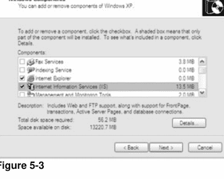

**图 5-3**

您还必须安装 .NET Framework 才能运行 FooReader.NET。您需要 1.1 或更高版本。对于 Windows 98 及更高版本的用户，可以在 http://msdn.microsoft.com/netframework/downloads/updates/default.aspx 免费获取。

当 IIS 和 .NET Framework 安装完毕后，在 IIS 的 `wwwroot` 目录（位于 `c:\Inetpub\`）中创建一个名为 `FooReader` 的文件夹，并将所有 FooReader.NET 文件和文件夹移动到新创建的 `FooReader` 文件夹中。将文件放入 `FooReader` 目录后，您需要在 IIS 中注册该应用程序，这可以在 IIS 管理控制台中完成（参见图 5-4）。在计算机的“控制面板”（开始 => 控制面板）中，双击“管理工具”，然后双击“Internet 信息服务”图标。

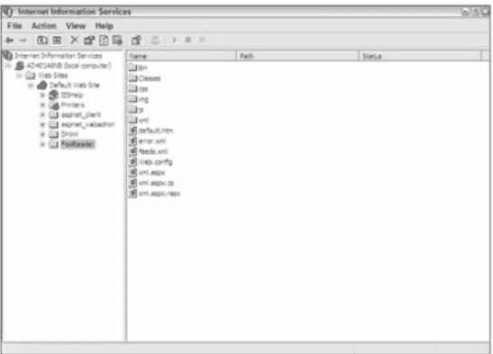

**图 5-4**

在控制台中，您将看到文件和文件夹的列表。这些项目包含在 IIS 的根文件夹中。在左侧窗格中，找到 `FooReader` 文件夹。右键单击该文件夹，然后从上下文菜单中选择“属性”。现在您将看到 `FooReader` 文件夹的 Web 属性（参见图 5-5）。

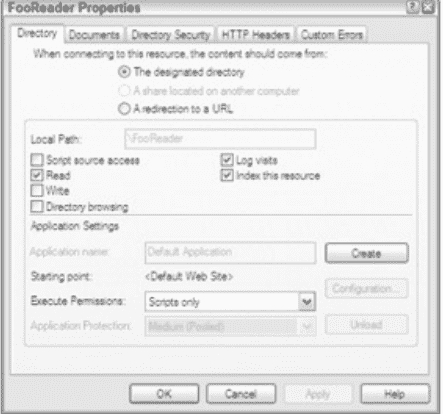

**图 5-5**

在“目录”选项卡上，您将在窗口底部看到一个“应用程序设置”部分。单击“创建”按钮，将显示“属性”窗口（参见图 5-6）。

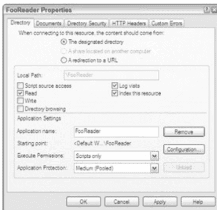

**图 5-6**

单击“确定”。IIS 现在知道将 `FooReader` 文件夹视为一个应用程序，并将其作为应用程序运行。FooReader.NET 应用程序现已安装完成。

### 测试

在部署任何 Web 应用程序之前，最好测试一下安装。出于测试目的，`feeds.xml` 仅包含一个订阅源：Yahoo! 新闻。

打开浏览器并导航到 `http://localhost/fooreader/xml.aspx?xml=yahoo_topstories`。

此测试用于确保服务器端组件能够正确检索外部新闻订阅源。如果一切正常，您应该在浏览器中看到显示的 XML 订阅源（参见图 5-7）。

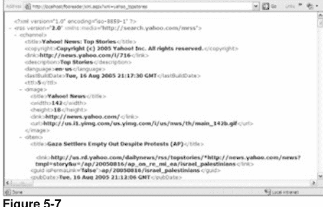

**图 5-7**

如果由于某种原因您看到 ASP.NET 错误，错误消息将告诉您应该怎么做。最常见的错误是“拒绝访问”错误，在这种情况下，应授予 ASP.NET 用户帐户（或 Windows 2003 的 NETWORK SERVICE）适当的修改权限。

如果您无法设置 Web 服务器的权限（例如从服务提供商处租用 Web 空间时），您可能可以通过启用模拟来解决“拒绝访问”错误。模拟设置位于 `web.config` 文件中。

`web.config` 文件是基于 XML 的 Web 应用程序配置文件。`web.config` 的根元素是 `<configuration/>`，其后通常是 `<system.web/>` 元素。您可以将以下行添加到 `<system.web/>` 元素中：
```
<identity impersonate="true"/>
```

请记住，此解决方案具有很强的情境性，并且取决于 Web 服务器的设置。然而，它可能会解决您在租用服务器环境中可能遇到的未授权访问错误。

一旦应用程序经过测试并确认可以正常工作，您就可以编辑 `feeds.xml` 以包含您想要的任何订阅源。

## 总结

在本章中，您学习了在线联合的历史，包括 RSS 和 Atom 作为两种主要的联合 XML 格式的兴起。您还了解了 RSS 聚合器（如 FooReader.NET）如何使使用新闻订阅源变得更加容易。

本章详细介绍了基于 Web 的 RSS/Atom 聚合器 FooReader.NET 的创建和实现。从客户端组件开始，您学习了如何创建 `XParser`，这是一个 JavaScript RSS/Atom 解析器，为基于 RSS 和 Atom 的 Web 应用程序开发人员提供了易于使用的接口。您还了解了 `XParser` 如何使用 Microsoft Internet Explorer 和基于 Mozilla 的浏览器中存在的 XML DOM。

您了解到，虽然 Web 应用程序的客户端组件是向用户正确显示数据的必要条件，但服务器端组件对于检索必要的数据也是必需的。使用 C# 和 .NET Framework，您学习了如何检索远程 XML 订阅源、将其缓存并输出到页面。您还学习了如何设置 HTTP 头，以便浏览器知道要期待什么，远程服务器也知道是什么请求。

最后，您学习了如何在 IIS 中设置应用程序并对其进行测试以确保其正确安装。


## 第6章：Web 服务

### 概览

大约在2000年之后，随着XML的使用开始兴起，企业、开发者和其他人员开始寻找新的利用方式。内容与表现形式分离的目标已经实现，那么如何才能充分利用这种能力呢？答案便是以Web服务的形式出现。

Web服务提供了一种在应用程序和服务器之间交换数据的方式。为了促进这种通信，Web服务使用互联网在*消费者*（使用数据的应用程序）和*提供者*（包含数据的服务器）之间来回发送由XML数据组成的消息。这与传统的分布式计算模型（如CORBA、DCOM和RMI）并无太大不同，在这些模型中，方法调用是通过网络连接执行的。Web服务的主要区别在于，传输的数据是XML文本，而不是二进制格式。

Web服务背后的承诺是：让软件组件能够按需提供给世界上的任何应用程序。无论是Web应用程序还是传统的桌面应用程序，都可以使用相同的服务来执行相同的任务。

### 相关技术

Web服务并非单一的技术或平台；实际上，它们是多种协议、语言和格式的混合体。尽管一些不同的平台已经将Web服务整合到其当前的产品中，但仍有一些基本部分保持不变。

### SOAP

SOAP是一种基于XML的语言与任意数量的通用数据传输协议的组合。SOAP规范描述了一种复杂的语言，包含众多元素和属性，旨在描述大多数类型的数据。这些信息可以通过任意数量的协议进行传输，但最常见的是通过HTTP与其他Web流量一起发送。

**重要提示**：SOAP最初是Simple Object Access Protocol（简单对象访问协议）的缩写，现在该规范直接称为SOAP。

使用SOAP主要有两种方式：*远程过程调用（RPC）*风格和*文档*风格。

#### RPC风格的SOAP

RPC风格的SOAP将Web服务视为一个包含一个或多个方法的对象（其使用方式与你使用本地类与数据库建立通信非常相似）。向服务发出请求，详细说明要调用的方法名称和要传递的参数（如果有）。该方法在服务器上执行，并返回一个XML响应，其中包含返回值（如果有），或者如果在处理过程中出现错误，则返回错误消息。想象一个提供简单算术运算的Web服务：加法、减法、乘法和除法。每个方法接受两个数字并返回一个结果。对加法操作的RPC风格请求大致如下所示：

```xml
<?xml version="1.0" encoding="utf-8"?>
<soap:Envelope xmlns:soap="http://schemas.xmlsoap.org/soap/envelope/"
               soap:encodingStyle="http://schemas.xmlsoap.org/soap/encoding/">
   <soap:Body>
      <w:add xmlns:w="http://www.wrox.com/services/math">
         <w:op1>4.5</w:op1>
         <w:op2>5.4</w:op2>
      </w:add>
   </soap:Body>
</soap:Envelope>
```

当你处理非平凡的XML文档时，例如需要在企业和应用程序之间共享的文档，命名空间就会发挥作用。命名空间在SOAP中尤其重要，因为这些文档需要由不同的系统生成和读取。此示例中指定的SOAP命名空间 `http://schemas.xmlsoap.org/soap/envelope/` 用于版本1.1，具体取决于你使用的版本可能会有所不同。版本1.2的命名空间是 `http://www.w3.org/2003/05/soap-envelope`。

`<w:add/>` 元素指定了要调用的方法名称（add），并包含此示例中的另一个命名空间 `http://www.wrox.com/services/math`。此命名空间特定于正在调用的服务，可以由开发者定义。`soap:encodingStyle` 属性指向一个URI，指示请求中的数据是如何编码的。还有其他各种编码样式可用，例如XML模式中使用的类型系统。

**重要提示**：可以使用可选的 `<soap:Header/>` 元素来包含附加信息，例如安全凭证。如果使用此元素，它应立即出现在 `<soap:Body/>` 之前。

如果添加两个数字的请求执行成功，响应消息将如下所示：

```xml
<?xml version="1.0" encoding="utf-8"?>
<soap:Envelope xmlns:soap="http://schemas.xmlsoap.org/soap/envelope/"
    soap:encodingStyle="http://schemas.xmlsoap.org/soap/encoding/">
    <soap:Body>
        <w:addResponse xmlns:w="http://www.wrox.com/services/math">
            <w:addResult>9.9</w:addResult>
        </w:addResponse>
    </soap:Body>
</soap:Envelope>
```

如你所见，格式与初始请求类似。提供结果的标准方式是创建一个以方法名称后跟单词“Response”命名的元素。在本例中，该元素是 `<w:addResponse/>`，它与请求中的 `<w:add/>` 元素具有相同的命名空间。实际结果在 `<w:addResult/>` 元素中返回。请注意，Web服务开发者可以定义所有这些元素名称。

如果服务器在处理SOAP请求时出现问题（假设请求确实到达了该位置），则会返回一个 `<soap:Fault>` 元素。例如，如果在上一个示例中，第一个操作数被错误地输入为字母而不是数字，你可能会收到以下内容：

```xml
<?xml version="1.0" encoding="utf-8"?>
<soap:Envelope xmlns:soap="http://schemas.xmlsoap.org/soap/envelope/">
    <soap:Body>
        <soap:Fault>
            <faultcode>soap:Client</faultcode>
            <faultstring>Server was unable to read request.
                Input string was not in a correct format.
                There is an error in XML document (4, 13).
            </faultstring>
            <detail/>
        </soap:Fault>
    </soap:Body>
</soap:Envelope>
```

`<soap:Fault>` 元素（只能有一个）提供了关于所遇问题的线索。最有用的信息包含在 `<faultcode/>` 中。此值的选项有限，其中两个常见的是 `soap:Server` 和 `soap:Client`。`soap:Server` 错误代码可能指示服务器无法连接到数据库等问题。在这种情况下，重新发送消息很可能会成功。如果指定的是 `soap:Client`，则通常意味着消息格式错误，不进行一些修改将不会成功。

更易于人类阅读的错误消息存储在 `<faultstring/>` 元素中，其中包含特定于应用程序的错误详情。如果次要系统（如数据库）是Web服务错误的主要原因，则有关此错误的信息可能会在可选的 `<faultactor/>` 元素中返回（未在上一个示例中显示）。

#### 文档风格的SOAP

文档风格的SOAP依赖于XML模式来指定请求和响应的格式。这种风格似乎越来越受欢迎，一些人预测它最终将几乎取代RPC风格。有关人们为何回避使用SOAP编码的RPC的清晰解释，请参见 http://msdn.microsoft.com/library/en-us/dnsoap/html/argsoape.asp。

文档风格的请求可能看起来与RPC风格的请求没有太大区别。例如，上一节中的RPC请求示例通过简单地移除 `soap:encodingStyle` 属性，就可以成为有效的文档风格请求。区别在于，RPC请求总是遵循相同的风格，方法名称包含在包含其参数的元素中；而文档风格的请求则没有这样的约束。以下是一个与RPC请求完全不同的示例：

```xml
<?xml version="1.0" encoding="utf-8"?>
<soap:Envelope xmlns:soap="http://schemas.xmlsoap.org/soap/envelope/">
    <soap:Body>
        <w:add xmlns:w="http://www.wrox.com/services/math" op1="4.5" op2="5.4" />
    </soap:Body>
</soap:Envelope>
```

请注意，突出显示的行将方法名称（add）和两个操作数（op1和op2）包含在单个元素中。这种结构使用RPC风格的请求是无法实现的。文档风格具有这种灵活性，是因为有一个伴随的XML模式。Web服务可以使用此XML模式来验证请求的结构；然后服务可以自由地适当地使用请求中的信息。响应遵循与请求相同的基本规则：它们可以与RPC风格非常相似，也可以完全不同，同样基于XML模式。

> **重要提示**：使用Visual Studio .NET创建的Web服务默认是文档风格的（尽管可以通过应用各种属性来更改）。


归因于底层代码。

此时，您可能会想知道 XML 架构存储在哪里，以及如何使其对客户端和服务都可用。这些问题的答案在于另一个缩写词：WSDL。

### WSDL

Web Services Description Language（WSDL）是另一种基于 XML 的语言，旨在描述特定 Web 服务的使用方式，或者更准确地说，描述如何调用特定服务。最终规范描述了一种极其密集的语言，设计得极其灵活，并允许尽可能多地重用；这种文档只有最热忱的爱好者才会手动构建。通常，先使用软件工具创建初始的 WSDL 文件，然后根据需要进行手动调整。

以下是一个 WSDL 文件，描述了一个示例数学服务，其中包含一个 add 方法（您稍后将构建此方法）：

```xml
<?xml version="1.0" encoding="utf-8"?>
<wsdl:definitions
                xmlns:http="http://schemas.xmlsoap.org/wsdl/http/"
                xmlns:soap="http://schemas.xmlsoap.org/wsdl/soap/"
                xmlns:s="http://www.w3.org/2001/XMLSchema"
                xmlns:tns="http://www.wrox.com/services/math"
                xmlns:wsdl="http://schemas.xmlsoap.org/wsdl/"
                targetNamespace="http://www.wrox.com/services/math">
    <wsdl:types>
        <s:schema elementFormDefault="qualified"
                 targetNamespace="http://www.wrox.com/services/math">

            <s:element name="add">
                <s:complexType>
                    <s:sequence>
                        <s:element minOccurs="1" maxOccurs="1" name="op1" type="s:float" />
                        <s:element minOccurs="1" maxOccurs="1" name="op2" type="s:float" />
                    </s:sequence>
                </s:complexType>
            </s:element>
            <s:element name="addResponse">
                <s:complexType>
                    <s:sequence>
                        <s:element minOccurs="1" maxOccurs="1" name="addResult"
                                  type="s:float" />
                    </s:sequence>
                </s:complexType>
            </s:element>
        </s:schema>
    </wsdl:types>
    <wsdl:message name="addSoapIn">
        <wsdl:part name="parameters" element="tns:add" />
    </wsdl:message>
    <wsdl:message name="addSoapOut">
        <wsdl:part name="parameters" element="tns:addResponse" />
    </wsdl:message>
    <wsdl:portType name="MathSoap">
        <wsdl:operation name="add">
            <wsdl:documentation>
                Returns the sum of two floats as a float
            </wsdl:documentation>
            <wsdl:input message="tns:addSoapIn" />
            <wsdl:output message="tns:addSoapOut" />
        </wsdl:operation>
    </wsdl:portType>
    <wsdl:binding name="MathSoap" type="tns:MathSoap">
        <soap:binding transport="http://schemas.xmlsoap.org/soap/http"
                     style="document" />
        <wsdl:operation name="add">
            <soap:operation soapAction="http://www.wrox.com/services/math/add"
                           style="document" />
            <wsdl:input>
                <soap:body use="literal" />
            </wsdl:input>
            <wsdl:output>
                <soap:body use="literal" />
            </wsdl:output>
        </wsdl:operation>
    </wsdl:binding>
    <wsdl:service name="Math">
        <wsdl:documentation>
            Contains a number of simple arithmetical functions
        </wsdl:documentation>
        <wsdl:port name="MathSoap" binding="tns:MathSoap">
            <soap:address location="http://localhost/Math/Math.asmx" />
        </wsdl:port>
    </wsdl:service>
</wsdl:definitions>
```

请记住，这个 WSDL 仅描述了一个将两个数字相加的基本服务；为简单起见，您将要实现的另外三个方法已被移除。虽然这个 WSDL 文件又长又复杂，但您应该理解其各个部分的含义。

文档元素 `<wsdl:definitions/>` 包含内容并允许声明各种命名空间。下一个元素 `<wsdl:types/>` 包含服务使用的 XML 架构。在此元素内部是 `<s:schema/>`，它描述了可以出现在请求或响应的 `<soap:Body/>` 中的所有元素的格式。

架构中描述的第一个元素是 `<add/>`。由于 `<s:schema/>` 元素的 `elementFormDefault` 设置为 `qualified`，因此 `<add/>` 被假定位于 `targetNamespace` 属性指定的命名空间中，即 `http://www.wrox.com/services/math`。然后，将 `<add/>` 元素声明为包含两个其他元素的序列：`<op1/>` 和 `<op2/>`。这两个元素的 `minOccurs` 和 `maxOccurs` 都设置为 1，这意味着它们都必须出现且只能出现一次。它们也都具有 `s:float` 类型属性，这是内置的 XML 架构类型之一。

> **注意** 您可以在 www.w3.org/TR/xmlschema-0/#CreatDt 找到 XML 架构数据类型的完整列表。如果您的服务需要比这些更复杂的类型，可以通过聚合和限制这些基础类型来构造复杂类型。

接下来在架构中是另一个 `<s:element/>`，这次描述的是 `<addResponse/>`。此元素被定义为有一个子元素 `<addResult/>`，其中包含操作的结果（也定义为类型 `s:float`）。这是包含的 XML 架构中的最后一个条目。

回到 WSDL 文件的主体，有一个简短的部分描述了两个 `<wsdl:message/>` 元素：`addSoapIn` 和 `addSoapOut`。每个这些元素都有一个 `<wsdl:part/>` 元素，指定在 XML 架构中使用哪个 `element`。这两个分别引用了 `add` 和 `addResponse` 元素。此部分说明了每条消息的格式。

接下来的部分 `<wsdl:portType/>` 用于将 `<wsdl:message>` 元素分组为操作。*操作*被视为一个单一的工作单元，因此包含一个 `<wsdl:input>` 和通常一个 `<wsdl:output>` 以及一个可选的 `<wsdl:fault>` 元素。前面的示例有一个 `<wsdl:portType>`，并描述了一个名为 `add` 的 `<wsdl:operation/>`。其子元素 `<wsdl:input>` 和 `<wsdl:output>` 上的 message 属性引用了之前定义的 `<wsdl:message>` 元素。还有一个 `<wsdl:documentation/>` 元素，其中包含该方法的用户友好描述。（您将在本章后面了解此信息来自何处。）

端口类型之后是一个 `<wsdl:binding/>` 块。*绑定*将操作与用于与服务通信的协议配对。WSDL 规范中描述了三种绑定：SOAP、HTTP GET/POST 和 MIME。

> **重要** 本章重点介绍 SOAP 绑定。HTTP GET/POST 绑定处理 URL 的构建方式（对于 GET 请求）或表单数据的编码方式（对于 POST 请求）。MIME 绑定允许消息的一部分（通常是输出）以不同的 MIME 类型表示。这意味着响应的一部分可以是 XML，而第二部分可以是 HTML。

您可以在 www.w3.org/TR/2002/WD-wsdl12-bindings-20020709/ 阅读更多关于这些替代绑定的信息。

首先，绑定的 `name` 设置为 `MathSoap`，`type` 指向 `<wsdl:portType>` 部分定义的 `MathSoap` 端口类型。其次，`<soap:binding/>` 元素使用 `transport` 属性指定服务通过 HTTP 运行。`<wsdl:operation/>` 元素简单地定义了方法 `add` 的 `name`。`<soap:operation/>` 元素包含需要合并到 HTTP 请求头中的 `soapAction`，以及 `style` 属性，该属性指定 SOAP 消息将是文档类型而不是 RPC 类型。

> **注意** 文档式消息和 RPC 式消息之间的主要区别在于，文档式消息将消息作为 `<soap:body>` 中的元素发送，这些元素可以具有发送方和接收方约定使用嵌入式架构作为指南的任何结构。然而，RPC 式消息有一个以被调用方法命名的元素。这反过来又会为方法接受的每个参数提供一个元素。

`<soap:operation/>` 元素有两个子元素 `<wsdl:input>` 和 `<wsdl:output>`，用于进一步描述请求和响应格式。在本例中，`<soap:body>` 指定了一个 `use` 属性为 `literal`。实际上，对于文档式服务，这是唯一的选择；对于 RPC 式服务，选择扩展到 `encoded`，在这种情况下，`<soap:body>` 会进一步指定参数类型要使用的确切编码类型。

文档的最后一部分 `<wsdl:service/>` 涉及如何从客户端调用服务。它还包含服务的人类可读描述以及 `<wsdl:port/>` 元素，该元素引用了最后一个文档部分中的 `MathSoap` 绑定。本部分中最重要的元素可能是 `<soap:address/>`，它包含关键的 `location` 属性，其中包含访问服务所需的 URL。

对于新开发人员来说，查看一个完整的 WSDL 文件可能有点令人生畏，但好消息是您可能永远不需要自己手动编写一个。事实上，本节中的示例文件是由 .NET Web 服务自动创建的，它检查底层代码并生成必要的 XML。

> **注意** XML 架构是一个庞大的主题，完整讨论超出了本书的范围。如果您想了解更多关于 XML 架构的知识，请考虑查阅《Beginning XML, 3rd Edition》（Wiley Publishing, ISBN 0-7645-7077-3），或者访问 www.w3schools.com/schema/default.asp 获取网络教程。

### REST

Representational State Transfer，通常缩写为 REST，描述了一种使用现有 HTTP 协议传输数据的方法。虽然主要用于 Web 服务，但 REST 也可以用于任何类型的基于 HTTP 的请求和响应系统。关于 Web 服务，REST 使您能够以特定格式调用给定 URL 来返回数据（数据也将采用特定格式）。此数据可能包含有关如何检索更多数据的进一步信息。对于 Web 服务使用，数据将以 XML 形式返回。

例如，假设 Wrox 想为其他人提供一种检索所有作者列表的方式。REST 风格的 Web 服务使用简单的 URL 访问数据；Wrox Book 服务可以使用此 URL 检索作者列表：

- http://www.wrox.com/services/authors/

此服务可能会返回已知作者的 XML 表示，以及有关如何访问每个作者详细信息的信息，例如：

```xml
<?xml version="1.0" encoding="utf-8" ?>
<authors xmlns:xlink="http://www.w3.org/1999/xlink">
```

xmlns="http://www.wrox.com/services/authors-books"
xlink:href="http://www.wrox.com/services/authors/">
<author forenames="Michael" surname="Kay"
    xlink:href="http://www.wrox.com/services/authors/kaym"
    id="kaym"/>
<author forenames="Joe" surname="Fawcett"
    xlink:href="http://www.wrox.com/services/authors/fawcettj"
    id="fawcettj"/>
<author forenames="Jeremy" surname="McPeak"
    xlink:href="http://www.wrox.com/services/authors/mcpeakj"
    id="mcpeakj"/>
<author forenames="Nicholas" surname="Zakas"
    xlink:href="http://www.wrox.com/services/authors/zakasn"
    id="zakasn"/>
<!--
  更多作者
-->
</authors>
```

关于这段XML，有几点需要注意。首先，声明了一个默认命名空间 `http://www.wrox.com/services/authors-books`，这样所有无前缀的元素（例如 `<authors/>`）都被假定属于此命名空间。这意味着 `<authors/>` 元素可以与另一个名称相似但来自不同命名空间的元素区分开来。命名空间URI `http://www.wrox.com/services/authors-books` 仅仅被用作一个唯一的字符串；并不保证在该位置有实际资源可用。关键是它是一个统一资源标识符（URI），它仅仅是一个标识符，而不是统一资源定位符（URL），后者才表示资源位于特定位置。

其次，注意使用了来自 `http://www.w3.org/1999/xlink` 命名空间的 `href` 属性。尽管不是必需的，但许多REST风格的服务现在已经将这种在HTML中表示标准超链接的符号标准化了。

> **注意** XLink是一种链接文档的方式，它远超HTML简单的超链接。它提供了指定双向依赖关系的能力，使得文档可以相互访问，并且还指示了链接应如何被激活——例如，手动、自动或在预设时间之后。它的表亲XPointer则关注于指定文档内的章节，并且源于对比HTML页面内简单命名链接更强大的表示法的需求。

尽管两者都已达到W3C的推荐状态，但它们仍未被广泛使用。更多信息，请访问 www.w3.org/XML/Linking。

如果用在网站或Web应用中，REST服务返回的XML会在客户端或服务器端被转换为更用户友好的格式（很可能是HTML）——也许类似于这样：

```html
<html>
  <head>
    <title>Wrox Authors</title>
  </head>
  <body>
    <a href="http://www.wrox.com/services/authors/kaym">Michael Kay</a>
    <a href="http://www.wrox.com/services/authors/fawcettj">Joe Fawcett</a>
    <a href="http://www.wrox.com/services/authors/mcpeakj">Jeremy McPeak</a>
    <a href="http://www.wrox.com/services/authors/zakasn">Nicholas Zakas</a>
  </body>
</html>
```

然后用户可以通过点击其中一个链接来检索单个作者数据，这可能会返回类似于这样的XML：

```xml
<?xml version="1.0" encoding="utf-8" ?>
<author xmlns:xlink="http://www.w3.org/1999/xlink"
        xmlns="http://www.wrox.com/services/authors-books"
        xlink:href="http://www.wrox.com/services/authors/fawcettj"
        id="fawcettj" forenames="Joe" surname="Fawcett">
  <books>
    <book
      xlink:href="http://www.wrox.com/services/books/0764570773"
      isbn="0764570773" title="Beginning XML"/>
    <book
      xlink:href="http://www.wrox.com/services/books/0471777781"
      isbn="0471777781" title="Professional Ajax"/>
  </books>
</author>
```

再次看到，元素处于 `http://www.wrox.com/services/authors-books` 命名空间中，而 `xlink:href` 属性是提取更多信息的一种方式。这些数据的HTML表示可能如下所示：

```html
<html>
  <head>
    <title>Author Details</title>
  </head>
  <body>
    <p>Details for
    <a href="http://www.wrox.com/services/authors/fawcettj">Joe Fawcett</a></p>
    <p>Books</p>
    <a href="http://www.wrox.com/services/books/0764570773">Beginning XML</a>
    <a href="http://www.wrox.com/services/books/0471777781">Professional Ajax</a>
  </body>
</html>
```

而如果碰巧用户想点击 *Professional Ajax* 的链接，他或她可能会收到以下XML响应：

```xml
<?xml version="1.0" encoding="utf-8" ?>
<book xmlns:xlink="http://www.w3.org/1999/xlink"
      xmlns="http://www.wrox.com/services/authors-books"
      xlink:href="http://www.wrox.com/services/books/0471777781"
      isbn="0471777781">
  <genre>Web Programming</genre>
  <title>Professional AJAX</title>
  <description>How to take advantage of asynchronous JavaScript
    and XML to give your web pages a rich UI.</description>
  <authors>
    <author forenames="Nicholas" surname="Zakas"
      xlink:href="http://www.wrox.com/services/authors/zakasn"
      id="zakasn" />
    <author forenames="Jeremy" surname="McPeak"
      xlink:href="http://www.wrox.com/services/authors/mcpeakj"
      id="mcpeakj" />
    <author forenames="Joe" surname="Fawcett"
      xlink:href="http://www.wrox.com/services/authors/fawcettj"
      id="fawcettj" />
  </authors>
</book>
```

REST风格的服务相当直接，并遵循一个重复的模式。例如，你可能通过使用 `http://www.wrox.com/services/authors/` 获取完整的作者列表，而稍作修改，在末尾添加一个作者ID，就可以检索到单个作者的信息，可能来自 `http://www.wrox.com/services/authors/fawcettj`。

该服务可以通过多种方式实现。可以是静态网页，或者更可能的是某种服务器端处理，如ASP、JSP或PHP，从数据库获取数据并返回适当构造的XML。在这种情况下，URL会被服务器映射为特定于应用程序的数据检索方式，可能是通过在相关数据库上调用存储过程。

**注意** 你可以在 www.network.world.com/ee/2003/eerest.html 阅读更多关于REST风格服务（也称为RESTful服务）的内容。

### .NET 的关联

大多数人都认为，微软通过引入SOAP引领了Web服务的发展。当微软向IBM提出SOAP作为数据传输方式时，IBM迅速加入，帮助开发了后来成为WSDL的规范。凭借微软和IBM的联合力量，更多大公司如Oracle、Sun和HP也加入了进来。标准得以建立，Web服务时代即将到来，但有一个问题：没有工具来促进Web服务的创建。这就是.NET介入的地方。

微软在2000年发布了.NET Framework，旨在提供一个平台无关的开发框架与Java竞争。由于微软的.NET计划几乎是从零开始，他们内建了对XML的强大支持，以及使用SOAP和WSDL创建和使用Web服务的支持。使用.NET，可以简单地为现有应用程序提供Web服务包装器，也可以使用Web服务公开大多数.NET类。

在开发Web服务时，你可以决定与SOAP和WSDL的交互需要多少。有工具可以屏蔽开发人员免受底层结构的影响，但必要时你也可以更改细节。.NET Framework的2005版本更多地利用了XML和Web服务。

### 设计决策

尽管.NET Framework使Web服务开发变得更容易，但它绝不是创建Web服务的唯一方式。就像任何其他编程任务一样，有几个设计和开发决策必须做出。请记住，Web服务提供了一种平台无关的方式来请求和接收数据，因此服务消费者不需要（在许多情况下也不想）知道它是如何实现的。不幸的是，当涉及互操作性时，有一些事情需要注意：

- **并非所有平台都支持相同的数据类型。** 例如，许多服务返回ADO.NET数据集。一个没有.NET的系统不太可能理解这种数据格式。同样，数组也可能成为问题，因为它们可以用多种方式表示。
- **有些服务对请求中缺失或额外的报头更具容忍度。** 这个问题与消费者未发送所有正确报头有关，这可能会造成问题，尤其是在确保服务安全时。

为了克服这些及其他相关问题，Web服务互操作组织（Web Services Interoperability Organization）成立了。你可以在 [www.ws-i.org/](http://www.ws-i.org/) 找到其目标、发现和一致性建议。

创建Web服务时，你的第一个决定是使用哪个平台。如果选择Windows，你几乎肯定会使用IIS作为Web服务器。你可以使用ASP.NET创建Web服务，或者对于旧版本的IIS使用ASP（尽管这更困难）。本章中的示例使用ASP.NET。

如果你使用UNIX或Linux，你可能会使用JSP或PHP，两者都有可用的开源Web服务器。使用这些，你需要分别用Java或PHP编程来创建Web服务。

**注意** Axis项目（[http://ws.apache.org/axis/](http://ws.apache.org/axis/)）为Java和C++提供了开发工具。

对于PHP也有很多选择，包括PhpXMLRPC（[http://phpxmlrpc.sourceforge.net/](http://phpxmlrpc.sourceforge.net/)）和Pear SOAP（[http://pear.php.net/package/SOAP](http://pear.php.net/package/SOAP)）。

选择了语言后，你需要决定谁可以访问你的服务。你的应用程序将是唯一调用它的吗，还是你的服务将公开可访问？如果是后者，你需要考虑前面讨论的互操作性问题；如果是前者，你可以利用客户端或服务器提供的一些专门功能。

创建好Web服务后，下一步是*使用*它。任何调用Web服务的应用程序都被视为消费者。通常，使用Web服务遵循一个明确的模式：创建请求、发送请求，并对收到的响应采取行动。执行这些步骤的确切方法取决于消费者可访问的功能。


### 创建 Windows Web 服务

现在是时候脱离规范和理论，来创建一个简单的 Web 服务了。本节描述的 Web 服务使用基于文档的 SOAP 请求和响应来实现本章前面在 WSDL 文件中描述的 Math 服务。请注意，此过程使用的是从 Microsoft 可获得的免费工具，相比于使用例如 Visual Studio .NET 等工具，它需要多做一些工作。但是，你在本节中完成的额外工作将有助于你理解 Web 服务，并且在你未来的职业生涯中，如果自动生成的服务出现问题，这些知识可能会带来丰厚的回报。

### 系统要求

要创建此服务，你需要满足三个最低要求：

-   一台运行 IIS 5 或更高版本的 Windows 机器。这是所有 XP Professional 机器以及从 Windows 2000 开始的所有服务器的标配。
-   运行 IIS 的机器上必须安装 .NET Framework。你还需要在你进行开发的机器上安装 .NET 软件开发工具包 (SDK)。出于本示例的目的，我们假设你是在运行 IIS 的机器上进行开发。（你可以从 http://msdn.microsoft.com/netframework/downloads/updates/default.aspx 下载 .NET Framework 和 SDK。）
-   一个用于编写代码的文本编辑器。这可以只是记事本，它在所有 Windows 机器上都是标配，并且对于本示例的目的来说绰绰有余（尽管对于严肃的开发工作，一个支持语法高亮的编辑器更为可取）。

### 配置 IIS

第一个任务是为你的服务创建一个主目录。转到“开始”⇒“管理工具”，然后选择“Internet 信息服务”。（或者，在“开始”⇒“运行”框中输入 `%SystemRoot%\System32\inetsrv\iis.msc`，然后单击“确定”按钮。）展开左侧的树形结构以显示“默认网站”节点，然后右键单击并选择“新建”⇒“虚拟目录”，如图 6-1 所示。这将启动“虚拟目录创建向导”，你可以在其中选择客户端看到的 Web 服务文件夹的名称（见图 6-2）。

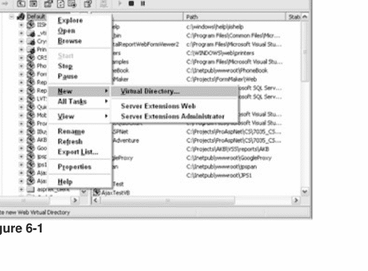

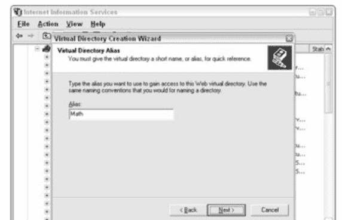

将文件夹命名为 **Math**，然后单击“下一步”。在下一个屏幕中，浏览到标准的 IIS 目录 **C:\InetPub\wwwroot**。在此文件夹下直接创建一个新文件夹，也命名为 **Math**。对于向导的其余屏幕，接受默认设置。完成此操作后，使用 Windows 资源管理器在 Math 下创建一个名为 **bin** 的新文件夹，该文件夹将在服务构建后用于存放 DLL。你的文件夹层次结构现在应该如图 6-3 所示。

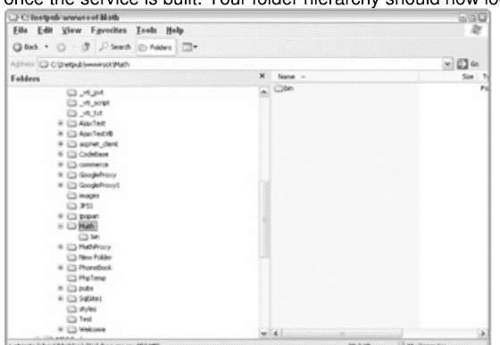

### 编写 Web 服务代码

你正在创建的 Web 服务非常简单。它的名称是 *Math*，并实现了四种基本算术运算：加法、减法、乘法和除法。这四种运算各接受两个定义为浮点数的参数，并返回一个浮点数作为结果。该类本身将用 C# 编码，Web 服务将在 ASP.NET 中发布。

在你最喜欢的文本编辑器中创建一个新文件，并添加以下三行代码：

```csharp
using System;
using System.Web;
using System.Web.Services;
```

这段代码不会添加任何额外功能，但它可以让你不必输入完全限定的类名。由于你将使用这些命名空间中的多个类，在此处引用它们可以节省空间。

接下来，创建一个名为 *Wrox.Services* 的命名空间和一个名为 *Math* 的类，该类继承自 System.Web.Services.WebService：

```csharp
namespace Wrox.Services
{
    [WebService (Description = "Contains a number of simple arithmetical functions",
                  Namespace = "http://www.wrox.com/services/math")]
    public class Math : System.Web.Services.WebService
    {
        //class code here
    }
}
```

`namespace` 关键字的使用方式与 XML 中的命名空间类似；它意味着 Math 类的全名是 *Wrox.Services.Math*。在命名空间定义内部紧跟着一个名为 *WebService* 的属性，它将下一行的类标记为 Web 服务。这样做可以为该类启用额外功能，例如生成 WSDL 文件。你还会注意到包含了一个 `Description` 参数（它也会出现在 WSDL 文件中）。

然后是类名 *Math*，它继承自基类 System.Web.Services.WebService。从这个类继承意味着你无需担心编写 Web 服务的任何特定代码；基类会处理所有这些。你可以专注于编写将作为 Web 服务一部分发布的方法。

定义一个用于 Web 服务的方法就像编写一个常规方法并用特殊的 `WebMethod` 属性标记它一样简单：

```csharp
[WebMethod(Description = "Returns the sum of two floats as a float")]
public float add(float op1, float op2)
{
    return op1 + op2;
}
```

再次强调，代码非常简单。（有什么比加法操作更简单的吗？）任何前面有 `WebMethod` 属性的方法都被视为 Web 服务的一部分。`Description` 参数将成为生成的 WSDL 文件的一部分。虽然你可以编写任意多的方法，但这里是本示例的完整代码，包括四个算术方法：

```csharp
using System;
using System.Web;
using System.Web.Services;

namespace Wrox.Services
{
    [WebService (Description = "Contains a number of simple arithmetical functions",
                  Namespace = "http://www.wrox.com/services/math")]
    public class Math : System.Web.Services.WebService
    {
        [WebMethod(Description = "Returns the sum of two floats as a float")]
        public float add(float op1, float op2)
        {
            return op1 + op2;
        }

        [WebMethod(Description = "Returns the difference of two floats as a float")]
        public float subtract(float op1, float op2)
        {
            return op1 - op2;
        }

        [WebMethod(Description = "Returns the product of two floats as a float")]
        public float multiply(float op1, float op2)
        {
            return op1 * op2;
        }

        [WebMethod(Description = "Returns the quotient of two floats as a float")]
        public float divide(float op1, float op2)
        {
            return op1 / op2;
        }
    }
}
```

将此文件保存在 Math 目录中，并命名为 `Math.asmx.cs`。

创建另一个文本文件并输入以下行：

```csharp
<%@ WebService Language="c#" Codebehind="Math.asmx.cs" Class="Wrox.Services.Math" %>
```

这是使用你刚刚创建的 `Math` 类的 ASP.NET 文件。`@WebService` 指令告诉页面充当 Web 服务。其他属性的含义应该相当明显：`Language` 指定要使用的代码语言；`Codebehind` 指定代码所在的文件名；`Class` 指定要使用的类的完全限定名。同样将此文件保存在 Math 目录中，命名为 `Math.asmx`。

### 创建程序集

创建这两个文件后，你可以继续下一阶段：将源代码编译成将存放在 DLL 中的程序集。为此，你可以使用 .NET SDK 附带的 C# 编译器。它位于你的 Windows 目录下的 `Microsoft.Net\Framework\<版本号>` 文件夹中（例如，`C:\WINDOWS\Microsoft.NET\Framework\v1.1.4322\`）。

编译和调试代码的最简单方法是创建一个批处理文件。创建另一个文本文件并输入以下内容（尽管书籍格式如此，但它应该都在一行上）：

```batch
C:\WINDOWS\Microsoft.NET\Framework\v1.1.4322\csc.exe /r:System.dll /r:System.Web.dll /r:System.Web.Services.dll /t:library /out:bin\Math.dll Math.asmx.cs
```

请记住，如有必要请修改 `csc.exe` 的路径，并将其保存到 Math 文件夹中，命名为 MakeService.bat。

> **重要提示** 如果你使用的是记事本，请小心使用“另存为”对话框。确保将“文件类型”框设置为“所有文件”，或者用双引号括起文件名。否则，记事本会为你的文件添加 .txt 扩展名。

接下来，你需要编译 DLL。从“开始”⇒“运行”打开命令提示符，然后输入 **cmd**。现在通过输入 **cd \inetpub\wwwroot\Math** 导航到 Math 文件夹。最后，运行以下批处理文件：

```batch
C:\inetpub\wwwroot\Math\MakeService.bat
```

如果一切顺利，你应该会看到编译器显示一些版本和版权信息，然后是一个空行。这是个好消息，表明编译成功。（如果有任何错误，它们将被输出到控制台。检查指示的行并更正任何语法或拼写错误。）

假设 DLL 已编译，你就可以测试服务了。.NET Web 服务的一个优点是它会自动为你创建一个完整的测试工具。打开你的 Web 浏览器并导航到 http://localhost/Math/math.asmx。你应该很快就会看到一个类似于图 6-4 所示的页面。

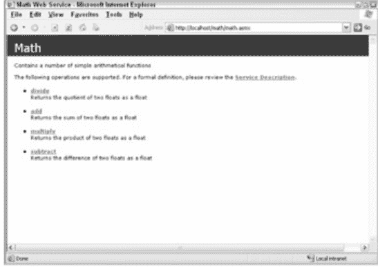

你可以选择尝试这四种方法中的任何一种，或者你可以通过单击“服务描述”链接来查看生成的 WSDL 文件。这将显示一个类似于本章前面示例的 WSDL 文件，但其中将包含所有四个方法的条目。

> **重要提示** 查看 WSDL 文件的另一种方法是在 Web 服务 URL 后添加 **?WSDL**，例如 **http://localhost/Math/math.asmx?WSDL**。

由于你可能已经对 `add` 方法感到厌倦，尝试一下 `divide` 方法吧。从上一个屏幕单击链接应该会显示图 6-5 中的页面。


**图 6-5**

在分隔标题下方是你使用 `WebMethod` 属性时填写的说明，再往下是一个小型测试表单。如果你输入两个数字，例如 22 和 7，你将收到如**图 6-6** 所示的响应。

**图 6-6**

在生产环境中，你现在可以移除 `Math.asmx.cs` 文件，因为它不再需要了。`Math.asmx` 仅是将所有请求直接传递给 DLL。

此测试工具不使用 SOAP 进行请求和响应。相反，它将两个操作数作为 POST 请求传递；如何执行此操作的详细信息显示在**图 6-5** 中的 divide 页面底部。既然你已经定义了一个 Web 服务，现在是时候使用 Ajax 来调用它了。

### Web 服务与 Ajax

现在你已经对 Web 服务有了基本了解，并创建了自己的服务，你可能想知道这与 Ajax 有何关系。很简单，Web 服务是 Ajax 应用程序获取信息的另一条途径。在上一章中，你学习了如何检索和使用 RSS 和 Atom 源向用户显示信息，这与使用 Web 服务非常相似。主要区别在于，通过使用 Web 服务，你能够将信息传递给服务器进行操作并返回；而不仅仅是拉取信息。

只要你的用户使用现代浏览器，你就可以使用 JavaScript 在网页中调用 Web 服务。Internet Explorer 5.0 及更高版本，以及 Mozilla 系列浏览器（包括 Firefox）都具有允许调用 Web 服务的功能。

### 创建测试工具

首先，你需要一个测试工具来测试从浏览器调用 Web 服务的各种方法。此测试工具相当简单：一个列表框用于选择要执行的四种算术运算之一，每个操作数一个文本框，以及一个调用服务的按钮。这些控件在页面完全加载之前是禁用的。在这些控件下方是另一个用于显示有效结果的文本框，以及两个用于显示请求和响应数据的文本区域：

```html
<html>
  <head>
    <title>Web Service Test Harness</title>
    <script type="text/javascript">
      var SERVICE_URL = "http://localhost/Math/Math.asmx";
      var SOAP_ACTION_BASE = "http://www.wrox.com/services/math";

      function setUIEnabled(bEnabled) {
        var oButton = document.getElementById("cmdRequest");
        oButton.disabled = !bEnabled;
        var oList = document.getElementById("lstMethods");
        oList.disabled = !bEnabled;
      }

      function performOperation() {
        var oList = document.getElementById("lstMethods");
        var sMethod = oList.options[oList.selectedIndex].value;
        var sOp1 = document.getElementById("txtOp1").value;
        var sOp2 = document.getElementById("txtOp2").value;

        // Clear the message panes
        document.getElementById("txtRequest").value = "";
        document.getElementById("txtResponse").value = "";
        document.getElementById("txtResult").value = "";
        performSpecificOperation(sMethod, sOp1, sOp2);
      }
    </script>
  </head>
  <body onload="setUIEnabled(true)">
    Operation: <select id="lstMethods" style="width: 200px" disabled="disabled">
        <option value="add" selected="selected">Add</option>
        <option value="subtract">Subtract</option>
        <option value="multiply">Multiply</option>
        <option value="divide">Divide</option>
    </select>
    <br/><br/>
    Operand 1: <input type="text" id="txtOp1" size="10"/><br/>
    Operand 2: <input type="text" id="txtOp2" size="10"/><br/><br/>
    <input type="button" id="cmdRequest"
        value="Perform Operation"
        onclick="performOperation();" disabled="disabled"/>
    <br/><br/>
    Result: <input type="text" size="20" id="txtResult">
    <br/>
    <textarea rows="30" cols="60" id="txtRequest"></textarea>
    <textarea rows="30" cols="60" id="txtResponse"></textarea>
  </body>
</html>
```

`setUIEnabled()` 函数用于启用和禁用测试工具的用户界面。这确保一次只发送一个请求。还定义了两个常量 `SERVICE_URL` 和 `SOAP_ACTION_BASE`，分别包含 Web 服务的 URL 和调用它所需的 SOAP 操作头。按钮调用一个名为 `performOperation()` 的函数，该函数收集相关数据并清除文本框，然后调用 `performSpecificOperation()`。此方法必须由用于执行 Web 服务调用的特定测试定义（将通过 JavaScript 文件包含）。根据你的个人浏览器偏好设置，该页面类似于图 6-7。

**图 6-7**

### Internet Explorer 的方法

在早期为让开发者对 Web 服务产生兴趣的努力中，微软为 Internet Explorer 开发并发布了一种 Web 服务行为。*行为*允许你重新定义现有 HTML 元素的功能、属性和方法，或创建一个全新的元素。行为的优点是将功能封装到一个扩展名为 .htc 的单个文件中。尽管行为的承诺从未达到预期，但 Web 服务行为是一个可靠的组件，对 Web 开发者非常有用。你可以从 http://msdn.microsoft.com/library/default.asp?url=/workshop/author/webservice/webservice.asp 下载此行为。

注意：此文件及本章相关的其他文件包含在 Professional Ajax 的代码下载中，位于 www.wrox.com。

你可以通过多种方式向元素添加行为。最直接的方法是使用元素的 CSS style 属性。要将 Web 服务行为添加到 `<div/>`，代码如下：

```html
<div id="divServiceHandler" style="behavior: url(webservice.htc);"></div>
```

这假设该行为在服务器上与网页位于同一文件夹中。

要展示如何使用此行为，创建一个新版本的测试工具，并将高亮显示的行直接插入 `<body/>` 元素下方，如下所示：

```html
<body onload="setUIEnabled(true);">
<div id="divServiceHandler" style="behavior: url(webservice.htc);"></div>
Operation: <select id="lstMethods" style="width: 200px" name="lstMethods" disabled="disabled">
```

下一步是定义特定于使用 Web 服务行为的 `performSpecificOperation()` 方法。此方法接受三个参数：方法名和两个操作数。代码如下：

```javascript
var iCallId = 0;
function performSpecificOperation(sMethod, sOp1, sOp2) {
    var oServiceHandler = document.getElementById("divServiceHandler");
    if (!oServiceHandler.Math) {
        oServiceHandler.useService(SERVICE_URL + "?WSDL", "Math");
    }
    iCallId = oServiceHandler.Math.callService(handleResponseFromBehavior, sMethod, sOp1, sOp2);
}
```

变量 `iCallId` 初始化为零。虽然这在测试中不起作用，但可用于跟踪多个同时进行的调用。然后，将附加了行为的 `<div/>` 元素的引用存储在 `oServiceHandler` 中。接下来，进行测试以检查该行为是否已被使用，方法是检查 `Math` 属性是否存在。如果不存在，你必须通过将 WSDL 文件的 URL 和服务的标识名传递给 `useService()` 来设置该行为。使用标识符的原因是为了使该行为能够同时使用多个服务。然后执行 `callService()` 方法，传入回调函数 (`handleResponseFromBehavior()`)、方法名和两个参数。

当收到响应时，回调函数 `handleResponseFromBehavior()` 将被调用：

```javascript
function handleResponseFromBehavior(oResult) {
    var oResponseOutput = document.getElementById("txtResponse");
    if (oResult.error) {
        var sErrorMessage = oResult.errorDetail.code + "\n" + oResult.errorDetail.string;
        alert("An error occurred:\n" + sErrorMessage + "\nSee message pane for SOAP fault.");
        oResponseOutput.value = oResult.errorDetail.raw.xml;
    } else {
        var oResultOutput = document.getElementById("txtResult");
        oResultOutput.value = oResult.value;
        oResponseOutput.value = oResult.raw.xml;
    }
}
```

回调函数被传递一个包含调用详细信息的 `oResult` 对象。如果 `error` 属性不为零，则显示相关的 SOAP 故障详细信息；否则，返回值 `oResult.value` 将显示在页面上。

你可以将 `performSpecificOperation()` 和 `handleResponseFromBehavior()` 函数放在一个外部 JavaScript 文件中，并使用 `<script/>` 元素将它们包含在测试工具页面中，如下所示：

```html
<script type="text/javascript" src="WebServiceExampleBehavior.js"></script>
```

如你所见，使用 Web 服务行为相当简单。所有工作都在后台由行为完成，尽管 `webservice.htc` 文件对于脚本文件来说有点大（51KB），但它可以提供一些非常有用的功能。

**注意：** 如果你想了解该行为的工作原理，请随意使用文本编辑器查看 `webservice.htc` 文件。但需注意；它并非作为教程编写，包含近 2300 行 JavaScript 代码。

### Mozilla 的方法

基于现代 Mozilla 的浏览器，如 Firefox 和 Netscape，在其 JavaScript 实现中内置了一些高级 SOAP 类。这些浏览器试图用更易于使用的类来包装进行 SOAP 调用的基本策略。与前面的示例一样，你首先必须定义 `performSpecificOperation()` 函数：

```javascript
function performSpecificOperation(sMethod, sOp1, sOp2) {
    var oSoapCall = new SOAPCall();
    oSoapCall.transportURI = SERVICE_URL;
    oSoapCall.actionURI = SOAP_ACTION_BASE + "/" + sMethod;
    var aParams = [];
    var oParam = new SOAPParameter(sOp1, "op1");
```


### 通用方法

在几乎所有现代浏览器上使用 Web 服务的唯一方式是使用 XMLHttp。由于 Internet Explorer、Firefox、Opera 和 Safari 都对 XMLHttp 提供了一些基本支持，因此这是确保跨浏览器一致性的最佳选择。不幸的是，这种一致性是有代价的——你需要手动构建 SOAP 请求并将其发布到服务器。你还需要负责解析结果并处理错误。

这个场景中的两个主角是 Microsoft 的 `XmlHttp` ActiveX 类和上述更现代的、基于 Mozilla 的浏览器附带的 `XmlHttpRequest` 类。它们具有相似的方法和属性，尽管按照这些事物历史悠久的惯例，Microsoft 在标准确定之前就已率先登场，因此后来发布的 Mozilla 版本更符合 W3C 标准。这些类的基本原理是允许向 Web 地址发出 HTTP 请求。目标不一定要返回 XML——实际上可以检索任何内容——并且还包含了发布数据的能力。对于 SOAP 调用，通常的方法是发送一个 POST 请求，将原始的 `<soap:Envelope>` 作为有效负载。

在这个例子中，你将再次调用测试工具。然而，这次你将使用 zXML 库来创建 XMLHttp 对象，并自行构建完整的 SOAP 调用。该库使用多种技术来检查浏览器支持哪些 XML 类。它还封装了这些类，并添加了额外的方法和属性，以便它们可以以几乎相同的方式使用。SOAP 请求字符串的生成由名为 `getRequest()` 的函数处理：

```javascript
function getRequest(sMethod, sOp1, sOp2)
{
    var sRequest = "<soap:Envelope xmlns:xsi=\""
                       + "http://www.w3.org/2001/XMLSchema-instance\" "
                       + "xmlns:xsd=\"http://www.w3.org/2001/XMLSchema\" "
                       + "xmlns:soap=\""
                       + "http://schemas.xmlsoap.org/soap/envelope/\">\n"
                       + "<soap:Body>\n"
                       + "<" + sMethod + " xmlns=\"" + SOAP_ACTION_BASE +
                       "\">\n"
                       + "<op1>" + sOp1 + "</op1>\n"
                       + "<op2>" + sOp2 + "</op2>\n"
                       + "</" + sMethod + ">\n"
                       + "</soap:Body>\n"
                       + "</soap:Envelope>\n";
    return sRequest;
}
```

`getRequest()` 函数非常直接；它只是以适当的格式构造 SOAP 字符串。（适当的格式可以在创建 Math 服务时描述的 .NET 测试工具中看到。）完整的 SOAP 字符串由 `getRequest()` 返回，并由 `performSpecificOperation()` 用于构建 SOAP 请求：

```javascript
function performSpecificOperation(sMethod, sOp1, sOp2) {
    oXmlHttp = zXmlHttp.createRequest();
    setUIEnabled(false);
    var sRequest = getRequest(sMethod, sOp1, sOp2);
    var sSoapActionHeader = SOAP_ACTION_BASE + "/" + sMethod;
    oXmlHttp.open("POST", SERVICE_URL, true);
    oXmlHttp.onreadystatechange = handleResponse;
    oXmlHttp.setRequestHeader("Content-Type", "text/xml");
    oXmlHttp.setRequestHeader("SOAPAction", sSoapActionHeader);
    oXmlHttp.send(sRequest);
    document.getElementById("txtRequest").value = sRequest;
}
```

首先，调用 `zXmlHttp` 库来创建一个 XMLHttp 请求。如前所述，如果你使用 Internet Explorer，这将是 ActiveX 类的一个实例；如果你使用基于 Mozilla 的浏览器，则是 XmlHttpRequest 类的实例。接收到的对象的 `open` 方法尝试初始化请求。第一个参数声明此请求将是一个包含数据的 POST 请求，然后是服务的 URL，接着是一个布尔参数，指定此请求是异步的还是代码应在调用后等待响应。

请求的 `onreadystatechange` 属性指定了当请求状态改变时将调用哪个函数。

---

此脚本利用了许多内置类，其中第一个是 SOAPCall。此类以与 Internet Explorer 的 Web 服务行为类似的方式封装了 Web 服务功能。创建 SOAPCall 实例后，你需要设置两个属性：transportURI（指向 Web 服务位置）和 actionURI（指定 SOAP 操作和方法名）。

接下来，使用 SOAPParameter 构造函数创建两个参数，该构造函数接受要创建的参数的值和名称。每个参数的命名空间 URI 都被设置为 WSDL 模式部分中 targetNamespace 的值。理论上这不应该是必需的，但 Mozilla SOAP 类似乎是为 RPC 风格设计的，而我们的服务使用的是文档风格，因此需要这个额外的步骤。这两个参数都被推送到 aParams 数组中。encode() 方法为调用准备所有数据。此调用有七个参数。第一个是正在使用的 SOAP 版本，除非需要特定版本很重要，否则可以设置为零。第二个参数是要使用的方法的名称，第三个是 WSDL 文件模式部分中的 targetNamespace。下一个参数是调用中需要多少个额外头的计数（本例中为零），后面是这些头的数组（此处设置为 null）。最后两个参数分别包含发送的 SOAPParameter 对象的数量和实际参数。

接下来，你实际上需要发送请求，你可以通过使用 asyncInvoke() 方法来完成，如下所示：

```javascript
function performSpecificOperation(sMethod, sOp1, sOp2)
{
    var oSoapCall = new SOAPCall();
    oSoapCall.transportURI = SERVICE_URL;
    oSoapCall.actionURI = SOAP_ACTION_BASE + "/" + sMethod;
    var aParams = [];
    var oParam = new SOAPParameter(sOp1, "op1");
    oParam.namespaceURI = SOAP_ACTION_BASE;
    aParams.push(oParam);
    oParam = new SOAPParameter(sOp2, "op2");
    oParam.namespaceURI = SOAP_ACTION_BASE;
    aParams.push(oParam);
    oSoapCall.encode(0, sMethod, SOAP_ACTION_BASE, 0, null,
        aParams.length, aParams);
    var oSerializer = new XMLSerializer();
    document.getElementById("txtRequest").value =
        oSerializer.serializeToString(oSoapCall.envelope);
    setUIEnabled(false);
    oSoapCall.asyncInvoke(
        function (oResponse, oCall, iError)
        {
            var oResult = handleResponse(oResponse,
                oCall, iError);
            showSoapResults(oResult);
        }
    );
}
```

`asyncInvoke()` 方法只接受一个参数：一个回调函数（`handleResponse()`）。当调用返回时，此函数将被 SOAP 调用传递三个参数：一个 `SOAPResponse` 对象、一个指向原始 SOAP 调用的指针（用于跟踪多个实例，如果需要的话）以及一个错误代码。这些都传递给 `handleResponse` 函数进行处理：
`function handleResponse(oResponse, oCall, iError)`

```javascript
function handleResponse(oResponse, oCall, iError)
{
    setUIEnabled(true);
    if (iError != 0)
    {
        alert("Unrecognized error.");
        return false;
    }
    else
    {
        var oSerializer = new XMLSerializer();
        document.getElementById("txtResponse").value =
            oSerializer.toString(oResponse.envelope);
        var oFault = oResponse.fault;
        if (oFault != null)
        {
            var sName = oFault.faultCode;
            var sSummary = oFault.faultString;
            alert("An error occurred:\n" + sSummary
                + "\n" + sName
                + "\nSee message pane for SOAP fault");
            return false;
        }
        else
        {
            return oResponse;
        }
    }
}
```

如果 `error` 代码不为零，则发生了一个无法解释的错误。这种情况很少发生；在大多数情况下，错误将通过响应对象的 `fault` 属性返回。

现在使用另一个内置类 `XMLSerializer`。它接受一个 XML 节点，并可以将其转换为字符串或流。在这种情况下，检索并显示在右侧文本区域的是字符串。

如果 `oResponse.fault` 不是 `null`，则发生了 SOAP 错误，因此会构建并显示错误消息给用户，并且不采取进一步的操作。在成功调用之后，响应对象作为函数的返回值传出，并由 `showSoapResults()` 函数处理：

```javascript
function showSoapResults(oResult)
{
    if (!oResult) return;
    document.getElementById("txtResult").value =
        oResult.body.firstChild.firstChild.firstChild.data;
}
```

在检查 `oResult` 有效后，使用 DOM 提取 `<methodResult>` 元素的值。

> **注意** *SoapResponse* 有一个名为 `getParameters` 的方法，理论上可以用于以更优雅的方式检索参数。然而，它似乎不能按照文档风格调用的广告宣传那样工作，因此需要使用更原始的方法来检查 *soap:Body* 的结构。


`performSpecificOperation()`函数随后向HTML请求中添加了两个头部。第一个将内容类型指定为`text/xml`，第二个添加了`SOAPAction`头部。这个值可以从.NET测试工具页面读取，也可以在WSDL文件中作为相关`<soap:operation/>`元素的`soapAction`属性看到。请求发送后，原始的XML将显示在左侧的文本框中。当请求的处理状态发生变化时，`handleResponse()`函数将被调用：

```javascript
function handleResponse()
{
    if (oXmlHttp.readyState == 4)
    {
        setUIEnabled(true);
        var oResponseOutput = document.getElementById("txtResponse");
        var oResultOutput = document.getElementById("txtResult");
        var oXmlResponse = oXmlHttp.responseXML;
        var sHeaders = oXmlHttp.getAllResponseHeaders();
        if (oXmlHttp.status != 200 || !oXmlResponse.xml)
        {
            alert("Error accessing Web service.\n"
                + oXmlHttp.statusText
                + "\nSee response pane for further details.");
            var sResponse = (oXmlResponse.xml ? oXmlResponse.xml : oXmlResponseText);
            oResponseOutput.value = sHeaders + sResponse;
            return;
        }
        oResponseOutput.value = sHeaders + oXmlResponse.xml;
        var sResult = oXmlResponse.documentElement.firstChild.firstChild.firstChild.data;
        oResultOutput.value = sResult;
    }
}
```

`handleResponse()`函数响应请求中任何状态的改变。当`readyState`属性等于4（即完成）时，将不再有更多处理，此时可以检查是否有有效结果。如果`oXmlHttp.status`不等于200或`responseXML`属性为空，则发生了错误，并会向用户显示一条消息。如果错误是一个SOAP错误，该信息也会显示在消息窗格中。然而，如果错误不是SOAP错误，则会显示`responseText`。如果调用成功，原始XML将显示在右侧的文本框中。

假设XML响应可用，有多种方法可以提取实际结果，包括XSLT、使用DOM或文本解析；不幸的是，这些方法中很少有能跨浏览器一致地工作。DOM方法通过逐步遍历树状结构的方式并不十分优雅，但它确实有一个优点：适用于任何类型的XML文档。

### 跨域Web服务

到目前为止，本章中你一直在调用与访问页面位于同一域的服务。通过这样做，你避免了跨域脚本（也称为*跨站脚本*，或XSS）的问题。正如本书前面所讨论的，这个问题是由于允许对外部网站的调用存在安全风险。如果Web服务与调用页面在同一域，浏览器将允许SOAP请求，但如果你想使用Google或Amazon.com的服务之一呢？

为此，你需要使用一个*服务器端代理*，它运行在你的Web服务器上，并代表客户端发起调用。代理随后将收到的信息返回给客户端。这种设置类似于企业网络中常见的Web代理服务器模型。在该模型中，所有请求都被传递给一台中央服务器，该服务器检索网页并将其传递给请求者。

### Google Web APIs服务

Google提供了多种可通过其Web服务调用的方法，包括检索页面的缓存副本以及更明显的给定搜索短语的结果。你将用来演示服务器端代理的方法是`doSpellingSuggestion`，它接受一个短语并返回Google认为你想要输入的内容。如果你的短语没有拼写错误，或者太晦涩以至于无法提供一个建议，则返回一个空字符串。

**重要提示**  
Google Web APIs服务的开发者工具包可以在[www.google.com/apis/index.html](http://www.google.com/apis/index.html)找到。该工具包包含服务的SOAP和WSDL标准，以及C#、Visual Basic .NET和Java的示例。

你需要向Google注册以接收安全密钥，从而允许你访问该服务。关于其如何用于商业和开发目的，也有相应的规则。

### 设置代理

在下载了Google文档并收到密钥后，你需要在自己的服务器上设置一个服务，该服务将接受用户的调用并将其传递给Google。基本服务的构建方式与前面讨论的Math服务相同。

首先，打开IIS管理工具（开始 -> 管理工具 -> Internet信息服务器）。展开左侧的树状结构以显示“默认网站”节点，然后右键单击并选择“新建” -> “虚拟目录”。在虚拟目录创建向导的“别名”字段中，将新目录命名为**GoogleProxy**，然后单击“下一步”。在下一个屏幕中，浏览到标准的IIS目录`C:\InetPub\wwwroot`，并创建一个同样名为**GoogleProxy**的新文件夹。对于向导的其余屏幕，接受默认设置，然后使用Windows资源管理器在GoogleProxy下创建一个名为**bin**的新文件夹。

接下来，打开你的文本编辑器并创建以下文件，全部写在一行：

```
<%@ WebService Language="C#"
    Codebehind="GoogleProxy.asmx.cs"
    Class="Wrox.Services.GoogleProxyService" %>
```

将其保存为`GoogleProxy.asmx`，放在GoogleProxy目录中。

现在创建主文件`GoogleProxy.asmx.cs`：

```csharp
using System;
using System.Web;
using System.Web.Services;
using GoogleService;

namespace Wrox.Services
{
    [WebService(Description = "Enables calls to the Google API",
                Namespace = "http://www.wrox.com/services/googleProxy")]
    public class GoogleProxyService : System.Web.Services.WebService
    {
        readonly string GoogleKey = "EwVqJPJQFHL4inHoIQMEP9jExTpcf/KG";

        [WebMethod(Description = "Returns Google spelling suggestion for a given phrase.")]
        public string doSpellingSuggestion(string Phrase)
        {
            GoogleSearchService s = new GoogleSearchService();
            s.Url = "http://api.google.com/search/beta2";
            string suggestion = "";
            try
            {
                suggestion = s.doSpellingSuggestion(GoogleKey, Phrase);
            }
            catch(Exception Ex)
            {
                throw Ex;
            }
            if (suggestion == null) suggestion = "No suggestion found.";
            return suggestion;
        }
    }
}
```

记得为`GoogleKey`变量输入你的Google密钥值，然后将此文件与其他文件保存在同一位置。

代码本身相当直接；所有实际工作都由`GoogleSearchService`完成。`doSpellingSuggestion`方法创建了`GoogleSearchService`类的一个实例。然后设置了服务的URL。这一步并非总是必要的，但我们发现能够轻松更改服务的URL通常很有帮助。在生产环境中，URL将从配置文件中读取，使你能够轻松地在服务器之间切换。

现在调用`doSpellingSuggestion`方法，传入Google密钥和`Phrase`参数。这是使用服务器端代理的另一个优势：你可以将敏感信息（如你的密钥）与浏览器的客户端环境隔离开来。如果抛出异常，它将被重新抛出并作为SOAP错误返回。如果返回的`suggestion`为null，则返回一个合适的字符串；否则，建议将直接传回。

你现在创建与Google交互的类。首先将`GoogleSearch.wsdl`文件复制到`GoogleProxy`文件夹中，然后打开命令提示符，导航到`GoogleProxy`，并运行以下命令（你可以忽略关于缺少架构的警告）：

```
WSDL /namespace:GoogleService /out:GoogleSearchService.cs GoogleSearch.wsdl
```

WSDL实用程序读取`GoogleSearch.wsdl`文件并创建一个用于与服务通信的类的源代码。该类将位于`GoogleService`命名空间中，正如WSDL第一个参数所指定的那样。这段源代码需要转换为DLL，为此你需要像之前一样使用C#编译器。在命令提示符处输入以下内容，或使用代码下载中名为`MakeGoogleServiceDLL.bat`的批处理文件：

> **重要提示** `WSDL.exe`似乎安装在多个不同的位置，具体取决于机器上安装的其他Microsoft组件。在安装了Visual Studio .NET的机器上，它可能位于`C:\Program Files\Microsoft Visual Studio.NET 2003\SDK\v1.1\Bin`，但你可能需要在你的机器上搜索它。

```
C:\WINDOWS\Microsoft.NET\Framework\v1.1.4322\csc.exe /r:System.dll /r:System.Web.dll /r:System.Web.Services.dll /t:library /out:bin\GoogleSearchService.dll GoogleSearchService.cs
```

与之前一样，`/r:`参数告诉编译器需要哪些DLL来为`GoogleSearchService`目标DLL提供支持类。

最后一步是编译`GoogleProxy`类本身：

```
C:\WINDOWS\Microsoft.NET\Framework\v1.1.4322\csc.exe /r:System.dll /r:System.Web.dll /r:System.Web.Services.dll /r:bin\GoogleSearchService.dll /t:library /out:bin\GoogleProxy.dll GoogleProxy.asmx.cs
```

注意，引用了刚刚创建的`GoogleSearchService.dll`。

你现在可以输入以下URL来测试服务了：
http://localhost/GoogleProxy/GoogleProxy.asmx

你应该会看到一个标准屏幕，如图6-8所示。


## 总结

本章向您介绍了 Web 服务的概念，这是一种允许数据从互联网上的一个位置传输到另一个位置的架构。您了解了 Web 服务及相关技术（如 SOAP、WSDL 和 REST）的演进过程。同时还讨论了 SOAP 和 REST 服务之间的异同。

接下来，您学习了如何使用 ASP.NET 和 C# 创建自己的 Web 服务。这包括下载 .NET SDK 以及使用内置的 Web 服务创建和管理工具。您还学习了如何使用生成的 .NET 测试工具来检查和测试您的 Web 服务。

然后，您继续为 Internet Explorer 创建了一个测试工具客户端，之后又为 Mozilla 创建了一个，并使用了不同的技术来调用 Web 服务。您了解了 Internet Explorer 的 Web 服务行为和 Mozilla 中的高级 SOAP 类。最后创建的测试工具旨在通用，它使用 XMLHttp 来发送和接收 SOAP 消息。

最后，您了解了 Web 服务的跨域问题以及如何使用服务器端代理来避免它们。

在本章中，使用了 SOAP 规范在客户端和服务器之间传递参数。虽然这是一种健壮且灵活的方法，但它为流程增加了大量开销，并且意味着客户端必须能够处理 XML 及其所有的复杂性。下一章将展示一种更简单、更非正式的在机器之间传递数据的方法，称为 JavaScript 对象表示法（JSON）。

## 第 7 章：JSON

### 概述

随着 Web 服务的日益普及，XML 实际上已成为事实上的数据传输标准。然而，XML 也并非没有反对者。例如，一些人认为它对于数据传输目的来说过于冗长，需要通过互联网发送多得多的字节信息才能完成本可以用更小形式完成的工作。考虑到这一点，已经开发了新的 XML 压缩形式甚至全新的 XML 格式，例如二进制 XML。所有这些解决方案都通过扩展或添加到 XML 来工作，这使得向后兼容性成为一个问题。长期从事软件工作的工程师 Douglas Crockford 提出了一种基于 JavaScript 的新数据格式，称为 *JavaScript 对象表示法*（JSON）。

到目前为止，您已经使用纯文本或 XML 与服务器来回传输数据。本章介绍了在 Ajax 通信中使用 JSON 作为这些更传统数据格式的替代方案。

### 什么是 JSON？

JSON 是一种非常轻量级的数据格式，基于 JavaScript 语法的一个子集，即数组和对象字面量。因为它使用 JavaScript 语法，所以 JSON 定义可以包含在 JavaScript 文件中，并且无需额外的解析（与基于 XML 的语言不同）即可访问。但在使用 JSON 之前，理解数组和对象字面量的特定 JavaScript 语法非常重要。

### 数组字面量

对于不熟悉 JavaScript 字面量表示法的人来说，数组字面量是通过使用方括号（`[` 和 `]`）来指定的，其中包含一个逗号分隔的 JavaScript 值列表（指字符串、数字、布尔值或 `null` 值），例如：

```
var aNames = ["Benjamin", "Michael", "Scott"];
```

然后，您可以使用数组名和方括号表示法来访问数组中的值：

```
alert(aNames[0]);   //输出 "Benjamin"
alert(aNames[1]);   //输出 "Michael"
alert(aNames[2]);   //输出 "Scott"
```

请注意，数组中的第一个位置是 `0`，该位置的值是 "`Benjamin`"。

因为 JavaScript 中的数组是无类型的，所以它们可以用来存储任何数量的不同数据类型：

```
var aValues = ["string", 24, true, null];
```

这个数组包含一个字符串，后跟一个数字，再跟一个布尔值，最后是一个 `null` 值。这完全是合法且完全正确的 JavaScript。

如果您要定义一个数组而不使用字面量表示法，则必须使用 `Array` 构造函数，例如：

```
var aValues = new Array("string", 24, true, null);
```

> **重要提示** 需要注意的是，在编写 JavaScript 时，两种方式都是可以接受的，但只有数组字面量在 JSON 中是有效的。

### 对象字面量

对象字面量用于以名称-值对的形式存储信息，最终创建一个对象。对象字面量由两个花括号（{ 和 }）定义。在这些花括号内部可以放置任意数量的名称-值对，用字符串、冒号和值来定义。每个名称-值对后面都必须跟一个逗号，除了最后一个（这更类似于在 Perl 中定义关联数组）。例如：

```
var oCar = {
    "color" : "red",
    "doors" : 4,
    "paidFor" : true
};
```

此代码创建了一个具有三个属性的对象，属性名为 color、doors 和 paidFor，每个属性包含不同的值。您可以使用对象名和点表示法来访问这些属性，例如：

```
alert(oCar.color);      //输出 "red"
alert(oCar.doors);      //输出 "4"
alert(oCar.paidFor);    //输出 "true"
```

您也可以使用方括号表示法，并将属性名作为字符串值传入（就像使用对象字面量表示法定义时一样）：

```
alert(oCar["color"]);    //输出 "red"
alert(oCar["doors"]);    //输出 "4"
alert(oCar["paidFor"]);  //输出 "true"
```

同一个对象也可以使用 JavaScript Object 构造函数来创建，如下所示：

```
var oCar = new Object();
oCar.color = "red";
oCar.doors = 4;
oCar.paidFor = true;
```

如您所见，对象字面量表示法比使用 Object 构造函数所需的代码少得多。

> **重要提示** 再次强调，尽管这两种方式在 JavaScript 中都是有效的，但只有对象字面量表示法在 JSON 中是有效的。

### 混合字面量

可以混合使用对象和数组字面量，创建一个对象数组或一个包含数组的对象。假设您想要创建一个类似上一节创建的汽车对象的数组。您可以这样做：

```
var aCars = [
    {
        "color" : "red",
        "doors" : 2,
        "paidFor" : true
    },
    {
        "color" : "blue",
        "doors" : 4,
        "paidFor" : true
    },
    {
        "color" : "white",
        "doors" : 2,
        "paidFor" : false
    }
];
```

这段代码定义了一个数组 `aCars`，其中包含三个对象。这三个对象每个都有名为 `color`、`doors` 和 `paidFor` 的属性。（当然，每个对象代表一辆汽车。）您可以使用方括号和点表示法的组合来访问数组中的任何信息。例如，要获取数组中第二辆车的车门数，以下代码行将完成此操作：

```
alert(aCars[1].doors); //输出 "4"
```

在此示例中，您首先获取数组中第二个位置（位置 1）的值，然后获取名为 `doors` 的属性。

您还可以定义数组位于对象字面量内部，例如：

```
var oCarInfo = {
    "availableColors" : [ "red", "white", "blue" ],
    "availableDoors" : [ 2, 4 ]
};
```

此代码定义了一个名为 `oCarInfo` 的对象，该对象有两个属性 `availableColors` 和 `availableDoors`。这两个属性都是数组，分别包含字符串和数字。要访问这里的值，只需反转方括号和点表示法的顺序即可。因此，要获取第二个可用颜色，您可以这样做：

```
alert(oCarInfo.availableColors[1]);
```

在此示例中，您首先返回名为 `availableColors` 的属性，然后获取第二个位置（位置 1）的值。但这与 JSON 有什么关系呢？

### JSON 语法

JSON 语法实际上只是混合使用对象和数组字面量来存储数据。与上一节示例的唯一区别是，JSON 没有变量。请记住，JSON 只表示数据；它没有变量、赋值或等式的概念。因此，上一个示例的 JSON 代码就是：

```
{
    "availableColors" : [ "red", "white", "blue" ],
    "availableDoors" : [ 2, 4 ]
}
```


或其他形式的客户端-服务器通信）并存储在名为 `sJSON` 的变量中。你现在拥有一个信息字符串，而不是一个对象，更不是包含两个数组的对象。要将其转换为一个对象，你可以简单地使用 JavaScript 的 `eval()` 函数，像这样：

```javascript
var oCarInfo = eval("(" + sJSON + ")");
```

此示例用圆括号将 JSON 文本括起来，然后将该字符串传递给 `eval()` 函数，该函数的行为类似于 JavaScript 解释器。此操作的结果是一个与上一节中定义的 `oCarInfo` 对象完全相同的 JavaScript 对象。你可以用完全相同的方式访问此对象中的信息：

```javascript
alert(oCarInfo.availableColors[0]);  //输出 "red"
alert(oCarInfo.availableDoors[1]);  //输出 "4"
```

> **重要提示**：在将任何 JSON 字符串传递给 `eval()` 之前，包含额外的圆括号非常重要。请记住，花括号在 JavaScript 中也代表语句（例如与 `if` 语句一起使用）。解释器知道花括号代表对象而不是语句的唯一方法是，查看它之前是否有等号，或者查看它周围是否有圆括号（这表示代码是要被计算的表达式，而不是要运行的语句）。

你可以看到使用 JSON 作为 JavaScript 通信数据格式的明显好处：它将数据的评估从你手中移出，因此让你能更快地访问其中包含的信息。

### JSON 编码/解码

作为其 JSON 资源的一部分，Crockford 创建了一个工具，可用于在 JSON 和 JavaScript 对象之间进行解码和编码。此工具的源代码可从 [www.crockford.com/JSON/json.js](http://www.crockford.com/JSON/json.js) 下载。

你可能会问自己，“我不是刚刚学会使用 `eval()` 函数来解码 JSON 吗？” 答案是肯定的，但使用 `eval()` 存在一个固有的缺陷：它会评估传入其中的任何 JavaScript 代码，而不仅仅是 JSON。在处理企业 Web 应用程序时，这可能是一个巨大的安全风险。为了解决这个问题，你可以使用 `JSON.parse()` 方法（在前面提到的文件中定义），它只会解析和转换 JSON 代码为 JavaScript。例如：

```javascript
var oObject = JSON.parse(sJSON);
```

该工具还提供了一种将 JavaScript 对象转换为 JSON 字符串以供传输的方法。（JavaScript 中没有内置的内置方法来完成此操作。）你只需要将一个对象传递给 `JSON.stringify()` 方法。考虑以下示例：

```javascript
var oCar = new Object();
oCar.doors = 4;
oCar.color = "blue";
oCar.year = 1995;
oCar.drivers = new Array("Penny", "Dan", "Kris");
```

```javascript
document.write(JSON.stringify(oCar));
```

此代码输出以下 JSON 字符串：

```json
{"doors":4,"color":"blue","year":1995,"drivers":["Penny","Dan","Kris"]}
```

有了这个，你现在就可以将信息传输到对你有意义的目的地了。

### JSON 与 XML

如前所述，JSON 相对于 XML 的优势之一是它更紧凑。XML 被一些人认为过于冗长，不适合其目的。但这到底是什么意思？考虑以下 XML 数据：

```xml
<classinfo>
    <students>
        <student>
            <name>Michael Smith</name>
            <average>99.5</average>
            <age>17</age>
            <graduating>true</graduating>
        </student>
        <student>
            <name>Steve Johnson</name>
            <average>34.87</average>
            <age>17</age>
            <graduating>false</graduating>
        </student>
        <student>
            <name>Rebecca Young</name>
            <average>89.6</average>
            <age>18</age>
            <graduating>true</graduating>
        </student>
    </students>
</classinfo>
```

此示例包含有关班级中三名学生的信息。马上就能看到一些并非完全必要的 XML 信息：`<classinfo>` 和 `<students>` 元素。这些元素有助于定义信息的整体结构和含义，但你实际感兴趣的信息是学生及其信息。此外，对于关于学生的每一条信息，信息名称都重复了两次，尽管实际数据只重复了一次（例如，“name” 同时出现在 `<name>` 和 `</name>` 中）。考虑以 JSON 格式化的相同信息：

```json
{ "classinfo" :
    {
        "students" : [
            {
                "name" : "Michael Smith",
                "average" : 99.5,
                "age" : 17,
                "graduating" : true
            },
            {
                "name" : "Steve Johnson",
                "average" : 34.87,
                "age" : 17,
                "graduating" : false
            },
            {
                "name" : "Rebecca Young",
                "average" : 89.6,
                "age" : 18,
                "graduating" : true
            }
        ]
    }
}
```

正如你所看到的，很多多余的信息都不存在了。由于不需要结束标签来匹配开始标签，这大大减少了传输相同信息所需的字节数。不包括空格，JSON 数据是 224 字节，而类似的 XML 数据是 365 字节，节省了超过 100 字节。（这就是为什么 JSON 的创造者 Crockford 称其为“XML 的无脂肪替代品”。）

与 XML 相比，JSON 格式数据的缺点是对普通人来说可读性较差。因为 XML 冗长，所以相当容易理解所表示的数据是什么。JSON 以其简写表示法，用肉眼可能很难破译。当然，可以争辩说数据交换格式永远不应该用肉眼查看。如果你正在使用工具来创建和解析来回传递的数据，那么确实没有理由让数据具有可读性。但这引出了一个问题：是否有可用的 JSON 工具？答案是肯定的。

### 服务器端 JSON 工具

到目前为止，你知道 Ajax 与客户端和服务器之间的交互有关，因此，除非有服务器端工具来协助编码和解码，否则 JSON 对此目的没有用。幸运的是，有相当多的服务器端语言 JSON 工具。尽管讨论所有这些工具超出了本书的范围，但看一下其中一个并使用它开发一个解决方案是有用的。

### JSON-PHP

JSON-PHP 是一个 PHP 工具，用于简化 JSON 信息的编码和解码。此工具由 Michal Migurski 编写，可从 http://mike.teczno.com/json.html 免费获取。要在 PHP 中开始使用 JSON，你只需在页面中包含 JSON.php 文件并使用 JSON 对象。

创建 JSON 对象的新实例非常简单：

```php
<?php
    require_once("JSON.php");
    $oJSON = new JSON();
?>
```

第一行包含包含 `JSON` 对象定义的 `JSON.php` 文件。第二行只是实例化对象并将其存储在变量 `$oJSON` 中。现在你已准备好在你的 PHP 页面中开始编码和解码 JSON。

要将 PHP 对象编码为 JSON 字符串，请使用 `encode()` 方法，该方法接受一个参数：要编码的对象，可以是数组或成熟的对象。对象或数组是如何创建的并不重要，是否使用类定义；所有对象都可以使用此方法进行编码。考虑以下类定义：

```php
<?php
class Person {

    var $age;
    var $hairColor;
    var $name;
    var $siblingNames;

    function Person($name, $age, $hairColor) {
        $this->name = $name;
        $this->age = $age;
        $this->hairColor = $hairColor;
        $this->siblingNames = array();
    }
}
?>
```

此 PHP 代码定义了一个名为 `Person` 的类，用于存储一些个人信息。你可以如下使用此类：

```php
<?php
    $oPerson = new Person("Mike", 26, "brown");
    $oPerson->siblingNames[0] = "Matt";
    $oPerson->siblingNames[1] = "Tammy";
?>
```

要编码 `$oPerson` 对象，你只需将其传递给 `encode()` 方法，像这样：

```php
<?php
    $sJSONText = $oJSON->encode($oPerson);
?>
```

这创建了一个 JSON 字符串：
`{"age":26,"hairColor":"brown","name":"Mike","siblingNames":["Matt","Tammy"]}`

`$oPerson` 对象现在准备好传输到 JavaScript 或任何其他支持 JSON 编码信息的语言。

但如果你已经有一个 JSON 字符串呢？这就是 `decode()` 方法的用武之地。

假设你有前面显示的 JSON 字符串，并希望从中创建一个 PHP 对象。只需将字符串传递给 `decode()` 方法：


<?php
    $oPerson = $oJSON->decode($sJSONText);
?>

现在，`$oPerson` 变量可以像前面示例中的变量一样使用，就好像它是用 `Person` 类创建的一样：

```php
<?php
    print("<h3>Person Information</h3>");
    print("<p>Name: ".$oPerson->name."<br />");
    print("Age: ".$oPerson->age."<br />");
    print("Hair Color: ".$oPerson->hairColor."<br />");
    print("Sibling Names:</p><ul>");

    for ($i=0; $i < count($oPerson->siblingNames); $i++) {
        print("<li>".$oPerson->siblingNames[$i]."</li>");
    }

    print("</ul>");

?>
```

这段代码打印出 `$oPerson` 对象中包含的信息，证明该对象已被正确构造。JSON-PHP 将在本书的多个项目中使用，因为它是处理服务器端语言中 JSON 最简单的方式。

### 其他工具

你可以找到许多用于服务器端语言的 JSON 工具，因此无论你偏好什么，都可以利用 JSON 的强大功能：

- **C#/.NET**：C# JSON 库，由 Douglas Crockford 编写，可在 www.crockford.com/JSON/cs/ 获取。
- **ColdFusion**：CFJSON 库，由 Jehiah Czebotar 编写，可在 http://jehiah.com/projects/cfjson/ 获取。
- **Java**：JSON in Java 实用工具，由 Douglas Crockford 编写，可在 www.crockford.com/JSON/java/ 获取。可在 JSP 中使用。
- **Perl**：JSON 库，由 Makamaka Hannyaharamitu 编写，可在 http://search.cpan.org/dist/JSON/ 获取。
- **PHP**：除了 JSON-PHP，还有 php-json，这是一个由 Omar Kilani 编写的 PHP C 扩展，可在 www.aurore.net/projects/php-json/ 获取。你必须熟悉如何编译带有扩展的 PHP。
- **Python**：json-py 库，由 Patrick D. Logan 编写，可在 https://sourceforge.net/projects/json-py/ 获取。

Douglas Crockford 还在 www.crockford.com/JSON/index.html 维护了一个相当全面的 JSON 实用工具列表。在搜索任何其他语言的 JSON 实用工具之前，请先查看那里。

### 创建自动建议文本框

学习任何新编程概念的最佳方法是将其放入一个实际的例子中。Google Suggest（位于 www.google.com/webhp?complete=1）是一个非常简单的 Ajax 应用程序，许多程序员都花时间对其进行了剖析、分析和重新创建。如果你还没有查看过这个在线应用，现在就去看看吧；它将极大地帮助你理解下面的例子。

这种向用户建议输入值的功能在桌面应用程序中已经存在一段时间了。Google Suggest 将这一想法带到了 Web 上，并在此过程中引发了许多兴奋。正如本书前面提到的，Google Suggest 确实是早期让开发者对 Ajax 概念感到兴奋的应用程序之一。尝试模仿 Google Suggest 的行为来帮助他人理解 Ajax，似乎是合适的。

本节中构建的示例有助于在个人信息表单中选择州或省份。对于处理国际客户的网站来说，通常必须同时包含州/省和国家。但是，将世界上所有的州和省加载到一个下拉框中供用户选择并不是最佳方案。让用户开始输入，然后只检索最有意义的结果要容易得多。自动建议功能非常适合这种用例。

### 功能概述

在构建任何东西之前，确切地理解你正在构建什么总是有益的。任何人都可以声称他们要模仿 Google Suggest 的功能，但这意味着什么？你将在本节中构建的示例具有以下功能：

- **预输入**：当用户输入时，文本框的其余部分会填入当时最佳的建议。随着用户继续输入，文本框会自动调整其建议。建议的文本始终以选中（高亮）状态显示。无论用户输入多快，这都应该能正常工作。
- **建议列表**：同样，在用户输入时，会显示一个包含其他建议的下拉列表。这些建议是在用户输入时自动生成的，因此没有可察觉的延迟。
- **键盘控制**：当建议显示时，用户可以使用键盘上的向上和向下箭头在列表中滚动并选择建议。按 Enter 键会将值放入文本框并隐藏建议列表。Esc 键也可用于隐藏建议。
- **隐藏建议**：下拉建议列表足够智能，可以在文本框未被使用或浏览器窗口被隐藏时自行隐藏。

你可能没有意识到 Google Suggest 做了这么多。这就是 Ajax 的关键：你不需要去想发生了什么，因为它以一种直观的方式工作。

### HTML

任何客户端组件的第一步都是构建将要使用的 HTML。对于自动建议文本框，这包括文本框本身以及建议的下拉列表。你可能熟悉 HTML 文本框：

```html
<input type="text" name="txtAutosuggest" value="" />
```

在大多数情况下，这行代码足以使用一个文本框。问题是某些浏览器（特别是 Windows 上的 Internet Explorer 和所有操作系统上的 Mozilla Firefox）提供了自动完成功能，该功能会根据你之前输入的值下拉显示建议列表。由于这会与你将要提供的建议直接竞争，因此必须将其关闭。为此，将 `autocomplete` 属性设置为 `off`：

```html
<input type="text" name="txtAutosuggest" value="" autocomplete="off" />
```

现在你可以确保不会受到浏览器自动完成行为的干扰。唯一需要设计的其他用户界面组件是建议的下拉列表。

建议下拉列表只不过是一个绝对定位的 `<div/>` 元素，它位于文本框下方，从而产生下拉列表的错觉（见图 7-1）。


在这个 `<div/>` 元素内部是几个其他的 `<div/>` 元素，每个建议一个。通过改变这些元素的样式，可以实现高亮给定建议的外观。创建图 7-1 所示列表的 HTML 如下：

```html
<div class="suggestions">
    <div class="current">Maine</div>
    <div>Maryland</div>
    <div>Massachusetts</div>
    <div>Michigan</div>
    <div>Minnesota</div>
    <div>Mississippi</div>
    <div>Missouri</div>
    <div>Montana</div>
</div>
```

这段 HTML 不会直接编码到主 HTML 文件中；相反，它将由 JavaScript 代码动态创建。但是，你需要了解 HTML 的通用格式才能适当地创建它。

当然，需要一些 CSS 来使下拉列表正常工作。最外层的 `<div/>` 的类为 `suggestions`，其定义如下：

```css
div.suggestions {
    -moz-box-sizing: border-box;
    box-sizing: border-box;
    background-color: white;
    border: 1px solid black;
    position: absolute;
}
```

此 CSS 类的前两行适用于支持两种盒子模型（content box 和 border box）的浏览器（有关更多信息，请阅读 [www.quirksmode.org/css/box.html](http://www.quirksmode.org/css/box.html)）。在怪异模式下，Internet Explorer 默认为 border box；在标准模式下，Internet Explorer 默认为 content box。大多数其他符合 DOM 标准的浏览器（Mozilla、Opera 和 Safari）默认为 content box，这意味着 `<div/>` 元素的渲染方式在不同浏览器之间存在差异。为了解决这个问题，CSS 类的前两行将渲染设置为 border box。第一行 `-moz-box-sizing` 是 Mozilla 特有的，用于较旧的 Mozilla 浏览器；第二行用于支持官方 CSS3 `box-sizing` 属性的浏览器。假设你在页面中使用怪异模式，此类将正常工作。（如果你使用标准模式，只需删除这两行即可。）

其余样式只是添加了一个边框并指定 `<div/>` 元素为绝对定位。

接下来，需要对下拉列表项进行一点格式化：

```css
div.suggestions div {
    cursor: default;
    padding: 0px 3px;
}
```

第一行指定鼠标悬停在下拉列表项上时显示的默认光标（箭头）。如果没有这一行，光标将显示为文本光标，这是文本框和整个网页的常规光标。用户需要相信下拉项不是常规页面流的一部分，而是文本框的附件，而改变光标有助于实现这一点。第二行只是为项目应用了一些内边距（你可以根据需要进行修改）。

最后，需要一些 CSS 来格式化下拉列表中当前选中的项目。当一个项目被选中时，背景将变为蓝色，文本颜色将变为白色。这提供了下拉菜单中常用的基本高亮：

```css
div.suggestions div.current {
    background-color: #3366cc;
    color: white;
}
```

所有这些样式都应包含在名为 `autosuggest.css` 的外部 CSS 文件中。

### 数据库表

为了方便地查询与特定文本片段匹配的州和省份，有必要使用数据库表。有一些开源数据库产品可以与 PHP 很好地配合使用，但最常见的是 MySQL（可在 [www.mysql.org](http://www.mysql.org) 获取）。许多提供 PHP 托管的网络托管公司也提供一个或多个 MySQL 数据库，因此对于本例，将使用 MySQL 作为数据库。

**重要说明：** 尽管本例旨在与 MySQL 一起使用，但它应该能够在其他数据库上运行，只需很少或不需要修改。

数据库表可以很简单，尽管你可能需要更多信息才能使其满足你的实际需求。为了使其工作，你实际上只需要一个列来存储州和省份名称。但是，最好总是定义一个主键，因此此表将包含第二列，其中包含每个州或省份的自增 ID 号。以下 SQL 语句创建了一个名为 `StatesAndProvinces` 的表，包含两列 `Id` 和 `Name`：

```sql
CREATE TABLE StatesAndProvinces (
    Id INT NOT NULL AUTO_INCREMENT,
```


当然，耗时的部分是从世界各国填写州和省的名称。本示例的代码下载（可在 www.wrox.com 获取）包含一个 SQL 文件，该文件将用所有美国州名填充表格，另一个 SQL 文件则会插入所有加拿大的省份和地区。

在数据库表中设置此信息，可以让你快速获取用户已输入文本的建议列表。例如，如果用户输入了字母 *M*，你可以运行以下查询来获取前五个建议：

```sql
SELECT *
FROM StatesAndProvinces
WHERE Name LIKE 'M%'
ORDER BY Name ASC
LIMIT 0, 5
```

此语句返回所有以 *M* 开头的名称中，按字母顺序排列的最多五个建议。稍后，这将用于返回建议的 PHP 代码中。

### 架构

在第 1 章中，你看到了涉及用户界面和 Ajax 引擎在客户端的 Ajax 解决方案的基本架构。自动建议架构遵循这种通用格式，其中用户界面是自动建议控件，Ajax 引擎是建议提供者（参见图 7-2）。

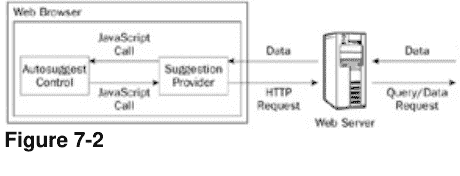

在这种架构中，自动建议控件不知道建议来自何处；它们可能来自客户端或服务器。自动建议控件只知道如何调用建议提供者，以获取文本框中包含的文本的建议。建议提供者处理所有服务器通信，并在建议可用时通知自动建议控件。为了实现这一点，自动建议控件和建议提供者都需要实现特定的接口，以便彼此知道要调用对方的方法。

### 类

需要两个类来表示自动建议功能的两个客户端组件，分别称为 `AutoSuggestControl` 和 `SuggestionProvider`。`AutoSuggestControl` 在创建时会被分配一个 `SuggestionProvider`，以便所有请求都通过它。`SuggestionProvider` 只有一个方法 `requestSuggestions()`，每当需要建议时，`AutoSuggestControl` 会调用此方法。此方法接受两个参数：`AutoSuggestControl` *本身* 和一个布尔值，该值指示当建议返回时控件是否应自动补全。

当建议检索完成后，`SuggestionProvider` 会调用 `AutoSuggestControl` 的 `autosuggest()` 方法，传入建议数组以及传入它的自动补全标志。这允许在请求建议和响应之间存在延迟，从而可以使用异步请求。这种方法听起来比实际更复杂；图 7-3 以更清晰的方式展示了这两个对象之间的交互。

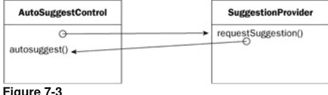

架构设计好之后，就该开始编码了。

### 自动建议控件

`AutoSuggestControl` 类是所有自动建议功能的包装器。为了正常工作，控件需要知道要在哪个文本框上工作以及使用哪个建议提供者。这形成了一个相对简单的构造函数：

```javascript
function AutoSuggestControl(oTextbox, oProvider) {
    this.provider = oProvider;
    this.textbox = oTextbox;
}
```

正是在这个简单的基础上，将构建自动建议文本框的复杂功能。

由于 `AutoSuggestControl` 类相当复杂，将其解释分解为特定类型的功能会简单得多。以下各节逐步构建，完整代码可从 www.wrox.com 下载。

### 实现自动补全

要实现第一个功能——自动补全，理解其确切的工作原理会很有帮助。自动补全文本框会查看用户输入的内容，然后提出建议，仅高亮显示自动添加的部分。例如，如果你在文本框中输入 *Ma*，建议可能是 *Maine*，但只有 *ine* 会被高亮显示。这样，用户可以不受干扰地继续输入，因为任何新字符都会简单地替换高亮部分。

最初，使用 JavaScript 唯一可能的高亮方式是使用 `select()` 方法高亮文本框中的所有文本，如下所示：

```javascript
var oTextbox = document.getElementById("txtState");
oTextbox.select();
```

此代码获取 ID 为 `txtState` 的文本框的引用，然后选择其中包含的所有文本。尽管此功能对于许多日常使用来说很好，但对于实现自动补全来说并不十分有用。幸运的是，Internet Explorer 和 Firefox 都有选择部分文本而不是整个项目的方法（对于其他浏览器，此功能不可用）。但像往常一样，浏览器世界中最大的两个竞争对手以两种完全不同的方式行事。

Internet Explorer 的解决方案是使用文本范围。不要与 DOM 范围混淆，Internet Explorer 文本范围是页面上不可见的文本选择，从一个字符开始，到另一个字符结束。当文本范围填充后，你可以仅高亮其中包含的文本，这非常适合自动补全。要为特定文本框创建文本范围，你可以使用 Internet Explorer 在每个文本框上提供的 `createTextRange()` 方法。

一旦有了文本范围，它的方法就可以让你选择文本的特定部分。虽然有许多文本范围方法，但本示例中唯一需要关注的是 `moveStart()` 和 `moveEnd()`，它们都接受两个参数：一个单位和一个数字。单位可以是 `character`、`word`、`sentence` 或 `textedit`，而数字表示从文本的开始或结束移动的单位数（对于 `moveStart()` 应为正数，对于 `moveEnd()` 应为负数）。当设置了文本范围的端点时，你可以调用其 `select()` 方法来高亮这些字符。例如，要仅选择文本框中的前三个字符，你可以这样做：

```javascript
var oRange = oTextbox.createTextRange();
oRange.moveStart("character", 0);
oRange.moveEnd("character", 3 - oTextbox.value.length);
oRange.select();
oTextbox.focus();
```

请注意，要获得 `moveEnd()` 的适当值，有必要从要选择的字符数（3）中减去文本框中文本的长度。最后一步是将焦点设置到文本框，以便选择可见。（仅当文本框具有焦点时才能选择文本。）这个过程在 Internet Explorer 中有点复杂，但编写脚本相当容易。另一方面，Firefox 非常直接。

Firefox 中的文本框有一个非标准方法 `setSelectionRange()`，它接受两个参数：开始字符的索引和要选择的最后一个字符之后的字符索引。因此，要使用 Mozilla 选择文本框中的前三个字符，你只需要两行代码：

```javascript
oTextbox.setSelectionRange(0, 3);
oTextbox.focus();
```

`AutoSuggestControl` 类中你需要的第一个方法是一个以浏览器特定方式选择字符范围的方法。这个名为 `selectRange()` 的方法为你处理所有繁琐的工作：

```javascript
AutoSuggestControl.prototype.selectRange = function (iStart, iEnd) {
    if (this.textbox.createTextRange) {
        var oRange = this.textbox.createTextRange();
        oRange.moveStart("character", iStart);
        oRange.moveEnd("character", iEnd - this.textbox.value.length);
        oRange.select();
    } else if (this.textbox.setSelectionRange) {
        this.textbox.setSelectionRange(iStart, iEnd);
    }

    this.textbox.focus();
};
```

此方法使用特性检测（检测某些浏览器特性的过程）来确定如何选择字符。它测试 `createTextRange()` 方法是否存在，以确定是否应使用 Internet Explorer 文本范围，并测试 `setSelectionRange()` 方法是否存在，以确定是否应使用 Firefox 方法。参数是要选择的第一个字符和要选择的字符数。然后将这些值传递给浏览器特定的文本选择方法。

#### typeAhead() 方法


### `autosuggest()` 方法

控件中最重要的方法或许是 `autosuggest()`。这个单一方法负责接收一个包含建议项的数组，然后决定如何处理它们。最终，这个方法将被用于实现完整的自动建议功能（包括下拉建议），但目前，它仅用于实现提前输入功能。

由于 `autosuggest()` 会接收一个建议项数组，你可以选择其中任何一个作为提前输入的值。为简单起见，建议始终使用数组中的第一个值。问题在于，可能并非所有值都有对应的建议，此时会传递一个空数组。如果没有建议项，你不应该调用 `typeAhead()`，因此先检查数组的长度非常重要：

```
AutoSuggestControl.prototype.autosuggest = function (aSuggestions) {
    if (aSuggestions.length > 0) {
        this.typeAhead(aSuggestions[0]);
    }
};
```

但建议项从何而来？实际上，调用此方法并传入建议项是建议提供者的职责。此功能的实现在本章后面讨论。

### 处理按键事件

当然，自动建议功能必须通过事件与文本框关联起来。有三种与按键相关的事件：`keydown`、`keypress` 和 `keyup`。`keydown` 事件在用户按下键盘上的键时触发，但在文本框发生任何更改之前。这显然对自动建议没有帮助，因为你需要知道文本框的完整文本；使用此事件意味着会慢一拍。出于同样的原因，`keypress` 事件也不能使用。它类似于 `keydown`，但仅在按下字符键时触发。然而，`keyup` 事件在文本框发生更改后触发，这正是自动建议应该开始工作的时候。

为文本框设置事件处理程序涉及两个步骤：定义一个函数并将其分配为事件处理程序。该函数实际上是自动建议控件的一个方法，名为 `handleKeyUp()`。此方法期望事件对象作为参数传入（如何实现将在后面讨论），以便它能判断按下的键是否应该触发自动建议功能。由于 `keyup` 会在所有键被按下时触发，而不仅仅是字符键，因此当用户使用方向键、Tab 键和键盘上的任何其他键时，你都会收到事件。为了避免干扰文本框的正常工作，应该只在按下字符键时提供任何建议。这就是事件对象的 `keyCode` 属性登场的地方。

大多数现代浏览器（包括 Windows 和 Macintosh 上的 Internet Explorer、Firefox、Opera 和 Safari）都支持 `keyCode` 属性，它返回一个代表被按键的数字代码。利用此属性，可以为特定键设置行为。由于自动建议功能应仅在按下字符键时发生，你需要在进行之前检查此属性是否有合适的值。信不信由你，最简单的方法实际上是检测你想要忽略的键。这种方法更高效，因为字符键比非字符键多。下表显示了所有应忽略键的键码：

| 键 | 键码 | 键 | 键码 |
| :--- | :--- | :--- | :--- |
| Backspace | 8 | Print Screen | 44 |
| Tab | 9 | Delete | 46 |
| Enter | 13 | F1 | 112 |
| Shift | 16 | F2 | 113 |
| Ctrl | 17 | F3 | 114 |
| Alt | 18 | F4 | 115 |
| Pause/Break | 19 | F5 | 116 |
| Caps Lock | 20 | F6 | 117 |
| Esc | 27 | F7 | 118 |
| Page Up | 33 | F8 | 119 |
| Page Down | 34 | F9 | 120 |
| End | 35 | F10 | 121 |
| Home | 36 | F11 | 122 |
| Left Arrow | 37 | F12 | 123 |
| Up Arrow | 38 | | |
| Right Arrow | 39 | | |
| Down Arrow | 40 | | |

你可能会注意到键码中的规律。看起来所有键码小于或等于 46 的键以及所有键码在 112 到 123 之间的键都应该被忽略。这通常是正确的，但有一个例外。空格键的键码是 32，所以你实际上需要检查代码是否小于 32、在 33 到 46 之间，或者在 112 到 123 之间。如果不在任何一个这样的范围内，那么你知道它是一个字符键。

以下是 `handleKeyUp()` 方法的代码：

```
AutoSuggestControl.prototype.handleKeyUp = function (oEvent) {
    var iKeyCode = oEvent.keyCode;

    if (iKeyCode < 32 || (iKeyCode >= 33 && iKeyCode <= 46)
        || (iKeyCode >= 112 && iKeyCode <= 123)) {

        //ignore
    } else {
        this.provider.requestSuggestions(this);
    }
};
```

当用户按下字符键时，自动建议功能通过调用建议提供者的 `requestSuggestions()` 方法开始，并将指向自动建议控件的指针作为参数传递。记住，是建议提供者将调用前面定义的 `autosuggest()` 方法。`requestSuggestions()` 方法开始检索建议以供使用的过程。

定义了这个方法后，必须将其分配为文本框的事件处理程序。最好创建一个单独的方法来处理控件的初始化，比如这个（将来会有更多）。`init()` 方法就服务于这个目的：

```
AutoSuggestControl.prototype.init = function () {
    var oThis = this;
    this.textbox.onkeyup = function (oEvent) {
        if (!oEvent) {
            oEvent = window.event;
        }

        oThis.handleKeyUp(oEvent);
    };
};
```

`init()` 方法首先创建一个指向 `this` 对象的指针，以便以后使用。为文本框的 `onkeyup` 事件处理程序定义了一个匿名函数。在此函数内部，使用 `oThis` 指针调用 `handleKeyUp()` 方法。（在这里使用 `this` 将指向文本框而不是自动建议控件。）

由于此方法需要 `event` 对象传入，因此有必要同时检查 DOM 和 Internet Explorer 的 `event` 对象。DOM 的 `event` 对象作为参数传递给事件处理程序，而 Internet Explorer 的 `event` 对象是 `window` 的属性。你可以检查 `oEvent` 对象是否传递到事件处理程序中，而不是进行浏览器检测。如果没有，则将 `window.event` 赋值给 `oEvent` 变量。然后 `oEvent` 变量可以直接传递给 `handleKeyUp()` 事件处理程序。

`init()` 方法应该在 `AutoSuggestControl` 构造函数中被调用：

```
function AutoSuggestControl(oTextbox, oProvider) {
    this.provider = oProvider;
    this.textbox = oTextbox;
    this.init();
}
```


要实现自动建议控件的输入联想功能，仅需以上步骤。目前，当用户输入时，你只显示一个建议项。我们的目标当然是通过下拉列表提供多个建议。

### 显示多个建议

本章前面你已经了解了用于建议下拉列表的 HTML 和 CSS。现在的任务是以编程方式创建 HTML 并应用 CSS 以实现实际功能；这是一个多步骤的过程。首先，需要一个属性来存储 `<div/>` 元素，因为 `AutoSuggestControl` 的各种方法都需要访问它。这个属性名为 `layer`，初始值设为 `null`：

```javascript
function AutoSuggestControl(oTextbox, oProvider) {
    this.layer = null;
    this.provider = oProvider;
    this.textbox = oTextbox;
    this.init();
}
```

下拉列表将在你定义了一些简单的方法来控制其行为之后创建。最简单的方法是 `hideSuggestions()`，它在下拉列表显示后将其隐藏：

```javascript
AutoSuggestControl.prototype.hideSuggestions = function () {
    this.layer.style.visibility = "hidden";
};
```

接下来，需要一个方法来高亮显示下拉列表中的当前建议项。`highlightSuggestion()` 方法接受一个参数，即包含当前建议项的 `<div/>` 元素。此方法的目的是将当前建议项对应的 `<div/>` 元素的 `class` 属性设置为 `current`，并清除列表中所有其他元素的 `class` 属性。这样可以在下拉列表上实现类似于常规表单控件的高亮效果。算法很简单：遍历 layer 的子节点。如果子节点等于传入的节点，则将 `class` 设置为 `current`；否则，通过将其设置为空字符串来清除 `class` 属性：

```javascript
AutoSuggestControl.prototype.highlightSuggestion = function
    (oSuggestionNode) {

    for (var i=0; i < this.layer.childNodes.length; i++) {
        var oNode = this.layer.childNodes[i];
        if (oNode == oSuggestionNode) {
            oNode.className = "current";
        } else if (oNode.className == "current") {
            oNode.className = "";
        }
    }
};
```

定义了这两个方法之后，就该创建下拉列表的 `<div/>` 了。`createDropDown()` 方法创建最外层的 `<div/>` 元素并定义下拉列表的事件处理程序。要创建 `<div/>` 元素，请使用 `createElement()` 方法，然后分配各种样式属性：

```javascript
AutoSuggestControl.prototype.createDropDown = function () {

    this.layer = document.createElement("div");
    this.layer.className = "suggestions";
    this.layer.style.visibility = "hidden";
    this.layer.style.width = this.textbox.offsetWidth;
    document.body.appendChild(this.layer);

    //还有更多代码
};
```

这段代码首先创建 `<div/>` 元素并将其赋值给 `layer` 属性。然后，将 `className`（等同于 `class` 属性）设置为 `suggestions`，这是 CSS 正常工作所必需的。下一行隐藏了该 layer，因为它初始时应该是不可见的。接着，通过使用文本框的 `offsetWidth` 属性，将 layer 的宽度设置为与文本框的宽度相等（这是可选的，取决于你的具体需求）。最后一行将 layer 添加到文档中。创建好 layer 后，就该分配事件处理程序来控制它了。

此时，唯一需要关注的是确保下拉列表在用户使用鼠标时能正常工作。也就是说，当下拉列表可见时，将鼠标移动到一个建议项上应该高亮显示它。同样，当点击一个建议项时，它应该被放入文本框中，并且下拉列表应该被隐藏。要实现这一点，你需要分配三个事件处理程序：`onmouseover`、`onmousedown` 和 `onmouseup`。

`onmouseover` 事件处理程序仅用于高亮当前建议项；`onmousedown` 用于选择给定的建议项（将建议项放入文本框并隐藏下拉列表）；`onmouseup` 用于在选择完成后将焦点设置回文本框。因为所有这些事件都是由下拉列表本身触发的，所以最好为它们都使用同一个函数，如下所示：

```javascript
AutoSuggestControl.prototype.createDropDown = function () {

    this.layer = document.createElement("div");
    this.layer.className = "suggestions";
    this.layer.style.visibility = "hidden";
    this.layer.style.width = this.textbox.offsetWidth;
    document.body.appendChild(this.layer);

    var oThis = this;

    this.layer.onmousedown = this.layer.onmouseup =
        this.layer.onmouseover = function (oEvent) {
            oEvent = oEvent || window.event;
            oTarget = oEvent.target || oEvent.srcElement;

            if (oEvent.type == "mousedown") {
                oThis.textbox.value = oTarget.firstChild.nodeValue;
                oThis.hideSuggestions();
            } else if (oEvent.type == "mouseover") {
                oThis.highlightSuggestion(oTarget);
            } else {
                oThis.textbox.focus();
            }
        };
};
```

这部分的第一行是将 `oThis` 赋值为 `this` 对象。这样做是必要的，以便在事件处理程序内部可以访问到 `AutoSuggestControl` 对象的引用。接下来，是一个复合赋值，将同一个函数分配为 `onmousedown`、`onmouseup` 和 `onmouseover` 的事件处理程序。在函数内部，前两行用于处理不同的事件模型（DOM 和 IE），使用逻辑或（`||`）来为 `oEvent` 和 `oTarget` 赋值。（目标始终是一个包含建议项的 `<div/>` 元素。）

如果正在处理的事件是 `mousedown`，则将文本框的值设置为事件目标内部的文本。`<div/>` 元素内部的文本包含在一个文本节点中，该节点是第一个子节点。实际的文本字符串包含在文本节点的 `nodeValue` 属性中。将建议项放入文本框后，下拉列表就被隐藏了。

当正在处理的事件是 `mouseover` 时，事件目标被传递给 `highlightSuggestion()` 方法以提供悬停效果；当事件是 `mouseup` 时，焦点被设置回文本框（这在 `mousedown` 之后立即触发）。

### 定位下拉列表

要让下拉列表发挥全部效果，它必须直接出现在文本框下方。如果文本框是绝对定位的，这不会是个大问题。但在实际应用中，文本框很少是绝对定位的，更常见的是内联放置，这就给对齐下拉列表带来了问题。要计算下拉列表应该出现的位置，你可以使用文本框的 `offsetLeft`、`offsetTop` 和 `offsetParent` 属性。

`offsetLeft` 和 `offsetTop` 属性告诉你一个元素距离其 `offsetParent` 左侧和顶部的像素数。`offsetParent` 通常是（但不总是）该元素的父节点，因此要获取文本框的左侧位置，你需要将文本框及其所有祖先元素（直到 `<body/>`）的 `offsetLeft` 属性相加，如下所示：

```javascript
AutoSuggestControl.prototype.getLeft = function () {
    var oNode = this.textbox;
    var iLeft = 0;
    while(oNode.tagName != "BODY") {
        iLeft += oNode.offsetLeft;
        oNode = oNode.offsetParent;
    }
    return iLeft;
};
```

`getLeft()` 方法开始时将 `oNode` 指向文本框，并定义初始值为 0 的 `iLeft`。`while` 循环在沿着 DOM 结构向上遍历到 `<body/>` 元素的过程中，会持续将 `oNode.offsetLeft` 加到 `iLeft` 上。

同样的算法可以用来获取文本框的顶部位置：

```javascript
AutoSuggestControl.prototype.getTop = function () {

    var oNode = this.textbox;
    var iTop = 0;

    while(oNode.tagName != "BODY") {
        iTop += oNode.offsetTop;
        oNode = oNode.offsetParent;
    }

    return iTop;
};
```

这两个方法将用于将下拉列表放置在正确的位置。

### 添加和显示建议

此过程的下一步是创建一个方法，将建议添加到下拉列表中，然后显示它。`showSuggestions()` 方法接受一个建议项数组作为参数，然后构建必要的 DOM 元素来显示它们。之后，该方法将下拉列表定位在文本框下方并将其显示给用户：

```javascript
AutoSuggestControl.prototype.showSuggestions = function (aSuggestions) {

    var oDiv = null;
    this.layer.innerHTML = "";

    for (var i=0; i < aSuggestions.length; i++) {
        oDiv = document.createElement("div");
        oDiv.appendChild(document.createTextNode(aSuggestions[i]));
        this.layer.appendChild(oDiv);
    }

    this.layer.style.left = this.getLeft() + "px";
    this.layer.style.top = (this.getTop()+this.textbox.offsetHeight) + "px";
    this.layer.style.visibility = "visible";
};
```


第一行代码仅定义了变量 `oDiv` 以供后续使用。第二行通过将 `innerHTML` 属性设置为空字符串来清空下拉列表的内容。然后，`for` 循环为每个建议创建一个 `<div/>` 元素和一个文本节点，并将其添加到下拉列表层中。

下一段代码首先使用 `getLeft()` 方法设置层的左定位。要设置顶部定位，你需要将 `getTop()` 的返回值加上文本框的高度（通过 `offsetHeight` 属性获取）。如果不这样做，下拉列表会直接显示在文本框的正上方。（请记住，`getTop()` 获取的是文本框的顶部，而不是下拉列表层的顶部。）最后，将层的 `visibility` 属性设置为 `visible` 以显示它。

### 更新功能

为了显示建议的下拉列表，你需要对前面定义的功能进行几处修改。

第一个更新是向 `autosuggest()` 方法添加第二个参数，该参数指示是否应使用自动输入功能（原因稍后解释）。自然地，只有当此参数为 `true` 时才应调用 `typeAhead()` 方法。如果至少存在一个建议，则应使用自动输入并通过调用 `showSuggestions()` 显示建议的下拉列表；如果没有建议，则应通过调用 `hideSuggestions()` 隐藏下拉列表：

```javascript
AutoSuggestControl.prototype.autosuggest = function (aSuggestions, bTypeAhead) {
    if (aSuggestions.length > 0) {
        if (bTypeAhead) {
            this.typeAhead(aSuggestions[0]);
        }
        this.showSuggestions(aSuggestions);
    } else {
        this.hideSuggestions();
    }
};
```

同样有必要更新 `handleKeyUp()` 方法，原因有几个不同。第一个原因是在 `requestSuggestions()` 调用中添加 `bTypeAhead` 参数。当从这里调用时，此参数将始终为 `true`：

```javascript
AutoSuggestControl.prototype.handleKeyUp = function (oEvent) {

    var iKeyCode = oEvent.keyCode;

    if (iKeyCode < 32 || (iKeyCode >= 33 && iKeyCode <= 46)
        || (iKeyCode >= 112 && iKeyCode <= 123)) {
        //忽略
    } else {
        this.provider.requestSuggestions(this, true);
    }
};
```

请记住，`requestSuggestions()` 方法是在建议提供者上定义的，这将在本章后面描述。

此功能现在的工作方式与之前完全相同，但还有两个按键需要特别注意：退格键 (Backspace) 和删除键 (Delete)。按下其中任何一个键时，你都不想激活自动输入功能，因为它会干扰从文本框中删除字符的过程。然而，没有理由不显示建议的下拉列表。对于退格键（键码 8）和删除键（键码 46），你可以调用 `requestSuggestions()`，但这次传入 `false` 以指示不应进行自动输入：

```javascript
AutoSuggestControl.prototype.handleKeyUp = function (oEvent) {

    var iKeyCode = oEvent.keyCode;

    if (iKeyCode == 8 || iKeyCode == 46) {
        this.provider.requestSuggestions(this, false);

    } else if (iKeyCode < 32 || (iKeyCode >= 33 && iKeyCode <= 46)
                    || (iKeyCode >= 112 && iKeyCode <= 123)) {
        //忽略
    } else {
        this.provider.requestSuggestions(this, true);
    }
};
```

现在，当用户删除字符时，建议仍然会显示，用户可以点击其中一个来选择文本框的值。这是可以接受的，但要真正实用，自动完成控件需要响应键盘控制。

### 添加键盘支持

期望的键盘功能围绕四个键展开：上箭头、下箭头、Esc 和 Enter（或 Return）。当下拉建议列表显示时，用户应能按下下箭头键以高亮第一个建议，然后再次按下移动到第二个，以此类推。然后应使用上箭头键在建议列表中向上移动。当每个建议被高亮时，其值必须被放入文本框。如果用户按下 Esc 键，建议应被隐藏，并且文本框中的建议值也应被移除。当按下 Enter 键时，建议也应被隐藏，但最后一个建议应保留在文本框中并保持高亮。

为了使用户能够使用上箭头和下箭头键，你需要跟踪建议列表中当前选中的项。为此，你必须在 `AutoSuggestControl` 定义中添加两个属性，如下所示：

```javascript
function AutoSuggestControl(oTextbox, oProvider) {

    this.cur = -1;
    this.layer = null;
    this.provider = oProvider;
    this.textbox = oTextbox;
    this.userText = oTextbox.value;
    this.init();
}
```

`cur` 属性存储建议数组中当前建议的索引。默认情况下，此值设置为 -1，因为最初没有建议。当按下箭头键时，`cur` 将更改为指向当前建议。添加的第二个属性 `userText` 保存文本框的当前值，并根据用户实际输入的内容进行更改。

随着 `cur` 的变化，高亮的建议也会随之变化。为了封装此功能，使用了一个名为 `goToSuggestion()` 的方法。此方法只接受一个参数，一个数字，其符号指示移动方向。例如，任何大于 0 的数字会将选择移动到下一个建议；任何小于或等于 0 的数字会将选择移动到上一个建议。以下是代码：

```javascript
AutoSuggestControl.prototype.goToSuggestion = function (iDiff) {
    var cSuggestionNodes = this.layer.childNodes;

    if (cSuggestionNodes.length > 0) {
        var oNode = null;

        if (iDiff > 0) {
            if (this.cur < cSuggestionNodes.length-1) {
                oNode = cSuggestionNodes[++this.cur];
            }
        } else {
            if (this.cur > 0) {
                oNode = cSuggestionNodes[--this.cur];
            }
        }

        if (oNode) {
            this.highlightSuggestion(oNode);
            this.textbox.value = oNode.firstChild.nodeValue;
        }
    }
};
```

此方法首先获取下拉层中的子节点集合。由于只有包含建议的 `<div/>` 元素是层的子节点，因此子节点的数量与建议的数量精确匹配。此数字可用于确定是否存在任何建议（此时它将大于零）。如果没有建议，此方法无需做任何事情。

当有建议时，会创建一个名为 `oNode` 的变量来存储要高亮的建议节点的引用，然后该方法检查要移动的方向。如果 `iDiff` 大于 0，则尝试移动到下一个建议。在此过程中，该方法首先检查确保 `cur` 不大于建议数量减 1（因为一个包含 $n$ 个元素的集合中最后一个元素的索引是 $n-1$）。假定存在下一个建议，则 `cur` 进行前递增（意味着它在所在行执行前就假定其新值）以获取下一个建议的节点。

如果 `iDiff` 小于或等于零，则意味着需要高亮上一个建议。在这种情况下，你必须首先检查确保 `cur` 大于 0（如果 `cur` 至少不是 1，则没有上一个建议可以移动）。通过此检查后，`cur` 然后进行前递减以获取正确建议节点的引用。

该方法的最后一步是确保 `oNode` 不为空。如果不为空，则将该节点传递给 `highlightSuggestion()`，并将建议文本放入文本框；如果为空，则不采取任何操作。

跟踪所选建议的另一部分是确保在正确的时间点重置 `cur`；否则，你可能会得到一些非常奇怪的行为。将 `cur` 重置为 -1 的正确位置是在 `autosuggest()` 方法中，就在下拉列表显示之前：

```javascript
AutoSuggestControl.prototype.autosuggest = function (aSuggestions,
bTypeAhead) {

    this.cur = -1;

    if (aSuggestions.length > 0) {
        if (bTypeAhead) {
            this.typeAhead(aSuggestions[0]);
        }

        this.showSuggestions(aSuggestions);
    } else {
        this.hideSuggestions();
    }
};
```

同样，将 `userText` 设置为正确的值也很重要。这应在 `handleKeyUp()` 方法中完成：

```javascript
AutoSuggestControl.prototype.handleKeyUp = function (oEvent) {

    var iKeyCode = oEvent.keyCode;
    this.userText = this.textbox.value;

    if (iKeyCode == 8 || iKeyCode == 46) {
        this.provider.requestSuggestions(this, false);

    } else if (iKeyCode < 32 || (iKeyCode >= 33 && iKeyCode <= 46)
                       || (iKeyCode >= 112 && iKeyCode <= 123)) {
        //忽略
    } else {
        this.provider.requestSuggestions(this, true);
    }
};
```

这个小改动保存了用户在请求建议之前输入的内容。这在处理Esc键时会非常有用。随着这两个方法更新完毕，接下来要做的就是确保`goToSuggestion()`在正确的时间被调用。

要处理上箭头、下箭头、Esc和回车键，需要一个`handleKeyDown()`方法。与`handleKeyUp()`类似，这个方法也需要传入`event`对象。同样，你需要依靠按键代码来判断哪个键被按下了。上箭头、下箭头、Esc和回车键的按键代码分别是38、40、27和13。`handleKeyDown()`方法定义如下：

```
AutoSuggestControl.prototype.handleKeyDown = function (oEvent) {
    switch(oEvent.keyCode) {
        case 38: //up arrow
            this.goToSuggestion(-1);
            break;
        case 40: //down arrow
            this.goToSuggestion(1);
            break;
        case 27: //esc
            this.textbox.value = this.userText;
            this.selectRange(this.userText.length, 0);
            /* falls through */
        case 13: //enter
            this.hideSuggestions();
            oEvent.returnValue = false;
            if (oEvent.preventDefault) {
                oEvent.preventDefault();
            }
            break;
    }
};
```

当按下上箭头（按键代码38）时，`goToSuggestion()`方法会以-1作为参数被调用，表示应该选择上一个建议。同样，当按下下箭头（按键代码40）时，`goToSuggestion()`会以1作为参数被调用以高亮下一个建议。如果按下Esc键（按键代码27），则有几件事需要处理。

首先，你需要将文本框的值恢复为用户最初输入的原始文本。其次，你需要将文本框的选区设置在用户输入内容之后，以便他或她可以继续输入。这是通过将选区范围设置为文本长度，并将选区长度设置为零来实现的。然后，这个case会落入回车键的case（按键代码13），后者会隐藏建议列表。这样，代码中只需调用一次`hideSuggestions()`而不是两次。请记住，当用户按下上箭头或下箭头时，建议会自动放入文本框中。这意味着当按下回车键时，你只需要隐藏下拉建议列表。

对于Esc和回车键，你还必须阻止按键的默认行为。这很重要，可以防止意外行为，例如当用户其实只是想选择当前建议时，回车键却提交了表单。默认行为首先通过将`event.returnValue`设置为`false`（对于IE）来阻止，然后调用`preventDefault()`（如果可用，对于Firefox）来阻止。

### 更新 init()

既然所有这些新功能都已添加，就必须对其进行初始化。以前，`init()`方法用于设置`onkeyup`事件处理器；现在它必须扩展以同时设置`onkeydown`和`onblur`事件处理器，并创建下拉建议列表。`onkeydown`事件处理器的设置方式与`onkeyup`类似：

```
AutoSuggestControl.prototype.init = function () {

    var oThis = this;

    this.textbox.onkeyup = function (oEvent) {
        if (!oEvent) {
            oEvent = window.event;
        }

        oThis.handleKeyUp(oEvent);
    };

    this.textbox.onkeydown = function (oEvent) {

        if (!oEvent) {
            oEvent = window.event;
        }

        oThis.handleKeyDown(oEvent);

    };

    //more code to come
};
```

如你所见，`onkeydown`事件处理器使用了相同的算法：首先，确定事件对象的位置，然后将其传递给`handleKeyDown()`方法。

到目前为止，隐藏下拉列表的唯一方式是当用户按下回车键。但是，如果用户点击屏幕上的其他地方，或者使用Tab键切换到新的表单字段怎么办？为了处理这种情况，你必须设置一个`onblur`事件处理器，每当文本框失去焦点时就隐藏建议：

```
AutoSuggestControl.prototype.init = function () {

    var oThis = this;

    this.textbox.onkeyup = function (oEvent) {
        if (!oEvent) {
            oEvent = window.event;
        }

        oThis.handleKeyUp(oEvent);
    };

    this.textbox.onkeydown = function (oEvent) {
        if (!oEvent) {
            oEvent = window.event;
        }

        oThis.handleKeyDown(oEvent);
    };

    this.textbox.onblur = function () {
        oThis.hideSuggestions();
    };

    this.createDropDown();
};
```

你还会注意到`createDropDown()`方法被调用以创建初始的下拉列表结构。这完成了自动建议控件的键盘支持，但还有一件事需要考虑。

### 快速打字支持

因为`handleKeyUp()`方法在按下任何键时都会请求建议，你可能会想知道当有人打字很快时它是否能跟上。答案是不能。你可能会惊讶地发现，确实有可能打字太快，事件处理无法跟上。在这种情况下，你会得到过时的建议（包括你从未输入过的字母）和非常卡顿的用户体验（打字时有长时间的停顿）。那么，如何确保快速打字者不会错过这个功能呢？

很简单，你应该等待一小段时间再向服务器请求建议。这可以使用`setTimeout()`方法来完成，该方法会延迟指定时间间隔后调用函数。新功能的工作原理如下：一个超时ID被保存在`AutoSuggestControl`对象中。如果在超时激活之前又按下了另一个键，现有的超时将被清除，并设置一个新的超时。所以基本上，当用户按下一个键时，控件会等待一定的时间再请求建议。如果在请求发出之前又按下了另一个键，控件会取消原始请求（通过清除超时）并请求在相同的时间后发出新的请求。这样，你可以确保只有在用户暂停打字时才会发出建议请求。

要实现此功能，你需要的第一件事是一个用于保存超时ID的属性。你可以直接将`timeoutId`属性添加到`AutoSuggestControl`类中，如下所示：

```
function AutoSuggestControl(oTextbox, oProvider) {
    this.cur = -1;
    this.layer = null;
    this.provider = oProvider;
    this.textbox = oTextbox;
    this.timeoutId = null;
    this.userText = oTextbox.value;
    this.init();
}
```

接下来，更新`handleKeyUp()`方法以使用这个新属性：

```
AutoSuggestControl.prototype.handleKeyUp = function (oEvent /*:Event*/) {

    var iKeyCode = oEvent.keyCode;
    var oThis = this;

    this.userText = this.textbox.value;

    clearTimeout(this.timeoutId);

    if (iKeyCode == 8 || iKeyCode == 46) {

        this.timeoutId = setTimeout(function () {
            oThis.provider.requestSuggestions(oThis, false);
        }, 250);

    } else if (iKeyCode < 32 || (iKeyCode >= 33 && iKeyCode < 46)
               || (iKeyCode >= 112 && iKeyCode <= 123)) {
        //ignore
    } else {
        this.timeoutId = setTimeout(function () {
            oThis.provider.requestSuggestions(oThis, true);
        }, 250);
    }
};
```

这个方法中的第一行新代码存储了`this`对象的引用，这在使用`setTimeout()`方法时很重要。第二行新代码清除了可能已经开始的任何超时；这会取消任何可能已经发起的建议请求。另外两段新代码将`requestSuggestions()`的调用改为在250毫秒后发生（这对于此目的来说时间足够）。每个调用都被包装在一个匿名函数中，该函数被传递给`setTimeout()`。`setTimeout()`的结果，即超时ID，被存储在新属性中以供后用。总之，这确保了除非用户停止打字至少250毫秒，否则不会发出任何请求。

至此，`AutoSuggestControl`类的代码就完成了。所有功能都已实现，剩下的就是创建一个建议提供者来调用了。


# 建议提供者

`SuggestionProvider`类相较于`AutoSuggestControl`来说相对简单，因为它只有一个目的：向服务器请求建议并将其转发给控件。为此，`SuggestionProvider`需要一个`XmlHttp`实例。它不会为每个请求创建新对象，而是重复使用同一个对象，以避免频繁创建和销毁对象带来的开销。这个单一实例使用zXML库的`zXmlHttp`工厂方法创建，并存储在名为`http`的属性中：

```javascript
function SuggestionProvider() {
    this.http = zXmlHttp.createRequest();
}
```

建议提供者的唯一方法是`requestSuggestions()`，你可能在之前的架构讨论中记得它。该方法接受两个参数：要操作的`AutoSuggestControl`控件，以及一个指示是否应使用输入提示（typeahead）的标志。完整代码如下：

```javascript
SuggestionProvider.prototype.requestSuggestions = function (oAutoSuggestControl, bTypeAhead) {

    var oHttp = this.http;

    //取消任何活动的请求
    if (oHttp.readyState != 0) {
        oHttp.abort();
    }

    //定义数据
    var oData = {
        requesting: "StatesAndProvinces",
        text: oAutoSuggestControl.userText,
        limit: 5
    };

    //打开与服务器的连接
    oHttp.open("post", "suggestions.php", true);
    oHttp.onreadystatechange = function () {
        if (oHttp.readyState == 4) {
            //解析返回的文本 JavaScript（一个数组）
            var aSuggestions = JSON.parse(oHttp.responseText);

            //向控件提供更新建议
            oAutoSuggestControl.autosuggest(aSuggestions, bTypeAhead);
        }
    };

    //发送请求
    oHttp.send(JSON.stringify(oData));

};
```

方法内部的第一行将`oHttp`设置为已存储的`XmlHttp`对象。这样做是为了方便和保持代码整洁。接下来，你需要确保没有其他请求正在等待响应。如果`XmlHttp`对象可以干净地使用，其`readyState`应为0；否则，在发出新请求之前必须取消现有请求（通过调用`abort()`）。

因为发送到服务器的数据将是JSON编码的，所以你首先需要创建一个对象（`oData`）来保存信息。发送的信息有三部分：从中获取数据的表名、文本框中的当前值，以及要获取的最大建议数量（5）。最大建议数量很重要，因为它可以防止执行过长的数据库查询。

接下来，向控件的服务器端组件`suggestions.php`发起请求。这个请求是异步的（`open()`的最后一个参数设置为`true`），因此需要提供一个`onreadystatechange`事件处理程序。该事件处理程序首先检查`readyState`是否为4，然后将返回的文本解析为一个JSON值数组。然后，这个数组连同原始的输入提示标志一起，通过`autosuggest()`方法传递回`AutoSuggestControl`控件。

此方法的最后一步当然是发送请求。注意，由于请求是POST方式，数据必须传递给`send()`方法。`oData`对象在发送前首先被编码为JSON。

至此，`SuggestionProvider`类就完成了。剩下的唯一工作就是编写使用发送数据的`suggestions.php`文件。

### 服务器端组件

在很多方面，自动建议控件的服务器端组件是最直接的：它只是一个从上到下执行的单线程，没有需要关心的函数或方法。注意，因为这是一个PHP页面，本节讨论的所有代码都必须包含在PHP代码块（`<?php . . . ?>`）中。

页面的第一部分是将内容类型设置为`text/plain`，表示这是一个纯文本文件，不应被当作其他类型处理。你可以选择指定字符集，但请确保它兼容Unicode，例如UTF-8，因为所有Unicode字符在JavaScript中都是有效的。以下是设置内容类型的那行代码：

```php
header("Content-Type: text/plain; charset=UTF-8");
```

接下来，包含JSON-PHP库并创建`JSON`对象的新实例：

```php
require_once("JSON.php");
$oJSON = new JSON();
```

通常，当数据发送到PHP页面时，你可以使用`$_GET`、`$_POST`或`$_REQUEST`来检索它。然而，在这种情况下，数据不是以传统的名称/值对发送的；相反，它是作为JSON字符串发送的，而PHP本身并不直接支持这种特定数据类型。因此，你需要获取请求体并手动解码。任何请求的体在PHP中通过`$HTTP_RAW_POST_DATA`可用，它包含发送的原始编码内容。然而，由于JSON字符串没有进行URL编码，你可以直接将其传递给`decode()`方法来重新构造`oData`对象：

```php
$oData = $oJSON->decode($HTTP_RAW_POST_DATA);
```

你还需要一个数组来存储建议：

```php
$aSuggestions = array();
```

如果没有建议，将不会向数组添加任何值，并且将返回一个空数组（[]）给客户端。

在从数据库获取建议之前，请确保文本框中确实有文本。当用户按下删除键或退格键时会请求建议，因此文本框可能为空。你应该首先检查文本长度是否大于0；如果是，则可以继续查询数据库。

查询字符串本身是根据客户端提交的数据构建的。表名、LIKE语句和要返回的结果数量都包含在SQL查询中。以下代码创建一个到数据库的连接，执行查询，然后将查询结果添加到`$aSuggestions`数组中：

```php
if (strlen($oData->text) > 0) {
    //创建SQL查询字符串
    $sQuery = "Select Name from ".$oData->requesting." where Name like '".$oData->text."%' order by Name ASC limit 0,".$oData->limit;

    //建立数据库连接
    $oLink = mysql_connect($sDBServer,$sDBUsername,$sDBPassword);
    @mysql_select_db($sDBName) or die("Unable to open database");

    if($oResult = mysql_query($sQuery)) {
        while ($aValues = mysql_fetch_array($oResult,MYSQL_ASSOC)) {
            array_push($aSuggestions, $aValues['Name']);
        }
    }

    mysql_free_result($oResult);
    mysql_close($oLink);
}
```

这段代码你应该相当熟悉，因为它与本书中用于使用PHP访问MySQL数据库的基本算法相同。（你需要为`$sDBServer`、`$sDBUsername`和`$sDBPassword`填入适当的值以反映你的数据库设置。）唯一独特的部分是结果被存储在一个数组中，这便于将其转换为JSON字符串发送回客户端。

实际的编码是页面的最后一步。只需一步，你就可以对数组进行编码并将其输出到页面：

```php
echo($oJSON->encode($aSuggestions));
```

现在需要由客户端正确解析JSON代码。

### 客户端组件

到目前为止，你已经构建了自动建议控件所需的HTML、CSS、JavaScript和PHP。剩下的唯一工作就是将它们组装成一个可以使用的页面。要记住的最重要一点是包含所有必要的JavaScript文件。在这种情况下，你需要包含`json.js`、`zxml.js`和`autosuggest.js`。同样重要的是包含样式表文件`autosuggest.css`。

还需要在页面完全加载后实例化`AutoSuggestControl`，可以使用`onload`事件处理程序。示例页面的完整代码如下：

```html
<html>
    <head>
        <title>自动建议示例</title>
        <script type="text/javascript" src="json.js"></script>
        <script type="text/javascript" src="zxml.js"></script>
        <script type="text/javascript" src="autosuggest.js"></script>
        <link rel="stylesheet" type="text/css" href="autosuggest.css" />
        <script type="text/javascript">
            window.onload = function () {
                var oTextbox = new
AutoSuggestControl(document.getElementById("txtState"), new
SuggestionProvider());
            }
        </script>
    </head>
    <body>
        <form method="post" action="your_action.php">
            <table border="0">
                <tr>
                    <td>姓名:</td>
                    <td><input type="text" name="txtName" id="txtName" /></td>
                </tr>
                <tr>
                    <td>地址1:</td>
                    <td><input type="text" name="txtAddress1"
                        id="txtAddress1" /></td>
                </tr>
                <tr>
                    <td>地址2:</td>
                    <td><input type="text" name="txtAddress2"
                        id="txtAddress2" /></td>
                </tr>
                <tr>
                    <td>城市:</td>
                    <td><input type="text" name="txtCity"
                        id="txtCity" /></td>
                </tr>
                <tr>
                    <td>州/省:</td>
                    <td><input type="text" name="txtState"
                        id="txtState" /></td>
                </tr>
                <tr>
                    <td>邮编:</td>
                    <td><input type="text" name="txtZip"
                        id="txtZip" /></td>
                </tr>
            </table>
            <input type="submit" value="提交" />
        </form>
    </body>
</html>
```


## 第8章：网站小部件

### 概述

无论是在桌面端还是在Web端，小部件已成为备受追捧的产品。*小部件*是一种微型、自包含的应用程序，用于执行特定功能。像Konfabulator（[www.konfabulator.com](http://www.konfabulator.com)）这样的程序为用户提供了一个在计算机上运行小部件的平台。从新闻阅读器到eBay反馈监控器，这些小部件为有需要的用户提供了有用的信息。它们是几乎不需要设置、仅执行其预定功能的应用程序。

在Web上，大多数小部件最初主要局限于静态DHTML小部件，旨在模拟操作系统控件，如菜单、结构树和工具栏。虽然这些小部件提供了一种模拟传统应用程序的手段，但它们除此之外并未提供更多功能。

得益于XMLHttpRequest的能力，Web小部件正开始发生变化，将数据操作和检索与DHTML相结合，创建了通常只在桌面上才能找到的丰富Web小部件。

在本章中，你将使用PHP、ASP.NET、DHTML和Ajax创建四个Web小部件：新闻滚动条、天气小部件、网络搜索小部件和站点搜索小部件。以下部分将引导你完成这些小部件的创建，以及如何将它们应用于你的网页。

### 创建新闻滚动条小部件

新闻滚动条在电视新闻网络和网站上都很流行，它以滚动格式显示时事新闻。与电视的静态特性不同，Web使用户能够与这些滚动条互动。如果某条新闻吸引了他们的眼球，他们可以点击新闻条目，从而跳转到所需的信息。

本节构建的小部件——新闻滚动条——提供了此功能（见图8-1）。与其他任何启用Ajax的应用程序一样，它分为两部分：服务器应用程序和客户端应用程序。

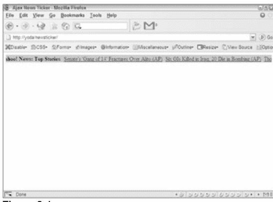

在这个项目中，你将使用PHP执行服务器的功能：充当代理，为客户检索请求的源。客户端应用程序由常见的元素组成：DHTML和JavaScript。

### 服务器端组件

如前所述，用PHP编写的服务器应用程序极其简单。要从服务器请求信息，URL的查询字符串中应包含一个url变量：
`newsticker.php?url=http://rss.news.yahoo.com/rss/topstories`

由于服务器唯一的工作是检索远程信息，服务器应用程序代码只有几行：

```php
<?php
header("Content-Type: text/xml");
header("Cache-Control: no-cache");

if ( isset( $_GET["url"] ) ) {
    $remoteUrl = $_GET["url"];
    
    $xml = file_get_contents($remoteUrl);
    
    echo $xml;
}

?>
```

前两行分别设置Content-Type和Cache-Control头。如第5章所述，将MIME内容类型设置为text/xml很重要；否则，Mozilla Firefox不会将数据识别为XML。将Cache-Control头设置为no-cache也很重要，因为除非明确告知不要，否则Internet Explorer会缓存通过XMLHttpRequest检索的所有数据。

在下一行代码中，检查查询字符串中是否包含url查询项。为此，使用`isset()`函数，该函数根据变量、函数或对象是否存在返回一个布尔值。`url`的值被赋给`$remoteUrl`变量，并传递给`file_get_contents()`。此函数打开一个文件（本地或远程），读取文件内容，并将其作为字符串返回。最后，存储在`$xml`变量中的文件内容被写入页面。

代理完成后，需要编写客户端来利用代理的服务。

### 客户端组件

在深入代码之前，应先讨论客户端的功能。客户端：

1.  构建用于显示新闻源的HTML。
2.  从服务器应用程序请求数据。当服务器用请求的数据响应时，客户端使用`XParser`解析数据。
3.  将解析后的数据放入HTML中。
4.  使用DHTML为滚动条添加动画效果。
5.  每1.5分钟轮询一次更新数据。

此外，还必须满足一些用户界面标准：

- 滚动条中的数据，即新闻文章标题，应该是链接，将用户引导至指定的新闻文章。
- 当用户鼠标进入滚动条时，滚动条应停止滚动；当鼠标移出时，应恢复滚动。

客户端代码由两个类组成：`NewsTicker`类，负责以HTML格式构建滚动条、通过滚动动画为滚动条添加动画效果，并提供将新闻源添加到滚动条中的功能；以及`NewsTickerFeed`类，负责请求源、解析源、将其放入HTML中，并轮询新数据。

#### NewsTicker 类

`NewsTicker`类是客户端代码的主类。构造函数接受一个参数：用于附加新闻滚动条的`HTMLElement`：

```javascript
function NewsTicker(oAppendTo) {
    var oThis = this;
    this.timer = null;
    this.feeds = [];
```

这几行代码初始化了`NewsTicker`类的属性。首先，通过将变量`oThis`赋值给自己，创建了一个指向对象的指针。`timer`属性最初设置为`null`，将控制滚动动画（`setTimeout()`返回一个唯一的定时器标识符）。`feeds`属性是一个`NewsTickerFeeds`对象的数组。

接下来的两个属性创建了此小部件的主要元素：

```javascript
this.tickerContainer = document.createElement("div");
this.ticker = document.createElement("nobr");

this.tickerContainer.className = "newsTickerContainer";
this.ticker.className = "newsTicker";
```


否则，文本会因自动换行而突然出现在视野中，而不是平滑滚动。此构造函数输出的HTML代码如下：

```html
<div class="newsTickerContainer">
    <nobr class="newsTicker"></nobr>
</div>
```

作为用户界面的一部分，请记住，当用户将鼠标移到滚动新闻条上方时，滚动动画会停止。为实现此功能，需为`tickerContainer`的`onmouseover`和`onmouseout`事件分配事件处理程序：

```javascript
this.tickerContainer.onmouseover = function () {
    clearTimeout(oThis.timer);
};

this.tickerContainer.onmouseout = function () {
    oThis.tick();
};
```

在`onmouseover`事件处理程序中，`clearTimeout()`会清除`timer`属性，从而停止动画。注意这里使用了`oThis`指针，因为事件处理程序内部的作用域发生了变化。`onmouseout`事件处理程序通过调用`tick()`方法来重新启动动画，该方法执行动画效果。

下一步是将滚动条元素附加到`tickerContainer`，并将小部件的HTML附加到其父级`HTMLElement`：

```javascript
this.tickerContainer.appendChild(this.ticker);

var oToAppend = (oAppendTo) ? oAppendTo : document.body;
oToAppend.appendChild(this.tickerContainer);
```

此代码的第一行将`ticker`附加到`tickerContainer`，从而生成本节前面看到的HTML。下一行代码为开发者提供了便利。如果存在构造函数的参数`oAppendTo`，则小部件将附加到`oAppendTo`的值。否则，HTML将附加到`document.body`。这为参数提供了默认值，因此如果您想将小部件直接附加到文档，则无需传递参数。

构造函数的最后几行初始化滚动条：

```javascript
this.ticker.style.left = this.tickerContainer.offsetWidth + "px";
this.tick();
```

第一行代码将滚动条定位在`tickerContainer`的最右侧边缘。（动画从右向左滚动。）

> **注意：** Internet Explorer和Firefox具有不同的渲染模式，它们会根据HTML页面中指定的doctype以不同方式呈现标记。在所谓的标准模式下，您必须在定位元素的任何代码行后添加`+ "px"`，否则浏览器将不会正确定位该元素。

最后，调用`tick()`方法启动动画，最终的构造函数代码如下：

```javascript
function NewsTicker(oAppendTo) {
    var oThis = this;
    this.timer = null;
    this.feeds = [];
    this.tickerContainer = document.createElement("div");
    this.ticker = document.createElement("nobr");

    this.tickerContainer.className = "newsTickerContainer";
    this.ticker.className = "newsTicker";

    this.tickerContainer.onmouseover = function () {
        clearTimeout(oThis.timer);
    };

    this.tickerContainer.onmouseout = function () {
        oThis.tick();
    };

    this.tickerContainer.appendChild(this.ticker);

    var oToAppend = (oAppendTo) ? oAppendTo : document.body;
    oToAppend.appendChild(this.tickerContainer);

    this.ticker.style.left = this.tickerContainer.offsetWidth + "px";
    this.tick();
}
```

### 执行动画

任何动画的基本逻辑都是将元素移动设定的像素量，并重复此操作，直到元素到达页面上的特定位置。此小部件中使用的滚动动画可能是最简单的动画类型：从右向左的线性移动，直到滚动条的右边缘到达容器的左边缘。最后这部分是动画的极限，可以用`-this.ticker.offsetWidth`表示。当滚动条到达页面中的此位置时，动画将重新开始。

`tick()`方法首先收集这些信息：

```javascript
NewsTicker.prototype.tick = function () {
    var iTickerLength = -this.ticker.offsetWidth;
    var oThis = this;
```

`iTickerLength`变量包含动画的结束点：滚动条的负`offsetWidth`。同样，指向`NewsTicker`对象的指针被赋值给`oThis`。

要执行动画，需要设置一个低时间间隔的超时，以重复一个移动所需元素的函数。对于此动画，它是`tick()`方法内的一个函数：

```javascript
var doSetTimeout = function() {
    oThis.tick();
};
```

您可以使用外部变量、函数或方法来辅助动画，但这种方式不太面向对象。将动画逻辑保持在`tick()`方法内部使小部件更易于部署和维护。

动画的第一步是确定滚动条是否包含任何数据，因为滚动空的`<nobr/>`元素没有意义：

```javascript
if (this.ticker.innerHTML) {

}
```

此代码检查元素的`innerHTML`属性；滚动条中存在的任何HTML都意味着数据存在，动画应该开始：

```javascript
if (this.ticker.innerHTML) {
    if (this.ticker.offsetLeft > iTickerLength) {
        var iNewLeft = this.ticker.offsetLeft - 1;
        this.ticker.style.left = iNewLeft + "px";
    }
}
```

这段新代码移动滚动条。第一行新代码检查滚动条的位置（`offsetLeft`）相对于动画边界（`iTickerLength`）的关系。如果位置大于限制，动画将继续。下一行获取滚动条的新左位置：向左移动一像素。此代码块的最后一行设置左位置以反映`iNewLeft`中的值。然而，这只是动画的一部分。滚动条会继续移动，直到达到边界；因此，您必须将滚动条重置到其原始位置：

```javascript
NewsTicker.prototype.tick = function () {
    var iTickerLength = this.ticker.offsetWidth;
    var oThis = this;

    var doSetTimeout = function() {
        oThis.tick();
    };

    if (this.ticker.innerHTML) {
        if (this.ticker.offsetLeft > -iTickerLength) {
            var iNewLeft = this.ticker.offsetLeft - 1;
            this.ticker.style.left = iNewLeft + "px";
        } else {
            this.ticker.style.left = this.tickerContainer.offsetWidth + "px";
        }
    }
    this.timer = setTimeout(doSetTimeout, 1);
};
```

第一块新代码完成了这个操作。在动画结束时，滚动条再次被放置在容器的右边缘。最后一行新代码为`tick()`中包含的`doSetTimeout()`函数设置超时。这导致`tick()`每毫秒运行一次，因此动画会持续进行，直到通过清除超时（当用户将鼠标移到容器上时）来停止。

### 添加Feeds

`NewsTicker`类的最后一个方法是`add()`方法，它向滚动条添加一个feed并填充`feeds`数组：

```javascript
NewsTicker.prototype.add = function (sUrl) {
    var feedsLength = this.feeds.length;

    this.feeds[feedsLength] = new NewsTickerFeed(this, sUrl);
};
```

此方法接受一个参数：远程feed的URL。然后创建一个`NewsTickerFeed`对象作为`feeds`数组的一个元素。这个数组除了在初始化和填充数组时使用外，在类的任何其他代码中都没有用到。它的存在仅仅是为了方便那些可能想要访问滚动条中不同feed的开发者。

### NewsTickerFeed类

没有内容可显示的新闻滚动条就不那么方便了。`NewsTickerFeed`类拉取所需的feed，使用XParser解析它们，并组装和将HTML添加到滚动条中。该类的构造函数接受两个参数：第一个参数是对其父级`NewsTicker`对象的引用；这允许在需要时访问`NewsTicker`对象的属性和方法。第二个参数是您要获取的feed的URL。

```javascript
function NewsTickerFeed(oParent, sUrl) {
    this.parent = oParent;
    this.url = sUrl;
    this.container = null;

    this.poll();
}
```

与`NewsTicker`类的构造函数相比，`NewsTickerFeed`类的构造函数相对简单。此类有三个属性：`parent`，指向父级`NewsTicker`对象的引用；`url`，feed的URL；以及`container`，一个包含feed信息的`<span/>`元素。

### 轮询新信息

在构造函数退出之前调用的`poll()`方法向服务器应用程序发出请求。它还会自动每分半钟检查一次更新：

```javascript
NewsTickerFeed.prototype.poll = function () {
    var oThis = this;

    var oReq = zXmlHttp.createRequest();
    oReq.onreadystatechange = function () {
        if (oReq.readyState == 4) {
            if (oReq.status == 200) {
```

### 添加内容

`NewsTickerFeed` 类的最后一个方法是 `populateTicker()`，之前提到过因为它在 `poll()` 中被调用。该方法接受 `XMLHttp` 的 `responseText` 属性作为参数，并使用 `XParser` 进行解析：

```javascript
NewsTickerFeed.prototype.populateTicker = function (sXml) {
    var oParser = new XParser(sXml, true);
}
```

通过传递第二个参数值为 `true`，`XParser` 会将第一个参数视为序列化的 XML，而不会自行发起 `XMLHttp` 请求。现在 XML 已解析完成，你可以开始创建 HTML：

```javascript
NewsTickerFeed.prototype.populateTicker = function (sXml) {
    var oParser = new XParser(sXml, true);
    var spanLinkContainer = document.createElement("span");
    var aFeedTitle = document.createElement("a");
    aFeedTitle.className = "newsTicker-feedTitle";
    aFeedTitle.href = oParser.link.value;
    aFeedTitle.target = "_new";
    aFeedTitle.innerHTML = oParser.title.value;
    spanLinkContainer.appendChild(aFeedTitle);
}
```

第一步是创建一个元素来封装所有链接。这个元素的作用是为了方便：当 feed 更新时，移除一个包含多个子元素的元素比逐个移除多个元素要容易。另外，不要将这个容器与 `container` 属性混淆。后者包含 `spanLinkContainer`。

为了分隔滚动条中的不同 feed，使用了 feed 的标题。这也是一个链接；因此，如果用户点击该链接，会弹出一个新窗口，将其带到 feed 的网站。此链接被赋予 CSS 类 `newsTicker-feedTitle`，并被添加到 `spanLinkContainer` 中。

接下来，通过遍历 `XParser` 对象的 `items` 数组来创建链接项：

```javascript
NewsTickerFeed.prototype.populateTicker = function (sXml) {
    var oParser = new XParser(sXml, true);
    var spanLinkContainer = document.createElement("span");
    var aFeedTitle = document.createElement("a");
    aFeedTitle.className = "newsTicker-feedTitle";
    aFeedTitle.href = oParser.link.value;
    aFeedTitle.target = "_new";
    aFeedTitle.innerHTML = oParser.title.value;

    spanLinkContainer.appendChild(aFeedTitle);

    for (var i = 0; i < oParser.items.length; i++) {
        var item = oParser.items[i];

        var aFeedLink = document.createElement("a");
        aFeedLink.href = item.link.value;
        aFeedLink.target = "_new";
        aFeedLink.className = "newsTicker-feedItem";
        aFeedLink.innerHTML = item.title.value;

        spanLinkContainer.appendChild(aFeedLink);
    }
    if (!this.container) {
        this.container = document.createElement("span");
        this.container.className = "newsTicker-feedContainer";
        this.parent.ticker.appendChild(this.container);
    } else {
        this.container.removeChild(this.container.firstChild);
    }

    this.container.appendChild(spanLinkContainer);
}
```

每个链接在点击时都会打开一个新窗口，并具有 CSS 类 `newsTicker-feedItem`。当链接创建完成后，它会被添加到 `spanLinkContainer` 中，然后你再将其添加到 ticker。

当 `NewsTickerFeed` 类首次创建时，请记住 `container` 属性虽然被声明，但其值被设为 `null`。这样做有几个原因。首先，记住 ticker 的动画只有在包含 HTML 后才会开始。为了防止动画过早运行，在获取 feed 数据、解析并组装成 HTML 之前，不应添加 `container` 所引用的元素。这就使得将 `container` 添加到 ticker 的操作发生在 `populateTicker()` 中。

其次，因为此操作在 `populateTicker()` 中进行，重要的是不要将同一个 `container` 重复添加到 ticker 中，否则 ticker 会出现奇怪的行为（更不用说浏览器可能会崩溃）。因此，当执行前面的代码时，它会检查 `container` 是否已初始化。如果没有，则创建 `<span/>` 元素并将其添加到 ticker；否则，从 `container` 中移除链接容器，并将新创建的链接容器添加到控件中。

当然，如果你不按自己的喜好来美化数据，显示数据就毫无意义了。

### 设置新闻样式

在查看 CSS 之前，了解 HTML 结构很重要：

```html
<div class="newsTickerContainer">
    <nobr class="newsTicker">
        <span class="newsTicker-feedContainer">
            <span>
                <a />
                <a />
            </span>
        </span>
        <span class="newsTicker-feedContainer">
            <span>
                <a />
                <a />
            </span>
        </span>
    </nobr>
</div>
```

最外层的 `<div/>` 元素很重要，原因有二。首先，它封装了控件的每个部分。其次，它是新闻项的视图框。因为它包含控件中的所有元素，所以它必须是一个极宽的框，但你不希望所有数据在进入可见区域之前就被看到。因此，你必须设置 CSS 的 `overflow` 属性：

```css
.newsTickerContainer {
    overflow: hidden;
    position: relative;
    background-color: silver;
    height: 20px;
    width: 100%;
    padding-top: 2px;
}
```

将 `overflow` 属性设置为 `hidden` 会隐藏任何当前不可见的被包含内容。同时，将 `position` 属性设置为 `relative`，以确保 ticker 相对于 `newsTickerContainer` 移动，而不是相对于文档的主体。任何其他 CSS 属性则由你自行设置。在示例代码中，设置了高度、宽度、内边距和背景色。

下一个元素 ticker，包含了添加到控件的所有 feed。这个 `<nobr/>` 元素是绝对定位的，以便可以通过 JavaScript 移动它：

```css
.newsTicker {
    position: absolute;
    height: 25px;
}
```

唯一必需的属性是 `position`，否则 ticker 可能无法滚动。其他任何 CSS 属性都可以根据你想要的外观和感觉来设置。

最后两个暴露 CSS 类的元素是链接：`newsTicker-feedTitle` 和 `newsTicker-feedItem`。第一个是指向新闻网站的链接。虽然以下属性都不是必需的，但它们将 feed 标题与其余链接区分开来：

```css
.newsTicker-feedTitle {
    margin: 0px 6px 0px 6px;
    font-weight: bold;
    color: black;
    text-decoration: none;
}
```

左右各有六像素的空间，使其与 feed 项保持距离。文本为粗体、黑色，且没有下划线，从而使此链接与其他链接在外观上有更多区分。

feed 项唯一的格式化是两侧各有四像素的内边距，这为链接提供了明确的外观，同时保持了用户的预期（链接！）。

```css
.newsTicker-feedItem {
    padding: 4px;
}
```


CSS 的美妙之处在于它能够改变任何页面或部件的外观和感觉，无论其标记如何（在大多数情况下）。你可以尝试使用它，设计出自己的样式，使其融入你的网页。

### 实现新闻滚动部件

因为后端代码是 PHP，所以设置这个部件就像上传文件并在 HTML 中引用它们一样简单。（当然，需要 PHP）。要将 JavaScript 和 CSS 添加到你的页面中，只需添加 `<script/>` 和 `<link/>` 标签：

```
<!DOCTYPE html PUBLIC "-//W3C//DTD XHTML 1.1//EN"
    "http://www.w3.org/TR/xhtml11/DTD/xhtml11.dtd">

<html xmlns="http://www.w3.org/1999/xhtml" >
<head>
    <title>Ajax News Ticker</title>
    <link rel="stylesheet" type="text/css" href="css/newsticker.css" />
    <script type="text/javascript" src="js/zxml.js"></script>
    <script type="text/javascript" src="js/xparser.js"></script>
    <script type="text/javascript" src="js/newsticker.js"></script>
</head>
<body>

</body>
</html>
```

你还需要实例化一个 `NewsTicker` 的新实例。记住，`NewsTicker` 会将自身添加到一个 `HTMLElement` 上，所以最好在页面加载时使用 `onload` 事件来创建该对象：

```
<!DOCTYPE html PUBLIC "-//W3C//DTD XHTML 1.1//EN"
    "http://www.w3.org/TR/xhtml11/DTD/xhtml11.dtd">

<html xmlns="http://www.w3.org/1999/xhtml" >
<head>
    <title>Ajax News Ticker</title>
    <link rel="stylesheet" type="text/css" href="css/newsticker.css" />
    <script type="text/javascript" src="js/zxml.js"></script>
    <script type="text/javascript" src="js/xparser.js"></script>
    <script type="text/javascript" src="js/newsticker.js"></script>
    <script type="text/javascript">
        function init() {
            var newsTicker = new NewsTicker();
            newsTicker.add("http://rss.news.yahoo.com/rss/topstories");
        }
    </script>
    <script type="text/javascript">
        onload = init;
    </script>
</head>
<body>

</body>
</html>
```

因为这个部件使用 `XParser` 来解析新闻源，所以任何 RSS 2.0 和 Atom 源都可以与这个部件一起使用。（前面的例子拉取了雅虎头条新闻源）。告别那些无聊的博客列表吧；让它们滚动起来！

### 创建天气部件

天气信息在桌面和网络上都很受欢迎。许多应用程序和部件专门用于获取和显示这些信息。自然，Ajax 非常适合这种类型的部件。

### Weather.com SDK

创建这个部件的第一步是找到一个天气信息源。可能最流行的是 Weather.com XML 天气服务。你将使用这些信息来创建这个天气部件。

使用 Weather.com XML 服务的关键在于遵循他们的指南。要使用他们的 XML 源，你必须首先注册一个许可证。要注册，请访问 [http://registration.weather.com/registration/xmlsoap/step1/](http://registration.weather.com/registration/xmlsoap/step1/)。注册后，Weather.com 会发送一封包含 XML 源 SDK 链接的电子邮件，并为你提供你的许可证密钥和合作伙伴 ID。

对于像这个部件一样的基于网络的应用程序，你必须限制从服务获取信息的频率。如 SDK 文档中所述，当前状况信息的刷新率为 30 分钟；因此，服务器应用程序必须缓存获取的天气信息，并且仅每 30 分钟刷新一次信息。有两种方法可以实现这一点：

1.  创建一个独立于 Web 应用程序运行的智能线程，每 30 分钟拉取一次源。然后应用程序仅使用缓存的源，而无需担心信息拉取之间的时间间隔。
2.  在每次页面请求时，应用程序可以跟踪上次获取源的时间，并仅在 30 分钟过去后才允许刷新数据。

这两种架构都能满足这个部件的目的。事实上，智能线程解决方案是理想的。在两种情况下，服务器与远程主机之间的通信是相同的；然而，智能线程每半小时只需要一次文件系统操作（写入缓存源）。不幸的是，ASP.NET 应用程序在 20 分钟不活动后会超时，这可能导致使用过时的缓存数据。可以更改此行为；但是，这需要访问 `machine.config` 文件，并非所有人都能在其环境中访问该配置文件。因此，这个部件将使用第二种解决方案。

### 服务器端组件

你可以使用任何支持 .NET 的语言来编写后端代码；但是，本章中的示例使用 C# 语言。服务器应用程序的核心是在 `Wrox.ProfessionalAjax.Weather` 命名空间中创建的两个类。你可以将这些类编译成类库（.dll 文件）或直接在应用程序中使用它们。选择最终是你的；然而，本练习将这些类直接集成到应用程序中，因此不需要引用外部库。

### WeatherSettings 类

`WeatherSettings` 类包含从 Weather.com 拉取天气信息所需的所有信息。只需三条信息即可获取这些数据：你的许可证密钥、你的合作伙伴 ID 和位置 ID。这些设置位于一个名为 `config.xml` 的外部 XML 文档中，其结构如下所示：

```
<weather>
    <ids>
        <license>[LICENSEKEY]</license>
        <partner>[PARTNERID]</partner>
        <location>[LOCATION CODE]</location>
    </ids>
</weather>
```

如你所见，这是一个简单的 XML 文档。`<ids/>` 元素包含获取天气信息所需的信息。`<license/>`、`<partner/>` 和 `<location/>` 元素分别包含许可证密钥、合作伙伴 ID 和位置 ID。

**注意** 请注意，你需要将括号中的项目替换为你自己的信息。

`WeatherSettings` 类提取这些信息并将其分配给私有变量。该类的构造函数接受一个参数：应用程序的路径。

```
public Settings(string path)
{
    XmlDocument xml = new XmlDocument();
    xml.Load(path + "/config.xml");

    _partnerId =
        xml.SelectSingleNode("/weather/ids/partner").InnerText;
    _licenseKey =
        xml.SelectSingleNode("/weather/ids/license").InnerText;
    _location =
        xml.SelectSingleNode("/weather/ids/location").InnerText;
}
```

`WeatherSettings` 类的所有数据处理都在这个构造函数中进行。首先，将 `config.xml` 文件加载到 `XmlDocument` 对象中。这使你能够遍历 DOM 树并提取所需的信息。如果你使用 `SelectSingleNode()` 方法，就可以检索 `<ids/>` 元素中包含的各个元素，并通过 `InnerText` 属性获取它们的值。这些信息被分配给私有字符串字段 `_partnerId`、`_licenseKey` 和 `_location`。

要访问这些私有字段，需要使用访问器（你在[第 5 章]中学过）来检索相应私有字段的值：

```
public string PartnerId
{
    get
    {
        return _partnerId;
    }
}
```

```
public string LicenseKey
{
    get
    {
        return _licenseKey;
    }
}
```

```
public string LocationId
{
    get
    {
        return _location;
    }
}
```

公共字段 `PartnerId`、`LicenseKey` 和 `LocationId` 分别返回 `_partnerId`、`_licenseKey` 和 `_location` 的值。这些访问器提供了对私有字段的只读访问。

### WeatherInfo 类

`WeatherInfo` 类提供了从 Weather.com XML 服务获取信息的方法。与 `WeatherSettings` 类类似，`WeatherInfo` 构造函数接受一个参数，该参数包含应用程序的路径：

```
public WeatherInfo(string path)
{
    _path = path;
    _cachedFile = String.Format("{0}/weather_cache.xml", _path);
    _settings = new Settings(path);
}
```

这个类有三个私有字段，其中两个是字符串 `_path` 和 `_cachedFile`。前者被分配了路径参数，后者包含缓存天气源的路径。第三个私有字段 `_settings` 是一个 `WeatherSettings` 对象。

### 从网络获取天气数据

除了上述私有成员外，`WeatherInfo` 类还包含几个私有方法。其中一个名为 `_getWebWeather()` 的方法，用于从远程主机获取天气源并返回一个包含源内容的字符串：

```
private string _getWebWeather()
```


```markdown
{
    string xmlStr = String.Empty;
    return xmlStr;
}
```

根据SDK，获取天气信息源的URL如下所示：

```
http://xoap.weather.com/weather/local/[locID]?cc=*&prod=xoap&par=[part ID]&key=[lic]
```

方括号中包含的信息分别是位置ID、合作伙伴ID和许可证密钥。使用`String.Format()`方法，你可以格式化URL以包含你自己的设置信息：

```
string baseUrl = "http://xoap.weather.com/weather/local/{0}?cc=*&prod=xoap&par={1}&key={2}";
```

```
string url = String.Format(baseUrl, _settings.LocationId, _settings.PartnerId, _settings.LicenseKey);
```

这主要是`_settings`对象的使用场景。`String.Format()`返回的字符串包含了Weather.com指南所要求的完整信息。

`_getWebWeather()`中的下一个操作是向远程主机发起请求并获取天气信息源：

```
using (WebClient client = new WebClient())
{
    //Read the results
    try
    {
        using (StreamReader reader = new StreamReader(client.OpenRead(url)))
        {
            xmlStr = reader.ReadToEnd();
        }
    }
    catch (WebException exception)
    {
        xmlStr = _writeErrorDoc(exception);
    }
}
```

在这段代码的开头，创建了一个`WebClient`对象。如果你还记得第5章的内容，你曾使用`HttpWebRequest`对象从远程主机检索数据。你也可以为这个小部件做同样的事情，但从前面的代码可以看出，`WebClient`使用了简单得多的接口。

要读取远程服务器的响应，请使用`OpenRead()`方法。此方法返回一个`Stream`对象，你可以使用`StreamReader`类来读取它。`StreamReader`类的`ReadToEnd()`方法读取流并将其作为字符串返回给`xmlStr`。如果由于某种原因此操作失败（很可能是由于找不到远程主机），则会通过`_writeErrorDoc()`创建一个错误文档来代替天气信息源。

此时，你拥有了一些XML数据可以使用：天气信息源或错误文档。该方法接下来的几个流程会对XML数据执行XSL转换。在服务器端转换数据有几个好处。首先，它极大地简化了客户端代码。发送到客户端的数据已经是HTML格式，因此可以轻松地添加到页面中。服务器端转换也减轻了客户端的工作量。数据到达客户端时已经是完整的；除了放入页面外，不需要其他数据操作。

.NET中的XSL转换与[第4章](#)中介绍的MSXML提供的转换非常相似。转换的第一步是创建涉及的对象：

```
XslTransform xslt = new XslTransform();
XmlDocument xml = new XmlDocument();
using (StringWriter stringWriter = new StringWriter()) {
```

.NET中的转换包括一个`XslTransform`对象、一个`XmlDocument`对象和一个`StringWriter`对象，后者包含转换后的结果数据。转换过程的下一步是将XML数据加载到`XmlDocument`对象中，并将XSL文档加载到`XslTransform`对象中：

```
xml.LoadXml(xmlStr);
xslt.Load(_path + "/weather.xslt");
```

`XmlDocument`类的`LoadXml()`方法类似于MSXML库中的`loadXML()`方法。它接受一个表示XML数据的字符串参数。XSL文档通过`Load()`方法加载到`XslTransform`对象中。此方法接受一个参数：包含XSL文档路径的字符串。

最后一步是执行转换并从`StringWriter`中检索结果数据：

```
xslt.Transform(xml, null, stringWriter, null);
xmlStr = stringWriter.ToString();
```

`Transform()`方法有几个重载。重载方法是指具有相同名称、执行相同功能但接受不同参数的方法。这个特定的重载接受XML文档作为第一个参数，传递给XSLT处理器的参数列表（或参数集）作为第二个参数，`StringWriter`作为输出作为第三个参数，以及一个`XmlResolver`来处理任何XML命名空间作为最后一个参数。转换完成后，你可以使用`ToString()`方法从`StringWriter`中获取转换后的数据。

`_getWebWeather()`的最后一步是缓存数据。这是通过`StreamWriter`完成的，它以UTF-8编码写入数据：

```
using (StreamWriter writer = new StreamWriter(_cachedFile))
{
    writer.Write(xmlStr);
}
```

`StreamWriter`类构造函数接受一个字符串参数，包含要写入的文件路径。`StreamWriter`将`xmlStr`的内容写入文件，并在`using`块退出时立即关闭和释放。

> **注意** 为了让应用程序能够更新*weather_cache.xml*的内容，ASP.NET必须对该文件具有适当的修改权限。

`_getWebWeather()`的完整代码如下：

```
private string _getWebWeather()
{
    //Just to keep things clean, an unformatted URL:
    string baseUrl = "http://xoap.weather.com/weather/local/{0}?cc=*&prod=xoap&par={1}&key={2}";

    //Now format the url with the needed information
    string url = String.Format(baseUrl, _settings.LocationId, _settings.PartnerId, _settings.LicenseKey);

    //String that the weather feed will be written to
    string xmlStr = String.Empty;

    //Use a web client. It's less coding than an HttpWebRequest.
    using (WebClient client = new WebClient())
    {
        //Read the results
        try
        {
            using (StreamReader reader = new StreamReader(client.OpenRead(url)))
            {
                xmlStr = reader.ReadToEnd();
            }
        }
        catch (WebException exception)
        {
            xmlStr = _writeErrorDoc(exception);
        }
    }

    XslTransform xslt = new XslTransform();
    XmlDocument xml = new XmlDocument();

    using (StringWriter stringWriter = new StringWriter())
    {
        xml.LoadXml(xmlStr);
        xslt.Load(_path + "/weather.xslt");
        xslt.Transform(xml, null, stringWriter, null);
        xmlStr = stringWriter.ToString();
    }

    //Write the cached file
    using (StreamWriter writer = new StreamWriter(_cachedFile))
    {
        writer.Write(xmlStr);
    }

    //Finally, return the feed data.
    return xmlStr;
}
```

#### 读取缓存的天气数据

`WeatherInfo`类的另一个私有方法是`_getCachedWeather()`方法。顾名思义，其功能是从缓存的信息源中检索数据。与前面讨论的方法类似，`_getCachedWeather()`也返回一个字符串：

```
private string _getCachedWeather()
{
    string str = String.Empty;

    //Open and read the cached weather feed.
    using (StreamReader reader = new StreamReader(_cachedFile))
    {
        str = reader.ReadToEnd();
    }

    //Return the contents
    return str;
}
```

首先，创建变量`str`并初始化为空字符串；该变量在读取时将包含缓存文件的内容。接下来，创建一个`StreamReader`对象并打开缓存的天气信息源，其内容通过`ReadToEnd()`方法读取并存储在`str`中。最后，`_getCachedWeather()`退出并返回`str`的值。

`_getWebWeather()`和`_getCachedWeather()`方法是应用程序的主要工作支柱。然而，你可能已经注意到，它们是私有成员。换句话说，当你创建此类的实例时，无法从外部访问它们。公共方法`GetWeather()`提供了对这些私有方法的临时访问。

#### 决定使用哪个版本

`GetWeather()`方法是一个公共方法，返回从`_getCachedWeather()`或`_getWebWeather()`中检索到的字符串。此方法决定是否拉取


`GetWeather()` 方法使用此信息来决定是否要获取更新的订阅源：

```csharp
DateTime timeLimit = LastModified.AddMinutes(30);
```

使用 `AddMinutes()` 方法，将在 `LastModified` 返回的时间上增加 30 分钟。这个新的 `DateTime` 实例 `timeLimit`，将与当前时间使用 `CompareTo()` 方法进行比较：

```csharp
if (DateTime.Now.CompareTo(timeLimit) > -1)
{
    return _getWebWeather();
}
else
{
    return _getCachedWeather();
}
```

`CompareTo()` 方法返回一个整数值。如果当前时间（由 `DateTime.Now` 指定）大于 `timeLimit`，则返回的整数大于零。如果两个时间相等，则该方法返回零。如果当前时间小于 `timeLimit`，则返回 -1。在此代码中，仅当至少过了 30 分钟后才会获取新的订阅源；否则，将检索缓存版本。

### 编写错误文档

`WeatherInfo` 类的最后一个方法需要提及：`_writeErrorDoc()`。如前所述，此方法编写一个简单的 XML 错误文档，用于远程主机无法连接的情况。它接受一个参数，即一个 `WebException` 实例：

```csharp
private string _writeErrorDoc(WebException exception)
{
    XmlDocument xml = new XmlDocument();
    xml.LoadXml("<errorDoc />");

    XmlElement alertElement = xml.CreateElement("alert");
    alertElement.InnerText = "An Error Occurred!";

    XmlElement messageElement = xml.CreateElement("message");
    messageElement.InnerText = exception.Message;

    xml.DocumentElement.AppendChild(alertElement);
    xml.DocumentElement.AppendChild(messageElement);

    return xml.OuterXml;
}
```

在代码的前两行中，创建了一个 `XmlDocument` 对象并加载了一个简单的 XML 文档（仅包含根元素）。错误文档仅包含两个元素：`<alert/>` 和 `<message/>`。.NET 中的 DOM 方法类似于 Internet Explorer 和 Firefox 中的 DOM 方法。第一个元素 `<alert/>` 使用 `CreateElement()` 方法创建。使用 `InnerText` 属性，为其设置文本节点。同样的过程用于创建 `<message/>` 元素。此元素将包含来自 `WebException` 对象的消息。

当所有元素创建并填充了所需数据后，它们通过 `AppendChild()` 方法附加到文档中，并通过 `OuterXml` 属性输出序列化的 XML 数据。

为了完成该类，两个访问器提供了对私有成员 `_settings` 和 `_cachedFile` 的访问：

```csharp
public Settings Settings
{
    get
    {
        return _settings;
    }
}

public string CachedFile
{
    get
    {
        return _cachedFile;
    }
}
```

这将确保您可以在类外部根据需要访问这些数据。

### 使用 WeatherInfo 类

大部分工作已由服务器端应用程序完成。剩下的就是让 `WeatherInfo` 类发挥作用。ASP.NET 文件 `weather.aspx` 充当客户端和 Weather.com XML 服务之间的代理。正是在这个页面中，您将使用 `WeatherInfo` 类。

实现此类的第一步是创建一个实例：

```csharp
WeatherInfo weather = new WeatherInfo(Server.MapPath(String.Empty));
string weatherData = weather.GetWeather();
```

在此代码中，通过使用 `Server.MapPath(String.Empty)` 将应用程序路径传递给构造函数来创建 `WeatherInfo` 类的一个实例。通过这个新实例，您可以使用 `GetWeather()` 方法并检索存储在 `weatherData` 中的天气信息。

下一步是设置所需的标头：

```csharp
Response.ContentType = "text/xml";
Response.CacheControl = "no-cache";
Response.AddHeader("Weather-Modified",
    weather.LastModified.ToFileTime().ToString());
```

前两行应该很熟悉。它们将 MIME 内容类型设置为 `text/xml`，并告诉浏览器不要缓存订阅源。然而，第三行显示了一个名为 `Weather-Modified` 的自定义 HTTP 标头。此标头为客户端代码提供了一种检查是否有新版本天气数据可用的方法。

分配给此标头的值包含一个长整数（由 `ToFileTime()` 方法返回），表示 `LastModified` 属性返回的时间。因为此值基于文件系统的 `Modified` 属性（记住 `WeatherInfo` 类的 `LastModified` 属性返回该值），它将保持不变直到文件更新。这使其非常适合在客户端检查新的更新。

最后，输出天气数据，如下所示：

```csharp
Response.Write(weatherData);
```

现在您需要一个客户端来消费这些信息。

### 客户端组件

得益于服务器应用程序所做的所有工作，此小部件的客户端代码出奇地简单。客户端剩下的只是检索数据。`AjaxWeatherWidget` 类正是这样做的：

```javascript
function AjaxWeatherWidget(oElement) {
    this.element = (oElement)?oElement:document.body;
    this.lastModified = null;

    this.getWeather();
}
```

`AjaxWeatherWidget` 构造函数接受一个参数：要附加数据的 HTMLElement，该参数被赋值给 `element` 属性。如果未提供参数，则 `element` 变为 `document.body`。与 News Ticker 小部件示例一样，此类也自动检查更新，这就是 `lastModified` 属性存在的原因。构造函数在退出前调用 `getWeather()` 方法，该方法从服务器检索天气数据。

### 从服务器获取数据

`getWeather()` 方法通过 `XMLHttpRequest` 联系服务器应用程序并检索天气信息。它还每分钟轮询服务器一次以获取更新信息：

```javascript
AjaxWeatherWidget.prototype.getWeather = function () {
    var oThis = this;

    var doTimeout = function () {
        oThis.getWeather();
    };

    var oReq = zXmlHttp.createRequest();
    oReq.onreadystatechange = function () {
        if (oReq.readyState == 4) {
            if (oReq.status == 200) {
                var lastModified = oReq.getResponseHeader("Weather-Modified");

                if (lastModified != oThis.lastModified) {
                    oThis.lastModified = lastModified;
                    oThis.element.innerHTML = oReq.responseText;
                }
            }
        }
    };
```

};

oReq.open("GET", "weather.aspx", true);
oReq.send(null);
```

当请求成功时，从服务器响应中检索到的第一个项目是通过 `getResponseHeader()` 方法获取的 `Weather-Modified` 响应头。为了查看请求的数据是否比已存在的数据更新，需要将 `Weather-Modified` 头的值与 `AjaxWeatherWidget` 对象的 `lastModified` 属性的值进行比较。如果它们匹配，则数据相同；如果不匹配，则存在更新的数据，并通过 `innerHTML` 属性附加到所选的 `HTMLElement` 中。

最后，为 `doTimeout()` 函数设置一个超时，该函数每分钟执行一次：
`setTimeout(doTimeout, 60000);`

### 自定义天气小部件

开箱即用时，这个小部件非常适合放在侧边栏中，为访客提供你指定的天气信息。小部件的外观依赖于自定义图像以及 SDK 中提供的天气图像（参见图 8-2）。

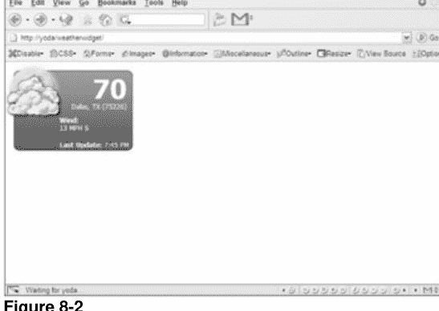

**图 8-2**

要实现示例文件中的外观和感觉，很大程度上依赖于 CSS 定位；几乎每个元素都是绝对定位的，因此 HTML 结构并不是特别重要。你只需要有效的 (X)HTML：

```
<div id="weatherContainer">
	<div id="weatherIcon"></div>
	<div id="weatherTemp">70</div>
	<div id="weatherLocation">Dallas, TX (75226)</div>
	<div id="weatherWind">Wind:
		<div>13 MPH S</div>
	</div>
	<div id="weatherTime">Last Update:
		<span>7:45 PM</span>
	</div>
</div>
```

> 注意 这段 XHTML 是 XSL 转换的结果。在本节中介绍每条信息时，都会给出指向 XML 提供源中信息位置的 XPath 表达式。

要实现这种外观，重要的是要注意包含的 `<div/>` 元素 `weatherContainer` 没有默认（继承）位置；否则，其内部的绝对定位元素将基于文档而不是 `weatherContainer` 进行定位：

```
#weatherContainer {
    position: relative;
    background: url('../img/background.gif');
    width: 220px;
    height: 149px;
}
```

相对定位不会干扰页面流，除非你提供了 top 和 left 坐标。这个 `<div/>` 元素的背景是一个自定义的 GIF 文件，大小与 `<div/>` 相同：宽 220 像素，高 149 像素。

SDK 包含了 Weather.com 自身的图像，用于提供当前天气状况的视觉显示。这些图像文件是 PNG 图像，命名为 `xx.png`，其中 `xx` 是一个数字。这个数字在 XML 提供源中，位于 `weather/cc/icon`（`cc` 代表当前状况）。为了实现示例的外观，给这个元素一个绝对位置，这使你可以将其放置在其容器内的任何位置，并将其从文档流中移除。

```
#weatherIcon {
    position: absolute;
    top: -25px;
    left: -25px;
}
```

这段代码将图像放置在距离容器左上角向左和向上各 25 像素的位置。因为 Weather.com 提供的图像是 PNG 格式，所以 Internet Explorer 需要额外的编码，因为该浏览器会忽略透明度信息。

Microsoft 暴露了一个名为 `AlphaImageLoader` 的 DirectX 滤镜，它可以使 PNG 图像正确显示透明度。但是，使用此滤镜有限制，因为它必须通过 CSS 应用。为了解决这个问题，你可以从 WebFX 下载 PNG Behavior（[http://webfx.eae.net/dhtml/pngbehavior/pngbehavior.html](http://webfx.eae.net/dhtml/pngbehavior/pngbehavior.html)）。它是一个出色的工具，非常适合这种情况。要使用它，只需将以下规则添加到你的 CSS 中：

```
#weatherIcon img {
    width: 128px;
    height: 128px;
    behavior: url("css/pngbehavior.htc");
}
```

在 Internet Explorer 中，此规则将 PNG Behavior 应用于小部件中的每个 `` 元素，但它只为 PNG 文件应用 `AlphaImageLoader` 滤镜。所有其他带有 `.gif`、`.jpg` 或任何其他扩展名的 `` 标签都保持不变。`filter` 属性是 Internet Explorer 特有的；因此，所有其他浏览器都忽略该属性及其值。

> 重要提示 使用 `AlphaImageLoader` 时，必须设置 `height` 和 `width` 属性。

小部件中的下一个项目是温度，包含在 id 为 `weatherTemp` 的 `<div/>` 元素中，在 XML 中位于 `weather/cc/temp`。此信息的样式如下：

```
#weatherTemp {
    position: absolute;
    color: white;
    font: bold 48px Tahoma;
    right:12px;
    top: 5px;
}
```

将此元素定位为绝对定位，使你可以将其放置在容器中所需的任何位置。在这种情况下，其位置位于右上角。此元素中的文本颜色为白色，高度为 48 像素。

温度下方是天气位置信息。在 XML 提供源中，此信息位于 `weather/loc/dnam`。此文本颜色为白色，并使用较小的字体：

```
#weatherLocation {
    font: 12px Tahoma;
    color: white;
    position: absolute;
    right: 12px;
    top: 60px;
}
```

再次强调，此元素是绝对定位的。右边缘距离 `weatherContainer` 的右边缘 12 像素，距离其顶部 60 像素。字体高度为 12 像素，使用 Tahoma 字体。

风是另一个需要显示的重要信息。在 XML 文档中，此信息位于 `weather/cc/wind`：

```
#weatherWind {
    position: absolute;
    font: bold 12px Tahoma;
    color: white;
    left: 85px;
    top: 85px;
}
```

```
#weatherWind div {
    font-weight: normal;
}
```

如果你还记得本节前面讨论的 HTML 结构，`weatherWind` 包含另一个 `<div/>` 元素。这个内部的 `<div/>` 包含实际的风信息，而其父元素仅作为标签并定位信息。与之前的元素不同，`weatherWind` 使用 `left` 属性而不是 `right` 属性来水平定位元素，并且该元素距离顶部 85 像素。标签文本是加粗的，而风信息则不是。这个小部件显示的最后一个信息是最后更新的时间。此信息也存在于 XML 数据中。其位置：`weather/loc/tm`。与之前讨论的风信息类似，时间信息的 HTML 结构由父元素（`weatherTime`）和子元素（`<span/>`）组成。外部元素定位信息并充当标签；内部元素包含实际的时间信息：

```
#weatherTime {
    position: absolute;
    font: bold 12px Tahoma;
    color: white;
    left: 85px;
    bottom: 5px;
}

#weatherTime span {
    font-weight: normal;
}
```

时间的原理与风相同，只是使用 `<span/>` 时数据是内联显示的，而不是在新行上。

因为这个小部件依赖于 XSL 样式表，所以完全自定义本质上掌握在你手中；你有能力完全更改数据的标记、结构和样式。在本节中，为每个元素给出了信息的路径。这几个元素绝不是 XML 提供源中可用元素的完整列表。SDK 没有涵盖这些元素；但是，这些信息位于 Weather.com DTD 中，地址为 [www.weather.com/documentation/xml/weather.dtd](http://www.weather.com/documentation/xml/weather.dtd)。

### 实现天气小部件

因为后端代码主要由 C# 类组成，你的实现选择是双重的：

1.  你可以将该类添加到已支持 ASP.NET 的现有网站中。这样做需要重新编译你的代码。如果选择此路线，你将需要修改 `weather.aspx` 页面以适应你的命名空间。
2.  你可以将可下载示例中包含的代码作为其自己的独立迷你应用程序使用。你可以按照第 5 章末尾概述的步骤来执行此操作。

选择最终由你决定，但本节的剩余部分假设你选择了后一种选项。要实现 `AjaxWeatherWidget` 类，你应该在 HTML 中引用正确的 CSS 和 JavaScript 文件：

```
<!DOCTYPE html PUBLIC "-//W3C//DTD XHTML 1.1//EN"
  "http://www.w3.org/TR/xhtml11/DTD/xhtml11.dtd">

<html xmlns="http://www.w3.org/1999/xhtml">
<head>
  <title>Ajax Weather</title>
  <link rel="stylesheet" type="text/css" href="css/weatherwidget.css"/>
  <script type="text/javascript" src="js/zxml.js"></script>
  <script type="text/javascript" src="js/weatherwidget.js"></script>
```


天气小部件唯一的外部依赖是 zXml 库，你也需要在 HTML 中引用该库。

剩下的步骤就是创建一个 `AjaxWeatherWidget` 对象并将其附加到 HTML 元素中：

```html
<!DOCTYPE html PUBLIC "-//W3C//DTD XHTML 1.1//EN"
	"http://www.w3.org/TR/xhtml11/DTD/xhtml11.dtd">

<html xmlns="http://www.w3.org/1999/xhtml" >
<head>
	<title>Ajax Weather</title>
	<link rel="stylesheet" type=" text/css"
href="css/weatherwidget.css"/>
	<script type="text/javascript" src="js/zxml.js"></script>
	<script type="text/javascript" src="js/weatherwidget.js"></script>
	<script type="text/javascript">
		function init() {
			var divMyWeather = document.getElementById("myWeather");
			var oWeather = new AjaxWeatherWidget(divMyWeather);
		}

		onload = init;
	</script>
</head>
<body>
	<div id="myWeather"></div>
</body>
</html>
```

这段新代码添加了另一个 `<script/>` 元素，其中包含一个名为 `init()` 的函数。在此函数内，首先获取 ID 为 `myWeather` 的 `<div/>` 元素的引用。这个 `<div/>` 元素将作为天气小部件的容器。同时，在 `onload` 事件期间运行 `init()` 至关重要，因为否则浏览器将无法找到 `myWeather` 这个 `<div/>` 元素，也就无法将小部件附加到其中。

### 创建网页搜索小部件

互联网最广泛使用的功能就是搜索。这甚至不是一个选项；如果你想查找任何信息，互联网的搜索引擎是你必须前往的地方。

随着网络技术的不断扩展，传统搜索引擎正在打开大门，采用更多非常规的方式帮助你获取所需内容。率先登场的是雅虎及其 Y!Q 服务（[http://yq.search.yahoo.com/publisher/index.html](http://yq.search.yahoo.com/publisher/index.html)）。这项新服务使你能够从任何网页进行搜索，前提是该网页的作者在其网页中包含了它。该服务旨在为当前内容提供相关搜索结果，让读者无需离开你的页面即可触手可及地获取更多信息。

雅虎的 Y!Q 服务是个很好的创意，但它也并非没有争议。主要的论点是什么？它需要使用雅虎的 JavaScript，并且你必须添加一个符合雅虎要求的 `<form/>` 元素来执行搜索。对于许多网站作者来说，提供这项服务需要付出太多努力。而且，在完成所有工作后，搜索结果是以雅虎的风格呈现的，这破坏了网站的整体观感。

值得庆幸的是，雅虎并不是唯一涉足这项“从你的网站提供搜索结果”服务的搜索引擎。MSN 搜索（http://search.msn.com）提供了一项类似的服务，不同之处在于它让网页开发者能够控制其外观、风格和实现方式。这种能力源于 MSN 搜索为其搜索结果提供 RSS 版本，这使得订阅特定搜索或使用 Ajax 方法将结果添加到你的页面成为可能。

> 请注意，谷歌尚未投身于这种“从你的网站搜索”的新技术，尽管在撰写本文时，谷歌发布了 Google BlogSearch Beta（http://blogsearch.google.com），它提供 RSS 或 Atom 格式的返回结果。

### 服务器端组件

使用 MSN 搜索执行一次搜索，你会在结果页面底部看到一个橙色的 XML 图像。点击此图像会跳转到一个新页面，其中提供了订阅该搜索的 URL：

```
http://search.msn.com/results.aspx?q=[SEARCHTERM]&format=rss
```

有了这个知识，你就可以编写服务器端代码来获取远程订阅源了。对于这个小部件，你将使用 PHP 来获取搜索订阅源。请求服务器应用程序信息的 URL 如下所示：

```
websearch.php?search=[SEARCHTERM]
```

查询字符串中只有一个变量：search。因此，应用程序应该查找此查询项。服务器端应用程序的代码与 NewsTicker 小部件的代码非常相似。

```php
<?php
header("Content-Type: text/xml");
header("Cache-Control: no-cache");

if ( isset($_GET["search"]) ) {

    $searchTerm = urlencode( stripslashes($_GET["search"]) );

    $url =
"http://search.msn.com/results.aspx?q=$searchTerm&format=rss";

    $xml = file_get_contents($url);

    echo $xml;
}
?>
```

正如你现在所知，前两行设置了所需的头部信息，以便浏览器能正确处理数据。接下来的代码行使用 `isset()` 函数来确定搜索键是否存在于查询字符串中。

搜索词需要经过一系列函数处理，以便向远程主机发送正确的请求。首先，它被传递给 `stripslashes()` 函数。如果 PHP 配置中启用了魔术引号（这是默认设置），任何到达 PHP 引擎的引号都会自动用反斜杠转义：\"search query\"。`stripslashes()` 函数会移除这些转义序列，只留下 "search query"。移除反斜杠后，它随后进入 `urlencode()` 函数，该函数会正确地将字符编码为查询字符串中可用的格式。空格、引号、和号等都会被编码。

**重要提示** 如果搜索词没有经过这些处理，MSN 服务器将返回 **400: Bad Request**（错误请求）代码。

当搜索词准备好传输时，它会被包含在 URL 中并存储在 `$url` 变量中。最后，`file_get_contents()` 函数打开远程文件，读取其内容，并将其作为字符串返回给 `$xml` 变量，然后使用 `echo` 命令将其打印到页面上。

### 客户端组件

客户端代码与本章前面创建的类有所不同。这个小部件不是创建一个类并使用该类的实例，而是由一个名为 `msnWebSearch` 的静态对象组成：

```javascript
var msnWebSearch = {};
```

在这里，你看到使用对象字面量表示法创建了 `msnWebSearch` 对象。你将在 `HTMLElement` 的 `onclick` 事件中使用此对象来执行搜索：

```html
<a href="#" onclick='msnWebSearch.search(event, "Professional Ajax"); return false;'>
    Professional Ajax
</a>
```

此对象公开了多个方法，用于获取搜索结果以及绘制和定位包含数据的 HTML。要介绍的第一个方法是 `drawResultBox()`，它负责绘制 HTML。此方法绘制的 HTML 如下所示：

```html
<div class="ajaxWebSearchBox">
    <div class="ajaxWebSearchHeading">MSN Search Results
        <a class="ajaxWebSearchCloseLink" href="#">X</a>
    </div>
    <div class="ajaxWebSearchResults">
        <a class="ajaxWebSearchLink" target="_new" />
        <a class="ajaxWebSearchLink" target="_new" />
    </div>
</div>
```

结果框分为两部分：标题和结果面板（参见[图 8-3](Figure 8-3)）。标题告知用户这个新框包含来自 MSN 搜索的结果。它还包含一个 "X"，用于关闭该框。结果面板包含块级链接，点击后会打开一个新窗口。

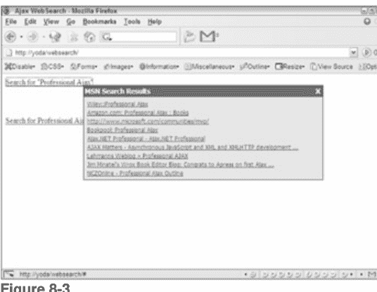

### 绘制结果用户界面

生成此 HTML 的代码相当长，因为元素是使用 DOM 方法生成的。`drawResultBox()` 方法接受一个参数，即 `event` 对象：

```javascript
msnWebSearch.drawResultBox = function (e) {

var divSearchBox= document.createElement("div");
var divHeading = document.createElement("div");
var divResultsPane = document.createElement("div");
var aCloseLink = document.createElement("a");
```

这几行首先通过 `createElement()` 方法创建了 HTML 元素。元素创建后，你就可以开始分配它们的属性。首先需要完成的两个元素是 `aCloseLink` 和 `divHeading`：

```javascript
aCloseLink.href = "#";
aCloseLink.className = "ajaxWebSearchCloseLink";
aCloseLink.onclick = this.close;
aCloseLink.appendChild(document.createTextNode("X"));

divHeading.className = "ajaxWebSearchHeading";
divHeading.appendChild(document.createTextNode("MSN Search Results"));
divHeading.appendChild(aCloseLink);
```

前四行完成了用于关闭结果框的链接。一个名为 `close()` 的方法被设置为该链接 `onclick` 事件的处理程序。接下来的几行用文本和关闭链接填充了标题 `<div/>`。

当这个结果框被绘制到页面上时，服务器应用程序的响应尚未收到。为了向用户表明正在发生某些事情（而不是一个框凭空弹出），让用户看到一条表明正在加载数据的消息会很不错（见图 8-4）。为此，需要创建另一个元素并将其附加到 `divResultsPane` 元素：

```javascript
var divLoading = document.createElement("div");
divLoading.appendChild(document.createTextNode("Loading Search Feed"));
```


此代码会创建加载消息，并将其附加到 `divResultsPane` 中，同时为 `divResultsPane` 分配类名。

完成这些元素后，剩下的就是将它们添加到 `divSearchBox` 元素中：

```
divSearchBox.className = "ajaxWebSearchBox";
divSearchBox.appendChild(divHeading);
divSearchBox.appendChild(divResultsPane);
```

```
document.body.appendChild(divSearchBox);
```

此代码将 `divHeading` 和 `divResultsPane` 元素附加到搜索框，然后将搜索框附加到页面。

`drawResultBox()` 的最后一步是定位新绘制的框，并将 `divSearchBox` 返回给其调用者：

```
msnWebSearch.drawResultBox = function (e) {
    var divSearchBox= document.createElement("div");
    var divHeading = document.createElement("div");
    var divResultsPane = document.createElement("div");
    var aCloseLink = document.createElement("a");

    aCloseLink.href = "#";
    aCloseLink.className = "ajaxWebSearchCloseLink";
    aCloseLink.onclick = this.close;
    aCloseLink.appendChild(document.createTextNode("X"));

    divHeading.className = "ajaxWebSearchHeading";
    divHeading.appendChild(document.createTextNode("MSN Search Results"));
    divHeading.appendChild(aCloseLink);
```

```
var divLoading = document.createElement("div");
divLoading.appendChild(document.createTextNode("Loading Search Feed"));
```

```
divResultsPane.className = "ajaxWebSearchResults";
divResultsPane.appendChild(divLoading);
```

```
divSearchBox.className = "ajaxWebSearchBox";
divSearchBox.appendChild(divHeading);
divSearchBox.appendChild(divResultsPane);
```

```
document.body.appendChild(divSearchBox);
```

```
this.position(e, divSearchBox);
```

```
return divSearchBox;
```

根据 msnWebSearch 对象的设置方式，divSearchBox 必须返回给其调用者以进行其他操作。你可能已经猜到，`position()` 方法用于定位搜索框。它接受两个参数：传递给 `drawResultBox()` 的事件对象和 divSearchBox 元素：

```
msnWebSearch.position = function (e, divSearchBox) {
    var x = e.clientX + document.documentElement.scrollLeft;
    var y = e.clientY + document.documentElement.scrollTop;
    divSearchBox.style.left = x + "px";
    divSearchBox.style.top = y + "px";
};
```

前两行获取用于放置搜索结果框的左上角位置。执行此操作需要两部分信息。首先是鼠标的 x 和 y 坐标。此信息存储在 `clientX` 和 `clientY` 属性中。

然而，这些坐标不足以正确定位结果框，因为 `clientX` 和 `clientY` 属性返回的是鼠标相对于浏览器窗口客户端区域的位置，而不是页面中的实际坐标。为了解决这个问题，需要使用文档元素的 `scrollLeft` 和 `scrollTop` 属性。计算出最终坐标后，就可以将框定位在用户点击鼠标的位置。

### 显示结果

```
divResultsPane.removeChild(divResultsPane.firstChild);
```

此方法使用 DOM 方法以编程方式生成 `<a/>` 元素，因此这些元素将被附加到第一行创建的文档片段中。下一行移除了在 `drawResultBox()` 中附加的加载 `<div/>` 元素。

下一步是创建链接：

```
for (var i = 0; i < oParser.items.length; i++) {
    var oItem = oParser.items[i];
```

```
var aResultLink = document.createElement("a");
aResultLink.href = oItem.link.value;
aResultLink.className = "ajaxWebSearchLink";
aResultLink.target = "_new";
```

```
aResultLink.appendChild(document.createTextNode(oItem.title.value));
```

```
oFragment.appendChild(aResultLink);
}
```

此代码遍历订阅源的项目，并根据数据生成链接，然后将 `<a/>` 元素附加到文档片段。

当循环退出时，文档片段被附加到 `divResultsPane` 以显示搜索结果：

```
divResultsPane.appendChild(oFragment);
```

### 关闭结果框

要关闭搜索结果框，`msnWebSearch` 对象提供了 `close()` 方法。如果你还记得 `drawResultsBox()` 方法，`close()` 方法负责处理关闭框的链接的 `onclick` 事件：

```
msnWebSearch.close = function () {
    var divSearchBox = this.parentNode.parentNode;
    document.body.removeChild(divSearchBox);

    return false;
};
```

搜索框并非真正关闭；实际上，它是从文档中移除的。为此，需要检索 `divSearchBox` 元素。第一行通过检索此元素的父节点的父节点来实现。因为 `close()` 处理 `onclick` 事件，所以 `this` 引用的是该链接。下一行从文档中移除了 `divSearchBox` 元素。最后一行 `return false` 强制浏览器不遵循链接的默认行为（跳转到 `href` 属性中指定的位置）。

### 构建搜索界面

`msnWebSearch` 对象的最后一个方法是 `search()`，它提供了执行搜索的接口。你可以通过某个元素的 `onclick` 事件调用 `search()`。它接受两个参数：一个 `event` 对象和搜索词：

```
msnWebSearch.search = function (e,sSearchTerm) {
    var divSearchBox = this.drawResultBox(e);
    var url = encodeURI("websearch.php?search=" + sSearchTerm);

    var oParser = new XParser(url);
    oParser.onload = function () {

msnWebSearch.populateResults(divSearchBox.childNodes[1],oParser);
    };
};
```

第一行调用 `drawResultBox()` 方法，并将事件 `e` 传递给它。下一行对 URL 进行编码以确保正确传输。此 URL 被传递给 `XParser` 构造函数以创建新的解析器。解析器的 `onload` 事件处理器在搜索订阅源加载完成后调用 `populateResult()` 方法，用结果填充搜索框。

当然，构建这个部件的原因之一是让它符合你自己网站的外观。

### 自定义网络搜索部件

得益于 CSS，你可以轻松地为现有网站以及未来可能的任何重新设计来定制该部件。

讨论的第一个 CSS 类是 `ajaxWebSearchBox`，即搜索框的类。因为框是定位的，所以它的 `position` 必须是绝对的：

```
.ajaxWebSearchBox
{
    position: absolute;
    background-color: #0d1e4a;
    width: 500px;
    padding: 1px;
}
```

绝对定位是唯一的要求。其他所有属性都可以根据你的喜好选择。在此示例中，框有深蓝色的背景，宽度为 500 像素，四周各有 1 像素的内边距。这个内边距将为框的内容提供一个 1 像素的边框。

下一个类是 `ajaxWebSearchHeading`，它包含框的标题文本和关闭链接。为了将关闭链接定位在右上角，它被设置为绝对定位。因此，这要求 `ajaxWebSearchHeading` 的 `position` 为 `relative`：

```
.ajaxWebSearchHeading
{
    position: relative;
    background-color: #1162cc;
    font: bold 14px tahoma;
    height: 21px;
    color: white;
    padding: 3px 0px 0px 2px;
}
```

同样，唯一必需的属性是 `position` 属性。其余属性有助于使元素具有标题的外观。背景色是较浅的蓝色，带有白色、14 像素高、使用 Tahoma 字体的粗体文本。元素的高度为 21 像素，并在顶部和左边缘有内边距。

如前所述，关闭链接的位置是绝对的：

```
a.ajaxWebSearchCloseLink
{
    position: absolute;
    right: 5px;
    top: 3px;
    text-decoration: none;
    color: white;
}
```

```
a:hover.ajaxWebSearchCloseLink
{
    color: red;
}
```

该元素被定位在距离右侧 5 像素、距离顶部 3 像素的位置，使其位于右上角。此链接没有任何文本装饰，颜色为白色。当用户将鼠标悬停在链接上时，文本颜色变为红色。

请注意，没有使用 `visited` 或 `active` 伪类。这是因为窗口总是忽略此链接的 `href` 属性（其事件处理器中有 `return false`）。因此，该链接从未真正处于活动状态或已访问状态。

接下来，`ajaxWebSearchResults` 类为结果窗格设置样式：

```
.ajaxWebSearchResults
{
    background-color: #d3e5fa;
    padding: 5px;
}
```

此元素没有必需的 CSS 属性。现有的属性仅用于定义结果窗格并使其相对易于阅读。背景色为浅蓝色，四周各有 5 像素的内边距。你也可以为加载消息设置样式：

```
.ajaxWebSearchResults div
{
    text-align: center;
    font: bold 14px tahoma;
    color: #0a246a;
```


此元素没有类名，但你仍然可以使用前面示例所示的父子表示法来设置其样式。此示例将文本置于`<div/>`元素的中心，并设置其字体为加粗、蓝色、14像素高。

你需要设置样式的最后几个元素是结果链接。这些链接的类名为`ajaxWebSearchLink`：

```css
a.ajaxWebSearchLink
{
    font: 12px tahoma;
    padding: 2px;
    display: block;
    color: #0a246a;
}

a:hover.ajaxWebSearchLink
{
    color: white;
    background-color: #316ac5;
}

a:visited.ajaxWebSearchLink
{
    color: purple;
}
```

唯一必需的属性是`display`属性，它被设置为`block`。这使得每个链接独占一行。内边距为2像素，为链接之间提供了一点间隔，使它们更易于阅读。字体为Tahoma，高度为12像素。它们的颜色是深蓝色，与`ajaxWebSearchResults`的浅蓝色背景形成良好的对比。

当用户将鼠标悬停在这些链接上时，背景颜色设置为蓝色，而文本颜色变为白色。

在前面代码的最后一个规则中设置了`visited`伪类。这是为了提供用户已经习惯的用户界面提示。通过将`visited`伪类设置为显示紫色，用户知道他们已经访问过该链接，这可以节省他们的时间，避免访问可能不想访问的页面。

正如本节前面所述，此小部件与你在本章中创建的过去的小部件有很大不同；因此，让我们看看如何实现它。

### 实现网络搜索小部件

实现这个小部件很简单。首先，你必须将`websearch.php`文件上传到你的网络服务器（当然，PHP也必须已安装）。接下来，你需要一个HTML文档来引用所有组件。`msnWebSearch`对象依赖于`XParser`类，而`XParser`类又依赖于zXml库。你必须引用这些文件：

```html
<!DOCTYPE html PUBLIC "-//W3C//DTD XHTML 1.0 Transitional//EN"
 "http://www.w3.org/TR/xhtml1/DTD/xhtml1-transitional.dtd">
<html xml:lang="en" lang="en" xmlns="http://www.w3.org/1999/xhtml">
<head>
    <meta http-equiv="Content-Type" content="text/html; charset=utf-8" />
    <title>Ajax WebSearch</title>
    <link rel="stylesheet" type="text/css" href="css/websearch.css" />
    <script type="text/javascript" src="js/zxml.js"></script>
    <script type="text/javascript" src="js/xparser.js"></script>
    <script type="text/javascript" src="js/websearch.js"></script>
</head>
<body>
</body>
</html>
```

要执行搜索，请将`msnWebSearch.search()`方法设置为元素的`onclick`事件处理程序：

```html
<!DOCTYPE html PUBLIC "-//W3C//DTD XHTML 1.0 Transitional//EN" "http://www.w3.org/TR/xhtml1/DTD/xhtml1-transitional.dtd">
<html xml:lang="en" lang="en" xmlns="http://www.w3.org/1999/xhtml">
<head>
    <meta http-equiv="Content-Type" content="text/html; charset=utf-8" />
    <title>Ajax WebSearch</title>
    <link rel="stylesheet" type="text/css" href="css/websearch.css" />
    <script type="text/javascript" src="js/zxml.js"></script>
    <script type="text/javascript" src="js/xparser.js"></script>
    <script type="text/javascript" src="js/websearch.js"></script>
</head>
<body>
    <a href="#" onclick='msnWebSearch.search(event, "\"Professional Ajax\""); return false;'>Search for "Professional Ajax"</a>
    <br /><br /><br /><br />
    <a href="#" onclick='msnWebSearch.search(event, "Professional Ajax"); return false;'>Search for Professional Ajax</a>
</body>
</html>
```

第一个新链接执行对精确短语“Professional Ajax”的搜索，而第二个链接搜索所有单词。还要注意`onclick`事件中的`return false`。这再次迫使浏览器忽略`href`属性，这是必需的。点击这些链接将在鼠标光标处绘制搜索框，搜索结果近在咫尺。

### 创建站点搜索小部件

搜索功能是任何网站不可或缺的一部分；它使你的观众能够快速轻松地找到他们想要的数据。然而，传统的搜索机制与Web的其他部分存在同样的问题：它们需要页面刷新，并且在执行搜索时可能会丢失数据。

在过去的一年里，许多Ajax解决方案如雨后春笋般涌现，其中一个脱颖而出：LiveSearch。LiveSearch ([http://blog.bitflux.ch/wiki/LiveSearch](http://blog.bitflux.ch/wiki/LiveSearch))，由BitFlux ([www.bitflux.ch](http://www.bitflux.ch))的人员开发，是一种边输入边搜索的解决方案，旨在模仿OSX Tiger中的Apple Spotlight功能。

LiveSearch为网站搜索提供了一种新的方式，但它也有其批评者。首先，它提供了实现所需结果的不同方法。普通用户习惯于输入搜索条件并点击搜索按钮。而另一方面，LiveSearch使用`onkeypress` DOM事件，并在你输入时返回结果。这种方法在获取结果方面可能更有效率，但它出乎用户的意料，可能会引起困惑。

接下来的小部件是一个用于搜索使用SQL数据库作为数据存储的站点的Ajax解决方案。它将具有用户已经习惯的用户界面：一个搜索框、一个提交按钮和一个显示搜索结果的`<div/>`元素（见图8-5）。

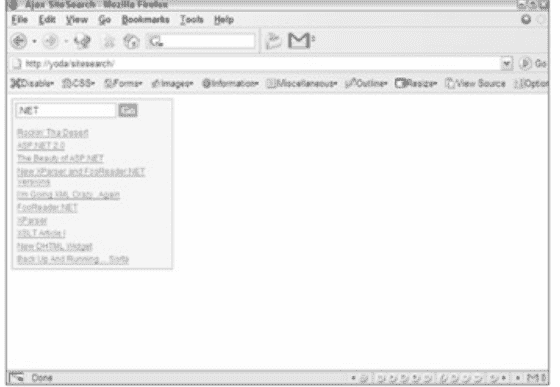

图8-5

### 服务器端组件

你将使用.NET Framework和C#语言与MSSQL数据库进行接口，以执行搜索查询。返回的结果将是JSON格式，这要归功于第7章提到的JSON C#库 ([www.crockford.com/JSON/cs/](http://www.crockford.com/JSON/cs/))。以下部分的代码将使用SQL查询来搜索包含网络日志（博客）文章的数据库。

#### 数据库信息

此特定博客的数据库表相对简单。它包含四列：`id`、`title`、`date`和`posting`。以下SQL语句创建了这个名为`BlogPosts`的表：

```sql
CREATE TABLE BlogPosts (
    id int IDENTITY (1, 1) NOT NULL,
    date datetime NOT NULL,
    title text NOT NULL,
    posting text NOT NULL
)
```

当此查询运行时，它会创建表，但表是空的。此示例的代码下载（位于www.wrox.com）包含一个将向表中添加记录的SQL文件。

搜索结果主要需要两个信息：`id`（用于指向博客文章的URL）和`title`。有了这些知识，你可以创建搜索查询：

```sql
SELECT TOP 10
id, title
FROM BlogPosts
WHERE posting LIKE '%SEARCHSTRING%' OR
title LIKE '%SEARCHSTRING%'
ORDER BY date DESC
```

此查询从`BlogPosts`表中选择`id`和`title`列，其中`posting`和`title`的内容包含搜索字符串的实例。返回的结果按日期降序排列，只返回十条记录。

然而，在深入代码之前，需要讨论返回的数据结构。

#### 返回的数据结构

检索到的唯一两条信息是博客文章的ID及其标题，一次搜索的结果可能包含多篇博客文章。此时，你需要一个包含`title`和`id`属性的对象结果集：

```json
[
    {
        "title": "Title 1",
        "id": "1"
    },
    {
        "title": "Title 2",
        "id": "2"
    },
    {
        "title": "Title 3",
        "id": "3"
    }
]
```

这段代码展示了从服务器返回的数据的样子。该结构是一个包含多个对象的数组，每个对象都有`title`和`id`属性。明确了结果集后，你现在可以着手处理`SiteSearch`类了。

### SiteSearch类

此小部件使用一个名为`SiteSearch`的简单类来连接数据库、执行搜索查询并以JSON字符串形式返回结果。这个类有一个私有字段`_conString`，即到MSSQL数据库的连接字符串，并接受一个包含连接字符串的字符串参数：

```csharp
private string _conString;

public SiteSearch(string connectionString)
{
    _conString = connectionString;
}
```

如你所见，构造函数非常简单。执行的唯一操作是将`_conString`赋值为`connectionString`参数的值。你可能已经猜到，该类的唯一方法`Search()`是该类的核心。

`Search()`方法接受一个参数：搜索字符串。此搜索字符串用于`String.Format()`方法中以格式化搜索查询：

```csharp
public string Search(string searchString)
{
    string query = String.Format("SELECT TOP 10 id, title FROM BlogPosts
                               WHERE posting LIKE '{0}%' OR title LIKE '{0}%' ORDER BY date DESC",
                               searchString);
```

变量`query`现在保存着稍后在方法中使用的完整查询字符串。

JSON C#库提供了动态构建JSON字符串的能力。使用两个类来创建这些字符串：`JSONArray`和`JSONObject`。你可能已经猜到，`JSONArray`创建一个数组，而`JSONObject`创建一个对象。回想一下返回的数据结构，记住客户端代码期望一个对象数组。因此，下一步是实例化一个`JSONArray`对象：

```csharp
Nii.JSON.JSONArray jsa = new Nii.JSON.JSONArray();
```

目前，这就是所有使用的JSON代码，在数据库操作的后续部分之前你不会再看到它。

接下来，创建一个数据库连接和一个`SqlCommand`：

```csharp
using (SqlConnection conn = new SqlConnection(_conString))
{
    SqlCommand command = new SqlCommand(query, conn);
    conn.Open();
```

这段代码使用存储在`_conString`中的连接字符串创建数据库连接。然后使用搜索查询和数据库连接创建一个新的`SqlCommand`。这本质上是准备针对数据库运行的查询，接下来的几行代码说明了这一点：

```csharp
using (SqlDataReader reader = command.ExecuteReader())
```


这段代码创建了一个由 `ExecuteReader()` 方法返回的 `SqlDataReader`。该数据读取器提供了从已执行的数据库查询中读取结果的能力。在从数据读取器检索任何数据之前，应先检查结果是否包含任何行。你可以使用 `HasRows` 属性来实现：

```csharp
using (SqlDataReader dataReader = command.ExecuteReader())
{
    try {
        if (reader.HasRows)
        {
            int i = 0;
            while (reader.Read())
            {

            }
        }
    }
    catch {}
}
```

此代码使用 `HasRows` 属性来判断数据读取器是否包含任何行。如果包含，则可以开始处理其中的数据。

`while` 循环用于通过 `SqlDataReader` 类的 `Read()` 方法读取结果集。`Read()` 方法返回一个布尔值；当到达结果集的末尾时，`Read()` 返回 `false`，循环退出。在循环内部，你创建一个 `JSONObject` 对象，并使用 `put()` 方法设置其属性和值。`JSONObject` 类的 `put()` 方法接受两个参数：一个包含属性名称的字符串和该属性的值。要访问数据库列的值，可将列名作为索引传递给 `dataReader`。

```csharp
using (SqlDataReader dataReader = command.ExecuteReader())
{
    try {
        if (reader.HasRows)
        {

            int i = 0;
            while (reader.Read())
            {
                JSONObject jso = new JSONObject();
                jso.put("title", reader["title"]);
                jso.put("id", reader["id"]);

                jsa.put(i++, jso);
            }
        }
    }
    catch {}
}
```

当 `JSONObject` 被填充后，你将其添加到之前创建的 `JSONArray` 对象中。`JSONArray` 类也公开了一个 `put()` 方法，但其参数略有不同。第一个参数是数组中现有元素的索引，第二个是 `JSONObject` 对象。

当循环退出时，`JSONArray` 构造完成，可以准备返回。但是，如果查询没有返回结果怎么办？客户端代码将处理此功能。如果查询未找到任何行，则返回一个空数组。客户端代码将检查结果集的长度，并执行相应的操作。

至此，JSON 字符串构造完成。要获取 `JSONArray` 的字符串表示，请使用 `ToString()` 方法：

```csharp
return jsa.ToString();
```

`Search()` 方法的最后一行返回可写入页面的 JSON 字符串。

### 构建搜索页面

完成了工作类后，服务器端剩下的就是搜索页面。此页面将在查询字符串中接受一个名为 `search` 的参数，其中包含搜索词。一个示例查询字符串可能如下所示：

```
http://yoursite.com/search.aspx?search=ajax
```

要提供此功能，请使用 `Response.QueryString` 集合检查此参数是否存在：

```csharp
Response.CacheControl = "no-cache";
Response.ContentType = "text/plain; charset=UTF-8";

if (Request.QueryString["search"] != null)
{

}
```

前两行代码现在你应该很熟悉了。第一行将 `CacheControl` 头设置为 `no-cache`，这样浏览器就不会缓存数据；第二行将 MIME `ContentType` 设置为 `text/plain`，编码为 UTF-8。

> **注意** 正如你在[第 7 章](#)中学到的，对于 JSON 字符串，带有 Unicode 编码的纯文本是所需的内容类型。

设置头信息后，将检查查询字符串中是否存在 `search` 参数。在 `if` 代码块内部，实例化一个 `SiteSearch` 对象：

```csharp
if (Request.QueryString["search"] != null)
{
    string searchTerm = Request.QueryString["search"];
    string conStr = "uid=sa;pwd=pass;data source=localhost;initial catalog=BlogPosts";
    SiteSearch siteSearch = new SiteSearch(conStr);
}
```

第一行新代码创建了 `searchTerm` 变量，这是一个存储查询字符串中 `search` 参数值的字符串，后面跟着数据库连接字符串。

在 C# 中连接 MSSQL 数据库与在 PHP 中使用 MySQL 数据库的方式非常不同，这在[第 7 章](http://google.com)中有演示。在 PHP 中，用户名、密码和数据库主机名被传递给 `mysql_connect()` 函数。在 C#（以及其他 .NET 语言）中，这些信息包含在一个称为*连接字符串*的文本中。如前面的示例所示，此连接字符串包含由分号分隔的名称/值对。前面示例中的名称含义如下：

- **uid：** 特定数据库的用户名。在前面的示例中，`sa` 是一个内置用户，代表 Super-Admin（超级管理员）。
- **pwd：** 连接数据库的密码。
- **data source：** 数据库服务器的主机名或 IP 地址。
- **initial catalog：** 你的查询所针对的数据库名称。

当然，连接字符串中的信息应反映你自己的 MSSQL 数据库的登录信息；因此，请根据需要随意更改信息。更改此信息需要你重新编译 Web 应用程序；然而，一个小部件应该可以开箱即用（或从 ZIP 文件中使用），因此采用不同的方法更为可取。

ASP.NET 应用程序的 `web.config` 文件包含可在应用程序内访问的配置设置。此文件的目的有二：
1. 它为所有应用程序设置提供了一个中心位置。
2. 它提供了一种安全的方式来存储包含敏感数据（如数据库信息）的设置，因为 Web 服务器将不会提供 `.config` 文件。

在 `web.config` 文件内部，你会注意到它不过是一个 XML 文件，其文档根元素为 `<configuration/>`。要添加你自己的自定义设置，请添加一个名为 `<appSettings/>` 的元素作为 `<configuration/>` 的第一个子元素：

```xml
<configuration>
    <appSettings>
    </appSettings>
```

要添加一个设置，请使用 `<add/>` 元素，它具有 `key` 和 `value` 属性：

```xml
<appSettings>
    <add key="connectionStr" value="uid=sa;pwd=pass;data source=localhost;initial catalog=BlogPosts"/>
</appSettings>
```

现在连接字符串已成为应用程序设置的一部分，`if` 代码块可以更改为如下所示：

```csharp
if (Request.QueryString["search"] != null)
{
    string searchTerm = Request.QueryString["search"];
    string conStr =
ConfigurationSettings.AppSettings["connectionStr"];

    SiteSearch siteSearch = new SiteSearch(conStr);
}
```

此代码与之前的代码略有不同。它不再硬编码数据库信息，而是通过 `ConfigurationSettings.AppSettings` 集合从应用程序设置中获取信息。将 `web.config` 文件中 `key` 属性的值传递给 `AppSettings` 集合，即可检索到相应的值。

> **重要** `ConfigurationSettings` 对象来自 `System.Configuration` 命名空间，因此你需要在类文件开头的 `using` 语句中添加 `System.Configuration`。

实例化 `SiteSearch` 对象后，`if` 块中的最后步骤是执行搜索并将结果输出到页面：

```csharp
if (Request.QueryString["search"] != null)
{
    string searchTerm = Request.QueryString["search"];
    string conStr =
ConfigurationSettings.AppSettings["connectionStr"];

    SiteSearch siteSearch = new SiteSearch(conStr);

    string json = siteSearch.Search(searchTerm);
    Response.Write(json);
}
```

此代码中的新行调用 `Search()` 方法执行搜索。生成的 JSON 字符串被返回并存储在 `json` 变量中，然后通过 `Response.Write()` 方法写入页面。

> **注意** 你可以添加一个 `else` 代码块来处理查询字符串中搜索参数不存在的情况；然而，客户端代码将处理表单验证，因此没有必要这样做。

`.aspx` 文件完成后，最终代码如下所示：

```csharp
Response.CacheControl = "no-cache";
Response.ContentType = "text/plain; charset=UTF-8";

if (Request.QueryString["search"] != null)
{
    string searchTerm = Request.QueryString["search"];
    string conStr =
ConfigurationSettings.AppSettings["connectionStr"];

    SiteSearch siteSearch = new SiteSearch(conStr);
```


### 客户端组件

客户端功能至关重要，尤其对于此类小部件而言。用户在使用网站搜索功能之前，早已对它的运作方式形成了固有认知。因此，遵循以下准则至关重要：

- **用户将输入文本进行搜索，并按回车键或提交按钮。** LiveSearch的即时搜索功能极具革新性，但它与用户已习惯的交互方式相悖。无需刷新页面即可获得近乎即时的结果，这已是足够的新增功能。
- **用户期望在找不到结果时得到明确提示。** 如果您还记得`SiteSearch`类，当未找到结果时，它会返回一个空的JSON数组；因此，此职责便传递给了客户端代码。

这些准则看似不言而喻，但考虑用户体验至关重要。时下流行酷炫的做法未必总是正确之选。

### 用户界面

任何客户端组件的第一步都是使用HTML构建用户界面。对于这个小部件，您将使用包含在`<div/>`元素中的四个元素：

```html
<div class="ajaxSiteSearchContainer">
    <form class="ajaxSiteSearchForm">
        <input class="ajaxSiteSearchTextBox" />
        <input type="submit" value="Go" class="ajaxSiteSearchButton" />
    </form>
    <div class="ajaxSiteSearchResultPane">
        <a class="ajaxSiteSearchLink" href="http://yoursite.com">Result Text</a>
    </div>
</div>
```

每个元素都包含一个`class`属性。这确保了该小部件可以轻松地通过CSS进行自定义，并且您可以调整它以适应几乎所有的网站。

当然，您不会将此HTML直接添加到网站的HTML代码中；JavaScript会动态创建HTML并将其附加到所需的HTML元素中。

### AjaxSiteSearch 类

`AjaxSiteSearch`类封装了显示用户界面、向服务器发出请求以及显示服务器响应所需的一切，但不包括CSS信息和其他依赖项。该类的构造函数接受一个参数，即用于附加搜索用户界面的HTML元素：

```javascript
function AjaxSiteSearch(oElement) {
```

第一步是编写构成用户界面的HTML元素。这自然通过DOM方法完成：

```javascript
var oThis = this;
this.result = null;

this.widgetContainer = document.createElement("div");
this.form = document.createElement("form");
this.textBox = document.createElement("input");
this.submitButton = document.createElement("input");
this.resultPane = document.createElement("div");

this.widgetContainer.className = "ajaxSiteSearchContainer";
this.form.className = "ajaxSiteSearchForm";
this.textBox.className = "ajaxSiteSearchTextBox";
this.submitButton.className = "ajaxSiteSearchButton";
this.resultPane.className = "ajaxSiteSearchResultPane";

this.submitButton.type = "submit";
this.submitButton.value = "Go";
```

此代码的第一行创建了`oThis`变量，它是指向对象的指针。这在构造函数的后续部分会派上用场。接下来的几行创建了所需的HTML元素并为其分配类名，提交按钮的`type`和`value`属性分别设置为`submit`和`Go`。

当用户点击提交按钮或在表单获得焦点时按下回车键，表单的`onsubmit`事件将触发。以下事件处理程序将启动搜索过程：

```javascript
this.form.onsubmit = function () {
    oThis.clearResults();

    return false;
};
```

这正是需要使用对象指针的地方。在`onsubmit`事件处理程序内部，作用域发生了变化；因此，`this`引用的是`<form/>`元素，而不是`AjaxSiteSearch`对象。因为事件处理程序需要调用`AjaxSiteSearch`对象的方法，所以需要一个引用该对象的外部变量，这正是`oThis`的作用。

`onsubmit`事件处理程序的第一行调用了对象的`clearResults()`方法。此方法（稍后介绍）会清除先前搜索结果列表中的所有链接。这确保了仅显示当前搜索请求的结果。最后一行返回了`false`值。这覆盖了表单的默认行为，即提交表单。

同样在`onsubmit`事件期间，会对表单进行验证。如果文本框不包含任何文本，将通知用户未输入任何文本：

```javascript
this.form.onsubmit = function () {
    oThis.clearResults();

    if (oThis.textBox.value != "") {
        oThis.search();
    } else {
        alert("Please enter a search term");
    }

    return false;
};
```

然而，如果输入了文本，将调用对象的`search()`方法。该方法（也将在后面介绍）负责检索搜索词并向服务器发出XMLHttpRequest。

元素创建完成并且`onsubmit`事件处理程序编写完毕后，构造函数中剩下的就是将元素附加到文档中：

```javascript
this.form.appendChild(this.textBox);
this.form.appendChild(this.submitButton);
this.widgetContainer.appendChild(this.form);
this.widgetContainer.appendChild(this.resultPane);

var oToAppend = (oElement) ? oElement : document.body;
oToAppend.appendChild(this.widgetContainer);
```

因为这个小部件会将自身附加到给定的HTML元素，所以最好在页面的`onload`事件期间创建`AjaxSiteSearch`对象。否则，所需的目标元素可能还不存在，从而引发错误。

### 清除结果

`clearResults()`方法是一个简单的方法，用于移除结果`<div/>`元素中的所有子节点：

```javascript
AjaxSiteSearch.prototype.clearResults = function () {
    while (this.resultPane.hasChildNodes()) {
        this.resultPane.removeChild(this.resultPane.firstChild);
    }
};
```

此方法利用了`hasChildNodes()`方法，这是DOM节点暴露的一个方法。只要结果`<div/>`包含子节点，就会移除第一个子节点。这是一个简单的方法，但足以完成任务。

### 发起 XMLHttpRequest

如前所述，`search()`方法向服务器发出请求以执行搜索：

```javascript
AjaxSiteSearch.prototype.search = function () {
    var oThis = this;
    var sUrl = encodeURI("search.aspx?search=" + this.textBox.value);

    var oReq = zXmlHttp.createRequest();
    oReq.onreadystatechange = function () {
        if (oReq.readyState == 4) {
            if (oReq.status == 200) {
                oThis.handleResponse(oReq.responseText);
            }
        }
    };

    oReq.open("GET", sUrl, true);
    oReq.send();
};
```

熟悉的第一行在XMLHttpRequest对象的`onreadystatechange`变更事件处理程序内部创建了一个指向对象的指针。第二行使用`encodeURIComponent()`函数对搜索URL和搜索词进行编码。这样做会将某些字符替换为相应的转义序列（例如：空格被转换为`%20`）。

剩余的代码执行XMLHttpRequest请求。在成功请求时，`responseText`被传递给`handleResponse()`方法。

### 处理信息

`handleResponse()`方法接收服务器的响应（JSON字符串），对其进行解码，并将结果显示为结果`<div/>`元素中的链接。此方法接受一个参数，即JSON字符串：

```javascript
AjaxSiteSearch.prototype.handleResponse = function (sJson) {
    this.result = JSON.parse(sJson);
};
```

这段代码将`sJson`参数传递给`JSON.parse()`方法，将字符串转换为JavaScript对象。

现在信息可以以编程方式使用，代码开始进行决策过程。请记住，服务器返回的结果是一个对象数组；因此，您可以使用`length`属性来确定搜索是否返回了任何结果：

```javascript
AjaxSiteSearch.prototype.handleResponse = function (sJson) {
    this.result = JSON.parse(sJson);

    if (this.result.length > 0) {
        // 结果在此处显示
    } else {
        alert("Your search returned no results.");
    }
};
```

自然地，如果有任何结果，您希望显示这些信息。如果没有，则通过警告框通知用户，他们的搜索未找到任何结果。

显示结果就像创建`<a/>`元素一样简单：

```javascript
AjaxSiteSearch.prototype.handleResponse = function (sJson) {
```


this.result = JSON.parse(sJson);

if (this.result.length > 0) {
    var oFragment = document.createDocumentFragment();
    for (var i = 0; i < this.result.length; i++) {
        var linkResult = document.createElement("a");
        linkResult.href = "http://yoursite.com/?postid=" + this.result[i].id;
        linkResult.innerHTML = this.result[i].title;
        linkResult.className = "ajaxSiteSearchLink";

        oFragment.appendChild(linkResult);
    }

    this.resultPane.appendChild(oFragment);
} else {
    alert("Your search returned no results.");
}
};

第一行新代码创建了一个文档片段，用于添加 `<a/>` 元素。接下来的代码块，一个 `for` 循环，负责生成链接。请注意链接 `href` 属性的赋值。为了使其在你的网站上正常工作，你必须将 `href` 的值更改为指向你自己的网站。

链接创建完成后，会被添加到文档片段中，该片段最终被追加到结果 `<div/>` 元素。这些链接会一直显示，直到执行新的搜索操作，那时结果窗格将被清空并填充新的结果。

### 自定义站点搜索小部件

为了使 `站点搜索` 小部件符合你页面的外观和感觉，它被设计为完全可定制的。小部件中的每个元素都有一个对应的 CSS 类，使定制变得轻而易举。

最外层的 `<div/>` 元素，即小部件的容器，具有 CSS 类 `ajaxSiteSearchContainer`。你可以使用这个元素来设置搜索小部件的整体外观；你也可以设置全局样式，因为所有元素都将继承其许多样式属性：

```css
div.ajaxSiteSearchContainer
{
    background-color: #fdfed4;
    border: 1px solid #7F9DB9;
    font: 12px arial;
    padding: 5px;
    width: 225px;
}
```

前两行分别设置了元素的背景颜色和边框。这两个属性在视觉上传达出边框和背景颜色内的所有内容都属于该小部件。这对用户很有帮助，特别是当文本似乎凭空出现时。下一行设置了小部件的字体大小和字体族。此设置会被结果 `<div/>` 元素及其包含的链接继承。5像素的内边距主要用于视觉目的；否则，所有内容可能会显得挤在一起。最后，宽度被应用于小部件。这将其限制在指定的空间内，文本将相应地换行。

`<form/>` 元素也具备样式化能力。为此元素指定的类名是 `ajaxSiteSearchForm`：

```css
form.ajaxSiteSearchForm {}
```

此示例未对该元素应用任何样式，但具备这样做的能力。通过应用内边距或边框（或任何其他样式），你可以营造出表单与结果分离的视觉印象。

`<form/>` 包含两个子元素，文本框和提交按钮，两者都是 `<input/>` 元素：

```css
input.ajaxSiteSearchTextBox
{
    border: 1px solid #7F9DB9;
    padding: 2px;
}
```

```css
input.ajaxSiteSearchButton
{
    background-color: #7F9DB9;
    border: 0px;
    color: white;
    font-weight: bold;
    margin-left: 3px;
    padding: 1px;
}
```

文本框的 CSS（类 `ajaxSiteSearchTextBox`）为框设置了1像素宽的纯色边框，并将内容内边距设置为2像素。按钮的类名是 `ajaxSiteSearchButton`，具有背景色且无边框，但四周均有1像素的内边距。按钮内的文本为白色且加粗。通过设置其左外边距为3像素，使其向右移动了3像素。

本例中的结果 `<div/>` 没有任何样式。相反，它从其父元素继承了字体大小和字体族：

```css
div.ajaxSiteSearchResultPane {}
```

此小部件中的最后元素是链接：

```css
a.ajaxSiteSearchLink
{
    color: #316ac5;
    display: block;
    padding: 2px;
}
```

```css
a:hover.ajaxSiteSearchLink
{
    color: #9b1a1a;
}
```

在示例 CSS 中，只对两种状态进行了样式化：普通链接和鼠标悬停时的链接。在前者（默认）状态下，链接被视为块级元素，意味着每个链接都从自己的行开始。它们呈蓝灰色，并包含两像素的内边距。当用户将鼠标悬停在链接上时，悬停状态被激活。唯一改变的样式是颜色，将文本颜色从蓝灰色变为红褐色。

这些样式属性仅为示例；小部件真正的乐趣在于将其塑造成你自己的风格，并将其融入你自己的页面。请随意按照你的意愿调整这些元素。

### 实现站点搜索小部件

与天气小部件类似，你的实现选择有两个：

-   1. 你可以将该类添加到已有的启用了 ASP.NET 的网站中。这样做需要重新编译你的代码。然而，这需要你重新编译代码并修改 search.aspx 页面以适应你的命名空间。
-   2. 你可以将可下载示例中包含的代码作为独立的迷你应用程序使用。你可以按照第5章末尾概述的步骤来操作。

就像天气小部件一样，实现的选择权在你手中；然而，剩余的代码假设你选择了后一种选项。在客户端页面上，你需要引用使用此小部件所需的所有文件。AjaxSiteSearch 类依赖于 zXml 和 JSON 库才能正常运行：

```html
<!DOCTYPE html PUBLIC "-//W3C//DTD XHTML 1.1//EN"
    "http://www.w3.org/TR/xhtml11/DTD/xhtml11.dtd">
<html xmlns="http://www.w3.org/1999/xhtml" >
<head>
    <title>Ajax SiteSearch</title>
    <link rel="stylesheet" type="text/css" href="css/ajaxsitesearch.css" />
    <script type="text/javascript" src="js/json.js"></script>
    <script type="text/javascript" src="js/zxml.js"></script>
    <script type="text/javascript" src="js/ajaxsitesearch.js"></script>
</head>
<body>

</body>
</html>
```

要实例化一个 AjaxSiteSearch 对象，使用 new 关键字：

```html
<!DOCTYPE html PUBLIC "-//W3C//DTD XHTML 1.1//EN"
    "http://www.w3.org/TR/xhtml11/DTD/xhtml11.dtd">
<html xmlns="http://www.w3.org/1999/xhtml" >
<head>
	<title>Ajax SiteSearch</title>
	<link rel="stylesheet" type="text/css" href="css/ajaxsitesearch.css" />
	<script type="text/javascript" src="js/json.js"></script>
	<script type="text/javascript" src="js/zxml.js"></script>
	<script type="text/javascript" src="js/ajaxsitesearch.js"></script>
	<script type="text/javascript">
		function init() {
			var oSiteSearch = new AjaxSiteSearch();
		}

		onload = init;
	</script>
</head>
<body>

</body>
</html>
```

创建 `AjaxSiteSearch` 对象时，传递你希望小部件被附加到的目标元素。如果没有向构造函数传递 `HTMLElement`，则会被附加到 `document.body`。创建对象会自动生成所需的 HTML 元素，因此实现该小部件无需做任何其他操作。

## 总结

在本章中，你运用了迄今为止学到的技能来构建你自己的基于 Web 的小部件。本章向你展示了许多 Ajax 使其成为可能的小部件。

首先，你学习了如何使用 PHP、DHTML 和 Ajax 构建新闻滚动条小部件，以滚动格式显示新闻源并自动更新。你还学习了如何构建一个小部件来使用 Weather.com XML 服务，转换 XML 数据并向用户显示数据。

本章接着描述了如何创建围绕搜索的两个小部件。第一个小部件显示来自 MSN 搜索服务的结果，该服务可以 RSS 格式输出搜索结果。通过 PHP，此小部件获取搜索结果源，一个静态的 JavaScript 对象向用户显示结果。第二个搜索小部件使用 MSSQL 搜索博客数据库。通过使用 C# JSON 库，你学习了如何构建 JSON 字符串并将其输出到客户端。


## 第9章：AjaxMail

### 概述

最受欢迎的Ajax应用之一是Gmail，这是一个基于Web的电子邮件系统，它融合了大量的Ajax技术来创造无缝的用户体验。Gmail只加载一个页面，然后根据用户操作进行修改，几乎完全消除了大多数Web应用中“点击-等待”的体验。系统设计让用户完全察觉不到与服务器之间频繁的信息往返通信。由于Gmail是如何构建基于Ajax的Web应用的绝佳示例，本章将重点开发一个名为AjaxMail的类似应用。

在本章中，你将运用贯穿全书所学的技术让AjaxMail变得生动起来。我们将同时使用隐藏框架和XMLHttpRequest对象与服务器通信，并会提醒你何时以及如何使用每种技术。请记住，使用Ajax的全部意义在于提升用户体验；本章让你有机会亲眼看到如何以用户为中心创建一个应用。

### 需求

在构建Web应用之前，定义需求并据此进行开发总是有益的。你可能以前从未考虑过电子邮件应用的需求。你可能每天使用像Outlook、Thunderbird或Eudora这样的电子邮件应用，却从未真正停下来思考它为了提供良好用户体验所必须完成的所有事情。为了简化，AjaxMail将支持这些应用功能的一个子集（不过扩展功能对你来说也相当容易）。

AjaxMail的需求如下：

- 支持使用POP3接收邮件和SMTP发送邮件
- 能够从服务器读取电子邮件列表
- 能够直观显示邮件是否包含附件
- 能够阅读单封电子邮件，仅支持纯文本邮件
- 新邮件到达时的通知功能
- 能够发送、转发和回复邮件

为了实现这些需求，我们将使用多种Ajax模式和通信技术。这包括大量使用XMLHttpRequest（需要用到zXml库）以及一些隐藏的iframe。在构建这个应用的过程中，你将学习如何整合和集成你在本书中学到的各种技术。

### 架构

AjaxMail使用PHP作为服务器端语言，MySQL作为数据库。数据库是必需的，用于跟踪与特定邮件相关的信息，例如它们所在的文件夹以及是否已被阅读。这两点都可以通过在数据库中为邮件设置特定的标志来实现。

AjaxMail中有两个文件夹：收件箱和垃圾箱。当邮件从收件箱删除时，它会被移动到垃圾箱。当垃圾箱清空时，邮件会被永久删除；否则，邮件会保留在垃圾箱中。（也可以将邮件从垃圾箱恢复并放回收件箱。）尽管本章只使用了这两个文件夹，但你可以根据需要使用任意数量的文件夹。

每次向服务器发出请求时，AjaxMail都会检查指定的POP3电子邮件账户中是否有新邮件。如果有，邮件会被下载并保存到MySQL数据库中。然后，邮件从数据库中读取并发送回客户端。

### 使用的资源

AjaxMail使用了几个开源软件库来实现其功能：

- **zXml库：** 本书中使用的跨浏览器XML JavaScript库。可在 www.nczonline.net/downloads/ 获取。
- **Douglas Crockford的JSON JavaScript库：** JavaScript JSON解析器。可在 www.json.org 获取。
- **PHPMailer：** 一个PHP SMTP邮件发送解决方案。可在 http://phpmailer.sourceforge.net/ 获取。
- **JSON-PHP：** PHP JSON库。可在 http://mike.teczno.com/json.html 获取。
- **POP3Lib：** 由本书作者之一Jeremy McPeak编写的PHP POP3邮件接口。可在 www.wdonline.com/php/pop3lib.zip 获取。

请注意，所有这些资源都包含在本书的示例代码下载包中，可从 www.wrox.com 获取。

### 数据库表

由于AjaxMail需要将电子邮件存储在数据库中，必须创建几个表。如果你有足够的权限在MySQL服务器上创建新数据库，你应该创建一个名为`AjaxMail`的数据库。（你也可以使用任何其他已建立的数据库。）需要添加三个表：`AjaxMailFolders`、`AjaxMailMessages`和`AjaxMailAttachments`。

第一个表`AjaxMailFolders`定义了AjaxMail中可用的各种文件夹：

```sql
CREATE TABLE AjaxMailFolders (
    FolderId int(11) NOT NULL auto_increment,
    Name text NOT NULL,
    PRIMARY KEY (FolderId)
);

INSERT INTO AjaxMailFolders VALUES (1, 'Inbox');
INSERT INTO AjaxMailFolders VALUES (2, 'Trash');
```

AjaxMail中的每个文件夹都被分配一个`FolderId`（一个自增的主键）和一个名称。出于本章的目的，只有两个文件夹：收件箱和垃圾箱。你可以根据自己的需要随意添加更多。

`AjaxMailMessages`表保存每封邮件的信息。它由11列组成：一个唯一标识号（自增，所以你不需要担心它）、邮件的不同字段（收件人、发件人、主题等）、邮件所在的文件夹（收件箱、垃圾箱等）以及用户是否已阅读该邮件。你可以使用以下SQL语句创建该表：

```sql
CREATE TABLE AjaxMailMessages (
    MessageId int(11) NOT NULL auto_increment,
    `To` text NOT NULL,
    CC text NOT NULL,
    BCC text NOT NULL,
    `From` text NOT NULL,
    Subject text NOT NULL,
    Date bigint(20) default NULL,
    Message text NOT NULL,
    HasAttachments tinyint(1) NOT NULL default '0',
    Unread tinyint(1) NOT NULL default '1',
    FolderId int(11) NOT NULL default '0',
    PRIMARY KEY (MessageId)
);
```

`MessageId`字段是一个自增字段，为数据库中的每封邮件提供唯一的ID号；它也是表的主键。`To`、`CC`、`BCC`、`From`、`Subject`、`Date`和`Message`字段是电子邮件消息的组成部分。（`To`和`From`必须用反引号括起来，因为它们是SQL中的关键字。）`HasAttachments`和`Unread`字段是`tinyint`类型，这意味着它们的值可以是0或1（假或真）。最后，`FolderId`字段包含存储该邮件的文件夹的ID号。这使得你可以只选择存在于收件箱或垃圾箱文件夹中的邮件。

如果电子邮件包含任何附件，它们将存储在`AjaxMailAttachments`表中：

```sql
CREATE TABLE AjaxMailAttachments (
    AttachmentId int(11) NOT NULL auto_increment,
    MessageId int(11) NOT NULL default '0',
    Filename text NOT NULL,
    ContentType text NOT NULL,
    Size int(11) NOT NULL default '0',
    Data longtext NOT NULL,
    PRIMARY KEY (AttachmentId)
);
```

与`AjaxMailMessages`表类似，`AjaxMailAttachments`表包含一个自增字段。这个字段名为`AttachmentId`，为每个附件提供唯一的ID号。下一个字段`MessageId`保存其所附加邮件的消息ID（此数字与`AjaxMailMessages`中的`MessageId`字段匹配）。接下来，`Filename`和`ContentType`列存储附件的报告文件名和内容类型（两者都是为了稍后让用户能够下载附件所必需的）。最后，`Size`和`Data`字段分别存储附件的大小（以字节为单位）和文件的二进制/文本数据。

### 配置文件

与任何应用程序一样，AjaxMail依赖一个名为`config.inc.php`的配置文件来提供正常运行所需的信息。由于此信息在应用程序的许多不同区域都是必需的，最好将其存储为常量。在PHP中，常量的优势在于它们可以在应用程序的每个作用域中使用，这意味着你不需要像使用其他全局变量那样使用`global`关键字来定义它们。

在PHP中创建常量，请使用`define()`方法，传入常量的名称（作为字符串）及其值。例如：

```php
define("MY_CONSTANT", "my value");
```

第一组常量与你的MySQL数据库直接相关：


define("DB_USER", "root");
define("DB_PASSWORD", "password");
define("DB_SERVER", "localhost");
define("DB_NAME", "AjaxMail");

这些常量在连接数据库时使用，必须替换为你的数据库设置。接下来，需要提供关于你的 POP3 服务器的信息：

define("POP3_USER", "test@domain.com");
define("POP3_PASSWORD", "password");
define("POP3_SERVER", "mail.domain.com");

同样，这些常量必须替换为你的 POP3 服务器的特定信息。正如你可能猜到的，你也必须提供关于 SMTP 服务器的信息：

define("SMTP_DO_AUTHORIZATION", true);
define("SMTP_USER", "test@domain.com");
define("SMTP_PASSWORD", "password");
define("SMTP_SERVER", "mail.domain.com");

define("EMAIL_FROM_ADDRESS", "test@domain.com");
define("EMAIL_FROM_NAME", "Joe Somebody");

前四行设置了与你的 SMTP 服务器用户认证相关的常量变量。第一个变量设置你的 SMTP 服务器在发送电子邮件时是否需要用户认证。如果设置为 `true`，则必须设置 `SMTP_USER` 和 `SMTP_PASSWORD`。（`false` 表示通过 SMTP 服务器发送邮件不需要认证。）

第二组 SMTP 设置定义了用户设置。你应该将 `EMAIL_FROM_ADDRESS` 设置为你的电子邮件地址，并将 `EMAIL_FROM_NAME` 设置为你的名字。当你发送电子邮件时，收件人会看到这些值作为发件人。

最后的设置是 `MESSAGES_PER_PAGE` 常量，它定义了每页应显示多少封电子邮件：

define("MESSAGES_PER_PAGE", 10);

这些常量在整个应用程序中使用：在检索电子邮件、连接数据库、发送邮件，甚至在显示信息时。

### AjaxMailbox 类

文件 `AjaxMail.inc.php` 中包含的代码作为服务器端应用程序的核心。此文件包含 `AjaxMailbox` 类，这是处理所有邮件的主要接口。还有一些辅助类，主要用于 JSON 编码，也存在于该文件中。

`AjaxMailbox` 类（你将在本节中构建）以一个空类声明开始：

```
class AjaxMailbox {
    //more code here
}
```

### 数据库操作

处理所有与数据库的交互是 `AjaxMailbox` 的责任。为了便于这种通信，有几个专门用于数据库的方法。

第一个方法是 `connect()`，正如你可能预期的那样，它启动与数据库的连接：

```
class AjaxMailbox {

    function connect() {
        $conn = mysql_connect(DB_SERVER, DB_USER, DB_PASSWORD)
            or die("Could not connect : " . mysql_error());
        mysql_select_db(DB_NAME);
        return $conn;
    }

    //more code here
}
```

使用在 `config.inc.php` 中定义的数据库常量，此方法创建一个数据库连接并将其存储在变量 `$conn` 中。然后，选择特定的数据库并返回 `$conn`。当然，你还需要能够断开与数据库的连接：

```
class AjaxMailbox {

    function connect() {
        $conn = mysql_connect(DB_SERVER, DB_USER, DB_PASSWORD)
            or die("Could not connect : " . mysql_error());
        mysql_select_db(DB_NAME);
        return $conn;
    }

    function disconnect($conn) {
        mysql_close($conn);
    }

    //more code here
}
```

`disconnect()` 方法接受一个连接对象（与 `connect()` 返回的相同）并使用 `mysql_close()` 关闭该连接。

在开发数据库应用程序时，你有时可能会在数据库表中遇到错误数据。在这种情况下，最好清除表中的所有数据并重新开始。作为一种数据库维护手段，`AjaxMailbox` 有一个方法 `clearAll()`，正是做这件事的：

```
class AjaxMailbox {

    //connect and disconnect methods

    function clearAll() {
        $conn = $this->connect();

        $query = "truncate table AjaxMailMessages";
        mysql_query($query, $conn);

        $query = "truncate table AjaxMailAttachments";
        mysql_query($query, $conn);

        $this->disconnect($conn);
    }

    //more code here
}
```

此方法首先调用 `connect()` 来创建数据库连接。然后，执行两个 SQL 语句，使用 TRUNCATE 命令清空 `AjaxMailMessages` 和 `AjaxMailAttachments`。使用 TRUNCATE 命令有两个原因。首先，它通常比删除表中的每一行更快；其次，它清除 AUTO_INCREMENT 处理器，因此任何自动递增的字段都将从 1 开始。最后一步是通过调用 `disconnect()` 从数据库断开连接。

### 检索电子邮件

从 POP3 服务器检索电子邮件并非易事，而且本书无法带你了解这一冗长的过程。相反，AjaxMail 使用 POP3Lib 与 POP3 服务器进行交互。该库包含许多有助于此类通信的类。这些类在 `checkMail()` 方法中使用，该方法负责从 POP3 服务器下载邮件并将其插入数据库。

该方法首先创建 `Pop3` 类的新实例，`Pop3` 类是 POP3Lib 用于与 POP3 服务器通信的主类。其构造函数接受四个参数，其中三个是必需的。第一个参数是 POP3 服务器名称，第二个是用户名，第三个是该用户名的密码，第四个（可选）参数是连接到 POP3 服务器的端口（默认为 110）。要创建与 POP3 服务器的连接，请使用 `login()` 方法。此方法返回一个布尔值，指示登录尝试成功（true）或失败（false）：

```
class AjaxMailbox {

    //database methods

    function checkMail() {
        $pop = new Pop3(POP3_SERVER, POP3_USER, POP3_PASSWORD);

        if ($pop->login()) {

            //Email downloading/database manipulation code here.
        }
    }

    //more code here
}
```

`checkMail()` 方法首先使用 `config.inc.php` 中定义的常量信息创建一个 `Pop3` 对象。然后，调用 `login()` 方法尝试连接到服务器。

登录成功后，`Pop3` 对象会检索服务器上找到的邮件数量，并将此值分配给 `mailCount` 属性。此外，`messages` 数组被初始化并填充服务器上所有电子邮件的标头信息（标头信息包括收件人、发件人、主题、日期和附件信息）。此时 `messages` 数组中的每个项目都是一个 `Pop3Header` 对象。

要检索整个电子邮件（包括标头、正文和附件），必须调用 `getEmails()` 方法。此方法完全用 `Pop3Message` 对象重新填充 `messages` 数组，这些对象包含所有电子邮件信息。`Pop3Message` 对象具有以下属性和方法：

| 属性/方法 | 描述 |
|---|---|
| `from` | 发件人的电子邮件地址。 |
| `to` | 收件人的电子邮件地址。如果电子邮件是在“收件人”字段中发送给多个地址的，此属性还包含所有收件人。 |
| `subject` | 电子邮件的主题。 |
| `cc` | “抄送”字段中包含的收件人信息。 |
| `bcc` | 如果你作为密件抄送收到电子邮件，你的电子邮件地址在此属性中。 |
| `date` | RFC 2822 格式的电子邮件日期。 |
| `unixTimeStamp` | Unix 时间戳格式的日期（自 1970 年 1 月 1 日午夜以来的秒数）。 |
| `hasAttachments` | 一个布尔值，指示电子邮件是否包含一个或多个附件。 |
| `attachments` | 随电子邮件发送的附件数组。 |
| `getTextMessage()` | 检索电子邮件的纯文本正文。 |
| `getHTMLMessage()` | 检索电子邮件的 HTML 正文（如果有）。 |

这些属性和方法用于提取关于电子邮件的信息并将其插入数据库。

成功登录后，首先要做的是检查服务器上是否有任何电子邮件。你可以通过使用 `mailCount` 属性来做到这一点。如果 `mailCount` 大于零，则调用 `getEmails()` 来检索所有电子邮件信息，并建立数据库连接，以准备插入新邮件：


### 获取电子邮件列表

该应用程序最常见的操作可能是检索要向用户显示的电子邮件列表。负责此操作的方法 `getFolderPage()` 接受两个参数：文件夹的ID号和要检索的页码：

```php
class AjaxMailbox {
    //database methods

    //check mail method

    function getFolderPage($folder, $page) {
        $this->checkMail();

        //more code here
    }
}
```

当被调用时，`getFolderPage()` 首先调用 `checkMail()` 以确保数据库中有最新的数据。如果有任何新邮件，它们将被插入数据库，以便之后运行的任何查询都是最新的。

下一步是构建一个要发送回客户端的JSON字符串。为此，定义了一个名为 `JSONObject` 的通用类：

```php
class JSONObject {
}
```

`JSONObject` 实例仅用于保存数据，直到将其序列化为JSON格式为止。对于 `getFolderPage()`，此对象包含有关文件夹的信息。JSON数据包含许多有用的信息：邮件总数 (`messageCount`)、当前页码 (`page`)、总页数 (`pageCount`)、文件夹编号 (`folder`)、返回的第一条邮件 (`firstMessage`)、未读邮件总数 (`unreadCount`)，以及最后的页内邮件数组 (`messages`)。数据结构如下所示：

```json
{
    "messageCount":0,
    "page":1,
    "pageCount":1,
    "folder":1,
    "firstMessage":0,
    "unreadCount": 0,
    "messages":[]
}
```

创建 `JSONObject` 并使用与数据库中信息相关的几个属性进行初始化：

```php
class AjaxMailbox {
    //database methods

    //check mail method

    function getFolderPage($folder, $page) {
        $this->checkMail();

        $conn = $this->connect();

        $query = "select count(MessageId) as count from AjaxMailMessages";
        $query .= "where FolderId=$folder";

        $result = mysql_query($query, $conn);
        $row = mysql_fetch_assoc($result);

        $info = new JSONObject();
        $info->messageCount = (int) $row["count"];
        $info->page = $page;
        $info->pageCount = (int) ceil($info->messageCount/MESSAGES_PER_PAGE);
        $info->folder = $folder;

        $firstMessageNum = ($page-1) * MESSAGES_PER_PAGE;
        $info->firstMessage = $firstMessageNum+1;
        $info->messages = array();

        $info->unreadCount = $this->getUnreadCount($conn);

        //more code here
    }
}
```

使用SQL的 `count()` 函数，你可以轻松地检索给定文件夹中的邮件总数。创建一个 `JSONObject` 并存储在 `$info` 中，其 `messageCount` 属性设置为从数据库中检索到的值。接下来，将页码分配给 `page` 属性（这是传入方法的相同值）。`pageCount` 属性确定当前文件夹的总页数。这是通过将 `messageCount` 除以 `MESSAGES_PER_PAGE` 常量并应用数学向上取整函数（本质上是四舍五入到最接近的整数）来完成的。然后，将文件夹ID分配给 `folder` 属性。

接下来，计算要显示在页面上的第一条邮件的索引，并将其存储在 `$firstMessageNum` 中。这个数字很重要，因为它可以防止数据库检索过多的信息。`$info` 对象被分配了一个 `firstMessage` 属性，其值等于 `$firstMessageNum+1`，使其成为从1开始的显示索引。`messages` 属性被初始化为空数组，准备填充实际的邮件数据。

`unreadCount` 属性通过调用 `getUnreadCount()` 方法来填充，该方法返回文件夹中未读邮件的数量。

下一步是检索当前页的实际邮件。这是通过使用带有 `LIMIT` 子句的SQL `SELECT` 语句来完成的，以确保只获取相关的邮件：

```php
$query = "select * from AjaxMailMessages";
$query .= " where FolderId=$folder";
$query .= " order by Date desc";
$query .= " limit $firstMessageNum, MESSAGES_PER_PAGE";

$result = mysql_query($query, $conn);

while ($row = mysql_fetch_assoc($result)) {
    $message = new JSONObject();
    $message->messageId = $row["MessageId"];
    $message->from = $row["From"];
    $message->to = $row["To"];
    $message->cc = $row["CC"];
    $message->bcc = $row["BCC"];
    $message->subject = $row["Subject"];
    $message->date = $row["Date"];
    $message->hasAttachments = $row["HasAttachments"];
    $message->unread = $row["Unread"];
    $message->folder = $row["FolderId"];
    
    $info->messages[] = $message;
}

$this->disconnect($conn);

return json_encode($info);
```

该查询从 `AjaxMailMessages` 表中选择指定文件夹的所有邮件，按日期降序排列（最新的在前）。`LIMIT` 子句使用计算出的 `$firstMessageNum` 和 `MESSAGES_PER_PAGE` 常量来仅检索当前页的邮件。

`while` 循环遍历结果，为每条邮件创建一个新的 `JSONObject`，并从数据库行填充其属性。然后，每个邮件对象被添加到主 `$info` 对象的 `messages` 数组中。

最后，关闭数据库连接，并使用 `json_encode()` 将 `$info` 对象序列化为JSON字符串并返回给客户端。

每当客户端请求一页电子邮件时，都会调用此方法。JSON响应提供了客户端代码显示文件夹内容所需的所有必要信息，包括分页和未读邮件计数。


### 获取特定消息

检索特定消息涉及两个辅助类 `AjaxMailMessage` 和 `AjaxMailAttachmentHeader`，以及 `AjaxMailbox` 类的一个名为 `getMessage()` 的方法。这两个辅助类纯粹用于存储信息，这些信息稍后会被 JSON 编码并发送给客户端。

第一个辅助类 `AjaxMailMessage` 代表一封电子邮件消息：

```
class AjaxMailMessage {
    var $to;
    var $from;
    var $cc;
    var $bcc;
    var $subject;
    var $message;
    var $date;
    var $attachments;
    var $unread;
    var $hasAttachments;
    var $id;

    function AjaxMailMessage() {
        $this->attachments = array();
    }
}
```

此类的属性与数据库中的字段名称相似；唯一的例外是 `attachments` 属性，它是一个与此电子邮件关联的附件数组。`AjaxMailMessage` 类的 JSON 结构如下所示：

```
{
    "to" : "to",
    "from" : "from",
    "cc" : "cc",
    "bcc" : "bcc",
    "subject" : "subject",
    "message" : "message",
    "date" : "date",
    "attachments" : [],
    "unread" : false,
    "hasAttachments" : true,
    "id" : 1
}
```

附件数组实际上包含 `AjaxMailAttachmentHeader` 的实例，这些实例提供了关于附件的通用信息，但不包含实际的二进制或文本数据：

```
class AjaxMailAttachmentHeader {
    var $id;
    var $filename;
    var $size;

    function AjaxMailAttachmentHeader($id, $filename, $size) {
        $this->id = $id;
        $this->filename = $filename;
        $this->size = "" . (round($size/1024*100)/100) ." KB";
    }
}
```

此类的构造函数接受三个参数：附件 ID（`AjaxMailAttachments` 表中 `AttachmentId` 列的值）、文件名和以字节为单位的附件大小。大小通过除以 1024 然后四舍五入到最接近的百分之一千字节，转换为一个字符串（表示文件的千字节数），这样你就可以得到像 "0.55 KB" 这样的字符串。当进行 JSON 编码时，`AjaxMailAttachmentHeader` 对象被添加到前面的 JSON 结构中，如下所示：

```
{
    "to" : "to",
    "from" : "from",
    "cc" : "cc",
    "bcc" : "bcc",
    "subject" : "subject",
    "message" : "message",
    "date" : "date",
```

```json
"attachments" :
[
    {
        "id" : 1,
        "filename" : "filename",
        "size" : "1KB"
    }
],
"unread" : false,
"hasAttachments" : true,
"id" : 1
}
```

`getMessage()` 方法在组装传输给客户端的数据时，会使用到这两个类。该方法接受一个参数，即与 `AjaxMailMessages` 表中 `MessageId` 列相对应的消息ID：

```php
class AjaxMailbox {

    //其他方法

    function getMessage($messageId) {
        $conn = $this->connect();

        //获取信息
        $query = "select MessageId, 'To', 'From', CC, BCC, Subject, Date, ";
        $query .= "Message, HasAttachments, Unread from AjaxMailMessages where";
        $query .= "MessageId=$messageId";
        $result = mysql_query($query, $conn);
        $row = mysql_fetch_assoc($result);

        //更多代码在此
    }

    //其他方法
}
```

此方法首先使用 `connect()` 方法连接到数据库。然后，创建一个查询以检索电子邮件的各个部分（存储在 `$query` 中）并执行，结果存储在 `$row` 对象中。

下一步是创建一个 `AjaxMailMessage` 对象，并用数据库中的所有数据填充它：

```php
class AjaxMailbox {
    //其他方法

    function getMessage($messageId) {
        $conn = $this->connect();

        //获取信息
        $query = "select MessageId, 'To', 'From', CC, BCC, Subject, Date, ";
        $query .= "Message, HasAttachments, Unread from AjaxMailMessages where";
        $query .= "MessageId=$messageId";
        $result = mysql_query($query, $conn);
        $row = mysql_fetch_assoc($result);

        $message = new AjaxMailMessage();
        $message->id = $row["MessageId"];
        $message->to = $row["To"];
        $message->cc = $row["CC"];
        $message->bcc = $row["BCC"];
        $message->unread = ($row["Unread"]==1);
        $message->from = $row["From"];
        $message->subject = $row["Subject"];
        $message->date = date("M j, Y h:i A", intval($row["Date"]));
        $message->hasAttachments = ($row["HasAttachments"]==1);
        $message->unreadCount = $this->getUnreadCount($conn);
        $message->message = $row["Message"];

        //更多代码在此
    }

    //其他方法
}
```

与 `getFolderPage()` 方法类似，表示为比特位的数据库字段会与1进行比较以获取布尔值。日期也被格式化为更长的字符串，其中包含日期和时间（格式如“2005年10月28日 上午05:17”）。你还会注意到，`unreadCount` 属性被添加到了消息对象中。虽然这与消息本身无关，但它有助于保持用户界面更新数据库中最新的未读邮件数量。

此方法的最后一部分是返回有关附件的信息（如果有）。

```php
class AjaxMailbox {
    //其他方法
    function getMessage($messageId) {
        $conn = $this->connect();

        //获取信息
        $query = "select MessageId, 'To', 'From', CC, BCC, Subject, Date, ";
        $query .= "Message, HasAttachments, Unread from AjaxMailMessages where";
        $query .= "MessageId=$messageId";
        $result = mysql_query($query, $conn);
        $row = mysql_fetch_assoc($result);

        $message = new AjaxMailMessage();
        $message->id = $row["MessageId"];
        $message->to = $row["To"];
        $message->cc = $row["CC"];
        $message->bcc = $row["BCC"];
        $message->unread = ($row["Unread"]==1);
        $message->from = $row["From"];
        $message->subject = $row["Subject"];
        $message->date = date("M j, Y h:i A", intval($row["Date"]));
        $message->hasAttachments = ($row["HasAttachments"]==1);
        $message->unreadCount = $this->getUnreadCount($conn);
        $message->message = $row["Message"];
        if ($message->hasAttachments) {
            $query = "select AttachmentId,Filename,Size from AjaxMailAttachments";
            $query .= " where MessageId=$messageId";

            $result = mysql_query($query, $conn);

            while ($row = mysql_fetch_assoc($result)) {
                $message->attachments[] = new AjaxMailAttachmentHeader(
                    $row["AttachmentId"],
                    $row["Filename"],
                    (int)$row["Size"]);
            }
        }

        $this->disconnect($conn);
        return $message;
    }
}
```

在这部分代码中，你首先检查电子邮件是否有附件。如果存在附件，则执行查询以返回数据库中的所有附件。请注意，返回的不是附件的实际内容，只是附件ID、文件名和大小。使用 `while` 循环遍历结果，为每个附件创建一个新的 `AjaxMailAttachmentHeader` 对象，并将其添加到 `$message` 对象的附件数组中。之后，你只需断开数据库连接并返回 `$message` 对象。同样，由使用此方法的进程负责对返回的对象进行JSON编码。

### 发送电子邮件

AjaxMail 依赖于 PHPMailer 库 (http://phpmailer.sourceforge.net) 来发送电子邮件。这个功能齐全的库允许你通过SMTP服务器或sendmail应用程序 (www.sendmail.org) 发送邮件。如前所述，AjaxMail 专门使用SMTP。

用于发送邮件的方法称为 `sendMail()`。此方法接受四个参数，其中只有前三个是必需的。这些参数是 `$to`（包含收件人电子邮件地址的字符串）、`$subject`（电子邮件的主题）、`$message`（电子邮件正文）和 `$cc`（可选地指定抄送对象）。

此方法的第一步是创建 PHPMailer 类的一个实例，并分配“收件人”和“抄送”字段。你可以分别使用 PHPMailer 对象的 `AddAddress()` 和 `AddCC()` 方法来添加这些字段。每个方法都接受两个参数：电子邮件地址和收件人的真实姓名。这里存在一个问题，因为 `$to` 和 `$cc` 参数可以包含多个由分号或逗号分隔的电子邮件地址，并且可能由“姓名 <电子邮件>”对组成。例如，发送给两个收件人且不抄送的电子邮件可能如下所示：

Joe Somebody <joe@somebody.com>; Jim Somebody <jim@somebody.com>

在使用 PHPMailer 发送邮件时，你必须考虑到这一点：

```php
class AjaxMailbox {

    //其他方法在此

    function sendMail($to, $subject, $message, $cc="") {
        $mailer = new PHPMailer();

        $tos = preg_split("/;|,/", $to);
        foreach ($tos as $to) {
            preg_match("/(.*?)<(.*?)>?/i", $to, $matches);
            $mailer->AddAddress($matches[2], str_replace("'", "", $matches[1]));
        }

        if ($cc != "") {
            $ccs = preg_split("/;|,/", $cc);

            foreach ($ccs as $cc) {
                preg_match("/(.*?)<(.*?)>?/i", $cc, $matches);
                $mailer->AddCC($matches[2], str_replace('"', '', $matches[1]));
            }

            //更多代码在此

            //其他方法在此
        }
    }
}
```

方法的第一行创建了 PHPMailer 的一个实例。下一行，`$to` 字符串使用 `preg_split()` 函数按分号和逗号进行分割，返回一个电子邮件地址数组。然后，遍历 `$tos` 数组，代码使用 `preg_match()` 函数检查是否匹配“真实姓名 <电子邮件>”模式。`preg_match()` 中使用的正则表达式返回一个包含三个匹配项的数组。第一个是整个字符串，第二个是真实姓名（如果存在），第三个是电子邮件地址。然后你可以通过使用 `AddAddress()` 并传入第二个和第三个匹配项来添加地址。由于真实姓名可能被引号括起来，因此使用 `str_replace()` 来去除字符串真实姓名部分中可能存在的任何引号。对 `$cc` 字符串重复相同的过程，使用 `AddCC()` 方法。

> **注意** 即使字符串中没有姓名，`$matches` 数组中也始终有三个元素。

接下来，你需要将相关的SMTP信息以及主题和正文分配给 `$mailer` 对象。然后，你可以发送电子邮件：

```php
class AjaxMailbox {
    //其他方法在此

    function sendMail($to, $subject, $message, $cc="") {
        $mailer = new PHPMailer();

        $tos = preg_split("/;|,/", $to);
        foreach ($tos as $to) {
            preg_match("/(.*?)<(.*?)>?/i", $to, $matches);
            $mailer->AddAddress($matches[2], str_replace('"', '', $matches[1]));
        }

        if ($cc != "") {
            //代码继续...
```


### 处理电子邮件发送的PHPMailer代码

```php
$ccs = preg_split("/;|,/", $cc);

foreach ($ccs as $cc) {
    preg_match("/(.*?)<(.*)>?$/i", $cc, $matches);

    $mailer->AddCC($matches[2], str_replace('"', '', $matches[1]));
}
```

```php
$mailer->Subject = $subject;
$mailer->Body = $message;
$mailer->From = EMAIL_FROM_ADDRESS;
$mailer->FromName = EMAIL_FROM_NAME;
$mailer->SMTPAuth = SMTP_DO_AUTHORIZATION;
$mailer->Username = SMTP_USER;
$mailer->Password = SMTP_PASSWORD;
$mailer->Host = SMTP_SERVER;
$mailer->Mailer = "smtp";
```

```php
$mailer->Send();
$mailer->SmtpClose();
```

```php
//more code here
```

```php
//other methods here
}
```

对于前两个属性`Subject`和`Body`，只需使用传入方法的值。你将它们的值设置为与传递给方法的值相等。接下来，`From`和`FromName`属性被设置为`config.inc.php`中的常量值；第一个代表发件人的电子邮件地址，第二个包含发件人的真名（许多电子邮件客户端会简单地将其显示为发件人）。

接下来的属性是SMTP授权设置。一些SMTP服务器要求身份验证才能发送电子邮件，而另一些则不需要。如果`SMTPAuth`为`false`，PHPMailer会尝试在不发送`Username`和`Password`的情况下发送电子邮件。如果为`true`，则该类会将这些值发送到服务器以尝试授权发送电子邮件。

发送电子邮件之前的最后两个属性是SMTP服务器和发送方式。`Host`属性被赋值给`SMTP_SERVER`，而`Mailer`属性被设置为`"smtp"`，表示正在使用的邮件发送类型（与`"sendmail"`相对）。

设置好这些属性后，你可以调用`Send()`方法来实际发送电子邮件，然后调用`SmtpClose()`来关闭SMTP连接。但该方法还没有完全结束。客户端仍然需要知道电子邮件消息是否已成功发送。为此，你需要创建一个包含传输信息的响应对象：

```php
class AjaxMailbox {

    //other methods here

    function sendMail($to, $subject, $message, $cc="") {
        $mailer = new PHPMailer();

        $tos = preg_split("/;|,/", $to);
        foreach ($tos as $to) {
            preg_match("/(.*?)<(.*?)>?/i", $to, $matches);

            $mailer->AddAddress($matches[2], str_replace('"', '', $matches[1]));
        }

        if ($cc != "") {
            $ccs = preg_split("/;|,/", $cc);

            foreach ($ccs as $cc) {
                preg_match("/(.*?)<(.*?)>?/i", $cc, $matches);

                $mailer->AddCC($matches[2], str_replace('"', '', $matches[1]));
            }
        }

        $mailer->Subject = $subject;
        $mailer->Body = $message;
        $mailer->From = EMAIL_FROM_ADDRESS;
        $mailer->FromName = EMAIL_FROM_NAME;

        $mailer->SMTPAuth = SMTP_DO_AUTHORIZATION;
        $mailer->Username = SMTP_USER;
        $mailer->Password = SMTP_PASSWORD;
        $mailer->Host = SMTP_SERVER;
        $mailer->Mailer = "smtp";

        $mailer->Send();
        $mailer->SmtpClose();

        $response = new JSONObject();

        if ($mailer->IsError()) {
            $response->error = true;
            $response->message = $mailer->ErrorInfo;
        } else {
            $response->error = false;
            $response->message = "Your message has been sent.";
        }

        return $response;
    }

    //other methods here
}
```

实例化一个`JSONObject`来将信息传回客户端。PHPMailer提供了一个名为`IsError()`的方法，它返回一个布尔值，指示发送过程是成功还是失败。如果它返回`true`，则表示电子邮件未成功发送，因此`$response`对象的`error`属性被设置为`true`，并且错误消息从`$mailer`的`ErrorInfo`属性中提取。否则，`error`属性被设置为`false`，并发送一条简单的确认消息。最后一步是返回`$response`对象。

### 获取附件数据

当附件存储在数据库中时，需要一种方法将它们取出来。`getAttachment()`方法提供了用户下载附件所需的所有信息。该方法接受一个参数——附件ID，并返回一个`AjaxMailAttachment`对象。`AjaxMailAttachment`类是另一个帮助器，封装了关于附件的所有信息：

```php
class AjaxMailAttachment {
    var $contentType;
    var $filename;
    var $size;
    var $data;

    function AjaxMailAttachment($contentType, $filename, $size, $data) {
        $this->contentType = $contentType;
        $this->filename = $filename;
        $this->size = $size;
        $this->data = $data;
    }
}
```

`getAttachment()`方法本身相当简单：

```php
class AjaxMailbox {

    //other methods here

    function getAttachment($attachmentId) {
        $conn = $this->connect();

        $query = "select * from AjaxMailAttachments where ";
        $query .= "AttachmentId=$attachmentId";
        $result = mysql_query($query, $conn);
        $row = mysql_fetch_assoc($result);

        $this->disconnect($conn);

        return new AjaxMailAttachment(
            $row["ContentType"],
            $row["Filename"],
            $row["Size"],
            $row["Data"]
        );
    }

    //other methods here
}
```

此代码使用`connect()`方法连接到数据库并执行数据库查询。这个特定的查询从`AjaxMailAttachments`表中选择所有字段，其中`AttachmentId`等于方法的参数。运行查询后，数据库连接关闭，并返回一个包含附件所有信息的`AjaxMailAttachment`对象。

### 处理回收站

`AjaxMailbox`类中有四个方法处理将邮件移入和移出回收站。第一个方法`deleteMessage()`实际上并不删除电子邮件；相反，它更新数据库中的`FolderId`列，使其值为2，表示该邮件现在位于回收站中。此方法接受一个参数——邮件的标识号：

```php
class AjaxMailbox {

    //other methods here

    function deleteMessage($messageId) {
        $conn = $this->connect();

        $query = "update AjaxMailMessages set FolderId=2 where ";
        $query .= "MessageId=$messageId";
        mysql_query($query, $conn);

        $this->disconnect($conn);
    }

    //other methods here
}
```

此方法只是连接到数据库，运行SQL语句以更改FolderId，然后断开与数据库的连接。当然，一旦邮件被移入回收站，您也可以将其从回收站中恢复。为此，只需将FolderId设置回1；这就是`restoreMessage()`方法的工作。

`restoreMessage()`方法也接受一个参数——邮件ID，并遵循相同的基本算法：

```php
class AjaxMailbox {

    //other methods here

    function restoreMessage($messageId) {
        $conn = $this->connect();

        $query = "update AjaxMailMessages set FolderId=1 where ";
        $query .= "MessageId=$messageId";
        mysql_query($query, $conn);

        $this->disconnect($conn);
    }

    //other methods here
}
```

此方法与`deleteMessage()`镜像，唯一的区别是`FolderId`要设置的值。

不时地，回收站中会有大量的电子邮件。用户可能决定不再需要它们，应该清空回收站。`emptyTrash()`方法删除每个`FolderId`值为2的消息，以及这些消息可能附带的任何附件。

`emptyTrash()`方法依赖两个查询来删除数据库中的消息和附件信息。第一个查询删除回收站中消息的附件，第二个查询删除消息本身：

```php
class AjaxMailbox {

    //other methods here

    function emptyTrash() {
        $conn = $this->connect();

        $query = "delete from AjaxMailAttachments where MessageId in ";
    }

    //other methods here
}
```


### 将邮件标记为已读

几乎每个电子邮件客户端在收到新邮件时都会将其标记为未读。此功能使用户能够跟踪之前已读过的邮件，并轻松识别哪些是新邮件。在 AjaxMail 中，负责此功能的方法与删除和恢复邮件的方法类似，因为它们都只接受一个消息 ID 作为参数，然后更新数据库中的单个列。

第一个方法 `markMessageAsRead()` 在用户打开邮件后将其标记为已读：

```php
class AjaxMailbox {

    //其他方法

    function markMessageAsRead($messageId) {
        $conn = $this->connect();

        $query = "update AjaxMailMessages set Unread=0 where MessageId=$messageId";
        mysql_query($query, $conn);

        $this->disconnect($conn);
    }

    //其他方法
}
```

这段代码运行一个 UPDATE 语句，将邮件的 `Unread` 列设置为 0，表示该邮件已读。上一个示例中的第一个查询使用了一种称为子查询的功能来选择废纸篓中邮件的 MessageIds。子查询是 MySQL 4 及以上版本的功能（如果您使用的是 MySQL 3.x，则需要在使用此代码前进行升级）。第二个查询非常直接，只是删除所有 `FolderId` 为 2 的邮件。当然，最后一步是断开与数据库的连接。

类似地，将邮件标记为未读的方法执行的查询几乎完全相同：

```php
class AjaxMailbox {

    //其他方法

    function markMessageAsUnread($messageId) {
        $conn = $this->connect();

        $query = "update AjaxMailMessages set Unread=1 where MessageId=$messageId";
        mysql_query($query, $conn);

        $this->disconnect($conn);
    }

    //其他方法
}
```

`markMessageAsUnread()` 方法与 `markMessageAsRead()` 方法之间唯一的区别在于运行查询时分配给 `Unread` 列的值。

### 执行操作

与许多其他 PHP 应用程序一样，AjaxMail 依赖于基于操作的架构来执行某些操作。换句话说，应用程序查询一个单独的 PHP 文件，该文件处理某些操作并根据操作执行代码。有几个文件以不同的方式处理来自客户端的操作请求。

#### AjaxMailAction.php

`AjaxMailAction.php` 文件是客户端用于执行各种操作的文件之一。编写此文件的第一步是包含所有必需的文件。因为此文件使用 `AjaxMailbox` 类，所以您需要包含相当多的文件，包括 `config.inc.php` 文件、POP3Lib 中的四个文件、`AjaxMail.inc.php` 以及用于 JSON 编码的 `JSON.php`：

```php
require_once("inc/config.inc.php");
require_once("inc/pop3lib/pop3.class.php");
require_once("inc/pop3lib/pop3message.class.php");
require_once("inc/pop3lib/pop3header.class.php");
require_once("inc/pop3lib/pop3attachment.class.php");
require_once("inc/AjaxMail.inc.php");
require_once("inc/JSON.php");
```

您还需要设置几个头信息：

```php
header("Content-Type: text/plain");
header("Cache-Control: No-Cache");
header("Pragma: No-Cache");
```

第一个头信息将 `Content-Type` 设置为 `text/plain`，这是一个要求，因为此页面返回的是 JSON 编码的字符串，而不是 HTML 或 XML。因为此文件将被重复使用，所以您必须包含第 3 章中描述的 `No-Cache` 头信息，以避免数据错误。

使用 `AjaxMailAction.php` 时，至少会发送三部分信息：要执行的操作、当前文件夹 ID 和页码。还可以选择发送第四部分信息，即消息 ID。因此，此文件的查询字符串可能如下所示：`AjaxMailAction.php?action=myAction&page=1&folder=1&id=123`

因为消息 ID 仅在某些情况下使用，所以您不必在不需要时检索它。同时，您可以如下检索其他三个参数：

```php
$folder = $_GET["folder"];
$page = (int) $_GET["page"];
$action = $_GET["action"];
```

此代码检索查询字符串中变量的值。页码被转换为整数值，以与 `AjaxMailbox` 中的方法兼容。接下来，创建一个 `AjaxMailbox` 和 `JSON` 的实例，以及一个名为 `$output` 的变量，该变量将填充 JSON 字符串：

```php
$mailbox = new AjaxMailbox();

$oJSON = new JSON();

$output = "";
```

下一步是执行所需的操作。使用 `switch` 语句处理 `$action` 可以轻松确定应执行的操作。有两个操作需要消息 ID 参数：`delete` 和 `restore`：

```php
switch($action) {
    case "delete":
        $mailbox->deleteMessage($_GET["id"]);
        break;
    case "restore":
        $mailbox->restoreMessage($_GET["id"]);
        break;
    case "empty":
        $mailbox->emptyTrash();
        break;
    case "getfolder":
        //不需要额外处理
        break;
}
```

此代码根据 `$action` 字符串执行特定操作。在 `delete` 的情况下，会调用 `deleteMessage()` 方法并传入消息 ID 参数。对于 `restore`，则调用 `restoreMessage()` 方法并传入消息 ID。如果操作是 `empty`，则调用 `emptyTrash()` 方法。否则，如果操作是 `getfolder`，则不需要额外操作。这是因为无论执行何种操作，`AjaxMailAction.php` 始终返回 JSON 编码的文件夹信息：

```php
$info = $mailbox->getFolderPage($folder, $page);
$output = $oJSON->encode($info);
echo $output;
```

这里，使用 `getFolderPage()` 方法检索要返回给客户端的电子邮件列表。请记住，`getFolderPage()` 在返回列表之前会检查新邮件，因此您将获得最新的信息。`getFolderPage()` 的结果使用 `$oJSON->encode()` 进行编码，然后使用 `echo` 运算符输出到客户端。

#### AjaxMailNavigate.php

AjaxMail 同时使用 XMLHttp 和隐藏 iframe 来向服务器发送请求。`AjaxMailNavigate.php` 文件在隐藏 iframe 内使用，因此必须包含有效的 HTML 和 JavaScript 代码。此文件预期的查询字符串与 `AjaxMailAction.php` 相同，因为它使用相同的信息。

此文件的第一部分是执行请求操作的 PHP 代码：

```php
<?php
require_once("inc/config.inc.php");
require_once("inc/pop3lib/pop3.class.php");
require_once("inc/pop3lib/pop3message.class.php");
require_once("inc/pop3lib/pop3header.class.php");
require_once("inc/pop3lib/pop3attachment.class.php");
require_once("inc/AjaxMail.inc.php");
require_once("inc/JSON.php");

header("Cache-control: No-Cache");
header("Pragma: No-Cache");

$folder = $_GET["folder"];
$page = (int) $_GET["page"];
$id = "";
if (isset($_GET["id"])) {
    $id = (int) $_GET["id"];
}
$action = $_GET["action"];

$mailbox = new AjaxMailbox();
$oJSON = new JSON();

$output = "";

switch($action) {
    case "getfolder":
        $info = $mailbox->getFolderPage($folder, $page);
        $output = $oJSON->encode($info);
        break;
    case "getmessage":
        $message = $mailbox->getMessage($id);
        if ($message->unread) {
            $mailbox->markMessageAsRead($id);
        }
        $output = $oJSON->encode($message);
        break;
    default:
        $output = "null";
}
?>
```

此文件需要与 `AjaxMailAction.php` 相同的包含文件，尽管它只需要 `no cache` 头信息，因为返回的内容是 HTML（而不是 `plain/text`）。接下来，从查询字符串中提取信息并存储在变量中。创建 `AjaxMailbox` 和 `JSON` 的新实例，为执行操作做好准备。

与 `AjaxMailAction.php` 类似，`$action` 变量被放入 `switch` 语句中以确定要做什么。`getfolder` 操作调用 `getFolderPage()` 来检索给定文件夹中给定页面的信息。结果被 JSON 编码并存储在 `$output` 变量中。

如果 `action` 是 `getmessage`，则调用 `getMessage()` 方法。如果邮件尚未读取，则将其标记为已读。然后将邮件进行 JSON 编码并赋值给 `$output` 变量。如果 `$action` 是其他值，则 `$output` 被赋值为 `null`。

页面的下一部分是 HTML 内容：

```html
<!DOCTYPE html PUBLIC "-//W3C//DTD XHTML 1.0 Transitional//EN"
    "http://www.w3.org/TR/xhtml1/DTD/xhtml1-transitional.dtd">
<html xmlns="http://www.w3.org/1999/xhtml" xml:lang="en" lang="en">
    <head>
        <title>Ajax Mail Navigate</title>
    </head>
    <body>
        <script language="JavaScript" type="text/javascript">
        //<![CDATA[

            window.onload = function () {
                var oInfo = <?php echo $output ?>;
<?php
    switch($action) {
        case "getfolder":
            echo "parent.oMailbox.displayFolder(oInfo);";
            break;
        case "getmessage":
            echo "parent.oMailbox.displayMessage(oInfo);";
            break;
    }
?>
```


### AjaxMailSend.php

用于处理客户端发送电子邮件的文件是 `AjaxMailSend.php`。其唯一目的是从服务器收集信息，然后发送电子邮件。与其他文件一样，它需要包含 `config.inc.php`、`JSON.php` 和 `AjaxMail.inc.php`。然而，它不需要包含 POP3Lib 文件，因为不会与 POP3 服务器交互。相反，必须包含 PHPMailer 文件 `class.phpmailer.php` 和 `class.smtp.php`：

```php
<?php
require_once("inc/config.inc.php");
require_once("inc/phpmailer/class.phpmailer.php");
require_once("inc/phpmailer/class.smtp.php");
require_once("inc/JSON.php");
require_once("inc/AjaxMail.inc.php");

header("Content-Type: text/plain");
header("Cache-control: No-Cache");
header("Pragma: No-Cache");

$to = $_POST["txtTo"];
$cc = $_POST["txtCC"];
$subject = $_POST["txtSubject"];
$message = $_POST["txtMessage"];

$mailbox = new AjaxMailbox();

$oJSON = new JSON();

$response = $mailbox->sendMail($to, $subject, $message, $cc);
$output = $oJSON->encode($response);
echo $output;
?>
```

你会注意到，为此页面设置的响应头与 `AjaxMailAction.php` 相同，因为它也将返回一个 JSON 编码的字符串。下一节从提交的表单中收集信息。然后，创建 `AjaxMailbox` 和 `JSON` 的新实例。表单中的信息被传递到 `sendMail()` 方法中，响应被 JSON 编码，然后使用 `echo` 输出。

### AjaxMailAttachment.php

最后一个文件 `AjaxMailAttachment.php` 用于协助下载特定的附件。此文件接受一个查询字符串参数：要下载的附件 ID。为此，你需要再次包含所有 POP3Lib 文件、`config.inc.php` 和 `AjaxMail.inc.php`：

```php
<?php
require_once("inc/config.inc.php");
require_once("inc/pop3lib/pop3.class.php");
require_once("inc/pop3lib/pop3message.class.php");
require_once("inc/pop3lib/pop3header.class.php");
require_once("inc/pop3lib/pop3attachment.class.php");
require_once("inc/AjaxMail.inc.php");

$id = $_GET["id"];

$mailbox = new AjaxMailbox();
$attachment = $mailbox->getAttachment($id);

header("Content-Type: $attachment->contentType");
header("Content-Disposition: attachment; filename=$attachment->filename");

echo $attachment->data;
?>
```

包含所需文件后，检索附件 ID 并存储在 `$id` 中。创建一个新的 `AjaxMailbox` 对象并调用 `getAttachment()` 来检索特定的附件信息。接下来，将 content-type 头设置为附件的内容类型（从 `$attachment->contentType` 检索），并将 content-disposition 头设置为 attachment，传入附件的文件名。这第二个头做了两件事。首先，它强制浏览器显示一个对话框，询问你是要打开文件还是保存它；其次，它建议在下载文件时使用的文件名。文件的最后一部分将附件数据输出到页面，有效地模拟了直接文件下载。

### 用户界面

任何成功（且有用）的 Web 应用程序的关键在于用户界面的设计。因为 AjaxMail 旨在演示 Ajax 技术的使用，所以用户界面非常简单和基础。用户界面有三种不同的视图：

-   **文件夹视图：** 显示一个邮件文件夹（收件箱或废纸篓）。
-   **阅读视图：** 显示收到的邮件。
-   **撰写视图：** 显示一个表单，以便你可以发送电子邮件。

所有视图都设计得非常简单，并且在主页面 `index.php` 初始加载时都会被加载。

`index.php` 的基本布局如下：

```html
<!DOCTYPE html PUBLIC "-//W3C//DTD XHTML 1.0 Transitional//EN"
"http://www.w3.org/TR/xhtml1/DTD/xhtml1-transitional.dtd">
<html xmlns="http://www.w3.org/1999/xhtml" xml:lang="en" lang="en">
    <head>
        <title>Ajax Mail</title>
        <link rel="stylesheet" type="text/css" href="styles/AjaxMail.css" />
        <script type="text/javascript" src="scripts/zxml.js"></script>
        <script type="text/javascript" src="scripts/json.js"></script>
        <script type="text/javascript" src="scripts/AjaxMail.js"></script>
    </head>
    <body>
        <ul id="ulMainMenu">
            <li id="liCompose">
                <span class="link" id="spnCompose">Compose Mail</span>
            </li>
            <li>
                <span class="link" id="spnInbox">Inbox</span>
                <span id="spnUnreadMail"></span>
            </li>
            <li>
                <span class="link" id="spnTrash">Trash</span>
                (<span class="link" id="spnEmpty">Empty</span>)
            </li>
        </ul>
        <div id="divNotice"></div>
        <div id="divFolder">
            <!-- folder view -->
            ...
        </div>
        <div id="divReadMail" style="display: none">
            <!-- read mail view -->
        </div>

        <div id="divComposeMail" style="display: none">
            <!-- compose mail view -->
        </div>
        <iframe id="iLoader" src="about:blank"></iframe>
    </body>
</html>
```

该页面需要一个样式表 `AjaxMail.css`，以及三个 JavaScript 文件：zXml 库文件（`zxml.js`）、JSON 库（`json.js`）和包含所有 AjaxMail 功能的 JavaScript 文件（`AjaxMail.js`）。在 body 内部，有一个无序列表，包含三个链接，分别用于撰写邮件、收件箱和废纸篓。废纸篓链接旁边还有一个清空链接，可用于清除废纸篓中的所有邮件。由于每个链接都旨在调用一个 JavaScript 函数，因此不需要使用常规的 `<a/>` 标签。相反，每个链接都实现为一个带有 CSS 类 `link` 的 `<span/>`，该类将文本格式化为看起来像常规链接。第一个链接“撰写邮件”被加粗以突出显示。主菜单的完整 CSS（包含在 `AjaxMail.css` 中）如下：

```css
span.link {
    text-decoration: underline;
    color: blue;
    cursor: pointer;
    cursor: hand;
}

#ulMainMenu {
    position: absolute;
    left: 0px;
    top: 0px;
    margin: 0px;
    padding: 10px;
}

#ulMainMenu li {
    display: block;
    padding: 2px 0px 2px 0px;
    margin: 0px;
    font-size: 80%;
}

#ulMainMenu #liCompose {
    font-weight: bold;
    padding: 2px 0px 8px 0px;
}
```

接下来在 `index.php` 页面中是一个名为 `divNotice` 的 `<div/>` 元素。此元素用于向用户显示通知，这在 Ajax 应用程序中至关重要。因为页面本身不会重新加载或跳转到另一个页面，所以没有指示特定操作是否成功。此区域用于传达此类信息。

AjaxMail 需要两种不同类型的通知：一种用于一般信息，另一种用于错误信息。一般信息包括通知用户邮件何时被发送或删除；当某个操作本应发生但未发生时，错误信息就很重要。一般信息通知显示为黄色框，左侧有一个小“i”图标，而错误通知显示为红色框，左侧有一个感叹号图标（参见图 9-1）。


图 9-1

`divNotice` 元素通过动态分配文本以及适当的 CSS 类（`info` 或 `error`）来创建所需的外观。样式定义如下：

```css
#divNotice {
	-moz-box-sizing: border-box;
	box-sizing: border-box;
	padding: 4px;
	background-repeat: no-repeat;
	background-position: 4px 4px;
	padding-left: 24px;
	font-size: 60%;
	font-family: Arial,Helvetica,Sans-Serif;
	visibility: hidden;
	height: 16px;
	position: absolute;
	top: 5px;
	left: 150px;
	width: 600px;
}

div.info {
	background-color: #F7FFCD;
	background-image: url(../images/icon_info.gif);
	border: 1px solid #A5A54A;
}

div.error {
	background-color: #FFE6E6;
	background-image: url(../images/icon_alert.gif);
	border: 1px solid red;
}
```


通过使用 `background-image` 属性分配适当的图标，你可以完全通过样式来控制通知区域的外观，而无需在样式更改时担心更改 `` 元素。`background-position` 属性指定了图像应出现的位置，而将 `background-repeat` 属性设置为 `no-repeat` 则确保只显示图像的一个副本。

通知元素之后是三个 AjaxMail 视图各自的 `<div/>`。文件夹视图的 `<div/>` 元素 `divFolder` 位于页面第一位，默认情况下始终可见。另外两个 `<div/>` 元素 `divReadMail` 和 `divComposeMail` 的 display 属性均设置为 `none`，因此页面首次加载时它们不可见。每个 `<div/>` 元素的内容将在后面讨论。

页面的最后一部分是一个名为 `iLoader` 的 `<iframe/>`。这个隐藏的框架用于在 AjaxMail 的三个视图之间来回导航。每当进行用户界面切换时，请求都会通过这个隐藏的框架发送，以便使用浏览器的“后退”和“前进”按钮。

### 文件夹视图

文件夹视图是用户加载应用程序后看到的第一项内容。它由文件夹标题（收件箱或废纸篓）、一个分页控件（显示当前显示的消息和总消息数）以及一个电子邮件消息列表组成（参见图 9-2）。借鉴 Gmail 的做法，AjaxMail 的消息列表不使用表头，因为人们习惯于按发件人、主题和日期查看电子邮件列表。

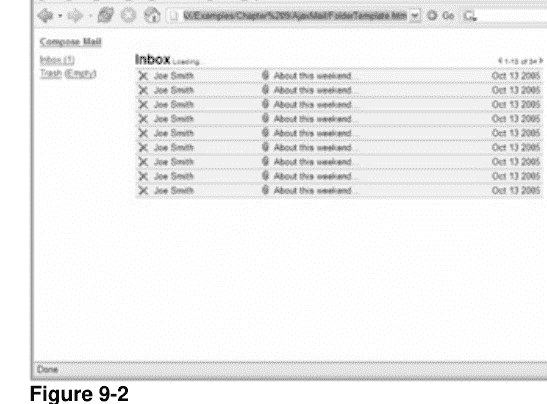

你可能注意到每封电子邮件旁边缺少传统的复选框。这是因为在 AjaxMail 中，你只能对电子邮件做一件事：删除它。复选框被每封电子邮件旁边的红色 X 取代，点击它可以删除该邮件（将其移至废纸篓）。当你切换到废纸篓文件夹时，图标会变成一个绿色箭头，点击它会将电子邮件移回收件箱（参见图 9-3）。

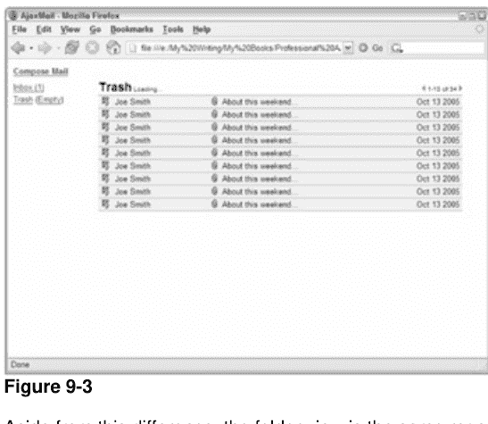

除此之外，文件夹视图无论显示哪个文件夹都是一样的。此外，每封电子邮件都有一个可选的附件指示器，如果电子邮件包含附件，则会显示在主题旁边。此图标仅在检测到附件时显示；否则，它是隐藏的。

文件夹名称旁边还有一个小的 "loading" 消息。这用于指示何时有对服务器的开放请求，并在请求完成时消失。当请求正在处理时，不能执行其他操作，以防止请求被覆盖。

文件夹视图的 HTML 相当简单，因为大部分显示内容都是由 JavaScript 根据从服务器接收的数据创建的：

```
<div id="divFolder">
    <div id="divFolderHeader" class="header">
        <h1 id="hFolderTitle">Inbox</h1>
        <div id="divFolderStatus" class="status">Loading...</div>
        <div id="divItemCount">
            
            <span id="spnItems"></span>

            
        </div>
    </div>
    <table border="0" cellpadding="0" cellspacing="0" id="tblMain">
        <thead>
            <tr id="trTemplate">
                <td></td>
                <td class="from"></td>
                <td class="attachment">
                    </td>
                <td class="subject"></td>
                <td class="date" nowrap="nowrap"></td>
            </tr>
            <tr id="trNoMessages">
                <td colspan="5">There are no messages in this
folder.</td>
            </tr>
        </thead>
        <tbody>
            <tr style="visibility: hidden">
                <td colspan="5"></td>
            </tr>
        </tbody>
</table>
</div>
```

关于这段代码，首先要注意的是几乎每个元素都分配了 `id` 属性。任何必须通过 JavaScript 访问的元素都需要一个 `id` 属性，以便可以使用 `document.getElementById()` 方法直接访问。例如，`hFolderTitle` 包含文件夹名称，该名称在检索到文件夹数据后由 JavaScript 赋值。由于这会频繁发生，JavaScript 需要引用此元素。同样，包含加载消息的 `divFolderStatus` 元素需要一个 `id` 属性，以便在适当时显示和隐藏。`spnItems` 元素将填充有关当前显示哪些消息的信息。HTML 中最棘手的部分是显示消息的表格。

表格内是一个包含两行的 `<thead/>` 元素：一行名为 `trTemplate`，另一行名为 `trNoMessages`。这些行被 JavaScript 用作模板来动态创建行。由于经常需要这种格式的行，创建 HTML 并将其隐藏于用户视图之外，比复制它并填写必要信息更快更有效。我们将在本章后面看到这是如何实现的。现在，只需要知道这两行都对用户不可见。

`<tbody/>` 元素包含一个隐藏的行。这样做是为了设置表格的初始浏览器测量值。如果没有这个，每个表格行最初都会显示不正确，因为浏览器没有基准测量标准。提供这个隐藏行可以为浏览器提供足够的信息，以确保任何后续行都能正确显示。

### 阅读视图

阅读视图的设计非常简单，用于显示电子邮件消息以便用户阅读（参见图 9-4）。它由一个主题行组成，后面跟着发件人电子邮件地址、收件人电子邮件地址和消息日期的空间。还有用于显示抄送 (CC) 和密送 (BCC) 信息的额外空间（如有必要）。

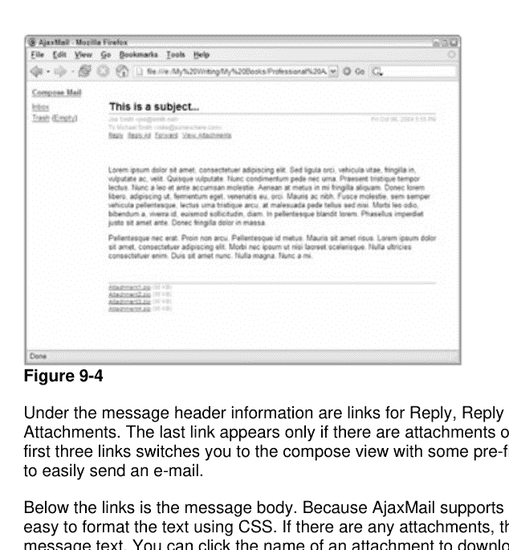

在消息头信息下方是用于回复、全部回复、转发和查看附件的链接。最后一个链接仅当消息有附件时才会出现。前三个链接中的每一个都会将你切换到撰写视图，并预填充一些信息，使你可以轻松发送电子邮件。

链接下方是消息正文。由于 AjaxMail 仅支持纯文本消息，因此使用 CSS 格式化文本很容易。如果有任何附件，它们会列在主消息文本下方。你可以点击附件的名称来下载它。

出于同样的原因，阅读视图的 HTML 也非常简单，因为大部分信息都是后来由 JavaScript 添加的。

```
<div id="divReadMail" style="display: none">
    <div class="header">
        <h1 id="hSubject"></h1>
    </div>
    <div class="message-headers">
        <div id="divMessageFrom"></div>
        <div id="divMessageDate"></div>
    </div>
    <div id="divMessageTo"></div>
    <div id="divMessageCC"></div>
    <div id="divMessageBCC"></div>
    <ul class="message-actions">
        <li><span class="link" id="spnReply">Reply</span></li>
        <li><span class="link" id="spnReplyAll">Reply All</span></li>
        <li><span class="link" id="spnForward">Forward</span></li>
        <li id="liAttachments"><a href="#attachments">View Attachments</a></li>
    </ul>
    <div id="divMessageBody"></div>
    <a name="attachments" id="aAttachments">Attachments</a>
    <div id="divMessageAttachments">
        <ul id="ulAttachments">
        </ul>
    </div>
</div>
```

与文件夹视图一样，阅读视图的几乎所有元素都有一个 `id` 属性。`hSubject` 元素用于显示消息主题，而 `divMessageBody` 元素用于显示消息文本。`divMessageFrom`、`divMessageDate`、`divMessageTo`、`divMessageCC` 和 `divMessageBCC` 元素用于显示消息的每种头信息类型。紧随这些元素之后的是消息操作：回复、全部回复、转发和查看附件。请注意，只有查看附件链接使用了 `<a/>` 元素。这是为了利用 HTML 锚点将屏幕视图向下移动到附件列表。所有其他链接都是使用带有 `link` CSS 类的 `<span/>` 元素实现的。附件列在 `ulAttachments` 元素中。如果没有附件，整个 `divMessageAttachments` 元素将被隐藏。

### 撰写视图

撰写视图在 AjaxMail 的用户界面中承担了大量工作。它不仅用于创建新的电子邮件消息，还用于回复和转发电子邮件。为了本书的简单起见，撰写视图仅支持“收件人”和“抄送”字段（没有密送），并且不允许发送附件。

此视图由用于收件人、抄送和主题字段的文本框以及电子邮件消息本身组成（参见图 9-5）。还有两个链接：“发送”和“取消”。“发送”开始发送电子邮件的过程，“取消”将用户放回上一个视图（文件夹视图或阅读视图）。

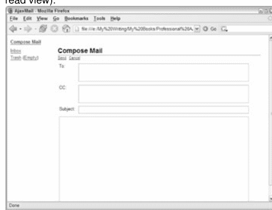

此视图的 HTML 主要由包含文本字段的表单组成：

```
<div id="divComposeMail" style="display: none">
    <div class="header">
        <h1 id="hComposeHeader">Compose Mail</h1>
    </div>
    <div id="divComposeMailForm">
        <ul id="ulComposeActions" class="message-actions">
```


### 布局

为了确保用户界面具有一致的体验，每个视图必须经过精心布局，以便在需要时可以轻松地滑动到其他视图的位置。为此，每个视图都被绝对定位在相同的位置：

```
#divFolder,
#divReadMail,
#divComposeMail {
    position: absolute;
    top: 35px;
    left: 150px;
    width: 600px;
    -moz-box-sizing: border-box;
    box-sizing: border-box;
}
```

最后两个 CSS 属性 `-moz-box-sizing` 和 `box-sizing` 用于确保所有浏览器中的尺寸计算保持一致。默认情况下，Internet Explorer 使用边框盒模型进行渲染，而其他浏览器则不然。这两行代码（第一行针对 Mozilla，第二行针对其他浏览器）确保无论使用何种浏览器，尺寸都能保持一致。其余的样式信息将每个视图放置在屏幕上的同一位置，并使每个视图具有相同的宽度（尽管高度允许根据需要增长和收缩）。

接下来，必须隐藏 iframe 以免干扰页面布局。由于设置了 iframe 的 `id` 属性，你可以直接引用它：

```
#iLoader {
    display: none;
}
```

同样请记住，`<thead/>` 元素需要被隐藏，以便它不会在文件夹视图中显示模板行：

```
thead {
    display: none;
}
```

### 整合所有部分

现在你已经了解了架构、数据库、用户界面和服务器端组件的所有内容，是时候使用 JavaScript 将它们全部整合起来了。首先，你需要定义一些常量。第一个常量只是 AjaxMail 需要使用的各种资源的位置：

```
var sAjaxMailURL = "AjaxMailAction.php";
var sAjaxMailNavigateURL = "AjaxMailNavigate.php";
var sAjaxMailAttachmentURL = "AjaxMailAttachment.php";
var sAjaxMailSendURL = "AjaxMailSend.php";
```

```
var sImagesDir = "images/";
var sRestoreIcon = sImagesDir + "icon_restore.gif";
var sDeleteIcon = sImagesDir + "icon_delete.gif";
var sInfoIcon = sImagesDir + "icon_info.gif";
var sErrorIcon = sImagesDir + "icon_alert.gif";
var aPreloadImages = [sRestoreIcon, sDeleteIcon, sInfoIcon, sErrorIcon];
```

这段代码的第一部分只是定义了用于向服务器发回请求的 URL。这些将在以后用于集成 Ajax 接口。第二部分代码标识了用户界面所必需的图像，然后将它们放入一个名为 `aPreloadImages` 的数组中。这些图像是预加载的，以便用户界面能够快速响应：

```
for (var i=0; i < aPreloadImages.length; i++) {
    var oImg = new Image();
    oImg.src = aPreloadImages[i];
}
```

此代码使用了一个 Image 对象，它本质上是一个不可见的 `` 元素。由于并非所有这些图像在应用程序首次加载时都是必需的，因此大多数图像在第一次使用之前不会被加载。这可能会导致延迟，可能会让用户感到困惑。预加载图像可以防止此问题的发生。

接下来，有一些消息和字符串需要显示给用户。提前在代码中定义这些有助于将来需要时轻松更改消息：

```
var sEmptyTrashConfirm =
    "您即将永久删除回收站中的所有内容。是否继续？";
var sEmptyTrashNotice = "回收站已被清空。";
var sDeleteMailNotice = "邮件已移至回收站。";
var sRestoreMailNotice = "邮件已移至您的收件箱。";
var sRestore = "还原";
var sDelete = "移至回收站";
var sTo = "收件人 ";
var sCC = "抄送 ";
var sBCC = "密送 ";
var sFrom = "发件人 ";
```

当显示其中一条通知时，你实际上只想让它显示很短的时间，以免它分散用户的注意力或与屏幕的其余部分混在一起。变量 `iShowNoticeTime` 表示通知在屏幕上显示的时间长度（以毫秒为单位）。默认情况下，这是 5 秒（5000 毫秒）：

```
var iShowNoticeTime = 5000;
```

需要提前定义的最后一段代码是几个常量和一个数组：

```
var INBOX = 1;
var TRASH = 2;
var aFolders = ["", " 收件箱", " 回收站"];
```

在此代码中，前两个变量是常量，定义了收件箱和回收站文件夹的数字标识符。这些标识符与它们在数据库中的值一致。字符串数组包含每个文件夹的名称，因此不必总是从数据库中返回它们。数组中的第一个字符串是空的，因为它永远不会被使用。（没有数字 ID 为零的文件夹。）

**重要提示** 在实际实现中，你可能选择让某个服务器端过程生成这些变量，该过程从数据库中读取值并输出相应的 JavaScript 代码。为简单起见，本示例中的这些值直接在 JavaScript 文件中定义。

### 辅助函数

在深入代码主体之前，需要一些辅助函数。*辅助函数* 是指那些不一定特定于某个应用程序，但执行某些必要过程的函数。AjaxMail 有一小部分辅助函数。

第一个辅助函数是你们之前见过的。`getRequestBody()` 函数在 **第 2 章** 中介绍过，用于序列化 HTML 表单中的数据，以便可以将其传递给 XMLHttpRequest。AjaxMail 再次需要此函数。为帮助回忆，该函数如下所示：

```
function getRequestBody(oForm) {
    var aParams = new Array();

    for (var i=0 ; i < oForm.elements.length; i++) {
        var sParam = encodeURIComponent(oForm.elements[i].name);
        sParam += "=";
        sParam += encodeURIComponent(oForm.elements[i].value);
        aParams.push(sParam);
    }

    return aParams.join("&");
}
```

此代码与 **第 2 章** 中的完全相同，将用于发送电子邮件。

电子邮件地址的一个问题是，它们可以以任何格式指定。例如：

-   myname@somewhere.com

+   - 真实姓名 <myname@somewhere.com>
- "真实姓名" <myname@somewhere.com>

如果您经常使用电子邮件，您可能会认出这些格式，因为它们在大多数主要电子邮件应用程序中都有使用。在文件夹视图中显示电子邮件发件人时，AjaxMail 仅显示真实姓名。如果没有真实姓名，则显示电子邮件地址。为了处理这种情况，使用了一个名为 `cleanupEmail()` 的辅助函数：

```
var reNameAndEmail = /(.*?)<(.*)>/i;
```

```
function cleanupEmail(sText) {
    if (reNameAndEmail.test(sText)) {
        return RegExp.$1.replace(/"/g, "");
    } else {
        return sText;
    }
}
```

该函数最重要的部分实际上是正则表达式 `reNameAndEmail`，它匹配包含真实姓名和电子邮件地址的字符串，无论是否使用引号。在函数内部，文本会针对此正则表达式进行测试。如果 `test()` 返回 `true`，则意味着电子邮件地址包含这两部分信息，您应该提取真实姓名（存储在 `RegExp.$1` 中）。但是，此名称中可能包含引号，因此下一步是使用 `replace()` 方法将所有引号替换为空字符串。另一方面，如果正则表达式与传入的文本不匹配，这意味着它只包含电子邮件地址，因此将原样返回，不做任何更改。

最后一个辅助函数名为 `htmlEncode()`，它简单地将大于号 (>)、小于号 (<)、与号 (&) 和引号 (") 字符替换为相应的 HTML 实体。这确保了从电子邮件读取文本时不会创建危险的 HTML：

```
function htmlEncode(sText) {
    if (sText) {
        return sText.replace(/&/g, "&amp;").replace(/</g, "&lt;").replace(/>/g,
            "&gt;").replace(/"/g, "&quot;");
    } else {
        return "";
    }
}
```

此函数还会检查是否传入了文本。如果 `sText` 为 `null`，则函数返回空字符串；否则，使用 `replace()` 方法进行替换。

# 邮箱

AjaxMail 应用程序的主要部分是邮箱。这是一个单一的 JavaScript 对象，包含运行用户界面所需的所有属性和方法。因为该对象应该只有一个实例，所以使用对象字面量表示法定义：

```
var oMailbox = {
    info: new Object(),
    processing: false,
    message: new Object(),
    nextNotice: null,

    //more code here
}
```

邮箱对象存储在名为 `oMailbox` 的变量中，并具有四个属性。第一个属性 `info` 是一个对象，将包含文件夹视图的文件夹信息。此对象将从服务器返回，但在此处初始化为通用对象以避免可能的错误。接下来是 `processing` 属性，它只是一个布尔标志，指示应用程序是否正在处理请求。当设置为 `true` 时，无法启动其他进程。第三个属性是 `message`，它将包含一个描述读取视图中正在阅读的消息的对象。同样，此属性初始化为空对象以避免可能的错误。最后一个属性 `nextNotice` 被多个回调函数用于确定在特定进程完成后应显示哪个通知。

在开始与用户界面交互之前，存储您最常用元素的引用会很有帮助。您可以使用 `document.getElementById()` 来实现这一点，但这需要为 AjaxMail 中使用的所有元素编写大量代码行。相反，更快、更高效的方法是遍历页面中的所有元素，并为每个具有 `id` 属性的元素添加引用。这是 `init()` 方法工作的一部分：

```
init: function () {
    var colAllElements = document.getElementsByTagName("*");
    if (colAllElements.length == 0) {
        colAllElements = document.all;
    }

    for (var i=0; i < colAllElements.length; i++) {
        if (colAllElements[i].id.length > 0) {
            this[colAllElements[i].id] = colAllElements[i];
        }
    }

    //more code here
},
```

此方法首先调用 `getElementsByTagName()` 并传入一个星号。在符合 DOM 规范的浏览器中，这应该返回文档中所有元素的集合。但是，Internet Explorer 的实现不支持此用法，因此您也需要为此做好准备。如果返回的集合没有元素（`length` 不大于零），这意味着正在使用 Internet Explorer。为了解决此限制，您可以使用 `document.all` 集合（仅在 Internet Explorer 中支持）来替代 `getElementsByTagName()` 返回的集合。一旦 `colAllElements` 包含可用的集合，您就可以使用 `for` 循环遍历该集合。如果元素具有 `id` 属性（`id` 属性的 `length` 大于零），则将引用保存在邮箱对象上。因此，`divFolderStatus` 作为名为 `divFolderStatus` 的属性保存到邮箱对象，并可在方法内部使用 `this.divFolderStatus` 或在方法外部使用 `oMailbox.divFolderStatus` 进行访问。

# 数据加载方法

邮箱对象使用两种类型的数据：文件夹信息和消息信息。文件夹信息作为 JSON 字符串从服务器返回，然后解析为包含有关给定文件夹信息的对象。典型的文件夹信息对象如下所示：

```
{
    "messageCount":2,
    "page":1,
    "pageCount":1,
    "folder":1,
    "firstMessage":1,
    "unreadCount": 1,
    "messages":[
        {
            "id":"64",
            "from":" Joe Smith <joe@smith.com>",
            "subject":" Re: How about this weekend?",
            "date":" Oct 29 2005",
            "hasAttachments":false,
            "unread":true
        },
        {
            "id":"63",
            "from":" Joe Smith <joe@smith.com>",
            "subject":" How about this weekend?",
            "date":" Oct 29 2005",
            "hasAttachments":false,
            "unread":false
        }
    ]
}
```

此对象存储在邮箱的 `info` 属性中，以便所有方法都可以使用它。为了分配数据，使用了 `loadInfo()` 方法。因为您可能有一个对象或一个 JSON 字符串要分配，所以此方法需要检查传入参数的类型：

```
loadInfo: function (vInfo) {
    if (typeof vInfo == "string") {
        this.info = JSON.parse(vInfo);
    } else {
        this.info = vInfo;
    }
},
```

如果 `vInfo` 是字符串，则使用 `JSON.parse()` 将其解析为对象；否则，它是一个对象，因此可以直接分配给 `info` 属性。此对象用于渲染文件夹页面，但显示单个电子邮件也需要一些数据。

代表单个电子邮件消息的 JSON 对象格式如下：

```
{
    "id":"63",
    "to":" you@somewhere.com",
    "from":" Joe Smith <joe@smith.com>",
    "cc":"",
    "subject":" How about this weekend?",
    "bcc":"",
    "date":" Oct 29, 2005 05:15 AM",
    "hasAttachments":false,
    "unread":true,
    "message":" I was thinking this weekend would be good? How about you?<br />Joe",
    "attachments":[],
    "unreadCount":8
}
```

当在 AjaxMail 中查看消息时，此信息将分配给 `message` 属性，以便所有方法都可以访问它。`loadMessage()` 方法接受一个对象或包含此消息信息的 JSON 字符串，并将其分配给 `message` 属性：

```
loadMessage: function (vMessage) {
    if (typeof vMessage == "string") {
        this.message = JSON.parse(vMessage);
    } else {
        this.message = vMessage;
    }
}
```

如您所见，这本质上与 `loadInfo()` 相同；它只是处理不同的数据。这两个方法至关重要，因为它们是将数据从服务器传递到客户端的主要手段。

# 用户通知方法

您还记得前面邮箱对象描述中的 `processing` 属性。为了设置此属性的值，使用了一个名为 `setProcessing()` 的特殊方法。此方法的唯一参数是一个布尔值，当邮箱正在处理时设置为 `true`，否则设置为 `false`。此方法还会在邮箱处理时显示 `divFolderStatus` 元素：

```
setProcessing: function (bProcessing) {
    this.processing = bProcessing;
    this.divFolderStatus.style.display = bProcessing ? "block" : "none";
}
```

如果`bProcessing`参数为true，则`divFolderStatus`元素的`display`属性将被设置为`block`，确保其可见；否则，该属性将被设置为`none`，将其从视图中隐藏。在整个邮箱对象中都使用此方法，以防止同时发生多个请求。

另一个在全局使用的方法是`showNotice()`，它向用户显示关于请求状态的通知：

```javascript
showNotice: function (sType, sMessage) {
    var divNotice = this.divNotice;
    divNotice.className = sType;
    divNotice.innerHTML = sMessage;
    divNotice.style.visibility = "visible";
    setTimeout(function () {
        divNotice.style.visibility = "hidden";
    }, iShowNoticeTime);
},
```

此方法接受两个参数：消息类型（`info`或`error`）和要显示的消息。消息类型同时也是将分配给`divNotice`的CSS类，从而为其提供适当的格式。消息通过`innerHTML`属性分配给元素，这意味着如果需要，可以在消息中包含HTML代码。

之后，通过将`visibility`属性设置为`visible`，该元素对用户变为可见。由于消息应仅显示特定时间，因此使用`setTimeout()`函数来确定何时将`visibility`属性设置回`hidden`。该间隔是之前定义的全局变量`iShowNoticeTime`。

任何使用此方法显示的通知都会立即显示，并在指定时间后消失。

### 通信方法

AjaxMail通过两种不同的方式与服务器通信：通过XMLHttp和通过隐藏的iframe。为此，使用了多种方法来封装大部分通信功能，以便其他函数可以直接使用它们。

所有XMLHttp GET请求都通过`request()`方法进行。此方法接受三个参数：要执行的操作、请求完成时要通知的回调函数，以及一个可选的电子邮件消息ID。通过此方法发出的每个请求都会发送到`AjaxMailAction.php`，在查询字符串中传递操作（第一个参数）。以下是完整的方法：

```javascript
request: function (sAction, fnCallback, sId) {
    if (this.processing) return;
    try {
        this.setProcessing(true);
        var oXmlHttp = zXmlHttp.createRequest();
        var sURL = sAjaxMailURL + "?folder=" + this.info.folder + "&page="
                 + this.info.page + "&action=" + sAction;
        if (sId) {
            sURL += "&id=" + sId;
        }
        oXmlHttp.open("get", sURL, true);
        oXmlHttp.onreadystatechange = function (){
            try {
                if (oXmlHttp.readyState == 4) {
                    if (oXmlHttp.status == 200) {
                        fnCallback(oXmlHttp.responseText);
                    } else {
                        throw new Error("An error occurred while attempting to contact the server. The action ("+ sAction + ") did not complete.");
                    }
                }
            } catch (oException) {
                oMailbox.showNotice("error", oException.message);
            }
        };
        oXmlHttp.send(null);
    } catch (oException) {
        this.showNotice("error", oException.message);
    }
},
```

注意，第一行检查邮箱是否正在处理另一个请求。如果是，该函数将在不执行下一个请求的情况下返回。否则，将执行涉及XMLHttpRequest对象的标准try...catch安排。在执行任何操作之前，调用`setProcessing()`以指示请求已开始。URL的构建方式是在查询字符串中添加当前文件夹ID和页面，然后是要执行的操作。如果指定了消息ID（`sID`），也会将其添加到查询字符串中，以便可以完成该操作。接下来，初始化XMLHttpRequest对象并分配`onreadystatechange`事件处理程序。在事件处理程序内部，当请求成功时，调用回调函数（`fnCallback`），并传入响应文本。如果在此过程中发生错误，将抛出一个自定义错误。当catch语句介入时，使用`showNotice()`方法显示有关该消息的详细信息。

发送电子邮件的方法非常相似，但使用的是POST请求：

```javascript
sendMail: function () {
    if (this.processing) return;
    this.divComposeMailForm.style.display = "none";
    this.divComposeMailStatus.style.display = "block";

    try {
        this.setProcessing(true);
        var oXmlHttp = XMLHttpRequest.createRequest();
        var sData = getRequestBody(document.forms["frmSendMail"]);

        oXmlHttp.open("post", sAjaxMailSendURL, true);
        oXmlHttp.setRequestHeader("Content-Type", "application/x-www-form-encoded");
        oXmlHttp.onreadystatechange = function (){
            try {
                if (oXmlHttp.readyState == 4) {
                    if (oXmlHttp.status == 200) {
                        sendConfirmation(oXmlHttp.responseText);
                    } else {
                        throw new Error("An error occurred while attempting to contact the server. The mail was not sent.");
                    }
                }
            } catch (oException) {
                oMailbox.showNotice("error", oException.message);
            }
        };
        oXmlHttp.send(sData);
    } catch (oException) {
        this.showNotice("error", oException.message);
    }
},
```

与`request()`方法一样，`sendMail()`方法首先检查邮箱是否正在处理请求。如果没有其他活动的请求，则会进行一些用户界面更改。首先，通过将`display`属性设置为`none`，将撰写邮件表单从视图中隐藏。然后，通过将其`display`属性设置为`block`来显示状态区域。这有效地表明邮件正在发送，同时会播放一个动画GIF。

接下来，调用`setProcessing()`方法以指示请求已开始，并通过调用邮件表单上的`getRequestBody()`来创建数据字符串。初始化`oXmlHttp`对象后，设置适当的请求头。`onreadystatechange`事件处理程序是标准设置，并将响应文本传递给`sendConfirmation()`函数（将在接下来的“回调函数”部分描述）。

最后一种通信方法是`navigate()`，每当用户界面更改应在浏览器历史记录中记录时使用（允许用户单击“后退”和“前进”来浏览用户界面更改）。此方法使用隐藏的iframe向服务器发出请求并接收响应：

```javascript
navigate: function (sAction, sId) {
    if (this.processing) return;
    try {
        this.setProcessing(true);
        var sURL = sAjaxMailNavigateURL + "?folder=" +this.info.folder
                + "&page=" + this.info.page +
                "&action=" + sAction;
        if (sId) {
            sURL += "&id=" + sId;
        }

        this.iLoader.src = sURL;
    } catch (oException) {
        this.showNotice("error", oException.message);
    }
},
```

此方法仅接受两个参数：要执行的操作和一个可选的消息ID（类似于`request()`）。与其他通信方法一样，此方法首先检查邮箱是否正在处理另一个请求，如果是这种情况则退出该方法。否则，标准的`try...catch`块会包围其余代码，以捕获可能发生的任何错误。然后，将`processing`标志设置为`true`以指示新的请求已开始。URL的构建方式与`request()`中相同，仅在提供了消息ID时才将其添加。最后，通过`src`属性将URL分配给iframe。现在，由iframe中返回的页面来通知邮箱处理已完成。

### 渲染方法

邮箱对象最复杂的方法是与在屏幕上渲染数据相关的方法。有两种方法：`renderFolder()`，用于显示邮箱文件夹；以及`renderMessage()`，用于显示单个电子邮件消息。两者都使用一个名为`updateUnreadCount()`的小方法，该方法负责更新“收件箱”链接旁边未读消息的数量：

```javascript
updateUnreadCount: function (iCount) {
    this.spnUnreadMail.innerHTML = iCount > 0 ? "("+ iCount + ")" : "";
}
```

此方法期望将未读消息的数量作为参数传入。如果该数字大于0，则更新`spnUnreadMail`元素以显示该数字；否则，该元素被赋予一个空字符串。定义了此方法后，现在是时候看看两个更复杂的方法了。

`renderFolder()`方法使用`info`属性在文件夹视图中显示适当的电子邮件消息。首先，此方法会清除文件夹视图中的所有消息信息，以便可以轻松地构建和插入新信息：

```javascript
renderFolder: function () {
    var tblMain = this.tblMain;

    while (tblMain.tBodies[0].hasChildNodes()) {
        tblMain.tBodies[0].removeChild(tblMain.tBodies[0].firstChild);
    }

    //更多代码在此
},
```


此方法的第一部分将 `tblMain` 的引用存储在一个局部变量中，然后从 `<tbody/>` 元素（引用为 `tblMain.tBodies[0]`）中移除所有子节点。移除所有行之后，现在可以开始添加行了。

该方法的下一部分为消息创建 DOM 表示。请注意，为简单起见，仅显示对方法的新增内容：

```javascript
renderFolder: function () {
    //remove all existing rows
    var oFragment = document.createDocumentFragment();
    if (this.info.messages.length) {
        for (var i=0; i < this.info.messages.length; i++) {
            var oMessage = this.info.messages[i];
            var oNewTR = this.trTemplate.cloneNode(true);
            oNewTR.id = "tr" + oMessage.id;
            oNewTR.onclick = readMail;
            if (oMessage.unread) {
                oNewTR.className = "new";
            }
            var colCells = oNewTR.getElementsByTagName("td");
            var imgAction = colCells[0].childNodes[0];
            imgAction.id = oMessage.id;
            if (this.info.folder == TRASH) {
                imgAction.onclick = restoreMail;
                imgAction.src = sRestoreIcon;
                imgAction.title = sRestore;
            } else {
                imgAction.onclick = deleteMail;
                imgAction.src = sDeleteIcon;
                imgAction.title = sDelete;
            }
            colCells[1].appendChild(document.createTextNode(cleanupEmail(oMessage.from)));
            colCells[2].firstChild.style.visibility = oMessage.hasAttachments ? "visible" : "hidden";
            colCells[3].appendChild(document.createTextNode(htmlEncode(oMessage.subject)));
            colCells[4].appendChild(document.createTextNode(oMessage.date));
            oFragment.appendChild(oNewTR);
        }
    } else {
        var oNewTR = this.trNoMessages.cloneNode(true);
        oFragment.appendChild(oNewTR);
    }
    tblMain.tBodies[0].appendChild(oFragment);
    //more code here
},
```

在此代码段中，第一步是创建一个文档片段，用于构建 DOM。接着，检查消息数量。如果至少有一条消息，则必须相应地构建视图；否则，创建 `trNoMessages` 的克隆并将其添加到片段中，以代替任何其他行。不过，当存在消息时，过程会稍微复杂一些。

对于每条消息，该过程首先将消息存储在局部变量 `oMessage` 中。这是从 `info` 属性的 `messages` 数组中检索到的。接下来，创建模板行 `trTemplate` 的克隆并存储在 `oNewTR` 中（向 `cloneNode()` 传入 `true` 确保所有节点都被克隆，而不仅仅是 `<tr/>` 元素本身）。然后，通过在消息 ID 前加上 `tr` 来分配行的 ID。接着，将 `onclick` 事件处理程序分配给 `readMail()`，该函数在后面的“事件处理程序”部分定义。如果消息尚未读取，`oMessage.unread` 将为 `true`，因此该行将被分配一个 CSS 类 `new`。下一步是将数据分配到每个表格单元格中。

为了更方便地引用单元格，使用 `getElementsByTagName()` 方法提取仅包含表格单元格的集合（`colCells`）。操作图标（用于删除或恢复消息）位于第一个单元格中。实际的 `` 元素存储在 `imgAction` 中以方便引用。然后，为图像分配一个等于消息 ID 的 ID。要确定图像被点击时应执行的操作，需通过 `info.folder` 检查当前文件夹。如果当前文件夹是回收站，则通过将 `onclick`、`src` 和 `title` 属性设置为特定于恢复的值来设置图像以恢复电子邮件；否则，通过将相同属性设置为特定于删除的值来设置图标以删除电子邮件。`restoreMail()` 和 `deleteMail()` 都是用作事件处理程序的全局函数。这些在“事件处理程序”部分讨论。

每行的第二个单元格应显示电子邮件的发送者，因此将 `oMessage.from` 传递给辅助函数 `cleanupEmail()`，该函数在本章前面已定义。此函数调用的结果被传递给 `document.createTextNode()` 以创建单元格的文本，然后使用 `appendChild()` 添加。

对于行中的第三个单元格，需要决定是否显示附件图标。如果 `oMessage.hasAttachments` 为 `true`，则图标的 `visibility` 被设置为 `visible`；否则，设置为 `hidden`。为简单起见，这是使用复合赋值语句而不是 `if` 语句完成的。

第四个表格单元格包含电子邮件主题，将其传递给 `htmlEncode()` 以确保所有字符正确显示。然后，使用此文本创建一个文本节点，并以与第一个单元格相同的方式添加到单元格中。第五个单元格只需将消息日期作为文本节点添加后即可显示。然后，在循环再次开始之前，将整个行添加到文档片段中。

无论消息数量多少，片段都会传递给表格主体的 `appendChild()` 方法，以将行添加到文件夹视图中。但是，用户界面尚未完成；还有其他信息需要更新。

具体来说，必须显示文件夹标题，必须更新未读消息计数，并且必须初始化分页控件：

```javascript
renderFolder: function () {
    //delete all existing rows
    //create rows for messages
    if (this.hFolderTitle.innerHTML != aFolders[this.info.folder]) {
        this.hFolderTitle.innerHTML = aFolders[this.info.folder];
    }
    this.updateUnreadCount(this.info.unreadCount);
    this.spnItems.style.visibility = this.info.messages.length ?
        "visible" : "hidden";
    this.spnItems.innerHTML = this.info.firstMessage + "-"
        + (this.info.firstMessage + this.info.messages.length - 1) +
        " of "
        + this.info.messageCount;
    if (this.info.pageCount > 1) {
        this.imgNext.style.visibility = this.info.page <
            this.info.pageCount ?
            "visible" : "hidden";
        this.imgPrev.style.visibility = this.info.page > 1 ? "visible"
            : "hidden";
    } else {
        this.imgNext.style.visibility = "hidden";
        this.imgPrev.style.visibility = "hidden";
    }
    this.divFolder.style.display = "block";
    this.divReadMail.style.display = "none";
    this.divComposeMail.style.display = "none";
},
```

此代码段中的第一步是将 `hFolderTitle` 元素的内容设置为文件夹的名称，但仅当它与当前显示的不同时。为此，使用 `innerHTML` 元素来获取和设置值（如有必要）。接下来，将未读消息数传递给 `updateUnreadCount()` 以更新收件箱链接旁边的未读消息数。

如果至少有一条消息，则必须显示 `spnItems`。这是显示当前查看的消息计数的元素，例如“1-10 of 21”。如果至少有一条消息，则其 `visibility` 属性被设置为 `visible`；否则，设置为 `hidden`。然后，通过使用 `info` 对象的各种属性来创建元素的内容。`firstMessage` 属性返回此页面中返回的第一条消息的编号。然后，可以通过将消息数添加到 `firstMessage` 再减去一来计算返回的最后一条消息的编号。消息总数在 `messageCount` 属性中返回。

当有多于一页消息需要显示时，`imgNext` 和 `imgPrev` 图像应显示，但并非总是同时显示。例如，如果你在第一页上，则不应显示 `imgPrev`；同样，在最后一页上不应显示 `imgNext`。通过使用 `page` 属性获取当前页面，你可以确定图像是否应该可见，并为 `visibility` 属性显示适当的值。当然，如果只有一页，则两个图像都不需要显示。

最后一步是显示 `divFolder` 元素并将 `divReadMail` 和 `divComposeMail` 从视野中隐藏。这将应用程序初始化为文件夹视图。当用户在列表中单击一条消息时，它会打开阅读视图，该视图由 `renderMessage()` 方法呈现。

正如 `renderFolder()` 方法使用 `info` 属性来确定呈现什么一样，`renderMessage()` 方法出于相同的原因使用 `message` 属性。显示单个电子邮件所需的所有信息都包含在 `message` 属性中。首先，你使用 `message` 中的值为阅读视图中的每个元素分配内容：

```javascript
renderMessage: function () {
    this.hSubject.innerHTML = htmlEncode(this.message.subject);
    this.divMessageFrom.innerHTML = sFrom + "" + htmlEncode(this.message.from);
    this.divMessageTo.innerHTML = sTo + "" + htmlEncode(this.message.to);
    this.divMessageCC.innerHTML = this.message.cc.length ?
        sCC + "" + htmlEncode(this.message.cc) : "";
    this.divMessageBCC.innerHTML = this.message.bcc.length ?
        sBCC + "" + htmlEncode(this.message.bcc) : "";
    this.divMessageDate.innerHTML = this.message.date;
    this.divMessageBody.innerHTML = this.message.message;
    //more code here
    this.updateUnreadCount(this.message.unreadCount);
    this.divFolder.style.display = "none";
    this.divReadMail.style.display = "block";
    this.divComposeMail.style.display = "none";
},
```

负责显示电子邮件各个部分的每个元素都从 `message` 对象分配数据。当然，大多数值都使用 `htmlEncode()` 来确保数据正确显示。对于抄送（CC）和密送（BCC）字段，仅当它们最初包含数据时才分配其值。否则，`divMessageCC` 和 `divMessageBCC` 字段被分配空字符串，这实际上将它们从视图中隐藏起来。


随后，未读消息计数会更新。此处也进行更新，因为没有必要浪费一次服务器往返而不获取这一小段信息。该过程的最后一步是隐藏 `divFolder` 和 `divComposeMail`，同时显示 `divReadMail`。然而，此方法中缺少部分代码。前面的代码没有考虑附件。

处理附件本质上意味着输出消息所有附件的列表，并将它们链接起来，使得每个附件只需简单点击即可下载。`ulAttachments` 元素是 `index.php` 代码的一部分，应仅在至少有一个附件时才显示。以下是构建此视图部分的方法：

```
renderMessage: function () {
    this.hSubject.innerHTML = htmlEncode(this.message.subject);
    this.divMessageFrom.innerHTML = sFrom + ""+
htmlEncode(this.message.from);
    this.divMessageTo.innerHTML = sTo + ""+
htmlEncode(this.message.to);
    this.divMessageCC.innerHTML = this.message.cc.length ?
        sCC + ""+ htmlEncode(this.message.cc) : "";
    this.divMessageBCC.innerHTML = this.message.bcc.length ?
        sBCC + ""+ htmlEncode(this.message.bcc) : "";
    this.divMessageDate.innerHTML = this.message.date;
    this.divMessageBody.innerHTML = htmlEncode(this.message.message);

    if (this.message.hasAttachments) {
        this.ulAttachments.style.display = "";

        var oFragment = document.createDocumentFragment();

        for (var i=0; i < this.message.attachments.length; i++) {
            var oLI = document.createElement("li");

            oLI.className = "attachment";
            oLI.innerHTML = "<a href=\"" + sAjaxMailAttachmentURL +
"?id="
                + this.message.attachments[i].id + "\"
target=\"_blank\">"
                + this.message.attachments[i].filename + "</a> ("
                + this.message.attachments[i].size + ")";
            oFragment.appendChild(oLI);
        }

        this.ulAttachments.appendChild(oFragment);
        this.liAttachments.style.display = "";
    } else {
        this.ulAttachments.style.display = "none";
        this.liAttachments.style.display = "none";
        this.ulAttachments.innerHTML = "";
    }

    this.updateUnreadCount(this.message.unreadCount);
    this.divFolder.style.display = "none";
    this.divReadMail.style.display = "block";
    this.divComposeMail.style.display = "none";
}
```

自然地，渲染附件信息的第一步是使用 `hasAttachments` 属性检查是否存在任何附件。如果有附件，则显示 `ulAttachments` 元素并遍历附件，为每个附件创建一个新的 `<li/>` 元素，并使用 `innerHTML` 属性分配附加信息。这些新元素中的每一个都被添加到文档片段中以提高效率。当所有附件都创建了它们的 DOM 表示后，该片段被追加到 `ulAttachments`。然后，通过将其 `display` 属性设置为空字符串来显示 `liAttachments` 元素。此元素包含消息标头中的“查看附件”链接。

如果消息没有附件，则通过将 `ulAttachments` 和 `liAttachments` 的 `display` 属性设置为 `none` 来隐藏它们。此外，通过将其设置为空字符串来清除 `innerHTML` 中的所有数据。这可以防止附件出现在未附加它们的电子邮件上。

### 操作方法

有了所有 Ajax 请求方法和回调函数，你现在拥有了创建电子邮件应用程序功能所需的所有工具。对于每个操作，重要的是要清楚用户界面应该如何响应以及用户的期望是什么。

首先，考虑删除电子邮件消息的任务。当用户点击消息旁边的红色 X 时，该消息应被删除（移动到回收站）。此处“后退”和“前进”按钮没有用，因为你永远不想让用户回到电子邮件仍在列表中的那个点。这意味着应该使用 `request()` 方法。接下来，此操作是否会导致用户界面更改？是的，消息应该从列表中消失。因此，你需要使用带有 `loadAndRender()` 回调函数的 `request()` 方法：

```
deleteMessage: function (sId) {
    this.nextNotice = sDeleteMailNotice;
    this.request("delete", loadAndRender, sId);
}
```

因为你要删除特定的消息，所以必须将消息 ID 传递给该方法。为操作做准备，`nextNotice` 属性被设置为删除邮件通知字符串。然后，调用 `request()`，传入 `delete` 字符串、`loadAndRender()` 回调函数和消息 ID。当请求完成时，会显示通知，用户可以继续与应用程序交互，知道该消息已移动到回收站。要从回收站恢复消息，可以使用相同的方法。

当用户查看回收站中的消息时，点击绿色箭头会恢复消息（将其移动到收件箱）。这本质上与删除操作相同；它只是改变了消息的存储位置。不足为奇，该方法非常相似：

```
restoreMessage: function (sId) {
    this.nextNotice = sRestoreMailNotice;
    this.request("restore", loadAndRender, sId);
}
```

同样，此函数在请求完成时分配要显示的通知，并使用 `request()` 来恢复由消息 ID (`sId`) 表示的消息。

回收站还有一个特殊操作：`empty`。当回收站被清空时，其中的所有消息将被永久删除且无法恢复。此操作的有趣之处在于，其行为取决于用户正在查看的内容。如果正在查看收件箱，仍然可以点击“清空”链接。在这种情况下，除了让用户知道回收站已清空外，你不想更改用户界面。另一方面，如果用户正在查看回收站中的消息，则用户界面应刷新以显示回收站为空。因此，`emptyTrash()` 方法稍微复杂一些：

```
emptyTrash: function () {
    if (confirm(sEmptyTrashConfirm)) {
        this.nextNotice = sEmptyTrashNotice;
        if (this.info.folder == TRASH) {
            this.request("empty", loadAndRender);
        } else
            this.request("empty", execute);
    }
}
```

在此方法中，第一步是确认用户确实想要清空回收站。使用带有 `sEmptyTrashConfirm` 的 JavaScript `confirm()` 函数会向用户显示一个包含两个选项的对话框：确定或取消。如果用户点击确定，`confirm()` 返回 `true`，回收站应被清空。因此，与前面的方法一样，分配 `nextNotice` 属性。接下来，检查当前显示的文件夹。如果是回收站，则使用 `loadAndRender()` 回调函数调用 `request()` 以更新显示；如果不是回收站，则使用 `execute()` 调用 `request()`，这样用户界面就不会更新。

到目前为止，本节中的方法都是处理对电子邮件消息执行操作。`getMessages()` 方法实际上负责从服务器检索文件夹信息。它接受文件夹 ID 和要检索的页码作为参数，然后使用 `navigate()` 方法检索所需的信息：

```
getMessages: function (iFolder, iPage) {
    this.info.folder = iFolder;
    this.info.page = iPage;
    this.navigate("getfolder");
}
```

要检索正确的消息，必须将 `info` 对象的文件夹和页面属性设置为适当的值。然后，当调用 `navigate()` 时，URL 将包含正确的文件夹和页面信息。此方法随后用于 `nextPage()` 和 `prevPage()` 以浏览给定文件夹中不同页面的消息：

```
nextPage: function () {
    this.getMessages(this.info.folder, this.info.page+1);
}
```

nextPage: function () {
    this.getMessages(this.info.folder, this.info.page + 1);
},
prevPage: function () {
    this.getMessages(this.info.folder, this.info.page - 1);
},

这两个方法都将当前文件夹传递给 `getMessages()`，但页码参数不同。对于 `nextPage()`，当前页码加一，而 `prevPage()` 则减一。

用户有时可能只想刷新当前文件夹的信息，而不是切换文件夹。例如，当收件箱已经在显示时，用户可以通过点击收件箱链接来检查新邮件。在这种情况下，你不希望将任何内容添加到浏览器历史记录中，因为你肯定不希望返回到文件夹的旧视图，所以应该使用 `request()` 而不是 `navigate()`：

```javascript
refreshFolder: function (iFolder) {
    this.info.folder = iFolder;
    this.info.page = 1;
    this.request("getfolder", loadAndRender);
},
```

这个方法与 `getMessages()` 非常相似，都需要传入文件夹 ID 并赋值给 `info.folder` 属性。`page` 被设置为 1，因为任何刷新都需要从第一页开始。并且由于此操作需要更新用户界面，所以在调用 `request()` 时传入了 `loadAndRender()` 回调函数。

### 导航方法

在 Ajax 应用程序中保持导航的清晰可能会比较棘手，但得益于之前定义的 `navigate()` 方法，事情变得简单多了。每当需要从 AjaxMail 的一个视图切换到另一个视图时，你只需向 `navigate()` 方法传递一个字符串，然后等待操作完成即可。为此，有四个方法直接或间接利用 `navigate()` 方法来执行其功能：

```javascript
cancelReply: function () {
    history.go(-1);
},

compose: function () {
    this.navigate("compose");
},

forward: function () {
    this.navigate("forward");
},

readMessage: function (sId) {
    this.navigate("getmessage", sId);
},

reply: function (blnAll) {
    this.navigate("reply" + (blnAll ? "all" : ""));
},
```

第一个方法 `cancelReply()` 使用浏览器内部历史记录来完成其工作。当用户点击“撰写邮件”、“转发”、“回复”或“全部回复”时，会调用 `navigate()` 方法将他们置于撰写视图。要撤销此操作并返回到上一个视图，可以使用 `history` 对象，因为该操作已被记录在隐藏的 iframe 中。使用 `go()` 方法并传入 `-1` 值可使浏览器返回到上一个视图。

本节中的所有其他方法只是简单地向 `navigate()` 传递一个字符串值，指示接下来应该执行的操作。`readMessage()` 方法还接受要检索的消息 ID，而 `reply()` 方法接受一个布尔参数，指示操作应该是“回复”还是“全部回复”；当设置为 `true` 时，执行“全部回复”。

你可能记得之前提到的，`AjaxMailNavigate.php` 根据发生的不同操作调用不同的 JavaScript 邮箱方法。这些方法都以单词 "display" 开头，并且每个方法都有一个特定的视图需要初始化。

`displayFolder()` 方法正如其名：它显示一个电子邮件消息文件夹。它接受一个文件夹信息对象作为唯一参数，然后渲染该文件夹，最后将 `processing` 标志设置回 `false`：

```javascript
displayFolder: function (oInfo) {
    this.loadInfo(oInfo);
    this.renderFolder();
    this.setProcessing(false);
},
```

类似的方法是 `displayMessage()`，它接受一个消息信息对象，加载它，渲染消息，然后将 `processing` 标志设置为 `false`：

```javascript
displayMessage: function (oMessage) {
    this.loadMessage(oMessage);
    this.renderMessage();
    this.setProcessing(false);
},
```

这两个方法分别负责“文件夹”视图和“阅读”视图。“撰写”视图有些不同，因为它可以以多种方式使用。它可以用于创建新邮件，此时所有字段都是空白的；也可以用于回复、全部回复或转发，此时需要在表单中预填充不同的信息。为了方便处理这些用户操作的不同需求，使用了一个统一的方法：

```javascript
displayComposeMailForm: function (sTo, sCC, sSubject, sMessage) {
    this.txtTo.value = sTo;
    this.txtCC.value = sCC;
    this.txtSubject.value = sSubject;
    this.txtMessage.value = sMessage;
    this.divReadMail.style.display = "none";
    this.divComposeMail.style.display = "block";
    this.divFolder.style.display = "none";
    this.setProcessing(false);
},
```

`displayComposeMailForm()` 方法接受所有可能分配给撰写视图的信息，并将其放入正确的字段中。然后，隐藏 `divReadMail` 和 `divFolder`，同时显示 `divComposeMail`。最后，将 `processing` 标志设置为 `true`。`displayComposeMailForm()` 方法不是由 `AjaxMailNavigate.php` 调用的，而是由几个更具体的方法调用，每个方法针对一个特定的操作：

```javascript
displayCompose: function () {
    this.displayComposeMailForm("", "", "", "");
},

displayForward: function () {
    this.displayComposeMailForm("", "",
                               "Fwd: " + this.message.subject,
                               "---------- Forwarded message ----------\n"
                               + this.message.message);
},

displayReply: function () {
    var sTo = this.message.from;
    var sCC = "";

    this.displayComposeMailForm(sTo, sCC, "Re: "+
                                this.message.subject,
                                "\n\n\n\n\n" + this.message.from + "said: \n" +
                                this.message.message);
},

displayReplyAll: function () {
    var sTo = this.message.from + "," + this.message.to;
    var sCC = this.message.cc;

    this.displayComposeMailForm(sTo, sCC, "Re: "+
                                this.message.subject,
                                "\n\n\n\n\n" + this.message.from + "said: \n" +
                                this.message.message);
},
```

`displayCompose()` 方法只是显示一个空白的撰写视图，它向 `displayComposeMailForm()` 传递空字符串。`displayForward()` 方法在消息主题前添加 "Fwd:"，并在当前正在查看的邮件正文前添加 "-----Forwarded Message------"。`displayReply()` 和 `displayReplyAll()` 都在消息主题前添加 "Re:"，然后在当前邮件正文文本前包含一个简短的字符串。这两个方法之间唯一的区别是“收件人”和“抄送”字段的预填充值。对于 `displayReply()`，“收件人”字段简单地填入最初发送消息的人；对于 `displayReplyAll()`，“收件人”字段还包括邮件发送给的所有其他人，而“抄送”字段包含与原始消息相同的抄送收件人。

### 初始化方法

邮箱对象的最后一部分方法用于初始化属性和数据。之前你看到了 `init()` 方法的开始部分；下一步涉及将事件处理程序分配给各种用户界面元素：

```javascript
init: function () {
    var colAllElements = document.getElementsByTagName("*");
    if (!colAllElements.length) {
        colAllElements = document.all;
    }

    for (var i = 0; i < colAllElements.length; i++) {
        if (colAllElements[i].id.length > 0) {
            this[colAllElements[i].id] = colAllElements[i];
        }
    }

    this.imgPrev.onclick = function () {
        oMailbox.prevPage();
    };

    this.imgNext.onclick = function () {
        oMailbox.nextPage();
    };

    this.spnCompose.onclick = function () {
        oMailbox.compose();
    };

    this.spnEmpty.onclick = function () {
        oMailbox.emptyTrash();
    };

    this.spnReply.onclick = function () {
        oMailbox.reply(false);
    };

    this.spnReplyAll.onclick = function () {
        oMailbox.reply(true);
    };

    this.spnForward.onclick = function () {
        oMailbox.forward();
    };

    this.spnCancel.onclick = function () {
        oMailbox.cancelReply();
    };

    this.spnSend.onclick = function () {
```

### 回调函数

要利用邮箱对象的 `request()` 和 `sendMail()` 方法，需要几个回调函数。这些函数在数据从服务器返回后接管处理过程。每个函数都是独立的；也就是说，它们不是邮箱对象的方法。

当电子邮件首次从服务器下载时，必须先将数据加载到 info 属性中，然后进行渲染：

```javascript
function loadAndRender(sInfo) {

    oMailbox.loadInfo(sInfo);
    oMailbox.renderFolder();

    if (oMailbox.nextNotice) {
        oMailbox.showNotice("info", oMailbox.nextNotice);
        oMailbox.nextNotice = null;
    }

    oMailbox.setProcessing(false);
}
```

`loadAndRender()` 函数期望传入一个 JSON 字符串作为参数。数据使用 `loadInfo()` 方法进行加载。加载完成后，调用 `renderFolder()` 方法开始显示新信息。之后，函数会检查是否有需要显示的通知（存储在 `nextNotice` 中）。如果有，则显示该通知，并将 `nextNotice` 重置回 `null`。最后一步是将 `processing` 标志设置为 `false`，表明邮箱可以处理其他请求了。

更简单的情况是，当一个命令需要在服务器上执行而不需要返回任何信息时。当请求完成时，你只想显示任何可能等待的通知，然后将处理标志重置回 `false`。为此，使用 `execute()` 回调函数：

```javascript
function execute(sInfo) {
    if (oMailbox.nextNotice) {
        oMailbox.showNotice("info", oMailbox.nextNotice);
        oMailbox.nextNotice = null;
    }

    oMailbox.setProcessing(false);
}
```

使用这个回调函数而不是 `loadAndRender()`，可以防止在请求完成时更新用户界面。执行的操作纯粹在后台进行，仅通过显示的通知（如果有）来指示。与 `loadAndRender()` 一样，最后一步是将 `processing` 设置回 `false`。

最后一个回调函数 `sendConfirmation()` 仅在发送邮件时使用。它期望返回一个简单的 JSON 对象，其中包含两个属性：`error` 和 `message`。如果 `error` 为 `true`，则表示发生了错误，`message` 属性包含要显示给用户的错误消息；否则，邮件发送成功，`message` 包含要使用 `showNotice()` 显示的确认消息：

```javascript
function sendConfirmation(sData) {
    var oResponse = JSON.parse(sData);
    if (oResponse.error) {
        alert("An error occurred:\n" + oResponse.message);
    } else {
        oMailbox.showNotice("info", oResponse.message);
    }
}
```

```javascript
oMailbox.divComposeMail.style.display = "none";

oMailbox.divReadMail.style.display = "none";
oMailbox.divFolder.style.display = "block";
}

oMailbox.divComposeMailForm.style.display = "block";
oMailbox.divComposeMailStatus.style.display = "none";
oMailbox.setProcessing(false);
}
```

此函数还会重置部分用户界面。如果消息发送成功，它会通过隐藏 `divComposeMail` 和 `divReadMail` 然后显示 `divFolder`，将用户返回到文件夹视图。无论成功与否，`divComposeMailForm` 的 display 属性都会重置为 `block`，而 `divComposeMailStatus` 的 display 属性会被设置为 `none`，从而有效地重置撰写视图。

### 事件处理程序

“操作方法”部分描述了邮箱对象用于执行特定操作的方法。为了方便分配使用这些方法的事件处理程序，使用了几个小函数：

```javascript
function deleteMail() {
    oMailbox.deleteMessage(this.id);
}
```

```javascript
function restoreMail() {
    oMailbox.restoreMessage(this.id);
}
```

```javascript
function readMail() {
    oMailbox.readMessage(this.id.substring(2));
}
```

这些函数中的每一个都只是调用 `oMailbox` 的一个方法并传入一些标识符。因为这些函数用作事件处理程序，`this` 对象指向分配了事件处理程序的元素。（你也可以在 Internet Explorer 中使用 `event.srcElement` 或在符合 DOM 标准的浏览器中使用 `event.target`。）对于 `deleteMail()` 和 `restoreMail()`，元素的 ID 等同于消息 ID，因此可以直接分别传递给 `deleteMessage()` 和 `restoreMessage()` 方法。`readMail()` 函数应用于 ID 格式为 "trID" 的表行，因此在传递给 `readMessage()` 之前，必须使用 `substring()` 方法剥离前两个字符。

> **重要提示** 通过全局定义这些函数，可以避免使用闭包来分配事件处理程序。闭包是一种可以定义使用其外部变量的函数的方式。它们也恰好是许多网络浏览器内存泄漏的主要原因。只要可能，最好创建独立函数用作事件处理程序。

### 最后一步

让 AjaxMail 功能正常的最后一步是在页面加载完成时调用 `oMailbox.load()`。为此，请使用窗口的 `onload` 事件处理程序：

```javascript
window.onload = function () {
    oMailbox.load();
};
```

现在，当页面加载完成时，Ajax 初始化开始，应用程序即可使用。

要测试 AjaxMail，请导航到 `www.yourdomainname.com/AjaxMail/`。这将加载初始视图，你就可以开始了。

## 总结

在本章中，你学习了如何创建一个功能齐全的 Ajax 应用程序 AjaxMail。你首先设计了服务器端架构。使用 PHP 和 MySQL，你设计了一个后端系统，用于从 POP3 服务器下载消息并将其存储在数据库中。你创建了几个数据库表来处理与电子邮件应用程序相关的各种数据。使用 POP3Lib 进行 POP3 通信，使用 PHPMailer 进行 SMTP 通信。

然后，你设计了一个不需要任何页面刷新的动态用户界面。通信通过结合使用 XMLHttpRequest 和隐藏 iframe 来完成。XHR 请求执行诸如删除特定电子邮件消息等操作，而隐藏 iframe 则用于允许“后退”和“前进”按钮按预期工作。


## 第十章：Ajax 框架

### 概述

本章中，你将看到三个框架，它们都有一个共同目标：让开发支持 Ajax 的网站变得更容易、更快速。它们都试图抽象掉服务器与客户端之间底层通信的细节，让开发者可以自由地专注于更有趣的方面，例如实现处理应用程序特定业务逻辑的类。

所选框架分别使用了不同的服务端处理技术：PHP、Java 和 ASP.NET。它们都属于称为远程调用的框架类别。这意味着框架仅负责提供客户端 JavaScript，用于处理 XMLHttpRequest 的创建、将参数转换为合适的格式，并通过回调函数将值返回页面。这与 HTML/JS 生成框架形成对比，后者仅要求用户手动编写任何自定义代码，但对请求和响应处理的控制较少。

本章重点关注以下三个框架（在众多可用框架中）：

- **JPSpan**：JPSpan 与 PHP 集成，PHP 是一种强大且开源的服务端语言。
- **DWR**：DWR 允许调用服务器上的 Java 类。
- **Ajax.NET**：Ajax.NET 支持与使用任何 .NET 语言构建的服务端类进行通信。

每个框架的示例都遵循一个常见的模式：每个示例都演示了如何创建一个业务对象，并从 HTML 客户端异步调用其方法。

> **注意** 业务对象是指反映现实世界实体并具有在应用程序中支持其工作所需的方法和属性的类。例如，视频租赁系统中的 Video 类。Video 类可能有诸如 title 和 dailyRentalCost 之类的属性，以及如 isOverdue() 之类的方法。

我们示例中的业务对象将代表一个客户，这是许多应用程序中常见的类。在真实场景中，Customer 类可能包含许多属性，例如客户的姓名、地址以及他或她成为客户的时间长短，以及如 getOutstandingOrders() 之类的方法。

为了让示例更易于管理并专注于框架的使用，示例中使用的 Customer 类要简单得多。它只有一个方法 `getAddressFromEmail()`，该方法根据给定的电子邮件地址作为参数，返回客户的地址。

> **注意** 在一个构建良好的应用程序中，代表现实世界实体的业务类与处理将细节持久化到永久存储设施（如关系数据库）的数据类是分开的。为了保持示例的简单性，Customer 类本身将处理从数据库检索信息。

### JPSpan

JPSpan 是一个 Ajax 框架，旨在将客户端 JavaScript 与使用 PHP 编写的服务端代码集成。PHP 自九十年代中期以来就已存在，从简单的起点发展成为一种成熟的面向对象语言，可以在 Windows 和 UNIX/Linux 平台上运行。与 Java 或 .NET 等其他平台相比，使用 PHP 的主要优势在于它更小巧、安装更简单、更轻量级，仅需要 Java 运行时或 .NET CLR 所需内存的一小部分。

## 工作原理

JPSpan 通过使用反射分析 PHP 类来工作。然后它会生成一些 JavaScript 方法，这些方法接受与服务端类方法相同的参数。当调用这些方法之一时，它会使用一个跨浏览器库来实例化适用于其运行平台的 `XmlHttpRequest`，并将数据发布到服务器。然后读取响应并将其传递给客户端的一个函数，以便在页面内进一步使用。

**注意** 这里的反射是指检查一个类以了解其属性和方法。这是面向对象语言中常用的一种技术，经常被用作编写可以处理大量类的通用代码的一种方式。

#### 安装 JPSpan

你需要的第一样东西是一个支持 PHP 5 的 Web 服务器。这可以是 UNIX/Linux 机器上无处不在的 Apache Web 服务器，也可以是 Windows 上的 IIS（尽管其他服务器也支持 PHP，但这些是最常见的）。使用 IIS 安装时，可以选择将 PHP 处理器作为使用 CGI 的进程外服务器运行，或使用 ISAPI 的进程内运行。出于可靠性考虑，推荐第一种方法；出于性能考虑，推荐第二种方法。出于本章的目的，选择了 ISAPI 安装。

**注意** 你可以在 <http://uk.php.net> 找到 PHP 安装以及兼容 Web 服务器的列表。那里有一套全面的说明，包含常见问题解答列表，详细说明了如何解决一些常见的困难和问题。

实际的 JPSpan 安装可以在 <http://sourceforge.net/projects/jpspan> 找到。除了文档和一些示例，它由一些 PHP 页面和几个 JavaScript 文件组成。入口点 `JPSpan.php` 位于名为 `JPSpan` 的文件夹中，最好直接放在 Web 服务器的根目录下（对于 IIS 通常是 `C:\InetPub\wwwroot`，对于 Apache 是 `/usr/local/apache/htdocs`）。有一个子文件夹，也叫做 `JPSpan`，包含额外的 PHP 和 JavaScript 文件。

#### 创建服务端页面

开发服务端页面涉及两个阶段：实现将执行实际处理的业务类，并将它们挂接到框架中，以便客户端可以访问它们。

第一阶段是创建一个标准的服务端骨架页面，可以作为大多数 JPSpan 项目的起点。这包括将业务类通知给 JPSpan 以及其他选项（例如出错时的处理方式）所需的基本设置。

第二阶段是编写要使用的业务类或类的代码，这需要了解 PHP 和用于声明类的语法。语法与 C++ 和 Java 非常相似，因此对这两种语言的任何了解都会有所帮助。

在业务类在 JPSpan 框架之外经过测试后，就可以将其合并到骨架页面中，以备客户端使用。

#### 标准页面代码

服务端处理页面的基本结构如下例所示：

```php
<?php

//Business class to be included here
class Customer
{
    //Customer class implementation to be included here
}

// Including this sets up the JPSPAN constant
require_once '../JPSpan/JPSpan.php';

// Load the PostOffice server
require_once JPSPAN . 'Server/PostOffice.php';

// Create the PostOffice server
$PostOffice = & new JPSpan_Server_PostOffice();

// Register the Customer class with it...
$PostOffice->addHandler(new Customer());

// This allows the JavaScript to be seen by
// just adding ?client to the end of the
// server's URL
if (isset($_SERVER['QUERY_STRING']) &&
strncasecmp($_SERVER['QUERY_STRING'],
'client') == 0)
{
    // Compress the output Javascript feature (e.g. strip whitespace)
    // turn this off it has performance problems
    define('JPSPAN_INCLUDE_COMPRESS', false);

    // Display the Javascript client
    $PostOffice->displayClient();
}
else
{
    // This is where the real serving happens...
    // Include error handler
    // PHP errors, warnings and notices serialized to JS
    require_once JPSPAN . 'ErrorHandler.php';

    // Start serving requests...
    $PostOffice->serve();
}
?>
```

在 PHP 开始标签之后，是包含实际类代码的地方。这可以直接放在页面中，也可以保存在单独的文件中，并通过某个 PHP include 机制访问。

```php
<?php
//Business class to be included here
class Customer
{
    //Customer class implementation to be included here
}
```

> **注意** 对于小型应用程序和简单示例，你通常会看到代码直接写在页面中。为了更好的可维护性，以及使你能够直接重用类和通过继承重用，最好将它们放在单独的文件中。

接下来是关键的一行：

```php
require_once '../JPSpan/JPSpan.php';
```

`require_once` 指令指示 PHP 处理器使指定文件中的代码对页面的其余部分可用。如果代码已经被包含，则忽略该指令。上面显示的路径假设此页面位于与 JPSpan 安装目录同级的目录中。如果不是这种情况，则需要进行修改。`JPSpan.php` 中的代码实际上做的很少；它只是确保一个名为 `JPSPAN` 的变量被初始化并指向包含主要 PHP 类和必要 JavaScript 文件的子文件夹（也命名为 JPSpan）。

下一阶段使用 `JPSPAN` 变量以及另一个 `require_once` 指令来使 `PostOffice.php` 中的类可用：

```php
// Load the PostOffice server
require_once JPSPAN . 'Server/PostOffice.php';
```

然后创建 `JPSpan_Server_PostOffice` 的一个新实例：

```php
$PostOffice = & new JPSpan_Server_PostOffice();
```

PostOffice.php 包含类 `JPSpan_Server_PostOffice`，所有 JPSpan 应用程序都使用它，它负责创建客户端 JavaScript 方法，这些方法的签名模仿 Customer 的方法。然而，这些方法不是在本地运行，而是使用 XmlHttpRequest 将参数传递给服务器，并通过 HTTP 响应返回获得的任何结果。

接下来，通过 `addHandler` 方法将 Customer 类传递给 `JPSpan_Server_PostOffice`：

```php
$PostOffice->addHandler(new Customer());
```

`JPSpan_Server_PostOffice` 使用反射来检查我们的业务类并创建必要的 JavaScript 桩代码。


页面的最终几行使得代码能够实现两个目的：它既能向客户端提供调用我们服务器端类所需的JavaScript，页面本身也能处理这些调用。这是通过检查请求页面时使用的实际URL来实现的。

```
if (isset($_SERVER['QUERY_STRING']) &&
        strcasecmp($_SERVER['QUERY_STRING'], 'client') == 0)
{
```

`isset()` 函数用于检查变量是否引用了任何内容，并返回 true 或 false。`strcasecmp()` 对两个字符串进行不区分大小写的比较，如果匹配则返回 0。

如果查询字符串（URL中问号后面的部分）存在，并且包含一个名为 `client` 的键，则调用 `displayClient` 方法，该方法将JavaScript返回给浏览器。（一个可选的压缩生成的JavaScript的能力在此阶段被禁用，因为它需要一些额外的工作才能有效使用。）

```
$PostOffice->displayClient();
```

一旦业务类编写完成，你将能够看到此调用创建的JavaScript。如果查询字符串不包含字符串 `client`，则首先包含处理任何错误的页面：

```
require_once JPSPAN . 'ErrorHandler.php';
```

（如何处理错误将在本章后面讨论。）

然后，调用 `serve` 方法：

```
$PostOffice->serve();
```

此方法处理请求，并将发布到页面的任何参数中继到相应类的方法。

### 创建业务类

到目前为止，你已经看到了将构成几乎所有JPSpan项目标准部分的PHP代码。接下来，你需要编写业务类，它将执行应用程序所需的核心处理。

对于此示例，该类将代表一个客户。它只有一个方法，`getAddressFromEmail()`，该方法接受一个电子邮件地址并返回一个包含客户地址详细信息的数组。

这个类背后的想法是，当客户在线购买并需要指定送货地址时，详细信息将从数据库中检索，表单元素将被预填充。由于调用数据库通常需要一些时间，因此这是异步操作的理想场景。当客户指定订单的其他部分时，详细信息通过向服务器发出辅助请求来检索。

PHP中类的语法与C++、Java和C#非常相似；它们以 `class` 关键字和类名开始：

```
class Customer
{
    public function getAddressFromEmail($email)
    {
        //方法实现放在这里
    }
}
```

`getAddressFromEmail()` 方法将打开一个数据库连接并执行一个简单的SQL语句来检索详细信息。

**注意** 在生产应用程序中，访问数据库的代码应该被抽象到单独的类中，并且数据库详细信息应该从配置文件中检索。然而，为了演示原理，这个类将是自包含的。

在第2章中，你学习了如何使用库方法连接到MySQL实例。在这个例子中，你将看到如何使用ADO连接到数据库。

**注意** 所讨论的数据库将是SQL Server，创建它及所需表的脚本可在本章的代码下载中找到，连同其他必要文件。还有一个使用Microsoft Access数据库的替代版本，该版本不需要运行服务器端软件；只需将 `Sales.mdb` 复制到与网页相同的文件夹中即可。

Sales数据库只有一个表：`tblCustomer`。设计如图10-1所示。

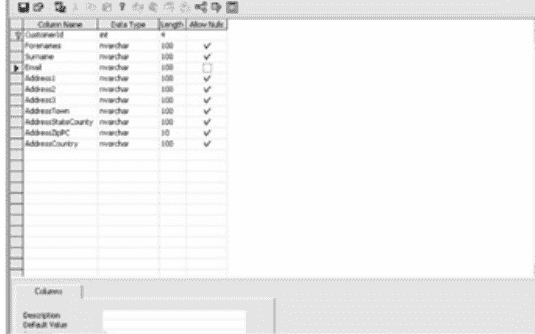

**图 10-1**

该表有一个整数标识字段作为主键，两个用于客户名和姓氏的字符串字段，以及一个用于客户电子邮件地址的字符串字段。其他七个字符串字段包含客户的地址行。

检索地址的代码首先声明一个数组 `$address` 来保存结果：

```
public function getAddressFromEmail($email)
{
    $address = array("success" => FALSE);
```

数组被赋予一个成员 `success`，用于指示是否找到了所提供电子邮件对应的详细信息。然后，使用名为 `COM` 的内置类来实例化一个 `Adodb.Connection`：

```
public function getAddressFromEmail($email)
{
    $address = array("success" => FALSE);
    $conn = new COM("Adodb.Connection");
```

**注意** 因为数据库访问涉及使用COM，所以它只能在运行Windows的服务器上工作。对于非Windows设备，MySQL将是一个合适的选择。

要打开连接，你必须知道数据库的位置和类型。这以连接字符串的形式提供。连接字符串的格式因所访问数据库的制造厂商而异。SQL Server的字符串指定了数据库所在的服务器；在此示例中，指定了 `localhost`，因为SQL Server位于Web服务器本身上。所需的其他信息是数据库或目录的名称，以及用户名和密码。此情况下的用户只需要读取权限。

```
$dbConnString = "Provider=SQLOLEDB; Data Source='localhost'; " 
              . "Initial Catalog='sales'; User Id='Test'; Password='test';";
```

```
$conn->connectionString = $dbConnString;
```

> **注意** 作为在连接字符串中包含用户名和密码的替代方案，运行Web服务器的帐户（在IIS中通常是 `IUSR_<机器名>`）可以被授予对数据库的访问权限，并且可以使用以下内容：

```
"Provider=SQLOLEDB; Data Source='localhost'; Initial Catalog='sales'; Integrated Security=SSPI;"
```

下一步是打开连接并执行简单的SQL语句。首先，使用 `str_replace()` 函数确保电子邮件中没有单引号，因为单引号会产生无效的SQL字符串。每个单引号都被两个单引号替换，修改后的字符串存储在变量 `safeEmail` 中。然后，将 `safeEmail` 合并到SQL字符串中，并在连接对象上调用 `execute` 方法：

```
$conn->connectionString = $dbConnString;
$conn->open();
$safeEmail = str_replace("'", "''", $email);
$rs = $conn->execute("SELECT * FROM tblCustomer WHERE Email = '$safeEmail'");
```

> **注意** 再次强调，为了简单起见，在运行时构建SQL字符串。在生产标准应用程序中，存储过程将接受电子邮件地址作为参数并返回数据。

`execute` 方法返回一个 `Adodb.Recordset`，存储在 `$rs` 中：

```
if (!$rs->EOF)
{
    $address['success'] = TRUE;
    $address['forenames'] = $rs->fields(1)->value;
    $address['surname'] = $rs->fields(2)->value;
    $address['address1'] = $rs->fields(4)->value;
    $address['address2'] = $rs->fields(5)->value;
    $address['address3'] = $rs->fields(6)->value;
    $address['addressTown'] = $rs->fields(7)->value;
    $address['addressStateCounty'] = $rs->fields(8)->value;
    $address['addressZipPC'] = $rs->fields(9)->value;
    $address['addressCountry'] = $rs->fields(10)->value;
}
```

**注意** `Adodb.Recordset` 是一个保存SQL select查询结果的类。它具有允许用户在返回的行中滚动的方法，以及允许检索返回的不同字段的名称、类型和值的属性。

Recordset 公开了一个布尔属性 `EOF`，它代表文件结束。如果此值不为 true，则至少返回了一行；因此，`address` 数组的 `success` 字段被设置为 `TRUE`。

然后，记录集的各种 `fields` 作为 `address` 数组的命名成员被添加。

**注意** 在PHP中，你可以随意添加命名数组成员；你不需要指定任何其他信息。你也可以添加由整数索引的成员，并且可以指定索引或将其留空以将新值添加到数组末尾。

然后关闭 `Recordset` 和 `Connection` 以释放系统资源，并返回 `$address`：

```
$rs->close();
$conn->close();
return $address;
}
```

服务器端页面准备好后，将其保存为 `CustomerServer-JPSpan.php`，并放置在Web服务器根文件夹下的 `JPSpanCustomer` 文件夹中。

## 创建客户端页面

既然Customer类已合并到服务器端页面中，你就可以构建客户端页面了。如前所述，其目的是模拟登录用户选择商品并指定送货地址的阶段。图10-2显示了测试页面。

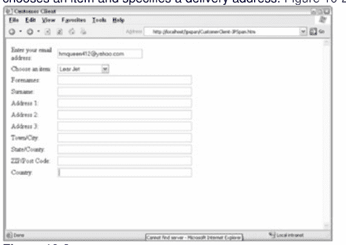

**图 10-2**

页面的HTML相当标准：多个嵌入在 `<table>` 元素中的、带有相应标签的 `<input>` 文本类型元素。

页面中有两个 `<script>` 块。第一个通过之前创建的 `customer-server.php` 页面获取脚本，因此其 `src` 指向此页面。它还包含一个查询字符串值 `client`，指示页面返回JavaScript：

```
<script type='text/javascript' src='customer-server.php?client'></script>
```


当你使用`JPSpan`时，总是需要用到这个服务器端生成的JavaScript。

第二个代码块包含了此应用特有的内联代码，例如`fetchAddress()`和`showAddress()`方法。

当页面加载完成时，`<body>`元素的`onload`事件触发，调用`init()`函数：

```
<body onLoad="init();">
```

在`init()`内部，一个名为`remoteCustomer`的变量被初始化；由于语句前没有`var`，这将是一个全局变量，页面内的所有代码均可访问：

```
function init()
{
    remoteCustomer = new customer(customerCallback);
}
```

这个语句有两点值得注意：首先，单词`customer`是小写的。这是PHP反射机制实现的一个特殊要求。所有从JavaScript中使用的类名和方法名都需要是小写的。其次，一个被称为*回调对象*的参数被传递给了`customer`。当服务端处理完成并在客户端接收到响应时，这个对象会调用其自身的方法。

```
var customerCallback = {
        getaddressfromemail: function(address)
        {
            showAddress(address);
        }
};
```

`customerCallback`是使用JavaScript对象字面量语法声明的。一个名为`getaddressfromemail`的属性被声明；如上所述，这是`Customer`类中该方法的小写版本。

> 注意：有关使用JavaScript对象字面量语法的更多信息，请参见第7章。

一个匿名函数被赋值给这个属性。它有一个参数`address`，其中包含从服务器返回的详细信息。然后，这个函数将`address`参数传递给`showAddress()`，后者在页面上显示详细信息（参见[图 10-3](#Figure 10-3)）。

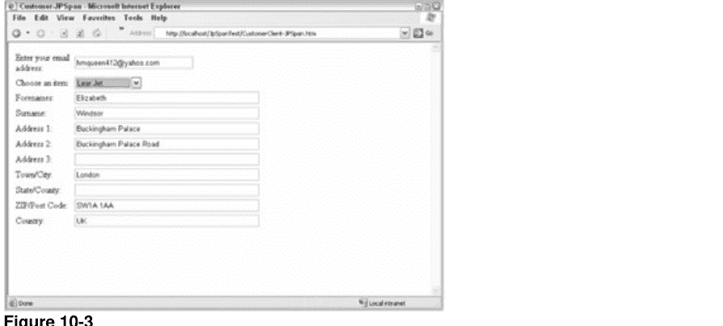

当用户通过按Tab键或点击`<select>`元素离开电子邮件文本框时，`onblur`事件被触发，该事件调用`fetchAddress()`函数，该函数将使用Ajax从服务端数据库获取相应的地址：

```
function fetchAddress(Email)
{
    // ...
}
```

首先，检查`Email`的值以确保它不为空：

```
function fetchAddress(Email)
{
    if (!Email)
    {
        alert("Please enter your email address before choosing an item.");
        document.getElementById("txtEmail").focus();
        return;
    }
}
```

如果电子邮件地址尚未填写，则调用`alert`并将焦点返回到相应的元素；否则，使用`remoteCustomer`以用户的电子邮件地址为参数调用`getaddressfromemail()`：

```
remoteCustomer.getaddressfromemail(Email);
```

当服务端处理完成时，`customerCallback`上定义的名为`getaddressfromemail()`的函数被调用，该函数反过来调用`showAddress()`：

```
function showAddress(Address)
{
    document.getElementById("txtForenames").value =
        replaceIfNull(Address["forenames"], "");
    document.getElementById("txtSurname").value =
        replaceIfNull(Address["surname"], "");
    //其他文本框被填充...
}
```

页面上的文本字段用数据库中的值填充。使用了一个小的帮助函数`replaceIfNull()`来确保在任何字段为`null`时输出更友好；否则，“null”一词会出现在某些框中。

```
function replaceIfNull(Value, ReplaceWith)
{
    if (Value == null)
    {
        return ReplaceWith;
    }
    return Value;
}
```

`replaceIfNull()`检查第一个参数的值，如果它是`null`，则返回第二个参数`ReplaceWith`。如果不是`null`，则值原样返回。

如果没有值存在，因为在`tblCustomer`中找不到该电子邮件地址，其效果就是清除所有字段。

然后，测试`success`的值。如果它等于`false`，则出现一条消息，通知用户他或她必须自己填写地址。然后将焦点设置到`Forenames`文本字段。

```
if (!Address["success"])
{
    alert("Address not registered, please fill in details.");
    document.getElementById("txtForenames").focus();
}
```

客户端页面保存为`CustomerClient-JPSpan.htm`，与`CustomerServer.php`在同一文件夹中。一次成功的用户详情搜索应类似于图10-4。

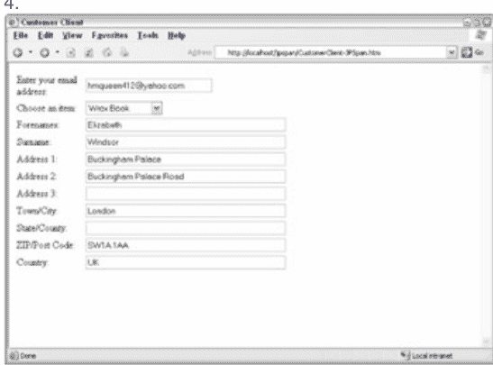

## 错误处理

任何应用程序都可能出现错误，尤其是当涉及不同机器之间的通信时。JPSpan提供了一种方法来捕获在服务端处理请求时发生的非致命错误，并使它们作为标准客户端异常出现。

服务端页面包含以下行：

`require_once JPSPAN . 'ErrorHandler.php';`

`ErrorHandler.php`是一个通用处理器，可以将非致命错误传播到客户端；它可以处理一般的PHP错误以及由JPSpan专门引起的错误。

它允许两个基本的配置设置。第一个定义当错误直接由PHP引起（而非由JPSpan方法引起异常）时，向客户端提供多少信息：

```
if (!defined('JPSPAN_ERROR_MESSAGES'))
{
    define('JPSPAN_ERROR_MESSAGES', TRUE);
}
```

如上行所示定义为TRUE时，PHP错误将简单显示为“服务器无法响应。” JPSpan错误将在错误对象的`message`、`code`和`name`属性中包含详细信息。如果定义为FALSE，则所有错误都有额外信息可用。

第二个配置选项允许向客户端发送更多信息：

```
if (!defined('JPSPAN_ERROR_DEBUG') )
{
    define ('JPSPAN_ERROR_DEBUG', FALSE);
}
```

当`JPSPAN_ERROR_DEBUG`被定义为TRUE时，错误会添加两个额外的属性：`file`和`line`。这些属性分别包含抛出错误的PHP文件的名称和发生的行号。此信息可能被用于针对网站的攻击，因此默认值FALSE会阻止这两条信息的泄露。然而，在开发环境中将其设置为TRUE非常有用。

### 类型转换

任何Ajax框架都必须处理在JavaScript中表示服务端语言类型以及反向表示的问题。三个主要的PHP页面，位于`JPSpan`子文件夹中，专门处理两种语言之间的类型转换：`Serializer.php`、`Types.php`和`Unserializer.php`。

`Serializer.php`包含定义一个名为`_JPSPAN_SERIALIZER_MAP`的全局数组的代码。该数组包含一个可以在JavaScript中表示的PHP类型的元素。如你所见，它包含了所有标准类型的条目，以及表示`null`和`jpspan_error`的方法：

```
$GLOBALS['_JPSPAN_SERIALIZER_MAP'] = array(
    'string'=>array(
        'class'=>'JPSpan_SerializedString',
        'file'=>NULL
    ),
    'integer'=>array(
        'class'=>'JPSpan_SerializedInteger',
        'file'=>NULL
    ),
    'boolean'=>array(
        'class'=>'JPSpan_SerializedBoolean',
        'file'=>NULL
    ),
    'double'=>array(
        'class'=>'JPSpan_SerializedFloat',
        'file'=>NULL
    ),
    'null'=>array(
        'class'=>'JPSpan_SerializedNull',
        'file'=>NULL
    ),
    'array'=>array(
        'class'=>'JPSpan_SerializedArray',
        'file'=>NULL
    ),
    'object'=>array(
        'class'=>'JPSpan_SerializedObject',
        'file'=>NULL
    ),
    'jpspan_error'=>array(
        'class'=>'JPSpan_SerializedError',
        'file'=>NULL
    ),
);
```

每种类型使用一个特定的类来将其转换为一个返回给定数据的函数。每个类的代码可以驻留在页面本身中，也可以存在于单独的文件中。在默认的JPSpan设置中，所有类都在页面中定义，因此`file`属性被设置为`null`。

每个序列化器类都有一个名为`generate`的方法，用于生成JavaScript表示。例如，如果一个布尔值`true`被序列化到客户端，其表示将类似于以下内容：

```
var data_serialized = 'new Function("var t1 = true; return t1;");';
var data_func = eval(data_serialized);
var data = data_func();
```

`Unserializer.php`和`Types.php`用于JavaScript和PHP之间的转换。

`Types.php`只包含两个基本类型的定义：`JPSpan_Object`和`JPSpan_Error`。（所有JavaScript对象都被转换为这两个类之一的实例。）尽管`JPSpan_Error`具有错误部分讨论的`code`、`name`和`message`属性，但`JPSpan_Object`只是一个空类，作为更具体实现的基础。

`Unserializer.php`使用另外两个类中的一个进行反序列化，这两个类都在`unserializer`文件夹中：`XML.php`中的`JPSpan_Unserializer_XML`或`PHP.php`中的`JPSpan_Unserializer_PHP`。除非明确请求PHP版本，否则使用XML版本。

在`JPSpan`表示中，方法的每个参数由XML文档中的一个元素表示；例如，布尔值是一个名为`v`的属性包含值的`<b>`元素：

```
<b v="1"/>
```

`false`值将显示为`v=0`。

表示对`getAddressFromEmail()`调用的完整文档（该方法接受一个表示电子邮件地址的字符串并返回客户的完整地址详情）如下：

```
<r><a><e k="0"><s>hmqueen412@yahoo.com</s></e></a></r>
```


### JPSpan 概述

`JPSpan`易于使用，并且与PHP集成良好。它可以处理使用内置类型的类，如果这些类本身是由内置类型构建的，也能处理更复杂的类。如果说JPSpan有一个主要缺点，那就是其在线文档有些稀疏。尽管PHP被众多网站广泛涵盖，但如果你需要自定义JPSpan本身，你将需要深入研究基本安装中包含的源文件和示例。

## DWR

Direct Web Remoting (DWR) 设计用于与Java配合使用，Java是最广泛使用的面向对象语言之一。Java不受限于任何特定平台，但其主要用途是服务器端而非桌面应用程序。

> **注意** 记住，Java和JavaScript名称上的相似性更多归因于营销策略，而非这两种语言之间的内在关系。尽管它们的语法在很多地方是相同的，但存在许多差异，尤其是在数据类型方面。

## 工作原理

DWR也使用反射来检查其配置文件中指定的任何类。然后它向客户端发送JavaScript，其中每个函数类似于该类上的函数，但有一个额外的参数，用于指定数据返回时要调用的函数。与JPSpan类似，DWR使用一个跨浏览器的库和相关版本的`XmlHttpRequest`，如果在Internet Explorer上运行则使用ActiveX版本，对于基于Mozilla的浏览器以及其他如Safari和Konqueror的浏览器则使用原生JavaScript版本。

## 安装 DWR

尽管DWR的实际安装很直接，但有一些先决条件需要首先处理。

### 安装 Java SDK

首先，从 <http://java.sun.com> 下载Java软件开发包。以下示例基于1.5版本套件，因此如果你有早期版本，则需要升级。

> **注意** Sun的网站上有很多选项，有时可能会令人困惑。对于开发工作，你基本上有两个选择：要么是基础开发套件（它还将安装所有Java应用程序所需的运行时文件），要么是包含NetBeans IDE（集成开发环境）的套件。本章中的所有示例都可以在没有IDE的情况下开发和运行。如果你要进行更深入的Java开发，可以单独下载IDE。

然后你可以安装套件和运行时，并根据随附的自述文件中的说明创建或更新任何环境变量。

### 安装 Web 服务器

接下来，你需要一个支持Java servlets和JSP的Web服务器。最常见的是Tomcat，它是Apache Jakarta项目的一部分。有适用于Windows和UNIX/Linux的版本，有关如何安装和配置它们的详细信息可以在 www.coreservlets.com/Apache-Tomcat-Tutorial/ 找到。

> **注意** 在刚才给出的URL处，你会看到一个现成的版本，它预配置了许多标准设置。这就是本章示例所使用的版本；除了修改服务器端口以避免与IIS冲突外，它是开箱即用的。

安装Java SDK和Tomcat服务器后，你应该能够按照教程中的说明启动Tomcat并导航到主页。这将使你能够访问管理页面以及一些测试页面和示例，你可以用它们来确保所有设置都正确。

最后，从 http://getahead.ltd.uk/dwr/ 获取DWR文件。这只是约150KB的小型下载。主文件dwr.jar需要放置在Web应用程序的特定文件夹中。在创建基本文件夹结构之前，请将这些文件放在一边。

## 设置测试站点

要为DWR设置测试站点，创建如图10-5所示的以DwrTest为首的文件夹结构。

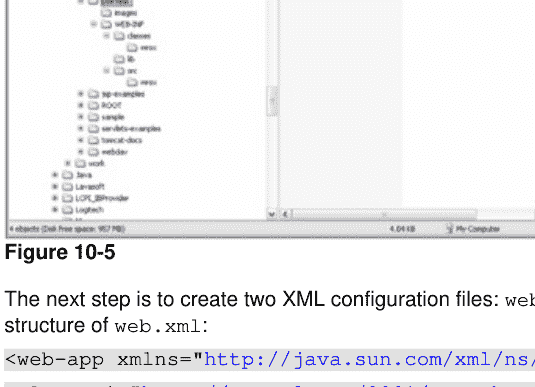

下一步是创建两个XML配置文件：web.xml和dwr.xml。首先，web.xml的基本结构：

```xml
<web-app xmlns="http://java.sun.com/xml/ns/j2ee"
xmlns:xsi="http://www.w3.org/2001/XMLSchema-instance"
xsi:schemaLocation="http://java.sun.com/xml/ns/j2ee
http://java.sun.com/xml/ns/j2ee/web-app_2_4.xsd"
version="2.4">

<servlet>
  <servlet-name>dwr-invoker</servlet-name>
  <display-name>DWR Servlet</display-name>
  <servlet-class>uk.ltd.getahead.dwr.DWRServlet</servlet-class>
  <init-param>
    <param-name>debug</param-name>
    <param-value>true</param-value>
  </init-param>
</servlet>

<servlet-mapping>
    <servlet-name>dwr-invoker</servlet-name>
    <url-pattern>/dwr/*</url-pattern>
</servlet-mapping>
</web-app>
```

**注意** 前面的代码展示了一个最基础的`web.xml`文件。除了XML序言外，可能还有显示Tomcat管理器中显示名称和描述的部分。

`web.xml`配置文件有一个文档元素`<web-app>`，它位于默认命名空间http://java.sun.com/xml/ns/j2ee中（所有其他元素也是如此）。有两个主要部分。第一个块`<servlet>`指定了servlet的名称以及其他信息，例如内置测试页面是否启用。

第二个部分`<servlet-mapping>`将一个URL关联到`<servlet>`部分中的一个条目。在这个例子中，指定以`dwr`结尾的URL将导致`dwr-invoker` servlet处理客户端请求。

**注意** `dwr-invoker`是DWR的主力。它是一个Java servlet，负责提供所有基本功能以及内置测试工具和其他功能。

此文件并非DWR独有，它将存在于所有servlet应用程序中。如果你需要在已有`web.xml`文件的应用程序中使用DWR，只需将必要的`<servlet>`和`<servlet-mapping>`元素添加到文件的相应部分。将文件保存到`DwrTest`目录下名为`WEB-INF`的文件夹中。

第二个文件`dwr.xml`也位于`WEB-INF`中。下面显示了一个最小示例。

```xml
<dwr>
    <allow>
        <create creator="new" javascript="JDate">
            <param name="class" value="java.util.Date" />
        </create>
    </allow>
</dwr>
```

这个例子规定`java.util.Date`类的一个实例将提供给客户端，并且需要将其称为`JDate`。`creator`属性指定为`new`，意味着实例化对象的Java代码将使用`new`运算符，如下所示：

`Date dt = new java.util.Date();`

稍后你会看到创建对象的不同方式，也可以添加其他`<create>`元素来暴露更多内置的Java类或你自己创建的类。

最后，将你之前下载的`dwr.jar`文件复制到`WEB-INF\lib`目录中。

你现在可以通过导航到http://localhost/DwrTest/dwr来试用DWR。你应该会看到一个指向JDate的链接。点击此链接后，将显示完整的测试页面，如图10-6所示。

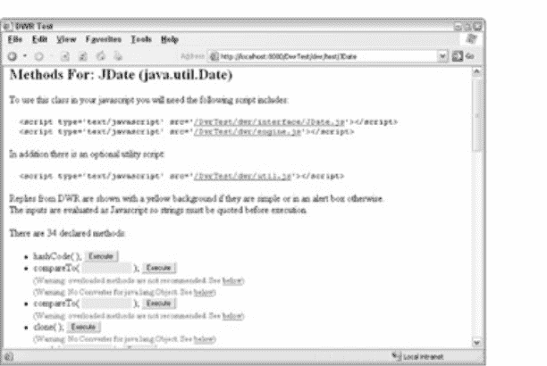

**注意** 如果你看到的不是测试页面，而是一个似乎源自某个Java XML类的错误消息，那么你的系统上存在两个相互冲突的XML API副本。你需要转到Tomcat的安装文件夹（通常名为_jakarta-tomcat-5.x.x_），并打开_common\endorsed文件夹。将文件_xml-apis.jar重命名为_xml-apis.jar.bak。你可能还需要重启Tomcat。

测试页面列出了Java Date类直接公开的所有方法，并提供了一种运行其中大部分方法的方式。还有一些关于在创建将通过DWR使用的自己的类时应避免什么的提示。其中一个主要需要避免的是重载方法，这是Java的一个常见特性，但JavaScript没有原生支持。

**注意** 当方法具有相同的名称但不同的签名时，称为重载。这意味着可以根据传递给方法的参数类型和数量来区分它们。由于JavaScript是一种弱类型语言，它将无法区分一个接受字符串的方法和一个同名但接受整数的方法。

## 创建客户端页面

以下是一个简单的客户端页面，展示了如何使用DWR：

```html
<html>
<head>
	<title>DWR Test</title>
	<script type="text/javascript" src="/DwrTest/dwr/interface/JDate.js"></script>
	<script type="text/javascript" src="/DwrTest/dwr/engine.js"></script>
	<script type="text/javascript" src="/DwrTest/dwr/util.js"></script>
	<script type="text/javascript">

		function showDate()
		{
			JDate.toGMTString(callback);
		}

		var callback = function(Data)
```


## 使用自定义类

既然你已经了解了如何使用Java内置类，下一步就是创建一个自定义类，并通过DWR来访问它。

本示例中的类将被命名为`Customer`，它将执行与用于说明JPSpan时相同的任务。它将是一个非常简单的客户表示，仅包含一个方法`getAddressFromEmail()`，该方法根据传入的电子邮件参数返回对应客户的地址。

在这个类中，你将使用ODBC连接到Access数据库，因此你需要创建一个指向Sales.mdb的DSN。要在Windows XP上创建DSN，请转到“开始” > “管理工具” > “数据源 (ODBC)”。选择“系统DSN”选项卡，然后单击“添加”按钮。选择合适的驱动程序（SQL Server或Microsoft Access Driver (.mdb)）后，你需要为DSN命名并指定Sales.mdb的位置。在接下来的示例中，如果你使用的是SQL Server，请选择“SQL身份验证”而不是“Windows身份验证”。现在，你可以测试连接，如果一切正常，只需不断按“确定”退出对话框即可。

> **重要提示** 你可以在 http://java.sun.com/j2se/1.4.2/docs/guide/jdbc/index.html 了解更多关于Java数据库方法的信息。

接下来，创建一个名为Customer.java的文本文件，并将其保存到你之前创建的WEB-INF\src\wrox文件夹中。

Java代码首先声明包名，然后指定要导入的两个包：`java.util`和`java.sql`。这样，这些包中的类就可以通过短名称而不是全限定名来引用。

```java
package wrox;
import java.util.*;
import java.sql.*;
```

然后是类头及其唯一方法的声明：

```java
public class Customer
{
    public HashMap getAddressFromEmail(String Email)
    {
        //实现代码放在这里
    }
}
}
```

与之前一样，该方法接受电子邮件地址的字符串表示形式，并返回个人的地址详细信息。虽然在PHP中不需要指定变量类型，但Java是一种强类型语言，因此需要声明函数的返回值。哈希映射类似于数组，但它是通过指定键来检索值的，这意味着为JP Span客户端编写的客户端代码可以在DWR中重用。

`getAddressFromEmail()`方法首先声明地址哈希映射，然后将`success`键的值设置为true。接着，一个try...catch块尝试加载将用于连接到Sales数据库的Java数据库驱动程序：

```java
public HashMap getAddressFromEmail(String Email)
{
    HashMap address = new HashMap();
    address.put("success", false);
    try
    {
        Class.forName("sun.jdbc.odbc.JdbcOdbcDriver");
        //代码继续在这里
    }
    catch (Exception e)
    {
        address.put("error", "Failed to load JDBC/ODBC driver.");
    }
```

如果`Class.forName`失败，一条错误消息将被添加到地址详细信息中，这有助于在类处于开发阶段时进行调试。

```java
Class.forName("sun.jdbc.odbc.JdbcOdbcDriver");
try
{
    Connection con = DriverManager.getConnection("jdbc:odbc:sales","Test","test");
    //代码继续在这里
}
catch (Exception e)
{
    address.put("error", "Failed to connect.");
}
```

声明了一个名为`con`的新`Connection`，`JdbcOdbcDriver`类中的`DriverManager`尝试连接到`sales`（即之前创建的DSN名称）。如果此处发生错误，将再次向`address`哈希映射添加一条消息。

```java
Connection con = DriverManager.getConnection("jdbc:odbc:sales","Test","test");
try
{
    StringBuffer SQL = new StringBuffer("SELECT * FROM tblCustomer WHERE Email = '");
    String safeEmail = Email.replaceAll("'", "''");
    SQL.append(safeEmail);
    SQL.append("'");
    Statement stmt = con.createStatement();
}
```

构建SQL语句，再次将单引号重复，然后使用`con`对象的工厂方法返回一个`java.sql.Statement`：

```java
Statement stmt = con.createStatement();
ResultSet rs = stmt.executeQuery(SQL.toString());
boolean found = rs.next();
if (found)
{
    address.put("success", true);
    address.put("forenames", rs.getString(2));
    address.put("surname", rs.getString(3));
    address.put("address1", rs.getString(5));
    address.put("address2", rs.getString(6));
    address.put("address3", rs.getString(7));
    address.put("addressTown", rs.getString(8));
    address.put("addressStateCounty", rs.getString(9));
    address.put("addressZipPC", rs.getString(10));
    address.put("addressCountry", rs.getString(11));
}
}
```

通过对SQL字符串使用`executeQuery()`方法创建一个`ResultSet`。

**注意** `ResultSet`类封装了SQL Select查询返回的数据。它具有允许用户在行之间移动以及访问任何特定字段值的方法。

当尝试移动到下一个可用行时，会返回一个布尔值`found`，指示成功或失败。如果成功，则将值添加到地址哈希映射中；如果不成功，则地址详细信息保持为空，并且`success`的值设置为`false`。

接下来，关闭`ResultSet`和`Connection`以释放资源：

```java
rs.close();
con.close();
```

最后，返回详细信息：

```java
return address;
```

保存`Customer.java`文件后，你需要编译它。假设你已按照图10-5所示设置好文件夹，请打开命令提示符，导航到保存`Customer.java`的文件夹，然后运行以下命令：

```
javac -d ..\..\classes Customer.java
```

**注意** 你可能会收到关于未检查方法的警告，可以忽略。

为了使该类可通过DWR访问，你需要修改之前创建的`dwr.xml`文件。在`<allow>`部分添加以下`<create>`元素：

```xml
<create creator="new" javascript="Customer">
    <param name="class" value="wrox.Customer" />
</create>
```

你可能需要使用Tomcat主页上提供的管理应用程序来重新启动DwrTest应用程序。现在，你可以导航到http://localhost/DwrTest/dwr，验证Customer类及其`getAddressFromEmail()`方法是否出现。

一旦验证Customer类可用，你就可以重用`CustomerClient-JPSpan`页面的大部分内容作为客户端。所有的HTML可以保留，但你需要按照之前所示的方式修改脚本部分以包含DWR文件，并且需要从`<body>`元素中移除`onload`属性。另一个变化是利用DWR提供的一些实用函数。这些函数包括设置和检索元素值、向选择框添加选项，以及在执行可能耗时较长的操作时显示等待消息。

```html
<script type="text/javascript"
    src="/DwrTest/dwr/interface/Customer.js"></script>
<script type="text/javascript" src="/DwrTest/dwr/engine.js"></script>
<script type="text/javascript" src="/DwrTest/dwr/util.js"></script>
<script type="text/javascript">

function fetchAddress(Email)
```


{
    if (!Email)
    {
        alert("请在选择项目前输入您的电子邮件地址。");
        $("txtEmail").focus();
        return;
    }
    Customer.getAddressFromEmail(Email, callback);
}

var callback = function (Address)
{
    showAddress(Address);
};

最大的变化在于，使用 JPSpan 时你向 `remoteCustomer` 构造函数传递了一个回调对象，而这里你向 `getAddressFromEmail()` 方法传递了一个回调函数。

`document.getElementById()` 的调用已被 `util.js` 中的函数 `$` 所替代。这种方式更灵活，因为它接受一个或多个元素 ID，并返回一个特定元素，或者（如果有多个参数）返回一个元素数组。

从最终用户的角度来看，页面的功能与之前完全相同。此页面在代码下载中以 `CustomerClient-DWR.htm` 的形式提供。

## 错误处理

服务器端抛出的任何错误，默认情况下会作为标准 JavaScript 错误传递回客户端代码。如果你不希望默认操作（即显示详细信息的消息框）出现，可以使用 `try...catch` 块来处理这些错误。错误处理过程是可定制的，但其方式因版本而异，并预计在下一个版本中发生变更。

## 更多关于 dwr.xml 的信息

到目前为止使用的 `dwr.xml` 文件始终在 `<allow>` 部分中使用 `<create>` 元素，其结构如下：

```
<create creator="new" javascript="Customer">
    <param name="class" value="wrox.Customer" />
</create>
```

这些元素都为 `creator` 属性指定了 `new`，并在 `<param>` 元素中指定了一个类，该类等同于被创建类的新实例。`new` 创建器也可用于静态方法（即可以直接从类而不是从实例调用的方法）。DWR 在创建实例前会检查一个类的方法是否为静态方法。

以下部分讨论了 `<create>` 元素的其他一些可用选项。

## 排除方法

如果你想提供对一个类的访问但限制可以调用哪些方法，请使用 `<exclude>` 元素。例如，以下内容从 `Date` 类中排除了 `toGMTString()` 方法的调用：

```
<create creator="new" javascript="JDate">
    <param name="class" value="java.util.Date"/>
    <exclude method="toGMTString"/>
</create>
```

## 脚本创建器

有些对象无法通过简单地调用默认构造函数来设置；它们可能只能通过另一个类的方法或调用静态 `getInstance()` 方法来访问。一个例子是 `org.apache.commons.validator` 包中的 `EmailValidator` 类。它没有公共构造函数，但可以通过使用类本身的静态方法 `getInstance()` 来获取实例。

要创建 `EmailValidator` 的实例，请使用以下版本的 `<create>` 元素：

```
<create creator="script" javascript="EmailValidator">
    <param name="language" value="beanshell"/>
    <param name="script">
        import org.apache.commons.validator.EmailValidator;
        return EmailValidator.getInstance();
    </param>
</create>
```

这里使用的脚本语言是 beanshell，它是 Bean 脚本框架 (BSF) 支持的语言之一。

> **重要提示** 你可以在 [www.beanshell.org/](http://www.beanshell.org/) 上阅读更多关于 BeanShell 的信息，并在 [http://jakarta.apache.org/bsf/index.html](http://jakarta.apache.org/bsf/index.html) 上查看 BSF 支持的其他语言。

## Spring 创建器

Spring 框架 ([www.springframework.org](http://www.springframework.org)) 旨在整合多种不同的 Java 技术，并支持实际的代码重用以及 JavaBeans 的精细管理。它是 Java 2 企业版 (J2EE) 部分组件的轻量级替代品，后者用于创建预期有大量用户同时使用系统的高度可扩展应用程序。在这些情况下，需要仔细管理内存等资源。

你可以使用 `spring` 创建器来利用这些企业 bean：

```
<create creator="spring" javascript="MyBean">
    <param name="beanName" value="MyBean"/>
    <param name="location" value="beans.xml"/>
</create>
```

Spring 框架及相关技术是一个庞大的主题。除了访问前面的 URL，你还可以在 [http://getahead.ltd.uk/dwr/server/spring](http://getahead.ltd.uk/dwr/server/spring) 上阅读更多关于 DWR 与 Spring 集成的信息。

## scope 参数

`<create>` 元素还可以接受一个名为 `scope` 的属性，其值可以是 `page`、`session`、`request` 或 `application`。这使你能够指定 bean 的生命周期；如果未指定 `scope`，则默认为 `request`。

例如，如果你想在整个会话中使用 `Customer` 类（这其实没什么帮助，因为它没有任何属性），语法将如下所示：

```
<create creator="new" javascript="Customer">
    <param name="class" value="wrox.Customer" scope="session"/>
</create>
```

## 转换器

由于 Java 的数据类型比 JavaScript 多，你可能想知道如果 DWR 遇到一个无法直接转换的值会发生什么。当没有默认转换可用时，DWR 使用转换器来弥合差距。`转换器` 简单地在 Java 和 JavaScript 之间转换类型。DWR 附带了一些预定义的转换器，例如 `DateConverter`，它在 `java.util.Date` 和 JavaScript Date 对象之间进行编组。其他转换器包括 `ArrayConverter`、`StringConverter` 和 `BeanConverter`。

理论上，可以构建自己的转换器；但实际上，这极不可能发生，只有在你的方法需要或返回一个特别不寻常的类型时才会有此必要。

然而，关于转换器，你应该考虑一个方面：安全性。在某些情况下，可能通过转换器运行恶意代码；这对于原始类型是不可能的，但对于 JavaBean 则可能发生。为了防范这一点，bean 转换器默认是禁用的。但是，你可以通过在 `dwr.xml` 的 `<allow>` 部分添加一个条目来允许它。

要允许 bean 中的所有内容，请添加以下行：

```
<dwr>
    <allow>
        <convert converter="bean" match="your.full.package.BeanName"/>
        <!-- other allowed converters and creators -->
    </allow>
</dwr>
```

`match` 指定了要允许哪个 bean。你可以使用星号作为通配符将其扩展到整个包：

```
<convert converter="bean" match="your.full.package.*"/>
```

如果你向 `<convert>` 添加一个子元素，你可以排除某些属性不被转换：

```
<convert converter="bean" match="your.full.package.BeanName">
    <param name="exclude" value="property1, property2"/>
</convert>
```

或者，更安全地，你可以指定哪些属性可以被转换（所有其他属性将被忽略）：

```
<convert converter="bean" match="your.full.package.BeanName">
    <param name="include" value="property1, property2"/>
</convert>
```

重要提示：有关哪些转换器可用以及哪些需要特别允许才能供你的代码使用，请参阅 http://getahead.ltd.uk/dwr/server/dwrxml/converters。

## DWR 总结

DWR 是一种利用 Java 功能在客户端网页中使用的绝佳方式。现有的数百个 Java 包几乎可以肯定，无论你的需求是什么，都会有适合的包。此外，还有一个优势是，关于 Java 平台的信息、教程和愿意分享知识的专家资源非常丰富。

## Ajax.NET

Ajax.NET 旨在允许远程调用用 .NET 语言编写的类，特别是通过 ASP.NET 访问的类。.NET 框架自 1999 年就已存在，其目标之一是使用不同语言编写的代码能够无缝集成。主要的 .NET 语言是 Visual Basic .NET 和 C#，但也有许多其他语言，从 J#（Java 的 .NET 移植版）到 COBOL .NET。

## 工作原理

与本章讨论的其他框架一样，Ajax.NET 使用一个跨浏览器的客户端库，通过平台特定的 XMLHttpRequest 版本将函数调用发送到服务器。它还使用反射来分析 ASP.NET 页面中的服务器端代码。然而，与其他框架不同的是，Ajax.NET 利用了一种称为 *属性* 的 .NET 特性，该特性用于标记那些可以从客户端使用的方法。

## 安装 Ajax.NET

要使用 Ajax.NET，你需要运行 IIS 5 或更高版本，并安装 .NET 框架。虽然可以通过 Visual Studio .NET 轻松创建使用 ASP.NET 的网站，但这并不是必需的，也可以使用标准编辑器完成。

> 注意：第 6 章讨论了如何为 IIS 设置新的虚拟文件夹并创建 ASP.NET Web 项目。

从 http://ajax.schwarz-interactive.de/ 下载 Ajax DLL。在撰写本文时，有两个版本可用：任何版本号为 5.7.25.1 或更大的版本用于 .NET 2；如果你没有运行此版本，请下载早期的 DLL 之一，例如 5.7.22.2。

接下来，你需要向每个使用 Ajax.NET 的项目添加对此 DLL 的引用。

## 添加 Ajax.dll 引用

你需要在设置 Ajax.NET 之前创建项目，因此启动 Visual Studio .NET 并添加一个新的名为 AjaxTest 的 ASP.NET Web 应用程序。

> 注意：项目可以是 C#、Visual Basic .NET 或你机器上可用的任何其他选项。

右键单击项目名称 *AjaxTest*，然后选择“添加”⇒“新建文件夹”。将新文件夹命名为 *ref*。将之前下载的 Ajax.dll 添加到此文件夹，然后通过右键单击“引用”文件夹，浏览到 *ref*，并双击 Ajax.dll 来添加对它的引用。最后，

将 WebForm1.aspx 页面重命名为 Index.aspx。现在，Visual Studio 右侧解决方案资源管理器中的项目布局将类似于图 10-7。

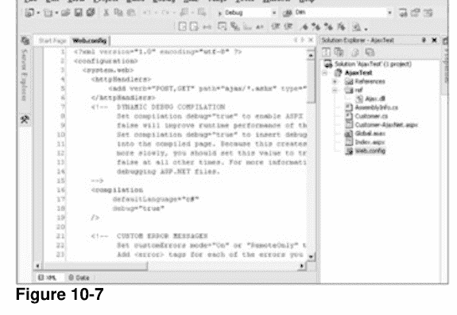

## 添加新的 HttpHandlers 元素

你还需要修改项目的 Web 配置文件。打开 `Web.config`，并在 `<system.web>` 下添加一个新的 `<httpHandlers>` 元素。

```xml
<configuration>
    <system.web>
        <httpHandlers>
            <add verb="POST,GET" path="ajax/*.ashx"
                 type="Ajax.PageHandlerFactory, Ajax" />
        </httpHandlers>
    </system.web>
</configuration>
```

这告诉 IIS，任何定向到 `ajax/*.ashx`（其中 `*` 代表任意）的 POST 或 GET 请求，都应由 `Ajax.PageHandlerFactory` 而非内置的处理程序来处理。

`HttpHandler` 处理客户端请求，无论是简单的 GET 请求（如 URL），还是更复杂的 POST 请求（包含来自 HTML 表单的附加数据）。它负责采取任何操作，例如必须遵循的专门业务逻辑。内置的处理程序处理 `.aspx`、`.asmx` 和其他类似的 ASP.NET 文件。`Ajax.PageHandlerFactory` 处理路径中包含 Ajax 的请求，并使用 URL 中的信息根据指定的业务对象生成所需的客户端 JavaScript。

初始设置现已完成，是时候构建将利用 Ajax.NET 的网页了。

## 创建网页

为确保 Ajax.NET 已正确安装和注册，我们使用 `Index.aspx` 文件对系统进行一个简单的测试。

## 创建测试页

从 Visual Studio .NET 的解决方案资源管理器中，右键单击 `Index.aspx` 并选择“查看代码”。在 `Page_Load` 过程中添加以下行：

```csharp
public class Index : System.Web.UI.Page
{
    private void Page_Load(object sender, System.EventArgs e)
    {
        Ajax.Utility.RegisterTypeForAjax(typeof(Index));
    }
}
```

这行代码的目的是将必要的 JavaScript 文件注入到生成的 HTML 中。
你现在可以测试这个设置了。按 F5 启动项目，你应该会看到一个空白页面。查看源代码时，你会注意到以下两个 `<script>` 元素：

```html
<script type="text/javascript"
    src="/AjaxTest/ajax/common.ashx"></script>
<script type="text/javascript"
    src="/AjaxTest/ajax/AjaxTest.Index,AjaxTest.ashx"></script>
```

第一个脚本提供 `XmlHttpRequest` 功能；第二个是特定于该页面的，包含一些辅助函数以及任何已公开的服务器端方法。

## 添加一个简单的方法

要使一个方法可供客户端访问，首先在 `Index.aspx` 中的 `Index` 类定义内添加它：

```csharp
public class Index : System.Web.UI.Page
{
    public int Add(int firstNumber, int secondNumber)
    {
        return firstNumber + secondNumber;
    }
}
```

为了告知 Ajax.NET 处理程序此方法需要客户端 JavaScript 实现，它需要用一个 .NET 属性进行装饰：

```csharp
[Ajax.AjaxMethod()]
public int Add(int firstNumber, int secondNumber)
{
    return firstNumber + secondNumber;
}
```

然后可以使用语法 `PageClass.Method(Arg1, Arg2, . . .)` 在客户端进行访问。因此，在本例中，代码将是：

```javascript
var response = Index.Add(6, 8);
alert(response.value);
```

`Index.Add` 返回的响应有三个属性：`value`（如上所示）、`error` 和 `request`。为了使你的代码更健壮，你应该在继续之前检查 `error` 属性是否为 `true`：

```javascript
var response = Index.Add(6, 8);
if (response.error)
{
    alert(response.error);
}
else
{
    alert(response.value);
}
```

`request` 属性提供了对底层 XmlHttpRequest 对象的访问，在更复杂的场景中，当需要访问原始 XML 时，它在调试中很有帮助。

前面的示例显示了一个同步调用，在调用 `Index.Add()` 之后，脚本会等待方法在服务器上处理完毕。要开始一个异步调用（即脚本在方法调用后继续执行），请将函数指针作为方法的最后一个参数传递：

```javascript
var callback = function (response)
{
    if (response.error)
    {
        alert(response.error);
    }
    else
    {
        alert(response.value);
    }
}
Index.Add(6, 8, callback);
```

使用异步调用时，你还可以在回调函数之后立即传递一个上下文参数。它在 `response.context` 属性中返回，使你能够对多次调用使用相同的回调过程，同时在返回时区分每个调用应用于哪个操作：

```javascript
var callback = function (response)
{
    if (response.error)
    {
        alert(response.error);
    }
    else
    {
        alert(response.context + response.value);
    }
}
Index.Add(6, 8, callback, "6 + 8 = ");
Index.Add(9, 2, callback, "9 + 2 = ");
```

前面的代码将在两个单独的警告框中显示原始的求和表达式以及结果。

## 创建 Customer-AjaxNET.aspx

与演示 `JPSpan` 和 `DWR` 的另外两个项目不同，Ajax.NET 只使用一个页面：`Customer-AjaxNET.aspx`。

从 Visual Studio .NET 的解决方案资源管理器中，向项目添加一个名为 `Customer-AjaxNET.aspx` 的新 Web 窗体。在你对此页面进行任何进一步修改之前，需要先创建业务类；否则，Visual Studio .NET 会报错，提示你引用了一个不存在的对象。

## 实现 Customer 类

除了可以直接访问嵌入在 `.aspx` 页面中的方法外，你还可以使任何外部类的方法可访问，前提是返回的类型可以转换为 JavaScript 格式。你需要将自定义类传递给 `Ajax.Utility.RegisterTypeForAjax` 方法，而不是使用当前的页面类。

向 AjaxTest 项目添加一个新类，并将其保存为 `Customer.cs`。它实现了与本章其他示例相同的功能——即一个方法 `GetAddressFromEmail()`。

> **注意** 与之前一样，以下类旨在辅助演示 Ajax 的使用；它绝不是编写业务类的模型。

该类以多个 `using` 语句开始，以便更轻松地访问所需的类型：

```csharp
using System;
using System.Collections;
using System.Data.OleDb;
using System.Text;
```

`System` 命名空间包含所有基本功能和基本数据类型，`System.Collections` 使用了 `Hashtable` 类，用于存储地址详细信息。这与 DWR 示例中的 hashmap 非常相似。`System.Data.OleDb` 包含用于连接和从 OleDb 数据源（例如 SQL Server 或 Microsoft Access）检索数据的类。`System.Text` 类包含用于操作字符串的方法，并在必要时为用户提供的电子邮件地址添加额外引号，同时也提供了对用于构造 SQL 语句的 `StringBuilder` 类的访问。

接下来是命名空间和类声明本身：

```csharp
namespace AjaxTest
{
    public class Customer
    {
        public Hashtable GetAddressFromEmail(string Email)
        {
            Hashtable address = new Hashtable();
            address["success"] = false;
```

返回值是一个哈希表（Hashtable），它通过唯一键存储数据项，访问方式类似于 DWR 示例中使用的哈希映射（hashmap）。一个名为 `success` 的键被赋值为 `false`，如果数据库调用成功，它将被修改为 `true`。

下一步是创建到 Sales 数据库的连接。如前所述，数据库的连接详细信息将存储在配置文件中：

```csharp
string sConnString = "Provider=SQLOLEDB; Data Source='localhost'; "
    + "Initial Catalog='sales'; User Id='Test'; Password='test';";
OleDbConnection conn = new OleDbConnection(sConnString);
conn.Open();
```

**注意** 如果你想通过更改连接字符串来使用 SQL Server 以提高性能，但又不介意放弃更换数据库的便利性，你可以使用 SQL Server 特定的 `SqlConnection` 而不是 `OleDbConnection`。

然后，使用 `StringBuilder` 构建 SQL 语句，注意替换 `Email` 字符串中可能存在的任何单引号：

> **注意** 在 .NET 框架中，`String` 对象是不可变的；一旦创建就无法更改，任何更改（如附加字符）都是通过创建一个全新的字符串来实现的。旧版本仍然留在内存中但无法访问。这从内存角度来看显然是浪费的。为了克服这个问题，使用一个名为 `StringBuilder` 的独立类。它可以在不复制的情况下进行更改，当所有更改完成后，可以通过调用其 `ToString()` 方法将其转换为一个完全成熟的 `String` 对象。

```csharp
StringBuilder SQL = new StringBuilder("SELECT * FROM tblCustomer WHERE Email = '");
string safeEmail = Email.Replace("'", "''");
SQL.Append(safeEmail + "'");
```

使用 `OleDbCommand` 对象执行 SQL，结果以 `OleDbDataReader` 的形式返回。

> **注意** `OleDbDataReader` 是一个 ADO.NET 类，用于提供对 Select 查询结果的连接只读访问。它只能以前进方向遍历结果，并提供了通过字段名称或位置从任何字段检索值的方法。

```csharp
OleDbCommand cmd = new OleDbCommand(SQL.ToString(), conn);
OleDbDataReader dr = cmd.ExecuteReader();
```

正如你所看到的，代码与它的 Java 等效代码极其相似。

通过调用 `read()` 方法逐行访问，只有行存在时 `dr.Read()` 的返回值才为 `true`。在这种情况下，哈希表将被填充，并且 `success` 键设置为 `true`；否则它将被设置为 `false`，地址详细信息将保持为空。

```csharp
Boolean found = dr.Read();
if (found)
{
    address["success"] = true;
    address["forenames"] = (dr.IsDBNull(1) ? "" : dr.GetString(1));
```


## 将 Customer 类添加为远程对象

要注册 `Customer` 类，请返回到 `Customer-AjaxNET.aspx` 页面的代码视图，并将以下内容添加到 `Page_Load()` 事件处理程序中。

```
private void Page_Load(object sender, System.EventArgs e)
{
    Ajax.Utility.RegisterTypeForAjax(typeof(Customer));
}
```

与之前的 `Index.aspx` 类似，这会向 HTML 中添加两个 JavaScript 包含文件，它们提供了将方法调用转发到服务器端对象所需的客户端功能。

## 创建客户端代码

剩下的唯一事情是添加自定义属性：

```
[Ajax.AjaxMethod()]
public Hashtable GetAddressFromEmail(string Email)
```

这完成了 `Customer` 类的创建。它作为一个独立的类存在，因此可以被其他应用程序使用，而不仅仅是网页。下一阶段是将其注册为通过 `Customer-AjaxNET.aspx` 使用，以便在客户端可用。

数据读取器的内置方法 `IsDBNull()` 用于避免任何与空值相关的问题。

最后，关闭数据读取器和连接，并返回哈希表。

```
dr.Close();
conn.Close();
return address;
```

数据读取器和连接被关闭，并返回哈希表。

```
address["surname"] = (dr.IsDBNull(2) ? "" : dr.GetString(2));
address["address1"] = (dr.IsDBNull(4) ? "" : dr.GetString(4));
address["address2"] = (dr.IsDBNull(5) ? "" : dr.GetString(5));
address["address3"] = (dr.IsDBNull(6) ? "" : dr.GetString(6));
address["addressTown"] = (dr.IsDBNull(7) ? "" : dr.GetString(7));
address["addressStateCounty"] = (dr.IsDBNull(8) ? "" : dr.GetString(8));
address["addressZipPC"] = (dr.IsDBNull(9) ? "" : dr.GetString(9));
address["addressCountry"] = (dr.IsDBNull(10) ? "" : dr.GetString(10));
}
```

`fetchAddress()` 接受一个表示客户电子邮件地址的字符串参数。它首先测试是否提供了值，如果未提供，则提示用户提供，并将焦点返回到相应的文本框。

如果提供了值，则会在 Customer 对象上调用 `GetAddressFromEmail()` 方法。该方法的第二个参数是处理响应的函数名称。

```
document.getElementById("txtEmail").focus();
return;
}
Customer.GetAddressFromEmail(Email, callback);
}
```

回调函数传递服务器响应：

```
var callback = function (Response)
{
    showAddress(Response);
};
```

`showAddress()` 有一个轻微的变化，以利用 Ajax.NET 提供的 `Response.error` 属性。如果该值为空，则表示没有发生错误；否则，将显示错误消息。

```
function showAddress(Response)
{
    if (Response.error)
    {
        alert("Unable to retrieve address.\n(" + Response.error + ")");
        return;
    }
```

接下来是唯一重要的更改。由于 Ajax.NET 序列化哈希表的方式，它在 JavaScript 中表现为一个数组，每个成员保存一个包含键和值的对象。为了能够重用之前的代码，哈希表通过传递给一个名为 `getAddressFromResponse()` 的辅助函数进行转换：

```
var Address = getAddressFromResponse(Response);
```

`getAddressFromResponse()` 遍历数组并创建一个更易于处理的数据简化哈希表：

```
function getAddressFromResponse(Response)
{
    var address = new Object();
    var data = Response.value;
    for (var i = 0; i < data.length; i++)
    {
        address[data[i].Key] = data[i].Value;
    }
    return address;
}
```

这完成了网页的创建。要试用它，请导航到 http://localhost/AjaxTest/Customer-AjaxNet.aspx，输入一个电子邮件地址，然后退出文本框。结果应类似于 [图 10-8](#figure108)。

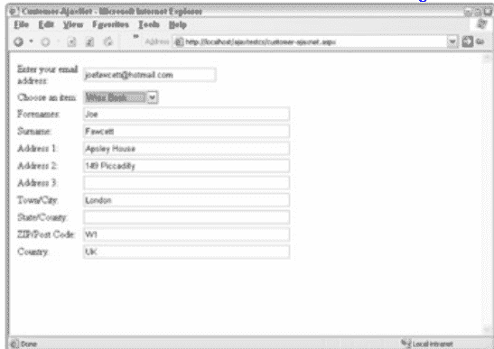

图 10-8

## 简单类型和复杂类型

Ajax.NET 框架使用 JavaScript 对象表示法（JSON）（你在 [第 7 章](#chapter7) 中已经见过）将对象传递给客户端。它可以处理所有原始类型，如整数、字符串和布尔值，并且还内建支持一些常见的 .NET 复杂类型，如 ADO.NET 的数据集或数据表。

作为在客户端操作数据集的示例，假设你调用了服务器端类上的一个返回数据集的函数：

```
MyClass.GetDataSet(callback);
```

然后你的回调函数可以以与在 .NET 中使用数据集非常相似的方式从数据集中读取值：

```
function callback(Response)
{
    if (Response.error)
    {
        alert(Response.error);
        return;
    }

    var tblNames = Response.value.Tables[0];
    var sTable = "<table><th>Forenames</td><td>Surname</td></tr>";
    for (var i = 0 ; i < tblNames.Rows.length; i++)
    {
        var oRow = tblNames.Rows[i];
        sTable += "<tr><td>" + oRow.Forenames + "</td>";
        sTable += "<td>" + oRow.Surname + "</td></tr>";
    }
    sTable += "</table>";
    document.getElementById("divNames").innerHTML = sTable;
}
```

如果你想从一个方法返回你自己的自定义类并使其被 Ajax.NET 正确序列化，你需要用 `Serializable` 属性标记它。例如，考虑一个表示网站用户的类：

```
[Serializable()]
public class User
{
    private string _userName = "";
    private string _userEmail = "";

    public string UserName
    {
        get
        {
            return _userName;
        }
    }

    public string UserEmail
    {
        get
        {
            return _userEmail;
        }
    }

    public User(string Name, string Email)
    {
        _userName = Name;
        _userEmail = Email;
    }
}
```

假设一个 `User` 对象由名为 `GetUserFromId()` 的方法返回，其属性在 JavaScript 中将是可用的。

```
MyClass.GetUserFromId(6, callback);

function callback(Response)
{
    var oUser = Response.value;
    alert(oUser.UserName + "\n" + oUser.UserEmail);
}
```

## 会话状态

Ajax.NET 也可以处理需要访问会话变量的情况。在声明 AjaxMethod 属性时，你可以传递一个参数，指定你需要读、写或读写访问权限。

```
[Ajax.AjaxMethod(HttpSessionStateRequirement.Read)]
public string MyMethod()
{
```

另外两个选项是 `HttpSessionStateRequirement.Write` 和 `HttpSessionStateRequirement.ReadWrite`。

例如，假设用户在一个站点上发起了一系列事务，并想知道哪些已经完成。在传统的 Web 应用程序中，他或她需要重新访问特定页面才能看到状态，但使用 Ajax 方法则无需这样做。

每个等待完成的事务的 ID 保存在一个名为 `WaitingTransactions` 的会话变量中。

```
[Ajax.AjaxMethod(HttpSessionStateRequirement.Read)]
public ArrayList FetchCompletedTransactions()
{
    if (HttpContext.Current.Session["WaitingTransactions"] == null)
    {
        return null;
    }
    ArrayList completedTransactions = new ArrayList();
    int[] transactions =
    (int[])HttpContext.Current.Session["WaitingTransactions"];
    for (int i = 0; i < transactions.Length; i++)
    {
        Transaction tx = Transaction.GetFromId(transactions[i]);
        if (tx != null && tx.Status == TransactionStatus.Ready)
        {
            completedTransactions.Add(tx);
        }
    }
    return completedTransactions;
}
```

检查会话变量；如果发现不为空，则将其转换为整数数组。每个整数被传入一个检索事务详细信息的方法，如果该事务已准备好，则将其添加到要返回给调用者的 `ArrayList` 中。

现在你可以使用 `window.setTimeout` 方法来轮询事务的状态：

```
<script type="text/javascript">
function transactionsCompleteCallback(response)
{
    if (response.error != null)
    {
        alert(response.error);
        return;
    }
    var data = response.value;
    if (!data || !data.length) return;
    var sResult = "";
    for (var i = 0; i < data.length; i++)
    {
        sResult += "Transaction Id: " + data[i].TransactionId;
        sResult += " (" + data[i].TransactionName + ") Status: ";
        sResult += data[i].Status + "<br>";
    }
    document.getElementById("divTransactionStatus").innerHTML = sResult;
    setTimeout("MyPage.FetchCompletedTransactions(transactionsCompleteCallback)", 10000);
}
</script>
<body onload="setTimeout('MyPage.FetchCompletedTransactions(transactionsCompleteCallback)', 5000)">
```

延迟 5 秒后，调用 `FetchCompletedTransactions`，并将结果返回给 `transactionsCompleteCallback` 函数。如果没有错误且有一些可用数据，则构建 HTML 详细说明事务的 ID、名称和状态，并显示给用户。然后该函数再次使用 `setTimeout`，确保每 10 秒更新一次结果。

## Ajax.NET 总结

只要你已经在使用 IIS，Ajax.NET 的设置就极其简单。它可以处理你需要的大部分数据类型。如果你不喜欢它的某个方面，它是一个开源框架，因此你可以自由地研究其工作原理，甚至提出或编写自己的改进建议。

## 总结

本章探讨的三个框架各有优势；决定使用哪个框架的主要因素几乎肯定取决于你的 Web 服务器当前运行的语言。所有三种语言——PHP、Java 和 .NET——都有无数的 Web 资源和书籍专门介绍它们（尽管 Java 在这一点上可能略微领先于其他语言）。Ajax.NET 在方法可用性方面可能得分最高；在现有过程中添加一行并在页面加载处理程序中添加一行确实非常简单，尽管使用 DWR 时根本不需要对类进行内部修改，从而可以更容易地从其他地方重用类。JPSpan 的优势在于，由于它和 JavaScript 都是弱类型语言，因此在两种语言之间进行类型强制转换所需的工作量较少。


本章涵盖了三个不同 Ajax 框架的大量内容，至此已圆满结束，你在此过程中完成了多项不同的任务。

对于 JPSpan，你已安装了 PHP，创建了一个类，并连接到了数据库。

使用 DWR，你搭建了一个能够处理 Java servlets 和 JSP 页面的新 Web 服务器，然后使用基本的文本编辑器创建了一个 Java 类，之后通过命令行工具对其进行了编译。你还学习了如何修改 XML 配置文件，以允许客户端使用该类。

对于 Ajax.NET，你学习了如何修改 `web.config` 文件以覆盖内置的页面处理器，以及如何安装 `Ajax.dll` 并添加对它的引用。接着，你创建了一个可以从数据库检索信息的类，并在客户端使用 JavaScript 调用了这个类。
